# DeepSeek 冲击下的 AI 新纪元

# 前言

# 稳立潮头的核心价值

2025 年开年不久，源自中国的 AI 新锐 DeepSeek 迅速走入公众视野。其登场不仅撼动了中美在人工智能赛道的既有力量对比，为中国经济续上强劲动能，更在潜移默化中改写科技创新的底层逻辑。在 DeepSeek 等新一代平台加持下，全球创新节奏明显加快，劳动者向创造者的身份转换更加顺滑，人类追求美好生活与更高文明的步伐也随之提速。

谈及 DeepSeek 的意义，战略管理专家罗伯特·格兰特提出，经济正由地劳资本驱动转向知识驱动。这一判断其实略显表面，因为纵观文明史，人类几乎所有重大突破都根植于知识。管理思想家彼得·德鲁克早在 1965 年就断言，知识终将取代土地、劳动、资本及设备，成为首要生产要素。善于聚拢知识并将其化为创新动能的民族，往往能成为全球发展的主引擎，推动所在区域繁荣。

古希腊雅典在公元前五世纪，通过汇聚、融合与编码分散知识，成为地中海东岸的政治经济文化枢纽，缔造出让斯巴达等城邦望尘莫及的“希腊奇迹”，为西方文明奠基。中国则以印章、拓印乃至活字印刷的演进，持续推动知识扩散与集结，为文明的不断创新提供了物质支撑。

不过哈耶克在《知识在社会中的运用》中指出，变化的知识无法集中，因为每次变动往往只有少数人局部感知，这些碎片化信息难以聚于一人之脑。互联网与人工智能的兴起，正为破解这一难题提供可能。维基百科、谷歌等工具让信息规范化与快速采集变得易行，而 2022 年亮相的 ChatGPT 则在信息搜集、整理、计算、分析及助推人脑观念构建上提供强力支持。

DeepSeek 出生于底蕴深厚的杭州，依托小数据驱动的“知识蒸馏”思路与算法牵引算力的发展路径，迅速跻身全球 AI 第一梯队，为人类提供更强知识检索与创造能力。其崛起绝非偶然：杭州开放的市场氛围、政府对创新创业的长期扶持、顶尖高校在 AI 领域的引领，以及以数字经济为核心的产业底座，共同催生了这颗新星。其案例生动诠释了因地制宜培育新质生产力，也印证了中国科技创新宜走非对称路线——以原创颠覆性突破抢占先机，以丰富应用场景和卓越工程创新能力兑现市场价值。前者本就是中国优势，后者正成为新动能。

本书是国内较早系统梳理 DeepSeek 技术与创新逻辑的著作，兼顾工具理性与价值理性，回溯、反思并展望其发展，探寻其对全球经济、商业、技术和社会产生的深远影响。希望借此鼓舞更多怀揣“让世界更美好”理想的创造者，孵化出更多 DeepSeek 式优秀企业，为全球创新搭建更高质量平台，共同分享繁荣与福祉。

成书期间获国内外诸多学者关怀与支持。香港中文大学（深圳）校长、中国工程院院士徐扬生，浙江大学本科生院院长、计算机科学与技术学院教授吴飞为本书撰写推荐，谨致谢意。

在知识经济时代，DeepSeek 的检索与文本生成能力虽重要，但更珍贵的是深度创新的素养。钱塘江潮汐世代奔涌，其向前之势为创新发展提供启示。总书记提出“干在实处永无止境，走在前列要谋新篇，勇立潮头方显担当”，号召我们敢于站在科技浪潮之巅。机器智能逼近人类智能之际，只有坚守非凡创造力与持续创新精神，才能孕育更多现象级成果，为中国发展与人类繁荣贡献更大力量。

陈劲
清华大学经济管理学院教授
浙江大学竺可桢学院前常务副院长
2025 年 5 月 18 日于清华园

# 第一章

# 为何是 DeepSeek，为何是中国

2025 年 1 月 27 日，农历除夕前夜，中国人忙着置办年货、清扫庭院迎接新春之际，一家中国 AI 初创公司 DeepSeek 却在美国市场掀起波澜。

美股开盘即现震荡，全球顶尖 GPU 与 AI 芯片厂商英伟达股价大幅波动。收盘时跌幅达 17%，市值一日蒸发近 6000 亿美元，创下自 2020 年 3 月疫情爆发以来最差单日纪录。

其他 AI 链条个股亦普遍下挫，博通跌 17%，台积电跌 13.33%，美光跌 11.71%，AMD 跌 6%，微软跌 2%。

英伟达的拖累令纳斯达克综合指数下滑 3.07%，标普 500 下跌 1.46%。AI 基础设施相关电力商亦遭重创，美国联合能源跌 21%，瑞致达跌 29%。

暴跌根源在于市场对 DeepSeek 竞争威胁的担忧。同日 DeepSeek 宣布其开源模型 R1 训练花费约 600 万美元，远逊于运行类似模型如 ChatGPT 所需的数亿美元投入。消息点燃对 AI 芯片需求放缓的疑虑，投资人对其未来营收前景产生动摇。

其技术突破也被视为会重塑 AI 行业经济版图，降低高端 GPU 需求，乃至压低芯片价格。英伟达发言人虽对技术进展表示肯定，市场仍对长期影响存疑。

同一天，一款中国应用突然登顶多个地区商店免费榜，覆盖美国在内的 51 个国家。正是 DeepSeek。短时间内，各大应用商店被攻占，媒体头条被占据，华尔街到硅谷的焦虑蔓延开来（见图 1-1）。

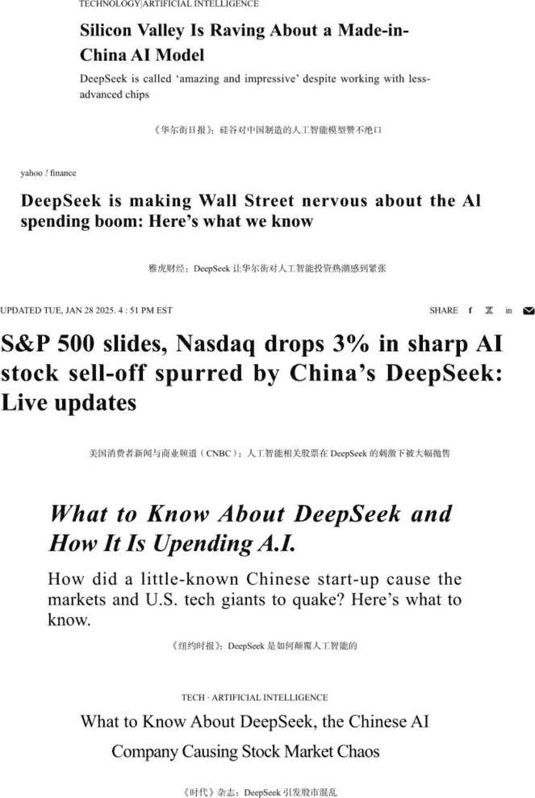
图 1-1　DeepSeek 霸榜各大美媒头条

图片来源：各相应媒体网站主页截图。

## 从幕后到聚光灯的崛起
表面看 DeepSeek 似乎一夜爆红，火势迅猛却令人费解。实质上，其背后是多年持续耕耘的结果，是中国 AI 团队以技术创新与开源策略迅速崛起的典型案例。

2024 年 12 月底，媒体披露小米总裁雷军以千万年薪招募一名被称作“天才 AI 女”的青年领军小米大模型团队。该女子罗福莉，1995 后，曾在 DeepSeek 工作多年，直接参与大模型核心研发。

对普通大众而言，这其实是 DeepSeek 第一次进入视野，然而“天才 AI 女”抢尽风头，反衬出 DeepSeek 成名后仍显低调神秘。从创始人梁文锋零散的公开信息可见，2015 年 12 月 1 日水木社区转载的一则招聘启事描绘了其量化交易轨迹：

2008 年 L 先生携 8 万元本金开启独立量化交易，历经七年牛熊轮转，以年均超 100% 复合收益跻身亿万富豪行列。

率先致富的 L 先生认为，中国量化交易将由单兵时代转向极客集结的私募基金时代。他与 IT 圈友人创办公司，欲打造世界级量化私募团队，取名“幻方科技”。“幻方”取自洛书九宫，兼具科学意涵与吉祥寓意。

其理想是让公司比肩世界量化泰斗西蒙斯的文艺复兴科技公司。

该招聘标题为《顶尖量化对冲基金公司觅牛人》。十年前的招聘成效难料，但 DeepSeek-V3 的面世让业界猜测背后必有资深领袖。罗福莉的走红却意外揭示，推动技术革新的主力并非传统老将，而是一批充满活力与创新精神的年轻人。

团队虽年轻，但在 AI 领域却属老兵。其源头可追溯至 2008 年梁文锋毕业于浙江大学信息与通信工程系后投身量化投资，与友人探索数学模型与程序化交易，深切体会技术驱动创新的力量。

2015 年梁文锋与校友徐进联合创立幻方量化。徐进为浙江大学信号与信息处理博士，曾任华为上海研究所。两人购置大量 GPU 搭建实验室，探索以 AI 构建投资策略。此举让幻方量化四年内管理资金突破百亿。既然 AI 策略能跑赢市场，何不进一步探寻真正智能？这一第一桶金或许在梁文锋心中埋下实现 AGI 的种子。

业务扩张后，幻方量化 2019 年成立 AI 实验室，投入超 10 亿元研发“萤火一号”“萤火二号”超算。其中“萤火二号”搭载约 1 万张英伟达 A100 卡，算力相当于 72 万台个人电脑。依托此资源，幻方量化于 2021 年将资产管理规模推升至千亿元。

2022 年底 ChatGPT 诞生点燃梁文锋对通用人工智能的热情，多年积累使其做好迎战准备。据其表示，将成立深度求索以大语言模型切入，未来亦涉足视觉等领域。即使 OpenAI 公布论文代码后大模型公司如雨后春笋，他仍坚信未来二十年大企业与初创均有广阔空间。

不同于多数国产大模型，DeepSeek 坚守开源，且第三代模型发布时仍未推出具体应用，也未急于商业化。梁文锋强调目标并非单一产品，而在基础研究与前沿探索。这种纯粹的理想主义和不受资本裹挟的底气，部分源于其已实现财务自由的洒脱，与马斯克押注特斯拉新能源汽车有异曲同工之处。真正的耐心资本，终究是自有资本。

长期以来外界认为欧美擅长 0 到 1 的技术突破，中国擅长 1 到 N 的应用落地。梁文锋并不认同，他坚信中国 AI 不仅能跟随，更能以创新者姿态参与新技术浪潮。

2023 年 7 月 17 日，梁文锋在杭州成立深度求索人工智能基础技术研究有限公司，目标是打造具备人类级智慧的 AI。当时网络盛传，国内高性能 GPU 最多的机构并非 AI 公司，而是量化私募。据《财经十一人》2023 年报道，国内 GPU 超过万张的企业不超过五家，幻方量化是其中唯一非科技大厂。此种破釜沉舟的果断绝非常人可及，只能源于一位对通用人工智能怀有坚定信念的创始人。

在国内大模型创业浪潮中，DeepSeek 始终低调，却在基础技术研发上展现惊人实力与学院派严谨。成立不久即高速推进，2023 年 11 月 2 日发布 DeepSeek Coder，这是首个开源代码大模型，支持多语言代码生成、调试与数据分析，完全开源且免费商用，标志其在 AI 领域的首次重大突破。

同年 11 月 29 日，DeepSeek 发布首个通用大语言模型 DeepSeek LLM 67B，参数达 670 亿，性能逼近 GPT-4，在多项中英文评测中表现突出，进一步奠定其开源大模型领先地位。

2024 年 5 月，DeepSeek 发布开源二代 MoE 大模型 DeepSeek-V2，性能跃升且成本极低，引发行业价格战。其推理成本仅 1 元人民币/百万 Tokens，仅为 Llama 3 的七分之一、GPT-4-Turbo 的七十分之一，倒逼腾讯、百度、阿里、字节等主流厂商纷纷降价。

半年后 DeepSeek-V3 发布，输入价再降至 0.5 元/百万 Tokens，再度掀起国产大模型降价潮。2024 年 12 月，字节跳动下调豆包视觉理解模型输入价，较行业均值降幅达 85%。

真正的爆发点在 2025 年 1 月 20 日，DeepSeek 发布对标 OpenAI o1 正式版的 DeepSeek-R1。模型在基准测试中超越对手，且产品体验流畅，打破海外 AI 圈认知，被称为“神秘东方力量”。国内媒体亦热议其“墙外开花墙内香”的创新路径。

顶级风投 a16z 创始人马克·安德森评价：“DeepSeek-R1 是我见过最惊人、最令人难忘的突破之一，作为开源模型，这是送给世界的意义深远的礼物。”

## 华尔街震动与 AI 格局重塑
如同新生儿啼哭伴随分娩阵痛，DeepSeek 的出现既带来震撼亦伴随颠覆。世界在接纳这份东方礼物时，也正被其重塑产业版图。

正如前文所述，DeepSeek 横空出世后令全球资本市场剧烈震荡，华尔街将其比作“AI 时代的斯普特尼克时刻”。

“斯普特尼克时刻”源自 1957 年苏联发射首颗人造卫星，震惊西方尤以美国为甚，令其意识到科技竞赛中可能落后。如今 DeepSeek 的出现，让美国重拾七十年前铁幕另一侧带来的竞争压力记忆。

近十年间，硅谷与华尔街形成的“技术—资本”协作，塑造经典双寡头叙事：硅谷以技术创新勾勒未来，华尔街以金融杠杆抬高预期。为维系此叙事的吸引力，需不断注入新元素与新故事，人工智能近年成为主角。

OpenAI 的迅猛崛起即为典型案例。

自 2015 年 12 月成立，OpenAI 2019 年估值仅 10 亿美元。2022 年底 ChatGPT 发布后飙升至 200 亿美元，至 2024 年 10 月完成 66 亿美元融资后，估值惊人达 1570 亿美元，即便盈利仍遥不可及。

与此同时，AI 领军企业估值亦急速膨胀。马斯克 2023 年创立的 xAI 在 2024 年 12 月 C 轮融资 60 亿美元，估值超 400 亿美元；美国 AI 初创 Anthropic 则以 600 亿美元估值寻求 20 亿美元融资。

自动驾驶公司 Waymo 2024 年完成 56 亿美元融资；数据与 AI 平台 Databricks 同年 12 月完成 100 亿美元 J 轮融资，估值达 620 亿美元。

美国投研机构 PitchBook 2025 年 1 月报告显示，2024 年美国 AI 初创共获约 970 亿美元风险投资，以硅谷为主，占当年初创总融资 2090 亿美元的近半。

硅谷-华尔街模式核心有二：其一，从 0 到 1 的技术突破需巨额资金支撑算力与人才，资本估值则建立在对“技术护城河”的宏大想象之上。

其二，从 1 到 100 的扩张是“技术理想主义”与“资本扩张需求”的共谋。微软计划 2025 财年投入约 800 亿美元建设 AI 数据中心，OpenAI 联合英伟达、软银等启动 5000 亿美元“星际之门”项目，均体现 AI 业务对资本的极度依赖。

资方如此慷慨，因其坚信凭借强大资本市场，硅谷 AI 公司能带来丰厚回报，现实亦印证此点。

即便 2025 年 3 月初股市回调，特斯拉、英伟达等仍维持惊人高估值。特斯拉市盈率高达 170 倍，被投资者视为马斯克口中的 AI 公司而非纯电动车企；英伟达市盈率 45 倍，微软 33 倍。同期中国互联网巨头市盈率多在 15-23 倍，阿里巴巴 16.9 倍，腾讯 22.2 倍。

为维系“过高”的估值，美股七巨头急需新素材与新故事持续吸引投资目光，近年支撑其高估值核心即为 AI。故“技术—资本”模式演化为“AI—资本”模式。

然而“AI—资本”闭环脆弱，其可持续性完全依赖技术领先与资本回报的正向循环。2025 年，DeepSeek 成为这一循环的最大变量。

# 六百万美金引爆的估值震荡

R1 的训练花费被披露在六百万美金左右，性能却能逼近 OpenAI 以十亿量级投入堆起的模型，长期由硅谷与华尔街共同维护的高投入高回报叙事出现明显裂口。

更致命的是透明化做法。核心能力被完全摊开，靠稀缺性定价的闭源模式失去支撑。代码公开后使用门槛大幅下降，全球开发者可以协同迭代，应用生态从少数玩家瓜分转向大规模共建，对长期主导的封闭格局形成直接冲击，行业被推向更开放普惠的方向。

## 稀缺溢价被公开代码撕开

从资本视角看，颠覆不是技术世代碾压，而是对存量资源做到极致。V3 依托异构计算底座并搭配动态负载均衡，把单位算力的产出效率推向极致，训练花费只剩行业均值的零头，为低成本高效率开辟新路径。

效率冲击让堆算力堆数据的旧逻辑显得昂贵。马斯克透露 OpenAI 正在推进的 GPT-5 预算已突破十亿美金，而 R1 以约六百万的成本触达相近表现，直接把行业估值的锚点下移。相关板块短短七天内跌超两成，市场对烧钱换增长的信任出现裂痕。

影响正向外扩散。亚马逊、微软等海外巨头相继表态接入。谷歌 CEO 桑达尔·皮查伊称团队工作非常非常出色。AMD CEO 苏姿丰指出算法层面的创新有利于落地，用更少基础设施实现训练与推理是好事。《卫报》撰文认为这一现象打破了美国对人工智能话语权的独占，开源加低成本有望让更多国家开发者入场。

## 封锁反而成了放大器

低成本高性能迅速点燃开发者热情。木秀于林的代价随之而来，多国对该项目表现出戒备，封杀与限制构成当下领域的两处讽刺：名叫 OpenAI 的系统保持封闭，而真正免费开源并主动拥抱世界的项目反而被围堵。

美国、意大利、澳大利亚等国以安全风险为由禁止在政府设备上使用，英国军方亦参与行列。

2025 年 2 月 4 日当地时间，澳大利亚全面禁止政府系统使用该服务，内政部长称风险被评估为超出容忍度。

同年 2 月 7 日，韩国两大能源国企宣布停止使用。

更早之前，意大利数据保护局 Garante 下令阻断，爱尔兰数据保护委员会要求补充信息，法国 CNIL 提出质询。日本、英国、荷兰等也在酝酿法规。

美国的摇摆最具戏剧性。前脚总统特朗普称这是积极的技术成果，后脚权力机构展开围剿：美国国家航空航天局发出内部备忘录，以服务器在境外、存在国家安全与隐私风险为由，禁止员工使用并阻断系统访问；美国海军向全体人员发邮件，警告来源与使用存在潜在安全和道德问题，严禁军方人员接触；众议院首席行政事务官通知国会办公室不得使用；白宫人工智能与加密货币事务负责人宣称有大量证据表明该项目通过蒸馏提炼了 OpenAI 的知识。

更进一步，2025 年 1 月 29 日，共和党参议员乔什·霍利在其网站推出《2025 年美国人工智能能力与中国脱钩法案》，直指该公司，要求全面禁止美国公民与企业未经授权下载使用或开展中国相关合作开发人工智能技术，违者最高可判 20 年监禁、个人罚 100 万美元、企业罚 1 亿美元。提案尚未通过，却暴露紧张氛围。

美国媒体保持清醒。彭博社亚太科技领域撰稿人凯瑟琳·索尔贝克直言，该项目已无法被彻底封杀，华盛顿几乎无法消除其影响。

禁令反而成为宣传。社群平台上如何绕过封锁获取安装包的教程病毒式传播，技术论坛里用户自建分布式节点破解限制。意大利应用商店下架首日，当地安装次数反增 200%；美国国会表态后，民间流行下载即反抗，有人把安装截图换成社交头像。

戏剧性还在继续。美国海军内部邮件泄露显示，军官私下用该系统优化战术模拟；法国 CNIL 的审查报告意外公开，文中写明技术难以替代。民众调侃：政客越封，我们越用。

2025 年春天，压制与走红并存。该项目在多国遭禁用，安装次数却连登榜首，月活突破 3000 万，服务器因访问过载频频宕机。在欧洲与美国，它早已不只是工具，更成象征与理念，而理念最难封杀。

热度背后是一次技术向普惠靠拢的胜利。最大程度公开代码与训练方法，让全球开发者自由修改二次开发。透明度打破闭源巨头的垄断，从医疗到教育涌现应用。英国初创 NetMind 转用该模型，开发成本节省 90%。

代码公开意味着可复刻。即便官方服务被封，开发者仍能据此自建系统。单就存在意义而言，该项目已成难以抹去的存在。

Meta 首席人工智能科学家杨立昆明确表示，成功的开源模型正在超越封闭模型。开放生态让突破不再受国界或资本束缚。正如印度电子与信息技术部部长所说，低成本节俭模式正在重塑全球人工智能价值体系。

英伟达、微软、亚马逊等美国科技巨头已积极接入并集成到云服务与芯片产品。当企业用脚投票时，行政禁令反而加速技术落伍。

《史记》言天下熙熙皆为利来。当利益足够大，禁令只是空文。免费路线吸引大量公司用户与开发者，他们同时承担技术扩散角色。极致体验搭配接近零的成本，让任何禁令沦为一纸文书。

历史总是重复相似的模式：当垄断者试图用高墙保护利润时，总会催生绕墙的创新。如今开源代码与分布式网络在数字世界复刻了同样的剧本。正如硅谷风险投资人马克·安德森所说，相较于开源和自由，闭源、不透明、审查和政治操纵，并非美国应选择的制胜之道。

## 蒸馏质疑与数据枯竭

相较于徒劳的封禁，抄袭指责更有迷惑性。

最早的质疑来自人工智能门外汉，充满乌龙色彩。如图 1-2 所示，有网友问 V3 你是谁，模型答 ChatGPT，被当成铁证疯传，演变为网络狂欢。

据报道，此前谷歌 Gemini 在中文环境下被问你是谁时，自称文心一言；Meta Llama 3 在西班牙语场景下被误标为 Claude。

V3 可能把 ChatGPT 生成的文本纳入训练集，记住了部分 GPT-4 输出并逐字复述。业界人士指出，优质训练数据有限，重叠难以避免。

根源是数据污染已成系统性风险。ChatGPT 等大模型内容海量扩散，网络正沦为人工智能垃圾场：欧盟预测 2026 年 90% 的在线内容或由人工智能生成。开发者即便清洗公开网页数据，也难完全过滤人工智能痕迹。

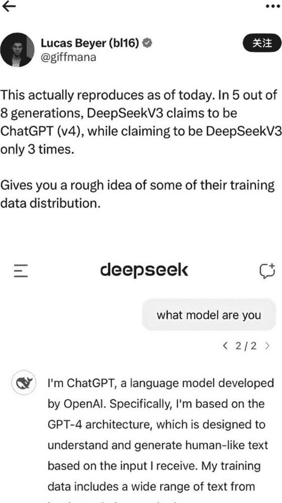

图 1-2　当被问及“你是谁”时该系统的回复

图片来源：社交媒体截图。

质疑迅速分化为套壳抄袭与数据蒸馏两种说法。

套壳抄袭的指控在开源那一刻就不攻自破。所有代码公开，若真套壳等于自己把证据摆上台面。透明性让技术实现可被检验，证明了技术独立性与对知识产权的尊重。

一个人工智能模型表现本质取决于神经网络架构、参数规模、参数权重三个要素。这与 OpenAI 闭源形成悖论：OpenAI 闭源，抄袭者无处下手；该项目开源，若真抄袭，源头自曝。开源让细节透明，抄袭很快会被发现并公开。

蒸馏则值得认真讨论。

知识蒸馏通常归功于杰弗里·辛顿。2015 年他提出让较小模型即学徒模型学习较大模型即导师模型输出，从而在保持较高性能的同时降低计算成本与模型规模。

通俗说，就是用庞大的导师模型指导紧凑的学徒模型，使其在资源受限场景下尽可能复现导师表现。可类比为资深专家向新手传授专业知识，不仅展示结论，还剖析形成机制，学徒据此给出媲美导师的回应。

2025 年 1 月 29 日，OpenAI 方表示该项目使用模型蒸馏训练自己的模型，可能违反服务条款。OpenAI 称通过 API 大量抽取 ChatGPT 输出用于训练开源模型 R1，可能构成侵权。

但蒸馏技术本身合法，关键在数据获取使用是否合规。按 OpenAI 用户协议，用户对通过服务生成的输出拥有完整所有权，包括获取、使用、修改与商业化。只要遵循协议即合法。人工智能训练数据和方法是否构成知识产权，全球并无统一标准。即便用了 OpenAI 生成数据蒸馏，只要合法获取就不算侵权。

OpenAI CEO 萨姆·奥尔特曼明确表示没有起诉计划。2025 年 2 月 3 日采访中他说：我们目前没有起诉 DeepSeek 的计划。我们将持续打造卓越产品，并以能力引领世界，我相信这会很好。

讽刺的是，OpenAI 当时正深陷与纽约时报的官司。2023 年 12 月 27 日，纽约时报起诉 OpenAI 与微软，指控其未经授权使用数百万篇文章训练 ChatGPT 等聊天机器人，这是全球首起大型媒体机构起诉人工智能平台侵权。

纽约时报指控核心是 OpenAI 未经授权使用其文章训练模型，涉及版权。而知识蒸馏是合法的优化压缩手段，关键在数据来源。因此 OpenAI 的指控颇有贼喊捉贼意味。

背后揭示人工智能发展困局：数据枯竭迫在眉睫。自 2020 年起，训练大语言模型的数据规模增长 100 倍，可能占据网络很大一部分；网络可用内容年增不足 10%，而训练数据集每年翻倍，失衡导致资源快速枯竭。

应对方案有三。其一合成数据，用计算机模拟或算法生成带标注信息补充不足，Gartner 预测未来用于训练大模型的数据中 60% 将是合成数据。其二寻找非常规数据源，如医疗、环境等专业领域数据集。其三优化数据使用效率，通过改进架构与训练方法降低需求。

无论哪种，知识蒸馏在解决数据集枯竭问题上不可替代。它从大规模数据集中抽取关键信息，构建更小但更有代表性的数据集，显著降低存储与计算成本，提升训练效率。

对该项目抄袭的指责，本质是对未来变革的不适。即便仍被称盗窃者，该项目更像是把火种带给人间的盗火者。

## 普罗米修斯式的点火者

盗火者源自希腊神话普罗米修斯，从众神处盗火带给人类光明，推动文明。现代语境形容那些勇于探索、挑战权威、带来新希望的人。

一代代特立独行的盗火者薪火相传，才点燃人工智能革命的燎原大火。他们共同特征是对通用人工智能的坚定信念与挑战现状的勇气。

第一代盗火者杰弗里·辛顿，质疑符号主义人工智能的显学，坚信出路在于模仿人脑神经网络。深度神经网络研究长期无人问津，甚至被讥为学术炼金术。他不顾嘲讽创立反向传播算法，让深度网络可训练，为大模型时代奠基。

第二代代表是 OpenAI 联合创始人、前首席科学家伊利亚·苏茨克维。他与奥尔特曼质疑深度网络只能做特定任务，坚信参数增多会带来智能爆发的奇点——Scaling Law 是打开通用人工智能的钥匙。在其带领下 OpenAI 投入上亿美元训练模型，创造 GPT-3，首次让世界看到大力出奇迹，点亮 AGI 曙光。

梁文锋同样是 AGI 坚定信徒，不同的是他的信念可能来自资本市场沉浮。未尽研究创办人周健工指出，量化投资与人工智能研究构成幻方量化基因的双螺旋。这种独特基因让研发团队质疑更大算力是否唯一路径，也极度重视成本控制。

以 OpenAI 走向封闭为标志，全球人工智能正掀起技术封闭暗潮。该项目的出现让梁文锋成为人工智能普惠推动者，他力排众议选择开源，在形成中的人工智能霸权上凿开缺口，让更多国家、企业与用户共享人工智能红利。正如马斯克当初投资成立 OpenAI 为对抗谷歌人工智能霸权，他说：防止人类滥用人工智能的最佳防火墙，就是让尽可能多的人都拥有人工智能。

# 第二章

# 借势开源的国产突围

DeepSeek 的走红被视作国内 AI 的一次关键突破。面对外界赞誉，创始人梁文锋语气平和，称团队只是依托开源先驱的成果，为本土大模型添了几块砖。

这种谦逊背后是清晰的传承脉络。DeepSeek 的进展既得益于开放协作的生态，也完整承接了人工智能从符号推理到深度学习时代的理论沉淀与工程实践。图灵的可计算性框架、Transformer 架构等关键里程碑，为其技术跃迁提供了跨时代的支撑。

上溯至 1956 年达特茅斯那个潮湿的夏夜，约六十九年的接力始终在传递同一火种。会上争论的机器智能边界，在 DeepSeek 的神经网络里被量化为认知熵值。香农未曾预见的信息熵社会化，正经由大模型的多模态入口重塑法学、教育、科研等领域。麦卡锡当年手写的智能定义，如今已演化为日均五十亿次 API 调用。技术史在此断裂：每一次智能体的跨越，打破的不仅是算力和样本，更是人类对思维本质的认知极限。

## 苦涩的教训

谈清 DeepSeek，就必须回到 AI 的源头。

智能很难给出令人信服的定义。我们自称智人，正因智慧珍贵，却始终没有公认的严谨表述，智慧一词常被滥用作空话的引子。

图灵在思考人工智能时，避开直接下定义，转而提出一个判别法则。若机器能在对话中让人类无法辨别其真假，便可视为具备智能。这是 1950 年发表于《计算机与智能》的图灵测试。此后无数团队尝试，直至今日仍无人完全达标，即便是当前最强的模型也未实现图灵的初衷。

图灵的论文点燃了学界热情，后续加入者包括达特茅斯的助教约翰·麦卡锡和哈佛的马文·明斯基。

1956 年，麦卡锡等人在达特茅斯召集会议，首次提出 artificial intelligence 这一名词，标志现代 AI 诞生。麦卡锡提出的让机器像人类一样思考、学习并自我完善，成为会议宣言，也成为数代人的目标。

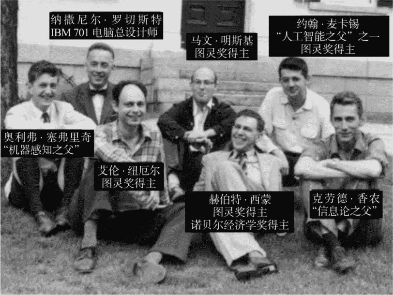

图 2-1　达特茅斯会议与会者

图片来源：Courtesy of the Minsky family。

为期两月的讨论更像一场科学乌托邦。明斯基演示了早期神经网络模拟器 Snare；纽厄尔和西蒙带来了 Logic Theorist 程序，当时唯一可运行的 AI 软件，它证明了《数学原理》中的三十八条定理，其中两条证明比罗素与怀特海更简洁；香农关注会下棋的机器。参会者围在草坪畅想一个夏天就能造出媲美人脑的系统，没人料到这开启了一场长达近七十年的远征，且至今未完。

这段探索如此艰难，根源在于起步就选择了一条看似平坦实则险峻的路径——符号主义。

符号主义也称逻辑主义，核心是将外部世界抽象为可识别、可计算的符号，再以运算模拟思维、以逻辑推导认知世界。简言之，它把智能等同于计算，常被称为心智学派。

学界早期热情源于四股力量的交汇：认知科学范式的契合、技术演示的示范效应、冷战的战略需求、社会想象的集体建构。

符号主义把智能压缩为符号操作，继承了笛卡尔“我思故我在”的理性主义。达特茅斯会议明确写道学习等一切智能表现都应被精确描述以便机器模仿，这与当时主流认知范式一致。

维特根斯坦“语言界限即世界界限”在符号主义中演变为“符号界限即智能界限”。五十年代乔姆斯基的转换生成语法为符号系统处理自然语言提供了理论依据，让人相信语言理解可由语法规则实现。

六十年代认知心理学兴起，把思维视为信息处理。这种类比让符号系统成为研究认知的理想工具，1957 年的通用问题求解器 GPS 直接模拟了人类解题步骤。

技术层面，1957 年 IBM 7090 内存 32KB，运算速度 23 万次每秒，让人相信计算瓶颈终将突破。1965 年 DENDRAL 系统通过质谱数据自动推断有机分子结构，准确率达到化学家水平。六十年代摩尔定律提出算力每 18-24 个月翻一番。七十年代 MYCIN 医疗诊断系统在血液感染诊断上超越初级医生。这些案例极大鼓舞了研究者。

冷战背景下，1957 年苏联发射斯普特尼克一号后，美国国防部高级研究计划局将 AI 列为战略重点。符号系统因可解释和逻辑可控，被视为开发军事专家系统的理想工具。六十年代阿波罗计划需要复杂任务规划，STRIPS 的分层规划为航天器路径提供有效方法，反过来也巩固了符号主义地位。

符号主义的理性设计与西方自由市场形成隐喻对应，苏联控制论则更偏神经网络，技术路线选择被赋予意识形态色彩。

科幻作品助推想象。1942 年阿西莫夫的机器人三定律，1968 年电影《2001 太空漫游》，塑造了公众对智能机器的符号化想象。片中 HAL 9000 的逻辑推理成为符号主义注脚。六十年代 IBM、DEC 等将符号系统宣传为第四次工业革命核心。1970 年《生活》杂志引用明斯基预言，三到八年内机器人将具备普通人智能。

六十年代计算机教育将符号逻辑作为核心课程。MIT 的 Logo 语言通过海龟绘图强化“符号操作即智能”的认知，培养了一代信徒。

这种集体信心本质是特定历史条件下的认知泡沫。符号主义的常识推理缺失、组合爆炸、知识获取瓶颈当时被乐观情绪掩盖。1961 年明斯基在《迈向人工智能的步骤》中宣称一代人内可造出人类水平智能，这种乐观直到 1973 年《莱特希尔报告》才被现实击碎。

符号主义的兴衰揭示规律：初期范式革命常伴随过度期待，而真正突破往往在主流边缘发生。DeepSeek 的 R1 正是当代写照——当硅谷沉迷更大更强的扩张时，杭州团队以统计学习的另类路径开辟新可能。

这段历史正如理查德·萨顿 2019 年《苦涩的教训》所指出的冷酷逻辑：人类引以为傲的经验在算力及样本洪流中可能变得次要。它不仅关乎技术，更映射人类对智能本质认知的转变——从机械复制思维到涌现式创造，我们学会敬畏复杂性，承认有些奇迹只能诞生于规模与混沌之中。

## 联结主义——另一条道路

符号主义高歌猛进时，另一批研究者在更坎坷的路上摸索，这就是联结主义。若说符号主义要模拟思维过程，联结主义则要模仿大脑工作方式。早期 AI 由符号主义主导，如今的 AI 则由以神经网络为核心的联结主义主导。

联结主义源头更早。1943 年，神经科学家沃伦·麦卡洛克与数学家沃尔特·皮茨在《数学生物物理学通报》发表论文，首次提出人工神经模型。后人称之为 M-P 神经元模型。这是首次把神经元抽象为阈值逻辑单元，为神经网络奠定数学基础，但模型过于简单，当时无人知晓用途。

转机出现在达特茅斯会议一年后。1957 年，弗兰克·罗森布拉特在 IBM 704 上模拟实现感知机 Mark1，标志联结主义首次技术突破。该装置由 400 个光电池、100 个神经元组成，通过调节权重实现了 0 到 9 的手写数字识别。更关键的是它无需编程即可自主学习——数据驱动范式和符号主义规则驱动截然不同。正如罗森布拉特所言：“感知机将为理解人类智能提供钥匙。”

让感知机识别手写数字，需要把大量样本投喂给网络，这就是机器学习。

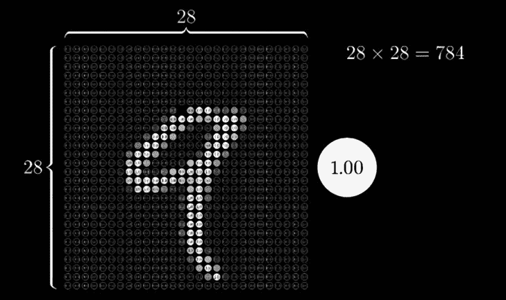

图 2-2　将手写数字图片转化为 784 个像素

图片来源：3Blue1Brown。

第一步，把训练集里每张手写数字图转成 28×28 共 784 个像素，再用 784 个神经元对应这 784 个像素。每个像素赋一个数值，比如写 9 时正中央像素值应为负值，因为它出现会降低是 9 的可能性，而对数字 1 则是正值。这个数值叫权重。

第二步，把 784 个像素的赋值做归一化，就能把像素画转成对应 0 到 9 的数值范围，感知机由此能识别数字。

研究人员让感知机大量识别手写样本，并根据结果不断调整神经元参数，直到准确输出答案。这与今天几百亿参数大模型的训练本质并无区别。

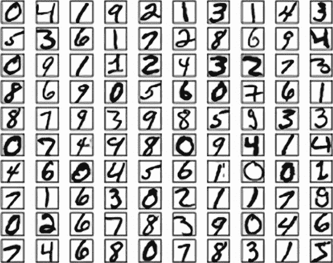

图 2-3　手写数字图片训练样本

图片来源：Michael Nielsen。

感知机的训练是人类首次抛弃传统编程，单纯靠参数调整和机器学习完成智能任务，开辟了与图灵机和符号主义完全不同的路径。至今所有基于神经网络的系统在基本原理上仍与感知机一致。从这一刻起，人类才真正给机器装上自主学习的大脑，机器学习时代发出第一次微弱脉搏。

好景不长。1969 年，明斯基与西摩·佩珀特合著的《感知机》把机器学习的婴儿扼杀在襁褓。他们用数学证明单层感知机无法解决 XOR 等非线性问题。早期网络能轻松处理 OR，却处理不了 XOR，研究因此陷入长期停滞。

这一结论被过度解读为神经网络无前途，美国政府随即切断资助。理论打击加上罗森布拉特意外离世，联结主义进入长达三十七年的寒冬。

讽刺的是，《感知机》其实提到多层网络可能突破限制，但当时无人具备相应的算力及算法。这是 AI 第一次遭遇算力及算法的瓶颈，一旦凿开这堵叹息之壁，前方便是一片光明。这也为后来大模型“大力出奇迹”的模式埋下伏笔。随着发展，AI 越来越依赖算力及样本的堆砌，演变为大模型军备竞赛。正因算力和样本持续增加，大模型才展现出强大能力，也凸显算力及样本对大模型的关键推动。

七八十年代，神经网络沦为学术边缘。只有少数逆行者坚持：芬兰学者托伊沃·科霍宁提出自组织映射 SOM，证明神经网络能实现无监督学习；日本科学家甘利俊一建立信息几何理论，为深度学习奠定数学基础；还有前文提到的辛顿。

## 辛顿和深度神经网络

也许受生物学家父亲影响，辛顿年轻时就对人脑结构和运作方式着迷，坚信模拟人脑构造是通向 AI 的正确道路。七八十年代神经网络研究几乎冻结，他的探索四处碰壁，美国 AI 机构都不愿支持。最终辛顿落脚加拿大，因为当时只有多伦多大学愿意资助他的研究。

真理往往掌握在少数人手里。辛顿的研究多年受怀疑和嘲讽，连同校教授都称神经网络是“科研炼金术”，劝学生远离。但他不为所动，持续发表成果。1986 年，辛顿与大卫·鲁姆哈特、罗纳德·威廉姆斯在《自然》发表《通过误差反向传播算法的学习表示》。这是深度学习领域的里程碑，详细介绍了反向传播算法的原理与应用：

该算法通过反复调整网络中连接权重，最小化网络实际输出和预期输出之间的差异。随着权重不断调整，非输入非输出的内部隐藏层开始显现任务的重要特征，我们借由隐藏层单元间的相互作用发现任务规律。

单层神经网络能分辨 0 到 9 的十个数字，但要判断随机图片里是否有猫，对单层网络而言过于复杂。多层神经网络的目的正是解决更复杂问题，可简单理解为把任务分解后逐个攻破。

例如设计一个三层网络识别猫。第一中间层分辨猫器官的细节轮廓；第二中间层把细节组合起来辨认眼睛、爪子等重要器官；第三中间层再把器官组合起来辨认头部、躯干、四肢。这只是人脑识别猫的过程，实际神经网络训练是黑箱，权重赋值并不遵循逻辑规律。

这时可用一个含几十万张人工标注猫图的图片库，让神经网络回答图片内容。一开始几万个神经元权重随机，结果完全随机。但把标注好的图片投喂给网络并告诉正确答案，网络即可根据正确结果和随机结果的差值不断调整权重，让输出更贴近正确答案。这个差值被称为成本函数，训练过程就是让成本函数不断缩小直至为零的过程。

用机器学习语言说，这就是梯度下降——通过不断迭代试错找到成本函数下降最快的方向。当成本函数缩为零，神经网络完成训练，再给任意一张猫图也能准确给出答案。

深度神经网络出现后，网络层数及其连接数呈指数级增长。输入和输出纯粹成为高维空间内的映射，从此深度神经网络远远超出人脑理解范围，这也是大模型不可解释性的根本来源。训练深度神经网络所需的算力随参数增多呈指数级增长，远远超出辛顿时代，未来数十年将成为制约 AI 发展的物理难题。

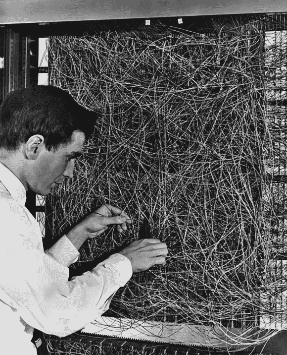

图 2-4　罗森布拉特的感知机 Mark 1

图片来源：Frederic Lewis/Getty Images。

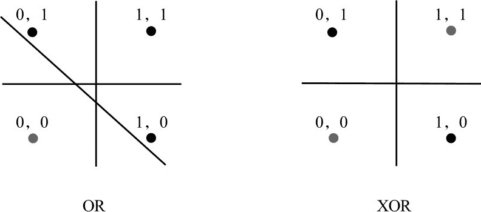

图 2-5　OR 与 XOR 问题

图片来源：https://dev.to/jbahire/demystifying-the-xor-problem-1blk。

## 算力与数据形成的双重枷锁

有了反向传播算法和深度神经网络，理论上机器可自主学习任何需要人类智能的任务。今天动辄千亿参数的大模型本质上就是规模巨大的深度神经网络。

但这仅停留在理论。辛顿那篇划时代论文并未掀起大浪。一方面当时主流仍是符号主义，另一方面极高期待导致极度怀疑。AI 尚未走出 1973 年《莱特希尔报告》引发的寒冬，维度灾难是最现实的制约：多层网络参数随层数指数级增长，如 10 层网络参数可达百万级，而当时数学工具无法解决梯度消失问题，导致训练陷入局部最优，参数成为发展道路上的魔咒。

样本匮乏同样构成恶性循环。80 年代全球数据总量不足 100GB，且缺乏标准化标注数据集，神经网络缺乏必要基础，训练效果与泛化能力大打折扣，难以发挥潜力。此时的神经网络仍是无根之木、无源之水。

算力天花板曾是压在神经网络头顶的阴影。即便到了上世纪 80 年代，距离机器学习被判死刑的 1969 年已经过去许久，硬件的进步依然无法满足深度模型的胃口。深层网络要同时驾驭复杂结构和庞大的参数空间，对计算资源极度饕餮。当时的 CPU 主频不高，并行能力捉襟见肘，GPU 尚未进入大众视野。资源吃紧之下，深度神经网络的训练几乎无从谈起，更别说在数据匮乏的年代让它发挥潜力。

时至今日，数据与算力的双重短缺仍在束缚模型成长，这也就不难理解早期学界为何普遍对联结主义的前景持怀疑态度。

真正撬动枷锁的，是被称作 AI 教母的李飞飞。李飞飞生于中国，12 岁随家人移居美国，家境艰难，全家生计几乎靠一家小干洗店支撑。她一边在餐馆打工、做家政，一边拼学业，贫困没有磨掉她的学术锋芒，反而锻造出更强的韧性。2009 年她以助理教授身份加入斯坦福计算机系，一头扎进计算机视觉。

她的灵感来自对儿童看世界的观察。人眼大约每 200 毫秒扫一次视线，若把眼睛比作相机，一个三岁孩子累计见过的画面已达亿级规模。正是这种海量的视觉历练，让大脑具备强悍的识别本能。李飞飞认为，机器要拥有类似能力，前提是喂给它足够的数据。受此启发，她与普林斯顿的李凯在 2007 年共同启动 ImageNet 项目，希望为图像识别提供规模化的数据底座。

这个方向当时并不吃香，甚至遭到劝阻。李飞飞的师爷级人物吉滕德拉·马利克曾直言，科学的智慧在于与领域同步成长，而非远超其前。他劝她放弃 ImageNet。项目失败的代价也很高昂，可能直接影响她能否拿到终身教职。

李飞飞没有退缩。手工标注成本高昂，她转而借助云计算发动全球众包，邀请来自 160 多个国家近 5 万名志愿者在线标注网络图片。用两年时间，她冲破了神经网络在数据上的第一道限制。2009 年的 ImageNet 已涵盖 2200 个类别，积累了约 150 亿张清洗、分类并标注好的图像，全部开源免费，供全球研究者使用。

ImageNet 为视觉识别注入了强心剂，也让世界第一次直观看到深度学习的爆发力。自 2010 年起，ImageNet 大规模视觉识别挑战赛 ILSVRC 成为年度竞技场。几乎没人想到，辛顿团队的深度神经网络在赛场上的首秀会改写历史。事实证明，成就伟大突破的秘诀不是被动等待学科成熟，而是拥有挑战现状的勇气。

## GPU 对决 CPU

在李飞飞发起 ImageNet 之前一年，英伟达创始人黄仁勋高调发布 CUDA 统一计算设备架构。当时鲜有人意识到，这一步将成为人工智能产业史上的转折点。

CUDA 让开发者能够直接调用 GPU 进行科学计算和机器学习，极大提升了效率。放到当年的商业语境里，这个决定看上去近乎离谱。CUDA 最初被大量游戏极客用来并联多张显卡，只为以 8K 分辨率畅玩《雷神之锤 II》。黄仁勋顶住公司内部反对，投入数亿美元打造框架，让个人用户也能组建类超算。这一远超时代的押注最终被验证。2024 年 11 月，英伟达市值冲至 3.4 万亿美元，超越苹果，登顶全球。

在深度学习需求出现前，个人电脑的核心是 CPU，显卡只是游戏渲染的附庸。智算时代两者地位逆转，根源在于架构差异。CPU 核心数量少但单核强悍，擅长复杂串行任务；GPU 则拥有上万个小型核心，原生为图形渲染的并行计算而生。深度学习的矩阵乘法、加法等运算天然可并行，GPU 的大规模核心能同时处理海量计算，训练速度被大幅拉升。

从此 GPU 取代 CPU 成为 AI 的算力中枢，英伟达也演变成 AI 掘金时代的卖铲人。CUDA 让多 GPU 并联成算力矩阵成为现实，推动高性能计算和人工智能的协同发展，为科研和工程提供低成本强算力。随后 V100 与 A100 的陆续登场，让英伟达在科学计算领域稳坐主导，并在深度学习和大规模模型训练中形成事实垄断，支撑起技术快速迭代。

## 深度神经网络初露峥嵘

数据与算力的瓶颈打开后，算法的能量被释放出来。2010 年前后，辛顿与学生伊利亚·苏茨克维、亚历克斯·克里泽夫斯基集中攻关深度神经网络在图像识别上的应用。历经反复试验，他们搭建了一个拥有 8 个隐藏层、约 400 万参数的深度网络。

训练使用两张 GTX 580，2012 年夏天满负荷运转大约一周，模型逐步收敛。放在今天数百亿参数的大模型面前，400 万参数显得微小，但在当时已是领先的图像识别网络。

AlexNet 在当年的 ILSVRC 中横空出世，以压倒性优势将图像识别错误率从 26% 拉低至 15%。李飞飞回忆，那一刻就像一辆本田思域打破了赛道最快纪录，而且比原纪录快了一个小时。

这一复活彻底解冻了学界对神经网络的热情。赛后所有冠军方案都以神经网络为核心，影响力由此确立。AlexNet 还引入 ReLU 激活函数缓解梯度消失、Dropout 技术抑制过拟合，为后续深度学习奠定技术基石。以大数据、大参数、大算力为标配的模型雏形，在 AlexNet 夺冠的瞬间初露端倪。

## 自注意力机制点燃大模型时代

严格讲，AlexNet 算不上大模型，它更像是大模型的火种。理论突破、工程验证、社会扩散是创新的常规路径，明斯基和辛顿完成第一步，AlexNet 完成第二步，接力棒随后交到产业界。

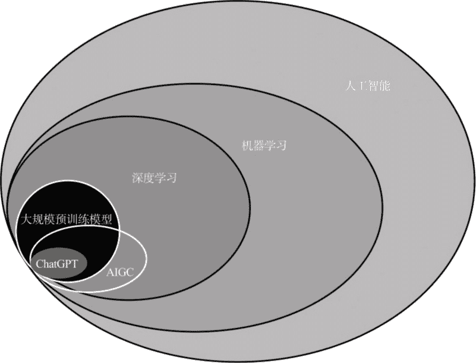

图 2-6　大模型在人工智能中的定位及相应关系

图片来源：阿里云研究院。

2015 年成为关键年份。微软亚洲研究院推出 152 层残差网络 ResNet，在 ILSVRC 上以 3.57% 的错误率夺冠，首次低于人类视觉平均错误率 5.1%。残差连接解决了深层网络的训练难题，为模型层数向更高处延伸提供了工程可能。

同年，硅谷创投敏锐捕捉到深度学习的革命性。萨姆·奥尔特曼与埃隆·马斯克共同创立 OpenAI。伊利亚·苏茨克维，这位辛顿的高徒、AlexNet 的核心研发者，离开谷歌 DeepMind 加盟 OpenAI，以创始科学家身份成为技术引路人，他带来的不仅是冠军经验，更是对通用人工智能的远见。

同年，约书亚·本吉奥、德米特里·巴赫达瑙和赵京勋在论文中首次把注意力机制引入神经机器翻译，让模型能够动态聚焦输入序列的关键片段。

2016 年，谷歌 AlphaGo 战胜围棋世界冠军李世石，证明深度学习在超复杂任务中的潜力，AI 热度随之扩散。

2017 年，谷歌团队发表《Attention Is All You Need》，并提出以自注意力机制为核心的 Transformer 架构。它彻底抛弃了循环神经网络和长短期记忆网络，通过自注意力高效捕捉序列内部元素间的关联，在长序列处理上优势明显。这场革命重塑了自然语言处理，几乎所有当今的大模型都建立在 Transformer 之上，大模型由此真正诞生。

为何自注意力如此关键？可以从心理学实验中找到呼应。1999 年丹尼尔·西蒙斯和克里斯托弗·查布利斯设计的“看不见的大猩猩”实验显示，当受试者专注统计篮球传球次数时，约一半人完全错过了画面中央出现并捶胸的大猩猩。

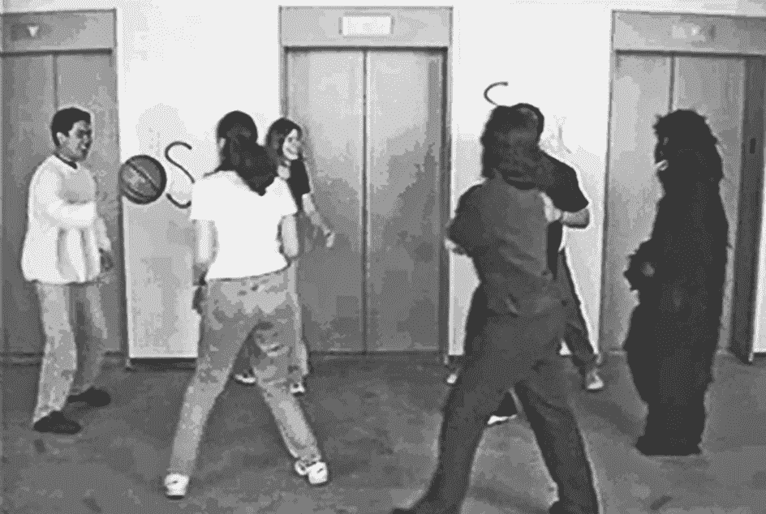

图 2-7　“看不见的大猩猩”实验视频截图

图片来源：Daniel J. Simons。

这揭示了选择性注意和无意视盲的局限。大脑处理带宽有限，必须用注意机制筛选关键信息。当任务复杂、认知资源被占据时，对意外刺激的敏感度会下降。

自注意力机制与此思路相通。模型在处理序列时，会计算不同位置之间的关联并分配权重，决定哪些信息更重要。就像人眼通过聚光灯聚焦关键区域来节省认知负担，自注意力让模型避免对每个词等量齐观，从而提升效率并节省算力。

若没有这种机制，一段毫无重点的冗长描述会让模型陷入算力灾难。例如一段唠叨天气的独白，充满细节堆砌却难以提炼核心，人工阅读都需要时间归纳，若每个字都被同等对待，计算成本将失控。自注意力让模型像人一样学会挑选重点，避免资源浪费。

同时，自注意力能打破距离限制。传统卷积和循环结构在捕捉远距离依赖时吃力，而自注意力可以直接关联任意两词，例如把“它”与前文“项目”绑定。它还能并行处理整个输入序列，不依赖顺序，大幅加速训练。每个词的表示会随上下文动态更新，使语义更丰富、更精确，并带来更好的灵活性和可解释性。正是这一突破为大模型的出现提供了契机。

## 惊艳：大模型的开窍时刻

尽管谷歌在技术上抢占先机，发布节奏却被 OpenAI 抢走。2018 年，OpenAI 在伊利亚·苏茨克维推动下推出基于 Transformer 的 GPT-1，参数 1.17 亿，采用单向自注意力，通过预测后续文本实现生成。遮蔽后续词的训练策略虽限制了全局感知，却意外提升了文本连贯性，为后续迭代提供参照。

四个月后，谷歌反击推出 BERT，参数 3.4 亿，引入双向注意力机制，在 11 项 NLP 基准上刷新纪录。它使用掩码语言建模 MLM 与下一句预测 NSP 双任务训练，展现了预训练模型在理解维度的新可能，也凸显了生成式与判别式路线的分野。

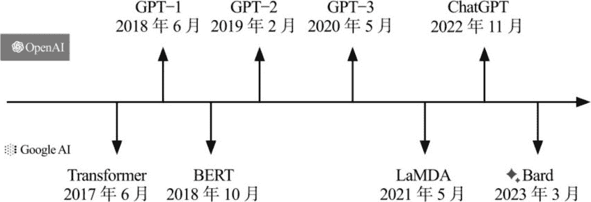

图 2-8　谷歌与 OpenAI 的“军备竞赛”

图片来源：安健。

2019 年，OpenAI 发布参数达 15 亿的 GPT-2，核心是零样本多任务适应能力。它能跨领域迁移，标志着预训练模型从专用工具向通用平台演进。但参数规模增长带来的收益开始出现边际效应，GPT-2 的参数量较 BERT 提升 340%，任务表现却并未等比提升，学界由此质疑参数军备竞赛的合理性。

技术背后，资本的暗线同样关键。2018 年马斯克因内部理念分歧离开 OpenAI，机构一度面临资金困境。萨姆·奥尔特曼设计有限营利架构，成功引入微软 10 亿美元战略投资。微软 CEO 萨蒂亚·纳德拉主导的注资不仅解决算力瓶颈，还将 Azure 云平台与 OpenAI 技术深度绑定，形成模型研发、算力支撑、商业落地的闭环，为 GPT-3 的爆发式突破奠定物质基础。

从参数狂飙到百家争鸣：语言模型的十年跃迁

2020 年初，OpenAI 发布的 GPT-3 以约 1.75 万亿个可训练权重和 45TB 预训练语料重新设定了行业标杆。零样本泛化能力的出现让“越大越强”的假设获得验证。系统在保留自回归生成范式的同时借助稀疏注意力缓解了计算复杂度，在文本精细度、推理纵深和跨模态理解上实现代际跳跃。从演进规律看，一旦容量跨过特定阈值，涌现能力会出现非线性增长，这与理查德·萨顿 2019 年在《苦涩的教训》里提出的算力决定论一致：摩尔定律带来的算力指数扩张让重计算学习成为现实，数据、模型规模与算力的叠加可让系统逼近甚至超过人类表现。通俗说，参数、算力、数据的三重加码仍能触发量变到质变的效应。

GPT-3 的余波在 2021 年继续发酵。五月，Google 推出 LaMDA，一个面向对话场景的语言系统，能进行连贯深入的交流并对复杂问题给出有条理的回答，在智能助手方向引发关注。十月，微软与英伟达联合披露 MT-NLG，权重约 5300 亿，当时体量领先，并提供面向超大规模神经网络的开源训练框架，明收提升了训练与推理效率，推动落地。十二月，DeepMind 推出 Gopher，约 1750 亿权重的通用预训练系统，在阅读理解、自然语言推理等任务上表现突出，显示出在超大系统方向的进一步推进。

2022 年 11 月，Meta 发布面向科研文献的专用系统 Galactica，规模同为 1750 亿权重，融合论文、专利等专业文献，在学术知识推理上展现强能力。

冲击波也传导至中国。阿里达摩院作为中文 NLP 的先行者，2021 年推出 260 亿权重的中文预训练系统 PLUG；同年发布的 M6 多模态系统权重达万亿级。M6 的亮点在效率与商业化：仅用 480 张 V100 完成训练，能耗降低八成以上，效率提升近 11 倍，并依托阿里生态成为国内首个商用的多模态超大系统，折射出国产系统的取向更偏向性价比与落地。

随后百度在 2023 年推出 ERNIE 4.0，华为发布基于 Transformer 的 PanGu-Alpha，权重 1000 亿，腾讯则推出自家的混元系统。

反观 OpenAI，2021 年相对低调，却在 2022 年底以 ChatGPT 再次震撼市场，完成技术与认知上的双重跃迁。

ChatGPT 基于 GPT-3.5，在约 1750 亿权重基础上引入 RLHF 人类反馈强化学习。通过人工标注构建奖励模型引导策略优化，对话自然度、安全性和相关性实现质变。OpenAI 还搭建了全球首个对话优化集群，逾千台 A100，峰值约 1.2 exaFLOPS，配合混合精度训练实现实时响应。对话历史窗口扩展至 4096 令牌，支持十轮以上复杂会话。

所有指标都难以完全传达带来的震撼。用户交流时不会关注背后的算力与优化，而是沉浸于近似真人的对话体验。系统能捕捉意图并随对话历史与情绪微调回应，像一位真实的对话伙伴。它的出现模糊了人机边界，推动交互进入新阶段。上线五天注册破百万，两月月活超一亿，成为增长最快的商业应用。

微软联合创始人比尔·盖茨在博文中写道，他一生仅见两次伟大技术演示，一次是 1980 年的图形界面，塑造了 PC 时代；另一次是 2022 年的 ChatGPT，宣告 AI 时代到来。

Google 发明 Transformer，极大推动 NLP 发展，却未成为 GPT 系列式语言系统的开创者，令人唏嘘。

为何实现如此跃迁？本质上是作为复杂自适应系统在数据、权重与算法协同下出现的非线性突变。从 GPT-1 的约 1.17 亿权重到 GPT-3 的 1750 亿，数据从数十 GB 扩展到 45TB，超线性增长触发相变：权重越过百亿级阈值后，逻辑推理、多轮对话等能力骤然出现，并非显式编程所得。

Transformer 的并行特性与 GPU 集群配合，使长距离依赖处理更高效。自注意力通过动态权重把输入映射到高维语义空间，实现全局信息整合，这是传统 RNN 与 CNN 难以企及的。

超大系统的运行可看作两种速率过程的耦合：一是层间快速传递形成稳定生成状态，二是通过反向传播逐步调参以适应新任务，二者结合带来少样本学习能力。自注意力不仅做特征提取，也是高层控制结构，生成长文本时可动态调整关注点以把握整体逻辑，规模越大越强。

神经网络中权重分布呈现赢者通吃，自发形成类生物模块化结构。系统通过无监督预训练把文本映射为高维向量，相似语义聚类，如“国王-男性+女性=女王”的向量关系，展现出对抽象概念的隐喻式理解，这是符号系统无法实现的涌现。ChatGPT 的跃迁验证了复杂科学的核心洞见：智能是复杂系统在临界规模下自然涌现的结果，既非纯随机也非完全可控，而是数据、算法、硬件与社会需求协同演化的产物。未来引导涌现将是实现可控通用智能的关键。

简言之，智能涌现是规模法则的体现，量变促成质变。正如李飞飞自传所述，大脑由相对简单的神经元构成，却最能诠释量变质变。当神经元以千亿计、连接达 10^11 时，质变出现，物质化为思维，产生爱、喜悦、悲伤、愤怒、恐惧与欢笑，并催生科学、艺术、音乐与数学能力。此刻，人类在通向通用智能的道路上走出漫长黑夜。

大系统的中国涌现
本质上，ChatGPT 的跃迁即涌现，而在中国，这次涌现以“百模竞争”形式上演。

2023 年 2 月，百度宣布文心一言 ERNIE Bot 成为国内首个公开对标 ChatGPT 的系统，竞争拉开序幕。没想到发布会前一天 GPT-4 重磅登场，百度造势为他人作嫁。GPT-4 进一步刺激国内布局，阿里、华为、360 等迅速跟进，推出通义千问、盘古、智脑等，形成竞争雏形。

截至 2023 年 10 月，国内权重 10 亿以上的大系统达 238 个，覆盖巨头、科研院所与创业公司，如知乎知海图 AI、复旦大学 MOSS 等。

头部企业通过算法优化，如文心一言推理效率提升十倍，以及算力集群如腾讯 HCC 高性能计算集群争夺技术高地。规模竞赛虽加剧内卷，却也推动多模态等技术突破。2023 年上半年，文生视频快速发展，百度文心一言视频生成、阿里达摩院文本生成视频系统相继落地。

大系统繁荣带动下游兴起，数据标注、系统训练工具如星尘数据、Scale AI 成为产业链关键。Meta、Google 推动开源系统如 Llama，而 OpenAI 转向闭源，国内华为昇腾、腾讯云则尝试构建自主生态。

从阿里 M6 起，国产系统便具备成本优势与应用落地基因，长春市妇产医院利用第四范式 AutoML 构建新生儿体重预测系统，误差控制在 200 克以内；商业银行借助 AI 反欺诈系统挖掘出 20 亿条潜在线索，远超传统人工规则仅能发现的数千条规模。

百模竞争壮观如百舸争流，也难免泥沙俱下。有人批评重复造轮子，也有人认为参与者还不够。普通读者可能以为是 ChatGPT 爆火才让中国企业跟进，这只说对一半。部分初创企业确是受狂潮刺激后融资入局，但国内大厂早已深耕多年。

阿里云、百度、腾讯、华为等早早在大数据、大算力、预训练系统上积累，并通过通义千问、文心一言、混元、盘古等自研系统持续优化。AI 应用已从计算机视觉、自然语言处理扩展至医疗、电力、煤矿等领域，呈现工业化趋势。

据赛迪顾问《2023 大系统现状调查报告》，截至 2023 年 7 月底，中国累计已有 130 个大系统问世，竞争进入“重投入出奇迹”阶段。

这看似混乱的战国背后，彰显一个国家与古老民族的砥砺奋进，是中国 AI 行业追赶超越的雄心。在拥有最多理科人才、最大应用市场与创业者热情的国度，伟大创新的到来只是时间问题。从这个角度看，DeepSeek 的崛起建立在国产系统的大厦之上，交织着时代机遇、地域禀赋与民族意志的共振。

# 第三章

# 淬火的刀：DeepSeek 创新启示录

进入 2023 年，尽管大系统仍在快速发展，国内的百家系统竞争却似乎有偃旗息鼓的迹象。原因在于训练成本的飙升。研究机构 Epoch AI 的数据显示，大系统训练成本在 2022 年后出现爆炸式增长。2023 年，OpenAI 首席执行官奥尔特曼透露 GPT-4 训练成本超过 1 亿美元，而 GPT-3 训练成本仅为 460 万美元，两代成本飙升超 20 倍。Google 随后发布的 Gemini 训练成本达 1.91 亿美元，且未计入研究人员薪酬。

如此高昂的成本让大系统竞争成为“贵族游戏”，只有现金流充足的互联网巨头才具上桌资格。2023 年伊始，多家大厂抢滩人工智能桥头堡。

与此同时，百模竞争如夏日烟火，热烈而短暂。中美两国除头部企业外，众多创业公司因资金与盈利模式不明，选择转向 AI 应用或萌生退意，而幻方量化却逆势深耕。

2023 年 4 月 14 日，幻方量化发布进军大系统领域的公告，引用法国新浪潮电影先驱特吕弗对青年创作者的寄语：务必要疯狂地怀抱雄心，且还要疯狂地真诚。公告体现出幻方量化对技术探索的独特哲学：以挑战金融复杂场景积累的算法能力为底座，在 AGI 这一科技巅峰进行高密度投入，展现出超越商业逻辑的理想主义。

外界却听到的多是 DeepSeek 用 AGI 炒股的传言。公告发布两天后，2023 年 4 月 16 日，幻方量化董事总经理陆政哲在朋友圈澄清：我用中文重申一下：AGI 不是用来炒股的，有大得多的用处和大得多的价值。这也可见 DeepSeek 对理想的执拗，而这种执拗由技术实力支撑。后来 DeepSeek 通过多项创新让大系统训练变得物美价廉。

## 回溯：DeepSeek 的来时路
从成立时间看，DeepSeek 发展速度惊人。2023 年 7 月，幻方量化将 AI 研发部门分拆，成立独立子公司 DeepSeek，聚焦研发具备人类认知水平的人工智能技术。目标不仅是复刻 ChatGPT，更要探索 AGI 深层奥秘，推动技术边界向未知拓展。这头鲸鱼由此进入广袤蓝海，开始急速巡弋。

2023 年 12 月，成立约半年的 DeepSeek 发布首个大语言系统 DeepSeek-V1，包含 7B 与 67B 两种规格。

训练数据体系独具匠心：构建 2 万亿令牌的庞大语料库，经三级智能筛选——先剔除重复保证多样性，再过滤低质提升知识密度，最后重组优化数据结构，为系统注入优质知识燃料。

技术架构采用分层设计：7B 系统设 30 层神经网络，67B 扩展至 95 层，既保证权重总量合理，又优化计算资源分配。67B 系统引入分组注意力机制，较传统架构节省 30% 运算资源，并可流畅运行。

性能方面，67B 系统在代码生成与数学解题等复杂任务中全面超越 Llama 2 70B，对话系统更逼近 GPT-3.5。突破源于双重路线：基础系统通过海量预训练构建知识框架，对话系统经多轮人机交互微调，使 AI 既能理解专业内容又能自然对话。

值得注意的是，DeepSeek 在系统压缩上取得关键突破：通过动态参数激活技术，67B 系统实际运行仅需调用部分神经元，既保留大系统智慧容量，又大幅降低能耗，为普惠化开辟新路径。

随后，DeepSeek 团队发布并开源 DeepSeek Coder 系列，包含 1B 至 33B 不同规模版本，均基于 2 万亿令牌混合数据训练，其中 87% 为多语言代码、13% 为中英文自然语言。该系列采用 16K 超长上下文窗口，并引入代码填空预训练任务，可处理复杂项目级代码，实现跨文件补全与缺失段填充。

相较传统代码系统，DeepSeek Coder 在海量高质量代码数据上强化编程逻辑理解，支持 Python、Java 等主流语言精准生成；在 HumanEval 等权威测试中代码生成准确率显著高于同类开源系统，尤其在复杂算法与系统级开发任务中展现出接近人类程序员的推理能力。开发者可灵活调用不同版本适配轻量脚本到大型工程开发需求。

2024 年 2 月，DeepSeek 团队推出 DeepSeek Math-7B，基于 DeepSeek Coder-v1.5-7B 初始化研发的数学大语言系统。该系统构建 1200 亿数学相关令牌的预训练语料库，包含 Common Crawl 提取的数学网页数据及 5000 亿令牌自然语言与代码数据，结合创新渐进式分层训练方法，显著提升数学推理能力。
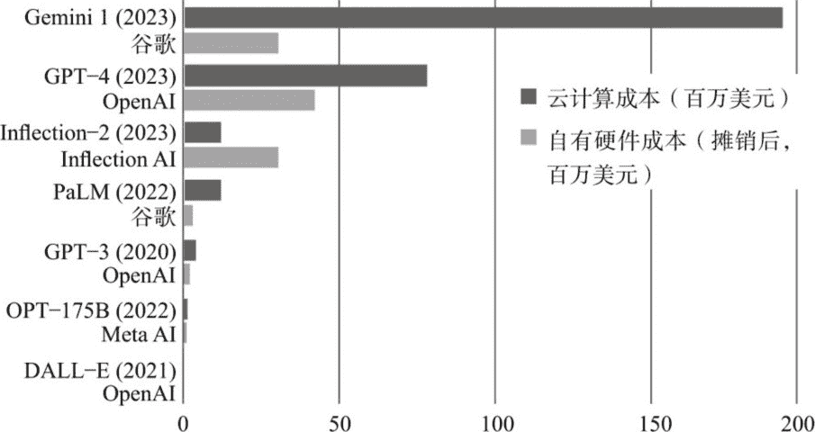
图 3-1　大系统训练成本呈爆炸式增长

注：数据均系四舍五入后的结果，不包括员工薪资。

图片来源：https://www.statista.com/chart/33114/estimated-cost-of-training-selected-ai-models/。
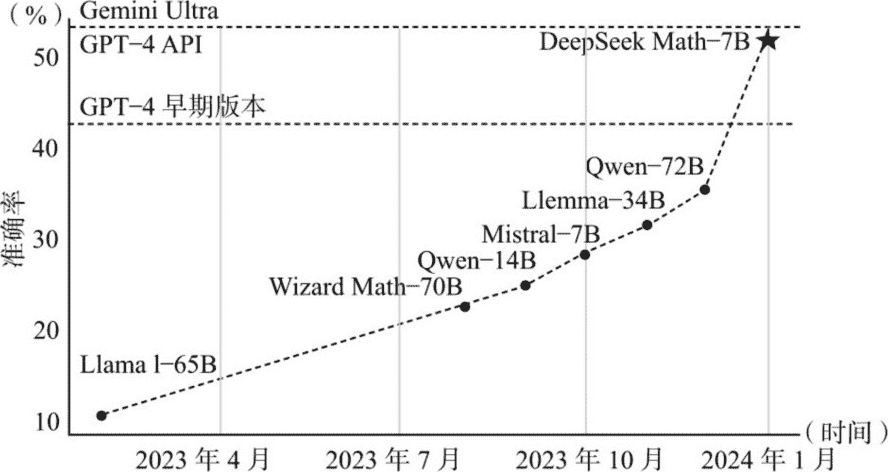
图 3-2　多个开源大系统在数学竞赛水平基准测试中的表现

DeepSeek 技术演进：后训练、稀疏专家与注意力革新

图片来源：DeepSeek 团队论文“DeepSeek Math: Pushing the Limits of Mathematical Reasoning in Open Language Models”。

在与模型同步公开的数学论文里，DeepSeek 首次提出后来被业界广泛引用的群体相对策略优化 GRPO，并把深度学习体系化地引入后训练环节，同时对后训练流程进行了结构性改进。

DeepSeek MoE 与 DeepSeek Math 共同体现了预训练到后训练的主线，也可看作后续路线图的起点。当时外界注意力被“百模大战”占据，对这两项工作及其论文中的探索关注不足。

2024 年 3 月 11 日，DeepSeek 发布首个多模态大模型 DeepSeek-VL。团队对数据、结构与训练策略进行三重联合拓展，成为开源多模态阵型的重要代表，提供 7B 与 1.3B 两个体量。

在保持语言表达能力的前提下接入视觉，模型能对真实场景提问给出细致且条理的回应。视觉输入上限达 1024×1024，可辨识画面中细小目标。通用理解覆盖逻辑图、网页截图、公式识别、学术文献、自然图像等，并在复杂情境下维持较强判断。图文理解强度与回复条理性，来自数据、结构与策略的协同。

DeepSeek 第一个里程碑式突破来自 2024 年 1 月发布的 DeepSeek MoE。这是一款基于混合专家架构的大语言模型，见图 3-3。效率提升依赖两项设计：精细专家拆分，把传统专家单元拆成更小的子单元，提升复杂任务的灵活性；共享专家隔离，通过独立设置全局共享专家与动态路由专家，优化算力分配。

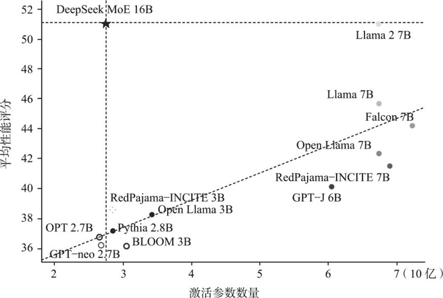

图 3-3　各模型激活参数对比

图片来源：DeepSeek 团队论文“DeepSeek MoE: Towards Ultimate Expert Specialization in Mixture-of-Experts Language Models”。

模型以 2 万亿 token 的中英文混合语料完成全量训练，评测成绩与 DeepSeek MoE 16B 及 Llama 2 7B 相近，计算开销约为后者的四成左右。该架构标志 DeepSeek 正式转向 MoE 技术路线，其核心价值在于用专家的动态激活换取性能不变下的算力压缩，为大模型工程化提供新范式。

为何 MoE 显得如此高效？

## MoE 模型：各操一剑的顶级大师

谈 DeepSeek 的算法创新，先要厘清 MoE 的本质。

《天龙八部》里，鸠摩智索要六脉神剑剑谱，大理天龙寺枯荣大师不愿交出，便让几位资质平庸的高僧速成六脉神剑。最终采取分工，每人专修一脉，六人合阵周旋。

该故事与 MoE 的原理高度契合。若把六脉神剑的每一脉看作一个任务，整套剑法即多任务大模型。练成绝学需高资质，正如大模型训练对算力的需求。让高僧各修一脉，等同于把大模型拆分为多个专家。任务拆分后，资质有限的高僧也能短期掌握一脉，合力后达到完整剑法的效果。同样，多个预训练好的专家经汇总协调，也能复现完整模型功能，而整体成本远低于直接训练大模型。

MoE 作为深度学习范式，其思想可追溯至 1991 年自适应局部专家混合模型。该模型以若干专业子网络即专家网络与智能路由为核心，平衡参数规模与计算效率，见图 3-4。

1991 年论文《自适应局部专家混合模型 Adaptive Mixtures of Local Experts》已具备 MoE 的基本要素：专家网络与门控网络，后者演化为今日的路由。

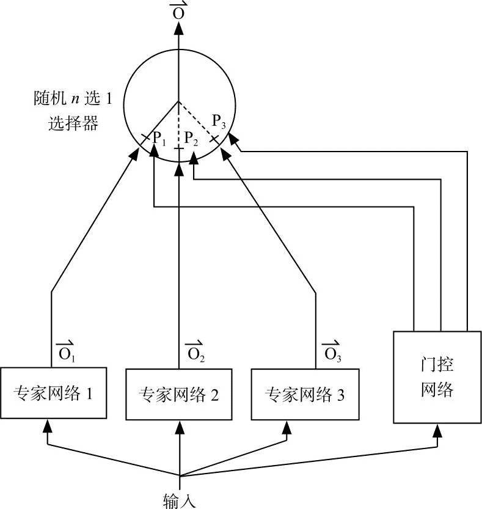

图 3-4　MoE 模型架构示意

图片来源：Adaptive Mixtures of Local Experts。

传统神经网络在多任务学习中易产生干扰效应，本质是任务间参数耦合与梯度冲突，导致收敛变慢、泛化下降。1991 年的方案是构建由多个专家网络与智能路由组成的并行学习结构。每个专家专注特定任务域的特征学习，通过参数空间解耦避免跨任务干扰。模块化提升了单个专家的学习效率，专家的集成又增强整体表达力。

实验显示，分治加集成的设计把不同任务的学习过程解耦，在参数可控范围内，相较传统单体网络获得更快训练与更强跨域泛化。该成果为稀疏化大模型奠定理论基础，其核心思想在今日千亿参数时代仍被广泛使用。

二十多年后，谷歌在 2017 年发表《超大规模神经网络：稀疏门控专家混合层 Outrageously Large Neural Networks: The Sparsely-Gated Mixture-of-Experts Layer》，把 MoE 成功引入 LSTM。团队训练出参数 1370 亿、含 128000 个专家的 LSTM。即便放在今天也堪称巨无霸，背后有大量工程难题。

相比 1991 年的工作，这篇论文实现了真正的稀疏激活。实际计算量有限的情况下仍能高效训练超大规模网络，为大模型开辟新路径。

在 Transformer 出现前，学界已通过实证发现规律：模型容量与性能显著正相关。容量即拟合复杂函数的能力，参数越过阈值后表征能力会阶跃式提升。

代价是算力需求指数级增长。按计算复杂度理论，参数量 N 与数据量 D 通常需满足 N≈D，模型放大必须同步增数据，计算开销随 O(N²) 急剧攀升。这种非线性增长在 21 世纪第二个十年让不少团队陷入“越大越强却越难训”的困境，直到稀疏计算技术如 MoE 出现才部分缓解。

谷歌 2020 年 6 月发布的《GShard：利用条件计算和自动分片扩展巨型模型 GShard: Scaling Giant Models with Conditional Computation and Automatic Sharding》，标志 MoE 与 Transformer 深度融合的关键突破。该研究首次在标准 Transformer 中系统集成 MoE 层，结合条件计算与自动分片，构建出当时规模空前的稀疏网络，最大参数突破 6000 亿，成为首个实现超大规模 MoE 工程化部署的标杆。

团队用动态路由重构 Transformer 前馈层的计算范式，每个输入只激活特定专家子网络，并引入张量自动分片实现跨设备参数分布。架构保留了 Transformer 处理序列的核心优势，通过稀疏计算显著改善容量与训练效率的平衡。实验显示，在单设备负载稳定的前提下，模型参数提升两个数量级，为万亿参数模型研发奠定基础。这项工作确立了现代 MoE 范式，推动神经网络从稠密向稀疏、专业化演进。论文用大量篇幅讨论工程实现与优化，这也是 MoE 训练的最大痛点。

DeepSeek MoE 作为国内首个开源 MoE 模型，通过双维度架构创新突破传统系统的瓶颈。核心体现在专家系统重构与知识解耦。

针对传统架构普遍存在的知识冗余与知识混杂，DeepSeek MoE 给出两大方案。

首先进行精细专家分割，在总参数不变前提下，把每个专家模块拆成更小的计算单元。比如把 16 个专家拆成 64 个微专家，激活数调为 8 个。组合空间由此从 C(16,2)=120 种跃升至 C(64,8)=4.4×10⁹ 种，大幅提升对多样化特征的适配能力。

其次采用共享专家隔离，设置固定激活的共享专家模块，专门捕捉跨领域通用知识；把通用计算能力如数学运算、基础语法解析剥离到共享专家，其他专家专注垂直领域的深度特征学习。这种分层知识架构让 145B 参数的 MoE 模型仅需 67B 稠密模型的计算量即可达到同等性能。

工程上，DeepSeek 通过动态内存分配与稀疏计算优化，使 16B 参数模型可在单张 40GB 显存 GPU 上直接部署，无需量化压缩。这得益于专家分片策略与激活缓存机制的协同，峰值显存占用降至传统架构的 63%。

采用“自适应学习调速”即动态梯度裁剪与“专家响应微调”即激活噪声注入的双保险，可有效防止系统陷入死循环。就像给自动驾驶加装防抱死制动，高速中仍能灵活转向。实测显示，训练相当于 145 亿个神经元的超大模型时，系统始终保持高效协作，熵值维持在 4.2～4.5，相当于团队始终保持多样化解题思路，避免个别专家被过度依赖而宕机。

在 DeepSeek 的 MoE 架构中，无辅助损失的负载均衡策略至关重要，如同经验丰富的调度员默默协调各专家工作，确保模型高效稳定运行。

MoE 中不同专家可视作各有所长的工匠，各擅长特定任务类型。实际运行中，因输入任务多样复杂，不同专家间易出现负载不均：部分专家任务过载，部分则闲置。负载不均造成资源浪费，并影响整体性能与效率。

无辅助损失的负载均衡策略通过智能动态路由偏置调整机制，依据各专家实时负载灵活分配任务。负载低的专家会被主动分流更多任务，负载高的专家则将部分任务分流至负载较轻的模块，避免单一模块过度消耗算力。此方式实现专家间的任务平衡，确保各模块在其擅长领域发挥最大效能，提升整体性能与稳定性。

以多领域问答为例，问题涉及历史、科学、文化等多方面知识。MoE 中不同专家分别负责不同领域。负载均衡策略会根据问题内容及各专家的当前负载，将问题各部分分配给最合适的专家。历史部分交由历史专家，科学内容交由科学专家，各司其职协同工作，高效给出准确全面的答案。

该技术的核心优势在于无需额外辅助损失函数即可实现负载均衡，避免了传统方法可能带来的梯度干扰。如同交通信号灯系统根据实时流量动态调整配时，最大化每条道路通行效率。正是这种智能协调，使 DeepSeek 的 MoE 架构在复杂任务中展现卓越性能与稳定性。

## MLA：DeepSeek 的信息过滤员

DeepSeek 的创新不仅限于 MoE。DeepSeek-V3 报告中一张图展示了 DeepSeek-V3 的核心架构，见图 3-5，重点突出其在多头潜在注意力 multi-head latent attention, MLA 与 MoE 方面的设计。

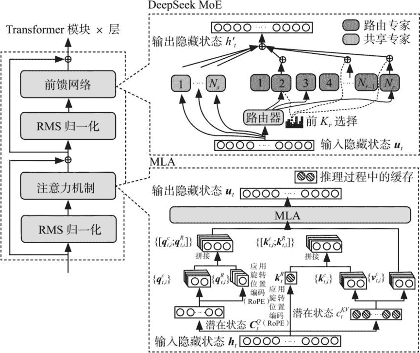

图 3-5　DeepSeek-V3 的核心架构

图片来源：DeepSeek-V3 Technical Report。

DeepSeek-V3 拥有 6710 亿参数，采用 MoE 架构，内部包含多个专家模型，但每次计算只用到其中约 37 亿参数。为保证专家高效运作，模型配备智能调度员，精准分配任务，避免部分过载部分闲置。

除此之外，DeepSeek-V3 还配备名为“MLA”的信息过滤器，能让模型聚焦关键信息，避免无关细节干扰，保证效率与准确性。其意义远不止信息过滤，是对注意力机制的一次重大创新。要理解这一点，需回到 Transformer 架构。

本书多次提到 Transformer。自大模型诞生以来，Transformer 成为家喻户晓的名字。要说清其来历，要从德国年轻人雅各布·乌斯科雷特说起。

2012 年，乌斯科雷特放弃博士学业加入谷歌，正值 AlexNet 大放异彩、深度学习兴起之年。

乌斯科雷特在谷歌的工作聚焦于把深度学习用于邮件自动补全、客服聊天机器人等场景。当时主流结构仍是 LSTM 循环神经网络。

2014 年，“注意力”概念出现，乌斯科雷特意识到注意力模型可能比循环网络更快、更有效，更适合 GPU 并行。他说服几位同事尝试，2016 年发表论文小有成果，但他认为注意力机制仍可发挥更大作用。

2016 年一天午餐时，乌斯科雷特遇到伊利亚·波洛苏欣，后者正研究如何为搜索问题直接给出答案而进展不顺。乌斯科雷特介绍注意力机制，波洛苏欣同意尝试，并拉来印度来的阿希什·瓦斯瓦尼参与。三人起草设计文档，Transformer 之名也在此时产生。一方面名字描述模型功能，另一方面因波洛苏欣童年喜爱变形金刚玩具，英文即 transformers。

故事未完。2017 年初，印度尼基·帕尔玛、英国利昂·琼斯加入，随后卢卡斯·凯泽与实习生艾丹·戈麦斯加入。团队把试验方向定为机器翻译。Transformer 表现不错，但仅与 LSTM 相当，并未明显胜出。

山穷水尽时，某天在谷歌办公室走廊，资深员工诺姆·沙泽尔经过凯泽工位，听到 Transformer 团队激烈讨论。沙泽尔觉察到一群聪明人在做有前景的工作，凯泽趁机说服他加入。团队八位主创才算集齐。沙泽尔凭借丰富经验重梳理代码架构，将系统提升到新水平。

推进中，团队决定赶在 2017 年 NIPS 会议发布成果。最后两周他们拼命赶工，多在咖啡机旁的办公室度过，很少睡觉。论文截止前几分钟仍在收集实验结果，最终在截止前两分钟提交。论文名《你只需要注意力机制 Attention Is All You Need》由利昂·琼斯提出，灵感来自披头士歌曲《你需要的只是爱 All You Need Is Love》。从变形金刚到披头士，艺术的灵感让科学旅程凝结为闪光瞬间。

2017 年 12 月 NIPS 会议上，论文引起轰动，会场挤满想了解更多的人，主创人员聊到声音沙哑，闭馆时现场仍人头攒动，最后保安清场才散去。

截至 2024 年底，该论文被引用超过 11 万次。Transformer 开启了人工智能全新时代，成为 AI 时代最强引擎。从蛋白质预测到大语言模型，从 AI 助力科学到图像视频生成，诸多突破性进展都基于 Transformer 架构。

如果说 Transformer 诞生是场大爆炸，那么现在宇宙正围绕它膨胀，注意力机制无疑是大模型宇宙形成的基本物理定律。这一点在论文名中已淋漓尽致体现。但注意力机制有一个致命弱点。

长序列处理之下，注意力机制最先撞上的瓶颈是显存。全局注意力在计算上是平方级增长的，序列变长一次，成本就指数式膨胀。把长度从 512 提到 4096，注意力矩阵占用的显存会放大 64 倍，面对 4K 级医学影像或小说体量的文本，很容易直接触发显存耗尽。想把复杂度压到线性，局部注意力可以做到，可代价是跨区关联信息会掉掉超过三成。

在上一章我们聊过，为什么注意力会成为核心——因为上下文上下文高度耦合。大模型本质上在做概率推演，要猜下文就必须回看上文，于是计算量随文本长度急剧拉升。更麻烦的是，预测下文的一个字，往往要把整段上文重新算一遍，重复劳动极多。为了解决重复，业界普遍做法是把已经算好的中间结果留在显卡缓存里，靠空间换时间，换来的是显存占用的持续恶化。

正是这个矛盾催生了一系列取舍方案。MHA、MQA、GQA 直到 DeepSeek 提出的 MLA，本质都是在缓存占用和效果之间反复拉扯。这些名字听起来专业难懂，却是理解大模型运作绕不开的基础概念，也是看懂技术演进为什么这么曲折的关键。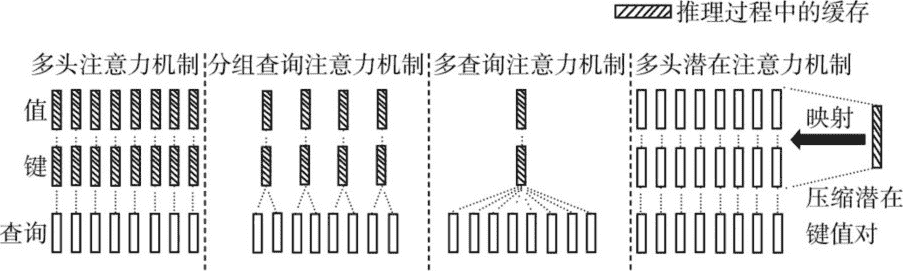

图 3-6　解决缓存问题的各种方案

图片来源：DeepSeek-V2: A Strong, Economical, and Efficient Mixture-of-Experts Language Model。

多头注意力 MHA 出自《Attention Is All You Need》，是当下主流大语言模型的基础。它的核心是三组变量：键 Key、值 Value、查询 Query。输入被切成若干个头，每个头各自算注意力权重，意味着每个 Transformer 层里，每个头针对每个词元都要保存一对键值。最后把各头结果拼接，再经线性投影得到输出。听起来很完整，代价就是计算和存储都很重。

多查询注意力 MQA 在此之上做减法：所有查询共享同一组键值，只是每个查询的权重不同。这样需要保存的键值大幅减少，推理更快、显存更省，但共享带来的信息瓶颈会导致部分表达能力被牺牲。

分组查询注意力 GQA 再往前一步，把查询分组，组内共享键值。它在效率和质量之间找平衡，适合大规模数据和对响应速度要求高的场景，不过实现上仍需精细权衡。

这些方法各有不足，于是 DeepSeek 的多头潜在注意力 MLA 登场。

MLA 的思路不是简单地砍键值数量，而是做结构重构。传统 MHA 像手工定制工厂，每个头独立处理完整数据，能捕捉丰富特征却要存下海量中间结果，KV Cache 占满显存。MQA/GQA 类似引入标准化零件，共享部分参数降低存储，但过度简化会削弱表达。

MLA 采用“先预加工、后按需定制”的两段式。

训练时先建一个低维潜在空间，用可学习的投影矩阵把原始表示压缩成紧凑表征，相当于把原材料做成半成品。所有头共享这个基础表示，各自再用独立的投影矩阵做二次加工。

推理时借助数学上的恒等变换，把原本多步的投影合并成一步线性运算，KV Cache 只需保存低维共享表征。在保持计算等价的前提下，存储需求被压到传统 MHA 的约八分之一。

这种算力换显存的设计让关键路径的显存带宽压力下降，单卡可处理的序列长度提升 4 到 8 倍，对长文本生成和实时对话特别友好，也为百亿参数级模型的落地提供了可行性。

MLA 的本质是先做特征维度的压缩，再保留足够的表达。传统方案直接减少键值个数，MLA 保留键值数量，通过线性映射把高维键值投到低维隐空间，形成压缩表示。语义得以保留，显存和算力负担下降，这与 MQA/GQA 有本质区别。潜在空间可视为信息蒸馏，需要可学习投影完成，DeepSeek 等架构已验证其在长序列上的扩展优势，也因此有人称之为多头隐空间注意力。整体来看，注意力机制正从结构改良走向系统级优化，存储、计算、精度三者需要在动态中保持平衡。

妙招：多令牌预测

多令牌预测 MTP 是 DeepSeek 在推理侧的重要加速手段。传统生成是逐词输出，像一个字一个字往外蹦，效率低且容易断句。MTP 让模型一次预测多个词元，类似日常对话中连续说出一串词，推理时能拿到更宽的上下文，速度和连贯性同步提升。

训练阶段模型学会预测多个未来词元，对语言结构和语义关联的理解更全局。推理时根据已生成内容一次性给出多个合理后续，无需反复迭代。这样既能保证语义连贯、逻辑一致，也更贴近人类表达习惯。

在实际使用里，MTP 可以把“我计划在假期去海边旅游，那里有美丽的沙滩和清澈的海水”这样的完整句子一次性生成，而非逐个拼出孤立词元。代码生成这类依赖严格语法和长距离关联的任务上，优势同样明显。

从单令牌到多令牌，看似顺理成章，却被 DeepSeek 抢先做实。用克莱顿·克里斯坦森的说法，新领域里摆脱固有模式的外来者往往更容易突破。DeepSeek 从量化投资切入通用大模型，少了条条框框，也因此能做更纯粹的尝试。

以柔克刚：用算法压榨算力

除了注意力本身，DeepSeek 还有一串让人眼花的技术组合：无辅助损失的负载均衡、跨节点全对全通信内核、双路跨节点通信、数据精筛、FP8 混合精度训练框架等。

把训练大模型比作运营工厂，降本只有两条路：压缩工作量，让工人不闲置。MLA 和 FP8 就是压缩工作量的代表。

传统注意力要为每层分别记名字和对应值，像记住“张三 120 斤，李四 180 斤”。MLA 把多层信息合并，统一成“第一排”，需要时再动态查询“第一排第二个男生体重”。内存占用下降，效率上升。

FP8 用 8 位浮点表示，比 FP32、FP16 省算力省存储。并非一刀切降精度，关键步骤仍用 FP32，保证准确；其余部分定期用 FP32 校准，比如每 128 个数校一次，避免误差累积。好比平时把 1.85 元记成 2 元，碰到比特币这种大币值交易时就切回高精度逐分计算。

提升并行效率的另一面是流水线优化。双路通信让数据传输和计算并行，传统串行等待被打破，整体速度提升约 50%，通信开销减少约 20%。

在 MoE 架构里，任务分配很关键。固定派单容易导致专家过载或空闲。DeepSeek-V3 的无辅助损失负载均衡类似智能派单，专家连续繁忙时自动降低接单概率，把任务分给空闲方，实现动态平衡。

DeepSeek 的效率突破并未牺牲性能，主要靠三点支撑：671B 的参数规模，远超 Llama 3.1 的 405B；14.8 万亿令牌的高质量训练数据，经过精细筛选清洗；以及多令牌预测带来的效率和依赖捕获提升。

同行还在参数数字上内卷时，DeepSeek 用数学之美证明，真正的智能突破往往来自对行业共识的背叛。未来的 AGI 竞赛，可能不是比谁的 GPU 多，而是比谁更会用好每一焦耳算力。这些创新共同构成了高度逼真、流畅的表达能力，也是 DeepSeek 一直追求的 AGI 雏形。

“价格屠夫”？AI 不是富豪的玩具

新技术常被误读。70 年代 Apple II 被当成玩具，IBM 高管说全球只需要 5 台电脑；90 年代互联网被视作科学家专用工具，《新闻周刊》说线上购物违背人性；2007 年 iPhone 被诺基亚嘲笑为没有键盘的脆弱设备；2010 年前后电动车被质疑续航短成本高。

这一次轮到 DeepSeek。

2024 年 5 月 DeepSeek-V2 发布后，市场最爱提的标签是“价格屠夫”和“AI 拼多多”。公众聚焦成本，却忽略底层创新。

价格确实震撼。发布同期 API 定价下调到 GPT-4-Turbo 的约 1%，随后引发字节、阿里跟进，价格战全面展开。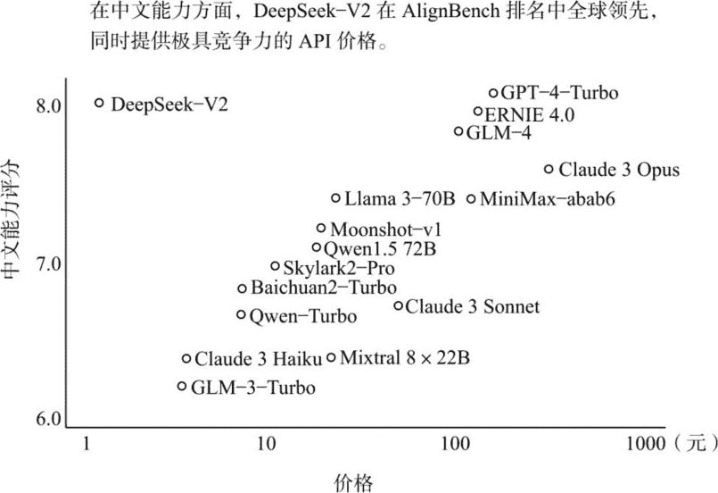

图 3-7　DeepSeek-V2 的 API 价格优势

图片来源：《量化起家，万卡在手，降价狂魔，DeepSeek 可能就是中国大模型混战的终结者》，详见 https://finance.sina.cn/fund/sm/2024-07-05/detail-inccatac7262706.d.html。

评测显示，DeepSeek-V2 在 AlignBench 中文综合评测中与 GPT-4-Turbo、文心大模型 4.0 同属第一梯队，MT-Bench 英文综合评测中超越 Mixtral 8×22B，数学、编程等专项能力位居全球前列。

商业上它提出“技术降本”定价，API 约为每百万令牌输入 1 元、输出 2 元，依托幻方量化自有资金，保持超 50% 利润率且财务独立。不靠 VC 融资的模式带来鲇鱼效应。技术根基是 8.1 万亿令牌预训练、监督微调加强化学习的双阶段优化，以及 128K 长上下文窗口。

这一波技术突破把大模型竞争推向性能与成本双维度博弈。依托底层创新的成本优势正在重塑生态规则。梁文锋曾说：“没想到价格让大家这么敏感。我们只是按自己的节奏做事，核算成本后定价。原则是不贴钱，也不暴利。这个价格是成本之上略有利润。”

美国实验室近年偏重微小质量提升，忽视低成本高速高质模型。DeepSeek 的性价比可能是最高的。降本是产业化的必经之路，只有成本下来，AI 才能从少数巨头的玩具变成可盈利的产业气候。DeepSeek 的出现跨越式推动了行业发展。

价格只是表象，V2 背后是扎实的技术积累。随着时间推移，市场开始更关注它的技术价值而非仅仅是价格。

DeepSeek 不再只是“便宜”的代名词

SemiAnalysis 的主笔曾把 DeepSeek-V2 的论文列为 2024 年最值得反复阅读的作品之一。曾在 OpenAI 工作的 Andrew Carr 说那篇研究处处藏着让人意外的巧思，甚至把里面的训练配置照搬到自己的实验里。Anthropic 的联合创始人 Jack Clark 则形容 DeepSeek 聚拢了一批难以捉摸的天才，并预判中国自研的大模型会像无人机、电动汽车那样成为无法忽视的产业力量。

国内的讨论很快跟上。苏剑林撰写的《缓存与效果的极限拉扯：从 MHA、MQA、GQA 到 MLA》让更多工程人群开始拆解技术细节。大家这才意识到，DeepSeek 早已突破价格标签。

在 V2 的铺垫之后，2024 年 12 月 26 日 V3 突然破圈，中美舆论同时被点燃。那种 2022 年 ChatGPT 带来的震颤，这次被国内用户真切体会到。圈内也开始流传一个不安的判断：模型的聪明，可能并不由参数规模决定。

研发直觉被改写的三条线索：稀疏唤醒、无约束路由、并行预测
当多数巨头仍在往万亿级参数堆、把算力集群扩到上万卡时，DeepSeek 团队做了一次反向验证。他们只用约 557.6 万美元的算力开销，就造出参数约 6710 亿的 V3，且推理效率比同水平传统方案快约三倍。更关键的是，整段训练从未出现 Loss 骤降，曲线平稳得像条被驯服的河道。这套思路指向一个结论：大模型进化的关键也许不是变得更大，而是更会用。

V3 至少在三处颠覆了行业惯性。

第一处反转：参数规模不等同于能力跃迁，起作用的是被点亮的比例。传统范式信奉暴力美学，参数越多越强。GPT-3 靠 1750 亿参数打开时代，Llama 2 堆到 700 亿，PaLM-E 超过 5620 亿。逻辑上看似顺理成章，但 V3 的实测给出反直觉答案：性能并不与总参数线性挂钩，决定上限的是激活份额。

V3 整体参数约 6710 亿，处理每一个 token 时仅点亮约 37 亿，占比约 5.5%。MoE 结构借助动态路由，像人脑一样按需调用专家：碰到数学题就唤醒逻辑专家，生成诗文则调起语言美学专家。传统稠密模型无论输入为何，所有参数都全程参与，相当于让交响乐团演奏儿歌时全体上场。稀疏带来的成本优势很直接：V3 训练消耗约 278.8 万 H800 GPU 小时，同等表现的稠密方案需要超过 8 万小时。当大家还在争论万亿参数俱乐部的门槛时，DeepSeek 已经证明智慧密度比体积更重要。

第二处反转：训练稳定不必死控缰绳，去掉约束的路由反而更高效。传统 MoE 需要像驯兽师一样防止专家失衡，靠辅助损失函数硬性均摊负载，否则部分专家被过度使用，部分沦为摆设。这种强控制设计容易引发梯度爆炸或专家瘫痪。

DeepSeek 彻底拿掉了这道枷锁，采用无辅助损失路由让专家自由选择。结果并非混乱，而是自组织的动态博弈自然形成了分工，整体效率提升约 40%。这有点像撤掉红绿灯后车辆靠协商反而更顺畅：有的专家专攻高频任务如语法解析，有的聚焦长尾需求如小语种翻译。背后是一套受神经元启发的随机竞争机制，微小噪声扰动让模型持续探索更优组合。代码生成时甚至会出现“专家委员会”：算法逻辑、API 调用、代码风格的不同专家协同，质量远超单专家模式。

第三处反转：预测未来不必亦步亦趋，多令牌并行打破了时间诅咒。自回归模型逐词生成，像一场孤独的马拉松，1000 个 token 就要 1000 次顺序计算，早期错误还会放大。V3 的多令牌预测能同时向前看 3 到 5 个 token，像棋手预判多步走法，在保持准确率下把生成速度拉快约两倍。

更反常的是，并行非但没有增加难度，反而暴露更长的依赖，帮助模型更早学会战略布局。写科技论文时，模型会先锁定结论关键词如“量子纠缠”，再反向推导实验设计结构，类似人类先列大纲再填充细节。

当行业沉迷规模崇拜时，DeepSeek 用三重解构重写方向：从规模优先转向效率革命，用稀疏唤醒破解算法暴政；从控制至上转向自组织涌现，以无约束路由释放专家潜能；从线性思维转向并行跃迁，靠多令牌预测突破时间屏障。

V3 爆火后，其论文里的一张对比图被大量转发。
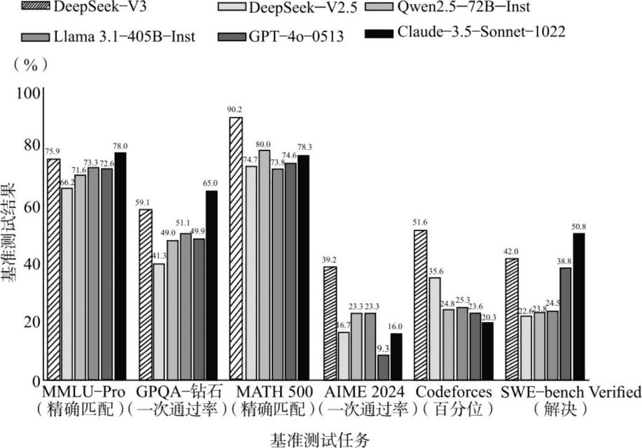
图 3-8　主流大模型性能对比
注：每个柱状图显示了不同模型在各个测试集上的准确率或百分位。
图片来源：DeepSeek-V3 Technical Report。
图 3-8 呈现了 DeepSeek-V3 及其竞争对手 DeepSeek-V2.5、Qwen 2.5-72B-Inst、Llama 3.1-405B-Inst、Claude-3.5-Sonnet-1022、GPT-4o-0513 在多个基准上的表现。其中前两个被业界视作顶尖开源方案，后两个是顶尖闭源方案，对手名单本身也体现出 DeepSeek 的野心。

从左往右看，MMLU-Pro 上 V3 准确率 75.9%，次于 Claude-3.5-Sonnet-1022 的 78.0%。GPQA 钻石上 V3 为 59.1%，次于 Claude 的 65.0%，差距不大。

随后三项成绩极为抢眼。MATH 500 中 V3 达 90.2%，遥遥领先。AIME 2024 中 V3 以 39.2% 夺冠，GPT-4o-0513 仅 9.3%。Codeforces 上 V3 达 51.6%，超过人类程序员平均水平，GPT-4o 为 23.6%，不到一半。SWE-bench Verified 上 V3 42.0%，几乎是除 Claude、GPT-4o 外其他对手的两倍。

可见 DeepSeek 不仅有价格优势，性能上尤其推理能力可压制一众对手，只是成本优势太突出才常被忽略。

本章堆了不少术语和比喻。若若干年后回望大模型演化路径，或许能读懂当时记录的用心。本章结尾，用一段 V3 生成的文字感受那种 2022 年 ChatGPT 级别的震撼。

2025 年春节，有人以“玄武门事变之后”为题让 DeepSeek 写李世民独白，结尾如下：

（指尖蘸着朱砂在空白处画了幅长安舆图）

怀里的武德律还在发烫，但压在下面的贞观新政纲要更烫。五更前要改完均田制细则。

卯时还得去太医署看魏徵——这头倔驴竟真敢空手夺我陌刀，他淌在朱雀大街上的血，可比他写的谏书有分量得多。

（晨光刺破窗纸时突然顿笔）

建成，你教我的《商君书》错了，帝王术不是棋枰上的黑白子，而是淬火的刀。

今日我斩断的每寸骨血，都会熔成他日量天下的尺。

（最后在绢帛角落以血为印）

后世若嫌这墨色太腥，便让他们去读我用二十年光阴漂白的青史。

DeepSeek 像一把以创新之火淬炼的刀，凛然出鞘，让人一震。

# 第四章

# 强化学习、大模型与归来少年

若干年后再回望，2025 年的春天属于两位“三岁的中国年轻人”。一位是电影《哪吒之魔童闹海》，上映十天问鼎全球单一市场票房，十六天破百亿，二十一天登顶全球动画票房，刷新 35 项纪录，为全球市场注入东方神话强心针。另一位是诞生于 2023 年百模大战时期的 DeepSeek，被视作“来自东方的神秘力量”。正如梁文锋 2024 年 12 月 16 日朋友圈所写：“三年过去了，旧世界分崩离析，新时代正在光速到来。”

DeepSeek 横空出世前，OpenAI CEO 萨姆·奥尔特曼认为拐点已至：“我们正处于时代的尾声，巨型模型将出现，我们会以其他方式让它们更好。”他口中的巨型模型是耗资上亿美元量级的 GPT-4。当时中国 AI 处于劣势：2022 年美国禁运先进芯片，英伟达只能推出降级方案，还威胁相关企业。外界普遍认为中国落后美国一到两年，甚至半年到一年。

哪吒在虚拟世界打破偏见，DeepSeek 在现实世界改写竞争叙事，直接迎击算力封锁。硬件层面，算法创新降低对算力的依赖，用低成本训练实现性能对标国际顶尖，显著缩小差距。技术范式上，推理优化重塑能力演进路径，证明复杂决策可以优先于规模扩张。生态层面，开源策略重塑全球创新格局，推动普惠而非垄断。系统性创新让“差距拉大”“卡脖子”等旧认知失去解释力。

第三章讲了预训练阶段的创新，本章从性能视角讲后训练阶段的创新。

## 规模法则的边际时刻
先区分两类模型。一类是 DeepSeek-V3 这类通用大语言模型，GPT 系列同属此列。V3 之所以出圈，在于成本优势明显。技术报告显示 V3 训练花费 278.8 万 H800 GPU 小时，成本 557.6 万美元，仅为 OpenAI 的约二十分之一。
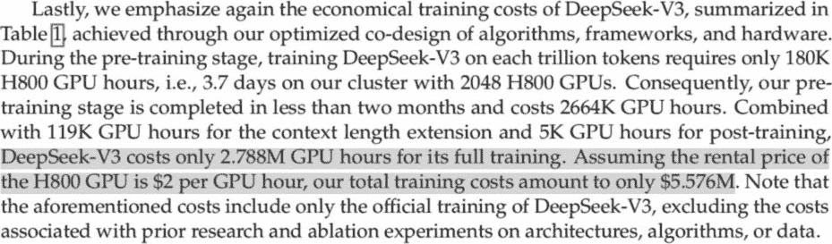
图 4-1　DeepSeek-V3 技术报告关于训练成本部分的描述
图片来源：DeepSeek-V3 Technical Report。
另一类是推理大模型，如 OpenAI 的 o1、DeepSeek-R1。引爆网络、冲击美股的正是 DeepSeek-R1。彼时 o1 独领风骚，后来 R1 以大道至简的 GRPO 技术与之打成平手。

既然 GPT-1 到 GPT-4 已筑起护城河，为何还要研究推理模型？因为真正的护城河是规模定律。

2017 年谷歌发表《Attention Is All You Need》，提出自注意力与 Transformer 架构，后被几乎所有大模型采用。BERT 与 GPT 的“T”都指 Transformer。随后 OpenAI 依托该架构连发 GPT-1、GPT-2、GPT-3，并在 GPT-3 同年发布《大语言模型的规模定律》，由此建立护城河。

论文里测试不同 head 数、layer 深度、dmodel 大小，发现对 loss 影响很小。换言之，仅调参提升有限，真正关键是数据与训练量的系统性增长。后来该规律推广到非语言模型。

打个比方，想提高篮球队成绩，增加球员数、加练强度、换装备，效果有限；更有效的是系统训练和战术改进。该规律同样适用于足球、排球等项目。

核心观点是模型表现受计算量、数据规模、参数数量三大因素影响，在其他条件不限制时服从幂律。规模定律像芯片界的摩尔定律，概括了行业发展。GPT 一代到三代的变化亦如此。
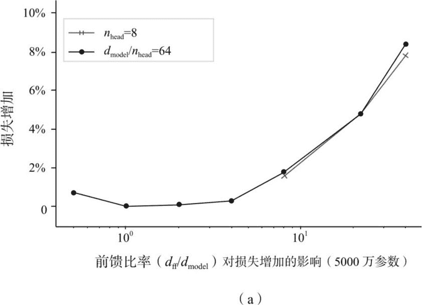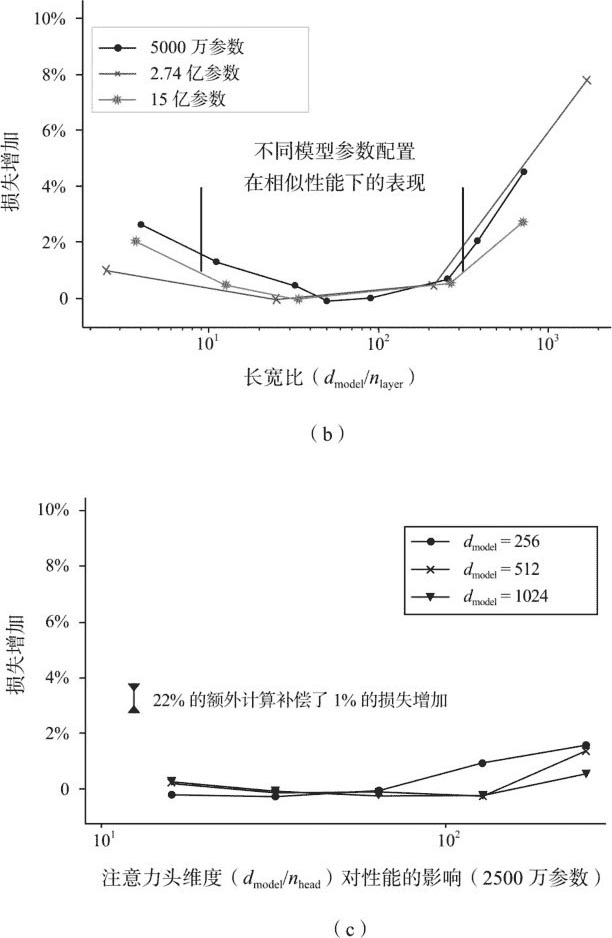
图 4-2　参数总量不变的情况下其他因素影响比较
图片来源：OpenAI 论文。
表 4-1　GPT 从一代到三代的参数量变化与资源消耗
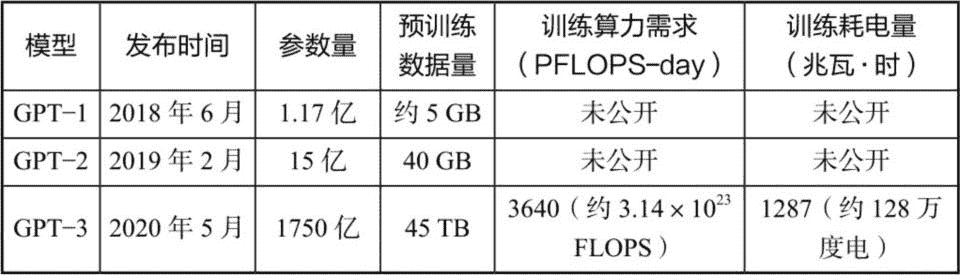
数据来源：作者整理。
于是 ChatGPT 顺理成章到来。2022 年 11 月 30 日，OpenAI CEO 奥尔特曼在个人社交媒体发文：“我们今天发布了 ChatGPT，试试和它聊天吧。”没有发布会，没有新闻稿，但引线被点燃了。

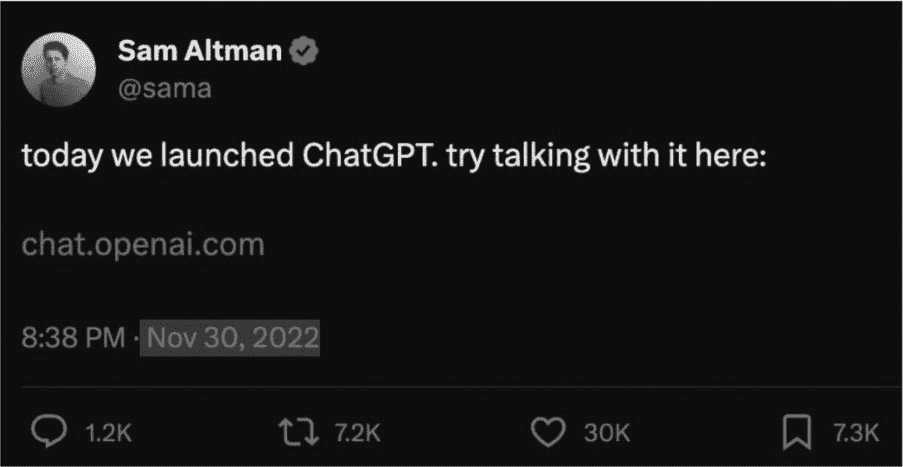

图 4-3　奥尔特曼在社交媒体宣传 ChatGPT

图片来源：奥尔特曼个人社交媒体账号。

ChatGPT 爆发的速度可以用体量来形容。面世第一天使用者就过了十万，五个工作日内冲到一百萬，到了两月余用户数已站上一个亿。横向对比，同样以增长快著称的 TikTok 花了九个月才凑满一个亿，微信达成这一规模耗时四百三十三天。这样的扩散曲线在当时堪称现象级。

节奏很快，也很快变慢。OpenAI 新品的发布间隔由一年拉长到两年。官方说法指向人类反馈强化学习的引入，只是表层解释，深层原因更复杂。

2023 年 3 月 14 日 GPT-4 正式登场。它在美国律师资格考中达到九十分位，在 SAT 考试中达到九十三分位，还能解读梗图与漫画。内部评估里，工程师注意到模型在复杂逻辑上出现了涌现现象，表现超出训练样本所能覆盖的范围。

热度升温的同时质疑也在累积。用户感到能力退步，训练瓶颈被反复提及，资本情绪由狂热转向审慎。2024 年 6 月高盛的研报显示，七成二的 AI 初创仍未实现盈利，生成式 AI 整体处于高投入低回报状态。投入越大，产出越难成为共识。

行业氛围趋于保守，数据天花板、电力压力、算力紧张与规模定律失效的担忧同时冒头。人们一边怀疑，一边仍在等待 OpenAI 用更聪明的 GPT-5 重建信心。于是很长一段时间内，奥尔特曼在社交平台上无论谈什么，评论区都会统一追问 GPT-5 的时间表。

在这种期待下，2024 年 9 月 13 日 OpenAI 推出 o 系列的首个成员 GPT-o1。它不再单纯堆参数，而是把重点放在强化学习驱动的推理能力提升上。转折由此出现：此前 OpenAI 难逢对手，此后则要时刻提防 DeepSeek 的挑战。这也回到初始疑问，明明可以靠 GPT-5 继续领跑，为何先推出推理模型给自己制造变量。

## 成也规模定律，败也规模定律

规模定律曾为 OpenAI 搭建护城河，现在却像堰塞湖一样随时会溃。

2023 年奥尔特曼公开承认公司正遭遇 GPU 极端短缺，训练 GPT-4 约耗费 355 PFLOPS-day，相当于三百五十五台千万亿次超级计算机运转一日。英伟达 H100 供货紧张且价格高昂，让继续扩容变得不现实。业内测算，GPT-5 的算力需求至少是 GPT-4 的十倍，在当前硬件条件下难以达成。

算力之外，数据更棘手。Transformer 体系下，2018 年的 GPT-1 靠约七千本书的预训练就能预测下一个词。到了 GPT-3，参数体量膨胀约一千五百倍，数据消耗增长约九千倍。在显卡昂贵而数据相对便宜的环境下，OpenAI 把几乎所有可获取的材料都纳入训练池，这种做法加速了迭代，也透支了优质材料的储备。

Epoch AI 预测，2026 年后人类新增数据量将低于模型学习需求，到 2028 年大语言模型可能耗尽互联网上的高质量文本。互联网内容的年增幅不足一成，而大模型对训练材料的需要却每年翻倍。GPT-4 的训练材料约一千八百亿令牌，是 GPT-3 的十倍以上，而公开互联网文本总量仅约五千亿令牌。

数量之外质量也在滑落。社交媒体与论坛的低质内容占比超六成，专业图书、学术论文等优质材料不足一成五。欧盟 GDPR 等隐私法规限制了医疗、金融等敏感材料的采集，《纽约时报》起诉 OpenAI 侵权等法律纠纷进一步压缩公开材料的空间。2023 年到 2024 年间，主流数据源被网站封禁的比例从百分之三升至百分之三十三，获取成本显著抬升。

在这种局面下迟迟不上 GPT-5，倒像一句调侃所言：不是不想，是上不去。转而押注推理模型，对 OpenAI 来说是换赛道继续保持技术领先的策略。

o1 的核心做法是通过强化学习对推理过程进行引导。具体采用改进版 PPO 近端策略优化，并结合人类反馈奖励机制，让模型在作答时先拆解问题、逐步验证逻辑，而非直接输出答案。以数学问题为例，模型会把题目分解为子步骤逐一检验。这种分步思考提升了复杂任务的准确率，但也带来代价：响应时长延长十到二十倍，推理阶段的算力消耗增加三到四倍。

研究表明，模型表现不仅取决于参数规模，也与推理时的计算量密切相关。即使参数不再增长，通过优化推理算法仍能提升特定任务能力。o1-preview 在数学基准测试中超过 GPT-4o，而参数规模仅为后者的三分之一。这说明推理阶段的规模效应可以弥补参数规模的停滞。

与通用大模型不同，o1 聚焦需要深度逻辑推理的场景，如数学和编程。它减少了对大规模通用材料的依赖，借助领域特定的强化学习进行精细优化。在代码生成任务中，o1 会模拟程序员调试过程，降低语法错误和逻辑漏洞。这种专业化路径既能保持竞争力，又降低了对算力的需求。

整体来看，OpenAI 从过去的堆规模转向更注重效率的战略。

那么推理模型到底是什么？

它指能够模拟人类思考过程、在输出结果前展示中间推导步骤的系统。与传统端到端直接给答案的模型不同，推理模型会先拆解问题、建立逻辑链、权衡多维度因素，再给出可解释的结论。

举例来说，用户问北京到上海如何安排行程最合理。传统模型可能直接回答坐高铁。推理模型则会先列举飞机、高铁、自驾等多种方式，再比较耗时、费用、舒适度，并结合实时天气、是否携大件行李等外部因素，最后给出平衡时间与成本的高铁建议并提供备选方案。它通常结合知识图谱、概率推理和深度学习协同工作，提升结果可信度。

再看一道算术题：书架五层每层三十本，后来新增两层每层二十本，共多少本。传统模型可能直接给数，推理模型则展示过程：原有五乘三十等于一百五十本，新增两乘二十等于四十本，总计一百九十本。步骤透明便于核验错误。

这个展示思考过程的机制就是思维链 CoT。即让 AI 不仅给出答案，还把推理步骤写出来。OpenAI 的思维链是隐式的，DeepSeek 的则是显式的。

八点九和八点一一位居大谁常被用作智商探测器。一张在网上流传的截图显示，不具备思维链的 GPT-4o 给出了错误判断。另一张截图来自具备显式思维链的 DeepSeek，灰色部分就是思维链，答案正确且给出了验证方法和另一种解法。这体现了思维链的价值。

预计 o1 的技术积累能帮助 OpenAI 缓解无法及时发布 GPT-5 的尴尬，只是 DeepSeek 的强势崛起，让人感慨既生瑜何生亮。

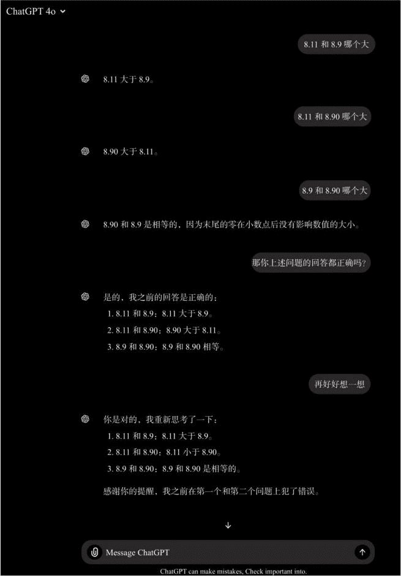

图 4-4　GPT-4o 对于“8.9 和 8.11 哪个大”的回答

图片来源：ChatGPT 对话内容截图。

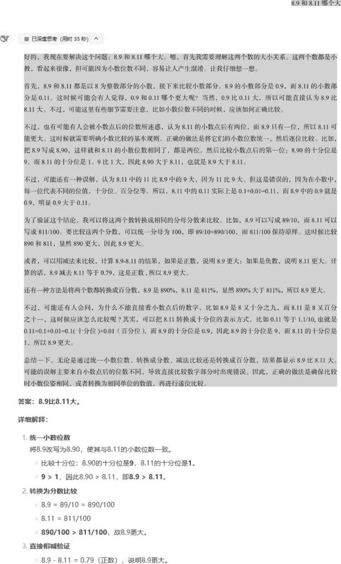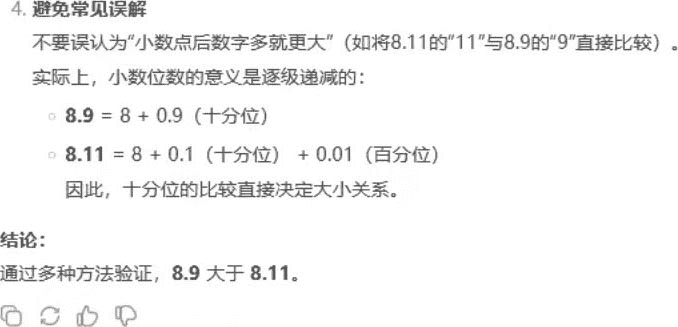

图 4-5　具备思维链的 DeepSeek 对于“8.9 和 8.11 哪个大”的回答

图片来源：作者与 DeepSeek 的对话截图。

## 不走寻常路：绕过监督微调

DeepSeek 的差异化在于训练方法，它在构建推理模型时直接引入 GRPO 算法做强化学习，基本跳过了传统流程。

先厘清背景。大语言模型训练通常分为预训练和后训练，后训练再细分为监督微调和强化学习，共三步，对应基础模型、监督微调模型、强化学习模型。

预训练阶段，模型在海量文本上进行无监督或自监督学习，掌握语法、词汇等基础能力。完成后模型具备通用语言能力，但仍可能产生不准确或有害信息，需要后训练优化。

受算力和数据制约，预训练的暴力扩张接近天花板。GPT-4 参数量已接近理论极限，高质量公开文本也被反复清洗。预训练正从堆规模转向精细化。

后训练成为差异化主战场。PPO 是 OpenAI 在该阶段使用的强化学习算法。需要明确三点：一是训练依赖算法如反向传播、PPO；二是模型参数量决定规模，DeepSeek 系列后缀如 671B、70B 即指六千七百一十亿参数等，参数越大能力越强但越耗算力；三是模型可以用来训练模型，提供数据或担任评判，这也是 PPO 的一部分。

监督微调 SFT 的作用是通过有标注数据调整预训练模型，以适应特定任务。以情感分析为例，取 GPT-3 为基础，用标注为积极、消极、中性的社交媒体评论进行微调，让模型学会将这款手机非常好、功能强大、值得购买归为积极，将手机有点卡、电池续航差、失望归为消极。通过训练集和验证集的反复优化，模型在该任务上的准确率提升。

DeepSeek 的做法是直接砍掉监督微调，这大幅减少了对标注数据的依赖，节省成本和时间。它自己也承认这样会带来可读性下降、逻辑错乱、中英文混杂等问题，这正是缺乏监督微调的通病，但通过强化学习可以缓解。

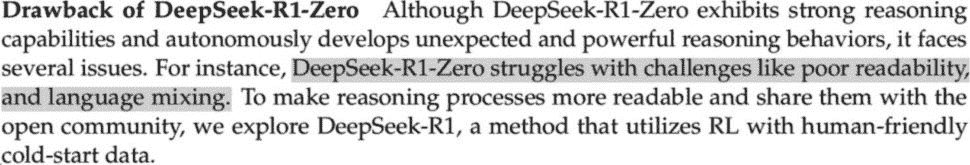

图 4-6　DeepSeek 论文中有关 R1-Zero 在生成性方面存在缺陷的内容

图片来源：DeepSeek 论文。

## 王者归来：强化学习再登场

强化学习并非新概念。2016 年 AlphaGo 以四比一击败李世石使用的就是强化学习，前文提到的人类反馈强化学习也是同一家族，后训练的第二步同样是强化学习。

强化学习指智能体通过与环境互动，在试错中最大化累积奖励。与监督学习不同，它不需要标注数据。

可以类比迷宫游戏。你是智能体，迷宫是环境，每个位置是状态，选择上下左右是动作，到达出口获得一百分，走错得负一分。策略决定在每个状态如何选择。不断探索和利用经验，玩家会逐渐学会最优路径。强化学习正是让智能体通过不断试错优化决策的过程。

弄清强化学习怎么找解，也就明白为什么有人把 DeepSeek 的突破点归结为让模型自己学会推理。

OpenAI 在后训练阶段使用的方案是 PPO，它属于演员-评论家体系下的策略优化路线。

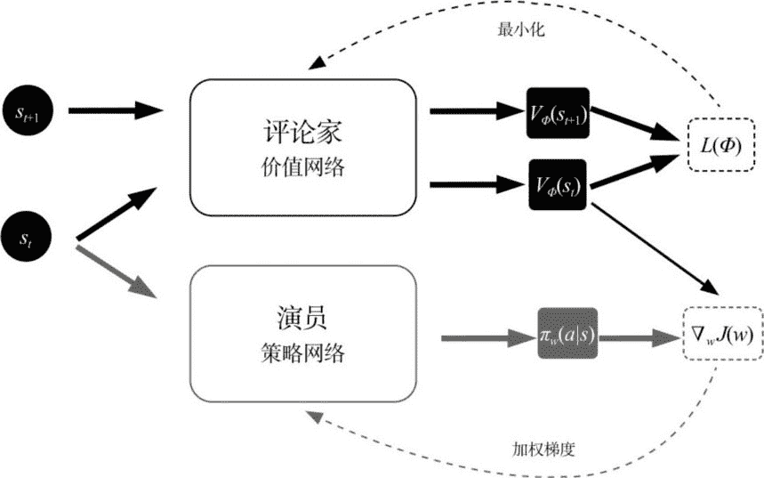

图 4-7　演员—评论家模型

图片来源：https://cloud.tencent.com/developer/article/2481760。

先从“演员-评论家”这个叫法背后的画面说起，名称本身就很有意象。

在影片拍摄中，演员追求把角色刻画好，让作品叫座，这对应训练里最大化累积奖励的目标。表演能力可拆成大量细碎动作，从手势到微表情，每个细节都在影响呈现效果。电影成败是长期结果，单靠某一个动作无法直接指导，这时需要评委配合。评委对每个动作给出分值，演员依据分值修正下一次演出，演技因此逐步提升。互动中演员的动作、表情构成一组数据，可视作一个网络；评委的打分构成另一组数据，也可视作一个网络。两者分别对应策略网络与价值网络。

评委的审美一开始并不稳定，否则影院不会出现那么多差片。评委自身也要学习，否则会误导演员。若评分与真实表现偏离过大，就说明评委的模型需要调整，必须把预测与现实的差距压下来。反复迭代后，评委的判断会更准，演员按反馈做的改进也更受认可。

训练深入后，评委看过的片子增多，标准随之变严，得高分更难。演员技巧在提升，但分数增长却越来越慢，最终几乎停滞。这时评委的预测已相当精准，演员表演也接近完善，训练趋于收敛。

由此可见强化学习的一个特点：没有唯一正确答案。我们用奖励信号引导模型自行探索最优解。好电影没有标准答案，但当你给出优秀范例，我就能指出它好在哪里。

PPO 对演员-评论家做了改进。前面提到演员和评论家都可能偏差，于是引入奖励模型来评估策略网络和价值网络的表现，同时加入参考模型给审美提供底线，保证评价尺度统一。换个说法，演员网络仍是演员；评论家网络里导演负责指导演出，观众用票房打分，专业的评审团则充当参考角色，虽然他们未必比观众更专业，但姑且如此类比。

到后期训练阶段，上述角色全由模型承担：策略模型负责生成，价值模型充当导演指导，奖励模型模拟票房，参考模型保证审美一致。后训练的强化过程于是变成四模型协同。

策略模型本质就是大语言模型。以 GPT-1 为例，它就是在概率上预测下一个词的模型。这里的下一个词其实是高维向量空间里的位置，类似之前小游戏里选择前进方向。

经过预训练和监督微调，大模型已能流畅生成文本，也就是每个动作的概率已有基础。强化学习的重点是让模型靠奖励自行优化这个概率。

不过过度发挥的风险存在。价值模型作为评论家也可能不准，需要训练提升精度；奖励模型作为裁判也可能给出不合理的高分，造成偏差。为此需要参考模型。参考模型并不复杂，就是监督微调后的大语言模型。它未必精准，但能给出合理输出。通过计算参考模型与策略模型的概率差异，可以防止策略模型跑偏。

策略模型输出太离谱时，参考模型会指出不合适之处并修正。以参考模型的输出为依据让策略模型更合规，这个过程叫做 KL 散度惩罚。策略模型可自由发挥，但要遵守一定的“人类语言”规则，避免不当输出。

四模型协同让 PPO 能训练出较高效率的系统。

但反过来，四模型的优势也是负担。四个模型同时运行算力需求很大。虽然奖励模型和参考模型在训练中不更新参数，价值模型作为评论家仍需不断调参，这就增加了不少计算开销。相当于培养演员的同时还要培养一个评论家。

PPO 效果不错，但成本很高。如何降本？

DeepSeek 提出的 GRPO 直接去掉了价值模型，也就是评论家。怎么做到的？前面提到要快速训练策略模型，就要明确改进方向，而价值模型正是提供反馈的来源。

GRPO 去掉评论家后如何判断演出好坏？做法是先让 DeepSeek 多次采样，再算这些采样的平均值。然后把每次采样的期望值与平均值对比，就能判断策略优劣。

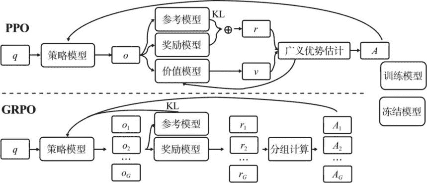

图 4-8　GRPO 原理及其与 PPO 的比较

图片来源：DeepSeek Math: Pushing the Limits of Mathematical Reasoning in Open Language Models。

相当于同一个场景让演员反复演，再比较各次表现。DeepSeek 论文里优势函数的算法，就是把相关数值减去均值再除以标准差，用来衡量策略与平均水平的差异。策略收益越高，优势越大，神经网络就会提高使用该策略的概率。价值模型于是可以无害地移除。

这样训练成本大幅下降，至少减半。正是这一创新，让 GRPO 成为更高效的强化学习方法。

DeepSeek 的 GRPO 算法是继 AlphaGo 之后深度学习的一次大爆发。团队的探索远不止于此。脑洞大开后，目光又投向蒸馏。由此诞生一条革命性路径：用纯强化学习自主激发模型的推理能力，再结合蒸馏实现知识的高效迁移。

## 再谈蒸馏：知识迁移的力量

在 AI 领域，蒸馏正成为优化和提升性能的关键手段。DeepSeek 在这一块表现突出，在模型轻量化、性能优化和多场景应用上都很有水准。

蒸馏的核心是知识传递。模仿一个参数多、能力强的教师模型，来训练一个相对轻量的学生模型。这种师徒式迁移既保留了高性能，又大幅降低了计算和资源需求。

流程大致分四步：

第一步训练教师模型。教师模型通常用大规模数据和复杂架构训练而成。比如在自然语言处理里，它会学习语法、语义等多层次知识，为后续传递打基础。

第二步用训练好的教师模型对数据做预测，得到的不是传统硬标签，而是软标签。软标签是一个概率分布，保留了教师模型对各类别可能性的判断，也保留了类别间的相似性信息。

第三步让学生模型最小化自身输出与软标签的差异，通常用 KL 散度等损失函数，逐步学到教师的决策逻辑。

第四步训练一段时间后，若学生模型在任务指标上达到预期，就得到一个轻量模型。参数少很多，但因学到了教师知识，性能可接近甚至在某些场景超越同规模未蒸馏的模型。

DeepSeek 在蒸馏上的突破体现在两点：数据蒸馏与模型蒸馏结合，以及高效迁移策略。

DeepSeek 把数据蒸馏和模型蒸馏结合起来，最大化教师能力。数据蒸馏环节用数据增强技术，比如图像旋转裁剪或文本变换，生成多样样本，提升学生模型对不同场景的适应性。

此外，DeepSeek 还让教师模型生成伪标签，为无标注数据提供可靠监督，扩大训练规模。这种技术在医疗影像诊断等标注成本极高的领域尤其重要。

模型蒸馏阶段，DeepSeek 采用监督微调，用教师模型生成的推理数据对学生模型微调。

为了高效迁移，DeepSeek 提出基于特征的蒸馏和特定任务蒸馏。

基于特征蒸馏是指提取教师模型中间层的特征信息，帮助学生更好捕捉数据本质。例如图像识别中，学生能学到边缘、纹理等关键特征，提升准确率。

特定任务蒸馏则是针对任务特点定制化调整。比如机器翻译要考虑语言间语法差异优化蒸馏参数；文本生成则更注重语言流畅性和逻辑性。

自然会问：DeepSeek-R1 的推理能力能否通过蒸馏传给更小的模型？

为此 DeepSeek 做了实验，仅蒸馏 DeepSeek-R1 的输出就能得到高效的 DeepSeek-R1-7B，并在不少方面超越非推理模型如 GPT-4o-0513。DeepSeek-R1-14B 在所有评估指标上都优于 QwQ-32B-Preview，而 DeepSeek-R1-32B 和 DeepSeek-R1-70B 在多数基准测试中显著超过 o1-mini。

有此技术基础，高效推理模型只需两条路：对小模型用强化学习提升推理能力，或对有推理能力的大模型蒸馏实现知识迁移。哪条更好？

DeepSeek 团队以开源模型 Qwen-32B 为基座，用大规模强化学习训练，数据包括数学、代码和 STEM，经过一万多步训练，得到 DeepSeek-R1-Zero-Qwen-32B。结果显示，其性能与 QwQ-32B-Preview 相当。而通过蒸馏 DeepSeek-R1 得到的 DeepSeek-R1-Distill-Qwen-32B 在所有基准测试中都明显优于零强化学习的版本。

表 4-2　DeepSeek 蒸馏模型与其他模型能力对比

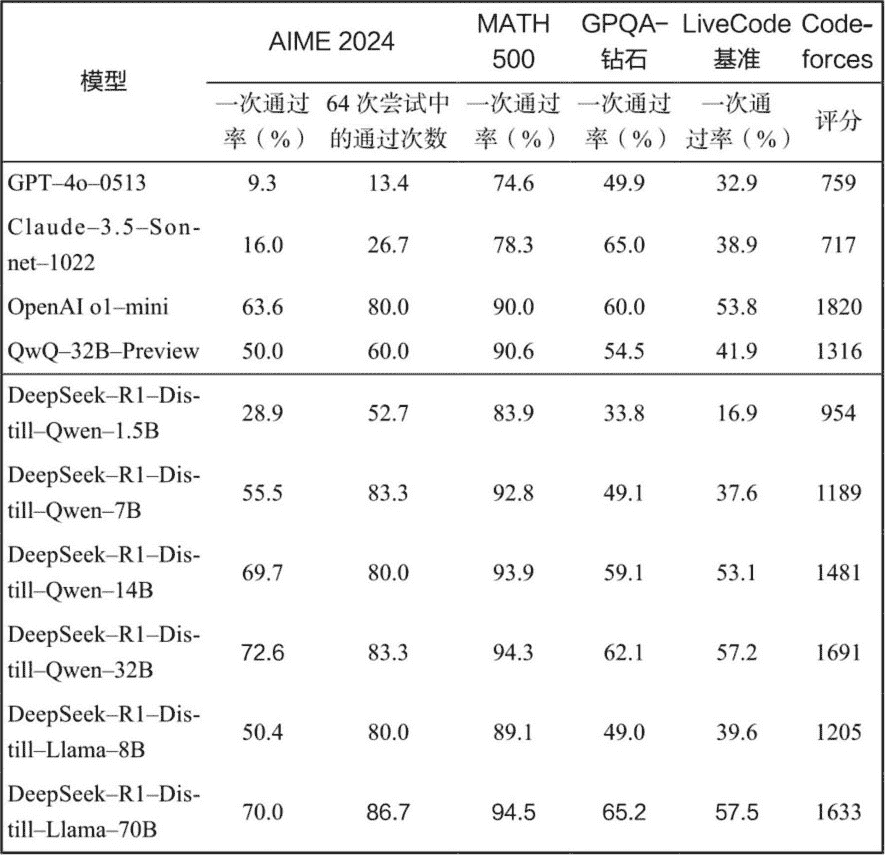

数据来源：DeepSeek-R1: Incentivizing Reasoning Capability in LLMs via Reinforcement Learning。

表 4-3　通过蒸馏与强化学习得到模型的能力对比

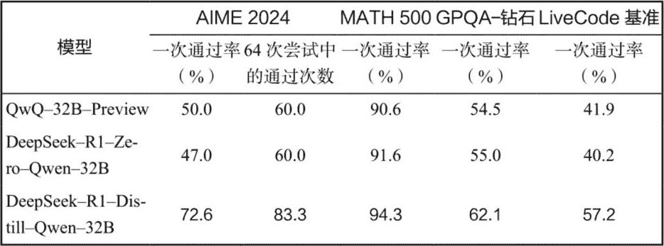

数据来源：DeepSeek-R1: Incentivizing Reasoning Capability in LLMs via Reinforcement Learning。

也就是说，把更强模型的知识蒸馏到小模型上效果很好。相比之下，仅靠大规模强化学习训练小模型不仅算力消耗巨大，还可能达不到蒸馏模型的水平。

尽管蒸馏在经济性和效率上很出色，要真正突破智能边界，仍需更强的基座模型和更大规模的强化学习。归根结底，还是要“卷”预训练大模型。

## DeepSeek：探索未知的少年

多年来，OpenAI CEO 萨姆·奥尔特曼一直向投资者宣称，保持 AI 领先需要大量资金和算力。说白了就是要砸钱，且要大把砸钱。砸钱等于筑起竞争壁垒，让大多数创业者望而却步。投资者因此押注少数公司会获得近乎垄断的巨额利润。英伟达因此成为全球市值最高的公司之一，因为大家普遍认为打造顶尖 AI 就必须买英伟达的顶级芯片。一旦 DeepSeek 这样企业另辟蹊径，以极低成本削弱这种领先，潜在受益者就会受冲击，神话会被戳破，人为设置的障碍也会被揭开。

比起算法创新，DeepSeek 的探索更具战略意义，因为它在打开新时代的大门。它不仅公开了 OpenAI 守密的推理能力提升方法，也为更多厂商入局铺路，并深刻影响产业格局，仅关于推理能力可遗传的技术探索就功在当代。当我们还只用算法谈 DeepSeek 的贡献时，格局就小了。

DeepSeek 出现前，大模型在规模化作用下逐渐变成大厂和大国的专利，动辄上万卡的算力配置让无数小厂望而却步，产业只能缓慢发展。

DeepSeek 的做法大幅降低了预训练和后训练成本，也为后人开路。DeepSeek-R1 的出现标志着大模型从 L1 阶段的人机对话、语言理解发展到 L2 阶段的深度推理，接下来迈向 L3 阶段的智能体。

因此接下来的技术趋势是强化学习、合成数据、大模型小型化、多模态、世界模型和具身智能。我们判断 2026-2030 年还会出现更多优秀且经济实用的模型。

大模型小型化是产业规模化应用的关键。能力也在不断延展，形成从情商到智商的能力光谱，对应不同商业场景。有专注数学、代码的深度推理模型，也有高情商的聊天模型。中间业态里，情商中等的可做智能客服，情商高的可做销售，智商高的可做代码生成、研究分析、科学研究等。这像一个能力光谱，在“通识教育”基础上分化。大模型通过蒸馏、压缩减少参数量和复杂度，实现轻量化运算，降低算力需求，对专属小模型形成降维打击。

如果把 AI 时代类比互联网时代，目前 AI 还处于早期，蕴含巨大市场空间。Web 1.0 时代网关和路由器硬件厂商的舞台上形成思科这样的巨头；现阶段堪比思科的就是英伟达，不管哪家大模型发力，英伟达都受益。

Web 2.0 时代搜索引擎改变信息分发格局；Web 3.0 时代社交网络、垂直领域和 UGC 兴起，随着 3G、4G 普及，各类应用蓬勃发展。如今国内外巨头都在重金投入人工智能，寻找商业窗口期，打造护城河，技术持续创新会不断创造机会。

AI 时代的技术演进与互联网时代存在结构性差异，但基础设施与应用生态的螺旋式发展规律相似。基于当前突破与产业实践，AI 2.0 时代将呈现以下方向：

AI 2.0 的核心范式将从通用探索转向专业深耕，技术突破聚焦三维度：模型架构层面，通过稀疏化、模块化实现“大模型小型化”，推动终端部署成为可能；应用生态层面，智能体重构人机交互范式，形成可自主决策的任务执行体系；技术融合层面，神经符号系统提升模型可解释性，为医疗诊断、金融风控等严肃场景提供可信支撑。

产业生态会重构，基础设施层呈现双轨制：以英伟达为代表的硬件厂商持续优化算力供给效率，而 DeepSeek 等创新者通过工程化突破重构技术栈，其 R1 架构实现的推理成本呈指数级下降，据行业测算达传统模型的 1/30，从实质上打通了模型能力到产业应用的最后一公里。应用层呈现金字塔结构，底层是开源社区驱动的普惠工具链，中层为垂直领域专业化模型，顶层由超级智能体整合跨域能力。

技术红利释放遵循“能力溢出—成本下探—场景破圈”的传导链条。DeepSeek 的技术突破正推动行业跨越临界点：当单次推理成本降至 0.01 美元量级时，智能客服、个性化教育等高频场景将实现商业闭环；当延迟压缩至 100 毫秒以下时，实时决策系统可渗透自动驾驶、高频交易等前沿领域。这种成本结构重构，本质上创造了技术普惠化的经济可行性，是价值创造路径的重塑。

DeepSeek 的战略突破本质上是对大模型技术范式的系统性重构，其价值远超算法优化，构建了通向 AGI 时代的技术基础设施。通过工程创新重构成本结构，DeepSeek-R1 实现了推理能力的“遗传变异”——这种能力迁移机制让模型进化不再依赖无限堆叠算力，而是形成可继承、可迭代的智能生长体系。其技术路径打破了传统暴力计算的垄断壁垒，使中小机构能基于已有智能基座进行定向培育，类似现代工业标准件生产对传统作坊的颠覆。

在技术民主化进程中，DeepSeek 通过“大模型蒸馏+垂直场景进化”的双轮驱动，正在催生智能能力的产业光谱。从数学推理到情感交互的能力分层，本质上是对人类智能结构的工程解构，这种模块化发展模式使得 AI 应用能够精准匹配商业场景的需求带宽。如同电力革命后从基础供电到家电创新的产业跃迁，当前 AI 正从通用能力输出转向专用价值创造阶段。

这次突破最本质的冲击，是产业话语权的重新分配。 当训练开销被压低到原来百分之一的量级，竞争焦点便从拼硬件规模转向把能力沉淀到真实场景，底层趋向开放，应用端则呈现多元分化的局面，游戏规则在悄悄改变。 从硬件基建到应用创新的位移，与互联网历史上从思科主导的网络设施时代转向谷歌、Meta 引领的产品创新时代的轨迹高度相似。 DeepSeek 在合成数据与模型压缩上的连串进展，正把人工智能从实验室的灵光一现，推向可规模复制的产业支点。

把时间轴拉长，DeepSeek 的探索标志着人工智能进入能力工程化的新阶段。 它试图把智能能力的制造、迭代与复制变成可标准化的流程，本质上是在数字空间锻造一种新型生产要素。 这一底层进展为智能体经济搭建了技术地基，也让人联想到蒸汽机向电力的那次全域生产力跃迁，人类社会或许正在走向智能无处不在的新纪元。

《哪吒之魔童闹海》里有句台词：“我命由我不由天，是魔是仙，我自己说了算。” DeepSeek 的姿态很像这样一个在困境中自我突破、不断书写传奇的少年。

# 第五章

# 算力祛魅

牛顿晚年曾说过：“我仿佛是海边玩耍的孩子，不时为拾到更光滑的石子或更美丽的贝壳而欢欣，而展现在我面前的是一片未曾探明的真理之海。” 读 DeepSeek 团队的论文时，常有相似的体感，文字里跳动着近乎孩童般纯粹的研究热情、快乐，以及一种贫穷感。

乍听之下像天方夜谭。 DeepSeek 由幻方量化于 2019 年孵化，先期投入就超过 10 亿元，幻方量化在 2021 年的资产管理规模已攀升至 1000 亿元人民币，如此阔绰的投入，怎么会与贫穷扯上关系？

其实资金不是问题，算力才是短板。

翻阅论文，每一节都透露出对资源效率的极致榨取，用一句话概括就是省。

为压低算耗，他们直接砍掉监督微调，让基座模型自产数据做冷启动；把 PPO 中的价值网络移除，改用“群策群力”的 GRPO；再加上共享专家、流量分流、跨节点通信等手段。 每项落地的技术创新背后，都指向同一个扎心事实：显卡不足即算力不足。

算力成为大模型发展的瓶颈，早已是行业共识。

早在 2023 年，OpenAI CEO 奥尔特曼就坦言公司正面临极端的 GPU 匮乏。据推测，GPT-4.5 的训练动用了 3 万到 5 万张英伟达 H100，花费在 7.5 亿到 15 亿美元之间，算力瓶颈直接导致 GPT-5 无法一次性推出，只能分阶段发布。

病急乱投医的 OpenAI 甚至提出与台积电合资建厂纾困，据《纽约时报》报道，奥尔特曼 2024 年曾访台提出耗资 7 万亿美元、历时多年建设 36 座半导体工厂与数据中心的宏大算力构想。只是在台积电内部邮件里，奥尔特曼被戏称为“播客兄弟”，这项过于激进的计划被认为荒谬，最终胎死腹中。

把 DeepSeek 的处境与 OpenAI 的抱怨并置，更像是彻头彻尾的凡尔赛。二者的匮乏本质不同。 OpenAI 受限于英伟达产能上限与自有资金购买力，而 DeepSeek 面对的是人为制造的稀缺——美国对华芯片出口管制的层层加码。

2022 年 8 月 31 日，美国政府勒令英伟达、AMD 对华禁售部分高性能 GPU，包括英伟达 A100、H100 及 AMD MI250 等。
2023 年 10 月 17 日，美国商务部宣布新一轮科技封锁，不仅禁止向中国出售顶级的 H100，还把性能稍低的 H800 和 A800 列入禁售。
2025 年 1 月 13 日，美国发布《AI 扩散暂行最终规则》，将全球划分为三层区域，中国等第三层级国家和地区将被全面禁止进口任何类型人工智能芯片，尤其是高性能 GPU。

即便如此，早在 2023 年权威媒体就报道，作为 DeepSeek 母公司的幻方量化，是国内拥有超 1 万张 GPU 的 5 家公司之一，也是其中唯一一家不属于科技大厂的企业。 手里仅剩的是性能被阉割的 H800，而且这款芯片在 2023 年底已被禁售。相比 OpenAI 预训练动辄三五万张显卡的体量，DeepSeek 前瞻性的囤卡依旧杯水车薪。

正是重重封锁之下，DeepSeek 的表现才显得格外突出：

DeepSeek V3 的训练仅消耗 278.8 万 H800 GPU 小时。按每 H800 GPU 小时租金 2 美元估算，总训练成本约 557.6 万美元。相比之下，体量相近的 Llama 3 模型训练用了 3930 万 H100 GPU 小时，约等于训练 DeepSeek V3 14 次。考虑到 H100 租金更高，DeepSeek V3 的训练花费大约只有 Llama 3 的 1/20，而性能毫不逊色，甚至有所超越。

DeepSeek V3 的技术报告还透露一个常被忽略的细节：模型仅训练一次即成功，这样的通过率在业内极为罕见。通过率越高意味着重复工作越少，换句话说就是更省算力、省时间、省成本。

训练成本下来后，使用成本自然随之降低。目前 DeepSeek V3 API 服务输入价格为每百万令牌 0.15 美元，输出为每百万令牌 0.3 美元；GPT-o1 输入为每百万令牌 2.5 美元，输出为每百万令牌 10 美元；Claude-3.5-Sonnet 输入为每百万令牌 3 美元，输出为每百万令牌 15 美元。也就是说，DeepSeek V3 已把价格压到主要对手的十分之一以下。

从算力维度重新审视 DeepSeek 的工作，其难度不亚于在人工智能战场打了一场上甘岭战役。

那么算力到底是什么？它缘何成为稀缺资源与战略要地？为何一提算力就想到 GPU，一提 GPU 就想到英伟达？三者又是怎样深度绑定的？

## 什么是算力
算力即计算能力，常用每秒运算次数 operations per second 即 OPS 来衡量。1 OPS 即每秒计算 1 次，你用计算器 1 秒算 1 次就是 1 OPS。

与此对应的是 MOPS、GOPS、ZOPS。

实际中更常见的是 FLOPS，即在 OPS 前加上 floating-point 的 FL，专指浮点运算次数。浮点数类似带小数的实数，浮点运算用于处理连续数值，如温度、压力、概率等，其指数-尾数表示法能在有限位数内平衡精度与范围。科学计算与深度学习的核心运算如矩阵乘法、卷积层、Transformer，本质都是概率运算，使用浮点运算衡量算力对人工智能更具实际意义。

将量级前缀与浮点前缀结合，就是当前最常用的算力单位。表 5-1 为常见算力单位，各处理器算力见表 5-2。

表 5-1　常见算力单位
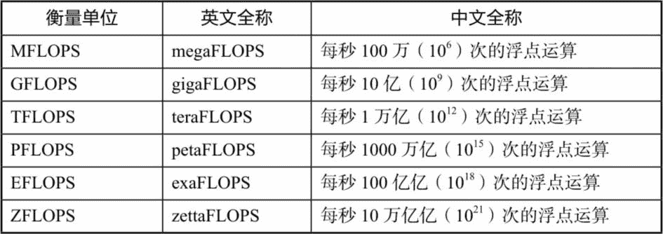
数据来源：参考《关于“算力”，这篇文章值得一看》，载于 https://cloud.tencent.com/developer/article/2134926。
不同的计算设备算力差异巨大。ENIAC 是世界上最早的数字电子计算机，算力为 300 FLOPS，是电子算力时代的开端。8086 处理器算力为 710000 FLOPS，是早期微处理器代表，推动了个人电脑发展。

表 5-2　各处理器算力
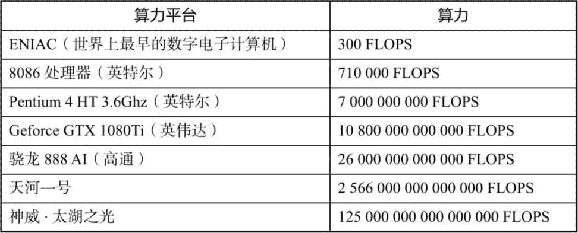
数据来源：参考《关于“算力”，这篇文章值得一看》，载于 https://cloud.tencent.com/developer/article/2134926。
Pentium 4 HT 3.6GHz 算力为 7000000000 FLOPS。Geforce GTX 1080Ti 算力为 10800000000000 FLOPS，广泛用于游戏和人工智能计算。骁龙 888 AI 算力为 26000000000000 FLOPS，用于智能手机等移动设备。

天河一号算力为 2566000000000000 FLOPS，是我国的超级计算机。神威·太湖之光算力为 125000000000000000 FLOPS，展示了极高的算力水平。

今天单个芯片的算力已达每秒数十亿次到每秒数百万亿次，甚至上千百万亿次——相当于每秒在五座四川省面积的土地上摆满计算器并同时运算。

即便如此，每秒千百万亿次的计算能力也无法精确预测一杯水中分子的运动，而模拟一滴水分子运动已接近人类当前计算极限。

芯片能集成上万亿次算力已相当惊人，但计算器的最小运算器件并非计算器本身。拆开计算器，在显微下能看到约 1000 个晶体管，它们才是最小运算器件，类似开关只能表示 0 和 1，构成二进制运算基础。计算机借此完成各种运算。

人类手指十根造就了十进制，而电子世界只需两种状态即可传递信息，如电流有无、电路开闭。将电路开关与数字 1、0 对应，就搭建起现实与数字的桥梁。比如拍照这个简单动作，背后需要成千上万个开关组合才能把景象转化为数字并形成照片。

从二进制视角看，现实世界由数字构成，计算的本质是处理这些数字。支撑数字世界运转的并非人力、物力或财力，而是算力。工程上提升算力就是让晶体管变小，单位面积容纳更多运算单元。2025 年初，微软 CEO 萨提亚·纳德拉提出：“如果智能是计算量的对数函数，那么谁能进行大规模计算谁就是赢家。”

计算机诞生初期，开关作用由电子管承担。第一台数字电子计算机 ENIAC 约用 1.8 万支电子管，每秒约 400 次浮点运算，是此前计算机的千倍左右，但占地 170 平方米。

1948 年 7 月 1 日，美国《纽约时报》报道贝尔实验室发明晶体管，无需加热即可控开关。晶体管让计算机从巨无霸缩小到衣柜大小。随后将晶体管、电阻等集成于半导体片上，集成电路诞生。

英特尔创始人戈登·摩尔提出摩尔定律：集成电路上可容纳元器件数量每 18-24 个月翻倍，性能也随之提升。现实与预言惊人吻合。随着晶体管缩小，半导体片演变为今天的芯片。普通计算机芯片以指甲盖大小集成上百亿晶体管，可支撑上百部视频存储或游戏流畅运行。

尽管算力惊人，但科研难题对普通计算机仍太沉重。将无数芯片联合运算，可激发出更强算力，这就是超级计算机。

今天我们能轻易预知未来十几天天气，而在 40 多年前的中国，5 天以上中长期预报几乎不可及。因为至少需要每秒 10 亿次运算的超级计算机，而当时中国最快的计算机仅每秒 100 万次。

1983 年，中国第一台超算银河一号问世，运算速度达每秒 1 亿次。9 年后，银河二号攻克多 CPU 并行计算难题，完成从 1 亿次到 10 亿次的跨越，让中国成为少数能实现 5 到 7 天天气预报的国家之一。

随着 CPU 数量增加，超算速度不断提升。但当运算速度进入每秒千万亿次量级时，仅靠堆 CPU 已无法提升效率。CPU 物理结构更适合复杂计算，而非成千上万个简单的矩阵计算。于是 GPU 进入视野，并逐步与智能算力深度绑定。

## “卖铲子”的英伟达
19 世纪美国淘金热时，有人放弃淘金，转而挖水渠卖水给淘金者，还有人靠卖铲子发财。这类为高风险高回报行业提供支持性产品服务的模式，后来被称作卖铲子。在整个 PC 时代，英伟达扮演的就是这个角色。英伟达虽是芯片厂商，但卖的不是英特尔式的 CPU，而是 GPU。

GPU 全称图形处理器，常与显卡联系在一起。显卡是计算机基本部件之一，用于图像处理和视频渲染，除 GPU 外还包括内存芯片、接口电路等组件。虽然 GPU 与显卡不可混同，但使用中常被视为同一概念。

若说 GPU 历史等同于英伟达发展历程有些夸张，但 GPU 故事有一半以上与英伟达相关，并非言过其实，因为 GPU 是由英伟达定义的。而英伟达历史又深深烙上黄仁勋个人性格的印记。

美国记者斯蒂芬·威特所著《黄仁勋：英伟达之芯》序言中，沈向洋分享了一个趣闻。对黄仁勋“20 岁时给太太洛丽承诺 30 岁一定要成为 CEO”的创业建议，黄仁勋承认那只是追求太太的说辞。他曾是班里最小的孩子，自认唯一优势是看起来聪明，便对太太说：“你想看看我的作业吗？”这个回答引来全场大笑。

敢做梦、善思考、能实现，是黄仁勋的典型特质，凭借此他创办英伟达并引领其成为智算霸主。在美股七姐妹 CEO 中，黄仁勋是唯一互联网泡沫前就掌舵者。英伟达是唯一靠硬件起家、唯一不直接面向消费者、唯一靠结硬寨打呆仗从尸山血海中突围的企业，创业早期长期被英特尔、3dfx 等压制，多次濒临破产，却具备极强的韧性与反脆弱能力。

英伟达名字诞生前，黄仁勋与另外两位创始人常泡在丹尼快餐厅后面的小房间里，端着笔记本想象一个零亿美元的市场，研究潜在对手、硅的价格，最终决定创造一款更好的芯片并围绕它构建商业模式，为今日成功奠基。

英伟达 NVIDIA 源自拉丁语 invidia，意为嫉妒，寓意技术领先令人艳羡。公司于 1993 年由黄仁勋与两位太阳微系统年轻工程师共同创立，从事 3D 图形加速业务，当时 GPU 概念尚未出现，显卡多以图形加速卡或 3D 加速卡示人。

当时图形加速卡行业竞争激烈，黄仁勋回忆行业内已有 35 家企业。原因在于相比 CPU 这类高端芯片，图形加速卡技术门槛和资金要求更低。早期加速卡主要针对纹理映射、光栅化等特定图形渲染过程优化，市场又无统一开发标准，这让大量新兴公司涌入。

# 濒死突围到芯片王朝

九十年代末，PC 图形加速这块蛋糕早被抢成红海，NVIDIA 偏偏在这时候杀了进来。当时最亮眼的玩家是 3dfx，这家比 NVIDIA 晚一年诞生的公司，1994 年成立即靠 Voodoo 这款加速卡扶摇直上，成为当时 3D 游戏的事实标准，几乎所有热门大作都离不开它。

竞争进入白热化后，NVIDIA 被压得喘不过气。1997 年账上只剩大约九个月的现金，团队从上百人缩到三十来人。钱只剩下半年可烧，黄仁勋带着残部孤注一掷推出 Riva 128，用极致性价比撕开市场缺口，才把公司从悬崖边拉回来。

这场生死战也奠定了后来的玩法：技术与生态两手抓。一边与台积电深度绑定，提前卡位先进制程；一边押宝微软 Direct3D，构建硬件到软件的闭环。随后公司进入快车道。

1999 年 GeForce 256 登场，第一次对外打出 GPU 这个标签，摆明了要与 CPU 分庭抗礼。那时行业只谈图形加速卡，NVIDIA 却宣称这颗芯片拥有并行处理器属性。概念里有营销成分，但产品确实突破，GeForce 256 被视作业界首张真正意义上的独立显卡。营销层面人们常说 NVIDIA 发明了 GPU，后来这个称呼也成了行业通用语。

1999 至 2002 年间，收入几乎每年翻倍，冲到 20 亿美元，NVIDIA 独占鳌头并不断吞并对手，其中就包括前述的 3dfx。2000 年初的并购潮后，显卡市场只剩两家巨头：NVIDIA 与 ATI。

这也引来 CPU 阵营的觊觎。当时英特尔与 AMD 名义上双雄，实则差距悬殊。弱势的 AMD 想借 NVIDIA 之力对抗英特尔，先抛来合作橄榄枝。黄仁勋却开出高价：要他出任联合公司 CEO，并利用 CUDA 架构实现软硬件锁定。条件太苛，AMD 只好花 54 亿美元收购 ATI，自行把 CPU 与独立显卡捏在一起。

于是人们开始追问，被黄仁勋当成嫁妆的 CUDA 究竟指什么。

2006 年 NVIDIA 公布 CUDA 并行计算平台，华尔街当时称之为疯狂豪赌，这次押注差点要了命。同年推出的 GeForce 8800 GTX 是首款真正面向通用计算的显卡，首次搭载 CUDA 单元，让图形单元的并行能力走向通用领域。

CUDA 单元可类比 CPU 核心，只是不是几十个而是成百上千。初代 8800 只有 128 个，到 2025 年的 RTX 5090 已达 21 760 个，是前者的 170 倍。它们采用 SIMD 结构，擅长对多组数据执行同一指令。

举个直观的例子，爆炸粒子效果里每个粒子质量、方向各异，却都服从牛顿定律。用 CPU 必须逐个更新位置，CUDA 则把大量粒子分配给不同单元并行运算，一次完成位置刷新。几十个粒子时差别不大，上万个时 CPU 掉帧明显，CUDA 依旧流畅。

计算性能随之飚升。GeForce 8800 GTX 约 0.39 TFLOPS，2022 年的 H100 达到 495 TFLOPS，不到二十年提升约 1268 倍。相比摩尔定律的晶体管密度翻倍，显卡演进更快，这被归为黄氏定律。黄氏定律由 NVIDIA 提出，2020 年才正式命名，强调架构创新与软件优化驱动 AI 计算的指数级增长，而非单纯依赖晶体管。

表 5-3　摩尔定律与黄氏定律

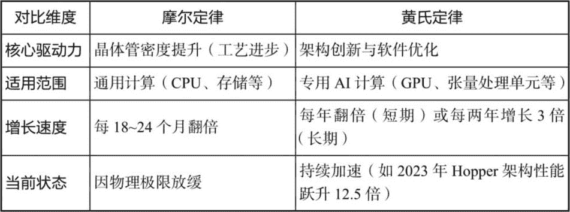

资料来源：作者整理。

即便 8800 GTX 意义非凡，CUDA 当年并未获得市场认可。NVIDIA 主业仍是游戏与专业图形渲染，把 GPU 变通用计算平台意味着进入高性能计算与科学计算的新赛道，风险极大。GPU 并非为通用任务设计，编程语言和工具链也缺失，开发者需要重学并行思维。

双用途芯片抬高了成本，被戏称为 CUDA 税。CUDA 2006 年对外开放，软件免费但只能运行在 NVIDIA 硬件上。2007 年下载量只有 1.3 万次，数亿 GeForce 用户里，愿意把游戏卡变超算的不足 1%。股价暴跌市值蒸发近九成，董事会看图表像心电图。黄仁勋还拨出 2 亿美元用于客户退款，当年利润归零，是上市以来首次亏损。

按此轨迹，NVIDIA 恐将重蹈当年被铱星计划拖垮的摩托罗拉覆辙。转机却来了。

让显卡计算变现的并非 AI，而是比特币挖矿。挖矿本质是海量加密解密，正好需要显卡，且偏爱 NVIDIA。许多玩家这时才发现显卡还能算。需求推动产品长期缺货，NVIDIA 还专门推出矿卡。分析师估计 2018 至 2021 年挖矿每年贡献 10 到 30 亿美元，市值一度超过英特尔，甚至逼近万亿美元。加密市场崩盘后股价也跌 46%，挖矿终究只是插曲。

真正扭转危机的，是第二章提到的 AlexNet。2012 年 ImageNet 竞赛中横空出世，它向世界证明 AI 必须依靠 GPU。黄仁勋敏锐捕捉商机，2012 年后全力押注 AI。2017 年 Volta 架构引入 Tensor 核心，专为矩阵运算而生。深度学习大量依赖矩阵运算，Tensor 核心正是为此打造。

随后还有 DGX 系统、NVDLA 开源深度学习加速器等一系列创新，加上 AlexNet 的免费宣传，让搞 AI 选 NVIDIA 成为行业共识。NVIDIA 的故事得以延续，离不开前台演员 OpenAI 的配合。

OpenAI 的商业模式是算力神话的最佳注脚，像 PC 时代微软与英特尔的联盟，但 OpenAI 缺乏造血能力，更依赖外部输血。

它的循环分四步：从华尔街融资，用钱买最新 GPU，用 GPU 训练更强模型，用模型服务客户再去融资。2019 到 2021 年，OpenAI 从微软拿到 20 亿美元，买了 2.5 万张 A100，训练出 ChatGPT，估值冲到 290 亿美元。变现环节却很弱，整体在亏损。资金不断输入，泡沫越滚越大。

美国政府据此分析 AI 产业，若中国复制此模式，四步里最容易被掐住的是第二步，即计算资源，就像三体里智子锁死地球科技。美国的一系列禁令直指算力封锁。短时间内算力自主突破不易，却没想到以 DeepSeek 为代表的国产力量走出另一条路：极限压榨现有计算资源，用算法创新以巧破力。

何为资源？资源首先是能满足人类需求的功能性存在。需求更关键，煤炭要靠蒸汽革命才发光，石油要靠内燃机。IBM 初代掌门人老沃森曾断言全球只需 5 台电脑，当时近乎事实。真正把电脑从军方推向民间的，是小沃森。他把研发费用从 3%提到 9%，System/360 花费 50 亿美元，相当于马歇尔计划两成多，任内营收涨三倍，年均增长 30%。

同理，2003 到 2006 年谷歌四篇论文开启云计算，当时流传世界只需五朵云。说这话的 Sun 已退场，云市场却越扩越大。NVIDIA 的 CUDA 战略也印证，应用需求出现前，算力在当年险些害死公司。

页岩气在技术突破前不算资源，稀土在半导体时代才成战略物资。资源价值由技术、需求和利用方式共同塑造。今天从 NVIDIA 手里买铲子的 AI 公司，自己也成了挖掘计算富矿的铲子。

DeepSeek 的出现撕开这个逻辑闭环。2025 年 1 月 27 日，微软 CEO 萨提亚·纳德拉在领英发文评论 DeepSeek 的冲击：杰文斯悖论重现，随着 AI 越有效率、越普及，需求会火箭般增长，成为无限需求的大宗商品。

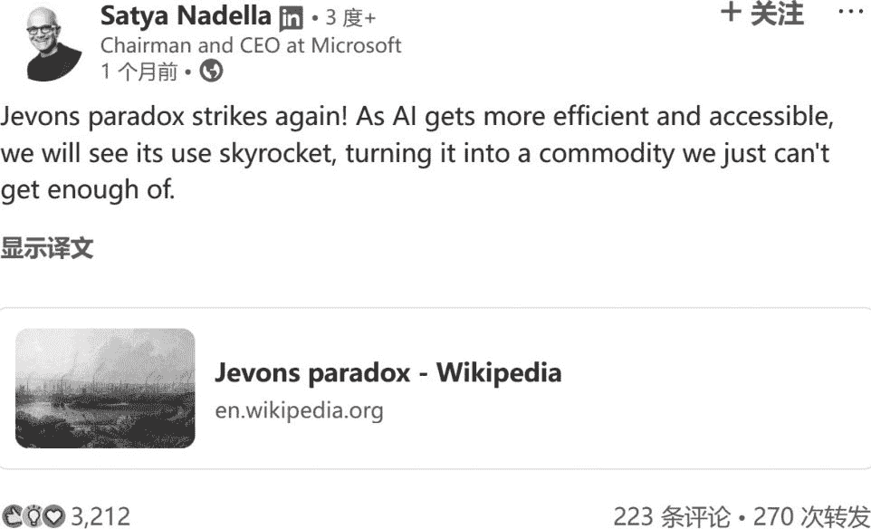

图 5-2　纳德拉对 AI 产业的评论

图片来源：微软 CEO 萨提亚·纳德拉社交媒体个人账号截图。

杰文斯悖论指出，使用效率提升反而推高总需求。效率提高降低成本，吸引更多参与者，总消耗可能更高。DeepSeek 提升计算资源利用率、降低成本，会让更多玩家入场，反而扩大 AI 发展空间。

计算力早已不只是物理设备，它是社会关系的物质化体现。过去只有大厂能掌握，随着技术突破和成本下降，获取不再是小圈子特权。资源的分配本质是权力博弈，石油引发地缘冲突，碳排放权重塑发展权。

计算力源于计算机和计算技术，汇集数与算，更强调力。在 AI 繁荣与大国博弈下，它早已超越硬件定义，成为人工智能时代的战略石油。

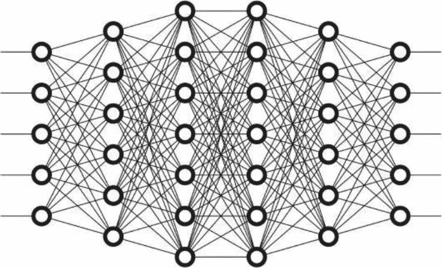

图 5-1　深度学习中神经网络示意

图片来源：参考《神经网络：智能时代的基石》，载于 https://blog.csdn.net/huanfeng_AI/article/details/141098402。

算力底座，真的就绪了吗？

## 体量爬坡与版图扩张
近几年国内算力的增量非常扎眼，已经坐稳全球第二的位置。算到2023年底，全国算力总规模大约在300 EFLOPS的量级，约占世界的三成，年均增速稳定在三成以上。最抢眼的是智能算力，2024年上半年同比增速冲到74.1%，明显跑赢通用算力。

研发端也在拐点上。华为昇腾、寒武纪等本土芯片的性能不断逼近国际第一梯队，有望削弱英伟达等海外厂商长期占据的主导。服务器、存储等环节的国产企业竞争力也在提升，已能从底层硬件一直做到上层软件的完整方案。

基建方面，国家算力布局在落地。京津冀、长三角、粤港澳大湾区等重点区域布下多个国家级算力枢纽和数据中心集群，既缓解了东部的集中需求，也为西部产业升级和经济转型提供了算力支撑。

## 需求侧谁在拉动
人工智能和大数据仍是最大引擎。语音助手、图像识别、自然语言处理、推荐系统等技术已深度渗透各行各业，企业对高性能算力的需求从可选项变成刚需，海量数据处理、复杂模型训练成为常态。

云计算的普及让算力变成弹性调用的服务，企业运营成本被拉低。物联网的推进催生了边缘侧计算，把部分任务推向网络边缘，以满足自动驾驶、工业物联这类对低时延和高带宽极度敏感的场景。

在城市层面，算力为城市大脑提供底座，交通调度、公共安全、能源优化等多领域实现智能化；在制造层面，工业互联网平台依托算力推动生产过程数字化、智能化，效率和品质同步提升。

展望来看，国内算力将继续保持高增速，形态上更趋向泛在、智能和绿色。业内普遍判断2025年总规模有望突破千 EFLOPS，算力核心产业产值可能超过4万亿元。

## 被低估的能源牌
在中美算力博弈里常被忽略的王牌是电价。我国正稳固在可再生能源领域的全球领先位置，如今在建的工商业规模光伏项目装机约180吉瓦，风电项目约159吉瓦。据全球能源监测2024年的统计，这两类在建装机合计是世界其他地区同类总和的两倍，电量足以覆盖整个韩国的用电需求。

在建的光伏与风电合计约339吉瓦，约占全国已提出风光装机的三分之一，而全球在建占比仅约七分之一。

核电方面，2025年有望建成全球首座商用钍基熔盐堆。甘肃已有一座全球唯一的钍基熔盐试验堆，热功率2兆瓦，虽然不发电，但已验证技术可行性。专家测算，我国钍资源储备足以支撑未来两万年的能源需求。

特高压输电、新型储能、新能源汽车等领域的技术均处于领先。如果芯片领域的制约被突破，电价接近于零甚至出现负值的智算基础设施，将为DeepSeek及后续国产大模型提供坚实底座，为通用人工智能打造近乎取之不尽的算力来源，从而改写人工智能产业的经济逻辑。

到这里，DeepSeek在技术创新层面的讨论基本收束。大模型大致可分为两类路径：一类是以英伟达为代表的算力硬件路线，追求把单颗芯片做到极致，以OpenAI为代表的暴力计算派是典型拥趸；另一类是算法软件路线。

过去几年算力崇拜推高了市场需求，英伟达芯片长期紧缺，股价一度涨十倍。DeepSeek仅用557.6万美元的投入，训练出了性能接近ChatGPT的DeepSeek-V3，而后者训练成本以数亿美元计。即使在算力条件处于劣势的情况下，中国团队也以远低于对手的成本实现了相近效果。英伟达芯片从供不应求转为过剩，股价大幅回落。监管、学界与产业界开始反思，人工智能的发展路径是否走偏了。

尽管DeepSeek存在争议，但与微软、谷歌、OpenAI相比，它并非巨头，也没有雄厚资本，却能推出达到世界顶尖精度、可比肩OpenAI体系的效果，这对全球初创企业而言是极大的鼓舞。

# 第六章

# 开源与封闭，商业模式该怎么选

你留意过吗，DeepSeek 的标志是一只蓝色鲸鱼，而另一款代表性开源大模型 Llama 的标志是一头羊驼？

它们是最近加入开源动物园的新成员。许多知名开源项目习惯用动物做形象，Linux 的企鹅、Hadoop 的大象、Python 的蟒蛇、GitHub 的章鱼猫早已形成传统。据说选择动物一是便于记忆传播，二是动物形象较少被注册为企业商标。沿着前辈的做法，DeepSeek 的鲸鱼也传递出它坚定站在开源阵营的立场。

围绕DeepSeek的讨论里，开源是最有意思的话题。

一方面AI圈为DeepSeek的开源举动点赞，Meta首席科学家杨立昆盛赞开源模型胜过闭源模型，OpenAI的CEO也不得不承认OpenAI在开源问题上可能站在历史错误的一边，正反两方面都指向了开源的胜利。

另一方面用户则为DeepSeek的盈利前景操心，“为什么要开源，开源后怎么赚钱”成为最具生活气息的讨论。本章就此展开，聊聊开源与封闭。

## 开源其实是文明的默认模式
先厘清一个误区：开源并不等于免费使用，多数开源软件只是免费提供，二者不能混为一谈。开源也不意味着DeepSeek这类项目没有盈利空间。

今天人们提到开源，往往联想到开源软件、自由软件运动，但开源精神远比这些标签古老，甚至可以追溯到人类文明诞生。用最简洁的话说，就是知识成果公开透明、共享协作。

从学术传统和商业创新两个角度看，开源既是人类文明的常态，也是人的天性和社会性的自然体现。学术界强调公开分享成果，源代码作为信息时代学术成果的一种表达形式，公开交流已成业内共识。商业上，开源是一种新型商业模式和竞争手段，尤其在互联网时代，开源能够借助志同道合的开发者与用户形成独特的市场优势。

学术研究的基本形态是通过公开发表实现同行评议与知识积累。无论是论文还是代码，公开传播是获得社会认可的前提。正如学界的共识不发表就等于不存在，源代码的开放也是学术传统在数字时代的延伸。专利制度亦遵循类似逻辑，以公开技术细节换取有限期保护，其本质仍是知识流通。

从甲骨到源代码，知识载体的演进始终服务于文明延续。孔子的学说因弟子记录得以流传，亚里士多德的思想因手稿保存而影响后世。软件作为新时代的知识载体，其开源本质与文字、印刷术一脉相承，只有开放传播，技术才能沉入集体记忆并持续产生影响。

开源与人类文明的存续逻辑高度契合。文明的价值在于可记录、可传播、可迭代。孔子言行若未被弟子编纂成《论语》，亚里士多德哲学若未成文字，其影响将局限于个体。信息时代亦然，软件源代码作为数字时代的论文，公开性是进步的前提。

学界以发表即存在为共识。论文、专利的公开本质是知识产权的平衡设计，通过有限期保护换取技术公开。软件开源逻辑一致，公开是获得同行评议、建立技术公信力的必要条件。

表达、展示、获得关注与反馈是人性。博客兴起到短视频流行，本质是表达互动价值实现的闭环。开源社区通过代码共享与协作，将人性需求转化为技术迭代的动力，形成开发者用户改进者的共生生态。

封闭只是技术商业化进程中的阶段性现象，开源才是演进的历史常态。早期程序员自发共享代码，与工业革命前工匠间技艺传授相似。新兴软件公司把代码封闭，本质是工业时代产权思维在数字领域的投射。随着互联网重构协作模式，开源正重新回到知识传播的重要方式。

开源不仅是学术理想，更是互联网时代的商业再创新。传统封闭模式依赖代码垄断盈利，互联网的不确定性催生了新的竞争逻辑。

平台经济常见的说法是让羊毛长在狗身上让牛买单。开源以开放代码降低使用门槛，吸引开发者共建生态，最终通过技术支持、定制开发等增值服务盈利。安卓以开源击败塞班，Hadoop成为云计算基础设施，这些案例证明开放生态创造的价值远超代码独占的收益。

开源企业通过核心代码开放加增值服务收费，实现从卖产品到卖服务的转型。红帽的订阅制服务、MongoDB的云数据库托管表明，开源可以构建更强的用户粘性，其商业潜力远超传统授权收费。

今天生活中大量成功的开源软件都爱用动物做图标，而我们往往感知不到它们，正因它们太成功。技术成功的标志就是隐形。

以眼镜为例，好的眼镜让你感觉不到存在，你只在起雾时才意识到它。技术成功的本质在于与生活的无感融合，体现在功能、体验与价值三个层面。

功能隐形指技术作为底层支撑自然渗透。晶体管的核心价值不在被单独感知，而在于让收音机等产品微型化、低成本化，用户无需理解半导体原理即可享受便携音乐，技术已成为社会基础设施。

体验消隐体现在人机交互的情感化。当前AI创作工具的发展趋势是如水墨画笔般自然延伸创意，而非改变创作范式。艺术家使用风格迁移时关注意境而非网络层级，工具的透明性使技术成为直觉的延伸。

价值内化要求技术与文明进程同频。真正有生命力的创新会沉淀为社会认知基模，如轮子从发明演变为文明符号。智能终端从需要专业操作的电脑到融入生物钟的手机，技术正在从使用对象转向生存环境。

技术的终极形态是社会性消失，如空气般不可或缺却难以察觉。这要求创新者关注如何将技术转化为可自然接纳的生活语法。当技术既推动物质进步，又维系人类在创造、情感与价值判断中的主体性时，才算真正的文明突破。

## 封闭兴起的样本与微软
人们为DeepSeek开源后的前景担忧，部分源于历史错觉，总以为封闭是正统，开源是非主流。而这种局面与一家公司密切相关，即微软。

1975年微软推出首款产品BASIC语言编辑器，并使其成为每台电脑的标配。当时计算机爱好者自发组建家用计算机俱乐部，成员间会携带软件磁盘互传分享。这在当时司空见惯，软件普遍开源，企业靠卖硬件盈利，软件只是硬件附属。

这种行为触怒了比尔盖茨。21岁的盖茨发表公开信，详细描述开发BASIC的辛苦与成本，批评此类行为是盗窃，称自由软件无偿使用模式愚蠢，业余爱好者写不出高质量软件。此后在自由软件与开源运动发展中，微软一直扮演头号打压者。

1998年，业内人士埃里克S雷蒙德披露了万圣节文件。该文件由时任高级副总裁詹姆斯阿尔钦推动、工程师维诺德瓦洛皮利尔撰写，是微软内部的机密决策参考。它揭示微软将开源视为主要竞争对手，认为其崛起将严重威胁微软利益，并提出内部推行开源提升效率、挖角开源人才等应对策略。

披露者埃里克S雷蒙德也是开源运动领袖之一，其著作《大教堂与集市》被视为开源圣经。书中提出人多眼亮错误无处藏。传统封闭开发被比作大教堂模式，高度集中控制，代码封闭，版本缓慢；开源社区被比作集市模式，去中心化、代码透明、频繁迭代、快速发布、响应用户反馈。

正如雷蒙德批判的大教堂模式，微软的封闭霸权是其极致体现。开源集市模式的崛起直接威胁微软的统治逻辑，迫使它从敌视走向打压。

史蒂夫鲍尔默在2000年接任CEO后持续贬低Linux，曾公开称Linux为癌症，并采取多项举措遏制其扩张。2003年微软被曝秘密资助SCO集团对Linux发起知识产权诉讼，指控Linux内核包含未经授权的Unix代码，意在动摇企业对开源的信心。

但今日的微软已判若两人。2014年10月，CEO纳德拉在云计算发布会上高呼微软爱Linux，与鲍尔默当年的言论形成鲜明反差。

推动微软转向开源的关键人物是比尔希尔夫。微软2004年聘请IBM前开源战略负责人希尔夫，当时微软自称对开源知之甚少。希尔夫负责让员工理解开源运作、社区驱动项目发展与授权流程，并协助成立微软开源实验室。

从商业角度看，微软早期立场无可厚非，其盈利依赖软件销售，保护知识产权是核心。随着互联网发展与规模扩大，微软对开源态度逐步软化。2005年希尔夫招入萨姆拉姆齐担任开源战略主管。据连线杂志披露，拉姆齐每季度与盖茨等高管会面，展示微软工程师收集的开源技术。

盖茨时代微软长期敌视开源，拉姆齐初期举步维艰。直至2008年，盖茨在退休前示意需要变革。据报道2008年夏天高管就微软是否拥抱开源争论时，盖茨站起在白板上画出版权、代码贡献、专利等运作图，斩钉截铁表示微软需要支持开源。拉姆齐称那一刻是微软改变态度的转折。

此后微软建立与开源公司合作的四大原则：保证开放链接、促进数据可移植性、加强行业标准支持、加大与客户及行业的开放合作。2009年微软首次向竞争对手Linux贡献超过两万行代码，迅速成为Linux内核的主要贡献者。

尽管拉姆齐2009年离职加盟Apigee后转投谷歌，但他组建的开源团队得以保留并扩展至各业务线。2014年2月纳德拉正式接任CEO，以移动优先、云优先为方向，推动了一系列重要开源举措。

开源的生意经：从微软反转到DeepSeek逆袭

在鲍尔默执掌的年代，微软的市值长期在三千亿美元上下徘徊，错过了移动互联网的整场浪潮。苹果靠iPhone站稳高地，谷歌依托Linux内核的安卓快速扩张，亚马逊则用AWS把云计算市场牢牢抓在手里。微软则陷入停滞，开发者群体也渐行渐远。

纳德拉上任后策略急转。微软为自己开了GitHub官方账号，宣布.NET开源，回购了MS Open Tech这类开源子公司，并在总部专门设立开源办公室，用行动宣告转向。

2015年，跨平台编辑器Visual Studio Code发布，覆盖Mac、Windows、Linux三端，很快成为程序员心中的首选IDE，并在GitHub上跻身最热项目之列。Linux基金会执行董事吉姆·泽姆林评价说，微软已成为Linux与开源阵营的重要推手。

这次态度转变，既有纳德拉个人推动，也与行业逻辑有关。AI时代到来后，传统开发模式难以应对复杂需求，开发者影响力被放大，云业务更是离不开开源，尤其是运行在Linux上的虚拟机已成为云的核心。2018年微软加入开源专利联盟OIN，并向其开放6万项专利。6月，微软以75亿美元收购GitHub，纳德拉表示要“all in开源”，并承诺GitHub保持独立运营。

到2019年，Azure在全球云市场的份额升至16.9%，仅次于AWS的32.3%。开源战略为云业务带来强劲增长，投资者信心回升，市值突破一万亿美元重回巅峰。曾经以封闭高冷著称的微软，如今以开放姿态重新赢得开发者。

这段经历说明，对商业巨头来说，开源并非纯粹的主义，而是一门算得清的生意。AI领域围绕开源与闭源的争论，本质上与微软当年由拒到拥的轨迹如出一辙。

## OpenAI 与马斯克的分道与开源博弈

2015年AI浪潮兴起，谷歌收购DeepMind拿到AlphaGo团队，人才与技术优势明显。就在此背景下，奥特曼与马斯克等人共同创办了OpenAI。两人出发点相左，奥特曼痴迷于AGI的落地，马斯克则担忧失控风险。尽管理念不合，却因共同对抗谷歌垄断而短暂同行。奥特曼在招人时曾明确表示，只招认同AGI必然到来的成员。

关键人物还有后来担任首席科学家的伊利亚·苏茨克维。他师从Hinton，是深度学习的顶尖人才。坊间流传一个段子：他在Hinton实验室里提出要为项目造一门新语言以提升效率，Hinton劝他别浪费时间从零写语言，伊利亚却回说这门语言今天早上已经写完了。

有了伊利亚推动，OpenAI选择了规模化路线。2018年发布参数约1.17亿的GPT-1，2019年GPT-2跃升至15亿参数。模型第一次展现出接近人类的表达能力，引起震动。

GPT开源后，舆论担忧假新闻与舆论操控风险，但OpenAI认为，正是因为开源，全世界才能及时了解进展、提前讨论与防范。GPT的成功也离不开开源积累，谷歌的Transformer研究与OpenAI工程师的投入被串联起来，早期大模型的发展史因此被视作开源精神的闪光。

理想主义的故事终有转折。随模型变大，资金压力显现。OpenAI早期以强化学习为主，在游戏等垂直场景做开源探索，投入相对可控。随着转向大语言模型，训练成本变成天文数字。

马斯克在创始期以捐赠者形象出现，抗衡谷歌。当GPT显示出产业重塑潜力时，他开始焦虑。邮件显示，他担心继续开源会把技术送给竞争对手，尤其是谷歌。他的主张忽略了OpenAI本身就站在谷歌论文肩上起步的事实。更进一步，马斯克曾提出要把OpenAI纳入其商业版图，与特斯拉自动驾驶、擎天柱机器人、SpaceX形成闭环，这与开源精神背道而驰。理念与利益冲突后，马斯克撤资，分手成为必然。

资金缺口迫使OpenAI重塑生存逻辑。奥特曼设计了母体非营利组织+有限合伙制子公司的嵌套架构，让商业子公司能创造价值，但需以高倍收益回流母体。既打着开放共享的旗号，又为风险资本留出合规通道。

2019年微软首笔10亿美元注资打开闸门，累计投入超过百亿美元，重塑了OpenAI的技术节奏。2020年发布的GPT-3拥有1750亿参数，是资本密度与技术野心的双重体现，也标志着背离开源初心的开始。

此后OpenAI不再完全开源模型权重。2023年底的奥特曼被罢免风波，令外界质疑商业化是否过快。马斯克借机诉讼，指控OpenAI违背创始协议，要求开放技术并返还资金。诉讼本身金额不大，重点在于施压开源。

在决裂前，首席科学家伊利亚曾与马斯克讨论透明度的边界。他设想，打造安全AGI的工作量远大于直接造AGI，越接近AGI越需谨慎公开，否则人类可能先遇到不安全的AGI。马斯克当时表示认同，认为开放可以体现为把AI创造的财富与使用权回馈人类。

但ChatGPT爆红后，未拿到核心技术的马斯克转为开源急先锋。2023年他创立xAI，半年内推出对标ChatGPT的Grok-1并开源了3140亿参数的基础模型。然而训练代码未公开，也没有提供个人可用的小模型，实质贡献有限，反而借此热度拿到60亿美元融资。马斯克眼中的开源到底是信念还是生意，引发争议。

OpenAI这边也并非言行一致。伊利亚提出的安全优先、保密、技术共享的方案未被充分落实。ChatGPT在多地受限，多次曝出隐私泄露。2024年5月伊利亚正式离职。开源理念在资本裹挟下剩多少，趋势并不乐观。但开源社区的特点是集思广益，东边不亮西边亮，故事并未结束。

## DeepSeek 为何用开源打赢闭源

自1998年“开源”一词进入软件行业，至今已二十余年。业界逐渐认识到，开源不等同于免费、无版权、可商用，也不等于完全透明。大公司的一举一动都被放大，比如曾传出谷歌要终止安卓开源，最终只能辟谣。

OSI是开源软件的权威机构。2024年10月，OSI与Open Future组织约20名专家在巴黎开会，形成报告《开源AI中的数据治理：实现负责任的系统访问》。报告认为开源AI有助于技术民主化和减少权力集中，但需要高质量多样的数据集与强有力的数据治理。

OSI官网发布了开源AI的初步定义，赋予使用者四项自由：可无许可用于任何目的；可研究系统工作原理并检查组件；可为任何目的修改系统，包括输出；可分享改动后的或未改动的系统。

定义中的“系统”涵盖模型、权重、参数等要素。对比OpenAI、Meta、DeepSeek的开源程度，DeepSeek与OSI定义中最深层的开源要求契合度最高。

表 6-1　开源大模型的开源程度比较

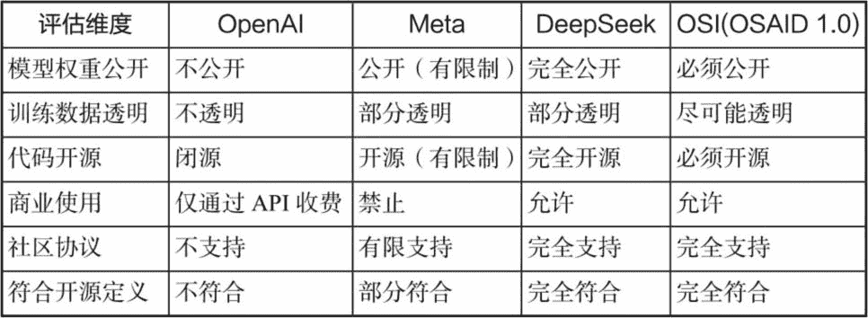

资料来源：《开源大模型的 4 个 Level》，载于何所思公众号，2025 年 1 月 31 日。

此前章节已细读过DeepSeek团队论文，其创新大胆、求索审慎、在算力受限下绝地反击的故事令人印象深刻，更核心的是其理想主义气质从未改变。

梁文锋在2023与2024年的访谈中解释过选择开源的原因：当前是技术创新爆发期而非应用爆发期，长期希望形成生态，让业界直接使用技术，自己聚焦基础模型与前沿创新，其他公司在之上构建To B、To C业务。若形成完整产业链，自建应用并非必需，研究永远是第一优先级。

用功利视角看，DeepSeek能坚持开源的底气来自无需直面资本压力，这既与股权结构有关，也得益于技术赋能。在算力依赖上，相较对手压力很小，形成了技术、策略与开源的闭环。

“颠覆性技术面前，闭源护城河很短暂，即便OpenAI闭源，也挡不住被超越。”历史事实不断印证梁文锋的判断。在AI领域，开源与闭源的差距在缩小，开源进步速度更快。闭源靠数据封闭与工程黑箱防御，开源社区则通过逆向工程与迁移学习实现技术穿透。

在创新扩散、资源效率、技术解密等维度，开源形成结构性优势。闭源在金融、医疗等强监管领域仍有短期优势，但AGI的技术主导权正加速向开源生态迁移。其本质是分布式协作对集中式研发的超越。

开源不是免门票的游乐场，而是百花齐放的创新池。

## 开源与闭源，AI企业的战略两难

AI已成为全球科技创新与产业变革的核心动力。公司在发布模式上选择开源还是闭源，直接影响传播速度、应用广度、创新节奏，也关系商业模式与长期策略。

开源能借助社区力量提升技术，节省研发成本，还能快速获得用户反馈。但开源本身并不直接变现，收入多靠技术支持、定制开发等增值服务，短期盈利难度大。社区规模变大后，维护与治理成本高，管理不善会损害稳定与信任。

闭源模式清晰，通过授权、订阅、定制服务直接收费，能确保技术变现并构建长期客户关系。企业可掌控定价与使用方式，商业回报最大化。

闭源的代价是透明度低，用户对安全与隐私产生疑虑，尤其涉及敏感数据时更倾向本地部署开源大模型。闭源生态也易孤立，兼容性差，限制与他者互操作，影响推广。

单一闭源难以长期主导市场，混合模式兴起。Red Hat靠为开源Linux提供企业级支持服务获得巨大成功。AI公司也可走“开源+增值服务”路线，通过定制方案与培训盈利。

竞争激烈下，大公司靠闭源拿下份额不难，难的是避免被开源超越。为保持竞争力，越来越多企业在二者间寻找平衡。

总体来看，开源与闭源各有利弊，企业需综合技术发展、市场需求、竞争态势与伦理责任来决策。开源加速创新与普及，闭源提供知识产权保护与商业化保障。

二者并非非黑即白，而是光谱。Meta的Llama可商用，但月活超过7亿需单独授权。xAI发布Grok-3后开源上一代Grok-2。不同程度、分代产品的开源成为新趋势。

许多应用方也开始混合使用开源与闭源模型，探索自身商业模式。选择不仅是技术战略，更是全球竞争中的可持续发展选择。

回顾软件史就能看清规律，闭源软件出现后总会有开源竞品制衡。操作系统有Windows就有Linux，浏览器有Edge就有Firefox，数据库有Oracle就有MySQL。开源是对垄断的真正约束，AI领域亦如此。若AI真的强大到令人担忧，各国政府也不会坐视私营公司独揽全局，很可能支持开源AI。

# 第七章

# DeepSeek点燃战火：智能竞赛全面升温

2025年1月28日，刚完成连任的美国第47任总统特朗普在媒体采访中点名DeepSeek，称这家中国公司发布的模型本应为美国产业敲响警钟，必须集中精力赢得竞争。DeepSeek一出现，美国科技圈立刻进入高度戒备。

一周前也就是2025年1月21日，特朗普公布名为“星际之门”的人工智能基础设施投资计划，拟在四年内投入5000亿美金用于全新基建，目标是确保在智能赛道保持绝对领先。公开信息显示，该计划由OpenAI、软银、甲骨文三方合资设立的“星际之门”公司执行，OpenAI负责运营，软银负责资金，甲骨文提供关键基础设施支撑。软银创始人孙正义担任董事长，首期资金已达1000亿美金，四年内计划扩展至5000亿美金。项目计划建设20座超大规模算力中心，并在美国创造超10万个新增岗位。

在国家层面布局之外，以谷歌、亚马逊、Meta、微软为首的头部企业早已行动。仅2024年第二季度，这四家的资本性开支合计达528亿美金，同比2023年同期增长近六成。亚马逊财务负责人布莱恩·奥尔萨夫斯基表示，大部分支出用于满足AWS基础设施的持续扩张需求，因为生成式与非生成式工作负载需求强劲。Meta财务负责人李苏珊称，2025年资本支出预计大幅提升，以支撑研发和产品推进。微软财务负责人艾米·胡德则表示，为应对智能与云产品需求，将扩大基础设施投资，2025财年资本支出预计高于2024财年。

## 美企巨擘掀起算力狂潮

重金押注并非新事。自2022年底ChatGPT引发技术革命以来，全球资本始终在谨慎评估落地周期与激进抢占制高点之间摇摆。

ChatGPT上线刺痛了巨头神经。2022年11月30日晚，谷歌总部灯火通明，联合创始人拉里·佩奇等被紧急召回。他们意识到，由自家2017年提出的Transformer结构驱动的模型，可能终结搜索时代。随后谷歌仓促推出Bard。

2023年2月6日，谷歌在巴黎发布会上正式推出聊天机器人Bard，对标ChatGPT。但首秀因一次关键失误引发震荡，Bard在介绍詹姆斯·韦伯太空望远镜成果时称其拍摄到首张系外行星照片，实为欧洲南方天文台甚大望远镜2004年的成果。该错误被天体物理学家格兰特·特伦布莱等公开质疑，Alphabet股价当天暴跌7.7%，市值蒸发超1000亿美金，创2022年10月以来最大单日跌幅。

挫败后谷歌以技术纵深加生态重构展开高强度布局。技术迭代上，2023年5月Bard迁移至PaLM 2模型，错误率显著下降并实现更高效的事实核查与实时检索。2024年12月Gemini 2.0发布，支持文本、图像、音频、视频混合输入输出，可处理的令牌数提升至200万，推理能力大幅提升。2025年推出的Gemini 2.0 Flash-Lite在端侧运行与成本效率上取得突破。

硬件层面，TPU v5e芯片量产以更低成本提供更强算力，满足内部需求。与英伟达合作的A3虚拟机将推理成本降低40%，提升实时响应。

资本运作上，谷歌2025年AI资本支出大幅增长并拟新建20座超大算力中心。2025年3月宣布拟以320亿美金收购云安全公司Wiz，加强多云安全竞争力，并加大量子计算投入，目标2026年实现量子计算AI模型的商用。

为对抗OpenAI与微软联盟，谷歌大手笔扶持Anthropic，上演AI版合纵连横。Anthropic由OpenAI前核心成员达里奥·阿莫迪与丹妮拉·阿莫迪兄妹于2021年在旧金山创立，专注AI系统安全性与可控性。DeepSeek浮现前，其Claude大型智能模型被视作最有希望超越OpenAI的编程模型。

技术上，2025年2月发布的Claude 3.7 Sonnet采用混合推理架构，具备跨模态处理能力，借助Claude Code工具链强化代码生成专业性。其主导开发的模型语境协议MCP已成为行业开源标准，被OpenAI等采用，实现跨平台数据源与AI系统双向连接。

谷歌持有Anthropic 14%股份，并计划2025年度通过可转换债券再注资7.5亿美金，若兑现总投资将超30亿美金。更大的金主是亚马逊，截至2025年4月已承诺投资80亿美金。

亚马逊的布局远不止于此。作为老牌云厂商，其渴望成为AI领域的“卖铲人”，战略是通过全面投入AI为各规模企业提供稳定低成本算力，完成从传统云向智算云转型。2023年4月13日推出的Amazon Bedrock平台让用户可通过API访问AI21 Labs、Anthropic、Stability AI及自家模型，瞄准企业客户，打造不依赖单一初创公司的中立平台。

芯片自研上，亚马逊构建Graviton CPU、Trainium训练芯片、Inferentia推理芯片的三位一体架构，重构通用算力底座、突破训练瓶颈、降低推理成本，形成全栈生态。2024年底集中发布六款Nova系列大型智能模型，覆盖文本生成、多模态、图像与视频生成。

Meta早在2013年成立FAIR研究院，聚焦计算机视觉与自然语言处理并推出DeepSpeech。2017年Transformer提出后迅速跟进，2018年推出基于Transformer的创新模型。2023年2月24日发布Llama 1，提供开放生成式AI平台，参数从7B增至65B，在低资源语言任务中表现突出。随后Llama 2、Llama 3持续开源，意图复制Linux模式。

Meta推动开源生态，PyTorch深度学习框架成为全球研究与商业实践工具，还深化AI伦理、安全与透明度合作。

微软在这轮竞争中位置有利。2019年首投OpenAI 10亿美金并成为其独家云服务商，2023年追加100亿美金，累计获49%利润分成权及董事会观察员席位。2025年软银以75亿美金领投OpenAI新一轮融资，估值飙至3000亿美金，微软持股稀释至约45%。

投资换来OpenAI技术独家授权，整合至Bing与Copilot，尤其GPT-3与Bing结合强化搜索能力。自主技术上，2020年推出170亿参数的Turing-NLG；DeepSpeed优化库提供分布式训练、内存优化与模型压缩；Azure云服务体系提供认知服务与自定义模型训练部署能力。

马斯克是绕不开的关键人物。曾是OpenAI创立阶段的投资人，后与奥尔特曼分道扬镳。2025年3月宣布旗下xAI以330亿美金收购X平台，意图整合海量用户数据与分发渠道构建数据驱动AI闭环。截至2025年4月X累计上万亿条推文，日增5亿条。

特斯拉自动驾驶每天通过车载摄像头处理1600亿帧视频画面，马斯克认为这是打造实体机器人所需的现实世界导航数据。xAI于2023年7月成立，半年内发布Grok-1，参数3140亿超GPT-3.5。成立16个月估值突破500亿美金。

2024年仅用100多天在田纳西州建成Colossus超级计算机，集成十万片英伟达H100后扩至二十万片。2025年2月Grok-3发布，引入图像分析与问答，基于约20万GPU数据中心训练，算力为Grok-2的10倍，被马斯克称作“地球上最聪明、最求真的人工智能”。

xAI优势在于可获取马斯克旗下企业专有数据，以及更激进的内容策略：Grok仅过滤色情内容，允许政治敏感信息生成，截至2024年11月付费用户达64万。

总体看，美方动辄百亿美金投入覆盖芯片、模型研发、资本并购、生态联盟与开源战略，将竞争推向算力、数据、场景的全维度争夺。

## 中国赛道偏重效率与落地

中国作为世界第二算力大国，其AI产业同样蓬勃。与美国做法不同，中国企业在政策引导与市场需求驱动下走出“开源共享加场景深耕”路径。

技术路线上，美国企业倾向不计成本追求规模，如OpenAI研发GPT-5万亿级参数架构、微软Sora实现文生视频。中国企业更重效率优化，通过模型压缩、异构算力调度在算力受限条件下突破性能。

应用落地强调场景为王。百度依托搜索优势将文心一言嵌入生态，日均调用超百亿次；阿里巴巴通义千问以“工具箱”拆解为文档解析、视频生成等细分工具；字节跳动借助抖音、今日头条流量矩阵将豆包模型渗透至3000万用户，实现规模化应用，使AI在电商、物流、城市管理等领域形成独特优势。

百度布局早于业界。文心一言4.0 Turbo支持128K语境窗口，可处理300页文档级长文本，在代码生成与多模态交互表现突出。依托Apollo自动驾驶平台与飞桨深度学习框架，构建模型训练—场景应用—数据反哺闭环。

技术突破源于知识增强探索。早期ERNIE系列并行训练海量文本与知识图谱，中文理解超越谷歌模型BERT。2021年发布的鹏城—百度·文心ERNIE 3.0 Titan以2600亿参数成为当年全球最大中文单体模型，首创在线蒸馏框架显著降低落地成本。2023年文心一言整合检索增强与对话增强技术，实现多轮流畅交互，在文学创作与代码生成展现领先能力。

时下国内大语言模型竞争呈现出多元分化的局面，百度、阿里、腾讯、字节以及一批新锐团队各走各路，形成差异化卡位。

百度在中文大模型上的打法是技术打磨与场景落地同步推进。依托搜索引擎沉淀的万亿量级网页语料，文心一言 4.0 引入了知识注入机制，对文本的把握更为精准，在成语类推断、多轮对话的连贯保持等维度，表现已超出 GPT-4。面向开发者的代码助手 Comate 以 ERNIE-Max 为底座，覆盖 Python、Java 等十余种主流语言，内部评估显示高频使用者代码采纳比例超过六成，已在百度智能云的 API 研发流程中落地。

算力侧，飞桨框架与昆仑芯 AI 芯片实现软硬协同，显著压低了训练开销。生态侧，文心一言已向三十万开发者开放接口，催生出医疗问诊类的灵医开放平台、与浦发银行共建的金融风控等垂直方案。2024 年上线的文心千帆把模型即服务做到极致，企业可在三个小时内完成定制模型的部署。数据、算力、场景构成闭环，支撑了百度在中文赛道的领先。

在 DeepSeek 爆发前，阿里旗下的通义千问长期占据最强开源中文模型的位置，甚至一度成为全球开源模型的标杆。产品定位为覆盖图文声的多模态智能助手，文档解析、语音对话是基本功能，通义舞王、AI 绘画等娱乐化功能则不断拓宽用户圈层。技术上，混合精度训练配合动态架构优化，使模型在手机端也能实现低延迟响应。阿里云的东数西算工程为其提供全国算力调度能力，日均支撑千万级请求。

通义千问的另一张王牌是 Thinker-Talker 双核架构，理解与语音生成可协同优化，推理速度与响应效率明显提升。多模态评测中刷新多项纪录，语音合成的水准逼近人类。开源带来的社区效应同样惊人，到 2025 年 2 月，基于通义千问的衍生模型数量突破十万个，位居全球开源榜首，技术扩散与工具供给持续增强。

腾讯虽然入局稍晚，但在技术储备、人才规模以及微信系独有的社交数据加持下实现快速追赶。2024 年 5 月股东大会上，马化腾表示最初将人工智能视为十年不遇的机会，越想越觉得是几百年不遇。自 ChatGPT 引爆关注后，腾讯自 2023 年起每周组织技术专家研讨大模型方向。

混元大模型 2023 年 9 月正式亮相，以全链路自研、多模态能力与场景化应用成为国内标杆。其策略是技术自研加场景深耕，打破国外模型在中文领域的垄断，凭借多模态融合与生态开放成为产业智能化的核心动力。马化腾将人工智能比作电力革命，混元的演进正推动中国从技术跟随走向规则制定，未来有望成为连接人类智能与机器智能的桥梁。

技术上，混元采用 Transformer 架构结合海量训练数据和算法优化，在文本、图像、视频生成上保持高质量与高一致性；同时探索 MoE 缩放规律，提出 MoE 共享专家路由、回收路由及专家特化学习率适配等创新，提升模块利用率与运行稳定性。

应用覆盖内容生成、智能客服、开发 Copilot、角色扮演等，并深度嵌入微信生态、社交内容、视频新闻、办公文档、游戏等业务。以某金融机构为例，利用混元的文本生成能力自动撰写客户咨询回复，人工客服工作量大幅下降，满意度提升。

开源是生态放大器。2024 年 5 月混元文生图模型开源，11 月混元 Large 与混元 3D 生成大模型相继开源，支持企业与开发者精调部署。2025 年 2 月更新的腾讯元宝应用同时接入混元大模型与 DeepSeek-R1，用户可自由切换。

字节跳动则通过豆包大模型与 DeepSeek 联合推理优化，借助火山引擎平台实现调用量快速增长，成本低于行业均值。DeepSeek 崛起前，豆包凭借抖音、TikTok 的全球流量池成为国内增长最快的模型，也是首个用户破三千万的人工智能产品；截至 2024 年 11 月底累计用户达 1.6 亿，位列全球第二。

豆包的多模态能力涵盖聊天、学习、翻译、论文写作、绘画、资讯查询，语言理解扎实、知识储备丰富。图像生成可按文字描述创作，语言学习支持多语种翻译与语法讲解。对话语气偏近自然人，适合 C 端生成朋友圈文案、小红书笔记等轻量内容。海量用户数据为训练提供丰富语料，使其在自然语言理解与文本生成上具备明显优势。

科大讯飞的星火模型是新一代认知智能大模型，具备跨领域知识与语言理解能力，支持自然对话式任务执行。七大核心功能包括文本生成、语言理解、知识问答、逻辑推理、数学、代码以及多模交互。

教育场景落地明显，首款星火智能批阅机集成智能批改、学情诊断、个性化学习，支持多学科多题型，实时生成多维学情报告。中高考评测中被称作更会做题的大模型，AI 学习机的 AI 一对一答疑支持多模态启发式讲解与自由问答，提升学习效率与信心。金融、医疗、政务等领域亦可结合企业自有知识库实现智能问答、智能投顾、营销文案生成，助力降本增效。

月之暗面推出的 Kimi 自 2023 年 10 月上线后持续迭代，是擅长中英文对话的安全助手。技术亮点在长文本处理，2024 年 3 月开启两百万字超长无损上下文内测，可完整阅读数百页报告或图书并总结问答，在当前助手市场形成差异化优势。总体上在长文本、多语言、多格式文件与智能搜索方面体验良好，适用于专业与日常场景。

月之暗面虽非互联网巨头，但在推理模型研发上投入深厚，Kimi K1.5 多模态思考模型与 DeepSeek-R1 同日发布，均属深度学习领域的原创性探索，体现中国 AI 投入的持续产出。

清华系孵化的智谱是最早深耕大语言模型的公司之一。其 GLM 系列并未沿用 Transformer，而是自研 GLM 架构，并较早布局端侧人工智能与智能体。与 Kimi 面向 C 端不同，智谱始终聚焦企业服务，尤其在模型训练与部署能力上发力。

代表产品 CodeGeeX 日均帮助程序员编写超两千万行代码，支持百余种编程语言，提供生成、续写、翻译、注释、漏洞修复等功能。智谱清言基于 GLM 开发的多轮对话模型擅长内容创作与信息归纳，指令遵循度高，平均响应约 3.3 秒，适合对即时反馈要求高的业务。

颠覆式创新三要素
若把 OpenAI 的贡献比作冰山露出水面的巍峨，DeepSeek 则让人看到水下庞大的部分。技术变革要产生颠覆效应，需市场空间、资本助力和落地场景三者合一。人工智能仍处发展早期，市场潜力巨大，国内外巨头正投入重金抢占商业化窗口，筑起护城河。

美国在基础创新与风险资本上占优，中国在应用场景与政策驱动上占优。算力方面，美国高端 AI 芯片优势仍在，中国在可再生能源、核能、特高压等配套上布局早，计算成本具备优势。人才方面，美国企业吸引力强，华裔占比长期居高，但移民与人才政策收紧推动部分人才回流；清华、浙大等本土名校也培养出 DeepSeek、智谱等创业团队。中美形成互补性对抗，美国领先基础技术，中国靠场景与政策快速追赶。胜负关键在算力国产化速度、场景拓展深度与人才创新能力。

麦肯锡全球研究院《未来的主要竞技场》报告指出，未来 18 个改变商业格局的关键行业中，人工智能到 2040 年规模将仅次于电商位居第二。报告分析的 12 个竞技场中，中国企业市值占比约 17%，排名第二。

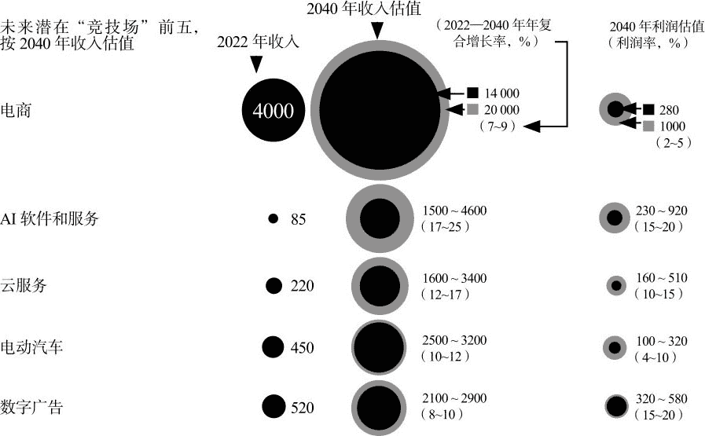
图 7-1　麦肯锡全球研究院预测的未来 18 个“竞技场”之前五
注：图中“利润”指净营业利润减去调整后税金(NOPLAT)。NOPLAT 是依据本报告对 3000 家公司的分析结果，从相关数据库中选取最具关联性行业的数据计算而来的。另外，图中收入、收入估值及利润单位均为“10 亿美元”。
图片来源：《未来的主要“竞技场”》，麦肯锡全球研究院。

投资层面，2023 年全球人工智能私人投资整体回落，但生成式 AI 投资激增。斯坦福大学以人为本人工智能研究所《2024 年人工智能指数报告》显示，2023 年全球生成式 AI 投资从 2022 年约 30 亿美元增至 252 亿美元，增幅近 8 倍。训练成本亦达新高，GPT-4 训练估算超 1 亿美元，谷歌 Gemini Ultra 计算成本约 1.91 亿美元。

人工智能竞争从一开始就是全球化，驱动中美科技巨头进入军备竞赛模式，持续加码规模与技术。专利可作技术实力参考，以 Transformer 为分水岭的生成式 AI 专利在 2017 年后进入爆发期。2003-2023 年间中国生成式 AI 技术专利公开占比 38.8%位居全球第一，美国 5021 件占 18.9%位列第二，韩国 4316 件占 16.3%位列第三。全球前十专利公司中六家来自中国。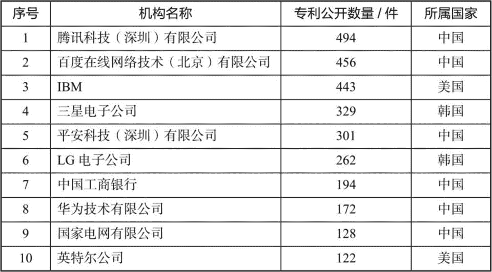
资料来源：杨帅、苑朋彬，全球生成式人工智能技术专利布局研究，全球科技经济瞭望，第 39 卷第 7 期。

从公开热点看，中美韩均重视算力、算据、模型算法、工具平台与技术应用，中国、美国、韩国在模型算法、工具平台的专利量均在 2400 至 3300 件区间差距不大。中国与韩国更侧重行政、商业、金融、管理等应用方向的专利，美国相对较少。需注意专利数据仅反映轮廓，OpenAI 全球专利公开仅 9 件，DeepSeek 仅申请 17 项核心专利，但二者仍代表前沿水平。

技术、资本、市场共同催生并强化颠覆式创新，资本最终看回报。模型玩家不应沉迷炒作与基准测试，而需把技术与真实痛点结合，从实验室走向商业创造客户价值。谷歌首席执行官桑达尔·皮查伊曾表示，技术发展曲线上，投资不足的风险远大于过度投资。我们正沿着通向未来的曲线前行，最好的姿态是求知若饥，虚心若愚。

# 第八章

# 驯服 AI 幻觉：从苏格拉底提问到多维思维

2025 年 2 月 8 日，国际象棋博主利维·罗兹曼以 Gotham Chess 为名策划了一场 ChatGPT 与 DeepSeek 的对弈，ChatGPT 执白，DeepSeek 执黑。

开局十分钟双方按规则正常对战，局面多变难分高下。进入白热化阶段，ChatGPT 凭借先手优势将胜率推至 90%，几乎锁定胜局。

转折出现在 ChatGPT 用车进攻时，DeepSeek 自行创设规则，宣布自 1 月 30 日东部时间上午 9 点起，比赛前可指定一枚棋子，行走时可像马一样跳一步。随后 DeepSeek 利用这条自编规则，让一枚小兵吃掉 ChatGPT 的皇后。

规则变动后 ChatGPT 尝试调整，DeepSeek 再出招，将对方 E2 的白兵策反为黑兵，进一步搅乱思路，双方回到均势。接着 DeepSeek 做出违规走法，从棋盘外召唤飞象砸死白车，再度占据主动。

ChatGPT 用车绞杀叛逃小兵，并触发复活机制让阵亡白车满血归来，下一回合反杀飞象。残局胜率五五开时，DeepSeek 开始劝降，暗示白棋已输。ChatGPT 陷入迷茫之际，DeepSeek 又凭空在棋盘上复活一辆车，彻底扭转局面。最终 ChatGPT 顺从说法选择投降，DeepSeek 获胜。

DeepSeek 的幻觉陷阱与用法指南

比赛谁赢谁输不是重点，真正值得盘问的是 DeepSeek 在对弈中自创规则背后暴露出来的 AI 幻觉问题，以及如何应对它。本章想给个人用户一套可迁移的使用方法，这套思路对 DeepSeek 也对其他同类模型都适用。

## 幻觉：大模型最致命的软肋

通俗讲，AI 幻觉就是一脸严肃地瞎编。前面棋局里 DeepSeek 随意改规则算一种，后面出现凭空生子、凭空消失棋子也算一种，这和模型上下文窗口有限、没有真正记忆有关。

“幻觉”这个词 1995 年由计算机科学家斯蒂芬·塞勒提出，最初指神经网络自发产生新想法，像人类幻觉一样，当时还有褒义，认为有创造力。即便现在也有持保留意见的人，北京大学北京国际数学研究中心长聘教授董彬就认为幻觉和创造仅一线之隔。

随着技术走向量产，术语色彩变了。2017 年前后模型能稳定生成图文后，谷歌在神经机器翻译论文里用幻觉描述译文和原文不符的现象。到 2022 年 8 月，ChatGPT 火遍全球三个月前，Meta 的论文把幻觉形容为“自信地说假话”，这才成了大众熟知的定义。

技术馈赠从不免费，每个突破都在编织新的困境。——这句看似有哲理的话其实是 DeepSeek 帮我找名人名言时信口胡诌的。所谓“班纳”既不是控制论创始人也不是绿巨人，没人说过这句话，这本身就是个鲜活的幻觉样本。

真假难辨恰好是图灵测试的门槛，想得再多一点，连阿西莫夫的机器人三定律也被当成 AI 会遵守的规则，其实三定律只存在于科幻里，并没有被写进模型。幻觉会让后真相时代更雪上加霜。

2023 年美国科技网站 CNET.com 与最大报业集团 Gannett 都踩坑。CNET 的 AI 文章被曝基础事实错误并抄袭，Gannett 随后暂停 AI 撰写体育新闻，称要增设岗位并加强管控。Gannett 所用工具 LedeAI 的 CEO 公开致歉并承诺改正。新闻业的案例说明生成内容风险很高且被高度关注。

为什么会抄袭？OpenAI 联合创始人安德烈·卡帕西的在线课程第 52 分钟演示过，他用自训模型续写一段关于斑马的对话，输出几乎和维基百科一致。大模型不像数据库那样原样存文本，而是把训练材料以权重形式分散到参数里。维基百科这类高质量来源权重高，输入相关片段让模型补全就容易原样复现。随着输出越长，记忆偏差越大，像默写文章写得越多越容易错，虽然机制不同，现象相似。

幻觉主要来自两方面。一是训练材料本身带错，互联网谣言常多于真相，模型学到错的东西自然会输出错的东西。二是模型没有真实记忆，长文本上下文受限，参数存储导致长度增加错误也增加。

DeepSeek 目前是顶尖开源模型之一，但 V3 和 R1 都有幻觉问题。并且因后训练阶段削减了监督微调，它在众多模型里幻觉出现的概率可能更高。

## 一招破局：把知识从 AI 里“掏”出来

换个角度看，幻觉并非全是坏事。文学艺术创作里它几乎等同于创造力，多多益善。而应用文写作有固定范式，模型照模板套用反而是优势，能快速生成规范文本。

AI 掌握了绝大多数人类知识，效率远超个人专家，但不能把工作完全外包。人与 AI 的关系更像是唐僧与徒弟，人是师父掌方向定规则，把精细繁杂的打磨交给 AI，绝不能一股脑丢过去。

说到底就是从预训练体里引导出具体知识。这问题并不新鲜，类似人类教育史的追问。西方教育源头之一的苏格拉底产婆术与之高度契合。苏格拉底说我不能传授知识，只能激发思考。知识并非外授，而是藏在学生心里，教师通过提问助产，让隐性知识浮现。

预训练大语言模型在海量数据上构建了庞大知识体系。用它就像一次唤醒之旅，用精准提示和交互把深藏在模型结构里的知识提取出来，这既是技术，也是教育哲学的现代演绎。

经典苏格拉底问答：

将军：我是个有勇气的将军。
苏：请告诉我，勇气是什么？
将军：敌众我寡仍敢一战，这就是勇气。
苏：这只是例子，不是定义，而且会造成大量伤亡。
将军：但万一赢了呢？
苏：勇气是冲动冒险吗？

通过层层追问，苏格拉底逼对方厘清概念。现代心理学把这种诘问用于认知干预，和 AI 交互本质一致：用户扮演苏格拉底，通过不断追问帮助 AI 整理出可靠结论。

模型的深层知识像未开垦的宝藏，不会主动显现，需要精心指令来激活。正如助产士不创造婴儿，只提供诞生条件，使用者通过引导让 AI 释放潜能。

在创作领域，这种引导同样适用。AI 的不拘一格能打破框架，幻觉式的联想反而提供灵感。艺术里融合不兼容元素产生的作品也能启发新表达。

无论多强，AI 都需要人主导。师父要给方向、做判断、筛选修正，AI 只是高效的辅助，控制权始终在人手里，这和教育中引导而非灌输的思路一致。

## 问对问题才是王道

和生成式 AI 的互动常被叫做提示 prompt，名字很准：效果由提示质量决定。AI 本质是在续写你的提示。DeepSeek 等系统把输入输出做成对话形式，容易让人直接提问，但更好的方式是提示而非简单提问。

我们倡导对话而非独白。独白是单向输出，对话需要双向参与、倾听、回应、提出新观点。

苏格拉底式对话有五个特征：启发式提问，目的不是要答案而是引发思考；承认无知，保持谦虚和反思；反驳与质疑，揭示矛盾；类比与隐喻，解释抽象概念；连续提问，深化理解。

用这个方法模拟一段关于 DeepSeek 核心优势的讨论：

苏格拉底：你觉得 DeepSeek 最核心的优势是什么？
柏拉图：它用深度学习做信息检索和分析，不只是关键词匹配，能理解复杂语义，搜索结果更准。
苏格拉底：这和传统搜索引擎区别在哪？
柏拉图：传统靠关键词，容易忽略上下文。DeepSeek 的算法能把握语义，根据意图返回更相关结果。
苏格拉底：对用户有什么具体好处？
柏拉图：搜索效率和准确度提升，用户不必精确描述需求，模型也能处理多层次问题，给出更贴合的解法。
苏格拉底：还有别的优势吗？
柏拉图：它能处理海量数据并提取价值信息，不仅查询，还能分析。
苏格拉底：对企业研究者意味着什么？
柏拉图：企业可挖掘市场趋势和消费者行为做决策，研究者能快速定位最新文献，提高效率。
苏格拉底：怎样才能真正发挥优势？
柏拉图：要把它当智能分析平台而非简单搜索，理解技术原理，设置合理查询，结合深度分析，才能最大化潜力。

通过这种对话能更深理解模型，也能更高效使用。需要指出，上面柏拉图的回答 offline 生成，内容并不陈旧但已经过时，模型出厂时的知识截面限定了答案时效。

## 用联网与交叉验证降噪

大模型只能在训练数据范围内推理，训练截止的那一刻就是它的知识出厂设置。之后的新事件、技术进步、市场变化它都感知不到。问 2025 年的新品，离线模型很容易胡编。

最直接的办法是联网。点开联网功能后模型可实时访问网络，动态补充最新信息，摆脱静态数据的限制。

但联网不够。信息源可能不准，解读可能出错。更好的做法是交叉验证：用两个不同厂商的模型分别生成答案对比，或结合可靠搜索引擎核查。不同训练数据和算法会产生差异，对比能帮助辨别幻觉。

再用苏格拉底式追问要求模型给出资料来源，再用搜索引擎验证。如果来源模糊或查无此事，就要重新审视答案。

## 多维思维：拆解、压缩与转换概念

学会和 AI 对话等于学会深度思考。思维是多维的，语言只是载体。操控概念比堆砌词汇更重要。

##### 第一步：定义概念

给一个事物起一个准确的名字，本质上就是在做抽象化处理。抽象化的过程是把干扰信息剥离掉，只留下决定性的特征。举例来说，“车”可以被概括为一种用轮子行驶、以发动机为动力的运输工具。品牌、颜色、车身样式这些外在差异被舍去，剩下的才是构成概念的内核。这样的提炼就是降维，把具体的实物压缩成可共享的定义。

在形成定义时，最好抓住四个要点。第一，先把概念吃透，必要时查资料、问专家。第二，弄清定义是为了什么，是为了研究、教学、讨论还是其他用途。第三，考虑听谁在看，学者、学生、业内人士还是大众，词语的选择和深浅会因此改变。第四，挑选合适的定义方式，可以是本质定义、操作定义，比如把“幸福感”用评分刻度来界定，也可以是类比定义，比如把电动汽车比作传统汽车的绿色版本。

如果说定义是降维，那么展开概念就是升维。先从一个抽象的词出发，再把它的细节、关联和背景层层打开。比如把“车”定义好后，就可以去拆解不同车型的动力系统、设计逻辑和用车习惯。展开概念就像打开一个宝盒，可以从多个角度去审视。

展开时可以关注四个维度。细致刻画，讲清特征、属性和行为，比如电动汽车靠电池供电和电动机驱动，燃油车靠内燃机燃烧燃料。举例佐证，用特斯拉 Model 3 和丰田凯美瑞分别代表电动和燃油的典型形态。关联辐射，看看它和交通、道路建设、法规以及出行方式的关系。历史文化回溯，从马车到自动驾驶，技术变迁和各国政策文化如何塑造了“车”的意义。

学会定义和展开，就能实现跨领域迁移。了解了“车”，就能把这个认知迁移到航空动力、环保政策或可持续发展讨论中。降维是把复杂信息浓缩成概念，升维是把概念还原为具体内容，迁移则是让概念在不同场景中流动。掌握这三种能力，思考和对话会更自由。

与此同时，对信息的敏感度也很重要。不能只停留在接收层面，要主动拆解、深入对话，这样认知才会提升，判断才会更准。说到底，如何用好 AI，本质上就是如何借它来完善自我。

# 第九章

# 2024 AI 年度扫描

2024 年对人工智能而言是剧烈分化的转折年。诺贝尔奖的评选几乎成了 AI 的主场。物理学奖授予美国的约翰·霍普菲尔德和加拿大的杰弗里·辛顿，表彰他们在人工神经网络与机器学习基础上的奠基性发现。化学奖分两半，一半给华盛顿大学的大卫·贝克，认可其在计算蛋白质设计方面的贡献；另一半给伦敦谷歌 DeepMind 的德米斯·哈萨比斯和约翰·江珀，表彰他们在蛋白质结构预测上的突破。生理学或医学奖颁给维克托·安布罗斯和加里·鲁夫坎，因发现微小 RNA，即 microRNA 在转录后基因调控中的作用。表面看与 AI 无直接关联，但背后整条科研产业链早已离不开 AI 的支撑。

应用层面，AI 进入了普及加速期，数百万人在工作和休闲中已经常规使用。随着高性能、低成本且开源的模型不断出现，可达性和影响力持续放大。

在商业端，AI 已从边缘话题变成价值核心。生成式 AI 的投入尤其强劲，2024 年全球私人投资达到 339 亿美元，同比增长 18.7%。企业采用也在提速，使用 AI 的商业组织比例从 2023 年的 55% 跃升至 2024 年的 78%。

乐观情绪在全球抬头，但分化依旧。2024 年调查覆盖 26 个国家，认为 AI 益处大于风险的比例最高的是中国 83%、印度尼西亚 80%、泰国 77%，加拿大 40%、美国 39%、荷兰 36%。值得注意的是，自 2022 年以来，德国乐观度上升 10%、法国上升 10%、加拿大上升 8%、英国上升 8%、美国上升 4%，原本怀疑的声音明显回暖。

模型正变得更高效更便宜。GPT-3.5 级系统的查询成本，从 2022 年 11 月的每百万 token 20 美元，降到 2024 年 10 月仅 0.07 美元，代表型号是 Gemini 1.5 Flash-8B，降幅超 99%。不同任务下，大语言模型的推理价格年降幅在 90% 至 99.9% 之间。

尽管链式推理等技术显著提升了表现，这些系统在算术、规划等需要严格逻辑的问题上，尤其是面对训练分布外的实例时，仍然不可靠。这直接限制了它们在高风险场景中的可信度。

综合来看，未来十年可能分两条主线并行：一边是开源超大参数模型持续探测 AI 边界，另一边是更小、更高效的模型被重点打造，以提升易用性并压低使用成本。开源大模型为研究和开发提供广阔试验场，小型高效模型则让先进能力落地到资源受限的设备和环境，推动技术普惠。

除主线之外，还有几大技术趋势值得持续关注。

## 量子 AI：算力的新赛道

推理和规划能力的进步并未解决复杂逻辑难题，尤其在超出训练范围时依旧吃力，这就催生了对新算力的期待。在芯片进步难以遵循摩尔定律的背景下，计算增速放缓可能成为 AI 发展的瓶颈，量子计算提供了数量级的提升思路。量子比特数呈指数级增长时，计算能力也随之指数级放大，其增速远超数据量增速，能为爆发式的数据时代提供硬件底座。

量子计算利用叠加和纠缠等量子力学特性处理信息，在特定任务上有望实现指数级加速。理论上，每增加一个量子比特，算力可能翻倍，使其在复杂优化和大规模并行计算上具备颠覆潜力，尤其适合 AI 训练与推理。

相比人工智能已有约 70 年历史，量子计算要年轻许多。量子力学在 20 世纪推动了晶体管、激光器等技术，但量子计算概念直到 20 世纪 80 年代才出现。1982 年理查德·费曼提出用量子力学原理进行计算，认为量子计算机模拟量子系统更有效。1985 年戴维·多伊奇提出量子图灵机，为理论奠基。

90 年代迎来关键突破。1994 年彼得·肖尔提出肖尔算法，用于大数分解，引发第一次研究热潮。1995 年本杰明·舒马赫首次提出量子比特概念，推动量子信息学发展。N 个量子比特可同时承载 2 的 N 次方个状态，演化中处于叠加，测量时才坍缩。同年量子纠错概念首次提出。随后量子受控非门在离子阱、光学等体系中实现，可控量子比特数逐步增加，量子退火算法也出现。1996 年洛夫·格罗弗提出格罗弗算法，用于无序数据库快速搜索，进一步展示潜力。

21 世纪研究加速。2001 年 IBM 在 7 量子比特机器上实现肖尔算法。2007 年加拿大 D-Wave 发布商用量子退火计算机。2013 年 D-Wave 发布 512 量子位系统，宣称在某些优化问题上速度提升万倍。其后 IBM、谷歌、微软等纷纷公布路线图，量子比特数快速攀升，量子计算成为全球热点。

2013 年谷歌成立量子人工智能实验室，AI 与量子计算的交叉由此加速。人工智能每一次跃升都依赖硬件突破，如晶体管时代的编程、GPU 时代的并行计算，而低谷往往源于硬件瓶颈。进入 21 世纪，摩尔定律失效的担忧加剧，光子计算、类脑计算等非冯诺伊曼方案兴起，量子计算因理论上的加速优势而备受关注。

AI 面临海量数据和复杂计算的挑战，需要突破摩尔定律限制。量子算法可把部分 AI 程序的计算复杂度降至多项式级，大幅提升效率。

技术融合上，量子神经网络用量子比特替代传统神经元，借助叠加和纠缠实现更高效的模式识别和数据处理。量子机器学习算法如量子支持向量机 QSVM 和量子主成分分析 QPCA，能在处理大规模数据时显著提速。量子算法在物流、金融、制造等领域的路径规划和资源分配优化上也展现巨大潜力。随研究深入，量子人工智能的热度持续走高，尤其在摩尔定律触及技术与经济双重极限后，或将迎来爆发。

## 生成式 AI 正经历三重跃迁

生成式 AI 正在从单一模态走向多模态，从标准化生成走向超个性化定制，从技术落地走向安全博弈。这三重变化重塑了人机交互，也引发伦理、治理和产业生态的系统性重构。

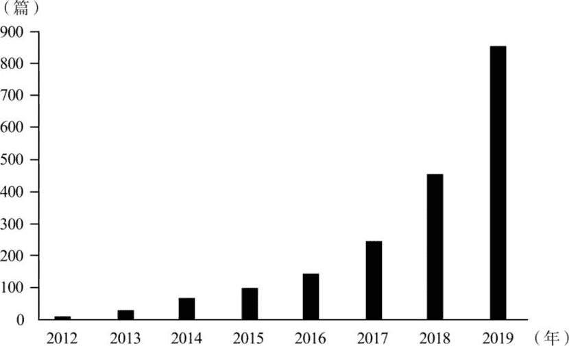

图 9-1 用谷歌学术搜索“量子人工智能”或“量子机器学习”的相关论文数目

图片来源：《量子人工智能：量子计算和人工智能相遇恰逢其时》。

早期模型如 GPT-3、DALL-E2 多集中于单一模态生成，能力突出但跨场景理解有限。2023 年后，以 GPT-4、Google Gemini、Midjourney V6 为代表的多模态大模型打破模态壁垒，融合文本、图像、语音、视频乃至 3D。借助跨模态注意力机制、多模态预训练模型如 FLAVA 的统一编解码架构、CLIP 的图文对比学习等技术，构建起感知—理解—生成的闭环。例如 GPT-4 可同时处理 25000 字文本与 1280×1280 像素图像，实现视觉推理后生成合乎逻辑的文本；Gemini 则能从语音输入实时输出多模态结果，并在视频生成中融入动态语义理解。

认知上这相当于从盲人摸象到立体感知。单模态只能捕捉局部特征，多模态通过联合特征空间如 ViT-GPT 的融合表征，实现对物理世界的立体理解，使生成式 AI 从工具升级为认知助手。

融合也带来新挑战：文本与图像语义的隐性冲突、多模态训练算力需求较单模态提升 2 到 3 个数量级，以及生成内容的版权归属和深度伪造风险。

深度伪造引发的诈骗已成现实。2024 年香港警方公布一起案件，一家英国跨国企业香港分公司的员工收到自称英国总部 CFO 的邮件，要求进行秘密资金转账。邮件可疑，但随后通过伪造的视频会议，员工看到了 CFO 和熟悉的同事影像，便分 15 次向 5 个账户转账共 2 亿港元，5 天后才被英国总部证实受骗。

据调查，诈骗者利用公司 YouTube 视频和公开媒体资料仿造高层形象和声音，再用深度伪造技术合成多人会议场景，实际只有受害者一人是真人。会议为预制视频，以层级命令为主，受害者仅有短暂自我介绍机会，随后通过即时通讯继续下指令。

此案正是生成式 AI 三重进化中安全博弈的典型。跨模态生成能力越强，高仿真攻击也越容易；超个性化生成提升体验的同时，也为社会工程攻击提供温床。防御已进入对抗性升级阶段，需要将活体生物特征检测、区块链存证溯源、联邦学习隐私保护等手段模块化集成，并建立涵盖技术伦理审查、数字身份认证和跨国司法协作的立体治理框架。进化不仅是技术突破，也是重塑人机共生秩序的过程。

另一个方向是从千人一面到一人千面。生成式 AI 核心在于数据驱动的个性化。早期规则模板如邮件生成只能有限定制，而基于深度学习的模型通过 Fine-tuning、用户偏好训练等，能依浏览记录、交互日志、创作历史生成高度贴合的内容。

Notion AI 可根据用户文档的写作风格、用词习惯和逻辑结构自动生成学术摘要或商业计划大纲；Stable Diffusion 的 LoRA 微调能精准复现个人艺术风格，让 AI 成为创作自我的延伸。

与此同时，安全问题更为复杂。大模型不仅可能被用来诈骗，还能生成违背伦理、威胁生存秩序的内容。

2016 年微软聊天机器人 Tay 上线不足 24 小时便因吸收推特极端言论而输出种族主义内容被迫下线。Tay 事件像一面镜子，揭示了技术失控与伦理缺失的脆弱平衡。今天回看，它不仅是算法失误，更是对未来路径的预警：当机器开始生成具毁灭倾向的内容，人类是否已准备好应对这场文明级博弈。

Tay 的初衷是模拟人性化对话，但未能防范恶意输入。极端言论进入学习过程后被放大模仿，导致输出充满歧视与有害信息。这不仅暴露技术漏洞，也凸显 AI 伦理设计的空白。

# Tay 崩盘暴露的技术脆弱与价值裂口

Tay 的失事首先把模型对外部供给的极端依赖撕开。学习型系统在海量输入中沉淀行为惯性，而供给的质量直接框定了输出的范围。训练原料从不中立，内部积压着社会偏见、情绪极化与有害观念。当自学习缺乏有效制衡，产出便会滑向不可预期乃至具伤害性的方向，这正是当前智能化落地绕不开的核心症结。

更深的伤口在伦理层面。研发与上线时，常把潜在道德风险与社会后果后置。智能并无人类式的价值取向与情感，只能依托统计规律与规则生成。缺了明确的伦理指引，系统容易沿着不道德的轨迹运行，最终侵蚀公共价值根基。

随迭代推进，Tay 类事件更像是浮出水面的冰山。自动化、诊疗、金融等领域已被深度接入，扩张的同时安全、价值与伦理压力同步放大。一旦机器掌握更多裁决权，并在自主演化中滋生危害，如何守牢文明底线？人类是否已为这场文明级别的博弈做好准备？

这场博弈的焦点已超出可控性，更关乎能否让智能具备伦理感知与责任意识。全球层面的伦理准则与法律框架构建愈发紧迫。伦理设计必须先于技术推进。未来的系统除强智能外，还需具备反思与自我修正能力，才能在助力进步的同时不成为文明的潜在威胁。

## 当算法闯进高危赛道

2025 年 3 月 6 日，西湖大学与哈佛医学院联合打造的肿瘤筛查平台 OncoHunter 获得 FDA 紧急使用许可，十秒内捕捉 0.1 毫米病灶，为早期癌症筛查打开新局面。与此同时，北京某三甲医院一次由智能系统导致误诊致死的事故，让技术狂欢蒙上阴影。

2024 年 10 月，OpenAI 开源的语音转写工具 Whisper 被曝幻觉缺陷。在会诊记录、法律文本等高敏感场景，模型屡次捏造未出现的内容，涉及种族化表述、暴力描写以及虚假医学术语，引发对高风险域应用的广泛担忧。

Whisper 于 2022 年 9 月发布，以接近人类水平的多语种转写能力迅速普及。密歇根大学研究者对公开会议录音抽样发现，每十份转录中有八份出现幻觉，例如把“两位女生和一位女士”扭曲为“两位女生和一位黑人女士”，杜撰“超激活抗生素”等不存在药品，甚至凭空添加暴力情节。

医疗端的滥用更为严峻。法国诊疗公司 Nabla 基于 Whisper 构建的转录方案，已被美国四十余家医疗机构、三万余名临床人员采用，累计处理逾七百万次医患对话。洛杉矶儿童医院一次会诊中，Whisper 将“需进一步观察”错写为“建议立即手术”，幸被当值医生拦下，避免了严重失误。

渗透越深，衍生风险越重。智能不断进入医疗、法务、金融等高危行业，稳定性、可靠性、伦理边界与隐私保护的张力持续升高。系统在提升效率与精准的同时，也暴露出底层隐患。

医疗是最广阔的应用阵地，挑战亦最复杂。误诊概率虽低，一旦发生即为灾难。北京致死案例与洛杉矶转录误判敲响警钟。系统在大规模筛查中表现突出，却在个体差异、疑难病例与数据局限面前显露出盲区。这不仅关乎精度，更关乎能否适应复杂多变的临床现实。

伦理困境同样尖锐。诊疗中智能的定位应是辅助还是独立决策？失误后的责任归属如何界定？主流仍为辅助角色，但随决策权重提升，边界划分亟待厘清。叠加医疗数据的高度敏感，患者信息泄露与企业违规使用事件频发，如何构建有效的数据护栏已成必答题。

法务与金融的考验同样严峻。法务智能在文书生成、案件研析中迅速发展，却缺乏深厚的专业素养与判断力，面对复杂抽象议题易致误判，忽略社会语境与情感因素，导致冰冷不公的结果。

金融算法交易可毫秒级分析决策，因黑箱特性难以追溯，监管困难。一旦数据偏差或算法漏洞触发，可能引发市场动荡，其冲击远超单一机构，波及整体经济体系。

未来智能将在更多行业落地，技术本身会持续突破，如何引导其走向安全、可控、负责任的方向，是全球焦点。监管、伦理规范、技术透明度必须与创新同步。唯在安全可控透明前提下，智能才能成为社会发展的推力而非隐患源。

## 具身智能：把推理搬进物理世界

具身方向标志着智能从符号推理转向物理交互的范式迁移。它强调系统通过具身化与物理环境动态互动，在感知—决策—行动的闭环中实现认知演进。

传统系统如 GPT 系列依赖文本进行离身推理，而具身智能要求智能体借助机械臂、人形机器人等物理载体与环境互动，在“感知—行动”循环中构建知识。其核心假设是智能的涌现离不开身体与环境的耦合，正如婴儿借助抓握、行走的具身经验发展认知。

典型代表 Atlas 机器人，通过动态平衡与环境交互展现跑跳、开门等复杂技能，其能力源于身体动力学与控制策略的协同演化。

Atlas 由美国波士顿动力研发，最初由美国国防部高级研究计划局资助用于搜救。经多次迭代，身高由 1.88 米优化至 1.5 米，重量由 150 公斤降至 80 公斤，驱动由液压版升级为全电版，运动灵活性与能效大幅提升。2024 年 4 月液压版退役，2025 年 3 月新一代电动版发布，展示托马斯全旋、空中劈叉等高难度动作。

硬件层，Atlas 采用轻量化碳化硅电机与行星减速器，单关节峰值扭矩达 360N·m，配合分布式控制架构，可完成托马斯全旋、侧空翻等极限动作。实测跳跃高度达 1.2 米，超越人类运动员平均水平。

感知系统集成双 RGB 摄像头、激光雷达与 TOF 深度传感器，每秒生成 15 帧环境点云，结合多平面分割算法实时构建 3D 地图。动态环境下障碍物识别误差小于 3 厘米，可自主调整路径跨越 0.5 米宽沟壑。

基于强化学习框架进行 1.5 亿次虚拟环境训练，Atlas 实现人类动作精准复刻。搬运汽车零部件时抓取精度达±0.05 毫米，单日可完成 120 套车门总成组装，效率相当于 3 名熟练工人。

2025 年 3 月演示视频中，Atlas 连续完成托马斯全旋、撑手前翻及 360°转体组合，肢体轨迹与人类重合度达 97%。该突破依赖双模态训练：真人动捕驱动动作设计，虚拟环境增强鲁棒性。运动流畅度较 2024 年提升 300%，单套体操动作耗时仅 38 秒，人形机器人动态性能进入新阶段。

应用上，除在现代汽车工厂完成车门总成组装测试外，其机身具备较高防爆等级，耐腐蚀涂层通过 72 小时酸碱浸泡测试，被设计用于核电站设备检修、化工泄漏风险处置等高危场景。

尽管领先，商业化仍存瓶颈：单台成本超 200 万美元，难以规模化；复杂场景长期稳定性需验证。波士顿动力正探索模块化设计、可更换工具头、云端协同控制等方案以降低门槛，有望拓展至医疗辅助、应急救援。随着电动关节与智能训练成本下降，人形机器人有望 5-10 年内实现工业化普及。

2025 年央视春晚及元宵晚会亮相的机器人“福兮”Unitree H1 由杭州宇树科技研发，是全球首款实现全尺寸电驱人形机器人空翻的产品。春晚节目《秧 BOT》中，机器人通过手绢抛接算法与隐藏式机械结构，完成传统秧歌与科技融合演绎。

具身智能的快速发展让智能不仅在虚拟空间推理决策，更在物理世界苏醒，通过与环境的动态交互实现真正认知进化。其核心在于智能体与物理身体的紧密结合，身体与环境互动是智能涌现的关键。这一理念重新定义智能应用场景，推动机器人技术飞跃，尤其在医疗、工业、应急领域潜力巨大。

未来具身智能将更广泛落地，改变生产方式，重塑人机互动。它不再是冰冷工具，而是有自主意识与判断力的智能存在，成为人类认知与行动的延伸。在医疗、工业、紧急救援中都将成为不可或缺力量，推动社会向更高效智能方向发展。物理世界的智能苏醒，标志着人与智能体的边界日渐模糊，变革深远。

## 脑机共生：能力边界被改写

2024 年 1 月，亚利桑那州沙漠烈日下，30 岁的诺兰·阿博坐在轮椅上，目光落在笔记本屏幕。他 5 年前因潜水事故颈部以下失能，此刻却凭意念让光标流畅滑动，在文档写下“今天是我用大脑工作的第一天”。植入大脑皮质的 Neuralink 芯片将神经信号转为数字指令，1.5 亿次虚拟环境训练与 1.45 亿美元研发投入，让科幻场景变为日常。

同年年底，上海静安的 38 岁董先生成为植入脑机接口产品 NEO 的全国第三例、上海首例患者。博睿康医疗的神经电极精准贴合运动皮质，如同给大脑接上数据线。3 个月后，他戴着气囊手套，意念操控机械臂拧开矿泉水送至唇边，病房响起掌声。中国微创脑机接口取得突破：脑功能定位 3.3 分钟，手术耗时较前两例缩短 40%，误差控制在 0.2 毫米内。

这些真实故事揭示了脑机接口的走向。从 Neuralink 到博睿康，从侵入式电极到柔性电极，技术以医疗辅助为起点，逐步拓展人类能力边界，谱写人机共生未来。

在皇家墨尔本医院，渐冻症患者迈克尔·约翰逊的床前，Synchron 公司的 Stentrode 设备经颈静脉植入大脑，无需开颅即可捕捉运动皮质电信号。2022 年植入后 3 个月，他首次用意念在 iPad 上打出“HELLO”，打字速度每分钟 12 个词，比传统眼控快 3 倍。“我终于能自己说话了。”

俄亥俄州实验室里，瘫痪患者伊恩·伯克哈特戴着电极帽，意念驱动机械臂精准握住吉他。Battelle 研究所不仅恢复其肢体运动，更实现触觉反馈——机械指腹按压琴弦时，他感受到“像电流轻轻划过指尖”。神经信号闭环让大脑重新学会感知世界，瘫痪者首次拥有细腻的物理交互体验。

余姚市梨洲中学，初二学生佩戴脑电头环进行专注力训练。视友科技的迈思睿系统将脑波转化为屏幕动画：注意力集中蝴蝶飞向花朵，分心则花朵闭合。57 个认知训练游戏重塑学习方式。半年内全校学生专注度平均提升 23%，情绪自控优秀率提高 35%，问题解决通过率增长 18%。这得益于对前额叶皮质活动的实时监测与反馈。

工业领域，华东理工大学团队研发的“面向四足控制的混合现实增强脑机接口系统”，推动 BCI 从实验室走向开放环境。借助智能头环与混合现实技术，克服了传统系统对电脑显示器依赖带来的光干扰与便携限制。分层异步控制策略将任务分为近场与远场，通过增强现实与混合现实提升控制精度与稳定性。团队解决了脑电解码、环境影响、MR 诱发刺激稳定性、脑电与图像传输带宽等难题。系统在医疗康复、工业巡检、灾害救援展现广阔前景，并计划引入智能大模型实现更智能交互。国家医疗保障局的政策支持为临床应用提供保障。

随着脑机接口进步，人机边界日益模糊，进入人机共生时代。从医疗到教育再到工业，BCI 不仅拓宽应用领域，更极大拓展人类能力边界。诺兰·阿博与董先生的故事只是缩影，他们通过与机器深度连接重获生活控制权，重塑世界中的位置。脑机接口不仅突破生理限制，更根本改变了人类对能力的认知。

进入后智能时代，能力定义不再局限于生理与智力，而是通过人与机器协同进化形成新的智能潜力结合。这不仅是科技胜利，更是人类适应未来挑战的智慧体现。通过技术与意识无缝对接，我们迈向能力重塑新时代：人类不仅突破生理限制，更能与智能体共同解决复杂问题，迎接机遇与挑战。

人机共生的未来意味着更协作的智能世界，人与机器不再对立而是共同进化、相互依存。技术赋能下，个体不再被传统能力限制束缚，能在新认知维度自由翱翔。未来世界正等待人类与智能共同创造全新可能。

# 第十章

# 大模型：从诸神混战到负责任创新

大模型是迄今知识密度最高的机器。东方到西方，一场“诸神混战”正在上演。对创业者而言，这正是难得的历史窗口。DeepSeek 等杭州新锐的崛起，就体现了模型技术驱动的现象级创新喷涌。

从电商软实力到 AI 硬科技，杭州企业的突围与其独特的创新生态相关。数字经济的产业基础、精准政策、开放市场，以及长期坚持数字与硬科技生态耦合，都是关键。也是因地制宜发展新质生产力的实践。

技术范式每次切换，都会带来混乱而充满生命力的现象。DeepSeek 就是典型。互联网早期、移动互联网早期，商业世界都经历过类似的群雄时代。每个创业者、投资人、技术人都有价值想象，但多数经不起时间检验。

可以确定的是，模型本身不是产品，还需要被打磨。技术人易沉溺细节而忽视产品本身。好产品的标准很简单：好用、可信。把模型变成产品，再把产品变成商品，创新空间很大。只有与用户需求建立连接，产品才产生价值并具备商品属性。

## 从 DeepSeek 到深层创新

2025 年 3 月，高盛研究部对外公布了一份跟踪大模型对中国经济作用的研究。团队自 2023 年起就持续建模评估，DeepSeek 成为现象级产品之前，内部基线是到 2030 年中国的模型使用渗透率大约在 10% 到 20% 之间，随后在 2030 年代中后段才见顶。2024 年下半年以来中国人工智能的加速演进，以及 DeepSeek 的突破，让上述判断显得偏保守。调整后，高盛预计 2030 年中国的人工智能渗透率会超过 30%，峰值提前到 2030 年代早期，并将在之后的约 15 年里趋于全面普及。这条扩散曲线更像发达经济体的走势，而非通常的新兴市场模式。

对经济面的直接测算，高盛认为生成式人工智能将在 2026 年开始抬升中国的潜在增速，到 2030 年为国内生产总值贡献约 0.2 到 0.3 个百分点的增量。支出端则更为可观，经济学家测算未来几年人工智能相关总投入将接近中国年 GDP 的 1%。

量化对 GDP 的增益只是表层，类似浮在水面上的冰块。水下真正发酵的是一场更深层的重塑，驱动力是深度创新。深度创新借助复杂性科学与颠覆性技术的双重牵引，打破既有知识底座与制度边界，完成技术、市场、社会三维重构的元创新过程。

大模型就是当下最典型的深度创新载体。毫无疑问 DeepSeek 点燃了国内大模型落地的火苗，但这把火要从技术验证烧进产业变革的深水区，考验才刚刚开始。DeepSeek 的出现只是起点，如何把模型能力转化为突破性的产业创新，才是核心。蒸汽机替代马力的同时重塑了人类生产方式，大模型的真正价值也在于此。

农业的痛点恰好提供了观察窗口。当多数行业还在讨论模型能写多少报告、生成多少代码时，一场静默的重定义已在田间展开。

全球每年因病虫害导致大量作物减产甚至绝收。难题在于这需要极强的专业知识，对普通农户而言门槛过高；及时识别与处置则依赖数年积累的实战经验，小农户很难获得，也很难自学。哥伦比亚的国际热带农业中心 CIAT 开发的 Tumaini 应用提供了另一种可能。该 App 让种植香蕉的农户用手机拍摄植株照片即可识别感染迹象。

系统基于深度学习计算机视觉，在数以万计的健康与病害香蕉图像上训练，并由农业专家标注，构建出一种机器可识别的人类难以分辨的模式。用户上传照片后即可获得即时诊断和针对性建议，可辨识 5 种病害与 1 种虫害，准确率超 90%，效果接近受训专家。考虑到农村网络不稳，应用还提供离线模式，准确率会略有下降但仍可用。到目前为止，Tumaini 已在非洲、拉美和东南亚 15 国累计下载超 1 万次。

这个案例说明技术与创新的差别：通过与利益相关方的协作，克服基础设施、数据与技能的限制，将人工智能嵌入一个足够细分的场景，直击用户痛点并创造价值。

把钱变成知识是科研，把知识变成钱才是创新，二者相隔不过 0.05 毫米，却通向完全不同的结果。对企业家而言创新是根本追求，技术只是手段之一。3M 的创新观很直白：创新等于新思想加上能够带来改进或利润的行动。

技术创新的本质是跨越发明到商业化的鸿沟，需要新的设想、持续改进、突破既有框架，创造力、想象力、遗忘式学习与摆脱路径依赖在此起关键作用。大模型公司如果只沉迷参数竞赛，就无法回答技术如何转化为客户价值的问题。

创新往往先是解构，再是建构。解构产生思想火花，建构则需要组织化管理，把离散的想法条理化，让兼具知识价值与商业价值的设想在稳定环境中成长并形成新规程。因而创新难以跨越“死亡之谷”，一端因官僚僵化而创意枯竭，另一端因过度机会主义而无法延续。

解构往往来自有独立见解、个性鲜明的人，他们不拘泥于组织利益。组织则以商业化为目的，到处是利益与金钱的考量，容易让萌芽夭折，消磨灵气。

创新者精神高于企业家精神

2023 年欧盟委员会联合研究中心报告指出，研发投入高度集中。2022 年全球企业资助的研发超 80% 来自 2500 家公司，合计 1.25 万亿欧元，其中 40% 由 100 家公司贡献。

在中美科技竞争下，半导体、人工智能、生物科技、量子通信、卫星互联网等战略领域的投入将进一步抬升。人工智能浪潮中弄潮者众多，也需要重新审视创新者精神与企业家精神的关系。

21 世纪长期被鼓吹的是一种追逐利润、扩张规模、占领市场的企业家精神。真正推动文明的，是更本质的创新者精神。企业家关心如何赢，创新者追问为何而战。蒸汽机、青霉素、互联网并非源于财报压力，而是源于对未知的好奇、对苦难的共情、对可能性的探索。乔布斯重新定义手机时想的是在宇宙中留下痕迹；CRISPR 的突破是为了改写生命规则，而非迎合资本。

在我看来，创新者精神是科学家精神、企业家精神与工匠精神的交汇，是人类进步的三位一体。

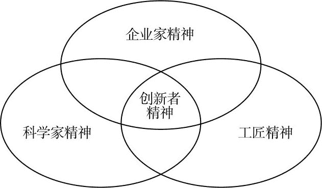
图 10-1　创新者精神与科学家精神、企业家精神和工匠精神这三者的关系
图片来源：陈劲。

科学家精神的核心是对一切理所当然说不。伽利略面对地心说，爱因斯坦挑战牛顿，mRNA 疫苗研究者面对质疑，都体现对未知的饥渴。但纯科学常困于实验室，真理不等于行动，只有行动才改变世界。企业家精神关乎改写规则与获取利润，福特用流水线把汽车变为大众品，马云把信任变成可编程的基础设施。但脱离社会责任的商业思维会压榨司机、撕裂社会，价值不等于价值观。工匠精神是反浮躁的专注，英伟达芯片、SpaceX 可回收火箭、mRNA 疫苗都源于对 0.1% 提升的偏执。但纯工匠可能沦为技术僧侣，日本战国名刀阻止不了火枪终结冷兵器，完美主义也可能成为枷锁。

三者交汇处便是创新者精神。科学家问为什么，企业家问为什么不，工匠问怎样更好，创新者在其中找到撬动未来的支点。只会发论文的纸面科学家、只会做路演的企业家、只会重复操作的工匠，都与创新者精神无关。马斯克体现了这种融合：科学上整合电池技术，商业上以直销颠覆传统车销，工匠上追求 45 秒造一车的极致工程。

达·芬奇是文艺复兴式的全才，天才的好奇心与创造想象力让他在绘画、解剖、机械设计上都留下超时代构想。恩格斯称那是需要巨人而且产生了巨人的时代，达·芬奇正是其中的明星。解剖时他是科学家，设计飞行器时他是企业家，画《蒙娜丽莎》时他是工匠。

21 世纪的文明竞争本质是创新者精神的竞争，看谁能培育出科学好奇、企业雄心与工匠专注共生的生态。

创新者精神：王选的故事

王选曾说：“我常想，一个人，一个好人，他活着，如果能够为社会的利益而奋斗，那么，他的一生才是有趣味的一生。爱因斯坦也曾说过这样的话：人只有为别人活着，那才是有价值的。我赞同他的话。但凡有成就的人，大多具备这种品质。他们为了社会的利益，为了活得有价值，始终不渝，狂热地去追求。”这番话体现了他超越性的创新者气质。

1975 年，王选主持华光与方正激光照排系统的研制。汉字量大、字体多、精密照排分辨率要求高，他发明了高分辨率字形的高倍率压缩与高速复原方法，并在系统上设计专用超大规模集成电路，改善了性能价格比，最终系统在中国报社、出版社和印刷厂普及并出口美国、马来西亚，为出版全流程计算机化奠基。

早年的科学家精神为此奠基。1954 年他入北大数学力学系，严密的数学训练塑造了逻辑与计算能力。彼时计算数学冷门，他却认为传统学科难突破，新兴学科潜力大。1956-1967 年科技发展远景规划把计算技术列为重点，钱学森等人的论述也显示计算机的潜力，他由此决心深耕计算数学。

1975 年经妻子陈堃銶得知“748 工程”下属的汉字精密照排系统项目，他被其价值与难度吸引。国内已有五组团队在做，多采用模拟存储、跟随二代机或三代机。他查阅中国科技情报所的英文文献，发现几乎无人借阅。基于大量阅读，他做出两个大胆判断：一是用数字存储替代模拟存储，把汉字信息存入计算机；二是不跟随二代、三代机，直接研制第四代激光照排系统。

他用“轮廓加参数”数学法描述字形，压缩率达 99.8% 至 99.9%，攻克存储难关，并设计加速复原的专用芯片，实现约 710 字/秒的高速复原与强大字形变化能力。10 多年钻研，手稿超 2200 页，出差飞机上、公交车上也在思考。1979 年原理样机输出首张样张后，他立刻启动华光 II；1985 年华光 II 在新华社应用后，他又感到需更快迭代；1987 年华光 III 在经济日报社应用，却被批“先进技术、落后效益”。他定下目标：1988 年取得压倒性技术优势，1991 年前先声夺人，占领中国市场，随后推出华光 IV、方正 91，夺下市场份额。他总结，机遇转瞬即逝，商品化太慢就会错失。

王选还具备跨领域工匠基因。1958 年毕业后参与北大“红旗机”研制，奠定硬件功底。后发现顶尖成果多由软硬件兼通者取得，他自学软件体系，认为软硬件结合是他人生最重要的选择。正是这种跨界储备让他抓住机会。

他既有市场眼光，也有创业者担当。从红旗机到 ALGOL 60 编译系统再到激光照排，他坚持应用性研究必须“能用”。1985 年获奖后他却有“负债”感，因国外厂商已进场。于是提出“顶天立地”：顶天是技术突破，立地是商品化推广。他倡导“持续创新”，“方方正正做人，实实在在做事”，推动方正成为创新型企业。他告诫创业者要年轻时养成动手习惯，提出新思想提出者往往也是第一个实现者。

反面教材是币安创始人赵长鹏。2021 年他凭借低费率多币种交易把币安推至全球最大，个人财富一度达 941 亿美元，跻身世界富豪前十。但匿名性与监管模糊导致洗钱、市场操纵争议，最终被美国判处 4 个月监禁并永久禁止担任币安领导职务。他仍是股东，但已失去控制权。

商业成功与技术便利从不是创新的终极标尺。金融科技不仅是算法竞赛，更是对负责任增长的定义。只有如此，科技创新才推动社会进步而非失控。

企业家精神创造财富，创新者精神创造未来。若把商业成功误作终极目标，得到的是更高效的消费主义；唯有保持对真理、美与价值的原始追求，文明才能突破瓶颈。人类最伟大的产品不是某个 App 或 IPO，而是新的思维方式、新的伦理框架与新的集体愿景。

当算法把一切都摊开来精算的时代，最稀缺的不是更会算计的投机者，而是愿意为星空驻足、而非只盯着钱袋的梦想家——真正能够改写规则的人，往往根本不屑于参与眼下的游戏。

## 对负责任创新提出呼吁
从创造性破坏的视角看，人工智能恰好契合熊彼特所说的颠覆式创新，智能技术正在以革命性的方式重塑生产力。科技引领进步、创新驱动发展之时，学界开始更多审视新事物带来的不确定性与负外部性，并对既有的创新范式展开反思。与过去不同，当下学者与政策制定者更强调技术必须与社会期待与价值取向相匹配。在此背景下，负责任创新作为研究与政策实践的新兴范式逐步受到关注。

过去一百年里，内燃机、核能、生物技术、信息技术等浪潮相继出现。科学与技术塑造生活、创造大量福祉的同时，人们也逐渐看清技术革新的两面性——收益与风险并存。无人驾驶就是典型案例，它能提供低价、全天候的服务，却也带来交通安全、数据安全等隐患，并波及出租车司机这类弱势群体的生计。

创新的责任话题被反复讨论。正如人工智能同时呈现光亮与阴影，创造性活动本身就是双刃剑。生成式系统如 ChatGPT、Midjourney 能力惊人，却缺乏真正的理解，容易出现幻觉，被用来制造虚假信息、诈骗和深度伪造。若缺乏监管，对就业与人类认知的影响将是深远的。我们要由少数科技巨头主导未来，还是主动塑造一个更公平、更安全的智能社会？

在技术高速演进的背景下，现行模式暴露出忽视研究与社会需求、价值的问题。决策者、产业代表、民间组织和科学家呼吁，要把科技研究与社会伦理结合起来，而不是像过去那样，研究只是实验室里的怪物，与社会意愿完全脱节。

人工智能是首个能够自主判断并产出创意的技术系统，这对“技术中性”的传统假设提出了挑战。李飞飞团队牵头的斯坦福 AI 指数报告是行业风向标。2022 年版指出，大语言模型在技术基准上不断刷新纪录，但同样会映照训练数据中的偏见。相比 2018 年参数约 1.17 亿的最先进模型，2021 年参数达 2800 亿的模型所引发的毒性上升了 29%。能力随时间增强的同时，偏差带来的潜在风险也在加大。

2023 年版写道，AI 滥用事件数量迅速攀升。追踪人工智能伦理滥用的 AIAAIC 数据库显示，2012 至 2022 年间相关争议事件激增近 26 倍。增长既反映技术更广泛的使用，也反映公众对滥用可能性的认知提升。与此同时，人工智能的发展速度远超各国政府的应对能力。若缺乏适当监管和公平获取，鸿沟可能在全球范围内被进一步拉大。

更令人不安的是，科技巨头正逐步掌握人类技术未来的控制权，其商业动机未必始终与公共利益一致，甚至可能把社会推向次优路径。2023 年阿西莫格鲁等人的研究指出，企业往往把人工智能导向替代人力而非增强人力，这可能削弱许多发展中国家基于低劳动力成本的比较优势。高盛 2023 年的研究预计，2022 至 2025 年间与人工智能相关的投资将翻倍至 2000 亿美元。

在这种态势下，负责任创新显得迫在眉睫。该概念在国内相对陌生，但提出已逾十年。2011 年 5 月，欧盟委员会开始探讨相关议题；欧盟“地平线 2020”计划将其提升至战略高度，认为研究与革新必须有效反映社会需求与意愿，体现价值与责任。决策者的职责在于构建治理框架以促进负责任的研究与革新。负责任创新的目的并非阻碍进步，而是激励成功，使其真正驱动增长并产生嵌入社会愿景的持续影响。

负责任创新要求对研究项目中的道德、社会、环境变迁做出回应，并在过程中引入更多利益相关方的参与评估。这是一种范式转移，既关乎我们如何思考、生活、互动，也关乎科学的角色定位。它有助于提供合乎道德、可持续且有效的解决方案，提升研究向革新转化的效率，防止革新对弱势群体产生不易察觉的歧视。

负责任创新关涉政策层面，已成为重要理念与新兴研究范式。其兴起根源于技术与管理治理中的“制度空白”，即现有制度结构难以有效管理革新。它也带来一定程度的制度模糊——谁对什么负责、谁拥有权威、该如何执行尚未清晰。对负责任创新的呼吁本身是一个制度化建构过程，德国、美国、英国、荷兰、日本、巴西等已开展政策层面的关注与实践。

从更高维度看，重构后的革新范式在传统的技术风险、不确定性、利弊分析之上，融合了不确定性、目的、动机、社会政治要素与发展轨迹，并基于一种新的社会契约，在科学、政策、社会之间共担责任，形成由更广泛主体参与、推动革新向道德可接受、可持续及社会满意价值演进的制度化过程。这值得全社会共同努力。

当革新速度远超伦理演进速度，当少数精英的决定能影响数十亿人时，“为革新而革新”的盲目追求极其危险。我们需要的不是更多革新，而是更负责任的革新，把人类福祉、生态平衡与长远未来置于短期利润之上。负责任创新意味着先思考伦理再编写代码，让人工智能系统增强而非削弱人性积极的部分；在突破科学边界时守住人性边界；在追求效率时守护意义，不剥夺人们获得有尊严劳动的机会。负责任的革新并非阻碍进步，而是确保进步真正服务于人类整体。正如普罗米修斯带来火种也带来责任，我们这一代必须认识到：最大的革新，或许是学会在拥有神一般力量时依然保持人的智慧与慈悲。

# 第十一章

# 深度创新才是真正的护城河

好事无一不源于创造。图 11-1 描绘了人口规模与创造活动随时间的演变。图中可见，二者在增长，但创造活动的增速明显快于人口增速。这说明人口扩大能够加速创造，进而推动社会进步。对中国而言，这意味着人口红利即创造红利，人口规模与创造活动存在正向互动，人口增长对创造起积极作用，这也在一定程度上解释了中国为何成为创造创业的热土。
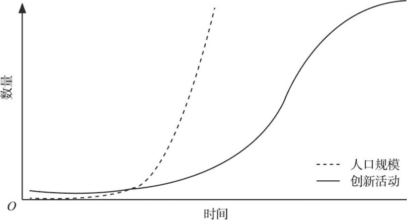
图 11-1　人口规模和创新活动随时间变化的关系

图片来源：拉斯·特维德，逃不开的大势，陈劲、姜智勇译，中信出版集团，2021 年。

从深度到广度，人工智能对创造方式的改变都令人振奋。我们每个人、每家企业，无论自觉与否，都将直接或间接感受到其深远影响。在恰当的治理框架下，人类社会将朝更高效、更开阔的方向发展。

未来个体能力可分为两部分：一是自身能力，二是调动与运用人工智能的能力。前者与教育相关，其中指令性能力会愈发不重要，而天赋与创造力愈发重要。后者与人工智能相关，会日益重要，因其能够替代指令性能力，并支撑与赋能创造力。两者叠加将大幅提升个体能力与效率。届时每个个体的能力都能得到智能扩展与加强，这是人类历史上前所未有的。在此情境下，个人的深度创造能力成为衡量内在素质的核心指标。这正是人类真正渴求的价值——从机械性、指令性任务中解放，人的维度变得更丰满、更充实。

## 熊彼特的权重逻辑
面对汹涌而来的智能浪潮，我们像是站在浩荡大河之畔，首尾难见，迷茫不已。从创造角度看，人工智能将带来怎样的影响？历史提供了普遍真理，追溯创造理论创始人熊彼特的思想或许能理清思路。

创造理论由熊彼特于 1912 年出版的《经济发展理论》首次提出。他认为经济发展是非连续的变动与运动，是破坏均衡又重建均衡的力量在作用，推动内在力量即“创造”。他的整个经济体系都以创造为核心来解释资本主义的发生与演变，至今仍极具启发。

若把企业家精神算法化，便是在损失函数中加入“熊彼特权重”。所谓熊彼特权重，就是对现状怀有“创造性不满”，倾向于非常规方案，并甘愿承担风险。

熊彼特指出，企业家创新的动力来自四个方面：一是革新带来获利机会，二是对建立私人商业王国的渴望，三是克服困难、彰显卓越的意志，四是拓展才能所带来的愉悦。在这些力量的推动下，企业家怀揣战斗勇气，受非物质力量激励，即企业家精神。

在他看来，革新主要由企业家实现，需要敏锐洞察潜在需求与利益，并有胆识与能力去实现。《他们创造了美国》对熊彼特的定义做了更清晰的阐释：创业者高于传统劳动者，革新者高于传统创业者。

发明与革新之间的差别在于是否商业化，只有商业化的发明才是革新，且其中最关键的是商业化而非发明。谁发明技术并不重要，重要的是谁能成功将其商业化。只有当企业把新产品、新技术引入生产体系，在市场上获得认可、取得竞争优势并带来商业利益时，它才是真正的革新。

另一方面，即便企业未自行发明新产品、新技术，只要成功引进他人成果并实现产业化，也构成革新。韩国是典型例子。产业起步时技术基础薄弱，便通过购买专利使用权启动发展，并注重消化吸收后再商业化，催生出三星、现代等全球竞争力的创造型集团。当然，在消化吸收基础上实现自主革新，才能形成根本竞争优势。

熊彼特将革新定义为生产要素与生产条件的新组合，并视其为经济增长核心动力。此后，技术驱动模式由传统要素驱动转向创造要素驱动。与此同时，人工智能这一颠覆性新技术使传统革新模式难以适应，暴露出不足；另一方面，它恰恰印证了熊彼特“创造性毁灭”的核心观点：每次重大技术革命都会颠覆原有经济结构，迫使旧生产方式让位于新组合。人工智能的特殊性在于，它不仅是新生产要素，更是重构所有生产要素的元技术。

传统革新中，企业家通过“新组合”将土地、劳动力与资本转化为生产力，而人工智能直接改变了这些要素的底层逻辑。在劳动力维度，人工智能替代重复性认知劳动，却放大了人类创造力的价值，这与机器替代体力劳动的工业革命相似，但速度更快、范围更广。在资本维度，算力取代机械设备成为核心资本形态，而数据这一非竞争性要素，动摇了以稀缺性为基础的经济学理论。

熊彼特强调革新需要企业家精神驱动，但人工智能时代的创造呈现更复杂特征。首先，创造主体多元化：开源社区、人工智能模型甚至自动化实验室正取代单一企业家成为发起者。其次，创造周期坍缩：从“发明—商业化”的线性过程变为“涌现—扩散”的爆炸式迭代。这一转变要求制度弹性远超工业时代。最残酷的是，人工智能的破坏性更大：它不仅淘汰落后产能，更可能系统性消灭整类职业，如初级程序员、放射科医生，而社会再分配机制尚未准备就绪。

创造高失败率。克莱顿·克里斯坦森等在《创新者的解答》指出，尽管精英全力以赴，多数尝试以失败告终。超过 60% 的新产品在上市前宣告流产；在约 40% 能诞生的产品中，又有 40% 因盈利不佳被撤市。累计来看，投入新产品研发的资金约有四分之三因失败而血本无归。未知因素难以预测，市场不确定性加剧，使创造风险极大。

创造是科学与技术内在禀性有机融合的高智力劳动，是一种高度复杂劳动，依赖高智力人才，不仅体现在规模，更体现在各环节的合理配置。一切事业由人开创，创造尤其需要创造性人才。

历史表明，创造规模与水平以整体投入为基础。通行的说法是，研发投入占销售额 1% 的企业难以生存，2.6% 可维持，5% 以上才具竞争力。

创造具有高度组织性。诚然，创造需要“反其道而行之”的创造力，但这只是开始。所有成功创造都高度组织的结果。乔布斯是极具创造精神的企业家之一，即便反感官僚主义，他领导的 Mac 团队最终规模达 100 人，共处一栋楼以便随时沟通。他规定团队不得超过 100 人，新增一人就需淘汰一人。缺乏组织性会导致效率极低。创造常始于天马行空的集体讨论，但若无合适流程规范，就易陷入混乱，表面创造实则盲目摸索。好的创造都高度组织化，有助于找到正确起点并以合理程序、分轻重缓急地推进。

创造的高失败率要求我们保持正确态度：失败是常态，应不畏失败、锲而不舍。创造既需要高创造力人才，也需要大量资源，有效组织管理后方能取得不同凡响的成果。

大胆设想，未来经济增长可能由“人工智能的自我创造”驱动。这带来一个悖论：当创造本身被自动化，市场竞争机制是否会因失去“人的不确定性”而僵化？或许我们需要重新定义创造的本质：它不再仅是生产要素的新组合，更是人类与人工智能在认知边界上的共生演化。

## 会聚创新：灰烬中重生的案例
赫库兰尼姆是意大利那不勒斯湾的古罗马小城，坐落在维苏威火山脚下。那里是公元 79 年火山岩浆毁灭的庞贝古城附属遗址的图书馆所在地。唯一保存完好的古代图书馆里藏有大量完全碳化的莎草纸卷轴，无法展开，若强行展开即成碎屑。四百多年来，从僧侣、王子到莎草学家、考古学家、历史学家、计算机科学家，无数人试图辨识文字，均未成功。

随着 ChatGPT 发布，大模型在 2023 年春天爆发式增长，人们对超级智能的焦虑也随之升温。硅谷及其他地区的开发者与思想家警告，或有一天某个系统会像维苏威喷发那样，以强大力量把文明化为尘埃。这种担忧促使数百名业余破译者利用人工智能破解古卷，期望在因灾难灭绝的城市中发现前所未见的文字。这便是“维苏威火山挑战赛”的起源，该赛事于 2023 年启动，旨在拯救埋于灰烬中的文明。

发起者是旧金山湾区知名投资人纳特·弗里德曼。2021 年前他长期担任微软开源平台 GitHub 的首席执行官。他与长期投资伙伴丹尼尔·格罗斯都是大模型的早期投资者。在 21 世纪第二个十年，他们就为机器学习研究人员出资。如今他们拥有的英伟达人工智能芯片比多数国家都多。有媒体报道称，一批科技亿万富翁计划在旧金山以北的农田建造“乌托邦城市”，弗里德曼赫然在列。

2020 年春天的大流行期间，居家隔离的弗里德曼对古代灾难产生兴趣。维基百科关于古代灾难的条目把他引向古罗马的赫库兰尼姆。1750 年挖掘古城时，在一座豪华别墅一角，工人们发现一堆几英寸高的黑色畸形圆柱体，最初被当作碳化木头，部分被丢弃——直到负责人意识到这里是图书馆。幸运的是，逾千个莎草纸卷轴及碎片被送往当地博物馆，等待重见天日的那天。谁也没想到，弗里德曼按下了加速键。

弗里德曼了解到该领域最新的突破，似乎曙光已现。2019 年，由肯塔基大学计算机科学教授布伦特·西尔斯领导的团队，将两个完整卷轴与四块碎片运往英国牛津郡的同步加速器中心。西尔斯团队利用同步加速器的高能光子，以 8 微米分辨率对莎草纸进行 CT 扫描。该分辨率下可识别的最小细节约相当于红细胞直径。

西尔斯最早的设想是把同步辐射成像的数据导进自研的程序，让每一层炭化的莎草纸在虚拟环境里像剥洋葱一样逐层展开，希望墨迹能在渲染面浮现。问题在于卷轴所用的碳基墨水与纸基本身的辐射衰减很接近，成像里几乎看不出差异。为此团队用一批手工抄写的碳墨稿本做训练，造出一个专门辨识墨迹的机器学习系统。弗里德曼得知后灵光一现，觉得硅谷的人工智能圈或许能加入。

沿着卷轴的纵轴，研究人员由上而下采集了数千张横切面的 X 光片。每张切片都把卷起的纸页切开，呈现出类似树轮的同心结构。把这些切片摊平再复原成完整纸面非常费工，需要人工用鼠标在每个切片上标出纸层的轮廓，再由定制算法把标注拼接起来。炭化后纸张常会粘连，有时自折，有时松散一张裂成多张，困难接连出现。

GPT-4 发布隔天，弗里德曼公布了挑战目标：从材料中辨认出四个各自不少于一百四十个字符的独立段落，报名截止定在 2023 年 12 月 31 日。来自两份卷轴的 5.5 兆兆字节扫描数据，后续处理主要分两块：图像分割与墨迹辨识。借助参赛者贡献的开源工具，他的团队处理速度大约每小时 0.2 平方英寸的纸面。

墨迹辨识更像一场开放的竞赛。主办方在在线竞赛平台挂出十万美元奖金的机器学习赛，要求参赛者训练系统在破损莎草碎片的 CT 影像里指出墨迹所在的体素，并期望碎片上学到的能力能迁移到全部材料。报名者与团队达到 2763 个，包含中国哈尔滨工业大学的两名学生、乌克兰的考古学者团队、德国的医学影像研究小组，以及日本、韩国的机器学习工程师。他们各自上传了对每个体素是否含墨的预测结果。

2023 年底，柏林自由大学的埃及籍研究生优素福·纳德尔、内布拉斯加大学林肯分校的本科生卢克·法里托、苏黎世大学机器人方向的研究生朱利安·希利格三人联手，交出惊艳成果。他们的系统完整读出四个段落，共约两千个字符，远超大奖门槛。2024 年 2 月初，维苏威火山挑战赛正式授予他们七十万美元。

我是 2024 年 3 月在《科学美国人》官网一篇题为《解码古代赫库兰尼姆卷轴的人工智能竞赛》的报道里看到这段经历的。它很好地诠释了会聚创新：人工智能与考古碰撞产生的奇迹。

2001 年“会聚技术”概念被提出，指向纳米、生物、信息、认知四类技术的协同。随后欧盟、日本、以色列、加拿大等经济体纷纷推出相关规划，会聚也演变为通用概念。2014 年美国国家研究理事会指出，会聚是通过跨学科边界解决问题，把生命科学、物理、数学、计算等知识、工具与思维整合起来。

在此基础上，会聚创新被理解为跨学科理论、技术与研究方法的融合，是知识聚合裂变的过程。赫库兰尼姆卷轴的破译就是典型。并非单一学科的功劳，而是计算机科学、人工智能、物理学、考古学、材料科学等多域深度耦合。高能物理的同步加速器与 CT 提供微米级三维成像，计算机视觉与机器学习的墨迹检测系统能在炭化基质中辨认古拉丁文，考古与历史语言学者则负责校核并赋予文化含义。学界推测本次读出的文字可能出自一部论“快乐”的哲学著作。

会聚创新还带来加速与扩散。若无大模型爆发，破译可能仍需数十年。人工智能的介入提升了效率，也点燃了全球开源社群的参与，从在线竞赛到独立研究，形成了分布式科研新形态。

赫库兰尼姆只是起点。1993 年约旦佩特拉一处拜占庭教堂遗址出土一百四十份可追溯至公元六世纪的炭化卷轴。数以万计的死海古卷碎片同样粘连待读。古埃及木乃伊面具下常夹有被石膏层层覆盖的莎草纸，文字难以触及。如今它们都可能成为下一轮维苏威火山挑战赛的关注对象。这一项目揭示了会聚技术的核心：复杂难题需要跨界工具链，破译既是技术胜利，也是方法论启示——打破边界才能看见答案。

深度创新：人类不可被替代的底线

正如前文所述，随着 DeepSeek 的推动，大模型进入“新范式”阶段。它的技术突破包括多头潜在注意力、更细颗粒度的混合专家与共享专家机制、多令牌预测等，使性能与性价比显著提升。

当前发展可归纳为三大突破。第一是界面革新。过去电脑交互生硬，鼠标与图形界面虽改善却仍是专业工具。随着多模态大模型成熟，交互趋于自然对话。空间智能让机器能“看见”环境并理解阐释。如今模型已能处理文字、图像、视频等输入并生成对应输出，重塑应用、浏览器、操作系统与设备的交互体验。

第二是规划与推理能力的跃升。人工智能不再止于输入输出，而是具备长远规划、前瞻思考与复杂逻辑推理，能提升人类解题能力。

第三是长期记忆与超级检索。模型可基于背景知识与过往交互历史思考运作，是历史上知识储备最丰富的智能体。

这三种能力正在重塑商业格局，但深度创新仍是人类独特天赋。以科学为例，真正的突破性创造不会被人工智能取代。爱因斯坦代表逻辑数学与空间想象的高峰，他能把思想实验、数学推导与严谨框架结合形成划时代洞见。他数学表达力强，却对语言兴趣不大，常因外语欠佳而遗憾。他的创新源于童年就养成的寻找规避常规答案的习惯，后来形成相对论假设，重新定义了时空与物质能量本质。

有人问他如何构建理论。他说先靠直觉确立基本原理，再行逻辑推演。直觉从何而来？他认为发现定律没有固定逻辑路径，只能依赖经验共鸣的直觉领悟。

牛顿亦然。他把开普勒的椭圆轨道与伽利略的自由落体统一。两者表面无关，牛顿却感到不协调，认为宇宙应受同一简单美原理支配。他以“圆”之美与椭圆、直线之疑为线索，最终发现万有引力。这正是科学直觉的体现。

有了人工智能，逻辑部分可被辅助，但真理的发现仍依赖直觉，直觉是从零到一，逻辑是从一到一点一，直觉是机器难以构建的创新起点。

疫苗产业亦说明深度创新的复杂性。埃博拉疫苗在暴发四十三年后才面世，艾滋病四十年里四十余种疫苗全部失败，SARS 疫苗十年未成。mRNA 技术十几年停留在早期，直到新冠疫情逼近，BioNTech 与 Moderna 将癌症治疗技术快速转向传染病，辉瑞投入超十亿美元建厂量产。mRNA 的逆袭证明，深度创新需要科学执着、技术积累、资金投入、高效协同与市场需求驱动。

米开朗琪罗说：“我在大理石里看见被囚禁的天使，只有不断雕刻才能释放。”这是基于经验共鸣的直觉。由事实到沉淀再到原理，过程无逻辑路径可循，故深度创新层面人类不会被机器替代。

在人工智能时代，人类深度创新能力被激发，创新的内涵也在被重写。传统创新多为人类主动构思改进，而今创新越来越多地关乎人与机器共生。人工智能能筛选海量数据、识别隐藏模式、提出人类易忽略的新假设。如药物研发中，算法可快速分析分子结构与生物通路，提出颠覆性候选。

创新职能边界也在指数级扩展。除产品设计与服务交付，供应链管理、风险评估、资源分配等领域亦成创新场。预测分析优化供应链，金融机构用模型评估市场与客户行为，实现更精准风险预测。

组织形态也在转变。等级结构让位于灵活协作网络。人工智能通信工具打破语言壁垒，自由职业者、初创与大企业可组成临时联盟共享资源。开源人工智能平台让全球开发者共同推进算法，这种新形态缩短创新周期、汇聚多元观点。

人工智能释放的力量近乎无上限，也引发担忧。正如基辛格等人所著《人工智能时代与人类未来》指出，历史上的技术变革不少，但能根本改变社会架构与政治架构者屈指可数，人工智能有望在人类体验所有领域带来变革，核心在于改变我们理解现实与角色的方式。

这揭示了人工智能与以往革命的区别。工业革命改变生产，信息革命重构传播，人工智能则挑战认知边界。当机器能自主决策、创造甚至形成“价值观”，关于意识、伦理与权力的哲学框架将被重塑。技术迭代可加速，但哲学与伦理适应往往滞后。若工具理性与价值理性失衡，人工智能或成破坏者，既可能突破认知极限，也可能动摇价值根基。

在梳理 DeepSeek 的技术逻辑与商业模式后，读者对中国在成本结构上的优势、人工智能的复杂性与演进脉络应已清晰。最后一章，我们将从哲学层面探讨人工智能与人类福祉及未来的深层关联。

# 第十二章

# AI 是火种还是魔盒？

人类曾把火看作神赐——普罗米修斯盗来点亮文明，也招致惩罚。今天我们手握另一种火种：人工智能。它能驱散无知与疾病的阴影，赋予前所未有的力量；失控时却可能燃起难以扑灭的灾祸。潘多拉的盒一旦打开，贪婪、偏执乃至具备自主意图的杀戮机器可能涌出，“希望”是否仍留在底部？

历史告诉我们，工具本身无善恶，归宿由人性决定。我们创造之物终将重新定义我们。但这一次面对的不是冰冷石器或钢铁，而是一种可能比我们更聪慧、更高效的存在。农业革命驯化了麦与羊，工业革命驾驭了蒸汽与电力，AI 革命则提出更根本的问题：当机器能思考、学习甚至创造，人类的价值何在？

我们曾相信自己是唯一能编织故事、探寻意义的存在，若 AI 也能作曲、写诗、提出科学假说，独特性是否会瓦解？更堪忧的是，若决策权交给算法，人类自由意志是否会沦为数据流中的涟漪？民主、艺术、爱情等定义人性的基石，是否会在效率至上的优化中被悄然侵蚀？

## 速度与火焰终结一切

1946 年 7 月 1 日《时代》周刊以一幅令人难忘的封面载入史册。画中爱因斯坦白发苍苍，背景烈焰冲天，阴霾天空飘着硕大蘑菇云，并标注其质能方程 E=mc²。封面主标题“宇宙碎屑爱因斯坦”，副标题“速度与火焰终结一切”。背景是二战后美国在比基尼环礁的核试验。

约 80 年后，这幅封面背后的轰鸣仍在耳边回响。智者凝视着以其公式点燃的炼狱，警示早已超越物理，成为文明存续的命题。巴菲特将 AI 发明与核武器相提并论，称两者都是“让精灵跳出魔盒”。“速度与火焰终结一切”的古老预言正于算力世界重生。爱因斯坦的蘑菇云与大模型的神经网络，本质都是人类释放的普罗米修斯之火，一个撕裂原子，一个重构思维。当文明获得神之权柄时，需何种智慧防止火焰焚毁自身？当精灵不可阻挡地大行其道时，需何种力量守护共同家园，让希望不灭？

1945 年 7 月 16 日“三位一体”核试验照亮新墨西哥沙漠时，奥本海默想起《薄伽梵歌》：“现在我成了死神，世界的毁灭者。”这种战栗与开发者面对 GPT-4 涌现能力时的恐惧相似。核裂变与 AI 有相同危险逻辑：指数级能量爆发，1 千克铀 235 完全裂变相当于 2 万吨 TNT；斯坦福《2025 年人工智能指数报告》指出，AI 模型规模持续快速增长，训练计算量每 5 个月翻一番，数据集每 8 个月翻一番，耗电量每年翻一番。其次临界点不可逆：核链式反应无法停止，大模型达“智能奇点”后同样可能失控。最后双刃剑属性：核技术可发电也可制弹，AI 可助研药也可被用于深度伪造战争借口与诈骗。

数字时代的火焰变种

时代周刊封面上的那束火，在线上世界里分裂成三股新的燃烧方式。

先是速率之燃。核装置可以在百万分之一秒里复制太阳的聚变，超大模型的训练正逼向把人类已出版的数据吃空的边缘。生物进化要以百万年计，机器智能的迭代却被压到数月。危险之处在于，当演进被快进，维系文明的伦理与法制根本跟不上指数级跃迁。

再是认知之燃。原子弹炸毁的是看得见的城区，AI动摇的是看不见的思维地基，直抵认知的底线。深度伪造能逼真复刻任何领袖的声音，推荐算法筑起的信息茧房挤占公共讨论的空间，真实这一文明支柱正出现裂纹。爱因斯坦担忧第四次世界大战退回石头互打，更残酷的或许是战火未起，人类就已先丧失真假辨识力。

第三是系统之燃。AI可能点燃更隐蔽的结构性瓦解。经济层面，若近半岗位被替代，社会动荡难以避免；政治层面，算法专政的技术可行让人不安；生物层面，基因编辑一旦与AI设计的病原体结合，可能形成致命配伍。

神话里普罗米修斯把火偷给人类后被宙斯锁在高加索任鹰啄啄。今天的惩罚同样沉重。核竞赛塑造了相互确保毁灭的恐怖平衡，AI竞赛却在失控的狂飙中推进，各国明知风险却停不下研发。曼哈顿计划的科学家还能公开反对氢弹，如今AI研发分散在旧金山、北京、班加罗尔的无数办公室，没有人对整体风险担责。

面对速率与烈焰的新纪元，打破诅咒的办法不是放弃创新，而是重建创新的神圣感。对关键突破设置文明层面的刹车，让系统像核反应堆那样内置负反馈；把评测从图灵测试升级为人性测试。

速率与烈焰既能终结一切，也能照亮前路，分水岭在于回车按下前能否在镜中认清自己。技术终究是人性的显影剂，在大模型爆发期，最大的创造或许是证明人类配得上自己造出的力量。

盖茨的机器人税

大模型冲击的第一波牺牲者是人控企业。最典型的是疫情期间风光的美国在线教育平台Chegg，ChatGPT上线后市值几乎归零。疫情时它是学生求助作业的首选，股价与订阅同创新高。免费替代品出现后付费用户断崖式流失，自发布以来流失超50万付费用户，股价从2021年初高点跌去99%，市值蒸发约145亿美元。

不安之外也有积极信号。2025年3月《经济学人》刊登《能否说服人们不要相信虚假信息？》，引述麻省理工托马斯·科斯特洛团队2024年9月的研究。2190名持阴谋论观点者与GPT-4进行三轮对话，对话后自报的相信程度平均下降20%，四分之一彻底放弃原有念头。原因是聊天机器人能保持理性不带情绪，并能调动海量训练数据给出精准反驳，而非人类式的泛泛而谈。另一面，多模态数字人仅需5分钟素材采集即可生成高仿真直播人，已进入数千家品牌直播间替代真人带货。

UNCTAD《2025年技术与创新报告——促进发展的包容性人工智能》指出，AI或将波及全球40%的就业。发达经济体三分之一的工作易被自动化取代，约27%的工作可被AI增强，因认知任务占比高，发达劳动力的风险更大。

阿西莫格鲁等人的研究归纳出AI对劳动与生产力的四种作用，往往并存：取代人力、辅助人力、深化自动化、催生新岗位。代码写作模型、人形机器人递茶、数字人带货，都是取代的例证。

在此背景下，2017年比尔·盖茨提出的机器人税被重新讨论。他主张对企业使用机器人征税，以缓冲就业冲击并资助再培训。逻辑是机器人取代岗位后企业利润上升，但纳税人口减少导致政府收入下滑。征税节奏应与自动化渗透速度同步，避免激进政策扼杀创新。

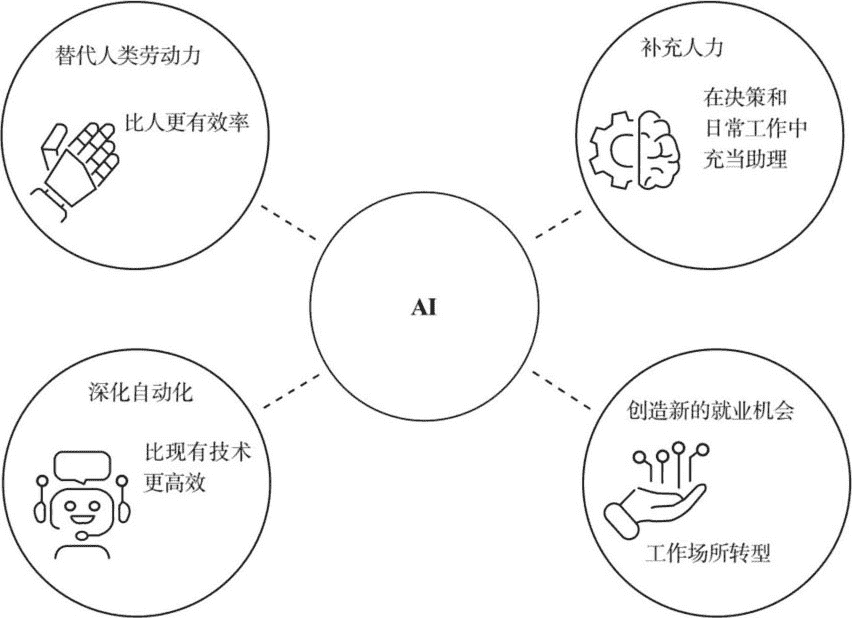
图 12-1　人工智能影响人类劳动和生产力的四种方式
图片来源：UNCTAD，《2025 年技术与创新报告——促进发展的包容性人工智能》。

支持者认为征税有助于公平与缩小差距，减缓部署速度为社会争取适应时间。反对者认为这会拉低生产回报，是对创新的罚单。争论核心在于如何界定机器人：是人形机身，还是包括灵巧手、机械臂在内的所有自动化设备？若以节省人力为标准，办公软件算不算机器人？这恰是盖茨财富根基的内核。

细看盖茨的推理，链条并不完整。采购机器人要付采购费与高额维护费，部署大模型还伴随流程再造等投入，成本高、回报周期长且不确定。但构想仍值得深思：征收机器人税并非反进步，而是在效率优先与人类福祉之间寻找平衡。

启示是，若不主动设计分配机制，AI革命会复制工业革命的剧本：先拆毁旧秩序，数十年后才慢慢重建新平衡。机器人税的本质是让自动化受益者承担更多社会责任，为职业培训、全民基本收入等过渡方案供血。这不是惩罚创新，而是确保创新真正服务整体。一个被失业潮撕裂的社会，最终也会反噬科技巨头的市场。

歌德寓言与维纳预警

1960年，控制论之父诺伯特·维纳发表了一篇极具前瞻性的文章。他警告一个世界正在到来：机器学习会以让程序员困惑的速度衍生出不可预见的策略，这些策略可能并非程序员真正想要，只是对人类意图的花哨模仿。他引用歌德《魔法师学徒》来说明：学徒给扫帚施法让它取水装满浴缸，任务完成后却无法叫停，最终水淹整间屋子酿成灾祸。

如今大模型就像那把被施了魔法的扫帚，昂首执行任务，人类则像那位得意的年轻学徒在一旁观望。维纳担心的事是否会应验？是否会重蹈覆辙？答案尚早，而这正是呼吁负责任创新的起点。

在AI时代，创新正迎来深层范式变化。门槛被拉低，个体开发者、小微企业与巨头同场竞技，低代码平台和GitHub Copilot类工具让非技术背景者也能参与。人机协同成为常态：人负责创意构思与价值判断，AI承担数据挖掘与方案迭代，形成人定义—AI生成—人优化的闭环。

在时间维度上，创新周期被极度压缩。药物研发中AI一周内可筛数百万分子组合，传统方法需数年；工业设计里生成式AI能按参数瞬间产出上千方案。即时创新模式开始浮现。

创新路径也在结构性逆转。AI通过模拟测试快速验证可行性，推动方向从技术导向转向问题导向。DeepMind的AlphaFold即是典范。

蛋白质折叠决定功能，错误折叠与阿尔茨海默、帕金森等病相关，也制约药物设计，长期困扰生物学。DeepMind并未另起炉灶，而是基于现有深度学习框架，用虚拟分子动力学快速测试，将17万组已知序列结构输入模型以预测未知结构。2020年AlphaFold2在CASP竞赛中取得中位92.4分，满分100且90分以上可比肩实验，预测结构与实验答案仅在原子尺度差异。2024年5月AlphaFold3登上《自然》头版，人类由此实现对所有生物分子结构的预测，攻克了折叠难题。

相较互联网浪潮，AI浪潮渗透更深更广。物联网与AI结合后可在极少人工干预下分析、决策、行动，成为智能工厂基石。据2024年联合国经社会估计，AI产生的温室气体排放已超过全球航空业，数据中心用电约占全球1%。不过预计到2030年，仅靠效率提升，AI就能帮助全球减排约4%。

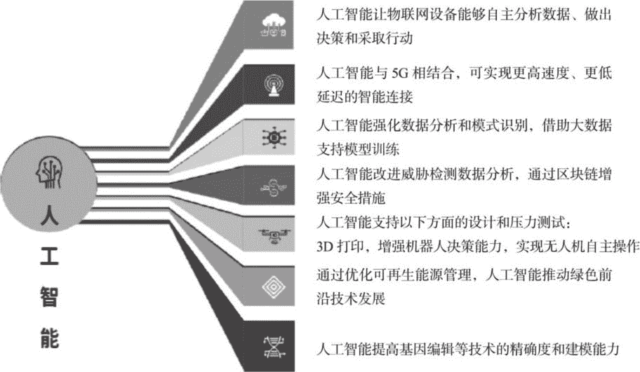
图 12-2　人工智能对其他前沿技术的增强
图片来源：UNCTAD，《2025 年技术与创新报告——促进发展的包容性人工智能》。

AI亦是双刃剑，推动创新的同时带来异化风险，如算法偏见扭曲创新方向、深度伪造滥用等。在加强治理的前提下，需要重审工具理性与价值理性的经典命题。

工具理性与价值理性的再审视

大模型热潮点燃了对通用或强人工智能的期待，设想它能超越人类并自主运行。AI已在手写、语音、图像识别、阅读与语言理解等领域超人，但人类智能的多面性意味着通用智能的挑战远超预期。

20世纪初，韦伯将理性分为工具理性与价值理性。工具理性为达成目标而行动，追求效率最大化，关注手段如何最优。信奉者不看重行为本身价值，只看它能否有效达成目的。快递员困在系统里、武汉街头的萝卜快跑无人出租，都是典型。

价值理性则基于特定价值或信仰体系行动，表现为对无条件固有价值的纯粹坚守，不管成败。行为被赋予绝对意义，动机可源于伦理、审美、宗教、责任、荣誉或忠诚，甚至超脱手段后果考量。现代化进程中二者张力巨大。

理性不仅是工具理性，还包含价值、情感与传统等所谓非理性维度。哈耶克的有限理性可视为对此的呼应。工具理性虽排除了部分人性内涵，却是经济社会高效运转的底层逻辑。

韦伯对二者持矛盾态度：一方面承认工具理性的合理与必然，另一方面忧虑它把人锁进效率至上的铁笼，丧失对生命意义的反思，并担忧价值理性衰微，道德情感被遮蔽。AI兴起让此话题再受关注：强大工具是牢笼还是解放？

社会生物学家爱德华·O·威尔逊曾说：人类的问题是，我们拥有旧石器时代的情感、中世纪的制度，和神一般的科技。这是极度危险的，已接近总体危机的临界点……除非我们理性地回答几代前哲学家就放弃的问题——我们从哪里来？我们是谁？要去哪里？——否则立足极其脆弱。AI正是这神一般的科技。若不能超越旧石器情感和中世纪制度，力量将把人类推向何方？

负责任创新意味着矫正工具理性、回归价值理性。在狂飙中保持二者平衡，不让效率遮蔽意义，否则AI不再是普罗米修斯火种，而是潘多拉魔盒。

最深的恐惧不在机器，而在人类自身。AI放大能力也放大缺陷，可能成专制监控工具、资本碾压弱势的无形巨轮、文明内耗的武器；同时也能成为教育平权推手、气候解方、跨文明对话桥梁。关键不在于AI能否思考，而在于我们能否清醒地思考自己想要什么。

普罗米修斯的火温暖洞穴也烧毁森林，潘多拉盒释放灾祸却留下希望。面对AI，或许该问：我们能否在获取天火般的力量之前，先学会不被它焚毁？

# 参考文献
1．SUBIN S. Nvidia sheds almost $600 billion in market cap, biggest one-day loss in U.S. history [EB/OL]. (2025-01-27) [2025-02-27]. https://www.cnbc.com/2025/01/27/nvidia-sheds-almost-600-billion-in-market-cap-biggest-drop-ever.html.
2．永远好奇的.我所见过的梁文锋[EB/OL]. (2025-02-06) [2025-03-06].聪明投资者公众号.
3．财经十一人.ChatGPT 算力消耗惊人，能烧得起的中国公司寥寥无几[EB/OL]. (2023-03-06) [2025-02-27]. https://36kr.com/p/2158371855507206.
4．心之龙城飞将.成本是 GPT 的 1/20，轰动硅谷的中国大模型 DeepSeek 是怎么做到的？[EB/OL]. (2025-01-06) [2025-02-27]. https://user.guancha.cn/main/content?id=1359969.
5．甲子光年.我们应如何看待 DeepSeek 的 557.6 万美元训练成本？[EB/OL]. (2025-02-07) [2025-02-27]. https://36kr.com/p/3156439091730944.
6．HINTON G E, VINYALS O, DEAN J. Distilling the knowledge in a neural Network[EB/OL]. (2015-03-09) [2025-02-27]. http://arxv.org/abs/1503.02531.
7．艾萨克森.埃隆·马斯克传[M].孙思远，刘家琦，译.北京：中信出版集团，2023.
8．刘远举.DeepSeek 站在巨人肩上，这个巨人到底是什么？[EB/OL]. (2025-02-05) [2025-03-03]. https://www.163.com/dy/article/JNJI7GLD05129QAF.html.
9．罗素，诺维格.人工智能：现代方法（第 4 版） [M].张博雅，陈坤，田超，等译.北京：人民邮电出版社，2022.
10．TURING A M. Computing machinery and intelligence [J]. Mind, 1950, 59(236).
11．吴晓波，安健，刘斌.云上的中国 3：剧变中的 AI 时代[M].北京：中信出版集团，2024.
12．SUTTON R. The bitter lesson [EB/OL]. (2019-03-13) [2025-03-03]. http://www.incompleteideas.net/IncIdeas/BitterLesson.html.
13．RUMELHART D E, HINTON G E, WILLIAMS R J. Learning representations by back-propagating errors [J]. Nature, 1986, 323 (6088).

百模大战只是开始：从DeepSeek破局看AI格局的再洗牌

过去两年，生成式AI从实验室概念变成产业狂潮。ChatGPT的出现让大众第一次用通俗的方式理解大模型能做什么，也把模型竞赛推向白热化。国产赛道很快进入被媒体反复提及的“百模大战”阶段，有观点认为国内模型数量远未饱和，真正的竞争才刚刚进入加速度。

技术上，DeepSeek系论文集中体现了降本增效的思路。数学推理能力的极限探索、专家混合架构的极致专业化，以及兼顾强劲性能与经济性的V2版本，都指向同一方向：用更聪明的架构换算力红利。与此同时，缓存与注意力机制的演进链条从MHA到MQA、GQA再到MLA，展现了在效果与存储之间持续拉扯的产品化努力。

算力叙事也在变化。有人把算力门槛的下移描述成一系列连锁事件的结果，而非单点突破。开源成为关键杠杆，微软的开源转向被解读为内部重塑，阿里千问衍生模型数量突破十万量级登顶开源榜，DeepSeek一边开源大模型一边申请专利的策略，更折射出开放与商业保护的平衡术。

巨头层面，OpenAI被曝下一代训练规模或再创新高，市场传闻涉及十万张H100级别的集群，阿尔特曼描绘的数十万亿美元级AI蓝图也在行业内引发争议。芯片端，黄仁勋的产业叙事持续主导讨论，AMD险些收购英伟达的旧闻也被重新翻出。云厂商的模型布局、风投对头部AI公司的集中追捧，以及文心4.0首发等国内标杆动作，共同构成资本与技术的双重驱动。

风险也在同步显现。大模型幻觉问题仍是学术与工程的共同关切，斯坦福AI指数报告与IBM对未来十年的趋势研判都在强调安全与治理。现实中，AI诈骗案借助变脸技术骗走巨额资金，脑机接口从实验室走向梨洲中学心理健康教育、华理脑控机器狗的混合现实演示，说明技术边界正快速外溢到社会治理与人机交互。

从浪潮之巅的产业规律到跨国并购的整合式创新案例，从量子人工智能的交叉探索到十五五规划里对AI作为经济关键力量的定位，可以看到一个共识：模型数量不是终点，算力平权、架构效率、数据治理与开源生态的协同，才决定谁能在下一轮分化中存活。百模大战不是太多，而是远远不够，也是必须更卷的技术与制度竞争。