# 漫画人工智能

## 丛书编委会

总顾问：邬江兴 中国工程院院士

主任：宋明武 中国人民解放军战略支援部队信息工程大学副校长兼教育长

副主任：邹 宏 复旦大学大数据研究院副院长

俞能海 中国科学技术大学网络空间安全学院副院长

邵广纪 中国人民解放军战略支援部队信息工程大学教务处处长

蔡晶晶 北京永信至诚科技股份有限公司董事长

编 委：李广云 祝跃飞 李新生 罗军勇

屈 丹 单 征 袁 博 侯毅刚

张 丽 王 博 胡 滨 张雪美

杨 森 孙 晨 郭 威 许瑾晨

## 本书编委会

主任：屈丹 张文林 闫红刚

副主任：陈琦 牛铜 杨绪魁

编委：侯毅刚 王博 赵兵 田乐

## 写给追梦人

2018 年 5 月 28 日，两院院士大会上，习近平总书记的一段话让我记忆深刻：“当科学家是无数中国孩子的梦想，我们要让科技工作成为富有吸引力的工作、成为孩子们尊崇向往的职业，给孩子们的梦想插上科技的翅膀，让未来祖国的科技天地群英荟萃，让未来科学的浩瀚星空群星闪耀！”科学的希望是永远有明天，明天的希望是永远有后浪，后浪的希望是永远有自强不息的年青一代。

激励广大青少年讲科学、爱科学、学科学、用科学、走科学之路，需要我们把科学普及放在和科技创新同等重要的位置，作为我们这一代科技工作者同样重要的责任。在科学出版社的鼎力支持下，在近百名科技工作者的共同努力下，这套“漫画网络信息新技术科普丛书”得以出版，是推动科学融入公众、增加高质量科普资源供给的有益探索。

应编委会之邀，为这套丛书写个序言。思来想去，我觉得把这个序言写给追逐科学梦想的同学们为宜。也是作为前浪对后浪的寄语，简单谈谈我们这一代人投身科学和科学普及的初心与使命。

**用心去感受科学之美**。科学有科学的美，追求科学之美，是我们对科学产生兴趣的“触发器”。我也曾经在如何突破冯·诺依曼计算体系、构建领域专用软硬件协同处理架构，如何破解网络空间共性安全难题、构建基于动态异构冗余架构的内生安全体系等“灵魂拷问”中艰难地探索，但是当我从探索频道看到生物世界中的拟态现象，数千万条沙丁鱼结群避险时的拟态运动，上百万只非洲候鸟空中捕食时的拟态队形变化，以及具有色彩纹理和形状行为变化莫测的拟态章鱼等形形色色的拟态生物时，产生了在网络信息系统中导入拟态构造的奇思妙想和创新激情。这种科学之美，不仅激发了我们探索未知世界的兴趣，而且给了我们解决未知难题的灵感。不是世界缺少美，而是我们缺少发现。用心感受、发现科学之美的过程，就是我们建立对科学的兴趣、了解科学方法、建构科学思维的过程。在这个过程中，有深度的科普读物一定会成为大家的良师益友，为你点燃一团火、亮起一盏灯、推开一扇门……

**潜心去领悟科学精神**。科学精神是什么？对于这个问题，众说纷纭。我个人认为，可以概括为四个字：求真务实。所谓求真，就是追求真理，探求科学之真、科学之美。科学之所以能够立身，就在于其“真”；科学之所以成为科学，也在于其“真”。求真的道路是漫长而艰苦的，有时也是充满风险与挑战的。既需要“路漫漫其修远兮，吾将上下而求索”的精神，更需要“板凳要坐十年冷，文章不写半句空”的毅力。所谓务实，就是在仰望星空之际、脚踏实地。科学从来都是“大胆假设、小心求证”，需要踏踏实实、落地生根。20世纪80年代中期，我提出在功能等价条件下，造一台能提供电话服务功能的专用计算机来解决制造大型程控电话交换机的难题，这个思路的确“高大上”甚至“有些疯狂”，但是真要实现，面对的却是“九九八十一难”。当时我们能够拿到的技术资料，也就是类似科普读物中关于“千里眼、顺风耳”的一些浅显介绍或者近似古董级的机电交换机资料。经过我们多年艰苦攻关，我国第一台万门程控交换机横空出世，打破了西方国家“七国八制”技术与产品长期垄断全球市场的态势，带动我国信息通信技术领域和产业的群体突破。这靠的就是求真务实的精神，“纸上得来终觉浅，绝知此事要胆行。”

**真心去体会科学家精神。**科学家精神，也有很多表述。从我理解看，钱学森先生的一句话讲得最为通透、直达本质，“科学没有国界，可是科学家却有自己的祖国。”科学家精神，最核心、最根本的就是对祖国的热爱，对民族复兴、人民幸福的责任与使命。没有这一点，所有的一切都是无源之水、无本之木。我之所以立志去制造中国人自己的程控交换机，其中一个重要的原因就在于20世纪80年代，西方发达国家的一些权威人士曾经预言“中国人本世纪造不出大型程控交换机”。我们这一代科技工作者，从来就是不信邪、不服输，你们预言我们做不到的事情，我们一定要做到，而且要做得更好，必须要有这个民族自信心、有一股敢为天下先的傲骨。最后，我们不但做到了，而且成为世界通信史上的一个创举。科学家精神，就是为国分忧、为民族争气的精神。每一个年轻人，追求科学、探索科学、实践科学，最终都要为祖国富强、民族复兴服务，无论在天涯海角，和祖国一刻也不能分离。只有这样，涓涓细流，终成江河；科技强国，指日可期。

希望青年朋友们能够感悟科学之美，满怀科学精神，传承科学家精神。也希望这套“漫画网络信息新技术科普丛书”能够绽放科学之美，传播科学精神，弘扬科学家精神。

2020年6月

## 前言

制造出能够像人类一样思考的机器是科学家们最伟大的梦想之一。1956 年，人类历史上一些伟大的科学家们聚集在美国汉诺威小镇的达特茅斯学院，讨论着一个当时被认为是不食人间烟火的问题——机器是否会像人类一样具有智能？随后科学家们为这个领域起了一个历久弥新的名字——人工智能（Artificial Intelligence，AI）。人工智能经过历史长河的洗礼，在蜿蜒盘旋中不断前进，在 2010 年迎来了第三次浪潮，进入了全面高速发展期。你也许很难想象，人工智能这样一个高深技术领域会成为老百姓茶余饭后讨论的话题，这个词会成为 2017 年中国媒体十大流行语。归结其原因，人工智能技术产品不断发展，已经改变甚至颠覆了我们的生活方式，AlphaGo 围棋程序、Dota 游戏、自动驾驶汽车、教育机器人，不断冲击我们的眼球和刷新我们的认知。

习近平总书记深刻指出，人工智能是引领这一轮科技革命和产业变革的战略性技术，具有溢出带动性很强的“头雁”效应。加快发展新一代人工智能是我们赢得全球科技竞争主动权的重要战略抓手，是推动我国科技跨越发展、产业优化升级、生产力整体跃升的重要战略资源。

作为一个具有内在结构的知识系统，人工智能技术在其发展历程中形成了不同的流派体系。人工智能技术还与很多新兴领域，如大数据、认知计算等，构成复杂关联的技术集群。如何将人工智能这个庞大的技术体系深入浅出地呈现在人们面前，让人工智能初学者、人工智能爱好者，以及广大的青少年快速领略人工智能的魅力？为此我们经过一年多的酝酿，在科学出版社的大力支持下，编绘了这本《漫画人工智能》。本书通过讲故事的形式串接内容，带领青少年走入神奇的人工智能世界。以印象篇、历史篇、概念篇、技术篇、应用篇、安全篇、未来篇、启示篇多维视角全方位地探索人工智能的神奇与奥妙。

人工智能本质上是一个复杂、动态、关联、深奥的知识体系，是用数学方程推动的幻彩世界。如何将多学科交叉融合的技术知识，用形象的语言、直观的图示来描述呈现实属不易，用漫画的形式、生动的情节来进行诠释更是难上加难，对于作者、绘者都是一次全新的尝试。庆幸本书作者同步在编写《深度学习基础》《自然语言理解》，为本书的出版提供了坚实的理论基础和丰富的科学素材。深奥科学理论的普及化，是一种新的创新探索，对于启发公众思想，促进社会精神文明发展具有重要价值，非常有幸能够成为这个过程的参与者、实践者、推动者。作者从事人工智能领域教学、科研二十余年，做了一些工作，积累了一些经验，有些想法和思路，希望与读者共同交流探讨。其中偏颇之处，只是管窥之见，一家之言，欢迎不吝赐教。

“日月之行，若出其中。星汉灿烂，若出其里。”在新的历史阶段，人工智能一定会同社会生产力发展同频共振，同诸多新兴学科建设互促共进，为我国科学技术从丛林呈现百家争鸣、百花齐放的繁荣局面做出自身贡献。谨以此书抛砖引玉，希望更多的人站在我们肩膀上，看得更高，走得高远，创造人工智能领域新的灿烂辉煌。

作者  
2020 年 7 月

## 人物简介

- 安安
  SMART 蓝色
  代表: 智慧
  性格: 开朗聪明，求知欲强，喜欢了解一切未知事物，善于学习和研究、回答问题，但总是丢三落四。妹妹《VIKI》帮他收拾。
  特长: 最强大脑，回答问题正确率很高，担任班长一职。

- VIKI 橙色
  代表: 美丽
  性格: 可爱活泼，喜欢把一切东西打扮漂亮、整理干净，总是帮哥哥收拾东西，也乐意帮助哥哥解围。
  特长: 头上的帽子可以变成翅膀。

- 全全

- 强强
  MACHO 黑色
  代表: 力量
  性格: 仗义，较为冲动，喜欢逞强，好胜心强，喜欢回答问题，想得到大家的认可，却总失误。
  特长: 可以在关键时刻变得力大无穷，帮助他人。

- DUDU 粉色
  代表: 温柔
  性格: 温和，关心他人，做事沉稳，但比较胆小、唯唯诺诺，做事说话都比较慢，紧张的时候容易结巴。
  特长: 可以随时在脑海中调出视频影像进行放映解答。

- 赛赛

- 博博
  老师 PROFK 绿色
  代表: 学识
  性格: 儒雅、博学的老师，但有时在讲话时会突然晕倒，原因是程序员在写代码时，漏掉了一行代码。
  特长: 可以随时随地拿出相应的书籍、物品，对同学们进行现场教学。

## 第一章

### 人工智能印象篇

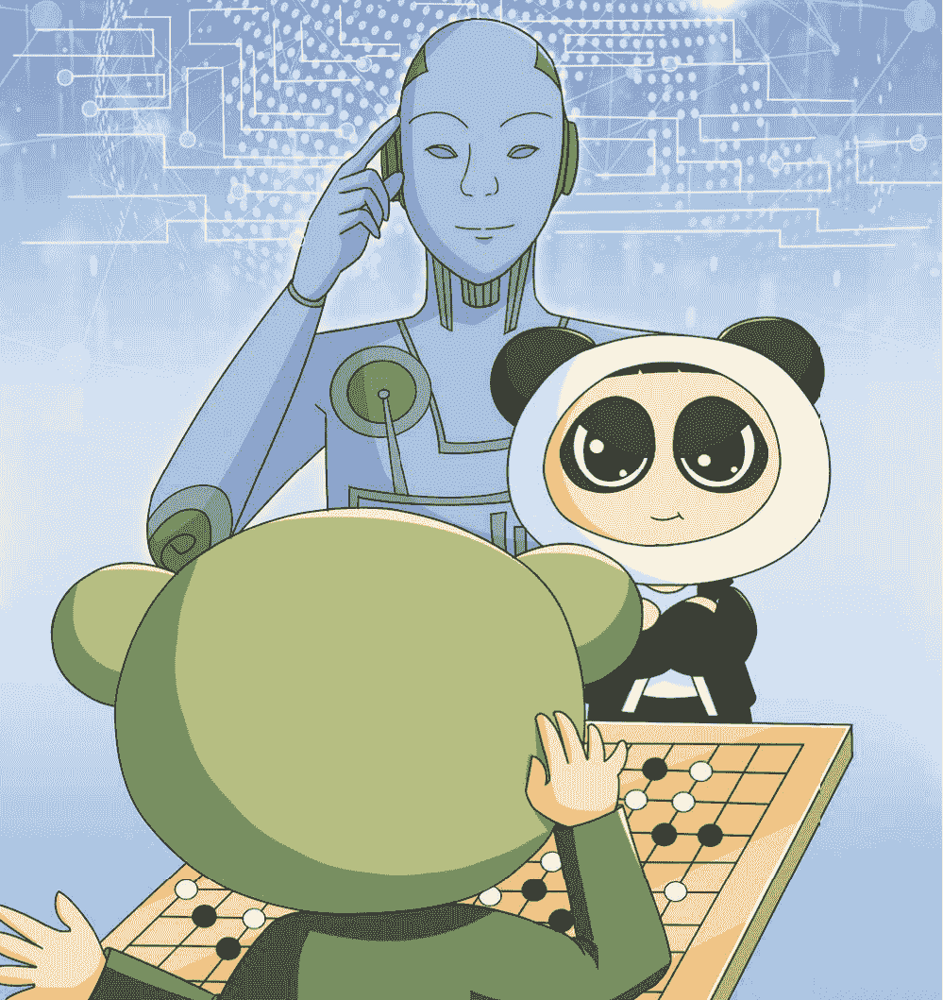

### 会下棋的机器 —— 从 AlphaGo 说起

观众朋友们大家好！欢迎来到柯洁和 AlphaGo 的比赛现场！

柯洁与 AlphaGo 比赛现场

### VS

这是人类和人工智能的一次巅峰对决！

### 柯洁

### AlphaGo

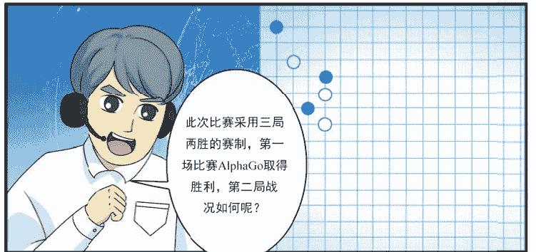

> 此次比赛采用三局两胜的赛制，第一场比赛AlphaGo取得胜利，第二局战况如何呢？

> 老师来啦！

> 上课了！不要玩了！

> 溜了溜了。

关闭

> 咻！

老师要赖！

好吧，今天我们就好好讲一讲人工智能，等我讲完了，我想你们自然会有答案。

老师，我们刚才在看柯洁和AlphaGo的比赛呢！您就从这里给我们讲讲吧！

这样啊！那我们就从几个大家耳熟能详的例子来看看现实中人工智能的巨大威力吧！

什么大事呢？

在2016年3月人工智能史上发生了一件大事。

### Google DeepMind

Google公司的机器人AlphaGo打败了世界围棋冠军、职业九段棋手李世石。

李世石

世界国际象棋冠军卡斯帕罗夫

我知道我知道！
这是继1997年IBM深蓝打败世界国际象棋冠军卡斯帕罗夫以后，人工智能史上的又一件大事。由于AlphaGo打败了李世石，因此这个版本的AlphaGo被业界称为“Alpha-Go-Li”。

人工智能这么厉害，那AlphaGo是怎么赢下这场比赛的呢？

### AlphaGo

首先，AlphaGo学会了人类围棋棋谱的几万条规则，但是它的思考方式和人类有很大不同；其次，AlphaGo通过人类棋手的十六万多种棋谱学习对当前棋局的判断和走子；更重要的是，它通过自我博弈产生了三千万种棋谱。

### AlphaGo-Master

而AlphaGo巨大成功主要凭借的技术就是深度学习和蒙特卡罗树搜索技术。

### 蒙特卡罗树搜索技术

还有还有！2016年12月29日晚，一个注册为“Master”的韩国九段网络棋手，接连击穿“弈城网”和“野狐网”，横扫了包括聂卫平、柯洁、井山裕太等数十位中日韩围棋高手，在60局三十秒的快棋中无一落败。

太酷了！那岂不是在围棋界掀起了一轮“腥风血雨”？

没错！2017年1月4日晚间，在取得了59场连胜之后，Master终于掀开了自己神秘的面纱。所向披靡的Master正是升级版的AlphaGo。前一个打败李世石的版本被称为“AlphaGo-Li”，而这一版本也因此也称为“AlphaGo-Master”。

AlphaGo真的这么厉害吗？能够打败这么多高手！

它的技艺超出了很多专业棋手对棋局的思维方式和想象能力，已经彻底地颠覆了人类棋手对已有棋局的掌控力和判断力。很多围棋专业人士猜测，“Master”并没有利用人类已有棋局进行学习，而是在没有任何先验知识的情况下从零进行学习。但后期证实并非如此。

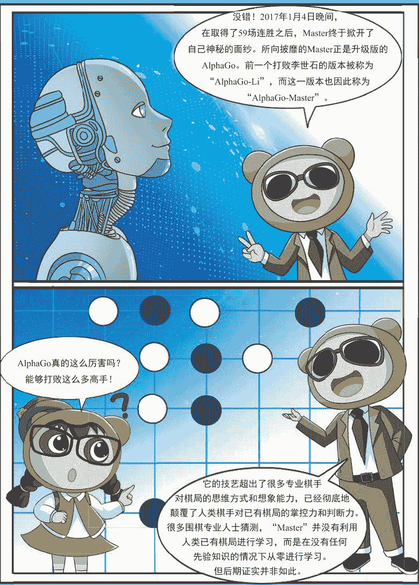

### AlphaGo-Zero

后来AlphaGo又升级了！

### Google DeepMind AlphaGo Zero

2017年10月19日，谷歌DeepMind重磅发布一个“AlphaGo”的新版本。

该版本的一个重要意义就是实现了里程碑式的技术进步——“无师自通”，即AlphaGo完全通过自我博弈产生的数据从零进行自我学习，所以这一版本也称为“AlphaGo-Zero”。顾名思义，“Zero”代表从零开始。

> 厉害了，竟然可以自我学习！这是怎么做到的？

> 第一，它利用了2015年提出的残差网络替代了经典的卷积神经网络。

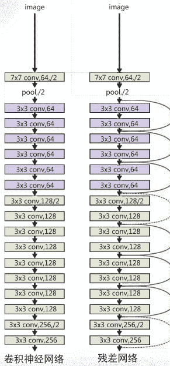

> 而残差网络在2015年国际著名的ImageNet图像识别大赛中战胜所有其他模型夺得桂冠！

第二，在强化学习过程中将策略网络和值网络合并。

第三，也是最重要的一点，它取消了对人类的棋谱知识的运用，也取消了已有设计的人工特征集，实现了完全从零开始自我学习，也就是具备了“无师自通”的能力。

Alpha-Zero

还有进化版的AlphaGo-Zero吗？

当然有！但是新版的人工智能就不叫AlphaGo-Zero了，叫Alpha-Zero。

为什么把中间的“Go”去掉了呢？

这里的“Go”是围棋的意思，从名字上我们可以猜测……

我知道了！从AlphaGo-Zero到Alpha-Zero，可能演化在于它不仅仅能够下围棋，还能下很多其他棋类，对吗？

没错，答对了！Alpha-Zero不仅仅局限于围棋，国际象棋、日本将棋等它都可以！

这么厉害！AlphaGo 进化升级了这么多啊！

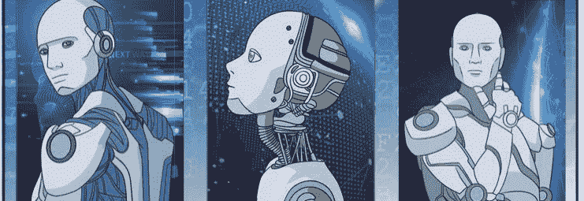

### AlphaGo

### AlphaGo-Master

### AlphaGo-Zero

从AlphaGo的纵向演变过程可以发现，无论是采用经典的卷积神经网络还是残差网络，其核心都是深度学习技术。

### 深度学习

### Alpha-Zero

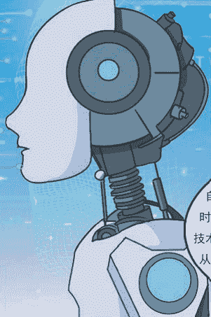

另外，它采用了强化学习技术进行自我博弈，获得了大量的训练数据。在线博弈时，采用蒙特卡罗树搜索或拟合搜索，通过这些技术建立了棋感和大局观。其中，最重要的一步是从有人类的指导发展到无师自通，显示了以深度学习、机器学习为核心的人工智能技术的巨大威力。

## 第一章 人工智能印象篇

### 会相互协作的机器——Dota 人机对抗

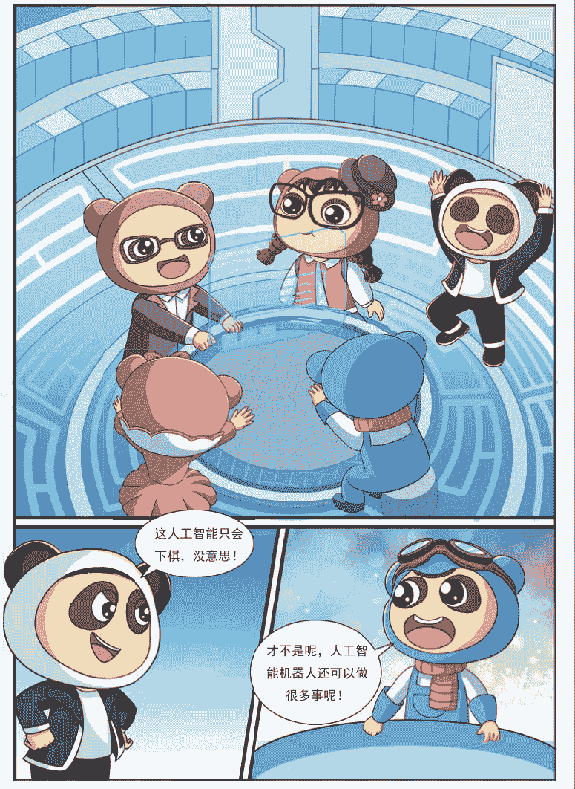

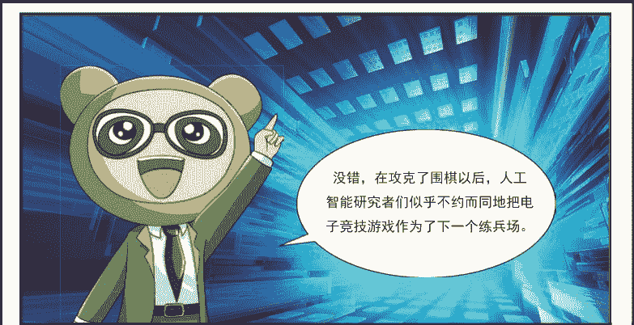

没错，在攻克了围棋以后，人工智能研究者们似乎不约而同地把电子竞技游戏作为了下一个练兵场。

《Dota》是由暴雪公司出品的一款多人即时对战游戏。

我知道我知道！2013年还发布了《Dota2》，但是这不是一个多人协作的游戏吗？

### 刀塔（Dota）人机对抗赛

对！2017年8月，人工智能史上又继续上演惊人大战！

> 我知道他！Dendi 是世界知名Dota2职业选手、solo 高手，不仅自己的玩法灵动多变，还曾出现神级的操作，还曾带领 Navi 战队拿下 TI1 冠军和TI2、TI3亚军。

Dendi

> 那这场比赛结果怎么样呢？

> OpenAI的Dota机器人在一对一比赛中以2:0轻松战胜了人类职业玩家Dendi。

这场游戏的胜利只是开始。2018年7月，OpenAI公司的智能机器继续参加了TI8比赛。

进阶版的OpenAI Five Dota机器人在原有的“一对一”对抗赛基础上实现了“五对五”比赛。

### OpenAI VS

### AI VS AI

“五对五”机器人的训练数据量得到极大扩展，原来只是一天300年的经验数据量，而现在单人一天数据量为180年，五个人就是900年。

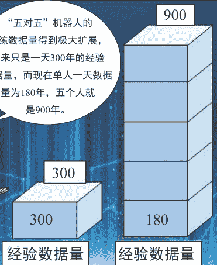

“一对一”机器人使用了60000个CPU和256个K80的GPU，而“五对五”机器人使用了128000个CPU和256个P100的GPU，计算能力获得极大提升。

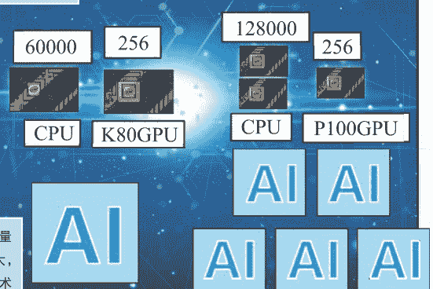

随着场景更加复杂，数据量急剧增加、难度大大增大，对人工智能计算资源和技术的要求就更高。

> 不过，OpenAI的机器人系统并非完美，在2018年Dota国际锦标赛上，OpenAI Five开始挑战职业队伍，两次输给人类职业玩家。

2019年1月，Deep Mind推出的AlphaStar在《星际争霸 II》游戏中以10:1的成绩完虐人类；2019年4月，OpenAI Five决战紫禁之巅一战，以2:0比分战胜世界专业Dota2比赛冠军OG队，在Dota2游戏中完胜人类。

> 在随后的时间里，人工智能在战略游戏中以我们难以想象的速度持续更新。OpenAI Five在10个月的时间里，完成了约45000年的Dota2比赛，这种快速自我迭代能力使其能轻松驾驭战略决策，并以惊人的判断力发挥其优势。

### 会玩扑克的机器 —— 冷扑大师

人工智能还会什么呢？我们再来认识一个会玩扑克的机器——冷扑大师（Libratus）。这是一个会玩无限注德州扑克的人工智能系统，它的实现难度非常高！

一个太阳大概有10的57次方个氢原子

宇宙有10的23次方个类似太阳的恒星

宇宙中有10的80次方个原子

围棋有10的170次方的可能性

而一对一无限注德州扑克有10的161次方种不同情况

当然！2017年1月11日至30日，冷扑大师与4名人类选手共玩了12万手一对一无限注德州扑克，最终夺得胜利，拿到了20万美元奖励。

这么难，真的可以做到吗？

Libratus

Winner

那AlphaGo能打败冷扑大师吗？

AlphaGo

VS

Libratus

不会的，因为AlphaGo不玩不完备的信息博弈。德州扑克与棋类完全不同，围棋是一种“完美信息游戏”。

冷扑大师没有使用到任何深度学习技术，跳出了在搜索量上的较量，对AI提出了新挑战——如何应对隐藏的信息。

这就要从它们的异同点来分析了。

那问题来了，如何应对隐藏的信息呢？

第一，AlphaGo的训练过程中用到了大量数据进行有监督深度学习，尽管模型内部是个黑匣子，但还是数据驱动的方法。

而冷扑大师是通过传统的线性规划提前算出纳什均衡策略。

第二，AlphaGo的前期版本参考了人类棋谱数据进行训练，后期通过强化学习自我博弈产生数据进行训练。

而冷扑大师从一开始就完全是通过自我强化学习进行训练。

因此，二者共有特点是利用了相应规则（围棋规则或德州扑克规则），通过长期自我“左右互搏”、摸索而形成能力。

第三，虽然AlphaGo和冷扑大师都特别喜欢残局阶段下杀招，但其难度差异很大。围棋下到残局，可走招数越来越少，计算量也越来越小。而德州扑克开到转牌和河牌时，可能性更多，局面变得更为复杂。

冷扑大师的到来使人们意识到，深度学习不能解决所有问题。深度学习带来了整个业内水平的提升和发展，但也需要和其他技术共同融合、共同发展。

### MIT 十大技术榜单

人工智能不仅深刻影响到了人类的经济社会生活，也逐渐改变大众对人工智能的认知。我们可以从下面的数据中感受到哦！

- 1. 免疫工程（ Immune Engineering ）
- 2. 精确编辑植物基因（ Precise Gene Editing in Plants ）
- 3. 涵音接口（ Conversational Interfaces ）
- 4. 可回收火箭（ Reusable Rockets ）
- 5. 知识分享型机器人（ Robots That Teach Each Other ）
- 6. DNA应用商店（ DNA App Store ）
- 7. SolarCity的超级工厂（ Solar City's Gigafactory ）
- 8. Slack通信软件（ Slack ）
- 9. 特斯拉自动驾驶仪（ Tesla Autopilot ）
- 10. 空中取电（ Power from the Air ）

在2016年，MIT列出的全球十大技术榜单中，三项都与人工智能密切相关。

- 强化学习/Reinforcement Learning
- 360°自拍/The 360-Degree Selfie
- 基因疗法2.0/Gene Therapy 2.0
- 细胞图谱/The Cell Atlas
- 自动驾驶货车/Self-Driving Trucks
- 脸部支付/Paying with Your Face
- 太阳能薄膜光伏电池/Hot Solar Cells
- 实用型量子计算机/Practical Quantum Computers
- 治疗瘫痪/Reversing Paralysis
- 僵尸物网/Botnets of Things

在2017年的MIT的十大技术榜单中，我们可以看到强化学习被列在了首位。强化学习能够实现人类的自我学习，是非常有意义的一步。

- 2018 MIT top 10 technologies
- 给所有人的人工智能/AI for Everyone
- 对抗性神经网络/Dueling Neural Networks
- 人造胚胎/Artificial Embryos
- 基因占卜/Genetic Fortune-Telling
- 传感城市/Sensing City
- 巴别鱼耳塞/Babel-Fish Earbuds
- 完美的网络隐私/Perfect Online Privacy
- 材料的量子飞跃/Materials' Quantum Leap
- 实用型3D金属打印机/3D Metal Printing
- 零碳排放天然气发电/Zero-Carbon Natural Gas

2018年MIT全球十大技术榜单中，有三项跟人工智能密切相关：给所有的人的人工智能、对抗性神经网络、传感城市。其中传感城市指的是智能传感终端，传感终端的智能化也是未来的一个发展趋势，会为智慧城市建设提供智能“触角”，让城市具备多重感知能力。

2019年MIT全球十大技术榜单中，有三项跟人工智能密切相关：灵巧机器人、可穿戴心电仪和流利对话的AI助手。

- 2019 MIT top 10 technologies
- 灵巧机器人/Robot Dexterity
- 核能新浪潮/New Wave Nuclear Power
- 早产预测/Predicting Preemies
- 肠道显微胶囊/Gut Probe in a Pill
- 定制癌症疫苗/Custom Cancer Vaccines
- 人造肉汉堡/The Cow-Free Burger
- 捕获二氧化碳/Carbon Dioxide Catcher
- 可穿戴心电仪/An ECG on Your Wrist
- 无下水道卫生间/Sanitation without Sewers
- 流利对话的AI助手/Smooth-Talking AI Assistant

2020年MIT全球十大技术榜单中，有两项与人工智能有关：人工智能发现分子、微型人工智能，表现出人工智能向实用化和小型化发展的趋势。

### 十大突破性技术 10 BREAKTHROUGH TECHNOLOGIES
MIT 科技评论 Technology Review

- 人工智能 发现分子 AI-DISCOVERY OF MOLECULES
- 差分隐私 DIFFERENTIAL PRIVACY
- 抗衰老药物 ANTI-AGEING DRUGS
- 气候变化归因 CLIMATE-CHANGE ATTRIBUTION
- 超级星座...
- 数字货币 DIGITAL MONEY
- 超个性化药物...
- 量子计算 优越性 QUANTUM SUPREMACY

> 我们从这个数据中可以看到，
> 每年十大技术榜单都有两至三项
> 跟人工智能密切相关，人工智能
> 已经走入了我们的生活。

> 你好，
> 人工智能！

## 第二章 人工智能历史篇

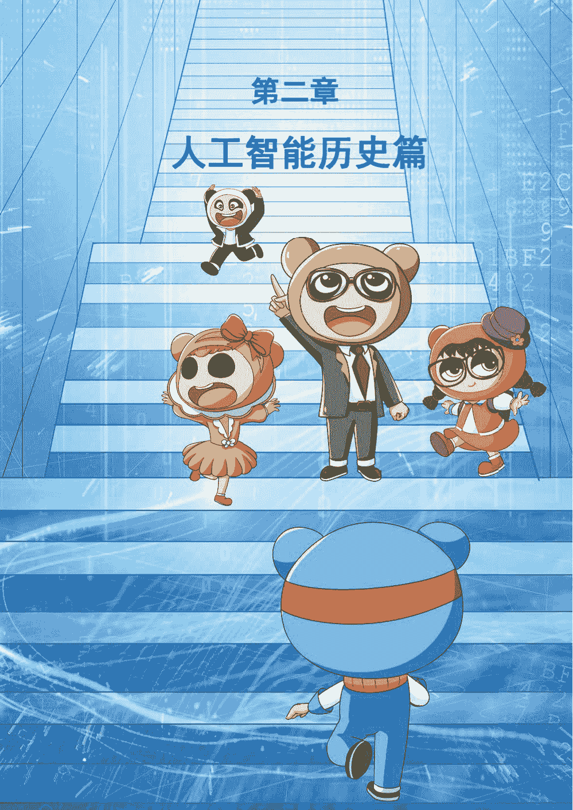

人工智能对人类竟然这么重要，真是太强大了！

可是人工智能的智慧是怎么获得的呢？

是呀！作为智能机器人，从有记忆开始，我们就已经具备了人工智能。真的非常好奇在我出现以前究竟发生什么事？

> > 哇！听起来好深奥呢！

> > 你好像在问一个经典的问题——我们是谁？我们从哪里来？我们要到哪里去？

> > 这个问题就要讲到人工智能是如何发展起来的！好！就让我们一起了解一下人工智能的历史吧！

谁来回答我，人类为什么要创造人工智能？

为什么呢？

人类希望更方便、更快速地解决问题。

### 差分机

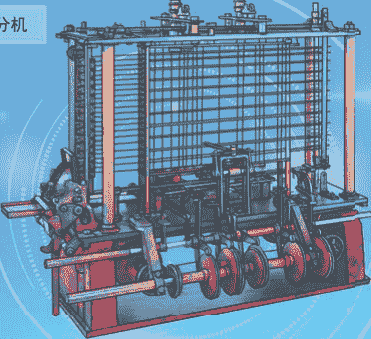

### 巴贝奇

回答得好！1000多年前，人类发明了算盘，大约200年前，英国数学家巴贝奇设计了差分机，机械从此开始具有计算智能。

人工智能被认为是21世纪三大尖端技术之一，其他的两项是基因工程、纳米技术。

- 人工智能
- 基因工程
- 纳米技术

哇！

说来奇怪，人工智能之梦开始于几位20世纪的数学家，他们力图用方程推动整个世界。

早在1900年，著名的数学家大卫·希尔伯特发表了题为“数学问题”演讲，向世界宣布了23个未解决的世界难题。这23个问题通称为希尔伯特问题，成为很多数学家重点攻关的目标。

### 23个难题

- 1.
- 2. 算术公理的相容性。欧氏几何的无矛盾性可以归结为算术公理的无矛盾性。
- 3.
- 4.
- 5.
- 6.
- 7.
- 8.
- 9.
- 10. 丢番图方程（Diophantine Equation）的可解性。如果能求出一个整系数方程的整数根，称为该丢番图方程可解。

> 我将把这23个世界未解难题公布于众！

> 这23个问题道道经典，
> 这些问题的研究对现代数学发展产生了深刻影响和推动。其中两项与人工智能密切相关，即第2个问题和第10个问题，并最终促进了计算机的发明。

大卫·希尔伯特

第2个问题：算术公理的相容性。欧氏几何的无矛盾性可以归结为算术公理的无矛盾性。

希尔伯特证明算术公理的相容性的设想，后来发展为系统的希尔伯特计划（“元数学”或“证明论”）。数学系统中应同时具备一致性和完备性，这是希尔伯特提出的一个伟大目标。

库尔特·哥德尔

希尔伯特第2个问题的断言根本是错的，一致性和完备性不能同时具备。

年轻的数学家库尔特·哥德尔起初是希尔伯特的忠实粉丝，并致力于攻克第2个问题。然而，他很快发现，第2个问题的断言根本就是错的。

哥德尔不完备性定理暗示着人工智能无法仅凭自身解决所有问题，它在1931年被美国《时代》周刊评选为20世纪最有影响力的数学定理。

然而，这个前提是否成立，迄今为止科学界仍在争论之中。

老师，那第10题呢？有答案了么？

不着急，我们接着看下去吧！首先我们要知道什么是丢番图方程。

第10问：如果能求出一个整系数方程的整数数根，称为丢番图方程可解。

### Diophantine Equation

$a_1x_1^{b_1} + a_2x_2^{b_2} + \dots + a_nx_n^{b_n} = c, \quad a_i, b_i, c \text{ 为任意整数}$

希尔伯特的问题是，能否用一种由有限步构成的一般算法判断一个丢番图方程的可解性。

算法

但在当时，人们还不知道“算法”是什么。实际上，当时数学领域中已经有很多问题都跟“算法”密切相关。

20世纪30年代，有两个著名学者分别提出了精确定义算法的方法，一个是艾伦·图灵，另一个是丘奇。

1936年图灵发表了一篇文章《论可计算数及其在判定问题中的应用》，提出了图灵机模型。

艾伦·图灵

艾伦·图灵（Alan Turing，1912—1954）是英国数学家、逻辑学家，被称为计算机科学之父、人工智能之父，是计算机逻辑的奠基者，提出了“图灵机”和“图灵测试”等重要概念。

美国计算机协会于1966年设立“图灵奖”，此奖项被誉为计算机科学界的诺贝尔奖。

1940年，艾伦·图灵和同事们研制的名为“波比”的机器，破译了德国的恩尼格玛密码系统，帮助盟军在战争中占据主动。

艾伦·图灵负责最早的真正意义上的计算机“曼彻斯特一号”的软件理论开发。

艾伦·图灵

2012年是图灵诞辰100周年，为了纪念他对计算机科学的伟大贡献，2012年被命名为“图灵年”。

我们接着来讲图灵机吧！

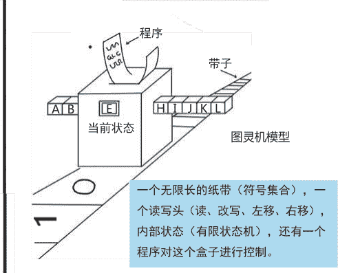

一个无限长的纸带（符号集合），一个读写头（读、改写、左移、右移），内部状态（有限状态机），还有一个程序对这个盒子进行控制。

图灵机是一个抽象的计算模型，形象地模拟了人类进行计算的过程。图灵机的实质就是根据每一时刻读写头读到的信息和当前的内部状态就可以确定它下一时刻的内部状态和输出动作。

有了图灵机模型后，才产生了计算理论，诱发了冯·诺依曼计算机的发明。

图灵的伟大贡献不仅仅是提出了图灵机的概念，更重要的是还提出了通用图灵机的概念。通用图灵机思想奠定了通用电子计算机的理论基础。

1956年图灵的这篇文章以《机器能够思维吗？》为题重新发表。此时，人工智能也进入了实践研制阶段。图灵的机器智能思想无疑是人工智能的直接起源之一。而且随着对人工智能领域的深入研究，人们越来越认识到图灵思想的深刻性。

## 第二章 人工智能历史篇

一个人在不接触对方的情况下，通过一种特殊的方式，和对方进行一系列的问答，如果在相当长时间内，他无法根据这些问题判断对方是人还是计算机，那么，就可以认为这个计算机具有智能。

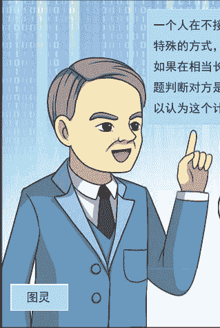

> 这就是著名的“图灵测试”。

> 我们来做个图灵测试的游戏吧。

是人工智能！

是人工智能！

不是人工智能？

进行多次测试后，如果机器让平均每个参与者做出超过30%的误判，那么这台机器就通过了测试，并被认为具有类人智能。

我们再来讲讲第一台电子数字计算机ENIAC的诞生吧！他可是受到图灵的启发呢。

冯·诺依曼（John von Neumann，1903—1957）是美籍匈牙利数学家、计算机科学家、物理学家，是20世纪最重要的数学家之一。被后人称为“现代计算机之父”“博弈论之父”。

冯·诺依曼和ENIAC

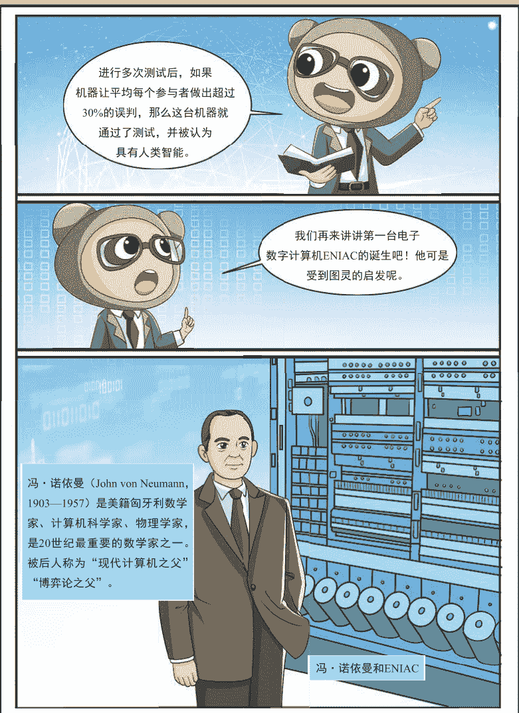

ENIAC机本身存在两大缺点：一是没有存储器；二是它用布线接板进行控制，耗时很长，冯·诺依曼对此提出了改进建议。

我们要设计一个存储程序通用电子计算机（Electronic Discrete Variable Automatic Computer, EDVAC）方案。

冯·诺依曼

在改进后的计算机EDVAC中，数据、程序都可存储且数据可变、程序也可变，即所谓的“存储程序式”通用计算机。

冯·诺依曼的思想对后来计算机的设计有决定性的影响，如采用存储程序以及二进制编码等，至今仍为电子计算机设计者所遵循。

还有一个重要的学者就是诺伯特·维纳。

诺伯特·维纳是控制论及很多心理学、脑科学交叉学科的创始人之一，他的主要贡献，尤其是在人工智能领域的主要贡献在于揭示了人与机器的统一性，指出机器可以模拟人，从而为人工智能的提出奠定了重要的理论基础。

诺伯特·维纳

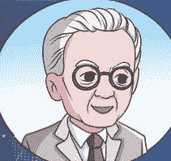

### 哥德尔

### 图灵

### 冯·诺依曼

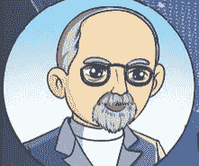

### 希尔伯特

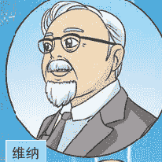

### 维纳

希尔伯特、哥德尔、图灵、冯·诺依曼、维纳等数学家和计算机科学家的努力，为人工智能的诞生奠定了理论和工程基础。

### 人工智能的发展历程

尽管有了这些伟大的数学家们奠定的理论基础，人工智能的产生和发展过程也不是一帆风顺的，经历了很多难以想象的曲折和困难，是众多怀揣梦想的科学家坚持不懈、共同努力的结果。

这么多起伏啊！太难了！

| 第一阶段 | 第二阶段 | 第三阶段 |
| :--- | :--- | :--- |
| 机器定理证明 智能跳棋程序 | 专家系统遍地开花 | 互联网奠定基础 |
| 定理证明乏力 凯撒止步洲际 | 人工智能转向实用 | 深度学习与大数据 |
| 机器翻译攻坚 资金逐渐减少 | 第五代计算机失败 | 人工智能遍地开花 |
| 反向传播算法 知识工程起步 | | |

正如同人类历史一样，人工智能技术的发展过程一直是在曲折中前进的。

如图中所示，经历了三起两落、三个阶段。

同学们看这个！这是世界上第一台神经网络计算机！

1950年，一位名叫马文·明斯基的大四学生与他的同学邓恩·埃德蒙一起，建造了世界上第一台神经网络计算机，后被人称为“人工智能之父”。

马文·明斯基

真是太感动了！人工智能终于开始了！

第一台神经网络计算机，这被看做是人工智能的一个起点。

老师，你还是说着讲吧！

咳咳！好！

1956年，在美国汉诺威小镇的达特茅斯学院举办的一次会议上。

计算机专家约翰·麦卡锡提出了“人工智能”一词。后来，这被人们看做是人工智能正式诞生的标志。

人工智能

这次会议后不久，麦卡锡从达特茅斯搬到了麻省理工学院（MIT）。同年，马文·明斯基也搬到了这里，之后两人共同创建了世界上第一个人工智能实验室——MIT人工智能实验室。

MIT人工智能实验室

这样看来，人工智能的发展不是挺顺利的吗？

人工智能走上了快速发展的道路。在1956年的这次会议之后，人工智能迎来了属于它的第一段“Happy Time”。

在这段长达十余年的时间里，计算机被广泛应用于数学和自然语言领域，用来解决代数、几何和应用问题。这让很多研究学者看到了机器向人工智能发展的光明前景。

二十年内，机器将能完成人类能做的一切。

过分的盲目乐观和难以达到的预期，也注定人工智能步入低谷。

70年代，人工智能进入了一段痛苦而艰难岁月。由于对人工智能研究过于乐观，对项目难度预估不足，很多项目离预期目标相差甚远，让大家对人工智能的前景蒙上了一层阴影。

预算: 0美元

与此同时，社会舆论的压力也开始慢慢压向人工智能研究人员，导致很多研究经费被转移到了其他项目上。

在当时，人工智能面临的技术瓶颈主要是三个方面：第一，计算机性能不足，无法得到有效应用。

第二，问题的复杂性，一旦问题维数上升，程序立马就不堪重负无法处理。

第三，数据严重缺失，在当时不可能找到足够大的数据库来支撑程序进行统计学习，导致机器无法读取足够量的数据进行智能化。

1973年，莱特希尔针对英国AI研究状况撰写报告。在报告中，他批评了AI在实现“宏伟目标”上的失败。由此，人工智能遭遇了长达6年的科研寒潮。

> 那人工智能就一蹶不振了么？
>
> 当然不会！

1980年，卡内基梅隆大学为数字设备公司设计了一套名为XCON的“专家系统”。这是一种采用人工智能程序的系统，可以简单地理解为“知识库+推理机”的组合。

> 这套系统在1986年之前能为公司每年节省下来超过四千美元经费。有了这种商业模式后，衍生出了像Symbolics、Lisp Machines等和IntelliCorp、Aion等这样的硬件、软件公司。
>
> 在这个时期，仅专家系统产业的价值就高达5亿美元。

> 不幸的是，命运的车轮再一次碾过人工智能，让它陷入低谷。

仅仅维持了7年，这个曾经轰动一时的人工智能系统就宣告结束历史进程。到1987年时，苹果和IBM公司生产的台式机性能都超过了Symbolics等厂商生产的通用计算机。

台式机

通用计算机

> 从此，专家系统风光不再。

> 老师，这次的转机是什么呢？

1997年5月11日，IBM的计算机系统“深蓝”战胜了国际象棋世界冠军卡斯帕罗夫。

### 深蓝与卡斯帕罗夫比赛现场

又一次在公众领域引发了AI话题讨论，这是人工智能发展的一个重要里程碑。

不仅如此，我们再来看一个资料吧！

人工智能终于又崛起了！

数据

大家好，欢迎大家来到知识问答节目，人类选手和计算机沃森的较量！正确的答案是以提问的形式给出的。

请听题！

冷血却又无足的动物。

我不知道啊。

什么是蛇？

计算机沃森

答对了！恭喜计算机沃森战胜了人类选手！

人工智能又战胜了人类呢！

我也要和人工智能比一场！

2006年，加拿大著名人工智能学者杰弗里·辛顿（Geoffrey Hinton）和他的学生，在《科学》杂志上发表一篇著名的文章。

> Reducing the Dimensionality of Data with Neural Networks
> 
> G. E. Hinton* and R. R. Salakhutdinov
> 
> High-dimensional data can be converted to low-dimensional codes by training a multilayer neural network with a small central layer to reconstruct high-dimensional input vectors. Gradient descent can be used for fine-tuning the weights in such “autoencoder” networks, but this works well only if the weights are initialized close to a good solution. We describe a fast way of initializing the weights that allows deep autoencoder networks to learn low-dimensional codes that work much better than principal components analysis as a tool to reduce the dimensionality of data.

在该文中，辛顿提出了深度学习的多层次表示模型，同时提出了预训练精调的训练方法，使得深度学习网络训练可行。

为第三次人工智能浪潮的到来奠定了理论基础。

引发了人类历史上的第四次工业革命。

### 知识小课堂

第一次工业革命：18世纪60年代到19世纪中期，其标志是瓦特发明了蒸汽机，从此资本主义由手工业过渡到大机器生产，人类社会进入“蒸汽时代”。

瓦特与蒸汽机

第二次工业革命：19世纪下半叶到20世纪初，其标志是发电机的发明，资本主义国家的生产力获得了突飞猛进的发展，开始从自由资本主义向垄断资本主义即帝国主义过渡，人类进入“电气时代”。

西门子

爱迪生

### 知识小课堂

第三次工业革命：20世纪四五十年代，随着电子计算机的发明，人类的生产生活方式大大改变，信息技术飞速发展带动“新经济”的腾飞，人类社会进入“自动化时代”。

第四次工业革命：2006年至今，随着以深度学习为代表的人工智能技术的兴起，各种人工智能的应用层出不穷，逐渐改变着人们的生活。

阿西莫夫

阿西莫

### 第三次人工智能浪潮

从2010年至今，第三次人工智能浪潮到来，人工智能在很多领域都迅速地得到了普及，比如说自动驾驶、人脸识别、语音识别、Web搜索。

深刻改变了人们的生活，人类社会从此进入“智能时代”。

可是，老师提到的“第三次人工智能浪潮”是什么呢？

问得好，我们就来说说什么是“第三次人工智能浪潮”！第三次人工智能浪潮是在大数据及高性能计算的背景下兴起的，其主要推手就是模拟人类大脑神经元活动的深度人工神经网络，即深度学习技术。

事实上，人工神经网络这种“连接主义”方法由来已久，与人工智能技术的三起两落一样，经历了曲折的发展过程。

正是由于一群对真理坚信不移的科学家们的坚持与不懈努力，深度学习出现突破。

企业的投资、各个国家战略的出台，都加速了第三次浪潮的推进。

### 神经网络的起源

1943年，心理学家沃伦·麦卡洛克（Warren McCulloch）和数学逻辑学家沃尔特·匹兹（Walter Pitts）发表论文《神经活动中内在思想的逻辑演算》，提出了以他们名字命名的MP神经元模型。

MP模型是模仿神经元的结构和工作原理，构造一个基于神经网络的数学模型，本质上是一种“模拟人类大脑”的神经元模型。

MP模型作为人工神经网络的起源，开创了人工神经网络的新时代。

1949年，加拿大著名心理学家唐纳德·赫布在《行为的组织》一书中提出了一种基于无监督学习的规则。

20世纪50年代末，赫布规则通过模仿人类认知世界的过程建立一种网络模型，该网络模型针对训练集进行大量训练并提取统计特征，然后按照样本的相似程度进行分类，把相互之间联系密切的样本分为一类。

1969年，“AI之父”马文·明斯基和Logo语言的创始人西蒙·派珀特共同编写了一本书籍《感知器》。在书中，他们证明了单层感知器本质上是一种线性模型，无法解决线性不可分问题，如最简单的异或（XOR）问题。

1982年，著名物理学家约翰·霍普菲尔德（Hopfield）发明了Hopfield神经网络。

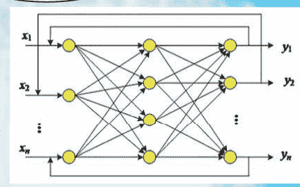

Hopfield神经网络是一种结合存储系统和二元系统的循环神经网络。Hopfield网络也可以模拟人类的记忆，根据激活函数的选取不同，有连续型和离散型两种类型，分别用于优化计算和联想记忆。

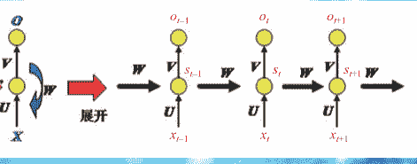

1974年，哈佛大学博士毕业生Paul J. Werbos首次提出反向传播（Back Propagation,BP）算法的雏形，证明增加一个网络层，可以利用反向传播算法解决异或问题，但并未得到学术界重视。直到1986年，深度学习之父辛顿及其博士生们正式提出在多层感知器中使用反向传播算法。

### BP算法

> BP算法基本解决了非线性分类问题，让人工神经网络再次引起了人们广泛的关注。如今，BP算法已成为深度学习中最重要的网络训练方法。

1989年，Robert Hecht-Nielsen证明了神经网络的万能逼近定理，即对于几乎任何连续函数，都可以用含有一个隐含层的神经网络来逼近。著名学者、人工智能大师LeCun发明了卷积神经网络LeNet，并将其用于数字识别。

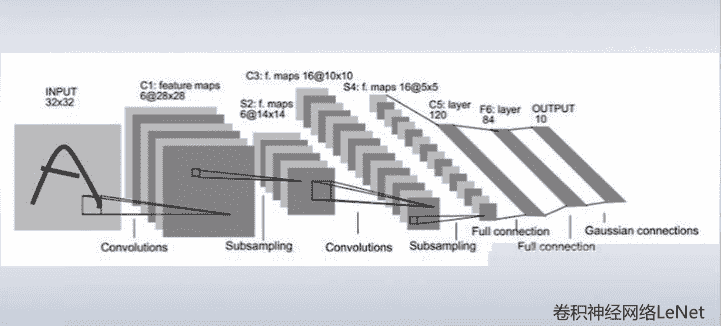

卷积神经网络LeNet

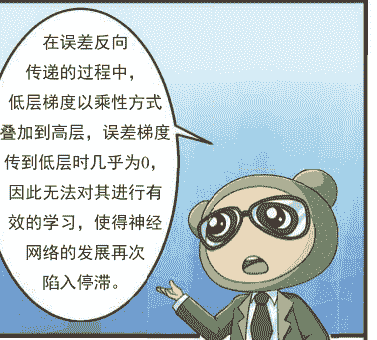

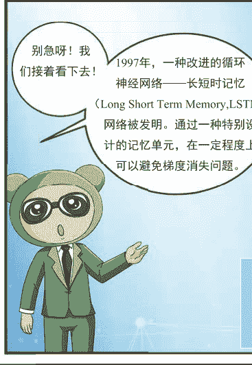

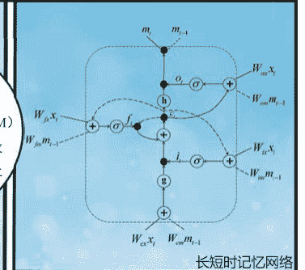

尽管该模型在序列建模上的特性非常突出，但由于正处于神经网络的下坡期，也没有引起足够的重视。但我们应该注意到，LeNet和LSTM网络后期都得到了很好的发展和延展。

> 90年代中期以后，以支持向量机为代表的其他浅层机器学习算法被提出。

分类问题：如人脸识别，将输入的人脸划分为若干个类别。回归问题：如房价预测，对输入的数据进行计算得到一个实数。

> 该类算法以统计学习理论为基础，在分类、回归问题上均取得了很好的效果。

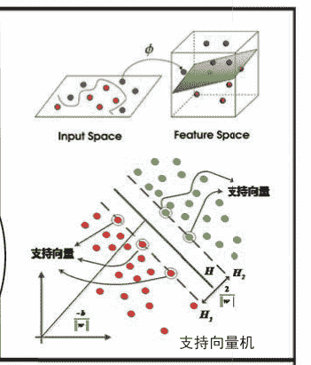

> 相比之下，人工神经网络缺乏严格的数学理论支撑，实际应用中又受到梯度消失、训练数据不充足、计算机运算能力有限等问题的困扰，使得神经网络的发展再次进入瓶颈期。

> 真是太难了。

> 突破了瓶颈期就是一个大的爆发！

> 真的吗？看来会有大事发生！

### 深度学习的爆发

深度学习

2006年，杰弗里·辛顿以及他的学生鲁斯兰·萨拉赫丁诺夫正式提出了深度学习的概念。

他们在世界顶级学术期刊《科学》发表的一篇文章中详细地给出了“梯度消失”问题的解决方案——通过无监督方法进行逐层预训练，再使用有监督的反向传播算法进行调优。

杰弗里·辛顿以及他的学生鲁斯兰·萨拉赫丁诺夫

2011年，微软的邓力等人率先将深度学习用在语音识别中，使得语音识别性能获得大幅度提升。

邓力

2012年，在著名的ImageNet图像识别大赛中，杰弗里·辛顿领导的小组采用深度学习模型AlexNet一举夺冠。将错误率从26%降到了15%。

同年，由斯坦福大学著名的吴恩达教授和世界顶尖计算机专家Jeff Dean共同主导了Google大脑项目，采用16000个CPU并进行计算，构建了全球最大的、含10亿个神经元的人工神经网络，在自主学习1000万张图片后，在YouTube视频中成功认出了猫的图像。Jeff Dean当时激动地说：在训练中我们从没说过这是一只猫，从本质上他发明了“猫”这个概念。

深度学习算法在世界大赛中脱颖而出。

Jeff Dean

### Facebook

### DeepFace

2014年，Facebook基于深度学习技术的DeepFace项目，在人脸识别方面的准确率已经能达到97%以上，跟人类识别的准确率几乎没有差别。

人脸扫描识别中......

识别成功

这样的结果也再一次证明了深度学习算法在图像识别方面的一骑绝尘。

2016年，谷歌(Google)旗下的DeepMind公司基于深度学习开发的AlphaGo以4:1的比分战胜了国际顶尖围棋高手李世石。

AlphaGo

李世石

后来，AlphaGo又接连和众多世界级围棋高手过招，均取得了完胜。

这也证明了在围棋界，基于深度学习技术的机器人已经超越了人类。

对于人工智能来说，2016年是人工智能史上非常特殊的一年。

我知道！我知道！

1956年是人工智能的诞生之年，2016年是人工智能诞生六十周年。

没错，这一年也发生了很多的变化。由于深度学习方法在各个领域取得历史性突破，这一年被业内称为人工智能的深度学习年。

同时由于机器人行业在这一年崛起非常快，所以也被称为机器人崛起的黄金年。人类又一次看到机器赶超人类的希望，人工智能从科学家研究范围走向大众视野，大众对人工智能的认识水平得到巨大提升。

AlphaGo

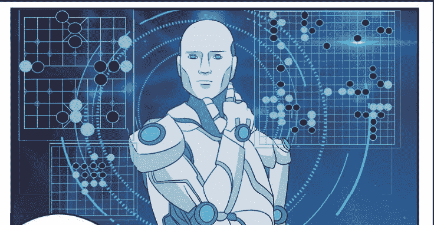

2017年，基于强化学习算法的AlphaGo升级版AlphaGo Zero横空出世。其采用“从零开始”“无师自通”的学习模式，以100:0的比分轻而易举打败了之前的AlphaGo。

此外在这一年，深度学习的相关算法在医疗、金融、艺术、无人驾驶等多个领域均取得了显著的成果。

### 智能医疗

### 智能金融

### 艺术

### 无人驾驶

2017年是深度学习甚至是人工智能发展最为突飞猛进的一年，尤其是生成对抗网络。

因此2017年在业界也被誉为生成对抗网络年。

2018年以来，以谷歌的基于变换的双向编码表示（Bidirectional Encoder Representations from Transformers，BERT）及OpenAI的通用预训练（Generative Pre-Training 2, GPT-2）等为代表的模型出现，标志着自然语言处理领域取得重大突破。

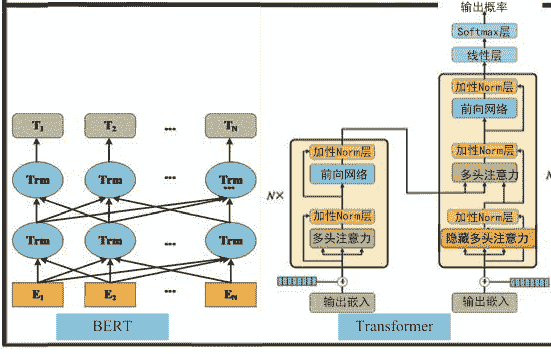

谷歌人工智能团队发布的BERT模型，在机器阅读理解顶级水平测试SQuAD1.1中表现出惊人成绩：全部两个衡量指标上全面超越人类，并且还在11种不同自然语言处理任务的测试中创出最佳成绩，由此开启了NLP的新时代。

OpenAI相继提出GPT和GPT-2模型，参数多达15亿个，通过在互联网获取的40GB高质量语料进行无监督训练，最终所得到的模型不仅可以根据给定的文本流畅地续写句子，甚至可以形成成篇的文章，就像人类的续写文章一样。

人工智能正在迅速发展呢！

没错！说得对！目前，人工智能技术仍处于快速发展的时期，不断在各个领域取得新的突破。

通过学术界和工业界的联合攻关，层出不穷的技术产品逐渐走入大众市场，正在悄无声息地改变着我们的生活！

## 第三章
### 人工智能概念篇

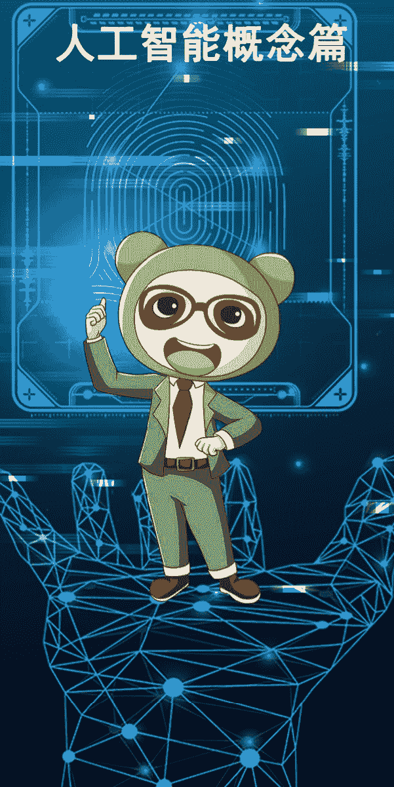

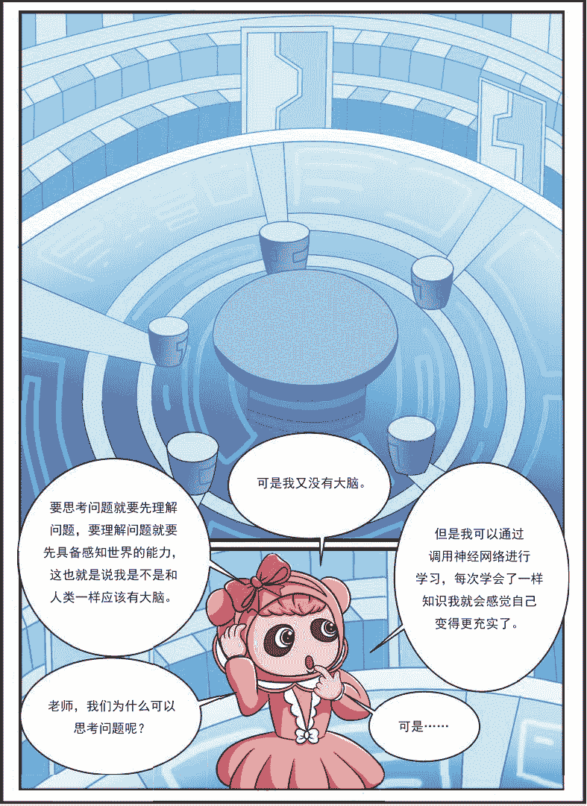

### 什么是智能

停！请你不要再说绕口令了。你到底想说什么？

对呀！你到底想问什么？

智能的发生与物质的本质、宇宙的起源、生命的本质一起被列为自然界四大奥秘。

我觉得我想问的是：我们机器人具备人工智能，可什么是人工智能呢？

这就要从很久之前讲起了。

### 智能的发生
### 物质的本质
### 宇宙的起源
### 生命的本质

大家还记得之前讲过的图灵测试吗？

机器能思考吗？

图灵实验的本质就是如果在对外观未知情况下无法区别是机器行为还是人类行为，则认为机器具有智能。智能对人类非常重要，人类一直试图理解我们是如何思考的。

### 图灵

智能的认识可以从多种角度展开。

在微观层面，智能是人类大脑的神经活动产生的结果。

在宏观层面，智能一方面是心理活动或思维过程结果的认知过程，另一方面是人类与某些动物特有的解决问题时表现的智力或行为能力的外在表现。

从知识工程的角度，智能的内涵是知识和思维的有机融合，智能外延的意义则是发现规律、运用规律的能力和分析问题、解决问题的能力，或者说是获取知识、处理知识和运用知识的能力。

- 获取知识
- 处理知识
- 运用知识

在科技领域，智能特指机器所具有的自动控制能力和根据环境自我调节的能力，至少包括三个方面：一是理解、分析、解决问题的能力；二是归纳推理和演绎推理的能力；三是自动适应环境而生存发展的能力。

### 智能的度量与多元智能

那人类智能如何度量呢？

1916年，德国心理学家施太伦提出了“智商”的概念。智商即智力商数，它是用数值来表示智力水平的重要概念。

### 非智力因素

1935年，亚历山大第一次提出“非智力因素”这个概念。

所谓“非智力因素”是指记忆力、注意力、观察力、想象力、思维力等智力因素之外的一切心理因素，这些非智力因素都是直接影响和制约智力因素发展的意向性因素。

1983年，美国哈佛大学教育研究院的心理发展学家霍华德·加德纳(Howard Gardner) 提出多元智能理论。

### 加德纳多元智能理论

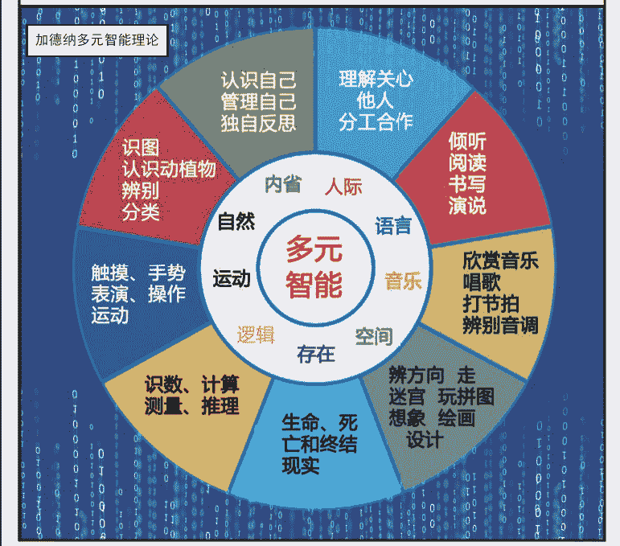

那人工智能又是什么呢？

从智能机器角度而言，人工智能是指能够在各类环境中自主地或交互地执行各种拟人任务的机器。

从能力角度而言，人工智能是智能机器所执行的通常与人类智能有关的智能行为。人工智能是研究、开发用于模拟、延伸和扩展人的智能的理论、方法、技术及应用系统的一门新的技术科学。

人工智能就字面意义而言，可以分解成“人工”和“智能”两个部分，可以从多种角度来阐述。

定义1：人工智能是那些与人的思维、决策、问题求解和学习等有关活动的自动化（Bellman, 1978）。
定义2：人工智能是一种使计算机能够思维，使机器具有智力的激动人心的新尝试（Haugeland, 1985）。
定义3：人工智能是用计算模型研究智力行为（Charniak和McDermott, 1985）。
定义4：人工智能是研究那些使理解、推理和行为成为可能的计算（Winston, 1992）。
定义5：人工智能是一种能够执行需要人的智能的创造性机器的技术（Kurzweil, 1990）。
定义6：人工智能研究如何使计算机做事让人过得更好（Rich和Knight, 1991）。
定义7：人工智能是一门通过计算过程力图理解和模仿智能行为的学科（Schalkoff, 1990）。
定义8：人工智能是计算机科学中与智能行为的自动化有关的一个分支（Luger和Stubblefield, 1993）。

纵观历史，很多人工智能领域的大师也对人工智能给予了不同的定义。

Stuart Russell教授在《人工智能》一书中对人工智能的若干定义从双重维度进行解释。

一种维度是关注机器内在的思维推理过程，还是关注机器外在的行为表现；另一种维度是衡量机器智能的准则，是更关注行为的拟人性，还是更关注行为的合理性。

Hi!
Hello!

- 拟人行为
- 拟人思维
- 合理思维
- 合理行为

**拟人行为：**
让计算机模拟人类的感知、语言交流、决策等智能行为。图灵测试可用于判断机器的行为是否可以达到以假乱真的程度。

**拟人思维：**
让计算机模拟人类的思维过程。可借助认知科学，通过内省、心理实验或脑成像获得数据，构建精确的人类思维推理论实现。

**合理思维：** 通过选定思维法则，支配头脑运行，依靠逻辑学进行正确推理得到智能系统。

**合理行为：** 合理的行为是指为了实现最佳的结果产生的行为，该行为并不一定与人类的行为完全一致，只为达到最佳结果而设计。

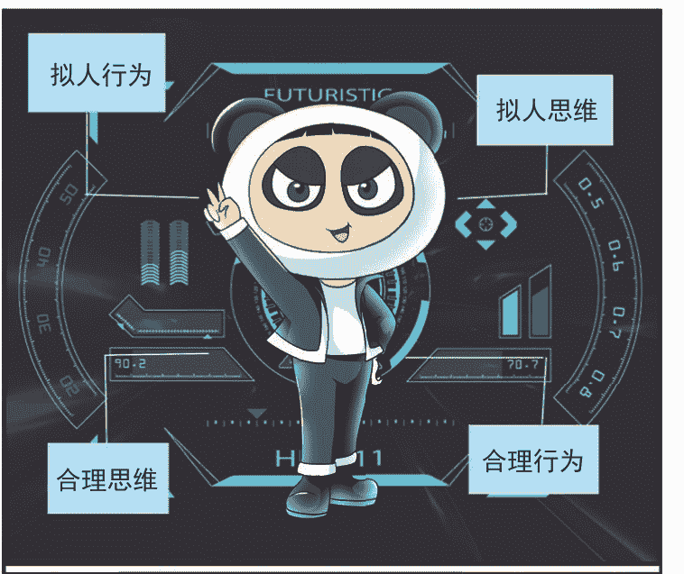

我们都具有人工智能！

### 广义人工智能与狭义人工智能

没错！

人工智能的概念从覆盖的范围上可以分成广义人工智能和狭义人工智能，从发展阶段上分成弱人工智能、强人工智能和超人工智能阶段。

这么多啊！

广义人工智能具有多学派、多功能、多层次的特点，包括感知与理解、推理与联想、学习与记忆、规划与协调、适应与修复、繁衍与进化等。

而传统狭义人工智能将每个学派分支、不同的领域都称为人工智能。

那什么又是弱人工智能、强人工智能和超人工智能阶段呢？

### 弱人工智能、强人工智能和超人工智能

弱人工智能是指仅在单个领域比较牛的人工智能程序。如谷歌 AlphaGo、苹果 Siri。

强人工智能则是能够达到人类级别的人工智能程序，具有思考、计划、解决问题、抽象思维、理解复杂理念、快速自我学习等多种能力。

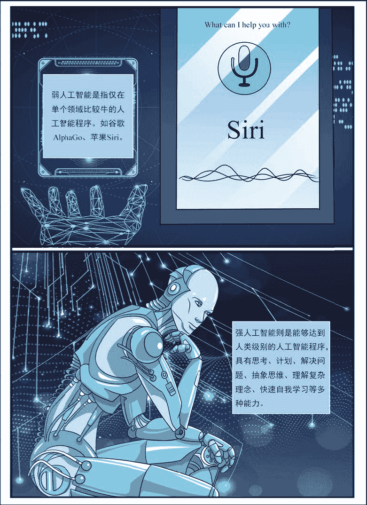

### 人工智能和机器学习

我们都是人工智能了，还需要学习么？

当然需要！再聪明的人也需要不断学习、不断进步，不然很快就退步了，要知道学无止境呀！机器也是一样，机器学习是人工智能技术的一个重要分支。

机器学习是不需要明确编程就能学习的能力。

阿瑟·塞缪尔

Tom Mitchell 在《机器学习》一书中提到，“机器学习这门学科所关注的问题是：计算机程序如何随着经验积累自动提高性能。”

Peter Harrington 在《机器学习实战》一书中说：“机器学习是把无序数据转换成有用的信息。”

### 人工智能和机器人

人工智能是打造智能机器的学科，机器学习就是一类让机器通过样本自动学习获得智能的方法，而深度学习则是一种模拟人类大脑神经活动获取智能的机器学习方法。

- 人工智能
- 机器学习
- 深度学习

大家看强强。

智能机器人 = 人工智能 + 物质外壳。

人工智能

我们都是人工智能机器人。

我们也是哦。

智能机器人是一个在感知-思维-效应方面全面模拟人的机器系统，外形不一定像人。它是人工智能技术的综合试验场，可以全面地考察人工智能各个领域的技术，可以在有害环境中代替人从事危险工作、上天下海、在战场作业等方面大显身手。

### 人工智能与自动化

哇！太厉害了！我们经常听到自动化、信息处理、脑科学、大数据、认知计算这些技术，它们与人工智能是什么关系呢？

自动化技术是一门综合性技术，集控制科学、计算机技术、电子技术、机械工程为一体，人工智能是它的一个分支。

- 自动化
- 人工智能

### 人工智能和信号与信息处理

信号与信息处理，包含信息获取、变换、存储、传输、交换、应用等环节中的信号与信息的处理，是信息科学的重要组成部分。

### 人工智能与脑科学

脑科学是人工智能技术取得突破的前提，为人工智能的发展提供更多依据和目标；而人工智能算法的提升也为脑科学认知提供新的方法和技术手段。二者相互支撑，相互促进，共同发展。

大数据，又称为巨量资料，具有数据量大、数据种类多、更新速度快和价值密度低等特点。大数据为人工智能发展提供必备基础。人工智能为大数据发展提供智能手段。

数据挖掘又称数据库中的知识发现，是指从数据库的大量数据中揭示出隐含的、先前未知的并有潜在价值信息或知识的过程。简言之，数据挖掘就是试图从海量数据中找出有用的知识。

IBM将认知计算简化归纳为具备规模化学习，根据目标推理以及与人类自然互动能力的系统。

认知计算不是制造“为人们思考”的机器，而是与“增加人类智慧”有关。

我知道！认知计算能够帮助人类更好地思考和做出更为全面的决定。

没错！

## 第四章
### 人工智能技术篇

CPU
GPU
AI算法
AI框架

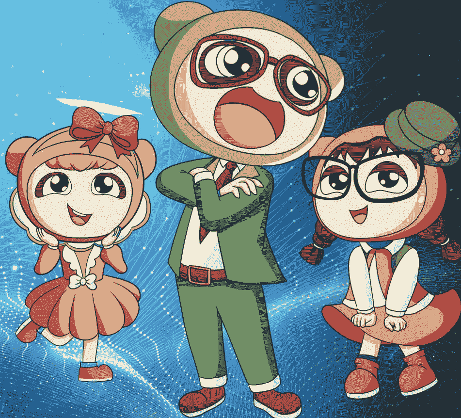

### 人工智能的学术流派

戴维·阿兰格里尔将人工智能划分为四类。

戴维·阿兰格里尔

“传统”人工智能：指的是复制人类行为的计算机系统，主要关注自然语言翻译、符号推理等问题。

“人机交互”人工智能：指具有人机交互能力的智能系统。

“集体智慧”人工智能：翻转计算机和人类的关系，人类处理计算机无法处理的任务，通过集体智慧设计计算机系统。

“机器学习”人工智能：不试图复制人类的智能，而是开发“在执行某些任务时能提高性能”的自动程序。

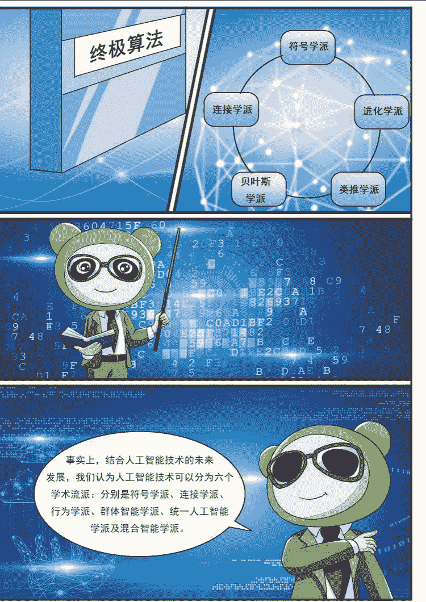

实际上，结合人工智能技术的未来发展，我们认为人工智能技术可以分为六个学术流派：分别是符号学派、连接学派、行为学派、群体智能学派、统一人工智能学派及混合智能学派。

### 人工智能技术体系

那人工智能技术最重要的是什么呢？

那就要提到核心技术了！

人工智能技术的核心技术包含：问题求解技术、知识推理与规划技术、不确定性知识与推理技术、机器学习技术、智能感知与决策技术。

2017年7月，中国颁布《国家新一代人工智能发展规划》。

战略提出围绕增加人工智能创新的源头供给，从前沿基础理论、关键共性技术、基础平台、人才队伍等方面强化部署，促进开源共享，系统提升持续创新能力。

上次说了什么呢？

- 大数据智能理论
- 跨媒体感知计算理论
- 混合增强智能理论
- 群体智能理论

- 自主协同控制与优化决策理论
- 高级机器学习理论
- 类脑智能计算理论
- 量子智能计算理论

### 深度学习技术体系

> 第三次人工智能浪潮的兴起是由深度学习技术的成熟与广泛应用而掀起的。

> 随着深度学习技术向各个应用领域的深入发展及现实应用中的问题求解需要，目前深度学习已经发展为一个庞大的技术体系。

- 行业应用层: 智慧网络, 智能教育, 智能家居, 智慧城市, 智慧政务, ......, 自动驾驶, 智慧交通, 智慧医疗, 智慧金融, 智能机器人, 智能安防

- AI技术层: 计算机视觉, 语音识别/语音合成, 自然语言处理, 人机对话系统, ......

- AI算法框架层: TensorFlow, PyTorch, Caffe/Caffe2, CNTK, MXNet, PaddlePaddle(飞桨), ......, 卷积网络, 循环神经网络, Seq2Seq, 生成式对抗网络, Transformer, 强化学习, 迁移学习, 元学习, ......

- 基础软件层: CUDA/CUDNN, nGraph, NNVM/TVM, ONNX, NNEF, 集群管理软件, ......

- 基础硬件层: CPU, GPU, TPU, FPGA, 类脑芯片, GPU集群, 云计算平台

### 深度学习的基础硬件、软件平台

那我们作为人工智能，在基础硬件、软件上有什么要求呢？

图形处理器(GPU)
中央处理器（CPU）

基础硬件层为智能算法提供了基础计算能力，包括CPU、GPU、TPU、FPGA、类脑芯片。

类脑芯片

FPGA

张量处理单元（TPU）

### 深度学习的软件平台

- 英伟达的CUDA/CUDNN
- 英特尔的nGraph
- 亚马逊的NNVM/TVM

基础软件层包含针对人工智能计算芯片定向优化的深度神经网络模型编译器。

### AI 算法、框架及应用技术

不仅如此，该层包含 AI 算法及 AI 框架，是整体技术体系架构的核心。

| 常用的智能学习 | |
|---|---|
| 监督学习 | 无监督学习 |
| 多任务学习 | 强化学习 |
| 对抗学习 | 迁移学习 |
| 元学习 | 终身学习 |

AI 算法提供通用的深度神经网络结构，人工智能学习算法及通用学习范式；AI 框架则是对 AI 算法的具体实现及封装。

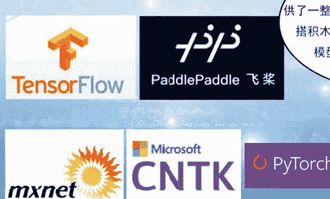

AI 框架为实现和应用上述方法提供了一整套算法模型工具库，让开发者像搭积木一样快速构建人工智能，并为模型的优化、训练和部署提供成熟的解决方案。

- 图像识别
- 目标检测
- 视频结构化分析

- 语音识别
- 语音合成
- 自然语言处理

- 人机对话系统

好的，已为您播放推荐歌曲。

播放歌曲吧！

未来可期呀！！

随着 AI 技术不断成熟及在各个领域的成功应用，人工智能向各行各业渗透，正在改变或即将改变各行各业的生产、生活模式，深度改变着人们的生活。

## 第五章
### 人工智能应用篇

教室里，大家讨论人工智能和人类究竟谁更强。

我觉得没有人类就没有人工智能。人类应该是人工智能的父母。从这个角度来说，我觉得还是人类更强大。

但是不管在哪个方面，人工智能都可以比人类做得更好。这又怎么解释呢？

老师，我也觉得人工智能能在很多方面比人类做得更好。

同学们不要着急，你们都说人工智能能在很多方面比人类做得更好，你们可以举几个例子吗？

### 自动驾驶

我先来讲一个关于无人驾驶的故事吧！

斯坦福大学的塞巴斯蒂安·特隆（Sebastian Thrun）团队开发的自动驾驶汽车Stanley。

### FINAL

### 2015年DARPA自动驾驶挑战赛

这场比赛的赛道长132英里，其中有若干狭窄的隧道和急转弯，这种赛道对于人类有经验的驾驶员而言难度也不低，需要格外小心才能顺利驾驶通过。塞巴斯蒂安·特隆团队赢得了200万美元现金大奖。

$2000000

在不久的将来，自动驾驶将有可能取代数百万司机。

一辆自动驾驶汽车能够在一分钟内出现，将你安全带到目的地且无须停车。

由此，城市拥堵及停车困难的问题将不复存在。大量停车场占用的空间可以被重新高效利用。拥堵浪费的时间将可以节省下来做其他更有意义的事情。

根据交通部门的统计，交通事故每年夺去了数百万人的生命。

由于没有了人类驾驶员，醉驾和疲劳驾驶导致的交通事故死亡人数也会大幅减少。汽车在人类社会中的标志性地位将以我们无法想象的方式发生变化。

### 机器视觉技术

我来一个！机器视觉技术，就是用机器代替人眼来做测量和判断，其最大的特点是速度快、信息量大、功能多。

说得很对！图像识别是通过计算对图像进行处理、分析和理解，识别检测是机器视觉工业领域最主要的应用之一，视觉定位要求机器视觉系统能够快速准确地找到被测零件并确认其位置。

工业中，非接触测量技术同样具有高精度和高速度的性能，同时消除了接触测量可能造成的二次损伤隐患；物体分拣应用是建立在识别、检测之后一个环节，通过机器视觉系统将图像进行处理，实现分拣。

### 人机交互

你好，有什么可以帮你？

我也知道一个！基于语音识别的人机交互技术已经渗透到我们生活的方方面面，计算机键盘正在逐渐被自然语言接口取代，例如智能助理、智能音箱等。

Hello Siri.

在呢。

### 机器翻译

- 英文
- 中文

都看不懂啊。

还好有机器翻译这下都看懂了！

我还知道一个！机器翻译，又称为自然语言翻译。众多商业翻译系统如谷歌翻译、百度翻译等已可以达到足以媲美专业翻译人士的水平。

我也想到一个！长期以来，疾病的准确诊断一直是困扰医生的难题，医疗资源的紧缺、看病难的问题是世界范围内长期面临的突出问题。

医疗与我们每个人的健康生活息息相关。

医疗行业也面临着智能化带来的深刻变革，也许在不久的将来，我们在家里利用手机上的某一款APP就可以自动完成看病的整个过程。

智能医生为您服务
你好！有什么可以帮您的？
智能医疗服务

智能皮肤诊断：
每一个病人都可以快捷地得到专家诊断，可以在皮肤病的早期阶段，即更容易治疗的时候开始就医。

智能癌症诊断：
在未来，在许多疑难杂症的诊断上，人类与机器将是合作而非竞争的关系，智能机器将成为人类医生的得力助手。

智能睡眠诊断：
从长远来看，这种具有明显优势的睡眠监测和自动分析技术将会在未来推广到家中的患者，病人将无需去医院去做令人难受的冗长检查。

### 智能金融

我觉得这也算一个！

当前，人工智能算法已深入金融行业。
纽约证券交易所超过75%的交易都是自动完成的，高频交易能在几分之一秒内进出仓位，
更长时间范围内的交易会考虑到基于大数据预测的长期趋势。

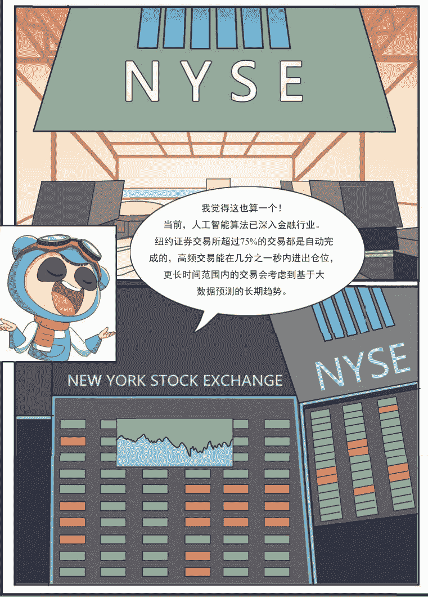

### 无人驾驶汽车

### 智能工厂

### 智能医生

### 股票交易

NEW YORK STOCK EXCHANGE

> 大家说得都很对！人工智能技术使得人类进入智能时代，大家可以领略智能时代所带来的巨大变化。

> 人工智能技术广泛应用于交通、金融、教育、政务、家居、物联网等各个行业，为人类带来前所未有的便利。

## 第六章
人工智能安全篇

### 人工智能系统的优势

人工智能真是太厉害了！涵盖数学、计算机科学、生理学、心理学等多个学科的知识，并且人工智能从底层硬件支撑、到算法层、技术层，以及行业应用，已呈现星星之火、燎原之势。

没错！但从技术发展历史长河来看，技术发展与安全问题相伴相生，新技术会助力新发展，但也会带来新的安全问题。

人工智能技术是一把“双刃剑”，突飞猛进的发展改变了人类经济社会发展轨迹、变革了人类社会生产生活方式，同时带来了极大的安全隐患。

我们先来了解一下人工智能技术的优势吧！人工智能技术可以应用在各个领域，主要包括如下几类功能。

- 一是数据分类。AI系统帮助人类进行多类型数据分类，如图像、歌曲、医疗图像等。
- 二是异常探测。AI系统可以帮助探测异常行为，如欺诈性金融交易或新型恶意软件，这些系统可用于帮助人类实时监控大规模数据。
- 三是数据预测。通过在大型数据集合中进行数据分析，找到相应的模式，AI系统可对未来做出统计预测，例如金融股票趋势预测等。
- 四是系统优化。AI系统可用于复杂系统和任务的性能优化。例如，DeepMind使用机器学习优化Google数据中心以提高能源效率，实现了40%的冷却能量节约和15%的能效整体提升。

> 人工智能系统在应用过程中具备多人类难以比拟的优势，主要可以归结为以下几个方面。

- 第一：人工智能系统具有强大的处理与运算能力，能够进行大规模操作。GPU集群在一天内就可完成同一任务，效率得到了极大的提升。

- 第二：云计算具备“存储云+计算云”的优势，存储云的基础技术是分布式存储，而计算云的基础技术是并行计算。因此对于复杂大型的计算任务而言，可以将计算任务进行拆分，然后派发到云节点进行分布式的计算，再将结果收集后统一处理。

> 这种模式将大量的计算资源组成资源池，用于动态创建高度虚拟化的资源供用户使用，大大提高运算能力的同时，最大程度地降低了成本。

人工智能系统强大的运算能力使得人工智能系统具有快于人类的反应时间。

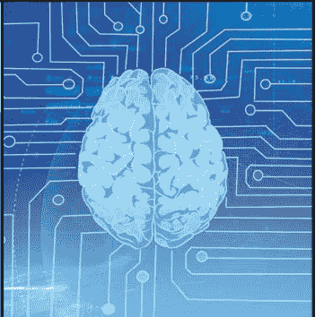

我在下棋时思考每秒不超过五步。

卡斯帕罗夫

我可以每秒思考2亿步。

深蓝

职业围棋手在考虑下一手布局时，每秒可以考虑到100种可能棋路，但是我每秒则可考虑10万种棋路。

AlphaGo

而AI则几乎能在瞬间获取全部有用信息并得到反馈，并对每个单位进行及时、单独、精细的操控。

不仅如此，人工智能系统有优于人类的精确性与可靠性、抗疲劳性与警觉性。

基于AI的自动化能比人类更精确、可靠地执行任务。研究表明，可采用一种称为受激拉曼组织学的先进成像形式进行脑肿瘤自动智能诊断。该成像方式在150秒的时间内即可准确诊断出脑肿瘤。

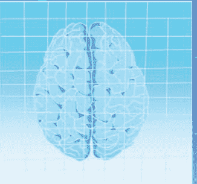

> 这个片子没有肿瘤吧。

> 人工智能系统诊断准确率为94.6%，优于专业人类医生93.9%的诊断准确率。

> 已检测到脑肿瘤。

牛津大学的研究团队利用三万多文物资料训练了一种破译千年文物铭文能力的Pythia人工智能系统，以推测希腊千年以上破损文物表面上缺失的铭文字符。

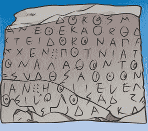

### 人工智能技术的安全隐患

人工智能系统完整的构成流程主要包括数据采集、模型训练优化和部署应用等三个阶段，其资产主要由数据、算法模型、软硬件基础设施、产品服务及行业应用组成。

这就是人工智能系统完整的构成流程啊，那人工智能系统的技术安全隐患是什么呢？

### 人工智能系统的工作流程

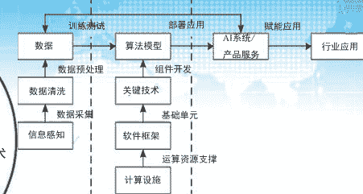

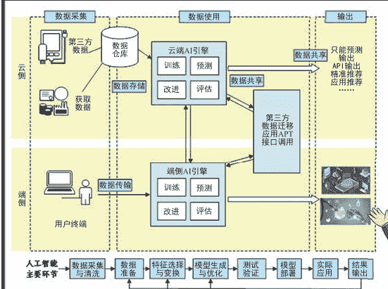

人工智能系统通过预先设定规则，由程序在用户有感或无感的情况下自动采集，并且经过数据清洗与过滤去掉一些无关数据，然后用于模型的训练与判断。下面从整个流程来分析人工智能系统的安全隐患。

第一个是数据采集阶段的风险。

- 数据质量安全，人工智能模型精度受限于训练数据、应用数据的质量，而训练数据集规模不足、数据集的多样性和均衡性覆盖度不够、数据集的标注质量低、数据环境噪声等都将影响训练数据的质量。

- 数据过度收集与隐私安全。目前人工智能系统中常常涉及人脸、声纹等敏感的个人生物特征。而生物特征等个人敏感信息采集存在法律合规风险和隐私安全风险。

生物信息不同于传统时效性信息数据，生物信息一旦泄露，就是终身泄露，造成个人信息安全、生命财产安全等相关问题。

2018年度中国消费者协会的《100款App个人信息收集与隐私政策测评报告》。

100款App个人信息收集与隐私政策测评报告

通信社交、影音播放、网上购物、交易支付、出行导航、金融理财、旅游住宿、新闻阅读、邮箱云盘和拍摄美化等都存在过度收集用户个人信息的问题。

是的，在报告中，多达91款App列出的权限涉嫌“越界”。

- 三是数据篡改风险。系统经常要面临一些恶意者的攻击，恶意者可以通过多种方式进行数据篡改，从而改变智能系统决策，造成多种安全风险。

我的变形又骗过系统啦哈哈哈！

- 首先是通过精心构造对抗样本，欺骗智能系统作为合法信息被接受。
- 其次是通过构造异常数据或者偏离数据，破坏原有的训练数据的概率分布，导致模型在某些条件产生聚类、分类或预测错误。

第二个就是算法模型风险。

算法模型，是人工智能系统的核心，而算法模型中的安全隐患则可能给人工智能系统带来致命的安全后果。

- 一是数据选择性导致的模型精度或歧视风险。训练模型选择的数据规模、平衡性、覆盖度不够，或者训练数据分布均衡性差，导致与预期不符甚至伤害性的结果。另外存在设计者主观偏见或客观事物造成模型带有歧视性的结果，这种倾向选择性会带来歧视风险。如果将算法应用在犯罪评估、信用贷款、雇佣评估等关切人身利益的场合，其产生的歧视可能会严重危害个人权益。

- 犯罪评估
- 信用贷款
- AI算法
- 雇佣评估

音乐声太大了！我的语音识别都不起作用了！

- 二是数据不匹配造成的模型鲁棒性风险。鲁棒性是确保系统面对输入数据变化时具有的稳健性。由于应用场景多变，测试时数据可能会面临信道条件、场景条件发生偏移，导致数据失配，因此对模型的可靠性与鲁棒性造成威胁。

- 三是人工智能算法不可解释性和不透明性风险。深度学习模型的“黑箱”特征，导致优劣的评估往往没有足够证据支持和解释。

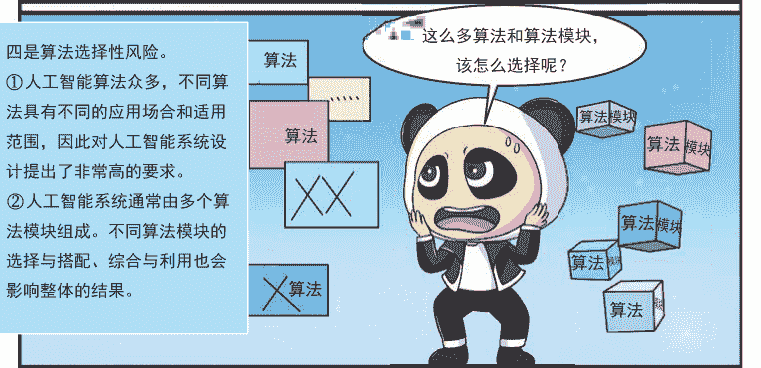

- 四是算法选择性风险。①人工智能算法众多，不同算法具有不同的应用场合和适用范围，因此对人工智能系统设计提出了非常高的要求。②人工智能系统通常由多个算法模块组成。不同算法模块的选择与搭配、综合与利用也会影响整体的结果。

这么多算法和算法模块，该怎么选择呢？

人工智能系统有这么多的风险啊……

对，第三个就是人工智能系统的支持系统风险。

- 一是人工智能系统的支撑软件方面，除了常规的操作系统软件层面外，主要就是人工智能框架的安全风险。

以目前最主要的深度学习技术来说，深度学习算法大都是实现在某个深度学习框架上的。

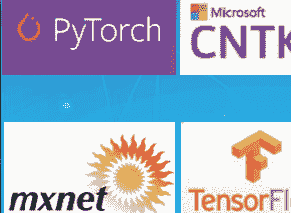

目前基于深度学习系统框架非常多，主流的包括TensorFlow、PyTorch、MXNet及CNTK等。但研究表明，人工智能框架及其依赖库被多次发现存在安全漏洞。

内存访问越界

奇虎360公司曾在一个月的时间里面发现了多个深度学习框架及其依赖库中的软件漏洞，这些漏洞带来的潜在危害可以导致对深度学习应用的拒绝服务攻击、控制流劫持、分类逃逸，以及潜在的数据污染攻击。

空指针引用

整数溢出

- 二是人工智能系统的支撑硬件方面，主要是各种底层硬件平台的风险。

通常人工智能硬件平台包括存储设备、计算设备、安全防护设备等，其安全风险主要来源于两个方面：①硬件设备的物理安全问题。②硬件平台相关的底层软件层问题。

第四个是人工智能的发展与应用风险。除了技术层面外，在社会层面，人工智能系统的安全风险还来自于技术发展本身的不可控性、技术滥用等带来的人类社会发展、文明进步中的系列问题。

长久以来，对人工智能发展的认识一直存在着泾渭分明的两派力量，一类是人工智能保守派，另外一类是人工智能的激进派、威胁派。

保守派，以机器学习的大师延恩·勒昆、迈克尔·乔丹等为代表；另外一类是以霍金、埃隆·马斯克和比尔·盖茨为代表。

霍金认为人工智能的崛起可能是人类文明的终结，马斯克认为人工智能将是人类的一大威胁。

2045年，奇点来临，人工智能完全超越人类智能，人类历史将彻底改变。

谷歌前技术总监雷·库兹韦尔在《奇点临近》《人工智能的未来》两本书中指出。

“奇点”一词可分别指代未定义的点或时间空间上曲率无穷大的点，库兹韦尔将二者结合，用“奇点”作为隐喻，来表示技术进步的速度会呈指数式增长。

当人工智能走到超人工智能阶段，能力超越人类就意味着奇点的来临。

还有一人工智能技术的滥用将会带来一系列难以解决的社会难题。

尤其当人工智能技术被不法分子所利用，就会变成辅助不法分子实施不法行为、牟取暴利的工具。

例如美国斯坦福大学和 Infinite公司联合研制了一种基于AI芯片的自主网络攻击系统。该系统能够自主学习网络环境并自行生成特定恶意代码，实现对指定网络的攻击、信息窃取等操作。

在近两年的世界黑客大会上，具有人工智能的“神器”“杀器”纷纷亮相。人工智能还可用于构建新型军事力量或恐怖袭击。

### 人工智能系统的攻击方法

作为采用人工智能技术的信息系统，人工智能系统除了会遭受传统网络攻击威胁外，也会面临一些人工智能系统特有的攻击方式，这些攻击对采用机器学习方法的系统影响较大。

而且现阶段还没有真正切实有效的防御方法。

今天我穿了一件很潮的短袖哦！

识别到xx风景，未识别到机器人……

什么情况，怎么会这样？

研究很早就发现，基于深度学习技术的人工智能系统非常容易受到精心设计的对抗样本的影响，可能导致系统出现误判或漏判。

与信息有差别，识别失败！

| 40 | P |
|---|---|

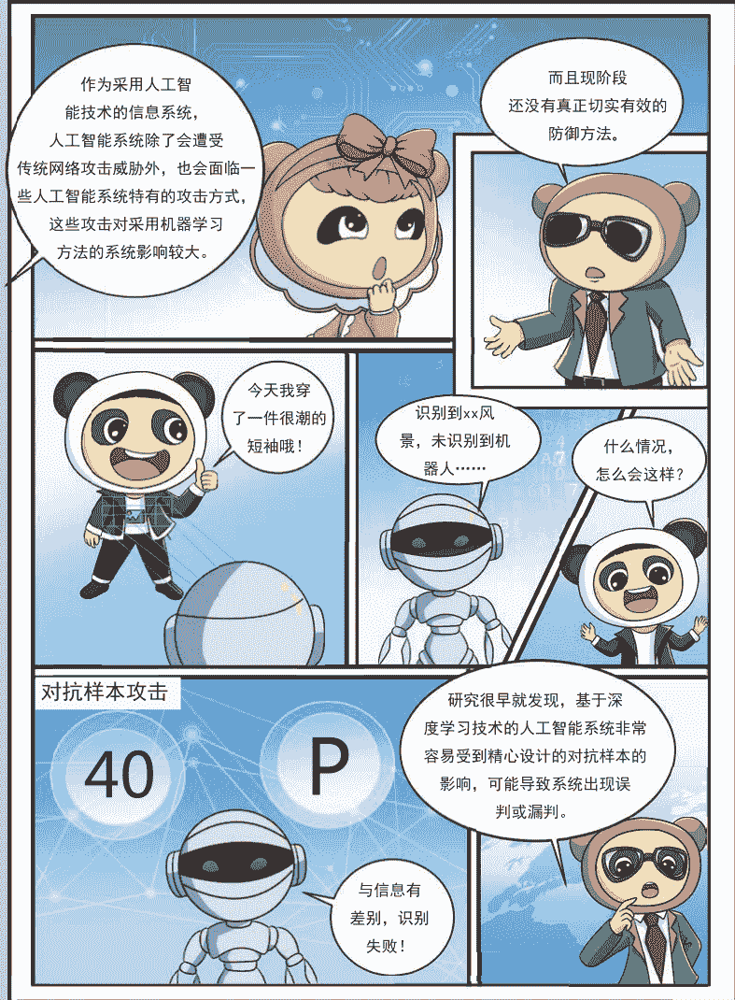

> 还有数据投毒攻击！

> 天哪，还会被投毒。

数据投毒攻击是更加广泛的一种攻击方式，核心是在训练阶段在训练数据中加入精心构造的异常数据，直接引入错误样本或者破坏原有的训练数据的概率分布，导致模型失效或偏斜，从而造成在某些条件下会产生分类或聚类错误。

> 所有人工智能机器人都会受到攻击么？

> 嗯……由于数据投毒攻击需要攻击者接触训练数据，通常针对在线学习场景（利用在线数据不断学习更新模型），或者需要定期重新训练进行模型更新的系统，这类攻击比较有效。

### 数据投毒攻击

- 一是攻击者可以采用随机标签篡改或者逆向标签修改，改变训练样本的标签，直接干扰模型的学习过程。
- 二是将生成的对抗性样本直接引入模型训练。
- 三是攻击者可以利用训练目标中的对抗优化策略来进行过程攻击。
- 四是引入任务无关样本导致数据概率分布发生变化，造成模型失效。

> 除了前两种外还有模型窃取逆向解析攻击。

该攻击方式实质是指通过直接获取或探测模拟出功能相同或类似的模型，实现对算法模型的窃取，然后通过逆向解析技术还原训练过程或训练中的关键敏感数据。

### 算法

> 可采取的方式主要分三种。

### 模型窃取逆向解析攻击

- 一是指导型攻击，攻击者根据接口获取系统模型的初步信息，进而通过初步信息牵引指导对模型进行逆向分析过程。
- 二是探索性攻击，攻击者使用专门设计的样本，不断迭代地查询目标模型并记录目标模型返回结果，大量探索性策略能够最大限度地提取有关模型内部的信息。
- 三是模拟式攻击，攻击者利用窃取的信息逐步训练一个替代模型，用于产生可转移的对抗样本来攻击原始模型或窃取整个模型供自己使用。

## 第七章

### 人工智能未来篇

### 现阶段人工智能的局限性

同学们前面举了很多人工智能应用场景的例子，都非常好。但是我想和你们说的是：人工智能现在还有很多局限性。

强强，请你解释一下什么叫做快乐？什么叫做悲伤？

老师，我可以在网络上搜索出关于“快乐”和“悲伤”的标准定义，可是我自己并不能理解这两种情绪。

不过人工智能的时代已经来临，我相信解决这些问题不会太久了。

是的。目前阶段，任何不能通过符号或者定义规范的数据概念，人工智能都无法掌握。这就是人工智能的局限性，解决这个问题需要人类继续对自身智能进一步深入解析。

### 人工智能芯片

未来，伴随着大量人工智能算法的落地与应用，计算所需的核心部件——芯片将会出现大量新的需求，其核心就是如何设计和制造新一代芯片。

芯片？

你们看！芯片！

芯片能够高效地运行深度学习、强化学习等学习算法，比目前通用计算机快上几千倍，同时能耗更低。

NVIDIA CUDA

英伟达 (NVIDIA)

张量处理单元 (Tensor Processing Unit, TPU)

主要的电脑芯片公司都在开发深度学习芯片上投入了大量资金。英伟达开发了能够优化图形应用和游戏的专用数字芯片——图形处理器，谷歌则设计生产了一种更为高效的专用芯片——张量处理单元。

### 手机人工智能技术与应用白皮书 (2019年)

2019年6月12日，中国信息通信研究院和中国人工智能产业发展联盟联合发布了《手机人工智能技术与应用白皮书（2019年）》。其中提到，如今手机AI芯片在终端领域迅速渗透，产业规模将呈现快速扩张之势。

2017年，全球手机AI芯片市场规模3.7亿美元，占据全球AI芯片市场的9.5%。预计2022年将达到38亿美元，年复合增长率达到59%，未来五年有接近十倍的增长。

当前我国终端产业对AI技术的应用已较为成熟。

欢迎大家来到华为产品发布会！下面我来向大家介绍麒麟980处理器。

2018年8月，华为发布了7nm麒麟980处理器，其集成69亿晶体管，实现了性能与能效的全面提升，在CPU、GPU、AI等性能以及能效领先幅度超过30%。

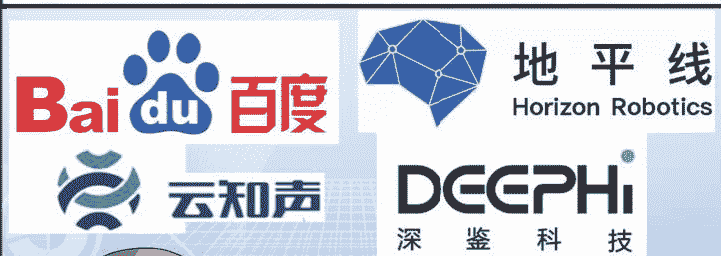

此外，百度、地平线、云知声、深鉴科技等，也推出了基于神经网络或自研AI架构的IP、FPGA、ASIC等产品，覆盖图像、语音和自动驾驶等多个领域和场景的AI芯片。

### 神经元

人类大脑中有大约1000亿个神经元，每个神经元都与其他数千个神经元相连接，总计达1000万亿个连接。大脑运转所需的功耗大约是20瓦，占整个身体运转所需功率的20%，而大脑的质量仅占身体的3%。

相比之下，一台远不如大脑强大的千万亿次超级计算机，功耗却为5兆瓦，是大脑功耗的25万倍。

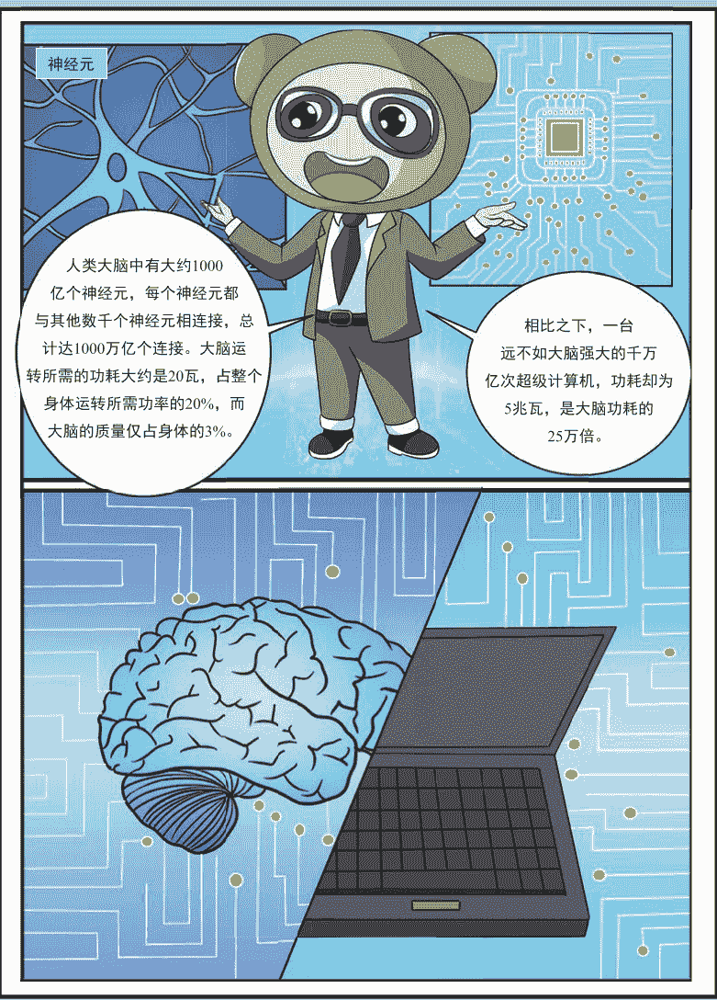

数字计算机和神经网络的体系结构不同。在数字计算机中，内存和CPU在空间上是分开的，并且内存中的数据必须依照顺序移动到CPU中。

在神经网络中，处理过程在内存中并行进行，消除了内存和处理器之间的数据传输瓶颈，由于网络所有单元都在同时工作，允许大规模并行处理。

受大脑神经元计算方式的启发，神经形态芯片应运而生。第一个神经形态芯片出现在1982年，由美国加州理工学院的米莎·马霍沃德设计出了世界上第一个硅视网膜。

米莎·马霍沃德

神经形态芯片使用了与超大规模集成电路芯片相同的制造技术，但使用了模拟而非数字电路。硅视网膜可以模拟生物视网膜的功能，米莎在她的博士论文中描述了在芯片上的实时双目匹配，这是第一个真正使用集群行为完成艰巨任务的芯片。

作为第一款基于脉冲和触发定时的新一代传感器，DVS 具有很大的潜力。

2008年，托拜厄斯·德尔布吕克开发了一种非常成功的脉冲视网膜芯片，称为“动态视觉传感器（DVS）”，该芯片可以在超低功耗下完成一些视觉任务。

动态视觉传感器

> 接下来我们就要讲到摩尔定律了。

英特尔（Intel）创始人之一 戈登·摩尔（Gordon Moore）

> 摩尔定律：当价格不变时，集成电路上可容纳的元器件的数目，约每隔18-24个月便会增加一倍，性能也将提升一倍。

> 那摩尔定律即将终结吗？

> 自20世纪50年代计算机发明以来，一切正如摩尔定律所预测的那样，计算机的能力增加了超过1万亿倍。摩尔定律中，芯片的升级是基于缩小元件间线宽的可能性，但目前的宽度已经达到了物理极限。

不会的！

摩尔定律的表述仅仅是基于芯片的处理能力，随着未来并行架构的不断发展，摩尔定律应该被考虑了能量和吞吐量的新的定律所取代。

在美国俄勒冈州波特兰举办的英特尔2018 NICE大会上，来自美国和欧洲的研究人员展示了三款新的神经形态芯片：英特尔的Loihi研究芯片以及两款由欧洲人类大脑项目支持的第二代芯片。

### Loihi研究芯片

随着大规模并行体系结构的发展，能够在这些体系结构上运行的新算法也将陆续出现。

老师，未来人工智能可以做到像神仙一样无所不能吗？

你说的是一种称为“通用人工智能”的技术，是很多人工智能科学家的梦想。他们希望将来有一个通用的模型，可以建模整个世界，使各种各样的问题都能迎刃而解。

通用人工智能可以实现吗？好期待呀！

先别急，让我给你们先讲一个故事吧！

### AI诞生50周年

> 又是马文·明斯基！

在2006年达特茅斯“AI诞生50周年”会议中，全球人工智能大师汇聚一室。1956年人工智能夏季研究项目的十位先驱中的五位出席了这次会议，其中包括马文·明斯基。

> 马文·明斯基参与出版了导致上世纪70年代人工智能寒冬的《感知机》。

> 你们不是在解决通用的智能问题，你们只是在解决具体的应用问题。

在会议结束的总结性发言中，马文·明斯基一开始就表示，他对会议中的众多演讲和AI的研究方向感到失望。

马文·明斯基

看来，就连马文·明斯基这样的人工智能先驱者都觉得现在的研究都无法达到通用智能。要怎样才能做到呢？

嗯，是啊，不过我们正在朝这个方向不断努力。很多人认为要达到通用智能，深入理解人类智能的产生及人脑的工作机理或许是一条捷径。例如，美国的“BRAIN”计划就是想通过研究人脑的工作机理提高机器的智能。

### 2013年由美国白宫发起的“BRAIN”计划

### BRAIN计划

创造新的神经技术，以加速我们对“终极信息机器”的理解，“BRAIN”计划正在将工程师、数学家和物理学家引入神经科学领域，以改进探测大脑的工具。

人类的大脑不是凭空产生抽象的想法的，而是通过感官输入与外界密切联系。这一过程本质上就是学习。

人工智能中最难解决的问题之一是常识，而只有在长期与外界接触后，大多数人才会获得常识。人工智能中经常忽略的情绪和通感也是智能的一个重要方面。

2016年，人工智能之父之一的马文·明斯基去世了。直到临死前，他仍然坚信神经网络无法实现通用的人工智能。

真是一件悲伤的事啊！

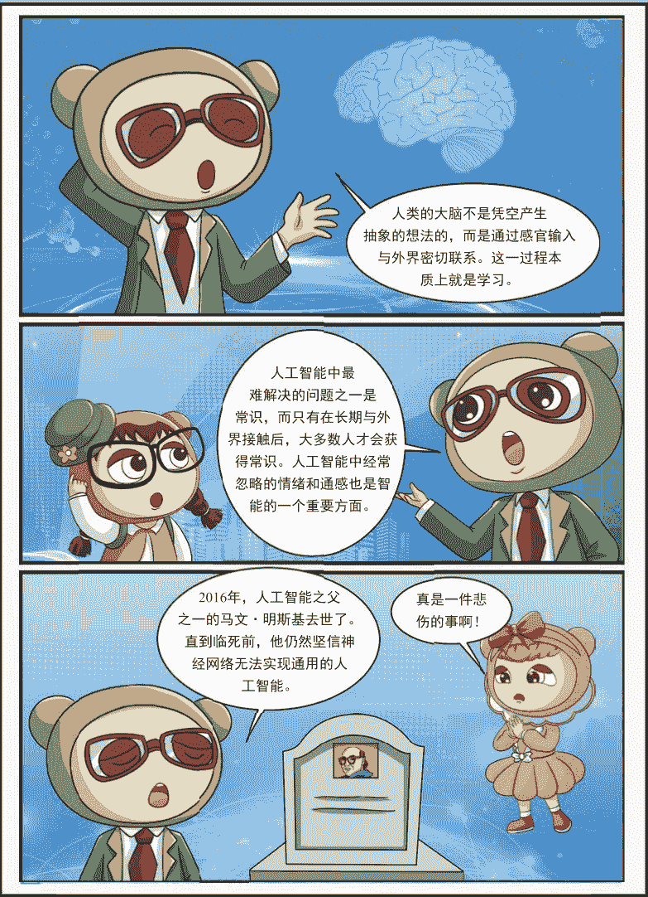

他的好友斯蒂芬·沃尔夫勒姆写道：

1927—2016
马文·明斯基

> 虽然我认为没有人能在当时就预见到，但我们现在知道，马文早在1951年就已经在研究的神经网络，正在朝着他所希望的那种令人叹为观止的AI能力发展道路上前进。可惜这个过程太久了，马文几乎没能看到它的实现

斯蒂芬·沃尔夫勒姆

人类对自身智能的深入解析，通用智能得以实现，人类将迎来“强人工智能”的新时代，人类社会将发生无法想象的翻天覆地的变化。

好期待啊！

## 第八章

### 人工智能启示篇

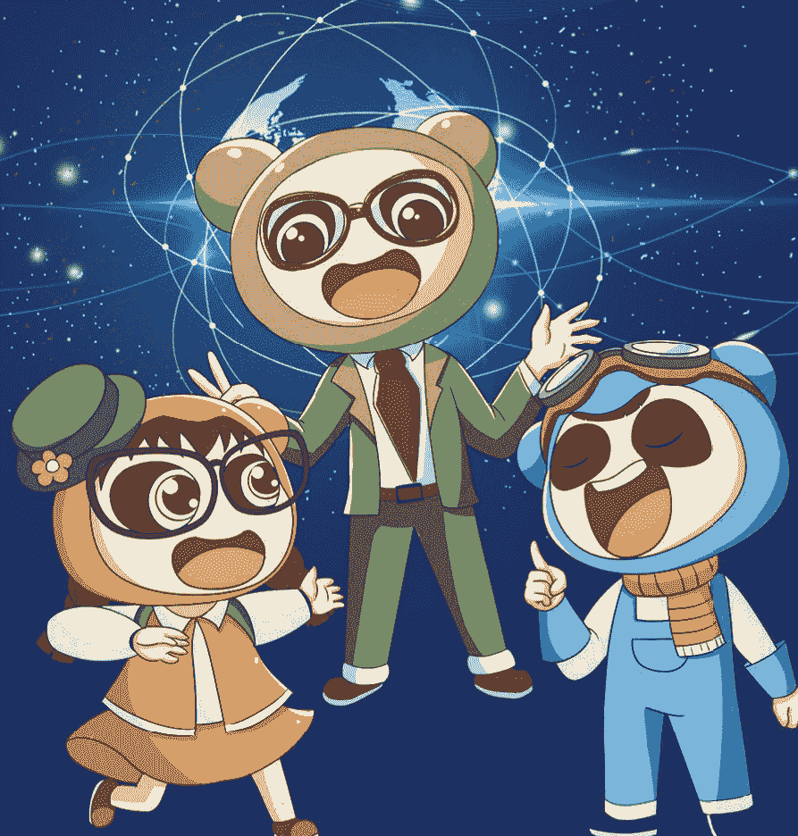

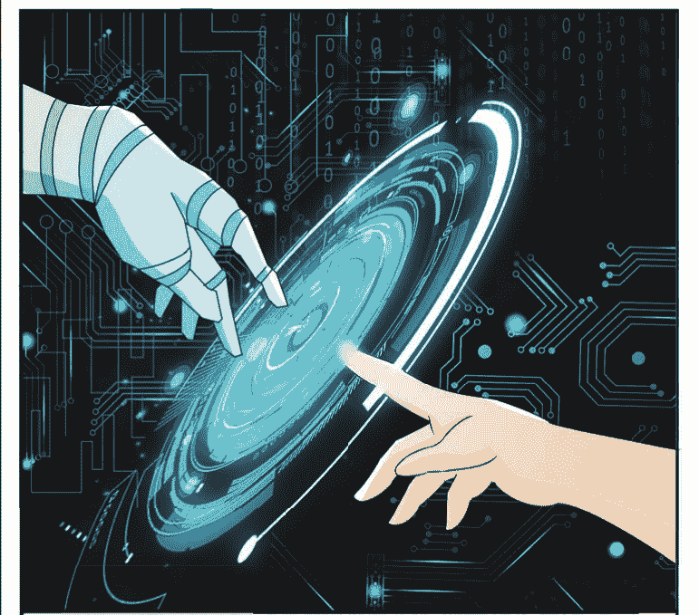

人工智能的历史发展蜿蜒盘旋，对其长期规律的呈现将有助于人工智能未来趋势的判断。

因此，对人工智能认识的正确态度就是不能单一地、静态地、孤立地看待人工智能，而要以全面准确、发展变化和相互联系的视角看待。

### 人工智能概念的相关启示

- 启示一：要把人工智能丰富内涵当成具有内在结构的知识系统来看待。人工智能的内涵非常丰富，无论是从内涵角度，还是从学术流派的角度，人工智能具有内在知识结构，相互之间互为补充，形成一个相对完善的知识系统。
- 启示二：要把人工智能概念变化当成具有发展规律的动态体系来看待。总结起来，人工智能概念是动态发展的，具有“三忽”特点：“忽大忽小”“忽高忽低”“忽宽忽窄”。了解人工智能历史的动态发展，以及学术界的知识规律，才能更好地把握人工智能的发展。
- 启示三：要把人工智能技术关联当成具有关系网络的技术集群来看待。对人工智能技术的认识，不仅仅停留在其内涵上，还更应该从外延上同其他技术的关系中来共同探讨，如智能制造、机器人、自动化、大数据等。

### 人工智能发展的几点启示：

人工智能从诞生之日起，从大趋势上讲，经历三起两落，目前正处在第三次发展的上升期。关于未来发展更是众说纷纭，我们从它的发展过程可以得到什么启示呢？

- 首先，历史充分展示了螺旋式上升规律与未来是否会延续螺旋规律判断的困境，对短期预期盲目乐观，对长远困难认识不足。
- 其次，人工智能当前发展的动力与未来技术发展存在鸿沟，尤其是深度学习技术是目前第三次人工智能浪潮的核心驱动力，但目前深度学习仍然存在理论体系不完善的问题。
- 最后，尽管智能化程度不断提升，但智能客观分级研究仍存在困境。由于人工智能发展历史的曲折性与多样性，所以对人工智能的发展方向预测目前还不明朗，其根本原因在于对于人工智能的智能化等级的划分不完善。

好期待那一天呀！

是的呢。

将来有一天，人工智能一定会变得更强大！发挥更大的作用！

老师！再给我们讲点新知识吧？

好啊！同学们我们继续上课！让我们一起去未来人工智能的世界看看吧！

出发喽！!

### 语音识别

### 图像识别

> 哇喔！

## 后记

最近几年，人工智能前沿领域取得了重大的突破，颠覆性理论创新层出不穷，工业应用走向深耕细分和跨界融合，科幻电影和小说中的内容成为现实。
本书成稿之际，正好赶上 2020 年世界人工智能大会的召开，何其幸运，我们恰逢智能时代开启伟大征程中最闪亮的一程。谨以此书，致敬那些夜以继日、辛勤劳作的人工智能从业者。感谢他们那种“任世事变迁，寒暑交替，我只此心不动”的专注，感谢他们“初心易得，始终难求”的执着坚守！

中国人民解放军战略支援部队信息工程大学（后称：信息工程大学）从 20 世纪 80 年代开始人工智能的教学科研工作，是国内最早一批从事人工智能高等教育的院校。我校的郭云飞校长也曾经是这个领域的开拓者与深耕者。学校的前瞻性、战略性教学科研布局很幸运地契合了中华民族伟大复兴和人工智能飞速发展的时代进程。从早期的经典人工智能到现在的新一代人工智能，信息工程大学的学者们紧跟时代的节拍，培养出大批信号感知、智能信息处理、认知计算与理解等领域的青年才俊和专家学者，他们在各自的工作岗位上默默奉献、开拓前进。新时代、新征程、新挑战，在信息系统工程学院党委的成功规划下：2017 年筹划并开办全军第一个“高级现代人工智能研修班”；2019 年信息工程大学成功获批了人工智能本科专业，与国内其他 35 家院校一起成为全国首批人工智能本科专业建设院校，也是第一个、唯一个人工智能本科专业建设军队院校；2019 年成功举办第三届“强网杯”全国网络安全挑战赛暨第二届“强网论坛”人工智能分论坛，国内著名人工智能技术大咖云集郑州分享技术成果。面对国际形势风云变幻，时代发展和国家安全需求将人工智能提高到前所未有的高度。人工智能已然成为国家间竞争的制高点，人工智能各类行业系统也即将成为国之重器。人工智能是一个高科技领域，近年来国内外著名咨询机构发布的《人工智能人才白皮书》表明，我国人工智能的高端专业人才还处于相对匮乏状态。由于人工智能人才培养周期长，更需要从青少年人才培养开始布局。因此重视人工智能科普教育，启迪青少年的高科技思想，开拓青少年的人工智能思维，成为我们这一代人工智能从业者的责任与担当。作者从事人工智能领域教学、科研近二十年，很想把积累的一些经验和体会与青少年、人工智能爱好者一起分享，但以漫画这种新颖的形式分享的心情又是新奇的、忐忑的，惶恐表述难及思想之万一。随着人工智能技术的蓬勃发展及在国防建设和国民经济各行业中的深入应用，越来越多的人工智能产品会走入千家万户，人工智能让我们享受智慧生活的同时，也带来更多的机遇与挑战。同时，人工智能技术推广和宣传工作还任重道远，下一步我们将一如既往、尽我辈之所能地扎实开展人工智能科普和宣讲工作，为人工智能更好服务社会、造福人类贡献智慧和力量。

作者
2020年7月

### 国家网络安全宣传周
China Cybersecurity Week
2020年国家网络安全宣传周
推荐丛书

## 漫画网络信息新技术科普丛书

- 漫画拟态 防御
- 漫画北斗导航
- 漫画人工智能
- 漫画量子计算
- 漫画移动通信
- 漫画网络安全
- 漫画数据科学

科学出版社互联网入口
科学出版社 工科分社
联系电话：010-64005312
销售电话：010-64031535
E-mail：gk@mail.sciencep.com

www.sciencep.com
ISBN 978-7-03-065969-9
定价: 68.00 元

