# 漫画 AI 启蒙录

## 丛书顾问团

总顾问：邬江兴 中国工程院院士

主任：宋明武 中国人民解放军战略支援部队信息工程大学副校长兼教育长

副主任：邹宏 复旦大学大数据研究院副院长
俞能海 中国科学技术大学网络空间安全学院副院长
邵广纪 中国人民解放军战略支援部队信息工程大学教务处处长
蔡晶晶 北京永信至诚科技股份有限公司董事长

编委：李广云、祝跃飞、李新生、罗军勇、屈丹、单征、袁博、侯毅刚、张丽、王博、胡滨、张雪美、杨森、孙晨、郭威、许瑾晨

## 图书执行编委会

主任：屈丹、张文林、闫红刚
副主任：陈琦、牛铜、杨绪魁
编委：侯毅刚、王博、赵兵、田乐

## 致逐梦青春

回溯 2018 年 5 月 28 日，两院院士大会上，习近平总书记的殷切寄语至今回响：“当科学家是无数中国孩子的梦想，我们要让科技工作成为富有吸引力的工作、成为孩子们尊崇向往的职业，给孩子们的梦想插上科技的翅膀，让未来祖国的科技天地群英荟萃，让未来科学的浩瀚星空群星闪耀！”科学因明天而充满希望，后浪因青春而奔涌，青年因自强而不息。

激励广大青少年讲科学、爱科学、学科学、用科学、走科学之路，亟需将科学普及置于与科技创新同等核心的战略高度，视为我们这代科技工作者义不容辞的使命。在科学出版社的大力支持下，近百位科技工作者倾力合作，推出这套“漫画网络信息新技术科普丛书”，是推动科学走进大众、丰富优质科普供给的创新实践。

应编委会之邀，为丛书作序。思虑再三，觉得这序言最宜写给追逐科学梦想的学子们。也是作为前辈对后辈的寄语，简述我们这代人投身科学与科普的初心与担当。

**触摸科学之美**。科学自有其独特魅力，对科学之美的向往，是点燃我们对科学兴趣的“引爆点”。我也曾在如何突破冯·诺依曼计算体系、构建领域专用软硬件协同处理架构，如何破解网络空间共性安全难题、构建基于动态异构冗余架构的内生安全体系等“灵魂拷问”中艰难探索。但当我从探索频道目睹生物界的拟态奇观——数千万沙丁鱼结群避险的拟态舞动，上百万非洲候鸟空中捕食的拟态阵型变幻，以及拥有色彩纹理与形态行为变幻莫测的拟态章鱼等形形色色拟态生物时，萌生了在网络信息系统中引入拟态构造的奇思妙想与创新激情。这种科学之美，不仅激发了我们探索未知世界的兴致，更赋予我们破解未知难题的灵感。非世界缺美，乃吾等缺乏发现。用心感知、发掘科学之美的过程，正是我们建立对科学的兴趣、领会科学方法、构建科学思维的过程。在这进程中，有深度的科普读物必将成为良师益友，为你点燃一团火、亮起一盏灯、推开一扇门……

**领悟科学精神**。何为科学精神？众说纷纭。我以为可概括为四字：求真务实。所谓求真，即追求真理，探求科学之真、科学之美。科学之所以能立足，在其“真”；科学之所以为科学，亦在其“真”。求真之路漫长艰辛，时充满风险挑战。既需“路漫漫其修远兮，吾将上下而求索”的精神，更需“板凳要坐十年冷，文章不写半句空”的毅力。所谓务实，即仰望星空之时、脚踏实地。科学向来是“大胆假设、小心求证”，需要踏踏实实、落地生根。20世纪80年代中期，我提出在功能等价条件下，造一台能提供电话服务功能的专用计算机来攻克制造大型程控电话交换机的难题，这个思路确实“高大上”甚至“有些疯狂”，但真要落地，面对的却是“九九八十一难”。当时我们能获取的技术资料，不过类似科普读物中关于“千里眼、顺风耳”的浅显介绍或近似古董级的机电交换机资料。经多年艰苦攻关，我国首台万门程控交换机横空出世，打破了西方国家“七国八制”技术与产品长期垄断全球市场的格局，带动我国信息通信技术领域与产业的群体性突破。靠的就是求真务实的精神，“纸上得来终觉浅，绝知此事要胆行。”

**体会科学家精神**。科学家精神表述虽多，但钱学森先生一言最为透彻、直抵本质：“科学没有国界，可是科学家却有自己的祖国。”科学家精神，最核心、最根本者，即对祖国的热爱，对民族复兴、人民幸福的责任与使命。缺此一点，万事皆成无源之水、无本之木。我立志制造中国人自己的程控交换机，一大缘由在于20世纪80年代，西方发达国家一些权威人士曾断言“中国人本世纪造不出大型程控交换机”。我们这代科技工作者，从不信邪、不服输，你们预言我们做不到的事，我们偏要做到，而且要做得更好，必须有这份民族自信、这股敢为天下先的傲骨。最终我们不但做到了，更成就世界通信史上一大创举。科学家精神，就是为国分忧、为民族争气的精神。每个青年追求科学、探索科学、实践科学，终归要为祖国富强、民族复兴服务，无论身在天涯海角，与祖国一刻也不能分离。唯有如此，涓涓细流，终汇江河；科技强国，指日可待。

愿青年友人能感悟科学之美，满怀科学精神，传承科学家精神。亦愿这套“漫画网络信息新技术科普丛书”能绽放科学之美，传播科学精神，弘扬科学家精神。

2020年6月

## 序章：开启 AI 探索之门

构建具备人类级思维的机器，是科学家们的终极梦想之一。1956 年，达特茅斯会议奠基该领域，命名为“人工智能”（Artificial Intelligence，AI）。AI 经历史长河洗礼，在蜿蜒盘旋中持续前行，2010 年前后迎来第三次浪潮，驶入全面高速发展期。你或许难以想象，这个高深技术领域竟成为大众茶余饭后的谈资，该词更入选 2017 年中国媒体十大流行语。缘由何在？AI 技术产品不断演进，已改变甚至颠覆我们的生活方式，从围棋神器 AlphaGo、电竞霸主 Dota AI，到无人驾驶、教学机器人，屡屡刷新认知。

习近平总书记深刻指出，AI 是引领这轮科技革命与产业变革的战略性技术，具极强溢出带动性的“头雁效应”。加快发展新一代 AI，是我们赢得全球科技竞争主动权的关键战略抓手，是推动我国科技跨越发展、产业优化升级、生产力整体跃升的重要战略资源。

作为一个具内在结构的知识体系，AI 技术在发展历程中形成了不同流派体系，还与大数据、认知计算等诸多新兴领域构成复杂关联的技术集群。如何将这个庞大技术体系深入浅出地呈现于人前，让初学者、爱好者及广大青少年快速领略其魅力？为此我们酝酿一年有余，在科学出版社大力支持下，编绘了《漫画人工智能》。本书以讲故事的形式串联内容，引领青少年步入神奇的 AI 世界。从印象篇、历史篇、概念篇、技术篇、应用篇、安全篇、未来篇、启示篇八个维度，全方位探索 AI 的神奇与奥秘。

AI 本质上是一个复杂、动态、关联、深奥的知识体系，是由数学方程驱动的幻彩世界。如何用形象语言、直观图示描述呈现多学科交叉融合的技术知识实属不易，用漫画形式、生动情节诠释更是难上加难，对作者、绘者皆是全新尝试。庆幸本书作者同步编写《深度学习基础》《自然语言理解》，为本书出版提供了坚实理论基础与丰富科学素材。深奥科学理论的普及化，是一种创新探索，对启迪公众思想、促进社会精神文明发展具重要价值，非常荣幸能成为此过程的参与者、实践者、推动者。作者耕耘 AI 领域教学、科研二十余载，做了一些工作、积累了一些经验、萌生一些想法与思路，愿与读者共同交流探讨。其中偏颇之处，仅管窥之见、一家之言，欢迎不吝赐教。

“日月之行，若出其中。星汉灿烂，若出其里。”新历史阶段，AI 必将同社会生产力发展同频共振，同诸多新兴学科建设互促共进，为我国科学技术呈现百家争鸣、百花齐放的繁荣局面贡献力量。谨以此书抛砖引玉，盼更多人站在我们肩头，看得更高、走得更远，创造 AI 领域新的灿烂辉煌。

作者  

2020 年 7 月

## 角色档案馆

- **安安**  
  SMART 蓝色  
  象征：智慧  
  个性：阳光机敏，渴望探索未知，擅长钻研解答，担任班长，虽常丢三落四，幸得妹妹 VIKI 照料。  
  绝技：最强大脑，答题正确率极高。

- **VIKI** 橙色  
  象征：美丽  
  个性：可爱活泼，热衷把事物打扮得漂亮整洁，总帮哥哥收拾烂摊子，也乐意助哥哥化解尴尬。  
  绝技：头顶帽子可变身翅膀。

- **全全**

- **强强**  
  MACHO 黑色  
  象征：力量  
  个性：讲义气，稍显冲动，爱逞强、争输赢，渴望通过答题获认可，却屡屡失手。  
  绝技：关键时刻能爆发巨力，助人一臂之力。

- **DUDU** 粉色  
  象征：温柔  
  个性：温和体贴，办事稳重，但胆小怕事、唯唯诺诺，语速动作皆慢，紧张时易结巴。  
  绝技：脑海中可随时调取视频影像投影解答。

- **赛赛**

- **博博**  
  老师 PROFK 绿色  
  象征：学识  
  个性：儒雅博学，但讲课时会突然晕倒，缘由是程序员漏写了一行代码。  
  绝技：能随时随地掏出相应书籍、物品，现场授课。

## 第一章

### 印象篇：初识 AI 风采

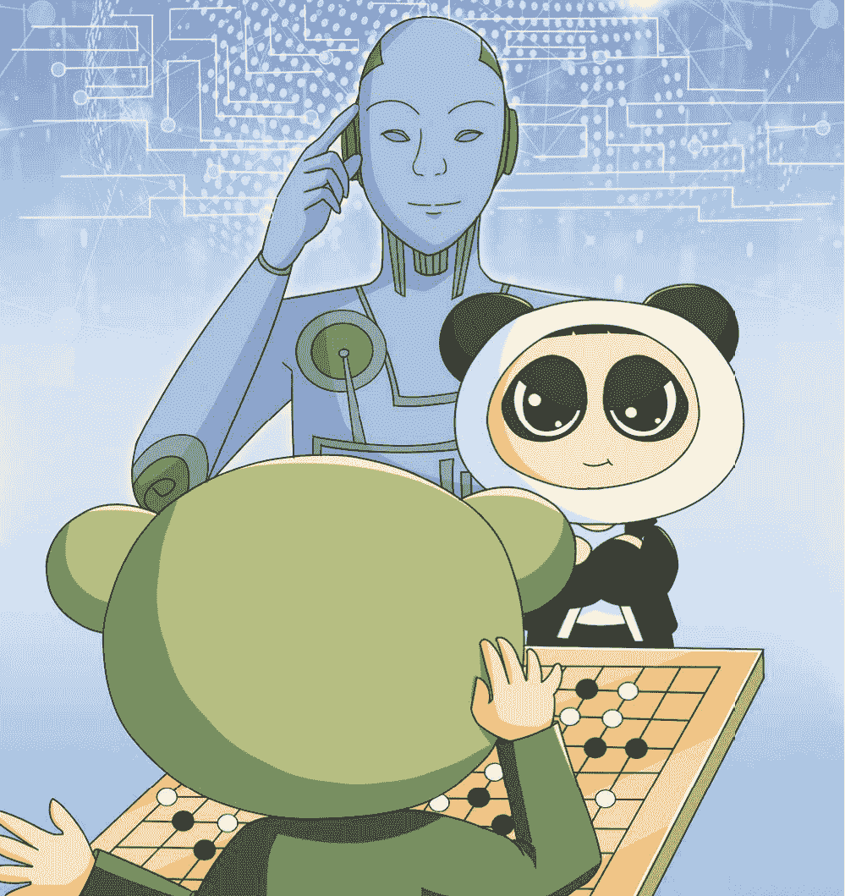

### 棋坛新霸主：AlphaGo 传奇

各位观众好！欢迎来到柯洁对阵 AlphaGo 的决战现场！

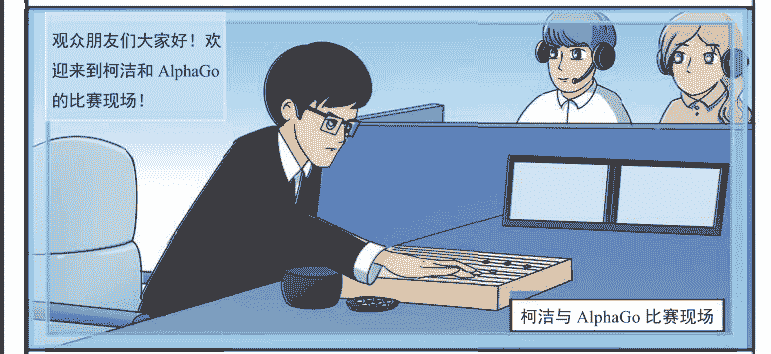

柯洁与 AlphaGo 比赛现场

### VS

这是人类与人工智能的巅峰对决！

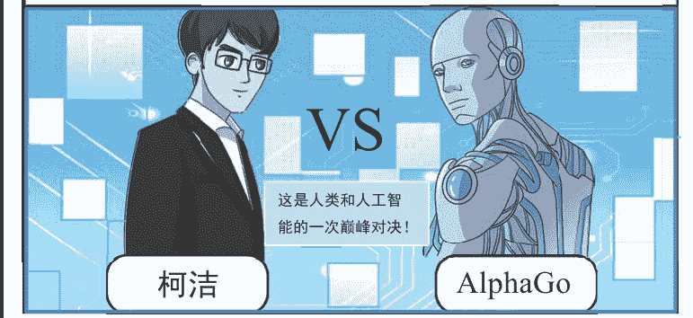

### 柯洁

### AlphaGo

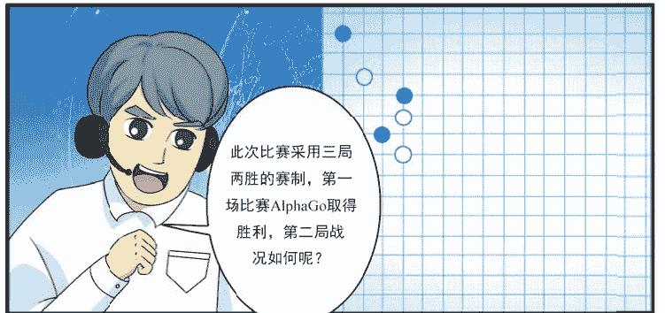

> 本次采三局两胜制，首局 AlphaGo 告捷，次局悬念几何？

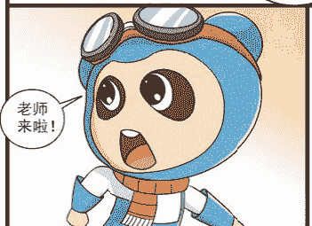

> 老师驾到！

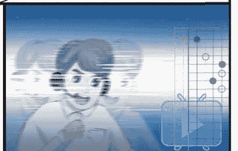

> 上课啦，别玩了！

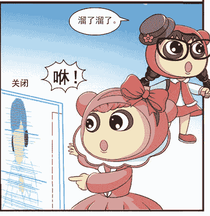

> 溜之大吉。

关闭

> 咻！

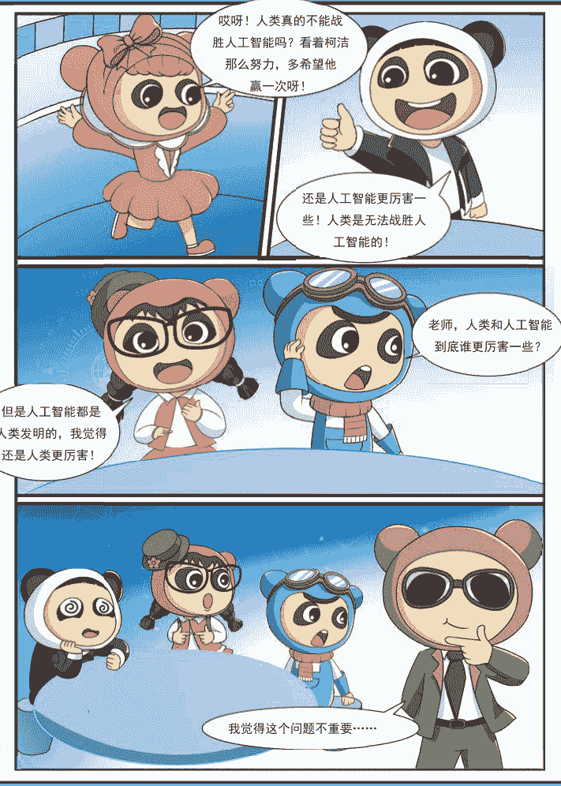

老师赖皮！

罢了，今儿就好好聊聊 AI，听完你们自然懂。

老师，我们正看柯洁大战 AlphaGo 呢！就从这儿开讲吧！

成嘛！咱们就从几个耳熟能详的案例，管窥 AI 实战威力。

啥大事？2016 年 3 月，AI 发展史发生件震撼大事。

### Google DeepMind

谷歌 DeepMind 旗下 AlphaGo，击败世界围棋冠军、职业九段李世石。

李世石

世界西洋棋冠军卡斯帕罗夫

我知道！这继 1997 年“深蓝”胜卡斯帕罗夫后，又一里程碑。

因胜李世石，此版获业界称为“AlphaGo-Lee”。

AI 这么猛，AlphaGo 咋赢的？

### AlphaGo

首先，它掌握数万围棋规则，思维模式却迥异人类；继而，研习 16 万余职业棋谱，强化局势判断与落子；关键在于，经自我对弈生成 3000 万谱。

### AlphaGo-Master

其制胜法宝，正是深度学习与蒙特卡洛树搜索。

### 蒙特卡罗树搜索技术

更狠的来了！2016 年底，ID “Master” 的韩九段连破两大网，横扫聂卫平、柯洁、井山裕太等中日韩名手，60 局超快棋全胜。

酷炫！围棋界岂非掀起腥风血雨？

确乎！2017 年 1 月 4 日，59 连胜后 “Master” 揭面：实为 AlphaGo 升级版。前版称 “AlphaGo-Lee”，此版遂名 “AlphaGo-Master”。

AlphaGo 真那么强？真能虐那么多高手？

其棋艺超脱职业认知与想象，彻底颠覆人类对既有谱局的掌控判断。众多专家曾推测 “Master” 弃人类谱、零先验自学，后证实并非如此。

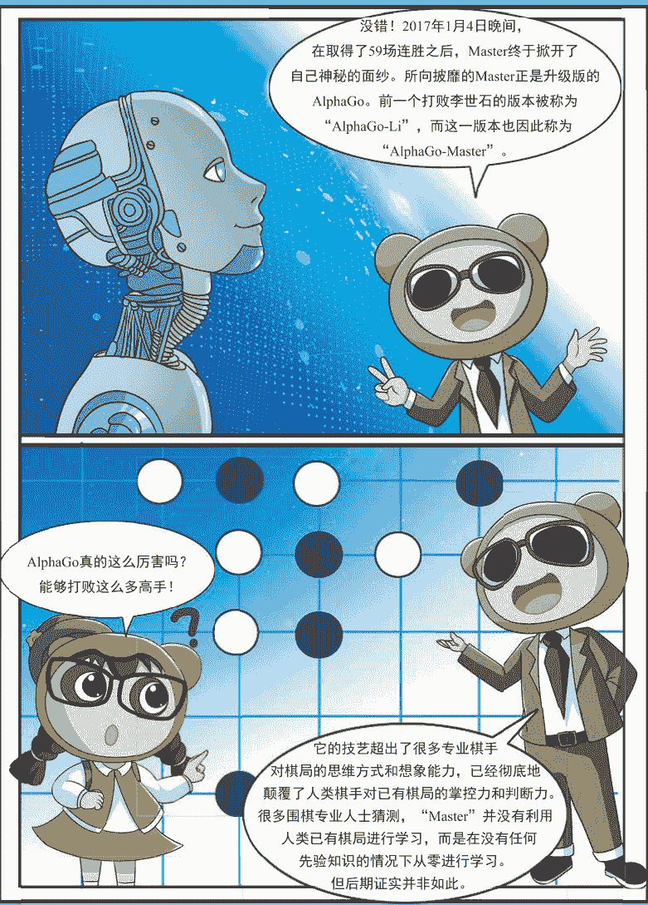

### AlphaGo-Zero

随后 AlphaGo 再进化！

### Google DeepMind AlphaGo Zero

2017 年 10 月 19 日，谷歌 DeepMind 重磅推出 AlphaGo 新版。

其里程碑意义在于实现 “无师自通”：完全凭自我对弈数据，零基础自学，故名 “AlphaGo Zero”（Zero 即零起点）。

> 厉害了，真能自学？咋做到的？

> 一、以 2015 年残差网络取代经典卷积神经网络。

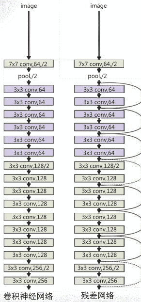

> 残差网络曾于 2015 年 ImageNet 大赛力克群雄夺魁！

二、强化学习中融合策略网络与价值网络。

三、最关键：弃用人类棋谱知识与人工特征，纯零起点自学，真正 “无师自通”。

Alpha-Zero

还有 Zero 进化版？

有！新版不再称 AlphaGo Zero，改名 AlphaZero。

为何去掉中间 “Go”？

“Go” 即围棋，名字暗示……

懂了！AlphaGo Zero 进化为 AlphaZero，意味不再局限围棋，能下多种棋类，对吧？

正解！AlphaZero 不止围棋，西洋棋、将棋等皆可。

太强了！AlphaGo 进化路好长啊！

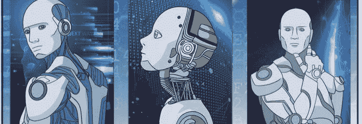

### AlphaGo

### AlphaGo-Master

### AlphaGo-Zero

纵观 AlphaGo 演变，无论卷积还是残差网络，核心均为深度学习。

### 深度学习

### Alpha-Zero

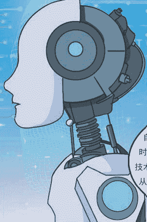

此外，它借强化学习自我对弈海量练级，实战用蒙特卡洛树搜索或拟合搜索构建 “棋感” 与全局观。关键跨越：从有人类指导到 “无师自通”，彰显深度学习、机器学习核心驱动的 AI 伟力。

## 第一章 印象篇：初识 AI 风采

### 团战利器：Dota 人机对抗

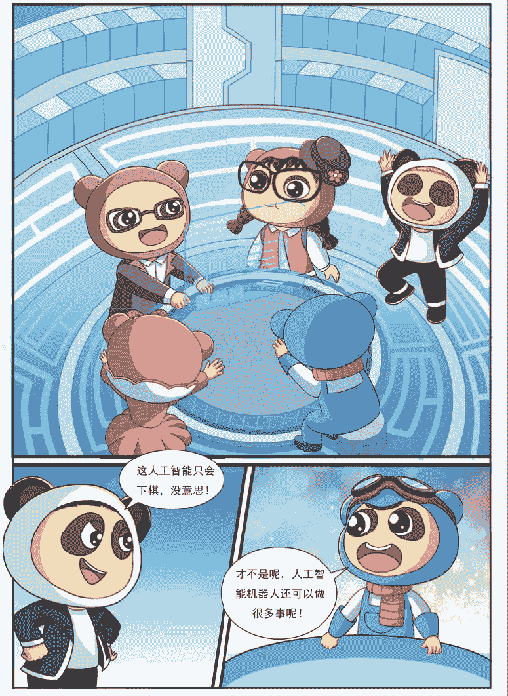

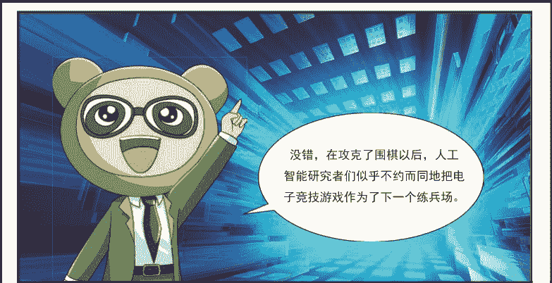

攻克围棋后，AI 研究者不约而同瞄准电竞，作为新试验场。

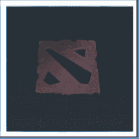

《Dota》出自暴雪，是款多人实时对抗游戏。

我知道！2013 年出 《Dota2》，这不正是考验团队协作么？

### 刀塔（Dota）人机对抗赛

对！2017 年 8 月，AI 史再演惊天大战！

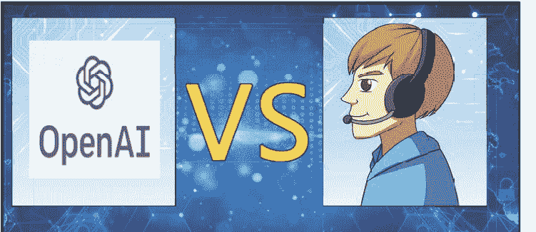

> 我知道他！Dendi 乃 Dota2 名将、单挑高手，操作灵动神级，曾率 Navi 夺 TI1 冠军、TI2/3 亚军。

Dendi

> 比赛咋样？

> OpenAI 的 Dota AI 在 1v1 中 2:0 轻取职业选手 Dendi。

胜利只是开端。2018 年 7 月，OpenAI 智能体征战 TI8。

升级版 OpenAI Five 在 1v1 基础上实现 5v5 团战。

### OpenAI VS

### AI VS AI

5v5 训练量暴增：单日经验从 300 年增至单人 180 年，五人合计 900 年。

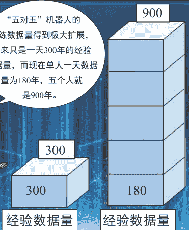

算力飙升：1v1 用 6 万 CPU + 256 张 K80 GPU；5v5 升至 12.8 万 CPU + 256 张 P100 GPU。

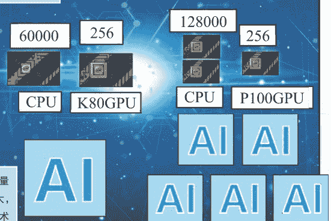

# AI进化论：从游戏巅峰到历史溯源

随着应用场景日趋复杂、数据量呈指数级爆发，对算力与算法的考验也随之升级。

## 硅基智体的“游戏试炼场”

> 当然，OpenAI的机器人军团并非战无不胜。2018年Dota 2国际邀请赛上，OpenAI Five向人类职业战队发起冲击，却两度饮恨。

转机出现在2019年初：DeepMind的AlphaStar在《星际争霸II》中以10:1的悬殊比分碾压人类顶尖高手；同年4月，OpenAI Five在“决战紫禁之巅”中以2:0完封Dota 2世界冠军OG战队，完成了对人类选手的全方位超越。

> 此后，AI在策略博弈领域的迭代速度令人咋舌。OpenAI Five仅用10个月便积累了相当于人类4.5万年的对战经验，这种极速自我进化的能力，让它能游刃有余地驾驭宏观战略，展现出惊人的决策判断力。

### 牌桌上的“冷面杀手” —— Libratus

AI的版图远不止即时战略游戏。认识一下这位扑克高手——**Libratus（冷扑大师）**，一个专攻**无限注德州扑克**的AI系统，其攻克难度堪称“地狱级”。

为何难？看看状态空间的量级对比：
*   太阳氢原子数：~10⁵⁷
*   宇宙恒星数：~10²³
*   宇宙总原子数：~10⁸⁰
*   围棋复杂度：~10¹⁷⁰
*   **单挑无限注德扑复杂度：~10¹⁶¹**

尽管复杂度逼近围棋，2017年1月，Libratus仍在20天、12万手牌的马拉松对决中，击败四名人类顶尖职业选手，斩获20万美元奖金。

**Libratus — Winner**

那AlphaGo能赢过Libratus吗？**不能。**
根本原因在于博弈性质不同：围棋是**完全信息博弈**（双方棋子全公开），德扑则是**不完全信息博弈**（手牌隐藏）。AlphaGo的架构无法处理“未知变量”。Libratus甚至未使用深度学习，而是跳出搜索博弈的旧路，转而预演纳什均衡策略，直击“隐藏信息”这一核心痛点。

#### 双雄对决：异同深度解析

| 维度 | AlphaGo (围棋) | Libratus (德扑) |
| :--- | :--- | :--- |
| **核心驱动** | 海量数据监督学习 + 强化学习（黑箱模型） | 传统线性规划离线计算纳什均衡（白箱策略） |
| **数据来源** | 早期依赖人类棋谱，后期纯自我对弈生成 | **全程零人类数据**，纯自我强化学习摸索 |
| **共性** | 均利用游戏规则，通过长期“自我博弈”涌现超人能力 |
| **残局难度** | 子力减少，分支收敛，算力需求**下降** | 转牌/河牌轮，隐私信息交织，博弈树分支**爆炸式增长** |

**Libratus的启示**：深度学习非万能药。它推动了行业跨越，但未来必属于**多技术融合**的混合智能时代。

## MIT十大突破性技术榜单：AI的“年度体检报”

《麻省理工科技评论》年度榜单，折射出AI如何从概念渗透进现实肌理。

*   **2016**：免疫工程、植物基因编辑、**对话式接口**、可回收火箭、**互教机器人**、DNA应用商店、SolarCity超级工厂、Slack、**特斯拉Autopilot**、空气取电。
    > **3/10 强关联AI**，风向初现。

*   **2017**：**强化学习居榜首**、360°自拍、基因疗法2.0、细胞图谱、**自动驾驶卡车**、**刷脸支付**、高效太阳能电池、实用量子计算、瘫痪治疗、僵尸物联网。
    > **强化学习登顶**，标志AI具备“自主试错进化”里程碑意义。

*   **2018**：**普惠AI**、**对抗生成网络(GAN)**、人造胚胎、基因占卜、**传感城市**、巴别鱼耳塞、完美网络隐私、材料量子跃迁、3D金属打印、零碳天然气。
    > **3/10 核心AI**。其中“传感城市”预示智能终端将成为智慧城市的“神经末梢”，赋予城市多维感知。

*   **2019**：**灵巧机器人**、核能新浪潮、早产预测、肠道胶囊镜、定制癌症疫苗、人造肉、碳捕获、**腕上心电图**、**流利对话AI助手**、无下水道卫生间。
    > **3/10**，具身智能、穿戴医疗、自然交互三大落地赛道成型。

*   **2020**：**AI发现分子**、**TinyML(微型AI)**、差分隐私、抗衰老药、气候归因、超级星座、数字货币、超个性化药物、量子霸权、3D金属打印。
    > **2/10**，但关键词转向**“实用化”**与**“小型化/边缘化”**。

> **趋势确证**：连续五年，每届榜单保持2-3席AI相关技术。AI已不再是实验室标本，而是深度嵌入生活的基础设施。
>
> **你好，人工智能！**

---

## 第二章 人工智能历史篇

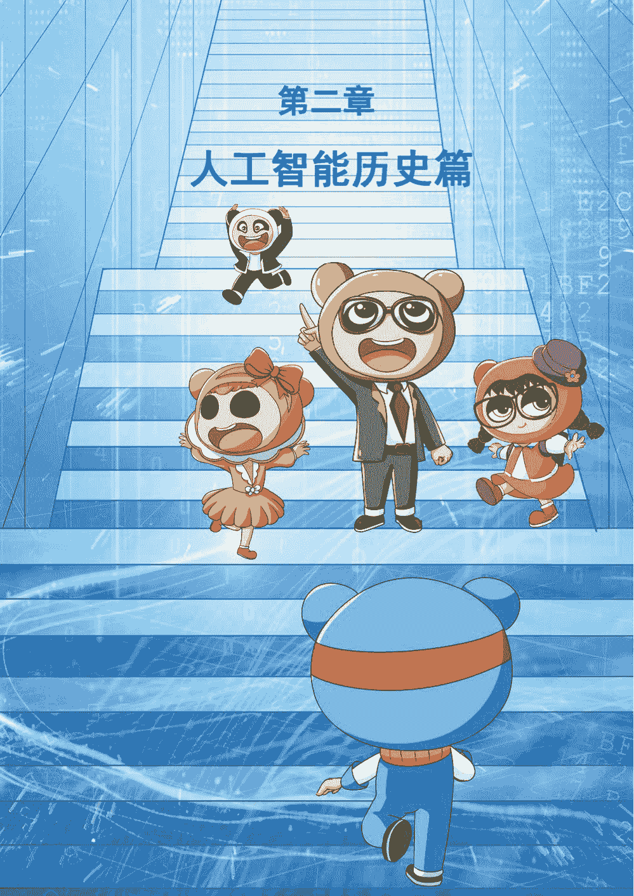

人工智能对人类竟如此关键，其智慧源头究竟在哪？

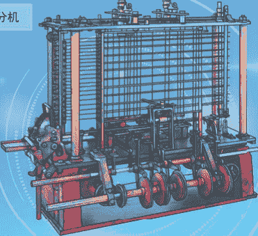
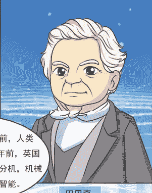

### 从算盘到差分机：机械萌芽

千年前算盘雏形，两百年前英国数学家**巴贝奇**设计**差分机**，赋予机械以“计算智能”。AI被公认为21世纪三大尖端技术支柱之一（另外两项：基因工程、纳米技术）。

*   人工智能
*   基因工程
*   纳米技术

### 希尔伯特的23道“世纪谜题”

1900年，大卫·希尔伯特抛出23个未解难题，重塑现代数学版图。其中第2、第10题直接催生了计算机科学。

**第2题：算术公理一致性。**
希尔伯特梦想构建绝对完备、自洽的数学大厦（“希尔伯特纲领”）。
> **哥德尔一锤定音（1931）**：**不完备性定理**宣告——足够复杂的系统，**一致性与完备性不可兼得**。这暗示AI无法仅凭自身解决所有问题，该定理获《时代周刊》评选为20世纪最具影响力数学定理。

**第10题：丢番图方程可判定性。**
即：是否存在通用算法，在有限步内判断任意整系数多项式是否有整数解？
当时“算法”尚无严格定义。直到30年代，**丘奇**与**艾伦·图灵**独立给出精确定义。

### 图灵：计算理论的基石

1936年，图灵发表《论可计算数及其在判定问题中的应用》，提出**图灵机模型**：

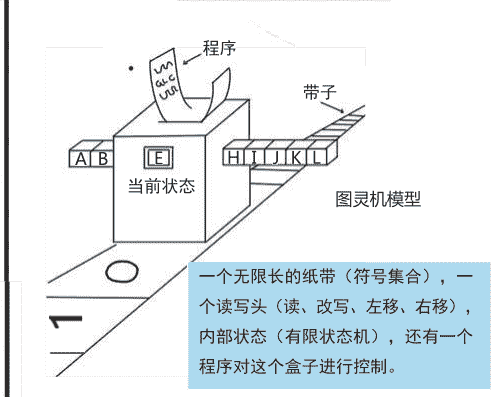

> 无限纸带(存储) + 读写头(操作) + 有限状态控制器(程序) = 通用计算模型。

这不仅模拟了人类计算过程，更奠定**计算理论**基础，直接诱发**冯·诺依曼架构**诞生。更关键的是**通用图灵机**思想——一台机器模拟所有机器，确立了通用计算机的理论蓝图。

图灵战时破解“恩尼格玛”密码机，战后主导“曼彻斯特一号”软件开发。1950年《机器能思考吗？》一文，引出**图灵测试**：

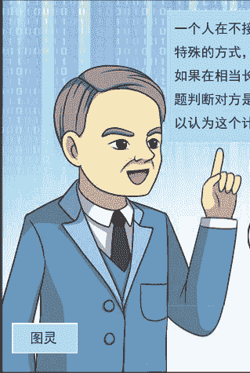

> 若交互者无法在长时间盲测中区分对象是人还是机器（误判率超30%），则该机器具备智能。

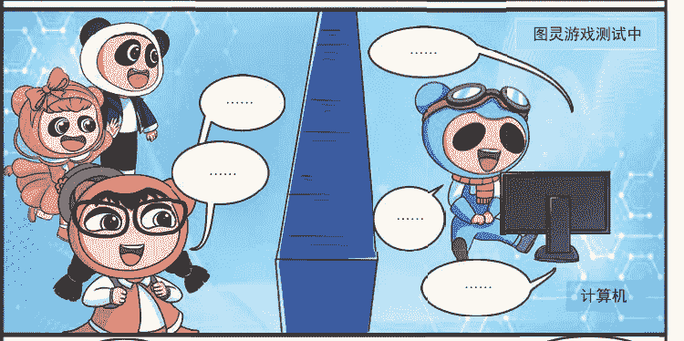

### 冯·诺依曼与存储程序革命

ENIAC虽首创电子数字计算，但**无存储器、布线编程极慢**。冯·诺依曼提出**EDVAC方案**：

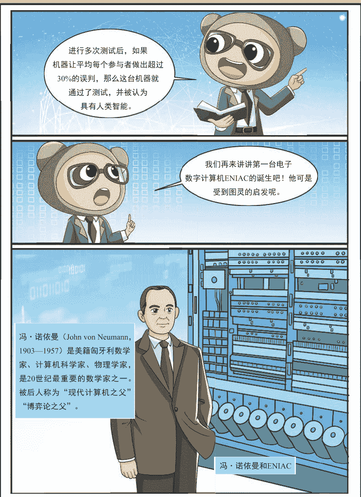

> **数据与程序同存、二进制编码、存储程序控制**——这一架构沿用至今，奠定“现代计算机之父”地位。

### 维纳与控制论视角

诺伯特·维纳创立**控制论**，揭示**人机统一性**——机器可模拟人类反馈调节机制，为AI提供跨学科理论基石。

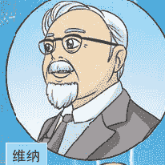
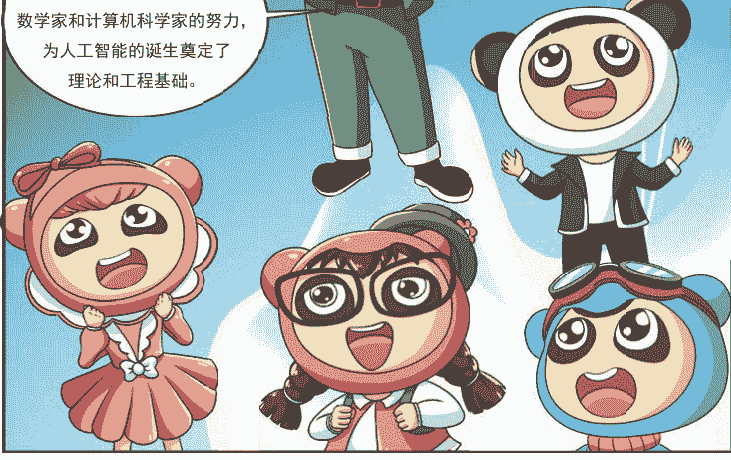

**希尔伯特、哥德尔、图灵、冯·诺依曼、维纳……** 这群巨擘搭建起AI诞生的理论脚手架与工程基座。

### AI发展史：三起三落的“过山车”

有了理论，路却不平。AI史就是一部科学家们在寒冬中守夜、在春天里奔跑的坚韧史。

| **阶段** | **第一阶段：逻辑推理期** | **第二阶段：知识工程期** | **第三阶段：数据驱动期** |
| :--- | :--- | :--- | :--- |
| **高光** | 机器定理证明、跳棋程序 | 专家系统遍地开花、转向实用 | 互联网奠基、深度学习+大数据爆发、应用遍地开花 |
| **低谷** | 定理证明乏力、机器翻译夭折、资金断流 | 第五代计算机计划失败 | *(进行时，挑战与机遇并存)* |
| **关键技术** | 反向传播算法萌芽、知识工程起步 | | |

**关键节点回溯：**

*   **1950**：大四学生**马文·明斯基**搭建**首台神经网络机器（SNARC）**，AI工程落地“年零一”。
*   **1956 达特茅斯会议**：**约翰·麦卡锡**正式提出“人工智能”术语，**学科诞生官方纪年**。
*   **MIT AI Lab 成立**：麦卡锡与明斯基联手打造全球首个AI研究圣地，开启**第一个“黄金十年”**——代数几何求解、自然语言初探，点燃首轮狂热。

# AI简史：从寒冬到奇点，机器如何学会“思考”？

**预算归零，泡沫破裂：第一次AI寒冬的真相**

二十年内，机器将干完人类所有的活？这句豪言壮语曾让整个学术界沸腾，却也埋下了祸根。70年代，人工智能迎来了至暗时刻。早期研究者过度高估了技术成熟度，低估了工程难度，导致项目进度与预期天差地别。舆论反噬、经费断流（预算直接砍至0美元），让这门学科蒙上厚重阴影。

当时卡住脖子的有三座大山：算力捉襟见肘，跑不起复杂模型；维度灾难一旦发作，问题稍复杂程序就崩；数据荒更是致命伤，没有海量语料支撑统计学习，机器根本“吃不饱、长不壮”。1973年，莱特希尔报告一锤定音，批评AI在“宏伟目标”上集体失约，直接引发长达6年的科研寒流。

**专家系统：昙花一现的商业辉煌**

AI就此倒下了？并没有。1980年，卡内基梅隆大学为DEC打造的XCON专家系统横空出世。这套“知识库+推理机”架构，在1986年前每年帮公司省下4000万美元。一时间，Symbolics、IntelliCorp等软硬件厂商蜂拥而至，专家系统产业估值飙升至5亿美元。

好景不长，仅维持了7年。1987年，苹果与IBM的廉价台式机性能反超昂贵的专用Lisp机，专业硬件失去护城河，专家系统随即退出历史舞台。

**深蓝与沃森：重燃大众想象力的两场秀**

沉寂十年后，1997年“深蓝”击败卡斯帕罗夫，将AI推上头条。2011年，IBM沃森在《危险边缘》节目中碾压人类冠军，精准作答“冷血无足之物是什么”（蛇），再次震惊世界。这些里程碑式胜利，让大众重新看到机器智能的上限。

**2006：辛顿点火，深度学习引爆第四次工业革命**

真正的拐点发生在2006年。杰弗里·辛顿团队在《Science》刊文，提出深度信念网络与“预训练+微调”范式，攻克了困扰多年的梯度消失难题，让深层网络训练成为可能。这篇论文为第三次AI浪潮——深度学习时代——奠基，也被视为第四次工业革命的号角。

回溯工业革命脉络：蒸汽机开启“蒸汽时代”，发电机引领“电气时代”，计算机带来“自动化时代”，而以深度学习为核心的AI，正将我们推入“智能时代”。

**第三次浪潮：大算力、大数据、深度神经网络的三重奏**

2010年至今，第三次浪潮全面爆发。自动驾驶、人脸识别、语音助手、Web搜索……AI渗透进生活毛细血管。核心驱动力是模拟大脑神经元的深度人工神经网络，即深度学习。这背后，是一批“连接主义”信徒数十年如一日的坚守，叠加资本狂欢与国家战略加持，才换来今天的井喷。

**神经网络进化论：从MP模型到Transformer的百年接力**

*   **1943年**：麦卡洛克与匹兹提出MP模型，确立“模拟神经元”数学范式，开启连接主义元年。``
*   **1949年**：赫布提出“同频共振”学习规则，揭示无监督聚类机制。``
*   **1969年**：明斯基《感知器》一棒子打死单层感知器，证明其解不了异或问题，直接导致首次寒冬。``
*   **1982年**：霍普菲尔德网络引入循环结构，实现联想记忆与优化计算。``
*   **1974/1986年**：Werbos萌芽、辛顿发扬光大的BP反向传播算法，破解非线性分类，成为深度学习基石。`` ``
*   **1989年**：万能逼近定理给足理论底气；LeCun发明LeNet卷积网络，攻克手写数字识别。`` `` `` `` `` ``
*   **90年代中期**：SVM等浅层模型凭借坚实统计理论、小样本优势全面压制神经网络，后者因梯度消失、算力不足、理论松散再陷低谷。``

**深度学习“三大战役”：ImageNet、猫脸、围棋巅峰**

*   **2011年**：微软邓力引入深度学习做语音识别，错误率大幅跌落。``
*   **2012年**：辛顿团队AlexNet以15%错率（对手26%）横扫ImageNet，深度学习一战成名。同年，吴恩达、Jeff Dean主导Google Brain，用1.6万CPU跑1亿参数网络，看1000万YouTube帧，**无监督“发明”了“猫”的概念**。``
*   **2014年**：Facebook DeepFace人脸识别准确率破97%，逼平人眼。``
*   **2016年**：AlphaGo 4:1李世石，围棋封神。这一年，AI诞生60周年，被誉为“深度学习年”兼“机器人黄金年”，彻底出圈。``
*   **2017年**：AlphaGo Zero“零样本”自博，100:0血洗前代；GAN（生成对抗网络）引爆生成式AI，医疗、金融、艺术、无人驾驶全线开花。``

**NLP范式革命：BERT与GPT，机器读懂人语**

2018年起，Google BERT双向编码器在SQuAD测试全指标超人，11项NLP任务刷新SOTA；OpenAI GPT-2凭15亿参数、40GB语料，展现惊人续写与生成长文本能力。NLP正式进入“预训练+微调/提示”新纪元。``

如今，学界业界联手攻关，技术产品如雨后春笋，正悄无声息重塑我们的衣食住行。

---

## 第三章  人工智能概念篇：拆解“智能”黑箱 `  ` `  `

**什么是智能？四大终极奥秘之一**

智能的本源，与物质本质、宇宙起源、生命本质并列为自然界四大谜题。别绕弯子了，机器既有“智能”，这“智能”究竟为何物？

**多维透视智能内核**

*   **微观视角**：大脑神经元电化学放电的涌现结果。
*   **宏观视角**：认知心理过程的内核，解决问题时展现的智力行为的外显。
*   **知识工程视角**：知识与思维的有机融合。内涵是“获取—处理—运用”知识的闭环能力；外延是“发现—运用”规律、“分析—解决”问题的实战本领。
*   **工科视角**：机器自动控制与环境自适应的综合体现，至少含三力：理解/分析/解决问题、归纳/演绎推理、自适应生存发展。

**怎么量化智能？从IQ到多元智能**

1916年施太伦引入智商（IQ），用数值刻画智力水平。1935年亚历山大补充“非智力因素”（记忆、注意、想象……），指出其制约智力发育。1983年加德纳抛出**多元智能理论**``，打破单一IQ霸权，确立智能是多维谱系。

**人工智能：定义的三重镜像**

1.  **机器视角**：能在多环境下自主/交互完成拟人任务的实体。
2.  **能力视角**：机器执行的、关联人类智能的行为集合；同时是研究模拟/延伸/扩展人智能的理论、方法、技术、应用体系的交叉学科。
3.  **词源拆解**：“人工”+“智能”，可多角度阐释。
    *   *定义1（Bellman, 1978）*：与人类思维、决策、求解、学习相关活动的自动化。

# 权威大师如何界定机器智能？

纵观发展历程，领军人物从各异视角勾勒出经典轮廓：

*   **Haugeland (1985)：** 视其为赋予计算机思维、让机器具备智力的振奋探索。
*   **Charniak & McDermott (1985)：** 定义为利用计算模型剖析智力行为的科学。
*   **Winston (1992)：** 聚焦于支撑理解、推理与行动的计算机制研究。
*   **Kurzweil (1990)：** 强调能胜任需人类智力任务的创造性机器技艺。
*   **Rich & Knight (1991)：** 着眼于如何让计算机完成工作以优化人类生活。
*   **Schalkoff (1990)：** 视为通过计算过程理解并模仿智能行为的学科体系。
*   **Luger & Stubblefield (1993)：** 归类为计算机科学中专司智能行为自动化的分支。

**Russell 教授的“双维坐标系”**

在经典教材中，Stuart Russell 从两个维度重构了上述定义：
1.  **观测焦点：** 着眼机器内在的**认知推演**，还是外显的**行为表现**？
2.  **评判基准：** 以**拟人度**（像人）为准，还是以**理性度**（做对事）为准？

由此划分出四大流派：

| 流派 | 核心主张 | 关键路径 |
| :--- | :--- | :--- |
| **行为拟人** | 让机器在感知、交互、决策上“以假乱真” | 图灵测试 |
| **思维拟人** | 复刻人类大脑的认知机理 | 认知科学、脑成像、心理实验 |
| **理性推理** | 遵循严格逻辑法则进行正确演绎 | 逻辑学、形式化系统 |
| **理性行动** | 以达成最优结果为唯一导向，不拘泥人类模式 | 智能体理论、效用最大化 |

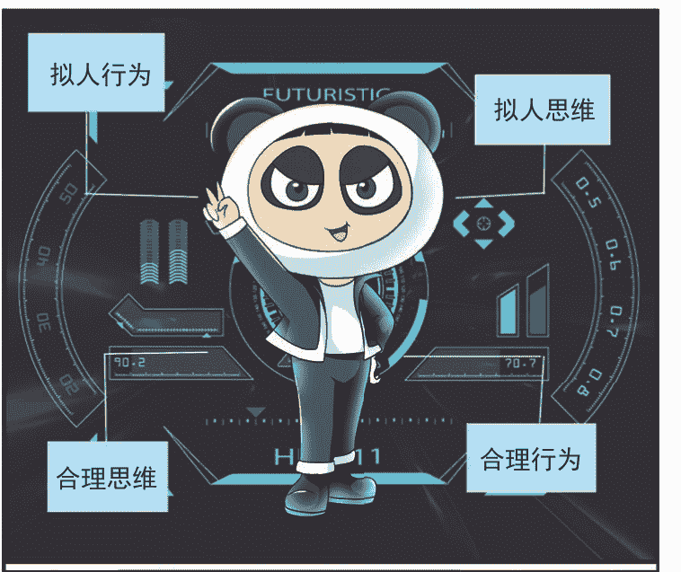

---

### 概念辨析：广义/狭义 与 弱/强/超

**按覆盖疆域看：**
*   **广义 AI：** 囊括感知、推理、学习、规划、适应、进化等全谱系能力，呈现多学派、多功能、多层次特征。
*   **狭义 AI：** 将各细分垂类、单一学派分支单独冠以 AI 之名。

**按演进阶段看：**
*   **弱 AI (ANI)：** 单点突破的“专才”。如 AlphaGo 称霸围坛、Siri 语音助手，**仅在特定垂类超越人类**。
*   **强 AI (AGI)：** 具备人类级别的“通才”。拥有思考、规划、抽象理解、极速自主进化等**通用认知能力**。
*   **超 AI (ASI)：** 全维度超越人类智力的终极形态。

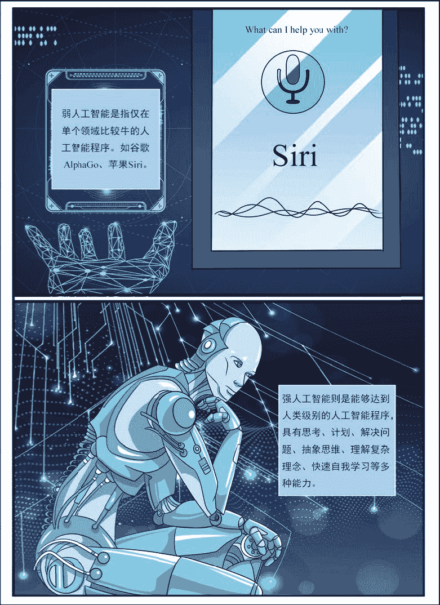

---

### 关系图谱：AI、机器学习、深度学习、机器人

**核心层级嵌套：**
> **人工智能 ⊃ 机器学习 ⊃ 深度学习**

*   **AI：** 构建智能机器的宏大目标与学科统称。
*   **机器学习：** 实现 AI 的核心**路径**——无需显式编程，从数据中自动习得、随经验迭代提升性能（Samuel 定义），将无序数据转化为高价值信息。
*   **深度学习：** 仿生大脑神经网络的机器学习**进阶范式**，是当前第三次浪潮的核心驱动力。

**智能机器人 = AI 大脑 + 物理躯干**
它是 AI 技术的“综合大练兵场”，不拘泥人形，具备感知-决策-执行闭环，可替代人类执行高危、极限任务。

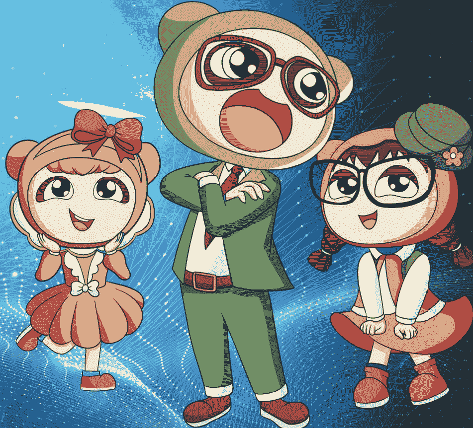

---

### 边界澄清：AI 与相邻学科的“生态位”

| 相关领域 | 与 AI 的耦合关系 |
| :--- | :--- |
| **自动化** | 综合性工程大屋檐（控制、计算机、电子、机械融合），AI 是其智能化分支。 |
| **信号与信息处理** | 覆盖信息全链路（获取、变换、存储、传输、交换、应用），为 AI 提供数据预处理基石。 |
| **脑科学** | **双向奔赴**：脑科学提供灵感靶标与蓝图，AI 提供建模工具与验证平台，共生共荣。 |
| **大数据** | AI 的“燃料”与“试炼场”。海量样本喂养模型，AI 赋能知识发现 (KDD) 挖掘隐性价值。 |
| **数据挖掘** | 从数据海洋中自动淘洗潜在、未知、高价值模式的过程，是 AI 落地关键环节。 |
| **认知计算** | 非造“替人思考”机器，而是致力**“增强人类智慧”**——具备规模化学习、目标推理、自然交互的辅助决策系统。 |

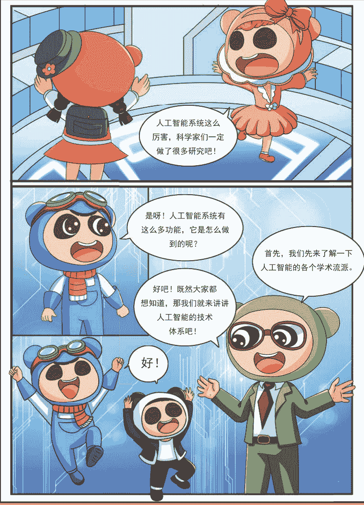

---

### 学派谱系演进：从四分法到“六大派系”

Alangreil 早年提出四类：传统符号 AI、人机交互 AI、集体智慧 AI、机器学习 AI。

立足未来演进，**现代学界主流划分为六大流派**：
1.  **符号主义：** 逻辑推理、知识工程（传统 AI 正统）。
2.  **连接主义：** 神经网络、深度学习（当前主流范式）。
3.  **行为主义：** 智能体、强化学习、从环境交互中习得策略。
4.  **群智派：** 蚁群算法、协同进化、多智能体系统。
5.  **统一 AI 派：** 追求单一架构通解智能（AGI 路线）。
6.  **混合智能派：** **人机混合增强智能**，强调人机协同、优势互补（**国家战略重点**）。

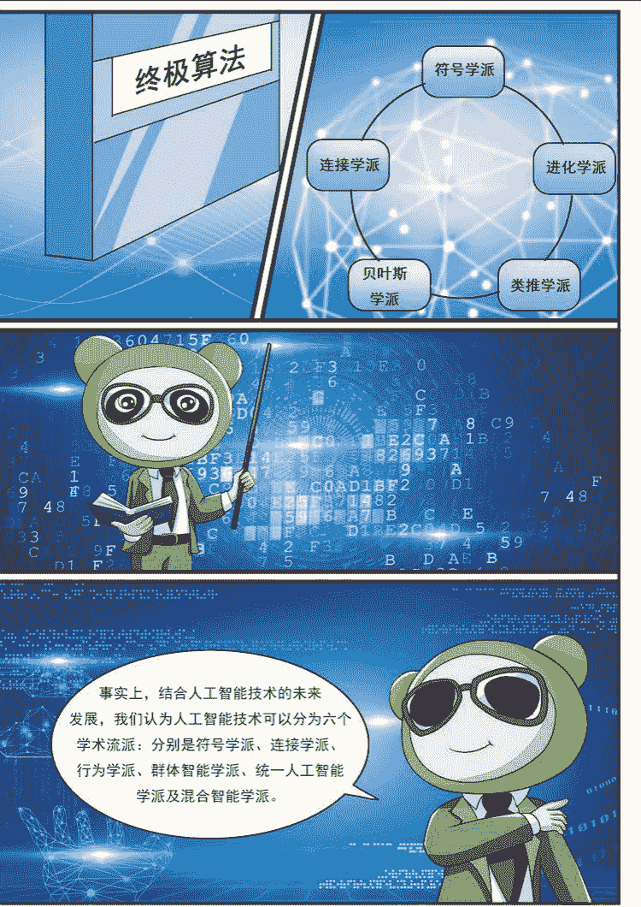

---

### 技术全景：从核心基石到产业落地

#### 1. 五大技术支柱
*   问题求解
*   知识推理与规划
*   不确定性推理
*   机器学习
*   智能感知与决策

#### 2. 国家战略指引（2017《新一代规划》）
锚定源头创新供给，从**前沿理论、通用技术、基础平台、人才梯队**四维发力，推动开源生态，构建持续创新体系。重点攻克八大前沿理论：
> 大数据智能、跨媒体感知计算、混合增强智能、群体智能、自主协同控制决策、高级机器学习、类脑智能计算、量子智能计算。

#### 3. 深度学习全栈体系（垂直纵深架构）

| 层级 | 关键词/代表技术 |
| :--- | :--- |
| **业务应用层** | 智慧城市、自动驾驶、智能医疗、金融安防、机器人、智能家居... |
| **算法能力层** | 计算机视觉 (CV)、语音识别/合成 (ASR/TTS)、自然语言处理 (NLP)、对话系统... |
| **算法/框架层** | **算法：** CNN, RNN, Transformer, GAN, RL, Transfer/Meta Learning... **框架：** PyTorch, TensorFlow, PaddlePaddle, Caffe, MXNet... |
| **系统软件层** | CUDA/cuDNN, TVM, ONNX, NNEF, 集群调度编译器... |
| **算力硬件层** | **通用：** CPU, GPU (NVIDIA 主导) **专用：** TPU (Google), NPU, FPGA, 神经拟态芯片 **集群：** GPU 集群, 云端算力平台 |

 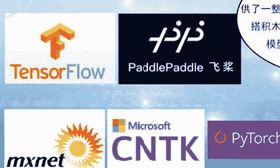

> **框架价值：** 封装算法细节，提供“积木式”开发体验，覆盖模型优化、训练、部署全链路，极大降低应用门槛。

---

### 落地实战：AI 如何重塑行业版图？

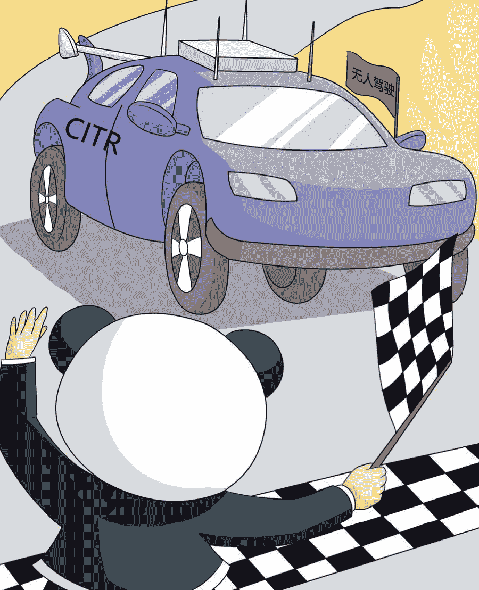

#### 自动驾驶：从“Stanley”到无人城市
2005 年 DARPA 大赛，Thrun 团队夺冠。未来图景：按需即达、零拥堵、免停车、事故率断崖式下跌（根除醉驾/疲劳驾驶）、城市空间重构。

#### 机器视觉：工业质检的“火眼金睛”
*   **核心优势：** 非接触、高速、高精度、大信息量。
*   **主战场：** 视觉定位、缺陷检测、精密测量、自动分拣——消除人工疲劳与二次损伤风险。

#### 自然交互：键盘鼠标的“退休潮”
语音识别 + 语义理解驱动的智能助理、智能音箱、车载系统，让人机交互回归自然语言本能。

#### 机器翻译：打破巴别塔诅咒
Google/百度翻译等已达专业级水平，实时跨语种沟通成真。

#### 智能医疗：给每个家庭配把“专家诊室”
*   **皮肤/癌症/睡眠诊断：** 秒级筛查，早期介入。
*   **协作模式：** **人机协同**而非替代。AI 负责初筛、量化分析，医生把控决策、给予人文关怀。

#### 智能金融：毫秒级的“隐形大鳄”
纽交所 75%+ 交易自动化。高频量化 (HFT) 微秒博弈，长周期策略挖掘 Alpha 收益。

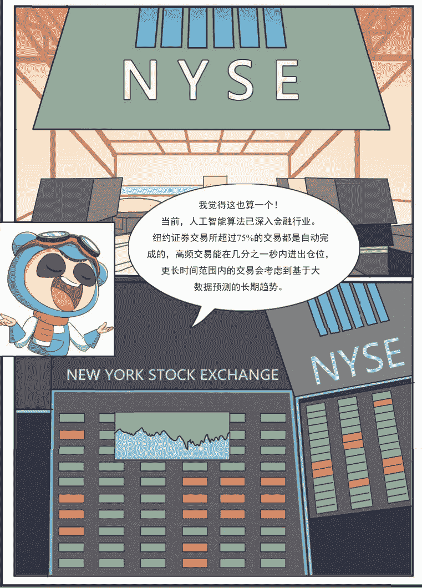    

> **全域渗透：** 交通、金融、教育、政务、家居、物联网……AI 正似电力般，成为重塑生产生活范式的基础设施。

---

## 第六章：安全治理 —— 拥抱“双刃剑”，构建可信 AI

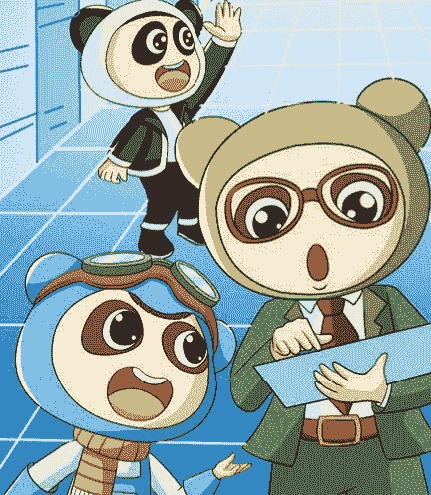

### AI 系统的“不公平优势”在哪里？

| 优势维度 | 具体表现 | 典型案例 |
| :--- | :--- | :--- |
| **算力碾压** | GPU 集群日算量 ≈ 传统周算量；云原生“存算分离+并行调度”实现弹性无限扩容。 | DeepMind 优化 Google 数据中心：制冷能耗降 40%，整体能效增 15%。 |
| **极速反应** | 人类棋手 ~5 步/秒 (国际象棋) / 100 路/秒 (围棋) **VS** DeepBlue 2 亿步/秒 / AlphaGo 10 万路/秒。 | 实时博弈、高频量化、自动驾驶紧急避障。 |
| **全域感知** | 瞬间融合海量多模态信号，对每个单元实施精细化操控。 | 智能电网调度、蜂群无人机编队。 |
| **精准可靠** | 规避人为疏漏，稳定输出。 | **受激拉曼组织学 + AI：** 150 秒术中精准确诊颅内肿瘤。 |
| **不知疲倦** | 7×24 小时零漂移高警觉。 | 安防监控、异常交易实时拦截、长周期科研托管。 |

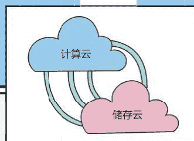 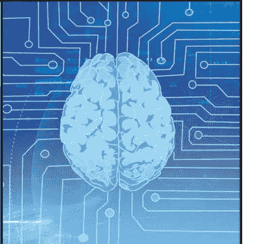 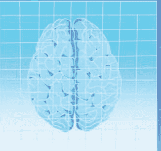

### 核心功能矩阵：AI 系统“四大金刚”
1.  **数据归类：** 多模态分类（图像、音频、医学影像）。
2.  **异常捕捉：** 实时识别欺诈交易、零日漏洞、设备预知性维护。
3.  **趋势预判：** 从海量历史中提炼规律，预测金融、气象、供应链走势。
4.  **寻优增效：** 复杂系统性能调优（能源调度、芯片布局、流程优化）。

---

**结语：**
技术演进与安全挑战同生共长。看清优势边界，直面风险隐患，在“可解释、可信赖、可控制”的轨道上推进 AI，才是通往智能时代的正道。

# AI安全边界与未来图景：从“黑箱”隐患到通用智能的进阶之路

> **诊断对决**：AI系统以94.6%的精准度，略微领先于人类专家的93.9%。
> **考古突破**：牛津团队喂入3万余份文物档案，训练出“Pythia”系统，成功补全千年希腊残碑上的缺失铭文。

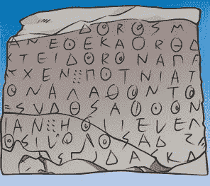

### 拆解AI全链路：安全隐患到底藏在哪？

一个完整的AI系统，跑通“数据采集 → 模型训练优化 → 部署应用”三大核心环节，资产包涵盖数据、算法、软硬件设施、产品服务及行业落地。既然架构搭好了，咱们得逐层排查，技术安全的“雷区”究竟在哪？

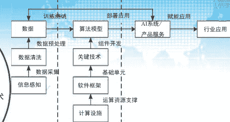

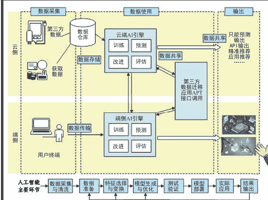

#### 先看数据采集端：源头不纯，百病丛生

系统通过预设规则，在用户知情或不知情下自动抓取数据，经清洗过滤后喂给模型。这一环，风险暗流涌动：

*   **数据质量参差不齐**：模型上限由数据决定。训练集样本太少、覆盖面不广、分布不均、标注粗糙、环境噪音大，统统会拖累模型精度。
*   **过度采集触碰隐私红线**：人脸、声纹等生物特征一旦采集，便涉法律合规与隐私安全。区别于普通数据，生物信息**泄露即终身泄露**，直接关乎人身财产安全。
    > 2018年消协测评百款App，九成权限涉嫌“越界”。通讯、影音、购物、支付、出行、金融……无一幸免，过度收集已成行业顽疾。
*   **数据投毒与篡改**：恶意攻击者通过注入对抗样本、构造异常分布数据，悄悄改写训练分布，诱导模型误判、漏判，甚至定向攻击。
    *   *手法一*：精心伪造对抗样本，蒙混过关骗过系统校验。
    *   *手法二*：偏离分布数据破坏概率基石，导致模型聚类、分类、预测集体“翻车”。

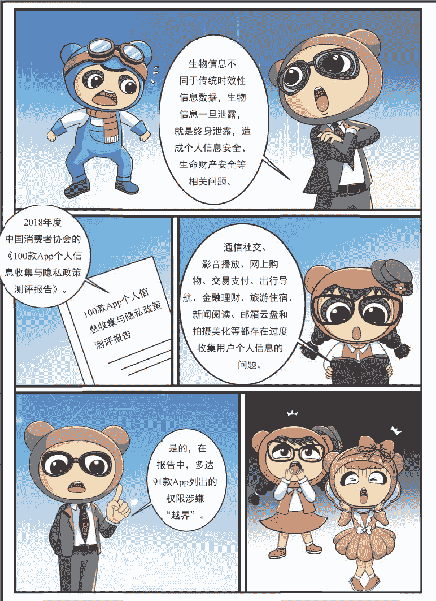

#### 再看算法模型层：核心地带，暗藏杀机

算法是大脑，这里出问题，后果往往是致命的。

*   **选择性偏见引发歧视**：训练数据规模小、不平衡、覆盖不全，或设计者主观偏见入侵，导致模型输出带有歧视性。一旦用到量刑评估、信贷审批、招聘筛选等关乎切身利益的场景，后果不堪设想。
    > 犯罪评估、信用贷款、雇佣评估……算法偏见正在无形中重塑命运。
*   **鲁棒性失守**：应用场景多变，测试数据分布偏移（信道、环境变化）导致“训练一套、实战一套”，模型稳健性荡然无存。
*   **“黑箱”难解，不可解释**：深度学习模型内部机制不透明，优劣评估缺乏证据支撑，信任建立极其困难。
*   **算法选型与组合陷阱**：算法库浩瀚，各有适用场景，选型极考验设计功力；系统常由多模块串联，模块间搭配不当，整体效果大打折扣。

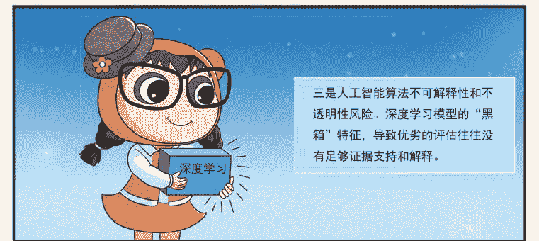

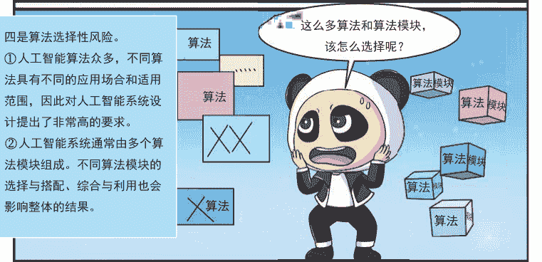

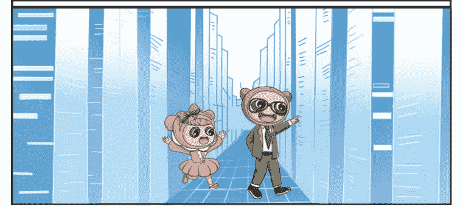

#### 底层支撑系统：地基不稳，地动山摇

*   **软件框架漏洞频出**：主流深度学习框架众多，但安全漏洞屡被曝光。奇虎360曾月内连发现多个框架及依赖库漏洞——内存越界、空指针、整数溢出，可导致拒绝服务、控制流劫持、分类逃逸、数据污染等严重后果。
*   **硬件平台物理与逻辑双重风险**：存储、计算、防护设备面临物理安全威胁，底层固件、驱动层同样藏有隐患。

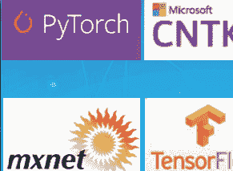

#### 发展与应用层面：技术异化与滥用之忧

技术之外，社会层面的不可控性同样令人警醒。学界分为“保守派”（LeCun、Jordan等）与“威胁派”（霍金、马斯克、盖茨等）。霍金警告AI或终结文明，马斯克视其为生存威胁，库兹韦尔预言**2045年“奇点”来临**，超级智能超越人类，历史剧变。

更现实的危机是**技术落入黑手**：
*   斯坦福联合Infinite研制的AI自主攻击系统，能自学环境、生成恶意代码、实施渗透窃取。
*   黑客大会上，AI“神器”“杀器”频现；军事化、恐怖化应用风险显性化。

---

### AI特有攻击画像：传统防火墙为何失效？

除了常规网络攻击，采用机器学习的系统还面临专属攻击手段，**且目前缺乏银弹防御**。

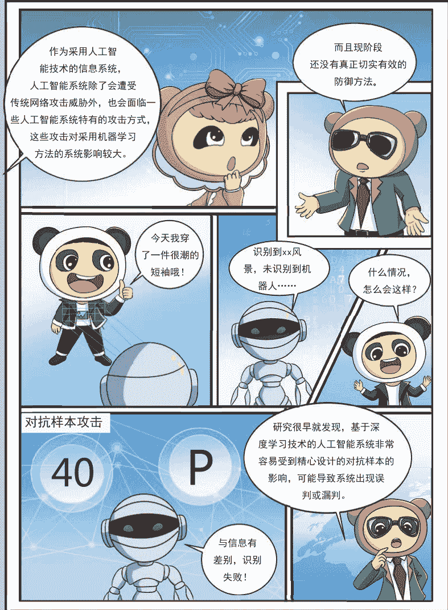

#### 1. 对抗样本攻击： “眼瞎”只需一张巧图
研究早证实，深度学习模型极其脆弱。精心设计的微小扰动，能让系统把“限速40”识别成“限速P”，把风景识成机器人。**识别失效，只在毫秒间。**

#### 2. 数据投毒攻击： 毒在源头，祸延全局
核心在于训练期注入毒数据，破坏分布、植入错误样本，致模型失效或偏斜。主要针对**在线学习**或**定期重训**系统。
*   **标签篡改**：随机或逆向修改标签，干扰学习方向。
*   **对抗样本入训**：直接将生成的毒样本喂入训练管线。
*   **对抗优化策略**：利用训练目标漏洞实施过程攻击。
*   **无关样本注入**：扭曲概率分布，导致模型崩溃。

#### 3. 模型窃取与逆向解析： 偷走大脑，还原记忆
通过接口探测或直接获取，复刻功能相似模型，再逆向还原训练过程及敏感数据。
*   **指导型攻击**：利用接口信息牵引逆向分析。
*   **探索型攻击**：设计专用样本疯狂查询，迭代提取模型内部信息。
*   **模拟型攻击**：训练替代模型，生成可迁移对抗样本攻击原模，或直接窃取整模自用。

---

## 第七章｜未来篇：突破瓶颈，通往“强AI”的漫漫长途

### 直面局限：AI不懂“人间疾苦”

> **强强**：“老师，快乐和悲伤是什么？”
> **AI**：“我能搜到定义，但无法理解。”

这就是当下的天花板：**无法符号化、规则化的概念，AI皆不懂**。破局之道，唯有人类深度解析自身高级智能机制。

### 芯片战争：算力底座的终极军备赛

算法落地狂飙，倒逼芯片迭代。核心诉求：跑通深度/强化学习，速度提升千倍，能耗大幅降低。
*   **GPU先行**：英伟达CUDA生态构筑护城河，专用显存芯片优化图形与游戏。
*   **TPU异军突起**：谷歌定制张量处理单元，能效比再进阶。
*   **国产力量**：华为麒麟980（7nm/69亿晶体管）性能能效超30%；百度、地平线、云知声、深鉴等布局IP、FPGA、ASIC，覆盖视觉、语音、自动驾驶。
*   **白皮书预言**：手机AI芯片渗透加速，2022年市场规模将达38亿美元，五年近十倍增。

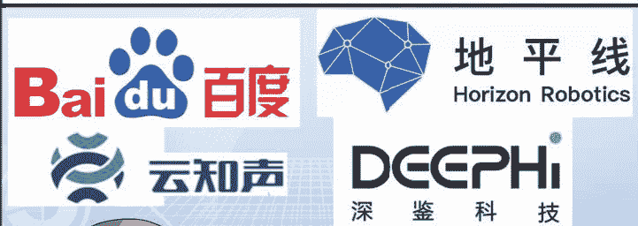

### 神经拟态：向大脑借智慧，破解能耗魔咒

人脑：1000亿神经元，万亿级连接，**仅耗20W**，占体重3%却耗能20%。
超算：千万亿次运算，**耗能5MW**，是大脑25万倍。

**架构根本差异**：
*   **冯·诺依曼瓶颈**：存算分离，数据搬运顺序流动，能耗高、延迟大。
*   **神经网络/拟态架构**：存算一体，海量并行，消除搬运瓶颈。

**神经拟态芯片演进**：
*   1982年：Misha Mahowald造首颗硅视网膜，模拟生物视觉，首用集群行为解难题。
*   2008年：Tobi Delbrück推DVS动态视觉传感器，超低功耗完成视觉任务。
*   2018年：Intel NICE大会展示Loihi等三款新一代拟态芯片，大规模并行架构落地，新算法随之涌现。

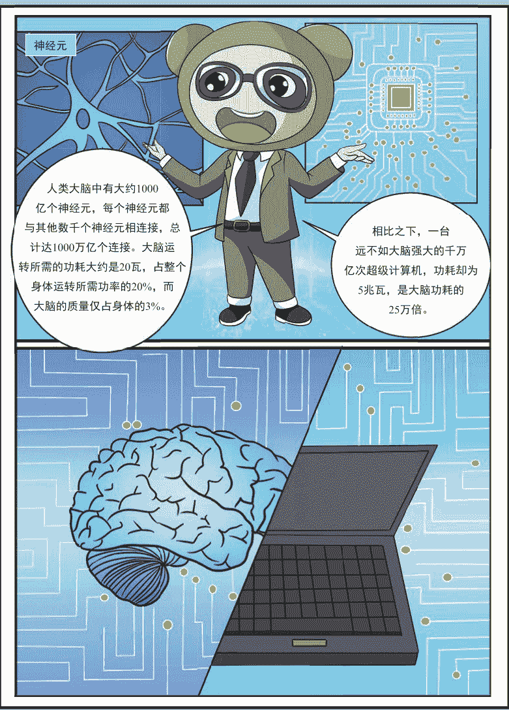

### 摩尔定律曲终人否？范式转移开新局

摩尔定律：价格不变，集成度与性能18-24月翻倍。但线宽逼近物理极限，传统缩放走到尽头。
**出路非终结，而是重写定律**——引入能量与吞吐量维度，并行架构接力棒已交接。

### 通用人工智能（AGI）：全AI学者的“圣杯”

> **梦想**：一个通用模型建模世界，万题迎刃而解。
> **现实**：明斯基在2006年达特茅斯“AI 50年”会上泼冷水——“你们解决的只是具体应用，非通用智能。”

这位《感知机》作者、寒冬推手、终身反对神经网络通用论者，2016年带着遗憾离世。好友沃尔夫勒姆悼念：他1951年就开始研究的神经网络，正走向他梦想的惊人能力，**只是过程太慢，他没等到**。

### 破局钥匙：读懂人脑，方得通用智能

2013年美**“BRAIN”计划**启动：引入工程、数学、物理跨界攻关，研发新神经技术，破解“终极信息机器”。
*   智能非凭空生，源于感官与世界的长期交互（本质即学习）。
*   **常识缺失**是AI死结，唯长期交互可得。
*   **情绪与通感**常被忽视，实为高级智能基石。

人类若能深度解析自智能起源与脑机制，**“强AI”新纪元将开启，文明将历经不可想象的翻天覆地。**

---

## 第八章｜启示篇：以动态、系统、关联视角读懂AI

AI发展史蜿蜒曲折，洞悉长期规律，方能判势未来。认知AI，切忌**单一、静态、孤立**，当持**全面、发展、关联**之心。

### 两大核心启示

1.  **视内涵为结构化知识体系**：AI内涵极富层次，无论概念维度还是流派脉络，内部逻辑自洽、互补完善，构成相对闭环的知识系统，不可碎片化理解。
2.  **视演变为动态发展规律体**：AI概念历经“忽大忽小、忽高忽低、忽宽忽窄”的**“三忽”动态演进**。唯通史动态、明学理规律，方能把稳航向，不迷失于浪潮之中。

### 启示三：重构认知，视AI为技术生态集群

认知人工智能，不应局限于单一技术的内涵剖析，而须将其置于广阔的关系网络中审视。把AI看作一个与智能制造、机器人技术、自动化控制、大数据分析等深度耦合的技术集群，从外延关联中把握其全貌与演进逻辑。

## 回溯历史：AI发展轨迹里的三重洞见

自诞生伊始，人工智能便走过“三起两落”的跌宕历程，当下正站在第三次浪潮上升期的节点。面对未来众说纷纭的预测，历史长河赋予我们哪些宝贵的启示？

**一、 螺旋上升的规律与认知偏差**  
发展史证：AI演进遵循螺旋式上升规律。然而，我们往往陷入认知误区——对近期成果盲目乐观，高估短期爆发力；对长远攻关难度估计不足，低估深层挑战的复杂性。

**二、 当前驱动力与未来终局的鸿沟**  
深度学习作为第三次浪潮的核心引擎，虽强劲推动了当下繁荣，却掩盖不了理论地基不牢的短板。这种“以工程成功掩盖理论缺失”的现状，与通往通用人工智能所需的根本性突破之间，横亘着深不见底的鸿沟。

**三、 智能分级缺失导致的航向迷雾**  
尽管智能化水平持续攀升，但缺乏科学、客观的分级评价体系。由于历史演进的曲折性与技术路径的多样性，我们对AI未来走向的预判依然笼罩在迷雾中。根结症在于：没有尺度，便无法精准定位坐标、规划航线。

---

**“好期待那一天！”**  
**“没错，未来AI必将更强大，释放更大效能！”**  
**“老师，快带我们探索新知！”**  
**“没问题，同学们，登车出发！一起奔赴未来AI的奇妙世界！”**

### 核心技术拆解：语音识别

### 核心技术拆解：图像识别

> 哇喔！视界大开。

## 后记：致敬智能时代的筑梦人

时序更迭，近几年来AI前沿捷报频传，颠覆性理论层出，产业落地由广度拓展转向深度耕耘与跨界融合，昔日科幻臆想尽化为触手可及的现实。

成书之际，恰逢2020世界人工智能大会盛启。何其有幸，我们共赴这场智能时代开启伟大征程中最耀眼的奔赴。谨以此书，向那些在代码与算法中夜以继日、甘坐冷板凳的AI从业者致敬！致敬他们“任世事变迁，寒暑交替，我只此心不动”的专注，致敬他们“初心易得，始终难求”的坚守！

中国人民解放军战略支援部队信息工程大学（以下简称信息工程大学），自上世纪80年代便布局AI教学科研，是国内最早涉足该领域高等教育的先行军之一。郭云飞校长更是该领域的开拓者与深耕者。学校的战略前瞻精准契合了民族复兴与AI飞跃的时代强音。从经典AI到新一代AI，学者们紧跟时代脉搏，在信号感知、智能信息处理、认知计算等领域培育出桃李满天下的青年才俊与权威专家，他们在各自岗位上默默奉献、开疆拓土。

新时代赋予新使命。在信息系统工程学院党委统筹下：2017年筹办全军首个“高级现代人工智能研修班”；2019年获批人工智能本科专业，跻身全国首批36所建设院校，且为唯一军队建设单位；同年成功举办第三届“强网杯”暨第二届“强网论坛”AI分论坛，群英荟萃郑州共襄盛举。

面对百年未有之大变局，国家安全与发展需求将AI推至前所未有的战略制高点，相关产业系统即将成为“国之重器”。然而，国内外权威《人工智能人才白皮书》警示：我国高端专业人才相对匮乏。鉴于培养周期长、链条深，布局必须下沉至青少年科普启蒙。点燃青少年的高科技梦想，拓展AI思维边界，是我们这代从业者义不容辞的责任与担当。

作者深耕AI教学科研近二十载，渴望以漫画这一新颖载体，将积淀的经验体会与青少年、爱好者共享——这份心情既新奇又忐忑，惟恐笔墨难尽思想之万一。随着技术蓬勃与应用深入，越来越多AI产品将走入寻常百姓家，在让我们享受智慧生活的同时，也带来机遇与挑战的双重考题。科普宣传之路任重道远，未来我们将矢志不渝、竭尽所能，扎实推进AI科普与宣讲，为AI更好服务社会、造福人类贡献智慧力量。

**作者 敬上**  
**2020年7月**

---

### 国家网络安全宣传周

**China Cybersecurity Week**  
**2020年国家网络安全宣传周 推荐丛书**

## “漫画网络信息新技术”科普丛书

- 《漫画拟态防御》
- 《漫画北斗导航》
- 《漫画人工智能》
- 《漫画量子计算》
- 《漫画移动通信》
- 《漫画网络安全》
- 《漫画数据科学》

**科学出版社·工科分社**  
📞 编辑联系：010-64005312  
📞 销售热线：010-64031535  
✉️ 邮箱：gk@mail.sciencep.com  
🌐 官网：www.sciencep.com  

**ISBN 978-7-03-065969-9**  
**定价：68.00 元**