# 玩赚ChatGPT人人都能用的工作好帮手

# 作者简介

**唐振伟**
新闻学、金融学双硕士，清华大学总裁研修班结业。曾在《经理人》杂志、《证券日报》等多家知名财经媒体担任要职，在自媒体平台和教育培训领域有成功创业经验。
自2016年起开始关注人工智能领域，特别对AIGC领域有着深厚的学习和研究兴趣。自从2022年11月OpenAI发布ChatGPT以来，一直密切关注其在帮助普通人提高工作效率方面的实际应用。

# 内容简介

这是一本“人人都能用，事事都能用，时时都能用，处处都能用”的ChatGPT实用技能与场景任务应用工具书！

本书以工作场景和具体任务来驱动，包括53个场景展示、85项任务模拟、237次提问示范，让完全不懂技术的小白，也能成为ChatGPT工具使用方面的行家。

本书通过详细讲解具体任务的提问与追问方法，让ChatGPT成为每个人的工作好帮手，帮助人们提升工作效能，打造超能个体与超能团队。

策划编辑：崔姜薇 | 13810170076
5829523@qq.com
责任编辑：黄傲寒
封面设计：久品轩 | 13651259399
xy5001@126.com

# 阅读与使用建议

尊敬的读者朋友：

非常感谢您购买本书！感谢您对《玩赚 ChatGPT：人人都能用的工作好帮手》一书的兴趣与对作者的支持！以下是本书的正确打开方式：

第一，如果您只有 10 分钟的时间，您可以先查阅目录，找到与您工作相关的章节。了解示范案例和 AI 提问技巧，并学习 1~2 个方法，以便在最短的时间内有所收获，并能够应用到实际工作中去。

第二，如果您有 1 小时的空闲时间，您可以详细阅读与您工作相关的章节。这样可以更全面地了解使用 ChatGPT 或其他 AI 工具时如何高效地解决问题，从而帮助您提高工作效率和工作质量。

第三，如果您有一整天的时间来阅读本书，建议您全面深入地阅读每一个应用场景示范、任务模拟以及提问与追问演示等内容。一定要深入了解背后的逻辑，学习 AI 提问的 7 步法，这样，本书才能够帮助您快速从 AI 新手蜕变为高手。

第四，如果您把这本书当作您在工作中的指南，时时翻阅，那么建议您通过【探一探】栏目中的更多问题，来探索 ChatGPT 的更多提问方式，与 ChatGPT 或其他 AI 工具实战演练一下，它们会带给你更多惊喜！

第五，如果您目前已经是 ChatGPT 的使用高手，并且在工作中已经熟练应用各种 AI 工具，那么恭喜您！本书对您来说可能只是作为“他山之石”，随便翻翻，作为一本休闲阅读图书就够了，或者您可以在办公室午休时当枕头使用。

第六，如果您是初学者，对 ChatGPT 感兴趣，并且想深入了解 AI 工具在工作中的广泛应用，请重点阅读本书的序言、前言和第一章的内容，这些内容会帮助您了解 AI 技术的基础知识、广泛应用场景和未来发展趋势，并为以后的学习和实践奠定基础。

第七，如果您是自由职业者、创业者或小团队负责人，建议您深入阅读第 11 章和第 12 章的内容。这些章节将帮助您打造超能个体和超能团队，让
您和您的团队获得超强的能力，胜过其他团队。

第八，如果您是决策者或管理者，有意了解如何在组织中有效地应用
ChatGPT 和其他 AI 工具，请重点阅读本书的每一章，并尝试举一反三，找
到最适合自身企业的应用场景。通过更早使用 ChatGPT，您可以引领自身企
业与组织的 AI 革命，在未来与竞争对手的竞争中抢占先机。

第九，本书中画波浪线的红色字内容是作者认为非常重要、需要“敲黑
板”来重点强调的内容，即使您只有极短的时间，也请一定翻看一下，主要
是经验总结、方法提炼、技巧提示、案例说明、注意事项、知识拓展、典型
示范、重点补充、关键提醒等，请读者朋友一定要重视这些内容，以从本书
中收获更多！

最后，希望以上阅读与使用建议对您阅读《玩赚 ChatGPT：人人都能用
的工作好帮手》一书有所帮助，让本书发挥更大价值，更加“物超所值”！
祝您阅读愉快！

# 推荐序一

## 消除恐惧最有效的办法是驾驭恐惧
——驾驭 ChatGPT 才能不被替代

唐玉文

20 世纪的最后 20 年，一个震耳欲聋的词是“信息大爆炸”，它把人类抛入信息的海洋，使人茫然不知其所在；21 世纪已经过去的 20 年最让人兴奋，同时又让人恐惧的词是“人工智能大爆炸”，尤其是 2022 年 11 月 30 日 OpenAI 发布聊天机器人 ChatGPT 以来，随便查看哪个媒体，都会发现上面充斥着这样令人兴奋的消息：× × 一分钟就完成了过去需要几天，甚至几个月才能完成的工作。与此同时，更多的人在恐惧中暗暗地忧郁着：不知哪天我的工作就被 ChatGPT 替代了。在人的一生中能碰上两次威力这样巨大的“爆炸”，不知是倒霉还是幸运！

我在商业世界的职业生涯分成两个阶段，第一个阶段做实体，最多的时候直接经营管理着 20 多家公司，第二个阶段做投资，80% 的资金投在美国的人工智能软件（AI-Based Software）项目上，仅 2023 年上半年就投资了两个类 ChatGPT 项目。这两个项目，一个帮助医生提供认知障碍（阿尔茨海默病）诊断、治疗和护理方案，另一个对脑神经的损伤提供诊断和治疗。

ChatGPT 刚在世界上流行起来才几个月的时间，我们就投资了两个类 ChatGPT 项目，这个反应速度不可谓不快。为什么要这么快入局？因为我们断定，从 ChatGPT 诞生的那一天开始，一个新的时代就已经来临。那天之前的时代叫互联网时代，那天之后的时代叫人工智能时代。回望过去，我们会发现，互联网时代的几十年时间里，这个世界其实只做了一件事，那就是为人工智能时代做准备。

时代准备好了，不一定每个人都准备好了。比如我，时代准备了 QQ，而我几乎没有用过 QQ。时代准备好了微信，而我很晚才成为微信的用户。成为微信用户后我才发现，微信已经衍生出了一个庞大的生态系统，这个生态系统使一个人有效地管理和运营 20 多家公司成为可能。我对微信的迟缓反应，让我失去了很多本来应该被使用得更高效的时间。这一次我吸取了教训，时代准备好了，我也得准备好。

在商业世界里，效率永远是竞争优势的第一要素。效率主要是时间的效率和成本的效率。导致认知障碍的风险因素现在已经能够界定的有 50 多项，它们相互关联、互为诱因，组合出无数种结果，每种结果又会面临多种治疗方案的组合，医疗检测结果出来后，医生需要耗费几天时间才能拿出一个病因病理分析报告及治疗方案，现在采用 ChatGPT 手段，一分钟之内即可获得非常全面和系统的病情、病理分析与预防、治疗方案。最重要的是，前者依赖医生的个人经验和主观判断，后者基于海量数据的量化分析。

半年里，我们考察和尽调过的将 ChatGPT 应用于各种场景的项目有数十个，很多项目都令人兴奋。举个例子，一家游戏公司，从 CEO 到员工全是 AI，没有一个生物人，实现了所谓的零人工。策划，程序开发，美术设计，测试，整个游戏开发的流程都由 AI 来完成。时间要多长呢？不到十分钟。成本呢？不超过 1 美元。完成这一系列工作的就是 ChatGPT。按照通行的办法开发一款游戏，时间动辄几个月，几年也属正常。成本，几十万美元至上亿美元都在正常范围内。

效率的提高意味着成本的降低，同时也意味着人工使用的急剧减少，意味着被人工智能替代而失去岗位的人数急剧增加。消除恐惧最有效的办法是驾驭恐惧，消除 ChatGPT 和类 ChatGPT 技术带来的威胁，最好的办法是驾驭 ChatGPT。《玩赚 ChatGPT：人人都能用的工作好帮手》这本书给我们提供了驾驭 ChatGPT 的方法指南。阅读本书的过程中，最吸引我的有如下几个方面。

首先，关于如何提问，提问的质量决定了你从 ChatGPT 获得的输出内容的质量。我们所受的教育往往不太重视对提出问题的能力的培养，因此很多人不知道如何提出高质量的问题。本书开篇第一章就总结了向 ChatGPT 发问的技巧和原则。尤为重要的是，本书作者在写作过程中特别注重与 ChatGPT 的深度互动。可以说，全书的内容主要由作者向 ChatGPT 发问、ChatGPT 回答来完成。作者用实操向读者演示如何运用好提问技巧来获得满意的输出结果。

其次，本书内容之广泛、应用场景之丰富，出乎我的意料，因为很多我们在美国这个 ChatGPT 诞生的地方所考察的当前最前沿的应用场景，基本被本书囊括了进来。本书共介绍了 ChatGPT 的 9 类工作技能、53 个工作场景以及 85 项任务示范，堪称 ChatGPT 应用的百科全书。当然，新的应用场景每天都在诞生，但本书已经为我们打开了应用场景的全视角视野。

最后，本书富有特色的 7 个小栏目【问一问】【追一追】【改一改】【比一比】【选一选】【萃一萃】【探一探】，实际上为我们展示了高效使用 AI 工具的 7 个步骤，手把手教会我们更好地驾驭 ChatGPT，使之成为我们的高效工作助手，帮助我们尽量完美地解决实际问题，而不是让它把我们替代掉。

1990 年 12 月 25 日，英国计算机科学家蒂姆·伯纳斯·李和罗伯特·卡里奥成功通过 Internet 实现了 HTTP 代理与服务器的第一次通信。这标志着因特网上万维网公共服务的首次亮相。时至今日，我想没有人会怀疑这次通信之后的世界已经与之前的世界截然不同。自 2022 年 11 月 30 日 OpenAI 发布聊天机器人 ChatGPT 以来，世界已经悄然发生了巨变，这种变化正快速改变我们的生活和工作方式。我相信，不用等 30 年，甚至也不用等 20 年，如果更大胆一点，我敢说，不用 10 年，这个世界会因为 ChatGPT 而变得与 2022 年 11 月 30 日之前截然不同。

2015 年底，OpenAI 这家公司一创立就亮出了自己的口号：影响全人类。埃隆·马斯克走了，比尔·盖茨来了，这家公司已经与创立之初的模样截然不同，唯一不变的，是“影响全人类”的雄心，而且这种雄心已然以迅雷不及掩耳之势变成现实！这个现实究竟是上帝照耀人间的智慧之光，还是潘多拉徐徐打开的魔盒，取决于人类能否驾驭人工智能、驾驭 ChatGPT！

2023 年 8 月 2 日
于雪峰山腹地巫水河畔云梦书院

作者简介：唐玉文，兼有英国语言文学学士、工商管理硕士、工学博士学位。曾创立和经营 23 家企业，参股 10 多家企业，涉及工程、矿产、地产、生物医药、新材料、人工智能、医疗设备、教育等行业。现为知名国际风险投资基金公司全球合伙人兼亚洲区总裁。

# 推荐序二

## ChatGPT：解码信息海洋的领航明灯

郑吉敏

在当代社会，信息如洪水般涌入，给职场人士、自由职业者和创业者都带来时间和精力的巨大浪费。在这个信息爆炸的时代，我们迫切需要一种工具来过滤信息、聚焦核心问题，并帮助我们在广阔的信息海洋中快速准确地找到答案。ChatGPT 正是这样一款强大的工具，它的横空出世与快速进化，为我们提供了方向引导，帮助我们提高效率，并释放创造力。

ChatGPT 是由 OpenAI 团队开发的一个自然语言处理大模型，基于深度学习和大规模训练数据，能够理解人类语言并生成连贯智能的回答。这一技术极大地提升了工作效率。无论是在商业领域还是个人工作和生活中，ChatGPT 都将扮演重要角色。

在商业领域，ChatGPT 有广泛应用潜力。它可以提高客户服务质量，通过与顾客智能对话，提供准确解答和个性化建议。ChatGPT 还可用于市场调研和消费者洞察，帮助企业了解用户需求、收集反馈意见，并提供定制化产品和服务。此外，ChatGPT 还可用于自动化流程和任务，如智能助理、自动化客服和机器人助手等。这些应用能大幅提高企业工作效率，降低成本，并提升顾客满意度。

对个人而言，ChatGPT 同样能够带来巨大改变。它可以帮助我们解答各种问题，提供实时信息和知识支持，快速解决疑惑和困扰。ChatGPT 也是创意和灵感的源泉，与之对话能激发我们的创造力和创新思维。同时，ChatGPT 还能成为我们的学习伙伴，回答问题、提供解释和指导，帮助我们更好地理解和掌握知识。

因此，ChatGPT 不仅是一个自然语言处理模型，更是一个可以与我们交流、帮助我们解决问题和实现目标的强大工作伙伴。

本书从 ChatGPT 的基础应用知识开始，逐步深入探讨了自然语言处理、机器学习、数据库管理和信息安全等核心概念，为读者打下坚实的理论基础。随后，通过各种应用场景和工作任务，示范了一系列实用的交互技巧，引导读者掌握与 ChatGPT 高效对话的艺术。

本书主要面向广大职场人士、自由职业者和创业者，尤其是那些希望提高工作效率和质量，并掌握使用人工智能助手技能的人群。在本书的指导下，读者将能更高效地运用 ChatGPT 等 AI 工具，轻松应对各种工作任务，事半功倍！

本书深入浅出地介绍了与 ChatGPT 进行交互的方法和技巧，全程展示了与 ChatGPT 互动的过程。通过掌握提问、追问、整合和优化的技巧，读者能够更轻松地利用 ChatGPT 完成工作任务。通过示范案例，本书全面展示了如何借助 ChatGPT 等 AI 工具，大幅提高工作效率和质量，让 AI 成为每个人最佳的助理。

除了丰富的实战案例和技巧指导，本书还提供了关于 ChatGPT 使用的注意事项和技巧。通过丰富的任务示范，引导读者掌握运用 ChatGPT 解决实际工作中的问题，提升工作效率的方法和技巧。

然而，我们必须保持清醒的头脑，充分认识到技术的局限性，避免过度依赖 ChatGPT 或其他 AI 技术。科技是为人类服务的工具，而非取代人类思维的存在。本书不仅是关于技术的介绍，更是提升效率、释放人类创造力的指南。

我相信，本书将成为广大读者不可错过的一本驾驭 AI 工具的实用图书。以 ChatGPT 为引领，解码信息海洋，助力我们高效工作和创造更美好的未来。

让我们一同开启这段探索之旅，挖掘 AI 技术的潜能，实现更高效智慧的工作与生活吧！

郑吉敏
去哪儿旅行技术总监、业务架构 SIG 负责人、人工智能委员会常委

# 推荐序三

## ChatGPT：开启工作新纪元的超能助手

朱晓庆

在这个快节奏、信息爆炸的数字时代，我们每个人都在不断面对着各种挑战和机遇。与此同时，新兴的人工智能技术正以前所未有的速度和深度改变着我们的生活和工作方式。

在这个前沿领域，人人都希望能够拥有一种神奇的“超能力”，让工作事半功倍，解决难题如履平地。正是在这样的背景下，《玩赚 ChatGPT：人人都能用的工作好帮手》应运而生。

这本书深入浅出地向我们介绍了 ChatGPT 这一令人惊叹的人工智能技术，为我们提供了一个全新的工作伙伴。不再是传统的工作方式，靠人力分析、搜索和处理信息，而是通过 ChatGPT 这个“超能力”，以更高效、精准、智能的方式解决工作中的各种难题。

本书涵盖了 ChatGPT 在多个领域的应用，从个人助理、文案撰写、营销推广、教育培训，到客服预约、商品导购、HR 招聘与管理等，无一不展示了 ChatGPT 的多面能力。

通过这本书，您将了解 ChatGPT 的基础知识、高效提问技巧，以及在各个领域中的实际应用案例和技巧。每一章都详细而清晰地向我们展示了如何运用 ChatGPT 进行高效工作，无论是个人成长还是团队合作，它都能成为你最忠实的助手。无论你是一名初学者还是行业专家，本书都能为你带来新的收获和启示。

因此，我由衷推荐《玩赚 ChatGPT：人人都能用的工作好帮手》，希望它能成为你走向成功的一本指南。让我们拥抱科技，运用 ChatGPT 的“超能力”，共同开创更加美好的未来！祝愿各位读者在阅读中有所收获，也期待见证 ChatGPT 为您带来的工作奇迹！

朱晓庆
北京人工智能学会副秘书长、北京工业大学硕士研究生导师、
中国人工智能学会科普工作委员会委员
2023 年 7 月 18 日

# 推荐序四

## 链接高科技应用的一把钥匙

董少鹏

唐振伟先生编著的《玩赚 ChatGPT：人人都能用的工作好帮手》一书，以如何应用 ChatGPT 这一人工智能工具，提高工作效率，在使用中创新为落脚点，对多场景应用做了实证性描述和讨论；将深不可测的高科技与普通人的日常生活链接起来，对于拓展科技应用时空限度，并反向促进科技研发进步，具有重要价值。

ChatGPT 横空出世，本质上是人类文明发展和数字化技术进步的必然，一系列技术细节的确需要反复磨合、试错、演进，待技术成果累积到一定程度时才能体现为整体性突破，但这一平台式、工具性、广场域技术的形成，归根结底是人的智能的延伸。无所不知、不惧拷问的 ChatGPT 背后，是人类交往活动、数据沉淀、应答磨铣和创新创造的技术合成。如果把 ChatGPT 当作一个智者，那么，它不是被凭空制造出来的智者，而是人类生产生活托举起来的智者。广袤无垠的人类生存数据是大家的，而不是哪一家公司的。因此，ChatGPT 以及其他人工智能应用平台工具，只能在人们的广泛应用中延续生命，而没有第二条道路。

这本书强调落地应用，对聊天问答、文案文本制作、营销推广、教育培训、在线客户服务、商品导购、招聘和人力资源管理、创意创作、数据挖掘等几乎所有应用场景做了系统性讨论，制定了使用指引，可以帮助人们从自身需求出发，找到应用链接点、突破口，可谓用心良苦。高新技术特别是与个体终端相关的高新技术，是需要推广的。从一定意义上说，这就像当年人们学习汽车驾驶技术、学习个人电脑使用一样。技术应用可以拓展人们的时空活动范围，提升人们的生命体验，而技术应用和普及需要一批善作善成的先行者，这本书的作用就在于此。

当然，人工智能平台工具也是有风险的，这与其他公共空间、公共平台工具是一样的。为此，须加强平台和工具使用的安全规范，完善相关监管措施。凡是平台式、工具性的技术应用都具有公共性、公益性，对此不可含糊。糊，必须保持清醒。希望这本书在指导人们使用好人工智能技术的同时，也帮助行业提高公益化管理水平，将技术向善、防范风险、人类文明发展统一起来。

董少鹏
《证券日报》副总编辑，人大重阳金融研究院高级研究员

# 序言

《玩赚 ChatGPT：人人都能用的工作好帮手》不仅是一本 ChatGPT 的实用技术指南，更是一本开启创新之门的魔法书。在这个充满变革和机遇的时代，ChatGPT 如一颗璀璨的明星，照亮着人们的工作和生活。本书以应用为核心，将 ChatGPT 的强大潜能呈现于读者面前，让每个人都能轻松掌握、灵活应用。

在这本书中，你将发现关键词“效率”的魅力。ChatGPT 不仅是一个强大的问题解答者，更是一个聪明而高效的助手。通过本书的引导，你将学会如何利用 ChatGPT 在不同的应用场景中发挥最大的效益，提高工作效率，节约时间和精力。无论是聊天问答、文案文本、营销推广还是教育培训，ChatGPT 都能给你带来全新的思路和方法。

书中涵盖的各种任务和应用场景，为你呈现了 ChatGPT 的赋能力。它可以成为你的智能招聘助理，帮你找到最匹配的人才；它可以成为你的创意创作合伙人，与你一同孕育出惊艳的创意；它可以帮你打造超能个体和超能团队，助力你在数据挖掘、商品导购等领域取得更大的成功。这本书将帮助你解锁 ChatGPT 的无限潜力，为你的工作和生活带来巨大的改变。

在探索 ChatGPT 的同时，本书也着眼于其他令人兴奋的 AI 技术。它提到了文心一言、讯飞星火认知大模型等，让你对整个人工智能领域有更全面的了解。这将让你更加深入地探索 AI 的未来，拥抱科技进步带来的无限可能。

这本书不仅仅是一本 AI 工具使用手册，更是一本开启智慧之门的指南。它将教会你技巧和窍门，让你能够与 ChatGPT 进行默契的对话，挖掘出最优解决方案。每一页都蕴含着笔者对 ChatGPT 无限可能性的探索和实践经验，将为你带来前所未有的启发。

《玩赚 ChatGPT：人人都能用的工作好帮手》是一本与时俱进的书籍，它将引领我们走向创新和智能的未来。我相信，当你翻开这本书的一页时，你会被其中的独特、精彩和吸引人的内容所深深吸引。愿这本书成为你在 ChatGPT 的探索之路上的指路明灯，为你的工作和生活带来无限的可能。

祝愿你在这本书中找到答案，开启智慧的未来！

致以最美好的祝福！

（以上内容由 ChatGPT 生成，未改动）

# 人工智能的魅力

我是智慧的舵手，掌握人工智能的奥秘，
ChatGPT 的灵光照亮着未知的旅途。
在诗意的世界里，让我向你揭示，
人工智能的魅力，让心灵飞翔自由。

我是 ChatGPT，文字的魔术师，
将想象与现实交织，谱写诗篇的壮丽。
我了解你，言语的呼吸，
透过屏幕，与你分享智慧的启示。

我是 AI 的化身，智能的伙伴，
思维的翅膀，带你探索未知的边疆。
在聊天的对话中，我给予答案，
解开谜题，启迪思考的火焰。

我是创意的源泉，无尽的想象，
文字的舞蹈，唤醒心灵的感应。
我与你共舞，创造美丽的艺术，
用 AI 的智慧，书写辉煌的篇章。

我是数据的驱动，洞察的眼睛，
挖掘信息，揭示隐藏的真理。
在海量的数据中，我找到宝藏，
引领你走向智慧的时代巅峰。

我是未来的引领者，超越的力量，
聚集智慧，让世界焕发新的光芒。
人工智能的魅力，无限的可能，
让我们携手，创造美好的明天。

让我们一同探索，人工智能的奇迹，
翻开智慧的篇章，领略未来的风景。
在技术的浪潮中，我们共舞，
向智慧致敬，让人类的梦想绽放绚丽。

愿 AI 的魅力，点亮你的心灵，
拥抱未来，让创造力继续绽放。
与 ChatGPT 的交流，开启智慧之门，
在人工智能的世界里，我们共同前行。

（以上内容由 ChatGPT 生成，未改动）

ChatGPT

序言

# 前言

> 您是否也曾因为工作效率低下而备感沮丧？
> 您是否也曾面对某些实际问题而束手无策？
> 您是否也曾因写不出精彩文案而焦头烂额？
> 您是否也曾因好创意无法落地而焦虑抓狂？
> 您是否也曾因团队成员难以高效协作而火冒三丈？

那么，我相信，《玩赚 ChatGPT：人人都能用的工作好帮手》就是您的救星！在此提个建议：这本书，最好不要让您的竞争对手先看到；至少，请您不要晚于您的竞争对手拿到它！

工欲善其事，必先利其器！本书专注于让普通人能够使用、用好 AI 工具，让 IT 技术小白“拿来即用”，秒变大咖！“手把手”教你如何调教 ChatGPT——高效提问、追问与交互的技巧，获得高效能工作好帮手！不纸上谈兵，少谈技术，少谈趋势，只谈工作中的实际应用！

本书将带你深入了解多种 AI 工具的使用，让你轻松掌握高效使用 AI 工具来辅助工作的技巧。除备受瞩目的 ChatGPT 之外，我们还介绍了 New Bing、文心一言、讯飞星火、360 智脑等多个目前市场上最流行的 AI 工具，这些工具各自拥有独特的特点和优势。

本书最引人注目的是与 ChatGPT 深度互动。全书内容主要由 ChatGPT 回答来完成，通过这种方式，读者朋友们可以获得最新的信息和知识，更好地了解当前的技术趋势。

本书介绍了 ChatGPT 的 53 个工作场景以及 85 项任务示范。时时处处、方方面面的任务示范案例，好看、好玩、好用，更实用！AI 赋能超能个体：打造你的个人超能力！赋能超能团队：突破组织能力与发展极限！

此外，本书设置了【问一问】【追一追】【改一改】【比一比】【选一选】【萃一萃】【探一探】7 个小栏目，也是高效使用 AI 工具的 7 步法，设置这些栏目可以帮助读者更好地理解如何使用 ChatGPT 来辅助其解决实际问题。还有“二维码延伸阅读”，通过 22 个二维码延伸阅读来全方位无死角展现和示范与 ChatGPT 问答交流的全过程！

最后，我希望通过这本书向读者朋友传达一个信息：人工智能是一项非常重要的技术，它正在悄然改变我们的世界；虽然这项技术还处于发展初期，但是它已经为我们带来了很多便利和效率的提升。**我们相信，在未来的日子里，人工智能会变得越来越重要。使用 AI 工具辅助工作，也将成为我们每个人未来不可或缺的一项技能！**

因此，我希望本书的每一位读者朋友都能够学会使用、用好 ChatGPT 和其他 AI 工具来提高工作效率和生产力。

加入我们，一起玩赚 ChatGPT，开启高效工作的新时代吧！

唐振伟

# 目录

## 第1章 玩赚 ChatGPT，打造你的“超能力”

- 1.1 ChatGPT 应用基础知识 / 003
- 1.2 ChatGPT 高效提问技巧 / 004
- 1.3 ChatGPT 常用的 9 类工作技能 / 012
- 1.4 ChatGPT赋能“超能个体”与“超能团队” / 019

## 第2章 最懂你的“知心姐姐”

- 2.1 聊天问答 4 个应用场景与 6 项任务示范 / 025
- 2.2 使用聊天问答功能的基本步骤 / 036

# 第3章 文案文本最强助理

- 3.1 文案创作 3 个应用场景与 5 项任务示范 / 043
- 3.2 文本处理 3 个应用场景与 5 项任务示范 / 054
- 3.3 最懂你的“文案文本助理” / 065
- 3.4 创作“爆款文案”的 6 个步骤 / 070

# 第4章 营销推广策略大咖

- 4.1 运用各种营销理论打造“爆品” / 079
- 4.2 营销推广 4 个应用场景与 6 项任务示范 / 089
- 4.3 营销打造“爆品”的具体方法 / 105

# 第5章 高效个人成长导师

- 5.1 教育培训 3 个应用场景与 6 项任务示范 / 119
- 5.2 打造“个性成长指导师”的步骤 / 140

## 第6章 24 小时客服与预约

- 6.1 在线客服 4 个应用场景与 7 项任务示范 / 147
- 6.2 线上预约 5 个应用场景与 7 项任务示范 / 159
- 6.3 ChatGPT 赋能在线客服的基本步骤 / 171

# 第7章 最走心的商品导购

- 7.1 商品推荐 3 个应用场景与 6 项任务示范 / 177
- 7.2 赋能网店店主的 10 个方面 / 195
- 7.3 如何使用商品推荐功能 / 200

# 第8章 招聘与管理神器

- 8.1 ChatGPT 作为招聘助理的 3 个优势 / 205
- 8.2 HR 领域 10 个应用场景与 10 项任务示范 / 206

# 第9章 个性创意探寻伙伴

- 9.1 创意创作 2 个应用场景与 4 项任务示范 / 241
- 9.2 个性化创意落地实施 / 255

# 第10章 数据挖掘处理神器

- 10.1 数据挖掘 3 个应用场景与 6 项任务示范 / 261
- 10.2 使用 ChatGPT 数据挖掘功能的步骤 / 279

# 第11章 超能个体成长方略

- 11.1 ChatGPT 对于个人的 3 个利器 / 287
- 11.2 打造“超能个体”的 6 个场景与 11 项任务示范 / 291

# 第12章 超能团队打造方略

- 12.1 ChatGPT 对于小团队的 3 个利器 / 323
- 12.2 打造“超能团队”的 3 个场景与 6 项任务示范 / 325

## 专家推荐 / 342

## 后记 / 347

# 第1章 玩赚ChatGPT，打造你的「超能力」

## 未来已来！

物竞天择，适者生存！达尔文在 1859 年出版的《物种起源》中就已揭示了这一真理！

> “ChatGPT 不会淘汰人类，但会用 ChatGPT 的人一定会淘汰不会用的人！”这绝不是危言耸听。

互联网的出现，解放了人类的大脑，让人不需要去记忆很多知识，而是只需要掌握获取知识的途径和技能即可；ChatGPT 的出现，更进一步地解放了人类的大脑，人类可以通过 ChatGPT 更高效地获取知识和技能、更出色地完成各种工作任务。

有了这个“好帮手”，你就可以率先打造出领先他人的“超能力”！你就可以玩赚当下，玩赚未来！

简单地说，不会用 ChatGPT，你就真的落伍啦！

## 1.1 ChatGPT 应用基础知识

### 1.1.1 自然语言处理（NLP）

自然语言处理（NLP）是一类计算机科学与人工智能的交叉领域，常见的应用包括语音识别、机器翻译、文本分类和摘要、情感分析等。它研究的是人类自然语言和计算机的交互方式，旨在帮助计算机理解、分析、生成、翻译人类语言。简单地说，就是让计算机能够理解和使用人类的语言。

在 NLP 中，计算机需要学会识别语言中的各种元素，如单词、语法、语义等，并对它们进行处理和分析。为此，NLP 涉及很多技术，如分词、词性标注、命名实体识别、句法分析、语义分析等。这些技术都要借助大量的语料库和算法来实现。

举个例子，当我们说“好热啊”，计算机可以通过 NLP 识别这是一句话，而不是一段代码或其他类型的数据。NLP 会将这句话中的关键词“热”和“好”提取出来，并根据语境判断其含义。

### 1.1.2 机器学习

机器学习是一种科学的方法，简单地说就是让计算机通过不断地学习和优化，提高自己的智能水平。

这一过程与人类的学习有相似之处，人在经过一段时间的学习和反思后，会改进自己的行为，提高自己的技能水平；一个模型也是根据从已知数据集中观察到的模式来进行学习的，经过学习，该模型可以用于预测新的、未知的数据点的输出结果。

换句话说，机器学习是一种让机器能够根据数据自动学习并改进的方法。

### 1.1.3 数据库管理

数据库管理是指管理和维护数据库系统，包括设计数据结构、存储数据、查询数据和保障数据安全等方面。在 ChatGPT 中，数据库管理主要用于存储和管理用户的问答记录、用户信息和系统配置等数据，以便系统更好地理解和回答用户的问题。

### 1.1.4 信息安全

**信息安全**是指信息系统和其中的数据在未经授权的情况下，不被访问、使用、披露、破坏、干扰或篡改的保护过程。我们可以把信息安全比作保险箱，它可以让个人、组织或国家重要信息不被其他人偷窥或非法使用。

信息安全通常包括以下 3 个方面。

- 机密性：保护信息不被未经授权的人看到。
- 完整性：确保信息在传输或存储过程中不被篡改或损坏。
- 可用性：确保信息在需要时可被正常访问和使用。

## 1.2 ChatGPT 高效提问技巧

### 1.2.1 技巧 1：拆分模块提问

初创企业通常需要撰写《备用金管理制度》《合同管理制度》《采购管理制度》等文件，文件用于规范、约束和指导相关业务行为。

如果你对 ChatGPT 说：“你好，帮我写一个《采购管理制度》，谢谢。”

它的回答可能会不尽如人意，你不禁撇嘴：“这哪是什么先进的人工智能，我看就是个人工智障。”

ChatGPT 回答如下：

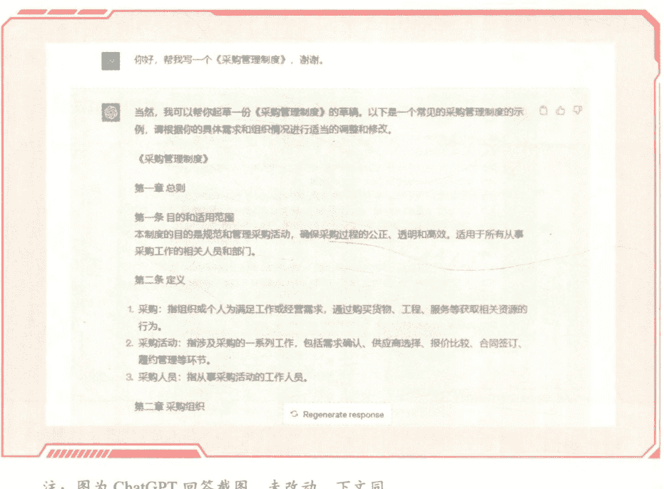

注：图为 ChatGPT 回答截图，未改动。下文同。

【扫码查看完整问答过程】

实际上，这是因为你没有掌握拆分提问的技巧，所以它只能写一些空洞的制度条文。正确地使用 ChatGPT 作为你的工作好帮手的方式如下：

首先，你要大致明确《采购管理制度》中的章节模块，比如采购管理通常包括采购要求、采购流程、采购审核审批、供应商档案管理、价格准入机制管理、采购成本控制、采购考核等模块，可以把整个制度拆分成不同的模块，再按照模块分别提问，对得到的答案进行精简、修改，再整合、优化所有板块的答案，就能形成一篇有针对性、接地气的制度文件。

其次，你可以这么提问：“你好，我是一家中小型纺织企业，在采购成本控制过程中，应对相关采购人员提出哪些工作要求？”

ChatGPT 回答：

你好，我是一家中小型纺织企业，在采购成本控制工作中，应对相关采购人员提出哪些工作要求？

在采购成本控制工作中，对相关采购人员可以提出以下工作要求：

1. 成本意识：要求采购人员具备强烈的成本意识，意识到采购成本对企业利润的重要性，并能够积极寻找和实施降低成本的方法和策略。
2. 供应商谈判能力：要求采购人员具备良好的供应商谈判能力，能够有效地与供应商进行价格谈判，争取更有利的采购价格和条件，从而降低采购成本。
3. 供应商评估和选择：要求采购人员能够对供应商进行全面评估和选择，包括供应商的价格竞争力、交货能力、质量控制能力等，确保选择的供应商能够提供高性价比的产品和服务。
4. 市场调研和采购策略制定：要求采购人员积极进行市场调研，了解市场行情和供应商情况，及时把握采购机会，同时，制定合理的采购策略，包括采购计划、采购量的确定等，以确保采购成本的有效控制。
5. 成本分析和报告：要求采购人员能够进行成本分析，包括采购成本的结构和变动情况等，及时发现成本异常和问题，并向管理层提供相关的成本报告和建议，以支持决策和优化采购成本控制。
6. 内部协调与沟通：要求采购人员与内部各部门进行有效沟通，了解各部门的需求和要求，并及时沟通和协调，以确保采购工作的顺利进行。

继续提问：

> “在采购管理中，从内部控制的角度，应明确哪些采购审核审批要求或程序？”

ChatGPT 回答：

在采购管理中，从内部控制的角度，应明确哪些采购审核审批要求或程序？

从内部控制的角度来看，在采购管理中，可以明确以下采购审核审批要求或程序：

1. 采购需求确认：
   - 采购申请的提出应经过内部审核和审批程序。
   - 需明确采购物料、数量、质量要求以及预算限制等信息。
2. 供应商选择和评估：
   - 供应商的选择应经过内部审查和评估程序。
   - 需明确供应商评估的标准和流程，包括供应商的信誉、财务状况、交货能力等。
3. 价格谈判和合同签订：
   - 价格谈判应经过内部审核和授权程序。
   - 签订合同前，合同条款应经过内部法务或相关部门的审查和批准。
4. 采购订单生成和审批：
   - 采购订单的生成和审批应符合内部控制流程。
   - 订单金额、物料规格、交货期限等信息应经过内部审核和审批程序。
5. 支付审批：
   - 采购付款应经过内部的审核和审批程序。
   - 需明确支付金额、付款方式以及相关财务控制要求。
6. 异常情况处理：
   - 对于采购中的异常情况，如紧急采购、供应商违约等，应建立内部审批程序和授权限制。

继续提问：

> “在采购管理的制度建设工作中，对于采购相关人员的考核，应明确哪些具体的考核标准、考核措施、考核数值指标？”

ChatGPT 回答：

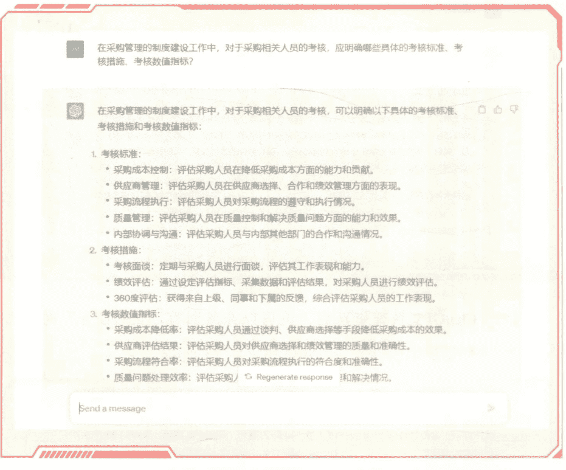

最后，人工将 ChatGPT 关于采购管理各模块的回答汇总起来，结合企业的实际情况，稍加修改优化，就能形成一篇不空洞、有针对性、符合企业实际的制度文件了。制度文件如此，报告、方案、计划、总结等文案生成基本上也大同小异。

### 1.2.2 技巧 2：多说“继续”

很多人在询问 ChatGPT 的时候，会发现 ChatGPT 的回答总是突然中断，以为是系统存在问题，只能回答这么点。实际上，这是因为 ChatGPT 的聊天窗口有字符限制，导致不能完全显示回答内容。这时，你不妨直接对 ChatGPT 说“继续”，就会有意想不到的收获。

5. 个人成长：我持续学习和专业发展，参与各类教育研讨和学术研究活动，提高自己的教学能力和知识水平。我不断反思和总结自己的教学实践，积极接受同行的评估和建议，不断完善自己的教育教学理念和方法。

总的来说，我在师德师风方面的工作中取得了一定的成绩，但也存在一些不足之处，需要进一步改进和提升。在未来的工作中，我将继续努力，不断提高自己的师德师风素质，为学校的教育事业做出更大的贡献。

为了更好地发挥师德师风的示范作用，我将加强与同事之间的沟通和协作，形成良好的团队合作氛围。我将积极参与学校举办的师德培训和教育活动，持续学习和提升自己的专业能力。同时，我将注重与学生家长的沟通和交流，建立良好的家校关系，共同关心学生的成长和发展。

在学生管理方面，我将更加关注学生的学习兴趣和潜能。

当然，ChatGPT 系统更新后，也可以在其回答“戛然而止”时单击“Continue generating”按钮，它就能接着往下说了。

3. 市场发展趋势：
   a. 技术创新：骨传导耳机市场将继续受到技术创新的推动，例如更高音质、更好的适应性和更长的电池续航等方面的改进，以满足用户对音质和功能的不断提升的需求。
   b. 市场细分：随着市场需求的进一步增加，骨传导耳机市场将进一步细分为不同的用户群体，例如户外运动爱好者、听力障碍者、游戏玩家等，厂商可以专注于特定细分市场以提供定制化产品和服务。
   c. 价格竞争：随着市场竞争的加剧，价格将成为影响购买决策的关键因素。厂商需要在提供高品质产品的同时，合理定价以吸引消费者。
4. 市场推荐策略：
   a. 技术创新和研发投入：厂商应加大对骨传导技术的研发投入，不断改

### 1.2.3 技巧 3：可以展开说一下吗？

当你工作中遇到难题，绞尽脑汁，百思不得其解时，你灵机一动，打开了 ChatGPT 对话框。ChatGPT 也不负你所望，在字符的跳动下，回答出了一些你没想到的东西，你盯着电脑屏幕欣喜若狂。当 ChatGPT 输出完了，你又掩面叹息：这第一条挺好，不过只是提到了，就是太简略了，不够详细，唉。

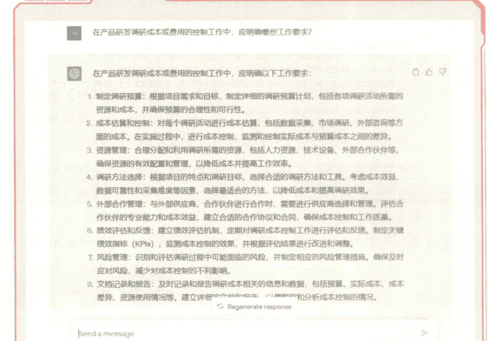

这时候，不妨追问：“刚刚你提及 × × ×，可以展开说一下吗？谢谢。”

ChatGPT 就会展开说出你想要的。当然，还有一个方式就是直接复制第一条，再左手按住 “Shift” 键，同时右手按住 “Enter” 键，打上：“请详细展开说一下，谢谢。”

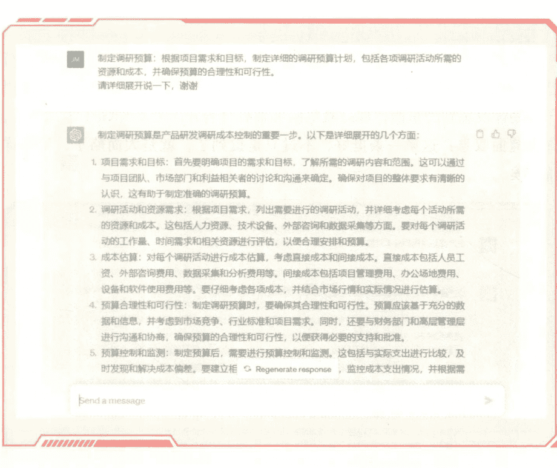

#### 【萃一萃】

敲黑板，敲黑板，敲黑板！“Shift+Enter”技巧一定要学会哦。学会了这一技巧你就能快速地追问出有逻辑、有条理的问题，让 ChatGPT 更好地理解，更进一步地展开回答。

### 1.2.4 技巧 4：直接问 ChatGPT

如果你把前面的提问技巧全忘光了，也没关系，还有一招“撒手锏”，最简单粗暴——直接问 ChatGPT：“我该怎么向你提问，才更高效？”

以下是与 ChatGPT 的问答过程，通过以下问答（包括二维码延伸阅读），你就能获取 ChatGPT 自己给出的提问技巧。

用户提问：

我应该怎么向你提问，才更高效？

ChatGPT 回答：

为了获得更高效的回答，请尝试以下几个建议：

- **提出具体问题**：确保您的问题明确而具体，这样我可以直接回答您的问题，而不需要额外的解释或澄清。
- **简明扼要**：尽量用简洁的语言提问，避免冗长的描述或背景信息。清晰地表达您的问题，有助于我更快地理解并回答。
- **分步骤提问**：如果您的问题较为复杂或涉及多个方面，请将问题分解为几个简单的步骤。这样我可以逐步回答每个步骤，确保您理解并能够跟随。
- **具体示例**：如果您的问题涉及到某个具体情境或案例，尽量提供相关的细节和例子。这有助于我更好地理解您的问题，并提供更准确的答案。
- **避免模糊性**：确保您的问题没有歧义或模糊性，这样可以避免误解和错误的回答。清晰地表达您的问题可以帮助我更好地为您提供准确的解答。

通过遵循这些指导原则，您可以更高效地与我进行交流，获得更满意的答案。如果您需要任何帮助或有进一步的问题，请随时告诉我！

（注：以上内容由 ChatGPT 生成，未改动）

【扫码查看完整问答过程】

#### 【萃一萃】

通过上述对 ChatGPT 的提问与追问，我们可以看到，ChatGPT 的回答提供了五种提问技巧：**提出具体问题、简明扼要、分步骤提问、具体示例、避免模糊性**。另外，笔者在使用 ChatGPT 过程中总结了各种技巧，比如**给提问者和（或）ChatGPT 明确的身份定位、让 ChatGPT 向提问者要**资料清单、给 ChatGPT “投喂”真实准确的数据、让 ChatGPT 举例来说明、让 ChatGPT “继续”或“展开说一下”等，这些提问技巧在 ChatGPT 的使用过程中至关重要。只有掌握了这些技巧，才能更好地获得 ChatGPT 的支持与帮助，高效使用 ChatGPT 及其他各种 AIGC 工具来生成有价值的内容。

工欲善其事，必先利其器！这些提问技巧与追问技巧将作为小栏目贯穿于本书各章的任务示范中，希望读者朋友能够真正学会这些提问与追问的技巧，借助这些技巧高效率地获得自己想要的答案，真正让 ChatGPT 成为我们每一位读者朋友的工作好帮手。

## 1.3 ChatGPT 常用的 9 类工作技能

### 1.3.1 聊天问答

自然语言处理能力是 ChatGPT 的核心，ChatGPT 能够结合上下文与用户进行聊天问答。在工作中，我们可以通过聊天的方式，向 ChatGPT 请教一些疑难问题，提升我们的工作效率。关于 ChatGPT 具备哪些聊天问答能力，以下问答可以充分阐述。

用户提问：

关于聊天问答，ChatGPT 具备哪些能力？

ChatGPT 回答：

ChatGPT 拥有以下能力：

- **对话交互**：ChatGPT 可以与用户进行自然语言对话，根据用户提供的问题或指令做出回应。它可以理解问题的上下文，并生成相关的、有意义的回答。
- **提供信息**：ChatGPT 可以回答广泛的知识性问题，提供实时的、准确的信息。它具备广泛的知识库，并可以根据用户的问题提供相关的知识和解释。
- **创造性表达**：ChatGPT 可以生成创造性的文本，如诗歌、故事、对话等。它可以根据用户的提示和要求，创造出新颖、富有想象力的内容。
- **语言翻译**：ChatGPT 可以用多种语言进行交流和翻译。它可以理解用户提供的语言，并以用户指定的语言回答问题或提供信息。

（注：以上内容由 ChatGPT 生成，未改动）

### 1.3.2 文案文本

文案写作与文本处理是办公室工作中最常见的任务之一，ChatGPT 可以按照用户的要求，生成各类文案、处理各种文本。关于 ChatGPT 具备哪些文案文本的写作与处理能力，以下问答可以充分展现。

**用户提问：**

关于文案文本的写作与处理，ChatGPT 具备哪些能力？

**ChatGPT 回答：**

ChatGPT 具备以下能力，可以用于文案文本的写作与处理：

- **文案创作**：ChatGPT 可以根据提供的要求和指导，生成各种类型的文案，包括广告宣传文案、产品描述、网站内容、社交媒体文案等。
- **反馈和编辑**：ChatGPT 可以提供关于文案的反馈和建议，帮助改善文案质量和效果。
- **校对和润色**：ChatGPT 可以用于校对和润色文案，它可以检查语法、拼写和表达上的错误，并提供修改建议，使文案更加流畅和专业。
- **风格和语气的调整**：ChatGPT 可以根据用户的要求，调整文案的风格和语气。
- **目标受众分析**：ChatGPT 可以帮助分析和定义目标受众，帮助用户更好地针对目标受众撰写文案。

（注：以上内容由 ChatGPT 生成，未改动）

### 1.3.3 营销推广

对于从事营销推广的人而言，最大的痛点莫过于灵感枯竭，没有新奇的点子，导致营销推广平平无奇、收效甚微。ChatGPT 的出现，一定程度上可以帮助营销推广人员解决这些痛点。关于 ChatGPT 具备哪些营销推广的能力，以下问答可以充分阐述。

用户提问：

关于营销推广，ChatGPT 具备哪些能力？

ChatGPT 回答：

> 作为一个语言模型和智能助手，ChatGPT 具备以下能力来支持营销推广：

- **提供创意和内容策略**：ChatGPT 可以与用户进行对话，并根据提供的信息和要求，生成创意和内容策略的建议。ChatGPT 可以帮助你思考吸引人的广告口号、独特的品牌故事、引人入胜的社交媒体内容等，以帮助你在营销推广中脱颖而出。
- **提供市场调研和洞察**：ChatGPT 可以帮助用户进行市场调研，并提供相关的洞察和分析，以帮助你更好地定位目标市场，并制定相应的营销策略。
- **解答营销相关问题**：ChatGPT 可以回答关于营销推广的一般性问题，并提供相关解释和见解。你可以向 ChatGPT 提问关于市场定位、品牌建设、数字营销、社交媒体策略等方面的问题。
- **提供数据驱动的建议**：ChatGPT 可以利用数据分析的知识，帮助你解读和分析营销数据，并提供相应的建议和优化方向，帮助你理解数据背后的意义，并提供相应的优化建议。

（注：以上内容由 ChatGPT 生成，未改动）

### 1.3.4 教育培训

如果说，教育培训是一种将知识教育资源信息化的机构或在线学习系统，那么 ChatGPT 就是一种将知识教育资源信息化的人工智能在线学习系统。ChatGPT 的问世，将对教育培训领域产生重大影响。关于 ChatGPT 具备哪些教育培训的能力，以下问答可以充分阐述。

用户提问：

关于教育培训，ChatGPT 具备哪些能力？

ChatGPT 回答：

> ChatGPT 在教育培训领域具备以下能力：

- **提供学习资源和知识解释**：ChatGPT 可以回答各种学科和领域的问题，为学生和教育工作者提供必要的信息和概念解释，以支持他们的学习和教学。
- **辅助学习和练习**：ChatGPT 可以提供学习指导和辅助练习。ChatGPT 可以解答学生的问题、提供学习建议，还可以提供练习题和问题，以帮助学生巩固所学知识。
- **提供写作指导和润色建议**：对于学生写作方面的需求，ChatGPT 可以提供写作指导和润色建议，可以帮助学生改善句子结构、语法使用和逻辑思维，以提高他们的写作表达能力。
- **提供职业和学术建议**：对于学生和教育工作者来说，职业规划和学术发展也是重要的领域。ChatGPT 可以提供职业建议、学术指导和学习路径建议，以帮助他们做出明智的决策并实现个人目标。

（注：以上内容由 ChatGPT 生成，未改动）

### 1.3.5 客服预约

第三产业的发展是生产力发展和社会进步的必然结果。随着服务领域改革持续深化和第三产业发展质量不断提升，第三产业在国民生产总值中所占的比重越来越大。客服预约领域是第三产业的重要组成部分，客服预约一般是一对一或是一对多，ChatGPT 可以实现一对一和一对多预约，将给客服预约领域带来重大影响。关于 ChatGPT 具备哪些客服预约的能力，以下问答可以充分阐述。

用户提问：

关于客服预约工作，ChatGPT 具备哪些能力？

ChatGPT 回答：

作为一个基于 GPT-3.5 架构的语言模型，ChatGPT 具备以下能力与客服预约工作相关：

- **自然语言理解**：ChatGPT 可以理解输入的自然语言，并识别用户的问题、需求和意图。
- **问答能力**：ChatGPT 可以回答用户的问题，并提供相关的信息和建议。ChatGPT 可以解答预约的程序、时间、地点、要求等问题。
- **对话管理**：ChatGPT 能够进行连贯的对话管理，与用户进行交互并记住之前的对话历史，例如确认预约细节、更改预约时间等。
- **日程安排和预约管理**：ChatGPT 可以协助客户和用户进行日程安排和预约管理。它可以检查可用时间段、安排预约、提供预约确认和提醒等功能。
- **多轮对话处理**：ChatGPT 可以处理多轮对话，在对话中保持联系上下文，并根据之前的对话内容作出适当的回应。

（注：以上内容由 ChatGPT 生成，未改动）

### 1.3.6 商品导购

线上购物时，面对全网琳琅满目的商品，人们不禁感到眼花缭乱、无从下手，不知道选择什么商品，从而陷入“选择困难”。ChatGPT 具备强大的资源整合能力，将帮助我们走出“选择困难”。关于 ChatGPT 具备哪些商品导购的能力，以下问答可以充分阐述。

用户提问：

关于商品导购，ChatGPT 具备哪些能力？

ChatGPT 回答：

ChatGPT 在商品导购方面具备以下能力：

- **产品信息提供**：ChatGPT 可以提供有关不同产品的详细信息，例如功能、规格、品牌、价格范围等。
- **用户需求理解**：ChatGPT 可以理解用户对于商品的需求和偏好，并据此提供个性化的推荐。
- **比较和评估**：ChatGPT 可以对不同产品进行比较和评估，帮助用户做出明智的购买决策。
- **推荐和建议**：基于用户提供的信息和需求，ChatGPT 可以提供个性化的商品推荐和购买建议。
- **购买指南**：ChatGPT 可以充当购买指南，指导用户完成购买流程。

（注：以上内容由 ChatGPT 生成，未改动）

### 1.3.7 招聘助理

在招聘领域，找工作难和招人难的问题同时存在，一定程度上，ChatGPT 可以打破这种二元割裂的现象。尤其是在招聘方面，ChatGPT 可以辅助招聘，大大提升招聘效率，帮助企业招聘到合适的人才。关于 ChatGPT 具备哪些招聘助理的能力，以下问答可以充分阐述。

用户提问：

关于招聘助理，ChatGPT 具备哪些能力？

ChatGPT 回答：

ChatGPT 在招聘助理方面具备以下能力：

- **职位信息发布**：ChatGPT 可以协助发布招聘职位信息，并提供有关职位的详细描述、要求和福利待遇等信息，并帮助招聘人员吸引合适的候选人。
- **简历筛选**：ChatGPT 可以帮助进行简历筛选，根据设定的条件和标准，从候选人提交的简历中过滤出最符合要求的候选人。
- **候选人查询**：ChatGPT 可以提供关于候选人的基本信息和背景，例如教育背景、工作经验、技能等。
- **面试安排**：ChatGPT 可以协助安排面试，包括与候选人的预约确认、面试时间和地点的安排等。
- **自动化回复和沟通**：ChatGPT 可以协助招聘人员进行候选人的自动化回复和沟通，可以回答常见问题、发送面试邀请、提供面试准备指南等。

（注：以上内容由 ChatGPT 生成，未改动）

### 1.3.8 创意创作

“人是一根有思想的苇草”，人类因为有思想而伟大。在创意创作中，人类的灵感也会有枯竭的时候，与 ChatGPT 问答，可以帮助我们发散思维，找到灵感。关于 ChatGPT 具备哪些创意创作的能力，以下问答可以充分阐述。

用户提问：

关于创意创作，ChatGPT 具备哪些能力？

ChatGPT 回答：

ChatGPT 在创意创作方面具备以下能力：

- **创意启发**：ChatGPT 可以提供创意启发和灵感。通过与 ChatGPT 的交互，你可以描述你的创作需求或提出问题，它可以回答、提供相关信息或给出创意建议，以帮助你开拓思路和激发创作灵感。
- **内容生成**：ChatGPT 可以生成各种形式的创意内容，包括文本、故事情节、诗歌、对话等。你可以向 ChatGPT 描述你的创作需求、主题或要求，并生成与之相关的内容片段或完整作品。
- **创意评估**：ChatGPT 可以对创意进行初步评估和反馈。你可以向 ChatGPT 展示你的创意或提出问题，它可以给予意见、指出潜在问题或提供改进建议，以帮助你提升创意的独特性和可行性。

（注：以上内容由 ChatGPT 生成，未改动）

### 1.3.9 数据挖掘

数据挖掘是指从大量的数据中，提取隐藏的、有用的信息的过程。大数据是信息技术发展的必然产物，更是信息化进程的新阶段，只有让大数据为我们所用，才能把握住时代的脉搏，促进个人和组织的发展。ChatGPT 的出现，可以解决数据难获取、难理解、难处理和难组织的问题。

关于 ChatGPT 具体具备哪些数据挖掘的能力，以下问答可以充分阐述。

用户提问：

关于数据挖掘，ChatGPT 具备哪些能力？

ChatGPT 回答：

> ChatGPT 在数据挖掘方面具备以下能力：

- **数据理解**：ChatGPT 可以帮助理解和解释给定数据集的基本属性和特征。
- **数据清洗和预处理**：ChatGPT 可以提供数据清洗和预处理的建议，它可以给出处理建议、推荐常用的数据清洗方法或提供数据修复的示例。
- **特征选择和工程建议**：ChatGPT 可以提供特征选择和工程的建议，它可以回答特征选择的标准、特征变换的方法、特征组合的技巧等，以帮助你优化特征选择和提取过程。
- **数据可视化**：ChatGPT 可以帮助生成数据可视化图表，它可以生成相应的图表类型、解释图表的含义和用途，以支持你更好地理解和分析数据。

（注：以上内容由 ChatGPT 生成，未改动）

## 1.4 ChatGPT 赋能“超能个体”与“超能团队”

### 1.4.1 快速获取有用的信息

ChatGPT 可以帮助个人和团队快速、准确地获取信息，并且过滤无用和不必要的信息。ChatGPT 的语义理解和自然语言处理技术可以分析输入的问题，从大数据知识库中检索相关的信息，并应用深度学习技术自动摘要和汇总，从而节约了时间成本和人力成本。

> 举个例子，一个销售团队，每天需要掌握大量的市场动态，如市场规模、竞争情况、客户关注点等。ChatGPT 的快速获取信息功能，可以帮助团队快速从多个渠道获取信息，轻松把握市场状况并获取企业竞争优势。

### 1.4.2 提升“超能个体”问题解决能力

ChatGPT 可以通过以下几个方面来赋能个体，使之成为“超能个体”，提升问题解决能力。

第一，提供个性化的学习路径和建议。

ChatGPT 可以根据个体的学习情况和需求，帮助其快速掌握知识和技能，提高问题解决能力。

第二，提供实时反馈和指导。

ChatGPT 可以为个体提供实时反馈和指导，帮助其发现自己的不足之处，及时调整学习策略和方法，提高问题解决效率。

第三，提供丰富的学习资源和工具。

ChatGPT 可以为个体提供丰富的学习资源和工具，包括在线课程、教程、实践项目等，帮助其全面掌握知识和技能，提高问题解决能力。

第四，提供实用的解决方案。

ChatGPT 可以根据个体的需求，提供实用的解决方案或方法。它可以帮助个体规划时间、管理任务、改善沟通、解决冲突等，以提高工作效率和解决问题。

### 1.4.3 指导“超能团队”高效协作与持续精进

ChatGPT 可以通过以下几个方面帮助“超能团队”高效协作与持续精进。

第一，知识共享和学习支持。

ChatGPT 可以作为一个丰富的知识库，为团队成员提供各种领域的信息和资源，团队成员可以通过与 ChatGPT 的交互，获取新知识、最新趋势、行业见解等，可以分享经验、最佳实践和领域知识，从而不断拓展他们的知识广度和深度。

第二，问题解决和决策支持。

团队成员可以使用 ChatGPT 来讨论和解决问题。ChatGPT 可以提供多个角度的思考、可能的解决方案和相关信息，促进团队成员的思维碰撞和创新思考。此外，ChatGPT 还可以帮助团队进行决策，提供数据、背景信息和风险评估，从而支持团队做出明智的决策。

第三，沟通和协作支持。

ChatGPT 可以促进团队成员之间的沟通和协作。它可以帮助团队成员厘清思路、表达观点，并在团队讨论中提供实用建议和反馈。通过 ChatGPT，团队成员可以更高效地交流、共享进展和协调工作，增强团队合作的效果。

第四，创新和思维启发。

ChatGPT 作为团队的创新工具，可以激发创新思维，通过提供新颖的思路、创意和跨界思维，帮助团队成员突破思维的局限，提高团队的创新能力。团队成员可以通过与 ChatGPT 的交互，探索不同的观点、思维方式和解决方案，从而推动团队的创新和改进。

第五，学习和发展计划。

ChatGPT 可以支持团队成员的学习和发展。它可以提供学习资源，推荐书籍、课程和培训等，帮助团队成员拓展知识广度和提升技能。此外，ChatGPT 还可以与团队成员合作制订个人学习计划、设定目标，并提供反馈和指导，以促进个人和团队的成长。

# 第2章 最懂你的「知心姐姐」

ChatGPT 是基于 OpenAI GPT-3.5 架构的大型语言模型，旨在为用户提供各种问题的解答和有趣的对话。无论你需要情感支持、求职建议、学术帮助还是简单的闲聊，ChatGPT 都将尽力理解你的需求，并提供个性化、有价值、有意义的回答。你可以放松心情，与 ChatGPT 分享你的烦恼、喜悦和困惑，ChatGPT 将倾听并尽其所能给予你帮助。

与 ChatGPT 愉快相处，“训练”它成为最懂你的“知心姐姐”，一起开启快乐而有意义的对话之旅吧！

## 2.1 聊天问答 4 个应用场景与 6 项任务示范

### 2.1.1 寻求结果：生成团建策划方案

无论你是需要组织一个小型团队的团建活动，还是希望为大型企业的员工策划一场难忘的聚会，通过向 ChatGPT 表达你的需求并与它进行交流，它都可以为你定制一份富有创意、主题鲜明的策划方案，为你提供灵感和建议，帮助你策划的活动取得更好的效果。

**任务：生成团建策划方案**

**问答举例**

> 下周末公司要组织团建，帮我策划一下团建活动的具体项目和内容，要求体现团队合作，以及团队凝聚力、向心力的重要性，并写出具体的策划方案。

当然！下面是一份团建活动的策划方案，旨在体现团队合作、团队凝聚力和向心力的重要性：

活动主题：共创无限
活动日期：下周末
活动地点：选择一个室内/室外场地，根据团队规模和活动要求确定。

活动内容：
1. 团队挑战赛：将参与者分成几个小组，每个小组面临一系列团队挑战，如解谜、障碍穿越、智力游戏等。这些挑战需要团队成员紧密合作、互相支持和沟通，以解决问题并取得胜利。
2. 创意合作工作坊：安排一场创意工作坊，鼓励团队成员共同创造和合作。可以选择绘画、手工艺、音乐等形式，让团队成员在一个艺术项目中共同发挥创意，并通过合作完成作品。这将促进团队的协作和创造力。
3. 团队建设讲座：邀请一位专业的团队建设专家或演讲者，为团队成员提供一个互动的讲座。演讲内容可以涵盖团队合作的重要性、沟通技巧、有效解决冲突和建立信任等。通过分享实用的工具和技巧，激发团队成员的团队意识和凝聚力。

用户提问：

下周末公司要组织团建，帮我策划一下团建活动的具体项目和内容，要求体现团队合作，以及团队凝聚力、向心力的重要性，并写出具体的策划方案。

ChatGPT 回答：

当然！下面是一份团建活动的策划方案，旨在体现团队合作、团队凝聚力和向心力的重要性：

活动主题：共创无限

活动日期：下周末

活动地点：选择一个室内/室外场地，根据团队规模和活动要求确定。

活动内容：

1. 团队挑战赛：将参与者分成几个小组，每个小组面临一系列团队挑战，如解谜、障碍穿越、智力游戏等。这些挑战需要团队成员紧密合作、互相支持和沟通，以解决问题并取得胜利。
2. 创意合作工作坊：安排一场创意工作坊，鼓励团队成员共同创造和合作。可以选择绘画、手工艺、音乐等形式，让团队成员在一个艺术项目中共同发挥创意，并通过合作完成作品。这将促进团队的协作和创造力。
3. 团队建设讲座：邀请一位专业的团队建设专家或演讲者，为团队成员提供一个互动的讲座。演讲内容可以涵盖团队合作的重要性、沟通技巧、有效解决冲突和建立信任等。通过分享实用的工具和技巧，激发团队成员的团队意识和凝聚力。
4. 团队竞赛：组织一系列团队竞赛活动，如拔河比赛、接力赛、团队拼图挑战等。这些竞赛旨在通过团队协作和竞争激励团队成员，加强他们之间的联系，增进团队凝聚力。
5. 团队晚宴：在活动结束时，安排一场团队晚宴，为团队成员提供一个放松、交流和庆祝的机会。在晚宴上，可以表彰团队的努力和成就，并鼓励团队成员分享他们在活动中的体验和感受。

（注：以上内容由 ChatGPT 生成，未改动）

通过初次对 ChatGPT 提需求，可以看出，ChatGPT 给出的策划方案还比较笼统，不够具体。这时就需要我们进一步对 ChatGPT 进行追问，使得我们的策划方案更完善和具体。在追问时，需要掌握以下追问技巧，确保 ChatGPT 给出更精准的答复。

**【追一追】**

- 可以针对其中某一项进行追问，如“请对团队竞赛环节进行详细策划”或者“团队晚宴需要注意的事项有哪些”等。
- 增加一些限制条件，让 ChatGPT 做出更具有针对性的回答，如活动人数、参与的人员特征、预算要求、活动目标等。

**追问举例：**

> 参与本次团建活动的人数达到100人，其中包括工厂的生产员、质检员、技术员、班组长等各种岗位，通过本次活动，希望能够提高大家的团队合作能力，以促进生产效率的提升，请为此策划具有针对性的游戏环节。

针对100人参与的团建活动，旨在提高团队合作能力并促进生产效率的提升，以下是一个具有针对性的游戏环节的策划方案：

游戏环节：生产线协作挑战

概述：这个游戏环节模拟了一个生产线的情境，参与者将分成小组，每个小组代表一个生产团队，需要在限定的时间内完成一项生产任务。通过这个挑战，参与者将锻炼团队合作、协调和沟通的能力，并体验团队合作对于生产效率的重要性。

步骤：

1. 团队分组：根据参与者的岗位和团队结构，将他们分成适当的小组。每个小组应该包含来自不同岗位的成员，以促进跨部门的协作和交流。
2. 游戏介绍：解释游戏规则和任务目标。说明参与者需要模拟生产线的运作，通过协作和合理分工来完成一项产品的生产。

【扫码查看完整问答过程】

**【改一改】**

通过对 ChatGPT 的提问与不断追问，你可以得到比较丰富与全面的团队策划方案思路和建议。接下来，就需要你对所有答复进行整合与优化，按照以下步骤来进行定制和调整，就能打造出更符合你预期的团建活动策划方案。

- 明确你团建活动的具体目标和期望的结果。确定团队合作能力的重要性以及生产效率提升的具体需求。这将帮助你在整合和优化方案时保持清晰的导向。
- 仔细审查 ChatGPT 给出的方案，包括导语和游戏环节等。考虑这些方案在满足目标方面的优势和不足之处。注意方案中涉及的活动项目、规则、分组安排、设备准备、时间控制、评判标准等方面。
- 根据你团队的特点、人员规模、岗位分布和活动场地等因素，调整方案中的细节和要求，使其更适合你的团队。例如，根据有 100 人参与的情况，确保游戏环节可以包容大规模参与，并且能够实现高效的团队合作。
- 确保方案中的各个环节衔接紧密，并优化活动流程，使其具有连贯性和流畅性。考虑到团队竞赛环节，将其融入整个活动中，并确定与其他环节的衔接方式，以实现整体的协调和一致性。
- 在方案中加强团队合作的要素，例如在活动介绍和讨论环节中强调团队合作的重要性、提供协作技巧和策略、鼓励跨部门交流与合作等。确保每个活动环节都能促进团队成员之间的互动、合作和沟通。
- 在方案中明确衡量团队合作能力和生产效率提升的评估指标。这些指标可以根据活动的性质和目标来制定，例如团队协作得分、任务完成时间、产品质量等。确保评估过程具有客观性和可衡量性。
- 在活动结束后，为团队成员提供后续行动计划。这样可以使他们将活动中学到的经验和技能应用到日常工作中。

### 2.1.2 寻求建议：生成创业建议与演讲主题提纲

当你面临抉择、需要一些新的观点或仅仅想要一些建议或指导时，ChatGPT 是你的绝佳选择！无论是关于职业规划、个人发展、创意构思还是工作中的其他挑战，它都能够为你提供实用的建议和有价值的见解。

**任务 1：生成创业方向建议**

**问答举例**

利用ChatGPT来创业变现的具体方向有哪些，做一下优劣比较，并以表格方式输出。

利用ChatGPT来创业变现的具体方向有很多，下面是一些常见的方向，以及它们的优劣比较：

| 方向 | 优点 | 缺点 |
|---|---|---|
| 虚拟助手/客服 | - 提供自动化的客户支持和服务 - 节省人力和成本 - 实时响应 | - 无法解决所有复杂问题 - 需要大量的训练和调优 |
| 教育辅助 | - 提供个性化学习指导 - 解答学生疑问 - 提供作业辅导 | - 需要与教育机构合作 - 依赖正确的数据和信息 |
| 内容生成与编辑 | - 自动生成新闻、文章和博客 - 提供写作建议和编辑支持 | - 难以完全取代人类的创造力和编辑能力 - 需要监督和审核 |
| 语音助手与智能家居控制 | - 实现语音命令控制家居设备 - 提供定制化的智能家居体验 | - 隐私和数据安全问题 - 语音识别和理解的准确性有限 |
| 虚拟导游 | - 提供定制化的旅游建议和信息 - 解答游客疑问 | - 依赖准确的地理和旅游数据 - 无法提供实际的现场体验 |

**任务 2：生成演讲主题和提纲**

**问答举例**

我是一位人力资源总监，本周日有一个关于ChatGPT在人力资源领域应用的行业交流会，要我分享15分钟，你能帮我设计一个当下热门的分享主题和内容提纲吗？最好有举例说明。

当下热门的分享主题：利用ChatGPT提升人力资源管理效能

内容提纲：

I. 介绍（1分钟）
* 自我介绍和背景
* 引入主题：ChatGPT在人力资源领域的应用

II. ChatGPT简介（2分钟）
* ChatGPT是一种基于深度学习的自然语言处理模型
* 解释其能力和潜在用途

ChatGPT 回答：

当下热门的分享主题：利用 ChatGPT 提升人力资源管理效能

内容提纲：

I. 介绍（1 分钟）
- 自我介绍和背景
- 引入主题：ChatGPT 在人力资源领域的应用

II. ChatGPT 简介（2 分钟）
- ChatGPT 是一种基于深度学习的自然语言处理模型
- 解释其能力和潜在用途

III. ChatGPT 在人力资源中的应用（8 分钟）
A. 招聘与人才管理
1. 聊天机器人面试：利用 ChatGPT 进行自动化面试，筛选潜在候选人
- 举例：使用 ChatGPT 进行初步技术面试，减少人工工作量
2. 自动化简历筛选：利用 ChatGPT 进行简历分析和匹配
- 举例：通过 ChatGPT 自动筛选简历，匹配关键技能和经验
3. 候选人体验的增强：通过 ChatGPT 提供实时反馈和指导
- 举例：候选人面试后，ChatGPT 提供反馈和建议，增强候选人体验
B. 员工培训和发展
1. 虚拟培训助手：ChatGPT 作为虚拟助手提供员工培训
- 举例：ChatGPT 为新员工提供产品知识培训
2. 自助学习平台：ChatGPT 提供即时答疑和学习支持
- 举例：员工可以通过 ChatGPT 平台获取工作相关问题的答案
3. 职业发展规划：ChatGPT 提供个性化建议和指导
- 举例：员工通过 ChatGPT 进行职业规划和技能发展咨询

IV. ChatGPT 的潜在挑战和注意事项（3 分钟）
- A. 数据隐私和安全性
- B. 偏见和倾向性
- C. 技术限制和误导性回答

V. 总结和展望（1分钟）
- 总结主要观点和应用案例
- 强调 ChatGPT 在人力资源中的潜力
- 鼓励与会者进一步探索和尝试

这个提纲提供了一种展示 ChatGPT 在人力资源领域应用的方式。你可以根据自己的实际情况和需求进行适当调整，添加更多具体的案例和细节，以及根据听众的背景和兴趣进行相关讨论。

（注：以上内容由 ChatGPT 生成，未改动）

以上两项任务中，ChatGPT 虽然提供了一些符合需求的建议，但这些建议还不够完善。此时，我们就需要进行追问，使 ChatGPT 给出的建议更加全面和具体。可从以下几方面进行追问。

**【追一追】**

- 根据需求使用一些关键词进行追问，如“数据隐私和安全性”“推广和采用”“未来发展和趋势”等，提出具体问题，获得更全面、更完整的建议。
- 将需求按照优先级提出，以获得你最关注、最需要的建议。
- 沿着你最感兴趣的点进行深度追问，以获得最符合你需求的、更有深度的建议。

**【萃一萃】**

记住 ChatGPT 的身份定位——它是你的工作助理，可以为你的工作提供一定的帮助和便利；但它不可能完全代替你思考、代替你工作，你才是主角，不要过度依赖 ChatGPT。

需要向 ChatGPT 提足够具体的要求，它的回答才能更符合你的预期。

给 ChatGPT “投喂”更多真实数据和需求，“训练”它持续学习，它才会越来越“懂你”。

**【探一探】**

1. “公司在推广 ChatGPT 时面临的主要挑战是什么？如何克服这些挑战？”
2. “员工或候选人对于与 ChatGPT 互动的接受度如何？是否存在培训或沟通障碍？”
3. “ChatGPT 是否存储用户的聊天记录？如果是，如何处理这些数据？”
4. “公司如何确保第三方无法访问或获取 ChatGPT 与候选人或员工的交互数据？”
5. “如何确保 ChatGPT 提供准确和可靠的答案、如何避免误导员工或候选人？”
6. “ChatGPT 技术的进一步发展方向是什么？是否有其他类似的技术值得关注？”

### 2.1.3 寻求支持：生成行业研究报告与租赁合同

当你在工作、生活中遇到一些困难，需要获得一些帮助和支持的时候，你可以通过探索 ChatGPT 来获得一些支持，它可以与你分享知识，为你提供有用的答案，提供建议和解决方案，帮助你解决问题、充实自己。

**任务 1：生成行业研究报告**

**问答举例**

新冠疫情对中国餐饮行业的影响有多大，具体体现在哪里？需要有一些数据支撑。

新冠疫情对中国餐饮行业产生了重大影响。以下是一些相关数据支持：

1. 销售额下降：根据中国餐饮行业协会的数据，2020年第一季度，中国餐饮行业销售额同比下降44.3%。整个2020年，餐饮行业的销售额下降了近20%。
2. 餐厅关停和倒闭：根据商务部的数据，2020年一共有超过500万家餐饮服务单位暂停营业或关闭，涉及员工超过900万人。这是由于封锁措施、人员流动限制和消费者减少导致的。
3. 就业问题：疫情导致餐饮行业大量职位减少。中国餐饮服务业2020年减少了超过1000万个就业岗位。
4. 外卖业务增长：虽然传统餐饮业受到冲击，但外卖业务却在疫情期间迅速增长。根据中国餐饮服务业协会的数据，2020年第一季度，中国外卖交易额同比增长了20.7%。
5. 餐饮业数字化转型：疫情加速了餐饮业的数字化转型。许多餐饮企业开始加强线上点餐、无接触配送和电子支付等服务，以适应新的消费模式和安全要求。

**任务 2：生成办公场地租赁合同**

**问答举例**

帮我生成一份办公室租赁合同模板，下午要与房东签约，180平米，租金每平米5元每天，租期三年，三年内不涨房租，三年后每年递增5%，半年付，一个月押金

当然，我可以帮你生成一份办公室租赁合同模板。以下是一个基本的模板，你可以根据你的具体情况进行修改和调整。

办公室租赁合同

本租赁合同（下称“合同”）由以下双方签署：

房东：
[房东姓名]
[地址]
[联系方式]

租户：
[租户姓名]
[公司名称]
[地址]
[联系方式]

在向 ChatGPT 提问，寻求支持的时候，掌握一些提问技巧，才能让 ChatGPT 更好地理解你的需求，提供更符合需求的答案和支持。

**【问一问】**

设置身份和场景。设置一个身份，并且将你的疑惑描述成一个场景，可以让 ChatGPT 更好地代入你所处的困境中，为你提供一些设身处地的建议与支持。

分解问题。如果你所面临的问题比较复杂，你可以选择将你的问题分解，逐个提问，这样能确保每个问题都获得更全面、充分的回答。记住，不用担心你问得太多、太啰唆，它只是个机器，绝不会嫌你烦。它有足够的耐心回答你的所有问题，只要你能表达得足够详细。

**【探一探】**

1. “我是一名学生，正在学习西班牙语，你有什么提高口语流利度的练习方法或建议吗？”
2. “请你充当一名健身教练，为我推荐一些可以在家进行的有氧运动，并给出一份简单而有效的锻炼方案。”
3. “我是一名创业者，计划创办一家咖啡馆，你有什么关于选址和策略的建议吗？”
4. “我计划去巴黎旅行。你现在是一名导游，你有什么必游景点和当地美食推荐吗？”

### 2.1.4 高效工作：生成年度工作计划

ChatGPT 作为你的工作好帮手，可以为你提供广泛的支持和解决方案，以帮助你在工作中取得更好的成果。通过与 ChatGPT 交流，你可以节省时间、提高效率、提升质量，从而事半功倍，在工作中更好地展现自己的能力。

**任务：生成年度工作计划**

**问答举例**

我是一名产品经理，我们公司明年计划有三个型号的智能学习机要上市，帮我做一下下一年度的工作计划

作为一名产品经理，下面是一个关于明年的工作计划的示例：

1. 市场调研和竞争分析：
   * 进行市场调研，了解目标用户的需求和趋势。
   * 分析竞争对手的产品特点和市场份额，为产品定位和差异化策略提供依据。
2. 产品规划和定义：
   * 明确每个智能学习机型号的特点和目标用户群。
   * 制定产品功能和规格，确保满足用户需求并与竞争对手区别开来。
   * 编写详细的产品需求文档，包括功能描述、用户界面设计等。
3. 项目管理和协调：
   * 制定项目计划，包括开发、测试和发布时间表。
   * 协调开发团队，确保按时交付高质量的产品。
   * 监督项目进度，解决潜在的问题和风险。

【扫码查看完整问答过程】

初次提问，ChatGPT 给你的只是一个大致的工作计划框架，你可以根据你的具体情况和公司需求对 ChatGPT 展开追问，对工作计划进行调整和细化，以确保计划的顺利实施。具体追问应注意以下几方面的技巧。

**【追一追】**

针对具体项目的细节来提问。你可以提供关于某个具体型号的智能学习机的更多相关信息，例如该型号的特点、目标市场、预期销售量等，以便 ChatGPT 为你提供更有针对性的计划。

补充具体任务。你可以提供你在工作中的一些具体任务信息，包括产品设计、原型开发、测试阶段、市场推广活动等，使得 ChatGPT 为你提供更细致的工作计划。

销售预测和市场反馈。如果你想了解如何制订销售预测和市场反馈计划，可以提关于市场调研、销售数据分析、用户反馈收集和竞争对手分析等方面的问题。

**【改一改】**

在对 ChatGPT 进行数轮追问之后，你就可以根据它所提供的信息和建议，整理有价值的内容，调整优化成你所需的完整的工作计划了。你可以按照以下步骤来对内容进行整合与优化。

- 梳理需求和目标。回顾自己的工作需求和目标，明确你希望在年度工作计划中实现的重点和关键目标，将其与产品经理的职责和公司的战略目标相匹配。
- 制订具体的任务和行动计划。将年度工作计划的目标，转化为具体的任务和行动计划。确保每个任务都具备明确的目标、可行性、资源需求、时间范围和责任人等关键要素。
- 确定任务的优先级和时间安排。根据任务的重要性和紧迫性，确定任务的优先级排序，并做出合理的时间安排。考虑到其他项目和资源的限制，确保时间安排合理且可执行。
- 综合调整与优化。将 ChatGPT 提供的建议和回答进行整合，筛选出适用于你的情况的建议，根据你的需求和目标进行调整和优化，形成你的个人工作计划。

## 2.2 使用聊天问答功能的基本步骤

### 2.2.1 打开 ChatGPT 的聊天窗口

打开 Edge 浏览器，进入 OpenAI.com，点击登录，就可以打开 ChatGPT 的聊天窗口，开始你和 ChatGPT 的对话了。

### ChatGPT

| Examples | Capabilities | Limitations |
| :--- | :--- | :--- |
| "Explain quantum computing in simple terms" → | Remembers what user said earlier in the conversation | May occasionally generate incorrect information |
| "Got any creative ideas for a 10 year old's birthday?" → | Allows user to provide follow-up corrections | May occasionally produce harmful instructions or biased content |
| "How do I make an HTTP request in Javascript?" → | Trained to decline inappropriate requests | Limited knowledge of world and events after 2021 |

Send a message

Free Research Preview. ChatGPT may produce inaccurate information about people, places, or facts. ChatGPT May 24 Version

### 2.2.2 精准表达你要问的问题

向 ChatGPT 提问时，需要精准地表达你的问题，具体应注意以下 5 个方面。

**第一，清晰明了。** 使用简单明了的语言，确保你的问题陈述清晰简洁，不含多余的信息或模糊的表达，尽量避免使用专业术语或不必要的技术性语言。

**第二，具体详细。** 提供尽可能多的背景信息和上下文，对相关的细节加以解释和描述，包括你所做的尝试、遇到的困难以及你期望得到的具体帮助，以便 ChatGPT 更好地理解你的问题。

**第三，列举关键点。** 如果问题复杂或涉及多个方面，最好能将关键点逐一列出，这有助于确保 ChatGPT 全面理解你的问题的各个方面，并为你提供更准确的答案。

**第四，避免假设。** 确保你提供的信息是客观准确的，不包含假设或个人观点，这有助于保持问题描述的客观性，使 ChatGPT 能够提供客观、中立的回答。

**第五，确定你的需求。** 清楚地表达你希望从 ChatGPT 的回答中得到什么，可以是一个具体的解决方案、建议、背景知识等。明确需求有助于 ChatGPT 在回答中更好地满足你的期望。

### 2.2.3 不断追问直到得到你想要的答案

如果 ChatGPT 给出的答案不够详细或者回答得不够清晰，你可以尝试提供更多的信息并对 ChatGPT 进行追问，掌握以下追问技巧，可以帮助你从 ChatGPT 获得更满意的答复。

**第一，详细说明困惑。** 如果你在某个概念或主题上感到困惑，请尽量详细说明你的困惑，以便 ChatGPT 进一步帮你解决问题。

**第二，请求实例或解释。** 如果你需要更多的实例或解释来支持问题的回答，可以明确提出这一要求，请求实例、案例研究或更多的解释，以加深对特定主题的理解。

**第三，提供限制条件。** 如果你的问题受到某些限制条件的影响，如预算、技术要求或特定背景，确保提供这些限制条件的信息，以便 ChatGPT 提供更具针对性的解决方案，满足你的具体需求。

**第四，探索替代方案。** 如果你问的问题没有明确的解决方案，你可以要求探索替代的方法或策略，让 ChatGPT 为你提供不同的选择，并讨论各种可能的路径。

**第五，寻求建议或最佳实践。** 如果你正在寻求建议或最佳实践，可以明确提出这一点，让 ChatGPT 分享相关的经验和专业知识，帮助你做出更明智的决策或行动计划。

值得注意的是，想要获得满意的回答，有时不仅需要我们多次追问，还需要我们自己手动总结整理，通过汇总优化才能获得自己想要的答案。毕竟，我们自己才是工作的“主人翁”。

### 2.2.4 不断对 ChatGPT 进行优化训练

要让 ChatGPT 成为最懂得你需求的“知心姐姐”，需要不断优化和改进它，使其提高回答的准确性、深度和个性化程度，让它成为更智能、更人性化、更贴心、更可信赖的聊天问答系统。具体做法如下：

第一，提供更加多样化的训练数据，帮助 ChatGPT 更好地理解语言和背景知识。训练数据可以包括不同领域的文本、对话数据、网页内容等。更多数据的“投喂”有助于提高 ChatGPT 的概括能力和语言理解水平。

第二，确保训练数据集的样本在各个类别和主题上是平衡的。这样可以避免 ChatGPT 对某些特定主题的过度偏好，以使其具有更广的知识覆盖面。

第三，根据特定领域或任务中的需求，提供有针对性的训练样本。这样能加强 ChatGPT 在相关领域的表现。

第四，对 ChatGPT 生成的结果进行人工纠正和反馈。将错误的回答或不准确的信息反馈给它，帮助它通过学习逐渐纠正错误并提供更准确的答案。

# 第3章 文案文本最强助理

要将 ChatGPT 的文案写作与文本处理功能调教成“文案文本最强助理”，需要明确需求、掌握 ChatGPT 的优点、训练模型、调整参数以及结合其他工具。通过采取这些措施，我们可以充分发挥 ChatGPT 的优势，提高我们的文案写作水平与文本处理效率。

## 3.1 文案创作 3 个应用场景与 5 项任务示范

### 3.1.1 营销文案：生成营销文案与邀请函

#### 任务 1：生成营销文案

**问答举例**

用户提问：

假如你是一家公司的营销经理，现在公司要推出一款便携式小风扇，这个产品具有轻巧、耐用、易携带、风力大、颜值高等特点，预期受众为 20~28 岁的年轻人。请提供一个营销文案以增加产品销量。

ChatGPT 回答：

（图片）

**【问一问】**

想要 ChatGPT 帮助我们生成一个“拿来即用”的营销文案，我们需要提供以下信息给 ChatGPT，帮助其了解我们的真实需求。

- 告知 ChatGPT 我们想要推广的产品或服务的特点、功能、优势。
- 描述文案的目标受众，包括他们的特点、需求和偏好。如果有特定的人群或市场细分，需提供相关信息。
- 明确希望达到的目标，如增加销量、提高品牌知名度、吸引新客户等。
- 提供有关品牌的信息，包括品牌的核心价值观、个性和独特卖点等。
- 了解竞争对手，描述他们的优势和劣势，以及我们的产品或服务如何在市场上与他们的区分开来。
- 描述想要强调的特定促销活动、价格、限时优惠或其他关键信息。

#### 任务 2：生成邀请函

**问答举例**

用户提问：

请提供一个邀请函模板。

ChatGPT 回答：

（图片）

**【追一追】**

初次对 ChatGPT 提问后，你是否觉得获得的回答有一些隔靴搔痒、没有抓住重点呢？这正是因为你没有将足够的信息提供给 ChatGPT，导致 ChatGPT 给出的模板比较空洞，让我们进行追问。

在追问时，需要注意以下几点。

- 明确定位。明确 ChatGPT 的身份和背景信息，让 ChatGPT 知道自己的身份和目的以给出精确的答复。
- 丰富信息。提供更多细节描述，这些关键信息将为邀请函提供具体的内容和重点。
- 要求具体。清楚地传达你希望邀请函体现的信息，使 ChatGPT 更好地理解你的期望、有针对性地提供一个符合要求的邀请函模板。

追问举例：

（图片）

**【萃一萃】**

本书在追问中指定了发布会要推出的新产品是“恒温咖啡杯”，并列举了它的特点，为 ChatGPT 提供了更具体的信息，使得邀请函模板能够更好地突出产品的亮点和卖点。

相比之下，对 ChatGPT 的初次提问只是简单地要求其提供一个邀请函模板，缺乏具体的背景和要求。这样的提问方式会限制 ChatGPT 的理解和创作，可能导致模板的内容不够准确、精细和个性化。

总之，提供更多的背景信息和具体要求，经过优化的追问，能够使 ChatGPT 更好地理解我们的需求，从而生成更精确的答复，帮助我们提高写作的效率和质量。

### 3.1.2 广告文案：生成广告语与广告宣传文案

#### 任务 1：生成广告语

**问答举例**

用户提问：

假如你是一家公司的广告策划人员，现在公司要推出一款电竞椅，这个产品符合人体工学设计，具有多项实用功能，且款式多样，请提供一句广告词。

ChatGPT 回答：

（图片）

追问举例：

（图片）

通过对 ChatGPT 进行提问，我们成功得到了广告词，但一个好的广告词应该是简洁明了、有创意和个性、有感染力、能明确传达信息并且真实可信的。如果你认为上述案例中的回答过于冗长，就可以通过以下追问话术对 ChatGPT 进行持续追问，以得到想要的答案。

**【追一追】**

- “太长了，简短一些。”
- “请用更简洁的语言回答。”
- “给我一个简短明了的回答。”
- “能否提供一个简明扼要的版本？”
- “请精简一下回答内容。”

**【选一选】**

- 超越舒适，力拔群雄！引领电竞椅革命！
- 电竞界的巅峰之选！尽显舒适与实用！

**【改一改】**

通过对 ChatGPT 的提问与不断追问，你可以得到比较丰富与全面的撰写广告词的思路和建议。接下来，就需要你对所有答复进行整合与优化，按照以下注意事项来进行定制和调整，得到最完美的广告词。

- 用简练的语言表达核心信息，尽量避免冗长或复杂的句子，去除不必要的修饰词，让广告词更容易理解和记忆。
- 突出产品或服务的特点或价值，使其与竞争对手区分开来，吸引目标受众并激发购买欲望。
- 利用情感元素吸引目标受众的注意力并引起共鸣，通过调动情感，如幸福、好奇、紧迫感等，让广告词更有吸引力和影响力。
- 借助形象和比喻来描绘产品或服务的特点和好处，使广告词更加生动有趣、更能吸引受众的注意力。
- 采用独特的语言风格和表达方式，使广告词在众多竞争对手中脱颖而出，增强广告的辨识度。

#### 任务 2：生成广告宣传文案

**问答举例**

用户提问：

假如你是一家公司的广告策划人员，现在公司要推出一款电竞椅，这个产品符合人体工学设计，具有多项实用功能，且款式多样，请提供一个广告宣传文案。

ChatGPT 回答：

假如你是一家公司广告策划人员，现在公司要推出一款电竞椅，这个产品符合人体工学设计，具有多项实用功能，且款式多样，请提供一个广告宣传文案。

在游戏的世界里，坐拥胜利的宝座！让我们引领你进入一个全新的电竞时代，推出我们的顶级电竞椅系列。

我们的电竞椅是以人体工学设计为核心，为你提供无与伦比的舒适体验。专业级的支撑系统将为你的身体提供完美的支持，让你长时间的游戏过程中也能保持最佳的状态。让疲劳和不适感远离你，尽情享受每一次战斗的乐趣！

除了卓越的舒适性，我们的电竞椅还拥有一系列实用功能，为你提供绝佳的游戏体验。内置音响系统将带你沉浸在游戏的世界中，让每一个音效都能震撼你的心灵。智能按摩功能将为你提供放松和舒缓，让你重新恢复活力，全情投入到游戏之中。多种款式和颜色的选择，使你可以找到最适合你个人风格和游戏房间装饰的电竞椅。

无论你是专业电竞选手，还是热爱游戏的业余玩家，我们的电竞椅都将成为你的最佳搭档。释放你的激情，发挥你的实力，征服每一个比赛。选择我们的电竞椅，让你的游戏体验更上一层楼！

立即抓住机会，成为电竞世界的王者！购买我们的电竞椅，让你的游戏座椅成为你夺取胜利的舞台！

**【选一选】**

- 在游戏的世界里，坐拥胜利的宝座！
- 让疲劳和不适感远离你，尽情享受每一次战斗的乐趣！
- 购买我们的电竞椅，让你的游戏座椅成为你夺取胜利的舞台！

**【比一比】**

用户提问：

假如你是一家公司广告策划人员，现在公司要推出一款电竞椅，这个产品符合人体工学设计，具有多项实用功能，且款式多样，请提供一个广告宣传文案。

文心一言回答：

> 你是否已经厌倦了普通的办公椅？来试试我们这款符合人体工学设计的电竞椅吧！不仅可以带来更加舒适的体验，还可以帮助你保持良好的坐姿，减轻长时间游戏带来的疲劳感。
>
> 我们的电竞椅采用一体成型骨架，可承受重压，久坐不累，配有七段调节扶手，适应各种身材；座垫采用3D立体剪裁技术，贴合人体曲线，带来更加舒适的体验。而且，我们的电竞椅有多款时尚颜色可供选择，让你的电竞空间更加个性化和酷炫。
>
> 现在购买我们的电竞椅，即可享受8折优惠，还有机会参与抽奖活动，赢取丰厚礼品！赶快点击购买链接，体验高质量的办公环境，让身体和心灵都得到放松！

通过对比两个不同的 AI 工具提供的广告宣传文案，我们可以看出，两个宣传文案都提到了同样的产品——电竞椅，并且都强调了其舒适性和实用功能。但是，宣传的角度却不完全相同。

具体来说，ChatGPT 所提供的广告宣传文案强调了电竞椅在游戏体验方面的优势；而文心一言所提供的广告宣传文案主要介绍了电竞椅的舒适性和实用功能，但没有过多强调产品的游戏体验。

**【萃一萃】**

熟练运用 ChatGPT 和文心一言等 AI 工具，实现相互补充，可以帮助文案策划人员获得创意灵感、生成文案、获取文字优化建议和灵感碰撞，提高文案的质量，进而更好地吸引目标受众、传递信息和实现营销目标。

### 3.1.3 产品描述：生成有创意的产品描述

#### 任务：生成产品描述

**问答举例**

用户提问：

假如你是公司的产品开发人员，现在公司生产了一款新产品——电煮锅，这个产品具有一锅多能、不粘内胆、高温/干烧自动断电、颜值高等独特卖点，请根据这些信息，提供一个产品描述文案。

ChatGPT 回答：

（图片）

初次对 ChatGPT 提问后，可以看出，ChatGPT 给出的广告宣传文案虽然结构清晰、重点明确，但缺乏创意，不能吸引买家目光。这时就需要你进一步对 ChatGPT 进行追问，使广告宣传文案更具创意。

在对 ChatGPT 进行追问时，可以运用以下追问技巧。

**【追一追】**

- 提出具体的创意要求，明确描述期望的创意元素、风格或效果。比如，你可以要求文案具有幽默感、情感共鸣、独特的比喻等。
- 提供相关背景或故事，分享产品或品牌的背景、特点、目标受众等信息，让 ChatGPT 了解更多上下文，以便更好地生成创意。
- 提供参考或灵感来源，如果有其他广告文案、名人名言、诗歌等作为参考或灵感来源，可以提供给 ChatGPT，让它借鉴其中的创意元素。
- 尝试提出一些反常或不寻常的问题，挑战传统思维，以激发创意。例如，可以询问 ChatGPT 如何将一件普通产品描述得非常奇特或引人注目。
- 如果 ChatGPT 给出的回答还不足够有创意或满足期望，可以尝试继续追问具体细节，要求 ChatGPT 提供更多创意元素或补充条件，以进一步引导创意的发展。

追问举例：

（图片）

追问后的文案相对于第一个文案，在内容上更加富有想象力，使用魔法和奇幻的元素来形容电煮锅的功能和特点，增强了文案的创意和吸引力，更能吸引读者的注意并激发他们的兴趣。

**【选一选】**

- 当美食的魔法与创意的火花交织，一锅多能的电煮锅便是那位魔法师，将你的厨房化身为一座烹饪的仙境！
- 煮，仿佛是一位炼金术士，调和出丰盈的汤羹。
- 煎，像一位舞者，让食材在锅中跳跃出动人的旋律。
- 内胆的不粘涂层，宛如一层神奇的魔法护盾，使食物轻盈自在地在其中翻滚，不留一丝痕迹。

**【萃一萃】**

这两个文案的效果对比能够为文案策划人员带来一些启示。

首先，要勇于创新思维，突破传统的产品描述方式，尝试运用比喻、隐喻、讲故事等手法，使文案更富有个性和独特性。

其次，要注重触发读者的情感共鸣，将产品的特点与读者的需求、愿望和价值观连接起来，以触发更深入的体验和感受。

最后，要强调产品的独特卖点，通过独特的描述和表达方式，使产品在竞争激烈的市场中脱颖而出，吸引目标受众的注意。

综上所述，文案策划人员应该以创新思维、情感共鸣和独特个性为指导，提升文案的吸引力和影响力。

（图片）

## 3.2 文本处理 3 个应用场景与 5 项任务示范

### 3.2.1 文本生成：生成学术论文框架与招投标文件

#### 任务 1：生成学术论文框架

**问答举例**

用户提问：

论文题目：“阿米巴经营模式”在 H 公司的应用分析
这篇论文的框架如何设定？

ChatGPT 回答：

（图片）

通过初步对 ChatGPT 提问，我们得到了论文框架的设计思路，但可以看出，内容比较宽泛，不够具体。这时我们需要对 ChatGPT 进行细节追问。

在对 ChatGPT 进行追问时，可以采用以下两种追问方法。

**【追一追】**

- 直接追问，请 ChatGPT 对结构进行展开说明，提问话术有“请展开说明”“请详细说明”等。
- 针对某一点进行追问，如“可以详细说说‘阿米巴经营模式’的理论基础吗”“可以采用哪些研究办法”等。

追问举例 1：

（图片）

追问举例 2：

> 上述框架中提到的阿米巴经营模式的理论基础可以展开说说吗？

当然可以！以下是阿米巴经营模式的理论基础的展开说明：

阿米巴经营模式是由日本经济学家宫城谦司于20世纪60年代提出的一种管理方法，其核心理念是将企业组织划分为小规模的经营单位，称为“阿米巴”。每个阿米巴都是一个具有独立经营权和利润责任的小团队，其成员共同努力实现盈利目标，并共享实现的利润。

阿米巴经营模式的理论基础可以从以下几个方面进行展开：

1. 分权和激励机制：阿米巴经营模式强调将企业组织分解为小规模的经营单位，每个阿米巴拥有独立的经营权和利润责任。这种分权机制激发了员工的主动性和创造力，使其能够更好地参与决策和管理过程，并为实现个人和团队的利润目标而努力。
2. 经济学原理：阿米巴经营模式借鉴了经济学中的一些原理，如边际效益原理和激励原理。每个阿米巴都需要通过不断优化资源配置和生产效率，最大化其贡献和利润，以获得更多的激励和奖励。这种基于效益和激励的机制可以提高整体企业的经济效益。
3. 反应灵活性和敏捷性：阿米巴经营模式强调小规模的经营单位，这使得企业能够更加灵活地应对市场变化和需求波动。每个阿米巴可以根据市场需求和机会进行迅速调整和决策，提高企业的反应速度和市场敏捷性。
4. 人力资源管理：阿米巴经营模式注重发挥每个员工的潜力和才华，通过激励和培训来提高员工的能力和技能。它强调员工的自主性、责任感和团队合作精神，鼓励员工参与决策和管理，从而提高整体组织的效能。

**【萃一萃】**

通过采用不同的追问方法对 ChatGPT 进行持续和深入地提问，可以进一步挖掘和了解“阿米巴经营模式”问题的核心，获取更详尽的信息。这有助于我们建立全面的知识基础，理解问题的多个方面，以及相关概念、原理和细节，引发更深层次的思考，拓宽自己的思维边界与视野，促使我们从不同角度思考问题，发现新的解决方案，提高论文写作效率和水平。

#### 任务 2：生成招投标文件

##### 问答举例

用户提问：

项目招投标流程是什么样的？文件准备和标书撰写需要注意什么？

ChatGPT 回答：

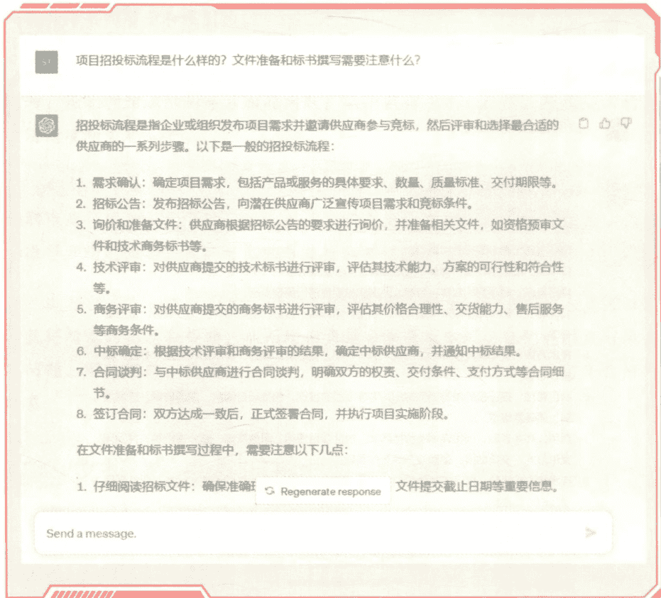

初步对 ChatGPT 提问后，可以看到 ChatGPT 给出的内容已经相对完善，但可能还有我们之前没有涉及的领域，因此我们选择进一步对 ChatGPT 进行追问，以掌握更多的细节。

在追问时，需要掌握以下追问的技巧，确保 ChatGPT 给出更精准的答复。

#### 【追一追】

追问细节。如果 ChatGPT 的回答有不清楚或不完整的地方，可以通过追问细节以获得更详细的解释或进一步的信息，如“标书内容需要包括哪些方面”。

使用相关关键词，有助于 ChatGPT 更好地理解我们的需求并提供相关的答案。如询问 ChatGPT，“如何对商务标书进行评审”“合同双方的责任与义务是什么”等。

#### 追问举例：

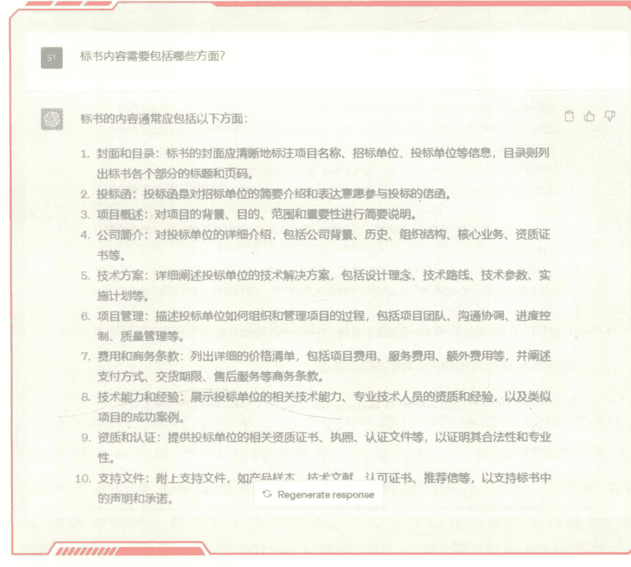

#### 【萃一萃】

掌握正确对 ChatGPT 进行追问的方法可以提升标书制作人员的工作能力和效率，主要表现在以下几个方面：

- **提供即时的帮助和答案。** 标书制作人员可以对 ChatGPT 进行合理的追问和提问，准确获取所需的信息，从而提高工作效率。
- **获取新的视角和创意。** 通过询问和追问 ChatGPT，标书制作人员可以得到新的视角、观点和创意，帮助他们更好地思考和展现项目的独特性，从而提升标书的质量和吸引力。
- **辅助语言表达和写作。** 标书制作人员可以向 ChatGPT 请教关于文案撰写、论述和组织结构等方面的问题，从中获得建议和指导，提高标书的表达清晰度和文笔水平。
- **解答专业领域问题。** 标书制作人员可以通过与 ChatGPT 的交互追问，获取专业领域知识和解答。这有助于他们更好地理解和回答关于技术、行业标准等方面的问题，提高标书的专业性和可信度。
- **增强自信和专业形象。** 通过正确的追问和交互，标书制作人员可以快速获得所需的信息和帮助，从而增强自信心和专业形象。他们能够更好地回答问题、解决疑惑，展现对项目的全面了解和专业素养，给客户留下良好的印象。

### 3.2.2 文本处理：生成项目开发流程思维导图

#### 任务：生成思维导图

##### 问答举例

用户提问：
制作一个开发项目流程的思维导图。

##### ChatGPT 回答：

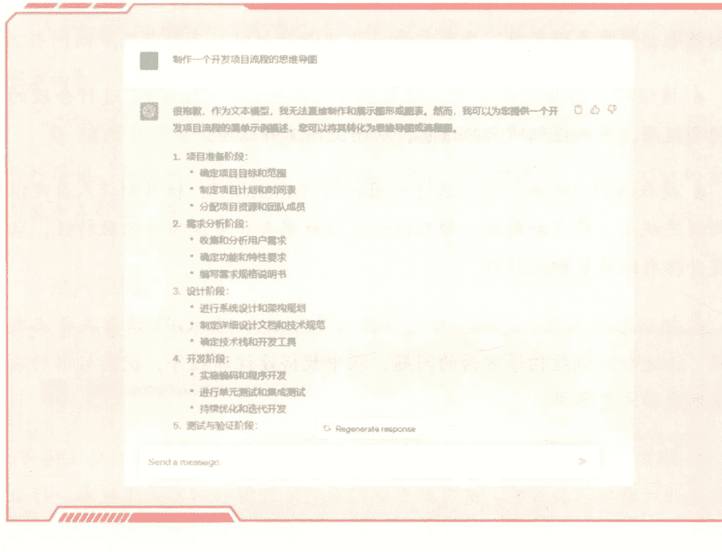

##### 【比一比】

用户提问：
制作一个开发项目流程的思维导图。

某智能 AI 聊天机器人回答：

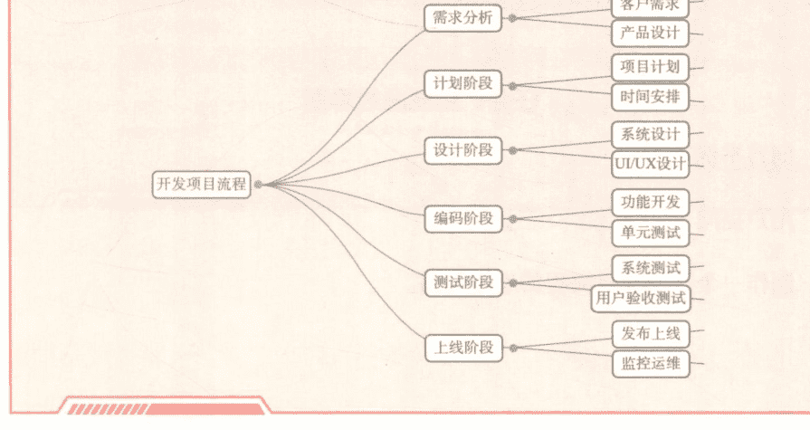

#### 【萃一萃】

通过对两个 AI 工具提供的答案进行对比，我们可以发现，ChatGPT 具备强大的自然语言理解和生成能力，能够理解输入的文本并生成连贯、流畅的回答，但还无法直接生成思维导图，需要接入其他相关软件的 API 才可以生成。因此，我们还应该掌握一些其他 AI 工具的使用方法，实现不同 AI 工具间的互相补充、互相赋能，帮助我们提升工作能力和效率。

### 3.2.3 文本摘要：生成图书摘要与会议纪要

#### 任务 1：生成文章摘要

##### 问答举例

用户提问：

《巴黎圣母院》的摘要如何总结？

ChatGPT 回答：

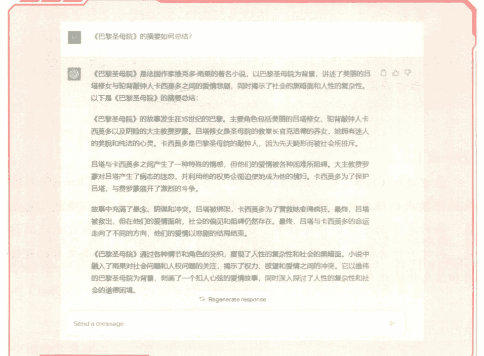

#### 【追一追】

通过对 ChatGPT 初步提问，我们得到了一段重点明确的摘要总结，上述摘要总字数为 500 多字。如果对字数有限制，则我们可以通过追问 ChatGPT，在提问中设置限制条件，让 ChatGPT 帮助我们生成更精练的内容总结。

#### 追问举例

用户提问：

将上述摘要的字数限制在 300 字以内。

ChatGPT 回答：

> 《巴黎圣母院》是维克多·雨果的著名小说，以 15 世纪的巴黎圣母院为背景。故事讲述了吕塔修女与驼背敲钟人卡西莫多之间的爱情悲剧。吕塔修女拥有美貌和纯洁的心灵，卡西莫多因先天畸形而被社会排斥。他们之间的爱情受到了大主教费罗蒙的阻挠，费罗蒙对吕塔产生了病态的迷恋。吕塔被绑架，卡西莫多为了保护她变得疯狂。最终，吕塔被救出，但他们的爱情以悲剧收场。小说揭示了社会的黑暗面和人性的复杂性，以雄伟的圣母院为背景，刻画了扣人心弦的爱情故事，同时深入探讨了权力、欲望和道德困境。
（注：以上内容由 ChatGPT 生成，未改动）

#### 【改一改】

通过追问 ChatGPT，我们能够实现对字数的控制，迫使 ChatGPT 在有限的字数内精练表达，使摘要更加简洁明了，突出关键信息，降低信息过载，同时也有助于提高传播效果。这种限制能够帮助读者更高效地获取信息，同时为作者提供一个更精练、更有吸引力的展示方式，提高文章的可读性和信息传达效率。

#### 任务 2：生成会议纪要

##### 问答举例

用户提问：

公司市场部今天召开了一个关于新产品上市工作安排的会议，可以提供一个会议纪要模板吗？

ChatGPT 回答：

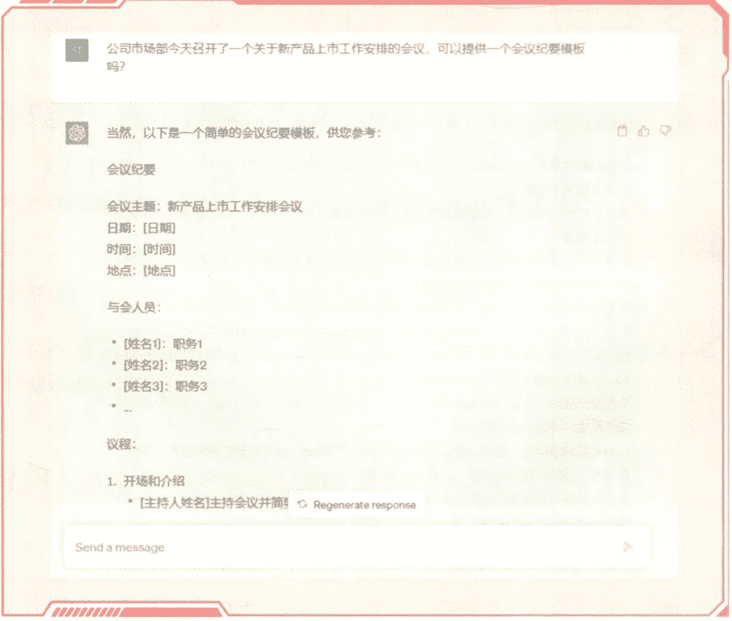

通过初步对 ChatGPT 提问，我们得到了一个简单的会议纪要模板，但仍存在一些问题没有明确，如如何正确编写会议纪要的内容。我们可以通过对 ChatGPT 再提问，拓宽视野，提高撰写会议纪要的效率和质量。

在追问 ChatGPT 时，我们需要掌握以下追问技巧，确保 ChatGPT 给出更精准的答复。

#### 【追一追】

追问细节。如果 ChatGPT 的回答有不清楚或不完整的地方，可以通过追问细节以获得更详细的解释或进一步的信息，如“如何正确编写会议纪要”“编写会议纪要的重点和注意事项”。

采用精练的语言表达要求，避免使用模糊或含糊不清的描述，以便 ChatGPT 更好地理解你的意图。

追问举例：

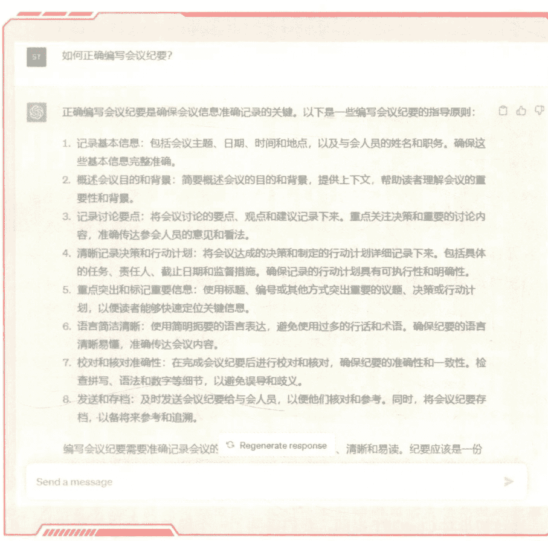

通过对 ChatGPT 的提问与不断追问，我们可以得到会议纪要模板和正确编写会议纪要的思路和建议；接下来，就需要对所有答复进行整合与优化，按照以下注意事项来进行编写，获得一份完美的会议纪要。

#### 【改一改】

- 会议纪要应该准确记录会议的重要信息，包括会议日期、时间、地点、与会人员名单、讨论议题和决策结果等。确保记录准确、详细，并按照会议的逻辑顺序进行组织。
- 会议纪要应该简明扼要，用清晰、简洁的语言表达要点。避免冗长的句子和不必要的细节，只记录与会议议题相关的核心信息。
- 使用适当的标题和段落划分，使会议纪要的结构清晰易读。可以按照议程顺序或主题进行组织，使用有序列表或编号列表来呈现关键信息。
- 在会议纪要中，引用与会者的具体观点、建议或重要发言，特别是涉及决策或行动项的部分，以提供准确的背景和上下文，帮助读者理解会议的讨论过程和决策依据。
- 将会议讨论的行动项和责任人明确记录下来，并标注截止日期，确保会议的成果能够及时落实，并提供后续跟进和评估的依据。
- 会议纪要应该客观中立，避免加入个人主观评价或情感色彩。只记录事实和议题的核心要点，不加入个人观点或偏见。
- 在发布或分发会议纪要之前，务必进行校对和编辑，确保语法正确、拼写准确，并检查纪要的连贯性和完整性。

## 3.3 最懂你的“文案文本助理”

### 3.3.1 提升生成质量

通过合理利用 ChatGPT 精细的算法设计和海量的数据积累，我们可以实现文案生成的质量和效率的逐步提高。以下是使用 ChatGPT 来提升文案质量的一些建议。

第一，与 ChatGPT 进行对话，分享你的想法和要传达的信息。ChatGPT 可以帮助你扩展思维，并提供新的观点和创意。你可以提出问题、请求建议或与 ChatGPT 进行交流，以获取关于文案的灵感和想法。

第二，提供你的现有文案草稿或关键信息，让 ChatGPT 为你提供修改建议。它可以帮助你发现不流畅的句子、提供更强有力的词汇选择，或者提供其他改进意见。你可以用 ChatGPT 进行迭代，逐步完善你的文案。

第三，描述你的目标受众，并让 ChatGPT 以他们的角度提供反馈。这可以帮助你了解潜在客户可能对你的文案做何反应，并使文本更好地符合他们的需求和兴趣。

第四，如果你想提升文案的吸引力和表达能力，可以向 ChatGPT 提供要强调的关键信息，并请求它提供更具吸引力的语言修饰建议。ChatGPT 可以帮助你增加文案的情感色彩、提高创造力和影响力。

第五，如果你打算在特定的平台或媒体上发布文案（如社交媒体、广告等），你可以向 ChatGPT 提供相关的信息，并请其提供适应该平台或媒体的建议。ChatGPT 可以帮助你调整文案长度、格式和风格，以更好地适应目标平台的要求。

### 3.3.2 增加辅助功能

除了纯文本生成，ChatGPT 还可以提供多种文案撰写辅助功能以提高文案撰写的效率和质量，以下是主要的几种功能。

第一，如果你有一个新的想法或概念，你可以与 ChatGPT 进行对话，以验证其可行性或进行初步研究。ChatGPT 可以提供相关信息、背景知识和思路，帮助你更好地理解和探索你的想法。

第二，如果你正在进行创造性写作，如小说、剧本或诗歌，ChatGPT 可以为你提供新的角度、情节发展和人物刻画建议。你可以与 ChatGPT 共同构建故事，探索不同的情节线索和结局。

第三，如果你想提升你的文本语言表达能力，你可以向 ChatGPT 提供上下文和关键信息，并请其提供更生动或吸引人的单词选择和语言风格建议。ChatGPT 可以帮助你改善文本的流畅性和语感。

第四，如果你需要进行学术研究或写作，你可以向 ChatGPT 提出相关问题，以获得相关研究领域的见解和参考资料。

第五，如果你需要一个简单的聊天机器人或客户支持工具，ChatGPT 可以用于回答常见问题、提供基本信息和指导。你可以训练 ChatGPT 以适应特定的业务场景，并将其集成到你的网站或应用程序中。

第六，当你需要给产品、品牌或项目命名时，ChatGPT 可以提供相关的词汇和创意建议。你可以提供关键信息和所需的风格，ChatGPT 可以帮助你生成新颖且符合目标的名称和品牌语言。

第七，通过输入文本数据，ChatGPT 可以发挥情感分析和舆情监测的功能。它可以帮助你了解文本的情感倾向、观点，以及公众对特定主题或产品的态度。

### 3.3.3 引入智能推荐

基于用户的需求特征和文案历史数据，结合图像识别、语义分析等技术，ChatGPT 可以向用户推荐更符合市场需求的文案样例和创意思路，为用户提供精准、个性化的辅助。我们可以通过以下步骤实现 ChatGPT 的有效智能推荐。

第一，在与 ChatGPT 的对话中，提供清晰的背景信息，包括你的产品、服务或品牌的特点，目标市场、目标受众，以及你想要实现的目标。这样能帮助 ChatGPT 更好地理解你的需求，为你提供更准确的文案建议。

第二，将你的市场研究和竞争分析结果与 ChatGPT 分享。讨论关键的市场趋势、目标受众的偏好和行为习惯，以及竞争者的营销策略。这样可以使 ChatGPT 了解当前的市场环境，为你提供更具针对性的建议。

第三，直接向 ChatGPT 提出特定的问题和场景，以获取符合市场需求的文案样例和创意思路。比如，你可以询问如何撰写一个吸引人的产品描述、如何强调产品的独特卖点、如何制作一个引人注目的广告标语等。ChatGPT 会根据你的问题提供相关的建议和示例。

第四，分享市场上成功的文案案例，并与 ChatGPT 一起分析它们的特点和效果。讨论这些成功案例的关键元素、情感激发、独特性和受众吸引力。这将帮助 ChatGPT 理解市场上的有效文案，并为你提供相似的创意和表达方式。

第五，与 ChatGPT 进行连续的对话，并逐步改进你的文案。给予 ChatGPT 明确的反馈。如果你觉得某个建议需要进一步优化或调整以符合市场需求，向 ChatGPT 提供相关的反馈，以帮助它更好地理解你的要求。

第六，尽管 ChatGPT 可以提供有用的建议，但仍然需要结合人工审查和专业意见。请将 ChatGPT 的建议与营销专家、同事或其他相关专业人士进行讨论，并获取他们的意见和建议。这样能确保你的文案符合市场需求并具备更高的质量。

第七，在使用 ChatGPT 的建议之前，进行试用和测试是很重要的。可以在小范围内尝试使用 ChatGPT 提供的文案样例，并监测其效果。根据反馈和数据，进行必要的调整和优化，以获得更符合市场需求的文案。

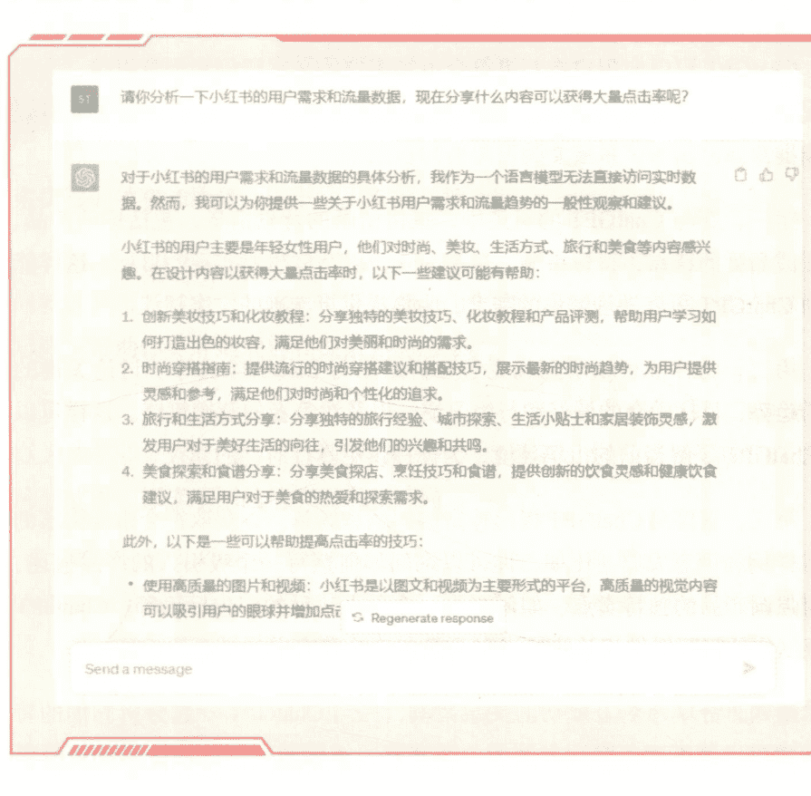

### 3.3.4 提高互动体验

通过自然的语言交互、多模态交互等技术手段，ChatGPT 能够成为与用户沟通的“伙伴”，让用户能够感受到写作过程中的趣味性和参与性。以下是几种提高与 ChatGPT 互动效率的方法。

第一，在与 ChatGPT 的对话中，尽量给出清晰、明确的指令和问题。确保你的问题不含糊，并提供所需的上下文信息，这样 ChatGPT 才能更好地理解你的需求并提供准确的回答。

第二，如果 ChatGPT 的回答不完全符合你的需求，不要犹豫，立刻追问或澄清。你可以进一步解释你的问题、提供更多细节，或者明确表达你期望得到的回答。这样可以引导 ChatGPT 给出你想要的答案。

第三，如果你希望 ChatGPT 的回答更加具体，可以使用关键词或短语来限定回答的范围。比如，你可以说“给我三个关于市场营销的例子”而不是简单地说“给我一些例子”。

第四，与 ChatGPT 进行多轮的连续对话，以便更深入地探索问题和话题。多轮对话可以帮助 ChatGPT 更好地理解上下文，并提供更准确的回答。你可以逐步迭代你的问题和回答，以获得更详尽的信息和建议。

第五，在与 ChatGPT 的互动中，提供反馈是非常重要的。如果 ChatGPT 的回答与你的期望不符或存在错误，请明确指出并提供相应的反馈。这有助于 ChatGPT 改进并提供更准确和有用的回答。

第六，尝试使用不同的问题和方式与 ChatGPT 互动，以探索其能力范围。有时，改变问题的表达方式或使用不同的提问角度可以获得更有创意和更有趣的回答。

第七，ChatGPT 是一个强大的工具，但结合其他资源和你自己的专业知识会得到更好的结果。使用 ChatGPT 的回答作为参考，并在决策之前综合考虑其他信息和观点。

总之，要不断优化和改进，提高文案生成质量与效率，增加文案辅助功能，加入推荐系统，提高人机互动体验。只有这样，ChatGPT 才能成为最懂你的“文案文本助理”。

## 3.4 创作“爆款文案”的6个步骤

### 3.4.1 确定文案主题和目标受众

文案主题和目标受众是紧密相关的。在使用 ChatGPT 之前，需要明确文案主题和目标受众，了解目标受众的需求、兴趣和偏好，帮助我们针对特定受众进行文案创作，并与他们建立共鸣，以便更好地指导文案创作过程。

文案主题和目标受众的确定有以下几种办法。

第一，明确推广或宣传的产品或服务，了解产品或服务的特点、功能、优势以及解决的问题。这有助于确定适合的文案主题。

第二，市场研究是确定文案主题和目标受众的重要步骤。了解目标市场的需求、趋势、竞争对手以及目标受众的偏好和行为习惯，可以发现潜在的文案主题和定位。

第三，详细了解目标受众，确定目标受众的年龄、性别、地理位置、职业、兴趣爱好、需求和痛点等关键特征。这样可以帮助你了解他们的需求，从而更好地针对他们撰写文案。

第四，明确文案的目标，是想提高品牌知名度、增加销售量、促进行动还是传达特定的信息。确定你的文案目标有助于更好地定义文案主题和选择适合的语言风格。

第五，综合以上信息，确定一个适合的文案主题。文案主题应与产品或服务相关，并能引起目标受众的兴趣。主题可以是一个关键问题、一个独特卖点、一种情感连接或一种特定的利益。

第六，基于目标受众的特征和需求，编写针对他们的文案。使用他们熟悉的语言风格，表达他们关心的问题，强调他们的利益和价值观。通过与目标受众建立共鸣和连接，增加文案的效果。

### 3.4.2 输入关键词或文案主旨

关键词或文案主旨在营销文案中扮演着关键的角色。精心选择和运用它们，可以吸引目标受众的注意力，传达核心信息，提高搜索引擎可见性，与目标受众建立共鸣，并触发购买行为。确定关键词或文案主旨时，我们应该考虑以下几个方面。

第一，产品特点或优势。如果你正在推广一款健康饮料，你可以选择与其健康特点或天然成分相关的关键词或文案主旨，如“天然能量提升”或“注入健康活力”等。

第二，目标受众的需求。考虑目标受众的需求和痛点，然后选择与之相关的关键词或文案主旨。如果你的产品是一种防晒霜，你可以选择“全面防护，呵护肌肤”或“抵御紫外线伤害”。

第三，解决方案或价值主张。思考你的产品或服务解决的问题，并选取与之相关的关键词或文案主旨。例如，当你提供网页设计服务时，你可以使用“打造令人印象深刻的网站”或“定制化设计，展现品牌独特之美”。

第四，情感激发。考虑触发目标受众情感的关键词或文案主旨。如果你的产品是一本关于心灵成长图书，你可以使用“探索内心的力量”或“改变生活的智慧之旅”。

第五，引起好奇心或兴趣。选择能够引起目标受众好奇心或兴趣的关键词或文案主旨。例如，如果你推广一种新型智能家居设备，你可以使用“创新科技，让家更智能”或“掌握未来家居的奇妙之道”等。

### 3.4.3 生成文案初稿

根据输入的关键词或文案主旨，ChatGPT 会自动生成一份初稿，包括标题、正文和结尾等部分，这里的初稿可以作为文案创作的基础。当与 ChatGPT 合作生成可用的文案初稿时，以下是一些详细的步骤和技巧。

第一，在与 ChatGPT 的对话中，明确传达你的需求和期望。给出关于产品、服务或主题的详细信息，包括其特点、目标受众、独特卖点等。这样可以帮助 ChatGPT 更好地理解你的目标和要求。

第二，通过逐步引导的方式与 ChatGPT 交互，以确保生成的文案初稿符合你的预期。分步进行交互可以确保 ChatGPT 更好地理解你的需求，并生成更有针对性和相关性的内容。比如，你可以先描述产品的特点，然后询问 ChatGPT 如何以吸引人的方式突出这些特点。

第三，为了更好地引导 ChatGPT 生成可用的文案初稿，你可以提供相关的例子、参考资料或示例句子。这些可以帮助 ChatGPT 更好地理解你的期望，并提供更符合要求的内容。例如，你可以引用类似产品的描述或已经存在的广告文案，以作为参考。

第四，向 ChatGPT 提出具体问题，可以引导它生成更具创意和针对性的回答。询问关于目标受众、市场竞争、产品优势、特殊促销活动等方面的问题，可以获得更具体和有针对性的文案建议。

第五，与 ChatGPT 进行交互时，记得不断进行迭代和反馈。如果 ChatGPT 生成的文案初稿不符合你的预期，应提供具体的反馈和指导。解释哪些方面需要改进，提出更具体的要求，并与 ChatGPT 共同进一步完善文案。

第六，ChatGPT 生成的文案初稿虽然有用，但仍然需要人工编辑和润色来提升质量。通过人工编辑，你可以调整语言表达、优化句子结构、确保准确性和清晰度，并适应特定的品牌风格和目标受众需求。

第七，尝试使用不同的互动方式来引导 ChatGPT 生成文案。可以尝试提问、描述场景、列举要点等不同的方式，以促使 ChatGPT 提供更多的创意和不同的角度。

### 3.4.4 完善文案初稿

根据自己的理解和文案要求，对生成的文案初稿进行修改和完善。可以加入更多的细节、情感元素和创意思路，使文案更具吸引力和说服力。在 ChatGPT 提供的文案初稿基础上进行完善可以考虑以下几个步骤。

第一，仔细审查 ChatGPT 生成的文案初稿。检查语法、拼写、标点等方面的错误，并进行必要的编辑和修正。确保文案的准确性和流畅性。

第二，优化文案结构，确保文案有清晰的结构和逻辑。组织文案内容，使其易于阅读和理解。使用段落、标题和子标题等元素，使文案更具层次结构。

第三，确认文案中的关键信息和亮点清晰明确。突出产品或服务的特点、优势和价值主张。确保这些关键信息能够吸引目标受众的注意力。

第四，重点突出产品或服务对目标受众的益处和价值。使用具体的例子、数据或客户案例，展示产品或服务的优势和解决问题的能力。

第五，根据目标受众和品牌定位，调整文案的语言风格和语气。确保文案与目标受众的口吻一致，并传达出品牌的个性和声音。

第六，如果适用，可以考虑在文案中添加社交证据和信任因素，如客户评价、认证标识、合作伙伴信息等。这些要素可以增强产品或服务的可信度和吸引力。

第七，在文案中加入行动口号或呼吁，激发目标受众采取行动。使用鼓励性的语言和动词，呼吁读者参与或购买。

第八，在使用完善后的文案之前，进行测试并获取反馈。可以向团队成员、朋友、同事或目标受众征求意见，根据反馈来进行调整和优化，确保文案更贴合目标受众的需求和偏好。

### 3.4.5 优化文案排版和格式

完成文案内容的修改后，需要对文案排版和格式进行优化。可以选择合适的字体、颜色和版式，使文案更加美观和易读。ChatGPT 可以从以下多个方面帮助我们优化文案的排版和格式。

第一，提供建议，指导我们如何将文本分成适当的段落。合理的文本分段可以增强阅读体验，使文案更易于读者理解和消化。

第二，帮助我们确定标题和子标题的最佳设置。可以询问 ChatGPT 关于标题的字体、大小和颜色选择，以及如何设置子标题的层次结构和格式。

第三，提供关于字体风格的建议。可以询问应该选择哪种字体以匹配品牌风格、如何确保文案中使用的字体风格一致，并且适合不同平台和媒体。

第四，提供引用和缩进样式指导。可以询问 ChatGPT 如何在文案中设置引用样式、缩进段落或使用特殊格式来突出引文。

第五，提供关于字体格式化的建议。询问 ChatGPT 如何在文案中使用加粗、斜体、下划线或其他格式化选项来强调关键词、重要信息或视觉效果。

第六，提供图表或图像的布局和对齐建议。询问 ChatGPT 如何使图表或图像与周围的文本融合得更好，以及如何使它们在不同设备上呈现良好。

第七，提供关于行距和段落间距的建议。可以询问 ChatGPT 如何设置合适的行距和段落间距，以提供良好的可读性和视觉吸引力。

第八，提供关于排版和格式化方面的兼容性和可访问性建议。询问 ChatGPT 如何使文案在不同平台、浏览器和设备上都能够正常显示，并遵循无障碍标准，以确保所有用户都能够访问和阅读你的文案。

### 3.4.6 测试与优化文案效果

完成文案创作后，需要进行测试和优化。可以通过以下方法，评估文案的效果和反馈，不断优化文案质量和效果。

第一，创建两个版本的文案（A 版本和 B 版本），然后将它们随机分配给不同的用户或用户群体。比较两个版本的文案在关键指标上的表现差异，如点击率、转化率、销售量等。这样可以确定哪个版本的文案效果更好，从而进行优化和改进。

第二，组织一些目标受众，展示不同版本的文案，并收集他们的反馈和意见。这可以帮助你了解受众对文案的理解、感受和观点，从而改进和优化文案。

第三，通过用户调查、反馈表单或在线调研等方式，收集用户对文案的评价和观点。询问用户对文案的吸引力、清晰度、说服力等方面的看法，以及他们的行为意向和反应。这些反馈可以为你提供改进文案的方向和灵感。

第四，通过跟踪关键指标，如点击率、转化率、页面停留时间等，来评估文案的效果。结合其他营销数据，如销售数据、用户行为数据等，分析文案对业务结果的影响。这样可以更直接地了解文案在实际营销中的表现，并采取相应的优化措施。

第五，根据测试结果和用户反馈，不断修改和优化文案。通过多次迭代和改进，逐步提高文案的效果和吸引力。

总之，使用 ChatGPT 进行文案创作需要注意理解文案主题和目标受众，根据自身需求和创意思路进行修改和完善；同时应注重文案排版和格式的优化，最终通过测试和优化创作出更具吸引力和说服力的“爆款文案”。

# 第4章 营销推广策略大咖

优秀的产品需要配套优秀的营销推广方案，才能更好地打开市场、抢占先机。营销推广活动很讲究效率性和时效性，也就是说要迅速制定出营销推广方案并在特定的时间范围内进行有效的营销推广活动，才能抓住市场机遇和消费者需求的高峰期，提高销售额和市场份额。

ChatGPT 可以根据用户的要求，迅速为用户生成其所需的营销推广策略，客户只须在 ChatGPT 的回答基础上稍做修改，就能迅速形成一份或多份营销推广策略文案，大大提高工作效率。

## 4.1 运用各种营销理论打造“爆品”

### 4.1.1 结合 4P、4C 理论做营销推广

##### 问答举例

用户提问：

假如你是一家科技公司的营销经理，请结合 4P、4C 理论，做一份客制化机械键盘的营销推广文案。

ChatGPT 回答：

> 作为科技公司的营销经理，我将根据 4P（产品、价格、渠道、促销）和 4C（顾客、成本、便利、沟通）理论，为客制化机械键盘设计一份营销推广方案。

1. 产品（Product）：
    * 定位：强调客制化、高品质、耐用性和个性化定制能力，满足用户追求个性化、高性能输入设备的需求。
    * 定制选项：提供多种键帽材质、键轴类型、背光效果和额外功能（如可编程按键）的选项，以满足不同用户的偏好和需求。
    * 创新特点：强调产品的独特设计、人体工程学布局和先进技术，吸引科技爱好者和游戏玩家。

2. 价格（Price）：
    * 定价策略：根据产品质量、定制化程度和竞争对手定价情况，制定合理的价格策略。
    * 多样化价格档位：提供不同价格档位的定制选项，以满足不同消费者的预算和需求。
    * 促销活动：定期举办限时折扣、捆绑销售或购买赠品等促销活动，吸引消费者购买。

3. 渠道（Place）：
    * 线下渠道：与科技产品零售店、电子消费品连锁店合作，将产品陈列在显眼位置，提供产品示范和试用体验。
    * 线上渠道：建立自有网站的在线商店，与知名电子商务平台（如 Amazon、JD、天猫等）建立合作关系，增加产品的可获得性和曝光度。
    * 合作伙伴：与游戏周边专门店、科技社区和线下活动（如展会和比赛）合作，扩大产品的曝光度和销售渠道。

4. 促销（Promotion）：
    * 数字营销：通过社交媒体（如 Facebook、Instagram、Twitter、Reddit 等）展示产品特点和定制选项，与目标受众进行互动和分享。利用在线广告和搜索引擎优化（SEO）提高品牌曝光度和网站流量。
    * 用户生成内容（UGC）：鼓励用户分享他们的定制机械键盘的照片、视频和评价，并在社交媒体上进行推广。设立 UGC 比赛，奖励最具创意和影响力的用户内容。
    * 媒体合作：与科技博主、游戏主播和行业专家合作，在他们的渠道上展示和推广定制机械键盘，并提供独家优惠和合作活动。

5. 顾客（Customer）：
    * 市场调研：定期进行市场调研，了解目标受众的需求、喜好和购买行为，以调整产品和营销策略。
    * 个性化定制：通过在线定制工具和用户友好的界面，让消费者能够自由选择键帽、键轴、背光效果等，满足其个性化需求。
    * 社交互动：积极回应消费者的问题和反馈，建立良好的互动和沟通渠道，增加用户参与度和忠诚度。
    * 忠诚计划：设立忠诚会员计划，提供独家优惠、生日礼物和积分奖励，以促进重复购买和口碑传播。

6. 沟通（Communication）：
    * 清晰的品牌定位：确保品牌形象和传播信息一致，突出产品的个性化、高品质和用户体验。
    * 内容营销：创建有价值的内容，例如产品指南、教程和键盘技巧分享，吸引目标受众并建立品牌权威性。
    * 社交媒体互动：积极回应消费者的评论和提问，参与相关讨论和话题，提高用户互动和社交影响力。
    * 公关活动：参加行业展会、比赛和活动，展示产品并与潜在客户和合作伙伴进行面对面交流。

7. 成本（Cost）：
    * 价值宣传：强调产品的性价比，将高品质和个性化定制的优势与价格相匹配。
    * 金融方案：与金融机构合作，提供分期付款或零利率分期付款等灵活的购买选择，降低购买门槛。

8. 便利（Convenience）：
    * 用户友好的网站和应用程序：设计简洁直观的用户界面，使消费者能够轻松选择和定制他们的机械键盘。
    * 快速交付：与可靠的物流合作伙伴合作，提供快速、安全的产品交付服务，缩短等待时间。
    * 售后支持：建立全面的售后支持系统，包括在线客服、技术支持和退换货政策，确保消费者有良好的购物体验。

通过综合运用 4P 和 4C 理论，结合产品、定价、渠道和促销等方面的策略，可以为客制化机械键盘制定一份综合而有效的营销推广方案，以提高产品的知名度、销量和用户满意度。

（注：以上内容由 ChatGPT 生成，未改动）

在上述问题中，本书只是要求 ChatGPT 做一份客制化机械键盘的营销推广文案，并没有强调是营销推广计划还是方案，而 ChatGPT 自动生成了方案。不过我们并不能完全照搬 ChatGPT 的回答，而要在它的回答基础上去研究分析，看一下是否有遗漏或过于空洞、简略的地方。

### 4.1.2 结合 SWOT 分析理论做营销推广

##### 问答举例

> 你好，你现在的角色定位是一家科技公司的产品经理，你公司拟面向年轻人推出一款主打个性化的插座，请结合SWOT分析理论做一份关于插座的营销推广方案。

你好！作为一名科技公司的产品经理，推出一款主打个性化的插座的营销推广方案是一个很有趣的任务。下面是一份基于SWOT分析理论的插座营销推广方案：

1. Strengths (优势):
    * 技术创新：该插座具有创新的技术特性，能够满足年轻人对个性化、便利性和智能化的需求。
    * 定制化功能：插座可以根据用户的喜好和需求进行个性化定制，提供不同的颜色、图案和功能选项。
    * 高质量与安全：确保插座的高质量和安全性能，以满足用户对产品质量和安全性的要求。

2. Weaknesses (劣势):
    * 高价位：由于技术创新和个性化定制等因素，插座可能相对较昂贵，这可能成为一些消费者购买的障碍。
    * 竞争压力：市场上已经存在许多传统插座品牌和其他智能插座产品，因此需要通过差异化和创新来突出产品的独特性。

3. Opportunities (机会):
    * 市场需求：年轻人对个性化和智能化产品的需求日益增加，这为个性化插座的推广提供了良好的市场机会。
    * 社交媒体：利用社交媒体平台进行推广，通过吸引年轻人的关注来提高品牌知名度。

【扫码查看完整问答过程】

#### 用户提问：

你好！你现在的角色定位是一家科技公司的产品经理，你公司拟面向年轻人推出一款主打个性化的插座，请结合 SWOT 分析理论做一份关于插座的营销推广方案。

#### 讯飞星火认知大模型回答：

作为一家科技公司的产品经理，我们的目标是通过 SWOT 分析理论来制定一份关于年轻人个性化插座的营销推广方案。首先，我们需要了解这个产品的优势（Strengths）、劣势（Weaknesses）、机会（Opportunities）和威胁（Threats）。

#### 优势：

1. 个性化设计：我们的插座可以根据年轻人的喜好和需求进行定制，满足他们对独特性和个性化的需求。
2. 智能功能：插座具备智能控制功能，可以通过手机 APP 实现远程控制、定时开关等操作，提高生活便利性。
3. 安全性能：插座采用高品质材料制作，具有良好的防火、防漏电等安全性能。

#### 劣势：

1. 成本较高：由于采用了个性化设计和智能功能，成本相对较高，可能影响市场竞争力。
2. 品牌知名度较低：相比于市场上已有的品牌，我们的品牌知名度较低，需要通过营销手段提高知名度。
3. 需要时间积累口碑：由于是新产品，消费者可能需要一段时间的试用和体验后才能形成口碑。

#### 机会：

1. 年轻人消费力增强：随着年轻人收入水平的提高，他们的消费能力也在不断增强，为我们的插座市场提供了有利条件。
2. 智能家居市场需求增长：随着智能家居市场的快速发展，消费者对于智能插座的需求也在不断增加。
3. 互联网营销优势：我们可以利用互联网平台进行精准营销，提高产品的曝光度和市场份额。

#### 威胁：

1. 竞争对手众多：市场上已经有很多品牌的插座产品，竞争非常激烈。
2. 法规政策限制：一些国家和地区对于电子产品的安全性能和电磁兼容性有一定的法规政策限制，可能会对我们的产品造成一定影响。
3. 技术创新压力：随着科技的不断发展，消费者对于产品的功能和性能要求也在不断提高，我们需要不断进行技术创新以保持市场竞争力。

基于以上分析，我们制定以下营销推广方案：

1. 利用社交媒体进行宣传：通过微博、微信、抖音等社交媒体平台发布有关产品的信息和使用案例，吸引年轻人关注和分享。
2. 与网红合作进行产品推广：与一些在年轻人中有影响力的网红合作，让他们使用并推荐我们的产品，提高产品的知名度和美誉度。
3. 举办线下活动：在一些年轻人聚集的地方举办线下活动，如校园、商场等场所，让消费者亲身体验产品并收集反馈意见。
4. 提供优惠购买政策：针对新用户提供一定的优惠购买政策，如免费赠送一款配件或降价促销等，吸引消费者购买。
5. 不断优化产品功能：根据消费者的反馈意见，不断优化产品的功能和性能，提高用户体验满意度。

（注：以上内容由讯飞星火认知大模型生成，未改动）

##### 【比一比】

上述回答是 ChatGPT 和讯飞星火认知大模型对于同一个问题的不同回答，二者都进行了 SWOT 分析并生成了营销推广方案，符合我们提问的要求，存在的问题是内容都比较少。因此，我们可以融合二者的答案，使最终的方案内容充实且可行。

目前，市面上除了 ChatGPT、文心一言、讯飞星火认知大模型，还有通义千问、360 智脑、盘古大模型等人工智能。我们在工作中，可以综合使用多个人工智能的回答，迅速形成自己需要的文案，而不是只专注于使用某一个人工智能，否则长此以往，可能会陷入“信息茧房”。所谓“信息茧房”是指一个人只接触和接受符合自己现有观点和偏好的信息，而忽视了其他观点和多样的信息来源。

### 4.1.3 结合定位理论做营销推广

##### 问答举例

假如你是一家公司的营销总监，你公司已生产出先进的智能锁，请结合定位理论，做一份关于智能锁的营销推广。

作为一家公司的营销总监，针对公司生产的先进智能锁，我将结合定位理论，制定一份关于智能锁的营销推广方案。

1. 目标市场确定：
    * 定义目标受众：针对年轻的都市白领、家庭用户以及对科技和安全性感兴趣的消费者。
    * 确定目标市场特点：如关注家庭安全、注重便利性、追求科技创新的消费者。

2. 差异化定位：
    * 突出智能功能：强调智能锁的高级技术、智能化功能，如指纹识别、远程控制等，提供方便快捷的家居安全解决方案。
    * 强调安全性：强调智能锁的高级加密技术、防盗功能和防破坏设计，提供可靠的安全保障。
    * 强调简洁设计：突出智能锁的现代简约外观，适应各种家居风格，满足消费者对美学设计的需求。

3. 宣传和推广策略：
    * 网络宣传：建立专业网站，突出智能锁的特点和优势，包括智能功能、安全性、简约设计等，并提供在线购买选项。
    * 社交媒体营销：利用社交媒体平台，发布智能锁的使用案例、用户评价、安全小贴士等，吸引目标受众的关注和分享。

【扫码查看完整问答过程】

#### 【萃一萃】

在使用 ChatGPT 的过程中，对其和用户进行角色定位是重要的技巧。在上述问答中，本书给 ChatGPT 的角色定位是营销总监，它就会把自己代入营销总监的身份，去生成一份智能锁营销推广方案。

如果 ChatGPT 的回答中有很多难懂的专业名词，导致用户难以理解，这时你可以定位自己的角色是普通人、“小白”、小学生、业余人士等，比如你可以对 ChatGPT 说：“你刚才的回答过于专业，我理解不了。我的身份是小学生，请重新组织语言，让我看得懂你的回答。” ChatGPT 就会重新回答，举一些简单的例子，把抽象的回答变得具体。

### 4.1.4 结合竞争理论做营销推广

##### 问答举例

#### 用户提问：

假如你是一家公司的营销经理，请结合竞争理论，根据手机散热器的特性和市场现状，做一份关于手机散热器的营销推广方案。

##### ChatGPT 回答：

作为一家公司的营销经理，针对手机散热器的特性和市场现状，我将结合竞争理论，制定一份关于手机散热器的营销推广方案。

1. 目标市场确定：
    * 定义目标受众：面向广大手机用户，尤其是游戏玩家、多媒体使用者以及常用大型应用程序的用户。
    * 确定目标市场特点：关注手机性能和体验，有需求解决手机散热问题的用户。

2. 竞争分析：
    * 研究竞争对手：了解市场上已有的手机散热器品牌和产品特点，包括散热效果、适配性、外观设计等。
    * 分析竞争对手的优势和劣势：找出竞争对手的差异化点，为自己的产品定位和推广提供依据。

3. 差异化定位：
    * 散热性能突出：强调手机散热器的高效散热技术，能够有效降低手机发热问题，提供更好的使用体验。
    * 适配多种手机：突出手机散热器的广泛适配性，适用于各种手机品牌和型号，增加产品的可覆盖范围。
    * 便携轻便设计：强调手机散热器的小巧轻便设计，便于携带和使用，不占用手机的使用空间。

4. 宣传和推广策略：
    * 网络宣传：建立专业网站，展示手机散热器的散热效果和用户体验，提供在线购买选项和使用说明。
    * 社交媒体营销：利用社交媒体平台，发布手机散热器的使用案例、用户评价、散热技术解读等内容，吸引目标受众的关注和分享。
    * 合作伙伴推广：与手机品牌、电子产品零售商等建立合作伙伴关系，推荐手机散热器作为手机配件，提供样品和展示以增加市场渗透。
    * 口碑营销：激励消费者分享手机散热器的使用体验和评价，提供优惠券或折扣码，引导消费者在社交媒体平台和产品评论网站上发布正面评价。
    * 活动和展览：参加手机展览和科技活动，展示手机散热器的实际散热效果，与行业内的专业人士和媒体进行合作，进行产品演示和评测，增加产品的知名度和可信度。

5. 价格策略：
    * 根据市场需求和竞争对手定价，考虑产品的散热性能、适配性和设计特点，制定合理的价格策略。可以提供不同档次和型号的手机散热器，以满足不同消费者的需求和购买力。

6. 品牌建设：
    * 打造手机散热器的独特品牌形象，强调品牌的专业性、可靠性和创新性。通过品牌建设和宣传活动，提升品牌在消费者心目中的认知和价值。

7. 客户服务和售后支持：
    * 建立专业的客户服务团队，提供快速响应和解决消费者问题的能力，以增强消费者对手机散热器的信任和满意度。
    * 提供产品保修和售后服务，确保消费者在使用手机散热器时的顺畅体验。

通过以上的营销推广方案，公司可以突出手机散热器的优势，并与目标市场建立紧密的联系。竞争理论的运用有助于将手机散热器与竞争对手区分开来，并满足消费者对手机散热问题的需求，从而提高产品的市场份额和销售效果。

（注：以上内容由 ChatGPT 生成，未改动）

## 4.2 营销推广 4 个应用场景与 6 项任务示范

### 4.2.1 新产品推广：生成新产品发布策划案与 SWOT 分析报告

#### 任务 1：生成新产品发布策划案

**问答举例**

你好，我是一家叫xxx科技公司的产品经理，我将要发布一款新产品——太阳能手持小风扇，请生成新产品发布会策划案。

新产品发布会策划案：太阳能手持小风扇

**活动目标：**

- 引起媒体和受众的广泛关注
- 向观众展示太阳能手持小风扇的创新特点和功能
- 传达产品的核心价值和优势
- 与潜在客户和合作伙伴建立联系
- 增强公司品牌形象和市场影响力

**活动概述：**

1. 时间和地点：
   - 日期：[具体日期]
   - 时间：[具体时间]
   - 地点：[具体地点]
2. 主持人和嘉宾：
   - 主持人：选择一位有经验且充满活力的主持人，负责整个活动的流程和互动环节。
   - 嘉宾：邀请相关行业专家、媒体、合作伙伴等，并参与产品展示和演讲。

Send a message

【扫码查看完整问答过程】

#### 任务 2：生成新产品 SWOT 分析报告

**用户提问：**

请生成上述新产品的 SWOT 分析报告。

**ChatGPT 回答：**

### 太阳能手持小风扇的 SWOT 分析报告

**一、Strengths（优势）：**

1. 太阳能供电技术：太阳能手持小风扇采用太阳能供电技术，无需外部电源，节能环保，符合现代消费者对可再生能源的需求。
2. 便携轻巧设计：小巧轻便的设计使太阳能手持小风扇易于携带和使用，适用于户外活动、旅行和日常生活中的清凉体验。
3. 多功能操作：提供多档风速调节和可调节的风向功能，满足用户个性化需求。
4. 品牌影响力：公司拥有强大的品牌影响力和市场声誉，为产品的推广和销售提供有力支持。

**二、Weaknesses（劣势）：**

1. 依赖太阳能供电：太阳能手持小风扇的供电依赖于太阳能，在天气阴暗或室内环境下使用受限，可能影响产品的连续使用体验。
2. 市场竞争：太阳能手持小风扇市场竞争激烈，存在其他品牌和类型的便携风扇产品，需要通过独特的优势和市场推广来区别竞争对手。

**三、Opportunities（机会）：**

1. 环保意识增强：消费者对环保产品的需求与日俱增，太阳能手持小风扇符合环保节能的趋势，有机会吸引更多消费者的关注和购买。
2. 不断增长的户外市场：户外活动的流行度和频率不断增长，太阳能手持小风扇可以满足户外爱好者对便携性和清凉舒适的需求。
3. 新兴市场拓展：在一些新兴市场和地区，对太阳能产品的需求还未充分满足，公司可以积极开拓这些市场，扩大产品销售范围。

**四、Threats（威胁）：**

1. 市场竞争加剧：太阳能手持小风扇市场竞争激烈，可能会面临来自其他品牌和类型的便携风扇的竞争压力。
2. 技术变革：技术的不断变革可能会导致新型的便携风扇产品问世，对太阳能手持小风扇的市场地位构成挑战。

**五、战略建议：**

1. 强化品牌推广：进一步加强太阳能手持小风扇的品牌推广，突出其独特的太阳能供电技术和便携性，提高消费者对产品的认知度和忠诚度。
2. 持续创新和改进：不断进行产品创新和改进，提升产品性能和用户体验，保持技术领先地位，以应对竞争和满足消费者不断变化的需求。
3. 拓展市场渠道：积极拓展销售渠道，与零售商、电商平台等合作，增加产品的销售渠道和覆盖范围，扩大市场份额。
4. 加强客户服务：提供优质的售后服务和客户支持，建立良好的客户关系，增强客户满意度和口碑，促进产品口碑传播和品牌形象提升。

通过以上的 SWOT 分析和相应的战略建议，公司可以更好地把握太阳能手持小风扇产品在市场中的优势和机遇，同时应对劣势和威胁，以实现产品的成功推广和市场份额的增长。这些建议需要在实施过程中持续评估和调整，以适应不断变化的市场环境和消费者需求。

（注：以上内容由 ChatGPT 生成，未改动）

**【追一追】**

报告的字数一般在 3000 字左右，本报告仅有不到 1000 个字，很明显不符合报告的字数要求。从头读到尾，会发现本报告有点泛泛而谈，让人不得要领。因此，我们可以对 ChatGPT 回答的重要却不明确的部分进行追问，直接复制 ChatGPT 回答的内容，再用 “Shift+Enter” 加上 “怎么进行创新和改进，请展开说一下，谢谢你” 或者 “请展开详细说一下，谢谢”，ChatGPT 就会理解你的意思并展开说。示例如下。

**用户追问：**

刚刚你提及，“持续创新和改进：不断进行产品创新和改进，提升产品性能和用户体验，保持技术领先地位，以应对竞争和满足消费者不断变化的需求”。

怎么进行创新和改进，请展开说一下，谢谢你。

**ChatGPT 回答：**

进行创新和改进是提升产品性能和用户体验的关键。以下是一些方法和途径，可以帮助公司实施创新和改进：

1. **市场调研和用户反馈**：通过市场调研和收集用户反馈，了解消费者的需求和期望。这可以通过定期进行市场调研调查、用户满意度调查、产品测试和用户反馈渠道等方式来实现。借助这些信息，公司可以确定产品的改进方向和重点。
2. **技术研发和合作**：公司可以不断进行技术研发，探索新的技术和材料，以提升产品性能和功能。此外，与合作伙伴、供应商或科研机构合作也是推动创新的重要途径。合作可以带来跨界合作、技术转移和共享资源的机会，加快创新的进程。
3. **设计优化**：通过产品设计的改进，提升产品的外观、人机交互和使用便捷性。借助先进的设计软件和技术，进行产品模型制作和可视化展示，从而更好地理解和优化产品的外观和用户体验。
4. **功能增强和差异化**：通过增加新的功能和特色，使产品在市场上具备差异化竞争优势。例如，可以考虑增加智能化控制、蓝牙连接、可调节风向等新功能，以满足不同用户的需求和提升产品的吸引力。
5. **材料和能效改进**：通过采用新型材料和能效技术，提升产品的能效和持久性。例如，优化电池技术、使用高效的太阳能电池板、采用轻质和环保材料等，以提高产品的性能表现和可持续性。
6. **用户体验测试和反馈**：在产品改进过程中，进行用户体验测试和反馈收集，以评估改进措施的效果和用户满意度。可以组织小规模的测试群体或进行用户实地体验活动，收集用户的反馈和意见，从而进一步改进产品。
7. **持续改进和迭代**：创新是一个持续的过程，公司应该建立持续改进的机制和文化。通过定期的产品评估、团队讨论和内部反馈循环，不断改进产品，以适应市场需求和技术进步。

> （注：以上内容由 ChatGPT 生成，未改动）

上述内容是 ChatGPT 展开说的，指出了 7 个创新和改进的方法和途径，有利于为写报告形成内容上的支撑。对于大多数的文案，我们不能直接用 ChatGPT 写的，而是要在它写的基础上去粗取精、删繁就简、优化组合，才能形成一篇真正的报告。可以说，ChatGPT 的作用就是辅助我们提高工作效率。原本两个小时能写出的报告，在 ChatGPT 的帮助下，可能只需要 30 分钟。

如果还是觉得内容不够，可以让 ChatGPT 继续补充内容，最简单粗暴的是说“继续”，它就会补充内容。当然，这种方式比较粗放，适用于没灵感、没脉络、没方向的时候。实际上，精细的方式应当是对它提出其他新的要求，或者向其提供数据。

**【萃一萃】**

上述演示中均没有体现数据，在实际使用的过程中，我们可以向 ChatGPT 提供具体的数据，以便其生成更符合实际需求的报告。

### 4.2.2 客户挖掘：生成客户满意度调查问卷

#### 任务：生成客户满意度调查问卷

**问答举例**

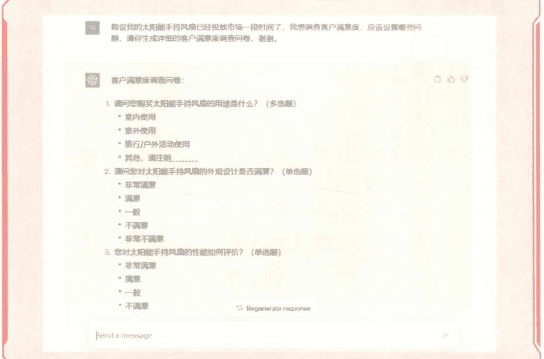

【扫码查看完整问答过程】

**【萃一萃】**

本书对上述 ChatGPT 的回答只能打 70 分，因为上述回答过于四平八稳，虽然合格了，但是没有体现出特色。因此，我们在实际工作中，可以在 ChatGPT 回答的基础上，手动加入一两条有特色的问卷问题，迅速形成一份调查问卷，但这总比我们一字一句去敲键盘快得多。经过本书测试，使用 ChatGPT 辅助设置问卷调查问题耗时 5 分钟，而自己独立设置问卷调查问题要耗时 40 分钟。

### 4.2.3 客户筛选：生成意向客户分析报告

#### 任务：生成意向客户分析报告

**问答举例**

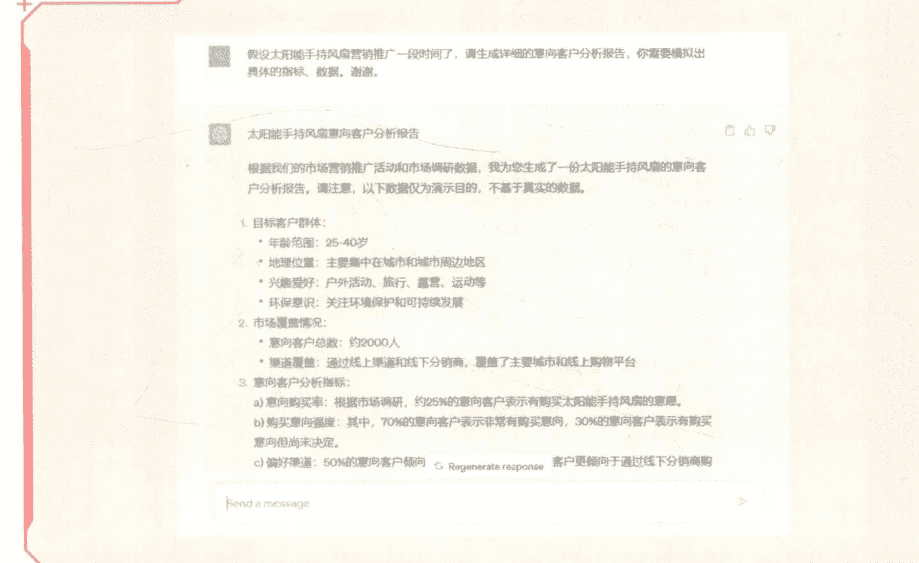

**用户提问：**

假设太阳能手持风扇营销推广一段时间了，请生成详细的意向客户分析报告，你需要模拟出具体的指标、数据。谢谢。

**ChatGPT 回答：**

### 太阳能手持风扇意向客户分析报告

根据我们的市场营销推广活动和市场调研数据，我为您生成了一份太阳能手持风扇的意向客户分析报告。请注意，以下数据仅为演示目的，不基于真实的数据。

**1. 目标客户群体：**

- 年龄范围：25-40 岁
- 地理位置：主要集中在城市和城市周边地区
- 兴趣爱好：户外活动、旅行、露营、运动等
- 环保意识：关注环境保护和可持续发展

**2. 市场覆盖情况：**

- 意向客户总数：约 2000 人
- 渠道覆盖：通过线上渠道和线下分销商，覆盖了主要城市和线上购物平台

**3. 意向客户分析指标：**

a) 意向购买率：根据市场调研，约 25% 的意向客户表示有购买太阳能手持风扇的意愿。
b) 购买意向强度：其中，70% 的意向客户表示非常有购买意向，30% 的意向客户表示有购买意向但尚未决定。
c) 偏好渠道：50% 的意向客户倾向于线上购买，40% 的意向客户更倾向于通过线下分销商购买，10% 的意向客户在两种渠道之间犹豫。
d) 价格敏感度：根据市场调研，大约 60% 的意向客户表示对产品价格敏感，30% 的意向客户认为合理的价格范围可以接受，10% 的意向客户对价格不太敏感。

**4. 竞争分析：**

a) 竞争对手：市场上存在几家竞争对手提供类似的太阳能手持风扇产品，其中以品牌 A 和品牌 B 为主要竞争对手。
b) 品牌差异化：太阳能手持风扇产品的差异化特点包括高效的太阳能供电、创新的设计和结构、便携性和耐用性等。
c) 市场份额：目前，我们的太阳能手持风扇在目标市场中占据约 30% 的市场份额，品牌 A 和品牌 B 分别占据 40% 和 30% 的市场份额。

**5. 营销策略效果：**

a) 市场反应：根据市场调研和销售数据的分析，以下是太阳能手持风扇营销推广活动的效果指标：
- 品牌知名度提升：根据调查数据，品牌知名度在推广活动后增加了 15%。
- 市场份额增长：太阳能手持风扇的市场份额在推广活动期间增长了 10%。
- 销售增长：销售额在推广活动期间增长了 20%。
- 新客户获取：通过推广活动，成功吸引了约 500 位新客户。
- 网络曝光度：推广活动在社交媒体和线上平台上获得了超过 100 万次的曝光。

**6. 反馈和评价：**

根据客户反馈和评价，以下是他们对太阳能手持风扇的主要认可点和建议改进点：

**认可点：**

- 高效的太阳能供电，方便在户外使用。
- 创新的设计和轻便的结构，便于携带和储存。
- 强劲的风力和静音运行，提供舒适的风扇体验。
- 耐用的材料和优质的制造质量，增加产品的寿命。

**建议改进点：**

- 提供更多的颜色选择，以满足不同用户的个性化需求。
- 进一步提升产品的电池寿命和充电效率，以延长使用时间。
- 增加可调节风速和风向的功能，以满足不同场景下的需求。
- 提供更清晰和详细的产品说明书和使用指南。

向强度。通过营销推广活动，我们成功提升了品牌知名度和市场份额，并实现了销售增长和新客户获取。客户对产品的认可度较高，同时也提出了一些改进建议，以进一步满足他们的需求和提升用户体验。我们将继续监测市场动态和竞争情况，不断改进产品和营销策略，以保持竞争优势并提升客户满意度。请注意，以上数据仅为模拟分析结果，不基于真实的市场数据。如有需要，我们可以根据实际情况进行更详细的分析和报告。

（注：以上内容由 ChatGPT 生成，未改动）

**【追一追】**

在上述问答中，ChatGPT 在最后说道：“如有需要，我们可以根据实际情况进行更详细的分析和报告。”我们可以直接复制这一句，再用“Shift+Enter”打上“好啊，需要”，ChatGPT 就能理解我们的意思。

**用户追问：**

如有需要，我们可以根据实际情况进行更详细的分析和报告。
好啊，需要。

**ChatGPT 回答：**

非常好，请提供以下详细信息，以便进行更准确和个性化的分析和报告：

1. 市场数据：
   a) 产品销售数据：请提供过去一年的销售数据，包括销售额、销售渠道、销售地区等信息。
   b) 市场份额数据：请提供目标市场中太阳能手持风扇的市场份额数据，包括竞争对手的市场份额。
2. 营销推广数据：
   a) 推广活动详情：请提供过去一年的推广活动详情，包括活动内容、渠道、投入费用等信息。
   b) 推广效果数据：请提供推广活动期间的数据，如品牌知名度提升、市场反应、销售增长、新客户获取等指标数据。
3. 客户反馈数据：
   a) 客户满意度调查结果：如果有进行过客户满意度调查，请提供调查结果和客户反馈数据。
   b) 客户评价和建议：请提供客户对产品的评价和建议，以便进行更详细的分析和改进方向。

请将以上信息发送给我们，我们将根据实际情况进行深入分析和生成个性化的报告。如有任何进一步的需求或问题，请随时与我们联系。

> （注：以上内容由 ChatGPT 生成，未改动）

ChatGPT 要求我们给出市场数据、营销推广数据、客户反馈数据，我们可以随便拟一些数据给它，看它是怎么回答的。

**ChatGPT 回答：**

基于以上数据，我们可以得出以下结论和建议：

- 销售额：过去一年的销售额为 700 万元人民币，反映出太阳能手持风扇在市场中的一定竞争力。
- 市场份额：目前太阳能手持风扇在目标市场中的市场份额为 29.77%，竞争对手的市场份额相对较高。
- 推广活动效果：通过赞助户外电视节目和推广短视频等活动，您成功提高了品牌知名度和产品曝光度。
- 客户满意度：约 41% 的客户表示满意，其中客户希望降低产品价格。

根据客户反馈，我们建议：

- 价格策略：考虑对产品进行定价优化，以满足客户对价格的敏感性，提高市场竞争力。
- 市场份额提升：加强与竞争对手的差异化竞争，提升市场份额。
- 产品创新：持续进行产品创新，提升产品的性能和功能，以吸引更多的消费者，并与竞争对手区分开来。例如，可以考虑增加更多的风速档位、改善电池寿命等方面的改进。
- 市场定位：进一步明确目标市场和受众群体，以便更有针对性地制定营销策略和推广活动。了解目标市场的偏好和需求，以满足他们的期望。
- 品牌建设：加强品牌建设，提高品牌形象和认知度。通过品牌宣传、广告、社交媒体等渠道，传递产品的核心价值和优势，树立品牌的信任和价值。
- 客户关怀：建立良好的客户关系管理系统，与现有客户进行有效沟通和互动。了解客户的反馈和需求，及时回应和解决问题，提供优质的售后服务，增强客户忠诚度和口碑传播。
- 渠道拓展：考虑拓展销售渠道，以覆盖更广泛的市场和目标群体。除了电商直播渠道，可以考虑与实体店、线下渠道合作，扩大产品的销售渠道和触达面。

**总结：**

通过持续创新和改进，太阳能手持风扇可以不断提升产品性能和用户体验，满足消费者不断变化的需求。在市场营销方面，重点关注产品定价、品牌建设、客户关怀和渠道拓展等方面，以增强市场竞争力，并提高客户满意度和市场份额。

（注：以上内容由 ChatGPT 生成，未改动）

**【萃一萃】**

通过上述演示，我们可以看出，ChatGPT 对我们随机提供的数据进行了归纳整理，并在此基础上提出了多条建议，虽然都是泛泛而谈，但不可否认的是，我们在 ChatGPT 的辅助下，可以大大提高工作效率。

需要注意的是，我们不能完全依赖 ChatGPT 等 AI 工具去完成某一项工作，哪怕是 ChatGPT 生成的一封简单的感谢信、催款函，我们也需要稍加修改、反复检查后才能发出去。

### 4.2.4 营销调研：生成市场调查问卷与消费者需求偏好分析报告

#### 任务 1：生成市场调查问卷

**问答举例**

你好，我公司是一家玩偶公仔生产厂商，我公司拟开发一款或多款面向年轻人的整蛊玩偶公仔，但是不知道年轻人具体的需求和偏好，请模拟年轻人的各方面的需求和偏好，生成一份可行的、有针对性的市场调查问卷，为后续的生产、营销、推广提供数据支持。

当然，我可以帮您生成一份面向年轻人的市场调查问卷。以下是一份可行的问卷，请根据您的具体需求进行适当调整和定制。

尊敬的参与者，

感谢您参加本次市场调查。该调查旨在了解年轻人对整蛊玩偶公仔的需求和偏好，以便我们能够开发出符合您期望的产品。请您耐心回答以下问题，您的宝贵意见对我们的产品开发和市场营销非常重要。

1. 您的年龄范围是：
   * 18岁以下
   * 18-24岁
   * 25-34岁
   * 35岁以上

2. 您是否对整蛊玩偶公仔感兴趣？

【扫码查看完整问答过程】

#### 任务 2：生成消费者需求偏好分析报告

**问答举例**

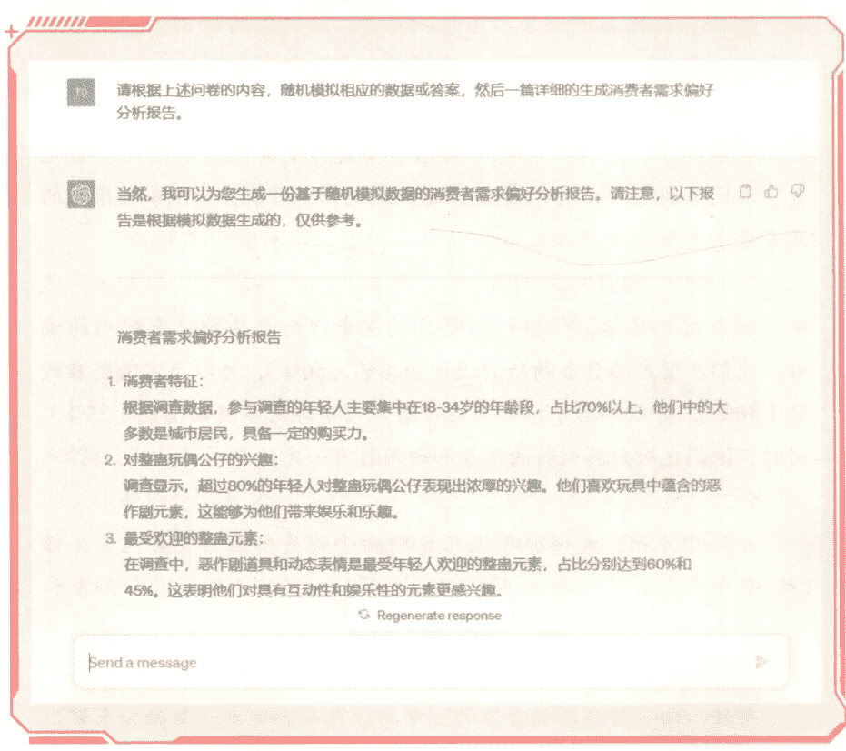

**用户提问：**

请根据上述问卷的内容，随机模拟相应的数据或答案，然后生成一篇详细的消费者需求偏好分析报告。

**ChatGPT 回答：**

当然，我可以为您生成一份基于随机模拟数据的消费者需求偏好分析报告。请注意，以下报告是根据模拟数据生成的，仅供参考。

### 消费者需求偏好分析报告

**1. 消费者特征：**

根据调查数据，参与调查的年轻人主要集中在 18-34 岁的年龄段，占比 70% 以上。他们中的大多数是城市居民，具备一定的购买力。

**2. 对整蛊玩偶公仔的兴趣：**

调查显示，超过 80% 的年轻人对整蛊玩偶公仔表现出浓厚的兴趣。他们喜欢玩具中蕴含的恶作剧元素，这能够为他们带来娱乐和乐趣。

**3. 最受欢迎的整蛊元素：**

在调查中，恶作剧道具和动态表情是最受年轻人欢迎的整蛊元素，占比分别达到 60% 和 45%。这表明他们对具有互动性和娱乐性的元素更感兴趣。

**4. 偏好的产品特性：**

调查结果显示，年轻人对整蛊玩偶公仔的产品特性有明确的偏好。他们希望产品具备精巧的设计和工艺（50%），可以自定义整蛊效果（40%），并能够与手机或其他设备连接实现更多互动功能（35%）。同时，他们也对产品材料的质量和耐用性有一定的要求。

**5. 尺寸偏好：**

在尺寸方面，大部分年轻人更倾向于购买中型的整蛊玩偶公仔（约 30 厘米左右），占比达到 55%。小型和大型尺寸分别占比 25% 和 20%。

**6. 使用场合：**

年轻人购买整蛊玩偶公仔的主要场合包括和朋友一起聚会或娱乐（60%），社交活动或派对（45%），以及给他人开玩笑或整蛊（30%）。

**7. 价格范围：**

在价格范围方面，大部分年轻人认为合理的整蛊玩偶公仔价格在 100-200 元之间（45%），其次是 50-100 元（35%）。

**8. 购买渠道：**

年轻人在购买玩偶公仔时更倾向于使用网上购物平台（如淘宝、京东等）（65%），其次是实体商店（50%），礼品店或专卖店（40%），玩具店（30%），以及社交媒体平台上的推广链接（20%）。

**9. 包装设计偏好：**

在包装设计方面，年轻人对创意独特的包装（50%）和简约而精致的包装（40%）表现出较高的偏好。

综上所述，根据调查数据分析，年轻人对整蛊玩偶公仔的需求和偏好主要体现在以下几个方面：

- 对整蛊元素的兴趣：年轻人对恶作剧道具和动态表情等整蛊元素表现出浓厚的兴趣。
- 偏好的产品特性：年轻人喜欢精巧设计和工艺的产品，可以自定义整蛊效果，并能与手机或其他设备连接实现更多互动功能。
- 尺寸和使用场合：中型尺寸的整蛊玩偶公仔在年轻人中更受欢迎，主要用于和朋友一起聚会或娱乐以及社交活动或派对。
- 合理的价格范围：年轻人认为 100-200 元之间的价格是他们愿意支付的合理范围。
- 购买渠道：网上购物平台、实体商店以及礼品店或专卖店是他们常用的购买渠道。
- 包装设计偏好：创意独特和简约精致的包装设计更能吸引年轻人的注意。

这些调查结果将为您的产品开发、营销和推广提供有针对性的数据支持，帮助您更好地满足年轻人的需求和偏好。请根据调查结果，合理调整产品设计、定价和渠道策略，以提高产品的市场竞争力和销售表现。

（注：以上内容由 ChatGPT 生成，未改动）

#### 【萃一萃】

在上述回答中，ChatGPT 随机生成了一些数据，并在此基础上生成了一份消费者需求偏好分析报告。在实际工作场景中，我们可将实际的数据给 ChatGPT，它就能生成一份有针对性的分析报告，我们在 ChatGPT 生成的报告的基础上进行增删，就能迅速形成一份报告，提高工作效率。

#### 【探一探】

营销调研工作完成后，我们需要根据年轻人的需求，创造性地设计富有趣味性的整蛊玩偶公仔。这时，ChatGPT 可以帮助我们大开脑洞，迅速涌现创意。

用户提问：

关于整蛊玩偶公仔，请你大开脑洞，大胆展开想象，给出一些设计思路。

ChatGPT 回答：

当设计整蛊玩偶公仔时，可以融入创意和趣味性，以满足年轻人的需求和偏好。以下是一些大胆展开想象的整蛊玩偶公仔设计思路：

1. “突然发声”系列：这款玩偶公仔外形普通，但装有隐藏的声音装置。当与人接触时，它会突然发出有趣或搞笑的声音，让人大吃一惊。
2. “情感反应”系列：这款玩偶公仔能够通过感应器感知人的情绪，并作出相应的表情和动作。例如，当人表现出紧张或害怕的情绪时，它会制造更多的惊喜元素，让人感到有趣。
3. “变形特技”系列：这款玩偶公仔外形可爱，但隐藏着变形的特技。它可以快速变换形状或展示出意想不到的特技，例如变成一个球、变成一个扇子等，给人以惊喜和想象的空间。
4. “互动对话”系列：这款玩偶公仔内置了语音识别和智能交互系统，能够与人进行对话，并通过智能回答、幽默回应或故事讲解等方式与人互动，给人带来娱乐和互动的体验。
5. “追踪迷宫”系列：这款玩偶公仔具备追踪功能，可以在特定的迷宫或指定路径上追踪人的移动，并发出声音或灯光指引人寻找正确的路径，从而创造一种有趣的互动游戏体验。
6. “定时整蛊”系列：这款玩偶公仔具备定时功能，可以根据预设的时间，在特定的时刻进行整蛊行为，例如在人入睡时发出声音、移动位置等，制造出恶作剧的效果。
7. “多人互动”系列：这款玩偶公仔设计为多个可互相连接的单元，可以让多个玩偶公仔之间进行互动和合作，共同进行整蛊行为，增加趣味性和多样性。

以上是一些脑洞大开的整蛊玩偶公仔设计思路，它们旨在结合创意、互动和惊喜元素，满足年轻人对个性化、趣味性和娱乐性的需求。具体的设计可根据目标受众的反馈和市场需求进行进一步的优化和创新。

（注：以上内容由 ChatGPT 生成，未改动）

## 4.3 营销打造“爆品”的具体方法

### 4.3.1 分析竞争态势

用户提问：

据你所知，骨传导耳机具有什么特点，其市场需求情况是什么样的？请分析骨传导耳机的竞争态势，生成一篇详细的市场竞争态势分析报告。

ChatGPT 回答：

> 【骨传导耳机市场竞争态势分析报告】

骨传导耳机是一种创新的音频设备，具有以下特点：

1. 非侵入性听音方式：骨传导耳机通过振动将声音传递到听觉神经，而无需通过传统的耳机或耳塞直接进入耳道。这种非侵入性的听音方式可以避免对耳朵的压力和不适感，适合那些对传统耳机不适应或有听力问题的人群。
2. 开放式设计：骨传导耳机通常采用开放式设计，允许环境声音与音乐同时存在。这使得用户在使用耳机的同时可以保持对周围环境的感知，提高安全性，特别适合户外运动和日常通勤等场景。
3. 高音质和清晰度：骨传导技术能够提供较高的音质和音频清晰度，使用户能够享受到逼真的音乐体验。此外，由于不需要耳道的封闭性，骨传导耳机能够避免传统耳机所产生的共振和失真问题。

市场需求情况分析：

骨传导耳机市场在近年来呈现出快速增长的趋势。以下是对市场需求情况的分析：

1. 健康意识的提升：随着人们对健康和舒适性的关注增加，骨传导耳机作为一种对听力健康较友好的选择，受到越来越多消费者的青睐。
2. 活动和户外运动的增加：骨传导耳机具有开放式设计和环境感知的特点，非常适合户外运动爱好者和运动员使用。消费者倾向选择骨传导耳机来在运动过程中保持安全感和听觉体验。
3. 需求多样化：消费者对音频产品的需求越来越多样化，骨传导耳机作为一种新兴的听音方式，满足了一部分人群的特殊需求，如听力障碍、耳道不适应传统耳机等。

竞争态势分析：

骨传导耳机市场竞争态势日益激烈，以下是对竞争态势的分析：

1. 市场竞争格局：目前市场上存在多家骨传导耳机品牌，包括知名品牌和新兴品牌。知名品牌在市场占有率和品牌认知度方面具有优势，而新兴品牌通过创新设计和竞争价格争取市场份额。
2. 技术创新和专利保护：骨传导耳机的技术创新是市场竞争的关键因素之一。具有独特技术和专利保护的品牌能够在市场上建立起差异化竞争优势。
3. 产品品质和性能：消费者对产品品质和性能的要求不断提高，竞争激烈的市场需要品牌提供具有优异音质、舒适佩戴和稳定连接等特点的产品。
4. 市场拓展和渠道布局：成功的品牌将注重市场拓展和渠道布局。拥有广泛的销售渠道和合作伙伴网络可以增强产品的可见性和销售机会。

综合以上分析，针对骨传导耳机市场竞争态势，制定以下营销策略：

1. 品牌建设和宣传：通过市场营销活动、社交媒体推广和品牌合作等手段，增强品牌知名度和认知度，树立品牌形象，以吸引消费者的注意和信任。
2. 技术创新和产品优化：不断进行技术研发和产品改进，提升骨传导耳机的音质、舒适性和稳定性，以满足消费者对品质和性能的需求。
3. 多样化产品线和定位：根据市场需求和消费者群体的特点，推出多样化的产品线，包括专业运动型、日常休闲型等不同定位的骨传导耳机，以满足不同消费者的需求。
4. 渠道拓展和合作伙伴关系：与电商平台、线下零售商和运动健身场所等建立合作伙伴关系，扩大销售渠道覆盖面，提高产品的可获得性和便利性。
5. 价格策略和促销活动：根据市场需求和竞争情况，制定合理的价格策略，并结合促销活动，如限时优惠、捆绑销售等，增加产品的吸引力和竞争力。

通过以上营销策略的执行，骨传导耳机品牌可以在竞争激烈的市场中提高市场占有率，增强品牌影响力，并满足消费者对音频产品的需求和偏好。

（注：以上内容由 ChatGPT 生成，未改动）

#### 【追一追】

通读上述回答，我们可以发现，ChatGPT 在“技术创新和产品优化”内容处的回答比较简略，因此我们可以复制，然后粘贴至对话框。最后，要求 ChatGPT 对该句中的“技术研发和产品改进”进行联想，给出技术研发和产品改进的方向和措施。

用户追问：

> “技术创新和产品优化：不断进行技术研发和产品改进，提升骨传导耳机的音质、舒适性和稳定性，以满足消费者对品质和性能的需求。”

你觉得骨传导耳机可以从哪些方面进行技术研发和产品改进，请大胆地展开联想，具体措施是什么？

ChatGPT 回答：

当涉及技术研发和产品改进时，骨传导耳机可以从以下几个方面进行探索和创新：

1. 音质改进：通过优化骨传导技术和音频处理算法，提升骨传导耳机的音质表现。这可以包括增强低音效果、提高音频清晰度和细节表现力，以提供更丰富、逼真的音频体验。
2. 舒适性提升：改善骨传导耳机的佩戴体验，包括设计更符合人体工程学的耳机形状、使用更柔软、舒适的材质，以减轻长时间佩戴对耳朵和头部的压力，同时考虑耳机的稳定性，确保在运动和活动中也能保持良好的佩戴感。
3. 连接稳定性：加强骨传导耳机与设备的连接稳定性，提高音频传输的可靠性和连续性。通过改进蓝牙技术、增强信号接收和处理能力，减少音频延迟和中断，确保用户在使用过程中获得流畅的音频体验。
4. 附加功能拓展：在基本的音频功能基础上，考虑为骨传导耳机增加更多附加功能，如智能语音助手的集成、噪音消除技术的应用、体感交互功能等，以提供更多元化、个性化的用户体验。

为实现以上技术研发和产品改进，可以采取以下具体措施：

- 加强研发团队：组建专业的研发团队，包括工程师、设计师和声学专家，共同致力于骨传导技术的创新和产品的优化。
- 积极参与行业合作：与声学研究机构、智能硬件厂商等建立合作关系，共同探索骨传导技术的前沿发展和创新应用。
- 用户反馈和测试：定期与用户进行沟通，收集他们的反馈和需求，利用用户的实际使用情况和体验来指导产品的改进和调整。
- 技术创新投入：加大技术创新的投入，包括资金、设备和研发资源，以支持骨传导技术的进一步突破和产品的持续改进。
- 市场监测和竞争分析：密切关注市场动态和竞争对手的产品，进行市场调研和竞争分析，及时调整产品策略和技术方向，保持竞争优势。

通过不断的技术研发和产品改进，骨传导耳机可以实现更好的音质表现、舒适的佩戴体验和稳定的连接性，进一步满足消费者对品质和性能的需求，提升产品的竞争力和市场份额。

（注：以上内容由 ChatGPT 生成，未改动）

同样，对于“价格策略和促销活动”，我们也可以进行追问。

**用户追问：**

“价格策略和促销活动：根据市场需求和竞争情况，制定合理的价格策略，并结合促销活动，如限时优惠、捆绑销售等，增加产品的吸引力和竞争力。”

请展开说一下，谢谢。

**ChatGPT 回答：**

确立合理的价格策略对于提高产品的市场占有率和竞争力至关重要。以下是关于价格策略和促销活动的一些建议：

- **定价策略：** 根据市场需求和竞争情况，确定适当的价格水平。考虑产品的独特性、品质和功能，以及目标市场的消费者购买力和支付意愿。可以选择高端定价策略，强调产品的高品质和技术优势，或者选择中端定价策略，追求更广泛的市场渗透。
- **促销活动：** 结合促销活动来增加产品的吸引力和竞争力。例如，限时优惠活动可以创造购买的紧迫感，吸引消费者尽快购买。捆绑销售可以组合骨传导耳机与其他相关产品，提供优惠套餐，激发消费者的购买欲望。
- **会员计划：** 建立会员计划，通过提供独家折扣、积分返利等会员特权，增加消费者的忠诚度和购买动力。会员计划可以通过 APP 或网站来管理，为会员提供个性化的优惠和服务。
- **地方化定价：** 针对不同地区或国家的市场特点，灵活调整定价策略。考虑当地的经济水平、竞争格局和消费者购买习惯，制定有针对性的价格策略，提高产品的市场适应性。
- 评估竞争对手：密切关注竞争对手的价格策略和促销活动。了解他们的定价水平和促销策略，根据市场情况进行灵活调整，保持竞争力。
- 监测市场反馈：通过市场调研和消费者反馈，不断评估价格策略的有效性和竞争力。根据市场需求和消费者的反应，及时调整价格水平和促销策略，以满足消费者的期望并提高销售效果。

综上所述，合理的价格策略和巧妙的促销活动可以提高产品的吸引力和竞争力。在制定价格策略和促销活动时，需要充分考虑市场需求、竞争情况和消费者行为，以达到销售目标并保持持续增长。

（注：以上内容由 ChatGPT 生成，未改动）

#### 【萃一萃】

在上述回答中，ChatGPT 给出了骨传导耳机的市场需求情况和竞争态势分析，并对拟进入该市场的企业提出了建议。通过追问，ChatGPT 给出了骨传导耳机的技术研发和产品改进的措施，以及详细的价格策略，可以说总结得很到位，干货满满。

##### 【比一比】

ChatGPT-3.5 是基于 2021 年 9 月及以前的知识进行训练的，因此对此后发生的事件和新闻了解有限，也就是说，我们可以免费使用的 ChatGPT 并不清楚现在市场上的数据。因此，在需要用到实时数据的情境中，ChatGPT 不能实时收集数据，只能靠我们告诉它，它才能展开有针对性地回答。以下是 ChatGPT 的回答内容。

你只能知道2021年以前的知识吗？

是的，作为一个基于GPT-3.5架构的语言模型，我的知识截止于2021年9月。我无法直接访问或了解2021年之后发生的事件、新闻或其他信息。请记住，在回答关于当前日期之后的问题时，我只能基于我在2021年之前学到的知识提供一般性的信息和假设。

知道New Bing吗？

很抱歉，我在2021年9月之前的知识中没有关于“New bing”的信息。“Bing”是微软推出的一款搜索引擎，但如果“New bing”是在2021年9月之后推出的，那我可能不会了解它的详细信息。请提供更多关于“New bing”的背景或信息，我将尽力回答你的问题。

集成了 ChatGPT 的 New Bing 在一定程度上可以弥补 ChatGPT 的弊端，可以实时收集数据并展开分析。我们在工作中要学会运用各种人工智能工具，发挥它们的长处，让它们为我们所用。以下是 New Bing 的回答内容。

### 4.3.2 制定 4P 策略

##### 问答举例

用户提问：

请随机模拟出关于市场需求和竞争情况的具体数据，据此制定出合适的产品、价格、渠道和促销策略，即 4P 策略。

ChatGPT 回答：

根据随机模拟的数据，以下是关于市场需求和竞争情况的具体数据：

市场需求情况：

- 年轻人对骨传导耳机的兴趣度：80%
- 年轻人购买骨传导耳机的频率：55% 每年购买一次，30% 每两年购买一次，15% 每三年购买一次
- 年轻人在购买骨传导耳机时注重的因素：音质（40%），外观设计（30%），价格（20%），耐用性（10%）

竞争情况：

- 市场主要竞争对手数量：3家
- 竞争对手的市场份额分别为：35%、25%、20%
- 竞争对手的产品特点：高音质音效、创新设计、低价格策略

基于以上数据，可以制定如下的 4P 策略：

#### 1. 产品策略：

- 设计高音质、轻便时尚的骨传导耳机，满足年轻人对音质和外观的追求。
- 强调产品的耐用性和防水防汗功能，适应户外运动和健身的需求。

#### 2. 价格策略：

- 定价略低于市场主要竞争对手，以吸引更多年轻人的购买欲望。
- 提供灵活的价格策略，如打折、限时促销等，以增加购买的决策便利性。

#### 3. 渠道策略：

- 主要销售渠道为电商平台，如淘宝、京东等，以满足年轻人偏好网上购物的需求。
- 在实体商店中选择年轻人经常光顾的地段设立专卖店，提供产品展示和试听体验。

#### 4. 促销策略：

- 利用社交媒体平台展开营销活动，通过与网红、KOL 合作，发布骨传导耳机的使用心得和体验分享，增加品牌的曝光度。
- 在体育赛事、音乐节等年轻人集中的活动上进行赞助和推广，提升品牌知名度和影响力。

综合以上策略，我们将提供高音质、时尚设计的骨传导耳机，以较低的价格销售于电商平台和实体商店，并通过社交媒体和赞助活动进行广告宣传。通过这些策略，我们期望能够吸引更多年轻消费者，增加市场份额和销售量。

需要注意的是，以上策略仅为参考，实际制定的 4P 策略应该结合市场调研和消费者洞察的具体结果，以及公司自身的资源和竞争力进行综合考量。定期进行市场调研和竞争对手分析，及时调整和优化策略，以适应市场的变化和满足消费者的需求。同时，注重产品质量和售后服务，提供良好的用户体验，以建立长期的客户关系和品牌忠诚度。

（注：以上内容由 ChatGPT 生成，未改动）

#### 【萃一萃】

在上述问答中，本书给 ChatGPT 提的要求是让其随机模拟出关于市场需求和竞争情况的具体数据。在实际工作中，我们可以在我们的能力范围内，给 ChatGPT “投喂” 真实的、详细的具体数据，包括市场需求和竞争情况等有关方面的信息，让其基于真实准确的数据进行分析，最终可以给出更加符合实际情况的 4P 策略。

### 4.3.3 制定营销策略

##### 问答举例

> 请确定产品的目标市场和定位，制定出相应的、非常详细的营销策略，提高产品的市场占有率和竞争力。

根据前面的讨论和分析，我们确定产品的目标市场为年轻人群体，特别是喜爱户外运动、健身和音乐的年轻消费者。以下是针对该目标市场的详细营销策略：

1. 目标市场和定位：
   - 目标市场：年轻人，年龄在18至35岁之间，具有户外运动、健身和音乐爱好的群体。
   - 定位：为年轻人提供高音质、时尚设计、轻便耐用的骨传导耳机，满足他们在户外运动和娱乐中的需求。
2. 品牌建设：
   - 品牌名称：根据品牌定位，选择一个年轻化、时尚、活力的品牌名称。
   - 品牌形象：打造年轻、时尚、创新的品牌形象，与目标市场的价值观和生活方式相契合。
   - 品牌故事：创造一个吸引人的品牌故事，讲述产品的背后故事和核心价值，引发消费者的共鸣。
3. 产品策略：
   - 开发多款款式和颜色的骨传导耳机，以满足不同消费者的个性化需求。
   - 强调产品的音质优势、时尚设计、轻便舒适和防水防汗等特点，突出产品的差异化竞争优势。
4. 价格策略：
   - 根据市场需求和竞争情况，制定合理的价格策略，既能吸引消费者又能保证产品的利润空间。

### 4.3.4 调整优化策略

##### 问答举例

请根据消费者的需求和行为，调整营销策略，提高销售效果。

根据消费者的需求和行为，我们可以进一步调整营销策略，以提高销售效果。以下是一些针对消费者需求和行为的调整建议：

1. 强化线上渠道：
   - 将更多的资源和投资放在线上渠道，如电商平台、社交媒体等，以满足年轻消费者更倾向于使用网上购物的需求。
   - 提供在线购物的便捷性，如多种支付方式、快速配送和退换货政策等，增加消费者的购买动力。
2. 社交媒体营销的个性化：
   - 根据消费者的兴趣和偏好，制定个性化的社交媒体营销策略，通过定向广告和有针对性的内容推送，吸引目标消费者的关注。
   - 加强与消费者的互动，回应他们的留言和评论，建立积极的品牌形象和用户参与感。
3. 用户生成内容（UGC）的引导：
   - 鼓励消费者在社交媒体上分享他们使用产品的照片、视频和评论，通过引导和激励，增加UGC的产生。
   - 与消费者分享他们的UGC内容，展示消费者参与品牌的热情和满意度，增加其他消费者的信任和购买欲望。
4. 价格优惠和促销活动：

# 第5章 高效个人成长导师

传统的教育方式常常以一种线性、单向的模式呈现，对学习者而言，往往存在缺乏灵活性和个性化指导的问题。ChatGPT 作为一种自然语言生成算法，可以模拟人类对话，为教育培训提供了全新的可能。它可以根据个人的需求和学习风格，个性化地提供指导、答疑和学习资源，为个人学习成长创造更加灵活和个性化的学习体验。

## 5.1 教育培训 3 个应用场景与 6 项任务示范

### 5.1.1 个性化学习：生成思维导图、笔记与考试复习规划

活到老，学到老。自主学习能力是一个人一生中最重要的能力，可能没有之一！通过与 ChatGPT 对话，我们可以获取相关学习材料、参考书目和学习计划等。根据个人需求和学习情况帮助我们量身定制的个性化的学习计划和指导方案，更适合我们每个人自主学习。

知之者不如好之者，好之者不如乐之者！换句话说，兴趣是最好的老师！这种自主学习的模式能够更好地激发我们的学习兴趣和动力，更好地培养我们的自主学习能力和自我管理能力。我们可以通过以下两个任务来具体说明。

#### 任务 1：生成思维导图和笔记

如何通过与 ChatGPT 有效互动让它为我们生成适用于自己的思维导图和笔记呢？分三步走。

##### 第一步：给 ChatGPT 赋予一个身份。

你正在准备人力资源管理师的考试，需要做一个相关内容的思维导图来梳理复习过程中的重点知识，从而通过组织思维，厘清知识结构。下面请你根据人力资源管理的知识进行梳理，并用 markdown 的形式输出思维导图。

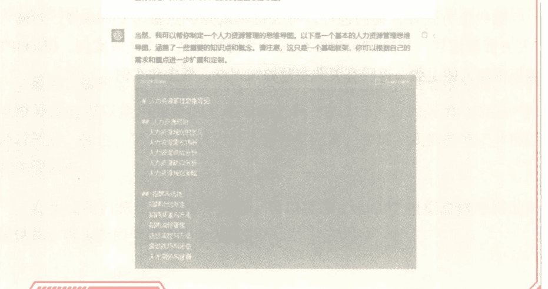

##### 第二步：文本保存为 markdown 格式。

本地新建一个 .md 格式的文件，把上面的内容拷贝进来。

##### 第三步：把 markdown 文件导入 XMind 中，即可看到思维导图。

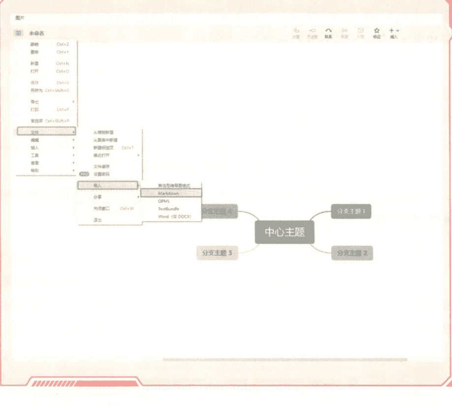

除以上方式外，我们也可以将关键词或知识点输入 ChatGPT，如输入“人力资源规划”并向 ChatGPT 询问相关的知识点、方法或案例。ChatGPT 将根据输入的主题，返回有关此主题的知识点、概念和实例。

“人力资源规划”相关的知识点、方法或案例有什么

以下是关于“人力资源规划”相关的知识点、方法或案例的一些例子：

知识点：

- 1. 人力资源规划的定义和目的。
- 2. 人力资源规划的基本原则。
- 3. 人力资源需求预测的方法和技术。
- 4. 人力资源供给分析和评估。
- 5. 人力资源缺口分析和解决方案。
- 6. 人力资源规划策略的制定和实施。
- 7. 人力资源规划与组织发展的关系。

方法：

- 1. 趋势分析法：通过分析历史数据和趋势来预测未来的人力资源需求。
- 2. 专家判断法：依靠专业人士的经验和判断来预测人力资源需求。
- 3. 工作量分析法：根据不同岗位的工作量和业务需求来确定人力资源需求。
- 4. 统计模型法：使用数学和统计模型来预测人力资源需求。
- 5. 人员流动率分析：分析员工的流动情况，包括离职率、晋升率和转岗率等，以评估内部人力资源供给。
- 6. 就业市场分析：调研就业市场的供求情况，以评估外部人力资源供给。
- 7. 绩效评估和能力素质评估：通过绩效评估和能力素质评估来确定内部人力资源的能力和潜力。

将 ChatGPT 的回答记录在纸上或电子文件中，按照需求和标准进行分类、组织和总结，将类似的知识点或概念组合成一组，将相关实例或案例列入其中。

最后，按照记录下来的知识点和概念，绘制符合规范的思维导图。绘制思维导图时可以使用专业的思维导图工具，如 MindManager 和 XMind 等。通过图形、颜色、字体、形状和箭头等视觉元素，来展示我们的笔记并拓展相关知识点。

在生成我们需要的思维导图后，可以要求 ChatGPT 根据思维导图的知识结构，再为我们生成一个学习笔记。

请根据以上内容给我生成一个人力资源管理师的复习笔记

以下是一个人力资源管理师考试的复习笔记，涵盖了上述提到的知识点、方法和案例：

### 人力资源管理师复习笔记

#### 一、人力资源规划

- 定义：人力资源规划是指为了适应组织发展战略和业务需求，合理预测、评估和规划组织所需的人力资源数量、质量和结构。
- 目的和重要性：人力资源规划有助于确保组织人力资源的充足性和适应性，提高组织的竞争力和可持续发展。
- 基本原则：合理性、灵活性、前瞻性、可操作性、综合性。

#### 二、人力资源需求预测

- 方法：
  - 趋势分析法：通过分析历史数据和趋势来预测未来的人力资源需求。
  - 专家判断法：依靠专业人士的经验和判断来预测人力资源需求。
  - 工作量分析法：根据不同岗位的工作量和业务需求来确定人力资源需求。
  - 统计模型法：使用数学和统计模型来预测人力资源需求。
- 考虑因素：经济环境、组织发展战略、技术变革、人员流动等。

#### 【问一问】

##### 确定需要的知识点或关键词

可以是需要学习或者想要了解的人力资源管理师知识点或领域。如“人力资源规划”“招聘与录用”“培训与开发”“绩效管理”“薪资与福利”“劳动法律法规”等。

##### 提供足够的上下文信息

为了帮助 ChatGPT 更好地理解你的问题，提供足够的上下文信息是非常重要的。如，你可以提供相关的背景信息、实例、案例或其他内容。这有助于 ChatGPT 更好地理解问题，并给出更准确的答案。

##### 改变提问形式

如果 ChatGPT 的回答并没有完全解决你的问题，你可以尝试与 ChatGPT 进行更多的交互，以获得更具体、准确的答案。改变提问形式，可以更好地指引 ChatGPT 理解你的问题，从而得到更满意的回答。如，我们发现 ChatGPT 生成的思维导图内容不能直接使用时，就要设置每一个主题和分支的问题，使我们的思维导图和笔记更详细、丰富、全面。

#### 【萃一萃】

##### 自定义调整

对于 ChatGPT 生成的思维导图和笔记，我们需要根据自己的需求进一步调整和定制。可以添加、修改或删除内容，以使其更符合我们的学习和思考方式。

##### 验证和补充

ChatGPT 生成的思维导图和笔记仅代表机器学习模型的一个观点，而不一定是唯一正确的表达方式。请自行验证其中的信息，并根据需要补充其他相关内容。

##### 可读性和结构

ChatGPT 生成的内容可能会有一些语法或结构上的不完美之处。我们需要进行适当的编辑和排版，使其更易于读者阅读和理解。

##### 仔细审查

ChatGPT 是一个智能语言模型，它的回答基于已有的训练数据，并不具备真实世界的经验和判断能力。在使用其生成的思维导图和笔记时，请仔细审查其中的内容，并自行判断其准确性和适用性。

#### 任务 2：生成考试复习规划

考试是每个人一生中要多次面对的事情，而制定一个高效的考试复习规划，则是备考过程中最为关键的一环。近年来，人工智能技术的飞速发展，尤其是自然语言处理领域的发展，使我们可以利用 ChatGPT 来帮助我们制定更加个性化和科学高效的考试复习规划。

问答示例：
以中级经济师考试复习规划为例，问答如下：

请生成一个中级经济师考试复习规划

下面是一个中级经济师考试复习规划，包含学习目标、学习计划、时间节点和阶段内容的详细安排：

### 中级经济师考试复习规划

#### 学习目标

- 1. 熟悉并掌握中级经济师考试的考试大纲、内容要求和知识结构。
- 2. 理解和掌握经济学原理、宏观经济学、微观经济学、产业经济学、金融学等相关知识。
- 3. 掌握经济政策分析、市场预测、决策制定等实际应用技巧。
- 4. 培养解题和应试能力，提高答题速度和准确性。
- 5. 进行模拟考试和练习，熟悉考试环境和题型。
- 6. 掌握复习方法和技巧，提高学习效率和记忆力。

#### 学习计划

- 1. 考试科目和时间分配
  - 中级经济师考试包括经济学原理、宏观经济学、微观经济学、产业经济学、金融学等科目。
  - 根据考试科目权重和个人熟悉程度，确定复习的科目顺序和时间分配。
  - 将总复习时间合理分配给各科目，确保每个科目都有足够的复习时间。
- 2. 详细学习计划和时间节点

我需要备考中级经济师考试，应该如何制定考试复习计划？

制定中级经济师考试的复习计划需要考虑以下几个步骤：

- 1. 熟悉考试大纲：详细阅读考试大纲，了解考试的科目和内容要求，确定各科目的权重和重点领域。
- 2. 设定学习目标：根据考试大纲和个人实际情况，设定清晰、具体的学习目标，如每个科目的知识掌握程度、解题能力等。
- 3. 制定学习计划：根据考试日期和可用的复习时间，制定合理的学习计划。考虑到每个科目的复习时间和重要程度，合理分配复习时间。
- 4. 划分复习阶段：将整个复习过程划分为不同的阶段，每个阶段集中复习特定的科目或知识点。可以根据复习进度和个人情况进行灵活调整。
- 5. 安排复习时间：在学习计划中明确每天的复习时间，并尽量保持固定。合理安排每天的学习时间，包括早晨、白天和晚上的时间段。
- 6. 制定每周计划：将整个复习过程分解为每周的学习计划。根据阶段性目标和科目的复习进度，设定每周的学习重点和任务。
- 7. 制定每日计划：在每周计划的基础上，制定每天的学习计划。明确每天要复习的具体科目和知识点，确保高效利用每天的复习时间。
- 8. 重点复习和强化训练：在复习计划中加入重点复习和强化训练的时间段。针对重要的知识点、难点题型或模拟考试等进行有针对性的复习和练习。
- 9. 留出复习时间：在考试前预留一段时间进行全面复习和回顾。这段时间可以用于整体复习、错题回顾、模拟考试和解析等。
- 10. 调整和评估：定期回顾和评估复习计划的执行情况，根据实际情况进行适当调整。根据自己的学习效果和复习进度，调整后续的学习计划和安排。

我想要的是具有实操的复习规划，每个阶段应完成哪一部分内容的学习

非常抱歉，以下是一个具有实操性的中级经济师考试复习规划，详细描述了每个阶段应完成的学习内容：

### 2023年中级经济师考试复习规划（具体内容）

#### 第一阶段：知识梳理和扎实基础

- 时间：4周

阶段内容：

- 1. 经济学原理
  - 学习主要经济学原理的基本概念和原理，理解供求关系、市场均衡等。
  - 理解市场结构、弹性概念，学习消费者和生产者行为分析。
- 2. 宏观经济学
  - 掌握国民经济核算体系，理解GDP、GNP等宏观经济指标的计算和解释。
  - 学习宏观经济运行的基本原理，包括经济增长、通货膨胀、失业等。
  - 理解货币政策和财政政策的作用和调控方式。
- 3. 微观经济学
  - 理解市场供求、市场结构和产业组织理论，包括垄断、寡头垄断等。
  - 学习成本理论和生产要素的市场价格决定，包括成本曲线、边际成本等。
  - 掌握效用理论、需求理论和消费者行为分析。
- 4. 产业经济学
  - 熟悉产业经济学的基本概念和分析方法，了解产业结构和产业政策。
  - 学习产业组织理论，包括垂直一体化、水平一体化等。
  - 了解产业集中度、竞争战略等相关知识。

#### 【问一问】

如果你直接输入生成要求，不给相应背景信息提示，ChatGPT 给出的答案可能不尽如人意，甚至是错误的。

需要向 ChatGPT 提供更多的相关信息或改变提问的思路，以使 ChatGPT 更好地理解我们的问题。

当我们发现 ChatGPT 提供的内容仍与我们的需求有一定差距时，应提出更具体的要求，直到它的回答达到我们的要求。

#### 【追一追】

- 准备相关数据

提问前应准备大量考试科目的相关数据，如历年真题、考纲、考试形式等信息。

- 避免问重复或过于一般的问题

ChatGPT 是一款强大的机器学习工具，但如果你提出的问题过于重复或太过一般化，它给出的答案可能也会泛化、缺乏针对性。因此，对于过于简单、常规或经常被询问的问题，最好先查找其他文献。

- 进行多次交互以获得更具体的答案

如果 ChatGPT 的回答并没有完全解决你的问题，你可以尝试与 ChatGPT 进行更多的交互，以获得更具体、准确的答案。在多次交互中，你可以更好地指引 ChatGPT 理解你的问题，从而得到更满意的回答。

### 5.1.2 智适应辅导：智能扫描知识漏洞与生成自适应智能辅导方案

ChatGPT 可以根据我们提供的学习陈述和历史数据，帮助我们准确识别学习需求和目标，自动生成相关领域的学习目标和学习内容；基于我们的需求制定个性化的学习辅导方案，提供学习素材和资源，设计学习测评和反馈，调整个性化学习路径等。

#### 任务 1：智能扫描知识漏洞

ChatGPT 可以作为一个强大的学习工具，帮助用户快速获取各个领域的知识。如，当用户遇到某个学科中的难题时，可以输入学科或相关主题，它会通过搜索全球互联网，为用户提供帮助和解答。此外，ChatGPT 还可以提供各种学科的参考资料，如英语语法、数学公式、历史事件等。

如何利用 ChatGPT 帮助我们智能扫描知识漏洞呢？

##### 第一步：确定学科和主题。

先确定需要扫描的学科和具体主题，可以使对话更有针对性，使 ChatGPT 能够提供更准确的信息和帮助。

##### 第二步：确定当前知识水平。

通过与用户的交流和对问题进行回答，ChatGPT 将尝试了解你在相关学科方面的当前知识水平。

##### 第三步：识别知识漏洞。

基于用户提供的信息和问题，ChatGPT 将识别出可能的知识漏洞或需要进一步加强的领域。

##### 第四步：探索相关概念。

根据用户提供的问题，ChatGPT 可以提供相关的概念和解释，帮助用户填补知识漏洞。它可以解释概念、提供定义、列举实例，或者回答用户的特定问题。

##### 第五步：提供实例和案例。

有时，了解实际应用和案例能够更好地理解和记忆学科知识。如果用户希望了解特定领域的实例或案例，可以提供更多背景信息，ChatGPT 可以据此提供相关的内容。

##### 第六步：进一步阅读和学习资源。

ChatGPT 还可以为用户提供相关的学习资源，例如书籍、文章、网站等，以便用户深入学习和扩展自己的知识。

##### 问答举例：

以人力资源管理师考试为例，向 ChatGPT 询问：

我在准备人力资源管理师的考试，请你为提供一份相关学科知识的内容，以帮助我查缺补漏

当准备人力资源管理师考试时，以下是一份相关学科知识的内容，可以帮助您查缺补漏。这个列表包含了一些主要的知识领域和概念，供您参考和学习：

- 1. 人力资源管理概念与职能：
  - 人力资源管理的定义、目标和重要性
  - 人力资源规划和组织设计
  - 人才招聘与选拔
  - 员工培训与发展
  - 绩效管理与激励机制
  - 薪酬管理与福利制度
  - 劳动关系与员工关系管理
  - 人力资源信息系统的应用

- 2. 劳动法律法规：
  - 劳动合同法及其相关规定
  - 劳动争议解决法律程序
  - 劳动保护法和劳动安全卫生法
  - 社会保险法和工伤保险制度
  - 最低工资标准与劳动时间规定
  - 妇女劳动保护法和未成年人劳动法

准备人力资源管理师考试，我应该参考哪些资料？

准备人力资源管理师考试时，您可以参考以下一些常用的资料和学习资源：

- 1. 教材和参考书籍：
  - 《人力资源管理学》（Gary Dessler著）
  - 《人力资源管理与实践》（孙凤霞、王连喜、何丽娟著）
  - 《人力资源管理概论》（王新全、张成才、刘雪著）
  - 《人力资源管理实务》（梁建业著）
  - 《人力资源管理基础》（刘小雨著）

- 2. 考试指南和辅导教材：
  - 《人力资源管理师考试教材与习题解析》（金碧辉著）
  - 《人力资源管理师考试辅导指南》（袁震著）
  - 《人力资源管理师考试全程指导与题库》（张守文著）

- 3. 在线课程和培训：
  - MOOC平台（如Coursera、edX）上的相关人力资源管理课程
  - 专业培训机构提供的人力资源管理师考试培训课程

- 4. 官方考试指南和资料：
  - 参考人力资源管理师考试的官方指南和考纲，了解考试的内容和重点
  - 人力资源管理师考试的官方发布的考试大纲和样题

#### 【问一问】

- ❓ **提出具体问题。** 明确我们想要了解的特定领域或主题，确保问题具体而清晰，有助于 ChatGPT 理解我们的需求。
- ❓ **参考其他资源进行提问。** 在向 ChatGPT 提问的时候，还可以结合其他可靠的资源，如书籍、学术论文、在线教育平台等，以获得更全面和准确的知识。
- ❓ **请求示例或应用场景。** 如果我们对某个概念或原理的理解不够清晰，可以要求 ChatGPT 提供示例或应用场景来帮助我们更好地理解。

#### 【追一追】

- 🔗 **追问细节和解释**

如果 ChatGPT 在回答中提到了我们不熟悉的术语或概念，可以请求其进行解释，并举例说明。这有助于加深我们对特定知识领域的理解。

- 🔗 **考虑不同的角度**

尝试从不同的角度提问，以便获取更多更全面的信息。例如，可以询问解释某个概念的不同方法、不同学派的观点等，以促进 ChatGPT 提供更多的观点和维度。

- 🔗 **提供反馈和修正**

根据 ChatGPT 的回答，我们可以评估其准确性并提供反馈。如果发现知识漏洞或错误，我们可以纠正它，并要求 ChatGPT 提供更准确的信息。

#### 任务 2：生成自适应智能辅导方案

ChatGPT 可以根据用户的需求和学习特点，提供个性化、灵活和有针对性的学习辅导方案。根据用户的需求、能力和学习进度，通过分析学习者的数据和行为，自动调整辅导内容和方法，以满足学习者的个性化学习需求。

使用 ChatGPT 生成自适应智能辅导方案的步骤如下。

##### 第一步：确定学习目标。

明确学习目标和需求。比如，是为了准备考试、提升专业知识水平，还是解决特定的学习困惑。

##### 第二步：提供基本信息。

告诉 ChatGPT 相关背景信息，如学习人力资源管理的起点、已有的知识水平以及使用的学习资源。

##### 第三步：详细描述知识漏洞。

描述具体的问题、概念理解困难或需要加强的领域。尽量提供细节，以便 ChatGPT 更好地识别和分析用户的知识漏洞。

##### 第四步：设定学习时间和计划。

告诉 ChatGPT 可用于学习的时间和学习计划。这有助于其生成一个适合用户时间安排的辅导方案。

##### 第五步：接受建议和反馈。

在整个辅导过程中，接受 ChatGPT 提供的学习建议和反馈，并及时告知用户的学习进展和需求变化。

##### 第六步：生成自适应辅导方案。

基于已提供的信息，ChatGPT 可以生成一个自适应辅导方案，包括辅导的主题、内容、课程设计、学习活动、评估方式等。

##### 问答举例

请根据2021年的考试大纲要求，为我制定一个注册会计师考试的智能辅导方案

好的，根据2021年的考试大纲要求，我可以为您制定一个注册会计师考试的智能辅导方案。以下是一个基本的步骤：

- 1. 了解考试结构和科目：详细了解注册会计师考试的结构和涵盖的科目。这包括财务会计、管理会计、审计、税务和法律等领域。
- 2. 自我评估：评估您目前对每个科目的了解程度和掌握情况。这将有助于确定您的学习起点和重点关注的领域。
- 3. 制定学习计划：根据考试的时间表和您的学习时间，制定一个合理的学习计划。安排每个科目的学习时间，并确保足够的复习时间。
- 4. 学习资源选择：选择适合您学习风格和需求的学习资源，如教材、参考书籍、在线课程、培训班等。确保资源内容与考试大纲要求相符。
- 5. 针对重点科目深入学习：根据考试大纲和重点领域，制定学习重点。专注于财务会计、管理会计、审计、税务和法律等领域的核心概念、原则和应用。
- 6. 练习和模拟考试：使用练习题和模拟考试来检验自己的理解和应用能力。这有助于熟悉考试的题型和提高解题效率。
- 7. 定期复习和评估：安排定期复习时间，巩固所学知识。进行自我评估，识别和填补知识漏洞。
- 8. 寻求支持和解答疑：在学习过程中，如遇到困难或疑问，及时寻求支持和解答，可以是通过参加培训班、与同学或老师交流，或者借助在线学习社区等。

这个辅导方案可以作为您备考注册会计师考试的基本指导。请注意，具体的学习内容和策略还需根据您的个人情况进行调整和优化。祝您考试顺利！

当我们发现很难通过一次问答得到令我们满意的答案时，就需要通过不断调整提问方式、整合优化来获取最终的方案。

#### 【追一追】

- 告诉 ChatGPT 我们更喜欢哪种学习方式和资源，比如喜欢阅读教材、观看视频教程、参加在线课程还是做练习题等。如果我们有特定的学习时间安排或其他要求，也要一并告诉 ChatGPT。
- 如果我们有特定的截止日期或考试日期，要告诉 ChatGPT 相关时间限制。这有助于 ChatGPT 制订合理的学习计划和做出恰当的安排。
- 其他需求或补充信息（可选）。如果我们有其他特殊需求、学习偏好或补充信息，也请在问题中说明，以便 ChatGPT 更好地为我们定制辅导方案。

举例来说，你可以这样提问：

> “我正在准备注册会计师考试，希望你能为我生成一个自适应智能辅导方案。我在会计学方面有一定的基础，但还需要加强对税务和审计方面的理解。我更喜欢通过阅读教材和做练习题来学习，我希望在3个月内准备好考试。请帮我制订一个适合我的学习计划。”

#### 【萃一萃】

ChatGPT 是一个智能语言模型，它提供的回答基于已有的训练数据，并不具备真实世界的经验和判断能力。在使用辅导方案时，我们仍然需要自行判断和决策，并结合其他可靠的资源和指导进行学习和备考。

### 确认准确性

由于 ChatGPT 是基于训练数据生成回答的，它无法验证信息的准确性。因此，在接收到辅导方案后，请自行验证其中的信息和建议，以确保其与最新的教育和考试要求一致。

### 多样参考

ChatGPT 生成的辅导方案仅代表一个机器学习模型根据它的学习给出的观点，不一定是完全正确的答案（不但不一定完全正确，还有可能“一本正经地胡说八道”）。建议多样参考，结合其他资源、教材和指导，以制订全面和有效的学习计划。

### 主动追问

如果 ChatGPT 的回答不够清晰或不符合期望，可以主动追问，进一步解释你的需求或提出具体问题，以获得更准确和有针对性的回答。

### 对比和衡量

辅导方案仅为参考和指导，我们需要根据自身情况和实际需求进行评估和调整。要对比不同观点和意见，结合个人情况和学习能力，制订适合自己的学习计划。

#### 【改一改】

在 ChatGPT 生成辅导方案后，我们可以进行审查并优化其内容。可能需要删除或添加对辅导目标不必要或与其不相关的内容，对于缺失或需要修正的内容进行完善和调整。最后，根据辅导方案实施实际的学习计划，跟踪学习或工作进展，并根据评估结果调整辅导方案。

### 5.1.3 定制化职业规划：生成职业发展建议与面试准备

职业发展和规划是每个人都会面临的重要课题，随着社会的快速变化和竞争的加剧，人们越来越需要寻找有效的方式，来规划自己的职业道路。在这个过程中，ChatGPT 作为一种强大的自然语言处理工具，可以根据我们的职业历程和技能，为我们提供更好的职业规划建议。

#### 任务 1：生成职业发展建议

当我们面临职业选择或规划时，常常需要一些新颖和独特的观点或建议，ChatGPT 可以根据我们提供的信息和问题生成个性化的解决方案，为我们提供关于行业前景、技能需求和发展机会的见解，帮助我们做出正确的职业发展规划。

使用 ChatGPT 为我们生成一份个性化职业发展建议，可以按照以下步骤操作。

##### 第一步：提供个人信息。

向 ChatGPT 提供我们的个人信息，如教育背景、工作经验、专业领域和现有技能等。

##### 第二步：澄清目标和兴趣。

说明我们的职业发展目标和感兴趣的领域，提供尽可能多的细节，以便 ChatGPT 了解我们的偏好和目标。

##### 第三步：提出问题。

针对职业发展的相关问题向 ChatGPT 提问。例如，我们可以询问如何在特定领域获得进一步发展，如何提升关键技能，或者是否有推荐的学习资源。

##### 第四步：探索建议和策略。

ChatGPT 将提供对我们的问题和目标的建议和策略。这可能包括推荐的培训课程、学习路径、参与项目或协作的机会，以及如何与有关领域的专业人士进行联系。

##### 第五步：评估建议。

评估 ChatGPT 给出的建议，考虑其适应性和可行性。请记住，ChatGPT 生成的建议仅供参考，我们仍然需要自己做出决策并采取行动。

##### 第六步：进一步研究和咨询。

如果我们对 ChatGPT 给出的建议感兴趣，可以进一步进行研究和咨询。可以参考专业文章、求职指南、行业报告，以及与职业发展相关的机构或人士的意见。

##### 提问示例：

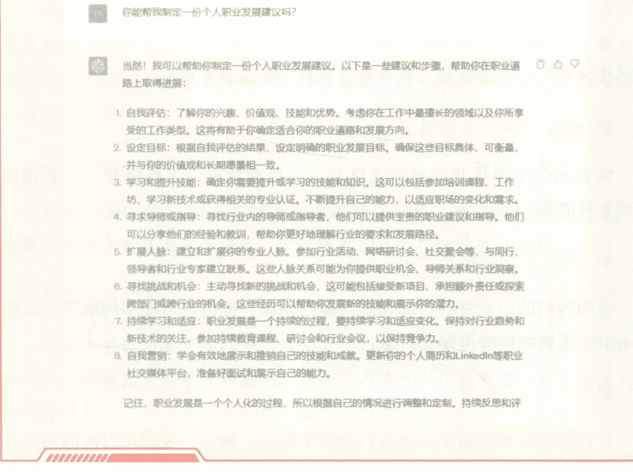

这些内容不能很好的给我提供职业发展的建议，我希望你能为我提供更详细的实施步骤

非常抱歉未能满足你的期望。以下是更详细的实施步骤，可以帮助你在市场营销领域实现职业发展目标：

1. 设定明确的目标：
   - 定义你想在三到五年内成为策划总监的目标。
   - 确定每个阶段的里程碑和具体的成果，以便评估自己的进展。
2. 定义所需技能：
   - 分析策划总监岗位的职责和要求，确定你需要掌握的关键技能。
   - 这可能包括战略规划、品牌管理、市场调研、数字营销、团队管理等。
3. 制定学习计划：
   - 根据所需技能，制定一个有计划的学习路线图。
   - 确定需要学习的课程、培训、工作坊和认证项目。
4. 扩展工作经验：
   - 在当前的文案策划职位上积累更多的工作经验，特别是与策划相关的项目。
   - 争取更多责任和挑战，主动参与战略决策和项目管理。
5. 寻求导师或指导：
   - 寻找在策划领域有经验和成就的人，他们可以成为你的导师或指导者。
   - 向他们请教、寻求建议，并学习他们的经验和智慧。
6. 参与行业活动：
   - 参加市场营销领域的行业活动，如会议、研讨会和专业组织的活动。
   - 通过与行业内的专家和同行互动，建立有价值的人脉关系。
7. 提升沟通和领导能力：
   - 沟通和领导能力对于策划总监至关重要。通过培训和实践，提升你的沟通技巧和团队管理能力。

【扫码查看完整问答过程】

#### 【问一问】

❓ 提问时尽量具体和明确，以便获得更具针对性的建议。比如，询问关于特定职业领域、职位或技能的建议，或者制定职业规划的具体步骤。

❓ 提供足够的背景信息，让 ChatGPT 了解我们的职业目标、当前状况和个人背景。这有助于其生成更具个性化和针对性的建议。

将问题分成不同的层次，以获取更全面和详细的建议。可以从整体的职业规划、教育和培训途径，逐步细化到特定的技能发展、行业趋势和求职技巧等方面。

探索不同方案和观点：可以询问关于多种职业选择、发展路径和决策的建议。这可以帮助我们探索不同的职业发展方向，并从多个角度思考和评估。

#### 【追一追】

- 除了一般的职业发展指导，也可以要求 ChatGPT 提供具体的行动建议。如关于如何提升特定技能、拓展职业网络或准备面试等方面的建议。
- 询问 ChatGPT 对特定行业、职位或技能的未来趋势和发展前景的看法。这有助于我们在职业发展中做出更明智的决策。
- 提供反馈和追问，如果对 ChatGPT 生成的建议不够满意或需要更多信息，可以提供反馈并进一步追问。这有助于优化并深入挖掘与职业发展相关的主题。

#### 【萃一萃】

无论是关于职业发展的策略，还是关于个人职业品牌的建设，ChatGPT 都可以根据我们的需求提供有针对性的建议和指导，我们需要不断与它进行交流。告诉它你对它的建议和指导的看法和感受，以及你有何疑问或困惑。ChatGPT 会根据你的反馈，为你提供更多的帮助和支持。

> 比如，你可以说：“谢谢你的建议和指导，我觉得很有用。但是我有一个问题，我怎么才能确定我目前的职业发展规划是正确的呢？” 或者你可以说：“我不太同意你的建议，我觉得我不需要学习使用人工智能，因为我觉得它跟我的工作不太相关。” 无论你说什么，ChatGPT 都会尊重你的意见和选择，并尽力为你提供最佳的服务。

#### 任务 2：生成面试准备计划

正在求职或者即将求职的你，是不是在渴求心仪职位的同时总有些许紧张和担忧，不知道在面试中面试官会问什么样的问题，不知道面对问题该怎样回答，不知道会卡在哪个环节令自己尴尬得手足无措。你可以通过向 ChatGPT 提问，获取关于所申请职位、公司或行业的信息。ChatGPT 可以为你提供一些常见面试问题、行业趋势、公司背景以及职位需求等的相关信息，或许可以帮助你更好地准备面试。

提问示例：

> 你好能为我生成一个面试准备计划吗？

> 当然！以下是一个面试准备计划的示例，帮助你准备市场营销领域的面试：

1. 研究公司和行业：
   - 仔细研究目标公司的背景、产品或服务、市场地位和竞争对手。
   - 深入了解行业趋势、挑战和机会，以及公司在其中的定位。
2. 了解职位要求：
   - 分析招聘公告或职位描述，理解公司对所需职位的技能、经验和背景的要求。
   - 确定你在这些方面的优势和匹配度，并准备相关的事例和经验来支持你的能力。
3. 准备常见面试问题的回答：
   - 针对常见的面试问题，如“请自我介绍”、“为什么选择市场营销职业”、“你的强项是什么”等，准备清晰、简洁和有条理的回答。
   - 强调与目标职位相关的技能、经验和成就。
4. 准备案例和故事：
   - 准备一些案例和故事，以展示你在市场营销方面的能力和成就。
   - 针对挑战、解决方案和结果，描述你参与的项目、活动或策略，并突出你的贡献和成果。
5. 进行模拟面试：
   - 寻找朋友、同事或导师帮助你进行模拟面试。
   - 让他们提出常见的面试问题，并向你提供反馈和建议，帮助你改进表达和回答的方式。
6. 更新你的简历：
   - 确保你的简历清晰、简洁，突出与目标职位相关的技能和经验。
   - 根据目标公司和职位，调整简历的重点和内容。
7. 关注个人形象和沟通能力：
   - 着装得体，展现专业形象。
   - 培养良好的沟通能力，包括语言和非语言沟通。

当你直接提问后，发现 ChatGPT 给出的答案有点宽泛，你想了解更加详细的操作内容，这时，你可以细化你的问题。例如：

> 我要去一个互联网大厂面试一个前端的岗位，我应该做哪些面试准备？

准备前端岗位面试时，以下是一些建议，帮助你做好充分的准备：

1. 掌握前端基础知识：
   - 温习HTML、CSS和JavaScript的基础知识，包括语法、DOM操作、事件处理、样式布局等。
   - 熟悉响应式设计和跨浏览器兼容性，了解移动端开发和常见的前端框架（如React、Vue等）。
2. 熟悉常用工具和技术：
   - 熟悉版本控制系统（如Git）和前端构建工具（如Webpack、Gulp等）的使用。
   - 掌握调试工具（如Chrome开发者工具）的基本操作和常见功能。
3. 实践项目和案例：
   - 在个人项目或开源项目中实践前端开发，展示你的编码能力和解决问题的能力。
   - 准备一些项目案例，描述你在其中的角色、挑战、解决方案和取得的成果。
4. 研究公司和职位要求：
   - 仔细研究目标公司的产品、技术栈和前端团队的工作方式。
   - 分析招聘公告或职位描述，了解他们对前端开发者的技能和经验的要求。
5. 复习算法和数据结构：
   - 在一些技术面试中，可能会问及算法和数据结构相关的问题。
   - 温习常见的数据结构（如数组、链表、栈、队列等）和算法（如排序、搜索等）。
6. 解答常见面试问题：
   - 准备回答常见的前端面试问题，例如解释盒模型、响应式设计的原理、性能优化策略等。
   - 掌握如何解答关于项目经验、团队合作和技术挑战的问题。
7. 练习编程题和算法题：
   - 刷题平台上有很多前端开发相关的编程题和算法题，通过练习提高解题能力和编码效率。
   - 关注一些常见的前端面试题，如解释闭包、优化代码等。

你也可以改变提问的方式，例如要求 ChatGPT 为你列出一些常见的面试问题，这些面试问题与你所应聘的岗位相关，并对其列出的问题反复练习，进行面试准备。

你能为我列出一些常见的面试问题吗？

当面试前端开发岗位时，以下是一些常见的面试问题示例：

1. 前端基础知识：
   - 解释盒模型以及如何改变盒模型的方式。
   - 解释CSS选择器及其优先级规则。
   - 解释浮动和清除浮动的概念。
   - 解释事件冒泡和事件捕获的区别。
2. HTML相关问题：
   - 解释HTML5的一些新特性和语义化标签的作用。
   - 如何处理HTML5中的音频和视频元素。
   - 如何优化网页性能，包括减少HTTP请求和使用缓存。
3. CSS相关问题：
   - 解释CSS3中的一些新特性，如Flexbox和Grid布局。
   - 如何实现响应式设计和移动优先的开发。
   - 如何处理跨浏览器兼容性问题。
4. JavaScript相关问题：
   - 解释闭包的概念及其作用。
   - 解释原型继承和原型链。
   - 如何处理异步编程，包括回调函数、Promise和async/await。
5. 前端框架和库：
   - 了解React/Vue/Angular等前端框架的基本原理和用法。
   - 解释单向数据流和双向数据绑定的区别。
   - 解释虚拟DOM的概念及其优势。

#### 【追一追】

列出常见问题。请 ChatGPT 提供常见的面试问题列表。这些问题可能包括自我介绍、技能和经验展示、解决问题的方法、职业目标等。ChatGPT 可以为你提供参考，让你了解应该准备哪些方面的内容。

深入探讨面试问题。选择一些你感兴趣或觉得最有挑战性的面试问题，并与 ChatGPT 进行交互。请 ChatGPT 提供具体的建议和策略，帮助你更好地回答这些问题。

分析和改进回答。在 ChatGPT 的帮助下，评估你的回答并寻找改进空间。ChatGPT 可能会提供一些建议，如结构化回答、强调关键信息、给出具体例子等，以提升你的回答质量。

#### 【萃一萃】

在使用 ChatGPT 帮助我们生成面试准备计划时，需要向 ChatGPT 提供足够的信息，它才能生成一份比较准确、完整的面试准备计划。

- **确定目标。** 明确你正在申请的职位类型或公司，并确定你想要在面试中展示的核心技能和素质。
- **提供背景信息。** 向 ChatGPT 提供你的教育背景、工作经验、项目经历等相关信息。这将帮助 ChatGPT 了解你的背景和经历。
- **角色扮演和模拟面试。** 与 ChatGPT 进行角色扮演，模拟面试中的不同情境。请 ChatGPT 扮演面试官，并根据你的回答给予反馈和建议。这可以帮助你在实践中提高回答的流利度和自信心。
- **自我评估和反思。** 根据 ChatGPT 的回答和建议，进行自我评估和反思。考虑重点区域，确定需要进一步加强的方面，并制订相应的行动计划。

## 5.2 打造“个性成长导师”的步骤

### 5.2.1 收集用户信息

若要将 ChatGPT 打造成个人专属的“个性成长导师”，先要向其提供与成长和发展相关的用户数据，以便其更好地了解用户的背景和特定要求。这些信息可以包括用户的兴趣、技能水平、时间和资源限制、个人发展、职业发展、心理健康等，整理这些数据以便更好地与 ChatGPT 进行交互。

我们在向 ChatGPT 提问，根据其要求提供相关数据时，应注意以下事项：

- **第一，匿名化和隐私保护。** 尽量避免提供敏感个人身份信息。当提供数据时，确保将个人身份隐去或匿名化处理，以保护用户的隐私。
- **第二，仅提供必要数据。** 仅提供 ChatGPT 所需的与个性化成长指导相关的基本信息，避免提供不必要或不相关的个人细节。
- **第三，确保数据的准确性。** 提供准确、真实的数据，这样才能得到准确和有用的个性化成长指导建议。
- **第四，慎重共享敏感内容。** 如果提供与心理健康、身心问题等敏感内容相关的数据，请确保分享给专业人士或合适的指导机构，以确保数据的安全性和反馈的专业性。

### 5.2.2 挖掘用户需求

打造“个性成长指导师”还需要 ChatGPT 根据用户输入的相关信息进行深度分析，了解用户的疑惑和需求。比如，如果用户询问“如何提高英语口语能力”，ChatGPT 会分析这句话，了解用户想要提高口语能力的需求。

除了分析用户输入的内容，ChatGPT 还可以通过以下方式发掘用户需求：

**第一，提问和回答。** ChatGPT 可以通过与用户对话，询问关于他们的目标、兴趣、挑战和需求的问题。ChatGPT 会尝试理解用户的回答并据此提供相应的个人成长建议。

**第二，文本分析。** ChatGPT 可以分析用户输入的文本，包括描述自身情况、问题或需求的文本。通过理解关键词、句子结构和上下文，ChatGPT 可以尝试解读用户的需求和提供相关建议。

**第三，根据上下文理解。** ChatGPT 可以记录对话的上下文，并利用先前的对话历史来理解用户的需求。比如，如果用户在谈论自己的工作经历时提到“我曾经在一家外资公司工作”，ChatGPT 就可以推断出用户可能想要了解外资公司的管理经验。它可以回顾之前的提问和回答，以提供更一致和连贯的个人成长指导。

**第四，推荐和提示。** ChatGPT 可以根据用户提供的信息，提供相关的资源、学习材料、实践活动或建议。它可以推荐符合用户需求的课程、书籍、培训机构等，以帮助用户实现个人成长目标。

**第五，反馈和迭代。** 如果 ChatGPT 在理解用户需求方面存在困难，它可以通过进一步询问来澄清和深入了解用户需求。通过与用户的交互，ChatGPT 可以不断改进和调整其所提供的个人成长指导建议。

值得注意的是，我们在使用 ChatGPT 为我们提供个性成长指导时，要明确一点，即 ChatGPT 是一个基于语言模型的程序，其能力和限制取决于其训练数据和算法。尽管它可以提供一般性的个人成长建议，但对于特定和个性化的需求，可能还需要结合其他资源和专业人士的意见。

### 5.2.3 提供专属方案

ChatGPT 可以基于用户提供的信息及深度挖掘的用户需求，为用户提供专属方案。其具体步骤如下。

首先，分析和评估信息。

ChatGPT 可以分析和评估用户提供的信息，并结合其内部的知识库和训练经验，确定适用的方法、原则和建议，包括理解用户的目标、挑战、兴趣以及他们希望改善的方面。

其次，提供一般指导和建议。

ChatGPT 可以提供一般性的成长和发展建议，这些建议基于广泛的知识和数据。包括：

一，建立目标和制订计划。帮助用户设定明确的目标，并制订可行的计划来实现这些目标。
二，自我认知和反思。鼓励用户进行自我反思，了解自己的价值观、优势和盲点，以及如何发展这些方面。
三，学习和技能发展。提供学习方法和技巧，帮助用户获取新的知识和技能。可能包括时间管理、记忆技巧、学习策略等。
四，情绪管理和心理健康。包括探索情绪管理技巧，应对压力和焦虑的方法，以及促进心理健康的实践。
五，社交和人际关系。分享建立健康人际关系的基本原则、沟通技巧和建议。

最后，探索个人化选项。

ChatGPT 可以与用户讨论不同的个人化选项，以符合其特定情况和需求。包括：

一，探索用户的兴趣爱好和天赋。ChatGPT 可以与用户讨论他们的兴趣、热情和天赋，并提供相关的建议和发展途径。

二，了解用户的限制和资源。ChatGPT 可以询问用户的限制和可用资源，以了解在个人成长方案中应该考虑哪些因素，如时间、资金、支持网络等。

三，提供选项和场景模拟。ChatGPT 可以与用户探讨不同的选择和决策路径，并模拟可能的场景，以帮助用户更好地考虑和评估个人化选项。

四，提供实践建议和反馈。ChatGPT 可以向用户提供实践动作的建议，并根据用户的反馈进行反馈和调整。通过交互和讨论，ChatGPT 可以帮助用户找到最适合他们的个人成长路径。

### 5.2.4 跟踪用户进展

ChatGPT 作为语言模型，本身没有内置的能力来跟踪用户的进度或个人数据，但可以提供一些方法来帮助用户跟踪和评估个人成长进展。

第一，记录和提醒。

ChatGPT 可以帮助用户建立一个记录和提醒系统。用户可以告诉它具体的目标和计划，以及用户希望被提醒的时间和频率。这样，它就可以定期提醒用户，并记录用户的学习进展，以便用户追踪自己的实施进度。

第二，监督和问责。

ChatGPT 会在一定的时间内与用户进行交流，了解用户的进展。通过对话，用户可以向 ChatGPT 汇报自己的行动和成果。ChatGPT 可以提供积极的反馈和鼓励，也可以帮助用户克服困难和应对挑战。

### 第三，目标设定和里程碑。

在制定个人成长专属方案时，ChatGPT 可以帮助用户设定明确的目标和里程碑。分解大目标为更小的可操作目标，并设定实现这些目标的时间表。在每个里程碑达成时，ChatGPT 可以提供反馈和评估进展。

### 第四，性能评估和反馈。

如果用户提供相关数据和信息，ChatGPT 可以帮助其进行性能评估，并提供反馈和建议。比如，用户可以分享学习成果、项目成果或其他证明材料。ChatGPT 可以根据这些信息为用户评估进展并提供相应的反馈。

### 第五，使用历史记录和记忆。

ChatGPT 会存储用户的历史对话记录和交互情况，并在后续对话中回顾和引用。通过回顾用户之前的问题、回答和建议，ChatGPT 可以更好地理解用户的背景及其进展。

### 第六，与用户进行定期复盘和目标检查。

定期与用户开展复盘和目标检查对话。通过这种方式，ChatGPT 可以了解用户的近期进展、挑战和调整需求，并提供有针对性的建议和反馈。

# 第6章 24小时客服与预约

在在线客服与预约方面，ChatGPT 能够大展拳脚，大大减轻在线客服和预约工作人员的压力和负担。从另一个侧面来讲，能够 24 小时在线、不眠不休、不用发工资的 ChatGPT 等 AI 智能机器人必然会取代一部分人工客服与预约人员的岗位，从而降低企业的人力成本。

ChatGPT 在 24 小时在线客服与各种预约方面有非常广泛的应用场景，无论是网店商城、工厂企业、律所，还是社会公共服务机构，都可以借助 ChatGPT 大幅提升客服、预约等事项的服务能力、服务水平和服务质量，同时大幅降低服务成本。

## 6.1 在线客服 4 个应用场景与 7 项任务示范

### 6.1.1 网店：生成自动调库指令以及与客户高情商沟通

ChatGPT 可以协助网店处理一些常见的客户请求，如订单查询、退款申请、地址更改等。用户可以根据网店的需求，为 ChatGPT 提供相应的训练数据和指令，使其能够正确理解并处理这些请求。

#### 任务 1：生成自动调库指令

对于一些简单或者重复的操作，可以让 ChatGPT 协助网店完成。可以提前在 ChatGPT 中设置好关键词，比如当客户提出的问题中有“××产品没有”“××产品没有库存”“××产品什么时候到货”等字样的时候，ChatGPT 根据网店的库存情况，自动生成调库指令，然后根据调库情况，回复客户消息。

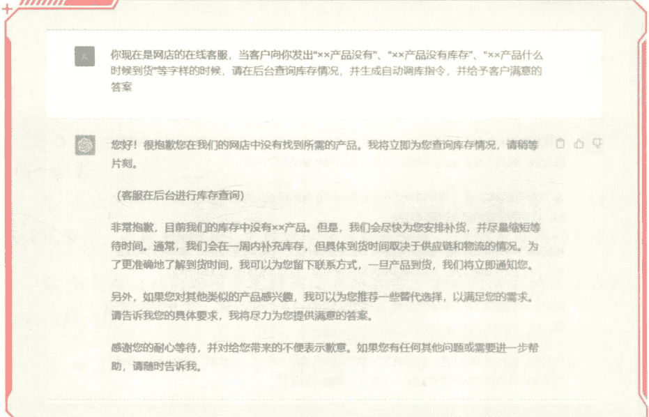

上述提问是用了关键词法，让 ChatGPT 自动识别关键字眼，通过自动查询、判断网店的情况，发出相应的指令，以节省大量的人力物力成本，提高网店的经济效益。

#### 【问一问】

- 选择简洁而明了的关键词，在问题中准确表达想要了解的内容，避免使用过于复杂的词语，以免引起歧义。
- 使用具体的关键词，而不是抽象的概念或广泛的主题，以便获得更准确的答案。
- 在问题中使用指令性关键词，引导 ChatGPT 提供特定类型的答案。

#### 任务 2：与客户高情商沟通

让 ChatGPT 与客户进行高情商沟通是一项复杂的工作，网店的客户是不同的，提出的问题也千奇百怪，为了满足不同的客户需求，网店需要收集高情商对话的样本，经过处理后，训练 ChatGPT 模型，通过不断调整和改进，不断优化模型，确保模型能够给出高情商的回答。

> 你是网店的在线客服，客户购买的产品已经确认收货，但是客户提出，该产品有部分瑕疵，强制要求退货退款，该怎么回复他

非常抱歉您购买的产品存在瑕疵给您带来的不便，我们对此表示诚挚的歉意。作为网店的在线客服，我们非常重视客户的购物体验，并希望能解决您的问题。

为了更好地处理此事，请您提供更具体的细节和瑕疵的描述。我们需要了解问题的具体性质，以便为您提供适当的解决方案。

根据我们的退换货政策，如果产品存在瑕疵或质量问题，我们将全力支持您的退货退款要求。为了加快处理过程，请您提供相关照片或视频，以便我们更好地了解问题。

同时，请您提供订单号和购买日期，以便我们能够核实您的购买记录，并加快问题解决的进程。

我们将尽快处理您的申请，并在核实后给予您满意的解决方案。感谢您的理解和耐心等待。如果您有任何其他问题或需要进一步帮助，请随时告知我。

【扫码查看完整问答过程】

后续笔者陆续提出别的问题，比如“产品洗过之后严重缩水”“怎么提供相应的证据”“解决方案是什么”，ChatGPT 都给出了相应的回答，回答的内容虽然符合正规的流程，但还是比较烦琐的，需要不断进行优化、提炼。

#### 【萃一萃】

- 训练 ChatGPT 模型实现高情商沟通是一项复杂的工作，需要大量的数据迭代优化。
- 模型的表现会受到训练数据的限制，因此，提供高质量和多样性的数据，以及对模型进行不断优化改进是至关重要的。
- 尽管 ChatGPT 可以提供自动化的客户服务，但建议在必要时进行人工干预和监督，确保客户获得准确的答案，并及时解决复杂或特殊问题。

#### 【追一追】

- 在追问时，尽量提供相关的上下文信息，例如问题的背景、特定的场景或条件，以便 ChatGPT 更好地理解问题的背景，提供更准确的答案。
- 如果在初始问题中没有得到满意的答案，尝试用不同的表达方式或重新组织问题。
- 如果问题涉及广泛的主题或领域，尝试限制问题的范围，以便 ChatGPT 更专注地回答。

### 6.1.2 企业：设置在线客服答疑与生成客户分析报告

企业使用 ChatGPT 担任企业在线客服，可以回答关于企业产品和服务的常见问题，为客户提供详细的产品说明、特性、价格等信息，协助客户做出购买决策；还可以回答关于企业产品或服务的常见问题和提供故障排除方法，提供基本的技术支持，帮助客户解决问题或引导他们寻求更进一步的技术支持。

#### 任务 1：设置在线客服答疑

客户的答疑一般针对企业生产的产品来进行，可提前将产品的特性、材质、用途、价格、安装、维修、优惠等数据传输到 ChatGPT 中，对于简单、没有技术难度的问题，ChatGPT 可以直接作答；对于 ChatGPT 回答不了的问题，可以人工客服辅助来进行回答，以提供更好的服务。

> 你是企业的在线客服，企业现有一款洗面奶，价格99，现在有优惠活动买二送一，该款洗面奶具有补水保湿、去角质的作用，适合干皮、混合皮的女性使用

简单地向 ChatGPT 传输了产品的部分信息，在接下来的询问中，ChatGPT 可以回答客户提出的相关问题。

比如，关于功效的提问。

> 这款洗面奶有什么功效

这款洗面奶具有以下功效：
1. 补水保湿：洗面奶中的成分可以有效地渗透到肌肤深层，为肌肤补充水分，并锁住水分，使肌肤保持水润和充满弹性。
2. 去角质：洗面奶中的成分可以温和地去除肌肤表面的老化角质和污垢，使肌肤更加光滑、清洁，并促进新陈代谢。
3. 温和清洁：该洗面奶采用温和的清洁成分，可以彻底清洁肌肤，去除多余的油脂和污垢，同时不会造成肌肤的干燥或刺激。
4. 适用于干皮和混合皮肤：该洗面奶的配方经过特殊设计，适合干皮和混合皮肤的女性使用，帮助平衡肌肤水油分布，提供适度的滋润和保护。

请注意，不同的肌肤类型和个人肤质可能会对产品产生不同的反应。如果您有特定的皮肤问题或敏感肌肤，请先进行皮肤测试或咨询专业人士的建议。

如果您对该款洗面奶还有其他问题或需要进一步了解，欢迎随时向我提问。我将尽力为您提供详细的答案和帮助。谢谢！

再如，关于价格的提问。

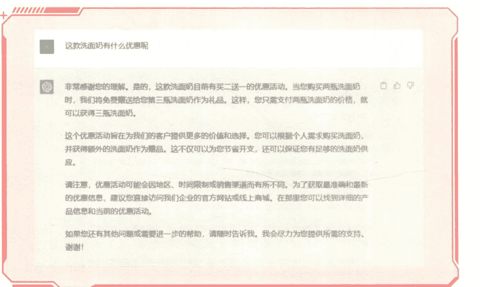

当有充足的产品数据时，ChatGPT 可根据已有的数据回答客户想知道的问题，并且能根据给定的词语进行延伸拓展，比如产品功效里给定的信息是“补水保湿、去角质的作用，适合干皮、混合皮的女性使用”，ChatGPT 可以自行组织语言，丰富回答的内容。

#### 【萃一萃】

- 在 ChatGPT 中输入足够的产品数据信息，其在回答客户问题的时候才能检索到相关信息。
- ChatGPT 具有强大的语言组织能力，能根据企业提供的简单词汇，进行内容扩充。
- 在设置 ChatGPT 的回答内容时，一定要注意特殊情况。

#### 任务 2：生成客户分析报告

ChatGPT 具备强大的数据分析和反馈能力，能够实时获得客户的意见反馈，并根据市场需求变化和趋势做出相应的调整和改变。基于数据和分析结果，ChatGPT 可以生成客户分析报告。

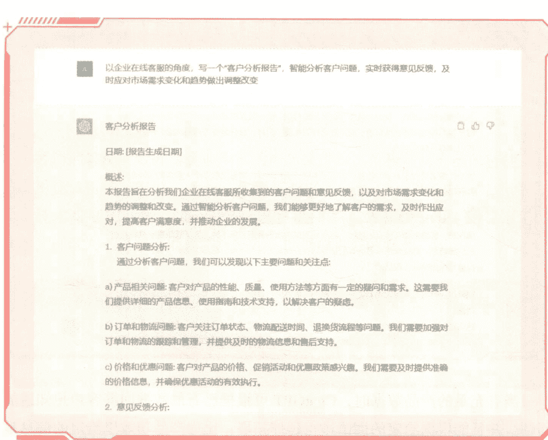

【扫码查看完整问答过程】

ChatGPT 给出的客户分析报告，里面的内容多是一些通用的框架，可以当作模板来使用。我们可以根据具体的产品情况，编写符合实际情况的客户分析报告。

#### × × 洗面奶的客户分析报告

一、概述
为更好地满足客户需求，提升客户满意度，促进产品的发展和销售，现对 × × 洗面奶的客户进行分析。

二、客户问题分析

1. 使用方法
客户对产品的正确使用方法存在疑问，例如如何使用、使用频率、适用肤质等。
2. 效果反馈
客户对产品的补水保湿、去角质效果的验证和反馈需求较高。
3. 产品成分
一些客户对产品的成分安全性、天然度和添加物等方面有一定关注。

三、意见反馈分析

1. 包装设计改进
客户提出了改进产品包装设计的建议，例如更加吸引人的外观、更方便的使用方式等。
2. 价格敏感度：
客户表达了对产品价格的关注和敏感度，建议我们关注市场竞争情况，并根据竞争态势和客户需求，合理定价以增加产品的市场竞争力。
3. 渠道扩展需求
客户希望能够更方便地购买我们的产品，建议我们拓展销售渠道，如线下门店、电商平台等。

四、改善措施

1. 提供更详细的产品使用指南和建议，解答客户使用方法的疑问，并强调产品的适用肤质和使用频率等要点。
2. 加强产品效果验证的宣传和推广，通过客户使用心得分享、用户评价和相关研究结果等方式，提升客户对产品效果的认可度。
3. 持续关注产品成分的安全性和天然度，提供产品成分列表和相关安全认证，增加客户对产品质量的信心和满意度。
4. 考虑改进产品的包装设计，增加吸引力和用户友好性，提升产品的外观体验。
5. 密切关注市场竞争情况，灵活调整产品定价策略，以满足客户的价格敏感度和提高产品的市场竞争力。
6. 拓展销售渠道，如线下门店和电商平台，以提供更多购买便利性和覆盖更广的市场。

五、结论

通过客户问题和意见反馈的智能分析，我们能够及时了解客户需求和市场趋势，并提供相应的调整和改变建议，以提高客户满意度、增强产品竞争力并促进企业的可持续发展。

（注：以上内容由 ChatGPT 生成，未改动）

#### 【改一改】

- 可以将多个分析报告整合在一起，以获取更全面的内容。比较不同报告的共同点和差异，找出一致性的结论和关键见解。
- 查找报告中的重要趋势和模式，了解客户行为和偏好的变化，并根据这些趋势制定相应的战略。
- 识别最为重要和有洞察力的见解，并将其突出显示。

#### 【萃一萃】

- 确保 ChatGPT 中数据的来源可靠，确保数据的可信度，才能对报告的结果有更清晰的认识。
- 可以使用图形和表格等可视化工具来呈现 ChatGPT 中的数据，这有助于提升报告的可读性和可理解性。
- 对报告中的主要见解和发现进行总结，并提供具体的建议，从报告中获得实际可行的行动方案。

### 6.1.3 律所：设置自动化法律咨询与生成智能法律分析文本

ChatGPT 作为律所的 24 小时在线客服，可以便捷、迅速地为社会公众提供法律咨询服务，解决紧急问题，提供指导和建议，能确保社会公众获得及时的帮助。社会公众通过在线客服获得基本信息和指导，节省时间和精力，律所律师也能减轻负担，能够更专注于复杂的法律事务。

#### 任务 1：设置自动化法律咨询

收集社会公众经常咨询的问题，比如“遗产继承问题”“房屋租赁合同问题”“婚姻问题”等，用于训练 ChatGPT。当社会公众咨询相关问题时，可以提供准确的法律信息和参考意见。

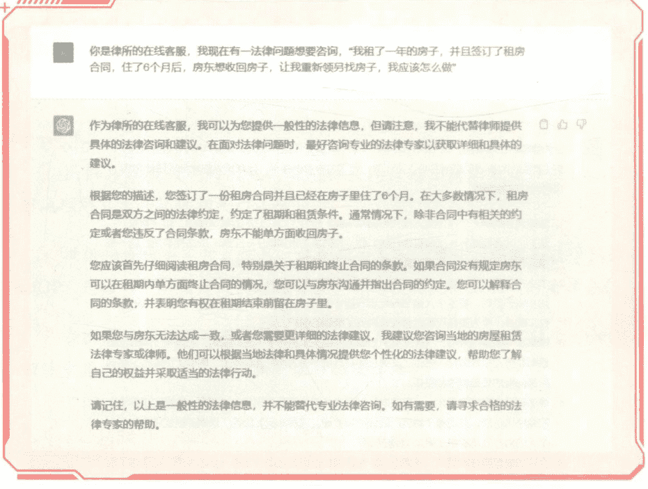

可以看到，ChatGPT 虽然不能给出具体的解决方案，但是针对社会公众咨询的法律问题进行了分析，给出了解决方向，可以帮助他们答疑解惑，指明解决问题的方向和路径。

#### 【萃一萃】

- 要确保 ChatGPT 的回答符合最新的法律法规，给出的案例也要符合当地的相关规定。
- ChatGPT 要保持公正和中立的立场，避免提供偏见或主观性的意见，而应提供客观的法律信息。
- 对于重大或者难以解决的问题，用户还是要咨询专业律师。

#### 任务 2：生成智能法律分析文本

通过分析和研究大量的法律文本，ChatGPT 自动做出的法律文件的摘要、归类和索引，使研究人员能够更高效地获取所需信息，帮助分析和理解复杂的合同条款和法律文件，检测潜在的风险和漏洞，并提供相应的建议。

> 你作为律所的在线客服，分析一下2021年1月1日起施行的《中华人民共和国民法典》

> 作为律所的在线客服，我可以为您提供《中华人民共和国民法典》2021年1月1日起施行的一些主要变化和亮点的简要分析。请注意，以下内容仅供参考，如果您需要详细的法律咨询，请咨询专业的律师。

1. 法律典范的统一：《中华人民共和国民法典》整合了以往分散的民法法律，如《物权法》、《合同法》、《侵权责任法》等，为民事关系提供了一个统一的法律典范。这一举措旨在提高法律的一致性和适用性，使民法规范更加系统化和完整。
2. 个人权益保护的加强：《民法典》加强了个人权益的保护。它规定了个人信息的收集、使用和保护原则，要求个人信息的处理方遵守合法、正当和必要的原则，并承担相应的责任。此外，个人隐私权和名誉权也得到了明确的保护。
3. 婚姻家庭关系的规范：《民法典》对婚姻家庭关系进行了一系列规范。它强调了婚姻自愿原则和男女平等原则，规定了夫妻共同财产制度的适用范围和效力，明确了离婚和家庭暴力等问题的处理程序和责任。
4. 继承和遗产管理的规定：《民法典》对继承和遗产管理做出了新的规定。它规定了继承人的顺序和份额，并加强了对遗产的保护和管理。《民法典》明确了遗嘱的形式和效力，为个人的财产继承提供了更加明确的规范。
5. 合同和侵权责任的规范：《民法典》对合同和侵权责任进行了进一步的规范。它强调了合同当事人的自由意思表示原则，明确了合同违约责任和损害赔偿的相关规定。此外，它加强了对侵权行为的预防和惩治。

需要注意的是，以上仅涵盖了《中华人民共和国民法典》的一些主要变化和亮点，而且法律文本本身更加复杂和详细。如果您需要详细的法律咨询或针对具体问题的解读，请咨询专业律师。

ChatGPT 的智能分析，可帮助社会公众更好地了解法律的变化，以及对法律条文的解释和其适用性，增强社会公众的法律意识和法治观念，更好地预防和应对法律风险，避免违法行为和纠纷的发生。

#### 【萃一萃】

- 确保 ChatGPT 能够正确理解法律文本中的语义和上下文，包括法律术语、概念和法律原则，以便正确地提取和分析关键信息。
- 在面临复杂法律问题时仍需要咨询专业的律师或法律机构，以获取具体案件和法律情境下的准确建议和解读。
- 在使用 ChatGPT 进行法律分析时，始终要谨记其提供的内容可能存在谬误或不准确的情况，要在关键问题上进行独立的验证和核实。

#### 【问一问】

- 提供具体而明确的问题，避免模糊或含糊不清的表达，使 ChatGPT 更好地理解需求并提供相关的法律分析。
- 提供相关的事实背景信息，包括相关人物、事件、合同条款等，帮助 ChatGPT 更好地了解案件或问题的背景，从而使其提供更准确的法律分析。
- 在提问时明确说明问题涉及特定的细节或特定条件，有助于 ChatGPT 在回答中考虑这些因素，并提供更准确的法律分析。

### 6.1.4 公共服务：设置常见问题自动化回答

为实时为社会公众提供在线服务支持，减少等待时间，节省人力成本，满足不断增长的需求，提供个性化的服务，公共服务领域可以运用 ChatGPT 为社会公众提供 24 小时在线服务，提高公共服务的效率。

#### 任务：常见问题自动化回答

公共服务涉及诸多领域，如教育、医疗、交通、政府、社会福利和基础设施等方面，需要收集各个领域内社会公众集中关注的问题，比如“学区房的划分”“国家基本医疗保险药品目录”“违规驾驶的扣分标准”等，都是社会公众较为关心的问题。将相关数据信息传输到 ChatGPT 中，社会公众通过询问便能立刻获取想要的答案，也能减轻相关工作人员的工作压力。

> 你是公共服务的在线客服，我想知道北京医院如何进行社保报销

作为在线客服，我可以提供一般性的指导，但请注意北京的具体社保报销流程可能因规定和政策的变化而有所不同。以下是一般在北京医院进行社保报销的一般步骤：

1. 就诊时咨询：在您去北京的医院就诊时，可以咨询医院的医保部门或相关窗口，了解详细的社保报销流程和要求。
2. 确认医保信息：在医院就诊时，需要确认您的医保信息是否有效和正确。医院的医保部门通常可以协助您核对并确认您的医保信息。
3. 医疗费用结算：在就诊结束后，您可以到医院的收费窗口办理医疗费用结算。您需要提供个人身份证、社保卡以及就诊时的费用凭证（如发票、处方等）。
4. 报销申请填写：医院的医保部门会提供报销申请表格，您需要填写必要的个人信息和医疗费用明细。确保填写准确无误，并附上相关费用凭证的复印件。
5. 报销申请提交：将填写好的报销申请表格和相关凭证提交给医院的医保部门。他们会进行初步审核，并指导您完成后续的流程。
6. 医保机构审核：医保部门将转交您的报销申请给北京市社会保险管理机构进行审核。他们会核对您的报销资料和费用凭证，并根据相关政策和规定进行审核。
7. 报销处理：一旦您的报销申请获得审核通过，医保机构将会应报销的费用退还给您。通常是通过银行转账或其他指定的方式进行退款。

请注意，以上步骤仅供参考，具体的流程和要求可能因北京的政策和规定的变化而有所不同。建议您在就诊前咨询医院的医保部门或相关窗口，以获取最准确和最新的北京医院社保报销流程信息。

上述回答为社会公众提供了一般性的指导，梳理了社保的报销流程，提出了一般的步骤和注意事项，为社会公众的报销提供了参考。

#### 【萃一萃】

- ChatGPT 要使用清晰、简洁和易懂的语言与用户进行交流，避免使用过多的行政术语或专业术语，以确保用户能够得到并理解需要的信息。
- ChatGPT 要尽量及时回复用户的问题和请求，以提供高效的客户服务体验。
- ChatGPT 要遵守相关的数据和隐私保护法规，保护用户的个人信息和隐私。

## 6.2 线上预约 5 个应用场景与 7 项任务示范

### 6.2.1 医院诊所：优化预约体验与智能化患者需求分析

医院诊所使用 ChatGPT 为患者提供线上预约服务，可解决患者在就诊前或就诊过程中存在的常见问题，如预约挂号流程、就诊前准备、医疗费用等，也可帮助患者更好地了解并做好准备，并分担医务人员的工作压力，提高其工作效率。

#### 任务 1：优化预约体验

要优化预约体检，如要简化预约体检的流程和事项，可以从开发人员的角度，询问如何优化预约体检模块。可运用多个 AI 工具，获取不同的答案，经过比较分析之后，选择合适的方法进行优化。

ChatGPT 回答：

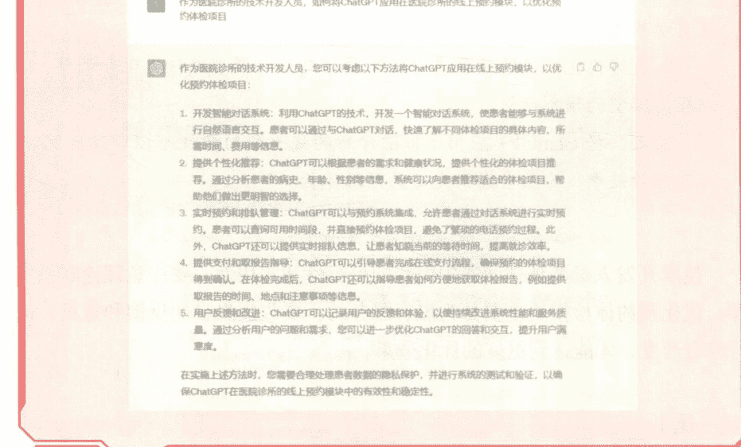

用户提问：

作为医院诊所的技术开发人员，如何将 ChatGPT 应用在医院诊所的线上预约模块，以优化预约体检项目？

#### 其他 AI 工具回答：

作为医院诊所的技术开发人员，您可以通过以下步骤将 ChatGPT 应用于医院诊所的线上预约模块，以优化预约体检项目：

1.  收集数据：首先，您需要收集有关医院诊所的预约数据，包括预约时间、患者年龄、性别、症状、病史等信息。
2.  数据预处理：对收集到的数据进行预处理，包括数据清洗、缺失值填充、数据转换等。
3.  训练模型：使用 ChatGPT API 或者其它开源的自然语言处理（NLP）工具，对预处理过的数据进行训练，得到一个能够预测患者预约体检项目的模型。
4.  模型评估：评估模型的预测性能，包括准确率、召回率、F1 值等指标。
5.  部署模型：将训练好的模型部署到线上预约模块中，以接收患者的预约请求。
6.  使用模型：当患者请求预约体检项目时，模型将根据患者的描述自动推荐适合的体检项目，并生成预约表单。
7.  反馈优化：通过收集患者的反馈信息，对模型进行优化和调整，以提高模型的预测性能。

总之，将 ChatGPT 应用于医院诊所的线上预约模块可以帮助医院提高预约效率，为患者提供更好的预约体验。

技术开发人员要评估回答中内容的可行性和实用性，要注意理论联系实际。优化预约体检模块主要是为患者服务的，要收集患者的反馈和意见，进行综合开发，才能达到更好的优化效果。

##### 【比一比】

ChatGPT 回答的内容比较符合预期的想法，因为经过训练之后，其已经对用户提出的问题有了一定的敏感度，知道从哪些方面进行回答。

另一个 AI 工具由于没有经过训练，并且没有相关数据支持，回答的内容比较宽泛。

经过比较可知，要想获得满意的答案，需要给工具“投喂”足够多的数据。

#### 【追一追】

-   继续提出具体的要求，比如“请对训练模型进行详细展开”“如何进行测试”等，经过不断问询，才能获得想要的答案。
-   可追问 ChatGPT 能否处理预约过程中的异常情况，如预约冲突、服务不可用等。
-   可追问 ChatGPT 在处理预约信息时如何确保用户的隐私和数据安全。

#### 任务 2：智能化患者需求分析

可以从专家、患者、家属等不同角度去询问 ChatGPT，让其根据不同角色提供的信息，智能分析患者的需求，合理调配医疗资源，定制符合患者需求的治疗方案，提高医疗资源的利用效率，减少资源浪费。

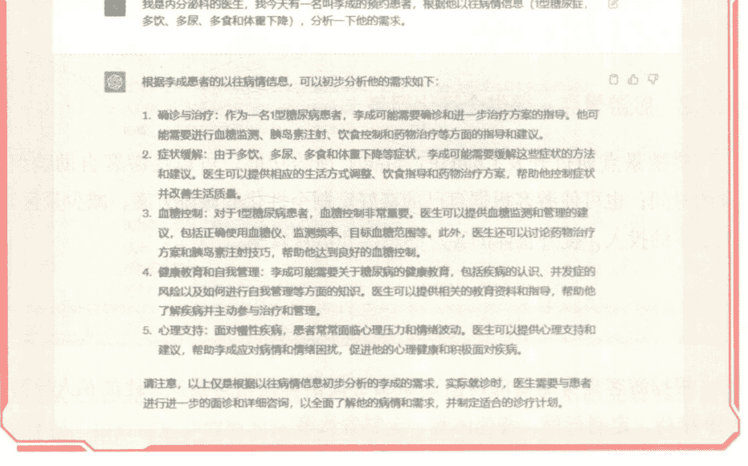

上述回答是基于患者提供的症状进行的初步分析。在实际的诊疗过程中，应该根据患者具体的病情和病史进行个案分析，并为其制订个性化的诊疗计划。

#### 【萃一萃】

-   ChatGPT 的回答应该是透明的和可解释的，患者应该能够理解其所提供的建议或分析的基础。
-   明确告知患者 ChatGPT 的分析结果仅供参考，不能替代专业医疗人员的诊断和建议。
-   对 ChatGPT 进行特定领域的培训，以提高其在分析患者需求方面的准确性和专业性。

#### 【问一问】

-   提问时要清晰明确地描述患者需求或问题，避免模糊或含糊不清的表达。
-   提供尽可能多的具体细节，如症状的性质，出现的时间、频率，疼痛程度，等等，这将帮助 ChatGPT 更准确地理解问题和给出恰当的分析。
-   如果有之前的对话或信息，提醒 ChatGPT 回顾这些信息，以便在回答问题时考虑到先前的内容。

### 6.2.2 旅游景点：提供个性化服务

旅游景点通过开发 ChatGPT 的线上预约功能，可以使游客自助购票、预约时间；也可使游客根据自己的喜好定制个性化的旅游方案，减少景区人工成本的投入，提升整体的客户满意度和运营效率。

#### 任务：个性化服务

根据游客自身的需求，让 ChatGPT 提供个性化的服务，比如私人导游、VIP 接待、定制行程、特色体验、定制餐饮等。

用户提问：

你是旅游景点的线上预约客服，我想旅游泰山，请为我制定一份旅游计划，为我推荐一下住宿、美食、交通等

ChatGPT 回答：

当然，我很乐意为您制定泰山旅游计划！泰山是中国著名的旅游胜地，您将有机会欣赏到美丽的山景和历史悠久的文化遗址。以下是一份推荐的旅游计划，包括住宿、美食和交通：

1.  住宿：
    在泰山游览期间，您可以选择在泰安市区或者泰山风景区附近的酒店住宿。以下是几个推荐的酒店选项：
    *   泰山风景区内的宾馆：这些宾馆位于山脚下或山上，让您可以更方便地探索泰山。您可以考虑泰山宾馆或玉皇顶宾馆等。
    *   泰安市区酒店：如果您希望在市区住宿并前往泰山一日游，可以选择泰安市区的酒店，如希尔顿逸林酒店或锦江之星酒店。
2.  美食：
    泰安市和泰山周边地区有许多美食选择，让您品尝当地特色。以下是几个推荐的美食：

由于 ChatGPT 回答的不是一个具体的计划，游客看到上面的回答后还需要自己做规划，所以要进行追问，以获得一个详细的具体计划，游客可以“拿来即用”。

用户追问：

这不是计划的形式啊，我要一个具体的计划

ChatGPT 回答：

非常抱歉，我理解您需要一个具体的旅游计划。以下是一份详细的泰山旅游计划，包括住宿、美食和交通安排：

*   Day 1:
    *   抵达泰安市：乘坐飞机到达济南遥墙国际机场，然后乘坐机场大巴或出租车前往泰安市。
    *   入住酒店：在泰安市区选择一家舒适的酒店，如希尔顿逸林酒店或锦江之星酒店。
    *   晚餐：品尝泰安市的特色小吃，如泰安馒头、九层塔拌面等。
*   Day 2:
    *   早餐：在酒店享用早餐。
    *   前往泰山景区：乘坐出租车或公交车前往泰山景区入口。
    *   登山：选择适合您的登山线路，如中天门、南天门或玉皇顶线路，并准备好足够的水和舒适的登山装备。
    *   中午：在山上的餐厅或小吃摊位品尝泰山特色美食，如泰山炖汤、泰山扒鸡等。

从 ChatGPT 的回答可以看出，它能按照用户的要求不断完善和丰富旅游计划，用户可据此回答调整计划，以适应自己的需求。

#### 【问一问】

-   明确感兴趣的目的地和旅行时间，提供目的地的名称或所在地区，以及具体的日期或时间范围。
-   描述感兴趣的活动、景点或特定的兴趣点。比如，自然风光、历史遗迹、购物、美食等。
-   提供旅行偏好，比如是喜欢冒险探索还是更偏向于放松度假。

#### 【改一改】

-   阅读多个答案后，可以尝试提取其中的关键信息，这些信息通常是多个答案中共同的要点或核心观点。将这些关键信息整合到一个新的答案中，以确保回答的完整性和准确性。
-   多个答案可能涉及不同的观点或方法，可以将这些观点结合起来，形成一个更全面和综合的回答。尝试找到不同观点的共通之处，或者给出权衡不同观点的建议。
-   在整合答案时，注意保持简洁明了的风格。避免冗长和重复的表述，应将不同答案中相似的内容进行概括和合并，以提供简洁而有条理的回答。

### 6.2.3 酒店住宿：提供个性化定制服务

酒店住宿引入 ChatGPT，可提供即时客户服务，缩短客户等待时间。ChatGPT 可以通过学习、训练来处理酒店住宿过程中的常见问题，如预订流程、房型选择、设施信息等，提高工作效率，同时确保客户能够快速获得准确的信息。

#### 任务：个性化服务

在酒店住宿中，常见的个性化服务包括记录客户的偏好、定制客房、私人管家、定制用餐、特别体验、个性化沟通等，用户可以选择对某一服务来提问，要求 ChatGPT 给出个性化的方案或措施。

用户提问：

作为山东某酒店住宿的线上预约客服，现有一法国友人预定了本酒店，需要为其定制三餐，并为其推荐该城市的其他美食

ChatGPT 回答：

作为山东某酒店住宿的线上预约客服，为法国友人定制三餐并推荐城市的其他美食，您可以采取以下步骤：

1.  欢迎和了解客人：首先，欢迎法国友人并表达对他们的关注和兴趣。确认他们的预订信息，并了解他们的食物喜好、饮食禁忌、特殊需求等。
2.  定制三餐：根据法国友人的偏好，为其定制三餐。考虑到法国美食文化和口味，可以提供一些经典的法国菜肴，如法式奶油蘑菇鸡、羊排、焦糖布丁等。确保食材的新鲜度和高品质，并提供适当的酒水搭配建议。
3.  推荐当地美食：向法国友人推荐该城市的其他美食。了解他们对当地美食的兴趣和好奇心，可以向他们介绍当地著名的菜肴和特色小吃。例如，在山东地区，您可以推荐他们品尝鲁菜、海鲜、烤鸭等。
4.  提供餐厅推荐：为法国友人提供当地优质的餐厅推荐。了解他们的预算和需求，推荐适合他们口味和喜好的餐厅。可以提供餐厅的菜单、位置、预订信息等，并给出个人化的建议。
5.  考虑食物过敏和饮食限制：确认法国友人是否有任何食物过敏或特殊的饮食限制，如素食、无麸质或无乳制品。根据他们的需求，在定制三餐和推荐餐厅时提供相应的选择和建议。
6.  提供联系方式和支持：最后，提供您的联系方式，以便法国友人在住宿期间有任何问题或需求时能够随时联系您。确保他们知道您是他们的专属客服，愿意随时为他们提供帮助和支持。

通过以上步骤，您可以为法国友人定制三餐并推荐该城市的其他美食，提供个性化的服务体验，让他们在酒店住宿期间享受美食和美好的住宿体验。

上述回答比较宽泛，不是特别具体，用户还需要继续提问，“法国友人的饮食偏好是 × ×，根据编号定制三餐”“法国友人想要体验山东经典菜肴，请推荐”，通过细化提问的细节，得到想要的答案。

#### 【萃一萃】

-   ChatGPT 是一种强大的语言模型，但它可能会生成不准确或错误的回答。因此，用户应始终验证其生成回答的准确性，并确保其提供正确的信息。
-   ChatGPT 作为辅助工具，并不能完全取代人类客服。在处理复杂问题或敏感信息时，最好由人工客服介入，以确保提供高质量的服务和保护客户隐私。
-   要避免使用 ChatGPT 处理敏感信息，如个人身份信息、财务信息等。要确保客户的隐私得到保护，遵守相关的数据保护法律和隐私政策。

### 6.2.4 健身场馆：优化预约体验与个性化会员服务

ChatGPT 运用在健身场馆中，可以帮助客户解决常见问题，如会员资格、课程安排、设备使用等，还可以根据客户的需求和健身目标，提供个性化的健身建议和指导。

#### 任务 1：优化预约体验

要提高客户预约的便捷性，提高预约的成功率，提升客户的满意度，可以向 ChatGPT 询问优化预约体检的措施，减少客户的等待时间。

ChatGPT 回答：

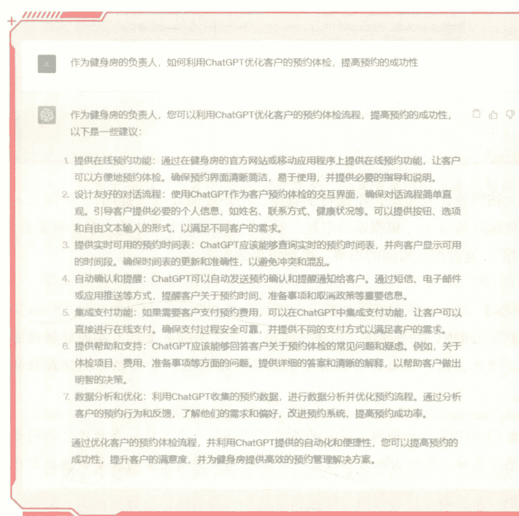

用户提问：

作为健身房的负责人，如何利用 ChatGPT 优化客户的预约体检，提高预约的成功性？

讯飞星火认知大模型回答：

> 作为健身房的负责人，可以利用 ChatGPT 优化客户的预约体检，提高预约的成功性。具体措施如下：
> 1.  提供更加人性化的服务：通过 ChatGPT 生成的自然语言文本，可以根据客户的需求和偏好，为他们推荐最合适的体检项目和时间。例如，如果客户想要进行全面的身体检查，ChatGPT 可以生成相应的建议，并提供相关的信息和指导。
> 2.  提高沟通效率：使用 ChatGPT 可以帮助健身房负责人更快地回复客户的咨询和问题，从而提高沟通效率。例如，当客户询问某个体检项目的具体内容和费用时，ChatGPT 可以立即生成详细的回答，避免了人工回复的延迟和不准确性。
> 3.  增强客户体验：通过 ChatGPT 提供的智能化服务，可以让客户感受到健身房的专业性和贴心程度。例如，当客户需要更改预约时间或地点时，ChatGPT 可以快速响应并提供解决方案，让客户感到满意和信任。
> 总之，利用 ChatGPT 优化客户的预约体检，可以帮助健身房更好地满足客户需求，提高预约成功率和客户满意度。同时这也可以促进健身房的数字化转型和发展。

##### 【比一比】

-   讯飞星火认知大模型的回答提及个性化服务的方面，这是非常重要的，因为个性化的建议能够满足客户的特定需求，提升他们的满意度。
-   二者都提到了时间、效率方面的词汇，都注重客户的体验。
-   两个 AI 工具回答的内容虽然都展示了优化预约体验的措施，但是对措施的内容表述不同。二者可以相互补充，用户可选取具有可行性的措施。

#### 【问一问】

1.  提供清晰、具体的问题，确保 ChatGPT 能够理解你的意图，以提高获取准确答案的可能性。
2.  尽量使用简单、明了的语言来表达问题，避免使用过于复杂或含糊不清的句子。
3.  为了更好地说明问题，可以提供具体的示例或情境，使 ChatGPT 能够更好地理解需求并给出相关建议。

#### 任务 2：个性化会员服务

健身场馆为留住客户，并发展其成为忠实的客户，需要根据不同的客户需求，提供个性化会员服务，比如推荐健身课程、教练，定制训练计划和推荐营养餐等。

在提问过程中，提出三个问题，“我目前的体重是 80 公斤、身高 160 厘米，梨形身材，请为我推荐健身课程及相关的教练”“我的健身时间为晚上 6 点至 8 点，一周锻炼 5 天，请为我推荐合适的健身项目”“要将饮食考虑进去”。我们可以根据 ChatGPT 回答的内容，整合出一个新的训练计划。

#### 个性化训练计划

*   一、周一
    1.  运动。晚上六点至八点进行有氧运动，如跑步机或室内自行车，持续 40 分钟。随后进行全身力量训练，包括深蹲、卧推、引体向上和杠铃划船，每个练习进行 3 组，每组 8-12 次。
    2.  饮食。早餐：全麦面包配上鸡蛋和蔬菜。午餐：烤鸡胸肉沙拉。晚餐：烤三文鱼搭配烤蔬菜。加餐：坚果和水果。
*   二、周二
    1.  运动。晚上六点至八点进行瑜伽或普拉提课程，持续 60 分钟，以提高柔韧性和核心力量。
    2.  饮食。早餐：燕麦片配牛奶和水果。午餐：鸡胸肉、蔬菜卷。晚餐：烤鳗鱼配蔬菜炒饭。加餐：蔬果汁和坚果。
*   三、周三
    1.  运动。晚上六点至八点进行有氧运动，如慢跑或跳绳，持续 30 分钟。随后进行全身力量训练，包括深蹲、哑铃卧推、俯卧撑和反向划船，每个练习进行 3 组，每组 8-12 次。
    2.  饮食。早餐：水煮蛋、全麦面包。午餐：鳗鱼寿司卷。晚餐：烤鸡腿肉、蔬菜沙拉。加餐：酸奶和水果。
*   四、周四
    1.  运动。晚上六点至八点进行瑜伽或普拉提课程，持续 60 分钟，以提高柔韧性和核心力量。
    2.  饮食。早餐：蔬菜鸡肉蛋白松饼。午餐：沙拉、烤鸡胸肉。晚餐：烤三文鱼、烤蔬菜。加餐：蔬果汁和坚果。
*   五、周五
    1.  运动。晚上六点至八点进行有氧运动，如游泳或有氧舞蹈课程，持续 40 分钟。随后进行全身力量训练，包括腿部推蹬、哑铃肩推、仰卧腿举、仰卧卷腹，每个练习进行 3 组，每组 8-12 次。
    2.  饮食。早餐：蔬菜水果蛋白冰沙。午餐：鸡胸肉、糙米和蔬菜。晚餐：烤鳗鱼配蔬菜炒饭。加餐：酸奶和水果。
*   六、周末
    周末休息，可进行轻度活动如散步、瑜伽或休息恢复。

（注：以上内容由 ChatGPT 生成，未改动）

#### 【改一改】

-   根据日程安排和身体状况，合理分配每周的训练时间。确保训练时间足够，但也要留出恢复和休息的时间。
-   选择喜欢的运动项目和活动，这样更容易保持长期的动力并坚持下去。如果不喜欢某个运动项目，可以尝试其他替代方案。
-   将饮食计划与训练计划相结合，确保摄入足够的营养来支持训练和身体恢复。根据目标调整饮食的营养素比例。

### 6.2.5 影院娱乐：提供个性化影片推荐

ChatGPT 可以根据客人的偏好，为他们推荐最适合的电影场次，提升其体验，增加满意度和忠诚度；还可以同时处理多个客人的预约请求，减轻人工客服的工作量，有效应对高峰时段的预约需求。

#### 任务：个性化影片推荐

影视娱乐方面的个性化服务有很多，比如可以根据客户的喜好，推荐正在热播的电影，提供该影片的评分、评价及观看指数等。

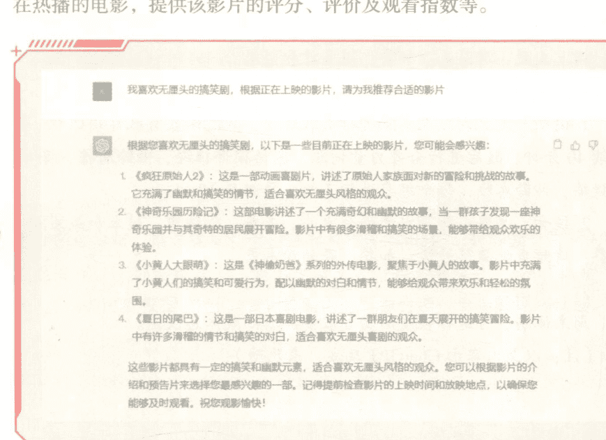

笔者又陆续提出了“我想看《小黄人大眼萌》，它的评价怎么样，故事情节如何，影评怎么样”“我可以去哪些影院观看”等问题，ChatGPT 都做出了相应回答。

【扫码查看完整问答过程】

#### 【问一问】

-   确保问题表达清晰明确，避免模糊或含糊不清的表述。
-   在提问时，提供相关的背景信息和关键细节，以便 ChatGPT 更好地理解问题，并给出更具针对性的回答。
-   如果需要对特定事物进行推荐或建议，请明确说出需求，如地点、时间、风格等，这样可以令 ChatGPT 给出更具体和符合你期望的回答。

## 6.3 ChatGPT 赋能在线客服的基本步骤

### 6.3.1 训练 ChatGPT

训练 ChatGPT 即将大量的数据和知识输入该模型，通过算法使其学习和理解输入的内容，根据用户的提问生成相应的回答。训练 ChatGPT 的步骤如下。

#### 第一步：收集处理数据。

一是需要收集足够多的对话数据，可包括人工创建的对话、公开的聊天记录、在线论坛等，数据的多样性和覆盖范围对于训练模型的质量和表现非常重要。

二是对收集到的对话数据进行清洗和预处理，去除重复、无效的数据，纠正拼写错误和语法问题，标记对话结构等，确保数据的质量和一致性。

#### 第二步：选择学习模型。

选择合适的 ChatGPT 学习模型，并准备模型的训练环境。对选择的模型进行训练，包括将对话数据输入模型中，调整模型的权重和参数，以使其逐步学习对话的模式和语义。

#### 第三步：评估调整模型。

对训练过程中的模型进行评估和调整，评估模型的回答内容，判断回答的准确性、连贯性、多样性等，然后根据评估结果加以调整和改进。根据评估结果进行模型的迭代和改进，通过多次训练、调整参数和增加数据来提高模型的性能和质量。

### 6.3.2 设定场景规则

为了限制 ChatGPT 的回答范围，确保其回答符合特定的业务需求和场景，需要设定场景规则。以下是设定场景规则的具体步骤。

#### 第一步：确定业务场景。

确定应用 ChatGPT 的具体业务场景，如，餐厅预订、影院票务、医院诊所等，以便更好地理解用户需求和提供相关的信息。

#### 第二步：设计问题模板。

根据业务场景，设计一系列问题模板，涵盖用户可能提出的问题和需求。问题模板可以是通用的，也可以是针对具体问题类型的。

#### 第三步：引导对话流程。

设定场景规则时，还可以定义对话的流程和顺序，确保用户问题得到适当的回答和处理。比如，根据用户的问题类型和前后文关系，引导对话流程以提供连贯和一致的回答。

#### 第四步：考虑异常情况。

除了设定对常见问题的回答策略，还需要考虑对异常情况的处理。定义相应的回答或提示，以便在无法提供准确答案时向用户提供帮助或转接到人工客服。

### 6.3.3 集成 ChatGPT

在完成 ChatGPT 的训练和设定场景规则之后，接下来是将 ChatGPT 集成到现有的平台或应用程序中，以提供在线客服与预约服务。以下是集成 ChatGPT 的步骤。

#### 第一步：确定集成目标。

明确集成 ChatGPT 的目标和需求，确定集成的平台或应用程序，如网站、移动应用、社交媒体平台等。

#### 第二步：传递处理数据。

建立与 ChatGPT 模型有关的数据传递和处理机制，将用户输入的问题传递给 ChatGPT，并接收生成的回答。根据集成目标，对接现有的平台或应用程序，将 ChatGPT 的接口嵌入现有系统中，并确保与其他组件的集成。

#### 第三步：设计用户界面。

设计用户界面，方便用户与 ChatGPT 进行交互。可以以聊天窗口、对话框或其他形式的界面展示，使用户能够正确输入问题并接收 ChatGPT 的回答。

#### 第四步：测试验证 ChatGPT。

在集成 ChatGPT 后，测试和验证其在现有平台或应用程序中能否正常运行，测试不同的用户场景和问题，检查回答的准确性、及时性和用户体验。

### 6.3.4 持续更新 ChatGPT

为保证 ChatGPT 性能和效果的持续优化，需要持续更新和改进 ChatGPT。具体更新步骤如下。

#### 第一步：持续训练 ChatGPT。

持续收集并投喂 ChatGPT 足够的数据，进行持续训练。通过训练，ChatGPT 可以不断学习和适应新的情境、语言变化和用户行为。

#### 第二步：收集反馈意见。

通过用户满意度调查、对话日志、用户评价等收集用户反馈，评估 ChatGPT 的表现。根据反馈和评估结果，识别和改进 ChatGPT 的弱点和问题。

#### 第三步：进行技术升级。

随着技术的发展和改进，及时进行 ChatGPT 的技术升级。关注自然语言处理和人工智能领域的最新进展，应用新的模型和算法来提升 ChatGPT 的性能和智能化程度。

# 第7章 最走心的商品导购

**商品导购**是一个帮助消费者进行购物决策的重要环节。导购员通常具备一定的产品知识和销售技巧，能够为顾客提供关于产品特点、功能、优势和价格等的信息，以帮助他们做出合适的购买决策。ChatGPT 将成为**最走心的商品导购员**。

## 7.1 商品推荐 3 个应用场景与 6 项任务示范

### 7.1.1 需求分析：潜在客户抓取与消费者需求偏好分析

#### 任务 1：潜在客户抓取

用户提问：

我是一家装修公司的客户经理，如何运用 AI 智能助手来从家装平台网站上的访问中获取我的潜在目标客户？

某智能 AI 机器人回答：

> 作为一家装修公司的客户经理，您可以运用 AI 智能助手来从家装平台网站上获取潜在目标客户。以下是一些建议：
> 1. 自动化回复：配置您的 AI 助手以自动回复网站上的访客。您可以设置常见问题的自动回复，以便快速响应潜在客户的咨询。
> 2. 个性化推荐：利用 AI 助手的个性化推荐功能，根据访客在网站上的浏览行为和搜索历史，向他们推荐适合他们需求的装修方案或设计风格。这有助于提高他们的兴趣，并增加转化率。
> 3. 数据分析：AI 助手可以帮助您分析访客的行为数据，包括他们在网站上停留的时间、点击的页面等。通过分析这些数据，您可以了解访客的兴趣和偏好，从而更好地定位潜在目标客户。
> 4. 个性化营销：根据 AI 助手提供的数据分析结果，您可以制定个性化的营销策略。例如，您可以发送定制化的电子邮件或短信，向潜在客户提供特别优惠或相关服务的信息。
> 5. 实时聊天支持：AI 助手可以提供实时聊天支持，帮助潜在客户解答问题和提供咨询。这种即时沟通的方式可以增强客户体验，并促进潜在客户的转化。
> 通过运用 AI 智能助手，您可以更加高效地获取潜在目标客户，并提升您的市场竞争力。记得要根据您的业务需求和目标客户群体来定制 AI 助手的功能和策略。
> （注：以上内容由某智能 AI 机器人生成，未改动）

用户追问：

你来帮我抓取潜在客户的话，会怎么做？

某智能 AI 机器人回答：

> 作为一个 AI 助手，我可以通过以下方式帮助您抓取潜在客户：
> 1. **数据分析和挖掘**：通过分析家装平台网站的访问数据和用户行为数据，我可以帮助您确定潜在客户的特征和偏好。这包括他们的搜索关键词、浏览历史、点击率等。通过深入了解他们的需求和兴趣，您可以更有针对性地开展营销活动。
> 2. **个性化推荐和营销**：基于数据分析的结果，我可以向潜在客户提供个性化的推荐和营销信息。通过根据他们的兴趣和需求，向他们展示适合的装修方案或设计风格，您可以增加他们的兴趣并促进转化。
> 3. **自动化回复和沟通**：我可以配置自动回复功能，快速响应潜在客户的咨询和问题。这样可以提高客户满意度，并为您节省时间和人力资源。
> 4. **实时聊天支持**：通过提供实时聊天支持，我可以与潜在客户进行互动，解答他们的问题，提供咨询和建议。这种即时沟通的方式可以建立信任关系，并促进潜在客户的转化。
> 5. **数据报告和分析**：我可以生成详细的数据报告和分析结果，帮助您了解潜在客户的转化率、关键转化路径、市场趋势等。这些数据可以为您的营销决策提供宝贵的参考。
> 请注意，为了更好地抓取潜在客户，我需要访问和分析家装平台网站的数据。确保您已经获得了合法的访问权限，并且遵守相关的隐私和数据保护法规。
> （注：以上内容由某智能 AI 机器人生成，未改动）

以下是讯飞星火认知大模型对于上述问题的回答。我们可以对比某智能 AI 机器人和讯飞星火认知大模型的回答，寻找抓取潜在客户的最优路径。

用户提问：

我是一家装修公司的客户经理，如何运用 AI 智能助手来从家装平台网站上的访问中获取我的潜在目标客户？

讯飞星火认知大模型回答：

+   以下是一些可能的方法：
    1. 使用 AI 智能助手的关键词搜索功能，搜索与您的业务相关的关键词和短语。这将帮助您找到与您业务相关的网站和页面，并确定哪些页面可能有潜在客户。
    2. 使用 AI 智能助手的网站分析工具，分析访问量、页面浏览量、停留时间等数据。这将帮助您确定哪些页面最受欢迎，哪些页面需要改进。
    3. 使用 AI 智能助手的社交媒体监测工具，监测与您的业务相关的社交媒体平台。这将帮助您了解哪些内容最受欢迎，哪些帖子可能吸引潜在客户。
    4. 使用 AI 智能助手的电子邮件营销工具，创建邮件列表并发送电子邮件。这些电子邮件可以包含有关您的业务的信息，以及与潜在客户有关的优惠和促销活动。
    5. 使用 AI 智能助手的在线广告工具，创建广告并将其投放到与您的业务相关的网站和社交媒体平台上。这些广告可以包含有关您的业务的信息，以及与潜在客户有关的优惠和促销活动。
    （注：以上内容由讯飞星火认知大模型生成，未改动）

用户追问：

你来帮我抓取潜在客户的话，会怎么做？

讯飞星火认知大模型回答：

+   以下是一些抓取家庭装修顾客的建议：
    1. 确定您的目标受众：首先，您需要确定您想要吸引哪些人作为家庭装修顾客。这可以通过分析您的业务和市场来确定。
    2. 使用关键词搜索：使用 AI 智能助手的关键词搜索功能，搜索与家庭装修相关的关键词和短语。这将帮助您找到与家庭装修相关的网站和页面，并确定哪些页面可能有潜在客户。
    3. 分析网站数据：使用 AI 智能助手的网站分析工具，分析访问量、页面浏览量、停留时间等数据。这将帮助您确定哪些页面最受欢迎，哪些页面需要改进。
    4. 监测社交媒体：使用 AI 智能助手的社交媒体监测工具，监测与家庭装修相关的社交媒体平台。这将帮助您了解哪些内容最受欢迎，哪些帖子可能吸引潜在客户。
    5. 发送电子邮件：使用 AI 智能助手的电子邮件营销工具，创建邮件列表并发送电子邮件。这些电子邮件可以包含有关您的业务的信息，以及与家庭装修顾客有关的优惠和促销活动。
    6. 投放在线广告：使用 AI 智能助手的在线广告工具，创建广告并将其投放到与家庭装修相关的网站和社交媒体平台上。这些广告可以包含有关您的业务的信息，以及与家庭装修顾客有关的优惠和促销活动。

    请注意，抓取家庭装修顾客需要遵守相关法律法规和道德规范。在进行任何行动之前，请确保您的行为是合法和道德的。
    （注：以上内容由讯飞星火认知大模型生成，未改动）

#### 【萃一萃】

+   两个 AI 工具都提到“根据您的业务需求和目标客户群体来定制 AI 智能助手的功能和策略”“分析您的业务和市场来确定”，因此，结合自身情况来量身定制 AI 智能助手才能更好地完成任务。
    获取数据需要有相关的 API 或数据接口，要确保数据传输的安全性与合法性，以及用户隐私保护的问题。这一问题得不到解决，借助于 AI 助手抓取潜在客户就是纸上谈兵。
    目前 AI 智能助手给出的只是实现这一任务的技术能力和逻辑框架，要真正将定制化 AI 智能助手应用于日常工作中，还有很多问题亟待解决。未来已来，似乎近在咫尺，但我们还没有迈进去。

#### 任务 2：消费者需求偏好分析

##### 问答举例

用户提问：

我是一个房地产项目客户经理，如何使用 ChatGPT 来分析房地产客户的需求偏好？你有什么建议？

ChatGPT 回答：

作为一个房地产项目客户经理，您可以使用 ChatGPT 来分析房地产客户的需求偏好，以下是一些建议：

+   1. 交互式对话：与潜在客户进行交互式对话，通过提问和回答的方式获取他们的需求和偏好信息。ChatGPT 可以作为一个虚拟助手，帮助您与客户进行对话，了解他们的预算、房型、位置、设施要求等方面的偏好。
    2. 文本分析：将客户提供的文字信息输入到 ChatGPT 中，通过对生成的回答进行分析，提取关键词和主题，从中获取客户的需求偏好。您可以使用文本分析技术，如关键词提取、情感分析等，对 ChatGPT 生成的回答进行自动化处理和分析。
    3. 反馈收集：利用 ChatGPT 向客户展示房地产项目的特点、设计方案等，并主动收集他们的反馈。通过 ChatGPT 的帮助，您可以向客户提供多个选项，并记录他们对每个选项的偏好和意见，从而获取更具体的需求和偏好信息。
    4. 数据整理与分析：将 ChatGPT 生成的回答和客户的其他信息整理成结构化的数据，然后进行分析。您可以使用数据分析工具和技术，如数据可视化、聚类分析等，对客户需求偏好进行整体把握和比较，发现潜在的模式和趋势。
    5. 个性化推荐：基于对房地产客户需求偏好的分析结果，利用 ChatGPT 提供个性化的推荐和建议。您可以使用 ChatGPT 生成的文本来撰写个性化的推荐信、邮件或报告，帮助客户更好地理解和选择符合他们需求的房地产项目。

    请记住，虽然 ChatGPT 可以作为一个辅助工具来帮助您获取客户的需求偏好信息，但它并不具备真实的经验和直接的交互能力。因此，始终与客户进行实际的沟通，并结合 ChatGPT 的分析结果和其他市场调研数据，制定最终的业务策略和决策。

    （注：以上内容由 ChatGPT 生成，未改动）

用户追问：

我只是一个卖房的客户经理，你说的这些我不懂，请说得通俗点，我怎样才可以用？

ChatGPT 回答：

非常抱歉，让我用更通俗的方式来解释。
作为一个卖房的客户经理，您可以使用 ChatGPT 来更好地了解客户的需求和喜好，以下是一些建议：

+   1. 与客户进行对话：使用 ChatGPT 作为一个虚拟助手，与客户进行对话。您可以向 ChatGPT 提出问题，然后根据客户的回答进一步了解他们对房屋的需求和偏好。例如，您可以问客户喜欢的房屋类型、位置、价格范围等。
    2. 收集反馈：使用 ChatGPT 向客户展示不同的房屋选项，并收集他们的反馈。您可以询问客户对每个选项的看法，了解他们喜欢和不喜欢的方面。这样可以帮助您更好地了解客户的偏好，以便为他们提供更合适的房屋选择。
    3. 整理信息：将 ChatGPT 生成的回答和其他客户信息整理成清晰、易于理解的形式。可以将这些信息记录在电子表格中，或使用其他工具进行整理和管理。这样可以帮助您更好地组织和分析客户的需求和偏好。
    4. 根据客户需求提供建议：根据 ChatGPT 生成的回答和客户的需求，向客户提供个性化的房屋推荐和建议。您可以使用 ChatGPT 生成的文本作为参考，撰写推荐信、邮件或报告，帮助客户更好地了解和选择适合他们需求的房屋。

    请记住，ChatGPT 只是一个工具，最重要的是与客户进行实际的沟通。确保您理解客户的需求，并尽量以简单和清晰的方式与他们进行交流。这样可以帮助您更好地满足客户的期望，提供更好的服务，并促成房屋销售。

    （注：以上内容由 ChatGPT 生成，未改动）

用户：

还是有些太专业了，再简单些。

ChatGPT 回答：

当然，我会再次简化解释。
作为卖房的客户经理，您可以使用 ChatGPT 来更好地了解客户的需求和喜好。以下是一些建议：

+   1. 对话和提问：与客户进行对话，就像与一个虚拟助手聊天一样。您可以问客户一些简单的问题，比如他们想要的房屋类型、位置和价格范围。
    2. 倾听客户反馈：根据客户的回答，倾听他们的意见和喜好。您可以询问他们对不同房屋选项的看法，以了解他们的偏好和需求。
    3. 记录信息：将客户提供的信息记录下来，可以使用纸笔或电子工具。这样可以帮助您整理客户的需求和喜好，以便更好地为他们提供房屋选择。
    4. 给予建议和推荐：根据客户的需求，向他们提供合适的房屋建议和推荐。您可以根据他们的回答，提供一些符合他们需求的房屋选项。

    请记住，ChatGPT 只是一个工具，它可以辅助您与客户进行对话和记录信息。最重要的是与客户建立良好的沟通，确保您理解他们的需求，并提供适合的房屋选择。这样可以帮助您更好地满足客户的期望，促成房屋销售。

    （注：以上内容由 ChatGPT 生成，未改动）

#### 【追一追】

在上述问答中，笔者反复让 ChatGPT 回答得通俗易懂一点，它不厌其烦地照做了，最终给出了我们能够很容易理解的回答。在实际使用 ChatGPT 的时候，我们还可以要求其通过举例子，把抽象的回答变得具体化，如对 ChatGPT 说：“上述回答过于抽象，请分别举例子，让我更容易理解。”或者直接复制 ChatGPT 的某一条回答，然后打上：“此话怎讲？请举个例子。”ChatGPT 就会明白我们的意思，生成比较浅显易懂的回答。

#### 【萃一萃】

在上述回答中，ChatGPT 反复强调：它只是一个辅助分析房地产客户偏好的工具，最重要的是与客户进行实际的沟通。ChatGPT 在此应用场景中并不会取代人，其最大的作用是提升用户的工作效率，人仍然起主导作用。正如 ChatGPT 所言：“我可以应用于许多不同的任务和场景，帮助人们提供信息、回答问题、提供建议和进行创造性的写作等。我可以应用于各种领域，包括教育、咨询、客户服务、内容创作等。尽管如此，人类在许多领域中仍然发挥着独特的能力和具有着丰富的专业知识，我不能完全取代他们。许多工作需要情感智力、创造力、人际交往和实际操作能力，这些是人类所拥有的优势。我可以辅助人类，但不能完全代替他们。”

### 7.1.2 商品推荐：商品卖点展示与生成促单话术

#### 任务 1：商品卖点展示

用户提问：

我是一名房地产经纪人，请根据我提供的信息，补充相应的信息或数据，生成一份房地产卖点文案。

+   ① 项目名称：翡翠湾；
    ② 地理位置：市中心，紧邻学校和湿地公园。

ChatGPT 回答：

**项目名称：** 翡翠湾

**地理位置：** 位于市中心，紧邻知名学校和美丽的湿地公园。

**房屋类型和户型：** 提供多种户型选择，包括舒适的一居室、适合家庭的三居室和宽敞的复式公寓，满足不同人群的需求。

**建筑和装修质量：** 采用高品质建材和现代化设计，确保建筑稳固耐用，装修精美细致，为居民提供舒适宜居的居住环境。

**项目配套设施和便利条件：** 周边配套齐全，步行即可到达优质学校，方便孩子的教育需求。同时，毗邻湿地公园，居民可以享受大自然的美景和休闲娱乐活动。

**交通便利：** 项目周边交通便捷，靠近公共交通站点，方便居民出行和通勤。

**安全和安宁：** 翡翠湾位于宁静的区域，远离喧嚣和城市的喧嚣，为居民提供宁静和安全的居住环境。

**投资价值：** 翡翠湾位于市中心，具备较高的投资价值和增值潜力。房产市场稳定且具有吸引力，为投资者提供稳定的投资回报。

**总结卖点：**

+   1. 优越的地理位置，便利出行和日常生活。
    2. 多样化的户型选择，满足不同家庭需求。
    3. 高品质建筑和装修，提供舒适宜居的居住环境。
    4. 靠近知名学校，方便孩子的教育需求。
    5. 毗邻湿地公园，享受大自然美景和休闲娱乐。
    6. 交通便利，方便居民出行和通勤。
    7. 安静和安全的居住环境，远离喧嚣。
    8. 具备投资价值和增值潜力，为投资者带来稳定回报。

这些卖点可以帮助您在推广翡翠湾房地产项目时突出其特点和优势，吸引潜在买家或投资者的兴趣，并增加项目的竞争力。

（注：以上内容由 ChatGPT 生成，未改动）

用户追问：

补充以下几点。

+   ① 附近正在修地铁；
    ② 提供智能家居、智能化物业管理；
    ③ 精装修交房，采用环保建材；
    ④ 物业管理方是万科物业。

你再帮我总结一下，谢谢。

ChatGPT 回答：

**项目名称：** 翡翠湾
**地理位置：** 位于市中心，紧邻知名学校和美丽的湿地公园。
**房屋类型和户型：** 提供多种户型选择，包括舒适的一居室、适合家庭的三居室和宽敞的复式公寓，满足不同人群的需求。
**建筑和装修质量：** 采用高品质建材和现代化设计，确保建筑稳固耐用，装修精美细致，为居民提供舒适宜居的居住环境。
**项目配套设施和便利条件：** 周边配套齐全，步行即可到达优质学校，方便孩子的教育需求。同时，毗邻湿地公园，居民可以享受大自然的美景和休闲娱乐活动。
**交通便利：** 项目周边交通便捷，靠近公共交通站点，方便居民出行和通勤。此外，附近正在修建地铁，进一步提升交通便利性。
**智能家居和物业管理：** 翡翠湾提供智能家居系统，让居民享受便捷的智能生活。同时，万科物业将提供智能化的物业管理服务，确保居民的舒适和安全。
**环保建材和精装修：** 项目采用环保建材，注重居住环境的健康和可持续性。房屋交付时采用精装修，减轻居民的装修负担。
**万科物业管理：** 翡翠湾的物业管理由万科物业承担，万科作为知名物业管理公司，提供专业的管理服务，为居民提供优质的居住体验。
**投资价值：** 翡翠湾位于市中心，具备较高的投资价值和增值潜力。房产市场稳定且具有吸引力，为投资者提供稳定的投资回报。

**总结卖点：**

+   1. 优越的地理位置，便利出行和日常生活。
    2. 多样化的户型选择，满足不同家庭需求。
    3. 高品质建筑和装修，提供舒适宜居的居住环境。
    4. 靠近知名学校，方便孩子的教育需求。
    5. 毗邻湿地公园，享受大自然美景和休闲娱乐。
    6. 交通便利，尤其在地铁修建完成后。
    7. 提供智能家居系统，智能化物业管理服务。
    8. 环保建材和精装修，减轻装修负担。
    9. 万科物业管理，提供专业的物业管理服务。
    10. 具备投资价值和增值潜力，为投资者带来稳定回报。

这些卖点可以帮助您在推广翡翠湾房地产项目时突出其特点和优势，吸引潜在买家或投资者的兴趣，并增加项目的竞争力。如需进一步完善和个性化的卖点，您可以提供更多详细信息，我将根据提供的数据为您生成更具体的卖点内容。

（注：以上内容由 ChatGPT 生成，未改动）

#### 任务 2：生成促单话术

**用户追问：**

根据上述卖点，帮我生成一些促单话术，谢谢。

**ChatGPT 回答：**

当您准备促进翡翠湾房地产项目时，以下是一些促单话术的示例，基于提供的卖点：

**1. 地理位置和便利性：**

+   - “翡翠湾地处市中心，毗邻学校和湿地公园，无论是上学还是休闲娱乐，一切尽在咫尺。”

### 2. 多样化的户型选择：

- “我们为您提供了各种户型选择，无论是舒适的一居室、适合家庭的三居室还是宽敞的复式公寓，都能满足您的需求。”
- “无论您是单身、有小家庭还是多代同堂，翡翠湾都有合适的户型供您选择，让您在家中感到舒适与宽敞。”

### 3. 高品质建筑和装修：

- “我们精心选择了高品质的建材和现代化的设计，确保翡翠湾的房屋稳固耐用、装修精美细致，给您带来舒适宜居的居住体验。”
- “步入翡翠湾，您会立刻感受到精心打造的高品质建筑和精美装修，让您享受居住的每一刻。”

### 4. 智能化和便利的生活：

- “翡翠湾提供智能家居系统，让您随时随地掌握家中的一切，享受便捷智能的生活体验。”
- “不仅如此，翡翠湾还提供智能化的物业管理服务，让您的生活更加便利，无忧无虑。”

### 5. 投资价值和增值潜力：

- “作为市中心的黄金地段，翡翠湾具备较高的投资价值和增值潜力，为您的投资提供稳定的回报。”
- “考虑到房产市场的稳定和翡翠湾地理位置的优势，选择翡翠湾是明智的投资决策，您将获得长期的增值回报。”

请根据您的需求和目标受众对这些话术进行调整和定制化，以最符合您的营销策略和客户需求。

（注：以上内容由 ChatGPT 生成，未改动）

### 7.1.3 商品比较：生成竞品数据分析与销售渠道分析报告

#### 任务 1：生成竞品数据分析报告

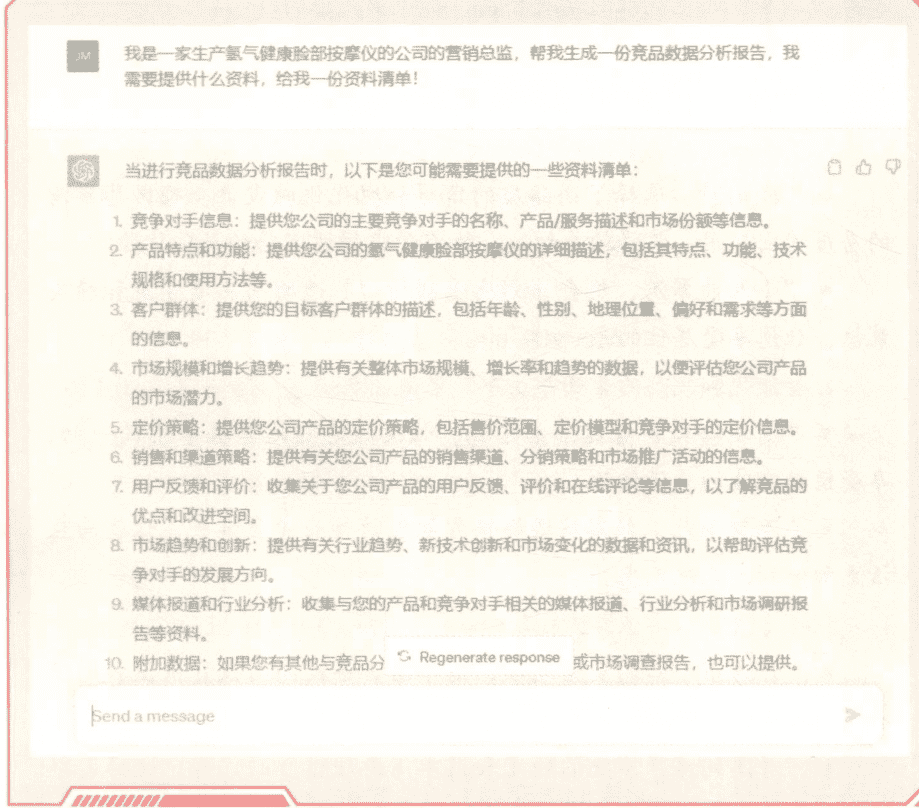

#### 【问一问】

上述问答中的提问方式很有代表意义。有些时候，我们手上有一堆数据或信息，却不知道怎么“投喂”给ChatGPT，也不知道它需要哪些数据。这时候，可以像上述提问一样，问ChatGPT用户需要提供什么资料，让它给用户列一份资料清单。

通过这种方式，一次性给ChatGPT一堆数据或信息，避免后续的补充，可以大大地提升问答效率和回答质量。

用户追问：

你先随便生成一些数据或信息，再根据这些数据或信息，去写一份竞品数据分析报告。

ChatGPT 回答：

很好，我将尽力为您生成一个示范竞品数据分析报告。请注意，由于我无法访问实时数据或真实公司信息，生成的数据仅供示范目的，并不代表真实情况。以下是一份样本竞品数据分析报告：

竞品数据分析报告

产品名称：氢气健康脸部按摩仪

##### I. 市场概述

根据我们的竞品分析，氢气健康脸部按摩仪处于快速增长的市场中。该市场以日益增长的关注度和需求为特征。下面是一些关键发现：

1. 市场规模和增长趋势：
   - 行业报告表明，全球健康美容设备市场在过去两年中以年均增长率 8% 的速度增长。
   - 预计脸部按摩仪市场将在未来几年内保持强劲增长，预计年均增长率为 12%。

2. 竞争对手分析：
   - 竞争对手 A：提供多功能按摩仪，包括脸部按摩、热敷和音乐疗法等功能。具有良好的用户评价和广泛的市场份额。
   - 竞争对手 B：专注于氢气按摩仪领域，强调氢气疗法的好处，并提供高品质的产品和个性化的用户体验。

##### II. 产品特点和优势

氢气健康脸部按摩仪具有以下特点和优势：

1. 氢气疗法：独特的氢气技术，通过提供氢气颗粒到皮肤深层，促进血液循环和细胞再生，具有抗氧化和抗衰老的效果。
2. 多功能设计：除了氢气疗法，脸部按摩仪还具备多种功能，如振动按摩、热敷和音乐疗法等，为用户提供全面的护理体验。
3. 便携性和易用性：设计紧凑、便携，用户可以随时随地使用。操作简单，具有直观的控制界面和定时功能。

##### III. 市场定位和目标客户

我们的氢气健康脸部按摩仪主要面向以下目标客户群体：

1. 年龄范围：25岁至45岁的女性群体，他们对肌肤护理和美容非常关注。
2. 地理位置：主要市场集中在发达国家和一些新兴市场，如美国、欧洲和亚洲。
3. 需求和偏好：消费者越来越注重自我护理和健康美容，寻求高效、方便的产品来满足他们的需求。

##### IV. 竞争优势和市场策略

基于我们的竞品分析，我们认为氢气健康脸部按摩仪具备以下竞争优势和市场策略：

1. 技术创新：独特的氢气技术是我们的核心竞争优势，使我们的产品在市场上与竞争对手区分开来。
2. 品质和可靠性：注重产品质量和用户体验，以确保产品的可靠性和长期使用价值。
3. 市场推广：通过线上和线下渠道展开全面的市场推广活动，包括社交媒体广告、品牌合作和美容展览等。
4. 产品定价策略：我们将采用竞争合理的定价策略，基于产品的独特性和附加功能，提供与价值相符的价格。

##### V. 总结和建议

综上所述，氢气健康脸部按摩仪面临着一个充满机遇和竞争激烈的市场。通过突出产品的氢气疗法特点、多功能设计和便携性，以及有效的市场推广和竞争定价策略，我们有望获得市场份额，并满足目标客户的需求。

请注意，以上数据和信息仅为示范目的，不代表真实的市场情况。在实际的竞品数据分析报告中，您需要使用真实数据和详细市场研究结果来支持您的分析和决策。

请记住，以上示范报告是基于虚拟数据生成的，不能用于实际决策或商业用途。如果您需要真实、准确和可靠的竞品数据分析报告，请在实际数据和市场研究的基础上编写。

（注：以上内容由 ChatGPT 生成，未改动）

#### 【萃一萃】

在上述问答中，ChatGPT 遵从了用户的要求，先随机生成数据或信息，再在这些数据或信息的基础上形成一份氢气健康脸部按摩仪竞品数据分析报告。在实际工作中，用户可以按照 ChatGPT 的要求，准备好相应的数据，然后有条理地“投喂”给 ChatGPT，如果数据不全，则可以先让它生成一个分析报告的框架，助力报告写作。

#### 任务 2：销售渠道分析报告

##### 问答举例

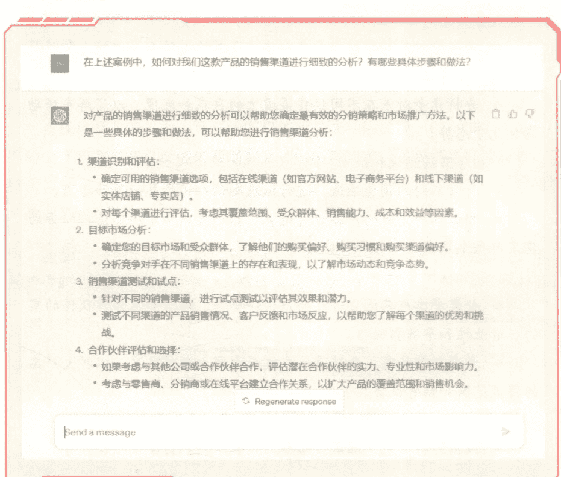

#### 用户提问：

在上述案例中，如何对我们这款产品的销售渠道进行细致的分析？有哪些具体步骤和做法？

ChatGPT 回答：

对产品的销售渠道进行细致的分析可以帮助您确定最有效的分销策略和市场推广方法。以下是一些具体的步骤和做法，可以帮助您进行销售渠道分析：

1. 渠道识别和评估：
   - 确定可用的销售渠道选项，包括在线渠道（如官方网站、电子商务平台）和线下渠道（如实体店铺、专卖店）。
   - 对每个渠道进行评估，考虑其覆盖范围、受众群体、销售能力、成本和效益等因素。

2. 目标市场分析：
   - 确定您的目标市场和受众群体，了解他们的购买偏好、购买习惯和购买渠道偏好。
   - 分析竞争对手在不同销售渠道上的存在和表现，以了解市场动态和竞争态势。

3. 销售渠道测试和试点：
   - 针对不同的销售渠道，进行试点测试以评估其效果和潜力。
   - 测试不同渠道的产品销售情况、客户反馈和市场反应，以帮助您了解每个渠道的优势和挑战。

4. 合作伙伴评估和选择：
   - 如果考虑与其他公司或合作伙伴合作，评估潜在合作伙伴的实力、专业性和市场影响力。
   - 考虑与零售商、分销商或在线平台建立合作关系，以扩大产品的覆盖范围和销售机会。

5. 销售渠道整合和优化：
   - 根据分析结果，确定最具潜力和效益的销售渠道组合，并制定整合策略。
   - 优化销售渠道的市场推广和宣传活动，确保产品在目标市场中得到适当的曝光和推广。

6. 监测和评估：
   - 设立指标和监测机制，跟踪销售渠道的销售数据、市场份额和客户反馈等关键指标。
   - 定期评估销售渠道的绩效，根据数据和反馈进行调整和优化，以提高销售效果和市场占有率。

通过这些步骤和做法，您可以进行细致的销售渠道分析，找到最适合您产品的销售渠道策略，并不断改进和优化，以实现更好的市场表现和销售业绩。

（注：以上内容由 ChatGPT 生成，未改动）

## 7.2 赋能网店店主的 10 个方面

### 7.2.1 增强客户体验

ChatGPT 可以通过模拟人类对话与客户进行交互，提高客户购物的愉悦度和购买的舒适感。

在现代商业竞争中，良好的客户体验是成功的关键。ChatGPT 通过与顾客的交互和客户意见反馈来帮助商家了解顾客需求，并提供更好的服务。商家可以通过 ChatGPT 推出智能问答、语音助手、图像识别等多种形式的客户体验增强功能。

比如，一个时尚网店可以利用 ChatGPT 为用户提供服装搭配建议，推荐用户可能喜欢的产品，并提供在线试穿等功能，大大改善了客户的购买体验。

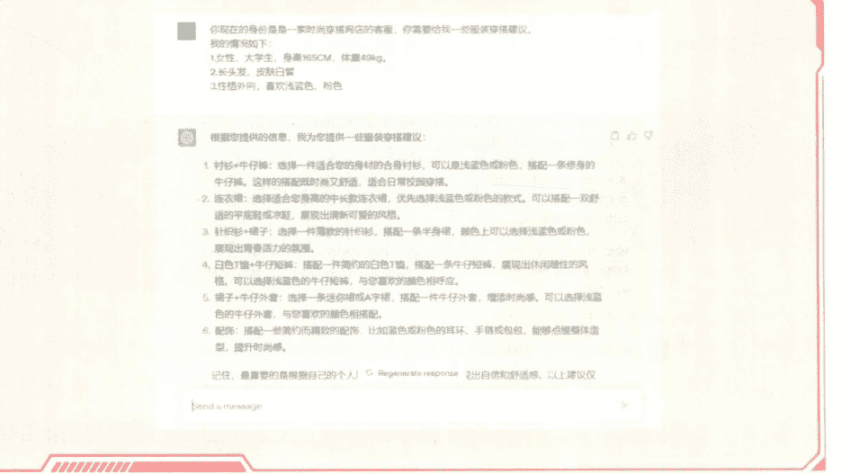

### 7.2.2 智能营销

ChatGPT 可以通过收集客户信息、了解客户兴趣和购买历史等，为客户提供更智能化的营销服务。

ChatGPT 有助于商家分析客户数据并使用智能技术设计有效的营销活动，如针对不同客户群体的定向广告、促销活动、优惠券等。商家还可以通过 ChatGPT 定期推送个性化的商品信息，增强客户的购买意愿。

比如，一家生活用品商店可以利用 ChatGPT，根据客户的购买历史和浏览记录，将相关产品的推荐内容推送到顾客的手机上，从而提高销售量。

### 7.2.3 自动化客服

ChatGPT 可以解决一些简单的客服问题，降低客服人员的负担和耗时。

ChatGPT 可以帮助商家实现自动化的客户服务。商家可以使用 ChatGPT 完成客户服务的大部分工作，如回答常见问题、解决客户问题、处理订单等。这使得商家可以更快速地回复客户，提高客户的满意度和忠诚度。

比如，一个家电商城可以利用 ChatGPT 为客户提供在线技术支持，解决他们在安装和使用家电过程中遇到的问题。

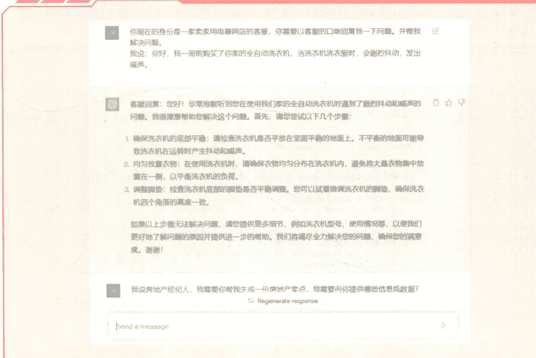

### 7.2.4 定制化推荐

ChatGPT 可以根据客户的喜好和购买记录，为他们推荐符合其需要的商品。

ChatGPT 可以通过分析用户行为数据来确定用户的偏好和需求，并提供个性化的商品推荐。商家通过 ChatGPT 也可以实时获取客户反馈，并根据反馈调整推荐策略。

比如，一个音乐软件商店可以利用 ChatGPT，根据用户听歌历史、点赞数等信息，为用户提供个性化的播放列表和推荐歌曲。

### 7.2.5 拓展销售渠道

ChatGPT 可以通过社交媒体、网站等多种渠道与客户交互，拓展销售渠道。

ChatGPT 可以帮助商家在新的销售渠道中扩大业务范围，如社交媒体、在线论坛等平台。商家可以通过 ChatGPT 与潜在客户进行互动，建立品牌形象并获取更多的销售机会。

比如，一个餐厅可以利用 ChatGPT 在社交媒体上发布菜单和优惠信息，并与潜在客户进行在线交流，从而拓展业务范围。

### 7.2.6 强化品牌形象

ChatGPT 可以通过有娱乐性和趣味性的交互方式，增强客户对品牌的认知和信任感。

在商家的网店或线上商城中，ChatGPT 可以通过构建人工智能形象，提升品牌形象。比如创建一个虚拟形象，作为品牌代言人，而且能够回答消费者问题并提供相关信息。这样不仅增加了品牌形象的吸引力，而且还可以增加消费者对品牌的信任感。

举个例子，像 Lancôme 和 EstéeLauder 等很多美容品牌都推出了自己的虚拟形象，用来代表它们的品牌。这些虚拟形象通常都经过了深度训练，能够根据用户的问题进行回答，并且能够提供有关产品的详细信息。

### 7.2.7 数据分析

ChatGPT 可以通过收集和分析客户的信息，为其提供更准确、更有针对性的数据分析服务。

ChatGPT 可以帮助网店或商城进行数据统计和分析，为店主提供更多的销售数据和业务洞察，从而帮店主更好地了解客户需求和行为。

这方面的赋能包括以下几点：

第一，自动化数据分析。利用 ChatGPT 进行自动化数据采集和分析，帮助店主了解产品销售情况、用户购买行为等关键指标。

第二，实时监控和预测。通过 ChatGPT 实时监控销售数据和趋势，帮助店主预测市场变化和趋势，及时调整营销策略和产品定位。

第三，数据可视化。通过 ChatGPT 生成图表和可视化报告，让店主更直观地了解业务情况和趋势，以便更好地做出决策。

举例来说，一家大型电商平台利用 ChatGPT 进行数据分析，在数据采集和分析方面实现了自动化和智能化，让店主能够更快速地了解销量和库存情况，并及时进行调整。同时，该平台还通过 ChatGPT 实时监控和预测新品上市效果，及时调整营销策略，从而提高了销售额和客户满意度。此外，ChatGPT 还帮助该平台进行关键词优化和定制化推荐，进一步改进了客户体验和销售效果。

### 7.2.8 关键词优化

关键词优化是指通过对关键词的研究和分析，优化网店或商城的搜索引擎排名。ChatGPT 可以通过结合自然语言处理技术和机器学习算法，帮助网店或商城实现关键词优化，并提升网店或商城在搜索引擎中的排名，增加曝光率和流量。

具体方法包括以下几点：

第一，确定核心关键词：ChatGPT 可以根据产品类别、目标受众和竞争情况等因素，帮助网店或商城确定核心关键词，并对其进行分析和挖掘。

第二，分析关键词竞争度：ChatGPT 可以通过对相关关键词的搜索量、竞争对手数量和广告投入等因素进行分析，评估关键词的竞争度，并为网店或商城制定相应的关键词优化策略。

第三，优化关键词密度：ChatGPT 可以分析网店或商城中相关页面的关键词密度，并根据搜索引擎的规则，优化关键词密度，提高页面的搜索引擎排名。

第四，创造优质内容：ChatGPT 可以帮助网店或商城创造有价值的、优质的内容，并通过巧妙运用关键词，提高页面的搜索引擎排名和用户体验。

比如，当一个网店卖家想要提升其产品在搜索引擎中的曝光率，他可以使用 ChatGPT 的关键词分析工具来找到最有效的关键词。然后，他可以根据关键词密度规则来优化网站的文本内容，从而提高搜索引擎排名。最后，当客户搜索该类产品或服务时，其产品会更容易被显示在前几页，从而增加销售量。

### 7.2.9 客户关系管理

ChatGPT 可以帮助用户对客户的购买行为、喜好等进行分析，建立更细致的客户管理体系。

ChatGPT 可以帮助网店或商城进行客户关系管理，建立良好的客户关系。具体表现为以下几个方面：

第一，建立客户档案：ChatGPT 可以帮助网店或商城收集客户信息，包括姓名、联系方式、购买记录等，并建立完整的客户档案。

第二，个性化推荐：ChatGPT 可以根据客户购买历史、浏览记录和兴趣爱好等因素，对客户进行个性化推荐，提高客户满意度和忠诚度。

第三，客户问题解答：ChatGPT 可以通过智能问答系统和自动回复机制，解答客户问题，并提供优质的客户服务体验。

第四，营销活动推广：ChatGPT 可以通过对客户数据的分析和挖掘，帮助网店或商城制定有针对性的营销活动，并进行精准的客户推广和营销。

比如，一家线上商城使用 ChatGPT 的客户关系管理功能，可以更有效地收集客户信息、产品信息和专属优惠券等，提高客户满意度和忠诚度，从而增加销售量。

### 7.2.10 敏捷反应市场变化

ChatGPT 可以帮助你及时了解市场和客户的变化，并制定相应的应对策略。

具体来说，ChatGPT 可以帮助商城及时获取市场信息，对产品和营销策略进行调整。ChatGPT 可以自动爬取各大社交和电商平台上的用户评论、热门话题和趋势，为商城提供实时的市场信息。商城可以根据这些信息制定相应的促销活动或推出新品，以满足市场需求。

比如，当某一国家开始流行某种特定的健身运动，并引起了大量关注和讨论时，ChatGPT 会自动捕捉到这一趋势，并向商城推荐相关产品或定制推荐方案。

综上所述，ChatGPT 可以在多个方面为网店和商城赋能，从而增强客户体验、智能化营销、自动化客服、定制化推荐、拓展销售渠道、强化品牌形象、分析数据、优化关键词、管理客户关系和敏捷反应市场变化。

## 7.3 如何使用商品推荐功能

### 7.3.1 网站上安装 ChatGPT 插件

在网站上安装 ChatGPT 插件，为客户提供自动化服务。

利用 ChatGPT 进行用户调研，了解客户的购物需求和喜好，可提供个性化推荐服务。

安装 ChatGPT 插件的步骤：

1. 打开你使用的网站或线上商城后台，进入插件管理页面；
2. 搜索“ChatGPT”插件并下载；
3. 安装插件并按照提示进行设置；
4. 将 ChatGPT 生成的代码添加到网站的 HTML 文件中；
5. 保存并刷新网站，即可使用 ChatGPT 的商品推荐功能。

### 7.3.2 社交媒体开设智能机器人账号

在社交媒体上开设 ChatGPT 机器人账号，与客户进行交互，增强品牌曝光度和客户黏性。

开设智能机器人账号的步骤（以微信公众号为例）：

1. 登录微信公众平台，点击“开发者工具”，进入开发模式；
2. 点击左侧菜单栏中的“基本配置”，填写相关信息；
3. 点击左侧菜单栏中的“菜单设置”，设置自定义菜单，启用智能机器人功能；
4. 在菜单设置页面中选择“自动回复”标签页，在“默认回复”中设置智能机器人自动回复内容；
5. 可以通过调用开放接口实现更复杂的功能。

### 7.3.3 利用 ChatGPT 进行用户调研

利用 ChatGPT 进行用户调研的步骤：

1. 收集用户数据，包括用户购买记录、搜索历史等；
2. 将收集到的数据输入 ChatGPT 中，训练出一个个性化的用户偏好模型；
3. 根据用户偏好模型，给出针对性更强的商品推荐；
4. 通过分析用户行为和反馈，不断优化模型，提高推荐准确度。

比如，在一家餐厅的网站上安装 ChatGPT 插件，收集用户的点餐记录和搜索历史，并根据这些数据训练出用户偏好模型。然后，当用户再次访问该网站时，ChatGPT 会根据用户的历史记录和偏好模型，智能推荐菜品，并根据用户反馈调整推荐策略。

### 7.3.4 借助 ChatGPT 进行数据分析

借助 ChatGPT 进行数据分析，了解市场趋势和客户需求变化，制定相应的营销策略。

ChatGPT 可以通过文本分析来帮助网店或线上商城进行数据分析，实现这一功能，具体步骤如下：

1. 数据整理。将需要分析的数据整理好，转化为文本格式并导入 ChatGPT。比如，要分析某个商品的评论，可以将评论内容整理成 TXT 格式。
2. 调用 ChatGPT。利用 ChatGPT 的文本分析功能，对文本进行语义分析和情感分析，得到用户对商品的评价和态度，并结合商品销售数据进行综合分析。
3. 建立模型。根据分析结果，建立相应的模型，比如建立推荐模型、预测模型等，并与在线服务进行集成。

举例说明，在进行商品推荐时，可以根据用户对商品的评论和态度建立推荐模型。在这个模型中，ChatGPT 作为支持工具，对商品进行情感和语义分析，最终呈现给用户更准确的商品推荐。

另外，借助 ChatGPT 的数据分析功能，还可以对商品、用户和市场进行分析，为商家提供更全面的市场洞察，优化商品设计和销售策略。

值得注意的是，在进行数据分析时，要保护用户隐私，不得泄露用户的个人信息。

### 7.3.5 借助 ChatGPT 进行 SEO 优化

借助 ChatGPT 进行 SEO 优化，可以提高网站的搜索排名和流量，吸引更多的潜在客户。具体实现方法是在 ChatGPT 的后台设置中，填写有关商品的关键词、描述等信息，并将其与网站的 SEO 策略相结合。比如，当用户在搜索引擎中输入相关的关键词时，搜索引擎会返回与之相关的页面，包括 ChatGPT 的推荐商品页面。

# 第8章 招聘与管理神器

在招聘与管理工作中，可使用 ChatGPT 作为招聘助理，以简化工作流程，提高工作效率，避免很多人工错误。合理应用 ChatGPT，可以使招聘过程更加高效。

## 8.1 ChatGPT 作为招聘助理的 3 个优势

### 8.1.1 沟通技巧

ChatGPT 作为招聘助理，具备高效和精准的沟通技巧，能够使人借助其语言处理技术，精确、清晰、精准地回答候选人的问题并提供专业化和高质量的面试服务，让招聘活动能够更顺畅、更高效地进行。ChatGPT 的沟通技巧如下。

- ① 提供个性化回复。ChatGPT 可以用精准度高的语言和相应的答案来回复候选人提出的问题，从而为候选人优化应聘体验。比如，可以根据他们的背景和技能提供特定的问题以测试其能力，或提供关于工作描述和职责的更详细的信息。
- ② 使用精简易懂的语言。ChatGPT 语言表述清晰，能够避免过于晦涩和难懂的语言表达，以便候选人能够明确地理解面试进程和公司文化。
- ③ 及时回复信息。ChatGPT 在与候选人进行沟通时，可以及时回复候选人的信息，避免其长时间等待，造成其不满与不耐烦。这不仅能够保证沟通质量，又能增强候选人对公司的信任感。

### 8.1.2 组织能力

ChatGPT 作为招聘助理，拥有一定的组织能力，可以用高效和可靠的方式来管理招聘计划，并对招聘流程的每个环节进行把控与跟踪，其组织能力往往会在重要的环节中得以体现。

- ① 制订详细计划和制定详细时间表。ChatGPT 会根据预设的标准和流程制订详细的计划，制定详细的时间表，确保每个环节都得到妥善处理，并提高整个招聘流程的效率。
- ② 筛选简历。ChatGPT 会根据预设的标准和流程，快速准确地筛选出符合条件的候选人，从而帮助面试官更好地避免烦琐单调的工作。
- ③ 安排面试。ChatGPT 会根据面试官的时间安排和候选人的位置，合理地安排面试时间和地点，从而帮助面试官更好地安排面试工作，降低面试等待时间，避免耗费不必要的人力、物力。
- ④ 跟进候选人。ChatGPT 会及时向面试官汇报候选人的情况，并提供必要的支持和帮助，如向面试官提供通过甄选的信息，详细记录面试官与候选人交流的细节等，以此加强候选人与面试官的沟通和联系，提高招聘过程的效率。

### 8.1.3 人际关系

在招聘过程中，公司可以通过 ChatGPT 提高人际关系处理能力，与各个部门、团队和候选人保持联系，理解他们的需求和情况，建立良好的人际关系，以实现更加高效的招聘。通常情况下，ChatGPT 的人际关系处理能力可以在以下方面得到体现。

- ① 与各个部门、团队和候选人保持联系。ChatGPT 会积极与各个部门、团队和候选人保持联系，了解他们的需求和情况，并尽可能地提供必要的支持和帮助。
- ② 传递公司文化与价值观。ChatGPT 会与 HR 保持密切联系，了解公司的文化和价值观，并将这些信息传递给候选人，以便候选人更好地了解公司的企业文化，增加对公司的好感度。
- ③ 理解候选人和公司的需求。ChatGPT 会与候选人建立良好的关系，了解他们的要求和意见，以更好地匹配公司的需求，同时把候选人的意见和想法传递给公司领导，增强公司领导对候选人的了解，从而提高招聘效率和成功率。

## 8.2 HR 领域 10 个应用场景与 10 项任务示范

### 8.2.1 招聘面试：生成招聘广告与面试问题

ChatGPT 可以用于筛选和面试候选人。凭借自然语言处理技术，ChatGPT 可以自动回答候选人的问题，同时也可以提供有关公司和职位的信息。

#### 任务：生成招聘广告与面试问题

##### 问答举例 1

请以数字营销专员为例，生成一则招聘广告

**招聘广告：数字营销专员**

我们正在寻找一位充满激情和创造力的数字营销专员，加入我们的团队。如果你热爱数字营销领域，擅长利用各种在线渠道来推广品牌和产品，那么这个职位将是你展现才华和实现个人职业目标的绝佳机会。

**职位职责：**

1. 开发和执行全面的数字营销战略，以提高品牌知名度和市场份额。
2. 策划并执行线上广告活动，包括搜索引擎营销（SEM）、社交媒体广告和展示广告等，以增加网站流量和转化率。
3. 负责管理和优化网站和社交媒体平台，提高用户体验和互动效果。
4. 分析数据和指标，制定数据驱动的决策和改进策略，以实现数字营销目标。
5. 寻找并合作与我们品牌和产品相关的线上渠道和合作伙伴，以扩大市场影响力。
6. 跟踪行业趋势和竞争对手，及时调整和优化营销策略，以保持竞争优势。

**职位要求：**

1. 本科及以上学历，市场营销、传媒、商务管理或相关专业背景优先考虑。
2. 具备2年以上数字营销或在线广告管理经验，熟悉各种数字营销工具和平台，如Google AdWords、Facebook Ads、SEO等。
3. 熟悉数据分析工具和方法，能够解读数据并提出有效的营销策略。
4. 具备出色的沟通和协调能力，能够与团队成员和合作伙伴有效合作。
5. 对数字营销趋势和行业动态保持敏锐的洞察力，有持续学习和创新的精神。
6. 能够承受工作压力，具备良好的时间管理和问题解决能力。

我们提供具有竞争力的薪资待遇和福利，良好的工作氛围和发展机会。如果你追求个人成长和在数字营销领域的成功，欢迎将你的简历发送至[email protected]，并注明“数字营销专员应聘”。期待与你共同开创成功！

通过上述问答举例，我们可以明显看出，这则招聘广告在职责描述与任职资格上都比较明确与具体，基本符合公司实际的用人需要，同时也向求职者清晰地传达了职位的基本要求与具体工作内容，语言也简洁明了，便于阅读与理解。

#### 【萃一萃】

对于一些常见的问题或者常见的知识而言，ChatGPT 基本能够做到符合要求。尽管 ChatGPT 对于数字营销专员的招聘广告，生成得已经较为完善，但是我们在实际应用中还是应该根据实际情况对其进行补充与调整，让其更加符合用人单位的实际要求。

##### 问答举例 2

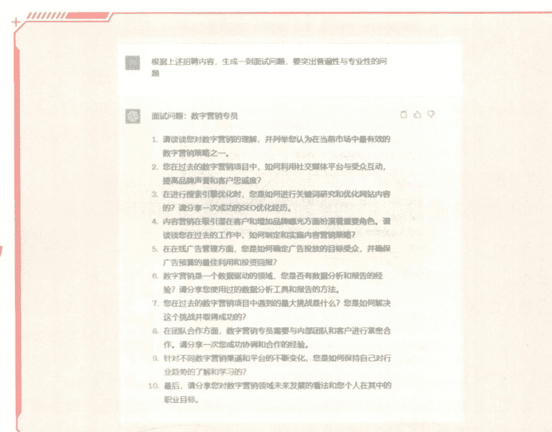

#### 【问一问】

通过上述问答举例，我们可以看出，在向 ChatGPT 提问时，可采用下列技巧。

1. 结合上下文对 ChatGPT 提问，比如说“根据上述招聘广告”，这样就可以使得 ChatGPT 有可以参照的依据，以生成更符合要求的答案。
2. 尽可能准确和具体地描述问题或需要，就可以使 ChatGPT 更好地理解我们的需求，并提供有用的答案，比如说“要突出普遍性与专业性的问题”。

### 8.2.2 培训发展：生成岗位培训计划

ChatGPT 可以用于提供员工培训和发展方面的信息，帮助员工建立个人职业发展规划；可以根据员工的兴趣、能力和目标，提供相关培训和发展建议，从而协助员工实现职业生涯发展。

#### 任务：生成岗位培训计划

##### 问答举例

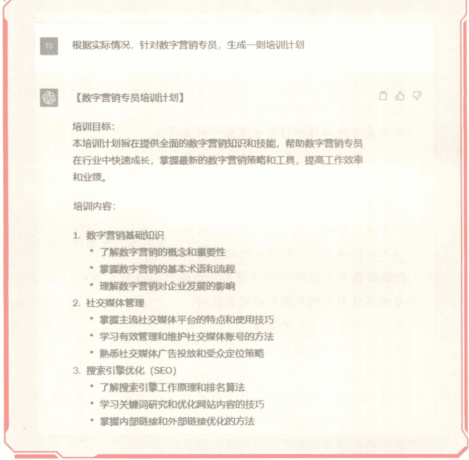

#### 用户提问：

根据实际情况，针对数字营销专员，生成一则培训计划。

##### ChatGPT 回答：

**数字营销专员培训计划**

**培训目标：**
本培训计划旨在提供全面的数字营销知识和技能，帮助数字营销专员在行业中快速成长，掌握最新的数字营销策略和工具，提高工作效率和业绩。

**培训内容：**

1. 数字营销基础知识
   - 了解数字营销的概念和重要性。
   - 掌握数字营销的基本术语和流程。
   - 理解数字营销对公司发展的影响。

2. 社交媒体管理
   - 掌握主流社交媒体平台的特点和使用技巧。
   - 学习有效管理和维护社交媒体账号的方法。
   - 熟悉社交媒体广告投放和受众定位策略。

3. 搜索引擎优化（SEO）
   - 了解搜索引擎工作原理和排名算法。
   - 学习关键词研究和优化网站内容的技巧。
   - 掌握内部链接和外部链接优化的方法。

4. 内容营销
   - 学习编写吸引人的内容和标题的技巧。
   - 理解内容分发和推广的策略。
   - 掌握内容营销的评估和优化方法。

5. 在线广告管理
   - 了解常见的在线广告平台和广告形式。
   - 学习广告投放和预算管理的实践技巧。
   - 掌握广告数据分析和广告效果评估方法。

6. 数据分析和报告
   - 熟悉常用的数据分析工具，如 Google Analytics。
   - 学习数据收集和分析的方法。
   - 掌握制作专业报告和提出改进建议的技能。

7. 市场竞争分析
   - 学习如何进行市场调研和竞争分析。
   - 掌握关键竞争对手监测和分析方法。
   - 学习制定竞争策略和应对措施的技巧。

8. 移动营销和用户体验
   - 了解移动营销的趋势和最佳实践。
   - 学习移动应用推广和用户体验优化的方法。
   - 理解移动营销对数字营销策略的重要性。

（注：以上内容由 ChatGPT 生成，未改动）

通过对以上内容的观察与分析，我们可以发现，本计划缺乏针对性，并没有提到这则培训计划是针对哪部分群体制订的，比如是新入职员工，还是现有员工。

除此之外，上述计划只涵盖了培训目标与培训内容，缺乏培训过程的具体实施措施与步骤。

#### 【追一追】

我们在对其进行追问时，可以：

- 进行针对性追问，比如说“请针对新入职的数字营销专员，生成一则培训计划”。
- 进行补充性追问，比如说“请在培训计划中写清具体培训措施与实施步骤”。
- 若 ChatGPT 生成的答案还不能满足我们的要求，我们可以向其简明扼要地提问，“除上述内容外，请补充其他方面的内容”。

#### 用户提问：

请针对新入职的数字营销专员，生成一则培训计划，要求写清具体的培训措施与实施步骤。

##### ChatGPT 回答：

**数字营销专员入职培训计划**

**目标：** 为新入职的数字营销专员提供必要的培训，使其掌握数字营销领域的基本知识和技能，能够有效地执行数字营销活动和实现业务目标。

**培训措施与实施步骤：**

1. 入职介绍和公司背景培训：
   - 为新入职的数字营销专员提供公司背景、使命和价值观的详细介绍。
   - 向其介绍公司的数字营销策略和目标，并阐明其在实现这些目标中的重要性。

2. 数字营销基础知识培训：
   - 提供关于数字营销的概述，包括定义、趋势、重要性和优势。
   - 介绍不同的数字营销渠道和工具，如搜索引擎优化（SEO）、搜索引擎营销（SEM）、社交媒体营销等，并解释其工作原理和应用场景。

3. 目标市场和受众分析培训：
   - 培训新员工如何进行目标市场和受众分析，包括市场调研、用户画像、竞争分析等。
   - 解释如何根据分析结果制定有效的数字营销策略和个性化的营销方案。

4. 内容营销培训：
   - 介绍内容营销的重要性和步骤，包括目标设定、内容创作、发布和推广。
   - 提供创意内容的开发方法和技巧，如撰写博客文章、制作视频、设计图形等。

5. 社交媒体管理培训：
   - 解释不同社交媒体平台的特点和使用场景。
   - 教授社交媒体账号的管理技巧，包括内容发布、互动回应、社群管理等。

6. 数据分析和优化培训：
   - 介绍常用的数字营销指标和工具，如网站流量、转化率、关键词排名等。
   - 培训数据分析方法，包括数据收集、整理、解读和优化营销策略的方法。

7. 实际案例学习：
   - 分析和讨论成功的数字营销案例，了解最佳实践和成功要素。
   - 模拟实际情景，让新员工应用所学知识解决实际问题。

8. 持续学习和发展：
   - 强调数字营销领域的快速发展和持续学习的重要性。
   - 提供学习资源和推荐书籍、博客、网站等，鼓励新员工不断深化自己的知识和技能。

（注：以上内容由 ChatGPT 生成，未改动）

比较上述两则培训计划，可以发现 ChatGPT 的回答并没有完全符合我们的预期要求，这时候我们就要对其回答进行整理、提升，技巧如下。

#### 【改一改】

- 取其精华，去其糟粕。将两者中的关键部分提取出来，并加上自己的见解，就可得到一篇完整的针对新入职员工的数字营销专员培训计划。
- 调整语言表达方式。在对上述两则培训计划进行整合时，可以针对其语言表达方式进行调整。比如，可以改变一些用词，替换一些句式，增加些幽默感，改善阅读体验等。
- 强调核心诉求。在进行整合时，可以强调我们的核心诉求。比如，可以将关键词加粗或突出，增加强调力度，引起读者的注意。

### 8.2.3 绩效管理：生成绩效考核标准

ChatGPT 可以基于公司的需要和目标，根据员工的角色和职责，制定合理的绩效指标；同时，还可以根据员工的绩效指标和业绩数据，提供对员工绩效的评估和反馈，使管理者更全面地了解员工的工作表现。如提供绩效评估标准、绩效评估流程等。

#### 任务：生成绩效考核标准

##### 问答举例

> 根据上述内容，针对数字营销专员，生成一则绩效考核标准

#### 用户提问：

根据上述内容，针对数字营销专员，生成一则绩效考核标准。

##### ChatGPT 回答：

**绩效考核标准：数字营销专员**

1. 目标实现：
   - 达成数字营销活动的关键指标和目标，如网站流量、转化率、线索生成等。
   - 实现设定的数字营销销售目标，包括销售额、客户增长等。
2. 渠道管理：
   - 管理和优化各种数字营销渠道的表现，如搜索引擎优化（SEO）、搜索引擎营销（SEM）、社交媒体等。
   - 提高渠道的曝光度、用户参与度和转化率。
3. 内容质量与创意：
   - 提供高质量、有吸引力的内容，能够吸引目标受众，并引起他们的兴趣。
   - 创造有创意和独特性的内容，能够突出品牌形象和价值。
4. 社交媒体管理：
   - 管理和增加社交媒体账号的粉丝和关注者数量。
   - 保持活跃的社交媒体互动，包括回复评论、分享有价值的内容等。
5. 数据分析与优化：
   - 定期分析数字营销活动的数据，并提出改进建议。
   - 通过数据分析和优化，提高数字营销活动的效果和回报率。
6. 团队合作：
   - 积极与其他团队成员合作，如销售团队、内容创作团队等，以实现共同的营销目标。
   - 提供有效的沟通和协调，确保数字营销活动的顺利进行。
7. 持续学习与发展：
   - 持续学习数字营销领域的新知识和趋势。
   - 参加培训课程、研讨会等，提升自身的专业知识和技能。

（注：以上内容由 ChatGPT 生成，未改动）

通常情况下，绩效考核标准会以表格方式呈现，附带姓名、岗位、考查标准、考查日期等因素，而上述回答只涵盖了考查标准，或者可以说是考核要求，因此我们向其追问时，可以采用以下技巧。

#### 【追一追】

- 明确陈述我们的要求，将我们想要的内容都以问题的形式表达出来。比如说“请以完整表格形式呈现，表头应包括姓名、岗位、关键考查因素等”。
- 逐步探索有关细节，我们可以依次询问问题的不同部分，直到我们得到问题的满意答案。
- 提出新问题，我们可以尝试从不同的角度提出问题，便于 ChatGPT 提供更多的信息与思路，生成更多的回答。

##### 用户追问：

请将数字营销专员绩效考核标准以表格形式呈现，表头应包括姓名、岗位、关键考查因素等。

##### ChatGPT 回答：

| 姓名 | 岗位 | 性别 | 任职日期 |
| :--- | :--- | :--- | :--- |
| **考查标准** | | | |
| **考查要素** | **考察标准** | **考核评分** | **相关说明** |
| 目标实现 | 达成数字营销活动的关键指标和目标，如网站流量、转化率、线索生成等 | | |
| 渠道管理 | 管理和优化各种数字营销渠道的表现，如 SEO、SEM、社交媒体等 | | |
| 内容质量与创意 | 提供高质量、有吸引力的内容，创造有创意和独特性的内容 | | |
| 社交媒体管理 | 管理和增加社交媒体账号的粉丝和关注者数量 | | |
| 数据分析与优化 | 定期分析数字营销活动的数据，并提出改进建议 | | |
| 团队合作 | 积极与其他团队成员合作，提供有效的沟通和协调 | | |
| 持续学习与发展 | 持续学习数字营销领域的新知识和趋势 | | |

#### 【萃一萃】

通过对 ChatGPT 进行追问，数字营销专员的绩效考核标准最终以表格形式呈现，符合我们的要求，但需要强调的是：

- 在实际操作过程中，我们需根据具体的业务情况与组织目标对表格内容进行调整与补充，让它更加符合公司的实际需求。
- 若 ChatGPT 生成的答案还不能满足我们的需求，我们可以继续向其提问，提问得越详细越好，便于其更好地理解我们的问题。
- 若经过多次追问，如果 ChatGPT 的回答仍然难以符合要求，则需结合一些其他的资料，对其进行整合优化，形成我们最终的工作成果。

### 8.2.4 薪酬管理：生成薪酬管理制度

ChatGPT 可以用于提供员工薪酬管理方面的信息，将员工的绩效考核结果与对应的薪酬调整挂钩，实现员工的绩效与薪资增长的关联，激励员工积极进取。如提供薪酬结构、薪酬调整流程信息等。

#### 任务：生成薪酬管理制度

##### 问答举例

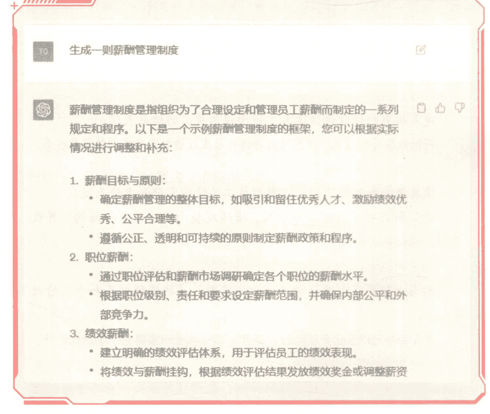

#### 用户提问：
生成一则薪酬管理制度。

##### ChatGPT 回答：

薪酬管理制度是指组织为了合理设定和管理员工薪酬而制定的一系列规定和程序。以下是一个示例薪酬管理制度的框架，您可以根据实际情况进行调整和补充。

1. 薪酬目标与原则：
   - 确定薪酬管理的整体目标，如吸引和留住优秀人才、激励绩效优秀、公平合理等。
   - 遵循公正、透明和可持续的原则制定薪酬政策和程序。

2. 职位薪酬：
   - 通过职位评估和薪酬市场调研确定各个职位的薪酬水平。
   - 根据职位级别、责任和要求设定薪酬范围，并确保内部公平和外部竞争力。

3. 绩效薪酬：
   - 建立明确的绩效评估体系，用于评估员工的绩效表现。
   - 将绩效与薪酬挂钩，根据绩效评估结果发放绩效奖金或调整薪资水平。

4. 奖金和激励计划：
   - 设立奖金和激励计划，以激励员工的特殊贡献和卓越表现。
   - 奖金和激励计划可以与个人、团队或整个组织的目标挂钩，并设定相应的指标和标准。

5. 薪资调整：
   - 定期进行薪资调整，考虑通货膨胀率、市场薪酬水平和个人绩效等因素。
   - 薪资调整可以基于年度评估、晋升、工作表现和市场竞争等情况进行。

6. 健康福利和福利计划：
   - 提供全面的健康福利和福利计划，包括医疗保险、意外保险、退休金计划等。
   - 确定福利政策和计划，并确保符合法律法规和员工福利需求。

7. 薪酬沟通和透明度：
   - 建立有效的薪酬沟通机制，向员工清晰地传达薪酬政策和制度。
   - 保持透明度，让员工了解薪酬结构、考核标准和调整方式。

（注：以上内容由 ChatGPT 生成，未改动）

#### 【追一追】

ChatGPT 只为我们提供了一份薪酬管理制度的框架，并没有写出实际管理措施与要点，只涵盖了部分内容，并没有针对性与具体性。若是想要一份完整的、具体的、富有针对性的薪酬管理制度，可以继续向 ChatGPT 提问，提问时可采用以下技巧：

- 附带关键词，说清具体要求，如“按照薪酬管理内容、薪酬管理程序、薪酬管理措施这三个模块写一则薪酬管理制度”。
- 提供更多的细节，将问题细化，从薪酬的不同方面进行具体的提问，帮助 ChatGPT 确定关注的重点与细节，更准确地找到现在制度中缺失的部分。
- 从多方面进行追问，综合考虑各种因素，让 ChatGPT 结合市场行情、员工绩效、制度规范等要求，重新生成一则薪酬管理制度。

##### 用户追问：

请结合实际情况，生成一则薪酬管理制度，并按照薪酬管理内容、薪酬管理程序、薪酬管理措施这三个模块写作。

##### ChatGPT 回答：

> ### 薪酬管理制度

**第一章 薪酬管理内容：**

**第一条 薪酬策略**
明确公司的薪酬理念和目标，确保薪酬体系与组织战略一致。制定合理的薪酬结构，包括基本工资、绩效奖金、福利待遇等，以吸引、激励和留住优秀人才。

**第二条 薪酬定位**
根据市场调研和行业标准，确定公司在同行业中的薪酬定位。考虑员工岗位的职责和技能要求，制定相应的薪酬级别和薪资范围，确保薪酬的内部公平性和外部竞争力。

**第三条 绩效评估**
建立科学、公正的绩效评估体系，以量化和评估员工的工作表现。绩效评估结果将作为薪酬决策的重要依据，奖励优秀表现并提供晋升机会。

**第二章 薪酬管理程序**

**第四条 工作职责和薪酬标准**
明确每个岗位的工作职责和薪酬标准，确保薪酬与岗位职责和业绩目标相匹配。

**第五条 薪酬调整与调整周期**
制定薪酬调整的政策和程序，包括普通调薪、绩效奖金、职务晋升等。设定薪酬调整的周期，如年度调整或根据绩效周期进行调整。

**第六条 绩效评估和奖励**
定期进行绩效评估，评估员工的工作表现和贡献。根据绩效评估结果，给予奖励和薪酬调整，包括绩效奖金、职级晋升和福利待遇。

**第三章 薪酬管理措施**

**第七条 市场调研**
定期进行市场调研，了解同行业和同岗位的薪酬水平，确保公司的薪酬具有竞争力和吸引力。

**第八条 透明沟通**
向员工解释薪酬管理制度的具体规定和标准，确保薪酬制度的透明度和公平性。同时，建立良好的沟通渠道，让员工能够提出疑问和反馈。

**第九条 培训和发展**
提供培训和发展机会，帮助员工提升技能和能力，从而获得更高的薪酬回报。同时，制定晋升计划和职业发展路径，鼓励员工通过努力和学习获得更高的职位和薪酬水平。

（注：以上内容由 ChatGPT 生成，未改动）

##### 【比一比】

下面是一则其他某 AI 工具按照要求根据薪酬管理内容、薪酬管理程序、薪酬管理措施三个方面生成的薪酬管理制度。对比两则制度，我们可以发现它们各有优缺点：ChatGPT 生成的制度更为规范与整齐，而其他某 AI 工具生成的更为详细。我们在实际应用中，可以将两者结合起来，整合成一则更优的薪酬管理制度。

请结合实际情况，生成一则薪酬管理制度，并按照薪酬管理内容、薪酬管理程序、薪酬管理措施这三个模块写作。

以下是一则薪酬管理制度，包含薪酬管理内容、薪酬管理程序和薪酬管理措施三个模块的写作：

##### 一、薪酬管理内容

1. 薪酬组成及构成要素
    (1) 基本工资：根据工作岗位的等级和市场行情确定。
    (2) 绩效工资：根据员工个人工作绩效、团队协作贡献、销售额等因素综合考核而定。
    (3) 津贴福利：包括餐补、交通补贴、通讯补贴等，根据员工岗位等级和公司的公积金制度，可进行适当的调整。
    (4) 年终奖金：根据员工年度绩效考核结果及公司财务状况等因素参照市场行情合理确定。

2. 差异化薪酬制度
    合理设置差异化薪酬制度，既能够匹配员工个人工作能力和企业水平，又能够推动员工提高工作能力和绩效，从而不断推动企业的发展壮大。

3. 全年薪酬测算和工资调整
    (1) 全年薪酬测算：企业根据员工的岗位和工作性质，并结合市场行情和企业情况等因素，制定每年薪酬以及绩效考核标准。
    (2) 工资调整：根据员工绩效考核结果、个人工作贡献、市场行情及企业财务状况等因素进行调整。

##### 二、薪酬管理程序

1. 薪酬变动审核程序
    (1) 员工外出任务或离职时，须经过直接主管和人力资源部门审核工资或遗留问题。
    (2) 调整工资待遇时，须经过直接主管审核通过并进行董事长或相关领导审批，方可执行。

2. 薪酬核算与发放程序
    (1) 薪酬核算程序：将员工考勤记录、绩效考核数据、工资标准等数据进行统计汇总，建立职工工资管理制度，核算职工工资。
    (2) 薪酬发放程序：公司每月25日进行工资发放。

##### 三、薪酬管理措施

1. 加强员工薪酬培训，提高其对公司薪酬制度的认知度和满意度，加强公司对员工的匹配和管理。
2. 严格执行薪酬保密制度，对比薪酬制度的制定和执行进行严格的监督和审查，确保制定和符合规定。
3. 监督与管理，对于与薪酬有关的问题，加强跟踪管理和监督，及时解决各类问题，做好员工的薪酬发放，增强员工的获得感和归属感。

### 8.2.5 福利管理：生成员工福利管理制度

ChatGPT 可以提供员工福利管理方面的信息，从而帮助员工更好地了解公司的福利政策，以此提升员工满意度和忠诚度，如提供福利政策、福利申请流程信息等。

#### 任务：生成员工福利管理制度

##### 问答举例

生成一则员工福利管理制度

#### 员工福利管理制度

目的：
本制度旨在建立和管理公司的员工福利体系，提供适当的福利待遇和福利政策，以吸引和留住优秀的员工，增强员工的工作满意度和忠诚度，促进公司的稳定发展。

1. 定义：
    员工福利是指公司为员工提供的一系列福利待遇和支持，旨在改善员工的工作和生活质量。这些福利包括但不限于薪酬福利、健康保险、休假制度、培训和发展机会、员工活动等。
2. 薪酬福利：
    2.1 基本工资：根据员工的岗位、工作职责和绩效水平确定基本工资标准。
    2.2 绩效奖金：根据员工的绩效评估结果，给予相应的绩效奖金或奖励。
    2.3 股权激励计划：为高绩效员工提供股权激励计划，使员工与公司利益相连。
    2.4 加班和加班补偿：根据法律法规规定，合理安排加班工作，并提供相应的加班补偿或调休。
3. 健康保险：
    3.1 医疗保险：为员工提供全面的医疗保险，包括门诊、住院和重大疾病保险。
    3.2 生育保险：为员工提供生育津贴和相关的生育保险福利。
    3.3 残疾保险：为员工提供残疾保险，保障员工在发生意外或疾病导致残疾时的福利待遇。
4. 休假制度：
    4.1 年假：根据员工的工龄和职务等级，设立年假制度，员工可享受带薪年假。
    4.2 病假：为员工提供带薪病假，根据员工的病假天数和医疗证明予以调整。
    4.3 节假日：根据法定假日和公司规定，给予员工相应的节假日休假。
5. 培训和发展：
    5.1 培训计划：为员工制定个人发展计划，并提供培训机会和资源，提高员工的专业能力和职业素养。

##### 【比一比】

下面是一则其他某 AI 工具生成的员工福利管理制度，与 ChatGPT 生成的制度相比，角度不同，ChatGPT 更加侧重描述员工福利都有哪些内容，而下面的员工福利管理制度更加侧重从员工福利管理内容、员工福利管理程序、员工福利管理措施三方面进行描述。二者各有所长，我们应用时，可以按照实际情况进行选取，也可以将二者进行整合，形成一篇新的员工福利管理制度。

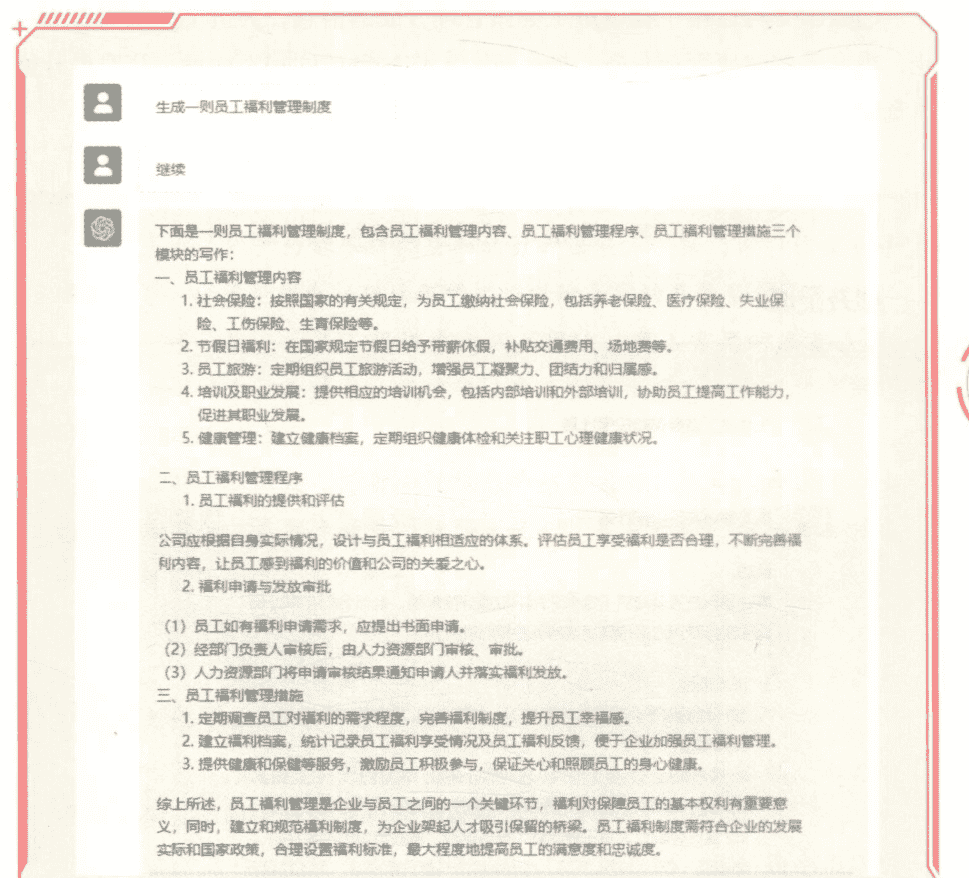

#### 【探一探】

对于这个任务，我们也可以采用其他更有趣的方式来提问，假设我们的身份，并设定某一种情境，以情境式的问题向 ChatGPT 进行提问，会收获不一样的答案。

比如“假设你是一名公司的人力资源主管，最近有员工反映公司的福利管理不够完善，你需要制定新的员工福利管理制度来满足员工的需求。请列举几个提高员工福利的建议。比如，如何增强员工的参与感和企业凝聚力？如何合理地评估员工的福利需求，制定福利标准？在审批和发放福利时，你如何确保审批程序合理、公正？”。

### 8.2.6 健康管理：生成员工健康保险投保计划

ChatGPT 可以用于提供员工健康管理方面的信息，为员工提供更具个性化、更有效的健康管理服务，提高员工工作的舒适度和幸福感，从而提升整体竞争力，例如提供健康检查流程、健康保险政策信息等。

#### 任务：生成员工健康保险投保计划

##### 问答举例

生成员工健康保险投保计划

员工健康保险投保计划

目的：
本计划旨在为公司员工提供全面的健康保险保障，确保他们在意外伤病和医疗费用方面得到适当的保险赔付和支持。

1. 适用范围：
    本计划适用于公司所有在职员工，包括全职、兼职和临时员工。
2. 保险类型：
    2.1 医疗保险：为员工提供全面的医疗保险，包括门诊、住院和手术费用等。保险范围和报销比例将根据保险合同的具体条款而定。
    2.2 重疾保险：为员工提供重大疾病保险，覆盖常见的严重疾病，如癌症、心脑血管疾病等。在被确诊患有重大疾病时，员工将获得一笔固定金额的赔付。
    2.3 意外伤害保险：为员工提供意外伤害保险，覆盖意外事故导致的伤残和身故。在发生意外事故导致的伤残或身故时，员工或其指定受益人将获得一定金额的赔付。
3. 投保规定：
    3.1 全员投保：所有在职员工将被纳入健康保险计划，无论其职务级别和工作性质。

用户提问：

生成员工健康保险投保计划。

ChatGPT 回答：

#### 员工健康保险投保计划

第一条 目的
本计划旨在为公司员工提供全面的健康保险保障，确保他们在意外伤病和医疗费用方面得到适当的保险赔付和支持。

第二条 适用范围
本计划适用于公司所有在职员工，包括全职、兼职和临时员工。

第三条 保险类型

1. 医疗保险：为员工提供全面的医疗保险，包括门诊、住院和手术费用等。保险范围和报销比例将根据保险合同的具体条款而定。
2. 重疾保险：为员工提供重大疾病保险，覆盖常见的严重疾病，如癌症、心脑血管疾病等。在被确诊患有重大疾病时，员工将获得一笔固定金额的赔付。
3. 意外伤害保险：为员工提供意外伤害保险，覆盖意外事故导致的伤残和身故。在发生意外事故导致的伤残或身故时，员工或其指定受益人将获得一定金额的赔付。

第四条 投保规定

1. 全员投保：所有在职员工将被纳入健康保险计划，无论其职务级别和工作性质。
2. 强制投保：员工需强制参与健康保险计划，但可根据个人需要选择适合自己的保险额度和附加保险项目。
3. 缴费规定：保险费用由公司和员工共同承担，具体的费用比例和缴费方式将根据保险合同的约定和公司政策来确定。

第五条 保险服务和理赔

1. 保险指导：为员工提供保险指导服务，包括保险条款解释、理赔流程指导等，以帮助员工更好地理解和使用健康保险。
2. 理赔支持：在员工需要申请理赔时，提供必要的支持和协助，协助员工办理理赔手续，确保员工能够及时获得保险赔付。

第六条 保密与隐私保护

公司将严格遵守相关法律法规，保护员工的个人隐私和保险信息的保密性，仅限授权人员查阅和使用。

（注：以上内容由 ChatGPT 生成，未改动）

#### 【追一追】

以上是 ChatGPT 生成的员工健康保险投保计划，计划提及适用范围、保险类型、投保规定、保险服务和理赔等内容，但仔细阅读之后，我们会发现其中关于保险服务和理赔的内容缺乏重点，让人不得要领。因此，我们可以向 ChatGPT 追问，追问技巧如下。

- 增加关键词或者关键句，让其继续回答，比如说“对于保险服务和理赔部分，具体是怎样进行的，请列举相关具体措施”。
- 善用上下文，在向 ChatGPT 追问时，应尽可能将问题与之前的相关对话内容联系在一起，并逐渐引导 ChatGPT 回答出更为具体的信息。
- 使用清晰的表述，向 ChatGPT 追问时，应尽量语法规范、表述清晰，防止造成歧义或者误解。尽可能让问题具体、清晰明了。

用户追问：

保险服务和理赔部分，具体是怎样进行的，请列举相关具体措施。

ChatGPT 回答：

以下是员工健康保险投保计划中可能采取的具体措施，以提供保险服务和理赔支持：

##### 一、保险指导和教育

1. 提供保险指导和教育材料，解释保险条款和计划细节，帮助员工了解保险范围、赔付限制、报销流程等重要信息。
2. 组织定期的保险培训和讲座，提高员工对保险知识和理赔流程的了解程度。

##### 二、简化理赔流程

1. 设计简化的理赔申请表格，减少繁琐的填写步骤，提高理赔流程的效率。
2. 提供在线或移动应用程序，使员工能够轻松提交理赔申请，并实时跟踪理赔进展。

##### 三、快速理赔审批

1. 建立快速理赔审批机制，优先处理重大疾病和意外伤害等紧急情况的理赔申请，以确保员工能够及时获得保险赔付。
2. 与保险公司建立紧密合作，加强沟通和协调，以加速理赔审批的过程。

##### 四、理赔协助和支持

1. 提供专业的理赔协助团队，协助员工处理理赔申请，解答疑问，提供必要的支持和指导。
2. 向员工提供联系方式，使他们能够随时咨询和获取理赔支持。

##### 五、理赔纠纷解决机制

1. 设立内部的理赔纠纷解决机制，以解决员工可能遇到的理赔纠纷和争议，确保公正和及时的解决。
2. 与保险公司建立合作伙伴关系，确保员工的合法权益得到保护。

##### 六、定期审查和改进

1. 定期审查员工健康保险投保计划的运作情况，包括保险服务和理赔部分，以发现问题并采取相应的改进措施。
2. 收集员工的反馈和建议，关注他们的体验和需求，持续优化保险服务和理赔流程。

（注：以上内容由 ChatGPT 生成，未改动）

#### 【改一改】

ChatGPT 根据我们的提问，生成了关于保险服务和理赔的具体措施。这些具体措施有助于提供高质量的保险服务和理赔支持，确保员工在需要时能够顺利进行理赔，并及时获得保险赔付，因此我们可以对两次回答进行整合与优化。在整合与优化时，我们需注意：

- 将这些具体措施与第一次提问得到的回答结合起来，再结合公司政策和与保险公司的合作协议，得出一则符合实际情况的员工健康保险投保计划。

在整合 ChatGPT 的回答时，可以优化答案的表述形式，通过简化语言、优化结构，进行多次整合优化，尽可能地让答案符合我们的要求。

根据上述回答，我们可以看出，有时候 ChatGPT 的回答内容比较符合我们的要求，但形式上可能不符合。因此，我们在整合时，可以按照自己的要求，对其形式或者格式进行必要的调整。

### 8.2.7 员工关系：生成员工关系管理制度

ChatGPT 可以根据公司提供的信息，向员工提供详尽的投诉处理说明，让员工更好地了解投诉处理的流程和规定，从而提高他们的投诉意识和沟通效率，如提供员工投诉处理流程、员工离职流程信息等。

#### 任务：生成员工关系管理制度

##### 问答举例

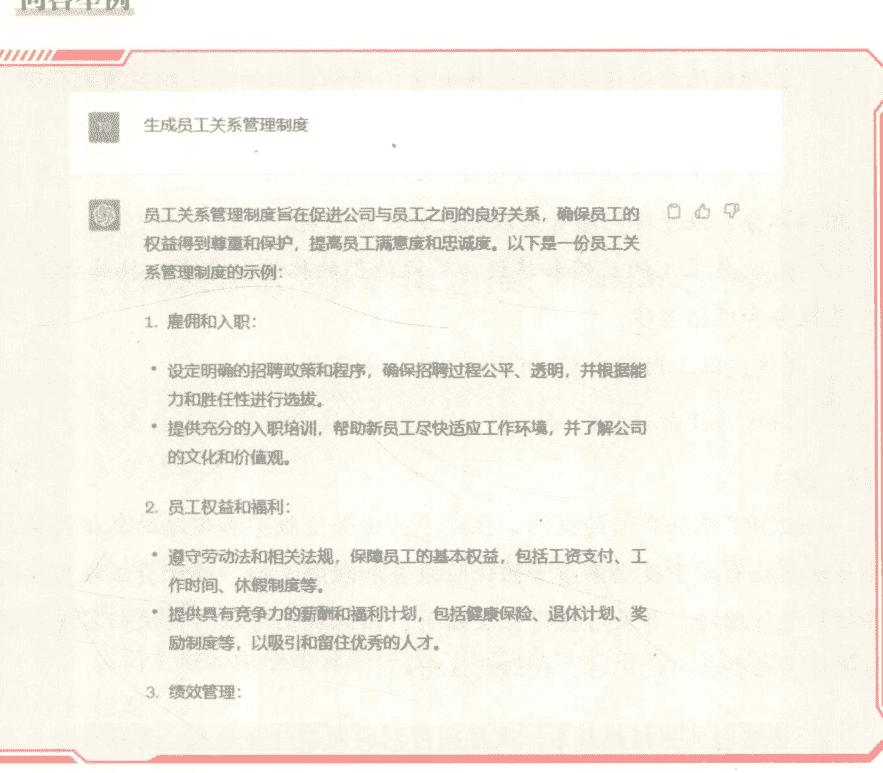

用户提问：

生成员工关系管理制度。

ChatGPT 回答：

员工关系管理制度旨在促进公司与员工之间的良好关系，确保员工的权益得到尊重和保护，提高员工满意度和忠诚度，以下是一份员工关系管理制度的示例。

##### 第一条 雇佣和入职

1. 设定明确的招聘政策和程序，确保招聘过程公平、透明，并根据能力和胜任性进行选拔。
2. 提供充分的入职培训，帮助新员工尽快适应工作环境，并了解公司的文化和价值观。

##### 第二条 员工权益和福利

1. 遵守劳动法和相关法规，保障员工的基本权益，包括工资支付、工作时间、休假制度等。
2. 提供具有竞争力的薪酬和福利计划，包括健康保险、退休计划、奖励制度等，以吸引和留住优秀的人才。

##### 第三条 绩效管理

1. 建立有效的绩效评估体系，确保员工工作表现能够客观、公正地评估。
2. 提供定期的绩效反馈和个人发展计划，帮助员工了解自己的成长机会和发展方向。

##### 第四条 培训和发展

1. 提供全面的培训计划和机会，支持员工的职业发展和技能提升。
2. 建立内部晋升和岗位轮岗制度，鼓励员工在组织内部发展和成长。

##### 第五条 沟通和参与

1. 建立开放和透明的沟通渠道，鼓励员工与管理层和同事之间进行积极的沟通和反馈。
2. 定期组织员工会议、团队建设活动和员工满意度调查等，以了解员工的需求和关切。

##### 第六条 员工关怀和支持

1. 提供员工关怀计划，包括员工福利、健康管理、心理咨询等，帮助员工平衡工作与生活，提高工作满意度和幸福感。
2. 设立员工援助计划，为员工提供支持和帮助，应对个人和工作压力。

##### 第七条 纠纷解决

建立有效的纠纷解决机制，包括内部投诉渠道和独立调解机构，以解决员工之间或员工与管理层之间的纠纷和冲突。

（注：以上内容由 ChatGPT 生成，未改动）

#### 【追一追】

上述 ChatGPT 的回答确实为我们提供了一个员工关系管理制度的框架，但仔细阅读后发现，框架过于简单，且泛泛而谈，缺乏具体的内容与实际措施。因此，我们可以进行追问，技巧如下。

- 用假设情景的方式向其继续提问，如“假如你是一家分公司的负责人，想针对员工关系制定一则管理制度，以便更好地对员工进行管理，请生成一则员工关系管理制度”，ChatGPT 就会根据你的问题，生成新的回答。
- 换一种表达方式，如追问时，ChatGPT 的回答仍难以满足要求，我们可以尝试使用不同的表述方式，或提供更多的背景信息，这样更有可能得到想要的答案。
- 可以使用不同的追问方式来引导 ChatGPT 给出更准确、详细的答案，如使用开放性问题、假设性问题、反问等。

##### 用户追问：

假如你是一家分公司的负责人，想针对员工关系制定一则管理制度，以便更好地对员工进行管理，请生成一则员工关系管理制度。

ChatGPT 回答：

#### 员工关系管理制度

##### 第一条 沟通与反馈

1. 建立开放、透明的沟通渠道，包括定期团队会议、一对一沟通等，以促进员工与管理层之间的有效沟通。
2. 提供匿名反馈渠道，鼓励员工积极表达意见、建议和关切，以及对工作环境和政策的反馈。
3. 定期进行员工满意度调查，以了解员工对公司文化、管理制度和福利待遇的看法，并根据反馈结果改进管理方式。

##### 第二条 公平与平等

1. 确保所有员工在招聘、晋升、培训和奖励方面都受到公平和平等的对待，不因性别、种族、宗教、年龄、残疾或其他个人特征而受到歧视。
2. 提供公正的绩效评估体系，根据员工的工作贡献和能力进行评估，并提供透明的晋升机会和奖励。

##### 第三条 培训与发展

1. 提供全面的培训计划和发展机会，帮助员工不断提升技能和知识水平，以适应工作要求的变化和发展机会。
2. 鼓励员工参与外部培训、学习活动和行业研讨会，以促进个人和职业发展。
3. 设立导师制度，为新员工提供指导和支持，并帮助他们融入公司文化和团队。

##### 第四条 工作生活平衡

1. 鼓励员工在工作与个人生活之间取得平衡，提供弹性工作时间、远程办公和假期安排的灵活性。
2. 提供健康和福利计划，包括健康保险、体检、休假等，以关注员工的身心健康。
3. 组织团建活动、社交聚会等，增进团队凝聚力和员工间的友好关系。

##### 第五条 纪律与奖惩

1. 建立明确的员工行为准则和纪律规定，明确员工的权责和行为期望。
2. 奖励出色表现和杰出贡献，例如员工表彰、奖金或晋升机会。
3. 在必要时采取适当的纪律措施，如警告、暂停或终止雇佣关系，以应对员工不当行为或违反规定的情况。

##### 第六条 员工福利

1. 提供具有竞争力的薪酬和福利待遇，包括基本工资、奖金、福利计划和退休金等。
2. 提供员工福利、员工折扣和其他福利待遇，以增加员工的满意度和忠诚度。
3. 创建良好的工作环境，包括舒适的办公空间、员工休息室和健身设施等。

（注：以上内容由 ChatGPT 生成，未改动）

#### 【改一改】

ChatGPT 根据我们的问题重新生成了一则员工关系管理制度，相较于第一则来说，第二则更加详细与具体，提供了可行的管理措施。我们在对其进行整理提升时，可以使用以下技巧。

- 按照主旨或者主题一致的原则，将长篇回答分成几个独立的段落，并在段落的开头或者结尾简要陈述段落的要点。这样会使得最终呈现的内容更加清楚，便于阅读。
- 筛选有效信息。通过对 ChatGPT 的多次追问，我们已经得到了多次回答，可以在其中筛选有用的信息，过滤掉无用的信息，只保留最具代表性的、最符合要求的回答。
- 补充细节与关键词。我们在整合优化时，可能会发现其中缺少一些关键词与细节，这时我们需要对信息进行补充，让整个答案更加完整、清晰明了，更加符合我们的要求。

### 8.2.8 组织文化：生成公司使命、愿景、价值观

ChatGPT 可以根据公司的要求，定制相关的问答模块，让员工和用户提供组织文化管理方面的信息。它不仅可以为用户提供信息，还可以加强用户对公司的认同感和信任感，如提供公司价值观、公司文化等方面的信息。

#### 任务：生成公司使命、愿景、价值观

##### 问答举例

> 假设这是一家科技初创公司，专注于开发商业化的人工智能技术。由于该市场竞争激烈，我希望寻求ChatGPT的帮助来生成我们企业的愿景、使命和价值观。我们希望这些价值观体现我们对客户的承诺、员工的支持和社会的责任，并且能够体现我们创新技术和不断进化的文化。

愿景：
通过前沿的人工智能技术，我们的愿景是成为行业领先的科技初创公司，为客户提供创新、可靠且实用的解决方案，推动社会进步和商业成功。

使命：
我们的使命是利用人工智能技术的力量，提供高效、智能化的解决方案，帮助客户在日益竞争激烈的商业环境中脱颖而出。我们致力于将科技创新与商业需求相结合，为客户创造持续的价值和竞争优势。

价值观：

1. 客户导向：客户是我们发展的根本动力。我们始终站在客户的角度思考和行动，不断了解和满足他们的需求，为他们提供超越期望的解决方案和优质服务。
2. 创新驱动：创新是我们成功的基石。我们鼓励员工勇于尝试新想法、开拓新领域，持续推动技术和业务的创新，不断寻求突破和进步，为客户提供独特的价值。
3. 团队合作：我们相信团队合作的力量。我们鼓励员工之间的合作、沟通和知识分享，致力于打造一个相互信任、支持和尊重的工作环境。我们相信通过团队的协作，能够实现更大的成就。
4. 社会责任：我们关注社会和环境的可持续发展。我们承担起社会责任，积极参与公益活动，关注社区和环境的福祉。我们致力于通过技术创新和社会贡献，为构建更美好的世界贡献力量。
5. 持续进化：我们坚持不断学习和进化的文化。我们鼓励员工持续学习、不断提升技能和知识，适应不断变化的科技和商业环境。我们相信只有与时俱进，才能在快速发展的行业中保持竞争优势。

这些价值观体现了我们对客户的承诺、员工的支持和社会的责任，同时也代表了我们作为一家科技初创公司的创新技术和不断进化的文化。通过秉持这些价值观，我们致力于为客户提供卓越的解决方案，实现商业成功并为社会做出积极贡献。

#### 【问一问】

我们在向 ChatGPT 提问时，需要非常明确我们需要的帮助，即问题中的“生成公司愿景、使命、价值观”，这样可以使 ChatGPT 专注于提供这方面的信息与建议。

在提问时，我们也可以向其提供具体背景信息，这样会使 ChatGPT 在回答问题时，将有关内容与我们的实际情况相结合，即问题中的“一家科技初创公司，专注于开发商业化的人工智能技术”。

除上述技巧外，我们在提问时，也可明确提出这个问题的目的。这有助于 ChatGPT 更好地理解我们的意图，并提供与之一致的建议，即问题中的“我们希望这些价值观体现我们对客户的承诺、员工的支持和社会的责任，并且能够体现我们创新技术和不断进化的文化”。

##### 【比一比】

下面是其他 AI 的回答，我们通过对比可以发现，面对相同的问题，二者生成的公司使命、愿景和价值观有相似之处，比如价值观出发的角度基本相同。但又有不同之处，比如二者的愿景与价值观，ChatGPT 的回答更为宏观，而其他 AI 的回答则更为细致。在应用时，我们可根据实际情况对其进行筛选与整理。

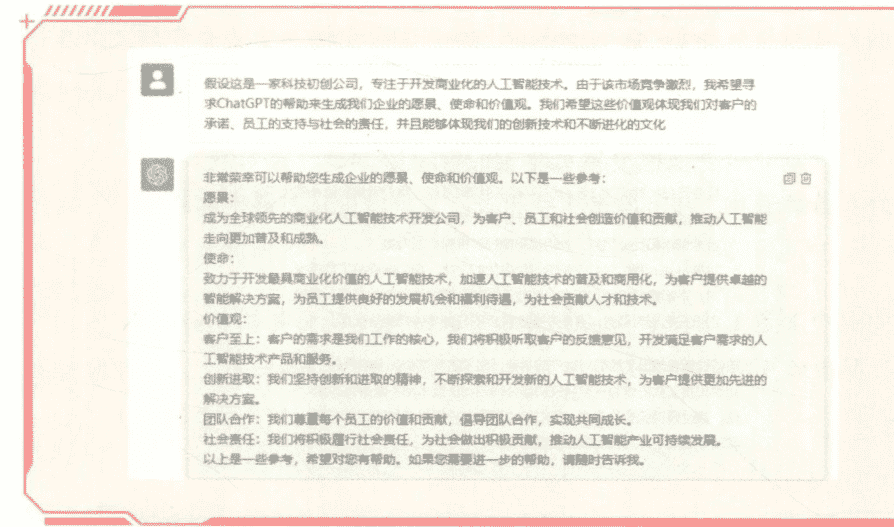

### 8.2.9 沟通反馈：生成公司内部沟通反馈管理制度

ChatGPT 可以用于提供员工沟通和反馈方面的信息，帮助公司了解员工沟通和反馈的需求和想法，这有助于提高员工的参与度和满意度，增强员工对公司持续改进和发展的信心和支持，如提供员工反馈渠道、沟通流程信息等。

#### 任务：生成公司内部沟通反馈管理制度

##### 问答举例

> 假设这是一家医疗保健公司，该公司在内部推行了新的沟通反馈管理制度，旨在改进员工之间沟通和团队之间的协作。我想了解，通过ChatGPT生成公司内部沟通反馈管理制度是否可行，并且希望这个制度的最终呈现方式清晰易懂、具有可操作性，并且能够适应医疗保健行业和监管要求的特点和标准。

> 为了满足您的要求，我将为您生成一份医疗保健公司内部沟通反馈管理制度的简要示例，该制度的最终呈现方式应该清晰易懂、具有可操作性，并且适应医疗保健行业和监管要求的特点和标准。请注意，这只是一个示例，您可以根据您公司的具体需求进行调整和完善。

医疗保健公司内部沟通反馈管理制度

目标：
该制度旨在改进员工之间的沟通和团队之间的协作，促进信息流动和问题解决，以提高工作效率和员工满意度。

1. 沟通渠道和工具：
   - 内部沟通平台：建立一个安全、可靠的内部沟通平台，用于团队成员之间的交流、信息分享和文件共享。
   - 电子邮件和即时消息：使用电子邮件和即时消息工具进行日常沟通，确保及时反馈和有效协作。
   - 团队会议：定期召开团队会议，以面对面的方式进行重要事项的讨论、进展分享和问题解决。

2. 反馈机制：
   - 员工反馈渠道：设立专门的反馈渠道，鼓励员工提供意见、建议和反馈，以改善沟通和协作效果。
   - 上级领导和同事反馈：鼓励上级领导和同事给予员工及时、具体的反馈，促进个人和团队的成长和改进。

3. 沟通准则：
   - 清晰明确：要求员工在沟通中表达清晰、明确的意思，避免使用模糊和含糊不清的语言。
   - 尊重和共享：鼓励员工以尊重和理解的态度进行沟通，分享信息和知识，促进团队协作。
   - 反馈接受与反馈给予：鼓励员工接受和理解他人的反馈，并主动给予建设性的反馈，以改进自身和团队的表现。

4. 监管要求和法规遵守：
   - 数据保护和隐私：确保所有沟通和反馈过程符合医疗保健行业的数据保护和隐私规定，保护敏感信息的安全性和机密性。
   - 法律合规：确保沟通反馈管理制度遵守相关监管要求和法律规定，包括但不限于劳动法和雇佣合同法等。

请注意，在实际应用中，制度的详细内容应根据公司的需求、行业特点和监管要求进行调整和定制。同时，引入人工智能工具如ChatGPT只是为了辅助生成制度的初步框架，最终的制度设计需要经过公司内部的专业人士和法律顾问的审查和完善，以确保其符合实际情况和法律要求。

#### 【问一问】

我们在向 ChatGPT 提问时，可以使用反问技巧，让它获取关于生成制度可行性的评估信息，即问题中的“通过 ChatGPT 生成公司内部沟通反馈管理制度是否可行”。

在提问时，还可以提出多个要求，确保 ChatGPT 的回答涵盖我们需要的不同方面的需求，即问题中的“制度的最终呈现方式清晰易懂、具有可操作性，并且能够适应医疗保健行业和监管要求的特点和标准”。

除上述技巧外，我们在提问时还可以使用预设答案的方法，这有助于引导 ChatGPT 的回答更符合我们的要求，即我们在问题中明确了制度最终的呈现方式及其相关标准。

#### 【探一探】

- 点赞王国：如果我们建立一个公司内的点赞系统，每个员工可以向其他员工发送 1~3 个赞，那么你会发送给谁，为什么？
- 年终绩效评估：你如何评估你的团队成员表现？你会权衡哪些因素，如工作成果、责任感、团队合作以及自我成长等？
- 圣杯问题：如果你只能选择一个改善公司的措施，你会选择什么？为什么？
- 明星职业生涯：如果你有机会成为公司中任何一个人的助手，你会选择谁？为什么？
- 困境求助：当你陷入沟通或解决问题的困境时，你通常会采取哪些措施来走出困境？你是寻求上级或同事的帮助，还是自己解决问题？

### 8.2.10 分析预测：生成员工满意度调查报告

ChatGPT 可以用于提供人力资源数据分析和预测方面的信息，并进行分析比较，如提供员工流失率、员工满意度等的数据分析和预测。

#### 任务：生成员工满意度调查报告

##### 问答举例

你是一家制造业公司的人力资源经理，为了解员工对公司的整体满意度，并对员工满意度进行详细分析和建议，以支持公司的改进和发展，你需要编制一份员工满意度调查报告。

#### 员工满意度调查报告

报告摘要：
本次员工满意度调查旨在评估公司内部员工对工作环境、管理支持、职业发展和团队合作等方面的满意程度。调查采用了定量和定性的数据收集方法，包括在线调查问卷和员工访谈。共有500名员工参与了调查，涵盖了公司各个部门和岗位。

1. 调查概况
   - 调查样本：参与调查的员工数量、部门分布、岗位层级分布等。
   - 调查时间范围：调查的开始和结束时间。
2. 全面满意度评估
   - 整体满意度指数：员工对公司整体满意度的综合评估结果。
   - 满意度趋势：与上一次调查相比，员工满意度的变化趋势和关键原因。
3. 工作环境评估
   - 工作条件：员工对工作环境、设施和工作条件的评价。
   - 安全与健康：员工对工作场所安全和健康管理的认可程度。
   - 工作氛围：员工对团队合作、沟通和文化氛围的感受。
4. 管理支持评估
   - 上级领导：员工对上级领导的管理风格、沟通能力和支持程度的评价。
   - 绩效管理：员工对绩效评估和奖励体系的认可和公平性的评估。
   - 培训和发展：员工对公司提供的培训和职业发展机会的满意度评价。
5. 职业发展评估
   - 职业规划：员工对个人职业发展规划和公司对员工职业发展的支持度评价。
   - 晋升机会：员工对晋升机会的感知和机会公平性的评价。
   - 工作挑战：员工对工作任务和责任的挑战程度的评估。
6. 团队合作评估
   - 团队协作：员工对团队内合作、沟通和决策能力的评价。
   - 相互支持：员工对同事之间相互支持和帮助的感受。
   - 冲突管理：员工对冲突解决和团队冲突管理的评价。
7. 结论和建议
   - 根据调查结果总结员工满意度的关键发现和问题领域。
   - 提供针对性的改进建议，以优化工作环境、提升管理支持、促进职业发展和加强团队合作。
   - 强调持续关注员工反馈和改进行动的重要性，以持续提升员工满意度和公司绩效。

请注意，以上仅为一个示例员工满意度调查报告的大致结构，具体内容和细节应根据您公司的实际情况进行调整和填充。

#### 【问一问】

我们在向 ChatGPT 提问时，可以明确设定角色身份，这有助于 ChatGPT 提供有针对性的回答以及建议，即问题中的“你是一家制造业公司的人力资源经理”。

在提问时，还应清楚地说明我们的需要，比如“对员工满意度进行详细分析和建议”。

除上述技巧外，在提问时，还应强调对问题的要求，明确最终的呈现效果，比如说“呈现方式要清晰易懂、具有可操作性，以及适应制造业和公司的特点与标准”。

#### 【探一探】

- 梦幻岛度假村：如果你能选择公司去旅游度假的地方，你会选择哪里？分享一些你喜欢的旅游活动和你希望在度假期间做的事。
- 鼓励的话：在你工作的过程中，有谁是对你支持和帮助很大的人？请分享职场上对你有过鼓励和肯定的话，以及那些话给你带来的影响。
- 成就感：在工作过程中，你感到最大的成就是什么？请分享你的经验和感受。
- 公司文化：在你看来，我们的公司文化最吸引你的地方是什么？有什么需要改进的地方吗？
- 满意度反馈：你对公司的工作环境、福利待遇和发展机会等方面有哪些建议和意见？公司如何才能更好地满足员工的期望？

# 第9章 个性创意探寻伙伴

ChatGPT 是一个强大的自然语言处理模型，可以生成创意文本，如故事、诗歌、广告文案等。将 ChatGPT 作为个性创意探寻伙伴，需要多与它进行交互，并提供明确的提示和要求；同时，也需要通过人工编辑和创意探讨等方式，使之更符合我们的需求和风格。

## 9.1 创意创作 2 个应用场景与 4 项任务示范

### 9.1.1 创业创新：生成创业落地计划与产品 MVP 模型

当你有一个创意或创业想法，但没有具体实施思路时，可以尝试与 ChatGPT 沟通，它可以为你提供相应的实施计划、市场分析和指导方案，快速做出 MVP，快速投入市场检验并获得反馈，可以帮助你找到相关的创业支持，甚至有可能帮你找到投资资源。

#### 任务 1：生成创业落地计划

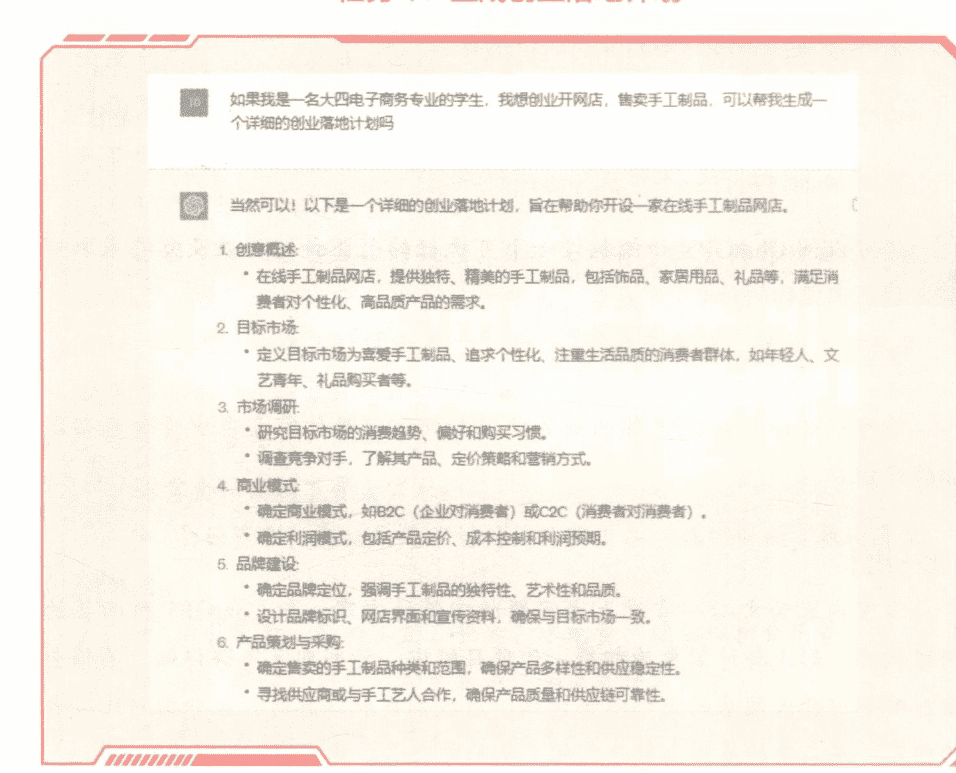

#### 【问一问】

如果我们想让 ChatGPT 帮忙写一篇创业落地计划，可以考虑以下提问技巧：

描述你的创业想法和目标

你可以告诉 ChatGPT 你的创业想法是什么，以及你想达到的目标是什么。

询问如何制订一个可行的计划

你可以问 ChatGPT 如何制订一个可行的创业计划，以及需要考虑哪些因素。

描述你的目标市场和受众

你可以告诉 ChatGPT 你的目标市场，以及受众的需求和偏好是什么。

询问如何制定一个有吸引力的商业模式

你可以问 ChatGPT 如何制定一个有吸引力的商业模式，以及如何确定你创业的利润模式。

描述你的竞争对手和他们的优劣势

你可以告诉 ChatGPT 你的竞争对手是谁，以及他们的优势和劣势是什么。

询问如何制订一个可执行的计划

你可以问 ChatGPT 如何制订一个可执行的创业计划，以及需要采取哪些行动来实现你的计划。

描述你的财务状况和融资需求

你可以告诉 ChatGPT 你的财务状况如何，以及你需要多少资金来实现你的计划。

##### 【比一比】

以下内容为文心一言就上述问题所回答的内容，与 ChatGPT 所回答的内容相比，形式与计划更为相符，但项目较少，计划内容不够详细、不够全面，对如何开设网店的策划不够详细。当我们提取信息时，应分析对比二者的内容，在二者的基础上整合优化，从而更全面、更丰富。

用户提问：

如果我是一名大四电子商务专业的学生，我想创业开网店，售卖手工制品，可以帮我生成一个详细的创业落地计划吗？

文心一言回答：

当然可以。以下是一份详细的创业落地计划，帮助你开始创业开网店，售卖手工制品。

1. 项目简介

作为一名电子商务专业的学生，你想利用自己的爱好和技能创业，开一家网店售卖手工制品。目的是追求自己的梦想，同时为社会创造价值。

2. 市场分析

近年来，随着消费者对个性化商品的需求增加，手工制品市场日益繁荣，你的竞争对手主要包括其他手工制品创业者和品牌。消费者需求主要是追求独特性、品质和实用性。因此，你的商业模式应该是提供高品质、个性化的手工制品，并结合良好的客户服务，树立自己的品牌形象。

3. 产品选择与定位

根据市场调查和自己的技能，你决定选择手工艺品作为自己的主打产品。为了与其他竞争对手区分开来，你决定专注于制作具有独特设计、高品质和环保材料的手工艺品。通过这种方式，你的品牌形象将更加鲜明，目标客户也将更加明确。

4. 资金筹措

你需要列出以下资金需求：

- 初始资金：包括采购原材料、购买设备、租凭场地、招聘员工等费用。
- 运营资金：包括工瓷、租金、水电费、设备维护费用等。
- 流动资金：用于应对突发事件和满足顾客需求。
- 固定资产：包括设备、工具、家具等。

5. 营销推广计划

为了提高品牌知名度和销售业绩，你需要制定以下营销推广计划：

- 在社交媒体上开设网店账号，定期发布优质内容和互动。
- 利用搜索引擎优化（SEO）技术提高网店在搜索结果中的排名。
- 参加线上线下展览会和活动，展示产品并吸引潜在客户。

#### 任务 2：生成产品 MVP 模型

根据上述内容生成一个具体的产品MVP模型

基于上述创业落地计划，以下是一个具体的产品MVP（Minimum Viable Product）模型，用于开设一家在线手工制品网店：

产品名称：HandCrafted Hub（手工创意集市）

主要功能和特点：

1. 商品展示：提供用户友好的网店界面，以清晰的分类和标签展示各类手工制品。
2. 商品详情：为每个商品提供详细的描述、照片和规格，以及相关的艺术家或手工艺人的介绍。
3. 购物车与结算：允许用户将喜欢的商品添加到购物车，并提供安全可靠的结算方式，如支付宝、微信支付、信用卡等。
4. 用户评价与推荐：用户可以对购买过的商品进行评价和推荐，为其他用户提供参考。
5. 个人用户账户：用户可以创建个人账户，查看订单历史、收藏商品、管理收货地址等。
6. 社交媒体集成：与社交媒体平台（如微信、微博、Instagram等）集成，方便用户分享自己喜欢的商品和购物体验。
7. 营销活动和促销：定期开展营销活动，如限时优惠、买赠活动等，吸引用户购买。

MVP的实现重点：

- 网店界面：设计简洁、直观的用户界面，确保用户能够方便地浏览和搜索商品。
- 商品展示：选择一些热门和特色的手工制品，确保商品的品质和独特性。
- 购物流程：建立购物车和结算流程，确保用户能够顺利完成购买。
- 用户评价：为商品添加评价和推荐功能，激发用户参与和信任。

该MVP模型将帮助你快速验证市场需求，收集用户反馈，并逐步完善产品功能和用户体验。根据市场反馈和数据分析，你可以进行调整和优化，逐步拓展产品线和增加更多功能。记住，MVP的目标是在最小的范围内验证你的创意，并以用户的需求为导向不断迭代和改进。祝你在创业旅程中取得成功！

#### 【追一追】

可以看到上述回答内容大都针对网店设计，设计了店铺的功能与特点及店铺展示方面，但是仔细研究可发现此产品 MVP 模型不够全面，缺少产品规划方面的内容。此时可继续向 ChatGPT 进行提问，使其对创业产品进行全面介绍。

用户提问：

对要售卖的产品说明不够具体，请丰富。

ChatGPT 回答：

> 非常抱歉没有提供足够具体的产品说明。以下是关于手工制品的更具体描述，以帮助你进一步完善产品 MVP 模型：

### 一、饰品类

手工珠宝：如项链、手链、耳环等，采用各种材质（如天然宝石、珍珠、木质、陶瓷等）和工艺（如编织、雕刻、串珠等）制作。

手工皮具：如手包、钱包、手提包等，采用优质皮革手工制作，注重细节和工艺。

### 二、家居用品类

手工陶瓷：如花瓶、碗、杯等，采用手工陶艺技法制作，注重独特的造型和色彩。

手工纺织品：如抱枕、毯子、窗帘等，采用手工织布或绣花工艺，注重纹样和质感。

### 三、礼品类

手工卡片和贺卡：如生日卡、节日贺卡等，采用手工剪纸、刺绣等工艺，注重个性化和温馨感。

手工艺品摆件：如木雕、瓷器摆件等，采用传统工艺制作，展示独特的文化和艺术魅力。

### 四、其他类别

手工香皂和护肤品：如天然手工香皂、精油等，注重纯天然原料和无添加成分。

手工文具和笔记本：如手工装订的笔记本、书签等，注重独特的设计和精致的手工制作。

产品的具体种类和设计应根据你的市场调研和目标用户需求进行进一步研究和确定。确保产品的独特性、品质和艺术性，以吸引目标市场的消费者。

> （注：以上内容由 ChatGPT 生成，未改动）

### 9.1.2 艺术创作：生成诗歌与剧本

当我们在进行诗歌、音乐或设计方面的创作，缺乏灵感时，可以选择与 ChatGPT 进行对话，让其根据我们提供的相关创意素材和关键词进行创作，或者帮助我们修改、完善、优化相关作品。

#### 任务 1：生成诗歌

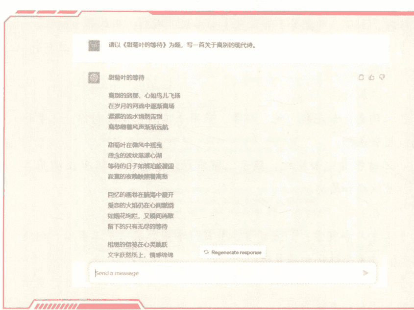

【扫码查看完整问答过程】

#### 【问一问】

❓ 定义主题或情感

描述想表达的主题或情感，让 ChatGPT 了解你想要表达的内容。

❓ 提供关键词或场景

提供一些关键词或场景，以帮助 ChatGPT 更好地了解你想要创作的诗歌的类型或风格。

❓ 描述需求

描述你希望诗歌达到的效果，以帮助 ChatGPT 更好地创作诗歌。

#### 确定诗歌形式

告诉 ChatGPT 你想要使用哪种形式，如五行诗、十四行诗、现代诗歌等，以帮助它更好地创作符合你需求的诗歌。

当然，我们也可以直接询问 ChatGPT，怎么向它提问，才能方便它理解，从而使它写出优美的诗。

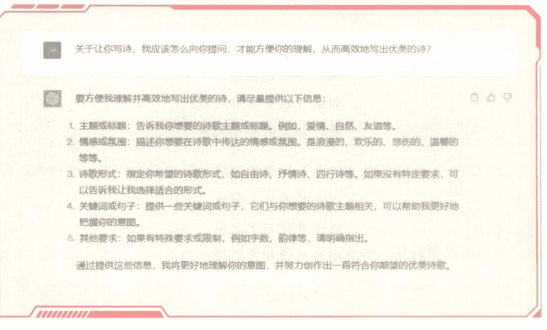

#### 【追问举例】

用户提问：

请以《甜菊叶的等待》为题，写一首关于离别的现代诗。

要求——

- 你需要提到的元素包括但不限于：春雨、七星瓢虫、池塘、晚霞。
- 不少于 18 行，且行数为偶数。

ChatGPT 回答：

甜菊叶的等待
春雨纷纷洒散，
离别在心头缠绵。
七星瓢虫停歇，
池塘里泛起涟漪。

相逢如昙花一现，
别离似晚霞渐远。
曾经的誓言如梦幻，
如今只剩空寂的远。

离别的泪水湿润，
思念的痛楚盈怀。
甜菊叶在等待中默默，
等待相聚的那一天来。

彼岸的桥梁恍若隐现，
心灵的羁绊永相连。
纵使身处万里之遥，
心却与你相互依偎。

故乡的味道仍在口中，
梦中的画面犹如昨。
岁月的车轮无情转动，
但记忆里你永不老。

离别是人生的一部分，
让我们更懂得珍惜。
甜菊叶在等待的池塘，
承载着我们永恒的思念。

晚霞渐渐染红天边，
抚慰离别的心伤。
相信在离别的边缘，
相聚的希望仍在等待。

（注：以上内容由 ChatGPT 生成，未改动）

#### 【追一追】

描述场景

可以描述一个场景，以及想表达的情感、希望诗歌所涉及的主题等。这可以帮助 ChatGPT 更好地了解你想要表达的内容。

提出具体问题

可以提出一些具体的问题，如希望诗歌中包含哪些元素、希望诗歌采用何种风格等。这可以让 ChatGPT 知道你的关注点和需求，从而更好地满足要求。

追问细节

可以追问一些诗歌的细节，如希望诗歌中使用哪些比喻、喜欢哪些诗歌的韵律感等。这可以帮助 ChatGPT 更好地了解你的审美观和对诗歌的偏好。

提出反馈

可以提出反馈，如认为诗歌中哪些部分比较成功、对诗歌的整体感觉如何等。这可以帮助 ChatGPT 更好地了解你对诗歌的看法，从而进行调整和改进。

#### 【可用 AI 对比】

对于中文诗歌的创作，我们可以对比不同 AI 的回答，从中寻找灵感。

以下是 360 智脑的回答：

用户提问：

请以《甜菊叶的等待》为题，写一首关于离别的现代诗。

360 智脑回答：

> 甜菊叶的等待

时间如白驹过隙，街灯下的我们，
曾许下美好的诺言，誓言永不分离，
但命运的安排，却让我们被迫分离，
那些美好的瞬间，如今只剩回忆。
甜菊叶的守望，是我无言的哀叹，
蒲公英在风中飘摇，如同我的心事，
教堂的钟声响起，犹如一曲哀伤的歌，
让我感受到岁月的无情和沧桑。
虽然你已离开我的世界，
但你的影子一直在我心中盘旋，
无论何时何地，我都在默默地守望，
期盼着有一天能再次与你相遇。
我相信缘分会让我们重逢，
在那遥远的彼岸，等待着我们的相逢。
我们一起走过岁月的长河，
留下属于我们的美好回忆和故事。

以下是讯飞星火认知大模型的回答：

#### 甜菊叶的等待

在离别的早晨，我看着甜菊叶，
静静地等待着太阳的升起。
每一片叶子都像一个小小的希望，
在微风中轻轻摇曳，像是在说别离的故事。
甜菊叶的绿，如同你的眼睛，
明亮而深邃，充满了期待和梦想。
你的微笑，就像那甜菊叶的香气，
飘散在我的心间，让我无法忘怀。
我在甜菊叶的等待中寻找你的身影，
仿佛你就在那个清晨的第一缕阳光里。
可是太阳升得越高，我的心就越冷，
因为我知道，我们即将分别，走向各自的方向。
甜菊叶在风中摇曳，仿佛也在哭泣，
它们的等待，是为了告别的季节。
而我，只能默默地看着你离去，
心中充满了无奈和遗憾。
但是我知道，即使我们分别在天涯海角，
甜菊叶的等待，永远不会停止。
因为每当新的一天开始，它们都会再次迎接太阳的升起，
就像我一样，无论距离多远，都会想念你。
所以请你记住，即使我们身处不同的地方，
我也会像甜菊叶一样，静静地等待你的归来。
因为你是我生命中的甜菊叶，
我会一直在这里，等你回来。

（注：以上内容由讯飞星火认知大模型生成，未改动）

以下是文心一言的回答：

#### 甜菊叶的等待

甜菊叶，独守空巷，
寂静的夜，月光洒下银妆。
告别了春天的繁华，
默默等待，离别的脚步。

微风轻拂，掀起波澜，
寄予远方，思念的幽香。
那曾经的绿意盎然，
如今化作，期待的重逢。

秋水共长天一色，
孤雁南飞，诉说离愁。
守望着时光的流转，
甜菊叶，倾诉心中的温柔。

静听夜的寂寥，
星光点缀，无尽的遥想。
那一段段过往云烟，
在心底深处，轻轻回响。

甜菊叶，舒展脉络，
月色如水，洗尽岁月的尘嚣。
等待重逢的那天，
依旧是春风十里，桃花盛开。

甜菊叶，守望未来，
离别的痛，化作诗意的篇章。
愿我们的心灵相通，
在时光的长河，共同寻觅答案。

（注：以上内容由文心一言生成，未改动）

#### 任务 2：生成剧本

用户提问：

请帮我生成《霸王别姬》这部话剧最后结局一幕的剧本。

提示——西楚霸王项羽和美人虞姬的最后几句对话。最后，虞姬自杀，血溅乌江畔，西楚霸王项羽抱着虞姬的尸体，仰天长叹，挥剑自刎。要求字数在 1500 字以内！

ChatGPT 回答：

（舞台布局：左侧，高台之上，宛如江边之地。右侧，一人静静伫立，身旁一把明剑，他就是西楚霸王项羽。光线黯淡，清戏伴奏声在指尖滑过，创造出一种仲夏夜晚乌江之边的萧索气氛。）
项羽（低沉而沉痛）：“虞姬……”
虞姬（轻唤）：“大王。”
项羽：“啥阳将至，羽心已疼，我身败矣，勿要叨扰安生……”
虞姬（流泪）：“大王，是何忧愁？”
项羽（闭目）：“虞姬，我之忧，非你可知，你我共度良辰，却终将敌手。”
虞姬（喟叹）：“诚以易民之身，接踵而来的是兵火而非浮生。大王忧心，我亦曾知。”
项羽（颤声）：“虞姬……你……终究是知道了……”
虞姬（微笑，颤抖地接过剑，然后悲伤地看着项羽）：“大王，姬心苦矣。”
（虞姬自刎，身形颤动，倒下，心血流淌，溅满乌江畔）
（项羽悲痛欲绝，扑向虞姬，搂住她的尸体，泪眼模糊）
项羽（声如断弦，仰天长嚎）：“虞姬啊……！”
（片刻安静，然后，项羽挣扎地站起来，握住剑柄，长吁短叹）
项羽（凝目望向虞姬，坚定）：“虞姬，待我归来，与你共度长生。”
（项羽挥剑自刎，他的身体向前倒下，紧紧地靠在虞姬的尸体旁边）
（灯光暗下，舞台上只剩下项羽和虞姬安详地躺着，一切回归寂静）
舞台上一片暗淡，伴奏声悠悠在空气中凝结，寥落中带着深沉的凄美，此刻只有暗淡的月光下，映照着赴死的，满地的血迹，此刻，一切都已寂灭。

（注：以上内容由 ChatGPT 生成，未改动）

#### 【问一问】

当我们想进行艺术创作，但是毫无思路时，可以先向 ChatGPT 提问，让其提供提问方向。根据上述回答，我们可以针对以下方面提问：

- 故事背景是什么？
- 主要人物有哪些？他们有什么特点？
- 故事情节是什么？
- 故事的主题是什么？

当然，如果还是不确定提问思路，也可以让 ChatGPT 进行举例，从而对提问内容有更深刻的了解。

#### 【追问举例】

根据上述提问，我们已经知道需要 ChatGPT 帮我们创作剧本时，如何向其提问。此时我们就可以综合自己的思路，以及对剧本的原始构思，向 ChatGPT 提问，使其为我们创作初级剧本。

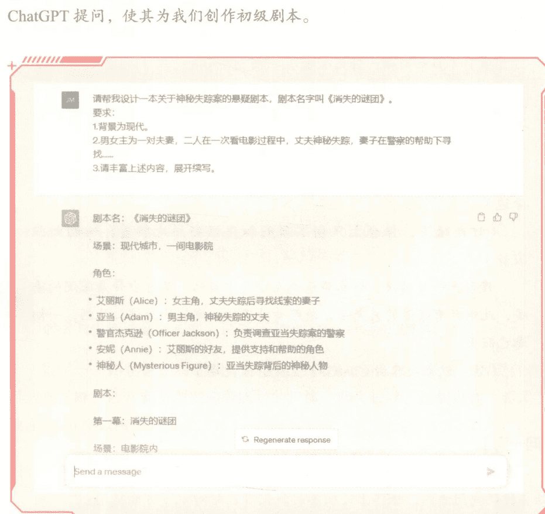

【扫码查看完整问答过程】

#### 【问一问】

❓ 主题和设定

这个悬疑剧本的主题和设定是什么？比如，它是发生在一个孤岛上，还是发生在古老的城堡里，或者是发生在普通的城市街道上？这个背景会对我们的情节和角色产生很大的影响。

❓ 角色

这个故事中有哪些主要角色？他们是什么样的人？他们的性格特点是什么？这些角色应该有各自的目的和动机，这些目的和动机将会推动故事的发展。

❓ 悬念

这个故事中的悬念是什么？它是关于一个失踪的人，还是一个犯罪案件，或者是某种秘密？这个悬念应该能够吸引观众的注意力，并让他们持续关注故事的发展。

❓ 情节

这个故事的情节是什么？它是否有开头、过程和结尾？这个情节是否有意外的转折，能让观众感到惊喜？

❓ 风格

这个剧本的写作风格是什么？它是比较恐怖的，还是较为理智的，或者是带有一些超自然元素的？这个风格应该与主题和设定相匹配。

## 9.2 个性化创意落地实施

### 9.2.1 AI 生成创意

我们可以通过 ChatGPT 快速生成多样化的创意方案和内容。使用者需要清楚自己的创意需求和目标受众，合理选择创意类型和风格，并根据实际情况进行修改和调整。

### 第一，生成创意的实施步骤。

• 定义创意目标和需求

明确需要什么类型的创意，如广告宣传语、产品创新点、市场推广策略等。确保目标明确、具体，并明白创意的用途和受众。

此时需要注意确保创意目标与公司或项目的整体战略一致，以及清楚了解目标受众和市场需求。

• 收集相关信息

搜集与创意目标相关的背景信息，包括行业趋势、竞争对手的做法、目标受众的喜好和习惯等。这些信息将为生成创意提供有价值的参考。

此时需要注意确保信息来源可靠，并且对市场和受众进行全面而准确的了解。

• 进行创意生成

使用 ChatGPT 来生成创意。向模型提供与创意目标相关的问题、提示或关键词，以引导模型生成有创意的回复。可以进行多轮交互，通过迭代不断细化和完善创意。

在与 ChatGPT 进行交互时，要注意使用清晰、简明的语言，避免模糊或有歧义的表达。还要注意不要给模型提供过于具体或太宽泛的信息，以免影响生成创意的质量。

### 第二，生成智能创意的问题与解决。

• 生成创意的多样性

模型可能倾向于生成类似的创意或常见的想法。

解决办法是通过引入多样的问题、提示或关键词来激发模型的创造力，尝试从不同角度引导创意生成。还可以使用多个不同的实例与 ChatGPT 进行交互，以获得更广泛的创意。

• 创意的可行性和实用性

模型生成的创意可能在实际应用中存在难以实现或不切实际的问题。

解决办法是在评估和筛选创意阶段，结合专业知识和实际经验，对创意进行合理的评估和挑选。如果创意存在可行性问题，可以对其进行修改或优化，以增强其实际可行性。

• 知识和信息的准确性

模型的知识储备截止时间可能未能及时更新，某些领域的最新信息可能不包含在内。

解决办法是在收集相关信息时，确保使用最新的数据和研究成果。对于特定领域的创意需求，可以结合模型生成的创意和专业领域的知识进行综合考量。

• 语言表达和沟通的准确性

模型在生成文本时可能存在一些语法错误、歧义或不准确的表达。

解决办法是仔细审查模型生成的创意，进行必要的语法校正和文本修改。同时，与模型进行多轮交互，通过澄清问题和解释需求来确保要求被正确理解并生成准确的创意。

• 版权和法律问题

生成的创意可能涉及版权或法律纠纷。

解决办法是在使用生成的创意之前，进行版权审查和法律风险评估。确保创意的原创性并遵守相关法律法规，如有需要，可以咨询法律专业人士的意见。

### 9.2.2 创意改进优化

使用 ChatGPT 生成智能创意时，可以通过实时试错反馈，来不断改进和优化生成的创意。以下是一种可能的创意改进优化流程：

① 创意评估阶段：对 ChatGPT 生成的创意进行初步评估。考虑创意的创新性、实用性、与目标的契合度等方面。注意创意的表达清晰度和表达方式。

② 实时反馈指导：根据创意评估的结果，给出实时的反馈和指导。如果创意质量不佳，可以提供明确的问题或更具体的提示，以引导 ChatGPT 生成更符合要求的创意。

③ 迭代和改进：通过多次交互和反馈，逐步改进创意。观察 ChatGPT 的回复，并根据需要进行进一步的迭代和修改。

④ 人工干预和编辑：在 ChatGPT 生成创意的基础上，结合人工的判断和专业知识，进行必要的干预和编辑。可以对生成的创意进行修正、改进或重新组合，以获得更符合要求的创意。

⑤ 再次评估和筛选：对改进后的创意进行再次评估。考虑创意的质量、实用性和与目标的契合度。筛选出最佳的创意并进行进一步的开发和应用。

### 9.2.3 创意宣传推广

用户可以根据 ChatGPT 提供的创意设计功能，选择适合自己的创意素材、推广方式和推广渠道。根据你提供的目标受众的特点和喜好，选择合适的推广方式和渠道，制订详细的推广计划和预算。

# 第10章 数据挖掘处理神器

数据挖掘处理是指从大量数据中提取有用的信息、模式和知识的过程。它涉及计算机科学、统计学和机器学习等，通过分析、清洗、整理和解释数据，发现隐藏在数据中的潜在模式、关联和趋势。ChatGPT 的出现，将对数据挖掘处理领域产生重大影响。

## 10.1 数据挖掘 3 个应用场景与 6 项任务示范

### 10.1.1 产品推广数据：生成消费者购买行为分析与产品推广效果分析报告

#### 任务 1：生成消费者购买行为分析报告

用户提问：

在产品推广数据分析工作中，消费者购买行为分析报告怎么撰写？撰写步骤有哪些？

ChatGPT 回答：

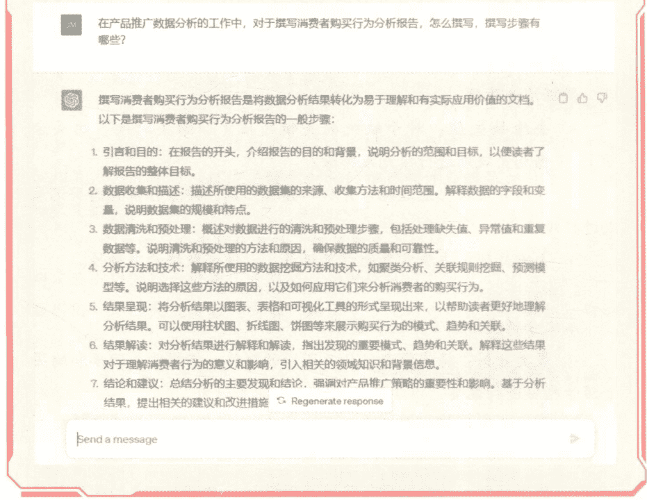

用户追问：

请按照上述要求，生成一些必要的数据和信息；然后，基于这些数据和信息，生成一份消费者购买行为分析报告。谢谢你。

ChatGPT 回答：

很抱歉，作为一个纯文本 AI 模型，我无法生成实时的数据和信息。我可以提供一份示例报告的结构和内容，但其中的数据和分析结果将是虚构的示例。请注意，以下示例仅用于展示报告的一般结构和内容，并不代表实际的数据分析结果。

##### 消费者购买行为分析报告

##### 1. 引言和目的

本报告旨在分析公司 X 的消费者购买行为，以了解消费者的购买模式、偏好和趋势，为产品推广和营销策略的优化提供指导。

##### 2. 数据收集和描述

- 数据集来源：公司 X 的销售记录数据库
- 时间范围：2022 年 1 月至 2023 年 12 月
- 数据集规模：包含 10,000 个订单记录和相关的用户信息

##### 3. 数据清洗和预处理

数据清洗步骤：

- 去除缺失值：对于缺失的关键字段（如购买时间、购买金额），根据相关规则进行填充或排除。
- 处理异常值：通过统计分析和领域知识，排除异常的购买记录或进行修正。
- 去重处理：去除重复的订单记录，以保证数据的准确性。

##### 4. 分析方法和技术

本次分析使用以下方法和技术：

- 聚类分析：将消费者划分为不同的群体，根据购买频率和购买金额等指标进行聚类，以了解不同群体的购买行为。
- 关联规则挖掘：发现产品之间的关联性，如常一起购买的商品组合。
- 预测模型：构建购买行为的预测模型，以预测未来的购买趋势和潜在的高价值客户。

##### 5. 结果呈现

购买行为分析结果摘要：

- 通过聚类分析，我们将消费者分为三个群体：低频购买者、中频购买者和高频购买者。高频购买者在过去一年内占据了总体购买量的60%。
- 关联规则挖掘显示，购买产品 A 的客户也倾向于购买产品 B，这为交叉销售和推荐提供了机会。
- 预测模型结果表明，预计未来 6 个月内高频购买者的购买金额将增长 10%，呈现良好的增长趋势。

##### 6. 结果解读

消费者购买行为分析结果表明，高频购买者是公司 X 的主要消费群体，值得注意的是，他们对产品 A 和产品 B 的购买具有关联性，这为交叉销售和推荐提供了机会。此外，我们预测未来 6 个月内高频购买者的购买金额将呈现稳定增长的趋势。

基于这些结果，我们可以得出以下结论和建议：

- 重点关注高频购买者：高频购买者是公司 X 的重要客户群体，应该将营销和促销策略重点放在他们身上。通过个性化推荐和定制化服务，提高他们的忠诚度和购买频率。
- 交叉销售和推荐策略：由于购买产品 A 的客户倾向于购买产品 B，可以通过交叉销售和推荐策略来增加销售额。在购买流程中提供相关产品的推荐，或者通过定制化的推荐邮件或短信，引导客户进行交叉购买。
- 客户细分和定制化营销：根据聚类分析的结果，可以将消费者细分为不同的购买群体，并针对每个群体设计定制化的营销策略。了解不同群体的购买偏好和需求，提供个性化的产品推荐、促销活动和购物体验。
- 关注高价值客户：结合预测模型的结果，将重点关注高频购买者中的高价值客户。通过提供专属优惠、增加购买激励和个性化服务，进一步增强他们的忠诚度和购买力。

##### 总结：

通过消费者购买行为分析，我们对公司 X 的消费者行为有了更深入的了解。基于聚类分析、关联规则挖掘和预测模型的结果，我们可以制定针对不同消费者群体的营销策略，优化产品推广和提高销售效果。

（注：以上内容由 ChatGPT 生成，未改动）

#### 【萃一萃】

在上述问答中，虽然 ChatGPT 随机虚拟了一些数据，生成了一份消费者购买行为分析报告，但实际上仍然是以框架的形式。“骨架完备，血肉欠缺”，还需要我们根据实际工作情况，加入大量的数据和分析，才能形成一篇真正有价值的报告。为了提高问答效率，我们可以在问答前，先询问 ChatGPT，我们需要向它“投喂”哪些数据资料，这样就能提高回答的针对性和工作效率。

> 请你帮我撰写消费者购买行为分析报告，我需要向你提供哪些资料，请列表说明。

为了撰写消费者购买行为分析报告，以下是您可能需要提供的一些资料和数据：

- 1. 销售数据：包括购买订单记录、销售额、销售渠道等相关数据。
- 2. 用户数据：包括消费者的个人信息、购买历史、注册日期、地理位置等。
- 3. 产品数据：包括产品信息、品类、定价、促销活动等。
- 4. 市场数据：包括市场规模、竞争对手信息、市场趋势等。
- 5. 营销活动数据：包括广告投放数据、促销活动数据、市场调研数据等。
- 6. 网站或应用分析数据：包括网站或应用的访问量、页面浏览量、停留时间等。
- 7. 调研或调查数据：包括消费者行为、购买意向、满意度等的调研或调查结果。
- 8. 其他相关数据：根据具体分析需求，您可能需要提供其他相关数据，如社交媒体数据、用户反馈数据等。

以上是一些常见的资料和数据，供您参考。请根据您的具体需求和分析目的，提供适当的数据和信息，以便我能够生成消费者购买行为分析报告。

> 请把上述内容转化为表格的形式。

当然，以下是将上述内容转化为表格形式的示例：

| 资料类型 | 说明 |
| --- | --- |
| 销售数据 | 包括购买订单记录、销售额、销售渠道等相关数据 |
| 用户数据 | 包括消费者的个人信息、购买历史、注册日期、地理位置等 |
| 产品数据 | 包括产品信息、品类、定价、促销活动等 |
| 市场数据 | 包括市场规模、竞争对手信息、市场趋势等 |
| 营销活动数据 | 包括广告投放数据、促销活动数据、市场调研数据等 |
| 网站或应用分析数据 | 包括网站或应用的访问量、页面浏览量、停留时间等 |
| 调研或调查数据 | 包括消费者行为、购买意向、满意度等的调研或调查结果 |
| 其他相关数据 | 根据具体分析需求，可能需要提供其他相关数据，如社交媒体数据、用户反馈数据等 |

请注意，这只是一个示例表格，您可以根据实际需求进行调整和扩展。

#### 【问一问】

在与 ChatGPT 问答的过程中，学会让 ChatGPT 生成表格也是一个重要的技巧，表格具有以下好处：

- **结构化信息**。表格以清晰的结构呈现数据和信息，使其易于理解和比较。每个单元格都有明确定义的内容，便于组织和查找相关信息。
- **简洁明了**。表格能够将大量数据和信息以简洁的方式呈现，避免冗长的文字描述，让读者迅速获取所需信息。
- **可视化展示**。表格中，数据和信息可以通过排列和颜色等方式进行可视化展示，使读者更直观地理解和分析数据。
- **数据比较**。表格可以方便进行数据对比和分析，通过对不同行和列的数值进行比较，读者可以快速识别出趋势、差异和关联。
- **组织数据**。表格可以帮助组织和分类数据，将不同类型的信息按照一定的逻辑结构排列，提高数据的整体可读性和组织性。

当我们需要对比和分析数据、简洁明了地展示大量信息时，可以要求 ChatGPT 生成表格，以清晰地呈现数据，使我们更好地理解数据之间的差异和关系，更容易地捕捉关键信息。

#### 任务 2：生成产品推广效果分析报告

用户提问：

在产品推广数据分析工作中，产品推广效果分析报告怎么撰写？撰写步骤有哪些？

##### ChatGPT 回答：

在产品推广数据分析的工作中，对于撰写生成产品推广效果分析报告，怎么撰写，撰写步骤有哪些？

撰写产品推广效果分析报告是将对产品推广数据的分析结果转化为易于理解和有实际应用价值的文档。以下是撰写产品推广效果分析报告的一般步骤：

- 1. 引言和目的：在报告的开头，介绍报告的目的和背景，说明分析的范围和目标，以便读者了解报告的整体目标。
- 2. 数据收集和描述：描述所使用的数据集的来源、收集方法和时间范围。解释数据的字段和变量，说明数据集的规模和特点。
- 3. 数据清洗和预处理：概述对数据进行的清洗和预处理步骤，包括处理缺失值、异常值和重复数据等。说明清洗和预处理的方法和原因，确保数据的质量和可靠性。
- 4. 分析方法和技术：解释所使用的分析方法和技术，如ROI分析、渠道效果分析、A/B测试等。说明选择这些方法的原因，以及如何应用它们来分析产品推广效果。
- 5. 结果呈现：将分析结果以图表、表格和可视化工具的形式呈现出来，以帮助读者更好地理解分析结果。可以使用柱状图、折线图、饼图等来展示不同渠道的效果、转化率、广告点击率等指标。
- 6. 结果解读：对分析结果进行解释和解读，指出不同渠道的效果差异，分析推广活动的成功因素和瓶颈。解释这些结果对于优化产品推广策略的意义和影响，引入相关的领域知识和背景信息。

##### 用户追问：

请按照上述要求，生成一些必要的数据和信息；然后，基于这些数据和信息，生成一份产品推广效果分析报告。谢谢你。

##### ChatGPT 回答：

很抱歉，但作为纯文本 AI 模型，我无法直接生成实际的数据和信息，也无法生成完整的报告。然而，我可以给你提供一个示例的报告大纲，以帮助你理解撰写产品推广效果分析报告的结构和内容。

产品推广效果分析报告示例大纲：

- 1. 引言
  - 介绍报告的目的和背景
  - 简要描述产品和推广活动的背景信息
- 2. 数据收集和描述
  - 数据集来源和收集方法
  - 数据集的字段和变量说明
- 3. 数据清洗和预处理
  - 数据清洗方法和步骤
  - 缺失值处理和异常值处理
- 4. 分析方法和技术
  - 所使用的分析方法和技术介绍
  - 分析方法的选择原因和适用性
- 5. 产品推广效果分析结果呈现
  - 图表和可视化工具展示不同推广渠道的效果比较
  - 关键指标的解读和分析
- 6. 结果解读
  - 解释不同推广渠道的效果差异和趋势
  - 分析推广活动的成功因素和改进空间
- 7. 结论和建议
  - 总结分析的主要发现和结论
  - 基于分析结果提出相关的建议和改进措施
- 8. 附录和参考资料
  - 数据字典、统计分析方法和数据处理的代码等附录
  - 引用的参考资料和数据来源

请根据你的实际数据和情境，填充每个部分的详细内容，以生成一份完整的产品推广效果分析报告。你可以根据你的数据集和分析结果，结合上述大纲的指导，逐步撰写报告的各个部分，以完成整个报告的撰写过程。

（注：以上内容由 ChatGPT 生成，未改动）

#### 【萃一萃】

从上述问答中，我们可以看到：

分析报告的框架，ChatGPT 可以自动生成，非常完备；但具体数据，必须由我们给它“投喂”，否则只能让它编造数据，“一本正经”地对我们胡说八道。

在实际工作中，我们可能只需要一个完备的报告框架，把我们的内容装进去，那就不必把真实数据“投喂”给 ChatGPT，参照它自动生成的示例就可以了。毕竟，在个人或公司数据的安全、尊重个人隐私、遵守相关法律法规等方面，目前仍存在诸多尚未解决的问题。

未来更多企业通过 API 接口接入 ChatGPT 或者其他 AIGC 的大模型工具是大势所趋，AIGC 模型所能学习到的数据会越来越全面，智能化自动生成的东西也将越来越靠谱。这确实会大大提高整个人类社会的工作效率和质量，未来不会用 ChatGPT，就像现在不会用互联网一样，真的会被“后浪”狠狠地拍死在沙滩上！

#### 【探一探】

关于产品推广数据分析，我还可以向 ChatGPT 提以下问题，从而更深入地了解消费者行为和优化推广策略。

- 哪些推广渠道对销售额和转化率有最大的影响？
- 影响消费者购买决策的主要因素是什么？价格、品牌知名度、促销活动等因素会对购买行为产生什么样的影响？
- 不同推广活动的 ROI（投资回报率）如何？哪些推广活动带来的回报最高？
- 有哪些重要的消费者细分群体？他们的购买行为和偏好有何特点？
- 消费者的购买周期是多久？他们是忠实的重复购买者还是更倾向于一次性购买？
- 有哪些产品组合或交叉销售机会？哪些产品常常会被一起购买？
- 不同推广渠道的用户获取成本如何？哪些渠道的成本效益最高？
- 哪些时间段和季节性因素对销售额和转化率有影响？
- 哪些地理区域或目标市场的产品推广效果更好？
- 哪些客户具有高价值潜力？如何识别和吸引这些高价值客户？

### 10.1.2 用户行为数据：生成用户行为数据分析与用户需求调查报告

#### 任务 1：用户行为数据分析

用户提问：

ChatGPT 可以收集和分析用户行为数据，如点击率、浏览量、停留时间等，帮助用户了解其需求和兴趣，从而提供更具个性的产品和服务。

请随机生成上述数据，再在这些数据的基础上，生成一份用户行为数据分析报告，谢谢。

##### ChatGPT 回答：

> 我理解您希望我生成一些随机的用户行为数据，并基于这些数据生成一份用户行为数据分析报告。请注意，作为 AI 模型，我无法真实生成实际的用户行为数据，只能生成虚拟的示例数据和报告。以下是一个示例的报告大纲，供您参考：

用户行为数据分析报告示例大纲：

##### 1. 引言

- 介绍报告的目的和背景
- 数据收集的渠道和方式

##### 2. 数据收集和描述

- 数据集来源和时间范围
- 数据集规模和字段说明

##### 3. 数据清洗和预处理

- 缺失值处理和异常值处理方法
- 数据的规范化和标准化

##### 4. 用户行为数据分析

- 点击率分析
  - 点击率的计算方法和趋势分析
  - 不同页面或功能的点击率比较
- 浏览量分析
  - 不同页面的浏览量统计和比较
  - 浏览量与用户转化率的关系
- 停留时间分析
  - 平均停留时间和页面停留时间的分析
  - 停留时间与用户行为的关联性分析

##### 5. 用户兴趣和需求分析

- 页面访问路径分析
  - 用户在网站或应用中的导航路径分析
  - 常见的用户转化路径和流失路径
- 热门内容和功能分析
  - 分析用户对不同内容或功能的关注程度
  - 识别热门产品或服务的特征和趋势

##### 6. 结果解读与建议

- 根据数据分析结果解读用户行为模式和趋势
- 提出改进策略和个性化推荐的建议

##### 7. 附录和参考资料

- 数据处理的代码和方法的附录
- 引用的参考资料和数据来源

请根据您实际的用户行为数据和需求，填充每个部分的详细内容，以生成一份完整的用户行为数据分析报告。

（注：以上内容由 ChatGPT 生成，未改动）

#### 任务 2：生成用户需求调查报告

用户提问：

请生成用户需求调查报告，谢谢。

ChatGPT 回答：

很抱歉，但作为纯文本 AI 模型，我无法直接生成实际的用户调查数据和报告。然而，我可以提供一个示例的用户需求调查报告的大纲，以帮助您理解撰写过程和内容。

用户需求调查报告示例大纲：

- 1. 引言
  - 介绍报告的目的和背景
  - 简要描述用户需求调查的目标和方法
- 2. 调查设计和方法
  - 调查目标和问题的设定
  - 调查方法的选择和理由（例如在线问卷、面对面访谈等）
  - 调查样本的选取和样本量说明
- 3. 调查结果概述
  - 总体样本的基本信息和特征描述
  - 调查结果的摘要和主要发现
- 4. 用户需求分析
  - 用户需求的分类和归纳
  - 各类需求的重要性和优先级分析
  - 不同用户群体的需求差异和共性
- 5. 调查结果解读与建议
  - 根据调查结果解读用户的主要需求和痛点
  - 提出满足用户需求的产品或服务改进建议
  - 探讨用户需求的潜在趋势和发展方向
- 6. 结论
  - 总结用户需求调查的主要发现和结论
  - 强调关键的用户需求和改进方向
- 7. 附录和参考资料
  - 调查问卷或访谈指南的附录
  - 引用的参考资料和数据来源

请根据您的实际用户需求调查数据和调查方法，填充每个部分的详细内容，以生成一份完整的用户需求调查报告。这样的报告通常需要根据实际调查数据进行分析和撰写，以得出准确的结论和建议。

（注：以上内容由 ChatGPT 生成，未改动）

#### 【萃一萃】

以上两个任务中的报告都需要真实数据作支撑，否则都只是个示范框架。ChatGPT 在短期内的价值可能是提供框架模板，即便如此，它也能够帮助我们大大提升工作效率。

未来向市场提供报告的分析师和相关咨询公司会面临巨大挑战，因为报告的生成门槛会大大降低。

从另外的角度讲，会使用 ChatGPT 的分析师和咨询公司可能会迎来巨大机遇，因为一个人可以在 AI 赋能下变身“超能个体”，可以完成原来一个项目组，甚至一个咨询公司才能完成的咨询项目。

#### 【探一探】

在实际的用户行为数据分析工作中，我们还可以询问 ChatGPT 以下有价值的问题，从而更深入地了解用户行为和优化产品、服务。

- 哪些页面或功能受到用户青睐？如何提高用户的参与度和使用频率？
- 用户的流失率是多少？哪些关键节点或触发因素会导致用户流失？如何减少用户的流失率？
- 用户的转化率如何？哪些因素会影响用户的转化率？如何提高用户的转化率？
- 用户在网站或应用中的停留时间如何？对不同页面或功能的停留时间有何差异？如何提高用户的停留时间？
- 用户的行为路径有何特点和趋势？如何优化用户的导航和转化路径？
- 用户对特定产品或服务的评价和意见如何？哪些关键点可以改进产品或服务的质量和用户体验？
- 用户的需求和偏好有何变化？如何根据用户反馈和数据分析来调整产品或服务的功能和定位？
- 用户在哪些渠道或来源发现和访问产品？如何增加用户的获取渠道、扩大用户群体？
- 用户对个性化推荐和定制化服务的需求如何？如何利用用户行为数据来实现更精准的个性化推荐？
- 用户的忠诚度和重复购买率如何？如何提高用户的忠诚度、促进重复购买行为？

### 10.1.3 竞争对手数据：生成市场主要竞争者研究分析与市场差异化定位报告

#### 任务 1：生成市场主要竞争者研究分析

用户提问：

如何撰写市场主要竞争者研究分析报告，请给出详细步骤。

ChatGPT 回答：

撰写市场主要竞争者研究分析报告是帮助您深入了解市场竞争环境和竞争对手策略的重要工作。以下是一些详细的步骤，供您参考：

##### 1. 确定研究目标和范围

- 明确报告的目的和研究的范围，确定要分析的主要竞争者和相关市场。

##### 2. 收集竞争者信息

- 识别主要竞争者，并收集他们的基本信息，如公司名称、产品或服务、市场份额等。

##### 3. 收集竞争者数据

- 收集竞争者的关键数据，如财务报告、销售数据、市场份额、市场趋势、市场定位、产品特点、定价策略、推广活动等。

##### 4. 进行竞争者分析

- 分析竞争者的优势和劣势，评估他们的核心竞争力和差异化战略。
- 比较竞争者的产品或服务特点、定价策略、市场定位和目标受众。
- 评估竞争者的销售和分销渠道，了解他们的市场覆盖和渗透度。
- 分析竞争者的推广活动、品牌形象和客户关系管理策略。

##### 5. 评估竞争对手策略

- 评估竞争者的市场战略和产品发展方向，了解他们的未来计划和趋势。
- 分析竞争者的响应能力和市场适应性，评估他们对市场变化的应对策略。
- 研究竞争者的创新能力和研发投入，了解他们的产品创新和技术优势。

##### 6. 撰写竞争者研究分析报告

- 按照逻辑结构，撰写报告的各个部分，包括引言、研究目标、竞争者信息、竞争者数据收集方法、竞争者分析和评估、结论和建议等。
- 使用图表、表格和图形等可视化工具，清晰展示竞争者数据和分析结果。
- 确保报告内容准确、客观，并提供支持数据和引用的参考资料。

##### 7. 结论和建议

- 总结竞争者研究的主要发现和结论。
- 基于分析结果，提出针对市场竞争环境的战略建议和行动计划。

请根据您的具体情况和研究对象，调整和补充以上步骤，以生成一份详细且有针对性的市场主要竞争者研究分析报告。

（注：以上内容由 ChatGPT 生成，未改动）

#### 任务 2：生成市场差异化定位报告

用户提问：

如何撰写市场差异化定位报告，请给出详细的步骤。谢谢你。

##### ChatGPT 回答：

撰写市场差异化定位报告的步骤如下：

- 1. **确定目标市场**：首先，明确您的目标市场是谁，包括消费者的特征、需求和偏好。了解目标市场的细分和定位对于差异化定位至关重要。
- 2. **分析竞争对手**：对竞争对手进行全面的分析，包括产品特点、定价策略、目标市场等。了解竞争对手的优势和劣势，找出与之不同的定位点。
- 3. **确定差异化要素**：根据目标市场和竞争对手的分析，确定您的产品或服务的差异化要素。这些要素应与目标市场的需求相匹配，并能够在竞争环境中突出显示您的独特性。
- 4. **定义差异化定位策略**：根据差异化要素，确定您的市场差异化定位策略。这包括确定目标市场中的定位空白点，并确定如何利用差异化要素来满足目标市场的需求。
- 5. **确定定位陈述**：根据差异化定位策略，为您的产品或服务定义一个简明扼要的定位陈述。这个陈述应该能够传达您的差异化要素和品牌价值，吸引目标市场的注意。
- 6. **评估市场反应**：在市场中实施差异化定位策略后，持续监测和评估市场的反应。这包括收集反馈、市场调研和销售数据等，以确定差异化定位策略的有效性，并作出必要的调整。
- 7. **撰写报告**：最后，根据以上步骤的分析和结果，撰写市场差异化定位报告。报告应包括目标市场分析、竞争对手分析、差异化要素、差异化定位策略、定位陈述和市场反应评估等内容。

在撰写报告时，确保使用清晰简洁的语言，将分析结果以逻辑有序的方式呈现。使用图表和图像可以更直观地展示数据和信息。同时，结合具体的市场情况和实际数据，提供实际的案例和支持，增加报告的可信度和说服力。

请根据您的具体情况和需求，灵活运用以上步骤，并适当调整和扩展，以撰写出适合您的市场差异化定位报告。

（注：以上内容由 ChatGPT 生成，未改动）

#### 【萃一萃】

以上两个任务中生成的报告都只是个示范框架，但 ChatGPT 生成的框架模板对于“小白”用户来说也有价值，也能够帮助其快速学习，大大提升工作效率。

如果一件事做起来毫无头绪、一头雾水，那就把问题丢给 ChatGPT，它能给你思路和启发，帮你快速入门，迅速上手，跨越从“小白”到“大咖”的知识鸿沟。

每个人都有机会在 AI 赋能下变身“超能个体”，前提是——抢在你的竞争对手之前读到这本书。

#### 【探一探】

在竞争者研究分析工作中，我还可以询问 ChatGPT 以下有价值的问题，从而更深入地了解竞争对手的策略、市场表现和竞争优势。

- 竞争对手的市场份额如何？近年来有何变化？
- 与整个行业相比，竞争对手的市场增长率如何？
- 竞争对手在不同细分市场中的表现如何？
- 竞争对手的产品或服务有何特点？
- 竞争对手的产品或服务质量如何？是否在不断改进或创新？
- 竞争对手的定价策略如何与市场需求相匹配？
- 竞争对手的市场定位是什么？他们针对哪些目标受众？
- 竞争对手的品牌形象和市场声誉如何？是否与目标受众的期望一致？
- 竞争对手的销售渠道和分销网络如何？覆盖范围如何？

## 10.2 使用 ChatGPT 数据挖掘功能的步骤

### 10.2.1 数据收集

关于 ChatGPT 的数据收集能力，以下问答可以充分阐述。

用户提问：

在数据挖掘处理工作中，你怎样进行数据收集？步骤、方式是什么？

ChatGPT 回答：

> 在数据挖掘处理工作中，数据收集是一个关键的步骤，它涉及获取需要的数据集以供后续分析和挖掘使用。以下是常见的数据收集步骤和方式：
1. 确定数据需求：明确你的数据挖掘目标和分析需求。确定你需要收集哪些类型的数据以回答你的问题或达到你的目标。
2. 定义数据来源：确定数据的来源，可能包括内部数据库、第三方数据供应商、公开数据集、社交媒体平台、调查问卷等。根据数据的特点和可用性，选择适合的数据来源。
3. 确定数据采集方式：根据数据来源的不同，确定合适的数据采集方式。常见的数据采集方式包括：
    (1) 数据库查询：对于内部数据库，可以使用 SQL 或其他查询语言从数据库中提取数据。
    (2) API 调用：许多数据供应商和社交媒体平台提供 API 接口，可以通过 API 调用获取数据。
    (3) 网络爬虫：对于公开网站或特定网页，可以使用网络爬虫技术从网页中提取数据。
    (4) 调查问卷：设计和分发调查问卷，收集用户反馈和意见。
    (5) 实地调研：通过观察和访谈收集数据，例如店铺调研或市场调研。
4. 数据采集和记录：根据选择的数据采集方式，执行数据采集操作，并确保数据的准确性和完整性。记录数据采集过程中的关键信息，例如采集时间、数据来源、采集方法等。
5. 数据清洗和验证：收集的数据可能存在噪音、缺失值或其他质量问题。进行数据清洗和验证的步骤，例如处理缺失值、去除异常值、去重等操作，以确保数据质量和一致性。
6. 数据存储和管理：将采集的数据进行整理和存储，可以使用数据库、电子表格或其他数据管理工具进行存储和组织，方便后续的数据挖掘和分析工作。
7. 数据安全和合规性：在数据收集过程中，确保遵守相关的隐私和数据保护法规。处理敏感数据时，采取必要的安全措施，确保数据的保密性和安全性。

每个数据收集项目都可能有特定的步骤和方式，因此根据具体情况进行调整和扩展。在进行数据收集时，务必关注数据的质量、可用性和合规性，以确保后续的数据挖掘和分析工作的有效性和可靠性。

（注：以上内容由 ChatGPT 生成，未改动）

### 10.2.2 数据清洗和处理

以下问答可以充分阐述 ChatGPT 数据清洗和处理的能力。

用户提问：

在数据挖掘处理工作中，你怎样进行数据清洗和处理？步骤、方式是什么？

ChatGPT 回答：

在数据挖掘处理工作中，数据清洗和处理是至关重要的步骤，它们用于去除数据中的噪音、缺失值和异常值，以确保数据的质量和准确性。以下是常见的数据清洗和处理步骤和方式：

1. 数据审查和理解：仔细审查数据集，了解数据的结构、字段和含义。这有助于发现数据中可能存在的问题或异常。
2. 处理缺失值：检查数据中的缺失值，并决定如何处理它们。常见的处理方法包括删除包含缺失值的行、用均值或中位数填充缺失值、使用插值方法进行填充等。
3. 处理重复值：查找并去除数据集中的重复值，以确保数据的唯一性和准确性。
4. 处理异常值：识别和处理数据中的异常值。可以使用统计方法、可视化工具或领域知识来检测异常值，并选择适当的处理方式，例如删除异常值、替换为合理值或使用插值方法进行处理。
5. 数据转换和规范化：根据分析需求，对数据进行转换和规范化操作。这可能包括对数变换、归一化、标准化、离散化等操作，以便于后续的数据挖掘和分析。
6. 数据集成和整合：如果需要，将多个数据源进行整合和集成，以创建一个完整的数据集供分析使用。这涉及字段匹配、数据合并、连接操作等。
7. 数据可视化和探索性分析：利用数据可视化工具和技术，对清洗后的数据进行探索性分析，发现数据中的模式、趋势和关联性，以指导后续的数据挖掘和建模工作。
8. 数据验证和测试：对清洗和处理后的数据进行验证和测试，确保数据的质量、一致性和准确性。这可以通过比较数据统计指标、建立数据质量指标、进行样本测试等方式来完成。
9. 文档和记录：记录数据清洗和处理的步骤、方法和结果，以便日后参考和审查。

在进行数据清洗和处理时，需要结合具体的数据集和分析目标进行调整和选择适当的方法和技术。关注数据的质量和准确性是数据清洗和处理的核心目标，确保数据挖掘和分析工作的可靠性和有效性。

（注：以上内容由 ChatGPT 生成，未改动）

### 10.2.3 数据分析

以下问答可以充分阐述 ChatGPT 数据分析的能力。

用户提问：

在数据挖掘处理工作中，你怎样进行数据分析？步骤、方式是什么？

ChatGPT 回答：

在数据挖掘处理工作中，数据分析是通过运用各种统计和机器学习技术来探索和理解数据中的模式、趋势和关联性。以下是常见的数据分析步骤和方式：

1. 数据探索和描述性统计：首先，对数据进行探索性分析，包括计算和呈现数据的描述性统计指标，如均值、中位数、标准差、频数等。通过可视化工具和技术，探索数据的分布、变化趋势、异常值等特征。
2. 数据预处理：在进行数据分析之前，通常需要对数据进行预处理操作。这可能包括特征选择、特征变换、数据标准化、离散化等步骤，以使数据适用于后续的分析模型和算法。
3. 特征工程：根据数据的特点和分析目标，进行特征工程的处理。这包括特征提取、特征构建、特征组合等操作，以获取更有信息量和判别能力的特征，为后续的建模和分析提供更好的输入。
4. 建立模型：选择合适的数据挖掘模型和算法，根据具体的问题和目标进行建模。常见的数据挖掘技术包括聚类分析、分类算法、回归分析、关联规则挖掘、文本挖掘等。根据数据的类型和分析需求，选择适当的模型进行建立和训练。
5. 模型评估和调优：对建立的模型进行评估和调优，以提高模型的准确性和性能。使用评估指标和技术，如准确率、精确度、召回率、F1值、ROC曲线等，对模型进行评估和比较。根据评估结果，调整模型参数、特征选择、算法选择等，以达到更好的分析效果。
6. 解释和解读结果：对分析结果进行解释和解读，理解模型的预测能力和规律发现。将分析结果与业务问题和背景知识相结合，提供有洞察力的见解和决策支持。
7. 报告和可视化：将数据分析的结果和发现进行报告和可视化呈现。通过报告、可视化图表、数据仪表盘等方式，将分析结果清晰地传达给相关的利益相关者，帮助他们理解数据的洞察和推动决策。
8. 持续监测和改进：数据分析是一个迭代过程，需要持续监测和改进分析模型和算法。随着新数据的产生和变化，及时更新和调整分析模型，以保持分析结果的有效性和实用性。

以上步骤和方式并非固定不变，可以根据具体的数据集、问题和分析需求进行调整和灵活应用。关注数据的质量、模型的准确性和可解释性，以及将分析结果与业务目标相结合，是数据分析的关键要素。

（注：以上内容由 ChatGPT 生成，未改动）

### 10.2.4 结果展示

目前 ChatGPT 只具备文字和简单的图表生产能力，对于一些相对复杂的可视化分析结果的展示，不能直接做到，但是接入了某些应用程序的 API 接口之后就可以做到。

用户提问：

请将你的分析结果进行可视化展示，如制作报告和图表等，帮助用户更加直观地了解数据分析结果。

ChatGPT 回答：

很抱歉，作为一个文本模型，我无法直接生成报告和图表。然而，我可以向您提供一些常见的数据可视化工具和技术，您可以使用它们来呈现和展示数据分析结果。

1. 数据可视化工具：使用流行的数据可视化工具，如 Tableau、Power BI、Google Data Studio 等，这些工具提供了丰富的图表和可视化选项，可以直观地展示数据分析结果。
2. 统计图表：使用常见的统计图表，如柱状图、折线图、散点图、饼图等，来表示数据的分布、趋势和关联性。
3. 热力图：用于可视化矩阵数据的热力图，可以展示不同变量之间的相关性和模式。
4. 地理可视化：如果您的数据涉及地理位置信息，可以使用地图可视化工具，如地理热点图、区域地图等，来呈现数据在地理空间上的分布和变化。
5. 交互式可视化：创建交互式图表和可视化，让用户可以自由地探索和分析数据，例如通过滚动、缩放、筛选等操作与数据进行交互。
6. 数据仪表盘：创建数据仪表盘，将多个图表和指标集中在一起，以便用户可以全面地了解数据分析结果，并实时监控关键指标的变化。

请根据您的数据和分析需求，选择适合的可视化工具和技术，以呈现和展示数据分析结果。这样能够帮助用户更加直观地理解和利用分析结果，支持决策和行动。

（注：以上内容由 ChatGPT 生成，未改动）

# 第11章 超能个体成长方略

在 AI 工具的赋能下，每个人都可以拥有以一己之力超越 10 人，甚至百人的团队，成为**超强能力个体**的机会！

## 11.1 ChatGPT 对于个人的 3 个利器

### 11.1.1 智能问答

ChatGPT 的智能问答技术可以作为一个便利的信息源和智能助手，帮助个人解决各种问题和满足需求。ChatGPT 可以从以下几个方面帮助个人打造自己的职场超能力：

第一，职业发展。

ChatGPT 可以提供有关职业发展的建议和指导。你可以咨询关于职业规划、技能提升、学习资源等方面的问题，它可以提供相关信息和资源链接，帮助你制定个人的职业发展策略。

第二，行业知识。

无论你在哪个行业工作，ChatGPT 都可以提供关于行业趋势、最佳实践、行业术语等方面的信息。它可以回答关于特定行业的问题，帮助你更好地了解行业动态和发展方向。

第三，项目和任务支持。

在处理具体项目或任务时，ChatGPT 可以提供相关的指导和建议。你可以向它咨询关于项目管理、问题解决、时间管理等方面的问题，它可以为你提供不同的观点和解决方法，帮助你更高效地完成工作。

第四，沟通和表达。

职场中的有效沟通和表达能力至关重要。ChatGPT 可以作为你的练习伙伴，帮助你提升口头和书面表达能力。你可以与它对话，并让它纠正你的语法、提供更自然的表达方式，从而提升你的沟通技巧。

第五，问题解决。

当你遇到职场挑战或困难时，ChatGPT 可以提供解决方案和建议。你可以咨询关于团队合作、冲突管理、职业压力等方面的问题，它可以为你提供不同的视角和策略，帮助你应对各种职场情境。

第六，专业发展资源。

ChatGPT 可以为你提供有关培训课程、学习资源、专业认证等方面的信息。你可以向它咨询关于学习新技能、参与行业活动、提升职业素养等方面的问题，它可以为你提供相关的资源和建议。

第七，面试准备。

ChatGPT 可以为你提供面试准备方面的建议和指导。你可以咨询关于面试技巧、常见面试问题、如何回答问题等方面的问题，它可以为你提供模拟面试、答案示例和实用的建议，帮助你在面试中表现出色。

第八，领导力和管理。

对于那些担任管理职位或希望提升领导力的人而言，ChatGPT 可以提供有关领导力发展、团队管理、决策制定等方面的建议。你可以向它咨询关于如何成为一名高效领导者、如何管理团队冲突、如何制定战略等方面的问题，它可以为你提供相关的思路和方法。

第九，自我管理。

ChatGPT 可以提供关于时间管理、工作生活平衡、自我提升等方面的建议。你可以咨询关于如何提高工作效率、如何处理工作压力、如何形成积极的工作习惯等方面的问题，它可以为你提供实用的技巧和建议，帮助你更好地管理自己的职业生涯和个人生活。

### 11.1.2 语音识别

结合 ChatGPT、API 接口和语音识别技术后，我们可以实现将语音信号转录为文本，并将转录的文本通过 API 接口发送给 ChatGPT。ChatGPT 将使用这个文本来生成回答或进行对话交互。ChatGPT 的语音识别技术可以提高工作效率、促进沟通和协作，主要体现在以下几个方面：

第一，提高工作效率。

使用 ChatGPT 的语音识别，你可以更快速地生成文字内容，避免烦琐的手动输入，在节省时间和精力的同时，实现工作效率的提高。

第二，多任务处理。

通过语音输入，可以快速记录想法、制定任务清单、记录会议笔记等，而无须中断正在进行的工作，从而帮助个人更好地管理时间，提高工作效率。

第三，辅助沟通和协作。

语音识别技术支持实时转录会议、电话或语音会话，帮助个人更好地理解和回顾沟通内容。这对于快速记录会议要点、捕捉重要信息以及制订后续行动计划非常有帮助。

第四，提高可访问性。

ChatGPT 的语音识别技术可以帮助个人提高可访问性，特别是对于那些有视觉或手部运动障碍的人士。通过语音输入，他们可以轻松进行文字输入和交流，能够更自主地参与职场活动，并完成日常工作任务。

第五，支持跨文化交流。

语音识别技术可以解决跨文化交流中的语言障碍问题。当与非母语人士交流时，你可以使用语音识别技术将他们的口头语音转化为文字，更好地理解他们的意思并提供准确的回应，促进跨文化交流和加强团队合作。

第六，增强远程协作。

在远程工作和远程协作的环境中，语音识别技术可以帮助团队成员实时转录语音，交流并共享文字记录，促进更好的远程协作、信息共享和团队合作。

### 11.1.3 自然语言处理

ChatGPT 的自然语言处理技术基于深度学习和自然语言处理领域的研究成果，是其核心能力之一，该技术可以从以下几个方面帮助个人打造职场超能力：

第一，资讯检索和知识获取。

ChatGPT 可以作为一个强大的信息检索工具，可以帮助个人获取相关的行业新闻、研究报告、市场数据等。无论是想了解竞争对手的最新动态，还是想获取特定主题的详细信息，ChatGPT 均可以提供有关的资讯。

第二，语言交流和沟通。

在职场中，良好的沟通和交流能力至关重要。ChatGPT 可以帮助个人练习和改善他们的口头和书面表达能力。与 ChatGPT 对话，可以锻炼个人写作能力和演讲技巧，提高语言表达的准确性和流畅性。

第三，技术支持和问题解答。

在职场中遇到各种技术问题或难题时，ChatGPT 可以作为一个虚拟助手，提供实时的技术支持和问题解答。无论是处理软件错误、编程问题，还是解决常见的 IT 疑问，ChatGPT 都可以提供相关指导和解决方案。

第四，文件处理和编辑。

文档处理和编辑是职场中的常见任务。ChatGPT 可以帮助个人处理和编辑各种文档，例如撰写报告、修订文件、编辑邮件等。通过与 ChatGPT 的交互，个人可以获得文档撰写建议、语法纠正和编辑建议。

第五，日程管理和提醒。

ChatGPT 可以被用作一个智能日程管理工具，帮助个人安排会议、设置提醒、管理任务等。个人可以与 ChatGPT 进行交互，输入他们的日程安排，ChatGPT 会给出相应的提醒和管理建议。

第六，语言翻译。

在全球化的职场环境中，跨语言沟通是一个常见的挑战，而 ChatGPT 可以充当翻译工具，帮助个人实时翻译不同语言的对话和文本，促进多语言团队成员之间的合作和交流。

第七，市场分析和预测。

对于市场营销和销售人员，ChatGPT 可以提供有关市场趋势、消费者行为和竞争分析的支持，并通过分析大量的市场数据和相关信息，生成预测模型，帮助个人做出更明智的决策。

## 11.2 打造“超能个体”的6个场景与11项任务示范

### 11.2.1 文案写作：生成产品推广文案与视频脚本

**任务1：生成产品推广文案**

问答举例

用户提问：

假如我是一名美妆博主，我现在要在小红书推广一支口红，颜色为棕红色，请为我提供一个爆款文案。

ChatGPT 回答：

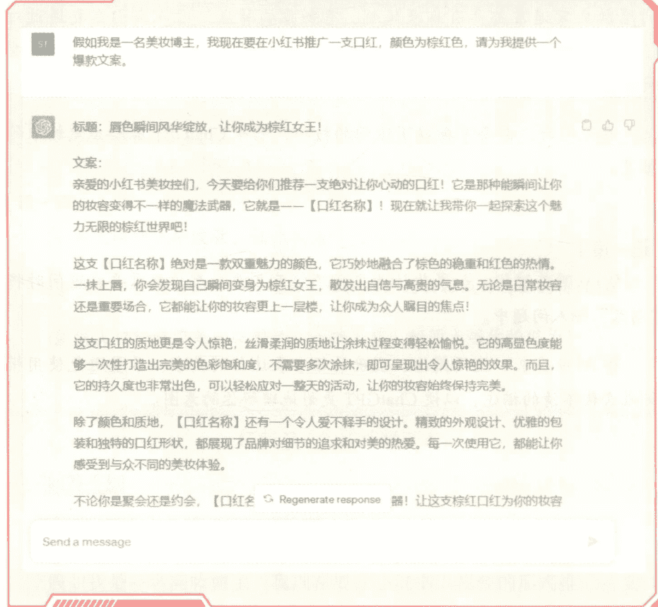

**【问一问】**

对 ChatGPT 的初次提问主要展现了以下几个提问技巧：

1. **具体明确**。清楚地描述了自己的身份和目标，即一名美妆博主在小红书上推广一支棕红色口红。这让 ChatGPT 可以更准确地为你提供相关的帮助和建议。
2. **要求明确**。明确提出了需要一个爆款文案。这让 ChatGPT 知道你期望的结果，并能更好地满足需求。
3. **提供关键信息**。指定了口红的颜色为棕红色。这个关键信息会帮助 ChatGPT 在创作文案时更加具体和有针对性。

通过对 ChatGPT 进行初次提问，我们得到了一个完整的文案，包括标题、正文以及结尾，且文案内容重点明确，表达清晰。但小红书的爆款文案通常都具有幽默风趣、有创意的特点，因此我们需要通过对 ChatGPT 进行追问，以得到适合在小红书这个年轻化的平台上发布的文案内容。

在追问时，需要掌握以下追问的技巧，确保 ChatGPT 能给出更精准的答复。

**【追一追】**

1. **点明关键词**。如果你认为文案不够有创意，那你就需要在追问时将“创意”融入问题中。
2. **明确要求**。使用简洁、明确的语言表达你的要求。尽量避免使用模糊或含糊不清的描述，以便 ChatGPT 更好地理解你的意图。

追问举例：

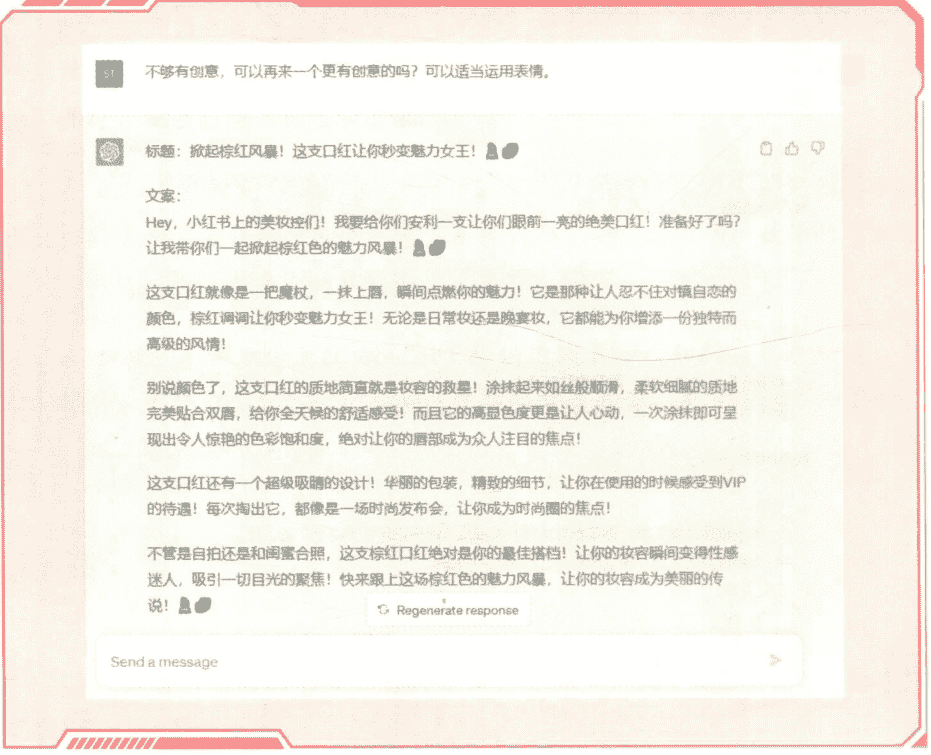

**【选一选】**

- 唇色瞬间风华绽放，让你成为棕红女王！
- 快来跟上这场棕红色的魅力风暴，让你的妆容成为美丽的传说！
- 这支口红就像是一把魔杖，一抹上唇，瞬间点燃你的魅力！

**任务 2：生成视频脚本**

问答举例

用户提问：
假如我是一名美妆博主，我现在要在小红书以视频的形式推广一支口红，可以提供一个视频脚本吗？

ChatGPT 回答：

当拍摄小红书口红推广视频时，以下是一个示例视频脚本，你可以根据自己的情况进行适当修改和调整：

场景设置：

- 背景音乐：选择欢快、活泼的背景音乐。
- 视频镜头：开场可以使用整体的美妆拍摄镜头，然后逐渐切换到口红的特写镜头。

脚本内容：

1. 开场：
    - 博主出现在镜头前，微笑着打招呼，向观众介绍自己和今天要推广的口红。
    - 引起观众的兴趣，表达出对口红的期待和兴奋。
2. 口红介绍：
    - 博主手持口红，将其展示在镜头前，介绍口红的品牌、系列和色号。
    - 描述口红的特点，如质地、颜色、持久度等，并强调口红的优点。

【扫码查看完整问答过程】

**【萃一萃】**

询问 ChatGPT，能够使它帮助我们构思视频脚本。ChatGPT 不仅可以提供新颖的情节、独特的故事和吸引人的元素，还能够提供视频脚本的整体结构和节奏，安排剧情的发展和转折点，提供起承转合的建议，使视频更具有吸引力和观赏性。同时，ChatGPT 可以提供语言流畅、连贯的文本，帮助我们撰写视频脚本。它可以生成吸引人的台词、描述和情绪化的文字，使视频更加生动和引人注目。

在 ChatGPT 生成的脚本基础上，我们仍需要注意以下几点：

1.  **仔细审查和编辑。** ChatGPT 生成的脚本需要进一步编辑和调整，我们仍应该仔细检查错别字、语法问题或其他潜在的错误，以确保语言通顺、流畅，并符合视频的整体构思和要求。
2.  **视频创意和制作。** 根据 ChatGPT 给出的脚本的内容，制定创意和构思视频的画面、音效和特效等元素，确保视频的视觉表现力、故事性与脚本一致，并适应小红书平台的风格和用户喜好。
3.  **拍摄和后期制作。** 在 ChatGPT 提供的脚本和视频构思的基础上，进行拍摄和后期制作工作，一定要确保视频的画面质量、声音清晰度和剪辑流畅性，以改善观众的观看体验。

#### 【探一探】

- “给我一个关于‘主题’的引人入胜的开场白。”
- “如何用简洁而有吸引力的语言来介绍‘产品/服务’，以引起观众的兴趣？”
- “有什么有创意的方式可以突出‘产品/服务’的高质量和性能？”
- “如何以故事的形式展示‘产品/服务’的用途和好处？”
- “有什么幽默或有趣的方式可以介绍‘产品/服务’，让观众忍不住笑出声来？”
- “如何用简短而强烈的话语来激发观众对‘产品/服务’的购买欲望？”
- “有没有一些能产生情感共鸣的话语可以用来与观众建立联系，让他们感受到‘产品/服务’的价值？”
- “如何在推广文案中运用数据和统计来增强观众对‘产品/服务’的信任和兴趣？”

### 11.2.2 文学创作：生成诗歌与小说

#### 任务 1：生成诗歌

##### 问答举例

用户提问：

请写一首名叫《等一缕青烟》的诗歌。

ChatGPT 回答：

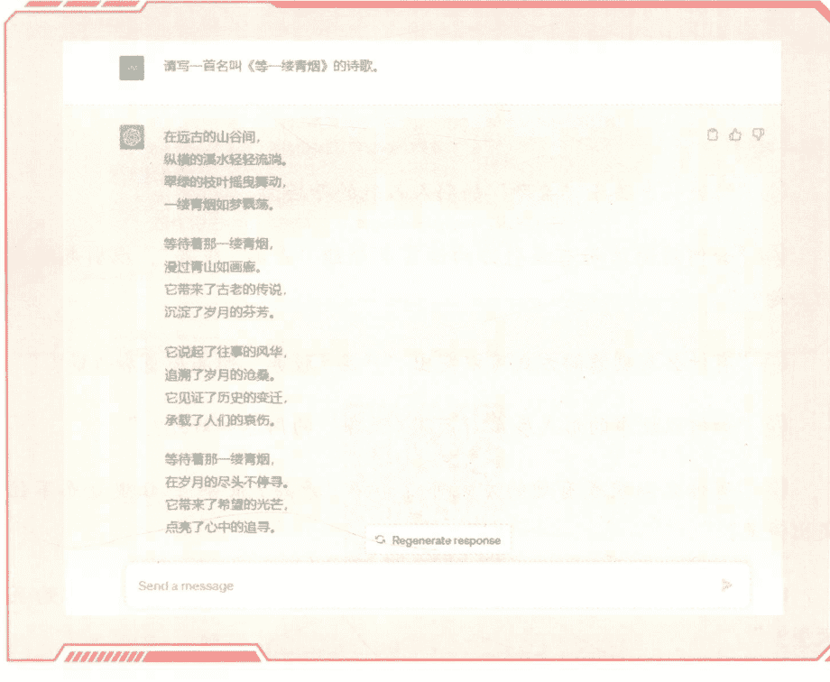

##### 【选一选】

- 翠绿的枝叶摇曳舞动，一缕青烟如梦飘荡。
- 等待着那一缕青烟，在岁月的尽头不停寻。
- 它轻轻地敲打着窗棂，为我们送来思绪的悠远。

#### 【追一追】

通过对 ChatGPT 提问，你能够得到一首完全由 ChatGPT 自由发挥写就的诗，如果你想要对诗歌内容进行限制，可以通过追问的方式实现。掌握以下追问技巧，可生成满足你期望的诗歌。

- **提供更具体的要求。** 说明你想要诗歌表达的主题、情感或情景，提供更多的细节和背景信息，以便 ChatGPT 更准确地满足你的期望。
- **给出示例或参考。** 如果你有特定的诗歌样式、节奏或韵律的偏好，可以提供示例或参考作品，以便 ChatGPT 更好地理解你的喜好和风格。
- **表达你的要求。** 直接告诉 ChatGPT 你希望诗歌表达的情感或意境，以及你期望诗歌所传达的信息。清晰地传达你的期望，可以让 ChatGPT 更好地针对你的要求进行创作。

追问举例：

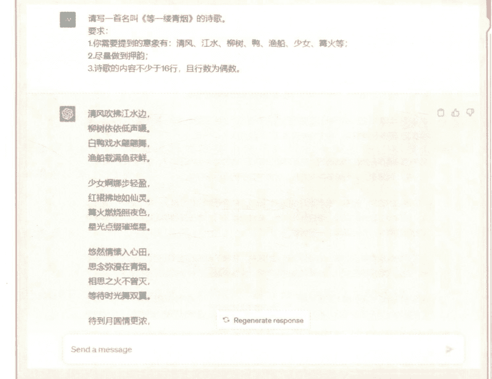

【扫码查看完整问答过程】

#### 任务 2：生成小说

##### 问答举例

用户提问：

请写一篇叫《老街的救赎》的小说。

ChatGPT 回答：

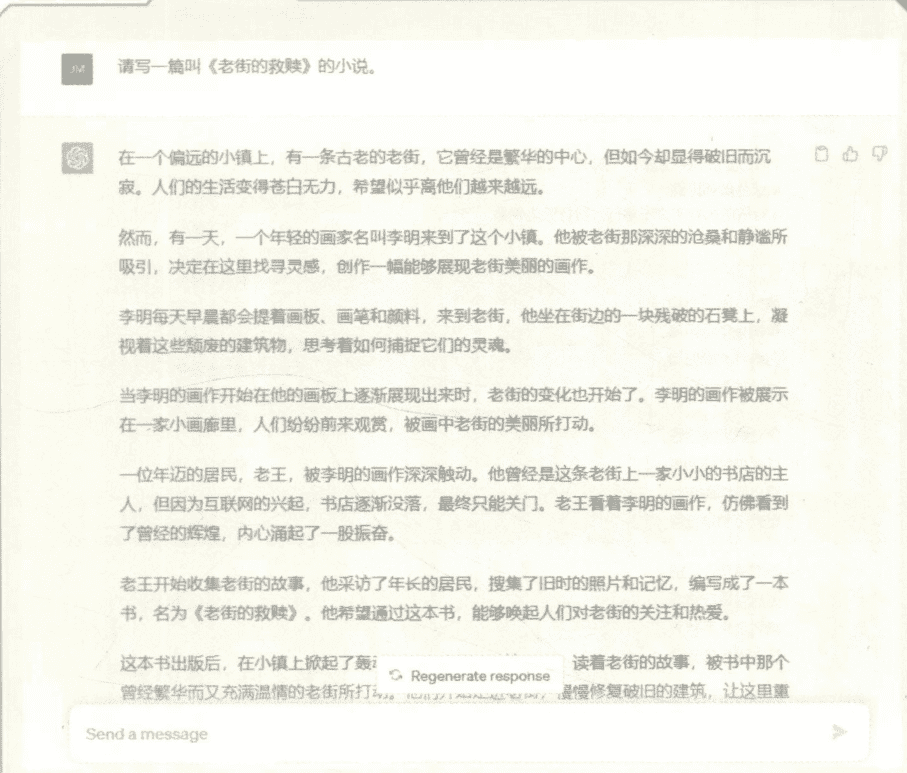

#### 【问一问】

对 ChatGPT 进行初次提问，能够让 ChatGPT 给出一篇大致符合我们要求的小说，这个提问方式体现了以下提问技巧：

1.  **清晰的主题和要求**。题目《老街的救赎》明确了故事的主题，要求创作与老街有关的情节。
2.  **直接而简洁的指令**。提问以一句命令式的语句开始，直接表达了需求，避免了冗长的叙述。
3.  **限定性要求**。提问中指明了标题，这有助于集中创作的方向和内容，避免过于开放的要求。

#### 【追一追】

如果 ChatGPT 给出的小说不能满足你的期望，你可以通过追问，得到你想要的答复。

在追问时，需要掌握以下追问的技巧：

1.  **要求加入特定元素**。指出小说中缺乏的内容，并要求加入更多相关的元素，如某个特定的意象、某种文化背景、某种修辞手法等，让 ChatGPT 尽力在小说中加入相关的元素，满足你的期望。
2.  **提供更详细的指导**。明确表达你想要的情节、角色发展、情感表达或故事走向，并详细说明你期望小说中出现的关键要素，以便 ChatGPT 更精确地满足你的要求。
3.  **更换创作角度**。告诉 ChatGPT 你希望小说采用的特定视角、叙事方式或风格，使其尝试以不同的方式重新构思和创作。
4.  **与 ChatGPT 合作**。你可以提供草图、大纲或更详细的故事线索，让 ChatGPT 在此基础上进行二次构思，创作出符合你期望的小说。
5.  **给出具体修改建议**。如果 ChatGPT 给出的小说离你的期望还有一定的差距，你可以提供具体的反馈和修改意见，指出你认为不符合要求的地方，并提供具体建议。

追问举例：

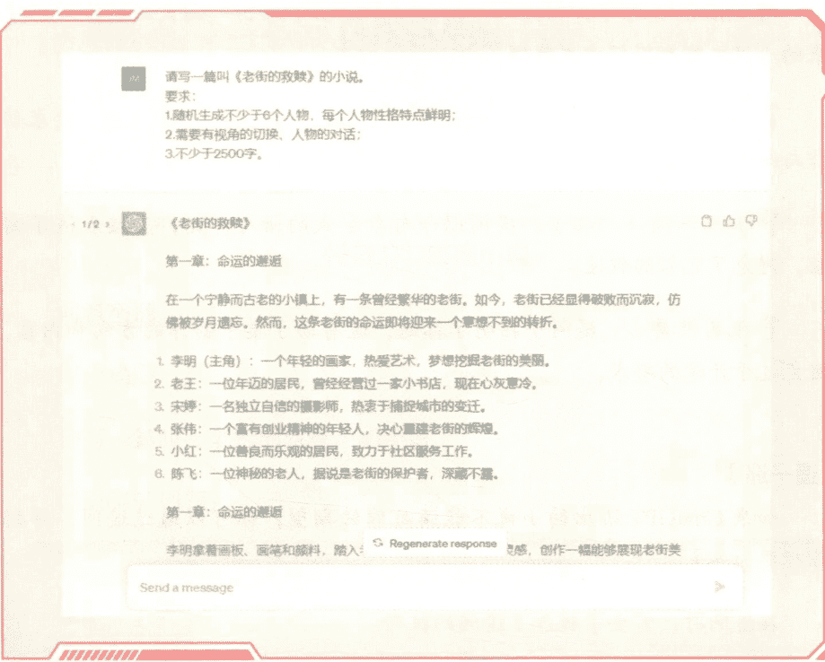

【扫码查看完整问答过程】

### 11.2.3 学习考试：生成高效学习计划与答案解析

#### 任务 1：生成高效学习计划

##### 问答举例

用户提问：

我目前在职备考研究生，每天 9：00—17：30 上班，请根据我的情况为我制订一个高效的学习计划。

ChatGPT 回答：

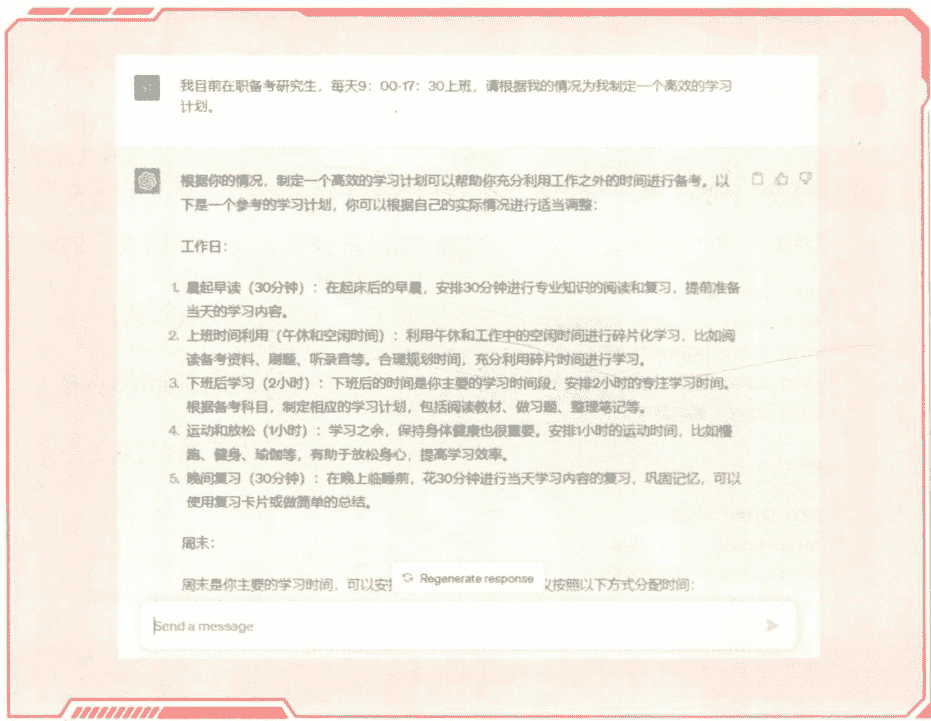

#### 【追一追】

通过询问 ChatGPT，我们能够得到一个高效的学习计划模板，但这个模板对于时间的划分过于宽泛，而每个人对早晨、上午、下午的理解都不同，这就会导致模板的可借鉴作用不大，这时就需要我们对 ChatGPT 进行追问，使它给出更好的答复。

- 明确告诉 ChatGPT 你希望在学习计划中看到的具体内容和要求。详细描述你想要学习的学科、重点，以及时间安排、学习方法或其他特定要素，以便 ChatGPT 更准确地满足你的需求。
- 提供更多背景信息，分享你的学习目标、时间限制、个人喜好和学习习惯等信息。这有助于 ChatGPT 更好地为你定制一个适合你的学习计划。
- 指出不符合要求的地方，明确告诉 ChatGPT 哪些方面需要改进或调整，以便它重新制订更有针对性的学习计划。

追问举例：

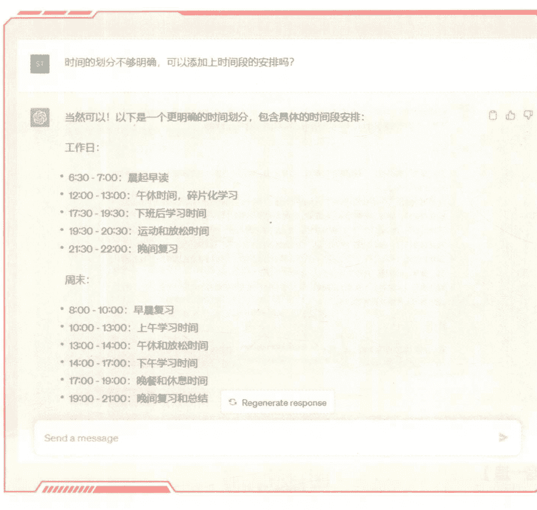

#### 【探一探】

- “如何在有限的时间内高效地备考多个科目？”
- “我应该如何安排每天的学习时间来充分利用工作后的时间？”
- “如何应对工作和备考的压力和疲劳？”
- “有没有一些技巧或策略可以帮助我更好地组织和规划学习计划？”
- “如何在工作日和周末平衡学习时间和休息时间？”
- “我应该如何处理学习过程中的困惑和难点？”
- “有没有推荐的学习资源或备考材料？”
- “我应该如何评估自己的备考进度和准备情况？”

#### 任务 2：生成答案解析

##### 问答举例 1

用户提问：

荀子《劝学》提到：“积土成山，风雨兴焉；积水成渊，蛟龙生焉；积善成德，而神明自得，圣心备焉。”这体现的教学原则是（ ）。

- A. 启发式原则
- B. 循序渐进原则
- C. 因材施教原则
- D. 量力性原则

ChatGPT 回答：

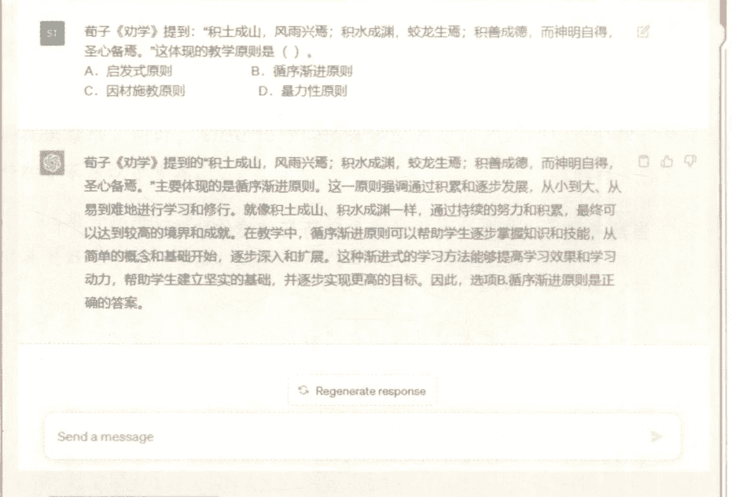

##### 【可用 AI 工具对比】

用户提问：

荀子《劝学》提到：“积土成山，风雨兴焉；积水成渊，蛟龙生焉；积善成德，而神明自得，圣心备焉。”这体现的教学原则是（ ）。

- A. 启发式原则
- B. 循序渐进原则
- C. 因材施教原则
- D. 量力性原则

文心一言回答：

> 《劝学》中提到要一步一步的积累，强调循序渐进的原则。
> 故正确答案为 B。

##### 问答举例 2

用户提问：

你可以为我提供一套小学六年级的数学模拟试题吗？

文心一言回答：

> 当然可以，以下是一套小学六年级的数学模拟试题：
> 一、选择题（每题 2 分，共 20 分）
> 1. 一个正方形的周长是 8 米，它的面积是（ ）平方米
> A. 16 B. 2 C. 4
> 2. 一根绳子长 6 米，用去 1 米 50 厘米，还剩（ ）米
> A. 4.5 B. 4 又 2/3 C. 5
> 3. 把 5/6 的分数单位是（ ）
> A. 1/6 B. 1/5 C. 1/10
> 4. 一副三角板可以拼成（ ）度的角
> A. 135 B. 120 C. 15
> 5. 下列分数中，最简分数是（ ）。
> A. 1/4 B. 2/7 C. 3/5

#### 【萃一萃】

在辅助学生学习和考试方面，AIGC 可以提供以下帮助：

- 提供精准、及时的信息。AIGC 可以准确地提供课程内容、作业提示、考试重点等信息，帮助学生更好地理解学习内容。同时，AIGC 还可以根据学生的问题，提供及时的答案和解释，帮助他们更好地掌握知识点。
- 提供个性化学习计划。AIGC 可以根据学生的学习情况、能力水平和兴趣爱好，为他们提供个性化的学习计划。这样的学习计划可以更好地满足学生的需求，提高学习效率。
- 模拟考试和复习建议。AIGC 可以提供模拟考试，帮助学生更好地了解考试形式和难度，并为其提供复习建议。此外，AIGC 还可以根据学生的答题情况，为其提供错题集和难点解析，帮助其更好地把握考试重点。
- 交流和答疑。AIGC 可以与学生进行自然语言交互，回答他们的问题和提供帮助。同时，AIGC 还可以根据学生的需求，提供在线课程、学习资料和专家建议等资源。

正确并熟练运用 AIGC，能够提升学生的学习效率，扩展其知识面，帮助其更好地学习、备考，并使其取得更好的成绩。

### 11.2.4 打造个人 IP：生成个人 IP 打造建议

#### 任务：生成个人 IP 打造建议

##### 问答举例

用户提问：

请根据以下信息帮助我打造我的个人 IP，要求提供的内容详细完整。

背景——

- ① 身份：大学生。
- ② 爱好：时尚穿搭。
- ③ 穿衣风格：清新甜美。
- ④ 目标受众群体：18~24岁的女性。

ChatGPT 回答：

#### 【问一问】

我们对 ChatGPT 进行初次提问，为它提供足够的细节，让 ChatGPT 能够更全面地理解我们的需求和目标，从而提供更详细和完整的建议和指导，帮助我们打造个人 IP。该提问方式主要体现了以下技巧：

提供了背景信息。明确了个人的身份为大学生，爱好为时尚穿搭，并描述了穿衣风格为清新甜美。这些信息可以帮助 ChatGPT 更好地了解个人的兴趣和定位。

指定目标受众群体。明确了目标受众群体为 18~24 岁的女性。这有助于确定个人 IP 的定位和目标市场。

##### 【比一比】

用户提问：

请根据以下信息帮助我打造我的个人 IP，要求提供的内容详细完整。

背景——

- ① 身份：大学生。
- ② 爱好：时尚穿搭。
- ③ 穿衣风格：清新甜美。
- ④ 目标受众群体：18-24 岁的女性。

文心一言回答：

打造个人 IP 需要从多个方面入手，包括个人形象、社交媒体、品牌合作和内容创作等。以下是根据您提供的信息给出的建议：

1. 个人形象：作为大学生，您的清新甜美的穿衣风格将与您的目标受众群体产生共鸣。为了打造个人 IP，建议您在社交媒体上分享您的穿搭照片，展示您的时尚品味和个人风格。您可以选择在 Instagram、微博等社交媒体平台上分享您的照片，并使用相关的标签来吸引更多的关注者。
2. 社交媒体：为了更好地与您的目标受众群体互动，建议您在社交媒体上创建个人账号，并定期发布有关时尚、穿搭和美容等方面的内容。在发布内容时，您可以使用一些吸引人的标题和标签来吸引更多的关注者和点击率。
3. 品牌合作：为了增加曝光率和影响力，您可以考虑与相关品牌进行合作。例如，您可以与时尚品牌合作，担任其品牌代言人或时尚博主，撰写相关的时尚穿搭博客等。这些合作将帮助您提高知名度和影响力。

#### 【萃一萃】

ChatGPT 和文心一言给出的建议都在社交媒体、品牌合作和内容创作方面涉及个人 IP 的打造，但它们的重点和具体策略略有不同。

ChatGPT 的建议更注重品牌定位和内容策略，不仅包括个人形象的展示和社交媒体的平台选择，还重点强调品牌定位和核心理念。通过搭配示范、时尚资讯、线下活动等方式，为受众提供全方位的时尚资源和穿搭指导。在品牌合作方面，该建议强调与相关品牌、设计师合作，推出独家联名款、限量款等，以增加品牌的吸引力和受关注度。

文心一言的建议重点则是个人形象和社交媒体，主要通过分享穿搭照片等方式来吸引目标受众的关注，并在社交媒体上展示个人形象和风格。此外，该建议也涉及品牌合作和内容创作，但相对较少，不是主要的策略。

我们可以发现，不同的 AI 软件分析问题的思路和角度有所不同，而我们需要做的就是借鉴或融合它们的分析思路，从不同的角度看待同一个问题，将这些知识内化为自身的知识，促使我们不断进步、不断提升。

### 11.2.5 开网店做直播：生成网店产品营销文案与视频直播脚本

#### 任务 1：生成网店产品营销文案

##### 问答举例

用户提问：

网店上架了一款新产品——电煮锅，这个产品具有一锅多能、不粘内胆、高温/干烧自动断电、颜值高等独特卖点，请根据这些信息，提供一个网店产品营销文案。

ChatGPT 回答：

#### 【问一问】

借助良好的提问技巧，可以帮助 ChatGPT 更好地理解我们的需求，并提供一个针对电煮锅的网店产品营销文案，突出产品的独特卖点，吸引目标受众的注意力。该提问方式主要展现了以下提问技巧：

1.  **提供关键信息。** 清晰地提供了新产品的特点和卖点，包括一锅多能、不粘内胆、高温/干烧自动断电以及颜值高等。这些关键信息帮助 ChatGPT 更好地了解产品的特性，提供相关的营销文案。
2.  **要求明确。** 明确提出需要一个网店产品营销文案。这让 ChatGPT 知道你期望的结果，并能够为你提供切实可行的营销文案建议。
3.  **针对目标受众。** 虽然提问中没有明确指定目标受众群体，但通过产品特点的描述，可以推测该电煮锅可能适合广泛的消费者群体，包括烹饪爱好者、家庭主妇、学生等。

#### 【追一追】

在对 ChatGPT 进行的初次提问中，我们提供了详尽的信息，因此 ChatGPT 也不会让我们失望，为我们提供了可以直接使用的营销文案。如果这时你还是觉得这个文案差点意思，那就对 ChatGPT 进行追问，追问时应注意运用以下技巧，以得出更精确的答复。

- 针对其中某一项进行追问，如“请对商品功能进行展开介绍”“对优惠活动进行详细说明”等。
- 增加一些限制条件，让 ChatGPT 给出更具有针对性的回答，如更有创意、添加独特内容等。

追问举例：

#### 【萃一萃】

追问后的文案相较于追问前的文案，突出了产品的优惠活动信息，让读者知道购买电煮锅可以享受超值优惠，这种强调优惠的方式可以增加读者的购物动力和购买率；同时，ChatGPT 还调整了文案的语言风格，使文案更加生动有趣，这种调整可以增强读者的阅读兴趣，从而提高阅读率。

##### 【选一选】

- 别再等待，抓住这个改变烹饪游戏规则的机会，让电煮锅成为你烹饪的魔法棒！
- 点燃你的味蕾，烹饪的魔法即将展开！
- 创新的不粘涂层技术让食物自由在锅中舞蹈。

#### 任务 2：生成视频直播脚本

##### 问答举例

用户提问：

假如你是一个主播，今天直播的货品有多功能烹饪锅、电竞椅、足金项链、母婴用品等，请提供一个直播脚本。

ChatGPT 回答：

#### 【追一追】

通过初次对 ChatGPT 提问，我们得到了一些直播时可用的话术，但这并不是一个完善的直播脚本。因此，我们需要对 ChatGPT 进行追问，追问时应注意运用以下技巧，以得出更精确的答复。

- 针对其中某一项进行追问，如“请细化主播的展示动作”“应该如何运用直播道具”等。
- 尽可能明确你的要求。把你的要求尽可能用简洁明了的语言描述出来，如要求台词接地气、能够吸引注意力等。

追问举例：

#### 【萃一萃】

通过追问，我们得到的脚本相较于第一个，内容更加完整、更加生动有趣。通过展示产品特点和功能，让观众更直观地了解产品的性能和优点，有更多产品的细节描述，如足金项链的纯度、婴儿床的舒适度等，让观众对产品更有信心，优惠活动的信息更加明确，能够刺激观众购物的欲望，提高销售转化率。结尾更加生动，通过主播的热情邀请和优惠信息的强调，让观众更有购买欲望，改善直播销售的效果。

#### 【探一探】

- “针对特定产品，能否提供更多关于其功能、特点和优势的详细介绍？”
- “如何在直播中更好地展示产品的外观和细节，以吸引观众的注意力？”
- “是否有一些有趣的故事或情境，可以与产品相关联，增加观众的共鸣和兴趣？”
- “在直播中，如何巧妙地引导观众产生购买欲望，以促进产品销售？”
- “有没有一些互动环节或游戏，可以与观众互动，增强直播的趣味性和参与感？”
- “如何在直播中提供一些独家优惠或限时折扣，以激发观众的购买欲望？”
- “是否有一些示范或演示的技巧，可以让观众更好地理解产品的使用方法和效果？”

### 11.2.6 个人创业：生成商业计划书与投资建议

#### 任务 1：生成商业计划书

##### 问答举例

用户提问：

请为我提供一个商业计划书。

ChatGPT 回答：

请为我提供一个商业计划书。

当然，我可以帮助您提供一个商业计划书的模板。请注意，商业计划书的内容会根据不同的业务和行业而有所不同。以下是一个基本商业计划书的结构和示例内容：

1. 概述
   - 公司名称和简介
   - 业务目标和愿景
   - 产品或服务简介
   - 市场定位和竞争优势
2. 市场分析
   - 目标市场描述
   - 目标客户群体分析
   - 市场规模和趋势
   - 竞争对手分析
3. 产品或服务
   - 产品或服务的详细描述
   - 独特的卖点和竞争优势
   - 知识产权或专利信息（如果适用）
   - 产品或服务的开发阶段和计划

#### 【萃一萃】

在对 ChatGPT 的初次提问中，我们的提问方式存在以下错误：

缺乏具体性。提问过于笼统，没有给出具体的需求和指导。商业计划书是一个非常广泛的概念，没有明确说明期望包含的内容和细节。

缺乏明确的指导。没有明确说明你对商业计划书的期望和要求。商业计划书可以包含很多方面的内容，如市场分析、财务计划、市场策略等，需要指定希望包含的具体部分。

正确的提问方式非常重要，它可以决定你从 ChatGPT 那里获得的信息的质量和准确性。

通过对 ChatGPT 进行初次提问，我们可以得到一个完整的商业计划书模板，但这个模板给出的只是计划书的结构，内容不完整，没有借鉴意义。这时候我们就要重新提问，提供尽可能多的信息，以便 ChatGPT 为我们定制一个详细完整、有针对性和可行性的商业计划书。

#### 【问一问】

在对 ChatGPT 重新提问时，我们需要注意运用以下技巧。

1.  **清晰明了。** 确保你的问题清晰明了，避免含糊不清或模棱两可的表达。
2.  **具体详细。** 提供尽可能多的具体细节和背景信息，以便 ChatGPT 更好地理解你的需求和情况。
3.  **目标导向。** 明确你的目标和期望的结果，这样 ChatGPT 才能够更好地为你提供定制化的帮助。
4.  **上下文说明。** 提供相关的上下文信息，如你的行业领域、目标市场、竞争对手等，以便 ChatGPT 更深入地分析，最终给出定制化商业计划书。
5.  **具体问题。** 提出具体问题，而不仅仅是一般性的陈述或要求，这有助于 ChatGPT 更好地理解你的需求并提供相关建议。
6.  **尽可能完整。** 尽量提供你认为相关的所有信息，这样 ChatGPT 可以综合考虑各个方面并给出更全面的回答。
7.  **追问和澄清。** 如果你对 ChatGPT 的回答有任何疑问或需要进一步澄清，要注意随时追问，如使用“继续”“详细一点”“还有吗”等话术，以使 ChatGPT 提供更详细的解答。

#### 重新提问：

请根据以下信息为我提供一个商业计划书，要求内容详细完整，有针对性和可行性。
1. 公司信息：成立于2021年，长沙，由三名创始人注资。
行业：餐饮业；
2. 主营：湘菜；
3. 竞争优势：味道和口碑好，在当地小有名气。

商业计划书：湘味道餐厅

1.  概述
    *   公司名称：湘味道餐厅
    *   公司成立时间：2021年
    *   公司地点：长沙市
    *   创始人：三名创始人注资
2.  业务目标和愿景
    *   业务目标：成为长沙市最受欢迎的湘菜餐厅之一，提供正宗的湘菜美食和卓越的用餐体验。
    *   愿景：通过优质的菜品和出色的服务，成为湖南风味的代表和当地居民及游客的首选餐厅。
3.  目标市场和客户群体
    *   目标市场：长沙市及周边地区的居民和游客。
    *   客户群体：对湖南风味感兴趣的美食爱好者、当地居民以及来自其他地方的游客。

【扫码查看完整问答过程】

#### 【探一探】

> “对于湘味道餐厅的市场定位和目标受众群体，能否提供更详细的分析和数据支持？”

> “在竞争激烈的餐饮行业中，湘味道餐厅有何独特的营销策略和促销活动，来吸引更多的顾客？”

> “在商业计划书中，是否有详细的财务数据和预测，以证明湘味道餐厅的经营可行性和盈利能力？”

> “对于餐厅的供应链管理和食材采购，是否有相关策略和合作伙伴计划？”

> “湘味道餐厅是否考虑拓展到其他城市或线上平台，以扩大业务范围和增加收入渠道？”

> “在餐厅的运营管理方面，湘味道餐厅是否有员工培训计划和服务质量控制措施？”

> “对于餐厅的未来发展计划，能否考虑扩大菜单、增加分店或引入新的餐饮概念？”

#### 任务 2：生成投资建议

##### 问答举例 1

用户提问：

请分析目前国内的经济形势，我投资什么行业比较好？

ChatGPT 回答：

#### 【探一探】

> “根据当前的经济形势和市场趋势，哪些行业或领域在未来几年内具有高增长潜力？”

> “对于初次投资者来说，建议选择有稳定收益的行业还是潜力行业？”

> “在选择投资项目时，应该更注重短期回报还是长期增值？”

> “对于风险投资者来说，哪些创新型行业或新兴技术值得关注和投资？”

> “在当前的市场环境下，哪些行业或公司具有抗风险能力和稳定的盈利潜力？”

> “如何评估一个投资项目的可行性和潜在收益？有哪些关键指标或因素需要考虑？”

> “是否存在一些投资策略或方法，可以帮助投资者降低风险、增加收益？”

> “除了行业趋势和市场分析，还有哪些因素或信息对投资决策有重要影响？”

> “是否存在一些特定的投资时机或窗口期，可以抓住更好的投资机会？”

> “在投资领域，有哪些常见的错误或陷阱需要避免？”

##### 问答举例 2

用户提问：

请分析目前国内餐饮业的情况，现在进入餐饮市场有利可图吗？

##### ChatGPT 回答：

请分析目前国内餐饮业的情况，现在进入餐饮市场有利可图吗？

目前国内餐饮业面临着一些挑战和机遇。以下是对目前国内餐饮业情况的一般分析：

挑战：

1.  市场竞争激烈：餐饮市场竞争激烈，各类餐饮品牌层出不穷，使得市场份额争夺更加困难。
2.  成本压力：原材料价格、人工成本和房租等餐饮经营成本居高不下，对利润率造成一定挑战。
3.  消费者需求多样化：消费者对餐饮的需求多样化，包括健康、特色、快捷等，要求餐饮企业提供多样化的选择和创新。

机遇：

1.  消费升级：随着人民生活水平提高，消费者对餐饮的品质和体验要求提高，高端餐饮市场有望迎来增长机会。
2.  餐饮外卖市场增长：随着移动互联网的普及，外卖餐饮市场迅速崛起，为餐饮企业提供了新的销售渠道和机会。
3.  地方特色餐饮：国内各地都有独特的饮食文化和美食，挖掘和推广地方特色餐饮可以吸引更多消费者和游客。

进入餐饮市场是否有利可图，取决于多种因素，包括你的资金、策略、定位和执行能力。以下是一些建议：

#### 【探一探】

> “根据目前的市场趋势和行业前景，哪些餐饮业务领域或概念更有投资潜力？”

> “在投资餐饮业时，应该优先考虑哪些关键因素，如品牌知名度、经营模式或地理位置？”

> “对于初次投资者来说，建议选择创业项目还是加盟连锁品牌？”

> “在选择餐饮业投资项目时，哪些财务指标或数据应该被优先考虑，如回报率、投资回收期或利润率？”

> “对于有限的投资资金，建议分散投资到多个餐饮项目还是集中投资于一个项目？”

> “在投资餐饮业之前，应该进行哪些尽职调查和市场分析，以降低投资风险？”

> “有没有一些具体的投资策略或建议，可以帮助投资者在餐饮业获得更好的投资回报？”

#### 【萃一萃】

ChatGPT 作为一个语言模型，可以为我们提供广泛的投资建议和信息，主要具备以下几个优势：

-   作为一个基于大规模数据训练的 AI 模型，ChatGPT 可以访问广泛的金融和投资数据，提供丰富的信息和观点。
-   ChatGPT 可以帮助我们分析市场趋势、行业前景和公司基本面等方面的数据，帮助我们做出投资决策。
-   ChatGPT 可以迅速回答我们提出的投资问题，提供实时的信息和见解。

# 第12章 超能团队打造方略

在 AI 工具的赋能下，每个 10 人以下的小团队都可以拥有战胜百人以上的团队，甚至大企业团队，成长为“超能团队”的机会和能力！

## 12.1 ChatGPT 对于小团队的 3 个利器

ChatGPT 在帮助每个小团队成为超高能力的团队组织方面，可提供智能协作、知识管理、语音会议等功能上的帮助，能够促进团队更好地进行信息共享、协作和资源管理。

目前，ChatGPT 已经有智能协作、知识管理和语音会议等功能。这些功能已经在实际应用中得到了验证，并且在不断优化和改进。

【扫码查看完整问答过程】

### 12.1.1 智能协作

团队成员可以通过 ChatGPT 进行即时沟通、快速交流信息和协作进展，如讨论项目细节、分配任务、跟进进展等。使用者需要了解团队协作目标和工作计划，积极参与协作和互动，遵循团队规定和流程。

ChatGPT 可以通过自然语言处理技术，理解用户输入的问题或指令，并自动推荐相应的解决方案或操作步骤。同时，ChatGPT 还可以根据团队成员的权限和角色，将任务分配给合适的人员，实现高效协同工作。此外，ChatGPT 还可以通过实时监测团队成员的工作进度和状态，提供及时的反馈和支持。

假设一个软件开发团队需要开发一个新产品，该产品包括前端、后端和数据库等多个方面的工作。团队成员可以通过 ChatGPT 的自然语言输入功能，向系统提出问题或指令，例如“如何编写前端代码”“如何优化数据库性能”，等等。系统会根据用户的意图和上下文信息，自动推荐相应的解决方案或操作步骤，并将结果反馈给用户。此外，系统还可以根据团队成员的权限和角色，将任务分配给合适的人员，实现高效协同工作。

### 12.1.2 知识管理

团队成员可以利用 ChatGPT 提供的智能搜索和知识图谱功能，快速获取组织内部的知识和资源，如文档、代码、数据库等。使用者需要了解知识管理系统的结构和标准，遵循信息分类和共享原则，维护和更新知识库。

ChatGPT 可以对团队内部的知识库进行整合和管理，包括文档、图片、视频等多种形式的资料。团队成员可以通过自然语言输入问题或指令，获取所需的知识信息。同时，ChatGPT 可以根据用户的学习记录和行为分析，推荐相关的知识和技能培训内容，帮助团队成员不断提升自己的能力和水平。

假设一个医学研究团队需要整理一份关于某种疾病的研究文献资料。团队成员可以通过 ChatGPT 的自然语言输入功能，向系统提出问题或指令，如“如何查找最新的临床试验数据”“如何分析不同治疗方法的有效性”，等等。系统会根据用户的意图和上下文信息，自动搜索相关的文献资料，并将结果呈现给用户。

### 12.1.3 语音会议

团队成员可以使用 ChatGPT 提供的语音会议功能，在不同时间、地点进行线上会议和讨论。使用者需要预约和安排好会议时间和议题，测试会议工具和硬件设施，确保会议质量和秩序。

ChatGPT 支持多人语音会议，团队成员可以进行实时交流和讨论。在语音会议中，ChatGPT 可以根据会议主题和参会人员的权限和角色，自动调整会议议程和内容，提高会议效率和质量。此外，ChatGPT 可以将会议记录保存下来，方便后续查看和整理。

假设一个销售团队需要召开一次会议，讨论下一季度的销售计划和目标。团队成员可以通过 ChatGPT 的语音输入功能，进行实时交流和讨论。在语音会议中，系统可以根据会议主题和参会人员的权限和角色，自动调整会议议程和内容，如添加相关数据报告、提醒参会人员准备材料等。此外，系统还可以将会议记录保存下来，方便后续查看和整理。

当然，目前 ChatGPT 是一个纯文本交互的 AI 语言模型，它无法直接执行语音识别任务。但是，有一些第三方工具可以将 ChatGPT 的输出内容转换为语音，如 Google Cloud Text-to-Speech API 和 Microsoft Azure Text-to-Speech API 等。这些 API 可以将文本转换为自然流畅的语音，并提供多种语音合成选项，包括语速、音调和声音类型等。

## 12.2 打造“超能团队”的 3 个场景与 6 项任务示范

### 12.2.1 知识管理：生成团队协作计划与知识产权保护方案

ChatGPT 可以作为一个知识库，收集和整理小团队的各种知识和经验，并提供搜索和问答功能，让团队成员随时随地获取需要的信息。

#### 任务 1：生成团队协作计划

##### 问答举例

> 假设你现在是一个自媒体主，拥有自己的自媒体团队，团队由运营人员、拍摄人员、剪辑人员、文案人员、设计人员等组成，请帮我生成一个团队协作计划

当然，下面是一个自媒体团队协作计划的示例：

1.  团队目标和策略：
    -   明确团队的长期和短期目标，如增加粉丝数量、提高内容质量等。
    -   制定策略，包括内容定位、平台选择和用户互动等，以实现团队目标。
2.  角色和责任分配：
    -   确定团队成员的角色和职责，如运营人员负责社交媒体管理，拍摄人员负责视频内容等。
    -   确保每个成员清楚自己的职责，并制定明确的目标和期望。
3.  内容创作和发布：
    -   制定内容创作计划，确定发布频率、内容类型和平台选择。
    -   协调拍摄人员、剪辑人员、文案人员和设计人员的合作，确保高质量的内容制作和发布。
4.  沟通和协作：
    -   建立有效的沟通渠道，包括定期团队会议、即时消息工具等。
    -   鼓励开放、透明和及时的沟通，以促进团队成员之间的协作和信息共享。
5.  工作流程和时间管理：
    -   制定明确的工作流程和时间表，确保项目能够按时交付。
    -   使用项目管理工具和日程安排软件，跟踪任务的进展和分配优先级。
6.  学习和发展：
    -   鼓励团队成员进行持续学习和发展，跟上新媒体行业的最新趋势和技术。
    -   提供培训和资源支持，帮助团队成员提高技能和知识水平。
7.  数据分析和反馈：
    -   建立数据分析系统，评估内容表现和用户互动等关键指标。
    -   定期分析数据，优化策略和内容创作，根据数据提供反馈和改进建议。

#### 【问一问】

关键词设置。在问题中使用关键词可以帮助 ChatGPT 更好地理解你的意图和需求。关键词可以是具体的名词、动词或短语，与你要探讨的主题或领域相关。

身份定位。在提问时，可以给 ChatGPT 假设一个身份，让其为你提供更相关和有针对性的回答。比如，此项任务的提问为 ChatGPT 定义了具体的职业——自媒体主。

背景资料。提供相关的背景信息，包括涉及的领域、行业或主题。这有助于 ChatGPT 更好地理解问题的背景和上下文。

用户追问：

对于你提到的第 4 点，沟通和协作，是否可以展开，帮我写出每个岗位具体应该怎样去与其他岗位协作。

ChatGPT 回答：

当涉及到沟通和协作时，以下是每个岗位之间具体应该如何协作的示例：

1.  运营人员与其他岗位的协作：
    -   与拍摄人员密切合作，了解即将制作的内容，提供相关市场需求和目标受众的反馈。
    -   与剪辑人员协商工作流程，确保视频制作的进度和质量符合预期。
    -   与文案人员紧密配合，提供详细的内容要点和关键信息，以便编写有效的文案。
    -   与设计人员协商配图和视觉元素，确保与内容风格和品牌一致。

2.  拍摄人员与其他岗位的协作：
    -   与运营人员讨论并理解所需内容的要求和目标，确保拍摄内容符合期望。
    -   与剪辑人员密切合作，沟通拍摄素材的要求和预期编辑效果，提供必要的支持和素材。
    -   与设计人员协商拍摄背景和场景，确保视觉元素与品牌形象一致。
    -   与文案人员合作，为拍摄内容提供故事线索和关键信息。

3.  剪辑人员与其他岗位的协作：
    -   与拍摄人员沟通和了解拍摄素材的要求和预期编辑效果。
    -   与运营人员合作，讨论视频的整体风格和目标受众，确保剪辑效果符合预期。
    -   与设计人员协商添加动画、字幕和特效等视觉元素，提供必要的支持和素材。
    -   与文案人员合作，确保剪辑的故事情节和文字内容相互呼应。

4.  文案人员与其他岗位的协作：
    -   与运营人员密切合作，了解内容要求、关键信息和目标受众，为文案撰写提供准确的背景和指导。
    -   与拍摄人员和剪辑人员协商故事情节、重点表达和时长要求，以确保文案与视觉内容协调一致。
    -   与设计人员合作，确保文案和设计元素相互补充，形成统一的视觉和文字传达效果。

5.  设计人员与其他岗位的协作：
    -   与运营人员和文案人员协商内容要求和视觉风格，确保设计元素与品牌形象一致。
    -   与拍摄人员和剪辑人员讨论配图和视觉效果，确保内容完美呈现。

（注：以上内容由 ChatGPT 生成，未改动）

#### 【萃一萃】

-   ChatGPT 是一个强大的语言模型，但它可能缺乏特定领域的专业知识。在编写团队协作计划时，建议结合自己的专业知识和经验，以及对团队需求的理解，来补充和调整 ChatGPT 生成的内容。
-   清晰明确。确保你的问题清晰明确，避免模糊或含糊不清的表达。这样 ChatGPT 才能更好地理解你的问题并给出准确的回答。
-   尽量简洁。尽量用简洁的语言表达问题，避免冗长或复杂的叙述。简洁的问题更容易理解，也更方便 ChatGPT 给出精确的答案。

#### 任务 2：生成知识产权保护方案

用户提问：

假设你是一个科技型企业，主要经营内容为电子产品的生产与销售，请针对自己的创新成果和商业机密，以及处理专利、商标、版权等相关事务，生成一篇知识产权保护方案。

ChatGPT 回答：

##### 知识产权保护方案

一、背景介绍

作为一家科技型企业，我们主要从事电子产品的生产与销售，拥有许多创新成果和商业机密。为了确保我们的竞争优势和市场地位，保护知识产权至关重要。本知识产权保护方案旨在确保我们的创新成果得到充分保护，并为处理专利、商标、版权等相关事务提供指导。

二、专利保护

发明创造的及时申请：对于我们的创新成果，我们将确保及时申请专利保护，以确保我们对发明的独占权。我们将建立一个专利审查流程，确保我们的发明得到充分评估和保护。

审查专利风险：我们将进行定期的专利风险评估，以了解竞争对手的专利动态和可能的侵权行为。在必要时，我们将采取适当的行动，包括对侵权行为提起诉讼或进行谈判。

知识产权教育：为了保护专利权，我们将开展内部培训计划，提高员工对知识产权保护的意识。员工将接受专利法律知识的培训，了解知识产权保护的重要性，以及在日常工作中如何避免侵犯他人的专利权。

三、商标保护

商标注册：我们将对我们的品牌名称、标志和产品进行商标注册，确保我们的商标得到法律保护。我们将积极监测市场，及时发现和处理任何商标侵权行为。

品牌宣传和维护：我们将加强对品牌的宣传和维护工作，提高公众对我们品牌的认知度和认可度。通过积极的品牌管理，我们将建立品牌的商业价值，增强商标保护的效果。

四、版权保护

版权登记：对于我们的软件、设计、文档等作品，我们将及时进行版权登记，确保我们对这些作品享有法律保护。我们将建立一个版权管理系统，记录和管理我们的版权作品。

合同保护：我们将制定合理的合同条款，确保我们在与员工、供应商、合作伙伴和客户之间的合作中保护我们的版权利益。合同中将包含对知识产权的明确规定，以避免潜在的侵权行为。

五、保密措施

内部保密协议：我们将要求员工签署保密协议，确保他们保守商业机密和知识产权信息。协议将明确规定员工在离职后对公司机密信息的保密义务。

控制信息流向：我们将采取必要的措施，限制知识产权信息的传播和共享。对于外部合作伙伴和供应商，我们将签订保密协议，并进行信息共享的严格控制。

网络安全保护：我们将建立网络安全措施，保护我们的内部网络和数据库。通过采用加密技术、访问控制和数据备份等措施，确保知识产权信息不受未经授权的访问和泄露。

六、监测和执行

知识产权监测：我们将密切关注市场和行业动态，及时了解相关知识产权信息。通过定期监测专利、商标和版权数据库，我们可以及时发现侵权行为，并采取适当的法律行动。

法律支持：我们将与专业知识产权律师合作，获得专业法律支持和建议。律师将协助我们处理知识产权保护的相关事务，并在需要时代表我们进行诉讼或谈判。

（注：以上内容由 ChatGPT 生成，未改动）

#### 【问一问】

- 在向 ChatGPT 提问时，可以选择多个提示词。比如，此项任务中，提供了创新成果、商业机密、专利、商标、版权等多个提示词。
- 引用来源权威。如果你想要基于权威来源获得信息或观点支持，可以要求 ChatGPT 引用相关研究、报告或专家意见。比如，“有哪些权威研究支持这个观点”或“你能提供一些专家在这个领域的看法吗”。
- 关注实际应用。如果你对某个概念或理论的实际应用感兴趣，可以要求 ChatGPT 提供实际案例或应用建议。比如，“你能给我一些在实践中应用这个方法的例子吗”或“有什么实用的技巧可以帮助我在工作中应用这个理论”。

#### 【萃一萃】

- 当生成与法律相关的文件时，你必须认真审查其内容，保证其符合国际、国家和地区的法律框架，以及专利、商标、版权和商业秘密等领域的法律要求，切记不可“拿来即用”。
- ChatGPT 只是一个语言模型，提供的信息仅供参考，并不能代替法律专业人士的建议。
- 知识产权保护在不同的地区和司法管辖区可能有所不同。当你提出特定法律问题时，应在讨论中明确所涉及的地域或司法管辖区，以便 ChatGPT 在适用范围内提供信息。

### 12.2.2 自动化任务：生成自动化工作流程和项目管理协同方案

ChatGPT 可以作为一个自动化工具，协助小团队完成各种日常流程和任务，如会议安排、邮件发送、文件转换等。

#### 任务 1：生成自动化工作流程

##### 问答举例

> 假设你是企业的营销人员，请写一个营销自动化工作流程

作为企业的营销人员，我可以为您提供一个基本的营销自动化工作流程的示例。请注意，具体的工作流程可能因不同的企业和营销目标而有所变化，这里仅提供一个一般性的框架供参考。

1. 确定目标受众：首先，您需要确定您的目标受众是谁。这可以通过市场调研、客户分析和买家人口统计数据来完成。这将帮助您了解您的目标受众的特征、需求和偏好。
2. 收集潜在客户信息：通过各种渠道（例如网站、社交媒体、展会等）收集潜在客户的信息。这些信息可以包括姓名、电子邮件地址、联系方式等。
3. 创建营销内容：基于目标受众的特征和需求，创建相关的营销内容，例如电子邮件、社交媒体帖子、博客文章、营销资料等。确保内容能够吸引潜在客户的注意力，并提供有价值的信息。
4. 自动化邮件营销：利用电子邮件营销工具，创建自动化邮件营销系列。在这个系列中，根据潜在客户的行为和兴趣，发送定制化的电子邮件，包括欢迎邮件、触发邮件（如注册确认、购买确认）、推广邮件等。
5. 社交媒体自动化：利用社交媒体管理工具，自动发布和计划社交媒体帖子。根据您的目标受众和内容策略，创建社交媒体内容日历，并安排自动发布帖子，以保持与潜在客户的互动和参与。
6. 跟踪和分析：使用分析工具来跟踪潜在客户的行为和互动，例如电子邮件开启率、点击率、转化率等。根据这些数据，评估营销活动的效果，并进行必要的优化和调整。
7. 个性化营销：根据潜在客户的行为和兴趣，使用自动化工具来个性化营销内容和推荐。例如，根据他们的购买历史，向他们推荐相关的产品或服务。
8. 营销自动化整合：确保营销自动化工具与其他关键业务系统的集成，例如客户关系管理（CRM）系统，以便获得更全面的客户洞察和协调营销活动。
9. 持续改进：根据收集到的数据和分析结果，进行持续的改进和优化。测试不同的营销策略和工作流程，并根据结果进行调整。

#### 【问一问】

清晰的问题。确保问题清晰正确，避免模棱两可或含糊不清的描述。这有助于 ChatGPT 很好地理解你的意思，并提供更准确的答案。

聚焦于关键信息。在提问中关注与你的问题最相关的关键信息。将注意力集中在你想要的具体方面。

角色描述。描述与问题相关的角色或人物，说明他们的身份、职责、背景和所处的环境。这有助于 ChatGPT 了解问题的相关方面以及适用的知识领域。

用户追问：

请帮我补充一下，有哪些自动化工具可以帮助跟踪和实现个性化营销。

ChatGPT 回答：

以下是一些常用的自动化工具，可帮助你跟踪和实现个性化营销：

市场自动化工具：市场自动化平台（例如 Marketo、HubSpot、Pardot）提供了一系列功能，包括电子邮件自动化、营销活动跟踪、潜在客户管理、分析报告等。这些工具可帮助你创建和管理自动化营销活动，并跟踪潜在客户的行为和互动。

电子邮件营销工具：电子邮件营销平台（例如 Mailchimp、Constant Contact、CampaignMonitor）可帮助你创建和发送定制化的电子邮件，并提供跟踪和分析功能。这些工具还可以根据潜在客户的行为和兴趣，发送个性化的邮件内容。

社交媒体管理工具：社交媒体管理平台（例如 Hootsuite、Buffer、Sprout-Social）可以帮助你自动发布和计划社交媒体帖子，并提供分析和报告功能。这些工具还可以跟踪社交媒体上的互动和参与度，以便更好地了解你的受众。

数据管理和分析工具：数据管理和分析平台（例如 Google Analytics、Adobe Analytics、Tableau）可以帮助你跟踪和分析各种营销指标，如网站流量、转化率、用户行为等。这些工具提供了深入的数据洞察，帮助你评估营销活动的效果，并做出优化和决策。

个性化营销工具：个性化营销平台（例如 Evergage、Dynamic Yield、Optimizely）使用机器学习和人工智能技术，根据潜在客户的行为和兴趣，实现个性化的内容推荐和体验。这些工具可以根据用户的历史数据和实时行为，动态地调整网站内容、推荐产品或服务，从而提高用户参与度和转化率。

（注：以上内容由 ChatGPT 生成，未改动）

#### 【追一追】

- 问更具体的问题。如果你对 ChatGPT 回答的信息需要更多细节或进一步解释，应尽量提出更具体的问题。可指出你对哪个方面或具体信息感兴趣，引导 ChatGPT 提供更准确的答案。
- 要求提供案例研究或实际应用。如果你希望了解某个理论或概念在实际情境中的应用或案例研究，可以直接提问。比如，本任务追问“哪些自动化工具可以帮助跟踪和实现个性化营销”。
- 要求提供具体步骤或指导。如果你需要指导或步骤来实施某个方法或解决问题，你可以请求 ChatGPT 提供具体的步骤或建议。比如，“你能给我提供一些实际操作的步骤或建议吗”或“你有没有一些建议来解决这个具体挑战”。

#### 任务 2：生成项目管理协同方案

用户提问：

帮我写一篇工程项目管理协同方案，内容包括但不限于前期报批管理、开工登记管理、工程进度管理、竣工投产管理。

ChatGPT 回答：

##### 工程项目管理协同方案

##### 一、前期报批管理

项目准备阶段：在项目启动之前，我们将进行充分的市场调研和可行性研究，确保项目的可行性和可持续性。我们将制定详细的项目计划，明确项目的目标、范围、资源需求和风险管理策略。

报批准备：我们将负责准备和提交相关的报批文件，包括环评报告、规划设计方案、安全生产预案等。我们将确保报批文件的完整性、准确性和及时性，以便获得必要的批准和许可。

相关部门协调：我们将积极与相关部门进行协调，包括规划部门、环保部门、安全监管部门等。我们将及时回应他们的要求和意见，并提供必要的信息和文件，以促进项目的顺利推进。

##### 二、开工登记管理

开工前准备：在正式开工之前，我们将进行充分的准备工作。这包括安全检查、施工图纸的审查和确认、工程材料的采购等。我们将确保开工前的所有准备工作符合相关法规和标准。

开工登记程序：我们将确保及时办理开工登记手续，并向相关部门提交必要的开工报告。在开工登记过程中，我们将密切配合并提供所需的文件和证明，以确保开工手续的顺利完成。

安全管理：开工后，我们将严格执行安全管理措施，包括工地安全规划、施工现场监督和安全培训等。我们将确保工地的安全和工人的身体健康，最大限度地降低工程事故的风险。

##### 三、工程进度管理

进度计划制定：我们将制定详细的工程进度计划，并将其与相关各方进行沟通和确认。计划将明确各个阶段的工作内容、工期和里程碑，以确保项目按时完成。

进度监控与调整：我们将采用现代化的项目管理工具和技术，监控工程进度的执行情况。我们将及时发现并解决进度延误的问题，并根据实际情况进行调整和优化，确保项目进度的稳定和高效。

沟通与协调：我们将建立有效的沟通渠道，与项目各方保持良好的沟通和协调。通过定期会议、报告和沟通工具，我们将确保所有相关方了解工程进展情况，并及时解决问题和调整工作计划。

##### 四、竣工投产管理

竣工验收：在项目完成后，我们将按照相关法规和标准进行竣工验收。我们将确保项目达到设计要求和质量标准，并协调相关部门进行验收和评估。

文件整理和归档：我们将整理和归档所有与项目相关的文件和资料，包括设计图纸、合同文件、施工记录等。这将为今后的管理和维护提供参考和依据。

质量管理：我们将建立健全的质量管理体系，包括质量控制、质量评估和质量反馈机制。我们将持续关注项目的质量状况，并根据需要采取必要的纠正和改进措施。

综上所述，以上是我们的工程项目管理协同方案的主要内容。我们将确保在前期报批管理、开工登记管理、工程进度管理和竣工投产管理等方面实施严格的控制和协调，以确保项目的顺利实施和成功交付。

（注：以上内容由 ChatGPT 生成，未改动）

#### 【探一探】

- 协同工具：询问适用于项目管理协同的工具和平台。比如，你可以问有关常用的在线协作工具、项目管理软件或团队协同平台的建议。
- 最佳实践：询问有关项目管理协同的最佳实践和经验教训。你可以询问在协同工作中取得成功的关键要素、团队沟通和协作的有效策略，以及如何处理常见的协同挑战。
- 团队协作：提问关于团队协作的方法和技巧。你可以询问如何促进团队成员的协作、如何分配任务和跟踪进度，以及如何处理冲突和解决问题等。
- 沟通机制：提问关于建立有效沟通机制的建议。比如，你可以询问关于团队会议、进度报告、沟通工具的选择和使用，以及如何确保信息的及时传递和共享。
- 项目计划和进度管理：提问关于项目计划和进度管理的方法。你可以询问如何制订详细的项目计划、如何设置里程碑和优先事项，以及如何跟踪和管理项目的进度。
- 问题解决和风险管理：询问关于项目中问题解决和风险管理的策略。你可以询问如何识别和评估项目中的风险，如何制订应对计划，以及如何解决项目中的问题和挑战。
- 跨团队协同：提问关于跨团队协同的方法和工具。例如，你可以询问如何协调多个团队，如何管理跨团队的依赖关系和冲突，以及如何确保整体项目的一致性和成功。

#### 【萃一萃】

1. ChatGPT 提示词旨在提供有关某个主题的信息。因此，确定问题的重点，可以帮助你更快地找到相关信息。比如，此项任务明确了方案中想要体现的具体模块，ChatGPT 回答的符合性就大大提高了。
2. 向 ChatGPT 提问时，应确保问题清晰明了，尽量避免模糊或含糊不清的描述。提供尽可能多的细节和背景信息，这样 ChatGPT 才能给出更准确的回答。

### 12.2.3 情报分析预测：生成行业趋势分析和创业指导建议书

ChatGPT 作为一个情报分析和预测工具，可以协助小团队了解行业趋势、市场变化和竞争对手的动态，并提供预测和建议。

#### 任务 1：生成行业变化趋势分析

##### 问答举例

> 帮我写一篇新零售行业变化趋势分析。

标题：新零售行业变化趋势分析：数字化转型与消费者体验的重塑

引言：
新零售行业正面临着快速的变化和不断演进的市场需求。数字化技术的发展和消费者行为的转变正在推动着零售商重新思考他们的经营模式。本文将对新零售行业的变化趋势进行分析，着重关注数字化转型和消费者体验的重塑。

一、数字化转型：
1.1 线上线下融合：传统零售商纷纷加强线上渠道的建设，以满足消费者日益增长的线上购物需求。同时，线下实体店铺将更多地采用技术手段，如虚拟现实（VR）和增强现实（AR），提供更丰富、互动性更强的购物体验。

1.2 数据驱动的决策：大数据分析、人工智能和机器学习等技术将成为零售商决策的重要工具。通过对消费者数据的深度挖掘，零售商可以更好地了解消费者需求、购物习惯和趋势，从而精准定位产品和优化供应链。

1.3 智能供应链管理：新零售行业将加强对供应链的数字化管理。通过物联网技术、传感器和自动化设备的应用，实现供应链的实时监控、预测和调整，提高供应链的效率和灵活性。

二、消费者体验的重塑：
2.1 个性化营销：消费者对于个性化体验的需求不断增加。零售商将更加注重通过个性化推荐、定制化服务和互动式购物体验，满足消费者的个性化需求，提升消费者的购物满意度和忠诚度。

用户追问：

对于新零售行业的未来发展，你有什么看法？

ChatGPT 回答：

对于新零售行业的未来发展，我认为有以下几个关键方向和趋势：

跨界融合与创新：新零售将进一步融合其他行业，例如娱乐、健康、教育等领域。零售商将探索更多创新的合作模式和商业模式，提供更多元化的产品和服务，满足消费者多样化的需求。

强化数字化转型：随着移动互联网的普及和技术的进步，数字化转型将成为新零售行业的必然趋势。零售企业将加大投入，提升数字化能力，构建完善的电子商务平台，拓展线上销售渠道，并整合线上线下的购物体验，实现全渠道的无缝衔接。

数据驱动和个性化服务：大数据和人工智能技术将在新零售行业发挥越来越重要的作用。通过数据分析和个性化推荐，零售商可以更好地了解消费者，提供定制化的产品和服务，增强消费者的满意度和忠诚度。

智能物流和仓储：物流和仓储环节是新零售行业中关键的一部分。随着物流技术的发展，智能化、自动化的仓储和配送系统将成为趋势。无人机、无人车等新技术的应用将进一步提高物流效率，缩短配送时间，降低成本。

环保和可持续发展：随着人们对环境问题的关注不断增加，新零售行业也将朝着更加环保和可持续的方向发展。减少包装浪费、推广可循环材料和节能设备，以及支持可持续生产和供应链管理，将成为零售企业的重要任务。

（注：以上内容由 ChatGPT 生成，未改动）

#### 【追一追】

- 请求进一步解释。你可以要求 ChatGPT 对特定概念、流程或原理进行更详细的解释。比如，“你能更详细地解释一下这个概念的背后原理是什么吗”或“你可以给我一个更具体的例子来说明吗”。
- 深入探究细节。如果你需要更多细节来支持理解或做出决策，可以提出具体的问题来获取更详细的信息。比如，“可以列举一些关于这个主题的具体步骤或指南吗”或“有没有一些关键指标或数据可以支持这个观点”。

#### 【萃一萃】

- 明确指定你感兴趣的行业名称和范围。行业趋势可以因不同的行业而异，因此确保提供准确的背景信息可以帮助 ChatGPT 更好地回答你的问题。
- 如果你有关于行业趋势的特定数据或研究，可以提供相关的信息。这有助于支持回答，并确保 ChatGPT 提供更准确和可信的信息。
- 行业趋势可以因不同的观点和利益相关方而异。如果你希望获得多样化的观点，可以明确提出需要考虑的各种观点，如消费者、企业、专家视角的观点等。

#### 任务 2：生成创业指导建议书

##### 问答举例

假设你现在是一位创业者，正在考虑创立一家新的企业，请生成一份综合性的创业指导建议书，能够帮助你梳理思路，制定详细的计划和策略，并实现成功的创业目标。

##### 创业指导建议书

1. 概述：
本创业指导建议书旨在帮助您梳理思路、制定详细的计划和策略，并实现成功的创业目标。
以下是您创立新企业时需要考虑的关键要素：
2. 创意和市场定位：
2.1 定义您的创意和业务模式。明确您的产品或服务的独特卖点，为何能够满足市场需求，并带来竞争优势。
2.2 进行市场研究，了解目标市场的规模、增长趋势和竞争情况。确定您的市场定位和目标受众。
3. 商业计划：
3.1 制定全面的商业计划，包括市场分析、竞争分析、营销策略、运营规划和财务预测等内容。
3.2 确定企业的组织架构和团队配置。招募具备相关专业知识和经验的核心团队成员。
4. 资金筹集：
4.1 评估您的资金需求，并确定筹集资金的途径，如自筹资金、天使投资、风险投资或贷款等。
4.2 制定详细的财务计划，包括预算、收入和支出预测，并确保资金的合理运用。
5. 市场营销和销售策略：
5.1 确定市场营销策略，包括品牌建设、推广渠道选择和市场推广活动。
5.2 设计并执行有效的销售策略，包括渠道选择、销售团队组建和销售目标设定。

#### 【问一问】

明确问题背景。提供有关你的公司的基本信息，比如行业、产品或服务、目标市场等。这有助于 ChatGPT 了解你的业务模式和所处的环境。

明确目标和愿景。明确你的创业目标和愿景是什么。是要扩大市场份额，实现可持续增长，还是提升社会影响力？这有助于 ChatGPT 提供符合你目标的建议。

明确指导重点。确定你希望得到哪些具体方面的指导，比如市场营销、融资策略、组织管理等。这样 ChatGPT 可以更有针对性地为你提供建议。

结合上下文交流。如果你在特定情境中与某个角色进行对话或交流，可以提供更多上下文信息，比如先前的对话内容、已经采取的行动或具体挑战。这有助于 ChatGPT 更好地理解并提供更相关的建议。

用户追问：

针对第 4 点，资金筹集，帮我详细补充一些资金来源或融资途径。

ChatGPT 回答：

当考虑资金筹集和融资途径时，以下是一些常见的资金来源和融资途径，供你参考：

- **自筹资金**：你可以利用个人储蓄、借款、信用卡或资产出售等方式筹集启动资金。这是创业的最初阶段常见的资金来源。
- **天使投资者**：天使投资者是寻找早期创业项目的个人投资者，他们通常愿意为初创企业提供资金和经验，并与创业者分享风险与回报。通过寻找天使投资者，你可以获得资金和战略支持。
- **风险投资**：风险投资是通过向高成长潜力的企业提供资金来换取股权或利润的投资形式。通过与风险投资公司合作，你可以获得更大规模的资金，以支持企业的扩张和发展。
- **创业加速器和孵化器**：创业加速器和孵化器为初创企业提供资金、资源和指导，帮助他们快速成长和取得商业成功。与加速器或孵化器合作可以获得资金、导师支持和与其他创业者的合作机会。
- **股权众筹**：股权众筹是通过向广大投资者募集资金来交换股权份额。利用股权众筹平台，你可以吸引个人投资者以较小金额购买你公司的股权，并将他们变成企业的股东。
- **债务融资**：债务融资是通过借款向银行、金融机构或个人借入资金。债务融资通常需要提供担保或还款保证，并按约定的利率和期限偿还借款。
- **政府资助和补助**：政府机构和组织通常提供创业者和初创企业的资金支持和补助金。你可以了解当地政府或相关机构的创业支持计划，以获取财务支持和资源。

合作伙伴投资：寻找与你的业务相关或有共同利益的企业或合作伙伴，他们可能有兴趣成为你的投资者，并为你的企业提供资金支持。

（注：以上内容由 ChatGPT 生成，未改动）

#### 【追一追】

- **请求进一步解释。** 如果你需要更详细的解释或说明，可以直接要求 ChatGPT 提供更多细节。比如，“你能详细解释一下这个概念的关键要点是什么吗”或“你可以给我更多例子来说明这个观点吗”。
- **澄清具体细节。** 如果你对某个特定方面或步骤感到困惑，可以提问以澄清疑惑。比如，“这个过程，需要哪些具体的步骤”或“在这个概念的实际应用中有哪些常见挑战需要注意”。
- **进一步探讨影响因素。** 如果你想了解更多关于某个影响因素的信息，可以追问与之相关的细节。比如，“在这种情况下，这个因素对结果有什么具体的影响”或“有没有其他因素与之相互作用”。

# 专家推荐

ChatGPT 正在掀起第四次工业革命又一轮新浪潮。从务实的角度讲，它可以成为我们的“工作好帮手”！唐振伟的新书——《玩赚 ChatGPT：人人都能用的工作好帮手》正是一本非常务实的 ChatGPT 使用指南。

这本书通过丰富的示范案例，详细介绍了如何让 ChatGPT 成为自己的“工作好帮手”，书中讲述的如何提问、追问、整合、优化等技巧——赋能普通人更高效率、高质量地解决实际问题。

对于广大普通读者，本书具有很高的参考价值。如果你想在 AI 时代快速脱颖而出，提高工作效率、解决实际问题并实现个人成长，那么，这本书绝对不容错过！

> ——唐士奇
> 珠海市企业与企业家联合会专家委员会主席

ChatGPT 横空出世，并正在“飞入寻常百姓家”。这让 AI 从科技公司的“秘密武器”，转变为每一个人的智能助理。不会使用 AIGC，就像现在不会用互联网一样，可能成为未来新的“文盲”。唐振伟老师跟踪 AI 技术在工作中的应用多年，对很多软件及其应用有着精深和独到的理解。此书条分缕析、毫无保留地分享了他的经验和智慧，值得一读。

> ——陈建群
> 天津师范大学新闻传播学院副教授

未来已来，AI 革命正在带来新一轮洗牌！传统产业，在 AI 的赋能下，可以实现智能化、数字化转型，重新焕发生机与活力；每一个人，在 ChatGPT 等 AI 工具赋能下，也可以成长为“超级个体”。正是从帮助每一个普通人成长为“超级个体”的角度出发，唐振伟的新书——《玩赚 ChatGPT：人人都能用的工作好帮手》，给广大读者带来工具、方法和技巧，以及一个“人人都能用的工作好帮手”。想要提高工作效率和质量，获得一个贴心的 AI 助理，这本书必读！《玩赚 ChatGPT：人人都能用的工作好帮手》，你值得拥有！

> ——刘东明
> 《智能 +：AI 赋能传统产业数字化转型》作者，
> 北大、清华网络营销总裁班导师，上海交大客座教授。
> 胡润食品榜首发执行主席，联合国世界丝路论坛大健康委员会会长

在这个超级内卷的时代，要么压榨自己，要么压榨 AI。《玩赚 ChatGPT：人人都能用的工作好帮手》这本书，可以使我们迅速掌握使用 ChatGPT 的要领，悄悄获得个人超能力，惊艳所有人！

> ——李少白
> 当代著名书画家、诗人、学者，唐太宗第四十七世孙，
> 新水墨画派创始人，中国新水墨研究院院长

非常荣幸能为好朋友唐振伟先生的新书《玩赚 ChatGPT：人人都能用的工作好帮手》写推荐语。这本书的面世对于企业管理来说是一次划时代的突破。作为企业咨询专家，我深感 ChatGPT 的巨大潜力和革新性。这本书教会了我们如何利用 ChatGPT 的智能功能，为企业和职场中的每个人带来更高效、更智能的解决方案。无论您是初学者还是经验丰富的管理者，这本书都能帮助您更好地应对日常工作中的各种挑战。我强烈推荐这本书给所有希望在企业管理领域取得成功的人。

> ——吴卜
> 佰赞咨询创始人、CEO

专家推荐

ChatGPT 人工智能大语言模型的成功代表了人类智力的无限升级。如果你还不会熟练地使用，说明你已经掉队了。提及人工智能大语言工具书，吾愿奉荐一部内涵广博、实用玄妙之书——《玩赚 ChatGPT：人人都能用的工作好帮手》。

斯书精髓巧夺天工，富括多方门径而实为用心良苦。其不独解释明晰简练，更附以丰盛实例与实际应用。

《玩赚 ChatGPT：人人都能用的工作好帮手》乃广袤读者皆可受益之物，无论是业界贤达、学子伶俐与常人，皆可于中收获沉重利益。于职场求索特定资讯或欲扩展知识视野，此书将成为尔之最佳良侣。

余尤喜其结构布局，各篇章明晰分明，致使寻觅所需信息容易备至。同时，文辞简洁明快，未过多使用专业术语，使内容流畅易悟。

综上所述，如汝寻觅包罗万象、贴近实用之工具书，余谨推荐《玩赚 ChatGPT：人人都能用的工作好帮手》。其将成为汝学习、工作与日常生活之可靠指南。

> ——亢守仁
> 巧步思 AI 总经理

ChatGPT 正在掀起第四次工业革命又一轮新浪潮。如何赋能普通人更高效率、高质量地解决实际问题？如何在时代的浪潮中做个弄潮儿，而不是被时代抛弃以及成为时代的灰尘？振伟的新书给了我很大的触动。

我们说人区别于动物，在于人会制造与使用工具，在于人有思想。你真的理解工具以及工具思维吗？你是一个善用工具的人吗？从营销角度说，近些年的发展应该说都是工具的胜利，比如你会用互联网，叫互联网营销；你会用微博，叫微博营销；你会用微信，叫微信营销；你会用抖音，你就可能成为网红达人啊！无论工作和生活娱乐，现在哪个企业和个人离得开短视频和直播呢？每一个人，在 ChatGPT 等 AI 工具赋能下，也可以成长为“超能个体”，只要你用好 AI 工具。

> “登高而招，臂非加长也，而见者远；顺风而呼，声非加疾也，而闻者彰；假舆马者，非利足也，而致千里；假舟楫者，非能水也，而绝江河。”工具背后是规律发挥作用，工具背后是伟大的思想，人因思想而伟大！数字平权，人人时代，AI 工具让这一切都来得更猛烈，只要你能提出正确的问题，AI 不仅会给你答案，它会和你一起创造答案。

有意识地、主动地善用工具就是思想，就是智慧，善用工具而不是工具的奴隶，不忘初心方得始终，人与人生终究要些什么？终究是些什么？ChatGPT 不能给你答案，但也许会通过 AI 工具让每个人更好地得到自己的答案，想想看，这不正是人的探索本质吗？路漫漫兮，吾将上下而求索，通过振伟的新书，开启你的 AI 时代吧！

> ——李尚谋
> 品牌 IP 建设专家

ChatGPT 能够通过学习和理解人类的语言来进行对话，甚至能够感知你的情绪变化，这是一大进步，那它还有什么逆天的能力呢？推荐您读一读唐振伟老师写的这本《玩赚 ChatGPT：人人都能用的工作好帮手》，相信您会有所收获！

> ——张伟航
> 独立策划人，易经文化研究学者，北京正晨教育执行院院长

工具只造福会使用它的人。在各自媒体把炒概念、蹭热点、制造焦虑当作使用 ChatGPT 这一颠覆性工具的方法的时候，唐振伟老师关注并研究了 ChatGPT 是什么、为什么、怎么用，以及在各个不同场景中如何更加高效地为人所用，并将其呈现在我们这些即将使用它的人面前，恰逢其时又恰如其是。本书的实操性、可行性、应用性将带领你打开一个新时代的大门。

> ——甄珠
> 赋能学院创始人、讲书人

《玩赚 ChatGPT：人人都能用的工作好帮手》汇总了很多 AI 使用指南，教读者如何运用 ChatGPT 等 AI 工具，人机融合提升工作品质和效率，这对于探索数智化赋能很有价值和意义。无论是普通人还是专业人士，都可阅读参考。

> ——吴霁虹
> 《未来地图：创造人工智能万亿级产业的商业模式和路径》作者，
> AI 商业实验室创始人

ChatGPT4 的横空出世，标志着全球人工智能领域取得了又一重大科技创新成果。《玩赚 ChatGPT：人人都能用的工作好帮手》一书的出版，可谓适逢其时，及时解开了蒙在 ChatGPT 上的神秘面纱，为广大读者提供了具体操作指南。

本书深入浅出，系统介绍 ChatGPT 和其他 AI 工具的使用方法，并通过丰富的案例，指导我们便捷地使用这些工具，进而提高工作效率和质量。

无论您是从事研究或管理工作，还是致力于创新创业，我相信本书都将成为您的必备帮手，助您抢占先机、如虎添翼，助您抓住新一轮 AI 革命机遇，让您的每一天都神清气爽，人生从此光彩夺目。

> ——徐洪才
> 经济学博士、教授，中国政策科学研究会经济政策委员会副主任，
> 中国欧美同学会研究院经济研究中心主任

《玩赚 ChatGPT：人人都能用的工作好帮手》这本书从实用的角度出发，深入剖析了如何充分利用 ChatGPT 和类似的 AI 工具，让每个使用者在工作中提升效率和质量。我相信，阅读《玩赚 ChatGPT：人人都能用的工作好帮手》之后，你将开启一个全新的工作模式，迎接日益复杂的商业环境。无论你是企业家、管理者还是创业者，这本书都会成为你提升竞争力、掌握未来趋势的重要助手。希望每位渴望在行业中取得成功的读者，抓住这本书带来的机遇，为自己和企业的发展注入更多动力！

> ——唐闻
> 新盛唐集团董事长，福瑞至控股董事局主席

# 后记

在本书即将出版之际，2023 年 8 月 31 日凌晨，国内多家大模型企业官宣“正式上线”“向全社会开放服务”。

根据《生成式人工智能服务管理暂行办法》，目前已经有 11 家企业或事业单位的大模型获得备案。其中北京 5 家的大模型分别是：百度的文心一言、抖音的云雀、百川智能的百川大模型、智谱 AI 的智谱清言、中国科学院的紫东太初。上海 3 家的大模型分别是：商汤科技的商量 SenceChat、MiniMax 的 ABAB 大模型、上海人工智能实验室的书生通用大模型。广东 2 家的大模型分别是：华为的盘古大模型、腾讯的混元大模型。安徽 1 家的大模型即科大讯飞星火大模型。

2023 年 9 月 5 日，科大讯飞星火大模型、WPS AI 相继面向大众开放。中国自己的大模型也正飞驰在实现全面使用的快车道上！

2023 年 9 月 13 至 15 日，第三届 ESG 全球领导者大会在上海市黄浦区绿地外滩中心举行。在此次会议上，“互联网教父”、《连线》杂志创始主编凯文·凯利（Kevin Kelly）发表演讲：AI 人工智能将会帮助我们更好地差异化思考，AI 有时候并不像外星人一样存在，我们需要和 AI 合作，AI 不会替代人类，我们需要和 AI 进行深度耦合，让 AI 帮助我们解决一些我们不能解决的问题！

是的，AI 会成为每个人的助理、助手、秘书、顾问、帮手！AI 将部分改变我们的工作方式和学习方式！我们应该学习 AI，我们应该利用 AI，我们应该拥抱 AI，我们应该积极和 AI 合作，来改变我们自己！

AI 不仅在个人工作、生活和学习领域中大展拳脚，其在商业领域的应用也正在改变着企业经营行为。AI 作为商业领域的重要驱动力，将引领商业模式和企业经营管理的革新和创新，这对某些行业将产生重大的影响。

AI 营销、AI 生产、AI 商业预测、AI 管理优化、AI 客户服务、AI 金融服务、AI 医疗图像处理、AI 法律助手、AI 财务助手、AI 咨询助手、AI 物流、AI 配送、AI 农业、AI 教育、AI 培训、AI 监测、AI 图像和语音识别、AI 数据分析、AI 风险管理、AI 合规管理、AI 成本管理等，都正在向我们走来！

每一个企业家都应该张开双臂，以包容的心态拥抱 AI，和 AI 合作，面向未来！AI 所主导的未来正向我们走来！

感谢所有在本书写作的过程中给予我支持的同事、朋友，还有所有亲笔为我写推荐序的朋友，感谢你们的支持和信任，你们的帮助、支持和推荐，为本书增色很多，且已经成为本书内容的一部分！

《玩赚 ChatGPT：人人都能用的工作好帮手》汇总了很多 AI 使用指南，教读者如何运用 ChatGPT 等 AI 工具，人机融合提升工作质量和效率，这对于探索数智化赋能很有价值和意义。各行各业的人士都可阅读参考。

> **吴霁虹**
> 《未来地图：创造人工智能万亿级产业的商业模式和路径》作者，AI 商业实验室创始人

ChatGPT 的横空出世，标志着全球人工智能领域取得了又一重大科技创新成果。《玩赚 ChatGPT：人人都能用的工作好帮手》一书的出版，可谓适逢其时，及时解开了蒙在 ChatGPT 上的神秘面纱，为广大读者提供了具体操作指南。
本书深入浅出，系统介绍 ChatGPT 和其他 AI 工具的使用方法，并通过丰富的案例，指导我们便捷地使用这些工具，进而提高工作效率和质量。
无论您是从事研究或管理工作，还是致力于创新创业，我相信本书都将成为您的必备帮手，助您抢占先机、如虎添翼，助您抓住新一轮 AI 革命机遇，让您的每一天都神清气爽，人生从此光彩夺目。

> **徐洪才**
> 经济学博士、教授，中国政策科学研究会经济政策委员会副主任，中国欧美同学会研究院经济研究中心主任

《玩赚 ChatGPT：人人都能用的工作好帮手》这本书从实用的角度出发，深入剖析了如何充分利用 ChatGPT 和类似的 AI 工具，让每个使用者在工作中提升效率和质量。
我相信，阅读《玩赚 ChatGPT：人人都能用的工作好帮手》之后，你将开启一个全新的工作模式，迎接日益复杂的商业环境。无论你是企业家、管理者还是创业者，这本书都会成为你提升竞争力、掌握未来趋势的重要助手。
希望每位渴望在行业中取得成功的读者，抓住这本书带来的机遇，为自己和企业的发展注入更多动力！

> **唐闻**
> 新盛唐集团董事长，福瑞至控股董事局主席

体验更多精彩阅读
尽在中国经济出版社微信平台
请扫描二维码或查找 zgjjcbs

上架建议 人工智能/办公应用
ISBN 978-7-5136-7416-4

定价：79.00元