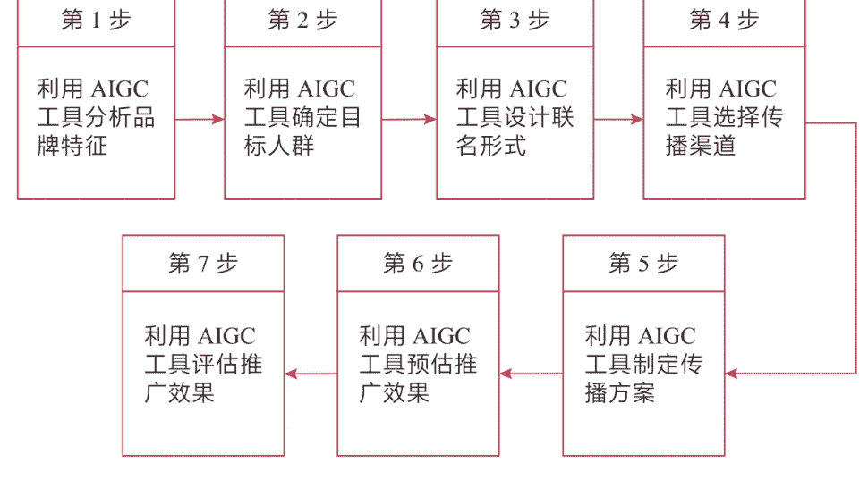
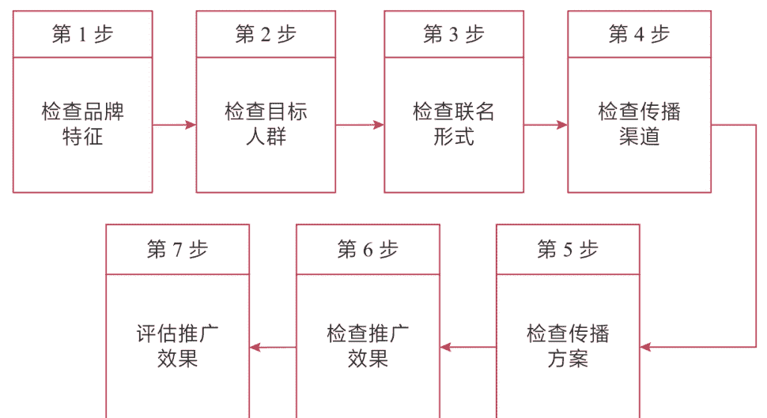
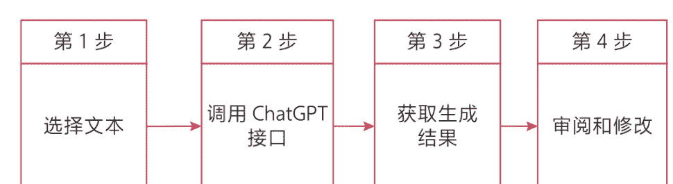
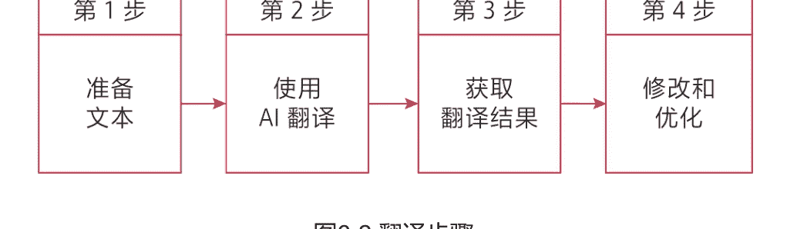
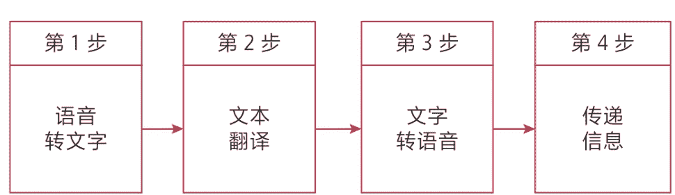

# ChatGPT写作跃迁指南

## 内容提要
本书以ChatGPT为代表的生成式AI为核心，系统性地介绍如何借助AIGC提升文字创作能力。全书共分六章，依次讲解ChatGPT辅助写作的基础逻辑，公文、文案、新媒体与自媒体、日常写作的落地方法，毕业论文、学术论文及项目申报材料的撰写支持，以及文本摘要、校对与翻译的实用技巧。书中大量采用真实案例演示，手把手呈现操作路径。

本书坚持授人以渔的思路，既提供可直接使用的工具，也传授可迁移的方法论，适合所有希望提高写作产出效率、对生成式AI感兴趣的读者。

## 推荐序1
### 用AI穿透信息噪声
当下，无论是企业职员、自由工作者、学生、教师还是创业者，都在承受注意力被稀释的压力。生成式AI的快速普及让信息筛选变得更加紧迫，我们急需能够去噪、抓重点并给出精准回应的智能助手。

ChatGPT正是重塑工作方式的关键力量。它的出现与迭代深刻改变了生产方式，大幅提升了效率，革新了解题路径，并释放出强劲的创造动能。

作为OpenAI面向大众推出的大规模自然语言系统，ChatGPT依托深度学习与海量语料，能够理解人类表达并生成连贯的智能回复。这项技术让工作更高效、生活更便捷。未来在商业与个人场景中，它都将扮演核心角色，成为不可或缺的协作伙伴。

在商业场景中，应用空间很广。它可以优化客户服务，通过自然对话提供准确解答与个性化建议；可以支撑市场洞察，帮助企业读懂用户需求、收集反馈并实现产品服务的定制化。

同时，它可以推动流程自动化，如智能助理、自动客服与机器人助手等，大幅提升运营效率、降低成本、提高客户满意度。更关键的是，它打破了服务的时空限制，实现了随时随地响应。

对个人而言，改变同样明显。它能解答各种疑问，提供实时知识支持，快速解除困惑。

它也是灵感触发器，对话中可激发创造力与创新思维。它还能担任学习伙伴，解答疑问、提供解释与指导，帮助加深理解。

作为基于深度学习和大规模数据的自然语言处理系统，ChatGPT具备强大的语言理解与生成能力，对写作帮助极大。可以说，它能助力我们迅速升级为写作高手。

本书的推出，为广大写作者提供了一个优质工具。ChatGPT的强大能力可以激发创作灵感，并提供实用的技巧和方法，助人成为优秀的写作者。

无论是小说、诗歌、故事、散文，还是文案、文章，都能提升效率和优化质量。

当然要保持清醒，充分认识技术的边界，避免过度依赖。科技是服务人类的工具，而非替代人类思维。

未来，ChatGPT将与其它AIGC工具并肩，成为生活与工作的伙伴，帮我们解读信息海洋，助力高效工作和更美好的创造。

让我们拥抱AIGC，以更高效率、更高质量、更高能量工作与生活吧！

郑吉敏

去哪儿旅行技术总监、业务架构SIG负责人、人工智能委员会常委

## 推荐序2
在这个信息高度膨胀的时代，写作已不仅是思想表达的手段，更是与快速变化世界互动的桥梁。唐振伟先生的新作《玩转ChatGPT：秒变AI写作高手》是一部引领潮流的作品，它不仅是写作技巧的图书，更是教你如何利用人工智能重塑写作方式的指南。

作为长期从事人工智能科研的人，我深知AI和AIGC在当代写作中的重要性。本书通俗易懂地介绍了ChatGPT等工具的使用技法，让读者能迅速掌握并应用于写作质量提升。从公文到文案，从学术论文到文学创作，本书覆盖多种写作类型，无论哪个行业的专业人士都能找到有价值的指引。

更可贵的是，唐先生不仅教工具使用，更教思考方式。书中引导读者把AI当作助手或合作伙伴，而非简单工具。学会借助AI激发创意、提升效率。

我强烈推荐这本书给所有期望提升写作水平、拥抱技术创新的读者。无论写作基础如何，这本书都将是写作旅程中难得的良师益友。让我们跟随唐振伟先生，开启写作与人工智能融合的精彩旅程。

祝各位读者阅读愉快，收获满满！

朱晓庆

北京人工智能学会副秘书长

## 前言
本书聚焦ChatGPT及其他AIGC工具在写作辅助方面的应用，特别关注意字工作者、文案工作者、方案撰写者密切相关的写作场景。

那么，ChatGPT是什么？AIGC又是什么？

下面给出两种风格的解释，一种简洁直白，一种生动幽默。

### ChatGPT回答一
ChatGPT由OpenAI推出，基于GPT生成式预训练模型构建的对话机器人。依托大规模语料进行预训练，具备理解与生成自然语言的能力。能够实现对话式交互，回答提问、提供信息、完成任务。

AIGC指借助人工智能技术生成的文字、图像、音频或视频等内容。技术基于深度学习模型，以海量数据集为基础，可产出高度逼真且富创造力的内容。可广泛应用于文本生成、图像生成、音乐创作等，为用户提供创意与信息，辅助内容创作。

（注：以上内容由ChatGPT生成，未改动）

### ChatGPT回答二
谈到ChatGPT，可以把它想象成一位从未来穿越而来的聪明机器人。大脑里装满知识与语言技巧，如同一本活的百科全书。可以提问、求助建议，或单纯闲聊。无论什么问题，都能以惊人的智慧和幽默作答，像与一位超级聪明的朋友聊天。

至于AIGC，可想象成一位身体由AI构成的天才创意家。可自由创造文字、图像、音频、视频等各类内容。创作力源于深度学习训练，不仅能生成逼真惊艳的作品，还能以幽默方式带来快乐。只需说明需求，就能满足创作欲望，帮助实现想法。

总之，ChatGPT与AIGC像是两位厉害的AI搭档，以智能有趣的方式互动。ChatGPT像聊天伙伴，可回答问题、提供信息、完成任务。AIGC像创意大师，可创作出惊叹的文本、图像、音频和视频作品。让我们欢迎这些伙伴，一起探索未来的无限可能吧！

（注：以上内容由ChatGPT生成，未改动）

### 学习AI写作辅助的价值何在
### 不学就会被时代甩下

掌握ChatGPT及其他AIGC工具，因为它们能带来诸多好处，让写作更高效、更富创意。

首先，它们可成为智能助手，提供即时帮助和反馈。无论写文章、写作业还是做自媒体，都能提供灵感和创意，避免思路枯竭。

其次，这些工具能提升写作质量。可纠正语法错误，提供更合适的用词，帮助梳理思路和结构，使作品更流畅易读，提升阅读体验。

再次，能够大幅节省时间和精力。可快速生成内容，让人短时间内完成大量工作。对需要在截止日前交付成果的人尤其有价值。

最重要的是，掌握这些工具是跟上时代潮流的需要。学会使用将使你在写作领域更具竞争力，快速脱颖而出；不学则可能被竞争对手超越！

本书的目标是授人以渔，给工具、教方法，即拿即用！让每位写作者借助以ChatGPT为代表的AIGC工具，实现写作能力跃升！

本书旨在帮助写作者提升效率与水平，在写作质量上实现五个维度的提升，即书中设置的五个栏目：【让表达更准】、【让用词更妥】、【让语句更顺】、【让逻辑更通】和【让结构更好】，最终让所有文字工作者的写作水平更上一层楼。

总之，无论你是办公室职员、文案策划，还是编辑记者、自媒体博主、学生、教师或科研人员，只要掌握这些AIGC工具，就能迅速提升写作速度、质量与水准，让写作能力实现华丽蜕变！

## 第1章 ChatGPT辅助写作基础

### 1.1 ChatGPT辅助写作的技术基础
ChatGPT可简单理解为一种智能对话机器人，能够帮助人们更好地写作。它运用了多种技术方法，包括深度学习和自然语言处理等。

深度学习是一种让机器学会理解语言并生成文本的方法。通过海量训练数据，ChatGPT能学会分析和理解人类语言规律，从而回答问题、提供创意建议等。

自然语言处理是一系列让机器处理和理解人类语言的技术。ChatGPT利用这些技术更好地理解用户输入，并生成准确通顺的回复。

使用ChatGPT辅助写作时，先输入问题或初始内容，再与其对话。ChatGPT会根据输入生成相关回复或建议，通过对话引导其产出所需文本，直至满足需求。

ChatGPT辅助写作可生成创新文本，并能理解上下文，使对话更自然流畅。

需要注意的是，尽管准确性很高，仍需人工编辑和审校，以确保质量和合规性。

#### 1.1.1 语言模型与辅助写作
语言模型是ChatGPT及大模型辅助写作的核心技术之一。它是一种训练机器学习模型来预测和生成自然语言序列的方法。具体而言，语言模型可以根据给定上下文，预测下一个词或一段文本的概率。

2023年8月31日，国内首批通过《生成式人工智能服务管理暂行办法》备案的AI大模型共11家，其中北京5家，上海3家，广东2家，安徽1家。北京的有百度的文心一言、抖音的云雀大模型、百川智能的百川大模型、智谱AI的智谱清言大模型、中科院的紫东太初大模型；上海的有商汤科技的商汤日日新大模型、MiniMax的ABAB大模型和上海人工智能实验室的书生通用大模型；广东的有华为的盘古大模型和腾讯的混元大模型；安徽的科大讯飞星火认知大模型。

这些国产大模型涵盖文本问答、文学创作、多轮对话、知识问答、文本创作等多个方向，能够理解和生成自然语言文本，具备强大的语言处理能力，可为各行业提供智能化解决方案。

从多款国产大模型的使用测评看，在辅助写作方面，目前表现较好、能力接近ChatGPT的是百度的文心一言，第一梯队还包括科大讯飞星火认知大模型、阿里巴巴通义千问、360智脑和基于抖音云雀大模型的聊天机器人豆包。

#### 1.1.2 深度学习算法与辅助写作
深度学习算法在ChatGPT辅助写作中发挥重要作用。ChatGPT使用了一种名为Transformer的深度学习模型。Transformer是一种基于注意力机制的神经网络结构，特别适合自然语言处理任务。

Transformer模型可对输入序列进行编码和解码，从而捕捉上下文信息。通过多层自注意力机制和前馈神经网络的堆叠，模型能提取更丰富的语义信息，实现输入序列的表示与重建。

深度学习算法使ChatGPT在训练中学会语言表达方式和文本潜在规律。它能根据上下文生成连贯回复，并具备一定创造性，产出多样化文本。

#### 1.1.3 自然语言处理与辅助写作
自然语言处理是研究计算机如何理解和处理人类自然语言的学科，是大模型流畅生成准确回答并辅助写作的技术基础。ChatGPT辅助写作正是利用了多种NLP方法来处理和理解输入文本。

首先，ChatGPT使用词嵌入技术将单词转为向量表示，便于模型中处理和比较语义关系。

其次，使用句法分析识别句子结构和词语间的依存关系，有助于模型更好理解语法规则和逻辑关系。

最后，利用语义理解方法理解用户意图和上下文信息，使模型能更准确地生成与输入相关的回复。

通过NLP，ChatGPT能更好地理解用户输入，并生成更准确、连贯的文本回复。

综上所述，语言模型、深度学习算法和自然语言处理是ChatGPT辅助写作的重要技术基础。它们相互配合，使模型能够生成高质量且富创造性的文本回复。

### 1.2 当前主流AIGC工具大盘点

#### 1.2.1 当前主流AIGC工具
目前，国外主流AIGC工具包括ChatGPT、Claude、New Bing等。

##### 1. 大名鼎鼎的ChatGPT
ChatGPT是基于人工智能技术开发的生成式AIGC工具，主要用于协助人类完成各类任务。

ChatGPT由OpenAI于2022年11月30日发布，是聊天型机器人，可通过学习和理解人类语言进行对话，并根据上下文互动，协助完成任务。例如，可撰写邮件、论文、脚本，制定商业提案，创作诗歌、故事，生成代码，检查程序错误等。

GPT-4于2023年3月15日发布，是ChatGPT的进一步进化。它提升了回答准确性，可识别图片，可输入更多文本信息。GPT-4的核心技术基于Transformer的可训练神经网络，使其在与人类对话中实现自动学习，更具智能特征。GPT-4目前具备多模式输入输出功能和硬核应试能力。

##### 2. 可以与ChatGPT相媲美的Claude
Claude是由Anthropic公司开发的AI聊天机器人工具。Anthropic由前OpenAI团队成员创立。据测试，Claude的能力接近GPT-4，在代码、数学、推理等方面有明显提升，支持高达100K token的上下文。

此外，Claude已面向更广泛用户免费开放，支持中文使用，其亮点功能包括可一次性上传5个PDF、txt、csv文档，单文件最大10MB并总结核心内容。

##### 3. 微软与OpenAI合作推出的New Bing
2023年5月，微软宣布开放New Bing聊天机器人功能。New Bing是微软与OpenAI的合作成果，提供AI生成图片等新功能，甚至支持插件。其核心优势主要体现在以下方面。

(1) 理解用户的意图和需求。New Bing能理解用户意图并尝试基于需求提供准确完整的答案，而非仅提供海量信息供用户筛选。

(2) 自然语言交互。通过聊天模式，New Bing可与用户进行自然语言交互，回答各类问题，甚至根据需求生成诗歌、代码、歌词等内容。

(3) 适应不同语言和风格。New Bing可根据用户语言偏好和风格进行适应性调整，提供更个性化和人性化的搜索体验。

(4) 强大的内容生成能力。New Bing能利用GPT技术的强大生成能力，为用户提供更多有价值和有趣的内容。例如，若用户想了解某个话题，New Bing可生成简洁明了的摘要。

##### 4. 人人都能用的国内10大AIGC工具
国内目前可用且较为成熟的AIGC工具主要有文心一言、讯飞星火认知大模型、360智脑、通义千问、智谱清言、MM智能助理、百川大模型、天工大模型、面壁露卡、悟道2.0等大模型，另外还有可生成古典格律诗词的九歌人工智能诗词写作系统，可生成图片、语音和数字人的腾讯智影，以及可生成图片的触站等。

下面简单介绍10个相对成熟、在工作中应用较多的AIGC工具，简介内容由各模型自行生成，略有删节。

(1) 文心一言。
文心一言是一种基于深度学习技术的自然语言处理模型，能够理解和生成自然语言文本，并尝试回答各种问题和提供相关信息。它被广泛应用于智能客服、智能问答、机器翻译、文本生成、文章推荐等领域，能够帮助人们解决问题和创造新的知识。文心一言的技术架构包括多个组成部分，如基于深度学习的自然语言处理模型、基于规则的专家系统和基于机器学习的推荐系统等。尽管存在一些局限性和挑战，如误判和错误、开发和维护成本高以及需要遵守法律和道德规范，但文心一言仍然是一个重要的工具，为人们提供了方便快捷的信息获取和问题解决方式。

（注：以上内容由文心一言生成，未改动）

(2) 讯飞星火认知大模型。
讯飞星火认知大模型是科大讯飞研发的以中文为核心的新一代认知智能大模型，能够在与人自然地对话和互动的过程中，同时具备以下多种能力。

内容生成能力：我可以进行多风格多任务长文本生成，如邮件、文案、公文、作文、对话等。

语言理解能力：我可以进行多层次跨语种语言理解，实现语法检查、要素抽取、语篇归整、文本摘要、情感分析、多语言翻译等。

知识问答能力：我可以回答各种各样的问题，包括生活知识、工作技能、医学知识等。

推理能力：我拥有基于思维链的推理能力，能够进行科学推理、常识推理等。

多题型步骤级数学能力：我具备数学思维，能理解数学问题，覆盖多种题型，并能给出解题步骤。

代码理解与生成能力：我可以进行代码理解、代码修改及代码生成等工作。

（注：以上内容由星火认知大模型生成，有删节）

(3) 360智脑。
360智脑是由中国360公司研发的大语言模型，是decoder-only结构的模型，借鉴了ChatGPT模型的实现思路。智脑可以完成文本生成、对话、代码生成、画画等任务，比ChatGPT模型拥有更少的参数但更佳

#### 1.2.2 国内主流AIGC写作工具横向对比

国内做内容创作的人，手边常备的AIGC助手到底有什么差别？

##### 提问原文
想了解国内常用的AIGC工具在写作辅助上的差异，分别说明 GPT-3.5、GPT-4、New Bing、Claude 以及国内主流AIGC工具的特点、优缺点，并以表格呈现。

##### ChatGPT 作答
下面梳理了当前国内使用频率较高的AIGC工具在写作场景下的表现差异。

| 工具名称 | 特点 | 优点 | 缺点 |
| --- | --- | --- | --- |
| GPT-3.5 | 依托 GPT-3.5 架构，文本产出能力扎实 | 语言理解与生成覆盖面广，表达自然度较高 | 偶发产出不准或逻辑不连贯，缺乏个性化定制 |
| GPT-4 | 基于 GPT-4 架构，生成质量与多样性明显提升 | 输出质量更高、内容更丰富连贯 | 运算资源需求较大，目前普及度相对有限 |
| New Bing | 融合知识库、对话管理等多个模块 | 具备知识图谱与对话管理，可进行更深层次交互 | 回答受知识库承载范围限制，部分问答显得程式化 |
| Claude | 基于深度学习，具备上下文感知与逻辑推理能力 | 能感知上下文并进行逻辑推理，输出条理较清晰 | 部分情境下易失控或与用户意图产生混淆 |
| 国内主流 AIGC 工具 | 重点优化中文自然语言处理 | 中文处理精细，准确性与连贯性较好 | 多款需在线调用 API，整体功能与性能相对受限 |

需要说明的是，以上仅为概括性总结，无法覆盖全部细节，具体选用仍需结合使用场景与个人需求来判断。

（注：以上内容由ChatGPT生成，未改动）

##### 文心一言 作答
以下表格概括了 GPT-3.5、GPT-4、New Bing、Claude 以及国内主流AIGC工具在辅助写作方面的共性观察，仅供参考，实际表现会随版本与场景变化。

| AIGC 工具 | 特点 | 优点 | 缺点 |
|---|---|---|---|
| GPT-3.5 | 基于 Transformer 架构，预训练语料支持 | 文本生成自然流畅，上下文理解能力强，人类文本质感较高 | 对复杂议题理解有限，部分文化领域知识不足，多语支持仍需完善 |
| GPT-4 | 采用新训练方法与硬件，更深层级、更大容量模型 | 响应更快效率更高，推理与创新能力更强 | 在特定垂直领域回答不一定如 GPT-3.5 自然，对复杂问题的深挖可能不及预期 |
| New Bing | 微软出品，整合 ChatGPT 技术，以对话方式搜索 | 搜索与对话协同，上下文理解强对话更顺滑 | 推出时间较晚，长期稳定性待验证，多轮对话的连贯性有待观察 |
| Claude | 多模态融合结构，强化知识图谱与多轮对话 | 多轮对话表现好，能处理较复杂任务，推理与创新能力突出 | 非英语语言支持有提升空间，实时响应与大规模部署存在挑战 |
| 国内主流 AIGC 工具 | 多数基于 BERT 或 GPT 系列 | 中文场景适配度高，具有本土化特色，对中文语法语境理解深入，多数提供 API 便于集成 | 全球影响力相对弱，开源程度有待提高，技术领先性与创新性或不及 ChatGPT 系列，部分产品文档与社区支持薄弱，学习成本较高 |

请注意，该表仅代表一般性认知，**具体优劣会因工具版本与应用场景而异。选型时建议结合真实需求、预算、技术能力进行实测比较。**

（注：以上内容由文心一言生成，未改动）

#### 1.2.3 如何挑到最匹配的AIGC写作助手

##### 用户原问题
AIGC 工具都不完美，那如何选择最适合自己写作需求的创作助手？面对不同类型、不同需求的写作者，哪些工具更趁手，该如何选出甚至组合多款“好用兵器”？

##### 通义千问 作答
挑选最贴合写作需求的AIGC助手可从以下几个维度入手。

1. **明确写作类型与目标。** 先厘清自己主攻的类型，如小说、散文、新闻、报告等，以及具体需求如校对、润色、扩写等，范围缩小后更容易对号入座。
2. **摸清工具的功能边界。** 不同产品侧重点不同，例如 Grammarly 聚焦语法拼写，ProWritingAid 更偏文本优化，Hemingway Editor 则适合追求简洁表达的写作。
3. **实测对比。** 亲手试用几款产品，感受实际产出与使用体验，结合他人评价了解优劣。
4. **权衡成本与可用性。** 注意订阅费用、免费额度，并确认工具能否在自己的设备与系统上流畅运行。
5. **匹配个人习惯。** 界面是否友好、操作是否顺手都很关键，新手更适合易用型，熟手可考虑功能更强的产品。

总之，选型需综合写作需求、功能特性、实测体验、成本可用性与个人偏好，深入比较后才能找到最合适的“趁手武器”。

（注：以上内容由通义千问生成，未改动）

##### ChatGPT 作答
选择适配的AIGC写作工具可参考以下要点。

**1. 任务类型。** 先确定写作范畴，如小说创作、新闻稿件、科技文章等，不同工具在不同任务上的表现差异明显。
**2. 功能特性。** 了解是否提供自动补全、语法修正、文本生成等功能，是否能满足具体写作诉求并提升效率。
**3. 用户口碑。** 查阅其他使用者反馈，了解工具的真实表现与是否契合自身需求。
**4. 实测对比。** 直接试用多款产品，评估其与个人写作目标的匹配度，如风格契合度、语言流畅度等。
**5. 支持与资料。** 看工具是否提供完善的用户支持、教程文档，以及是否有活跃的社区与论坛便于解决问题。

总体而言，需综合任务类型、功能特点、口碑反馈与试用感受，依据个人偏好选择单款或多款工具。

（以上内容由ChatGPT生成，未改动）

##### 文心一言 作答
挑选适合自己的AIGC创作助手，建议考虑以下层面。

**1. 弄清自身写作需求。** 明确是写小说、散文还是学术论文，不同类型对工具的要求不同，例如小说更需要对话与情节塑造，论文则更看重研究与引用支持。
**2. 评估功能是否匹配。** 各工具擅长点不同，有的强在生成，有的擅长改写或翻译，需对照自身需求判断。
**3. 判断智能化程度。** 部分工具可自动纠错、语法检查，适合初学者或追求快速完成的场景；更复杂的任务可能需要更专业产品或人工介入。
**4. 參考他人评价。** 通过用户评价与反馈了解工具的优缺点与实际使用体验。
**5. 多款实测。** 亲自体验不同工具，找出最符合写作习惯与效率提升的产品，虽有学习成本，但找到合适者后效率显著提高。

总之，需权衡写作需求、功能性、智能化水平、外部评价与个人体验，才能选出最契合的助手。

（注：以上内容由文心一言生成，未改动）

综合来看，三家的建议核心一致。选择趁手AIGC工具的首要标准是自身的写作需求，其次看工具的功能、特性、智能化程度及对用户的支持，最后参考用户口碑，并结合个人习惯与喜好，同时考量成本与可用性。最关键的是亲手试用，试过才知道哪一两款真正合适。

### 1.3 AIGC辅助写作的现状与趋势

#### 1.3.1 AIGC辅助写作的发展脉络与当下状态
AIGC辅助写作是指借助人工智能算法与大数据，为写作者提供支持，提升写作效率。

发展概览：
**起步阶段：** 早期工具主要做简单校对与自动填充，如拼写检查、自动补全。
**发展阶段：** 随着深度学习进步，基于 GPT 等模型的文本生成能力显著提升，可产出连贯准确的段落。
**当前阶段：** 如 GPT-3、GPT-4 等模型具备更强的生成与上下文理解能力，能产出更流畅丰富的文章。

##### 现状一：现在能做什么
- 提供写作灵感。依托关键词或主题生成段落，为创作提供思路与创意点。
- 文本纠错与校对。自动检测语法、拼写问题并给出修改建议，提升准确性与可读性。
- 自动补全与推荐。基于已输入内容预测后续表述，加速成稿。
- 文章总结与概括。快速提炼大量文本的核心要点，节省时间精力。

##### 现状二：现在还做不到什么
- 创造独特创意。虽能生成连贯文本，但难以产出真正具原创性与独创性的想法。
- 深层情感表达。对细腻情感与深度的情感共鸣表达能力有限。
- 精准背景知识。在专业领域，背景知识深度不及专家，仍需人工核验修正。

总体看，灵感提供、纠错校对、补全推荐、总结概括已取得明显进步，但在创造力、情感表达与专业知识深度上仍有局限。

#### 1.3.2 未来发展趋势与应用方向
AIGC辅助写作将继续扩展，以下是主要趋势。

##### 1. 深度个性化
工具将更了解用户的偏好、风格与写作习惯，提供高度定制化的辅助，自动生成符合个人语气的文本。

##### 2. 创造力增强
未来会引入更多创意生成算法，为写作者提供灵感激发、观点碰撞与内容创新支持。

##### 3. 多模态融合
除文本外，将结合图像、音频、视频等媒体形式，提供更丰富多元的写作辅助体验。

##### 4. 行业专业化应用
在新闻、法律、科技等领域深化应用，如实时新闻摘要、法律文件草拟、技术文档撰写等。

##### 5. 教育与学术研究
为学生提供写作指导与反馈，提升写作技能；为研究人员提供文献综述、语法校对、论文撰写支持。

需要强调，随着应用扩展，**必须关注道德与法律风险，确保使用合规，保护隐私与知识产权。**

#### 1.3.3 AIGC辅助写作面临的主要障碍
在快速发展的同时也存在挑战。

##### 1. 文本准确性
仍会出现不准确、歧义或错误。需强化模型训练与优化，扩大高质量训练数据，尤其覆盖专业术语与行业词汇。

##### 2. 创新性与原创性
难以产出真正原创内容。可引入创意支持算法，如深度学习、模拟演化等，提供更多启发。

##### 3. 道德与伦理
生成内容可能触及版权、隐私等合法权益。应遵守法律法规与伦理准则，保障权益。

##### 4. 语言与文化差异
跨语言、跨文化场景下适配不足。需针对不同语言文化习惯优化生成与辅助策略。

总体而言，挑战可随技术进步逐步缓解，需持续关注发展，加强法治理念，推动健康应用。

### 1.4 AIGC辅助写作的优缺点分析

#### 1.4.1 AIGC辅助写作的核心优势
AIGC辅助写作主要有三方面好处。

##### 1. 提升写作效率
可快速产出大量文本，节省时间，减少重复劳动。

##### 2. 提升文本质量
具备语法、排版等纠错能力，有助于提高准确性与整体质感。

##### 3. 功能多元
除生成外，还可进行翻译、摘要、筛选、分析等，应用场景广泛。

#### 1.4.2 明显短板
AIGC辅助写作也存在不足。

##### 1. 缺乏创造性
生成内容多为模式化表达，原创性与独特性不足。

##### 2. 正确废话
常产出看似合理却空泛的表述，难以满足个性化需求。

##### 3. 可能编造虚假信息
部分内容为算法推演，需具备鉴别能力并人工审核。

##### 4. 语体不一致
生成的语气、风格、语调可能与作者预期不符，需人工调整。

#### 1.4.3 如何扬长避短
充分发挥优势、规避劣势，才能让AIGC真正助力写作。

##### 发挥优势
1. 充分了解工具。深入掌握功能与参数，善用各项能力。
2. 准确输入信息。提供清晰明确的指令与素材，引导更精准产出。
3. 人工编辑校对。对生成结果进行复核润色，确保准确流畅。

##### 规避劣势
1. 借鉴而非依赖。将AIGC作为参考起点，结合自身创造力完善内容。
2. 仔细校对编辑。逐项审查生成文本，修正错误或不准确之处。
3. 结合专业知识。针对专业写作，依托自身经验与知识进行人工修订，确保专业性与准确性。

总体而言，要让生成式AI真正成为写作助力，创作者首先要搞清楚工具的工作逻辑，输入完整清晰的指令，并在模型返回初稿后亲力亲为进行编校润色。要正视其边界，把AI当作协作搭档而非替代者，对产出内容进行筛选、改写与再创作，融合自身经验与专业积累把文本打磨到位。

## 第2章 用ChatGPT提速公文撰写

### 2.1 公文写作提效：做办公室的得力笔杆

#### 2.1.1 会议纪要快速生成

生成式模型在纪要撰写上具备快、准、可调的优势，能迅速提炼会议要点，避免遗漏与重复，配合人工复核即可明显提升效率与质量。完整流程如下。

##### 1. 准备素材
保存全程录音录像，收集会议资料、调查数据等支撑材料。

##### 2. 生成文字稿
选用支持语音转文字且准确度较好的生成工具，将音视频导入后完成转写，得到原始记录。

推荐工具：讯飞听见、网易见外、知意字稿、通义听悟、录音转文字助手等。

##### 3. 修改润色
初版文字可借助生成工具进行语言优化，使表达更通顺、用词更规范。

推荐工具：ChatGPT、文心一言、博特妙笔、笔灵、搭画快写、秘塔写作猫等。

用户提问
会议就市政府20××年重点工作目标任务及责任分解进行了讨论。各分管市领导就各自分管领域的工作进行了安排和部署，明确了各项任务的牵头单位和责任单位，强调了各单位要切实履行职责，确保按期完成工作任务。
请润色上面这段话。

文心一言回答
此次会议围绕市政府20××年度重点工作目标任务及责任分解展开了深入研讨。各位分管市领导针对各自负责领域的工作作了细致部署和周密安排，对各项任务逐项拆解，厘清了牵头单位与责任单位，并要求各单位充分认识职责分量，以强烈的责任感和使命感推进任务保质保量按期完成。

> （注：以上内容由文心一言生成，未改动）

【让逻辑更通】
- （1）核查逻辑架构。整理完文字记录后，可用生成工具的检测功能审视结构是否清晰条理，能否识别因果、比较、时序等逻辑问题。
- （2）重塑逻辑架构。依据工具提示调整段落顺序，例如将逻辑不清的段落拆分，或重新排列句子的先后。
- （3）校对语法拼写。借助生成工具自动修正常见语法与拼写错误，使纪要更规范专业。

##### 4. 人工复核
经模型修改润色的稿件仍需人工通读整理，核对事实准确性与信息完整性，确保纪要经得起查验。

#### 2.1.2 调研报告智能编撰

生成式模型辅助撰写调研报告的优势在于能融合多种技术模型产出更具创意与个性化的内容，打破传统框架，为报告带来形式与内容的创新，更好适配不同场景需求，拓展报告的深度与广度。

用户提问
请提供一个扶贫工作调研报告的模板。

ChatGPT回答
##### 扶贫工作调研报告
###### 一、引言
说明调研目的与背景，阐述贫困问题的严峻性与复杂性，论证扶贫工作的紧迫性。
###### 二、贫困现状
描述调研区域的贫困面貌，包括贫困户数量、分布、致贫原因等，并配以数据与案例佐证。
###### 三、扶贫举措
详述当地实施的基础设施、产业、教育、健康等扶贫做法，说明实施情况并分析利弊。
###### 四、扶贫成效
基于调研结果评估工作效果，用数据与案例呈现受益情况与脱贫成果，并分析原因与不足。
###### 五、问题与挑战
总结面临的困难，如问题复杂性、举措短板、社会参与度不足等，并提出针对性建议。
###### 六、结论与展望
归纳调研发现，给出结论建议，并对未来扶贫工作提出预期。
###### 七、附录
附上数据、案例、问卷等支撑材料。

（注：以上内容由ChatGPT生成，未改动）

仅用宽泛提问能得到结构完整但主题模糊的模板。若想获得更精准的答复，可补充更多关键词。

用户提问
县政府需要了解H村扶贫工作情况，重点关注产业扶贫、教育扶贫、基础设施建设等实施情况，请提供一份调研报告。

文心一言回答
##### H村扶贫工作调研报告
根据县政府掌握H村扶贫实施情况的要求，我们重点调研了产业扶贫、教育扶贫、基础设施建设等领域。通过实地走访、问卷调查、小组座谈等方式获取了大量第一手资料，下文为调研报告。

###### 一、背景介绍
H村地处偏远山区，资源有限，经济发展滞后，贫困人口较多。在政策扶持下开展了一系列扶贫行动取得一定成效，但随扶贫标准提高也面临新挑战。

###### 二、实施情况
####### 1. 产业扶贫
结合本地资源发展特色果树、中药材种植，经济效益提升；同时发展生态旅游，与企业合作开展订单农业，拓宽增收渠道。
####### 2. 教育扶贫
通过“两免一补”、免费职业培训提高贫困家庭子女受教育水平，动员社会力量资助学生，并加强师资与教学设施建设。
####### 3. 基础设施建设
大规模修缮村道、桥梁、水利设施，实施农网改造与安全饮水工程，生活生产条件明显改善。

###### 三、成效
- 1. 经济效益提升（略）
- 2. 教育水平提高（略）
- 3. 生活质量改善（略）

（以上内容由文心一言生成，有删节）

【让用词更妥】
调研报告类型不同，提示词设置也应差异化。表2-1展示了四类报告的常用提示词与提示句，可据此向模型提出更精准指令。

表2-1 提示词与提示句

| 调研报告种类 | 提示词 | 提示句 |
| :--- | :--- | :--- |
| 消费者调研报告 | 消费者、需求、行为、购买、偏好、消费习惯、市场细分、产品定位、营销策略、客户满意度 | （1）消费者的购买决策过程是怎样的 （2）他们的需求和期望是什么 （3）如何对市场进行细分以更好地满足不同消费者的需求 （4）产品应该如何定位 （5）有哪些营销策略可以有效吸引消费者 （6）如何提高客户的满意度和忠诚度 |
| 市场调研报告 | 市场、行业、竞争格局、市场规模、市场份额、发展趋势、市场增长、市场饱和度、市场细分、竞争优势 | （1）该市场的整体发展趋势如何 （2）市场竞争格局如何 （3）哪些企业或品牌在市场中占据主导地位 （4）市场增长的动力来源是什么 （5）市场细分的机会和挑战是什么 （6）如何建立和保持竞争优势 |
| 员工调研报告 | 员工、工作满意度、绩效、薪酬福利、职业发展、工作环境、员工培训、企业文化、员工流失率、激励机制 | （1）员工对当前工作的满意度如何 （2）如何评估员工的工作绩效 （3）薪酬福利体系是否合理 （4）员工的职业发展路径和晋升机会如何 （5）员工培训和教育的重要性是什么 （6）如何建立积极的企业文化和氛围 （7）如何设计有效的激励机制以留住人才 |
| 社会调研报告 | 社会问题、社会现象、人口结构、文化习俗、教育水平、经济发展、环境保护、公共服务、社会保障、社会稳定 | （1）社会问题的根源和影响是什么 （2）社会现象背后的原因和意义是什么 （3）人口结构的变化趋势会带来哪些影响 （4）教育水平的提高有哪些积极作用 （5）如何平衡经济发展与环境保护 （6）如何提高公共服务的质量和效率 （7）社会保障体系存在哪些问题和挑战 |

#### 2.1.3 AI加人工：确保公文质量

实践中模型可从以下维度提升公文质量。

##### 1. 自动纠错校对
模型能识别拼写、语法及句式问题，提升准确性与流畅度。爱校对、Language Tool等工具可进行语法语义检测并给出修改建议。

##### 2. 语言建议
根据文书目的与内容提供词汇、短语与句式建议。秘塔写作猫、公文写作神器、搭画快写等可提供范文、提纲、金句检索，提升写作效率。

##### 3. 自动化格式排版
模型能统一排版风格，节省人工成本。AI排版助手可实现快速排版、格式自动调整、编号与页眉页脚自动添加。

##### 4. 自动生成模板与草稿
基于已有样本自动生成模板。博特妙笔、AI公文写作助手等拥有丰富范文库，可按主题需求匹配模板并生成规范文本。

##### 5. 数据分析与决策支持
模型可对文书中的数据进行挖掘分析，为决策提供依据。如Tableau能将数据转化为图表，帮助直观理解信息。

##### 6. 多语言处理
支持多语种翻译与处理。Microsoft Translator、百度翻译、有道翻译等可实现多语种互译及语音、图片翻译。

尽管模型功能多样，人类经验与专业判断仍不可替代。人工优化主要体现在：

###### 1. 内容甄选
- （1）明确主题与目的。选择与公文主题相关、能有效传递信息的内容。
- （2）判断准确性。结合算法、数据源与数据质量评估内容可信度，敏感内容需更谨慎。
- （3）核验规范标准。检查格式、用语、表述是否符合要求，确保合规专业。
- （4）把握语言风格。确保表达方式与受众定位及公文正式严肃的基调相符。

###### 2. 内容整理组合
- （1）筛选修改。挑选相关段落与数据，删减冗余，补充遗漏，修正不准表达。
- （2）调整排版。按要求设置字体、字号、行距、段距、页边距，插入页眉页脚页码。
- （3）复核语法拼写。使用工具或他人协助校对，确保流畅准确。
- （4）审核签发。由领导审核内容、格式与语言，确认无误后正式发布。

#### 2.1.4 精准设定提示词，提升创作效率

使用生成式模型撰写公文时，提示词的精确度直接影响生成质量。

【让表达更准】
- （1）明确主题。如“请撰写油茶产业开发项目可行性研究报告”。
- （2）说明写作目的。如“请撰写阐述人工智能未来在企业应用及影响的公文”。
- （3）提供关键信息。如“请撰写人工智能在医疗保健领域应用与挑战的公文，并突出其对医疗行业的变革”。
- （4）给出背景语境。如“请撰写人工智能在金融行业应用与监管的公文，需考虑当前监管政策变化”。
- （5）提供写作指南。如“使用第三人称客观语言，提供数据事实支持，避免主观判断”。

### 2.2 领导演讲稿：成为领导的得力助手

#### 2.2.1 智能生成：演讲稿提示词设定

提示词设置是关键，需灵活调整直至结果满意。生成后仍需人工审校，保证准确流畅。

用户提问
我需要为领导写一篇演讲稿，主题为“垃圾分类与回收：提升资源利用效率”，通过本次演讲呼吁大家学习和重视垃圾的分类与回收。请为我生成演讲稿。

ChatGPT回答
尊敬的领导、各位嘉宾、亲爱的同事们：
大家好！今天非常荣幸在此围绕“垃圾分类与回收：提升资源利用效率”发表讲话。在资源日益紧缺的时代，垃圾分类回收已成为一个重要课题。
首先思考：为何垃圾分类回收如此重要？数十年来社会发展带来大量废弃物，若缺乏有效处理，将成为环境与资源的沉重负担。

#### 2.2.2 量身定制：贴合领导语言习惯与表达风格

生成式模型可学习多种语言风格。通过明确领导特点引导生成，能使演讲稿更符合其表达习惯。

用户提问
我需要为领导写一篇演讲稿，主题为“垃圾分类与回收：提升资源利用效率”，通过本次演讲呼吁大家学习和重视垃圾的分类与回收。该领导的语言风格较为平易近人，且注重与听众互动，请为我生成一篇合适的演讲稿范文。

ChatGPT回答
尊敬的各位领导、各位嘉宾，亲爱的朋友们：
大家好！很高兴与大家相聚，今天想和大家聊聊垃圾分类与回收的话题。
随着人口增长与消费提升，垃圾产量持续增加。垃圾问题不仅污染环境，更浪费资源。
……
最后请大家思考：如果不行动，未来地球会怎样？让我们一起行动，为美丽家园与可持续未来努力！
谢谢大家！

> （注：以上内容由ChatGPT生成，有删节）

相较首次生成，增加语言风格提示后，文本更贴近平易近人的风格，结尾以提问引发互动，契合需求。

【让用词更妥】
领导演讲语言风格常见类型：
- （1）正式官方风格。措辞严谨，语气庄重，体现权威感。
- （2）平易近人风格。语言通俗，语气亲和，增强亲切感。
- （3）幽默风趣风格。适时加入笑点，引发共鸣。
- （4）激情洋溢风格。情感强烈，激励听众投入。
- （5）精准简练风格。用词准确，表达清晰，避免生僻词。

#### 2.2.3 持续优化：兼顾场合与受众

可根据场合与受众优化演讲内容，提升效果。

用户提问
本次演讲的受众群体是某街道的小区居民，演讲稿内容需要通俗易懂，并加入案例讲解，请生成演讲稿内容。

ChatGPT回答
亲爱的小区居民们：
大家好！很高兴在这里与大家分享垃圾分类与回收的重要性。今天我会用通俗的语言，结合生动案例，呼吁大家学习重视垃圾分类与回收。

先设想一个画面：如果小区里没有垃圾分类，所有丢弃物都混在一起会怎样？可以预见到，浓重的异味会弥漫整栋楼，还会引来蟑螂、老鼠等烦人生物。那种生活环境，恐怕谁都难以忍受。

……

最后，我想号召大家立即行动，从今天起把垃圾分好类，让可回收物得到再利用，守护环境，为家园尽一份力！

谢谢大家！

> **(注：以上内容由ChatGPT生成，有删节)**

当为演讲稿预先设定好受众人群时，模型产出的内容立刻贴合了使用场景。透过举例日常生活中每天都会接触到的实例，稿件在语境和听众需求上都更契合。

##### 【精准表达技巧】

- (1) 加入与**特定场景相关**的提示词，例如**商务会议**、**学术研讨会**、**公开演讲**等。这些关键词能帮助模型把握上下文，生成更贴合场合的文本。
- (2) 在设定提示时，考虑**受众的特征、兴趣点和实际需求**。比如面对医学专业人士，就使用专业术语；面对普通大众，就用通俗语言搭配生活化例子。
- (3) 针对不同需求，可加入**情感与语气**相关的提示词。想让稿件更鼓舞人心，就用激励、希望、改变等词；想保持中立客观，就用事实、数据、研究等词。

通过多轮追问，模型能获取更丰富的信息，从而不断优化演讲稿。把追问得到的补充信息整合进稿件，也能提升整体的完整性和连贯性。

### 2.3 职场应用文：让办公写作更从容

#### 2.3.1 生成工作计划

工作计划是对未来一段时间内工作目标、任务、活动和时间安排的系统规划，用来保持有序和高效。

AIGC工具既能迅速产出高质量的工作计划，节省时间成本并提升准确度；也能借助海量数据和知识，对计划相关信息进行理解和分析，从而更好地制定和优化方案。

##### 用户提问

我在一家**广告公司**担任HR，今年年会需要提交**下一年度的工作计划**，该如何撰写？

##### ChatGPT回答

###### 1. 开篇与背景

先介绍工作计划缘起，提供广告公司简要背景，包含公司使命、愿景、核心价值观，并简要回顾上年绩效及重要变化。

###### 2. 年度目标与关键结果

明确人力资源部下一年度的核心目标与关键成果，确保与公司战略一致且可量化、可衡量。

###### 3. 招聘与人员管理

概述下一年度招聘需求，包含新增岗位数量、技能要求、招聘渠道等。

说明人员管理思路，涵盖绩效评估、培训发展计划、员工激励机制等。

###### 4. 培训与发展

提出员工培训发展方案，保证技能与知识持续提升。

讨论新培训项目、在線学习平台或合作资源等。

###### 5. 绩效管理

说明绩效管理方法，包含目标设定、定期评估与反馈、晋升与奖励机制等。

###### 6. 多元、平等与包容

提出促进多样性、平等与包容的举措，涉及招聘与培训层面。

###### 7. 健康与福祉

讨论员工身心健康议题，包含福利方案、工生活平衡措施、心理健康支持等。

###### 8. 预算与资源配置

给出下一年度预算与资源分配方案，确保人力部门有足够经费与支持落地计划。

> (注：以上内容由ChatGPT生成，有删节)

##### 【结构优化要点】

不难看出，ChatGPT给出的工作计划大纲较为概括，实际应用需要更具体的细节。这时可以换用另一款AIGC工具，用相同提问方式试探，看能否得到更贴合需求的答案。

##### 文心一言回答

###### ××广告公司HR部门工作计划

####### 一、工作目标与关键成果

- 1. 提升员工满意度与效率：通过优化招聘、培训与员工关系管理，提高满意度与工作效率。
- 2. 推动人才发展：制定清晰职业发展路径与培训计划，促进个人成长与留任。
- 3. 优化企业品牌形象：借助策略性公关与企业文化建设，提升品牌形象。
- 4. 营造健康企业文化：通过定期团队活动与开放沟通，打造积极氛围。

####### 二、具体行动方案

1. 员工招聘与培训
    - 制定详细招聘方案，明确岗位需求与应聘者资质。
    - 设计新员工培训计划，帮助其快速融入文化与工作环境。
    - 与业务部门协同，提供周期性职业技能培训，提升业务能力。

2. 员工关系管理
    - 每季度开展员工满意度调查，了解需求并制定改进措施。
    - 妥善处理员工问题与纠纷，维护良好形象。
    - 建立合理激励机制，提升工作积极性。

3. 品牌形象与公关活动

> (注：以上内容由文心一言生成，有删节)

#### 2.3.2 生成工作总结

工作总结是职场常见文书形式，用于回顾与评估一段时间内的工作进展、成果与不足，帮助后续规划与提升效率。

借助AIGC写总结能**提升写作效率**，快速生成大量优质内容；同时可**自动纠错、检查语法并提供改写建议**，避免错误与重复，提升创意与个性。

##### 用户提问

我是公司的**市场部经理**，主营智能家居。上半年因**决策失误**，线上营销投入不足，仅完成业绩指标的50%，请据此为我撰写一份**半年度工作总结**。

##### ChatGPT回答

尊敬的公司领导，

我是市场部经理，现对上半年度工作进行坦诚回顾，并提出改进方向，以期智能家居业务取得更好成绩。

###### 上半年回顾

####### 决策失误

上半年我们出现了决策上的偏差，导致一系列连锁问题，影响线上营销整体推进。未能准确预判市场需求与竞争态势，致使销售业绩未达预期。

####### 线上营销不足

我们承认上半年线上营销力度不够，未充分利用数字渠道如社交媒体与在线广告推广智能家居产品，导致线上市场份额受损。

####### 上半年成绩（略）

####### 未来改进计划（略）

> （注：以上内容由ChatGPT生成，有删节）

除了常规或年度总结，AIGC还能辅助撰写**针对具体项目的总结**。项目总结重在提炼实施过程中的经验教训，归纳成功与不足，为后续项目管理优化提供参考。

##### 用户提问

×公司**市场部**已结束**夏季促销活动**营销宣传项目，该项目成功吸引消费者，请问**项目总结**该怎么写？

##### 文心一言回答

**项目名称：×公司夏季促销活动营销宣传项目**

###### 项目背景与目标

为提升夏季促销活动的知名度与销售额，×公司策划了一场综合营销宣传活动。项目旨在通过创新营销策略与传播手段，吸引潜在客户，提升活动期间销售额与品牌认知度。

###### 项目内容

- 营销策略制定：结合品牌形象与目标客群，制定广告、社交媒体、线下活动等多维度传播策略。
- 创意设计：制作系列吸睛宣传海报、广告视频与社交媒体素材，吸引关注。
- 渠道拓展：在电视、广播、杂志、户外广告等多平台投放，同时开展社交媒体推广。
- 线下活动策划：举办“夏日狂欢”主题线下促销，吸引大量消费者参与。
- 效果评估与调整：通过数据分析与监测，及时优化传播策略与内容。

###### 项目成果

- 销售额提升：活动期间销售额同比增长30%。
- 品牌认知提升：品牌知名度明显上升，关注度提高50%。
- 客户反馈积极：消费者对活动内容与形式给予高度认可。

###### 项目亮点

- 创新营销组合：多元化手段与渠道提升曝光率与知名度。
- 精准创意设计：针对不同渠道与客群制作差异化内容，提升传播效果。
- 线下活动落地：以“夏日狂欢”为主题成功聚拢人气，提升品牌认知。

> （注：以上内容由文心一言生成，有删节）

##### 【提炼信息更准确】

向AIGC提问时，要**明确主题**，并提供**职责范围、参与项目、目标设定、实际结果**等背景信息，以便模型给出更精确的回答。

若模型答案不够详尽、信息不准或表达模糊，可通过**持续追问**获取更丰富内容，如“请展开说明”“请就××方面多谈一点”等。

#### 2.3.3 生成述职报告

述职报告是对个人工作表现与业绩的总结性材料，用于向上级汇报进展、成绩与经验，并提出建议。

相较人工撰写，使用AIGC可节省时间成本，自动生成高质量报告，拓展报告深度与广度，提升可读性与价值，更精准匹配需求。

##### 用户提问

我是**物业公司新上任一年的行政主管**，现需撰写**年度述职报告**，报告应包含哪些内容？

##### ChatGPT回答

作为物业公司新任一年的行政主管，年度述职报告建议包含以下部分。

###### 工作回顾

概述过去一年承担的任务与项目，以及如何协调各部门。谈及提升团队协作与沟通的做法，并说明为公司降本增效的具体措施。

###### 成果展示

展示过去一年取得的成效与业绩，可包括完成项目、节约金额、效率提升等具体数据与案例。同时说明遇到的挑战及克服方式。

###### 困难与挑战

坦诚说明工作中遇到的难点与挑战，分析根源，并讨论未来应对思路。

###### 未来展望

讨论下一年度计划与目标，如行政管理改革、提效措施、具体目标等。同时说明潜在风险的应对方案与建议。

###### 总结

重申一年来的主要成果与未来展望，表达对公司的忠诚与对工作的热情。

> **(注：以上内容由ChatGPT生成，未改动)**

上述回答已相当全面，涵盖物业行政主管述职报告的核心要素，但仍有改进空间。例如提到展示具体数据与案例，可进一步具体化。为此，可通过**增加提示词**让ChatGPT产出更精准的文本。

##### 用户提问

请为我提供一份结构完整、逻辑清晰，且**展示了具体数据**（采购成本降低10%、文件查询时间缩短30%）的**年度述职报告**。

##### ChatGPT回答

###### 引言

我是贵公司物业行政主管，负责日常行政管理的统筹与监督。过去一年，我与团队紧密协作，致力于提升工作效率与质量，同时控制成本。以下为工作回顾、成果展示、困难解决与未来展望。

###### 工作回顾

过去一年主要负责文件管理与会议组织。对公司文件管理制度进行全面梳理与优化，明确存档与查询流程。经改进，文件存档率提升至98%，查询时间缩短30%。

###### 成果展示

- 文件管理制度优化后，存档率与查询效率均得到提升；
- 通过有效协调与沟通，提升会议效率与质量；
- 制定并执行采购计划，采购成本降低10%。

###### 困难解决过程

最大挑战是跨部门沟通协作。为此采取：
- 定期组织跨部门会议，促进信息共享；
- 建立信息传递机制，确保及时跟进；
- 对重要文件集中管理与审核，保证信息准确一致。

###### 下一年展望

- 推行数字化管理，提升文件存档与查询自动化水平；
- 建立更有效的协作机制，促进部门间交流；
- 开展长期采购合作计划，进一步降低采购成本。

> (注：以上内容由ChatGPT生成，有删节)

##### 【措辞更得体】

首先，提问时应尽可能提供充分信息与背景，包括**角色、职责、年度目标与计划**，帮助模型更了解具体情况并给出针对性建议。

其次，要**明确目标与重点**，思考哪些成果与计划最重要并作为重点讨论，同时提供已取得的**具体成果、数据与案例**，便于模型将其转化为有说服力的报告。

#### 2.3.4 生成市场调研报告

市场调研报告是对特定市场商业活动进行深入研究的文档，涵盖市场趋势、规模、构成、消费者行为、竞争态势等。

一份优质报告通常具备**高质量数据、清晰分析、准确预测与深刻的市场洞察**。借助AIGC可快速完成分析与归纳，帮助把握市场动态、竞争对手与客户需求。

##### 用户提问

假设我要进入**螺蛳粉市场**销售螺蛳粉，请问该如何进行**市场调研**？请给出详细**市场调研报告**。

##### ChatGPT回答

###### 市场调研报告：螺蛳粉市场分析

####### 摘要

本报告旨在为进入螺蛳粉市场提供洞察，涵盖竞争环境、目标市场、消费者需求、供应链、定价策略与市场趋势等关键信息，以制定有效的进入策略。

####### 1. 竞争环境分析

目标市场：[城市/区域名称]。

竞争对手：目标市场内已有多个螺蛳粉品牌，如[竞争对手名称]。

竞争对手特征如下。

位置：多分布于市区各区，主要集中在市中心与繁华地带。

菜单：涵盖香辣、酸辣、拌面、凉粉等多种口味与配料。

价格：从[最低价]到[最高价]不等。

优势：部分品牌知名度高，拥有忠实客户群。

不足：部分品牌服务速度慢，质量稳定性受客户质疑。

(以下内容略)

(注：以上内容由ChatGPT生成，有删节)

【结构优化要点】

ChatGPT提供了一个简明全面的市场调研报告，覆盖大部分关键信息，结构清晰易读。但报告**缺乏具体调研数据与调查结果**，需要更多定量信息支撑分析。

因此，可向文心一言提出相同问题并进行对比。

##### 文心一言回答

###### 螺蛳粉市场调研报告

####### 一、市场概述

螺蛳粉以螺蛳肉为主料，搭配酸豆角、花生、腐竹等，口感独特，是广西、广东、湖南等地的地方特色小吃。近年借助互联网传播，市场持续扩大。

####### 二、市场分析

市场需求：调研显示，消费群体集中于年轻人，尤其是“90后”“00后”，偏爱新奇独特口味；地域上南方消费者购买意愿更强。

市场竞争：现有品牌如好欢螺、螺霸王、李子柒等，已积累品牌影响力与市场份额；同时存在大量地方品牌与小作坊，价格较低，对市场形成竞争。

####### 三、市场调研

(以下内容略)

(注：以上内容由文心一言生成，有删节)

文心一言的回答提供更细致的市场调研报告，并给出定性与定量调研结果，如消费者需求与购买意愿。内容深入，有助于更全面了解市场，缺点是篇幅稍长，结构可进一步优化以提升可读性。

**综合来看，ChatGPT与文心一言各有优势，可根据实际需求整合两者内容，形成更高质量的市场调研报告。**

## 第3章 用ChatGPT辅助创作文案

### 3.1 策划文案：让你秒变策划高手

#### 3.1.1 打造“爆款”：生成产品卖点

ChatGPT的优势在于能**结合海量数据与信息**，为你提供新颖、有趣、有价值的文案主题与内容。模型可根据需求与偏好，基于人工智能进行文案策划，通过大数据分析明确策划目标与方向。

##### 用户提问

公司计划策划一场品牌联名活动，需要撰写活动文案，请列举品牌文案策划的方向。

##### ChatGPT回答

针对品牌联名活动的文案策划，可从以下角度切入。

- 1. 共同理念/品牌故事。将联名品牌的历程、文化、理念与受众分享，通过揭示品牌故事与共通点，塑造品牌间的“灵魂契合”，拉近与消费者的距离。
- 2. 联名产品卖点。详细介绍联名产品的优势与亮点，并讲述产品背后的故事。可加入限量款、独特包装等新颖元素，激发兴趣并提升购买欲。

联名活动如何玩出新意？这三个抓手先把握住

3. 沉浸式主题与互动体验。用新颖吸睛的活动主题配合多样化的趣味互动来抓住消费者注意力，拉近与品牌的距离，点燃参与热情。比如策划拍照闯关、搭建沉浸式打卡场景，让人在玩的过程中获得轻松愉悦的感受。

4. 责任共鸣。与消费者共同承担社会责任感是联名能打动人的另一面。借助公益慈善、绿色环保等议题进行品牌联动，既展现企业担当，也让用户产生情感认同，从而提升好感并沉淀品牌形象。

5. 声量放大。强化联名带来的话题效应，制造关注与讨论，最终实现品牌传播。可以通过媒体投放、社交平台互动等形式扩散信息，提升知名度与美誉度。

以上思路可作为策划灵感参考。实际落地时需结合活动属性与目标进行调整与创新。

(注：以上内容由ChatGPT生成，未改动)

反复追问ChatGPT，能让策划框架更清晰。在拿到初步方向后，结合自身需求再做深化补充，持续迭代优化，最终才能得到符合预期的文案方案。

【提升提问精准度】

想让ChatGPT给出的建议更实用，就要带着具体需求去追问，比如“品牌故事在文案里如何具体落地”。持续引导模型往更具象、更贴合实操的方向走。

可以先明确活动核心目标是提升知名度、拉动销量还是新品推广，再围绕目标丰富提问维度，这样策划方向才会更聚焦。

#### 3.1.2 精准画像：锁定目标人群

用户画像是对目标人群进行标签化梳理的工具，涵盖个人属性、兴趣偏好、行为习惯等维度。

借助ChatGPT拆解画像，能帮助策划更懂受众需求与偏好，从而制定更有针对性的营销策略与文案。模型会依据画像信息精准定位受众，提升文案的相关性与吸引力。

##### 用户提问
公司需要策划一场品牌联名活动，我需要写一份活动文案，请帮我初步分析用户画像。

##### ChatGPT回答
策划联名活动时先做初步画像很重要。虽然无法获取真实数据，但可以基于常见规律给出参考。

- 1. 年龄层。根据品牌调性与活动类型，受众年龄会有所不同。例如与潮流品牌联名，核心人群可能集中在20～35岁。
- 2. 兴趣爱好。联名受众通常对品牌、时尚、艺术文化、音乐等有兴趣，偏好个性化、独特、时尚的事物。
- 3. 社交媒体使用习惯。目标人群多活跃于微信、微博等平台，会关注时尚资讯与品牌动态，并乐于互动分享。
- 4. 购买决策因素。更看重品牌调性与品质，偏好限量、联名或独家优惠商品，对稀缺性有较高敏感度。

以上仅为初步推断，具体画像需结合品牌定位、活动目标和市场调研进一步细化。了解用户特征与偏好对撰写文案与制定策略至关重要，有助于精准触达。

(注：以上内容由ChatGPT生成，未改动)

通过对话可以获取更多目标群体的特征信息，帮助判断喜好与需求，进而优化方案，确保活动吸引到匹配画像的受众并提供有价值体验，达成营销目标。

不过ChatGPT的回答也存在局限，比如过于宽泛，与品牌实际属性偏差大，后续追问时需要补充更多品牌背景信息并丰富提问方式。

【优化提问结构】

提问时加入品牌名、联名方、主题与目标市场等具体信息，ChatGPT才能给出更贴合的画像与策略建议。

##### 优化后的用户提问
公司需要策划一场品牌联名活动，我需要写一份活动文案，请帮我初步分析用户画像。该品牌为全球知名化妆品品牌，本次活动主题为情人节专场联名活动，目标人群以情侣、夫妻为主，请帮我再次分析用户画像。

##### ChatGPT回答
针对情人节联名，目标为情侣和夫妻，画像可进一步细化如下。

- 1. 年龄区间。25～45岁的年轻夫妇与情侣。处于事业稳定或婚姻稳定期，更看重品质生活与浪漫体验。
- 2. 性别。男女皆可。活动面向伴侣共同参与，需兼顾不同爱好与需求。
- 3. 兴趣爱好。注重形象管理，对美妆、护肤、时尚有追求。关注潮流趋势，喜欢参与浪漫场景、享受二人时光。
- 4. 婚姻状态。已婚或稳定恋爱关系。活动旨在为关系稳固或处于浪漫氛围的伴侣提供共同参与的契机。
- 5. 收入与消费力。具备一定经济实力，更愿意为自己和伴侣购买高品质美妆与奢侈品，并参与特色浪漫活动。

深入了解目标画像有助于制定更合适的活动方案与针对性文案，提升参与意愿。

> (注：以上内容由ChatGPT生成，未改动)

补充品牌名称、联名方、活动主题和目标市场等细节，能显著提升回答质量，使分析更准确、实用且个性化，更好地支持策划与执行。

#### 3.1.3 竞争研判：拆解对手格局

竞争态势分析是对市场中竞品的现状与趋势进行评估与对比，包括产品特点、定位、份额、优势等调研。

ChatGPT可梳理竞品特征与打法，通过了解对手的文案手法与定位策略，帮助我们在文案中凸显自身独特卖点与差异化优势，抢夺注意力。

##### 用户提问
公司需要策划一场品牌联名活动，我需要写一份活动文案，请帮我分析市场中竞争产品的竞争态势情况。

##### ChatGPT回答
分析市场竞争态势可从以下关键角度切入。

- 1. 市场占有率。了解对手在目标市场的份额与地位，可通过调研、销售数据与行业报告获取。对比不同对手的份额可评估相对竞争强度。
- 2. 产品差异化。分析竞品与自家产品的差异，考察对手在产品特性、功能、品质、价格等方面的表现，与自身对比找准优势劣势。
- 3. 市场趋势与新进入者。关注行业发展动向与新品牌的崛起，了解新技术、新产品或新玩家对格局的潜在影响，可通过行业分析、趋势报告等获取。

综合以上因素可获得更全面的竞争图景，为文案撰写提供依据，帮助凸显品牌优势、应对竞争并制定吸引用户的策略。具体分析仍需更多市场情报与数据支撑。

> (注：以上内容由ChatGPT生成，未改动)

与ChatGPT对话可获取更多竞品信息，更准确地研判竞争态势，深入了解对手优劣，为应对挑战制定针对性策略，实现营销目标。

但回答偏笼统抽象，在营销类复杂多变问题上难以应对，需进一步细化追问。

【提升表达精准度】

若想获得更具体、更有针对性的竞争分析，可在提问时明确指定关注的竞争对手，让模型更有针对性地分析其与目标市场的关系。例如提供行业内具体品牌名称进行深入对比。

同时可细化分析维度，明确希望从市场份额、产品特点、定价策略、营销动作等方面进行专项拆解。

### 3.2 营销文案：打造爆款内容

#### 3.2.1 卖点提炼：生成产品亮点

产品卖点是产品在市场中脱颖而出、促成购买的独特优势，是与竞品拉开差距的关键，能帮助消费者快速理解价值。

ChatGPT可协助生成卖点语言与文案，通过提供相关信息与要求，可产出吸引人的产品描述、广告语或宣传标语，更好地展示独特性。

##### 用户提问
现在，请你假设自己是某食品公司零食品牌的市场部专员，贵公司想要打造一款爆品猪肉脯，请你总结这个零食单品的产品卖点。

##### ChatGPT回答
作为市场部专员，我为这款爆品猪肉脯梳理以下潜在卖点。

- 1. 鲜嫩口感。选用优质猪肉精细制作，兼具韧劲与嚼感，肉质多汁，浓郁肉香扑鼻。
- 2. 风味独特。采用独家调味配方，融合多种香料与传统工艺，带来创新风味，满足味蕾变化需求。
- 3. 健康营养。响应健康消费趋势，采用低温烘焙工艺，不添加防腐剂与人工色素，保留肉质本味，富含优质蛋白与维生素。
- 4. 携带便捷。便携式零食，随时随地可享，适合通勤、户外或休闲场景。
- 5. 口味多样。提供原味、麻辣、香辣、蜜汁等多种选择，覆盖不同口味偏好。

这些卖点可突出产品的特色与优势，吸引消费者关注。市场推广时需聚焦独特性、口感、健康与便捷等维度，提升吸引力与竞争力。

> (注：以上内容由ChatGPT生成，未改动)

答案具备一定可行性，但受提问限制显得比较常规，难以体现与竞品的差异化。

【提升表达精准度】

若想获得更细致、更精准的卖点，可将ChatGPT作为测试工具，通过模拟客户或消费者反馈来检验卖点的有效性与吸引力。

例如可告知目标用户是谁、有何创新点、市场调研结果如何，根据模型反馈优化卖点，使其更贴合受众需求与期待。

#### 3.2.2 痛点挖掘：找准用户诉求

客户痛点指用户在产品或服务使用过程中遇到的困扰与不满。洞察痛点对发现市场机会、优化产品与提供更好解决方案至关重要。

ChatGPT可提供多元视角帮助识别潜在痛点，通过模拟不同类型客户并基于问题描述作答，给出多样化反馈。

##### 用户提问
假设你是某手机品牌的市场总监，你们最新的旗舰手机发布已经有一段时间了，但是销量却一直不温不火，领导命令你深挖客户痛点，及时调整宣传角度。你将如何深挖客户痛点？

##### ChatGPT回答
作为市场总监，我会采取以下策略挖掘痛点。

- 1. 调研与数据分析。通过市场调研与用户反馈数据收集，深入了解需求与问题。可采用在线问卷、焦点小组、反馈收集等方式获取使用体验、满意度与痛点。
- 2. 用户旅程分析。梳理购买决策各阶段，识别每个环节的困难与痛点，从认知需求到了解评估再到购买使用，逐点排查。
- 3. 竞争分析。深入研究竞争对手产品优势与客户满意度，对比自身产品找出差距与潜在痛点。
- 4. 建立反馈机制。通过社媒、在线客服、售后等渠道持续互动，主动征求意见，及时回应疑虑并收集反馈。
- 5. 核心用户访谈。筛选核心用户进行深度面对面访谈，通过问答与观察了解需求、期望与使用中遇到的困扰。

通过上述方法可更精准把握客户需求与问题，及时调整宣传角度，针对痛点进行传播与营销，提升竞争力与市场占有率。

> (注：以上内容由ChatGPT生成，未改动)

回答给出了多种挖掘痛点的方法并强调其重要性，但对实际操作流程与应对挑战的解决方案介绍不足。

【优化结构逻辑】

ChatGPT给出的5点看似独立，内在逻辑与执行顺序不清晰。为此可将同问题输入其他模型进行对比综合。

##### 文心一言回答
作为市场总监，深挖痛点并调整宣传是关键。建议步骤如下。

- 1. 市场调研。更深入了解目标市场与客户，可通过线上线下问卷、访谈等，了解购买决策因素、对现有手机的不满及对未来产品的期望。
- 2. 竞品分析。分析主要竞争对手的产品特点与市场策略，找准自身优势劣势与差异点。
- 3. 用户反馈。通过社媒、用户评价、论坛等渠道收集反馈，挖掘用户关心的核心问题并深入研究。
- 4. 市场趋势。研究手机市场最新趋势，包括技术发展与消费者行为变化，以便调整产品与市场策略。
- 5. 痛点归纳。基于以上信息总结客户痛点，如续航不足、影像质量待提升、系统体验需改进等，针对性优化产品。
- 6. 调整宣传策略。基于了解到的痛点与产品优化，重塑宣传重点，强调产品如何解决痛点、提升生活质量、满足新需求。
- 7. 测试与改进。产品改进后进行市场测试，验证是否真正解决痛点并提升销量，据此持续优化策略。

通过这些步骤可更深入理解目标市场，解决痛点，提升销量。

(注：以上内容由文心一言生成，未改动)

#### 3.2.3 策略升级：优化竞争打法

竞争策略是企业为获取竞争优势而采取的一系列行动，涵盖目标市场选择、产品定位、定价、营销、渠道管理等。

制定有效竞争策略可提升份额与利润，强化市场地位。利用ChatGPT优化竞争战略时，首先明确目标与定位，再基于市场与对手情况进行分析，最后制定并持续优化产品定位、定价、渠道等策略，提升竞争力。

##### 用户提问
假设你是某快消品品牌的市场部经理，现在你们的市场份额开始下降，你怎么通过优化竞争策略来改变现状？

##### ChatGPT回答
作为市场部经理，面对份额下滑，我会采取以下竞争策略。

- 1. 强化产品差异化。改进设计、功能或品质，提供不同于对手的价值主张。与研发团队协作，深入了解消费者需求与偏好，推出创新解决方案。
- 2. 加强市场营销。制定更具吸引力的营销组合，包括广告、促销、公关等，提升品牌知名度与认知度。根据目标人群特征选择适配媒体，塑造积极品牌形象。
- 3. 拓展销售渠道。与线下零售商及电商平台建立战略合作，扩大曝光与销售机会。评估各渠道潜力，制定合作与推广方案。
- 4. 强化客户关系管理。加强与存量客户互动沟通，提升满意度与忠诚度。通过定期调研、售后服务与个性化推荐建立稳固关系。
- 5. 加强竞争情报分析。实时跟踪对手动态，了解其产品与营销策略，获取竞争信息。与市场研究团队协作，通过调研与数据分析提供决策支持。
- 6. 提升团队竞争力。培训与激励市场团队，提升专业素质与执行力。帮助团队理解市场变化，鼓励创新与协作，共同应对挑战。

通过以上优化，我相信能扭转份额下滑趋势，提升品牌竞争力与市场地位。

(注：以上内容由ChatGPT生成，未改动)

回答提供了多种优化路径并强调策略需紧扣消费者需求。若需具体实施与评估方法，需调整提问关键词与细节。

【用词更妥当】
首先让ChatGPT代入具体角色，如“某快消品品牌”或“市场部经理”，限定角色才能让内容更贴合预期方向。
其次让模型理解优化策略的背景前提，如“市场份额下降”或“扭转现状”，设定背景后输出会更具针对性与专业性。

### 3.3 推广文案：让效果倍增

#### 3.3.1 提示词设计：生成推广文案

AI驱动内容创作，推广效率升级

在撰写产品宣传稿件时，ChatGPT 的能力十分突出。凭借强大的自然语言处理能力，它能够在短时间内搜集并梳理海量市场动向与用户偏好，进而给出更具个性化与吸引力的创意思路。无论是把握当下热点、提炼产品的差异化卖点，还是构思让人难忘的互动玩法，都能帮助产出精准且富创意的内容，提升品牌在目标人群中的曝光度与影响力。

##### 用户提问
我们打算策划一次品牌联名，需要一篇约200字的活动宣传稿，请协助撰写。

##### 模型回应
###### 活动推广文案
两大品牌相遇，创意瞬间点燃！品牌X联手品牌Y打造一场令人心动的联名盛典，诚邀你共同见证这一历史时刻！

###### 活动亮点
- 1. 异业联动。X 与 Y 分属不同赛道，此次携手带来强烈碰撞。你将看到双品牌的顶尖创意，获得前所未有的视觉与感官体验。
- 2. 体能挑战。现场准备了一系列热血任务，让你在轻松氛围中尽情释放。独轮车竞速、极限滑板、高空蹦极等项目，都将考验你的勇气与技巧。
- 3. 限定周边。精工打造的限定周边具备很高的收藏价值。由 X 与 Y 联名呈现的作品堪称品味象征，机会难得，千万别错过，用它展现与众不同的气质！
- 4. 视听盛会。现场将举办一场震撼的音乐会，邀请当下最具人气的音乐人现场演绎。激情四溢的演出将把氛围推向高潮，为你带来无与伦比的视听享受。

###### 时间、地点和门票
日期：[活动日期]

时间：[活动时间]

地点：[活动地点]

门票：名额有限，请尽早预订，以免错过这场精彩绝伦的联名活动！

别错过这份独一无二的机会！加入我们，与品牌X 和品牌Y 一起探索创意的无限可能。快来预约门票，让我们共同见证双品牌的奇妙融合，开启一段难忘的美好旅程！

（以上文案仅为示例，可按实际情况调整）

（注：以上内容由ChatGPT生成，未改动）

上述回复呈现了活动文案的完整框架，从整体到细节覆盖了推广全流程，但仍需结合实际情况补充完善，同时也应提前准备现场突发状况的应急预案。

##### 【让表达更准】
提问时补充更具体的细节，能让生成的活动推广文案更准确、更具针对性，比如直接点明活动的核心目的与主题，并在提问中说明活动缘起，明确活动是为了达成什么目标，以及联名的主题方向。这些信息有助于模型更精准把握表达意图。

丰富活动细节后，模型能更好地理解推广需求，从而产出更准确、更有吸引力的活动文案。

#### 3.3.2 模拟演练：预估推广效果
以品牌联名活动为例，评估其推广效果是一项较为复杂的任务，需要兼顾品牌定位、目标人群、联名形式、传播渠道、活动内容等多重变量。生成式AI可以在此过程中提供一定助力，如图3-1所示。

##### 1. 第1步：借助生成式AI拆解品牌画像
向模型提问时可让其检索网络上有关品牌的信息，从中提炼核心价值、形象、风格、口碑等要素，并梳理品牌间的共同点与差异点，以判断联名的合理性与契合度。例如，可以告知模型的核心理念、企业文化、市场定位等。

##### 2. 第2步：借助生成式AI勾勒目标人群
模型可基于品牌的历史数据与市场数据，对目标人群进行细分和画像，了解其需求、偏好、消费习惯等，以制定适配的传播策略。若想定位更精准，可模拟消费者视角，让模型以买家身份对产品进行评价，指出卖点与不足，从而帮助品牌进一步锁定目标人群。

##### 3. 第3步：借助生成式AI构思联名形式
模型可检索网络上的联名案例，提供创意灵感，如产品联名、内容联名、概念联名、体验联名、资源联名等。若要挑选最能吸睛并引发话题的形式，可在追问时说明品牌调性，告诉模型何种联名形式更契合、能最大化推广效果，引导其在海量信息中匹配合适方案。

##### 4. 第4步：借助生成式AI筛选传播渠道
模型可分析目标人群的媒介使用习惯，给出建议与优化方向，如社交媒体、电商平台、线下门店等。触达并影响目标人群的关键在于渠道选择。你可以告知模型历史销售在各平台的占比、过往投放资源的数据，依此进一步优化渠道选择，使其更贴合品牌与产品的推广需求。

##### 5. 第5步：借助生成式AI制定传播计划
在明确活动目标与传播渠道后，可向模型提供推广方案、预算、传播内容、投放时间、频次等信息，让其据此设定监测指标与评估方法，并在执行过程中借助模型进行方案管控与效果监测。

##### 6. 第6步：借助生成式AI模拟活动成效
模型可模拟活动执行全流程，预估最终成果，如曝光量、参与度、转化率、销售额等，并与历史数据或同类案例进行对比分析，为后续优化提供依据。

##### 7. 第7步：借助生成式AI复盘活动成效
可利用模型收集活动的真实数据进行效果评估。例如，提供品牌推广的达成率等数据，与预估数据进行对比分析，以便总结经验教训。

#### 3.3.3 优化执行：让推广效果倍增
以品牌联名活动为例，预估推广效果需考虑品牌定位、目标人群、联名形式、传播渠道、活动内容等多方面因素。生成式AI能提供帮助，但仍需持续检查与优化以提升效果。一般可按图3-2所示的七个步骤进行。

##### 图3-2 利用生成式AI优化推广效果
##### 1. 第1步：核查品牌画像
若发现品牌特征匹配度低或不够突出，模型可协助调整联名主题或内容，以强化品牌识别度与差异化。例如，可询问联名主题或内容是否与品牌核心价值观一致，是否能在消费者心中建立独特形象，以及哪些方面可提升联名品牌在市场的辨识度。让模型充分理解并分析品牌特征，为推广打好基础。

##### 2. 第2步：核查目标人群
若目标人群不清晰或不准确，模型可帮助重新定义或细化人群，提升传播的针对性与有效性。例如，告知模型当前的目标人群及其特征与需求，以设定框架，引导其在限定范围内输出。

##### 3. 第3步：核查联名形式
若联名形式不够新颖或缺乏吸引力，模型可建议更换形式或增加亮点与创新点，以提升传播趣味性与影响力。例如，询问联名主题或内容是否契合当下消费趋势与流行文化，能否吸引目标受众注意，并在提问时要求提供创意点子。

##### 4. 第4步：核查传播渠道
若传播渠道不匹配或覆盖不足，模型可建议增补或调整渠道组合，以提高覆盖率与协同效应。例如，告知目标人群的消费习惯与媒体偏好，是否曾与有影响力的媒体、博主、意见领袖合作。根据反馈进一步优化渠道，使其更贴近品牌调性。

##### 5. 第5步：核查传播方案
若传播方案不合理或效果不佳，模型可协助修改或优化方案及预算分配，以提升效率与效果。例如，说明传播方案是否与品牌整体战略与目标一致，是否可通过数据分析与市场调研了解受众需求与反馈，从而动态调整方案。

##### 6. 第6步：核查推广成效
若推广效果未达预期，模型可协助分析原因并提出对策，如加大投入、改进内容、扩大宣传等。可针对当前推广内容进行分析，进一步追问需要哪些优化与改进，是否可通过创新方式提升受众关注度与兴趣，从而及时调整。

##### 7. 第7步：评估推广成效
若效果存在偏差或改进空间，可将情况反馈给模型并调整参数或模型，提升生成式AI工具的准确性与智能性。例如，询问评估传播效果时是否考虑了不同渠道与媒体的差异，是否可将模型输出与其他可靠数据源或第三方数据进行对比验证，从而完善评估与验证。

### 3.4 广告文案：让广告“吸睛”更“吸金”
#### 3.4.1 生成广告与创意方案
生成式AI具备强大的语言处理与创造力，可根据关键词或主题生成创意点子，能依据背景信息与要求自动产出吸引人的广告文案，亦可提供广告版式与设计的建议，并帮助优化现有创意。

##### 用户提问
假设你是某广告公司的创意总监，公司刚接到一家大健康企业的营销宣传订单，请写出一份广告创意方案。

##### 模型回应
###### 广告创意方案：健康路上，与你同行
目标受众：大健康企业的潜在消费者，年龄段可按客户情况细化
背景：当下生活节奏加快，人们对健康与生活品质的需求日益提升。基于这一趋势，本方案旨在为大健康企业打造独特且引人入胜的品牌形象，吸引目标群体，同时传递企业关爱用户健康的价值理念。

创意描述如下。
####### 1. 广告概念
以“健康路上，与你同行”为主题，通过呈现企业与消费者间的亲密关系，突出企业作为健康伙伴的角色，强调产品或服务的创新性、专业性与可靠性。

####### 2. 广告故事线
- （1）开篇。年轻男女在忙碌工作与生活中感到身心疲惫，缺乏活力。
- （2）引入企业角色。此时一只可爱的小机器人出现，手持产品样品递向他。
- （3）产品介绍。机器人展示产品如保健品、智能健康设备等，并讲解其如何提升身体健康与生活质量。
- （4）日常场景展示。通过生动画面呈现使用者在使用产品后精力充沛，身体状态良好，并享受快乐生活，如与家人共进健康餐、户外运动等。
- （5）宣传语。画面切换至广告标语“健康路上，与你同行”，强调企业愿与消费者共同踏上健康之旅。
- （6）结尾。以品牌标识与联系方式收尾，并鼓励观众通过短信或扫码参与促销或咨询。

####### 3. 广告特点
- （1）情感共鸣。呈现忙碌生活中的困惑，并引入亲切机器人形象，让观众产生共鸣，感受到企业的关注与温暖。
- （2）创新与专业。突出产品创新性与专业性，通过使用场景展示其对健康的积极作用。
- （3）引人入胜。快速流畅的剪辑配合动感音乐，打造引人入胜的故事，吸引目标受众注意。

####### 4. 广告传播渠道
- （1）电视广告。在主流媒体黄金时段播出，提升品牌形象塑造。
- （2）网络媒体。借助视频平台、社交媒体与新闻媒体扩大曝光，拓宽受众面。
- （3）线下渠道。在商场、医院等相关场所设置宣传展示区，结合促销与产品体验，吸引消费者了解并购买。

通过上述方案，帮助大健康企业树立良好品牌形象，建立情感联结，促进销售增长，实现营销目标。

（注：以上内容由ChatGPT生成，未改动）

该方案以情感共鸣、创新专业介绍及引人入胜的故事吸引目标受众，并传递企业关注健康的价值，但在企业差异化与产品优势的突出上仍有提升空间。

##### 【让结构更好】
ChatGPT给出了一份尚可的广告创意方案，重点集中在内容层面。为了获得更多灵感并完善思路，可将同样问题输入文心一言，对比综合两者的回答。

##### 文心一言回答
###### 广告创意方案
####### 一、目标受众
主要面向30～50岁的职场白领与家庭主妇群体，他们重视健康、营养与养生，追求高品质生活方式。

####### 二、广告渠道
- 1. 电视广告。在晚间黄金时段投放30秒广告，覆盖广泛受众。
- 2. 网络广告。在主流网站与社交媒体精准投放。
- 3. 社交媒体推广。依托微信、微博等平台，以图文视频形式推广产品。
- 4. 线下活动。举办健康讲座、体验活动等，吸引目标人群参与。

####### 三、创意及宣传材料
- 1. 电视广告创意。以健康、营养、养生为主题，制作生动有趣的30秒广告。
- 2. 网络广告创意。采用吸睛图片与视频，配以简洁文字，突出健康营养养生成分。
- 3. 社交媒体推广创意。以短文、图片、视频分享健康知识与体验，吸引关注与转发。
- 4. 线下活动策划。以健康、营养、养生为主题，设计互动性强的活动吸引参与。

####### 四、测量指标
- 1. 点击率。评估广告吸引力与受众兴趣。
- 2. 转化率。评估点击后实际购买情况，衡量转化效果。
- 3. 曝光量。评估浏览次数，了解覆盖范围与受众规模。
- 4. 品牌知名度。评估受众对品牌的认知与印象，了解对品牌形象的提升。

####### 五、执行计划
- 1. 制作阶段。接单后第一周完成方案制定与审批。
- 2. 发布阶段。第二至第四周按选定渠道发布推广。
- 3. 评估阶段。第五周起评估效果并据此调整优化。

####### 六、预算及效果回报
1. 预算。涵盖电视广告、网络广告、社交媒体推广与线下活动费用。
2. 效果回报。预期提升品牌知名度与市场占有率，促进销售与市场份额增长。

以上为针对大健康企业营销订单制定的广告创意方案。相信通过精细设计与有效推广，本次宣传将取得良好成效。

> （注：以上内容由文心一言生成，未改动）

#### 3.4.2 提升吸引力与转化率
ChatGPT可快速生成多版本广告文案并进行A/B测试与优化，通过不断尝试找到最有效的版本，提升转化率。

借助海量数据与算法，ChatGPT可依据目标受众特征与偏好生成个性化广告文案，有助于提高关注度与共鸣，从而提升销售转化。

##### 用户提问
我是某快消品企业市场总监，近期投放的新品广告市场反响平平。为提高文案吸引力与销售转化率，你会怎么做？

##### 模型回应
作为市场总监，若想提升广告文案吸引力与转化率，可考虑以下改进方向。
1. 定位目标受众。明确目标人群的需求、喜好与消费习惯，据此调整文案语言、风格与呈现方式，使其更贴合人群。
2. 突出产品独特卖点。在文案中重点展示差异化卖点，让受众清晰了解产品与竞争对手的区别，并强调其带来的价值与好处。
3. 创造情感共鸣。通过故事化叙述或场景描述传递情感，触发共鸣点，拉近与受众距离，增加情感连接。
4. 增加社会证据。引入真实客户评价、案例或用户数据等，增强信誉与吸引力。
5. 优化呈现形式。选择合适的媒体渠道、广告位置与呈现方式，确保文案易被目标人群发现与接触，同时保证可读性与可视性，文字简洁，画面吸睛。
6. 测试与优化。定期进行A/B测试与数据分析，评估不同文案效果，持续优化以提升吸引力与转化。

记住，改进文案需要持续努力与市场反馈。不断尝试新创意与策略，关注竞品动向，将营销策略与产品优势结合，有助于提升广告效果。

（注：以上内容由ChatGPT生成，未改动）

上述方法包括精准定位受众、突出独特卖点、创造情感共鸣、增加社会证据、优化呈现形式、持续测试优化，均有助于提升广告吸引力与销售转化。

##### 【让表达更准】
获取更专业、更有针对性的回答，需向ChatGPT提供更多信息，具体包括：
（1）目标受众。产品面向哪类特定人群？其年龄、性别、地域、兴趣爱好等特征。
（2）广告渠道。目前投放渠道有哪些？线上线下可投放平台或媒体。
（3）广告内容。现有文案的标题、宣传要点、描述等，以及相关素材。
（4）市场反应数据。广告反馈不佳的具体指标，如点击率、浏览量、销售额等。

#### 3.4.3 优化落地：“吸睛”更“吸金”

ChatGPT 能够借助投放数据与用户反馈，对文案执行情况进行即时复盘，并给出针对性的优化思路。借助这种实时反馈机制，企业可以快速掌握广告运行状态，并依据实际情况做出调整和改进。

##### 用户提问

我负责一家服装品牌的市场工作，近期准备为夏日新品服饰投放广告，想知道有哪些做法可以提升投放成效，扩大曝光并带动销售额。

##### ChatGPT回答

要想让广告投放更有效、曝光和销量都上去，可以围绕以下几个方向展开。

1. 明确人群画像。先弄清楚核心受众是谁，梳理他们的需求、偏好和购买习惯，再基于这些特征来定制内容和投放位置，以提升吸引力。
2. 打造吸睛创意。用强视觉、优质画面和打动人的文案构建创意点，确保整体调性与夏日新品卖点及品牌形象一致。
3. 组合渠道覆盖。整合电视、互联网、社交平台、纸媒等多种媒体，依据受众分布挑选合适渠道，并在各渠道保持品牌调性与信息统一，提高触达面。
4. 做精准个性化投放。利用数据分析与AI能力，根据用户的浏览轨迹、购买记录等信息推送定制化广告，提升点击与转化。
5. 引入意见领袖合作。可考虑与明星或时尚博主、社交达人联动，借助其影响力放大品牌声量与信任度。
6. 搭配促销手段。结合夏季折扣、赠品等活动，在广告中明确传达优惠内容并设定有效期限，促使用户尽快下单。
7. 持续监测并迭代。定期跟踪曝光、点击、转化等核心指标，结合数据结果优化投放策略与执行方式，争取更好回报。

综合运用以上方法，有助于提升投放效果与销售表现。关键在于持续测试并依据实况灵活调整，才能达到最佳状态。

(注：以上内容由ChatGPT生成，未改动)

ChatGPT给出的策略看似全面，包含人群定位、创意打造、多渠道布局、个性化投放、明星合作、促销激励和效果复盘等。然而在调研投入、创意制作成本、资源配置、数据采集难度、合作费用以及利润测算等方面仍显不足，实际应用时需要合理组合并配合市场测试与优化来验证效果。

##### 【让逻辑更通】

ChatGPT的回复偏通用，针对性不强，我们想要的是基于具体问题的简明指导。

怎样让它更贴合需求？可以追加追问来引导。

##### 用户提问

在这些工作里，有哪些是你能帮忙完成的？

##### ChatGPT回答

作为AI助手，我可以提供以下支持。

1. 创意点子输出。根据你提供的背景，我能给出广告创意方面的灵感与建议，帮助塑造更具吸引力的内容。
2. 数据复盘与优化建议。我可协助追踪投放表现并形成数据分析报告，基于结果给出策略调整建议，帮助改善投放效果。
3. 受众洞察分析。通过对市场与消费行为的分析，协助识别并细分目标人群，并提供需求、偏好与购买习惯的洞察。
4. 渠道选型建议。我可以介绍各类投放渠道的特点，并结合品牌与受众特征推荐合适的投放组合。
5. 个性化投放建议。基于用户画像与历史行为数据，提供个性化广告定制的思路，以提高点击与转化。

需要注意的是，最终决策与落地仍需由你作为市场总监完成，我只提供参考意见与执行指引。

**(注：以上内容由ChatGPT生成，未改动)**

##### 用户提问

要实现上面这5项分别需要我提供哪些信息？

##### ChatGPT回答

感谢配合。以下为各项工作所需的基础信息。

1. 创意建议。请提供品牌名称、产品要点、目标人群大致描述，以及希望传递的核心信息，如折扣、促销等，便于给出更贴合的创意方向。
2. 数据分析与优化。请提供投放相关数据，如曝光量、点击率、转化率等，若有特定优化目标或关注指标请一并说明，用于判断效果并给出建议。
3. 受众分析。请提供目标人群的基础画像，如年龄、性别、地域、购买偏好等，帮助理解人群特征并输出洞察。
4. 渠道选择。请提供当前考虑或已使用的渠道清单，并简要描述品牌与产品定位，以便推荐适配的投放组合。
5. 个性化定制。请提供用户数据来源或信息采集方式，如官网注册、购买记录等，帮助理解用户群体并给出定制化建议。

为保护隐私与数据安全，请勿提供敏感个人信息与隐私数据。上述信息仅用于生成建议与分析报告，不会作他用。

(注：以上内容由ChatGPT生成，未改动)

### 3.5 营销话术：实现“成交”与“留心”

#### 3.5.1 撰写“收钱”话术

借助ChatGPT可以迅速产出面向目标人群、促使用户下单的“收钱”话术。它可以根据**产品特征、目标人群、销售目标**等输入，自动生成**合规、条理清晰、情感饱满、具备行动号召力**的表达。这些话术能有效提升转化和销售额，同时节省时间，提升营销效率与智能化程度。

##### 用户提问

某化妆品专柜需要为导购培训设计一套“收钱”话术，请帮忙生成。

##### ChatGPT回答

在化妆品销售场景中，一套得体的“收钱”话术能明显提升成交效果。下面是一份适用于品牌专柜的示例。

1. 表达感谢与肯定
    “非常感谢您的选择，您挑选的是我们主推的高品质品牌。”
    “您的品味很出众，这款产品会为您带来美丽与自信。”

2. 强调价值与卖点
    “这款单品抗氧化力强，能有效延缓肌肤老化，让肌肤更紧致光滑。”
    “这是我们的明星产品，受到多位明星青睐，使用后妆效持久自然。”

3. 提醒优惠与权益
    “目前正值限时促销，购买可获赠配套礼品。”
    “我们提供会员积分，可享受返现及专属活动。”

4. 推荐关联产品
    “如果您喜欢这支口红，我们还有适配的唇膏与唇线笔可供搭配。”
    “新上市的眼霜与之组合使用，能更好改善眼周问题。”

5. 支付与结账指引
    “我们支持刷卡、现金及移动支付，您可选择最方便的方式。”
    “需要开具发票吗？请出示会员卡或提供信息，我来为您办理结账。”

**（注：以上内容由ChatGPT生成，未改动）**

通过与ChatGPT的对话可以不断测试和完善“收钱”话术，提升其准确性和实用性。它能作为创意伙伴辅助头脑风暴与方案优化。然而其输出往往较为常规，难以形成明显差异化。

##### 【让表达更准】

要让回答更具针对性，需要向ChatGPT说明品牌定位与核心优势。例如告知品牌名称及核心价值与创立理念，如“请为某品牌化妆品专柜撰写‘收钱’话术”或“我们主打孕期安全可用的化妆品”，即可获得更具体的输出。

同时可简要介绍产品主打特点与卖点，例如“我们的化妆品以天然成分与抗衰老为核心，强调高品质与安全可靠，请在此基础上创作话术”。

##### 优化用户提问

我们的品牌主推孕期人群也能安心使用的化妆品，能否据此生成更贴合品牌优势的“收钱”话术。

##### ChatGPT回答

亲爱的顾客，感谢您选择我们。我们深知孕期用户对安全性和品质要求极高，因此我们专注研发适合孕期使用的天然有机产品，兼顾健康与美丽。

在使用前，我建议您先了解品牌优势。首先，产品采用纯天然配方，不含有害物质，通过严格安全测试，提供安心保障。其次，我们运用前沿科技与配方，贴合孕期肌肤的特殊需求，有效缓解干燥、敏感等问题。另外，质地轻盈易吸收，不会给肌肤带来负担，同时保持滋润与保湿。

除产品外，我们还提供专业导购服务。无论您对产品有任何疑问或需求，我们都会耐心解答并给予专业建议。我们的目标是让您在购买过程中感受到用心与关怀。

接下来为您梳理已选产品的清单与价格。如对其中任一款感兴趣，请随时告知，我将为您办理结账并告知更多优惠信息。我们同时提供详细使用说明与售后保障，确保使用体验满意。

请放心，我们支持现金、信用卡及移动支付。支付完成后会安排快速安全的配送，让您尽快收到心仪产品。

再次感谢您对品牌的信任与支持。如有其他需求请随时提出，我将竭力提供优质服务体验，期待您再次光临！

**(注：以上内容由ChatGPT生成，未改动)**

让ChatGPT模拟真实销售场景，能使话术更贴近实际。对话提问时可适度调整关键词与问法，对模型进行持续调教与优化。

#### 3.5.2 撰写“收心”话术

ChatGPT还能帮助定制个性化、富吸引力的“收心”话术，吸引目标受众注意并引导关注产品或服务。在构建话术时，它能激发思路、丰富表达并提升营销效果。

##### 用户提问

请为服装直播主播设计五句真诚有趣的“收心”话术，用于吸引消费者注意力。

##### ChatGPT回答

直播开场时，着装时尚的主播可使用以下“收心”话术拉近距离。

1. 亲爱的小伙伴们，久等啦！我今天已换上大家期待已久的新款，快来看看我为你们准备的惊喜吧！
2. 嘿！我是你们的直播小天使，马上开启一场前所未有的时尚盛宴，跟上我的节奏一起探索潮流穿搭吧！
3. 嗨！今天准备了一波重磅福利，从忙碌中抽离一下，让我带你们进入时尚与乐趣的世界！
4. 大家好！今天会呈现最具创意的搭配方式与最流行的趋势，准备好开启一段有趣的时尚旅程啦！
5. 亲爱的宝贝们，今天直播会有无数精彩瞬间！坐稳了，准备迎接一场疯狂的购物狂欢，一起燃爆吧！

**(注：以上内容由ChatGPT生成，未改动)**

ChatGPT可通过个性化、人性化、智能化的回应帮助主播优化“收心”话术，提升关注度与直播效果。但生成的文案易显生硬、模板化。

##### 【让用词更妥】

提问时可先提供示例供模型参考，并指定具体场景或目标人群，通过限定词汇引导其模仿客户需求与兴趣进行创新。同时要让模型理解“收心”话术的核心在于软营销与软种草，让消费者感受亲切与舒适，增强参与感与体验感，从而提高满意度与购买意愿。

#### 3.5.3 优化话术，实现“收钱”与“收心”协同

ChatGPT可在话术优化中提供即时响应、多样化表达、个性化建议、快速产品信息获取、竞品分析与语言优化等支持，既能提升导购效率，也能满足消费者需求，建立更亲和的沟通关系。

##### 用户提问

我是一名时尚女装直播主播，直播间转化率偏低，能否提供一份提升转化的直播话术，重点在优化表达以提高成交。

##### ChatGPT回答

主播若想通过话术优化提升时尚女装直播转化率，可考虑以下建议。

1.  引发兴趣与注意
    (1) 这款女装是本季热销单品，能让你在人群中脱颖而出。
    (2) 款式百搭，适合多种场合，彰显个性与时尚感。

2.  突出产品特质与优势
    (1) 采用优质面料，贴身舒适且透气，穿着体验佳。
    (2) 剪裁设计精良，勾勒曲线，让你更自信迷人。

3.  强调潮流属性
    (1) 这是当季流行款，跟上时尚节奏。
    (2) 图案与配色抢眼，打造与众不同的造型。

4.  借助社交证明与评价
    (1) 许多顾客已购买并给出好评，认为漂亮、时尚、品质在线。
    (2) 往期直播中不少朋友选择了这款，穿着效果获赞，可查看评论。

5.  提供搭配建议
    (1) 可与多种裤装或裙装搭配，轻松实现不同风格。
    (2) 想要层次感？我们还有配饰可与之组合，提升整体效果。

6.  强调限时优惠与权益
    (1) 现在下单可享特惠，价格实惠超值。
    (2) 额外准备了购买礼，购物体验更完善。

7.  发起行动号召
    (1) 喜欢就点链接或留言下单，我们会尽快发货。
    (2) 库存有限，心动的朋友请抓紧行动！

通过以上话术优化，能更好地抓住注意力、突出卖点、提供搭配方案并强调优惠，促使观众下单。直播中保持热情与亲和力，及时互动并解答问题，有助于营造良好购物体验。

**(注：以上内容由ChatGPT生成，未改动)**

优化直播话术的核心在于突出产品特点、潮流性、搭配建议与购买激励，并保持观众互动，打造优质购物体验。但ChatGPT的输出仍需补充更具体的产品信息，并增加互动环节以增强参与感，围绕消费者需求做进一步优化。

##### 【让结构更好】

ChatGPT给出的七点建议结构清晰，便于实操，但缺乏内在逻辑关联，也未涵盖全部创新技巧。为此可将相同问题输入文心一言进行对比综合。

##### 文心一言回答

欢迎光临我的时尚女装直播间，很高兴在这个美好时光与大家相聚。今天直播间将带来多款时尚优雅的女装，让你的美丽成为全场焦点。

首先介绍这款精致女装。设计独具匠心，融入时尚元素，助你在人群中脱颖而出。无论是派对还是日常，它都是绝佳之选。相信它会为你的穿搭加分不少。

为回馈支持，今天特设优惠活动。直播期间在本间购买任意款式均可获精美礼品，机会难得，请尽情挑选心仪服装。

我知道大家对直播充满好奇与期待，欢迎在评论区留言分享看法。若有疑问或需要建议，请随时提出，我会尽快回复并互动交流。

临近结束前，我们将在微博开展有奖转发活动，转发并关注账号即可有机会赢取新年大礼包。请留意直播间与微博平台动态，以免错过惊喜。

再次感谢陪伴，希望今天的直播带来愉悦购物体验。请持续关注，我们将带来更多优质商品与活动，期待下次再见！

**(注：以上内容由文心一言生成，未改动)**

对比来看，ChatGPT采用条目化结构，语言偏正式与商业化，注重逻辑与实用性；文心一言则以连贯段落呈现，语言简洁自然，情感与互动性更强。后续可根据需求与风格选择合适的AIGC工具获取预期结果。

### 3.6 促单话术：助力快速成交

#### 3.6.1 生成多元促单话术

ChatGPT能根据企业需求与特定场景快速生成销售话术，大幅减少编写耗时，提升工作效率。

生成的话术有助于销售团队统一表达，准确传递企业核心信息与价值观，有助塑造品牌形象，并确

#### 3.6.2 临门一脚要“稳准狠”

ChatGPT可分析客户需求与偏好，并据此生成个性化产品建议与推荐。销售人员可据此为客户提供更精准的个性化方案，提升满意度与决策信心。

ChatGPT还能生成针对不同产品的对比与案例分析内容，帮助销售人员呈现各选项差异与优势，推动客户权衡决策。此类支持提供客观数据与分析，使话术更具说服力。

##### 用户提问

假设你是某奢侈品品牌的柜员，面前有一位有购买意向但迟迟下不了决心的客户，你会用什么话术帮助她做出决定？

ChatGPT销售话术生成实测：从奢侈品到直播间怎么更像人话

在测试奢侈品销售沟通时，ChatGPT最先给出的是一组要点梳理，而非可以直接使用的口语话术。整体思路是围绕价值感和信任感展开：

其一，要把产品的独特性讲透。比如强调设计精致、用料高级、工艺出色，告诉客户每一件都是不可复制的艺术品，其他货架上的商品无法媲美。
其二，要把功能优势落地。解释清楚各项卖点如何让生活更舒适便利，突出实用性、耐用性和辨识度，让客户意识到买的不是件商品，而是一次价值型的长期投资。
其三，要体现专属服务。介绍定制挑选、保养维修等品牌增值服务，用人性化的陪伴拉近情感距离，提升认同感和满意度。
其四，要用案例背书。分享明星或普通用户的真实购买反馈，用他人的好结果来增强决策信心。
其五，要讲清售后保障。把质保、维修、退换等政策说清楚，让客户买完之后安心无忧。
其六，邀请现场感受。在条件允许的情况下让客户试戴试用，直观感受质感与佩戴效果。
其七，给足思考空间。耐心倾听顾虑，不催单、不施压，让客户在舒适状态下做出选择。

总结来看，模型给出的其实是沟通框架而非话术，它并未真正理解销售场景的需求。

【让表述更顺畅】

当发现初版只是要点后，直接要求提供可用的具体表达，模型才给出七条示例话术。内容大致是：
强调设计细节让人眼前一亮并彰显品位；
强调顶级材质和工艺带来的持久耐用与投资价值；
强调老客户专属的定制与售后关怀；
讲述一位客户购买后自信提升、收获好评的案例；
强调购买同时获得品牌售后兜底；
邀请试戴感受奢华与舒适；
理解决策需要时间，承诺给予空间并提供额外信息。

这些话术读起来礼貌得体，但仍偏通用、缺乏场景代入，缺少针对具体客户的称呼和情感细节，仍需人工二次加工。

### 3.6.3 转介绍：让你的客户源源不断

转介绍成败取决于客户满意度和信任度，AIGC无法替代真实关系，但可以提供练习用的沟通思路。

用户设定：你是快时尚服装品牌的销售，客户多为学生和白领，业绩压力增大，希望老客户帮忙推荐新人。

ChatGPT给出的版本先表达感谢，再说明转介绍对扩客的重要性，提到推荐人介绍朋友后双方可能获得优惠，并提及一定数量后可获额外奖励。整体在感谢、信任和重要性强调上做得中规中矩，致命点在于回报机制模糊，只说“特别优惠”“额外奖励”，没有具体数字和门槛，难以激发行动。

【让结构更具体】

为了让激励更清晰，文心一言给出了更落地的版本。内容以亲切问候开头，感谢长期支持，说明业绩目标提升需要扩宽客群，并点明客户社交圈的价值。回报方面明确写出：推荐朋友成功下单，双方各得10%折扣；朋友复购，推荐人再得10%折扣。并承诺持续提供高品质产品和服务，最后署名落款。相比之下，具体折扣和复购加码让动机更明确。

### 3.7 直播文稿：助你涨粉、锁客、增收益

#### 3.7.1 以引流和涨粉为目标

用户要求：为计算机配件直播间写一篇涨粉导向的稿子。

ChatGPT的稿子开场热情，围绕显卡、固态硬盘、电源、键鼠等品类描述技术参数和使用体验，强调提升性能，最后呼吁互动分享。优点是语言生动、品类覆盖面广、具备专业感。不足是没有点名具体品牌型号，也没有数据支撑或实测画面，描述偏宽泛。

【让信息更落地】

文心一言的版本聚焦在高性能游戏显卡，主播自称小明，先点出高分辨率、高帧率、图形表现等特点，一键超频、双槽风冷或液冷的散热方案都有提及，并以《守望先锋》实机画面演示效果。还加入八折优惠和定制周边赠品，并主动回应兼容性疑问。整体更具画面感和促销张力。

#### 3.7.2 以锁客和成交为目标

用户要求：为女装品牌写一篇留住客户、促进成交的直播稿。

ChatGPT稿子介绍了品牌定位、秋季风衣、针织衫、印花连衣裙和配饰，强调面料与细节，并承诺直播24小时内追加折扣和赠品，以及积分抵扣。优点是品牌主张清晰、产品线完整、福利明确。缺点是缺乏个性化互动、没有实物展示和穿搭演示，看起来像标准通稿。

【让内容更具代入感】

文心一言的主播小丽给出了更细腻的描述。高弹小黑裙、柔软卫衣的印花、粉色蕾丝裙的场景穿搭都有具体描写法，并给出白衬衫配阔腿裤、牛仔外套配T恤等搭配建议，同时说明洗护要点。结尾强调社群归属感和多项优惠，并邀请关注社媒获取后续资讯。更像一场有温度的穿搭对话。

#### 3.7.3 以实现业绩突破为目标

用户要求：以农产品直播为主题写一份约300字的业绩导向文稿。

ChatGPT的稿子遵循完整流程：开场欢迎、介绍严选品质、带观众看田园基地、厨师演示制作与口味搭配、互动答疑种植营养购买问题、最后释放独家优惠和限时折扣。整体完整、可操作，但内容通用性强，缺少具体品类、产地故事和数据亮点。

【让素材更具个性】

为了增加创新性和记忆点，需要向模型补充具体的农产品名称、产地、采收标准、营养检测数据等信息，并加入主播实操演示和观众连麦互动等关键词。文心一言的对应回答在素材中未完整呈现。

整体来看，AIGC在提供框架和初稿方面效率很高，但在细节具体化、场景化表达和真实信任建立上仍需要销售人员的人工优化与补充。

今晚直播开场白

各位观众朋友，晚安！欢迎走进今晚的农产品直播间，我是本场的主持人小张。接下来请放松下来，和我一起看看本场精心挑选的好物。

先聊来源与用心。台上的每一件商品都来自自然供给，从单个果实到一片嫩叶，都在细致照料下长成。我们追求的不仅是味觉满足，更是吃得安心用的放心的底气。

品类覆盖很广，新鲜蔬果、主粮油品以及禽畜肉类一应俱全。坚持无公害绿色的种植与养殖方式，力求把大自然本味原汁原味呈现给您。

为让大家买得更实惠，本场准备了多重互动福利。点关注并参与互动，就有机会拿到实物礼品和专属折扣。

在此坦诚说明，我们的品质扎实价格合理。通过直连农户减少中间环节，让消费者拿到的选择具有更高性价比。

朋友们，一起加油冲业绩，为大家的健康生活尽一份力。期待下次直播，再次相约这片绿色的田园。

**衷心感谢大家的收看与支持，祝生活愉快，再会！**

**(注：以上内容由文心一言生成，未改动)**

ChatGPT 与文心一言产出对比

ChatGPT 给出的版本篇幅更长、信息更丰，具体描绘了田园基地场景、制作流程以及口味搭配建议，还强化了互动问答环节，并用限时优惠提升观看粘性。

文心一言的版本则更为简洁。它反复强调产品源于自然、悉心呵护，同时点出品类丰富、直连农户保障价格的优势。结尾鼓励大家携手为健康生活添砖加瓦，并表达谢意与祝福。

总体看，ChatGPT偏向细节展开与场景营造，文心一言偏向要点提炼与品质强调，具体选用哪种风格主要取决于传播目的与受众偏好。

第4章 以ChatGPT赋能新媒体创作与日常写作

AIGC 不只是技术工具，更像一位创作搭档，能提供灵感、填补内容空白，甚至基于数据给出洞察，让文章更具深度与穿透力。

掌握本章后，你能更高效借助AIGC工具提升创作力，推动新媒体与自媒体写作迈向新高度，同时深化对AI对创作行业影响的认知，在变化的赛道里保持竞争力与创新力。让我们一同探索未来创作的可能性。

### 4.1 日记生成：日日速记

#### 4.1.1 快速生成生活日记

把生活日记的关键词交给ChatGPT，即可迅速得到成稿，为自媒体从业者节省大量时间。

一份可用关键词至少包含日期、天气、饮食、学习工作、当日感受等要素。

同时需对模型给出明确限制，让输出更贴合需求。

##### 用户提问
请帮我生成一篇生活日记，可提供以下信息。

日期：2023年9月1日。天气：晴。
食物：早餐，豆浆配油条；午餐，盖饭；晚餐，牛肉面。
工作与学习：上午，自学一款视频特效组件并做案例实操；下午，完成下期视频文案。
整体感受：心情平稳，稳步前进的一天。
要求：内容完整、逻辑清晰，不需要开头落款，约400字。

##### ChatGPT回答
2023年9月1日，天空晴朗预示着美好的一天展开……（详细内容略，下同）早餐选用豆浆配油条，豆浆清淡，油条酥脆，精神很快提起来。

上午开始自学一款视频特效组件……学习过程提升了技能，也带来满足感。

午餐吃了一份盖饭……随后继续下午的工作。

下午全情投入下期视频文案撰写……反复推敲修改，确保内容能吸引观众并传达想表达的观点。

整日心情都比较平和……每一步都是前进路上的一小段积累。

> (注：以上内容由ChatGPT生成，有删节)

在上述示例中提问时关键词设置较多，生成结果因此具体明确，作者只需少量润色即可保存为记录生活的素材。

##### 【让表达更准】
让日记生成更完整严谨，需要优化提问流程，尤其是提问的精确度。

###### (1) 优化提示词
- ①时间描述更精确。将工作、学习、用餐等事项精确到分钟级。
- ②学习内容更具体。将“自学一个新的视频特效插件”细化为“自学一个视频升格插件”。
- ③工作内容更具体。将“完成个人下期视频的脚本”补充为“完成‘×××’视频项目的脚本”。

###### (2) 优化提问逻辑
把场景描述得更具体生动，给模型提供更多信息。下面是优化后的问答示例。

##### 用户提问
假设你是我的生活记录助手，每天帮我撰写生活日记。在撰写前我会提供关键信息。今天的信息如下。

日期：2023年9月1日。天气：晴。
早餐（8:00）：豆浆配油条。午餐（13:00）：盖饭。晚餐（19:00）：牛肉面。
工作（9:00—12:00）：自学一个视频升格插件，并通过案例练习。
学习（14:00—18:00）：完成下期视频“视频调色基础教程”的脚本。
整体感受：心情平和、继续进步的一天。
要求：内容完整、逻辑清晰，不需要开头和落款，约400字。

##### ChatGPT回答
2023年9月1日……（详细内容略，下同）早上8点享用经典早餐豆浆配油条……为新的一天蓄好能量。

上午9点开始自学视频升格插件……成长感带来满足。

中午1点品尝午餐……活力回升。

下午2点投入脚本撰写……确保质量达标。

全天保持平和心态……清楚自己在不断前行……迎接新的挑战，信心满满。

**（注：以上内容由ChatGPT生成，有删节）**

优化后时间更准确、事项更详尽。提问者可将此问法保存为模板，日后只需修改少量信息即可复用。

#### 4.1.2 快速生成OKR
ChatGPT能根据工作描述快速理清目标与关键结果，为不同角色生成OKR。

##### 用户提问
我是一名自媒体从业者，想参照正规公司的运营岗位为自己设定OKR。
主要平台是抖音和哔哩哔哩，内容是穿搭推荐，目标是双平台均达20万订阅。
请据此为我定制一份OKR。

##### ChatGPT回答
OKR即目标与关键结果……（详细内容略，下同）示例如下。

**目标：在抖音和哔哩哔哩建立影响力，吸引更多订阅者。**

关键结果

###### 1. 抖音订阅目标
- KR1：本季度内抖音订阅增至10万。
- KR2：提升每条视频平均观看至5000次。
- KR3：每周至少发布5条与流行穿搭相关内容。

###### 2. 哔哩哔哩订阅目标（略）
###### 3. 内容质量提升（略）
###### 4. 内容多样性（略）
###### 5. 数据分析与优化（略）

这些OKR可帮助你……可根据情况随时调整策略。

> （注：以上内容由ChatGPT生成，有删节）

示例内容丰富但结构偏乱，实用性可进一步提升，需要对结构进行优化。

##### 【让结构更好】
优化前先厘清真实目标与关键结果，并规范总结后再提问。
(1) 优化工作目标描述。把年度目标拆分为12个月，每月设定播放量、点赞量、转发量、收藏量、评论数、弹幕数、平均留存时间等小目标。
(2) 优化关键结果描述。明确要求关键结果细致、具体。

优化后提问如下。

##### 用户提问
我是一名自媒体工作者，主要平台是哔哩哔哩，内容是穿搭推荐。请帮我设计一份OKR。可提供以下信息。
总目标：哔哩哔哩一年内订阅达20万。
分解目标：将总目标拆至每月，每月目标至少包括播放量、点赞量、转发量、收藏量、评论数、弹幕数、留存时间等。
关键结果：依据分解目标设定，每个小目标后至少配3个关键结果。
要求：目标分解合理，关键结果描述详细具体；内容完整、逻辑清晰、结构合理。

##### ChatGPT回答
以下是一份可能的OKR示例，助你在哔哩哔哩运营“穿搭推荐”内容。

###### 总工作目标
一年内哔哩哔哩订阅量达到20万。

###### 分解工作目标
####### 月度目标（1月）
播放量达10000次；点赞量达1000次；转发量达500次；收藏量达300次；评论数达200次；弹幕数达500次；平均留存时间每次视频至少3分钟。

###### 关键结果（1月）
- 1月内发布至少10条穿搭推荐视频。
- 与其他自媒体或博主合作，至少获得3条视频推广。
- 根据观众反馈持续改进视频质量，提升互动率与留存时间。

（其余内容略）

> （注：以上内容由ChatGPT生成，有删节）

优化后的OKR结构更完整，参考价值更高。

### 4.2 学习笔记：快速成为学习高手

#### 4.2.1 快速生成学习笔记和思维导图
ChatGPT具备强大的总结分析能力，可快速产出学习笔记和思维导图。

##### 用户提问
请帮我创建一份关于“推广新的护肤产品全流程”的思维导图大纲。要求采用分支结构，包含合适主题与章节，并尽量细化到最小一级。

##### ChatGPT回答
我来帮你生成一份“推广新的护肤产品全流程”的思维导图大纲。以下为初步框架，可进一步细化。

###### 推广新的护肤产品全流程
####### 1. 前期准备
- (1) 市场调研
  - ①目标市场分析
  - ②竞争对手分析
- (2) 产品开发
  - ①产品特点与优势
  - ②定价策略
####### 2. 创建推广计划
（其余内容略）

> (注：以上内容由ChatGPT生成，有删节)

未使用特殊提问方式时，ChatGPT通常只能输出纯文字。实际上它还能生成代码、图片。图片不易编辑，下文将介绍如何通过优化提示词让其生成代码并结合工具快速生成思维导图。

##### 【让表达更准】
(1) 优化原理。多数用户只能获得文字，是因为提示词设置不当。中文环境下表述不准易导致误解。
生成思维导图的关键词是“Markdown”。Markdown是一种轻量标记语言，可把易读纯文本转为HTML在ChatGPT中使用。
(2) 优化步骤。
- ①提问。加入关键词“Markdown格式”，文本会呈现黑底并带“Copy code”。
- ②保存。复制代码保存为md文件。
- ③导入。打开思维导图软件选择导入，选中md文件即可自动转换。
- ④调整。自由调整布局和样式。
- ⑤导出。导出为PNG或JPEG用于文档网页。
部分网站也能实现相同流程。

#### 4.2.2 生成多学科、跨学科学习规划
假设你是自媒体从业者，因工作需要学习视频调色，这是一项跨学科挑战。你不仅要掌握软件操作，还要了解背后的理论。那么让ChatGPT为你制定学习规划吧！

##### 用户提问
我想要学习视频调色，请从调色理论和调色软件两个方面出发，为我设计一份内容完整、操作性强的学习规划。

##### ChatGPT回答
学习视频调色……（其余内容略，下同）分为调色理论和调色软件两部分。

###### 第一部分：调色理论
学习调色理论……建议路线如下。
- 1. 基础颜色理论
  - •学习RGB和CMYK颜色模型。
  - •了解颜色轮、互补色、三原色等基本概念。
- 2. 色彩情感和情绪
  - •研究不同颜色如何影响观众的情感与情绪。
  - •学习如何选择特定颜色以传达视频主题或情感。
……

###### 第二部分：调色软件
选择合适的调色软件并熟练掌握是关键。建议路线如下。
####### 1. 选择调色软件
- - 了解市场上常用的调色软件，如Adobe Premiere Pro、DaVinci Resolve、Final Cut Pro等。
- - 根据需求和预算选择一个软件，然后下载安装。
……

**最重要的是……祝你成功学习视频调色！**

> **(注：以上内容由ChatGPT生成，有删节)**

提问加入了“软件操作”和“理论知识”，但内容较笼统，实操性不足。

##### 【让表达更准】
(1) 给出具体理论。可先问“视频调色涉及哪些理论知识？”，通常涉及颜色理论、色彩心理学、对比度、曝光、亮度等。
(2) 明确调色软件。未明确软件时无法制定系统学习规划。

##### 【让结构更好】
学习规划必须有明确时间。设定学习时间可提升参考性与逻辑性。

优化后提问示例。

##### 用户提问
假设你是一名优秀的学习规划师，请为我设计一份“视频调色学习规划”，我可以提供以下信息。
学习目标：深入了解视频调色背后的理论知识，熟练操作视频调色软件。
学习时间：2个月，每天2小时。
至少包括的理论知识：色彩原理、光影基础、颜色心理学等，需在此基础上扩展。
调色工具：达芬奇。
要求：在满足要求前提下，内容完整、指导性强即可。

##### ChatGPT回答
为帮助您……（详细内容略，下同）提升技能。

###### 学习目标
深入了解视频调色理论，包括色彩原理、光影基础、颜色心理学等，并能熟练操作达芬奇软件进行视频调色。

###### 学习时间
2个月，每天2小时。

###### 学习计划
第1周：基础理论知识
Day 1 ~ 2：介绍视频调色的基本概念和重要性。
Day 3 ~ 4：色彩原理和颜色空间基础知识。
Day 5 ~ 7：光影基础和颜色温度理论。
第2周：颜色心理学和调色理论
Day 1 ~ 3：颜色心理学基础和色彩对情感的影响。
Day 4 ~ 7：调色理论，包括色轮、互补色、对比度等。

###### 每周周末：项目练习
- 每周末完成一个小项目，应用所学调色技巧。

###### 附加学习资源
- 阅读相关书籍和在线文章。
- 观看视频教程，特别是与达芬奇相关的。
- 参加在线调色社区，与其他学习者分享经验和作品，获得反馈。

###### 学习评估
略。
###### 学习挑战
略。
这份学习规划将……祝您学有所成！

**(注：以上内容由ChatGPT生成，有删节)**

提问优化后，输出明显更完整详细，表达更清晰，逻辑与结构也得到提升。

#### 4.2.3 生成学习效果检验检测
检验学习成果时有多种工具形式。ChatGPT可生成各种测验题目帮助测试评估。

需要注意，虽然ChatGPT能提供帮助，最终效果仍取决于学习者努力。学习是主动过程，ChatGPT只是工具，关键在于学会使用而非依赖。

##### 用户提问
我已自学一段时间商务英语，现在想检验学习成果，请为我生成一份检测试卷。

##### ChatGPT回答
可以帮您生成一份商务英语检测试卷。以下是一份简单试卷，包括听力、阅读和写作部分。可根据需要调整或扩展。

###### 商务英语检测试卷

####### 听力部分（共20分）

######## 第一部分：听力理解（10分）

让 AI 真正懂你的需求

拿一份用 ChatGPT 直接生成的商务英语检测试卷来看，问题一目了然。卷面里出现了听力题，可 AI 无法产出音频，听力自然成了摆设。抛开听力，只剩阅读理解和写作，题型单一、篇幅单薄，根本称不上完整。结论很明确，这份试卷在结构上需要重新搭建。

【优化思路】
1. 题型和数量要说死。告诉模型试卷里包含哪些模块，每种模块各做几道题。
2. 考试方向要具体化。“商务英语”太宽泛，需要明确是侧重语法、长难句还是商务应用等。
3. 答案和解析必须单独提供。没有标准答案和解析，后续评估就无从谈起。

按照以上思路重新提问后，得到的试卷明显可用。题型覆盖单项选择、完形填空、阅读理解、翻译、写作，单选完形各30题，阅读10题，翻译5题，写作2题；阅读难度上调，其余不低于六级水平；答案与解析单独成章附在卷后，整体完整、操作性强。

4.3 朋友圈文案创作：塑造个人IP

4.3.1 打造差异化朋友圈文案
对新媒体从业者来说，朋友圈是展示个人风格的重要窗口。ChatGPT 可以从内容灵感、语言调性、趋势洞察、数据参考等多角度辅助创作。

一次提问：我是一名美妆视频博主，某品牌新品唇膏上市，主打校园风小清新，请帮我写宣传文案，要求贴近主题并至少用三种修辞。
得到的文案堆砌比喻，空洞乏力。病根在于提示里只有“校园风”“小清新”的标签，却没有具体的产品信息供模型参考。

【结构优化思路】
1. 明确文案框架。唇膏类文案至少要包含产品名、外观、卖点、特性、目标人群、价格，篇幅较长时可补充品牌故事。
2. 明确文案风格。风格取决于受众和品牌调性，必须提前界定。
3. 明确字数限制。朋友圈场景对篇幅敏感，需要给上限。

优化后的提问给出产品名青春之色、外观淡绿色简约包装、受众在校大学生及同龄女性、特性清新淡雅适合干净妆容、价格59元、优势性价比高颜色百搭、风格活泼生动有张力、字数不超过500字。生成的文案信息完整、调性统一。

用同一提示在文心一言测试，输出的风格与 ChatGPT 不同，但在结构完整度和信息覆盖上同样优于未优化前的版本。

4.3.2 用朋友圈实现价值转化
朋友圈的变现方式很多：品牌赞助、带货、付费订阅、付费咨询培训等。关键是先立住个人品牌，再提供持续有价值的内容。所有社交平台的对外展示区，都可以当作“朋友圈”来经营。

一次提问：我是数码区自媒体，订阅刚破万，请给一份通过平台动态和微博扩大影响力、提升变现能力的方案，要求完整清晰可操作。
生成的方案结构松散，变现途径只有粗略罗列，缺乏具体步骤。

【结构优化思路】
一份合格方案应包含标题、背景、目标、解决措施。要把背景、目标、措施拆开说清楚，并要求措施至少包含三种以上且步骤详细。

优化后提问明确背景是订阅过万具备基础变现能力，目标是优化社交内容输出、借助微博和平台动态实现变现，措施由模型自行设计但要具体、可操作，并在结尾估算资源成本。返回的方案框架清晰，变现方法描述具体，参考价值大幅提升。

4.4 自媒体文章生产：吸睛引流

4.4.1 短视频平台差异化文案
抖音、快手、小红书是核心阵地，文案必须贴合平台语感。一次提问：我要在抖音分享新菜鲜椒兔，请写视频文案，只需文字。
生成的文案出现“这道菜就像一只小兔子”的不恰当比喻，还大量使用“无限享受”“心花怒放”等空洞表达，语言不够地道。

【让表达更准】
鲜椒兔是用兔肉、青红椒等食材烹饪的菜品，特点是麻、辣、鲜、香。必须先让模型理解菜品本质，避免误读。

【让用词更妥】
直接指出不当表述并要求改进词汇质量，同时引导模型研究抖音、快手、小红书的写作习惯，针对同一菜品生成三份风格不同的文案。修正后文案更准确、更具吸引力。

4.4.2 微博、博客长文写作
短视频火热，但微博、博客仍保有庞大用户。做数码测评的自媒体，需要为微博粉丝定制文字测评。清晰的主题、产品信息和受众定位，能让 AI 生成的测评更快落地。

整体来看，AIGC 写出好内容的本质是把需求拆细、把信息补齐、把结构框定。提示越具体、框架越明确，输出的质量和可用性就越高。

**让手机测评文案更专业、更有分量**

先看一份常见的样稿。外观与设计、性能表现、摄影与影像、电池续航、操作系统与生态、总结，六个板块走一遍，能把手机说清楚，但说得太套路。全文充斥“国产新巅峰”这类极限表述，用词夸张且缺乏边界；评测维度停留在通用清单，看不出这款机型的具体长处，描述也偏口语、专业感不足。

优化思路有三条。

【让表达更准】
极限词容易引争议。提问时就明确禁止出现“巅峰”“最”“极限”“顶级”“最佳”等字眼。同时指明发布平台，让模型参考该平台的常用语气与节奏。

【让用词更妥】
给模型一个明确身份。比如让它扮演数码自媒体从业者或产品经理，输出会更克制、更懂行业表达。

【让结构更好】
微博文字篇幅有限，要先锁定重点。测评要突出的卖点，比如屏幕素质、影像能力，需要提前告知模型，文案才能有的放矢。

优化后的提问示例
假设你是一名专业的数码区自媒体作者，最近某国产厂商发布了新旗舰“×系列”，请为我写一篇文字版测评，我将发布在个人微博，请模仿微博测评的语感。常规的性能、外观、个性化功能、跑分都要涉及，其中要重点展开屏幕素质和摄影功能。只给文案，不要列参数，我会自行补充。注意避免使用巅峰、最、极限、顶级、最佳等极限用语。

优化后的回答示例
标题：全新×系列，用心设计，为你而来
大家好，今天介绍备受关注的国产新品×系列。这款手机在设计、性能与个性化功能上都做了不少打磨，整体观感值得期待。屏幕素质表现突出，摄影体验也有亮点。
###### 【屏幕素质】
先说屏幕。这块显示面板在色彩、亮度与细腻度上都有不错呈现，无论日常浏览还是沉浸观看，都能带来沉稳的视觉体验。
###### 【摄影功能】
影像是当下手机的重点。×系列的拍照逻辑偏自然，成像干净，不做过度修饰，日常记录更从容。
###### 【性能与个性化功能】
性能层面，日常使用和多任务切换都比较顺畅。系统还提供了不少贴心的小功能，像是私人助理式的交互，能提高使用效率。
###### 【跑分情况】
跑分数据可自行查阅，整体性能足以支撑主流应用的流畅运行。
总的来看，×系列在多个维度都有稳定表现，优点明确，值得关注。

优化后去掉了极限词，语句更克制，用了“用心设计，为你而来”“沉稳的视觉体验”等更成熟的表达，重点也更突出。

# 第5章 用ChatGPT辅助创作毕业论文、学术论文与项目申报书
掌握AIGC工具辅助写论文，能显著提升写作效率与质量，对本科生、研究生、教师及科研人员都很有帮助。

### 5.1 毕业论文：告别写作焦虑

不同学段的毕业论文既有共性也有差异。

#### 共同点
- 撰写选题报告。都可以用AIGC快速梳理方向。
- 开展文献综述。对已有研究进行归纳引用可借助工具加速。
- 规划整体框架与正文。结构设计与内容展开是各级别论文共通环节。

#### 不同点
- 本科与研究生题目深度不同，研究生需更深研究与创新点。
- 硕博论文对细节、学术性与可行性要求更高。
- 查重与修改标准更严，研究生论文需更严谨的技术支持。

总体而言，硕士、博士要求高于本科，博士高于硕士。但各层次论文均可借助ChatGPT提高效率与质量。

#### 5.1.1 快速生成选题报告

用户提问
如何快速生成选题报告？

可行的流程
1. 确定研究领域与兴趣点，先明确方向便于模型给出相关建议。
2. 用引导式对话提问，例如“请给出××领域的研究热点与待解问题”“为本科生推荐几个研究选题”。
3. 整理模型输出，提炼热点、问题与方向。
4. 结合个人理解完善，形成完整报告。多次对话可获得更细建议，最终仍需用专业判断评估可行性。

【让结构更好】
- 引言给清晰背景，说明问题意义。
- 明确研究目标与问题陈述。
- 逻辑分章，每章聚焦一点，过渡自然。
- 文献综述要全面、有条理。
- 方法与数据分析描述清楚，便于复现。
- 结果与讨论逻辑对应研究问题，避免主观臆断。
- 结论总结成果并展望未来。
- 生成后务必审校，确保准确、连贯、专业。

#### 5.1.2 快速生成参考文献与综述

用户提问
如何快速生成毕业论文的参考文献与综述？要注意什么？

要点建议
1. 明确领域与关键词，便于检索。
2. 利用学术数据库筛选高质量文献。
3. 精读并提炼方法、结果与结论。
4. 综述可按时间或主题组织，简述每篇目的、方法、结论并做评价。
5. 参考文献格式要规范。

注意事项
- 选择权威可靠来源。
- 优先使用新近成果。
- 保持客观，避免偏见。
- 严格遵循学术诚信，标明引用。

AIGC可辅助生成摘要与格式，判断与整理仍需作者完成。

【让逻辑更通】
- 每篇文献简洁介绍背景与贡献。
- 按主题分类组织。
- 用恰当连接词保证段落连贯。
- 引用格式统一准确。
- 聚焦主题，避免无关内容。

#### 5.1.3 生成论文整体架构与全文

用户提问
如何生成整体架构与全文？如何保证原创性与规避风险？

建议步骤
1. 按学术规范确定结构：封面、摘要、引言、文献综述、方法、结果、讨论、结论等。
2. 引言交代背景、意义、问题与研究现状。
3. 方法部分详述设计、步骤、样本，确保可复现。
4. 结果展示数据图表并与已有研究对比，讨论意义与局限。
5. 写作时遵守学术诚信，避免抄袭，引用需标注，素材需注意版权。
6. 确保原创性，突出个人贡献与创新。
7. 使用查重工具及时修改相似度问题。

【让逻辑更通】
- 段落结构清晰，每段一主题。
- 信息呈现顺序符合逻辑。
- 每章先提出问题再给出解答。
- 章节转换用过渡句。
- 检查一致性，避免矛盾。
- 生成后仔细审校语法与表达。

AIGC是辅助工具，最终理解、判断与成文仍需作者与导师共同把关。

AIGC 让论文写作更顺畅

掌握这些使用思路，能让整篇论文的框架更通顺、逻辑更自洽。

##### 用户提问
怎么借助工具给毕业生做查重和修改的帮扶？

##### ChatGPT回答
在毕业论文的写作环节，AIGC 可以提供下面这些实操支持。

###### 查重
- 1. 先用 AIGC 生成的初稿做一次初步比对，筛出与已有文献重复度高的段落。
- 2. 再配合专业的查重系统或在线平台进行更严格的检测，保证原创性达标。
- 3. 借助 AIGC 的自然语言处理能力，对已识别的重复片段进行标注和匹配，方便后续针对性修改。

###### 修改
- 1. 对 AIGC 生成的框架和内容做第一轮润色，优化逻辑衔接和表达方式。
- 2. 利用其智能纠错与语法检测功能，修正错别字、语病和标点问题。
- 3. 对于措辞、文体等细节，可通过对话方式向 AIGC 请教建议，进一步提升文本质量。

需要强调的是，AIGC 只是辅助，最终的查重与修改必须由毕业生本人负责。要结合专业判断确保内容的准确性、学术性和原创性。

(注：以上内容由ChatGPT生成，未改动)

##### 用户提问
毕业论文写作里，ChatGPT 具体能带来哪些便利？怎样用得更高效？

##### ChatGPT回答
ChatGPT 对毕业生的帮助主要集中在以下几方面。

- 1. **文献检索与综述**。可快速归纳领域内的文献要点，帮助了解前人成果，节省大量查找阅读时间。
- 2. **思路梳理与结构安排**。通过对话帮助理清研究脉络，明确主题与框架，并给出写作建议。
- 3. **素材生成**。根据关键词或句子扩展成段落、结论、讨论等初稿内容，提供灵感。
- 4. **校对润色**。辅助语法纠错、句式优化，提升语言流畅度。

使用效率提升策略：

- 1. **事前准备充分**。明确需求和目标，整理好背景与关键信息，提问更清晰。
- 2. **提问具体、指令明确**。给出具体问题并提供清晰指引，得到的回答更贴合需求。
- 3. **结合个人思考**。最终取舍与判断仍由学生完成，要筛选、修改并批判性审视生成内容。
- 4. **反复迭代**。多次交互、逐步细化，才能把结果打磨到理想状态。

ChatGPT 仅是工具，论文写作的主导权仍在毕业生手中，应以客观审慎的态度作为参考借鉴。

（注：以上内容由ChatGPT生成，未改动）

### 5.2 学术论文：用 AIGC 写出高质量成果

#### 5.2.1 辅助论文写作：评优评职称的利器

如何写出有分量的学术论文，能用于评奖、评优、评职称？

##### 用户提问
在 ChatGPT 帮助下怎样写出高质量学术论文？

##### ChatGPT回答
遵循以下步骤操作较为稳妥：

1. **确定主题与结构**。先明确研究核心观点和目标，并搭建清晰的大纲。
2. **借助 ChatGPT 发散思路**。输入关键信息和问题，由其提供新视角和灵感，拓宽理解。
3. **开展深入研究**。ChatGPT 在准确信息上有限，必须自行阅读权威文献，获取可靠数据支撑。
4. **融合人工判断**。把模型提供的初稿素材与自身专业知识结合，筛选、校对、补充论证。
5. **反复修改润色**。以模型输出为起点，反复打磨逻辑连贯性、语言表达，并核对语法、格式与参考文献。
6. **交同行或导师审阅**。完稿后请专家把关，获取专业修改意见。

总之，ChatGPT 能提供灵感，但高质量论文仍需扎实研究和作者专业能力，合理搭配才能事半功倍。

**(注：以上内容由ChatGPT生成，未改动)**

那么怎样让 ChatGPT 自动生成学术论文？

##### 用户提问
如何使用 ChatGPT 自动生成学术论文？

##### ChatGPT回答
使用时要注意以下要点：

- 1. **先明确结构与内容**。包括引言、方法、结果、讨论等，清晰大纲有助于模型理解需求。
- 2. **给出恰当提示**。如“请阐述研究目的”“请描述实验设计”等，问题越明确输出越相关。
- 3. **把控质量**。模型文本可能不准或不全，复杂概念处尤其需人工审核与修正。
- 4. **结合专业知识编辑**。模型缺乏学科深度，需作者补充专业性与准确性。
- 5. **自行检索引用文献**。模型无法访问数据库，引用来源必须由作者核实。

ChatGPT 可提供创意起点，但流畅、准确、逻辑自洽的内容仍需人工审阅与编辑，核心观点与实验结果必须基于真实研究。

(注：以上内容由ChatGPT生成，未改动)

##### 【让用词更妥】
让生成文本用词更规范，可采用以下提示技巧：

- (1) **提供术语与关键词**。明确告知希望使用的专业词汇，引导模型选用恰当表达。
- (2) **指定风格语气**。如正式、客观、学术严谨，帮助匹配写作规范。
- (3) **给出示例句**。展示期望的表达方式，模型更容易模仿风格。
- (4) **回看再修改**。生成后逐句检查用词是否贴合学术规范，必要时手动调整。

#### 5.2.2 辅助论文规范化调整
##### 用户提问
AIGC 创作的学术论文是否符合学术规范？

##### ChatGPT回答
AIGC 只是辅助，合规性仍需作者把控。合格论文通常要求：

1. **结构与格式**。标题、作者、摘要、正文等要素齐全，排版统一规范。
2. **引用与参考文献**。准确标注他人成果，文末列出完整参考文献并符合格式要求。
3. **语言表达**。行文流畅、逻辑严谨、术语精准，避免口语化。
4. **学术诚信**。不抄袭、不造假，研究过程与结果真实客观。

使用 AIGC 生成内容时，需按学科规范进行修改与校核，确保质量与学术价值。

(注：以上内容由ChatGPT生成，未改动)

#### 5.2.3 辅助跨学科研究与突破
##### 用户提问
ChatGPT 如何帮助写作者实现跨学科研究突破？

##### ChatGPT回答
主要作用体现在：

1. **提供知识储备**。可调取多学科文献与报告的背景信息，帮助建立跨领域认知。
2. **激发创意**。作为头脑风暴伙伴，提出新颖视角与研究方向的启发。
3. **编辑校对**。提供语法、拼写与风格反馈，提升表达清晰度与逻辑性。
4. **文献综述支持**。快速汇总相关领域文献摘要与要点，辅助理解已有成果并融入论文。

需要注意的是，ChatGPT 只能作为辅助手段，不能替代人类思维与判断。学术研究仍需依赖权威资源和专业指导。

**(注：以上内容由ChatGPT生成，未改动)**

##### 【让表达更准】
想让模型协助产出跨学科选题，可尝试以下提示方向：

- (1) **引导关注新兴交叉领域**。如 AI 与医疗、可持续发展与城市规划，探讨未解问题。
- (2) **聚焦重大挑战**。从气候变化、公共卫生等议题出发，思考跨学科合作路径。
- (3) **挖掘学科交汇点**。如生物与计算机、心理学与社会学，研究融合可能。
- (4) **强调技术社会影响**。关注技术进步带来的伦理与社会问题，激发研究灵感。
- (5) **联系统筹现实问题**。如粮食安全、能源转型，综合多学科方法寻求方案。

通过上述引导，可提升选题的前沿性与现实意义。

### 5.3 项目申报书：提高申报成功率
##### 用户提问
ChatGPT 如何帮助科研人员撰写项目申报书并提升申报成功率？请简要说明。

##### ChatGPT回答
ChatGPT 可在四个环节提供支持：

- 1. **思路梳理**。围绕目标、研究问题与实施方案进行对话，帮助理清逻辑。
- 2. **文字表达**。提供润色与改进建议，提升可读性与说服力。
- 3. **文献整理**。协助检索与归纳参考文献，支撑研究主张。
- 4. **反馈优化**。支持反复修改与结构完善，随时提供交流与建议。

总体而言，它是高效辅助工具，核心仍需研究者主导。

> (注：以上内容由ChatGPT生成，有删节)

#### 5.3.1 辅助生成项目选题和研究方向
##### 用户提问
在选题与方向确定上，ChatGPT 的写作辅助能如何帮助科研人员？

##### ChatGPT回答
可以通过以下方式助力：

- 1. **提供背景资料**。基于初步想法给出领域知识、前沿进展与学术观点，拓宽视野。
- 2. **探讨研究问题**。从多角度讨论问题的价值、创新性与可行性，辅助定题。
- 3. **文献检索支持**。帮助收集摘要与关键信息，缩小研究范围，明确方向。
- 4. **实施建议**。讨论可行性、资源需求与预期成果，细化研究方案。

综合来看，提供信息、启发思考、检索资料与方案建议，能显著提升选题质量与申报成功率。

**(注：以上内容由ChatGPT生成，未改动)**

##### 【让表达更准】
辅助生成选题与方向时，可用以下提示词：

- (1) **研究主题**。明确研究对象、待解决问题及涉及学科。
- (2) **目标与意义**。说明项目目标及解决问题的社会价值。
- (3) **研究方法**。探讨数据分析、实验验证等手段。
- (4) **团队构建**。考虑所需人才与合作机构。
- (5) **时间规划**。安排整体进度与各步骤耗时。

运用这些提示，能让输出更贴合申报需求。

#### 5.3.2 辅助生成项目计划书和研究方案
##### 用户提问
ChatGPT 的写作辅助如何帮助撰写项目计划书与研究方案？

##### ChatGPT回答
主要体现在：

1. **思路与创意**。对话中获得新颖角度，拓展研究思路。
2. **文献综述与背景**。快速收集整理相关文献，丰富综述部分。
3. **逻辑与结构优化**。提供修改建议，提升文档连贯清晰。
4. **语言修正与风格指导**。纠正语法、拼写问题，规范学术表达。
5. **项目管理与排期**。提供实施建议与资源分配指导，协助规划时间。

使用时需审慎判断，对生成内容进行筛选修改，以保证方案的科学性与准确性。

（注：本段原文由ChatGPT生成，保持原样）

##### 【语句顺畅提升法】

想要让 ChatGPT 在起草项目规划与研究方案时表述更流畅，可以从以下提示角度入手：

- 1. **衔接词。** 选择恰当的过渡语来体现研究间的因果与递进，如“因此”“另外”“同时”“然而”“基于此”等。
- 2. **描述词。** 借助形容词或描述性词语让研究内容更具体，如“详尽说明”“意义重大的”“被广泛使用的方法”等。
- 3. **动词和名词。** 选用精准的动词名词来刻画研究的动作与实质，如“收集资料”“开展试验”“探索解决途径”“提出全新理论框架”等。
- 4. **引用文献。** 引入权威文献作为佐证，既能增强方案说服力，也能提升表达精确度。
- 5. **避免歧义。** 尽量少用“可能会有”“大约”等不确定表述，改用更肯定明确的说法。

#### 5.3.3 项目申请书与答辩资料的智能生成

##### 常见提问
ChatGPT 的辅助写作功能怎样帮助科研人员准备项目申请书和答辩材料？

##### 参考回复
针对申请书和答辩素材，模型的写作辅助可提供以下支持。

1. **框架与内容建议。** 研究者可与模型对话，探讨申请书或答辩准备的整体结构。模型依托领域知识和相关规范，给出论文框架、章节划分、重点内容与细节提示，帮助合理梳理材料与信息。
2. **实证支持与数据解读。** 模型可协助检索和整理领域内的实证材料，如实验数据、案例研究或前人成果。它还能提供具体的分析方法、统计结果及解读，为申请或答辩提供科学依据。
3. **语言修正与表达优化。** 研究者可把初稿交给模型检查语法并改进逻辑。模型会给出写作建议、词汇替换和句式优化，使文件的语言更准确、自然、流畅。
4. **文献引用与参考。** 申请书和答辩资料需要引用相关文献支撑观点。模型可帮助查找合适文献并给出规范的引用格式和标注，确保引用的准确与合规。
5. **问答演练与答辩准备。** 答辩阶段可与模型模拟提问环节进行回答训练。模型会根据反馈提供指导，帮助研究者更好地理解各类问题并提升临场应变能力。

需要留意的是，即便模型能提供帮助，研究者仍应审慎评估其生成内容的准确性和科学性，保持专业判断和责任意识，确保申请书和答辩资料的质量与可靠性。

（注：本段原文由ChatGPT生成，保持原样）

##### 【答辩思路更清晰】

借助 ChatGPT 进行项目申请书答辩准备时，若希望答辩逻辑顺畅、结构严谨、思路清晰，可尝试以下做法。

1. 精简语言。介绍研究和解析结果时，避免冗长繁复的表述，用简洁明了的语句传递观点。
2. 逻辑严密。答辩时要让推理过程清晰可辨，可采用先提出问题、再梳理证据、最后给出结论的方式，提升条理性。
3. 数据支撑。为增强说服力，可多用数据和图表佐证，并在解读时突出重点并与结论关联。
4. 专业术语。表述研究内容和成果时，使用相关专业术语以便评审理解，但要注意避免滥用或误用。
5. 时间把控。答辩中应合理控制时长，保持思维清晰冷静。面对提问时，力求短时间内给出简洁明确的回应，避免过度展开或僵持。

以上做法有助于使答辩逻辑通畅、结构完整、思路清晰，让评审更容易理解并接受研究成果。

## 第6章 ChatGPT助力文本归纳、校对与翻译

### 6.1 文本概括：长文速览精髓

#### 6.1.1 万字长文快速提炼梗概

ChatGPT 能够对上万字的长文进行概括，通过解析文本、提取关键信息与主题，产出简洁摘要以捕捉原文核心思想与重要细节。使用 AIGC 工具自动生成概括可按图6-1所示流程进行。

图6-1 AIGC工具自动生成文本概括的步骤

1. **挑选文本**
选择需要概括的材料，如一篇万字长文或较长的文章。
2. **调用接口**
利用 ChatGPT 的 API 接口上传待概括文本，并请求生成摘要。
3. **获取结果**
ChatGPT 依据提供要点生成摘要，API 返回相应文本。
4. **审阅修改**
仔细阅读生成摘要，理解内容与表达，并按需修改优化。

##### 提问示例
日前发布的《中共中央国务院关于促进民营经济发展壮大的意见》提出一系列政策措施推动民营经济高质量发展。一个多月以来……（全文略）请对以上内容进行分条概括。

##### 回示例
1. 中央及有关部门出台多项政策措施推动民营经济高质量发展，包括设立民营经济发展局、促进民间投资、扶持中小企业发展、维护市场公平竞争等。
2. 国家发展改革委正积极落实举措，如向社会推介民间投资项目、设立中央预算内投资引导民间投资专项等；各地也在探索创新、总结经验，以提升服务民营企业水平。
3. 工信部、市场监管总局及全国工商联正推进中小企业发展，包括培育专精特新中小企业、加强知识产权保护、开展创新型成长型民营企业赋能行动等，以提振民营企业信心。

（注：本段原文由ChatGPT生成，保持原样）

摘要质量会受文本复杂性、上下文理解及模型准确性的影响。因此使用 AIGC 工具概括文本时，需要对输出结果进行适当审查和编辑优化，以确保准确传达原意。

##### 【优化文章结构】

1. 精简句式结构，剔除冗余词汇和语句，使句子更简洁明了。
2. 突出重点，把重要事实与观点前置，便于读者快速把握主旨。
3. 调整结构，将相关段落整合，使文章更有条理。
4. 增设标题与小标题，帮助读者更快了解各段主题。
5. 适当加入引用与注释，提升文章可信度与权威性。
6. 反复修改润色，直至达到理想效果。

#### 6.1.2 按需改写文章内容

根据需求改写文章是为了更好地满足特定目标、语境和受众，确保语言准确、清晰、简明，提升说服力与可读性。

##### 提问示例
太阳能是指从太阳辐射出来的能量，它是地球上最主要的一种能源……（其余内容略）请将这段内容改写成目标群体为小学生的科普知识，语言需要更加生动、直观、易懂。

##### 回示例
太阳能像一位神奇又实用的伙伴，它来自太阳，为我们提供能量。借助太阳能电池板和集热器这些小伙伴，我们能把太阳的能量变成电能和热能，让生活更美好。

太阳是一个巨大的恒星，像个大暖炉一样不断燃烧自己，给我们送来光和热。这些光和热通过光线照到地球，让万物感受到温暖与光明。

太阳能电池板是个神奇的小伙伴，它能把阳光变成直流电，就像把大自然的糖果放到电盒子里一样。

太阳能不仅能发电，还能供暖、制冷、烧热水等。太阳能热水器专门把阳光的热能变成热水，阳光照到它身上，它会感到温暖，再把这份温暖传给水，让水变热。

太阳能有许多优点，它是可以持续利用的好朋友，像大自然的糖果，味道好又不污染环境。运行成本低，不需要大量燃料，使用寿命还很长，可陪伴我们约20年。

所以，太阳能是值得珍惜的好伙伴，它带来清洁可再生的能源。让我们一起关爱大自然，珍惜这个神奇又实用的朋友吧！

（注：本段原文由ChatGPT生成，保持原样）

该改写把原本专业复杂的科普知识用生动直观易懂的语言传递给小学生，并通过比喻帮助理解太阳能原理与优势，在保持准确性的同时兼顾儿童理解力与兴趣。

##### 【用词更精准】

1. **目标受众。** 明确改写后的读者是谁，如专业人士、普通读者或特定群体。
2. **关键信息。** 依据受众需求与关注点，提炼并强调文本中的核心观点。
3. **文本结构。** 按需改变组织方式，如按时间顺序、重要性排序或其他逻辑。
4. **简化表达。** 使用更通俗易懂的语言和词汇，减少专业术语使用。
5. **调整篇幅。** 依据场景与需求，通过改写控制文本长度，使其符合出版或展示要求。

### 6.2 文本纠错：智能审校与润色

#### 6.2.1 自动校对与纠错

ChatGPT 工具可自动检测并修正文本中的错误，例如常见语法和拼写问题。进行智能校对时，可选用智能识别工具等多种方法。

##### 提问示例
从1979年起，几个欧洲国家，包括德国、法国、加拿大和意大利，一直以来他们的相互汇率在欧洲货币体系 (European Monetary Siystem, EMS) 内保持稳定。通过EMS规则的允许，使这些国家的汇率能够以协议汇率或平价为中心发生小幅和有限的波动。请对这段文字进行智能校对，并指出错处。

##### 回示例
经校对发现以下错误。

1. 欧洲国家中列出“加拿大”有误，加拿大并非欧洲国家。
2. 欧洲货币体系的英文拼写错误，European Monetary Siystem应为European Monetary System。

修正后句子为：“从1979年起，几个欧洲国家，包括德国、法国、意大利和西班牙，一直以来它们的相互汇率在欧洲货币体系（European Monetary System，EMS）内保持稳定。通过EMS规则的允许，这些国家的汇率能够以协议汇率或平价为中心发生小幅和有限的波动。”

（注：本段原文由ChatGPT生成，保持原样）

需注意，ChatGPT 在纠错时可能遗漏错误或给出不完全准确的建议。因此需要人工对纠错结果进行审查与调整，以保证准确性。纠错操作通常即时完成，具体耗时取决于文本大小与复杂程度。

#### 6.2.2 智能编辑：精简扩展与润色

提示词可引导 ChatGPT 理解原始文本的意图，从而进行更准确高效的编辑。

##### 提问示例
即使以为自己的而社会责任感不强的前提下，我仍然在积极寻找着解决方案，以解决当前最为关注的环境保护问退。我深知必须从速采取行动，以防止日益严重的环境破坏问题，虽然这是一个极其艰巨的任务，但我对自己有信心，并相信我能够为实现这一目标而努力奋斗……（其余内容略）

请指出文段中的错别字、语法错误、用词不当及逻辑错误。

##### 回示例
经仔细阅读，发现以下需要修改之处。

“即使以为自己的而社会责任感不强的前提下”中，“以为”应改为“虽然”，以形成转折；“前提下”改为“情况下”，因“前提下”不能作主语。
“我仍然在积极寻找着解决方案”中，“着”应改为“的”，“寻找”与“解决方案”为动宾结构。
“以解决当前最为关注的环境保护问退”中，“问退”应为“问题”。
“我相信，只有通过各方的合作和努力，我们才能真正解决环境保护问题”中，“和努力”更规范写作“与努力”。

（注：本段原文由ChatGPT生成，保持原样）

使用 ChatGPT 进行智能编辑时要注意，模型可能无法完全理解文本含义，编辑结果可能不准确或不适用，需人工根据具体情况调整优化。同时要保持文风与语气一致，避免风格断裂或不匹配。

##### 【用词更妥】

1. **改写。** 将段落改写为更生动形象的表达。
2. **缩写。** 把段落缩写为更简短精炼的表述。
3. **总结。** 提炼段落的主要内容与要点。
4. **删除。** 去除无关紧要内容，使文章更紧凑。
5. **添加。** 加入相关细节、例证或论证，丰富内容。
6. **语态转换。** 将主动语态转为被动语态或反之。
7. **词汇替换。** 用同义词或近义词替换部分词汇，避免重复单调。
8. **语法修正。** 纠正语法错误与拼写错误。
9. **逻辑梳理。** 梳理逻辑关系，使表达更清晰有条理。
10. **文风调整。** 调整语言风格以更符合目标受众需求。

#### 6.2.3 高阶实践：专业论文场景应用

在专业论文领域，ChatGPT 可提供自然语言处理与文本生成功能，协助撰写高质量论文与报告，还能进行语法与拼写检查，提升语言质量。可考虑以下策略。

1. **专业词汇**
提供领域专用词汇与术语作为校对参考，帮助模型更好地理解和纠正专业论文错误。

##### 提问示例
铁的密度为9.9克/立方厘米，有光泽的黄色金属，硬而有延展性，有很强的铁磁性，并有良好的可塑性和导热性。

请问这段话中有哪些错误？

##### 回示例
该描述存在以下错误。

铁的密度通常为7.87克/立方厘米，而非9.9克/立方厘米。
铁呈灰白色，而非黄色。
“硬而有延展性”描述矛盾，铁通常较硬而脆，不具延展性。
铁虽具铁磁性，但强度会受种类与处理方式影响，并非都极强。
“良好的可塑性”不准确，铁的可塑性相对低，通常需加热后加工。
铁的导热性较高，该描述准确。

修正后为：铁的密度为7.87克/立方厘米，是一种有光泽的灰白色金属，具有较高硬度和导热性。铁具铁磁性，但强度因种类与处理方式而异。虽有一定可塑性，通常需加热才能加工成型。

（注：本段原文由ChatGPT生成，保持原样）

2. **专业规范**
遵守领域规范与要求，如引用格式、文献注释等。ChatGPT 可据此提供修改建议。
3. **领域数据投喂**
若有专业数据，可提供给 ChatGPT 以便更好理解和纠正论文错误。
4. **人工审查**
校对优化后仍需通读并人工审查，以确保专业论文的准确性与严谨性。

通过上述策略，可在专业论文领域更好利用 ChatGPT 提升文本质量与可读性。

### 6.3 文本翻译：跨语言无障碍交流

#### 6.3.1 多语种翻译利器

AIGC 工具可实现多语种翻译，具体流程如图6-2所示。

1. **准备文本**
提问者准备好待译文本。
2. **使用AI翻译**
将文本输入翻译工具，由AI翻译系统处理。
3. **获取结果**
AI自动将文本译为目标语言并输出。

##### 提问示例
资料的可用性是指文件可以被查找、检索、呈现或理解。请将这句话翻译成英语、法语、德语和韩语四种语言。

##### 回示例
英语：The availability of information refers to the ability to locate, retrieve, present, or understand documents.
法语：La disponibilité de l'information fait référence à la capacité de localiser, récupérer, présenter ou comprendre des documents.
德语：Die Verfügbarkeit von Informationen bezieht sich auf die Fähigkeit, Dokumente zu finden, abzurufen, zu präsentieren oder zu verstehen.
韩语：정보의 이용 가능성은 문서를 찾거나 검색하고, 제시하거나 이해하는 능력을 의미합니다.

（注：本段原文由ChatGPT生成，保持原样）

4. **修改与优化**
需仔细阅读译文并根据需要调整优化。AI翻译虽快且多半准确，但偶有误差或不完全贴切，建议人工复核以确保准确性与流畅性。

#### 6.3.2 语音识别：跨语言即时互通

AI语音识别配合AI翻译，能够让使用不同人类语言的两方实现近乎无障碍的交流。对外看似流畅，实际落地时要兼顾准确度与适用场景，仍离不开人工复核和人为调整。整体运作逻辑见图6-3。

图6-3 语音识别的步骤

1. **语音转文字**
   先由AI语音识别把说话一方的口语内容识别成可读文本。

2. **文本翻译**
   把生成的文本送入翻译系统，完成源语到目标语的转换，得到另一方能理解的文字结果。

3. **文字转语音**
   再借助AI语音合成技术，将译文重新合成为自然语音。

4. **传递信息**
   合成的语音直接传输出去，让接收方像听母语一样听到翻译后的内容。

按此链路，跨语言沟通可以变得顺畅自如，参考图6-4。需要提醒的是，真实使用中技术仍存在局限与偏差，关键场合最好安排人工二次校验，才能保证信息既准确又通顺。
图6-4 无障碍沟通方法