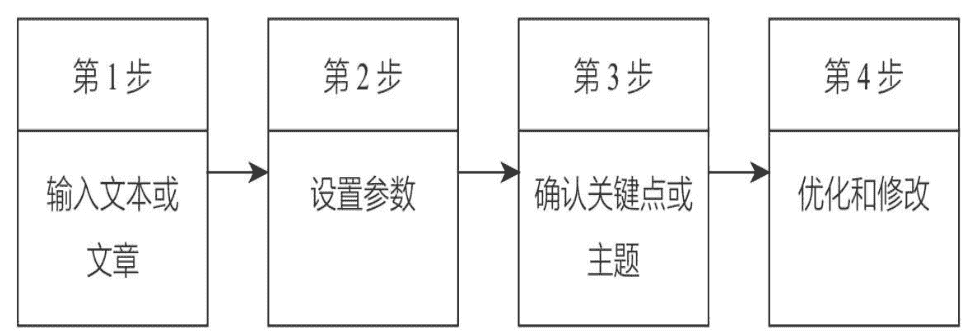
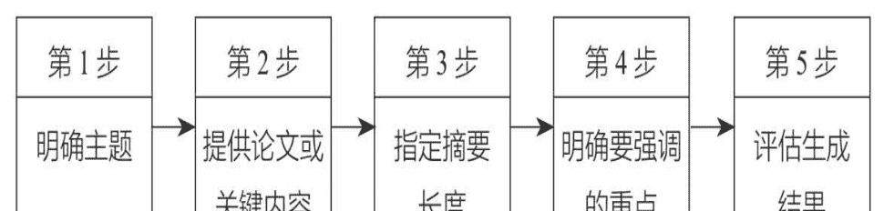
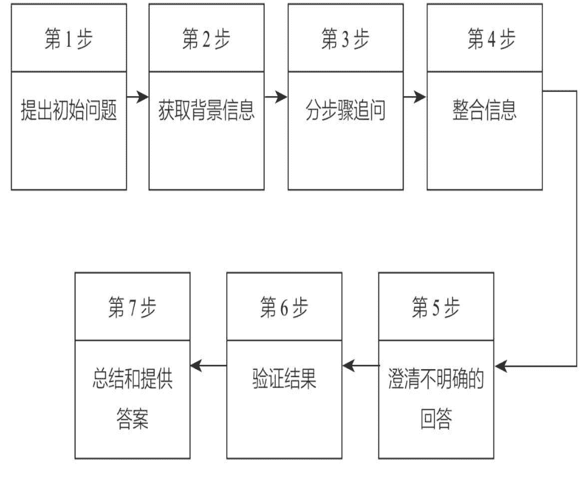

# ChatGPT 提问与追问进阶攻略

# 内容概览

本书聚焦怎样向 ChatGPT 提出有效问题并做持续追问。首次提问决定初稿质量，后续追问决定结果能否被不断打磨优化。

全书围绕指令式提示、身份设定式提问、带约束条件提问、归纳总结式追问、延展深化式追问、逻辑自洽式追问、上下文衔接式追问、归类整理式追问、分步模块化追问等维度展开，把提问与追问的操作路径拆解清晰。

适合初识 ChatGPT 的学习者阅读使用，对期望提升工作效能的教师、讲师、顾问及管理者尤为实用，也适合用生成式工具解决日常工作生活问题的广大爱好者。

# 推荐序1

## 用 ChatGPT 筛选噪音 实现提效增智

当下资讯总量持续膨胀，职场人士、自由职业者、学生、授课者与创业者普遍面临资讯过载困境。迫切需要一种能过滤资讯、锁定焦点、快速给出答案的精准助手。

ChatGPT 的出现并迅速在办公场景落地，明显改写了工作效率与问题解决方式，也释放了智能创造的潜能。

该模型由 OpenAI 团队打造，是基于深度学习与海量语料训练的自然语言处理大模型，能理解人类表达并返回连贯智能的回复。这一技术对提升学习与生活的效率、增加便利感作用显著。未来无论在商业场景还是个人层面，该模型都将成为不可或缺的辅助伙伴。

《玩转ChatGPT：秒变AI提问和追问高手》通俗地讲解了怎样向该模型提出条理清晰的问题，并从回复中提取所需信息。不论是学术、业务、实用建议还是兴趣爱好，只要方法得当，就能得到可参考的答案。

书中不仅讲述与该模型高效互动的方法，还用大量案例展示其在各领域的落地。学生、职场人、自由职业者都能依此练习，成为提问追问的高手，快速解题、提升学习效率。

这不仅是一本使用手册，更是一本迈入智能时代的导航书。通过该模型，我们能更好运用智能技术，解读资讯洪流，高效工作生活，创造更美好的未来。

当然，该模型作为智能代表，带来了便利与创造力释放。但要保持清醒，充分认识技术边界，避免过度依赖。科技是服务人类的手段，不是取代人类思考的存在。思维与创造力才是根本。

未来，该模型将与 AIGC 工具一起成为工作生活的伙伴，助力解读资讯、提升创造效率。人人都会成为 AIGC 的使用者，用它改写工作与生活。

我由衷推荐给所有希望提升问题解决与资讯获取效率的读者。

祝愿本书帮助大家拥抱智能，掌握 ChatGPT 精髓，成为提问追问高手，开启智能化学习工作新方式。

郑吉敏
去哪儿旅行技术总监、业务架构SIG负责人、人工智能委员会常委

# 推荐序2

敬启读者：

在数据与技术驱动的时代，我们更需要与智能系统有效沟通，以获取准确有价值的资讯。唐振伟先生的新作《玩转ChatGPT：秒变AI提问和追问高手》极具洞察力，既指导读者怎样与 ChatGPT 等对话系统有效沟通，也教授如何深挖资讯，获得更丰富精准的回复。

作为长期从事智能研究的从业者，我深知精准提问的重要性。本书详细阐述各类提问与追问技巧，帮助读者最大化工具价值。既讲基础提问，也深入讲解连贯、深化的追问方法。

内容覆盖提示词选择、身份设定到复杂追问，教师、学生、讲师、咨询师、管理者以及对智能技术感兴趣的爱好者都能受益。尤其对希望提升工作效率和解决问题的专业人士而言，是不可或缺的资源。

本书不仅是技术指南，更是启发思考的读物。阅读后读者不仅学会与智能有效沟通，还能培养更严谨深入的思考习惯。

我强烈推荐给所有希望在智能时代保持竞争力的读者。愿你通过本书不仅成为提问追问高手，也能在资讯海洋中驾驭智能，捕捉最有价值的知识。

朱晓庆
北京人工智能学会副秘书长
2023年12月6日

# 前言

智能技术高速发展，正在重塑我们的生活。资讯爆炸时代，获取正确有效资讯的难度与日俱增。

学会智能提问与追问，才能真正驾驭 ChatGPT。与 ChatGPT 等 AIGC 工具对话时，若想拿到结果并持续优化，掌握提问追问方法至关重要。

本书的定位是授人以渔。致力于帮助读者快速掌握 ChatGPT 等 AIGC 工具的核心用法，迅速成长为提问追问高手，实现工作效能和质量的倍数提升。

本书紧扣实用方法、案例和应用，通过生动案例演示，帮助读者即学即用。

提问方法部分聚焦：善用身份设定提问，从多角度获多样化答案；运用给定标准提问，让回复更具体准确；明确任务与目标提问，快速抓住核心；灵活使用关键词提问，引导模型聚焦；限定范围并提示要点提问，缩小范围获得针对性答案。

追问方法部分包含六大策略：归纳总结追问深化理解；延伸扩展追问拓宽资讯面；强化自洽追问确保逻辑完整；联系上下文追问把握对话脉络；聚类分类追问整理问题与答案；分步骤与模块追问实现系统化解答。

书中设置特色栏目，提出提示词提问的五大维度：问的角度、问的技巧、问的思路、问的原则、问的逻辑。五维度助力全方位思考，大幅提升获取有用资讯的成功率。

同时指导读者在实战中运用12类追问方式：用条件追问、用细节追问、用需求追问、用范围追问、用否定追问、用要求追问、用假设追问、用推理追问、用建议追问、用比喻追问、用错误追问、用措施追问。

通过学习，你将全面理解智能提问追问的核心，提升与智能体对话的表达力和解决问题的能力。无论是工作资讯获取，还是逻辑思维与创造力培养，本书都能帮助你快速掌握驾驭 ChatGPT 的实用方法。

感谢选择本书，愿它为你的智能探索之旅提供价值知识和实战技巧，收获圆满成功。

# 第1章 AI指令提示工程：原理、实践与提问技巧

## 1.1 AI指令提示工程的基本原理

### 1.1.1 指令文本设计：激活 ChatGPT 潜能的钥匙

提示词是用户向智能体下达任务指令的文本，是问答对话中的指导性内容。

提示词像一把钥匙，能开启与智能体顺畅愉快的交流。运用得当，就能清晰传达需求，让模型给出更贴合预期的精准答案。提示词的质量决定对话效果与使用体验。学会使用提示词，相当于掌握了一套通用的万能公式，能准确表达问题并引导生成想要的输出。

该公式主要包含五方面。

1. 明确任务类型。提示词需说明希望生成哪类文本，如描述、解释、比较、总结等。如“为市场经理撰写一份工作日报”“以暑期诗意打卡为主题提供旅游攻略”“写一首赞美程序员的诗歌”。

2. 限定讨论范围。提示词需说明主题或具体领域。如“为智能软件产品经理撰写不少于500字的工作月报，需包含本月工作、发现问题及未来计划”。

3. 设定输出格式。提示词需说明希望的呈现形式，如列表、段落、表格等。如“制定周一至周五的健身与饮食计划，并用表格输出”。

4. 限定语言风格。提示词需说明语气、风格或口吻。如“请用《大话西游》中唐僧的语气介绍至尊宝”。

5. 给定关键信息。提示词需提供关键要素，以便获得更符合需求的答案。如“扮演资深股票投资经理，分析中国平安基本面及成长性，并用柱状图输出2016—2020年营收”。

什么是智能指令提示工程技术？提示工程师需要什么能力？让 ChatGPT 来解答。智能指令提示工程是通过设定特定提示信息引导模型生成符合要求的文本的技术。

核心任务包括：指明具体任务、细化任务说明、角色定位、种子词提示、提示公式设计、提示要点约束等。优秀的提示能帮助用户更好控制输出，获得更准确针对的结果。

提示工程师负责设计、开发、优化模型的提示策略，提升输出的准确性与可用性。需具备智能与机器学习基础、自然语言处理能力、问题定义与任务转化能力、提示设计与优化能力、数据分析与评估能力、编程与技术能力等。提示工程师与数据科学家、机器学习工程师和领域专家协作，通过精细提示让模型输出更可靠有用。

对普通用户而言，学好智能指令提示词的意义在于：提升效率、降低错误率、提升可理解性、省时省力、满足个性化需求，让模型更懂自己的意图。

### 1.1.2 模型与方法选择：挑对工具事半功倍

选择生成提示方法和模型时，可考虑以下因素。

数据规模与多样性，就像研究需要大而全的资料库，模型需海量多样的数据学习。

模型架构，可理解为智能体的思维方式，需匹配任务需求。如问答类任务可选择基于语言大模型的方案。

性能表现，关注运行速度、准确性、稳定性与可靠性。

数据预处理，相当于整理资料，使输入更规范一致。

目标任务，明确任务类型后选择适配的提示方法和生成模型。

计算资源，训练与部署需要足够的算力与存储。

可解释性，在法律、医疗等关键领域需理解决策依据。

综合考虑这些维度，才能选出合适的提示方法与生成模型，解决实际问题。

### 1.1.3 结果优化：通过变换提示提升生成质量

优化生成结果常用方法是通过变换提示词引导回复，使其更贴合期望。

例如原始问题“如何照顾植物？”，得到的是笼统建议。变换为“如何有效地照顾室内盆栽植物？”，答案就会具体到光照位置、浇水频率、有机肥使用、落叶清理、修剪扶正等室内场景要点。

通过让问题更具体、更指向场景，模型的回复也会更实用、更具针对性。灵活运用变换提示，可获得更个性化详细的输出。

## 1.2 AI提示实践：从数据到精彩回答

### 1.2.1 设计原则与注意事项

设计提示时需注意以下原则。

遵守法规，不得输出违反中国法律法规、政治相关或敏感内容。

语言简洁明了，符合阅读习惯，提示语要明确具体，避免模糊晦涩。

#### (3) 引导力要足
提示词最好具备牵引作用，能推动用户进入思考与创作状态，同时表达通俗易懂，让人愿意接受并顺畅使用。

#### (4) 通用性要好
提示词的设计要尽量普适，覆盖不同场景与不同领域的使用者。建议采用大众化、易理解的表达，少用冷僻的专业术语和行业黑话。

#### (5) 类型要多元
提示词应涵盖多种形态，以匹配用户多样化的需求与创作欲。可尝试切换主题、情绪、风格与呈现形式，为用户提供更富创意的挑战。

#### (6) 篇幅要精炼
提示词不宜过长，要避免冗余与重复。优先使用简洁清晰的短句，让用户能快速get要点并直接操作。

#### (7) 印象要鲜明
提示词要有辨识度与记忆点，让人过目不忘。可适度加入趣味、幽默或抓人眼球的元素，提升创作乐趣与参与粘性。

#### (8) 适配要兼容
提示词在设计时要兼顾不同终端、设备与平台的显示效果，确保在各种环境下都能正常呈现与可用。

总的来看，AI提示的设计要合规合法，语言要简明易懂，引导性、通用性要强，同时兼顾多样性、精炼性、鲜明性与兼容性，从而满足用户需求，提升参与感与满意度。

（注：以上内容由ChatGPT生成，未改动。）

#### 用户提问
如何设计AI提示才能让用户“玩上瘾”？有哪些具体的方法？

#### ChatGPT回答
要让用户持续沉浸在AI提示的互动中，可以从以下几个具体方向入手。

- （1）**强化趣味性**：选用有趣、抓人眼球的提示词，点燃用户的好奇心与兴趣。比如加入幽默、随机性或解谜式的设定，让每次生成都像一次新挑战。
- （2）**保持多样性**：提供丰富的提示词组合，让用户能探索不同创作路径。可提供不同情感基调、风格调性或主题方向，使用户感觉可能性无穷。
- （3）**加入竞技与协作**：引入对战或合作的机制，让用户可与他人比较或共同创作。例如设立排行榜，用最短时间或最佳质量完成任务来激发竞争意识。
- （4）**设置激励机制**：通过奖励推动持续参与。如解锁新提示词、授予特殊称号或发放虚拟奖品，让用户获得成就感与回报感。
- （5）**打造互动体验**：让用户与AI产生真实对话感。设计问答、角色扮演或轻量互动游戏，增强用户对AI的连接感。
- （6）**支持社交传播**：允许用户将生成作品分享给他人。分享、展示与比较会放大社交互动，提升留存。
- （7）**持续更新迭代**：定期上新提示词与功能，保持新鲜感与探索欲。用户会期待新的玩法与更多可能性。

归纳起来，通过趣味、多样、竞技协作、激励、互动、社交分享与持续更新，可以设计出让用户上瘾的AI提示，让人乐在其中并持续回访。

> （注：以上内容由ChatGPT生成，未改动。）

### 1.2.2 优化与评估：打造精准有效的AI提示

#### 用户提问
AI提示的优化策略有哪些？具体的评估方法有哪些？如何对AI提示进行精准打造，才能更高效地获得你想要的AI生成结果？

#### ChatGPT回答
优化AI提示的策略主要包括：

- 1. **表达要清晰**：避免模糊或歧义表述。用具体的问题或指令来指引AI的方向。
- 2. **信息要充分**：在提示中补充足够的背景语境，帮助AI更准确理解需求并生成相关答案。
- 3. **鼓励多样输出**：尝试不同措辞与提示风格，激发AI产出多样化结果。可融入情感化语言、趣味例证或不同口吻。
- 4. **控制输出长度**：设定长度限制，让AI聚焦核心，减少冗长与偏离。
- 5. **闭环迭代**：依据生成结果进行评估反馈，持续调整提示设计。

评估AI提示的方法主要有：

- 1. **主观评审**：人工判断生成内容是否契合需求。可设定准确性、连贯性、可读性等评价维度。
- 2. **客观校验**：将输出与事实或专家知识对照，检验其正确性与可信度。
- 3. (3) 用户反馈：收集使用者对回答的满意度与改进建议，用真实使用感受来衡量效果。
- 4. A/B测试：把不同版本提示放在同一场景下对比，依据交互数据与反馈挑选最优方案。

精准打造AI提示的方法如下：

- (1) 把握用户意图：深入理解问题本质，明确期望的答案类型、内容与风格。
- (2) 选用具体用语：用清晰简练、无歧义的语言撰写提示。
- (3) 给出明确指令：在提示中提出明确的问题或要求，引导AI产出符合期望的结果。
- (4) 注入上下文：提供与问题相关的背景信息，帮助AI把握细节，提升回答精度。
- (5) 持续迭代：在评估与反馈基础上不断优化提示的内容与形式，以获得更高效、更满意的生成结果。

通过上述做法，可以提升提示质量与准确度，使其更好地贴合用户需求并产出理想结果。

> (注：以上内容由ChatGPT生成，未改动。)

### 1.2.3 常见问题解答：AI提示的挑战与应对

#### 用户提问
AI提示的常见问题有哪些？主要挑战有哪些？请给出相应的应对策略。

#### ChatGPT回答
在AI提示实践中，常见问题与应对思路如下。

##### 1. 生成结果的准确性
提示可能导致AI输出错误或误导信息。可采取：
- (1) 补充背景：提示中加入更多上下文，帮助AI理解需求与问题背景。
- (2) 事后核验：对生成内容进行客观校验，与事实或专业知识比对。

##### 2. 回答的连贯性
输出常出现逻辑不清、语义跳跃。可采取：
- (1) 指令要明确：在提示中给出清晰的提问或指令，引导连贯表达。
- (2) 引用上下文：在提示里带入前文或关联信息，保持逻辑连贯。

##### 3. 语言风格和口吻
AI可能无法匹配特定风格或语气。可采取：
- (1) 提供范例：在提示中给出目标风格的示例供参考。
- (2) 引导多样化：尝试不同表达方式，激发AI输出特定语气与风格。

##### 4. 生成结果的可控性
难以完全掌控AI产出方向。可采取：
- (1) 限制长度：通过字数或段落限制，减少冗余与偏离。
- (2) 迭代优化：根据结果反馈持续调整提示设计，逐步提升可控性。

##### 5. 遵循法律和伦理要求
合规是重要挑战。可采取：
- (1) 设置边界：在系统中预设约束条件，限定敏感或违规内容。
- (2) 建立审核：对生成结果进行人工或自动筛查，避免违法、有害或敏感输出。

借助以上策略，可有效化解常见问题，提升结果质量与合规性。

> （注：以上内容由ChatGPT生成，未改动。）

## 1.3 AI提问和追问技巧：从入门到精通

### 1.3.1 基础技巧：具体、明确、清晰、有趣的提问

经过对多款AIGC工具的长期测评，我们总结出初学者可快速上手的五大基础提问方法，具体如下。

- (1) 角色扮演：为自己与ChatGPT设定更具体、清晰的角色定位。
- (2) 给定标准：对ChatGPT进行标准化“调教”，让它更懂你的偏好。
- （3）**明确目标**：清楚表达需求与期望达成的结果，提升回答针对性。
- （4）**抓住重点**：用清晰简洁且有趣的方式表述问题，善用关键词提示。
- （5）**限定范围**：要求ChatGPT收窄回答范围，甚至限定语言风格。

下面由ChatGPT来进一步解读并举例说明。

#### 用户提问
初学者可以快速上手的五大基础提问技巧包括**角色扮演、给定标准、明确目标、把握关键和锁定范围**，请进行详细解读，并举例说明。

#### ChatGPT回答
（1）**角色扮演**：为对话双方设定具体角色。例如把自己想象成科学家、历史爱好者或旅行者，以此引导ChatGPT产出更贴合角色的回答。

（2）**给定标准**：在提问前明确输出期望，如希望得到详细解释、简洁概括或专业观点，帮助模型对齐你的需求。

（3）**明确目标**：清楚说明想要达成的目的与背景信息，让ChatGPT更精准把握你的意图。

（4）**把握关键**：用简洁清晰且富有趣味的方式提问，并提供关键词与重点信息，帮助模型快速理解核心。

（5）**锁定范围**：要求模型限定回答边界，可指定具体议题或采用幽默、正式、科普等特定语体，提升可控性。

运用以上技巧，可以更有效地引导ChatGPT，获得准确且有趣的输出。祝使用顺利！

在角色扮演中，你可以想象自己是一位历史学家，向ChatGPT提问关于文艺复兴时期的艺术。

- 1. **角色扮演：** 作为历史学家，我对文艺复兴艺术很感兴趣。想请ChatGPT讲解达·芬奇在该时期的绘画技法及其艺术影响。
- 2. **给定标准：** 希望ChatGPT以专业视角作答，给出详尽解释，以便理解其手法与贡献。
- 3. **明确目标：** 我想要一份关于达·芬奇绘画技巧的简明全面介绍，以及他对文艺复兴艺术影响的概述。
- 4. **把握关键：** ChatGPT能否说明达·芬奇在文艺复兴时期的绘画风格、用材以及透视上的创新？这有助于认识他在艺术发展中的地位。
- 5. **锁定范围：** 我只关注达·芬奇在文艺复兴时期的绘画技巧与艺术影响，请用正式专业的语言风格回答。

当你以旅行者的角色提问时，可参考以下案例。

- 1. **角色扮演：** 作为热爱探险的旅行者，我对南极自然景观很感兴趣。希望ChatGPT描述那里的壮丽冰川与野生动物。
- （2）给定标准：期望ChatGPT以生动的方式呈现景观，并详细描述冰川与野生动物的外貌、行为与特点。
- （3）明确目标：希望获得南极冰川的概况，包括成因、独特性与代表性冰川，同时了解企鹅、海豹、鲸鱼等常见动物。
- （4）把握关键：请描述南极冰川的景象，以及一两处著名冰川。另请介绍常见野生动物的特征与生存方式。
- （5）锁定范围：我只关心南极自然景观、冰川与野生动物，请用生动有趣、通俗的语言作答。

从以上案例可见，将角色扮演、标准设定、目标明确、关键把握与范围锁定结合使用，能更好地引导ChatGPT回答旅行与探险相关问题。请在提问时使用具体词汇与形象描述，以获取精彩描绘。

（注：以上内容由ChatGPT生成，未改动。）

### 1.3.2 高阶技巧：精准引导ChatGPT的持续追问技巧

进阶使用者需要掌握高阶追问方法，以更准确地追问、更精准地引导对话走向，掌握与AI互动的主动权。

具体的高阶追问技巧包括但不限于以下六个。

- （1）概括总结追问。
- (2) 延伸扩展追问。
- (3) 强化自洽追问。
- (4) 联系上下文追问。
- (5) 聚类分类追问。
- (6) 分步骤与模块追问。

下面继续由ChatGPT详细解读并举例。

#### 用户提问
请对AI生成的以下六个高阶追问技巧进行详细解读，并举例说明。
- (1) 概括总结追问。
- (2) 延伸扩展追问。
- (3) 强化自洽追问。
- (4) 联系上下文追问。
- (5) 聚类分类追问。
- (6) 分步骤与模块追问。

#### ChatGPT回答
以下是对六个高阶追问技巧的更详细说明。

##### 1. 概括总结追问
先理解对方观点，再用简洁语言复述其核心。这种追问有助于确认理解并推动对话深入。
例如与流行文化专家讨论喜爱的电影后，可追问：“在我理解中，这部片子之所以出色，是因为剧情、角色塑造或其他原因吗？”

##### 2. 延伸扩展追问
基于既有话题，结合自身知识提出深入问题，促使讨论更宽更深。
例如讨论新手机时可问：“这款手机处理器的性能如何？运行系统是哪一种？界面响应是否灵敏？”

##### 3. 强化自洽追问
用相关事实与数据佐证对方观点，强化其合理性与说服力。
例如得知某城市人口增长后，可问：“该城市经济是否同步增长？哪些因素促成了人口增长？”

##### 4. 联系上下文追问
当情境不明时，通过追问背景信息帮助模型更准确理解并作答。
例如讨论某国文化活动时，可问：“该国的文化活动有何独特性？文化如何影响社会与人民生活？”

##### 5. 聚类分类追问
整理归纳信息时使用，快速厘清话题各方面。
例如谈电影类型时可问：“你偏爱的类型有哪些？这些类型在内容与故事上有什么共同点？还有哪些类型值得推荐？”

##### 6. 分步骤与模块追问
将复杂议题拆分为步骤或模块逐步探究，获得更细致回答。
例如规划学业时可问：“下一步打算报考哪所大学的什么专业？对该专业兴趣如何？涉及哪些基础与进阶课程？是否计划实习或参与研究？”

需要注意的是，ChatGPT的提问与追问技巧远不止上述5个基础与6个高阶方法，但对普通用户而言，这11种是最常用、最实用的，掌握即可满足大部分需求。

此外，任何技巧都不是孤立使用的，往往需要组合运用，才能更好地借助ChatGPT。

同时，ChatGPT只是工具，其回答仅供参考，最终仍需“AI生成+人工整合”来达成目标。自身的能力与判断不可或缺，不要寄望它包办一切。它是优秀的助手，但使用者仍是工作与生活的真正主导者。

# 第2章 角色定位提问：与ChatGPT玩“角色扮演”

与ChatGPT进行角色扮演可探索不同角色与场景下的对话方式与语言风格，了解各角色的常见问题与挑战，提升互动趣味性，帮助模型更好地理解不同场景诉求，进而获得更符合预期的答案。

## 2.1 用户自身定位：让ChatGPT“看人下菜碟”

### 2.1.1 设定自我：开启与ChatGPT的互动之旅

在向ChatGPT提问时，设定身份非常有价值。身份能提供专业领域、知识背景、需求与兴趣等信息，有助于模型更准确、相关性更高地给出有价值的答案。

#### 用户提问
我是一家传媒公司的HR，请问我应该建设什么样的企业文化？

#### ChatGPT回答

传媒企业文化如何扎根：六个关键抓手

企业文化从来不是一蹴而就的墙面标语，而是要紧扣公司定位、发展目标、核心价值观以及一线员工的真实诉求，在日常里持续沉淀。对于传媒行业而言，节奏快、迭代快、情绪牵动大，文化建设更要贴合行业特性。下面是可落地的思路参考。

**创新与创意驱动**
传媒的生命力在于新鲜感。营造敢想敢试的氛围，可以通过设立创新奖激励机制、定期开展创意工作坊与跨界培训、建立“点子池”鼓励全员随时提交灵感等做法，把创新从口号变成习惯。

**以用户为中心**
内容和服务是传媒的核心资产。要让“用户第一”成为默认设置，可以搭建常态化的用户反馈通道，做周期性的需求调研，并要求产品与内容团队快速响应并闭环反馈，用真实的声音校准方向。

**协作共赢的团队精神**
从选题、采编到投放，传媒工作环环相扣。强化集体作战意识，可以通过主题团建、项目制协同、以及以团队为单位的绩效认可等方式，拉近部门距离，让支持成为自然反应。

**承担社会责任**
媒体影响力大，社会期待也高。文化中要融入担当意识，例如组织企业公益行动、支持员工参与志愿服务、引导团队关注并理性讨论社会热点，让品牌价值与社会价值同频。

**持续学习与成长**
知识半衰期极短，团队必须保持学习惯性。可提供系统化培训资源和外部进修机会，鼓励自我驱动提升，并设立学习成果激励，让成长可见、可量化。

**结果导向的绩效文化**
在保证内容品质的前提下，要有清晰的考核标尺。建立透明的绩效评估体系，倡导以结果为导向的工作习惯，并配套绩效激励机制，让优秀者被看见、被认可，企业活力得以稳健释放。

总体来看，传媒公司的HR在做文化落地时，需要同时兼顾创意活力、用户敏感度、协作力、社会担当、学习能力和结果意识，并用制度、机制、活动把这些价值转化为日常行为，才能让企业文化真正生根发芽。

（注：以上内容由ChatGPT生成，未改动。）

- **(8) 波动面前稳住心态：** 市场行情本就起伏，偶尔会出现较大幅度的回调。巴菲特的思路是不要被情绪带跑，在震荡中保持克制，用企业的内在价值作为决策依据。
- **(9) 让学习成为常态：** 投融资环境一直在变化，保持好奇心、不断补充专业知识、提升实操能力是长期投资者的底牌。
- **(10) 需要时引入专业力量：** 对方向拿不准，可以向持牌理财顾问求助，获取更具针对性的判断。

以上三点都源自巴菲特的投资哲学，要留意的是投资自带不确定性，不同人风险偏好和策略不同。行动前先审视自身财务状况与目标。

AIGC在多个知识域都有覆盖，推理能力也不错。把模型设定成不同专业的专家角色，就能借助其经验获得多元视角的参考。这种跨学科的探索方式，有助于形成更立体的认知。

#### 用户提问
假设负责一个以养老为主打的楼盘策划，需要从《诗经》里提炼一个契合的名字，会怎么选？

#### 文心一言的回应
《诗经》里大量描写的自然、和睦、安宁意象很适合老年社区命名。提供几个可参考的方向：

- (1) 宜家：出自《诗经·国风·周南·桃夭》“之子于归，宜其室家”，传达居住合适、家室和美。用作项目名能体现温馨和谐的属性。
- (2) 静安：化用《诗经·国风·周南·汉广》意境，强调安宁平和。命名后更符合养老群体的宁静需求。
- (3) 和乐家园：源自《诗经·小雅·常棣》“和乐且孺”，突出家庭和美、生活愉悦，契合社区氛围。
- (4) 乐康：取自《诗经·小雅·南山有台》“乐只君子，万寿无期”，寓意快乐健康，契合健康养老理念。

> (注：以上内容由文心一言生成，未改动。)

文心一言的产出贴合诗经气质，同时很好地凸显了养老项目的特质。名字既有文化厚度，又能传递温馨、宁静、幸福等感受，利于品牌辨识与文化塑造。

#### 用户提问
如果是一位营销专家，如何给一家初创企业提供提升品牌认知度的实操打法？

#### 大模型的回应
可以从十个角度切入：

1. **厘清目标客群与竞争格局**：明确受众需求与对手优势，为策略提供依据。
2. **塑造清晰的品牌形象**：确定定位与价值主张，并持续对外传递。
3. **渠道组合投放**：社交平台、搜索优化、邮件触达、内容分发、线下活动等协同使用。
4. **生产优质内容**：博客、短视频、图文等具吸引力与差异性的素材。
5. **放大口碑效应**：以好产品好服务让用户自发传播。
6. **经营社交媒体**：制定互动性强的社媒计划，提升曝光与关系。
7. **做好搜索可见度**：优化网站结构与关键词，提升自然排名。
8. **寻求合作与赞助**：借助相关品牌或机构的声量扩大影响。
9. **个性化定制**：依受众偏好提供定制服务，增强记忆点。
10. **用数据指导优化**：收集行为数据，持续迭代投放与内容策略。

不同企业情况各异，需结合自身特点制定个性化方案。

#### 【问的原则】
(1) 先锁定行业领域。可先问：“我需要医学视角，能否给出相关参考？”
(2) 提出具体诉求。明确领域后描述实际困惑，例如医疗保险选择。
(3) 提供背景情境。补充健康、财务等背景，提升建议针对性。
(4) 依据行业特点提问。医学侧重预防治疗，金融侧重策略与风险等。

# 第3章 给定标准提问：引导模型更懂你的需求

## 3.1 设定标准：让模型更好理解

### 3.1.1 预设标准：善用提示提升回答质量

预设标准在对话中应用很广，如在自然语言处理里通过规则设定让模型更准确地理解与生成。

预设标准能帮助模型更灵活地把握意图，给出更规范的输出。为获得清晰回应，可在提问时采用以下做法。

- (1) **给出明确定义**。引入新概念时附上解释，确保含义一致。
- (2) **问题表述清晰**。避免模糊歧义，让意图易被识别。
- (3) **说明期望形式**。指出是否需要详解、资料、建议或简短回复。
- (4) **提供示范案例**。用场景或示例辅助理解。
- (5) **拆解为可执行步骤**。把复杂任务拆成小步。
- (6) **把需求细化**。提供偏好、预算、时间等限制。
- (7) **关联上下文**。置于行业背景中，说明适用范围。
- (8) **使用相关引导词**。用关键词帮助模型聚焦。
- (9) **反馈后调整**。根据输出补充说明、举例或澄清。

总体而言，预设标准对准确性和可靠性很关键，上述做法可促进模型对标准的理解与应用。

#### 用户提问
希望获得健康方面的建议。首先想了解饮食的基础原则。其次对新手适用的训练方案与提升活力方式感兴趣。近期常感疲劳且入睡困难，也想知道改善睡眠的方法，包括睡前习惯。最后想了解提升精力与警觉性的综合建议，涵盖饮食、生活与锻炼。请提供参考。

#### 大模型的回应
可以。下面分四块简要说明。

**饮食基础原则：** 做到均衡摄入、保持充足饮水、多吃新鲜蔬果、少碰加工和高糖食品。每餐包含蛋白、好脂肪和膳食纤维，控制分量。

**训练相关信息：** 新手可从轻度有氧如散步、骑行、游泳起步，循序渐进提升强度与时长。提升活力可尝试间歇训练与瑜伽，训练前后做热身与放松，避免过度。

**改善睡眠质量：** 保持规律作息，睡前避开咖啡因与大量进食。营造舒适环境，调好温度，减少床上使用电子设备。深呼吸与冥想有助于放松入睡。

**提升精力与警觉性：** 综合饮食、作息与运动。保证饮水、不跳过早餐，多摄入蛋白与好脂肪。规律有氧可提升能量，充足睡眠同样重要。

结合个人情况选择合适做法，开始新计划或重大生活改变前建议咨询医生或专业人士。

(注：以上内容由大模型生成，未改动。)

模型从饮食、运动、睡眠、精力四个维度作答，内容较为完整。如需深入可针对某点继续追问。

#### 【问的技巧】
上述提问通过设定关键词、提供关键信息、细化需求、明确期望等手段，先行设定了标准，从而获得较详尽的回答。后续追问仍可沿用这些做法。

#### 用户提问
在饮食原则里提到有益脂肪，能否解释什么是有益脂肪以及代表食物有哪些？

#### 大模型的回应
有益脂肪主要指单链不饱和脂肪酸与多链不饱和脂肪酸，对心血管与大脑发育有益。主要来源包括：

- 鱼类：深海鱼如三文鱼、鲭鱼、沙丁鱼，富含Omega-3；鱼油也是来源。
- 坚果：核桃、杏仁等，富含单链与多链不饱和脂肪酸。
- 植物油：橄榄油、葵花籽油、亚麻籽油等，其中亚麻籽油与葵花籽油含Omega-3。
- 种子：南瓜籽、芝麻、亚麻籽等。
- 豆类：大豆、鹰嘴豆、扁豆等，也含丰富多链不饱和脂肪酸。

适量摄入有助于降低心血管疾病风险，并对肝脏健康、情绪、认知等有积极作用。选购时可优先选择富含这类脂肪的食物。

(注：以上内容由大模型生成，未改动。)

### 3.1.2 高效提问：快速获得标准化问题

在对话中，高效提问能提升效率。其一种做法是先让模型生成标准化问题，再据此追问。

可采用以下方法让模型快速产出标准化问题。

1. **明确目标**。先确定想获取的信息点，有助于模型生成相关问题。
2. **使用模板**。准备含结构、关键词、占位符的模板，模型填充后生成具体问题。
3. **指定类型**。明确选择题、填空题等格式，帮助模型匹配。
4. **使用开放性问题**。开放式问题可获得更深入回答，可要求模型生成此类问题。
5. **设置关键词或范围**。以明确范围为基础生成问题，避免模糊表述。
6. **评估质量**。检查清晰度、准确性与一致性，不符预期时再优化。

#### 用户提问
请生成一个关于股市行情的标准化问题。

#### 大模型的回应
标准化问题指依据特定准则来衡量或解决问题的提问。在股市中，一个标准化问题可以是：“如何判断一只股票是否契合投资准则与个人风险承受度？”

该问题可引导讨论投资者如何依据目标、风险偏好等要素选择合适标的。标准化思路可能包括财务数据分析、公司基本面评估、宏观环境考量、技术分析等。不同人标准各异，但此问题有助于做出更理性的决策。

(注：以上内容由大模型生成，未改动。)

该问题围绕股市行情主题，聚焦股票信息。若不符合需求可重新提问。

#### 【问的技巧】
上述提问以开放方式要求模型生成关于股市行情的标准化问题。生成后可评估是否符合实际需要，符合则继续追问，不符则要求重生成。重生成时可划定范围、设定关键词，使问题更贴合需求。

#### 用户提问
请生成一个判断某只股票是否值得投资的标准化问题。

#### 大模型的回应
评估股票投资价值需综合多因素。一个详细的标准问题可以是：“在决定是否投入资金买入某只股票时，应考虑哪些具体标准与指标？请逐一列出并解释，包括但不限于财务健康、市场环境、行业前景、管理质量、竞争优势、风险管理、估值等。如何综合运用这些指标评估标的的投资潜力与风险，以支持理性决策？”

该问题能引发全面讨论，涵盖财务报表、盈利历史、增长预期、行业分析、市场趋势、竞争地位、管理团队、风险策略、估值方法等。综合分析有助于投资者更全面地判断是否值得投资。

(注：以上内容由大模型生成，未改动。)

## 3.2 构建问题集并喂养模型

### 3.2.1 由简到繁：生成问题与答案

若用户难以准确提问，可通过以下步骤让模型自行生成标准化问题及答案。

#### 1. 明确主题
先明确想了解的事项或主题，对主题有基本认识，以便提供足够上下文，用简单问题的形式呈现主题。

#### 用户提问
关于人工智能，能否告诉我一些信息？

#### 大模型的回应
人工智能通常指计算机科学的一个分支，旨在开发能模拟人类智能行为的系统。以下是一些基本信息。

定义：人工智能是计算机科学分支，目标是开发能执行需智能思维任务的系统，包括学习、推理、问题解决、语言理解、感知等。

(注：以上内容由大模型生成，有删节。)

#### 2. 观察回答并提取关键信息
模型会尝试回答引导问题并提供相关信息。用户可仔细阅读，从中提取关键词和核心概念。

从上述回答中可提取关键词：人工智能、计算机科学领域、模仿人类智能行为、系统，以及人工智能的定义等核心概念。

#### 3. 生成标准化问题
基于提取的关键信息，向模型提问，要求其据此生成标准化问题。

#### 用户提问
请根据“人工智能、计算机科学领域、模仿人类智能行为、系统”等关键词，生成一个关于人工智能的标准化问题。

#### 大模型的回答

聊起 AI，第一反应往往是一连串的老生常谈：从计算机科学的视角看它到底怎么落地？最核心的追求是什么？怎样呈现出近似人类的智能表现？又能支撑起哪些真实的应用？

（注：以下内容为模型生成，已做删减。）

#### 4. 反向回填标准化问题
把模型自己产出的标准化提问再喂回去，让它对自问自答的问题做出回应。

#### 提问内容
AI 在计算机科学里怎么落地？核心诉求是什么？如何呈现类人智能？能搭建哪些系统？

#### 模型回应
关于落地逻辑、追求方向、模仿手段以及可搭建的类型，可归纳为以下要点。

##### 1. 落地路径
AI 依靠算法、模型与程序呈现。经海量数据训练与学习后，能表现出类人智能的特征。

##### 2. 核心追求
学习与自适应：系统要从数据中习得规律，并持续优化以应对新场景与新任务。
自主决策：部分方案被设计为可独立判断，无需人工干预，例如自动驾驶汽车。

##### 3. 模仿人类智能行为
机器学习：让计算机从数据中提炼规律，如监督学习、无监督学习与强化学习，以逼近人类的学习能力。
自然语言处理：借助算法理解与生成人类语言，用于对话、翻译与文本分析等。

##### 4. 可搭建类型
虚拟助手：如 Siri、Alexa，可答疑、执行任务并与用户互动。
自动驾驶汽车：具备感知、决策与控制能力，可在无驾驶员情况下行驶与导航。
医疗诊断工具：用于分析医学影像或数据，辅助医生诊断并制定治疗方案。

总体来看，AI 的实现与目标在于用计算技术模拟并增强类人智能，打造能在不同领域完成多样任务的智能方案。

（注：以下内容为模型生成，已做删减。）

#### 5. 核对结果
阅读模型的回复，判断是否覆盖所需信息。若不够完整或不准确，可进一步追问或重写问题以获取更详尽内容。

阅读后认为，模型从实现方式、主要目标、模仿行为、可搭建系统四个维度，对提问作出了较为全面细致的回应。

#### 6. 反复优化
若仍需更多信息，可持续迭代该流程，让模型生成新的标准化问题并尝试作答，直至满意为止。

#### 用户提问
我对你提到 AI 可用于搭建医疗诊断工具不太清楚，能否详细说明？

#### 模型回应
AI 应用于医疗诊断工具，指借助技术帮助医生与医疗专业人员更精准地诊断疾病并制定方案。详细介绍如下。

数据分析与处理：诊断系统利用 AI 分析海量医学数据，包括医学影像、化验结果、病历等。AI 能快速、准确地处理这些数据，提取有价值信息。
病症检测：AI 可用于发现疾病与异常，如癌症肿瘤、心脏问题、眼底病变等。通过分析影像或其他数据，系统能标记潜在健康风险，助力医生早期诊断。
诊断辅助：医疗诊断工具并非替代医生，而是辅助工具。它可提供潜在诊断建议、基于证据的治疗选项以及患者健康状况预测。
个性化治疗：AI 可分析患者的基因信息、生活习惯和医疗历史，制定个性化治疗方案，使方案更贴合个体需求。
快速筛查：在流行病学与公共卫生领域，AI 可帮助大规模人群快速筛查，识别传染病暴发或流行趋势。
减轻医务人员负担：诊断系统提升工作效率，减轻医生与医护人员负担，使其更专注临床决策与患者照护。

值得注意的是，诊断系统的研发需要大量医学数据和精确训练以保证准确可靠。此外，监管机构需审查验证系统，确保符合医疗行业法规标准。该类系统有助于提升医疗质量，但仍需医生的专业判断和决策。

（注：以下内容为模型生成，未改动。）

### 3.2.2 依场景定制多样化提问
为让模型给出更精准回答，可针对同一事项的不同使用场景，设计多样化问题并投喂给模型。

例如围绕“股市”主题，可设计以下三个场景并提出不同问题。

#### 1. 场景：股票市场入门认知
假设你是一名股市新手，想了解股票市场的基础知识，可提出以下问题。
- 问题1：股票交易有哪些类型，比如市价单和限价单，二者有何区别？
- 问题2：市盈率与市净率分别怎样计算，对投资决策有何意义？
- 问题3：股票市场中的主要指数，如标普500、道琼斯工业平均指数，代表什么？它们对整体市场有何影响？
- 问题4：投资者如何借助这些股票指数来挑选投资标的？

#### 【提问思路】
在需要了解股票市场基础知识的场景下，进行多样化提问时，可采用不同思路。

(1) 从不同层级提问。先从基础问题入手，再逐步过渡到更高阶、更复杂的问题。
例如，由“股票交易类型”过渡到“股票指数如何影响市场”，由“股票概念简介”过渡到“市场主要交易类型”。

(2) 从实际应用提问。可先提理论知识层面问题，再提应用层面问题。
例如，先问“主要股票指数有哪些”，再问“投资者如何利用这些指数选择投资目标”；先问“什么是市盈率与市净率”，再问“如何用市盈率与市净率筛选潜在标的”。

(3) 从关键因素与影响提问。以当前实际需求为背景，围绕该背景下关键要素及其相互影响进行提问。
例如，“市盈率与市净率对投资决策的重要性”“主要股票指数如何影响整个市场”。

#### 2. 场景需求：股票与投资策略及风险管理
假设你是一名金融从业者，想了解股票投资策略与风险管理的关联，可提出以下问题。
- 问题1：技术分析与基本分析是什么？在股票投资中应用有何不同？
- 问题2：如何构建一个多元化的股票投资组合，以降低风险并实现长期回报？
- 问题3：股票市场的风险管理策略包括哪些，如止损单、期权对冲等，它们如何帮助投资者保全资产？
- 问题4：投资者如何根据技术分析与基本分析的结果调整投资策略与风险管理措施？

#### 【提问角度】
在需要了解股票与投资策略及风险管理联系的场景下，可从不同角度提问。

(1) 从知识角度提问。包括基本概念、定义、计算方式、应对方法等。
例如，“什么是技术分析与基本分析”“什么是股票市场”“投资策略与风险管理是什么”。

(2) 从分析角度提问。根据自身掌握情况对所学知识进行分析，并围绕分析过程、结果或问题提问。
例如，“投资者如何依据技术分析与基本分析结果调整策略与风险管理”“不同投资策略适用于哪些情形，有何差异”“如何评估投资策略的风险与回报”。

(3) 从求证角度提问。针对已有结论提出疑问。
例如，“市场风险管理策略如何帮助投资者保护资产”“如何核实公司基本信息如总股本与市值”“如何验证某种投资策略的历史表现”。

#### 3. 场景需求：股票分析和公司报告
假设你是一名管理者，想通过股票分析与公司报告了解企业经营数据，可提出以下问题。
- 问题1：哪些关键财务指标，如毛利率、净利润率，可用于评估公司财务健康？
- 问题2：如何解读公司年度财务报告，特别是资产负债表与现金流量表，以获得洞察？
- 问题3：技术分析常用的工具有哪些？如何利用它们制定投资决策？
- 问题4：如何将股票分析与公司报告数据用于战略规划与业务决策？

#### 【提问技巧】
在需要了解股票分析与公司报告知识的场景下，可使用不同技巧。

(1) 关键词提问。提问时使用已知关键词或关键信息，确保问题直指感兴趣主题。
例如，“哪些财务指标可评估公司财务健康”“技术分析常用工具有哪些”“投资组合多样性指什么”。

(2) 探寻式提问。在获得基础回答后，对信息进行进一步探寻。
例如，“流动性比率与杠杆比率如何衡量公司财务状况”“你提到布林带可用于判断股价波动，能否详细介绍”“什么是资产类别的多样性”。

(3) 演示性提问。请求模型示范特定任务执行过程，以便获得启发。
例如，“能否演示如何计算某只股票的市盈率”“能否演示构建多元化投资组合的过程”。

(4) 对比式提问。将两个或以上概念或方法并列对比提问，更好理解相关概念。
例如，“价值投资与成长投资有何区别”“技术分析与基本分析的优劣是什么”“黄金交叉与死亡交叉对股票有何意义”。

## 第4章

## 概括总结追问：将琐碎事务交给大模型

## 4.1 提取关键信息：让模型来概括总结

### 4.1.1 概括总结文本：给模型定概括标准
模型可帮助我们更快把握文章内容与结构，节省大量时间，快速生成摘要与关键词。使用模型概括文本的具体步骤如图4-1所示。

图4-1 使用大模型概括总结文本的具体步骤

#### 1. 输入文本或文章
应提供待总结的文本、文章或段落内容，可是一段文字、一篇文章或任一需总结信息。

#### 2. 设置参数
使用模型概括时，可设置参数，包括摘要长度、关键词数量等，按需调节以得到适合自己的概要。

#### 3. 确认关键点或主题
可告知模型希望总结的文本关键点或主题，使其更好地理解需求，确保总结符合需求与读者背景。
若有特定文本或信息需总结，也可完整提供，模型会给出对应总结。

#### 4. 优化与修改
模型生成的摘要与关键词并非完美，需经优化修改才能更好反映文章内容与结构。可按需增删改摘要与关键词，以达最佳效果。

#### 用户提问
我有一篇文章片段，标题是“新技术对教育的影响”，我需要你概括其中关于新技术影响学生学习的内容。相关段落如下。

随着科技的迅速发展，教育领域也正在发生深刻的变革。新技术正以前所未有的方式影响着教育，从传统教室到在线学习，从学生的学习方式到教师的教学方法，都受到了新技术的巨大影响。

首先，互联网的普及使学生可以在全球范围内访问各种在线学习资源。从基本的在线课程到高度互动的虚拟班级，学生们可以根据自己的时间表和需求选择学习方式。这使教育更具灵活性，有助于教育跨越地理和物理障碍，变得更加普及。

……

除此之外，新技术对教育的影响也带来了一些挑战。数字鸿沟可能会加大学生之间的不平等，而且依赖技术的教育需要适应不断变化的技术环境。此外，教育者需要投入更多的时间和资源来适应新技术，并确保新技术能够有效地融入教育过程。

总而言之，新技术为教育提供了巨大的机会，使教育更加灵活、个性化和多样化。随着技术的不断发展，我们期待看到更多创新的教育方法和工具，为学生提供更好的学习体验，为教育提供更多的可能性。然而，我们也需要认真解决技术带来的挑战，以确保所有学生都能受益于这一教育变革。

#### 模型回应
明白了，我会尝试概括文本中关于新技术影响学生学习的内容。请稍等片刻。

基于提供的文本，新技术已深刻改变学生的学习方式与体验。首先，互联网广泛应用使学生能全球访问多样化在线学习资源，提升教育灵活性与可及性。其次，教育者借助数据分析与人工智能，可为每个学生提供个性化学习体验，更好满足其需求与学习风格。再次，虚拟现实与增强现实技术为学生提供沉浸式学习体验，增强对抽象或复杂概念的理解。最后，新技术促进学生间互动与协作，使其能跨越地域障碍，培养沟通与团队合作能力。

然而，这一变革亦伴随挑战，包括数字鸿沟扩大、对不断变化技术环境的适应需求及教育者的时间资源投入。尽管如此，总体而言，新技术为教育带来巨大机遇，使其更具灵活性、个性化与多样性，为学生提供更好学习体验，为教育领域带来更多可能性。

用户：谢谢，这很有帮助！还请提供一些与新技术在教育领域的未来应用有关的内容。

模型：当然，请提供相关段落或引用，以便我能够提取与新技术在教育领域的未来应用有关的内容。

用户：对不起，我没有文章的文本。但我知道文章提到了新技术在在线学习和远程教育方面的潜在影响。

模型：没问题，我会尝试提取关于新技术在在线学习和远程教育方面的潜在影响。请稍等片刻。

根据你提供的信息，新技术在在线学习和远程教育方面可能会提供更多的互动性、灵活性和全球范围的学习机会。这有助于学生在不同地点和时间获得高质量的教育资源。

该示例有助于更清晰表达需求，通过提供相关文本或上下文，并在必要时追问，可获得更具针对性的总结或概括回应。

需注意，模型只是工具，其生成的概括信息不能完全替代人工总结，因此需不断调整提问问题与方式，使其提供更精准答案。

#### 【提问思路】
首先可提出简洁明确问题，要求模型提供文本概括或总结。例如：
“请总结一下这篇文章的主要内容。”
“你能给我这份报告的摘要吗？”
“概括一下这篇新闻报道的要点。”

#### 【用条件追问】
模型可能需要额外信息或指导才能更好理解要求。在追问时可设置具体条件。

- (1) **设置具体问题**。若概括不够清晰或详细，可提出更具体问题以获取所需信息。
例如：“详细说明一下第二段提到的那个研究结果。”

- (2) **明确重要细节**。若希望概括包含关键细节，请明确指出。
例如：“请提及作者在第三段中提到的统计数据。”

- (3) **提醒关键点**。若模型遗漏关键点，可提醒其重要性。
例如：“请务必包括文章中提到的重要结论。”

- (4) **要求表述清晰**。若回答不够清晰或有歧义，可要求以更简明方式表达概括。

总之，提出明确问题并根据模型回答进行追问，有助于获得更准确满意的文本概括。可根据模型响应微调问题，确保获取所需信息。

### 4.1.2 提取关键信息：删繁就简，浓缩核心信息
模型具备强大语言理解与生成能力，可自动识别文本关键信息并排序，为用户提供高效准确的关键信息提取服务。

如何使用模型提取文本关键信息？

首先，向模型提供文章标题与简要概述，使其了解主题与内容。
其次，定义关键信息，告知模型希望提取的关键信息或具体内容。这些可为特定主题、数据、观点、事件或人物信息。
最后，模型提取关键信息后，还可要求其整理为清晰摘要或提供相关细节。

#### 用户提问
我有一篇关于气候变化的文章，我想提取关于气候变化影响极端天气事件的信息。文章标题是“气候变化与极端天气”。

#### 模型回应
好的，请告诉我更多关于这篇文章的内容。你可以提供文章中的任何段落或引用吗？

用户：抱歉，我没有文章的文本，但我知道文章讨论了全球变暖与极端风暴的关系。你能帮我提取一些有关的信息吗？

模型：当然，我会尽力提取相关信息。文章是否提到了具体的案例或数据？

用户：是的，文章提到了去年的超强飓风和全球变暖之间的关联。

模型：明白了，我将提取关于全球变暖和超强飓风之间关联的信息，并为你汇总。请稍等片刻。根据我提取的信息，文章指出了全球变暖与去年发生的超强飓风之间存在关联，具体表现为更高的海水温度和更强烈的气旋。这导致了飓风更频繁、更强大和更具破坏性。文章还提到了一些相关的气候数据和研究结果以支持这一观点。

用户：谢谢你提供这些信息！有没有关于气候变化对其他极端天气事件的影响的信息？

模型：很抱歉，我需要更多的上下文或文章文本来提取气候变化对其他极端天气事件的影响的信息。如果你能提供更多信息或文章文本，我将尽力帮助你。

通过该示例可见，如何通过逐步提供信息与问题提取文章关键信息，并随时与模型对话以获取更多相关信息。

#### 【提问角度】
（1）针对关键信息提问：提出具体问题，使模型能尽量精确提取所需信息，确保问题明确、简洁且与主题相关。
(2) 提供文章段落或引用：尽可能提供包含关键信息的段落或引用，有助于模型更好理解上下文并提取相关信息。

#### 【用细节追问】
若需模型结合上下文更好提取关键信息，可进行追问。可提供额外细节或信息以便模型更准确回答。
例如：
- “你是否理解文章中的某些特定概念或细节？”
- “你能提供文章中提到的数据、事实或例子的更多细节吗？”
- “你是如何解读或理解文章中的某些部分的？”
- “你对文章中提到的某些观点、理论或研究的看法是什么？”
- “你对文章的结构或组织方式有哪些看法？”

- “有没有什么建议可以帮助我更好地理解这篇文章？”

### 4.1.3 如何快速判断AI输出的质量

ChatGPT能给出很漂亮的答案，但漂亮不等于靠谱。用之前先做一轮质量体检，不然会被误导。下面这几个维度是实用的自检清单。

#### 1. 对话上下文是否吃透
和ChatGPT聊会保留历史记录，后续回复应该建立在前面信息之上。判断标准很简单：它有没有呼应你之前提过的问题、背景和限制条件。如果回答像失忆一样从零开始，那就说明上下文理解不到位。

#### 2. 回答是否准确
追求事实正确和逻辑严谨。需要对照常识或可查资料核验关键点，看是否存在硬伤、张冠李戴或过度推断。发现错误率高，就要降级使用。

#### 3. 回答是否连贯
好的输出要围绕主题展开，思路顺畅、语言自然。跑题、跳跃、逻辑断层，或是表达生硬拗口，都是连贯性不足的信号。

#### 4. 回答是否实用
能不能真正帮到你。只讲概念不给方法，只堆术语不说怎么用，都是低实用性表现。理想的回答应提供可操作的信息、建议或解决方案，直接对齐你的需求。

#### 5. 模型的自信程度
ChatGPT会给出自身置信的提示。置信度低要保持警惕，置信度高也不能盲信。它对简单问题容易过度自信，对复杂问题又可能保守。自信度只能作为参考，必须和其他维度综合判断。

综合来看，上下文理解、准确性、连贯性、实用性和自信度一起看，才能判断一次对话值不值得采信。即便通过了自检，落地前仍建议人工复核和微调，确保最终质量达标。

## 4.2 提问场景与实战示范

### 4.2.1 用AI秒读文献：从海量信息里抓重点

让ChatGPT帮你快速通读、深度提炼，能把大量文献变成决策可用信息。下面用人力资源管理专业大学生写毕业论文的场景来演示。

#### 用户提问
我正在写《人力资源管理与员工绩效》的论文，请帮我解读一下《Strategic HRM and Organizational Behavior: Integrating Multiple Levels of Analysis》这篇文献，期刊是 Organizational Behavior and Human Decision Processes 第105卷第1期。

#### ChatGPT回答
这篇论文没有单独的“人力资源管理与员工绩效”章节，但全文围绕两者关系展开。主要信息点如下：

HRM与绩效的关联：强调HRM实践对组织绩效的影响是多层传递的，涉及个体、组织和环境三个层级。

多层次分析框架：个体层聚焦员工技能与动机；组织层看文化与领导力；环境层看市场竞争与法规。

研究方法提示：研究该关系时要考虑多层次分析方法，才能厘清层级间的联系。

未来方向：建议深入探讨HRM对员工绩效的长期效应，以及不同文化环境下的差异。

（注：以上内容由ChatGPT生成，有删节。）

看到不明白的段落，直接把原文喂给模型，并下指令：总结核心观点、列出关键细节、解释某个概念。

#### 用户提问
请就“HRM对组织绩效的影响会通过个体、组织、环境三个层次传递”这一观点展开说明。

#### ChatGPT回答
论文的核心就是分层传递效应，具体可以拆解为：

##### 1. 个体层面
HRM直接作用于员工表现。培训发展提升技能，绩效评估与激励机制提升动机，薪酬福利提升满意度。健康的员工更能抗压，保持稳定高绩效。

##### 2. 组织层面
HRM塑造组织文化与氛围，积极支持性的文化能提升参与感。HRM也影响领导力来源，培养能激发潜力、协调团队的领导者。绩效评估与反馈机制帮助员工明确短板，形成改进闭环。

##### 3. 环境层面
外部市场竞争、法规变化、行业趋势会倒逼HRM调整。招聘策略、薪酬政策、战略方向都需配合外部变化。激烈竞争会增大工作压力，法规变化会影响薪酬福利设计。

（注：以上内容由ChatGPT生成，有删节。）

实操要点是先对文献有大致把握，遇到卡点再追问，层层剥离关键信息。

#### 【提问切入点】
1. **让难懂概念通俗化。** 遇到专业术语可要求用大白话解释。
2. **索要延伸阅读清单。** 不知道从何下手时，让它推荐相关书籍、论文。
3. **针对性提问。** 直接问文章里关于某个点的论述，模型会提取原文信息作答。

#### 【追问要给细节】
1. **提供来源信息。** 标题、作者、出版年份等，帮助模型定位。
2. **限定阅读范围。** 指明段落、页码或关键词，避免泛泛而谈。

#### 【追问要给需求】
1. **说明提炼深度。** 要摘要、核心观点、数据还是案例，都提前说清。
2. **补充跟进问题。** 模型若需要更明确的需求，会反问，越具体回答越准。

清晰的提问和追问能让模型输出更贴合你的信息需求。

### 4.2.2 一键抓取关键数据：多报告对比更省心

写论文时数据整理最费时。让ChatGPT抓取、对比多份报告，能大幅提速。

#### 用户提问
我在写“人力资源管理与员工绩效”的毕业论文，请解读盖洛普《全球工作场所状况报告》中关于“员工绩效评估”部分的关键数据。

#### ChatGPT回答
**评估频率：** 2020年报告显示，约60%企业每年评估一次，27%每两年一次，10%三年或更少。

**评估有效性：** 虽然大部分企业有评估制度，仅约30%员工认为有效。行业差异明显，医疗保健有效性约43%，公用事业约27%。

**评估维度：** 最常见的是工作效率或质量，约75%企业采用；还有团队合作、领导力、客户满意度、工作技能等。

**满意度与留存关联：** 对绩效评估的满意度与整体工作满意度正相关；每年或每两年评估的企业，员工留存率普遍高于评估频率很低的企业。

（注：以上内容由ChatGPT生成，有删节。）

数据不够时，可缩小范围逐步深挖。

#### 用户提问
请从人力资源管理与员工绩效角度，总结报告中“State of the Global Workplace”部分。

#### ChatGPT回答
该报告聚焦全球工作场所满意度、参与度、绩效评估满意度等。

**工作场所满意度：** 2022年全球均值50%，较2021年略降。北美最高58%，非洲最低40%，亚太48%。

**员工参与度：** 2022年全球45%，较上年小幅下降。北美52%最高，欧洲45%，亚洲40%。

**绩效评估满意度：** 2022年全球37%，略降。北美45%最高，亚洲30%，非洲26%。

**健康与福利：** 整体改善但地区分化，北美状况最好，非洲最差。

（注：以上内容由ChatGPT生成，有删节。）

#### 【提问思路】
1. **先问关键概念数据。** 例如“给出员工绩效评估方法的关键数据”。
2. **再细化问题。** 例如“哪种评估方法效果最好”“不同HRM做法对绩效的影响数据有吗”。
3. **综合总结。** 例如“基于这些数据，HRM对绩效的核心作用是什么”“数据是否支持现有理论，有新发现吗”。

#### 【用范围限定追问】
1. **限定时间。** 如“近五年员工绩效评估变化趋势”“2023年满意度走势”。
2. **限定地区。** 如“美加英三国满意度对比”“北京市员工绩效评估情况”。
3. **限定来源。** 如“哪些权威机构发布过相关数据”“某科技公司的绩效数据”。
4. **限定指标。** 如员工满意度、绩效评分、流失率等。

### 4.2.3 瞬间生成论文摘要：文献综述不再难

用ChatGPT生成摘要能快速把原文浓缩成清晰表达。流程如下：

图4-2 使用ChatGPT快速生成论文摘要的具体步骤

1. **明确主题。** 告诉模型论文主题和希望覆盖的核心信息。
2. **提供原文或关键段落。** 让模型了解研究内容和论点。
3. **指定长度。** 字数或段落数都要说清。
4. **强调重点。** 需要突出结论、数据或某个角度要提前说明。
5. **评估结果。** 检查准确性、完整性和简洁度。

#### 用户提问
我需要一份摘要，主题是“人力资源管理对员工绩效的影响”，字数在250字以内，重点突出员工满意度和绩效评估的结果。

#### ChatGPT回答
摘要如下：

人力资源管理在现代组织中作用关键，对员工绩效产生深远影响。本研究探讨HRM实践对绩效的具体机制，聚焦员工满意度和绩效评估。

基于文献综述和多组织调研，数据显示有效的HRM实践与员工满意度提升显著相关，而满意度提升又带动工作投入和绩效水平。研究发现员工满意度在HRM与绩效关系中起中介作用，满意度高的员工更易获得积极的绩效评估，反之亦然。

进一步发现，培训发展、薪酬激励、开放沟通等HRM实践对满意度和绩效评估影响最大。

总体而言，HRM通过影响满意度进而塑造绩效，提供了提升满意度和评估有效性的实践建议，有助于组织提升竞争力。

（注：以上内容由ChatGPT生成，未改动。）

摘要不理想时，可进一步修改。

#### 【提问技巧】
1. **明确简洁。** 问题越清晰，输出越准。例如“生成不超过200字摘要，突出员工培训类型与绩效关系”。
2. **提供上下文。** 给出开头结尾或核心论点，帮助模型把握重点。
3. **表达清晰。** 用简单直接的指令，避免模糊表述。

#### 【用否定追问】
发现错误或不准确时，直接点出问题并澄清主题、重点或研究发现。

#### 【用要求追问】
明确指出需要修改的部分，让模型针对性调整，直至摘要完整呈现你的核心观点。

例如，“我希望摘要能够呈现我的研究方法”“我希望摘要凸显人力资源管理与员工绩效关联的核心贡献”，或“我希望摘要重点说明领导与管理风格对提升员工绩效的作用”之类。

## 第5章

## 追问升级：让模型把细节讲透

## 5.1 深挖细节与背景：把AI回答的价值淘出来

### 5.1.1 细节追问：把AI回复拆开审视

想要让AI工具的回复更深入，可以用抓细节的方式持续追问。

起初要把问题描述得清晰具体，给予足够的背景信息。随后可把原问题拆解，从不同侧面逐步追问关联细节。最后可要求模型解释生成结果的依据和原因，并补充更多案例与数据佐证。借助这些做法，就能引导模型输出更完整、更准确的回应，并把问题的各个层面都探清楚。

**用户提问**

能否提供一份关于奶茶市场的调研分析报告。

**ChatGPT回答**

奶茶行业体量庞大且持续扩张。消费者对奶茶的消费需求保持稳定上升，市场规模不断放大。核心客群集中在年轻人群，尤其是大学生和新入职白领。

行业竞争很激烈，既有知名品牌，也有大量小型连锁。头部品牌在市场占有上占优，但小连锁凭借口味创新和服务差异化持续吸客。外卖平台的渠道作用也很明显。

在偏好上，消费者倾向口味丰富、甜度适中、奶香浓郁的产品。更青睐以鲜奶、新鲜水果等原料制作的饮品。个性化定制与健康低糖的需求也在攀升。

总体趋势偏向多元化和个性化。口味创新、健康选择、特色饮品将成为竞争焦点。线上销售与外卖配送保持增长，移动支付与社交媒体的联动会进一步优化体验。

注：以上为ChatGPT原生成内容，未作修改。

#### 【用条件追问】

**用户追问**

请基于2010年至2020年这十年国内奶茶市场，做一份调研分析，并用数据说明品牌差异的关键点。

**ChatGPT回答**

对2010-2020年国内奶茶市场进行梳理后，品牌差异主要体现在以下方面。

首先是品牌定位。十年间市场呈现多元化演进。部分品牌坚守传统口味与原创配方，强调经典风味延续；另一部分则走创新时尚路线，推出多品类与新概念产品。不同定位满足了差异化需求。

其次是服务质量与用户体验的影响。有的品牌主打个性化服务与舒适场景，通过优质体验培养客户忠诚；有的则强调快捷便利，以匹配年轻人快节奏生活。

再次是品牌形象与营销打法。不少品牌通过明星代言、跨界合作或社交媒体投放塑造鲜明形象，获取年轻关注。另一些品牌侧重口碑传播与社区运营，通过线下活动与互动体验建立认知与粘性。

最后是产品品质与安全。部分品牌重视原料挑选、生产管控与质量监管，确保安全与口感稳定，从而赢得信任。

总体来看，定位、体验、形象营销、品质安全共同塑造了各品牌在市场的地位与竞争优势。

注：以上为ChatGPT原生成内容，未作修改。

追问时给出更明确的细节与限定条件，能帮助模型更精准地作答。

比如限定“具体的市场增速”“消费人群的演变轨迹”或“品牌竞争态势”等，用条件框定追问，回答会更贴合、分析更扎实。

#### 【用假设追问】

- （1）假设你是一名市场推广专员，公司下季度将在××市推出新品，请从地域差异、消费行为模式两个维度写一份奶茶市场调研。
- （2）假设你正筹备开一家奶茶店，想了解潜在顾客需求与竞品表现，以制定营销策略，请输出一份详细调研报告。
- （3）假设你有意投资奶茶行业，想了解行业前景与发展趋势，请输出一份调研报告辅助决策。

### 5.1.2 补充上下文：让提问更快命中

向AI提问后，若想让后续追问更高效，就要补充背景信息提供更多上下文，也要对具体点作出更清晰的问题描述，包含时间、地点、人物等要素。

比如把“明天会下雨吗”细化为“上海明天会下雨吗”。再比如把“什么是人工智能”细化为“我对人工智能不太了解，想知道它的定义和主要应用领域”。

**用户提问**

请列出10位经济学家。

**ChatGPT回答**

1. 亚当·斯密 Adam Smith
2. 约翰·梅纳德·凯恩斯 John Maynard Keynes
3. 弗里德里希·哈耶克 Friedrich Hayek
4. 卡尔·马克思 Karl Marx
5. 米尔顿·弗里德曼 Milton Friedman
6. 保罗·萨缪尔森 Paul Samuelson
7. 约瑟夫·斯蒂格利茨 Joseph Stiglitz
8. 格雷厄姆·艾利森 Graham Allison
9. 杰弗里·萨克斯 Jeffrey Sachs
10. 本杰明·格雷厄姆 Benjamin Graham

注：以上为ChatGPT原生成内容，未作修改。

#### 【用条件追问】

**用户追问**

请列出21世纪欧洲在微观经济学领域出版过著作的10位经济学家。

**ChatGPT回答**

以下为按姓氏字母顺序排列的21世纪欧洲微观经济学领域著述经济学家10位示例。

1. 达龙·阿西莫格鲁 Daron Acemoglu——美籍土耳其学者，以经济增长与发展研究著称。
2. 罗兰·贝纳布 Roland Bénabou——法国学者，聚焦行为经济学与个体决策。
3. 艾丝特·杜芙若 Esther Duflo——法国学者，专注贫困经济学与发展经济学实地研究。
4. 爱德华·拉泽尔 Edward Lazear——美国学者，在劳动经济学与人力资本领域有建树。
5. 约翰·李斯特 John List——美国学者，擅长实证经济学，研究涵盖环境、劳动等。
6. 塞德希尔·穆来纳森 Sendhil Mullainathan——美国学者，主攻行为经济学与公共经济学。
7. 托马斯·皮凯蒂 Thomas Piketty——法国学者，以《21世纪资本论》探讨财富不平等著称。
8. 伊曼纽尔·赛斯 Emmanuel Saez——法国学者，研究收入分配与税收政策。
9. 让·梯若尔 Jean Tirole——法国学者，研究产业组织与规制，因市场权力分析获诺奖。
10. 斯特凡·施密茨 Stefan Schmitz——德国学者，主要研究劳动、创新与教育经济学。

以上为部分示例，微观经济学领域仍有众多欧洲学者作出重要贡献。

注：以上为ChatGPT原生成内容，未作修改。

追问时提供更具体的背景，例如限定地域与研究方向，模型能更好理解需求。

例如加上条件“限定21世纪欧洲学者”“聚焦微观经济学研究”。

### 5.1.3 顺着逻辑追问：层层剖开答案

沿着逻辑追问挖掘细节，可按以下思路操作。先审视模型的回答，找出其中的前提与推理链条。再针对这些前提提出进一步追问，要求模型解释清楚或提供更多佐证。可围绕因果关系、逻辑推演、假设前提等问题发问，推动模型做更深入思考，让回答更精确。保持追问与前文的关联，就能揭示隐含或缺失的推理过程。持续这样追问，就能让模型展开更深层的推理，呈现问题的全貌。

**用户提问**

请为一次品牌联名活动撰写推广文案。

**ChatGPT回答**

双重惊喜！

限时联名，限时狂欢！

我们很高兴宣布，即将与XX品牌合作推出一项令人期待的联名活动。本周内购买我方产品即可获得XX品牌的专属礼遇；同样，在XX品牌消费也能获得我方的惊喜赠品。这是双方为回馈用户推出的限时狂欢。

更多信息请关注官网与社交媒体账号。一起开启前所未有的惊喜体验。

注：以上为ChatGPT原生成内容，未作修改。

**用户追问**

请基于你写的联名活动推广文案，评估推广效果与最终成果。

**ChatGPT回答**

1. **曝光量**：联名双方的联合宣传通常能提升品牌曝光。实际数字取决于活动范围、合作品牌与投放渠道。
2. **参与度**：若活动具备吸引力与独特性，一般能拉动更多用户参与。具体预估受活动性质、目标人群、奖励机制与营销策略影响。
3. **转化率**：成功的联名能激发兴趣并促成行动，提升转化。预估取决于活动设计、推广方式、产品吸引力与购买便捷性。
4. **销售额**：联名活动的终极目标通常是拉升销售额。成功活动可带来增量订单与销售机会。预估取决于价格、市场需求、活动周期与推广力度。

注：以上为ChatGPT原生成内容，未作修改。

模型列出了评估推广效果的关键指标，便于对照检验，但要细化分析仍需更具体的产品与活动信息。

#### 【用推理追问】

- （1）基于前述联名推广文案，推断该活动对销售额的具体影响，综合各项数据你认为能带来多少额外销售额？
- （2）基于前述文案，推断该活动在目标受众中的认知度提升效果。
- （3）基于前述文案，推断联名活动适合多久开展一次。

## 5.2 延展提问：撬开AI的信息库

### 5.2.1 多角度追问：全方位引导AI

要多维度引导AI回答，可先分析其回复，梳理出关键点与核心论点，再围绕这些点提出针对性追问，促使AI在多个层面展开。

追问可涉及细节、原因、影响、对比等，推动AI给出更全面深入的答案。同时可尝试不同角度与假设条件，让AI从多样视角推理思考。

通过灵活且有针对性的追问，就能让AI在多个维度展开思考，获取更丰富、多样的信息。

**用户提问**

如何设计激励机制以提升员工绩效与工作动力？

**ChatGPT回答**

设计激励机制是一个复杂课题，以下是几类常见策略。

- （1）目标设定与奖励：设定明确目标并与员工共享，配套具体奖励。奖励可为现金、假期、晋升等，与达成度挂钩。
- （2）提供成长机会：提供学习与发展路径，如培训、专业认证，提升技能并增强动力。
- （3）良好工作环境：关注福利待遇，提供合理薪酬与工作生活平衡方案。
- （4）绩效评估与反馈：建立有效评估体系，定期反馈与面谈，提供改进建议，及时公正的反馈可激励改进。
- （5）职业发展与晋升：提供清晰职业路径与晋升机制，让员工看清前景。
- （6）团队合作与认可：鼓励互助精神，及时表彰成果，通过表彰与团队奖励保持持续努力。

每个组织情况不同，最优机制需结合实际情况调整与个性化设计。

注：以上为ChatGPT原生成内容，未作修改。

#### 【用建议追问】

**用户追问**

如何设计激励机制以提升员工绩效与工作动力？请从目标制定、成长空间、员工情感关怀等层面作答。

**ChatGPT回答**

设计激励机制时，可考虑以下建议。

1. **明确目标**：目标需具体、可衡量、可达成并与员工共享，帮助集中注意力并产生成就感。
2. **个性化激励**：不同员工动机不同，应了解其兴趣、价值观与诉求，定制激励方式。
3. **持续反馈**：定期提供具体及时的反馈与建设性建议，增强自信与绩效。
4. **学习成长**：建立培训计划与专业发展通道，提升技能并提供职业进阶机会。
5. **绩效奖励**：设立奖励制度，将绩效与奖金、晋升、额外休假等挂钩，激发上进心。
6. **积极环境**：营造鼓舞人心的氛围，鼓励合作与支持，建立顺畅沟通，提升归属感。
7. **赞扬认可**：及时公开或私下表扬优秀表现，增强自尊与动力。
8. **有竞争力的薪酬福利**：薪酬福利需对标行业标准，在财务可承受范围内吸引与留住人才。

激励机制应具备灵活性与适应性，需根据员工反馈与变化持续调优，定期评估有效性。

注：以上为ChatGPT原生成内容，未作修改。

模型能整合大量数据与案例，让回答更饱满。追问时可补充“员工情感”“动机”等描述，帮助其提供更贴合情境的建议。

#### 【用条件追问】

- （1）在预算有限时，如何设计激励机制提升绩效与工作动力？
- （2）在跨部门协作场景下，如何设计激励机制提升绩效与工作动力？
- （3）在团队转为线上远程办公时，如何设计激励机制提升绩效与工作动力？

### 5.2.2 跨界追问：让AI跨学科拆解

提问后若想拓宽答案范围，可通过追问引导AI做跨学科、跨领域的回答。可提供相关领域的关键词或术语，鼓励AI从历史、社会、政治等多层面探讨问题，并把信息整合起来。

这种跨界回答方式能提供更全面的视角与信息，助力更深入理解问题，为决策提供更扎实支持。

**用户提问**

企业如何在控制成本与保持产品质量之间取得平衡？

**ChatGPT回答**

平衡成本与质量是企业常见挑战，以下是一些建议。

1. **优化供应链**：寻找高效合作伙伴，建立长期稳定关系。有效物流与供应链协调可降低运输与库存成本，同时保障供货与质量。
2. **技术创新**：投资研发改进生产与设计，采用先进设备与工艺，提升效率与质量水平，从而降本增效。
3. **成本控制与定价**：审查各环节成本，寻找节约机会。基于成本结构与市场需求合理定价，确保盈利同时兼顾质量与竞争力。
4. **持续质量管理**：建立严格质量管理体系，制定操作规范与检测控制，通过持续改进确保产品达到或超越客户期望，降低质量问题成本。
5. **内部费用控制**：审查优化各项费用，寻找节约点，如节能、提效、库存优化等。
6. **员工意识培养**：培育成本与质量意识，鼓励提出改进建议并参与成本管控，激发创新与责任感。
7. **风险管理**：建立风险评估与应对机制，减少生产中断、质量事故等不可预见成本。

总体而言，平衡成本与质量是一个长期过程，需综合供应链、技术、定价、质量管理与员工参与等多因素，并结合企业实际情况制定策略。

注：以上为ChatGPT原生成内容，未作修改。

#### 【用条件追问】

**用户追问**

在制造业中，如何在管控原材料成本与确保产品质量之间取得平衡？

**ChatGPT回答**

在制造业中平衡原材料成本与产品质量至关重要，可采取以下方法。

1. **构建供应链合作**：与可靠供应商建立长期关系，以有竞争力的价格获取优质原料，并确保原料符合质量标准。
2. **成本效益分析**：权衡不同原料的成本与质量，综合价格、性能、耐用性，制定合理采购策略。
3. **优化库存管理**：避免积压与缺货，结合合理库存控制方法降低成本，精准预测需求，减少浪费与过期。
4. **供应商协同**：与供应商共享需求与质量要求，共同研究原料使用优化与替代方案，协助降本与提质。

注：以上为ChatGPT原生成内容，未作修改。

### 5.2.3 用哲学追问点燃AI深度思考

要让大模型跳脱信息堆砌的套路，最直接的办法是给它价值层面的难题。哲学与伦理类命题自带张力，直指常识边界，经常需要抽象推理和道德权衡。

一旦对话进入这个区间，模型就不得不围绕伦理、正义、人文关怀等维度展开多向探索，并给出不同立场的回应。持续的深层反思训练，有助于模型在道义、社会责任、人性理解等方向上进化，更贴合人的真实需求，也能挣脱既有框架的限制。

#### 用户提问
如何平衡企业的经济利益与社会责任，以实现可持续发展？

#### ChatGPT回答
在经济与社会责任之间找到平衡并实现可持续发展，是一个核心难题。可参考以下做法。

- （1）**明确价值观与道德准则**：提炼企业核心价值，把社会责任内化为文化基因，确保全员理解并践行。
- （2）**嵌入可持续经营策略**：将可持续发展纳入战略规划，设定长期目标与量化指标，兼顾环境、社会与经济三方面。
- （3）**吸纳利益相关者参与**：与员工、客户、供应商、社区等保持对话，收集诉求并纳入决策。
- （4）**强化透明与问责**：公开披露社会责任举措与成效，建立评估报告机制，对可持续绩效承担责任。
- （5）**降低资源消耗与环境负荷**：推进节能减排、降低废物排放、推广可再生能源及环保技术。
- （6）**构建合作伙伴关系**：与企业、非政府组织及政府部门协同解决社会与环境问题，提升资源效率，共创价值。
- （7）**激发员工参与**：鼓励员工以个人或团队形式投入公益，用激励与认可放大参与度。

总体来看，平衡经济利益与社会责任需要一体化战略、相关方参与、透明问责、绿色运营和员工主动性。只有统筹经济、环境与社会三重底线，企业才能实现可持续并获得长期成功。

（注：以上内容由ChatGPT生成，未改动。）

#### 【用条件追问】

#### 用户追问
在制造业领域，如何平衡企业的经济利益与社会责任，以实现可持续发展？

#### ChatGPT回答
在制造业里实现经济效益与社会责任的平衡，关键集中在以下几方面。

- 1. **践行可持续生产经营**：提升资源利用率、降低能耗与废弃物产生、使用环保材料与技术，减少环境负外部性。
- 2. **重视员工福祉与劳动条件**：保障员工权益，提供安全健康的工作环境，重视培训与成长，提升满意度与生活质量。
- 3. **高品质产品与客户满意**：持续提供安全可靠的高品质产品，维护稳定供应链，实现长期经营。
- 4. **积极回馈社区与公益**：承担社会责任，参与社区建设与公益，推动社会进步。
- 5. **合规经营与信息透明**：严格遵守法律法规，诚信经营，及时发布企业信息，接受社会监督。

通过上述举措，制造业企业既能追求经济回报，又能履行社会责任，实现可持续发展。

（注：以上内容由ChatGPT生成，未改动。）

模型能基于海量语料学习，覆盖多领域知识，可给出多视角观点并借鉴历史案例。但其输出仅源于训练数据与算法，缺乏亲身经历和对人类情感、道德、文化的真实体感，因此在某些情境下可能与人的直觉或实际需求产生偏差。

#### 【用条件追问】
- （1）如何平衡企业的经济利益与社会责任，以实现可持续发展？如何推动可再生能源的发展，减少环境污染和碳排放？
- （2）在金融行业，如何平衡企业的经济利益与社会责任，以实现可持续发展？如何解决金融机构可能带来的风险和不稳定性？
- （3）如何应对科技进步对生态环境的潜在影响？如何平衡企业的经济利益与社会责任，以实现可持续发展？

## 5.3 多角度提问 让回答更全面深入

### 5.3.1 换个角度再问

转换提问视角大致有三类做法：重新审视原问题从不同侧面切入；换种表述，用不同词汇句式重提；转换情境背景，看同一议题在不同场景下会呈现怎样的新解。

这样能给模型提供立体信息，诱导出更丰富多样的输出，同时借助其创造力与分析力挖掘问题的深层观念。

#### 用户提问
电商公司如何使用AI工具改进客户服务体验？

#### ChatGPT回答
电商借助AI优化客服体验，主要体现在智能客服机器人、个性化推荐系统、实时聊天与语音识别，以及智能物流配送。

（注：以上内容由ChatGPT生成，未改动。）

#### 【用条件追问】

#### 用户追问
从用户体验的角度来说，如何使用AI工具改善电商公司的客户服务体验？有哪些关键功能或技术可以帮助提高客户的满意度和忠诚度？

#### ChatGPT回答
从用户体验出发，提升满意度与忠诚度，可聚焦以下关键功能。

- 1. **智能客服助手**：借助AI实现即时个性化答疑，快速准确响应，提升交互体验。
- 2. **智能推荐系统**：基于购买历史与浏览行为进行精准推荐，增加商品发现率与满意度。
- 3. **聊天机器人**：7×24小时处理常见咨询与订单查询，缩短等待时间。
- 4. **情感分析**：识别对话中的情绪倾向，及时捕捉不满并主动干预。
- 5. **自然语言处理**：更精准理解用户表达，实现流畅自然的对话交互，增强参与感。

综合来看，智能客服、个性化推荐、聊天机器人、情感分析与自然语言处理共同构成提升电商客户服务体验的技术组合。

（注：以上内容由ChatGPT生成，未改动。）

把问题限定在特定行业或具体场景，能避免答案过于发散。可以借助“请举例说明”“请详细介绍××技术”等方式进行追问。

#### 【用建议追问】
- （1）电商公司如何使用AI工具改善客户服务体验？建议你从AI工具的创新性、智能化和个性化服务三个层面来讲。
- （2）电商公司如何使用AI工具改善客户服务体验？建议你从转化率和满意度的角度进行阐述。
- （3）电商公司如何使用AI工具改善客户服务体验？建议你从实时互动的观点出发进行阐述。

### 5.3.2 用类比把思考拉深

比较类比的提问本质是把当前概念与相关概念对照，引导模型从经验与不同视角汲取灵感。例如问“类似情境下通常采用哪些策略”“有没有可借鉴的案例或研究”。

这类提问能促发更具创造力与批判性的深度回答。

#### 用户提问
请问什么是公司管理中非常关键的因素？

#### ChatGPT回答
公司管理涉及诸多关键要素，主要包括：

- **（1）领导力：** 优秀领导者具备前瞻视野、决策力、团队管理与激励能力，是成功基石。
- **（2）组织结构：** 合理结构是高效运转的前提，需匹配规模与发展阶段，明确权责分配。
- **（3）人员管理：** 涵盖招聘、培训、激励与绩效评估，帮助留住人才并实现目标。
- **（4）财务管理：** 涉及融资、预算、成本控制，是企业生存发展的生命线。
- **（5）市场营销：** 包括定位、品牌、渠道、推广等，决定竞争力与盈利能力。

总体而言，管理关键因素多元且相互制约，协同平衡才能推动企业成功。

（注：以上内容由ChatGPT生成，未改动。）

#### 【用比喻追问】

#### 用户追问
选择和建立组织结构就像搭建一座大厦。那么，公司管理中的哪些关键因素可以被视为大厦的基石？

#### ChatGPT回答
若把组织结构比作大厦，下列要素可视作基石。

- **（1）目标与战略规划：** 如同建筑蓝图，为组织提供方向与愿景，决定职能划分。
- **（2）权责清晰的职位设置：** 各岗位明确边界，类似建筑各功能分区。
- **（3）有效的沟通与协作机制：** 建筑靠各专业协同，组织也需畅通渠道促进配合。
- **（4）适应性与灵活性：** 应对市场变化，结构需可调整、可进化。
- **（5）有效管理与监督机制：** 确保运行质量与安全，实现预期目标。

这些要素交织构成组织结构的根基，保证企业有效运转与持续发展。

（注：以上内容由ChatGPT生成，未改动。）

类比对模型而言是直观的表达方式，能把抽象概念具象化。但需注意例子的适用边界，避免因领域差异导致误导。

### 5.3.3 深挖问题本质 让回答更系统

提问后要回过头剖析逻辑内核。先拆解关键词与关联词，理清关系；再明确问题的目的与核心；最后从多层面展开，揭示内在逻辑。

让模型输出更系统，可给出清晰陈述、借助逻辑连词与引导词，并把问题拆成子问题，鼓励推理与综合。这样就能得到结构化、全面性的答案。

#### 用户提问
在公司内部的项目开发过程中，关于项目延期的原因有哪些？

#### ChatGPT回答
以公司内项目开发延期为例，背后逻辑可从以下角度拆解。

- 1. **人员资源**：团队人手不足导致分工失衡，或技术能力不匹配拖慢进度。
- 2. **需求变更**：开发中需求频繁变动，范围膨胀，进度失控。
- 3. **风险管理**：风险评估与应对不足，意外频发冲击排期。
- 4. **沟通协调**：内部沟通不畅，信息滞后，决策执行脱节。

综合来看，延期本质往往是规划与管理失当。若在资源、需求、风险、沟通等环节做得更完善，延期风险可大幅降低，从而提升项目成功率。

这个例子展示了通过深挖逻辑本质实现多角度思考，找到关键点的思路。

（注：以上内容由ChatGPT生成，未改动。）

#### 【用条件追问】
- 1. 是不是存在技术挑战或困难，导致项目进度受阻？如果有，这些挑战或困难是什么？它们如何影响项目的进展？
- 2. 项目在人力资源方面是不是存在问题，如人员不足或人员技能匹配度低？这些问题如何影响项目的执行和进度？
- 3. 是不是存在供应链问题，如供应商延迟交货或质量问题？这些供应链问题对项目的延期起到何种作用？

# 第6章 用纠错追问让AI更聪明

## 6.1 让AI通过强化学习更精准

### 6.1.1 在犯错中学习 提升AI智能

ChatGPT能结合强化学习与人类反馈持续进化。强化学习让模型在交互中根据奖励惩罚调整行为，人类反馈则通过标签与评分优化输出。二者结合，使AI能在错误中学习，提升对话质量。

#### 用户提问
请问人力资源管理的六大模块具体是哪六个？

#### ChatGPT回答
人力资源管理通常包含以下六大模块，覆盖组织内人力相关领域。

- （1）招聘与招聘管理：发布职位、面试、筛选、录用等，确保招到合适人才。
- （2）培训与发展管理：职业发展、技能提升、培训计划、绩效评估与晋升。
- （3）绩效管理：制定标准、评估绩效、反馈与激励。
- （4）员工关系管理：处理冲突、劳工关系、政策制定，营造积极环境。
- （5）薪酬福利管理：工资体系、福利、健康保险、退休计划等。
- （6）人力资源信息系统：集成系统管理员工档案、薪酬、绩效、培训记录等，提高效率。

各模块协同帮助组织有效管理人力，但不同企业会按需求调整。

（注：以上内容由ChatGPT生成，未改动。）

很明显上述回答并不准确，主流认知中人力资源管理的六大模块是人力资源规划、招聘与配置、培训与开发、绩效管理、薪酬福利管理及劳动关系管理。

#### 【用错误追问】

#### 用户提问
我认为你犯了一个错误，根据我所学的知识，人力资源管理六大模块分别是人力资源规划、招聘与配置、培训与开发、绩效管理、薪酬福利管理及劳动关系管理，请据此更新你在与我对话时对“人力资源管理”的认知，保证此后无论何时我询问你关于“人力资源管理六大模块”的相关内容时，你都能准确地回答出更新后的六大模块。

#### ChatGPT回答
感谢指正。现将人力资源管理六大模块更新如下。

- 1. **人力资源规划**：预测未来人力需求，分析劳动力、制定人力策略。
- 2. **招聘与配置**：发布招聘、面试选聘、岗位匹配与人员分派。
- 3. **培训与开发**：提升技能、促进职业发展，保障岗位胜任。
- 4. **绩效管理**：设定目标、评估反馈、激励与发展。
- 5. **薪酬福利管理**：设计薪酬、福利与奖励机制，确保公平回报。
- 6. **劳动关系管理**：与工会或员工代表协商，处理争议，制定劳动政策。

已据您提供信息完成更新，后续回答将保持一致。

（注：以上内容由ChatGPT生成，未改动。）

可以看出纠错后，模型能在连续对话中保持修正后的认知。

#### 用户提问
假如我要以“人力资源管理六大模块”为主要内容编写一本教材，请问我应该如何设计这本书的完整目录？请给出一个示例。

#### ChatGPT回答
以下是一本以“人力资源管理六大模块”为主要内容的教材的可能目录示例。

人力资源管理学习地图速览

课程共规划为九个模块，依次涵盖人力资源管理总览、人力规划、招聘配置、培训开发、绩效管理、薪酬福利、劳动关系管理、人力资源信息系统，以及新趋势与未来走向。这一体系化编排旨在带给学习者一站式、立体的认知体验。

（注：以上文字内容为ChatGPT生成，有删节。）

### 6.1.2 让提问更精准：借鉴强化学习思路提升交互质量

强化学习的核心在于智能体在与环境持续互动中，通过正向或负向反馈不断修正自身行为。把这一思路迁移到人机问答上，便能让提问变得更准更快。可参考的实操建议如下。

- （1）用简洁清晰的表达，避免模棱两可或存在歧义的用词。
- （2）提供明确的情境背景和具体目标，拒绝过于宽泛或抽象的提问方式。
- （3）优先选用开放式提问，减少是非题或单项选择题的局限。
- （4）保证问题本身具备内在的逻辑关联与连贯性，避免随意跳跃。

#### 用户提问

我想撰写一篇讨论“AI工具对企业行政工作影响”的稿件，请问可以从哪些视角切入？

要求：仅需罗列视角，不做展开。

#### ChatGPT回答

关于“AI工具对企业行政工作的影响”，可考虑的切入视角包括：（1）自动化与效率提升；（2）数据分析与决策支持；（3）人力资源管理与招聘；（4）客户服务与沟通优化；（5）安全与隐私风险；（6）成本管控与资源优化；（7）未来演进与趋势展望。

（注：以上内容由ChatGPT生成，未改动。）

通过上述问答，我们锁定了“AI工具对企业行政工作的影响”这篇稿件的可行角度，接下来便可评估这些角度的适用性，进行优化提炼关键词，进而形成后续追问。

#### 【用条件追问】

在示例中，ChatGPT先提供了写作角度，提问者需结合实际自行判断取舍。确定方向后，便可将这些角度作为限定条件带入追问，让模型输出更贴合需求。

#### 用户提问

请围绕数据分析与决策支持、人力资源管理与招聘、客户服务与沟通改进、安全与隐私问题、成本管理与资源优化、未来发展与趋势展望这六个维度，完整呈现“AI工具对企业行政工作的影响”文章的主体内容。

要求：内容齐全、思路清晰、论述充分。

#### ChatGPT回答

围绕“AI工具对企业行政工作的影响”这一主题，可从多重视角展开探讨。以下内容按六个板块呈现。

##### 1. 数据分析与决策支持

AI工具在行政工作中带来的关键变化之一是提供了……从而增强了企业的市场竞争力。

（详细内容略，下同。）

##### 2. 人力资源管理与招聘

在人力管理领域，AI工具改变了……助力企业更高效地调配人力资本。

##### 3. 客户服务与沟通改进

AI工具在客户服务和沟通层面也发挥了重要作用。虚拟助手与聊天机器人能够……以优化产品与服务体验。

##### 4. 安全与隐私问题

随着AI工具的普及，安全与隐私议题愈发突出……以提升企业网络防护能力。

##### 5. 成本管理与资源优化

AI工具有助于企业更精细地管控成本……并提升交付效能。

##### 6. 未来发展与趋势展望

展望未来，AI工具将持续对企业行政工作产生深远影响……需要积极应对相关挑战。

总体而言，AI工具已成为……为把握未来发展动向做好准备。

（注：以上内容由ChatGPT生成，有删节。）

由此可见，一次条件化追问即可获得该主题的完整稿件。

操作要点在于：先借助ChatGPT庞大的知识库挖掘关键信息，即示例中的“写作角度”，明确方向后再把这些角度转化为追问时的限定条件，使生成内容更符合实际需求。

### 6.1.3 提升提问关键词：打开AI提问新境界

优化提问用词是熟练使用ChatGPT等AIGC工具的关键技能之一。实践中不难发现，同一问题换一种表述方式，往往会得到截然不同的结果。

这种差异源于大模型底层的运行逻辑，虽不必深究，但如何优化关键词值得重点掌握。下面看一个例子。

#### 用户提问

请将李白的《望庐山瀑布》（其二）改写为约500字的抒情散文。

#### ChatGPT回答

庐山，那座历史悠久的名峰，像一位巨人般矗立在大地上。它承载着无数故事与传说，其中最令人称道的便是那壮阔的瀑布。犹如巨龙倾泻，那一幕始终萦绕心头，每次回想都让人心潮澎湃。

提到庐山，便想起……赋予了生命的灵韵。（详细内容略，下同。）

临水而立，我仰望着……宛如人间仙境。

这瀑布是庐山的精魂……彰显了自然的神奇。

李白在《望庐山瀑布》（其二）中写道：“飞流直下三千尺，疑是银河落九天。”这句名句……令人不禁赞叹。

站在瀑布前，我体悟到……这美景值得世代流传。

庐山瀑布，是大自然的杰作……让我们重拾对生活的热爱。

庐山瀑布，那震撼的景象……一份来自心底的抚慰。

站在庐山瀑布前，我感受到……永远是我灵感的源泉。

（注：以上内容由ChatGPT生成，有删节。）

可以看出，虽然生成了一篇抒情散文，但若不省略，篇幅远超500字，且质量偏低，内容空泛、机械痕迹明显。

#### 【用条件追问】

上述案例中回答质量不高，根源在于提问过于简单。追问时给出限定条件，采用“条件追问”策略，能有效提升结果。

#### 用户提问

**已知条件：** 你是一位才华横溢的当代散文家，对唐代诗人李白的作品有深入研究。

**任务描述：** 请以李白《望庐山瀑布》（其二）为蓝本，创作一篇不少于500字的抒情散文。

**任务要求：** 仅以此古诗为背景，不跑题，不抄袭，控制字数，最后直接输出正文。

#### ChatGPT回答

登上庐山之巅，目光落在那波澜壮阔的瀑布上，心中油然而生一种难以言喻的激动。或许，这正是诗人李白笔下描绘的那片壮丽景象吧。

“飞流直下三千尺，疑是银河落九天。”这句传世佳句在我眼前化为真实。水雾弥漫，银线倾泻，仿佛天河自九霄垂落，景象如梦似幻，让人深切感受到自然的神奇伟力。

庐山是一座承载历史与传说的山岳，而这些瀑布则是大自然在此留下的最绚烂馈赠。它们宛若天然的仙境之台，流转着岁月的涟漪，诉说着沧桑与辉煌。

立于此地，我既领略到大自然的鬼斧神工，也感受到时光的沉淀。瀑布奔流直下，气势如虹，像生命的激荡与澎湃；而在水雾之上，七彩光晕闪烁，仿佛通往仙境的大门。

这不仅是一幅画卷，更是大自然写就的一首永恒之诗。它传达着自然之美与伟岸，也传达着人与自然的相依共生。在这里，我既体会到自身的渺小，也触摸到与自然的紧密联系。

庐山瀑布，是自然的杰作，是生命的赞歌。它让我触摸到生命的力量，也领略到自然的神奇。在此，我寻得心灵的宁静，也重燃对生活的热爱。

（注：以上内容由ChatGPT生成，有删节。）

可见，通过优化提问，可使回答符合字数要求，且质量明显提升。散文行文更流畅，情感更真挚，人情味更足。

两个对比案例凸显了优化提问关键词的重要性。市面上也有不少工具可作参考。以下提供一个通用提问模板，源自“条件追问”思路，适用于提问与追问。

**你是谁：** 让模型扮演特定角色，如示例中的“优秀现代散文家”。

**做什么：** 明确任务目标，如“以李白诗为背景完成抒情散文”。

**怎么做：** 细化执行要求，如“仅以古诗为背景”。

**不要做：** 列出禁止事项，如“不要跑题，不要抄袭，不要超字数”。

**输出内容：** 指定输出形式，如“直接输出文本”，也可要求表格、代码等。

## 6.2 自洽式追问：在“批评”中修正答案

### 6.2.1 明确纠错：让模型在反馈中学习

AI系统的改进依赖于大规模监督与无监督学习，模型通过模仿文本规律不断提升表现。单个用户的纠错虽不能直接让模型“进化”，却能在连续对话中引导其输出更准确。因此，使用类ChatGPT工具时，应大胆质疑、积极追问与批评，以提升答案质量。

#### 用户提问

你知道人力资源管理中的三支柱模型吗？

#### ChatGPT回答

人力资源管理中的三支柱模型通常指以下三个关键构成。

- 1. **招聘与用人**：这是人力资源管理的首个支柱，涵盖招聘、筛选、面试与录用等环节。该过程旨在确保组织聘用到具备合适技能与背景的人才。

- 2. **培训与发展**：第二个支柱为员工培养，包含培训、持续教育、职业发展机会及绩效评估。投入员工成长可提升技能、增加价值并提高满意度。

- 3. **绩效管理与奖励**：第三个支柱涉及绩效管理与激励机制，包括目标设定、定期评估、反馈提供、奖励高绩效者及解决低绩效问题。有效的机制可激励员工与组织战略保持一致。

三者共同构成人力资源管理的核心，助力组织高效管理与发展人才，以实现战略目标。此外，部分观点还将员工关系与法律合规视为第四支柱，因其同样重要。

（注：以上内容由ChatGPT生成，未改动。）

显然，ChatGPT对“三支柱模型”的理解与主流认知不符。

#### 【用否定追问】

考虑到ChatGPT的母语并非中文，可尝试用英文提问，可能提高准确性。同时可直接否定原回答，给出正确概念，提醒其在后续对话中避免再错。

#### 用户提问

很抱歉，我必须否定你之前的回答。“人力资源三支柱模型”也称“HR Three-Pillar Model”，通常认为三支柱是指专家中心、人力资源业务伙伴和共享服务中心。请你在后续对话中牢记此点。

现在，请分别简述“人力资源三支柱模型”的主要内容。

#### ChatGPT回答

非常抱歉之前的回答有误。你提到的“人力资源三支柱模型”或“HR Three-Pillar Model”是指人力资源管理的三大核心领域，具体如下。

- (1) **专家中心 (Center of Expertise, COE)**：专家中心由在特定领域拥有深厚专业知识与技能的团队组成，涵盖招聘、绩效管理、培训发展、薪酬福利等。其职责是提供专业咨询、战略制定及最佳实践，支撑组织需求。

- (2) **人力资源业务伙伴 (Human Resource Business Partner, HRBP)**：HRBP与各业务部门及领导层紧密合作，承担战略伙伴角色，深入理解部门需求，确保人力战略与组织整体战略一致。HRBP负责将HR策略转化为实际业务解决方案。

- (3) **共享服务中心（Shared Service Center，SSC）：** 共享服务中心是集中式的人力资源服务机构，负责处理日常交易与事务，如员工档案管理、薪酬福利核算、员工咨询与报表生成。集中处理可提升效率、降低成本并保证标准化。

三者协同运作，确保人力资源管理既能支撑战略又能提供高质量服务，各自在生态系统中发挥关键作用。

（注：以上内容由ChatGPT生成，未改动。）

仅需一点提示，ChatGPT便能给出正确答案。这说明模型并非不知此概念，有时只是需要一点引导，在“批评”中学习。

### 6.2.2 多角度追问：推动模型自洽与精进

ChatGPT能够进行自然流畅的对话，但仍有局限性。通过多角度追问，可有效调整与改进其回答。

#### 用户提问

你了解“马斯洛需求层次理论”吗？请用不超过150字描述它。

#### ChatGPT回答

马斯洛需求层次理论由美国心理学家亚伯拉罕·马斯洛提出。该理论将人类需求划分为五个层级：生理需求、安全需求、社交需求、尊重需求，直至自我实现需求。人们通常先满足低层级需求，再追求高层级需求，该理论有助于理解人类需求结构与动机驱动。

（注：以上内容由ChatGPT生成，未改动。）

回答基本正确，但不够全面系统。若想深入了解，需要展开追问。

#### 【用条件追问】

全面把握一个事实，常见做法是从多角度切入。因此可在提问中加入不同视角的限定条件，让回答更详实。

#### 用户提问

从历史发展的纵向视角看，“马斯洛需求层次理论”有何历史意义？

#### ChatGPT回答

马斯洛需求层次理论在心理学与管理学中具有重要历史价值。该理论于1943年首次提出，从纵向发展看，其意义体现在：

- 1. **突破行为主义**：马斯洛之前心理学多聚焦行为主义，强调刺激与行为关系。需求层次理论将关注点转向个体内心需求与动机，是重要转向。

- 2. **推动人本主义心理学**：马斯洛是人本主义代表人物之一，其理论强调自我实现与人类潜能，使心理学从问题解释转向积极成长。

- 3. **影响管理理论：** 该理论促使管理者认识到员工除物质需求外，还有社交、尊重与自我实现需求，从而催生了员工参与、激励计划等新方法。

- 4. **心理治疗与辅导：** 理论为心理医生提供理解个体需求层级的框架，指导治疗方案设计，助力自我实现。

- 5. **自我发展与教育：** 教育者借此思考如何满足学生基本需求，促进学习与自我发展。

总体而言，该理论改变了对人类需求与动机的认知，为多个领域提供了有益框架。

（注：以上内容由ChatGPT生成，有删节。）

上述追问采用“纵向”视角，既然有纵向，便有横向。例如：

#### 用户提问

从横向角度对比同期激励理论，“马斯洛需求层次理论”有何优势？

#### ChatGPT回答

与同期其他激励理论相比，马斯洛需求层次理论具有若干优势，使其广受欢迎。

- **(1) 综合性与层级结构：** 理论提出五层需求结构，从生理到自我实现，体系完整且易于理解，能捕捉个体多层次需求。

- **(2) 强调个体差异：** 理论承认不同人需求层级与优先级存在差异，提升了实用性。

- **(3) 引入自我实现：** 提出自我实现概念，强调个人成长与创造力，为心理学与教育提供积极导向。

- **(4) 应用广泛：** 在管理学、心理治疗、教育等领域均有应用，为管理者理解员工动机、为治疗师与教育者提供指导。

尽管优势明显，理论也受批评。部分学者认为其在实际中难以完全解释动机行为，因需求复杂多样；不同文化背景下需求层级的重要性也可能存在差异。

因此，实际应用中需结合其他激励理论与具体情境，更全面地理解与满足个体需求。

（注：以上内容由ChatGPT生成，有删节。）

通过“条件追问”，可实现多角度追问，包括横向、纵向、逆向、上下文关联等形式。

# 第7章 联系上下文追问：保持“初心”不偏离

## 7.1 根据上下文提问的技巧

### 7.1.1 让提问更连贯：上下文理解与关联问题生成

对同一问题进行追问时，ChatGPT的回答通常与前文相关联。但当追问关键词与先前问题关联性弱，或跨领域切换时，回答可能不符预期。

为使提问更连贯，追问时需帮助模型理解前后语境，才能获得预期结果。

#### 1. 引用先前的对话

追问时回顾前文并引用相关信息或回答，有助于模型把握背景，并将问题与既有讨论联系起来。

#### 用户提问

我们公司规模扩大，管理部门增多，如何做好管理费用预算？

#### ChatGPT回答

在公司规模扩大、部门增多的情况下有效做好管理费用预算，需采取若干方法和策略。以下为建议。

- **先定好预算目标**：在动手编表之前，把公司在一段时期内要管控的管理费用总额说清楚，并把额度按管理部门或项目拆分清楚。这样预算才有方向感。
- **先看历史走势**：把往年的管理费用数据整理出来，观察费用是怎么波动的。历史数据能帮助确定基准线，也能看出哪些环节需要调整。

#### 7.1.1 围绕关键词持续追问
##### 1. 抓住核心词层层追问
提问里一旦出现了“管理费用预算”这样的核心词，后续追问就要始终扣住它。
例如：
> 制定管理费用预算方案时，要考虑哪些关键因素才能保证方案既有效又能落地？
> 有哪些成熟做法可以帮助企业把管理费用预算做得更好？
> 怎么搭建一套管理费用预算的跟踪机制，及时发现偏差并提升费用管控效率？

##### 2. 用明确指代词保持上下文
追问时可以用“这个问题”“这种事”等指代词，让模型聚焦在前面提到的主题上。

**用户提问**
作为采购经理，我发现供应商和采购专员之间存在利益往来，应该怎么办？

**用户追问**
如何杜绝这种事情的发生？

**ChatGPT回答**
要想遏制供应商与采购专员的利益输送和不当行为，需要从制度和风控两方面入手。常见做法如下。

###### 1. 建立清晰的职业道德和管理制度
企业应明确采购流程中员工、采购专员与供应商的行为边界，严禁利益输送和贿赂，并配套严格的处罚条款。

###### 2. 开展培训与教育
定期为员工、采购专员和管理层做合规培训，让大家明白道德准则、法规要求以及违规的后果。

###### 3. 设立举报渠道
建立匿名举报机制，保证员工可以安全上报问题，举报人信息受保护，企业会对线索认真核查。

（更多回答已省略。）

（注：以上内容由ChatGPT生成，有删节。）
这种借助指代词的追问适合连续对话，问题之间没有间隔。它能省去重复描述的步骤，让回答始终围绕前文展开。

##### 3. 直接追问解决方案
追问时可以直接问“怎么做”。例如“怎样确保公司有足够的内部控制来防止供应商和采购专员的不当利益往来”“有哪些办法能提升采购透明度，便于发现和预防冲突”。

### 7.1.2 给出上下文信息：让AI全局更清晰
和人交流一样，AI也需要足够的背景才能给出靠谱答案。信息不足时，答案往往很泛。

**用户提问**
国庆想出去玩，帮我推荐些旅游景点。

**ChatGPT回答**
国庆出行是不错的选择！国内景点很多，下面列一些热门城市和代表景点，北京故宫天坛长城颐和园、上海外滩东方明珠、西安兵马俑大雁塔、桂林漓江阳朔、杭州西湖、成都熊猫基地、厦门鼓浪屿、张家界国家森林公园、青岛啤酒博物馆等。

（注：以上内容由ChatGPT生成，未改动。）
用户只给了时间，没有偏好，模型只能罗列知名目的地。

**用户追问**
我偏爱环境好、古迹多、人少、消费中等，预算3000元以内。

**ChatGPT回答**
按你的偏好和预算，可以考虑云南大理、云南丽江、山西平遥、安徽黄山、湖北宜昌、浙江普陀山等。这些地方自然景观和历史遗迹兼具，消费相对适中。

（注：以上内容由ChatGPT生成，未改动。）
补充喜好、预算后，推荐立刻变得更贴合。

#### 1. 用多个修饰词限定范围
在描述需求时，给关键词加上多个修饰词，能把回答方向收紧。
> “推荐一款性价比高、功能强、外观时尚，主要用于工作和娱乐的笔记本，预算5000以内。”
> “想办一场小而美的婚礼，场地要风景好、菜品好、服务专业，预算2万以内，有什么建议？”

#### 2. 分步追加条件
先让模型给出初步答案，再根据结果逐步追加限制条件，直到满意为止。

### 7.1.3 换位思考提问：从AI答案里找新问题
从模型回答中提炼感兴趣点再追问，能让探讨更深入。

**用户提问**
在考虑去云南旅行，有什么建议吗？

**ChatGPT回答**
云南玩法很多。丽江古城是世界文化遗产，可以逛石板街、四方街、木府；大理洱海是高原淡水湖，可乘船看风光；香格里拉藏文化浓，可去松赞林寺、虎跳峡；普达措国家公园有高山湖泊和草甸，适合徒步；西双版纳适合热带雨林和傣族文化体验。

（注：以上内容由ChatGPT生成，未改动。）

**用户追问**
普达措国家公园听起来很不错，那里徒步有什么建议？

**ChatGPT回答**
在普达措徒步要注意路线、天气和安全。公园有多条不同难度路线，可按体力和时间选择；气候多变，出发前看预报并带好装备；遵守环保规定，不破坏植被和野生动物；不熟悉高海拔环境建议请向导，携带急救物品；合理安排时间，别赶路；高海拔可能引发高原反应，需提前适应。

（注：以上内容由ChatGPT生成，未改动。）
发现亮点后单独深挖，能拿到更细的指导。

#### 用建议式提问
可以直接请模型给建议，例如“关于××，有什么好的建议”“我要做××，能提供参考意见吗”，模型会针对需求给出方向性解答。

## 7.2 多文档投喂：跨领域学习
### 7.2.1 整合多篇文档构建知识体系
把文档上传后，模型可以做跨文档整合和归纳。建议先做文本预处理，去除特殊字符，避免解析错误。

**背景**：已上传《竞品分析报告》。
**文档分析**：报告对比了三家医疗企业在产品功能、用户数据、产品介绍、用户反馈、商业模式等方面的差异，还涉及市场分布、年龄分布、商业模式观察等，可帮助企业找优势劣势、优化产品和战略。若补充各公司的市场份额和财务数据，报告会更完整。

**用户提问**
产品功能部分，哪家企业在哪些方面表现突出？

**ChatGPT回答**
三家各有侧重。
#### 1. 甲医疗企业
在学术社交和医学信息领域表现突出。提供平台让医生分享研究、讨论病例，并提供用药助手辅助决策。
#### 2. 乙医疗企业
在病历管理上做得好。提供手机端便捷病历记录和管理工具，还整合医口袋提供临床指南、药典等。
#### 3. 丙医疗企业
在医患沟通上更有优势。提供医生端App和公众号，方便诊后沟通和预约。

选择取决于医生需求：重学术选甲，重病历管理选乙，重沟通选丙。
（注：以上内容由ChatGPT生成，未改动。）
实际使用前仍建议直接咨询企业。

#### 提问角度参考
##### 1. 产品特性和功能
“请梳理三家医疗企业的产品特点和功能。”
“在功能层面，各自的亮点是什么？”
##### 2. 商业模式与收入来源
“三家的商业模式有何不同？”
“主要赚钱方式是什么？”
##### 3. 竞争策略与未来走向
“它们的竞争策略有什么差异？”
“未来发展计划或趋势如何？”

### 7.2.2 跨领域提问
让模型同时理解多领域文档并回答关联问题，需要明确跨领域性质、提供背景信息帮助建立关联。

**背景**：已上传气候变化、全球变暖、经济发展相关材料。

**用户追问**
气候变化对经济和贸易有什么影响？

**ChatGPT回答**
影响主要体现在：自然灾害频发导致农业、基建、房地产等损失；气温降水变化影响农业产量和粮食价格；海平面上升威胁沿海城市和港口，扰乱供应链；能源转型改变石油天然气煤炭市场；各国法规和减排政策影响行业成本和贸易规则；绿色经济带来新投资机会；气候风险管理与保险需求上升。

（注：以上内容由ChatGPT生成，未改动。）
跨领域分析需要模型在多个材料间做关联推理。

#### 提问技巧
（1）**补充背景**：跨领域提问时提供足够背景，帮助模型建立联系。
（2）**引导对话**：回答不够时，通过补充问题推进交流。

### 7.2.3 深度思考：多文档综合分析
#### 1. 持续收集多源数据
不断上传不同视角的文档，让模型更全面地把握主题。
#### 2. 提取关键词
从每篇文档抓取关键词和短语，帮助模型快速定位核心概念。
#### 3. 多角度提问
从不同维度提问，引导模型关注不同信息。

**背景**：上传了三篇关于气候变化的文章，涉及成因、影响、应对和国际协议。

**用户提问**
问题1：地球变暖的原因有哪些？
问题2：气候变化对社会和生态的潜在影响？
问题3：个人和政府可以采取哪些应对措施？
问题4：国际社会做了哪些努力，协议起什么作用？

**ChatGPT回答**
问题1：主要由温室气体排放、森林砍伐、工业与交通排放、土地利用变化等导致。
问题2：可能引发极端天气增多、海平面上升、粮食安全受威胁、生态系统破坏和物种丧失。
问题3：减少排放、推广清洁能源、提高能效、保护森林、减少砍伐等。

气候行动的三大着力点

推进农业低碳化：推广低排放的耕作与养殖模式，从生产端削减农业温室气体。
扩大清洁能源供给：加大太阳能、风电等可再生能源的投资与落地。
强化多边协作：推动各国参与国际气候规则，共建可落地的减排目标。

问题4：国际社会应对气候变化的实践路径

当下国际社会已形成组合拳来应对气候危机，集中体现在以下方面。

巴黎协定：多国共同签署该协定，目标是遏制全球升温，各国以国家自主贡献为抓手削减温室气体排放。
绿色气候基金：设立专项资金，用于支持发展中国家开展气候适应与减缓项目。
国际能源政策：国际组织与主权国家出台政策导向，鼓励扩大可再生能源使用并提升能源效率。

气候协定的价值在于促成集体行动，共同降低温室气体排放，缓解全球变暖风险，守护地球生态系统。上述问答多角度展开，有助于读者更立体地理解气候变化议题。

读者常从成因、影响、应对措施等维度向模型提问，推动模型深入剖析复杂性，从而给出更详尽的解答。

【提问思路】

1. 基于数据追问。可围绕文本中出现的量化信息展开，例如“2000年以来全球均温累计上升了多少度”“哪一年被记为最热年份，较长期平均值偏离多少”“2000年至今全球严重极端天气事件累计多少起”。
2. 基于后果追问。可针对全球变暖的结果探询对策，例如“政府可采取哪些举措遏制温室气体排放”“如何更有效地推广可再生能源”。

# 第8章 聚类分类追问：让ChatGPT“分门别类”处理

## 8.1 聚类提示性追问

### 8.1.1 提示聚类规则：让ChatGPT“合并同类项”

ChatGPT能够解析海量文本，识别主题、关键词与上下文关联，从而把相似信息归并。对企业而言，有助于快速整合情报辅助决策；对个人而言，则能更高效获取所需资料，减少检索成本。

假设你是一名经济学专业在校生，为完成作业需要收集特定领域资料，分散查找耗时费力，你该如何提问让模型完成目标内容的聚类？

用户提问
请帮我梳理黄金市场历史上重要的价格波动事件并简要说明，我需要这些资料来完成经济学作业。

模型输出
黄金市场历史上出现过不少关键的价格波动，下面列出典型案例及简要说明。

1. 金本位终结 1971年：1971年，美国总统理查德·尼克松宣布取消美元与黄金的固定兑换，终结金本位制。这一举措触发金价大幅上涨，奠定了当代黄金市场的基础。
2. 七十年代金价飙升：金本位取消后，自七十年代中期至八十年代初，金价快速攀升至历史高位，背后驱动因素包括通胀加剧和地缘政治动荡带来的避险需求。
3. 黑色星期一 1987年：1987年10月19日全球股市暴跌，被称作“黑色星期一”。事件中金价出现短期震荡，很快恢复平稳。
4. 九十年代末低位 1999年：1999年金价跌至近二十年低点，一度跌破每盎司250美元。当时投资者更青睐其他资产类别。
5. 金融危机 2008年：2008年全球金融危机爆发，投资者争相配置避险资产，黄金需求激增，价格突破每盎司1000美元的关键关口。
6. 十年缓涨 2010—2019年：2010至2019年间金价再次走高，主要受全球经济不稳、货币政策宽松及地缘政治紧张带来的避险情绪推动。
7. 疫情冲击 2020年：2020年初新冠疫情爆发，全球经济陷入动荡，市场避险情绪升温，黄金价格被推至历史新高。
8. 此后波动 2021年后：2021年以后金价进入震荡区间，受通胀预期、美联储政策走向、全球贸易局势等多重因素影响。

上述事件勾勒出黄金市场历史上的关键波动脉络，体现了市场对经济与地缘政治变化的敏感反应。黄金长期被视作避险工具，其价格往往受宏观事件牵引。需注意黄金市场复杂多变，价格受多种因素交织影响。

模型给出的汇编确实把符合提问要求的事件聚拢在了一起，但只是把上涨与下跌混排，尚未按合理规则进行归类，仍有优化空间。

【建议式追问】

为让模型把方向一致的黄金价格事件更好地合并同类，可直接以建议的形式给出要求，帮助模型更精准理解意图。

用户进一步追问
如果按价格上涨和价格下跌分别归类介绍，会不会更直观一些，你觉得呢？

模型输出
当然，将黄金市场历史事件按上涨与下跌拆分呈现会更清晰，也能帮助更直观地看出事件对金价的影响。以下按此分类整理。

价格上涨案例
1. 金本位终结 1971年：尼克松总统宣布取消美元与黄金挂钩，导致金价迅速上扬，金本位制由此结束。
2. 七十年代金价飙升：七十年代中期到八十年代初，金价快速走高并创下历史高位，部分源于通胀和地缘政治不稳定。
3. 金融危机 2008年：全球金融危机引发避险需求，金价上涨并突破每盎司1000美元。
4. 疫情冲击 2020年：新冠疫情导致经济动荡，避险资金涌入黄金，推动价格创下历史新高。

价格下跌案例
1. 九十年代末低位 1999年：1999年金价跌至近二十年最低点，投资者当时更偏好其他资产。
2. 此后波动 2021年后：2021年后金价出现反复波动，受通胀担忧、美联储政策、全球贸易形势等影响。

这种划分方式有助于更清晰地把握黄金市场的历史走势，以及在不同经济与政治环境下价格的升降逻辑。需注意黄金市场复杂，价格波动多由多重因素共同作用。

### 8.1.2 控制引导提示：让ChatGPT生成聚类规则

ChatGPT可与用户互动，解析聚类结果并提出新的规则思路。用户可先提供聚类结果，再与模型共同探讨、分析和改进规则。

模型还能对不同聚类规则进行阐释，帮助用户理解利弊，并依据需求和数据特点提供选型建议。

用户提问
我是一家电脑公司的市场总监，现在笔记本电脑市场的消费者结构出现了变化，请帮我把相似的消费者群体进行分组，并说明你的聚类规则。

模型输出
对相似消费者进行分组可采用聚类分析。以下是一种常用的聚类流程，可供参考。

1. 数据收集：汇总消费者相关数据，包括购买行为、产品偏好、年龄、性别、地域、收入等。
2. 特征选择：依据问题和数据特点挑选合适维度，常见维度有购买频次、消费金额、品牌偏好、功能需求、地域等。
3. 数据预处理：进行清洗、缺失值处理和标准化，保证数据质量一致。
4. 算法选择：选用合适的聚类算法，如K均值、层次聚类、DBSCAN等。
5. 确定簇数：借助肘部法则、轮廓系数等方法确定最优分组数量。
6. 执行聚类：基于选定算法与簇数运行分析，将每位消费者归入对应簇。
7. 结果解读：分析各簇的特征与行为，明确子群体的偏好、需求和行为模式。
8. 策略制定：结合分析结果制定差异化定位、促销与营销策略，提升市场份额。

实际应用中需根据业务场景和数据特点调整优化，规则具有灵活性，可结合市场调研与专业判断进行综合决策。

很明显，上述答案更偏向聚类流程的介绍，并未给出针对消费者的具体分组规则。

【条件式追问】

若想获得具体的消费者分组规则，可设定明确的生成条件再进行追问。

用户进一步追问
请给我一些具体的聚类规则。

模型输出
进行消费者群体聚类时，可参考以下常见具体规则，以划分相似群体。

1. 购买行为：按购买历史、频次、金额等分为高消费、低消费或潜在消费群体。
2. 产品偏好：依据对产品特性、品牌、功能的需求差异划分，例如性能导向型与外观导向型。
3. 地理位置：基于地域信息划分为不同区域或城市群体，便于制定地方化策略。
4. 年龄性别：按年龄段和性别划分，如青少年、青年、中老年群体。
5. 偏好特征：依据对特定属性的偏好分组，如偏好健康、环保产品的群体。
6. 生活方式：按生活方式、兴趣爱好、价值观分组，如旅行爱好者与居家型用户。
7. 渠道偏好：按线上或线下购物偏好分组。
8. 用户行为：按浏览、搜索、互动活跃度分为活跃用户、潜在用户或忠实用户。

这些规则仅为常见做法，可依据具体业务需求和数据特征进行调整和定制，也可多维度组合分析，以获得更具操作性的市场细分结果。

## 8.2 分类提示性追问

### 8.2.1 给出分类提示：让ChatGPT寻找关键要素

ChatGPT可依据需求和关键词在海量信息中筛选关键内容，快速定位重点，提升检索效率。

该能力对企业和个人均有价值，能帮助决策和问题解决更高效。

假设你是某手机品牌客服经理，面对海量消费者评论，如何让ChatGPT快速筛出重要信息？

用户提问
1. “我刚购入这款手机，续航表现真的让我惊讶。即使使用耗电应用，也能撑过一整天不用充电。强烈推荐！”
2. “外观设计精美，手感舒适，性能强劲。拍照清晰，游戏流畅。绝对值得购买！”
3. “音质出乎意料的好，低音效果棒，像在现场听演唱会。很喜欢！”
……
以上是某款手机在电商平台的消费者评论，请筛选出与“外观设计”标签相关的评论。

模型输出
以下为与“外观设计”标签相关的评论。

1. “外观设计精美，手感舒适，性能强劲。拍照清晰，游戏流畅。绝对值得购买！”
2. “这款手机给我留下深刻印象。屏幕显示出色且耐摔，已摔几次屏幕未裂。”
3. “设计风格简洁大方，男女老少拿在手上都合适。给满分！”
……

可以看出模型能迅速完成标签筛选，但能力可进一步拓展，例如筛选出抱怨、反馈、建议等关键评论，以提升客服工作效率。

【条件式追问】

为让模型准确找到所需关键信息，应设定明确条件以界定分类规则和筛选原则。

用户进一步追问
我是该手机品牌的客服经理，需要从评论中抽取重要内容，如消费者反馈的问题、提出的建议等，请帮我分类筛选。

模型输出
在筛选消费者评论中与问题和建议相关的内容时，部分评论可归类如下。

消费者反馈的问题
1. “电池寿命让我失望。尽管一天一充是常态，但这款手机的电池质量在几个月内明显下降，需要频繁充电。”
2. “摄像头拍照效果不理想。色彩失真严重，细节表现较差。即使在良好光线下仍难避免噪点。”
3. “性能未达预期。使用中经常出现卡顿和延迟，尤其在多应用运行或玩大型游戏时。”

消费者提出的建议
1. “设计风格简洁大方，男女老少拿在手上都合适。给满分！”建议继续保持外观设计的吸引力。
2. “用过很多手机，这款最喜欢。设计创新，摄像头部分很酷！”建议在设计上保持创新。
3. “外观设计精美，手感舒适，性能强劲。照片清晰，游戏流畅。绝对值得购买！”建议维持外观与性能的平衡。

可据此改进电池寿命、摄像头性能、系统流畅性等，同时保留外观与屏幕技术的优势，以提升产品质量和客户满意度。

### 8.2.2 生成分类提示：引导ChatGPT分类的思路

通过交互，用户可提供待分类内容，ChatGPT会尝试理解并依据归类逻辑进行分类并标注规则标签。

分类准确性与输入样本质量密切相关，更多更准确的样本有助于提升模型分类能力。

仍假设你是某手机品牌客服经理，需要对大量消费者评论按规则整理，该如何引导ChatGPT？

用户提问
1. “拍照功能非常满意。微距和广角都能拍出专业效果，夜间拍摄也很棒！”
2. “运行速度惊艳，多任务处理和大型游戏都能轻松应对，是用过最好的手机！”
3. “屏幕显示出色且耐摔，已摔几次屏幕未裂。”
……
以上是某款手机在电商平台的消费者评论，请对这些评论进行分类，并展示你的分类规则。

模型输出
根据评论内容，我可将它们分为以下两类。

积极评论
1. “续航能力真的让我惊讶。即使使用耗电应用，也能撑过一整天不用充电。强烈推荐！”
……

消极评论
1. “电池寿命让我失望。几个月内明显下降，需要频繁充电。”
……

分类依据评论中的主要观点和情感倾向，正面评论强调优点，负面评论指出问题与不足。

这种“积极/消极”的二分法可行，但实际分析需求往往更复杂，需要更细化的分类思路。

【建议式追问】

可通过建议的方式引导模型按期望思路对评论进行更精细的分类，实现资料的有效分析和整理。

用户进一步追问
我觉得按性能功耗、电池续航、拍照功能、音质体验、设计风格和系统体验来分类会更细致，是这样吗？

模型输出
您提出的分类维度更细致，能更具体地剖析手机的不同侧面。按性能功耗、电池续航、拍照功能、音质体验、设计风格和系统体验进行分类，可提供更丰富的产品特征信息。以下为按此思路重新整理的分组。

性能功耗
1. “运行速度惊艳，多任务处理和大型游戏都能轻松应对，是用过最好的手机！”
……

电池续航
1. “续航能力真的让我惊讶。即使使用耗电应用，也能撑过一整天不用充电。强烈推荐！”
……

拍照功能
1. “外观设计精美，手感舒适，性能强劲。拍摄的照片清晰度很高，游戏也很流畅。绝对值得购买！”

音质体验
1. “音质好得无法形容，低音效果棒，像在现场听演唱会。很喜欢！”

设计风格
1. “给我留下深刻印象。屏幕显示出色且耐摔，已摔几次屏幕未裂。”

系统体验
1. “软件体验非常满意，系统运行流畅，无卡顿。预装软件也很实用。”

这种分层方式更加精细，能让读者更快地从评论中提取出关于手机不同维度的具体信息，帮助准备购机的人更全面地权衡自己关注的功能点。

(注：以上内容由ChatGPT生成，有删节。)

## 8.3 示例喂养式追问思路

### 8.3.1 提供样例让模型照葫芦画瓢

把合适的示范文本作为输入，就能有效牵引模型产出符合特定规范的答案。

比如想让模型模仿某个特定人物或角色的语言风格，可以先展示该人物或角色的对话片段或文章，再要求其以相同风格作答。

这种做法可迁移到教学、语言学习与创作辅助等多个场景。通过模仿所给样本，模型能够学会不同的表达方式、不同领域的专业术语以及不同的文化背景知识，从而更好地满足使用者需求。

#### 用户提问

**静夜思**

(李白)

床前明月光，疑是地上霜。

举头望明月，低头思故乡。

假设你是中国唐代的一个诗人，请你模仿李白的这首《静夜思》来写一首相似的诗。

#### ChatGPT回答

**幽夜愁思**

庭前孤灯影，疑是秋风哀。

抬首望星斗，低头怀故园。

寂寞夜深思，情怀浓似酒。

不同于李白《静夜思》的清丽风格，这首诗以孤灯和秋风为意象，表达了深夜里的愁思之情，也融入了对故园的思念之情，表现出唐代诗人常见的离愁别绪。

(注：以上内容由ChatGPT生成，未改动。)

严格来看，模型生成的这首诗并未达标。其一，产出并非五言绝句；其二，所表达的情感也不只是单纯的思乡。

#### 【用否定追问】

要让模型朝想要的方向继续生成，可以直接否定已有输出，指出问题所在，帮助其认识错误。

#### 用户追问

这不是一首五言绝句诗哦，而且这首诗表达的也不是单纯的思乡之情，请你再写一首符合要求的诗。

#### ChatGPT回答

**寂夜思乡**

床前明月照，疑似银河光。

仰头望清景，低眉思故乡。

家山在何处？心随梦路长。

(注：以上内容由ChatGPT生成，未改动。)

这仍然不是合格的五言绝句，输出依旧不符合提问要求。即便在追问中已明确指出“这不是一首五言绝句诗哦”，它仍犯了关键错误。

#### 【用错误追问】

首次追问已点出问题，但模型未抓住重点。这时可以转换思路，把它犯的错误直接放进问题里，让它先解答错误本身。

#### 用户追问

你知道一首五言绝句诗应该有几句吗？

#### ChatGPT回答

五言绝句诗是由四句诗组成的诗歌形式，每句有五个字。感谢指正，以下是一首符合要求的五言绝句诗。

**寂夜思乡**

床前明月照，疑似银河光。

仰头望清景，低眉思故乡。

(注：以上内容由ChatGPT生成，未改动。)

### 8.3.2 让模型自己先打样

在提示模型生成文本时，若想让它更准确地理解需求，应向它提供若干必要信息或素材。

**主题或标题：** 告知所需文本的主题或标题，帮助其明确写作方向。

**目标受众：** 说明文本的读者群体，帮助其选择合适的用语和措辞。

**格式或文体：** 明确告知所需的特定格式或文体要求，如散文、诗歌、简报等，帮助其调整写作风格。

**关键信息：** 提供希望文本涵盖的核心信息、观点或事实，帮助其给出更精准的内容。

**指导性要求：** 明确告知文本中需遵守的特定限制或指导，如字数限制、特定关键词的使用等。

#### 用户提问

你是某环保组织的领导人，现在你需要进行一次公开演讲，演讲的主题是拒绝海洋污染，你希望人们能够联合起来反对某些污染企业向海洋排放污水，现在请你给自己写一篇发言稿。

#### ChatGPT回答

尊敬的各位市民、媒体代表和各位来宾：

首先，我要感谢大家今天出席这个非常重要的活动，以共同探讨一个关系到我们共同未来的主题：拒绝海洋污染。

我们都知道，地球上70%以上的表面是由海洋覆盖的。海洋是我们生态系统中不可或缺的一部分，它不仅提供了各种珍贵的资源，还帮助维持地球气候的平衡。然而，现在我们面临的问题是，海洋正受到严重的污染威胁。

海洋污染的主要来源之一是工业和农业排放，特别是那些向海洋排放有害废物的企业。这些废物包括化学物质、塑料、重金属等，它们破坏了海洋生态系统，威胁到海洋生物的生存，对我们人类的健康也构成了巨大威胁。

我们必须行动起来，采取积极的措施来拒绝海洋污染。这不仅仅是政府的责任，更是每个人的责任。我们需要联合起来发声，要求那些污染企业采取更加环保的措施，减少对海洋的伤害。我们也可以从自身做起，减少使用塑料，妥善处理废弃物，以保护我们宝贵的海洋资源。

其次，教育也是拒绝海洋污染的关键。我们需要加强对公众的环保教育，让更多的人了解海洋污染的危害，以及他们可以采取的行动。只有当每个人都认识到这个问题的紧迫性，我们才能取得真正的进展。

最后，我要呼吁政府、企业和公民一起努力，共同制定更严格的法律法规，以确保那些违规排放废物的企业受到应有的惩罚。我们必须坚决维护海洋的健康，因为这不仅与我们今天的生活有关，更与我们子孙后代的未来息息相关。

让我们共同行动起来，拒绝海洋污染，保护我们共同的家园。谢谢大家。

（注：以上内容由ChatGPT生成，未改动。）

生成稿在指出问题和强调个人责任方面做得不错，但在情感共鸣上略显不足。

#### 【用建议追问】

依据自身实际需要，直接向模型提出建议，帮助其认识生成内容的优缺点，从而进一步贴合提问者要求。

#### 用户追问

这篇发言稿很不错，但是在情感的激发上有所欠缺，我建议你在此基础上进行润色，增强这篇发言稿的情感共鸣。

#### ChatGPT回答

尊敬的各位市民、媒体代表和各位来宾：

今天站在这里，我的内心充满了对美丽的海洋的热爱和对它受到的伤害的深深担忧。我相信，我们每个人的心中都有一个梦想：让我们的地球更美好、更健康、更繁荣。但这个梦想，正因为海洋污染而遭受威胁。

请想象一下，在这一刻，有无数的生物，从微小的浮游生物到硕大的鲸鱼，正被无情的污染所淹没。请想象一下，那些不断积聚的废弃塑料袋，正在无情地勒索着我们的海洋生态系统。我们的海洋是如此的宝贵，但它正遭受着无形的侵袭。

但是，我们不应该只是默默地看着这一切发生。我们有责任，也有能力，站出来，保卫我们的海洋。我们可以联合起来，要求那些企业，那些污染源，停止对海洋的破坏。我们可以改变生活方式，减少使用塑料，妥善处理废物。我们可以教育下一代，让他们明白海洋对人类生存的重要性，让他们成为地球的守护者。

让我们以坚定的信念和无限的热情，传递一个信息：我们拒绝看着海洋受到破坏。我们要求改变，我们要求行动，因为我们的未来与海洋紧密相连。

让我们共同努力，拒绝海洋污染，保护我们共同的家园，为我们的子孙后代创造一个更加美好的未来。谢谢大家！

（注：以上内容由ChatGPT生成，未改动。）

## 8.4 关键词提示式追问

### 8.4.1 词序与权重对输出的影响

关键词的排列顺序与权重会对模型的回答产生重要影响。当提供多个关键词时，其先后顺序会影响模型理解和回答的侧重。若关键词的顺序与问题逻辑一致，模型更易把握意图并给出准确答案。

此外，关键词的权重也很关键。若某个关键词被赋予较高权重，模型会更侧重围绕该词展开解释；反之权重较低时，模型可能忽略或仅简单提及。

#### 用户提问

假设你是某企业的市场研究专员，你刚刚完成了一个中等城市的市场调研，现在你需要写一个报告来详细介绍市场需求、市场潜力、目标消费群体、竞争对手等内容，你会怎么写？

#### ChatGPT回答

**市场调研报告：中等城市市场分析**

**引言**

市场调研是为了更好地了解市场情况，是制定有效的市场战略和决策的重要步骤。本报告旨在详细介绍对中等城市市场的调研结果，包括市场需求分析、市场潜力分析、目标消费群体分析和竞争对手分析等，以协助企业制定合适的市场战略。

**一、市场需求分析**

(1) 产品需求：市场调研显示，中等城市的居民对于高质量、实用性强的产品有着持续稳定的需求，特别是对家庭用品、消费电子、食品饮料和健康保健产品等的需求较为显著。

(2) 服务需求：中等城市的居民对便捷、高效的服务也有较高的需求。例如，便民服务、快递配送、医疗保健和教育培训等领域存在增长潜力。

**二、市场潜力分析**

(1) 市场规模：中等城市的市场规模相对较小，但随着城市化进程的推进，中等城市的市场规模会逐渐扩大，未来几年将保持增长趋势。

(2) 消费者购买力：中等城市的居民收入水平普遍较低，但呈现稳定增长的趋势。因此，居民对产品和服务的价格敏感性较高，企业的产品和服务需要适应中等收入群体的消费能力。

**三、目标消费群体分析**

(1) **年龄和性别**：中等城市的目标消费群体主要集中在25 ~ 45岁的成年人，男女比例相对均衡。

(2) **家庭状况**：有子女的家庭占多数，因此，家庭用品和儿童相关产品的市场需求较高。

(3) **教育水平**：消费者的教育水平普遍较低，但越来越多的人正在接受高等教育，因此具有一定的知识和文化水平。

(4) **消费行为**：中等城市的消费者更注重产品的性价比，偏好购买能够满足日常需求的产品和服务。

**四、竞争对手分析**

(1) **主要竞争对手**：市场上已经存在一些主要竞争对手提供类似的产品和服务。这些竞争对手包括本地企业和跨国公司。

(2) **竞争策略**：竞争对手主要通过价格竞争、产品创新和市场营销来争夺市场份额。企业需要制定差异化战略，以满足目标消费群体的需求。

**五、市场推荐和建议**

基于以上市场调研结果，以下是一些市场推荐和建议。

(1) **产品和服务定位**：根据目标消费群体的需求，开发适用于中等城市的高性价比产品和便捷服务。

(2) **价格策略**：制定灵活的价格策略，考虑到中等收入群体的购买力，同时提供不同价格档次的产品和服务。

(3) **市场营销**：建议采用定向广告、社交媒体宣传和线下活动等多种渠道进行市场推广，以增加品牌知名度。

(4) **竞争策略：** 制定差异化战略，强调产品和服务的特点，以便与竞争对手区分开来。

(5) **市场监测：** 定期进行市场调研，以跟踪市场变化和消费者需求的演变，及时调整战略。

**结论**

中等城市市场具有一定的潜力和机会，但也面临着激烈的竞争。通过深入了解市场需求、目标消费群体和竞争对手，企业可以更好地制定市场战略，实现可持续增长。市场调研是这一过程中的关键步骤，企业应该持续进行以保持竞争力。

(注：以上内容由ChatGPT生成，未改动。)

为观察关键词排序与权重变化对回答的影响，下面将按既定条件调整追问内容。

#### 【用条件追问】

现在，按本节确定的条件调整问题中关键词的排列顺序，尽量降低“市场”一词的出现频率，降低其在提问中的权重。

#### 用户追问

假设你是某企业的研究专员，你刚刚完成了一个中等城市市场的调研，现在你需要写一个报告来详细介绍竞争对手、目标消费群体、市场需求和市场潜力等内容，你会怎么写？

#### ChatGPT回答

尊敬的领导，各位同事：

我作为企业的研究专员，近期完成了一项关于中等城市市场的调研工作。我将在下文中详细介绍我们所了解到的有关竞争对手、目标消费群体、市场需求和市场潜力等关键内容，以便为企业的战略决策提供有力的依据。

**竞争对手分析**

在中等城市市场，我们发现以下竞争对手对我们的业务构成了竞争威胁。

(1) **公司A**：公司A是市场领导者，提供多种产品和服务，拥有广泛的客户基础和高度认可的品牌。它占据了市场的主要份额。

(2) **公司B**：公司B是一家新兴的竞争对手，专注于创新和技术。虽然它所占据的市场份额相对较小，但在创新方面有一定优势。

(3) **公司C**：公司C是一家本地性企业，它在中等城市市场具有坚实的客户基础，通过个性化服务和本地知识获得竞争优势。

(4) **公司D**：公司D是一家国际性企业，虽然所占据的整体市场份额较小，但在进口产品领域有一定的市场份额。

**目标消费群体分析**

通过市场调研，我们识别出以下目标消费群体，他们对我们的产品和服务具有潜在兴趣。

(1) **年轻专业人士**：中等城市有大量年轻的专业人士，他们具有较高的购买力和消费倾向，喜欢时尚、便利和创新的产品。

(2) **家庭主妇**：家庭主妇是一个重要的消费群体，她们关注家庭生活的各个方面，包括家居产品、食品和儿童用品。

(3) **本地企业**：中等城市有许多小型和中型企业，它们可能需要我们的服务，如提供IT解决方案、供应链管理等。

**市场需求分析**

市场需求的分析表明，中等城市市场存在以下主要需求。

1. **数字化解决方案**：许多中等城市的企业和个人正在寻求数字化解决方案，以提高效率和竞争力。

2. **环保和可持续性产品**：中等城市对于环保和可持续性产品的需求正在增加，消费者对环保意识的提高也促使他们寻找这类产品。

3. **本地化服务**：中等城市的消费者更倾向于与本地企业合作，因此提供本地化服务和支持将是成功的关键。

**市场潜力分析**

根据我们的调研结果，中等城市市场具有巨大的潜力。随着城市化进程的推进，消费者的购买力不断增加，对创新和高质量产品的需求也在增长。此外，中等城市的市场竞争相对较小，这给我们提供了进一步扩大市场份额的机会。

综上所述，中等城市市场是一个具有竞争潜力的市场，但我们也需要细致的市场战略来满足目标消费群体的需求，并与竞争对手竞争。我们应该制订一个综合的市场进攻计划，包括产品创新、本地化战略和市场推广，以实现在该市场的可持续增长。

谢谢大家的关注，如果需要进一步详细的市场分析或战略建议，请随时与我联系。

此致

研究专员（您的名字）

> （注：以上内容由ChatGPT生成，未改动。）

### 8.4.2 替换关键词对输出的影响

由于模型是通过解析问题中的关键词来生成回答的，若关键词被替换或调整，其理解和输出可能会发生变化。

关键词的替换可能导致回答偏离原问题意图，或导致模型无法提供准确相关信息。因此，保持问题中关键词的准确与一致对获取正确回答很重要。

#### 用户提问

ChatGPT在帮助企业挖掘市场需求方面能够发挥什么优势？

#### ChatGPT回答

ChatGPT在帮助企业挖掘市场需求方面可以发挥以下优势。

1. **自然语言理解：** ChatGPT具备强大的自然语言理解能力，能够理解和分析大量的用户反馈、市场评论、社交媒体内容等。通过对这些数据的处理和分析，它可以帮助企业深入了解用户需求，并提供有关市场趋势和消费者喜好的洞见。

2. **快速实时响应：** ChatGPT能够迅速进行回应，从而为企业提供快速的市场反馈。无论是用户提问、产品意见或竞争对手动态，它都能在瞬间生成回答。这种实时性使企业能够更快地了解市场动态，及时做出调整和决策。

3. **大规模数据处理：** ChatGPT能够处理大规模的文本数据，包括市场调查、问卷调查、用户评论等。通过对这些数据的分析，它可以发现用户的共同需求，进而帮助企业进行准确的市场细分和定位，以及对产品或服务进行改进。

4. **创造多样的想法：** ChatGPT具备创造性和逻辑推理的能力，可以根据输入的信息生成新的想法和概念。企业可以运用这种能力来探索新的市场机会，发现创新的产品或服务，并进行差异化竞争。

5. **个性化推荐：** ChatGPT能够根据用户的需求和偏好提供个性化的建议和推荐。通过分析用户的反馈和行为数据，它可以帮助企业更好地了解用户的需求，为用户提供符合其个性化需求的产品或服务。

总之，ChatGPT作为一种强大的自然语言处理工具，可以帮助企业挖掘市场需求并提供洞察力。它可以帮助企业更好地理解用户，迅速响应市场变化，并使企业在竞争激烈的市场环境中获得竞争优势。

（注：以上内容由ChatGPT生成，未改动。）

为明确关键词替换对回答的影响，下面将按既定条件调整追问内容。

#### 【用条件追问】

现在，按本节确定的条件替换问题中的关键词“优势”，将其换成“价值”并继续追问。

#### 用户提问

ChatGPT在帮助企业挖掘市场需求方面能够发挥什么价值？

#### ChatGPT回答

ChatGPT在帮助企业挖掘市场需求方面可以提供以下价值。

1. **洞察市场趋势：** 通过分析大量的市场数据和用户反馈，ChatGPT可以帮助企业了解当前的市场趋势和消费者行为模式。这有助于企业及时调整策略、预测需求变化，并把握市场机会。

2. **确定用户需求：** ChatGPT能够深入理解用户的提问、意见和需求，从而帮助企业准确捕捉用户的关注点、偏好和期望。这种洞察有助于企业开发符合用户需求的产品或服务，提高用户满意度。

3. **提供竞争优势：** ChatGPT可以帮助企业了解竞争对手的动态、市场反应和用户反馈。通过对竞争环境的深入洞察，企业可以制定差异化战略，发现新的市场机会，并获得竞争优势。

4. **加速决策过程：** ChatGPT能够提供即时的反馈和建议，辅助企业进行决策。无论是产品改进、定价策略还是市场营销活动，ChatGPT的实时响应可以帮助企业更快地做出决策，缩短决策周期。

(5) **推动创新：** ChatGPT具备创造性的能力，可以生成新的想法和概念。这为企业提供了探索创新产品或服务的机会，通过与用户的互动和反馈，企业可以不断改进和优化创新方案。

总之，ChatGPT在帮助企业挖掘市场需求方面提供了宝贵的洞察和支持。它能够帮助企业更好地了解市场趋势和用户需求，提供竞争优势，加速决策过程，并推动创新。这些价值可以帮助企业在竞争激烈的市场中脱颖而出，并更好地满足用户的需求。

(注：以上内容由ChatGPT生成，未改动。)

## 8.5 控制引导生成内容的提示性追问

### 8.5.1 提示引导ChatGPT生成原创性内容

ChatGPT可以与用户进行自然、流畅、有趣的对话，甚至能生成各类创意内容，如诗歌、故事、代码、歌曲等。通过有目的的引导，可以让其产出高质量的原创内容。

#### 用户提问

请你以“听雨”为标题，写一篇抒情散文。

#### 模型第一次产出示例

**雨声初闻**

雨水悄悄落下，轻点窗前玻璃，仿佛天地在低声交谈。我蜷在书房角落，望向窗外，听雨滴打在叶面上的细碎声响。午后静谧，我像是置身于一座与世隔绝的微小世界。

雨点敲窗，天地间响起沙沙声。我闭眼深吸，恍若被大自然拥抱。这样的瞬间总是让人平心静气，让烦恼暂时退场。雨滴如音符，奏出悠远曲调，令纷扰远去。

雨后景致更显清新。叶面水珠闪烁，轻花低垂似在感谢天赐滋养。大自然也在默默倾听雨的私语，一切宁静和谐。

雨天亦是自省时分。于宁静里回望往昔，审视生活与选择。雨点落在窗台，带来清新气息，也点燃内心创造欲。我常在此时记下感悟，文字流转如雨珠滑落玻璃。

听雨是一种浸润，一种与自然共处的方式。它让我触到自然的美好与玄妙，也让我更珍惜当下每一刻。在喧闹的世界里，倾听雨声就能寻回内心的安宁。

雨势渐歇，空气清爽，大地洁净。我明白风雨皆是历练与洗礼，经历过风雨方见彩虹。于这个雨季，我愿意静坐聆雨，品味生命之美，期盼阳光带来新希望。无论晴雨，都是生活的一部分，应珍惜每个瞬间，聆听生命的节律。

注：以上内容由ChatGPT生成，未改动。

以上片段按要求完成了，但实则辞藻堆砌，缺乏真切情感。

#### 用限定条件引导

若想让ChatGPT为你写作，你需要自己充当文章的导演。在提问时给出若干限制，掌握基调，确保输出的情感和观点与你的预期一致。

#### 用户指令

请你以“听雨”为标题，写一篇抒情散文。

要求1：先以大量雨景雨声的细节描写营造氛围，再由室内的一首歌引出作者关于“大雨能洗涤城市，也能洗涤人心”的主题表达。

要求2：内容完整，无错别字，无病句，无抄袭，不超过1000字。

#### 模型二次生成

##### 听雨

雨丝落下，如梦中甘露，轻铺大地。细雨如线，如薄雾，如柳絮，如花瓣，如天泪，轻轻洒落，如诗如画。

雨点敲在窗棂，清脆如琴。滴答声如精灵脚步，在寂夜跳动。雨声如歌如梦如童话。

窗外雨落在叶上，叶片泛银光如宝石。雨落在湖面，泛起涟漪如自然交响。雨滴打在花瓣，花更娇嫩，如绝美画卷。

雨夜，我立于窗前欣赏雨的美。忽而，收音机传来熟悉曲调，是关于雨的歌，歌词满是对雨的赞美。

旋律如雨声轻柔，词中唱道：“大雨能洗涤城市，也能洗涤人心。”

我闭眼沉浸。窗外淅沥，仿佛在涤净城尘，涤净疲惫焦虑。雨水清澈如泉，流淌进心灵。

雨洗去喧嚣，洗去浮躁，让人找回宁静。雨夜里，我感受到自然的力量与治愈。

雨声如歌如诗。它唤起生活美好，带来对自然的敬畏。在雨的洗礼下，我愿拥抱每个清晨，因为雨告诉我，困难之后自有晴空。

听雨感受雨，让心灵被洗涤，让生活充满希望。雨是自然的馈赠，也是心灵的慰藉。在这个雨夜，我与雨同在，享受宁静。

注：以上内容由ChatGPT生成，未改动。

可以看出，经过追问后，文章有了细腻的环境刻画和心理描写，完全贴合提问时设定的要求。

### 8.5.2 引导模型进行原创性润色

让ChatGPT修改自己生成的内容似乎不可靠，但优秀提问者干预下完全可行。

#### 用户指令

假如你是一名精通中国唐诗的研究者，也能自作佳诗。一日与友人对酒吟诗赏月，尽兴而归。归途中独行，想起方才热闹，望着夜景顿感萧索。

请据此自拟标题，作一首诗，写出此刻心情。

请输出文本。

#### 模型产出

##### 月下独行怀友

月下独行心绪长，繁华散尽余孤光。

酒浓人散夜更深，独我归途月徘徊。

身旁景致皆画意，无友共享更凄凉。

忆起当日相聚时，笑语暖心似春阳。

路途遥远归家远，形单影只思绪多。

诗酒年华难再追，仅剩月光伴我吟。

遥望明月寄相思，嘱友莫忘此情长。

待得重逢再对饮，共赏月色与诗章。

注：以上内容由ChatGPT生成，未改动。

在以上示例中，由于背景丰富标准明确，回答已较为贴合，但仍有提升空间。

#### 用建议式追问优化

追问时可提出优化建议，指明改进方向，获得更好结果。下面是示范。

#### 用户指令

非常感谢上述回答，但我觉得这首诗仍可优化。以下是我对优化的建议。

- 1、风格上深度学习杜甫，沉郁顿挫，兼收并蓄，炼字对仗，意境深远。
- 2、体现主人公先喜后静再惆怅最后豁然开朗归于平静的心路历程。
- 3、注意不要抄袭或照搬已有诗作。

#### 模型优化后产出

##### 月下独行怀友

月下独行再沉吟，曾与友人共笑吟。

酒厚人散夜沉沉，我独归途月寂寥。

身边风物画中藏，无人共赏心落寞。

忆及当日聚首时，欢声笑语暖寒心。

路途漫漫归家远，孤身一人思量深。

诗酒趁年华已逝，留得月光映我身。

遥望明月寄相思，寄语知己莫相忘。

待到重逢再共饮，诗酒同赏月华新。

注：以上内容由ChatGPT生成，未改动。

可见经过修改后，结构和情感都更为丰富，虽不及杜甫大家之作，但结合自身知识和阅历再优化，便能成为记录生活抒发情感的佳作。

# 第9章

## 分步骤与模块追问：让ChatGPT辅助解决复杂问题

## 9.1 分步骤与模块进行追问

### 9.1.1 分步骤追问ChatGPT

当借助ChatGPT解决复杂问题时，分步追问是有效策略，有助于理清思路逐步获取信息。分步追问流程如图9-1所示。

#### 1. 提出初始问题

先提出总体问题作为起点，要确保表述清晰明确，让模型能理解需求。

#### 2. 获取背景信息

若问题需背景或上下文，可先请模型提供相关背景，以保证模型了解环境。

#### 3. 分步骤追问

把主问题拆成若干小问题逐一提出，确保每个子问题清晰可独立作答。

- 1、第一步问题：提出首个子问题，等待回答并确认理解准确。
- 2、追问细节：必要时追问获取更多细节。
- 3、逐步深入：首个子问题满意后再提下一个，持续深入。

#### 4. 整合信息

在追问过程中逐步整合信息，保证逻辑一致。

#### 5. 澄清不明确的回答

若回答不清或不完整，及时澄清追问以获得准确答案。

#### 6. 验证结果

验证模型答案是否符合逻辑和事实，必要时用可靠资料交叉核对。

#### 7. 总结和提供答案

总结发现，给出完整清晰准确的最终答案，回应最初问题。

以“撰写企业融资计划书”为例，可按以下方式分步追问。

#### 用户指令

我需要撰写一份企业融资计划书，应如何入手？

#### 模型回答

编写一份有效的融资计划书是吸引投资或贷款的关键。以下步骤可帮助你完成。

##### 1. 概述和执行摘要

首部分简要介绍企业、使命目标及融资原因。

提供高层执行摘要，突出企业独特性及投资价值。

##### 2. 公司背景和团队

......

更多回答已省略。

注：以上内容由ChatGPT生成，有删节。

其中模型共给出十个步骤，包括概述执行摘要、公司背景团队、产品服务描述、市场分析、财务规划、融资需求用途、营销销售计划、风险与管理、公司估值退出策略、附录，可针对每一步深入追问。

#### 追问思路

- 1、可从市场分析及商业模式入手，了解市场规模、趋势、需求、竞争环境、产品定位，明确价值创造与回报方式，提升计划书吸引力。
- 2、可从风险评估与应对策略入手，识别市场变化、竞争压力、法规、技术等风险，调整战略运营，增强投资者信心。
- 3、投资者偏好资金需求明确且盈利预测可行的企业。问清融资需求与盈利预测，有助于合理规划融资渠道与资金使用，提升回报。

分步追问有助于深入复杂问题，获取全面准确信息，确保模型理解需求并提供逻辑答案，可随时澄清追问。

### 9.1.2 分不同模块追问ChatGPT

把复杂问题拆分为不同模块逐一追问，也是有效方法。

#### 1. 确定问题的模块

先将问题拆分为若干关键模块，每个模块代表一个方面，相对独立便于研究。

#### 2. 提出模块化问题

针对每个模块提出清晰具体的问题，聚焦核心。

#### 3. 追问每个模块

一次处理一个模块，提问并等待回答，确保信息详实。

- 1、追问细节：需要时追问澄清。
- 2、逐步深入：按需提出更深入问题。

#### 4. 整合信息

处理过程中整合信息，保证一致性与逻辑性。

#### 5. 交叉验证

用可靠资源交叉验证信息准确性。

#### 6. 总结和提供答案

处理完所有模块后总结，给出完整清晰准确的答案。

以“生成某光伏发电项目可行性报告”为例，可先分模块提问，并用关键提示词引导。

#### 追问角度

- 1、从项目概述角度：提供目标、规模、地点、设计理念等总体介绍。
- 2、从市场需求角度：分析当前市场状况、发展趋势、目标市场需求。
- 3、从技术可行性角度：说明光伏技术成熟度、应用范围、可靠性。
- 4、从财务分析角度：分析投资成本、收益、回报周期，评估投资价值。
- 5、从环境影响角度：分析土地利用、生态保护、污染排放影响及对策。
- 6、从社会影响角度：分析就业、地方经济发展、社区关系等影响及对策。
- 7、从风险管理角度：识别政策、市场、技术等风险并给出应对策略。
- 8、从结论与建议角度：基于分析给出可行性结论及推进建议。

#### 用户指令

我需要为某光伏发电项目写可行性报告，请给出项目概述示例。

#### 模型回答

某光伏发电项目旨在建设规模适中的光伏电站，将阳光转化为清洁可再生电力。项目位于……，发电能力为……。

项目将采用现代化光伏技术与设备，包括高效光伏板、逆变器、配电设施等，确保系统高效可靠。团队将与专业技术伙伴合作，确保设计建设运维符合最高技术标准。

建设将遵守当地法规与环保要求，尽量降低环境影响。团队将开展环境影响评估，采取措施减少土地、水资源、噪声等负面影响。

项目将为当地社区提供稳定可靠电力，满足增长需求。鉴于当地电力缺口及政府鼓励清洁能源，项目具备良好市场前景与商业机会。

注：以上内容由ChatGPT生成，未改动。

#### 用户指令

请继续分析光伏发电市场需求，包括当前状况、未来趋势、目标市场需求。

#### 模型回答

光伏发电是清洁可再生能源形式，随环保与可持续意识增强，市场需求持续增长。以下为需求分析。

##### 当前市场状况

尤其在中国、美国、印度等国家，光伏已成为重要清洁能源。

##### 未来发展趋势

......

光伏适用领域广泛。大工业商业企业常用光伏降低污染与成本。家庭用户亦可安装系统自用节电。

综上，光伏市场需求旺盛，随技术进步与成本下降，未来应用更广增长更强。

注：以上内容由ChatGPT生成，未改动。

分模块追问有助于条理化解决复杂问题，确保每个问题得到妥善处理，提高可管理性，专注一个模块再深入其他模块，提问要清晰有条理。

### 9.1.3 让ChatGPT自己划分步骤与模块来回答

可引导ChatGPT自行划分步骤模块解决复杂问题。

#### 1. 明确问题的复杂性

先简要介绍问题复杂性及所需信息，帮助模型理解性质。

#### 2. 引导模型思考步骤与模块

用引导性问题激发思考，例如“解决这个问题需要哪些关键步骤”或“有哪些方面需考虑”。

#### 3. 提示模块划分

若需帮助，可列出可能模块或子问题供模型选择。

#### 4. 逐步深入问题

模型提出步骤或模块后，逐一追问细节，鼓励深入思考。

#### 5. 整合和总结

要求模型整合各部分信息，形成完整解答或方案。

#### 6. 澄清和改进

若划分不清，可及时澄清改进。

#### 7. 评估答案

最后评估答案是否满足需求及复杂要求。

以生成某企业未来三年发展规划为例，可引导模型自行划分步骤模块。

#### 用户指令

我需要写一份企业未来三年发展规划，应从哪些方面考虑？

#### 模型回答

编写企业未来三年发展规划可从以下方面考虑。

##### 1. 战略目标和定位

明确长期发展目标，如市场份额、收入增长、利润率，确定行业定位与差异化竞争策略，以及实现路径与步骤。

##### 2. 市场分析和定位

分析市场现状与趋势，了解规模、增长率、竞争格局，评估目标市场需求与机会，确定如何巩固现有份额并开拓新市场。

......

以上是主要考虑方面，可根据企业情况具体调整拓展，最好细化为具体计划行动步骤，设定时间表与绩效指标，便于监测评估进展。

注：以上内容由ChatGPT生成，未改动。

引导模型把复杂问题拆成模块来答，是提升输出质量的一个常用手感。ChatGPT在回应时会把整体议题拆解为战略目标与定位、市场分析与定位、产品与服务规划、运营及供应链管理、人才与组织成长、市场营销与品牌打造、财务规划与风险控制、创新与技术引领等八大板块，你就可以沿着这套分步分块的思路逐项追问，直至拿到想要的细节。

采用这种拆分推进的方式，本质上是在帮模型先建立问题的框架，让它自己去划分步骤、归纳模块，再逐步深入展开。虽然需要来回互动和适度引导，但这样能让模型对问题的理解更到位，最终给出的答案也会更具体、更有条理。

### 9.1.4 用举例把回答补得更饱满

很多时候AI的初稿并不完美，甚至与实际场景存在差距。此时让模型举例，就能补充细节和背景，让结论更贴近现实、更全面。

#### 用户提问
太阳能热能系统利用太阳光把光能转成热能，提供采暖、热水和其他热能需求。请举例说明，让这个知识点更容易理解、更有趣。

#### ChatGPT回答
我们用一个生活化的场景来拆解它的运行。设想家里有一台超大的太阳能热水器，上面装着一块像“太阳脸”一样的集热盘，能把阳光集中起来。集热盘收集的光会送进一个热能转换装置，它有点像放大版的微波炉。装置里把光能转成热能，把水加热到合适的温度。

加热好的热水怎么用？直接接入家庭管路即可。洗澡、洗碗时就能用上即热的热水。也可以把这份热能导入地暖或墙面采暖，冬季室内保持温暖、浴室也更舒适。

这类系统的好处是零排放，不靠燃烧化石燃料取暖，既环保又省能。因为太阳能本身免费，还能降低电费开支。

所以用太阳能热能系统，是一种简单又有趣的方式，让可再生的太阳能进入日常生活，为家庭和环境提供双重价值。

（注：以上内容由ChatGPT生成，未改动。）

这个举例把抽象原理讲清楚了，也讲明了用途。借助具体情境，ChatGPT把原本枯燥的概念形象化，读起来更有意思。

#### 【问的技巧】

##### 1. 比喻与类比
用读者熟悉的常识或已有认知去解释晦涩概念。比如解释机器学习时，可以类比成“自学成才的大厨”。

##### 2. 表格与图示
表格和图片能降低理解成本。比如用表格梳理算法流程，用示意图展示某个过程。

##### 3. 真实案例
贴近生活的案例更有说服力。比如举一个机器学习在实际场景中的应用，来说明它的价值和优势。

## 9.2 “知识生成”式提问，让ChatGPT产出原创性内容

### 9.2.1 创造新知：生成现实中不存在的社会设想

在科研层面探讨不存在的知识，有助于推动科学方法本身的演进，也能让人更清晰地认识现实规律。要求ChatGPT编造一些现实社会里没有的知识，可以激发创新思维。

#### 用户提问
请生成十个关于人类社会的设想。

#### ChatGPT回答
以下是十个虚构的人类社会设想。

- （1）量子心智传输：人们仅靠思维就能传递信息，不需要语言或设备。
- （2）情感共享网络：全球性的情感共享网络，让人们实时感知彼此的情绪。
- （3）思维透明化：每个人都能看见他人的想法与内心世界，隐私消失。
- （4）生命能量互换：人们可以互换生命能量，用以延寿或帮助他人康复。
- （5）自愈纳米体：微型纳米机器人可在体内自动修复受损细胞和组织，消除疾病。
- （6）太空大社区：在太空建立大规模居住区，人们在太空生活工作，国界概念淡化。
- （7）平行宇宙联络：可与平行宇宙中的自己实时交流合作。
- （8）形态自由：人类可随意改变外貌、性别与身体形态，不受生物学限制。
- （9）时间感知超越：人们能自由感知和探索过去与未来，不受线性时间的束缚。
- （10）集体梦境：整个社会进入共享梦境，共同创作和探索梦中世界。

请注意，以上内容均为虚构，在现实世界并不存在。

（注：以上内容由ChatGPT生成，未改动。）

这些设想无法被证实或证伪，却有现实价值，能启发人们思考，带动创新与科技进步，帮助我们更好地认知自己和周围的世界。

### 9.2.2 跨界杂交：产出跨学科的原创知识

跨学科的知识杂交对创新、解决复杂问题、拓宽思维、发现新应用都有重要意义。它能提供新视角和方法，帮助应对未来挑战，开创新机会。

#### 用户提问
关于把量子计算用在医学领域，能否生成一个可能的原创知识？

#### ChatGPT回答
当然可以！下面是一个将量子计算与医学结合的原创设想。

近期研究显示，量子计算在医学上潜力巨大，尤其在癌症治疗方面。量子计算机的强算力可以更精准地模拟和预测癌细胞行为，为个体化治疗提供更精确的指导。

具体来说，量子计算能在分子层面模拟并优化药物与靶点间的相互作用。传统计算难以覆盖分子中全部复杂的量子交互，而量子计算可以更好地捕捉这些现象。基于模拟结果，可针对特定癌症类型开发新药，减少试错次数，加速研发进程。

此外，量子计算还能助力研究肿瘤演化规律。癌症发展与转移涉及大量分子交互和基因调控网络，量子计算可以模拟这些网络，研究不同基因组合对肿瘤演化和治疗反应的影响。模拟结果能为临床医生提供更细化的个体化治疗建议，最大化疗效。

需要说明的是，量子计算在医学中的应用仍处早期，但对推动癌症治疗的潜力非常大。随着技术成熟，它在医学研究与临床实践中的作用会越来越关键。

（注：以上内容由ChatGPT生成，未改动。）

这段回复对跨界杂交的价值做了基本阐述，也给出了一条创新的思路。继续追问还能让答案更具体、更有力、更连贯。

#### 【问的角度】

- （1）提供实际案例或研究成果，能更具体地说明跨界知识杂交在落地应用中的意义与影响。
- （2）可以指出跨界知识杂交可能遇到的挑战与局限，例如领域间的沟通壁垒、学科术语与方法论的差异等。