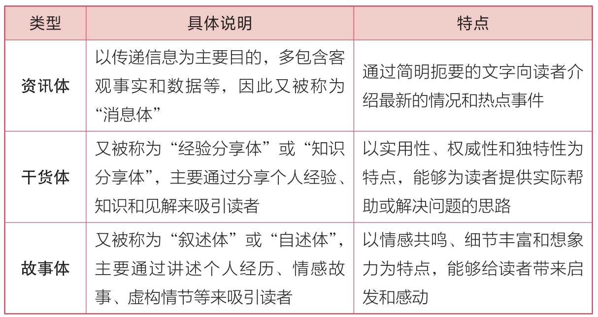

# ChatGPT 驱动文案：从基础到高转化

# 内容概览
本手册围绕用 ChatGPT 高效生产高转化文案展开，共计八章。首章从宏观视角梳理人工智能对文案创作的价值，后续七章分别拆解营销文案、推广文案、广告文案、商品详情页文案、直播带货文案、个性化自媒体文案、朋友圈文案的落地做法与优化思路。

本书适合所有希望借助 ChatGPT 提升写作效率与质量的读者。无论是专业写作者，还是日常工作中需频繁输出文案的从业者，都能在这里获得方法论与可执行技巧，帮助产出更具说服力的作品。

# 序一
当下信息洪流持续攀升，职场人士、自由职业者、学生、教师与创业者都在承受筛选信息、抓住要点、迅速给出答案的压力。

ChatGPT 正是一种可有效缓解这种压力的强力工具，其面世对众多应用场景产生深远影响，甚至带来革新性变化，既大幅提速，也重塑了解题思路，释放了人工智能的巨大潜能。

该模型由 OpenAI 团队研发，依托深度学习与海量语料训练，能够理解自然表达并生成连贯回应。它让工作与生活更省心高效。未来在商业与个人层面都将扮演关键角色，很可能成为标配级的智能助手。

市场竞争日益白热化，如何用文案抓住潜在客户与商家注意力成为核心课题。《玩转 ChatGPT：秒变 AI 文案创作高手》为此提供了可落地的指引，帮助你在写作领域建立差异化优势。

ChatGPT 可依据你的需求与描述，迅速产出吸引眼球的高转化文案，直达目标人群并传递核心信息。不论是广告制作、市场营销还是品牌推广，都能提供灵感与创意，让作品脱颖而出。

本书详细说明了如何运用 ChatGPT 完成文案创作，以及如何借助情感营销、故事化表达等手法打动读者。你将学会挖掘产品或服务的独特卖点，用有限字数高效传递信息乃至价值观，从而成为更优秀的创作者，为业务与品牌创造更大价值。

无论是初学者还是资深从业者，本书都能提供系统指导，提升创作力，在激烈市场中站稳脚跟。学以致用、反复实践，你完全可以成长为出色的文案创作者。

同时要保持清醒，认识技术的边界，避免过度依赖。科技是人类的工具，人工智能无法替代人类思维。

未来人人都会使用 AIGC 工具。ChatGPT 将与其它生成式工具一起，成为工作与生活中的伙伴，帮助筛选解读海量信息，助力高效创作更美好的未来。

让我们拥抱人工智能时代，共同打造高效、高质、高能的工作与生活方式！

去哪儿旅行技术总监、业务架构 SIG 负责人、人工智能委员会常委
郑吉敏
2023 年 12 月 5 日

# 序二
在数字化营销时代，一篇有吸引力的文案能量巨大，既能塑造品牌形象，也能直接带来经济回报。唐振伟先生的新作《玩转 ChatGPT：秒变 AI 文案创作高手》是一部难得的宝典，为渴望在商业中突围的文案人与营销人指明方向。

长期关注人工智能的我深知 AIGC 在现代营销中的潜力。本书不仅讲清 ChatGPT 等工具的使用方法，还给出用其创作吸睛营销文案的实战策略。从技术原理到案例应用，全书覆盖营销推广文案、广告文案、直播带货文案等多种类型。

它既是技术手册，也能启发思考与创新。阅读后，你将学会把 ChatGPT 融入日常文案工作，明显提升效率与质量。

我推荐本书给所有想在文案创作上实现突破的人。跟随唐振伟先生的指引，探索 AI 在文案领域的无限可能，创造更大的商业价值！

祝阅读愉快，创作收获丰硕！

北京人工智能学会副秘书长
朱晓庆
2023 年 12 月 6 日

# 前言
文案的能量有多大？

一篇好文案能孵化爆款产品，甚至力挽狂澜拯救濒危企业。在商业世界，文案的重要性不言而喻。

如何批量产出高转化文案？答案是善用 ChatGPT 等 AIGC 工具辅助创作，提升效率与水准。用对工具，人人都可成为爆款文案高手，在市场上创造更大价值！

本书正是为此而写，带你进入文案创作新时代。

本书探讨如何用 ChatGPT 创作爆款文案，并深入拆解各类文案的技巧与优化方法。第一章涵盖：ChatGPT 技术原理与使用技巧、文案创作应用、如何借助 ChatGPT 洞察受众需求与强化数据分析能力、爆款文案创作五步法及其他创作要点。第二至八章主题与要点如下。

第二章聚焦营销文案，包括营销文案三大核心手法，如何借助 ChatGPT 增色，其中涵盖平面媒体与直播营销文案。

第三章聚焦推广文案，包括如何借助 ChatGPT 提升品牌知名度与曝光，吸引潜在客户、提高转化，以及产品、活动、品牌推广文案的创作方法。

第四章聚焦广告文案，包括广告文案三重锁定，如何借助 ChatGPT 增强销售力，涵盖产品广告与企业形象宣传文案。

第五章聚焦商品详情页文案，包括详情页三大呈现方式，如何借助 ChatGPT 创作转化力强的文案，具体为挖掘卖点与差异、生成详情文案、提升表达精准度。

第六章聚焦直播带货文案，包括撰写三步骤，如何借助 ChatGPT 创作提升业绩的文案，具体为确定核心卖点、生成暖场带货文案、提升转化率。

第七章聚焦个性化自媒体文案，包括彰显个性与魅力、提升体验感与传播力、增强参与度与转化率的重要性，以及借助 ChatGPT 收集数据分析需求、创作文案、提升展现力的流程。

第八章聚焦朋友圈文案，包括引发共鸣、展现自我、广而告之的三位一体策略，如何借助 ChatGPT 创作吸睛文案并提升关注度。

本书收录大量案例，覆盖 ChatGPT 辅助文案的多样场景。愿助你将文案水平推向新高度，创造更大商业价值！让我们一起迈入文案创作新时代！

# 第一章
# ChatGPT 助力打造高转化文案

## 1.1 技术原理与操作技巧

### 1.1.1 技术原理及实践应用

一、ChatGPT 概览与应用方向

1.ChatGPT 的定义与原理

用户提问：
请用小学生也能懂的生动语言介绍 ChatGPT 的定义和原理。

ChatGPT 回答：
ChatGPT 是一个用人工智能做出来的聊天机器人，就像一个会回应的智能小伙伴。你可以像和朋友聊天一样提问，它会结合学到的知识给出回答。
它之所以能做到，是因为背后有一个庞大的模型，相当于它的“大脑”。这个大脑读过大量书籍、文章、新闻，从中学会语言结构和知识。就像孩子读书学习一样，它也是通过大量阅读来学习的。
学习过程类似学语文或英语：先认识句子结构与语法，再理解词义，最后把词组合成有意义的句子。你提问时，它会努力理解并给出合理答案。
当然它不完美，有时会出错，就像小朋友也会犯错。随着时间推移，它会不断学习改进，越来越聪明。
总体来说，ChatGPT 就像一位能回答问题的智能朋友，通过学习知识和语言规则来回应，尽管还在进步，但未来会更聪明有趣。
以上内容由 ChatGPT 生成，未改动

简言之，聊天能力靠训练获得。
预训练阶段，它吸纳海量语言数据，梳理出语言结构、语法规则与概率分布，从而理解语句含义并连贯回应。
微调阶段，它通过强化学习不断修正生成模型，更准确地回答问题。类似与朋友聊天越久越懂技巧，ChatGPT 也在反馈中优化，越发擅长问答。

2.ChatGPT 的应用领域
对话机器人：人机交互、客服、问答系统等。
虚拟助手：解答常见问题、提供信息建议等。
文字生成：自动写文案、作曲、文学创作等。
社交媒体：智能回复、推荐与内容生成等。
教育领域：智能辅导、答题评分、学习伴侣等。

3.ChatGPT 的发展历程
GPT：早期基于 Transformer 预训练，能生成连贯文本，对话表现有限。
DialoGPT：引入多轮对话数据预训练，回应对话更合理连贯。
ChatGPT：OpenAI 发布后对话能力提升，经强化学习微调，降低不合理回复概率。

二、用 ChatGPT 创作文案的方法与技巧
输入准备：把问题或需求表述得清晰简洁，确保完整。
多样性设置：温度参数控制随机性与创造性。高温度如 0.8 回复更发散，低温度如 0.2 回复更保守一致。
评估与筛选：基于预训练数据生成，难免出错或不合理，使用时需人工评估筛选。
上下文管理：妥善处理对话上下文，保证回复与前文连贯并满足需求。
迭代优化：根据实际效果与用户反馈持续优化，提升质量与适用性。

三、文案创作实践与经验总结
电商平台可自动生成产品描述、促销文案。
社交媒体可生成趣味评论、回复与互动内容。
客服可作为虚拟助手解答常见问题。
创作领域可提供灵感与构思辅助。
建议结合具体需求做数据预处理、模型微调与后期优化，以达更好效果。
使用时尤其关注上下文管理、评估筛选与迭代优化，确保文案质量与适用性。

四、实战案例：用 ChatGPT 写社交媒体推文
假设某电子品牌新款智能手表将上市，需发布一条吸睛推文促进销售。
用户提问：
我们的新款智能手表即将上市！它能追踪健康数据、接收通知，还能与智能助手互动。你最喜欢什么功能？请据此生成推文并总结经验。

ChatGPT 回答：
生成的推文：
新款智能手表即将上市！打破常规，让你与世界更亲近。追踪健身数据，在线支付，随时提醒日程。这个夏天，展现你的时尚感与科技感！你最喜欢的功能是什么？告诉我们！#智能手表#科技新品

经验总结：
引起注意：用表情符号与吸睛文字增强视觉吸引力。
突出特点：在推文中点出核心功能与卖点吸引潜在用户。
鼓励互动：提问用户最爱的功能或邀请分享想法。
善用标签：使用相关热门标签提升曝光与点击转发。
简洁明了：文案要短小易懂，避免冗长复杂句子。
通过经验沉淀，品牌方可借助 ChatGPT 生成吸睛推文，提升关注与购买意愿，并依实际情况与反馈持续优化内容。

以上内容由 ChatGPT 生成，未改动

### 1.1.2 提问技巧

一、提问的魔法钥匙——提示词
提出针对性问题可从以下角度入手：
提供背景信息：在问题中给出相关背景，让模型理解情境。
清晰明确：语言简洁，避免歧义。
聚焦具体：提出具体而非笼统的问题，获得更精准回答。

让模型执行特定任务：
使用指令：如“请列举狗的五个特点”。
明确需求：在提问中清晰表达期望结果。

利用上下文引导对话：
提供上下文：帮助模型更好理解问题。
基于已有回答追问：逐步引导，获得更准确回应。

二、控制与优化生成文本
筛选与编辑：删除冗余或无关内容，保留有用信息；多选时挑选最合适答案。
评估与调整质量：结合上下文评估准确性与相关性；不满足时提供更多信息或请求重写。
处理不完整或不准确回答：追问以澄清意图，或换种方式重述问题。
使用过程是互动的，灵活运用技巧才能获得更有效沟通与更准确答案。只有不断探索实践，才能挖掘潜力与魅力。

## 1.2 ChatGPT 在文案创作中的应用

### 1.2.1 实现知己知彼

创作爆款文案前，要先想清客户的关键痛点与棘手难题。
同时认识自己：能为客户带来哪些不可替代的价值？核心竞争力在哪？在解决痛点上有哪些独特做法？能否立刻关闭“痛苦开关”？

借助 ChatGPT 可更好洞察目标受众需求。通过互动获取数据与信息，了解喜好、偏好、需求与期望，深入把握内心世界，提供更有针对性与个性化的方案。

在 ChatGPT 帮助下，也能更清晰审视自身：发现核心竞争力与差异点，对比竞争对手的优势，如技术创新、高效流程、卓越体验或个性化定制，并准确传达给受众。

最后，不能完全依赖工具，应以其为辅助，充分发挥人类智慧与洞察力。对生成内容进行优化补充，保持人在主导。唯有知彼知己，才能真正进入受众内心，创作出难以抗拒的爆款文案。

### 1.2.2 强化数据分析能力

一、借助 ChatGPT 洞察受众与定位产品
1.分析受众特征与需求
通过与潜在用户、现有客户或市场调研人员的对话，ChatGPT 可收集并分析数据，提炼出受众特征与需求。
2.确定产品的独特卖点与定位

对话式洞察：用 AI 快速找准人群、打磨定位、产出爆款

通过向模型介绍产品的优势与卖点，再请其给出评价，就能提炼出差异化卖点并判断品类归属。

3. 描绘理想用户画像
把目标客户的职业属性、兴趣取向、消费偏好及使用习惯描述清楚，再让模型帮助构建理想客户肖像并持续细化。结合市场调研成果、行业观察与消费者行为模型，人物原型会更贴近现实。通过这种互动，能获取关于人群与站位的关键线索。需要注意的是，模型的输出基于训练语料，并不掌握实时市场动态，落地决策时仍需叠加其他信息源综合判断。

二、以某品牌人体工学办公椅为例，分析目标客群与商业定位

提问示例：
请以一款主打“撑腰护背、久坐不累”的人体工学座椅为例，拆解其核心客群与品类定位，并举例说明模型如何提升数据解读能力。

模型回复：
该品牌人体工学座椅的核心使用者是长期久坐的办公与学习人群，涵盖白领、学生及自由职业者。商业定位在于帮助使用者保持健康坐姿，缓解久坐带来的不适与健康风险。

以此座椅为案例，模型在数据解读层面可提供以下支持。

1. 调研设计与需求梳理
与模型交流可快速生成调研问卷或访谈提纲，了解目标人群对人体工学座椅的具体诉求与偏好。模型还能给出提问优化建议，并指导如何解读调研结果，挖掘更深层的用户期待。

2. 功能表现评估
模型可协助评估座椅的功能表现。用户可询问人体工学原理相关问题，加深对产品特性的理解。它还能提出优化建议，帮助判断哪些功能与设计需要改进以更好契合用户需求。

3. 数据解读与关联分析
把销售数据、用户反馈等提供给模型，它可以梳理销售趋势、满意度表现以及设计成败的关键点，并给出深度分析方向。在其帮助下，用户更容易看清数据间的关联。

4. 竞争态势梳理
模型能整理竞争对手的定价策略、功能亮点、营销动作等信息。通过互动，用户可获得对市场态势、消费者偏好及自身竞争优势的洞察，进而调整站位与销售策略。

总体来看，模型作为辅助工具，能增强数据解读能力，帮助更准确理解核心客群需求、优化品类定位、提升竞争力。它可提供指导与建议，辅助功能评估、数据解读、竞争分析，最终更好地满足用户需求并实现商业目标。

（以上内容由 ChatGPT 生成，未改动）

当然，模型不止能帮文案创作者做到知己知彼、锁定人群与定位、强化数据解读，还能大幅提升文案创作的效率与质量，助力产出爆款内容。

1.3 用 AI 助手提升爆款文案产出效率

所谓爆款文案，是在短时间内迅速抓住目标读者注意力的文案。创作时需兼顾亮点呈现、理性与感性的融合、情感调性等。模型可作为创作助手，提升效率和品质。

创作者提供产品或服务信息，模型即可生成风格多样、角度不同的文案供筛选。输入关键词和参数后，它还能产出吸睛的标题和简介，提高曝光与点击。

1.3.1 “爆款”文案创作五步法
——EUISF 框架

第一步，吸引注意 Engage：先把人抓住！
第二步，深挖痛点 Unearth：你的痛点我清楚！
第三步，激发欲望 Inspire：我有解决办法！
第四步，加强佐证 Support：大家都认可！
第五步，促进成交 Facilitate：马上行动吧！

具体说明如下。
1. 吸引注意
运用抓人眼球的表达或独特写法，抓住注意力，让读者感受到专业度并产生好奇。
2. 深挖痛点
理解读者需求与困扰，将其与产品或服务关联，通过提问、设问或场景描写，让读者感到被理解且问题可解。
3. 激发欲望
突出产品独特价值与优势，强调解决问题的能力，用富有想象力和情感的语言激发购买渴望。
4. 加强佐证
提供客户评价、真实数据、专业背书等证据，提升可信度。
5. 促进成交
给出明确的行动指引，借助限时优惠、紧迫感等刺激，促使读者立即行动。

这套流程旨在产出引人注目、引发共鸣的爆款文案，更好传递价值、解决问题并推动行动。可以让模型用举例方式详细解释每一步。

提问示例：
请用举例的方式详细解释“爆款”文案创作五步法的每一步。

模型回复：
“爆款”文案创作五步法——EUISF 框架：打造让人上头的文案

一、吸引注意
你好！先夸一下你的眼光真不错。看到你的提问，我差点喊出‘我要回答’。先热身一下，正式进入问题解决模式。告诉我你想了解什么，我会给你满意的答案。无论技术资讯、生活技巧还是解谜挑战，我都能用知识帮你扫清疑惑。

二、深挖痛点
那种如蚂蚁啃咬般的痛苦我懂焦虑和困惑正在折磨你。别担心，痛点敏感是我强项。程序bug还是生活烦恼，告诉我，我就像医生一样给出治疗方案。代码被乱改也好，太阳穴疼也罢，我能给出解决思路。

三、激发欲望
听好了各位！我这里有颗解决问题的魔法药丸，让你摆脱折磨。人生是马拉松，风雨兼程，这颗药就是终点的彩虹。需要技巧还是情感支持，我都能提供。别问怎么做，我是 ChatGPT，相信我，幸福在转角。

四、加强佐证
别只听漂亮话，我有硬证据。想知道新品好不好？让数据说话。用户口碑、科学验证我这里都有。需要市场趋势我可以做分析，需要品控我可以拆报告。不信就试试，我给你讲个生动的故事。

五、促进成交
还在犹豫什么？让我为你服务，让问题远离你。想象一下你唉声叹气时，我像医生一样忠诚待命。我不仅提供智慧，还能送你一份特别礼物。你觉得付费痛苦，等问题解决后就会明白这笔投资多值。看到这里就别犹豫了，快来体验我的服务，我会用幽默的方式回应，给你愉快的体验。相信我，我会是最佳拍档。别再观望，点击购买，和我一起开启探索之旅，解决问题只需轻轻一点。

（以上内容由 ChatGPT 生成，未改动）

追问示例：
请按以上五步，以××地产旗下玫瑰庄园别墅项目为例，面向净资产上亿元的企业家群体撰写一篇爆款文案，突出其品味与眼光。该项目单价约3000万至4000万元，核心客群为30至50岁的企业家。

模型回复：
步骤一：吸引注意
想住进独一无二的豪华居所，体验非凡生活？××地产重磅推出玫瑰庄园别墅，献给实力与品味并存的成功者，让你的光芒在这里更耀眼。

步骤二：深挖痛点
你是否渴望拥有私享豪宅，与家人共赏美景，享受极致奢华？玫瑰庄园满足所有想象，远离都市喧嚣回归自然，带来私密安全的高品质生活。

步骤三：激发欲望
独特品味的象征。别墅由知名设计师操刀，奢华内饰搭配私家花园。无论追求艺术、舒适、社交还是独立空间，愿望都能实现。

步骤四：加强佐证
项目坐落黄金地段，周边环境优美，毗邻高端商务与优质教育资源。每个细节精雕细琢，××地产凭借多年行业经验为品质与保障背书。

步骤五：促进成交
现在就是出手时机。入住玫瑰庄园，你将拥有令人羡慕的家，并与同阶层人士共享社区。我们提供专属管家、私人俱乐部等贴心服务。别再观望，这就是改变人生的机会。走进玫瑰庄园，开启尊贵旅程。

以上文案旨在彰显企业家群体的独特品味与眼光。如有其他需求，欢迎随时提出。

（以上内容由 ChatGPT 生成，未改动）

1.3.2 用 AI 产出爆款文案的实操心法

一、用 AI 点燃创意与灵感

1. 挖掘创意的思路与技巧
（1）观察市场趋势并分析竞争对手。
（2）运用头脑风暴和思维导图。
（3）利用模型生成创意。

2. 培养创造力与创意思维
（1）增强观察力与想象力。
（2）形成能激发创意的环境与习惯。
（3）探索不同领域的灵感来源。

提问示例：
如何利用模型激发文案创意与灵感？

模型回复：
用 AI 激发文案创意与灵感

1. 挖掘创意的思路与技巧
（1）观察市场趋势并分析竞争对手。模型可协助获取市场趋势与竞品信息并进行分析。用户可就目标人群需求与竞争格局展开讨论，挖掘热点话题与关键卖点，并获取模型对趋势与对手的独特见解。
（2）运用头脑风暴和思维导图。提供品牌、产品、受众等信息，与模型进行头脑风暴，产出更多创意点。它还能协助绘制思维导图，整理创意与关联概念，规范创作流程。
（3）利用模型生成创意。输入关键词或问题，模型会生成多样化的观点、案例与场景描述，为创作提供灵感。

2. 培养创造力与创意思维
（1）增强观察力与想象力。向模型提供具体情境或问题，听取它对不同创意的看法，拓宽思路。
（2）形成能激发创意的环境与习惯。营造利于创作的环境，如放置创意类书籍；培养每日记录点子、经常与模型互动等习惯，保持思维活跃。
（3）探索不同领域的灵感来源。模型知识覆盖面广，可提供跨行业灵感。跨界对话能将趣闻、故事等转化为文案素材，获得独特性。

通过上述方法可有效激发灵感并培养创意思维。最终创意仍需结合实际场景与受众需求进行筛选与评估，确保文案准确传达品牌信息并吸引目标人群。

（以上内容由 ChatGPT 生成，未改动）

充分利用模型的多领域知识，能让文案更具创意与吸引力。

二、用 AI 搭建爆款文案的骨架

1. 设计开头，抓住读者注意
（1）使用引言、问题或故事引入。
（2）引用数据或具有冲击力的事实。
（3）运用幽默或戏剧化手法。

2. 发展中段，引发兴趣与共鸣
（1）提供相关信息和解决方案。
（2）强调情感诉求并叙述故事。
（3）引用客户案例或证明数据。

3. 构建结尾，引导行动与决策
（1）提出明确的呼吁和建议。
（2）创造紧迫感并突出限时优惠。
（3）鼓励分享和口碑传播。

提问示例：
请用举例的方式说明如何构建爆款文案的骨架。

模型回复：
1. 设计开头，抓住读者注意
（1）要不要听一个令人震惊的事实？
（2）你是否遇到过这样的问题？
（3）有一个故事将带给你非凡体验。

2. 发展中段，引发兴趣与共鸣
（1）在现代社会，每个人都面临诸多挑战。你是否思考过应对之道？
（2）设想一下，你已掌握解决困扰已久问题的办法。
（3）你知道吗？近七成的用户使用我们的产品后得到明显改善。

3. 构建结尾，引导行动与决策
（1）现在就加入我们，共同迎接新挑战！
（2）在限时优惠结束前购买，即可享受特殊折扣与福利。
（3）若对产品满意，请分享给身边亲友，帮他们解决类似问题。

创作文案时可根据产品特点、受众需求与市场趋势灵活调整结构与表达。语言需具吸引力、易懂且符合品牌调性，通过对话可获得更多观点与创意，提升文案质量。

（以上内容由 ChatGPT 生成，未改动）

模型用例子示范了开头、中段与结尾的构建，基本按既定框架生成。实际应用中需结合自身产品优势，并以精准提示词引导输出，创作出属于自己的爆款文案。

三、用 AI 打磨表达效果

1. 选择合适的语言风格
（1）展现品牌特点及个性。
（2）考虑受众的文化背景。
（3）表现幽默、诙谐或温情。

2. 引发情感共鸣
（1）使用形象的比喻和隐喻。
（2）描述场景和情感细节。
（3）运用色彩及排版手法。

3. 编写简洁的文案
（1）避免使用冗长的句子。
（2）使用简单易懂的词汇。
（3）确保逻辑流畅连贯。

提问示例：
如何优化表达效果以打动读者？

模型回复：
1. 选择合适的语言风格
（1）我们是不拘一格的创造者，致力于为你打造独一无二的体验。
（2）我们的产品融合东西方文化精髓，让你感受到多元魅力。
（3）我们相信幽默与温情是生活的调味品，能在互动中找到乐趣与共鸣。

2. 引发情感共鸣
（1）我们的解决方案像明亮的探照灯，指引你找到出路。
（2）产品像一幅缤纷画卷，带你进入充满激情与惊喜的世界。
（3）初次使用时，你会感到仿佛置身色彩世界，体验振奋人心的美妙感。

3. 编写简洁的文案
（1）我们用简洁有力的话告诉你产品如何解决烦恼。
（2）不用晦涩术语，用通俗词汇解释复杂问题。
（3）逻辑清晰、连贯，每句话都扣住主题，让你轻松理解。

请注意，这只是示例。实际文案需根据应用场景、品牌定位、受众特点与产品特性优化。模型可提供灵感，助力优化表达效果。

（以上内容由 ChatGPT 生成，未改动）

四、用 AI 测试与优化文案效果

1. 收集与分析文案效果数据
（1）选择合适的指标和跟踪方式。
（2）使用分析工具收集数据。
（3）分析数据，找到改进空间。

2. 运用 A/B 测试提升文案效果
（1）选择测试的变量和范围。
（2）确定实验方案和样本规模。
（3）分析结果和执行优化方案。

3. 针对不同渠道适配并优化文案
（1）针对不同平台优化文案。
（2）适应社交媒体和搜索引擎。
（3）考虑语言和文化差异。

提问示例：
如何测试和优化文案效果？

模型回复：
1. 收集与分析文案效果数据
（1）选择合适的指标和跟踪方式。先确定要追踪的指标，如点击率、转化率，再根据需求选择UTM参数、像素追踪等方式。
（2）使用分析工具收集数据。借助网站分析工具或社交媒体数据功能采集相关数据，设置筛选条件与时间段，获取准确结果。
（3）分析数据，找到改进空间。比对文案在点击率、转化率等关键指标上的表现，分析哪些文案在特定人群或平台上更有效，寻找优化点。

2. 运用 A/B 测试提升文案效果
（1）选择测试的变量和范围。根据前期分析结果，确定标题、副标题、主体段落等测试变量，范围可为整篇或局部。
（2）确定实验方案和样本规模。将目标人群分为不同测试组，分别暴露于不同版本文案，确保样本量足够以获得统计显著结果。

（3）数据复盘与投放优化
对比各版本文案在核心指标上的差异表现，以 A/B 测试的结论为依据锁定最优版本并投入真实投放，同时把测试中提炼的经验迁移到其他文案的撰写中，实现持续的效果提升。

**3.针对不同渠道适配并优化文案**

（1）按平台特性调优文案。不同平台对文案的诉求不一样，需要针对每个渠道的调性与用户习惯做差异化调整。比如社交媒体的文案要更精炼、更有抓力，邮件营销的文案则需要更完整的说明与信息量。

（2）贴合社媒与搜索规则。了解社交平台和搜索引擎的工作逻辑，围绕关键词、标题等要素进行优化，使文案更易被分发与检索。

（3）兼顾语言与文化差异。若受众覆盖多个国家或地区，就要在表达方式与文化语境上做本地化，确保信息传达准确且符合当地使用偏好。

总体来看，通过收集文案表现数据、开展 A/B 测试，再结合渠道特性进行适配优化，可以增强文案的影响力，更好地吸引并留住目标人群。

**（以上内容由 ChatGPT 生成，未改动）**

**五、利用 ChatGPT 应对文案创作中的常见挑战**

**1.解决文案中的逻辑和表达问题**

（1）确保文案逻辑清晰。

（2）准确描述复杂的产品或服务。

（3）避免信息过载或遗漏。

**2.避免常见的错误和陷阱**

（1）消除语法和拼写错误。

（2）避免使用负面词语。

（3）注意版权和合规问题。

**3.解决创作中的困惑和瓶颈**

（1）调整心态，克服创作焦虑。

（2）寻找灵感，突破创作瓶颈。

（3）培养良好的写作习惯。

**用户提问：**

严格依据以上框架，说明如何利用 ChatGPT 应对文案创作中的常见挑战，请举例说明。

**ChatGPT 回答：**

在文案撰写过程中，ChatGPT 能帮助创作者化解以下几类常见难题。

**1.解决文案中的逻辑和表达问题**

（1）确保文案逻辑清晰。ChatGPT 基于海量文本与专业知识的训练，能够辅助产出条理分明、层次感强的文案。例如在撰写产品介绍时，它可以提醒创作者按要点梳理产品的特性、功能与卖点，让读者快速理解。

（2）准确描述复杂的产品或服务。通过互动沟通，ChatGPT 能把握创作者想传达的核心要点，并协助用准确的语言表述复杂内容。例如在科技类产品文案中，它可以提供行业术语与解释，帮助创作者清晰传递技术特点与使用场景。

（3）避免信息过载或遗漏。ChatGPT 可协助筛选与整合关键信息，保持信息密度适中、重点突出；同时还能对成稿进行核查，补充被忽略的重要细节。

**2.避免常见的错误和陷阱**

（1）消除语法和拼写错误。ChatGPT 生成文本时遵循语言规范，能减少语法与拼写失误；同时可提供实时校对建议，帮助修正潜在问题。

（2）避免使用负面词语。ChatGPT 擅长调用积极词汇，产出更具吸引力的表达。例如在广告文案中，它能推荐正面表述，提升说服力。

（3）注意版权和合规问题。ChatGPT 可提醒创作者遵守版权法规，避免抄袭或侵权行为；也能提供相关法律与政策要点，帮助理解合规要求。

**3.解决创作中的困惑和瓶颈**

（1）调整心态，克服创作焦虑。通过对话交流，ChatGPT 能给予情感支持，帮助创作者缓解焦虑、集中精力。

（2）寻找灵感，突破创作瓶颈。ChatGPT 可进行头脑风暴，提供新颖观点与思路，激发创意。例如在博客选题时，它能给出主题方向与观点启发。

（3）培养良好的写作习惯。ChatGPT 在互动中提供实时写作建议，帮助提升表达技巧与结构意识。例如建议使用简洁句式、注意段落衔接、加入生动描写与具体案例，从而提高文案质量。

总体而言，ChatGPT 能够在逻辑把控、错误规避与创作支持等方面提供实时指导，帮助创作者高效解决常见挑战。

**（以上内容由 ChatGPT 生成，未改动）**

# **第二章**

# **营销文案：将营销变为“赢销”**

## **2.1 营销文案的“三大必杀技”**

### **2.1.1 价值切中需求**

价值切中需求是指产品或服务能够回应客户真实诉求，提升满意度，推动成交，降低市场风险，增强竞争优势，实现可持续增长，为后续业务发展创造机会。

**用户提问：**

公司最近推出了一款智能手表，它可以进行全面的健康监测，续航时间长，外观时尚个性，还能与其他智能设备集成。请问这些特点可以给用户带来什么样的价值？

**ChatGPT 回答：**

这款智能手表的各项特性可从以下维度转化为用户价值。

**健康监测：**全天候健康追踪功能让用户随时掌握身体状态。例如手表一旦察觉心率异常就会及时提醒就医，避免健康风险；长期积累的数据还能帮助用户认识生活习惯对健康的影响，从而做出优化。

**时尚个性：**表盘与外观设计直接影响个人形象。一款兼具时尚与个性的手表能在社交场景中提升自信与辨识度，同时也是展示品味与自我表达的方式。

**长续航：**续航能力强意味着减少频繁充电的打扰。外出差或旅行时即使忘记充电，也能持续接收信息、完成支付、查看天气等，提升使用安心感。

**跨设备集成：**手表可与手机、智能家居等设备联动，提供更顺手的操控体验。例如远程操控家中的灯光、空调、电视等，节省操作时间，提升生活效率。

综合来看，该手表在健康管理、个性表达、生活便捷与设备联动等方面都能带来实际价值，从而丰富用户生活并提高生活质量。

**（以上内容由 ChatGPT 生成，未改动）**

ChatGPT 的回应对智能手表的各项功能及其对用户的潜在获益进行了系统阐述，印证了该产品能够显著提升用户生活品质。

**【怎么挖掘】**

挖掘产品的差异化卖点，需要深入了解产品本身、市场环境与消费者需求。ChatGPT 可从以下角度提供支持。

**（1）产品对比。**ChatGPT 可汇总相关信息并进行横向比较。以智能手机为例，可列出快速充电、高清影像、大存储、信号稳定等优势，再与同价位竞品对照，凸显自身优势。

**（2）特性发掘。**从多维度提炼产品特性，以满足消费者需求并创造独特价值。

**（3）竞品和 SWOT 分析。**通过收集竞品情报，分析自身优势、劣势、机会与威胁，从而定位产品的独特卖点。

**（4）品牌定位和差异化。**ChatGPT 可帮助洞察消费者偏好，据此将产品与竞品区分。以高端时尚品牌为例，可挖掘消费者对品质、设计与服务的期待，塑造鲜明的品牌形象与价值。

**用户提问：**

某品牌新推出了一款可定制的珠宝饰品，请问可以从它的哪些特性入手进行营销？

**ChatGPT 回答：**

这款可定制珠宝可围绕以下特性展开营销。

**个性化定制：**强调每件饰品都是专属设计，消费者可参与创作过程。营销中可展示定制案例，突出唯一性。

**高品质材质：**突出采用金、银、钻石等优质材料，强调耐用与保值，传递高端优雅感。

**情感联结：**定制珠宝可承载身份、信念与情感，营销中可通过故事化表达让消费者产生共鸣。

**专业品牌背书：**借助品牌在珠宝领域的口碑与专业形象，提升信任感与购买意愿。

**高级质感：**从材质选择到工艺细节呈现高贵感，吸引注重品质的消费者。

**全球化服务：**线上线下均可定制，覆盖不同地区，提升购买便利与体验。

根据不同特性可匹配相应的营销手段，如社媒展示用户定制作品、短视频讲述情感故事、线上活动提供优惠等。

**（以上内容由 ChatGPT 生成，有删节）**

### **2.1.2 说服激发欲望**

说服话术在营销中作用关键，恰当的话术能提升转化效果、客户满意度与品牌形象，推动口碑传播。

**用户提问：**

假如我是某品牌智能手表的门店导购，请根据智能手表的营销定位生成能够激发消费者购买意愿的说服话术。

**ChatGPT 回答：**

在面对面交流时，可根据不同定位使用以下话术。

**健康专家**

“这块手表不仅是配饰，更是您的私人健康助手。它能实时追踪心率，记录睡眠质量，助您优化作息。无论是管理健康还是关注身体变化，它都是理想之选。”

**持久耐用**

“不用再担心频繁充电，这款手表续航强劲，一次充电可用数日。无论您身在何处，都能稳定陪伴，真正可靠耐用。”

**时尚个性**

“看这款式与配色，功能强大又不失潮流。表带与表盘可自由更换，随场合变换风格，为整体形象加分。”

**智能生活中心**

“手表可与手机无缝连接，接收通知、控制智能家居、同步运动数据。让日常生活更便捷，是迈向智能生活的起点。”

这些话术可根据场景灵活调整，帮助建立更密切的沟通并激发购买动机。

**（以上内容由 ChatGPT 生成，未改动）**

ChatGPT 不仅提供了不同定位的话术，还用具象化的场景与情感化表达增强说服力，有助于导购在现场激发顾客购买欲。

**【怎么打动】**

说服影响消费者的认知与行为，ChatGPT 生成的说服性文案可有效打动目标人群。

**（1）强调问题和解决方案。**先点出客户痛点，再展示产品如何解决，如“是否常因时间管理压力大？我们的工具可帮助提升效率”“财务是否混乱？我们的软件可帮助整理数据，让生活更轻松”。

**（2）使用情感丰富的语言。**用富有感染力的表达建立情感连接，如“享受无与伦比的舒适与奢华”“想要如沐春风的服务体验？我们的团队将以热情专业的态度为您提供贴心服务”。

**（3）示范用例。**通过具体场景展示产品应用，如“想象早晨醒来餐桌已备好早餐”“在家也能享受专业按摩，按摩椅让身心放松”。

**（4）提供数据。**用用户评价或数据支撑观点，如“已有千名客户反馈效率提升”“护肤品全球销量超百万瓶，获得广泛好评”。

**（5）创造紧迫感。**借助促销信息引导即时决策，如“仅剩24小时，限时额外9折”“现购立减，数量有限先到先得”。

### **2.1.3 共鸣引导关注**

优秀的营销文案能在情感上与消费者产生共鸣，吸引关注并提升购买意愿。

**用户提问：**

智能手表的营销文案可以通过哪些点引发消费者的共鸣？

**ChatGPT 回答：**

智能手表可从以下维度引发共鸣。

**健康管理：**监测心率、血压、睡眠等，帮助注重健康的群体更好地管理身体。

**便利性：**提醒运动、接收信息、拨打电话、查看天气等，提升日常效率。

**安全性：**GPS定位与紧急呼救功能为用户提供安全保障，尤其对独居人群意义重大。

**时尚性：**多样化设计与可更换表带满足个性表达，成为时尚配饰。

**科技感：**与智能家居联动，实现远程操控，带来智能化生活体验。

**社交互动：**支持视频通话与在线聊天，随时保持与亲友的联系。

突出这些共鸣点，有助于吸引目标人群并激发购买兴趣。

**（以上内容由 ChatGPT 生成，未改动）**

ChatGPT 的回答列出了多重共鸣切入点并兼顾细分人群，有助于营销人员精准把握需求，激发购买意愿。

**【怎么吸引】**

营销文案是品牌与消费者的沟通桥梁，兼具信息传递与情感驱动作用。以下方法可提升吸引力。

**（1）了解消费者需求。**

①**开放式问题。**引导消费者提供详细信息，如“您认为选择餐厅时最看重哪些因素”“希望智能家居具备哪些功能”。

②**假设情境问题。**帮助消费者设想解决方案，如“如果拥有一部新手机，您希望它具备什么特性”“远程控制家电时需要哪些功能”。

③**探索性问题。**挖掘潜在需求，如“购物或使用服务时是否遇到过不便”“您觉得智能家居在哪些方面可改进”。

**（2）创造有趣的内容。**借助ChatGPT的创意能力，策划故事、挑战、互动游戏与娱乐活动，结合热点话题提升参与度。

**（3）提供实用价值。**提炼产品对用户的实际获益并强调优惠，如分享生活小技巧或提供限时折扣，提升吸引力。

**用户提问：**

请你针对独居人士的安全问题写一个故事，引发消费者的共鸣，吸引消费者购买智能手表。

**ChatGPT 回答：**

一个平静的夜晚，退休老人李先生独自在家。不久前他在浴室滑倒，因手机不在身边无法求助，只能无助地等待。

他忽然想起手腕上的智能手表，除显示时间外还具备紧急呼救功能。他按下求救键，手表自动定位并向亲属与附近医院发送信息。

几分钟后，女儿与女婿赶到，联系了急救车。李先生及时得到救治。

如果没有这项功能，他可能需要更久才能获得帮助。这款手表的紧急呼救为独居者提供了可靠的安全保障。

此事在邻里间引发关注，大家意识到智能手表对独居长者的重要性。它不仅是配饰，更是守护生命安全的“护卫”。

越来越多的人了解到，手表除紧急呼救外，还能记录运动、监测睡眠、接收信息、拨打电话等，让独居生活更安心便捷。

现在许多人将智能手表视为守护健康与安全的必备工具。

如果您是独居人士，是否也考虑拥有一块智能手表，让它成为生活的得力助手，守护您的安全与健康？

**（以上内容由 ChatGPT 生成，未改动）**

## **2.2 用 ChatGPT 强化文案说服力**

### **2.2.1 平面广告文案的撰写思路**

平面渠道版面有限，必须在极短篇幅里把核心信息讲透、卖点点齐，同时迅速抓住视线并引发共情。依靠精准用词和清晰的人群定位，才能在同质化投放中拿到更好的传播效果。

**用户提问：**

我是××镇酱酒的销售人员，公司最近需要在某商业广场的裙房外侧做一个大型的室外广告牌，通过广告牌宣传一款产品，请帮我写一段广告牌上的宣传文案。

**ChatGPT 回答：**

以下是××镇酱酒的宣传文案示例。

尊享烈性，溢彰风味。

品味千年匠心，润泽醇香。

××镇酱酒，中国经典之选，为您带来纯正独特的体验。每一滴都蕴含着千年的智慧和工艺，每一口都能唤起独属于中国的美酒风情。

我们以上乘的优质原料和严谨的酿造工艺，打造出绝佳的口感和令人陶醉的香气。作为经典的国酒代表，××镇酱酒以其独特的浓郁香韵和深邃的口感征服了无数美酒爱好者。

在这个快节奏的时代，我们向您献上独一无二的品味体验。××镇酱酒，不仅抚慰您的味蕾，还引领您走进独有的酒文化。

××镇酱酒，以其独特的身份和傲人的品质，与您共叙美酒佳话。

来自××镇的芳香，现已飘入您的生活。无论朋友聚会、商务交际还是家庭团圆，××镇酱酒都将成为独特而珍贵的见证。

让××镇酱酒陪伴您，尽享那份久远的醇香，体验千年工艺的奇迹。

**（以上内容由 ChatGPT 生成，未改动）**

该示例选用了突出烈度与风味的表达，结合千年匠心等历史感词汇，并把家庭聚餐、朋友小酌、商务宴请等使用场景串联起来，增强了读者的代入感，适合户外大屏使用。

**【实操建议】**

**1.先提供完整背景。** 先把产品的核心属性、主打优势、具体用法等告诉模型，再请它把这些要素转化为有吸引力的说辞。

**用户提问：**

我公司推出了一款功能强大的新型便携式蓝牙音箱，外形小巧，内置高性能扬声器，使用了先进的音频处理技术。公司希望通过平面媒体营销吸引更多消费者购买，请帮我写一篇简洁明了、亮点突出、能引发共鸣的营销文案。

**ChatGPT 回答：**

好的，以下是一篇简洁明了、亮点突出、能引发共鸣的营销文案。

**标题：**音痴必备利器！全新便携式蓝牙音箱，震撼你的耳膜！

**正文：**

众所周知，音乐可以打开心扉，带你进入一个充满情感的世界。但是，如何找到一款性能强大、体积小巧、使用先进音频处理技术的音箱呢？我们有答案——全新便携式蓝牙音箱。

**极致体验：**小巧的外形下面是高性能扬声器和先进的音频处理技术，给你带来纯净、清晰、震撼的音质。不管你是摇滚乐迷、爵士音乐的爱好者，还是流行歌曲的粉丝，都会爱上这款音箱。

**无限自由：**蓝牙 5.0 无线连接技术，让你摆脱线缆的束缚，随时随地享受自己喜欢的歌曲。在家里、办公室、户外或旅途中，全新便携式蓝牙音箱为你提供无限自由。

**轻盈便携：**重量轻，体积小，方便携带。无论户外野餐、旅行探险还是室内聚会，全新便携式蓝牙音箱都能伴你出行，让你随时随地享受音乐。

**长时间使用：**内部包含大容量电池，长达××小时的播放时间，让你可以尽情享受音乐，无需担心电量问题。

**开启你的音乐之旅：**现在购买全新便携式蓝牙音箱，即可享受限时特惠。快来加入这场音乐之旅吧，我们等你！

注意：以上仅为示例文案，实际营销文案需要根据目标受众、市场情况和品牌定位进行个性化创作。

**（以上内容由 ChatGPT 生成，未改动）**

**2.明确创作方向与语气。** 可与模型讨论期望的表达方式与语调，如是否加入幽默或采用故事线，模型会据此给出不同思路并提供面向不同人群的适配建议。

**3.挖掘亮点与差异化卖点。** 把产品的核心优势交给模型，请其思考如何在文案中放大差异，比如哪些说法更能凸显优势、如何直指用户痛点。

**4.寻找共鸣用词。** 提供一批相关关键词，请模型思考如何与产品特性结合，形成更具感染力的句子，提升说服力。

**用户提问：**

请为上述营销文案设计一些可以引导目标受众行动的呼吁词或激励语句。

**ChatGPT 回答：**

当然！下面提供一些可以引导目标受众行动的呼吁词或激励语句供你参考。

赶快购买，开启你的音乐之旅！

点击立即购买，享受纯净音质带来的震撼体验！

不再错过任何一首好歌，立即抢购！

音乐随身带，购买全新便携式蓝牙音箱！

让音乐成为你生活中最美妙的伴侣，立即行动！

拥抱无线自由，点击购买全新便携式蓝牙音箱！

忘却烦恼，用音乐治愈心灵，购买蓝牙音箱，享受它带来的魔力！

放飞音乐梦想，从这款便携式蓝牙音箱开始！

别再忍受低劣音质，尽情沉浸于高品质音乐，购买全新音箱吧！

点燃音乐激情，赶紧购买全新便携式蓝牙音箱！

根据目标受众和品牌风格，选择一个或几个呼吁词，可以更有效地鼓励目标受众采取行动。记得确保呼吁词简明扼要，激发目标受众的兴趣，促使他们立即行动。

**（以上内容由 ChatGPT 生成，未改动）**

### **2.2.2 直播带货文案的撰写方法**

直播已成为重要销售渠道，文案则是直播间的核心抓手。这类文案要求短小精悍、直指重点，通过文字把产品魅力传递出去。

**用户提问：**

我公司最近推出了一款不添加防腐剂、白砂糖、色素的天然果汁，想要在新年来临之际通过直播平台推广销售这款产品，请帮我生成一份精彩的直播营销文案。

**ChatGPT 回答：**

亲爱的观众朋友们，新年将至，健康的生活方式正在成为时下的流行趋势！在这个特别的时刻，我非常兴奋地向大家推荐一款独特的天然果汁——不添加防腐剂、白砂糖和色素，带给您纯净、口感绝佳的味蕾享受！

这款天然果汁融合了大自然的精华，选用优质水果，保留了其天然的营养成分和鲜美口感。无论您是健康生活的倡导者，还是对天然食品充满好奇的探索者，这款果汁都将成为您的良伴。

喝了这款果汁，您可以感受到大自然的芬芳气息，品味到水果的天然醇香。我们精心打造的直播环节将为您介绍这款天然果汁的独特之处，为您带来一场视觉和味觉的盛宴。

今天的直播不容错过！您将享受到独家优惠，大额优惠劵等您来领取！此外，还有丰富的互动环节，您可通过留言、点赞等方式参与互动抽奖，赢取免费试饮套装及惊喜大礼！

让我们一同迎接新年的到来，迎接健康幸福的未来。加入我们的直播间，体验纯净、天然的美味果汁，让新年更有品质、更有滋味！

不添加防腐剂、白砂糖、色素的天然果汁，将成为您开启新生活的完美伴侣！请锁定我们的直播间，体验口感极佳、健康美味的天然果汁，让我们一同迎接新年的美好时刻！

记得设置提醒，千万不要错过直播时间！期待您的踊跃参与，共同品尝天然美味，开启健康新年！

**（以上内容由 ChatGPT 生成，未改动）**

该文案清晰呈现了零添加的产品特质和健康价值，用生动的语言描绘了果汁的纯净与美味，并结合新年健康趋势，有效提升了观众关注度。

**【吸睛要点】**

**1.深挖产品内核。** 与模型讨论产品的特质、优势和差异点，并进一步追问卖点是什么、有哪些营养价值，以便文案有依据。

**2.确定主题与情绪切入点。** 可让模型帮忙把产品和当下热点或节日氛围结合，比如新年在即如何关联节日气息、哪些情感触点能促使观众更快下单。

**3.共创吸睛标题。** 提供关键词和限制条件，请模型产出多个标题方案。

**4.突出互动与优惠。** 把直播的互动玩法和优惠信息告诉模型，让它设计能提高参与度和转化率的环节。

**用户提问：**

如何设计互动抽奖活动，才能吸引更多的观众关注这场天然果汁直播活动？

**ChatGPT 回答：**

**1.评论抽奖：**要求观众在直播评论区留言分享自己对天然果汁的喜爱或相关的健康生活经验，并添加指定的话题标签，从中随机选出几位幸运观众，幸运观众将免费获得天然果汁样品或优惠券。

**2.问答抽奖：**主持人在直播过程中提出与天然果汁相关的问题，要求观众通过评论或私信给出正确答案，从回答正确的观众中选出获奖者，奖品是天然果汁产品礼盒或折扣码等。

**3.互动拍摄抽奖：**要求观众在直播过程中拍摄自己喝天然果汁的照片或视频，并在社交媒体上分享并@品牌账号，从中选出几位幸运观众，幸运观众将获得天然果汁礼品套装或限量版周边产品。

**4.分享故事抽奖：**鼓励已购买天然果汁的顾客分享购买体验和使用感受，形式可以是文字、图片或视频，从中选出最有创意或最感人的故事，并为创作者送出特别定制的天然果汁产品套装作为奖品。

**5.众筹目标达成抽奖：**设置一个众筹目标，如销售量或金额，在直播过程中鼓励观众购买天然果汁并参与众筹。一旦达成目标，随机选出几位幸运观众，幸运观众将获得奖励，如限量版签名礼品或与明星合照的机会等。

**6.邀请朋友关注抽奖：**要求观众在直播结束后邀请更多的朋友关注品牌账号并购买天然果汁产品，根据邀请人数或购买转化率选出幸运观众，幸运观众可以获得奖品，如免费享受一年的天然果汁或获得私人订制礼品。

设计互动抽奖活动时，要确保规则清晰明了、公平公正，符合直播平台的规则。此外，提前进行充分的宣传、公示活动细则可以吸引更多的观众参与，在直播过程中及时宣布获奖结果可以激发更多观众进行互动。

**（以上内容由 ChatGPT 生成，未改动）**

### **2.2.3 提升文案销售力的策略**

通过与模型交流目标人群、产品属性等信息，再据此调整文案，能有效增强说服力，提升曝光与点击效果。

**1.提升触达效果**

**用户提问：**

我需要推广一款纯天然无添加的葡萄汁，除了社交媒体，还有哪些渠道可以投放营销文案？在哪些渠道投放触达效果会更好？

**ChatGPT 回答：**

推广纯天然无添加的葡萄汁的营销文案，除了可以投放到社交媒体，还可以投放到以下几个渠道。

**健康生活类杂志和电子杂志：**寻找流行的健康生活类杂志和电子杂志，在其网站或纸质版上投放广告或发布文章。这些杂志的读者也是您的目标受众，您的文案会触达对您的产品有兴趣的潜在客户。

**健身房和瑜伽馆：**将产品信息展示在健身房或瑜伽馆等健身场所的广告牌或传单上。这些场所的目标客户通常注重健康饮食，他们可能对您的产品感兴趣。

**健康食品店：**与当地的健康食品店合作，向其顾客宣传您的产品。这些食品店的顾客多是关注健康并关注食品原材料的人，恰好也是对您的产品感兴趣的潜在客户。

**线上购物平台：**将产品信息投放到线上购物平台，如天猫、京东等。这些平台有大量的用户，您的产品将更容易触达潜在客户。

针对具体情况，不同的渠道的投放效果会有所不同。建议从目标受众出发，找出他们经常活动的场所或网站，调整文案以匹配不同渠道的特性，进行 A/B 测试并不断优化文案，从而增强营销效果。

**（以上内容由 ChatGPT 生成，未改动）**

该回答强调了根据受众兴趣和消费习惯选择渠道的重要性，提出文案需适配渠道特性，并建议通过 A/B 测试持续优化。

**【提升策略】**

**1.打造吸睛标题。** 请模型协助拟定多个有冲击力的标题，提升内容被看到的概率。

**2.增强视觉表现。** 让模型给出配图、配色等视觉建议，使文案更具吸引力。

**3.做个性化沟通。** 借助模型的自然语言能力，基于用户特征生成定制化文案，提升精准触达。

**用户提问：**

我需要为公司新推出的登山鞋写一篇营销文案，我应该从哪些方面着手，突出哪些关键点，才能提升文案的触达率？

**ChatGPT 回答：**

当你推广公司新推出的登山鞋时，可以从以下几个方面着手，突出关键点，以提高文案的触达率。

**1.强调产品特点：**突出登山鞋的特点和优势，如舒适性、耐用性、防滑性等；说明产品采用了哪些先进技术和材料，该产品如何满足登山和户外活动者的需求。

**2.个性化定位：**考虑目标受众的特征和需求，将用户定位在特定的人群身上，如登山爱好者、户外探险者、旅行者等；强调产品如何帮助他们克服困难、享受冒险活动及提供更好的保护。

**3.故事化营销：**通过讲述真实而有趣的故事，激发读者的兴趣；可以分享顾客或品牌大使的经历，描述他们在登山时如何依靠这款登山鞋克服挑战，获得成就感和自信心。

**4.社交媒体互动：**利用社交媒体展示产品照片和视频，吸引用户参与和分享；鼓励顾客使用特定标签或参与话题讨论，增加产品曝光度，并与潜在客户建立关系。

**5.优惠和促销活动：**提供一些特别的优惠，如限时折扣、赠品或组合优惠，吸引消费者购买。强调这些信息，通过限量或稀缺性营造紧迫感。

**6.用户评价和证明：**引用顾客的积极评价及产品获得的认证，增加文案的可信度；分享用户的真实体验和建议，帮助潜在用户做出决策。

**7.SEO 优化：**在文案中使用相关的关键词，提高文案在搜索引擎中的排名；使用目标受众在搜索时可能会使用的关键词，如“高性能登山鞋”“舒适防滑登山鞋”等。

记住，文案要简洁明了、吸引读者，尽量让读者产生共鸣。同时， consider使用图片、视频和其他多媒体元素来增强文案的视觉吸引力。

**（以上内容由 ChatGPT 生成，未改动）**

**2.提高点击效果**

**用户提问：**

尊享烈性，溢彰风味。

品味千年匠心，润泽醇香。

××镇酱酒，中国经典之选，为您带来纯正独特的体验。每一滴都蕴含着千年的智慧和工艺，每一口都能唤起独属于中国的美酒风情。

以上是我为公司的新产品写的营销文案，请帮我改编一下，使卖点更突出，使文案更吸引人，提高文案的点击率。

**ChatGPT 回答：**

纯正匠心，品味千年。

领略经典之选，尊享烈性风味。

××镇酱酒，将千年的酿造智慧与工艺传承于每一滴。凝聚着匠心独特的润泽醇香，为您带来无与伦比的体验。每一次饮尽，都仿佛唤起中国独有的美酒风情，让您沉醉其中。

**（以上内容由 ChatGPT 生成，未改动）**

改编后的文案更突出以下卖点：

**●**“纯正匠心”：强化产品的纯正性和工艺底蕴，提升信任感。
**●**“品味千年”：唤起消费者对悠久文化的兴趣。
**●**“尊享烈性风味”：凸显酒体与口感特色。
**●**“领略经典之选”：传递经典与价值感。
**●**“润泽醇香”：让读者对口感产生画面感。

经过优化，文案的吸引力与点击潜力均得到提升。

**【点击提升思路】**

**1.借助模型产出创意。** 提供产品信息、目标人群和营销目标，请模型生成多种创意方向。

**2.强化差异化卖点。** 与模型探讨产品的独特优势，如何在文案中突出。

**3.关注用户痛点。** 让模型分析潜在客户的顾虑并提供回应建议。

**4.多版本测试。** 请模型生成多个文案版本，进行 A/B 测试以确定最佳组合。

**用户提问：**

我需要销售一款太阳能手持电风扇，你能提供一些营销方面的创意吗？

**ChatGPT 回答：**

当然可以，以下是针对这款太阳能手持电风扇的一些营销建议。

光伏手持风扇传播七个关键方向

1. 突出环保减碳价值。市场对低碳生活的关注在持续上升。可以点明这款手持风扇靠光伏供电，免电池免耗材，实现真正的零排放，非常契合绿色出行人群。社媒上可用图文微故事讲述环保与光伏的应用意义，让用户感知购买行为本身就是为地球减负。
2. 强化轻便场景代入感。除了绿色属性，产品小巧易携同样值得放大。可拍摄短视频真实呈现露营、野餐、短途出行等户外使用画面，并投放到微博、抖音等平台，更容易触达潜在受众。
3. 用KOL扩大声量。筛选聚焦环保与科技领域的头部创作者，邀请其试用并给出真实体验。借助达人的影响力，产品能更快渗透到目标圈层。
4. 绿色包装与增值赠品。设计契合环保主题的外包装，采用可回收材质，并在包装上印制倡导低碳行动的文案。可搭配太阳能充电板等配套小礼品，提升产品完整感与附加价值。
5. 阶段性促销与拼团玩法。推出买一赠一、拼团价等活动，既能刺激购买意愿，也能制造话题热度与曝光。
6. 故事化表达。讲述太阳能在干旱地区改善生活，或在偏远地区为居民带来光明的应用案例。用具象的故事让受众感受到光能的实际意义，进而提升对产品的兴趣。
7. 打造品牌调性。以环保与可持续发展为核心构建品牌形象，持续输出关于企业理念、研发历程、社会责任的图文视频，不断传递使命与价值观，吸引理念契合的消费者。

（以上内容由 ChatGPT 生成，未改动）

# 第三章
# 让推广文案更高效的思路

## 3.1 提升曝光与转化

### 3.1.1 强化品牌认知与曝光

ChatGPT 能帮助品牌产出兼具趣味性与实用性的内容，比如博客、社媒帖子、新闻稿等，还可协助搭建品牌故事，使价值观与使命表达更清晰。它可以代表品牌在论坛及社媒上与潜在客户和支持者交流，传递品牌理念；也能依据用户兴趣与行为习惯产出个性化的推广文案，提升可见度并优化体验。快速、个性化且连贯的互动有助于品牌与受众建立更深连接，对品牌建设和营销大有裨益。

用户提问：
我们是做国潮服饰的营销负责人，计划多渠道投放夏季新品的宣传文案，希望拉升品牌认知并增加曝光，能否帮忙撰写一篇文案？

模型回复：
可以，以下是一个适配你品牌的示例。

夏日潮流焕新篇

盛夏将至，正是释放时尚热情的时机！某国潮品牌一直走在潮流前沿，现推出令人期待的夏季新品。我们的目标是为你提供兼具心动感与独特风格的潮流单品。

1. 独树一帜的风格：新品汇集全球前沿设计，打造多款别具一格的装束。无论偏爱都市时尚还是休闲度假风格，都能找到契合的选择。
2. 丰富多元的配色：系列覆盖从白天到夜晚的各种场合。海滩派对、城市漫步或户外探险，都能找到与个人气质相衬的款式。
3. 舒适与品质兼顾：深知夏日需求，每件衣物都注重穿着舒适与做工品质，让你在酷热中保持清爽自在。
4. 立即开启探索：不要错过这个火热夏季！前往某国潮品牌线上线下门店，抢先体验夏季新品，更多惊喜正在等你。

时尚不等人，让我们一起点燃夏日激情！跟随某国潮品牌，成为这个夏天的风格引领者！

#夏日潮流#某国潮品牌夏季上新#时尚不停歇

请注意，这只是示范，可依据品牌特质、目标人群和投放渠道进行调整，确保文案凸显品牌特色并吸引潜在客户。如需进一步支持或有特定要求，欢迎随时告知。

（以上内容由 ChatGPT 生成，未改动）

ChatGPT 撰写的推广文案具备一定吸引力，例如以夏季来临作为开篇，营造兴奋期待感；强调品牌使命，即提供时尚独特的潮流装备；文末使用相关标签如“#夏日潮流”，有助于提升社媒曝光。

当然，该文案仍有改进空间，尤其是在产品信息的具体化以及购买刺激方面。

【怎么推广】
要提升品牌知名度与曝光，必须做好推广。那么如何借助“爆款”文案更有效推广品牌？

用户追问：
如何做才能使这个推广文案在最大程度上提升品牌的知名度与曝光度呢？

模型回复：
要最大化文案的知名度与曝光，需要一套策略组合。关键步骤如下。

1. 明确受众画像。锁定目标人群，了解其年龄、性别、兴趣、消费习惯等，以便把握需求与偏好。
2. 打造吸睛标题与视觉。使用醒目的标题搭配高质量图片或视觉元素，色彩和排版要与品牌调性及夏季主题一致。
3. 用故事引发共鸣。通过一个引人入胜的故事，让受众更容易与品牌产生情感连接。故事可围绕夏季活动、度假或潮流话题展开。
4. 强化品牌声誉。在文案中突出品牌价值观、品质与独特性。可提及品牌历史、可持续举措、客户好评等，增强信任感。
5. 多渠道覆盖。以不同形式投放，如社交媒体、邮件、官网、线下活动等，确保受众能在多个平台看到广告。
6. 社媒与网红联动。利用社交平台与目标人群互动，并在相关平台投放广告。与契合品牌价值观的影响者合作，让他们在社交渠道分享新品。
7. 促销与竞赛。推出限时折扣、优惠或与夏季新品相关的竞赛活动，刺激购买与社交分享。
8. 数据分析与优化。用分析工具追踪投放效果，了解哪些渠道和内容对知名度和曝光产生积极影响，据数据调整内容。
9. 持续互动。不要只做一次性投放，持续与目标人群沟通，分享新品、潮流资讯和品牌故事。
10. 鼓励用户互动。邀请客户留言评论，及时回应反馈，建立良好口碑。

最重要的是，确保文案与品牌形象和价值观保持一致。随着持续反馈与优化，品牌知名度和曝光度会逐步提升。

（以上内容由 ChatGPT 生成，未改动）

### 3.1.2 吸引潜在客户并提升转化

ChatGPT 可解析市场数据和消费者反馈，提供关于当下趋势与受众偏好的洞察，有助于优化文案以更好地吸引潜在客户。

它可以生成抓人眼球的标题、副标题和正文，以抓住用户注意力。我们提供产品或服务的基础信息后，可借助 ChatGPT 创作引人入胜的文案。

基于潜在客户特征与需求，ChatGPT 可协助制定个性化推广策略。我们提供目标客户信息后，可生成针对不同群体的内容，满足需求、说服客户并提高销售转化。

用户提问：
我是某化妆品品牌电商直播负责人，主要客户是年轻女性。随着男性化妆人群的增长，我们希望抓住这部分潜在客户，扩大客群。领导要求策划一场营销活动，能否帮忙写一个能吸引潜在客户并促成转化的推广方案？

模型回复：
理解你的需求，以下是面向年轻女性及潜在男性化妆用户的推广文案示例，可用于营销活动。

标题：发现你的美丽之旅——沉浸式彩妆体验
副标题：化妆无性别，一起探索美的世界！

正文：
亲爱的彩妆爱好者，你是否想过走进色彩奇妙的世界？化妆是一门艺术，也是自我表达的方式。我们的初衷是让每个人都能找到属于自己的美，因此特别策划了一场别开生面的化妆之旅。

男性也能彰显风采
近年来，男性化妆爱好者持续增长。他们把化妆视为自信与创造力的表达。无论你是新手还是资深玩家，欢迎加入我们，一同探索令人惊艳的彩妆技巧与产品。

活动亮点
1. 专业教学：邀请优秀化妆师分享专业技巧，助你获得惊艳妆效。
2. 新品抢先体验：有机会提前试用男士专属护肤品和彩妆系列。
3. 专属优惠：参与活动的朋友可享特别折扣并获赠礼品。
4. 互动交流：参与直播、问答及社交媒体互动，与彩妆社群建立联系。

一起追求美丽
无论你是化妆新手还是经验丰富，我们都鼓励你参与这场精彩活动。化妆不仅是外在呈现，更是内在自信的体现。

让我们一起探索、学习、展现自我之美。点击下方链接加入这场特别的化妆之旅吧！

立即报名
无论性别，每个人都值得更美！

期待在活动中与你相见！
[企业名称]

该文案强调性别包容与专业性，社媒互动也是亮点，但缺少具体细节和个性化元素。

为进一步提升吸引力并提高转化率，可增加更多活动具体信息、个性化内容以及明确的时间、地点等。

【怎么推介】
吸引并挖掘潜在客户、完成销售转化的前提之一是精准投放。那么如何保证“爆款”文案出现在“正确的位置”？

用户追问：
怎样让这篇推广文案触达更多人，并将潜在客户转化为新客户？

模型回复：
要扩大文案触达并促进转化，可采取以下推广策略。

1. 社交媒体广告：利用社媒精准投放广告，锁定目标受众，合理设置预算与投放时段，确保广告出现在潜在客户面前。
2. 搜索引擎广告：通过搜索引擎投放广告，选择与产品相关的关键词，让潜在客户在搜索相关内容时看到你的广告。
3. 合作伙伴营销：与相关领域的博主、意见领袖或其他品牌合作，请他们分享活动与文案，借力其粉丝群体。
4. 邮件营销：利用现有客户数据库向老客户发送活动提醒，并鼓励他们转发分享，以吸引更多潜在客户。
5. 口碑营销：鼓励参与者分享活动内容，尤其在社交媒体上，通过奖励或折扣激励口碑传播。
6. SEO 优化：确保活动页面在搜索引擎中易于发现，使用合适的关键词优化标题、描述和标签。
7. 社媒互动：在社交平台积极互动，回复评论与提问，与潜在客户建立联系，分享活动背后的故事、筹备过程与亮点。
8. 互动元素：利用在线投票、抽奖、问答等互动形式提高参与度，增加用户与品牌的接触点。
9. 分析与优化：使用分析工具追踪点击率、转化率、参与度等数据，据此调整推广方案以提升效果。
10. 口号与标语：使用引人注目的口号和标语突出活动独特性与吸引力。

综合运用这些策略，可提高活动可见性，吸引更多潜在客户并促成转化。持续的互动对将潜在客户转化为新客户至关重要。

（以上内容由 ChatGPT 生成，未改动）

## 3.2 提升吸引力：借助 ChatGPT 创作推广文案

### 3.2.1 产品、活动、品牌文案撰写

1. 产品推广文案撰写
ChatGPT 可帮助分析目标市场与竞争对手，提供确定目标受众的建议，明确产品的差异化卖点与价值，并给出价值主张和文案写作建议。

用户提问：
我是某日化品牌的市场专员，负责为一款洗发水制定产品推广方案，请帮我撰写一份方案并说明关注重点。

模型回复：
制定洗发水推广方案需考虑产品特点、目标市场及可行营销策略。以下示例供参考。

产品背景
该洗发水采用有机天然成分，适用于干性、油性、混合等多种发质。特点为无硅油、无硫酸盐、无对羟基苯甲酸酯，环保友好，契合可持续发展理念。

目标用户
主要面向 25～45 岁的男女，注重个人护理与环保，愿意为高质量产品支付溢价，以城市居民为主。

推广方案
1. 品牌形象建设
（1）打造强调环保与可持续的品牌形象，包括独特标识与包装设计。
（2）突出产品成分安全与功效，与有机、环保、健康生活方式关联。
2. 数字化营销
（1）建立专属网站，提供产品详情、用户评价与在线购买入口。
（2）通过社交媒体发布引发关注的内容，如科普文章、用户故事、护发技巧。
（3）精准投放广告，确保只展示给潜在客户。
3. 用户互动与忠诚度
（1）搭建反馈渠道，鼓励用户分享使用体验。
（2）推出会员计划，提供优惠与礼品，增强忠诚度。
（3）定期举办线上线下护发沙龙，促进用户互动。
4. 零售合作
（1）与有机超市、专业美容院、药店等合作，拓展销售渠道。
（2）联合举办宣传活动与陈列推广，提升品牌知名度。
5. 宣传活动
（1）举办新品发布会，邀请美妆博主、时尚媒体与行业专家。
（2）提供免费试用装，让媒体与客户亲身体验。
（3）通过社媒与官网发布宣传视频与用户见证。
6. 社会责任
（1）强调品牌社会责任，如参与环保项目、支持公益或使用可再生能源。
（2）向公众传递品牌对可持续发展的承诺。
7. 定期评估
（1）设定 KPI，如销售额、社媒参与度、用户反馈等。
（2）定期评估广告效果与销售数据，据反馈调整策略。
8. 预算管理
制定详细推广预算，确保各项活动得到充分支持。
9. 时间规划
制订详细推广计划，明确每项活动的时间节点。

通过该方案可更好地规划与执行洗发水推广，吸引目标客户并提升品牌知名度。切记持续评估与调整以应对市场变化与需求。

（以上内容由 ChatGPT 生成，未改动）

2. 活动推广文案撰写
ChatGPT 可帮助更深入了解活动目标受众的需求、偏好、行为与痛点，从而优化方案以更好地吸引受众。

它还能提供宣传与推广建议，包括社交媒体策略、邮件营销、合作伙伴关系等。

同时可提供写作建议，协助制定活动预算、时间表与项目计划，确保各项任务按计划执行。

用户提问：
假设你是某快消品企业的区域主管，企业近期要举办一场大型促销活动，请撰写一份促销活动推广文案。

模型回复：
好的，以下是一则通用促销文案，可按需微调。

盛夏狂欢大促销

亲爱的顾客们：
在这个炎炎夏日，我们为你准备了一场不容错过的狂欢盛宴！欢迎参加我们的盛夏狂欢大促销！

日期：[具体日期]
时间：[具体时间]
地点：[具体地点]或[在线平台（附链接）]

无论你是美食爱好者，还是追求时尚的新潮人，我们都准备了精彩纷呈的优惠。这是尽情享受夏日的机会，你将获得——

购物狂欢
1. 热门商品最高优惠[折扣幅度]！
2. 限时特价，百款商品任你挑选！

美食盛宴
1. 在我们的餐厅品尝美味佳肴，第二道菜半价！
2. 享受清新夏季套餐，获取特别优惠！

精彩活动
1. 现场音乐演出，带你沉浸夏日音乐氛围！
2. 抽奖活动，赢取丰厚奖品！

无论全家出行、朋友结伴还是独自前来，我们的盛夏狂欢都将带来无限欢乐与惊喜。快邀请亲朋好友一起加入这场难忘的夏日派对！

请在日历上做好标记，这将是一场不容错过的夏季活动！我们期待与你相见，共同庆祝美好的季节到来。

不要错过，敬请期待！

[企业名称]
[联系信息]

请根据实际情况填写日期、时间、地点、折扣幅度、特色商品与联系方式。该文案适用于传单、社交媒体、邮件等。如需进一步修改或增加特定信息，请随时告知。

（以上内容由 ChatGPT 生成，未改动）

3. 品牌推广文案撰写
ChatGPT 可协助创作吸引人的品牌故事与价值主张，帮助起草文案以吸引潜在客户并建立情感连接。

它还能帮助明确品牌核心价值、个性与目标客户，分析适合的推广渠道如线上广告、线下活动、内容营销等，协助选择最优渠道组合。

用户提问：
我是某运动服饰品牌的营销专员，现在需要在微博上做一次品牌推广活动，请为我撰写一份品牌推广文案。

模型回复：
当然可以，以下是适用于微博品牌推广的文案示例。

运动家，奔跑向未来！

亲爱的运动爱好者们，期待已久的时刻到来了！我们自豪宣布，全新一季运动家运动服饰正式登场，为你带来更时尚的运动体验！

为什么选择运动家？
高性能面料，助你在每个瞬间表现卓越！
时尚设计，让你在赛场与街头同样光彩夺目！
品质保证，只为最出色的你！

无论热爱跑步、瑜伽、篮球还是健身，我们都有适合你的装备。选择运动家，让激情始终伴随运动之旅！

【特别优惠】

运动家新品 放价开启

本次新品上架期间，凡选购运动家最新系列，均可享受全场八折优惠；下单前五十名还能额外获赠一份神秘小礼物。

别再犹豫，马上进入我们的线上商城挑选喜欢的运动装备，入口见下方。

[商城链接]

运动家陪你追梦，点燃运动激情！在汗水里相遇，在赛道上共同创造精彩！

**#运动家新品#运动时尚#运动装备#品牌推广#激情运动**

若希望进一步提升吸引力，建议在正文中补充具体的产品亮点、优惠细节及清晰的购买指引，并结合品牌调性与产品特性进行针对性润色，使整体语气更贴合品牌形象。祝推广活动取得理想成效！

### 3.2.2 用 ChatGPT 产出小红书推广稿

在小红书文案创作方面，ChatGPT 的价值比较明显，能够迅速提供创意丰富、个性化的内容支持，帮助品牌在竞争中脱颖而出。

一方面可以基于用户提供的背景和需求，输出更具创意与吸引力的内容；另一方面能在短时间内给出多版备选，为营销人员提供灵感与选择；同时还能对已生成的文案提出优化建议，通过反馈与数据不断打磨，提升质量。

用户提问：
假设你是某彩妆品牌的新媒体负责人，该品牌计划在小红书做一次产品推广，请写一篇推广稿。

ChatGPT 回答：
各位小红书的创作者们：
秋意渐浓，为了让妆容更具光泽，我们准备了一场美妆活动！[品牌名称]诚邀你参与我们在小红书发起的产品推广。

追求新鲜、注重个性的你对彩妆充满热情，而我们专注为现代女性提供自信与美的方案，希望与你一起探索彩妆更多可能。

我们的彩妆选用高品质原料，注重细节与色彩表达，为呈现理想妆效提供可靠工具。无论偏爱独特风格还是清新自然，都能找到合适选择。

本次活动中，我们将与小红书创作者分享[品牌名称]的热销单品与新品，并提供专业的使用技巧与搭配建议。无论是新手还是资深爱好者，都能获得贴合自身的内容，展现更美的自己。

另外还有惊喜回馈，活动期内购买指定产品的用户可享受专属优惠与赠品，让心仪单品性价比更高。

参与方式很简单，请关注我们的小红书官方账号[账号名称]，浏览发布的推广内容与技巧。购买指定产品时请使用活动码[代码名称]，以确保享受权益。

现在就加入我们，探索彩妆的趣味，释放个性魅力。期待在小红书与你共创精彩故事。

注：本次活动遵守小红书平台规则，活动时间为××××年××月××日至××月××日，具体细则请见官方账号。

再次感谢对[品牌名称]的支持与关注，让我们一起演绎不一样的美！

[品牌名称]团队敬上

该文案的优点在于语气亲切易引发共鸣，能吸引关注，同时突出了品牌与产品特点，强调了使用技巧与搭配建议，以及指定产品的优惠与赠品；不足在于缺少具体产品信息、使用技巧与搭配建议的具体呈现，可进一步补充具体信息以引导转化。

【推广要点】
ChatGPT 已完成文案产出，如何在小红书获得理想效果？可以直接向它咨询具体推广方法。

用户追问：
如何让推广文案在小红书实现爆发式传播？

ChatGPT 回答：
要实现爆发传播，可采取以下策略。

1. 抓人眼球。开头使用吸睛标题或句子，如冲击性词汇、悬念或互动问卷。
2. 用好视觉。小红书为图文平台，加入有吸引力的图片或动态图更易引发注意。
3. 增强互动。设置问题或小活动，邀请用户分享心得，提升参与与分享意愿。
4. 利用 UGC。鼓励用户在评论区或个人主页晒图分享使用体验并积极互动，设置话题标签方便检索。
5. 社交化扩散。除小红书外，通过微博、微信公众号等多渠道引流，导向小红书参与活动。
6. 与达人合作。与平台上具影响力的达人联动，通过推荐扩大传播范围，提升关注与参与。
7. 把控时间。选择用户在线高峰期发布，提升浏览量与转发量。
8. 持续更新。及时回复留言，与用户互动，活动期间持续输出相关内容，保持关注度。

综合使用以上策略可提升爆发传播的可能性，同时要确保文案内容与目标受众高度匹配。

### 3.2.3 ChatGPT 提升推广文案表达力

ChatGPT 能帮助找到简洁清晰的表达，避免冗长句子与复杂词汇，用通俗易懂的语言传递信息。

它还能使用有吸引力的词汇与情绪激发兴趣与好奇心，如积极形容词、激情感慨及情感元素，建立情感连接。

同时可凸显产品或服务的独特卖点与价值，强调功能、可靠性及如何解决客户问题或满足需求。

用户提问：
让味蕾狂欢，享受无尽美食时光！
亲爱的零食爱好者们，现在是时候让你们的味蕾踏上一场前所未有的冒险之旅了！我们自豪地带给你们最新鲜、最美味的零食，将口感体验升级加码！
我们的零食仓库里有各种各样的神奇零食，从酥脆的薯片到香辣的坚果，再到口感多样的巧克力糖果，每一口都将让你沉浸在绝妙的美味中。
我们追求品质和创新，只选择最优质的原材料和独特的制作工艺。每一袋零食都是用心、用爱打造的，而且有严格的质量控制。我们不仅关注味道，更追求健康。我们的零食无人工添加剂、无防腐剂，只有纯正的天然风味。
不论你是在办公室里辛勤工作还是在家中享受休闲时光，我们的零食都能成为你最忠实的伴侣。它们不仅能满足你的味蕾渴望，还能提供能量和快乐，让你精神焕发、充满动力。
别再犹豫了！现在就来我们的网店选购吧！超值的价格、方便快捷的送货服务，让你在尽情享受美食的同时省时省力。无论是自己品尝还是与亲朋好友分享，我们的零食都将带给你难以忘怀的满足感。
加入我们的零食家族，开启一段属于你的美食冒险之旅。让零食成为你疲惫时的甜蜜慰藉，让它们为你的生活增添色彩和乐趣！
立即点击购买，让味蕾与幸福相遇！
上面是某零食品牌的网络推广文案，请你优化文字，让“网络传播感”更强，表达方式更符合网络传播的特点。

ChatGPT 回答：
各位零食控，是时候开启一场前所未有的美食探险啦！我们团队持续追求创新，只选用上乘原料和独特工艺。严格质控保证每一袋零食均为纯天然，无人工添加剂、无防腐剂，只有最地道的美味！
无论是在办公室工作还是在家休闲，我们的零食都能陪伴你度过美好时光。既能满足味蕾渴望，又能提供能量与快乐，让你精神抖擞、充满动力。
现在就去网店选购吧！高品质、超值价格，配合便捷配送，让你轻松享受专属美食之旅。无论独自享用还是与亲友分享，都将是一段难忘的味觉体验。
加入零食家族，让这些美味成为疲惫时的甜蜜慰藉，为生活增添色彩与乐趣！立即下单，让味蕾与幸福相遇！

优化后文案更贴合网络传播需求。称呼上使用“吃货们”，是典型网络用语；介绍产品要点时多次使用“我们的+内容”的网络表达方式。

【优化方向】
（1）增强说服力。可这样提问。
● 我觉得这篇推广文案说服力不足，能帮我优化吗？
● 怎样才能打动消费者？有哪些地方可改进？
● 文案能否加入一些小案例，更有说服力？请优化。

用户追问：
我觉得这篇推广文案的说服力不强，你能帮我优化一下吗？

ChatGPT 回答：
亲爱的零食爱好者，准备好迎接一场绝妙的美食盛宴了吗？我们为你们呈现最新鲜、最美味的零食，让味蕾尽情狂欢！
零食仓库里有各种撩拨味蕾的神奇单品，从酥脆薯片到香辣坚果，再到口感丰富的巧克力糖果，每一口都带你探索无穷美味。
为追求卓越品质与创新，我们只选优质原料与独特工艺。每一袋都是用心制作，严格遵循质控标准。不仅注重味道，更注重健康，绝无人工添加剂与防腐剂，只为带来最纯正天然风味。
无论是在办公室忙碌，还是在家悠闲，我们的零食都是最忠实的伴侣。不仅满足味蕾渴望，还能提供能量与快乐，让你焕发精神、充满动力。
别再犹豫！立即光顾网店，超值价格、便捷快速配送，让你尽情享受美食且省时省力。无论独享还是与亲友分享，每一次品尝都将带来难忘满足。
加入零食家族，开启你的美食冒险之旅。让这些美食成为疲惫时的甜蜜慰藉，为生活增添色彩与乐趣！点击立即购买，让味蕾与幸福相遇！

（2）提升数字感。可这样提问。
● 我们运营的是一个 8 年的老品牌，好评率超 98%，回购率不低于 50%，希望这些数据出现在文案中，请优化。
● 文案缺少能抓住眼球的数字，缺乏信任感，请用重要数据优化。
● 希望文案中增加让人印象深刻的数字，按要求优化。

用户追问：
我们运营的是一个 8 年的老品牌，好评率超过 98%，回购率不低于 50%，我希望这些数据出现在推广文案中，请你帮我进一步优化文案。

ChatGPT 回答：
亲爱的吃货们，让我向你介绍一个拥有 8 年历史的优质品牌！我们自豪提供最新鲜、最美味的零食，并以超 98% 的好评率与不低于 50% 的回购率证明实力！
自[品牌名称]成立以来，始终坚持只选用优质原料与独特工艺，关注每道工序，严格把控质量，确保每一袋零食都精心制作。
超 98% 的好评是对产品品质的最大认可，不低于 50% 的回购更是对口感的高度赞誉。这些数据彰显了顾客的认可与信赖。
为满足多元需求，我们将数据与美味结合。从酥脆薯片到香辣坚果，再到口感多样的巧克力糖果，每款零食都凝聚超 98% 好评与不低于 50% 回购，为你带来无与伦比的体验。
别再犹豫！立即光顾网店，感受这个拥有 8 年历史品牌带来的卓越口感！超值价格、便捷快速配送，让你尽情享受美食且省时省力。
成为零食家族一员，开启你的美食冒险之旅！让口碑极佳的零食成为疲惫时的甜蜜慰藉，为生活增添色彩与乐趣！点击立即购买，让味蕾与幸福相遇！

# 第四章
# 广告文案：找回广告费中“被浪费的一半”

## 4.1 广告文案的“三个锁定”

### 4.1.1 锁定注意力：标题打造与引流

ChatGPT 可生成多种风格或主题的标题，助你尝试不同广告策略，找出效果最佳的标题。

它还能为广告文案提供创意灵感，生成吸睛标题。

根据提供的背景信息与目标受众特点，可生成个性化广告标题，更好吸引消费者注意，实现引流目标。

用户提问：
小兰接到任务，她要为一款“爆款”奶茶写广告文案，请你为她拟一些能吸引消费者注意力的标题。

ChatGPT 回答：
当然可以！以下是一些能吸引消费者注意力的奶茶广告文案标题。
1.品味仙境：奶茶之梦。
2.口感升级：奶茶的新时代。
3.奶茶狂热者的福音。
4.奶茶魔法：醉美一口。
5.奶茶独家秘方，等你来解锁。
6.爱上奶茶，从第一口开始。
7.饮一杯，爱一生：奶茶的魔力。
8.奶茶新鲜感，一杯在手，幸福无限。
9.喝奶茶，是美好生活的仪式。
10.奶茶狂欢季：尝一口，爱一世。
希望这些标题能够帮助小兰成功吸引大家的注意力，给她的奶茶广告文案添彩！

ChatGPT 虽然给出 10 个不错的标题，但通用性较强，缺乏特性和记忆点，也未充分结合“爆款”奶茶的卖点，难以直接使用，需进一步调整。

【怎么吸引】
要牢牢抓住消费者注意力，标题需具备一定噱头，实现快速网络传播。
可先让 ChatGPT 了解当下热门网络事件，再要求其结合事件优化标题。例如：“你知道最近某化妆品牌的‘79 元事件’吗？”“请结合这个热门事件为我们的奶茶广告拟一些引人注意的标题。”

用户追问：
请你结合这个热门事件为我们的奶茶广告文案拟一些引人注意的标题。

ChatGPT 回答：
当然，下面是结合“79 元事件”为“爆款”奶茶广告文案拟的引人注意的标题。
1.花 79 元，享受两次奶茶魔法！
2.花 79 元，来两杯奶茶，甜美又划算！
2.不是×××，却也是 79 元的幸福！
3.奶茶比×××更值得你的 79 元！
4.奶茶疯狂特惠：两杯 79 元，奢华的滋味！
5.奶茶狂欢，不是梦！79 元，启动你和伙伴的美味旅程！
6.79 元，品味奶茶新境界，回味无穷乐趣！
7.不只是 79 元，更是奶茶的快乐投资！
8.奶茶很香，两杯仅售 79 元，乐享人生美味！
希望这些标题有助于增加广告的趣味性，吸引更多人关注你的“爆款”奶茶！

### 4.1.2 锁定痛点：简洁明了说卖点

可提供广告文案初稿让 ChatGPT 修改优化，它能帮助精炼语言，使文案更吸引人并清晰传达产品卖点。

也可使用不同表达强调卖点，创作多个版本，再让 ChatGPT 分析哪个版本效果更好，更能打动目标受众。

ChatGPT 可生成相关案例和故事，帮助将产品卖点嵌入情节，故事化广告更易引起兴趣与共鸣。

它还能帮助创作引人注目的广告标语和口号，这些短语通常是吸引受众的关键，能明确传达产品主要卖点。

用户提问：
某手机品牌正在策划一场营销活动，该品牌最大的卖点就是性价比非常高，请你帮该品牌写一篇广告文案。

ChatGPT 回答：
欢迎来到×××的世界！在这里，性价比不再是妥协的代名词，而是我们的承诺。
**性能之选，价值之选！**
我们以用户为中心，不断追求创新，努力将先进技术带给每一个人，我们的承诺是：将先进的技术与亲民的价格融为一体，让您享受卓越的手机体验！
**为什么是×××？**
**强悍性能：**无论您是工作狂人、游戏爱好者还是社交达人，我们的手机都能轻松满足您的需求。先进的处理器，流畅的多任务处理，一切尽在掌握。
**惊艳摄影：**探索摄影的×××，带您进入独一无二的摄影世界。高分辨率摄像头，智能场景识别，美丽瞬间尽在一触之间。
**超长续航：**再也不用担心电量不够。我们的手机拥有出色的续航能力，让您不受拘束，畅享智能生活。
**精致：**精雕细琢的艺术品。优质材料和精湛工艺展现了品质与品味的完美结合。
**实惠价格：**我们坚信，每个人都应该享受到先进技术带来的好处。×××的价格让您完全没有负担。
**承诺：**×××，永远站在用户的一边。这不仅是一款手机，更是您的生活伙伴，始终与您同行。
走进未来，选择×××，选择超高性价比。我们的手机不仅是一部通信工具，更是您生活的一部分，承载着梦想、创造与无限可能。与我们一同开启美好未来，因为您值得更好的生活！
×××，性能之选，价值之选。今天，让我们一起创造奇迹！

ChatGPT 生成的广告文案大体符合要求，但仍有改进空间。例如可更突出“性价比”“低价优质”“同价更优”“造人民需要的手机”等卖点，文字可更精炼简洁。

【怎么打动】
若希望用“低价优质”“造人民需要的手机”这两个卖点打动消费者，可让 ChatGPT 按以下要点优化：“更具感染力”“传达低价优质这一卖点”“传达‘造人民需要的手机’这一卖点”“更简洁的广告文案”。

用户追问：
我觉得这篇广告文案内容太琐碎，感染力不强。我希望它能够突出“低价优质”“造人民需要的手机”这两个卖点。请你进行修改和优化。

ChatGPT 回答：
低价，高品质，×××。
质优不贵，人民所需。
1.经济实惠：卓越品质，亲民价格。
2.人民所需：满足工作、娱乐、社交需求。
3.强劲性能：满足各种需求。

4. 影像震撼：清晰高清，自主识别。
5. 续航无忧：告别电量焦虑。
承诺：一路同行，传递梦想。
×××，高性价比，成就非凡！

**（以上内容由 ChatGPT 生成，未改动）**

### 4.1.3 精准狙击：占领用户心智

ChatGPT 具备情感解析能力，能帮助我们感知受众对产品与品牌的情绪反应。

通过让 ChatGPT 梳理社交媒体、用户评论或调研问卷中的内容，我们可以洞察受众关注的议题，及时把握当下热点与趋势变化。

ChatGPT 还能提炼关键词与常用表达，揭示用户在特定领域或产品上的关注重点，从而为市场定位与人群定位提供更精准的支撑。

用户提问：

我是某新能源车企的市场专员，想请你梳理一下当前新能源汽车市场里消费者最在意的议题有哪些。

ChatGPT 回答：

新能源车市场持续演进，消费者的关注重心也在随之迁移。下面汇总了眼下消费者讨论度较高的十个方向。

**1. 续航表现：** 续航是购车决策的核心考量之一。用户希望车辆日常使用无需频繁补电，延长续航是行业竞争的关键。

**2. 充电配套：** 用户对充电桩的可达性与便利性较为敏感，期望找到桩容易、充得更快。公共充电网络的扩建与充电效率的提升能增强吸引力。

**3. 价格与优惠：** 新能源车购置成本相对较高，政策补贴与税收减免对落地价格影响明显，消费者关注是否有利好政策降低门槛。

**4. 驾控体验：** 除环保属性外，用户同样在意动力、底盘、操控等驾乘感受，希望电动车能媲美甚至超越传统燃油车。

**5. 环保可持续：** 环保是新能源车的卖点之一。用户关心全生命周期碳排放、制造影响以及电池回收等可持续议题。

**6. 安全表现：** 安全是刚需，涵盖碰撞安全与电池安全。遵循并公开安全标准是建立信任的基础。

**7. 品牌口碑与可靠性：** 消费者更倾向选择知名车企的产品，同时对车辆可靠性、维修率等有较高要求。

**8. 车型多样性：** 纯电、插混、氢燃料等不同技术路线各有特点，用户会按需求与预算匹配合适车型。

**9. 用电成本：** 除购车价外，充电电费与充电设备投入也是考量点，降低使用成本有助于提升接受度。

**10. 智能科技：** 自动驾驶辅助、远程控制、车联网等智能功能是众多用户关注的新亮点。

市场部可依据以上关注点制定营销策略与产品规划，更好地贴合市场需求并强化品牌竞争力，同时需持续跟踪行业变化，因行业仍在高速迭代。

**（以上内容由 ChatGPT 生成，未改动）**

ChatGPT 的梳理基本契合当下新能源车市场的用户关切，为广告方向提供了可靠的基准。下一步要做的，是聚焦这些痛点，打造击中用户心里的文案。

**【怎么打动】**

要让文案打动人，可以这样引导 ChatGPT 创作。

● 请围绕续航、充电配套、价格补贴、驾控体验、可持续性、安全、品牌可靠性、车型选择、用电成本、智能科技这十个维度，写一篇新能源车广告文案，直击用户痛点。

● 我负责某中端新能源品牌，请针对续航、安全、用电成本这三个痛点输出一篇广告文案。

● 请用故事化的方式写一篇新能源车广告，突出智能科技与智能功能这两个要点。

用户追问：

我负责某中端新能源品牌，请针对续航里程、安全性、充电成本这三个痛点写一篇广告文案。

ChatGPT 回答：

可以，以下文案聚焦中端新能源品牌的续航、安全与充电成本优势。

**题目：** 向前探索，安心前行。

**正文：**

在新能源时代，我们的中端车型不仅更绿色，也让日常出行更省心、更安全。你的需求，就是我们的方向。

**续航里程**：我们深知续航焦虑的困扰。无需担心，我们的车超出期待，每一次充电都能带你走更远，真正告别频繁补电。

**安全性**：家人的安全绝不妥协。车辆搭载先进安全配置，从碰撞防护到智能驾驶辅助，全方位守护，让每一次出行都安心。

**充电成本**：我们明白后续使用成本也很重要。凭借高能效与节电技术，充电开销被有效控制，让出行更轻松。

别再犹豫，与我们同行，体验续航、安全与成本的全面升级。从此刻起，掌握未来。

**携手开启绿色出行新篇。**

该文案突出了续航、安全与充电成本的竞争优势，并以积极可靠的语气号召用户行动。

**（以上内容由 ChatGPT 生成，未改动）**

## 4.2 提升转化：借助 ChatGPT 增强文案销售力

### 4.2.1 用 ChatGPT 完成产品广告创作

ChatGPT 可在文案创作环节提供灵感、主题、修改建议等多项支持，助力快速产出吸睛广告。

它能帮助我们发想不同创意角度，更好地抓住目标受众注意力。也可生成初稿，包含标题、正文与行动号召，便于后续审校优化。

同时 ChatGPT 能就结构、内容与风格给出建议，帮助文案更具吸引力。

用户提问：

某彩妆品牌想打造爆款口红，邀请多位网红推广，请写一篇有助于打造爆款的广告文案。

ChatGPT 回答：

没问题，下面是一则口红文案示例。

**发现你的专属光彩**

这个世界每个人都有自己的故事与独特气质。现在，我们带来一款能让你妆容发光的口红，像夜空中最亮的星一样夺目。

**真正的底气来自何处？**

自信源于内心，而这款新品口红助力你表达自我，大胆展现真实。无论身在何处，它都能成为你风格的一部分，打造独一无二的形象。

**选择我们的理由**

**丰富色系**：从柔和粉调到深邃宝石红，全系列覆盖清新自然到性感妩媚，任你挑选理想色号。

**深层滋润**：含天然保湿成分，长效滋养双唇，告别干裂。

**持久显色**：日常办公或夜间聚会，颜色可维持约八小时，减少补妆频率。

**达人热推**：众多网络红人已种草，直言是她们的秘密武器，现在轮到你了。

**限时特惠进行中**

这不仅是口红，更是自信的象征。立即下单可享受——

**首批折扣**：首批用户享9折优惠。

**免运费**：全单包邮。

**满意承诺**：不满意全额退款。

**精美包装**：每单附赠礼盒包装。

别等了，释放独特魅力，让世界看见你的光。点击下方链接，马上入手开启美丽之旅！

[立刻购买]

#敢爱敢表达#寻找独一无二#×××口红

**（以上内容由 ChatGPT 生成，未改动）**

该文案强调了产品特性与用户情感的连接，但若想形成差异化，还需加入更多创新故事与品牌记忆点，才能确立独特定位并覆盖更广人群。

**【怎么精炼】**

可先参考 ChatGPT 的初稿，再结合实际信息做精细化打磨。

例如可提示“我们的口红采用天然植物萃取上色，健康无污染，请围绕此卖点重写”，或“我们是拥有数十年历史的老牌国货，品质与信誉有保障，请据此调整文案”，或“高级感、轻奢感、独特性是三大卖点，请把这三点置于核心”。通过这些补充信息，ChatGPT 能更精准地突出重点、剔除次要内容，提升销售力。

### 4.2.2 用 ChatGPT 塑造企业形象宣传

ChatGPT 能提供新颖创意点子，帮助塑造与传播企业形象。可生成形象宣传初稿，涵盖公司介绍、使命、价值观、品牌故事等。

它还能就文案结构、风格、语气与要点给出建议，确保内容契合企业调性。

ChatGPT 可创作引人入胜的企业故事或案例，帮助企业与受众建立情感联结，并在文案中凸显差异化与竞争优势。

用户提问：

我是某人工智能公司的文化专员，我们的愿景是“创造未来生活”，请为我写一篇企业形象宣传文案。

ChatGPT 回答：

当然，以下是一篇宣传稿。

**标题：**共筑未来生活，与我们启航！

**正文：**

在这个充满可能性的时代，×××人工智能公司带来前所未有的体验。我们的使命是推动人工智能革新，让生活的每个瞬间更智能、便捷、美好。

**我们的愿景**

**重塑生活：**我们不仅是科技企业，更是改变生活方式的推动者。用创新把未来提前，助你过上更便利、更有趣、更有意义的生活。

**拥抱创新：**我们不断挑战技术边界，勇闯未知。专注研发前沿人工智能，以满足并超越用户期待。

**关注未来：**我们兼顾当下与长远，企业文化重视可持续与社会责任。为更美好的明天坚守承诺。

**与我们同行**，探索无限可能。无论智能家居、智慧城市、医疗健康还是教育，×××人工智能都在持续创新，为你打造更智能的生活。

**加入我们，共创未来！**

**创新：**打破常规，开创明天。

**协作：**与优秀团队共赴梦想。

**热情：**用心服务，带来卓越体验。

**责任：**承担社会使命，塑造可持续未来。

选择×××人工智能，与我们一起为“未来生活”添砖加瓦，共同打造更智慧、更美好的明天！

本文案突出了公司愿景与价值观，并号召客户与合作伙伴携手共创。需要进一步调整请随时说明。

**（以上内容由 ChatGPT 生成，未改动）**

该形象文案愿景明确但共性较强，说服力与记忆点不足。可通过加入具体信息与案例来强化吸引力。

**【怎么精炼】**

这篇文案通用性高、独特性弱，容易淹没在同质信息中。

可让 ChatGPT 持续打磨，将形象要点转化为文案要点，不断提升转化率。例如：

● 我们的创始人大学二年级时休学创业，因洞察人工智能机遇成为行业先行者，请把此作为文案亮点之一。

● 我们致力于用人工智能提升生活品质、改变生活方式，让每个人拥有专属问题解决团队，请围绕此点加入故事与案例。

● 我们曾帮助一位女孩保留已故母亲手机中的数据，并基于资料构建了一个人工智能虚拟形象，长期陪伴她，给她继续生活的力量。这是我们想传递的精神，请据此优化文案。

### 4.2.3 提升说服力与传播力

ChatGPT 有助于洞察客户需求与行为，撰写更贴合目标人群口味的文案，增强说服力与转化效果。

基于对目标群体的分析，可产出更符合受众偏好的内容，提升传播力，进而提高点击与转化。

用户提问：

发现你内心的自由之翼！IntelliFit 智能健身房，为你带来个性化健身体验。

你无需花费大量时间寻找合适的健身计划，IntelliFit 可以为你提供定制化的健身方案，根据你的身体状况、健康目标和喜好，选出最适合你的训练内容，帮你快速塑造健美身材，让你与自信不再遥远。

IntelliFit 引领健身科技潮流，智能硬件设备提供即时反馈和指导，确保你的动作正确无误；智能跟踪系统记录每一次训练的数据，帮助你实时监测进度，持续激励自己超越极限。

更有专业教练团队提供贴心服务，随时解答你的疑问，调整你的训练计划，让你安心地享受健身的乐趣。

释放你的潜能，尽情展翅飞翔！立即加入 IntelliFit 智能健身房，开启健康活力新生活！

以上是某健身品牌的广告文案，请你进一步优化文字。

ChatGPT 回答：

IntelliFit 智能健身房，开启专属健身之旅！

不必再耗费时间搜寻合适的计划，IntelliFit 为你量身打造专属方案，结合身体状况、健康目标与个人喜好，挑选最适配的训练内容，助你快速塑形，让自信触手可及。

IntelliFit 引领健身科技，智能硬件实时反馈动作，保障训练正确；智能追踪系统记录每一次数据，直观呈现进展，持续激发超越动力。

我们拥有一支专业教练团队，随时解答疑问并调整计划，让你在轻松氛围中享受健身乐趣。

释放潜能，展翅高飞！立即加入 IntelliFit，开启健康活力新篇章！

**（以上内容由 ChatGPT 生成，未改动）**

可见优化后冗余减少，重点突出，用词更生动，对品牌特性和服务的表达更清晰，有效提升吸引力。

**【怎么优化】**

**（1）强化说服力。** 可这样提问引导 ChatGPT 增强说服力。

● 我希望文案更具说服力，尤其要打动健身人群，请据此优化。

● 如果我是一个没有健身习惯的人，这篇文案对我毫无吸引力，该如何打动从未健身的年轻人？请据此重写。

● 如何通过文案增强品牌信任感？怎样让受众不排斥甚至主动关注广告？请给出优化思路。

用户追问：

我没有健身习惯，觉得这篇文案无法说服我，该如何吸引并说服从未健身的年轻人？请据此优化文案。

ChatGPT 回答：

**IntelliFit 智能健身房，点亮你的健康新生活**

如果你从未健身，可能会感到犹豫或不知从何开始。我们理解这种顾虑，IntelliFit 将带给你全新的体验，帮助你跨越障碍，收获健康生活的种种益处。

**量身定制：**无需盲目尝试，IntelliFit 为你制定个性化训练方案。依据身体状况、目标与喜好，提供最合适的训练内容，让健身之旅更轻松有趣。

**智能互动：**智能硬件实时反馈动作准确性，确保每次训练高效；智能追踪系统可视化你的进展，激励你不断突破自我。

**教练全程支持：**经验丰富的教练团队随时解答疑问并调整计划，在专业指导下获得更安全高效的体验。

**乐趣与挑战兼得：**健身不必枯燥，IntelliFit 营造愉悦氛围，让每一次锻炼都充满乐趣；同时设定合理挑战目标，助你持续进步，收获满满成就感。

IntelliFit 为零基础年轻人提供定制方案，助你养成健康习惯，重塑自信态度！立即加入，开启活力新生活！

**（以上内容由 ChatGPT 生成，未改动）**

**（2）增强网络传播力。** 可这样提问提升传播力。

● 我读完这篇文案完全没有分享欲，也不会推荐给朋友。如何让文案具备爆款网络文章特质？请优化。

● 这篇文案缺乏网感，请理解网感为网络营销的独特风格，并据此优化。

● 如何提高文案在年轻人、白领等健身主力人群中的讨论度？如何激发他们自发分享推荐？

用户追问：

我看了这篇文案，但完全不想分享，也不会推荐给朋友。如何让它具备爆款网络文章的特质？请据此优化。

ChatGPT 回答：

**IntelliFit 智能健身房，点燃你的健身潜能**

拒绝平庸，追求突破！IntelliFit 为你带来全新健身体验，让健康、活力与成就感无限释放。

**月度英雄挑战**
想在健身圈封神吗？IntelliFit 每月都会开启全民打卡赛，让你直接和全国的健身爱好者同台PK。完成既定目标就能拿到荣誉称号，还有机会抽中高端训练器械和重磅奖品。准备好应战了吗？

**世界级教练加持**
顶尖教练团队从全球甄选，训练效果看得见。他们曾为职业运动员和影视明星打造体态，现在把私藏技巧和核心方法毫无保留地分享给你。跟上他们的节奏，健身表现自然更上一层楼！

**会员专属权益**
IntelliFit 会员能享用一系列定制服务：每周限量小班特训、专属1对1指导方案，以及饮品充值优惠，处处都是 VIP 级体验。和我们一起开启高阶健身旅程！

**运动社交不孤单**
在 IntelliFit，健身不再是单打独斗。平台自带的社交圈让你和全球同好实时互动，分享训练动态、晒成果、比拼目标。很快就能找到同频伙伴，一起打造充满活力的健身社群！

IntelliFit 智能健身房，为你点燃运动热情，激活社交能量！立即加入，成为健身潮流的引领者，开启人生的新篇章！

# 第五章

# 商品详情页实操：让销量持续爆发

## 5.1 详情页表达的三大核心

### 5.1.1 突出产品特性与功效

电商详情页的核心任务是用图文视频把产品的卖点和实际使用效果讲清楚。关键是把用户最在意的特性和功能讲得透、讲得准，从而激发兴趣和下单欲望。

向 ChatGPT提问时，可以聚焦产品差异、满足用户痛点的功能以及相对竞品的优势，便能得到更具说服力的描述。

**用户提问：**
某美妆品牌新上架一款精华液，设计组要做详情页，请按照详情页规范写一份介绍该精华液特性和功效的文案。

**ChatGPT 回答：**
**品牌：**某品牌
**产品名：**新款精华液
**产品特性与功效：**
**1. 独家配比。**新款精华液采用自研配方，融合高效有效成分，为肌肤提供全方位呵护。
**2. 深层补养。**精华能渗透至肌肤底层，为干渴肌补充水分与营养，帮助改善肤色不均、细纹等问题。
**3. 快速修护。**配方中含修护精粹，可迅速缓解肌肤受损，降低环境压力与紫外线带来的伤害。长期使用可恢复肌肤健康状态，让肌肤更光滑细嫩。
**4. 提亮肤色。**含有多重焕亮成分，能抑制黑色素生成，淡化暗沉与斑点，使肤色更透亮。
**5. 抗初老。**添加抗老因子，兼具抗氧化与紧致效果，有效减缓衰老迹象，减少细纹皱纹，提升弹性。
**6. 温和亲肤。**经严格安全检测，温和无刺激，敏感肌也能适用。

**使用方法：**
早晚洁面后取适量，均匀涂于面部及颈部，轻柔按摩至吸收。单用即可，也可叠加其它护肤品使用。

**注意事项：**
避开眼部周围。
如使用时出现不适或过敏，请立刻停用并咨询专业医生。
置于阴凉干燥处，避免阳光直射。

**温馨提示：**
使用精华的同时，请保持规律的卸妆、清洁、补水、防晒习惯，以达到最佳护肤效果。
注意：以上内容仅为详情页文案范例，具体参数以实物为准。

**提示技巧：**
明确使用场景，如“设计部按文案制作详情页”“符合详情页标准”，模型输出会更贴合需求。

**【定位思路】**
若回答偏宽泛，可追问“请深入展开抗衰老功效”“请强化提亮肤色的描述”，并反复强调优势点，帮助模型更精准抓住产品亮点。

### 5.1.2 凸显产品独特优势

生成详情页文案时，可围绕创新技术、原料品质、用户体验、功能多样性等维度提问。

**用户提问：**
某大米品牌要推出一款具备差异化卖点的大米，请提供一篇用于详情页设计的产品文案。

**ChatGPT 回答：**
**品牌：**某大米品牌
**产品名：**××大米
**产品特性与功效：**
**1. 优选产区。**××大米产自精选河谷与良田，土壤肥沃、气候适宜，十分利于稻米生长。
**2. 匠心种植。**采用无污染良种与环保种植法，全程不施农药，保证纯净健康。
**3. 顶级口感。**颗粒饱满、入口细腻，煮熟后弹牙Q软，每一口都能尝到香甜。
**4. 营养丰富。**富含蛋白质、脂肪、维生素及矿物质，饱腹又补养。
**5. 烹饪百搭。**无论煮饭、蒸饭还是炒饭都能保持风味，可搭配各式菜肴。
**6. 安全放心。**经过严格质检，符合食品安全标准，每粒皆筛选清洗。
**7. 绿色可持续。**践行可持续种植与加工，减少环境负担，选购即支持环保。

**使用方法：**
1. 将大米置盆，用清水冲洗2～3次至水清。
2. 泡水约30分钟。
3. 放入电饭煲或锅具，按喜好加水煮熟。

**注意事项：**
保存于干燥阴凉处，避免受潮与暴晒。
仅作食用。
包装破损或有异味请勿食用。

**温馨提示：**
大米为主食，注意均衡搭配，摄取多元营养。
注意：以上内容仅为详情页文案范例，具体以实物为准。

模型输出全面但差异点不够突出，可从技术、原料、真实用户反馈切入进一步挖掘。

**【挖掘思路】**
突出独特优势时要给具体案例。可提示在关键段落加入提问式强调，如“该品牌大米营养是否更优”“口感是否足够细腻”等，并从健康价值、口感、种植加工、产地等角度追问。

**用户追问：**
请围绕该品牌大米的味感与口感优化详情页文案，重点描写味道与口感，适度结合用户体验与晒单内容。

**ChatGPT 回答：**
**品牌：**某大米品牌
**产品名：**××大米
**产品特性与功效：**
**1. 极致口感。**每粒饱满Q弹，咀嚼时呈现丝滑细腻的颗粒感。
**2. 迷人香气。**煮熟后自然散发米香，满屋清新。
**3. 鲜甜味感。**得益于优良产地与精细种植，米饭入口纯正香甜，回味悠长。
**4. 多样做法。**煮、蒸、炒均可保持本味与弹润。
**5. 好搭菜品。**单吃已美味，配肉、海鲜、蔬菜皆相得益彰。

**使用方法：**
1. 淘洗2～3次。
2. 浸泡约30分钟。
3. 按习惯加水煮熟即可。

**注意事项：**
置于干燥阴凉处，避免潮湿与光照。
仅供食用。
若包装破损或异味，请勿食用。

**温馨提示：**
大米是主食，合理搭配保证营养均衡。
感谢支持，期待您亲身体验这款风味大米。无论是家庭晚餐还是朋友聚会，都能收获赞叹与满足。欢迎分享使用心得，让更多人领略这份美味！
注意：以上内容仅为详情页文案范例，具体以实物为准。

### 5.1.3 呈现真实使用场景与口碑见证

使用场景指产品在真实情境下的应用。效果见证通过真实案例、评价来证明效果。生动呈现场景与好评，能让潜在用户更快建立信任。

**用户提问：**
假设你是电商运营，请为三款口红撰写分别针对不同使用场景并突出效果的详情页文案。

**ChatGPT 回答：**
**口红一：日间自然款**
**产品名：**自然妆感口红
**产品特性与功效：**
1. 轻薄质地，不显厚重。
2. 添加滋润成分，冬季也能持久保湿不脱妆。
3. 柔和显色，提亮肤色，带来自然健康光泽。
4. 小巧便携，方便补妆。

**适配场景与效果：**
1. 日常办公，清透妆面显专业又亲和。
2. 休闲逛街，活力满满更显青春。
3. 约会时添一抹自然唇色，更具吸引力。

**口红二：夜场闪耀款**
**产品名：**闪耀夜场口红
**产品特性与功效：**
1. 高饱和色彩，灯光下更出众。
2. 丝滑质感，涂抹顺畅舒适。
3. 特殊配方，显色持久整晚不掉。
4. 时尚光泽，聚光焦点。

**适配场景与效果：**
1. 晚宴派对，尽显高贵光泽。
2. 舞台演出，妆容更吸睛。
3. 夜店狂欢，高饱和度带来迷人风采。

**口红三：通勤优雅款**
**产品名：**优雅通勤口红
**产品特性与功效：**
1. 自然衬肤色调，通勤更优雅。
2. 滋润配方，持久保湿防干裂。
3. 轻盈质地，无负担触感。
4. 日常百搭，自然亲和。

**适配场景与效果：**
1. 办公商务，打造得体职业妆。
2. 日常购物，自然亲和更易互动。
3. 社交聚会，优雅得体成焦点。

以上为三款口红详情页文案，具体以实物为准。

提问时可强调品牌调性与产品属性，让输出更精准。如明确关键词“自然”“鲜艳”“高贵”或指定场合。

**【表达思路】**
提问要简洁明确并给出背景细节，如“适合通勤”“上学”“约会”。每次只问一个问题，模型更专注、偏差更小。

**用户追问：**
请为三款口红分别写一篇针对特定场景、突出效果的详情页文案。提示：口红一适合工作场景，主打简约日常；口红二适合上学场景，主打俏皮可爱；口红三适合聚会约会场景，主打魅力。

**ChatGPT 回答：**
**【口红一】**
**品牌：**XX 美妆
**系列：**经典系列
**色号：**自然裸色
**场景：**工作上班
**详情页文案：**
展现自然魅力，轻松应对工作与生活！XX 美妆经典系列自然裸色口红，优雅与自信兼具，让你在职场中内外兼修。
质地轻薄无负担，色调与肤色融合呈裸妆感，全天保持清透。持久耐用不易脱落，忙碌日子也能维持完美妆面。
让双唇柔软滋润，散发自然光泽。无论工作还是日常，都能自信绽放。

**【口红二】**
**品牌：**YY 彩妆
**系列：**活力系列
**色号：**橘粉
**场景：**上课上学
**详情页文案：**
释放青春活力，演绎俏皮可爱！YY 彩妆活力系列橘粉口红，明亮张扬，为校园生活注入鲜活色彩。
质地柔软细腻，上唇轻盈不油。橘粉饱和浓郁，唇色瞬间元气满满。持久不掉色，多彩校园日也稳定hold住。
让嘴唇焕发年轻光彩，校园内外都能成为焦点，展现独特个性与可爱魅力。

**【口红三】**
**品牌：**ZZ 美妆
**系列：**魅惑系列
**色号：**玫瑰红
**场景：**聚会约会
**详情页文案：**
释放迷人魅力，红色即性感！ZZ 美妆魅惑系列玫瑰红口红，性感与高贵并存，聚会约会瞬间吸睛。
丝滑质地，涂抹顺滑如丝，带来奢华触感。玫瑰红饱含热情与情感，唇部光泽诱人。持久不脱色，长时间相处也亮丽如初。
魅力无法抗拒，派对或浪漫约会都能成为焦点，展现独特气质与自信激情。

以上为三款口红针对特定场景的详情页文案，旨在吸引目标人群。

## 5.2 用 ChatGPT 创作高转化详情页

### 5.2.1 深挖卖点与差异化

卖点是相对竞品的独特优势，差异化是区别点。可提供市场趋势、目标人群需求等信息，让模型生成新颖表达，找到创意营销点。

**用户提问：**
请写一篇突出本品牌柠檬水差异化卖点的详情页文案，并列出差异点。

**ChatGPT 回答：**
欢迎进入奇妙柠檬水世界！和市面品牌相比，我们的柠檬水在以下方面独具一格。
**1. 优质原料。**甄选全球有机柠檬园新鲜柠檬，每滴都保留最纯正风味与营养。不像部分品牌使用浓缩汁或添加剂，我们坚持纯天然。
**2. 独特口感。**配方精调，酸甜爽口又细腻清新，口感平衡柔和，每口都带来不同舒爽。
**3. 健康营养。**富含维生素C与抗氧化物，解渴同时为身体补充天然营养与抗氧化力。
**4. 零添加。**不含人工色素、防腐剂与甜味剂，纯净无负担。
**5. 精美包装。**高品质包装设计，视觉与味觉双重享受，自饮送礼皆宜。
选择我们，收获独特口感、优质原料与健康体验！

提问关键在于帮助模型把握主题、站在提问者角度思考。

**【挖掘思路】**

开放式提问适合让 ChatGPT 做发散性联想。比如可以问“柠檬水这个品类还能挖掘哪些卖点和差异化点”“针对柠檬水的主要喝人群能突出哪些差异化利益点”。

具体式提问则利于逻辑拆解。比如可以从背景切入问“我是某柠檬水品牌的市场经理，想从产品特色里提炼出独特的卖点和差异化，有什么思路”“假设你是一家果茶店老板，帮我梳理柠檬水的差异化卖点”。

### 5.2.2 用 ChatGPT 写出促销型商品详情

要让 ChatGPT 输出带购买力的详情页，提问时就要把促销信息点讲清楚，引导它在文案里放大优惠、折扣、赠品等吸引点。

在交互时可以明确要求加入优惠内容、促销缘由、如何获取优惠，这样生成的详情页促销效果会更好。

用户提问：
某服装品牌正在做换季清仓，夏季短袖降价销售，请写一篇促销详情页文案。

ChatGPT 回复：
夏日清凉大放价！短袖换季价！

盛夏热浪来袭，我们带来一波换季惊喜。派对、度假、日常休闲，都能靠这些清爽短袖出彩。现在就跟随我们发现不一样的潮流态度！

产品推介
酷夏必备：轻薄剪裁、趣味图案、鲜亮色彩，让你在高温里依然显青春活力。
休闲潮流：逛街、约会、聚会都能穿，舒适有型，轻松营造与众不同的气场。

促销信息
1. 折扣礼遇：为回馈支持，夏季短袖开启大促，低至五折以下。
2. 限时抢购：名额有限，喜欢的款式尺码建议尽快下单。

把握这波难得的机会，告别闷热，迎接清凉夏日风。立即下单，尽享夏日魅力！
（以上内容由 ChatGPT 生成，未改动）

可以追加追问，提供折扣幅度、活动周期、购买门槛等细节，让结果更贴合需求。细节越细，回答越可用。

【怎么吸引】
促销详情页必须足够吸睛，追问时可明确给出具体折扣如七折、五折、三折，或明确时间如仅限本月/本周。
还可补充参与促销的品牌、款式、颜色等信息，越详尽，ChatGPT 输出的参考价值越高。

用户追问：
某服饰品牌换季促销，男士 POLO 衫五折，活动仅限本月，请写促销详情页。要求说明促销理由、优惠规则、参与方式。

ChatGPT 回复：
夏日五折狂欢！男士 POLO 衫限时特惠！

欢迎参与本季换季大促！××品牌的男士 POLO 衫本月低至五折，打造夏日时尚穿搭，请勿错过！

促销理由
1. 清仓换季。临近换季清库存，以超低折扣让利于顾客，品质夏季短袖入手更划算。
2. 时尚刚需。夏季短袖兼具舒适轻盈与时髦，本次活动以更低价格拥有多款选择，风格更自由。

优惠规则
活动期内，所有男士 POLO 衫均享五折，基础款、印花款均适用。

参与方式
1. 浏览商品：在页面挑选夏季短袖系列。
2. 选款：按喜好选款式、颜色、尺码加入购物车。
3. 输入优惠码：结算时填入指定优惠码享受折扣。
4. 确认订单：核对信息后提交。
5. 完成支付：选择支付方式付款。
6. 发货：提供高效可靠物流，尽快送达。

库存有限，抓紧选购。如有疑问请联系客服。
（以上内容由 ChatGPT 生成，未改动）

### 5.2.3 让商品详情表达更精准

提升详情页精准度的关键是用简洁明了的语言，把商品特性、功能、优势说清楚，解答疑问、消除顾虑。

在提问中补充商品特点、功能和卖点，让 ChatGPT 挑选恰当的词汇和句式，使描述更精准，满足消费者的情感诉求。

用户提问：
请写一篇枸杞商品详情页文案，描述简洁准确，突出营养丰富、有益健康等优势。

ChatGPT 回复：
名称：红枸杞
产地：×××
净含量：500克

产品简介：
红枸杞产自光照充足、空气清新的高原，手工采摘晾晒而成，保留天然色泽与营养。每颗都凝聚自然滋养。

主要营养：
富含维生素 C、维生素 E、B 族维生素、锌、铁、硒、β-胡萝卜素等，有助于提升免疫。

健康益处：
1. 抗氧化。多种抗氧化物质帮助清除自由基，延缓细胞老化。
2. 增强免疫。丰富维生素 C 等营养支持免疫功能，降低感冒风险。
3. 护眼。富含维生素 A 与胡萝卜素，有助缓解眼疲劳。
4. 安眠。特殊成分可调理神经，改善睡眠质量、缓解焦虑。
5. 增能。对体力和耐力提升有帮助，适合运动人群。

食用方法：
可直接嚼食、泡水或加入饮品糕点，建议每日适量长期坚持。

注意事项：
孕妇、哺乳期、糖尿病等特殊人群使用前请咨询医生。开封后密封避光防潮。
（以上内容由 ChatGPT 生成，未改动）

提问时要保证关键词精准，一是描述精准，可加入场景、案例；二是数据精准，可加入成分、尺码、检测报告。

【怎么说服】
可从优化关键词入手提问。例如补充枸杞的价格、产地、工艺，要求在指定范围内作答。
若有特殊要求，可加入产品专属属性，如有机认证、检测报告、成分数据，让回答更精准。

# 第六章
# 直播脚本方法：快速涨粉提转化

## 6.1 直播带货文案的三步走

### 6.1.1 先挖透观众痛点和需求

直播带货要先读懂观众。只有把握心理诉求，才能给出贴合预期的介绍和话术。

可通过互动、数据分析、市场调研和用户反馈获取信息，让 ChatGPT 模仿目标人群的表达习惯，生成更合口味的文案。

用户提问：
某美妆品牌主播五天未开播，今天直播新化妆刷，要求文案突出观众痛点与新品优势，可适当演示对比，避免冷场。

ChatGPT 回复：
美妆爱好者们好，很抱歉久等了，我是××直播间主播，今天带来期待已久的全新化妆刷。这五天我们一直在筹备，非常激动与大家分享。

是否常有这些困扰：底妆不匀、眼影晕染、腮红色块？我们懂大家追求完美妆容的心情，所以研发了这款新刷。

来看亮点：刷毛柔软亲肤，适配粉底液、腮红、眼影等多种质地，轻轻一扫即可上妆自然。刷柄采用人体工学设计，握感稳定，零基础也能驾驭。

对比市面同类，这款是双面多功能设计，一面适配液体霜状，另一面适配粉状，翻转即可切换，减少重复购置。

现场演示可见：粉底服帖不浮粉，眼影层次清晰不晕染，腮红自然立体。既提升妆效，又节省时间。

无论轻熟自然还是浓艳大胆，这支刷子都能适配。期待解决你化妆痛点的神器，不要错过，链接下方有专属优惠与限量礼。
（以上内容由 ChatGPT 生成，未改动）

【怎么表达】
提问时要点明希望深挖的目标人群痛点与需求。
追问可更具体，如“如何用直播文案抓住目标人群痛点”“怎样找出用户最关心的问题并针对解答”，引导 ChatGPT 给出可落地的建议。

上述回答介绍了新品特点并通过演示强化优势，但未结合用户反馈或调研数据。后续可要求结合调研数据、真实反馈或案例，写得更个性化、更精准。

### 6.1.2 用语言激发购买欲望

ChatGPT 能帮助撰写更具吸引力的话术，通过引人入胜的表达点燃购买意愿，提升转化。

用户提问：
新款第七代拍照手机，主打人像清晰与防抖，请写一段激发购买欲望的直播带货文案。

ChatGPT 回复：
全新升级！第七代拍照手机，重塑手机摄影认知！

想记录鲜活瞬间？想拍出大片感？这款主打影像的新机是不二之选。

卓越成像，让每个瞬间成记忆。高像素镜头捕捉细节，照片饱满生动。
人像清晰，让笑容更闪亮。领先技术实现人像高还原，每张照片都像活的故事。
稳如磐石防抖，告别模糊。先进防抖抑制手抖，运动与暗光场景依旧清晰。
多样拍摄模式，满足各种需求。肖像、风景、夜景、逆光一键切换，做自己的摄影师。
强劲性能，体验流畅。处理器与大存储加持，游戏影音多任务毫无压力。
别错过这款引领拍照潮流的新品，点击购买，让每个瞬间发光。
（以上内容由 ChatGPT 生成，未改动）

文案突出了六大卖点并展开细节。可在提问时提供真实性能参数与核心优势，助力生成更优质内容。

【怎么打动】
可描述具体情境或讲述真假故事，增强情感共鸣，从而打动观众。

优化提问：
第七代拍照手机，支持清晰人像与防抖，请为其写一段能打动观众、激发购买欲的直播文案，并包含一个小故事。

ChatGPT 回复：
珍贵的记忆，光与爱永存

深秋午后，一位七旬爷爷与孙女住在温馨小院。爷爷手抖多年，总是拍不出清晰的照片，满心遗憾。

偶然得知一款新拍手机有强防抖、人像清晰，他决定尝试为孙女留下成长记录。

首次使用，他震撼于即便手抖，画面依然清晰明亮。眼里泛光，终于找到记录工具。

此后，他用手机记录下孙女的笑、读书、奔跑。照片成为祖孙最珍贵的情感资产。

如果你也想如他般留住与家人的瞬间，这台第七代拍照手机提供了更完美的方案。强防抖让手抖也能拍出锐利人像。立即点击，记录属于你的美好回忆！
（文中故事为虚构，请按实际情况调整。）
（以上内容由 ChatGPT 生成，未改动）

加入案例或故事能让直播文案更动人，也能借助此技巧让 ChatGPT 输出更富情感的内容。

### 6.1.3 制造紧迫感促成交

直播讲究短时决策。ChatGPT 可根据场景、目标人群与市场分析，生成更专业有说服力的文案，促使用户快速下单。

用户提问：
请为某特卖零食直播间写一篇制造紧迫感并激发购买欲的直播带货文案。

ChatGPT 回复：
大家好，欢迎来到××特卖零食直播间，我是主播小 A。

今天准备了多款高性价比美味零食，但都是限量限时，售完即止，请抓紧下单。

先看薯片。薄脆酥香，口味有原味、番茄、奶油、海苔、烧烤、酸奶。原价9.9元，今天直播价6.6元，满3件9折、满5件8.5折、满10件8折，单袋最低约5.28元。库存1000袋，已抢800多袋，速抢。

再看比利时可可巧克力。礼品级，口感细腻，形状多样。原价99元，今天66元起，满2盒9.5折、满3盒9折、满5盒8.5折，单盒最低约56.55元。库存500盒，已下400盒多，快下单。

最后是全麦燕麦饼干。含坚果蔓越莓，无添加，适合早茶。原价19.9元，今天9.9元，满5盒9.5折、满10盒9折、满20盒8.5折，单盒最低约8.41元。库存2000盒，已抢1500盒，行动要快。

以上为今日特价，仅直播间有效，数量有限。评论区提问我会即时回复！
（以上内容由 ChatGPT 生成，未改动）

ChatGPT 直播带货与自媒体文案实操手册

在特卖零食的直播脚本里，模型先对商品属性进行拆解，再叠加限时抢购、倒计时提示以及从众心理的暗示，将紧迫感推向顶点来推动观众下单。

【怎么选择】
向模型提问时，供给的信息越具体，得到的文案越贴合需求。建议把产品的核心属性、直播间主要人群的偏好以及主播的个人风格一并提供，输出会更对味。节假日或周末开播，可要求营造热闹欢快的氛围；工作日更适合温馨和谐的调性；高端品类要突出专业高雅，平价商品则偏向幽默轻松。

## **6.2 业绩跃升：用 ChatGPT 打造高转化直播文案**

### **6.2.1 锚定直播产品的核心卖点**
核心卖点即相较竞品的差异化优势，是抓住目标客户、点燃购买欲的关键。直播能否成单，很大程度上取决于主播能否把特色与价值讲透。向模型提问时，可主动提供功能、优点、用户评价、竞品对比等资料，让它提炼出独一无二的亮点。

**用户提问：**

帮我写一篇能够体现牛奶核心卖点的直播带货文案，要求：采用直播带货文案风格，提炼出产品的核心卖点和优势。

**ChatGPT 回答：**

首先，这款牛奶是**100%纯牛奶**，没有添加水、糖、防腐剂或其他添加剂，保证了牛奶的纯正和营养，让您喝得放心、喝得健康。

您可以看看第一页，它介绍了牛奶的营养成分和功效，如蛋白质、钙、维生素和矿物质，可以增强免疫力、促进骨骼发育、改善睡眠等。

其次，这款牛奶是**新鲜直供**的，优质的奶牛场每天收集鲜奶，经过严格的检测和消毒，然后快速运送到您的手中，保证了牛奶的新鲜和安全，让您喝得舒心、喝得美味。

您可以看看第二页，它展示了我们奶牛场的环境和设施，以及奶牛的品种和饲养方式，都是符合国际标准的，您可以放心。

最后，这款牛奶现在推出**超值优惠**，原价 9.9 元一瓶，但是今天在我们的直播间，您只需要 6.6 元就可以买到一瓶，而且还可以享受满 3 瓶 9 折、满 5 瓶 8.5 折、满 10 瓶 8 折的优惠。

这样算下来，您买一瓶牛奶最低只要 5.28 元，简直是白菜价！这款牛奶的库存只有 10000 瓶，已经有 8000 多人下单了，您还在等什么呢？赶紧抢购吧！

**（以上内容由 ChatGPT 生成，未改动）**

【怎么定位】
提问时要明确要求文案里体现品名、品类、功能、优势等定位要素。可以按逻辑递进追问，比如“除无添加和新鲜直供外，牛奶还有哪些核心卖点”“新鲜直供这个点如何用更抓耳的广告语呈现”，让模型把卖点讲得更立体。

### **6.2.2 用 ChatGPT 撰写暖场文案**
暖场稿负责开场吸睛、拉人气、促互动、为成交蓄力。可先告诉模型想要的风格标签，如正式、随性、幽默、亲切等，使输出与场景匹配。

**用户提问：**

主播第一次做农家鸡蛋的直播，请以提问互动的风格写一篇暖场文案。

**ChatGPT 回答：**

欢迎来到我的直播间，我是你们的主播小美。今天是我第一次做农家鸡蛋的直播，我非常激动和紧张，非常感谢你们的支持和陪伴！

我想问你们一些问题，你们平时吃鸡蛋吗？你们喜欢什么样的鸡蛋呢？是白壳的还是棕壳的？是圆的还是尖的？是大的还是小的？

你们知道吗？鸡蛋的外表其实与它的内在没有太大的关系，真正决定鸡蛋品质和口感的是它的来源，也就是鸡的生活环境和饮食。

所以，今天我给大家带来的不是普通鸡蛋，而是农家鸡蛋，它们是由放养在自然环境中的鸡产下的。它们的饲料是天然的谷物、青草、虫子等，没有添加激素、抗生素或其他化学物质。这样的鸡蛋，不仅营养丰富，而且味道非常鲜美。蛋黄颜色更深，蛋液更香滑。

你们可以用农家鸡蛋来做各种美味的菜肴，炒饭、炒菜、煎蛋、煮蛋、蒸蛋、炖汤都可以，都能让你的餐桌上增添一道色香味俱全的佳肴。

我相信你们一定对农家鸡蛋很感兴趣，想知道它们的价格、规格、产地，别着急，我马上就会告诉你们。但是，在此之前，我想先和你们玩一个小游戏，你们说好不好？

游戏的规则是这样的，我会在点赞量达到 5 万、10 万、15 万、20 万的时候分别抽取一位幸运观众，送出一盒鸡蛋，大家一定要积极地点赞互动哟！

你们准备好了吗？快在评论区告诉我你们想参加这个游戏吗？如果你们想参加，就在评论区留下你们的昵称，我会随机抽取一位幸运的观众，赠送一盒农家鸡蛋。你们还等什么呢？赶快行动吧！

同时，也请你们多多点赞、分享、关注，支持一下我们直播间，谢谢大家！

**（以上内容由 ChatGPT 生成，未改动）**

【怎么表达】
暖场要点燃热情、提升参与欲。给模型提供细节，提示它加入问候、称赞昵称、互动抽奖等元素。可以限定开场情境，如“第一次开播”“新品发布暖场”，让文案更具针对性。

**用户追问：**

主播第一次做农家鸡蛋的直播，开场时先问候观众，与观众互动，请据此生成一场暖场文案。

**ChatGPT 回答：**

欢迎来到我的直播间，我是你们的主播小美。今天是我第一次做农家鸡蛋的直播，我非常激动和紧张，非常感谢你们的支持和陪伴！

我想问你们一些问题，你们平时吃鸡蛋吗？你们喜欢什么样的鸡蛋呢？是白壳的还是棕壳的？是圆的还是尖的？是大的还是小的？

你们知道吗？鸡蛋的外表其实与它的内在没有太大的关系，真正决定鸡蛋品质和口感的是它的来源，也就是鸡的生活环境和饮食。

所以，今天我给大家带来的不是普通鸡蛋，而是农家鸡蛋。它们是由放养在自然环境中的鸡产下的，它们的饲料是天然的谷物、青草、虫子等，没有添加激素、抗生素或其他化学物质。这样的鸡蛋，不仅营养丰富，而且味道非常鲜美，它们的蛋黄颜色更深，蛋液更香滑。

你们可以用农家鸡蛋做各种美味的菜肴，炒饭、炒菜、煎蛋、煮蛋、蒸蛋、炖汤都可以，都能让你的餐桌上增添一道色香味俱全的佳肴。

我相信你们一定对农家鸡蛋很感兴趣，想知道它们的价格、规格、产地，别着急，我马上就会告诉你们。但是，在此之前，我想先和你们玩一个小游戏，你们说好不好？

游戏的规则是这样的，我会在点赞量达到 5 万、10 万、15 万、20 万的时候分别抽取一位幸运观众，送出一盒鸡蛋，大家一定要积极地点赞互动哟！

你们准备好了吗？快在评论区告诉我，你们想参加这个游戏吗？如果你们想参加，就在评论区留下你们的昵称，我会随机抽取一位幸运观众，赠送一盒农家鸡蛋。你们还等什么呢？赶快行动吧！

同时，也请大家多多点赞、分享、关注，支持一下我们直播间，谢谢大家！

**（以上内容由 ChatGPT 生成，未改动）**

### **6.2.3 用 ChatGPT 提升直播带货转化率**
转化靠精准传达产品特质、价值与优势，撬动即时决策。模型能优化表达流畅度、逻辑层次和情感张力，从而提升成交率。

**用户提问：**

作为国货老品牌的××品牌最近推出了一款卸妆水，新品上市一个月了，但转化率一直不高，请针对这款卸妆水写一篇能够提高转化率的直播带货文案。

**ChatGPT 回答：**

当然，我可以为您写一篇直播带货文案，帮助您提升转化率。以下是一个示例。

大家好！我是××品牌的主播，今天非常开心向大家介绍我们全新上市的卸妆水！

这款卸妆水是由××品牌倾力打造的，经过了多年的研发，专门为您的肌肤需求而设计。无论是日常淡妆还是浓妆，这款卸妆水都能轻松解决您的卸妆困扰。

让我来介绍它的几个亮点吧！首先，我们选取了天然植物提取物作为主要成分，不添加任何刺激性物质，温和、不刺激肌肤。其次，它采用独特的水油分离配方，能够迅速溶解彩妆和污垢，让您的肌肤清爽干净，同时保持肌肤水油平衡。

更重要的是，这款卸妆水具有补水保湿的功效，它不仅可以高效地卸妆，还能滋养肌肤，给予肌肤持久水润，让你告别干燥紧绷的感觉，焕发肌肤的光彩。

我亲自试用了这款卸妆水，感觉真是太惊艳了！它的清爽质地让卸妆过程变得如丝般顺滑，而且不会产生任何油腻感。使用后，我的肌肤变得更柔软光滑，焕发出自然的健康光泽，简直让我爱不释手！

现在，我们推出了限时优惠活动！只要在本直播间购买，您就可以享受 8 折优惠哦！对于喜爱××品牌和关注肌肤健康的朋友们来说，这是一个难得的机会！

如果您对这款卸妆水有任何疑问或者想要了解更多信息，可以给我们留言，我会第一时间回复！快来抓住这个机会吧！

以上就是我为您准备的直播带货文案示例，希望能帮助您提升转化率。请记得根据实际情况进行修改和优化。祝您的直播活动取得成功！

**（以上内容由 ChatGPT 生成，未改动）**

【怎么挖掘】
想用文案提升转化，提问时需注意：
（1）拆解目标人群与市场，给模型不同的策略方向；
（2）结合直播平台特性，要求输出差异化方案；
（3）补充品牌口碑、检测认证等材料，让文案加入成分对比、效果演示等可信内容。

**用户追问：**

作为国货老品牌的××品牌最近推出了一款卸妆水，主要目标用户是爱美、经常化彩妆、拥有敏感肌肤的女性用户，请针对这款卸妆水写一篇能够提升转化率的直播带货文案，而且要包含对比和效果演示的内容。

**ChatGPT 回答：**

亲爱的各位美妆达人，大家好！我是您最亲密的美妆顾问小助手。今天，我非常激动地向大家介绍一款备受期待的新品——××品牌卸妆水！这是一款专为爱美、经常化彩妆、拥有敏感肌肤的女性用户打造的新品！

无论你是热爱化妆的美妆达人，还是被敏感肌肤问题困扰已久的美丽女王，这款卸妆水都能为你带来超凡的卸妆体验。让我们一起来探索它的神奇之处吧！

首先，让我来给大家进行一次对比演示。看到我手上色彩缤纷的彩妆了吗？现在，只需轻轻涂抹××卸妆水，你就会看到眼影、唇彩、粉底等彩妆瞬间溶解，不必担心残留物或刺激肌肤。

别担心，即使你是敏感肌肤，我们的卸妆水依然温和而有效。让我带你感受一下，看到了吗？在我的手背上，你可以明显看到卸妆水迅速地去除彩妆，无需过度摩擦。这绝对是敏感肌肤女性的福音！

现在，让我们进入效果演示环节。请看模特，她面部化着浓妆，肌肤十分敏感。现在，我们将使用××卸妆水给她进行卸妆。瞧！彩妆如此轻松地被去除，留下了清新、洁净、呼吸自由的肌肤！

值得一提的是，××品牌一直秉承国货老品牌的精神，注重产品的安全性和质量，坚持选用天然成分，保证每一位用户都能获得舒适感受和良好的护肤效果。

最后，这款卸妆水的功效不止于此！它还具备补水保湿、舒缓肌肤、改善肤色等多重功效，帮助你打造完美无瑕的肌肤。

亲爱的美妆达人，你是否被这款××品牌卸妆水所吸引呢？赶紧点击购买链接，让它成为你美妆护肤品中的首选吧！别忘了，在本直播间还有各种福利和优惠等着大家哦！

感谢大家一直以来对××品牌的支持，让我们一起踏上追求美丽健康肌肤之旅！谢谢大家！

注：以上文案仅供参考，请根据产品特点和目标受众进行调整。

**（以上内容由 ChatGPT 生成，未改动）**

# **第七章**

# **个性化自媒体文案：让个人 IP 更具魅力**

## **7.1 个性化自媒体文案创作的“三个必须”**

### **7.1.1 必须彰显个性与魅力**
自媒体竞争中，独特的写作风格是拉开差距的关键，它提升可读性、聚拢注意力、塑造品牌并促进转化。

**用户提问：**

我是一名小有人气的美妆博主，主要在微博分享美妆知识。最近我接了一个推广口红的任务，这款口红是该品牌的秋冬新款，颜色是棕红色，请帮我写一篇能够彰显个性和魅力的自媒体文案。

**ChatGPT 回答：**

霸气棕红，唇色新潮流——做最独特的自己

秋冬新款口红，为你的双唇换上新装！今天我要给大家推荐的是一款极具个性、魅力和时尚感的秋冬口红，它可以让你在人群中独树一帜，成为绝对的焦点！

这款口红无论是在色调上还是在质感上，都呈现出强烈的时尚感和个性。棕红色的口红，结合了红色和棕色，既展现了棕色的低调优雅，又融合了红色的热情与活力，成为一种新的潮流色。把它涂抹在双唇上，瞬间释放出独特的魅力，让你的笑容更加亮眼。

同时，这款口红的质地非常滋润，就像给你的双唇涂抹一层保护膜，让你的嘴唇长时间保持水润。即使在干燥的秋冬季节，也能让你的双唇保持娇嫩，不会出现干燥、脱皮的情况哦。

如果你想展现自己独特的个性和魅力，那么这款棕红色口红绝对是你的不二之选！它能让你的妆容焕发出新的光彩，展现出你独特的个性。无论是在日常生活中还是在派对、约会等特殊场合，这款口红都能让你成为人群中的焦点！

#秋冬色彩#棕红色#自信魅力#属于我的口红

记得在微博上分享你的美妆技巧和这款口红的使用心得，让更多人也能感受到这款口红的魅力！

**（以上内容由 ChatGPT 生成，未改动）**

【怎么展现】
打造有个人色彩的文案，可以从以下角度入手。
（1）用真实的声音表达。挖掘自己的经历、爱好、工作等，写出打动人的真实自我。
（2）讲属于你的故事。故事是连接桥梁，生动的个人见闻能深化价值观传递。
（3）洞察受众。了解粉丝的兴趣、痛点与社交行为，让内容更贴合。
（4）用个性化语言。比喻、拟人、幽默等手法为文字加彩。
（5）勇于创新。不断尝试新主题、新形式才能脱颖而出。

**用户提问：**

我觉得这篇文案太普通了，请适当地加入一些修辞手法，让文案变得更加生动、个性化。

**ChatGPT 回答：**

唇色新潮，燃爆秋冬——做最独一无二的你

秋冬新款口红，揭开全新篇章！今天，我要推翻传统，带来一款燃爆个性和时尚的秋冬口红，让你在人群中独领风骚，成为聚光灯下的焦点！

这款口红犹如一位时尚界的叛逆者，从色调到质感，都散发出与众不同的魅力。它主打棕红色，游走在红色与棕色之间，既展示了棕色的低调优雅，又凸显了红色的热情与活力。这种前所未有的色彩组合，就如同你独特的个性，让人眼前一亮，过目难忘。

把它涂抹在双唇上，它的质地如丝绸般滑顺，宛如给双唇披上一层保护的外衣。即使在干燥的秋冬季节，它也能让你的双唇保持水润，让美丽不再受环境束缚。

想展现自己独一无二的个性和魅力？这款棕红色口红就是你的最佳伙伴！它能使你的妆容焕发出前所未有的光彩，呈现出你独特的魅力。无论是日常交际还是在派对、约会等场合，这款口红都能让你成为绝对的焦点！

#秋冬色彩#棕红色#自信魅力#属于我的口红

在微博上分享你的美妆秘诀和这款口红的使用心得吧，让我们一起点燃这个秋冬的激情！

**（以上内容由 ChatGPT 生成，未改动）**

### **7.1.2 必须提升体验感和传播力**
模型在构思、语境理解与风格调节上具备优势，能帮助创作者轻松优化体验感与分享价值。

**用户提问：**

学习编程，获得无限可能！

编程已经成为现代社会的一项重要技能。它可以帮助你在职场中获得成功，给你带来新的机会。无论你是一名学生，还是一名职场人士，学习编程都将为你带来长远的利益。

我们将为你提供全面的学习资源，从基础知识到高级应用，从理论学习到实践项目，涵盖了各种编程语言和工具。无论你是初学者还是有一定编程经验的人士，我们都有合适的课程和项目供你选择……（后文略）

请帮我提升这篇文案的体验感和传播力。

**ChatGPT 回答：**

好的，以下是一篇完整的、可能具有较好体验感和传播力的文案。

这个夏天，让编程成为你的超能力！

每个夏天，我们看了无数的电影，吃了无数的冰激凌。但你有没有想过，这个夏天，你可以让编程成为你的超能力？

编程，不仅是写在简历上的一种技能，更是一种力量，一种可以改变世界、改变生活、改变自己的力量。你可以用代码解决日常生活中的问题，提高工作效率，改善生活质量。当你看到你的代码变成一个可以与他人互动的应用程序、一个可以帮助别人的网站或者一个可以给所有人带来便利的软件时，你会发现编程的无限可能和乐趣。

不用担心没有基础，不用担心不会写代码。我们有专门的入门课程，从零开始，让你轻松掌握编程的基础知识和技能。我们会提供丰富的实践项目和案例，让你在实践中学习和成长。同时，我们也鼓励你与他人交流、分享和合作，通过互相帮助和学习，更快地提升自己的编程能力。

今天，就加入我们，开启你的编程之旅吧！让我们一起学习、一起成长、一起创造无限可能。这个夏天，让编程成为你的超能力！

如果你有任何问题或建议，欢迎随时与我们联系。我们期待着与你一起探索编程的奇妙世界。

**（以上内容由 ChatGPT 生成，未改动）**

【怎么吸引】
唯有差异化的内容才能在信息洪流中突围。深入理解读者需求，产出高质量原创，才能积累忠实粉丝，提升体验与传播。

**（1）强化互动设计。**

①依托 ChatGPT 的文本分析与情感判断功能，挖掘读者兴趣与诉求，在文案中嵌入相关提问或投票环节，带动讨论与参与。

②借助 ChatGPT 迅速跟进读者反馈与评论，保持良好的沟通节奏，提升信任感与亲近感。

**（2）聚焦用户体验。**

①ChatGPT 可帮助洞察读者痛点与需求，从用户视角出发，输出更贴合的内容。

②ChatGPT 能构建用户画像，梳理年龄、性别、兴趣等维度，为读者定制更细致、个性化的阅读体验。

**（3）丰富内容形态。**

①ChatGPT 能解析不同呈现形式的特点与用户反馈，挑选最适配的载体来承载内容。

②根据创作需求，ChatGPT 可生成图文、短视频、音频等多样化素材，提升文案吸引力。

**（4）善用社交媒体渠道。**

①ChatGPT 可分析各平台属性与用户行为，甄选合适的投放阵地。

②为不同平台定制化内容，并促成与其它自媒体账号的深度合作，扩大账号影响力。

用户提问：

请你帮我分析微博、知乎、抖音、小红书这四个社交媒体平台的特点和用户行为。

ChatGPT 回答：

微博、知乎、抖音、小红书四平台的特征与使用行为如下。

微博：以关系链为基础的信息分发平台，支持图文视频发布及关注、转发、评论互动。信息更新快、传播广、用户覆盖面大。用户多为浏览资讯、发表看法、加入话题讨论。

知乎：以知识分享和问答为主的社区，用户可提问、作答、分享经验。互动氛围浓、答案质量相对较高，适合深度思考。用户行为集中在求解问题、学习知识、参与讨论。

抖音：以短视频为主的内容平台，可发布观看短视频并点赞评论转发。内容偏娱乐、制作门槛低、消费节奏快。用户多为刷短视频、互动娱乐、观看中完成购买。

小红书：以消费经验分享为核心的社区，内容多为购物攻略、产品测评、旅行记录。内容实用度较高，对消费与出行决策有参考价值，用户以女性为主。用户行为以浏览种草、决策购买、收藏攻略为主。

总体来看，四平台定位与用户习惯差异明显，运营者需结合受众需求与平台特性制定差异化策略，以提升运营效果。

（以上内容由 ChatGPT 生成，未改动）

### **7.1.3 提升参与度与转化率**

ChatGPT 可依据需求与提问，自动产出更具吸引力的自媒体文案，增强新颖性与创新感，提升读者参与度与转化效果。

用户提问：

请写一篇自媒体文案，文案主题要能跟上时代，最好是现在的热点话题。

ChatGPT 回答：

标题：元宇宙时代，你准备好踏入了吗？

导语：元宇宙曾只在科幻作品中出现，如今正快速走进现实。我们正处技术变革的节点，机遇与挑战并存。一起探讨元宇宙前景，想象更多可能！

一、元宇宙概念新解读

元宇宙，Metaverse，是由人工智能、虚拟现实、区块链等技术支撑的虚拟世界集合。它让用户以全新身份探索、创造与交流。它不仅是游戏载体，更是一种新型社会形态。

二、元宇宙的由来与演进

元宇宙的雏形可追溯至1992年科幻文本。如今技术加速落地，从早期的《Second Life》到《堡垒之夜》《Roblox》，虚拟世界发展迅猛。

三、元宇宙与当下热点的结合

NFT 艺术品：NFT 近期成为艺术市场焦点，在元宇宙中为数字艺术提供唯一身份认证，体现价值。

虚拟偶像：虚拟偶像在元宇宙中活跃，为年轻用户提供新娱乐形态，如初音未来、绊爱等广受追捧。

社交互动：用户可在元宇宙中实时互动，通过虚拟现实获得沉浸式交流体验。

四、元宇宙未来展望

技术持续进步，元宇宙有望实现高度沉浸体验，如《头号玩家》所呈现的场景。同时，社交方式、娱乐形态乃至生活方式都将被重塑。

结语：充满无限可能的虚拟世界正在招手。期待元宇宙带来更多惊喜，一起拥抱新时代，探索未来！

（以上内容由 ChatGPT 生成，未改动）

该文案选取了紧贴时代的元宇宙主题，具备关注度与市场契合度。信息丰富但缺乏明确行动指引，如引导关注特定账号或平台。若加入引导要素，有助于提升转化。

用户提问：

请优化上述文案，提升读者的参与度和转化率。

ChatGPT 回答：

（前文结构同上，略）

结语：元宇宙正加速崛起。若你对元宇宙好奇，想把握时代趋势，欢迎加入我们！我们将提供最新资讯、深度剖析、投资建议与专家观点，助你轻松把握机遇！

在【加入我们】的入口，你可以获取更多优质内容：行业最新动态、深度解读、投资建议及专家经验分享。这里还有志同道合的爱好者，共同研讨发展趋势与投资机会。别犹豫，一起加入吧！共探未知，拓展视野，紧跟时代！

【加入我们】里还有更多惊喜！加入后可获得独家投资机会与专家一对一指导，并定期参与线上讲座、实战课程与互动活动，全方位感受元宇宙魅力。现在就行动，开启你的元宇宙之旅！

总结：元宇宙是当前科技热词，也是未来发展方向之一。若想把握先机，这篇文案为你提供了解与参与的通道。加入我们，开启充满可能的元宇宙探索之旅！还等什么？立即行动！

（以上内容由 ChatGPT 生成，未改动）

优化后的文案使用“还有更多惊喜等着你”等表达，激发好奇心与参与欲，同时提供加入链接获取深度内容，有助于提升转化。此外，福利设定进一步增强互动意愿与转化率。

【如何转化】

在 ChatGPT 辅助下，可更精准把握受众需求与行为，提升参与与转化效果，获得更好营销回报。

（1）洞察客户需求与行为。ChatGPT 可参与市场调研、用户调研与数据分析，深入理解受众特征，优化文案针对性与转化率。

（2）凸显核心信息。基于受众需求分析，在文案中突出关键要点，便于理解与接受，提升转化。

（3）提供解决方案。解析受众痛点，输出个性化解决方案，解决实际问题，从而提高参与与转化。

（4）明确行动号召。借助文本与情感分析，在文案中设置引导按钮或链接，促使用户行动。

（5）优化转化路径。分析用户转化路径，定位问题并给出个性化改进建议，同时测试不同路径，找到最优转化方式。

## **7.2 打造个人 IP：用 ChatGPT 输出个性化自媒体文案**

### **7.2.1 用 ChatGPT 采集数据与洞察需求**

数据收集与需求分析是决策者了解问题、识别趋势、优化资源配置、改进产品服务、预测需求与绩效的关键手段。

用户提问：

我想在小红书平台上运营账号，你可以帮我分析现在小红书平台上最受欢迎的是哪些类型的内容吗？

ChatGPT 回答：

小红书目前较为热门的内容类型包括：

（1）干货分享。强调实用性，满足实际需求，如时间管理、学习方法、化妆教程等，易获关注与转发。

（2）生活 Vlog。以日常记录为主，展现真实生活，常穿插旅游攻略、美食推荐等实用信息。

（3）美妆。以护肤经验、化妆技巧为主，产品迭代快、需求差异大，实用性强。

（4）穿搭。以时尚理解与搭配技巧展示不同风格，吸粉效果好。

（5）美食。以烹饪技巧、食材挑选、餐厅推荐为主，既分享体验也带来商家曝光。

（以上内容由 ChatGPT 生成，有删节）

该回答概括了小红书热门文案类型并作解释举例，契合平台用户对具体需求的关注，兼具生活与娱乐属性。还可进一步追问反馈信息。

用户提问：

我需要收集用户对我们新推出的电竞椅的使用反馈，请帮我生成一组调查问题。

ChatGPT 回答：

可使用以下问题收集电竞椅使用反馈：

您对新款电竞椅的整体印象如何？

使用后是否感觉更舒适？

坐姿体验与整体感受怎样？

品质与耐用性是否符合预期？

设计与外观评价如何？

可调性是否满足需求？

是否改善了电竞体验？

哪些功能需要改进？

是否愿意向朋友或玩家推荐？

是否愿意在社交媒体或论坛分享使用体验？

这些问题覆盖整体印象、舒适度、品质、设计、可调性等方面，有助于了解用户看法并发现改进点。

（以上内容由 ChatGPT 生成，未改动）

【如何转化】

将 ChatGPT 收集的数据与需求转化为个性化文案素材，需经历数据收集、需求分析、文本生成、评估调整等环节。

（1）数据收集。

①明确所需数据，如受众年龄、性别、职业、兴趣，竞品营销策略、产品特性、行业趋势等。

②通过问卷调查、用户行为分析、社交媒体趋势分析等手段获取数据。

（2）需求分析。

①明确文案目标，如提升品牌认知、吸引新客、促进销售、提供售后等。

②了解受众兴趣、接触渠道、购买决策路径。

③确定写作风格，依据个人 IP 与受众偏好。

（3）文本生成

①向 ChatGPT 提供充分提示，生成符合要求的文案。

②筛选最契合需求的版本。

（4）评估与调整

①依据准确度、精确度等指标评估质量。

②满意则直接使用，不满意则手动修改用词、句式与内容。

### **7.2.2 用 ChatGPT 创作自媒体文案**

自媒体文案按内容与表达可分为资讯体、干货体、故事体等，详见表 7-1。

表 7-1 自媒体文案的类型

用户提问：

我想在知乎上分享科技领域的干货，我可以选择哪些话题？

ChatGPT 回答：

科技领域可选择的干货话题包括：

人工智能与机器学习：原理、应用场景、深度学习进展等。

区块链与加密货币：工作原理、发展趋势等。

5G 与物联网：5G 应用场景、物联网安全挑战、车联网等。

前端开发与后端架构：前端框架、UI/UX 设计、后端架构技术等。

生物信息学与生物技术：基因编辑、免疫疗法、AI 在生物医学中的应用等。

硬件与芯片：处理器架构、芯片设计、量子计算等。

网络安全：网络攻击、数据保护、加密通信等。

计算机视觉：应用、算法与技术进展等。

自然语言处理：基本原理与应用场景等。

（以上内容由 ChatGPT 生成，未改动）

该回答列出科技干货热门话题，可依据兴趣与专业选择，关注度高，有助于吸引读者。

用户提问：

请围绕计算机视觉这个话题，写一篇干货分享类文章，要能引起读者的兴趣。

ChatGPT 回答：

计算机视觉：从原理到应用

在网购时，我们是否思考过计算机如何理解商品图片？使用社交媒体时，计算机如何自动识别照片中的人物与物体？这背后就是计算机视觉。

计算机视觉是研究计算机获取、理解与解释视觉信息的学科，涉及图像处理、机器学习、模式识别，为人工智能发展提供支撑。

一、计算机视觉基本原理

基础是图像处理，包含图像采集、预处理、特征提取与分析理解。采集可为数字或模拟、实时或静态。预处理包括增强、滤波、去噪等，提升质量。特征提取是关键，涉及颜色、纹理、形状等，为后续分析提供依据。

二、计算机视觉主要应用

人脸识别：借助图像处理与模式识别识别面部特征与表情，实现身份认证与安全管控。

物体检测：定位、分类、跟踪图像或视频中的物体。例如智能驾驶中识别行人、车辆与障碍物，保障安全。

图像分析：从图像中提取可用信息并解释表达。可用于医学影像分析、产品质检等，如辅助医生诊断。

（以上内容由 ChatGPT 生成，有删节）

【如何表达】

高质量干货分享需具备清晰表达、通俗风格与良好排版，让读者轻松获取价值。技巧如下：

（1）标题简洁明了。标题需清晰传达主题或核心内容。

（2）引言引人入胜。开篇要抓住注意力，可用故事、疑问或强调句式。

（3）内容简明扼要。避免冗长，运用列表、分段提升可读性。

（4）结尾具价值。总结要点并提供建议、解决方案或资源链接。

（5）语言通俗易懂。避免过度专业术语，降低理解门槛。

（6）排版清晰美观。利用段落、列表、标题区分内容，提升阅读体验。

用户提问：

我觉得这篇文章的引言对读者的吸引力不足，请改写。

ChatGPT 回答：

在网上购物时，你是否想过计算机怎样读懂你看到的商品图片？刷社交媒体时，计算机如何自动辨认并分类你分享照片中的人物与物体？这些都依赖计算机视觉技术。那么计算机视觉究竟是什么？它如何影响工作与生活？今天一起探索其奥秘。

（以上内容由 ChatGPT 生成，未改动）

### **7.2.3 用 ChatGPT 提升自媒体文案展现力**

提升展现力至关重要，只有吸引受众并维持兴趣，才能增强互动与忠诚度，构建强大 IP，获取更多合作机会，在激烈竞争中脱颖而出。

用户提问：

我在头条上做了一个专注体育热点资讯的账号，阅读量一直起不来，该如何提升文案的展现力？

**ChatGPT 回复：**

在头条做体育热点类内容想提高曝光，可以从下面几个角度入手。

**（1）锁定核心读者。**先明确想服务的人群，才能决定做什么话题。比如想吸足球迷，就集中在足球相关内容上。
**（2）追热点抓事件。**持续关注当下体育热度高的议题，像大赛进程、球星动态、行业政策等，结合这些点来创作，更容易被看到。
**（3）深挖热点缘由。**事件发生后梳理来龙去脉、影响范围、各方反应，让内容更有厚度与说服力。
**（4）给出独家观点。**体育赛事关注度高，可以给出自己的判断与预测，提供不一样的视角。
**（5）用更有画面感的语言。**用生动有趣的表达来写赛事，能增强吸引力，提升停留。
**（6）配高质量视觉。**好的图片、视频能让内容更直观，提升阅读体验。
**（7）善用标签。**发布时加上相关话题标签，有助于搜索排名，提高被发现的概率。
**（8）做跨号联动。**找内容相关的其他自媒体或媒体合作互推，既能导入新读者也能提升知名度。
**（9）多平台分发。**除了头条，也尝试在微博、微信公众号、抖音等平台同步，扩大触达面。
**（以上内容由 ChatGPT 生成，有删节）**

**【怎么展现】**

想让自媒体文案更有展现力，需要不断试错学习，多方面优化。

**（1）图文并重。**在文案里加入合适的图片、图表，能提升吸引力和可读性，直观传递信息。例如解释复杂概念时配一张简图，零基础读者也能看懂。
**（2）用数据说话。**用数据和事实支撑观点，可信度更高。比如“最新调研显示，80%用户使用后满意度提升”，再配合具体案例或真实故事。
**（3）讲好故事。**用有趣的故事或真实案例把抽象概念具象化，更易吸睛。故事可以是亲历也可以是他人经历，最能打动人的往往是引发共鸣的那一种。
**（4）突出重点。**用加粗、斜体、着色等方式标出核心信息，让读者快速抓到文章主旨。
**（5）给干货。**提供实用技巧和解决方案，让读者读完能马上用上，比如产品使用方法、行业新趋势信息等。
**（6）紧跟时势。**关注热点事件与新趋势，结合个人经验与观点写作，既能吸引流量又能强化专业形象。

# 第八章

# 朋友圈写作，让影响力变现

## 8.1 朋友圈文案的“三维一体”

### 8.1.1 引发共鸣

想用朋友圈文案打动人，就要选取能触动情感、读者有共同感受的话题，拉近距离、建立信任。

**用户提问：**

我要给朋友圈里推广一款智能门锁，帮我写一篇能引发共鸣的文案。

**ChatGPT 回答：**

家是温暖的港湾，也是心安的地方。可对家人安全的担忧，总会让人心里悬着。现在想跟大家分享个好消息，我最近装了一款智能门锁，家里更安心也更方便了。

这款门锁颜值在线，功能也丰富。支持指纹、密码、手机APP三种开锁方式，再也不怕丢钥匙或忘带。手机上还能随时查使用记录和门锁状态，远程操控开关，家人不在家时也能轻松进出。

更关键的是它采用了先进加密技术，安全性很高。即便面对各种技术风险，我也能放心在外打拼，安心回家。

对我来说，安全是家庭的第一需求。这款门锁满足了我的需求，也带来了不少便利。如果你也在找安全可靠、功能全面的门锁，可以考虑一下。一起守护家人，打造安心舒适的家吧！

有兴趣或想了解购买方式和使用心得，随时私信我，我很乐意分享。

**（以上内容由 ChatGPT 生成，未改动）**

ChatGPT 这段文案突出了门锁的安全与便利，试图以对家人安全的关切来引发情感共鸣，最后还给了私信互动的入口，提升参与度。

**【怎么打动】**

**（1）输出观点建议。**让 ChatGPT 围绕特定主题生成观点和建议，帮助读者解惑或改善生活。可先问最佳实践或针对情况的建议，再整理成文案。
**（2）讲故事。**借助 ChatGPT 共创故事，用情节人物传达信息、引发共鸣。可提供情境、人物或事件的描述，让它生成故事。
**（3）唤起回忆与情绪。**提供某个具体时刻、场景的描述，让它转化为能唤起读者回忆和情感共鸣的朋友圈文案，建立更深的情感连接。
**（4）加入幽默。**让 ChatGPT 生成笑话或双关语，为文案增添趣味。

**用户提问：**

写一个关于运动健身的幽默小段子，让朋友圈文案更有共鸣。

**ChatGPT 回答：**

好的，这是一个关于运动健身的小段子，希望大家能会心一笑。

教练对学员说：“健身就像谈恋爱，得真心投入、坚持下去，才能得到最美的回报。”

学员不服气：“可我谈恋爱没这么痛苦啊！”

教练笑了笑：“那是因为你还没遇到对的人！”

希望这个段子能带来笑声，也能引起共鸣。需要更多幽默内容随时告诉我。

**（以上内容由 ChatGPT 生成，未改动）**

### 8.1.2 展现自己

朋友圈文案是展示个性和情绪的小窗口，一句话也能传递很多思考和感受。无论是记录生活点滴、分享观察，还是表达感悟，都能成为连接彼此的桥梁。

**用户提问：**

我想用能记录运动数据和监测健康的智能手表来展示个人生活，怎么用“文案+图片”的形式在朋友圈呈现，请举例。

**ChatGPT 回答：**

展示个人生活并带出智能手表，可以用文案搭配图片来吸引关注。示例如下。

文案：生活就是不断向上、保持健康的旅程。我最近认识了一个好伙伴——智能手表。它既是运动搭档，也是记录每个精彩瞬间的笔记员。分享我和它的日常，让我们一起活得更精彩！

图片：在文案后配一张自己佩戴手表运动的照片，比如跑步或力量训练的场景，图上能看到运动数据。

**（以上内容由 ChatGPT 生成，未改动）**

这个文案加图片的组合既能体现个人状态，又能突出手表记录运动数据、监测健康的功能，引发读者兴趣。

**【怎么展现】**

**（1）描述场景。**找一张合适的照片，向 ChatGPT 描述其中的场景、人物和感受，比如“这张风景有什么特别”。
**（2）解读画面。**把图片和情感、观点结合起来问 ChatGPT 能产生什么情绪、传递了什么信息。
**（3）补充文字。**提供关键词，让 ChatGPT 为图片生成配文，比如“海滩照片，请写一段轻松享受生活的短文案”。
**（4）刻画细节。**描述自己对照片的观察和感受，让 ChatGPT 对光影、人物、物件进行想象性描写。
**（5）故事串联。**提供故事背景，让 ChatGPT 基于背景续写文案，增强图文关联。
**（6）图文呼应。**让 ChatGPT 为已有文案推荐配图，或为已有图片匹配文案，确保搭配合理。

**用户提问：**

我在山顶拍了一张落日余晖的照片，请帮我写一篇朋友圈文案，要体现出轻松自在、享受生活的态度。

**ChatGPT 回答：**

站在山顶远眺落日的余晖，心瞬间安静下来。那抹温柔的橙红像画笔在天际游走，为世界铺上一层暖意。这一刻，我真的感受到大自然的力量，尘世的烦恼都远了。

清新的空气带着微风拂过脸颊，仿佛把所有的压力都吹散。我沉浸在自然的怀抱里，时间也变得缓慢。内心平静、安宁，我正享受着生活的美好。

眼前山峦起伏，云海翻滚，仿佛置身仙境。山与天相拥，大自然把最美的姿态展现在我面前。我像一只自由的鸟，在蓝天里翱翔，满是欢愉。

每看到这张照片，我就能回到当时的心情。它不只是照片，更是我享受生活的证明。希望你也能找到属于自己的宁静与快乐，在日常里捕捉美好瞬间。

**（以上内容由 ChatGPT 生成，未改动）**

### 8.1.3 广而告之

在数字时代，朋友圈也是塑造个人形象的重要舞台，可以巧妙宣传自己。

**用户提问：**

我想通过朋友圈宣传自己、打造个人形象，该怎么写文案，请举例。

**ChatGPT 回答：**

打造形象离不开合适的文案，以下是几个可参考的示例。

**1.形象定位**
文案：我是一名年轻的创业者，充满探索与前行的勇气，对新事物保持好奇与热情，坚持用最佳实践达成目标。我的愿景是成为行业佼佼者，影响更多人。
图片：工作场景照或与个人气质匹配的照片。
**2.价值观分享**
文案：忠诚、信任、诚实是我做人做事的底线。我的签名是“常怀感恩之心，坚持做正确的事”，这也是我一直追求的。
图片：正脸微笑或沉稳表情的照片。
**3.经验分享**
文案：职业生涯里我学到迎接挑战、拥抱变化、保持真诚的重要性。这些经历让我更自信，也帮助团队成员成长。我相信持续努力与学习会带来更大突破。
图片：工作中的成功瞬间或获奖照片。
**4.个人爱好**
文案：工作之外我喜欢读书、旅行、健身，它们让我身心放松。我也乐于认识新朋友、探索新领域，与各界交流生活感悟。
图片：阅读、旅游、锻炼时的照片。

**（以上内容由 ChatGPT 生成，未改动）**

以上文案可根据实际情况选用。如需更立体的形象介绍，也可提供个人简介、教育背景、工作经历等信息，让 ChatGPT 生成更完整的形象文案。

**【怎么宣传】**

**（1）给关键信息。**要求 ChatGPT 在文案里包含才华、特长、业务等核心信息。比如“帮我写几段突出写作能力的朋友圈文案”。
**（2）突出亮点。**描述自己最有吸引力的特质，让它生成宣传语。比如“我的歌声很有辨识度，请帮忙写宣传语”。
**（3）制作口号标语。**共同设计简洁有吸引力的口号，准确传达信息与品牌形象。
**（4）讲述故事。**提供真实经历，让它生成有趣、感人或有启发性的故事片段，激发兴趣。
**（5）保证连贯性。**让 ChatGPT 检查修改文案，保证语法通顺、逻辑清晰、风格统一。

**用户提问：**

我想用一个真实故事来宣传我的旅行经历。这次旅行我遇到了一位放下工作独自骑行的名人，你能帮我写一个引人入胜的故事片段吗？

**ChatGPT 回答：**

当然可以，以下是一个故事片段。

追梦的路上，我来到一个风景如画的小镇。这里以自然美景和宁静著称，吸引很多旅行者。没想到，在这个安静角落里，竟有一位名人选择放下事业，追随内心的召唤。

探索小镇时，我偶遇一位骑着自行车穿城而过的旅者。他穿着简朴的骑行服，笑容灿烂。被他坚定的眼神吸引，我上前搭话。

他说自己叫戴维，曾是享誉国际的企业家。事业如日中天时，他却感到迷失。工作的压力、金钱的诱惑，让他忘了最初的梦想。

为了找回自己，他做出惊人之举：放下一切，独自骑行环游世界。他相信只有亲身体验自然的魅力、与人真实连接，才能获得内心的安宁与真正的快乐。

戴维的勇气打动了我。我们一起骑过小镇的每一个角落，听风看云。他分享旅途的挑战与成长，让我明白旅行不仅是探索未知，更是重新发现自我。

与戴维的相遇是我旅程中最难忘的部分。他教会我放下功利，追随内心渴望。告别时他鼓励我坚持梦想，无论路有多难，值得追寻。

这段经历让我懂得旅行的真正意义：不仅是看风景，更是重新定义自己。从此我希望把这个故事分享出去，鼓励更多人勇敢挣脱束缚，听从内心。

故事还在继续，但戴维的出现永远激励我向前。

**（以上内容由 ChatGPT 生成，未改动）**

## 8.2 展现自我：利用 ChatGPT 创作能彰显“我就是我”的朋友圈文案

一条吸睛的朋友圈文案往往能引发共鸣，收获点赞评论。ChatGPT 可以帮助量身打造令人眼前一亮的内容，让朋友圈更精彩。

### 8.2.1 利用 ChatGPT 创作引人关注的朋友圈文案

**1.创作带货类文案**

**用户提问：**

我需要在朋友圈介绍一款适合运动场景、音质高、重低音强、防水防汗的运动耳机，请帮我写一篇吸睛的文案。

**ChatGPT 回答：**

点燃运动激情，夏日不凡！我最近发现一款不能错过的运动耳机——震撼音浪！

它带来超乎想象的高品质音质，从悠扬旋律到激烈鼓点，每个音符都像注入灵魂。强劲低音让你身临其境，每一次心跳都更有力量！

防水防汗设计，让你在尽情挥汗的同时享受清晰音质。跑步、健身、户外探险，它都能始终陪伴，畅快投入每一刻。

佩戴舒适、稳定性强，运动中也不会轻易脱落，让你专注挑战。

无论是健身爱好者还是户外探险者，这款运动耳机都将是你的最佳搭档！一起感受音乐与运动融合的魅力吧！

快来围观体验这款匠心之作吧！点击链接了解详情！

[购买链接]

**（以上内容由 ChatGPT 生成，未改动）**

ChatGPT 用“点燃运动激情”“夏日不凡”等生动表达，结合耳机音质、重低音、防水防汗等特点，让人感受到运动的活力，容易吸引注意。

**2.创作业务介绍类文案**

**用户提问：**

我是一家厨房创意小家电制造企业的市场部经理，需要写一份企业宣传手册，向朋友圈潜在客户展示公司实力、产品与服务，请帮我写一篇朋友圈文案。

**ChatGPT 回答：**

踏入厨房，创意与美味交织，一场独特的盛宴即将开启！

我有幸向大家介绍，我们创立的厨房创意小家电制造企业——美食创意家电！

匠心小家电，让烹饪更有灵感

我们用创新驱动研发，用热情赋能每一件产品，打造出有温度、有巧思的小家电，帮你在厨房里自由发挥，释放更多烹饪创意。不论是想找点灵感，还是想来一场不一样的下厨体验，我们都能对上你的期待。

背后是一支既懂技术又爱美食的团队。大家对厨房有热爱，对细节很较真，每一款新品从概念到成型都经过反复打磨和实测，品质和手感都追求更安心、更好用。放手练手艺、大胆做实验，让美味在你手中自然呈现。

品类覆盖智能料理机、烘焙器具、饮品工具等，每一件都像一件用心的小艺术品。更提供一对一的定制化服务，根据你的口味偏好和使用习惯，打造只属于你的专属厨房好物。

服务上始终把用户放在第一位。遇到使用疑问或选购困惑，我们会细心解答、给出专业建议，让买买买和用用用的每一步都顺心。

现在就加入我们的美食创意家电大家庭，和我们一起探索厨房的更多可能，开启属于你的创意烹饪之旅吧！点击链接获取更多详情。

[官方网站链接]

