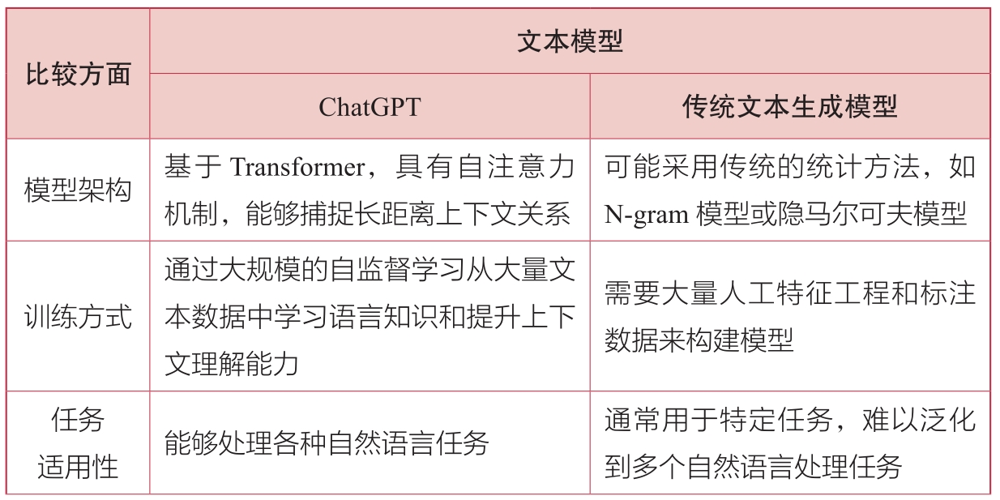
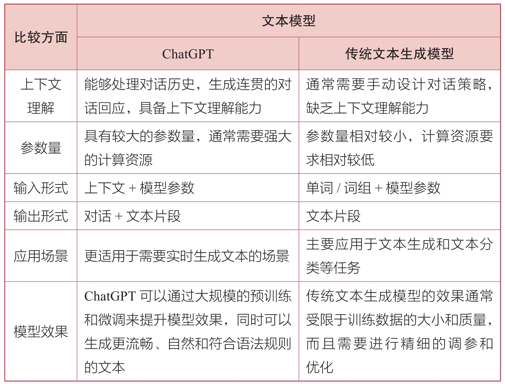
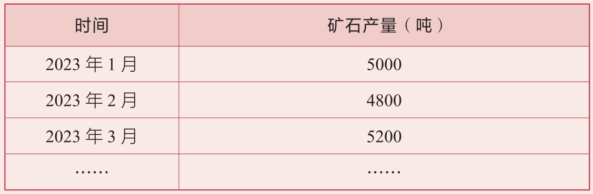
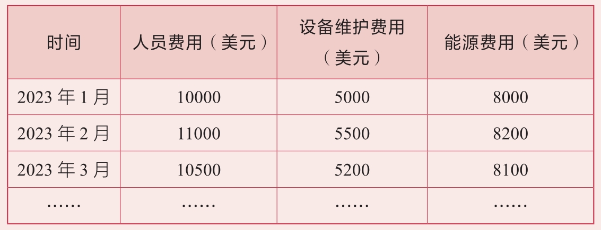

# ChatGPT论文写作加速指南

# 内容速览

人工智能已深度融入日常学习与工作，ChatGPT 作为一款主流的 AI 文本处理工具，正在被大量用于各类文章撰写。拥抱并善用 AI，已成为每个人的必然选择。

本书作者系统梳理了借助 ChatGPT 产出高质量论文的方法，重点覆盖本科论文、硕士论文、博士论文、科研论文、职称评定论文、项目申报论文这六大写作场景。本书的核心优势在于案例驱动，案例数量丰富、逻辑严谨、结构完整，讲解简明精准。读者可借此快速掌握用 ChatGPT 撰写论文的操作要点与技巧。

本书适合本科生、研究生、博士生及各领域科研人员阅读，也可作为有论文写作需求者的实用参考手册。

# 推荐序 1

# ChatGPT：提炼信息洪流，智启未来工作

当下信息爆炸，每个人都面临着信息过载的困境。我们急需工具帮助筛选海量信息，聚焦核心问题，快速给出精准答案。

ChatGPT 正是这样一款兼具效率与创造力的工具，自面世以来在众多领域带来深远影响与变革，大幅提升工作效率并改变了问题解决路径。

ChatGPT 由 OpenAI 研发，是一类基于深度学习与海量训练数据构建的自然语言处理大模型，能够理解人类表达并生成连贯智能的回复。这项技术正在悄然重塑我们的生活与工作方式。

对大学生、研究生和科研人员而言，论文写作难度高，如何在效率与质量之间取得平衡、提升创新价值，是共同挑战。

ChatGPT 具备强大的理解与生成能力，能为论文写作提供全流程支持。换句话说，它可以助力我们迅速成为写作高手。本书展示了 ChatGPT 在论文写作场景的强大潜力，详细说明了如何精准提问、如何借助 ChatGPT 快速定位所需资料、如何优化论文结构与内容、提升语言表达，以及如何在投稿环节提高成功率。

本书呈现了 ChatGPT 在论文写作中的广泛用途，并给出可操作的指导与策略。无论是本科生、研究生还是科研人员，都能从中获得实用的参考。

当然要保持清醒，认识到技术边界，避免过度依赖 AI。科技是服务人类思维的工具，而非替代者。

未来，ChatGPT 将与其它 AI 工具一起成为生活与工作的伙伴，助力高效创造美好未来。

让我们拥抱人工智能，实现更高效、高质的工作与生活！

郑吉敏

去哪儿旅行 技术总监、业务架构 SIG 负责人、人工智能委员会常委

# 推荐序 2

作为一名资深人工智能专家，很荣幸为唐振伟先生新作《玩转 ChatGPT：秒变 AI 论文写作高手》撰写推荐序。在知识爆炸的时代，论文写作已成为职业发展的重要一环。无论学术研究还是职业晋升，论文写作能力都很关键，但对很多人来说仍是极大挑战。

本书是一部系统化的写作指南，旨在帮助不同读者充分利用 ChatGPT 这一强人工智能工具，提升写作效率与质量。通过案例拆解与归纳，本书给出实用建议与策略，覆盖从选题锁定到论文答辩的完整链条，甚至延伸至投稿与审稿环节。

唐振伟的这本书既是工具书，也是浅显易懂的教程。它不仅传授使用技巧，更启发思考。读者将学会以 ChatGPT 为辅助，以创新方式提炼研究价值，优化论文结构与内容，并在语言表达上取得明显进步。

我相信，《玩转 ChatGPT：秒变 AI 论文写作高手》将成为所有与论文打交道者的宝贵资源，助力学术与职业生涯取得更优成果。

衷心推荐给期待在论文写作上实现突破的读者。

祝阅读愉快，收获满满！

朱晓庆

北京人工智能学会副秘书长

2023 年 12 月 6 日

# 前言

学历提升、学术研究、职业发展等场景中，论文写作能力直接关乎学术成长、职业竞争力与未来发展。然而，对大多数人而言，论文写作仍是令人头疼的难题。

**你是否在为本科毕业论文选题而纠结？**

**你是否在为硕士论文框架搭建而烦躁？**

**你是否在为博士论文研究方向而迟疑？**

**你是否在为科研论文的申报材料撰写而失眠？**

**你是否在为职称评定论文的成文而焦虑？**

**你是否在为研究方法的选择而犹豫？**

**你是否面对海量文献无从下手？**

**你是否面对庞大数据分析束手无策？**

**你是否在为提炼研究创新点而苦思？**

**你是否在为答辩 PPT 准备而绞尽脑汁？**

如果你正被以上一项或多项问题困扰，《玩转 ChatGPT：秒变 AI 论文写作高手》正是为你准备的。

本书旨在帮助所有需要撰写论文的人——大学生、研究生、教师、科研人员，或为评奖评优评职称而写论文的人——借助 ChatGPT 辅助写作，提升效率和质量，快速产出高质量论文。

全书共十章，覆盖论文写作各环节，每章目标明确并配有真实应用案例。每个案例均经分析总结，并通过**【让数据更好】【让标题更好】【让逻辑更好】【让表达更好】【让论点更好】【让论证更好】【让论述更好】【让结论更好】【让引言更好】【让综述更好】【让案例更好】【让语言更好】**等子栏目，帮助读者更好借鉴。

“授人以渔”比“授人以鱼”更重要。本书希望帮助每个有写作需求的人掌握更高效的思路与方法，解决不同阶段的难题。

通过学习，你将掌握如何运用 ChatGPT 辅助写作、如何准确表达思想、如何在写作过程中获得更多支持。

感谢你的支持与信任。让我们共同掌握这一强大工具，提升论文写作水平，展现更优秀的自我！

# 第一章

# ChatGPT在论文写作中的实践应用

## 1.1 ChatGPT 概览与运行机制

### 1.1.1 ChatGPT 的演进轨迹与技术基础

ChatGPT 是由人工智能驱动的自然语言处理工具，可通过理解和学习人类语言进行对话，并基于上下文进行交互，模拟人类交流。除此之外，它还具备强大的语言理解与生成能力，可处理问答、文本生成、解释说明、建议给出等多种自然语言任务。

**1. ChatGPT 的发展历程**

ChatGPT 由 OpenAI 推出，采用基于 GPT-3.5 架构的大型语言模型，并通过强化学习持续训练。在此之前，GPT 系列经历多次迭代，主要体现在模型层数与参数规模的提升。

GPT 系列可追溯至**2018 年**。当年 OpenAI 发布**GPT-1**，采用 Transformer 架构，含 12 层解码器，在自然语言任务上表现不错，但规模有限。

不久后推出的**GPT-2**参数增至 1.5 亿，文本生成能力显著增强，引发广泛关注。

2020 年发布的**GPT-3**拥有 1750 亿参数，是当时规模最大的语言模型之一，不仅理解力强，还能完成文本生成、翻译、问答等任务，无需针对性微调。

**ChatGPT**是 GPT-3 的一个变种，专为对话优化，对架构进行微调，提升交互体验，目标是提供更具对话性的自然语言服务。

GPT-3 之后，OpenAI 陆续推出**GPT-3.5**、**GPT-4**等升级版，在保持规模的同时提升性能，并引入人类反馈强化学习等新技术，使模型更好地理解人类意图。

**2. ChatGPT 的技术原理**

ChatGPT 基于 GPT 模型，采用 Transformer 架构，通过大规模预训练与微调、自监督学习实现自然语言理解与文本生成。

**（1）Transformer 架构**
ChatGPT 使用 Transformer 架构，专为文本序列处理设计。架构引入自注意力机制，使模型在处理输入时可动态关注不同位置信息，更好捕捉上下文关联。

**（2）预训练与微调**
预训练阶段，ChatGPT 依托海量文本数据积累广泛语言知识，使其可理解多领域、多主题文本并生成自然表达。

预训练后，通过少量任务相关数据进行微调，使模型适配特定任务，如问答、翻译、文本生成等。

**（3）自监督学习**
ChatGPT 采用自监督学习训练，无需人工标注数据，而是通过预测文本序列中下一个词或标记来学习，最大化样本相似性，提升预测准确率，从而习得语言知识与上下文理解能力。

**3. ChatGPT 与传统文本生成模型的区别**

在自然语言处理领域，ChatGPT 与传统文本生成模型各有作用，但因技术与规模差异，存在明显区别，具体对照见表 1-1 所示。

表 1-1 ChatGPT 与传统文本生成模型的区别

（续表）

### 1.1.2 ChatGPT 的应用领域与潜在价值

ChatGPT 作为强语言处理工具，应用范围广泛，潜在价值巨大。

**1. ChatGPT 的应用领域**

ChatGPT 不仅可用于客服与在线支持、教育学习、创意娱乐，还可用于论文写作、语言翻译等。在论文写作中，其体现为：

**（1）论文选题构思**
ChatGPT 可根据用户输入的关键词或问题生成潜在选题，启发研究方向。例如针对“社交媒体对青少年心理健康影响”，可给出抑郁焦虑关系、自尊自我认同影响等选题建议。

**（以上内容由 ChatGPT 生成，有删节。）**

**（2）文献综述**
ChatGPT 可协助检索相关文献，提供综述思路，并生成综述初稿，帮助快速把握领域进展。例如针对心脏病治疗，可建议查阅顶刊、系统评价、临床试验等资料。

**（以上内容由 ChatGPT 生成，有删节。）**

**（3）论文结构与框架**
ChatGPT 可帮助规划论文结构，为引言、研究方法、结果、结论等部分提供组织建议。例如针对调查研究论文，可给出引言、文献综述、研究方法等框架模板。

**（以上内容由 ChatGPT 生成，有删节。）**

**（4）论文润色与编辑**
ChatGPT 可检查语法、措辞与逻辑问题，提供修改建议，提升质量与可读性。例如对研究生论文进行字词与语法审查，并给出细微优化提示。

**（以上内容由 ChatGPT 生成，有删节。）**

**（5）论文摘要生成**
ChatGPT 可基于主题与需求，从相关资料中提取信息，自动生成摘要，帮助快速了解核心内容与贡献。

**（以上内容由 ChatGPT 生成，有删节。）**

**（6）论文参考文献管理**
ChatGPT 可根据主题自动检索资料并生成符合学术规范的参考文献列表，节省查找时间。

**（以上内容由 ChatGPT 生成，有删节。）**

**（7）讨论与结论撰写**

ChatGPT 可以在撰写论文的讨论和结论段落时提供思路支持，帮助用户把研究结果提炼清楚并给出后续研究的建议方向。

用户提问
一位从事环境科学的研究人员已经完成了大气污染研究报告，对如何收尾结论部分感到拿不准。希望获得针对这份报告的具体写作建议。

ChatGPT 回答
关于大气污染研究报告的结论撰写，可以围绕以下思路展开。

先把研究的核心问题和研究目的回溯一遍。比如这项研究旨在厘清污染物的来源、环境与健康影响以及减排策略，这一段可以作为结论的开场，帮助读者快速回到研究初衷。

再把主要发现和观察结果浓缩呈现。例如可能得出工业排放是主要污染来源，或某些污染物对人体健康产生不利影响等关键结论。描述时要简洁明确，必要时引用相关数据和图表，让论证更直观。

……
（以上内容由 ChatGPT 生成，有删节。）

借助 ChatGPT 进行论文写作，可以让效率提升、写作压力减轻、文本质量提高，同时让研究成果的呈现更清晰。

需要留意的是，即便 ChatGPT 能给出不少实用建议，成稿仍需人工审校和修改，以确保符合学术规范和要求。

**2. ChatGPT 在论文写作中的潜在价值**
ChatGPT 在论文写作中的价值主要体现在四个维度。

**（1）提高效率**
输入关键词或需求后，ChatGPT 能迅速给出选题方向和大纲框架，减少在文献收集与分析上花费的时间，让写作流程更快推进。

**（2）提高论文质量**
基于主题生成规范流畅的表述，帮助提升文本质量。同时对用户提供的段落进行分析，能提供新的视角和见解，有助于拓宽思路并增强创新性。

**（3）降低论文写作难度**
写作不再完全依赖个人语言功底，通过对话式交互获取灵感、解决卡点，降低门槛，让更多人能产出较好的论文。

**（4）减轻写作负担**
在文献检索、结构规划、语言润色等环节分担工作量，使用者可把更多精力集中在核心研究上。

## **1.2 ChatGPT 辅助论文写作的七大场景**

### **1.2.1 用 ChatGPT 生成论文选题**
ChatGPT 依托大规模文本预训练，具备语言理解与生成能力，可以完成专业问答和文本创作，也能辅助产生选题灵感。

用户可围绕专业领域提出问题，或给出一个或多个关键词，请模型给出潜在题目建议。

常见的提问方式有：
示例 1：社会科学研究者可问“未来有哪些社会趋势值得关注研究？”
示例 2：医学专业学生输入“深度学习”和“医疗健康”两个词，让模型据此拟定题目。
示例 3：土木建筑专业的学生给出“绿色建筑评估与设计”这一方向，请求模型提供细化选题建议。

### **1.2.2 用 ChatGPT 生成论文框架**
选题确定后，可让 ChatGPT 协助搭建论文结构。输入标题后，模型会分析主题并给出章节安排建议，为各部分提供内容提示，帮助理清思路。

对话时可先描述研究方向和背景，再询问整体组织方式。

提问示例：
示例 1：针对论文“社交媒体对青少年的影响”，询问“有哪些结构安排建议？”
示例 2：主题为“人工智能对未来的影响”，可问“这篇论文的结构可以怎样设计？”
示例 3：主题为“低碳经济对可持续发展的影响”，可问“从哪些角度展开论述比较合适？”

### **1.2.3 用 ChatGPT 进行文献整理**
ChatGPT 不仅能出题、搭框架，也能帮助检索、筛选和归纳文献。

**（1）根据关键词搜索文献**
用论文主题或关键词让模型查找相关学术资料。

提问示例：
示例 1：请找出关于“深度学习在医疗健康中应用”的文献。
示例 2：我要写“深度学习”与“生物信息学”的论文，能否推荐相关文献？
示例 3：关于“机器学习”与“医学诊断”，有哪些参考资料？

**（2）文献筛选与分类**
模型可按质量、相关性、时效性等标准帮助筛选，并归类整理。

提问示例：
示例 1：能否列出近一年内发表的、聚焦机器学习在医学诊断中准确性和应用效果的论文？
示例 2：请筛选深度学习在医疗影像分析中的应用文献，尤其关注肺结节检测或良恶性鉴别。
示例 3：帮我找到机器学习在医学诊断应用方面的博士或硕士论文，并概括其方法与结论。
示例 4：能否挑出利用深度学习做三维重建和可视化的医学影像分析研究？

**（3）文献综述生成**
基于主题或关键词，模型可从检索结果中抽取要点，生成初步综述，帮助快速把握领域进展。

提问示例：
示例 1：请生成机器学习在医学诊断中应用的优势与局限综述。
示例 2：我正在研究机器学习在金融领域的应用，能否提供相关综述？
示例 3：对心理学幸福感研究感兴趣，能否给出该方向的文献综述？
示例 4：需要可再生能源研究的综述，重点在太阳能和风能的最新成果。

### **1.2.4 用 ChatGPT 进行论文润色**

**（1）语法和字词检查**
可直接提交文本，请模型检查用词和语法问题。

提问示例：
示例 1：在语法上，这段论文是否存在问题？
示例 2：请检查以下论文是否存在语法和用词错误。
示例 3：对我的论文做一次语法和字词校对。

**（2）表达优化**
模型可给出提升逻辑连贯性和表述准确性的建议。

提问示例：
示例 1：论文逻辑不够清晰，有什么办法提升连贯性？
示例 2：呈现研究结果时，需要突出哪些假设或前提？
示例 3：如何用更精准的措辞和修辞表达这一观点？

**（3）关键词选择**
根据主题提供核心关键词建议。

提问示例：
示例 1：请提供能概括本文核心的关键词。
示例 2：针对该主题，哪些关键词最能代表核心概念？
示例 3：如何用简短准确的关键词概括论文主题？

### **1.2.5 用 ChatGPT 进行问题求解**
写作遇到卡点时，可向模型求助。模型通常通过提供知识信息、方法策略、数据文献等方式作答。

**1. 提供信息和知识**
基于训练数据给出领域背景，帮助理解问题。

用户提问
请举例说明人工智能在医疗领域的最新研究和应用。

ChatGPT 回答
人工智能在医疗中的应用已有不少成果。示例包括：
风险预测：公司 Lumiata 的风险矩阵产品基于海量电子病历和病理生理数据绘制患病风险轨迹，帮助医生制定更精确方案。
智能影像识别：企业 Enlitic 用深度学习把癌症检出率提升至超越多位顶尖放射科医生的水平，还能发现人类易漏诊的病例。贝斯以色列女执事医疗中心与哈佛医学院合作的系统对乳腺癌病理图像的识别准确率可达 92%。这些技术提升了诊断速度和准确性。
……
（以上内容由 ChatGPT 生成，有删节。）

**2. 提供方法和策略**
针对具体问题给出可操作的方法。

用户提问
怎样提升文献综述的质量？有哪些写作策略？

ChatGPT 回答
提升综述质量可从以下方面着手：
明确检索策略：提前界定主题范围、关键词和数据库来源。
精读理解：确保每篇文献的研究问题、方法、发现和结论都吃透。
做好笔记总结：记录要点，便于后续准确引用。
保持批判思维：兼顾支持与质疑的声音，合理整合不同观点。
……
（以上内容由 ChatGPT 生成，有删节。）

**3. 提供数据和文献**
给出针对性数据与资料辅助写作。

用户提问
请提供新冠疫苗接种率的数据，并分析其与疫情传播趋势的关系。

ChatGPT 回答
截至 2021 年 9 月，全球累计接种约 43 亿剂疫苗。各地区覆盖率差异明显。
数据显示，接种率上升通常伴随传播速度和感染率下降，但因地区差异，全球疫情仍呈扩散态势。
……
（以上内容由 ChatGPT 生成，有删节。）

### **1.2.6 用 ChatGPT 进行思路创新**
遇到瓶颈时，模型可提供新视角、跨学科联想或对传统假设的质疑。

**1. 提供新颖的观点和角度**

用户提问
写关于人工智能在医疗诊断应用的论文，有哪些新颖角度能突出其重要性？

ChatGPT 回答
可考虑的切入点有：
强调医疗需求：说明 AI 如何提升诊断准确性、优化治疗、加速药物研发。
关注实际效果：用具体机构或项目的成功案例说明落地价值。
深挖数据价值：探讨如何通过 AI 从海量医疗数据中提取有用信息，提升诊疗效果。
……
（以上内容由 ChatGPT 生成，有删节。）

**2. 探索相关领域**

用户提问
研究机器学习在金融领域的应用，能借鉴哪些其他学科的思维？

ChatGPT 回答
可参考：
经济学：用博弈论分析市场竞争，用供需理论解释价格波动。
计算机科学：借用算法和数据结构优化模型性能与效率。
……
（以上内容由 ChatGPT 生成，有删节。）

**3. 挑战传统观点**

用户提问
研究可持续能源政策时，哪些传统假设需要重新审视？

ChatGPT 回答
可能需要反思的假设包括：
能源需求假设：传统预测常假设需求持续增长，忽视节流与保护意识提升。
技术依赖假设：过度依赖技术创新，忽略社会、经济、政治等综合因素。
完全市场假设：市场机制难以完全体现环境成本，需考虑政府干预。
……
（以上内容由 ChatGPT 生成，有删节。）

### **1.2.7 用 ChatGPT 进行论文翻译**
模型可将用户文本转为目标语言，也能把参考文献翻译过来。

**1. 将完成的论文翻译成目标语言**

用户提问
请把这段文字译成英文。“人工智能的快速发展在当今社会不容忽视。正如 Smith（2021）所指出的：‘近年来，人工智能在医疗、金融和交通等领域取得重大进展。’这一引文突显了 AI 在多个领域的广泛应用，不仅令人振奋，也深刻影响我们的生活方式、工作模式和社会互动。”

ChatGPT 回答
The rapid development of Artificial Intelligence is undeniable in today's society. As pointed out by Smith (2021), "In recent years, AI has made significant advancements in various fields, including healthcare, finance, and transportation." This citation highlights the widespread application of AI technology across multiple domains, which is not only exciting but also has profound impacts on our lifestyles, work patterns, and social interactions.
（以上内容由 ChatGPT 生成，无改动。）

**2. 将参考文献翻译成目标语言**

用户提问
请把这段韩文参考文献译成中文。

의료 분야에서 인공 지능의 적용은 이미 의학 진단과 치료에 혁명적인 변화를 가져왔습니다. 지능형 진단 도구와 기계 학습 알고리즘은 의사들이 질병을 더 정확하게 감지하고 치료 계획을 수립하는 데 도움을 줄 수 있습니다. 이로써 환자의 생존률을 높일 뿐만 아니라 의료 직종의 업무 부담을 경감시킵니다.

ChatGPT 回答
在医疗领域，人工智能的应用已为医学诊断和治疗带来革命性变化。智能诊断工具和机器学习算法可以帮助医生更准确地发现疾病并制定治疗方案，从而提高患者生存率，同时减轻医疗从业者的工作负担。

金融行业内部，智能化方案正被深度嵌入风险量化、市场研判与投资决策等关键环节。这一落地改变了业务运行逻辑，也促使金融机构在市场波动面前具备更强的弹性。

**示例**

医疗场景里，智能技术推动诊疗范式出现结构性调整。辅助诊断工具与机器学习体系帮助医师更精准地捕捉疾病信号并制定干预方案，进而提升患者预后并分担临床工作压力。

金融场景里，智能系统被大量部署在风险量化、市场解析与投资挑选等流程。相关应用重塑了金融体系的运作路径，推动机构更灵活地应对行情变化。

**（该段为模型原文，保持不变。）**

## **1.3 ChatGPT 在论文写作中的优点和局限性**

### **1.3.1 ChatGPT 的优点**

ChatGPT 具备多项实用特质，因而在多种场景受到关注。它能够协助解题、支撑学习，并提供较高质量的写作辅导。

**1. 覆盖面广泛**

模型储备横跨众多学科，能够就科学、历史、文学、医学等各式议题给出参考性信息，帮助使用者认识并深入探索不同领域。

示例问题
我希望研究古希腊哲学，能否提供相关资料。

示例回应
探究古希腊哲学是一项兼具趣味与深度的学术活动。该传统对西方思想与文化产生深远影响，内容相当丰富。下面简要介绍古希腊哲学的基本框架与代表人物。

前苏格拉底学派人物
毕达哥拉斯：提出毕达哥拉斯学派主张，强调数学与宇宙秩序的关联。
……
**（该段为 ChatGPT 原文，有删减。）**

**2. 即时检索能力**

使用者可随时向模型提出疑问，体验类似实时在线检索的过程。ChatGPT 能在数秒内调取并呈现相关知识，无需手动翻阅多个网页或数据库。

示例问题
人工智能在自主决策时如何确保遵守伦理和法律？

示例回应
保证 AI 在自主决策中遵循伦理与法律是一项复杂而关键的议题。下面列出若干方法与考量要点。
伦理规范与规则建设：制定清晰的伦理准则和行为规则，用以引导系统运行。这些规则需涵盖隐私、公平、透明、安全等方面，并将之编程为系统的约束条件。
……
**（该段为 ChatGPT 原文，有删减。）**

**3. 参考资料供给**

ChatGPT 能给出相关的参考资料与引用来源，这对学术写作、研究论证尤为重要。当使用者需要支撑观点时，模型可帮助定位合适的引文或文献，提升论证力度。

示例问题
我要撰写一篇关于气候变化的论文，想了解一下气候科学家的观点和相关研究，以及他们的研究论文。

示例回应
撰写气候变化论文需要充分掌握气候学家的观点与前沿研究。以下提供若干权威学者、研究机构及代表性论文，方便作为研究起点。
知名气候科学家
迈克尔·E. 曼：以“曲棍球杆曲线”著称，该图表反映了近几个世纪全球温度变化趋势。
……
研究机构
联合国政府间气候变化专门委员会 IPCC：发布多份全球气候评估报告，是权威信息来源。
……
**（该段为 ChatGPT 原文，有删减。）**

**4. 学习与教学支持**

ChatGPT 可作为教育工具，帮助学生与教师获取信息、理解课程内容。它能解答疑问、补充背景、解释复杂概念。

示例问题
我是一名中学生，想了解一下化学键的类型、特性以及它们在化学反应中的作用。

示例回应
化学键是分子内或分子间的相互作用，在化学反应中起决定性作用。常见化学键的类型、特性及功能概述如下。
共价键
特性：由两个或多个原子共享电子对形成，多见于非金属之间，键能通常较高，是分子中最强的键型之一。
作用：使原子结合形成分子，决定分子几何构型与化学性质。在反应中，共价键可断裂并重组，从而生成新物质。
……
**（该段为 ChatGPT 原文，有删减。）**

**5. 多视角阐释**

ChatGPT 能够生成不同角度的观点与解释，帮助使用者更全面地把握问题。使用者可通过多轮提问，从多维度展开探讨，获得更丰富的启发。

示例问题
全球化对发展中国家的经济影响。

示例回应
1. 积极层面
市场拓展：全球化使发展中国家更深入参与国际市场，出口机会增加。例如中国商品在全球市场的表现。
……
2. 消极层面
……
3. 综合视角
……
**（该段为 ChatGPT 原文，有删减。）**

### **1.3.2 ChatGPT 的局限性**

ChatGPT 本身也存在一定限制，生成内容可能不符合预期。

**1. 输出易出现误导或偏离**

该系统基于海量文本训练，生成时更多依赖表层模式匹配而非真正理解上下文。因此有时会给出看似合理实则误导的答案，或与问题无关的内容。示例如下。

示例问题
A 比 B 贵 100 倍，那么 B 比 A 便宜多少倍？

示例回应
如果 A 比 B 贵 100 倍，那么 B 相对于 A 的价格是 1/100，即为百分之一。因此 B 的价格相当于 A 的 1%，便宜的程度非常大。
**（该段为 ChatGPT 原文，未改动。）**

在使用过程中，使用者应尽量明确表达问题，以降低误导风险。若回答不符预期，可追加提问或提供更多上下文，帮助模型更准确理解。

**2. 专业写作能力受限**

尽管能生成文本，但在缺乏特定专业知识的情况下，处理复杂领域论文时难以提供深度见解。此外，各学科有独特的写作规范与风格，ChatGPT 可能无法完全把握。

示例问题
帮我撰写一篇有关量子计算的论文。

示例回应
### 标题
探索量子计算的未来：原理、应用和挑战
### 摘要
本文将讨论量子计算的基本原理、现实应用及面临的挑战。我们将研究量子比特、量子门、量子算法以及未来前景。
……
**（该段为 ChatGPT 原文，有删减。）**

使用者可借助 ChatGPT 生成段落或初稿，但在涉及复杂研究方法、数据分析或领域专属知识时，应谨慎对待，最好查阅专业渠道获取信息。

**3. 缺乏主观性与创造力**

模型输出多基于事实与数据，难以提供主观判断、价值取向或情感回应。同时，受训练数据限制，其创造力难以与人类创作者相比。

示例问题
哪种颜色最好看呢？

示例回应
“哪种颜色最好看”属于高度主观的问题，取决于个人审美偏好。不同人对色彩的喜好各不相同，因此没有绝对答案。
……
**（该段为 ChatGPT 原文，有删减。）**

生成内容可能缺少主观与创造性元素，可通过人工编辑与润色加以补充。

### **1.3.3 用 ChatGPT 写作论文的注意事项**

撰写论文时需审慎使用 ChatGPT，确保内容质量、学术诚信与知识产权尊重。

**1. 生成内容的评估**
**（1）准确性与可信度**
使用前需对生成内容进行评估与核验，尤其涉及重要事实、数据与专业知识时，应查阅权威资料或咨询专家，以保证信息可靠。
**（2）语法与逻辑的合理性**
需仔细审阅与修改生成文本，确保语法正确、逻辑通顺、信息表达清晰。

**2. 避免过度依赖**
**（1）保持独立思考**
ChatGPT 只是辅助工具，不能替代独立思考。生成内容可作为起点，而非最终结果。
**（2）多角度思考**
模型输出受训练数据制约，使用时应纳入多种视角与观点，以丰富内容、提供更全面信息。

**3. 知识产权风险防范**
**（1）尊重知识产权**
模型训练使用了大量公开文本，使用生成内容时需尊重版权，避免侵权。
**（2）避免抄袭**
生成文本可能与网络内容相似，作者需确保论文原创性，使用专业查重工具检查重复率。

# **第二章**

# **ChatGPT 与本科生论文写作**

## **2.1 ChatGPT 在本科生论文写作中的具体应用**

### **2.1.1 用 ChatGPT 确定论文题目**

确定恰当的论文题目是写作关键，直接影响后续流程。当对毕业论文无从下手时，可借助 ChatGPT 获取思路。

背景：使用者已确定大方向为“食品安全”。

示例问题
围绕食品安全这个选题，如何确定论文题目？

示例回应
确定食品安全方向的论文题目需要细致思考，确保题目能清晰体现研究兴趣与方法。以下提供若干建议。
1. 明确研究重点
厘清对食品安全领域的具体兴趣点。食品安全范围宽广，可涉及检验、添加剂、传染病、法规等。
2. 确保题目具体清晰
题目应准确反映研究焦点，避免过于宽泛。例如避免“食品安全研究”这类模糊表述，而采用“食品安全法规的评估”或“食品中有害微生物的检测方法”等更具体的表述。
3. 以研究问题为依据
若已有明确研究问题，可将其融入标题，使题目与内容紧密对应。例如研究问题为“食品中有害微生物的检测方法如何改进”，标题可为“改进食品中有害微生物的检测方法”。
4. 引入关键词
在标题中嵌入关键词，有助于提升论文在学术数据库与搜索引擎中的可见度。例如“食品安全”“检测”“法规”等。
……
**（该段为 ChatGPT 原文，有删减。）**

ChatGPT 给出具体建议，如规避模糊标题、合理使用关键词、与研究问题对应等，有助于使用者优化题目。

**【让标题更好】**
可继续追问，引导模型进行更深入思考。
**（1）关于研究重点的追问**
示例 1：如何具体确定食品安全问题的研究重点？
示例 2：有哪些方法可帮助找到食品安全领域的研究焦点？
**（2）关于研究问题的追问**
示例 1：如何将研究问题恰当地体现在论文标题中以保持一致？
示例 2：有无案例展示研究问题如何转化为具体标题？
**（3）关于关键词的追问**
示例 1：标题中包含哪些关键词能提高检索性？
示例 2：如何设定论文检索关键词？

示例问题
在标题中包括哪些关键词，可以提高论文的易检索性？

示例回应
以下为可考虑使用的示例关键词。
食品检测
食品卫生
食品中毒
食品供应链
食品微生物学
食品法规
……
**（该段为 ChatGPT 原文，有删减。）**

### **2.1.2 用 ChatGPT 提炼论文的研究目标**

使用者可基于论文题目，通过 ChatGPT 提炼研究目标，明确方向与预期成果。

示例问题
我的论文研究方向是“食品加工和供应链”，题目是“食品供应链可追溯性对食品安全的影响”，请为我提炼研究目标。

示例回应
基于上述题目，论文可能具有以下作用。
供应链可追溯性是保障食品安全的重要手段。对原材料采购、加工、运输、储存、配送等环节进行记录与标识，可建立完整档案，便于问题追溯。
可追溯性提升供应链透明度。通过记录各环节信息，可让消费者与监管部门了解全流程，及时发现潜在风险。
……
综合来看，食品供应链可追溯性对食品安全意义重大，可提高安全水平与透明度，增强消费者信心，促进产业可持续发展。因此深入探讨其实践与理论问题，能为保障食品安全提供参考。
**（该段为 ChatGPT 原文，有删减。）**

ChatGPT 给出清晰、具体且与题目关联的研究目标，但使用者仍需结合专业知识与要求进行进一步修改。

**【让目标更好】**
可通过深入互动优化研究目标。
示例 1：如何使研究目标更具体，以更精确界定研究问题？
示例 2：依据研究目标，如何调整研究方法以确保目标达成？
示例 3：怎样让研究目标体现实际意义、价值与影响？

示例问题
我希望研究目标能够体现出研究的实际意义、价值和影响，有什么建议吗？

示例回应
若希望突出研究的实际意义，可在目标陈述中强调以下方面。
1. 强调社会影响：深入研究食品供应链可追溯性对食品安全的影响，提升全社会食品安全意识，增强消费者信任，降低健康风险。
2. 强调经济效益：阐明供应链可追溯性对食品生产企业的经济影响，探讨其在降低召回成本与提升产品质量方面的价值，帮助企业增强竞争力。
3. 强调政策与管理建议：通过分析可追溯性对食品安全的积极作用，为企业与政府提供供应链管理与食品安全政策制定的指导，确保更安全供应链。
……
**（该段为 ChatGPT 原文，有删减。）**

### **2.1.3 用 ChatGPT 展开论文的文献综述**

文献综述有助于把握研究脉络与已有进展。借助 ChatGPT 生成综述时，需先将收集的文献输入模型。ChatGPT 可对每篇文献进行简要归纳，包括方法、主要发现与结论。

背景：使用者上传两篇论文《供应链视角下×××》和《基于食品供应链管理×××》，要求整合分析。

文档 1：主要探讨食品加工产业中食品安全问题的重要性，并从供应链管理角度分析其机制。文章提出……
文档 2：在分析食品供应链诱发食品安全问题原因的基础上，提供新的解决思路……，文章指出……

示例问题
综合分析这两个文档，有哪些关键内容可供参考？

示例回应
综合两篇文档，以下关键内容可供参考。
食品安全的重要性：两文均强调食品安全是健康基础，对食品加工产业尤为关键。相关部门需制定安全管理条例，明确责任制度、管理流程，规范供应链管理体系，提升评估精准度。
食品加工环节的安全隐患：部分企业为控制成本，在生产规模不足时承接订单，安全管理不到位，质量检查不专业，导致巨大风险。例如酱料、佐料生产存在诸多隐患，部分小厂环境简陋、管理经验缺乏，原材料管控不严、工艺控制不到位，易导致污染风险。
……
以上内容仅供参考，建议查阅更多文献以获取更全面准确信息。
**（该段为 ChatGPT 原文，有删减。）**

ChatGPT 总结提炼出关键信息，如食品安全重要性、加工环节隐患、管控方式等，使用者可据此选择文献纳入论文。

**【让综述更好】**
文献较多时，可先上传至 ChatGPT 进行初步分析，再针对结果提问以深入了解。
示例 1：文章中提出的解决食品安全问题的关键措施有哪些？
示例 2：食品供应链中存在哪些安全隐患？如何结合实际情况提出解决方案？
示例 3：如何通过制定监督管控办法提高食品安全管控质量？

### **2.1.4 数据搜集与解析的协同用法**
研究立论需要可靠依据，检验假设也依赖扎实的证据。在信息收集与解读阶段，生成式模型可以作为助手参与。

示例问句
请给出××餐馆在食材生产、加工、储藏、运输、销售等环节的具体数值。

模型回复示例
非常抱歉，我无法提供某家具体餐馆在生产、加工、储藏、运输、销售等环节的数值，这类信息多属商业机密，受隐私与商业法规保护。获取前必须取得经营方的明确授权并遵守相关规定。

若你对某家餐馆或餐饮行业的公开信息感兴趣，建议联系相关主管部门、经营者或政府机构申请。行业市场研究报告与学术论文有时会披露汇总性信息，可作为参考。

注：此段为模型原始输出，保持原貌。

由于部分信息涉及商业保密，模型本身无权调取。收集环节需获得信息持有者的同意。模型不能直接提供原始数据，但若使用者已自行收集并上传整理好的资料，模型可以进行解读、呈现规律并辅助论证。

场景说明
使用者已将食材生产、加工、运输、销售各环节的数据整理成文档上传，要求对材料进行诊断。

示范问句
依据所提供材料，能看出经营主体存在哪些异常？

模型回复示例
一、生产环节
1. 卫生合规
月均卫生违规次数约15次，涉及餐具洁净度、作业区整洁、从业人员卫生行为不足等。
2. 原料品质
季度不合格原料次数约10次，问题包括过期品、未达标品等。
二、加工环节
温度管控失常，年均违规约20次，储存温度偏高或偏低导致食材变质风险上升。
……

注：此段为模型原始输出，略有删减。

模型梳理出各环节的违规频次与具体表现，这些表现直接关联食安风险。使用者可继续追问，以进一步支撑论文观点。

示范追问
经营主体如何记录和管控与食安相关的信息？
是否部署可追溯机制以追踪食材来源与流向？

数据质量提升要点
为确保模型给出的解读准确、完整、一致且可靠，可主动核验。
示例一：请核查上述数值的准确性与完备性。
示例二：如何衡量数据的可信度，尤其是多来源数据。

### **2.1.5 论文摘要的提炼方法**
摘要置于文首，用来呈现研究要点、吸引阅读并在学术交流中发挥作用。通常基于正文提炼，是对核心内容的概括。

场景说明
使用者围绕食品安全撰写毕业论文，题目为《供应链可追溯性对食品安全的影响》，将正文上传后要求提炼摘要。

示范问句
请参照上传文档概括内容并生成摘要。

模型回复示例
供应链可追溯性对食品安全的影响已成为全球食品行业关注焦点。本研究分析可追溯系统的部署与使用，揭示其对食安的积极作用。结果显示，建立可追溯系统显著提升供应链透明度，可追踪食品从生产到销售的全过程。这有助于企业快速识别受污染或不合格产品并及时处置，降低召回频次与规模。可追溯系统也促进供应链协作与信息共享，提升整体食安意识。但有效性取决于正确部署与维护以及监管政策支持。后续研究可聚焦最佳实践与监管机制，以进一步提升食安水平。可追溯性不仅降低风险，也增强消费者信心，对公共健康与行业可持续发展至关重要。

……
注：此段为模型原始输出，略有删减。

模型输出简洁易懂，术语较少，句式清晰，涵盖研究核心，有助于把握论文逻辑。当然该摘要并非最优，毕业生可分析其提炼方式以改进自身写作。

表达优化提示
提炼时可增加字数限制，确保在范围内清晰表达重点。
示例一：请基于上传论文提炼摘要，控制在200至300字。
示例二：请基于上传论文提炼摘要，不超过500字。

## **2.2 用生成式模型锁定选题与搭建思路**
主题过于宽泛会导致研究失焦，难以形成明确问题，进而影响质量。借助模型收窄选题范围，可集中解决具体问题，保证研究的连贯与深入。

示范问句
我是行政管理专业的学生，要准备毕业论文却没有思路，能否给出一些方向建议？

模型回复示例
以下是行政管理领域的部分潜在研究方向，供参考。
1. 公共政策评估：分析政策实施效果与可持续性。
2. 组织文化与领导力：探究组织文化对绩效与满意度的影响及领导作用。
……
7. 国际比较研究：比较不同国家行政管理体系的异同与最佳实践。
建议选定后与导师沟通确认可行性。

注：此段为模型原始输出，略有删减。

若回答较少，可继续追问。

追问示例
能否再列举一些研究方向？

模型回复示例
在行政管理领域还有诸多可能，以下是补充建议。
1. 政府与非营利组织协作：研究协作模式对公共服务的影响。
……
12. 政治参与与公共政策：研究公众参与政策制定与决策过程的影响。

注：此段为模型原始输出，略有删减。

在看到列表后，使用者对“食品安全”感兴趣，但该领域分支众多，需进一步缩小。

追问示例
我想在食品安全领域写作，有哪些研究方向？

模型回复示例
食品安全领域可涵盖多个方向，以下是部分建议。
1. 食安政策与法规：研究不同地区政策法规如何影响供应链、生产与消费者权益。
2. 食安监管：分析政府与监管机构的作用、监管体系成效与挑战。
……
注：此段为模型原始输出，略有删减。

结合导师意见可进一步确定具体题目。

选题优化提示
一、明确研究范围
先向模型说明专业或研究领域。
示例一：我是旅游管理专业的。
示例二：我主要研究社会因素对语言使用的影响。
二、列出关键词
提供与主题相关的关键词，如“食品安全”“食品危机”“食品监督”等，模型据此生成更相关、更有吸引力的选题。

### **2.2.2 生成研究方法与思路**
研究方法与思路是规划研究过程、收集数据、分析结果的关键。不少使用者不熟悉具体方法，可向模型咨询以挑选合适方案。

示范问句
本科毕业论文写作中常用的研究方法与思路有哪些？请列举。

模型回复示例
文献回顾：梳理前人研究发现，识别关键问题并提出新问题。
调查研究：设计问卷收集定量数据，常用于社科与管理。
案例研究：深入分析特定情境或组织，用于商业、心理学等。
实验研究：在受控条件下操纵变量检验因果，常用于自然科学等。
问卷调查：采用标准化问卷收集态度与观点，适用于多学科。
实地调查：在自然环境中观察记录现象，常用于生态学、人类学等。
……

注：此段为模型原始输出，略有删减。

模型列出了多种方法与思路，可据此选择。仅有概念介绍，想了解具体操作仍需继续追问。

方法优化要点
一、提问要清晰
简明概括研究核心问题，避免模糊表述，有助于获得合适建议。
二、明确需求
若需特定方法指导，请提出明确需求。
示例一：如何检验和验证问卷的有效性？
示例二：如何提高问卷调查的响应率与质量？
示例三：问卷数据如何分析并撰写报告？
三、要求示例与详解
可请模型提供操作细节示例，包括数据采集、样本选择、分析步骤与结果解释。

### **2.2.3 观点与论证的拓展**
论文观点是核心主张，论证是依靠证据与逻辑证明主张。若观点或论证单薄，可借助模型进行拓展。

示范问句
我的论文论点是“社交媒体对青少年影响是负面的”。论据是“社交媒体使青少年沉迷手机电脑，挤占学习时间，影响学业与社交”。感觉不够充实，能否扩展？

模型回复示例
论点拓展
社交媒体对青少年的负面影响是热点话题，进一步展开可加深理解。
心理健康层面：探讨使用与焦虑水平、自尊心、心理幸福感的关系，引用相关研究。
身体健康关联：分析久坐、睡眠不足、缺乏运动等影响，提供案例与数据。
……
论据拓展
论据提到学业与社交负面影响，可进一步深化。
学业影响的深入分析：剖析社交媒体挤占学习时间、视频游戏分散注意力的机制，引用研究说明与成绩下降的关系。
沉迷与注意力问题：解释沉迷导致学习兴趣下降，长时间使用影响注意力机制，可引用神经科学研究。
……

注：此段为模型原始输出，略有删减。

模型分别从论点与论据两方面、多角度展开，内容丰富。但提供的是方向与思路，并非可直接使用的成文内容，仍需使用者结合自身研究深化，培养思考能力。

论点优化提示
一、多角度思考
与模型多维度对话获取更多视角，如社交孤立、心理健康。
示例一：青少年在社交媒体上的互动是否导致现实社交孤立？
示例二：社交媒体使用是否与青少年心理健康问题相关？有无积极或消极影响的研究？
示例三：社交媒体使用与焦虑、抑郁或自尊心问题的关系有无研究？
示范问句
有研究探讨社交媒体使用与青少年焦虑、抑郁或自尊心问题的关系吗？
模型回复示例
是的，相关研究较多，涵盖大规模调查、追踪研究及心理学与健康科学领域。一般发现：
社交媒体与焦虑抑郁：过度使用可能与焦虑抑郁症状增加相关，可能源于社交比较、网络欺凌、睡眠不足等。
社交媒体与自尊心：使用可能受社交媒体评价标准与比较影响，对自我形象与价值观产生负面作用。
……
注：此段为模型原始输出，略有删减。
二、查找相关文献
让模型查找最新研究，从中获得论点启发。

论证优化提示
一、引入案例研究
请模型提供具体案例丰富论证，使观点更具说服力。
二、考虑对立观点
让模型列出对立观点，如认为社交媒体无负面影响的看法，再借助其帮助反驳，以强化论证。

### **2.2.4 论文结构设计的辅助**
模型可提供论文结构建议，帮助思考逻辑与内容安排。

示范问句
我正在写本科毕业论文，主题是“社交媒体对青少年的负面影响”，请给结构设计建议。

模型回复示例
1. 封面页
含题目、姓名、导师、院系、学校、提交日期。
2. 摘要
简要概括研究问题、方法、主要结果与结论。
3. 目录
列出章节标题及页码。
4. 表格图形清单
如有使用则列出标题与页码。
5. 引言
介绍主题重要性，明确研究问题与核心论点。
6. 文献综述
回顾相关研究，评估已有成果并指出研究空白。
7. 方法
详述研究设计、数据收集、样本选择、分析方法等。
……

注：此段为模型原始输出，略有删减。

模型给出完整结构框架可供参考，但其建议未必完全符合学术规范，最终仍需导师指导。

框架优化提示
一、明确论文主题
沟通时提供主题，帮助模型理解研究领域与重点。
二、反复交互完善
可多次对话逐步优化结构，确保各部分充分。
示例一：如何让引言更具吸引力？
示例二：文献综述部分如何组织内容？
示例三：结论部分如何呈现研究数据以支持观点？
示例四：有哪些过渡词可提升段落流畅性？

## **2.3 用生成式模型修改与优化论文**

### **2.3.1 大纲与逻辑的优化**
为使论文条理清晰、观点突出，可借助模型优化大纲与逻辑。

场景说明
使用者上传论文大纲。

示范问句
能对论文大纲与逻辑进行优化吗？

模型回复示例
可以，以下是优化后示例，更详细地描述各部分内容与逻辑。
### 论文大纲
一、引言
A. 背景介绍
1. 社交媒体普及与青少年
2. 研究背景与意义
B. 研究目的与问题
C. 文献综述
1. 社交媒体对青少年影响概述
2. 先前研究主要发现
D. 研究假设与方法概述
1. 研究问题
2. 假设
3. 方法简介
二、社交媒体的影响机制
A. 社交媒体使用对青少年学业表现的影响
……

注：此段为模型原始输出，略有删减。

模型对各部分进行了细化，使大纲清晰、覆盖要点，为写作提供明确指引。使用者可据此对照自身大纲，补充优化内容，不断提升论文质量。

框架优化提示

**先搭骨架，再让 AI 来润色**

（1）把章节框架先理清楚
在请 ChatGPT 帮忙改写前，自己先把论文的主要章节和子章节的标题列出来。框架明确了，AI 才能给出针对性的建议，把各部分之间的逻辑理顺，让整篇论文结构清晰。

（2）给框架填上细节和案例
框架确定后，可以让 AI 去每个部分补充内容，加入更具体的细节、实例和支撑性信息，帮助提炼重点。常见的提问方式有：
示例 1：我已经有了大纲，现在需要为每个章节补充更细的要点和内容，可以帮我展开吗？
示例 2：为了证明我的观点，需要一些支撑性资料，能否为各章节提供相关研究结果或信息？

### 2.3.2 用 ChatGPT 打磨表达并丰富内容
好的语言能提升可读性，让观点更容易被理解。通过 AI 扩充内容，可以让它提供更多细节、例子和证据，增强说服力和可信度。

背景：用户上传了论文初稿。
用户提问：请帮我优化语言，充实内容。
ChatGPT 回复要点：
1. 引言：把句子重构得更流畅有吸引力；在引言里加一两句说明为什么“社交媒体对青少年学业影响”值得研究，增强背景感。
2. 文献综述：更具体地描述积极和消极影响的例子，梳理不同研究的结论；为每个理论模型补充解释，便于读者理解。
3. 研究问题与假设：让假设更具体，明确所用社交媒体的类型，以及学业表现如何衡量。
……
以上建议能让论文更具吸引力，提升质量，也便于他人理解研究价值。

**表达升级指南**
（1）调整措辞
让 AI 帮忙找更合适的词汇和表达，提升流畅度和说服力。
示例 1：我想让论文语言更流畅有力，能否给出一些替换词或替代表述？
示例 2：有什么建议可以让表达更精准生动，同时避免冗长模糊？

（2）梳理段落结构
借助 AI 构建清晰的段落，确保每段都有明确主题，并用事实、例子和引用来支撑主题。

（3）剔除冗余
让 AI 检测重复或冗余内容，保证每句话都有新信息。
示例 1：我怀疑论文存在重复，能否帮我找出问题并建议删除或合并？
示例 2：怎样避免句子或观点重复，让论文更紧凑？

### 2.3.3 用 ChatGPT 找案例与数据
案例和数据能增强研究可信度，吸引读者深入阅读。

用户提问：为了证明“社交媒体使用时长与青少年学业表现负相关”，请提供例子和数据。
ChatGPT 回复要点：
提供若干示例并提醒数据会随时间变化，需用最新可信来源。
研究示例：皮尤研究中心调查显示超七成青少年每天用社交媒体，约四成在校使用，频繁使用与学业下滑有关联。
学术研究：某期刊文章指出，每天用超过2小时的学生平均 GPA 偏低，少于1小时的学生表现更好。
教育机构数据：某学区数据显示，将社交媒体限定在课外的学生，考试成绩优于无限制的学生。
心理学研究：某心理学期刊研究发现，社交媒体负面互动如网络欺凌与学业下降相关，可能通过影响心理健康间接作用。
总体评价：AI 给出了起点，但来源和具体数值未提供，需要自行查证；也缺乏对数据含义的深入分析，需进一步解读。

**让案例更好**
（1）补充完整性：让 AI丰富案例描述，让读者能形象还原场景。
（2）突出相关性：让 AI阐述案例与论文主题的关联，如与“使用时长负相关”的联系。
（3）增强真实性：请 AI补充案例的来源、数据采集方式或真实故事，提升可信度。

**让数据更好**
（1）确保准确性：让 AI校对数字和统计结果，检查输入、计算过程。
（2）可视化呈现：描述需要的图表形式，让 AI生成表格或图形建议。
示例：能否帮我生成柱状图、折线图或饼图？如何选择最合适的可视化形式？怎样让数据图更吸引人？
（3）进行比较：用 AI对比不同数据集的差异，加强论证。

### 2.3.4 用 ChatGPT 检查语法与用词
语法和用词准确能提升质量、可读性和可信度，增加发表机会。

背景：用户上传初稿两段。
用户提问：请检查是否有语法和用词错误。
ChatGPT 回复要点：
“标题为”后应加冒号；
“而在这部分研究中我们重点探讨的是”后面缺少宾语，需补全；
“压力增大”应改为“压力增加”；
“花费大量时间比较自己和其他人的成绩和地位”应改为“...和其他人的成绩和地位进行比较”；
“他可能会感到焦虑和压力”应改为“焦虑和压力大”。
AI 指出问题并给修正建议，能让语言更准确。但专业术语的表达可能与常规不同，需甄别。

**语言优化清单**
（1）语法审查：逐句检查主谓一致、词性使用等常见错误。
示例：请逐句检查语法错误；帮我查找并修复句式问题。
（2）用词检查：纠正错别字、标点，提供得体用法的建议。
（3）语法学习：向 AI提问语法规则，加深理解，避免同类错误。

# 第三章
# ChatGPT 与硕士论文写作

## 3.1 ChatGPT 辅助开题

### 3.1.1 用 ChatGPT 检验选题
在写硕士论文时，可把选题方向交给 AI 讨论。它能提供背景资料、相关研究成果和最新进展，判断选题的学术价值。
开题阶段还能拓展思路，通过讨论研究目标、方法、预期结果，获取建议和研究路径。

用户提问：以“企业战略与竞争优势”作为经管学院研究生毕业论文选题，可能有哪些错误方向？
ChatGPT 回复要点：
1. 停留在表面描述，缺乏深度分析；
2. 缺乏理论支撑，未回顾已有理论；
3. 方法论不合理，未说明可行性；
4. 缺乏实证分析，仅做理论推演；
5. 泛泛而谈，未聚焦具体行业或企业。
避免建议：明确研究问题；深入研究理论框架；选择合适方法并说明合理性；结合案例和数据实证；聚焦具体对象提出具体结论。

**让选题更准**
提问时要让 AI明白你的关注点，可提供理论框架、模型和概念。例如提供“资源基础理论”并问：如何挖掘企业独特资源并转化为竞争优势？这样 AI 能基于理论帮助验证选题。

### 3.1.2 用 ChatGPT 检验研究方法
开题时可与 AI 讨论目标、方法、预期结果，获取研究路径和资源建议。无论定性定量，AI 都能给出验证建议，帮助设计科学方法。

背景：用户上传段落，论题为合并与收购对企业战略和竞争优势的影响，采用问卷调查法。
研究方法：设计针对并购企业的问卷，调查战略调整、市场份额、企业效益等，通过高层访谈收集数据。
研究结果：并购带来资源整合、规模效应、市场拓展、品牌影响、成本优化等。

用户提问：此方法是否适合主题？有无改进空间？
ChatGPT 回复要点：
方法基本适配，但可改进：
多元方法：除问卷外，可结合深度访谈、案例研究，获取多角度数据；
样本选择：评估样本代表性，注意行业和企业类型的覆盖，避免偏差；
长期观察：跟踪并购后变化，更全面了解战略、份额、效益的演变。
总体上现行方法有探索价值，引入多元方法、优化样本、长期追踪能提升可靠性。

**让方法更好**
提问时界定研究目标，明确方法要达成的效果，或基于特定模型理论提问。例如：若基于波特五力模型评估竞争优势，此方法能否支撑结论？最终选择需结合个人兴趣、能力与资源，AI 建议仅作参考。

### 3.1.3 用 ChatGPT 检验写作思路
基于选题和提纲与 AI 对话，可获得反馈。AI 能检查论点逻辑、论据可靠性、结构合理性，并建议如何组织、表达、引用文献。

背景段落要点：
供应链管理在全球化市场中愈发重要，但仍存在挑战。
一是透明度问题，信息延迟导致库存积压、交货延误；
二是风险管理问题，自然灾害、人为错误等都可能中断供应链，需建立风险制度；
三是技术应用不足，物联网、大数据、AI 等因成本和门槛未广泛应用。

总体来看，制约供应链运转效率的核心难点集中在信息不够透明、风险管控存在短板、以及数字化手段运用滞后这几个维度。想要突破这些瓶颈、提升整体效能，就必须转换思路，採取更主动、更有创新性的举措，比如加快前沿信息技术的普及，推动上下游企业形成更紧密的协同关系。与此同时，既要靠企业加大投入，也需要政府支持，把更多资源投向供应链风险管理的探索与实践，提升在各类不确定性面前快速反应的能力。归根结底，要正视供应链管理本身的复杂特性，做好统筹兼顾、系统化、科学化的顶层设计，才能让链条长期稳定高效运行。

**用户提问**
能否帮我看看上面这段表述，思路是否通顺，是否符合硕论的逻辑规范，还有没有可以优化的地方或更好的写法思路？

**ChatGPT 回答**
从你给的材料来看，对供应链管理中的痛点和可能的对策已有基本把握。以下是对这段文字的点评和建议。

1. 思路是否清晰：开头就点明要检视的挑战，随后列出透明度不足、风险管理薄弱、技术应用落后三项关键问题并作简要说明。整体脉络能够让人明白你想讨论的核心议题。
2. 是否符合硕论逻辑：所提问题具有学术价值和现实意义，契合供应链管理领域的研究热点。围绕这些热点展开深入剖析，有助于做出理论贡献和实践参考。
3. 可补充拓展之处：虽然已覆盖主要痛点，但仍可进一步深化。例如透明度问题可结合物联网、区块链如何提升可视化和实时监控；风险管理可介绍常用评估框架、供应链备份、多供应商分散等应对手段；技术应用不足可探讨落地障碍、推广路径及未来演进趋势。
4. 结尾收束与建议：可在尾部对关键问题作概括，并提出明确建议，如强调信息技术与数字化工具对效率提升的作用，以及政企协同加大风险管理研究投入的必要性。

总体来说，写作思路清楚、符合硕士论文的逻辑要求，但仍有深化空间。通过加入更多案例、数据和学术引用，可增强论证力度和说服力，注意段落衔接流畅并使用规范的学术表达。

ChatGPT 的点评认为这篇底稿思路清晰、论点明确，给出了合理解读，同时也指出了可改进方向，比如通过引入具体数据和案例来强化论证，提升说服力和实用性。该回复在原稿基础上做了全面审校，为后续完善提供了角度。后续写作中，完全可以用 AI 来辅助自检思路。

**【让思路更好】**
借助 ChatGPT 核查论文思路时，先把研究主题和核心问题厘清，这能帮助模型缩小范围、提高回答精度。
例如针对“供应链管理中影响效率的关键问题和挑战”这一主题，可先提供关键词如“供应链管理”“物流效率”“供应链挑战”。再如，用领域术语提问：“零库存管理如何影响供应链效率？”“怎样运用跨层级库存管理策略来优化效率？”使用专业术语提问，能让问题更聚焦，也能让模型更好地理解意图。

## 3.2 ChatGPT 助力硕士论文写作

ChatGPT 可以就论文架构和组织给出建议。用户描述研究内容和提纲后，模型能帮忙优化结构、段落安排和逻辑流，使全文更条理。也能对表达和语言风格提出改进，协助润色句式、修正语法、挑选更准确的词，提升流畅度和学术性。还能就论证和论点提供指导，帮助补充证据、拓展视角、强化说服力。

### 3.2.1 用 ChatGPT 进行相关文献检索

ChatGPT 能基于提问给出初步的文献检索结果，帮助快速把握研究方向上已有的成果和最新动向。它的即时问答能力可以节省大量查找时间，让用户更专注于筛选和分析。还能根据关键词推荐经典或前沿的文献，帮助形成对研究现状的整体认知。面对不熟悉的数据库或领域，模型可以帮助扩大检索范围，挖掘更多资料。同时，模型也能辅助理解文献内容，降低误读风险。

**用户提问**
我是一名经济学专业的硕士研究生，正准备写一篇宏观经济领域的硕士论文，请你根据这个研究方向为我介绍一下相关的经典文献。

**ChatGPT 回答**
很乐意为你推荐一些宏观经济领域的经典著作。以下为代表性文献。

1. 约翰·梅纳德·凯恩斯《就业、利息和货币通论》
现代宏观经济学的奠基之作，主张通过财政和货币政策干预市场以平抑经济周期波动。
2. 米尔顿·弗里德曼《美国货币史1867—1960》
梳理美国货币演变并提出货币量与价格水平关联的论断，对货币政策具有指导意义。
3. 罗伯特·卢卡斯《预期与货币中性》
被视为新古典宏观经济学的开端，强调预期形成机制对经济活动和政策有效性的影响。
4. 托马斯·皮凯蒂《21世纪资本论》
探讨资本积累与财富分配失衡问题，揭示经济发展与不平等之间的关联。

以上只是代表性作品，更多知识可通过期刊、专著和教材进一步扩展。

ChatGPT 的检索对宏观领域的经典成果做了概览，提及了凯恩斯、弗里德曼、卢卡斯、皮凯蒂等学者的代表作。这些文献对理论与实践影响深远，但也存在遗漏，比如没有涵盖巴罗、法马、萨缪尔森等人的重要贡献。

**【让检索更好】**
写硕士论文不仅要回溯经典，更要了解领域最新的研究方向和成果。站在前人肩上才能写出更有价值的论文。

**用户追问**
在宏观经济学研究领域，较新的研究方向和成果有哪些？涉及哪些具体文献？

**ChatGPT 回答**
当前宏观经济学有几个较受关注的新方向和成果。

1. 新凯恩斯主义
强调市场失灵与不完全竞争对货币政策和经济周期的作用。代表性文献有伍德福德《利息与价格：货币政策理论基础》2003年，加利与格特勒《货币政策评估的宏观经济模型》2007年。
2. 行为经济学
研究经济决策中的心理偏差，揭示有限理性特征。代表性文献有泰勒《“错误”的行为：行为经济学关于世界的思考》2015年，卡尼曼《思考，快与慢》2011年。
3. 经济增长与创新
关注技术进步与经济增长的联系。代表性文献有阿格旺与豪伊特《增长经济学》2009年，阿西莫格鲁与罗宾逊《国家为什么会失败》2012年。
4. 复杂性经济学
研究经济系统的非线性和动态特征。代表性文献有阿瑟《复杂经济学》2014年，法默与弗雷《经济需要基于代理人建模》2009年。

除此之外，结构性变革与产业政策、环境经济学等也是重要前沿，可作为进一步探索的起点。

### 3.2.2 让 ChatGPT 给出论文写作建议

ChatGPT 能提供结构与组织的建议，帮助优化大纲、段落和逻辑。也能对表达和语言风格提出意见，改善句式、修正错误、提升学术书面感。还能就论证提供支持，帮助补充材料、拓展论点、增强说服力。

**背景：用户上传论文大纲**
摘要提到研究美元与黄金价格波动关联及成因，结果显示二者密切相关，美元走弱通常推高金价，美元走强则压制金价，主因在于美元的储备货币地位与黄金的避险属性。
引言指出美元是全球核心储备货币，黄金长期被视为避险资产，市场对二者关系持续关注，有观点认为呈反向联动，也有观点认为关系更复杂，研究旨在深入剖析。
文献综述提到1999—2019年美元指数与伦敦金价相关性为-0.47，2004—2016年美元与伦敦纽约金价相关性达0.8，高于美元与其他资产的相关度。
论证部分追溯到20世纪70年代初美国退出金本位后美元浮动，美元因流动性强、交易规模大成为主要储备货币；黄金因避险属性被央行和投资者配置，美元走弱时避险需求推升金价，走强时资金回流美元压制金价。
结论重申二者价格波动存在密切互动，储备货币与避险资产的定位是形成该关系的关键。

**用户提问**
以上是我的硕士论文的简单大纲，请你为我提供一些写作意见，帮助我更好地完成硕士论文。

**ChatGPT 回答**
你的大纲具备可操作性。以下建议供参考。

1. 引言可进一步阐明研究的重要性，如金融市场波动性、投资者风险偏好、宏观经济与政治因素的影响等。
2. 文献综述可补充最新研究，并纳入其他国家或区域的成果，使视野更全面。
3. 论证可更细致地解释二者关系的历史演进，如金本位终结后的国际货币体系变化及其对外贸投资的影响，并加入案例、图表或统计数据佐证。
4. 结论需总结发现并突出对市场和投资者的意义，可展望未来研究方向，如其他变量对关系的影响或对国际金融体系的潜在冲击。
5. 注意逻辑严谨、段落过渡自然，避免过度使用专业术语，确保表达清晰。写作时注意引用规范并以学术语言呈现。

ChatGPT 给出的建议覆盖了结构、论据和语言等多个层面，比较全面，但整体仍偏概括，面对复杂论题时可能需要更细化的说明和分析。

**【让建议更好】**
要获得更实用的写作建议，需优化提问的范围和指向。
示例1：想要结构意见，可问“论文在结构、段落安排和逻辑流程上存在问题，请帮忙修改。”
示例2：想要语言意见，可问“请提升表达和语言风格，并检查句子结构和语法错误。”
示例3：想要论证补充，可问“请为我补充扩展×××的论据。”

**用户追问**
请你为我补充论证部分的论据内容。

**ChatGPT 回答**
补充论证时可从以下角度切入。

1. 经济因素：通胀预期和利率政策同时影响美元和黄金。可分析美元购买力、货币政策对黄金需求的传导，以及美国经济强弱与金价的相关性。
2. 政治与地缘政治因素：地区动荡、战争、贸易摩擦或政府政策变化都会扰动市场。可通过历史案例说明金融危机期间美元表现或局势紧张时黄金避险需求上升。
3. 投资者行为：市场参与者的通胀预期、风险偏好和宏观判断会影响配置选择。可讨论投机者、基金经理的行为如何影响价格，以及市场情绪的传导机制。
4. 交易策略：对冲基金等机构可能根据美元走势调整头寸，从而影响黄金市场。可研究不同类型投资者如何利用二者关联制定交易策略。

依据研究主题和数据可得性选择适用角度，并以数据分析、案例或专家观点支撑论点，注意引用准确以增强可信度。

### 3.2.3 让 ChatGPT 帮助处理数据

ChatGPT 可以协助分析与解释论文数据。用户提供数据集或具体问题后，模型可尝试理解数据并给出概括或解读。还能就统计方法、建模技术和数据分析工具提供咨询，帮助选择合适的统计方法、应用特定建模技术或使用相应分析工具。

ChatGPT 在梳理研究成果、解释发现并组织讨论环节上能发挥辅助作用。使用者可以就结果可能带来的影响、存在的局限、后续可探究的方向等议题与模型对话，从而更系统地搭建论文的讨论部分。

背景：使用者上传了数据。

示例输入数据

样品浓度序列（目标蛋白）：[0，10，20，30，40]ng/mL

示例输出数据

反射强度-波长曲线

波长（nm）：[400，450，500，550，600，650，700，750，800，850，900]

反射强度：[0.2，0.35，0.6，0.75，0.9，1.0，0.95，0.8，0.65，0.45，0.25]

实时检测信号响应曲线

样品浓度（ng/mL）：[0，10，20，30，40]

SPR 信号强度：[0.1，0.2，0.35，0.6，0.85]

使用者提问

这是我用“基于金属纳米颗粒的表面等离子体共振传感器”做的实验所得数据，请帮我做一个简单分析和处理。

ChatGPT 回复

基于您提供的数据，可以做如下初步处理。

1. 反射强度-波长曲线：把给出的波长作为横坐标，反射强度作为纵坐标，将各点连线即可得到反射强度随波长变化的曲线。
2. 实时检测信号响应曲线：以样品浓度为横坐标，SPR 信号强度为纵坐标作图，连接数据点后即可得到浓度响应的变化趋势。

这两条曲线有助于直观认识样品浓度与光学信号之间的关联，例如从反射强度-波长曲线的形态和信号响应曲线的走向判断浓度对信号的调控程度。

除此之外，还可进一步开展相关性计算、拟合曲线以获得更精确的定量关系等工作，具体方法可依据实际需求灵活选用和调整。

（以上内容由 ChatGPT 生成。）

ChatGPT 给出的分析思路通俗易懂，能直观呈现浓度与信号强度间的对应关系，对初步判断有一定参考价值；不足之处在于缺少定量层面的推演和深加工手段，仍需结合更多样本和更高级的技术手段加以完善。

【让处理更好】

要让 ChatGPT 依使用者意图完成论文数据的处理，需要把要求写得更细。比如在提问中嵌入“数据清洗”“数据归一化”“统计分析”“曲线拟合”“数据可视化”“数据模型与预测”等关键词。

可以这样表述：“请对我提供的实验样本数据做数据清洗，按××规则筛选整理出目标数据。” 也可以说：“这是××实验项目的数据，请进行统计分析。” 还可以说：“请把这些数据代入××数据模型做模拟实验，并给出预测结果。”

### 3.2.4 让 ChatGPT 深度解读研究结果

ChatGPT 能够帮助使用者解读复杂的实验发现。通过交互对话，使用者可以探明数据背后的成因与关联，获得新的洞察。

模型可以生成用自然语言描述研究发现的文本，并与可视化工具结合，提升成果呈现效果。

模型还能基于研究数据给出建议与参考。例如在医学研究里，研究人员上传病症数据后可获得个体化的治疗方案建议。

背景：使用者上传了实验。

实验名称：采用密闭瓶法测定硝酸银在不同温度下的溶解度。

实验过程：分别将硝酸银样品 10g 与水 50mL 加入密闭瓶中，于不同温度下加热，待样品溶解后记录瓶内压力变化，最终获得溶解度数据。

实验数据：在 30℃时溶解度约为 5.6g/100mL；在 50℃时约为 7.8g/100mL；在 70℃时约为 9.2g/100mL；在 90℃时约为 11.5g/100mL。

研究结果：溶解度-温度曲线随温度升高而上升。根据数据建立的溶解度方程为 y=0.0015x³-0.316x²+20.598x-207.106。

使用者提问

以上是化学实验的研究数据与结论，请帮忙分析。

ChatGPT 回复

结合实验数据和结论，可从以下角度展开。

1. 定性分析：结果显示硝酸银溶解度随温度升高而增大，符合多数物质的溶解规律。硝酸银在所测温度范围内均溶于水，说明其为水溶性物质。
2. 定量分析：实验给出的不同温度下的溶解度数值揭示了二者间的依存关系。随着温度提升，溶解度逐步增加，该趋势可用三次多项式 y=0.0015x³-0.316x²+20.598x-207.106 描述，其中 y 为溶解度 g/100mL，x 为温度 ℃。
3. 误差分析：实际操作中可能存在称量偏差、温度控制不准、压力测量误差等来源，会对结果产生影响。为提高准确性，可增加重复次数、选用更精密仪器，并在分析时对误差进行合理评估与校正。

总体来看，硝酸银溶解度与温度呈正相关，且可通过拟合方程描述这种关系，对理解物质溶解行为具有参考意义。

（以上内容由 ChatGPT 生成。）

ChatGPT 对实验数据做出了比较准确的定性与定量解读，揭示了溶解度与温度的关系并给出数学表达，同时也考虑了误差问题。

不过在数据剖析与结论表述上仍有提升空间，例如拟合模型的选择依据、溶解机理的讨论等补充，可进一步增强分析的完整性与深度。

【让分析更好】

示例 1：为深挖研究结果，可这样追问：“在已有结论之外，能否推导出其他见解？如有请补充。”

示例 2：为完善研究结果，可这样追问：“这次数据里有没有被忽略的细节？如有请完善分析。”

使用者追问

这次实验数据中是否存在被忽略的内容？如果有，请完善研究结果。

ChatGPT 回复

现有数据可能还存在以下被忽略的方面，建议在研究结果中补充。

1. 温度控制：温度是关键变量，需采用恒温水浴或高精度控温设备以确保稳定性。
2. 搅拌状况：适度搅拌可促进溶质与溶剂接触，有助于混合均匀，建议明确搅拌强度与时间。
3. 实验时长：溶解度测定需达到平衡状态，应确定适宜的反应时间。
4. 试剂保存：硝酸银等试剂受储存条件影响，在实验前后需注意保存环境，避免质量变化带来的偏差。
5. 数据处理：可运用统计方法如均值、标准差等评估数据的稳定性与可靠性。

通过更严格的控温、关注搅拌、合理设定时间、规范试剂储存以及更系统的统计处理，可进一步提升结果的准确性与可信度。

（以上内容由 ChatGPT 生成。）

## 3.3 ChatGPT 助力提升硕士论文质量

### 3.3.1 用 ChatGPT 优化摘要表达

摘要是硕士论文的核心概括，凝练地反映研究内容、方法与结论，提升摘要质量对整篇论文很重要。ChatGPT 可自动抽取关键信息生成结构化摘要，并校对语法与用词，提升准确性与规范性。

背景：使用者上传论文摘要。

营销策略与消费行为的关系一直是学界与企业界关注的焦点。在竞争激烈的市场中，制定有效的营销策略对企业生存发展至关重要。

本文旨在探讨营销策略如何影响消费行为，并评价不同策略的有效性。

首先回顾既有研究，厘清二者关系；其次分析影响机制，包括心理、经济、社会层面；最后提出基于消费行为的营销策略框架，并用该框架评估几种常见策略。

结果显示营销策略对消费行为有显著影响，消费行为亦会反作用于策略选择。

因此企业应结合自身情况与目标客群特征，灵活选用营销策略，以提升购买意愿与忠诚度。

使用者提问

以上是“营销策略与消费行为”主题的硕士论文摘要，请分析并提升质量。

ChatGPT 回复

为提高摘要质量，可作如下修改。

营销策略与消费行为的互动一直备受学界和企业关注。在当前高度竞争的市场环境下，有针对性的营销策略对企业发展具有决定性意义。本文深入探讨营销策略对消费行为的影响，并比较不同策略的有效性。

首先全面梳理既有研究，明确二者的相互作用与影响机制。通过心理、经济、社会等多维度分析，揭示营销策略对消费行为的深层作用。

其次从理论与实证层面剖析影响机制。结合心理学、经济学、社会学等理论，细化营销策略如何通过改变认知、态度与行为影响购买决策。

最后提出基于消费行为的营销策略框架，并以此评估几种常见策略的效能。实证表明不同策略在影响程度与作用路径上存在差异。因此企业需根据自身状况与目标客户特点灵活施策，以提高购买意愿与忠诚度。

本研究不仅深化了对二者关系的认识，也为企业制定更具针对性的策略提供了支持，对实践具有现实意义。

（以上内容由 ChatGPT 生成。）

总体来看，ChatGPT 重写的摘要通过聚焦研究要点、深入剖析影响机制并提出创新框架，对原摘要进行了全面提升。学术价值与实践指导性均得到增强，结构更完整、指向更明确。

【让逻辑更好】

在提升摘要时，可从文中提到的策略中提取细节，继续追问其优劣，并横向比较不同策略的效率与适用边界，以获得更深入的理解。

例如可问：“除心理、经济、社会因素外，文化、价值观、个体差异等是否也影响策略效果？”也可追问：“这些因素如何作用于消费者反应，以及如何据此调整策略以适应不同情境？”通过层层引导，可不断丰富摘要层次。

### 3.3.2 用 ChatGPT 提升引言质量

硕士论文引言应涵盖研究背景与意义、研究目的与问题、文献综述与现状、研究方法与框架、研究局限与展望等内容。

通过明确目标、提供充分背景、注重细节深度、使用开放性问题并遵循学术规范，可更好地引导 ChatGPT 提升引言写作。

ChatGPT 可提供研究主题相关信息与建议，帮助了解现状与不足，从而改进文献综述；也可就研究方法与框架提出建议，帮助制定更系统全面的研究计划。

背景：使用者上传论文段落。

随着科技迅猛发展，大数据与数据分析技术已渗透到生活的各个方面，尤其在企业管理决策领域。本文旨在探讨如何借助大数据与数据分析技术辅助企业管理决策，提升决策精准度与效率，为企业创造更大价值。

文献综述部分将梳理前沿研究。首先回顾大数据发展历程与理论，理解其概念、特征与优势；其次探讨数据分析技术的类型、方法与应用场景，如数据挖掘、机器学习与预测模型；最后关注大数据与企业管理决策的关联，以及如何借助数据分析优化决策过程。

研究方法部分将介绍所采用的方法与技术。首先阐述数据采集、预处理与分析的具体操作；其次结合案例，分解运用大数据与数据分析技术辅助决策的具体步骤。

结果与讨论部分将客观描述与解释研究结果。分享成功案例并指出不足，同时探讨未来研究方向，为企业应用提供参考。

结论部分将总结主要发现，指出研究局限与未来方向，并阐述应用前景与价值。

参考文献部分将列出引用的文献并遵循规范格式，如 APA、MLA 等，为研究提供理论与实践依据。

总之，本文旨在探讨大数据与数据分析技术在企业管理决策中的辅助作用，为企业提供新的决策模式，帮助其在复杂市场中做出更精准高效的决策。

使用者提问

以上是“如何利用大数据和数据分析技术来辅助企业管理决策”论文的引言，请提升其写作质量，使结构更完整、逻辑更清晰。

ChatGPT 回复

以下是提升后的引言版本。

随着科技快速发展，大数据与数据分析技术对生活产生深远影响，尤其在企业管理决策领域。本文将探讨如何利用这些技术辅助决策，提高精准度与效率，为企业创造更大价值。

首先，大数据的出现提供了前所未有的信息资源。其海量、多样、实时动态的特性使其具备丰富的价值。大数据的演进历程与理论为理解与应用提供了基础。同时，大数据与企业决策的联系日益紧密，已深入战略决策、市场分析、产品研发、客户管理等环节。

其次，数据分析技术是处理大数据的重要手段。数据挖掘、机器学习与预测模型等技术在处理海量数据时优势明显，可帮助发现隐含模式与规律，预测发展趋势，为决策提供科学依据。

研究方法上，本文首先详细介绍数据采集、预处理与分析的操作流程；其次结合实际案例，分解运用大数据与数据分析技术辅助决策的具体实现；同时关注技术在实际应用中的效果并讨论不足。

结论部分将总结主要发现，指出研究局限与未来方向，并阐述在管理决策中的应用前景与价值。

参考文献将按规范格式列出，为研究提供坚实依据。

通过深入研究大数据与数据分析技术在辅助决策中的应用，可为企业提供新的决策模式，帮助其在复杂市场环境中做出更精准高效的选择。

在信息爆炸时代，掌握并运用好这些技术意味着保持竞争优势。因此对大数据与数据分析技术的研究具有重要现实与理论价值。

期望本研究能为企业管理决策提供新视角与方法，也为相关技术的研究与应用提供参考。

总体而言，本文将系统探讨大数据与数据分析技术如何辅助企业管理决策，结合实例与文献综述阐明观点与方法，为该领域提供新思路。

（以上内容由 ChatGPT 生成。）

ChatGPT 在引言中增加了对技术理解、应用价值、研究方法等方面的阐述，使逻辑更为清晰。可见其既能在宏观结构上提升写作质量，也能在微观细节上进行润色。

**【提问更高效，思路更清晰】**

要让 ChatGPT 在作答与追问时更透彻、更高效，关键在于多角度设定引导。提问的精细化直接决定输出的质量。

示例 1：围绕研究目的与研究问题做追问。可以这样引导：“结合我目前的引言，你认为大数据与数据分析技术在助力企业管理决策时，可以从哪些维度展开？请把这些切入点整合进引言表述里。”

示例 2：围绕文献综述与研究现状做追问。可以这样引导：“现有文献里关于大数据与数据分析技术在企业管理中的应用，整体研究有哪些脉络？”以及“这些研究存在哪些局限或空白，你建议如何改进或拓展？”

提问时要注意深度与细节，不止问“是什么”，更要追问“为什么”“怎么做”；同时保持用语规范、表述准确，遵循学术表达习惯，才能提升提问的有效性与可读性。

### **3.3.3 用 ChatGPT 提升论据质量**

ChatGPT 能输出新视角、抛出关键质疑，也能引导用户往下深挖。通过对话，用户可以借助其智能反馈来审视自身论据，揪出论证中的逻辑漏洞、薄弱点或潜在偏见，从而提高论文水准。

ChatGPT 还能针对特定主题提供相关信息与参考资料来补强论据。当需要支撑某个观点或强化某一论点时，它可以搜集实证研究、理论框架或实践案例并帮助整合进论文。

ChatGPT 还可协助核查是否存在推理偏差、信息矛盾或论据缺失。通过交流，用户可以检验论证的逻辑性与合理性。它也能依据用户描述给出反馈建议，帮助优化论文结构、夯实论证链条，并确保各论据间的关系清晰有力。

ChatGPT 还会激发对既有观点的挑战与批判性思考。它可能提出不同立场、指出疑点或提供相关研究，促使用户更深入地评估自身论点。这有助于提升批判思维能力，也便于更好地回应可能的反驳。

**背景：**用户上传了论文片段。

经济学里，零和博弈是一种常见模型，其特点是各方利益完全对立，一方获益必然伴随另一方受损。该模型可被用于商业竞争、国际关系、资源分配等多个领域。

其一，在商业竞争中，零和博弈有助于解释市场中企业间的对立关系。在此环境下，某企业的成功往往以竞争对手的失利为代价。比如两家企业争夺同一市场份额时，一方的扩张必将压缩另一方的份额与利润。这种竞争模式使零和博弈成为分析竞争格局与预测市场走势的重要工具。

其二，在国际关系中，零和博弈同样常见。以军备竞赛为例，各国为争夺主导权或安全保障而不断扩充军力。一国的军备增长会降低他国的安全感，进而引发连锁扩军，形成恶性循环。这正是零和特征的体现，即一方利益提升必然削弱他方利益。理解这一理论有助于解析国际关系的复杂性，为政策制定提供决策参考。

其三，资源分配也是零和博弈的典型场景。当多方争夺有限资源时，利益相互冲突，一方获利意味着他方受损。这种情况广泛存在于自然资源管理、环境保护、财政预算分配等领域。研究零和博弈能够揭示分配决策背后的利益冲突，为提出更公平、可行的方案提供思路。

总体来看，零和博弈理论在商业竞争、国际关系与资源分配等领域应用广泛。深入研究它能够帮助更好理解参与者间的利益博弈，为相关决策者提供战略选择与冲突解决的洞察。

**用户提问**

这段是我硕士论文中关于“零和博弈”的论证片段，请给出建议，帮助我提升论证的严谨性与逻辑性。

**ChatGPT 回答**

你这段已经简明地阐述了零和博弈在商业竞争、国际关系和资源分配中的应用，若想进一步提升严谨性与逻辑性，可从以下方向改进。

1. 增加更具体的案例以增强说服力。可引用现实案例，如油气资源分配等，来具体展示零和博弈在实践中的表现，加深读者理解与认同。

2. 探讨其他博弈模型与零和博弈的异同。零和博弈是基础模型，但未涉及合作与协调。可引入非零和博弈、合作博弈等，对比分析其联系与差异。

3. 引入批判性反思。零和博弈虽应用广泛，但并非无限制适用。可回顾资源分配不公或政策失误等历史案例，剖析其局限性并提出改进建议。

4. 突出核心论点，控制细节冗余。写作时每段应明确主题，细节论证置于主题之后，避免细节淹没主旨，便于读者把握脉络。

希望以上建议对论文写作有帮助。

**（以上内容由 ChatGPT 生成。）**

ChatGPT 给出的建议为提升论据严谨性提供了改进方向，如增加案例、比较其他博弈模型、引入批判性反思、突出论点等，并附带指导。

这些思路很有价值，但在实际运用时需结合论文主题与个人写作风格权衡取舍，并根据具体情况调整。

**【从建议到实作】**

ChatGPT 虽然指出了提升论据的方向，但并未直接生成逻辑更完善的论证内容。若想获得可直接使用的改写论据，可直接向其提出写作要求。

**用户追问**

请依据你刚才提出的四点建议，为我重写一段论据，提升逻辑性与严谨性。

**ChatGPT 回答**

可以，基于前述建议，下面提供几段示例供参考。

1. 具体案例的论据
零和博弈在商业竞争中的应用十分常见。例如汽车行业的市场份额争夺就具有零和特征。当某品牌份额上升时，其他品牌的份额必然下降。厂商常通过降价、创新或营销策略争夺份额，这种博弈方式符合零和假设。

2. 其他博弈模型的论据
零和博弈虽有解释力，但存在局限。非零和博弈提供了更全面的分析视角，它考虑了参与者间的合作与协调，更贴合现实。企业间通过联盟、合资等方式实现共赢，这种情况就超出了零和思维的范畴。

3. 批判性思维的论据
零和博弈在实践中虽被广泛使用，但也需要审慎看待。以资源分配为例，单纯套用零和视角会忽略公平与可持续性。若忽视这些要素，可能导致社会不稳定。因此应用该理论时需保持批判意识，寻求综合解决方案。

4. 突出论点的论据
零和博弈是理解商业竞争、国际关系与资源分配的重要分析工具。通过剖析各方利益的制约与对抗，可以更好地解释各方的行为模式与决策逻辑。这有助于预测博弈走向，为决策者提供更明智的建议。

以上示例仅供启发，具体使用时请结合论文整体结构调整。

**（以上内容由 ChatGPT 生成。）**

### **3.3.4 用 ChatGPT 提升结论质量**

ChatGPT 能帮助拓宽思路、激发灵感。对话中可能获得新观点与新角度，为结论部分提供更多可能性。

ChatGPT 还能协助检查结论的逻辑严密性与前后一致性。用户可提出针对性问题来验证结论的合理性，并据此修正与完善。

若需要背景知识或案例来支撑结论，可请 ChatGPT 提供相关学术研究、案例分析等信息，以提升结论的可信度与说服力。

ChatGPT 在语言生成上表现突出，可帮助提升结论的表达水平。用户可请教如何更准确、有力地表述结论，从而提高论文质量。

**背景：**用户上传了论文片段。

当前科技高速发展，推动经济繁荣。本文以大数据、人工智能与互联网为研究对象，探讨科技对经济发展的积极作用。通过梳理现有研究与实证数据，得出以下结论。

首先，科技创新为各产业带来新增长点。大数据与人工智能的应用使企业能更精准把握市场变化、消费者需求与产品质量，据此开展精准营销、产品创新与生产调整，提升竞争力与效益，推动产业升级。

其次，科技推动生产效率提升。自动化与智能化设备降低人力成本与劳动强度，提升效率与质量。科技还能优化供应链、库存与物流等环节，进一步降低成本，提升利润率与竞争力。

最后，科技发展催生新兴产业与经济结构转型。互联网经济、电子商务、共享经济等新业态为经济增长注入动力并创造就业。科技创新带来的新产品与服务既满足需求，也开辟新消费市场，推动经济向高效、绿色、可持续方向转型。

总体而言，科技快速发展对经济发展有明显促进作用，为产业链升级、效率提升与新兴产业崛起提供支撑。因此企业与政府应重视科技创新，加大投入与政策支持，促进科技与经济良性互动，实现可持续发展。

**用户提问**

以上是我硕士论文中关于科技与经济发展关系的论证片段，我觉得结论总结不够好，请帮忙修改提升。

**ChatGPT 回答**

根据你提供的片段，对结论部分进行了优化。

总体来看，科技快速发展对经济发展影响深远。首先，科技创新为产业发展提供新的增长点，大数据与人工智能帮助企业更精准洞察市场与消费者行为，进而实现精准营销与产品创新，提升竞争力与效益。其次，科技推动生产效率提升，自动化与智能化设备降低人力成本与劳动强度，优化供应链与物流，进一步降低成本、提高利润率。最后，科技催生新兴产业如互联网经济、电子商务与共享经济，创造新增长点与就业机会，同时推动经济结构向高效、绿色、可持续方向转型。

因此，企业与政府应高度重视科技创新，加强投入与政策支持，促进科技与经济良性互动，实现经济可持续发展。此外，未来研究可进一步探讨科技对社会变革的影响及如何应对科技进步带来的挑战。

**（以上内容由 ChatGPT 生成。）**

ChatGPT 修改后的结论比原文更明确有力，突出了科技对经济的积极作用并辅以支撑信息。

不过它没有涉及逻辑问题或其他改进点，这可能与原文逻辑本身较为清晰、论证基础较为充分有关。

**【继续深挖关键词】**

为进一步提升结论质量，可围绕“结论的逻辑推理”“结果解释”“数据分析与实验设计”“讨论与展望”“语言表达与逻辑结构”“文献综述”等关键词向 ChatGPT 提问。

**用户追问**

请帮我优化结论的语言表达与风格，使其更严谨有力。

**ChatGPT 回答**

经深入分析现有研究与实证数据，得出以下结论。

首先，科技不断创新为产业发展带来巨大机遇。大数据、人工智能与互联网赋予企业精准洞察市场变化、消费者需求与产品质量的能力。依托这些信息，企业可开展精准营销、产品创新与生产调整，提升竞争力与效益，推动产业整体升级。

其次，科技引领生产效率实现革命性提升。自动化、智能化设备显著降低人力成本与劳动强度，大幅提高生产效率与产品质量。同时，科技应用还能优化供应链管理、库存控制与物流运输等关键环节，进一步降低生产与运营成本，提升企业利润率与竞争力。

最后，科技快速发展推动新兴产业迅猛崛起与经济结构深刻变革。互联网经济、电子商务、共享经济等新业态为经济增长注入新动力并创造大量就业。科技创新带来的新产品与服务既满足现有需求，也开辟全新消费市场。新兴产业的蓬勃发展不仅带动关联产业，也推动整体经济向高效、绿色、可持续方向转型。

综上，科技快速发展对经济发展具有明显促进作用，为产业链升级、效率提升与新兴产业崛起提供强力支撑。因此，企业与政府应高度重视科技创新，加大投入与政策支持，促进科技与经济良性互动，实现经济可持续发展。

# **第四章**

# **ChatGPT 与博士生论文写作**

## **4.1 ChatGPT 在博士论文写作中的四大辅助应用**

### **4.1.1 ChatGPT 在文献综述写作中的辅助应用**

撰写博士论文文献综述时，ChatGPT 可作为高效辅助工具，帮助快速获取相关文献摘要、观点与主题，加速筛选与理解。

例如，可向 ChatGPT 提供关键词与问题，它会生成相关论文摘要或研究方向，为文献综述提供更全面、准确的参考，并帮助把握领域前沿。

举例而言，若博士生研究人工智能在医疗领域的应用，可提问：“请提供近期关于人工智能在医疗诊断应用方面的研究摘要。”ChatGPT 会生成相关摘要或观点，帮助了解研究进展与热点。

**步骤一：明确研究范围与关键词**
撰写前需先界定研究范围与关键词。如本例，研究范围为人工智能在医疗领域的应用，关键词包括人工智能、医疗诊断等。

**步骤二：与 ChatGPT 对话**
打开对话界面，用简洁清晰的方式提问，如：“请提供最新关于人工智能在医疗诊断应用的相关研究摘要。”

**步骤三：获取相关研究摘要**
ChatGPT 会据关键词生成相关摘要，包含背景、目的、方法与结果等信息。例如：“近期研究显示，人工智能在医疗诊断中作用显著。通过深度学习与大数据分析，可实现医学影像自动识别与疾病预测；同时可用于临床决策支持，提升诊断与治疗准确性。这些成果带来机遇与挑战。”

**步骤四：提取观点与研究方向**
除摘要外，ChatGPT 还能提供相关观点与研究方向，帮助把握进展与热点。可进一步追问：“人工智能在医疗诊断中存在哪些挑战与未来方向？”可能得到：“目前挑战包括数据隐私安全、算法可解释性等。未来方向包括提升算法准确性与效率、加强临床结合、探索个性化医疗应用等。”

通过以上流程，可利用 ChatGPT 快速获取文献摘要、观点与主题，使文献综述更全面、准确，并把握领域前沿。

### **4.1.2 ChatGPT 在论文理论框架构建中的辅助应用**

ChatGPT 可辅助构建博士论文理论框架，帮助探索与完善研究问题、假设与理论模型。通过对话可获得不同视角与讨论，获取灵感与理论视野。

例如，博士生构建理论框架时可与 ChatGPT 交互，探讨研究问题与假设，从而完善框架。

**步骤一：提出研究问题或假设**
先明确研究问题或假设并与 ChatGPT 对话。例如问：“研究人工智能在医疗领域的应用时，应关注哪些关键问题？”可能回答：“可关注算法准确性与可解释性、数据隐私安全、人工智能与临床实践结合等。”

**步骤二：深入探讨关键问题**
可进一步追问各问题的细节与不同观点。例如问：“关于算法准确性与可解释性，有哪些不同研究观点？”可能得到：“部分研究认为当前算法在医疗诊断中准确率高，黑箱模型可通过大数据训练优化；也有人担忧算法缺乏可解释性，决策依据难以理解。”

# 让 AI 陪跑博士论文：搭框架到精修全流程

梳理理论骨架时，AI 可充当头脑风暴伙伴，帮你点出核心议题、呈现不同立场并推荐可借鉴的模型。

比如可以这么问：在人工智能和医疗诊断交叉领域，有哪些经典理论可以参考？得到的回复会提到：传统机器学习里的决策树、支持向量机，以及深度学习里的卷积神经网络、循环神经网络等，都在该方向被广泛使用。

**步骤四：让理论框架更完整更合理**

在对话中可以持续扩充框架。问一句：我目前的理论框架是否够完整够合理？常见的回应是：框架里已有关键问题、分歧观点和相关模型，但还可以再探讨跨学科的交叉应用、未来发展趋势等，从而提升完备性。

总体来看，AI 在提出研究问题、深挖关键议题、引入理论模型、完善框架等方面具备实操价值，能拓宽思路提供新灵感。但输出只能作为参考，最终判断仍需研究者自行完成，且提问必须具体明确才能拿到更有价值的反馈。

综上，AI 作为博士论文理论框架搭建的辅助手段，在研究问题提出、关键议题深化、理论模型引入和框架完整性提升上能提供指导和支持，帮助用户开拓思路。

### 4.1.3 ChatGPT 在实证章节写作中的辅助应用

写实证章节时，ChatGPT 能帮忙解读分析结果、改进研究设计和论证逻辑。把数据和方法分享给它，它会就统计意义、结果解读和结论给出建议。

以消费者行为研究为例，博士生把问卷数据和方法输入后，可以探讨结果的合理性和可解释性，进而优化设计并提升可信度。

对话中研究者会先给出关键指标，比如样本规模、各变量相关系数、回归模型的显著性水平，再提出具体疑问。

用户提问
我用 500 名参与者的问卷收集数据，发现产品价格与购买意愿呈显著负相关，这个结论可靠吗？

ChatGPT 回答
建议再核查该相关系数的显著性水平和置信区间，以确认可靠性，同时要考虑收入水平、品牌声誉等其他潜在变量对关系的影响。
（以上内容由 ChatGPT 生成。）

用户提问
我已做回归分析，得到了系数显著性水平和置信区间，但不确定怎么解释。

ChatGPT 回答
可以补充回归模型中自变量和控制变量的具体信息，以便更准确地解释，也可参考既有研究中类似结果的解释，看看发现是否与现有理论一致。
（以上内容由 ChatGPT 生成。）

用户提问
我发现男性在购买特定产品时更价格敏感，女性更看重产品质量，这与原假设相反，该如何解释？

ChatGPT 回答
可以进一步探究样本中男性和女性的差异，比如购买目的、需求差异或社会文化因素，这些因素都可能影响决策，导致看似矛盾的结果。
（以上内容由 ChatGPT 生成。）

通过这类交流，研究者能获得数据解读和讨论的思路，提升可信度并强化实证章节。

### 4.1.4 ChatGPT 在组织讨论中的辅助应用

在论文讨论部分，ChatGPT 能帮助梳理研究结果的合理性、启示以及未来方向，丰富观点并增强整体逻辑连贯性。

例如一位博士生研究用人工智能改善医疗诊断，开发了一个基于深度学习的影像识别模型，在某些疾病的诊断准确率上超过了人类医生，但同行质疑临床应用的局限性。

用户提问
我的研究探索用人工智能改善医疗诊断，我开发的基于深度学习的模型通过分析医学图像识别疾病，在某些疾病的诊断准确率上超过了人类医生。然而一些同行质疑机器诊断在临床医疗领域的应用可能存在局限性，我该怎样回应？

ChatGPT 回答
这个问题需要审慎回应，以确保观点合理客观。首先可以强调研究结果显示该模型在特定疾病诊断上具有潜力，但并不代表可以完全替代人类医生。可以讨论模型的优势，如处理海量数据和对隐蔽特征的敏感性；同时要明确其局限性，如对新病例或罕见病例的适应性仍需进一步验证。
（以上内容由 ChatGPT 生成。）

用户提问
这个观点很有启发，我也意识到需要更全面地评估机器诊断在临床诊断中的应用。那么你认为这一领域未来研究的重要方向是什么？

ChatGPT 回答
未来研究可以关注机器诊断与人类医生的协作模式。可以探索如何将机器诊断作为辅助工具，帮助医生提高诊断准确性和效率。此外，还可以考虑使用类似 ChatGPT 的自然语言处理模型，以更好地解释机器诊断结果，并与患者进行有效沟通。这种研究能推动机器诊断技术在临床医疗实践中的应用，并解决潜在的障碍和担忧。
（以上内容由 ChatGPT 生成。）

通过交互，博士生可以巩固观点、回应质疑并挖掘新方向。需要注意的是，ChatGPT 提供的观点和建议仅作参考，研究者仍需自行判断，保持批判性思维，对生成内容进行评估筛选，确保论文的学术可靠性和质量。记住，ChatGPT 只是工具，论文质量最终取决于使用者自身的判断和思考。

## 4.2 ChatGPT 在博士论文优化中的三大应用

### 4.2.1 用 ChatGPT 优化论文的语言表达

利用 ChatGPT 梳理文稿，可以让逻辑更清晰连贯。

背景：用户上传了文档。
概要：
随着计算机视觉技术的快速发展，图像识别与分类技术在多个领域具有广泛的应用前景。深度学习作为当前主流的机器学习技术，为图像识别与分类提供了新的解决方案。本文主要研究了基于深度学习技术的图像识别与分类方法，提出了一种新型的卷积神经网络模型，该模型具备较高的分类准确率和实时性。本文的研究成果将为深度学习在图像识别与分类领域的应用提供理论支撑和实践指导。

用户提问
这是我博士论文的概要，请帮我优化一下这段文字。

ChatGPT 回答
以下是对您博士论文概要的改进版本。
随着计算机视觉技术的迅速发展，图像识别与分类技术得到了广泛的应用。深度学习，作为当今主流的机器学习技术，为图像识别与分类领域带来了新的突破。本研究专注于深度学习在图像识别与分类中的应用，提出了一种全新的卷积神经网络模型，该模型不仅在分类准确率方面取得了显著成绩，还具备实时性。这些研究成果将为深度学习在图像识别与分类领域的理论研究和实际应用提供重要的指导。
（以上内容由 ChatGPT 生成，未改动。）

优化后保留了原有关键信息，去掉了冗余表述，句子更简洁明了，语言更流畅，更具吸引力。

【让表达更好】
（1）明确需要优化的内容
提问时要指明具体改进点。
示例：帮我优化论文引言的表述。
示例：帮我简化这段文字中的复杂句子，使它变得通俗易懂。
示例：论文中段落之间的过渡不够流畅，帮我改善一下，使段落具有连贯性。

背景：用户上传了文档。
引言：
图像识别与分类是计算机视觉领域的重要研究方向，旨在将图像中的不同对象或类别进行自动识别和分类。传统的图像识别与分类方法主要基于对手工提取的特征进行编码，然而，这种方法在处理复杂图像时，准确率和实时性都有待提高。近年来，深度学习技术的兴起为图像识别与分类提供了新的突破口。深度学习技术能够自动学习图像中的特征表达，从而在复杂的图像分类任务中取得良好的效果。

用户提问
帮我优化一下论文引言的表述。

ChatGPT 回答
以下是对您引言的优化版本。
图像识别与分类是计算机视觉领域的核心研究方向，旨在实现对图像中不同对象或类别的自动识别和分类。传统的图像识别与分类方法主要依赖于对手工提取的特征进行编码，然而，传统方法在处理复杂图像时，面临准确性和实时性的挑战。近年来，深度学习技术的崛起为图像识别与分类带来了革命性的突破。深度学习能够自动学习和提取图像中的特征表达，使其在处理复杂的图像分类任务方面表现出色。
（以上内容由 ChatGPT 生成，未改动。）

该版本保留了引言的核心思想，但采用了更流畅明了的表述，提高了可读性。

（2）提供相关的上下文
提问时最好补充论文写作目的和背景，有助于模型更好地理解意图。

### 4.2.2 用 ChatGPT 优化实证结果的论述

利用 ChatGPT 优化实证结果的表述，可帮助更清晰地呈现数据分析和结论，便于读者理解。

背景：用户上传了文档。
部分实证结果
本文提出了一种新型的卷积神经网络模型，该模型采用了多尺度特征融合的思想和注意力机制，旨在提高图像识别与分类的性能。为了验证本文提出的方法的有效性，我们在多个公开数据集上进行了实验。实验结果表明，本文提出的模型在完成图像分类任务时具有较高的准确率和实时性。在 ImageNet 数据集上，本文方法的准确率达到了 94.2%，比传统的 CNN 模型提高了 10%以上；在 COCO 数据集上，本文方法的 AP 达到了 93.8%，比现有的最好方法提高了 8%以上。

用户提问
请优化我上传的论文实证结果。

ChatGPT 回答
以下是对您提供的实证结果的优化版本。
本研究引入了一种新的卷积神经网络模型，采用了多尺度特征融合和注意力机制，以提高图像识别与分类性能。我们通过在多个公开数据集上进行广泛的实验来验证该方法的有效性。实验结果显示，我们提出的模型在图像分类任务中取得了显著的成功。在 ImageNet 数据集上，我们的方法取得了 94.2%的分类准确率，相较于传统 CNN 模型提高了超过 10%。在 COCO 数据集上，我们的方法的平均精度达到了 93.8%，比当前最佳方法提高了超过 8%。
（以上内容由 ChatGPT 生成，未改动。）

优化后信息更集中，突出了研究成果的重要性，文本更流畅清晰。

【让论述更好】
（1）解释专业术语
可请模型用简明语言解释术语，提升可读性。
示例：我的博士论文中使用了术语“卷积神经网络”，但我需要提供简明解释以确保读者理解含义，帮我解释一下什么是卷积神经网络。
示例：我还使用了术语“递归神经网络”，用通俗语言解释一下什么是递归神经网络。
示例：我使用了术语“深度学习”，请帮我提供深度学习的简要解释。

用户提问
我在博士论文中使用了术语“卷积神经网络”，但我需要提供一个简明的解释，以确保读者了解其含义。请帮我解释一下什么是卷积神经网络。

ChatGPT 回答
在向您的读者解释卷积神经网络时，您可以使用以下简明的解释。
卷积神经网络，通常简称为 CNN，是一种深度学习神经网络类型，用于处理和分析具有网格结构的数据，特别是图像和视频数据。它模仿了生物视觉系统，通过多个卷积层来自动提取图像中的特征，然后通过池化层减少数据的维度，最终将这些特征输入全连接层进行分类或执行其他任务。CNN 在计算机视觉领域广泛用于图像识别、对象检测、图像分割和其他图像处理任务，因为它能够有效地捕获图像中的关键特征，因而能实现准确的分析和识别。
（以上内容由 ChatGPT 生成，未改动。）

该解释提供了对 CNN 的基本概念和其在图像处理中应用的简单说明。

（2）改善图表设计
可询问模型关于改善折线图、表格、柱状图可读性的建议，如去拥挤、重排数据、使用颜色和标签等。

### 4.2.3 用 ChatGPT 优化结论的阐述

ChatGPT 可帮助润色结论语言，使其更清晰有力，提升研究成果的可理解性和影响力。

背景：用户上传了文档。
论文结论：
首先，我们成功地开发了一种新型的卷积神经网络模型，该模型集成了多尺度特征融合和注意力机制，旨在提高图像识别与分类性能。我们的实验结果表明，这一模型在不同数据集上表现出色，达到了卓越的分类准确率。
其次，我们证实了深度学习技术在图像识别与分类中的重要性。深度学习能够自动学习图像中的特征表达，在复杂的图像分类任务中取得了显著的成功。这一发现强调了深度学习是图像处理领域的主要驱动力。
……

用户提问
请帮我优化一下博士论文结论的阐述和表达。

ChatGPT 回答
首先，我们成功开发了一种创新的卷积神经网络模型，该模型整合了多尺度特征融合和注意力机制，以显著提高图像识别与分类性能。在各种数据集上的实验结果表明，这一模型的分类准确率明显优于传统方法，表现出色。
其次，我们明确证实了深度学习技术在图像识别与分类领域的重要性。深度学习的优势在于其能够自动学习图像特征，从而在应对复杂的图像分类任务时表现出卓越的性能。这一发现说明深度学习在解决现实问题上有巨大潜力。
再次，我们的研究也对深度学习的实际应用提供了实质性的经验和指导。我们不仅开发了新型模型，还提出了实际应用的解决方案，以满足实时性和效率要求，这对图像识别与分类应用的实际落地具有重要意义。
最后，我们鼓励后续研究者在本研究的基础上进一步探索多模态图像处理、跨领域应用以及深度学习在其他领域的潜在应用。这一研究为未来的研究方向提供了有益的启示。
……
（以上内容由 ChatGPT 生成，有删节。）

优化后对研究成果和发现的描述更清晰，突出了创新性和重要性。

【让表达更好】
（1）强调关键信息
可请模型帮助突出最核心发现，避免被冗长淹没。
示例：我的论文结论中包含了多个关键发现，但我希望确保其中最重要的一个得到足够强调，可以帮我找到一种表述方式，使最重要的发现更显著吗？
示例：我的结论部分可能略显冗长，而且关键信息可能会被淹没。如何精简结论，以确保读者能够清晰地看到研究的主要发现和贡献？
示例：我的结论中包含了多个方面的研究成果，但我希望突出一个最具创新性的方面，您能提供一些建议，帮助我更好地凸显这个创新点吗？

用户提问
我的结论部分可能略显冗长，而且关键信息可能会被淹没。如何精简结论，以确保读者能够清晰地看到研究的主要发现和贡献？

ChatGPT 回答
当您担心结论部分略显冗长，而且关键信息可能会被淹没时，以下是如何精简结论的建议，以确保读者能够清晰地看到研究的主要发现和贡献。
1. 明确核心信息：首先，确定结论部分的核心信息和主要发现。标记出您认为最重要的句子或段落，以便在精简时将它们突出显示。
2. 简洁表达：使用简洁明了的语言来表述您的结论。避免使用冗长的句子和段落，专注于传达核心信息。删除不必要的修辞和多余的词语。
3. 删除冗余信息：检查结论部分是否包含冗余信息，如多次重复的观点或陈述。删除重复的内容，使结论更加紧凑。
……
（以上内容由 ChatGPT 生成，有删节。）

（2）指出未来方向
可请模型提供未来研究方向的建议，鼓励后续探索。
示例：我想在结论中提出一些关于未来研究方向的建议，特别是与我博士论文主题相关的方向。可以提供一些关于未来研究方向的建议吗？
示例：我希望鼓励后续研究者在我的研究基础上继续探索，但我不确定应该提出什么样的未来研究问题，能提供一些关于可能的研究问题或趋势的建议吗？

示例 3：我希望在论文收尾部分突出研究成果的长效价值和对该领域未来发展的推动作用，**有哪些合适的表述策略**，同时能为后续研究者提供一定启发？

## 4.3 博士答辩全流程中 ChatGPT 的四种实战用法

### 4.3.1 答辩前准备阶段的 ChatGPT 助力

在正式答辩之前，博士生通常会借助 ChatGPT 完成系列前期准备，具体可发挥的作用如下。

**1 文献搜集与阅读**
ChatGPT 能迅速定位与论文主题相关的文献，并对核心内容进行通俗化解读。

**2 概念厘清**
遇到论文中的专业术语或理论概念时，ChatGPT 可以进行解释，帮助研究者加深理解。

**3 研究方法梳理**
ChatGPT 可协助说明数据采集、数据分析及实验设计等环节的操作逻辑。

**4 论文框架把握**
ChatGPT 能提示各章节应承载的内容，并帮助梳理结构顺序。

**5 语言润色**
ChatGPT 可对论文文字进行校对，排查语法、用词和标点问题。

**6 问答演练**
ChatGPT 既能回答研究者提出的论文相关疑问，也能主动出题模拟提问。

使用前需先明确任务指令，例如“我需要一篇关于气候变化对全球农业影响的论文摘要”，ChatGPT 才能更精准配合。

以气候变化对全球农业影响为例，研究者可以要求其提供相关文献，ChatGPT 于是给出若干参考：

**研究者提问**

我想收集气候变化对全球农业影响方面的文献，能否推荐一些？

**ChatGPT 回复**

可以，以下文献或许有帮助。

1. Climate change and food security: Impacts, challenges and opportunities.

2. Global impacts of climate change on agriculture and food security.

3. Climate change and agriculture: Impact assessment and adaptation strategies.

**以上内容由 ChatGPT 生成。**

除此之外，ChatGPT 还能检索书籍和网络文章，帮助形成更全面的认知。

在答辩准备期，ChatGPT 的作用尤为明显，例如整理背景资料、拟定答辩提纲。

**1 背景资料的整理与系统化归纳**
通过对话交互，可快速获取相关论文、报告等资源，并提炼出支撑论点的关键观点与证据。凭借自然语言处理能力和海量数据，ChatGPT 会检索与题目相关的文献并归纳要点。研究者可继续追问细分领域的细节或要求更深入的资料。

**2 答辩提纲的构建**
借助 ChatGPT 梳理提纲有助于理清思路，确定答辩环节与论证顺序。ChatGPT 能提供不同视角与主题，帮助安排合理的顺序，使逻辑更通畅。系统会根据题目与核心观点生成提纲框架，研究者可进一步互动完善。

需要注意，ChatGPT 仅是辅助工具，最终筛选与修改仍需依托研究者的专业判断。答辩提纲应符合学术规范与答辩要求，保证清晰与有效。准备阶段，与导师及其他专家交流获取反馈也不可或缺。

### 4.3.2 演讲要点提炼与 PPT 视觉呈现

筹备答辩演讲与PPT往往耗时费力，ChatGPT 可以加速信息检索、提炼核心要点，并提供定制化建议。

**1 开场部分**
① 可提供引人注意的事实、数据或案例。研究环境保护议题时，可先呈现相关数据和典型案例以引入研究动机。
② 可协助设计吸睛的开场，例如引用名言、提出启发性问题或使用巧妙比喻，通过互动共同打磨开头。

**2 研究问题与目标**
① 帮助把研究问题与目标表述得更清晰，可描述问题并请其给出优化建议。
② 提供新颖视角，助力更精准地界定问题，提升演讲深度与广度。

**3 方法与实验设计**
① 协助描述采用的研究方法与步骤，并就表达方式提出改进意见。
② 提供语言建议，用比喻、类比或小故事让方法描述更生动易懂。

**4 结果呈现与分析**
① 协助解读结果并给出可视化建议，可咨询如何用表格或图表呈现。
② 帮助将结果与既有研究或理论关联，增强论证的现实说服力。

具体操作步骤如下。

**1 相关资料收集**
通过对话获取与题目及核心观点相关的最新文献与资料。

**2 演讲要点提炼**
让 ChatGPT 帮助锁定演讲主体与论证脉络，可进一步优化推演逻辑。

**3 PPT 设计**
ChatGPT 可提供主题、配色、字体与配图建议，并给出排版方案，帮助观点更直观地表达。

### 4.3.3 预判考官提问与潜在质疑

ChatGPT 能提前模拟答辩委员会可能提出的问题与质疑点，便于提前演练。

**背景：**研究者上传论文。
论文题目为“社交媒体使用与青少年抑郁和焦虑的关系研究”。主要内容为：本研究旨在探讨社交媒体使用与青少年抑郁焦虑的关系，采用问卷调查收集500名青少年数据并分析。结果显示两者存在显著正相关。为理解社交媒体对青少年心理健康影响提供新视角，并为预防干预提供参考。

**研究者提问**

基于我的研究结果，答辩委员会可能会问哪些问题？

**ChatGPT 回复**

根据论文内容，可能出现以下提问。

你的研究方法具体是怎样的？数据如何收集与分析？
研究发现了什么？社交媒体使用与抑郁焦虑之间呈现何种关联？
结果对实践有何意义？如何据此制定有效干预措施？
研究存在哪些局限？这些局限会怎样影响结果可靠性？
抑郁与焦虑的测量工具是什么？其效度与信度如何？
样本如何保证代表性？能否代表整体青少年群体？
是否考量了家庭、学校、生活事件等其他影响因素？
针对负面影响，你建议如何调整社交媒体使用策略？
研究结果是否支持更严格的使用限制政策？
对现有指南或政策的制定有何启示？

以上仅为可能问题，实际提问会因委员构成而异，答辩前需准备应对各种情况。

**以上内容由 ChatGPT 生成，无改动。**

ChatGPT 从目的、方法、结果等多维度列出了可能问题，覆盖面较广。

**研究者追问**

除了这些，还可能有哪些质疑点？

**ChatGPT 回复**

针对该论文，委员会可能提出以下质疑。

样本构成：样本是否具代表性？是否涵盖不同类型青少年？是否考虑性别、年龄、家庭经济状况等差异？
使用行为测量：如何精确测量社交媒体使用？是否区分平台差异？是否区分为积极与消极使用？
心理健康评估：是否使用可靠工具诊断抑郁焦虑？是否考虑自卑、孤僻等其他心理问题？
变量关系：两者是因果还是相关？是否考虑中介与调节变量？
方法局限：仅用问卷是否足够？实验、观察等方法未采用的局限是什么？
伦理问题：是否遵循伦理规范？是否取得知情同意？数据隐私如何保护？
可推广性：结论能否适用于不同文化或国家？
实践指导价值：对预防干预的实际意义何在？能否给出具体建议？
创新性：相比已有研究有何突破？是否引入新理论框架？
研究贡献：对理解社交媒体与心理健康影响的贡献是什么？对未来研究有何启示？

以上仅为部分可能质疑，具体取决于论文内容与委员关注点，建议提前充分准备。

**以上内容由 ChatGPT 生成，无改动。**

这些质疑点有助于博士生提前了解答辩风险。

**【让提问更好】**

若想让 ChatGPT 提出更专业、命中率更高的答辩问题，可针对论文的某一具体环节深入追问。

示例 1：针对上述主题，**研究问题**通常面临哪些**核心挑战**？能否列出对应的答辩提问？
示例 2：我正在准备答辩，研究涉及**××领域**的复杂性，能否生成一批专业性的答辩问题？
示例 3：我希望委员会能就研究的**理论框架与文献基础**提问，能否为我生成相关问题？
示例 4：我的论文涉及最新的**研究前沿与理论演进**，这方面可能被问到什么？

### 4.3.4 模拟答辩与回答打磨

ChatGPT 不仅能预判问题，还能针对问题进行模拟作答。

**研究者提问**

假设你是一名博士生，委员会问“你的研究结果是什么？你发现社交媒体使用与青少年抑郁焦虑之间有什么关系”，你会如何作答？

**ChatGPT 回复**

作为博士生，我的回答如下。

感谢委员会提问。我的研究发现社交媒体使用与青少年抑郁焦虑存在显著正相关。具体而言，每增加1小时使用时间，抑郁得分约增1.5分，焦虑得分约增1.3分。此外，负面体验如网络霸凌、社交比较对心理健康的冲击更为明显。

已有研究提示，过度使用易受网络霸凌、社交比较影响而诱发抑郁焦虑；也有观点认为影响中性或存在保护因素如社交支持、自我表达。

研究结果揭示了正相关关系，为预防干预提供了新视角。家庭、学校等环境因素同样重要，需综合考量制定措施。

**以上内容由 ChatGPT 生成，无改动。**

该回答切中要点但较为概括，缺乏细节支撑，可继续追问优化。

**研究者追问**

这个回答太笼统，能否从不同角度优化？

**ChatGPT 回复**

可作如下改进。

开场：感谢提问，本研究旨在探究社交媒体使用与青少年抑郁焦虑的关系，采用问卷法调查13至18岁青少年500人，现简要汇报主要发现。

样本说明：样本覆盖13至18岁区间，保证年龄多样性。

具体结果：数据显示两者显著正相关，每增1小时使用，抑郁得分增1.5，焦虑得分增1.3，p值为0.01，具有统计学意义。

结果解释：与既有研究一致，社交比较、网络霸凌等可能带来负面影响。研究中也发现社交支持、自我表达等保护性因素，但作用相对较弱。

结论：研究强调了关联性，提示社交媒体对青少年心理健康的潜在风险，尤其在负面体验层面，有助于推动对使用行为的监督与支持讨论。

局限与展望：关系复杂，需更多研究揭示机制。局限包括未细化使用类型，未纳入家庭学校环境等。未来可进一步探索。

**以上内容由 ChatGPT 生成，无改动。**

改进后回答更详实、信息更充分。

**【让回答更好】**

若对生成答案不满意，可继续追问优化，或让 ChatGPT 自评改进空间再重写。

示例 1：请**检查并提升**你的答辩答案，特别是在阐述结果与结论部分，我觉得可以更清晰有力，能否进一步优化？
示例 2：我对现有的回答不太满意，能否提供**更详尽或更清晰**的版本？
示例 3：内容已有，但需要更多**解释**，能否补充？
示例 4：请对你刚才的回答进行**客观评价**，指出可改进之处并据此**重写**。

# 第五章

# ChatGPT 与科研人员论文写作

## 5.1 科研论文写作中的三大典型场景

### 5.1.1 初稿生成的智能辅助

ChatGPT 作为写作助手，可依据用户提供的素材与要求，结合海量文本数据，快速生成逻辑清晰、结构合理的初稿。

以下以引言为例展示功能。

**研究者提问**

我从事房地产评估研究，想写一篇关于北京市房价与地价关系的论文，但不确定如何撰写引言，能否示范？

**ChatGPT 回复**

撰写该主题的论文时，引言应明确背景、目的与问题。示例如下。

引言：
北京作为首都与经济中心，房地产市场备受关注。房价与地价是市场核心指标，二者关系错综复杂。北京市场中二者关系是否健康，直接影响市场稳定与城市经济发展。本文旨在探究北京房价与地价的关联，分析其内在机制与影响因素，为政府与企业决策提供参考。

**以上内容由 ChatGPT 生成，未改动。**

**用 ChatGPT 把科研论文越写越扎实**

先看一个典型的引言打磨过程。ChatGPT 先给出一份关于北京房价与地价关系的研究开篇，把研究问题、研究目的以及现实意义都交代清楚了，但通篇缺少具体的数字和事实支撑，读起来空洞说服力不足。

用户接着追问能否补上数据，让引言更有分量。ChatGPT 回复后补了一段带数据的版本。北京作为政治经济中心，楼市一直备受关注。房价与地价是市场两大核心指标，二者相互牵动。近几年北京楼市保持较快上涨：据统计，2022 年北京新建商品房均价约每平方米 6 万元，二手房均价约每平方米 8 万元，均处高位；同期住宅用地拍卖均价也在每平方米 3 万元左右徘徊。高位运行的房地市场印证了首都经济地位和城市发展水平。

不过高价并不等于关系健康。房价地价过高会带来市场泡沫、投资投机、居民买房压力加重等风险。厘清房价与地价的关联机制和影响因素，对政府调控和企业决策都有现实指导价值。

基于此，研究立足北京，探究房价与地价的内在联系及驱动因素，结合实证数据与市场现实，剖析二者的互动规律，为政策制定和企业经营提供参考。正确把握两者关系，有助于楼市稳健运行，服务城市可持续发展。

**【让引言更具说服力】**
ChatGPT 不仅能直接扩写，还能对已有引言进行诊断，给出改进方向，帮助把引言写好。要想得到更合适的回答，可以给模型设定明确的主题和关键词。

示例 1：能否为关于北京楼市的描述补充一些具体的数据或典型案例？
示例 2：能否对引言里几处表述进行润色，提升流畅度和可读性？
示例 3：能否凸显研究的创新点和亮点？
示例 4：能否在结尾给出一个预期结论或研究影响？
示例 5：能否在引言里解释几个关键概念，帮助读者进入正文？

### **5.1.2 用 ChatGPT 辅助结构的调整和优化**
完成初稿后，ChatGPT 能当作结构审查工具，协助分析逻辑脉络、层次划分和语言表达，给出优化建议，提升严谨性。

用户提出，研究方法部分想按“研究设计、数据来源、分析工具介绍”来写，感觉不够完善，请求调整。ChatGPT 给出以下建议。

1. 研究设计
研究思路与框架：说明问题提出、文献回顾、假设构建等整体思路。
方法选择：详述定量与定性方法、数据收集与分析手段，并解释为何选用。
设计亮点：点明创新之处，如新数据源、前沿工具等。

2. 数据来源
数据类型与采集方式：介绍所需数据种类、来源渠道，如公开数据库或实地调研，并评价质量可靠性。
数据预处理：说明清洗、缺失值处理、异常值剔除等步骤。

3. 分析工具介绍
分析方法与模型：介绍回归分析、时间序列、结构方程模型等原理与适用范围。
软件与语言：列出 SPSS、Excel、Python 等工具及使用优势。

4. 定量与定性结合
说明如何二者互证或相互补充，以及结合方式如何帮助理解房价地价关系。

5. 可重复性与可推广性
描述研究是否可被重复验证，结果能否外推至更广区域或更长周期，即外部效度。

对简略结构进行补充后，研究方法部分更严谨，也简化了写作复杂度。

**【让结构更严谨】**
ChatGPT 能对论文整体结构做分析，提供修改指导，提升表达效果。提问时最好锁定某一模块的具体问题。

示例 1：针对引言，在结构上如何更好地凸显研究背景与重要性？能否给一段示例？
示例 2：研究设计部分，哪些方法和模型更适合？结构上如何组织？
示例 3：数据来源部分如何呈现，才能让预处理流程更清晰？
示例 4：我段落结构比较乱，能否帮忙梳理，使文章更条理？

### **5.1.3 用 ChatGPT 辅助内容优化和定稿**
ChatGPT 还能帮助对已写内容做精修。用户上传一段研究发现后提出优化需求。

原文要点：北京房价与地价存在长期均衡，地价对房价显著正向影响，每上涨 1% 房价约涨 0.8%。政策作用不一：加息压低房价，对地价影响不大；房地产政策收紧同时拉低两者，但程度不同。地价对房价存在滞后，当期不明显，未来几期会逐步传导，可能源于成本传导与供需滞后。

优化后表述更清晰：
研究发现北京房价与地价存在长期均衡，且地价对房价影响显著。每当地价上行 1%，房价随之上升约 0.8%。这说明本地价走高时房价会跟涨，反之亦然，关系稳定，有助于理解本地楼市运行逻辑。

政策层面影响分化。利率上调时房价下行，地价基本平稳；房地产调控收紧则房价地价同跌，但幅度不同，体现政策对市场的差异化作用。

同时发现影响具有滞后性。地价上涨不会立即反映在房价上，而是在数期后逐步显现。原因在于开发商需要时间消化成本并传导，楼市供需本身也存在时滞。

**【让内容更流畅】**
借助海量资料库和语言能力，ChatGPT 能对段落做优化。先给出待改部分，再明确优化方向。

示例 1：能否改进摘要，使其更吸引人且清晰传达核心问题与方法？
示例 2：能否重写方法与数据部分，增加实验设计和数据来源细节？
示例 3：文献综述缺少引用，能否推荐相关研究？
示例 4：能否改进结果与讨论，使描述更详细、解释更充分？
示例 5：能否补充支撑观点的案例或研究？

## **5.2 用 ChatGPT 提高科研论文的可读性与影响力**

### **5.2.1 用 ChatGPT 提炼观点**
ChatGPT 能从论文中抽取关键信息，概括核心观点与主要发现，但最终提炼仍需专家把关。

背景为《北京市房价与地价之间的关系》。用户要求提炼主要观点，ChatGPT 给出：
研究目标：探究房价与地价关系及政策影响。
背景价值：北京作为首都，楼市稳定关乎经济社会稳定。
文献：学界对地价是否驱动房价存在分歧。
方法：2006-2018 年季度数据，采用单位根检验、协整检验、格兰杰因果检验，并引入政策变量做多元回归。
主要结果：长期均衡存在，地价涨 1% 房价涨 0.8%；利率上调降房价，地价变化小；调控收紧同时降两者但幅度不同。
结论展望：强调长期关系及显著影响，指出局限并建议未来拓展。

用户指出提炼缺少细节，ChatGPT 补充：
研究目标细化到量化地价对房价的具体影响程度。
背景可补充北京在全国经济地位、城市化速度、楼市对区域发展的重要性。
文献可引用具体学者观点。
方法可补充数据来源、采样方式、检验步骤。
结果可报告具体数值。
结论可具体列出数据限制与未来研究方向。

**【让观点更扎实】**
要更深入提炼观点，可用更具体的问题引导。

示例 1：能否分析这篇论文的核心观点？
示例 2：论文最重要的观点和关键信息是什么？
示例 3：主要发现有哪些具体数据或结果？如何得出，有无实例支持？
示例 4：研究主要想解决什么问题？

### **5.2.2 用 ChatGPT 简化结论**
专业结论往往晦涩，用 ChatGPT 简化可提高可读性。

原文结论：利用长期时间序列与高级统计模型证实房价地价长期均衡，地价对房价显著正向影响；多元回归揭示政策复杂作用，包括利率负向影响与房地产政策多层次影响；研究有局限，但为理解市场动态与政策制定提供启示。

简化版：
我们用长期数据和统计模型研究了房价与地价的关系，发现两者长期相互影响。政策也会产生复杂影响。这些发现有助于理解北京楼市，也为后续研究提供参考。

**【让结论更易懂】**
可给出明确指令让 ChatGPT 针对性改进结论。

示例 1：如何让结论更清晰简明？
示例 2：如何删减冗余，使结论更精炼？
示例 3：如何增强结论说服力？
示例 4：如何保证逻辑连贯，观点衔接自然？
示例 5：能否提供未来研究或政策建议？

### **5.2.3 用 ChatGPT 优化图表**
用户上传三张折线图：2006-2018 北京房价、地价、房价地价比较。ChatGPT 给出优化建议：
标注数据来源与单位，如北京市统计局。
简化配色与线条，必要时用标志色。
添加图例与注释，标注关键事件。
增大坐标轴字体与标签，提升可读性。
用不同颜色突出峰值谷值等关键节点。
如条件允许，增加悬停显示数值等交互。
统一文字与标签格式，提升美观度。

让图表更有说服力，标题更抓人

前次模型给出的折线图优化思路已经做得很具体，执行起来也比较清晰，但仍有可拓展的余地。

用户追问
除了上述的改进点，还能再提供哪些做法？

模型回复
可以，下面再给出几条可落地的思路。

加入参考线：在折线图中绘制一条标记线，用来点出特殊年份或地价出现明显拐点的区间，帮助读者更快捕捉走势与关键转折。

灵活调整坐标范围：依据数据的波动区间重新设定横纵轴的显示范围。若某几年地价几乎持平，可把纵轴区间收窄，让其他年份的起伏更突出。

分段着色：借助不同色彩或符号将地价变化按时间段划分，例如 2006 至 2010 年、2011 至 2015 年、2016 至 2018 年各自使用一套视觉样式，阶段性走势会更直观。

增设图例：在图的右上或左下角添加图例，说明每种颜色或标记对应的时间段，避免读者自行猜测。

优化文字布局：按版面需要调整标题、横纵坐标标签的字号与位置，确保文字清晰可读且不挤占图形主体。

增加网格：尤其在数据点密集时加入网格线，有助于对照具体数值，让变化趋势更容易被理解。

（以上内容由 ChatGPT 生成，未改动。）

进一步追问后，模型又给出更多优化思路和具体指引，使用户在改进图表时拥有更广的思考方向和决策依据。

【让图表更有说服力】

模型能够依据用户提供的背景和需求，生成更贴合的图表说明或坐标标签，也可对已有图表进行解读，给出优化建议和改进方向，从而提升图表在论文中的实用性和视觉效果。

若想让模型有效优化图表，需要提供充足的上下文信息。

示例 1：这是我论文里的一张柱状图，能否帮我写一个更具描述性的标题？
示例 2：我的研究里有一张散点图，是北京房价和地价的关系，如何让标题更清晰地反映数据趋势？
示例 3：我们的目标是突出地价和房价的关联，有什么办法能让这一点更明显？
示例 4：这张柱状图用于展示地价和房价的变化趋势，该怎样做才能让读者快速读懂？
示例 5：我希望图表里的数值标签和坐标标签都能看清楚，有什么改进建议？

### **5.2.4 用 ChatGPT 打造标题**

在科研论文中，标题承担着概括主题和研究问题的功能，帮助读者迅速把握内容。好的标题要简洁、规范、准确地传递核心思想。

模型凭借语言处理能力，可以辅助用户提炼标题。

背景：用户上传了科研论文的部分内容。

学术界对房价和地价的关系一直存在分歧。部分学者认为地价是房价上涨的根源，二者呈传导关系；另一些学者则认为两者没有必然联系，或是互相影响。此外，也有研究把政策因素纳入考量，认为政府调控会同时作用于房价与地价。

早期研究多聚焦因果判断。一些学者用时间序列方法发现房价和地价存在长期均衡，即地价上升会推高房价，反之亦然。但也有观点指出，二者的联动并非必然，而是受市场供需等其他因素驱动（Lancaster，1966）。

近年研究更关注政策影响。有学者认为加息会压低房价，而对地价影响有限（Chen，2017）；也有学者认为房地产政策收紧会同步拉低房价和地价，但程度取决于政策类型和力度（Wang，2018）；还有学者从土地供应角度切入，认为供给不足会抬高地价，进而推升房价（Zhang，2019）。

总体来看，学界对两者关系的认识仍不一致。而针对北京的专门研究相对较少。因此，本文试图探讨北京房价和地价的关联机制及影响因素，通过数据检验长期均衡关系及政策作用程度，为理解房地产运行规律和制定调控政策提供参考。

用户提问
请根据以上内容，帮我拟一个有深度且吸引人的标题。

模型回答
可以参考以下几个方向。

探寻北京房价和地价之谜：因果关系和政策影响的解析。

北京房价和地价：解密长期均衡关系和政策挑战。

地价是房价的根源？北京的实证研究。

政策之影响：北京房价和地价相互作用的权衡。

市场争论：北京地价和房价的复杂关系。

北京房价和地价的长期趋势：因果关系和政策透视化情况。

（以上内容由 ChatGPT 生成，未改动。）

以上标题都突出了研究的复杂性、争议性和政策关注点，有助于提升吸引力，同时体现论文的深度与价值。

【让标题更抓人】

如果想借助模型完善标题，可先提供关键信息，再从不同角度提问，让模型给出更合适的方案。

（1）目标与风格角度
示例 1：我希望标题更有吸引力，能抓住读者眼球。怎样设计一个引人注目的标题来介绍北京房价和地价的关系？
示例 2：我需要一个简洁明了的标题，准确定位研究核心。如何写出既简短又深刻的标题来体现这一关系的重要性？
示例 3：我想让标题呈现创新感和新意。你有什么新颖的标题建议来突出北京房价和地价之间的联系？

（2）研究主题与关键词角度
示例 1：我的研究侧重政策对北京房价和地价的影响，有什么标题建议可以凸显政策因素的作用？
示例 2：我想强调北京房价和地价的长期均衡关系，能否生成一个体现这一点的标题？
示例 3：我的研究主要关注房价和地价的相互影响，有什么标题能突出这种互动关系？

（3）读者群体角度
示例 1：我的目标读者是学术界专业人士，标题要体现研究的深度。怎样的标题才能吸引专家关注北京房价和地价的关系？
示例 2：我希望标题能吸引更广泛的受众，不限于专业圈。如何设计一个让普通读者也感兴趣并能理解重要性的标题？
示例 3：我的读者是普通公众，他们更喜欢有故事性和可读性的内容，能否提供一些更易懂、更有趣的标题建议？

（4）因果关系角度
示例 1：我想探讨北京房价和地价的因果关系，能否设计一个突出因果逻辑的标题？
示例 2：学界看法不一，有人认为地价是房价根源，有人持相反观点。有什么标题能体现这种争议？
示例 3：我的研究聚焦政策对房价和地价的影响，能否给出一个明确反映因果指向的标题？

# **第六章**

# **ChatGPT 助力职称论文写作**

## **6.1 ChatGPT 在评奖评优评职称论文写作中的应用**

### **6.1.1 用 ChatGPT 准备申报材料**

准备申报材料是评奖、评优、评职称流程中必不可少的一环。申请者可以向模型询问评奖评优或职称评审的标准、要求、流程和优秀案例，从而更清楚地把握申报要点。

用户提问
本人本科毕业后从事采矿工作五年，现在要申报中级职称，需要准备哪些材料？

模型回答
申报中级职称通常需要提交一系列材料来证明你在采矿领域的工作经历和成果。虽然具体要求会因地区和评审机构而异，但一般需要以下几类材料。

个人基本信息：姓名、性别、出生日期、身份证号码、联系方式等。

学历和学位证明：本科毕业证及学位证复印件，用以证明学历背景。

工作经历证明：与采矿相关的劳动合同、工作证明、薪资单、纳税记录等，以佐证五年工作经验。

工作业绩与项目说明：详细介绍在采矿工作中承担的项目、职责、贡献及取得的成果，包括项目名称、规模、工作范围等。

论文与专著：列出在采矿领域发表的论文、撰写的专著或技术报告，并提供发表或编写详情。

继续教育与培训：提供相关培训、研讨会、课程的证书，证明专业发展情况。

奖项与荣誉：提供获得的与采矿相关的奖项、表彰证明。

……

（以上内容由 ChatGPT 生成，有删节。）

模型给出了申报中级职称的通用材料清单，为申报者提供了参考，并提醒不同省份要求可能不同，需留意当地官方网站的最新通知。

【让材料更好】

（1）清晰地陈述问题
向模型提问时，要把问题说清楚、说具体，明确所需帮助的类型，才能获得更精准的回复。

示例 1：如何撰写一份出色的自我评价陈述？
示例 2：怎样组织和展示我的工作成果？
示例 3：申报材料的文档结构该如何安排？
示例 4：准备申报材料时有哪些常见错误需要避免？
示例 5：工作经历中出现空白期或缺乏相关经验时该如何处理？

（2）提供详细的背景信息
提问时补充个人背景、专业领域和申报项目的具体信息，有助于模型给出更贴合实际情况的建议。

示例 1：本人本科毕业后从事医学研究五年，现需申报医学博士学位，需要准备哪些材料？
示例 2：本人毕业于艺术学院，在平面设计领域工作五年，现申请优秀平面设计师奖项，需要准备哪些材料？
示例 3：本人在金融领域从业十年，现申请高级金融分析师资格认证，需要准备哪些材料？

### **6.1.2 用 ChatGPT 搭建论文框架**

模型能快速生成论文结构，帮助申报者节省组织和规划时间，也能在写作过程中提供逻辑指导，确保论文条理清晰。

用户提问
我的职称论文题目是“利用人工智能改善采矿业的运营和管理”，请帮我搭建一个论文框架。

模型回答
1. 标题页
论文题目、作者姓名、职称、单位机构、日期。
2. 摘要
简要概括研究主题、方法与主要发现。
3. 目录
列出各章节标题及页码。
4. 引言
介绍采矿业背景及重要性，提出研究问题与目标：如何用人工智能改善运营和管理，概述研究方法与论文结构。
5. 文献综述
梳理人工智能在采矿领域应用的相关文献，总结优势与挑战。
……

（以上内容由 ChatGPT 生成，有删节。）

模型为该选题提供了一个结构完整、层次清晰的职称论文框架，有助于内容组织和呈现。

【让结构更好】

（1）明确章节标题
可请模型细化每个章节的小标题，确保名称合理、清晰、贴合内容。

示例 1：我想在第一章增加人工智能在采矿业应用的介绍性小标题，该如何设置？
示例 2：第二章的标题是否足够具体，请帮我分析一下。

（2）细化论文目录
可让模型帮助梳理各模块的排列，确保目录反映论文的逻辑层次。

示例 1：请帮我确定章节排序，以确保目录体现职称论文的逻辑结构。
示例 2：如何在目录中更清晰地表现子章节的层级关系？

### **6.1.3 用 ChatGPT 进行数据分析**

模型能够用通俗语言解释统计方法和数据分析技术，也能根据分析结果自动生成报告，减少文档撰写负担。

背景：用户上传了采矿业运营管理方面的示例数据。

1. 采矿产量数据（见表 6-1）：不同时间段的矿石、煤炭、金属等资源产量，单位为吨等。
表 6-1 产量数据

2. 成本数据（见表 6-2）：采矿活动的成本构成，包括人员费用、设备维护、能源消耗等。
表 6-2 成本数据

3. 设备状态监测……
4. 员工工作效率……
……

用户提问
对上面的数据做一个简单分析。

模型回答
基于示例数据，可以得出以下初步观察。

1. 产量趋势分析：矿石产量在 2023 年各月间波动明显，从 5000 吨降至 4800 吨后回升到 5200 吨，4 月又回落到 5100 吨。显示出一定的季节性或周期性，但未见明显长期趋势。

2. 成本结构分析：人员费用在三个月内波动，设备维护费用相对稳定。通过对比可帮助管理者更清晰地把握成本构成，做出相应决策。

3. 设备状态监测：示例传感器数据显示温度和振动指标在正常范围波动，未出现明显异常。但要全面评估设备健康，还需更多传感器数据和专业分析方法。

4. 员工工作效率分析：示例中记录了各员工的任务量和工时，按每小时产量计算可评估效率，有助于识别单位时间内产出更高的员工。

需要说明的是，以上分析仅基于示例数据，实际分析应覆盖更长周期和更多数据点才能得出可靠结论，深入研究还需采用更复杂的分析模型。

（以上内容由 ChatGPT 生成，未改动。）

模型提供了基础的数据分析思路，为申报者指明了分析方向。若需深入挖掘，还可继续追问。

示例 1：如何识别和处理异常情况以提升运营效率？
示例 2：如何优化成本结构以降低整体成本？
示例 3：如何制作有效可视化图表向决策者传达关键信息？

【让数据更好】

（1）清洗数据
可借助模型识别并处理缺失值、异常值和重复项，保证数据准确一致。

示例 1：示例数据中是否存在缺失值？如何查找并处理？
示例 2：示例数据中的日期时间字段是否需要统一格式？
示例 3：如何识别并处理异常值，避免对分析结果造成干扰？

用户提问
示例数据中是否存在缺失值？如何找到并处理这些缺失值？

模型回答
检查缺失值并处理可按以下步骤进行。

1. 检查缺失值：先查看数据，确定哪些列存在缺失。可使用 Python 的 Pandas 库加载数据并统计缺失值数量。示例代码会计算出每列的缺失值数。在示例数据中，“矿石产量（吨）”列存在一个缺失值（None）。

2. 处理缺失值：确认位置后，可选择删除、均值/中位数填充、插值等常见处理方法。
……

（以上内容由 ChatGPT 生成，有删节。）

（2）数据可视化
模型能提供可视化建议，帮助选择合适的图表类型和工具，更好展示数据分布和关系。

示例 1：针对不同类型的数据，哪种可视化图表最合适？
示例 2：如何利用可视化发现数据中的模式或趋势？
示例 3：有哪些工具适合制作交互式数据可视化？

### **6.1.4 用 ChatGPT 进行结果展示**

模型可帮助优化论文结果的呈现方式，让研究成果更易被理解和认可。

用户提问
我可以选用哪些方式来展示结果？

模型回答
幻灯片演示：使用 PowerPoint 或 Keynote 等软件制作演示文稿，每页呈现要点、表格和图形，是传统演示方式。

现场演示：面对面展示时可结合大屏幕和投影仪，动态呈现图表和数据。

视频演示：录制演示视频，随时分享，视频中可加入表格、图形和解说。

报告文本或论文：提供详细报告或论文供读者自学，演示时突出核心发现和结论。
……

（以上内容由 ChatGPT 生成，有删节。）

模型的建议涵盖了多种展示形式和注意事项，有助于申报者更有效地呈现研究成果并与观众互动。

掌握了结果呈现的方式后，更需要思考报告里究竟该保留哪些材料。若在取舍上感到拿不准，持续向大模型追问能获得更有针对性的筛选思路。

**用户追问**
希望用幻灯片来呈现论文成果，版式怎样安排比较合适？

**模型回应**
以幻灯片传递研究发现是一项需要细致筹备的工作，下面是一些可借鉴的设计要点，能帮助你做出更有说服力的演示。

1. 框架要分明：逻辑线条顺畅，听众才能跟得上。通常可采用如下布局。
封面页：展示汇报主题、汇报人、时间以及单位归属。
研究背景：简要交代缘起、核心议题和实践价值。
……
2. 图表运用：用简洁明了的表格与图形来承载数据与结论。标识要清晰，图形要好读。可依据资料特点选用柱状、折线、饼状等形式。
3. 文字要克制：避免在版面上堆砌文字。用短句和关键词提炼要点，文字只做提示，主讲才是核心。
……

以上内容由 ChatGPT 生成，有删节。

该回应覆盖了幻灯片制作的关键环节，包含清晰的框架、视觉化表达和文字控制，申报人参照此思路制作，便于更有效地传递职称论文的研究发现。

【优化呈现效果】

（1）加入多媒体素材
演示中可嵌入短视频、音轨或互动模拟等形式，并借助大模型生成相应的讲解说明，让现场更具沉浸感。若要加入多媒体，可向大模型提出以下问题。

示例 1：多媒体素材如何体现人工智能落地或采矿作业改进的关联？
示例 2：动画或音效该怎样设定，才能起到辅助作用而不干扰注意力？

**用户提问**
多媒体素材怎样与人工智能在采矿业运营改进中的应用相联系？

**模型回应**
把多媒体与研究的人工智能应用或采矿运营改进挂钩很重要，这能凸显研究的实践价值。实现关联的思路包括：

案例演示：如果研究包含真实案例，可用多媒体呈现案例过程，并展示采矿场景中人工智能落地的具体情境。

数据动态展示：用多媒体图表或动画来呈现数据变化，帮助观众直观把握趋势与规律，并理解人工智能在数据分析中的作用。

现场实拍：如条件允许，可拍摄矿区或运营现场的视频，在演示中播放，让观众看到技术在真实环境中的应用。

……
以上内容由 ChatGPT 生成，有删节。

（2）大模型作为互动助手
可让大模型在汇报中担任文字互动角色，进行答疑与解释。

示例 1：该怎样设计对话环节以维持与听众的互动？
示例 2：在正式演示前如何对大模型进行设定或训练，确保其能完成预期任务？

## 6.2 借助 ChatGPT 提升学术论文水准

### 6.2.1 用 ChatGPT 做论文学术水平评估

ChatGPT 能对论文质量进行判断，指出主要问题，引导修改方向，并拓展论文的深度与广度。

背景：用户上传了学术论文初稿。

利用人工智能改善采矿业的运营和管理

摘要：
本研究聚焦人工智能技术如何改善采矿业的运营与管理。通过研究与实例分析发现，人工智能在提升生产效率、增强安全性、优化资源配置方面效果明显，同时有助于推动采矿业向更环保可持续的方向发展。论文将详细介绍人工智能在采矿业的多项应用，并探讨未来研究方向。

引言：
采矿业涵盖矿物开采、冶炼与销售等环节，因作业环境恶劣、流程复杂、安全风险高等特点长期面临挑战。随着科技发展，人工智能为行业带来新可能。借助深度学习与机器学习，可更好地预测设备故障、优化生产流程、提升员工效率并降低安全风险。

人工智能在采矿业中的应用：
设备故障预测与维护：收集设备运行数据并以机器学习算法训练，可构建预测模型提前预警故障，减少非计划停机，提升效率，同时降低故障引发的安全事故。
……

**用户提问**
请从结构、语言、逻辑等方面对我的学术论文进行评估。

**模型回应**
我对你的论文做一次整体性的评估。

结构评估：
引言：引言对研究主题的介绍较为充分，涵盖了采矿业的挑战与人工智能的应用前景。
引言明确了研究目标，即探讨人工智能如何改善采矿业运营与管理。
主体部分：摘要提到四个主要应用方向，包括设备故障预测与维护、生产计划优化、矿区安全监控、环境影响评估与预测。
这些方向在摘要中已有简述，但在正文中需要展开论述。
结论：结论强调了人工智能在采矿业的应用潜能，并指出了未来研究方向与待解决问题。
……

你的论文可能存在以下不足。
文献综述缺失：论文似乎未包含相关领域的文献综述。引言中通常需要梳理前人研究与领域背景，以凸显研究的创新性与价值。
案例与数据支撑不足：虽然提及了一些应用领域，但缺乏具体案例或数据来验证效果。真实案例与数据能增强论证力度与可信度。
……

以上内容由 ChatGPT 生成，有删节。

ChatGPT 对论文的结构、语言与逻辑进行了评估，并指出了不足与改进建议，有助于申报者提升论文的清晰度与说服力。

【提升评估效果】

（1）给出明确指示
申报者可以为大模型提供具体关注点，告诉它需要侧重的方面。

示例 1：请检查论文的语法和用词错误。
示例 2：帮我核查文献引用的不一致之处。
示例 3：请判断论文中的核心观点是否清晰，是否需要进一步展开。

**用户提问**
请给出论文改进建议。

**模型回应**
以下建议可帮助完善论文。

逻辑衔接：确保全文逻辑贯通，各章节内容都与核心论点和研究问题相关，便于读者跟随思路。
数据与证据：引入更多实际数据、统计信息和相关文献支撑观点，强有力的证据能证明人工智能在采矿业应用的价值。
文献引用：确保引用格式符合学术规范，如 APA 或 MLA，并在文中妥善标注前人成果，为论点提供学术基础。
……

以上内容由 ChatGPT 生成，有删节。

（2）分阶段评估
申报者可以分步骤让大模型评估论文，而非一次性要求全面审查。

示例 1：先检查论文是否存在语法或用词错误。
示例 2：评估段落之间的逻辑结构与过渡是否自然。
示例 3：核查文献引用和引文格式是否符合规范。
示例 4：检查用词与表达是否准确，是否需要改进。

### 6.2.2 用 ChatGPT 进行论文引用热度评估

评估论文引用热度是衡量学术影响力的重要指标，反映了论文在学界的关注程度。申报者可在 ChatGPT 上就引用相关问题进行咨询。

**用户提问**
请评估“供应链视角下××”（论文 A）和“基于食品供应链管理××”（论文 B）的引用热度。

**模型回应**
论文 A：发表五年，被引用 100 次，年均引用因子为 20。
论文 B：发表一年，被引用 50 次，年均引用因子为 50。
从数据看，论文 B 的年均引用因子更高，可能在较短时间内获得更大关注。但这并不等同于质量更高，引用因子存在局限。
时间因素：新发论文往往因时间短而呈现较高年均值，需考虑发表时间的影响。
……

以上内容由 ChatGPT 生成，有删节。

ChatGPT 对两篇论文的引用热度进行了比较，同时指出了评估的局限性，这一点很重要。引用热度并非衡量质量的唯一标准，会受多种因素干扰。

【提升评估效果】

明确评估对象或领域，尽量提供论文标题或关键词，以便大模型查找相关信息。

示例 1：我想查找与“食品安全”相关的论文，了解它们的引用情况。
示例 2：我关注人工智能在医学领域的研究，请推荐该领域的高引用论文。
示例 3：我想了解气候变化研究领域的引用热度，请找出相关论文并说明引用数量。

**用户提问**
“我对人工智能在医学领域的研究很感兴趣。你可以为我查找在这个领域的高引用论文吗？”

**模型回应**
一篇高引用的医学人工智能论文是《深度学习在医学图像分析中的应用》，作者为 Shen，D. G., Wu，G. R., 和 Suk，H. I.。该文于 2017 年发表在 Medical Image Analysis 上，在学界产生广泛影响，截至目前已被引用超过 5000 次，体现了其在医学图像分析领域的学术影响力。
……

以上内容由 ChatGPT 生成，有删节。

# 第七章
# ChatGPT 与项目申报书、论文撰写

## 7.1 ChatGPT 在科研项目申报书写作中的应用

### 7.1.1 用 ChatGPT 确定项目选题和研究方向

ChatGPT 能够基于申报者提出的问题或需求，从海量文献中快速获取信息，并结合申报者的基本情况与目标进行分析、整理与推断，为项目选题与研究方向提供参考。

**用户提问**
我想研究社交媒体对青少年心理健康的影响，但不确定具体方向，请提供建议。

**模型回应**
围绕社交媒体对青少年心理健康的影响，可以考虑以下具体方向。

影响类型：聚焦焦虑、抑郁、自尊等特定心理指标的影响。
使用频率与时长：探究使用频率、时长及使用方式与心理健康的关系。
平台差异：比较 Facebook、Instagram、TikTok 等不同平台的影响差异。
互动行为：分析点赞、评论、分享等互动行为与心理健康的关联。
家庭环境与监管：考察家庭环境、父母监管与社交媒体使用对心理健康的共同作用。
干预与预防：研究针对青少年社交媒体使用的干预与预防机制。
跨文化比较：比较不同文化背景下使用行为与心理健康的差异。
长期追踪：开展纵向研究评估长期影响。
深度访谈与观察：通过质性方法获取更深层次的使用体验。
与其他因素的交互：考量学业压力、家庭关系等变量的交互作用。

此外建议做文献综述，找出知识空白与可深入的领域，最终明确研究问题与假设。

以上内容由 ChatGPT 生成。

ChatGPT 提供了一系列具体的研究方向，涵盖使用行为、家庭因素、干预措施等维度，构成全面深入的研究框架，为申报者提供了多种切入路径。

我们可在此基础上，结合自身兴趣、资源和研究目标，再对照已有研究的空白，确定最终研究方向。

【让选题更精准】

（1）如何使用 ChatGPT 确定项目选题
开始前，申报者需明确自身兴趣与专长。通过与大模型沟通专业领域与兴趣爱好，再询问选题建议。

示例 1：我的专业是心理学研究，对该领域很感兴趣，可选择哪些科研项目？
示例 2：我是营销专业的学生，对科研选题有什么建议？
示例 3：我是一名计算机专业的博士生，正在寻找研究方向，有哪些有趣的题目？

通过交流，大模型能更精准地把握需求，提供更贴合的建议。

其次，根据建议收集相关文献、报告与数据，了解领域现状、热点与发展趋势。

最后，基于兴趣、目标与数据分析结果，与大模型进一步讨论，逐步明确研究方向与具体问题。

（2）ChatGPT 如何让选题更好
大模型可依据关键词或研究方向快速检索与整理文献、报告与数据，帮助了解前沿热点，拓宽选题视野。

通过分析大量文献，大模型可识别学科趋势与未来发展方向，帮助选择更具潜力与创新性的方向。

在确定选题时，大模型可提供合适的研究方法与工具建议，提升研究可行性与科学性。

大模型还可帮助评估项目风险与可行性，识别潜在难点与挑战，助力制定稳健的科研计划。

### 7.1.2 用 ChatGPT 撰写项目计划书和研究方案

在撰写项目计划书与研究方案时，ChatGPT 可提供有力支持，包括草稿生成、修改润色、背景文献梳理、问题与假设界定、实验设计与数据分析规划等。

**用户提问**
如何设计一项研究来探讨社交媒体对青少年心理健康的具体影响？有哪些关键要素需要考虑？

**模型回应**
设计此类研究过程较为复杂，以下是一些建议与关键要素。

研究问题的明确界定：
首先要清晰定义问题，例如社交媒体使用与青少年抑郁之间是否存在关联。问题需具体、可测量、目标明确。

目标群体的选择：
确定研究对象，如年龄范围、性别、地域等特征。

研究设计：
可采用纵向研究追踪变化，或采用随机对照试验评估干预效果。

样本选取：
明确参与者选取方式，确保样本具有代表性，可采用分层抽样或随机抽样。

数据收集工具：
确定工具，如问卷、访谈、社交媒体分析工具或心理健康量表。

数据收集计划：
制定详细的时间表、地点与方式，确保数据准确可靠。

伦理审查与知情同意：
提前进行伦理审查，确保遵守规范，并获得参与者或监护人同意。

数据分析计划：
确定分析方法，如相关分析、回归分析等，用于检验关系。

控制变量：
识别并控制干扰因素，如性别、年龄、家庭背景、其他媒体使用等。

结果解释与报告：
规划结果的解读方式，提供具有实践意义的结论与建议。

风险评估：
考虑参与者心理健康等潜在风险及应对措施。

预算与资源规划：
估算所需经费与资源，包括人员、设备、分析软件等。

这些要素有助于系统规划研究。同时需与伦理委员会协作，确保合规，并与导师或同事讨论以不断完善设计。

以上内容由 ChatGPT 生成。

ChatGPT 的回答提供了总体指导与关键要素，强调了伦理、数据分析、风险评估与结果解释等重要环节。但这仅是概览，具体设计需根据研究目标与条件进一步细化。

【让框架更扎实】
撰写科研项目计划书时，可通过以下方式在 ChatGPT 辅助下优化框架。

（1）要求大模型提供模板和示例
在对话中明确所需模板内容，并提出具体要求，如项目主题、各部分标题等。

# 科研申报的 AI 副驾：ChatGPT 全流程实战

用 ChatGPT 搭框架是最快上手的方式。比如直接给它一个明确指令：我需要一份科研项目申报书的模板和范例，题目是社交媒体对青少年心理健康的具体影响，请包含摘要、研究问题、研究方法、预算等模块并给出示例内容。AI 就会迅速输出一份可直接套用的结构。

如果初稿不合预期，可以继续追问细节来打磨，比如要求把方法部分写得更细、摘要换成指定风格、再补充数据分析方案、时间节点或研究假设等。关键在于前期把研究主题说透，主题不同模板和内容必然不同。

**（2）向 ChatGPT 索取写作建议**

申报人可以让 AI 给出提升计划书质量的操作建议，涵盖整体文本架构、段落编排与逻辑衔接等。

示例 1：我希望提高项目计划书的水准，请帮忙揪出语法错误、优化段落结构和逻辑，并给点通用写作建议好吗？
示例 2：我要设定研究假设，能否提供建立有效假设的方法建议？
示例 3：项目预算和资源怎么估算，有什么科学的规划思路？

给出具体诉求后，AI 能针对性地输出改进意见。

**（3）让 ChatGPT 审阅反馈**

把成稿丢给 AI 让它审读，它可以揪出表述模糊或前后矛盾的地方，并给出修改方向，帮助文档更干净、一致。

### **7.1.3 ChatGPT 辅助撰写申请书与答辩准备**

在申请书层面，ChatGPT 能帮申请人理清思路、完善设计，并对重点章节做深度拆解。借助自然语言处理，它可以解读资助方的偏好与要求，给出更贴合的建议，还能**协助制作高质量的答辩 PPT 并提供演讲技巧，对可能被问到的问题提前准备应答方案**。

用户提问
我在申请书里需要一段关于社交媒体对青少年心理健康影响的文献综述，能帮忙起草一个开头吗？

ChatGPT 回答
当你需要汇总该领域既有研究的综述时，下面是一段可延伸的开头示例。

社交媒体与青少年心理健康

社交媒体已深度嵌入青少年的日常。数字平台带来了新的交往与信息获取方式，也带来了心理健康层面的争议。本文梳理现有文献，探讨社交媒体对青少年心理健康的双向作用。

积极面向：
早期研究强调其社交工具价值。平台让青少年维系同伴关系、表达自我、加入支持性社群，并在学习上提供资源与信息共享，对成长和心理适应有正面作用。

消极面向：
近年的研究更关注风险。过度使用常与焦虑、抑郁及社交疏离相关，网络欺凌、虚拟人际比较会打击自尊，信息过载则带来注意力分散与情绪困扰。

本综述将进一步展开这一复杂关系，以期对问题形成更立体的认知。

这是文献综述的开头样例，可按你的文献清单扩展调整。如需后续段落或更细化内容，可继续提出。

**以上内容由 ChatGPT 生成。**

该回答给出了整体性概览，点出正面与负面两面，强调了社交联结与教育资源的积极意义，也指出了过度使用带来的潜在风险。

但这只是开头，正式的文献综述需要更多扎实的引用和具体研究发现的呈现，申请人还需补充详实证据来支撑论点。

**【让表达更好】**

如何借助 ChatGPT 提升申请书表达？

首先动笔前先和 AI 沟通，清晰界定申报目标与内容框架，包括**研究问题、研究背景、研究方法、预期产出**等，让 AI 全程围绕这些核心展开。举例对话：

申请人：我想写一份关于“社交媒体对青少年心理健康影响”的申请书，应如何起步？
ChatGPT：先把研究问题和背景厘清。你关注心理健康的哪些维度？打算如何获取和使用社交媒体数据？
申请人：我想看社交媒体使用与青少年抑郁焦虑的关系，打算用公开数据结合心理学理论。
ChatGPT：方向不错，可在书中详述研究设计与方法，突出意义与价值，并体现你对领域的掌握，附上参考文献。
申请人：是否可结合深度学习算法分析社交媒体数据？
ChatGPT：可以探讨用深度学习提取特征，关键是明确方法路径与预期结果，并说明对青少年心理健康研究的意义。
申请人：我还想用问卷收集使用情况与心理健康的相关数据。
ChatGPT：问卷是很好的补充，能获得更精准信息，也需要在书中说明问卷设计与数据分析方案。
申请人：好的，我会详述设计、方法、预期结果并附参考文献，同时注意语言规范与图表支撑。
ChatGPT：加油，祝顺利获批，有需要随时来聊。

其次，利用 AI 的语言生成能力，根据主题与需求产出更准确流畅的表述，完成初稿后再让它检查语法、用词与表达，提升专业度。

最后，可**要求 AI 给出个性化的写作技巧与建议**，据此优化表达，使全文更清晰通顺。

**【让答辩更好】**

答辩准备阶段，ChatGPT 能提供技巧建议、模拟问答、PPT 优化、问题解答与数据分析支持，助你思路更清晰、自信更高、成功率提升。

**（1）提供答辩技巧和建议**
AI 能给出组织思路、有效表达、与评委互动等建议，帮助你做好准备。

**（2）协助模拟答辩**
AI 可扮演评委，抛出答辩中可能出现的问题，帮你演练回答。

通过模拟可提前熟悉流程。举例：
ChatGPT：“你的研究揭示了社交媒体对青少年心理健康哪些具体影响？”
答辩人：“研究发现影响是多重的。一方面它提供了社交互动机会，维持同伴联系；另一方面也与焦虑抑郁相关，因为…”

这种对话能锻炼表达与临场反应。如有特定主题，也可让 AI 定向模拟。

**（3）优化 PPT**
AI 可就设计与内容给出建议，提升展示效果。

**请注意，AI 只能提供文本层面的支持，最终成败仍取决于表达能力和专业素养。**答辩前多加演练，与导师、专家交流研讨同样重要。

## **7.2 ChatGPT 助力申报论文全流程**

### **7.2.1 用 ChatGPT 解决申报材料准备过程中的问题**

AI 能处理材料准备中的内容完整性与准确性、逻辑条理性、格式规范、数据支撑与可视化、语言表达等痛点，提升效率与质量。

用户提问
我在申报材料里卡在项目背景，不知道如何展开“社交媒体对青少年心理健康的具体影响”的背景信息？

ChatGPT 回答
针对项目背景需求，以下是该主题的一些背景要点。

社交媒体对青少年心理健康的具体影响背景信息

社交媒体已成为青少年生活的重要部分，对心理健康产生多重影响。

积极社交互动：平台扩大了与同龄人、家人联系的渠道，有助于维持社会联结。
教育与信息获取：青少年可通过平台获取学习资源、新闻与知识，拓宽视野。
焦虑与抑郁：部分研究指出过度使用与焦虑抑郁相关，社交比较与网络欺凌是诱因。
身体形象问题：滤镜与修图工具可能扭曲身体认知，影响自尊。
信息过载：高强度使用易导致注意力下降，学业表现受影响。

这些是影响的常见面向，具体研究会更深入并提供数据支撑。撰写时可借此引入主题，说明研究的必要性。

**以上内容由 ChatGPT 生成。**

该回答提供思路与要点，但正式材料仍需更详实的数据与文献支撑。

**【让材料更好】**

**（1）ChatGPT 如何让材料更好**
**提供高效的信息搜集能力**：根据主题快速整理相关文献、资料与数据。
**辅助论文框架构建**：按需求给出结构建议，助你理清材料。

**（2）如何使用 ChatGPT 准备材料**
**要求提供信息与数据支撑**：
示例 1：请帮我为项目主题制定一个清晰的研究问题与假设。
示例 2：文献综述部分卡住了，能否提供“特定领域”的综述思路？
示例 3：研究方法怎么选，能给点建议吗？

**使用 ChatGPT 检查材料质量**：
示例 1：请审阅我的申报书并给出改进反馈。
示例 2：请帮我制作一份项目预算表。

**通过问答实时反馈与改进**：申报过程中随时交流修改意见，AI 会据此调整，实现迭代优化。

### **7.2.2 用 ChatGPT 解决项目论文撰写过程中的问题**

AI 可提供灵感、检查语言准确性、优化结构、提供数据支撑、核查格式规范、进行翻译等，全面提升论文质量。

用户提问
我正在写以“社交媒体对青少年心理健康的具体影响”为主题的项目论文，请帮我构思方法部分，包括数据收集与分析。

ChatGPT 回答
以下是一个可参考的方法构思。

1. 数据收集
1.1 受试者招募
从不同年龄段青少年中招募，确保代表性，可通过学校、社区或在线平台进行，获取监护人同意，采用便利抽样保证多样性。
1.2 数据收集工具
使用问卷、访谈或在线调查收集社交媒体使用情况与心理健康数据，包括使用时长、频率、平台类型、互动方式，以及焦虑、抑郁、自尊等指标。
1.3 数据收集过程
培训研究人员保持一致性，在收集期间建立信任以提高真实性。

2. 数据分析
2.1 数据清洗
处理缺失值与异常值，按需转换数据以满足分析前提。
2.2 分析方法
用回归分析探究使用与心理健康的关系，控制年龄、性别、社会经济地位等变量；用量表比较使用强度与心理指标的相关性。
2.3 结果解释
阐明统计结果的实践与临床意义，讨论因果或相关关系，并指出局限如自报偏差。

预期结果
预计揭示社交媒体使用与青少年心理健康的关联，明确不同使用方式与焦虑、抑郁、自尊的关系。

伦理考虑
保护隐私与数据保密，获得知情同意，尊重未成年人权益。

这只是初步框架，需根据具体研究问题与资源调整。撰写时要把目的、方法与分析策略说清楚，便于评审理解。

**以上内容由 ChatGPT 生成。**

该方案合理详尽，最终仍需结合自身研究条件进行适配。

**【让表达更好】**

**（1）协助撰写项目论文**
可持续向 AI 提出需求，它能提供例句、引用与文献资料丰富内容。
示例 1：撰写文献综述时如何定位关键文献？
示例 2：怎样优化论文结构？
示例 3：参考文献如何规范引用与管理？
AI 还可做语法与用词校对，避免常见语言错误。

**（2）提高可视化效果**
AI 可给出可视化建议，让数据更清晰直观。可要求它解释图表含义，或提供数据清洗、转换与归一化建议以便做图。

### **7.2.3 用 ChatGPT 应对评审专家的提问和质疑**

AI 具备智能问答与自然语言处理能力，可根据申报材料预测评审可能的问题并给出应答建议，帮助答辩更从容，同时提供答辩后反馈与改进。

用户提问
评审专家质疑了我们研究的样本选择，请问如何解释其合理性？

ChatGPT 回答
解释样本选择的合理性是回应质疑的关键，可按以下思路准备：

清晰陈述研究目的：说明研究旨在回答什么问题或检验什么假设。
描述目标人群：详细说明样本特征与界定。
论证代表性：用数据或文献证明样本能在一定程度上代表目标人群。
解释可行性：说明选择该样本在预算、时间、资源上的合理性。
说明问题适用性：阐述样本与研究问题的匹配度。
考虑潜在偏差：承认可能存在的偏差并说明采取的缓解措施。
引用类似研究：引用采用类似样本的既有研究作支撑。
保持透明度：公开招募与筛选标准。

这样能更有力地回应评审关切。

未来优化建议：

在条件允许的情况下，可补充未来研究展望或改进方案，以提升样本筛选的科学性。

论证样本选择的合理性时，核心在于呈现清晰的推理链条和充分的说服力，证明研究设计既遵循学术原则，也考虑了现实可操作性。这样的说明能帮助评审专家理解取样决策背后的考量。

**（以上内容由 ChatGPT 生成。）**

ChatGPT 此前的回应提供了一些解释样本选择合理性的通用思路和操作指引。这类指引在撰写答辩回复时能够提供思路框架。

不过**要留意的是，具体处境会随研究主题和学科差异而变化**，因此面对评审提问时，需要结合自身项目的具体情况做针对性调整和细化。

**【让回复更出彩】**

ChatGPT 可以在应对评审提问和质疑时提供以下支持。

**（1）预判提问**

在正式答辩前，可先让 ChatGPT 模拟评审可能提出的疑问并给出参考答法。这有助于提前准备，提升现场应对的从容度。

使用该功能时，建议把项目报告、数据资料、参考文献等相关材料一并提供给 ChatGPT，这样模型能更准确把握研究内容、目标和背景，预测出更贴合实际的问题。

**（2）给出解答思路**

当评审提出具体问题时，可把原问题输入 ChatGPT 请求解法建议。

示例 1：评审质疑我的研究方法，该如何回应？
示例 2：评审指出研究存在局限，应该怎么解释和处理？
示例 3：评审要求完善数据分析部分，有哪些改进建议？
示例 4：评审希望补充更多证据支撑研究结论，如何应对？

ChatGPT 会基于问题给出参考思路，包含相关依据、数据支撑、理论解释和案例参照，帮助申报人理清思路并形成合理解释。

**（3）核验答案质量**

ChatGPT 还可对拟好的答复进行准确性审查并提出修改意见。**若对自身表述缺乏把握，可借助模型检查并优化**，使答案更严谨合理。

需要提醒的是，ChatGPT 的优势在于快速检索信息和提供初步参考，无法替代人工核查与专业验证。因此使用者仍需对模型给出的内容进行多渠道核实，确保最终表述的准确性。

# 第八章
# ChatGPT 助力文献检索与引用规范化

## 8.1 ChatGPT 在文献检索与引用规范中的应用

### 8.1.1 用 ChatGPT 甄选数据库

论文写作中，数据库的选择直接关乎文献质量，进而影响研究结论的可靠性与精确度。

ChatGPT 能帮助使用者**更全面精准地**了解各数据库的**收录范围和优劣**，**挑选最贴合写作需求**的检索平台。

**用户提问**

假设我是一名本科生，正在撰写关于房地产评估的毕业论文，应该参考哪些论文数据库？

**ChatGPT 回答**

作为本科生，我计划完成一篇关于房地产评估的毕业论文，下面是我初步筛选的数据库。

Web of Science 科学引文索引数据库

该库收录了全球范围的期刊、会议论文和图书等学术资源。借助 Web of Science 可检索并筛选与研究方向相关的文献，同时利用其引文追踪功能把握研究前沿动态。

ABI/INFORM 商业与经济管理资源全文库

该库主要覆盖商业、管理、经济、金融等领域的期刊文献与报告，是商科领域的权威资源库。其中可能包含与房地产估价相关的研究资料。

IEEE Xplore 学术文献库

该库主要收录电气与电子工程领域的期刊和会议论文，来源权威。虽然学科偏向工程，但部分内容也可能涉及房地产估价相关技术。

ScienceDirect 爱思唯尔科学文献全文库

该库涵盖科学、技术、医学领域的期刊与图书，由 Elsevier 出版。由于房地产估价涉及建筑技术相关议题，ScienceDirect 可能提供相关文献。

PubMed 美国国立医学图书馆生物医学文献库

该库主要收录生物医学期刊与会议论文。若研究涉及房地产评估与可持续建筑等交叉议题，PubMed 可提供部分生物医学视角的参考材料。

以上为我初步选择的数据库，我将结合不同研究需求选用最合适的来源支撑毕业论文。

**（以上内容由 ChatGPT 生成，未做修改。）**

ChatGPT 列出了若干可供参考的数据库，但可以看出部分库与用户实际需求的契合度不高，参考价值有限，这就需要使用者进一步追问模型。

**用户追问**

我的本科毕业论文方向是房地产评估，具体题目为“北京市地价与房价之间的关系”，除上述数据库外，还有哪些更有参考价值的来源？

**ChatGPT 回答**

若你的毕业论文聚焦房地产评估，主题为“北京市地价与房价之间的关系”，以下来源具有更高针对性。

国家统计局 National Bureau of Statistics：通常发布各地区房产价格与地价数据，包含北京的历史数据与走势，可用于分析两者关系。

北京市房地产管理部门：可能发布本地市场数据，包括土地交易信息、房价指数、地价出让价格等。

北京市土地资源局：该机构提供土地交易与出让的详细记录，对把握地价变化趋势很有帮助。

中国动产评估协会：可能发布相关评估价的报告与数据，可作为研究参考。

财经新闻与行业报告：阅读相关新闻与报告可了解北京房地产市场的最新动态与观点，有助于把握市场变化。

……

**（以上内容由 ChatGPT 生成，有删节。）**

相较首次回答，第二次回复更具针对性，与论文主题和研究方向的关联度明显提升，实用性更强。

**【让选择更精准】**

如何**挑选**更符合实际需求的数据库？可向 ChatGPT**持续追问**，通过提供**关键信息、具体细节或明确要求**引导模型给出更贴合的答案。

示例 1：哪些**数据库**收录了关于北京市房价与地价关系的**学术论文**？
示例 2：这些**数据库**中的**文献**是如何**探讨**北京市房价与地价关系的？
示例 3：这些数据库文献在**研究方法**、**数据来源**和**分析视角**上有哪些异同？
示例 4：这些文献对理解北京市房价与地价的**相互作用**及**政策调控效果**有何启发？
示例 5：这些数据库是否收录了中国房地产市场的**整体趋势与特征**文献，这对理解北京的房价地价关系有何帮助？

### 8.1.2 用 ChatGPT 掌握引用规范和文献格式

熟悉引用规范和文献格式对学术写作至关重要，因为这既能保证**研究的透明与可追溯**，也能**为读者提供来源信息**。

在引用他人观点时，可借助 ChatGPT**明确需要遵循**的**引用规范和文献格式**。

**用户提问**

我正在完成毕业论文，文中引用了他人论文和相关知识，但不太清楚如何规范引用，能否提供建议？

**ChatGPT 回答**

在毕业论文中引用他人成果时，遵守规范的引用格式非常重要，下面提供几点建议。

选择合适的引用规范：先确认学校或院系是否有指定规范，如 APA、MLA、Chicago 等。若无指定，可选用通用学术规范。

正文中标注作者与年份：无论采用何种规范，都要在文中以标注形式标明作者和年份；如引用具体页码、段落或句子，需用引号、脚注或尾注标明位置。

列出参考文献：在文末设立“参考文献”或“文献目录”部分，按选定规范完整列出所有引用来源，确保包含作者、年份、出版信息、期刊名、页码等要素。

使用文献管理工具：可考虑 Zotero、EndNote 或 Mendeley 等工具，帮助整理和管理引用信息并自动生成格式。

……若仍不确定如何引用特定来源，建议咨询导师或学校写作中心以获取专业指导。

**（以上内容由 ChatGPT 生成，有删节。）**

ChatGPT 对规范引用的建议具有针对性，但其中出现的 APA、MLA、Chicago 等专有名词，若使用者不熟悉其含义，可继续追问。

**用户追问**

能否解释一下 APA、MLA、Chicago 引用规范分别是什么，并举例说明？

**ChatGPT 回答**

撰写论文时，理解不同引用规范有助于遵守学术要求并提升可读性。以下是对 APA、MLA、Chicago 三种常见规范的介绍。

APA 美国心理学会引用规范与格式

APA 主要应用于社会科学和心理学领域。参考文献通常列于文末或附录，具体构成会随文献类型变化。

APA 格式示例。
Smith, J., & Johnson, L. (2022). The effects of anxiety on depression. Journal of Psychology, 152(2), 349-360.

MLA 现代语言协会引用规范与格式

MLA 多用于文学和人文学科。引用一般包含作者姓、名缩写、出版年、文章或书名、期刊或书名、页码范围等。

MLA 格式示例。
O'Neill, J., & Petersen, E. (2020). The role of language in human communication. In Encyclopedia of Language and Linguistics (2nd ed.). Hoboken, NJ: Wiley.

……

**（以上内容由 ChatGPT 生成，有删节。）**

追问后，ChatGPT 详细说明了 APA、MLA 等规范并提供了示例。

**【让格式更规范】**

若想进一步优化引用格式，可向 ChatGPT**明确引用方向和具体需求**，以获得更精准的回答。

示例 1：撰写论文时该如何**选择合适的引用规范**？
示例 2：常见的**文献格式**有哪些？各自包含哪些**必备要素**与**格式要求**？例如标题、作者、摘要、关键词、正文等。
示例 3：不同**引用规范**如 APA、MLA、Chicago 各自有何**特点和适用范围**？
示例 4：在不同文献格式下该如何**选择合适的引用方式**？

## 8.2 用 ChatGPT 辅助文献整理与引用

### 8.2.1 用 ChatGPT 进行文献整理与分类

ChatGPT 可依据用户提出的需求，按文献的主题、类型、时间、来源等维度进行**归纳与分类**，并以不同方式呈现。

**背景：**用户上传多篇专业论文。

论文 1“房地产评估中的市场比较法与应用案例研究”：探讨市场比较法在房地产评估中的应用原理、步骤与案例。
……
论文 2“基于财务和统计数据的房地产投资项目评估方法研究”：研究如何利用财务和统计数据评估房地产投资项目价值。
……
论文 3“基于模糊数学的‘快速递减加权式’在比较法评估房地产价格中的应用研究”：研究模糊数学快速递减加权法在比较法评估中的应用。
……
论文 4“房地产评估研究现状及发展趋势”：探讨当前房地产评估领域的研究状况及未来发展趋势。
……
论文 5“房地产评估研究现状及问题对策”：分析当前房地产评估实践中的问题与不足并提出对策。

**用户提问**

请将这些论文按主要研究方向进行分类。

**ChatGPT 回答**

根据提供的内容，这五篇论文可做如下分类。

1. 按研究方法分类

定性研究方法：
论文 1 探讨市场比较法的应用原理、步骤与案例，属于对房地产市场的定性分析。

定量研究方法：
论文 2 利用财务和统计数据评估投资项目价值，采用定量分析方法。

定量与定性混合方法：
论文 3 将模糊数学快速递减加权法应用于比较法评估，既涉及定量数学原理，也包含定性应用过程。

2. 按研究现状分类

现状与发展趋势：
论文 4 聚焦当前房地产评估领域的研究状况及未来技术更新趋势。

问题与对策建议：
论文 5 分析实践中存在的问题与不足并提出改进建议。

**（以上内容由 ChatGPT 生成，无改动。）**

ChatGPT 按研究方法与研究现状对文献进行了分类，有助于更清晰地把握每篇论文的侧重点。

**【让分类更有效】**

为获得更理想的分类结果，可尝试从不同角度和维度提问。

**（1）基于主题的提问**

示例 1：请**依据**这些文献的**主题**进行分类。
示例 2：**按主题**将文献分为“市场分析”“投资策略”“评估方法”三类。
示例 3：三类中的文献数量分布如何？

**（2）基于方法的提问**

示例 1：能否**按研究方法**对这些文献分类？
示例 2：请分为“定性研究”与“定量研究”两类。
示例 3：两类文献在研究问题、设计和结论上有哪些差异？

**（3）基于研究现状的提问**

示例 1：请**依据研究现状**对文献分类。
示例 2：将文献分为“当前研究”与“未来趋势”两类。
示例 3：两类文献在研究问题和方法上有哪些异同？

### 8.2.2 ChatGPT 在引用信息提取中的应用

ChatGPT 在引用信息提取中可实现**实体识别与抽取**、**语义关系分析**、**特定事件抽取**、**摘要生成**等功能，帮助用户快速准确提取引用信息，提升检索效率。

**背景：**用户上传论文《基于财务和统计数据的房地产投资项目评估方法研究》。

该文旨在研究如何运用财务和统计数据评估房地产投资项目价值。首先介绍评估基本原理和方法，如现金流量折现法、内部收益率法、净现值法等；其次阐述如何借助统计方法如回归分析、时间序列分析等挖掘房地产市场财务与统计数据；最后通过案例展示如何将财务和统计数据用于投资项目评估并讨论结果。

……

**用户提问**

假设我是一名房地产评估专业的本科生，需要写毕业论文，想引用上述论文，我应从哪些方面提取引用信息？

**ChatGPT 回答**

作为房地产评估专业的本科生，引用该文时可从以下方面提取信息。

引用论文的核心观点与研究方法：
引言、研究背景、研究目的等部分通常阐述研究重点、方法与意义，有助于把握论文脉络。

引用评估基本原理与方法：
文中提及现金流量折现法、内部收益率法、净现值法等评估方法，引用时可详细说明其原理、计算过程与应用场景。

引用统计方法的应用：
论文介绍了回归分析、时间序列分析等统计方法在房地产数据分析中的应用，可重点提取方法原理、适用范围、数据来源与计算步骤。

引用案例分析：
实际案例有助于理解如何将财务和统计数据应用于项目评估，以及评估结果的表现形式，同时可引用案例结论与未来研究展望。

**（以上内容由 ChatGPT 生成，无改动。）**

ChatGPT 从观点、方法、原理、统计应用及案例等多维度提供了提取建议，有助于更好地理解和应用所引内容。

**用户追问**

实际操作中，我该如何引用文中提到的统计方法，能否举例？

**ChatGPT 回答**

引用文中统计方法时可按以下步骤操作。

确定需要引用的具体统计方法，如文中提到的回归分析和时间序列分析。

在论文中先简要介绍该方法的基本原理和应用范围。例如可写：“回归分析是一种常用的统计分析方法，用于研究变量间关系并预测因变量取值。”

在文献中寻找关于统计工具的原话，再按实际操作顺序加以拆解说明。比如锁定论文中专门论述回归分析的章节，逐项展开该技术的使用流程、数据获取方式等细节。

在自己的论文写作中，建议用真实案例演示所借鉴的统计工具如何落地。可以选用某区域的房地产财务与统计资料，用回归模型推算不动产投资项目的价值。可这样表述：“借助某市楼市数据，采用回归分析能够对未来地产投资项目的价值作出预估。”

引用时务必交代出处，包含被引论文的作者、篇名及具体章节。以回归分析为例可标注：“该做法源自[1]（作者、题目及章节）。”

ChatGPT 在该段的说明进一步阐述了如何援引他人的统计方法，并以案例提示用户将引用内容与现实情境结合呈现。

**【让信息提取更高效】**

从文献中抽取可引用的信息对论文撰写很有启发。借助 ChatGPT 进行抽取可以快速抓住引用段落的要点，用户据此参考即可展开自己的写作。在向 ChatGPT 请求抽取时，可尝试不同的提问方式。

**（1）提出清晰的问题与需求**

示例 1：怎样更恰当地引用这篇文献使用的评估手段？这些手段对房地产投资决策有何助益？

示例 2：在引用环节，如何处理文献中的数据、图表与表格信息？

示例 3：该文献提出的当前房地产投资项目评估方式与体系对我的论文有哪些借鉴价值？

示例 4：若文献未给出标准引用格式，应依据哪些规范或规则自行确定格式？

**（2）明确引用位置**

示例 1：在论文引言部分，需要加入一处引用来支撑研究目的。请从以下文献信息中挑出合适的关键词？文献信息如下（略）。

示例 2：需在房地产评估论文中加入一处引用，位置放在第三段末尾，请从下列文献中提取一段合适的引用。文献信息如下（略）。

示例 3：希望在论文结论部分加入一处引用以概括研究发现。请为我生成规范格式的引用信息。文献信息如下（略）。

### 8.2.3 用 AI 助手核对援引与引述的准确性

用户可以通过提问或征求建议的方式，让 ChatGPT 检查论文中援引和引述是否准确。

**背景：**用户上传了论文片段。

人工智能的高速发展已成为当下社会的显性趋势。正如 Smith（2021）所指出：“近年来，人工智能在医疗、金融、交通等多个领域取得重大进展”。该引文凸显了 AI 技术在各行业的广泛渗透，既令人振奋，也深刻改变了生活、工作和社会互动方式。

在医疗领域，AI 已推动医学诊断与治疗发生革命性变化。智能诊断工具与机器学习算法助力医生更精准地识别疾病并制定方案，既提升了患者存活率，也减轻了医护负担。

在金融领域，AI 广泛用于风险评估、市场分析与投资决策，重塑了行业运行模式，使金融机构更能应对市场波动。

在交通领域，自动驾驶汽车与智能交通管理系统的进步提高了出行效率与安全性。

尽管进展可喜，但也伴随隐私、伦理与社会不平等等挑战。因此需深思如何在 AI 时代平衡技术潜能与社会需求，确保技术对整体社会产生积极影响。

**用户提问**

我在上述段落中引用了“近年来，人工智能应用在包括医疗、金融和交通等各个领域取得了重大进展（Smith，2021）”，这样引用是否准确？

**模型回应**

你引用的句子“近年来，人工智能应用在包括医疗、金融和交通等各个领域取得了重大进展（Smith，2021）”在形式上是规范的，包含了引文内容、来源标注与引文标点。

不过仍需注意以下几点。

引文的作者与年份（Smith，2021）必须与文后参考文献列表中的信息一致。

引文的引号及其他标点要使用正确，以保证引文的精确性。

文中需提供完整的出处信息，方便读者查证原始文献。

若引用准确且与论文主题和上下文相符，就能很好地支撑你的观点。

该回应指出了引用是否恰当，并给出改进建议，帮助用户据此自查与校正自己的引用。

**用户追问**

你提到引文的引号与标点使用很重要，能否介绍一下论文引用中标点应如何使用？并请检查上述引用的标点。

**模型回应**

在论文中标注引用时，标点有助于清晰划分引文边界与上下文。以下是一般性规范及对你所给引文的检查。

1. 引文引号：直接摘录的内容通常用引号括起，以示为原文。
2. 逗号：逗号一般用来分隔引文内容与作者、年份。引文结束后，作者与年份之间应有逗号，作者名与年份之间也应有逗号。
3. 括号：括号用来容纳作者与年份信息。引文结尾处右括号表示引用结束。
4. 引用详情：引文通常应附带完整信息，包括作者姓名、出版年份及页码（如适用），置于引用之后以便查证。

该引文的标点使用是恰当的。

引文内容被双引号包围。

右括号标志引用结束。

逗号用于引文内容与年份之间，以及年份与作者之间。

模型详细说明了引用标点的使用规则，并对用户提供的引述进行了标点核查。

**【让引用更可靠】**

援引与引述的准确性对论文质量至关重要，借助 ChatGPT 进行核查与校正可以提升效率与整体水准。

用户可与模型展开对话，提出希望解决的问题，请其检查援引与引述的准确性。若回答不满意可继续追问。

示例 1：我在这里引用了一句话，它是否准确？

示例 2：我是否正确引述了该作者的观点？

示例 3：我引述了一个统计数据，但不确定数字是否正确，能否帮我核查？

示例 4：请检查这个引文是否与原文一致。

示例 5：这段文献是否存在错误或遗漏的引述？若有，会对观点或论证产生影响吗？

# 第九章

# 用 ChatGPT 打磨内容与提升语言

## 9.1 用 ChatGPT 进行内容润色与语言优化

### 9.1.1 用 ChatGPT 优化论文内容

ChatGPT 是一种大语言模型的应用，能够基于海量文本创作内容。它还能在论文写作过程中协助润色与优化，包括校对语法与用词错误、改善段落结构与连贯性、补充论据与引用、辅助修改与编辑等。

**背景：**用户上传了论文段落。

本研究借助大数据分析技术，探究个性化营销策略在市场营销中的运用及其成效。结果显示，个性化营销相比传统策略更具优势，能更好地满足消费者需求并提升营销效果。因此建议企业在未来实践中积极应用大数据技术，制定更具针对性的个性化营销策略，以提高品牌影响力与市场竞争力。

然而本研究仍存在不足。首先，样本仅限于特定群体，未来可扩大样本覆盖面。其次，研究重点放在大数据分析在个性化营销中的应用，未来可探讨其他新技术在营销中的作用。最后，研究仅关注个性化营销的短期效果，未来可进一步研究其长期影响。

**用户提问**

请你以营销领域专家的身份，从专业角度分析以上内容是否需要修改。注意，不要整体重写，需要逐项指出问题并给出修改建议与推荐表述。

**模型回应**

你的摘要整体已比较清晰有条理。若想进一步提升，可考虑以下建议。

1. 增加具体研究结果
原文未给出具体数据或发现。建议补充关键数据以支撑结论。例如可在结论部分加入：“个性化营销实验组的销售额较传统组提升了 30%”。

2. 突出研究方法与数据源
摘要中可简要说明使用的大数据技术与数据来源，以体现方法论基础，便于读者了解背景。

3. 明确研究的贡献
可更鲜明地指出研究的学术贡献。例如：“本研究填补了现有空白，明确了个性化营销对提升市场竞争力的实际作用。”

4. 讨论建议的实践价值
结尾可强调建议对企业的实际意义。例如：“这些发现为企业提供战略指引，鼓励其采用大数据技术制定更精准的个性化营销策略，从而提升品牌影响力并在激烈竞争中脱颖而出。”

5. 简化语言
尽量使用简洁明晰的表达，避免过度使用专业术语或冗长句式，保证摘要易懂。

修改示例

本研究运用大数据分析技术，深入探讨个性化营销策略在市场营销中的应用与效果。具体来看，个性化策略在提升销售额、客户忠诚度与市场份额方面表现突出。例如，实验组销售额较传统策略组提高 30%。

本研究弥补了现有研究的不足，强调了个性化营销对企业提升竞争力的实际贡献。借助大数据，企业能更精准满足不同消费者需求，提升品牌影响力并在竞争激烈的市场中占据优势。

这些发现为企业指明方向，鼓励其积极采用大数据技术，制定更精细化的个性化营销策略，从而增强品牌影响力并在市场竞争中脱颖而出。

模型给出了针对性的修改建议，以增强摘要的专业性与清晰度。建议包括补充具体结果、突出方法与数据源、明确研究贡献、讨论实践价值及简化语言，有助于作者更好地呈现研究意义并提升摘要吸引力。

**【让论据更充分】**

使用 ChatGPT 优化论文内容前，先明确优化目标，是修正语法用词、提升段落连贯性，还是增加论据与引用来支撑观点。

明确目标后，可根据需求调整润色方式。例如向模型询问哪些证据或引用能增强论证；请其建议如何更好地组织段落、设置过渡或调整顺序；请其对某段进行修改润色，使其更符合规范并表达更清晰。

润色过程中若感觉回答不理想或方向偏差，可要求重新作答并指明侧重点。比如仅希望去除冗余而不改动原意，也可要求提供多个版本供选择。

论文润色是一个反复迭代的过程，需多次优化并仔细审阅模型的建议。

### 9.1.2 用 ChatGPT 优化论文语言

除内容优化外，模型还能帮助优化语言表达，如借助比喻、隐喻与修辞使文章更生动，使用非正式语气与人称代词提升可读性。

**背景：**用户上传了论文段落。

文献综述：

虽然传统市场营销策略在过去实践中取得显著成效，但现有研究指出其仍存在不足。首先，传统策略常忽略消费者个性化需求，难以满足当今多元化市场需求。其次，传统策略成本较高，而个性化营销可通过数据分析与精准定位降低成本。因此本研究提出将大数据技术应用于市场营销，以制定更具针对性与有效性的个性化方案……

**用户提问**

请修改润色以上文字，使其更符合语法规范并表达更清晰。

**模型回应**

文献综述：

尽管传统市场营销策略在过往实践中取得显著成果，但现有研究发现它们存在若干缺陷。首先，传统营销策略通常忽视消费者的个性需求，未能满足当前市场日益多元化的需求。其次，传统营销成本较高，而个性化营销借助数据分析与精准定位可降低成本。因此本研究提出将大数据技术引入市场营销，以制定更具针对性与有效性的个性化营销方案。

模型在保留原文核心信息的基础上对表达进行了简化，使语法与表述更清晰流畅，有助于更好地呈现综述要点。

**【让语言更佳】**

**（1）模型让语言更好**

表达简练：去掉多余词语与短语，使句子更清晰直接。

语言客观：去除主观性表述，以客观立场呈现信息。

描述具体：提供更具体细节以支撑论点。

表达连贯：确保句子结构合理、逻辑流畅。

风格一致：保持语言与风格与全文一致。

符合学术规范：使用学术写作常用术语与表达。

语法规范：使用正确语法与句法，避免碎片句或跑题。

细节更丰富：通过词语或短语阐释复杂含义，使句子更具细节。

**（2）模型优化论文语言的方法**

考虑目标读者。若面向特定受众，可询问模型如何调整语言风格以更好契合需求。

随时就特定段落、句子或问题向模型请教，它可提供多层次帮助。

请模型提供更具表现力的语句与短语，以提升论文吸引力与清晰度。

## 9.2 用 ChatGPT 提升逻辑性与完整性

### 9.2.1 用 ChatGPT 梳理逻辑

写作过程中常出现思路不清、段落组织混乱的情况。可请模型帮助串联论文主旨与各段关系，其智能回复能提供总体指导，帮助整理思路，确保逻辑清晰连贯。

**背景：**用户上传了论文段落。

4.1 个性化营销策略对消费者满意度的影响：通过问卷数据分析，发现个性化营销显著提升了消费者满意度，因其感受到被理解与重视。

4.2 个性化营销策略对品牌忠诚度的影响：研究显示，个性化营销有助于建立更深层次的品牌关系，提升了消费者品牌忠诚度。

4.3 个性化营销策略对购买意愿的影响：数据分析表明，个性化营销使消费者更可能购买产品或服务。

4.4 个性化营销策略的参与度与互动性：个性化营销激发了消费者参与积极性，促进互动，进一步增强营销效果。

……

**用户提问**

请审阅我的论文逻辑结构，是否有改进空间。

**模型回应**

这部分探讨了个性化营销策略在满意度、品牌忠诚度、购买意愿、参与度与互动性等方面的影响。下面对各点进行逻辑梳理。

4.1 个性化营销策略对消费者满意度的影响

核心观点是个性化策略显著提升了满意度。

逻辑合理性在于，个性化能更好地满足个体需求，使消费者感到被理解与重视，从而提升满意度。

缺少具体数据支撑，如满意度得分或统计显著性水平。

4.2 个性化营销策略对品牌忠诚度的影响

核心观点是个性化营销有助于建立深层品牌关系，提升忠诚度。

逻辑上，个性化满足需求并增加情感联结，有助于提升忠诚度。

需补充具体数据或案例，如忠诚度提升比例或实际案例。

4.3 个性化营销策略对购买意愿的影响

核心观点是个性化营销提升购买意愿。

逻辑上，更精准匹配需求可提高购买意愿。

同样需要具体数据或案例支撑，如销售增长百分比或实验结果。

4.4 个性化营销策略的参与度与互动性

核心观点是个性化营销激发参与积极性，促进互动，增强效果。

逻辑上，个性化常需与消费者互动，如提供定制建议，从而增加互动。

同样需要具体数据或案例，如社交媒体分享率提升或其他互动指标。

总体而言，各观点在理论上具有逻辑合理性，但为增强说服力与实用性，需补充更多具体数据或实际案例，以证明个性化营销的重要性和有效性。

模型对该内容的逻辑梳理是合理的。对每个观点做了明确阐述，并在每个点下解释了逻辑合理性，并提出增加数据支撑与案例引用的改进建议。

该回答提供了良好框架，但需通过补充具体数据与案例进一步强化观点，使论文更具说服力与应用价值。

**【让逻辑更清晰】**

使用模型梳理逻辑需遵循基本原则，以帮助写作者有效组织语言与厘清思路。

首先要明确逻辑梳理的目标：是为了解决问题、表达观点、论证观点，还是做决策？明确目标有助于更好地组织信息。

示例 1：我希望论文逻辑结构清晰，能否帮我分析一下？

示例 2：我需要优化论文结构以更好地传达观点，有什么建议？

示例 3：请帮助我整理论文，使其更具连贯性与逻辑性，有何建议？

示例 4：润色上述内容，使其更符合学术风格。

接下来可以借助 ChatGPT 先梳理出与主题相关的要点、事实或观点，并把收集到的信息进行有序归纳；随后确定一个清晰的逻辑框架来承载这些信息。常用的框架有按时间推进、按因果展开、做对比分析、围绕问题与对策展开等。

在完成初步梳理后，需要仔细复核，确保表述前后一致、没有矛盾，并且严格按照所选逻辑顺序排列。

逻辑梳理本质上是渐进打磨的过程，要反复修改、不断优化，直到达到预期目标。与同行交流、听取反馈，也能帮助思路变得更通透、更连贯。

ChatGPT 可以作为信息采集、思路整理和灵感提供的辅助工具，但判断质量、把控逻辑和最终编辑仍需要研究者自己的主观把关。

### 9.2.2 让 ChatGPT 帮你扩充研究维度
ChatGPT 依托自然语言处理和数据分析能力，可以从海量文本中提取有效信息，为特定主题提供多角度的参考。

比如可以询问某个研究领域的现状与空白，ChatGPT 会根据描述生成回应。这些回应对领域背景的呈现有帮助，也能启发新的研究切口。因此在论文写作中，ChatGPT 有助于拓宽研究的广度。

用户提问
我正在撰写《基于大数据分析的个性化营销策略研究》，需要更多数据支撑来论证观点，能否给出一些新的研究思路？

ChatGPT 回答
在你需要额外数据支撑和新论证路径来强化关于大数据驱动个性化营销的观点时，可以考虑以下研究方向。

消费者数据隐私与个性化营销：探究消费者对个性化营销中使用个人数据的担忧，探索如何在精准推荐和隐私保护之间取得平衡，以提升体验满意度。

大数据分析工具与技术：梳理不同大数据分析工具和技术在个性化营销中的具体应用，对比各工具的效果与适用场景，总结最佳实践。

跨文化个性化营销：分析不同文化背景下个性化营销策略的差异，研究如何在跨文化场景中利用大数据满足多元文化需求。

个性化营销的长期效应：考察个性化策略对客户长期忠诚度的影响，通过行为追踪与反馈数据了解其持续作用。

社交媒体与个性化营销：剖析社交平台上的个性化实践，探讨如何利用社交数据实现更精准的推荐。

可解释性与透明度：研究如何提升个性化策略的可解释性和透明度，增强客户信任并缓解信息不对称。

行业差异化应用：比较零售、金融、医疗等不同行业中个性化营销的应用案例，提炼成功要素与面临的挑战。

个性化营销与可持续发展：探讨个性化策略如何服务于可持续发展目标，减少资源浪费与环境压力。

以上思路可以为论文提供新的维度与数据支撑，帮助深入挖掘基于大数据分析的个性化营销策略。您可以择一或组合，根据兴趣与论文重点展开。

以上内容由 ChatGPT 生成。

该回答触及了数字营销的多个关键议题，每个方向都点明了其重要性并提示了理论与实证的可能路径。可以挑选与论文主题契合的思路来充实研究维度。

确定思路后，还可继续要求 ChatGPT 对该方向进行细化，并解释相关概念与观点。

用户提问
请你站在营销领域顶尖专家的角度，对“社交媒体和个性化营销”进行详细阐述并解释相关概念。

ChatGPT 回答
社交媒体与个性化营销是当前数字营销的热点议题，业内专家形成了不少共识。以下是对该领域的核心观点整理。

社交媒体的崛起：专家普遍认为社交媒体已成为个性化营销的核心阵地之一。它提供了与消费者直接互动的通道，帮助品牌更精准把握目标人群，从而推送定制化内容与产品建议。

内容为王：高质量、有价值的内容至关重要。个性化营销需要在了解用户兴趣需求的基础上，创造具备吸引力的内容以抓住注意力。

数据驱动的个性化：专家强调数据是个性化的基础。通过采集和分析消费行为、偏好与历史，品牌才能实现更精准的产品与服务定制。

隐私与透明：专家高度关注隐私与透明度问题。品牌应明确告知数据用途并提供选择性控制，以建立信任、降低隐私焦虑。

实时互动与反馈：个性化需要实时沟通。积极参与社交平台互动、及时回应用户反馈，是建立信任关系和提供定制服务的前提。

AI 与机器学习的赋能：部分专家指出人工智能与机器学习在社交媒体个性化中作用日益增强，可帮助品牌更准确地分析和预测用户行为。

社交影响力：社交媒体意见领袖的影响力不容忽视。与相关影响者合作有助于扩大个性化内容的传播范围。

总体来看，社交媒体与个性化营销已成为数字营销的核心策略。通过数据分析、内容创作、互动提升与透明度建设，品牌可在社交平台建立强势存在并为用户提供有价值的定制体验。这些观点为理解与实践提供了指导。

以上内容由 ChatGPT 生成。

该回答从专家视角梳理了社交媒体与个性化营销的重要概念，突出了内容质量、数据驱动以及 AI 潜力的作用，为论文论证提供了补充视角。写作时仍需结合自身主题进行取舍。

【提升研究维度的方法】
使用 ChatGPT 补充论文维度时，可结合研究主题与需求进行精准选择，例如引入新理论、新数据、案例研究、深化讨论、引入反驳观点、扩展研究方法、引用最新成果等。

明确需要强化的维度后，向 ChatGPT 提出明确具体的问题来构建新维度。

示例 1：怎样拓展论文的研究方法部分，以更全面回应研究问题？
示例 2：我正在写市场趋势的论文，能否提供新的维度或观点来丰富研究？
示例 3：我需要更多实证案例或数据支撑论文观点，能否推荐数据来源或案例？
示例 4：如何扩展文献综述以覆盖更多相关文献，有什么检索与筛选建议？
示例 5：我想在论文中新增章节或主题，有哪些构思方法？
示例 6：我需要更多定量分析支撑，能否推荐合适的数据分析方法？
示例 7：如何分析论文研究的长期影响，有什么建议？

这种提问方式能让 ChatGPT 清楚需求，提供更具针对性的指导，避免冗余讨论，节省时间。

# 第十章 ChatGPT 助力论文投稿与审稿全流程

## 10.1 利用 ChatGPT 进行选刊与投递

### 10.1.1 如何用 ChatGPT 筛选目标期刊
对科研工作者而言，挑选合适的投稿期刊常令人头疼。若不确定论文适合投往哪里，可请 ChatGPT 帮忙查找相关期刊，它能自动检索与整合信息，大幅节省时间并提高效率。

用户提问
我正在研究“区块链技术在供应链管理中的应用”，请帮我推荐影响因子 8~15 之间的 10 个期刊。

ChatGPT 回答
基于你的研究主题，以下期刊的影响因子处于 8~15 区间，适合发表区块链与供应链管理相关研究。

*International Journal of Production Economics*（《国际生产经济学杂志》）
该刊在供应链与生产经济学领域影响力较高，适合发表供应链与区块链交叉研究。

*Journal of Business Logistics*（《商业物流杂志》）
涵盖供应链管理、物流与区块链技术研究，是合理选择。

*Supply Chain Management: An International Journal*（《供应链管理：国际杂志》）
聚焦供应链管理研究，包含新技术应用如区块链。

*International Journal of Physical Distribution & Logistics Management*（《国际物理分销与物流管理杂志》）
关注物流与供应链管理，特别侧重新技术与创新应用。

*Journal of Supply Chain Management*（《供应链管理杂志》）
涵盖供应链管理各主题，包括新技术与区块链应用。

*Blockchain: Research and Applications*（《区块链：研究与应用》）
若研究重点在区块链技术本身，该专业期刊较为契合。

*International Journal of Information Management*（《国际信息管理杂志》）
关注信息管理与技术应用，适合区块链在供应链信息管理方面的研究。

*Expert Systems with Applications*（《应用专家系统》）
覆盖各类信息技术与应用，适合区块链在供应链管理中的应用研究。

*Journal of Cleaner Production*（《清洁生产杂志》）
若研究涉及区块链在可持续供应链中的应用，则较为匹配。

*Computers in Industry*（《工业计算机》）
若研究聚焦区块链在工业与供应链场景的应用，可考虑投稿。

以上内容由 ChatGPT 生成。

上述推荐基于主题相关性与适切性，期刊在供应链、区块链等领域具有一定影响力，但并未严格限定影响因子在 8~15 之间，因此需自行甄别其是否符合要求。若不符，应提出更具体的要求。此外，最终选刊还需考虑期刊的发表政策、审稿流程及对研究主题的具体要求。

【让选刊更精准】
首先可询问期刊的影响力、出版周期、审稿流程、录用率及稿源等信息，以了解期刊整体特征。例如，“能否找影响因子高于××的××领域期刊？”、“××期刊的审稿流程与录用率如何？”

其次可让 ChatGPT 根据研究领域、方向及论文特殊要求推荐期刊。
示例 1：我从事××领域研究，论文关于××，请推荐适合发表的期刊。
示例 2：我正在写关于××主题的论文，请推荐相关领域的期刊。
示例 3：我想发表关于××主题的论文，有哪些期刊比较合适？

再次，ChatGPT 可帮助了解目标期刊的格式要求。可问“××期刊的论文格式要求是什么？”、“我该如何准备稿件以符合××期刊规范？”

最后，ChatGPT 还可对论文质量进行评估并提供修改建议。例如“能否评估我的论文质量并给出修改意见？”、“我的论文适合投往哪些期刊？”

借助 ChatGPT 进行目标期刊筛选，可更快更准地找到合适刊物，提升投稿成功率。

### 10.1.2 用 ChatGPT 评估期刊匹配度
在评估论文与期刊的契合度时，可通过与 ChatGPT 交互来全面审视，从而挑选更合适的刊物，提升学术价值与影响力。

用户提问
我正在研究人工智能在医疗领域的应用，想了解哪些期刊适合发表相关论文。

ChatGPT 回答
针对人工智能在医疗领域的应用，以下期刊可供参考，请查看其投稿要求与审稿政策。

*Journal of Medical Internet Research*（《医学互联网研究杂志》JMIR）
聚焦数字医疗，包括健康信息技术与电子健康记录研究。

*Artificial Intelligence in Medicine*（《医学人工智能》）
专注医疗领域中人工智能与机器学习的应用。

*IEEE Journal of Biomedical and Health Informatics*（《IEEE 生物医学与健康信息学杂志》）
涵盖生物医学工程与信息技术交叉领域，适合医疗应用的人工智能研究。

*Medical Image Analysis*（《医学图像分析》）
若研究涉及医学图像处理与分析，该刊较为理想。

*International Journal of Artificial Intelligence in Medicine*（《国际医学人工智能杂志》）
聚焦医学中人工智能技术的应用，包括临床决策支持等。

以上期刊在医疗领域声誉较高，常发表人工智能相关论文。但仍需核查投稿指南以确保符合要求，也可与导师或同事交流以获取更多建议。

ChatGPT 的回答提供了有用的起点，但未作详细比较，仍需进一步查询才能决策。

选刊是复杂过程，需综合审稿政策、影响因子、目标读者等。ChatGPT 的建议仅作初步参考，最终决策需更深入研究。

【让评估更有效】
1）ChatGPT 如何让评估更好
ChatGPT 能快速收集与分析大量期刊信息；可根据论文主题与研究领域自动匹配刊物出版方向；可考虑期刊受众与传播效果；可提供推荐建议，帮助作者选择合适刊物，提升引用率与影响力。

2）ChatGPT 如何评估期刊契合度
首先帮助确定论文主题与研究领域，以便有针对性地筛选期刊。其次收集并分析期刊信息，如出版周期、领域范围、审稿流程、影响因子等，让作者全面了解期刊特点与要求。最后匹配论文研究方向与期刊出版范围，对比研究内容与刊物定位以判断适配程度。

需注意，可采纳 ChatGPT 的建议，但不可完全依赖。只有结合自身研究与领域知识，才能做出正确决策。

## 10.2 面对审稿意见时如何让 ChatGPT 帮忙

### 10.2.1 用 ChatGPT 整理与回应审稿意见
ChatGPT 在处理审稿意见方面具有较强潜力。它可帮助快速归纳、分析审稿建议，提供修改思路与写作指导，从而提升论文质量。

用户提问
我希望借助你的帮助处理论文审稿意见与建议。我的具体需求如下。
1. 请帮我归纳审稿人的问题。
2. 请帮我提供回应审稿人问题的思路。

ChatGPT 回答
审稿人问题可归纳如下。

引言部分：
审稿人关注引言中问题陈述是否足够清晰，能否准确体现区块链在供应链管理中的重要性与潜在价值。

文献综述：
审稿人希望文献综述更深入，并补充更多区块链在供应链管理的具体应用案例，以增强论证。

研究方法：
审稿人关注研究方法细节，特别是实证分析方法、数据来源和工具信息，以确保透明度与可重复性。

结果与讨论：
审稿人建议用表格与图形展示实证结果，增强可视化。并要求讨论更深入，将结果与已有文献联系，并探讨其对供应链管理实践的实际影响。

在回应时可采取以下思路。

引言问题：
强调研究问题的价值，提供更多背景信息，确保引言清晰呈现研究动机与意义。可列举实际案例或数据突出区块链的应用潜力。

文献综述问题：
扩展文献综述，增加区块链在供应链管理中的具体案例引用，补充供应链透明度、安全性等相关研究以支撑内容。

研究方法问题：
提供更详细的方法描述，包括数据来源、采集方式与分析工具，确保方法透明、可重复。

结果与讨论问题：
使用表格与图形呈现结果，在讨论中深入分析研究发现，与已有文献对话，探讨对供应链管理的实践影响，可引入更多案例支撑。

结论问题：
在结论中重申研究贡献并指出未来方向，确保与全文一致，突出研究重要性。

参考文献问题：

返修收尾与审稿沟通要点提示

收尾环节务必复核文献目录的排版是否贴合期刊规范，同时核对每一条文中引用的对应关系是否准确无误。

在回复评审意见时，建议按条目逐一回应，阐明处理思路并提供相应的佐证材料，这样更容易让评审认可修改的严谨性，也有助于提升录用几率。

（以上内容由 ChatGPT 作出。）

模型给出的框架整体思路清晰，但局限也很明显，它通常只能基于摘要层面进行判断，细节层面的补充仍需要作者自行完善。

【提升协作效率】

第一步，先明确希望模型完成的任务边界，比如梳理意见、给出修改建议、起草回复函件等。
第二步，给出必要的背景资料，包含稿件内容、评审意见的具体表述以及提出需求时的细节信息，方便模型把握上下文。
第三步，将具体要求拆分成条目列出。

1. 任务说明
示范：请帮助我整理评审意见，给出修改方向，并协助拟写回复函件。

2. 稿件与评审意见
示范：我的稿件已上传，附件里包含三位评审专家的意见链接。

3. 明确截止时间
示范：期刊规定一个月内完成回复，盼望能够尽快得到支持。

4. 特殊需求
示范：希望回复函保持专业中立，并清楚说明对每条建议的态度与后续处理计划。

5. 具体困惑
示范：第二位评审对研究方法部分的建议我理解不够通透，请协助梳理。

### 10.2.2 ChatGPT 助力稿件修改与评审回复

在稿件修改与回复环节，ChatGPT 能够起到明显的辅助作用。它可以快速定位问题并给出条理清晰、表述准确的答复，同时帮助检索相关数据与实验流程，提出改进方案并给出反馈，使得作者更容易理解评审意图并进行针对性调整。

用户提问
请帮我润色文献综述部分，提升可读性与连贯性。原文如下。
“区块链技术是一种去中心化的分布式数据库技术，可以记录和跟踪供应链中的所有交易。通过对区块链技术的梳理和评价，我们发现先前的研究主要集中在区块链技术在供应链管理中的应用、供应链的透明度和安全性问题以及区块链技术的未来发展等方面。然而，这些研究大多数是初步的探索，没有深入分析区块链技术在供应链管理中的具体应用和实际效果。”

ChatGPT 回复
以下是润色后的综述段落，旨在提升清晰度与连贯性。

区块链技术属于去中心化的分布式账本，被广泛用于记录和追踪供应链中的各类交易。

对该技术的系统梳理显示，过往研究多聚焦于其在供应链管理中的运用、供应链透明性与安全性议题，以及技术未来走向的探讨。然而多数工作仍停留在初步探索阶段，未能深入剖析其在供应链管理中的具体落地方式及实际成效。

改写后的综述在表达上更清晰，语言也更流畅，有助于传递你的观点。如有进一步需求可随时提出。

（以上内容由 ChatGPT 作出。）

润色后的综述表述更通顺，也更易读，对传递作者观点的帮助更大，但仍可继续优化以增强吸引力与信息量。

用户提问
请协助我回复评审关于数据分析部分的建议。

ChatGPT 回复
尊敬的评审专家：

感谢您对稿件提出的宝贵意见，我非常珍视您的专业反馈，这对提升研究质量意义重大。

针对您提出的数据分析方面的建议，我已高度重视并采纳了多项修改，具体如下。

增加数据可视化：您建议在数据分析部分补充更多表格与图形以支撑发现，我已按建议加入可视化内容，使结果呈现更直观，便于读者理解分析过程。

说明数据清洗过程：您指出需要更详尽地解释清洗方法，我已对清洗步骤进行补充说明，并提供更多细节以便他人复现。

深化结果解读：您建议对分析结果进行更深入的解释，我已对相关段落进行修改，增加了更全面的阐释与统计说明。

此外，我也认真审阅了您提出的其它意见，以确保数据分析部分更加完善。

再次感谢您的审阅，我将在终稿中体现您的建议，并期待后续指导。若有其他疑问请随时联系。

致意

×××（姓名）
×××（联系方式）

（以上内容由 ChatGPT 作出。）

模型的回复对评审意见作出了条理清晰的回应，态度积极，体现出作者对建议的认真对待，具有较高的参考价值，微调后即可使用。

从以上问答可见，ChatGPT 在稿件修改与评审回复中作用突出，能够帮助作者更有效地回应意见，提升稿件质量，促进学术交流与合作。

【优化修改流程】

1. 自动修改建议
提交评审意见后，模型会据此给出即时修改建议；同时可将评审反馈输入，获取句子重组、语法修正和文本优化方面的指导。

2. 解释与理解
模型也可用作解释评审意见的工具，可通过提问加深对建议的理解。
示例 1：评审建议补充更多支撑性证据，您认为哪些位置可增加引用？
示例 2：评审希望加入相关文献，您能否推荐合适的来源？
示例 3：针对评审指出的研究视角不够全面问题，有何改进建议？

通过这类对话，模型可提供更细致的指导，帮助制定修改计划。

3. 整合多方意见
模型能够帮助整合并协调来自多位评审的建议，确保修改在整体上保持一致与逻辑通顺。还可通过交互问答讨论评审意见，更好地阐释稿件观点并回应疑问。

【优化回复策略】

在撰写评审回复时，模型可以帮助梳理修改要点，解释调整理由，并展示对评审意见的积极回应，以保证沟通建设性与专业性。