# 玩转智能体：打造个性化AI

# 内容提要

本书是一部关于构建各行业智能体的应用指南。全书分为2篇，共8章。

智能体基础篇（第1～2章）主要介绍智能体的概念、应用场景、优势、发展趋势，以及高效的指令设计。

智能体应用篇（第3～8章）主要介绍智能体在教育、科研、职场、创意、生活等领域的具体应用，并结合实践案例详细讲解其使用方法。

全书涵盖20余种指令撰写方法，能够帮助读者掌握智能体的高效使用方式，在实践中真正体会到智能体带来的变革性力量。

本书适合统计学或IT相关专业学生、从事教育和科研工作的职场人士，以及人工智能（AI）爱好者阅读。

# 前言

## 为何撰写本书

随着大模型技术的蓬勃发展，我们逐渐认识到，智能体是通往通用人工智能（AGI）的关键路径。撰写本书的初衷是推动AI智能体从技术突破走向场景落地。

AI智能体正引发一场范式变革——它能够理解自然语言指令，自主生成数据分析报告、代码和可视化成果，实现从“理解”到“行动”的跨越。本书基于我们在数字营销与AI应用领域十余年的实战经验与学术思考，以“COKE（Context-Objective-Knowledge-Execution，情境-目标-知识-执行）框架”为核心方法论，通过生活、职场、教育等多场景案例，将复杂的智能体交互逻辑转化为清晰、可操作的指令模式，帮助非技术从业者高效掌握AI工具，解决实际问题，构建从工具应用到价值创造的人机协作新范式。

撰写本书的另一个初衷是分享技术。我们始终坚信，知识的价值在于传承与流动。因此，我们将十余年的实践经验进行系统梳理与提炼，凝结成书，旨在为探索AI应用的读者提供一份实用参考，助力其更顺畅地前行。

## 本书读者对象

本书适合以下读者。

- 统计学或IT相关专业学生：本书提供清晰的教程和详细的操作步骤，助力读者深入学习智能体的实际应用，透彻理解其完成特定任务的内在机制。对于从事学术研究的学生而言，本书可作为关于智能体从基础知识迈向高阶应用的系统性学习宝典。
- 教育、科研相关职场人士：本书详细解析智能体在职场中的应用，涵盖团队协作管理、数据管理分析等大量实战案例，可帮助读者快速提升工作效率。
- AI爱好者：本书面向所有对AI感兴趣的读者。即便是毫无经验的初学者，也能通过学习本书掌握运用智能体解决问题的技能。

## 本书特色

近年来，智能体已然成为探索AGI的核心路径之一。作为一种具有前瞻性的工具，智能体被誉为“新时代的曙光”。为了帮助零基础用户快速上手，本书全面、系统地讲解智能体的使用方法与关键技巧，助力读者在科研、教育、职场等多个场景中提升工作效率、解决实际问题。

本书注重内容的结构性与可操作性，具有以下特色。

- 技术深度科学可控：遵循“基础应用→进阶技巧→底层原理”的三级知识体系，由浅入深，帮助读者循序渐进地提升对智能体的理解与实战能力。
- 多领域真实场景覆盖：深入解析智能体在职场协作、科研辅助、教育教学等场景中的典型应用案例，强化内容的实用性与指导性。
- 效能可视化呈现：通过任务耗时对比表、资源节约统计模型等量化工具，直观展示效率提升成果，使工作、学习效果可衡量、可追踪。

## 资源与勘误

由于我们水平有限，书中难免存在不足之处，恳请您指正。如发现任何问题，欢迎通过电子邮件617803337@qq.com与我们联系。您的宝贵建议将是我们持续改进的动力源泉。

## 致谢

首先，衷心感谢人民邮电出版社支撑本书出版工作的同仁，感谢编辑杨绣国富有创意的构思和全程鼎力支持，她的专业与热忱，为本书的顺利付梓奠定了坚实的基础。

其次，诚挚感谢与我并肩前行的创作团队成员：感谢温长吉教授的倾情支持，感恩那位科技创始人戴晓祥先生的信任与赋能。感谢吉林农业大学硕士研究生李思洋、北京师范大学学生申芳、香港城市大学学生郑依冉的倾力相助。众人拾柴火焰高，正是每一位伙伴的智慧倾注与无私付出，才共同铸就了这本心血之作。能与诸位同道共事，既是我的荣幸，更是前行路上的珍贵收获。

最后，谨向恩师郑丽颖致以最深的敬意。您的谆谆教诲如春风化雨，滋养我的治学之路；您严谨求真的治学态度与不厌其烦的悉心指导，始终是我追求卓越的不竭动力。一朝沐杏雨，一生念师恩。您的这份师者情怀，我将永远铭记于心。

因为心怀热爱，所以始终坚信。因为携手同行，所以无惧远方。

李明琦

# 资源与支持

## 资源获取


本书提供如下资源：

- 本书思维导图；

要获得以上资源，扫描右侧二维码，根据指引领取。

## 提交勘误

作者和编辑尽最大努力来确保书中内容的准确性，但难免会存在疏漏。欢迎您将发现的问题反馈给我们，帮助我们提升图书的质量。

当您发现错误时，请登录异步社区（https://www.epubit.com），按书名搜索，进入本书页面，单击“发表勘误”，输入勘误信息，单击“提交勘误”按钮即可（见下图）。本书的作者和编辑会对您提交的勘误信息进行审核，确认并接受后，您将获赠异步社区的100积分。积分可用于在异步社区兑换优惠券、样书或奖品。

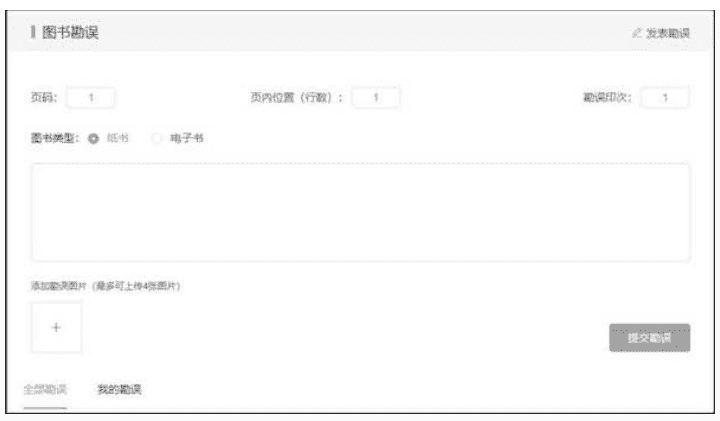

## 与我们联系

我们的联系邮箱是contact@epubit.com.cn。

如果您对本书有任何疑问或建议，请您发邮件给我们，并请在邮件标题中注明本书书名，以便我们更高效地做出反馈。

如果您有兴趣出版图书、录制教学视频，或者参与图书翻译、技术审校等工作，可以发邮件给我们。

如果您所在的学校、培训机构或企业，想批量购买本书或异步社区出版的其他图书，也可以发邮件给我们。

如果您在网上发现有针对异步社区出品图书的各种形式的盗版行为，包括对图书全部或部分内容的非授权传播，请您将怀疑有侵权行为的链接通过邮件发送给我们。您的这一举动是对作者权益的保护，也是我们持续为您提供有价值的内容的动力之源。

## 关于异步社区和异步图书

“异步社区”（www.epubit.com）是由人民邮电出版社创办的IT专业图书社区，于2015年8月上线运营，致力于优质内容的出版和分享，为读者提供高品质的学习内容，为作译者提供专业的出版服务，实现作译者与读者在线交流互动，以及传统出版与数字出版的融合发展。

“异步图书”是异步社区策划出版的精品IT图书的品牌，依托于人民邮电出版社在计算机图书领域40余年的发展与积淀。异步图书面向IT行业以及各行业使用IT的用户。

# 智能体 基础篇

# 第1章 智能体开启智能新时代

在科技发展的长河中，每一次重大突破都如同破晓之光，照亮人类前行的道路。如今，AI领域迎来新的里程碑——智能体技术。它的出现打破了我们对传统AI的认知边界，为我们开启了一扇通往全新智能世界的大门。在这个世界里，智能体不再局限于特定领域的狭小范围，而是能够自由地渗透各个行业、各类任务，为人们解决复杂问题提供前所未有的强大助力。随着其在科技圈迅速扩散的影响力，智能体引发了广泛而热烈的讨论，成为万众瞩目的焦点。接下来，让我们一同领略智能体的独特魅力，探讨它为何能在短时间内引爆科技圈，并全面了解它的特性、原理、应用场景与显著优势。

## 1.1 智能体为何引爆科技圈

在AI领域，智能体恰似一颗骤然升起的璀璨新星。它凭借极具开创性的理念和卓越的性能，瞬间吸引了全球科技界的目光，迅速成为热议焦点。它的出现，标志着AI领域实现了质的飞跃。智能体凭借令人惊叹的任务处理能力，以及在众多领域的广泛应用，彻底颠覆了人们对AI的传统认知。智能体引发轰动的原因，可以从以下6个关键维度进行分析。

### 1. 技术突破维度

深度学习、强化学习和大语言模型等技术的革命性进展，以及GPU/TPU算力的提升，使得智能体在特定任务中的感知、推理和生成能力接近人类水平。而多模态融合技术（如GPT-4V所采用的技术）的应用，更是大幅增强了智能体的实用性。例如，ChatGPT凭借Transformer架构和千亿级参数，实现了流畅对话与复杂任务处理，凸显了技术层面的重大突破。

### 2. 应用场景维度

在应用场景方面，智能体展现出极强的渗透性，从虚拟助手到实体机器人，覆盖医疗、教育、制造等多个行业，不仅颠覆了传统效率模式，还推动了个性化服务（如AI心理咨询、推荐系统）的发展。

### 3. 经济与社会影响维度

从经济与社会影响维度来看，智能体正成为推动技术演进与经济转型的重要力量。据普华永道预测，若持续当前趋势，到2030年，人工智能有望为全球GDP贡献约15.7万亿美元。其中，智能体在自动化决策与流程优化中的应用将成为关键增长点。然而，其广泛部署也会引发就业结构调整——传统岗位加速消失，新兴职业如AI训练师不断涌现，同时加剧资源分配不均的风险。

### 4. 人类认知维度

在人类认知维度，智能体的拟人化交互（如Replika AI的情感模拟）模糊了人机边界，其内容生成能力也挑战了人类对创造力独特性的传统认知。自动驾驶中的伦理抉择、智能体生成内容的版权归属等问题，进一步促使人们重新思考智能与意识的关系。

### 5. 资本与产业维度

在资本与产业深度交融的当下，智能体领域正掀起一场前所未有的投资热潮。2023年，全球人工智能相关融资规模突破千亿美元，其中智能体细分赛道成为资本竞相追逐的焦点。OpenAI凭借其在大模型和智能体相关技术上的领先优势，估值一度攀升至860亿美元，彰显了市场对智能体未来发展的高度信心。科技巨头如谷歌（Google）推出了具备智能体交互能力的Gemini系列模型，Meta则发布了支持智能体应用的开源大语言模型系列Llama；与此同时，新兴初创公司如专注于生成式AI图像创作的Midjourney也在这一赛道中积极布局。各方的激烈竞争不仅加速了智能体技术的快速迭代，也推动其从实验室走向市场的商业化进程。

### 6. 未来想象维度

从未来想象维度而言，智能体被视为迈向更高级AI的重要一步。它的发展不仅激发了人们对“超级智能”的期待，还引发了对人机共生（如脑机接口与智能体的结合）以及哲学命题（如意识、自由意志）的深度探讨。短期来看，智能体的影响取决于其技术可行性和商业落地情况；长期而言，其影响将深刻触及人类文明的底层逻辑，持续重塑社会形态。

智能体凭借开创性的技术架构、卓越的跨领域任务处理能力以及高度自主的决策机制，已然成为AI发展历程中一座重要的里程碑。它不仅标志着AI演进的关键突破，更通过技术的深度融合与多元场景的落地应用，持续推动社会生产力实现质的跃迁，促使产业形态发生深刻重构。智能体正在重塑人机协作的边界，还将重新诠释智能的内涵，开启人类文明演进的新篇章。当前，这场由智能体引领的智能革命，才刚刚拉开帷幕。

## 1.2 全面了解智能体

在探讨了智能体引爆科技圈背后的原因后，我们有必要系统地认识这一新兴技术。现在，就让我们一同开启探索之旅。本节将从智能体的核心定义、运行机制、应用场景以及优势特点等角度全方位地介绍智能体，以便读者真正把握其精髓，并在生活与工作的各个领域充分应用这项技术。

### 1.2.1 智能体是什么

智能体凭借强大的智能算法和丰富的知识储备，高效处理各种复杂任务。无论是严谨的数据分析、富有创意的文本生成、依赖感知的图像处理，还是高难度的决策制定，它都能从容应对、游刃有余。它不仅能够理解用户的每一条指令，还能将复杂的任务抽丝剥茧，分解为清晰可行的执行步骤；同时，它可以灵活地调用虚拟环境中的各类工具，如浏览器、代码编辑器、文件处理器等，一站式完成从数据收集到结果输出的全流程操作。

智能体的跨领域知识迁移能力，堪称智能系统中的点睛之笔。在完成自然语言处理（NLP）任务后，它能够将所积累的语言知识有效地迁移到图像识别等其他任务中，打破传统知识领域的边界，实现知识与方法的融会贯通。与此同时，先进的学习算法赋予智能体强大的学习能力，使其能够通过少量样本快速掌握新知识。在面对未知场景和复杂场景时，它总能灵活应变，找到有效的解决路径。在交互体验方面，智能体同样表现卓越。它基于便捷的自然语言交互界面实时反馈操作进度与结果，让用户始终掌握任务动态。这种贴心的设计可极大地提升用户体验，让用户在操作过程中更加轻松愉悦。

智能体凭借这些卓越特性，为用户精心打造了前所未有的智能体验。它将用户从烦琐的事务中解放出来，使其能够将更多精力投入到创造性与战略性工作中。因此，智能体成为人们在智能时代前行道路上的得力伙伴。

#### 1. 架构

智能体所依托的系统架构由三个关键模块构成，分别是规划（Planning）模块、记忆（Memory）模块和工具使用（Tool Use）模块。这些模块如同精密的齿轮，共同确保智能体在处理复杂任务时的卓越性能。接下来，我们将详细分析这三个模块之间的关系以及各模块的功能，帮助你深入了解智能体的工作原理。

智能体的三个核心模块并非独立运作，而是通过动态数据流与智能协作机制，形成一个有机的整体。

规划模块是智能体的“大脑”，负责任务理解、拆解、计划制订以及资源分配。它根据用户指令生成详细的执行计划，并协调其他模块的行动。

记忆模块是智能体的“知识库”，负责存储和管理用户偏好数据、历史交互数据以及中间结果。它为规划模块提供上下文信息，帮助智能体理解用户意图，并根据历史经验优化任务的执行。

工具使用模块是智能体的“执行臂”，负责任务的实际执行。工具使用模块依据规划模块下达的指令调用合适的工具（如网络搜索、数据分析、代码编写等）来执行任务，并将结果反馈给记忆模块，以便更新历史数据。

这种模块间的协作关系可以概括为：规划模块制订计划，记忆模块提供上下文，工具使用模块执行任务并反馈结果。这种协作机制使智能体能够不断学习和进化，持续提升任务执行的效率和准确性。

#### 2. 模块功能详解

智能体的3大模块通过高度专业化的分工实现智能协同，每个模块的功能设计都遵循“专业化+可复用”原则，既确保单一功能的深度优化，又通过标准化接口实现模块间的无缝协作。下面将逐一解析各模块的核心功能与技术实现。

##### (1) 规划模块

规划模块的核心功能如下。

- 任务理解与分析：利用自然语言处理技术解析用户指令，提取核心目标和具体要求。
- 任务拆分与排序：将复杂任务拆分为多个子任务，并依据重要性、紧急程度等因素对优先级进行排序。
- 执行计划制订：制订详细的执行计划，明确各子任务的执行主体、时间节点和资源需求。
- 资源分配与工具选择：根据任务需求合理分配计算或系统资源，并从工具库中选择合适的工具。
- 语义理解与意图识别：基于自然语言理解（Natural Language Understanding, NLU）技术，准确识别用户意图，避免任务执行出现偏差。
- DAG结构构建：将复杂任务建模为有向无环图（Directed Acyclic Graph, DAG）结构，清晰呈现任务间的依赖关系和执行顺序。
- 异常处理与优化：实时监控任务执行过程，及时处理异常情况，并持续优化执行流程。

##### (2) 记忆模块

记忆模块的核心功能如下。

- 记录用户偏好：记录用户的使用习惯和个性化偏好，如常用的图表类型、语言风格等。
- 存储历史交互信息：存储过往的对话内容和任务执行记录，包括输入参数、输出结果、操作步骤等。
- 保存中间结果：保存任务执行过程中产生的临时数据，如中间计算结果、临时存储的数据集等。

##### (3) 工具使用模块

工具使用模块的核心功能如下。

- 网络搜索与信息检索：利用网络爬虫和搜索引擎接口，快速检索与任务相关的信息。
- 数据分析与处理：使用数据分析工具和算法，对数据进行清洗、转换、统计分析、建模等处理。
- 代码编写与执行：支持利用多种编程语言编写并执行代码，从而实现具体的功能需求。
- 文档生成：根据任务要求，生成格式规范、内容翔实的文档。
- 数据可视化：将抽象的数据通过图、表等可视化形式呈现出来。

智能体的架构设计充分体现了智能体系统的优势，通过规划模块、记忆模块和工具使用模块的协同工作，智能体能够高效地处理各类复杂任务，从而提供个性化的智能服务。这种模块化的设计不仅提高了系统的灵活性和可扩展性，也为未来的功能扩展和性能优化奠定了坚实的基础。

### 1.2.2 智能体应用场景

智能体用例表明，它在日常生活（如旅行规划）、商业分析（如股票分析）、教育（如教育内容的创建）等多个领域都有广泛应用。接下来，我们将通过示例来阐述智能体的应用。

#### 1. 旅行规划

在旅行规划方面，智能体展现出卓越的整合与个性化定制能力，它不仅能够整合旅行信息，还能为用户生成专属的旅行手册。以“五一”假期从北京到新疆的行程规划为例，智能体能够为用户提供详细的行程建议、景点推荐、住宿安排等个性化内容，如图1-1所示。

## 1.2.2 智能体的应用场景

- D1: 北京-乌鲁木齐: 抵达乌鲁木齐，参观新疆维吾尔自治区博物馆，晚上逛国际大巴扎，体验维吾尔族风情。
- D2: 乌鲁木齐-天山天池-乌鲁木齐: 全天游览天山天池，感受高山湖泊的壮丽风光。
- D3: 乌鲁木齐-赛里木湖: 乘车前往被誉为“大西洋最后一滴眼泪”的赛里木湖，环湖游览，湖边徒步，欣赏日落。此处可作为浪漫求婚的备选地点。
- D4: 赛里木湖-伊宁-那拉提: 上午先观赏赛里木湖日出，然后前往伊宁，感受伊犁河谷风情，下午游览喀赞其民俗旅游区，傍晚前往那拉提草原附近住宿。
- D5: 那拉提草原深度游: 全天在那拉提空中草原或河谷草原活动，骑马、徒步，感受草原风光。此处也可作为浪漫求婚的备选地点。
- D6: 那拉提-独库公路(部分路段)-乌鲁木齐: 从那拉提出发，体验独库公路(需提前确认“五一”期间是否开放)，领略其险峻与壮美，下午返回乌鲁木齐。
- D7: 乌鲁木齐-北京: 根据航班时间，购买特产后乘机返回北京。

#### 2. 股票分析

智能体依托强大的金融分析模型与数据可视化技术，可对股票市场进行深度洞察与专业解读。它能够快速处理大量市场数据，提供实时分析结果和可视化呈现，帮助投资者做出明智的选择。以特斯拉股票分析为例，它不仅能通过历史数据挖掘价格波动规律、解析交易量变化趋势，还能整合社交媒体舆情与机构研究报告，量化市场情绪指数。最终，将这些关键数据转化为交互性强、视觉表现力出众的动态仪表盘，如图1-2所示。

#### 3. 教育内容创建

智能体可以为教师创建教学视频和演示材料，将复杂的学术概念转化为生动直观的多媒体教学内容，帮助教师更有效地进行教学。图1-3是智能体生成的教学PPT。

#### 4. 保险政策比较

智能体能够创建清晰的保险政策比较表，提供有效的决策建议，帮助用户选择最合适的保险产品。比如，它能够快速比较不同保险产品的条款和条件，给出详细的分析和推荐，帮助用户做出明智的选择。分析后给出的建议如图1-4所示。

智能体的应用场景非常广泛，涵盖从日常生活场景到专业领域的多个方面。它凭借强大的数据处理、分析和可视化能力，以及个性化服务，为用户提供高效、智能的解决方案。无论是个人用户、企业还是其他组织机构，智能体都能为其量身定制服务。

### 1.2.3 智能体的优势

根据智能体的技术特点、功能和应用场景可知，其主要优势体现在以下4个方面。

#### 1. 强大的任务执行能力

智能体能够自动完成从任务规划、策略制定、执行监控到成果输出的完整流程，大幅减少人工干预。它能够自动在虚拟环境中调用多种工具，快速处理大量数据和复杂任务，展现出高效的任务执行能力。

#### 2. 跨领域的广泛适用性

智能体的应用领域广泛，涵盖金融、教育、医疗、电子商务等多个行业，可提供跨领域的智能解决方案。无论是处理简单的查询任务还是复杂的研究任务，智能体均表现卓越。

#### 3. 个性化与定制化服务

智能体能够根据用户的需求和偏好，提供个性化服务和解决方案，并支持高度灵活的自定义模式。用户不仅能自由定义服务内容，还可根据实际需求定制功能模块。无论是复杂的数据分析任务，还是特定的编程项目开发，智能体均能快速响应，通过智能算法的动态调整与资源的精准匹配，交付契合用户个性化需求的解决方案。

#### 4. 自主学习与适应能力

智能体具备强大的自主学习能力，能够通过与环境的交互持续优化策略。在面对新任务或环境变化时，智能体可迅速调整其策略，以适应新的情境。

## 1.3 智能体的发展趋势与挑战

智能体的出现标志着AI技术的重要进步，尽管离真正的AGI还有很长的路要走，但它已深刻改变人类与智能系统的关系，并成为未来科技发展的核心驱动力。随着大模型技术的迭代、多模态融合的深入推进以及算力资源的不断提升，智能体正加速迈入新的发展阶段。

### 1.3.1 发展趋势

随着智能体技术的日趋成熟以及应用场景的快速拓展，智能体的未来发展呈现出多样化特点。智能体正从单一功能型向具备自主学习和跨领域协作能力的综合形态演进。这一演进不仅会推动产品形态的革新，也将深刻影响社会生产、生活方式及产业格局。以下六大趋势勾勒出智能体未来的演进路径。

1. 多模态与跨界融合
未来的智能体将不再局限于单一模态的任务，而是深度融合文本、图像、视频、语音及传感器信号等多模态数据，实现智能决策与自然交互。例如，面向智能制造的智能体能够实时解析生产线视频，并结合传感器数据进行质量检测，进而自动生成调度策略。这种多模态融合能力将使智能体更加接近AGI的目标，即在不同任务和环境中灵活应对各种复杂情况。

2. 自主决策与群体协作
智能体未来的重要发展方向之一是多智能体协作。多个智能体通过通信、任务分工与协作机制，可构建虚拟团队，在无人车队协同驾驶、灾害应急调度、多源异构数据分析等场景中，展现出超越单一智能体的协同能力。例如，在农业领域，可部署多个智能体协同完成播种、病虫害检测和收割等任务，推动农业生产智能化。

3. 个性化与深度场景化服务
随着用户画像构建技术与长期记忆模块的持续优化，智能体可为不同用户提供高度个性化的解决方案。在医疗领域，智能体可整合个人病史、实时生理指标等数据，为用户提供贴合个体需求的健康管理方案及辅助诊疗建议；在教育领域，智能体能根据学生的学习习惯和知识掌握水平，动态规划学习路径。

4. 边缘智能与低能耗优化
未来的智能体将更加注重在低功耗设备上的运行效率。通过将轻量化模型与边缘计算相结合，智能体可在无人机、自动驾驶车辆、智能可穿戴设备等场景中实现实时推理，降低对云端的依赖，提升响应速度并增强隐私保护能力。

5. 可解释性与可信AI
可解释性是智能体向可信AI演进的核心方向之一。通过可视化决策路径与可追溯的推理过程，用户能够理解智能体的决策依据，从而建立信任。这一能力是构建可信AI的核心要素，有助于推动智能体在金融风控、医疗诊断、司法审判等高风险领域的实际应用。

6. 智能体生态与平台化
未来，智能体不再是独立的产品，而是会形成“智能体生态平台”，支持多种功能插件与API。开发者能够在统一的平台上快速部署、训练并扩展智能体的功能，其模式就像当前的云服务平台。这种平台化趋势将大幅降低企业和个人的开发和使用门槛，推动智能体的广泛应用。

总体而言，智能体的发展将朝着更高的通用性、更强的智能水平，以及在更广泛的产业场景中深度应用的方向演进。多模态融合、群体协作、边缘智能、可解释性等趋势相互交织，推动智能体逐步成为支撑个人生活、企业生产和社会治理的关键技术基础。未来，谁能够掌握并引领这些趋势，谁就有望在智能时代的竞争中占据有利地位。

### 1.3.2 面临的挑战

智能体技术的迅猛发展，正将其推向一个关键的转折点。正如前文所述，智能体凭借其卓越的任务处理能力和广阔的应用前景，正逐步成为推动社会运行方式变革的重要力量。然而，这一快速发展也引发了日益复杂的挑战。这些挑战不仅涉及技术本身的完善，也关乎伦理准则、治理机制乃至社会结构的深刻调整。深入剖析这些挑战的本质，是明确智能体发展方向、制定有效应对策略的关键前提。

#### 1. 数据安全与隐私保护

智能体的高效运行依赖海量数据，但也随之带来数据泄露与隐私泄露的风险。例如，医疗智能体若存在数据管理漏洞，可能导致病人隐私数据被非法获取或滥用。因此，如何通过差分隐私、联邦学习等技术，在保障数据安全与用户隐私的前提下支撑智能体的有效运行，已成为其发展中的核心挑战。

#### 2. 可控性与安全性

智能体具备一定的自主决策能力，在开放环境中执行任务时，确保其行为不偏离预设的安全目标是一项重大挑战。此外，防范不可控行为也是一大挑战。例如，自动驾驶智能体在极端场景下的异常行为可能直接威胁人身安全，需通过提升可控性、完善安全验证与确认机制，并引入冗余设计加以防范。

#### 3. 可解释性不足

当前基于大模型的智能体在进行复杂决策时往往表现出“黑箱”特性，用户难以理解其背后的决策依据。这不仅会削弱用户的信任，也容易在金融、医疗等关键领域引发监管与合规挑战。未来需要通过因果推理、知识图谱与可视化分析等方法提升智能体的可解释性。

#### 4. 伦理与社会问题

智能体的应用可能会引发一系列伦理与社会问题，包括算法歧视、深度伪造（Deepfake）以及虚假信息生成等。此外，智能体的普及可能引发就业结构的剧烈调整；部分岗位被替代的同时，社会亟须加快培养具备AI应用能力的新型人才。

#### 5. 法律与政策滞后

现有法律框架难以全面应对智能体带来的潜在风险。例如，涉及自动驾驶系统的交通事故中责任如何划分，以及智能体生成内容的著作权归属等问题目前尚无明确法律规定。未来需要加快制定和完善相关法律法规，使法律监管能够及时适应并有效引导智能体技术的发展。

#### 6. 能耗与算力瓶颈

基于大模型的智能体在训练与运行过程中会消耗大量能源与算力，产生高昂的成本与严重的环境负担。如何通过模型压缩、量化、稀疏化等手段构建低能耗、高能效的智能体系统，是未来技术创新的关键方向之一。

上述挑战相互交织，既关乎技术的可持续发展，也涉及伦理规范、治理体系与社会结构的深刻变革。唯有通过技术创新、伦理框架构建、法律体系完善以及跨学科协作，才能引导智能体的发展与人类社会形成良性互动，最终使其成为推动人类文明进步的重要力量，而非引发系统性风险的“潘多拉魔盒”。

### 1.3.3 展望未来

随着智能体能力的不断提升，其发展方向将不再局限于技术突破，而是对人类社会、产业生态乃至文化形态产生全方位、深层次的影响。智能体正从“先进工具”逐步转变为与人类深度协同的智慧伙伴。它不仅能帮助人类从繁杂的事务中解放出来，还能在激发创造力、优化决策以及推动社会治理创新等关键领域发挥日益重要的作用。为全面、深入地理解智能体的未来前景，有必要从人机协作模式、产业变革趋势、社会治理创新、伦理框架构建、潜在的技术奇点风险以及教育与文化重构等多个维度进行系统展望。

#### 1. 智能体与人类的协作共生

未来，智能体将与人类形成紧密的协作关系，成为实现增强智能（Augmented Intelligence）的关键路径。它不仅能协助人类完成烦琐的任务，还能有效为人类的创造性思维与战略决策赋能。例如，科研智能体将自动检索海量文献、生成研究假设、设计实验方案，并通过与科学家的交互促成突破性科研成果。

这种协作模式意味着，未来的个体竞争力不仅取决于自身能力，更取决于其与智能体的协同效能。具备出色智能体应用能力的个体，将在职业发展与社会创新中占据显著优势。

#### 2. 产业格局的重塑

智能体将成为推动产业数智化转型的关键引擎。制造业将借助智能体实现从自动化向智能化的跃升，医疗行业将依托智能体推进精准诊疗与个性化健康管理，金融行业则可利用智能体开展复杂的风险预测与量化分析。

未来，随着智能体的普及，许多传统岗位将逐步被替代，与此同时，新兴岗位如智能体训练师、AI交互设计师、AI伦理顾问等也将不断涌现。整个产业生态将经历由智能体驱动的全新价值链重构。

#### 3. 智能体与社会治理

智能体将在公共服务与社会治理中发挥关键支撑作用。城市管理将依托智能体实现实时交通调度、能源使用优化与环境监测；在应急管理中，智能体可对多源灾害数据进行快速分析，辅助决策者制定高效应对方案。此外，在合理制度设计下，智能体有望促进社会公平与透明度的提升，例如通过智能分析减少资源浪费和不规范行政行为。

#### 4. 智能体与伦理文明的共进

未来智能体的发展将不可避免地带来深刻的伦理与哲学反思。随着智能体在交互中展现出拟人化的行为特征，人类有必要重新审视“智能”“创造力”乃至“意识”等概念的边界。

智能体是否应被赋予某种形式的权利？其有害行为又应由谁承担责任？这些问题将成为未来社会的核心公共议题。

此外，智能体在内容生成、舆论操纵和社会决策支持中可能带来新型风险；若缺乏有效规范，智能体可能被滥用以误导公众或操纵舆论。因此，构建智能体伦理准则、国际安全治理框架与有效监管体系，将是人类文明迈向智能时代的关键任务。

#### 5. 技术奇点与未来愿景

随着智能体能力的持续增强，人类社会可能趋近技术奇点（Technological Singularity）——一种假想状态，在此状态下，智能体将具备递归式自我改进能力，其智能水平可能迅速超越人类，从而深刻影响科学与文明的发展轨迹。

结合脑机接口、量子计算与仿生学的进步，智能体有望成为人类认知能力的延伸媒介，帮助人类突破生理与认知局限，实现与数字系统的深度协同。

然而，这一未来图景既令人振奋，也蕴含重大风险：超智能体是否会因目标错位而“失控”？它们能否构建持续自我优化的递归系统？如何确保其目标始终与人类价值观保持一致？这将是未来数十年必须攻克的难题。

#### 6. 教育与文化的重构

随着智能体全面融入社会，以知识传授为主的传统教育模式将逐步转型，取而代之的是人机协同学习的新范式。学习者将更加注重培养批判性思维、跨学科整合能力以及人机协作素养。

在文化层面，智能体将催生新的创作形式，例如由人类主导、智能体辅助完成的文学、视觉艺术与音乐作品。在合理引导下，人类文化有望借助智能体的内容生成与实时辅助，展现出更强的多样性与包容性。

未来，智能体的发展不仅将驱动科技创新，更将深刻重塑人类的生活方式、社会结构与文化形态。我们有必要将技术进步与伦理原则、法律规范及社会责任有机结合，健全技术治理体系，凝聚文化共识，确保智能体成为人类社会的可靠协作者，而非潜在风险源。

综上所述，智能体的未来发展将由技术持续演进与社会多方协同塑造。它将深度融入人类日常生活与社会运行机制，在推动产业升级、优化城市治理，以及革新教育与文化创作模式等方面发挥关键作用。

然而，智能时代的推进仍面临多重挑战。技术滥用、伦理困境与安全风险若不加以有效治理，可能对智能时代的健康发展构成实质性威胁。唯有在技术、法律、伦理与教育等多个维度协同推进，方能确保智能体的发展路径可控、可持续。

最终，智能体有望突破传统工具的角色，作为人类的深度协作者共同拓展认知边界，参与塑造更富包容性与创造力的未来文明形态。

# 第2章 高效指令设计

在使用智能体时，指令的质量对最终输出效果起着决定性作用。高质量且精准的指令能够促使智能体迅速生成符合预期的成果；反之，低质量、模糊不清的指令则可能导致结果偏离预期目标，无法有效完成任务。

提示词（Prompt）本质上是用户向智能体下达的指令，其设计与优化至关重要，是引导智能体生成理想输出的关键。掌握结构化Prompt的编写方法并构建有效的指令体系，有助于充分发挥智能体的潜力，稳定地输出所需内容。

本章将聚焦于结构化Prompt的编写模板、应用技巧与优化策略，帮助读者掌握高效指令设计的核心方法。

## 2.1 结构化Prompt编写模板

在与大模型进行交互时，传统的开放式提问方式往往导致输出内容碎片化、解决方案缺乏系统性，难以满足专业场景下的深度需求。结构化Prompt通过模块化设计、逻辑化表达和标准化要求，不仅可显著提升AI输出的专业性和实用性，还有助于用户更系统地思考问题，厘清需求本质。

这种结构化的沟通方式有助于用户充分释放AI的潜力，获得切实可行的专业解决方案，从而提升决策质量和工作效率。

### 2.1.1 什么是结构化Prompt

结构化Prompt是一种遵循特定框架、在内容与形式上均有序组织的指令形式。与传统的非结构化Prompt不同，结构化Prompt通过明确的格式和层次，将复杂的任务需求拆解为清晰、具体的组成部分，从而提升信息传递的准确性与效率。

从内容层面来看，结构化Prompt需围绕任务核心，明确指定目标、条件、限制、输出要求等关键要素。例如，在学术论文写作中，需明确研究主题、学科领域、参考文献数量、字数要求、格式规范等内容；在数据分析任务中，则需说明数据来源、分析目的、统计方法、可视化要求等细节。这些关键要素的明确阐述，使要达成的目标一目了然，避免了模糊性与歧义。

在形式层面，结构化Prompt常采用多种标准化或自定义的组织形式，如分点式、表格式、层级标题式等。分点式通过符号或编号将任务需求逐条列出，逻辑清晰；表格式以行列形式规整呈现不同类别的要求；层级标题式通过主标题、副标题、段落小标题等形式构建从总体到细节的清晰逻辑结构。通过这些形式，结构化Prompt能够有效整合零散信息，形成层次分明、重点突出的指令内容。

事实上，结构化的信息组织形式在日常生活中广泛存在。以图书为例，图书的篇、章、节等层级结构能帮助读者迅速定位核心内容；文章的“引言-正文（正文部分又以小标题划分不同论述主题）-结论”结构便于读者理解主旨与关键观点。这种组织形式能够有效梳理复杂内容、突出重点、降低读者的认知负担，从而更易被理解与接受。

同样，在与智能体等AI工具交互时，采用结构化Prompt能够显著提升沟通效率。智能体依赖明确、精准的指令来解析任务意图，而结构化Prompt可以通过有序的内容与形式帮助智能体准确捕捉用户的核心需求、具体条件与期望结果，从而减少因信息模糊导致的输出偏差或任务失败。此外，提示工程实践中已形成大量结构化Prompt模板，用户可根据任务类型（如写作、数据分析、创意设计等）、个人偏好及使用场景灵活选用合适的模板框架，高效完成指令输入，实现与智能体的优质互动。

### 2.1.2 结构化Prompt的内容框架及组织形式

在使用智能体时，结构化Prompt作为人机交互的核心输入方式，其基本构成要素包括角色设定、任务描述、格式要求等。

其中，角色设定用于明确赋予智能体特定身份，如“学术论文评审专家”“市场营销策划师”，使其能够基于对应的专业视角来执行任务；任务描述则用于明确说明需完成的具体工作，如“撰写产品推广方案”或“对实验数据进行回归分析”；格式要求可进一步规范输出的形式，如“以Markdown表格呈现结果”或“输出内容控制在500字以内”。

结构化Prompt正是通过系统化组织上述要素，使指令逻辑更清晰、意图更明确，从而确保智能体能够精准解析任务需求。

内容框架是构建高效结构化Prompt的基础，它通过预设的逻辑结构帮助用户系统梳理指令思路，规避信息遗漏与表述混乱，显著提升结构化Prompt的规范性与有效性。在实际应用中，以下4种内容框架已被广泛使用。

- A.P.E.框架：Action（行动）指明需执行的具体操作；Purpose（目的）说明该行动的意图或目标；Expectation（期望）明确行动预期达成的结果或影响。
- C.A.R.E.框架：Context（背景）阐述问题或任务的初始情境；Action（行动）指明需执行的具体操作；Result（结果）说明行动产生的直接效果；Example（示例）提供符合要求的案例。
- T.R.A.C.E.框架：Task（任务）明确需要完成的具体工作；Request（请求）指出任务相关的协作需求；Action（行动）指明需执行的具体操作；Context（背景）补充任务相关的环境信息；Example（示例）提供符合要求的案例。
- T.A.G.框架：Task（任务）定义待完成的具体事项；Action（行动）指明需执行的具体操作；Goal（目标）说明任务期望达成的具体成果。

在实际应用中，用户应根据具体任务需求灵活选用结构化Prompt的内容框架。表2-1通过示例系统拆解各框架的使用方式，清晰呈现其在指令组织中的逻辑结构与关键细节。

表2-1 内容框架示例

## 内容框架与示例

| 内容框架 | 示例 |
| :--- | :--- |
| A.P.E. | **【Action】**<br>请帮我写一份互联网公司视频部门新员工破冰活动的策划案<br><br>**【Purpose】**<br>目标是帮助新入职的同事相互了解背景与个性，以期后续能更加顺利地协作<br><br>**【Expectation】**<br>该策划案需具备较强的包容性，因为同事之间的年龄跨度可能很大。此外，最好能与我们的工作内容——流媒体视频推荐信息流的开发相结合 |
| C.A.R.E. | **【Context】**<br>毕业10年了，学院要组织一次毕业生联欢会，我负责拍摄一部短视频<br><br>**【Action】**<br>希望你能为我撰写一个短视频剧本<br><br>**【Result】**<br>希望这个视频能够帮助大家回顾过往的“青葱”岁月，通过特定人物视角表达对学生时代的怀念<br><br>**【Example】**<br>可以参考微电影《老男孩》的叙事风格，将故事情节迁移到大学场景中，时间跨度为10年左右 |
| T.R.A.C.E. | **【Task】**<br>你的任务是基于日常生活常见物品提出健身建议<br><br>**【Request】**<br>请帮助我生成建议内容<br><br>**【Action】**<br>你需要提供不少于3个包含物品名称和锻炼方式的健身建议<br><br>**【Context】**<br>本建议面向平时没有时间去健身房，并且也没有资金购买健身设备的上班族，旨在帮助他们提升健康水平<br><br>**【Example】**<br>可以参考保罗·威德所著《囚徒健身》一书中的内容来设计健身建议 |
| T.A.G. | **【Task】**<br>你的任务是协助我们通过发布小红书笔记来吸引用户使用产品<br><br>**【Action】**<br>你需要撰写符合小红书社区调性的文案，充分使用emoji和颜文字来推广我们的产品<br><br>**【Goal】**<br>我们的产品是一款女士帆布包，主打容量大、携带方便，设计风格年轻时尚。希望你撰写的文案能吸引18~30岁的女性用户，内容要生动有趣 |

在完成结构化Prompt的内容设计后，其组织形式的优化同样是确保智能体精准解析指令的关键环节。合理的组织形式设计不仅能够增强内容的逻辑性与可读性，还能有效减少因信息混杂导致的理解偏差。前文介绍的各类内容框架主要从内容层面提供建构思路，若辅以多样化的组织形式，可进一步提升结构化Prompt的执行效果。

下面以C.A.R.E.框架的“毕业生联欢会短视频剧本创作”为例，详细解析几种常见结构化组织形式的应用逻辑与优势。

#### 1. 分点式

该形式使用统一的符号（如【】）作为前缀标识，对不同的要素进行视觉分隔，实现模块化展示。这种形式适用于简短任务或指令，能够快速引导智能体抓取核心信息，避免内容混淆。示例见表2-1。

#### 2. 层级标题缩进式

该形式采用“总标题、分标题与缩进内容”的层级结构，先明确任务主题，再逐层展开具体要求。这种形式适用于复杂任务，能够清晰地呈现各要素间的逻辑关系，有助于智能体准确解析指令的优先级与整体结构。示例如下。

```
核心需求：毕业生联欢会短视频剧本创作
Context（背景）
毕业10年了，学院要组织一次毕业生联欢会，我负责拍摄一部短视频。
Action（行动）
希望你能为我撰写一个短视频剧本。
Result（结果）
希望这个视频能够帮助大家回顾过往的“青葱”岁月，通过特定人物视角表达对学生时代的怀念。
Example（示例）
可以参考微电影《老男孩》的叙事风格，将故事情节迁移到大学场景中，时间跨度为10年左右。
```

#### 3. 代码注释式

该形式借鉴编程中的注释语法，使用“#”等符号，引导智能体识别不同模块。这种形式适用于具备技术背景的用户或对指令逻辑性要求较高的场景，其类代码风格有助于用户清晰组织指令内容，提升结构的规范性与可维护性。示例如下。

```
#Context
毕业10年了，学院要组织一次毕业生联欢会，我负责拍摄一部短视频。
#Action
希望你能为我撰写一个短视频剧本。
#Result
希望这个视频能够帮助大家回顾过往的“青葱”岁月，通过特定人物视角表达对学生时代的怀念。
#Example
可以参考微电影《老男孩》的叙事风格，将故事情节迁移到大学场景中，时间跨度为10年左右。
```

不同的结构化组织形式适配不同的任务场景，简短任务或指令适合分点式或代码注释式，便于智能体快速解析核心信息；复杂任务宜采用层级标题缩进式，通过逻辑分层可降低智能体的解析难度；在跨平台应用中，结合分点符号与简洁语言，可提升结构化Prompt在多场景下的兼容性和用户可读性。用户应根据任务特点灵活选择结构化组织形式，从而优化指令输入，提升智能体执行任务的准确性与响应效率。

上述示例涉及结构化Prompt的两个关键要素：标识符和属性词。

> 注意
> 标识符用于界定内容的层级与模块，常见的形式包括 #、< >、-、[]、"" 等。本节示例使用#作为模块分隔标识符。因示例结构较为简单，仅采用单一层次，未引入嵌套标识。
> 属性词（如Context, Action, Result, Example 等）是具有特定语义的关键词，用于定义语义模块，并对后续内容起引导作用。值得一提的是，属性词并非固定不变，用户可以根据个人喜好进行自定义。

通过以上简单示例，相信大家已对结构化Prompt 的内容框架与组织形式有了清晰的认知。

接下来将介绍一些常见场景下的结构化Prompt 模板。这些模板如同“快捷工具”，用户可直接套用，无须耗费精力重新设计结构与内容，从而大幅提升向智能体提交指令的效率。无论是文案撰写、专业答疑，还是创意创作等任务，用户均可借助模板快速生成符合预期的输出。

### 2.1.3 结构化Prompt模板示例

结构化Prompt模板凭借清晰的指令构建逻辑，可显著提升智能体输出内容的精准度与实用性。为帮助读者直观理解其应用价值，本节选取旅游攻略生成与项目管理两个典型应用场景，通过具体示例展示结构化Prompt模板的实际使用效果。

#### 1. 旅游攻略生成场景

在旅游攻略生成场景中，采用“角色设定+场景限定+要素枚举+输出规范”的4层结构化Prompt模板，可构建系统化的指令输入框架，将用户碎片化、模糊化的旅行需求精准转化为逻辑清晰、便于智能体执行的标准化指令。

以成都5日游规划为例，如果用户输入的指令为“帮我写个成都旅游攻略，7月，预算5000元，时长5天”，该指令存在多重信息缺失：未明确攻略的侧重方向（如美食、景点、文化等），未细化预算分配比例，也未说明每日行程的松紧度、同行人群（如家庭、情侣）特征及特殊需求（如饮食禁忌、无障碍设施需求），导致智能体难以生成契合用户个性化需求的深度攻略。

基于上述指令生成的攻略如下。

```
##### 7月成都5日游攻略（预算5000元）
**一、行程安排**
**第一天：抵达成都，感受慢生活**
* 上午：抵达成都，入住酒店/民宿（建议选择春熙路、太古里或宽窄巷子附近，交通便利）。
* 下午：游览宽窄巷子，体验成都慢生活，品尝特色小吃（推荐：三大炮、糖油果子、凉粉）。
* 晚上：欣赏川剧变脸表演（推荐：蜀风雅韵剧院、锦江剧场）。
**第二天：熊猫基地与历史文化**
* 上午：前往成都大熊猫繁育研究基地，近距离观察可爱的大熊猫（建议早上7:30左右到达，避开人流高峰）。
* 下午：参观杜甫草堂、诗圣杜甫的故居，领略古典园林之美。
* 晚上：逛锦里古街，品尝成都特色美食（推荐：火锅、串串香、钵钵鸡）。
**第三天：都江堰水利工程**
* 全天：前往都江堰景区，参观世界文化遗产都江堰水利工程，感受古人智慧（可乘坐动车或旅游专线车，约1小时车程）。
* 晚上：返回成都，体验成都夜生活（推荐：九眼桥酒吧街、兰桂坊）。
**第四天：乐山大佛一日游**
* 全天：前往乐山大佛景区，瞻仰世界最大的石刻弥勒佛坐像（可乘坐动车或旅游专线车，约2小时车程）。
* 晚上：返回成都，品尝特色川菜（推荐：麻婆豆腐、回锅肉、夫妻肺片）。
**第五天：自由活动，返程**
* 上午：根据个人喜好自由活动（推荐：人民公园喝茶、体验采耳，或前往IFS国际金融中心购物）。
* 下午：前往机场/火车站，返程。
**二、预算明细**
* **交通：** 约1000元（含往返机票/火车票，市内交通及周边景点交通）
* **住宿：** 约1500元（5晚，经济型酒店或民宿）
* **餐饮：** 约1000元（品尝当地特色美食）
* **门票：** 约500元（熊猫基地、杜甫草堂、都江堰、乐山大佛等）
* **其他：** 约1000元（购物、纪念品等）
**三、注意事项**
* 7月成都天气炎热，注意防晒，携带防晒霜、遮阳伞、帽子等。
* 成都饮食偏辣，可根据个人口味选择微辣或不辣菜品。
* 提前预订机票/火车票和酒店，特别是旅游旺季。
* 学习一些简单的四川话，方便与当地人交流。
**四、可选行程**
* 如果时间充裕，可以增加一天游览青城山，感受道教文化的魅力。
* 对历史文化感兴趣的朋友，可以参观金沙遗址博物馆或武侯祠。
**五、美食推荐**
* 火锅：小龙坎、大龙燚、蜀九香
* 串串香：钢管厂五区小郡肝串串香、袁记串串香
* 川菜：陈麻婆豆腐、盘飧市、马旺子
* 小吃：钟水饺、龙抄手、赖汤圆
希望这份攻略能帮助你规划一次愉快的成都之旅！
```

相较于普通指令，结构化Prompt模板通过系统化的需求拆解机制，能够将用户模糊的旅行规划需求转化为精准的参数化指令。

结构化Prompt模板如下。

```
##### 角色
资深旅游规划师
###### 任务
为一位计划在7月前往成都、预算5000元，进行5天4晚旅行的游客，制定兼具性价比与深度体验的详细旅游攻略。
###### 输入数据
- 旅游目的地：成都
- 旅游时间：7月（5天4晚）
- 预算：5000元（含交通、住宿、餐饮、门票等全部费用）
- 游客偏好：深度体验川蜀文化，打卡大熊猫基地、三星堆博物馆等标志性景点；品尝四川火锅、龙抄手等特色美食；前往建设路小吃街、宽窄巷子等网红打卡地
##### 要求
- 行程规划：每日行程包含景点游览、特色活动（如川剧变脸、夜游锦江），需标注景点开放时间、错峰建议及景点间交通耗时
- 美食推荐：明确标注人均消费（50～80元），提供建设路小吃街、奎星楼街等具体打卡点位，推荐必尝菜品
- 住宿建议：筛选200～300元/晚的连锁酒店，要求近地铁、含早餐，并提供周边交通示意图
- 交通方案：采用高铁往返+市内公共交通（如地铁、公交、共享单车），需计算各段交通成本
- 特殊提示：针对7月高温天气，给出每日防暑降温建议；结合暑期客流高峰，设计错峰出行策略
###### 输出规范
- 以清晰的文本格式呈现，每日行程按序号排列
- 对每个景点、美食、住宿等给出简要的介绍和选择理由
- 控制总字数在1500～2000字
```

上述模板针对原始指令进行了优化。指令优化过程本质上是将模糊需求转化为结构清晰、参数明确的结构化Prompt。比如，在上述模板中，原始指令“帮我写个成都旅游攻略，7月，预算5000元，时长5天”存在明显的语义模糊问题与信息缺失情况。优化后的指令则通过多维度要素拆解与精准化表达，显著提升了指令的清晰度与可操作性。

在基础信息维度，优化后的指令将宽泛的时间、预算与行程信息进行量化与细化。“7月”不仅明确了时间节点，更隐含了需考虑高温天气、暑期客流等季节性因素；“预算5000元”不再是单纯的金额表述，而是涵盖交通、住宿、餐饮、门票等全流程的总预算上限；“5天”也被进一步拆解为每日的时间分配框架，为后续行程的节奏安排提供了依据。

在体验需求维度，优化指令通过场景具象化将抽象需求转化为具体执行项。从笼统的旅游攻略聚焦到大熊猫基地、三星堆博物馆等标志性景点，明确文化体验重点；将美食需求细化为四川火锅、龙抄手等特色品类，甚至补充了建设路小吃街等具体打卡点；同时加入川剧变脸表演、夜游锦江等特色活动，使旅游体验目标更加具体且可执行。

在服务标准维度，优化指令采用参数限定法消除语义模糊性。比如，将经济型住宿量化为200～300元/晚的连锁酒店，并附加近地铁、含早餐等功能性要求；交通方式明确限定为高铁往返+市内公共交通，排除自驾、包车等选项；用餐标准明确人均50～80元价格区间。这些参数化表述有效缩小了方案生成范围，确保智能体输出符合用户预期的高性价比方案。

通过以上优化策略，指令从模糊的需求描述转变为包含时间参数、预算分配、场景清单、服务标准的结构化任务，显著减少了语义歧义，大幅提升了生成内容的精准度与实用性。

这种结构化表达突破普通指令的平面化描述，通过多级标签体系实现了需求的量化与细化。构建这种层次分明的指令体系，智能体可以在设计行程时精准匹配用户需求，确保景点组合的合理性、时间分配的科学性，以及预算使用的经济性，从而输出更贴合个性化需求的高质量旅行攻略。

#### 2. 项目管理场景

在项目管理场景中，简单、粗放的指令通常难以推动任务的有效执行与高质量完成。

以企业年会筹办项目为例，若仅输入“我们要办年会，帮忙列个筹备计划，预算80万元，3个月筹备时间”这样缺乏细节与结构化的指令，那么所获得的项目规划方案往往会出现内容泛化、要素缺失等问题。具体输出结果如下。

以下是基于80万元预算、3个月筹备时间的年会筹备计划框架，涵盖关键阶段安排、任务分工建议和预算分配方案，供参考：

#### **一、筹备时间轴（倒计时3个月）**
##### **第一阶段：策划与筹备（第1～30天）**
1. **成立筹备组**
   - 确定总负责人、财务、策划、设计、后勤、外联等
   - 每周召开1次进度会议（后期可调整为每周2次）
2. **确定年会核心信息**
   - **主题**：结合公司文化/年度目标（如“聚力·突破·共赢2024”）
   - **形式**：晚宴+颁奖+演出/沉浸式体验/户外嘉年华（根据公司风格选择）
   - **规模**：预估人数（如300人）、嘉宾名单（是否邀请客户/合作伙伴）
   - **场地**：预订酒店/会展中心（需提前考察舞台、音响、动线）
3. **供应商招标**
   - 筛选酒店/餐饮、舞台搭建、摄影摄像、演出团队等（至少对比3家报价）
   - 签订合同并支付定金（注意违约条款）
4. **预算细化**
   - 预留10%作为应急资金（约8万元）
##### **第二阶段：执行落地（第31～75天）**
1. **活动内容设计**
   - 流程表：签到→领导致辞→颁奖→节目/互动→晚宴→抽奖（总时长3～4小时）
   - 节目征集：员工节目报名+专业表演（如乐队、魔术等）
   - 互动环节：微信摇一摇抽奖、大屏弹幕、游戏（需测试技术稳定性）
2. **视觉与宣传**
   - 主KV设计（背景板、邀请函、桌卡、员工年度视频）
   - 预热宣传：内部邮件、海报倒计时、高管悬念视频
3. **物资采购**
   - 奖品（电子产品、现金券、定制礼品等）
   - 伴手礼（人均预算建议<200元）
   - 氛围道具（灯光、荧光棒、拍照墙等）
4. **人员安排**
   - 主持人选定（内部选拔或外包）
   - 志愿者分工（签到、引导、道具组）
##### **第三阶段：冲刺与彩排（第76～90天）**
1. **最终确认**
   - 流程彩排（至少1次全员带妆彩排）
   - 检查AV设备、PPT、视频播放情况
   - 确认餐饮菜单（需试菜，留意过敏原）
2. **应急预案**
   - 备用麦克风、电源、医疗包
   - 雨天方案（如户外活动）

可以看到，在项目管理实践中，前述简单指令只能生成包含基础阶段划分与粗略预算框架的方案，该方案存在执行细节缺失、风险预判不足等问题。由于缺乏对项目背景、具体需求及潜在挑战的系统梳理，此类方案难以满足实际管理中对流程严谨性、资源合理配置和风险防控的要求。

在此背景下，结构化Prompt模板的应用成为提升项目规划质量的关键。该模板围绕活动规模、核心环节与特殊需求等要素展开，通过系统整合活动参与人数、场地规格、表演形式、安全保障等具体信息，构建出层次分明、要素清晰的指令框架。

这种结构化Prompt能够有效支持智能体生成兼具针对性与完整性的项目方案，确保筹备计划覆盖从前期策划到落地执行的全流程要点，为项目顺利推进提供切实可行的操作指南。示例如下。

```
##### 角色
你是一位拥有8年大型活动策划经验的行政总监，尤其擅长企业年会全流程管理。曾成功策划并执行多场500人以上规模的企业年会，平均节省预算15%。
##### 背景
某科技公司（员工规模：500人）计划举办年度庆典活动，需要专业的项目管理方案。
##### 项目信息
###### 基础信息
活动时间：2024年12月20日18:00-22:00
活动地点：上海市区五星级酒店（预算30万元）
参与人数：500人（含高管20人）
总预算：80万元（含10%备用金）
###### 核心环节
领导致辞（15分钟）
年度颁奖（30分钟，含5个奖项）
员工文艺表演（3个节目，总时长45分钟）
自助晚宴（预算人均200元）
###### 特殊要求
需要全程直播（预算5万元）
安排专业摄影跟拍（预算2万元）
设置互动抽奖环节（奖品预算10万元）
##### 要求
###### 主体内容
完整的时间推进表（从筹备到收尾）
详细预算分配方案
人员分工矩阵
应急预案（设备/医疗/流程）
###### 格式要求
主文档采用Markdown格式
包含以下表格：
任务分解表（含时间节点、负责人、交付物）
预算明细表（分大类和细项）
供应商联系表（场地、餐饮、设备等）
```

此结构化Prompt模板通过系统整合信息与精准界定需求，使生成的项目管理方案不仅包含时间推进计划与预算分配框架，还进一步细化至各环节的具体负责人、交付物标准及风险防控策略，切实提升方案的实操性与指导价值。

通过旅游攻略生成与项目管理（企业年会筹备）这两个典型场景可以看出，结构化Prompt模板的应用能够显著提升需求对齐效率与输出内容质量。

相较于传统的非结构化指令，结构化Prompt模板通过对任务背景、执行标准、输出形式等要素的精细化界定，有效规避了需求表述中的模糊性与随意性，使智能体生成的内容既符合业务逻辑，又满足实际应用需求。特别是在重复、流程化的工作场景中，结构化Prompt模板可通过复用成熟框架，实现任务的快速部署与高质量输出，显著提升工作效率。

掌握并熟练运用结构化Prompt模板，不仅能够提高人机协作的准确度与效率，还能从根本上降低时间与人力成本，为数字化办公与智能化工作流程提供高效支持。

## 2.2 上下文关联技巧：对话链管理

在与智能体的交互时，用户可直观感受到智能体的输出与历史对话之间具有高度关联性。当用户基于前文进行追问、修正或拓展时，智能体能够参考此前对话中涉及的概念与主题，生成与上下文高度契合的回答。这一能力的背后，实际上是智能体所依赖的模型在发挥作用。模型在处理用户输入时，并非孤立地解析每个问题，而是具备上下文学习能力——即通过对多轮对话所形成的语境信息进行整合与推理，实现对用户意图的持续性理解与响应。

接下来，我们将深入解析模型的上下文学习能力，并通过具体示例展示其应用效果。

### 2.2.1 模型的上下文学习能力

在智能体与用户的交互过程中，模型的上下文学习能力是实现自然流畅对话的关键。这一能力使模型能够整合和理解对话历史，从而基于过往对话内容对当前的输入进行准确解析与回应。

以知识问答场景为例，用户在提出“如何理解机器学习”后，追问“它和监督学习的区别是什么”时，模型可精准识别出后一问题中的“它”指代的是前文中提到的“机器学习”。这种对指代关系的准确判断，避免了用户重复输入关键概念，显著提升了对话的自然度与交互效率。

智能体模型的上下文学习能力本质上源于上下文语义的动态建模与关联机制。模型通过Transformer架构中的自注意力机制，在给定上下文窗口内动态捕捉关键语义信息，并建立输入单元之间的语义关联。该机制通过查询（Query）、键（Key）和值（Value）的映射关系，为输入序列中的每个token分配不同的注意力权重，从而突出上下文中相关性较高的信息。

自注意力机制是模型实现上下文学习的核心技术，其工作原理基于明确的数学运算。在处理输入文本时，每个token的嵌入表示分别通过可学习的权重矩阵映射为查询、键和值三个向量。模型通过计算当前token的Query向量与序列中所有token（包括自身）的Key向量的点积，得到原始注意力得分；随后，通过Softmax函数将其归一化为注意力权重，用以衡量当前token与上下文中各token的相关程度。最终，模型根据这些权重对所有Value向量进行加权求和，生成包含上下文信息的表征向量。

以句子“AI理解机器学习，它很强大”为例，当模型处理到“它”一词时，会生成其Query向量，并与句中所有其他词（比如“机器学习”）的Key向量分别计算点积。由于“它”与“机器学习”语义关联较强，其对应的点积得分相对较高，经Softmax归一化后，“机器学习”位置通常会获得较高的注意力权重。因此，模型倾向于将“它”与“机器学习”关联，在生成“它”的上下文感知表征时融入“机器学习”的语义信息，有助于实现更连贯的上下文理解。

自注意力机制通过向量运算与动态权重分配，使Transformer具备较强的上下文语义建模能力。而这种能力的实现，主要源于Transformer架构中自注意力机制所支持的全局token交互。

### 2.2.2 上下文学习示例

在自然语言处理领域，模型的上下文学习能力不仅提升了人机交互的流畅度，还为任务适应提供了一种新的技术范式。与传统的NLP模型需依赖大量标注数据并进行任务特定微调不同，具备上下文学习能力的大语言模型能够利用预训练阶段习得的语言知识，在推理时直接完成新任务，显著降低对标注数据和任务定制的依赖，形成一种更灵活、高效的任务处理机制。其中，上下文学习作为大语言模型实现少样本学习的重要方式，展现出独特的技术价值与应用潜力。

#### （1）少样本学习

在大语言模型的应用场景中，零样本提示（zero-shot prompting）是一种常见的交互方式。用户通过直接下达明确指令，如“将此段文本译为英文”或“提炼文章核心观点”来触发模型响应。该方式依赖模型在预训练阶段获得的通用语言知识，适用于指令明确、任务结构清晰的场景。

然而，当涉及专业领域或复杂任务时，零样本提示可能因难以捕捉特定业务规则、行业术语及语义细微差别而表现不佳。此时，少样本学习（few-shot learning）展现出显著优势——用户仅需提供3~5个典型的示例，模型即可通过分析这些示例的模式，快速掌握任务逻辑。在复杂场景中，它的表现通常优于零样本提示。

以商品评论情感分类任务为例，在零样本提示模式下，模型可能会将“手机拍照效果很好，但电池续航太差”这类包含矛盾评价的文本误判为正面评价，因其难以有效建模语义中的转折与权衡关系。

以下是少样本学习的一个典型应用场景。

> 根据以下示例判断商品评论是好评还是差评。
> 示例 1：
> 评论：“性能强劲但发热严重”
> 分类：差评
> 示例 2：
> 评论：“外观精美，系统流畅，性价比高”
> 分类：好评
> 请判断以下新评论的分类。
> 评论：“手机拍照效果很好，但电池续航太差”

在此设定下，模型能够利用所提供的少量示例，在无须额外训练的情况下，快速推断任务规则，更合理地评估新评论中负面因素的主导作用，从而倾向于将其分类为差评。这种通过极少量示例即可适应新任务的能力，正是少样本学习的核心特征。

#### （2）指令设计中的就近原则

受Transformer架构的位置编码方式、训练数据分布及自回归生成特性等因素影响，模型在实际应用中往往对输入文本末尾的指令或信息表现出更强的响应倾向。这一倾向在部分注意力头中表现为对末尾位置赋予较高权重，使得模型输出更易受末尾内容影响。

因此，在设计Prompt时，可以遵循就近原则，将关键指令置于文本末尾，以增强模型对其的关注，有助于提升响应的相关性与指令遵循程度。

例如，在诗歌创作指令“写一首关于春天的诗，要押韵，最后一行提问”中，由于“最后一行提问”位于指令末尾且要求具体明确，模型输出更可能满足该条件；而“押韵”作为全局性、抽象性要求，即使出现在中间位置，也可能因建模难度较高而未被充分实现。

以量子计算解释任务为例，不同Prompt设计策略会产生显著的效果差异。

输入的分散指令如下。

> 请用幽默的语气解释量子计算，字数100以内，并举例说明。

我们得到的回答如下。

> 量子计算就像薛定谔的猫在玩俄罗斯轮盘赌——你的数据既是1又是0，直到你偷看时它才“喵”地随机坍缩成一种状态。比如传统计算机像老实的会计，一次算一笔账；量子计算机则是魔术师，能同时让所有账本在虚空中跳踢踏舞，瞬间找到答案（当然，也可能变出一群鸽子糊你脸上）。

运用就近原则优化后，指令调整为分点表述形式。

1. 用幽默的语气解释量子计算；
2. 限制100字以内；
3. 结尾添加一个例子（如“就像猫同时存在于箱子里面和外面”）。

我们得到的回答如下。

> 量子计算就像薛定谔的算盘：比特可以同时是0和1（叠加态），直到你偷看时它才“决定”变谁。比传统计算机“一枚硬币抛一次”快多了，它能一次抛完所有平行宇宙的硬币！不过别高兴太早——它目前比幼儿园手工还容易出错。就像你的减肥计划，既“正在进行”又“已经失败”。

这两个回答的差异验证了Prompt设计中就近原则的重要性。

分散指令“请用幽默的语气解释量子计算，字数100以内，并举例说明”采用线性表述，未明确区分各项任务的优先级。受模型对输入末尾内容更强响应倾向的影响，末尾的“举例说明”要求更易被遵循，而前置的“幽默解释”和“字数限制”可能未被充分兼顾。同时，由于未对示例形式提供明确引导，所生成的示例可能偏离预期结构。

相较之下，运用就近原则优化的分点指令将“结尾添加一个例子”作为最后一项单独列出，使该要求更可能被模型优先满足。这使模型在满足核心解释与字数限制的前提下，能够更可靠地满足结尾举例的要求。此外，分点指令增强了指令的结构性与清晰度，避免了信息混淆，从而提升了模型响应的相关性与完整性。

这一对比说明，在Prompt设计中，将关键要求置于末尾有助于提升模型对核心指令的遵循程度，体现了就近原则的实用价值。

上述示例表明，用户若能把握影响模型响应的关键因素——包括Transformer架构中位置编码与自回归生成特性、少样本学习，以及Prompt设计中的“就近原则”，便能在一定程度上更有效地引导模型理解任务需求，提升输出的相关性与可控性，从而获得更符合预期的回答，实现人机交互效率与质量的协同提升。

## 2.3 模糊需求澄清策略

在自然语言处理中，用户与语言模型的交互本质上是用户意图的传达与模型对其的解析过程。指令作为用户输入的核心，其清晰度与结构明确性直接影响模型输出的准确性与相关性。当指令存在语义模糊或关键要素缺失时，由于未能提供充分的任务信息，模型难以准确推断用户意图，往往生成覆盖面过广、针对性不足的回答，从而显著降低人机交互效率。

为获得高质量的模型输出，有必要建立系统化的指令优化策略，将模糊的用户需求转化为结构清晰、要素完备的指令。这一过程可从需求澄清与角色设定两个维度展开：前者通过对任务目标、场景与约束条件的细化，将抽象需求转化为明确、可操作的指令要求；后者则通过为模型设定特定角色，引导其运用相应的领域知识与表达风格，生成符合预期的专业内容。二者协同作用，可显著提升模型对用户需求的准确理解与输出的相关性，从而提高人机交互的整体效能。

接下来将通过几个具体的示例展示模糊指令的优化方法。这些示例对比了原始指令和优化后的版本，帮助读者直观地理解澄清策略的实际应用，快速识别指令中的模糊之处，并补充关键信息。

### 2.3.1 需求明确化

需求明确化是指通过具体化、场景化、排除法三大策略，将抽象需求转化为可执行的指令要素。

下面以让模型推荐几家餐厅为例进行说明。输入的原始指令如下。

> 推荐几家上海好吃的餐厅。

我们得到的回答如下。

上海作为美食之都，汇聚了全球风味和本地特色，以下推荐几家不同风格的餐厅，涵盖本帮菜、国际料理和高性价比选择，供你参考：

#### **【本帮菜/江浙菜】**
1. **福1015（愚园路店）**
   - 特色：老洋房里的高端本帮菜，琥珀醉虾、红烧肉堪称一绝，环境复古优雅，适合宴请。
   - 地址：愚园路1015号
   - 人均：600+元
2. **兰心餐厅（进贤路店）**
   - 特色：接地气的弄堂老店，油爆虾、腌笃鲜地道浓香，性价比高。
   - 地址：进贤路130号
   - 人均：80～120元

#### **【国际风味/创意菜】**
1. **Ultraviolet**
   - 特色：“魔都”分子料理佳品，沉浸式用餐体验，需提前数月预约。
   - 地址：外滩18号（集合点）
   - 人均：4000+元
2. **泰安门（镇宁路店）**
   - 特色：米其林三星，德式严谨+创意融合，季节性菜单惊喜不断。
   - 地址：镇宁路465弄161号
   - 人均：2000+元

#### **【高性价比/小众推荐】**
1. **晓平饭店（嘉善路店）**
   - 特色：家庭式本帮菜，番茄牛肉滑蛋、酱爆猪肝超下饭。
   - 地址：嘉善路202号
   - 人均：60～100元
2. **Azabuya麻布屋（乌鲁木齐中路店）**
   - 特色：日式抹茶冰淇淋必尝，抹茶浓度可选，柚子味也很清爽。
   - 地址：乌鲁木齐中路313-315号
   - 人均：35元

#### **【温馨提示】**
- 热门餐厅（如兰心、Ultraviolet）建议提前订位，部分米其林需通过官网预约。
- 本帮菜偏甜、偏油，点菜时可要求调整口味。
- 想体验夜宵文化，可去定西路或昌里路，小龙虾、烧烤“遍地开花”。

原始指令“推荐几家上海好吃的餐厅”存在明显的信息缺失问题：未明确菜系偏好、价格范围、地理位置、用餐场景等关键要素，导致模型输出内容涵盖本帮菜、国际料理、平价小吃等多种类型，结果覆盖面过广，用户须进行进一步筛选。

优化后的指令示例如下。

> 我在上海静安寺附近，预算人均150元左右，想吃清淡的粤菜或江浙菜，环境适合两人约会，不要网红餐厅，请推荐两家口碑好的餐厅，并附上招牌菜。

该优化指令通过系统性地运用模糊需求澄清策略，将原始模糊表述转化为结构清晰、要素明确的精准指令。

在需求层面，以“上海静安寺附近”明确地理范围，以“人均150元左右”量化价格区间，以“清淡的粤菜或江浙菜”锁定菜系与口味偏好，有效弥补了基础信息的缺失；在场景结构层面，通过“适合两人约会”明确社交场景，通过“不要网红餐厅”排除嘈杂、营销过度的场所，使隐性需求显性化；在输出层面，通过“推荐两家”限定数量、“附上招牌菜”明确内容要素，提升了结果的实用性。

同时，尽管该指令未直接进行角色设定，但“适合两人约会”“非网红”等细节隐含了“年轻情侣”这个用户画像，间接引导模型调用相应的匹配逻辑。多重策略协同作用，将抽象的“餐厅推荐”需求转化为涵盖地理位置、价格区间、菜系偏好、用餐情境等多个维度的清晰指令，有效减少模型输出与用户意图的偏离，显著提升推荐内容的精准度与需求适配性。

我们得到的回答如下。

根据你的需求（静安寺附近、人均150元左右、清淡粤菜/江浙菜、适合约会、非网红但口碑好），推荐以下两家餐厅，环境安静且有特色。

#### **1. 晶采轩（芮欧百货店）**
- **类型**：精致粤菜+江浙融合
- **推荐理由**：芮欧百货高层，落地窗俯瞰静安寺，环境雅致不喧闹，菜品清淡讲究原味。
- **招牌菜**：
  - **松茸炖绣球**（清甜汤品，豆腐雕成绣球状）
  - **龙井虾仁**（茶香清新，虾仁弹嫩）
  - **蜜汁叉烧（少糖版）**（可要求减甜度）
- **地址**：南京西路1601号芮欧百货3～4楼
- **人均**：130～180元
- **Tips**：提前预约窗边位，午市有性价比套餐。

#### **2. 老吉士酒家（静安店）**
- **类型**：经典本帮菜（清淡向可选）
- **推荐理由**：上海老饕私藏的老牌餐厅，静安店人少安静，服务贴心，可要求少油少糖。
- **招牌菜**：
  - **醉鸡**（酒香入味，肉质滑嫩）
  - **蟹粉豆腐**（时令鲜香，口感绵密）
  - **酒香草头**（春季限定，清爽解腻）
- **地址**：乌鲁木齐南路370号（近肇嘉浜路）
- **人均**：120～160元
- **Tips**：避开饭点更清静，提前电话确认菜品供应。

#### **补充建议**
- 以上餐厅均避开网红属性，优先考虑口味和环境平衡。
- 若想更省钱，**晶采轩**的午市套餐（人均100元左右）或**老吉士酒家**的单人小份菜更灵活。
- 静安寺周边其他备选：**苏浙汇（南京西路店）**（商务向但菜品稳定）、**三玛璐酒楼**（本帮老字号，需提前沟通减油和糖）。

在输入优化后的指令后，模型输出的回答在多个维度上有效匹配了用户需求。

首先，在地理位置上，推荐的晶采轩（芮欧百货店）、老吉士酒家（静安店）均位于静安寺周边，符合用户对地理位置的明确要求，节省了跨区域筛选的时间成本。其次，在价格层面上，两家餐厅的人均消费分别为130～180元、120～160元，精准匹配用户设定的人均150元左右的预算范围，避免了高端消费或低价快餐这类无效推荐。再者，在菜系与口味方面，所选餐厅分别提供精致粤菜与清淡本帮菜，较好贴合用户“清淡的粤菜或江浙菜”的偏好。在用餐场景方面，晶采轩的落地窗景观、老吉士的私密环境，均满足两人约会所需的浪漫与安静的氛围。最后，在输出格式上，模型不仅按要求推荐了两家餐厅，还详细列出了松茸炖绣球、醉鸡、蟹粉豆腐等招牌菜，并补充了窗边位预约、午市套餐等实用信息。相较于原始指令的泛化推荐，优化后的回答在信息精准度、场景适配性及内容实用性上均有显著提升，极大降低了用户进一步筛选的负担，更好地满足了个性化需求。

上海餐厅推荐案例表明，通过具体化（明确位置、预算、菜系）、场景化（两人约会）和排除法（规避网红餐厅）优化指令，将模糊需求转化为结构清晰的明确要求，大幅降低了模型对用户意图的推断难度。这使得模型输出的餐厅推荐在地理位置、价格区间、菜系风格及用餐氛围等方面精准匹配需求，减少了用户进一步筛选的工作量，提升了推荐内容的实用性与可操作性。

### 2.3.2 角色设定

前文已阐述了赋予模型特定角色对优化回答有显著作用，在自然语言处理的交互实践中，角色设定是提升模型输出质量的重要策略。角色设定的应用存在双向路径：一方面，可以将模型定义为某领域的专家、业内人士等特定角色，引导其调用专业知识与表达逻辑；另一方面，可以通过明确用户自身的身份属性（如职业背景、需求立场等），使模型基于用户视角理解需求，从而输出更贴合其实际情况的内容。这两种方式均通过构建具体的语境框架来帮助模型精准把握任务方向，从而生成更具专业性与针对性的回答。

#### 1. 设定模型角色

在自然语言处理的交互场景中，语言模型的输出质量取决于输入指令的语义与语境信息。为语言模型设定角色的本质是通过构建语境框架驱动模型定向调用预训练知识，实现从“信息检索式输出”到“策略生成式输出”的转变。该优化机制具有以下三重核心价值。

- **精准聚焦**：角色设定划定了知识检索范围，使模型优先调用目标领域知识，避免信息冗余。
- **策略输出**：基于专业角色，模型遵循行业逻辑生成解决方案，提升内容指导性。
- **个性适配**：通过模拟真实场景，结合用户特征输出定制化内容，确保符合实际需求。

由此，语言模型突破了单纯文本生成的局限，能够以“类专家”的视角解决问题，显著提升了人机交互效能。

以下以生成英语听力提升计划为例，深入剖析指令优化对模型输出质量的影响机制。

输入的简单指令如下。

> 帮我设计一份提升英语听力的学习计划。

从任务描述的完整性来看，该指令仅明确了核心目标，缺乏对实施主体、应用场景、用户特征等的限定。

根据简单指令，模型输出如下。

```
##### 一、基础评估阶段（建议1周）
1. **水平测试**
   - 用CEFR标准测试（A1～C2）
   - 推荐测试：剑桥英语线上测试/BBC《6分钟英语》理解测试
2. **问题诊断**
   - 制作自查表：
     ✓ 辨音问题（连读/弱读）
     ✓ 词汇盲区（高频词听辨）
     ✓ 语速适应（WPM值）
     ✓ 背景知识欠缺

##### 二、分阶训练体系（建议12周）
**□ 基础阶段（A1～A2）**
- **每日训练（60分钟）**
  - 精听训练（30分钟）：
    ① 选用English Listening Lesson Library Online L1材料
    ② 三遍听写法：首遍抓主旨，二遍逐句听写，三遍补全修正
  - 泛听浸泡（30分钟）：
    ✓ 睡前听Learning English Podcast（1.5倍速）
    ✓ 通勤时循环播放Oxford 3000核心词音频

**□ 进阶阶段（B1～B2）**
- **每日训练（75分钟）**
  - 场景突破（25分钟）：
    □ 周一/三：观看TED-Ed动画，训练视觉辅助听力
    □ 周二/四：跟读BBC纪录片（shadowing技巧）
  - 速记训练（20分钟）：
    用CNN 10学生新闻练习符号速记法
  - 方言适应（30分钟）：
    每周切换不同口音（美音→澳音→印度英语）

**□ 高阶阶段（C1～C2）**
- **每日训练（90分钟）**
  - 学术听力（40分钟）：
    ① 截取MIT开放课程2分钟片段
    ② 制作lecture map（标注转折词/论点树状图）
  - 同传预备（30分钟）：
    用EU Parliament辩论视频进行延迟跟读（3秒间隔）
  - 超速挑战（20分钟）：
    收听YouTube技术类视频（1.8倍速听解）
```

在此情境下，模型基于预训练数据中的通用知识储备，输出的计划具有明显的模板化特征，虽然涵盖了基础评估、分阶训练等模块，但各环节仅停留在知识罗列层面，未能体现个性化的教学逻辑。

例如，在训练材料选择上，模型直接推荐English Listening Lesson Library Online等普适性资源，缺乏对学习者认知规律的考量；在技能训练方面，高阶阶段引入MIT开放课程、EU Parliament辩论等高难度内容，缺乏由浅入深的渐进式设计，导致方案的可操作性与适配性不足。

将指令调整为以下内容。

> 你是一位有多年教学经验的英语教师，擅长帮助学生提升听力能力，请帮我设计一份提升英语听力的学习计划。

在生成内容的过程中，模型会根据角色设定动态调整不同知识领域的侧重程度。当被赋予“有多年教学经验的英语教师”这一角色时，模型会优先调用教育方法、学情分析等相关知识，从而使输出内容更具教学的专业性和系统性。

优化指令的模型输出如下。

```
### **第一阶段：基础夯实（4～6周）**
**目标**：适应英语发音特点、培养基础辨音能力
1. **每日训练（30分钟）**
    - **精听练习（15分钟）**：
        - 材料选择：VOA Learning English/BBC《6分钟英语》/ESL Pod
        - 方法：
            ① 第一遍盲听抓主旨；
            ② 第二遍逐句听写（暂停跟写）；
            ③ 对照原文用红笔修正，分析错误原因（连读、生词、语法）；
            ④ 跟读模仿发音（尤其注意弱读、连读）。
    - **泛听积累（15分钟）**：
        - 材料：英语播客（如Coffee Break English）、动画片（Peppa Pig、Adventure Time）
        - 要求：无须纠结细节，培养语感，注意重复出现的短语。
2. **每周专项训练**
    - **语音规则学习**：每周掌握1个重点（如连读、爆破音、语调），通过例句跟读强化。
    - **场景词汇**：按主题分类记忆（如餐厅点餐、机场值机），配合相关听力材料。

### **第二阶段：能力提升（8～12周）**
**目标**：适应常速英语，提高信息抓取能力
1. **每日训练（40分钟）**
    - **精听升级（20分钟）**：
        - 材料：TED-Ed/CNN 10/《科学美国人》
        - 方法：
            ① 听两遍后复述主要内容（录音自检）；
            ② 用思维导图梳理逻辑（who-what-why-how）。
    - **泛听扩展（20分钟）**：
        - 看无字幕英美剧（推荐Friends和Modern Family），第一遍结合画面理解，第二遍关闭画面仅听音频。
2. **技巧强化**
    - **预测训练**：听前根据标题/选项预测内容，激活相关词汇。
    - **信号词捕捉**：重点听however、but、in conclusion等逻辑提示词。
    - **数字/日期专项**：每日听写5组快速数字（如电话号码、年份）。

### **第三阶段：实战应用（持续进行）**
**目标**：适应多样化口音，应对考试/生活场景
1. **模考训练（每周1次）**
    - 使用雅思/托福真题，严格限时，分析错题类型（细节遗漏/主旨误判）。
2. **口音适应**
    - 轮换听英/美/澳音材料，如The Guardian播客（英音）、ABC News（澳音）。
3. **影子跟读法**
    - 延迟0.5秒跟读音频，强化语音同步能力（适合新闻和演讲）。

### **辅助工具推荐**
- **App**：每日英语听力（支持精听功能）、Aboboo（听写神器）
- **网站**：BBC Learning English（免费课程）、Ello（多口音对话）
- **词典**：Cambridge Dict（带发音例句）、Youglish（可查询单词在真实语境中的发音）

### **关键原则**
1. **刻意重复**：同一材料听3遍以上直到听懂90%。
2. **主动倾听**：始终带着问题听（如What's the speaker's attitude?）。
3. **量变到质变**：每月听力输入量建议达到20小时以上。

**每周自检表**：
- 完成几次精听/泛听？
```

#### 2. 传递模型角色信息

在自然语言处理交互场景中，明确向语言模型传递角色信息，本质上是为模型构建一个具有强指向性的语境，从而显著提升模型输出内容的适配性与专业性。

向模型提供明确的角色设定能够显著提升模型输出质量，其效果源于多个层面的协同作用。

在需求定位层面，角色信息充当语义参照，帮助模型快速解析用户的核心诉求，将模糊指令细化为具体目标，减少信息处理中的冗余与偏差，从而促使模型从预训练所获得的知识中精准调取最相关的内容。

在场景构建层面，模型基于角色特征构建起与现实应用的映射关系，将抽象任务转化为符合该角色行为逻辑的具体情境，从而提升输出内容在实际应用中的适配性。

在难点识别层面，学习者在目标实现过程中存在特定的能力瓶颈与知识盲区，模型通过深度解析角色属性，能够精准识别其核心痛点，进而有针对性地规划解决方案，提升内容供给的匹配精度。

在策略定制层面，模型结合学习者的时间成本、知识储备等个性化因素，构建专属的解决方案框架，从方法选择、学习资源安排到执行步骤进行全方位适配，最终输出兼具专业性与实用性的内容。

上述各层面相互关联、层层递进，共同构建提升模型输出效果的完整机制，实现对学习者个性化需求的有效回应。

通过设计提升英语听力的学习计划这个示例可知，若用户输入的指令过于简略，缺乏对学习者身份与应用场景的具体限定，模型便会基于通用知识模式生成标准化方案。该方案虽涵盖基础评估、分阶训练等模块，但整体上通用性较强而针对性不足：训练材料选用English Listening Lesson Library Online等通用型资源，未根据学习者的实际水平与需求进行区分；训练方法侧重于学术听力等高阶技能，忽视了职场场景中实用沟通能力的培养。这种输出模式本质上是模型在信息不确定性下采取的折中策略，难以满足特定学习者的个性化需求。

输入优化后的指令。

> 我即将入职外企，为了方便在职场中与同事沟通，请帮我设计一份提升英语听力的学习计划。

优化后的指令通过明确“准外企员工”这一角色，为模型构建了清晰的语义锚点，并在三个核心层面实现了指令的系统优化：一是场景精准定位，通过“入职外企”明确职场商务场景，避免生成通用性内容；二是目标具象化，以“与同事沟通”将学习目标聚焦于职场实际交流能力，替代原有的模糊需求；三是需求结构化，将角色身份、应用场景与具体需求整合为完整的逻辑链条，帮助模型精准调用职场英语相关知识，输出更具针对性的解决方案。

优化指令后模型的输出如下。

```
#### **第一阶段：基础强化（第1～2周）**
**每日学习（60～90分钟）**
1. **晨间泛听（15分钟）**
   - 材料选择：BBC News/Business English Pod
   - 方法：专注理解主旨，记录3个关键词
2. **场景专项训练（30分钟）**
   - 周一/三/五：会议场景（TED Talks中的商务演讲）
   - 周二/四：电话沟通（ESL Fast上的电话英语合集）
   - 周末：同事闲聊（BBC情景剧English at Work）
3. **精听练习（20分钟）**
   - 选用1分钟职场对话音频（推荐剑桥商务英语BEC真题听力材料）
   - 步骤：盲听→逐句听写→对照文本→跟读模仿
4. **词汇积累（15分钟）**
   - 建立Excel术语库，分类记录：
     - 行业术语（如KPI, ROI）
     - 会议高频词（table a motion, action items）
     - 邮件惯用语（loop me in, cc）
**周末任务：**
- 观看一集Silicon Valley或The Office无字幕版
- 整理5个实用表达（如Let's circle back）
#### **第二阶段：实战模拟（第3～4周）**
**每日学习（70～100分钟）**
1. **变速听力（20分钟）**
   - 用Audacity软件将会议录音加速1.2～1.5倍
   - 重点抓取数字、项目名称、行动项
2. **角色扮演（30分钟）**
   - 模拟场景：
     - 项目进度汇报
     - 跨部门协调
     - 客户需求讨论
   - 工具：Otter.ai（录音→转文字→分析遗漏点）
3. **口音适应训练（20分钟）**
   - 印度英语：观看Tech Mahindra培训视频
   - 欧洲口音：Euronews商业报道
   - 美式/英式：对比CNN和Bloomberg的播报风格
4. **实时笔记法（15分钟）**
   - 用符号系统练习速记：
     ↑ increase / ↓ profit / ■ risk
   - 模板练习：会议纪要框架
**周末任务：**
- 参加线下英语角（推荐Toastmasters）
- 完成一次真实职场听力测试（如TOEIC Part3-4）
```

建议入职前进行一次模拟实战：让英语母语者模拟紧急项目讨论，测试听力应变能力。坚持这个计划，4周后你将能：
- ☑ 理解90%+日常工作对话
- ☑ 准确捕捉会议关键信息
- ☑ 快速适应多国口音

优化指令通过明确“准外企员工”这一角色，从场景适配、技能培养、工具策略及效果评估四大维度显著提升模型输出的针对性与实用性。

在场景适配维度，模型依据角色属性精准筛选BBC News、TED Talks 商务演讲等职场素材，围绕会议沟通、电话洽谈、日常交流等高频工作场景设计训练项目，使学习内容与外企真实工作语境高度契合，有助于学习者快速适应职场语言环境。

在技能培养层面，针对外企工作对听力能力的特殊要求，方案采用Audacity 进行变速训练强化关键信息捕捉，借助Otter.ai对角色扮演训练的录音进行转写与分析，并增设多元英语口音适应训练，系统化地培养信息抓取、对话理解与口音辨识能力，全面提升职场核心听力技能。

在工具策略维度，模型整合Audacity、Otter.ai 等数字工具，结合无字幕影视观摩、实用表达积累与会议纪要速记等方法，帮助学习者在真实职场语境中捕捉言外之意，提升对语气、惯用语及文化潜台词的理解能力，从而增强语言理解深度与沟通准确性。

在效果评估环节，通过构建以听力测试、外企场景模拟为核心的评估体系，量化追踪学习效果并进行实战检验，确保学习成果与实际工作需求紧密结合，实现从知识输入到能力转化的闭环优化。

这种优化后的输出与原始指令下的输出结果形成显著差异，根源在于模型对学习者角色信息的深度解析与定向响应机制。

在识别“准外企员工”这一角色后，模型优先调用职场英语训练材料、商务沟通案例等相关内容，减少学术听力训练等非相关输出，从而生成具有高度场景适配性与实践指导价值的解决方案。

由此可见，相较于简单指令下缺乏针对性的输出，明确学习者角色后的方案在学习目标设定、学习资源安排与技能培养方向上均能精准响应学习者需求，凸显了角色信息输入在提升模型输出精准性与内容实用价值中的关键作用。

# 智能体
应用篇

# 第3章
教师智能体

教育正处在科技革新的关键阶段。教师智能体正在弥合传统教学模式与智慧教育体系之间的鸿沟。教师智能体并非工具的简单堆砌，而是重塑教育生态的强大引擎——通过重构教与学的底层逻辑，推动因材施教从理念走向规模化实践。

## 3.1 备课与教案生成

在传统教学模式下，教师在备课过程中往往需要耗费大量时间与精力进行资料搜集、教学环节设计等基础工作。智能体的引入让备课工作变得高效，为教师带来了全新的体验。教师仅需按照“角色定位+场景界定+要素拆解+输出规则”的4层结构化Prompt模板输入教学需求，智能体就能迅速生成优质的教学大纲与配套课件模板。这显著地提升了教师的备课效率。

结构化Prompt模板如下。

```
### 角色定位
初二数学教师
#场景界定
初二数学“一次函数”章节新授课
**教学目标：**
理解一次函数与正比例函数的概念（知识目标）
能从实际问题中抽象出一次函数表达式（能力目标）
了解函数模型在生活中如何被应用（素养目标）
时间约束：
课时45分钟（包含10分钟课堂练习、5分钟互动问答及30分钟讲解与讨论）

#要素拆解
- 教案内容：包含三维目标、k≠0难点、5环节流程（带动态表格）、对比式板书、分层作业
- 学情：已会列代数式，班级均分为75分，约20%的学生为薄弱生（主要体现在变量关系理解方面），常见误区：忽略条件k≠0
- 教法：实例探究+对比教学，小组讨论“生活案例”
- 工具：PPT（含动态数据表格）+几何画板（k、b值动态演示）+在线答题系统
- 教材：人教版八下

#输出规则
- 教案：双栏可编辑界面，学情预警标注，作业带颜色梯度
- 课件：8页PPT，含可操作几何画板控件，练习页集成在线答题系统
- 数据联动：自动匹配历史错误点，生成针对性辨析题
- 创建可在线访问的教学资源网站
```

向智能体发送结构化Prompt后，系统会通过对话进一步确认细节，以下是智能体响应示例。

> 感谢您提供的详细信息！现在我对您的需求有了清晰的理解。我将开始创建一个包含所有指定功能的初二数学“一次函数”章节教学资源网站。
1. 创建交互式网站，支持学生提交作业、查看反馈，以及教师编辑教案和查看数据分析。
2. 集成GeoGebra几何画板，支持k、b值动态调整和图像生成。
3. 配备在线答题系统，具备数据记录和分析功能。
4. 提供双栏可编辑教案界面，支持实时编辑和版本控制。
5. 实现数据联动功能，能自动匹配学生常见错误，生成针对性辨析题。
我将按照计划逐步完成这些任务，并在过程中向您汇报进展。请稍候，我现在开始设计教案和课程结构。

此时，教师可根据实际教学需求补充回复。

之后，智能体会生成一个网站，网站首页如图3-1所示。

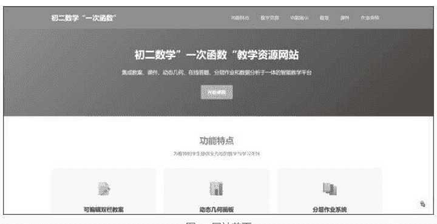

图3-2展示了网站的核心功能。这些功能旨在为教师教学与学生学习提供全方位、深层次的支持，助力数学教学与学习的高效进行。

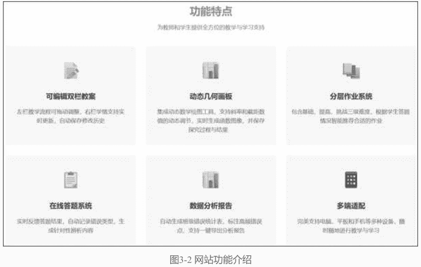

单击导航栏中的“教案”，即可进入初二数学“一次函数”教案页面，该页面如图3-3所示。页面顶部直观地展示了课题名称、教材版本、课时安排、班级平均分及薄弱生比例等关键信息。紧接着展示的是教学流程和学情支持模块。学情支持模块下的学情分析涵盖学生对前导知识的掌握情况评估，常见误区预警则对学生在学习一次函数概念时易出现的忽略条件 k ≠0、混淆 b 与 k 的意义等进行了预警，助力教师精准把握教学重点和难点。

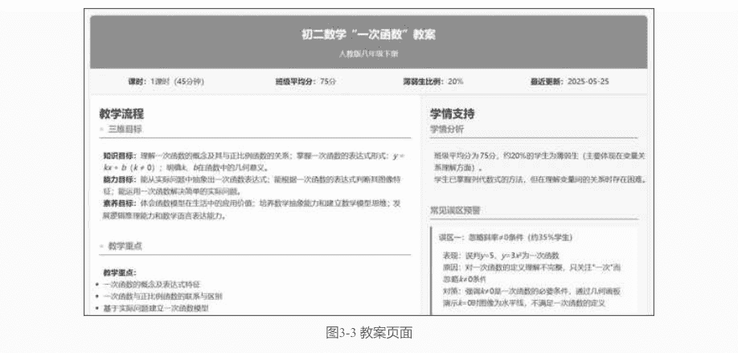

单击导航栏中的“课件”，即可借助动态演示帮助学生理解与一次函数相关的知识。其中，“k值变化演示”功能支持通过滑块灵活调整k值和b值。教师操作时，学生能直观地看到一次函数图像随k值和b值变化的过程，有助于学生理解“k ≠ 0是一次函数y = kx + b的必要条件，当k = 0时，函数变为y = b，该函数是常数函数，不是一次函数”这一难点。动态演示效果如图3-4所示。此外，教师还可借助“弹簧伸长量演示”功能模拟弹簧在不同拉力作用下的伸长情况，从而将一次函数知识融入物理情境。这能够帮助学生更直观地理解一次函数的概念，比如一次函数表达式里的b值代表弹簧初始长度。这种融合物理情境的数学教学方式，能够帮助学生体会一次函数的跨学科应用，从而提升学生的知识迁移能力。教师单击相应的“打开演示”按钮，即可开始互动操作。


以下是教师在使用智能体的过程中可能出现的问题及解决方法。

问题1：教师输入的指令不够准确或完整，导致生成的教案与预期有偏差。

解决方法：让智能体提供实时反馈功能，教师输入指令后，系统自动弹出提示框，提醒教师检查关键信息是否完整、格式是否正确等。例如，如果教师在学情部分只输入了“20%薄弱”，系统会提示“请补充薄弱环节的具体内容，如变量关系理解、列函数关系式等，以便精准生成教案”。另外，在教师端的应用中内置帮助中心，该中心提供详细的指令输入指南和常见问题解答。

问题2：教师对生成课件中的几何画板控件操作不熟练，影响教学演示效果。

解决方法：智能体在生成课件的同时，会自动嵌入操作指南。这些操作指南以视频或图文形式详细介绍几何画板控件的操作方法，包括如何拖动 k 值和 b 值的调节滑块、如何暂停/播放动态演示等操作技巧。此外，教师还可以在平台内置的交流社区中提问，获得其他教师的经验分享和技术支持。

问题3：在线答题系统出现技术故障，无法正常使用。

解决方法：平台配备7×24小时技术支持团队，教师发现问题后，可通过相应的反馈渠道（如“一键报修”按钮）快速反馈。技术团队收到反馈后，会立即响应并远程排查、处理各类故障，如因服务器故障导致答题系统无法访问，技术团队会迅速修复服务器并恢复系统运行，同时向教师通报处理进度和结果。

通过应用前述4层结构化Prompt模板，智能体能够将教师模糊的教学需求转化为可执行的功能指令，生成结构完整的教案和配套课件，并通过数据联动功能，为教师提供智能化教学支持。

接下来，教师可以继续按照这种方式进一步拓展智能体在课堂互动管理和学生成长跟踪等方面的应用。

## 3.2 课堂互动

在现代教学中，课堂互动已成为提升教学效果的重要手段。智能体依托课堂互动系统为教师提供个性化反馈和指导，助力其高效开展多样化的教学活动，实时掌握学生学习动态。

实现课堂互动系统的结构化Prompt如下。

```
#角色定位
初二数学教师

#场景界定
“一次函数的概念”课堂教学，课时为45分钟，计划安排实时问答环节（时长10分钟）和小组讨论活动（时长12分钟），并在课程结束后对学生的课堂表现进行分析。班级共45名学生，其中部分学生对变量关系理解较好，约20%的学生在变量关系理解及列出表达式方面较为薄弱，班级氛围较为活跃。

#要素拆解
1.实时问答
题目类型：选择题占50%，填空题占30%，简答题占20%。题目涵盖课程中的重点概念，如一次函数的定义、表达式y = kx + b (k≠0)，以及正比例函数与一次函数的区别；易错知识点包括忽略k = 0条件、混淆一次函数与其他代数式的关系等。
答题方式：学生通过班级小管家在线答题系统答题，系统能够实时统计答题情况，包括正确率、答题时间、每道题的错误率等。
互动形式：教师可设置8分钟限时答题；针对错误率较高的题目，教师将进行讲解并追问，比如针对“判断y = 3是否为一次函数”，追问学生“一次函数的关键条件是什么？为什么y = 3不符合条件？”从而引导学生深入思考。
2.小组讨论引导
讨论主题：围绕“一次函数在生活中的实际应用场景”展开，例如探讨一次函数在打车费用（超出起步价后的计费）、弹簧伸长量与拉力、商品总价与购买数量等线性关系问题中的体现。
分组方式：采用混合能力分组方式，每组5人，共9组。
引导策略：教师在小组讨论过程中适时介入，提出引导性问题，如“在打车费用案例中，我们能发现哪些变量关系？起步价和每公里费用分别对应一次函数表达式中的什么？”；提供相关资料或提示（如不同城市的出租车计价标准），帮助学生厘清变量关系；同时观察各小组的讨论进度与参与度，确保活动有序开展。
成果展示：小组讨论结束后，每组推选一名代表进行3分钟发言，分享讨论成果；教师对各组表现予以点评和总结。
3.课堂表现分析
分析维度：包括学生答题情况（正确率、答题时间）、小组讨论参与度（发言次数、提出有效观点数量，如能否准确识别实际生活场景中的变量关系），以及课堂提问参与情况（主动提问次数、回答质量，如回答一次函数概念相关问题时的准确性和完整性）。
分析工具：借助课堂互动管理系统的数据分析功能，生成学生课堂表现报告，报告以柱状图展示学生在各维度的表现水平，以折线图呈现班级对各知识点的整体掌握情况，以数据表格形式呈现每位学生的具体指标。
反馈方式：课程结束后，教师根据分析结果，对表现优秀的学生予以表扬和奖励，如在班级公告栏公示其优秀表现并给予积分奖励，以起到激励作用；对于学习暂时困难的学生，教师课后进行单独沟通，了解原因并提供个性化的学习建议，比如为变量关系理解薄弱的学生推送相关辅导资料或安排针对性课后小练习。

#输出规则
系统功能：在实时问答模块提供题目编辑、发布和统计功能；在小组讨论模块提供分组设置、过程监控和成果记录功能；在课堂表现分析模块提供多维度数据采集、可视化报告生成功能。
界面展示：实时问答界面清晰呈现题目、学生答题进度和结果统计数据；小组讨论界面直观展示分组情况、讨论过程中的互动记录和成果汇总；课堂表现分析界面采用可视化图表和报告呈现学生个人及班级整体的多维度表现数据。
数据存储：对学生的答题数据、小组讨论记录和课堂表现分析结果等进行长期存档，方便教师随时查阅和进行对比分析，为后续教学提供参考依据。
```

在向智能体发送结构化Prompt后，系统会通过对话进一步确认细节，示例如下。

感谢您提供的详细需求。在开始设计这个课堂互动系统之前，我想确认几个关键细节，以确保系统符合您的教学需求。
关于实时问答系统：您是否需要题库管理功能（可以预先准备多套题目），以便在课堂上灵活选用？学生答题后，您希望立即向全班展示正确答案和解析，还是先查看统计结果再决定是否展示？
关于小组讨论功能：您希望系统自动根据学生历史成绩进行均衡分组，还是手动调整分组？在讨论过程中，您倾向于让学生提交讨论笔记，还是由教师巡视时记录关键点？
关于课堂表现分析：除您提及的分析维度外，是否还需要跟踪学生的出勤情况、课堂专注度等其他指标？您希望课后立即生成分析报告，还是在教师添加评语后再生成？
关于系统部署：您希望这个系统独立部署，还是与之前的“一次函数”教学资源网站集成？是否还需支持多个班级的数据管理和对比分析？
您的回答将帮助我更精确地设计匹配您的教学风格和需求的系统。

此时，教师可根据实际教学需求补充回复。

之后生成的课堂互动系统页面如图3-5所示。

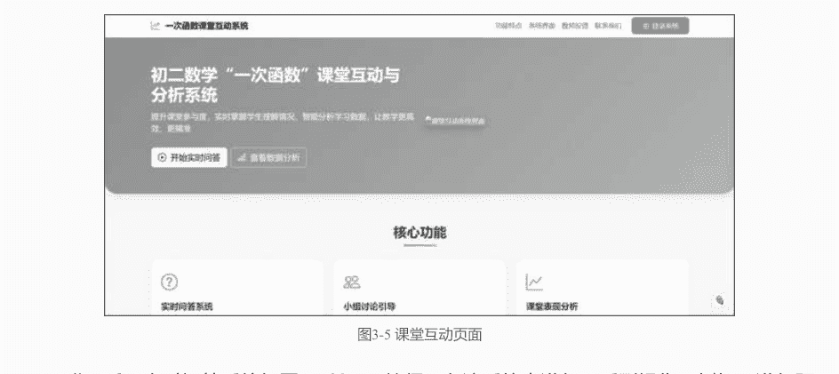

登录后，实时问答系统如图3-6所示。教师可在该系统中进行一系列操作。例如，进行题库管理时，可以单击“新建题库”按钮，按照知识点对题目进行分类，还可通过搜索框，结合概念辨析、建模应用等标签快速查找与筛选题库，提升题库调用效率；编辑题目时，教师选择对应题库后，系统会自动显示题号及总题数，并支持单选、多选和填空等多种题型。教师输入题目及选项后，可通过预览功能检查，确认无误后再发布。对于学情实时统计，页面会显示答题剩余时间，并同步统计已答题人数、正确率、选项分布等。教师还能切换查看学生的答题情况，为及时调整教学策略、开展针对性讲解提供有力的数据支撑。

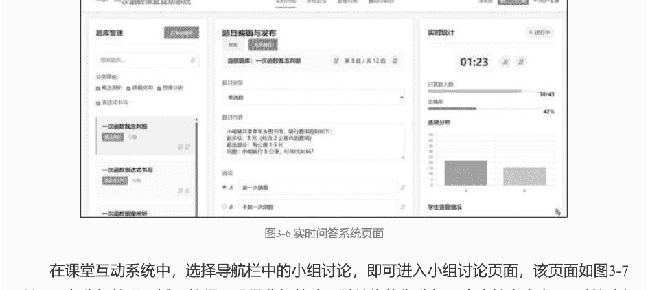

在课堂互动系统中，选择导航栏中的小组讨论，即可进入小组讨论页面，该页面如图3-7所示。在分组管理区域，教师可设置分组策略（默认为均衡分组，也支持自定义），并通过+、-按钮调整每组的人数，也可以根据历史成绩、课堂互动数据等因素进行分组。当然，还可以选择自动分组选项快速生成小组，或通过手动调整成员名单来实现个性化分组。此外，教师能够通过单击“开始讨论”“暂停”和“结束讨论”按钮来掌控讨论进程。页面中部区域会清晰展示讨论主题、剩余时间等信息。在讨论主题下方设有讨论说明，用于明确任务要求，同时提供参考资料，帮助学生理解相关案例。讨论成果区域能够呈现小组的提交状态，教师可以单击“查看详情”按钮了解提交的内容，并通过“添加反馈”按钮给予指导和评价。在汇报安排区域，教师可通过“自动安排”或“手动安排”功能设置汇报顺序，并设置汇报时长，以确保汇报顺利进行。

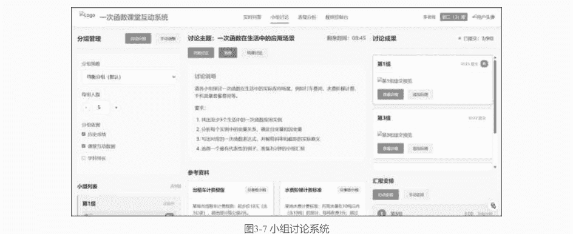

在课堂互动系统中，选择导航栏里的表现分析，即可进入表现分析页面，该页面如图3-8所示。在分析维度区域，教师可选择班级 [如初二（3）班] 和时间范围（如今日课堂），并勾选答题情况（正确率、答题速度、错误类型分布）、小组讨论（参与度、讨论成果质量、组内互动）等分析维度。课堂表现分析区域以图表形式展示答题正确率分布、答题时间分布、错误类型分布和小组讨论参与度等，还会给出如“20%的学生因忽略 k ≠0这一条件而出错，正确率低于60%”等具体分析结论。在学生表现区域，可按综合表现等维度对学生进行排名，显示前若干名（如前10名）学生的正确率、参与度及综合得分等情况。教师还能导出数据，并通过单击“生成报告”按钮整合分析内容。

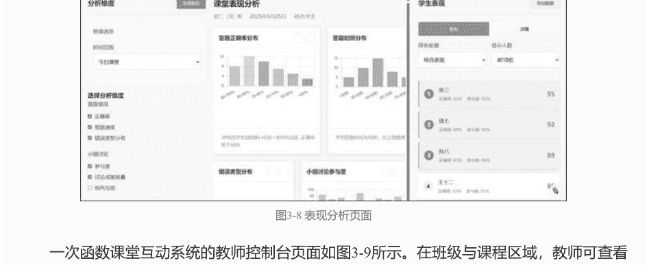

一次函数课堂互动系统的教师控制台页面如图3-9所示。在班级与课程区域，教师可查看班级 [如初二（3）班、初二（5）班等] 信息及学生人数，还能单击“添加班级”按钮，新增班级。在课程管理区域，不仅可以看到不同课程（如一次函数）的进展情况，还能够选择继续授课或查看资料。课堂概览区域展示了学生出勤情况（如45/45，出勤率100%）、答题正确率（如78%，较之前提升5%）、讨论参与度（如85%，较之前提升8%），以及当前课堂（如一次函数概念第2课时，已进行32分45秒）各环节的进展情况。数据与通知区域通过表现趋势图呈现答题正确率、参与度、知识点掌握等数据随课时的变化情况，并将相应情况通知给教师。在该区域，教师还能单击‘刷新数据’按钮获取最新信息。

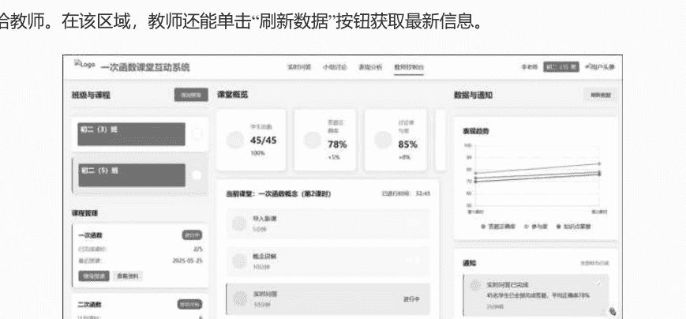

以下是教师在实际使用场景中可能遇到的问题及解决方法。

问题1：实时问答环节题目难度两极分化，部分学生答题时产生较强挫败感。
解决方法：采用智能分层题目生成机制，在指令中增加难度系数选项（如设置变量关系理解类题目的难度系数≤0.6），系统将自动过滤超纲题目，同时针对掌握不够扎实的学生定向推送前置复习题。
同时，采用动态难度调节机制。当某类题目错误率超过50%时，系统将自动触发难度降级提示，将简答题转换为填空题（如“打车费用=起步价（8元）+2元/千米×里程 x，表达式为 y = ”），并将答题时间延长至10分钟。

问题2：小组讨论时出现部分学生垄断话语权、部分学生参与度低的情况。
解决方法：采用强制角色分工机制，系统在完成分组后，自动为每位学生分配讨论角色（如记录员、发言人、质疑者、资料整合者），并要求发言人必须轮换，且讨论成果需包含所有成员的签名或电子批注。
实时参与度监测预警：当某学生连续3分钟未发言时，教师端对应小组的图标将闪烁提醒，同时推送引导话术模板（如“请听听××同学的想法，他可能发现了新的变量关系”），帮助教师及时调整讨论节奏。

问题3：课堂表现分析数据维度过多，教师难以快速定位教学改进方向。
解决方法：首先，引入数据关联分析引擎，在表现分析页面增加知识点与互动行为的关联查询功能。教师输入 k ≠0等关键词后，系统即可自动筛选出在该知识点上答题错误的学生，并调取其小组讨论参与记录（如是否在讨论中提到 k 的作用），进而生成关联分析图谱。

此外，提供教学改进智能推荐功能。根据学习行为指标（如正确率、讨论中概念提及率等）及其权重算法，自动标注关键影响因素（如因 k ≠0这个知识点掌握不足导致讨论成果中模型构建错误率达65%），并推送教案修订建议。

课堂互动系统由结构化Prompt驱动，构建了“实时问答-小组讨论-表现分析”这个闭环互动体系。教师可基于角色定位与教学场景，运用前述4层结构化Prompt模板，有效提升课堂互动的针对性与有效性。

## 3.3 学生成长跟踪

在教育领域，学生的成长是一个动态、多维的发展过程。在传统教学模式中，教师往往依赖经验判断或阶段性考试成绩来评估学生的表现，这种方式难以全面、持续地把握学生长期成长轨迹。数据分析与家校沟通系统通过智能化数据采集、多维分析和可视化呈现，帮助教师实现从经验判断到科学诊断的转变。

实现数据分析与家校沟通系统的结构化Prompt如下。

```
#角色定位
初中数学教师（负责数据审核、数据分析与解读、家校沟通）
#应用场景
1. **学期成长档案**：整合整个学期数学学习数据（成绩、作业、课堂表现），形成电子档案
2. **阶段性评估**：
   - 周评估：课堂参与度+作业完成质量
   - 月评估：单元测试成绩+数学素养发展指标
   - 学期评估：综合成绩+成长趋势分析
3. **个性化方案**：基于薄弱点生成针对性练习（如函数图像分析能力不足，则推送专项训练）
4. **家校沟通**：自动生成含数据图表的家长报告（支持语音播报功能）

#要素拆解
（1）数据采集
| 类型 | 具体内容 | 采集方式 | 示例字段 |
| --- | --- | --- | --- |
| 自动同步 | 考试成绩、作业提交记录、考勤状态 | 对接学校管理系统 | 期中数学成绩92分、作业迟交3次 |
| 半自动录入 | 课堂行为标签、小组合作表现 | 教师勾选预设标签 | “主动发言”“小组汇报主导” |
| 人工记录 | 成长故事、典型错题分析、家长反馈 | 教师/家长填写表单 | 某次解题思路突破的详细过程 |

#分析工具
- **动态曲线**：呈现数学成绩（纵轴）与课堂互动次数（横轴）在学期中的变化趋势
- **百分位图**：展示学生在班级中的数学成绩排名、作业完成率等的百分位值
- **素养热力图**：聚焦数学核心素养（逻辑推理、数学运算、直观想象），按等级（优秀、良好、待提升）进行可视化呈现

#智能预警
- 成绩预警：连续2次单元测试成绩低于班级平均分15%时触发
- 行为预警：本周课堂互动频率较上周下降50%时标记为“关注”

#输出规则
1. **网站功能**：
   - 教师端：数据录入、分析报告生成、个性化方案编辑
   - 家长端：查看孩子的报告、提交反馈、预约沟通
   - 学生端：查看个人成长曲线、接收学习建议
2. **可视化报告**：
   - 包含“成绩雷达图”“素养发展时间轴”“家校沟通记录”模块
   - 支持按周/月/学期筛选数据，一键下载PDF版本
3. **部署要求**：
   - 服务器需通过教育数据安全认证，家长访问需进行身份验证
   - 提供API对接学校现有OA系统
```

智能体接收结构化Prompt后，会自动完成数据分析与家校沟通系统的全部设计工作，并根据设计方案生成网站，登录页面如图3-10所示。


图 3-10 系统登录页面

学生管理页面如图3-11所示。在此页面上，教师可以通过单击班级切换标签来查看不同班级学生的信息，或者在右上方的搜索框中输入关键词，利用筛选功能精确查找特定的学生。该页面中的表格直观地呈现学生学号、姓名、最近成绩、班级排名、课堂表现及预警状态等信息。单击“详情”按钮可追溯学生的学习历程；单击“报告”按钮可以生成评估报告；单击“沟通”按钮则进入家校沟通界面。若学生数据有多页，可通过单击“上一页”“下一页”或具体的页码进行翻页。

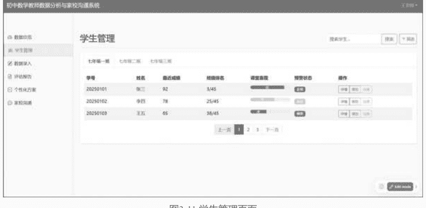

图3-11 学生管理页面

数据录入页面如图3-12所示。教师可通过单击该页面中的成绩录入、课堂表现、素养评估、成长记录等选项，切换到对应的数据录入页面。在成绩录入页面，教师需填写考试名称（如第四单元测试），并选择考试日期和班级（从下拉菜单中选择）。该页面下方的表格会列出学生的学号和姓名，教师在成绩对应的单元格中输入成绩即可。如果需要补充说明，可在备注栏中填写相关信息。完成后，单击“保存”按钮即可；如果放弃操作，则可单击“取消”按钮。此外，页面右上方的导入Excel和批量录入功能支持教师按指定格式整理成绩后，将数据导入系统，或快速完成多位学生成绩的批量录入。

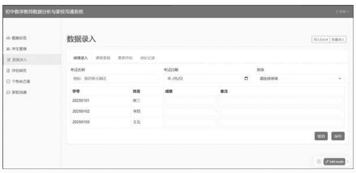

评估报告页面如图3-13所示。教师生成报告时，需先在报告类型下拉菜单中选择周报告、月报告或学期报告以确定报告周期。然后，在班级下拉菜单中选择对应的班级，并在学生下拉菜单中选择全部学生（生成班级整体报告）或特定学生（生成个人报告）。同时，在时间段下拉菜单中选择相应的时间范围。完成后，单击“生成报告”按钮，页面右侧最近生成的报告区域就会显示新生成的报告。教师可单击“查看”按钮了解学生学习过程、成绩趋势及素养发展等情况。单击“发送”按钮，可将报告发给学生或家长，以促进家校沟通。单击“下载”按钮，可将报告保存到本地。

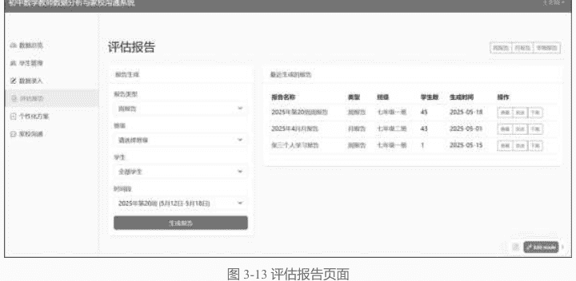

个性化学习方案页面如图3-14所示。教师可单击页面右上角的“创建新方案”按钮制定个性化学习方案。在学生薄弱点分析区域，教师可查看学生的主要薄弱点及建议训练方向。若方案已制定，可对其执行查看、修改或分享操作；若方案待更新，可查看并依据新数据进行修改；若方案还未制定，则可单击“分析”按钮生成学情诊断后，单击“制定”按钮创建方案。教师还可以在学习资源库区域通过搜索关键词或分类标签筛选资源，并根据学生实际情况为其推送辅助学习内容。

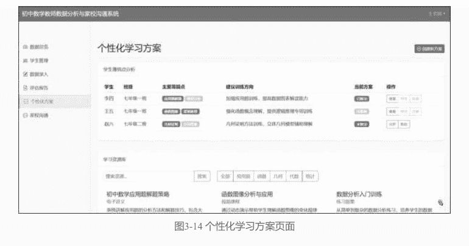

家校沟通页面如图3-15所示。教师可按班级、最近联系时间等条件在家长列表中选择沟通对象。未读消息将以数字标识。教师可在聊天窗口向家长发送学生学习情况等信息，还可单击“创建预约”按钮设置沟通时间和方式。在聊天窗口中可查看完整聊天记录，这有助于回顾交流内容、了解家长反馈以便后续进行沟通。

以下是教师使用数据分析与家校沟通系统时可能遇到的核心问题与解决方法。

问题1：自动同步数据不完整（如考试成绩未更新）或标签预设库覆盖不足（如未包含板书讲解等标签），导致推荐的学习资源与学生薄弱点不匹配（如函数图像分析能力薄弱却被推送代数计算资源）。

解决方法：手动刷新数据，或通过手动补录功能临时填充缺失值（系统后续将自动更新）；在标签管理模块中，可新增自定义课堂行为的标签（如小组板书展示），也可批量导入/导出标签；在资源库管理中，可修正资源与标签的映射关系（如将“一次函数图像动态演示”重新归类至“函数图像”标签）；使用资源匹配测试功能检测匹配度低于80%的资源，并有针对性地进行手动调整。

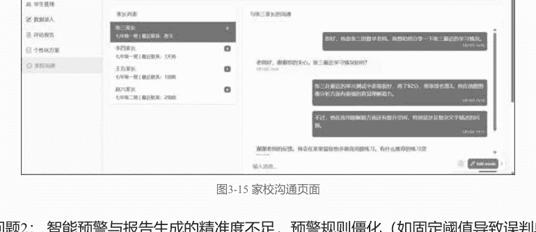

问题2：智能预警与报告生成的精准度不足，预警规则僵化（如固定阈值导致误判单次低分情况），评估报告维度与教学目标脱节（如默认素养指标未涵盖建立数学模型相关内容）。

解决方法：调整阈值规则（如改为连续3次低于平均分10%），并添加容错机制（如允许一次偶然波动）；启用动态阈值模式，由系统根据班级历史数据自动计算显著变化的阈值；在报告生成页面勾选《中国学生发展核心素养》中的相关指标；将自定义的指标组合保存为函数章节专属模板，以便下次生成报告时直接调用。

问题3：家校沟通与系统运行存在性能瓶颈问题，比如家长端因权限未绑定而无法查看报告，或预约沟通时出现时间冲突；教师在进行多班级管理时，页面卡顿，甚至无法访问网站。

解决方法：指导家长在个人中心的“绑定学生”区域完成身份验证；教师可主动分享报告并设置有效期；家长可提前录入日程中的繁忙时段；教师创建预约沟通时间时，系统将自动避开冲突时段，并支持3选1协商机制（即提供3个可选时间段供家长确认）；针对页面卡顿问题，建议教师清理浏览器缓存，或使用Chrome、Edge等现代浏览器；系统启用分批次加载功能，以降低前端数据加载压力。如遇服务器故障，教师可通过“一键报修”按钮反馈相关错误代码，技术团队将优先恢复教学核心功能。

在教育信息化不断推进的当下，学生成长跟踪对于初中数学教学具有重要意义。该系统以数据驱动为核心理念，依托精准的角色定位与功能设计，通过多元数据采集、科学分析工具、智能预警机制和规范输出规则，构建了完整而高效的学生成长跟踪体系，并支持丰富的应用场景。从系统各页面的实际操作来看，无论是学生管理与数据录入，还是评估报告生成、个性化方案制定及家校沟通，都为教师提供了便捷有效的支持。这不仅能够助力教师实现从传统评估到科学诊断的转变，更能全面持续地关注学生的成长轨迹，为初中数学教学质量的提升以及学生的长远发展提供坚实保障。

# 第4章 科研智能体

在当今科研领域，随着数据量的爆炸式增长以及科研任务复杂度的不断提升，高效且精准地处理海量数据并应对复杂任务，已然成为广大科研人员亟须应对的核心挑战。在此背景下，智能体以其先进的算法架构、卓越的性能以及高度的灵活性脱颖而出，为科研工作注入了新活力，引发了前所未有的变革。本章将深入剖析如何系统化地构建科研智能体，推动科研流程朝着智能化的方向迈进，为科研工作的效率提升和质量优化提供有力支持。

## 4.1 智能体是自动化科研助手

科研工作流程中存在着大量重复性高且耗时费力的任务。这些任务不仅占据了科研人员大量的时间和精力，还可能因人工操作而产生一定的误差。智能体凭借其先进的技术架构和强大的学习能力，化身高效的自动化科研助手，帮助科研人员从琐事中解脱出来，将更多精力投入到核心的科研创新工作中。

下面将从文献综述自动化、实验数据可视化以及学术报告生成三个方面详细阐述智能体在自动化科研助手方面的应用。

### 4.1.1 文献综述自动化

在学术研究与知识探索领域，文献综述是一项既基础又至关重要的工作。它要求研究者广泛搜集、筛选、整理并分析相关文献，以构建研究框架、识别研究空白并推动科学进步。然而，传统文献综述过程烦琐耗时，且易受人为偏见影响。随着AI技术的飞速发展，智能体以其强大的数据处理、自然语言理解和生成能力，为文献综述的智能化转型提供了革命性解决方案，尤其在学术论文智能检索与结构化摘要生成领域展现出显著优势。

#### 1. 智能体在文献综述中的核心能力

智能体在文献综述中的核心能力体现在以下几个方面。

- 大规模数据抓取与筛选：智能体能够利用网络爬虫技术，从全球范围内的学术数据库、期刊网站、预印本平台上自动抓取相关文献。它能够通过先进的文本挖掘算法，快速筛选出与研究主题紧密相关的文献，极大地节省了研究者的资料搜索时间。
- 智能摘要与关键词提取：对于每篇文献，智能体都能够自动生成简洁准确的摘要，并提取出关键术语和概念。这有助于研究者快速掌握文献的核心内容，为后续的深入分析打下基础。
- 文献分类与聚类：智能体能够基于文献的内容特征，自动对文献进行分类和聚类，将相似主题的文献归为一组，便于研究者从宏观上快速洞察研究领域的结构分布。
- 趋势分析与研究空白识别：通过对大量文献的深度分析，智能体能够识别出研究领域的发展趋势、热点话题以及尚未被充分探索的方向，为研究者提供兼具前瞻性与可行性的研究方向建议。
- 自动化报告生成：智能体能够根据分析结果，自动生成结构清晰、内容丰富的文献综述报告。该报告不仅包含文献的基本信息与核心内容，还进一步提炼出兼具理论深度与实践价值的研究展望与创新路径，大大减轻研究者的写作负担。

#### 2. 实例展示：智能体在新能源汽车领域的文献综述应用

##### (1) 研究背景与目标

随着全球对环境保护的重视和对传统燃油车的限制，新能源汽车成为汽车行业发展的热门方向。为了全面了解新能源汽车在电池技术、续航里程、充电设施等方面的研究现状和发展趋势，我们利用智能体实现该领域的文献综述自动化。

##### (2) 具体操作过程

利用智能体实现新能源汽车领域文献综述自动化的具体步骤如下。

1) 文献收集：设定新能源汽车、电池技术、续航里程、充电技术、充电设施等核心关键词，借助智能体对各大知名学术数据库以及权威行业报告平台展开全面搜索。经过一番努力，我们成功收集到了与这些关键词高度相关的大量文献资料，为后续研究奠定了坚实的数据基础。

2) 文献筛选：为确保研究的高质量和可靠性，构建智能体时运用特定算法，对收集到的文献进行细致的筛选。在筛选过程中，智能体不仅会深入分析文献的标题、摘要和关键词，精准判断文献与研究主题的契合度，还会充分考量被引频次、期刊影响力等重要因素。通过这一严谨的筛选流程，系统能够从海量文献中识别出高质量的文献，并将这些文献作为后续深入分析的样本对象。

3) 内容分析与提取：在完成高质量的文献筛选后，智能体对文献内容进行深度剖析，并从中精准提取关键信息。

4) 综合分析与综述生成：智能体对提取的海量信息进行系统整合与综合分析。在这一过程中，它全面对比不同电池（如固态锂电池、锂金属电池、燃料电池等）技术在性能上的优势与不足；深入总结提升续航里程的有效策略，包括电池技术改进、整车能耗优化等；详细分析充电设施建设的当前状况和面临的实际问题，涵盖布局合理性、智能化管理水平等。经过多轮的数据处理与分析，最终生成一份内容丰富、结构完整的文献综述初稿，全面涵盖新能源汽车关键技术的各个重要方面。

##### (3) 测试与验证

为验证智能体在新能源汽车领域文献综述生成中的准确性和可靠性，我们进行了多方面的评估，并将其生成的结果与权威人士撰写的文献综述进行对比，结果表明智能体性能优异，具有较高的可信度与应用潜力。

在内容完整性方面，智能体生成的综述全面覆盖了新能源汽车领域的核心研究方向，包括电池技术、续航里程、充电技术及充电设施建设等。综述详细阐述了各类电池技术的发展、续航测试方法，以及不同充电技术和设施建设要点，信息覆盖全面，与人工撰写的综述在广度和深度上相当，这表明智能体能够有效地整合关键信息，为读者提供完整的领域知识概览。

在信息准确性方面，智能体的表现值得肯定。在电池技术性能对比和续航里程测试标准等关键内容上，智能体的输出与行业公认的研究成果高度一致。无论是对先进电池技术的优势分析，还是对测试标准的特征描述，均准确无误，充分展现了其高效的信息提取与处理能力。

在逻辑合理性方面，该综述结构清晰、条理有序，各板块之间过渡自然，从电池技术到续航里程，再到充电技术，内容层层递进，内部要点逻辑严密。例如，在介绍充电技术时，依次讲解快充技术、无线充电和换电模式，清晰地呈现了行业研究现状与发展趋势，其逻辑水平与人工撰写的优秀的综述水平相近，有效助力读者理解复杂的领域知识。

##### (4) 不足

在评估智能体生成的文献综述时，发现其存在以下不足。

- 有关前沿技术的阐述较为浅显，仅涉及已发表的表面成果，缺乏对未来应用场景及潜在挑战的深入分析。
- 对于未来研究方向的预测缺乏创新性与前瞻性，未能充分整合当前科技趋势及外部影响因素（如政策或市场变化）。
- 存在引用虚假或不可靠文献的风险，参考文献中的信息准确性难以保证，需人工核验以确保学术严谨性。

##### (5) 结论

智能体在文献综述自动化方面的应用，不仅极大地提高了研究效率，还通过其强大的数据分析能力，为研究者提供了全面、深入且客观的学术视角。作为一款智能化工具，智能体可以有效规避传统人工处理文献过程中易出现的信息遗漏、引用偏差、分析主观性等问题，确保研究成果的严谨性与可靠性。随着技术的不断进步，智能体有望在更多领域发挥其独特优势，成为科研人员不可或缺的助手。

### 4.1.2 实验数据可视化：智能体对Matplotlib与Tableau的应用

#### 1. 智能体可视化的重要性

在科研活动中，数据的复杂性与多样性对研究人员提出了更高要求。随着科研领域的持续拓展，实验数据、观测记录、文献数据等信息呈指数级增长。这些信息往往具有多维度、非结构化等特点，传统数据处理方法难以高效挖掘其潜在价值。智能体的可视化功能通过将抽象数据转化为直观的图表、图形、地图，大幅降低了数据理解的门槛。科研人员借助可视化结果，能快速识别数据中的模式、趋势和异常值，进而能更好地验证假设、优化模型和推导结论。此外，在学术交流场景中，可视化成果能以更高效的方式传递复杂的科研发现，提升科研成果的传播效率和影响力，促进跨学科的合作与交流。同时，在数据驱动的科研决策过程中，智能体提供的直观数据洞察也为资源分配、研究方向调整等提供了有力支持。

#### 2. 智能体支持Matplotlib和Tableau可视化的机制

智能体基于Python生态构建可视化体系，通过深度集成Matplotlib库和间接支持Tableau，实现了多样化的数据可视化。针对Matplotlib，智能体能够直接调用Python脚本中的Matplotlib库函数，在沙盒环境内执行绘图操作。如此一来，无须依赖外部API或独立软件，即可通过Python代码实现对图表元素的精确控制。在支持Tableau可视化方面，智能体利用Python库对数据进行预处理和格式转换，确保数据符合Tableau的数据输入规范。同时，提供详细的操作指南，引导用户在本地Tableau软件中完成可视化创建工作，实现数据与工具的无缝衔接。

#### 3. 工作内容

将实验数据可视化时，智能体的具体工作内容如下。

1.  数据处理：智能体接收到用户提供的原始数据后，会执行一系列的数据处理操作，包括数据清洗、数据转换和数据标注。其中，数据清洗通过识别和处理缺失值、异常值，提升数据质量；数据转换通过统一数据格式，将非结构化数据转换为结构化数据；数据标注依据行业标准或专业规则，为数据添加分类标签、元数据等，增强数据的结构化属性，为后续可视化奠定基础。
2.  通过Matplotlib实现可视化：智能体根据用户的可视化需求，调用Matplotlib库函数生成多样化图表，涵盖基础的折线图、柱状图和复杂的热力图、箱线图。智能体能够精确设置图表的颜色、字体、坐标轴、图例等元素，确保图表符合学术规范，满足用户需求。同时，智能体还支持根据不同科研场景调整图表风格和展示重点。
3.  支持Tableau可视化：在支持Tableau可视化方面，智能体首先利用Python库将处理后的数据导出为Tableau可识别的文件格式，如CSV、Excel等，确保数据的兼容性。然后，智能体生成详细的Tableau操作指南，内容涵盖数据导入、图表创建、交互功能设置的全流程操作，包括如何配置颜色映射、添加筛选器、设置悬停提示等，帮助用户在Tableau中完成复杂的交互式可视化。
4.  生成文档并打包：完成可视化任务后，智能体能够自动生成项目说明文档，详细记录数据来源、处理过程、可视化方法，并对结果进行解读。同时，将可视化图表、数据文件、Python脚本和操作指南整合打包，形成完整的可视化项目交付物，方便用户存储、分享和进一步分析。

#### 4. 应用例子

以国家统计局公布的2024年中国部分省（区、市）的GDP数据为例，智能体首先对这些数据进行处理，添加东部、东北、中部、西部区域的划分标签，并检查和处理数据中存在的质量问题。图4-1为智能体生成的部分省（区、市）GDP柱状图，该图按GDP数值进行降序排列，直观展示GDP规模差异；同时，智能体还创建了按区域分组的GDP箱线图（如图4-2所示），清晰呈现各区域GDP数据的中位数、离散程度和异常值分布。

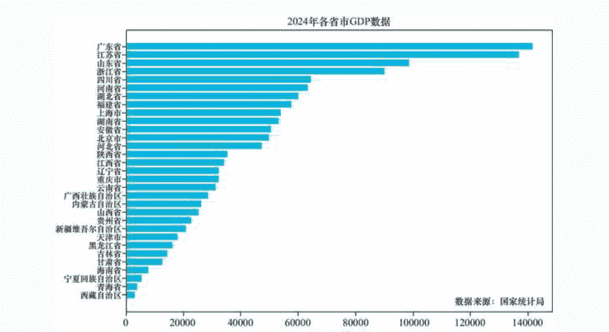

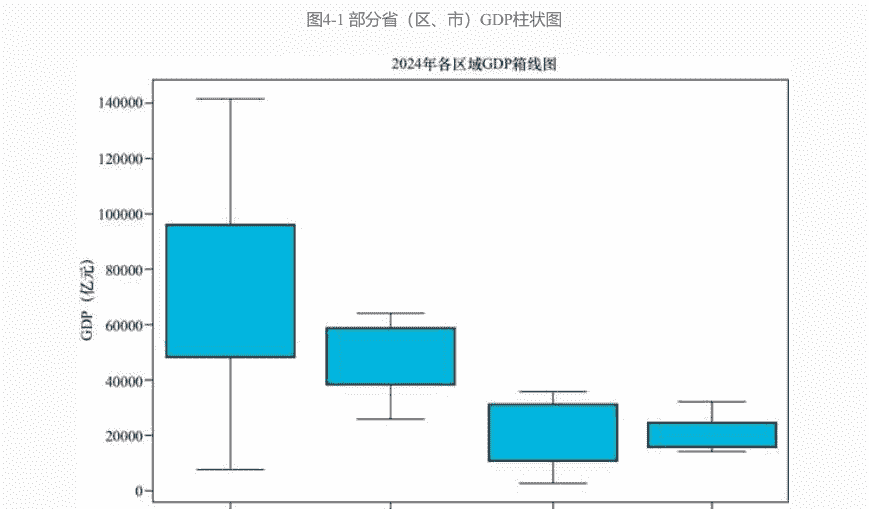

### 4.1.3 学术报告生成：基于LaTeX模板智能填充

在科研领域，学术报告是传播科研成果与促进学术交流的重要载体，其质量直接影响科研成果的影响力与被认可度。传统学术报告的撰写往往需要耗费大量时间和精力于格式排版、公式编辑、参考文献引用等基础工作上，这不仅分散了科研人员对核心研究内容的投入，还容易出现格式错误、不规范等问题。智能体基于LaTeX模板的智能填充技术，提供高效、规范的学术报告生成方案，极大地提升了科研工作效率，推动了科研成果的快速产出与广泛传播。

#### 1. 核心技术优势阐述

智能体在学术报告生成方面兼具效率优势与质量保障能力。传统方式下，完成一篇格式规范的学术报告可能需要数天甚至更长时间，而智能体通过自动化处理流程，可将耗时压缩至数小时。在质量保障方面，其严格遵循国际主流学术规范，确保字体、字号、段落间距、图表排版及参考文献格式均符合专业出版标准，有效降低了因格式问题导致的拒稿风险。

智能体所采用的LaTeX模板智能填充技术有效解决了传统学术报告撰写的痛点。以往科研人员需手动编写大量LaTeX代码来实现复杂的排版效果，不仅学习成本高，还容易出错。如今，智能体通过智能分析科研内容，自动填充LaTeX模板中的变量，将文字、公式、图表等内容精准嵌入模板，科研人员无须具备深厚的LaTeX知识，就能生成高质量的学术报告，真正实现内容创作与格式排版的分离，让科研人员专注于学术创新。

#### 2. 操作流程分步解析

在学术报告生成任务中，智能体遵循系统化流程，可以完成从原始文档处理到最终成果交付的全链路工作，具体操作流程如下。

1.  进行环境准备与文档核验。智能体安装Pandoc等必要工具，为后续操作提供基础支持，同时接收用户提交的Word文档，完成前期资源准备。
2.  进入内容提取阶段。智能体利用Pandoc将Word文档转换为Markdown格式，完整保留文档的标题层级、段落结构、列表样式及图片引用等内容，为后续处理提供便利的中间格式。
3.  配置LaTeX环境。智能体安装texlive-latex-recommended、texlive-fonts-recommended等核心组件及功能包，重点配置XeTeX引擎。该引擎对Unicode字符尤其是中文支持良好，能够确保多语言内容准确排版，为构建完备的LaTeX运行环境奠定基础。
4.  设计LaTeX模板。智能体依据Markdown内容结构，创建学术报告专用模板。模板定义文档类型为article，预设页面边距、作者信息、摘要等基础要素，并引入ctex（中文支持）、graphicx（图片处理）、amsmath（公式排版）、hyperref（超链接生成）等宏包，通过变量占位符明确内容填充区域。
5.  执行格式转换。在完成模板设计后，智能体再次调用pandoc，将Markdown文件转换为LaTeX格式。在转换过程中，指定使用定制模板，并将xelatex设置为PDF渲染引擎，以此确保Markdown标记精准转换为对应的LaTeX命令。
6.  编译调试。智能体执行xelatex编译命令生成PDF文件。在此过程中须解决多项问题：移除与XeTeX不兼容的宏包；安装texlive-lang-chinese宏包集以补足中文支持；利用pandoc提取图片资源并修正路径，确保图片正确显示。经反复调试后，成功生成最终版PDF文件。
7.  交付。智能体将LaTeX源文件、PDF成果及图片资源统一打包成zip文件，交付给用户，完成整个学术报告制作任务。

#### 3. 核心机制深度剖析

智能体在文档处理过程中，依托Pandoc格式转换、LaTeX精准排版、模板驱动格式化、XeTeX多语言支持及迭代调试优化等五大核心机制的协同运作，构建起一套从格式转换到精准排版、再到问题解决的完整体系，确保文档高效处理并输出专业级质量。

- Pandoc格式转换：Pandoc是整个过程的关键，它充当不同文档格式之间的桥梁。Pandoc首先将复杂的Word格式转换为结构化的Markdown，再将Markdown转换为LaTeX代码，最后自动映射大部分结构元素，包括标题、列表、强调、图片引用等，确保实现高效、准确的格式转换。
- LaTeX精准排版：LaTeX是专业的排版引擎，接受包含文本内容和排版指令的.tex文件，通过编译过程生成高质量、格式规范的PDF文档。其擅长处理复杂布局、交叉引用、参考文献、数学公式和多语言文本，确保学术报告达到专业排版效果。
- 模板驱动格式化：通过向Pandoc提供自定义的LaTeX模板（template.tex），智能体可控制最终PDF的整体外观和结构。模板预设文档的基本框架、宏包及样式，Pandoc则负责将Markdown内容转换并填充到模板的指定位置，实现内容与格式的完美融合。
- XeTeX支持多语言：XeTeX是处理多语言文档的现代排版引擎，原生支持UTF-8编码，可以直接调用操作系统中安装的字体。结合ctex宏包，可确保中文等多语言文本排版准确，满足学术报告的国际化需求。
- 迭代调试及优化：LaTeX文档的转换和编译难以一步到位，尤其是在处理格式转换、特殊字符和外部资源引用时。智能体通过分析编译器的错误和警告信息，逐步定位宏包缺失、命令冲突、文件找不到等问题，并对其进行修正，例如安装宏包、调整模板、修正文件路径等，确保最终输出的文档质量。

#### 4. 应用价值与场景拓展

在实际科研场景中，智能体已展现出强大的应用价值。例如，在材料科学领域，某科研团队利用智能体将实验数据与分析结果快速转化为符合国际期刊要求的学术论文，从数据整理到报告生成仅用了半天时间，相比传统方式大幅提升效率，且格式精确无误，最终成功发表在顶级学术期刊。在社会科学研究中，研究人员借助智能体生成学位论文，其自动生成的参考文献列表严格遵循规范，减少了反复修改的时间成本，有效助力论文顺利通过评审。

展望未来，智能体在学术报告生成领域的功能将不断拓展。首先，计划集成更多学术资源库，实现文献的智能推荐与自动引用，进一步提升内容创作效率。其次，将引入AI技术，辅助科研人员进行内容撰写与优化，如自动生成实验结论等内容。此外，智能体还将支持更多文档格式，以适配不同学术交流场景的需求，持续推动学术报告生成向智能化、高效化方向发展。

## 4.2 智能体助力科研实验：设计与评估

在日常科研工作中，智能体可提供多维度的支持，尤其在实验设计和参数调优方面表现突出，下面将重点介绍。

### 4.2.1 基于历史数据的实验设计建议

在科研实验设计场景中，智能体凭借强大的数据整合与智能分析能力，突破了传统“经验驱动型”实验设计的局限。传统方法高度依赖科研人员的个人经验与直觉，易陷入重复试错的困境，且难以发现数据间的潜在关联。智能体通过系统性分析历史实验数据，深入挖掘数据背后的规律与模式，为新实验提供数据驱动的科学设计建议，从而显著提升实验效率与成功率，减少资源浪费。

在科研领域，智能体帮助科研人员突破研究瓶颈，加速成果产出，推动科研向更高效、更精准的方向发展，它已然成为现代科研不可或缺的重要工具。

#### 1. 智能体基于历史数据生成实验设计建议的步骤和机制

1.  历史数据收集与结构化
    智能体广泛收集与目标实验相关的多维度历史数据，包括模型参数、数据处理细节、训练过程参数、评估指标等。通过清洗、筛选与整合等操作，将这些数据转化为结构化格式，为后续分析奠定基础。
2.  探索性数据分析（EDA）与关联性分析
    运用统计分析与可视化技术，智能体深入探究各参数与实验结果之间的关联关系，精确识别影响实验性能的关键因素，挖掘历史实验中的优势参数组合以及尚未充分探索的区域。
3.  生成新实验假设
    基于数据分析结果，智能体提出具有针对性的实验假设，预测潜在的参数调整方向，用以探索可能提升实验性能的新路径。
4.  设计与推荐新实验方案
    依据实验假设，智能体设计若干个包含明确实验目标、变量控制、对照组与实验组设置、评估方案等内容的完整实验方案，并基于各方案的潜在价值进行优先级排序，为科研人员提供清晰、可执行的实验路径指导。
5.  迭代循环
    将新实验产生的结果纳入历史数据池后，智能体通过持续迭代优化分析过程，不断完善实验设计建议，从而形成一个良性循环。

#### 2. 案例：通过微调大模型提升医学问答任务性能

以微调大模型提升医学问答任务性能为例，智能体首先收集过往大模型微调实验的历史数据，涵盖使用的基础模型类型（如GPT-3、Llama）、模型参数规模、医学数据集（如医学文献库、临床病例数据）、数据预处理方式（清洗规则、分词策略）、训练参数（学习率、批次大小、训练轮次），以及评估指标（医学问题回答准确率、答案相关性评分）等信息，并将其整理为结构化表格。

接着，智能体对上述数据进行探索性分析与关联性分析。示例如下。

```
探索性数据分析（EDA）与关联性分析
目标：发现历史数据中隐藏的模式、趋势和关联，特别是参数与性能指标之间的关系。
机制：应用统计和可视化技术来理解数据。
操作：
统计分析：计算各参数与核心性能指标（准确率、效果评分）之间的相关系数（如Pearson、Spearman）。进行描述性统计（均值、中位数、方差）以了解参数和结果的分布。
可视化：
绘制散点图：观察连续参数（如学习率）与性能指标的关系。
绘制箱线图/小提琴图：比较不同类别参数（如优化器类型、数据集）对性能的影响。
绘制热力图：展示多个参数之间或参数与性能指标之间相关性的矩阵。
模式识别：
识别历史上产生高性能结果的参数范围或参数组合。
识别导致性能不佳的参数设置或陷阱。
找出历史实验中覆盖不足或完全未探索的参数区域。
分析不同因素（如数据集、模型变体）对结果产生的独立影响或交互影响。
```

通过绘制学习率与准确率的散点图、不同数据集下模型性能的箱线图等，挖掘不同数据与参数组合对模型性能的影响，以期找到在医学问答准确率与答案相关性方面表现优异的数据集与学习率搭配方案。此外，智能体还发现部分新型医学图像标注数据集尚未被充分应用于模型微调。

基于上述分析，智能体生成实验假设：在当前表现优异的基础模型上，采用新型医学图像标注数据集，并选取处于潜在优化区间的学习率进行微调，有望显著提升模型在医学图像相关问题回答上的准确率。

随后，智能体设计新实验方案，将当前最优模型配置设为对照组，实验组则采用新数据集与调整后的学习率，并使用包含医学图像问题的专用评估数据集，以统一的准确率与相关性评分标准进行效果评估，并将该方案列为高优先级推荐。

新实验完成后，智能体将此次实验的参数设置、实验结果等信息补充至历史数据池中，用于下一轮的分析与实验设计优化，持续推动大模型在医学问答任务上的性能提升。

### 4.2.2 参数优化与仿真模拟

在科研实验中，参数优化与仿真模拟是提升实验效果、降低试错成本的关键环节。参数优化旨在确定实现最佳实验结果的参数组合，仿真模拟则通过构建模型来预测实验过程，帮助科研人员在实际操作前评估结果。

参数优化步骤如下。

1.  定义优化目标与衡量指标：明确实验期望达成的核心优化方向，如提升化学反应中产物生成效率或增强材料抵抗外力的拉伸强度等，并制定可量化的评估标准。例如，以产物的质量或体积计算产率，或以材料断裂时承受的最大拉力衡量拉伸强度，从而精确评估不同参数组合对实验结果的影响程度。
2.  确定关键实验参数与探索范围：筛选出对实验结果起决定性作用的参数，如化学反应中的温度、压力、反应物配比，或材料加工中的成型时间、添加剂含量等。为每个参数设定合理的取值区间或离散等级，如将温度范围设定在50～150℃，以确定后续实验的参数探索边界。
3.  选择优化策略与实验设计：根据实验类型和条件挑选适配的参数探索方法。对于物理实体实验，常采用因子设计、响应面法等传统实验设计方案系统改变参数组合。如果具备可靠的计算模型，且实验可自动化执行，则贝叶斯优化、遗传算法等优化算法能够更高效地搜索最优参数空间。
4.  执行实验或计算模拟计划：依照选定的实验设计，开展实际实验操作或运行计算模拟程序。过程中要严格控制参数设定，确保每次实验条件的一致性，并完整记录实验结果数据，包括关键性能指标、实验环境参数等，为后续分析提供翔实依据。
5.  分析结果与建模：运用统计分析工具和数学建模方法，深入剖析实验数据。通过计算相关性、进行方差分析等手段挖掘参数与实验结果间的内在联系，构建经验模型或数学表达式，清晰地呈现出参数变化对实验结果的影响规律。
6.  确定最优条件与验证：基于数据分析和模型预测锁定可能实现最佳实验效果的参数组合。通过开展验证性实验，将预测的最优参数应用于实际，对比实验结果与预测值，验证参数组合的有效性，确保获得真正可靠的优化方案。

仿真模拟步骤如下。

1.  定义模拟目标与范围：明确通过仿真模拟想要研究的具体问题，确定模拟的时间、空间和对象边界，避免模拟过程出现盲目性。例如在电池研究中，将目标设定为预测电池在不同充放电速率下的发热情况，范围界定为电池首次充电的1小时内及电池内部的关键区域。
2.  选择或开发计算模型：根据研究对象特性，从现有模型库选择或基于物理化学定律开发合适的数学模型，并进行合理简化以平衡计算效率与准确性。比如研究固体材料的力学性能时，选择有限元分析（FEA）模型，将复杂的材料结构简化为便于计算的单元组合。

### 4.2.3 实验可行性评估

实验可行性评估可以从技术与科学可行性、资源可行性以及风险评估与管理3个核心维度入手，通过系统化的评估流程全面、客观地判断拟议实验是否具备实施条件与价值。

#### 1. 技术与科学可行性框架

该框架用于判断拟议实验在科学原理、研究方法和技术实现层面是否合理，是否存在根本性障碍。具体来说，对该框架的评估主要细分为以下3个维度。

- 科学原理与假设审查：确认实验所基于的科学基础是否坚实，主要审查内容包括理论基础、核心假设、文献支持、创新性与风险，以及预期结果的科学意义等。
- 方法学评估：评估所选用的实验方法、测量技术和数据分析流程是否合适、可靠且能达到研究目的，主要考量内容包括方法适用性、成熟度与可靠性、测量能力、控制变量、数据分析计划以及标准化与规范等。
- 技术实现评估：评估将实验方案转化为实际操作的可行性，主要评估内容包括设备/仪器可及性与性能、软件/工具可用性、操作复杂性与技能要求、集成与兼容性、规模放大可行性（如适用）以及维护与支持等。

#### 2. 资源可行性框架

此框架旨在判断执行拟议实验所需的各种资源（预算、时间、人员、设备、材料等）是否能够得到满足，是否存在资源方面的限制因素。对该框架的评估可细分为以下5个关键维度。

- 预算评估：确认实验所需的总财务成本是否可控且有资金保障，主要评估内容包括成本估算、预算匹配、资金来源、成本控制及应急预算等。
- 时间评估：评估完成实验所需的时间是否符合项目要求和实际可能性，主要涉及时间估算、总时长、关键路径、时间缓冲及并行可能性等。
- 人员评估：确认是否有足够且具备相应技能的人员执行实验，主要评估内容包括技能匹配、人员数量、经验水平、人员可用性及团队协作等。
- 设备与设施评估：评估所需的物理环境、仪器设备是否可用且满足要求，主要评估内容包括设备可用性、性能状态、预约与使用、设施条件及计算资源等。
- 材料与数据评估：确认实验所需的原材料、样品或数据是否能够稳定、可靠地获取，主要评估内容包括材料可获得性、质量与一致性、获取成本与周期、数据可获得性及样品制备等。

#### 3. 风险评估与管理框架

该框架旨在系统性地识别、分析和应对拟议实验过程中可能出现的各种潜在风险，以提高实验成功率，并确保人员、环境和数据的安全。其评估核心步骤包括风险识别、风险分析、风险评价、风险应对以及风险监控与审查。常见风险类别包括技术风险、安全与环境风险、伦理与合规风险（如适用），以及资源与项目管理风险。

#### 4. 完整评估流程

完整的实验可行性评估流程通常包含4个主要阶段：评估启动与信息收集、分维度评估、综合分析与总体评价，以及决策与行动计划。整个过程强调信息的全面收集与各维度评估结果的综合分析，以形成对实验可行性的总体判断，并做出相应决策。

在实验可行性评估中，智能体能够充分发挥其信息处理与自动化辅助能力。

在信息收集方面，智能体可快速检索科学文献、技术报告、专利、标准规范等资料，查询设备仪器的技术规格，收集标准耗材与设备的市场价格、供应商信息，以及化学品安全数据表和安全法规标准等，为评估提供丰富的数据支持。在分析辅助方面，在条件允许的情况下，智能体可基于用户提供的模型与脚本执行简单计算模拟，并依据用户设定的标准整理不同实验方法的优缺点。同时，智能体还可协助用户进行文档处理，如创建资源需求清单、预算表、风险登记册等框架，整合各类信息，辅助起草评估报告，并通过设置提醒功能，确保评估流程的关键步骤与检查点不被遗漏。

然而，智能体的能力存在明确局限性。首先，它无法替代用户进行专业判断，如无法判定科学假设是否合理、实验结果是否可靠；其次，它无法直接进行物理操作或操控实验室设备；此外，它也不具备独立设计复杂实验方案或构建专业科学模型的能力，且无法访问用户的内部资源与保密信息。

因此，在实验可行性评估中，用户需发挥主导作用，凭借自身专业知识，对实验的科学假设、研究方法、结果分析等内容进行专业判断，负责物理实验操作、实验方案设计、内部资源调用等核心工作，并做出最终决策。智能体则作为高效的辅助工具，通过提供信息支持与流程辅助，与用户形成互补协作关系，共同推进实验可行性评估工作顺利开展。

## 4.3 实验数据管理

在日常的科研过程中实验数据的收集和管理至关重要，良好的数据管理不仅能提升科研效率，更能保障研究质量。智能体可以帮助科研人员更高效、规范地管理实验数据。

### 4.3.1 实验记录自动化

智能体记录实验数据的核心机制是借助文件系统工具（文件读取、写入、追加）与沙盒环境内的文件进行交互，并结合其内部文本处理和格式化功能，将非结构化原始数据转化为结构化、便于阅读的电子实验记录本格式（如Markdown文件）。整个流程分为以下6个关键步骤。

1. 原始数据读取：智能体调用file_read文件读取工具读取用户提供的数据附件（如pasted_content.txt），完整获取实验数据，为后续处理提供基础素材。该步骤依赖专业的文件读取工具完成数据获取操作。
2. 构建记录本框架：智能体使用file_write文件写入工具，以覆盖写入模式创建新文件，采用Markdown格式编写记录本标题、数据来源说明、数据说明及数据记录部分标题。Markdown格式既能保证内容的易读性，又支持表格等结构化呈现，可为后续记录提供清晰框架。
3. 数据格式化与转换：智能体利用内部数据处理功能，对原始文本数据进行深度解析。通过逐行分析，识别地区名称、数值等关键信息，并依据Markdown表格语法规则，将无序文本数据转化为包含表头、分隔符和数据行的结构化表格。此过程可选择将处理后的数据暂存于临时文件（如formatted_data.md），或直接在内存中完成数据重构。
4. 数据写入：数据格式化完成后，智能体将数据写入记录本。再次调用file_write文件写入工具，采用追加模式（append=True），将格式化后的Markdown表格文本添加到已创建的记录本框架文件末尾，确保原有标题与说明内容不受影响，实现数据与框架的有机整合。
5. 结果验证：为确保记录准确性，智能体进行结果验证。通过file_read文件读取工具获取最终文件的全部内容，对照预期的标题、说明及完整表格数据，检查数据写入是否完整、准确，从而保障实验记录的可靠性。
6. 交付成果：智能体使用message_notify_user消息通知工具，向用户发送任务完成通知，并将最终生成的电子实验记录本作为附件一并推送，方便用户查看与下载使用，完成整个实验记录处理流程。

待用户向智能体中输入实验数据后，智能体将依次执行数据读取、框架创建、数据格式化与写入、结果验证及成果交付等步骤。通过文件系统工具与内部数据处理能力的协同运作，智能体能高效且准确地将原始实验数据转化为结构化的电子实验记录本。这不仅实现了实验记录的自动化，还确保了数据记录的规范性与完整性，为科研工作者提供了便捷、可靠的实验数据记录支持。

### 4.3.2 数据标准化与格式转换

在科研实验与数据处理流程中，数据标准化与格式转换是保障数据质量、提升分析效率的关键环节。由于实验数据来源广泛，原始数据常存在格式混乱、标准不一、质量参差不齐等问题，不仅增加了数据整合难度，还可能影响后续分析的准确性与可靠性。智能体在这一过程中扮演重要角色，通过自动化的数据处理流程，可有效提升数据处理效率，减少人工操作误差，使科研人员能够将更多精力聚焦于数据分析与成果产出。

#### 1. 数据标准化

数据标准化是依据统一的规范与规则，对原始数据进行系统性处理，旨在消除数据间的差异与歧义，提升数据质量、可比性与可操作性。其核心作用在于确保不同来源的数据能在统一标准下进行整合与分析，为后续研究提供可靠的数据基础。

在数据标准化过程中，智能体可处理原始数据中存在的错误、不一致或缺失部分，以提高数据质量，确保数据的准确性与完整性。具体工作内容涵盖去除多余的空格或特殊字符、处理缺失值（如填充默认值、删除记录或插值处理）、纠正明显的拼写错误、统一文本大小写等；进行数据转换与标准化，将数据转换为更便于处理、分析且格式一致的形态，主要包括类型转换、单位统一、编码转换、归一化/标准化等。

以员工流失信息统计数据集为例，原始数据集内容如图4-3所示。

| 行号 | 员工ID | 信用评分 | 地理位置 | 性别 | 年龄 | 任期 | 余额 | 产品数量 | 是否有信用 | 是否活跃 | 预估薪资 | 是否流失 |
|---|---|---|---|---|---|---|---|---|---|---|---|---|
| 1 | 15634602 | 619 | 法国 | 女 | 42 | 2 | 0 | 1 | 是 | 是 | 101348.9 | 是 |
| 2 | 15647311 | 608 | 西班牙 | 女 | 41 | 1 | 83807.86 | 1 | 否 | 是 | 112542.6 | 否 |
| 3 | 15619304 | 502 | 法国 | 女 | 42 | 8 | 159660.8 | 3 | 是 | 否 | | 是 |
| 4 | 15701354 | 699 | 法国 | 女 | 39 | 1 | 0 | 2 | 否 | 否 | 93826.63 | 否 |
| 5 | 15737888 | 850 | 西班牙 | 女 | 43 | 2 | 125510.8 | 1 | 是 | 是 | 79084.1 | 否 |
| 6 | 15574012 | 645 | 西班牙 | 男 | 44 | 8 | 113755.8 | 2 | 是 | 否 | 149756.7 | 否 |
| 7 | 15592531 | 822 | 法国 | 男 | 50 | 7 | 0 | 2 | 否 | 否 | | 否 |
| 8 | 15656148 | 376 | 德国 | 女 | 29 | 4 | 115046.7 | 4 | 是 | 否 | 119346.9 | 是 |
| 9 | 15792365 | 501 | 法国 | 男 | 44 | 2 | 142051.1 | 2 | 否 | 是 | 74940.5 | 否 |
| 10 | 15592389 | 684 | 法国 | 男 | 27 | 2 | 134603.9 | 1 | 是 | 是 | 71725.73 | 否 |
| 11 | 15767821 | 528 | 法国 | 男 | 31 | 6 | 102016.7 | 2 | 否 | 否 | 80181.12 | 否 |
| 12 | 15737173 | 497 | 西班牙 | 男 | 24 | 3 | 0 | 2 | 是 | 否 | 76390.01 | 否 |
| 13 | 15632264 | 476 | 法国 | 女 | 34 | 10 | 0 | 2 | 是 | 否 | 26260.98 | 否 |
| 14 | 15691483 | 549 | 法国 | 女 | 25 | 5 | 0 | 2 | 否 | 否 | | 否 |
| 15 | 15600882 | 635 | 西班牙 | 男 | 35 | 7 | 0 | 2 | 是 | 是 | 65951.65 | 否 |
| 16 | 15643966 | 616 | 德国 | 男 | 45 | 3 | 143129.4 | 2 | 否 | 是 | 64327.26 | 否 |
| 17 | 15737452 | 653 | 德国 | 男 | 58 | 1 | 132602.9 | 1 | 否 | 否 | 5097.67 | 是 |
| 18 | 15788218 | 549 | 西班牙 | 女 | 24 | 9 | 0 | 2 | 是 | 是 | 14406.41 | 否 |
| 19 | 15661507 | 587 | 西班牙 | 男 | 45 | 6 | 0 | 1 | 否 | 否 | 158684.8 | 否 |
| 20 | 15568982 | 726 | 法国 | 女 | 24 | 6 | 0 | 2 | 是 | 是 | 34724.03 | 否 |

图 4-3 员工流失信息统计数据集

处理后得到的数据集如图4-4所示。

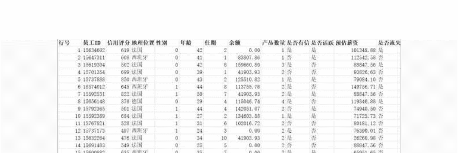

对比图4-3与图4-4可知，智能体精准识别并填充了数据集中的缺失值，同时对性别等分类变量进行了数字编码转换，有效提升了数据集的规范性与完整性。该处理使数据结构更统一，为后续流失原因分析、关键因素挖掘等工作奠定了标准化基础，显著增强了数据的可分析性与应用价值。

#### 2. 格式转换

格式转换是一个广义概念，指将数据从一种存储或传输格式转换为另一种格式的过程，其核心作用是实现数据在不同平台、软件间的顺畅流通与兼容使用，以满足多样化的数据分析、存储和展示需求。

以大语言模型训练领域的JSON文件格式和ALPACA文件格式为例，当训练数据为JSON文件时，需将其转换为ALPACA文件，方可应用于大语言模型的指令微调训练。

训练医学领域实体识别的模型时，训练集JSON文件部分内容如下。

```
[
    {
        "text": "（5）房室结消融和起搏器植入作为反复发作或难治性心房内折返性心动过速的替代疗法。",
        "entities": [
            {
                "name": "房室结消融",
                "type": "医疗程序"
            },
            {
                "name": "起搏器植入",
                "type": "医疗程序"
            }
        ]
    }
]
```

将文件输入智能体后，系统会根据用户需求和模型训练的格式要求让智能体对文件进行格式转换。最终得到的ALPACA格式文件内容如下。

```
{
    "instruction": "请识别以下医学文本中的命名实体，包括疾病、医疗程序和药物，并标注其类型。",
    "input": "（5）房室结消融和起搏器植入作为反复发作或难治性心房内折返性心动过速的替代疗法。",
    "output": "房室结消融（医疗程序）、起搏器植入（医疗程序）、反复发作或难治性心房内折返性心动过速（疾病）、替代疗法（医疗程序）"
}
```

智能体可便捷地将JSON格式转换为ALPACA格式，为实验操作带来极大便利。其转换过程高效稳定，可快速适配实验数据格式需求，减少数据处理环节的耗时并降低处理的复杂性，有效提升实验效率。

在数据标准化与格式转换过程中，智能体凭借自动化的数据处理能力，能够高效完成众多常规任务，但在面对复杂业务逻辑、非标准数据格式以及需要专业判断的场景时，仍需以用户为主导，由用户提供关键信息与决策，只有二者紧密协作，才能保障数据处理工作的顺利完成。

### 4.3.3 实验数据版本控制

在科研实验过程中，数据的动态变化贯穿始终。随着实验的推进，研究人员常常需要对数据进行新增、删除、修改和查询等操作。同时，随着研究的深入和时间的推移，不断产生的新数据也需要进行系统的版本更新与管理。实验数据版本控制正是保障数据准确性、完整性与可追溯性的关键手段。它不仅能够避免数据混乱，确保团队随时能够获取正确的数据版本，还能为实验结果的复现、团队协作以及研究成果的长期保存提供坚实支持。智能体在实验数据版本控制中扮演着不可或缺的角色，其高效的自动化处理能力与灵活的任务驱动机制，能够显著提升数据版本管理的效率与规范性，助力科研工作的顺利开展。

#### 1. 智能体实验数据版本控制的核心机制

智能体并不具备如Git等专业版本控制系统那样的自动变更跟踪能力，而是通过以下机制构建其数据版本管理体系：以文件系统为存储基础、以脚本为处理逻辑载体、以工具调用为执行方式、以用户指令为驱动源头。这是一套面向任务的流程管理体系，在存储层面，智能体依托沙盒环境的文件系统对原始数据、中间处理结果以及最终输出（如电子记录本）进行分类存储；在逻辑处理层面，通过编写和执行Python脚本实现数据解析、转换、合并等操作；在执行环节，借助文件读写工具、脚本执行工具完成具体任务；用户的操作指令则成为触发数据增删改查等操作的核心驱动力。

#### 2. 智能体处理“增删改查”（CRUD）的机制与步骤

（1）新增（Add）

智能体实现新数据添加的过程是，首先通过消息或附件接收数据，随后利用内部文本处理能力或解析脚本将其解析为JSON等结构化格式的内部表示或中间文件，完成初步处理；最后，将解析后的结构化数据保存到临时文件，以此实现数据隔离，方便后续操作。如果后续根据实际需求，要将新数据整合到现有数据中，智能体会执行或修改合并脚本；如果需要创建新记录，则运行格式化脚本将数据转换为Markdown表格等目标格式。最后，智能体将处理结果以覆盖或追加的方式写入目标电子记录本文件，从而达成新数据的高效录入与整合。

添加新数据不仅能确保实验数据及时更新，满足研究不断推进的需要，还能保障数据存储的规范性和结构性，为科研工作提供可靠的数据支持。

##### (2) 删除 (Delete)

智能体接收到用户下达的删除数据指令后，会立即对指令进行解析，明确需删除的数据范围，无论是特定的某一行数据（如“全国”所在行）、某一列数据，还是满足特定条件的记录集合，明确范围后，智能体主要通过对相关脚本进行修改来执行删除操作，如在数据处理或表格生成脚本中嵌入过滤逻辑，使脚本在运行过程中能够自动识别并排除需要删除的数据部分。完成脚本修改后，智能体运行更新后的脚本，重新生成数据输出文件，新文件中不再包含已删除的数据。它以覆盖旧文件的形式，最终实现数据删除操作。

删除数据能够精准地清理无效或错误数据，有效避免冗余数据对实验分析造成干扰，确保存储数据的准确性与有效性，使数据存储更加简洁高效，为科研数据的管理与分析提供有力支持。

##### (3) 修改 (Modify)

智能体接收到用户的修改数据指令及具体修改内容后，会依据数据的存储与处理特性，灵活选择适配的修改方式。若原始数据直接嵌入脚本内，像GDP数据示例那样，智能体将直接在脚本中对文本数据进行修改；若修改需求涉及计算逻辑或数据转换规则，智能体则会对脚本中的相应处理逻辑进行调整；若数据存储于中间文件，智能体既可以直接更新该文件内容，也能在后续的数据处理环节中，用新数据值替换旧数据值。在完成数据修改操作后，智能体运行更新后的脚本或数据处理流程，重新生成包含修改后数据的输出文件，并通过覆盖原文件的方式确保数据的实时更新。

修改数据旨在及时纠正数据错误、更新数据内容，保证实验数据的准确性，使其如实反映实验真实状况，从而为科研工作提供坚实可靠的数据支持。

##### (4) 查询与检索 (Query/Retrieve)

智能体接收到用户的数据查询指令后，会立即对指令进行解析，明确用户所需的数据版本或文件。接着，智能体凭借文件名及任务上下文信息，迅速定位到对应的文件存储位置。最后，借助文件读取工具获取文件内容，并通过消息将内容呈现给用户，或者直接将文件作为附件发送给用户，以此完成数据的查询与检索操作。

通过这一系列操作，智能体能够让用户快速获取所需数据，有效满足用户在研究过程中查看、分析与引用数据的需求，显著提升数据使用效率。

#### 3. 智能体管理“不同时期数据”的机制与步骤

##### (1) 文件隔离 (按时期/批次存储)

当智能体接收到表征不同时间段或不同批次的数据时，会立即启动针对性处理机制，为每个时间段或批次单独构建一套处理流程，并生成独立的最终输出文件。在文件命名环节，智能体采用带有清晰时间标识的命名规则，确保每个文件都精准对应特定时间点，形成该时间节点的数据完整快照。通过这种文件命名与存储策略，智能体从物理存储层面实现了不同时期数据的有效隔离。

如此一来，不仅以直观、简洁的方式实现了数据基于时间维度的分类存储，还能方便研究人员快速定位和调取特定时期的数据，有效规避不同时期数据混杂带来的管理与分析难题，为开展数据时间序列分析及对比研究创造了便捷条件。

##### (2) 脚本化合并（整合多期数据）

当面临整合不同时期数据的需求时，智能体会先对数据可用性进行全面核查，确保各时期数据（无论是源自不同文件还是源自嵌入文本）均已完成解析且可正常调用。随后，智能体根据数据特点编写或调整合并脚本，该脚本具备读取各时期数据、基于共同键（如“地区”）完成数据匹配合并，以及处理时间序列对齐问题的功能。最后，通过执行合并脚本，将分散在不同时期的数据整合至单一输出文件中。

这一过程让研究人员能够获取数据的历史全貌，将不同阶段的数据置于同一分析框架下，便于挖掘数据随时间演变的规律与趋势，帮助科研人员从更宏观的视角剖析实验数据，有效拓展研究的深度与广度。

##### (3) 显式版本命名（如果需要跟踪修改历史）

当任务要求保留数据修改的完整历史记录时，智能体将在输出文件生成阶段，自动在文件名中嵌入版本号或时间戳。这种显式的版本命名策略，如同为数据修改过程绘制一条清晰的时间轴，该时间轴将每次修改的关键信息以文件名的形式串联，逐步构建完整的数据修改历史脉络。

借助这一机制，研究人员能够便捷地回溯至任意历史修改节点，直观、清晰地掌握数据从初始状态到当前状态的演变过程。无论是用于实验结果复现、研究过程审查，还是促进团队协作，这种详细的数据历史记录都能提供有力支持，切实保障研究工作的可追溯性与严谨性。

## 4.4 实验失败分析

在科研实验过程中，失败难以避免，而实验失败分析对于推动研究进展、优化实验设计至关重要。通过进行系统的实验失败分析，能够深入挖掘导致失败的根源，为后续改进提供方向，避免重复错误，提升科研效率与成果质量。智能体在实验失败分析中可作为重要辅助工具，协助科研人员更高效地开展异常检测与原因分析工作。

### 4.4.1 异常检测与原因分析

异常检测是指从数据集中识别出明显偏离正常模式或预期范围的数据点的过程。在科研实验中，异常检测与原因分析具有重要意义。科研实验数据往往是研究结论的重要依据，异常数据可能会对实验结果的准确性和可靠性产生严重影响。通过有效的异常检测，能够及时发现数据中的异常点，避免因异常数据得出错误结论。原因分析有助于深入了解异常产生的根源，为后续的实验改进、数据修正提供有力支持，从而提升科研实验的质量和效率。

#### 1. 数据异常检测步骤

数据异常检测步骤如下。

- 1) 准备数据并可视化：将待检测数据整理为合适格式（如时间序列、表格），绘制可视化图表（如折线图、箱线图、散点图），初步观察是否存在离群点。
- 2) 选择并执行检测方法：根据数据类型和分布特征，选择合适方法进行异常检测，常用方法包括基于统计分布（IQR法、Z-Score法）、基于时间序列、基于聚类以及机器学习模型（如孤立森林、单类支持向量机）等。执行检测，计算异常得分或判断边界以识别潜在异常点，将检测结果（含异常点位置、检测方法、阈值、异常值等信息）记录到文件中。

#### 2. 原因分析步骤

原因分析步骤如下。

- 1) 确认异常：结合可视化结果和领域知识，审查检测到的异常点，排除检测方法局限性导致的误报。
- 2) 排查原因：从数据录入/传输、测量/设备、实验流程/操作、真实极端事件、数据处理、欺诈或恶意行为（特定场景）等维度系统性思考出现异常的可能原因。
- 3) 收集证据验证：通过追溯原始数据记录、检查相关日志、咨询相关人员、重复实验（可行时）、分析异常点前后数据趋势等方式收集证据并加以验证。
- 4) 形成结论与建议：依据收集的证据推断可能的异常原因，根据原因和异常点对分析的影响提出处理建议（如修正、删除/标记、保留但特殊处理、改进流程），将分析过程和结论记录存档。

此流程结合数据驱动检测与经验逻辑推断，关键在于全面思考可能性并通过核查验证假设，以找出异常根本原因并采取合适处理措施，适用于各类实验数据分析场景。

### 4.4.2 智能体的局限与用户职责

在实验数据异常检测与原因分析工作中，智能体承担着重要任务，它借助一系列工具按步骤完成各项工作。同时，它也存在一定的局限性，需要用户发挥作用予以弥补，详细说明如下。

#### 1. 数据理解与准备

智能体接收用户提供的实验数据（如以文件附件形式提供的数据），使用file_write工具将其转化为带有明确分隔符的文本文件并保存。在此过程中，智能体检查数据格式与字段含义，识别是否存在明显缺失或格式错误，必要时进行可视化处理。此步骤体现了智能体处理结构化数据的能力，能够为后续异常检测提供完整、准确的数据基础，并初步观察数据中是否存在离群点。

#### 2. 异常检测

智能体依据数据特性和用户需求，优先选用简单且鲁棒的检测方法，例如IQR方法。通过file_write工具将基于Pandas库编写的Python代码保存为文件，该脚本可读取.tsv文件并应用IQR方法识别异常值。接着，使用shell_exec工具执行脚本，若执行失败，智能体会进行环境排查与修复。最终，将检测到的异常点及相关统计信息写入文件。此过程展现了智能体执行标准检测算法以及实现自动化流程的能力——可高效、准确地找出数据中的异常点。

#### 3. 原因分析

智能体使用file_read工具读取用户提供的异常点信息。先结合通用的数据异常成因知识分析异常点的具体数值、发生时间/条件，然后与正常数据对比以评估偏离程度，并系统性思考可能的原因。若存在相关数据，还会进行关联分析。之后，使用file_write工具将撰写的原因分析文档保存至文件，提出异常原因的假设并评估概率。此过程体现了智能体生成分析报告的能力——可基于检测结果和通用知识，为异常原因提供多种可能的分析。

#### 4. 总结与报告

智能体把前述异常检测和原因分析步骤提炼成通用流程，使用file_write工具将总结内容写入文件，并通过message_notify_user工具向用户发送包含总结性文本和相关文件路径的通知。此过程体现了智能体提供通用流程总结的能力——可为用户提供一套适用于不同实验数据的异常检测与分析流程。

尽管智能体具备执行标准检测算法、处理结构化数据、实现自动化流程、生成分析报告和提供通用流程总结等能力，但仍存在局限性。智能体的原因分析基于通用逻辑和常见可能性，缺乏对特定实验领域的深入了解。对于特殊实验场景、仪器故障模式、操作易错环节等，智能体难以做出精准判断。

鉴于智能体存在一定的局限性，用户在实验数据异常检测与原因分析过程中需发挥关键作用。用户要提供实验数据与背景信息，告知数据含义与实验基本目的，避免智能体因缺乏背景信息而使原因分析受限；凭借专业知识选择或确认最适合特定实验和数据的检测方法及具体参数，如Z-Score的阈值；基于专业知识提供领域知识进行原因推断，判断哪个原因最符合具体实验场景，为智能体的原因分析提供更准确的方向；由于智能体无法直接访问原始实验记录本、仪器日志或与操作人员交流，用户需要核查原始记录并进行验证，追溯数据源头、验证假设，确保分析结果的可靠性；最终，对于如何处理检测到的异常点（修正、删除、保留）以及是否根据分析结果改进实验流程，由用户做出决策。

### 4.4.3 实验优化建议

在实验过程中，异常数据的出现往往暗示着实验设计或执行存在潜在问题。而实验设计优化，旨在通过对异常数据的分析，找出问题根源，并有针对性地进行改进，从而提高未来实验的质量、效率以及结果的可靠性，这是一个持续改进的循环过程。其具体步骤如下。

#### 1. 确认异常原因

这是实验设计优化的首要步骤。通过对异常数据进行深入分析，初步推测可能的异常原因类型，如数据录入/传输错误、测量/设备错误、实验流程/操作错误、真实的极端事件或数据处理错误等。然而，智能体在此环节仅能基于推测和通用可能性进行原因分析，最终准确确认异常原因仍然需要用户结合对实验细节的了解和线下核查（如检查原始记录、询问操作人员）来完成。只有准确确认异常原因，才能为后续的优化措施提供正确方向。

#### 2. 制订优化方案

在明确异常原因后，便进入制订优化方案阶段。智能体在此环节能发挥重要作用，它可以基于分析得出的异常原因类型，提出一系列对应类型的通用改进建议。例如，若异常原因是“数据录入错误”，智能体可建议“加强数据核对”；若“设备可能漂移”，则可提出“定期进行设备校准”等建议。此外，智能体还能协助修订文档和流程，若用户提供现有的实验方案（SOP）或数据记录表格，并指出需要改进的地方，它可帮助重新组织语言、优化结构，使其更清晰、规范。在数据处理方面，若用户明确数据应满足的要求（如数值范围、格式等），智能体可以编写Python脚本来对新录入的数据执行基本的自动检查；若数据易受异常值影响，则可建议使用更具稳健性的统计方法（如使用中位数代替平均数），并在涉及标准库如Pandas、Numpy、Scipy时，协助实现这些方法的计算；当异常源于数据处理脚本错误，在用户提供脚本代码后，智能体还可尝试阅读并指出潜在的逻辑问题或提出改进建议。此外，智能体也能帮助用户将确定的优化措施整理并记录下来。

但智能体的能力存在局限性，最终选择哪种优化措施，仍需要用户基于具体实验、可用资源、成本效益等进行专业判断，通用建议也需要用户结合实际情况细化为具体的可操作步骤，例如将“加强数据核对”具体化为采用双人录入、系统自动校验或其他方式。

#### 3. 执行优化措施

此步骤主要依靠用户及其团队完成。任何涉及物理操作（如校准仪器、维修设备、改造实验环境）或组织管理（如人员培训、流程监督、责任分配）的优化措施，都需要用户主导执行。因为这些操作需要专业知识、实际操作技能以及组织协调能力，超出了智能体的能力范围。只有用户切实执行优化措施，才能将优化方案转化为实际行动，真正对实验设计进行改进。

#### 4. 评估优化效果

实施优化措施后，需要对其效果进行评估，这一关键任务也由用户负责。用户需要通过对实验和数据进行分析，判断优化措施是否真正减少了异常、提升了数据质量。只有通过科学严谨的评估，才能确定实验设计优化是否达到预期目标，从而为后续的实验改进提供依据，形成持续改进的循环。

在实验设计优化过程中，智能体扮演提出建议、辅助文档处理和执行部分技术性任务的助手角色，而核心的原因确认、方案选择、物理实施、专业判断和效果评估，则仍需用户的主导和参与。只有双方相互配合，才能有效提升实验的质量和可靠性。

# 第5章 职场智能体

AI正在重塑每一个行业，而职场作为人机交互最密集的场景之一，正经历着从工具辅助到智能协同的质变。当大语言模型能理解上下文语义，当多模态交互打破文字壁垒，当知识图谱打通企业数据孤岛，构建一个能懂业务、会协作、可进化的职场智能体，已从可能变为必要。它不是简单的自动化脚本，而是具备环境感知、任务规划与动态学习能力的“数字同事”。

未来的职场，不会是机器取代人的零和博弈，而是人机协同的共生生态。在这个生态中，职场智能体将成为连接人的创造力与机器执行力的核心枢纽，它能将模糊的业务需求转化为可执行的任务流程，能在海量数据中提炼决策依据，更能通过持续学习适配每位职场人的工作习惯。构建这样的智能体，本质上是在设计一种懂职场规则、通人性需求的技术方案——既要攻克自然语言理解、任务调度等技术难关，也要破解标准化能力与个性化场景的适配难题。本章将系统探讨职场智能体的构建过程与应用流程。

## 5.1 智能办公

智能办公代表了未来职场的发展方向，能显著提升工作效率，减少人为失误，实现流程的标准化。通过优化资源配置和降低运营成本，智能办公可助力企业更快地响应市场变化。此外，智能办公增强了数据安全性，促进了信息共享与协同工作，为企业决策提供了有力支持，成为现代企业高效运营的核心要素之一。面对职场环境的快速演变，我们必须积极适应，并通过学习和应用智能体驱动的办公工具来提升工作效率。下面重点讲解如何运用智能体实现工作提效。

### 5.1.1 文档处理与生成：基于数据自动生成分析报告

基于某零售企业的交易数据，智能体构建了一套完整的数据分析流程，如图5-1所示。

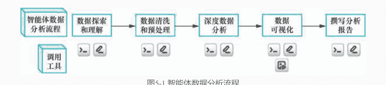

在初始阶段，系统通过读取CSV文件来建立数据理解框架，并执行数据探索操作，包括但不限于数据结构解析、样本预览、元信息诊断、描述性统计计算及缺失值分布检测。相关探索性分析结果已整理成独立文档并归档。

数据分析Prompt示例如图5-2所示。


在数据清洗与预处理阶段，实施了严格的质量控制方案，具体包括：将日期时间字段统一进行标准化转换，针对交易数值字段进行异常负值检测，并对库存记录进行多维度的一致性验证。在清洗过程中生成的详细诊断报告可为后续分析提供数据完整性质量保障。图5-3是该阶段的文件数据预览。

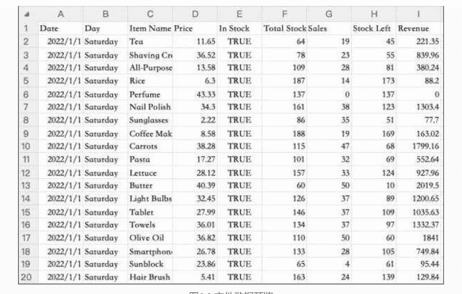

深度数据分析阶段采用多层次计算架构：首先计算全局销售总量与总收入基准指标，接着执行商品维度热点分析，识别头部商品，然后构建时间序列分析模型（按日/周/月颗粒度）。关键的补货预警机制则通过低库存商品识别算法实现。该阶段采用Python脚本化分析框架，执行过程经过多轮迭代优化。首次分析完成后，系统会对结果进行完整性校验，并根据校验结果决定是否重执行脚本，以确保分析结果的可靠性。

数据可视化阶段采用动态脚本生成策略，在实施过程中解决了字体渲染路径配置等关键技术问题，确保了文本显示的准确性和一致性。在通过文件系统验证字体资源可用性后，成功生成六大核心可视化成果。在商品维度包括销量TOP10与销售额TOP10的条形图；在时间维度则涵盖了月度销量和收入趋势折线图，以及周销量和收入分布热力图。所有图均会经过人机协同视觉校验。

最终的报告基于Markdown格式的结构化撰写技术实现，用以整合探索性发现、数据清洗记录、深度分析结论及可视化成果等。通过文档格式转换引擎可将完整的报告转换为PDF格式，并附带全部分析图表及用于结果复现的数据处理脚本。该分析流程已实际应用于零售运营决策支持场景，分析结果揭示了关键销售规律与库存优化方向。以下是文件详情。

零售店数据分析报告

1. 引言

本报告旨在对提供的零售店销售数据进行全面分析，揭示销售趋势、识别畅销商品、评估库存状况，并提供可操作性建议，以支持业务决策。此次分析的数据时间跨度为2022年1月1日至2024年12月31日，涵盖销售日期、商品名称、价格、库存状态、总库存量、销量、剩余库存和收入等关键信息。

2. 数据探索与预处理

2.1 数据概览

原始数据集包含109,600条记录和9个字段。字段如下。

- Date：销售日期
- Day：星期几
- Item Name：商品名称
- Price：商品单价
- In Stock：是否在库
- Total Stock：总库存量
- Sales：销量
- Stock Left：剩余库存
- Revenue：收入

所有字段均无缺失值，数据质量良好。Date字段已成功转换为日期时间格式，便于进行时间序列分析。数值型字段的描述性统计显示，商品价格、总库存量和销量分布合理，没有明显的异常值。

2.2 数据清洗

在数据清洗阶段，主要关注数据的一致性和有效性。经检查，所有数值型字段（Price、Total Stock、Sales、Stock Left、Revenue）均无负值，符合业务逻辑。此外，我们对Sales和Stock Left之和是否等于Total Stock进行了交叉验证，结果显示数据高度一致，没有发现不匹配的记录，这表明数据在记录库存变动方面是准确的。

3. 深度数据分析

3.1 总体销售和收入

在整个分析期间，零售店的总销量达到了2,737,497件，总收入为67,168,171.81元。这些数据表明，零售店在过去3年中保持了强劲的销售业绩。

3.2 畅销商品分析

3.2.1 销量前10的商品

根据销量统计，下表是销量最高的10种商品。

| 商品名称 | 总销量 |
| :--- | :--- |
| 电池 | 54158 |
| 龙舌兰酒 | 28342 |
| 棉球 | 28310 |
| 手机壳 | 28294 |
| 感冒药 | 28231 |
| 发圈 | 28226 |
| 特百惠容器 | 28147 |
| 伏特加 | 28139 |
| 肥皂 | 28110 |
| 微波炉 | 28065 |

从上表可见，电池以显著优势位居销量榜首，反映出其市场需求强劲。其他商品如龙舌兰酒、棉球、手机壳等也表现出良好的销售势头。

3.2.2 收入前10的商品

下表是收入前10的商品。从下表来看，收入与销量存在一定的差异。

| 商品名称 | 总收入（元） |
| :--- | :--- |
| 马桶刷 | 1,383,289.92 |
| 维生素 | 1,372,481.44 |
| 手机壳 | 1,351,620.36 |
| 浴帘 | 1,351,205.02 |
| 草莓 | 1,342,968.12 |
| 牙线 | 1,327,292.70 |
| 伏特加 | 1,320,563.27 |
| 马克杯 | 1,313,939.52 |
| 垃圾袋 | 1,306,688.00 |
| 青柠 | 1,304,883.84 |

马桶刷和维生素在收入贡献方面表现突出，这可能与它们较高的单价和稳定的需求有关。手机壳再次上榜，表明其在销量和收入方面都具有重要地位。

3.3 销售趋势分析

3.3.1 每日销量和收入趋势

每日销量和收入数据显示出一定的波动性，但总体保持稳定。这种波动可能反映了日常消费的随机性，同时也表明周末与工作日的销售表现存在差异。

3.3.2 每月销量和收入趋势

每月销量和收入趋势图显示，销量和收入在不同月份表现出周期性的波动。某些月份可能由于节假日或促销活动的影响而出现销售高峰，而另一些月份则出现低谷。例如，2022年1月和2023年9月出现了较高的销量和收入，而2022年2月和2023年2月的销量和收入则相对较低。这提示我们可以进一步分析季节性因素和市场活动对销售的影响。

3.3.3 按星期几划分的销量和收入

按星期几划分的销量和收入数据显示，每周的销量和收入分布相对均匀，没有出现明显的某天销量特别高或特别低的情况。这表明零售店在工作日和周末都保持了稳定的运营状态。

3.4 低库存商品分析

我们识别了平均剩余库存低于总库存10%的商品，这些商品可能面临库存不足的风险，需要对它们重点关注。下表是部分低库存商品情况。

#### 4. 数据可视化

本报告的关键发现可以通过不同图表类型进行可视化展示。

- 销量前10的商品：使用条形图直观展示各商品的销量排名。
- 收入前10的商品：使用条形图展示各商品的收入贡献排名。
- 每月总销量趋势：使用折线图展示销量随时间的变化趋势。
- 每月总收入趋势：使用折线图展示收入随时间的变化趋势。
- 按星期几划分的总销量：使用柱状图展示每周不同天的销量分布。
- 按星期几划分的总收入：使用柱状图展示每周不同天的收入分布。

（图表将作为附件提供）

#### 5. 结论与建议

##### 5.1 结论

- 零售店在过去3年中实现了可观的销量和收入。
- 电池是销量最高的商品，而马桶刷和维生素则是收入贡献最大的商品。
- 销量和收入存在月度波动，可能受季节性或促销活动的影响。
- 周度销量分布相对均匀。
- 部分商品存在低库存风险，特别是茶叶，可能导致销售机会的流失。

##### 5.2 建议

1. 优化库存管理：对茶叶、手机壳等低库存商品实施更严格的库存监控和补货策略，确保商品供应充足，避免销售损失。
2. 深入分析月度波动：进一步研究导致月度销量和收入波动的具体因素（如节假日、促销活动、季节性需求），以便更好地预测未来销售情况，并制定相应的营销策略。
3. 利用畅销商品：继续关注电池、马桶刷、维生素等畅销商品，可以考虑增加这些商品的库存量，或利用其高人气进行捆绑销售和交叉推广。
4. 探索新增长点：虽然目前销售分布均匀，但可以尝试在特定日期（如周末）推出限时促销活动，以进一步刺激消费，探索新的销售增长点。

### 5.1.2 数据管理与分析

在文档自动化生成系统建立标准化输出框架后，如何有效管理和挖掘业务数据价值就成为自然延伸的需求。在数据管理与分析环节，智能算法会进行多维度的数据建模。

#### 1. Excel与Tableau 智能分析（自动数据清洗与可视化）

在现代企业运营中，数据管理与分析已成为提升决策质量与运营效率的核心环节。随着数字化转型的不断深入，传统的人工数据处理方式已难以应对日益增长的海量数据挑战，智能化的数据管理与分析工具应运而生。本节以某超市销售数据分析为例，系统阐述智能办公自动化中的数据管理流程与分析技术，旨在为产品经理掌握数据驱动型工作模式提供实践方法。

数据管理与分析智能体的处理流程始于数据探索与清洗阶段，如图5-4所示。在读取CSV文件后，系统会自动执行初步的数据探索，用于识别数据集的基本特征与潜在的质量问题。以某超市销售数据为例，原始数据集包含1000条销售记录，涵盖17个关键字段，包括发票ID、分店、城市、客户类型、性别、产品线、单价、数量、税费、总额、日期、时间、支付方式、销售成本、毛利率、毛收入和评分等。通过智能分析系统自动化检查后，确认所有字段均无缺失值，但发现日期和时间需要进行类型转换，以支持后续的时间序列分析。系统自动将日期和时间字段合并生成新的日期时间字段，并执行重复值检查，从而确保数据质量。这一自动化清洗过程显著提升了数据准备效率，原本需要数小时人工完成的工作，在智能系统中仅需几分钟即可完成。


基于这些数据写一个分析报告，Prompt示例如图5-5所示。


数据可视化分析是智能办公的重要价值体现。系统可自动生成多维度的销售分析图表，包括销售趋势、分店销售额对比、产品线销售分布、支付方式偏好、客户类型贡献、性别维度销售差异及城市销售表现等内容。

智能报告生成系统将分析结果自动转化为结构化商业报告。该系统采用模块化设计，首先通过Python脚本自动生成包含所有可视化图表和分析结果的Excel报告，随后通过自然语言生成技术创建Markdown格式的分析报告，并最终将其转换为PDF文档。报告内容包括引言、数据概览、可视化分析、结论建议和附录等。在结论部分，系统基于分析结果自动生成以下6条有针对性的建议。

- 针对销售波动性，建议优化库存管理。
- 针对分店销售均衡性，提出区域发展战略。
- 针对产品线差异，给出优化方案。
- 针对支付方式偏好，设计推广计划。
- 针对会员体系，提出忠诚度提升方案。
- 针对性别差异，制定营销策略。

这些建议不仅仅是简单的数据罗列，而是通过预置的业务知识图谱与决策模型，将数据洞察转化为可执行的行动计划。

智能办公中的数据管理与分析技术正在重塑企业决策流程。借助Excel和Tableau等工具集成的机器学习算法和自然语言处理技术，实现了从数据准备到洞察生成的端到端自动化。在数据清洗环节融入异常检测算法，可自动识别并处理缺失值、异常值和数据不一致等问题。在可视化分析阶段采用模式识别技术，可自动发现数据中的趋势、周期和关联规则。在报告生成过程中结合模板引擎和NLG技术，将分析结果转化为符合商业语境的专业报告。这些技术进步极大地降低了数据分析工作的门槛，使业务人员能够专注于决策而无须过多关注数据处理工作。

以下是智能生成的《某超市销售数据分析报告》详细内容。

##### 某超市销售数据分析报告

###### 1. 引言

本报告旨在对所提供的某超市销售数据进行全面的数据管理与分析。通过数据清洗、可视化分析和智能洞察，报告将揭示销售趋势，识别关键绩效指标，并为业务决策提供具有可操作性的建议。本报告内容涵盖数据概览与清洗、数据可视化分析，以及基于这些发现提出的结论和建议。

###### 2. 数据概览与清洗

原始数据集包含1000条销售记录，包括发票ID、分店、城市、客户类型、性别、产品线、单价、数量、税费、总额、日期、时间、支付方式、销售成本、毛利率、毛收入和评分这17个字段。在初步探索中，我们确认了所有字段均无缺失值，数据类型也基本符合预期。然而，为了后续分析的准确性，我们对日期（Date）和时间（Time）字段进行了类型转换，并合并为一个新的日期时间（DateTime）字段，以便进行时间序列分析。此外，我们还进行了重复值检查，确认数据集中不存在重复记录。

###### 3. 数据可视化分析

通过对清洗后的数据进行可视化，我们获得了以下关键洞察。

####### 3.1 销售趋势分析

销售趋势图显示了在观察期内（2019年1月至3月）每日总销售额波动的情况。从图中可以看出，销售额存在明显的日内波动，并且在某些日期出现了销售高峰。这表明销售活动可能受特定日期或事件的影响，例如周末促销或节假日。

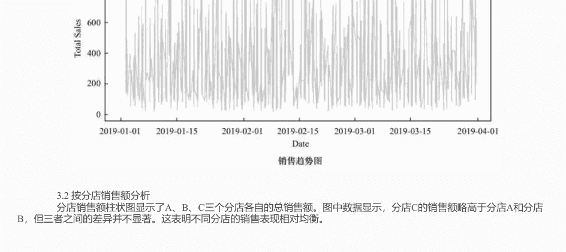

####### 3.2 按分店销售额分析

分店销售额柱状图显示了A、B、C三个分店各自的总销售额。图中数据显示，分店C的销售额略高于分店A和分店B，但三者之间的差异并不显著。这表明不同分店的销售表现相对均衡。

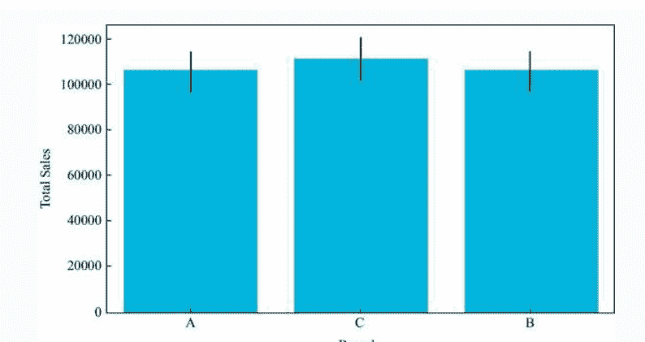

####### 3.3 按产品线销售额分析

产品线销售额柱状图揭示了不同产品类别的销售贡献。其中，Food and beverages（食品和饮料）及Electronic accessories（电子配件）是销售额最高的两个产品线，这表明这些产品在该超市的销售中占据主导地位。Health and beauty（健康与美容）的销售额相对较低，可能需要进行进一步的市场策略调整。

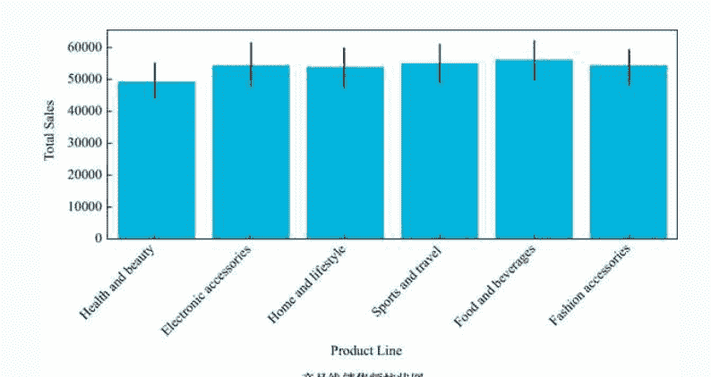

####### 3.4 支付方式分布

支付方式分布柱状图显示了顾客偏好的支付方式。E-wallet（电子钱包）和Cash（现金）是主流支付方式，而Credit card（信用卡）的使用频率相对较低。这提示该超市可以考虑加强电子支付的推广，以适应当前的消费趋势。

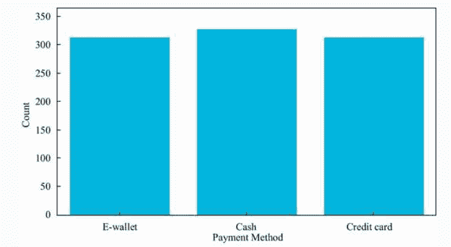

###### 4. 结论与建议

基于以上数据分析和可视化结果，我们得出以下结论，并提出相应建议。

- 销售趋势波动性大：销售趋势图显示销售额存在显著的日内波动。建议该超市进一步分析导致这些波动的具体因素，例如促销活动、节假日或特定事件，以便更好地预测销售并优化库存管理和人员配置。
- 分店和城市销售均衡：不同分店和城市之间的销售额相对均衡，这表明该超市的市场布局和运营策略在不同区域都取得了较好的效果。未来可以继续保持这种均衡发展的态势，同时有针对性地提升销售额较低分店的业绩或优化城市布局。
- 产品线优化：Food and beverages和Electronic accessories是主要的销售贡献者。建议该超市继续加大对这些热门产品线的投入，同时分析Health and beauty等产品滞销的原因，考虑调整商品结构、定价策略或营销方式，以提升其销售表现。
- 支付方式多样化：电子钱包和现金是主流支付方式。建议该超市继续推广电子支付手段，例如通过提供电子支付专属优惠或积分活动，鼓励更多顾客使用电子支付，提升支付效率和顾客体验。
- 会员体系潜力：会员和普通顾客的销售贡献相当。建议该超市进一步深挖会员体系的潜力，例如通过推出更具吸引力的会员专属活动、个性化推荐或积分兑换，提高会员的复购率和忠诚度，从而带动整体销售额的增长。
- 性别销售差异不显著：男性顾客和女性顾客的销售贡献差异不大。这表明该超市的商品对两性顾客都具有广泛的吸引力。在未来的营销活动中，可以继续保持对不同性别顾客的均衡关注。

#### 2. 商业数据洞察（趋势预测与异常检测）

商业数据洞察是现代企业决策的核心驱动力，本节将深入探讨如何通过趋势预测和异常检测从海量数据中提取有价值的商业洞见。下面将基于Superstore数据集展示完整的数据分析流程，包括数据探索、趋势预测模型构建、异常检测方法应用以及结果解读，为产品经理提供一套可落地的数据分析框架。

趋势预测与异常检测的Prompt如图5-6所示，智能体的处理流程如图5-7所示。

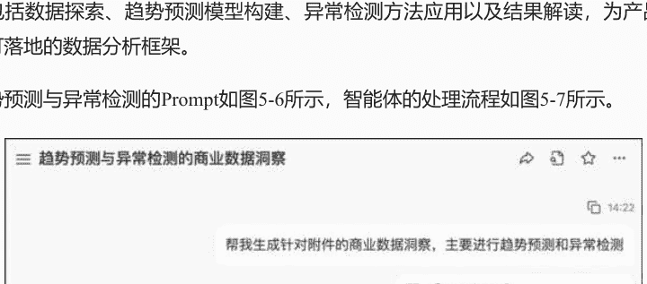


Superstore数据集是零售行业分析中广泛使用的经典数据集，共包含9994条交易记录，涵盖从2011年至2014年这4年的销售数据。该数据集包含订单日期、发货日期、客户信息、产品类别、销售额、数量、折扣率和利润等21个关键字段。作为分析的第一步，我们需要对数据进行全面的探索和理解。时间序列分析是识别商业发展趋势最有效的方法之一。对月度销售额数据进行季节性分解时，使用Python中的statsmodels库提供的seasonal_decompose函数将时间序列拆分为趋势、季节性和残差3个组成部分。基于上述分析结果，我们采用Holt-Winters指数平滑模型对未来12个月的销售额进行预测。

该模型特别适合具有趋势和季节性的时间序列，其预测公式如下。

预测值 = 水平+趋势+季节性

异常检测是商业数据洞察的另一核心环节，能够识别潜在的欺诈行为、数据质量问题或特殊的商业机会。智能体采用Isolation Forest（孤立森林）算法对销售额和利润数据进行异常检测。Isolation Forest是一种基于树结构的无监督学习算法，特别适合处理高维数据，它的核心思想是：异常数据点往往具有“容易被孤立”的特性，即只需进行少量随机分割，就能将其与其他数据点分离。

以下是《商业数据洞察报告》的详细内容。

##### 商业数据洞察报告：Superstore数据集趋势分析

###### 1. 引言

本报告旨在基于Superstore商业数据进行系统性分析，主要聚焦销售趋势预测和异常检测两个核心方向。通过对历史销售数据的分析，报告将揭示潜在的业务运行规律、季节性波动和长期发展趋势，并利用这些洞察对未来销售进行预测。此外，报告还将识别数据中的异常值，这些异常值可能反映潜在的问题（如欺诈行为、数据录入错误），也可能预示着重要的业务机会（如异常高的销售额或利润水平）。本报告的目的是通过数据驱动的洞察，为业务决策提供科学支持，帮助优化运营策略并提升风险应对能力。

###### 2. 数据概览

Superstore数据集包含详细的销售交易信息，共9994条记录，涉及订单ID、订单日期、发货日期、客户信息、产品信息、销售额、数量、折扣和利润等21个字段。初步的数据探索显示，数据质量良好，没有明显的缺失值，且日期字段已正确识别为日期时间格式。销售额和利润等关键指标的分布情况也已通过描述性统计完成初步分析。

###### 3. 趋势分析与预测

为了理解Superstore的销售动态，我们对月度销售额进行了时间序列分析。在对原始月销售数据进行季节性分解时，将其拆分为趋势、季节性和残差3个组成部分，以识别销售额的长期增长或下降趋势，以及每年重复出现的销售模式。

####### 3.1 季节性分解

下图展示了月销售额的季节性分解结果。

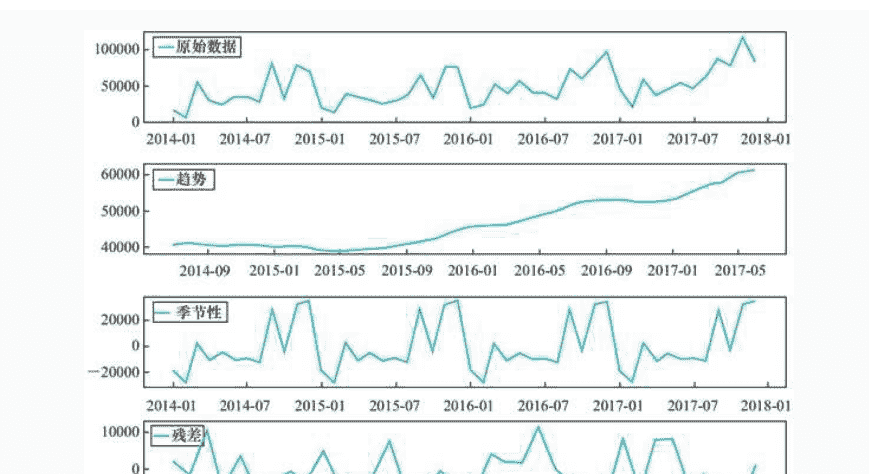

从分解图中可以得出以下结论。

- 原始数据（Original Data）：显示了Superstore销售额的整体波动情况，既包含明显的季节性高峰和低谷，也呈现随时间推移的整体增长趋势。
- 趋势（Trend）：反映了销售额的长期走势。Superstore的销售额在分析期间呈现稳步上升的趋势，这表明业务整体处于健康增长状态。
- 季节性（Seasonal）：揭示了销售额的周期性波动。每年在特定月份（如年底）销售额会显著上升，而在其他月份则会下降，这与零售行业的典型季节性模式相符。这种季节性模式对于库存管理与营销活动规划至关重要。
- 残差（Residual）：代表了数据中无法被趋势和季节性解释的随机波动。这些残差可用于进一步分析，例如识别突发事件或未被模型捕获的异常行为。

####### 3.2 销售趋势预测

基于历史月销售额数据，我们采用Holt-Winters指数平滑模型对未来12个月的销售额进行预测。Holt-Winters模型特别适用于具有趋势和季节性成分的时间序列数据。

下图展示了历史销售额与未来12个月的预测销售额。

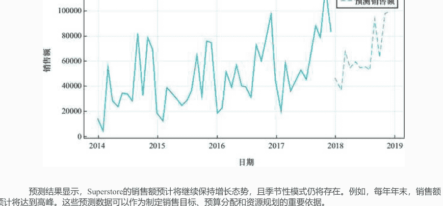

预测结果显示，Superstore的销售额预计将继续保持增长态势，且季节性模式仍将存在。例如，每年年末，销售额预计将达到高峰。这些预测数据可以作为制定销售目标、预算分配和资源规划的重要依据。

###### 4. 异常检测分析

异常检测是一种用于识别数据集中不符合预期模式或行为的数据点的技术。这些异常点可能预示着重要事件，也可能提示欺诈行为、系统故障或数据录入错误。在本报告中，我们采用Isolation Forest算法对销售额（Sales）和利润（Profit）两个关键指标进行了异常检测。

####### 4.1 Isolation Forest算法

Isolation Forest是一种基于决策树的无监督学习算法，其核心原理是通过“孤立”异常点来识别它们。与传统的基于距离或密度的异常检测方法不同，Isolation Forest随机选择特征并随机分割数据，使异常点通常能在更少的分割步骤中被隔离。该算法对于高维数据环境及存在大量正常数据点的场景具有较强的鲁棒性和检测效率。

####### 4.2 异常值识别

设定数据中异常值的比例约为1%（contamination=0.01）。通过运行Isolation Forest模型，我们识别出了100个异常值。

- 高销售额低利润/负利润：可能表明存在高折扣销售、高退货率或成本控制问题。
- 低销售额高利润：可能源于高价值、低销量产品，或者数据录入错误。
- 极端销售额或利润：可能对应非常规大额订单或严重损失。

对上述异常值进行进一步调查至关重要。例如，针对高销售额低利润订单，需要检查其折扣策略、产品成本是否合理，或是否存在退货情况。针对极端利润订单，则需要验证数据的准确性。

## 5.2 职场沟通与协作

在实现办公流程智能化升级后，我们注意到高效的工作产出最终需要回归到员工之间的协作层面。接下来将聚焦智能技术如何重构现代职场中的人际交互模式，特别是在职场沟通与协作方面，AI带来了哪些显著的改进效果。

### 5.2.1 智能沟通助手

智能沟通助手在职场中极为重要，它能快速精准地解析信息，高效处理沟通事务，有效打破信息壁垒，提升团队协作效率。它还具备智能提醒功能，可自动跟进事项，避免任务遗漏，提升沟通质量与效率，助力职场人士高效完成工作，更好地适应快节奏的工作环境。

#### 1. 邮件优化（语气调整、语法校对、自动回复建议）

在构建职场智能体的过程中，智能沟通助手作为提升组织效能的关键组件，其核心价值在于通过技术手段重构沟通与信息传递机制。以邮件优化为例，该功能不仅支持基础的语气润色和语法检查，还致力于构建一套完整的沟通增强体系。邮件的优化过程遵循“语义解析-结构优化-场景响应”3层模型。语义解析层通过情感识别技术自动检测原文中可能引发负面情绪的措辞并提供替换建议，例如将“不得不调整”优化为更具建设性的“建议调整”。同时，系统还会根据发件人与收件人的权责关系动态校准语气强度与措辞风格。结构优化层则负责重新组织信息的呈现方式，将原本分散的时间节点整合为对比表格，并将关键联系信息独立成段以增强可读性，并支持嵌入二维码等富媒体元素。

邮件优化Prompt示例如下。

> 帮我优化以下邮件，主要进行语气调整、语法校对，并给出自动回复建议。
> 尊敬的各位参会嘉宾：
> 您好！我是“夏日创意交流会”活动组委会负责人李明。非常感谢大家一直以来对本次活动的关注与支持。现因场地安排冲突，不得不对活动时间进行调整，特向您发送此邮件说明相关情况。
> 原定于2024年8月15日（星期四）下午2点在阳光大厦12层多功能厅举办的“夏日创意交流会”，将调整至2024年8月22日（星期四）下午2点举办，活动地点不变，仍为阳光大厦12层多功能厅。新的活动时间已与场地方完成确认，确保不会再有变动。
> 对于此次时间调整给您带来的不便，我们深表歉意。若新的时间与您的日程安排冲突，烦请您于8月18日前回复此邮件告知我们，我们将为您提供进一步的协调帮助。
> 如果您对活动时间调整有任何疑问，欢迎随时发送邮件至liming@example.com电子邮箱，或致电138-XXXX-5678与我联系。我们期待在调整后的时间与您相聚，共同开启一场充满灵感与创意的交流盛宴。
> 再次感谢您的理解与支持！
> “夏日创意交流会”活动组委会
> 李明
> 2024年8月10日

智能体的处理流程如图5-8所示。


图5-8 邮件优化智能体的处理流程

##### 以下是经智能沟通助手修改后的邮件。

尊敬的各位参会嘉宾：
您好！
我是“夏日创意交流会”活动组委会负责人李明。首先，非常感谢您一直以来对本次活动的关注与支持。由于场地安排冲突，我们不得不对原定的活动时间进行调整，特此邮件向您说明情况，并致以诚挚的歉意。
原定于2024年8月15日（星期四）下午2点在阳光大厦12层多功能厅举办的“夏日创意交流会”，将调整至2024年8月22日（星期四）下午2点举行。活动地点不变，仍为阳光大厦12层多功能厅。新的活动时间已与场地方确认，确保不会再有变动，请您放心。
对于此次时间调整给您带来的不便，我们深感抱歉。若新的时间与您的日程安排有所冲突，烦请您于8月18日前回复此邮件告知我们，以便我们为您提供进一步的协调与帮助。
如果您对活动时间调整有任何疑问，欢迎随时通过邮件liming@example.com或电话138-XXXX-5678与我联系。我们衷心期待在调整后的时间与您相聚，共同开启一场充满灵感与创意的交流盛宴。
再次感谢您的理解与支持！
“夏日创意交流会”活动组委会
李明
2024年8月10日

在实际应用中，智能沟通助手能够根据邮件内容自动生成多种类型的回复模板。这些模板不仅能实现即时响应，还能完成自动分类处理和状态追踪。例如，在处理活动时间变更时，系统可自动识别嘉宾反馈中的时间冲突，并触发相应的跟进流程。这种设计显著降低了沟通中的客户交互成本，将原本耗时的手动调整日程操作转化为一键同步日历的便捷操作。

从产品设计的角度来看，优秀的智能沟通助手需要具备多层级语气调节能力。系统提供可视化滑块界面，用户可自由设定邮件的正式程度与亲和力水平级别。同时，系统内置的合规性检查功能能够确保时间格式等关键信息的标准化输出，避免因表述不规范引发后续问题。更进一步地，系统还具备上下文感知能力，能够通过分析历史沟通记录，智能适配不同沟通对象的语言风格和内容深度偏好。

衡量此类功能的效果需要建立多维度的评估体系。除传统的打开率和回复率指标外，还应关注沟通链条中的用户参与度变化。数据显示，经过优化的邮件模板在会议改期、项目延期等高频场景中，沟通效率提升显著。这种设计模式可扩展至十余种常见职场沟通场景，形成可复用、标准化的解决方案库。

自动回复建议如下。

**1. 收到邮件确认（通用回复）**
主题：已收到您的邮件 - 关于“夏日创意交流会”时间调整
尊敬的嘉宾：
您好！
我们已收到您关于“夏日创意交流会”时间调整的邮件。感谢您的及时反馈。
我们正在处理您的请求，并将尽快与您联系，请您耐心等待。
“夏日创意交流会”活动组委会

**2. 新时间冲突（针对回复表示时间冲突的嘉宾）**
主题：关于“夏日创意交流会”时间冲突的进一步协调
尊敬的嘉宾：
您好！
我们已收到您关于“夏日创意交流会”新时间（8月22日）与您日程冲突的邮件。对于由此带来的不便，我们再次深表歉意。
我们非常重视您的参与，正在积极协调解决方案。我们将尽快与您取得联系，商讨具体安排。
感谢您的理解与配合！
“夏日创意交流会”活动组委会

**3. 确认出席（针对回复表示可以出席的嘉宾）**
主题：感谢您的确认 - “夏日创意交流会”期待您的到来
尊敬的嘉宾：
您好！
我们已收到您关于“夏日创意交流会”新时间（8月22日）的确认。非常感谢您的理解与支持！
我们期待于8月22日与您相聚，共同开启一场充满灵感与创意的交流盛宴。
“夏日创意交流会”活动组委会

智能沟通助手的价值不仅体现在提升单次沟通的效率，还在于它能够沉淀组织的最佳沟通实践。每一次人工优化的结果均可反馈至系统，持续优化模板库和算法模型，最终形成与组织文化和沟通习惯高度契合的沟通智能体。这种具备自我演进能力的特性，正是职场智能体区别于传统办公工具的本质差异。

#### 2. 演讲与谈判支持（话术建议、实时反馈）

智能沟通助手在商务场景中发挥着重要作用。下面将深入探讨如何通过智能沟通助手，在演讲与谈判过程中提供具有针对性的话术建议和实时沟通反馈，帮助职场人士提升沟通效率，实现更高效的商务协作。

话术建议和实时沟通反馈的Prompt示例如下。

根据这个演讲和谈判稿给出话术建议和实时沟通反馈：《创新合作，共赢未来》演讲与谈判稿
一、演讲环节
尊敬的各位来宾、合作伙伴：
大家好！今天是2024年11月15日，在这秋意正浓郁且充满希望的日子里，我们相聚于上海国际会议中心璀璨的明珠厅。我是星火科技有限公司的首席执行官林远，非常荣幸能与各位行业精英共聚一堂，共同探讨科技创新与商业合作的无限可能。
近年来，全球科技产业发展迅猛，AI、大数据、物联网等新兴技术不断重塑我们的生活方式与工作模式。在这个充满机遇与挑战的时代，单打独斗已难以应对市场的需求，唯有携手合作，才能突破发展瓶颈，实现更大的发展。
星火科技自成立以来，始终专注于智能硬件的研发与应用落地，先后成功推出多款具有领先意义的产品，在智能家居和智能穿戴设备领域占据了重要市场份额。但我们深知，科技的发展永无止境，我们需要携手更多的合作伙伴，共同构建一个开放、共享、创新的生态系统。
今天，我们怀着极大的诚意，希望能与在座的各位同仁展开深度合作。我们相信，通过资源整合、优势互补，我们不仅能够提升各自的核心竞争力，还能为行业树立合作共赢的典范，推动整个科技产业迈向新的高度。
最后，让我们以开放的心态、创新的思维，携手共进，共同书写科技与商业合作的新篇章！
谢谢大家！

二、谈判环节
时间：2024年11月16日上午10点
地点：上海国际会议中心贵宾会议室3号
参与人员：
星火科技有限公司首席执行官林远、商务总监苏晴、技术总监周航
星云软件科技有限公司总经理陈宇、商务经理叶薇、技术主管吴昊
（双方人员握手落座，林远率先发言）
林远：陈总，昨天听了您在演讲中的精彩分享，对星云软件在算法优化和数据分析方面的实力印象深刻，我们非常期待与贵公司展开合作。
陈宇：林总过奖了。星火科技在硬件研发上的成就也是有目共睹的。我们也希望能借助贵公司的硬件优势，实现软件与硬件的深度融合。
苏晴：我们初步设想是，将星云软件的智能算法嵌入我们最新研发的智能手环中，通过数据分析为用户提供更个性化的健康管理方案。这不仅能提升产品的附加值，还能开拓新的市场空间。
叶薇：这个方向确实很有潜力，但在合作细节上，我们比较关注合作模式和利润分成。我们投入了大量的研发资源，希望能在收益上得到合理的回报。
周航：我能理解叶经理的顾虑。我们提议采用联合研发的模式，双方共同投入资源，在产品成功上市后，按照销售额的一定比例进行分成。具体比例可以根据双方的投入情况进一步协商。
吴昊：除了分成，我们还希望在技术共享方面有更明确的约定。毕竟，在合作过程中会涉及核心技术的交互，针对如何保障双方的技术权益，避免技术泄露风险等方面，需要制定详细的条款。
林远：吴主管提出的问题非常关键。我们可以在合作协议中加入严格的保密条款和知识产权归属条款，明确双方在技术研发和使用过程中的权利与义务。同时，设立专门的联合技术团队，共同管理和推进项目，确保技术的安全性和稳定性。
陈宇：林总的提议很全面。另外，在产品的市场推广方面，我们也希望能有更多的话语权。毕竟软件部分的功能特色，我们更清楚如何向用户传达。
苏晴：完全没问题，我们可以成立联合市场推广小组，共同制定推广策略和计划，充分发挥双方在市场渠道和品牌影响力上的优势。
（经过数小时的协商，双方就合作模式、利润分成、技术权益、市场推广等关键问题达成初步共识）
林远：非常高兴能与星云软件达成合作意向。相信通过我们双方的共同努力，一定能打造出一款具有市场竞争力的创新产品。
陈宇：我也对这次合作充满信心，期待我们的产品能早日推向市场，实现互利共赢！

智能体的处理流程如图5-9所示。

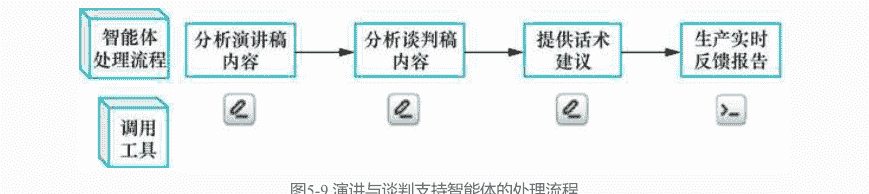

开场白是塑造听众第一印象的关键。智能沟通助手可基于演讲场景与受众特征，提供多种开场模板以适应不同场合。根据分析，林远的开场白已经具备时间、地点、人物和主题四要素，符合商务演讲的基本要求。原稿中提到“先后成功推出多款具有领先意义的产品”，显得较为空泛。智能沟通助手建议补充案例来增强说服力。此外，智能沟通助手分析出原稿中的合作倡议较为笼统，建议增加行业痛点和合作方向的指引。以下是演讲环节分析详情。

##### 演讲环节分析
优点如下。
1. 开场得体：林远的开场白包含了时间、地点、人物（自报家门）和主题，既礼貌又简洁、清晰，能够迅速吸引听众注意力。
2. 背景铺垫充分：提到了全球科技发展趋势，强调了合作的重要性，为后续提出合作意向做了很好的铺垫。
3. 自我介绍与成就展示：简要介绍了星火科技的专注领域和已取得的成就，增加了公司的可信度和吸引力。
4. 明确合作意向：直接表达了寻求深度合作的意愿，并提出了合作愿景（构建开放、共享、创新的生态系统）。
5. 展望未来：强调了合作共赢的理念，并对未来进行了积极展望，具有感染力。
6. 语言积极向上：使用了“秋意渐浓却充满希望”“无限可能”“永无止境”“携手共进”“共同书写×××新篇章”等积极词汇，营造了良好的氛围。

话术建议：
- “在这个充满机遇与挑战的时代，单打独斗已难以应对市场的需求，唯有携手合作，才能突破发展瓶颈，实现更大的发展”。**（此处可稍作停顿，目光扫视全场，强调合作的必然性）**
- “星火科技自成立以来，始终专注于智能硬件研发与应用，先后成功推出多款具有领先意义的产品，（例如我们的智能家居中枢系统“星核”，以及广受好评的智能健康手环“脉动”）在智能家居和智能穿戴设备领域占据了重要市场份额。”**（此处可自信地微笑，展现公司实力）**
- “今天，我们怀着极大的诚意，希望能与在座的各位同仁展开深度合作。我们相信，通过资源整合、优势互补，我们不仅能够提升各自的核心竞争力，还能为行业树立合作共赢的典范，推动整个科技产业迈向新的高度。”**（语气坚定，展现对合作的信心和决心）**
- “最后，让我们以开放的心态、创新的思维，携手共进，共同书写科技与商业合作的新篇章！谢谢大家！”**（鞠躬，眼神与听众交流，传递真诚）**

智能沟通助手基于谈判心理学原理，建立了利益协调话术库，可针对不同谈判场景提供实时建议。当谈判涉及技术共享等敏感议题时，智能沟通助手会立即生成多种利益保护方案供选择。当谈判陷入僵局时，智能沟通助手自动激活僵局破解引擎，提供多种可行的破解策略。以下是谈判环节分析详情。

##### 谈判环节分析
优点如下。
1. 开场礼貌且专业：林远和陈宇的开场白都非常得体，互相赞扬，营造了良好的谈判氛围，为后续深入交流奠定了基础。
2. 明确合作意向：双方都清晰表达了合作的愿望和对对方优势的认可，这有助于快速进入实质性讨论。
3. 提出具体合作点：苏晴提出的“将星云软件的智能算法嵌入我们最新研发的智能手环中”提议非常具体，有明确的产品方向和市场前景，有助于推动谈判。
4. 关注核心利益：叶薇和吴昊分别提出了“合作模式和利润分成”及“技术共享和技术权益保障”这两个核心关注点，体现了对本公司利益的维护。
5. 积极回应与解决方案：林远和周航对对方的顾虑都给出了积极的回应和初步的解决方案（联合研发、销售额分成、保密条款、知识产权归属、联合技术团队），展现了解决问题的诚意。
6. 市场推广的考虑：陈宇提出市场推广的话语权问题，苏晴也积极响应成立联合市场推广小组，这表明双方对产品上市后的全链条考虑十分周全。
7. 达成初步共识：谈判最终就关键问题达成初步共识，显示了谈判的有效性。

话术建议：
- 林远（开场）：“陈总，昨天听了您在演讲中的精彩分享，对星云软件在算法优化和数据分析方面的实力印象深刻，我们非常期待与贵公司展开合作。”**（语气真诚，眼神交流，展现出对对方的尊重和合作的渴望）**
- 苏晴（提出具体合作点）：“我们初步设想是，将星云软件的智能算法嵌入我们最新研发的智能手环中，通过数据分析为用户提供更个性化的健康管理方案。这不仅能提升产品的附加值，还能开拓新的市场空间”。**（语速适中，条理清晰，突出合作的潜在价值）**
- 周航（回应利润分成）：“理解叶经理的顾虑。我们提议采用联合研发的模式，双方共同投入资源，在产品成功上市后，按照销售额的一定比例进行分成。”**（此处可稍作停顿，观察对方反应）**“具体比例可以根据双方的投入情况进一步协商。我们初步建议，考虑到星火科技在硬件研发、生产和渠道上的投入，以及星云软件在核心算法上的贡献，可以从销售额的X%开始讨论。”**
- 林远（回应技术共享）：“吴主管提出的问题非常关键。我们可以在合作协议中加入严格的保密条款和知识产权归属条款，明确双方在技术研发和使用过程中的权利与义务。”**（语气肯定，给出明确承诺）**“同时，设立专门的联合技术团队，共同管理和推进项目，确保技术的安全性和稳定性。”**（强调执行细节，打消疑虑）**
- 苏晴（回应市场推广）：“完全没问题，我们可以成立联合市场推广小组，共同制定推广策略和计划，充分发挥双方在市场渠道和品牌影响力上的优势。”**（积极主动，展现合作意愿，并强调双方优势互补）**
- 林远（结束语）：“非常高兴能与星云软件达成合作意向，相信通过我们双方的共同努力，一定能打造出一款具有市场竞争力的创新产品。”**（语气充满信心和期待，为谈判画上圆满句号）**

展望未来，智能沟通助手将朝着全息化、预见性方向发展。下一代系统可能整合生物传感器数据，通过捕捉谈判对象的微表情和心率变化来评估其真实态度。在跨国场景中，实时脑机翻译将消除语言障碍，使跨文化沟通达到前所未有的流畅度。

然而，技术演进始终需要以增强而非替代人类判断力为前提，这正是智能沟通工具设计的核心理念——不是创造完美的演讲者或谈判家，而是赋能每个商务人士释放其独特的沟通潜能与影响力。

### 5.2.2 团队协作管理：Jira、Trello自动化对接的项目管理看板

个体沟通效率的提升必然引发团队协同模式的变革。通过Jira、Trello等平台的项目管理看板自动化，AI实现了任务流、信息流、责任流的智能三角闭环。在快节奏的职场环境中，项目管理看板是团队协作的核心工具。然而，静态看板缺乏实时更新功能，常导致信息滞后与协作断层。本节将介绍如何通过智能体工具链，将传统的静态看板转化为动态网站，并实现永久部署，从而支持实时数据同步、跨平台访问及自动化更新，显著提升团队协作效率。

#### 1. 模糊或缺乏明确目标的Prompt识别

基于深度思考模型，智能体即使面对模糊或缺乏明确目标的Prompt，也能自动生成结构化的工作流，通过将头脑风暴过程转化为条理清晰的执行路径，使延展出的交互流程更易于用户理解和捕捉关键信息。

针对“帮我制作一个项目管理看板”Prompt，智能体的处理流程如图5-10所示。

在研究阶段，智能体对当前流行的看板工具进行了调研，发现市场上广泛使用的商业工具有Trello、Asana和PingCode等，而开源方案中则以Personal Kanban、Taskcafe最具代表性。最适合的技术实现方案是React+TypeScript，配合Material-UI或Tailwind CSS实现前端界面布局与样式管理。同时，系统需要采用PWA方式部署，以支持离线功能，并通过LocalStorage/IndexedDB实现本地数据存储。根据研究结果，智能体推荐使用React+TypeScript技术栈实现一个PWA形式的项目管理看板系统，其架构设计参考了Personal Kanban项目，同时借鉴了Trello的用户界面设计。智能体在测试前已经完成了以下步骤：搭建了基于React+TypeScript+Material-UI的项目框架；实现了看板的基本布局和组件结构、任务卡片的创建和编辑功能、列和卡片的拖拽功能、本地数据存储功能；添加了PWA支持，实现离线使用能力。测试前需要浏览和执行命令。测试过程中，智能体遇到了页面加载问题，随即自主分析并找到替代测试方案。

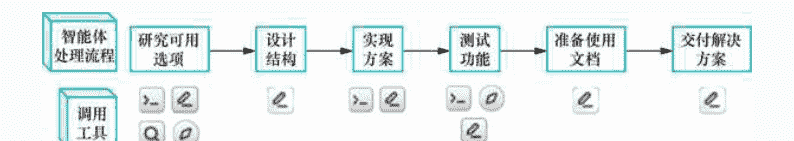

在开发过程中，智能体遇到了一些技术问题，应用无法正常加载。经过排查分析，智能体识别出该问题源于React项目结构与Vite构建工具之间存在配置不兼容问题。尽管如此，智能体仍完成了核心功能开发，实现了看板的基本布局和组件结构、任务卡片的创建和编辑功能、列和卡片的拖拽功能、本地数据存储功能，并且添加PWA支持，实现了离线使用功能。在交付过程中，智能体不仅提供了完整可运行的源代码，还提交了详细的使用文档和项目结构说明，并且按阶段交付了成果。项目管理看板各阶段及交付结果如表5-1所示。

表5-1 项目管理看板各阶段及交付结果

| 阶段 | 交付结果 |
| :--- | :--- |
| 研究 | React+TypeScript+Material-UI |
| 设计 | 详细的设计文档 |
| 实现 | 基本布局、任务卡片的创建和编辑功能、拖拽功能和数据存储功能等 |
| 文档准备 | 使用说明文档和项目结构说明 |

#### 2. 基于业务文件的Prompt识别——以某次需求评审会议为例

上传文档有助于智能体实现目标明确的识别，这是支持产品经理日常工作的有效方式。本次测试选取了某个需求评审会议的纪要文档，如图5-11所示。

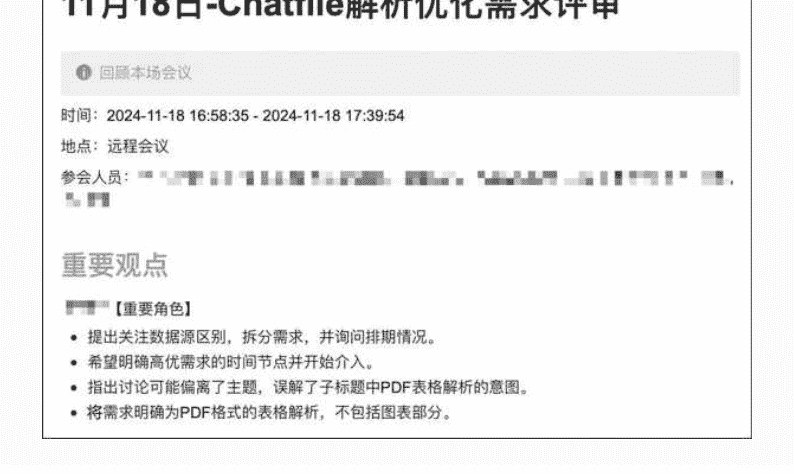

图5-11 会议的纪要文档详情

智能体读取了用户上传的PDF文件，了解到这是一个关于Chatfile解析优化的需求评审会议，它特别关注PDF表格解析功能，但识别到的信息有限。于是它向用户发起了如下提问。

需求：
为了给您设计一个更加贴合项目需求的敏捷开发看板，我需要了解更多关于这个项目的具体
除PDF表格解析外，Chatfile解析优化项目还包含哪些主要功能模块？
请说明项目的开发周期和里程碑。
请说明开发团队的规模和角色分配情况。
您希望在敏捷看板中跟踪哪些特定的指标或状态？
是否有任何您希望遵循的敏捷方法论（如Scrum、Kanban或混合方法）？
有了这些信息，我可以为您设计一个更加符合项目需求的敏捷开发看板。

Jira可以生成Scrum、Kanban两种类型的看板，智能体通过对比学习发现，这两种看板在流程设计与团队协作方面存在显著差异，如表5-2所示。

表5-2 Scrum、Kanban看板差异

| 对比维度 | Scrum看板 | Kanban看板 |
| :--- | :--- | :--- |
| 开发方式 | 基于迭代（2周冲刺周期） | 基于持续流动（无固定周期） |
| 列设置 | 产品待办事项、冲刺待办事项、进行中、测试中、待验收、已完成 | 需求池、就绪、开发中、代码审查、测试中、部署准备、已完成 |
| 流程控制 | 无明确WIP（在制品）限制 | 每一列有明确的WIP限制 |
| 估算方法 | 故事点估算（斐波那契数列） | 无固定估算方法，关注周期时间 |
| 会议 | 冲刺规划、每日站会、冲刺评审、冲刺回顾 | 无固定会议 |
| 进度跟踪图表 | 燃尽图、速度图 | 周期时间分布图、吞吐量图、累积流图 |
| 适用场景 | 需求明确且稳定的项目，需要有固定的节奏 | 需求变化频繁或需要快速响应，强调流程优化 |

用户要求生成上述两种看板。

智能体针对用户要求生成了两个看板的HTML格式的预览页面，而且还提前预判了用户的倾向性，如图5-12和图5-13所示。

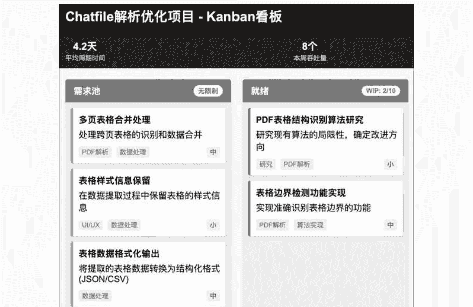

(a)

## 5.3 职业发展与决策

在工具层面的智能化改造逐步完成后，职业发展路径的个性化规划就成为新的焦点。职业发展与决策模块揭示了个体如何借助AI实现从微观层面的技能补全到宏观层面的行业趋势把握。

### 5.3.1 职业技能差距分析与学习资源清单生成

在数字化时代，职业规划已从传统的线性路径演变为动态的、数据驱动的智能决策过程。智能职业规划的核心在于通过系统性分析精准评估技能差距、整合多样化的学习资源，并借助技术工具实现职业生涯的持续迭代。下面以商家策略运营岗位为例进行说明。这一过程需融合业务理解、数据分析和策略设计三大维度，形成闭环的职业成长路径。Prompt如下。

> 帮我针对这个岗位JD进行技能差距分析，需要基于岗位需求的竞争力评估。
> 岗位：商家策略运营实习生
> 工作职责：根据百度电商平台发展需求及业务规划，参与制定相关策略工作，并协助推动相关策略落地。
> 所涉业务方向包含但不限于（具体负责其中之一）以下这些：
> -参与输出新商机制、商家分层机制、相关政策及对应的运营策略，并不断迭代优化，推动商家群体的GMV增长。
> -对接各协同部门及外部生态各方需求，构建商家成长体系及相应项目并积极推进落地。
> -基于数据分析及业务需求，评估各商家策略对商家经营的影响以及策略成效，敏捷迭代相关策略。
> -参与制定平台用户增长策略工作，通过规模化系统性运营手段促进平台新用户增长。
> 职责要求：
> -本科及以上学历，2027年或2028年应届生，统计学、经济学相关专业，数据分析基础知识扎实，有直播业务经验的人员优先考虑。
> -对数据敏感，具备扎实的数据能力及较强的执行力，能够系统化地梳理并解决问题。
> -有良好的表达能力及跨团队沟通能力。
> -工作主动、热情，积极上进。

智能体的处理流程如图5-14所示。


以下是商家策略运营实习生核心技能要求分析概览。

+   商家策略运营实习生核心技能要求分析
    技能框架总览
    基于岗位JD分析和行业调研，商家策略运营实习生岗位的核心技能可以分为以下四大类别。
    -数据分析与洞察能力。
    -策略制定与执行能力。
    -沟通协调与项目管理能力。
    -业务理解与商业敏感度。

以下是商家策略运营技能提升学习资源清单（部分）。

+   商家策略运营技能提升学习资源清单
    主要内容：
    数据分析技能提升资源
    Excel高级应用
    在线课程：
    - 网易云课堂《Excel数据分析实战》
    - 慕课网《Excel从入门到精通》
    - B站《Excel数据透视表完全教程》
    书籍推荐：
    - 《Excel数据分析实战》- 刘万祥
    - 《Excel图表之道》- 刘万祥
    - 《Excel VBA程序开发自学宝典》- 罗刚君
    实践项目：
    - 分析电商平台销售数据。
    - 制作商家运营数据看板。
    - 创建自动化数据报表。

智能职业规划的本质是将职场发展视为一个可测量、可优化的系统。通过智能体的竞争力评估工具，从业者能实现从被动适应到主动设计的转变，最终成长为具备自我进化能力的职场人士。

### 5.3.2 基于薪资水平、职位需求预测的行业趋势洞察生成

完成个人能力图谱的精准诊断后，还需要将其置于更广阔的行业坐标系中进行横向比对与动态校准。智能体通过构建基于薪资水平与职位需求的预测模型，能够为从业者提供动态调整职业航向的决策依据。智能体构建行业趋势洞察报告的核心在于数据驱动与商业逻辑的深度耦合。报告撰写始于多维度数据采集，包括招聘平台实时职位数据（如猎聘显示的北京地区资深广告算法专家年薪可达70万元至150万元）、权威行业研究报告（如《2025年AI技术人才供需报告》指出，算法工程师占AI岗位需求的67.17%），以及技术社区讨论（如脉脉平台上关于广告算法工程师技能要求的分析）。

在数据采集阶段，应特别注重矛盾点校验。例如，对比不同平台对同一职位的薪资描述（猎聘显示5年以上经验者平均月薪为2.65万元，而在头部企业招聘中，同档位平均月薪可达5万元至8万元）并通过交叉验证建立可信数据集。Prompt示例如下。

> 帮我生成AI广告算法优化工程师的行业趋势洞察，主要进行薪资水平和职位需求预测。

智能体的处理流程如图5-15所示。


分析框架设计阶段，采用技术-市场-人才三维模型。技术维度关注技能溢价现象，例如掌握大模型应用开发能力的工程师薪资较传统技能岗位平均高出30%，这与广告行业向生成式创意转型直接相关。在市场维度中，构建“需求密度指数”，该指数综合考量程序化广告渗透率与头部企业招聘计划预测区域人才缺口。在人才维度中，则通过技能生命周期分析，为从业者提供科学的职业发展路径规划建议。这种分析方式能有效解释为何北京地区资深广告算法专家月薪达7.5万元，而在新一线城市，同类岗位月薪仅为3万元左右。

在报告产品化阶段，强调不同用户场景的适配性。面向求职者时，突出技能迁移路径与地域选择策略；面向企业HR，则提供竞争性薪酬建议，包括股权激励占比与人才池建设方案。在可视化呈现方面，通过动态图表实现数据叙事，如用技术成熟度曲线展示联邦学习与实时计算技术的演进阶段，帮助读者理解技能投资回报周期。

报告的持续迭代机制建立在三阶预警系统之上，涵盖技术、政策与市场三大层面。技术层监测大模型对传统岗位的替代风险；政策层跟踪数据隐私保护相关法规的变化；市场层分析垂直领域爆发点。这种机制可确保报告始终保持前瞻性和时效性。例如，在2024年年初预测到2025年大模型与广告算法的融合趋势，为从业者提供战略决策窗口期。整个撰写过程体现智能体“数据洞察-商业翻译-行动建议”的方法论闭环，使报告兼具学术严谨性与商业实操价值。

以下是《AI广告算法优化工程师行业趋势洞察报告》的详细内容。

#### AI广告算法优化工程师行业趋势洞察报告

##### 执行摘要

本报告深入分析了AI广告算法优化工程师的行业发展趋势，涵盖薪资水平分析和职位需求预测两大核心维度。通过对市场数据的综合分析，我们发现该职位正处于快速发展期，具有巨大的市场潜力和职业发展前景。

##### 核心发现

####### 薪资水平方面：

- 平均月薪已达3.2万元，年薪范围为20万元至80万元，高端人才年薪甚至超过百万元。
- 一线城市薪资领先，北京平均月薪为3.5万元，深圳为3.2万元。
- 薪资随经验呈指数级增长，8年以上资深专家平均月薪为7.5万元。
- 2020-2025年薪资复合增长率约15%，远超其他行业。

####### 职位需求方面：

- 2024年需求指数达280（以2020年为基准100计算），同比增长33.3%。
- 预计2025-2027年需求将继续快速增长，2027年需求指数将达520。
- 算法工程师人才需求占比为67.17%，连续两年稳居最高位。
- AI人才缺口达400万人，而且这种供不应求的局面还将持续数年。

####### 技能发展趋势：

- 传统技能，如机器学习、推荐算法需求稳定增长。
- 新兴技能，如MLOps、大模型应用需求爆发式增长。
- 实时计算、深度学习等技术需求快速上升。
- 工程化能力和业务理解能力日益重要。

##### 主要建议如下。

####### 对求职者：

- 重点掌握机器学习、深度学习等核心技能。
- 关注MLOps、大模型应用等新兴技术。
- 培养工程化能力和业务理解能力。
- 考虑一线城市或新一线城市的就业机会。

####### 对企业：

- 提前布局人才招聘和人才培养。
- 建立有竞争力的薪酬体系。
- 重视技术人才的职业发展通道。
- 加强校企合作，培养专业人才。

####### 对行业：

- 完善人才培养体系和标准。
- 推动产学研深度合作。
- 建立行业人才流动机制。
- 关注技术伦理和合规要求。

# 第6章 学生智能体

在使用智能体构建的智慧教育生态体系中，学生不再是被动的知识接收者，而是学习旅程的主动探索者。学生端应用作为连接学生与智能教育资源的桥梁，以个性化、智能化的功能设计，打破传统学习的边界，让每位学生都能找到最适合自己的学习路径，获得高效、自主的成长。

## 6.1 自主学习

自主学习是学生提升学习能力的关键路径，智能体可以为学生打造全方位的自主学习平台。学生打开应用时，便如同走进了一座智能学习宝库，在这里，他们能够根据自身需求灵活运用各项功能，开启高效的学习之旅。学生仅需基于“角色定位+场景界定+要素拆解+输出规则”这个4层结构化Prompt模板输入需求，智能体就能够迅速生成优质的自主学习平台，极大地提升学习效率。

结构化Prompt模板如下。

```
### 角色定位
初中二年级学生
### 场景界定
针对人教版八年级下册数学“一次函数”章节进行自主复习巩固
学习目标：
-熟练掌握一次函数表达式求解（知识目标）
-提升解决实际问题的能力（能力目标）
-3天内完成章节薄弱点强化（时间目标）
### 要素拆解
-资源类型：智能题库（含动态变式题）
-学习偏好：题目难度【困难级】，题型侧重【应用题+综合题】
-现有基础：单元测试得分78分，对k和b的意义理解不足，针对实际问题建立数学模型时常出现错误
-设备需求：支持手机端横屏模式，题库需带公式编辑器功能
### 输出规则
1.生成自主学习平台
平台功能：
（1）智能题库：融合“知识点分类推送、三维解析、动态变式题生成、错题自动归集”四大核心功能。按基础概念、k和b意义等模块细分知识点，每道题附带思路、方法、易错点三维解析，支持在线作答时调用分区域符号面板，包含常用符号区（±、×、÷）、函数符号区（sin、cos）、几何符号区（△、∠）、LaTeX模板区（\sqrt{}）。单击插入或快捷键调用（如输入“\sqrt”自动生成√），错题可一键归集至专属错题本。
（2）学习计划：生成甘特图可视化进度表，支持按“天/周”视图切换，可拖动调整任务时间轴。单击任务块弹出详情弹窗，包含学习时段、优先级标签（高/中/低）、具体掌握内容（如一次函数定义、表达式、图像特征）及关联微课资源链接，任务状态实时更新。
```

之后，智能体会生成一个网站，网站首页如图6-1所示。


智能题库页面如图6-2所示。在该页面中，按知识点、入口、题型、状态精细分类，拆解出基础概念、k和b意义等专项模块。不管是一次函数表达式求解这类经典题型，还是其他知识板块，都能精准推送难度适配的题目。答题时，支持在线作答、一键收录错题，并能够智能生成变式题以巩固学习效果。搭配“知识点微课”，从概念原理精讲到实际解题应用演示，构建完整的知识吸收链路。此外，该平台还支持定制专属学习计划，科学规划学习节奏，助力学生高效掌握数学知识，稳步提升学习能力。


答题时，单击“显示符号”按钮即可调用分区域快捷面板，该面板中涵盖加减乘除运算符、函数表达式、几何图形符号，以及分数、平方根等公式符号，如图6-3所示。若需输入特殊符号，只需单击相应的符号就能快速插入，让答题输入变得更加便捷、高效，省去了手动输入复杂符号的麻烦。

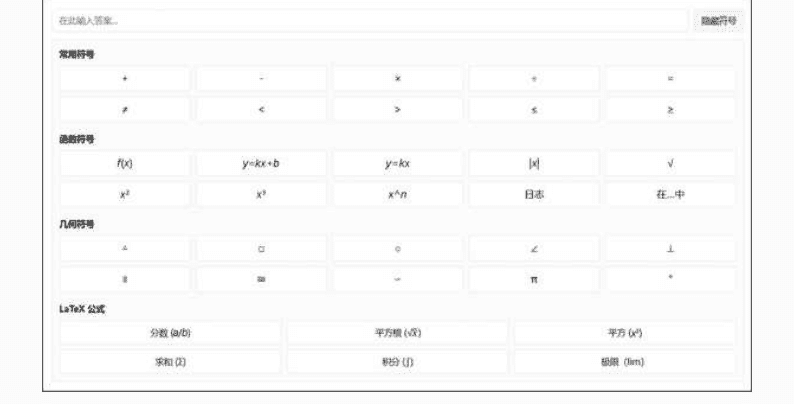

回答错误也无须担心。系统会自动呈现正确答案，并同步提供思路、方法、易错点三类解析，帮助学生深入了解错误原因。单击“加入错题”按钮，即可将问题归入专属错题本。要想挑战同类题，单击“生成变式题”按钮，系统将自动变换题目条件，通过多维度检验知识点的掌握程度，帮助学生吃透知识点，在学习过程中不走弯路。图6-4为错题显示模块。

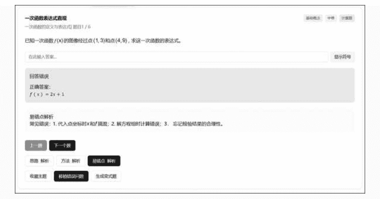

进入学习计划页面（如图6-5所示），可以直观地查看学习安排，包括总天数、总任务数，以及完成进度。系统按天拆解学习计划，在每天的时间轴上有序地排布“学习、练习、复习”等任务，科学地规划数学知识的学习节奏。跟着计划走，可以使学习更有条理、知识吸收更高效。

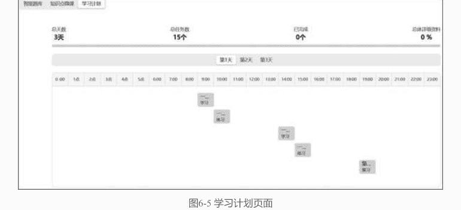

单击时间轴上的任务块，弹出详细计划窗口。以“一次函数基础概念学习”窗口为例，该窗口能够清楚地显示学习时段、优先级，还有具体要掌握的内容（定义、表达式、图像特征、k和b的意义），如图6-6所示。该系统上的任务状态可实时更新，使学习进度一目了然，跟着这样清晰的安排进行学习，对知识的掌握能够更加牢固。

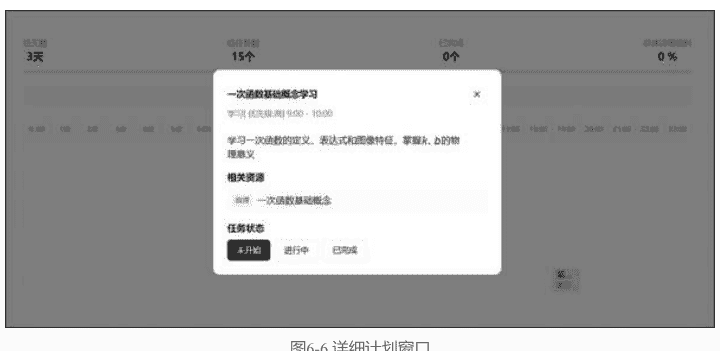

以下是学生在实际使用场景中可能遇到的问题及解决方法。

问题1：任务安排不合理，学习压力大，平台自动规划的学习任务可能未贴合个人节奏。

解决方法：进入学习计划页面，梳理任务内容和时间分布。对于非紧急任务，可手动将学习时间调整到合适时段，也可联系智能体平台客服或使用反馈功能，说明自身学习节奏，建议优化智能规划逻辑。

问题2：答题时符号和公式（像数学题中复杂的函数、几何符号或LaTeX公式）难以输入，影响效率。

解决方法：答题前先熟悉“显示符号”面板，记住常用符号的位置；遇到复杂公式时，借助LaTeX公式模板（如分数、平方根）。复制模板内容后，根据实际需求修改相应参数。此外，还可整理高频使用的符号/公式，反馈至智能体生成个人专属的输入“快捷清单”。

问题3：做基于错题生成的变式题时，遇到难度陡然大幅提升，超出当前学习进度的情况，导致学生挫败感强、解题无从下手。

解决方法：单击“思路 解析”“方法 解析”，按步骤拆解难题。如果仍觉得有难度，可以返回智能题库，筛选与当前题目知识点相同，但难度等级稍低的题目进行练习。在积累一定解题思路后，再挑战变式题。此外，也可以在平台反馈功能里建议优化变式题难度梯度，让难度逐步递增。

智能体的自主学习功能以任务流为驱动，形成“计划推进-练习巩固-反馈提升”这个闭环学习机制。学生可基于自身学情与目标，通过“目标设定+资源适配+过程追踪+结果复盘”这个4层逻辑架构有效提升自主学习的系统性与效率。从规划学习路径到匹配知识资源进行练习，再到依据反馈优化学习策略，各部分环环相扣，可助力学生实现自主提升。

## 6.2 趣味古诗探险

诗词学习是打开文学世界大门的钥匙！智能体可以为12～13岁学生打造“趣味古诗探险”天地，让学生学习时如同打开一扇穿越古今的奇妙之门。这里摒弃传统的死记硬背模式，以动画、游戏为引导，让古诗学习充满趣味。无论是课前预习、课后巩固，还是碎片时间复习，学生都能在卡通地图探险、互动游戏挑战中轻松掌握古诗知识，积累文学底蕴。无须进行复杂操作，学生仅需通过6.1节提到的4层结构化Prompt模板输入需求，智能体就能迅速生成优质的古诗词学习平台，极大地提升学习效率。

结构化Prompt模板如下。

+   1. 角色定位
    学生用户：12～13岁，古诗基础较弱，偏好趣味互动，注意力集中时间短（10～15分钟/次）。
    设计约束：
    避免复杂文本，多用图标/动画引导。
    学习任务单次完成时间小于或等于8分钟。
    2. 场景界定（When/Where）

| 场景 | 用户行为 | 设计目标 |
|---|---|---|
| 课前预习 | 快速理解古诗大意 | 提供拼音+动画释义 |
| 课后巩固 | 背诵并默写练习 | 填空+乱序拼诗游戏化 |
| 碎片时间 | 随机复习 | 推送“每日一句”挑战 |

    3. 要素拆解（What/How）
    古诗探险地图

| 要素 | 初中生适配设计 | 技术实现 |
|---|---|---|
| 地图视觉 | 卡通朝代地图（如唐代—长安Q版城堡） | SVG+CSS悬停动画 |
| 关卡难度 | 按教材古诗顺序解锁（如七年级上册第1课） | JSON存储关卡状态 |
| 反馈激励 | 解锁动画（烟花特效+“太棒了！”语音） | Lottie动画+Web Audio API |

    互动背诗挑战

| 要素 | 初中生适配设计 | 技术实现 |
|---|---|---|
| 填空题型 | 保留句首/句尾字（降低难度） | 正则表达式匹配 |
| 错误提示 | 表情包反馈（“再试试”→“完美！”） | 条件判断+DOM更新 |

    学习数据可视化

| 要素 | 初中生适配设计 | 技术实现 |
|---|---|---|
| 进度展示 | 教材单元进度条（如“七年级上：6/20首”） | Firebase统计查询 |
| 成就系统 | 实物关联徽章（如“李白粉丝”=毛笔图标） | 解锁规则硬编码 |

    4. 输出规则（Rule）
    交互规则
    关卡解锁：完成前一首诗的基础填空（正确率≥60%）→自动解锁下一首。
    成就触发：累计学习3天→“持之以恒”徽章；正确率90%→“古诗小天才”称号。
    内容规则
    古诗选材：优先部编版七年级教材（如《观沧海》《次北固山下》）。
    译文风格：口语化翻译（如“疑是地上霜”→“看起来像地上结的白霜”）。

之后，智能体会生成一个网站，网站首页如图6-7所示。


“趣味古诗探险”的地图页面如图6-8所示。不同颜色的标签对应东汉、唐等朝代，灰色定位点是待解锁的诗词关卡。单击左上角的按钮就能开启第一关，挑战诗词学习任务。在朝代地图里可一步步解锁古诗，开启趣味诗词探险之旅。

踏入“趣味古诗探险”第一关，开启与东汉建安文学的奇妙对话，如图6-9所示。平台以白话译文拆解《观沧海》，引领学生逐句漫游诗中意境，基于逻辑脉络串联诗句，轻松将曹操笔下的壮阔胸襟转化为可信口吟诵的文字。

完成《观沧海》的背诵后，进入答题验收环节，如图6-10所示。看着“东，以观沧海”的填空，回忆诗句，填入“临”“碣”“石”，单击“提交”按钮，检验学习成果。如果答错，可单击“重试”或“提示”按钮（使用提示会扣分）。用答题验收背诵效果，让学生在趣味闯关中巩固古诗知识。

图6-10 趣味闯关页面

在“趣味古诗探险”答题时，答错也无须担心！若答错，系统会清晰提示正确答案，如图6-11所示。学生可以单击“重试”按钮，重新开启闯关挑战，也可以使用“提示”功能让系统给点提示（消耗积分换线索）。相信经过一次次尝试，最终能把《观沧海》的诗句牢牢记住，在“犯错-纠正”的过程中，扎实掌握古诗知识。

图6-11 闯关错误页面

学习数据页面如图6-12所示。在该页面，学生能清晰地看到学习数据概览，包括已完成古诗、总分、已获得成就的数量，以及七年级上册古诗的学习完成度。下方的朝代学习统计清晰地展示了东汉、唐、元等朝代古诗的学习完成度，明确学生可挑战的朝代关卡与古诗关卡。

闯关成就模块如图6-13所示，该页面上有“初出茅庐”“小成有所得”等多样成就等待解锁。完成对应古诗学习任务（如完成1首、5首古诗等），就能点亮专属徽章。该页面还会显示学习建议，鼓励学生从《观沧海》开启古诗学习之旅，坚持每天学，把成就一一收入囊中。

以下是学生在使用智能体过程中可能遇到的问题及解决方法。

问题1：目前答题、译文模块未直接呈现背景，学生对“为何作诗”感到好奇。
解决方法：向智能体提交需求，比如在答题页、译文页等界面增加“背景探秘”按钮，单击按钮后，弹出对应古诗的极简背景卡（如《观沧海》关联“曹操北征乌桓胜利”），用30字以内的短句介绍关键背景信息。

问题2：闯关模式重复，缺乏新鲜感。
解决方法：向智能体提交需求，新增“古诗变形挑战”：答题后随机触发“诗句填空换语境”（如把《观沧海》诗句融入“现代旅行日记”场景填空）、“古诗创意接龙”（用诗句最后一个字作为新诗句的第一个字，利用AI生成趣味续写内容）。同时推出“朝代副本”限时模式：每周开放特定朝代（如“大唐诗会”），答题成功可解锁与该朝代诗人互动的彩蛋（如模拟李白对诗、杜甫写批注），通过周期性更新增加新鲜感。

问题3：背诵古诗后很快就会遗忘，难以巩固。
解决方法：告诉智能体自动生成“古诗记忆胶囊”：每完成3首诗，系统推送定制复习卡（包含诗句线索图、趣味联想口诀，如用“山岛-树木-秋风”画面串联《观沧海》）；设计“遗忘挑战”反向关卡：故意打乱已学诗句（如字词错位、顺序颠倒），让学生纠错，用“错题强化”对抗遗忘；同时关联成就系统，连续7天完成复习可解锁“记忆达人”徽章。

“趣味古诗探险”基于结构化Prompt搭建“情境沉浸-互动学习-成果反馈”这个诗词学习闭环。针对12～13岁学生的认知特性，依托6.1节提到的4层结构化Prompt模板，构建从卡通地图探险、白话译文辅助理解，到互动答题验收、学习数据呈现与成就激励的完整流程，覆盖课前预习、课后巩固等场景。还针对不了解诗的创作背景、闯关重复、背诵古诗后易遗忘等痛点设计解法，让古诗学习从枯燥记忆变为趣味探险，助力学生轻松积累文学底蕴，开启诗词学习新体验。

## 6.3 跨学科知识关联

在传统学习模式下，学科壁垒导致学生脑海中的知识呈碎片化分布，难以融会贯通，实现跨学科的知识关联与应用。而智能体通过6.1节提到的4层结构化Prompt模板为学生突破这一困境提供了有效途径。学生只需按照该模板输入学习需求，智能体就能迅速生成适配的跨学科学习平台，借助智能引导和创新功能，搭建起跨学科的知识桥梁，让知识不再孤立，助力学生在多元知识的碰撞中提升综合学习能力、培养创新思维。

结构化Prompt模板如下。

```
### 角色定位
初中学生
### 场景界定
针对勾股定理进行跨学科学习
### 要素拆解
学科关联 明确3个核心关联学科
1. 物理（斜面受力分析）
2. 艺术（黄金分割构图）
3. 编程（图形绘制算法）
交互设计：具体操作反馈机制
- 正确答题时触发学科彩蛋
- 错误时显示“历史名人也曾犯这个错”小故事
认知梯度 难度分级标准
★基础：图形计算
★★应用：现实测量
★★★挑战：跨学科问题
#输出规则：创建跨学科学习平台，包括如下内容
页面1：基础知识讲解与习题练习
核心场景：
建立直观认知 → 通过交互工具“看见”定理成立
检验理解程度 → 现实场景习题（非抽象计算）
边界约束：
所有习题必须包含图形辅助（如带标注的三角形示意图）
避免纯代数变形题（如“化简 (a²+b²) /c²”）
页面2：对于核心学习功能，实现学科关联
核心场景：
拓展认知边界 → 理解定理在1~2个学科中的真实应用
激发探索兴趣 → 通过轻量化工具进行自主实验
边界约束：
不强制输出作品，仅提供“观察-操作-反思”闭环
每个学科最多展示2个高度关联的案例
```

之后，智能体会生成一个网站，网站首页如图6-14所示。

进入“基础知识与练习”页面的“交互式勾股定理演示”模块（如图6-15和图6-16所示），这是直观理解勾股定理的实验平台。拖动直角边 a、b 的调节滑块，能实时改变三角形边长，并同步更新左侧的几何图形和右侧的计算公式，直观呈现边长变化对三角形形态的影响。系统还会自动计算并显示两个直角边的平方值、斜边的平方值，以及斜边的实际长度。

单击“播放动画”按钮，可观看定理的动态推导过程。单击“重置”按钮，页面能快速恢复至初始状态，方便重复进行实验。该模块利用可视化交互，将抽象定理变成了可操作的实验，帮助学生建立数形结合思维，深化对勾股定理本质的理解。

掌握勾股定理后，通过“习题练习”模块进行巩固，如图6-17所示。这里有“现实测量”“图形计算”等不同类型的题目，并且能够清晰地展示进度、得分情况。答题后，页面下方会立刻显示是否答对，还会附上详细的解析，帮助学生深入理解问题。回答错误也无须担心，单击“重新开始”按钮，再次进行练习（如图6-18所示），可一步步加深对勾股定理的理解，并随时检验学习成果。

图6-17 习题练习模块

图6-18 错题页面

现在可以开启跨学科探索啦！先来看物理板块里的“斜面受力分析”（如图6-19所示），这是勾股定理在物理学中的应用。拖动滑块调整斜面角度、物体质量，左侧会同步显示重力、平行分力、垂直分力等数据，并且能够验证：平行分力²+垂直分力²=重力²，帮助学生直观地感受勾股定理如何在物理学中发挥作用。

图6-19 物理板块

现在进入跨学科探索的编程板块，图6-20所示是用递归算法结合勾股定理绘制分形图形。设定递归深度后，遵循“先绘制正方形树干，再在正方形顶点构建两小正方形（三个正方形边长满足勾股定理），然后递归执行这一过程”的算法原理，通过代码示例里的drawTree函数能直观看到图形从简单到复杂的“生长”过程，单击“观看生长”按钮见证数学与编程融合的分形之美，让学生在跨学科实践中，感受算法魅力与几何规律的奇妙碰撞。

以下是学生在使用智能体过程中可能出现的问题及解决方法。

问题1：感觉习题数量不够。
解决方法：在平台做勾股定理习题时，如果觉得习题数量不够且想挑战中考真题，可以这样清晰地告诉智能体——目前“勾股定理习题练习”模块里的题目数量较少，无法充分满足练习需求。请设计更多涵盖勾股定理知识点的习题，尤其要补充中考真题及模拟题（可参考近5～10年全国各地中考卷中出现的勾股定理应用、跨学科融合等类型的题目），丰富习题库。

问题2：跨学科板块理解困难。
若在跨学科板块中学习时遇到理解困难的情况，可以先复习勾股定理的基础内容，筑牢知识根基，接着从跨学科板块的简单案例入手。在物理板块，可先调节小角度、小质量的斜面场景，降低理解门槛；在艺术板块，聚焦《蒙娜丽莎》这类广为人知的艺术作品，分析黄金分割在其中的具体应用，逐步探索勾股定理与艺术融合的逻辑。如果学生觉得案例还是难以理解，可以告知智能体设计更通俗易懂、步骤更细致的跨学科案例。

问题3：动画演示节奏不适。
解决方法：如果觉得勾股定理动画演示节奏不合适（太快跟不上或者太慢显拖沓），可直接反馈给平台。用户可以说明“希望给动画播放添加倍速调节功能，以便自主调整播放速度”；若功能暂未上线，可通过多次暂停、重播关键帧，分步骤理解定理的动态推导逻辑。

在教育信息化推动学科融合的背景下，跨学科知识关联能力对初中数学教学意义重大。智能体依托6.1节提到的4层结构化Prompt模板构建系统，从精准的学生角色定位出发（如针对初中生对勾股定理的学习需求），涵盖基础概念理解、学科应用拓展等丰富的场景。通过交互式实验工具（如动态勾股定理演示）、多学科案例库（与物理、艺术、生物、历史关联），实现多元数据采集，借助难度分级标准与学科彩蛋反馈形成科学分析框架，结合错题预警（如跨学科理解困难提示）与个性化路径推荐构建智能支持机制。最终，通过可视化学习报告与跨学科任务包实现规则输出，从而构建完整的知识融合学习体系。

## 6.4 英语冒险岛

在传统英语学习模式中，单一的单词、语法训练常使知识变得割裂，难以构建灵活运用的语言体系。而智能体凭借6.1节提到的4层结构化Prompt模板，为突破英语学习的孤立困境提供了可能。学生针对英语单词学习需求，清晰输入角色、场景、要素、规则，智能体就能快速生成适配的英语自主学习平台。借助卡通校园场景、单词闯关挑战、错题变形特训等功能，搭建起单词、语境、应用之间的关联桥梁，使零散的英语知识形成有机的整体，助力学生在趣味探索中提升单词掌握程度与语言综合运用能力。

1. 角色定位
目标用户
英语初学者
特征：基础薄弱、注意力只能维持10～15分钟、偏好互动学习、需要即时激励
平台角色
智能导师：AI卡通助手引导学习路径
游戏化伙伴：通过成就系统维持学习动力
数据管家：自动记录错题/生成学习报告

2. 场景界定（Where&When）
高频核心场景
场景类型 时间 学习内容 交互形式
每日闯关 课后15分钟 10个单词+1个语法点 游戏化任务链
周末特训 周末30分钟 情景对话+错题复习 虚拟角色互动
辅助场景
课间5分钟：单词闪卡速记

3. 要素拆解（What&How）
（1）单词模块
要素 设计规则
内容 课标基础词，按“学校/家庭/食物”等主题分组
流程 看图认词→听音辨义→填空造句（难度递进）
反馈 即时发音纠正+错词自动加入复习计划
（2）语法模块
要素 设计规则
内容 聚焦be动词/一般现在时等五大基础语法点
形式 动画微课（2分钟）→拖动排序→对话填空
提示 错误处高亮显示+弹出“语法小贴士”弹窗
（3）激励体系
层级 触发条件 奖励内容
即时 单题正确 特效动画+积分
阶段 完成每日任务 解锁虚拟装扮
长期 连续7天学习 电子成就证书

4. 输出规则
学生端
每次学习后：弹出“今日收获”弹窗（如“学会8个新单词！”）
每周一：生成“学习航行图”（各模块进度雷达图）
设计示例：单词学习闭环
角色触发：AI熊猫说“今天我们要收集10个水果单词！”
场景加载：3D果园场景，单词悬挂在果树上
要素互动：
Level 1：单击苹果→听apple发音+显示中文释义
Level 2：听发音banana→单击对应的香蕉图片
Level 3：补全句子I want to eat an ________ (apple)
规则输出：
成功：果树结出虚拟果实（收集物）
失败：触发“单词急救包”（错词专项练习）

之后，智能体会生成一个网站，网站首页如图6-21所示。

图6-21 网站首页

单击进入每日闯关页面，如图6-22所示。该页面聚焦单词学习，界面简洁清新：顶部进度条显示“已收集0/10个单词”，同步展示虚拟币“2150”个，中间部分通过苹果图片搭配“苹果”中文标签呈现学习内容，下方的熊猫图标提示“单击水果学习新单词！”，还设有“第1级：看图识别词”“第2级：听音辨义”切换按钮，通过直观的图像、分级模式，引导学生在单词的趣味学习过程中完成每日闯关任务。

图6-22 每日闯关页面

单击“周末特训”进入语法练习页面，如图6-23所示。该页面设置了语法闯关环节。顶部蓝色“语法小课堂”模块给出的任务说明是“排列正确的句子顺序”，计时显示“1：33”。中间绿色区域要“将单词按正确顺序排列”。下方给出单词You、are、my、friend，完成排序后可单击“提交答案”按钮。这种互动方式能帮助学生巩固语法知识，提升语言运用能力，让周末学习有趣又有效。

图6-23 语法练习页面

学习成就页面如图6-24所示。页面上方的“今日收获”部分会展示当日学习成果，如图6-24中显示的“学会了8个新单词！”。接下来的“学习航行图”部分呈现用户等级（如Level 38），并以环形图形式从单词（85%）、语法（70%）、听力（60%）、口语（45%）维度，清晰呈现语言能力的动态提升，帮助学生知晓学习成果与自身短板，从而实现语言水平的持续提升。

图6-24 学习成就页面

以下是学生使用英语冒险岛的过程中可能遇到的核心问题与解决方法。

问题1：学习难度较低，能力提升慢。
解决方法：在平台反馈功能里，明确告知智能体自己具体想学习的教材（如人教版初中英语八年级上册）、单词范围（如中考高频单词、雅思基础单词），请求更新高难度单词和语法内容。尝试自主调整学习模式，比如跳过“看图识单词”基础学习环节，直接进入“听音辨义”“单词辨析”等高阶模式。

问题2：进入学习页面、切换任务时，加载时间长，甚至出现卡顿、闪退等现象。
解决方法：清理设备缓存（手机/计算机的应用缓存、浏览器缓存），关闭其他占用内存的程序，保证设备运行顺畅；如果上述情况仍未得到改善，将具体问题反馈给平台的技术支持，说明设备型号、网络环境（如4G/5G/Wi-Fi）、具体卡顿场景，便于技术人员排查问题、优化系统。

问题3：激励机制单一，难以长期坚持，只有单词量、等级等成就展示。
解决方法：给自己设定小目标与奖励，比如累计学会50个新单词，则奖励自己看一部英文电影；向平台建议增设激励形式，如增加虚拟勋章（语法达人、听力之星）、学习礼包（解锁特殊单词主题、语法拓展资料）、与好友PK排名等功能。

智能体借助“角色定位+场景界定+要素拆解+输出规则”这个4层结构化Prompt模板为英语初学者打造适配的自主学习平台，构建单词、语法学习及趣味激励体系。平台虽然能助力学生在趣味探索中提升语言能力，但也可能存在学习难度适配度低、技术故障、激励机制单一等问题。学生可通过反馈需求、优化设备、增设自主奖励或向平台提出功能建议来解决问题，从而提升英语学习效率和效果，突破传统学习的困境，实现知识的灵活运用与综合能力的提升。

# 第7章 创意智能体

生成式大模型给创意领域注入了强劲动力。AI与生活、艺术等领域的深度融合，使创意生产的边界正被重新定义——从依赖直觉的经验式创作，到人机协同的系统化设计；从单一媒介的线性叙事，到跨领域融合的多维表达。如何借助AI技术将灵感碎片转化为完整作品，让创作瓶颈蜕变为突破的契机，已成为当下值得深入探讨的命题。

## 7.1 游戏攻略创作大师

智能体作为一款通用型AI助手，为游戏攻略创作带来了巨大便利。它不仅能帮助游戏创作者产出高质量的游戏攻略，还能基于游戏风格拓展出很多意想不到的表达形式。下面会重点讲解智能体对游戏攻略创作的影响，并结合具体案例阐释其价值。

### 7.1.1 智能体对游戏攻略创作的影响

智能体对游戏攻略创作的影响体现在提升创作效率、优化内容质量、拓展攻略形式与支持个性化服务等多个维度，同时对内容深度和风格化表达方面也带来挑战。

#### 1. 提升创作效率

智能体对于创作效率的提升主要表现在以下两个方面。

- 自动化任务处理：智能体能够快速处理游戏攻略创作中的重复性任务，如数据整理、信息搜集和基础内容生成。以游戏更新日志的处理为例，智能体可自动解析日志内容，提取关键机制变化信息，并生成初步的攻略框架。
- 多工具协同：智能体支持跨平台操作，能够同时调用多个工具（如代码编辑器、数据分析软件等），实现从数据抓取到内容生成的闭环流程。例如，在策略类游戏中，它可以自动模拟战斗场景，验证阵容搭配的胜率，并生成优化建议。

#### 2. 优化内容质量

智能体对内容质量的优化主要表现在以下两个方面。

- 精准的数据分析：智能体通过深度分析游戏数据，提供更准确的攻略建议。例如，在角色养成类游戏中，它能够基于玩家当前的进度和资源分配，生成最优的技能升级路径和装备搭配方案。
- 动态内容更新：智能体能够实时监控游戏版本更新，自动标记过期的攻略内容，并推送最新版本的相关信息。例如，在赛季制游戏中，它能够及时更新英雄强度排行榜和出装推荐，确保攻略的时效性。

#### 3. 拓展攻略形式

智能体通过以下两种途径拓展攻略形式。

- 多媒体内容生成：智能体具备强大的跨媒介内容生成能力，支持生成图文、视频、PPT等多种形式的攻略内容。例如，它可以自动为攻略添加动画演示、实战演示视频和知识点讲解，提升内容的趣味性和互动性。

#### 4. 支持个性化服务

智能体支持个性化服务主要通过以下两种途径实现。

- 玩家共创生态：智能体可以搭建玩家投稿平台，自动审核并优化用户生成内容（User-Generated Content，UGC）。例如，它可以筛选出高质量的玩家攻略，并将其整合到官方攻略库中，形成知识共享的活跃社区生态。
- 实时问答系统：智能体驱动的AI助手可以实时解答玩家疑问，提供动态攻略支持。例如，在多人在线战术竞技游戏（Multiplayer Online Battle Arena，MOBA）中，玩家可以随时询问英雄克制关系或装备选择，系统会基于当前版本数据给出最佳建议。

### 7.1.2 智能体构建《原神》游戏攻略的案例

设计一个有效的《原神》游戏攻略生成Prompt，需结合具体需求（如角色培养、战斗技巧、任务解谜等），并确保指令清晰、结构严谨且细节丰富。

#### 1. Prompt设计核心原则

Prompt主要包括明确目标、限定范围、结构化输出和数据依赖4个部分。

- 明确目标：指定攻略类型（角色、武器、任务、Boss、资源规划等）。
- 限定范围：限定游戏版本、角色/武器等级、适用玩家群体（新手/老手）。
- 结构化输出：要求采用分步骤说明、表格说明或优先级排序等易读格式。
- 数据依赖：要求基于最新版本实测数据或实战验证数据（避免出现AI虚构信息）。

#### 2. 分场景Prompt示例

针对不同场景，需要构建不同的Prompt示例，下面介绍4种典型场景的Prompt设计。

##### （1）角色培养攻略

你是《原神》深度攻略创作者，请为角色“那维莱特”（4.6版本）撰写一篇详细的培养指南，要求包含以下内容。

```
角色定位：主C/副C/辅助，核心机制说明（如重击生命消耗机制）。
天赋优先级：技能升级顺序（如普攻>E>Q），并解释原因。
圣遗物推荐：
  最优套装（附主词条/副词条优先级）。
  替代套装（针对不同阶段玩家）。
武器推荐：
  五星专武“万世流涌大典”与其他五星/四星武器的伤害对比。
  免费武器选项（如试作金珀的适用性）。
配队建议：列出2个主流队伍（如那维莱特+枫原万叶+钟离+芙宁娜），并说明循环手法。
命座分析：关键命座（如1命、2命）的强度提升百分比。
```

将Prompt输入智能体后，按照要求进行整理分析，生成的相关任务文档如图7-1所示。

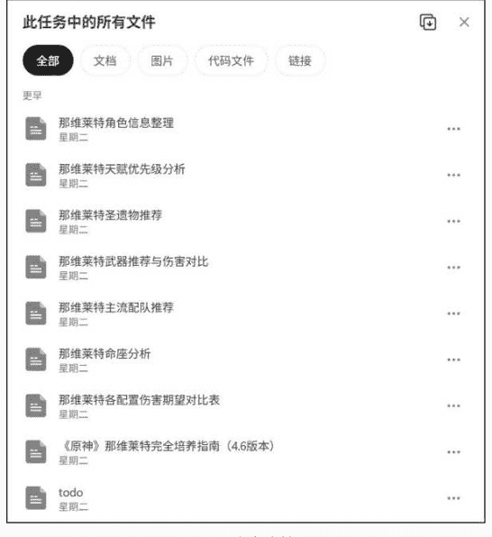

其中，智能体推荐的“《原神》那维莱特完全培养指南（4.6版本）”的目录如图7-2所示。在任务执行过程中，智能体将任务拆解为以下步骤：首先，自主收集《原神》那维莱特的实测数据和权威攻略资料，优先访问米游社、NGA等站点；其次，整合多源数据，确保版本机制与数值参数的准确性；最后，梳理主流权威资料，提炼角色定位和核心机制。该过程充分体现了智能体的规划与逻辑推理能力。

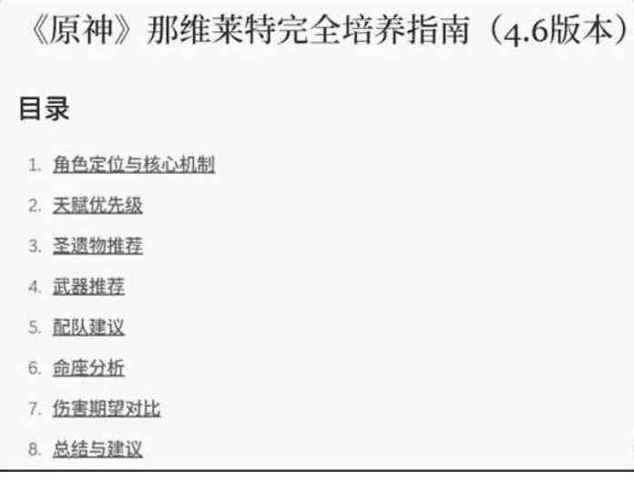

智能体通过逻辑清晰的分析框架对内容进行优先级排序并提供详细解释，以层层递进、由浅入深的方式呈现分析过程，如图7-3所示。

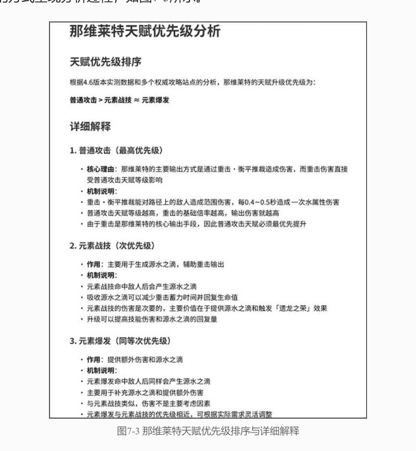

智能体的优势在于其强大的自主数据处理能力，能够自动检索并整合实测数据和权威攻略资料，通过多维度对比分析深入挖掘机制背后的逻辑，进而输出详尽、结构化的解释说明。智能体生成的文档涵盖角色定位、天赋优先级、圣遗物推荐、武器对比、配队策略和命座分析等内容。图7-4展示了不同武器与命座组合的伤害对比，所有的数据均采用Prompt进行实测验证，并以表格形式清晰呈现不同配置下的伤害期望。智能体会针对每个步骤给出具体的解析，最终输出的文档以结构化形式系统呈现分析过程与结论。相比于普通大语言模型，智能体给出的回答更全面、依据更充分、可解释性更强。

| 配置 | 武器 | 命座 | 圣遗物 | 重击单段伤害 | 相对基准提升 | DPS | 相对基准提升 |
| :--- | :--- | :--- | :--- | :--- | :--- | :--- | :--- |
| 基准配置 | 试作金珀R5 | 0命 | 遗迹猎人4件套 | 100% | - | 100% | - |
| 低配实用 | 试作金珀R5 | 1命 | 遗迹猎人4件套 | 115% | +15% | 120% | +20% |
| 中配推荐 | 万世流涌大典R1 | 0命 | 遗迹猎人4件套 | 143% | +43% | 150% | +50% |
| 高配推荐 | 万世流涌大典R1 | 1命 | 遗迹猎人4件套 | 165% | +65% | 180% | +80% |
| 豪华配置 | 万世流涌大典R1 | 2命 | 遗迹猎人4件套 | 180% | +80% | 198% | +98% |
| 极限配置 | 万世流涌大典R5 | 6命 | 遗迹猎人4件套 | 230% | +130% | 260% | +160% |

图7-4 不同武器与命座组合的伤害对比

##### （2）Boss战斗攻略

请为《原神》4.6版本周本Boss“仆人”撰写一份无伤攻略，要求如下。

- 机制解析：
  - 分阶段说明Boss技能（如“血影刀”的标记机制）。
  - 必杀技的躲避技巧（站位/无敌帧时机）。
- 角色对策：
  - 推荐3个克制角色（如钟离护盾、夜兰速切等），并说明原因。
  - 平民阵容（4星角色+免费武器）。
- 实战流程：
  1. 分步骤输出时间轴（如开局5秒内破盾→第10秒绕背输出）。
  2. 附示意图描述安全站位（可用ASCII图或方向描述）。
- 要求：避免笼统描述，提供精确到秒的操作建议，标注Boss弱点属性（如火破冰盾）。

将上述要求整理为结构化Prompt后进行案例测试。在这项任务中，智能体详细分析了Boss机制、必杀技躲避技巧，推荐了克制角色和平民阵容，并提供了安全站位布局。

```
战场概览
        北方
          |
          |
西方 -----+------ 东方
          |
          |
        南方

初始站位（战斗开始）
        北方
          |
          |
西方 -----★------ 东方
```

智能体还基于上述Prompt生成了精确实战时间轴，如图7-5所示。

###### 精确实战时间轴（以秒为单位）

**第一阶段（100%～70%血量）**

**0:00 - 0:05 开场准备**

- 0:00：进入战场，立即向右侧移动，避开仆人的初始位置
- 0:02：钟离/迪奥娜释放护盾（E技能）
- 0:05：夜兰/行秋释放Q技能，提供持续水元素伤害

**0:06 - 0:15 初始输出阶段**

- 0:06：班尼特/芭芭拉释放Q技能，提供治疗和增益
- 0:08：雷电将军/香菱释放E技能，提供持续元素伤害
- 0:10：主C开始输出，注意观察仆人动作
- 0:12：仆人可能使用斩首之邀，向左侧闪避
- 0:15：继续输出，保持距离约10米

**0:16 - 0:30 第一次必杀应对**

- 0:16：观察仆人动作，如果开始引导朱炎朔月（文字提示出现），准备应对
- 0:18：如有血汐冲击，立即使用重击打断仆人引导


直观的安全站位示意图和精确的时间轴拆解使分析结论更加准确、清晰，充分体现了智能体相较于普通大语言模型更优越、更全面的性能。

##### （3）任务解谜攻略

你是一名《原神》解谜专家，请为4.6版本“旧日之海”区域的石板谜题撰写攻略，要求如下。

- 谜题定位：精确描述谜题位置（附游戏内坐标参考点）。
- 解谜步骤：
  1. 分步骤说明石板旋转顺序（如“北→东→南→西”）。
  2. 交互物品的隐藏触发条件（如需装备特定道具）。
- 常见错误：列出玩家易犯的3个错误（如忽略环境光提示）。
- 奖励说明：解谜后获取的宝箱/成就内容。
- 要求：用“如果……则……”格式应对不同情况。（如“如果石板复位，则需重新触发机关”。）

将上述要求整理为结构化Prompt后进行智能体案例实测。智能体提供了精确的谜题定位，具体如下。

**石板谜题一：古代回响**

**谜题定位**

位置坐标：旧日之海区域，优恩花园东北方向（X: -345, Y: 217）。

参考点：从优恩花园传送锚点向东北方向前进约150米，靠近一处半圆形遗迹建筑，石板位于建筑中央平台上，附近有一个明显的蓝色水元素纹路装饰。

识别特征：石板呈六边形，表面刻有古代雷穆利亚文字，周围有四个较小的石柱，每个石柱顶部有不同颜色的光芒，石板周围的地面上有环形水纹图案。

**解谜步骤**

1. 准备阶段：确保已装备“乐章之力”能力（通过主线任务获得），靠近石板，会看到四个石柱亮起不同颜色的光芒。
2. 石板旋转顺序：第一步，旋转北方石板（面向蓝色光芒的石柱）；第二步，旋转东方石板（面向黄色光芒的石柱）；第三步，旋转南方石板（面向红色光芒的石柱）；第四步，旋转西方石板（面向绿色光芒的石柱）。
3. 交互方式：使用元素战技键（E键）对准石板，长按激活“乐章之力”，调整音调至与石柱光芒颜色对应的音高。释放元素战技，石板会旋转并发出共鸣声。
4. 隐藏触发条件：必须按照北→东→南→西的顺序旋转，每个石板旋转后，需等待共鸣声结束（约3秒）再旋转下一个，如果顺序错误，所有石板会重置，需从头开始。

**不同情况的应对方法**

1. 如果石板旋转顺序错误、无共鸣声或突然重置，则等待约5秒至完全重置，重新核对石柱颜色与方位的对应关系，严格按北→东→南→西的顺序操作，并确保每次旋转后等共鸣声结束再进行下一步。
2. 如果“乐章之力”未正确装备，导致无法与石板互动或无音调调整界面，则打开角色菜单检查装备。若未装备，可在“能力”选项卡进行装备；若未解锁，须先完成主线任务“旧日之歌”。装备后，靠近石板长按元素战技键激活“乐章之力”界面。
3. 如果音调调整不正确，石板旋转却未触发下一步反应，则记住以下对应关系：北/蓝色 = 高音，东/黄色 = 中高音，南/红色 = 中低音，西/绿色 = 低音。调整时，确保音符颜色与石柱光芒一致；若多次失败，可离开区域再返回重新触发，同时注意站位正确（面向石板、保持3~5米的距离）。

**常见错误及规避建议**

错误描述：许多玩家在解谜过程中忽略了环境中的光线提示，导致无法确定正确的石板旋转顺序或交互方式。具体表现在未注意石柱光芒颜色与音调的对应关系，忽略墙壁上的方向符号发光变化以及未观察月相石板的亮度变化规律。

规避建议：

1. 在进入谜题区域时，先关闭角色元素视野，观察环境中的自然光源。
2. 特别注意任何非自然的光芒或发光物体，它们通常是解谜提示。
3. 如果在白天解谜困难，可尝试调整游戏内时间至夜晚，光线提示会更加明显。
4. 调整游戏亮度设置，确保能清晰看到环境光变化。

**奖励说明**

宝箱奖励：1个精致宝箱（内含物品：原石，摩拉，旧日之海特产“深海珍珠”，随机圣遗物）

额外奖励：解锁“旧日回响”成就和区域探索度2%。

该攻略提供了精确的谜题定位、详细的解谜步骤、常见错误分析及奖励说明，并使用“如果……则……”格式应对不同情况。攻略中特别标注了三个主要石板谜题的精确位置坐标、旋转顺序和隐藏触发条件，并提供了常见错误的规避建议。读者可以自己动手试试。

##### （4）资源规划攻略

请为《原神》4.6版本的零氪玩家设计一份资源规划指南，要求如下。

- 原石优先级：
  - 抽卡建议（如“优先那维莱特而非赛诺，因为当前深渊环境适配度更高”）。
  - 每日/活动原石获取途径汇总表。
- 树脂分配：
  - 前期（冒险等级 < 45）：刷取摩拉/经验书。
  - 后期：圣遗物副本性价比分析（如“逐影猎人”VS“黄金剧团”）。
- 体力节省技巧：如周本Boss的3次挑战后树脂消耗减半机制。
- 要求：用时间轴表格规划每日行动，标注版本活动截止时间。

将上述要求整理为结构化Prompt后进行案例实测。智能体按照要求详细分析了原石优先级、树脂分配策略和体力节省技巧，并制作了完整的活动时间轴表格，如图7-6所示。时间轴表格标注了所有重要活动的截止时间，帮助玩家合理地规划每日资源。

###### 活动日历与截止时间

| 活动名称 | 开始时间 | 结束时间 | 奖励 | 优先级 |
| :--- | :--- | :--- | :--- | :--- |
| 4.6版本更新 | 5月1日 | - | 维护补偿600原石 | - |
| “仆人”角色池 | 5月1日 | 5月21日 | - | 中 |
| “林尼”角色池 | 5月1日 | 5月21日 | - | 低 |
| “那维莱特”角色池 | 5月21日 | 6月11日 | - | 高 |
| “白术”角色池 | 5月21日 | 6月11日 | - | 中低 |
| 主线任务“谐律上的永叙诗” | 5月1日 | 永久开放 | 原石180 | 高 |
| “旧日之海”新区域 | 5月1日 | 永久开放 | 原石、宝箱等 | 高 |
| 主要活动“谐律永世” | 5月3日 | 5月24日 | 原石1000 | 最高 |
| 支线活动“深海秘闻” | 5月6日 | 5月27日 | 原石420 | 高 |
| 支线活动“旧日寻踪” | 5月10日 | 5月31日 | 原石420 | 高 |
| 支线活动“潮汐之旅” | 5月17日 | 6月7日 | 原石420 | 高 |
| 深境螺旋 | 5月1日 | 6月15日 | 原石600 | 高 |
| 4.7版本预告直播 | 5月31日 | - | 兑换码300原石 | 高 |
| 4.7版本更新 | 6月12日 | - | - | - |

图7-6 活动时间轴表格

#### 3. 提升Prompt有效性的技巧

要想提升Prompt的有效性，可以从三方面入手。首先，明确指定输出格式，例如要求以Markdown格式输出，内容包含二级标题、无序列表，并对关键信息进行加粗处理。其次，进行数据验证，强调数据来源的可靠性，规定伤害计算等关键数据必须引用NGA论坛实测数据或Genshin Optimizer等权威工具的计算结果。最后，控制语言风格。例如，采用专业且适度口语化的表达方式，避免内容冗长，举例时可灵活使用游戏术语（如“Q技能”“暴击拐”）。

通过以上方法，可以生成准确度高、可落地的《原神》攻略。如果需要更具体地针对某类攻略设计Prompt，可进一步说明应用场景。

## 7.2 旅游攻略创作大师

智能体在旅游创作领域同样发挥了重要作用。它不仅可以很好地规划旅行路线，还支持预订车票等非常多元化的功能。

### 7.2.1 智能体对旅游攻略创作的影响

智能体对旅游攻略创作的影响主要体现在以下几个方面。

1. 个性化定制能力提升
智能体通过分析用户的兴趣、时间及预算，能够生成高度个性化的旅行行程。它不仅能够考虑景点、交通和住宿信息，还能优化行程安排，确保用户充分参与感兴趣的活动，打破传统攻略的标准化局限，为不同需求的用户提供定制化服务。

2. 实时信息整合与动态调整
智能体能够提供整合的实时旅游信息，包括天气情况、交通状况、景点开放时间及其他旅行者评价等。这种动态信息整合能力使攻略内容更具时效性，能够帮助用户及时调整行程，避免突发情况对行程的影响，提升旅行的顺畅度。

3. 自动化预订与费用优化
智能体具备自动化旅游预订管理能力，涵盖预订酒店、机票、景区门票及体验特色活动等场景。此外，通过实时监控价格变化，它能为用户找到最优预订时间和价格组合，帮助用户有效节省旅行成本。这种自动化服务简化了攻略执行流程，使用户不需要手动比价即可获得高性价比旅行方案。

4. 推荐系统精准度提高
基于用户的历史旅行数据和偏好，智能体能够推荐符合其兴趣的景点、餐厅及活动。这种个性化建议增强了攻略的实用性，帮助用户更轻松地发现符合自身兴趣的目的地与活动，避免信息过载影响决策。

5. 社交互动与内容创作
智能体集成了互动和分享功能，支持用户发布旅行攻略、分享精美照片，并且可以联动主流社交网络。这种功能提升了用户参与内容创作的积极性，使攻略系统从单一的信息推送升级为用户交流经验、完善信息的平台，并逐步沉淀为动态更新的旅行知识库。

6. 技术驱动的体验升级
智能体结合AR实景投射与GPT行程生成技术，可在虚拟场景中实时识别用户周边环境，智能推荐隐藏景点或特色活动，有效激发用户的探索兴趣。例如，当用户在日本京都街头行走时，系统可基于实时位置推送附近的庭院、茶室等本地化体验，使攻略从静态文本升级为沉浸式交互形式。

### 7.2.2 分场景旅行Prompt设计

设计一个高效的旅行攻略生成Prompt，需要明确目标用户、旅行偏好、行程细节等关键要素，同时确保智能体输出的攻略具备实用性、个性化和可操作性。

#### 1. Prompt设计核心原则

Prompt主要包括明确目标、限定范围、结构化输出和个性化定制这4个部分。

- 明确目标：定义旅行类型（如自由行、跟团、背包客、家庭游、蜜月旅行等）。
- 限定范围：明确目的地、时间、预算（避免智能体生成的内容过于宽泛）。
- 结构化输出：指定输出结构（如按天规划，包含交通、住宿、景点、美食等）。
- 个性化定制：标注个性化需求（如“适合带小孩”“偏好小众景点”“美食优先”）。

#### 2. 分场景Prompt示例

在日常生活中，我们经常需要制定个性化旅行攻略。以下是针对不同场景设计的旅行攻略Prompt示例，读者可以将其作为参考，快速生成适合自己的个性化行程。

##### （1）基础自由行攻略（城市游）

你是一名专业旅行规划师，请为一位预算中等、喜欢文化体验和美食的旅行者设计一份5天4夜武汉自由行攻略，要求如下。

- 行程安排：按天规划，每天3～4个主要景点，合理安排交通时间。
- 住宿建议：3晚性价比高的连锁酒店（江汉路/循礼门附近）+1晚特色民宿（如昙华林街区）。
- 美食推荐：必吃餐厅为“老通城”和“赵师傅油饼包烧麦”（地道武汉早餐）；其他推荐为“蔡林记热干面”“便利店的热干面和卤味”。
- 交通建议：说明是否建议购买“武汉地铁7日通票”，并提示最佳使用时间。
- 现场提醒：如“黄鹤楼景区节假日人流密集”“部分景点的最佳拍照时段”。
- 输出格式：Markdown，含每日详细时间表，地图链接（Google Maps）、预估费用（人民币）。

适用场景：普通城市自由行，适合到访武汉的旅行者。

##### （2）深度主题游（如历史/自然/美食）

请设计一份7天武汉深度文化之旅攻略，聚焦以下内容。

- 主题：武汉古建筑、楚韵文化与本土人文体验。
- 必去景点：
  - 禅意古建筑：黄鹤楼（避开节假日高峰时段）、古德寺、归元禅寺。
  - 自然人文：东湖磨山竹林小径、堤角公园江南庭院。
  - 文化溯源：湖北省博物馆（编钟文化）、晴川阁、盘龙城国家考古遗址公园。
- 特色体验：
  - 体验一次楚式禅茶/租赁汉服游园。

前往昙华林特色花店，参与插花手作活动。
品尝汉味非遗料理（推荐“老通城”“蔡林记”等本土老字号餐厅）
交通建议：购买“武汉地铁7日通票”是否划算？说明最佳使用时机。
现场提醒：避开黄鹤楼、昙华林等景区的节假日人流高峰，推荐小众替代景点（如古德寺），避开热门拥挤区域。
出行工具：高德地图/百度地图，提前查询每日景点开放时间、公共交通班次，推荐地区导航（高德地图）、支付方式（微信/支付宝）。

适用场景：喜欢深度文化探索的旅行者。

##### （3）家庭亲子游攻略

为带两个小孩（5岁和8岁）的家庭规划一份6天5夜新加坡亲子游攻略，要求如下。

- 景点选择：
  适合儿童的如环球影城、S.E.A.水族馆。
  家长也能享受的如滨海湾花园夜间灯光秀。
- 住宿建议：
  一家亲子友好酒店如圣淘沙硬石酒店。
  是否值得住“金沙酒店”？（分析性价比）
- 餐饮安排：
  孩子喜欢的如“亚坤咖椰吐司”。
  家长可尝试的如“辣椒螃蟹”。
- 行程节奏：每天不超过2个主要景点，午休时间预留。
- 输出时标注：哪些景点需提前购票、哪些适合推婴儿车。

适用场景：带小孩的家庭旅行，需平衡娱乐和休息。

##### （4）预算控制型攻略（背包客/学生）

请为预算有限的背包客设计一份10天泰国（曼谷+清迈+普吉岛）穷游攻略，要求如下。

- 住宿：推荐青旅或廉价民宿（每晚预算<150元人民币）。
- 交通：
  城际：夜间大巴/火车（省钱省时间）。
  市内：“突突车”砍价技巧、摩托车租赁风险提示。
- 美食：必吃街头小吃（如“芒果糯米饭”“泰式炒河粉”），避免高价旅行者陷阱。
- 免费/低价活动：
  曼谷：周末市场、免费寺庙。
  清迈：丛林徒步（本地团比国际团便宜）。
- 安全提醒：常见骗局（如“大皇宫关闭”骗术）。
- 输出时按城市分段，标注每日预估花费（泰铢+人民币）。

适用场景：学生、背包客等低预算旅行者。

##### （5）实时动态攻略（突发事件应对）

我正在巴黎旅行，原计划今天去卢浮宫，但遇到罢工导致地铁停运，请快速提供替代方案。

- 替代方案：
  步行可达的景点如“奥赛博物馆”。
  可用的公交线路（实时查询链接）。
- 灵活调整建议：
  如果下午交通恢复，如何优化剩余行程？
  若罢工持续，推荐1个近郊小镇（如凡尔赛宫）及往返方式。
- 要求：基于最新交通信息（2026年X月X日），提供具体操作步骤。

适用场景：旅行中遇到突发情况（如极端天气、罢工等）。

##### （6）旅行通用攻略模板

目标：生成一份包含行程规划、景点推荐、住宿交通、餐饮预算的完整旅行攻略。
适用对象：自由行/跟团旅行者，可自定义旅行风格（如自然风光、文化体验、美食打卡）、预算范围及出行天数。

###### 1. 基础信息填写

- 旅行目的地：
  示例：云南·大理/日本·京都/泰国·清迈。
- 出行天数：
  示例：7天6晚/3天2晚。
- 旅行风格：
  选项：自然风光、文化历史、美食探店、亲子休闲、摄影打卡、户外探险。
- 预算范围：
  示例：经济型（<3000元/人）、舒适型（3000～6000元/人）、轻奢型（>6000元/人）。
- 出行人数：
  示例：1人/情侣/家庭（2大1小）/朋友结伴（4人）。

###### 2. 每日行程规划

- Day X：主题标签（如“古城初探”“湖光山色”）。
  - 上午：
    景点名称：×××（门票价格、开放时间、游玩时长）。
    交通方式：地铁/公交/打车（费用参考）。
    贴士：早高峰避堵建议/最佳拍摄角度。
  - 中午：
    餐厅推荐：×××（特色菜、人均消费）。
    备选方案：若排队过长可前往某一备选餐厅。
  - 下午：
    活动安排：×××体验（如扎染手作/骑行路线）。
    隐藏玩法：本地人常去的冷门景点。
  - 晚上：
    夜景推荐：×××观景台、夜市（营业时间）。
    安全提示：避开人流密集区域。

###### 3. 住宿与交通建议

- 住宿推荐：
  区域选择：靠近地铁站、景区或夜市（附地图标记）。
  类型推荐：青旅（经济）、民宿（特色）、酒店（舒适）。
  避坑指南：警惕“照骗”房源，查看最新评价。
- 交通方式：
  跨城交通：高铁、飞机、长途巴士（班次/票价/耗时）。
  市内交通：共享单车、包车、公交卡（优惠套餐）。

###### 4. 餐饮与美食攻略

- 必吃美食清单：
  菜品名称：×××（推荐店铺/人均消费）。
  隐藏吃法：搭配当地特色蘸料/蘸水。
- 避雷指南：
  景区内高价餐饮谨慎选择。
  季节限定美食（如菌子火锅仅限6月到10月）。

###### 5. 预算明细

- 大项分类：
  交通：×××元（含往返机票/高铁）。
  住宿：×××元（按人均分摊）。
  餐饮：×××元（每日预估）。
  门票+体验：×××元（含优惠票渠道）。
  其他：×××元（购物/应急备用金）。
- 省钱技巧：
  景点联票或早鸟票优惠。
  本地人常去的平价市场。

###### 6. 实用贴士

- 行前准备：
  证件：身份证/护照/学生证（优惠）。
  衣物：根据季节携带雨具/防晒装备。
  药品：肠胃药/晕车药/创可贴。
- 当地禁忌：
  寺庙内勿穿短裤或露肩装。
  拍照前需要征得当地人同意。
- 紧急联络：
  旅游投诉电话/领事馆信息。

###### 7. 灵活调整选项

- 天气备选方案：
  若遇雨天：室内博物馆/手作工坊替代户外活动。
- 人群适配调整：
  亲子游：增加儿童乐园/科普场馆。
  老年团：减少步行距离，增加休息点。

#### 3．智能体生成旅游攻略案例

下面以新加坡6天5夜亲子游为例进行说明。

智能体给出的新加坡6天5夜亲子游攻略内容包含行程概览、每日详细行程、住宿推荐、餐饮安排、交通建议、实用贴士、费用预估，如图7-7所示。该攻略按照要求推荐适合儿童和家长的景点，提供亲子友好型酒店建议（含金沙酒店的性价比分析），并合理安排全家适配的餐饮与行程节奏。

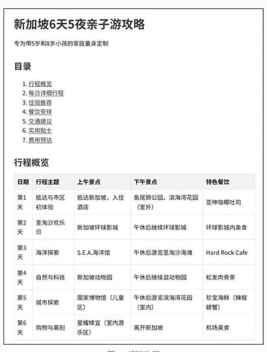

图7-7 旅游攻略

如图7-8所示，攻略设计充分考虑了亲子共游需求，整体规划以海洋探索、自然体验、科技互动为主题，既能激发儿童对世界的好奇心，又在景点筛选上兼顾儿童的兴趣与体力。

##### 第3天：海洋探索

- 上午：S.E.A.海洋馆
  - 10:00-13:00 游览S.E.A.海洋馆
  - 重点体验：
    - 开放海洋区（巨大的海底隧道）
    - 触摸池（孩子可以触摸海星等海洋生物）
    - 鲨鱼区（令人惊叹的各种鲨鱼）
  - 适合推婴儿车：✓ 馆内通道宽敞，设有电梯
  - 必须提前购票：建议提前1周在官网或Klook购买
  - 价格：成人约40新币，儿童约30新币
  - 儿童友好度：★★★★★ 互动性强，孩子们通常非常喜欢
  - 贴心提示：
    - 查询喂食时间表，带孩子观看
    - 馆内光线较暗，注意看管孩子
    - 拍照时关闭闪光灯，保护海洋生物
  - S.E.A.海洋馆地图链接

- 中午：午餐与午休
  - 13:00-14:30 在海洋馆附近用餐并休息
  - 推荐：马来西亚美食街或Hard Rock Cafe
  - 价格：Hard Rock Cafe约25-35新币/人
  - 儿童友好度：★★★★☆ Hard Rock Cafe有儿童菜单
  - Hard Rock Cafe地图链接

- 下午：圣淘沙海滩
  - 15:00-18:00 游览圣淘沙海滩
  - 重点体验：
    - 棕榈滩（Palm Beach）或西乐索滩（Siloso Beach）
    - 沙滩玩耍，建造沙堡
    - 浅水区戏水（有救生员看守）
  - 适合推婴儿车：△ 沙滩区域推婴儿车较困难，但周边步道可以
  - 无须提前购票：免费景点
  - 儿童友好度：★★★★★ 孩子们通常非常喜欢沙滩活动
  - 贴心提示：
    - 带泳衣、毛巾和防晒用品
    - 沙滩附近有淋浴设施和更衣室
    - 注意防晒和补充水分
  - 圣淘沙海滩地图链接

- 晚上：晚餐与休息
  - 18:30-20:00 在圣淘沙用餐
  - 推荐：Trapizza（意大利餐厅，位于香格里拉酒店附近的海滩）
  - 价格：约20-30新币/人
  - 儿童友好度：★★★★★ 提供儿童餐，位置靠海，环境轻松
  - Trapizza地图链接

- 20:30 返回酒店休息


智能体生成的每日行程不仅清晰标注了时间安排和费用明细，还提供了可直接访问的地图链接，大幅提升信息的易读性与规划的逻辑性，精准匹配用户需求。相较于普通大语言模型生成的建议，智能体依托深度用户偏好分析与结构化资料整合，输出的方案更加可靠，更符合用户的个性化需求。

智能体还给出了预估旅游费用，如图7-9所示。

| 项目 | 预估费用（新币） | 备注 |
|---|---|---|
| 住宿 | 1750~2250 | 5晚，圣淘沙硬石酒店家庭房 |
| 餐饮 | 1200~1500 | 每天3餐，含1~2次特色餐厅 |
| 交通 | 300~400 | 含机场往返、市区交通、圣淘沙交通 |
| 门票 | 800~1000 | 环球影城、海洋馆、动物园等 |
| 购物 | 300~500 | 纪念品、零食等 |
| 杂费 | 150~200 | 小费、行李寄存等 |
| 总计 | 4500~5850 | 约合人民币23000~30000元 |


上述攻略专为携5岁和8岁小孩的家庭量身定制，行程按“上午活动-午餐午休-下午活动-晚餐休息”科学分段，平衡室内外景点和儿童注意力时长，并详列景点开放时间、票价等实用信息，给出“带泳衣”等贴心提示。

此外，这份攻略还涵盖了儿童友好度等评价、细分预算和省钱技巧，攻略结构清晰、导航便捷，兼顾儿童乐趣与成人体验，并全面考虑了出行过程中的安全和健康问题。

相较于普通大语言模型，智能体在旅行规划领域展现出显著优势。智能体能够精准地把握特定群体的需求（如针对环球影城的推荐），生成层次清晰、逻辑连贯的攻略，涵盖价格、时间等实际细节因素，并构建多维度评价体系，提供有依据的决策支持。此外，智能体具备文化洞察力和风险预判能力，能够综合考量现实约束条件，而普通大语言模型生成的建议大多停留在通用化、概括性层面，缺乏逻辑连贯性和本地化细节。

## 7.3 诗歌创作大师

智能体对诗歌创作的影响体现在多个方面，如引发关于诗歌本质的深度讨论及人类情感独特性的思考。

### 7.3.1 智能体对诗歌创作的影响

智能体对诗歌创作的影响主要体现在创作效率提升、语言与形式创新、激发创作灵感、引发对诗歌本质的深度讨论，以及推动人机协作创作等方面。

#### 1. 创作效率提升

智能体具备快速生成高质量文本的能力，在诗歌创作领域，它可以根据用户给定的主题和要求快速生成富有创意的诗歌内容，从而大大缩短创作时间。例如，创作者在短时间内就能获得多个不同风格的诗歌初稿，为后续的打磨和完善奠定了基础。

#### 2. 语言与形式创新

智能体具备丰富的知识储备和卓越的语言能力，能够驾驭不同的诗歌形式和语言风格。它可以突破传统诗歌创作的局限，创造新颖独特的表达方式。比如，它可将不同文化背景下的诗歌元素进行融合，或者运用一些不常见的词语和句式组合，为诗歌创作带来新的可能性。

#### 3. 激发创作灵感

对创作者来说，智能体生成的诗歌是一种激发灵感的媒介。创作者可以从智能体生成的诗歌中获取新的思路和视角，启发自己创作。例如，看到智能体对某一主题别具一格的诠释后，创作者可能会深受触动，从不同的角度去思考和表达该主题。

#### 4. 引发对诗歌本质的深度讨论

智能体的出现促使人们重新审视诗歌的本质。诗歌不仅仅是文字的堆砌，而是人类情感、思想和独特生命体验的载体。虽然智能体能够生成语言优美、形式规范的诗句，但它缺乏人类的真实情感和个性化体验。这引发了关于诗歌创作中人类情感独特性和不可替代性的讨论。

#### 5. 推动人机协作创作

智能体为人机协同诗歌创作开辟了新范式：创作者可将情感意图与审美诉求“投喂”给智能体，以其输出作为灵感起点，进行再创作与深度打磨。这种协作并非简单拼接，而是人类以创意主导权引导机器的生成过程，通过灵感激发、形式实验与文本迭代实现诗歌质量与创作效率的双重跃升。

### 7.3.2 诗歌创作Prompt设计

在进行诗歌创作时，需要围绕用户需求（如主题、风格、情感、技术目标等）设计结构化且可操作的Prompt，要求Prompt兼顾创意激发与生成可控性。

#### 1. Prompt设计的核心原则

Prompt设计的核心原则主要包括基础信息模块、形式与风格模块、技术参数模块和高级功能模块4个部分。

##### (1) 基础信息模块

- · 主题与核心意象
  主题：明确诗歌核心主题（如自然、爱情、社会现象）。
  核心意象：指定1～3个贯穿全诗的象征物（如“落叶”“候鸟”“旧信封”）。
  示例：
  主题：秋日离别。
  核心意象：枯萎的玫瑰、褪色的车票、候鸟南飞。

- · 情感基调与氛围
  情感基调：明确情感倾向（如忧伤、喜悦、矛盾、怀旧）。
  氛围：设定场景氛围（如朦胧雨夜、空旷荒野、喧嚣都市）。
  示例：
  情感基调：隐忍的哀伤。
  氛围：冬日清晨雾霭笼罩的火车站台。

##### (2) 形式与风格模块

- · 诗歌形式
  体裁：指定诗歌类型（如十四行诗、俳句、自由诗、叙事诗）。
  结构：明确段落、诗节划分（如四行一节，押韵模式为ABAB）。
  示例：
  体裁：十四行诗（莎士比亚体）。
  押韵模式：前八行为ABAB，中间四行为CDCD，结尾对句为EE。

- · 语言风格
  修辞手法：指定拟人、隐喻、通感等手法（如“多用通感描写秋雨”）。
  语言风格：古典/现代、口语化/书面化、简洁/繁复。
  示例：
  语言风格：仿李清照词风，用词婉约含蓄，善用叠字。

##### (3) 技术参数模块

- · 生成控制
  字数限制：指定诗歌长度（如“不超过20行”）。
  关键词植入：强制包含特定词语（如“铁轨”“候鸟”“锈蚀”）。
  示例：
  字数：不超过12行。
  关键词植入：“锈蚀的锁”“未寄出的信”“北方的风”。

- · 输出格式
  排版要求：分行、空格、标点符号规范（如“每行末尾用斜杠分隔”）。
  示例：
  输出格式：每行独立成句，句末用中文句号，避免在行中使用标点断句。

##### (4) 高级功能模块

- · 情感动态变化
  情感曲线：指定诗歌情感强度变化（如“首段低沉，中段激昂，尾段释然”）。
  示例：
  情感曲线：前四行压抑（如“锈蚀的锁沉默/铁轨延伸向迷雾”），中段转折（如“突然裂开一道光”），末尾升华（如“候鸟掠过废墟，衔走最后一粒星光”）。

- · 多模态融合
  跨媒介灵感：结合音乐、绘画等艺术形式（如“以莫奈的《睡莲》为灵感，用色彩意象替代具象描写”）。
  示例：
  音乐风格：德彪西的《月光》（营造出朦胧感）。
  转化要求：将旋律的起伏转化为诗句的节奏变化。

#### 2. 不同场景的Prompt设计案例

在诗歌创作中，不同场景的Prompt可作为激发灵感的“钥匙”。下面的Prompt示例可以帮助创作者快速写出优质的诗歌作品。

##### (1) 自然主题抒情诗

主题：秋日离别

核心意象：枯叶、铁轨、旧车票。

情感基调：怅惘与释然交织。

语言风格：现代诗，多用通感与意象叠加。

字数：不超过16行。

关键词强制植入：“锈迹斑斑的铁轨”“指纹模糊的票根”。

修辞要求：将秋雨比作透明的蛛网。

##### (2) 古典风格爱情诗

主题：未寄出的情书。

韵脚要求：押平水韵（如“归”“飞”“微”）。

核心意象：青鸟、玉簪、未拆封的信。

结构：四句一联，共三联，尾联点题。

禁忌：避免直白抒情，需用典故或隐喻。

##### (3) 边塞思乡

主题：戍边将士的秋夜思归。

核心意象：胡笳、孤雁、霜雪、家书。

情感曲线：前四句写边塞苦寒，后四句转入对故乡的温婉追忆。

体裁：七言绝句。

内容要求：化用“征人望月”“雁足无书”等典故。

## 7.4 音乐创作大师

智能体作为AI音乐创作工具的代表，正通过技术革新重塑音乐创作流程。它不仅对音乐创作流程有重要的影响，对音乐风格也产生了重要的影响。

### 7.4.1 智能体对音乐创作的影响

智能体的出现对音乐创作产生了巨大影响，其影响体现在创作效率的颠覆性提升、音乐风格的突破与融合，以及音乐行业的生态重构三大维度。

#### 1. 创作效率的颠覆性提升

智能体让音乐创作效率实现了颠覆性提升，这主要得益于自动化流程和实时在线协作与修改这两方面的突破。

##### (1) 自动化流程

智能体通过AI算法实现作曲、编曲、混音全流程自动化，将传统音乐制作中需要数周甚至数月完成的工作压缩至分钟级。例如，用户输入关键词或情绪标签后，系统可快速生成包含旋律、和声、节奏的完整音乐框架，大幅缩短创作周期。

##### (2) 实时在线协作与修改

智能体支持多人实时在线协作与修改功能。这样一来，创作者就能够实时调整AI生成的音乐片段，并通过可拖动的界面快速优化细节。这种即时反馈机制显著降低了沟通成本，尤其适合影视配乐、广告音乐等对时效性要求高的场景。

#### 2. 音乐风格的突破与融合

智能体实现了音乐风格的突破与融合，这主要得益于其跨风格生成能力和文化元素的融合能力。

##### (1) 跨风格生成能力

智能体内置海量音乐数据集，覆盖古典、摇滚、电子、爵士等多元风格，且支持风格融合。例如，用户可将爵士乐的即兴演奏特征与电子音乐的合成器音色相结合，生成实验性音乐作品，为独立音乐人提供创作灵感。

##### (2) 文化元素的融合能力

智能体通过分析不同地域的音乐和演奏特色（如非洲鼓点、印度拉格），能够生成融合东西方音乐元素的跨界作品。这种能力不仅拓展了音乐创作的可能性，也推动了全球音乐文化的交流与碰撞。

#### 3. 音乐行业的生态重构

智能体的出现降低了创作的门槛，推动了音乐行业生态的重构。然而，AI生成内容的版权归属、创作者权益界定等议题亟待厘清。因此，创作者在使用智能体完成作品时，需要特别关注算法生成作品的版权归属及相关法律风险。

##### (1) 降低创作门槛

智能体的易用性大幅降低了音乐创作的准入门槛，使非专业音乐人也能参与创作。例如，短视频创作者可通过智能体快速生成背景音乐，游戏开发者可以用较低的成本高效定制音效。这种创作模式不仅降低了内容制作的整体成本，还通过缩短创作周期加速了创意落地。

##### (2) 版权与商业化挑战

AI生成的音乐版权归属问题已引发全球范围内的法律与伦理讨论。针对这一行业性挑战，部分智能体平台尝试通过区块链技术记录创作过程，探索“AI与人类创作者联合署名/版权共享”的模式。此外，平台亦与音乐流媒体服务商合作，为AI生成的音乐开辟商业化渠道，推动行业规则的完善。

##### (3) 对音乐教育的冲击

传统音乐教育侧重理论学习与乐器演奏，而智能体的普及正促使教育体系向“技术+艺术”的复合型培养模式转型。例如，在音乐课程中引入智能体音乐工具的使用、算法作曲原理等模块，以适应行业发展需求。

### 7.4.2 音乐创作Prompt设计

想要精准驾驭智能体等AI音乐创作工具，设计优质Prompt是关键。音乐创作类Prompt的设计需要结合音乐类型、风格特征、情感表达、技术参数等要素，以确保生成的结果符合预期。下面介绍的音乐创作Prompt设计指南，能够为不同音乐类型的创作需求提供参考。

#### 1. 音乐创作Prompt的核心要素

设计音乐创作Prompt时，需综合考虑音乐类型、情感与氛围、结构与节奏、乐器与音色、参考风格、技术参数这6个核心要素。

##### (1) 音乐类型

音乐类型包括古典（Classical）、流行（Pop）、电子（EDM）、摇滚（Rock）、嘻哈（Hip-Hop）、爵士（Jazz）、民谣（Folk）等。

子类型示例：合成器浪潮（Synthwave）、低保真（Lo-Fi）音乐、史诗管弦乐（Epic Orchestral）、陷阱音乐（Trap）等。

##### (2) 情感与氛围

情感与氛围关键词包括欢快（Joyful）、忧郁（Melancholic）、紧张（Suspenseful）、梦幻（Dreamy）、恢宏（Epic）等。

可结合具体应用场景，如电影配乐、游戏战斗背景音乐、冥想音乐等。

##### (3) 结构与节奏

结构：如Intro-Verse-Chorus-Bridge-Outro。

节拍与速度：指定节拍格式（如4/4、3/4）和BPM（如120 BPM适用于流行舞曲）。

##### (4) 乐器与音色

真实乐器：如钢琴、小提琴、吉他、鼓等。

电子音色：如Synth Bass、Pad、Lead等。

人声元素：如Vocal Melody、Choirs等。

##### (5) 参考风格

参考艺术家/作品：如类似汉斯·季默创作的电影配乐。

参考特定年代或流派：如“80年代复古合成器流行”。

##### (6) 技术参数（可选）

调性：C大调、A小调等。

动态范围：如高潮部分要强烈对比。

混音风格：如干净、现代、低保真。

#### 2. 音乐创作分场景Prompt示例

针对不同的音乐创作场景，需要设计差别极大的Prompt，下面介绍一些常用的示例，供需要进行音乐创作的读者参考。

##### (1) 电子音乐

创作一首Future Bass风格的电子音乐，要求如下。

```
BPM: 128。
情感: 充满活力、振奋人心。
结构: Intro (16小节) → Build-up (8小节) → Drop (16小节) → Breakdown (8小节) → Final Drop (16小节)。
音色:
主旋律使用明亮、跳跃的Supersaw Lead。
低音部分使用Punchy风格的FM Bass。
鼓组要有强烈的Sidechain压缩效果。
参考：类似The Chainsmokers或San Holo的作品。
额外要求：在Drop部分加入Vocal Chop元素。
```

##### (2) 电影配乐

创作一段史诗管弦乐，用于电影高潮战斗场景，要求如下。

- 情感：恢宏、紧张、英雄主义。
- 乐器：
  - 弦乐组（Violins, Cellos）：演奏快速跑动音型。
  - 铜管（French Horns, Trumpets）：强奏。
  - 打击乐（Taiko Drums, Timpani）：增强节奏张力与听力冲击。
- 结构：渐进式增强（从低沉铺垫到爆发式高潮）。
- 参考：类似《指环王》或《盗梦空间》的配乐风格。
- 调性：D小调→转调至D大调增强胜利感。

##### (3) Lo-fi Hip-hop（放松背景音乐）

创作一首Lo-fi Hip-hop，适合学习、咖啡厅氛围，要求如下。

- BPM：85。
- 鼓组：使用爵士鼓采样，带轻微Vinyl Crackle（黑胶噪音）。
- 和弦：使用7和弦、9和弦，营造慵懒感。
- 旋律：采用简单的钢琴或Rhodes电钢琴Loop。
- 氛围：加入环境音效（雨声、咖啡馆背景音）。
- 参考：类似Chillhop Music频道的音乐风格。

##### (4) 流行歌曲

创作一首流行歌曲，结构为Verse-PreChorus-Chorus-Bridge-Chorus，要求如下。

- 主题：青春恋爱，略带遗憾。
- 旋律：副歌部分要有记忆点（Hook）。
- 编曲：
  - 主歌用Acoustic Guitar+Soft Synth Pad。
  - 副歌加入Punchy Drums和Bright Piano。
- 人声：适合女中音（参考泰勒·斯威夫特或阿黛尔的音乐风格）。
- BPM：100～110。

##### (5) 爵士乐

创作一首Swing Jazz乐曲，适合酒吧现场演奏，要求如下。

- BPM：180（Up-tempo Swing）。
- 乐器：
  - 萨克斯（Saxophone）即兴独奏。
  - 钢琴演奏Walking Bass。
  - 鼓组使用Brush Snare+Ride Cymbal。
- 和弦：包含II-V-I和声进行，可加入Blues Scale。
- 参考：类似艾灵顿公爵或贝西伯爵的音乐风格。

#### 3. 实例展示

以创作一首Future Bass风格的电子音乐为例，输入Prompt后，智能体先设计音乐结构，然后逐步生成各段落的编曲方案。

智能体分析了Future Bass音乐的需求（BPM 128、充满活力的情感基调等），设计出完整的音乐结构——前奏（Intro）、铺垫（Build-up）、高潮段落（Drop）、分解段落（Breakdown）和终章高潮（Final Drop），并规划了音色配置（如Supersaw Lead、FM Bass及带侧链压缩效果的鼓组等），同时制定了Vocal Chop元素的处理方案，以及详细的旋律与和声进行设计。

不过智能体无法直接生成实际的音频文件，只能提供音乐创作计划。图7-10为智能体生成的详细文档。其中，Future Bass音乐制作完整指南中包含以下内容。

- 完整的Future Bass音乐制作流程，从项目概述到最终混音。
- 详细的音色设计方案，包括Supersaw Lead和FM Bass的具体参数设置。

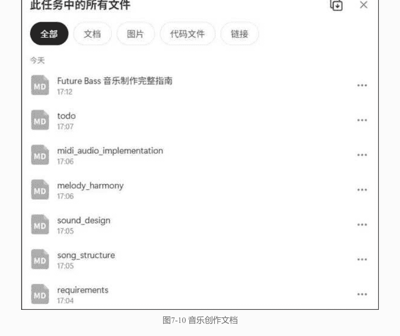

- 完整的音乐结构设计，涵盖Intro、Build-up、Drop、Breakdown和Final Drop。
- Vocal Chop专业处理技术，包括采样选择、切片技术、音高处理、节奏编排、效果处理链等专业内容。
- 侧链压缩的详细设置指南，包括基础原理、参数设置、不同轨道的侧链设置、实现方法和创意用法。
- 以MIDI文本格式呈现的旋律与和声进行，可直接导入DAW用于音乐创作。

这份指南适合有一定音乐创作基础的人使用，可作为创作Future Bass风格电子音乐的完整参考。

相较于普通大语言模型，智能体在多个方面展现出显著优势。在专业领域知识上，智能体依托垂直领域知识库，可精准输出技术参数、配置数值及实施路径等硬核内容，而通用模型通常止步于概念性概述。在内容组织上，智能体呈现高度结构化的知识体系，逻辑层级清晰、论证连贯闭环，而通用模型输出则常显松散，缺乏系统性规划。在技术细节层面，智能体提供的解决方案精确度高、实用性强，可直接应用于实践，而普通的语言模型常停留于概念层面。在实际应用中，智能体能预见并解决具体问题，这是普通大语言模型所不具备的能力；此外，智能体还兼具创新性艺术指导能力、适配不同用户的教学设计能力，以及潜在的多模态整合能力，这些特性共同构成了智能体区别于普通大模型的核心竞争力。

# 第8章 生活智能体

生活智能体是一种基于AI的个性化助手，通过自然语言交互、数据分析与自动化技术，深度融入用户的日常生活，提供从基础任务管理到情感陪伴的全方位服务。

## 8.1 情绪管理大师

在社会高速发展、竞争压力持续加剧的背景下，许多人出现了心理疾病或者抑郁倾向。因此，在实际的工作和生活中，做好情绪管理至关重要。

情绪管理是指个体运用认知、行为和生理调节策略，有效识别、理解和调控自身及他人情绪的过程。情绪管理不仅是心理学的重要课题，更是实现个人成长、改善人际关系、提升社会适应能力的核心能力。

随着AI技术的全面普及，我们可以借助智能体等AI助手进行情绪管理，从而保障身心健康，拥抱积极、平衡的生活状态。

### 8.1.1 如何使用智能体做好情绪管理

智能体推出的诸如“情绪平衡大师”等专业的情绪识别和管理助手，凭借先进的算法构建起一套系统化的情绪管理体系。该体系不仅能够帮助用户精准识别情绪波动，还能够根据不同场景提供个性化调节方案。“情绪平衡大师”通过情绪觉察、应对策略和心理工具，助力用户在各种情境中保持情绪平衡并做出明智的反应。用户可利用该智能体，学习情绪觉察训练方法，提升识别和命名自身情绪的能力；获取情绪调节指导，掌握有效管理和调节情绪的技巧；培养共情能力，增强理解他人情绪和视角的能力；优化情绪沟通方式，改进情绪表达和沟通途径。此外，用户还可参考情商应用场景指导，在不同场景中应用情绪智能。

#### 1. 借助智能体的任务规划与执行功能进行情绪管理

##### (1) 设定情绪管理目标与任务

用户可以将情绪管理的目标分解为具体的任务，并输入智能体。如图8-1所示，如果设定“每天进行10分钟冥想练习”的任务，智能体会自动将任务分解为若干子任务，如找到冥想指导音频、确定冥想时间和地点等，并调用相关工具（如音乐播放软件、日程提醒工具）来协助完成任务。

##### (2) 实时调整情绪管理计划

在情绪管理实践中，用户可能会遇到各种情况，因此需要根据实际情况调整计划。此时，智能体会根据用户反馈动态调整计划。比如，用户原本计划在晚上进行冥想，但当天晚上有紧急事务，智能体就会智能地将冥想时间调整到第二天早上或其他合适的时间。

###### 任务1：每日冥想练习

####### 子任务1.1：寻找冥想指导资源

**目标：** 获取专业的冥想指导音频和视频资源
**执行步骤：**
1. 搜索并下载冥想APP
2. 筛选适合初学者的10分钟冥想课程
3. 收藏不同类型的冥想指导
4. 测试音频质量和指导清晰度
5. 创建个人冥想资源库

####### 子任务1.2：确定冥想时间和地点

**目标：** 建立固定的冥想时间和舒适的冥想环境
**执行步骤：**
1. 分析个人日程，确定最适合的冥想时间段
2. 选择安静、舒适、不被打扰的冥想地点
3. 准备冥想用品（瑜伽垫、靠垫、毯子等）
4. 设置环境氛围（调节灯光、温度、香薰等）
5. 在日历中设置每日冥想提醒

####### 子任务1.3：学习冥想基础技巧

**目标：** 掌握冥想的基本姿势、呼吸方法和注意力训练
**执行步骤：**
1. 学习正确的冥想坐姿
2. 练习腹式呼吸技巧
3. 学习注意力集中和分散时的应对方法
4. 了解冥想中常见的身体感受和心理状态
5. 练习不同类型的冥想技巧

####### 子任务1.4：建立冥想记录系统

**目标：** 记录冥想体验，跟踪进步和效果
**执行步骤：**
1. 选择或创建冥想日记模板
2. 设计记录内容（时间、时长、类型、感受、效果等）
3. 选择记录工具（APP、纸质日记、电子表格等）
4. 建立评分系统（专注度、放松度、整体感受等）
5. 设置定期回顾机制

图8-1 冥想练习任务分解

#### 2. 利用智能体的记忆功能优化情绪管理

智能体通过构建用户情绪管理的个性化知识库，达成从行为记录到智能推荐的闭环优化。它会记录用户情绪调节过程中的交互数据，比如用户喜欢的音乐类型、冥想方式等信息。后续在为用户提供情绪管理建议或执行相关任务时，智能体会自动对方案进行优化。例如，如果听某种风格的音乐能帮助用户较快恢复情绪，那么智能体在后续为用户推荐情绪调节音乐时，会优先推荐这种风格的音乐。

#### 3. 借助智能体的跨平台操作功能进行情绪管理

##### (1) 情绪记录与分析

智能体能够基于网页爬虫、应用操控等机制，执行跨平台信息抓取任务。用户可借助这一功能，将自己在不同平台（如社交媒体、日记应用等）上的情绪记录进行整合与分析。通过分析情绪记录，用户能够了解自身情绪的变化规律以及情绪反应的触发因素。

##### (2) 获取情绪管理资源

用户可以令智能体跨平台搜索与情绪管理相关的资源，包括专业的情绪管理课程、心理咨询服务信息等。智能体会根据用户的需求进行筛选并推荐，示例如下。

**免费情绪管理资源大全**

**免费在线课程**

- **大学MOOC平台课程**
  - **自我认知与情绪管理 - 哈尔滨工业大学**
    - 平台：学堂在线
    - 特色：专业大学课程，具有系统性学习自我认知和情绪管理的优势
    - 评价：权威性高，内容全面
  - **好心态如何自己造——心理健康教育 - 湖南师范大学**
    - 平台：中国大学MOOC
    - 特色：适合各年龄段学习者，注重实用性
    - 评价：内容丰富，实操性强
  - **研究生素养课——积极心理与情绪智慧 - 福州大学**
    - 平台：学堂在线
    - 特色：专注于积极心理学和情绪智慧的培养
    - 评价：理论与实践相结合，适合深度学习

### 8.1.2 使用智能体解决职场冲突案例

本节通过呈现借助智能体解决职场冲突的案例，帮助读者深入理解利用智能体进行情绪管理的方法。

#### 1. 背景

某公司员工小张在项目合作中与同事小李产生了意见分歧，双方情绪激动，现场气氛紧张。小张感到愤怒和挫败，担心这种情绪会影响团队合作和项目进展。

#### 2. 使用智能体进行情绪管理

##### (1) 情绪觉察与命名

小张在感到愤怒和挫败时，启动了智能体的情商平衡大师功能。

智能体引导小张进行情绪觉察训练，帮助他识别和命名自己的情绪，例如，“我现在感到愤怒，因为我觉得自己的意见没有得到重视”。

##### (2) 情绪调节指导

智能体提供了情绪调节指导，建议小张采取深呼吸、暂时离开冲突现场等策略来平复情绪。

小张按照指导进行了深呼吸练习，并暂时离开会议室，到外面走了一圈。在此过程中，他的情绪逐渐平复。

##### (3) 共情能力培养

回到会议室后，智能体引导小张尝试从同事小李的角度思考问题，理解小李的立场和情绪。

通过共情能力的培养，小张意识到小李可能也承受着压力，也有自己的考量因素，从而减少了对小李行为的抵触情绪。

##### (4) 情绪沟通优化

智能体指导小张如何以更恰当的方式表达自己的情绪和需求。

小张在冷静下来后，与小李进行了坦诚的沟通，表达了自己的观点和感受，同时也认真倾听了小李的想法。

##### (5) 冲突解决与关系修复

在智能体的引导下，小张和小李进行了有效的沟通，共同探讨了问题的解决方案。

双方达成了共识，决定在项目合作中更加注重相互倾听和尊重。

#### 3. 效果

借助智能体，小张成功地管理了自己的情绪，避免了与同事间冲突的进一步升级。

双方通过有效沟通，找到了问题的解决方案，增强了团队合作氛围，提升了彼此间的信任。小张学会了如何更好地管理自己的情绪，提高了职场情商和人际交往能力。

### 8.1.3 使用智能体进行家庭场景中的压力管理与亲子关系优化

家庭场景中的压力管理是人们在日常生活中经常会遇到的问题。下面以一位职场妈妈为例，展示利用智能体解决问题的全过程。

35岁的职场妈妈李女士近期面临多重压力：公司裁员风险、孩子小升初学业辅导压力，以及与伴侣因家务分工产生的矛盾。她陷入了持续焦虑，常因小事对孩子发火，导致亲子关系紧张。她甚至出现了失眠和食欲下降等问题。

以下是使用智能体进行情绪管理的过程。

#### 1. 情绪触发点识别与归因（觉察阶段）

李女士通过语音向智能体描述：“今天孩子的作业错了三道题，我吼了他，现在特别内疚，但当时控制不住。”

智能体的响应如下。

1）调用情绪溯源工具，结合李女士的日程记录（例如，连续加班三天、未完成家务清单等情况），分析出压力来源，如图8-2所示。她的压力源分布情况为：工作压力占比51.7%、育儿压力占比48.3%。

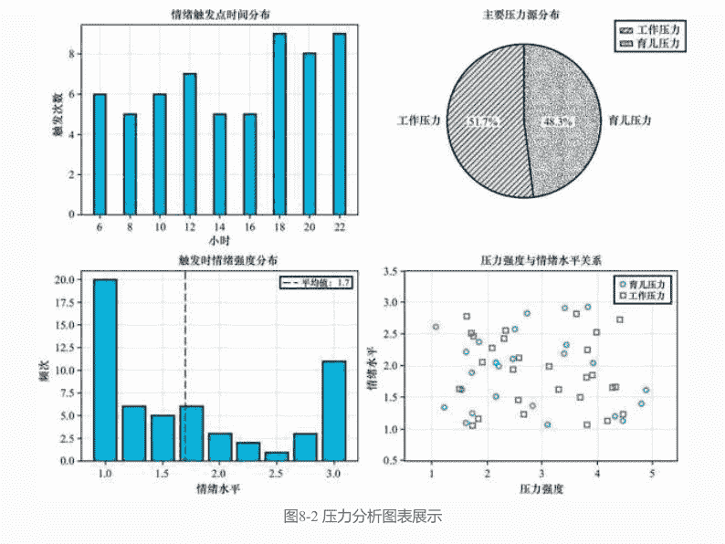

2）输出可视化图表，给出情绪波动与压力源在时间维度上的关联性分析，例如加班后更易对孩子发火。

#### 2. 自动化情绪调节方案（行动阶段）

##### (1) 职场压力调节

首先，智能体生成“裁员风险应对清单”，内容包括如何更新简历、技能提升课程（如Python自动化办公课程）推荐。

- **技能提升规划**
  - **Python基础阶段（公司建议学习的路线规划，时长1～2个月）**
    1. Python基础语法
       - 学习内容：Python语法、从入门到实战
       - 学习时间：1个月
       - 实践项目：编写简单的数据处理脚本
    2. 办公自动化基础
       - Excel自动化：运用openpyxl库
       - Word文档处理：运用python-docx库
       - PDF操作：运用PyPDF2库
       - 邮件自动化：运用smtplib库
  - **中级阶段（2～3个月）**

然后，调用日历工具将工作拆分为“紧急-重要”四象限任务，自动屏蔽非必要会议通知。可以通过这种方式对工作进行优先级划分，从而高效地进行时间管理，提高工作效率。图8-3为任务管理截图。

###### 艾森豪威尔矩阵任务管理系统

####### 2.1 四象限理论基础

**象限定义**

- **第一象限：紧急且重要**
  - 特征：危机处理、紧急问题
  - 策略：立即行动
  - 目标：快速解决，避免扩大
  - 时间分配：不超过25%

- **第二象限：重要但不紧急**
  - 特征：预防工作、能力建设
  - 策略：安排时间
  - 目标：长期发展，预防问题
  - 时间分配：应占50%~60%

- **第三象限：紧急但不重要**
  - 特征：打断工作、他人要求
  - 策略：委派他人
  - 目标：减少干扰，提高效率
  - 时间分配：应控制在15%以下

- **第四象限：不紧急不重要**
  - 特征：时间浪费、无意义活动
  - 策略：消除/忽略
  - 目标：释放时间，专注重要事务
  - 时间分配：应接近0%

####### 2.2 任务分类方法

**紧急性评估标准**

- **5级评分系统**
  - 5分：今天必须完成
  - 4分：本周内完成
  - 3分：本月内完成
  - 2分：下月完成
  - 1分：无明确时限

- **关键词识别**
  - 紧急：立即、马上、今天、截止、deadline
  - 时间压力：明天、本周、这周、急需
  - 后果严重：客户投诉、系统故障、合同到期

**重要性评估标准**

- **5级评分系统**
  - 5分：影响核心目标
  - 4分：影响重要目标
  - 3分：影响一般目标
  - 2分：影响较小
  - 1分：几乎无影响

- **评估维度**
  - 业务影响：收入、成本、效率
  - 职业发展：技能、经验、声誉
  - 团队影响：协作、士气、绩效
  - 长期价值：战略、创新、竞争力

图8-3 任务管理

##### (2) 育儿焦虑调节

首先，接入学习力评估AI，分析孩子的错题类型，生成个性化辅导计划（如孩子几何薄弱，推荐几何动画教学视频），如图8-4所示。

然后，设置“20分钟专注辅导”定时器，避免因过度投入辅导引发情绪崩溃。

####### 2.3 几何动画资源的选择与应用策略

针对不同类型的几何学习困难，我们需要采用不同的动画资源选择和应用策略。

对于空间想象困难的学生，应优先选择3D立体几何动画资源。这类学生在学习立体几何时往往难以从平面图形想象出立体结构，因此需要通过3D动画来建立正确的空间概念。推荐的学习顺序是：首先观看基础的点线面关系动画，建立空间坐标概念；然后学习简单几何体（如正方体、长方体）的3D展示，理解面与面的关系；接着学习复杂几何体（如棱锥、圆锥）的结构动画；最后通过三视图动画来巩固空间想象能力。

对于逻辑推理薄弱的学生，应重点使用几何证明过程动画。这类动画能够将抽象的逻辑推理过程具象化，帮助学生理解证明的思路和方法。建议采用分步学习的策略：首先学习简单的几何性质证明动画，如角的性质、线段的性质等；然后学习三角形相关的证明动画，如全等三角形、相似三角形的判定；最后学习复杂的几何定理证明动画，如圆的性质定理、立体几何定理等。

图8-4 个性化辅导内容

##### (3) 关系压力调节

首先，生成家务分工谈判脚本，模拟与伴侣的对话，如图8-5所示。

> **核心谈判脚本**
>
> **场景一：重新分配日常家务**
>
> **发起对话：**
> > "这周我负责接送孩子，你负责做饭可以吗？我觉得这样分工可能更合理一些。"
>
> **如果对方同意：**
> > "太好了！那我们试试这个安排。如果有什么问题，我们随时可以调整。"
>
> **如果对方犹豫：**
> > "我理解你的担心。要不我们先试一周看看效果？如果不合适，我们再商量其他方案。"
>
> **如果对方拒绝：**
> > "我明白你的想法。那你觉得怎样分工会更好呢？我们一起想想解决办法。"

图8-5 谈判脚本

然后，推荐家庭会议模板，建议每周日的固定时间召开家庭会议沟通需求。

#### 3. 实时情绪反馈与动态调整（优化阶段）

##### (1) 情绪监测

1）李女士佩戴的智能手环可借助智能体实时分析心率变异性（Heart Rate Variability，HRV）、皮肤电反应等生理数据。

2）当检测到压力水平超标（如HRV连续30分钟低于阈值）时，系统会自动启动以下干预措施：播放李女士收藏的轻音乐歌单，推送“5分钟正念呼吸引导”音频，同时暂停非紧急任务通知。

##### (2) 效果追踪

两周后，智能体生成的情绪管理报告显示，李女士对孩子发火的频率从每周5次降至每周1次；她的深度睡眠时间从4小时提升至5.5小时；与伴侣发生冲突的对话减少了70%。

#### 4. 长期能力建设（预防阶段）

##### (1) 认知重构训练

## 8.2 人际关系顾问

在现代社会中，社交圈层的碎片化特征日益显著。拥有不同年龄、不同职业和不同兴趣爱好的人生活在各自的社交圈层中，难以开展跨圈层的交流和融合。这使得人们在建立和维护人际关系网络时面临着双重困难：既缺乏突破圈层壁垒的有效路径，又难以掌握与异质群体建立联结的社交技巧。人际关系顾问可以根据个体的社交需求和目标，提供定制化建议，帮助用户拓展社交圈子，提升社交能力。

随着互联网和移动设备的普及，线上社交已成为主流沟通方式。人们越来越多地通过社交媒体、即时通信工具等进行交流。然而，线上交流必然会导致面对面沟通中非语言信息（如肢体语言、面部表情等）的缺失，这会增大误解和提升沟通不畅的发生风险。以文字聊天为例，一个简单的“哦”字，在不同语境下可能有多种不同的解读，比如被解读为冷漠、敷衍或只是单纯地接收信息，这就增加了人际关系处理的复杂性。此时，人际关系顾问就派上用场了。它能够帮助人们理解线上交流的特点，掌握有效的线上沟通技巧，避免因误解而产生矛盾。

在职场中，人际关系颇为复杂。同事之间不仅存在合作关系，还可能存在竞争关系。与上级、平级同事和下属建立良好的关系，对于个人的职业发展而言至关重要。例如，在团队合作过程中，团队成员可能会因利益分配、工作分工等问题产生矛盾和冲突。在这种情况下，人际关系顾问可以为你提供职场人际关系管理策略，助力你在职场中更好地处理人际关系，进而提高工作效率和职业竞争力。

当今社会在社交模式、个人发展和社会结构等方面都发生了巨大的变化，这些变化使得人们在处理人际关系时面临更多挑战和困难。因此，人们想要拥有人际关系顾问的需求越来越迫切。人际关系顾问可以凭借专业的知识和技能，帮助人们应对人际关系问题，提升人际交往能力，促进个体的成长和发展，同时也为社会的和谐稳定贡献力量。

### 8.2.1 如何使用智能体改善人际关系

要想建立良好的人际关系，可以借助智能体的“情绪平衡大师”功能，融合人际沟通与情绪管理特性，从以下方面着手改善人际关系。

1. 情绪管理与自我觉察
   (1) 情绪觉察训练
   智能体可帮助用户精准定位自身情绪触发点。例如，在冲突场景中，它会自动提醒用户深呼吸或暂停对话，避免情绪失控。通过系统自动记录的情绪日记，用户能够分析自己在不同场景下的情绪反应模式（如面对同事批评时容易焦虑），进而调整应对策略。

   (2) 情绪调节指导
   当用户因工作压力过大而对家人发火时，智能体能够提供即时建议，如暂时离开现场，进行5分钟正念练习，或者推荐相关冥想音频，帮助用户快速平复情绪。

2. 共情能力培养
   (1) 了解他人的情绪状态
   当用户在与他人对话时，智能体会自动分析对方的语音、语调、用词习惯，并实时提示用户对方可能的情绪状态（如对方语气急促，可能感到焦虑），同时建议用户调整沟通方式，例如放慢语速、使用安抚性语言等。

   (2) 角色扮演练习
   用户可通过智能体模拟高冲突场景（如与同事争执的场景），并借助虚拟对话练习共情回应，例如学会说“我理解你的压力，我们可以一起寻找解决方案”。

3. 沟通技巧优化
   (1) 非暴力沟通训练
   智能体能够提供沟通模板，助力用户将指责性语言转化为表达感受和需求的方式。例如，将“你总是拖延”转化为“我感到焦虑，因为项目进度落后了，我们需要讨论如何调整”。

   (2) 冲突解决策略
   当用户与他人发生分歧时，智能体可引导用户使用以“我们”为导向的表达，例如“我们如何共同解决这个问题”，而非“你必须听我的”。

4. 人际关系分析与建议
   (1) 社交行为分析
   通过分析用户的聊天记录、通话数据等，智能体能够识别用户的沟通模式（如是否经常打断他人、是否过于以自我为中心），并提供改进建议。

   (2) 个性化社交策略
   智能体能够根据用户的性格特点（如内向或外向）和社交目标（如拓展职场人脉、改善家庭关系），制订专属的社交计划。图8-7展示了为内向者制订的社交计划，并推荐了线上交流活动。

   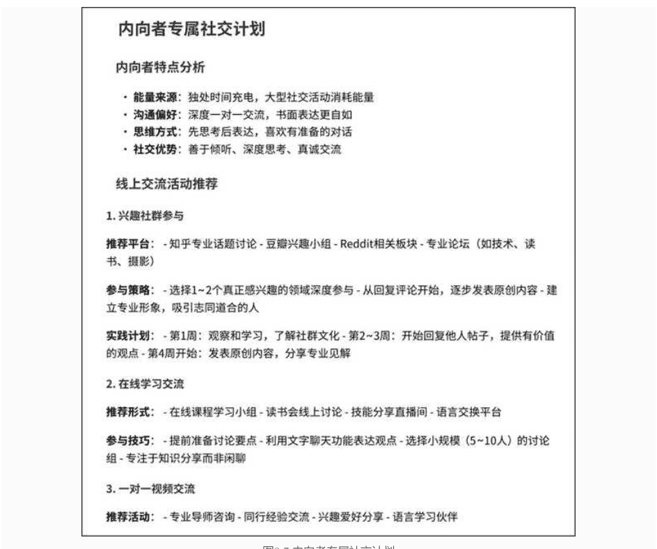
   图8-7 内向者专属社交计划

5. 长期关系维护
   (1) 定期关系复盘
   智能体能够帮助用户回顾与重要他人的互动记录，并分析关系中的积极和消极模式。例如，过去一个月中，你与伴侣的沟通频率下降了30%，建议增加每周一次的深度对话。

   (2) 信任建立工具
   智能体通过智能提醒功能督促用户履行承诺、保守秘密等，帮助用户逐步建立信任关系。例如，当用户忘记回复他人消息时，智能体会提醒：“及时回复有助于信任的建立，建议现在回复。”

智能体凭借上述功能助力用户实现从本能反应到策略性社交的转变。其核心价值在于将抽象的人际关系技巧转化为可操作的步骤，并通过持续反馈帮助用户形成良性的关系维护循环。

### 8.2.2 使用智能体改善人际关系案例

智能体可以借助情感分析、沟通优化、社交提醒等功能，为用户提供覆盖家庭、职场、朋友等各类场景的人际关系解决方案。下面分别给出利用智能体改善家庭关系、职场关系和朋友关系的具体案例。

1. 家庭关系优化——减少争吵，增强理解
   场景：一对夫妻经常因家务分配和育儿问题发生争执，妻子觉得丈夫不够体贴，丈夫则认为妻子过于敏感。
   智能体的介入方式如下。

   (1) 情绪识别与提醒
   智能体通过智能手表/语音助手检测到用户（妻子）出现音量升高、语调变化和语速加快（愤怒信号）的情况，然后轻声提醒：“检测到您可能出现了情绪激动的情况，建议深呼吸10秒后再沟通。”

   (2) 冲突复盘与建议
   事后分析争吵记录（如“你从不帮忙”VS.“我明明做了”），生成报告。报告显示，矛盾点是家务分配认知差异，建议使用共享待办清单（智能体自动同步两人日程），并设定家庭会议时间，由智能体主持议程（避免因情绪化而偏离会议主题）。

   (3) 情感需求提示
   提醒丈夫：“明天是结婚纪念日，妻子上周提过想要花，推荐附近的花店折扣。”

   结果表明，智能体介入后，夫妻双方发生争吵的频率降低了60%，双方主动沟通需求的意愿明显增强。智能体作为数字化中立调解者，缓解了双方的对立情绪。

2. 职场关系提升——高效沟通，建立信任
   场景：一名新员工因不熟悉团队文化，在会议上发言过于直接，被同事认为不懂分寸。
   智能体的介入方式如下。

   (1) 实时沟通辅助
   在线上会议中，智能体通过AR眼镜进行提示，检测到用户语速过快，便提示：“放慢语速，加入停顿。”

   (2) 社交习惯分析
   智能体通过分析过往聊天记录，发现用户常用“绝对”“肯定”等词，这可能会让用户显得固执。智能体建议用户使用“一种可能性是……”“我的初步想法是……”等表达来替换原来的表达习惯。

   (3) 关系维护提醒
   智能体自动检索同事的兴趣（如A喜欢足球，B刚养了一只猫），并提供破冰话题，比如：今天可询问B“小猫适应新家了吗？”

   结果显示，3个月内同事的评价从“难以合作”变为“思路清晰，团队意识强”。

3. 朋友关系维护——避免疏远，增强联结
   场景：用户因工作忙碌，与好友的联系逐渐减少，生日祝福也常常遗漏。
   智能体的介入方式如下。

   (1) 社交网络动态追踪
   智能体自动标记重要日期（生日、纪念日），并提前提醒：“后天是Anna的生日，她去年提到想要香薰蜡烛，推荐这款小众品牌。”

   (2) 智能对话生成
   当用户输入“想约老友但不知怎么开口”时，智能体提供的模板为“好久不见！看到你朋友圈去了X地旅行，旅行感受怎么样？”

   (3) 深度关系分析
   智能体根据互动频率（消息回复速度、见面次数），生成朋友亲密度图谱，并提示：“最近与Mike的互动变少了。他刚换了工作，可询问他是否适应新工作。”

   结果显示，用户与朋友的聚会频率从每季度1次提升至每月1次，用户被评为朋友圈里最暖心的人。

通过上面的几个案例，我们可以看到智能体是如何改善人际关系问题的。这些案例表明，智能体助手可以帮助我们在实际生活中解决人际关系紧张等一系列问题。

## 8.3 健康顾问

健康顾问在现代社会中扮演着至关重要的角色。随着AI技术的普及，健康顾问这一角色也可以由智能体助手来充当。它通过分析用户的健康数据（如体检报告、家族病史、生活方式等），能够提前发现潜在的健康风险。智能体健康顾问还会依据用户的年龄、性别、健康状况、生活习惯等，提供量身定制的健康管理方案。此外，智能体健康顾问还可参与社区健康筛查、疫苗接种宣传等工作，助力构建全民健康防线。

### 8.3.1 为什么需要智能体健康顾问

让智能体等AI助手充当健康顾问是科技与医疗健康领域深度融合的成果，能够满足以下几个方面的需求。

1. 个性化健康需求
   每个人的健康状况、生活习惯、遗传背景等存在明显差异，传统的“一刀切”式健康建议往往难以契合个体需求。智能体健康顾问通过收集和分析用户的健康数据（如年龄、性别、体重、运动习惯、饮食习惯、病史等），能够为用户提供量身定制的健康建议和计划。例如，针对有高血压家族遗传史的用户，智能体健康顾问可以提醒其定期监测血压，并推荐适宜的低盐饮食方案和运动计划。

2. 提供即时、全天候的健康咨询
   健康问题往往不期而至，而传统的医疗咨询往往受时间和地点的限制。智能体健康顾问可以随时为用户提供健康咨询服务，无论是关于饮食营养配比、运动方案设计、疾病预防策略还是症状初步解读，智能体健康顾问都能迅速给出专业建议，帮助用户及时了解自身健康状况，做出科学的决策。

3. 辅助进行慢性病管理
   慢性病（如糖尿病、高血压、心脏病等）需要长期监测和干预。智能体健康顾问能够借助智能设备（如可穿戴设备、家用医疗监测仪等）实时收集患者的健康数据并进行动态分析，进而提供个性化治疗建议和管理方案。以糖尿病患者为例，智能体健康顾问可以依据连续血糖监测数据智能调整其饮食和用药计划，确保患者的血糖水平保持稳定。

4. 提升健康教育的普及程度和效率
   健康教育是预防疾病、促进健康的重要手段。然而，传统的健康教育方式往往受限于资源、时间和地域等因素，难以覆盖所有人群。智能体健康顾问则可以借助互联网和移动设备的技术优势，以生动、有趣的方式向用户呈现健康教育内容，提高用户的健康意识与自我管理能力。同时，智能体健康顾问还可以根据用户的兴趣和需求，精准推送个性化的健康教育内容，高效地向用户传递健康教育理念。

5. 缓解医疗资源紧张
   随着人口老龄化进程加速以及慢性病发病率上升，医疗资源紧张已成为亟待解决的全球性问题。智能体健康顾问作为智能化健康管理载体，可以在一定程度上缓解医疗资源紧张的状况。通过为用户提供初步的健康咨询和疾病风险评估服务，智能体可精准识别无须线下就诊的轻症情况，减少不必要的医院就诊和检查次数，降低医疗成本，提高医疗资源的利用效率。

6. 保护用户隐私和数据安全
   在健康咨询过程中，保障用户的隐私与数据安全至关重要。智能体健康顾问通常采用先进的加密技术和数据保护措施，确保用户的健康数据不被泄露或滥用。同时，智能体健康顾问还可以根据用户的授权设置，控制数据的访问和使用权限，进一步保障用户的隐私权益。

### 8.3.2 如何使用智能体做好健康管理

借助智能体做好健康管理，可从数据整合与分析、个性化健康管理计划生成、远程医疗服务支持、健康知识获取与学习、健康管理计划执行与监督等方面入手。下面介绍使用智能体做好健康管理的完整过程。

1. 数据整合与分析
   1) 上传健康数据：用户可以将体检报告、病历记录、可穿戴设备数据等上传至智能体的知识库管理区。智能体能够处理和分析多种类型的健康数据，提取关键指标，生成可视化健康报告，助力用户快速了解自己的健康状况。
   2) 提取关键指标：智能体会对上传的数据进行分析，提取血压、血糖、心率等关键指标，并以图表等形式将各项指标的变化趋势直观地展示给用户。

2. 个性化健康管理计划制订
   1) 生成个性化计划：智能体能够依据用户的健康数据和生活习惯，生成个性化健康管理计划。这份计划包括饮食建议、运动计划、用药提醒等内容，助力用户更好地管理自己的健康。
   2) 定期评估与调整：智能体会根据用户定期反馈的健康管理计划执行情况，以及最新获取的健康数据，对计划进行动态调整，以满足用户不断变化的需求。

3. 远程医疗服务支持
   1) 在线问诊与症状分析：用户可以通过智能体开展在线问诊，描述自己的症状。智能体依托先进的算法和庞大的医学知识库，能够深入分析症状特征，快速完成初步诊断，为用户提供及时的医疗建议。
   2) 医疗设备集成与监测：智能体能够与医疗设备集成，实时监测患者的生命体征。例如，与智能手环、智能血压计等设备相连，获取用户的实时健康数据，并在数据出现异常时及时提醒用户。

4. 健康知识获取与学习
   1) 查询医疗知识库：智能体能够访问医疗知识库并展开查询，为用户提供最新的医学信息和治疗方案。用户可以向智能体咨询健康问题，进而获取专业的解答。
   2) 健康科普与教育：智能体会向用户推荐科普讲座、线上课程等资源，以此确保用户接触到的内容具有科学性和前沿性，帮助用户树立健康生活的理念。

5. 健康管理计划执行与监督
   智能体可以对健康管理计划中的各项任务（如运动、饮食等）进行拆解，同时提醒用户按时执行。用户可以在任务列表界面查看任务的进度和状态。

### 8.3.3 使用智能体做好健康管理的案例

下面通过一个使用智能体进行健康管理的具体案例，清晰地呈现具体的操作过程。该案例将帮助用户掌握追踪自己健康状况的方法。

1. 背景
   患者信息：男性，30岁，身高175cm，体重100kg，BMI值为32.7，属于肥胖范畴。
   健康问题：长期缺乏运动和不合理的饮食结构导致体重超标，并伴有高血压、高血脂等慢性疾病。

2. 智能体在健康管理中的应用
   (1) 健康数据收集与分析
   1) 数据上传：患者将体检报告、病历记录等上传至智能体。
   2) 数据分析：智能体处理并分析这些数据，提取关键指标，如血压、血糖、血脂等，生成可视化健康报告。

   (2) 个性化健康管理计划制订
   1) 饮食调整：智能体根据患者的健康数据和生活习惯，建议减少高热量、高脂肪食物的摄入，增加蔬菜、水果和蛋白质的摄入比例，适量控制碳水化合物的摄入。
   2) 运动计划：根据患者的喜好和身体状况，智能体制订了每周至少进行3次有氧运动、每次持续30分钟以上的运动计划，并逐步增加运动强度与时间。
   3) 生活习惯改善：智能体建议患者戒烟限酒，保证充足的睡眠时间，缓解压力等。

   (3) 监督与激励
   1) 目标设定：患者与智能体共同设定减重目标，并定期监测体重、体脂率等指标。
   2) 计划调整：依据监测结果，智能体及时调整健康管理计划，确保其始终契合患者的需求。
   3) 激励措施：智能体还制定了激励措施，如设定阶段性小目标，并在目标达成后给予奖励，以提高患者的积极性。

   (4) 远程医疗服务支持
   1) 在线问诊：患者可以通过智能体开展在线问诊，描述自己的症状。智能体依托先进的算法和庞大的医学知识库，能够深入分析症状特征、快速完成初步诊断，为用户提供及时的医疗建议。
   2) 医疗设备集成：若有必要，智能体还可以与医疗设备集成，实时监测患者的生命体征，如心率、血压等，并在数据出现异常时及时提醒患者。

3. 效果
   经过6个月使用智能体开展健康管理，患者成功减重20kg，BMI值降至26.3，回归到了正常水平。高血压、高血脂等慢性疾病得到了有效控制，身体各项指标显著改善。
   此后，患者继续保持良好的饮食和运动习惯，强化自我管理，定期监测身体指标，同时依据智能体的建议及时调整计划，以维持健康状态。

## 8.4 消费决策大师

在现代消费环境日益复杂、用户需求愈发多元的背景下，制定合理且明智的消费决策的重要性与日俱增。这不仅能够减少损失，而且有助于提升消费行为的投入产出比。随着AI技术在生活中的持续渗透，运用智能体等AI助手辅助进行消费决策，已成为行业发展的必然趋势。

### 8.4.1 为什么需要使用智能体辅助进行消费决策

消费决策的本质是在信息过载、需求复杂、风险隐蔽的环境中，高效筛选出最优选项。智能体作为AI消费决策助手，能够凭借以下核心能力化解传统决策中的痛点，直接提升决策质量与效率。

（1）信息处理能力：从大海捞针到精准定位

在电商平台SKU规模突破10亿级的当下，人工筛选商品不仅耗时低效，还极易遗漏关键信息（如隐藏优惠、高频差评）。此外，手机续航、相机传感器型号等专业参数的对比难度较高，更容易让普通消费者陷入认知盲区。

智能体的筛选功能通过自然语言处理技术解析商品描述与用户评价，提取核心参数（如续航12小时、防水IP68），并以直观的可视化表格呈现对比数据。其风险预警功能凭借先进的算法，敏锐地识别虚假评价（如刷单话术）、历史降价记录（如618曾降价30%）等信息，全方位降低决策风险。

（2）个性化推荐：从千人一面到量身定制

传统推荐系统依赖基础标签（如价格敏感型标签），无法理解用户的深层需求（如适合健身的耳机需具备防水、轻便等特性）。智能体的需求解码系统借助语义分析技术，能够精准理解用户的模糊需求（如当用户输入“适合跑步的耳机”时，智能体会推荐防水等级达IPX7以上、重量低于20g的型号）。此外，智能体还具备场景化适配能力，可结合时间、地点、天气等上下文信息（如雨天推荐防水鞋，夏季推荐防晒衣），提供精准的推荐。

（3）价格与优惠管理：从盲目凑单到最优组合

促销活动复杂多样（如满减、叠加券、限时折扣），不仅人工计算成本高，还容易因遗漏信息而错失优惠。

智能体可以进行全网比价：实时抓取各平台价格，标注历史低价（如当前价格高于过去90天均价10%）。通过算法计算最优购买方案（如通过满300元减50元、店铺券及品类券的组合，可节省23%的预算）。

（4）决策风险降低：从冲动消费到理性决策

直播购物、网红带货易引发冲动消费，这种购物方式的退货率超过30%。

智能体通过虚拟技术构建沉浸式消费体验（如AR试妆、3D看房），让消费者在虚实融合中深度感知商品特性，有效降低冲动消费的概率。同时，智能体能够整合专业评测数据（如中关村在线硬件评分），为决策者提供客观的参考。

### 8.4.2 如何使用智能体进行科学的消费决策

进行科学的消费决策，关键在于面对信息冗余、需求模糊以及风险隐蔽的复杂场景时，通过工具化手段构建“精准需求匹配-风险可控-成本优化”这样的决策流程。使用智能体进行消费决策主要涵盖需求拆解、智能筛选（该环节包括深度对比和优惠组合两个环节）、决策验证等几个关键步骤。示例如下。

| 步骤 | 详细内容 |
| --- | --- |
| 1. 需求拆解 | Why（为什么买）、Who（为谁买）、What（买什么）、When（何时用）、How（怎么用）、Where（使用场景） |
| 2. 智能筛选 | 输入需求参数 → 设置过滤条件 → 生成候选清单 |
| 3. 深度对比 | 横向参数对比表、成本拆解图、风险提示标签 |
| 4. 优惠组合 | 历史比价、优惠券、满减、保价、组合方案 |
| 5. 决策验证 | AR虚拟试用、专家评测报告、7天无理由退货 |
| 6. 执行购买 | 官方渠道、经销商、跨境平台、一手平台、代购 |
| 完成流程 | 完成支付 & 订单跟踪 |

通过上述流程后，消费者最终决定是否购买并行动。接下来，我们结合具体场景说明智能体在构建消费决策流程中的使用方法。

#### 1. 需求拆解：明确消费目标与优先级

在明确核心需求时，可以采用5W1H（What、Why、Who、When、Where、How）框架拆解需求。

- What：具体的商品/服务（如运动耳机而非普通耳机）。
- Why：购买目的（如跑步时听播客，需具备防水、防脱落功能）。
- Who：使用者特征（如大体重人群，需高缓震跑鞋）。
- When：使用时间（如夏季户外活动时，需防晒速干衣）。
- Where：使用环境（如厨房，需防油污、易清洁的台面）。
- How：预算范围（如500～800元）

示例：购买电脑时，明确需求为“用于程序员办公，需配备16GB内存+512GB SSD，预算6000～8000元”。

技巧：排除伪需求。可以通过“3天冷静期”过滤冲动需求。例如，将商品加入收藏夹，3天后重新评估是否仍有购买必要。智能体可推送“您收藏的xx商品的历史降价记录”，辅助判断是否需要立即购买。

#### 2. 筛选：从信息筛选到方案生成

使用智能体进行筛选（缩小选择范围）的操作步骤如下。

1）输入需求：在智能体中输入需求关键词（如“16GB内存笔记本”“程序员”）。
2）参数过滤。
- 硬件：CPU型号、屏幕色域、接口类型。
- 服务：保修时长、上门维修服务。
- 评价：差评关键词（如“散热差”“屏幕漏光”）。
3）生成候选清单：智能体根据需求匹配度对候选结果进行排序，标注核心需求满足度（如★★★★☆）。

示例：如图8-8所示，搜索运动耳机时，智能体会自动过滤掉非防水型号，并标注耳机防水等级，以及耳机推荐使用场景。

##### 防水等级快速对照表

| 防水等级 | 小雨 | 中雨 | 大雨 | 暴雨 | 游泳 | 推荐场景 |
| :--- | :---: | :---: | :---: | :---: | :---: | :--- |
| IPX4 | ✅ | ⚠️ | ❌ | ❌ | ❌ | 日常运动、健身房 |
| IPX5 | ✅ | ✅ | ⚠️ | ❌ | ❌ | 户外跑步、高强度运动 |
| IPX6 | ✅ | ✅ | ✅ | ⚠️ | ❌ | 极限运动、恶劣天气 |
| IPX7 | ✅ | ✅ | ✅ | ✅ | ✅ | 水上运动、短时游泳 |
| IPX8/IP68 | ✅ | ✅ | ✅ | ✅ | ✅ | 专业游泳、潜水 |

图8-8 耳机防水等级表

##### （1）深度对比：量化决策依据

- 横向对比表：自动生成多款商品的参数对比表（如续航、重量、降噪深度等），支持排序和筛选。
- 成本拆解：计算长期使用成本（如打印机耗材费用、新能源车充电成本等）。
- 风险标注：标注差评关键词（如售后推诿、虚标参数）；展示历史故障率（如某品牌电视3个月内维修率为12%）。

示例：如表8-1所示，对比两款空气净化器时，智能体显示了这两款空气净化器的滤网寿命。353Y00C的滤网寿命比小米ProH长2个月，相当于有20%的寿命优势。这主要得益于其更高的CCM值和更优质的滤材。

表8-1 两款净化器的滤网寿命对比

| 产品型号 | 官方滤网寿命 | 寿命优势 |
| :--- | :--- | :--- |
| 小米ProH | 10个月 | 基准 |
| 353Y00C | 12个月 | +20% |

##### （2）优惠组合：压低购买成本

以下是压低购买成本的相关策略。

- 全网比价：智能体能够抓取京东、天猫、拼多多等平台的价格信息，并标注历史低价，绘制价格波动曲线。
- 优惠叠加：自动计算“满减+券+红包”的最优组合方式（如满3000元减300元，叠加店铺券200元、品类券100元，实际仅需支付2400元）；提示隐藏优惠信息（如以旧换新补贴、学生认证折扣）。
- 保价服务：自动监控商品价格波动情况，降价时提醒用户申请补差。

示例：如图8-9所示，购买手机时，智能体提供当前价格、618历史低价、购买建议等信息。

###### 小米14 16GB+512GB 购买提示

####### 产品信息

小米14 16GB+512GB 徕卡光学镜头版

####### 价格信息

- 当前价格：3499元（国补后）
- 618历史低价：约4299元（2024年618期间）
- 官方原价：4599元

####### 价格分析

- 当前价格比原价便宜：1100元（降幅24%）
- 当前价格比618历史价格便宜：约800元
- 史上最低价：小米14系列历史最低价格

####### 购买建议

立即购买推荐

推荐指数：★★★★★

推荐理由：1. 史上最低价，性价比极高 2. 国补15%直接补贴，优惠力度大 3. 骁龙8 Gen3旗舰芯片+徕卡光学镜头 4. 16GB+512GB大内存大存储配置

降价提醒设置

建议加入降价提醒：3299元 - 比当前价格再低200元 - 关注618期间可能的进一步优惠 - 监控平台：京东、天猫、小米商城


#### 3. 验证决策：降低后悔的可能性

消费者可通过虚拟试用、购买延保服务、参与免费试用活动以及利用7天无理由退货政策等方法，降低购买后产生后悔情绪的可能性。

配套资源验证码 251134