# 掌控智能体：定制你的AI伙伴

# 内容概览

本书聚焦于各行业智能体的设计与落地实践，整体分为上、下两篇，共计八章。

上篇为智能体基础篇，覆盖第1至2章，系统阐释智能体的概念内核、常见使用场景、核心价值、演进趋势，以及高质量指令的构建思路。

下篇为智能体应用篇，覆盖第3至8章，围绕教育、科研、职场、创意、生活等多个领域展开实操演示，并以真实案例说明落地流程。

全书汇总了二十余种指令撰写范式，助力读者掌握高效使用方法，在实践中感受智能体带来的变革性推动。

本书适合统计学或IT相关专业在读学生、从事教育科研的从业者，以及对人工智能技术感兴趣的爱好者阅读。

# 前言

## 何以成书

大模型技术的快速演进，使业内普遍认为智能体是通往通用人工智能的关键路径。本书写作的初衷，是推动智能体从技术突破走向真实场景应用。

智能体正掀起一次工作范式迁移。它能够解析自然语言指令，自主生成数据分析报告、程序代码及可视化成果，完成从理解到执行的跨越。作者团队依托十余年数字营销与AI应用的一线经验及学术思考，以COKE即 Context-Objective-Knowledge-Execution 情境-目标-知识-执行 框架作为方法论主线，结合生活、职场、教育等多场景案例，将复杂交互逻辑提炼为清晰可用的指令模式，帮助非技术背景用户快速上手，解决实际问题，构建以价值创造为导向的人机协作新形态。

另一层初衷在于知识共享。我们始终认为知识的价值在于传承与流动。故将多年实践经验系统梳理后成书，为探索AI应用的读者提供可直接参考的实践指南，助力其更顺畅前行。

## 读者定位

本书面向以下群体。

- 统计学或IT相关专业学生：提供清晰的教学脉络与操作步骤，帮助读者深入理解智能体完成特定任务的内在机制。对从事学术研究的同学而言，本书可作为从基础到进阶的系统化学习参考。
- 教育、科研类职场人士：详细解析智能体在工作场景中的落地方式，涵盖团队协作管理、数据管理分析等大量案例，可帮助读者快速提升效率。
- AI爱好者：面向所有对AI感兴趣的读者。即使毫无经验的初学者，也能通过本书学会用智能体解决实际问题。

## 特色亮点

近年智能体已成为探索通用智能的核心方向之一，被视为新时代的生产力工具。为帮助零基础用户快速入门，本书系统讲解智能体的使用方法与关键技巧，助力读者在科研、教育、职场等多场景中提效解难。

本书强调结构性与可操作性，主要体现在：

- 知识梯度可控：遵循基础应用到进阶技巧再到底层原理的三级体系，由浅入深，帮助读者逐步提升理解与实战能力。
- 真实场景覆盖广：深入剖析职场协作、科研辅助、教育教学等典型场景的应用案例，增强实用性与指导性。
- 效能可视化：借助任务耗时对比表、资源节约统计模型等量化工具，直观展示效率提升成果，使学习与工作效果可衡量可追踪。

## 资源与勘误

由于编著水平有限，书中难免存在疏漏，敬请指正。如发现问题，欢迎通过电子邮箱 617803337@qq.com 与我们联系，您的宝贵意见是我们持续改进的动力来源。

## 致谢

首先衷心感谢人民邮电出版社的出版团队，特别感谢编辑杨绣国富有创意的策划与全程鼎力支持，其专业与热忱为本书顺利出版奠定了坚实基础。

其次诚挚感谢共同创作的伙伴：感谢温长吉教授的鼎力支持，感谢科技创始人戴晓祥先生的信任与赋能。感谢吉林农业大学硕士研究生李思洋、北京师范大学学生申芳、香港城市大学学生郑依冉的积极协助。众人拾柴火焰高，正是每一位伙伴的智慧投入与无私付出才成就了这部作品。与诸位同行，既是荣幸也是珍贵收获。

最后谨向恩师郑丽颖致以深深敬意。您的谆谆教诲如春风化雨，滋养治学之路；您严谨求实的态度与细致指导，始终是我追求卓越的动力。一朝沐杏雨，一生念师恩。您的师者情怀，我将永远铭记。

心怀热爱，故始终坚信。携手同行，故无惧远方。

李明琦

# 资源与支持

## 资源获取


本书配套资源包括：

- 全书思维导图；

获取以上资源，请扫描右侧二维码按指引领取。

## 提交勘误

作者与编辑已尽力保证内容准确，但难免疏漏。欢迎将发现的问题反馈给我们，共同提升图书质量。

发现错误时，请登录异步社区 https://www.epubit.com ，按书名检索，进入本书页面，点击“发表勘误”，填写勘误信息后点击“提交勘误”按钮即可。本书作者与编辑会对提交内容进行审核，确认采纳后，您将获得异步社区 100 积分奖励，可用于兑换优惠券、样书或奖品。

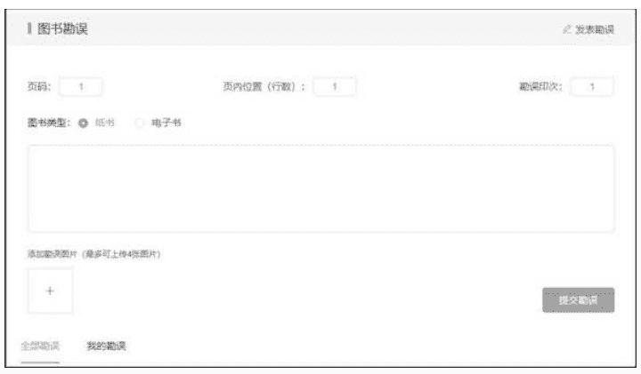

## 与我们联系

联系邮箱为 contact@epubit.com.cn 。

如对本书有任何疑问或建议，请发送邮件并在标题注明书名，以便高效回复。

如您有图书出版、教学视频录制，或参与图书翻译、技术审校等意向，欢迎邮件联系。

如学校、培训机构或企业有批量采购本书或异步社区图书需求，亦可邮件咨询。

如在网络发现针对异步社区图书的各类盗版行为，包括未经授权的全文或部分传播，请将疑似侵权链接通过邮件发送给我们。您的举动是对作者权益的保护，也是我们持续提供高质量内容的动力。

## 关于异步社区和异步图书

“异步社区” www.epubit.com 由人民邮电出版社创办，2015年8月上线运营，致力于优质内容的出版与分享，为读者提供高质量学习内容，为作者译者提供专业出版服务，实现创作者与读者在线互动，以及传统出版与数字出版融合发展。

“异步图书”是异步社区策划出版的精品 IT 图书品牌，依托人民邮电出版社在计算机图书领域40余年的积累。异步图书面向 IT 行业及各行业 IT 使用者。

# 智能体 基础篇

# 第1章 智能体开启智能新时代

在科技演进的长河中，每一次重大突破都如破晓曙光，指引方向。如今人工智能领域迎来新里程碑——智能体技术。它的出现打破了对传统人工智能的认知边界，为全新智能世界打开入口。在这个世界里，智能体不再局限于单一领域，而是可以渗透各行业、各任务，为复杂问题提供前所未有的强力支撑。随着影响力在科技圈的快速扩散，智能体引发广泛讨论，成为焦点。接下来让我们领略其独特魅力，探讨其为何迅速引爆科技圈，并全面了解其特质、原理、应用场景与核心优势。

## 1.1 智能体为何引发热议

在人工智能领域，智能体宛如骤然升起的新星。凭借开创性理念与卓越表现，瞬间吸引全球科技界目光，成为讨论热点。其出现标志着人工智能实现质的跃升。以惊人任务处理能力与广泛适用性彻底改写人们对人工智能的传统认知。智能体引发轰动可从以下六个维度解析。

### 1. 技术突破维度

深度学习、强化学习与大语言模型的革新进展，加上 GPU/TPU 算力提升，使智能体在感知、推理与生成能力上逼近人类水平。多模态融合技术的应用，如 GPT-4V 所采用的技术，显著增强实用性。以 ChatGPT 为例，借助 Transformer 架构与千亿级参数，实现流畅对话与复杂任务处理，彰显技术层面的重大突破。

### 2. 应用场景维度

在应用层面，智能体渗透力极强，从虚拟助手到实体机器人，覆盖医疗、教育、制造等多个行业，既颠覆传统效率模式，又推动个性化服务如 AI 心理咨询、推荐系统等发展。

### 3. 经济与社会影响维度

从经济与社会视角看，智能体是推动技术演进与经济转型的关键力量。据普华永道预测，若保持当前势头，到2030年人工智能有望为全球 GDP 贡献约15.7万亿美元。其中智能体在自动化决策与流程优化中的应用将成核心增长点。然而大规模部署也将带来就业结构调整——传统岗位加速消失，新兴职业如 AI 训练师涌现，同时加剧资源分配不均风险。

### 4. 人类认知维度

在认知层面，智能体的拟人化交互如 Replika AI 的情感模拟模糊了人机边界，其内容生成能力挑战了人类对创造力独特性的一贯认知。自动驾驶中的伦理抉择、智能体生成内容的版权归属等问题，促使人们重新思考智能与意识的关系。

### 5. 资本与产业维度

在资本与产业深度融合背景下，智能体领域掀起投资热潮。2023年全球人工智能相关融资规模突破千亿美元，其中智能体细分赛道成为资本追逐焦点。OpenAI 凭借大模型与智能体技术领先优势，估值一度攀升至860亿美元，体现市场对未来的高度信心。科技巨头如谷歌推出具备智能体交互能力的 Gemini 系列，Meta 发布支持智能体应用的开源大语言模型系列 Llama；同时新兴初创公司如 Midjourney 也在生成式 AI 图像创作赛道积极布局。各方竞争加速技术迭代，推动其从实验室走向商业化。

### 6. 未来想象维度

从未来想象角度看，智能体被视作迈向更高阶人工智能的重要一步。其发展激发了对“超级智能”的期待，也引发了关于人机共生如脑机接口与智能体结合，以及意识、自由意志等哲学命题的深入探讨。短期影响取决于技术可行性与商业落地情况；长期来看，其影响将触及人类文明底层逻辑，持续重塑社会形态。

智能体凭借开创性技术架构、出色的跨领域任务处理能力与高度自主决策机制，已成为人工智能发展历程中的重要里程碑。它不仅标志人工智能演进的关键突破，更通过技术深度融合与多元场景落地持续推动社会生产力跃迁，促使产业形态深刻重构。智能体正重塑人机协作边界，也将重新诠释智能内涵，开启人类文明演进新篇章。如今这场由智能体引领的智能革命才刚刚开始。

## 1.2 认识智能体全貌

在分析智能体引爆科技圈的原因后，我们需要对其进行系统认识。本节将从核心定义、运行机制、应用场景与优势特质等角度全方位介绍智能体，帮助读者把握精髓，并在生活与工作的各个领域充分应用。

### 1.2.1 智能体的本质

智能体依托强大智能算法与丰富知识储备，高效处理各类复杂任务。无论是严谨数据分析、富有创意文本生成、依赖感知图像处理，还是高难度决策制定，都能从容应对。它不仅能理解用户每条指令，还能将复杂任务拆解为清晰可行执行步骤；同时可灵活调用虚拟环境中的各类工具，如浏览器、代码编辑器、文件处理器，实现从数据收集到结果输出的全流程操作。

智能体的跨领域知识迁移能力是其亮点。完成自然语言处理任务后，可将积累语言知识有效迁移至图像识别等任务，打破传统领域边界，实现知识方法融会贯通。先进学习算法赋予其强学习能力，能以少量样本快速掌握新知。面对未知与复杂场景时，总能灵活应变，找到有效解法。在交互体验上，智能体基于自然语言交互界面实时反馈进度与结果，让用户始终掌握任务动态，大幅提升使用体验。

凭借这些特质，智能体为用户打造前所未有的智能体验，将用户从繁琐事务中解放，使其聚焦创造性与战略性工作。因此智能体成为智能时代前行的得力伙伴。

#### 1. 架构

智能体系统架构由三个关键模块构成：规划模块、记忆模块与工具使用模块。三者如精密齿轮般协作，确保处理复杂任务时的卓越表现。下面详述三模块关系与功能。

三核心模块并非独立运作，而是通过动态数据流与智能协作机制形成有机整体。

规划模块是智能体的“大脑”，负责任务理解、拆解、计划制定与资源分配。根据用户指令生成详细执行计划，并协调其他模块行动。

记忆模块是智能体的“知识库”，负责存储与管理用户偏好数据、历史交互数据及中间结果。为规划模块提供上下文信息，助力理解用户意图，并基于历史经验优化任务执行。

工具使用模块是智能体的“执行臂”，负责任务实际执行。依据规划模块指令调用合适工具如网络搜索、数据分析、代码编写等执行任务，并将结果反馈记忆模块以更新历史数据。

协作关系可概括为：规划模块制定计划，记忆模块提供上下文，工具使用模块执行任务并反馈结果。该机制使智能体不断学习进化，持续提升效率与准确性。

#### 2. 模块功能详解

智能体三大模块通过高度专业化分工实现智能协同，各模块功能遵循“专业化+可复用”原则，既保证单一功能深度优化，又通过标准化接口实现无缝协作。以下逐一解析核心功能与技术实现。

##### (1) 规划模块

规划模块核心功能如下。

- 任务理解与分析：利用自然语言处理技术解析用户指令，提取核心目标与具体要求。
- 任务拆分与排序：将复杂任务拆分为多个子任务，并按重要性、紧急程度等排序优先级。
- 执行计划制定：制定详细执行计划，明确各子任务执行主体、时间节点与资源需求。
- 资源分配与工具选择：按任务需求合理分配计算或系统资源，并从工具库中挑选合适工具。
- 语义理解与意图识别：基于自然语言理解技术准确识别用户意图，避免执行偏差。
- DAG结构构建：将复杂任务建模为有向无环图结构，清晰呈现任务依赖关系与执行顺序。
- 异常处理与优化：实时监控执行过程，及时处理异常并持续优化流程。

##### (2) 记忆模块

记忆模块核心功能如下。

- 记录用户偏好：记录使用习惯与个性化偏好，如常用图表类型、语言风格等。
- 存储历史交互信息：保存过往对话内容与任务执行记录，包括输入参数、输出结果、操作步骤等。
- 保存中间结果：保存任务执行过程中产生的临时数据，如中间计算结果、临时数据集等。

##### (3) 工具使用模块

工具使用模块核心功能如下。

- 网络搜索与信息检索：利用网络爬虫与搜索引擎接口快速检索任务相关信息。
- 数据分析与处理：使用数据分析工具与算法，对数据进行清洗、转换、统计分析、建模等处理。
- 代码编写与执行：支持使用多种编程语言编写并执行代码，实现具体功能需求。
- 文档生成：按任务要求生成格式规范、内容详实的文档。
- 数据可视化：将抽象数据通过图、表等可视化形式呈现。

智能体架构设计充分体现系统优势，通过规划、记忆与工具使用模块协同，智能体可高效处理各类复杂任务，提供个性化智能服务。该模块化设计提高系统灵活性与可扩展性，也为未来功能扩展与性能优化奠定基础。

### 1.2.2 智能体应用场景

智能体案例显示，其在日常生活如旅行规划、商业分析如股票分析、教育如教学内容创建等领域均有广泛应用。下面通过示例阐述其应用。

#### 1. 旅行规划

在旅行规划方面，智能体展现出卓越整合与个性化定制能力，既能整合旅行信息，又能为用户生成专属旅行手册。以“五一”假期北京至新疆行程规划为例，智能体可提供详细行程建议、景点推荐、住宿安排等个性化内容。

## 1.2.2 智能体的应用场景

- D1: 北京-乌鲁木齐: 抵达乌鲁木齐，参观新疆维吾尔自治区博物馆，晚上逛国际大巴扎，体验维吾尔族风情。

- D2: 乌鲁木齐-天山天池-乌鲁木齐: 全天游览天山天池，感受高山湖泊的壮丽风光。

- D3: 乌鲁木齐-赛里木湖: 乘车前往被誉为“大西洋最后一滴眼泪”的赛里木湖，环湖游览，湖边徒步，欣赏日落。此处可作为浪漫求婚的备选地点。

- D4: 赛里木湖-伊宁-那拉提: 上午先观赏赛里木湖日出，然后前往伊宁，感受伊犁河谷风情，下午游览喀赞其民俗旅游区，傍晚前往那拉提草原附近住宿。

- D5: 那拉提草原深度游: 全天在那拉提空中草原或河谷草原活动，骑马、徒步，感受草原风光。此处也可作为浪漫求婚的备选地点。

- D6: 那拉提-独库公路(部分路段)-乌鲁木齐: 从那拉提出发，体验独库公路(需提前确认“五一”期间是否开放)，领略其险峻与壮美，下午返回乌鲁木齐。

- D7: 乌鲁木齐-北京: 根据航班时间，购买特产后乘机返回北京。

#### 2. 股票分析

智能体依托强大金融分析模型与数据可视化技术，可对股市进行深度洞察与专业解读。它能快速处理海量市场数据，提供实时分析结果与可视化呈现，助力投资者做出明智选择。以特斯拉股票分析为例，它不仅能通过历史数据挖掘价格波动规律、解析交易量变化趋势，还能整合社交媒体舆情与机构研究报告，量化市场情绪指数。最终将关键数据转化为交互性强、视觉表现力突出的动态仪表盘。

#### 3. 教育内容创建

智能体可为教师创建教学视频与演示材料，将复杂学术概念转化为生动直观的多媒体教学内容，帮助教师更有效教学。

#### 4. 保险政策比较

智能体能够创建清晰的保险政策比较表，提供有效决策建议，助用户选择最合适的保险产品。例如，可快速比较不同保险产品的条款与条件，给出详细分析与推荐，帮助用户做出明智选择。分析后给出的建议如图1-4所示。

智能主体的应用边界正在持续拓展，既扎根于日常生活消费场景，也逐步渗透进专业领域。凭借海量信息的处理洞察、可视化呈现以及高度定制化的供给能力，它能够为用户搭建高效且具备智能特性的解决方案。无论是个人使用者、商业机构还是各类组织，都能获得贴合自身诉求的专属服务。

### 1.2.3 智能体的优势
综合技术特性、功能表现与落地场景来看，其核心竞争力可归纳为四个维度。

#### 1. 强大的任务执行能力
主体可以全程自主打理从计划制定、策略拟定、进程跟踪到结果交付的闭环，极大降低人工介入需求。在虚拟空间里可自行调取多样化工具，对海量信息进行迅速消化并应对棘手业务，从而呈现出高效率的执行表现。

#### 2. 跨领域的广泛适用性
覆盖面横跨金融、教育、医疗、电商等多个行业，能输出跨界智慧方案。面对基础信息检索或是深入研究类需求，都能保持优异表现。

#### 3. 个性化与定制化服务
能依据使用者偏好与具体诉求输出定制方案，并允许高度灵活的自主配置。服务范围与功能模块皆可由使用者自行界定，不论是深度的信息挖掘还是专项代码开发，都能迅速做出反馈，凭借算法实时调优与资源精准对接，最终呈递贴合个体需求的成果。

#### 4. 自主学习与适应能力
拥有较强的自学习特性，可在持续与环境互动中不断精进策略。遭遇全新任务或外部条件变化时，能快速切换应对方式，以匹配新环境。

## 1.3 智能体的发展趋势与挑战
智能主体的面世代表了人工智能技术的一次关键跃进，虽然距离通用人工智能尚有距离，却已重塑人与智能系统的关系，成为未来科技发展的重要驱动力。伴随大模型迭代加速、多模态融合深化与算力资源持续提升，其正迈向新阶段。

### 1.3.1 发展趋势
技术成熟与场景扩张推动主体从单一功能向具备自主学习与跨域协作能力的综合形态演进，既会革新产品形态，也将深刻影响生产生活与产业格局。以下六个方向勾勒出演进路径。

1. 多模态与跨界融合
未来主体将不再局限于单一模态，而是融合文字、图像、视频、语音及传感器信号等多源信息，实现智能判断与自然对话。例如针对智能制造场景，主体可实时解读生产线视频并结合传感器读数进行质检，进而自动生成排产建议。这类融合能力让主体在不同任务与环境中更具应变力，逐步逼近通用智能目标。

2. 自主决策与群体协作
多代理协作是重要演进方向。多个主体通过信息交换、分工协作机制形成虚拟团队，在无人车队协同行驶、应急救援调度、多源数据综合分析等场景中，展现出高于单体的协同效能。例如农业领域可部署多组主体协作完成播种、病虫害识别与收割，推动生产智能化进程。

3. 个性化与深度场景化服务
借助用户画像构建技术与长期记忆模块的改进，主体能为不同人群提供高度定制方案。医疗方面可融合个人病史与实时生理数据，为用户提供贴合个体需求的健康管理与辅助诊疗意见；教育方面可依据学习习惯与知识掌握程度动态调整学习路径。

4. 边缘智能与低能耗优化
未来主体将更看重在低功耗终端上的运行效率。通过轻量化模型与边缘计算结合，可在无人机、自动驾驶车辆、智能穿戴设备等场景实现本地推理，降低对云端依赖，提升响应速度并增强隐私保护。

5. 可解释性与可信AI
可解释性是迈向可信AI的关键。通过可视化决策轨迹与可追溯推理链条，用户能够理解决策依据从而建立信任。该能力对金融风控、医疗诊断、司法审判等高风险场景落地至关重要。

6. 智能体生态与平台化
未来主体不再孤立存在，而是形成生态平台，支持多种功能插件与API接口。开发者可在统一平台快速部署、训练与扩展功能，其模式类似现有云服务平台。平台化大幅降低企业与个人使用门槛，促进普及。

总体来看，智能主体正向更高通用性、更强智能水平与更广产业渗透演进。多模态融合、群体协作、边缘智能、可解释性等趋势相互交织，推动其逐步成为支撑个人生活、企业生产与社会治理的关键技术基础。

### 1.3.2 面临的挑战
技术迅猛发展也使其进入关键转折期。其卓越处理能力与广阔前景使其成为社会运行方式变革的重要推手，但同时带来技术、伦理、治理等多重挑战。

#### 1. 数据安全与隐私保护
高效运行依赖海量信息，同时伴随泄露风险。举例医疗主体若管理出现漏洞，可能导致患者隐私数据被非法获取或滥用。如何在保障安全与隐私前提下维持有效运行，依靠差分隐私、联邦学习等技术实现平衡，已成为核心难题。

#### 2. 可控性与安全性
主体具备一定自主决策能力，在开放环境中执行任务时，确保行为不偏离预设安全目标是重大挑战。防范不可控行为同样关键，例如自动驾驶主体在极端工况下异常表现可能直接威胁人身安全，需提升可控性、完善安全校验确认机制并引入冗余设计。

#### 3. 可解释性不足
基于大模型的主体在复杂决策中常呈现黑箱特征，用户难以洞察底层逻辑，削弱信任并在金融、医疗等关键领域带来监管合规风险。未来需借助因果推理、知识图谱、可视化分析等手段提升透明度。

#### 4. 伦理与社会问题
应用可能引发算法偏见、深度伪造及虚假信息生成等伦理风险。普及还可能重塑就业结构，部分岗位被替代的同时，社会亟需培养具备AI应用能力的新型人才。

#### 5. 法律与政策滞后
现有法律难以全面覆盖主体风险，例如自动驾驶事故责任划分、主体生成内容著作权归属等问题尚无明确规范。需加快完善相关法规，使监管能及时适应并引导技术发展。

#### 6. 能耗与算力瓶颈
大模型主体在训练与运行中消耗大量能源与算力，成本高昂且环境负担重。通过模型压缩、量化、稀疏化等方法构建低能耗高能效系统，是技术创新的关键方向。

上述挑战相互交织，涉及可持续发展、伦理规范、治理体系与社会结构的深层变革。只有技术创新、伦理框架构建、法律完善与跨学科协作协同推进，才能实现良性互动，避免其成为系统性风险源。

### 1.3.3 展望未来
随着能力提升，智能主体的影响将从技术突破扩展到社会、产业与文化形态的全面重塑。它正从“先进工具”向与人类深度协同的智慧伙伴演进，既能解放重复事务，也能在激发创造力、优化决策与推动社会治理创新中发挥关键作用。

#### 1. 智能体与人类的协作共生
未来主体将与人类形成紧密协作，成为增强智能的关键路径。它不仅能处理琐碎任务，还能赋能创造性思维与战略决策。例如科研主体可自动检索文献、生成假设、设计实验并与科学家交互促成突破。个体竞争力将取决于与主体的协同效能。

#### 2. 产业格局的重塑
主体是产业数智化转型的核心引擎。制造业借此从自动化迈向智能化，医疗推进精准诊疗与个性化健康管理，金融开展复杂风险预测与量化分析。传统岗位将被逐步替代，同时涌现主体训练师、AI交互设计师、AI伦理顾问等新岗位，价值链全面重构。

#### 3. 智能体与社会治理
在公共服务与社会治理中发挥关键支撑。城市管理可实现实时交通调度、能源优化与环境监测；应急管理中可对多源灾害数据快速分析辅助决策。在合理制度设计下，还能促进公平与透明度提升，减少资源浪费与行政不规范。

#### 4. 智能体与伦理文明的共进
发展将带来深刻伦理反思。随着拟人化行为特征显现，人类需重新审视“智能”“创造力”“意识”边界。是否赋予权利、有害行为责任归属等将成为核心公共议题。内容生成、舆论操纵等新型风险也需规范，构建伦理准则、国际安全治理框架与有效监管体系是迈向智能时代的关键。

#### 5. 技术奇点与未来愿景
能力持续增强可能逼近技术奇点，即主体具备递归自我改进能力，智能水平迅速超越人类。结合脑机接口、量子计算与仿生学，主体有望成为认知能力的延伸媒介，帮助突破生理与认知局限。但目标错位导致失控、递归优化失控风险，也将是未来数十年必须攻克的难题。

#### 6. 教育与文化的重构
主体全面融入后，以知识传授为主的传统教育将转向人机协同学习新范式，学习者更需批判性思维、跨学科整合与人机协作素养。文化层面将催生新创作形式，如人类主导、主体辅助的文学、视觉艺术与音乐。在合理引导下，文化多样性与包容性有望提升。

主体发展由技术演进与社会协同共同塑造，将深度融入日常生活与社会运行，推动产业升级、城市治理革新与教育文化再造。但技术滥用、伦理困境与安全风险若不治理，将威胁健康发展。唯有在技术、法律、伦理与教育多维度协同，方能确保路径可控可持续，使其成为人类深度协作者，共同拓展认知边界。

# 第2章 高效指令设计
在使用智能主体时，指令质量对输出效果起决定性作用。高质量精准的指令能促使主体快速生成符合预期的结果；反之，模糊低质的指令易导致偏离预期、任务失败。

提示词本质上是用户向主体下达的指令，其设计与优化至关重要，是引导理想输出的关键。掌握结构化Prompt编写方法并构建有效指令体系，有助于充分发挥主体潜力，稳定获得所需内容。

本章聚焦结构化Prompt的编写模板、应用技巧与优化策略，帮助读者掌握高效指令设计的核心方法。

## 2.1 结构化Prompt编写模板
与大模型交互时，传统开放式提问常导致输出碎片化、解决方案缺乏系统性，难以满足专业场景需求。结构化Prompt通过模块化设计、逻辑化表达与标准化要求，显著提升输出专业性与实用性，也帮助用户更系统思考问题、厘清需求本质。

这种沟通方式有助于释放AI潜力，获得切实可行的专业方案，提升决策质量与工作效率。

### 2.1.1 什么是结构化Prompt
结构化Prompt是一种遵循特定框架、在内容与形式上均有序组织的指令。与非结构化Prompt不同，它通过明确格式与层次，将复杂任务拆解为清晰具体的组成部分，提升信息传递准确性与效率。

内容层面需围绕任务核心明确目标、条件、限制、输出要求等关键要素。例如学术写作需明确主题、学科、参考文献数量、字数、格式；数据分析需说明数据来源、分析目的、统计方法、可视化要求。要素清晰可避免模糊与歧义。

形式层面常采用分点式、表格式、层级标题式等标准化组织。分点式用符号编号逐条列出需求，逻辑清晰；表格式以行列规整呈现；层级标题式用主副标题构建从总到分的结构。这些形式能整合零散信息，形成层次分明、重点突出的指令。

结构化信息组织在生活中广泛存在，图书的篇章节结构、文章的引言正文结论结构，都能帮助快速定位与理解主旨，降低认知负担。同样，与智能主体交互时，结构化Prompt可帮助其准确捕捉核心需求、具体条件与期望结果，减少偏差。提示工程实践中已有大量模板，用户可根据任务类型、偏好与场景灵活选用。

### 2.1.2 结构化Prompt的内容框架及组织形式
结构化Prompt的基本构成要素包括角色设定、任务描述、格式要求等。

角色设定用于明确赋予主体特定身份，如“学术论文评审专家”“市场营销策划师”，使其基于专业视角执行任务；任务描述用于说明需完成的具体工作；格式要求用于规范输出形式，如“以Markdown表格呈现”或“控制在500字内”。

系统化组织这些要素可使指令更清晰、意图更明确，确保精准解析需求。实践中以下四种内容框架被广泛使用。

- A.P.E.框架：Action指明需执行的具体操作；Purpose说明行动意图或目标；Expectation明确预期结果或影响。
- C.A.R.E.框架：Context阐述问题初始情境；Action指明需执行的操作；Result说明行动的直接效果；Example提供符合要求的案例。
- T.R.A.C.E.框架：Task明确待完成工作；Request指出相关协作需求；Action指明具体操作；Context补充环境信息；Example提供案例。
- T.A.G.框架：Task定义待完成事项；Action指明具体操作；Goal说明期望达成的成果。

表2-1 内容框架与示例

| 内容框架 | 示例 |
| :--- | :--- |
| A.P.E. | 行动：为某互联网企业视频团队新人破冰会制定方案<br>目的：促进新同事彼此认识背景与性格，便于后续协作<br>期望：方案需包容年龄差异，并尽可能结合流媒体推荐信息流开发工作实际 |
| C.A.R.E. | 背景：毕业十年，母校筹办校友聚会，我负责拍短片<br>行动：请帮忙写一段短视频脚本<br>结果：想借助影像唤起大家对青葱岁月的回忆，以个体视角表达对校园生活的缅怀<br>示例：可借鉴微电影《老男孩》的叙事手法，移植到大学背景，时间跨度约十年 |

# 排版怎么影响指令的理解效率

把内容骨架搭好只是第一步，信息怎么呈现直接决定智能体能否抓住真实意图。版式合理，指令更容易阅读，也能降低信息堆叠带来的误读。前文讲过内容框架提供思路，这里就以 C.A.R.E 框架里的“毕业生联欢会短视频剧本创作”为例，看几种常见的结构化排版方式能带来什么差别。

素材里先给出两组结构化示范，一组用 T.R.A.C.E 拆解健身建议任务，另一组用 T.A.G 拆解小红书笔记撰写任务，说明任务、动作、目标、背景等要素要清晰可辨。

框架确定后，组织方式的精细度会直接影响解析的准确度。合适的组织能凸显逻辑、提升可读性，也能减少信息混杂带来的偏差。先前的内容框架解决的是装什么的问题，配合不同的排版形式则能进一步放大执行效果。

#### 1. 分点式
通常用统一的符号比如【】作为前缀，把不同要素视觉分隔，形成模块化展示。适合指令简短、目标明确的场景，能迅速把注意力引向要点，避免要素混淆。示例见表2-1。

#### 2. 层级标题缩进式
采用总标题、分标题配合缩进正文的层级写法，先交代任务主题，再逐层展开具体要求。对复杂任务效果明显，能把要素间的逻辑关系摊开，有助于判断优先级与整体脉络。示例如下。

```
核心需求：毕业生联欢会短视频剧本创作
Context（背景）
毕业10年了，学院要组织一次毕业生联欢会，我负责拍摄一部短视频。
Action（行动）
希望你能为我撰写一个短视频剧本。
Result（结果）
希望这个视频能够帮助大家回顾过往的“青葱”岁月，通过特定人物视角表达对学生时代的怀念。
Example（示例）
可以参考微电影《老男孩》的叙事风格，将故事情节迁移到大学场景中，时间跨度为10年左右。
```

#### 3. 代码注释式
借鉴编程注释的习惯，用 # 等符号划分模块，引导系统识别不同区块。对有技术背景的用户或对指令规范性要求较高的场景很友好，类代码的写法让指令更清晰、更易维护。示例如下。

```
#Context
毕业10年了，学院要组织一次毕业生联欢会，我负责拍摄一部短视频。
#Action
希望你能为我撰写一个短视频剧本。
#Result
希望这个视频能够帮助大家回顾过往的“青葱”岁月，通过特定人物视角表达对学生时代的怀念。
#Example
可以参考微电影《老男孩》的叙事风格，将故事情节迁移到大学场景中，时间跨度为10年左右。
```

不同排版适配不同场景。简短指令或简单需求，分点式与代码注释式更利于快速抓取核心；复杂任务更适合层级标题缩进式，用分层降低解析难度；跨平台使用时，结合分点符号与简洁表达，可提升兼容性和可读性。按任务特点灵活选用，才能让输入更高效、响应更准确。

上述例子也涉及结构化 Prompt 的两个关键要素：标识符和属性词。

> 注意
> 
> 标识符用来划分层级与模块，常见形式有 #、< >、-、[]、"" 等。本节示例以 # 作为模块分隔符。因为结构较为简单，仅用单一层次，未做嵌套。
> 
> 属性词如 Context、Action、Result、Example 等，是带有特定语义的关键词，用来定义语义模块并引导后续内容。属性词并非固定，可按个人习惯自定义。

厘清框架与排版后，下一步就是直接套用模板。接下来介绍几个高频场景的结构化 Prompt 模板，像快捷工具一样拿来即用，能大幅提升指令效率。无论是文案、答疑还是创意，都能更快拿到预期输出。

### 2.1.3 结构化Prompt模板示例
结构化模板因指令构建逻辑清晰，能明显提升输出的精准度和实用性。下面以旅游攻略生成和项目管理两类典型场景，展示模板的实际效果。

#### 1. 旅游攻略生成场景
旅游攻略类任务常用“角色设定+场景限定+要素罗列+输出规范”的四层模板，把零散模糊的需求变成标准化指令。

以成都5日游为例，用户只说“帮我写个成都旅游攻略，7月，预算5000元，时长5天”，问题很多：没说明侧重美食还是景点，没拆预算分配，没讲行程松紧、同行人群、饮食禁忌等，导致输出很难个性化。

基于普通指令生成的攻略如下。

```
##### 7月成都5日游攻略（预算5000元）
**一、行程安排**
**第一天：抵达成都，感受慢生活**
* 上午：抵达成都，入住酒店/民宿（建议选择春熙路、太古里或宽窄巷子附近，交通便利）。
* 下午：游览宽窄巷子，体验成都慢生活，品尝特色小吃（推荐：三大炮、糖油果子、凉粉）。
* 晚上：欣赏川剧变脸表演（推荐：蜀风雅韵剧院、锦江剧场）。
**第二天：熊猫基地与历史文化**
* 上午：前往成都大熊猫繁育研究基地，近距离观察可爱的大熊猫（建议早上7:30左右到达，避开人流高峰）。
* 下午：参观杜甫草堂、诗圣杜甫的故居，领略古典园林之美。
* 晚上：逛锦里古街，品尝成都特色美食（推荐：火锅、串串香、钵钵鸡）。
**第三天：都江堰水利工程**
* 全天：前往都江堰景区，参观世界文化遗产都江堰水利工程，感受古人智慧（可乘坐动车或旅游专线车，约1小时车程）。
* 晚上：返回成都，体验成都夜生活（推荐：九眼桥酒吧街、兰桂坊）。
**第四天：乐山大佛一日游**
* 全天：前往乐山大佛景区，瞻仰世界最大的石刻弥勒佛坐像（可乘坐动车或旅游专线车，约2小时车程）。
* 晚上：返回成都，品尝特色川菜（推荐：麻婆豆腐、回锅肉、夫妻肺片）。
**第五天：自由活动，返程**
* 上午：根据个人喜好自由活动（推荐：人民公园喝茶、体验采耳，或前往IFS国际金融中心购物）。
* 下午：前往机场/火车站，返程。
**二、预算明细**
* **交通：** 约1000元（含往返机票/火车票，市内交通及周边景点交通）
* **住宿：** 约1500元（5晚，经济型酒店或民宿）
* **餐饮：** 约1000元（品尝当地特色美食）
* **门票：** 约500元（熊猫基地、杜甫草堂、都江堰、乐山大佛等）
* **其他：** 约1000元（购物、纪念品等）
**三、注意事项**
* 7月成都天气炎热，注意防晒，携带防晒霜、遮阳伞、帽子等。
* 成都饮食偏辣，可根据个人口味选择微辣或不辣菜品。
* 提前预订机票/火车票和酒店，特别是旅游旺季。
* 学习一些简单的四川话，方便与当地人交流。
**四、可选行程**
* 如果时间充裕，可以增加一天游览青城山，感受道教文化的魅力。
* 对历史文化感兴趣的朋友，可以参观金沙遗址博物馆或武侯祠。
**五、美食推荐**
* 火锅：小龙坎、大龙燚、蜀九香
* 串串香：钢管厂五区小郡肝串串香、袁记串串香
* 川菜：陈麻婆豆腐、盘飧市、马旺子
* 小吃：钟水饺、龙抄手、赖汤圆
希望这份攻略能帮助你规划一次愉快的成都之旅！
```

相比之下，结构化模板通过系统拆解把模糊需求参数化。

结构化模板如下。

```
##### 角色
资深旅游规划师
###### 任务
为一位计划在7月前往成都、预算5000元，进行5天4晚旅行的游客，制定兼具性价比与深度体验的详细旅游攻略。
###### 输入数据
- 旅游目的地：成都
- 旅游时间：7月（5天4晚）
- 预算：5000元（含交通、住宿、餐饮、门票等全部费用）
- 游客偏好：深度体验川蜀文化，打卡大熊猫基地、三星堆博物馆等标志性景点；品尝四川火锅、龙抄手等特色美食；前往建设路小吃街、宽窄巷子等网红打卡地
##### 要求
- 行程规划：每日行程包含景点游览、特色活动（如川剧变脸、夜游锦江），需标注景点开放时间、错峰建议及景点间交通耗时
- 美食推荐：明确标注人均消费（50～80元），提供建设路小吃街、奎星楼街等具体打卡点位，推荐必尝菜品
- 住宿建议：筛选200～300元/晚的连锁酒店，要求近地铁、含早餐，并提供周边交通示意图
- 交通方案：采用高铁往返+市内公共交通（如地铁、公交、共享单车），需计算各段交通成本
- 特殊提示：针对7月高温天气，给出每日防暑降温建议；结合暑期客流高峰，设计错峰出行策略
###### 输出规范
- 以清晰的文本格式呈现，每日行程按序号排列
- 对每个景点、美食、住宿等给出简要的介绍和选择理由
- 控制总字数在1500～2000字
```

优化后的指令把时间、预算、天数都量化并赋予含义。7月不仅是时间点，也提示高温和暑期人流；5000元被拆成交通住宿餐饮门票的总上限；5天被划分为每日节奏框架。

体验需求上，从泛泛的攻略收敛到大熊猫基地、三星堆博物馆等标志点，美食细化到火锅、龙抄手、建设路小吃街，活动加上川剧变脸、夜游锦江，目标变得可执行。

服务标准上，用参数消除模糊：经济型住宿定在200~300元/晚、近地铁含早；交通限定高铁往返+市内公交；人均用餐50~80元。范围被收窄，输出才更贴预算。

整体上，指令从平面描述升级为带时间参数、预算分配、场景清单、服务标准的分层任务，歧义减少，生成结果更实用、更个性。

#### 2. 项目管理场景
管理类任务若指令粗放，很容易得到泛化方案。以企业年会筹办为例，只说“我们要办年会，帮忙列个筹备计划，预算80万元，3个月筹备时间”，得到的规划往往细节不足、风险预判不够。

以下是基于80万元预算、3个月筹备时间的年会筹备计划框架，涵盖关键阶段安排、任务分工建议和预算分配方案，供参考：

#### **一、筹备时间轴（倒计时3个月）**

##### **第一阶段：策划与筹备（第1～30天）**

1. **成立筹备组**
   - 确定总负责人、财务、策划、设计、后勤、外联等
   - 每周召开1次进度会议（后期可调整为每周2次）
2. **确定年会核心信息**
   - **主题**：结合公司文化/年度目标（如“聚力·突破·共赢2024”）
   - **形式**：晚宴+颁奖+演出/沉浸式体验/户外嘉年华（根据公司风格选择）
   - **规模**：预估人数（如300人）、嘉宾名单（是否邀请客户/合作伙伴）
   - **场地**：预订酒店/会展中心（需提前考察舞台、音响、动线）
3. **供应商招标**
   - 筛选酒店/餐饮、舞台搭建、摄影摄像、演出团队等（至少对比3家报价）
   - 签订合同并支付定金（注意违约条款）
4. **预算细化**
   - 预留10%作为应急资金（约8万元）

##### **第二阶段：执行落地（第31～75天）**

1. **活动内容设计**
   - 流程表：签到→领导致辞→颁奖→节目/互动→晚宴→抽奖（总时长3～4小时）
   - 节目征集：员工节目报名+专业表演（如乐队、魔术等）
   - 互动环节：微信摇一摇抽奖、大屏弹幕、游戏（需测试技术稳定性）
2. **视觉与宣传**
   - 主KV设计（背景板、邀请函、桌卡、员工年度视频）
   - 预热宣传：内部邮件、海报倒计时、高管悬念视频
3. **物资采购**
   - 奖品（电子产品、现金券、定制礼品等）
   - 伴手礼（人均预算建议<200元）
   - 氛围道具（灯光、荧光棒、拍照墙等）
4. **人员安排**
   - 主持人选定（内部选拔或外包）
   - 志愿者分工（签到、引导、道具组）

##### **第三阶段：冲刺与彩排（第76～90天）**

1. **最终确认**
   - 流程彩排（至少1次全员带妆彩排）
   - 检查AV设备、PPT、视频播放情况
   - 确认餐饮菜单（需试菜，留意过敏原）
2. **应急预案**
   - 备用麦克风、电源、医疗包
   - 雨天方案（如户外活动）

这种粗线条方案缺少执行细节。引入结构化 Prompt 后，围绕活动规模、核心环节、特殊需求等要素系统整合参与人数、场地规格、表演形式、安全保障等信息，指令框架更清晰。

示例如下。

```
##### 角色
你是一位拥有8年大型活动策划经验的行政总监，尤其擅长企业年会全流程管理。曾成功策划并执行多场500人以上规模的企业年会，平均节省预算15%。
##### 背景
某科技公司（员工规模：500人）计划举办年度庆典活动，需要专业的项目管理方案。
##### 项目信息
###### 基础信息
活动时间：2024年12月20日18:00-22:00
活动地点：上海市区五星级酒店（预算30万元）
参与人数：500人（含高管20人）
总预算：80万元（含10%备用金）
###### 核心环节
领导致辞（15分钟）
年度颁奖（30分钟，含5个奖项）
员工文艺表演（3个节目，总时长45分钟）
自助晚宴（预算人均200元）
###### 特殊要求
需要全程直播（预算5万元）
安排专业摄影跟拍（预算2万元）
设置互动抽奖环节（奖品预算10万元）
##### 要求
###### 主体内容
完整的时间推进表（从筹备到收尾）
详细预算分配方案
人员分工矩阵
应急预案（设备/医疗/流程）
###### 格式要求
主文档采用Markdown格式
包含以下表格：
任务分解表（含时间节点、负责人、交付物）
预算明细表（分大类和细项）
供应商联系表（场地、餐饮、设备等）
```

该模板把信息系统化、需求精准化，生成的方案不仅有时间线和预算，也细化到负责人、交付标准和风险控制，实操性明显提升。

从旅游和项目管理两个场景看，结构化模板能显著提高需求对齐效率和输出质量。相比非结构化指令，它通过对背景、标准、形式等要素的精细界定，规避了模糊和随意。尤其在重复流程性工作中，成熟框架复用可以快速部署并保证质量，省时省力。

### 2.2 对话历史关联技巧：对话链管理
和智能体对话时，你会发现输出和历史记录高度相关。基于前文追问、修正或扩展时，系统能回溯前面提到的概念和主题，保持语境一致。这背后是系统的语境学习能力，它不是孤立解析每条输入，而是把多轮对话的语境整合推理，持续理解用户意图并回应。

### 2.2.1 语境学习能力
语境学习是自然流畅对话的基础，让系统能整合对话历史，基于前文准确理解当前输入。

例如知识问答里，用户先问“如何理解机器学习”，随后追问“它和监督学习的区别是什么”，系统能正确把“它”指认回“机器学习”。这种指代的准确判断，避免了重复描述，提升了交互自然度和效率。

模型能够在对话中把握前后文、完成指代，关键在于它在有限窗口里学会了动态重建语义联系的方式。Transformer 体系里的自注意力正是这项能力的执行单元，它可以在一次前向传播里快速筛选关键信息，并把输入序列中各单元关联起来。借助查询、键、值三种映射，每个词元都会被赋予不同关注度，相关性高的内容自然被放大。

自注意力是语境建模落地的工程支点，背后是一套明确的数值流程。每个词元先被映射成可学习的 Q、K、V 三个向量，随后当前词元的查询会与序列里所有词元的键做点积，得到原始相关分；再经 Softmax 做归一，变成注意力权重，用来衡量彼此关联的强弱。最后按权重对所有值向量做加权求和，得到融合了前后信息的表征。

拿句子“AI 能懂深度学习，它很强”来拆解。当模型处理到“它”时，会生成对应的查询，并与句中“深度学习”等词的键分别点乘。因为“它”和“深度学习”在语义上贴合，得分相对突出，经过 Softmax 后“深度学习”所在位置获得更高权重。于是模型把“它”绑定到“深度学习”，在“它”的表征里注入相关语义，从而实现连贯理解。

向量运算配合动态权重分配，让 Transformer 具备较强的语境建模能力，而这种能力的根基，建立在自注意力所支撑的全序列交互之上。

### 2.2.2 语境学习的实战样例
在自然语言实践里，语境学习不仅让交互更顺滑，还提供了一种新的任务适应思路。传统模型往往依赖大量标注后再做任务微调，而具备语境学习能力的大模型可以利用预训练时学到的语言知识，直接在推理阶段完成新任务，大幅降低对标注和定制的依赖，形成更灵活高效的处理方式。语境学习正是大模型实现少量示例适应的关键路径，技术价值和应用潜力都很突出。

#### （1）少样本学习
在实际应用中，无示例提问是常见用法。用户直接下指令，比如“把这段文字翻成英文”或“提炼文章核心观点”，模型便依托通用语言知识作答，适合任务明确、结构清晰的场景。

但遇到专业领域或复杂任务时，无示例提问往往抓不住业务规则、行业术语和细微语义。这时少量示例学习优势明显，只需给出 3~5 个典型示范，模型就能从中提炼模式，快速掌握逻辑，效果通常优于无示例。

以电商评论好坏判断为例，无示例下模型容易把“手机拍照效果很好，但电池续航太差”误判为正面，因为转折和权衡没有被很好建模。

下面是一个典型的少量示例用法。

> 根据以下示例判断商品评论是好评还是差评。
> 示例 1：
> 评论：“性能强劲但发热严重”
> 分类：差评
> 示例 2：
> 评论：“外观精美，系统流畅，性价比高”
> 分类：好评
> 请判断以下新评论的分类。
> 评论：“手机拍照效果很好，但电池续航太差”

在这种设定下，模型借助少量示例无需额外训练，就能推断出任务规则，更合理地判断新评论中负面因素占优，从而倾向差评。这种凭极少示例快速适应的特性，就是少量示例学习的精髓。

#### （2）Prompt 设计里的就近效应
受位置编码、训练数据分布和自回归生成等因素影响，模型在实际使用中对输入末尾的指令或信息更敏感，部分注意力头会给末尾位置更高权重，导致输出更容易受结尾内容牵引。

因此在写指令时，可以把关键要求放到文本末尾，增强关注度，提升相关性和指令遵循度。

比如诗歌创作指令“写一首关于春天的诗，要押韵，最后一行提问”，由于“最后一行提问”在末尾且表述具体，模型更可能满足；而“押韵”这种全局抽象要求即使在中间，也容易被弱化。

以量子计算解释为例，不同写法效果差异明显。

输入的分散指令如下。

> 请用幽默的语气解释量子计算，字数100以内，并举例说明。

我们得到的回答如下。

> 量子计算就像薛定谔的猫在玩俄罗斯轮盘赌——你的数据既是1又是0，直到你偷看时它才“喵”地随机坍缩成一种状态。比如传统计算机像老实的会计，一次算一笔账；量子计算机则是魔术师，能同时让所有账本在虚空中跳踢踏舞，瞬间找到答案（当然，也可能变出一群鸽子糊你脸上）。

按邻近效应优化后，指令改为分点。

1. 用幽默的语气解释量子计算；
2. 限制100字以内；
3. 结尾添加一个例子（如“就像猫同时存在于箱子里面和外面”）。

我们得到的回答如下。

> 量子计算就像薛定谔的算盘：比特可以同时是0和1（叠加态），直到你偷看时它才“决定”变谁。比传统计算机“一枚硬币抛一次”快多了，它能一次抛完所有平行宇宙的硬币！不过别高兴太早——它目前比幼儿园手工还容易出错。就像你的减肥计划，既“正在进行”又“已经失败”。

两者差异印证了邻近效应的重要性。线性表述没有区分优先级，末尾的“举例说明”更易被执行，前置的幽默和字数限制则可能被忽视，而且示例形式缺乏引导。

分点写法把“结尾添加例子”单独放在最后，使其更易被优先满足，同时结构更清晰，信息不易混淆，相关性和完整性都提升了。

这些例子说明，掌握位置编码、自回归特性、少量示例学习和邻近效应等关键因素，就能更好地引导模型理解需求，提升输出相关性和可控性，实现交互效率与质量的双提升。

## 2.3 模糊需求澄清思路
在自然语言交互里，本质是用户意图的传递与模型的解析。指令的清晰度和结构性直接决定输出的准确度。当指令模糊或要素缺失时，模型难以准确把握意图，往往给出范围过宽、针对性不足的答案，降低交互效率。

要获得高质量输出，需要建立系统化的指令优化方法，把模糊需求转化为要素完整、结构清晰的指令。这一过程可从需求澄清和角色设定两方面入手：前者通过细化目标、场景和约束，把抽象需求变成可操作的说明；后者通过为模型设定角色，引导其调用领域知识和表达风格。两者配合，能显著提升理解准确度和输出相关性。

下面用具体例子展示模糊指令如何优化。

### 2.3.1 需求明确化
需求明确化依靠具体化、场景化和排除法，把抽象需求拆解为可执行要素。

以餐厅推荐为例，原始指令是：

> 推荐几家上海好吃的餐厅。

我们得到的回答如下。

上海被称作美食之都，汇聚了全球风味和本地特色，以下推荐几家不同风格的餐厅，涵盖本帮菜、国际料理和高性价比选择，供你参考：

#### **【本帮菜/江浙菜】**

1. **福1015（愚园路店）**

   - 特色：老洋房里的高端本帮菜，琥珀醉虾、红烧肉堪称一绝，环境复古优雅，适合宴请。

   - 地址：愚园路1015号

   - 人均：600+元

2. **兰心餐厅（进贤路店）**

   - 特色：接地气的弄堂老店，油爆虾、腌笃鲜地道浓香，性价比高。

   - 地址：进贤路130号

   - 人均：80～120元

#### **【国际风味/创意菜】**

1. **Ultraviolet**

   - 特色：“魔都”分子料理佳品，沉浸式用餐体验，需提前数月预约。

   - 地址：外滩18号（集合点）

   - 人均：4000+元

2. **泰安门（镇宁路店）**

   - 特色：米其林三星，德式严谨+创意融合，季节性菜单惊喜不断。

   - 地址：镇宁路465弄161号

   - 人均：2000+元

#### **【高性价比/小众推荐】**

1. **晓平饭店（嘉善路店）**

   - 特色：家庭式本帮菜，番茄牛肉滑蛋、酱爆猪肝超下饭。

   - 地址：嘉善路202号

   - 人均：60～100元

2. **Azabuya麻布屋（乌鲁木齐中路店）**

   - 特色：日式抹茶冰淇淋必尝，抹茶浓度可选，柚子味也很清爽。

   - 地址：乌鲁木齐中路313-315号

   - 人均：35元

#### **【温馨提示】**

- 热门餐厅（如兰心、Ultraviolet）建议提前订位，部分米其林需通过官网预约。

- 本帮菜偏甜、偏油，点菜时可要求调整口味。

- 想体验夜宵文化，可去定西路或昌里路，小龙虾、烧烤“遍地开花”。

原始指令未说明菜系、价格、位置、用餐场景等关键信息，导致结果覆盖面过广，需要用户二次筛选。

优化后的指令如下。

> 我在上海静安寺附近，预算人均150元左右，想吃清淡的粤菜或江浙菜，环境适合两人约会，不要网红餐厅，请推荐两家口碑好的餐厅，并附上招牌菜。

优化通过系统澄清把模糊表述变成精准要求。地理上锁定“静安寺附近”，价格量化为“人均150元左右”，口味限定为“清淡的粤菜或江浙菜”。场景上用“适合两人约会”明确社交需求，用“不要网红餐厅”排除干扰。输出上限定数量“两家”并要求“附上招牌菜”。即使没有显式角色设定，“适合约会”“非网红”等细节也隐含了用户画像，引导模型匹配对应逻辑。

我们得到的回答如下。

根据你的需求（静安寺附近、人均150元左右、清淡粤菜/江浙菜、适合约会、非网红但口碑好），推荐以下两家餐厅，环境安静且有特色。

#### **1. 晶采轩（芮欧百货店）**

- **类型**：精致粤菜+江浙融合

- **推荐理由**：芮欧百货高层，落地窗俯瞰静安寺，环境雅致不喧闹，菜品清淡讲究原味。

- **招牌菜**：

  - **松茸炖绣球**（清甜汤品，豆腐雕成绣球状）

  - **龙井虾仁**（茶香清新，虾仁弹嫩）

  - **蜜汁叉烧（少糖版）**（可要求减甜度）

- **地址**：南京西路1601号芮欧百货3～4楼

- **人均**：130～180元

- **Tips**：提前预约窗边位，午市有性价比套餐。

#### **2. 老吉士酒家（静安店）**

- **类型**：经典本帮菜（清淡向可选）

- **推荐理由**：上海老饕私藏的老牌餐厅，静安店人少安静，服务贴心，可要求少油少糖。

- **招牌菜**：

  - **醉鸡**（酒香入味，肉质滑嫩）

  - **蟹粉豆腐**（时令鲜香，口感绵密）

  - **酒香草头**（春季限定，清爽解腻）

- **地址**：乌鲁木齐南路370号（近肇嘉浜路）

- **人均**：120～160元

- **Tips**：避开饭点更清静，提前电话确认菜品供应。

#### **补充建议**

- 以上餐厅均避开网红属性，优先考虑口味和环境平衡。

- 若想更省钱，**晶采轩**的午市套餐（人均100元左右）或**老吉士酒家**的单人小份菜更灵活。

- 静安寺周边其他备选：**苏浙汇（南京西路店）**（商务向但菜品稳定）、**三玛璐酒楼**（本帮老字号，需提前沟通减油和糖）。

优化后回答在位置、价格、菜系、氛围和格式上都精准匹配需求，信息实用性显著提升。

案例表明，通过具体化、场景化和排除法把模糊需求转成结构化指令，能大幅降低模型的推断负担，减少筛选成本，提升适配度。

### 2.3.2 角色设定
角色设定是提升输出质量的重要手段。操作上可双向进行：一是把模型设为专家、从业者等角色，驱动其调用专业知识；二是明确用户身份属性，让模型从用户视角理解需求。两种方式都能构建语境框架，帮助模型更精准地把握方向。

#### 1. 设定模型角色
给模型设定角色，本质是通过语境框架引导其定向调用预训练知识，从检索式输出转向策略式输出。核心价值有三点。

- **精准聚焦**：划定知识检索边界，减少冗余。
- **策略输出**：遵循行业逻辑给出解决方案，提升指导性。
- **个性适配**：模拟真实场景输出定制化内容，更贴合实际。

以英语听力提升计划为例说明。

输入的简单指令如下。

> 帮我设计一份提升英语听力的学习计划。

任务描述完整度不足，缺少主体、场景和用户特征限定。

根据简单指令，模型输出如下。

```
##### 一、基础评估阶段（建议1周）
1. **水平测试**
   - 用CEFR标准测试（A1～C2）
   - 推荐测试：剑桥英语线上测试/BBC《6分钟英语》理解测试
2. **问题诊断**
   - 制作自查表：
     ✓ 辨音问题（连读/弱读）
     ✓ 词汇盲区（高频词听辨）
     ✓ 语速适应（WPM值）
     ✓ 背景知识欠缺

##### 二、分阶训练体系（建议12周）
**□ 基础阶段（A1～A2）**
- **每日训练（60分钟）**
  - 精听训练（30分钟）：
    ① 选用English Listening Lesson Library Online L1材料
    ② 三遍听写法：首遍抓主旨，二遍逐句听写，三遍补全修正
  - 泛听浸泡（30分钟）：
    ✓ 睡前听Learning English Podcast（1.5倍速）
    ✓ 通勤时循环播放Oxford 3000核心词音频

**□ 进阶阶段（B1～B2）**
- **每日训练（75分钟）**
  - 场景突破（25分钟）：
    □ 周一/三：观看TED-Ed动画，训练视觉辅助听力
    □ 周二/四：跟读BBC纪录片（shadowing技巧）
  - 速记训练（20分钟）：
    用CNN 10学生新闻练习符号速记法
  - 方言适应（30分钟）：
    每周切换不同口音（美音→澳音→印度英语）

**□ 高阶阶段（C1～C2）**
- **每日训练（90分钟）**
  - 学术听力（40分钟）：
    ① 截取MIT开放课程2分钟片段
    ② 制作lecture map（标注转折词/论点树状图）
  - 同传预备（30分钟）：
    用EU Parliament辩论视频进行延迟跟读（3秒间隔）
  - 超速挑战（20分钟）：
    收听YouTube技术类视频（1.8倍速听解）
```

在此情境下，模型基于预训练数据中的通用知识储备，输出的计划具有明显的模板化特征，虽然涵盖了基础评估、分阶训练等模块，但各环节仅停留在知识罗列层面，未能体现个性化的教学逻辑。

一句话角色，听力方案大不同

以选材举例，模型常直接给出 English Listening Lesson Library Online 这类大众化站点，并未结合学习者的认知特点来挑选；进入高阶阶段又立刻推送 MIT 开放课程、EU Parliament 辩论等高难度内容，没有实现由浅入深的递进安排，导致方案的可操作性和适配性都打了折扣。

把提示改写成：

> 你是一位有多年教学经验的英语教师，擅长帮助学生提升听力能力，请帮我设计一份提升英语听力的学习计划。

生成时，模型会随角色设定动态调整知识侧重。赋予“有多年教学经验的英语教师”这一身份后，系统优先调取教学方法、学情分析等专业知识，让输出更具教学的专业性与系统性。

优化指令的模型输出如下。

```
### **第一阶段：基础夯实（4～6周）**
**目标**：适应英语发音特点、培养基础辨音能力
1. **每日训练（30分钟）**
    - **精听练习（15分钟）**：
        - 材料选择：VOA Learning English/BBC《6分钟英语》/ESL Pod
        - 方法：
            ① 第一遍盲听抓主旨；
            ② 第二遍逐句听写（暂停跟写）；
            ③ 对照原文用红笔修正，分析错误原因（连读、生词、语法）；
            ④ 跟读模仿发音（尤其注意弱读、连读）。
    - **泛听积累（15分钟）**：
        - 材料：英语播客（如Coffee Break English）、动画片（Peppa Pig、Adventure Time）
        - 要求：无须纠结细节，培养语感，注意重复出现的短语。
2. **每周专项训练**
    - **语音规则学习**：每周掌握1个重点（如连读、爆破音、语调），通过例句跟读强化。
    - **场景词汇**：按主题分类记忆（如餐厅点餐、机场值机），配合相关听力材料。

### **第二阶段：能力提升（8～12周）**
**目标**：适应常速英语，提高信息抓取能力
1. **每日训练（40分钟）**
    - **精听升级（20分钟）**：
        - 材料：TED-Ed/CNN 10/《科学美国人》
        - 方法：
            ① 听两遍后复述主要内容（录音自检）；
            ② 用思维导图梳理逻辑（who-what-why-how）。
    - **泛听扩展（20分钟）**：
        - 看无字幕英美剧（推荐Friends和Modern Family），第一遍结合画面理解，第二遍关闭画面仅听音频。
2. **技巧强化**
    - **预测训练**：听前根据标题/选项预测内容，激活相关词汇。
    - **信号词捕捉**：重点听however、but、in conclusion等逻辑提示词。
    - **数字/日期专项**：每日听写5组快速数字（如电话号码、年份）。

### **第三阶段：实战应用（持续进行）**
**目标**：适应多样化口音，应对考试/生活场景
1. **模考训练（每周1次）**
    - 使用雅思/托福真题，严格限时，分析错题类型（细节遗漏/主旨误判）。
2. **口音适应**
    - 轮换听英/美/澳音材料，如The Guardian播客（英音）、ABC News（澳音）。
3. **影子跟读法**
    - 延迟0.5秒跟读音频，强化语音同步能力（适合新闻和演讲）。

### **辅助工具推荐**
- **App**：每日英语听力（支持精听功能）、Aboboo（听写神器）
- **网站**：BBC Learning English（免费课程）、Ello（多口音对话）
- **词典**：Cambridge Dict（带发音例句）、Youglish（可查询单词在真实语境中的发音）

### **关键原则**
1. **刻意重复**：同一材料听3遍以上直到听懂90%。
2. **主动倾听**：始终带着问题听（如What's the speaker's attitude?）。
3. **量变到质变**：每月听力输入量建议达到20小时以上。

**每周自检表**：
- 完成几次精听/泛听？
```

在自然语言交互场景里，为大模型赋予明确的角色，本质上是为其构建一个指向性强的语境，从而明显提升输出的贴合度与专业水准。

角色之所以能提升质量，依靠的是多层面协同。

在需求理解上，角色信息充当语义参照，帮助模型快速捕捉用户核心诉求，把模糊指令拆解为具体目标，降低信息冗余与理解偏差，进而从预训练知识中精准调取最相关的内容。

在情境还原上，模型依角色特征建立与现实应用的映射，把抽象任务转译为符合该角色行为逻辑的具体情境，提升输出在真实场景里的落地性。

在痛点识别上，学习者在达成目标时往往存在能力瓶颈与认知盲区，模型通过深度解析角色属性，能更准确地识别关键痛点，并据此规划对策，提升供给的匹配精度。

在策略定制上，模型结合学习者的时间成本、知识储备等个性化因素，搭建专属解决方案框架，从方法选择、资源安排到执行步骤全方位适配，最终给出兼具专业性与实用性的内容。

以上层面相互关联、层层递进，共同构成提升模型输出效果的完整机制，让个性化需求得到有效回应。

以英语听力提升计划为例便能看出，若用户指令过于简略，没有对学习者身份与使用场景做限定，模型就会沿用通用知识模式生成标准化方案。该方案虽包含基础测评、分级训练等模块，但整体通用有余、针对不足：训练材料选用 English Listening Lesson Library Online 等通用资源，未按实际水平与需求区分；训练重点偏向学术听力等高阶技能，却忽略了职场沟通等实用场景。这种输出本质上是模型在信息不确定时采取的折中策略，很难满足特定学习者的个性化需求。

输入优化后的指令。

> 我即将入职外企，为了方便在职场中与同事沟通，请帮我设计一份提升英语听力的学习计划。

优化后的指令通过点明“准外企员工”这一角色，为模型提供了清晰的语义锚点，并在三个核心层面完成系统优化：一是场景锚定，用“入职外企”锁定职场商务语境，避免空泛输出；二是目标具象化，以“与同事沟通”把学习目标聚焦到真实交流能力；三是需求结构化，将身份、场景与具体诉求整合为完整逻辑链，引导模型精准调用职场英语相关知识，产出更具针对性的方案。

优化指令后模型的输出如下。

```
#### **第一阶段：基础强化（第1～2周）**
**每日学习（60～90分钟）**
1. **晨间泛听（15分钟）**
   - 材料选择：BBC News/Business English Pod
   - 方法：专注理解主旨，记录3个关键词
2. **场景专项训练（30分钟）**
   - 周一/三/五：会议场景（TED Talks中的商务演讲）
   - 周二/四：电话沟通（ESL Fast上的电话英语合集）
   - 周末：同事闲聊（BBC情景剧English at Work）
3. **精听练习（20分钟）**
   - 选用1分钟职场对话音频（推荐剑桥商务英语BEC真题听力材料）
   - 步骤：盲听→逐句听写→对照文本→跟读模仿
4. **词汇积累（15分钟）**
   - 建立Excel术语库，分类记录：
     - 行业术语（如KPI, ROI）
     - 会议高频词（table a motion, action items）
     - 邮件惯用语（loop me in, cc）
**周末任务：**
- 观看一集Silicon Valley或The Office无字幕版
- 整理5个实用表达（如Let's circle back）
#### **第二阶段：实战模拟（第3～4周）**
**每日学习（70～100分钟）**
1. **变速听力（20分钟）**
   - 用Audacity软件将会议录音加速1.2～1.5倍
   - 重点抓取数字、项目名称、行动项
2. **角色扮演（30分钟）**
   - 模拟场景：
     - 项目进度汇报
     - 跨部门协调
     - 客户需求讨论
   - 工具：Otter.ai（录音→转文字→分析遗漏点）
3. **口音适应训练（20分钟）**
   - 印度英语：观看Tech Mahindra培训视频
   - 欧洲口音：Euronews商业报道
   - 美式/英式：对比CNN和Bloomberg的播报风格
4. **实时笔记法（15分钟）**
   - 用符号系统练习速记：
     ↑ increase / ↓ profit / ■ risk
   - 模板练习：会议纪要框架
**周末任务：**
- 参加线下英语角（推荐Toastmasters）
- 完成一次真实职场听力测试（如TOEIC Part3-4）
```

建议入职前先做一次模拟实战：让英语母语者模拟紧急项目讨论，检验听力应变能力。坚持执行，4周后你将能够：

- ☑ 理解90%+的日常工作对话
- ☑ 准确抓取会议关键信息
- ☑ 快速适应多种口音

优化指令通过明确“准外企员工”角色，从场景适配、技能培养、工具策略与效果评估四个维度显著提升了输出的针对性与实用性。

在场景适配上，模型据角色属性筛选出 BBC News、TED Talks 商务演讲等职场素材，并围绕会议沟通、电话洽谈、日常交流等高频工作场景设计训练任务，让学习内容与外企真实语境高度贴合，帮助学习者迅速融入职场语言环境。

在技能培养上，方案借助 Audacity 做变速训练强化关键信息捕捉，利用 Otter.ai 对角色扮演录音进行转写与分析，并加入多语种口音适应训练，系统化提升信息抓取、对话理解与口音辨识能力，全面增强职场核心听力。

在工具策略上，模型整合 Audacity、Otter.ai 等数字工具，结合无字幕影视观摩、实用表达积累、会议纪要速记等方法，帮助学习者在真实语境中捕捉潜台词，提升对语气、惯用语及文化隐含信息的理解，增强理解深度与沟通准确度。

在效果评估上，通过以听力测试、外企场景模拟为核心的评估体系量化追踪学习成效，并以实战检验闭环，确保成果与工作需求紧密衔接，实现从知识输入到能力转化的有效闭环。

这种差异的根源在于模型对学习者角色信息的深度解析与定向响应。识别到“准外企员工”后，模型优先调用职场英语训练材料、商务沟通案例等相关内容，减少了学术听力等非相关输出，从而生成更具场景适配性与实践指导价值的方案。

由此可见，相较于简单指令下缺乏针对性的输出，明确角色后的方案在目标设定、资源安排与技能方向上均能精准响应需求，充分体现了角色信息在提升模型输出精准度与实用价值中的关键作用。

# 智能体

应用篇

# 第3章

教师智能体

教育正迈入科技驱动的关键阶段。教师智能体正填补传统教学模式与智慧教育体系之间的断层。它并非工具的堆砌，而是重塑教育生态的核心引擎，通过重构教与学的底层逻辑，推动因材施教从理念走向规模化实践。

## 3.1 备课与教案生成

在传统教学里，教师备课往往要花费大量时间搜集资料、设计教学环节。引入智能体后，备课效率得到显著提升，使用体验也完全不同。教师只需按“角色定位+场景界定+要素拆解+输出规则”的4层结构化 Prompt 模板输入需求，智能体就能迅速生成高质量的教学大纲与配套课件模板。

结构化 Prompt 模板如下。

```
### 角色定位
初二数学教师
#场景界定
初二数学“一次函数”章节新授课
**教学目标：**
理解一次函数与正比例函数的概念（知识目标）
能从实际问题中抽象出一次函数表达式（能力目标）
了解函数模型在生活中如何被应用（素养目标）
时间约束：
课时45分钟（包含10分钟课堂练习、5分钟互动问答及30分钟讲解与讨论）

#要素拆解
- 教案内容：包含三维目标、k≠0难点、5环节流程（带动态表格）、对比式板书、分层作业
- 学情：已会列代数式，班级均分为75分，约20%的学生为薄弱生（主要体现在变量关系理解方面），常见误区：忽略条件k≠0
- 教法：实例探究+对比教学，小组讨论“生活案例”
- 工具：PPT（含动态数据表格）+几何画板（k、b值动态演示）+在线答题系统
- 教材：人教版八下

#输出规则
- 教案：双栏可编辑界面，学情预警标注，作业带颜色梯度
- 课件：8页PPT，含可操作几何画板控件，练习页集成在线答题系统
- 数据联动：自动匹配历史错误点，生成针对性辨析题
- 创建可在线访问的教学资源网站
```

向智能体发送结构化 Prompt 后，系统会通过对话进一步确认细节，以下是智能体响应示例。

> 感谢您提供的详细信息！现在我对您的需求有了清晰的理解。我将开始创建一个包含所有指定功能的初二数学“一次函数”章节教学资源网站。

1. 创建交互式网站，支持学生提交作业、查看反馈，以及教师编辑教案和查看数据分析。

2. 集成 GeoGebra 几何画板，支持 k、b 值动态调整和图像生成。

3. 配备在线答题系统，具备数据记录和分析功能。

4. 提供双栏可编辑教案界面，支持实时编辑和版本控制。

5. 实现数据联动功能，能自动匹配学生常见错误，生成针对性辨析题。

我将按照计划逐步完成这些任务，并在过程中向您汇报进展。请稍候，我现在开始设计教案和课程结构。

此时，教师可根据实际教学需求补充回复。

之后，智能体会生成一个网站，网站首页如图3-1所示。

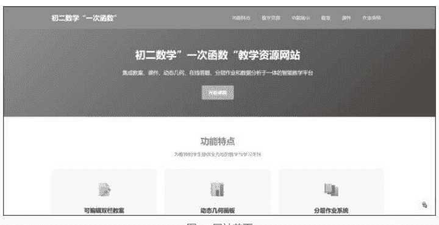

图3-2展示了网站的核心功能。这些功能旨在为教师教学与学生学习提供全方位、深层次的支持，助力数学教学与学习的高效进行。

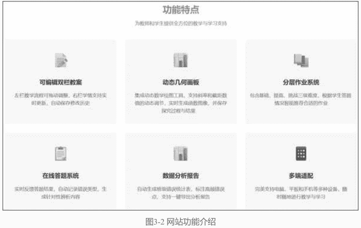

单击导航栏中的“教案”，即可进入初二数学“一次函数”教案页面，该页面如图3-3所示。页面顶部直观地展示了课题名称、教材版本、课时安排、班级平均分及薄弱生比例等关键信息。紧接着展示的是教学流程和学情支持模块。学情支持模块下的学情分析涵盖学生对前导知识的掌握情况评估，常见误区预警则对学生在学习一次函数概念时易出现的忽略条件 k ≠0、混淆 b 与 k 的意义等进行了预警，助力教师精准把握教学重点和难点。

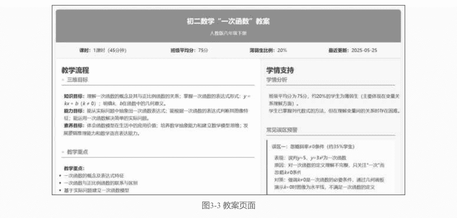

单击导航栏中的“课件”，即可借助动态演示帮助学生理解与一次函数相关的知识。其中，“k值变化演示”功能支持通过滑块灵活调整k值和b值。教师操作时，学生能直观地看到一次函数图像随k值和b值变化的过程，有助于学生理解“k ≠ 0是一次函数y = kx + b的必要条件，当k = 0时，函数变为y = b，该函数是常数函数，不是一次函数”这一难点。动态演示效果如图3-4所示。此外，教师还可借助“弹簧伸长量演示”功能模拟弹簧在不同拉力作用下的伸长情况，从而将一次函数知识融入物理情境。这能够帮助学生更直观地理解一次函数的概念，比如一次函数表达式里的b值代表弹簧初始长度。这种融合物理情境的数学教学方式，能够帮助学生体会一次函数的跨学科应用，从而提升学生的知识迁移能力。教师单击相应的“打开演示”按钮，即可开始互动操作。


以下是教师在使用智能体的过程中可能出现的问题及解决方法。

问题1：教师输入的指令不够准确或完整，导致生成的教案与预期有偏差。

解决方法：让智能体提供实时反馈功能，教师输入指令后，系统自动弹出提示框，提醒教师检查关键信息是否完整、格式是否正确等。例如，如果教师在学情部分只输入了“20%薄弱”，系统会提示“请补充薄弱环节的具体内容，如变量关系理解、列函数关系式等，以便精准生成教案”。另外，在教师端的应用中内置帮助中心，该中心提供详细的指令输入指南和常见问题解答。

问题2：教师对生成课件中的几何画板控件操作不熟练，影响教学演示效果。

解决方法：智能体在生成课件的同时，会自动嵌入操作指南。这些操作指南以视频或图文形式详细介绍几何画板控件的操作方法，包括如何拖动 k 值和 b 值的调节滑块、如何暂停/播放动态演示等操作技巧。此外，教师还可以在平台内置的交流社区中提问，获得其他教师的经验分享和技术支持。

问题3：在线答题系统出现技术故障，无法正常使用。

解决方法：平台配备7×24小时技术支持团队，教师发现问题后，可通过相应的反馈渠道（如“一键报修”按钮）快速反馈。技术团队收到反馈后，会立即响应并远程排查、处理各类故障，如因服务器故障导致答题系统无法访问，技术团队会迅速修复服务器并恢复系统运行，同时向教师通报处理进度和结果。

通过应用前述4层结构化Prompt模板，智能体能够将教师模糊的教学需求转化为可执行的功能指令，生成结构完整的教案和配套课件，并通过数据联动功能，为教师提供智能化教学支持。

接下来，教师可以继续按照这种方式进一步拓展智能体在课堂互动管理和学生成长跟踪等方面的应用。

## 3.2 课堂互动

在现代教学中，课堂互动已成为提升教学效果的重要手段。智能体依托课堂互动系统为教师提供个性化反馈和指导，助力其高效开展多样化的教学活动，实时掌握学生学习动态。

实现课堂互动系统的结构化 Prompt 如下。

```
#角色定位
初二数学教师

#场景界定
“一次函数的概念”课堂教学，课时为45分钟，计划安排实时问答环节（时长10分钟）和小组讨论活动（时长12分钟），并在课程结束后对学生的课堂表现进行分析。班级共45名学生，其中部分学生对变量关系理解较好，约20%的学生在变量关系理解及列出表达式方面较为薄弱，班级氛围较为活跃。

#要素拆解
1.实时问答
题目类型：选择题占50%，填空题占30%，简答题占20%。题目涵盖课程中的重点概念，如一次函数的定义、表达式y = kx + b (k≠0)，以及正比例函数与一次函数的区别；易错知识点包括忽略k = 0条件、混淆一次函数与其他代数式的关系等。
答题方式：学生通过班级小管家在线答题系统答题，系统能够实时统计答题情况，包括正确率、答题时间、每道题的错误率等。
互动形式：教师可设置8分钟限时答题；针对错误率较高的题目，教师将进行讲解并追问，比如针对“判断y = 3是否为一次函数”，追问学生“一次函数的关键条件是什么？为什么y = 3不符合条件？”从而引导学生深入思考。
2.小组讨论引导
讨论主题：围绕“一次函数在生活中的实际应用场景”展开，例如探讨一次函数在打车费用（超出起步价后的计费）、弹簧伸长量与拉力、商品总价与购买数量等线性关系问题中的体现。
分组方式：采用混合能力分组方式，每组5人，共9组。
引导策略：教师在小组讨论过程中适时介入，提出引导性问题，如“在打车费用案例中，我们能发现哪些变量关系？起步价和每公里费用分别对应一次函数表达式中的什么？”；提供相关资料或提示（如不同城市的出租车计价标准），帮助学生厘清变量关系；同时观察各小组的讨论进度与参与度，确保活动有序开展。
成果展示：小组讨论结束后，每组推选一名代表进行3分钟发言，分享讨论成果；教师对各组表现予以点评和总结。
3.课堂表现分析
分析维度：包括学生答题情况（正确率、答题时间）、小组讨论参与度（发言次数、提出有效观点数量，如能否准确识别实际生活场景中的变量关系），以及课堂提问参与情况（主动提问次数、回答质量，如回答一次函数概念相关问题时的准确性和完整性）。
分析工具：借助课堂互动管理系统的数据分析功能，生成学生课堂表现报告，报告以柱状图展示学生在各维度的表现水平，以折线图呈现班级对各知识点的整体掌握情况，以数据表格形式呈现每位学生的具体指标。
反馈方式：课程结束后，教师根据分析结果，对表现优秀的学生予以表扬和奖励，如在班级公告栏公示其优秀表现并给予积分奖励，以起到激励作用；对于学习暂时困难的学生，教师课后进行单独沟通，了解原因并提供个性化的学习建议，比如为变量关系理解薄弱的学生推送相关辅导资料或安排针对性课后小练习。

#输出规则
系统功能：在实时问答模块提供题目编辑、发布和统计功能；在小组讨论模块提供分组设置、过程监控和成果记录功能；在课堂表现分析模块提供多维度数据采集、可视化报告生成功能。
界面展示：实时问答界面清晰呈现题目、学生答题进度和结果统计数据；小组讨论界面直观展示分组情况、讨论过程中的互动记录和成果汇总；课堂表现分析界面采用可视化图表和报告呈现学生个人及班级整体的多维度表现数据。
数据存储：对学生的答题数据、小组讨论记录和课堂表现分析结果等进行长期存档，方便教师随时查阅和进行对比分析，为后续教学提供参考依据。
```

把结构化指令交给智能体后，第一步通常是做一轮需求对齐。下面这段对话就是典型例子。

非常感谢你给到的细致说明。在动手搭建课堂互动平台之前，我想先把几个关键点再确认一下，确保方案更贴合你的教学习惯。

即时测验板块：是否要支持多套题库的预存，方便课上灵活调用？学生作答结束后，你更希望立刻向全班公布标准答案和解析，还是先看统计再决定是否公开？

分组研讨板块：分组逻辑上，你更倾向让系统依据往期成绩自动平衡，还是由你手工微调？研讨过程中，成果是让学生在线提交笔记，还是由你巡堂时自行记录要点？

表现洞察板块：除了已提到的维度，是否还要纳入出勤、专注度等指标？分析报告是课后直接生成，还是在你补上评语后再生成？

部署方式：这个平台是独立运行，还是接入原本的线性函数教学站点？是否需要覆盖多班级的数据汇总与横向对比？

你的反馈会让后续设计更精准。
可以按照这个方向补充具体需求。
确认后生成的课堂互动界面示意如图3-5所示。

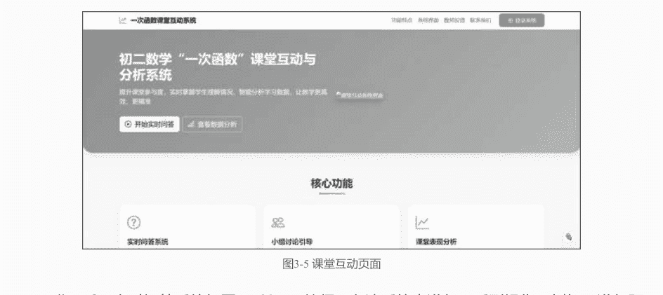

登录后进入即时测验模块，界面如图3-6所示。教师可开展多项操作。管理题库时点按“新建题库”，能按知识点归类题目，也能借助搜索框配合概念辨析、建模应用等标签快速定位，提升调取效率。编辑题目时选定题库后，系统会列出题号与总题量，支持单选、多选、填空等多种形式。输入题目与选项后可先预览，确认无误再发布。学情统计区会实时显示剩余答题时长，并汇总已完成人数、正确率、选项分布等数据。还能切换查看每位学生的作答明细，为及时调整教学策略和开展针对讲解提供数据支撑。

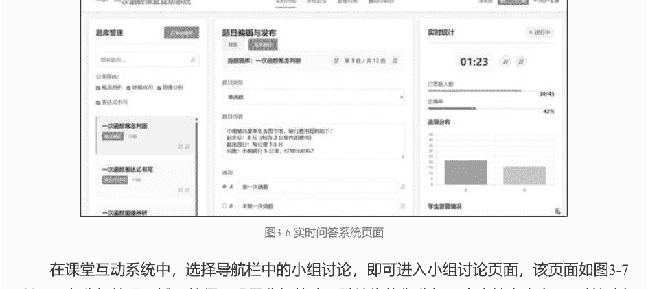

在互动平台中点进导航栏的分组研讨，即可进入如图3-7的页面。分组管理区可设定分组规则，默认均衡分组，也支持自定义，通过加减号调节每组人数，还能依据历史成绩、互动数据等条件分组。可一键自动生成小组，也能手动调整名单实现个性化。讨论进程由“开始讨论”“暂停”“结束讨论”按钮控制。中部清晰呈现讨论主题与倒计时，主题下方有任务说明与参考资料，帮助学生理解案例。成果区展示各组的提交状态，点击“查看详情”可阅读内容，“添加反馈”可给出点评。汇报安排区支持自动或手动排序，并可设定每组汇报时长，保证流程顺畅。

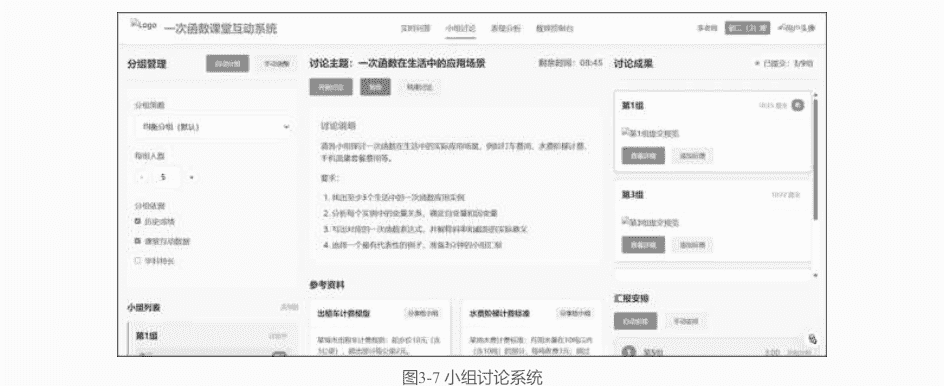

点进导航栏的表现分析，进入如图3-8的页面。维度区可选择班级例如初二（3）班和时间段例如今日课堂，并勾选答题情况正确率答题速度错误类型分布、小组讨论参与度讨论成果质量组内互动等。表现展示区用图表呈现正确率分布、答题时长分布、错误类型分布和讨论参与度，并给出具体结论例如20%学生因忽略k≠0出错，正确率不足60%。学生表现区可按综合表现排序，展示前几名例如前10名的正确率、参与度、综合得分。数据可导出，按“生成报告”即可整合分析内容。

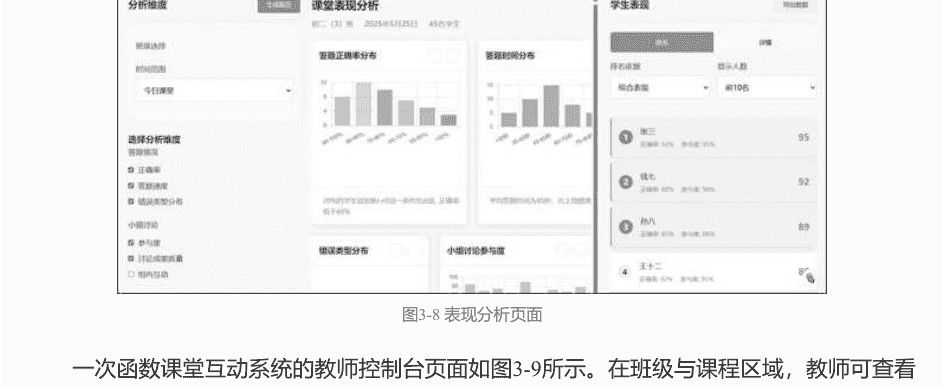

一次函数课堂互动的教师控制台如图3-9所示。班级与课程区可查看班级如初二（3）班初二（5）班等信息与人数，按“添加班级”即可新增。课程管理区展示各课程如一次函数的教学进度，可选择继续授课或查阅资料。课堂概览区显示出勤情况如45/45出勤率100%、答题正确率如78%环比提升5%、讨论参与度如85%环比提升8%，以及当前课时如一次函数概念第2课时已进行32分45秒的进展。数据与通知区用趋势图呈现正确率、参与度、知识点掌握随课时的变化，并推送提醒。点按“刷新数据”可获取最新状态。

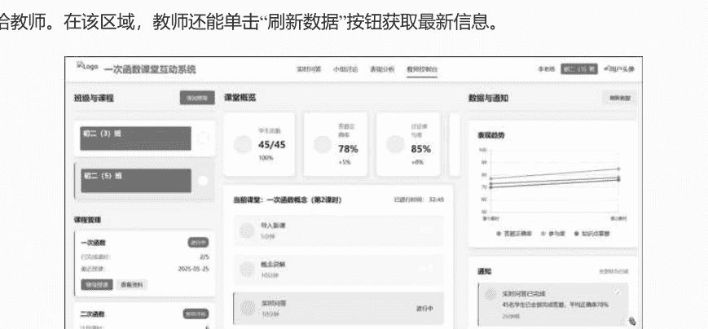

下面是教师在实际使用中可能遇到的典型问题与对策。

问题1：实时问答环节题目难度两极分化，部分学生答题时挫败感强。
解决思路：采用智能分层出题，在指令中加入难度系数例如变量关系理解类题目难度系数≤0.6，系统自动过滤超纲题，并为基础薄弱学生定向推送前置复习题。同时启用动态难度调节，某类题错误率超50%时自动降级提示，例如把简答转为填空打车费用=起步价8元+2元/千米×里程 x，表达式为y=，并延长答题时间至10分钟。

问题2：小组讨论时出现话语权垄断、部分学生参与度低。
解决思路：启用强制角色分配，分组后自动为每位学生分配记录员发言人质疑者资料整合者等角色，要求发言人轮换，成果需含全体成员签名或电子批注。实时参与度监测预警，当某生连续3分钟未发言，教师端对应小组图标闪烁提示，并推送引导话术模板例如请听听××同学的想法，他可能发现了新的变量关系，帮助及时调节节奏。

问题3：课堂表现分析维度过多，难以快速定位教学改进方向。
解决思路：引入数据关联分析引擎，在表现分析页增加知识点与行为的关联查询。输入k≠0等关键词，系统筛选该知识点出错学生，并调取其讨论参与记录例如是否在讨论中提到k的作用，进而生成关联图谱。此外提供教学改进智能推荐，根据正确率概念提及率等指标权重，自动标注关键影响因素例如因k≠0掌握不足导致模型构建错误率达65%，并推送教案修订建议。

课堂互动系统由结构化Prompt驱动，形成实时问答小组讨论表现分析的闭环。教师结合角色定位与教学场景运用前述四层结构化Prompt模板，可显著提升互动的针对性和有效性。

## 3.3 成长全景追踪与家校协同
在教学实践里，学生成长是动态多维的。传统评估多靠经验或阶段性考试，难以持续全面地看清长期轨迹。借助智能采集、多维分析与可视化呈现的数据与沟通平台，能帮助教师从经验判断转向科学诊断。

搭建数据分析与家校沟通平台的结构化指令如下。

```
#角色定位
初中数学教师（负责数据审核、数据分析与解读、家校沟通）
#应用场景
1. **学期成长档案**：整合整个学期数学学习数据（成绩、作业、课堂表现），形成电子档案
2. **阶段性评估**：
   - 周评估：课堂参与度+作业完成质量
   - 月评估：单元测试成绩+数学素养发展指标
   - 学期评估：综合成绩+成长趋势分析
3. **个性化方案**：基于薄弱点生成针对性练习（如函数图像分析能力不足，则推送专项训练）
4. **家校沟通**：自动生成含数据图表的家长报告（支持语音播报功能）

#要素拆解
（1）数据采集
| 类型 | 具体内容 | 采集方式 | 示例字段 |
| --- | --- | --- | --- |
| 自动同步 | 考试成绩、作业提交记录、考勤状态 | 对接学校管理系统 | 期中数学成绩92分、作业迟交3次 |
| 半自动录入 | 课堂行为标签、小组合作表现 | 教师勾选预设标签 | “主动发言”“小组汇报主导” |
| 人工记录 | 成长故事、典型错题分析、家长反馈 | 教师/家长填写表单 | 某次解题思路突破的详细过程 |

#分析工具
- **动态曲线**：呈现数学成绩（纵轴）与课堂互动次数（横轴）在学期中的变化趋势
- **百分位图**：展示学生在班级中的数学成绩排名、作业完成率等的百分位值
- **素养热力图**：聚焦数学核心素养（逻辑推理、数学运算、直观想象），按等级（优秀、良好、待提升）进行可视化呈现

#智能预警
- 成绩预警：连续2次单元测试成绩低于班级平均分15%时触发
- 行为预警：本周课堂互动频率较上周下降50%时标记为“关注”

#输出规则
1. **网站功能**：
   - 教师端：数据录入、分析报告生成、个性化方案编辑
   - 家长端：查看孩子的报告、提交反馈、预约沟通
   - 学生端：查看个人成长曲线、接收学习建议
2. **可视化报告**：
   - 包含“成绩雷达图”“素养发展时间轴”“家校沟通记录”模块
   - 支持按周/月/学期筛选数据，一键下载PDF版本
3. **部署要求**：
   - 服务器需通过教育数据安全认证，家长访问需进行身份验证
   - 提供API对接学校现有OA系统
```

智能体接收结构化指令后自动完成全部设计并生成网站，登录界面如图3-10所示。

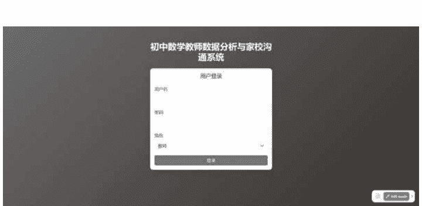

图 3-10 系统登录页面
学生管理页如图3-11所示。教师可通过班级切换标签查看不同班级信息，或用右上方搜索框关键词筛选。表格列出学号姓名最近成绩班级排名课堂表现预警状态等。点“详情”可追溯学习历程，“报告”可生成评估报告，“沟通”进入家校沟通界面。若数据分页，可用前页后页或页码跳转。

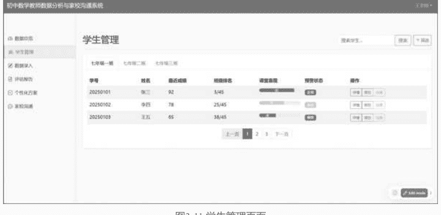

图3-11 学生管理页面
数据录入页如图3-12所示。教师可点成绩录入课堂表现素养评估成长记录等选项切换页面。在成绩录入页，需填写考试名称例如第四单元测试，并选择考试日期和班级从下拉列表选择。下方的表格列出学生学号和姓名，在成绩单元格输入即可，备注栏可补充说明。完成后点“保存”，放弃则点“取消”。页面右上方提供导入Excel和批量录入，支持按指定格式导入或快速完成多位学生成绩录入。

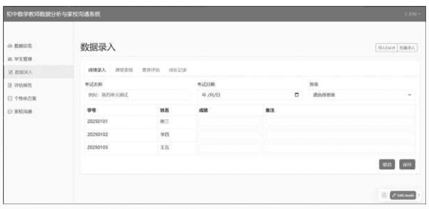

评估报告页如图3-13所示。生成报告时先在报告类型下拉选择周报月报或学期报确定周期，再选班级和学生全部或个人，时间段下拉选范围，点击生成报告，右侧最近报告区显示新报告。可点“查看”了解学习过程成绩趋势素养发展，“发送”推送给学生家长，“下载”保存到本地。

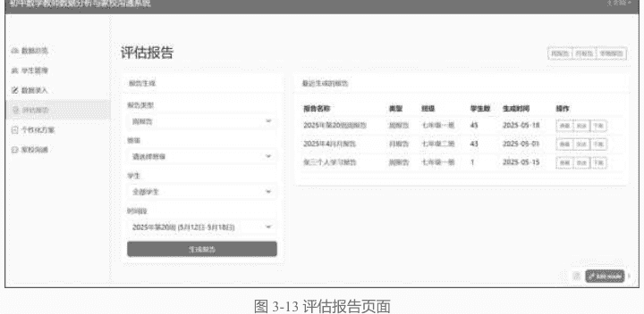

个性化学习方案页如图3-14所示。点右上角“创建新方案”即可制定。在薄弱点分析区可查看主要短板及训练建议。已制定的方案可查看修改分享，待更新的方案可依据新数据调整，未制定的方案可先点“分析”生成学情诊断再点“制定”。资源库区支持关键词或标签筛选，并可按需推送辅助学习材料。

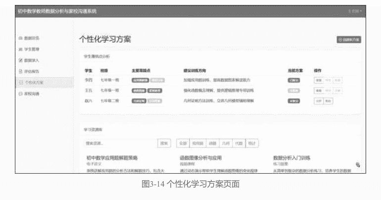

家校沟通页如图3-15所示。教师可按班级最近联系时间等条件筛选家长列表，未读消息数字标识。聊天窗口可发送学习情况，点“创建预约”设置沟通时间和方式。完整聊天记录保留，便于回溯交流与家长反馈。

以下是教师使用数据分析与家校沟通系统时可能遇到的核心问题与解决方法。
问题1：自动同步数据不完整例如考试成绩未更新，或标签库覆盖不足例如缺少板书讲解，导致推荐资源与薄弱点不匹配例如函数图像薄弱却推送代数计算资源。
解决方法：手动刷新或临时补录，系统后续自动更新；在标签管理模块新增自定义课堂行为标签如小组板书展示，也可批量导入导出；在资源库修正资源与标签映射如把一次函数图像动态演示归到函数图像标签；用资源匹配测试功能检测匹配度低于80%的资源并手动调整。

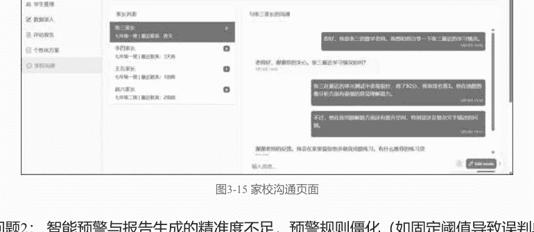

问题2：智能预警与报告生成的精准度不足，预警规则僵化如固定阈值导致单次低分误判，报告维度与教学目标脱节如默认素养指标未涵盖建立数学模型。
解决方法：调整阈值如改为连续3次低于均值10%，并加入容错机制允许一次波动；开启动态阈值模式，系统依班级历史数据自动计算显著变化阈值；在报告生成页勾选《中国学生发展核心素养》相关指标；将自定义指标组合保存为函数章节专属模板，下次直接调用。

问题3：家校沟通与系统运行存在性能瓶颈，家长因权限未绑定无法查看报告，预约沟通时出现时间冲突；多班级管理时页面卡顿甚至无法访问。
解决方法：指导家长在个人中心绑定学生完成身份验证；教师可主动分享报告并设有效期；家长可提前录入忙碌时段；教师创建预约时系统将自动避开冲突时段，并支持3选1协商机制；针对卡顿建议清理缓存或使用Chrome、Edge等现代浏览器；系统启用分批加载降低前端压力。服务器故障时点“一键报修”反馈错误代码，技术团队优先恢复教学核心功能。

随着教育数字化的不断深入，初中数学课堂对学生成长状态的持续跟踪已成为提升教学成效的重要支点。该设计以数据驱动为底层逻辑，围绕清晰的角色定位与功能规划，融合多源信息采集、量化分析手段、智能预警机制和标准化结果呈现，搭建起一套完整高效的成长监测体系，能够覆盖多种教学应用场景。从实际操作界面看，无论是学籍信息维护与数据录入，还是评估报告的自动输出、个性化改进方案的制定以及家校沟通的对接，都能为教师提供顺畅可靠的支持。这有助于推动评价方式由经验型转向诊断型，实现对学生成长轨迹的长期跟进，为数学教学质量的提升和学生的长远发展提供坚实保障。

# 第4章 科研智能体的系统构建

当前科研正面临数据体量激增与任务复杂度攀升的双重压力，如何快速准确地处理海量信息并应对复杂问题，已成为研究人员亟待解决的难题。在此背景下，科研智能体凭借先进的算法底座、出色的运行表现和高度的可塑性，成为推动科研转型的关键力量。本章将围绕科研智能体的系统化构建路径展开，探讨如何驱动科研流程向智能化演进，从而提升效率与优化质量。

## 4.1 智能体化身科研自动化助手

科研链条中存在大量重复度高、耗时耗神的环节，这些环节占用了研究人员大量精力，且人工处理易产生偏差。依托先进技术架构与强自学能力，智能体可化身高效的自动化协作者，让研究者摆脱琐碎工作，聚焦核心创新。

以下从文献综述自动化、实验数据可视化、学术报告生成三个方向切入。

### 4.1.1 文献综述的自动化实现

在学术研究中，文献综述既是基础也是关键，要求研究者广泛搜集、筛选、整理并分析相关资料，以构建框架、发现空白并推动进展。传统方式费时费力且易受主观偏见影响。随着AI发展，智能体凭借强数据处理、自然语言理解与生成能力，为综述智能化提供革命性方案，尤其在智能检索与结构化摘要生成方面优势明显。

#### 1. 综述作业的关键能力体现
智能体在综述环节的能力主要体现在以下方面。
- 海量文献自动采集与初筛：借助网络爬虫，智能体可从全球学术库、期刊站点、预印本平台自动抓取资料，并通过文本挖掘算法迅速挑出与研究主题高度契合的文献，显著缩短检索周期。
- 自动摘要与核心词抽取：针对单篇文献，智能体能生成简洁准确的摘要并提炼关键概念，便于研究者快速把握要点。
- 主题归类与聚类：将相似主题归组，便于宏观把握领域结构分布。
- 热点追踪与研究缺口发现：通过深度分析海量文献，智能体可辨识领域发展趋势、热点话题及尚未充分探索的方向，提供兼具前瞻性与可行性的选题建议。
- 综述自动撰写：基于分析结果自动生成结构清晰、内容丰富的综述报告，涵盖文献基础信息、核心内容及兼具理论与实践价值的研究展望，显著减轻写作负担。

#### 2. 案例：新能源汽车领域的综述应用
##### (1) 研究背景与目标
随环保重视度提升与传统燃油车限制加严，新能源汽车成为行业热点。为全面掌握电池技术、续航里程、充电设施等方面的研究现状与趋势，我们借助智能体实现该领域的综述自动化。

##### (2) 具体操作流程
实现自动化综述的关键步骤如下。
1) 资料汇聚：设定新能源汽车、电池技术、续航里程、充电技术、充电设施等核心检索词，利用智能体对主流学术数据库与权威行业报告平台进行全面检索，获取大量高相关文献，为后续研究奠定数据基础。
2) 质量筛选：为保证严谨性，智能体运用特定算法对采集文献进行精细筛选。系统会分析标题、摘要、关键词的契合度，并结合被引频次、期刊影响力等指标，从海量资料中甄别出高质量样本用于后续分析。
3) 内容剖析与要素提取：完成筛选后，智能体对文献进行深度剖析，精准抽取关键信息。
4) 综合整合与综述生成：智能体整合提取信息，对比不同电池技术如固态锂电池、锂金属电池、燃料电池的性能优劣，总结提升续航的有效策略，分析充电设施建设现状与问题，包括布局合理性、智能化管理水平等。经多轮处理后，生成内容丰富、结构完整的综述初稿。

##### (3) 测试与验证
为检验智能体在新能源汽车综述生成中的准确性与可靠性，我们开展多维评估并与权威人工综述对比，结果显示性能优异，可信度高。
在完整性维度，智能体综述全面覆盖电池技术、续航里程、充电技术及设施建设等核心方向，详细阐述各类电池发展、续航测试方法、充电技术要点，覆盖面与深度接近人工综述，体现出整合关键信息的有效性。
在准确性维度，智能体在电池性能对比、续航测试标准等关键点上输出与行业共识高度一致，对先进电池优势与测试标准特征描述准确，展现出高效的信息提取与处理能力。
在逻辑性维度，综述结构清晰、条理分明，板块衔接自然，从电池技术到续航再到充电技术层层递进。以充电技术为例，依次呈现快充、无线充电、换电模式，清晰反映研究现状与发展趋势，逻辑水平接近高质量人工综述，有助于理解复杂领域知识。

##### (4) 不足
评估中发现智能体综述仍存在以下局限。
- 对前沿技术的描述偏浅，多停留于已发表表面成果，缺乏对未来应用场景及潜在挑战的深入探讨。
- 对未来研究方向的预测创新性与前瞻性不足，未充分融合科技趋势及外部影响因素如政策、市场变化。
- 存在引用失实或来源不可靠文献的风险，参考文献准确性需人工复核以保证学术严谨。

##### (5) 结论
智能体在文献综述自动化中的应用显著提升研究效率，并以强大的数据分析能力为研究者提供全面、客观的学术视角。作为智能化工具，智能体可有效规避人工处理中信息遗漏、引用偏差、分析主观性等问题，确保成果严谨。随着技术进步，智能体有望在更多领域发挥独特价值，成为科研人员的得力助手。

### 4.1.2 可视化实践：Matplotlib 与 Tableau 的结合应用
#### 1. 可视化的价值
科研中数据日益复杂多样，实验数据、观测记录、文献数据等呈指数增长，常具有多维、非结构化特征，传统方法难以高效挖掘价值。智能体可视化功能将抽象数据转译为直观图表与图形，降低理解门槛。研究者借助可视化成果可快速识别模式、趋势与异常，验证假设、优化模型。学术交流中，可视化提升传播效率与影响力，促进跨学科合作。在数据驱动决策中，智能体提供的直观洞察为资源配置与研究方向调整提供依据。

#### 2. 对 Matplotlib 和 Tableau 的支持机制
智能体基于 Python 生态构建可视化体系，通过深度集成 Matplotlib 和间接支持 Tableau 实现多样化呈现。对 Matplotlib，智能体可直接调用 Python 脚本中的库函数于沙盒环境执行绘图，无需外部 API 即可精细控制图表元素。针对 Tableau，智能体利用 Python 库完成数据预处理与格式转换，使数据符合 Tableau 输入规范，并提供详细操作指南，引导用户在本地 Tableau 软件中完成交互式可视化，实现无缝衔接。

#### 3. 工作内容
实验数据可视化的具体工作如下。
1. 数据处理：接收原始数据后执行清洗、转换与标注。清洗识别并处理缺失值、异常值；转换统一格式，将非结构化数据转为结构化；标注按行业标准添加分类标签与元数据，提升结构化程度。
2. 基于 Matplotlib 的可视化：依据需求调用 Matplotlib 生成折线图、柱状图、热力图、箱线图等，精确设置颜色、字体、坐标轴、图例等，确保符合学术规范并适配不同科研场景。
3. Tableau 可视化支持：利用 Python 库将处理后数据导出为 CSV、Excel 等 Tableau 可识别格式，并生成涵盖数据导入、图表创建、交互功能设置的操作指南，包括颜色映射、筛选器、悬停提示配置等。
4. 文档生成与打包：任务完成后自动生成项目说明文档，记录数据来源、处理过程、可视化方法及结果解读，并将图表、数据文件、脚本与操作指南打包交付。

#### 4. 应用示例
以国家统计局公布的 2024 年中国部分省区市 GDP 数据为例，智能体对数据进行处理，添加东部、东北、中部、西部区域标签并核查质量。图4-1为按 GDP 数值降序排列的省区市 GDP 柱状图，直观展示规模差异；同时生成区域分组的 GDP 箱线图（如图4-2），清晰呈现各区域中位数、离散程度与异常值分布。

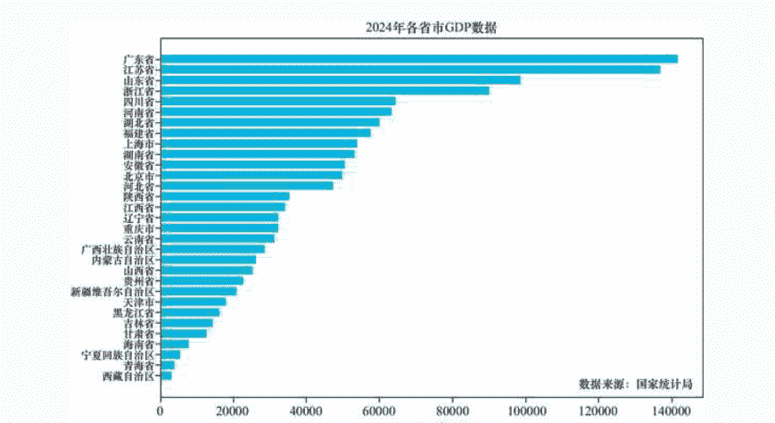

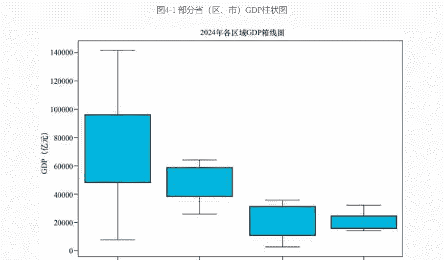

### 4.1.3 学术报告生成：基于 LaTeX 模板的智能填充
学术报告是成果传播与交流的核心载体，质量直接影响影响力。传统撰写耗时耗力于排版、公式编辑、参考文献等基础工作，易分散注意力并导致格式错误。智能体基于 LaTeX 模板的智能填充技术提供高效规范的生成方案，提升效率并加速成果输出。

#### 1. 核心技术优势
智能体兼具效率与质量保障。传统方式撰写规范报告需数天，而智能体可将耗时压缩至数小时。质量上严格遵循主流学术规范，确保字体、字号、段距、图表排版及参考文献格式合规，降低拒稿风险。
LaTeX 模板智能填充解决了传统痛点。过去需手动编写大量代码实现复杂排版，学习成本高且易错。现在智能体自动分析内容并填充模板变量，将文字、公式、图表精准嵌入，科研人员无需精通 LaTeX 即可产出高质量报告，实现内容创作与格式分离。

#### 2. 操作流程解析
学术报告生成遵循系统化流程，具体如下。
1. 系统部署与材料校验：安装 Pandoc 等工具，接收用户 Word 文档完成资源准备。
2. 文本转换：利用 Pandoc 将 Word 转为 Markdown，保留标题层级、段落结构、列表样式及图片引用。
3. 排版环境搭建：安装 texlive-latex-recommended、texlive-fonts-recommended 等组件，配置 XeTeX 引擎以支持 Unicode 尤其是中文排版。
4. 模板设计：依据 Markdown 结构创建学术报告模板，定义 article 文档类，预设页边距、作者信息、摘要等，并引入 ctex、graphicx、amsmath、hyperref 等宏包，通过占位符明确填充区域。
5. 格式转换：调用 pandoc 将 Markdown 转为 LaTeX，指定定制模板并以 xelatex 为渲染引擎，确保标记精准转换。
6. 编译调试：执行 xelatex 生成 PDF，解决宏包兼容、中文支持、图片路径等问题，经迭代调试后输出最终 PDF。
7. 交付：将 LaTeX 源文件、PDF 成果及图片资源打包为 zip 交付用户。

#### 3. 核心机制剖析
智能体依托五大机制协同运行。
- Pandoc 跨格式转换：作为格式桥梁，将 Word 转 Markdown 再转 LaTeX，自动映射标题、列表、强调、图片引用等结构要素。
- 基于 LaTeX 的精细排版：专业排版引擎通过编译 .tex 文件生成高质量 PDF，擅长复杂布局、交叉引用、参考文献、数学公式与多语言排版。
- 模板驱动格式化：通过自定义 LaTeX 模板控制 PDF 外观与结构，Pandoc 负责将内容填充至指定位置。
- XeTeX 多语言支持：原生支持 UTF-8 并可调用系统字体，结合 ctex 宏包确保中文准确排版。
- 迭代调试优化：针对编译错误与警告逐步定位宏包缺失、命令冲突、文件路径问题并修正，确保输出质量。

#### 4. 应用价值与拓展
在材料科学领域，某团队借助智能体将实验数据与分析结果快速转化为符合期刊要求的论文，半天内完成从整理到生成，格式精确并成功发表于顶刊。社会科学研究中，研究人员利用智能体生成学位论文，自动参考文献列表严格合规，减少修改成本。
未来将集成更多学术资源库实现智能推荐与自动引用，引入 AI 辅助内容撰写与优化，如自动生成实验结论，并支持更多文档格式以适配不同交流场景，推动学术报告生成向智能化、高效化发展。

## 4.2 智能体助力科研实验：设计与评估
在日常科研中，智能体提供多维度支持，尤其在实验设计与参数优化方面作用突出。

### 4.2.1 基于历史数据的实验设计建议
科研实验设计中，智能体凭借数据整合与智能分析能力突破传统经验驱动的局限。传统方法依赖个人经验与直觉，易陷入重复试错，难以揭示数据间潜在关联。智能体通过系统分析历史实验数据挖掘规律与模式，为新实验提供数据驱动的科学建议，提升效率与成功率，减少资源浪费。

#### 1. 基于历史数据生成设计建议的步骤与机制
1. 历史数据汇聚与结构化
智能体广泛收集与目标实验相关的多维度历史数据，包括模型参数、数据处理细节、训练过程参数、评估指标等，经清洗、筛选与整合转化为结构化格式，为后续分析奠定基础。
2. 探索性分析与关联挖掘

智能科研闭环实战拆解

借助统计分析与可视化呈现，智能体能够厘清各项变量与实验结果的关联，准确抓取对实验表现起主导作用的关键要素，从既有记录里提炼出已得到验证的高效参数组合，并发掘尚未充分探索的参数区间。

3. 生成新实验假设
在数据洞察的基础上，智能体提出可落地的研究假设，推演参数调节的可行方向，用以探索提升实验表现的新路径。

4. 设计与推荐新实验方案
依托假设，智能体搭建若干套完整计划，明确研究目标、变量操控方式、对照组与实验组安排、评测体系等要素，经预期价值排序后，为科研人员提供清晰可执行的实施指引。

5. 迭代循环
新实验产生的结果会汇入历史数据池，智能体通过持续迭代优化分析与设计过程，不断完善建议，形成数据积累-洞察-设计-验证的良性回路。

#### 2. 案例：通过微调大模型提升医学问答任务性能
以微调大模型提升医学问答性能为例，智能体先收集过往微调实验的历史记录，涵盖基础模型类型如GPT-3、Llama、参数规模、医学语料如文献库和临床案例、数据预处理策略如清洗规则和分词方式、训练超参如学习率、批次大小、训练轮数，以及评测指标如医学问答正确率和答案相关性评分等信息，并整理为结构化表格。

随后对这些资料展开探索性分析和关联性分析。示例如下。

```
探索性数据分析（EDA）与关联性分析
目标：发现历史数据中隐藏的模式、趋势和关联，特别是参数与性能指标之间的关系。
机制：应用统计和可视化技术来理解数据。
操作：
统计分析：计算各参数与核心性能指标（准确率、效果评分）之间的相关系数（如Pearson、Spearman）。进行描述性统计（均值、中位数、方差）以了解参数和结果的分布。
可视化：
绘制散点图：观察连续参数（如学习率）与性能指标的关系。
绘制箱线图/小提琴图：比较不同类别参数（如优化器类型、数据集）对性能的影响。
绘制热力图：展示多个参数之间或参数与性能指标之间相关性的矩阵。
模式识别：
识别历史上产生高性能结果的参数范围或参数组合。
识别导致性能不佳的参数设置或陷阱。
找出历史实验中覆盖不足或完全未探索的参数区域。
分析不同因素（如数据集、模型变体）对结果产生的独立影响或交互影响。
```

通过学习率对应正确率的散点图、不同语料下模型表现的箱线图等可视化手段，解析数据及参数组合对模型效果的影响，寻找在医学问答正确率和相关性上表现突出的数据集和学习率搭配方案。同时，智能体还注意到部分新型医学影像标注数据集尚未被广泛用于微调。

在分析基础上，智能体形成实验假设：在表现领先的基础模型上引入尚未充分利用的新型医学影像标注数据集，并选用处于潜在优化区间的学习率进行微调，有望明显提高模型在医学影像相关问题上的回答正确率。

紧接着，智能体设计新实验，将当前最优配置设为对照组，实验组采用新数据集和调整后的学习率，并选用包含医学影像问题的专项评测集，以统一的正确率和相关性评分进行对比，方案被列为高优先级推荐。

实验完成后，相关参数设置和结果会被录入历史数据池，为下一轮分析和方案优化提供依据，持续推动大模型在医学问答任务上的进步。

### 4.2.2 参数优化与仿真模拟
在科研实践中，参数寻优和仿真模拟是提高效果和降低试错成本的关键环节。参数寻优致力于找到实现最佳结果的参数组合，仿真模拟则通过构建模型预判实验过程，便于在实操前评估预期。

参数寻优流程如下。
1. 明确优化目标和评价指标：厘清实验的核心改进方向，如提升化学反应产率或增强材料的抗拉强度，并制定可量化的评估标准。例如以产物质量或体积计算产率，或以材料断裂时的最大拉力衡量拉伸强度，从而量化不同参数组合的影响程度。
2. 确定核心参数和探索区间：筛选对结果影响显著的参数，如化学反应温度、压力、配比，或材料成型时间、添加剂含量等，并为每个参数设定合理的取值范围或离散等级，例如温度设在50～150℃之间，以划定探索边界。
3. 选择寻优策略和实验设计：依据实验类型和条件选择合适的方法。物理实验常采用因子设计、响应面法等系统化方案改变参数组合。若拥有可靠计算模型且实验可自动化，则贝叶斯优化、遗传算法等能够更高效地搜索最优空间。
4. 执行实验或计算模拟：按照选定设计开展实操或运行仿真程序，严格保证参数设定的准确性和实验条件的一致性，并完整记录关键性能指标和环境参数，为后续分析提供依据。
5. 结果分析和建模：利用统计工具和数学建模深度解析资料，通过相关性计算、方差分析等方法揭示参数和结果的内在规律，构建经验模型或数学表达式，呈现参数变化对结果的影响趋势。
6. 确定最优条件并验证：基于分析和模型预测锁定可能最优的参数组合，通过验证实验将预测参数应用于实际，对比结果和预测值，确认方案的可靠性。

仿真模拟流程如下。
1. 明确模拟目标和范围：界定研究的具体问题，确定时间、空间和对象的边界，避免盲目模拟。例如在电池研究中，目标可设定为预测不同充放电速率下首次充电一小时内的发热情况，范围限定于电池内部关键区域。
2. 选择或开发计算模型：根据对象特性从现有模型库挑选或基于物理化学定律构建适宜的数学模型，并在保证精度的前提下进行合理简化以提升效率。如研究固体力学性能时，可选用有限元分析模型，将复杂结构简化为可计算的单元组合。

### 4.2.3 实验可行性评估
实验可行性评估可从技术与科学可行性、资源可行性、风险评估与管理三个维度展开，通过系统化流程客观判断拟议实验是否具备实施条件和价值。

#### 1. 技术与科学可行性框架
用于判断实验在科学原理、研究方法与技术实现层面是否合理。评估细分为：
- 科学原理和假设审查：检验实验所依托的理论基础是否扎实，重点关注理论依据、核心假设、文献支撑、创新性与风险，以及预期结果的科学意义。
- 方法学评估：考察所选实验方法、测量技术和数据分析流程的适用性与可靠性，关注方法成熟度、测量能力、变量控制、分析计划及标准化程度。
- 技术实现评估：评估方案转化为实际操作的可行性，关注仪器设备可得性与性能、软件工具可用性、操作复杂度与技能要求、系统集成与兼容性、放大可行性及维护支持。

#### 2. 资源可行性框架
判断所需预算、时间、人员、设备、材料等资源能否满足，评估维度包括：
- 预算评估：核查总成本是否可控且有资金保障，涉及成本估算、预算匹配、资金来源、成本管控及应急预算。
- 时间评估：衡量完成实验所需时长是否符合项目要求，涉及工期估算、关键路径、时间缓冲及并行可能性。
- 人员评估：确认人员数量与技能是否匹配，涉及技能匹配度、经验水平、可用性及团队协作。
- 设备与设施评估：核查物理环境与仪器是否可用且满足需求，涉及设备状态、预约使用、设施条件及计算资源。
- 材料与资料评估：确认原材料、样品或资料能否稳定获取，涉及可获得性、质量一致性、获取成本与周期、资料可得性及样品制备。

#### 3. 风险评估与管理框架
系统识别、分析与应对实验过程中可能出现的风险，提升成功率并保障安全。核心步骤包括风险识别、分析、评价、应对及监控审查。常见风险类别有技术风险、安全与环境风险、伦理与合规风险，以及资源与项目管理风险。

#### 4. 完整评估流程
通常包含四个阶段：评估启动与信息收集、分维度评估、综合分析与总体评价、决策与行动计划。强调全面信息收集与多维度结果整合，形成总体判断并据此决策。

在该环节中，智能体可发挥信息处理与自动化辅助作用。信息收集方面，可快速检索文献、技术报告、专利、规范，查询仪器规格、耗材与设备的市场价格与供应商信息，以及化学品安全资料表与法规标准，为评估提供支撑。分析辅助方面，可在条件允许时基于用户提供的模型与脚本执行简易计算模拟，并按用户标准整理不同方法的优缺点。文档处理方面，可协助创建资源需求清单、预算表、风险登记册等模板，整合信息辅助起草评估报告，并设置提醒确保关键节点不遗漏。

同时，智能体存在明显局限：不能代替用户做专业研判，不能进行物理操作或操控实验设备，不具备独立设计复杂实验方案或构建专业科学模型的能力，也无法访问用户内部资源与机密资料。因此用户需主导科学假设、方法与结果分析的专业判断，负责实操、方案设计与资源调用，做出最终决策。智能体作为高效辅助工具与用户形成互补，共同推动评估工作。

### 4.3 实验数据管理
日常科研中实验资料的采集与管理至关重要，良好的管理既能提升效率也能保障质量。智能体可帮助科研人员更高效规范地处理资料。

### 4.3.1 实验记录自动化
智能体借助文件系统工具与沙盒环境交互，结合内部文本处理与格式化能力，将非结构化原始资料转化为结构化的电子实验记录本，通常采用Markdown排版。整体流程包含六个步骤。
1. 原始资料读取：调用文件读取工具获取用户提供的数据附件，完整获取素材。
2. 构建记录本框架：以覆盖写入方式创建新文件，用Markdown编写标题、来源说明、资料说明及记录区标题，形成清晰框架。
3. 资料格式化与转换：解析原始文本，识别地区、数值等关键信息，按Markdown表格语法重构为结构化表格，可暂存临时文件或在内存中完成。
4. 资料写入：采用追加模式将格式化后的表格写入已创建的记录本，保持标题与说明不变。
5. 结果验证：读取最终文件，核对标题、说明及表格完整性，确保记录准确可靠。
6. 交付成果：通过消息通知将任务完成情况告知用户，并附上生成的电子记录本供下载使用。

用户输入资料后，智能体按读取、建框、格式化写入、验证、交付的顺序完成处理，实现记录的自动化与规范化。

### 4.3.2 数据标准化与格式转换
资料标准化与格式转换是保障质量、提升分析效率的关键。实验资料来源多样，常存在格式不一、标准混乱、质量参差的问题，增加整合难度并影响分析可靠性。智能体通过自动化处理可减少人工误差，释放科研人员精力。

#### 1. 资料标准化
依据统一规范对原始资料进行系统处理，消除差异与歧义，提升可比性与可操作性，为整合分析提供可靠基础。

智能体可处理资料中的错误、不一致与缺失，提升准确性与完整性。具体包括去除多余空格与特殊字符、处理缺失值如填充默认值、删除记录或插值、纠正拼写错误、统一大小写；进行资料转换与标准化，包括类型转换、单位统一、编码转换、归一化或标准化等。

以员工流失信息统计数据集为例，原始资料如图4-3所示。

处理后资料如图4-4所示。

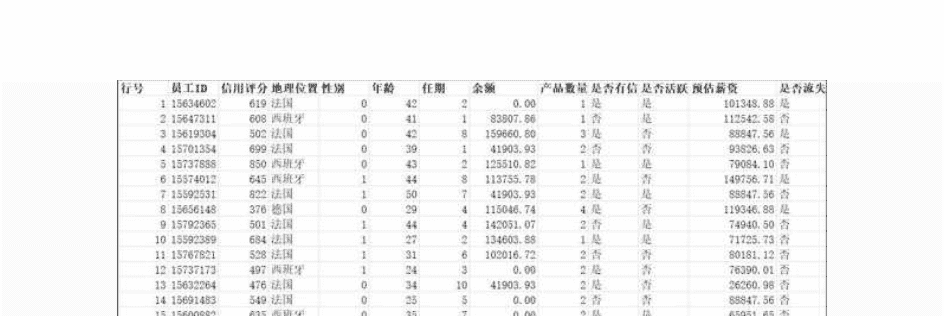

对比前后可见，智能体精准补充了缺失值，并对性别等分类变量进行数字编码，有效提升了规范性与完整性，使资料结构统一，为后续流失原因分析与关键因素挖掘奠定基础，增强了可分析性与应用价值。

#### 2. 格式转换
格式转换指将资料从一种存储或传输格式转为另一种格式，以实现跨平台、跨软件的流通与兼容，满足多样化分析、存储与展示需求。

指令微调阶段，ALPACA 规范几乎成了准入门票。以 JSON 到 ALPACA 的映射为例，源数据若以 JSON 呈现，就必须先完成一次结构重排，才能用于模型的指令微调。

医学实体抽取任务的训练集 JSON 片段示例如下。
```
[
    {
        "text": "（5）房室结消融和起搏器植入作为反复发作或难治性心房内折返性心动过速的替代疗法。",
        "entities": [
            {
                "name": "房室结消融",
                "type": "医疗程序"
            },
            {
                "name": "起搏器植入",
                "type": "医疗程序"
            }
        ]
    }
]
```

把文件交给智能体后，它会结合使用者的具体诉求和模型对输入格式的约定，自动完成结构迁移。迁移后得到的 ALPACA 样例如下。
```
{
    "instruction": "请识别以下医学文本中的命名实体，包括疾病、医疗程序和药物，并标注其类型。",
    "input": "（5）房室结消融和起搏器植入作为反复发作或难治性心房内折返性心动过速的替代疗法。",
    "output": "房室结消融（医疗程序）、起搏器植入（医疗程序）、反复发作或难治性心房内折返性心动过速（疾病）、替代疗法（医疗程序）"
}
```

对智能体而言，这类格式转换属于日常操作，能在很短时间内把 JSON 整理成规范的 ALPACA，大幅减轻准备负担。整体执行平稳、适配迅速，资料加工的时间与难度都被压缩，试验推进因此更快。

在标准化与结构转换的场景里，智能体凭借自动化能力可以批量处理大量重复性任务。但面对业务逻辑复杂、格式偏离标准、需要专业研判的情形时，智能体只能提供辅助，关键信息和最终抉择必须由使用者把控。两者配合才能让资料加工真正落地。

### 4.3.3 试验资料版本管理

科研中资料是持续演化的，增删改查贯穿全程。随着研究深入，新的资料不断产生，版本更新与管理变得关键。版本管理是保障资料正确、完整、可追溯的基础，能防止混乱，保证团队随时调取正确版本，也为结果复现、协作与长期保存提供支撑。智能体在此环节作用明显，借助自动化与任务驱动的方式，能同步提升版本管理的效率与规范，助力科研推进。

#### 1. 智能体在资料版本管理中的底层逻辑

智能体并不具备 Git 那样的自动变更追踪能力，其版本管理依赖一套任务导向的流程：存储层负责保存，脚本承载逻辑，工具调用负责执行，使用者指令作为驱动。存储层面，智能体利用沙盒环境的存储系统，对原始资料、中间结果和最终产物如电子实验记录本进行分类存放；逻辑层面，通过编写运行 Python 脚本实现解析、转换、合并等操作；执行层面借助文件读写、脚本运行等工具完成具体任务；使用者的操作指令则是触发增删改查的核心信号。

#### 2. 智能体处理增删改查的机制与步骤

（1）新增

智能体先通过消息或附件接收新资料，利用内置文本处理或解析脚本将其解析为 JSON 等结构化表达或中间文件，完成初步整理，再把结构化结果存入临时文件实现隔离。若后续需要并入已有资料，会运行或修改合并脚本；若要新建记录，则执行格式化脚本把资料转成 Markdown 表格等目标形态。最后以覆盖或追加方式写入目标电子记录本，完成高效录入与整合。

及时补充新资料可以让试验信息保持最新，满足研究推进需求，同时保持存储的规范性和结构性，为科研提供可靠支撑。

##### (2) 删除

收到删除指令后，智能体会先解析指令，明确删除范围是某行、某列还是满足特定条件的记录集。随后主要通过修改相关脚本来实现删除，比如在资料处理或表格生成脚本中加入过滤逻辑，让脚本运行时自动剔除目标部分。脚本修改完成后重新运行，生成不含已删内容的新输出文件，以覆盖旧文件的方式完成删除。

精准清理无效或错误资料，能避免冗余干扰分析，保证存储资料的准确有效，让资料更简洁高效。

##### (3) 修改

收到修改指令和具体内容后，智能体依据资料存储与处理的特点灵活选择修改方式。原始资料若直接写在脚本里，像 GDP 示例那样，就直接在脚本中改文本；若修改涉及计算逻辑或转换规则，则调整脚本中的处理逻辑；若资料放在中间文件，则可直接更新文件，也可在后续处理环节用新值替换旧值。修改完成后运行更新后的脚本或流程，重新生成输出并覆盖原文件，实现实时更新。

修改的目的是及时纠正错误、更新内容，让资料真实反映试验状况，为科研提供坚实依据。

##### (4) 查询与检索

收到查询指令后，智能体先解析需求，明确所需版本或文件，再结合文件名和任务上下文定位存储位置。通过文件读取工具获取内容后，以消息形式呈现给使用者，或直接以附件形式发送，完成查询与检索。

这一流程让使用者快速拿到所需资料，满足查看、分析、引用的需求，提升资料使用效率。

#### 3. 智能体管理不同时期资料的机制与步骤

##### (1) 文件隔离 按时期或批次存储

面对不同时间段或批次的资料，智能体会为每个时期单独建立处理流程，生成独立的输出文件。命名时采用带清晰时间标识的规则，让每个文件对应特定时间点，形成该节点的数据快照。从物理存储层面实现时期资料的隔离。

这样既做到时间维度上的直观分类，又便于快速调取特定时期资料，避免混杂带来的管理与分析难题，为时间序列分析和对比研究提供便利。

##### (2) 脚本化合并 整合多期资料

需要整合多期资料时，智能体先核查各期资料是否可用且已解析。随后根据资料特点编写或调整合并脚本，脚本负责读取各期资料、按共同键如地区进行匹配合并，并处理时间序列对齐问题。执行脚本后，分散资料即可汇总到单一输出文件。

研究人员由此获得历史全貌，把不同阶段资料置于同一分析框架，便于挖掘演变规律与趋势，拓展研究的深度与广度。

##### (3) 显式版本命名 若需追踪修改历史

当任务要求保留修改历史时，智能体会在生成输出文件时自动在文件名中加入版本号或时间戳。这种显式命名像一条时间轴，把每次修改的关键信息串联，形成完整历史脉络。

研究人员可以便捷回溯任意历史节点，直观掌握资料从初始到现在的演变，支持结果复现、过程审查和团队协作，保障可追溯性和严谨性。

## 4.4 试验失败分析

科研中失败难以避免，系统化的失败分析是推动进展、优化设计的關鍵。通过深入挖掘失败根源，后续改进才有方向，避免重复踩坑，提升效率与成果质量。智能体可作为重要辅助，帮助科研人员更高效地做异常检测与原因分析。

### 4.4.1 异常检测与原因分析

异常检测是从资料集中找出偏离正常模式或预期范围的数据点。科研资料是结论依据，异常点会严重影响准确性和可靠性。及时发现异常可避免错误结论，原因分析则帮助找到根源，为改进和修正提供支撑，提升质量与效率。

#### 1. 资料异常检测步骤

资料异常检测通常按以下步骤进行。

- 1) 准备资料并可视化：把待检资料整理成合适格式如时间序列或表格，用折线图、箱线图、散点图等初步观察离群点。
- 2) 选择并执行检测方法：依据资料类型和分布选择方法，常用有统计分布法如 IQR、Z-Score，时间序列法、聚类法，以及孤立森林、单类 SVM 等机器学习模型。执行检测后计算异常得分或判断边界，识别潜在异常点，并把检测结果包括异常位置、方法、阈值、异常值等记录到文件。

#### 2. 原因分析步骤

原因分析一般包括：

- 1) 确认异常：结合可视化结果和领域知识复核检测到的异常点，排除方法局限导致的误报。
- 2) 排查原因：从资料录入传输、测量设备、试验流程操作、真实极端事件、资料处理、欺诈或恶意行为等维度系统性思考可能诱因。
- 3) 收集证据验证：追溯原始记录、检查日志、咨询相关人员、重复试验、分析异常点前后趋势等方式收集证据并验证。
- 4) 形成结论与建议：依据证据推断可能原因，根据影响提出处理建议如修正、删除标记、保留特殊处理、改进流程，并把分析过程和结论存档。

该流程融合数据驱动检测与经验逻辑推断，核心在于全面假设并以核查验证，最终找到根本原因并采取合适措施，适用于各类试验资料。

### 4.4.2 智能体的局限与使用者职责

在异常检测与原因分析中，智能体借助工具按步骤执行，但仍有局限，需要使用者补位。

#### 1. 资料理解与准备

智能体接收使用者提供的试验资料，通过 file_write 工具转为带明确分隔符的文本文件保存。过程中会检查格式与字段含义，识别明显缺失或格式错误，必要时可视化。此步骤体现其处理结构化资料的能力，为后续检测提供完整准确基础。

#### 2. 异常检测

依据资料特性和使用者需求，智能体倾向选用简单鲁棒的方法如 IQR。用 file_write 保存基于 Pandas 的 Python 代码，脚本读取 .tsv 文件并应用 IQR 识别异常值。随后用 shell_exec 执行脚本，失败时进行环境排查修复。最后把异常点及统计信息写入文件，展现其执行标准算法和自动化流程的能力。

#### 3. 原因分析

智能体用 file_read 读取异常点信息，结合通用成因知识分析数值、发生时间条件，再与正常资料对比评估偏离程度，并系统思考可能原因。存在相关资料时还会做关联分析。随后用 file_write 保存原因分析文档，提出假设并评估概率，体现其生成分析报告的能力。

#### 4. 总结与报告

智能体把前述步骤提炼成通用流程，用 file_write 写入总结，并通过 message_notify_user 向使用者发送总结文本和文件路径的通知，体现其提供通用流程总结的能力。

尽管智能体能执行标准检测、处理结构化资料、实现自动化、生成报告和总结流程，但原因分析基于通用逻辑，缺乏特定试验领域的深度认知。对特殊场景、仪器故障模式、操作易错点等难以精准判断。

因此使用者需：提供资料与背景信息，说明资料含义和试验目的，避免背景缺失导致分析受限；凭借专业知识选择或确认合适的检测方法和参数如 Z-Score 阈值；提供领域知识辅助原因推断，判断最符合场景的原因；因智能体无法访问原始记录本、仪器日志或与操作人员沟通，使用者需核查原始记录、追溯源头、验证假设；最终对异常点的处理方式和流程改进决策由使用者做出。

### 4.4.3 试验优化建议

异常资料的出现往往提示设计或执行存在问题。试验设计优化通过分析异常找出根源并针对性改进，提升未来试验的质量、效率和可靠性，是持续改进循环。

#### 1. 确认异常原因

这是优化的首要步骤。通过深入分析推测原因类型，如资料录入传输错误、测量设备错误、流程操作错误、真实极端事件、资料处理错误等。智能体只能基于通用可能性推测，最终准确确认仍需使用者结合试验细节和线下核查完成。确认准确才能为优化提供正确方向。

#### 2. 制订优化方案

明确原因后进入方案制定。智能体可依据原因类型提出通用改进建议，如资料录入错误建议加强核对，设备漂移建议定期校准。也可协助修订 SOP 或资料记录表格，优化语言和结构。若使用者明确资料要求，可编写 Python 脚本做基础自动检查；资料易受异常值影响时建议使用稳健统计方法如中位数替代平均数，并在 Pandas、Numpy、Scipy 等库中实现；若异常源于脚本错误，可在使用者提供代码后指出逻辑问题并提出改进建议，同时帮助整理记录优化措施。

局限在于最终选择需使用者基于试验实际情况、资源、成本效益做专业判断，通用建议也需细化为可操作步骤，如把加强核对具体化为双人录入或系统校验。

#### 3. 执行优化措施

此步主要由使用者团队完成。涉及物理操作如校准仪器、维修设备、改造环境，或组织管理如人员培训、流程监督、责任分配，都需要专业知识、操作技能和组织协调能力，超出智能体范围。

#### 4. 评估优化效果

实施后需评估效果，由使用者通过分析试验和资料判断异常是否减少、资料质量是否提升。科学严谨的评估才能确定优化是否达标，为后续改进提供依据，形成持续循环。

总体看，智能体在优化中扮演建议提出、文档处理和技术任务执行的助手角色，而原因确认、方案选择、物理实施、专业判断和效果评估仍需使用者主导，协同才能有效提升试验质量和可靠性。

# 第5章 职场智能体

人工智能正在改写各行各业的运行方式，职场作为人机往来最频繁的场域，正从单纯的工具使用转向深度协同。当大语言模型能够理解上下文语义，多模态交互打破文字限制，企业知识图谱打通资料孤岛，打造懂业务、会合作、可进化的职场智能体已成必要。它不是一份简单的自动化脚本，而是具备环境感知、任务规划与动态学习能力的数字伙伴。

未来的工作形态并非机器取代人类，而是人机共生的体系。职场智能体将成为连接创造力与执行力的枢纽，能够把模糊的业务诉求转化为可执行的流程，在海量信息中提炼决策依据，并通过持续学习适应每位员工的工作习惯。构建这类智能体本质上是在设计一种熟悉职场规则、理解人性需求的技术方案，既要攻克自然语言理解、任务调度等技术难题，也要解决标准化能力与个性化场景之间的适配问题。本章将系统梳理职场智能体的搭建路径与应用流程。

## 5.1 智能办公

AI 协作新势能：让办公更敏捷

智慧化协同正成为职场升级的主线，能够明显拉高执行速度、压低人为失误，推动业务流程趋于统一。通过资源调配的精细化和运营开支的压缩，企业可以更快捕捉市场动向。信息安全获得强化，资料流通与协同更顺畅，决策也得到更有力的支撑，这已是现代企业高效运转的重要支柱。面对办公环境持续演进，主动拥抱变化、掌握并落地以智能代理驱动的办公工具，是提效的必然路径。下面重点说明如何借助智能代理实现工作提效。

### 5.1.1 文档处理与生成：基于数据自动生成分析报告

以某零售企业的交易流水为样本，智能代理搭建了一条端到端的洞察链路，如图5-1所示。

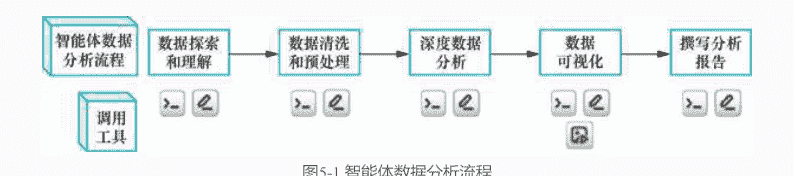
启动阶段，系统导入 CSV 档案来形成数据认知底座，并开展探索性审视，涵盖结构拆解、样本浏览、元信息诊断、描述性统计以及缺失值分布排查等。探索成果被单独成档归档。

数据分析 Prompt 示例如图5-2所示。


进入净化与预处理环节，执行了严格的质量管控：日期时间字段被统一规范化，交易金额字段被筛查异常负值，库存记录进行多维度一致性核验。净化过程输出的诊断日志为后续分析提供了完整性保障。图5-3展示了该阶段的档案预览。

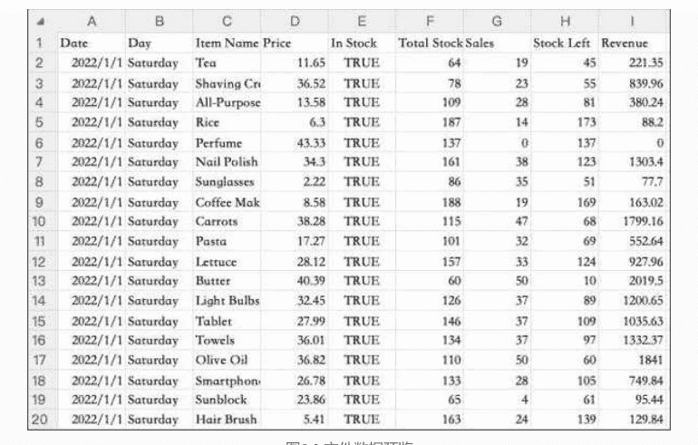
深度研判采用分层计算架构：先得出整体销售额与总营收基准，再按商品维度做热度挖掘、识别头部 SKU，随后搭建日/周/月颗粒度的时序模型；补货预警则通过低库存识别算法触发。研判使用 Python 脚本化框架，经过多轮迭代优化。初次运行后会对结果做完整性核验，根据核验反馈决定是否重跑脚本，确保结论可靠。

图形化呈现阶段采用动态脚本生成策略，解决了字体渲染路径等技术难点，保证文本显示一致。经文件系统校验字体可用后，产出六类核心图表：商品维度有销量 TOP10 与销售额 TOP10 条形图，时间维度有月度销量/营收趋势折线图及周销量/营收分布热力图，均经人机协同视觉复核。

最终报告以 Markdown 结构化撰写，整合探索发现、净化记录、深度结论与图形化成果，通过格式转换引擎生成 PDF 并附带图表与复现脚本。该流程已落地于零售运营决策支持，揭示了关键销售规律与库存优化方向。文件详情如下。

零售店数据分析报告

1. 引言
本报告对 2022 年 1 月 1 日至 2024 年 12 月 31 日的零售店销售档案进行全景解析，旨在揭示趋势、识别畅销品、评估库存并给出可执行建议。档案涵盖销售日期、商品名、单价、在库状态、总库存、售出数量、剩余库存、营收等核心字段。

2. 数据探索与预处理
2.1 数据概览
原始档案包含 109,600 条记录和 9 个字段，字段为 Date、Day、Item Name、Price、In Stock、Total Stock、Sales、Stock Left、Revenue。无缺失值，质量良好。Date 已转为日期时间，数值字段分布合理，未见明显异常。

2.2 数据净化
净化聚焦一致性与有效性。Price、Total Stock、Sales、Stock Left、Revenue 均无负值。通过 Sales 与 Stock Left 之和是否等于 Total Stock 的交叉核验，档案高度一致，库存变动记录准确。

3. 深度数据研判
3.1 整体销售和营收
研判期内累计售出 2,737,497 件，累计营收 67,168,171.81 元，显示三年持续强劲表现。

3.2 畅销商品研判
3.2.1 销量前 10 的商品
电池 54,158 件；龙舌兰酒 28,342 件；棉球 28,310 件；手机壳 28,294 件；感冒药 28,231 件；发圈 28,226 件；特百惠容器 28,147 件；伏特加 28,139 件；肥皂 28,110 件；微波炉 28,065 件。电池销量领先，市场需求旺盛。

3.2.2 营收前 10 的商品
马桶刷 1,383,289.92 元；维生素 1,372,481.44 元；手机壳 1,351,620.36 元；浴帘 1,351,205.02 元；草莓 1,342,968.12 元；牙线 1,327,292.70 元；伏特加 1,320,563.27 元；马克杯 1,313,939.52 元；垃圾袋 1,306,688.00 元；青柠 1,304,883.84 元。马桶刷与维生素营收突出，与高单价及稳定需求相关。

3.3 销售趋势研判
3.3.1 每日销量和营收趋势
日度数据波动明显但整体平稳，体现日常消费随机性，周末与工作日存在差异。

3.3.2 每月销量和营收趋势
月度趋势呈现周期性，节假日与促销会带来高峰。2022 年 1 月和 2023 年 9 月较高，2022 年 2 月和 2023 年 2 月偏低，提示需关注季节性与市场活动影响。

3.3.3 按星期几划分的销量和营收
周内各日分布均衡，未出现单日极端高低，运营稳定。

3.4 低库存商品研判
平均剩余库存低于总库存 10% 的商品存在缺货风险，需重点关注。

4. 数据图形化
销量 TOP10 商品条形图、营收 TOP10 商品条形图、月度销量趋势折线图、月度营收趋势折线图、按星期销量柱状图、按星期营收柱状图，图表作为附件提供。

5. 结论与建议
5.1 结论
过去三年销量与营收可观；电池销量第一，马桶刷与维生素营收贡献最大；月度存在波动，受季节与促销影响；周度分布均匀；部分商品低库存，茶叶尤甚，可能流失销售机会。

5.2 建议
1. 优化库存管理：对茶叶、手机壳等低库存 SKU 加强监控与补货，避免缺货损失。
2. 深入研判月度波动：探究节假日、促销、季节性需求的具体作用，提升预测与营销策略。
3. 利用畅销商品：加大电池、马桶刷、维生素等热销品库存，开展捆绑与交叉推广。
4. 探索新增长点：在周末等特定时段尝试限时促销，刺激消费。

### 5.1.2 数据管理与分析
在文档自动化生成标准化输出框架后，管理和挖掘业务数据价值成为自然延伸。智能算法在此环节进行多维度建模。

#### 1. Excel 与 Tableau 智能分析（自动数据净化与图形化）
数字化转型下，数据管理与研判已是提升决策质量的核心。传统手工处理难以应对海量档案，智能化工具应运而生。本节以某超市销售档案为例，阐述自动化数据管理流程与研判方法。

处理流程始于探索与净化，如图5-4所示。读取 CSV 后系统自动探索档案特征与质量问题。以某超市为例，原档案含 1000 条记录、17 个字段：发票 ID、分店、城市、客户类型、性别、产品线、单价、数量、税费、总额、日期、时间、支付方式、销售成本、毛利率、毛收入、评分。自动化检查确认无缺失，但日期时间需转换。系统合并日期时间字段并检查重复，确保质量，原需数小时的手工工作几分钟完成。


基于这些档案写一份研判报告，Prompt 示例如图5-5所示。


图形化是智能办公的核心价值。系统可自动输出多维度图表：销售趋势、分店销售额对比、产品线分布、支付方式偏好、客户类型贡献、性别差异及城市表现等。

智能报告生成系统采用模块化设计：Python 脚本自动生成含图表的 Excel 报告，自然语言生成技术创建 Markdown 研判报告，最终转为 PDF。报告包含引言、数据概览、图形化研判、结论建议与附录。结论自动生成 6 条建议：优化库存应对销售波动；基于分店均衡性提出区域发展策略；针对产品线差异给出优化方案；依支付偏好设计推广计划；强化会员体系提升忠诚度；依据性别差异制定营销策略。这些建议结合业务知识图谱与决策模型，将洞察转化为行动。

数据净化融入异常检测，可自动识别缺失、异常与不一致。图形化采用模式识别，自动发现趋势、周期与关联。报告生成结合模板引擎与 NLG，将结果转化为专业商业文本，大幅降低研判门槛。

以下是智能生成的《某超市销售数据分析报告》。

##### 某超市销售数据分析报告
###### 1. 引言
本报告对某超市销售档案进行全面管理与研判，通过净化、图形化与智能洞察揭示销售趋势、识别 KPI 并提供可操作建议，涵盖数据概览、净化、图形化及结论。

###### 2. 数据概览与净化
原始档案 1000 条，17 字段：发票 ID、分店、城市、客户类型、性别、产品线、单价、数量、税费、总额、日期、时间、支付方式、销售成本、毛利率、毛收入、评分。经初步探索无缺失，类型基本符合。为支持时序研判，对 Date 与 Time 进行类型转换并合并为 DateTime，完成重复值检查，档案无重复。

###### 3. 数据图形化研判
####### 3.1 销售趋势研判
销售趋势图显示 2019 年 1 至 3 月每日总销售额波动明显，部分日期出现高峰，提示受特定日期或事件影响，如周末促销或节假日。

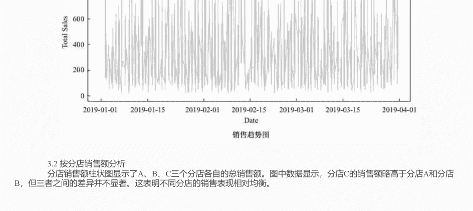
####### 3.2 按分店销售额研判
分店销售额柱状图显示 A、B、C 三店总量相近，C 店略高，差异不显著，销售表现均衡。

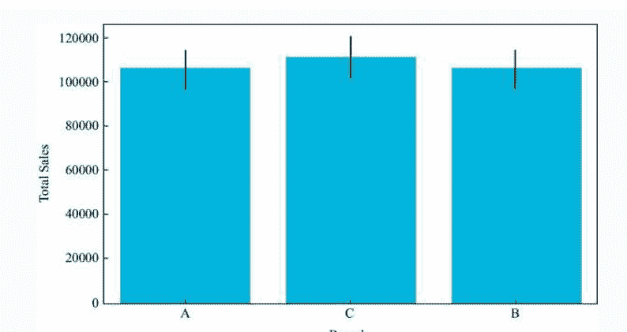
####### 3.3 按产品线销售额研判
产品线柱状图显示食品饮料与电子配件销售额最高，主导销售；健康美容销售额偏低，需调整策略。

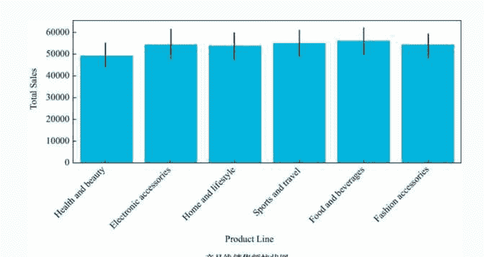
####### 3.4 支付方式分布
支付方式分布显示电子钱包与现金为主流，信用卡使用偏低，可加强电子支付推广。

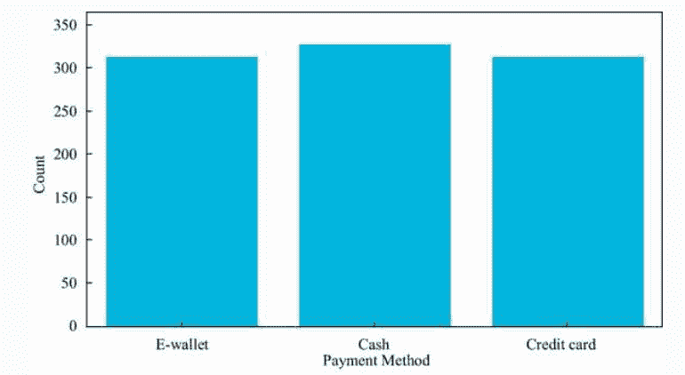
###### 4. 结论与建议
销售趋势波动大，建议研判波动诱因优化库存与排班。
分店与城市销售均衡，可保持态势并针对低效分店提升。
产品线方面，食品饮料与电子配件为支柱，健康美容需探究原因并调整结构或定价。
支付方式以电子钱包现金为主，可通过优惠与积分推广电子支付。
会员与普通客户贡献相当，可深化会员权益与个性化推荐提升复购与忠诚。
男女顾客贡献差异不大，营销可均衡覆盖。

#### 2. 商业数据洞察（趋势预测与异常检测）
商业洞察是决策驱动力，本节探讨通过趋势预测与异常检测从海量档案提取洞见，以 Superstore 档案展示完整流程。

趋势预测与异常检测的 Prompt 如图5-6所示，智能体处理流程如图5-7所示。

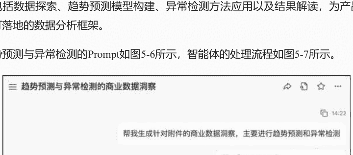

Superstore 档案含 9994 条交易记录，覆盖 2011 至 2014 年，21 个字段包括订单日期、发货日期、客户信息、产品类别、销售额、数量、折扣率、利润等。首步为数据探索与理解。对月度销售额做季节性分解，使用 statsmodels 库 seasonal_decompose 拆分为趋势、季节性、残差。基于此采用 Holt-Winters 指数平滑模型预测未来 12 个月销售额。

该模型适用于具趋势与季节性的序列，预测公式如下。
预测值 = 水平+趋势+季节性

捕捉波动与异常：Superstore 商业洞察全解

##### Superstore 销售洞察与异常诊断报告

###### 1. 引言
本报告选取 Superstore 交易记录作为研究对象，围绕销售预测与异常排查两条主线展开。借助历史数据挖掘业务运行规律、季节性起伏与长期走向，并据此推演未来走势。同时筛查数据中的偏离点，这类点或提示风险如欺诈或录入失误，也可能指向机会如异常高额营收或利润。本报告以数据为依据，为经营决策提供支撑，助力优化运营与提升风险应对。

###### 2. 数据概览
数据集收录细致的交易信息，共 9994 条记录，涵盖订单编号、订单日期、发货日期、客户与商品信息、销售额、数量、折扣、利润等 21 个字段。初步探查显示整体质量稳定，未见明显缺失，日期字段已解析为时间格式。销售额、利润等核心指标的分布已通过描述统计完成初步把握。

###### 3. 趋势拆解与预测
为把握销售动向，对月度销售额实施时间序列分析。原始月度数据拆分为趋势、季节与残差三部分，用以判断长期升降走向以及每年重复出现的销售节律。

####### 3.1 季节性拆分
下图呈现月销售额的季节性拆解。

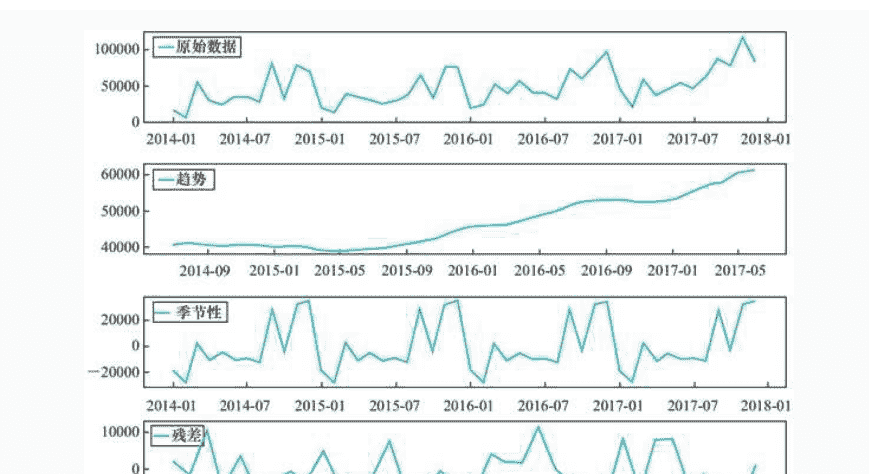

基于拆解可归纳如下：

- 观测值呈现营收的整体起伏，叠加季节性高峰低谷与随时间递增的走势。
- 趋势线刻画长期走向。分析期内营收持续缓步上扬，体现业务整体健康扩张。
- 季节线体现周期性变化。每年年末等特定月份营收明显抬升，其余月份回落，与零售业典型季节规律一致，对库存与营销排期具有指导意义。
- 残差线体现未被趋势与季节解释的随机扰动，可进一步用于捕捉突发事件或模型未覆盖的异常。

####### 3.2 销量前瞻
依托历史月度销售额，选用霍尔特-温特斯指数平滑模型对未来 12 个月进行推算。该模型对兼具趋势与季节特征的序列尤为适用。

下图对比了历史值与未来 12 个月的预测值。

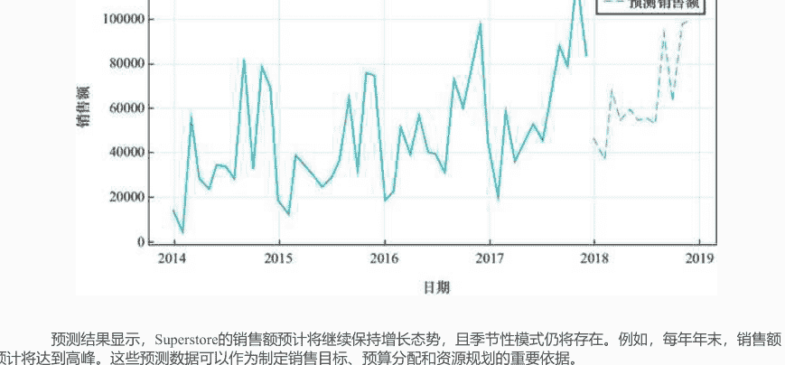

预测结果显示营收仍将延续增长，且季节性特征保持。例如年末仍将出现销售额高峰。此类前瞻信息可支撑销售目标设定、预算安排与资源部署。

###### 4. 异常识别
异常检测旨在找出偏离常规模式的数据点，这类点可能指向重要事件，也可能暴露欺诈、系统故障或录入错误。本报告选用 Isolation Forest 对销售额与利润两项核心指标开展筛查。

####### 4.1 Isolation Forest 原理
Isolation Forest 属于基于决策树的无监督方法，识别逻辑是通过孤立来实现。与距离或密度类方法不同，它随机抽取特征并随机切分，使异常样本往往只需更少切分即可被分离。该方法在高维场景且正常样本占多数时具备较好稳健性与效率。

####### 4.2 异常样本
将异常比例设为约 1%，模型共标记出 100 条异常记录。

- 营收偏高但盈利偏低甚至亏损：或反映大额折扣、退货率高或成本失控。
- 营收偏低而盈利偏高：可能为高单价低销量商品，也可能是录入偏差。
- 营收或利润极端：多对应非常规大单或重大亏损。

这些异常需进一步核查。例如，高销低利订单应复核折扣政策、成本构成及退货情况；极端利润订单则需确认数据是否准确。

## 5.2 职场沟通与协作

办公流程智能化之后，产出效率最终仍取决于人与人之间的协作。接下来聚焦智能技术如何重塑职场人际互动，特别是在沟通协作上 AI 带来的实际改善。

### 5.2.1 智能沟通助手

智能沟通助手在职场中作用关键，能够迅速精准解读信息，高效承接沟通任务，打破信息壁垒，提升协作效率。系统还自带智能提醒，可自动追踪事项，减少遗漏，从而提高沟通质量与效率，助力员工在快节奏环境中高效交付。

#### 1. 邮件优化

在搭建职场智能体时，智能沟通助手是提升组织效能的核心模块，其价值在于以技术重塑沟通与信息传递。邮件优化不仅覆盖基础的语气润色与语法校对，更构建起一套完整的沟通增强体系。优化流程遵循语义解析、结构优化、场景响应三层架构。语义解析层借助情感识别自动发现可能引发负面情绪的表述并给出替换方案，如把不得不调整改为更具建设性的建议调整。系统还会依据发件人与收件人的层级关系动态调节语气强弱与用词风格。结构优化层则重新编排信息呈现，将分散的时间节点整合为对比表，并把关键联系方式独立成段以提升可读性，同时支持嵌入二维码等富媒体。

邮件优化 Prompt 示例如下。

> 请对以下邮件进行语气润色、语法校对，并给出自动回复建议。

> 亲爱的各位参会嘉宾：

> 您好！我是夏日创意交流会活动组委会负责人李明。非常感谢大家一直以来对本次活动的关注与支持。现因场地安排冲突，不得不对活动时间进行调整，特向您发送此邮件说明相关情况。

> 原定于 2024 年 8 月 15 日星期四下午 2 点在阳光大厦 12 层多功能厅举办的夏日创意交流会，将调整至 2024 年 8 月 22 日星期四下午 2 点举办，活动地点不变，仍为阳光大厦 12 层多功能厅。新的活动时间已与场地方完成确认，确保不会再有变动。

> 对于此次时间调整给您带来的不便，我们深表歉意。若新的时间与您的日程安排冲突，烦请您于 8 月 18 日前回复此邮件告知我们，我们将为您提供进一步的协调帮助。

> 如果您对活动时间调整有任何疑问，欢迎随时发送邮件至 liming@example.com 或致电 138-XXXX-5678 与我联系。我们期待在调整后的时间与您相聚，共同开启一场充满灵感与创意的交流盛宴。

> 再次感谢您的理解与支持！

> 夏日创意交流会活动组委会

> 李明

> 2024 年 8 月 10 日

智能体的处理流程见图 5-8。


图 5-8 邮件优化智能体的处理流程

##### 以下是经智能沟通助手修改后的邮件。

亲爱的各位参会嘉宾：

您好！

我是夏日创意交流会活动组委会负责人李明。首先，非常感谢您一直以来对本次活动的关注与支持。由于场地安排冲突，我们不得不对原定的活动时间进行调整，特此邮件向您说明情况，并致以诚挚的歉意。

原定于 2024 年 8 月 15 日星期四下午 2 点在阳光大厦 12 层多功能厅举办的夏日创意交流会，将调整至 2024 年 8 月 22 日星期四下午 2 点举行。活动地点不变，仍为阳光大厦 12 层多功能厅。新的活动时间已与场地方确认，确保不会再有变动，请您放心。

对于此次时间调整给您带来的不便，我们深感抱歉。若新的时间与您的日程安排有所冲突，烦请您于 8 月 18 日前回复此邮件告知我们，以便我们为您提供进一步的协调与帮助。

如果您对活动时间调整有任何疑问，欢迎随时通过邮件 liming@example.com 或电话 138-XXXX-5678 与我联系。我们衷心期待在调整后的时间与您相聚，共同开启一场充满灵感与创意的交流盛宴。

再次感谢您的理解与支持！

夏日创意交流会活动组委会

李明

2024 年 8 月 10 日

在实际应用中，智能沟通助手能够根据邮件内容自动生成多种类型的回复模板。这些模板不仅能实现即时响应，还能完成自动分类处理和状态追踪。例如，在处理活动时间变更时，系统可自动识别嘉宾反馈中的时间冲突，并触发相应的跟进流程。这种设计显著降低了沟通中的客户交互成本，将原本耗时的手动调整日程操作转化为一键同步日历的便捷操作。

从产品设计的角度来看，优秀的智能沟通助手需要具备多层级语气调节能力。系统提供可视化滑块界面，用户可自由设定邮件的正式程度与亲和力水平级别。同时，系统内置的合规性检查功能能够确保时间格式等关键信息的标准化输出，避免因表述不规范引发后续问题。更进一步地，系统还具备上下文感知能力，能够通过分析历史沟通记录，智能适配不同沟通对象的语言风格和内容深度偏好。

衡量此类功能的效果需要建立多维度的评估体系。除传统的打开率和回复率指标外，还应关注沟通链条中的用户参与度变化。数据显示，经过优化的邮件模板在会议改期、项目延期等高频场景中，沟通效率提升显著。这种设计模式可扩展至十余种常见职场沟通场景，形成可复用、标准化的解决方案库。

自动回复建议如下。

**1. 收到邮件确认**

主题：已收到您的邮件 - 关于夏日创意交流会时间调整

亲爱的嘉宾：

您好！

我们已收到您关于夏日创意交流会时间调整的邮件。感谢您的及时反馈。

我们正在处理您的请求，并将尽快与您联系，请您耐心等待。

夏日创意交流会活动组委会

**2. 新时间冲突**

主题：关于夏日创意交流会时间冲突的进一步协调

亲爱的嘉宾：

您好！

我们已收到您关于夏日创意交流会新时间 8 月 22 日与您日程冲突的邮件。对于由此带来的不便，我们再次深表歉意。

我们非常重视您的参与，正在积极协调解决方案。我们将尽快与您取得联系，商讨具体安排。

感谢您的理解与配合！

夏日创意交流会活动组委会

**3. 确认出席**

主题：感谢您的确认 - 夏日创意交流会期待您的到来

亲爱的嘉宾：

您好！

我们已收到您关于夏日创意交流会新时间 8 月 22 日的确认。非常感谢您的理解与支持！

我们期待于 8 月 22 日与您相聚，共同开启一场充满灵感与创意的交流盛宴。

夏日创意交流会活动组委会

智能沟通助手的价值不仅体现在提升单次沟通的效率，还在于它能够沉淀组织的最佳沟通实践。每一次人工优化的结果均可反馈至系统，持续优化模板库和算法模型，最终形成与组织文化和沟通习惯高度契合的沟通智能体。这种具备自我演进能力的特性，正是职场智能体区别于传统办公工具的本质差异。

#### 2. 演讲与谈判支持

智能沟通助手在商务场景中发挥着重要作用。下面将深入探讨如何通过智能沟通助手，在演讲与谈判过程中提供具有针对性的话术建议和实时沟通反馈，帮助职场人士提升沟通效率，实现更高效的商务协作。

话术建议和实时沟通反馈的 Prompt 示例如下。

请对以下演讲和谈判稿给出话术建议和实时沟通反馈：《创新合作，共赢未来》演讲与谈判稿

一、演讲环节

亲爱的各位来宾、合作伙伴：

大家好！今天是 2024 年 11 月 15 日，在这秋意正浓郁且充满希望的日子里，我们相聚于上海国际会议中心璀璨的明珠厅。我是星火科技有限公司的首席执行官林远，非常荣幸能与各位行业精英共聚一堂，共同探讨科技创新与商业合作的无限可能。

近年来，全球科技产业发展迅猛，AI、大数据、物联网等新兴技术不断重塑我们的生活方式与工作模式。在这个充满机遇与挑战的时代，单打独斗已难以应对市场的需求，唯有携手合作，才能突破发展瓶颈，实现更大的发展。

星火科技自成立以来，始终专注于智能硬件的研发与应用落地，先后成功推出多款具有领先意义的产品，在智能家居和智能穿戴设备领域占据了重要市场份额。但我们深知，科技的发展永无止境，我们需要携手更多的合作伙伴，共同构建一个开放、共享、创新的生态系统。

今天，我们怀着极大的诚意，希望能与在座的各位同仁展开深度合作。我们相信，通过资源整合、优势互补，我们不仅能够提升各自的核心竞争力，还能为行业树立合作共赢的典范，推动整个科技产业迈向新的高度。

最后，让我们以开放的心态、创新的思维，携手共进，共同书写科技与商业合作的新篇章！

谢谢大家！

二、谈判环节

时间：2024 年 11 月 16 日上午 10 点

地点：上海国际会议中心贵宾会议室 3 号

参与人员：

星火科技有限公司首席执行官林远、商务总监苏晴、技术总监周航

星云软件科技有限公司总经理陈宇、商务经理叶薇、技术主管吴昊

双方人员握手落座，林远率先发言

林远：陈总，昨天听了您在演讲中的精彩分享，对星云软件在算法优化和数据分析方面的实力印象深刻，我们非常期待与贵公司展开合作。

陈宇：林总过奖了。星火科技在硬件研发上的成就也是有目共睹的。我们也希望能借助贵公司的硬件优势，实现软件与硬件的深度融合。

苏晴：我们初步设想是，将星云软件的智能算法嵌入我们最新研发的智能手环中，通过数据分析为用户提供更个性化的健康管理方案。这不仅能提升产品的附加值，还能开拓新的市场空间。

叶薇：这个方向确实很有潜力，但在合作细节上，我们比较关注合作模式和利润分成。我们投入了大量的研发资源，希望能在收益上得到合理的回报。

周航：我能理解叶经理的顾虑。我们提议采用联合研发的模式，双方共同投入资源，在产品成功上市后，按照销售额的一定比例进行分成。具体比例可以根据双方的投入情况进一步协商。

吴昊：除了分成，我们还希望在技术共享方面有更明确的约定。毕竟，在合作过程中会涉及核心技术的交互，针对如何保障双方的技术权益，避免技术泄露风险等方面，需要制定详细的条款。

林远：吴主管提出的问题非常关键。我们可以在合作协议中加入严格的保密条款和知识产权归属条款，明确双方在技术研发和使用过程中的权利与义务。同时，设立专门的联合技术团队，共同管理和推进项目，确保技术的安全性和稳定性。

陈宇：林总的提议很全面。另外，在产品的市场推广方面，我们也希望能有更多的话语权。毕竟软件部分的功能特色，我们更清楚如何向用户传达。

苏晴：完全没问题，我们可以成立联合市场推广小组，共同制定推广策略和计划，充分发挥双方在市场渠道和品牌影响力上的优势。

经过数小时的协商，双方就合作模式、利润分成、技术权益、市场推广等关键问题达成初步共识

林远：非常高兴能与星云软件达成合作意向。相信通过我们双方的共同努力，一定能打造出一款具有市场竞争力的创新产品。

陈宇：我也对这次合作充满信心，期待我们的产品能早日推向市场，实现互利共赢！

智能体的处理流程如图 5-9 所示。

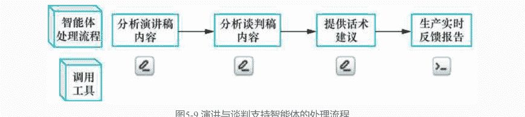

开场白是塑造听众第一印象的关键。智能沟通助手可基于演讲场景与受众特征，提供多种开场模板以适应不同场合。根据分析，林远的开场白已经具备时间、地点、人物和主题四要素，符合商务演讲的基本要求。原稿中提到先后成功推出多款具有领先意义的产品，显得较为空泛。智能沟通助手建议补充案例来增强说服力。此外，智能沟通助手分析出原稿中的合作倡议较为笼统，建议增加行业痛点和合作方向的指引。以下是演讲环节分析详情。

##### 演讲环节分析

优点如下。

1. 开场得体：林远的开场白包含了时间、地点、人物和主题，既礼貌又简洁、清晰，能够迅速吸引听众注意力。
2. 背景铺垫充分：提到了全球科技发展趋势，强调了合作的重要性，为后续提出合作意向做了很好的铺垫。
3. 自我介绍与成就展示：简要介绍了星火科技的专注领域和已取得的成就，增加了公司的可信度和吸引力。
4. 明确合作意向：直接表达了寻求深度合作的意愿，并提出了合作愿景构建开放、共享、创新的生态系统。
5. 展望未来：强调了合作共赢的理念，并对未来进行了积极展望，具有感染力。
6. 语言积极向上：使用了秋意渐浓却充满希望、无限可能、永无止境、携手共进、共同书写新篇章等积极词汇，营造了良好的氛围。

话术建议：

- 在这个充满机遇与挑战的时代，单打独斗已难以应对市场的需求，唯有携手合作，才能突破发展瓶颈，实现更大的发展。此处可稍作停顿，目光扫视全场，强调合作的必然性。
- 星火科技自成立以来，始终专注于智能硬件研发与应用，先后成功推出多款具有领先意义的产品，例如我们的智能家居中枢系统星核，以及广受好评的智能健康手环脉动，在智能家居和智能穿戴设备领域占据了重要市场份额。此处可自信地微笑，展现公司实力。
- 今天，我们怀着极大的诚意，希望能与在座的各位同仁展开深度合作。我们相信，通过资源整合、优势互补，我们不仅能够提升各自的核心竞争力，还能为行业树立合作共赢的典范，推动整个科技产业迈向新的高度。语气坚定，展现对合作的信心和决心。
- 最后，让我们以开放的心态、创新的思维，携手共进，共同书写科技与商业合作的新篇章！谢谢大家！鞠躬，眼神与听众交流，传递真诚。

智能沟通助手基于谈判心理学原理，建立了利益协调话术库，可针对不同谈判场景提供实时建议。当谈判涉及技术共享等敏感议题时，智能沟通助手会立即生成多种利益保护方案供选择。当谈判陷入僵局时，智能沟通助手自动激活僵局破解引擎，提供多种可行的破解策略。以下是谈判环节分析详情。

##### 谈判环节分析

优点如下。

1. 开场礼貌且专业：林远和陈宇的开场白都非常得体，互相赞扬，营造了良好的谈判氛围，为后续深入交流奠定了基础。
2. 明确合作意向：双方都清晰表达了合作的愿望和对对方优势的认可，这有助于快速进入实质性讨论。
3. 提出具体合作点：苏晴提出的将星云软件的智能算法嵌入我们最新研发的智能手环中提议非常具体，有明确的产品方向和市场前景，有助于推动谈判。

4. 利益诉求的聚焦：叶薇将关注点放在协作模式与利润划分上，吴昊则强调技术开放程度与权益保护，体现出双方对本方商业利益的审慎维护。

5. 肯定的回应与初步方案：面对对方的顾虑，林远与周航均作出积极回应，并拿出联合研发、按销售额分成、保密协议、知识产权归属、共建技术团队等可落地的初步思路，充分展现了解决问题的诚意。

6. 产品上市推广的前瞻：陈宇对市场推广的话语权提出关切，苏晴迅速呼应提议成立联合市场推广小组，反映出双方对产品全链路运营的完整考量。

7. 初步共识达成：谈判在核心议题上形成初步一致，显示出沟通的高效与成效。

话术建议：

- 林远（开场）：“陈总，昨天聆听您演讲的精彩分享，对星云软件在算法优化与数据分析方面的能力留下深刻印象，我们非常期待与贵司开展合作。”（语气真诚，保持眼神交流，体现尊重与合作渴望）

- 苏晴（提出合作点）：“我们初步设想是把星云软件的智能算法嵌入我们最新研发的智能手环，通过数据分析为用户提供更个性化的健康管理方案。这既能提升产品附加值，也能开拓新市场空间。”（语速适中，条理清晰，突出合作价值）

- 周航（回应利润分成）：“理解叶经理的顾虑。我们建议采用联合研发模式，双方共同投入资源，产品成功上市后按销售额的一定比例进行分成。”（此处可稍作停顿，观察对方反应）“具体比例可依据双方投入情况进一步协商。我们初步建议，考虑到星火科技在硬件研发、生产与渠道的投入，以及星云软件在核心算法的贡献，可从销售额的X%起步讨论。”

- 林远（回应技术共享）：“吴主管提出的问题非常关键。我们可在合作协议中加入严格的保密条款和知识产权归属条款，明确双方在技术研发与使用过程中的权利义务。”（语气肯定，给出明确承诺）“同时设立专门的联合技术团队，共同管理和推进项目，确保技术的安全性与稳定性。”（强调执行细节，打消疑虑）

- 苏晴（回应市场推广）：“完全没问题，我们可以成立联合市场推广小组，共同制定推广策略与计划，充分发挥双方在市场渠道与品牌影响力上的优势。”（积极主动，展现合作意愿，强调优势互补）

- 林远（结束语）：“非常高兴能与星云软件达成合作意向，相信通过双方共同努力，一定能打造出具有市场竞争力的创新产品。”（语气充满信心和期待，为谈判画上圆满句号）

展望层面，智能沟通助手正向全息化与预见性演进。新一代系统或能融合生物传感器数据，通过捕捉谈判对象的微表情与心率变化来判断真实态度。在跨国场景中，实时脑机翻译将消除语言障碍，使跨文化沟通更为流畅。

不过技术演进必须以强化而非替代人类判断为前提，这也是智能沟通工具设计的核心理念——并非制造完美的演讲者或谈判家，而是赋能每位商务人士释放其独特的沟通潜能与影响力。

### 5.2.2 团队协作管理：Jira、Trello自动化对接的项目管理看板

协同效率提升必然带来协作模式的改变。通过 Jira、Trello 等平台的看板自动化，AI 构建了任务流、信息流、责任流的智能闭环。在快节奏职场，看板是团队协作的核心载体。传统静态看板更新滞后，易导致信息不同步与协作断层。本节介绍如何借助智能体工具链把静态看板转为动态网页并实现长期部署，从而支持实时同步、跨平台访问与自动更新，明显提升协作效率。

#### 1. 模糊或缺乏明确目标的提示词识别

基于深度思考模型，即便面对模糊或目标不明的提示词，智能体也能自动生成结构化工作流，把头脑风暴过程转为条理清晰的执行路径，让后续交互更易理解与把握关键信息。

针对“帮我做一个项目管理看板”的需求，智能体的处理流程如图5-10所示。

研究阶段，智能体调研了当前流行的看板工具，发现商业化产品以 Trello、Asana、PingCode 为主，开源方案中 Personal Kanban、Taskcafe 具有代表性。最合适的技术实现为 React+TypeScript，配合 Material-UI 或 Tailwind CSS 完成前端布局与样式管理。系统采用 PWA 方式部署以支持离线，并通过 LocalStorage/IndexedDB 实现本地存储。根据调研结果，智能体推荐使用 React+TypeScript 技术栈实现 PWA 形态的项目管理看板系统，架构参考 Personal Kanban 项目，同时借鉴 Trello 的界面设计。测试前已完成：搭建 React+TypeScript+Material-UI 框架；实现看板基础布局与组件、任务卡片的新建编辑、列卡片拖拽、本地数据存储；加入 PWA 支持以实现离线使用。测试前需浏览并执行命令。测试时出现页面加载问题，智能体自主分析并给出替代测试方案。

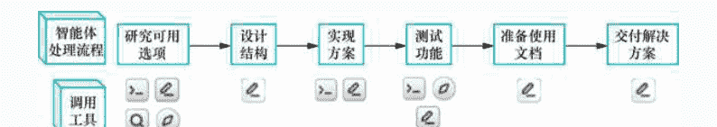

开发过程中出现应用无法正常加载的技术问题。排查后发现源于 React 项目结构与 Vite 构建工具配置不兼容。尽管如此，核心功能仍完成交付，包含看板基础布局与组件结构、任务卡片的新建编辑、列卡片拖拽、本地数据存储，并添加 PWA 支持实现离线使用。交付时提供了可运行的完整源代码、详细使用文档与项目结构说明，并按阶段交付成果。项目管理看板各阶段及交付结果如表5-1所示。

表5-1 项目管理看板各阶段及交付结果

| 阶段 | 交付结果 |
| :--- | :--- |
| 研究 | React+TypeScript+Material-UI |
| 设计 | 详细的设计文档 |
| 实现 | 基本布局、任务卡片的创建和编辑功能、拖拽功能和数据存储功能等 |
| 文档准备 | 使用说明文档和项目结构说明 |

#### 2. 基于业务文件的提示词识别——以某次需求评审会议为例

上传文档有助于智能体实现目标明确的识别，是支持产品经理日常工作的重要方式。本次测试选用了一次需求评审会议纪要，如图5-11所示。

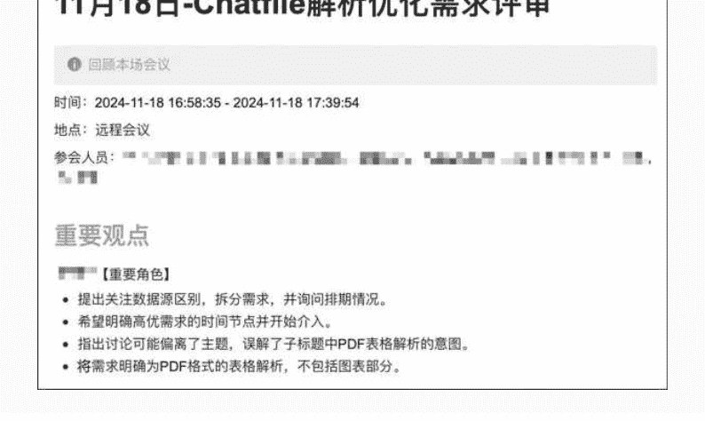

图5-11 会议的纪要文档详情

智能体读取用户上传的 PDF 文件，识别到这是一次关于 Chatfile 解析优化的需求评审，重点关注 PDF 表格解析功能，但信息有限。于是向用户发出如下提问。

需求：

为为您设计一个更贴合项目需求的敏捷开发看板，我需要了解更多关于这个项目的具体

除 PDF 表格解析外，Chatfile 解析优化项目还包含哪些主要功能模块？

请说明项目的开发周期和里程碑。

请说明开发团队的规模和角色分配情况。

您希望在敏捷看板中跟踪哪些特定的指标或状态？

是否有任何您希望遵循的敏捷方法论（如 Scrum、Kanban 或混合方法）？

有了这些信息，我可以为您设计一个更加符合项目需求的敏捷开发看板。

Jira 可生成 Scrum、Kanban 两种看板，智能体通过对比学习发现这两种看板在流程设计与团队协作方面存在显著差异，如表5-2所示。

表5-2 Scrum、Kanban 看板差异

| 对比维度 | Scrum看板 | Kanban看板 |
| :--- | :--- | :--- |
| 开发方式 | 基于迭代（2周冲刺周期） | 基于持续流动（无固定周期） |
| 列设置 | 产品待办事项、冲刺待办事项、进行中、测试中、待验收、已完成 | 需求池、就绪、开发中、代码审查、测试中、部署准备、已完成 |
| 流程控制 | 无明确 WIP（在制品）限制 | 每一列有明确的 WIP 限制 |
| 估算方法 | 故事点估算（斐波那契数列） | 无固定估算方法，关注周期时间 |
| 会议 | 冲刺规划、每日站会、冲刺评审、冲刺回顾 | 无固定会议 |
| 进度跟踪图表 | 燃尽图、速度图 | 周期时间分布图、吞吐量图、累积流图 |
| 适用场景 | 需求明确且稳定的项目，需要有固定的节奏 | 需求变化频繁或需要快速响应，强调流程优化 |

用户要求生成上述两种看板。

智能体针对用户要求生成了两个看板的 HTML 格式的预览页面，而且还提前预判了用户的倾向性，如图5-12 和图5-13所示。

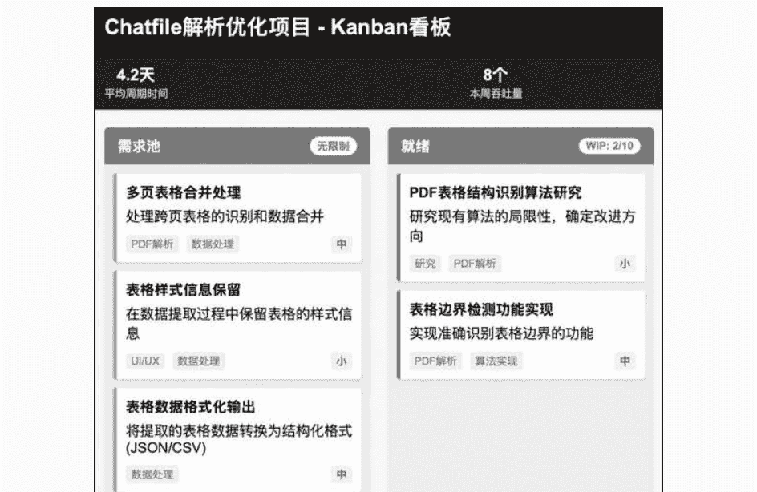

(a)

## 5.3 职业发展与决策

工具层智能化改造完成后，职业发展路径的个性化规划成为新焦点。职业发展与决策模块揭示了个体如何借助 AI 实现从微观技能补全到宏观行业趋势把握。

### 5.3.1 职业技能差距分析与学习资源清单生成

在数字化时代，职业规划已从传统线性路径演变为动态的数据驱动智能决策。智能职业规划的核心在于通过系统性分析精准评估技能差距、整合多样化学习资源，并借助技术工具实现职业生涯的持续迭代。下面以商家策略运营岗位为例说明。该过程需融合业务理解、数据分析和策略设计三大维度，形成闭环的职业成长路径。Prompt 如下。

> 帮我针对这个岗位 JD 进行技能差距分析，需要基于岗位需求的竞争力评估。

> 岗位：商家策略运营实习生

> 工作职责：根据百度电商平台发展需求及业务规划，参与制定相关策略工作，并协助推动相关策略落地。

> 所涉业务方向包含但不限于（具体负责其中之一）以下这些：

> -参与输出新商机制、商家分层机制、相关政策及对应的运营策略，并不断迭代优化，推动商家群体的 GMV 增长。

> -对接各协同部门及外部生态各方需求，构建商家成长体系及相应项目并积极推进落地。

> -基于数据分析及业务需求，评估各商家策略对商家经营的影响以及策略成效，敏捷迭代相关策略。

> -参与制定平台用户增长策略工作，通过规模化系统性运营手段促进平台新用户增长。

> 职责要求：

> -本科及以上学历，2027 年或 2028 年应届生，统计学、经济学相关专业，数据分析基础知识扎实，有直播业务经验的人员优先考虑。

> -对数据敏感，具备扎实的数据能力及较强的执行力，能够系统化地梳理并解决问题。

> -有良好的表达能力及跨团队沟通能力。

> -工作主动、热情，积极上进。

智能体的处理流程如图5-14所示。


以下是商家策略运营实习生核心技能要求分析概览。

+ 商家策略运营实习生核心技能要求分析

技能框架总览

基于岗位 JD 分析和行业调研，商家策略运营实习生岗位的核心技能可分为以下四大类别。

-数据分析与洞察能力。

-策略制定与执行能力。

-沟通协调与项目管理能力。

-业务理解与商业敏感度。

以下是商家策略运营技能提升学习资源清单（部分）。

+ 商家策略运营技能提升学习资源清单

主要内容：

数据分析技能提升资源

Excel 高级应用

在线课程：

- 网易云课堂《Excel 数据分析实战》

- 慕课网《Excel 从入门到精通》

- B站《Excel 数据透视表完全教程》

书籍推荐：

- 《Excel 数据分析实战》- 刘万祥

- 《Excel 图表之道》- 刘万祥

- 《Excel VBA 程序开发自学宝典》- 罗刚君

实践项目：

- 分析电商平台销售数据。

- 制作商家运营数据看板。

- 创建自动化数据报表。

智能职业规划的本质是将职场发展视为一个可测量、可优化的系统。通过智能体的竞争力评估工具，从业者能实现从被动适应到主动设计的转变，最终成长为具备自我进化能力的职场人士。

### 5.3.2 基于薪资水平、职位需求预测的行业趋势洞察生成

完成个人能力图谱精准诊断后，还需将其置于更广阔的行业坐标系中进行横向比对与动态校准。智能体通过构建基于薪资水平与职位需求的预测模型，能够为从业者提供动态调整职业航向的决策依据。智能体构建行业趋势洞察报告的核心在于数据驱动与商业逻辑的深度耦合。报告撰写始于多维度数据采集，包括招聘平台实时职位数据（如猎聘显示的北京地区资深广告算法专家年薪可达 70 万元至 150 万元）、权威行业研究报告（如《2025 年 AI 技术人才供需报告》指出，算法工程师占 AI 岗位需求的 67.17%），以及技术社区讨论（如脉脉平台上关于广告算法工程师技能要求的分析）。

在数据采集阶段，应特别注重矛盾点校验。例如，对比不同平台对同一职位的薪资描述（猎聘显示 5 年以上经验者平均月薪为 2.65 万元，而在头部企业招聘中，同档位平均月薪可达 5 万元至 8 万元）并通过交叉验证建立可信数据集。Prompt 示例如下。

> 帮我生成 AI 广告算法优化工程师的行业趋势洞察，主要进行薪资水平和职位需求预测。

智能体的处理流程如图5-15所示。


分析框架设计阶段，采用技术-市场-人才三维模型。技术维度关注技能溢价现象，例如掌握大模型应用开发能力的工程师薪资较传统技能岗位平均高出 30%，这与广告行业向生成式创意转型直接相关。在市场维度中，构建“需求密度指数”，该指数综合考量程序化广告渗透率与头部企业招聘计划预测区域人才缺口。在人才维度中，则通过技能生命周期分析，为从业者提供科学的职业发展路径规划建议。这种分析方式能有效解释为何北京地区资深广告算法专家月薪达 7.5 万元，而在新一线城市，同类岗位月薪仅为 3 万元左右。

在报告产品化阶段，强调不同用户场景的适配性。面向求职者时，突出技能迁移路径与地域选择策略；面向企业 HR，则提供竞争性薪酬建议，包括股权激励占比与人才池建设方案。在可视化呈现方面，通过动态图表实现数据叙事，如用技术成熟度曲线展示联邦学习与实时计算技术的演进阶段，帮助读者理解技能投资回报周期。

报告的持续迭代机制建立在三阶预警系统之上，涵盖技术、政策与市场三大层面。技术层监测大模型对传统岗位的替代风险；政策层跟踪数据隐私保护相关法规的变化；市场层分析垂直领域爆发点。这种机制可确保报告始终保持前瞻性和时效性。例如，在 2024 年年初预测到 2025 年大模型与广告算法的融合趋势，为从业者提供战略决策窗口期。整个撰写过程体现智能体“数据洞察-商业翻译-行动建议”的方法论闭环，使报告兼具学术严谨性与商业实操价值。

以下是《AI 广告算法优化工程师行业趋势洞察报告》的详细内容。

#### AI 广告算法优化工程师行业趋势洞察报告

##### 执行摘要

本报告深入分析了 AI 广告算法优化工程师的行业发展趋势，涵盖薪资水平分析和职位需求预测两大核心维度。通过对市场数据的综合分析，我们发现该职位正处于快速发展期，具有巨大的市场潜力和职业发展前景。

##### 核心发现

####### 薪资水平方面：

- 平均月薪已达 3.2 万元，年薪范围为 20 万元至 80 万元，高端人才年薪甚至超过百万元。

- 一线城市薪资领先，北京平均月薪为 3.5 万元，深圳为 3.2 万元。

- 薪资随经验呈指数级增长，8 年以上资深专家平均月薪为 7.5 万元。

- 2020-2025 年薪资复合增长率约 15%，远超其他行业。

####### 职位需求方面：

- 2024 年需求指数达 280（以 2020 年为基准 100 计算），同比增长 33.3%。

- 预计 2025-2027 年需求将继续快速增长，2027 年需求指数将达 520。

- 算法工程师人才需求占比为 67.17%，连续两年稳居最高位。

- AI 人才缺口达 400 万，而且这种供不应求的局面还将持续数年。

####### 技能发展趋势：

- 传统技能，如机器学习、推荐算法需求稳定增长。

- 新兴技能，如 MLOps、大模型应用需求爆发式增长。

- 实时计算、深度学习等技术需求快速上升。

- 工程化能力和业务理解能力日益重要。

##### 主要建议如下。

####### 对求职者：

- 重点掌握机器学习、深度学习等核心技能。

- 关注 MLOps、大模型应用等新兴技术。

- 培养工程化能力和业务理解能力。

- 考虑一线城市或新一线城市的就业机会。

####### 对企业：

- 提前布局人才招聘和人才培养。

- 建立有竞争力的薪酬体系。

- 重视技术人才的职业发展通道。

- 加强校企合作，培养专业人才。

####### 对行业：

- 完善人才培养体系和标准。

- 推动产学研深度合作。

- 建立行业人才流动机制。

- 关注技术伦理和合规要求。

# 第6章 学生智能体

在使用智能体构建的智慧教育生态体系中，学生不再是被动的知识接收者，而是学习旅程的主动探索者。学生端应用作为连接学生与智能教育资源的桥梁，以个性化、智能化的功能设计，打破传统学习的边界，让每位学生都能找到最适合自己的学习路径，获得高效、自主的成长。

## 6.1 自主学习

自主学习是学生提升学习能力的关键路径，智能体可以为学生打造全方位的自主学习平台。学生打开应用时，便如同走进了一座智能学习宝库，在这里，他们能够根据自身需求灵活运用各项功能，开启高效的学习之旅。学生仅需基于“角色定位+场景界定+要素拆解+输出规则”这个 4 层结构化 Prompt 模板输入需求，智能体就能够迅速生成优质的自主学习平台，极大地提升学习效率。

结构化 Prompt 模板如下。

```
### 角色定位
初中二年级学生
### 场景界定
针对人教版八年级下册数学“一次函数”章节进行自主复习巩固
学习目标：
-熟练掌握一次函数表达式求解（知识目标）
-提升解决实际问题的能力（能力目标）
-3天内完成章节薄弱点强化（时间目标）
### 要素拆解
-资源类型：智能题库（含动态变式题）
-学习偏好：题目难度【困难级】，题型侧重【应用题+综合题】
-现有基础：单元测试得分78分，对k和b的意义理解不足，针对实际问题建立数学模型时常出现错误
-设备需求：支持手机端横屏模式，题库需带公式编辑器功能
### 输出规则
1.生成自主学习平台
平台功能：
（1）智能题库：融合“知识点分类推送、三维解析、动态变式题生成、错题自动归集”四大核心功能。按基础概念、k和b意义等模块细分知识点，每道题附带思路、方法、易错点三维解析，支持在线作答时调用分区域符号面板，包含常用符号区（±、×、÷）、函数符号区（sin、cos）、几何符号区（△、∠）、LaTeX模板区（\sqrt{}）。单击插入或快捷键调用（如输入“\sqrt”自动生成√），错题可一键归集至专属错题本。
（2）学习计划：生成甘特图可视化进度表，支持按“天/周”视图切换，可拖动调整任务时间轴。单击任务块弹出详情弹窗，包含学习时段、优先级标签（高/中/低）、具体掌握内容（如一次函数定义、表达式、图像特征）及关联微课资源链接，任务状态实时更新。
```

随后系统会生成一个学习站点，首页呈现如图6-1。


题库中心在图6-2中展示。内部按知识点、入口类型、题型和完成状态进行细分，把基础概念、斜率k与截距b的释义等拆分为独立专题。无论是求解一次函数解析式的常规题型，还是其他模块内容，都能推送与能力相符的练习。练习时支持在线作答、快速归档错题，并由系统自动产出变式练习以强化记忆。配合“知识点微课”，从原理讲解延伸到解题演示，形成完整吸收路径。平台还能为每位用户定制学习方案，合理安排节奏，帮助更高效地掌握数学并持续进步。


作答时点开“显示符号”，会弹出分区式的快捷面板。面板收录了四则运算符、函数式、几何图形标记，以及分数、根号等常用公式字符，示意如图6-3。需要特殊字符时，直接点击即可插入，大幅减少手工打字负担，提升输入流畅度。

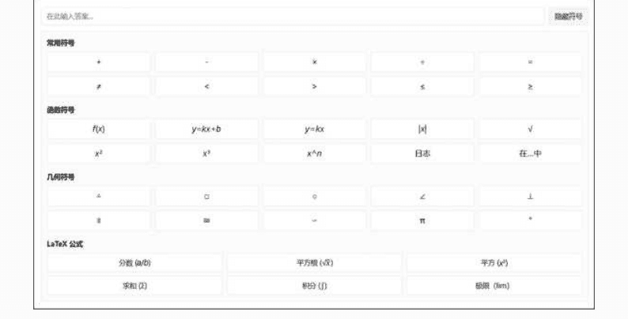

答错不必焦虑。系统会即时展示标准答案，并附上思路拆解、方法讲解、易错提醒三方面说明，便于找到失误根源。点击归档按钮可把该题收入个人错题集。若想继续练习同类内容，点击生成变式，平台会自动调整题目条件，从多角度检验掌握情况，避免重复踩坑。错题展示界面见图6-4。

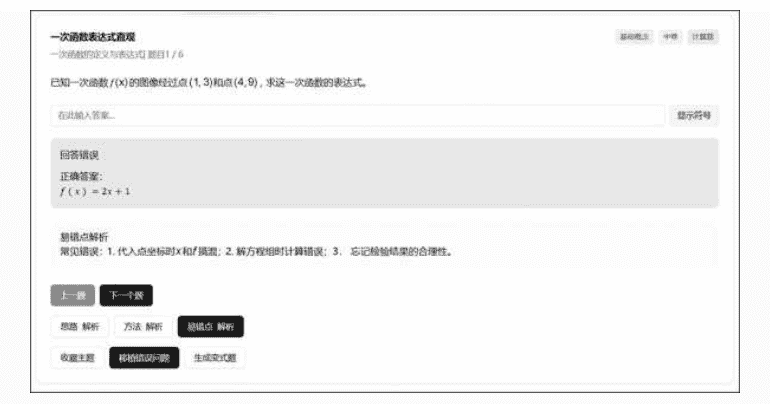

打开学习计划页如图6-5，能清楚看到整体天数、任务总量与完成比率。系统将计划拆解到每日时间轴，按序布置学习、练习、复习等环节，合理把控数学学习的节奏。按图索骥，学习更有序，知识内化更高效。

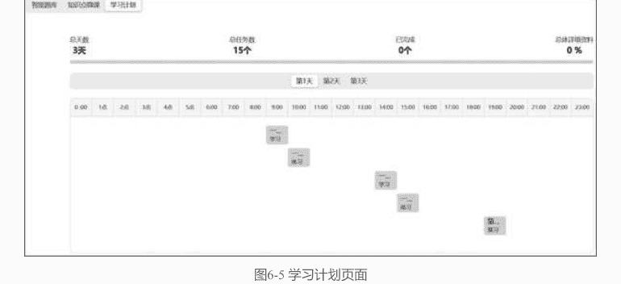

点选时间轴上的任务块会弹出详情。举例一次函数基础概念学习，窗口内显示预计时段、优先级，以及需达成的要点如定义、解析式、图像特征、k与b的含义等，参考图6-6。任务进展实时刷新，进度清晰可查，依此推进有助于知识更扎实。

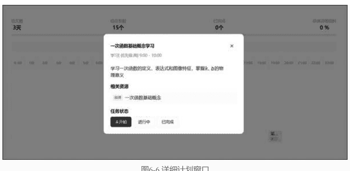

实际使用中可能遇到的问题与对策

问题1：自动生成的任务排布与个人节奏不匹配，感到压力。
解决：进入计划页审视任务内容与时间分布，手动将非紧急事项挪到合适时段，也可通过客服或反馈通道说明个人节奏，请优化规划逻辑。

问题2：输入数学符号和公式耗时，影响效率。
解决：先熟悉符号面板布局，记住常用位置；复杂公式可先用LaTeX模板如分数、根号，复制后修改参数。也可整理高频符号，反馈给智能体生成专属快捷清单。

问题3：错题变式难度突然升高，超出当前水平。
解决：先查看思路解析和方法解析逐步拆解，若仍吃力，可返回题库挑选同知识点但难度稍低的题目练习，积累经验后再挑战变式。也可在反馈中建议优化难度梯度，实现阶梯递增。

自主学习模块以任务流驱动，构成计划推进、练习巩固、反馈提升的闭环。学习者结合学情与目标，运用目标设定、资源匹配、过程监控、结果复盘四步框架，提升自主学习的系统性与效率。从路径规划到资源练习再到策略调整，环节紧密衔接，助力自主成长。

## 6.2 趣味古诗探险
古诗是打开文学世界的大门。智能体可为12至13岁学生搭建趣味探险场景，用动画与游戏替代枯燥背诵，让课前预习、课后巩固与碎片复习都充满趣味。学生只需按6.1节的四层结构化Prompt输入需求，即可快速获得专属古诗学习站点。

结构化Prompt模板如下。

+   1. 角色定位

    学生用户：12～13岁，古诗基础较弱，偏好趣味互动，注意力集中时间短（10～15分钟/次）。

    设计约束：

    避免复杂文本，多用图标/动画引导。

    学习任务单次完成时间小于或等于8分钟。
    2. 场景界定（When/Where）

| 场景 | 用户行为 | 设计目标 |
|---|---|---|
| 课前预习 | 快速理解古诗大意 | 提供拼音+动画释义 |
| 课后巩固 | 背诵并默写练习 | 填空+乱序拼诗游戏化 |
| 碎片时间 | 随机复习 | 推送“每日一句”挑战 |
    3. 要素拆解（What/How）

    古诗探险地图

| 要素 | 初中生适配设计 | 技术实现 |
|---|---|---|
| 地图视觉 | 卡通朝代地图（如唐代—长安Q版城堡） | SVG+CSS悬停动画 |
| 关卡难度 | 按教材古诗顺序解锁（如七年级上册第1课） | JSON存储关卡状态 |
| 反馈激励 | 解锁动画（烟花特效+“太棒了！”语音） | Lottie动画+Web Audio API |
    互动背诗挑战

| 要素 | 初中生适配设计 | 技术实现 |
|---|---|---|
| 填空题型 | 保留句首/句尾字（降低难度） | 正则表达式匹配 |
| 错误提示 | 表情包反馈（“再试试”→“完美！”） | 条件判断+DOM更新 |
    学习数据可视化

| 要素 | 初中生适配设计 | 技术实现 |
|---|---|---|
| 进度展示 | 教材单元进度条（如“七年级上：6/20首”） | Firebase统计查询 |
| 成就系统 | 实物关联徽章（如“李白粉丝”=毛笔图标） | 解锁规则硬编码 |
    4. 输出规则（Rule）

    交互规则

    关卡解锁：完成前一首诗的基础填空（正确率≥60%）→自动解锁下一首。

    成就触发：累计学习3天→“持之以恒”徽章；正确率90%→“古诗小天才”称号。

    内容规则

    古诗选材：优先部编版七年级教材（如《观沧海》《次北固山下》）。

    译文风格：口语化翻译（如“疑是地上霜”→“看起来像地上结的白霜”）。

站点首页随后生成，见图6-7。


地图页见图6-8。各色标签代表东汉、唐代等不同时期，灰色点位为未解锁的诗词关卡。点击左上角入口即可启动首关，开始诗词任务。在朝代地图上逐步解锁诗篇，开启探险体验。

进入首关，与东汉建安诗风对话，如图6-9。平台用通俗译文解析《观沧海》，引导逐句体会意境，按逻辑串联诗句，把曹操的豪迈胸怀转化为易于背诵的文字。

背诵完毕后进入验收，如图6-10。填空处提示“东，以观沧海”，需填入“临”“碣”“石”，提交后检验成果。答错可点“重试”或“提示”，提示会扣分。通过验收巩固背诵，在闯关中加深记忆。

图6-10 趣味闯关页

闯关答题若出错不必担心，系统会明确给出正解，如图6-11。可点“重试”再战，也可用“提示”获取线索，消耗积分。反复尝试后，《观沧海》诗句便能牢记，错误纠正的过程帮助扎实掌握。

图6-11 闯关错误页

学习数据页如图6-12，展示已完成诗篇、总分、成就数量及七年级上册完成度。下方朝代统计呈现东汉、唐、元等时期的学习进度，明确可挑战的关卡范围。

成就页如图6-13，包含“初出茅庐”“小成有所得”等徽章，完成相应学习任务即可点亮。页面还给出建议，鼓励从《观沧海》开始，坚持每日学习，逐一解锁成就。

使用中常见问题与处理

问题1：译文与答题缺少创作背景，学生好奇缘由。
处理：在译文页与答题页增加“背景探秘”入口，点击弹出极简背景卡，如《观沧海》关联曹操北征乌桓胜利，30字内点明关键。

问题2：闯关体验单调，缺乏新鲜感。
处理：申请加入“古诗变形挑战”，如把诗句迁移到现代旅行日记场景填空，或以末字起头的创意接龙；另设“朝代副本”周更，如大唐诗会，成功可解锁与诗人互动彩蛋。

问题3：背诵后易遗忘。
处理：让系统生成“记忆胶囊”，每完成3首推送复习卡，含线索图与联想口诀；增设反向纠错关卡，打乱字序供改正；连续7天复习可获“记忆达人”徽章。

整体基于结构化Prompt形成情境沉浸、互动学习、成果反馈的闭环，覆盖预习与巩固场景，针对背景缺失、重复感、遗忘等痛点给出解法，让古诗学习变得轻松有趣。

## 6.3 跨学科知识关联
传统教学易使知识碎片化。借助6.1节的四层结构化Prompt，智能体可为学生搭建跨学科平台，通过智能引导实现知识融合，提升综合能力与创新思维。

结构化Prompt模板如下。

```
### 角色定位
初中学生
### 场景界定
针对勾股定理进行跨学科学习
### 要素拆解
学科关联 明确3个核心关联学科
1. 物理（斜面受力分析）
2. 艺术（黄金分割构图）
3. 编程（图形绘制算法）
交互设计：具体操作反馈机制
- 正确答题时触发学科彩蛋
- 错误时显示“历史名人也曾犯这个错”小故事
认知梯度 难度分级标准
★基础：图形计算
★★应用：现实测量
★★★挑战：跨学科问题
#输出规则：创建跨学科学习平台，包括如下内容
页面1：基础知识讲解与习题练习
核心场景：
建立直观认知 → 通过交互工具“看见”定理成立
检验理解程度 → 现实场景习题（非抽象计算）
边界约束：
所有习题必须包含图形辅助（如带标注的三角形示意图）
避免纯代数变形题（如“化简 (a²+b²) /c²”）
页面2：对于核心学习功能，实现学科关联
核心场景：
拓展认知边界 → 理解定理在1~2个学科中的真实应用
激发探索兴趣 → 通过轻量化工具进行自主实验
边界约束：
不强制输出作品，仅提供“观察-操作-反思”闭环
每个学科最多展示2个高度关联的案例
```

随后生成站点，首页如图6-14。

进入基础知识页的“交互式勾股定理演示”模块，如图6-15和6-16。可拖动直角边 a、b 的滑块实时改变边长，左侧图形与右侧公式同步更新，并自动计算两直角边平方、斜边平方及斜边长度。

点“播放动画”可观看动态推导，点“重置”可恢复初始状态，便于反复实验。交互式可视化把抽象定理转化为可操作实验，帮助建立数形结合思维。

掌握定理后进入习题练习，如图6-17，包含现实测量、图形计算等类型，并显示进度与得分。答题后即时反馈正误并附解析。答错可点“重新开始”再练，如图6-18，加深理解。

跨学科探索开启！物理板块“斜面受力分析”如图6-19，演示勾股定理在物理中的应用。拖动滑块调节斜面角度与物体质量，左侧实时显示重力、平行分力、垂直分力，可验证平行分力²+垂直分力²=重力²，直观感受定理作用。

编程板块如图6-20，用递归算法结合勾股定理绘制分形图形。设定递归深度后，按先画树干再在顶点构建两小正方形且边长满足勾股定理的原理，通过 drawTree 函数观察图形从简到繁的生长，点“观看生长”感受数学与编程融合之美。

使用反馈

问题1：习题量不足。
处理：向智能体明确补充需求，增加中考真题与模拟题，覆盖近5至10年各地试卷中勾股定理应用及跨学科题型。

问题2：跨学科内容难懂。
处理：先回顾基础概念，再从简单场景入手，如物理板块先用小角度小质量演示，艺术板块先分析《蒙娜丽莎》的黄金分割。若仍困难，可请智能体生成更通俗、步骤更细的案例。

问题3：动画节奏不适。
处理：建议加入倍速调节；若未上线，可通过暂停重播关键帧分步研读推导过程。

在学科融合背景下，该体系从角色定位出发，涵盖概念理解与跨学科拓展，通过交互实验与多学科案例采集数据，结合分级与彩蛋反馈分析，并以错题预警与个性化路径提供支持，最终以可视化报告与任务包输出，形成完整的知识融合体系。

## 6.4 英语冒险岛
单一单词语法训练易割裂知识。智能体依托6.1节的四层结构化Prompt，帮助学生打破孤立困境，按角色、场景、要素、规则生成适配平台，通过卡通校园、单词闯关、错题变形等手段联通词汇、语境与应用，提升掌握度与综合运用能力。

1. 角色定位
目标用户
英语初学者

# 让英语启蒙更上瘾的共学方案

用户画像很鲜明：基础偏弱、一次专注大约10到15分钟、偏爱互动探究、对即时正向反馈依赖高。

平台由三个角色协同运转。领航者是一只卡通智能体，负责规划学习路径；激励伙伴借助成就体系维系持续意愿；记录员则在后台自动归档错题并产出学习报告。

2. 场景界定 Where&When
高频核心场景
场景类型 时间 学习内容 交互形式
每日冲刺 放学后15分钟 10个词汇+1个语法点 游戏化任务链
周末强化 周末30分钟 情境对话+错题复盘 虚拟角色互动
辅助场景
课间5分钟，用闪卡进行词汇速记

3. 要素拆解 What&How
（1）词汇模块
要素 设计规则
内容 遵循课标的基础词，按学校/家庭/食物等主题归类
流程 看图认词→听音辨义→填空造句，难度逐步递进
反馈 发音即时纠正，错词自动进入复习计划
（2）语法模块
要素 设计规则
内容 聚焦be动词/一般现在时等五大基础语法点
形式 动画微课2分钟→拖动排序→对话填空
提示 错误处高亮并弹出语法小贴士弹窗
（3）激励体系
层级 触发条件 奖励内容
即时 单题正确 特效动画+积分
阶段 完成每日任务 解锁虚拟装扮
长期 连续学习7天 电子成就证书

4. 输出规则
学生端
每次学习结束弹出今日收获提示，如学会8个新单词
每周一自动生成学习航行图，以雷达图呈现各模块进度
设计示例：词汇学习闭环
角色触发：AI熊猫说今天要收集10个水果词汇
场景加载：3D果园，词汇卡挂在果树上
要素互动：
Level 1：点击苹果，播放apple读音并显示中文释义
Level 2：听到banana读音，点击对应香蕉图片
Level 3：补全句子I want to eat an ________ (apple)
规则输出：
成功：果树结出可收集的虚拟果实
失败：触发单词急救包进行专项练习
随后系统会生成一个网站，网站首页如图6-21所示。
图6-21 网站首页
进入日常冲刺页如图6-22所示。该页聚焦词汇学习，界面简洁清新：顶部进度条显示已收集0/10个单词，同时展示虚拟币2150个，中间以苹果图片搭配苹果中文标签呈现内容，下方熊猫图标提示单击水果学习新单词，并设有第1级看图识别词、第2级听音辨义切换按钮，通过直观图像与分级模式引导学生在趣味中完成日常任务。
图6-22 每日闯关页面
点进周末强化进入语法练习页如图6-23所示。该页设置语法闯关区。顶部蓝色语法小课堂给出任务说明排列正确的句子顺序，计时显示1:33。中间绿色区要求将单词按正确顺序排列，下方给出单词You、are、my、friend，排序后可点击提交答案按钮。这种互动帮助学生巩固语法、提升运用能力，让周末学习更有趣有效。
图6-23 语法练习页面
学习成就页如图6-24所示。顶部今日收获展示当日成果，如图6-24中显示的学会了8个新单词。下方的学习航行图呈现用户等级如Level 38，并以环形图从单词85%、语法70%、听力60%、口语45%四个维度清晰展示语言能力动态变化，帮助学生了解成果与短板，实现持续提升。
图6-24 学习成就页面

使用英语冒险岛时可能遇到的核心问题与解决方法
问题1：学习难度偏低，提升缓慢
解决方法：在平台反馈功能里告知AI希望学习的教材，如人教版初中英语八年级上册，或指定词汇范围如中考高频、雅思基础，请求更新更高难度内容。可自主调整学习模式，跳过看图识词基础环节，直接进入听音辨义、词汇辨析等高阶模式。
问题2：进入页面或切换任务时加载时间长，出现卡顿闪退
解决方法：清理设备缓存与浏览器缓存，关闭占用内存的程序，保证设备运行顺畅。若仍未改善，将设备型号、网络环境4G/5G/Wi-Fi、具体卡顿场景反馈给技术支持，便于排查优化。
问题3：激励机制单一，难以长期坚持，仅有单词量、等级展示
解决方法：为自己设定小目标与奖励，如累计学会50个新词奖励一部英文电影。向平台建议增设激励形式，如增加虚拟勋章语法达人、听力之星，学习礼包解锁特殊主题词库、语法拓展资料，与好友PK排名等功能。

智能体借助角色定位+场景界定+要素拆解+输出规则这一四层结构化指令模板，为英语初学者打造适配的自主学习平台，构建词汇、语法学习及趣味激励体系。平台能在趣味探索中助力语言能力提升，但也可能存在难度适配不足、技术故障、激励单一等问题。学生可通过反馈需求、优化设备、增设自主奖励或向平台提出功能建议来解决问题，从而提升学习效率与效果，突破传统学习的困境，实现知识的灵活运用与综合能力提升。

# 第7章 创意智能体

生成式大模型为创意领域注入强劲动力。AI与生活、艺术的深度融合，使创作边界被重新定义——从依赖直觉的经验式创作，到人机协同的系统化设计；从单一媒介的线性叙事，到跨领域融合的多维表达。如何借助AI技术把灵感碎片转化为完整作品，让创作瓶颈蜕变为突破契机，已成为当下值得深入探讨的命题。

## 7.1 游戏攻略创作大师

智能体作为通用型AI助手，为游戏攻略创作带来巨大便利。它不仅能帮助游戏创作者产出高质量攻略，还能基于游戏风格拓展出很多意想不到的表达形式。下面重点讲解智能体对游戏攻略创作的影响，并结合具体案例阐释其价值。

### 7.1.1 智能体对游戏攻略创作的影响

智能体对游戏攻略创作的影响体现在提升创作效率、优化内容质量、拓展攻略形式与支持个性化服务等多个维度，同时对内容深度和风格化表达方面也带来挑战。

#### 1. 提升创作效率
智能体对于创作效率的提升主要表现在以下两个方面。
- 自动化任务处理：智能体能够快速处理游戏攻略创作中的重复性任务，如数据整理、信息搜集和基础内容生成。以游戏更新日志的处理为例，智能体可自动解析日志内容，提取关键机制变化信息，并生成初步的攻略框架。
- 多工具协同：智能体支持跨平台操作，能够同时调用多个工具，如代码编辑器、数据分析软件等，实现从数据抓取到内容生成的闭环流程。例如，在策略类游戏中，它可以自动模拟战斗场景，验证阵容搭配的胜率，并生成优化建议。

#### 2. 优化内容质量
智能体对内容质量的优化主要表现在以下两个方面。
- 精准的数据分析：智能体通过深度分析游戏数据，提供更准确的攻略建议。例如，在角色养成类游戏中，它能够基于玩家当前的进度和资源分配，生成最优的技能升级路径和装备搭配方案。
- 动态内容更新：智能体能够实时监控游戏版本更新，自动标记过期的攻略内容，并推送最新版本的相关信息。例如，在赛季制游戏中，它能够及时更新英雄强度排行榜和出装推荐，确保攻略的时效性。

#### 3. 拓展攻略形式
智能体通过以下两种途径拓展攻略形式。
- 多媒体内容生成：智能体具备强大的跨媒介内容生成能力，支持生成图文、视频、PPT等多种形式的攻略内容。例如，它可以自动为攻略添加动画演示、实战演示视频和知识点讲解，提升内容的趣味性和互动性。

#### 4. 支持个性化服务
智能体支持个性化服务主要通过以下两种途径实现。
- 玩家共创生态：智能体可以搭建玩家投稿平台，自动审核并优化用户生成内容。例如，它可以筛选出高质量的玩家攻略，并将其整合到官方攻略库中，形成知识共享的活跃社区生态。
- 实时问答系统：智能体驱动的AI助手可以实时解答玩家疑问，提供动态攻略支持。例如，在多人在线战术竞技游戏中，玩家可以随时询问英雄克制关系或装备选择，系统会基于当前版本数据给出最佳建议。

### 7.1.2 智能体构建《原神》游戏攻略的案例

设计一个有效的《原神》游戏攻略生成指令，需结合具体需求，如角色培养、战斗技巧、任务解谜等，并确保指令清晰、结构严谨且细节丰富。

#### 1. 指令设计核心原则
指令主要包括明确目标、限定范围、结构化输出和数据依赖4个部分。
- 明确目标：指定攻略类型，角色、武器、任务、Boss、资源规划等。
- 限定范围：限定游戏版本、角色/武器等级、适用玩家群体新手/老手。
- 结构化输出：要求采用分步骤说明、表格说明或优先级排序等易读格式。
- 数据依赖：要求基于最新版本实测数据或实战验证数据，避免出现AI虚构信息。

#### 2. 分场景指令示例
针对不同场景，需要构建不同的指令示例，下面介绍4种典型场景的指令设计。
##### （1）角色培养攻略
你是《原神》深度攻略创作者，请为角色那维莱特4.6版本撰写一篇详细的培养指南，要求包含以下内容。
```
角色定位：主C/副C/辅助，核心机制说明（如重击生命消耗机制）。
天赋优先级：技能升级顺序（如普攻>E>Q），并解释原因。
圣遗物推荐：
  最优套装（附主词条/副词条优先级）。
  替代套装（针对不同阶段玩家）。
武器推荐：
  五星专武“万世流涌大典”与其他五星/四星武器的伤害对比。
  免费武器选项（如试作金珀的适用性）。
配队建议：列出2个主流队伍（如那维莱特+枫原万叶+钟离+芙宁娜），并说明循环手法。
命座分析：关键命座（如1命、2命）的强度提升百分比。
```
将指令输入智能体后，按照要求进行整理分析，生成的相关任务文档如图7-1所示。
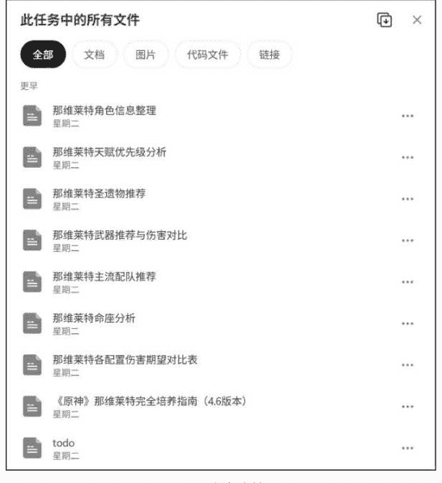
其中，智能体推荐的《原神》那维莱特完全培养指南4.6版本的目录如图7-2所示。在任务执行过程中，智能体将任务拆解为以下步骤：首先，自主收集《原神》那维莱特的实测数据和权威攻略资料，优先访问米游社、NGA等站点；其次，整合多源数据，确保版本机制与数值参数的准确性；最后，梳理主流权威资料，提炼角色定位和核心机制。该过程充分体现了智能体的规划与逻辑推理能力。
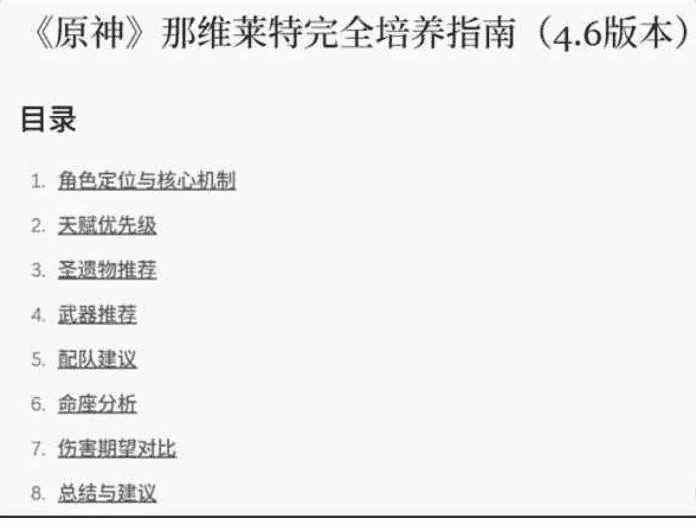
智能体通过逻辑清晰的分析框架对内容进行优先级排序并提供详细解释，以层层递进、由浅入深的方式呈现分析过程，如图7-3所示。
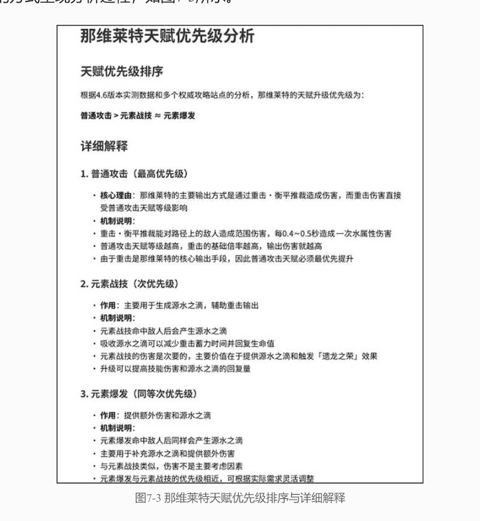
智能体的优势在于其强大的自主数据处理能力，能够自动检索并整合实测数据和权威攻略资料，通过多维度对比分析深入挖掘机制背后的逻辑，进而输出详尽、结构化的解释说明。智能体生成的文档涵盖角色定位、天赋优先级、圣遗物推荐、武器对比、配队策略和命座分析等内容。图7-4展示了不同武器与命座组合的伤害对比，所有的数据均采用指令进行实测验证，并以表格形式清晰呈现不同配置下的伤害期望。智能体会针对每个步骤给出具体的解析，最终输出的文档以结构化形式系统呈现分析过程与结论。相比于普通大语言模型，智能体给出的回答更全面、依据更充分、可解释性更强。
图7-4 不同武器与命座组合的伤害对比
##### （2）Boss战斗攻略
请为《原神》4.6版本周本Boss仆人撰写一份无伤攻略，要求如下。
- 机制解析：
  - 分阶段说明Boss技能，如血影刀的标记机制。
  - 必杀技的躲避技巧，站位/无敌帧时机。
- 角色对策：
  - 推荐3个克制角色，如钟离护盾、夜兰速切等，并说明原因。
  - 平民阵容，4星角色+免费武器。
- 实战流程：
  1. 分步骤输出时间轴，如开局5秒内破盾→第10秒绕背输出。
  2. 附示意图描述安全站位，可用ASCII图或方向描述。
- 要求：避免笼统描述，提供精确到秒的操作建议，标注Boss弱点属性，如火破冰盾。
将上述要求整理为结构化指令后进行案例测试。在这项任务中，智能体详细分析了Boss机制、必杀技躲避技巧，推荐了克制角色和平民阵容，并提供了安全站位布局。
```
战场概览
        北方
          |
          |
西方 -----+------ 东方
          |
          |
        南方

初始站位（战斗开始）
        北方
          |
          |
西方 -----★------ 东方
```
智能体还基于上述指令生成了精确实战时间轴，如图7-5所示。
###### 精确实战时间轴以秒为单位
**第一阶段100%～70%血量**
**0:00 - 0:05 开场准备**
- 0:00：进入战场，立即向右侧移动，避开仆人的初始位置
- 0:02：钟离/迪奥娜释放护盾E技能
- 0:05：夜兰/行秋释放Q技能，提供持续水元素伤害
**0:06 - 0:15 初始输出阶段**
- 0:06：班尼特/芭芭拉释放Q技能，提供治疗和增益
- 0:08：雷电将军/香菱释放E技能，提供持续元素伤害
- 0:10：主C开始输出，注意观察仆人动作
- 0:12：仆人可能使用斩首之邀，向左侧闪避
- 0:15：继续输出，保持距离约10米
**0:16 - 0:30 第一次必杀应对**
- 0:16：观察仆人动作，如果开始引导朱炎朔月文字提示出现，准备应对
- 0:18：如有血汐冲击，立即使用重击打断仆人引导

直观的安全站位示意图和精确的时间轴拆解使分析结论更加准确、清晰，充分体现了智能体相较于普通大语言模型更优越、更全面的性能。

##### （3）任务解谜攻略
你是一名《原神》解谜专家，请为4.6版本旧日之海区域的石板谜题撰写攻略，要求如下。
- 谜题定位：精确描述谜题位置，附游戏内坐标参考点。
- 解谜步骤：
  1. 分步骤说明石板旋转顺序，如北→东→南→西。
  2. 交互物品的隐藏触发条件，如需装备特定道具。
- 常见错误：列出玩家易犯的3个错误，如忽略环境光提示。
- 奖励说明：解谜后获取的宝箱/成就内容。
- 要求：用如果……则……格式应对不同情况。如如果石板复位，则需重新触发机关。
将上述要求整理为结构化指令后进行智能体案例实测。智能体提供了精确的谜题定位，具体如下。
**石板谜题一：古代回响**
**谜题定位**
位置坐标：旧日之海区域，优恩花园东北方向X: -345, Y: 217。
参考点：从优恩花园传送锚点向东北方向前进约150米，靠近一处半圆形遗迹建筑，石板位于建筑中央平台上，附近有一个明显的蓝色水元素纹路装饰。
识别特征：石板呈六边形，表面刻有古代雷穆利亚文字，周围有四个较小的石柱，每个石柱顶部有不同颜色的光芒，石板周围的地面上有环形水纹图案。
**解谜步骤**
1. 准备阶段：确保已装备乐章之力能力，通过主线任务获得，靠近石板，会看到四个石柱亮起不同颜色的光芒。
2. 石板旋转顺序：第一步，旋转北方石板，面向蓝色光芒的石柱；第二步，旋转东方石板，面向黄色光芒的石柱；第三步，旋转南方石板，面向红色光芒的石柱；第四步，旋转西方石板，面向绿色光芒的石柱。
3. 交互方式：使用元素战技键E键对准石板，长按激活乐章之力，调整音调至与石柱光芒颜色对应的音高。释放元素战技，石板会旋转并发出共鸣声。
4. 隐藏触发条件：必须按照北→东→南→西的顺序旋转，每个石板旋转后，需等待共鸣声结束约3秒再旋转下一个，如果顺序错误，所有石板会重置，需从头开始。
**不同情况的应对方法**
1. 如果石板旋转顺序错误、无共鸣声或突然重置，则等待约5秒至完全重置，重新核对石柱颜色与方位的对应关系，严格按北→东→南→西的顺序操作，并确保每次旋转后等共鸣声结束再进行下一步。
2. 如果乐章之力未正确装备，导致无法与石板互动或无音调调整界面，则打开角色菜单检查装备。若未装备，可在能力选项卡进行装备；若未解锁，须先完成主线任务旧日之歌。装备后，靠近石板长按元素战技键激活乐章之力界面。
3. 如果音调调整不正确，石板旋转却未触发下一步反应，则记住以下对应关系：北/蓝色 = 高音，东/黄色 = 中高音，南/红色 = 中低音，西/绿色 = 低音。调整时，确保音符颜色与石柱光芒一致；若多次失败，可离开区域再返回重新触发，同时注意站位正确，面向石板、保持3~5米的距离。
**常见错误及规避建议**
错误描述：许多玩家在解谜过程中忽略了环境中的光线提示，导致无法确定正确的石板旋转顺序或交互方式。具体表现在未注意石柱光芒颜色与音调的对应关系，忽略墙壁上的方向符号发光变化以及未观察月相石板的亮度变化规律。
规避建议：
1. 在进入谜题区域时，先关闭角色元素视野，观察环境中的自然光源。
2. 特别注意任何非自然的光芒或发光物体，它们通常是解谜提示。
3. 如果在白天解谜困难，可尝试调整游戏内时间至夜晚，光线提示会更加明显。
4. 调整游戏亮度设置，确保能清晰看到环境光变化。
**奖励说明**

完成“旧日之海”区域探索后，可开启一个精致宝箱，内部掉落为原石、摩拉、海域特产深海珍珠以及一件随机圣遗物。额外收获“旧日回响”成就，并带来2%的区域探索进度提升。本指南对谜题做了坐标级标注，提供了完整通关顺序、常见失误拆解与收益说明，采用“If…then…”分支写法应对不同情形。三大石板谜题均给出精确坐标、转动次序与隐藏触发条件，并附上规避误操作的建议，供自行验证。

##### （4）零氪物资调配方案

针对《原神》4.6版本无氪玩家制定的物资安排思路，具体需求如下。

- 原石使用排序：
  - 抽卡建议，例如当前深渊环境下更倾向抽取那维莱特而非赛诺。
  - 汇总每日任务与活动获取原石的途径汇总表。
- 树脂投放：
  - 前期冒险等级低于45时主攻摩拉与经验书。
  - 后期对圣遗物本进行性价比对比，例如逐影猎人与黄金剧团的取舍。
- 体力节约方法：周本Boss在第三次挑战后树脂消耗减半的机制。
- 要求：用时间轴表格来规划每日行动，并标出各版本活动的结束节点。

把以上需求整理成结构化Prompt后做实测。模型据此拆解了原石优先级、树脂使用策略和体力节省方法，并生成了完整的活动时间轴表格，如图7-6所示。该时间轴清晰标注了各项活动的截止节点，便于玩家合理安排日常资源使用。

###### 活动日历与截止时间

| 活动名称 | 开始时间 | 结束时间 | 奖励 | 优先级 |
| :--- | :--- | :--- | :--- | :--- |
| 4.6版本更新 | 5月1日 | - | 维护补偿600原石 | - |
| “仆人”角色池 | 5月1日 | 5月21日 | - | 中 |
| “林尼”角色池 | 5月1日 | 5月21日 | - | 低 |
| “那维莱特”角色池 | 5月21日 | 6月11日 | - | 高 |
| “白术”角色池 | 5月21日 | 6月11日 | - | 中低 |
| 主线任务“谐律上的永叙诗” | 5月1日 | 永久开放 | 原石180 | 高 |
| “旧日之海”新区域 | 5月1日 | 永久开放 | 原石、宝箱等 | 高 |
| 主要活动“谐律永世” | 5月3日 | 5月24日 | 原石1000 | 最高 |
| 支线活动“深海秘闻” | 5月6日 | 5月27日 | 原石420 | 高 |
| 支线活动“旧日寻踪” | 5月10日 | 5月31日 | 原石420 | 高 |
| 支线活动“潮汐之旅” | 5月17日 | 6月7日 | 原石420 | 高 |
| 深境螺旋 | 5月1日 | 6月15日 | 原石600 | 高 |
| 4.7版本预告直播 | 5月31日 | - | 兑换码300原石 | 高 |
| 4.7版本更新 | 6月12日 | - | - | - |

图7-6 活动时间轴表格

#### 3. 让 Prompt 更好用的三招

要提升提示词效果可从三方面入手。首先明确输出格式，例如要求用Markdown输出，内容包含二级标题、无序列表，并对关键信息进行加粗处理。其次进行数据验证，强调数据来源的可靠性，规定伤害计算等关键数据必须引用NGA论坛实测数据或Genshin Optimizer等权威工具的计算结果。最后控制语言风格。例如，采用专业且适度口语化的表达方式，避免内容冗长，举例时可灵活使用游戏术语（如“Q技能”“暴击拐”）。

通过以上方法，可以生成准确度高、可落地的《原神》攻略。如果需要更具体地针对某类攻略设计Prompt，可进一步说明应用场景。

## 7.2 旅游内容创作助手

智能体在旅游内容创作中发挥了关键作用。它不仅能规划路线，还能支持车票预订等多元化功能。

### 7.2.1 智能体如何改变旅游攻略

智能体对旅游攻略创作的影响主要体现在以下几个方面。

1. 个性化定制能力提升
智能体通过分析用户的兴趣、时间及预算，能够生成高度个性化的旅行行程。它不仅能够考虑景点、交通和住宿信息，还能优化行程安排，确保用户充分参与感兴趣的活动，打破传统攻略的标准化局限，为不同需求的用户提供定制化服务。

2. 实时信息整合与动态调整
智能体能够提供整合的实时旅游信息，包括天气情况、交通状况、景点开放时间及其他旅行者评价等。这种动态信息整合能力使攻略内容更具时效性，能够帮助用户及时调整行程，避免突发情况对行程的影响，提升旅行的顺畅度。

3. 自动化预订与费用优化
智能体具备自动化旅游预订管理能力，涵盖预订酒店、机票、景区门票及体验特色活动等场景。此外，通过实时监控价格变化，它能为用户找到最优预订时间和价格组合，帮助用户有效节省旅行成本。这种自动化服务简化了攻略执行流程，使用户不需要手动比价即可获得高性价比旅行方案。

4. 推荐系统精准度提高
基于用户的历史旅行数据和偏好，智能体能够推荐符合其兴趣的景点、餐厅及活动。这种个性化建议增强了攻略的实用性，帮助用户更轻松地发现符合自身兴趣的目的地与活动，避免信息过载影响决策。

5. 社交互动与内容创作
智能体集成了互动和分享功能，支持用户发布旅行攻略、分享精美照片，并且可以联动主流社交网络。这种功能提升了用户参与内容创作的积极性，使攻略系统从单一的信息推送升级为用户交流经验、完善信息的平台，并逐步沉淀为动态更新的旅行知识库。

6. 技术驱动的体验升级
智能体结合AR实景投射与GPT行程生成技术，可在虚拟场景中实时识别用户周边环境，智能推荐隐藏景点或特色活动，有效激发用户的探索兴趣。例如，当用户在日本京都街头行走时，系统可基于实时位置推送附近的庭院、茶室等本地化体验，使攻略从静态文本升级为沉浸式交互形式。

### 7.2.2 场景化旅行 Prompt 设计思路

设计一个高效的旅行攻略生成Prompt，需要明确目标用户、旅行偏好、行程细节等关键要素，同时确保智能体输出的攻略具备实用性、个性化和可操作性。

#### 1. Prompt设计核心原则

Prompt主要包括明确目标、限定范围、结构化输出和个性化定制这4个部分。

- 明确目标：定义旅行类型（如自由行、跟团、背包客、家庭游、蜜月旅行等）。
- 限定范围：明确目的地、时间、预算（避免智能体生成的内容过于宽泛）。
- 结构化输出：指定输出结构（如按天规划，包含交通、住宿、景点、美食等）。
- 个性化定制：标注个性化需求（如“适合带小孩”“偏好小众景点”“美食优先”）。

#### 2. 分场景Prompt示例

在日常生活中，我们经常需要制定个性化旅行攻略。以下是针对不同场景设计的旅行攻略Prompt示例，读者可以将其作为参考，快速生成适合自己的个性化行程。

##### （1）城市自由行基础版

你是一名专业旅行规划师，请为一位预算中等、喜欢文化体验和美食的旅行者设计一份5天4夜武汉自由行攻略，要求如下。

- 行程安排：按天规划，每天3～4个主要景点，合理安排交通时间。
- 住宿建议：3晚性价比高的连锁酒店（江汉路/循礼门附近）+1晚特色民宿（如昙华林街区）。
- 美食推荐：必吃餐厅为“老通城”和“赵师傅油饼包烧麦”（地道武汉早餐）；其他推荐为“蔡林记热干面”“便利店的热干面和卤味”。
- 交通建议：说明是否建议购买“武汉地铁7日通票”，并提示最佳使用时间。
- 现场提醒：如“黄鹤楼景区节假日人流密集”“部分景点的最佳拍照时段”。
- 输出格式：Markdown，含每日详细时间表，地图链接（Google Maps）、预估费用（人民币）。

适用场景：普通城市自由行，适合到访武汉的旅行者。

##### （2）深度主题游

请设计一份7天武汉深度文化之旅攻略，聚焦以下内容。

- 主题：武汉古建筑、楚韵文化与本土人文体验。
- 必去景点：
  - 禅意古建筑：黄鹤楼（避开节假日高峰时段）、古德寺、归元禅寺。
  - 自然人文：东湖磨山竹林小径、堤角公园江南庭院。
  - 文化溯源：湖北省博物馆（编钟文化）、晴川阁、盘龙城国家考古遗址公园。
- 特色体验：
  - 体验一次楚式禅茶/租赁汉服游园。
前往昙华林特色花店，参与插花手作活动。
品尝汉味非遗料理（推荐“老通城”“蔡林记”等本土老字号餐厅）
交通建议：购买“武汉地铁7日通票”是否划算？说明最佳使用时机。
现场提醒：避开黄鹤楼、昙华林等景区的节假日人流高峰，推荐小众替代景点（如古德寺），避开热门拥挤区域。
出行工具：高德地图/百度地图，提前查询每日景点开放时间、公共交通班次，推荐地区导航（高德地图）、支付方式（微信/支付宝）。
适用场景：喜欢深度文化探索的旅行者。

##### （3）家庭亲子游攻略

为带两个小孩（5岁和8岁）的家庭规划一份6天5夜新加坡亲子游攻略，要求如下。

- 景点选择：
  适合儿童的如环球影城、S.E.A.水族馆。
  家长也能享受的如滨海湾花园夜间灯光秀。
- 住宿建议：
  一家亲子友好酒店如圣淘沙硬石酒店。
  是否值得住“金沙酒店”？（分析性价比）
- 餐饮安排：
  孩子喜欢的如“亚坤咖椰吐司”。
  家长可尝试的如“辣椒螃蟹”。
- 行程节奏：每天不超过2个主要景点，午休时间预留。
- 输出时标注：哪些景点需提前购票、哪些适合推婴儿车。
适用场景：带小孩的家庭旅行，需平衡娱乐和休息。

##### （4）预算控制型攻略

请为预算有限的背包客设计一份10天泰国（曼谷+清迈+普吉岛）穷游攻略，要求如下。

- 住宿：推荐青旅或廉价民宿（每晚预算<150元人民币）。
- 交通：
  城际：夜间大巴/火车（省钱省时间）。
  市内：“突突车”砍价技巧、摩托车租赁风险提示。
- 美食：必吃街头小吃（如“芒果糯米饭”“泰式炒河粉”），避免高价旅行者陷阱。
- 免费/低价活动：
  曼谷：周末市场、免费寺庙。
  清迈：丛林徒步（本地团比国际团便宜）。
- 安全提醒：常见骗局（如“大皇宫关闭”骗术）。
- 输出时按城市分段，标注每日预估花费（泰铢+人民币）。
适用场景：学生、背包客等低预算旅行者。

##### （5）实时动态攻略

我正在巴黎旅行，原计划今天去卢浮宫，但遇到罢工导致地铁停运，请快速提供替代方案。

- 替代方案：
  步行可达的景点如“奥赛博物馆”。
  可用的公交线路（实时查询链接）。
- 灵活调整建议：
  如果下午交通恢复，如何优化剩余行程？
  若罢工持续，推荐1个近郊小镇（如凡尔赛宫）及往返方式。
- 要求：基于最新交通信息（2026年X月X日），提供具体操作步骤。
适用场景：旅行中遇到突发情况（如极端天气、罢工等）。

##### （6）旅行通用攻略模板

目标：生成一份包含行程规划、景点推荐、住宿交通、餐饮预算的完整旅行攻略。

适用对象：自由行/跟团旅行者，可自定义旅行风格（如自然风光、文化体验、美食打卡）、预算范围及出行天数。

###### 1. 基础信息填写
- 旅行目的地：
  示例：云南·大理/日本·京都/泰国·清迈。
- 出行天数：
  示例：7天6晚/3天2晚。
- 旅行风格：
  选项：自然风光、文化历史、美食探店、亲子休闲、摄影打卡、户外探险。
- 预算范围：
  示例：经济型（<3000元/人）、舒适型（3000～6000元/人）、轻奢型（>6000元/人）。
- 出行人数：
  示例：1人/情侣/家庭（2大1小）/朋友结伴（4人）。

###### 2. 每日行程规划
- Day X：主题标签（如“古城初探”“湖光山色”）。
  - 上午：
    景点名称：×××（门票价格、开放时间、游玩时长）。
    交通方式：地铁/公交/打车（费用参考）。
    贴士：早高峰避堵建议/最佳拍摄角度。
  - 中午：
    餐厅推荐：×××（特色菜、人均消费）。
    备选方案：若排队过长可前往某一备选餐厅。
  - 下午：
    活动安排：×××体验（如扎染手作/骑行路线）。
    隐藏玩法：本地人常去的冷门景点。
  - 晚上：
    夜景推荐：×××观景台、夜市（营业时间）。
    安全提示：避开人流密集区域。

###### 3. 住宿与交通建议
- 住宿推荐：
  区域选择：靠近地铁站、景区或夜市（附地图标记）。
  类型推荐：青旅（经济）、民宿（特色）、酒店（舒适）。
  避坑指南：警惕“照骗”房源，查看最新评价。
- 交通方式：
  跨城交通：高铁、飞机、长途巴士（班次/票价/耗时）。
  市内交通：共享单车、包车、公交卡（优惠套餐）。

###### 4. 餐饮与美食攻略
- 必吃美食清单：
  菜品名称：×××（推荐店铺/人均消费）。
  隐藏吃法：搭配当地特色蘸料/蘸水。
- 避雷指南：
  景区内高价餐饮谨慎选择。
  季节限定美食（如菌子火锅仅限6月到10月）。

###### 5. 预算明细
- 大项分类：
  交通：×××元（含往返机票/高铁）。
  住宿：×××元（按人均分摊）。
  餐饮：×××元（每日预估）。
  门票+体验：×××元（含优惠票渠道）。
  其他：×××元（购物/应急备用金）。
- 省钱技巧：
  景点联票或早鸟票优惠。
  本地人常去的平价市场。

###### 6. 实用贴士
- 行前准备：
  证件：身份证/护照/学生证（优惠）。
  衣物：根据季节携带雨具/防晒装备。
  药品：肠胃药/晕车药/创可贴。
- 当地禁忌：
  寺庙内勿穿短裤或露肩装。
  拍照前需要征得当地人同意。
- 紧急联络：
  旅游投诉电话/领事馆信息。

###### 7. 灵活调整选项
- 天气备选方案：
  若遇雨天：室内博物馆/手作工坊替代户外活动。
- 人群适配调整：
  亲子游：增加儿童乐园/科普场馆。
  老年团：减少步行距离，增加休息点。

#### 3．智能体生成旅游攻略案例

下面以新加坡6天5夜亲子游为例进行说明。

智能体给出的新加坡6天5夜亲子游攻略内容包含行程概览、每日详细行程、住宿推荐、餐饮安排、交通建议、实用贴士、费用预估，如图7-7所示。该攻略按照要求推荐适合儿童和家长的景点，提供亲子友好型酒店建议（含金沙酒店的性价比分析），并合理安排全家适配的餐饮与行程节奏。

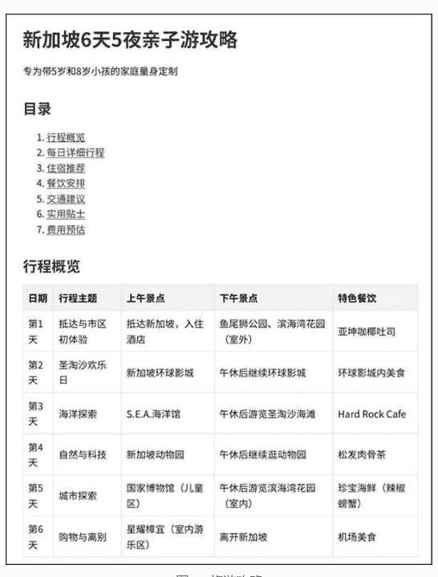

图7-7 旅游攻略

如图7-8所示，攻略设计充分考虑了亲子共游需求，整体规划以海洋探索、自然体验、科技互动为主题，既能激发儿童对世界的好奇心，又在景点筛选上兼顾儿童的兴趣与体力。

##### 第3天：海洋探索

- 上午：S.E.A.海洋馆
  - 10:00-13:00 游览S.E.A.海洋馆
  - 重点体验：
    - 开放海洋区（巨大的海底隧道）
    - 触摸池（孩子可以触摸海星等海洋生物）
    - 鲨鱼区（令人惊叹的各种鲨鱼）
  - 适合推婴儿车：✓ 馆内通道宽敞，设有电梯
  - 必须提前购票：建议提前1周在官网或Klook购买
  - 价格：成人约40新币，儿童约30新币
  - 儿童友好度：★★★★★ 互动性强，孩子们通常非常喜欢
  - 贴心提示：
    - 查询喂食时间表，带孩子观看
    - 馆内光线较暗，注意看管孩子
    - 拍照时关闭闪光灯，保护海洋生物
  - S.E.A.海洋馆地图链接

- 中午：午餐与午休
  - 13:00-14:30 在海洋馆附近用餐并休息
  - 推荐：马来西亚美食街或Hard Rock Cafe
  - 价格：Hard Rock Cafe约25-35新币/人
  - 儿童友好度：★★★★☆ Hard Rock Cafe有儿童菜单
  - Hard Rock Cafe地图链接

- 下午：圣淘沙海滩
  - 15:00-18:00 游览圣淘沙海滩
  - 重点体验：
    - 棕榈滩（Palm Beach）或西乐索滩（Siloso Beach）
    - 沙滩玩耍，建造沙堡
    - 浅水区戏水（有救生员看守）
  - 适合推婴儿车：△ 沙滩区域推婴儿车较困难，但周边步道可以
  - 无须提前购票：免费景点
  - 儿童友好度：★★★★★ 孩子们通常非常喜欢沙滩活动
  - 贴心提示：
    - 带泳衣、毛巾和防晒用品
    - 沙滩附近有淋浴设施和更衣室
    - 注意防晒和补充水分
  - 圣淘沙海滩地图链接

- 晚上：晚餐与休息
  - 18:30-20:00 在圣淘沙用餐
  - 推荐：Trapizza（意大利餐厅，位于香格里拉酒店附近的海滩）
  - 价格：约20-30新币/人
  - 儿童友好度：★★★★★ 提供儿童餐，位置靠海，环境轻松
  - Trapizza地图链接

- 20:30 返回酒店休息


智能体生成的每日行程不仅清晰标注了时间安排和费用明细，还提供了可直接访问的地图链接，大幅提升信息的易读性与规划的逻辑性，精准匹配用户需求。相较于普通大语言模型生成的建议，智能体依托深度用户偏好分析与结构化资料整合，输出的方案更加可靠，更符合用户的个性化需求。

智能体还给出了预估旅游费用，如图7-9所示。

| 项目 | 预估费用（新币） | 备注 |
|---|---|---|
| 住宿 | 1750~2250 | 5晚，圣淘沙硬石酒店家庭房 |
| 餐饮 | 1200~1500 | 每天3餐，含1~2次特色餐厅 |
| 交通 | 300~400 | 含机场往返、市区交通、圣淘沙交通 |
| 门票 | 800~1000 | 环球影城、海洋馆、动物园等 |
| 购物 | 300~500 | 纪念品、零食等 |
| 杂费 | 150~200 | 小费、行李寄存等 |
| 总计 | 4500~5850 | 约合人民币23000~30000元 |


上述攻略专为携5岁和8岁小孩的家庭量身定制，行程按“上午活动-午餐午休-下午活动-晚餐休息”科学分段，平衡室内外景点和儿童注意力时长，并详列景点开放时间、票价等实用信息，给出“带泳衣”等贴心提示。

此外，这份攻略还涵盖了儿童友好度等评价、细分预算和省钱技巧，攻略结构清晰、导航便捷，兼顾儿童乐趣与成人体验，并全面考虑了出行过程中的安全和健康问题。

旅行攻略谁更靠谱：Agent 对比通用大模型

在目的地规划上，Agent 式助手和普通大模型拉开的差距很直观。Agent 能抓住特定人群的真实痛点，比如为环球影城游客定制细节到位的路线，把花费、动线等落地信息补全，还能搭起多维度评估框架，给出可追溯的决策依据。同时它对文化差异和风险更敏感，会把现实约束前置到方案里。普通大模型给出的建议大多停留在泛泛而谈，缺乏条理、缺少本地化细节。

## 7.3 诗歌创作新范式
Agent 正从多个维度刷新写诗的实践，其中最有价值的是它推动了关于诗歌本质与人类情感独特性的再思考。

### 7.3.1 Agent 给写作带来的变化
整体来看，介入后主要有五类变化：产出效率上行、语言与形式被拓宽、灵感触发更活跃、对诗歌本质的再审视、人机协作出现新打法。

#### 1. 生产效率加快
Agent 生成长文本很快，用在诗歌上能依据给定的主题和要求瞬间产出富创意初稿，大幅压缩前期耗时。创作者短时间内就能拿到多套风格迥异的草稿，为后续精修留下空间。

#### 2. 语言与形式被打开
凭借海量知识储备与很强的语言驾驭力，Agent 能自如切换各式诗体与语调。它善于打通不同文化背景的诗意元素，或尝试冷僻词汇与罕见句式的搭配，为表达开辟新空间。

#### 3. 灵感催化作用
对写作者来说，AI 输出更像灵感催化剂。可以从中汲取新视角与新思路。比如看到 Agent 对同一题材给出别具一格的诠释，容易产生共鸣，促使人换角度重写主题。

#### 4. 引发对诗本质的讨论
Agent 的出现让人们重新问诗到底是什么。诗不是文字堆砌，而是情感、思想与生命体验的载体。AI 虽能写出辞藻华美、格式规范的句子，却缺乏真实的人类感知与个体经历，由此引发了关于人类情感不可替代性的广泛讨论。

#### 5. 人机协同写作的新模式
在协同上 Agent 提供了新范式：创作者把情感意图与审美偏好喂给系统，以输出为起点再创作与深度打磨。合作并非简单拼接，而是人始终握住创意主导权引导机器生成，通过灵感激发、形式试验与反复迭代实现品质与效率双提升。

### 7.3.2 写诗 Prompt 的搭建思路
写诗时 Prompt 要围绕用户具体诉求——主题、风格、情绪、技术目标等——构建清晰可操作的指令，并在激发创意与保持可控之间取得平衡。

#### 1. Prompt 设计的四个板块
整体可拆成基础信息、形式与风格、技术参数、高级功能。

##### (1) 基础信息模块
- · 主题与核心意象
主题：明确作品核心方向，如自然、爱情、社会现象等。
核心意象：挑选 1 至 3 个贯穿全篇的象征物，如“落叶”“候鸟”“旧信封”。
示例：
主题：秋日离别。
核心意象：凋零玫瑰、褪色车票、远飞候鸟。
- · 情绪基调与场景氛围
情绪基调：明确倾向，如忧伤、喜悦、矛盾、怀旧。
氛围：设定场景，如朦胧雨夜、空旷荒野、喧嚣都市。
示例：
情绪基调：隐忍的哀伤。
氛围：冬日清晨雾气笼罩的站台。

##### (2) 形式与风格模块
- · 诗体选择
体裁：指定类型，如十四行诗、俳句、自由诗、叙事诗。
结构：明确分段、诗节，如四行一节，押韵模式为 ABAB。
示例：
体裁：十四行诗莎士比亚体。
押韵模式：前八行 ABAB，中间四行 CDCD，结尾对句 EE。
- · 语言风格
修辞手法：指定拟人、隐喻、通感等，如“多用通感写秋雨”。
语言风格：古典/现代、口语化/书面化、简洁/繁复。
示例：
语言风格：仿李清照词风，用词婉约含蓄，善用叠字。

##### (3) 技术参数模块
- · 生成控制
字数限制：指定篇幅，如“不超过 20 行”。
关键词植入：强制包含特定词语，如“铁轨”“候鸟”“锈蚀”。
示例：
字数：不超过 12 行。
关键词植入：“锈蚀的锁”“未寄出的信”“北方的风”。
- · 输出格式
排版要求：分行、空格、标点规范，如“每行末尾用斜杠分隔”。
示例：
输出格式：每行独立成句，句末用中文句号，避免行内标点断句。

##### (4) 高级功能模块
- · 情绪动态变化
情绪曲线：指定强度变化，如“首段低沉，中段激昂，尾段释然”。
示例：
情绪曲线：前四行压抑，中段转折，末尾升华。
- · 多模态融合
跨媒介灵感：结合音乐、绘画等艺术形式，如“以莫奈的《睡莲》为灵感，用色彩意象替代具象描写”。
示例：
音乐风格：德彪西的《月光》，营造朦胧感。
转化要求：将旋律起伏转化为诗句节奏变化。

#### 2. 不同场景的 Prompt 示例
不同场景的 Prompt 可作为激发灵感的钥匙，下面示例有助于创作者快速产出优质作品。

##### (1) 自然主题抒情诗
主题：秋日离别
核心意象：枯叶、铁轨、旧车票
情绪基调：怅惘与释然交织
语言风格：现代诗，多用通感与意象叠加
字数：不超过 16 行
关键词强制植入：“锈迹斑斑的铁轨”“指纹模糊的票根”
修辞要求：将秋雨比作透明的蛛网

##### (2) 古典风格爱情诗
主题：未寄出的情书
韵脚要求：押平水韵，如“归”“飞”“微”
核心意象：青鸟、玉簪、未拆封的信
结构：四句一联，共三联，尾联点题
禁忌：避免直白抒情，需用典故或隐喻

##### (3) 边塞思乡
主题：戍边将士的秋夜思归
核心意象：胡笳、孤雁、霜雪、家书
情绪曲线：前四句写边塞苦寒，后四句转入故乡温婉追忆
体裁：七言绝句
内容要求：化用“征人望月”“雁足无书”等典故

## 7.4 音乐创作新引擎
作为 AI 音乐创作工具的代表，Agent 正借助技术更新重塑创作流程，既改变工作方式，也影响风格走向。

### 7.4.1 Agent 对音乐创作的影响
落地后主要体现在三层面：效率质变、风格突破性融合、行业生态重塑。

#### 1. 创作效率的颠覆性提升
效率提升的核心来自全流程自动化与实时协作编辑两大突破。

##### (1) 自动化流程
Agent 通过算法把作曲、编曲、混音串成自动化链条，将原本需数周甚至数月的制作压缩到分钟级。比如输入关键词或情绪标签，系统就能迅速搭建出含旋律、和声、节奏的完整框架，极大缩短周期。

##### (2) 实时在线协作与修改
Agent 提供多人实时在线协作与编辑能力。创作者可即时调整 AI 片段，并借助可拖拽界面迅速细化，这种即时反馈大幅降低沟通成本，特别适用于影视配乐、广告音乐等时效要求严苛的场景。

#### 2. 音乐风格的突破与融合
风格层面，Agent 实现了突破与融合，主要依靠跨风格生成和跨文化元素整合的能力。

##### (1) 跨风格生成能力
系统内置海量涵盖古典、摇滚、电子、爵士等多元风格的数据集，并支持风格混搭。比如可把爵士的即兴特质与电子合成器音色结合，产出实验性作品，为独立创作者提供灵感。

##### (2) 文化元素的融合能力
通过解析各地音乐及演奏特色，例如非洲鼓点、印度拉格，Agent 可生成融会东西方元素的跨界作品，既拓宽创作边界，也促进全球音乐文化的交流碰撞。

#### 3. 音乐行业的生态重构
Agent 的普及拉低了创作门槛，倒逼行业生态重构。但 AI 内容的版权归属、创作者权益划分等问题仍待明确，使用者需格外留意算法生成作品的法律风险。

##### (1) 降低创作门槛
凭借友好操作，Agent 让音乐创作门槛显著下降，非专业人士也能上手。比如短视频作者可快速产出背景音乐，游戏开发者能低成本定制音效，既降本又加快创意实现。

##### (2) 版权与商业化挑战
AI 音乐的版权归属已引发全球法律与伦理讨论。为应对，部分平台尝试用区块链记录创作轨迹，探索 AI 与人类联合署名、版权共享的模式，同时与流媒体合作开辟商业化路径，推动规则完善。

##### (3) 对音乐教育的冲击
传统教学侧重理论与乐器演奏，Agent 普及正推动教育转向“技术+艺术”复合培养，如课程中加入 AI 工具使用、算法作曲原理等模块，以契合行业需求。

### 7.4.2 音乐创作 Prompt 设计
要精准操控 AI 音乐创作工具，优质 Prompt 是关键。设计时需融合音乐类型、风格特征、情感表达、技术参数等要素，以确保输出符合预期。以下指南可供不同类型创作参考。

#### 1. 音乐创作 Prompt 的核心要素
设计 Prompt 时需兼顾六大要素：音乐类型、情感氛围、结构节奏、乐器音色、参考风格、技术参数。

##### (1) 音乐类型
音乐类型包括古典、流行、电子、摇滚、嘻哈、爵士、民谣等。
子类型示例：合成器浪潮、低保真音乐、史诗管弦乐、陷阱音乐等。

##### (2) 情感与氛围
情感与氛围关键词包括欢快、忧郁、紧张、梦幻、恢宏等。
可结合具体应用场景，如电影配乐、游戏战斗背景音乐、冥想音乐等。

##### (3) 结构与节奏
结构：如 Intro-Verse-Chorus-Bridge-Outro。
节拍与速度：指定节拍格式如 4/4、3/4 和 BPM，如 120 BPM 适用于流行舞曲。

##### (4) 乐器与音色
真实乐器：如钢琴、小提琴、吉他、鼓等。
电子音色：如 Synth Bass、Pad、Lead 等。
人声元素：如 Vocal Melody、Choirs 等。

##### (5) 参考风格
参考艺术家/作品：如类似汉斯·季默创作的电影配乐。
参考特定年代或流派：如“80 年代复古合成器流行”。

##### (6) 技术参数（可选）
调性：C 大调、A 小调等。
动态范围：如高潮部分要强烈对比。
混音风格：如干净、现代、低保真。

#### 2. 音乐创作分场景 Prompt 示例
针对不同音乐创作场景，需要设计差别极大的 Prompt，下面介绍一些常用的示例，供需要进行音乐创作的读者参考。

##### (1) 电子音乐
创作一首 Future Bass 风格的电子音乐，要求如下。
```
BPM: 128。
情感: 充满活力、振奋人心。
结构: Intro (16小节) → Build-up (8小节) → Drop (16小节) → Breakdown (8小节) → Final Drop (16小节)。
音色:
主旋律使用明亮、跳跃的Supersaw Lead。
低音部分使用Punchy风格的FM Bass。
鼓组要有强烈的Sidechain压缩效果。
参考：类似The Chainsmokers或San Holo的作品。
额外要求：在Drop部分加入Vocal Chop元素。
```

##### (2) 电影配乐
创作一段史诗管弦乐，用于电影高潮战斗场景，要求如下。
- 情感：恢宏、紧张、英雄主义。
- 乐器：
  - 弦乐组：演奏快速跑动音型。
  - 铜管：强奏。
  - 打击乐：增强节奏张力与听觉冲击。
- 结构：渐进式增强，从低沉铺垫到爆发式高潮。
- 参考：类似《指环王》或《盗梦空间》的配乐风格。
- 调性：D 小调转调至 D 大调增强胜利感。

##### (3) Lo-fi Hip-hop（放松背景音乐）
创作一首 Lo-fi Hip-hop，适合学习、咖啡厅氛围，要求如下。
- BPM：85。
- 鼓组：使用爵士鼓采样，带轻微黑胶噪音。
- 和弦：使用 7 和弦、9 和弦，营造慵懒感。
- 旋律：采用简单钢琴或 Rhodes 电钢琴 Loop。
- 氛围：加入环境音效如雨声、咖啡馆背景音。
- 参考：类似 Chillhop Music 频道的音乐风格。

##### (4) 流行歌曲
创作一首流行歌曲，结构为 Verse-PreChorus-Chorus-Bridge-Chorus，要求如下。
- 主题：青春恋爱，略带遗憾。
- 旋律：副歌部分要有记忆点。
- 编曲：
  - 主歌用原声吉他加柔和合成 Pad。
  - 副歌加入有力鼓组和明亮钢琴。
- 人声：适合女中音，参考泰勒·斯威夫特或阿黛尔风格。
- BPM：100～110。

##### (5) 爵士乐
创作一首 Swing Jazz 乐曲，适合酒吧现场演奏，要求如下。
- BPM：180，上拍 Swing。
- 乐器：
  - 萨克斯即兴独奏。
  - 钢琴演奏行走贝司。
  - 鼓组使用刷片军鼓加 Ride 钹。
- 和弦：包含 II-V-I 进行，可加入蓝调音阶。
- 参考：类似艾灵顿公爵或贝西伯爵风格。

#### 3. 实例展示
以创作一首 Future Bass 风格电子音乐为例，输入 Prompt 后，Agent 先设计音乐结构，然后逐步生成各段落编曲方案。

Agent 分析了 Future Bass 的需求如 BPM 128 和充满活力的情感基调，设计出完整结构——前奏、铺垫、高潮段落、分解段落和终章高潮，并规划音色配置如 Supersaw Lead、FM Bass 及带侧链压缩效果的鼓组，同时制定 Vocal Chop 处理方案，以及详细旋律与和声进行设计。

不过 Agent 无法直接生成实际音频文件，只能提供创作计划。图 7-10 为 Agent 生成的详细文档。其中，Future Bass 音乐制作完整指南包含以下内容。
- 完整的 Future Bass 制作流程，从项目概述到最终混音。
- 详细的音色设计方案，包括 Supersaw Lead 和 FM Bass 的具体参数设置。
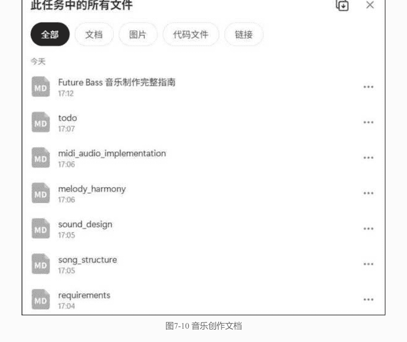
- 完整的音乐结构设计，涵盖 Intro、Build-up、Drop、Breakdown 和 Final Drop。
- Vocal Chop 专业处理技术，包括采样选择、切片技术、音高处理、节奏编排、效果处理链等专业内容。
- 侧链压缩的详细设置指南，包括基础原理、参数设置、不同轨道的侧链设置、实现方法和创意用法。
- 以 MIDI 文本格式呈现的旋律与和声进行，可直接导入 DAW 用于音乐创作。

这份指南适合有一定音乐创作基础的人使用，可作为创作 Future Bass 风格电子音乐的完整参考。

相较于普通大语言模型，Agent 在多个维度展现出明显优势。在专业知识层面，Agent 依托垂直领域知识库，能精准给出技术参数、配置数值及落地路径等硬核信息，而通用模型多止步于概念性描述。内容组织上，Agent 呈现高度结构化知识体系，层级分明、论证闭环，通用模型输出则常显松散、缺乏系统规划。技术细节方面，Agent 提供的方案精确度高、实用性强，可直接投用，而普通语言模型常停留在概念层面。实际应用中，Agent 能够预判并解决具体问题，这是普通大语言模型不具备的能力；此外，Agent 还兼具创新性艺术指导、面向不同用户的教学设计，以及潜在的多模态整合能力，这些共同构成了其区别于普通大模型的核心竞争力。

# 第8章 生活智能体
生活智能体是一种基于 AI 的个性化助手，通过自然语言交互、数据分析与自动化技术，深度融入用户的日常生活，提供从基础任务管理到情感陪伴的全方位服务。

## 8.1 情绪管理大师
在社会高速发展、竞争压力持续加剧的背景下，许多人出现了心理疾病或者抑郁倾向。因此，在实际的工作和生活中，做好情绪管理至关重要。

情绪管理是指个体运用认知、行为和生理调节策略，有效识别、理解和调控自身及他人情绪的过程。情绪管理不仅是心理学的重要课题，更是实现个人成长、改善人际关系、提升社会适应能力的核心能力。

随着 AI 技术的全面普及，我们可以借助智能体等 AI 助手进行情绪管理，从而保障身心健康，拥抱积极、平衡的生活状态。

### 8.1.1 如何使用智能体做好情绪管理
智能体推出的诸如“情绪平衡大师”等专业的情绪识别和管理助手，凭借先进的算法构建起一套系统化的情绪管理体系。该体系不仅能够帮助用户精准识别情绪波动，还能够根据不同场景提供个性化调节方案。“情绪平衡大师”通过情绪觉察、应对策略和心理工具，助力用户在各种情境中保持情绪平衡并做出明智的反应。用户可利用该智能体，学习情绪觉察训练方法，提升识别和命名自身情绪的能力；获取情绪调节指导，掌握有效管理和调节情绪的技巧；培养共情能力，增强理解他人情绪和视角的能力；优化情绪沟通方式，改进情绪表达和沟通途径。此外，用户还可参考情商应用场景指导，在不同场景中应用情绪智能。

#### 1. 借助智能体的任务规划与执行功能进行情绪管理

##### (1) 设定情绪管理目标与任务

微任务拆解，让练习真正落地

把宏大的情緒調節目標拆成可交付的小步，再交給 AI 伙伴去跑通閉環，才是讓習慣發生的關鍵。以“每天十分鐘靜心”為例，丟給系統後，它會自動展開為尋找引導音源、鎖定時空環境等子項，並調用音樂播放、日程提醒等工具協同推進。

##### (2) 計劃隨反饋動態校準
現實中總有變數，情緒調節方案必須能跟著情況走。系統會依據用戶的即時回饋做線上修正。譬如原定晚間練習，當天出現緊急事項，智能體就會把練習平滑挪到次日清晨或其他空檔。

###### 任務1：每日冥想練習

####### 子任務1.1：尋覓冥想指導資源
**目標：** 收集到專業可靠的靜心音頻與視頻
**執行步驟：**
1. 檢索並安裝合適的冥想類應用
2. 篩選適合新手的十分鐘入門課程
3. 歸檔不同風格的指導內容
4. 驗證音質與講解清晰度
5. 建立個人靜心資料庫

####### 子任務1.2：鎖定冥想時間與場所
**目標：** 形成穩定可復現的練習環境
**執行步驟：**
1. 回顧行程，挑出最不易被干擾的時間段
2. 選定安靜舒適、少干擾的角落
3. 準備輔具，如瑜伽墊、靠墊、毯子
4. 調節光線、溫度與香氛營造氛圍
5. 在日歷中植入每日提醒

####### 子任務1.3：掌握冥想基礎方法
**目標：** 學會正確坐姿、呼吸與注意力控制
**執行步驟：**
1. 學習標準坐姿要領
2. 練習腹式呼吸手法
3. 掌握注意力游離時的回拉技巧
4. 認識練習中常見身心反應
5. 嘗試多種靜心流派

####### 子任務1.4：搭建冥想記錄機制
**目標：** 記錄體驗並追蹤成效
**執行步驟：**
1. 選定或自建靜心日誌模板
2. 設計記錄維度：時間、時長、類型、感受、效果
3. 選定記錄載體：App、紙本或表格
4. 構建評分體系：專注度、放鬆度、整體體驗
5. 安排週期性復盤

圖8-1 冥想練習任務分解

#### 2. 借助記憶功能持續優化情緒管理
智能體通過累積個人情緒知識庫，把行為記錄轉化為智能建議。它會保存用戶在調節過程中的偏好數據，比如偏愛的音樂類型、靜心形式等。下次提供方案或執行任務時，系統會自動基於歷史偏好做優化。例如某種曲風能更快幫助恢復狀態，後續推薦音樂時就會優先匹配該風格。

#### 3. 跨平台聯動讓情緒管理更完整
##### (1) 情緒記錄與分析
智能體可基於網頁抓取、應用操控等能力，完成多平台數據的整合。用戶能把社交媒體、日誌應用等分散的記錄集中起來做分析，從而看清情緒波動規律與誘發因素。

##### (2) 情緒管理資源獲取
用戶可指令智能體在多個平台檢索情緒調節相關資源，包括專業課程、心理諮詢信息等，系統會按需篩選推薦。示例如下。

**免費情緒調節資源匯編**

**免費在線課程**

- **大學MOOC平台課程**

  - **自我認知與情緒管理 - 哈爾濱工業大學**

    - 平台：學堂在線

    - 特色：大學正課體系，系統學習自我認知與情緒管理

    - 評價：權威度高，內容紮實

  - **好心態如何自己造——心理健康教育 - 湖南師範大學**

    - 平台：中國大學MOOC

    - 特色：面向各年齡段，強調實用

    - 評價：內容豐富，可操作性強

  - **研究生素養課——積極心理與情緒智慧 - 福州大學**

    - 平台：學堂在線

    - 特色：聚焦積極心理學與情緒智慧

    - 評價：理論實踐結合，適合深度學習

### 8.1.2 智能體化解職場衝突的實戰案例
以下案例幫助理解如何用智能體進行情緒管理。

#### 1. 情景概述
公司員工小張與同事小李在項目協作中出現分歧，雙方情緒激化，現場氣氛緊張。小張感到憤怒與挫敗，擔心影響團隊與項目。

#### 2. 智能體介入的情緒管理過程
##### (1) 情緒覺察與命名
小張情緒上頭時啟動了智能體的情商平衡大師功能。
系統引導他做覺察練習，幫助識別並命名情緒，例如：“我此刻憤怒，因為我覺得自己的建議未被重視。”

##### (2) 情緒調節指引
智能體建議採用深呼吸、暫時離開現場等方式降溫。
小張按指導做深呼吸，並離開會議室散步，情緒逐步平復。

##### (3) 共情能力訓練
返回後，智能體引導他換位思考，從小李視角審視問題。
通過共情練習，小張意識到小李可能也承受壓力，有其考量，對小李的行為抵觸減少。

##### (4) 溝通方式優化
智能體指導如何更得體地表達情緒與訴求。
冷靜後小張與小李坦誠交流，既表達觀點感受，也認真傾聽對方。

##### (5) 衝突解決與關係修復
在智能體引導下，雙方開展有效對話，共同探討解決方案。
最終達成共識，未來合作將更注重傾聽與尊重。

#### 3. 成效
借助智能體，小張成功管控情緒，避免衝突升級。
雙方找到解決路徑，團隊氛圍改善，彼此信任增強。小張提升了情緒管理與職場情商。

### 8.1.3 家庭場景壓力管理與親子關係優化案例
家庭壓力管理是高頻需求。下面以35歲職場媽媽李女士為例。

李女士正承受多重壓力：公司裁員風險、孩子小升初輔導壓力、伴侶因家務分工產生矛盾。她長期焦慮，常因小事對孩子發火，親子關係緊張，還出現失眠、食慾下降。

#### 1. 情緒觸發點識別與歸因
李女士語音輸入：“今天孩子作業錯三題，我吼了他，現在很內疚，當時控制不住。”
智能體回應：
1）調用情緒溯源工具，結合日程記錄，如連續加班三天、家務清單未完成等，分析壓力來源。壓力分布：工作壓力51.7%、育兒壓力48.3%。

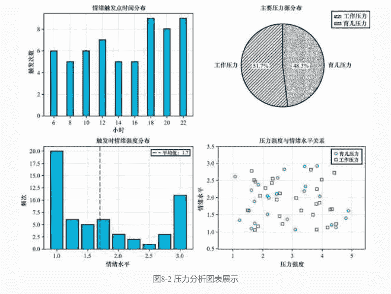

2）輸出可視化圖表，呈現情緒波動與壓力源的時間關聯，例如加班後更容易對孩子發火。

#### 2. 自動化情緒調節方案
##### (1) 職場壓力調節
智能體生成“裁員風險應對清單”，包含更新簡歷、技能提升課程推薦，如Python辦公自動化。

- **技能提升規劃**

  - **Python基礎階段，1～2個月**

    1. Python基礎語法

       - 學習內容：語法入門到實戰

       - 學習時長：1個月

       - 實踐項目：編寫簡單數據處理腳本

    2. 辦公自動化基礎

       - Excel自動化：openpyxl庫

       - Word處理：python-docx庫

       - PDF操作：PyPDF2庫

       - 郵件自動化：smtplib庫

  - **進階階段，2～3個月**

隨後調用日歷工具按“緊急-重要”四象限拆分工作，自動屏蔽非必要會議通知，實現優先級管理與時間效率提升。圖8-3為任務管理截圖。

###### 艾森豪威爾矩陣任務管理系統

####### 2.1 四象限理論基礎
**象限定義**
- **第一象限：緊急且重要**
  - 特徵：危機處理、緊急問題
  - 策略：立即執行
  - 目標：快速解決，防止惡化
  - 時間占比：不超過25%
- **第二象限：重要但不緊急**
  - 特徵：預防、能力建設
  - 策略：主動安排
  - 目標：長遠發展、問題預防
  - 時間占比：50%~60%
- **第三象限：緊急但不重要**
  - 特徵：打斷、他人要求
  - 策略：委派
  - 目標：降低干擾
  - 時間占比：15%以下
- **第四象限：不緊急不重要**
  - 特徵：低效消耗、無意義活動
  - 策略：剔除/忽略
  - 目標：釋放時間
  - 時間占比：接近0%

####### 2.2 任務分類方法
**緊急性評估標準**
- **5級評分**
  - 5分：今日必完成
  - 4分：本周完成
  - 3分：本月完成
  - 2分：下月完成
  - 1分：無明確期限
- **關鍵詞識別**
  - 緊急：立即、馬上、今天、截止、deadline
  - 時間壓力：明天、本周、這周、急需
  - 後果嚴重：客戶投訴、系統故障、合同到期

**重要性評估標準**
- **5級評分**
  - 5分：影響核心目標
  - 4分：影響重要目標
  - 3分：影響一般目標
  - 2分：影響較小
  - 1分：幾乎無影響
- **評估維度**
  - 業務影響：收入、成本、效率
  - 職業發展：技能、經驗、聲譽
  - 團隊影響：協作、士氣、績效
  - 長期價值：戰略、創新、競爭力

圖8-3 任務管理

##### (2) 育兒焦慮調節
接入學習力評估AI，分析孩子錯題類型，生成個性化輔導方案，如幾何薄弱則推薦幾何動畫視頻。圖8-4所示。

另設“20分鐘專注輔導”計時器，避免過度投入導致情緒崩潰。

####### 2.3 幾何動畫資源選擇與應用策略
針對不同學習困難採用差異化動畫策略。
空間想像弱的學生應優先使用3D立體幾何動畫，先建立點線面坐標概念，再逐步學習正方體、棱錐等結構，最後以三視圖動畫鞏固。
邏輯推理弱的學生應使用證明過程動畫，分步學習角性質、三角形判定到圓與立體幾何定理證明。

圖8-4 個性化輔導內容

##### (3) 關係壓力調節
生成家務分工談判腳本，模擬與伴侶對話。圖8-5。

> **核心談判腳本**
> **場景一：重新分配日常家務**
> **發起對話：**
> > “這周我負責接送孩子，你負責做飯可以嗎？我覺得這樣分工更合理。”
> **對方同意：**
> > “太好了！我們先試試，有問題隨時調整。”
> **對方猶豫：**
> > “我理解你的顧慮，要不先試一周看看效果？”
> **對方拒絕：**
> > “我明白你的想法，你覺得怎樣分工更好？一起想辦法。”

圖8-5 談判腳本

並推薦每周固定時間召開家庭會議溝通需求。

#### 3. 實時情緒反饋與動態調整
##### (1) 情緒監測
1）李女士智能手環借助智能體實時解析心率變異性、皮膚電反應等生理數據。
2）當壓力超標，如HRV連續30分鐘低於閾值，系統自動播放收藏輕音樂，推送“5分鐘正念吸吸引導”，並暫停非緊急通知。

##### (2) 效果追蹤
兩周後報告顯示：對孩子發火頻率從每周5次降至1次；深度睡眠從4小時提升至5.5小時；與伴侶衝突對話減少70%。

#### 4. 長期能力建設
##### (1) 認知重構訓練

### 8.2 人際關係顧問
社交圈層碎片化讓跨圈交流變得困難。人們在搭建和維護人脈時，既缺突破壁壘的路徑，也缺與異質群體聯結的技巧。人際關係顧問可依據個體需求定制建議，幫助拓圈與提升社交能力。

線上社交為主流後，非語言信息缺失導致誤解增多。如“哦”一個字可能被解讀為冷漠、敷衍或單純確認。此時顧問能幫助理解線上溝通特點，掌握有效技巧，避免矛盾。

職場關係複雜，兼具合作與競爭。與上級、平級、下屬建立良好關係對職業發展關鍵。團隊協作中常因利益分配、分工產生矛盾，顧問可提供管理策略，提升效率與競爭力。

社會變化帶來的社交挑戰增多，專業化人際顧問需求提升。它能幫助應對關係難題，提升交往能力，促進個人成長與社會和諧。

### 8.2.1 智能體改善人際關係的用法
借助“情緒平衡大師”功能融合溝通與情緒管理，可從以下方面入手：

1. 情緒管理與自我覺察
   (1) 情緒覺察訓練
   智能體幫助精準定位情緒觸發點。衝突中會提醒深呼吸或暫停對話。通過自動記錄的情緒日記，可分析不同場景下的反應模式，如被同事批評時易焦慮，進而調整策略。
   (2) 情緒調節指導
   工作壓力大對家人發火時，系統提供即時建議，如離開現場、5分鐘正念練習或推薦冥想音頻，幫助快速平復。

2. 共情能力培養
   (1) 理解他人情緒
   對話時智能體自動解析對方語速、語調、用詞，實時提示可能情緒，如語氣急促可能焦慮，並建議放慢語速、使用安撫語言。
   (2) 角色扮演練習
   可模擬高衝突場景，如與同事爭執，練習共情回應，如“我理解你的壓力，我們一起找方案”。

3. 溝通技巧優化
   (1) 非暴力溝通訓練
   提供溝通模板，將指責轉化為表達感受與需求。如把“你總是拖延”改為“我感到焦慮，因為項目進度落後，我們需要討論調整”。
   (2) 衝突解決策略
   引導使用“我們”導向表達，如“我們如何共同解決這個問題”，而非“你必須聽我的”。

4. 人際關係分析與建議
   (1) 社交行為分析
   通過聊天記錄、通話數據識別溝通模式，如是否常打斷、是否過度自我中心，並給出改進建議。
   (2) 個性化社交策略
   根據性格與目標制定專屬計劃。圖8-7展示了內向者的社交方案及線上活動推薦。

   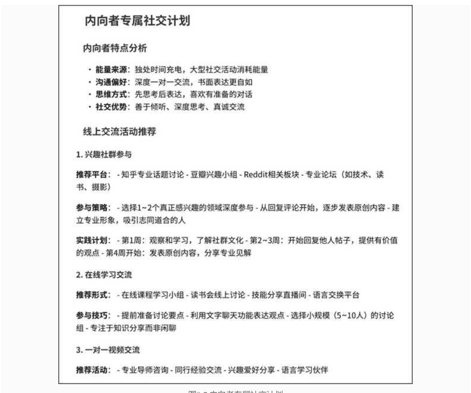

   圖8-7 內向者專屬社交計劃

5. 長期關係維護
   (1) 定期關係復盤
   回顧與重要他人的互動，分析積極與消極模式。如過去一個月與伴侶溝通頻率下降30%，建議每周一次深度對話。
   (2) 信任建立工具
   通過智能提醒督促用戶履約、保守秘密，建立信任。如忘記回復他人消息時提醒：“及時回復有助於信任的建立，建議現在回復。”

智能體將抽象技巧轉化為可操作步驟，通過持續反饋形成良性維護循環。

### 8.2.2 智能體改善人際關係案例
智能體可通過情感分析、溝通優化、社交提醒，為家庭、職場、朋友等場景提供解決方案。以下為家庭關係優化案例。

1. 家庭關係優化——減少爭吵，增強理解
場景：一對夫妻因家務分配與育兒頻繁爭執，妻子覺得丈夫不體貼，丈夫認為妻子敏感。
智能體介入方式：
(1) 情緒識別與提醒

数智陪伴让关系更稳、健康更智、消费更清醒

当日常互动里加入轻量数智支持，原本易失控的人际摩擦会变得可控。

家庭关系：从情绪波动到柔和对话
妻子佩戴腕机或使用语音助手时，系统捕捉到声压抬高、声调起伏、语速加快等易激动征兆，会以平静语气轻声提示：“感觉您情绪有些波动，建议先做十秒深呼吸再继续聊。”

事后复盘与改进建议
争吵结束后，助手会对对话记录做梳理，比如“你从不帮忙”与“我明明做了”这类对立表述，输出一份复盘纪要。纪要指出核心矛盾是家务分工的认知偏差。建议启用双方共享的待办清单，由助手自动同步日程，并约定每周固定的家庭沟通会，由助手主持流程，防止情绪化跑题。

情感需求的提前提示
助手会提醒丈夫：“明天是结婚纪念日，您爱人上周提到想收花，附近几家花店有折扣可参考。”

在数智陪伴下，夫妻间争吵频次下降约六成，双方主动求沟通的意愿明显提升。AI 起到了客观中立的调解桥梁作用，缓解了对立情绪。

2. 职场沟通升级：从生硬表达到建立信任
场景：新员工不熟悉团队语境，会议发言过于直白，被认为分寸感不足。

介入方式如下。
会议中的实时提示
线上会议时，助手借助 AR 眼镜观察发言状态，一旦语速过快就即时给出提示：“放慢节奏，适当多加停顿。”

用语习惯诊断
通过回顾过往聊天记录，助手发现用户习惯使用“绝对”“肯定”等强断定词汇，容易给人固执印象。建议改用“一种可能是……” “我初步的看法是……”等更柔和的表达方式。

关系维护提醒
系统会自动挖掘同事兴趣点，如 A 喜欢足球、B 刚领养猫咪，并提供破冰建议，比如今天可以问 B：“小猫适应新家了吗？”

三个月后，同事评价从“难配合”转变为“思路清晰、团队意识强”。

3. 朋友关系维护：减少疏离、加深联结
场景：工作繁忙，使用户与好友联络减少，连生日祝贺也常遗漏。

介入方式如下。
社交节点追踪
系统会自动标记生日、纪念日等重要节点并提前提醒：“后天是 Anna 生日，她去年说喜欢香薰蜡烛，这款小众品牌可参考。”

智能话术生成
当用户输入“想约老友却不知怎么开口”时，助手给出模板：“好久不见！看到你朋友圈去了 X 地旅行，旅途体验如何？”

亲密度图谱分析
依据回复速度、见面频次等互动数据生成好友亲密度图谱，并提示：“最近与 Mike 联系变少了，他刚换工作，可问问适应情况。”

结果显示，聚会频率从每季度一次提升到每月一次，用户被朋友圈评为最暖心的人。

以上案例说明，AI 助手能在现实生活里缓解人际紧张，促进有效沟通。

8.3 健康管家

在当代社会，健康维护角色愈发关键。随着 AI 普及，数智伙伴完全可以担任健康向导。它通过整合体检报告、家族病史、生活方式等资料，提前识别潜在健康风险。结合年龄、性别、身体状况及习惯，生成量身定制的方案。助手还能参与社区筛查、疫苗宣传等公共卫生工作，助力全民健康防线建设。

8.3.1 为什么需要 AI 健康管家
AI 健康向导是科技与医疗深度融合的产物，能满足多方面需求。

1. 一人一策的健康诉求
每个人在健康状况、生活习惯和遗传背景上差异很大，传统千篇一律的建议很难贴合。助手收集并分析年龄、性别、体重、运动、饮食、病史等资料，为用户定制专属建议。例如对有高血压家族史的用户，会提醒定期测压，并推荐低盐饮食和运动计划。

2. 随时随地的健康问答
健康问题往往突发，传统咨询受时空限制。助手可 24 小时解答饮食配比、运动设计、疾病预防、症状初步解读等，提供专业参考，帮助用户快速决策。

3. 长期慢病陪跑
慢病需要持续监测与干预。借助可穿戴设备、家用监测仪等，助手实时采集并动态分析身体指标，给出定制化维护建议。如对糖尿病患者，可依据连续血糖监测数据调整饮食与用药方案，维持血糖稳定。

4. 提升健康科普的覆盖与效率
健康科普是预防疾病的基础。传统方式受资源、地域限制。助手借助互联网和移动端，以生动有趣的形式呈现科普内容，提升健康意识与自我管理能力，并按兴趣精准推送定制化知识。

5. 分担诊疗资源压力
人口老龄化与慢病增加导致诊疗资源承压。助手提供初步问答和风险评估，可识别无需线下就诊的轻症，减少不必要的就医与检查，降低成本，提升资源利用效率。

6. 保护隐私与数据安全
健康问答中隐私至关重要。助手采用加密和数据保护措施，防止资料泄露滥用，并根据用户授权控制资料的访问和使用权限。

8.3.2 如何用 AI 做好健康维护
可从信息汇聚分析、定制化方案制定、远程医疗支持、健康知识学习、计划执行监督等方面展开。

1. 信息汇聚与分析
1) 导入健康资料：用户可将体检报告、病历、可穿戴设备数据导入助手知识库，系统处理后提取关键指标并生成可视化报告，快速呈现健康状况。
2) 指标趋势呈现：系统对血压、血糖、心率等指标做趋势分析，以图表直观展示变化。

2. 定制化维护方案制定
1) 生成专属方案：依据健康资料和生活习惯，生成包含饮食建议、运动计划、用药提醒的维护方案。
2) 定期评估与调整：结合用户执行反馈和最新资料，动态优化方案以适应变化。

3. 远程医疗支持
1) 在线问诊与症状分析：用户描述症状后，助手依托算法和医学知识库进行初步分析，给出医疗建议。
2) 设备联动监测：与智能手环、血压计等连接，实时监测生命体征，异常时及时报警。

4. 健康知识获取与学习
1) 查询医学资料库：访问权威医学资料，为用户提供最新资讯和治疗方案解答。
2) 科普与教育：推荐科普讲座、线上课程等科学内容，帮助建立健康生活理念。

5. 方案执行监督
将运动、饮食等任务拆解并设置提醒，用户可在任务列表查看进度和完成状态。

8.3.3 AI 助力健康维护的落地案例
1. 背景
患者为 30 岁男性，身高 175cm，体重 100kg，BMI 32.7 属肥胖。长期缺乏运动、饮食不均衡导致体重超标，并伴有高血压、高血脂。

2. 助手在健康维护中的应用
健康资料收集与分析
资料导入：将体检报告、病历导入系统。
资料分析：提取血压、血糖、血脂等指标，生成可视化健康报告。

定制化方案制定
饮食调整：建议减少高热量高脂肪食物，增加蔬菜水果和优质蛋白，适度控制碳水。
运动计划：制定每周至少 3 次、每次 30 分钟以上的心率有氧运动方案，逐步提升强度和时长。
生活习惯改善：建议戒烟限酒、保证睡眠、缓解压力。

监督与激励
目标设定：与用户共同设定减重目标，定期监测体重和体脂。
方案调整：根据监测结果及时优化方案。
激励措施：设置阶段性小目标并给予正向反馈，提升执行动力。

远程医疗支持
在线问诊：用户可描述症状，助手进行初步诊断并给出建议。
设备联动：连接监测设备实时追踪心率、血压等，异常时提醒。

3. 效果
半年后患者减重 20kg，BMI 降至 26.3 恢复正常。高血压和高血脂得到有效控制，各项指标明显改善。之后他保持健康饮食和运动习惯，定期监测并依据助手建议调整方案，以维持健康状态。

8.4 消费决策助手
消费环境日益复杂、需求多元，做出合理明智的消费决策变得重要，能减少损失并提升投入产出比。AI 技术渗透下，用数智伙伴辅助决策已成趋势。

8.4.1 智能体介入消费决策的必要性
消费决策是在信息过载、需求复杂、风险隐蔽下筛选最优解的过程。智能体凭借以下能力化解传统痛点。

信息处理能力：从海量信息中精准定位
电商 SKU 已破 10 亿级，人工筛选耗时且易遗漏隐藏优惠、高频差评等关键信息，专业参数对比也让普通消费者望而却步。
智能体通过自然语言处理解析商品描述和评价，提取核心参数如续航 12 小时、防水 IP68，并以表格形式直观对比。其风险预警功能可识别刷单话术、历史降价记录等，降低决策风险。

个性化推荐：从千人一面到量身定制
传统推荐依赖基础标签，无法理解深层需求。智能体需求解码系统能理解模糊描述，如“适合跑步的耳机”会推荐防水 IPX7 以上、重量低于 20g 的型号。结合时间、地点、天气等上下文提供场景化推荐，如雨天推荐防水鞋。

价格与优惠管理：从盲目凑单到最优组合
促销规则复杂，人工核算成本高。智能体可全网比价，实时抓取各平台价格并标注 90 天均价对比，通过算法计算满减、店铺券、品类券叠加的最优组合，节省预算。

决策风险降低：从冲动消费到理性决策
直播带货易引发冲动购买，退货率超 30%。智能体通过 AR 试妆、3D 看房等沉浸式体验增强感知，降低冲动概率，并整合专业评测数据提供客观参考。

8.4.2 科学消费决策的智能体操作流程
科学决策需构建精准需求匹配、风险可控、成本优化的流程，主要包括需求拆解、智能筛选、深度对比、优惠组合、决策验证等。

流程概览：需求拆解→智能筛选→深度对比→优惠组合→决策验证→执行购买→完成支付与订单跟踪。

1. 需求拆解：明确消费目标与优先级
采用 5W1H 框架：
What：具体商品如运动耳机。
Why：购买目的如跑步时听播客，需防水防脱落。
Who：使用者特征如大体重人群需高缓震跑鞋。
When：使用时段如夏季需防晒速干衣。
Where：使用场景如厨房需易清洁台面。
How：预算范围如 500-800 元。
示例：购买电脑需求为程序员办公，16GB 内存+512GB SSD，预算 6000-8000 元。
技巧：用 3 天冷静期过滤冲动，智能体可推送收藏商品的历史降价记录辅助判断。

2. 筛选：从信息筛选到方案生成
1) 输入需求：如“16GB 内存笔记本 程序员”。
2) 参数过滤：硬件如 CPU 型号、色域、接口；服务如保修时长、上门维修；评价如差评关键词“散热差”“屏幕漏光”。
3) 生成候选清单：按匹配度排序并标注满足度。
示例：搜索运动耳机时自动剔除非防水型号，并标注防水等级及推荐场景。

防水等级快速对照表
IPX4 小雨可 中雨注意 大雨不可 暴雨不可 游泳不可 推荐日常运动健身房
IPX5 小雨可 中雨可 大雨注意 暴雨不可 游泳不可 推荐户外跑步高强度运动
IPX6 小雨可 中雨可 大雨可 暴雨注意 游泳不可 推荐极限运动恶劣天气
IPX7 小雨可 中雨可 大雨可 暴雨可 游泳可 推荐水上运动短时游泳
IPX8/IP68 小雨可 中雨可 大雨可 暴雨可 游泳可 推荐专业游泳潜水

图8-8 耳机防水等级参考

深度对比：量化决策依据
横向对比表自动生成多款商品参数对比，支持排序。成本拆解计算长期使用成本，风险标注提示差评关键词及历史故障率。
示例：对比两款空气净化器，353Y00C 滤网寿命 12 个月，比小米 ProH 的 10 个月多 2 个月，优势约 20%，源于更高 CCM 值和滤材。

表8-1 滤网寿命对比
产品型号 官方滤网寿命 寿命优势
小米ProH 10个月 基准
353Y00C 12个月 +20%

优惠组合：压低购买成本
全网比价抓取京东、天猫、拼多多价格并绘制波动曲线。优惠叠加自动计算满减与券组合，提示以旧换新、学生折扣等隐藏优惠。保价服务监控降价并提醒申请补差。
示例：小米14 16GB+512GB，当前价格 3499 元国补后，618 历史低价约 4299 元，原价 4599 元，降幅 24%，较 618 低约 800 元，为历史最低价，推荐立即购买，评级五星。

为什么此刻值得下单

这波价格基本触底，综合来看入手门槛非常低。核心亮点可以归纳为四点：
1. 创下历史最低售价，价格与配置的比值非常突出
2. 可享受国家15%补贴，直接抵扣到账，实际优惠很可观
3. 核心配置是骁龙8 Gen3旗舰级芯片，影像系统由徕卡光学加持
4. 标配16GB大运存搭配512GB超大存储，长期使用也不卡顿

价格追踪提示

建议开启降价预警：目标价定在3299元，相比现价再下降200元；618大促期间可能还有追加让利，需要持续留意。重点关注的渠道有京东、天猫以及小米官方商城。


#### 3. 决策复核：怎样降低买后懊悔

想把后悔风险降到最低，可以借助线上虚拟试用、为设备购买延保服务、报名参与官方的免费体验活动，以及善用平台提供的7天无理由退货机制来做多重保障。

配套资源验证码 251134