# 小红书素人起号从0到1实战指南

## 花生

账号“花生的书桌”负责人，全网累计30万粉丝的知识类创作者，多家企业的自媒体运营培训导师。擅长爆款打法，曾打造多条播放破百万的视频，个人账号一年涨粉超10万，实战派变现导师，已孵化千余位素人IP。

# 内容简介

个人自媒体全面普及的当下，越来越多个人和品牌把目光投向小红书。创作者普遍卡在定位模糊、涨粉缓慢、变现困难，缺少一套成体系的方法论。

本书面向普罗大众，拆解普通人如何从零开始做小红书博主，如何产出既受欢迎又能变现的内容，实现涨粉与转化。覆盖账号定位、高效涨粉、内容生产、变现路径、精细化运营和创作心法，配备大量案例、工具模板与可直接套用的干货。手把手带你从0到1搭建一个可持续变现的小红书账号，即使零经验也能看懂上手。

适合想靠小红书做副业变现的自媒体从业者，也适合希望在小红书获取流量的个人、商家与品牌方。

# 序言

2019年，我靠写书评赚到千元稿费，这是第一次尝试写作变现。

2020年11月27日，偶然把两篇看综艺的观后感发到小红书，两天后点赞收藏破千，从此开启博主之路。

2021年，利用下班时间深耕小红书，从图文笔记过渡到视频笔记，并把经验延伸到全网。坚持创作一年，小红书积累10万+粉丝，全网合计30多万粉丝，副业收入超过主业。

2021年12月，我正式离职，成为“只工作、不上班”的自由职业者，用自媒体养活自己。

回望这段历程，我踩过不少坑，也提炼出可复制的方法。2022年，我一对一辅导了500位素人从0到1运营小红书，总结出普通人做内容、涨粉、变现的清晰路径。

有人问：没有一技之长的普通人能做好自媒体吗？我的答案是能，而且机会很大。

## 1.普通人做自媒体运营，可以让自己增长知识
没有资源、没有技能的人，通过做号会被倒逼去学习，和账号一起成长。

我做小红书前半年，基本是笔记在推着我学。因为笔记更新赶不上阅读速度，我去学高效阅读，提升输入输出能力；因为难以兼顾工作和副业，我花了3个月研读十几本时间管理书，边学边练，最终形成自己的方法，也积累了大量创作素材，做出不少爆款。知识不是先备齐再行动，而是在行动中被逼出来的。

## 2.普通人做自媒体运营，可以让自己增加技能
很多人起步会纠结不会拍照、不会剪辑。不会到会，需要刻意练习，自媒体就是最好的练习场。

如今能对着镜头侃侃而谈的我，两年前完全不敢直视镜头。我从不露脸视频开始，用一年时间锻炼表达，如今能坦然发声。一句话，把不会变成会，把生疏变成熟练。

## 3.普通人做自媒体运营，可以让自己获得一笔笔财富
2019年在今日头条写作为收入1万元。2020年12月小红书粉丝200多个时，收到第一个商业合作，报价50元。2022年12月，商业合作报价已到五位数。

三年里我从打工人变为自由职业者，获得的不仅是金钱，还有能力和自信。我相信，只要愿意行动并用对方法持续行动，普通人做自媒体必然能倒逼出知识、技能与财富。

我深知入门没体系会走弯路。基于运营一年迭代的小红书博主训练营，我把经验整理成适合普通人的系统方法论，帮助上千人开启博主之路，让焦虑中的人通过自媒体实现副业变现。

本书共7章，从道法术三个层面，帮助你启动小红书博主从0到1，扫清运营路上的障碍。App会不断更新，部分功能界面会变化，不影响整体思路。

# 第1章 入门：快速了解小红书平台

## 1.1 了解平台：人人都可以做小红书博主

做任何平台账号前，先判断是否值得入驻。若给新手推荐一个最值得入驻的自媒体平台，我会首推小红书。以下从三个维度说明它为何是普通人起号的最佳选择。

### 1.1.1 门槛低

相比以短视频为主的平台，小红书图文与视频并重，受众都大。很多只发图文的博主也能做出爆款、拿到粉丝。不会拍视频剪视频，也可以用图文起步。

我的学员“与清就是壮壮吖”做公众号写作拆解，起初不会拍照也不擅长做海报，就把手写笔记扫描成图直接发。直观的批注和拆解反而更清晰，最终靠这种形式一个月涨粉4000+，3个月导流400多个精准微信粉丝，实现数万元变现。

不用担心不会视频、不敢露脸。截图、海报、手写扫描等形式都能替代拍摄。选择现阶段能立刻上手的方式，几乎零门槛开启自媒体。

### 1.1.2 氛围好

2021年上半年，小红书发布《社区公约》，提出真诚分享、友好互动的社区价值观。平台对图文和视频都有严格审核，涉及辱骂、引战、引流等内容会被屏蔽，评论区也有同样机制，让交流更友好。

小红书用户以年轻女性为主，形成了女性间互相帮助、友好讨论的氛围。求助类内容非常常见，比如有博主发试穿婚纱照求选款，获得600多条评论，大家帮忙选纱、给出意见，甚至提供购买链接。

账号“火”的博主是40多岁的老师，入驻后学习穿搭化妆，记录变美过程。早期每篇笔记下都有“姐妹”教画眉、涂口红、换发型，她逐条采纳并持续更新，评论区大家共同见证成长。

这种氛围让创作者更有安全感，敢于表达真实观点，也更愿意持续输出。

### 1.1.3 变现强

对学生、上班族、自由职业者而言，小红书是赚点副业收入的首选，变现路径多样。

我粉丝200多个时就收到腾讯视频的合作邀约，因我写了《令人心动的offer》干货笔记被付费请去推广。这让我意识到小红书的变现逻辑不同于其他平台。在小红书，几百、几千粉的素人接到合作很常见。

作为国民种草社区，小红书早已是品牌投放主流阵地。品牌常用金字塔投放：用素人、路人、初级达人铺量沉淀口碑；用腰部达人做深度种草测评提升转化；用头部KOL和明星造势引话题。即便粉丝很少，也可能进入品牌投放名单。

初期多为置换合作，粉丝增长后报价会不断提高。学员“小QQQQ”是大二学生，做学习类内容，2万多粉时靠广告合作月入过万，实现经济独立。

小红书创作门槛低、氛围友好、变现机会多，非常适合新媒体小白尝试。

## 1.2 了解用户：小红书的用户画像

### 1.2.1 用户生态

#### 1.年轻女性
千瓜数据《2022年千瓜活跃用户画像趋势报告》显示，小红书女性用户占比88.8%。活跃用户中，18-24岁占46.39%，25-34岁占36.08%，18-34岁合计占82.47%。地域上，广东、上海、北京占比分别为18.2%、10.0%、8.5%。

报告中主要用户有六类：Z世代、新锐白领、都市潮人、单身贵族、精致妈妈、享乐一族。共同特点是爱尝鲜、爱生活、爱分享、消费力高。这种以女性为主的社区，带来了多元活跃的氛围，也让消费决策高度依赖小红书。

#### 2.消费能力强
同报告显示，活跃达人粉丝关注的领域集中在彩妆、穿搭、护肤、美食教程、减肥运动，都是品牌投放的重灾区。

以服饰为例，热门商品种草榜TOP100中，单价1000元以上的商品占比58%。可见用户消费力相对强，对大牌关注度高。同时年轻一代也对个性、小众、高性价比商品敏感，平价好物、拼多多好物等内容同样受欢迎，社区呈现多元消费图谱。

### 1.2.2 创作者生态

千瓜数据《2022上半年千瓜品牌营销数据报告》显示，上半年商业笔记生产者中，初级达人和腰部达人合计占95%。达人粉丝量级在10万以下占比超70%。

说明在去中心化算法下，流量并未集中在头部，反而为初级和腰部创作者留出大量商业空间。对素人而言，无论是获取流量还是商业变现，机会都非常可观。

## 1.3 了解规则：平台算法和推荐机制

### 1.3.1 平台算法和推荐机制揭秘

一条笔记发布后大致经历三步。

#### 1.审核
发布后先机器或人工审核。机器能判定会直接放出，无法判定或判定违规会进入人工。违规会被限流，不进公共流量池。可用小号查看主页是否能看到新笔记，判断是否通过审核。

#### 2.收录
只有被收录的笔记才会被推荐。把标题复制到搜索框并切到最新，如果能看到刚发的笔记，说明已收录。

#### 3.匹配推送
系统根据笔记关键词打标签，再推送给潜在感兴趣的人。初始会进入几百次曝光的流量池，根据点赞、收藏、评论、转发、关注等互动加权评估，数据好则进入更高曝光池，数据差则停止推荐。爆款后若被举报或违规仍可能被下架，所以要遵守社区规则。

### 1.3.2 一篇笔记的4个流量入口

#### 1.“发现”页面
打开小红书默认的页面，也是笔记主要流量入口。千人千面下，每个人的内容都不同，系统根据浏览和互动标签推送。想进发现页，需要植入精准关键词打对标签。页面双列展示，用户需点击封面才能看内容，封面和标题的吸引力决定打开率，打开后的互动决定能否进更大流量池。

#### 2.“关注”页面
粉丝关注后博主新笔记会出现在其关注页，顺序随机。关注页流量占比很小。去中心化推荐下，单篇笔记是否出圈主要取决于发现页的推荐，而非粉丝数。这也是素人有机会零粉出爆款的原因。

#### 3.“搜索”页面
小红书常被当作搜索引擎，用户搜索教程、攻略、好物测评。笔记若包含热搜词且排名靠前，能带来持续长尾流量。

小红书首页右上角置有搜索入口，输入想要查找的关键词后，平台会返回一串与之对应的笔记内容。在结果页里，浏览者可以自行切换观看视频笔记或图文笔记。

系统还会基于大数据对关键词做拆分推荐。例如检索“鸡胸肉”，下方就会出现“做法减脂”“腌制”“凉拌”等细分词，这些正是搜索该词的用户可能关心的具体场景。平台通过数据推算出这些细分需求供用户点选。

除了“发现”页的推荐流量，搜索也是笔记获得曝光的重要渠道。尤其是教程、攻略类干货，更需要做好关键词布局，让笔记更容易被潜在用户搜到。

#### 4. “同城”页面
“同城”是小红书常被忽略的一个入口。点击进入后，平台会依据定位推送本地化的旅行、美食、探店、景点等内容。

用户打开“同城”本身就带着明确预期，期望看到同城可用的消费信息。若你的创作方向与本地生活强相关，这个入口会带来加分。发布时加上所在地的定位，系统会结合地址和标签把笔记分发给同城用户。若账号定位与本地无关，则可忽略该页面。

## 1.4 了解功能：新人必备的操作指南
小红书的页面逻辑并不复杂，新手入门时不必掌握全部功能，只要清楚笔记如何发布、常用页面和基本规则，就能开始创作。

### 1.4.1 了解如何发布笔记
#### 1. 发布笔记的步骤
在小红书发笔记门槛很低，学会几个核心操作即可上手。整体流程可概括为三步。

第一步：选素材。点按首页底部“+”，打开相册挑选手机里的图片或视频，最多可选18张图，视频默认最长5分钟，开通视频号后上限可提升至15分钟。

第二步：编辑信息。选完素材点“下一步”进入编辑页，填写标题和正文，标题上限20个字符，正文上限1000字。图文笔记的图片顺序可通过长按拖动调整。

第三步：做优化。编辑完成后可在正文中添加热门话题，也可在图片里添加贴纸、滤镜、标记地点。全部确认后点“发布笔记”即可完成。

#### 2. 发布笔记的注意事项
(1) 选择发布时间。笔记发布后需要冷启动期，选择用户活跃时段发布可提升被看到的概率。千瓜数据的大盘显示，不同领域每周活跃分布略有差异，整体来看周一到周日相对均衡。日活跃高峰集中在17:00—22:00，也就是下班或放学后的休闲时段。

建议结合自身领域的活跃时段来安排。但黄金时段并非决定性因素，选题、封面、标题和内容质量才是爆款核心。笔者有笔记为追热点选择了零点发布，第二天依然成为爆款。

不确定最佳时段时，可参考对标账号的发布时间规律，也可在运营初期尝试不同时段，积累数据后再固定。

(2) 发布后修改。发布后点击笔记右上角“...”再点“编辑”即可进入修改页。图文笔记可改标题、正文、图片，视频笔记仅能改标题、封面、正文，不能替换视频本体。

修改后笔记会重新进入审核，存在不确定性，可能影响后续流量。笔记正处于流量高峰时不建议修改，也不要频繁改动。

(3) 添加笔记合集。视频笔记发布后可加入合集，方便同类内容集中查看，合集会展示在博主主页。图文笔记暂不支持合集，可用收藏夹分类，把同类型笔记归入同一收藏夹，用户点击后即可浏览。

### 1.4.2 了解页面功能
App内藏有不少功能页，熟悉后能更清晰地理解平台机制并减少弯路。对博主而言最常用的入口是“创作中心”。

#### 1. 功能与权益类
(1) 数据分析。进入创作中心首页，点击“近7日数据”进入数据中心，可查看账号概览、笔记分析、粉丝数据。

账号概览能查看近7日、近30日的观看、互动、粉丝转化情况。笔记分析可查看近半年单篇笔记的观看量、人均观看时长、点赞、收藏、评论、涨粉、分享等指标，以及点击率、完播率等诊断，还包含观众来源分析和画像。粉丝数据则呈现近7日、近30日的新增、流失、总粉丝数，忠实粉丝互动情况，以及新增粉丝来源和画像。

这些数据便于复盘账号表现。

(2) 创作服务。创作服务页集合了账号运营常用功能。
① 创作权益。可查看创作者权益清单及解锁条件和使用方法。
② 作者能力。可开通直播、专业号，并查看平台各项规则。
③ 内容变现。包含店铺申请、直播选品、薯条推广、蒲公英内容合作等入口。博主可在此设置广告报价并追踪合作进展。

表1-2

| 功能 | 开通条件 |
| --- | --- |
| 笔记置顶功能 | 发布 20 条笔记后自动开通 |
| 评论置顶功能 | 一条笔记有 50 条评论后解锁该功能或者开通视频号直接获得评论置顶功能 |
| 视频号功能 | 500 个粉丝 |
| 视频自定义封面 | 开通视频号后解锁该功能 |
| 专业号 | 实名认证即可开通 |
| 直播选品/小清单 | 实名认证+完成专业号认证+1000 个粉丝 |
| 薯店 | 完成专业号认证 |
| 品牌合作 | 完成专业号认证+1000 个粉丝 |

#### 2. 笔记灵感
笔记灵感页由官方每周更新各领域的热门话题，选题枯竭时可在此获取灵感。参与话题的优质笔记有机会获得官方流量扶持。点击“官方活动”可进入官方活动页，活动多为大型主题，优质内容同样享受流量扶持。建议每周查看，参与活动能带来额外免费曝光。

#### 3. 创作学院
创作学院提供官方出品的课程和规则解读，涵盖选题、拍摄剪辑、运营、商业化等新手常见问题，同时对社区规范、审核逻辑、推荐逻辑进行说明。观看官方教程能少走弯路，新手可先把官方课程看完再考虑付费学习。

### 1.4.3 了解平台规则
在运营前先熟悉平台规则，避免因低级错误违规。

#### 1. 避免站外引流
正文文字和视频画面中均不得出现站外引流信息，包括微信号、二维码、网址链接、第三方网站水印。截取影视画面时需清理水印，以免被判定违规。

#### 2. 避免恶意刷赞
社区规范明令禁止刷量行为，如异常关注、点赞、收藏、评论。短时间内集中邀请点赞且无浏览痕迹，很可能被识别为刷赞。不建议批量求赞，应让内容通过算法触达精准用户，获得自然互动。内容为王，优质内容自然积累互动。

#### 3. 避免使用一些违规词
创作时注意避开违规用词，如其他平台名称、极限词等。理财、医疗健康等敏感领域更要避免绝对化、诱导性表述。不确定是否违规时可用“零克查词”检测。规则需结合语境判断，例如在学习分享中说“最重要的一步是复盘”，属于正常语境；而用“最”来夸大产品功效则涉嫌虚假宣传，违反广告法。

#### 4. 避免生硬地做广告
未通过蒲公英平台合作的“种草”笔记，若广告痕迹明显、内容生硬，也可能被判定违规。即使是真实好物，也要以“真诚分享、友好互动”为原则，避免堆砌参数卖点，结合生活场景和素材自然表达使用感受。

网上常见的养号攻略对普通用户并非必要，直接发布即可。若账号被限流，再通过一段时间的正常发布恢复。账号历史笔记想转型，若无违规记录可继续使用，删除旧作时一天内控制在10篇以内。

总之，尽量规避站外引流、恶意刷赞、违规用词、生硬广告等风险行为。

# 第2章 定位：从0到1策划一个小红书账号

## 2.1 5个要素：让用户快速记住你

### 2.1.1 商业模式定位
商业模式定位是策划账号的第一步，也是最关键的一步。需要先想清楚要在小红书做什么，才能少走弯路。实质上就是明确用何种方式服务哪类人群实现收益。很多创作者起步时只凭兴趣，未想好变现路径，很难长期坚持。

做任何事都要有最终目标，无论是接广告赚钱还是打造个人IP，核心都指向变现。初期可以免费创作以锻炼生产能力和输入，但最终必须有产品或变现形态承接兴趣，否则新鲜感消退、数据低迷时容易放弃。

明确商业模式后，才能在数据波动和创作瓶颈期保持耐力和动力。策划时要厘清两件事：变现方式和目标人群。

#### 1. 明确变现方式
以终为始围绕变现做定位。小红书的变现大致分为产品变现和流量变现。

(1) 产品变现。把平台当作引流工具，将粉丝导向其他平台完成转化。

这类创作者目的明确：扩大影响力并引流。他们在其他平台已有课程、咨询、线上或线下店铺。利用小红书做公域投放，输出垂直内容吸引精准粉丝，再完成转化。例如学员“庆千金”有线下内衣店和朋友圈渠道，通过小红书种草一个月引流500人，变现数万元；另一位学员为姐姐的袜子店引流，8篇笔记中一篇爆款，在粉丝极少的情况下为店铺带来100个关注和50个订单。

拥有线上虚拟产品同样适用此逻辑，创作与产品强相关的垂直内容吸引精准人群。例如学员“与清就是壮壮吖”发布公众号爆款拆解笔记，3个月内为微信公众号引流400多人，变现数万元。

对品牌和个人而言，小红书是高质量用户聚集地，通过垂直内容可实现高效转化。

(2) 流量变现。在平台内实现多元化收益。

新手最常见的路径是做内容涨粉，再通过平台内方式变现。主要方式包括品牌合作、体验好物、直播带货、直播打赏、小清单带货、专栏、店铺、参与平台活动获现金或奖品。

其中品牌合作是主流变现方式，适合所有博主，门槛低，即使粉丝基数小也有机会。

若以接广告为核心变现，需做到三点：
① 优化账号数据。粉丝数决定基础报价，点赞、收藏、评论等互动数据决定性价比。互动率高黏性强的账号往往报价更高，反之粉丝众多但互动低则吸引力不足。
② 提升内容垂直度。爆款和粉丝多不等于广告多，关键是内容垂直度和粉丝与品牌目标用户的匹配度。健身品牌更倾向选择5万粉丝的健身博主而非30万粉丝的娱乐博主。
③ 提升账号质量。以质量为先，提升专业度，持续输出高质量内容。单篇爆款靠运气，稳定产出才能获得品牌青睐。确保大部分内容维持在行业平均线以上。

做到垂直且优质，变现自然水到渠成。

#### 2. 明确目标人群
除变现方式外，还要明确为哪类人群解决问题。

平台核心人群大致落在18到35岁之间，女性用户占比偏高。即便整体年龄层看起来相近，各自的痛点却大不相同。做账号定位时务必先厘清服务对象与要解决的具体难题，聚焦程度越高越有效。以学习博主麻橙子为例，其本人为在读研究生，内容严格围绕考研及英语学习干货展开，目标明确为对英语学习方法、考研复习方法感兴趣的大学生。粉丝结构也佐证了这一判断，18到24岁区间占比接近七成，如图2-1所示。

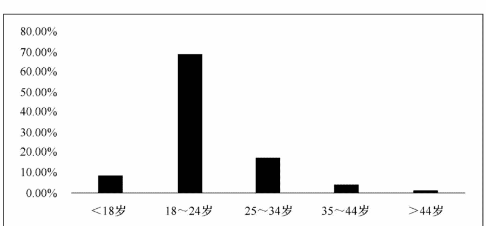

图2-1

在受众定位环节，常见认知偏差是认为只要锚定某一年龄段或身份标签即可，内容只要该类人群可能偏好就可以发布。

起号阶段很多新手缺乏规划地投放内容，见到他人爆款就复制选题，最终账号风格杂乱，难以辨识。

笔者曾辅导过一位幼儿英语启蒙教师，其账号主打0到12岁英语启蒙干货，受众为孩子家长，定位相当垂直。此类账号只需持续输出垂直干货即可。那位老师曾发布一篇《30岁女性必看的TED演讲》，意外走红后又连发同题材笔记，两篇带来数千粉增长，于是把简介更新为同时分享英语启蒙与女性成长干货，误以为是同一批人群。

这属于典型的定位失误，未能厘清具体为谁解决何种问题。英语启蒙解决的是家长不会为孩子做启蒙的痛点，女性成长解决的是妈妈自身成长焦虑与自我提升需求。虽然人群存在部分重叠，本质上是两类不同的痛点，账号承担的功能属性也不相同。因此人群定位不仅要锁定年龄或身份，还要锁定背后具体的诉求与问题。

商业模式定位可概括为：商业模式定位=变现路径+目标人群+核心需求。以家居博主为例，可定义为：面向小户型家庭输出平价装修心得与好物推荐，解决空间受限又想装修好看的痛点，通过广告植入平价好物实现变现。美食博主的例子是：面向白领提供效率减脂餐做法，解决想吃得健康却缺乏烹饪时间的痛点，通过广告植入美食产品与厨房小家电实现变现。

### 2.1.2 账号的赛道定位
运营初期不必纠结图文还是视频、是否出镜口播，先要确定主攻方向。笔者早期定位混乱，有时做职场综艺干货总结，有时做读书笔记，但都落在了成长这个大盘，后来才逐步摸索出更细的栏目与风格。

因此起步不必过于具体，先确定大方向。是做知识输出类账号，还是母婴育儿、美妆护肤、穿搭、美食、家居等方向，先选定赛道再深耕。

寻找赛道可从自身擅长与兴趣出发，挖掘可长期深耕的领域。

#### 1. 从优势和兴趣出发找定位
(1) 有长板。从优势出发找方向。若在职业、学历或经历上具备积累并取得过成果，可将这些作为标签放大。
① 职业优势。若你是英语教师、律师、资深广告人、职业咨询师，在某一垂直领域有多年沉淀，都可成为职业标签。比如拥有8年教龄的英语教师可做英语学习博主输出干货；辅导过上千名学员实现写作变现的写作教师可做写作知识博主。工作中积累的经验与案例可提炼出大量选题，从职业优势切入通常能更快起步。
② 学校背景或专业优势。若学历或专业与创作方向强相关，也能形成信任背书。学习成长类博主加上“985学姐”“哈佛学长”标签会更可信。博主李柘远Leo在简介里标注“耶鲁本科+哈佛MBA”，用学校背景提升说服力，发布学习成长干货时更具权威。
③ 经历优势。也可从个人经历挖掘方向。比如90天减重20斤、擅长制作减脂餐，可做减脂美食博主；连续早起100天，有自律心得，可做学习或自律博主；一年阅读100本书，可做读书博主。
有人会问经历平平怎么办。其实只要做出一点小成果，就能为刚起步者提供过来人经验。你能坚持早起100天，坚持不了7天的人就会想学方法；你能90天减20斤，一周减不掉1斤的人就会想了解做法。知识分享的本质是信息差，有信息差就有价值。
(2) 无长板。从兴趣出发找方向。若像本人一样是非名校、没有大厂经历，也可以这样做。
① 从兴趣爱好切入。对热爱的事才有持续输出的动力。可自问平时喜欢什么、最常做什么。比如喜欢购买玩具母婴用品的妈妈可做母婴博主；喜欢手工可从手工切入；爱读书可做读书或成长博主。
② 做一个“养成系”博主。若没有明显爱好或擅长领域，可做养成系。粉丝看着博主从新手开始，通过学习成长越来越厉害，会产生参与见证的成就感。你现在不擅长的领域可边学边输出，把不擅长变成擅长。
本人的账号就是养成系做起来的。刚做小红书运营时不会取标题、不会做封面、不会拍视频，没有找借口，先从门槛最低的图文做起，做金句整理、读书笔记。实践中研究规则和流量密码，每周复盘调整，直到做出爆款。
后来想做视频，因害羞初期不露脸，先配音锻炼表达。数月后尝试开头中间结尾露脸，其余仍保持不露脸风格。再后来通过讲课、直播锻炼镜头感，逐渐露脸更多。虽然看提词器时常目光呆滞，但每条视频都在锻炼表现力。
期间也遇到很多困难。房子临街收声差，就半夜躲进卫生间配音；有几次背着书包和器材去酒店开钟点房录口播。一年拍了80条视频，从画质剪辑到镜头表现力都有明显提升，朋友说我越来越自信了。
我也从不会系统阅读、不会时间管理的人，变成自律的人；从不会运营小红书的人，变成会玩平台的人；从面对镜头会害羞的人，变成有勇气面对镜头的人。从不会到会，慢慢成长，这就是养成系的魅力。
以上就是找大方向的两条路径：从优势出发，或从兴趣出发，找到能持续产出又有热情深耕的领域。

#### 2. 巧用两个工具，挖掘出合适的定位
若对自己认知不足，或在多条赛道间难以抉择，可用下面两个工具更清晰。
(1) 成就事件提炼法。自我介绍时常会提到成就事件，从中能提炼出底层可迁移的能力。把能力归纳整理就能筛选定位，如图2-2所示。
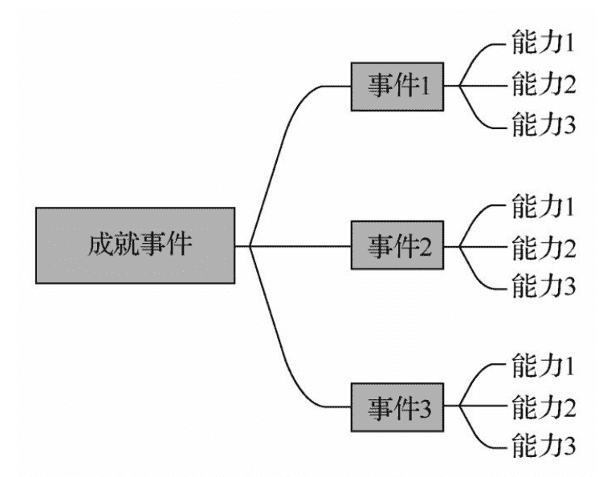
可先列出3个成就事件，用简短表述描述，再提炼出3个核心能力。
比如我的成就事件1：在200多人参与的写作训练营里连续多次成为优秀学员、优秀班长，在今日头条写出10多篇变现文章，从小透明学员转型为助教，辅导60多名学员在头条写作变现4万多元。提炼能力：学习能力、输入输出能力、教学能力。
成就事件2：从零进入新行业，一年写出30多篇10万+文章，并策划完成2天涨粉2万的活动。提炼能力：输出能力、项目统筹能力、学习能力。
成就事件3：连续6年参与公益暴走，一天暴走50公里，两次担任队长，累计筹款2万多元。提炼能力：项目统筹能力、文案策划能力、耐力。
由此得出学习能力、输入输出能力、项目统筹能力是我的优势。我可以做成长、学习类干货输出博主，用学习能力快速掌握知识，用输入输出能力转化语言，用项目统筹能力做账号和选题规划。
你也可以从成就事件拆解底层能力。哪怕是连续早起100天、30天瘦5斤、一年涨薪20%、独立搭建社群运营流程，任何事件都能提炼出底层能力。要做的不是担心不会什么，而是不停放大优势。
(2) 定位剖析表。自我剖析后，可在表中填写身份职业标签、成就事件、拥有的能力、时间和精力、现有产品，见表2-2。
表2-2
| 身份/职业标签 | 列出你的身份/职业标签，包括你的学历、职业经历 |
|---|---|
| 成就事件 | 列出你取得过的成绩，哪怕微小的成绩，也要列出来 |
| 拥有的能力 | 从成就事件中剖析出现阶段的硬技能和软技能 |
| 时间和精力 | 你有多少时间花在运营这个账号上，以及做这件事的难易度 |
| 现有产品 | 如果有变现产品，那么可以在此处梳理 |
剖析后你会看到自己做过很多事，有很多潜力可以挖掘。把成就事件和能力组合起来，大部分人都能找到可深耕的领域。
若还有标签太多、爱好太杂、样样通样样松的困扰，可用多领域评分表打分，见表2-3。将多个领域从赚钱、喜欢、擅长三个维度打分，满分10分，得分最高的就是现阶段定位。
表2-3
| 领域 | 赚钱 | 喜欢 | 擅长 | 总分 |
|---|---|---|---|---|
| | 自我剖析 | 打分 | 自我剖析 | 打分 | 自我剖析 | 打分 | |
| 领域 A | | | | | | | |
| 领域 B | | | | | | | |
| 领域 C | | | | | | | |
① 赚钱。这个领域是否有市场前景，能否带来收入？想接广告，要看品牌投放情况，能否稳定收到合作？想做内容变现，要看变现能力是否匹配。
② 喜欢。是否对这个领域有足够的热情和内驱力，能在数据不好时坚持不放弃。
③ 擅长。入门难度如何？需要哪些基本能力？是否具备？我能否列出10个以上选题？
通过三维打分，能更清晰判断方向。比如理财、读书、母婴育儿三个方向的评估见表2-4。
表2-4
| 领域 | 赚钱 | 喜欢 | 擅长 | 总分 |
|---|---|---|---|---|
| | **自我剖析** | **打分** | **自我剖析** | **打分** | **自我剖析** | **打分** | |
| 理财 | 平台有机构投放，但做咨询课程为主，我没有相关课程也不打算教课，短期难变现 | 6 | 非常喜欢 | 8 | 有一定心得可分享 | 7 | 21 |
| 读书 | 有读书博主接广告，也有社群和专栏可做，长期对个人品牌加持大 | 7 | 每天都在读，有热情 | 9 | 写过读书笔记，书评发表于樊登读书公众号，曾任读书会领读员 | 8 | 24 |
| 母婴育儿 | 广告投放多，有市场需求，可做广告和专栏变现 | 9 | 家里有3岁孩子，但比较佛系，分享欲不强 | 6 | 有绘本玩具购买经验可整理 | 7 | 22 |
结论：理财是爱好但变现目标不明确；读书是喜欢且擅长，利于打造个人品牌做知识产品，短期可接广告长期做专栏社群；母婴育儿虽赚钱但分享欲不足难持续。最终选择做读书博主输出学习类干货。

### 2.1.3 账号的内容定位
账号内容定位是指你发布什么内容来吸引精准粉丝或品牌合作方。

#### 1. 内容主题定位
(1) 主题类账号。
① 围绕特定主题做垂直内容。在某个领域深耕，用垂直关键词持续发内容。账号初期越垂直，转粉率越高。比如美食领域，有博主做各种菜，也有博主只做空气炸锅美食，做到极致垂直。某篇笔记火了后，点进主页全是空气炸锅教程且质量不错，用空气炸锅做美食的人关注率会很高。
同理，穿搭账号只发“矮个子穿搭”“梨形身材穿搭”，美妆账号只围绕“方脸”做教程，能精准触达目标用户。图2-3所示为以梨形身材为个人特征的穿搭博主的账号内容。
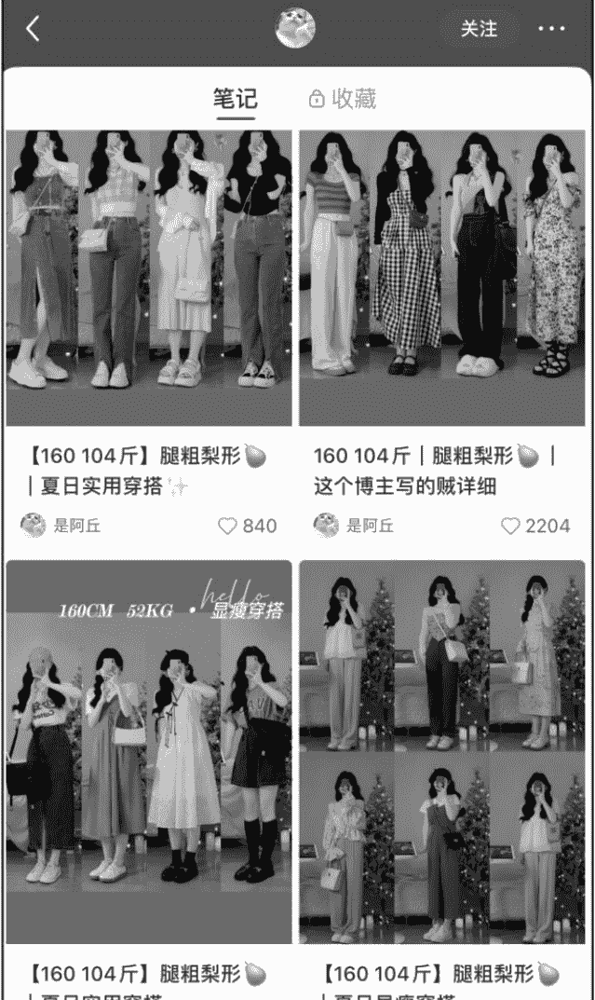
图2-3
这类垂直账号能吸到极度精准的人群，如果赛道品牌投放多，变现能力也强。
除此之外，还有围绕知识体系输出垂直内容的账号。比如“秒懂金融”每天用通俗语言拆解一个金融名词，如图2-4所示；“每天认识一款香水”每天测评一款香水，都是围绕一个知识体系做垂直专业输出。
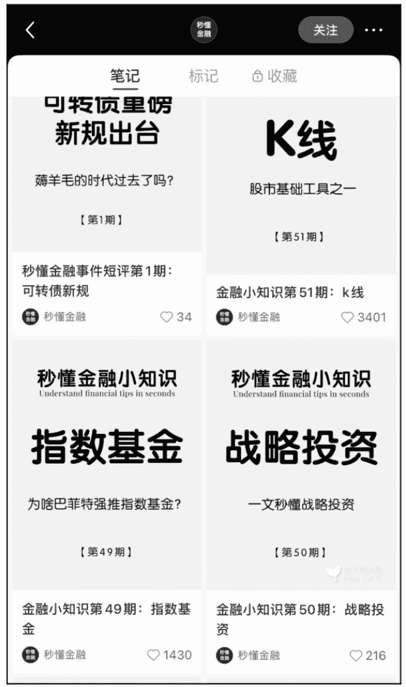
图2-4
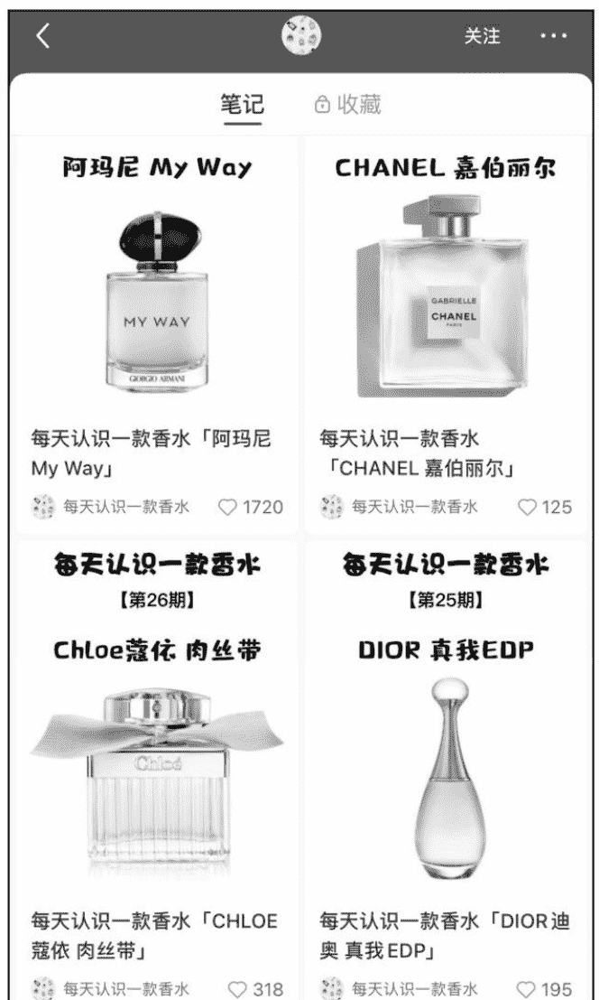

账号定位拆解：从赛道分化到人设塑造

打开一个做垂直细分的号，主页给人的感觉是视觉与表达高度统一，封面样式、标题写法、整体调性都保持同一套规范。这类号擅长聚拢对细分主题有明确兴趣的受众，商业化能否跑通，核心在于目标人群的真实需求与号本身业务方向是否匹配。以秒懂金融为例，其做法是把公域流量承接到私域，用知识付费的理财课来完成变现。不同赛道的变现逻辑各异，不宜一刀切。

② 以核心赛道为轴做泛化延展
新手更友好的一种形态是泛垂直号，即在主创作方向上做适度延展。成长就是个典型的宽泛主题，读书、时间管理、思维提升都可归入其下。这类号的选题围绕成长这个核心展开即可。

我的号花生的书桌就走泛成长路线，会输出读书与写作方法、高效学习方法、数码工具使用方法等，所有内容都锚定在成长这条主线上。即便有数码相关的笔记，也与专业数码测评号有区别，我不讲参数、不做硬件横评，而是讲如何把手机、平板、笔记本等工具用起来，并且落点始终是工具使用方法。

因此在花生的书桌里能看到数码、读书、写作、职场、时间管理等话题，看似分散，实则都指向同一大方向。

(2) 人设驱动型号
人设类号的核心是围绕博主个人IP与粉丝群体构建内容。

典型的跨领域发内容就是这种形态。比如健身博主钳钳妈阿曼达呀，内容涵盖运动健身、穿搭、健康饮食，也有情感、育儿，如图2-6所示；再如学习博主是你们的康康，既发学习成长干货，也发护肤内容，如图2-7所示。

笔记 收藏

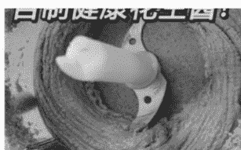

万物皆可酱！没什么是一口花生酱治愈不了的

钳钳妈阿曼达呀 ♡ 7979

13分钟站立燃脂！这样的臀凹陷，有救

钳钳妈阿曼达呀 ♡ 7597

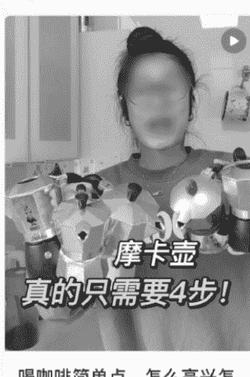

喝咖啡简单点，怎么高兴怎么来！

钳钳妈阿曼达呀 ♡ 1.3万

秋冬包包合集！大地色系，百搭温暖谁不爱

图2-6

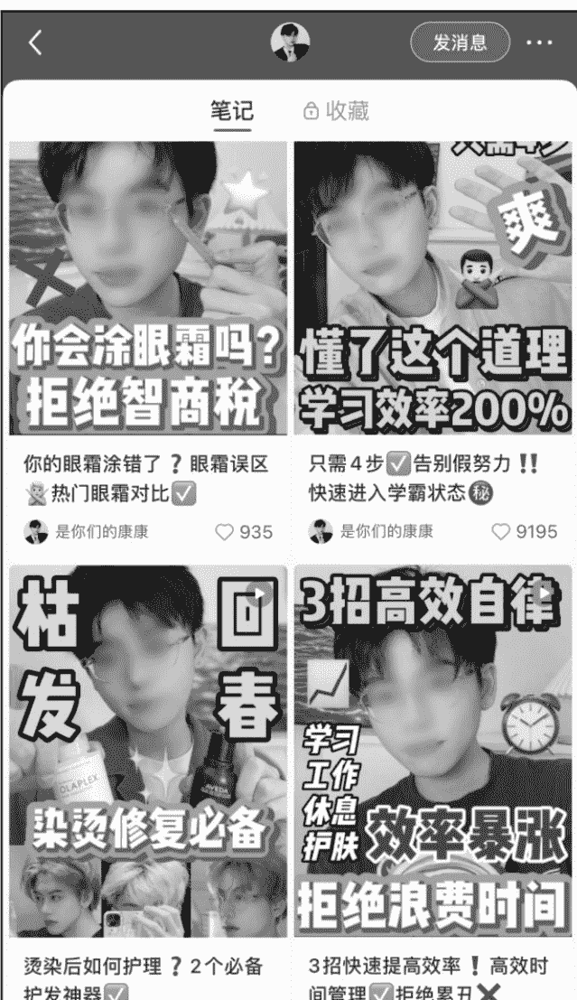

图2-7

很多人会产生困惑：号不是要垂直吗，为什么这些号什么都发，数据还不错？

这是典型的人设号。受众追的是博主本人，被人格魅力吸引，愿意看博主分享的多类话题。

所以当钳钳妈阿曼达呀以阿曼达的身份聊运动时，有健身需求的粉丝会认可；当她以钳钳妈的身份谈育儿时也会有人看，因为他们喜欢的是镜头背后的人。

人设号更适合镜头表现力强、擅长真人出镜的创作者，且粉丝体量最好达到10万以上，再做内容多元化。对新人特别是还没有清晰差异化标签和性格沉淀的养成型博主，建议先从主题号起步，在持续输入主题内容的同时慢慢打造个人品牌。

#### 2. 内容形式定位
内容形式定位指信息呈现的方式。

(1) 图文笔记常见的呈现方式有实拍景物/商品照、实拍真人照、海报、截图、拼图、伪实拍图，见表2-5。

表2-5

| 常见的图文笔记的呈现形式 | 特点 |

| --- | --- |

| 实拍场景/商品照 | 平台主流呈现方式之一，对拍摄与基础修图有一定要求 |
| 实拍真人照 | 平台主流呈现方式之一，对拍摄与基础修图有一定要求 |
| 海报类 | 多用PPT、PS或线上模板制作，上手门槛低但需具备设计审美 |
| 截图类 | 直接截取画面或文字呈现，操作简单但个人辨识度不高 |
| 拼图 | 将单张或多张素材组合成一张新图，在测评或plog①笔记中常见 |
| 伪拍摄图 | 选用网络无版权素材替代自拍，适合拍照经验不足的新手 |

> ①Plog，即photo blog，指用图片形式记录日常。

并无绝对的好坏，也无绝对适合新手的形式，需要倒推运营目标来判断。比如目标是接广告变现，建议优先做实拍类图文，因为实拍能提供更多产品露出机会，海报或截图更多只能放链接、软件界面，实物品牌的投放通常更偏好实拍号。同时也要结合自身能力，如果拍照还不熟练，可以先用上手快的类型过渡。

(2) 视频笔记常见的呈现方式有真人出镜口述、非出镜场景实拍+配音、非出镜场景实拍+背景音乐+字幕、混合：真人出镜+非出镜场景结合、素材剪辑+配音，见表2-6。不同形式可以相互组合。

表2-6

| 常见的视频笔记的呈现形式 | 特点 |
| --- | --- |
| 真人出镜口述 | 适用于知识、技能类分享，对镜头表现与文案功底要求较高 |
| 非出镜场景实拍+配音 | 新手较易入门，但对场景选择和选题有要求 |
| 非出镜场景实拍+背景音乐+字幕 | 新手较易入门，多见于Vlog，对场景和选题有要求 |
| 混合：真人出镜+非出镜场景结合 | 适合想做IP但口播表现力不足的创作者，可增强节奏感 |
| 素材剪辑+配音 | 用影视综艺或无版权素材拼接服务于主题，上手快但人设较弱 |

图文同理，视频形式的选择也要结合个人能力、拍摄环境等多方面。某段账号的呈现形式最好保持统一，比如全号都用海报或全号真人口播，确定后短期内不要频繁切换，否则主页会显得杂乱。当然，后期在摸索中也可以适度调整，找到更贴合自己且受读者欢迎的方式。

### 2.1.4 账号的人设定位
起步阶段的优质号，都需要有意识地设计人设。

所谓人设，就是靠哪些特质、性格、标签去吸引粉丝。这不是照搬他人或伪装博眼球。

#### 1. 人设的组成部分
人设由特征、身份、场景三部分构成。

(1) 特征。特征是创作者是怎样的个体，通常用形容词概括，比如犀利、真诚、幽默、爱购物、字写得好。特征未必完美，一些看似缺点的特质也能强化辨识度。比如B站UP主宝剑嫂的特征之一就是带着湖南口音，她每条视频开头都说这里是努力在说标准普通话的宝剑嫂，不标准普通话反而成了记忆点。

如何从自己身上找特征？

① 自我剖析。拿张纸对照以下问题梳理自我认知，见表2-7。

经过自我审视，我总结出的特征是爱读书、爱写作、喜欢做创意工作、执行力强，但比较内向、慢热。

表2-7

| 日常必做的事情有哪些 | 读书、写作、做计划、复盘、做早饭、听播客节目 |
| 在什么事情上容易激动、容易进入专注状态 | 剪视频时会忘记时间，剪完很有成就感；做创意文案时会很投入 |
| 坚持一年以上的事项有哪些 | 读书、复盘、写作 |
| 我的性格是怎样的 | 内向、慢热、说话比较直接 |
| 我的优点、缺点有哪些 | 优点：学习能力强、肯钻研；缺点：不自信、公开场合表达弱 |
| 过去的弱项有哪些，通过努力改变了什么 | 曾很怕演讲，表达不流畅。后来通过写作建立结构化表达，能有逻辑输出观点，工作汇报更靠谱 |
| 对自己哪个部位、哪个特点最满意 | 长相普通但有趣；执行力强、说到做到 |
| 身边的人一般怎么称呼我、给我起什么外号 | 催稿狂魔、工作狂 |
| 做什么事情会得到身边人的赞美 | 会写有趣的打油诗，大家觉得有才 |
| 朋友在什么事情上会第一时间找我帮忙 | 写文案时朋友会第一时间找我，甚至付费请我写 |

运营验证也证明了特征与内容方向的匹配度。比如我学习能力强，看完书能快速整理成干货笔记；又比如我内向害羞，起初选择不出镜的视频，给自己半年到一年时间锻炼镜头表达。

② 他人描述。自我审视不够时，可请熟悉你的人描述。最简单的方法是发朋友圈请好友用三个词形容你。你会发现外界对你的印象可能和自我认知有差异。当局者迷旁观者清，他人的评价能帮你更全面地看到自己对外呈现的人设和风格。比如我的朋友认为我幽默、真诚、自律、利他、犀利。很多人说看我笔记觉得有趣，没想到我本人性格慢热，于是我把有趣的文案和打油诗融入视频，变成个人特色。

梳理自我描述和他人反馈后，把高频关键词归类，选出3~5个，再结合号内容定位，挑出1~3个作为核心想传递的特质。比如我的关键词有学习能力强、有目标、内向；朋友给我的关键词是幽默、真诚、自律、利他、犀利；内容定位是围绕成长输出读书写作方法、效率提升、高效学习干货。综合后得到的人设是：真诚毫无保留地分享成长干货，总能犀利点出痛点并给出实用方法，严肃的方法里偶尔带点小幽默。

(2) 身份。不管是学生、在职人士、自由职业者或全职宝妈，都带有特定身份。若身份与商业模式匹配，就可作为人设一部分。

身份分职业身份和角色身份。职业身份如律师、英语老师、体制内从业者等，与工作强相关。若创作领域与职业匹配，可强化标签。比如做人力资源的业余帮人改简历，想通过小红书做个人品牌吸引付费修改，就可定位成8年资深人力资源经理，1对1改简历，已助力500人拿到offer。

角色身份指在特定场景下的身份，如二胎母亲、团队leader、北漂女孩。强化角色身份容易引发同类共鸣，比如育儿博主强调妈妈来吸同类关注。

面对多重标签时，要回到赛道和内容定位思考哪些标签能放大价值、哪些可偶尔出现、哪些无关。比如既是律师又是妈妈还爱读书，就要结合商业目标和擅长领域筛选重点标签。像律师妈妈想做育儿博主，就突出妈妈身份，律师身份作补充。号内80%内容围绕育儿，剩下20%可结合职场妈妈成长等话题展开，核心仍围绕妈妈育儿。

(3) 场景。场景指笔记中呈现的环境。学习博主可能在书房或书桌前分享干货；美食博主常在厨房或布置好的角落；科技数码博主多用冷色调室内。

场景是锦上添花，不是决定成败的关键，但必须符合定位。治愈系vlog博主若在厨房记录生活，画面就必须干净舒适，厨具未洗、环境脏乱就会破坏人设预期，给用户负面感受。

场景可以固定，比如我大部分视频都在书桌前拍，口播在书架前录。固定场景有记忆点，用户刷主页一眼就能认出。场景也可以变化，换室内室外呈现内容，但前提是内容本身过硬。

#### 2. 如何强化人设
梳理完标签后常会问：图文怎么体现人格魅力？是不是视频更吸粉？每篇都要展现人设吗？可从四个维度包装。

(1) 语言风格。了解一个人最直接的方式是看他的语言风格，想强化人设就可包装语言。比如美妆博主鲜鲜超鲜做相声式化妆，一边化妆一边用天津话唠嗑，粉丝能感受到她的幽默。家居博主卡门卡卡语言很犀利，讲产品不好用时常用段子吐槽，用平静语气讲狠话，形成个人标签。有独特语言风格时要尽量突出，这就是差异化。

(2) 内容风格。内容调性、文字里传递的价值取向都能立体化人设。数码博主黑盒er测评时会把缺点也说清楚，即便广告合作也会指出可优化点，这种风格让粉丝更信任。发布的内容在一定程度上代表价值观和做事方式，用户会感知到三观。博主夏知非早期做plog图文，文字走心正能量，短时间内粉丝从零涨到50多万。穿衣打扮可以伪装，内容风格难以长期伪装，更能侧面展现人格。

(3) 固定话术。很多博主在视频开头或结尾用同一句话，不断重复能把信息植入用户心智，形成记忆点。

①固定开头。不少博主用固定的打招呼语，最常见哈喽，我是×××，配合固定语调手势更易记住。比如比例Billie每条视频开头都说哈喽，大家好，我是比例例，带点口音加固定手势，成为她的特色，甚至合作嘉宾也会模仿。

②固定结尾。比如拉宏桑每条视频结尾都说我是拉宏桑，我们下期再见，拜拜哟黑biu，配合语调手势形成洗脑记忆。我的学员瘦鬼做知识卡片，每篇图文最后一张都是视觉卡片自我介绍——我是瘦鬼，一名服务500强的人力资源咨询顾问，用5年时间实现薪资10倍增长，专注个人成长领域，期待和你有更多链接，如图2-8所示。用固定结尾强化专业标签和领域定位，提升主页打开率和转粉率。

(4)环境强化。环境能强化视觉感受，一个好的环境让用户第一眼就感受到能量场，尤其对视频博主。一乔桑哇是一个低消费极简主义博主，记录日常消费和极简生活，视频里家里的家具很少，空荡荡的装修风格与人设高度契合，如图2-9所示。所以在内容定位允许范围内，可适度布置环境，家居博主买高颜值家具，学习博主布置书桌。小红书是强视觉平台，第一眼好看，笔记才更容易被点击。

### 2.1.5 差异化定位
号众多，每天都有新人入驻，赛道内卷严重、同质化高。作为普通创作者如何突围？答案是做差异化。

号的差异化可从四个角度切入。

#### 1.性格差异化
性格有特点就可以作为优势放大。比如博主小雨菲菲是奇葩说辩手，小红书视频个性鲜明，言语自信，分享自我成长、变美变自信的方法也更有说服力，评论区多在夸她的性格。这种自信和个性就是她的差异化。

差异化不只属于外向者。内向者也有优势，比如脱口秀大会选手鸟鸟，性格内向说话慢，靠社恐式脱口秀形成辨识度。所以无论性格如何，找到与众不同的点并放大，就能在人群中脱颖而出。

#### 2.内容形式差异化
想进入红海赛道，会发现选题、内容、画质、剪辑都很卷，这时如果形式与平台大部分博主雷同，很难快速涨粉。适当在封面包装、话题玩法上做出一点不同，就有可能在同质内容中被看见。

差异化突围：让相似内容被记住

在同质化严重的平台里，留下印象的核心是区隔。区隔大致可归为两大方向，一是表达手法的差异，二是外层包装的差异。

(1) 表达手法的差异化。以美妆号“美妆合唱团”为例，团队用多人接龙顺口溜的形式进行产品评测。对比常规的好物分享与测评，这种多声部朗朗上口的表现迅速带来新鲜感。

变装博主“垫底辣孩”创作的“如何成为一个国际超模”系列在全网走红。视频里他挑选生活里不显眼的小物件 DIY 成一线大牌造型，配合精致打光与修图，每条结尾都从素人蜕变为顶级男模。前后强烈的反差让观众感叹判若两人。

(2) 包装手法的差异化。封面或视觉呈现只要做出细微偏移，关注度就会明显改变。

同为美食教学号，图2-10所示创作者采用极简主义封面，仅露出空碗与食材原料。用户点击后才看到完整做法与成品图。相较于惯用的成品诱惑封面，这种克制呈现正是包装差异的体现。

笔记 收藏

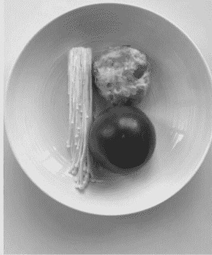

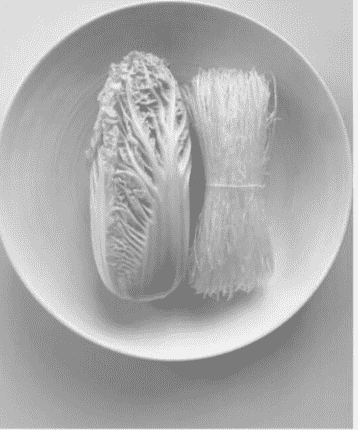

这个汤真心好喝！你们一定要试试！

这道菜低脂又好吃！你们一定要试试！

鲲鲲不吃鱼 ♡ 2047

鲲鲲不吃鱼 ♡ 2.2万

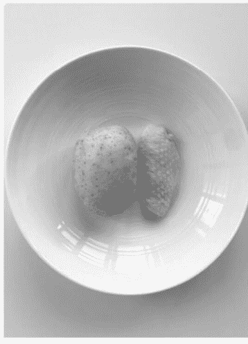

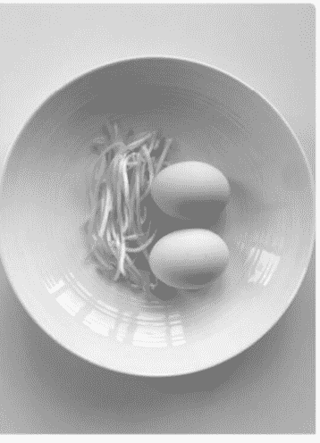

这道菜真的超级下饭！你们

这道菜简单又好吃！你们一

## 图2-10

内核仍是菜谱做法，只是包装一变传播效率提升。用户会好奇几种基础原料能碰撞出怎样的成品，这种好奇驱使用户点开笔记。

除此之外，视觉上采用新瓶装旧酒的方式，也能在同质内容里迅速被看见。小红书上分享学习干货与职场经验的账号众多，选题趋同时，视觉风格只要与众不同就能建立区隔。图2-11与图2-12的两位创作者都选择手写呈现。学习类博主在 iPad 上手写笔记分享干货，职场类博主则在纸上写下心得后拍成视频。

笔记

收藏

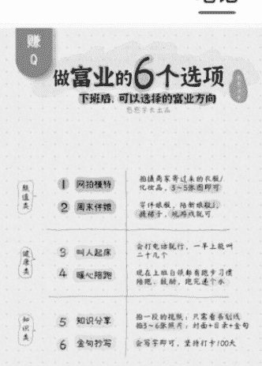

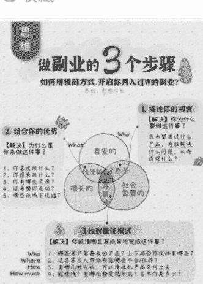

6个副业推荐，小白也能轻松上手

用极简的3个步骤，开启你月入过W的副业

憨憨学长 ♡ 164

憨憨学长 ♡ 3428

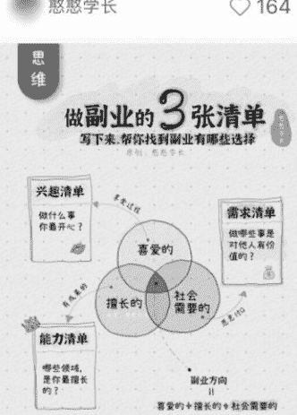

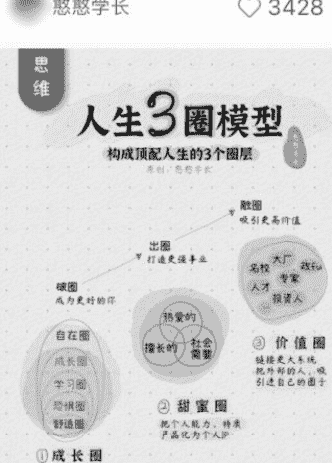

笔记

收藏

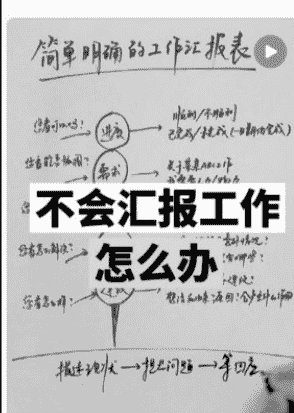

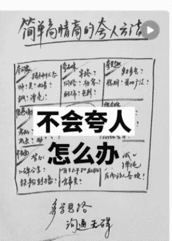

简单明确的工作汇报方法。清晰受领导好评

简单高情商高质量的夸人方法。沟通有效无碍

丸子笔记

2071

丸子笔记

345

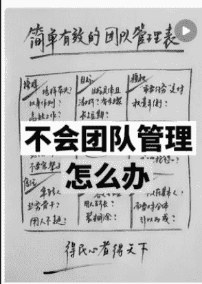

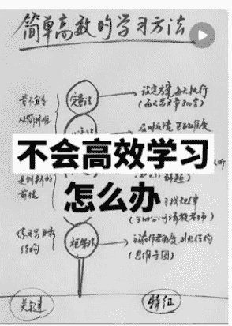

简单有效的团队管理表。高质量效率高得人心

简单高效的学习方法。学霸公认专业有效。

丸子笔记

559

丸子笔记

169

图2-12

如果将相同干货做成普通实拍照或平台通用的海报版式，很难形成辨识度。改为手写体后整体观感立刻焕新。

这本质仍是包装逻辑，内核不变，手写更显真诚，更像真人创作，而非冰冷模板。

#### 3.身份标签差异化

身份标签能快速锁定特定人群，或制造特定话题。

图2-13的美食博主若只是平铺直叙晒今日早餐，相当于朋友圈自嗨，读者无感。换成妈妈视角，讲家有高中生，今天早餐是××，共鸣立刻被点燃。家中存在同龄孩子的用户会参考食谱，初中小学家庭也能借鉴。家有高中生让账号与普通晒餐号拉开距离。

笔记

收藏

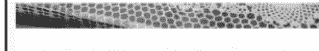

老公大学同学第1次来家吃饭，300元做8菜1汤

金玲生活日记 ♡ 8576

5点做早餐已成习惯，换着花样做孩子很爱吃

金玲生活日记 ♡ 1659

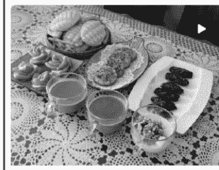

家有高中生，今天的早餐都是孩子爱吃的

金玲生活日记 ♡ 1868

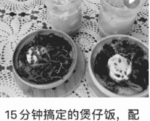

15分钟搞定的煲仔饭，配鸡蛋肉末汤，超满足

金玲生活日记 ♡ 322

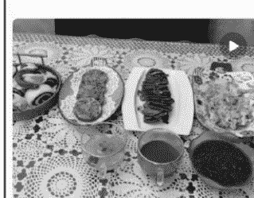

家有高中生，早餐不将就，荤素搭配营养健康

金玲生活日记 ♡ 1311

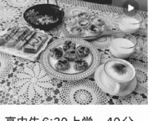

高中生6:30上学，40分钟做好3种快手早餐

金玲生活日记 ♡ 1072

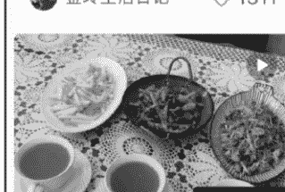

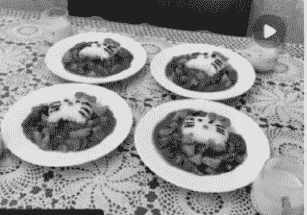

## 图2-13

美食号噗噗叽叽的人设是林先生的太太，内容围绕为林先生做美食展开。该设定让她区别于平台其他美食号，评论区除了聊菜品，还会羡慕林先生。

小小小海星打的标签是会做饭的姐姐，内容围绕给弟弟做美食、做便当展开，如图2-15。这种设定带来还缺弟弟吗的讨论，自然形成话题。

笔记

收藏

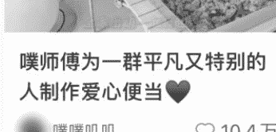

噗师傅为一群平凡又特别的人制作爱心便当🖤

噗噗叽叽 ♡ 10.4万

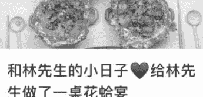

和林先生的小日子🖤给林先生做了一桌花蛤宴

噗噗叽叽 ♡ 1.4万

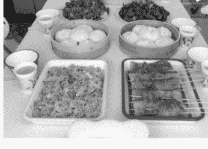

林先生说这应该是小龙虾吃法的天花板了啦🔥

噗噗叽叽 ♡ 2.9万

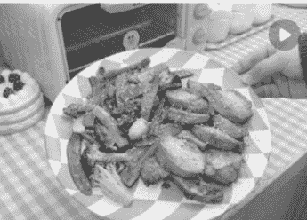

和林先生的小日子🖤我俩的轻食日记

噗噗叽叽 ♡ 2.2万

和林先生的小日子🖤初次赶海体验收获满满🦀

噗噗叽叽 ♡ 4.6万

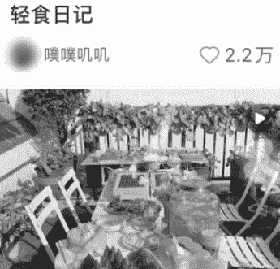

在噗师傅的阳台烧烤🍖是种什么样的体验‼️

噗噗叽叽 ♡ 4.1万

笔记

收藏

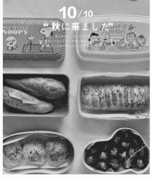

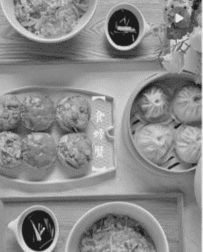

弟弟给我布置作业了：用空气炸锅做便当🍱

给弟弟整个吃蟹天花板！螃蟹三吃！

小小小海星. ♡ 1.5万

小小小海星. ♡ 4.1万

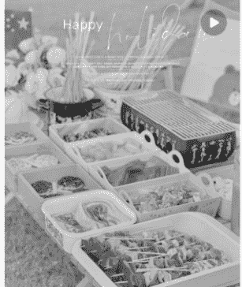

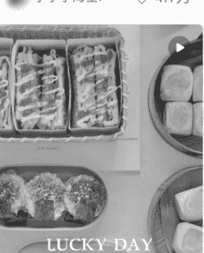

弟弟约美女同学一起去秋游露营🏕️

弟弟去美女同学家写作业的下午茶☕️

小小小海星. ♡ 4.1万

小小小海星. ♡ 13.2万

图2-15

图2-16的穿搭号若只做常规OOTD，很难突围。博主改用下属视角记录领导今天的穿搭，好奇心被点燃，很容易在海量穿搭内容中脱颖而出。

笔记

收藏

领导的穿搭 | 领导今天穿了什么🤔

领导的穿搭 | 领导今天穿了什么🤔

王颖芝 ♡ 960

王颖芝 ♡ 980

领导的穿搭 | 领导今天穿了什么🤔

领导的穿搭 | 领导今天穿了什么🤔

王颖芝 ♡ 1402

王颖芝 ♡ 1645

图2-16

身份与行为结合，区隔更强。我的学员小高，35岁全职二宝妈，起初用35岁全职妈妈定位，效果平平。后来梳理日常，发现自己每天凌晨4点起床学习。单独看早起并不稀奇，但把全职妈妈加4点早起学习结合，塑造出35岁再出发，带娃边自律边赚钱做副业的人设，账号更名为高小姐35岁自我救赎之路，定位与选题调整后，一个月涨粉8000。

笔记

收藏

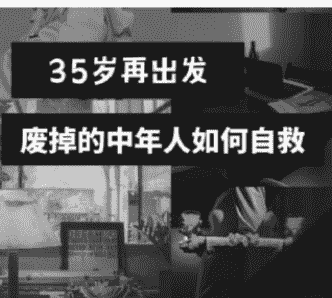

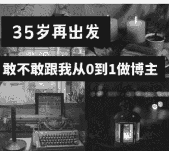

从月入100000闺蜜身上学到的中年自救方法

4：00早起做副业，我破解了小白做博主的秘密

高小姐 (35岁自... ♡ 3215

高小姐 (35岁自... ♡ 2563

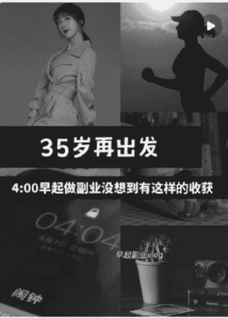

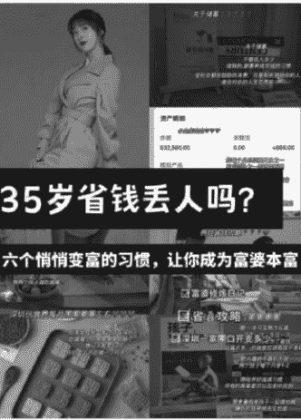

4：00早起做副业🔥35岁自我增值，月入2w

35岁养成这6个富有习惯，我存下了50W+

高小姐 (35岁自我... ♡ 745

高小姐 (35岁自我... ♡ 163

图2-17

这就是标签带来的精准吸粉，垂直人群被身份吸引，再以个人化行为与选题强化记忆。

#### 4.道具差异化

刷到不常见画面时你会停留吗？这就是道具的力量。直播间常有主播用奇装异服抓眼球，账号运营亦然。

知识博主傻白呀做口播，从不露脸，始终戴着鸭子头套，辨识度极高，如图2-18。B站UP主LKS每次出镜都戴墨镜，从不摘下，墨镜成为标志。

我刚开始拍视频时不敢面对镜头，便用一只毛绒狗出镜，弥补了不露脸的单调。与同类不露脸博主相比，多了一点记忆点。后来某条视频我露脸了，粉丝调侃博主换人了，说明道具已植入用户心智。

这类道具适合重内容而非重人设的领域。美妆博主演示化妆时戴头套就不合适。

特效与物件也能成记忆点。美食博主空气拿铁用土豆特效代替自己讲解，土豆说话时表情丰富、带台湾腔，如图2-19。评论区都在讨论这个土豆，甚至有人全程盯着它看，特效让账号迅速出圈。

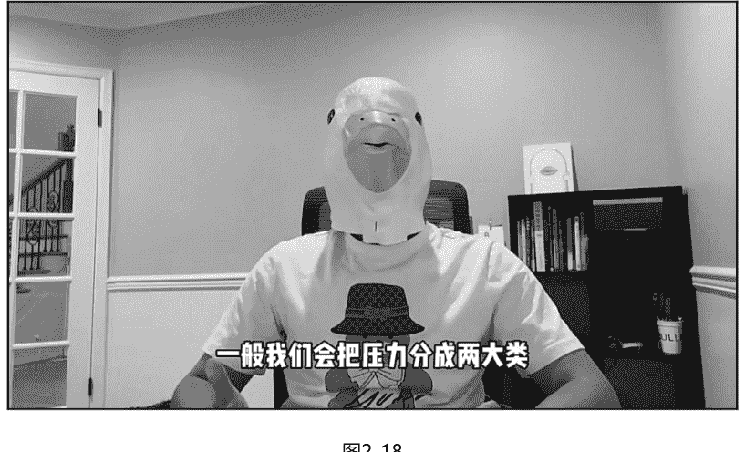

图2-18

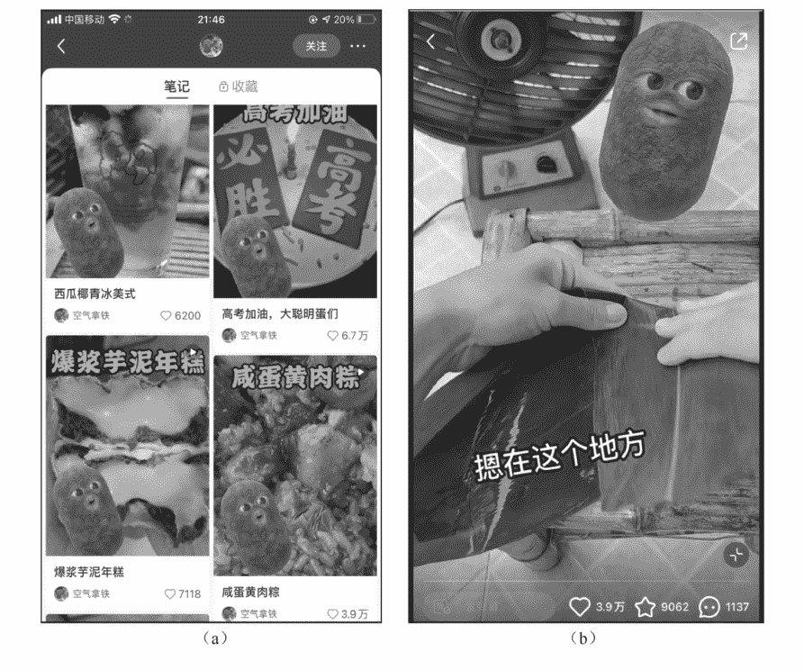

图2-19

发型、服饰、耳饰等细节也能加深印象。做自媒体最怕没有记忆点，找到一个与众不同的点，比盲目起步更重要。起步阶段建议边做边调。

## 2.2 用3步快速找到适合自己的定位

答疑时常被问：粉丝几万却赚不到钱？笔记爆了却不涨粉？读书笔记没流量，要不要转育儿？细聊后发现，多人起步时未做定位，无对标，无以终为始的商业模式设计，于是想到什么发什么，看到什么跟什么，最后流量与变现皆无，还自我怀疑。

运营第一步是定位，定位清晰才能持续创作并变现。

### 2.2.1 搜索对标账号，细分垂直方向

大方向确定后，如何让轮廓更清晰？要在大方向里找更细的垂直小方向。知识博主可细分为学习、创业、职场、写作等，不能一锅端。

找对标账号是筛选细分领域的好办法。

#### 1.主动搜索

(1)搜索用户列表。在小红书搜索框输入妈妈律师创业美食等词，点击用户，能找到昵称带关键词的博主，筛选更精准。缺点是并非所有人都会在昵称加标签，所以最好再用关键词搜笔记内容，从笔记进主页判断是否合适。

(2)搜索泛关键词。当方向不确定时，可直接搜大方向的宽泛词，如Vlog、学生、读书、宝妈、理财、健身。浏览20到30篇笔记，了解呈现形式、选题角度、受众、图片视频风格。按类型归类，就能拆出细分方向。比如搜美食，会发现有图文视频，视频分真人出镜教学不露脸配音不露脸字幕加音乐；按工具分有烤箱微波炉电饭锅空气炸锅等；按品类分有零食盒饭饮品减脂餐糕点西餐等。调研后更清楚自己适合哪条细分赛道。

(3)搜索细节关键词。方向明确后，搜大家常关心的细节点。母婴可搜宝宝玩具磁力片辅食宝宝营养；美食可搜空气炸锅美食减脂餐家常菜通勤族快手便当等。这些词的前几屏通常是权重高的优质内容。

看完笔记后打开主页，问自己：第一印象是什么？能用一个词概括这个博主吗？整体风格是我想要的吗？我现在能模仿吗？符合就记下来作为对标。

#### 2.算法推荐

在推荐页刷笔记，让算法根据你的浏览习惯推送相关领域的创作。持续沉浸在目标领域，能更快摸清内容生态与选题规律。

# 小红书找对标与拆解实操指南

小红书的内容分发并不看账号体量，而是靠算法匹配。每个人打开推荐页看到的笔记都不一样，基本是基于个人兴趣的个性化投喂。平台会记录你往常搜索的词、常驻留的笔记并据此打标签，再把可能感兴趣的内容推到你面前。

想让推荐更贴合创作方向，可以主动打开个性化推荐。操作路径为：设置 → 隐私设置 → 个性化选项 → 开启个性化推荐，如图2-20所示。

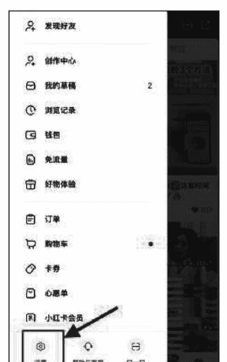

(a)

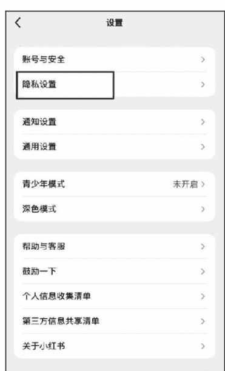

(b)

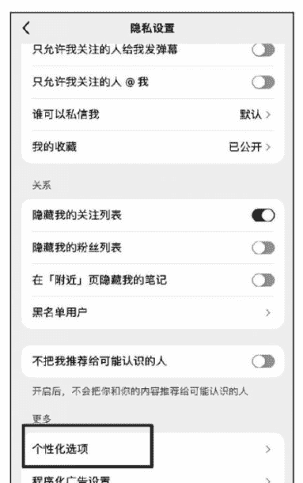

(c)

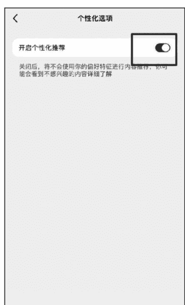

(d)

图2-20

对做内容的创作者来说，重点是让算法为己所用。所以刷号时要克制随手乱逛的冲动，尽量只刷自己赛道的内容，喂养量够了系统就会持续给你推同定位的笔记，这样找对标就更精准。

#### 3.关注列表

可以打开目标号的主页看它的关注清单。

通常，被对标号点关注的对象，多半也是同赛道的潜在竞品。进去逛一遍主页，就能大致判断呈现方式、内容调性和风格是否与你接近。如果契合，也可收入对标池。这个方法能快速锁定同类号，但要注意，部分创作者会把关注权限设为私密。

#### 4.共同关注

点进博主的关注页，如图2-21所示，右上角有“推荐”入口。进入后系统会基于“关注了这个博主的人还关注了谁”来推算，列出一批风格相近的账号，如图2-22所示。

# 花生的书桌

关注 粉丝 推荐

搜索已关注的人

正在关注

- VLOG薯 🍠红薯地 VLOG领域第一KOL（是真人。）

- 小红书创作学院 小红书官方账号|定期分享创作技巧和攻略

- 小红书商家学院 小红书官方账号 | 陪伴你的成长...

图2-21

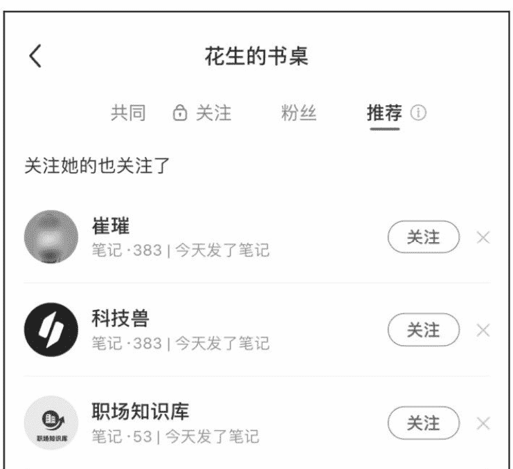

图2-22

所以锁定一个对标号后，透过它的关注页或推荐页，就能批量挖掘相似创作者。

#### 5.官方薯

不同垂类的官方薯会发起官方活动，活动结束后会评选优质博主，如图2-23所示。在官方薯的笔记里就能找到该垂类的头部样本。经过官方背书的账号，内容基本符合平台规范且有市场检验，能更快筛选优质对象。

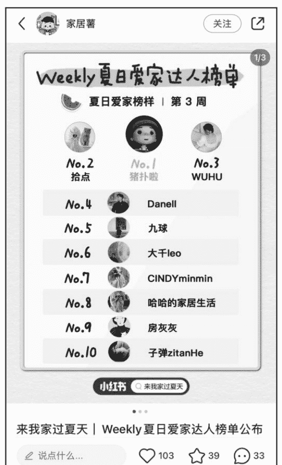

另外，官方薯常会把垂类优秀作者的笔记收进官方号。官方薯推荐的内容通常更贴近平台调性和用户喜好。可以逛逛这些作者的主页，结合自身定位判断是否纳入对标。

#### 6.第三方工具

市面上有不少第三方数据平台会实时更新各领域的博主榜单。借助榜单能更快定位垂类优质号。

常用的是新红和千瓜数据。图2-24和图2-25分别是新红和千瓜的达人榜。可以按领域筛选热度靠前的博主。领域总榜前列多为头部，对新人参考意义有限。

起步阶段更建议看“涨粉榜”，观察近期在垂类里粉丝快速增长的创作者，尤其是粉丝几千到几万的中小号，短期内涨粉几万。这种账号的选题或呈现方式更容易拆解借鉴。也许就是某个爆款选题或形式带火了，可以复盘。

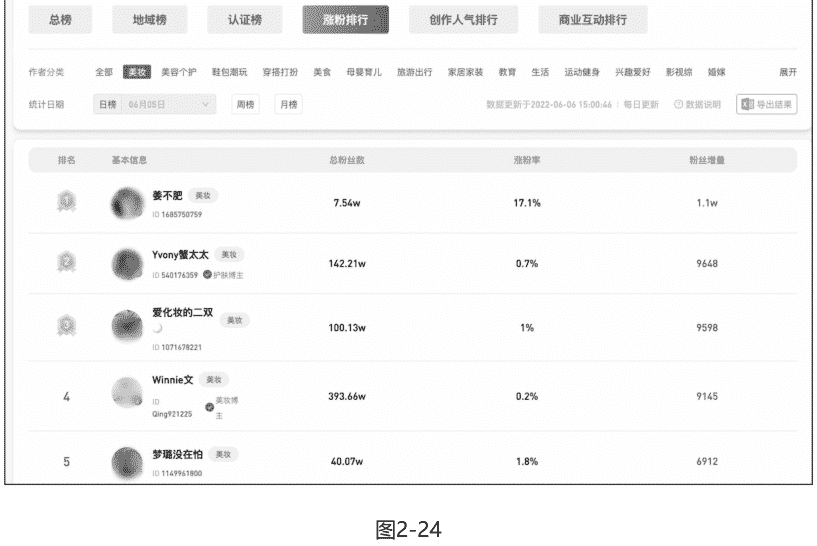

图2-24

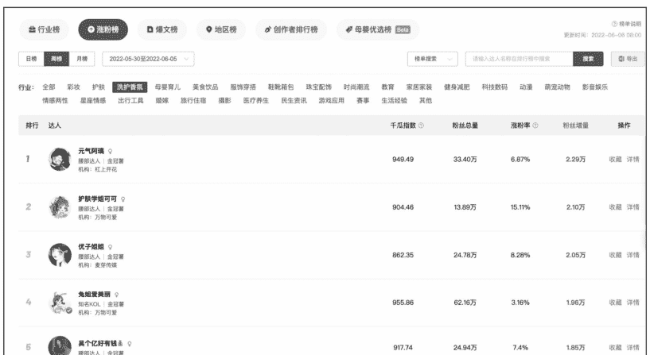

图2-25

除此之外，千瓜的达人榜里还有“爆文榜”，如图2-26所示，可以查看近期产出爆款的账号，并按粉丝量筛选。1万到10万、5000到1万这两个区间尤其值得关注，特别是几万粉的小博主，他们能做到的，你大概率也能做到。

图2-26

以上是用工具找博主的思路。注意，多数工具的高级功能需付费，使用免费额度时尽量把每个入口都点开，最大化免费价值。

看号时要保持第三视角，先判断这个账号是不是你想要成为的样子。初步匹配后，就进入关键一步：拆解对标号。

### 2.2.2 拆解对标号，锁定账号调性

#### 1.拆解哪类账号

(1)小体量博主。起步期建议选粉丝不足10万的创作者。这类账号通常刚走出新手期，已摸到爆款门槛，成长路径对新人最具参考价值。

粉丝十几万以上的大号可作为长期目标，不必起步就模仿。他们很可能历时很久才累积到现在，或有跨平台经验、搬运内容、MCN团队等背景，难以快速判断是否适合复制。可参考他们的爆款选题、人设风格。

(2)近期爆发且更新稳定的账号。若账号近3个月出现多篇爆款，点赞轻松过千甚至上万，说明掌握了流量密码。这样的账号粉丝从几百涨到几万的经验，往往可迁移。

同时看更新规律。对标号需要节奏稳定，比如月更10篇、周更2-3篇，不能时断时续，否则会影响你制定自己的更新计划。

(3)入驻两年内的账号。可查看博主首篇笔记发布时间，优先选近两年入驻且做得好的。账号之所以值得对标，是因为它的爆款内容、呈现方式、变现路径和调性都符合预期，复制路径成功率更高。

如果一个号运营几年才有几万粉，照抄可能也要几年才能见效。新手起步最好找近两年起号且做起来的案例，确保一年两年内能复刻。

#### 2.用一张表格拆解一个对标账号

拆解时可用对标拆解表深度复盘，见表2-8。

#### 表2-8

| 账号的基本信息 | | | | | |

|---|---|---|---|---|---|

| 账号昵称 | 基础数据 | 粉丝数：（点赞数+收藏数） | 点赞数：收藏数 | 第一篇笔记的发布时间 | 发布时间和近3~6个月的更新频率 | 账号的多平台布局 |

| | 粉丝数：点赞数：收藏数：发布笔记数： | | | | | |

| 账号的风格调性 | | | 账号的商业模式 | | 可借鉴的点 | |

| 细分方向 | 人设 | 呈现形式 | 报备合作 | 不报备合作 | 崛起点 | 可复用的点 |

| | | | | | | |

#### 续表

| 对标总结 |

|---|

| |

(1)账号的基本信息。在表格上方记录昵称、基础数据、粉丝数与点赞收藏和的比例、点赞与收藏的比例、首篇笔记时间、近3-6个月更新频率、多平台布局等。

发布笔记数、点赞数、收藏数可在博主主页点击“获赞与收藏”查看，如图2-27所示。

以下数据尤其关键。

①粉丝数：（点赞数+收藏数）

即粉丝数除以点赞收藏总和的比值。主页下方粉丝数为粉丝量，“获赞与收藏”显示点赞与收藏合计，如图2-28所示。

# 多读点书

花生的书桌

小红书号：1059774489

IP属地：上海

✨读书写作 | 效率提升 | 分享硬核宝藏干货～

👉模板和干货在公众号花生的书桌...更多

- 上海浦东新区

- 教育博主

98

关注

# 获赞与收藏

- 当前发布笔记数 165

- 当前获得点赞数 65.3万

- 当前获得收藏数 53万

我知道了

- 从0-1做博主

- 自我提升

- ipad生产力

图2-27

图2-28

这个比值能看出转粉效率。比如粉丝：点赞收藏=1:8，表示约8次互动带来1个粉丝。

1:10是分水岭。低于1:10，说明有爆款但不涨粉，很可能是纯工具号。远低于1:10，如1:20、1:30，则不建议对标，爆款再多粉丝也难增长。

人设鲜明、垂类垂直、转粉率高的账号能做到1:5甚至更高。看这个指标可判断人设强度和转粉能力。

②点赞数：收藏数。点赞和收藏是衡量互动的重要维度，通常点赞高于收藏。

若点赞远高于收藏，如数倍差距，内容多为情绪爽点型，比如搞笑、剧情类，看完就笑，不具备收藏价值。

收藏数高、甚至收藏大于点赞的内容，往往干货度高、值得反复看。例如写作素材笔记，收藏常远超点赞，说明价值感强。

图2-29

拆解时若点赞收藏差距不大，可整体借鉴其内容和风格；差距过大，可分析其情绪价值点，再在干货深度上取长补短。

③第一篇笔记的发布时间。看首发时间可推算账号运营时长和涨粉速度。比如A号6个月10万粉，B号3年10万粉，明显A更值得研究。

④发布时间和近3～6个月的更新频率。可研究发布日期和时间，若规律稳定且固定时段发布，可参考制定自己的排期。

笔记底部会显示发布日期时间，如图2-30所示。部分版本可能只显示日期。若博主修改过笔记，底部会显示“编辑于”，时间变为最后编辑时间，无法判断原始发布时间，可用评论区最早评论反推。

图2-31

通过统计发布节奏，可分析更新频率和黄金时段。比如3个对标号都月更10篇，集中在工作日18-20点发布，就可制定类似的发布计划：月更10篇，工作日晚7点发。

新手期先抄作业，通过大量调研对比做出更合理的决策。

⑤账号的多平台布局。了解该号是否在其他平台也有账号，分别有多少粉丝，如何变现。例如在B站、抖音、知乎是否有分发，内容是否同质化或平台化。

比如读书博主“小嘉啊”，小红书分享书摘金句，变现路径不明显，全网检索后发现她在抖音有数百万粉丝，并挂书本链接做直播带货，如图2-32所示。

由此可知，内容可多平台分发，变现可带货。

清楚对手的全网布局，才能决定自己精力投向。

(2)账号的风格调性。整理完基础信息后，深入挖掘差异化特征。

①细分方向。指在赛道下具体做哪类内容。如知识类的职场、读书、学习方法，美食类的教程、零食测评。做菜教程里再分减脂餐、盒饭、空气炸锅美食等。

研究细分和选题，能反思自己是否具备创作能力。比如有人想做运动穿搭，对标后发现对方主打小个子运动穿搭，内容围绕身高体重标签展开。如图2-33所示。

图2-33

若你身高体重不匹配，这个标签就很难复制。所以要看博主靠哪些细分话题出爆款，自己是否具备。

②人设。翻看历史内容及评论区，能感受到博主的人格特质和性格。评论区反馈也透露用户是为内容而来，还是为博主的人设、文案风格、故事共鸣而来。

③呈现形式。是图文还是视频？图文是实拍还是海报？视频是横版还是竖版？平均时长多少？都要记录分析。

(3)账号的商业模式。

对标号走过的变现路，很可能就是你的下一站。要搞清它如何盈利，全网如何打造。

接广告的话，历史合作品牌有哪些？集中在哪些品类？

引流变现的话，产品是什么？客单价多少？甚至可付费体验。

如何判断广告合作？

①报备合作。笔记打开几秒内左下角会显示品牌名。图2-34所示为与樊登读书的合作笔记。

②不报备合作。

a.带品牌话题。品牌方常要求博主加上产品相关话题或活动话题，一般在正文底部。如“#来得到阅读有方法”，可一眼识别为投放，如图2-35所示。

b.大篇幅描述产品且有利益声明。若笔记有多张产品图并有大量文字介绍，或文案内标注利益相关，很可能为软广。

图2-34

## 来得到阅读有方法

203万浏览

最热 最新

教师效率倍增的实用App合集

Shirley小蕾 ♡ 2657

公开课次次成功✓新教师快速成长计划！

云朵喜儿 ♡ 3107

< 是能可呀

### 2022得到年度书单

- ✅带你经历不同人生：

- ✅《置身事内》-兰小欢

- ✅《重走》-杨潇

- ✅《张医生与王医生》-伊险峰/杨樱

- ✅《我本芬芳》-杨本芬

- ✅《活着就是冲天一喊》-陈年喜

- ✅《这里是中国2》-星球研究所

图2-35

c. 排在合集前排的笔记判断。视频合集做商业推广时，品牌方往往要求商品露出排位靠前，有时还会对露出时长做要求。因此当某款产品既排位靠前，又在画面中停留时间明显长于同款竞品时，就要警惕是否为广告投放。

另外品牌投放常有投放周期。同一时间段内，若多位创作者集中发布关于同一款产品的笔记，广告的可能性会升高。

当然也不排除博主是自用后分享心得，把真实体验发到小红书。是否属于植入，还需要结合其它线索综合判断。

(4)可借鉴的点

①崛起点。拆解对标号最核心的一环，是提炼其吸粉密码，判断哪些内容能迁移到自己号上。要重点研究账号起飞的那一篇或那一类内容，是什么让账号在短时间内实现快速涨粉。要记住，对标号走过的路大概率也能被复制，能够让它们迅速涨粉的爆款，一定是被市场检验过的，复刻这类选题会更高效。

拆解爆款路径时，可按时间顺序找到该号点赞和收藏最高的笔记。比如我早期图文笔记点赞基本在几百，有一篇图文突然破万，就能判定这是账号的起飞点，如图2-36所示。随后我又发了一条同类型的视频笔记，获得了8万多次点赞，如图2-37所示。

## 如何装备学习型ipad🔥平替配件｜高效学习app

去年9月底赶上教育优惠入手iPad，从此开启买前畅想生产力、买后沉迷爱奇艺的反差日常🏃‍♀️

图2-37

从这可以看到，我号的起飞点就是iPad系列的内容，这时就需要评估自己是否有能力持续产出这类话题。

②可复用的点。要综合对标号爆款笔记的封面、标题、风格调性等维度，总结哪些要素可以迁移到自己号上。比如对标号封面的呈现方式值得参考，某些爆款标题可以借鉴，视频开头的自我介绍方式、每次结尾加一句金句的结构都可以模仿。

(5)对标总结。分析完以上维度后，可用以下问题做复盘。

- ①整体看完后的感受如何？
- ②该号的整体风格调性、内容定位、呈现形式、变现方式是否与我想做的相契合？
- ③如果我来做，以现在的能力能做出类似的账号吗？
- ④有哪些待改进的地方？

最终整理成详细的对标号拆解表，见表2-9。

表2-9

| 账号的基本信息 | | | | | |

| :--- | :--- | :--- | :--- | :--- | :--- |

| 账号昵称 | 基础数据 | 粉丝数：（点赞数+收藏数） | 点赞数：收藏数 | 第一篇笔记的发布时间 | 发布时间和近3～6个月的更新频率 | 账号的多平台布局 |

| 兔姐 Cheryl | 粉丝数：1.8万 点赞数：4.6万 收藏数：5.6万 发布笔记数：124 | 约1：5 | 约1：1.2 | 2021—08—21 | 发布时间不固定，集中在18：00—22：00 一周4条 | 无 |

| 账号的风格调性 | | 账号的商业模式 | | 可借鉴的点 | |

| 细分方向 | 人设 | 呈现形式 | 报备合作 | 不报备合作 | 崛起点 | 可复用的点 |

| 健康教程 | 健康、阳光 | ①图文实拍 场景：室内/户外+彩色运动服 ②视频：运动动作讲解 | 接运动服、鞋及周边产品的广告变现 | 无 | 臀部训练教程视频、直角肩拉伸训练视频 | 1. 封面视觉冲击（形体造型+彩色运动服） 2. 运动配饰丰富 |

| 对标总结 | | | | | |

| 1. 账号的调性和我的账号很契合，可以作为主要的对标账号。 2. 运动动作讲解类的视频能出现很多爆款笔记，我以后在做这类视频时可以参考这个博主的视频。 3. 封面中博主的身材很吸引人，在后续制作内容时要多呈现优美的身材曲线 | | | | | |

这就是拆解一个对标号的完整流程，涵盖基础信息、调性、商业模式、可借鉴点等多个维度。前期拆解越细，后期执行越省力。

## 3.拆解时的几个注意事项

拆解对标号时，还要注意下面3点。

(1)账号是否做过大调整。剖析时要梳理时间线，看账号早期内容与现在的是否一致。如果不一致，要看哪个时间段更换了形式，调整方向后是否起效。如果号做过较大调整，就要总结在哪些方面做了改变。

同时，还要比对点赞较少的笔记和点赞较多的笔记，它们有哪些明显差异。在这些差异中，总结出什么因素促成了爆款出现。

(2)对标号是可以更换的。对标号会随账号发展不断变化。也许在实操中，你会发现某个方向不适合自己，或找到了更好的切入角度，这时可以更换对标号。

如果你纠结定位，不知道选哪个对标号，请记住：定位一定是在做的过程中迭代出来的。不要因纠结定位而迟迟不行动，先找一个大致方向和一个基本符合预期的对标号，迈出第一步，立即发布内容，在实践中不断迭代。

(3)对标多个维度。很多人找对标号时，会发现很难找到一个各维度都完全符合预期的账号。这时可以在整体调性一致的前提下，选择多个账号的单个维度进行组合对标。比如账号A的身份标签、账号B的爆款选题、账号C的道具，都可以组合到你的笔记里。同时发布具体内容时，不一定只参考对标号，用选题关键词在小红书搜索爆款笔记，找到对应关键词的爆款笔记进行对标也是可以的。

你通过商业模式定位、赛道定位、内容定位、人设定位设计出自己的账号，通过搜索对标号、拆解对标号，对接下来该做什么、怎么做就有更清晰的规划。

最后，把账号的最终定位汇总在表2-10中，就能清楚知道下一步该做什么、怎么做。

表2-10

| 我的赛道和用户定位 | | |

| :--- | :--- | :--- |

| 我的对标账号 | 账号名 | 链接 |

| | | |

| | | |

| 我的变现方式 | | |

| 我的人设+场景设计 | | |

| 我的呈现形式 | | |

### 2.2.3 测试方向，形成独家风格

找到对标号后就可以开始实操。关键是不断试写、试发，把内容放到市场中，看数据、复盘迭代，形成自己的内容生产体系和爆款笔记生产流程。

主要分两个阶段：

第一个阶段，从模仿开始迈出行动第一步。

第二个阶段，在实践与创新中形成自己的风格。

#### 1.从模仿开始，迈出行动的第一步

模仿阶段很多人会有困惑：

模仿等于抄袭吗？平台同质化严重，我做一样选题算不算抄袭？

观点重复算抄袭吗？

我不想做一样内容怎么办？

实操阶段，模仿对标号或平台爆款笔记是最有效的方法，但要明确3点：选题要借鉴、观点和方法要独立、呈现形式可部分借鉴。

(1)选题必须借鉴。借鉴选题不是照抄内容，而是看这个选题击中了用户什么痛点，大部分爆款选题背后都有用户痛点。

例如“如何无痛戒手机”这个选题，小红书很多博主都在做，平台内也有很多爆款笔记，如图2-38所示，说明戒手机是很多人的痛点。用户刷小红书时可能存在焦虑，看到这类笔记就会点开查看解决方案。

有些火过的选题值得再做一遍，因为背后是真实痛点和用户关心的话题。比如备婚新娘会关心怎么选喜糖、怎么选手礼，婚礼前新娘和伴娘会在小红书搜索“堵门游戏”。即将考英语四级的大学生会对“如何在一个月内稳过四级”这类选题感兴趣。

特定人群在特定时间，一定会对某些选题感兴趣。所以不用担心别人写过的内容不能写，因为痛点和需求存在，做已被验证的爆款选题，做出爆款的概率会更大。

(2)观点和方法必须独立。借鉴完爆款选题后，落地到具体图文或视频创作时，一定要注意：观点和方法必须独立，内容内核必须是自己的。比如前面提到的“无痛戒手机”，为什么戒手机、怎么戒、有哪些方法，这些观点和经验需要你亲身实践后总结。其中方法可能与别人重复，这没关系，因为你用过的方法别人可能也在用，或书里写的方法大家都看过。

但使用方法后的具体感受、如何表述给别人，这些内核必须是你独有的，不能东拼西凑。

如果一件事情你都没实践过，只是搜集资料整合别人的经验感受，就违背了内容创作初衷。

(3)呈现形式可以部分借鉴。创作具体内容时，也可以借鉴对标号的呈现形式。不会拍照时，可以模仿别人的构图角度，拍多张照片总能挑出一张满意的。不知道如何布置拍摄场景时，可以借鉴对标号的场景布置。

需要注意的是，设计账号呈现形式、风格、封面时，不要像素级模仿某个博主，特别是封面。如果你的封面元素、字体都与某博主相似，就侵犯了原作者著作权。作为内容创作者，一定要珍惜自己的羽毛。

以上就是模仿阶段的3个要点，借鉴爆款选题，从模仿开始迈出第一步，然后站在巨人肩膀上用自己的话语体系创作内容。

#### 2.在实践与创新中形成自己的风格

实操第一阶段是模仿对标号。这个阶段可以锻炼手感、网感，在刻意练习中逐渐找到运营账号、做爆款笔记的感觉。到进阶阶段，就要在实践与创新中总结自己的爆款笔记创作套路，形成独特风格。

(1)做出爆款笔记，复制套路。逐渐找到门道做出几篇爆款后，要分析这些笔记火的原因，找到可复用到下一篇的要素，然后不断复制，源源不断做出爆款。

我在小红书上的第一篇点赞过万的爆款是关于“iPad生产力”的图文笔记，分享了一些iPad学习软件和平价配件。笔记火后，我把同样选题做成视频，内容也是分享iPad学习软件和平价配件，结果视频也火了，最终获得8万多次点赞和6万多次收藏，如图2-39(a)所示。

于是我不断复制这个爆款选题，复用逻辑结构、封面和标题，分享不同主题的软件和配件。后来每次做这个系列内容，数据都不错，如图2-39(b)所示。这个系列就成了固定的选题栏目。每隔一段时间就分享一些新的使用心得。

图2-39

所以，创作出一类内容数据不错，且与账号定位相符，就可以持续做同类选题。

(2)做出成绩，形成标签。早期用养成系方式运营账号时，会面临内容缺乏个人特色、趋于同质化的问题。这些都源于没有属于自己的一套知识体系，没有做出成绩。

运营过程中不断输入输出会学到很多。当做出一些爆款笔记、一点成绩时，就能基于这些成绩形成标签。比如从写作小白到在小红书赚到第一笔稿费、一个月涨1000粉丝、3天接到10个广告合作。或为打造人设做出的努力并得到结果：连续100天5点起床读完30本书、3个月减10斤、零基础转行涨薪30%……

做出成绩后，就从模仿别人的阶段跨越到有自己独特标签的阶段。我的私教学员小Q是大学生，刚开始做小红书运营时围绕大学学习与成长输出内容，很多选题必然会和同类博主重复。后来小Q越做越好，广告收入达到几万元。她就顺势分享大学生经济独立的心得，结果这类内容很受欢迎。于是我让她强化“大学生经济独立”这个标签，多分享关于大学生赚钱的思维方式、经济独立心得干货，如图2-40所示。

图2-40

就这样，她的账号从没有个人特色到逐渐做出成绩形成标签，在实践与创新中形成了只属于自己的风格。

## 2.3 装修：账号设计4件套

做完定位、找到对标号后，就要根据定位“装修”账号，让访问主页的“客人”一眼就能知道你是做什么的、分享什么内容、他能获得什么。设计一个好账号，需要从以下4方面入手。

### 2.3.1 账号名称设计

账号名称并不能决定账号能否火、能否吸睛。

#### 1.账号取名的3个原则

(1)没有阅读难度。自媒体取名最忌讳名称大部分人看不懂、叫不出。典型是用生僻字和复杂英文名，例如“彧(yù)”“喆(jié)”这些字，在个人名字里可能显得特别，但在互联网上给网友带来阅读难度。人们没耐心查询读音，更不知道怎么拼写，从而给个人品牌打造、账号传播带来难度。

(2)没有称呼难度。要让粉丝立刻知道怎么称呼你。我遇到过一个小伙伴，刚注册账号时取名“你这么棒你可得快活点儿”。看起来俏皮，实际上犯了两个致命错误。首先太长。笔记出现在推荐页时太长的名称无法完整显示，用户也记不住。其次粉丝不知道怎么称呼他。作为博主，要想拉近距离，一个好叫的账号名称是标配。比如我叫“花生的书桌”。粉丝会叫我“花生”，评论区交流时会用“花生”或“花花”来称呼，但“你这么棒你可得快活点儿”这样的名称会让粉丝摸不着头脑，不知道该叫“棒棒”还是“儿儿”。

所以账号名称里最好有一个只属于你的昵称，可以是姓氏、小名、网名，能让人容易叫出来即可。

(3)有记忆点。一些有特殊含义、叫起来朗朗上口的名称，能让人第一次看到就印象深刻。博主“取个啥昵”的每条视频都有固定开场白“hello大家好，我是至今不知道取个啥名的取个啥昵”。这句话让人瞬间记住这个博主。

此外账号名称还可以与内容结合，增加记忆点。比如博主“阿丹今天存钱了吗”发布内容围绕存钱展开，这个名称就能加深用户记忆。“文森特别饿”是一个美食博主，他把名字“文森特”和“饿”这个属性结合，形成很有趣的名称。

#### 2.账号取名的4个方法

(1)名字/称呼+领域/职业/学校/身份。用此方法取名，能让人从名称直接看出领域方向，知道你是做什么的、分享什么。

①用名字/称呼+领域取名。例如，“硕硕的装修日记”“圆圆宝贝美食记”，只看名称就能知道创作领域。

②用名字/称呼+职业取名。例如，“摄影师林云”“HR小弘哥”“女心理师青橙”，一眼就能看出博主职业。

③用名字/称呼+学校取名。例如，“北大姐妹花”“清华护肤易博士”。这类名称可以为内容做背书，凸显更专业的人设。

④用名字/称呼+身份取名。例如，“学姐潇潇”“蘑菇妈妈呀”。特定身份能突出人设，让特定群体产生认同感。

你也可以在名称里融入分享内容方向、爱好特征。例如，“猪猪在努力吃”是一个种草美食的博主，“阿鱼爱学习”是一个分享读书与学习干货的博主。

(2)名字/称呼+地域。用此方法取名，适合身份特征或内容带有地域属性的，能让特定群体对号入座，在小圈层内打造话题。

①地域与内容相关。例如，“保罗在美国”“上海小阿姨”“一妈在北京”。这些博主会分享本地生活与故事，与本地相关话题能吸引本地圈层人群，在当地形成一定知名度。

②地域与人设相关。例如，“沪漂少女灵芝”“北漂宝妈丹妮”。这些博主的地域标签是人设的一部分。发布内容中一部分会与地域相关，但主要目的是通过地域标签展现某一特质，比如“沪漂少女灵芝”的账号展现一个沪漂女孩通过努力一点点变美、变有钱的逆袭故事，分享内容很宽泛，并没有与地域强关联，地域在名称中的作用是为了与人设相符。

(3)地域+领域+名字/称呼。如果产品和服务需要依托线下销售，就可以用“地域+领域+名字/称呼”的方式取名，给用户明确信号。用户有某个需求且正好与你在同一地方，就可以找你。比如，“杭州石律师”“长沙律师刘大壮”“北京导游冯少保”“锋锋老师（长沙滑板私教）”。这类名称的好处是能筛选精准同城用户，避免无效沟通。

其弊端是把其他地方的人挡在门外，但如果你输出整个领域的专业内容，你的内容能给大部分有需求的人带来帮助，也能通过内容吸粉。

(4)直接使用名字/称呼。直接用名字/称呼做账号名称，不加修饰，能打造只属于你的个人品牌。我们经常能看到一些账号内容不错，如果只看名称和主页，好像谁都可以做，可替代性很强。比如工具型账号“学习方法”“书单君”“美妆种草菌”。看不到账号背后的人是谁。

要想打造个人品牌，最直接的取名方法是使用名字/称呼，例如“程十安”“骆王宇”“小宇菇菇”，或用比较好记的英文名，或中英文组合，例如“Winnie文”“papi酱”。这些名称背后就是博主本人，名称就是最好的个人品牌。

账号名称的作用是让用户知道你是谁、做什么、会分享什么、是否与他有关。要记住这些用户心理，再以终为始设计账号名称。

账号名称确定后，不要轻易修改，频繁更换会给已关注粉丝造成困扰，更会影响个人品牌打造。同时确定后最好在全网使用统一名称，有利于打造全网影响力，也方便用户在其它平台关注你、记住你。

### 2.3.2 头像设计

和昵称相比，头像不必过度计较。能把账号做起来的核心始终是内容，不是用一张多好看的真人照。因此，只要不带二维码、不放低俗图、不违规，用自己喜欢的任何图片当头像都可以。

小红书头像大致可归纳为三类。

#### 1. 真人出镜照
做 IP 人设的账号，建议用真人照片当头像。正面、侧面、背影都行，关键是挑一张让人看着舒服的。小红书重审美，好看的头像自带加分。

如果账号有标志性的道具或元素，也能融入进头像里。比如“网不红萌叔Joey”常在视频里出现一只鹅，封面也常出现鹅的插画，他的头像就是在真人照的基础上加上了鹅的元素，整套视觉就统一在个人品牌里了，如图2-41所示。

图2-41

想做个人影响力，让人记住你，最后要做的就是把自己的脸变成品牌记忆点。

#### 2. 漫画卡通头像
不少博主起步时不方便露脸，又怕没有辨识度。其实不露脸照样能出爆款，头像不露脸也无妨，内容足够吸引才是关键。

想保留一点个人特色又不想用真人，可以用工具生成卡通头像。

常见的制作工具有关美图秀秀、醒图等。在美图秀秀里打开“工具箱”，选择“动漫化身”或“绘画机器人”或“绘本时代”，上传一张自拍，就能自动生成卡通头像，如图2-42所示。

图2-42

直接用漫画、插画人物做头像，也是很多人的做法。

#### 3. 品牌Logo
品牌、企业号通常会直接用Logo做头像，如图2-43所示。

图2-43

个人博主也可以自制Logo。例如博主“小浪书单”把账号名里的字做成一张图，用作头像后辨识度明显提升，如图2-44所示。

图2-44

### 2.3.3 简介打造
简介相当于账号的名片，陌生用户点进主页后，能快速通过简介了解你是谁。

简介可以由多个要素组合，不必全上，根据定位和人设挑选组合即可。表2-11为简介设计问答表。

### 表2-11

| 自我介绍 | 作用 |

| :--- | :--- |

| 人设标签 | 有哪些独特经历、想展现哪些特质 |

| 身份标签 | 展示个人身份背景，建立信任感 |

| 个人基本信息 | 向垂直用户透露基础信息，吸同类。比如穿搭博主报身高体重、护肤博主报肤质、家居博主报房屋面积 |

| 内容定位 | 说明会分享什么，关注能得到什么 |

| 成就事件 | 展示过往成绩，与同类区分 |

| 关注预期 | 给出一个值得关注的理由 |

| 一句话Slogan | 用金句传递价值观或账号特色 |

| 联系方式 | 方便品牌方合作联系 |

组合后得到以下几类自我介绍公式。

(1)公式1：身份标签+成就事件+内容定位。这类写法用身份和成绩为专业度背书。比如职场博主“瘦鬼”，简介突出职业身份与成绩，为职场笔记增加可信度，如图2-45所示。

图2-45

(2)公式2：人设标签+成就事件+内容定位。利于强化人设，放大情绪价值。比如“小QQQQ”的简介主打“小镇女孩逆袭记”“大二经济独立”的人设和经历，突出逆袭感，如图2-46所示。

图2-46

(3)公式4：个人基本信息/特征+ Slogan。常见于美妆护肤、穿搭、健身领域。用户种草时需要参考博主的基础信息做决策。比如图2-47是一位专注梨形身材穿搭的博主，简介里放了身高、体重、体型，让感兴趣的用户能先做判断。

图2-47

她的Slogan是“每天都在想着怎么瘦腿”，给出明确的关注预期，会持续输出瘦腿相关穿搭，吸引精准粉。

(4)公式5：关注预期+内容定位+身份标签&成就事件+个人基本信息。让用户清楚你是谁、分享什么、是否匹配。比如图2-48的家居博主，先说明账号输出什么内容，再标注房屋面积和户型，给同好参考，还用买房装修时的年龄和花费做数字反差，塑造差异化。

图2-48

### 2.3.4 视觉统一
用户大多是从推荐页进入主页，先看一条笔记觉得不错，再点头像深入了解。这时主页的整体视觉就决定了第一印象。而整体视觉主要由封面风格决定。

类比逛超市：你为买零食而来，如果零食被分散摆在五六个货架，还混着日用品，找起来极差。主页也一样，要让用户进来时，货架整齐、视觉舒服、内容符合预期。

#### 1. 封面风格统一
封面风格统一指用同一呈现形式、同一调性。用户进主页第一眼看到的就是封面矩阵。

如果你今天用真人图、明天用海报模板、后天用手账本，字体每天换一套，用户几秒就会划走，根本看不出你在做什么、给什么价值。

建号时就要先定好封面呈现方式和整体调性，再去产出。常见封面形式有真人照、景物照、plog拼图、伪实拍、海报、截图、电子手绘、纸质手绘等。

优质账号的封面都极度统一，用户看几秒就能判断风格和内容类型。若视觉舒适且内容匹配，关注就很容易发生。

图2-49所示的“憨憨学长”是学习成长领域博主，所有笔记都用手绘视觉笔记呈现干货，通俗有趣。整体色调、画风、字体都高度统一，进主页有种极度舒适的观感。

拼图封面容易信息过载，看起来杂乱。若统一滤镜色调和字体，配合垂直内容，质感会明显提升，如图2-50所示。

图2-50

风格不是永恒不变，可以随内容迭代而升级。起步阶段可以试不同风格，但不要频繁切换，一种风格至少稳定测试10篇再判断。

新手最直接的方法是参考对标账号，看别人用什么形式呈现、自己是否能复刻。风格没定之前，后期频繁改动会让粉丝转化受损。

#### 2. 字体风格统一
除了封面，字体也要统一，尤其是封面上的文字。

内容题材宽泛时，封面若混用文字、视频、实拍、真人，容易显乱。可通过统一字体风格来收束。比如统一用花字做主标题和副标题，整体观感会更和谐，如图2-51所示。

图2-51

#### 3. 内容垂直聚焦
封面和字体统一后，最关键的是内容本身极度垂直。用户从推荐页点进来带着预期，若主页内容与爆款笔记契合，转粉概率更高。

账号装修的最后一步是规划整体内容方向，让内容风格与封面、字体、名称形成完整闭环。

# 第3章 涨粉：高效地做出爆款笔记的秘诀

## 3.1 爆款笔记的底层规律

### 3.1.1 决定笔记成败的核心要素
小红书是千人千面的推荐机制。笔记先拿到初始曝光进入小流量池，根据用户互动数据判断是否继续放大。互动数据好坏是成败关键。

#### 1.互动数据构成
小红书互动数据包括点击率、点赞数、收藏数、评论数和弹幕数、完播率、转发数、关注数。

点击率指阅读量占曝光量的比例，取决于封面和标题是否让人想点。

点赞数指用户看完后表示喜欢的次数。

收藏数指用户觉得有用想留着反复看的次数。

评论数和弹幕数指用户主动发声的数量。

完播率指看完视频的用户占比。

转发数指笔记被站内或站外分享的次数。

关注数指通过笔记直接关注账号的人数。

官方未明确单一最重要的指标，创作中心强调每个数据都很重要，需要结合底层逻辑优化。

#### 2.互动数据的底层逻辑拆解
不同数据背后对应不同的优化方向。

(1)提升点击率，靠选题宽、封面标题吸人。小红书首页是双列信息流，用户需主动点击封面才可进入。不像短视频自动播放，前几秒决定去留。

①选题决定兴趣。选题越贴合大众关切，点击面越广。

“30岁生日vlog” vs “30岁财务自由，关于财富的3点认知”，前者偏自嗨，后者是普世话题。

“挑战背10个英语单词打卡第3天” vs “请停止看小猪佩奇！5部真正的零基础英语启蒙动画片”，前者个人化，后者解决家长痛点。

“零基础围棋教程：挂角咋防守” vs “零基础围棋教程：如何看懂棋盘、棋子、规则”，前者是进阶，受众窄；后者从零开始，覆盖小白。

选题的好坏很大程度上决定上限。

②封面标题决定是否想点开。同一选题下，标题差异会带来流量差异。

图3-1展示同一笔记的不同标题。图3-1(a)标题为“干货|半年全网涨粉6w，我的写作秘籍分享”，发布一天阅读仅2000多。第二天改为“干货|普通人如何开启写作，超越同龄人？”，流量迅速上涨，阅读提升近10倍，如图3-1(b)所示。

图3-1

改前标题只谈自己，缺乏用户关联；改后“普通人如何开启写作”引发共鸣，“超越同龄人”激发好胜心和好奇心。

(2)提升点赞数，靠情绪波动。点赞门槛最低，滑动即可完成。

用户可能在以下情况点赞：觉得喜欢、感到美好、感到惊艳。笔记若能带来情绪起伏、新知识或反差技能，就容易自发点赞。

(3)提升收藏数，靠实用价值。用户收藏通常是为未来使用，怕错过信息。

收藏多的笔记多为信息密度高、干货足的攻略、教程、合集。加方法、清单、工具合集能提升收藏欲。

收藏大于点赞不一定是坏事。笔者的视频笔记《写作素材搜索术，写作高手的秘籍在这里》点赞5.2万，收藏5.8万。因为内容知识密度大，受用者选择收藏，也有人先收藏后看。

要提升收藏，就要强化实用性和留存价值。

(4)提升评论与弹幕，靠互动指令。评论和发弹幕需要打字，成本高。只有强烈共鸣才会自发评论。埋入行动指令能有效引导用户开口，若评论弹幕数据好，系统更容易判定为优质内容放大。

(5)提升完播率，靠内容有层次。完播率受多因素影响，其中内容节奏和层层递进是核心。

视频能否被完整看完，关键看三项是否达标。出镜者的表现力与亲和力，是否让人愿意跟着听下去；脚本是否有起伏、有没有层层递进的好奇牵引；呈现质感是否稳定，画面是否清晰、音量是否平稳、配乐是否盖住人声。

这三项都会影响完播。在预设脚本与拍摄时，每一步都要兼顾节奏与吸引力，让观众愿意看完。

想提升转发，笔记就要具备社交属性。转发行为的本质是笔记是否具备可传播的社交价值。用户转发的动机大致有三类。

引发情绪波动：笔记触动了情绪，让人激动、感动、愉悦或愤怒，从而产生分享冲动。

强化社交形象：有价值的信息转发后能在关系链里提升存在感，或观点与转发者的自我形象一致，增强个人标签。

给出明确指令：诸如“转给闺蜜一起学”“这么好用，转给需要的朋友”。这类提示会唤醒行动。

所以提高转发，要么调动情绪、要么帮用户增值、要么给出清晰的行动提示。

想提升关注，内容就要有辨识度。能让人看完立刻想点关注的笔记，除了提供价值，还要有鲜明的内容风格或个人风格，让人认可并期待长期获得价值，这本身就是衡量笔记质量的重要标准。

总体而言，影响流量的每个指标都很关键，2 到 3 个核心数据同时突出，爆款概率就会大幅提升。做内容时应结合这些要点做针对性优化。表3-1为影响笔记流量的互动数据。

表3-1

| 互动数据 | 动作 | 核心要点 |
| :--- | :--- | :--- |
| 点击率 | 用户在推荐页点击笔记 | 封面标题选题能否吸引眼球 |
| 点赞数 | 用户为笔记点赞 | 内容是否讨喜，是否提供情绪价值 |
| 收藏数 | 用户收藏笔记 | 内容是否实用 |
| 评论数/弹幕数 | 用户评论笔记或给视频发弹幕 | 能否引发共鸣，是否有讨论空间 |
| 完播率 | 看完整篇笔记 | 内容是否抓人，是否有节奏与逻辑 |
| 转发数 | 将笔记转发到社交平台上 | 内容是否具备社交功能 |
| 关注数 | 用户看完笔记后关注博主 | 内容是否具备辨识度 |

### 3.1.2 从底层需求出发捕捉爆款密码
梁宁在《产品思维三十讲》中提到，产品要满足痛点、痒点、爽点，这三者对应的是人的底层需求。

#### 1. 切中痛点
痛点即用户惧怕、不安、愤怒或焦虑的点。戳痛点是创作里最常用的打法。找到痛点的方法主要两类。

场景拆解。可按使用场景把问题分类，再在每个场景里拆出具体困扰。以美食为例，目标用户是对烹饪感兴趣的人。可分为准备阶段、烹饪阶段、收尾阶段。

准备阶段的困扰。
a. 菜谱选择。不知道吃什么，可给出清单式选题，如一周不重样的低卡咸味燕麦粥。
觉得做饭复杂没时间，可提炼懒人、快手等关键词给出解法，如十分钟零失败家常菜、预制菜在家快速上桌的思路。
b. 食材选择。不懂怎么采购、超市和网购哪个更合适、摊位如何挑选、如何备货、保质期怎么判断、调料怎么配、家中必备品有哪些等。
对应解法可为不被坑的菜农选菜小技巧、一周备货清单一览。
c. 器具选择。用什么锅、铁砂不粘区别、只买一口锅推荐哪种、切菜工具、懒人神器等。
可做的选题如百元锅与千元锅测评、厨房好物清单建议人手一件。

烹饪阶段的困扰。
a. 操作步骤。先放盐还是先放糖、用量、酱汁调配、水开后煮多久等。
可对应选题如用公式记忆步骤、低卡百搭酱汁配方。
b. 烹饪方式。吃腻了土豆还有什么新吃法、空气炸锅能做什么小点心等。
可创作全类土豆做法合集、微波炉做面包的玩法、空气炸锅食谱合集。
c. 功能诉求。根据不同目的罗列问题，如减脂期吃什么好吃不长肉、祛湿喝什么汤、天气热吃哪些开胃凉菜。
解法示例减脂餐分享、秋冬养生汤一周不重复。

收尾阶段的困扰。清洁与保存都是高频痛点。
a. 厨房清洁。洗碗刷锅麻烦、伤手。
选题如免刷锅锡纸牛肉、选购洗碗机指南、不伤手洗洁精体验。
b. 剩菜处理。吃剩食物怎么利用。
可做剩菜变凉拌菜的攻略。

任何垂类都能按场景拆痛点并给出解法，有痛点就有受众，痛点越深受众越广。小红书核心用户为年轻女性，情感、育儿、变美、成长、副业等话题都可围绕痛点持续产出。

常见顾虑是同一个痛点被写烂了还有人看吗？只要痛点存在，就永远有人要解法，人们从不嫌解法多。笔记够实用、能解决问题，就一直有需求。

梳理共性痛点。洞察人性是创作核心，提炼出普遍痛点就能快速做出受欢迎的内容。小红书上基于痛点延伸的爆款大致分五类：与钱相关、走捷径、对比、羡慕、宣泄。

与钱相关。用户想用更少钱获得更多，免费、省钱、平价内容受欢迎。
a. 免费资源。
b. 平价薅羊毛。
这类内容适用于各领域，能戳中省钱诉求。

走捷径。用户希望用更少时间资源获得更大回报。
a. 省时。
b. 省力。
c. 速成。
这类笔记阅读量通常更高。

对比。人们会忍不住比较而产生焦虑。可从说出焦虑与给出解法两个角度切入。
说出焦虑如为什么能力更强却轮不到升职、为什么别人能赚钱自己不行。
给出解法如别只顾赚钱，要搞思维才能拉开差距、停止嫉妒，成功不等于失败。

羡慕。人们会赞叹强者，可晒出好物、身材、能力，若同时给出方法则收藏价值更高。
a. 晒家人。
b. 晒成绩。
c. 晒物品。

宣泄情绪。热点爆发时宣泄类内容易爆。
a. 替用户宣泄。
b. 阻止用户宣泄。

以上即戳痛点的两套思路：场景拆解与共性痛点梳理。

#### 2. 触达痒点
痒点是用户渴望实现却暂时做不到的愿望。看完笔记后用户会想如果我也有这个就能这样，或博主成为其理想形象。

小红书上的自律记录、独居记录、家居改造类内容都在满足这种向往。两个心理可切入。

做不到但看你做到了很满足。大多数人向往美好生活，却只能通过屏幕寄托。
“我加班回家吃泡面，看到旅行博主房琪kiki游览祖国大好河山，很向往却走不开，隔着屏幕看也愉快。” 房琪kiki的主页如图3-2所示。

天涯镇的“小希腊”，万宁的“加州旅馆”，海南岛无意...
房琪 kiki
1.1万

年龄不是一个女人的筹码，健康 自信 能力，才是开不...
房琪 kiki
2.2万

我们不是什么神仙眷侣，我们只是相信对方的坚定，...
房琪 kiki
3.2万

在云南玉溪的五月，蓝天能拯救世界，云朵能夏了夏...
房琪 kiki
4.3万

这就是昆明吧，治愈一座城只靠一朵花，花期有时，...
房琪 kiki
8.3万

来福建平潭追一场蓝眼泪吧，它句句不提浪漫，却...
房琪 kiki
1.4万
# 图3-2
“我很想养猫但家里不允许，打开宠物博主的视频，就能充满能量。”
“我不会画画，但看到插画博主的作品非常佩服。”

把用户做不到的事替他实现，就能解决痒点。

想做到看到你做到了就想象自己也能做到。种草类内容的心理是：你用这个产品达到了效果，我拥有同款也能达到同等效果。所以内容要尽量呈现使用后的美好结果，如美食成品图、健身前后对比、美妆使用效果图。

我的 iPad 效率类笔记就采用展示结果的手法。不讲参数，而是分享如何用 iPad 学习、软件怎么用、如何做出好看笔记、如何看书做时间管理提高效率，让用户想象我也有 iPad 就能像博主一样高效。

导入读书笔记模板
建立自己的知识库
手写有时候很治愈
轻便，全能
我iPad满足了我日常的读书写字学习需求
## 无纸化笔记
真的很香！
## 如何装备学习型iPad？生产力必备App大全
图3-3

做痒点内容要记住：用户不在乎你是谁，只在乎自己用同样东西、同样方法能否得到一样结果。做自律选题就把手账每页写满展现自律结果；做育儿选题推荐书单时，补充读后用这个方法让孩子不挑食、不拖延的真实应用，都更能戳中痒点。核心是让用户看到结果。

#### 3. 激发爽点
爽点是用户短时间内被满足的需求，满足后获得愉悦感和情绪释放，看帅哥美女、看搞笑段子都属于爽点。

切入角度有两类。

替用户说话。帮用户表达想说却不敢说的话，会让人很爽。图3-4博主晒出与爸爸的聊天截图，用有趣文案回应催婚，精准替不想被催婚的人发声，成为其流量密码。热点事件中替用户高声呐喊表达激动心情，也能抓住及时表达的爽点。

昨天 上午10:32
你现在年轻，你一个人行，你总有玩够那天吧，你岁数大了总要有个感冒发烧，头疼脑热的，你怎么办
找个对象就解决感冒发烧头疼脑热了？那医院都不要干了，改开婚介所算了
昨天 上午10:37
90后不结婚会怎么样·我命由我不由爹·第几弹
说点什么...
1.2万
2880
2263
图3-4

释放用户情绪。娱乐、情感博主常见。很多人刷手机是为了消遣解压，泛娱乐轻松内容更易引发情绪波动。papi酱等段子视频之所以全网火，就是因为创意段子让人捧腹大笑，满足情绪释放。爆款一定顺应人性，内容想火至少要戳中痛点、痒点、爽点中的一点。

### 3.1.3 两招成为爆款笔记收割机
#### 1. 学会追热点，倍增用户注意力
想做爆款就要学会追热点。热点是在特定时期内大众高度关注和讨论的事情，借助热点出爆款的概率更高。追热点需要两点能力。

有网感。时刻保持对网感的敏感，判断哪些热点适合自己。锻炼方式是常去目标用户聚集地，如微博热榜、知乎热榜、豆瓣小组，看他们在讨论什么、在评论区用哪些热词、语气如何、对热点事件持何态度。多刷小红书爆款笔记和对标账号，汇总评论区关键词和弹幕内容，长期积累自然形成网感。

会迁移。看到热点或爆款时要思考它戳中了痛点、痒点、爽点中的哪一点、释放了何种情绪，并思考相关关键词能否迁移到自己的创作领域，目标受众是否也在关心。

例如新东方转型直播带货，某英语老师用双语卖货视频全网传播。统计相关笔记评论区关键词发现，用户集中讨论老师谈古论今的金句和幽默段子，评论多为正面赞誉，以及询问开播时间和求书单。热点笔记的评论词云如图3-5所示。

图3-5

要把热点转化为自己的内容，首先要把嗅觉和迁移能力练出来，把当下全网在讨论的关键词迁移到自己的赛道里去试。做文化教育类账号，可以把直播间老师提到的历史文化金句收集起来，把相关历史故事做延伸，甚至把被引用的书整理成清单。做财经类账号，就能借此切入直播带货行业的新变化。做插画类账号，就能把出圈的名场面画出来，也能给直播间的老师画一版漫画头像。

别只停留在吃瓜看热闹的位置，要用创作者的视角去拆解热点背后在传递怎样的情绪价值，这才是合格的内容生产者。

在小红书做内容，热点大致可分为突发型、常态型和官方活动型，三种打法的节奏不同。

(1)限时热点
①热点事件/现象
突发且时效性强的事件很难提前准备，机构和团队往往来不及反应，反而给了个人创作者机会。抢在第一波把笔记发出去，就有机会被推上去。
比如冬奥期间那只冰雪吉祥物爆红，全网都在找货的氛围里，小红书创作者借势产出大量内容。插画博主手绘吉祥物头像并做简笔画教学，如图3-6所示。美食博主做了一系列以吉祥物为原型的吃食教程，如图3-7所示。如图3-8所示则是汇总购买攻略的类型。

图3-6

## 做个橘子味的冰墩墩

等冰墩墩补货中……

手边一堆砂糖橘，干脆做个“橘墩墩”

图3-7

## 超全冰墩墩购买渠道

冰墩墩购买攻略，各类渠道汇总！实现一户一

## 图3-8

②热点人物
人物自带声量，借势创作的点击率通常会提升。
冬奥期间谷爱凌成为顶级流量，围绕她的夺冠精神、家庭教育方式、时间管理方法被大量讨论。综艺《乘风破浪3》播出时，王心凌的热度远超其他嘉宾，蹭热度的笔记阅读量明显上涨。上海迪士尼乐园的玲娜贝儿走红时，教画头像的插画笔记、做玲娜贝儿元素甜品的美食笔记、教经典拍照姿势的摄影笔记，阅读量都比平时高。首页出现热点人物时，更容易被点开。

③热门影视剧和综艺节目
爆款剧综自带声量，把自己的领域和节目结合，就容易出成绩。
部分节目会和小红书官方联动，带来流量扶持。比如《令人心动的offer3》播出期间，小红书发起“#令人心动的职场图鉴”活动（如图3-9所示）。博主可以就节目聊职场感悟，优质内容还有机会在片尾展示。我也曾借势发过一篇相关笔记，因质量得到官方推荐。

跟当下热播剧综，能让笔记被看到的概率明显提升。我账号冷启动时，就靠总结《令人心动的offer》和《奇葩说》里的职场与成长干货、金句，从0做到2000粉。
追剧综时一定要把角度和定位绑定。穿搭博主可以盘点造型，职场博主提炼干货，美食博主做同款，插画博主画名场面或人物头像。
以《乘风破浪3》为例，王心凌全网翻红，可以从不同赛道讲同一个节目。
财经、知识类可以从怀旧文化切入分析文娱市场：
“王心凌翻红周杰伦刷屏，人为什么喜欢怀旧？”
“她又红了？探究‘王心凌现象’的原因与文娱市场启示”
健身、舞蹈类可以翻跳“爱你”，做动作分解教学：
“原创健身舞|王心凌一声爱你炸出全网老粉”
“甜到心里！爱你燃脂舞零基础暴汗！瘦全身”
美妆类可以做仿妆、同款高马尾、保养分享：
“王心凌同款甜心高马尾”
“王心凌仿妆|圆脸甜妹快来看！！超减龄！”
“冻龄女神的保养秘籍”
插画类可以画出圈画面、头像、影视名场面：
“王心凌少女头像线稿练习”
“王心凌头像Procreate教程”
成长、职场类可以结合人物或名场面聊沟通、向上管理、职场思维：
“女生必看！王心凌搞事业，她做对了这3件事！”
“宁静PK那英，浪姐两大BOSS，你选谁？”
“从浪姐3名场面中看新人入职第一天该如何破冰”
“领导当众说你不足，该怎么回应？”
“浪姐3职场缩影|那英宁静于文文 谁难打交道”
“从浪姐3里学到的15条高情商社交法则”

这类突发有时效的热点要把握节奏。
①前期求快。热点刚爆发的几小时内，平台上内容稀缺，谁先发谁占先机。这时可以从信息型和情绪型两个方向切入。谷爱凌夺冠瞬间，网友需要表达喜悦，只要配几张图加一句报喜文案就能成爆款。
②中期求质。半天后用户需要更深的前因后果和人物背景，这时要给出信息增量。谷爱凌夺冠当天，关于她的人生特质“谷爱凌开挂人生的7个特质，值得所有女生学习”、时间管理“谷爱凌学习法，普通人也可以弯道超车”“高效自律！GET谷爱凌时间管理法则”、资源清单“谷爱凌全网最全纪录片，都帮你整理好啦！”，以及妈妈教育观“谷爱凌给我们提供了另外一种教育的可能性”“谷爱凌妈妈的教育观，这6点值得每位父母学习”的内容大量出现。美妆博主也做了仿妆和欧美混血妆教学。结合自身领域做更全面、更有价值的内容才能脱颖而出。
③后期求差。热点发酵一两天后同质内容泛滥，常规角度已无吸引力，需要差异化观点。比如在大家都在学谷爱凌学习方法时，有博主提出“求求别再盲目学习谷爱凌了！”；在赞美其妈妈教育时，有博主提出“谷爱凌妈妈的育儿方式，我们普通人学不了”。观点与主流不同时更容易被看见，但要确保不违背主流价值观，否则会损害账号。
④别盲目跟。热点与账号调性不匹配时，即使爆款转粉率也很低。我曾把杨幂在综艺中的发言截图拼图，发《杨幂的这段发言，值得所有女生手抄10遍》，笔记获得4万多次点赞、1.9万次收藏、800多条评论，却只涨了500多个粉丝，转化率约5%。用户只是为笔记点赞收藏，并不一定关注我。
对比之下，我发过一篇《令人心动的offer3》实习生学霸思维的笔记，获得6000多次点赞、4000多次收藏，涨粉200多。虽然转粉率仍不高，但比杨幂那篇高数倍。复盘发现我主做学习方法、成长干货，实习生思维与“学习”“成长”弱相关，且节目受众与我的账号有一定重合。而杨幂是泛流量属性，吸引来的人未必对成长内容感兴趣。

## 单篇笔记分析

杨幂的这段发言，值得所有女生手抄10遍

👁 39万 ❤ 4万 💬 809

### 笔记基础数据 ⓘ

| 394197 | 7秒 | 41376 |

| :--- | :--- | :--- |

| 观看 | 人均观看时长 | 点赞 |

| 18933 | 809 | 577 |

| 收藏 | 评论 | 笔记涨粉 |

| 2029 | | |

| 笔记分享 | | |

### 发布后7日观看数趋势

## 单篇笔记分析

26岁博士后刘畅，教会我的7个学霸思维

🔥

👁 8万 ♡ 6314 💬 28

### 笔记基础数据 ⓘ

| 80988 | 24秒 | 6314 |

| :--- | :--- | :--- |

| 观看 | 人均观看时长 | 点赞 |

| 4279 | 28 | 218 |

| 收藏 | 评论 | 笔记涨粉 |

| 139 | | |

| 笔记分享 | | |

### 发布后7日观看数趋势

图3-11

因此，追热点时一定要确保热点与账号契合，或者追热点的角度要与账号强相关，否则即使做出爆款，粉丝也不会明显增长。

(2)日常热点
除了突发热点，还有可以提前准备的。
①节假日热点。可预判的共性需求每年都会出现。国庆去哪玩、端午吃甜粽还是咸粽、过年吃什么等选题每年都有效。美食博主可做“创意年味美食合集”“如何用500元搞定一桌10人的年夜饭”“挑战用空气炸锅做8道年味菜”。学习博主可做“春节假期自我提升方法”“过年宅在家必看的纪录片和书单”“寒假弯道超车的学习方法”。美妆博主可做“过年见亲戚妆容”“同学聚会妆容”“五分钟快速出门妆”“妈见夸妆容”。穿搭博主可做“新年红色系穿搭”“第一次去男朋友家过年怎么穿”。健身博主可做“过年居家懒人健身大法”“过年7天健身操打卡”。育儿博主可做“5本春节绘本帮助孩子了解传统节日”“如何用压岁钱培养孩子的财商”。摄影博主可做“在家自拍全家福攻略”“如何把年夜饭拍成大片”。往年爆款在同类情境下往往能重复引爆。

②可预判的大事件
很多事件可提前研判。比如冬奥开赛前可预判热门选手夺冠可能，提前搜集资料，夺冠当天就发深度笔记抢占稀缺市场。
我的笔记《保姆级攻略，苹果返校优惠送耳机开始了》发布3天点赞收藏均破1万，就是用预判打法。

图3-12

每年暑期苹果都会针对大学生做优惠，活动时间不公布。我根据往年节点和渠道消息提前备好视频攻略，活动当天根据细节微调并第一时间发布，抢到先发优势。当大家还在传信息时，我已放出完整攻略。

③固定时间节点的事件
高考、中考、开学、618、423等每年固定重复，值得每年重做。年初复盘与计划、年中复盘、下半年计划、100天节点等都可循环。高考后可策划“高考完暑假必做7件事，大一开学自带外挂”“高考准考证不要扔，这些羊毛一定要薅”“大学入学前必备的20个宿舍好物”“军训防晒用品大合集”。春夏秋冬的穿搭、护肤、养花、美食等主题也可以季节性更新。

(3)热点活动
①官方活动
小红书会定期发起站内活动，按要求发布优质笔记可获流量扶持。不同阶段扶持领域不同，参与对口活动出爆款概率高。
获取信息路径：创作中心—笔记灵感—官方活动；也可关注各垂类官方号。

# 笔记灵感

发笔记，每日瓜分500w流量

+   官方活动

精选

美食

美妆

时尚

出行

# 潮流数字头像

发笔记领空投，更有官方流量扶持 · 06月28日 - 07月09日

# 分享实用数码技巧

一人一个数码使用技巧，瓜分千万... 06月27日 - 07月25日

图3-13

表3-2

| 领域 | 官方号 |
| :--- | :--- |
| 官方 | 薯队长、薯管家、安全薯、薯条小助手、小红书创作学院、创作者小助手、REDclub |
| 生活 | 日常薯、生活薯、VLOG 薯、视频薯 |
| 知识 | 人文薯、知识薯、校园薯、招聘薯 |
| 数码 | 数码薯、Geek 小哥哥 |
| 母婴 | 薯宝宝、辣妈成长日记 |
| 美食 | 吃货薯、吃不饱同学、零食情报官 |
| 宠物 | 宠物薯、萌宠幼儿园 |
| 摄影 | RED Studio、摄影薯 |
| 运动 | 运动薯 |
| 时尚 | 潮流情报官、潮流薯、潮流艺术薯、时尚薯、时髦小姐姐、包小姐档案、小红叔 |
| 美妆 | 美妆薯、美妆情报局 |
| 好物 | 新品薯、礼物情报官、小红书体验站、红卡薯、生活研究所、国货情报官、新品薯 |
| 家居 | 家居薯 |
| 旅行 | 城市情报官、走走薯 |
| 娱乐 | 玩家薯、游戏薯、娱乐薯、音乐薯、电影薯 |
| 直播 | 直播薯、带货薯、逛逛薯 |

参加小红书官方活动，选题和标签一定要严格对齐活动要求。内容符合平台规范且质量过关，就有机会获得官方的流量扶持或活动奖励。

我之前报名过一次由数码薯发起的数码赛道官方活动，最后凭借内容拿到了优质内容奖，平台额外给了50万的曝光量，如图3-14所示。

②笔记灵感。除了官方活动，笔记灵感页里每天都在更新各领域的热搜话题，如图3-15所示。小红书每周会整理美妆、时尚、美食、出行、兴趣知识、运动健身、vlog等多个垂直领域的热门方向，选题都紧贴当下热点。卡文的时候，照着笔记灵感里的方向来做，能显著提升做出爆款的概率。

# 数码达人周榜揭晓，50万流量名单出炉

🐱 #数码达人成长计划 第五周 11/29-12/05 周榜公布，速来围观领奖~

🐱 热烈祝贺以下达人！

🔥🔥 优质内容奖，每人50万流量： @你的不秃头 @Topbook @花生的书桌 @米奥 Meo @Eva的科技生活

#### 2.学会成倍增加内容价值
一篇笔记能不能爆，核心在于它是否给读者提供了足够价值。

(1)情绪价值。用户刷完笔记后会有舒适、愉悦、激动、愤怒等情绪波动。内容触达情绪后才会产生点赞、收藏、评论的下一步行为。

如果读完毫无感觉，用户会直接滑走；一旦情绪被点燃，产生共鸣、被打动、开心或愤怒，就更可能互动。

全网流行的《一个普通女孩的十年》《一个普通男孩的十年》等作品都靠困境逆袭、奋斗、不服输来带动情绪。人们会被奋斗故事激励，被坚韧性格感动，这就是笔记传递的情绪力。

①励志。小红书上励志逆袭的案例非常多。博主“一个幸运的伪学霸”曾分享自己三年内考过公务员、司法、注册会计师、税务师，还考上南开大学研究生，经常晒厚书和深夜学习照，极具感染力，如图3-16所示。看完后没有学习动力的用户也会被点燃斗志。

同类内容比比皆是：小镇姑娘北漂八年终买房、高考倒数逆袭上985、全职妈妈凌晨四点半起床读书……这类故事很容易引发情绪共振。

②慕强。用户天然崇拜强者，对做不到而别人做到的事会产生由衷的佩服。看到顶级手艺、精美绘画、惊艳摄影、神级化妆术时，大家往往会自发敬佩。

博主“弱冠年华”就是靠在飞机上用垃圾袋作画走红，能在一张空白清洁袋上还原各城市特色美食，视觉冲击极强，如图3-17所示。之后他又为多家餐厅、美妆护肤品牌绘制插画，如图3-18所示，每幅作品都让人惊艳，不得不服。

博主“大语与鱼”发笔记《毕业作品画完了》，展示临摹敦煌159窟壁画的作品，震撼度极高，笔记迅速爆火并登上微博热搜，评论区全在感叹作者专业与优秀，如图3-19所示。这类作品普通人难以企及，看完自然会产生慕强心态。

创作时可以大方展示自己的擅长之处、才华与成绩，让强者光环自然吸粉。

③治愈。上网时很多人带着排解焦虑、孤独、沮丧的情感诉求，小红书的“美好”调性正好契合。治愈系vlog、治愈文案、治愈美图备受欢迎，能带来温暖、积极、向上的感受。

博主“自顾自少女”就是典型的治愈系vlog，画面唯美精致，文案温柔戳心，话题选得准，给人力量。内容轻松养眼，又能让观众获得情绪抚慰，是促成点赞收藏的关键。

(2)内容价值。除了情绪，干货价值也是爆款必备。

①实用内容。很多用户把小红书当搜索引擎，遇到问题就直接搜索。实用型内容最受欢迎，核心是好用、能解决问题，通常以攻略、合集、教程呈现，如图3-20所示。

这类内容主打解决痛点，用大白话给出可执行的方案。比如图3-20中的减肥干货、护肤调理干货，从各方面提供落地操作。创作时避免堆砌术语，要“说人话”，用最简语言给解决方案。

②新知内容。除了实用，还有信息稀缺带来的新知价值。稀缺体现在主题稀缺或方法新颖。

主题稀缺的例子是博主“遇见英国-大英博物馆讲解”，用通俗的方式在馆内现场讲解历史，让没法到场的网友身临其境，如图3-21所示。讲历史的人很多，能在英国现场讲解的人很少，稀缺度就高。

方法新颖是典型的信息差。用户听到没听过的方法、看到常用物品的新用法、发现常吃食物的新吃法，都会眼前一亮。比如图3-22的博主分享微信隐藏功能，用置顶实现代办事项，操作简单却因新知而爆。

信息差无处不在。你不用掌握海量知识，只要比一部分人多一点信息就能做内容。比如我曾发视频分享买iPad用苹果教育优惠免费获价值千元耳机，仅这一条信息就带来近3万粉丝。灵感来自之前图文笔记评论区有人追问活动，我捕捉到信息差并在视频里埋钩子“等活动通知出来我单独出教程，感兴趣可关注”，如图3-23所示。若无信息差和引导关注的钩子，转粉率会大打折扣。

## 3.2 爆款笔记的流量密码

### 3.2.1 小红书上常见的爆款笔记类型大盘点
小红书的爆款可以概括为多、好、省。

#### 1.多：合集类笔记
合集是平台高频爆款形态，几乎每个赛道都能做，数据普遍优于单篇。

合集是在一篇笔记里集中呈现同一主题、解决同一问题的多条信息。比如“空气炸锅美食合集”“历史纪录片合集”“学生党平价眼影合集”“广州必吃TOP10”。核心是信息量大、覆盖全面，用户看到后容易收藏。

常见分类方式有：

(1)按人群。小红书用户虽以年轻女性为主，但不同身份、年龄的需求差异很大。学生关注学习方法、平价好物；宝妈关注育儿、副业、自我成长。护肤类眼霜合集可细分为孕妇用、学生用、30+必备、25-30岁等，按人群精准分发，如图3-24所示。

(2)按价格。不同人群消费观念不同。1688、拼多多好物合集、百元内、10元内好物汇总都很常见，如图3-25所示。大牌产品合集多为使用感受测评，助用户做消费决策，如图3-26所示。

(3)按地域。用户常搜索城市攻略，按地域做合集易吸同城粉。如“上海一日游攻略”“成都8家必吃火锅”“北京必逛博物馆”“赏樱必去8城”，如图3-27所示。

(4)按时间。不同时段痛点不同。春夏秋冬穿搭、春节圣诞节穿搭，如图3-28所示；夏季清凉开胃食谱、冬季暖胃养生食谱，如图3-29所示。贴合时令的合集更容易转化。

(5)按场景。办公室场景下用户需要工作技能、办公好物、人际技巧、办公室便当等，如图3-30所示；约会场景需要穿搭、化妆、沟通技巧，如图3-31所示。

(6)按用户需求或产品功能。用户会带关键词搜索解决方案，如“美白”“瘦腿”“减脂餐”。针对不同需求做全面合集，爆款概率更高，如图3-32所示。

不同维度可以组合，如“学生暑假必备8个学习App”“百元平价通勤套装，上班族必入”。

#### 2.好：颜值类笔记
小红书极度看重颜值，好看的内容自带点击率。可分为美好生活、美好物品、美好的人。

(1)美好的生活。平台倡导标记美好生活，生活记录图集和视频很受欢迎，涵盖温馨家庭、美食、美景。旅行博主“皮皮在蓝色星球”用视频记录全球旅行，融入当地风土人情，画面真实美好。

(2)美好的物品。造型新奇、有趣、高颜值的物品易出圈，如图3-33所示。国货彩妆品牌“花知晓”主投小红书，产品颜值匹配女性审美，官方账号月内从0涨到5万粉，产出大量爆款。

(3)美好的人。颜值博主天然有优势，美女帅哥、精致妆容、好看穿搭都吸睛。可爱萌娃萌宠也很受欢迎，如网红萌娃“王小麦”，妈妈记录成长发布搞笑视频，收获大量好感。

#### 3.省：省时类笔记
帮用户省时间的笔记是流量密码，典型为测评、攻略、教程。

(1)测评类笔记。对产品使用一段时间后做优缺点拆解，或多款横评，提炼卖点和使用人群，帮用户快速决策，避免自行查资料对比。测评比种草更客观、理性，更受信任，如图3-34所示。

(2)攻略类笔记。面向新手的0到1解决方案。旅行攻略涵盖吃住行玩，装修攻略罗列物料采购和节点注意，双11购物攻略汇总品牌优惠、赠品、购买时间，帮助用户快速行动，如图3-35、图3-36所示。

(3)教程类笔记。详细拆解产品或工具的使用步骤、适用人群和场景，适合零基础学习。美食、健身、美妆、教育、职业技能领域常见，如图3-37所示。好的教程做到看完即会、不卡顿，长尾搜索流量很强。

### 3.2.2 叠加爆款因子持续做出爆款笔记

#### 1.爆款因子叠加法
要提高爆款率，尽量在一篇笔记里叠加至少3个因子：痛点、痒点、爽点、吸睛封面、吸睛标题、情绪价值、内容价值、工具、清单、合集等，因子越多越容易爆。

图3-38所示的笔记叠加了合集封面+吸睛标题+实用内容，并在每个好物上标注价格和使用感受，具备种草属性。

图3-38
图3-39所示的笔记叠加了引起好奇的封面+吸睛标题+情绪价值，打开后照片极美。

图3-39
写作时可在文首罗列本篇爆款因子自检，少于3个就补充。

#### 2. 成倍放大单个爆款因子
有些笔记因子不多却能爆，靠把单一因子做到极致。

(1)极具冲击力的封面和标题。封面或标题情绪张力足够强，就能带来大量点击。

图3-40的标题制造极强恐惧感，配合熟悉的苹果相册图标，让人感觉与己相关。

图3-41用聊天记录截图做封面，制造好奇心。

图3-40

图3-41
这类手法放大了情绪价值，提升打开率。

(2)极度夸张的情绪。极致感人的励志故事、新奇观点、爆笑段子、强反转剧情，都能高度调动情绪，带来更多互动。

(3)极度稀缺的干货。提出特殊观点、分享新奇方法工具、展示极罕见好物，能让用户产生强烈获得感，引发互动。

(4)互动性极强的评论区。有些笔记点赞收藏不高，但评论数远超，说明话题极具讨论度，也能带动流量。

有时候一篇笔记之所以能火，是因为博主抛出了一个问题或立场，成功点燃了大家想要聊聊的热情。这类内容很容易跑出高互动，而在小红书的机制里，评论的权重相当高。

图3-42展示的那种打法在平台很常见。博主抛一个开放式提问，邀请大家在评论区安利自己喜欢的音乐、创作者、剧集、电影，或是某个城市的美食攻略之类，讨论很快就会被带动起来。

评论区里获赞最多的回复，通常都是被大众认可的内容。后来刷到的用户能在这些高赞评论里快速拿到有用信息，顺手点赞收藏，留待需要时再回来查答案。

当视觉冲击力、话题夸张度或评论互动数据明显高于同类笔记时，这篇内容爆火的可能性会非常大。

## 3.3 提高转粉率的核心方法

### 3.3.1 一张用户行为地图可以让涨粉效率提高N倍

不少创作者学会了做爆款后会遇到一个新痛点：数据看着不错，就是不涨粉。点赞收藏上去了，关注却不动。

用户是否决定关注你，并不完全取决于单篇内容质量的高低，这背后是一个系统性过程。

可以先画一张用户行为路径图，模拟一个陌生用户从推荐流看到笔记开始的完整动线，拆解每一步背后的原因。

#### 1. 用户行为路径拆解

图3-43所示为用户行为路径图。

(1) 首页推荐和点击。陌生用户因过往浏览被系统打上兴趣标签，当你的内容标签与之匹配，就有机会在推荐页被刷到。

(2) 互动。笔记能触发情绪波动，用户可能会点赞；觉得实用就会收藏；被图片、文案或细节打动，则可能评论、转发。若用户觉得博主有趣、有价值、魅力足，就会出现关注的冲动。

(3) 访问。想进一步了解博主在分享什么，或者被某些特质吸引时，用户会点进主页逛一逛。

(4) 关注。进入主页后，第一眼看到的是简介和近期的笔记。快速扫过封面和标题，如果整体调性符合兴趣，翻看几篇后觉得内容靠谱，不想错过，就会被转化成粉丝。若主页混乱，看不出定位，或几篇后觉得不感兴趣，就会离开。

从曝光到产生兴趣再到被说服，这就是完整的转化链路。

#### 2. 影响转粉率的要素

下面拆解决定用户是否关注的核心因素。

(1) 打开笔记前。要涨粉，先要被看到、被点开。选题要选爆款向，封面和标题要下功夫。

如果笔记只是为博眼球而博眼球，与主页整体调性脱节，那就算是一篇无效爆款，拉粉效率很低。因此选题要对准账号的目标人群，而不是盲目追热点。

(2) 浏览笔记时。如果内容仅让人觉得好、觉得有用，大多数人只会点赞收藏。想提升转粉，必须强化个人特色，让人觉得这个博主有趣、有料、与众不同。

因此笔记里要突出人设和记忆点，让用户记住的不只是图文视频，而是记住你本人。

(3) 进入主页后。

① 主页的风格调性。用户点进主页后，需要在3秒内判断出博主在讲什么、是否对自己有用。做到这一点最关键的是整体风格统一，最直观的就是视觉统一。

封面的调性、场景、构图都要保持一致。视觉和内容风格统一后，因一篇笔记被吸引来的用户，才更可能喜欢你的其他内容。

如图3-44所示，进主页后能立刻看出博主在连载用500元改造卧室的过程，风格高度统一。用户会出于好奇想看后续步骤，从而产生关注。

总之，主页需要呈现一个视觉和内容都统一的整体，才能让人快速get到账号定位。

② 简介。主页简介是新访客了解定位和内容方向的最快入口，能快速判断是否匹配预期。建议在简介里明确人设标签和内容定位，具体写法可参考账号简介公式，见表3-3。

笔记

收藏

500元改造卧室的第五天，没想过这些也会翻车

500元改造卧室的第四天，完成了我的刷漆梦

天王的梦想改造

7525

天王的梦想改造

8508

500元改造卧室的第三天，大翻车，我哭了

500元改造卧室的第二天，竟然这么难过……

图3-44

笔记

收藏

VLOG 21:15回家 | 他们太吵 你别在意 向前走

VLOG 清晨6:20 | 普通女孩早起后可以做些什么

自顾自少女

3718

自顾自少女

2702

VLOG 清晨6:15 | 改变间歇性努力的状态 别堕落

VLOG 嘿 别焦虑 | 不早起也可以过自律的一天

图3-45

表3-3

| 公式1 | 身份标签+成就事件+内容定位 |

| :--- | :--- |

| 公式2 | 人设标签+成就事件+内容定位 |

| 公式3 | 成就事件+身份标签+产品服务成就+内容定位 |

| 公式4 | 个人特征+Slogan |

| 公式5 | 关注预期+内容定位+身份标签&成就+账号所需的基本信息 |

③ 内容质量。承接爆款流量，关键是主页内容稳定且符合预期。整体水平要保持在市场及格线以上。

以10分计，若爆款能到9-10分，主页其他笔记至少要保持7-8分，不能一篇用心十篇敷衍。创作瓶颈不可避免，但日常需把平均水平打磨到7-8分，保持稳定高频更新，持续输出价值。腾出时间再去冲更高质量的爆款。

运营是马拉松，拼的是持续性。若主页其他内容低于及格线，再好的单篇也很难转化粉丝。

④ 持续、稳定且高质量更新。用户关注的本质是期待长期获得价值。若从推荐流点进来的用户发现账号已停更数月，会怀疑是否值得关注。无法持续供应的博主，用户会转向更稳定输出的创作者。因此持续稳定高质量更新，是涨粉的基本功。

### 3.3.2 掌握这3个公式，快速找到“涨粉”的技巧

#### 1. 公式1：涨粉数=阅读量×转粉率

很多博主吐槽：笔记写了很久，阅读量只有几百，怎么涨粉？也有人做出点赞收藏上千的小爆款，粉丝却没怎么动。问题就出在阅读量和转粉率这两个变量上。

(1) 阅读量。笔记必须被更多人看到，才有被关注的可能。酒香也怕巷子深，再好的内容没人点开，后续互动和关注都无从谈起。所以先要考虑什么内容更容易被推、被点开。

答案是做大众关心的爆款选题，写出圈话题。比如我的笔记《杨幂的这段发言，值得所有女生手抄10遍》，转粉率其实很低，但阅读量接近40万，如图3-46所示。哪怕千人只有1人关注，也能带来400个新增粉丝。

# 单篇笔记分析

杨幂的这段发言，值得所有女生手抄10遍

👁 39万 ❤ 4万 💬 809

# 笔记基础数据 ⓘ

| 394197 | 7秒 | 41376 |

| :--- | :--- | :--- |

| 观看 | 人均观看时长 | 点赞 |

| 18933 | 809 | 577 |

| 收藏 | 评论 | 笔记涨粉 |

| 2029 | | |

| 笔记分享 | | |

# 发布后7日观看数趋势

图3-46

(2) 转粉率。需要给打开笔记的人一个必须关注你的理由。

转粉率=涨粉人数/阅读量。

爆款不涨粉的核心，往往是用户看完点赞收藏后就退了，没有留下关注的动机。比如看完《杨幂的这段发言…》后觉得有共鸣，收藏一下就够了，不一定需要关注我。

热点带来的多是泛流量，用户因猎奇点进来，发泄完情绪就走，任务结束。这类问题在清单、工具类账号里很常见。单纯做整合搬运，博主只是工具人，没有个人记忆点，如图3-47所示。

工具属性强的笔记，用户看完即走，很难产生高转粉。若这类爆款能为主页带来访问，且爆款与主页内容强相关、同样有用，才有转化可能。

#### 2. 公式2：转粉率=内容优质+人设鲜明

转粉率高，靠的是内容优质和人设鲜明。

(1) 内容优质带来认可。优质指比同行更好：角度更新颖、呈现更独特、干货更多、落地更易。好内容更容易被看见、被认同。好坏取决于是否给目标用户带来价值，不同赛道评价标准不同。

竞争少的领域，颜值加干货再加记忆点会更吃香；作者稀缺的领域，有情绪价值或启发性的内容也能被认可。

我刚分享运营方法时，同类内容不多，只要把实践总结系统化整理，就能获得认可。

创作前应大量调研竞品，既看爆款也看扑街笔记，提炼共性与差异，取长补短。看得够多，才有判断力。

(2) 人设鲜明带来喜欢。人设鲜明不是刻意装励志或高知，而是性格、行为、说话方式有辨识度，让人舒服。选题、封面、结构都和别人一样，主页全是工具型笔记，没有特色，用户凭什么关注？

博主最致命的短板是没记忆点。只有鲜明人设或差异化内容，才能占领心智。

① 鲜明的个人标签。学员“高小姐（35岁自我救赎之路）”是极自律的全职妈妈，笔记反复强化自律、早起标签。她的视频《全职妈妈4:00读书副业，月入5位数的时间表》点赞不足2500，收藏不足2000，却涨了近4700粉，涨粉数超过互动总量，如图3-48所示。全职妈妈身份+四点起床行为+月入几万的结果，迅速被记住。视频里分享连续200天四点早起，最终实现带娃兼副业月入数万的故事，提供强情绪价值，观众记住的是自律、励志的人设。

图3-48

② 强调努力的过程。起步时若没有亮眼成绩，可以晒过程。

学员“与清就是壮壮吖”是二胎全职写作妈妈，她的笔记《1月过去2/3，晒一晒成果，要忙到月底了》，点赞600、收藏500，粉丝却涨了1300。她曾自我怀疑，觉得没有高额稿费可晒。调整后，她晒出约稿聊天记录和转账截图，哪怕金额不高，但过程真实，如图3-49所示。白天带娃、娃睡后写作的细节强化了奋斗人设，引发大量妈妈共鸣，涨粉超过互动总量。

图3-49

结果不够亮眼时，强化过程和人设，也能让人认可、喜欢、记住，从而关注。

③ 强化语言风格。家居博主“卡门卡卡”分享好物测评，文案极具个人风格，把测评写成段子，吐槽犀利有趣，被粉丝称为“单口喜剧”“女版相声”。测评冰箱时说“冰箱再整洁，老公也不会把房产转过来，婆婆也不会在朋友圈写表扬信”；测评早餐机时说“每天吃同款三明治，是不是签了对赌协议”。这种语言风格构成了鲜明标签，圈粉无数。

#### 3. 公式3：关注动机=长期有用+提供稀缺

用户关注你的动机，归根结底是长期有用和稀缺。

(1) 长期有用。用户在看完单篇后点进主页，发现内容持续有用，就会判断你能长期提供价值。

单篇爆款若缺乏人设属性，转粉率低；若账号本身无法提供持续价值，也难涨粉。把小红书当朋友圈，今日随拍明日美食，用户只会收藏单篇，不会关注。

账号不垂直，内容跳来跳去，用户进主页无法快速判断定位，大概率不会关注。所以创作要始终从用户视角出发，提供利他且长期有用的价值。

(2) 稀缺。分享的不是随处可见的内容。稀缺可分为标签稀缺、颜值稀缺、内容稀缺。

①标签稀缺。经历、职业、身份、性格组合成独特人设标签。与众不同才能被记住。如美妆博主用相声式搞怪讲解化妆步骤，性格标签即记忆点。萌娃博主“王小麦”搞笑、要强、有爱心，标签构成独特性。

②颜值稀缺。博主本人颜值出众或形成强反差。如“垫底辣孩”变装前后的强烈对比。非真人出镜也能做到：摄影博主图片极美、家居博主家境出众、vlog拍得很养眼。

③内容稀缺。某类内容只有你能做。如男性博主“阿吴”在小红书做女装测评，面料到上身效果都认真拆解，对用户种草拔草极具稀缺性。

总之，想让用户关注，就要给出足够理由：让人喜欢、觉得不一样、离不开。

# 第4章 内容：从0到1创作一篇受欢迎的笔记

## 4.1 选题

### 4.1.1 用5个方法，源源不断地找到选题

#### 1. 常规选题法

(1)对标账号选题法。第3章提到，平台爆款之所以能火，是因为满足了稳定存在的用户需求。老需求不会消失，再做一遍仍可能火。做爆款的捷径是复用已有爆款，在对标账号的历史笔记里找灵感。

操作很直接：挑1-3个对标账号，筛出点赞排名前10的笔记，按主题分类汇总，形成对标账号爆款选题库。例如，表4-1为博主“三多同学”的爆款选题库。

选题拆解与裂变实操手册

先把竞品账号的数据表现不错的笔记集中梳理，观察它们在主题集中度与用词偏好上的共性，看哪些话题被反复放大，哪些关键词出现密度最高，从而推断出背后的内容逻辑。举例来说，某位创作者点赞前三的笔记全部围绕“无痛逆袭”展开，标题的情绪调性与表达套路也高度一致。

表4-1

| 方向 | 标题 | 点赞数 | 收藏数 | 评论数 |

| :--- | :--- | :--- | :--- | :--- |

| 自我成长 | 一个普通女孩的十年：从自卑到自信，越努力越幸运 | 2.4万 | 5898 | 1140 |

| | 骂醒不想努力的你！坚持不下去的进来看！ | 22万 | 15万 | 2648 |

| | 2021年下半年别废掉！三个方法让你无痛逆袭 | 13万 | 9.6万 | 4653 |

| | 2022年别废掉！三招让你脱胎换骨 | 29万 | 22万 | 3584 |

| | 2022年别再荒废！四招让你无痛逆袭！彻底改变 | 39万 | 21万 | 6953 |

| | 这个月别再废掉！三招让你30天无痛逆袭！ | 1万 | 7791 | 267 |

| 理财副业 | 日赚3000元！复旦学姐带你定投基金！小白必看 | 3.6万 | 2.1万 | 418 |

| | 支付宝隐藏功能：存钱省钱赚钱理财！进来发财 | 1.3万 | 1万 | 325 |

| | 10个0成本靠谱兼职！在家也能赚大钱（附平台） | 10万 | 6.9万 | 4435 |

| | 10个声音类变现方式，在家也能赚大钱（附平台） | 6.2万 | 5.3万 | 1033 |

| | 4个摄影类赚钱方法！0基础小白也能月入过万 | 1.2万 | 7783 | 206 |

| | 复旦学姐：小心！这四种穷人思维正在毁掉你 | 1万 | 3128 | 220 |

| 情感婚姻 | 36个恋爱实用话题，越聊感情越深 | 6.5万 | 5.3万 | 402 |

| | 新娘誓言 感动了现场所有人，看一次哭一次！ | 2.7万 | 1.6万 | 1040 |

| | 我的十个婚礼创意 花小钱也能get百万级婚礼 | 2.4万 | 2.8万 | 291 |

| 学习方法 | 优秀人士的四个共性！这场聚会令我叹为观止 | 8268 | 5016 | 171 |

| | 9个自我提升App，不花一分钱，学霸都在用！ | 2.3万 | 1.8万 | 350 |

| | 无痛记忆法！一天背500页！过目不忘，逢考必过 | 13万 | 10万 | 2699 |

| | 考前急救宝典：如何高效抱佛脚？轻松提高20分 | 2.3万 | 1.1万 | 1997 |

从上表能看出，“无痛逆袭”在该平台具备很强的共鸣。该创作者已经摸清了这类题目的流量范式，从吸睛标题到开场钩子再到内容交付形成了完整闭环。

如果你的人设落在自我成长赛道，可以把“无痛逆袭”纳入待选池，后续重点拆解其脚本结构与叙事节奏。

整理完竞品之后，关键在于不能照搬。需要结合自身储备、制作能力、现实条件、人设调性与内容边界做二次筛选。账号A里可能只有五条能落地，账号B里可能只有三条匹配。将所有可执行的方向单独汇总成表格，形成个人选题库。借鉴是方法，照抄是死路。

同一题材能被反复做，是因为它击中了痛点、痒点和爽点。但对现象的解读、解决思路和表达方式必须用自己的认知重写。即便参考了书籍课程，也要亲手实践后再输出。长期做下去，靠的是持续的真诚分享。

(2)长尾关键词裂变法。长尾词指在大词搜索后下拉出现的细分需求，平台会基于大数据和热搜自动补全。用户很少直接搜大词，基本都带着明确意图找细分词。

例如想减重的人，不会直接搜“减肥”，而是搜“瘦腿”“瘦肚子”“瘦胳膊”。想找控脂饮食的人，也会加上场景搜“减脂晚餐”“宿舍免煮低卡速食”“办公室打卡零食”。

做选题时，先锁定几个与创作领域相关的大词，再向下拆解长尾。

如何高效挖掘长尾词

①在搜索页找关联词。
a. 在搜索列表找关联词。进入小红书搜索某个关键词，列表会实时展示系统基于用户行为匹配的热门关联词。主词与关联词组合就能得到大量细分选题。比如搜“减脂”，会关联出减脂运动、减脂晚餐、减脂早餐、减脂零食、减脂午餐、减脂果汁等。

垂直领域还能二次拆分。比如在“减脂晚餐”里继续搜，会出现“减脂晚餐吃什么掉秤”“减脂晚餐速食”“减脂晚餐鸡胸肉”“减脂晚餐上班族”等。将这些词归类后可得到：
按效果/场景：掉秤、速食、外卖、即食、宿舍。
按人群：大学生、上班族、小基数。
按食物：主食、鸡胸肉、汤、三明治、牛肉、水果、金针菇、凉拌菜、代餐、土豆、鸡腿、玉米。
再组合就能裂变：
掉秤+宿舍：“免煮免洗碗！分享几个宿舍党可冲的掉秤神器”。
掉秤+凉拌菜：“太掉秤了姐妹们！！巨好吃的减脂拌菜合集来了”。
上班族+即食：“21天减脂餐不重样，免煮即食！低卡饱腹”。

图4-1

b. 在搜索结果页找关联词。
除了搜索框，搜索结果页顶部也会出现平台推荐的二级关联词，比如搜“减脂”，上方会出现减脂餐、运动、计划、好物推荐、食物等。

图4-2

点进对应词，前排笔记基本都是该词下的高权重内容，数据与质量都值得研究。关联词会随季节与热度变化，比如夏季“穿搭”的关联词就会偏向夏装。定期查看能捕捉新选题灵感。

选题越贴合当下关注点，就越容易被需要、被打开、被收藏。

②用第三方工具抓关联词。除了站内搜索，还可以用全网大数据工具挖掘需求。以减脂餐为例，在5188的关键词挖掘区输入“减脂餐”，切到“高频需求”，就能看到该词下的高频细分词，后面的数字代表出现频次，数字越高需求越强。

(a)

(b)

图4-3

把高频词分类后，减脂餐的需求大致是：
教程需求：食谱、单品教程。
场景需求：早中晚、代餐、健身房、宿舍。
工具需求：微波炉、烤箱、电饭煲。
把这些需求和自己的知识、能力匹配，就能快速裂变出新选题。

#### 2. 评论区选题法
一篇笔记的评论区里，藏着大量未被满足的需求。注意评论区高频出现的词、用户在聊什么、看完后还想问什么、在表达什么情绪。

如果大家都在要购买链接，说明笔记里的好物有种草力，可以在自己的内容里加入相关好物。
如果评论区都在讨论某种情绪或某个观点，就可以在自己的笔记里加入差异化观点，引发共鸣与讨论。
如果用户在追问用法、步骤不清、想要视频演示，这些就是现成选题。评论区问得最多的问题，就是最值得做的选题。

#### 3. 热点选题法
(1)热点渠道。小红书App的创作中心-笔记灵感里有平台推荐的热点与官方活动，是当下最热的素材池。站外还有微博热搜、知乎热榜、百度风云榜、B站热榜等。可先看用户在关心什么，再筛选到自己的创作领域。

(2)做热点选题的注意事项。不是所有热点都适合上车。评估三个点：
①速度是否够快。看到热点后判断自己是否了解、能否快速产出。先发优势很关键。
②能否满足用户需求。看各平台评论判断用户想表达的是喜悦、愤怒还是困惑求解。比如新品发布会，用户要的是真实体验测评，能不能快速呈现细节与使用感受。
③是否有差异化。热点后期内容同质化严重，必须要有自己的观点与独特角度。热点只是外壳，核心仍是你的积累。

#### 4. 交叉选题法
一个选题由领域、内容形式、时间、人群、价格等元素构成。交叉组合就能无限延伸。
领域：职场、穿搭、美食、美妆、家居…
内容形式：教学、吐槽、故事、种草、剧情、挑战…
时间：早上、夏季、春节…
人群：上班族、学生、全职妈妈…
价格：百元内、平价、高奢…
例如：
领域+形式+人群：“矮个子女生穿搭公式”“上班族减脂餐教学”。
领域+形式+价格：“花不到100元搞定一套矮个子穿搭”“花10元搞定办公室一周减脂零食”。
领域+形式+时间：“女生必备秋季外套合集”“冬天必囤的减脂热饮”。
多维度交叉，选题自然源源不断。

#### 5. 系列选题法
系列化能让人记住你。围绕定位做固定栏目、固定时间、系列专题。
(1)固定栏目。把账号定位拆成细分垂直方向，比如高效成长账号可分博主运营、iPad生产力、学习方法、读书写作干货。数据好的栏目持续做，数据差的及时止损。所有栏目必须围绕整体定位，避免大杂烩。

图4-5

(2)固定时间。固定周期内发布同类型内容，形成用户记忆与期待。比如每周开销Vlog、每月书单推荐、年度书单分享、季度空瓶分享。承诺就要兑现，才能提升信任与粘性。

(3)系列专题。根据大事件或特定时间节点策划系列内容。比如奥运期间画奥运健儿头像、高考季采访10个985毕业生。系列专题通常是短期借势，能快速圈流量。

### 4.1.2 用两个步骤，搭建自己的选题库
#### 1. 对已有的爆款笔记做减法
搭建选题库时要记住：不要盲目追爆款。爆款值得参考，但必须筛选出契合自己人设、能力与知识储备的内容去做。无差别追热点容易迷失自我，甚至做出来数据也平平，反而焦虑。融合太多别人的选题，账号会变成四不像。无论是竞品拆解还是长尾裂变，都要做减法，用自己的知识体系去创作。

#### 2. 搭建自己的知识体系
博主都需要一套自己的知识体系，尤其知识、技能类。需要几个清晰的个人标签，塑造专业度与差异化。比如围绕读书写作与效率提升输出内容，细分到读书方法、知识输出、写作技巧、时间管理、工具效率等。

从零搭建知识体系可分四步：
第一步，搭建框架。把现阶段想分享的方向列出来，放进思维导图，形成清晰的知识地图，知道擅长什么、欠缺什么。
第二步，获取知识。输出前先输入。向同行请教、读专业书、听课都是方法。不同领域输入方式不同：好物类看详情页与用户痛点，知识类系统学习资料，教程类把每一步练熟。
第三步，内化实践。知识要吸收成经验。比如学完时间管理后用在自己身上，提炼出适合自己的体系。
第四步，形成知识体系。把碎片化知识沉淀为可复用的方法论，才是长期输出的底座。

外部输入的知识，只有亲手去做并用自己的话重新讲出来，才会真正沉淀为可用的个人方法论。比如我研究时间管理后立刻落地试验，把体感整理成小红书可用的干货，覆盖方法论、计划拆解，以及日计划周计划年计划的搭建逻辑，再加上提升效率的具体做法。这套内容正是吸收内化再输出的闭环成果。

## 4.2 封面

### 4.2.1 封面吸睛四招

平台使用双列瀑布流，一条笔记能不能被点开，封面与标题的配合起决定性作用。

竖版 3:4 的封图在手机屏上大约占四分之一的面积，相较于文字，大多数人先注意到的是画面。所以封面的吸引力直接关乎点击表现。

高点击的封面通常集中在四类特质：前后落差、视觉冲击、审美质感、好奇触发。

#### 1. 前后落差抓眼

在平台上最常见的爆款封面是 Before After 对比，简称 BA 图，多用于妆前妆后、体重变化、穿搭、家装等场景，把两种状态并列形成强烈反差。

图4-6 展示的博主减重 BA 图，身形差异很明显，在发现页很抓睛。用户会好奇她如何从 126 斤降到 94 斤，于是点进去看做法。

图4-7 则是家装博主把毛坯房改造成精致空间的对比，把低效果画面和高效果画面拼在一起，冲击力很强。用户自然想知道她如何用 23 万元达成最终效果，于是打开笔记。

制作 BA 图要遵循社区规范，杜绝造假与过度夸张。尤其是美妆类前后图，若 PS 痕迹明显、滤镜过重或出现不适画面，会被判定违规。整体上要真实可信，传递正向价值。

减肥干货！我是如何从126斤瘦到94斤的

20年初疫情在家狂吃，三个月从105斤胖到126斤，两个月时间减到94斤。身高165现在96斤，减肥成功一年半，没有反弹，以下分享我的减肥心得～

耗时两个月，分为四个阶段。

装修前后对比｜套内110 总花费23W

家具电器全部网购，所有事情亲力亲为，历时半年，交作业了～不枉我流过的汗水，真的很喜欢！
图4-7

#### 2. 强视觉冲击

刷平台时很多人没有明确目的，遇到吸睛内容就会因好奇点开，所以强冲击更容易触发点击。

常见做法有以下几种。

(1) 勾起好奇的画面。人对未知事物天然好奇，新奇好物、冷门方法、少见小工具都能激发点击欲。

图4-8(a) 展示的像头发的发箍，和大众认知差异很大，呈现效果极其逼真，像真头发一样，冲击感很强。评论区很多人说差点以为是真头发。

图4-8(b) 是提问式封面，文案写着“为什么有肥牛片、肥羊片，却没有肥猪片？”，问题本身就够有趣，能迅速勾起好奇。

图4-8

(2) 冲突与悬念。另一类冲击来自冷知识和反常识内容。这类封面多用大众熟悉的场景配上独特文案，形成冲突并留下悬念。

图4-9(a) 的封面和标题制造了悬念。微信提现要手续费是多数人的痛点，结合熟悉的提现界面和省钱技巧，就能形成很好的悬念感。

图4-9(b) 是一篇典型的反常识笔记。多个插座串联的画面配上吐槽式标题会极大激发好奇。一般人认为充电头就一个，转换头也不会太多，图里却是很多个转换插头串联，这类极端少见的场景自带冲突感，让人忍不住点开。

冲突和悬念类标题的核心在于反常识，越是超出用户的认知，越能吸引人。最终如果能带来很强的戏剧感，就会有比较多的点赞数，如果还能提供内容价值，那么也会有比较多的收藏数。

(3) 大字报。当大家都在用实拍图和海报做封面时，纯文字封面反而显得与众不同，个性的大字报更能抓住注意力。

图4-10(a) 把文字和数字结合，用超大数字吸睛，配合痛点选题，能引发好奇。

图4-10(b) 的大字报封面能非常简洁地传达主题，把核心话题放在中间，用一个词就能吸引对该话题感兴趣的人。刷到的人会因关键词好奇而点开。

图4-10(c) 这种手写大字报可能不符合多数人的审美，但在推荐页中却非常显眼，风格迥异反而能吸引点击。

大字报的关键是突出主旨，不需要精致画面和复杂元素，简洁明了即可。

图4-10

图4-11

整体来看，平台用户对视觉美感要求更高，好看、精致、有诱惑力的画面更容易被点击。

#### 3. 美感在线

用户对美的追求高于其他平台，好看、精致、有诱惑力的图都能促成点击。

图4-11 展示的是一位新娘在农村办婚礼的场景，背景里乡亲围观和美丽的新娘形成对比，既美好又带视觉冲突。

同理，美丽的风景、好玩新奇的好物、高颜值的人、精致妆容、好看的家居图等，都能吸引用户点击。

总之，美是封面的核心要素。

#### 4. 制造好奇

(1) 信息量密集。很多笔记会在封面上堆叠大量信息，利用用户想放大查看的心理促成点击。

图4-12(a) 是一张手机备忘录截图，写满笔记。图4-12(b) 是一张手写笔记图，以手写形式呈现丰富信息。此外还有思维导图、写满字的笔记等形式，在平台上也很常见。

心理学中有个现象叫“损失厌恶”，意思是人们对拥有的东西没有太多的感觉，但对失去的东西往往会比较敏感。因此，当用户在首页刷到信息量很大的封面时，总会害怕错过这类信息，因此会查看这类内容是否对他有用，甚至可能因为信息量巨大，而选择收藏，以便下次再看。

可以利用这一点，把有吸引力的信息放在封面，促使用户点击。

(2) 内容充实。看起来内容充实的封面也会触发“损失厌恶”，促使点击。

图4-13 的拼图式封面很适合合集类笔记。把正文里的产品图拼成封面，会给人内容很足的感觉。

图4-13

这类合集图还能“圈中”同类人群，如果用户对其中某些产品也感兴趣或正在使用，就会对博主的评价产生好奇而点开。

除了拼图，图4-14 这类展示多件物品的封面点击率也很高。封面涵盖很多好看的单品，用户想看细节或被种草就会点开。元素越多，覆盖人群越广，只要看中其一就会点进来看。

(3) 留白不全。制作封面时可用“欲言又止”的手法提升好奇。

图4-15(a) 的封面罗列了很多工具和表格，但并未展示全貌，感兴趣的人只有点开才能看到完整内容。这种半遮半掩的手法能极大提升点击。

图4-15(b) 和图4-15(c) 分别只展示做菜的食材和摄影的原片，用户在封面只能看到原貌，需要点开才能看到最终成品。配合吸引人的标题，好奇心会更强。

时间管理✍️5张表格提升效率，自制力爆棚✅

（a）

（b）

我看到的vs我拍到的 | 培养摄影构图

（c）
图4-15

这种做法在各个领域都很常见。美食号只放原材料，美妆号只放素颜，家居号只放装修前的凌乱或毛坯，用户点开后才能看到成品。封面朴实，正文反差大，情绪波动强烈，容易带来点赞和评论。

### 4.2.2 封面制作要点

#### 1. 宽高比

(1) 图文笔记封面宽高比。图文封面有竖版 3:4、横版 4:3、正方形 1:1 三种。图4-16(a)～图4-16(c) 分别是竖版、横版、正方形。

建议优先选用 3:4 竖版，信息流里占比更大，更易吸引注意力。

注意，若上传多张图，系统会默认以封面比例统一所有图片。封面若是横版或正方形，后续竖版图会被自动裁剪，所以一篇笔记里最好保持统一比例。

(2) 视频笔记封面宽高比。视频笔记支持竖版、横版。可根据视频本身选择对应封面。

平台开通自定义封面后，即使是横版视频也能上传竖版 3:4 的封面。

图4-16

如图4-17 所示，上传横版视频后点“添加封面”，从相册选一张 3:4 图片，点击右下角翻转即可上传竖版封面。

图4-17

这样能让视频笔记在信息流里更显眼。具体选择要结合创作领域和内容灵活调整，并非某种封面绝对更好。

#### 2. 工具技巧

做封面不需要复杂工具，很多网站提供模板，手机 App 提供滤镜和文字模板，操作很便利。

(1) 海报类图片制作。用现成模板即可。常用网站有创客贴、稿定设计、可画。搜索“小红书”会出现大量模板，直接替换文字即可使用，如图4-18 所示。

图4-18

(2) 实拍类图片制作。后期可用醒图、黄油相机等软件加滤镜和文字。以黄油相机为例，导入图片后点“滤镜”，选择适合平台风格的滤镜并微调参数和曝光，就能得到不错的效果，如图4-19 所示。

图4-19

点“加字”—“文字”或“花字”，可以在封面添加标题文字，增加信息量。

图4-20

需要注意两点。

第一，不能直接套用其他博主的滤镜参数，每张照片的拍摄环境和角度不同，效果会不一样。

第二，品牌合作的产品图不要用失真滤镜，要还原原貌，避免给用户错误信息。

#### 3. 注意事项

(1) 封面整体调性统一。封面是账号的名片，用户往往先通过封面判断账号调性，再决定是否点开或关注。因此账号封面应保持统一风格，如统一字体、滤镜、场景，避免风格拼凑造成的割裂感。

(2) 不断复用封面的流量密码。如果某篇笔记爆了，可以持续尝试相似封面或标题的笔记来验证效果。

一个封面或标题火一次可能是运气，火两次需要找共性，火三次基本就是流量密码。

这时要复盘总结，哪些因素抓住了注意力，评论区用户在讨论什么、情绪如何。例如图4-21 的家居博主多次发布关于书房的笔记都获得高流量，评论区都在讨论好看、美和求购买链接。

笔记
收藏
林sunny的理想生活
610

被说我家装修很好看，但就是住不了人
林sunny的理想生活
650
我妈说有这样的家，难怪我不爱出门了🌿
林sunny的理...
10.7万

听我一句劝！这样装修的家真的好看又好宅
林sunny的理想生活
818
图4-21

由此可得，这个书房角落就是她的流量密码，场景极美且极具吸引力。

## 4.3 标题

### 4.3.1 六个标题公式提升点击

#### 1. 引起好奇

第一类是制造好奇的标题，通常留有悬念、欲言又止，促使点击。常见分为感叹惊讶式和揭秘类。

(1) 感叹惊讶式标题。常用语气词，偏口语化，有“标题党”特质，例如：

“告诉我我不是最后一个知道的！！！”
“我不允许有人不知道这件巨无霸可爱外套”
“天呐，一个日历做得这么好看！”
“我的天呐……绝了！这个小鸡腿太好吃了吧”
“我再说一遍！它俩是内衣界的天花板啊”

这类标题很贴近日常说话口吻，能引发好奇。

图4-22 的标题为“告诉我我不是最后一个知道的！！！”，封面只是一个键盘，看似随意却能让人想知道作者在说什么。评论区用户纷纷回复“对，你不是最后一个”“我看了才知道”。

这类标题通常要配合吸睛封面使用，封面与标题相互配合才能打造高点击率。

#### 2. 提出疑问

问题类标题能戳中同样有困扰的人的痛点，迅速引发好奇。呈现方式主要有两种。

(1) 直接提问。可以直接抛一个问题，让用户想知道答案。这类标题多为大众关心的痛点，例如：

“我为什么从来不刷短视频？”
“对于不同的场地，如何挑选婚纱？”
“瘦了23斤的我到底经历了什么？”
“当孩子遇到校园霸凌时该怎么办？”

也可以抛反常识或新奇问题，引起注意，例如：

“为什么我北大毕业，月薪竟然没有过万？”

(2) 问题+解决方案。提出问题后立刻给出可执行的低成本方案，更容易吸引有同样困惑的人，例如：

“眼线不好画？不存在的！2分钟教会你”
“如何逼自己瘦下来？微胖女孩的超强逆袭”
“为什么酒店的水蒸蛋总是那么嫩滑，我来教你”

#### 3. 多用数字

标题里加入阿拉伯数字更容易被一眼看到。

常见数字有价格、数量、时间、对比数字等。

标题撰写指南：让笔记更快被看见

（1）价格锚点。种草向的内容若性价比足够突出，直接把金额写进标题就能产生点击冲动。这类笔记的封面要做强反差，把低价信息和看起来高价值的产品画面并置，制造视觉冲突。举例：
- “我又在×××上挖到宝啦！13元的折叠收纳筐！附链接”
- “花了2元！我终于第一次自己画出下睫毛了！！！”
- “花了10万元装修好的103平小家，有那么廉价吗？”

（2）数量量化。把具体数目显性写在标题里，会让人产生内容很饱满、很系统的预期。用户点开前就能预判里边包含几条方法、几步流程。举例：
- “便宜又好用！5个皮肤科好物分享给姑娘们”
- “6部高分育儿纪录片，胜过看10本育儿书”
- “如何无痛戒手机？5步搞定！让你彻底自律”

（3）时效标签。时间常用来暗示速成、见效快，形成强烈反差。举例：
- “10分钟做抱蛋肥牛饭！酱汁浓郁太下饭啦”
- “跳绳30天，减10～15斤，双倍燃脂的快乐！”
- “7天6个offer，恭喜我求职密码算拿捏住了”

（4）对比数值。两个数字放在一起对照，能放大差距，激发好奇心，让人想看清反差是如何产生的。举例：
- “又拿offer了！10个面试回答，竟然涨薪50%”
- “数学分数从平时考60分到高考考141分，我只用了这3个方法”
- “104→90斤！小基数减肥方法大公开！瘦子养成”

#### 4.方法集锦
方法合集类标题直指一个痛点，一次性给出多套解法，容易触发立刻查看、立刻收藏的欲望。
例如：
- “学会这三招，你也能快速写出一篇爆款笔记”
- “‘熊孩子’不听话，用这几个方法让他秒变小天使”
- “毕业五年收入翻20倍！我做对了四件事”
- “4个高效时间管理法，悄悄看完‘卷哭’同龄人！”
这类标题通常是痛点加多方案，阅读感像马上能用、马上见效，给人轻松、短平快的体感，更易促使用户进入正文。

#### 5.引发共鸣
共鸣类标题会直接抛出鲜明观点，这类观点往往带有强烈的个人色彩，很容易让特定人群产生共振。
例如：
- “为什么你不需要对讨厌你的人‘自证清白’”
- “主动的女生太酷了，太让人羡慕了！”
- “你可以不漂亮，但一定要有生命力”
用户在点击前往往好奇博主对某件事的看法，想看论证逻辑，从中寻找认同或反驳的点。

#### 6.锁定人群
标题里植入人群关键词，能精准筛选受众，让刷到的人立刻对号入座。比如小个子女生会关注与小个子相关话题，全职妈妈会关注与全职妈妈相关话题。
人群可按职业、身份、外形特征、性格或行为细分。
职业如律师、英语老师、插画师等；身份如全职妈妈、大学生、情侣、“北漂”女孩等；特征如小个子、梨形腿、方脸、敏感肌等；性格或行为如内向、不合群、抠门等。
针对不同人群做差异化创作，标题里突出人群属性，笔记更容易被对的人打开。例如：
- “小个子穿搭|5条改良版新中式连衣裙”
- “平价洗面奶合集！学生党敏感肌爱用不紧绷～”
- “做一个不合群的女生究竟有多爽？”
- “体制内新人如何上手写公文？多看看这10个网站”

### 4.3.2 用3个技巧，持续写出爆款笔记的标题

#### 1.套用爆款句式
同一时间段常能看到不同创作者使用相似的标题，这些标题可能是当下流行的网络热词，也可能是垂类里的固定表达。
比如美食笔记里流行“建议所有女生/女孩子把×××换成×××”，例如：
- “建议所有女孩子把奶茶换成它！！！”
- “建议所有女生把巧克力换成这个！！！”
拆解会发现这类标题情绪饱满，内容都是把易发胖的食物换成更健康的选择，能够勾起好奇。
摸清底层逻辑后就能迁移到其他领域，例如：
- “建议所有女生都把沐浴露换成它！能省下上万元”
- “建议所有女生都把背单词软件换成它！！！”
写标题时可以复用爆款句式。
比如各领域都可用“请大数据把我推荐给×××（特定垂直人群）”。
- “请大数据把我推荐给还不会化妆的女孩子”
- “请大数据把我推荐给需要直角肩的姐妹”
- “请大数据把我推荐给要考第一的人”
- “请大数据把我推荐给最近需要搬家的姐妹”
再如家居或种草类常见“我妈说，……”：
- “我妈说，我净买些奇怪玩意儿”
- “我妈说，来我家后被这些东西惊呆了！！！”
- “我妈说，这哪是普通人家的装修！”
- “我妈说，就给你10w，随你怎么装吧，我也不管了”
之所以要借鉴，是因为对某一类话语体系熟悉后，看到同类标题会产生预期，默认博主能提供同等价值的内容，于是更愿意点开。
当某一类话语体系流行时可以套用句式，但如果这是某个博主在同领域的原创标题，直接照搬就等于抄袭，创作者必须时刻注意。

#### 2.埋入高频关键词
刷短视频时听到熟悉的BGM会多看几秒，逛街听到喜欢的歌也会驻足。小红书也是如此，标题里出现熟悉的词、熟悉的句式会让人忍不住点击。因此很多爆款标题的关键词高度重复，如“救命”“绝了”“保姆级”，以及当下流行的网络词如“YYDS”“我真的会谢”。
这些词能被反复使用，是因为它们能触发情绪波动，戳中痛点、痒点或爽点。
创作时要找到爆款笔记里反复出现的高频词，研究其作用后再用在自己的笔记里。
如何找高频词？建议搭建爆款选题库和爆款标题库，看到想点开的标题就记录下来。日积月累，库会越来越大。此外千瓜数据、新红等第三方平台也能批量下载爆款笔记。
收集足够标题后如何分析？
以“时间管理”为例，我在千瓜数据上下载了该关键词下前500篇爆款笔记，把标题导入“微词云”。

图4-23
点击“开始分词”按钮，标题中的关键词会按词性自动分类，并能看到出现频次。

图4-24
统计出高频词后，可根据账号调性和内容定位筛选适合自己的词，记入标题库，写标题时直接调用。比如想体现结果，可选用“改变”“逆袭”“提升”“脱胎换骨”等；想强化情绪，可选用“一定”“真的”“绝了”等。
还可以做语义分析，看哪些词表达情绪、表达怎样的情绪、哪些是痛点词、哪些是网络热词。
比如“无痛”“轻松”“成功”“暴涨”“改变”在时间管理相关标题里出现频率高，第一印象是“速成”“短平快”“轻松改变”。
由此可判断：关注时间管理的人普遍有焦虑，想要更快速、更高效的方案，所以标题和内容都要给到立竿见影的实操方法和工具。
当然关键词判断不一定完全准确，建议再回看对应笔记，拆解内容后再做更准确判断。

#### 3.复用验证过的标题
运营一段时间后，要对账号笔记做数据分析。如果某类标题持续效果好，就可以重复使用类似标题。

图4-25所示的美食账号经常复用同一类爆款标题，几乎每篇数据都不错。比如“快乐减脂！这玩意真心吃一辈子都不腻！！！”这个标题，博主只需更换食谱和封面即可复用。“再发一遍！真的太好吃了求你们去做！！！”这类标题也被反复使用。
小红书上这种情况很常见，找到标题流量密码后不断复用，就能持续产出爆款。
很多博主担心标题和封面重复会造成审美疲劳。但小红书推荐机制是把笔记推入公共流量池，曝光与粉丝数关系不大。重复使用相同标题，可能让部分人疲劳，但能形成个人特色和强烈标签，反而更容易被记住，形成差异化。

## 4.4 内容

### 4.4.1 利用3种笔记结构，写出一篇受欢迎的图文笔记

#### 1.以图为主，以文字为辅
小红书非常看重图片视觉。很多笔记能火，关键之一就是图片足够吸睛，让人看完忍不住点赞收藏。
种草类、教程类图文笔记需要用图片呈现细节和步骤，图片信息本身就能传递价值。正文文字可以很少，甚至只有几句话和话题标签。
（1）教程类图文笔记。图4-26所示为一篇美食教程图文笔记，博主用图片详细呈现制作步骤，每个步骤配一张图，用户看完就能复刻。
因此教程类图文的核心是用图片展示详细步骤。文字作为辅助，简单描述美食好吃程度或附上文字版步骤即可。

(a)

(b)

(c)
图4-26
（2）种草类图文笔记。图4-27所示为一篇家居好物种草笔记，图片里展示了家装和各种高颜值家居，每张图信息量很大且画面好看，用户只看图就获得了足够信息，并在评论区求链接、夸装修风格。

图4-27
这类以图为主的笔记，文字只是图片的补充，流量密码是极具吸引力的图片。创作时应多花时间打磨图片，让图片替你说话、传递信息。

#### 2.以文字为主，以图为辅
另一类图文笔记的图片信息量不大，主要靠文字传递作者观点和价值观，图片多为随拍或网图。这类笔记要在文字上发力，想做爆款就需要提供足够的情绪价值和内容价值。
（1）传递情绪价值。可通过强烈情绪引发共鸣，或对某个话题发表个人看法引发讨论。这类笔记直接用文字表达观点即可，图片并不重要。
比如如图4-28所示，博主发表几句励志金句，虽然配图与主题无关，但不影响成为爆款。核心是选题有讨论点，文字有故事感和画面感，情绪价值强。

图4-28
（2）传递内容价值。干货类、认知类图文笔记靠文字就能传递足够信息，让用户看文字就有获得感，因此不需要过多图片辅助。
例如图4-29所示的育儿笔记，只配了一个封面，博主用大量文字分享育儿干货。用户阅读文字就能解决育儿问题，感受到干货满满，从而点赞收藏。

妈妈你为什么要上班？这是我听过最赞的答案
妈妈你为什么要上班？这是我听过最赞的答案
面对孩子问这个问题。
很多家长会说：
- 去上班，才能赚给你买糖吃、买玩具玩呀
- 我也不想上班，但为了宝宝，再累也愿意
如果你这样回答，孩子会认为：上班就是为了赚💰💰，就是为了吃喝
甚至觉得妈妈是因为我才要去上班的，妈妈是因为我才那么辛苦的，都是自己拖累的
如此，孩子以后再也不敢奢求父母的陪伴
那应该怎么回应孩子呢！！
其实很简单，从下面 2 个方向引导：
1 情绪引导
孩子既然提出这个问题，说明孩子是不舍得你呀，你可不可以不要上班
你可以说：
> “舍不得妈妈呀，妈妈上班啊，也特别舍不得你，妈妈每天上班的时候都在想，我家的宝宝都在干什么呀，我好想他哦！”
先引导好这个情绪，然后再输出价值观
2 价值观传递
图4-29
✅接下来可以说：
“妈妈虽然舍不得你，但妈妈要去上班，上班也在学习新的知识技能，只有不断学习，才能不断进步，结交新朋友，不会被社会淘汰啊！还能获得一定的工资用来买日常所需要的东西，我喜欢我的工作，妈妈觉得工作能实现自己的价值。和你要去学校学习新的知识，认识新朋友一样。”
“如果大家都不工作，那么社会就没有老师、医生、清洁工人，你就学不到新的知识，生病了没有人看病，街道脏了就没有人打扫...每个人的工作都是为了实现自己的价值。”
虽然不能满足陪伴孩子，但这样的回答可以传递积极向上的信号，学习更努力上进。教给孩子工作不止是为了谋生赚💰，还能实现自己的价值理想。
👶：为什么其他有些妈妈不用上班？
❌不能说因为他们家有钱。
✅工作有很多种，在家照顾孩子也是一种工作，他妈妈的工作就是照顾他。妈妈不做这份工作是因为有爷爷/奶奶帮忙做了，所以妈妈可以去做其他更需要我做的工作。

#### 3.图片和文字相辅相成
有些笔记单看文字比较抽象，特别是教程类，配上图片辅助解释，能让用户更清晰理解信息。种草笔记的文字配上图片能让用户更直观了解产品细节。
比如图4-30所示为一篇分享如何做月计划的笔记。文字部分描述了作者做月计划的心得，让用户感受到好处。图片部分展示了月计划模板，用户可参照模板制作。
文字和图片互相补充、相辅相成。

#### 4.正文排版的注意事项
（1）多换行。正文排版是笔记的灵魂。如果打开笔记文字密密麻麻没有换行，会造成阅读障碍。用户耐心有限，阅读体验差即使内容好也会被放弃。因此图文或视频笔记正文都应多换行、多用短句。
（2）多空行。文字太多太密时，可增加空行或增大行间距来提升阅读体验。复制到小红书App后，用手机输入法的换行功能即可实现空行。
（3）多用表情符号。小红书用户多为女性，用表情符号装饰正文能提升趣味性和美观度。可用数字表情做段落序号，用色彩丰富的表情做小标题，让阅读更流畅，如图4-31所示。
你点赞收藏
- 🌿④心态：
  - 立即行动：先完成再完美，你永远没有准备好的那一天，永远不要等准备好再开始
  - 敬畏数据：数据不好是常态，可以通过数据分析来复盘是内容质量不好、还是封面标题不好
  - 长期主义：做任何事都无法走捷径，不要相信那些教你轻松月入过万的，新手需要不断坚持、积累。坚持下去，就能淘汰80%的人
- 📌写作&剪辑工具：
  - 图片制作：黄油相机+MOLDIV
  - 拍摄：手机+三脚架
  - 剪辑：剪映
  - 写稿+排版：备忘录
  - 建立选题库：OneNote、Notion、flomo
- 📚书单：
  - 写作技巧：《学会写作》
  - 结构化思维：《金字塔原理》
  - 故事思维：《故事课》《小说课》
图4-31
小红书手机端和电脑端只能输入自带的红薯表情包，其他表情需用手机输入法输入。下载搜狗、讯飞、百度等第三方输入法，点击表情按钮即可找到各种表情。

### 4.4.2 使用经典的三段式视频脚本结构，提高视频完播率

#### 1.开头：用5个方法提高留存率
（1）提出问题，引起好奇。用问题开头是短视频最常见的方式，人们对问题充满好奇，戳中痛点的问题能吸引继续观看。
常见提问结构有：
① 痛点问题+解决方案。抛出目标用户常遇到的问题来戳痛点，并在开头紧跟解决方案，告诉用户能轻松解决，促使其看下去。例如：
提问：“妈妈，我想玩手机！你是怎么处理这个问题的？是看心情还是看表现？”
解决方案：“今天我教大家几招应对孩子想玩手机这个问题，培养一个自律的孩子。”
提问：“时间不够用如何规划？每天忙得不可开交的你如何重新掌控节奏？”
解决方案：“这本书给出了最好的答案。”
② 观点问题+自问自答。开头提出一个吸引人的问题，紧接着自问自答，直接给出观点或故事。例如：
提问：“20多岁的女孩把钱都花在学习上，能有什么收获呢？”
自问自答：“我是一个出身普通的姑娘，一步一步把自己的梦想实现了。我觉得我做得最正确的决定是，舍得在学习上花钱。”
③ 问题+成绩背书+解决方案。抛出问题后给出让人羡慕的成果，用带有痒点的成绩吸引用户，随后给出针对性方案，通常提供捷径，让人觉得自己也能轻松实现。例如：
提问：“你敢不敢和我一起用一年的时间改变自己？”
成绩背书：
“我曾用一年的时间从班级中等到考上复旦大学；

我花一年把绩点从低谷拉到3.8，稳稳拿到保研资格；
我花一年让小红书账号从零涨到40万粉丝；
我花一年从理财完全小白做到每月稳定进账几万元。

结论说白了：
> 与其忍受几十年的浑浑噩噩，不如用一年时间痛改前非。接下来这期内容，我会围绕时间管理、任务管理、目标管理这三个层面，拆解能在短期内迅速带人起飞的操作思路。

视频开头怎么留人

2. 用场景描写制造共鸣
刷短视频时，观众对自身处境的描述最容易停留。开头先把用户当下的状态具象化，兴趣自然会被点燃。

① 触发情绪波动。把大众普遍踩过的坑、普遍存在的认知偏差点出来，情绪一动就想知道原因和对策。比如：
> “照着博主的步骤和产品学化妆，为什么出来的效果就是不像？”
> “如果你还在让孩子反复看这几部动画，请立刻停下来！”

这类开场要用到强情绪词汇，情绪张力越强，痛点越好击中。

② 第一人称细节拆解。用像跟朋友聊天般的口吻，把痛点场景描得细而准。比如：
> “我在普通二本读大学，学校一般、师资一般、科研氛围也一般，毕业去向大概率平平无奇，这种情况下我该怎么办？”
> “新手写稿90%会卡在这里：每次都觉得自己读书太少，找案例时大脑一片空白。”

因为细节精准、对号入座，观众常调侃“你装监控了吗”。把痛点说透后，立刻衔接解决方案的承诺：
痛点：“上大学时几乎没化妆，现在画出来全是无效感。”
方案：“今天给你们一个新手通用妆容公式，教你怎么从路人变亮点。精华我整理在视频末尾，记得截屏保存。”

3. 用故事带入制造好奇
大道理不如小故事。带情节的开场能把人留住，把成果或戏剧细节埋进故事里，好奇心会推着人看完。比如：
> “我刚面完出来吃饭，感觉这次稳了。岗位挂10K，我谈到15K，HR当场就扫了我。话术就这么一套，效果真的离谱。”

开头先抛结果细节，再解释怎么做，比直接上干货更有说服力。故事可以是亲历、朋友经历，或热点影视综艺片段。

4. 开门见山，直奔重点
抖音、视频号会主动推流，小红书的视频笔记则靠封面和标题先筛选。用户点进来前已有预期，所以不必过多铺垫，直接讲今天要交付的内容更省时间。

① 直接抛观点。用一句判断把同频或对立观点的人都吸住，例如：
“听我一句，厨房这三种东西真的别买。”

② 直接宣告主题。挑战类可直说任务，例如：
“挑战180天，和闺蜜裸辞赚100万！”
“10元做晚餐，今天是第18天。”
话题类可直接点题，例如：
“只用三种食材，做一个舔手指的薯饼。”
“保证你把计划100%完成的小技巧，太好用了。”
“哈喽，今天聊聊我家阳台四月开的第一批月季。”
“大家都在家办公带娃吧，今天分享6个在家带娃更轻松的App。”

5. 开头下指令，制造停留
用户耐心有限，开头加一句带情绪的钩子，能提升完播。比如：
“姐妹们，我挖到宝了！”
“刷到这条的，立刻停手这三件事，不然生活会越来越糟。”
“千万别滑走，这是我见过最干的视频。”
“看到这条的先鼓掌，我帮你省下昂贵的咨询费。”

正文

1. 并列式结构。适合干货合集、种草合集、攻略类。把多个独立点平铺，顺序可随意调换，信息量更大。
例如方法型：方法一、方法二、方法三；种草型：好物一、好物二、好物三；攻略型：景点一、景点二、景点三；观点型：观点一、观点二、观点三。

2. 递进式结构。有先后逻辑，顺序不可乱。
例如按步骤：第一步、第二步、第三步；按时间：早上、中午、晚上；按阶段：新手期、成长期、成熟期。

结尾：用四种方式提升互动

1. 收束总结，加深记忆。复盘今天讲了什么，印象会更牢。比如：
“以上5步记住了吗？费曼学习法常被称作全世界最好用的学习法，赶紧用起来。”

2. 金句升华，锚定主题。用峰终定律收尾，整体体验感会变好。用户就算记不住细节，结尾情绪好也会点赞收藏。
升华型：“最好的投资是投资自己。别人投会涨会跌，投自己只会增值，你会越投越有。”
名言型：“维特根斯坦说，语言的边界就是思想的边界。口才好一开口就赢，别让表达限制思想。”
剧集型：“《三十而已》里顾佳说，当妈是一场修行。很幸运能和孩子一起修行，这趟没有终点。”

3. 暖心祝愿，带动情绪。善意的祝福能让观看体验更舒服。比如：
“赶紧收藏，跟着练，相信你很快能减掉小肚子。”
“听说点赞的宝宝今年都能发大财哦。”

4. 发出行动指令，埋下钩子
① 引导互动。让用户从点赞收藏升级到评论、转发，记忆更深。例如：
“下期讲面试加分细节，做好了能当场拿offer。还没工作的在评论区许愿，很灵的。”
“再见。”
② 预告关注。看到最后的通常最感兴趣，可以预告下期内容引导关注。例如：
“口播开头怎么起吸引力？正文模板有哪些？结尾怎么写？我拆解几十条爆款文案后总结了万能模板，点赞关注，下次分享。”
③ 组合动作。情绪+行为一起推。例如：
“以上三件事，你中了几个？2022年已过半，戒掉这些阻碍，给自己一次彻底改变。相信自己就点赞，给自己也给我鼓个劲。”

三段式结构适配大多数视频，但可根据选题灵活调整。

4.5 关键词

小红书曝光靠算法推荐和用户搜索。算法会根据关键词给笔记打标签推送给相关人群；用户的搜索习惯让笔记具备长尾流量。

4.5.1 如何找到匹配的关键词

1. 从用户行为倒推。设想用户为了解决什么问题会搜索，倒推出关键词。可借助长尾工具看高频需求词。例如减脂餐下高频词有“做法”“食谱”“一周”“晚餐”“鸡胸肉”“好吃”，就可以在开头写：鸡胸肉怎么做才好吃？今天分享一周减脂餐食谱，减脂期晚餐必备，宿舍一人食也能搞定。

2. 看平台热榜和第三方榜单。创作中心的灵感笔记能看到官方热门话题，千瓜数据、新红等工具也能查各领域热词。跟上热点能抢搜索流量。

短期增量多的热词往往伴随热点或时间节点，及时植入能抢先分流。

3. 参考同类爆款。找不到词时，直接看同类爆款用了哪些关键词，挑选合适的移植过来，是新手最高效的方法。

4.5.2 如何布局关键词提升曝光

1. 标题里放关键词。能提升信息流点击率，也提高搜索命中率。关键词可和数字、网络词、情绪词、人群搭配。
方法一：数字+关键词，例如“无废话总结！9款眼霜红榜！实打实好用！”、“耳环分享！3家店铺10款饰品，小众高级不撞款”。
方法二：网络词+关键词，例如“我真的会谢！这款鸡胸肉太好吃了！绝绝子！”、“华为相机YYDS！单反模式参数你学会了吗”。
方法三：情绪词+关键词，例如“我不允许有人不知道这款水光仪！赶紧入手” 、“绝了！这个计时器太好用了”。
方法四：人群+关键词，例如“学生必备洗面奶，便宜大碗不伤肤！”、“全职妈妈自律|25个一学就会的时间管理技巧”。
测评类可在封面放品牌词，增强点击。

例如笔记《测评：Apple Pencil vs电容笔，哪个更好用？》约49%流量来自搜索。
图4-33
标题植入了Apple Pencil和电容笔这两个高频搜索词，封面也标注多个品牌，引导对比需求用户打开。
图4-34

2. 正文里布词。开头、中间、结尾都出现关键词能提升密度。例如：“平替电容笔和Apple Pencil有什么区别？各家电容笔又有什么差别？今天做一期iPad电容笔测评。” 文中包含了平替、电容笔、Apple Pencil、iPad等词。
测评笔记可在正文中植入多个品牌名，扩大搜索入口。

3. 结尾话题标签布词。用话题标签补充关键词，提升权重。笔记可添加大量热门话题、领域词、官方活动词，让内容覆盖面更广。

# 第5章 运营：提高数据必备的运营技巧

## 5.1 用3个运营技巧提高笔记的互动率

发布后困惑常是：为什么只有点赞收藏没有评论？为什么评论区不热闹？运营手法的关键在写作、拍摄和发布全流程。

### 5.1.1 在笔记中埋“钩子”

1. 用问题引导评论。用户刷视频多处于放松状态，平淡收尾不会互动。给具体问题能激发表达。
推荐类问题：我买的锅铲难用，大家有什么好用推荐吗？
投票类问题：我这几套穿搭最喜欢哪套？发序号。
疑问类问题：还想看哪个牌子扫地机器人测评？评论区告诉我。
作业类问题：棋盘上左黑怎么吃白？答案写评论区。
争议类问题：学历重要还是能力重要？
许愿类问题：评论区留言“过过过”，许愿四级必过！

2. 设置争议话题与画面。故意说错词、放有讨论度的画面都能激发表达欲。例如视频里用了腾讯视频的热门画面，却在文案里写成别的平台，评论区会刷“明明是腾讯”。画面和文案冲突即争议，热度带来共鸣，共鸣带来互动。还可在画面里设计小悬念，比如边说话边拿薯片却总不吃，引发“吃不吃”的讨论。争议必须符合主流价值观。

### 5.1.2 在弹幕中引导

1. 设置指令引导发弹幕。
场景认同类：三分钟热度、间歇性打鸡血、持续性颓废，有同感的扣1。
留言许愿类：把理想大学发弹幕许愿、把“成功上岸”打在弹幕上。
情绪感召类：2022年想一起改变的，把“我要变富”打在弹幕上。
预告提示类：我买了多款减肥期零食，想看测评的扣“想看”，想看教程的扣“1”。

2. 先发弹幕带节奏。用自己的账号先在视频里连发弹幕，观众会跟随。弹幕能影响观看情绪和体验。

做干货笔记，视频开头的十秒非常关键。你可以用自己的账号在屏幕上刷一条引导收藏的弹幕，比如“先存了”“丢进收藏夹吃灰”。观众看不到弹幕来自谁，你完全可以假装是普通用户，先一步做出收藏动作，带动后面来看的人跟着做。

5.1.3 评论区才是第二增长点
评论区不只是留言区，它本身就是内容的一部分。把这块盘活了，笔记的停留时长、互动量和转粉效果都会明显提升。

1. 回复留言，但别一股脑全回
评论数是推荐机制里很重要的信号。笔记发出后，有人留言就尽量去回，只是有些情况可以先缓一缓。比如一大堆人都来问同一个问题，买链接、工具叫什么名字、电影在哪看，这种重复提问先不急着答。因为问题没被解决时，看到的人还会追问；你一回复，后续同样的疑问就不会再冒出来了。等半天到一天再统一回复，既能保持评论区持续有新动静，也能把互动拉长。

2. 评论里埋钩子，吊着人把视频看完
在评论区埋一个和正文强相关的疑问，让刷到评论的人产生好奇，回头去看或把没看完的视频补完。
比如笔记《干货！如何写读书笔记？高效笔记模板》，我用小号在评论里丢了一句“那个标签颜色的方法学到了”。看到的人会想到底是哪种方法，就会点进视频找答案。而这个标签颜色的技巧是放在视频中段才出现的，好奇的人至少要看到一半才能解惑，自然就把完播率带上来了。
想要提升完播或制造讨论，就可以在评论区预埋这类能让人回看的问题，让用户自己去视频里找答案。

图5-1

3. 评论放诱饵，撬动后续期待
评论里可以放诱饵，专门针对视频讲得不完整的点去吊胃口。比如我发过一张 iPad 桌面组件图，有人问组件怎么布置。我没有直接教，也没有让去翻旧笔记，而是回了一句“后面出一期视频演示会更方便，有想看的我再安排”。这条回复下去，评论区立刻冒出一堆“想看”。互动起来了，想第一时间看教程的人也会顺手关注，转粉效果也跟着来了。一条回复同时完成互动、期待和涨粉。

图5-2
当有人追问视频没展开的部分时，用这种“后续再出”的回复方式，就能把一次提问变成持续的互动和关注。

4. 用评论把人引到主页
笔记发出来后可以根据热度做引导进主页的操作。最常用的是“这是什么宝藏博主，进主页就出不来了”这类话术，具体可以按领域替换关键词。
美食笔记可以写“这是什么宝藏博主，主页全是好吃的，进去就陷进去了”。
App分享可以写“别点进博主主页，逛完一圈手机内存都不够了，全是宝藏”。
书单笔记可以写“这是什么宝藏博主，主页全是好书，进去了购物车直接满了”。
这条留言可以是用户自发的，也可以是博主自己用小号演的，效果是一样的。

看到这种评论，多多少少会有从众和怕错过的心理，好奇心一上来就点进主页逛，转化率自然提升。
另外，如果笔记里预告了下期内容，下次发出来后可以回到旧笔记评论区留言更新，并置顶。比如我之前预告了 iPad 桌面布置教程，教程发出来后我就回到那篇笔记评论区第一时间留言并置顶，引导大家去主页看最新内容。

图5-5
总的来说，封面标题正文只是上半场，评论区才是下半场。情绪波动、争议、互动高潮大多在评论区产生。评论区运营好了，浏览时长、互动率和转粉率都会跟着上去。

5.2 双轨复盘法，让爆款变得可复制
5.2.1 一张数据复盘表，把账号运营提速
除了在评论区做运营，每条笔记发完都要看数据、做复盘。复盘这个词源自围棋，就是把对局重新走一遍，看看哪里走得对、哪里走得差、哪里还能更好。把这个思路搬到内容创作上，就是对照阅读量、点赞、收藏等数据，拆解封面、标题、正文的表现，搞清楚什么在起作用、什么在拖后腿。
账号层面也要有固定复盘节奏，按周按月复盘近期的更频和互动情况，及时调整方向，避免在同一个坑里反复踩。

1. 对单条笔记做复盘
发完后一周内复盘，分三步：记数据、找原因、提经验。

1. 记录数据
先把基础指标记下来：阅读量、点赞数、收藏数、评论数、阅读量与点赞数的比值、单篇涨粉数，统一填到表5-1里。

表5-1

| 复盘维度 | 数据记录 |
| :--- | :--- |
| 阅读量 |  |
| 点赞数 |  |
| 收藏数 |  |
| 评论数 |  |
| 阅读量和点赞数的比值 |  |
| 涨粉数 |  |

2. 分析原因
① 阅读量
阅读量就在封面左下角，圈子里叫“小眼睛”。阅读低基本是发现页没人点，封面或标题没戳中人。要审视选题角度是否用户在乎，平台同类题都是怎么切入的，是痛点、痒点还是爽点。然后把自己的封面标题和爆款作对比，看对方用了什么视觉元素、关键词，自己冲击力够不够、吸引力够不够。
② 点赞和收藏
阅读量靠封面标题拉进人，点赞收藏靠内容质量留人。
点赞多收藏少，情绪价值更强；收藏多点赞少，实用属性更强。
实践中收藏远大于点赞，意味着内容很实用，会有长尾流量，只是持续多久不确定。一般一周后流量会下滑，但也有笔记一年多还在被点赞收藏，比如我那条搜索写作素材的视频。
娱乐向笔记收藏天然低，参考价值不大；干货笔记如果收藏远低于点赞，基本说明没达预期，得提升内容价值。
③ 阅读量与点赞比值
这个比值是判断内容质量的关键标尺。
比值 ≤10:1，基本是爆款信号，如图5-6(a)所示。
比值在10:1~20:1，流量会持续往上走，只是增慢有快有慢，整体仍有增量，如图5-6(b)所示。
比值 ≥30:1甚至更高，说明打开后没收获，点赞收藏就走，如图5-6(c)所示，这类笔记一周内基本就停了。

比值能检验内容是否走心、是否有情绪价值和内容价值、是否有3个以上爆款因子支撑，有没有戳中痛点痒点爽点，或给出足够多的工具清单提升收藏欲。最好拿同选题的爆款来对标，一条条排查。注意判断要等数据跑稳，发布5小时阅读3000可以初步参考，刚发几分钟或只有几百阅读时还看不出明显趋势。
④ 评论数
评论多的笔记往往更有共鸣。把评论区高频讨论的问题梳理出来，下次内容里就可以提前回应或延展。
⑤ 涨粉数
不是每条笔记都要涨粉。发之前就要想清楚目标是搏爆款引流、强化人设涨粉，还是两者兼顾。复盘时按目标看结果：想爆款点赞收藏却不高，就回头打磨封面标题和内容；想涨粉但点赞收藏还不错粉却没涨，就要检视内容是否工具堆砌、个人特色不明显，或与账号定位偏离。

3. 总结经验
把做得好的点变成经验清单复用，把做得差的点变成问题清单改进，并制定下一步行动计划。最终形成完整的笔记复盘表，见表5-2。

表5-2

| 复盘维度 | 数据记录 | 复盘思考 |
| :--- | :--- | :--- |
| 阅读量 |  |  |
| 点赞数 |  |  |
| 收藏数 |  |  |
| 评论数 |  |  |
| 视频笔记的完播率 |  |  |
| 涨粉数 |  |  |
| 经验清单： |  |  |
| 问题清单： |  |  |
| 下一步的行动计划： |  |  |

2. 账号级复盘
1. 多维度复盘
① 发布数量
发布数决定爆款概率，尤其新手期没量就没样本。新手期每周、每月都要定目标，比如每周3篇、每月10篇，并把计划与实际对比。假如计划3条只更1条，复盘就会发现某条视频制作周期拉长，前期测评软件花了太多时间，脚本写完后又不能用重写耽误进度，其他选题也都偏复杂需要长时间体验。
复盘后可改进流程：先搭框架再去体验产品，有针对性地收集素材，拍完剪完当天就把文案收尾。选题上做难易搭配，一周2更就一难一易，复杂选题拆到不同周去做，避免扎堆。
② 点赞和收藏
在发量相同的情况下，如果点赞收藏环比上周上月下滑，就要补内容。先筛出近期同领域的爆款，看它们集中在哪个细分、切入角度有何不同、评论区在聊什么、标题关键词怎么用。结合自己账号调性去调整，更偏用户喜欢的方向。还要看自己近期爆款的数据分布，是集中在一个区间还是忽高忽低，总结可复用的流量密码，并把表现差的笔记拿去和同类爆款做差距分析。深度拆解才能知道自己的强项该怎么放大，弱项该怎么补。
③ 涨粉
点赞收藏差不多但涨粉减少，就要增强个人印记。在工具干货里注入个人经历、故事、情绪和价值观。账号主页的风格、更频和内容质量都会影响涨粉，复盘时要多视角看原因。最终把预期、实际、原因、经验填到账号复盘表里，见表5-3。

表5-3

| 账号周/月复盘表 | 预期数据 | 实际数据 | 原因 | 总结出的经验 |
| :--- | :--- | :--- | :--- | :--- |
| 发布数 |  |  |  |  |
| 新增点赞数和收藏数 |  |  |  |  |
| 涨粉数 |  |  |  |  |

2. 给账号设生死线
账号跑一段时间后，给自己定几条数据红线。按平时点赞水准来划分，比如平时点赞都在100以上偶尔几十，就把100设为扑街线；一半以上笔记能到1000，就把1000设为小爆款线；每月偶尔有几篇5000+，就把5000设为中爆款线；两三个月才有一篇10000+，就把10000设为大爆款线。标准要随账号水位调整，比如平常点赞收藏都在500以上，小于500就视为扑街，需要重点复盘。
表5-4为生死线数据表。

表5-4

|  | 预期数据 | 实际数据 | 上周/月数据 | 原因 |
| :--- | :--- | :--- | :--- | :--- |
| 本周/月发布数 |  |  |  |  |
| 本周/月点赞数 |  |  |  |  |
| 本周/月收藏数 |  |  |  |  |
| 扑街数 |  |  |  |  |
| 小爆款笔记数 |  |  |  |  |
| 中爆款笔记数 |  |  |  |  |
| 大爆款笔记数 |  |  |  |  |

有了生死线就能对症下药。比如上个月发10篇涨粉6000，小中大爆款各3、2、1，另有4篇点赞不到1000。这个月发量是否持平？各档爆款数量有增有减吗？数据下滑就能立刻判断是发量问题还是爆款率问题。复盘表加生死线，就是一套属于自己的理性应对机制。

5.2.2 发布自检清单，让爆款概率更高
1. 自检清单
运营细节很多，发布前检查错别字、视频音量，发布后看审核、收录和数据，很多小点容易漏。建一个自检清单，按步打勾即可。

1. 发布前
选题：陌生人刷到会觉得和自己有关吗？这条笔记想给用户什么价值？
封面和标题：发现页里封面一眼能被看见吗？有没有点击欲望？标题是否超20字？1秒能看懂吗？3秒内能判断在讲什么吗？
整体内容：文字够不够口语化通俗？图片上有没有其他网站水印或二维码？想引导用户做什么互动，点赞收藏评论弹幕转发？笔记本身能否触发这些行为？正文有没埋关键词？文末有没带话题标签？
视频：气口剪干净了吗？字幕有错别字吗？背景音乐会不会盖住人声？戴耳机听一遍自己的音量，再听一条同平台视频对比，大小是否一致？视频里出现其他平台名称、水印、网址、二维码了吗？需要的话是否已用贴纸遮住？
爆款因子：是否集齐3个以上爆款因子？选题、封面、标题里是否都带上了？
2. 发布后
第一步，查审核状态。发完后笔记会进入审核，速度不一。用另一个账号打开主页，看是否已显示新笔记。若没显示就还在审核，耐心等。
第二步，查收录情况。

被收录意味着当别人用某个检索词或直接输入作品标题去找时，你的内容会出现在检索列表里。只要收录正常，发布后就能够被动曝光、获得点赞收藏；反之即便用完整标题去找，在结果页也搜不到。常见导致未收录的原因是内容中触及了敏感词或违规边界，这类情况可以联系官方客服询问具体原因。

第三步：确认系统分配的检索词
作品上线后，平台实际给它打了哪些标签？可用电脑浏览器打开该作品，右键打开页面源码，在 `<meta name="keywords" content="...">` 这一行后面列出的词组，就是算法对这条内容的判定。如果这些词与内容高度贴合，就会被推送给真正相关的人群；如果判定偏离主题，就需要调整标题或正文，引导算法重新识别。

比如标题为《高考后想学化妆？0基础小白如何进阶，超干货》的视频作品，源码里显示的词有“化妆”“高考”“学化妆”“化妆技巧”“新手化妆”“美妆”“彩妆”“整体妆容”，如图5-7所示。

## 图5-7

这些词就是系统为作品匹配的兴趣点，平台会把内容分发给关注这些话题的用户。因为分享点与判定词完全吻合，所以触达更精准。

第四步：排查是否被限流
若作品发布后阅读量长时间停在百位左右或更低，很可能触发了限流。这时可以找客服核实。进入个人主页的菜单入口，打开如图5-8所示的页面，点击下方的“帮助与客服”，选择“笔记申诉”，挑选需要申诉的作品，在“选择申诉问题”中点选“笔记流量不好/搜不到”，详细描述情况后等待回复。

(a)

(b)

(c)

## 图5-8

客服会反馈作品是否正常推送，若确实违规会告知违反的具体社区规则。通常只要遵守规则，审核通过后基本不会被判定违规，后续只需关注数据表现即可。

#### 2. 建立自己的数据监测系统
一条作品能否成为爆款，往往在发布后的一段时间里就能看出端倪。运营一段时间后，建议建立一套个人的数据追踪表。

比如固定在18点发布，那么20点、22点、次日清晨、中午、傍晚这几个固定节点分别记录阅读量和点赞数，见表5-5。

表5-5

| | 发布 2 小时 | 发布 4 小时 | 发布 12 小时 | 发布 24 小时 | 发布 48 小时 |
|---|---|---|---|---|---|
| 阅读量 | | | | | |
| 点赞数 | | | | | |

积累10篇、20篇的数据后就能摸出规律。例如某条作品发布2小时就被点赞300多次，是平时的两倍，就能大致预判它有爆款潜质。样本越多判断越敏锐，后续甚至不用再手动记录。

同样的方法可以按栏目细分。我会分别追踪读书方法、写作干货、iPad生产力、时间管理等不同系列的12小时阅读量和点赞数的中位数。有了基准线，就能快速判断同类新内容是否达标；若数据明显偏低，说明内容需要改进；若远高于常态，就要拆解复用到后续创作。

# 第6章 变现实操：普通人也能走通的赚钱路径

## 6.1 广告变现

### 6.1.1 普通创作者可用的广告合作形态及注意点

#### 1. 合作形态

(1) 置换合作。与其他平台相比，该平台素人变现门槛很低，即便粉丝只有几千、几百甚至几十也有机会。对新手而言最容易上手的正是置换合作。

置换合作即创作者免费获得品牌产品，使用后在平台发布种草体验，品牌不付推广费，创作者也不付产品费，各取所需。预算有限或处于起步期的商家常选这种方式，新手也能够白嫖产品作为正向激励，双方互惠。

置换合作一般有三种入口。

① 商家主动邀约。商家会搜索相关品类词，或在推荐页看到创作者的爆款后觉得调性契合，就通过私信或邮件发出合作邀请。这是很多新手的第一单。我的第一次置换合作就是出版社图书推广，发了几篇读书笔记后有一篇获500赞，随后陆续收到多封合作邀约。图书置换是读书类创作者常见的变现手段，能在一定程度上实现纸质书自由。

很多人小看了置换合作，其实它最大的价值是积累案例。每次置换都是练商务沟通、练商单创作和产品植入能力的好机会。如果置换作品爆了，后续谈付费合作时就能拿出来当作品集，提升议价权。也可以在合作前沟通，如果数据好就追加奖金。我有一条4000粉时发的iPad好物合集植入了键盘品牌，发布几天点赞破1万，品牌追加了2000元现金奖励，对当时我来说意义很大。

创作者也可以反向出击，比如主动询问心仪品牌是否接受置换，旅行类创作者换住宿、探店类创作者换美食都是常见做法。

② 借助好物体验功能。官方开了“好物体验”入口，不用等品牌找上门。点个人主页菜单，进入“好物体验”就能看到申请名单，如图6-1所示。

好物体验站的商品集中在家居、时尚、美妆、美食等品类。创作者可以免费申请领取，每个品牌会明确要求作品形式、时长、产品露出时长、发布时间等。虽然申请人数往往是产品的几百倍，但只要持续做爆款、涨粉，就有机会被品牌选中。建议把精力放在内容本身。

③ 在第三方通告平台找单。除了官方蒲公英，很多商家也会在群量、螃蟹通告、红通告等平台发需求。以螃蟹通告为例，在小程序里选“小红书”和对应领域，就能筛选出合作信息，如图6-2所示。

## 图6-2

(c)

## 图6-2（续）

商家会写明粉丝要求、作品形式和合作方式。创作者还能加入各种通告群，代理机构不定期在群里发单。报名后要等商家筛选，处于被选择状态，所以新人更建议先把账号做起来，优质内容会自然带来主动邀约。

(2) 付费合作。对大多数普通创作者而言，核心变现方式就是付费合作。品牌付推广费，创作者创作内容并植入广告。粉丝不多也能做，几万粉月入数千甚至上万的案例很多。

我的学员“小QQQQ”做学习成长干货，3万粉时每月能收到15-20封付费邀约，发八九篇作品就稳定过万，收入随粉丝增长。另一个学员“鹤小九的笔记本”1700粉时就拿到文具品牌“趁早”的单，免费产品加500元/篇推广费。

很多人以为要到万粉才行，其实内容够好几百上千粉就能变现。根据千瓜数据《2022上半年品牌营销数据报告》，平台上初级达人和腰部达人占品牌投放达人数的95%，如图6-3所示。

## 图6-3

去中心化机制让素人也有爆款机会，品牌投放性价比高。

合作方式主要有两种。

(1) 报备合作。粉丝≥1000可开通品牌合作功能，在蒲公英平台接单。品牌下单付款，合作完成后钱到创作者钱包提现。平台抽取10%手续费，是官方鼓励的“真诚分享，友好互动”做法。

(2) 不报备合作。品牌和创作者私下谈，作品发布后私下结算。不报备时广告痕迹不能太重，否则易被限流。平台建议标注利益声明，创作时保持真实分享，避免生硬植入。

#### 2. 呈现形式
常见广告形式有图文单推、图文合集、视频单推、视频合集。

单推是一篇只推一个产品，可以通篇介绍，也可以用话题带出。合集则是围绕一个主题介绍多个产品，其中植入广告。平台上合集更常见，能让广告更自然。缺点是单品露出时间短，报价相对较低，但“一鱼多吃”的好处是多条广告放一起。

旅行博主“皮皮在蓝色星球”有个专辑叫“广告也能拍出花儿”，她会按品牌调性设计脚本。例如把“兰蔻发光眼霜，陪你24小时持续发光不日落”的理念融入《如果24小时没有黑夜生活会怎样》，用环球旅行的画面串联日落，广告不生硬且有记忆点。

# 广告也能拍出花儿

皮皮在蓝色星球

每条广告都是精心撰写脚本 专业团队拍摄 无比走心的作品

全部播放 (共 23 篇笔记)

发布时间

抛去那些条条框框 我要做个自由的女孩！

我扮成了海绵宝宝 去游乐园过儿童节

皮皮在蓝色星球

1.6万

皮皮在蓝色星球

1.2万

如果 24 小时没有黑夜 生活会怎样

我开着房车 四天穿越了四季

皮皮在蓝色星球

5.3万

皮皮在蓝色星球

2万

## 图6-4

#### 3. 报价与注意点
报价受呈现形式、粉丝数、近期数据、领域、品牌预算、账号与品牌契合度等影响。

(1) 呈现形式不同，报价不同。通常单推 > 合集，视频 > 图文。拿不定主意时可以参考千瓜、新红上同领域同量级创作者的价格。

(2) 粉丝数不同，报价不同。行业通用公式是报价≈粉丝数×10%，实际多在5%~10%区间浮动。若在其他平台也有账号，报价时附上名称、链接和粉丝数，能提升议价空间。报价模板可参考：×××（账号名）×月报价，图文合集：×××、视频合集：×××，单推图文：×××、单推视频：×××，报备图文：×××、报备视频：×××，可同步至×××与×××平台上。

(3) 近期数据不同，报价不同。阅读、点赞、收藏、评论等近期表现越好，报价越高。

(4) 领域不同，报价不同。2022年上半年平台投放品牌约1.5万个，前三领域是护肤、母婴育儿、美食饮品，如图6-5所示。护肤投放超8亿，彩妆超2亿，母婴超1亿。这些赛道品牌多、预算足，创作者报价也更高。

## 图6-5

(5) 品牌方的预算不同，报价不同。同品类不同品牌预算差异很大，导致单价差别明显。多混创作者交流群，关注投放动态，谈合作时心中有数。

(6) 账号调性与品牌契合度不同，报价不同。品牌会看账号垂直度和粉丝画像是否匹配，代表作是否在该垂类有话语权，粉丝消费力是否符合。如果账号足够垂直精准，投放效果更好，议价也更强。

合作时还要注意：珍惜羽毛，只接调性相符的产品。先在平台搜索品牌关键词，看其他创作者怎么说，初步判断品牌调性是否匹配；再全网查口碑，若差评多、价值观有争议，就要谨慎。

粉丝是创作者的饭票和底气，这一点必须先捅破。账号的价值观直接决定受众愿不愿意留下，你一旦出现原则性失误，或者只为赚快钱乱推产品，信任就很难再续上。所以要爱惜自己的口碑，对每一次“种草”都负责到底。

高效沟通，搭好一套可复用的合作SOP。品牌合作敲定后，信息对齐是省时省力的关键，否则一篇笔记写完才发现跑偏，返工的代价全算在创作者身上。

结合多次与品牌方配合的经验，我整理出适合个体博主的操作流程，见表6-1。

表6-1

| | |
|---|---|
| 创作前 | 产品调研：了解品牌的口碑与核心卖点，判断是否契合账号调性 合作确认：明确费用与结算周期、呈现形式、产品露出时长 角度对齐：向品牌索取推广诉求和重点，知晓卖点及禁忌 时间锁定：初稿交付、成稿交付与最终发布时间 |
| 创作中 | 框架确认：与品牌方对齐选题方向与大纲 初稿提交：完成图文或视频脚本初稿后先行审阅 制作执行：确认无误后拍摄剪辑 成稿上交：提交含封面、标题、正文的成品 终稿确认：稿件确认无需修改后再锁定发布时间 |
| 创作后 | 发布回链：上线后把链接反馈给品牌方 费用结算：非报备合作时确认推广费结算节奏 其他事宜：确认素材原件是否需移交、寄拍产品的寄回时间和地址 |

### 6.1.2 四个做法让广告合作主动找上门

#### 1. 品牌方青睐的账号特征
为什么几千粉的博主会收到邀约，几万粉的博主却石沉大海？根源在起步时没有以终为始，没想清楚发什么内容才能被品牌挑中。想靠广告变现，第一篇笔记之前就要搞明白品牌在找什么样的人。

被看中的账号通常具备四点：垂直清晰、可植入、数据稳定、有额外价值。

定位垂直。笔记内容集中在一个赛道，且粉丝画像与品牌目标人群重合。

如果一个账号既发护肤又发家居还发育儿，粉丝兴趣分散，家居品牌投放时无法判断有多少人真正在意家居，预算有限的情况下性价比不高。泛娱乐账号有30万粉，投放效果未必优于2万粉的垂直护肤账号。除了赛道匹配，账号调性与粉丝消费力也要对上。

图6-6(a)所示博主主打平价好物，粉丝更倾向低客单价；图6-6(b)同样做种草，但走高端路线，粉丝购买力更强。低价品牌去(a)更合适，高端品牌会优先选(b)。

图6-6

植入空间。笔记里要预留广告位，让品牌方一眼看出哪里能放产品。比如图6-7所示的海报式呈现基本无法放实物，只有站内软件类广告能勉强适配。

图6-7

反观成长类博主图6-8，多数为实拍图，后续合作可以直接把产品拍进画面。

图6-8

数据稳定。近期持续产出爆款，笔记互动健康。一般来说近期的点赞能稳定在500甚至1000以上，就说明账号有持续出单的潜力。品牌会据此预估投放回报。粉丝量也是筛选指标，尤其大品牌会设门槛。但在算法驱动的小红书，爆款与粉丝量关联不大，推荐页打开率高的小号也有机会。

附加价值。合作后的素材能否被品牌拿去多渠道复用，是加分项。用户搜索品牌词时看到博主的高质量图视频，会提升品牌好感。即便投放效果一般，物料优质也能带来价值。所以提升作品清晰度、创意水平，是提高商业价值的途径。

#### 2. 如何持续收到广告邀约
想更快收到合作，就要做一个有预谋的创作者，从第一篇笔记开始就做布局。

露出广告位。品牌筛选博主时先看有没有植入位置。所谓广告位，就是日常场景里可被替换的产品位。

如图6-9(a)，书桌就是天然广告位，iPad、书籍、闹钟、杯子都能换成品牌产品。如图6-9(b)，日常视频里露出耳机，就是在展示视频广告位。

图6-9

这也是Vlog博主接单多的原因，场景多、适配面广。博主“自顾自少女”用Vlog分享居家、美食、成长，广告覆盖家居、美妆、珠宝、美食等多个品类，如图6-10所示。

图6-10

无论领域是什么，都要在第一篇笔记就刻意露出可植入的位置。新手前期若只用网络无版权图或海报，基本接不到实物广告，提升拍摄和制图能力是加速变现的关键。

添加关键词。品牌会用关键词搜笔记找博主。图6-11是我的一篇读书笔记，用iPad演示干货并加了“学习型iPad”“iPad生产力”等标签，提高了被搜索到的概率。

图6-11

这篇笔记成为爆款后，数码周边品牌主动联系合作。找关键词的方法：一是复盘同类爆款笔记里用的热门话题；二是借助第三方榜单按领域筛选热词，如图6-12所示的千瓜热词榜单。

图6-12

聚焦同领域选题。想接iPad键盘广告，就要持续做iPad周边好物内容，刻意露出设备，分享配件或软件干货。家居博主想接锅具，就要多发厨房好物、家电、锅具相关内容。母婴博主想接点读笔，就要做绘本阅读、早期阅读、英语学习或点读笔测评，品牌搜索时更容易出现。

布局竞品关键词。品牌投放也会搜竞品词，找到优质博主再合作。我曾接“稿定设计”的广告，视频演示如何做小红书封面，正文里埋了网站名和小红书封面关键词，后续同类网站纷纷来谈。总之不要等品牌来找，要让呈现形式有空间、内容有信号，合作才会源源不断。

## 6.2 知识变现

### 6.2.1 借助平台红利拿下被动收入
除了广告，知识博主还能走专栏付费。小红书的专栏支持上架付费课程，以直播或录播形式输出专业内容。母婴、教育、职场、创业、人文、心理、财经、医疗、健身、法律等领域都可开通，其中心理、财经、法律、医疗需资质报备。价格从几元到几万元不等，买后永久回放，还能用小班课做深度服务。收益与平台分成，算是一种双向赋能。长尾收入也很可观，只要有一技之长就能申请。

开通专栏有三大利好。

用户的付费意愿强。小红书用户以年轻女性为主，对成长需求高。当问题需要系统解决时，付费变得自然。博主“老杨在成长”上线了“写作地图课”和“小红书实战地图课”，如图6-13所示，连续数月位列职场专栏热力榜前十，课后回放仍在持续售卖。

图6-13

同类课程很多，但只要内容被认可，市场需求就持续存在。把内容打磨好，展现个人魅力，就能吸引铁粉为知识买单。

倒逼知识体系化。专栏最核心的作用是打造专业影响力。我在2021年8月被官方邀请开通，9月上线首课后不断迭代。课程设计倒逼我把运营经验系统梳理成写作与账号运营的知识体系，再以直播或录播交付。

连接更深，口碑自传播。专栏交付的不仅是课程，还有人和情绪的连接。优质专栏能积累忠实粉丝，学员自发转介绍。图6-14所示的评价页里，老杨的专栏因口碑好，结束后依然在卖。

开通流程：
第一步申请。关注“专栏成长学院”官方账号，按指引填写申请表，审核通过后开通。
第二步确认。在创作中心的创作服务-主播中心里看到“专栏”入口即为开通成功，如图6-15所示。

图6-15

第三步建课。进入“创建专栏”，填写标题、副标题、作者介绍、目标等，直播课填开播时间，录播课上传视频，审核通过后即可售卖。

图6-16

### 6.2.2 普通人如何做知识变现
很多人会自我怀疑：

> “我的粉丝不多，真的有资格分享知识吗？”
> “比我厉害的人太多，我比不过，还是算了吧。”

知识付费的本质是信息差。别人不一定知道你知道的，经过内化与经验加工，能帮到需要的人就行。只要在某个领域有小成绩、小特长，就能转化为价值。

第一步，搜集信息找需求。专栏核心是为特定人群解决特定问题。要大量调研用户在关心什么、遇到什么麻烦、想要什么帮助。把具体问题归类成核心痛点。比如做小红书运营课程时，我发现新手卡在选题、标题、构图、封面工具、封面文字等，归纳后得到“不会做吸睛封面”等核心痛点，形成内容骨架。

第二步，整理知识给方案。针对每个痛点给出对应解法。如“不会做吸睛封面”对应“3个技巧加5个App做出高点击封面”。把痛点和解法一一配对，就形成细分框架。

第三步，系统输出实践交付。用直播或录播把方案呈现出来。知识付费不仅要给内容价值，还要给情绪价值。比如我的课程除了运营干货，也传授应对瓶颈期、缓解冷启动焦虑的心法，帮助学员更稳地成长。

在信息极度过载的当下，知识付费市场良莠不齐，付费决策变得更为审慎。想要长期获得好口碑，核心还是服务是否扎实，以及能否持续输出用户能真切感受到的增值。

## 6.3 带货变现

在小红书里，种草只是第一步，直播、小清单、店铺等工具能把兴趣直接转化为下单，并为创作者带来分成。

### 6.3.1 直播带货

直播带货是各大社交平台都在加码的变现形态。主打种草的小红书，也在持续用直播来推进商业化。

和图文广告合作相比，直播能让商品细节更立体，转化效率通常更高。平台会不定期推出激励活动，鼓励创作者在直播间完成销售。

门槛很低，完成实名并开通专业号即可开播。

可用的带货路径大致有三类：利用直播选品功能在选品中心分销商品、为自营专栏导流、为自己的店铺导流。其中直播选品需要在粉丝达到1000后才可开通。

进入创作中心的“直播选品”即可进入选品中心，能看到商品价格与佣金比例。筛选好商品后点“确认选品”，商品就会进入个人选品列表，如图6-17所示。

开播时点按主页的“+”，选择“直播”，设置主题与封面，关联已添加的商品即可开始。

除分销品牌商品外，也能为自己的专栏和店铺引流。直播中必须遵守社区规则，小红书严禁站外引流，比如禁止提及他平台名称、微信号，禁止展示二维码。一旦出现违禁词，会收到违规提醒。

### 6.3.2 小清单带货

直播对镜头表现与销售能力要求较高，小清单则更亲民。

小清单同样需要1000粉丝。

创建流程如下：

第一步，在选品中心选定商品后点“去带货”，选择“小清单带货”，即可新建清单，如图6-18所示。
第二步，填写清单简介并挑选商品，如图6-19所示。
第三步，为每件商品撰写10～30字的推荐理由，完成后点“发布”，清单即生成，如图6-20所示。用户在站内搜索“××的小清单”，默认多为账号名加小清单，即可进入购买页，下单成功后创作者可获得分销佣金。

引导用户前往购买的常用做法有两种。
第一种，在主页简介里提示：首页搜“×××的小清单”，如图6-21所示。
第二种，在笔记正文或评论区提醒粉丝搜索“×××的小清单”即可买到笔记同款。

### 6.3.3 店铺带货

2021年8月小红书正式上线“号店一体”。博主与品牌方开店后可在站内完成交易，降低用户决策成本，提升成交率。个人博主若持有虚拟或实物产品，均可通过开店实现闭环。

官方大幅放宽了开店门槛，只需实名并升级为专业号，零粉丝也能申请。个人号需缴纳1000元押金，企业号需缴纳20000元押金。若月销售额不足10000元，平台不收取服务费，结算周期为7天。

笔记中可挂载店铺商品卡片，卡片会出现在笔记左下角，点击后弹出商品页，再点“领券购买”即可下单，如图6-22所示。通过此路径可实现从种草到拔草的站内闭环。

当博主自有产品、笔记流量充足且能激发兴趣时，转化效果会非常明显。

开店步骤：
第一步，进入创作中心点“更多服务”，再点“内容变现”区的“店铺”，提交开店申请，如图6-23所示。
第二步，按页面指引选择店铺类型、经营类目并填写个人信息，即可完成开通，如图6-24所示。

平台会不定期推出开店激励。例如2022年6月21日至7月17日的市集店主招募令，在原有福利基础上免除保证金，如图6-25所示。申请通过后即可立即上架。

除免门槛外，小红书还提供流量扶持。2022年7月的“夏日市集”活动入口为各账号设置了宣传位，如图6-26所示。直播时观众点进博主头像即可进入直播间，对商品感兴趣可点购物车进入店铺购买。

市集店主招募令 📢 这波开店福利不允许错过

我们为大家准备好了以下福利 🎁

- **1. 低成本拥有一家店！**

  免收入驻费：1w以下结算额免收技术服务费；

  保证金后置缴纳，先体验后交款，轻风险，低门槛。

- **2. VIP社群成长帮扶：新手也能玩转小红书！**

  笔记运营一对一改批指导，快速成长，你也可以是小红书内容达人；

  还有社群专属客服支持，群内提问，快速响应，操作流程更顺滑。

- **3. 免费入门培训：小白秒变变现能手！**

  新商家入门教学/商品笔记直播专业课程。

- **4. 价值299元的服务市场商家礼包：90天免费试！**

  一键搬家、商品优化、打单发货、订单管理等，小红书经营必备工具等你解锁。

- **5. 更多开店惊喜**

  参与活动最高可获得50w曝光，热门资源位等着你！

  活动页面加权曝光，整体活动s级资源包，更有搜索优先露出……

  无门槛薯条券：不限粉丝门槛均可推广！

一个人也能是一支队伍，

我们都是你的全副武装！

重新认识一下，种草以外的小红书，欢迎你回家 🏠

#市集店主招募令

- ❤️ 摊主营业中

- **清霄出品**

  海南精品星月菩提手串个位秒

  07-12 12:00

- **格格 | 茶一代**

  一个有温度的好茶直播间

  07-12 18:50

- **自然造物**

  西游记皮影戏表演！

  07-12 19:00

- **与闲居·宜兴紫砂壶舍**

  紫砂茶器分享

  07-12 19:15

- **镇上心怡**

  每日一画

  07-12 19:30

- **小超哥**

  紫砂壶分享

  07-12 19:50

- **云汀**

  云汀手作器餐饮具专场

  07-12 20:00

- **玺泽轩茶坊**

  我的茶生活

## 6.4 影响力变现

### 6.4.1 利用小红书，高效联动私域变现

并非所有创作者都靠广告或带货盈利。拥有自有产品时，完全可以借助小红书做曝光，再把用户导向其他平台。

这类账号的核心不是追求爆款，而是持续输出垂类内容，沉淀精准受众。因此可以看到粉丝不多却能精准引流、月入数万甚至数十万的案例。

以知识博主或有产品的商家为例，我的社群学员“saki学姐说求职”本身是面试指导教练，在小红书发布面试干货为自有服务引流，粉丝仅数千仍实现月入数万。

在人人都能做自媒体的时代，与其死磕流量和爆款，不如打造小而美的超级个体，用垂直优质内容吸粉，再导入私域实现高效变现。

### 6.4.2 放大个人品牌的价值，实现高倍速增值

很多人觉得打造个人品牌遥远，认为只有几千上万粉丝才算有影响力。

事实并非如此。

无论粉丝规模如何，任何博主都可以经营个人品牌，而现在正是腰部、尾部博主发力的最佳窗口。

从平台看，流量已从高度集中转向多平台争夺，小红书百万粉以上的头部账号非常稀少。在去中心化推荐机制下，小账号出爆款的概率显著提升，几千几万粉也能靠优质内容和鲜明人设聚集铁杆粉丝。

从用户看，几十万粉的“大V”往往分身乏术，而粉丝量小的博主更愿意服务粉丝，最终沉淀下数百个付费用户。

再小的个体也能通过自媒体放大个人价值。只要保持真诚与专注，就能获得认可。

# 第7章 心法：如何用一年时间成为一个值钱的小红书博主

这些年我辅导大量素人从0到1运营账号，发现共性问题：先付费学习理论，实操遇阻产生焦虑，再去学习，越学越焦虑，最终放弃。能坚持下来的很少。

本书最后想分享如何以正确心态做一个经得起时间检验的博主，如何用一年做出既赚钱又值钱的账号。

## 7.1 你需要具备3大能力

### 7.1.1 拆解力：学会拆解，搞定99%的爆款内容玩法

很多方法都源于拆解，很多爆款都有清晰的逻辑框架。拆解就是写笔记的捷径。

从2022年1月起，我在知识星球每天拆解一篇爆款，连续200天后做了相关课程，既帮助学员也提升了我的敏感度。

学会拆解就能吃透爆款底层逻辑，看到任何爆款都能分析成因。怎么拆？

首先记录爆款的基础信息，包括账号名、标题、笔记链接、点赞、收藏、评论、发布时间及拆解原因。

表7-1

| 模块 | 内容 |
|---|---|
| 账号名称 | 瘦鬼的干货小铺 |
| 标题 | 我做的 PPT 又被领导夸了 |
| 笔记链接 | |
| 点赞数 | 4.8 万 |
| 收藏数 | 4.8 万 |
| 评论数 | 210 |
| 发布时间 | 2022—01—18 20：06（结合了某些热点时间/事件） |
| 为什么要拆解这篇笔记 | 这个博主发布的几篇同类型的笔记都是爆款笔记，与我的定位相符，很值得拆解 |

随后按步骤拆解。

#### 1. 拆笔记外观
表7-2

| 标题 | 封面 | 封面上的文案 |
| :--- | :--- | :--- |
| 我做的 PPT 又被领导夸了 |  | 一张聊天截图（图上无额外添加的文案） |

从用户视角思考刷到时的第一反应，需自问：
- 看到封面和标题的第一反应是什么？
- 标题有哪些关键词有吸引力？
- 封面哪些元素会促使打开？

把每秒体验记录下来。

表7-3

| 关键词 | 从用户视角的感受 |
| :--- | :--- |
| 封面 | 看到封面里的微信聊天对话截图，感到好奇，想要打开笔记看具体的对话细节 |
| 标题 | 看到标题“我做的 PPT 又被领导夸了”，也感到好奇，想知道被领导夸了什么、领导为什么夸 |
| PPT | 为什么做 PPT 会被夸？她的 PPT 是什么样的？想打开笔记来看 |

很多人到此结束，实则只看到表面。

#### 2. 拆解笔记框架
拆完外观后进入核心，拆框架。对图文拆正文每段和每张图信息；口播视频拆脚本每句文案；vlog拆每一帧画面和场景构图。

只有极致拆解才能明白结构。以图文为例，需明确开头、中间、结尾结构，开头是讲故事、痛点还是直入干货，正文是并列还是递进，结尾用什么方式。

表7-4

| 分段 | 正文文案 | 逻辑结构 |
| :--- | :--- | :--- |
| 开头 | 只会做 PPT 的咨询顾问教你的绝招，请收好！咨询顾问除了会做 PPT 还能做什么？还能给你们分享怎么做 PPT，不多说，直接上干货！ | 开门见山，直入主题咨询顾问（身份背书） |
| 中间 | 快速制作 PPT 的流程1. 明确受众：这个 PPT 是给谁看的？如果是给客户看的，需要满足客户的喜好；如果是给领导看的，需要明确领导想要知道什么信息。2. 构建框架：不要先做 PPT！！！不要先做 PPT！！！一定要先把大概的内容框架确定好，才能事半功倍。可用工具：思维导图：幕布、XMind、MindMange。3. 填充内容：根据框架填充具体内容，并筛选出关键句子。4. 根据风格找模板：相信我！模板完全没必要自己做！！！去一些 PPT 模板网站找到你喜欢的 PPT 模板。5. 在线设计：傻瓜式操作，根据界面提示修改相应的内容。必备思维：作为一个咨询顾问，我需要告诉大家，如果想让 PPT 脱颖而出，还需要具备以下 3 个思维。①结构化思维。这是建立逻辑框架、撰写内容必备的底层逻辑，我在之前的笔记中写过，你可以详细看看。②视觉思维。你可以不懂设计，审美水平不用太高，但是基本的视觉思维是要有的，你要会判断哪些 PPT 是好看的，哪些是不好的。比如，一个 PPT 里的颜色最好不要超过 3 种（除了黑色、白色、灰色），灰色是百搭色！一大段字不要用衬线字体（有棱有角的字体）。你要学会颜色搭配，去配色网站就行了，不需要懂审美。③故事思维你要学会用 PPT 展示你的特别的故事，这样才能让领导记住，脱颖而出。这里需要用 SCQA 工具：Situation（情景）。Complication（冲突）。Question（疑问）。Answer（回答）。具体案例看图片哦 | 递进式结构：递进式讲述制作 PPT 的 5 个流程用并列式结构讲述 3 个思维。思维 1：标题+一句话解释。思维 2：标题+一句话解释+举例。思维 3：标题+一句话解释+工具。案例用图片详细展示 |
| 结尾 | 我是鬼鬼，我们下次再见啦 | 自我介绍，加深印象 |
| 话题标签 | #打工人效率神器 #办公软件使用技巧 #工作总结 #自我成长 #ppt #PPT模板 #PPT实用技巧 #学习 #女性成长 #职场 | 用话题标签增加搜索权重 |

框架拆清后，新手就知道开头中间结尾怎么写。把各领域笔记都拆一遍，就能知道可用结构，后续只需填内容。

#### 3. 拆解互动行为
评论区常藏流量密码。用户看完后情绪如何、对什么有争议、是否被种草，都能从评论区总结。

可提以下问题：
- 用户在评论区议论什么？选题、观点还是工具？
- 最多出现的关键词是什么？
- 用户表达什么情绪？
- 是否还有未解疑惑？

表7-5

| 关键词 | 内容 |
| :--- | :--- |
| 问模板 | “你做的啥样看看” “想要图五的模板” |
| 问软件 | “图三和图七是用什么软件做的” |
| 下期内容预告 在评论区置顶后续内容预告，埋下关注钩子 | “小可爱们，后面会推出各种元素查找大汇总” |
| PPT 网站功能询问 | “稿定设计不能去水印啊” |
| 总结： 在评论区中的大部分讨论都围绕 PPT 制作本身，询问网站模板，以及这篇笔记里做视觉卡片的工具。 在这篇笔记里展现了很多工具网站，这些工具网站能吸引用户讨论 | |

#### 4. 拆解爆款因子
拆完框架能知道结构，但要知道为何爆款，还需拆出爆款因子。

拆解清单：
- 每张图有哪些吸引点？
- 正文哪些内容被记住？
- 哪句话让人忍不住点赞收藏评论？
- 看完第一感受是什么？

表7-6

| 爆款因子 | 内容 |
| --- | --- |
| 选题 | |
| 吸睛封面 | |
| 吸睛标题 | |
| 痛点 | |
| 痒点 | |
| 内容价值 | |
| 实用工具 | |

#### 5. 整理可复用点
拆完后归纳，筛选可用内容，列成行动清单。

表7-7

| 可复用的点 | 我的行动清单 |
| --- | --- |
| 引起好奇的封面 | 这类封面在小红书上很火，虽然与我的主页风格不太相符，但可以偶尔尝试用一次这类封面测试效果 |
| 情绪类标题 | 每周收集20个情绪类标题 |
| 信息密度 | 干货类笔记一定要给足信息，并且用图文并茂的形式展现内容。在以后发布笔记时可以对照这份清单自检：1. 是否有5个以上的知识点。2. 是否有足够清晰的图片辅助干货呈现。3. 是否结合实用工具，让干货更落地 |

# 从0到1做爆款的拆解与成长方法论

| 主页做自我介绍并置顶几篇代表作标题，引导感兴趣用户点进主页提升关注转化 | 制作一张统一的账号介绍图 |
| 选题参考方向 | 可对标同类主题，这类内容是职场人群的刚需 |

以上是从零拆解的动作清单。

拆解的意义在于弄清爆款是怎么炼成的，遵循怎样的底层规则，快速读懂一个新平台的玩法，并找到自己的创作路径。

### 7.1.2 体系能力：建立系统才能形成长期内容生态
很多新人刚入场就靠模仿起步，最后产出大同小异，数据也一直上不去，容易焦虑和自我怀疑。

我带过不少新手，起初的内容流程都是刷到首页什么火就做啥，最后陷入一种怪圈：明明一直在跟随，却始终达不到别人的效果。

沟通下来发现共性问题是：没有自己的内容系统，也没有积累，于是看到什么就追什么，像无头苍蝇一样乱撞。

从零搭建专属体系，可以从三件事入手。

#### 1. 海量输入，系统化学习
大多数困惑前人早已解决，知识大多来自书和课程。第4章也提到要刻意经营选题库和知识库。

在搭建过程中，如果发现某类知识薄弱，就需要针对性地大量输入。比如集中阅读十几二十本同领域书籍，或者向该领域已做出成果的人付费学习。

#### 2. 内化吸收，边学边产出
系统阅读后基本能达到入门水平。想把知识用好，就要把它转化成自己的表达，在生活工作中实践，再结合实践后的感受，用自己的语言输出。

看到这里有人会问：写笔记会不会太费时间？是不是要学完所有知识才有资格说？其实正确做法是学一点用一点、学一点发一点。

比如我在读《小狗钱钱》时学到“制作梦想相册”的做法，把想要的模样打印出来做成相册激励自己。后来做时间管理系列选题，讲到确立目标时就用这个方法，这就是把学到的东西消化后融入自己的内容。

这个过程本质是费曼学习法。边输入边输出才能真正理解，输出的内容才不会千篇一律。

#### 3. 沉淀知识库，构建可复用资产
持续重复输入输出，就形成了良性循环。知识逐渐长进身体里，变成能用的本领。

掌握后可以把它们填进自己的知识库。以后有相关选题时，直接从库里调取素材组合成新笔记。这个思路来自《卡片笔记写作法》。

把碎片时间输入的内容拆成一张张卡片，积累到一定量后按逻辑整理入库，随时调用。知识库像一棵树，输入是枝干叶脉，卡片是养分。库再大也不用怕，可以边学边发边建库，让体系越来越完整。

### 7.1.3 内在驱动：找到目标，保持长期创作动力
我开过很多训练营，发现一个现象：几乎所有人都说每周或每月至少更一次，最后能坚持的很少。

很多人看到自媒体红利想做副业，也知道长期有价值，但发几篇效果不好就焦虑，最后放弃。根源是动力不足，内驱力不够。

进入瓶颈或不敢起步时，可以从两个方向找动力。

#### 1. 找回启动动因
刚进入新领域时，先问自己：我想从小红书得到什么？一年后我想成为什么样的博主？我为什么要做？它真的能改变现状吗？

我写作的初衷是职场上得不到存在感，工资也支撑不了更好的生活，本质是想改变、想更有钱。当时唯一想到的路就是写作。

我看到偶像粥左罗的故事，他从住地下室的服装店员做起，到新媒体编辑、企业副总裁，再创业，人生打开了很多可能性。我选择听话照做，向有经验的人学习。

于是先在今日头条创作，后来运营小红书，也是因为看到朋友做出了成绩。渴望改变时内驱力自然强，我能扛住前4个月的低谷，忍受没流量没变现期，不断试错迭代。

试着想清楚：你是否真的极度渴望把账号做好，做好后能改变什么？答案明确后，就不会轻易焦虑或放弃。

#### 2. 寻找标杆账号，照亮成长路径
内驱力解决了，实操中仍会迷茫定位模糊。最省事的办法是找对标人物和他们的账号。

你要走的路大概率有人走过，坑也早有人踩过。要拆的不只是表面内容和变现方式，还要研究他们的经历、公众号、视频号，花了多久、积累了什么，甚至加他们的联系方式。

做好调研后，迷茫时就能问：如果对标者遇到同样问题，他会怎么解？有榜样在前，就知道当下该做什么会遇到什么，可以提前调整心态，不会被短期数据牵着走。

做自媒体是马拉松，比的是持久力，不是爆发力，需要持续精进各项能力。

### 7.2 必须掌握的四大创作思维

### 7.2.1 快速启动：先做起来，再追求完美
见过太多想做自媒体的人，买设备、报课程准备大干一场，最后却用借口拖住自己：最近胖了不好出镜、还没研究明白、太难了再考虑一下……最后什么都没产出。

得到App联合创始人脱不花提出一个心法——鲁莽定律。先开始就成功一半。

我常跟咨询的人说：先干起来，先完成再完美。你永远等不到准备好的那天，不要等准备好才开始。

我早期发的很多笔记都是自嗨，综艺金句、只有自己懂的读书笔记。如果当时不敢发，就不会有一年后的十几万粉丝。

前几个月很浮躁，想快速厉害却做不到，但我坚持了整整4个月试错，踩了很多坑。

一个颜值普通、技能不多、学历一般的素人，如何从0到0.5？三步起步。

#### 1. 行动：迈出第一步
很多人想做却做不到，你只要去做，就能围绕这件事打造标签、形象和故事。比如写作，很多人只停留在“能赚钱吗？要多久？”你去做就有机会做好。同理读书、早起、周计划、复盘、副业、CPA，很多人做不到。你要以终为始，确定标签后就立刻行动，形成人设。

#### 2. 成事：做出微小成绩
用结果倒推当下动作，但不需要样样完美，在一件小事上做出成绩即可。比如早起100天太难，就先打卡30天或7天，从第1天就在小红书记录做法。

读书100天、健身100天、戒手机30天，都是很多人做不到的事。只要做到，你就是圈子里的小IP。比如100个微商里最会发朋友圈的、100个宝妈里最会5点起床读书的。

做到后就能给没做到的人输出干货，产生价值。刻意经营人设，为了成绩努力，你就真的会变成那个人，这就是自媒体的魅力。

#### 3. 输出：信息差自带流量
这时很多人会觉得自己是小透明，不敢和别人比。其实输出永远有信息差。

100粉丝时发“我终于有100粉丝了”，只有几粉丝的人会羡慕；1000粉丝时发“破千了”，几百粉丝的人会想请教你；1万粉丝时发“破万了”，几千粉丝的人会羡慕。

你的干货可能不如十万粉的大号专业，但你走过的路正是下面的人要走的，他们很快就能达到。把方法分享出来就能帮助他们。所以要持续稳定输出。

这就是从0到1成为博主的路径：先行动，在行动中出成绩，把实践学到的分享出来。

### 7.2.2 用户视角：利他思维才能持续产出爆款
一对一咨询时问得最多的就是：“我很努力写了，为什么没人看？”

我看那些笔记的第一反应往往是看不懂或不感兴趣。复盘时我最常强调的就是用户思维，写作前、中、后都要时刻自问。

要以用户为中心，从他的角度设计内容。

第一，是用户想看、感兴趣的，决定能否被打开和传播。
第二，对别人有用，决定能否被点赞收藏，以及是否关注你。

写作前、中、后三段流程可以确保内容被需要且有价值。

#### 1. 写作前，代入用户视角
写作前记住“与用户有关”。要假想对面坐着用户，问自己：这个话题他关心吗？看到封面会点吗？角度和他相关吗？心中时刻有对方，才能写出对方在乎的内容。

把“与用户有关”作为写作前的灵魂拷问，从用户视角选选题、定标题、做封面，才能避免自嗨。

#### 2. 写作时，假装对长辈或小学生说话
传统行业有成绩的人做自媒体最容易“不说人话”。写时常以为用户知识水平和自己一样，或以为背景信息大家都懂，结果用户一头雾水，笔记无人问津。

你要明白，你觉得简单的事别人可能完全不懂。写作时把读者当成长辈或小学生，反问：他们能看懂吗？不能就换语气、换表达。要迎合小白的知识水平和阅读理解水平。只有小白能懂，才算真正接地气。

#### 3. 写作后，用5个问题自检
1. 这篇笔记的目标用户是谁？
2. 想解决用户什么问题？
3. 用户需要哪些信息？
4. 什么样内容会让他们满意？
5. 目标是什么？怎么衡量？

以我那篇《私藏干货，什么样的标题和封面更吸引点击？》为例，目标用户是对小红书运营感兴趣的人，解决不会取标题、做封面问题。需要信息密集、获得感强的内容。我参考过往同类笔记，设定目标点赞1000。

#### 4. 期望用户产生什么反应
点赞——激发情绪价值。看完后想说“说得太对了”“原来如此”“太有意思了”。
收藏——提供内容价值。看完后想说“有用收藏了”“干货下次看”。
评论——制造讨论点。用户会想说“赞同”“我复制一下”“我不认同”。

#### 5. 内容是否通俗易懂
目标用户的知识水平如何？是否迎合阅读理解水平？是否足够易懂？

用户思维的核心就是“说人话”。要先判断用户对该事的认知水平，再用通俗语言传达。干货更要注意用大家看得懂的表达，或用工具辅助呈现。

### 7.2.3 作品意识：打磨每篇笔记，放大个人品牌
做博主前我没想过，像我这样普通内向不自信的人能突破自我，做直播、办训练营、教学生、裸辞全职、被千万粉大号链接、甚至出书……一年多里这些机会蜂拥而至，爆发式成长。

回头看，都是用心做内容、用心经营账号的结果。

如果你学历平平、履历平平却不甘现状，不妨从注册账号、发第一篇笔记开始，用笔记证明自己、改变现状。

#### 1. 用作品思维打磨笔记
很多人以为作品是名画名著。对创作者来说，每篇图文、视频笔记都是作品。每一次发布都是对外呈现，像名片一样让人认识你、了解你，产生兴趣。

所以要用心打磨每一篇。

我刚开始难以兼顾副业和工作，但为打造“学习博主”标签，倒逼自己学时间管理、自我管理。花3个月读十几本效率书，把知识用到生活中，再输出成干货，形成正向循环。

为输出而刻意改变和经营自己，把学到的知识变成作品。当没有一技之长时，就用养成系方式运营账号，和账号一起成长。打磨笔记的过程就是打磨自己，你的所有内容都在传递价值观、能量场和个人魅力。

#### 2. 用笔记放大个人品牌价值
做博主一年多深刻体会到，自媒体是内向者展示自己的利器。不会镜头表现也没关系，做图文或不出镜视频也能分享生活方式、心得感想和干货。

我持续一年发了100多篇笔记，积累10万多粉丝，其中一部分变成铁杆粉丝和付费用户。共性是：他们看完笔记觉得我真诚、可信，所以毫不犹豫付费。

过程中我几乎没推产品，靠账号和公众号里的沉淀实现自动成交。

不需要吆喝，只需持续产出对用户有价值的笔记，就能吸引精准粉丝。在小红书的去中心化机制下，普通人也能靠优质内容打造个人品牌。

### 7.2.4 长期主义：坚持一年，不轻易下场
做自媒体像马拉松，起跑拥挤，后半程竞争者越来越少，路越来越宽。所以要用长期心态运营，躬身入局，至少给自己一年时间。

#### 1. 用长期主义设定目标
运营不是一蹴而就。爆款既有必然也有随机，涨粉是非线性的，新手往往一篇爆款带来80%的粉丝，无法预测哪篇会爆。

所以要用长期视角定目标，不盯每日每周数据，而是设定一季度、半年、一年目标。比如半年想涨3万粉，每月5000，再倒推每月要发多少篇、做出几篇爆款。

每月复盘完成情况，未完成就找原因调整。当知道涨粉靠少数爆款带动时，就能更理性看待瓶颈期，保持心态继续前行。

#### 2. 用长期主义看数据
长期心态下更关注内容本身，不被流量裹挟。持续打磨、复盘迭代，数据不好就发10篇，10篇不好就发30篇。发到100篇回头看最初10篇，会发现镜头表现、图片质量、标题水平都有质的飞跃。

只要跟自己比，让每次都比上次好，每周每月每年都在进步，就不会因别人爆款而焦虑模仿，最后失去初心变得同质化。

短期波动很正常，真正的胜负在于你能否用长期视角去扛住，在不断复盘里把内容越做越好，千万别低估时间的复利效应。

#### 3. 内容创作要讲长期主义

做内容讲长期主义，本质是先想清楚账号要去哪里，以终为始地规划每一步。我见过太多人兴致勃勃入局，等不到短期反馈就撤了。

新手期几乎都会碰到一段看不见成果的积累期。有写字基础的人上手快些，零基础的就只能靠反复练习来补位。

平台上偶尔能刷到一夜涨粉上万、月入数万甚至数十万的案例，可那只是极少数。绝大多数人走的路都很陡峭，也根本不存在捷径。

照搬别人很容易，守住初心、沉下心去研究、把一条笔记打磨到细致就难了。

堆砌别人的观点，发同质化的内容谁都会。难的是慢慢搭建自己的知识库，持续升级认知，把新收获真正融进笔记里。不去做那些难的，好的结果自然不会来。

坚持长期价值的人，习惯选择现在难但长期正确的事，因为这些事会沉淀成真正的竞争力。

花生是少数从职场打工人、素人身份起步，最终在小红书站稳脚跟的头部博主。她特别愿意把自己知道的东西掏心掏肺分享出来。她的打法很实在接地气，但说实话，和方法相比，我更信任她这个人。

**畅销书《运营之光》《非线性成长》作者 黄有璨**
花生的分享极具实操性。从素人走到今天，她积累了大量一线经验，也带出了一批优秀学员。这套打法已经过市场验证，非常适合普通人从0到1照着走。

**《学会写作》作者，知名自媒体人 粥左罗**
小红书对普通人来说就是一台点金机器，很多人在这里实现了可观变现。花生是高手中的高手。我亲眼看她从图文笔记起步，到在地铁上挤时间拍视频，再到直播间里侃侃而谈，最终成为全职且收入可观的小红书博主。能get到小红书本质的新手，只要照着她的路径走，迟早能复制成功，让人生发生改变。

**《写作之光》作者，朝闻道写作社群发起人 渭水徐公**
花生从一个内向的互联网运营，成长为小红书上的成功博主。本书的解决方案全部来自她的亲身实践，是一手经验的沉淀，实操度很高，大多数普通人都能用上。

**萤火虫MCN创始人 丁其骏**
花生是我在小红书最早关注的一批博主之一。看着她从素人读书/学习博主，一步步蜕变为自媒体变现导师，我印象最深的是她持续走出舒适区、不断自我迭代的能力。这种迭代让她在外在成绩之外，也收获了可贵的内在成长。作为靠努力在小红书做出影响力的代表，她的方法论既好落地又多次被验证，很值得学习借鉴。

**IP教练，小红书博主@老杨在成长 杨昱轩**
本书把自媒体运营的道与术拆解得很清楚，让普通人也能借助这个工具放大潜能、拓展视野，甚至改变命运。她能做到，相信只要认真学习并去行动的你，也能做到。

**知名情感博主 曲玮玮**