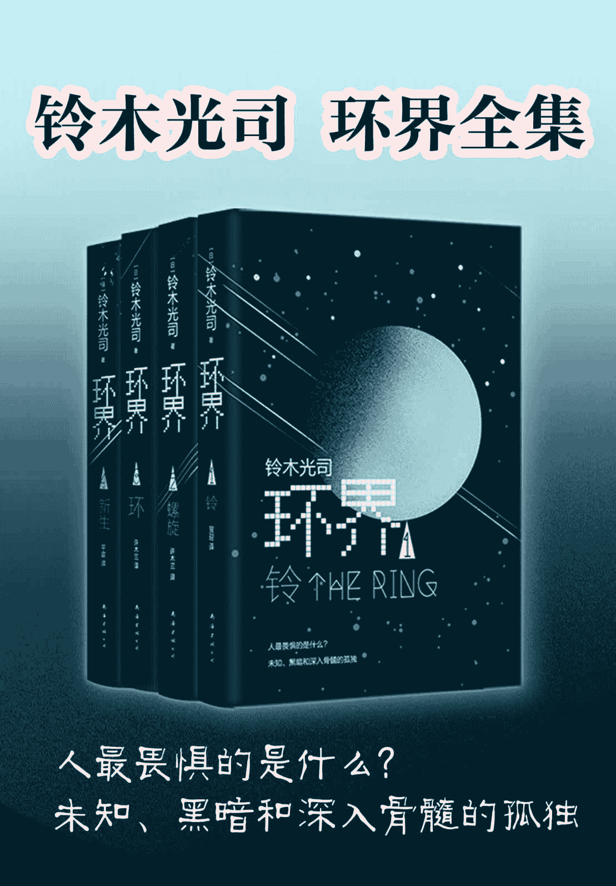
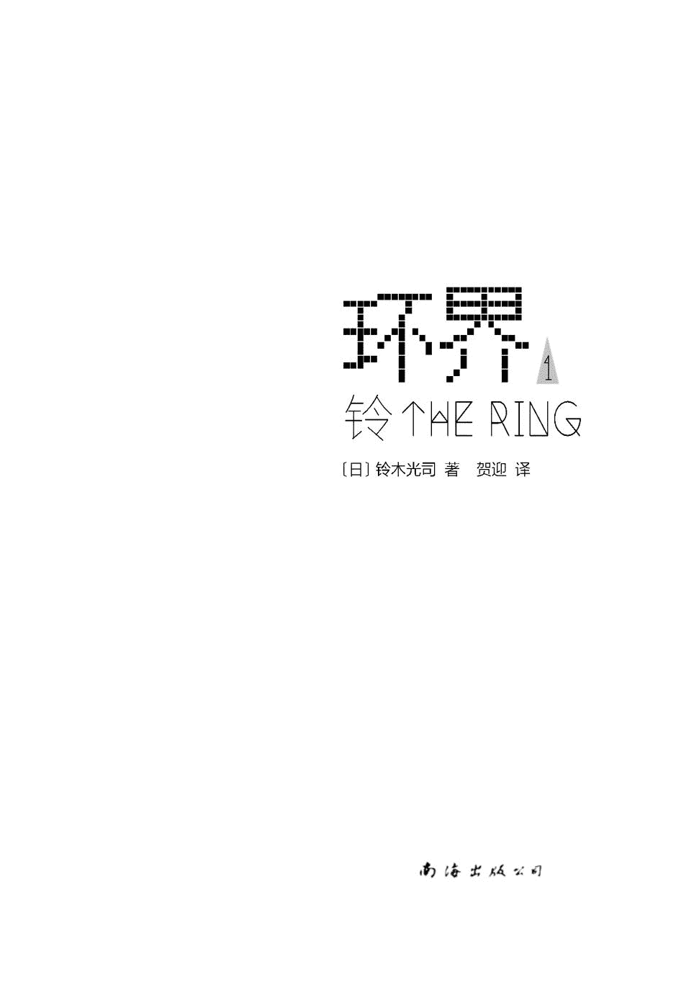
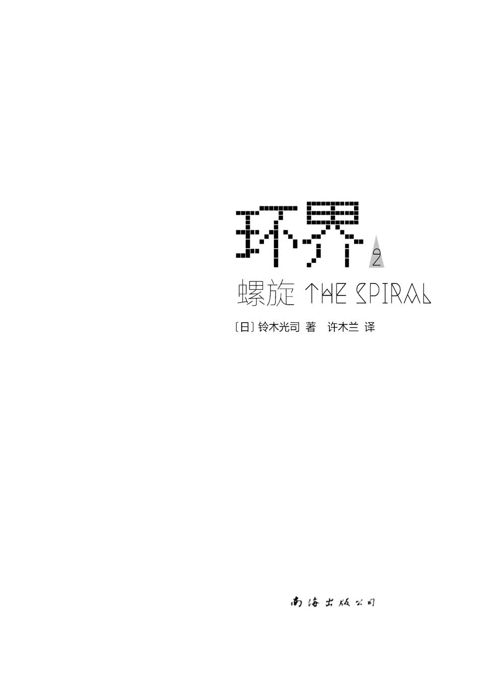
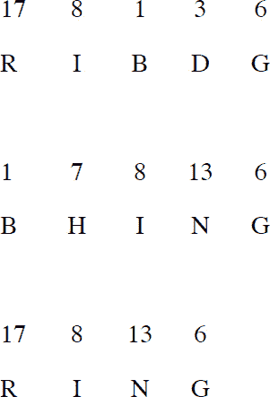
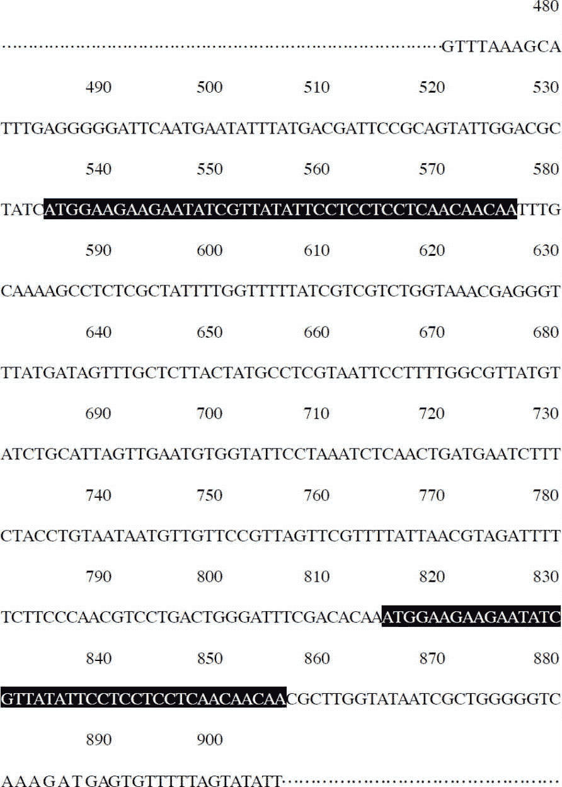
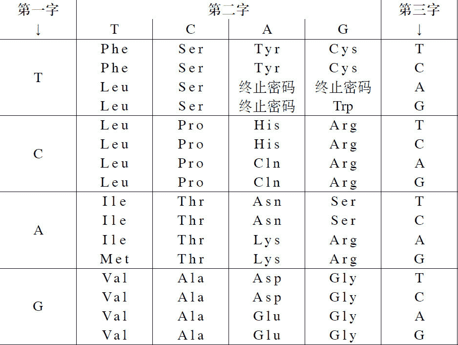
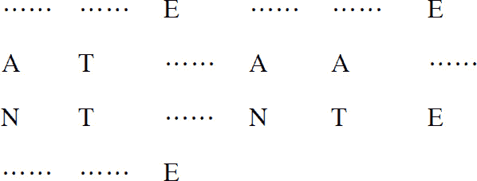
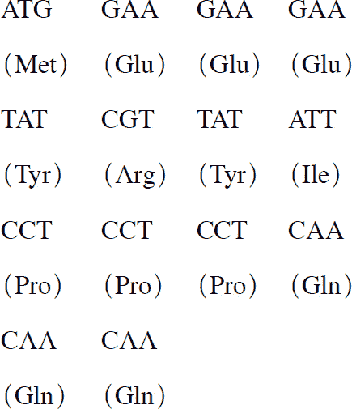
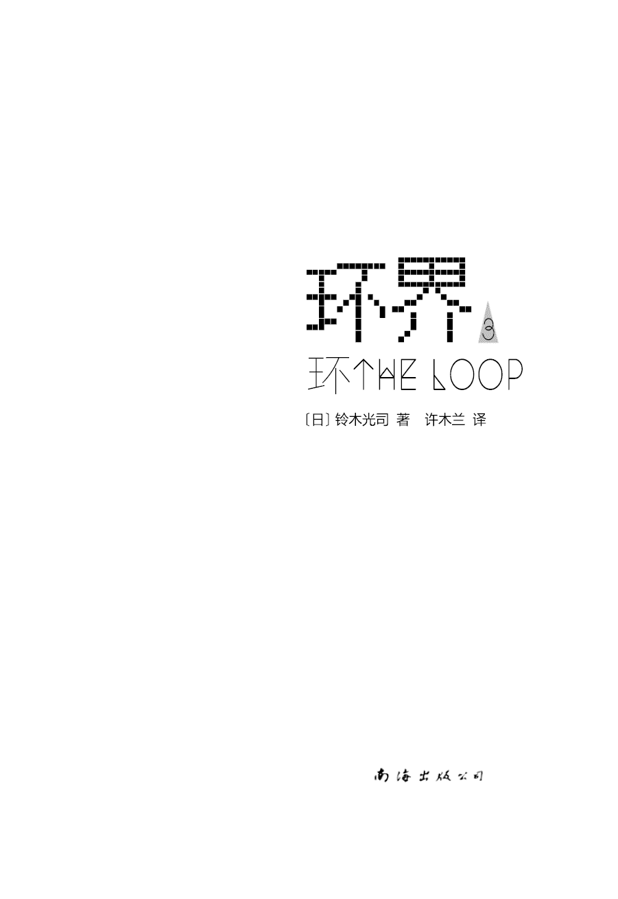
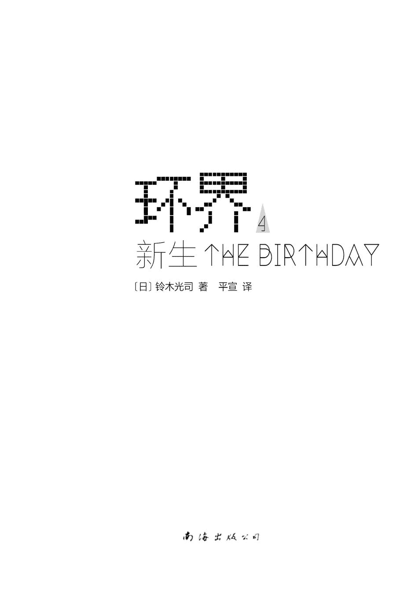

# 环界






# 第一章 初秋

## 1

9 月 5 日　22：49　横滨

紧邻三溪园的住宅区，北部并排矗立着数栋十四层公寓。尽管是新楼，但几乎都已住满。每栋楼里住着近百户人家，可大部分住户都互不相识。只有当夜幕降临，各家的窗户透出灯光时，人们才意识到这儿有人居住。

南边是一座工厂，厂里探照灯的灯光照在油乎乎的海面上，水里倒映着工厂落寞的身影，反射出星星点点的光芒。工厂的外墙上缠绕着无数管线，令人联想到人体内错综复杂的血管。覆在管线表面的灯饰则宛如闪烁的萤火虫，这种奇妙的景观形成了一种独特的美。

远处，在与工厂只有数百米之隔的地方，一处规划过的住宅地上孤零零地立着一栋新建的二层小洋楼。小洋楼紧邻一条南北走向的单行线，旁边是只有一个停车位的停车场。同一式样的楼房遍布新兴住宅区，或许是因为这里交通不便，这一座的周围却见不到其他楼房的影子，取而代之的是到处立着出售土地的牌子。和那些刚完工就住满的公寓相比，它多少显得有些落寞。

此刻，荧光灯的灯光透过小洋楼二楼洞开的窗户，斑驳地洒落在阴暗的路面上。大石智子是私立女子高中三年级学生，此刻正坐在二楼房间的书桌前。她穿着白 T 恤和短裤，两条腿对着落地电扇叉开，身子扭向一边，目光落在翻开的习题集上。T 恤下摆随风吧嗒吧嗒地翻飞着，风直直灌入了肌肤，可她还是自言自语地嘟囔着：“好热、好热……”由于暑假期间玩过头了，该做的习题堆积如山，智子只好归咎于天气太热。其实今年夏天并不是很热，晴天也不是太多，与往年相比，海水浴场的游客也少了许多。不料暑假一结束，居然持续了五天的酷暑。这种滑稽的天气弄得智子焦躁不安，不禁咒骂起老天爷来：他妈的这么热，让人家怎么看书嘛！

智子用手拢了拢头发，把收音机的音量开大了一些。这时，她看见身旁的纱窗上停着一只小飞蛾，它抵挡不过电扇的风势，一下子不知飞到哪儿去了。小飞蛾消失在黑暗中后，纱窗微微颤动了好一会儿。

从刚才到现在，智子的学习没有丝毫进展。明天就要考试了，可是就算今晚学个通宵，她也没法把功课复习完。

智子看了一眼钟，已近十一点。要不看一下电视里的职业棒球新闻吧，没准能在座席上看到爸妈呢。可她又惦记着明天的考试。智子一直非常向往大学，但凡冠上“大学”两个字，上哪所学校她都无所谓。可是今年暑假留下了很多遗憾。由于天气的缘故，她没能玩个尽兴，潮乎乎的湿气又令人很不舒服，让她根本提不起劲学习——唉，虽然是高中最后一个暑假，可还是希望能过得轻松点。过了这个暑假就要跟“女高中生”的身份道别了。

由于心情烦躁，智子转而将不满发泄到父母身上。真是的！女儿在挥汗如雨地读书，这两个人竟然若无其事地跑去看夜场球赛！也不考虑一下我这个女儿的心情！

由于工作关系，智子的父母偶然得到了巨人队比赛的门票，于是两人一块儿去了东京巨蛋看球赛。球赛结束后没什么地方可去的话，他们这会儿应该正准备回家。可是现在，这套全新的四居室住宅里却只有智子一个人。

尽管这几天没有下雨，智子却感到一股莫名其妙的湿气。除了身上渗出的汗水，房间里似乎还弥漫着细小的水滴。啪的一声，她无意识地拍了一下大腿，可是挪开手，却没有看到被拍扁的蚊子。或许是心理作用，她感到膝盖上一阵针刺般的瘙痒。这时屋里传来一阵嗡嗡的振翅声。智子用双手在头顶上挥了挥。是苍蝇。为了避开电扇的风，苍蝇在门前改变了飞行高度，突然从她的视野中消失了。从哪儿飞进来的啊？明明关着门。她检查了一下纱窗与墙壁之间的接缝，根本没找到足以让苍蝇进出的缝隙。突然，她感到一阵尿意和口渴。一股莫名的压力侵袭而来，尽管还不至于让人窒息，却有力地撞击着她的心脏。不停地叽里咕噜发牢骚的智子像换了个人似的陷入沉默。

下楼时，智子莫名地感到心脏怦怦直跳。一辆车从楼前的路上飞驰而过，前灯唰的一下扫过楼梯下的墙壁。车辆渐行渐远，引擎声越来越小，四周的黑暗仿佛变得比刚才更浓重。她故意发出重重的脚步声下楼，还随手打开了走廊上的灯。

方便完，智子坐在马桶上发了一会儿呆。她无法让心脏的悸动平息下来，以前从未有过这种感觉。这究竟是怎么回事？她做了几次深呼吸，然后站起身，将内裤和短裤一起提上来。

“老爸老妈，快点给我回来啊！”她突然用小女孩般的口气喃喃道。“不对，我这是在央求谁啊？”她不是在央求父母早点回来，而像是在央求别的人。“求求你，请不要伤害我。”她不禁使用了敬语。

用厨房的自来水洗过手后，智子直接用湿漉漉的手把冰柜里的冰块放进玻璃杯，然后满满地倒上可乐，一口气喝光，把玻璃杯放在吧台上。杯中的冰块骨碌碌地转了几圈，随即停住。智子不禁打了个寒战。可她仍觉得口渴，于是又从冰箱里拿出一升半的瓶装可乐倒入杯中。这时，她的手开始哆嗦。身后仿佛有一股腐肉的腥臭味渗入空气中，把她包围起来……那绝不可能是固体，更不可能是人。

“求求你！别这样！”智子大声哀求。水池上方，十五瓦的荧光灯突然闪了几下，熄灭了。新买的灯泡居然这么不禁用。这时，智子后悔刚才没把屋里的灯都打开。现在她连走到开关那儿开灯的力气都没了，甚至都不敢往后看。她知道身后有什么。那是一间十六平方米的和室，壁龛上摆着爷爷的牌位。房间里的窗帘没有拉上，透过玻璃窗可以看到对面绿草茵茵的住宅区，以及远处公寓里一小格一小格微弱的灯光。仅此而已。

第二杯可乐喝到一半时，智子已经动弹不得。就算是心理作用，这种诡异的气氛也未免太浓重。仿佛有什么东西突然伸过来，眼看就要触摸到她的脖颈，令她窒息——如果是“那个”怎么办？

智子不敢再想下去。一想起那件发生在一个星期前、她努力去忘却的事情，她就无法承受那极度膨胀的恐惧感。秀一说，既然上面是那样讲的，一切就已无法挽回，每个人随后都将一个接一个地死去。只是一回到都市，那部让她印象深刻的录像就失去了可信性，是谁在恶作剧吧？智子试图想些快乐的事，别的快乐的事。可如果真是“那个”……如果那是真的……对了，在那个时候，不是会有电话打来吗？

啊！老爸老妈到底在干什么啊！

“你们快点回来吧！”智子叫出声来，然而那个诡异的影子却丝毫没有就此罢手的迹象，依然一动不动地在她身后窥探，等待机会。

十七岁的智子还不太清楚“恐惧”的本质，但此时她深深感到，心里那份恐惧正在逐渐扩散。

真让我遇上了也没办法。不，肯定不会有事。即使我回头看，那儿也不会有什么东西。肯定什么都没有。智子内心萌生出一股回头看的欲望，想尽早从这种状态中解脱出来。可是，真的没有东西吗？她感到背部凉飕飕的。一股恶寒自肩头蹿起，顺着脊背一直往下游走，整件 T 恤都被涔涔冷汗浸湿了。再往深里想，她的肉体就会发生剧烈的变化。有谁说过，肉体比精神更真实。

就在这时，身后传来一阵声响。即使回头看，也不会有什么东西吧？不赶快把剩下的可乐喝完，回房去复习，明天考试就要完蛋了。

这时，咔嚓一声，玻璃杯中的冰块裂开了。智子不由得应声回头……

9 月 5 日　22：54　品川车站前的十字路口　东京

信号灯变成了黄色，木村并未冲过去，而是将出租车停在了马路左侧。运气好的话，能拉到去六本木路口的乘客。这儿的乘客多数是去赤坂和六本木方向的，经常有人趁着出租车等信号的时候钻进车来。

这时，一辆摩托车经过木村的左侧，在靠近人行横道的地方停下来。骑摩托车的是一位穿牛仔裤的小伙子。木村非常讨厌那些四处乱窜、挡人视线的摩托车，特别是那些等信号灯时若无其事地停在他车前或车门旁的。今天生意不好，他的心情也不好，于是他冷冷地盯着那位年轻人。年轻人头戴全罩式的安全帽，看不到他的表情，左脚搁在人行道的边缘上，张开腿，吊儿郎当地摇晃着身体。

这时，一位年轻的长腿女子从人行道上走过。年轻人扭过头，目光追随着女子的身影，却没有一直看下去。头部大约转到九十度时，他的视线落在了左侧的橱窗上。年轻女子走出了他的视线，不见了踪影。但年轻人依然没有转头，定定地在看什么。行人专用的信号灯开始闪烁，不一会儿变成了红灯。走在人行横道中间的行人加快步伐，擦着出租车走了过去，没有人招手向他靠近。木村让引擎空转着，静待信号灯变成绿灯。

就在这时，骑摩托车的年轻人突然举起双手，身体剧烈地颤抖，接着，向木村的出租车这边倒了过来，咚的一声撞在了他的车门上。

这个笨蛋！一定是没有站稳、身体失去平衡才摔倒的。木村想。他摆上警灯走下车来，心想，如果车门有任何损坏，一定要对方赔偿相应的修理费。此刻绿灯亮了，后方的车辆纷纷超过木村的车，驶过十字路口。而那个年轻人仰卧在马路上，双脚不停地乱蹬，双手挣扎着想摘下安全帽。木村先去察看自己的“挣钱工具”，果然，车门上有一道斜斜的划痕。

“呸！”木村低声咒骂着走近年轻人。安全帽的扣环紧紧地扣在年轻人的下巴上，他却拼命想摘掉安全帽，就像要把自己的脑袋也一起摘下来。

有这么透不过气吗？木村意识到年轻人的样子有些异常，一屁股坐到他身旁，总算开口问道：“你没事吧？”安全帽的面罩是灰色的，木村看不清年轻人的表情。年轻人握着木村的手，像是有什么话要说，甚至想抱住他，可是已说不出话来，也不再试图去摘面罩。

“你等一下，我马上帮你叫救护车。”木村很快作出了决定。

木村一边跑向公用电话，一边心想：真是不可思议，一下没站稳竟然会摔成那样！难道是落地时撞到了头？不可能啊，那家伙不是戴着安全帽吗？而且手和脚看起来也没摔伤，只要不找我的麻烦就行。如果他说是撞到我的车才受伤，那可就麻烦了。如果对方受伤了，可以用我的汽车保险理赔吗？这么一来，就得有事故证明，而且还要接受警察的盘问……

木村打完电话回到原处，发现年轻人把手放在喉咙处，已经动弹不得。周围有几个行人停下脚步，担心地观望着。木村推开人群，告诉大家他已经叫了救护车。

“喂、喂，坚持一会儿，救护车很快就来了。”

木村动手解安全帽的扣环。他轻而易举地就解下了安全帽，这根本不可能勒得人喘不过气来。更让他惊讶的是，年轻人的脸扭曲得变了形。如果用一个词来形容对方的表情，那就是“惊愕”。他双眼瞪得大大的，红色的舌头缠卷在喉头深处，口水从嘴角流出，已经等不及救护车来了。木村脱下年轻人的安全帽，伸手触摸他的脉搏时，已感受不到脉搏的跳动。他心里一惊，周围的情景一下子变得虚幻起来。

倒在地上的摩托车，车轮仍在缓缓地转动，黑色的汽油从引擎里流出，滴落进下水道。澄澈的夜空下没有一丝风，最上面的信号灯再次变成红色。木村摇摇晃晃地站起来，伸手抓住路边的栏杆，睁大眼睛又看了一眼躺在路上的年轻人。他头枕安全帽，头部与身体几乎成直角，这种姿势怎么看都让人觉得不自然。

是我放的吧？把他的头那样放在安全帽上，把安全帽当成枕头？我为什么要这样做？木村已回忆不起几秒前发生的事。年轻人瞪大眼睛望着他。木村感到寒气唰地从肩头掠过。即使是在这么闷热的夜晚，他仍哆嗦个不停。

## 2

内护城河清澈的水面上倒映着秋日清晨的景色，炎热的九月终于接近尾声。浅川和行正向地铁站台走去，突然，他改变了主意，想近些欣赏此前在九楼看到的河面风光，便上了楼梯，向外面走去。报社里犹如沉淀在瓶底一般的混浊空气，向地面淤积。他忽然渴望呼吸一下外面清新的空气。只要一看到东京这座城市中的绿色，连五号高速公路与环岛交会处的废气也不再令他心烦，微明的天空和清晨的空气都透着一股清新的气息。

昨晚熬夜了，浅川非常疲乏，却始终睡不着。完稿后的兴奋变成一种适度的刺激，他的脑细胞依然活跃。这两个星期，他一直没能休息好，因此打算今明两天在家好好补补觉。何况这是总编辑的命令，他可以光明正大地休假。

这时，他看到一辆空出租车由九段下的方向开过来，本能地举起手叫车。前两天他把竹桥与新马场区间的地铁月票用完了，还没去买新的。从这里乘地铁到北品川的公寓需要四百日元，而坐出租车要将近两千日元。虽然要浪费大约一千五百日元，可一想到乘地铁必须换乘三次，又刚刚领了工资，于是他决定，今天就奢侈一次吧。

浅川这一天会在这个地方打车，纯粹是一时的冲动。如果他坐地铁回家，那么上文所述的两起事件就绝不会连到同一条线上。故事的开始往往出于偶然。

出租车缓缓停在皇居的侧楼前。司机是一位四十岁左右的小个子男人，或许是熬夜的缘故吧，他的眼里布满血丝。仪表板上有一张彩色免冠照，旁边写着司机的名字——木村干夫。

“到北品川……”

听到目的地，木村的精神为之一振，因为北品川位于公司车库所在地东五反田的前方，他正准备收车，正好顺路。类似的情形往往让出租车司机感到工作的乐趣。木村不禁变得饶舌起来。

“待会儿要去采访吗？”

“哎？”浅川望着车窗外发愣，疲乏的眼睛里布满血丝。他很是纳闷，这司机怎么会知道自己的职业呢？

“先生，您不是报社记者吗？”

“我是周刊记者，你的眼睛真够尖的。”

木村开了近二十年的出租车，根据乘客的上车地点、穿着和措辞，他就可以把乘客的职业猜个八九不离十。一般来说，如果乘客从事的职业比较热门，并且以此为荣，紧接着就会聊起与工作相关的话题。

“您真辛苦啊，这么早就开始工作了。”

“不，正好相反。我现在是要回家睡觉。”

“啊，这样啊，那跟我一样。”

平时浅川对自己的工作并没有特别的自豪之感。今天早上他却头一次找到了自己的文章变成铅字的成就感，因为他策划的系列报道终于完成，并且引起了相当大的反响。

“工作有意思吗？”

“凑合吧。”浅川敷衍道。虽然这份工作有时候很有意思，有时候也很无趣，可是现在要一一作答太费劲。他忘不了两年前的那次失败，甚至还清楚地记得那篇报道的标题——《当代新神灵》。他的脑海中浮现出当年自己哆嗦着向总编要求做第二次采访的情景。

车内陷入短暂的沉默。出租车快速驶过东京塔左侧的弯道。

“先生，您是要走运河沿岸，还是走第一京滨？”根据要前往的北品川的地点，出租车的路线也有所不同。

“走第一京滨……我在新马场附近下车。”

乘客的目的地一清二楚，出租车司机就会感到轻松。木村在下一个十字路口往右拐。

快到那个地方了。一个月以来，木村始终无法忘记那个十字路口。与浅川对两年前的失败耿耿于怀不同，木村站在比较客观的立场上看待这次事故。他与这一切没有关系，既不需要对事故负责，也不需要为此反省。那完全是对方造成的事故，即使他提高警惕也无法避免。当时的恐惧感，现在几乎淡忘了。

只是有一点无法解释：为什么每次经过这儿，都想把当时的事说给别人听呢？如果从后视镜看到乘客在打盹，木村就放弃这个念头。如果乘客没有睡，他就有一种冲动，想把那件事和盘托出。

“那是大概一个月以前的事了……”仿佛在等着木村打开话匣子，信号灯由黄变红。“这世上有太多事情让人搞不清楚。”

木村开了话头，试图引起浅川的兴趣。浅川正睡得有些迷糊，听司机这么说，急忙抬起头扫视了一下四周，确认现在的位置。

“最近猝死的人好像增加了不少呢……没想到年轻人也会这样。”

“啊？”“猝死”这个词在浅川耳边回响。木村接着说下去：“就在将近一个月前吧，我的车停在那儿等绿灯，突然有一辆摩托车朝我这边倒了下来。不是在奔驰的过程中摔倒的，而是停在那儿，突然砰的一声倒下来。你猜怎样了？啊，开摩托车的是一个十九岁的补习班学生……居然就那样死了！可把我吓坏了。当时救护车也来了，警车也来了，乱成一片。”

浅川默默地听着，但凭着当了十几年记者养成的敏锐洞察力，他立刻记下了司机和出租车公司的名称。这纯粹是一种出于本能的反应。

“那个年轻人的死法也有些奇怪。他使出吃奶的力气想摘掉安全帽……整个人仰卧在地上，手脚吧嗒吧嗒地挥动……我赶紧跑去叫救护车，可是回来一看，他已经死了。”

“地点在哪儿？”浅川已全然没了睡意。

“喏，就在那边。”木村指着车站前的斑马线说。浅川把这件事深深烙在脑海里。品川车站位于港区高轮。如果是在那儿发生事故，应该由高轮警局负责。他在脑中迅速搜索打入高轮警局的内线。大型报社的威力就在于此，它在各个领域布下眼线，搜集情报的能力有时甚至超过警察。

“那么，他的死因是‘猝死’了？”浅川急忙问道，尽管他不清楚是否有猝死这个病名，也不知道这起事故究竟牵动了自己哪根神经。

“简直是开玩笑！我的车是停着的。他自己突然倒了过来。可是还要我提交事故证明，在保险公司也差点留下不良记录……真是祸从天降啊！”

“你还记得准确的日期和时间吗？”

“哎呀哎呀，您不会是嗅到什么事件的气味了吧？应该是九月四号或五号吧，嗯……大致就那前后。时间嘛……我想是晚上十一点左右吧。”说着，木村的脑海里又浮现出当时的情景。温热的空气，从倒在地上的摩托车里流出的黑油……黑油像活物一般向下水道漫过去，在车灯的映照下，变成黏糊糊的油滴，无声地滴入下水道，旋即没了踪影，视觉似乎发生了暂时性的障碍。还有那个头枕安全帽的年轻人临死前的脸，那张饱受惊吓的脸。他是被什么吓到了呢？

信号灯变成绿灯，木村轻踩油门。从后座传来奋笔疾书的声音，是浅川在做笔记。木村感到一阵恶心。自己怎么记得这么清楚呢？他吞了一下口水，把这阵恶心强压下去。

“那么他的死因是什么？”

“心脏麻痹。”

心脏麻痹？法医真是这么诊断的吗？最近应该不常用心脏麻痹这个词了。

“除了准确的日期和时间外，这个也有必要确认一下。”浅川一边喃喃自语，一边做笔记，“也就是说，除此之外，死者身上没有任何外伤吧？”

“是的，没错。肯定是受到了惊吓，肯定……令人惊恐的正是这一点！”

“啊？”

“哦，没什么……那个人死时脸上充满极度的恐惧……”

浅川的心怦然一动。同时，他又否定了两件事之间的关联。这一定是偶然的雷同，只是偶然。

转眼到了京滨高速的新马场。

“请你在前面的红绿灯处左拐，在那儿停车。”

车停稳，浅川打开车门，把两张一千日元的钞票连同名片一起递给木村。“我是 M 报社的浅川，如果方便的话，今天你讲的事，能否让我了解得更详细些？”

“嗯，没问题。”木村高兴地说道。不知为什么，他觉得这么做是自己的使命。

“改天再给你电话。”

“我的电话号码是……”


## 3

小栗总编脸色凝重地听着浅川的汇报，脑中倏地掠过他两年前的身影。当时的浅川中了邪似的成天坐在文字处理机前，埋头整理采访资料，编写着教祖影山照高的传记，整个人都很异常，鬼里鬼气的。小栗差点把他送进精神病院。

很不凑巧，当时正赶上那个时期。两年前，超自然现象在出版界刮起一股前所未有的旋风，编辑室里灵异类的照片堆积如山。寄到各家出版社的净是些灵异学说和灵异照片之类的伪造品，让人不得不感叹：这世界到底怎么了？小栗一直坚信人类可以在一定程度上解读世界的结构，可是只有灵异现象，他怎么也找不到令人信服的答案。当时，投稿者比以往任何时期都多，简直超越了常规。毫不夸张地说，每天收到的邮件足以把编辑室淹没，而且都是关于灵异的内容。不只是 M 报社，日本所有出版社都被卷入这股灵异旋风中。这种现象让人难以理解，也让人困惑。

M 报社花费大量时间调查后发现，这并非一个人寄出好多封，基本上每封匿名邮件都来自不同的人。他们估计有将近一千万人在这一时期向各家出版社投稿。一千万！整个出版界都为之震惊。尽管投稿的内容并非都很恐怖，可是单单这个数字就足以令人震惊，这意味着全国每十人当中就有一人投稿。但与出版相关的人士及其亲友当中，却没找到一个投过稿的人。这到底是怎么回事？那些堆积如山的信件到底从何而来？就在报社的编辑人员为此大伤脑筋，找不到答案时，这股风潮却归于平静。这种非正常状态持续了半年，犹如做了一场梦，编辑部又回到正常轨道，再也没收到这一类的投稿。

报社发行的周刊杂志该如何应对这种现象，小栗总编必须表明态度。他最后作出的决定却是“置之不理”。他认为，这股灵异旋风的煽风点火者往往是无聊的八卦杂志。那些杂志刊登灵异照片和许多人经历的故事，激发了读者的投稿热情。当然，他很清楚这种说法不能服众，但是必须找出合适的理由。

之后，小栗总编手下的编辑便把收到的邮件原封不动地烧毁。在与外界的交往中，只要是有关灵异的话题，他们都会回避，显得漠不关心。久而久之，那股前所未有的投稿热终于慢慢降温。而现在，浅川竟然愚不可及地要往即将熄灭的火上浇油。

难道你想重蹈两年前的覆辙吗？小栗定定地看着浅川的脸。

“我说你啊……”每当小栗不知该怎么说的时候，就以这句话做开场白。

“我非常清楚总编您是怎么想的。”

“不，啊，这件事倒是很有意思。但是我不知道将产生怎样的后果。是吧？如果到最后又像那件事一样，岂不是很伤脑筋吗？”

小栗仍坚信两年前的那股灵异热潮是人为的，而且对此深恶痛绝。当时那股风潮给他带来了极大的困扰，他对所有灵异现象都抱有偏见。

“我并非想刻意强调它的神秘性，只是想说，这种事绝非偶然。”

“偶然啊……”小栗把手搁在耳边，重新整理先前谈话的内容。

浅川太太的外甥女大石智子，于九月五日晚上十一点左右在本牧的家中死亡，死因是急性心肌功能不全。她还在读高三，年仅十七岁。同一天，同一时刻，在品川车站前，一位十九岁的补习生骑着摩托车在等信号灯时，因心肌梗塞突然死亡。

“我倒认为这只是偶然的巧合。你该不是从出租车司机那儿听说了那起事故，就自然地想到了你太太的外甥女的事吧？”

“能否接着听我说？”浅川极力想激起小栗总编的兴趣，“那个骑摩托车的男子在临死前，挣扎着想摘掉安全帽。”

“然后呢？”

“智子的尸体被发现时，她也像是在痛苦地挠头，双手手指被头发紧紧地缠住。”

浅川见过智子好几次，就像一般的女高中生一样，她平时非常爱惜头发，是个很爱美的女孩子。这种女孩子不可能用力拉扯自己的头发。究竟是什么让她这么做呢？每当眼前浮现出智子用力拉扯头发的身影，他就试着想象一个无形的影子，想象那种驱使她拉扯头发的难以言喻的恐惧。

“我真是不明白。你呀，不是钻牛角尖钻过头了吧？任何事情，只要想找其中的共同点，应该都能找出来。总而言之，两人都是因心脏病发作而死，当然会很痛苦，所以才挠头或挣扎着想摘掉安全帽……这难道不是很平常的事吗？”

尽管浅川承认有这种可能性，但还是摇了摇头。这理由仍然让人难以信服。

“总编，是胸口啊。应该是胸口疼，为什么要挠头呢？”

“你有过心脏病发作的经历吗？”

“……没有。”

“那你有没有问过医生？”

“问什么？”

“心脏病发作时，患者会不会挠头？”

这下子，浅川无话可说了。其实他问过医生，医生是这样回答的：也不能说没有这种可能性，但目前还没有定论。有时也会发生与此相反的情形，比如说，蛛网膜下出血或脑溢血时，就会引发头痛，肚子也会感到不舒服。

“总而言之，可能存在个人差异吧。就像学生解不出数学题时，有人会挠头，有人会抽烟，还有人把手放在肚子上。”小栗一边说，一边转动着座椅，“就目前来看，一切还没有定论，而且我们杂志的篇幅也不够。你应该明白吧？因为两年前的那件事，我们不能再轻易去碰触这一类的题材了。如果你执意想写，倒也可以写。”

或许真如总编所说，这两件事只是偶然的巧合。可是为什么连医生也觉得不可思议？问医生有人心脏病发作时，会不会拼命扯自己的头发，医生只是严肃地“嗯”了一声，他还没有遇到过这种病人。

“我明白了。”

现在只有乖乖撤兵，除非能发现这两起事件有更加客观的联系，否则很难说服总编。如果没有什么进展，就悄悄收手吧。浅川这样决定。

## 4

浅川挂了电话，手放在话筒上，愣愣地站在那儿。耳边依然回荡着自己征询对方意见时谦卑的声音，他感到很不舒服。一开始，对方从秘书手中接过电话时还非常傲慢，可听清浅川的来意后，语气便逐渐变得委婉。他最初可能以为浅川是来拉广告吧，接着，大脑便开始飞速运转，细细盘算这篇报道将带来多少好处。

“顶级访谈”系列报道九月份开始连载。这个策划以新兴企业的老总为采访对象，对他们奋斗过程中的酸甜苦辣进行报道。本来非常顺利地和对方敲定了采访的事，挂电话时应该感到满意才对，浅川的心情却异常沉重，因为他从这个俗不可耐的男人那儿将听到千篇一律的说辞：创业的辛酸史，自己如何精明能干、善于抓住机会，如何克服困难……如果你不礼貌地告辞，他就会喋喋不休地讲自己的成功史，没完没了地讲下去。真是烦透了。浅川非常痛恨做这项策划的人。他明白想把杂志维持下去，无论如何不能缺广告，为了给今后拉广告做铺垫，这一类的采访不能不做。可是浅川不太关心报社是否盈利，他看重的是这份工作有没有意思，仅此而已。从事不需要思考的工作，体力上会很轻松，但是精神上往往容易疲劳。

明天的采访需要查一些资料，浅川向四楼的资料室走去。不过他更惦记另一件事：两起耐人寻味的猝死事件之间有什么客观联系。这件事突然从脑子里冒出来，尽管他并不知道该从哪儿着手。他试图把那位庸俗老总的声音甩开之际，脑中却闪过一个疑问：难道发生在九月五日晚上十一点左右的猝死事件，真的只有这两起？

如果还发生了同样的事件，就可以断定这绝非偶然。浅川决定去查阅九月上旬的报纸。他平常看报只认真看商务报道，社会新闻多半只是浏览一下标题，很可能漏掉一些报道。他有预感，好像有件事与这些有关。他隐约记得就在一个月前，曾在报纸社会版的角落里看到过一个奇怪的标题，好像刊登在报纸左下角一个很小的地方……当时他不禁“哎呀”了一声，正准备往下看，却被同事叫走了，因为一直忙碌，现在都没有来得及看。

浅川从九月六日的早报开始查起，坚信一定可以发现线索。他就像一个寻宝的孩童，心怦怦直跳。在昏暗的资料室里查阅近一个月的报纸，他却体会到了庸俗的采访中无法体味的亢奋。与成天体面地在外面周旋，和各色各样的人打交道相比，这种工作更让他着迷。

九月七日的晚报，浅川在印象中的位置终于找到了那条消息。版面被一则死者达三十四人的海难事故新闻挤压，这条消息的篇幅比他想象的还小，难怪会忽略掉。浅川戴上银边眼镜，脸凑近报纸，逐字逐句地看着正文。

> 租赁车内发现一对离奇死亡的青年男女尸体
>
> 七日上午六点十五左右，在横须贺市芦名县的某段公路上，一位路过的卡车司机在一辆停在路边空地上的小轿车前座上发现一对青年男女的尸体，随即向横须贺警局报案。
>
> 追查车主，判定死者分别是东京都涩谷区的补习生（十九岁）和横滨市矶子区某私立女子高中的学生（十七岁），车由补习生于两天前的傍晚向涩谷区的租车公司租来。
>
> 尸体被发现时，车门是锁上的，钥匙仍插在锁孔里。据推断，这对男女的死亡时间在五日深夜到凌晨天亮之间。从车窗紧闭的情况来判断，两人是在熟睡期间因缺氧致死，也有可能是服药自杀，详细死因尚未得知，就目前的情况来看，没有他杀的嫌疑。

这则消息十分简短，浅川却从中发现了确凿的线索。首先，死亡的女高中生和外甥女智子就读于横滨同一所私立女子高中，同为十七岁。租车的男生则跟那位猝死在品川车站前的男生在同一所补习班补习，两人都是十九岁。推测的死亡时间也基本相同，死因也同样不明。

这四个人的死亡肯定有关联，找出其中关键的共同点应该不用花很多时间。更何况浅川在大报社里工作，不用担心搜集不到信息。浅川拿着这则消息的复印件，急忙向编辑部走去。犹如发掘了一个取之不尽的金矿，他内心充满成就感，逐渐加快了步伐，甚至连等电梯的时间都让他急不可耐。

横须贺市政府记者俱乐部中，吉野坐在专用的书桌前振笔疾书。只要不塞车，由东京总部到这儿走高速公路只需一个小时。

“吉野先生。”浅川站在吉野身后叫了一声，他已有一年半没见过吉野了。

“哦……是浅川啊。发生什么事了？你竟然要特地跑到横须贺来……先坐下再说。”吉野拉出一把椅子让浅川坐下。吉野胡子拉碴的样子容易给人留下不好的印象，想不到他竟然非常体恤人。

“最近忙吧？”

“啊，还好。”吉野是浅川还在新闻部任职时的前辈，比他早三年入社，今年三十五岁。

“我问过横须贺通讯部后，才知道吉野先生在这里……”

“你找我有事吗？”

浅川把复印的报道递了过去。吉野认真地读起来，竟然花了相当长的时间。虽然这篇报道是他写的，应该不用仔细看就知道内容，他却全神贯注地读，连最爱吃的花生也含在嘴里忘了吃。不久，他开始慢慢地咀嚼，犹如想把这件事逐一回想起来，一同放入胃里消化。

“这篇报道怎么了？”吉野一脸严肃。

“没什么，我只是想知道得更详细些。”

吉野站了起来。“好吧，我们到隔壁边喝茶边聊。”

“你有时间吗？”

“没问题。这件事好像挺有意思的。”

市政府旁就有一家小小的咖啡店，咖啡只要两百日元一杯。吉野一落座便冲吧台高喊：“来两杯咖啡。”然后转过头来面对着浅川，把身子往前挪了挪。

“所以吧，我当了十二年社会新闻部的记者，遇到过各种各样的事情，但是，这么奇怪的事情还是头一次碰到。”说到这儿，吉野喝了口水，接着往下说，“浅川，就当是交换条件吧。告诉我，你在总部出版局工作，怎么会想调查这件事呢？”

现在还不能告诉他真相。浅川想要一个属于自己的“独家新闻”。如果让吉野这样的高手知道了，一眨眼工夫猎物就会被抢走。浅川赶紧编了个谎：“也没什么特别的理由。我的外甥女跟那位死去的女高中生是朋友，她一直刨根问底。刚好我来这儿，想顺便……”

真是个蹩脚的谎言。吉野的目光中现出一丝怀疑，有些不快地往后一靠。“是真的吗？”

“嗯，毕竟她是个高中女生。朋友去世就够不幸的了，偏偏又死得那么蹊跷，所以她问了一大堆的问题……拜托，快把详细情况告诉我吧。”

“那你想知道什么？”

“查明死因了吗？”

吉野摇了摇头。“唉，就是心脏突然停止跳动。至于为什么会发生这种事，就不得而知了。”

“没有他杀的嫌疑吗？譬如被勒死之类的……”

“不可能，脖子附近没有内出血的迹象。”

“药物呢？”

“解剖后也没有查出什么药物反应。”

“可是，这个案子还没结案……”

“结个屁案啊。这又不是什么凶杀案件，只能以病死或意外死亡了结，当然更不会有什么调查小组了。”吉野往后靠在椅背上，不以为然地说道。

“为什么要隐瞒死者的名字？”

“因为死者是未成年人嘛……还有可能是自杀殉情。”吉野像是突然想到什么，扑哧一笑，身体往前凑了凑，“那个男生哪，内裤连牛仔裤一起褪到膝盖那儿了。那个女生也一样，内裤也褪到膝盖了。”

“可是，是正在进行了？”

“不是正在进行，是正准备的时候。还没开始享乐，就是那个时候——”吉野啪地拍了一掌，“出事了！”他的语气很能调动人的情绪。

“哎，浅川，你跟我说实话吧。你是不是找到了什么与这起事件相关的线索？”

“……”

“我会保守秘密的，压根儿就不想抢你的功劳，只是对这件事很感兴趣。”

浅川依然不吭声。

“喂，别吊我的胃口啦。”

浅川想了想，还是觉得不说为妙。可是他又无法圆谎。

“对不起，吉野先生，能否再等一阵子？现在我还不能说。我保证，两三天后一定说给你听。”

吉野大失所望。“唉，既然你都这么说了……”

浅川用恳求的眼神看着吉野，催促他接着往下说。

“我们只能认为是发生了什么事。那对男女正要大干一场的时候，却突然窒息身亡了。这可不是开玩笑。曾推断他们可能是事先吃了毒药，因药效发作死亡，可是药检中却没有任何药物反应……当然，有的毒药也不会发生反应，可是补习生和女高中生怎么能轻易拿到这样的毒药呢？”

吉野脑海中浮现了出事地点的情景。当时他曾到现场看过，印象相当深刻。沿着芦名至大楠山的土路上行，在狭窄的山谷之间有一块长着茂密树林的空地，那辆小轿车就停在那里。从山下开车上来的人都可以瞥见这辆车的尾部。不难想象那个补习生为什么会把车开到这个地方。一到晚上，这条路上几乎没有车经过，从山上延伸下来的树林成了天然屏障，这对没什么钱的情侣而言真是个天然的幽会场所。

“死的时候，那个男生的头紧贴着方向盘和车窗，那个女生的头埋进副驾驶座的下方和车门之间。我亲眼看到那两具尸体被人从车上抬出来的情景。当时车门一打开，那两具尸体顿时从两侧的车门滚了下来，好像死的一瞬间被人从内侧用强力挤压了似的，而且在他们死去三十个小时后，那股力量似乎依然留在车内。调查人员刚伸手打开车门，两具尸体就砰的一声给弹了出来。你注意听好，那辆车是双开门，如果车钥匙插在锁孔里的话，车门是无法打开的。当时钥匙就插在锁孔里，车门也上了锁……你应该知道那是怎样的情况。那辆车处在一种完全密闭的状态下，他们怎么可能会受到外力的挤压呢？哎，你猜他们死时脸上的表情是怎样的？两个人都显得极为恐惧，脸都扭曲了。”

吉野停顿了一下。响起“咕嘟”一声吞口水的声音，不知是浅川还是吉野发出来的。

“你想想看，假设森林中跑出一头可怕的野兽，他们两人应该会吓得抱在一起才对。就算男生不这么做，女生也会先靠近男生，毕竟是恋人嘛。可是，不论是男生还是女生，却都想尽可能离对方远一些，拼命把背部紧贴车门。”吉野双手一摊，做出难以理解的姿态，“究竟怎么回事，真是弄不明白啊。”

如果没有横须贺的那场海难事故，这篇报道应该会被大肆渲染，成为读者茶余饭后的话题。可是，当时身处现场的人们，包括搜查人员在内，都沉浸在这样的气氛中——尽管都在思考同一个问题，甚至话都到嘴边了，却没有一个人说出口。大家明知一对男女同时因心脏病发作死亡的几率微乎其微，却以医学上牵强附会的解释逼自己接受，尽管并没有人信服。大家没有把疑问说出口，并不是担心被视为笨蛋，而是不敢承认身边居然发生了这么恐怖的事情。依赖于科学的解释，可以使人心安。

这时，一股寒意自浅川和吉野的背脊蹿起，两人都在思考同一个问题。短暂的沉默让他们确认了彼此的预感：事情并没有就此结束，一切刚刚开始。他们坚信，不论人类掌握了多少科学知识，终归会有某些无法以科学法则解释的事实。

“发现尸体的时候，那对男女的手放在什么地方？”浅川唐突地问道。

“头……不对，感觉更像是用两只手蒙着脸。”

“是不是像这样，想要把头发扯光似的？”浅川做出揪扯头发的样子。

“嗯？”

“我的意思是，他们是不是用双手抓着自己的头，像要把头发扯掉？”

“不是，我想不是这样。”

是吗？吉野先生，能不能把补习生和女高中生的地址和名字告诉我？”

“可以。不过，你可不要忘了答应我的事。”浅川笑着点了点头，吉野站了起来。霎时，桌子摇晃了一下，咖啡洒落在托盘上——吉野的咖啡一口都没喝。

## 5

浅川本想利用闲余时间去追查四名少男少女的死因，但由于工作繁忙，迟迟无法按照计划进行。就这样，一个星期过去了，迎来了新的月份。无论是细雨绵绵、闷热无比的八月，还是烈日炎炎、胜似夏日重返的九月，都随着日渐浓重的秋意一去不复返，成为人们心中的记忆。在这期间，什么也没有发生。浅川每次阅读报纸的社会版时连边边角角都不放过，可是再也没有发现类似的事件。难道在他无法看到的地方，某种可怕的东西正在紧锣密鼓地实施“阴谋”？随着时光的流逝，越来越多的人认为四人的死亡只是纯粹的偶然，他们之间可能没有任何联系。从那以后，浅川也没再见过吉野。想必吉野也忘了这档事，要是他还记得，早该联系浅川了。

浅川的热忱也逐渐消失，他从口袋里拿出随身携带的四张卡片，重温了一下自己坚信绝非偶然的想法。卡片上记录着死者的姓名、住址等基本事项，底下空白处则详细记载着八月到九月间四人的行动，以及他们的成长历程等通过采访收集到的信息。

### 卡片一

**大石智子**　1972 年 10 月 21 日生

私立启圣女子学园三年级，17 岁

地址：横滨市中区本牧元町 1-7 号

9 月 5 日晚上 11 点左右，父母出门期间，死在自家一楼的厨房，死因是急性心肌功能不全。

### 卡片二

**岩田秀一**　1971 年 5 月 26 日生

英进补习学校一年级复读生，19 岁

地址：品川区西中延 1-5-23 号

9 月 5 日晚上 10 点 54，在品川车站前的十字路口倒地死亡，死因是心肌梗塞。

### 卡片三

**辻遥子**　1973 年 1 月 12 日生

私立启圣女子学园三年级，17 岁

地址：横滨市矶子区森 5-19 号

9 月 5 日深夜至天明，在大楠山麓县公路旁的车中死亡，死因是急性心肌功能不全。

### 卡片四

**能美武彦**　1970 年 12 月 4 日生

英进补习学校二年级复读生，19 岁

地址：涩谷区上原 1-10-4 号

9 月 5 日深夜至天明，和辻遥子同时死在大楠山麓的车上，死因是急性心肌功能不全。

不用采访也能确认，大石智子和辻遥子是同一所高中的同学，岩田秀一和能美武彦也是同一所补习学校的同学。从辻遥子和能美武彦在九月五日深夜开车前往横须贺的大楠山推断，两人即使不是恋人，也应该是经常玩在一起的亲密朋友。听辻遥子的朋友说，她好像正在和一个东京的补习生交往，只是还不知道他们是何时认识，又是如何熟识的。浅川萌生出“大石智子和岩田秀一会不会也是恋人”的疑问。然而几经调查，都没有证实这一点的线索。说不定大石智子根本就不认识岩田秀一。那么将他们四人联系在一起的线到底在哪里？如果那个不明物体随机挑选牺牲者，那么这四人的关系未免又太亲近。会不会这四人知道了不为人知的秘密而惨遭谋杀？浅川尝试以科学的观点来思考：难道四人同时在某个场所感染了侵袭心脏的病毒？

有那种会引起急性心肌功能不全的病毒吗？浅川边走边摇头。

“病毒、病毒……”浅川喃喃自语着上了楼。他转念一想，或许应该先用科学的方法来试着解释。假设存在一种引发急性心脏病的病毒，比假设存在超自然力量更为现实，也不用担心遭到他人讥笑。


# 环（节选）

尽管目前地球上尚未发现这种病毒，但它大概是隐藏在陨石内部，从宇宙中飞到地球上来的。抑或一种新开发的细菌武器泄漏了。对，姑且先把它当作一种病毒。当然，并非所有的疑问都能迎刃而解。这四人死时为什么都露出惊恐的表情？辻遥子和能美武彦死在狭窄的车内，为什么拼命地想躲开对方？尸检为什么查不出任何结果？如果是细菌武器泄漏，那么第三个疑问就很容易找到答案：一定是有关部门下令保密。

根据这个假设推测下去，从尚未发现其他被害者来看，可以确定这种病毒不会经由空气传染。那么它是像艾滋病那样经由血液感染，还是极难感染上？最为关键的是，他们四人到底是在什么地方接触“病毒”的？必须重新梳理一遍这四个人八月到九月的行动，找出相同的时间和场所。现在已无法向当事者求证，找出共通之处恐怕很困难。如果这只是四个人的秘密，连父母和朋友都不知道，就没法查了。不过，这四个人肯定在同一时间、同一场所共同接触过同一事物。

浅川坐到文字处理机前，暂且将来历不明的病毒赶出脑海。他拿出刚刚采访的笔记，开始快速地整理录音带的内容。这篇报道必须今天完成。明天是星期天，他要和妻子阿静一同去探望妻姐大石良美。他想亲自到智子死亡的地方看一看，感受一下残留的气氛。此行是为了安慰刚失去独生女的姐姐，所以阿静同意了去本牧，她并不知道丈夫的真实意图。

## 6

阿静又见到了父母，距离上次见面大约隔了一个月。外孙女智子逝去后，两位老人家每逢休假便从足利来到东京，和女儿相互寻求安慰。时至今日，阿静才知道这件事。她看到父母憔悴的面容中饱含着深沉的悲伤，不觉一阵心痛。两位老人原本有三个外孙辈——长女良美的女儿智子，次女纪子的儿子健一，以及浅川夫妇的女儿阳子。三个女儿各有一个小孩，并不算多，但智子是长外孙，所以每次见到智子，两位老人脸上总会绽放喜悦的笑容，对她也格外宠爱。然而父母现在的心情如此低沉，她都无法分清到底是姐姐与姐夫的悲伤更为深重，还是父母更为悲切。外孙女真的有那么可爱吗？

今年刚满三十岁的阿静，只好想象着自己的孩子死了会怎样，努力揣测姐姐的悲伤。但是不管怎样，女儿阳子才一岁半，根本无法与智子相比。阿静想象不出岁月的更迭沉积会如何加深亲人间的情感。

过了下午三点，家住足利的父母准备启程回家。

阿静觉得很不可思议。平时老公总是唠叨着忙啊忙的，这次为什么主动提出探望大姐呢？之前为了赶稿子，他连智子的葬礼都没有参加。平时不到吃晚饭的时候往往见不到他的人影。此外，老公只见过外甥女智子几次面，两人也应该没有亲密交谈过，按理说他不会如此怀念她、不忍她离去。

“老公，我们也该……”阿静轻敲浅川的膝盖，附在他耳边低声说道。

“阳子这孩子好像困了，要不我们就让她在这里睡一下吧。”

浅川夫妇今天把女儿也带来了。平时，这会儿正是她午睡的时间。阳子的眼神确实已睡意朦胧。但是如果让她在这儿睡，他们就得多待两个小时。面对刚丧女的姐姐和姐夫，这两个小时里到底该说些什么呢？

“不能让她在电车上睡吗？”阿静压低声音说。

“上次这样，她就跟我们闹别扭了，弄得我们好惨。我可不想再这样了。”

每当阳子在喧闹的人群中有了睡意，就会变得特别难缠。她会双手双脚不停乱动，扯着嗓子大哭大闹，搞得父母很为难。一旦开口骂她，更如火上浇油。除了想方设法哄她睡着，没有别的法子能让她消停。每到这种时候，浅川就很在意周围的视线。人们露出厌烦的神情，认为是当家长的给他们带来了这样的烦扰。其他乘客以备受困扰的眼神默默指责时，浅川都会感到窒息，只好沉默不语。阿静也不愿看到丈夫脸上的肉神经质地颤抖。

“既然你都这么说了……”

“就这么办，让她到二楼去睡一会儿吧。”

阳子的头枕在妈妈的膝盖上，双眼半睁半合。

“我去哄她睡。”浅川用手背轻抚着女儿的脸颊。他平常很少照顾孩子，这句话让阿静感到很稀奇。难不成他是感受到父母失去孩子的悲痛，懂得将心比心了？

“你今天是怎么啦，总觉得有点不对劲。”

“没事，看样子很快就睡着了，交给我吧。”

阿静把女儿交给浅川。“那就拜托啦。你平时也这样帮我就好了。”

从母亲的胸口移到父亲的怀里，阳子微微皱了皱眉头，还没哭出来，又进入了梦乡。浅川抱着女儿上了楼。二楼有两间和室及一间智子先前住的西式房间。他轻轻把阳子放在朝南的和室的被窝里。女儿发出轻柔的鼻息声，已经沉沉地睡着了。看来没必要在旁边陪她了。

### 调查智子的房间

浅川蹑手蹑脚地走出和室，观察着楼下的动静，溜进智子的房间。对于这样侵犯死者隐私的行为，他感到有点理亏。但是为了一个伟大的目的、为了惩治一项恶行，只能这样做。他又感到悲哀：竟然要这样找出种种理由来，使自己的行为正当化。他辩解着：我不是为了写报道，只是为了找出你们四人共同待过的时间和场所，稍稍打扰你一下啊。

浅川打开书桌的抽屉。里面整齐地收放着女高中生常用的文具，还有三张照片、小置物盒、信件、备忘簿和针线。她死后，父母收拾过吧？不，不像。她原来好像挺爱整洁。能找到日记本之类的东西就省事了。×月×日，在哪儿，和辻遥子、能美武彦、岩田秀一四人……能找到这样的记述就好了。浅川从书架上拿起一本笔记本，快速浏览了一下，又从抽屉最里边找到一本很女性化的日记本，只有前面几页寥寥记着几笔，日期已经相当久远。

书桌旁的彩色箱子里并没有装书，而是放了一个红色花纹的小化妆盒。浅川拉开化妆盒的抽屉，里面摆着无数廉价的饰品。可能是经常丢失的缘故，大多数耳环都不成对。随身携带的梳子上面还缠绕着几根细细的头发。

浅川打开定做的衣柜，一股女高中生的气息扑鼻而来，里面挂满了色彩艳丽的连衣裙和短裙。看来姐姐和姐夫还没有想好怎样处理这些渗透着独生女气息的衣物。浅川侧耳倾听楼下的动静。如果这时候让姐姐和姐夫看到，不知他们俩会怎么想。

四周寂静无声。妻子和姐姐、姐夫似乎正在深入交谈着什么。浅川在每件衣服的口袋里摸索，手帕、半价的电影票、口香糖的纸包，西服小口袋里则放着餐巾纸和月票。他打开来看，是从山手到鹤见的月票，还有学生证和一张卡。卡上写着一个名字——野野山结贵。哎呀，这名字该怎么念啊，是 YUKI 还是 YUUKI？是女的还是男的？从名字上看不出来。为什么这张写着别人名字的卡会在这里？这时，传来了上楼的脚步声。浅川把卡放进自己的口袋，再将月票放回原处，关上了衣柜。他走到走廊，正好良美也上了二楼。

“请问，二楼也有厕所吗？”浅川的神情显得有些慌张。

“就在那边的尽头。”良美似乎没有起疑心，“阳子乖乖地睡了吗？”

“嗯，不好意思，打扰你们了。”

“没有关系。”良美轻轻点点头，手贴着和服的衣带走进了和室。

### 太平洋休闲俱乐部会员证

在厕所里，浅川拿出了卡，这是太平洋休闲俱乐部的会员证。下面写着野野山结贵的名字和会员号码、有效期限。他把卡翻过来看，背面列着五条注意事项和公司名称与地址——太平洋休闲俱乐部有限公司、东京都千代田区曲町 3-5 号、TEL：（03）2614922。如果不是捡来或偷来的，这张卡恐怕是智子向野野山借来的。当然是为了利用太平洋休闲俱乐部的设施。这是在什么地方、什么时候发生的事？

不能在这儿打电话，于是浅川借口去买烟，向外面的公用电话亭跑去。他拨通电话。

“你好，这里是太平洋休闲俱乐部。”电话里传来一位年轻女子的声音。

“不好意思，我想知道凭贵公司的会员证可以利用什么设施？”

对方半天没有回答，或许是可利用的设施太多，三言两语无法说清吧。

“啊，我的意思是……从东京出发玩两天一夜的地方……”浅川补充道。如果四个人一起离家住两三天的话，很容易被家人发现。依据他目前的调查来看，家人并没有发现，因此四人至多是在近处的地方投宿了一晚。这样，随便说住在朋友家里，就可以瞒过父母。

“南箱根有太平洋乐园这样的综合设施。”年轻女子公事公办地回答。

“具体说，我可以享受什么样的休闲活动呢？”

“嗯，我们有网球、高尔夫球、户外运动和游泳池等。”

“住宿方面呢？”

“我们有旅馆和出租的别墅小木屋。如果您方便，我们可以寄说明书给您参考。”

“好的，那就麻烦您了。”为了轻松地打听到相关信息，浅川佯装成俱乐部的客人，“请问一般客人也可以住旅馆和别墅小木屋吗？”

“是的，可以。不过收费以一般费用为标准。”

“这样啊，请告诉我一个那边的电话号码。我想找个时间过去看一看。”

“如果您想住宿，这边可以接受预约。”

“嗯……不用了，我这边有车，或许会一时兴起突然造访……你说吧，电话号码。”

“请您稍候。”

浅川拿出了便笺和圆珠笔。

“您准备好了吗？”电话里再次传来女子的声音。她告诉浅川两个十一位数的电话号码。外市的电话号码特别长。浅川迅速记下来。

“另外，我想再确认一下，贵公司在其他地方有类似的设施吗？”

“在滨名湖和三重县滨岛町有同样的综合休闲乐园。”

太远了，高中生和补习生不可能有钱跑到那种地方去吧？

“它们名副其实地面向太平洋。”

之后，这位女子开始不厌其烦地解说，成为太平洋休闲俱乐部的会员后，可以享受到多么好的待遇。浅川听了几句，趁机打断对方：“我知道了。其他事项我会看贵公司的业务指南。我告诉你地址，麻烦给我寄份过来。”

浅川报上住址，便挂了电话。如果手头阔绰，倒是可以考虑成为他们的会员。听了那位女子的说明后，他真的有些动心。

### 返回与后续调查

阳子睡了一个小时就醒来了，阿静住在足利的父母也回去了。阿静站在厨房，正在帮时常发呆的姐姐清洗餐具。浅川则十分殷勤地将餐具从客厅拿到厨房。

“喂，你今天怎么回事啊，不对劲。”阿静一边洗餐具一边说，“又是哄阳子睡觉，又是到厨房来帮忙，是心境发生了变化吗？你能一直这样就好了。”

浅川正在想事情，不想被打扰。此刻他真希望阿静能像她的名字一样安静下来。而想让女人闭嘴，就只有对她置之不理。

“对了，老公，阳子睡觉前你帮她换尿布了没？把人家的床尿湿了可不好。”

浅川没有理会阿静，而是扫视着厨房的墙壁。智子就死在这里，据说当时玻璃碎片散落了一地，可乐也洒了一地。或许她是从冰箱里拿出可乐想喝的时候，被那种病毒侵袭。浅川试着模仿智子的动作，把冰箱打开，然后想象自己拿着一个玻璃杯，做出要喝的样子。

“老公，你在做什么？”阿静张大嘴巴盯着他看。浅川依然我行我素，一边摆出喝可乐的样子，一边回头往后看。一回头，他看到了把客厅和厨房隔开的玻璃门。水池上的荧光灯反射在门上。或许是因为外面天色还亮，客厅里也是灯火通明，玻璃门上只映出了荧光灯的亮光，没有将站在这边的人的表情也映照出来。如果玻璃门的对面漆黑一片，这边的光线却十分明亮，就跟那天晚上智子站在这里的情况一样了。这扇玻璃门应该会变成一面镜子，将厨房里的景物都映照出来，就连智子那张因恐惧而扭曲的脸也无所遁形。浅川暗自思忖，只有这块玻璃把发生的一切都记录下来，根据光亮与黑暗的变化，既可以变得透明，又可以变成镜子。浅川中邪似的将脸凑近玻璃。阿静想拍打他的脊背时，二楼传来了孩子的哭声。阳子醒了。

“啊，是阳子。她醒了。”阿静用毛巾擦干手。可是阳子这次睡醒后，哭声却极其剧烈。阿静慌忙跑上二楼。

这时良美走了进来。浅川拿出先前那张卡。

“这张卡掉到钢琴底下了。”浅川若无其事地说，等待着良美的反应。良美接过卡，翻过来看。

“奇怪，怎么会有这种东西？”她诧异地歪着脑袋。

“会不会是智子向朋友借的？”

“可是我没听过野野山结贵这个名字。这孩子的朋友里有叫这个名字的吗？”良美满脸困惑地看着浅川。“真是的，这应该是很重要的东西吧，只是那孩子已经……”良美的声音哽咽起来。一点琐事就会勾起她内心的悲痛。浅川犹豫着该不该问她。

“请问……智子在暑假有没有和朋友一起到这个休闲俱乐部去玩……”

良美摇了摇头。她非常信任女儿。女儿绝不是那种为了和朋友在外住宿而向父母撒谎的孩子，何况她还是个应届考生。浅川非常理解良美的心情，也不想深究智子的事。这位临考的女高中生如果说要和男性朋友到出租别墅去玩，铁定遭到父母拒绝。她一定撒谎说去朋友家中学习。父母对此一无所知。

“我去找这张卡的主人，把卡还给他。”

良美默默地低下头。这时，她听到丈夫在客厅叫她，便跑出了厨房。刚失去独生女的父亲此刻正坐在崭新的佛坛前，对着智子的遗照喃喃自语。声音听起来是如此凄惨，浅川不禁黯然神伤，他在内心深处仍无法正视这个事实。他只有暗自祈祷，希望这对夫妇尽快重新站起来。

浅川思考着，野野山把休闲俱乐部的会员证借给智子，他在得知智子的死讯后，应该立刻与智子的父母取得联系，要回会员证。但是，良美却对此事一无所知。野野山应该不会忘记会员证的事。尽管他是他父母的家族会员，但是既然付了那么昂贵的会费，会员证不见了，他们也不可能无动于衷。这如何解释？

于是浅川分析：野野山或许将这张卡借给了其他三个人——也就是岩田、辻和能美当中的某一个，但是由于某种原因，卡却落在了智子的手里，之后便一直留在她这儿。野野山与借用这张卡的人的父母联系，对方的父母也找遍了孩子的遗物，但肯定找不到。这么一来，如果和另外三名死者的家人取得联系，或许可以毫不费力地得到野野山的住址。今天晚上就拨个电话问问看。如果仍然找不到线索，这张卡就不大可能为四人提供过共同的时间和场所。无论如何都要和野野山见面谈谈。实在不行，只有从太平洋休闲俱乐部的会员号码去查找他的住址。没准直接向这家公司打听，也能轻而易举地把他的住址弄到手。内行知内幕。倘若利用报社的资源，一定什么都能弄到手。

这时好像有谁在叫他，是从远处传来的声音。“……老公……老公！”妻子的声音混杂在孩子的哭声中，听起来非常惊慌。

“喂，老公，你能不能过来一下？”

浅川顿时清醒过来，几乎想不起刚才在想些什么。不知为何，女儿今天哭得有些不正常。浅川越往楼上爬，这种感觉就越强烈。

“怎么回事？”他责问妻子。

“不对劲啊，这孩子好像中了邪，哭声和平常不一样。不是生病了吧？”

浅川把手放在阳子的额头上——没有发烧。可她的小手却抖个不停，带得整个身子都在抖动，时不时地，脊背也跟着微微颤抖。而且，她满脸通红，双眼紧闭。

“她什么时候开始这样的？”

“不会是醒来时四周没人的缘故吧？”

孩子醒来时，如果妈妈不在身旁，她多半会哭。但是只要妈妈跑过来抱着她，她马上就不哭了。婴儿通过哭来表达需求，而这需求到底是什么呢？这孩子一定是想说些什么，不像在撒娇。她用两只细胳膊挡住了脸……是害怕！没错，这个孩子是因为过度恐惧才哭的！

阳子别开脸，微微松开握紧的拳头，像是在用手指着对面。浅川顺着那个方向看过去，是柱子。他继续往上看，只见天花板下面三十厘米的地方悬挂着一个拳头大小的般若面具。这孩子是害怕鬼面具吗？

“喂，是那个。”浅川用下巴指了指那个面具。夫妻俩看了一眼般若面具，然后慢慢地转过头来望着彼此。

“难道你是说……这孩子怕鬼？”

浅川站了起来，摘下柱子上的般若面具，把它翻过来放在橱柜上。阳子看不到它，立即停止了哭泣。

“阳子乖，不怕鬼鬼了。”阿静弄清原因，顿时松了口气，她欣慰地把脸贴着女儿的脸颊。浅川却无法释然，不知为何，他再也不想待在这个屋里。

“喂，我们赶快回去吧。”他催促着妻子。

### 电话调查与发现

傍晚从大石家回来后，浅川依次给辻、能美还有岩田的家人打电话，主要是向他们求证，是否听孩子的朋友提过休闲俱乐部会员证的事。最后一个接听电话的是岩田的母亲。

“有一个自称我儿子高中学长的人打来电话，想要回他先前借给我儿子的休闲俱乐部的会员证……可是，我找遍了儿子房间的每个角落，还是没找到，我正不知道该怎么办才好呢。”这位母亲喋喋不休地说。由此，浅川知道了野野山的电话号码，立刻打了过去。

野野山说，八月的最后一个星期日，他在涩谷和岩田见了面，把那张会员证借给了岩田。当时岩田好像说要和邂逅的一名女高中生去投宿。

“暑假就要结束了，再不趁这最后几天玩一玩，怎么能全力以赴地应付考试呢。”

野野山笑了。“笨蛋！补习生哪有什么暑假啊！”

八月的最后一个星期天是二十六日，之后，如果他们想到哪儿投宿，很有可能在二十七日、二十八日、二十九日和三十日当中的一天。否则一到九月，不要说补习生，就连一般的高中生也要迎来新学期了。

或许是在陌生的环境里待久了疲乏的缘故，阳子很快就和身边的阿静一起睡着了。浅川把耳朵贴在卧室的门上，里面传来两人微弱的鼻息声。晚上九点，这于浅川而言是心情最为舒畅的时刻。只有妻子和女儿都睡着了，他才能在这套狭小的两居室公寓里安心工作。

### 深夜推理

浅川从冰箱拿出啤酒，倒入玻璃杯。由于发现了那张会员证，调查工作总算迈进了一大步。八月二十七日到三十日这四天当中的某一天，岩田秀一他们四人极有可能使用过太平洋休闲俱乐部的住宿设施。而在这些设施当中，位于南箱根太平洋乐园的别墅小木屋的可能性最大。就距离而言，他们不太可能到箱根以外的地方去，而且高中生没什么钱，也不可能去奢侈地住酒店。一般来说，他们会使用会员证去投宿廉价的出租别墅。使用会员证在那儿租一栋别墅需要五千日元，一个人只要一千多日元。

手里现在就有别墅小木屋的电话号码，浅川将纸条放在桌上。只要打电话到那儿的前台，就可以确认四人是否以野野山的名义去投宿过。不过前台也未必回答。休闲俱乐部内的管理员都经过特别的培训，把保护客人的隐私视为义务。就算出示大报社记者的身份，把调查目的明确告知管理员，对方在电话中也不会透露什么。如果先和当地的分社取得联系，请有门路的律师要求对方出示住宿登记会怎样？但管理员只有义务把住宿登记交给警察和律师看，假扮的话很容易被识破，给报社带来麻烦，得找一个安全稳当的方法才行。

这样一来，怎么也得花上三四天。浅川可没有这个耐性。他现在就想知道答案，根本等不及三天，他对解开这个事件的谜底有一股炽烈的热情。假如四人真的在八月底到南箱根太平洋乐园的别墅小木屋住了一晚，因此导致神秘死亡，在那儿究竟发生了什么事？是病毒吗？他心里很清楚，把那东西叫病毒其实是逞强，显示自己不会被神秘的事物压倒。面临超自然的力量时，我们会用科学来解释，这在某种程度上来说合情合理。对于自己不明白的事物，我们无法用听不懂的语言论述，必须置换成听得懂的语言来解释。

浅川突然想起阳子的哭声。今天下午阳子看到鬼面具后，为什么吓成那样？

在回家的电车上，浅川问阿静：“哎，你对阳子讲过鬼吗？”

“啊？”

“你有没有用画册或什么东西告诉过阳子，鬼很可怕？”

“怎么可能……”

夫妻俩的谈话到此为止。阿静并没有产生任何疑问，浅川却一直惦记着此事。除非是触动了人类的本能，否则女儿不会被吓成那样。这和被他人告知“这种东西很可怕”而产生的恐惧不一样。在类人猿时代，人类经常生活在恐惧中，要面对雷电、台风、野兽、火山爆发，还有黑暗……因此我们知道，孩子第一次听到打雷和看到闪电时，就会本能地感到害怕。然而雷电毕竟是现实生活中客观存在的事物。可是鬼呢？查字典，我们会发现对“鬼”的注解是“想象中的怪物”或“死者的灵魂”。如果阳子是因为鬼的面容可怖而害怕，她在见到同样面容可怖的哥斯拉怪兽模型时，也理应感到害怕才对。阳子曾经在百货公司的橱窗里见过一次，那个哥斯拉怪兽模型制作得相当精巧。当时她不但不觉得害怕，反而露出好奇的眼神，呆呆地看了很久，这又该如何解释呢？有一点可以明确，哥斯拉毕竟只是想象中的一种怪物，而鬼……难道只有日本才有鬼吗？不对，西方也有类似的东西，只不过叫它为恶魔……


# 第二章　高原

## 1

10 月 11 日　星期四

雨越下越大，浅川调快了雨刷的速度。箱根的天气真是说变就变，原本小田原一带还是晴空万里，可随着海拔增高，空气开始变得湿润。在抵达山顶前，浅川遇上了好几次暴风雨。如果是白天，还可以根据箱根山上的云大致预测山里的气候，在夜里却只能注意车灯下前方的路况。偶尔停车仰望夜空，才发现天上的星星已不知何时无影无踪。他在东京车站搭乘下行的回音号列车时，街头还只是笼罩着一层薄暮；他在热海车站租车时，月亮在云缝间时隐时现；可是此时此刻，那些曾经在车灯的光晕里飘飘洒洒的细小雨丝却已然变为真正的雨滴，敲打着前面的挡风玻璃。

仪表盘正上方的液晶时钟显示着 19：32。浅川迅速心算了一下到这儿用的时间：17：16 搭上由东京出发的下行列车，到达热海时是 18：07；出了检票口，办完租车手续时是 18：30；然后在超市买了两个桶装方便面和一小瓶威士忌，思索着该如何开出这个单行线很多的市区，当时是 19 点。

这时，他的眼前出现了一条裹在橘黄色灯光中的长隧道。穿过这条隧道，进入热函公路，应该能看到南箱根太平洋乐园入口的指示牌。他开车进入横穿丹那断层的隧道时，耳边的风声变了。与此同时，车内的物体都被橘黄色的灯光照耀着，无论是皮肤的颜色还是副驾驶座的座椅，都失去了往日的沉稳和平静，令人不寒而栗。对面没有一辆车，只听到雨刷轻擦挡风玻璃的吱吱声。他关掉雨刷，心想，八点之前应该可以到达目的地。此刻马路上空无一人，可是他并没有猛踩油门的冲动，不知为什么，他似乎讨厌去那个地方。

今天下午 4：20，浅川一直守在报社那台吱吱作响的传真机旁。他在等热海通讯部的答复。传真上应该复印了别墅小木屋在八月二十七日到三十日的住宿登记。终于看到传过来的复印件，他欣喜不已。猜得没错，那上面果然记录着四个人的名字——野野山结贵、大石智子、辻遥子和能美武彦。二十九日，四人住在别墅小木屋的 B-4 号房间。很明显，岩田秀一冒用了野野山的名字。因此，这四人共处的时间和场所也就水落石出了：八月二十九日星期三，南箱根太平洋乐园别墅小木屋的 B-4 号房间。时间正好是四人神秘死亡一个星期之前。浅川立即拨通了别墅小木屋的电话，预定今天晚上的 B-4 号房间。只要能赶上明天上午十一点的编辑会议，他有充裕的时间在那里住一晚。

去看看吧，一定要到现场去看看。他有些迫不及待。在那儿等着的会是什么，他不得而知。

穿过隧道后，来到了收费站。浅川一边递上三枚一百日元的硬币一边问：“南箱根太平洋乐园是在前面吗？”其实他在地图上确认了无数次，只是觉得好久没见到人了，很想和对方说说话。

“前面有个指示牌，请在那儿向左拐。”

浅川接过收据，心想，这儿的车流量这么少，人工费肯定相当高。这个男人究竟打算在收费站里站到什么时候呢？浅川迟迟没有开车，男人一脸诧异地看着他。他只好勉强挤出一丝笑容，慢慢发动了车子。

数小时前，发现那四人共处的时间和场所时，浅川曾欣喜若狂，但此刻那股喜悦早已荡然无存。那四个曾经在别墅小木屋住了一晚、一周后死去的人，面容在眼前若隐若现，仿佛在笑着告诉他：现在打退堂鼓还来得及！但是事已至此，他无法退缩。新闻记者的本能也在发挥强大的作用，只不过单枪匹马行动让他多少感到恐惧。倘若叫一声，恐怕吉野二话不说就跟来，可毕竟同行是冤家。有谁既不会添乱，又能一道追踪这件事呢……也不是没有合适的人选。有兴趣帮忙的只有一个人，他在这方面知识渊博，是某大学的客座讲师，时间也很宽裕，正是最合适的人。但能否和这个脾气乖戾的人处得来，浅川心里很没底。

斜坡上立着去往南箱根太平洋乐园的指示牌，上面没有霓虹灯装饰，只用黑油漆在白底油画板上写着字。如果在车灯扫射到指示牌的那一瞬间没看到它，就很容易错过。浅川驱车左转，缓缓攀上了田间的山路。去休闲俱乐部的道路非常狭窄，令人担心是不是走到了尽头。弯道很急，又没有路灯，浅川只好放慢速度往上爬。一旦对面有车开来，他都没法给对方让路。

雨不知什么时候停了，浅川突然发现以丹那断层为分水岭，东边和西边的天气居然相差这么大。

山路似乎没有尽头，一直向上延伸。车子接着往上爬，山路两旁出现一座座正在出售的新别墅。马路突然变成了双行线，两旁装饰着华丽的路灯，路况也陡然好起来。浅川十分惊讶。一进入太平洋乐园的领地，放眼望去，处处装饰奢华。那条田间山路到底是什么呢？在那儿，茂密的玉米和丈把高的草茎从两侧垂到路面，使原本就很窄的山路愈发狭窄，前方随时都可能出现急转弯，愈发让人忐忑不安。

宽阔的停车场对面有一栋三层建筑，是服务中心兼餐厅。浅川不假思索地把车停在大厅前面，步入大堂。他抬头看了一眼时钟，正好八点，和他先前估计的一样。这时，不知从哪儿传来砰砰的打球声。他循声望去，看见服务中心下面有四个网球场，几对男女正在黄色的灯光下兴高采烈地打球。令人惊讶，这四个球场居然都挤满了人。浅川实在无法理解，这些人究竟是发什么神经，居然在十月上旬星期四的晚上八点跑到这种地方打球。再向网球场的正下方望去，三岛和沼津的夜景尽收眼底，前方黑魆魆一片田子海湾里的海水。

浅川走进服务中心，里面是餐厅，有整面的玻璃幕墙，因此餐厅里的情形在外面可以一览无遗。这也让浅川十分惊讶。餐厅只营业到八点，里面却仍有一半座位坐着客人，有举家出游的，也有清一色的女子团队。浅川百思不得其解，这些人到底是从哪儿来的？他无法想象大家都是从刚才走过的那条山路来的。该不会我刚刚走的是小路，实际上还有一条更加宽敞明亮的路？可是在解说太平洋乐园的方位时，那个女人在电话中是这么说的：“在热函公路的中途往左拐，然后请沿着山路上山。”浅川就是按照她的指示做的，应该不会另有近道。

尽管知道餐厅准备打烊，他还是走了进去。宽敞的玻璃窗下，精心修剪过的草坪呈现出平缓的弧度，向夜色中的街道蔓延而去。餐厅内灯光昏黄，可能是为了向客人展现更加美丽的夜景吧。浅川一把抓住从身边经过的服务生，打听别墅小木屋的方位。服务生指了指浅川刚进来的大堂：“从那条路往右，直着走大约两百米就可以看到管理员办公室了。”

“有停车场吗？”

“管理员办公室前面就是停车场。”

其实浅川不绕到餐厅来，接着往前走，也肯定能抵达目的地。他为何会被这座现代建筑诱惑，厚着脸皮走进餐厅呢？浅川禁不住舒了口气，分析自己的心理：他把黑暗的圆木小屋想象成电影《十三号星期五》中的一幕，与“现代”这个词似乎相去甚远。但事实上这儿并没有那种阴森的气氛。只要在这儿找到现代科学留下的痕迹，他就会安心许多。令他不解的是，从山下到这里的山路这么险恶，却仍有这么多人来到山上这个世界享受打网球和用餐的快乐。他想不通这些人为何会被吸引到这儿来，总觉得这儿的人都不像活人。

网球场和餐厅里都人满为患，因此浅川期待着从小木屋那儿传来晚饭后人们聚在一起的欢笑声。可是站在停车场一端俯瞰山谷，他只能看见散布在缓坡上的十栋小木屋中的六栋，再往下连路灯都没有，室内也没有透出一丝光线，完全被淹没在夜幕下浓暗的树荫中。浅川今晚将投宿的 B-4 号房似乎刚好位于光与暗的交界处，此时只能看到它正门的上半部。

浅川绕到正面，打开管理员办公室的门走进去。里面虽然传来电视的声音，却见不到半个人影。原来管理员坐在左后方的和室里，没发现有人进来，浅川也被前台挡住了视线。管理员好像不是在看电视节目，而是在看外国电影的录像。英文字幕和闪动的画面映到浅川面前的橱柜玻璃上。橱柜抽屉里塞满录像带。浅川扶着柜台，打了一声招呼。不一会儿，一个六十岁左右的小个子男人探头向他点头致意：“啊，欢迎光临！”热海通讯部同律师一起来这儿调查时，一定是这个男人把住宿登记簿给他们看了。浅川笑容可掬地说道：“我是预定了房间的浅川。”

男人打开登记簿确认：“是 B-4 房间吧？请在这儿写下您的姓名和地址。”

浅川在登记簿上写下了真名。昨天他已把野野山的会员证邮寄给了本人，现在手头没有会员证。

“是您一个人吗？”管理员抬起头，一脸狐疑地看着浅川。此前还从没有客人单独在这儿住过。按一般费用来算，一个人的话住酒店更划算。管理员递给浅川一套被单，回头看着橱柜说：“来一盘怎么样？我们这儿的大片应有尽有。”

“哦？出租录像带？”浅川迅速瞄了一眼满墙的录像带，有《夺宝奇兵》《星球大战》《回到未来》《十三号星期五》……都是些以科幻片为主的外国大片，还有不少新片，想必来这里投宿的都是年轻人。没有浅川感兴趣的片子，而且他来这儿是为了工作。

“很不巧啊，我还有工作要做。”浅川把放在地上的手提文字处理机提起来给对方看了看。管理员似乎明白了他一个人来的原因。

“餐具什么的都有吧？”浅川追问道。

“有，您可以随便使用。”

其实浅川只需要一个可以烧开水、泡方便面的水壶。他接过被单和房门钥匙，正准备离开办公室时，管理员忙着说明了 B-4 号房间的方位，又异常恭敬地说了一句：“希望您住得舒适。”

开门前，浅川取出准备好的橡胶手套戴上。这是保证不被神秘病毒侵犯的护身符，也能让他心安。

浅川打开房门，按下玄关旁的开关，在一百瓦灯光的映照下，一间四十平方米大小的客厅展露无遗。从壁纸到地毯、四人座沙发、电视、餐具，所有东西都是新的，看起来相当实用。浅川脱了鞋子，进入客厅。客厅对面有一个阳台，二楼和一楼各有一间九平方米的和室。一个人住这么大的房子确实奢侈。浅川把蕾丝窗帘和玻璃门一起拉开换换空气。令他有些失望的是，室内打扫得一尘不染。他脑中闪过一个念头：自己很可能无功而返。

浅川走进客厅旁边的和室，打开橱柜，里面什么也没有。他脱下衬衫和休闲裤，换上针织衫和运动裤，然后把脱下的衣物挂在衣橱里。接着，他爬上二楼，点亮了和室里的灯。真是孩子气啊！浅川苦笑，原来他竟然把房里所有的灯都点亮了。

把房间弄亮后，浅川轻轻打开了厕所的门，看了一下里面，然后让门开着一丝缝。这让他想起小时候玩的试胆游戏。那时，夏夜里他不敢一个人去上厕所，于是把门打开一条细缝，让父亲在外面等。卫生间的毛玻璃后面是一间干净的浴室，里面没有残留的水汽，浴缸和洗脸池也都是干的。可见最近没有客人住在这儿。浅川想脱下橡胶手套，但是出了汗，橡胶手套粘在手上怎么也脱不下来。这时，一阵高原上的冷风吹进来，窗帘也跟着飘飞。

浅川从冷柜里拿出冰块装满玻璃杯，接着倒入半杯先前买的威士忌。正想加水的瞬间，他犹豫了，随即关上水龙头。他还没有勇气食用这个屋里的东西。对冷柜里的冰块没有戒备，是因为他一直认为微生物既不耐热也不耐寒。

他把身体深埋在沙发里，打开电视，一位新歌手的歌声随即流淌出来。这一时段，东京也在播放同样的节目。浅川换了一个频道。虽然他无心看电视，但还是把音量调得适中，从包里拿出摄像机放在桌上。这是为了发生突发事件时能把经过一一摄录下来。

他啜了一口威士忌。虽然只是一小口，却让他镇定了不少。然后他把整件事的来龙去脉重新在头脑中过了一遍。如果今晚在这里找不到线索，原本想写的报道就泡汤了。可是换个角度来看，这样反倒更好。找不到任何线索，也就意味着他不会感染那种病毒，有妻有女的他可不想莫名其妙地死去。他把腿架到桌上——果真是在等待什么吗？不害怕吗？喂，你不害怕吗？搞不好死神会找上你呀！

浅川不安地环视四周，目光怎么也无法集中。每当凝视着一个物体，他想象的东西就好像会现形一样，令他惊恐不已。

这时，窗外一阵冷风穿堂而入。他关上窗，正想拉上窗帘时，不经意地瞥了一眼窗外。正前方是 B-5 号房间的屋顶，它的影子形成一道更加浓重的黑暗。网球场和餐厅里挤满了人，为什么这儿却只有我一个？他拉上窗帘，看了一下手表，8：56。在这间屋子里还不到半小时，却感觉好像已过了一小时。待在这儿并不一定就有危险，他安慰着自己，试图镇定下来。况且别墅小木屋建成已有半年之久，在 B-4 号房间住过的客人也为数不少，可是并没有都死掉。据他调查，目前为止只有那四人死了。追踪调查下去的话，或许会查出更多这样的死亡事件，但是尚未发现其他类似案例。总之，在这儿住并不是问题所在，关键在于他们在这儿做了什么，不，应该说他们在这个房间里能做什么？

无论在厕所、浴室还是橱柜和冰箱，都没有发现任何线索，即使有，想必也被刚才那个管理员处理掉了。与其在房间里无所事事地喝威士忌，不如去问问管理员更快一些。

浅川喝完第一杯，又续了一点。这点酒还不至于喝醉。接着，他倒入了很多水，这回用的是自来水。那种危机感似乎缓解了一些，他开始觉得利用工作空当跑到这种地方来调查真是愚不可及。他摘下眼镜洗了把脸，镜中映出他那张苍白病态的脸。搞不好我已经感染上病毒了……浅川一口气喝光了刚调好的酒，又调了一杯。

他从厨房回到客厅，突然在放电话的柜子上发现一个笔记本，封面上写着“旅途的回忆”。他翻开来。

**4 月 7 日　星期六**

暖子绝不会忘了今天这个日子，为什么？这是秘密，优一好温柔哦！嘻嘻嘻！

暖子

原来这是旅馆等地方为旅客准备的书写旅途回忆和感想的笔记本。下一页拙劣地画着父亲和母亲的脸。估计这是带着小孩出游的一家人。日期是四月十四日，也是星期六。

爸爸是胖子。

妈妈是胖子。

所以，我也是胖子。

**4 月 14 日**

浅川一页一页地翻看。尽管他有一种强烈的欲望，想从后面开始看起，但还是逼着自己按顺序翻下去，因为打乱顺序，有可能会疏漏某些内容。

很多旅客并不会留言，因此无法知道确切的入住情况。但在暑假之前，大多数旅客都在星期六入住。一到暑假，日期间隔便缩短了，接近八月末，感叹夏天即将结束的声音也越来越多。

**8 月 20 日　星期日**

啊！暑假就要结束了，什么好事也没有碰上！谁来救救我？救救我这个可怜的人吧！我有一辆四百毫升排量的摩托车，长得很帅，认识我很划算哦！

A.Y.

写着写着，好像就变成了寻求女友和展示自己的征友启事了。他们的想法都大致相同。曾经在这儿共度良宵的情侣，留言多少流露出柔情蜜意，而没有恋人的旅客，则会借着笔记本大肆抒发一下想找恋人的心情。

**8 月 30 日　星期四**

警告！没有胆量的家伙不要看这个！否则你会后悔的！嘿、嘿、嘿！

S.I.

就是这个。八月三十日是那四人入住的第二天早上。“S.I.”应该是岩田秀一名字的缩写。只有他写的内容和其他人不一样。这是怎么回事？“这个”到底是什么？浅川暂且合上笔记本，看着它的侧面。这时他发现笔记本的侧面有一条细缝。他把手指伸进里面，笔记本自动打开了。刚才的几行字登时映入眼帘。或许是那四个人打开这一页，把什么东西放在上面。由于重量所压，这一页至今仍能自动打开。放在上面的“东西”一定就是岩田秀一说的“这个”。

浅川环视四周，翻遍了电话柜子的每个角落，什么也没找到，连一支铅笔也没有。

他重新坐回沙发上，继续往下看。下一篇的日期是九月一日星期六，只写了一些平淡无奇的内容。不知道这一天入住的大学生们是否看过“这个”？他找遍了之后的记录，也没再发现和“这个”相关的内容。

浅川合上笔记本，点了一根烟。既然本子上写着“没有胆量的家伙不要看这个”，“这个”的内容一定相当恐怖。他又随意翻开笔记本，用手轻轻压住。“这个”的重量应该足以抵抗纸张闭合的力量。如果是一两张灵异相片，应该没这么重，会不会是周刊杂志或者单行本？应该看一看这东西。还是去问一问管理员吧，八月三十日那一天，房客离开后，屋里有没有留下什么奇怪的东西。如果“这个”能让他觉得奇怪，他一定记得。浅川站起来，视线突然落在了面前的录像机上。此时电视仍开着，画面上正在播放一个抱着吸尘器的女明星追着丈夫跑，像是某个家电厂商的广告。

对了，录像带的重量刚好可以。

浅川弯腰捻熄香烟，脑中倏地浮现出刚才在管理员办公室看到的录像带。或许他们偶然看到一部非常恐怖的电影，觉得不错，想把这部片子推荐给别人。真是这样的话，为什么岩田秀一不用专有名词呢？譬如可以告诉某个人，《十三号星期五》这部片子很精彩，不必用“这个”来代替。由此推断，他说的“这个”很可能是一种不知该怎么表示的东西。

怎么办？还有调查的价值吗？

既然目前没有其他的线索，姑且试试这条线也没什么损失。待在这种地方胡思乱想也得不出结论。于是，浅川走出玄关，迈上石阶，推开了管理员办公室的门。

和刚才一样，前台那儿依然看不到管理员的人影，只听到里面传来电视机的声音。从城里的公司退休后，他一定希望在大自然中度过余生，又找了份在游览地当管理员的工作，可是常常觉得无聊，只好靠录像带来打发日子……浅川揣测着这位管理员的境遇。还没来得及叫他，管理员已经过来，探出了脑袋。浅川随便找了个理由：“我还是想借一些录像带……”

管理员一听，马上露出了愉悦的笑容。“请随便挑您喜欢的……每一卷收费三百日元。”

浅川走到“灵异电影”的主题栏前，《地狱之家》《黑色恐怖》《大法师》，还有《凶兆》……都是学生时代看过的影片，应该还有一些没有看过的恐怖电影。浅川从这头看到另一头，始终没有找到一部感兴趣的片子。他重新按顺序把主题栏的两百多盘录像带搜寻了一遍。这时，在最底下一格的角落里，他发现一卷没有盒子的录像带横放在那儿。其他的录像带都在盒子上印满了剧照或片名，只有这盘录像带没有贴任何标签。

“那个是什么？”刚问完，浅川就意识到自己使用了代词“那个”，因为它既没有专有名词可形容，也没有其他的叫法。管理员困惑地皱起眉头，“啊”了一声，拿起那盘录像带。“这东西没什么内容哦。”

咦？难道他知道这盘录像带的内容？

“你看过了？”浅川问。

“这个嘛……”管理员歪着脑袋，好像根本想不起为什么会有这样一盘录像带。

“这盘录像带能不能借我看一看？”

管理员没有答话，啪地拍了一下膝盖。“啊！我想起来了！这盘录像带是客人丢在客房里的。我原先以为是这里的录像带，就把它带回来了……”

“这盘录像带是不是丢在 B-4 号房里的？”浅川不动声色地追问道。

管理员笑着摇摇头。“这种事情我怎么会记得，都是两个月前的事了……”

浅川继续问：“你看过这盘录像带了？”

管理员又摇了摇头，脸上的笑容消失了。“没有。”

“请把这盘录像带借给我用一下。”

“你想录电视节目吗？”

“嗯、是、是……”

管理员瞟了一眼那盘录像带。“板子已经拆掉了……你看，防录板已经拆掉了。”

或许是酒精的作用，浅川感到非常焦急，不禁在心里骂道：你这个老家伙，我说借就借，乖乖交给我不就得了。可是不管醉成什么样，他都不会用强硬的态度去对待别人。

“帮个忙嘛，我马上就还你。”他低头哀求。管理员觉得非常不可思议，不明白这位客人为什么对这盘录像带如此感兴趣。难不成这里面有什么精彩的画面，客人一时忘了删除？真后悔当初捡到时没有看一看。虽然他也有现在就看的冲动，但是不好拒绝客人，只好把录像带递给浅川。浅川想掏钱，却被管理员制止了。“不用不用，钱就不用了。我决不能收这个钱。”

“那真是谢谢你了，我一会儿就来还。”浅川轻轻挥了挥手中的录像带。

“如果很精彩的话，马上告诉我。”管理员的好奇心完全被挑起来。放在这儿的录像带他都看过，再也引不起他的兴趣。为什么单单漏掉那盘录像带呢？明明是打发时间的好东西……不过，也许只是录了一些无聊的电视节目。

这位管理员一直以为，那盘录像带很快就会还回来。

## 2


# 第三章　突风

## 1

### 10 月 12 日　星期五

“先让我看看那盘录像带吧。”高山龙司笑着说。他和浅川坐在六本木十字路口一家餐饮店的二楼，时间是十月十二日星期五的晚上七点二十分，距浅川看过那盘录像带后将近一天。这天浅川选择在繁华的六本木和高山龙司碰面，是想着被衣着华丽的女子的喧闹声包围，或许多少可以减轻内心的恐惧。然而他没有得到丝毫慰藉，再提此事时，昨晚的经历又复苏了，心中的恐惧不但没有减弱，反而越来越重。他甚至感到，原本依附在身体表面的“某个东西”的影子，突然潜入了体内深处。

龙司身着衬衫，最上面的纽扣端正地扣着，领带也系得很紧，似乎压根没想把它摘下来。脖子上的赘肉被挤成两层，就像快要窒息似的。即使他对着人笑，那张棱角分明的脸恐怕也不会给人留下好印象。

龙司从杯子里拿出冰块，放入口中。

“你没听清我说的话吧？很危险啊。”浅川压低声音说道。

“那你为什么找我出来商量？想要我帮你对不对？”龙司脸上带着浅浅的笑意，嘴里嘎嘣嘎嘣地咬着冰块，“我没有看过那盘录像带，怎么想办法帮你？”

龙司低下头摇了摇脑袋，脸上依然带着浅浅的笑意。浅川顿时恼火起来，歇斯底里地大吼道：“你不相信我说的话吗？”

犹如不知道里面是炸弹而把包裹打开一样，浅川毫不知情地看了那盘录像带。此时，面对龙司若无其事的笑脸，他无法说清自己的心情。他从未经历如此恐怖的事情。而且这事情远没有结束。他只剩六天了，恐惧如同缠绕在脖子上的丝绳，正在一步步收紧。而在前面等着他的是——死亡。龙司这家伙竟然还固执己见，说什么要看那盘录像带。

“声音不要那么大，我又不怕那东西，你有什么不满的？这么说吧，浅川，就像我和你说过的一样，我希望看到世界末日。如果有人可以解开这个世界的构造，解开一切起始与结束、极大和极小之间的谜，就算拿命来换我也愿意。你对我不是一向很了解吗？你记得吧？”

浅川当然记得。正因如此，他才把所有的事情对龙司说了。

两年前，浅川刚满三十岁。有一次，他突然很想知道同龄的日本青年到底在想些什么，拥有怎样的梦想，便拟定了一份计划，准备从通产省官员、都议会议员、一流公司职员直到普通工薪阶层，在各个领域中选出三十岁的活跃青年，从读者想了解的基本数据到这些人的个性，用有限的篇幅分析三十岁这一年龄层的特征。在挑选的十几名采访对象中，浅川偶然发现了高中同学高山龙司的名字。他的头衔是 K 大学文学部哲学系的客座讲师。浅川大吃一惊，他记得龙司进了医学系。

龙司作为各个行业中的一位代表被选为采访对象，作为初出茅庐的三十岁学者，他有十分强烈的个性。高中时代，他的性格就令人捉摸不透，现在似乎被磨砺得更加古怪。从医学院毕业后，龙司直接进入哲学系就读，这一年刚结束博士课程，如果助教的职位有空缺，肯定非他莫属。不幸这个职位一直被一个从事研究的前辈占着。后来龙司得到了一个客座讲师的职位，每个星期到母校讲授两堂逻辑学。

“哲学”这一门学问，如今非常接近科学的范畴，和那种卖弄“人应该如何活着”之类的无聊观念完全不同。龙司的专业是逻辑学，研究超越数学的数学。在古希腊时代，哲学家通常也是数学家。龙司也一样，虽然是文学系的讲师，但他的思维方式更像一名科学家。而且除了专业领域的知识，他在超心理学领域的造诣也相当深，无人能及，似乎接受了两个相互矛盾的知识体系。浅川曾经问他：超心理学，即所谓的特异功能或超自然这一类东西，不是违背科学理论吗？结果龙司这样回答：恰恰相反，超心理学其实是解开世界构造的一把钥匙。当时夏日炎炎，可龙司却穿着一件直条纹的长袖衬衫，和今天一样，最上面的扣子也扣得紧紧的。我要看到人类灭亡的那一瞬间，龙司满头大汗地说，我只要看到叫嚣世界和平和人类延续的那帮人就想吐。

在采访时，浅川问了这样一个问题：“请你谈谈将来的梦想？”

龙司平静地回答：“我要站在山丘上看着人类灭亡，同时在地上挖个洞，在洞中一次又一次地射精。”

浅川提醒道：“喂，我真的可以这样写吗？”

龙司脸上浮现出和现在一样的浅笑，点了点头。“所以啊，我什么都不怕。”说着，他把脸凑近浅川，“昨天晚上我又‘搞’了一个人。”

又来了！就浅川所知，这是第三个牺牲者。第一个是在他们上高二的时候。那时候他们两人都从川崎市多摩区的家里去县立高中上学。浅川习惯在早自习前一个小时到达学校，沐浴着清晨凉爽的空气开始预习当天的功课。除了学校的教职员工，他总是第一个到达学校。相反，龙司压根儿没有好好上过第一节课，经常迟到。然而暑假刚结束，一天早上，浅川像往常那样来到学校，竟意外地发现龙司先到了，而且独自坐在教室的桌子上发呆。“哟，今天真是难得啊。”浅川和他打了一声招呼。“哦……”龙司敷衍了一声，心不在焉地望着窗外的校园。他眼里充血，脸颊泛着潮红，口中还散发出淡淡的酒味。

他们的交情不算特别好，因此并没说下去。浅川像往常一样打开教科书预习功课。过了一会儿，龙司无声无息地走到浅川身后，拍拍他的背：“喂，有件事想请你帮下忙……”个性很强的龙司不仅学习成绩很好，还是优秀的田径选手，是学校公认的风云人物。资质平庸的浅川面对这样的同学的请求，并没有感到厌恶。

“是这样的……能不能请你打个电话到我家？”龙司亲昵地揽着浅川的肩头。

“可以啊，可是，为什么打电话？”

“你只要打电话就行了，就说找我。”

浅川皱起了眉头。“找你？你不是在这儿吗？”

“好了，你打电话就是了。”

于是浅川按照龙司告诉他的号码拨了过去，听到龙司的母亲接电话后，说：“请找龙司。”

“啊，龙司到学校去了……”龙司的母亲沉稳地答道。

“啊，是吗？”说完，浅川挂了电话。

“哎，这样行了吧？”浅川有些莫名其妙。他不明白这么做到底有何意义。

“没有什么不对劲吧？”龙司问，“我老妈的声音有没有很紧张？”


## 2

两人坐在出租车上，驶向浅川居住的公寓。从六本木到北品川，若不堵车，不到二十分钟便能到达。后视镜里只映出司机的额头，他单手搭在方向盘上，默默驾驶，似乎无意与乘客攀谈。而此之前，正是因一位出租车司机喋喋不休，才引发了这起事件。要是当时浅川没坐上那辆出租车，就不会卷入这桩怪事。每当浅川回想起半个月前的事，总是悔恨不已：再麻烦，也该去买票，换乘几次地铁回家。

“你家能拷贝录像带吗？”龙司问。因工作关系，浅川家里备有两台录像机，一台是录像机刚普及时买的，性能很差，不过只用来拷贝应该没问题。

“可以啊。”

“哦，那赶紧拷贝一份给我。我想带回家多看几遍，好好研究研究。”

真大胆，浅川心想。然而，就这么简单一句话，却给了他不少勇气。

他们在御殿山下车，决定步行上坡。时刻是八点五十，妻子和女儿或许还没睡。妻子阿静通常在九点前给女儿洗澡，一洗完就钻进被窝哄女儿睡觉。往往她也跟着睡着了，不会再爬起来。阿静想找时间和丈夫聊天，定会在桌上留张“请叫醒我”的纸条。浅川下班回家，按纸条去摇妻子，可怎么叫也叫不醒。阿静会像赶苍蝇一样挥着双手，不悦地皱眉，发出不耐烦的声音。虽清醒了一半，睡意似乎大得多，浅川只好徒劳退缩。这种情形持续了一阵子，后来浅川见了留言也不再叫醒她，阿静也渐渐不写留言条了。现在是晚上九点，正是阿静和阳子雷打不动的就寝时间，反倒是个好机会。阿静一直不喜欢龙司。浅川觉得她这态度很正常，从未追问过理由。“求求你，别再叫那个人来我们家了。”浅川至今记得阿静说这话时脸上厌恶的表情。而且，绝不能在阿静和阳子面前放那盘录像带。

昏暗的屋里寂静无声，一股热气和香皂味飘到玄关。看来她们用毛巾裹着湿发钻进棉被没多久。浅川把耳朵贴在卧室门上，确认妻女睡熟，才把龙司领到客厅。

“小宝贝睡啦？”龙司遗憾地说。

“嘘！”浅川竖起手指抵在唇边。虽这点声响不至于吵醒她俩，万一妻子觉得异常，起床出来看一眼呢。

浅川将两部录放机的输出端口和输入端口连好，把那盘录像带推进去。按下播放键前，他看着龙司的脸，像在做最后的确认。

“干什么啊？快放啊！”盯着电视屏幕的龙司催促道，目光未移。浅川把遥控器交给龙司，起身走到窗边。他不想再看这盘录像带。本该看无数遍，冷静分析，可他再也没勇气追究，只想暂时逃开。他走到阳台抽烟。女儿出生时，他答应过妻子不在家抽烟，一直守着这戒律。结婚三年，夫妻关系一直很好。妻子给他生了个可爱的女儿，浅川绝不会无视她的意见。

他从阳台往屋里窥探，透过毛玻璃见荧屏影像在晃动。独自在别墅小木屋看录像，与在这个住着三口人、位居城里六楼的公寓里看，恐怖程度似乎不同。不过换了龙司，即使在同样环境下看，也定不会吓得惊惶失措、屁滚尿流，没准还以威吓的目光盯着屏幕，嘿嘿笑着臭骂对方呢。

浅川抽完烟，正要从阳台回房，走廊与客厅之间的门开了，阿静穿着睡衣走出来。浅川慌忙拿起桌上的遥控器，按了暂停键。

“你不是睡了吗？”浅川语气里透着几分责备。

“我听到声响，所以……”阿静说着，看了看发出沙沙声的电视画面，又看了看龙司和浅川，一脸狐疑。

“快去睡你的！”浅川用不容置疑的口气说。

“如果浅川太太不嫌弃，也可以一起过来欣赏。这盘录像带很有意思哦。”盘腿坐在地板上的龙司转过头对阿静说。浅川恨不能对着他怒吼，却气得说不出话，把所有愤怒倾注在拳头上，狠狠往桌上一击。阿静被这声音吓一跳，慌忙抓住门把手，眯着眼微微低首，和龙司打了声招呼：“请慢慢看。”接着匆匆转身，消失在门后。浅川知道妻子会怎么想。深夜，两个男人一起看录像又匆匆关掉……妻子眼中露出的一丝轻蔑，没逃过浅川的眼睛。这眼神与其说是对龙司，不如说是对男性本能的轻蔑。浅川没作任何解释，只觉无奈。

不出浅川所料，龙司看完录像带，依然面不改色。他边哼着小调边倒带，一遍遍快进和停止，确认其中重要情节。

“这样一来，我也卷进来了，你有六天时间，俺有七天。”龙司显得有些兴奋，像终于能参加一个游戏了。

“你觉得怎么样？”浅川征询龙司意见。

“这不是小孩子的把戏吗？”

“啊？”

“我们小时候不是常干这种事吗？给别人看恐怖的画或不幸的信之类，然后吓唬他们：看到这个东西的人会遭遇不幸。”

浅川当然也有这经历。夏夜里听到的奇谈怪论中也有类似的事。

“所以呢？”

“没什么，我只是有这种感觉。”

“如果你还发现了什么，一定要告诉我。”

“这个嘛……录像并不怎么恐怖，像是把现实的和抽象的东西混杂在一起。如果那四个人没有如录像带所言地死了，你肯定会认为这事很荒谬，对此嗤之以鼻，是吧？”

浅川点点头。棘手的是，他知道录像带中的话并非骗人。

“首先，我们来分析一下那四个笨蛋为什么死吧。我觉得有两种可能，录像带末尾说：‘看过这盘录像带的人都会遭遇死亡的命运。’之后，他们都中了咒……喂，接下来把逃脱死亡命运的方法叫咒语吧。那么，那四个人会不会是洗掉了部分咒语而被害？或是仅仅因为他们没有照咒语说的做？不对，还必须确认洗掉咒语的是不是那四个人，也可能在那四个人看的时候，它早被洗掉了。”

“可是我们该怎么确认？也不可能去问那四个人啊。”浅川从冰箱里拿出啤酒，倒进玻璃杯，放在龙司面前。

“喏，你看看。”龙司重新播放了一遍录像带末尾，在洗掉咒语的蚊香广告即将结束的那一瞬间，按下停止键，然后一格一格地慢放。播放完又倒回去，再停止，一格一格地播放……于是，出现了三人围坐在桌旁的画面。一个电视节目的画面定格在屏幕上。是晚上十一点开始面向全国播放的《Night Show》，那三人当中，有一位是家喻户晓的白发苍苍的畅销书作家，另外一位是年轻貌美的女子，还有一位是活跃在关西一带的相声演员。浅川把脸凑近画面。

“你知道这节目吧？”龙司问。

“是 TBS 台正在播放的《Night Show》。”

“是吧。作家是主持人，那个女人是助理，相声演员则是当天的嘉宾。所以啊，只要查出那个相声演员是哪一天做的嘉宾，我们就知道是不是那四个人消掉咒语了。”

“……有道理。”

《Night Show》通常晚上十一点开始播放。能确定这期节目是在八月二十九日播放的话，消掉咒语的就是当晚投宿别墅小木屋的四个人。

“TBS 是你们报社的下属企业吧？你不费吹灰之力就能查清楚吧？”

“明白了，我去查。”

“那就拜托你了。这可是关系着我们两条人命呢。不论什么细节，你都要一一调查清楚。明白了吗，战友？”龙司拍了拍浅川的肩膀。两人同样面临死亡命运，他才用战友这种称呼。

“你不害怕吗？”

“害怕？相反，被定下了死期，我还觉得很有意思。死就是惩罚……真好啊，不拿性命当赌注，这游戏就不好玩了。”从刚才开始，龙司一直显得很兴奋，浅川担心他是为了掩饰内心的恐惧，才如此虚张声势。可从龙司的眼里，他没读出一丝怯意。

“接下来，我们要调查这盘录像带是谁在什么时候、为了怎样的目的制作的。别墅小木屋落成不过半年，我们要锁定其间在 B-4 号房住过的客人，查明把这盘录像带带入房间的人。嗯……我想只要锁定在八月下旬就可以吧？可能性最大的就是比那四个人早不了多久入住的客人。”

“这件事也要我去查吗？”

龙司一口气喝尽杯中啤酒，想了一会儿。“那还用说，我们都没几天好活了。你的朋友中没有可以帮忙的人吗？就让他们帮帮忙吧。”

“有一位记者倒是对这件事相当感兴趣。可是这事关系到生命安全，恐怕没那么简单……”浅川想到了吉野。

“这有什么关系？越多的人卷进来越好。让他看了这盘录像带，他也一定急得火烧眉毛似的到处乱窜。那家伙肯定会很高兴。”

“你以为每个人都和你一样吗？”

“骗他录像带中有内幕，不管三七二十一让他看不就得了？”

和龙司根本没法讲道理。没弄清楚咒语的内容，决不能随便给别人看。浅川感到自己像走进了死胡同。为了找出这盘录像带的来龙去脉，必须展开有计划的调查。可是录像带如此危险，他并不容易找到人手。毕竟像龙司这样乐于投身死亡游戏的人极为罕见。吉野究竟会有怎样的反应呢？他也有妻有子，不会为了满足好奇心，甘冒失去生命的危险吧。不过，即使不看录像带，也可以让他帮忙。或许应该把事情告诉他。

“我知道了，我试试吧。”

龙司坐在客厅桌旁，手里拿着遥控器。“没错、没错。这盘录像带的内容大致可以分为抽象和具体的画面。”他一边说着，一边调出火山爆发的画面，定格，“你看这座火山，怎么看都像现实中存在的，得查清楚这是什么山。还有这次火山爆发。只要弄清楚山的名字，就可以知道它喷发的日期。这个画面究竟是在何时何地拍摄的，也就水落石出了。”

龙司继续播放录像带。画面上出现一个老太婆，满嘴说着莫名其妙的话。话里夹带着“咋样”“亡魂”“来年”“生崽”这一类的方言。

“这是哪儿的方言吧。我们大学里有研究方言的专家，我去问问那家伙，就能知道这个老太婆是哪儿人了。”龙司接着快进。接近尾声时，画面上出现了一张很有个性的男人的脸。他满头大汗，呼哧呼哧地喘着粗气，身体有节奏地摆动着。当这个人肩头的肉裸露在眼前时，龙司按下停止键，定格了一张男人脸部的特写。从眼睛、鼻子到耳朵，男人脸部的特征非常清晰地呈现出来。男人已经有些秃顶，但年龄应该在三十岁左右。

“你见过这个男人吗？”龙司问。

“怎么可能！”

“看了有些不舒服。”

“连你都这么觉得，可见这男人多么与众不同。我真想对他表示敬意。”

是吗？那请便吧。能给人留下如此深刻的印象，可不多见，不会很难找吧？你是记者，调查起来肯定很在行。”

“别开玩笑了。找犯人或艺人还容易，可光靠一张脸就把人给找出来，是不可能的。日本的人口超过了一亿呢。”

“你不妨顺着罪犯这条线来找找，怎么样？找一下拍内幕录像带的演员也行。”

浅川没有回答，记在了便笺上。要做的事情太多，不记下来肯定会忘记。

龙司让画面静止，顺手又从冰箱里拿出一瓶啤酒，倒入两人的玻璃杯。“干杯吧！”

不明白为什么而干杯，浅川没有举杯。

“我有预感。”龙司暗沉的脸上泛起一抹红晕，“这件事让我联想到那种作恶的画面。我体味到了那时的冲动，且不管它从何而来……我对你说过吧？就是我第一次强暴女人的事。”

“哦，我记得。”

“那已经是十五年前的事了。那时我也莫名地有一种预感，内心骚动起来。那是我十七岁、高二那年九月的事。那天我学数学一直到半夜三点，又学了一个小时德文便休息了。我经常这样。要解除大脑的疲乏，看语言学是最合适的方法。到了四点，我像往常一样喝了两瓶啤酒，然后做每天必做的功课——出去散步。出门时，我的大脑里开始萌发一种不同于往常的感觉。你有没有三更半夜在住宅区散过步？感觉很不错哦！连狗也睡了，和你的小宝贝一样。后来我来到一栋公寓前，那是一座很漂亮的两层木结构建筑。我知道一位经常在路上见到的清秀的女大学生住在那儿，但不知道她住在哪一个房间，于是把八个房间的窗户扫视了一遍。我没有什么企图，可不知为什么，视线落在二楼的南端时，我心中怦然一动。心里已经萌芽的阴暗念头越来越强烈。我又依次扫视了一番，依然在同一个地方，阴暗的念头在心中翻江倒海。而且我确信那个房间没有上锁，不知她是否忘了锁门。在那个阴暗想法的驱使下，我上了楼，来到那个房间前，只见门牌上用罗马字写着‘牧田由加里’。我用右手牢牢握住门把手，握了好一会儿，之后用力往左转，却转不动。我还想，自己真是愚蠢啊。可就在这一瞬间，‘咔嚓’一声门开了。这么说吧，门并不是忘了锁，而是自己开了，像有某种力量在作祟。那个女孩正盖着被子睡在桌旁。我原以为她睡在床上，可是并非如此。这时，我看到她的一条腿露在被子外面……”

龙司停顿下来。他露出悲悯和残酷交杂的表情，像在缅怀一段遥远的记忆。浅川还是头一次看到龙司流露这种暧昧的表情。

“……两天后，我放学回家从那栋公寓前路过时，看到那儿停了两辆卡车，工人们正在往外搬家具什么的，要搬家的正是由加里。由加里在一位像是她父亲的男人的陪伴下，无所事事地靠在墙上，愣愣地盯着被搬出来的家具。为什么女儿突然要搬家，做父亲的一定不知道真正的理由。就这样，她从我面前消失了。我不知道她到底搬回了老家还是搬到了别处，她是否仍在同一所女子大学上学，但是我知道，她再也不想在那栋公寓里多住上一秒钟。嘿嘿！真是可怜啊……当时她一定很害怕吧！”

听着听着，浅川感到喘不过气来，他开始厌恶和这种人在一起喝啤酒。

“你难道不感到内疚吗？”

“我已经习惯了。你不信？你每天用拳头击打水泥墙试试，最后你就感觉不到疼痛了。”

所以你依然做着同样的事？浅川在心里暗暗发誓，再也不让这个男人上家里来了，特别是不能让他靠近老婆和女儿。

“不要担心，我不会对你的小宝贝做那种事。”

自己的心思居然被龙司看穿，浅川急忙岔开话题：“对了，你先前说的‘预感’指什么？”

“是一种罪恶的预感。没有这股莫名的邪恶力量，我不会做出那种事。”说完，龙司站起来。他的身高还和坐在椅子上的浅川差不多。可他以不到一米六的短小身材，却在高中运动会的铅球比赛中夺过奖项。他肩头肌肉隆起，非常结实。

“我该回去了，你要好好‘做功课’哦。天一亮，你就只剩五天的时间了。”龙司张开一只手掌。

“我知道。”

“邪恶力量的旋涡正在某个地方涌起。我闻到了一股令人怀念的清香……”龙司怀揣着拷贝的录像带走到玄关。

“下次的作战会议就到你房间进行吧。”浅川低声却清晰地说。

“知道，知道。”

龙司的眼里浮现出一抹笑意。

龙司刚走，浅川便看了一眼客厅的挂钟。这钟是他结婚时朋友送的礼物。此刻，蝴蝶形的红色钟摆不停地晃动着。10：21……一整天，我看过几次钟了？不能太关注时间。龙司说得没错，天一亮我就只剩下五天，能不能把洗掉的咒语给解开呢？

此刻，浅川的心情就像一个面临成功率为零的手术的癌症患者。他一直认为该告诉患者身患癌症的事。可是，如果患者听了便陷入这种精神状态，还是不知道为好。有人在面临死亡时可以让生命完全燃烧，但是浅川做不到。虽说现在还行，可是生命只剩下一天、一个小时或一分钟，自己还能否保持正常的意识，他全然没有信心。他似乎明白了为什么自己既讨厌龙司，又被他吸引，因为龙司具有常人望尘莫及的坚韧精神。浅川非常在意他人的眼光，每天畏畏缩缩地生活。与此相比，龙司的体内却豢养着一个神——不，是恶魔，过着自由奔放的日子，绝不向恐惧屈服。而浅川只有想到自己死后留下孤苦伶仃的妻女时，求生的欲望才能战胜恐惧。他突然很挂念妻女，于是轻轻地打开卧室的门，看了一眼她们俩熟睡的面容。

没有时间胆怯和畏缩了。浅川当即决定打电话把吉野叫过来，将来龙去脉告诉他，请求他的帮助。今天能做的事情如果不做完，肯定会后悔。

## 3

### 10 月 13 日　星期六

浅川原本打算请一个礼拜的假，又觉得与其缩在屋里毫无意义地害怕，还不如充分利用公司的信息系统解开录像带的谜底。尽管是星期六，他还是去了报社。他心里很清楚，即使上班也无法安心工作，因此权宜之计是把一切都告诉总编，请求他准许自己暂时不接工作。问题是总编能否相信“那个”。总编肯定会拿出老一套，说那是偶然，对浅川的说法嗤之以鼻。即使有录像带为凭，但只要总编不相信，所有的事情都会按照他的理论来推演，变成大家都可以接受的模式。不过这样一定很有意思。

姑且把录像带放进公文包带上。如果让总编看，不知道他会有什么反应。昨天晚上，浅川把事情的来龙去脉都告诉了吉野，和他聊到很晚。结果他信了，还直嚷嚷：“我决不看这盘录像带！”“千万别给我看！”不过他也答应尽力帮助浅川……吉野相信此事还情有可原，因为非正常死亡的辻遥子和能美武彦在芦名县公路旁的车中被发现时，他很快赶到现场，接触了现场的诡异气氛。大家都知道除了鬼怪，没有什么会导致这种事情，可是没有一位搜查人员敢说出来，整个现场的气氛让人窒息。

浅川现在抱着一颗“炸弹”。只要把它拿到总编的面前，晃一晃恐吓恐吓他，就可以收到令人紧张的效果。单从兴趣上来说，浅川也深受诱惑，很想试一试。

小栗总编惯有的轻蔑笑容从脸上消失了。他两手撑在桌上，眼睛骨碌碌地转动着，把浅川刚才的话琢磨了一番。

八月二十九日晚上，那四个年轻人肯定在小木屋里看过那盘录像带，正如录像带所言，一周后他们蹊跷地死了。管理员发现了录像带，放进了办公室，浅川发现之前，它一直老老实实地睡在那儿。可是浅川发现它后，也看了。这家伙会在五天之后死亡，这种事可信吗？那四个年轻人死了是不争的事实，这又该怎么解释呢？整件事的逻辑何在？


Asakawa looked down at Editor-in-Chief Oguri, a rare sense of superiority surfacing on his face. From experience, he could roughly guess what Oguri was changed. She set the phone down. A long silence followed. If the case was left in the cabin with the tape, the caretaker probably threw it out. If not, the case was likely still at the Kanekos'.

"Is it the kind with color inside?" The voice finally came through.

"Yes."

"We have two."

"The manufacturer's name and tape type should be written on it."

"Hmm, one is 'Wide Stereo T120', the other is 'Fujitec VHS T120 Super AV'…"

The latter matched the tape in Asakawa's hand perfectly. Though countless Fujitec tapes were sold, this wasn't conclusive proof. But he could be sure his investigation had advanced a step. This demonic tape had been brought into the cabin by a sixth-grade boy. Asakawa politely thanked her and hung up.

August 26th—three days before the four young people checked in, on that Sunday—from 8 PM onward, the VCR in Room B-4 had been in recording mode. The Kanekos left without retrieving the tape. The next guests were those four young people. It rained that day too. They turned on the VCR, found a tape already inside, and watched it without much thought. The result was a tape full of incomprehensible content, ending with a threatening curse. The four cursed the lousy weather and came up with a prank: erase the method to escape the death sentence, let the next guests watch it, scare them. Clearly, the four didn't believe the tape's content. *At the moment of death, did they recall the tape's content? Or were they taken by the Grim Reaper before they could?* This wasn't someone else's problem. Asakawa shuddered. Five days left. If he couldn't find a way to escape death, he'd meet the same fate. Then he'd know what state of mind those people died in.

Come to think of it, if that footage was recorded by the boy, where did the images come from? At first, Asakawa thought someone filmed it with a camcorder and brought the tape in. He never imagined that when someone placed a tape to record a program, mysterious images would intrude via the airwaves.

*Signal intrusion!* Asakawa recalled last year's election: after NHK signed off, someone had inserted a slanderous tape against an opposing candidate. Right. Besides signal intrusion, there was no other possibility.

From 8 PM on August 26th, those mysterious images might have been drifting through the airwaves around Minami-Hakone, accidentally received by this tape. If so, there should be some record. Asakawa wanted to consult the local branch and the Communications Department immediately.

4

It was 10 PM when Asakawa returned home. His wife and daughter were asleep, breathing steadily. The moment he entered the entranceway, he immediately opened the bedroom door to confirm they were sound asleep. No matter how exhausted he was upon returning, this was essential.

A note lay on the living room table: "Mr. Takayama called for you." Today, Asakawa had called Takayama's place several times from the office, but he was never home; maybe he went out investigating too? He might have found new leads. Asakawa dialed, but the phone rang ten times with no answer. Takayama lived alone in an apartment in Higashi-Nakano; he might not be back yet.

Asakawa showered quietly, opened a beer, and called again—Takayama still wasn't back. He switched to a glass of iced whiskey. Now he could only sleep with alcohol's help; otherwise, he couldn't rest easy. The tall, slender Asakawa had never known illness, yet now he was sentenced to death in this manner. It felt like a dream.

*Without understanding the tape's meaning and the curse's content, after the 10 PM deadline on October 18th, will I be able to live day by day as if nothing happened?* Editor-in-Chief Oguri sneered at his foolishness; Takayama chuckled, "The world's structure is incomprehensible!" His wife and daughter would greet him with sleeping faces as always… *But even when a plane crashes, passengers don't give up that one thread of hope.*

After finishing his third iced whiskey, Asakawa called for the third time. If no one answered, he wouldn't call again today. It rang seven times, then the sound of a receiver being picked up.

"What are you doing?! Calling this late…" Asakawa didn't even confirm who it was before roaring. Facing Takayama, he unconsciously spat rough words. It was truly mysterious. Asakawa usually kept a polite distance from friends, never losing his composure, yet only with Takayama could he speak crudely without care. Even so, he had never considered Takayama a close friend.

Unexpectedly, the voice from the receiver wasn't Takayama's.

"Hello, may I ask…" The woman's voice was timid, suddenly yelled at.

"Ah, sorry, wrong number." Asakawa moved to hang up.

"Excuse me, are you looking for Professor Takayama?"

"Ah, yes, that's right."

"The professor hasn't returned yet…"

Asakawa was dying to know who this young, charming-sounding woman was. From her calling Takayama "Professor," she wasn't family. A lover? Asakawa had always thought no woman could like Takayama.

*Is that so? This is Asakawa.*

"The professor will be back. I'll tell him to call you. You are… Mr. Asakawa, right?"

Asakawa hung up. The woman's voice still echoed in his ears; that soft voice sounded truly pleasant.

After Yōko was born, the Asakawas moved their bed out of the carpeted bedroom, because a baby couldn't sleep in a bed, and the nine-square-meter room couldn't fit a crib. They had no choice but to abandon the double bed they'd always used and lay futons directly on the tatami. Asakawa slipped into the gap between the two futons spread on the tatami. Only by sleeping together last were the three's spots fixed. Atsuko and Yōko had bad sleeping habits; once asleep, they'd drift far from their original positions. Asakawa, the last to get in, always had to search for a gap to lie down. *If Asakawa were gone, how long would it take for that gap to be filled?* It wasn't that Atsuko couldn't find a remarriage partner. A lifetime can't fill the void of widowhood. Three years might be the most appropriate dividing line? Asakawa vaguely imagined Atsuko returning to her parents, leaving her daughter with them, then going out to work, her face glowing with renewed vigor. He wanted women to be strong. The thought of his wife and daughter plunging into a living hell after his death was unbearable.

Five years ago, when Asakawa transferred from the Chiba branch to the head office publisher, he met Atsuko, who worked at M Newspaper's affiliated travel agency. Their company was on the third floor, Asakawa on the seventh; they only occasionally met in the elevator. Once, Asakawa went to their office for a commuter pass for an interview; the person in charge was out, so Atsuko handled it. She was twenty-five then, loved traveling, and envied Asakawa's ability to fly around interviewing. But Asakawa saw the shadow of his first love in her eyes.

After getting to know each other, they greeted each other in the elevator, and their feelings deepened. Two years later, with both parents' blessings, they married smoothly. Half a year before the wedding, Atsuko's parents helped with the down payment on a 2LDK apartment in Kita-Shinagawa. They didn't buy it in a rush anticipating a land price explosion just to pay off the loan early. Missing that period, the Asakawas could never have settled in central Tokyo. Because a year later, the apartment's price roughly tripled, while their monthly loan payment was still less than half the current rent. Though the couple often complained the house was small, life was much more comfortable with this asset. *Good that I can leave them this valuable legacy,* Asakawa thought. *If his life insurance pays off the mortgage, the apartment will belong entirely to his wife and daughter.*

*I recall the life insurance payout upon death should be 20 million yen. Must verify.* Asakawa hazily allocated the insurance money in his mind. *If there's any advice, best to record it early,* he admonished himself. *But what cause of death would be listed? Illness, accidental death, or homicide?*

These past three days, Asakawa often fell into pessimism when sleeping. He painfully imagined the impact of his departure, even planning to write a will.

October 14, Sunday

The next day was Sunday. Asakawa called Takayama the moment he woke up. Takayama's hoarse voice answered, sounding like he'd been woken by the phone. Remembering last night's anxiety, Asakawa couldn't help but roar into the receiver: "Where the hell did you go last night?!"

"Ah… ah, what… is that Asakawa?"

"Shouldn't you have called me?"

"Oh man, I drank too much yesterday. That college girl not only held her liquor, but *that* was amazing too. I give up, I give up!"

Suddenly, Asakawa felt the last three days had been a dream, instantly deflating. He felt he'd been living like a total idiot.

"Anyway, I'm coming over now. Wait for me."

Asakawa took the JR line to Higashi-Nakano, walking ten minutes toward Ochiai. All the way, he thought of Takayama bar-hopping until late. *This guy must have found a clue, suddenly solved the mystery, that's why he could drink till 3 AM without a care.* The closer he got to Takayama's apartment, the more optimistic he felt, unconsciously quickening his pace. Swinging between anxiety and expectation, pessimism and optimism, he was exhausted.

Takayama seemed to have just woken up. He ran to the front door in pajamas, unshaven. Asakawa kicked off his shoes and immediately asked impatiently, "Find anything?"

"Nothing much… hmm, come in first." Takayama kept scratching his head, eyes dull, gaze wandering—clearly his brain cells hadn't booted up yet.

"Let's have coffee to wake up." Disappointed, Asakawa put the kettle on the stove, deliberately clattering it. He suddenly felt time was tight.

In a twelve-square-meter room with books piled on the walls, the two sat cross-legged.

"Hurry up and tell me what you found!" Takayama said, shaking his leg. No time to waste. Asakawa quickly organized what he'd confirmed yesterday, arranging it chronologically. First, that tape appeared to have been recorded at 8 PM on August 26th in the resort log cabin.

"Oh?" Takayama looked surprised. He also thought someone brought a pre-recorded tape in. "That's interesting. If it was signal intrusion, others should have seen those images too…"

"I asked the Communications Departments in Atami and Mishima. They received no reports of strange signals in Minami-Hakone on the night of August 26th."

"I see, I see…" Takayama hugged his arms, thinking for a moment. "Two possibilities. One, everyone who saw those images died… wait, when the images interfered, the curse-lifting method shouldn't have been erased yet… ah, forget it. Anyway, the local papers didn't report anything either…"

"I checked that too. You mean besides those four, were there other victims? The answer is zero. None. If it was signal intrusion, more people should have seen those images, yet no more victims, no bizarre rumors."

"Hey, remember when AIDS first appeared in civilized society? At first, American doctors had no idea what was happening. Seeing patients die with unprecedented symptoms, they sensed a strange disease might have emerged. The name 'AIDS' wasn't formally proposed until two years after cases appeared. Right?"

West of the Tanna Fault, in the mountainous area, only a few mountain folk lived scattered below the Tenka Pass. Looking south from there, you could see the isolated plateau and the South Hakone Pacific Land. *Could something invisible be quietly growing on this land?* Perhaps many people died suddenly without explanation, just not made public. Not just "AIDS"—"Kawasaki Disease," first discovered in Japan, also took about ten years to be recognized as a new disease. It's been less than a month and a half since the tape accidentally received those strange signals; it couldn't be classified as a syndrome yet. If Asakawa hadn't discovered the commonality in the four deaths including his niece, this "disease" might still be dormant underground. *That thought is even more terrifying.*

"We don't have time to go door-to-door asking locals. Takayama, what's the other possibility?"

"Besides those four and us, no one else saw those images. Think about it. How would that brat who accidentally recorded them know the rural signals would change? Tokyo Channel 4 programs sometimes air on completely different channels in the countryside. That idiot knew nothing; he might have still been tuned to the Tokyo channel when he hit record."

*Makes sense.* The boy might have tuned to a channel locals wouldn't watch, then pressed record. Since it was timer recording, he didn't confirm the picture. And mountain residents lived scattered; few watched TV.

"Whichever possibility, the question is: where is the signal transmission source?" Takayama concluded simply. *Only an organized scientific investigation can solve this.*

"W-wait. This hypothesis isn't necessarily correct. That boy accidentally recording strange signals is just speculation."

"I know. But if we wait to confirm before investigating, can we reach any other conclusion? We have to follow this lead."

Asakawa's scientific knowledge was quite poor; he first had to figure out what radio waves actually were. They could only search for the transmission source themselves. They had to go back there. Not counting today, he had only four days left until the deadline.

The next question: who erased the curse? Asakawa had inquired with the TV station about the date young rakugo performer Sanyūtei Shinra appeared as a guest on the live show *Night Show*. Sure enough, the reply was August 29th. It was certain those four erased the curse.

Asakawa pulled several photocopies from his briefcase—photos of Mt. Mihara on Izu Ōshima. "How about this?" He handed them to Takayama.

"It's Mt. Mihara… this can be confirmed too."

"How do you know?"

"About that old woman's dialect, yesterday afternoon I asked a folklore expert at our university. They said it sounds like the Izu Ōshima dialect, not used much now. Probably includes the dialect of Sashikiji at the southern tip of Ōshima. That guy's always wishy-washy, never commits. But judging from these photos, it's definitely an Ōshima dialect, and that mountain is surely Mt. Mihara. Right, about Mt. Mihara's eruptions… did you find any leads?"

"Ah, of course. Postwar… I think we can pinpoint the eruption to postwar…" *Given the sophisticated filming technique, it must be correct.*

"Is that so?"


## 录像带的诅咒

“你听着，战后三原山总共爆发了四次。第一次是从一九五〇年到一九五一年，第二次是一九五七年，第三次是一九七四年，而第四次还记忆犹新……是一九八六年的秋天。另外，一九五七年爆发时，产生了新的火山口，造成一人死亡，五十三人受伤。”

“就摄影机的普及程度来看，一九八六年那一次最可疑，不过还没有十足的把握。”

龙司好像突然想起了什么，从包里翻出一张纸片。“对了对了，那方言好像给翻译成普通话了。专家很仔细地帮我翻译了。”

浅川接过纸片看了看，上面写着：“之后你的身体怎样了？老是玩水的话，妖怪会来找你的。听着，要小心外来的人，因为你明年就要生孩子了。你是我的孙女，要乖乖听婆婆的话，当地人应该不会介意吧？”

浅川仔细读了两遍，抬起头。“这是怎么回事？”

“我怎么知道？你不是要查这个吗？”

“我可是只剩下四天了！”浅川根本不知道从何查起，要查的事情实在太多了。他不禁责怪起龙司来。

“你啊……我比你多活一天，你应该带个好头，加油干嘛。”

浅川心头突然涌起一丝疑虑。龙司可能利用这多出来的一天做文章。假设破解咒语有两种可能，龙司只告诉他其中的一种，然后根据他的生死来验证哪一种是正确的。一天之差，却可能成为强大的武器。

“龙司，我是生是死对你恐怕没有意义吧？你可以开心地笑着这样说我，若无其事地……”尽管知道歇斯底里很不好，浅川还是忍不住大声咆哮。

“干吗讲这种没志气的话？有空哭哭啼啼的话，还不如多动动脑筋！”

浅川依然愤愤地瞪着龙司。

“喂！我怎么说你才会舒服？你是我的密友啊，你要是死了，我会难受。我会努力，你也加油啊。我们俩一起加油吧……喂，这样你没什么可以抱怨了吧。”中间，龙司改用了小孩的腔调说话，话音刚落，便粗野地笑起来。

正笑着，有人打开了大门。浅川大吃一惊，不禁直起身子隔着厨房往玄关处望。一位年轻女子弯着腰，正在脱白色的鞋子。一头短发轻轻地覆住了耳朵，两只耳环闪着白色的光芒。女子抬起头，正好与浅川四目相对。

“啊，对不起，我以为只有老师一个人……”女子用手捂住了嘴。她举止十分高雅，身着一袭整洁的白衣服，似乎和这个房间极不相称。她那修长的腿露在裙子外面，精致而聪慧的脸庞和经常在电视广告中露面的一位女作家极其相似。

“请进来。”龙司的声音变了，带着一丝威严，往日的粗俗被遮掩起来，“我来介绍一下。这位是 K 大学文学部的高野舞小姐。她是哲学系的才女，常常来听我的课。像她这样的女孩子竟然能听得懂我的课……这位是 M 报社的浅川和行，我的……好朋友。”

高野舞有些惊讶地看着浅川。她究竟因何惊讶，浅川这时还不明白。

“初次见面……”高野舞微微颔首，脸上浮现一抹迷人的笑容，赏心悦目。浅川从没见过这么漂亮的女子：细嫩的肌肤、明亮的双眸、匀称的身材，由内而外散发的智慧、典雅和温柔……从她身上简直找不到缺点。

浅川呆若木鸡地站在那儿，说不出一句话来。

“喂，说说话嘛。”龙司捅了捅他的腰，浅川这才如梦初醒地回应道“你好”，可是目光依然呆滞。

“老师，昨天晚上您到哪里去了？”阿舞优雅地轻挪穿着丝袜的脚尖，向龙司走近两三步。

“高林君和八木君邀我去……”

两人并排站在一起，阿舞比龙司还要高十厘米左右，体重却大概只有龙司的一半。

“您不回来，也不告诉我一声……害我等了一整晚呢。”

此时浅川才如梦方醒。他想起了昨晚电话里的声音。昨天晚上，一定是这位女子接了浅川打来的电话。

龙司像一个挨了母亲斥责的小孩，低下了头。

“唉，算了。这次就原谅你。给你这个。”阿舞递过来一个纸袋，“这些内衣裤我洗好了。本来想帮忙收拾一下屋子的，可是怕改变了书本的位置，老师会生气，所以……”

浅川从对话来推断两人的关系。昨天这个女孩在龙司的房间里一直等到很晚。两人怎么看都像超越了师生关系的恋人，是这样吗？看到一对很不般配的情侣，浅川就很生气，可是现在更甚。龙司周围的一切仿佛都脱离了正常的轨道。此时龙司以充满慈爱的眼神注视着阿舞，他说话的语气和表情都变了，真像一条出众的变色龙。浅川感到愤怒，想把龙司的罪行都揭发出来，让高野舞幡然醒悟。

“老师，快中午了，我帮你们做些吃的吧？浅川先生也在这儿吃吧？您想吃些什么？”

浅川尴尬地看着龙司。

“你就别客气了，阿舞小姐的厨艺可谓一流。”

“什么都行。”浅川终于舒了口气。

随后，阿舞出门去附近的超市买食材。她的背影消失了，浅川依然恍惚地呆望着门口。

“喂，干吗发呆啊？”龙司窃笑道。

“啊，没什么。”

“喂！醒醒！你要发呆到什么时候啊？”龙司轻拍浅川的脸，“趁她不在，赶紧把要说的说了。”

“你没有让阿舞看那盘录像带吧？”

“那还用说！”

“我知道了。赶快收尾吧，吃完饭我就走。”

“嗯……你必须先找出天线。”

“天线？”

“就是电波的发送地啊！”

不能磨蹭了。回家路上顺便去一趟图书馆，查找一些关于电波的资料。与其今天稀里糊涂地去南箱根，还不如先做些调查和推测更快。只要找出搜查电波干扰一事的方法，总会找出一些线索。

要做的事堆积如山，浅川却觉得自己的雄心壮志已被削弱，心思全然不在这儿，脑海里总也抹不去阿舞的面容和身躯。为什么阿舞会和龙司这种男人交往呢？他感到愤怒，也充满了疑惑。

“喂，你在听吗？”龙司的声音让浅川清醒过来，“录像带里出现过男婴的画面吧？”

“啊。”浅川暂时挥开阿舞的身影，试图回想那个泡在羊水里的新生儿的影像，可是，脑海里浮现的竟是阿舞湿漉漉的裸体。

“我看到那个画面时，自己的手有一种奇怪的触感，就好像自己抱着那个男婴……”

想象中，阿舞和男婴交错出现在臂弯里，令人晕眩。浅川终于找回了那种感觉：当时婴儿就像躺在自己的胳膊里。他陶醉地抬起了双手。龙司也有完全相同的感受。

“我确实也感受到一股温热。”

“你也这样？这到底是怎么回事？”

龙司爬到电视机跟前，再次播放录像带中的画面。男婴发出平稳的啼哭声，大约持续了两分钟。在婴儿的脖子和屁股底下可以窥见一双温柔的手。

“咦，这是什么？”龙司将画面停止，然后一格一格地放。画面在短短的一瞬间变黑了。连续播放时很难注意这一瞬间，可是定格后重复播放，就可以捕捉到影像被涂抹成黑色的一瞬。

“啊！又有了。”龙司叫道。他像猫一样弓着背，一脸严肃地死死盯着画面，突然又拉远距离，两只眼睛骨碌碌地转动。龙司正在积极地思考，他一思考眼睛就转动。浅川不明白他在想些什么。但龙司最终测算出，在这两分钟的画面中，屏幕变黑的场景出现了三十三次。

“那又怎样？你仅凭这个能找出什么新线索？可能只是单纯的摄影故障或者操作失误吧……”

龙司不理会浅川，继续搜寻其他的画面。这时，传来了上楼的脚步声。龙司急忙按下停止键。不久，玄关的门开了。“让你们久等了。”阿舞出现在门口。整个房间再次被她的香气笼罩。

---

### 周日下午的图书馆

星期天下午，都立图书馆前的草坪上有很多父母带着小孩嬉戏。有的父亲和儿子一起练棒球，有的父母无法加入孩子的游戏中，便躺在草地上睡觉。十月中旬的这个星期天，天气晴朗，到处都洋溢着悠闲安逸的气息。

面对这一派景象，浅川有一种想赶快回家的冲动。他在四楼的自然科学区学习了一通电波的基本原理，此刻正茫然地眺望着外面的景色。今天很多时候他都突然中断思考，各种杂乱无章的记忆相继涌上心头，根本无法集中精力。是因为焦虑吧？浅川站起来，他想尽快见到妻子和女儿，被这种强烈的思念冲击着。剩下的时间不多了，再也不能那样在草地上和孩子一起嬉戏……

不到五点，浅川回到了家，妻子阿静正在切菜准备晚饭。从她的背影就知道她心情不好。浅川很清楚原因。难得一个休息日，他却丢下一句“我去趟龙司家”，一大早就出门了。连节假日都不帮老婆带带孩子，阿静的压力就会增大。他又是到龙司家去……那可不是个好去处。他可以编个合适的谎言，又怕万一有事，家里会联络不上自己。

“喂，房地产商来过电话了。”阿静说道，手里的刀并没有停下来。

“有什么事？”

“问我们要不要卖这栋公寓。”

浅川把阳子抱到腿上，念绘本给她听。虽然女儿还不懂得其中的含义，但是很多语言却能积累在大脑里，到两岁左右，语言便会像决堤的洪水一样涌出来。

“有好价钱吗？”

地价飙涨以来，很多房地产商希望他们出售这栋公寓。

“七千万。”

比前一阵子低了一些。不过还清房贷后，妻子和孩子手上还可以留下一笔可观的财产。

“你怎么说？”

阿静用毛巾擦了擦手，终于转过身来。“我说先生不在，我做不了主。”

阿静总是这样。我先生不在……必须和我先生商量……她从不曾一个人随便作过决定。可是往后……

“老公，你觉得怎么样？是不是该考虑了？我们可以在郊外买一处有庭院的独栋楼房呢，房地产商也这么说。”

浅川一家人的小小梦想便是将现在住的公寓卖掉，然后到郊外盖一栋大房子。如果连本金都没有，这仅仅是一个梦。但是他们拥有东京市中心的公寓这样一份雄厚的资产，这个梦就极有可能实现，人们在诉说梦想时，往往也能获得一份令人期待的快乐，而这个梦想对于浅川一家来说唾手可得。

“再说，差不多该要第二个孩子了……”

浅川比谁都清楚阿静在心中描绘着怎样的蓝图：在郊外盖一栋宽敞的楼房，两三个孩子各自拥有学习的房间。即使来了很多客人，也不会觉得起居室拥挤不堰。这时，阳子在他腿上闹起来。她抗议爸爸不看绘本，关注别的东西。浅川又把视线移到绘本上。

“……很久很久以前，沼间叫作沼滨，长满茂密芦苇的沼泽地一直延伸到海边。”念着念着，眼泪不禁在浅川的眼中打转。他想实现妻子的梦想，确实想，可是他只剩下了四天。若是他不明不白地死去，妻子能承受得住打击吗？他们的梦想已经脆弱得一触即碎，而妻子毫不知情。

晚上九点，妻子和女儿像往常一样进入了梦乡。浅川则一直记挂着龙司最后说的那番话。

为什么那家伙反复播放了好多次婴儿的画面？还有那个老太婆说的话“汝来年要生崽了”，即“你明年就要生孩子了”。老太婆说的孩子和男婴的画面有什么关系？此外，整个屏幕变黑的瞬间每隔一会儿就出现，好像出现了三十多次。

浅川决定再看一次录像，确认这些事情。看上去龙司像个马大哈，可他也在拼命寻找线索。龙司不仅逻辑思考能力很强，直觉也相当灵敏。浅川的强项则在于根据周密的调查推断出真相。

浅川打开橱柜，伸手去拿那盘录像带。准备推进录像机时，他忽然注意到什么，停了下来——等等，好像有点不对劲。

到底是哪儿不对劲，浅川也不明白。可是他的第六感在发挥作用，坚信这并非自己多疑。确实发生了小小的变化，是哪儿？是哪儿变了？他的心怦怦直跳。

坏了！事态好像并没有朝好的方向发展。终于想起来了！我最后一次看完这盘录像带，确实倒带了呀。然而现在，录像带左右两侧滚动条的厚度则是二比一，正好停在了影像播完的地方，并没有把录像带倒回去。肯定是谁看了，趁我不在家的时候……

浅川急忙跑到卧室。阿静和阳子依偎在一起睡着。浅川把阿静翻过来，摇着她的肩膀。“喂，醒醒！喂！阿静……”他尽量压低声音，以免把阳子吵醒。阿静厌烦地皱起眉头，身子左右扭动。

“喂，你快起来！”浅川的声音都和往常不一样了。

“什么……事？怎么啦？”

“我有话对你说，你过来。”浅川把阿静拽起来，拖到客厅，把录像带递到她面前，“你看过这个了？！”

面对气势汹汹的浅川，阿静看看丈夫，又看看录像带。“不能看吗？”过了一阵子，她好不容易才迸出这句话。

干吗气成这样？这个人，难得的星期日却不知跑哪儿去了。我觉得无聊，便找出前天你和龙司偷偷摸摸看过的录像带看。可是一点都不好看，什么也没有，还是黑白的。大概是 M 报社下属的摄影部门制作的吧？阿静无言地抗议着，觉得浅川没理由这么生气。

“你这个笨蛋！”自结婚以来，浅川头一次有种冲动想揍妻子一顿。可他只是握紧了拳头，极力忍住——冷静思考一下，都怪自己不好，把这种东西放在她很容易发现的地方。相信妻子不会擅自翻阅自己的东西，才把录像带顺手放在了橱柜里。而且我和龙司两个人看这盘录像带的时候，阿静来过这个房间，她自然对这盘录像带很好奇。都是我不好，没有把它藏起来。

“对不起。”阿静一脸不服气地向他道歉。

“你、什么时候、看的？”浅川颤抖着声音问道。

“今天上午。”

“真的？”

阿静不可能知道，观看的时间竟然对她有相当重要的意义。她轻轻点了点头。

“大概在几点？”

“为什么要问我这种问题？”

“行了！你快回答！”浅川又握紧了拳头。

“十点半左右吧？我记得《假面骑士》刚播完……”

《假面骑士》？为什么看那种节目？只有女儿阳子对《假面骑士》感兴趣……浅川强撑着不让自己晕倒。“行了，事关重大，你给我听仔细！你看这盘录像带时，阳子在什么地方？”

阿静都快要哭出来了。“她就坐我腿上啊。”

“你是说，阳子也……和你一起……看了……这盘录像带？”

“她只是瞄一眼闪动的屏幕，那孩子看不懂……”

“少啰唆！那无关紧要！”

梦想破灭？现在已不仅仅是这样了！我们就要遭遇灭顶之灾，一个个毫无意义地死去……

阿静看到丈夫如此愤怒、恐惧和绝望，终于明白这事非同小可。

“老公……那是……骗人的吧？”阿静想起了录像带中她认为是恶作剧的那段话。不会有那种事。可是丈夫竟然如此慌张，又是为什么呢？

“老公，那是骗人的吧……怎么会有那种事……”

浅川只是摇了摇头，什么话也说不出来。刹那间，一股怜意油然而生。他没有想到，家里竟然有人陷入了和自己相同的命运。

---

### 10 月 15 日 星期一

这几天，每当早上醒来，浅川总希望之前的一切只是一场梦。他打电话给附近的租车公司，说他会按照昨天预约的时间去取车。昨天确实预约了。现实依然在没有任何变故地延续下去。

为了在当地找到电波的发送地点，必须有交通工具。市面上出售的对讲机不容易干扰电视的电波，因此他准备使用经专家改造的对讲机。从影像不曾中断来看，电波非常强，发送地点一定就在附近。如果能搜集到更多的信息，就可以锁定电波传送的区域，进而找出发送地。可是浅川掌握的信息只有这么一个：别墅小木屋 B-4 号房里的电视接收到了这个电波。除了以那儿为中心，一边确认地形，一边对周围展开地毯式搜索，他实在想不出其他方法，也不知道需要花费多长时间。浅川权且把三天的换洗衣物塞进包里……再多带也没必要了。

即使两人面对面，阿静也不想再提录像带的事。昨天晚上，浅川一时想不出完美的谎言，便没再解释“一周后会死亡”的事，让阿静去睡了。阿静也一定害怕确认这件事，宁愿稀里糊涂的。她没有像以往那样刨根问底，而是陷入了沉默，像在检讨。但她依旧无法排解内心的不安，看早上的电视连续剧时不停地直起腰来，对外面的声音非常敏感。

“不要再提这件事了，我也不知道该怎么回答你。总之，一切交给我吧。”为了减弱阿静内心的不安，浅川只能这么说。他不能在妻子面前显得懦弱。

正当他准备出门时，电话响了，是龙司打来的。

“我发现了一件有趣的事，想听听你的意见。”龙司的言语中透着一丝兴奋。

“你就不能在电话里讲吗？我正要去租车。”

“租车？”

“你不是叫我去找电波的发送地吗？”

“这样啊。你那边先放一放，赶紧过来一趟吧。搞不好用不着去找天线了，因为它存在的前提都没有了……我是说或许。”

如果到时候必须去一趟南箱根太平洋乐园，可以直接从龙司家出发，因此浅川决定还是先去租车，顺路再去龙司家。

浅川把车开上人行道、停好后，急急忙忙地敲响了龙司家的门。

“进来！门没锁。”

浅川用力推开门，故意踩着重重的脚步穿过厨房。“你发现什么了？”他迫不及待地问。

“你心急火燎地干什么啊？”龙司盘着腿，睁大眼睛望着浅川。

“你到底发现了什么？快告诉我！”

“你冷静一点儿嘛。”

“我冷静得了吗？快！赶紧说！”

龙司沉默了一会儿，缓缓问道：“你怎么了？发生什么了？”

浅川瘫坐在十二平方米的房间里，双手紧紧抱住膝盖。“我太太……我太太和女儿都看过那东西了。”

“这……这下可坏了！”龙司定定地看着浅川，等待他平静下来。他打了个喷嚏，擤了擤鼻子，发出“扑”的一声。“你想救太太和女儿吧？”

浅川像孩子似的点了点头。

“既然如此，你更该保持冷静。我先不下结论，只把证据摆给你看。我想知道由那个证据，你会想到什么。如果你还这么激动就麻烦了。”

“我懂了。”浅川老老实实地答应。

“先去洗把脸吧。”

在妻子面前，浅川不能显得慌乱，只能在龙司面前发泄一通。

浅川用毛巾擦着脸回来后，龙司递给他一张纸。上面列了一个简单的表：

| 编号 | 画面内容 | 时长/黑屏次数 | 类型 |
| :--- | :--- | :--- | :--- |
| 1） | 开头 | 83 秒〔0〕 | 抽象 |
| 2） | 流出红色的物体 | 49 秒〔0〕 | 抽象 |
| 3） | 三原山 | 55 秒〔11〕 | 现实 |
| 4） | 三原山爆发 | 32 秒〔6〕 | 现实 |
| 5） | “山”字 | 56 秒〔0〕 | 抽象 |
| 6） | 骰子 | 103 秒〔0〕 | 抽象 |
| 7） | 老太婆 | 111 秒〔0〕 | 抽象 |
| 8） | 婴儿 | 125 秒〔33〕 | 现实 |
| 9） | 无数张脸 | 117 秒〔0〕 | 抽象 |
| 10） | 旧电视 | 141 秒〔34〕 | 现实 |
| 11） | 男人的脸 | 186 秒〔44〕 | 现实 |
| 12） | 尾声 | 132 秒〔0〕 | 抽象 |

一眼就能明白，这是根据电视画面划分的。

“昨天晚上，我突然想到列一张这样的东西……你知道这是什么意思吧？录像带里的影像一共由十二种画面组成。我试着将它们分别列上号码和标题。标题后面的数字是该画面播放的时间，后面括号中的数字，就是画面变成漆黑的次数。”

浅川一脸惊讶地看着龙司。

“昨天你回去后，我查了一下婴儿以外的画面，想确认一下是否也有变成全黑的情况。结果就得到了这个数据。在三、四、八、十和十一号画面中都出现了这种情况。”

“那后面的‘抽象’和‘现实’又是什么意思？”

“这十二种画面大致可分为两种：一种是抽象的，就是浮现在头脑中的景象，也可以称为‘想象中的景象’；另一种则是通过肉眼看到的现实中的画面。”龙司停顿了一下，“看到这个，你有没有发现什么？”

“果真如你所说，只有在现实的画面中才出现黑屏。”

“没错吧？你必须记住这一点。”

“喂，龙司，你别再吊我胃口了。快点给我解释清楚吧，这到底意味着什么？”

“你先别急。要是我先给你下结论，反而使你的直觉变迟钝。一旦对结论深信不疑，即使扭曲所有的事实，你也会想尽办法使这个结论变正确。搜查罪犯时也是这样吧。如果认定一个人可疑，我们就会觉得所有证据都表明他有罪。是吧？现在我们不能走错路。你必须帮我验证一下我得出的结论。从罗列在这儿的事实中，你是否有和我一样的直觉？”

“我懂了。接下来呢？”

“听着，基于黑屏只在现实景象出现，我要你回想一下第一次看到这些影像的感觉，正如我昨天说的那个婴儿的画面。此外呢？那个有无数张脸的画面怎样？”龙司操纵着遥控器，播放出那个有无数张脸的画面，“看仔细，这些脸。”

嵌在墙上的数十张脸慢慢缩进去，然后膨胀为成百上千张脸。细看每一张脸，会发现虽然同为人脸，可有些地方又不太一样。

“有什么感觉？”龙司问。

“感觉像是在指责我，骂我撒谎、骗子什么的。”

“是吧。我也有相同……不，相近的感觉。”

浅川集中精神思考。

“怎么样？”龙司又问。

浅川摇了摇头。“不行，什么也想不出来。”

“你再仔细想想，一定会和我想到同样的事情。听好，不论是你还是我，都一直认为这些影像是用摄像机之类的机械镜头拍摄的，对不对？”

“难道不是？”


# 第六章

“那么瞬间覆盖住画面的黑屏又是什么？”龙司一格格地播放，把黑屏的画面给调了出来。大约每三到四格就会出现一次黑屏，而一格约有 1/30 秒，换算为时间，间隔约为 0.1 秒。“为什么它只出现在现实的画面中，没有出现在抽象的画面中？仔细看这个画面。其实并非整个屏幕都是黑的。”

浅川把脸凑近屏幕，确实不是全黑。上面薄薄地覆盖着一层朦胧的雾气一样的东西。

“这朦胧的影子，就是余像。看着这些影像，会不会产生一种自己成为当事者的感觉？”龙司对着浅川用力眨了眨眼。

“难道这是人在眨眼睛？”浅川嘀咕。

“没错吧？这么想，一切都合情合理。人除了直接用眼睛看，大脑中也会浮想出画面。这时没有通过视网膜，所以不会引起眨眼。但是，在现实中，我们用眼睛看风景时，是根据投射到视网膜上的光线强弱成像。这时，为了防止视网膜干涩，就会情不自禁地眨眼，而黑屏就是闭眼的那一瞬间。”

浅川又一次感到恶心。第一次看完这盘录像带时，他跑到厕所吐了，而这次的恶心愈加严重。到底是什么东西侵入了自己体内？这盘录像带不是用摄像机录的，而是经由某人的眼睛、耳朵、鼻子、舌头以及皮肤的触觉——由人的五官录制而成。某种物体的影子竟然倏地一下蹿进了自己的感官，这种恶心感令他不停颤抖……而此刻，他正和体内的异物以相同的视角观看这盘录像带。即使不停擦汗，冰冷的汗水仍旧从额头上冒出来。

“你知道吗？喂，虽然有个体差异，但男人一般每分钟眨眼二十次，女人则是十五次。所以，录下这些影像的可能是个女人。”

浅川已经听不到龙司在说什么。

“喂，怎么了？一张脸像死人的一样。”龙司笑了，“乐观一点嘛，我们离答案又近了一步。如果这些影像是由某人的感官录下，咒语的内容应该和那个人的意志有关，也就是说，这人希望我们为她做些什么。”

浅川暂时无法思考。龙司的声音虽然在耳畔回响，但它的含义并没有传递到大脑中。

“我们要做的事情很清楚：必须查出这个人是谁，以及她生前——嗯，我想她大概不在人世了——希望做什么事，那就是能让我们活下去的‘谜底’。”龙司对着浅川挤眉弄眼，像是在说：还有什么疑问吗？

浅川驾车穿过第三京滨，沿着横滨横须贺公路一路朝南奔驰。龙司把副驾驶座的靠背放倒，若无其事地睡着了。已近下午两点，可浅川根本没觉得饿。

他本想叫醒龙司，随即又把伸出的手缩回来。距目的地还有一段路。龙司只是漠然地说去镰仓，却没有告诉他目的地，目的也不清楚。浅川开着车，情绪烦躁起来。先前龙司手忙脚乱地收拾行李时，曾说过具体情况会到车上告诉他。可是刚一上车，龙司便扔下一句：“昨天晚上我都没有合眼，到镰仓之前不要叫醒我。”随即就睡着了。

在朝比奈下了公路，沿着金泽街道开了五公里左右，便来到镰仓车站前。龙司整整睡了两个小时。

“喂，到了。”浅川摇摇龙司的肩膀，龙司像猫一样伸展四肢，用手背揉揉眼睛，不停地摇着头。“好不容易做了个好梦，真是的……啊！”

“接下来怎么办？”

龙司起身扫视了一眼窗外，确认身在何处。“沿着这条路一直往前走，看到鸟居后左转，然后停车。”他又要躺下，“嘿嘿，我要接着做我的美梦。”

“喂，这段路花不了五分钟。你既然有空睡觉，总可以把话说清楚吧。”

“到那儿你就知道了。”龙司用膝盖抵住仪表板，又沉沉地睡去。

浅川左转后停车，近前有一栋两层的旧民居，上面写着“三浦哲三纪念馆”。

“开进那儿的停车场。”不知道何时，龙司微微睁开眼睛，一脸满足的表情，鼻孔微张，像是正在闻着芳香，“嘿嘿，托你的福，我总算接着把那个梦做完了。”

“什么梦？”浅川一边打方向盘一边问。

“那还用说，肯定是在天空飞翔的梦喽，我最喜欢这样的梦。”龙司高兴地哼着小调，用舌头舔了舔嘴唇。

三浦哲三纪念馆里没有一个人影。一楼三十多平方米的大厅里，许多照片和书籍陈列在镜框中，摆放在玻璃橱柜里，中间的墙上则贴着三浦哲三的简介。浅川读过后才弄明白三浦哲三是何等人物。

“对不起，有人吗？”龙司朝里面叫道，但没人回应。

三浦哲三从 Y 大学退休后，在两年前于七十二岁时去世。他的专业是理论物理学，对物性物理学和统计力学有十分深入的研究。不过，建成这栋小小的纪念馆并非因为他在物理学方面的业绩，而在于他对超自然现象的科学分析。简介中写道：三浦先生的理论得到了全世界的关注。但恐怕只有一部分人关注他的理论，因为浅川从未听说他的名字。他倡导的理论是什么？浅川在墙上和陈列柜中寻找答案。“意念拥有能量，而这种能量……”浅川看到这儿，里面传来下楼的脚步声。拉门开了，一位留着胡子的四十多岁的男人出现在门口。浅川见龙司拿着名片向男人走去，也依样从胸前的口袋拿出名片。

“您好，我是 K 大学的高山。”龙司此时的语气与平时和浅川说话时有些不一样，他这种圆滑的举止有点可笑。浅川也把名片递了过去。男人看到名片上分别印着“大学讲师”和“周刊杂志记者”的头衔，脸上微微露出厌烦的神情，主要是因为浅川的名片。

“方便的话，能否和您商量点事？”

“啊？什么事？”男人眼中透出一丝戒备。

“三浦先生生前，我曾经同他见过一面。”

听了这话，男人不知为何像是舒了口气，紧绷的表情也舒缓了许多。他搬来三张折叠椅，和龙司、浅川相对而坐。“这样啊……先请坐吧。”

“大约三年前……对了，就是三浦先生去世的前一年，母校领导问我，有没有科学方法论的讲义，于是，我有幸同三浦先生谈话……”

“是在这儿吗？”

“是的，通过高冢教授的介绍……”

听到高冢教授的名字，男人终于露出笑脸，似乎明白了这两个人站在自己一边，不会攻击自己。

“很抱歉，我叫三浦哲明，很不巧我的名片用完了。”

“所以，您是三浦先生的……”

“是的，我是他的不肖子。”

是吗？哎呀，真没想到三浦先生还有这么出色的儿子。”

浅川差点笑出声来。哪有对年长十岁的人这么说的！

三浦哲明简单介绍了一下这座纪念馆。这是在学生们的协助下，把父亲遗留下来的房子改建成的对大众开放的纪念馆，便于整理搜集资料。接着，他还颇为自嘲地说，自己没像父亲希望的那样走上学术之路，却在纪念馆附近盖了一栋膳宿公寓，正在经营。

“我是在利用父亲的名声和遗留给我的这片土地，只能说是个不肖之子。”

三浦哲明说完，不好意思地笑了。他的膳宿公寓经常被高中生用作集宿地，前来投宿的多半是物理、生物等自然科学类的俱乐部，也有超常心理研究会等组织。高中生集宿通常要有名目，因此“三浦哲三纪念馆”就成了让这类团体前来投宿的极佳诱饵。

“对了……”龙司正襟危坐，试图将话题引入核心。

“啊，实在对不起，我情不自禁地讲了一堆废话……请问两位有何贵干？”

能看出，三浦哲明似乎没有科学家的才能，倒和那些以貌取人的势利商人非常像。浅川看到龙司脸上露出一丝轻蔑。

“其实，我们在找一个人。”

“什么人？”

“不，我们是为了查出那个人的名字才来这儿的。”

“啊？这是怎么回事？很抱歉，我不太明白……”三浦哲明不解地微蹙眉头，委婉地催促龙司把话说清楚。

“我们不清楚这个人目前是活着还是死了，但是可以肯定，她拥有异于常人的神秘力量。”龙司停顿了一下，定定地看着三浦哲明。哲明似乎马上明白了“拥有异于常人的神秘力量”是什么意思。“三浦先生在这个领域算是日本首屈一指的收藏家。以前我曾听他说过，他利用自己的信息网络，将日本境内具有特异功能的人列了一张名单，并一直保存着。”

哲明阴沉着脸，暗暗思忖他们是不是要从这些资料中查找某个人。

“啊，我们当然保存了那些档案。不过，其中有很多都是骗人的，不能算数。”三浦哲明一想到要重新查阅那些档案，不禁打了个寒战。那些档案由十多名学生耗时数月才整理好。而且，一些颇具争议的资料也遵照父亲的遗嘱保存下来，收藏数量颇为庞大。

“我们就不劳您大驾了。如果您不介意，就由我们俩查吧。”

“那些资料都存放在二楼的仓库里，两位先去看看？”哲明站了起来。你们不知道那些档案的数量有多么庞大，看一眼那一排排书架，就会打退堂鼓。这么想着，哲明带着他们上了二楼。

这个房间的天花板很高，正对楼梯的墙上排列着两排七格的书架。每册档案里保存着四十篇资料，粗略地估算一下就有数千册。龙司倒没什么，浅川却大惊失色：要是在这儿花费很多时间，我们只能在这个阴暗的仓库里迎接死亡了。他失声叫道：“我怎么只有两只手！”

“我可以看看吗？”龙司若无其事地问道。

“请、请便。”哲明愣住了，不禁好奇他们俩到底想查找什么。他看了一会儿，终于有些厌烦似的扔下一句“我还有事”，便离开了。

屋里只剩两人，浅川问龙司：“喂，到底怎么回事？你快告诉我啊！”

浅川正在抬头看摆在书架上的档案，声音显得有点粗。进入纪念馆后，他还是头一次开口说话。档案按年代排列，封面上的日期从一九五六年开始一直排到一九八八年——三浦博士去世的那一年。他去世后，长达三十二年的搜集工作也就此终止。

“没时间了，边查边说吧。我从一九五六年开始查，你从一九六〇年开始吧。”

浅川抽出一本翻开。每一页至少有一张照片和简要的说明，还附有一张写着住址和姓名的纸。

“你口口声声要查、要查，可到底查什么？”

“你要特别注意地址和姓名，从里面找出一个伊豆大岛的女人。”

“女人？”浅川纳闷地歪着脑袋。

“那个老太婆究竟在对谁说‘你明年就要生小孩了’？”

确实，男人不可能生小孩。

于是两人埋头查找起来，一边重复着这种简单的体力劳动，一边交谈。龙司对三浦博士的收藏情况作了说明。

三浦博士对超自然现象很感兴趣。从一九五〇年开始，他就试着用特异功能做实验，但迟迟无法得到稳定的结果，因此无法将之上升为科学理论。比如透视能力的实验，本来一直做得很好，可一到公众面前往往就会发挥失常。三浦博士知道，发挥这种能力必须高度集中精神。他需要一个随时随地都能发挥这种能力的人。如果这个人面对众多到场验证的观众，却表演失败，三浦自己也会被诬蔑为骗子。三浦博士坚信，这个世上一定隐藏着许多拥有特异功能的人，他毕生致力于发掘有特异功能者。但总不能一个个面谈，核查对方是否有透视、预知或意念移物等特异功能，因此他想出一个办法，把严密封装的档案邮寄给可能有特异功能的人，要求对方运用意念读出里面指定的图案，再原封不动地寄回来。这样即使远隔千里，也可以测试出对方的能力。运用意念认字是特异功能者最基本的能力，拥有这种能力的人很多还有预知或透视能力。

一九五六年，三浦博士通过任职于出版社和报社的学生，开始在全国广泛招募有特殊能力者。学生们一听到某人有特异功能的传闻，就向三浦博士报告。但核查那些被邮寄回来的密封邮件，他们发现，确实拥有特异功能的人大约只占一成，大部分档案都被小心地拆封或调包了。明显是作弊的邮件当场就被三浦博士扔掉，有些可疑的资料则保留下来，就堆积了这么一大堆难以收拾的档案。后来，随着大众媒体的发展和学生不断增加，信息网更加完备，数据也逐年增加，直到博士去世。

“原来如此……”浅川低声说道，“现在我知道这些资料的意义了。可是，你怎么知道这些档案中就有我们要找的那个人呢？”

“我也没说这里面一定有，只是说可能性非常大。好了，你知道那种有特异功能的人吧？现实生活中，有不少这种可以用意念认字的人吧。可是，不需要任何装备就可以把影像传送到电视里，有这种特异功能的人寥寥无几。这可是顶级的特异功能。拥有这种能力的人应该相当引人注目，三浦博士的网络绝不会轻易放过。”

浅川也不得不承认。他加快了翻阅档案的速度。

“对了，你为什么要我从一九六〇年的档案开始找？”浅川突然想起这件事，抬起头来问。

“录像带中不是出现过一台电视机吗？那台电视机的款式相当老，应该是五十年代到六十年代初期电视机初创时期的机型。”

“也不能因为这样，就……”

“你真啰唆，我不是说过只是有这种可能嘛。”

浅川一直莫名地烦躁，他们的时间很有限，可是要查找的档案堆积如山，沉着冷静反倒显得不自然。

这时，浅川在档案中看到“伊豆大岛”几个字。

“喂，找到了！”他像发现了新大陆似的喊道。龙司大吃一惊，回过头来看着他。

这份档案写着“伊豆大岛，元町，土田昭子，三十七岁”，邮戳是一九六〇年二月十四日。档案里面还有一张在漆黑中闪过白色电光般的黑白照片，上面的解说是：“邮寄此信，要求对方以特异功能读出‘十’这个字，结果得到了这张照片。上面没有擦拭过的痕迹。”

“怎么样？”浅川等着龙司回答，兴奋得全身直哆嗦。

“不是没有可能，先抄下地址和名字再说。”龙司只说了这么一句，又埋头查找手中的档案。这么快就找到了一条相似的线索，浅川十分兴奋，龙司却如此冷淡，令他有些不满。

两个小时过去了，他们再没发现一个伊豆大岛的女人。寄件人的地址多半在东京或关东附近。哲明端着茶过来，扔下两三句听似嘲讽的话又走了。他们翻阅档案的速度也越来越慢，两个小时还没过滤完一年的资料。

浅川好不容易查完了一九六〇年的档案，正准备查一九六一年的时候，不经意瞄了一眼龙司。只见龙司盘腿坐着，把脸埋在摊开的档案中一动不动。这家伙睡着了吗？他正要伸手时，龙司发出颓丧的呻吟。

“我都快饿死了，你去帮我买便当和乌龙茶吧，顺便去‘小型阳光膳宿公寓’预约一下今晚的房间。”

“什、什么？”

“就是刚才那位大叔经营的膳宿公寓啊。”

“我知道，我是问你为什么要预约房间？”

“你不愿意住吗？”

“我们哪有时间去优哉游哉地住膳宿公寓啊！”

“就算找到那个女人的资料，现在也没办法到大岛去，不如先好好睡一觉，储存一点体力。”

浅川十分厌恶和龙司一起住，又毫无办法，只好跑出去买便当，同时向三浦哲明预订今晚的房间，然后和龙司一起喝乌龙茶吃便当。这是晚上七点，他们俩难得地小憩了一会儿。

浅川累得胳膊都抬不起来了，肩头也阵阵酸痛，眼睛发花。他摘下眼镜，把脸凑近档案接着查找下去，鼻子几乎贴着档案，生怕不集中精力就会遗漏什么。这样反而更容易疲乏。

晚上九点，寂静无声的仓库里突然响起龙司几近疯狂的叫声。“终于找到了！没想到在这里！”

浅川一屁股坐到龙司旁边，重新戴上眼镜，只见上面写着“伊豆大岛差木地，山村贞子，十岁”。邮件的邮戳是一九五八年八月二十九日，并注明：“寄出此信，要求对方用特异功能读出自己的名字，之后得到这个结果，与实物核对无误。”里面还有一张黑底上印着白色的“山”字的照片。那个“山”字让浅川觉得很眼熟。

“哎，哎！就是这个！”他的声音都颤抖了。那盘录像带中，三原山爆发后显现的是和这个“山”字一模一样的画面，而且在第十段画面中，旧电视里出现了一个“贞”字，而这个女人的名字是山村贞子。

“你觉得呢？”龙司问道。

“没错，就是这个！”

浅川心底终于浮现出一线生机：或许时间还来得及……

## 10 月 16 日 星期二

上午十点十五分，浅川和龙司搭上刚刚驶离热海港的高速快艇。伊豆大岛和日本本土之间没有桥梁连接，他们只好把车子停在热海后乐园旁边的停车场。此刻，浅川的左手还握着车钥匙。

预计一小时后抵达伊豆大岛。像是快下雨了，风势十分强劲。大部分乘客都窝在座位上，不愿到甲板去。匆匆忙忙买票上船，浅川和龙司没来得及先看看天气，台风好像就要来临。海浪很大，船身摇晃得很厉害。

浅川喝着热的罐装咖啡，重新梳理了一遍事情的经过。他不知道该表扬自己追踪到这里来，还是该责骂自己由于疏忽，没尽早发现“山村贞子”的名字，前来伊豆大岛调查。问题的关键在于有没有发现瞬间的黑屏就是“眨眼”，记录影像的不是摄像机，而是人的感官，那个人向别墅小木屋 B-4 号房里正在录制节目的录像设备发射出强烈的“意念”，其具有的特异功能不容小觑。龙司注意到这个，终于成功地查出她的名字。不，还不能确定“山村贞子”就是“犯人”，只是个“嫌疑人”。

海面上波涛汹涌，船剧烈地摇晃起来。浅川突然被一种不祥的预感笼罩：我们应该一起来伊豆大岛吗？如果被台风困住，都无法离开，谁来救我的老婆和女儿？死亡期限正在步步逼近，就是后天晚上 10：04。

浅川用罐装咖啡暖手，瑟缩着身躯。“我还是无法相信，人能有这样的本事吗？”

“这不是信不信的问题吧？”龙司看着伊豆大岛的地图，“你必须面对这个事实。我们能看到的，只是不断变化的现象中的一部分……”他把地图放在膝盖上。“你总知道宇宙大爆炸吧？人们都相信，两百亿年前发生了激烈的大爆炸，从而诞生了宇宙。我可以用数学公式来表示宇宙诞生后一直到现在的模样，也就是微分方程……宇宙中几乎所有现象都可以用微分方程式表示。即使是一亿年前、百亿年前，或者是爆炸后一秒时宇宙的模样，我们都可以推算出来。可是，无论怎样追溯时间，零的那一瞬间，也就是爆炸那一瞬间的情况，却怎么也无法推算……宇宙到底是开还是合？我们无法知道开始和结束的样子，只能知道中间的过程。这不是和我们的人生很相似吗？”说着，龙司用手戳了戳浅川的手臂。

“是啊。我们看相册时，也只能对自己三岁或刚出生时的样子有一些了解。”

“没错。出生前和死亡后的事情，人类都无法了解。”

“人一死不是一切都结束，什么都没有了吗？”

“你死过吗？”

“没有。”浅川一脸认真地摇摇头。

“那你怎么知道死后的世界什么样？”

“你是说……有魂魄存在？”

“我只能说不知道。只不过思考生命的诞生时，假设有灵魂存在，我觉得比较容易解释。现代分子生物学家的一派戏言，根本没有现实性。你知道他们怎么说吗？他们说，在球体中混合二十几种氨基酸，通电及充分搅拌之后，就制造出了生命之源蛋白质。你会傻乎乎地相信这种事吗？我倒觉得神创造生命的说法更合理些。一个生命在诞生的那一瞬间，说它是一种新的能量，不如说是某种意志在起作用。”龙司把脸微微凑近浅川，突然改变了话题：“哎，你刚才在三浦纪念馆不是热心地看过先生的著作了吗？有没有发现有趣的东西？”

“我记得上面写着这样一句话：‘意念是一种能量’。”

“还有呢？”

“我不知道，我没时间看完。”

“嘿嘿，真可惜啊。接下来的内容可有意思了！一般人听了会大吃一惊的事，那位先生却可以镇定自若地给你一一道来。他想说，观念是一种具有能量的生命体。”

“哎？也就是说，我们大脑中的思想会转变成生命体？”

“就是这么回事。”

“这种说法真极端。”

“尽管有些极端，但是公元前就有类似的思想。人们大都把它理解为生命论的变形……”说到这里，龙司突然失去了兴致，将视线移回地图上。

浅川不是不知道龙司想说什么，只是无法释然：现在面临的事无法用科学解释，就该紧紧扣住现象的层面进行分析。首先应解开咒语之谜，摆脱生命危险，而不是解开特异功能的谜底。

出了海口，船身摇晃得更加厉害。浅川担心自己会晕船，他感到胸口像有小虫子在蠕动一般。一直昏昏沉沉睡着的龙司突然抬起头来看着外面。海面上掀起深灰色的海浪，前方依稀可见岛影。

“浅川，有件事我一直记挂在心上。”

“什么事？”

“那四个在小木屋投宿的小鬼头，为什么没有按照咒语的指示去执行呢？”

“这还用说吗，一定是他们不相信录像带的内容。”

“我原先也是这么想，以为他们是抱着恶作剧的心态把咒语洗掉的。可是我突然想到一件事。高中时，有一次田径队在外面投宿。一天晚上，斋藤跑到我们房间来。你还记得斋藤吧？就是那个傻乎乎的家伙。当时共有十二名队员，大家都睡在同一个房间。那个傻瓜一跑进来就哆哆嗦嗦地大呼小叫：‘我看到幽灵了！’他说打开厕所门，看到洗手池旁垃圾桶的阴影里有一张小女孩的哭脸。你猜当时除了我，其他十个人有什么反应？”

“一半人相信，一半人哈哈大笑，是这样吧？”


## 7

Ryuji shook his head. "In suspense movies or TV shows, it's often this pattern: at first no one believes, then they get killed off one by one by the monster... But in reality, it's not like that. Everyone believed him. All ten of them believed. These ten weren't particularly cowardly. Do this experiment with any group, the result is the same. Fear is human instinct."

"So you're saying it's impossible those four didn't believe the tape's content?" Hearing Ryuji say this, Asakawa suddenly recalled his daughter crying hysterically when she saw the demon mask. He was baffled—how did this child know the demon mask was scary?

"Hmm... not exactly. Those images had no narrative, weren't particularly scary; they might not have believed it. But still, did those four not take it to heart at all? If it were you, what would you do? If just reciting the incantation could avert death, even if you didn't believe, you'd try it just in case, wouldn't you? It wouldn't be strange for one or two to rush off and try it. Even if they acted tough in front of the other three at the time, they could secretly do it after returning to Tokyo."

That ominous feeling in Asakawa's heart grew stronger. He had also thought: what if the incantation's content was fundamentally impossible to fulfill?

"Could it be that because it was impossible to fulfill, they could only comfort themselves by pretending not to believe?" A conjecture surfaced in Asakawa's mind: a murdered woman leaving a message in this world, hoping to use others' power to exact her revenge...

"I know what you're thinking. If that's true, what will you do?"

If the incantation commanded you to kill someone, would you kill a total stranger to save your own life? Asakawa searched his conscience. And in such a situation, who would execute the incantation? Asakawa shook his head violently, refusing to think about such absurdity. He could only pray that "Yamamura Sadako's" wish was something anyone could achieve.

By then, the outline of Oshima was clearly visible, and the ship slowly approached the pier at Motomachi Port.

"Hey, Ryuji, I have a favor to ask." Asakawa said with difficulty.

"What is it?"

"If I don't make it in time..." Asakawa didn't want to say the word "die," "If you solve the incantation's riddle by tomorrow, my wife and daughter too..."

Ryuji cut him off: "That goes without saying, leave it to me! I'll take responsibility for saving your wife and little treasure."

Asakawa took out a business card, wrote a phone number on the back. "Until this is resolved, I plan to send my wife and kid back to her parents' in Ashikaga. Here, this is her parents' phone number. While I still remember, I'm giving it to you now."

Ryuji didn't even glance at the card, just stuffed it in his pocket.

The ship's announcement informed passengers they had arrived at Izu Oshima Motomachi Port. Asakawa called home from the pier, intending to persuade his wife to stay at her parents' for a while. He didn't know when he'd return to Tokyo; he might meet his end right here on Oshima. He couldn't bear to imagine his wife and daughter trembling in fear in their cramped apartment.

As they walked down the gangway, Ryuji asked: "Hey, Asakawa, are your wife and kid really that precious?"

Those words didn't sound like Ryuji at all. Asakawa smiled and answered: "You'll know when the time comes."

The two stood on Oshima's pier, feeling the wind here was a bit stronger than at Atami's pier. Looking up, clouds moved rapidly from west to east, and waves crashing against the pier's concrete walls shook the ground beneath their feet. The rain wasn't heavy, but the gale drove raindrops straight into Asakawa's face. Neither had an umbrella, so they hunched over like cats, hands in pockets, hurrying across the pier.

Many people stood on the island holding signs reading "Taxi," "Minshuku," "Ryokan," welcoming tourists. Asakawa looked up, searching for the person they'd arranged to meet. Before boarding the hydrofoil at Atami Port, Asakawa had asked head office for the Oshima Correspondence Bureau's number, requesting a staffer named Hayatsu to assist the investigation. No newspaper had a branch on Izu Oshima; they only hired locals as correspondents to monitor the island's movements and contact head office if strange events occurred. When head office sent reporters, correspondents naturally assisted. Hayatsu had settled on Izu Oshima after retiring from M Newspaper; the Izu Seven Islands south of Oshima were his information gathering range. If something happened, he could write and send the report without waiting for head office reporters. Hayatsu had a personal info network on the island; his assistance would greatly benefit the investigation.

Hayatsu readily agreed to Asakawa's request, arranging to meet at the pier by phone. Asakawa told him there were two people and roughly described his own appearance.

"Excuse me, are you Mr. Asakawa?" Someone suddenly greeted him from behind.

"Ah, that's me."

"I'm Hayatsu from the Oshima Correspondence Bureau." Hayatsu handed over an umbrella, approaching with a genial smile.

"Sorry for the sudden visit, causing you trouble." Asakawa introduced Ryuji as they walked, then hurried into Hayatsu's car. The gale howled outside; there was no talking without getting in. It was a kei car, but the interior was surprisingly spacious. Asakawa sat in the passenger seat, Ryuji in the back.

"Heading straight to visit Mr. Takashi Yamamura?" Hayatsu asked, hands on the wheel. Though over sixty, his hair was still thick, just mostly white.

"You've already found Sadako Yamamura's maternal home?" Earlier on the phone, Asakawa had told Hayatsu they wanted to investigate the person Sadako Yamamura.

"It's a small place; only one household in Sashikiji is named Yamamura. One check and I knew. Mr. Yamamura usually makes a living fishing, runs a minshuku in summer. How about it? If you don't mind, stay there tonight... my place works too, but it's too small and dirty... you'd be inconvenienced..."

Hayatsu laughed. He lived with his wife, but he wasn't lying—their house really couldn't accommodate two guests. Asakawa looked back at Ryuji.

"I don't mind," Ryuji said.

Hayatsu drove toward Sashikiji at the southern tip of Oshima. "Drive" was a stretch; the ring road circling Oshima was extremely narrow with many curves, impossible to speed on. Most passing cars were kei cars. When the view to the right suddenly opened to the sea, the sound of the wind changed. The sea reflected the gloomy sky; waves churned violently, rolling white foam. Without these, the horizon between sky and sea, or the boundary between sea and land, would be indistinguishable. Asakawa stared fixedly at the scene; his mood seemed to grow heavier too. The radio played typhoon news; surroundings grew darker. After a right turn at a Y-junction, a tunnel formed by camellia trees appeared. The car plunged into this tunnel. Perhaps years of wind and rain had eroded the soil, exposing the camellias' gnarled roots at the base. Soaked by rain, their surfaces were eerily smooth. Asakawa suddenly felt the illusion of speeding through a giant monster's intestines.

"Sashikiji is just ahead," Hayatsu said. "But I doubt that woman Sadako Yamamura is still here. Ask Mr. Takashi Yamamura directly for details. Heard he's a cousin of Sadako's mother."

"How old is Sadako Yamamura this year?" Asakawa asked. Ryuji had been curled up in the back seat, not saying a word.

"Let's see... I've never met her... If she's alive, she should be forty-two or three!"

*If she's alive*... Why that phrasing? Asakawa found it strange. Had she suddenly vanished? They'd come all the way to Oshima; if they couldn't find a lead, would they return empty-handed? A flash of fear crossed his mind.

The car stopped before a two-story building with a "Yamamura-so" sign. The building sat on a gentle slope, commanding an endless view of the sea. In clear weather, one could enjoy the beautiful seascape. Faint triangular island shadows were visible on the sea—that was Toshima.

"When the weather's good, you can see Niijima, Shikinejima, and Kozushima over there to the south," Hayatsu pointed at the southern sea, speaking with pride.

## 8

"What exactly do you want investigated about that woman? Joined the troupe in '65? Don't make me laugh! That was twenty-five years ago! Yoshino cursed inwardly. Tracking someone's whereabouts from a year ago is hard enough, let alone twenty-five years!

"Anything's fine. Whatever you know. We want to know what kind of life that woman led before, what she's doing now, what she hopes to gain."

Yoshino could only sigh. He held the handset, pulling the paper on the desk closer.

"Hmm... how old was Sadako Yamamura at the time?"

"Eighteen. Right after graduating from Oshima High, she went to Tokyo, straight into the 'Hisho Theater Troupe.'"

"Oshima?" Yoshino stopped his pen, frowning. "Where are you calling from?"

"I'm at Sashikiji, Izu Oshima."

"When you planning to return?"

"ASAP."

"You know a typhoon's coming, right?"

Asakawa was on site; he couldn't not know. But Yoshino found this predicament interesting, like a fictional story. The "death deadline" was the day after tomorrow, yet the person involved might be trapped on Oshima unable to leave.

"How are the ferries and flights?" Asakawa didn't know the details yet.

"Not too clear yet, but looks like..."

"Suspended?"

"Hope not."

Busy investigating Sadako Yamamura, Asakawa hadn't gotten exact typhoon info. Though he'd had a bad premonition upon arriving at Oshima's pier, hearing the word "suspended" made the crisis feel imminent. He gripped the handset, falling silent.

"Hey, don't worry, not necessarily..." Yoshino said lightly, changing the subject. "So, that woman... did you find out about Sadako Yamamura's life before eighteen?"

"Generally..." Asakawa stood in the phone booth, straining to hear over the wind and waves outside.

"Any other leads? You didn't just stop at the Hisho Troupe, did you?"

"Sadako Yamamura was born in 1947 in Sashikiji, Izu Oshima. Mother, Shizuko... ah, note that name down too. Yamamura Shizuko, twenty-two in February 1947. She left newborn Sadako with her mother and ran off to Tokyo..."

"Why leave the baby on the island?"

"For a man. Note this name too. Heihachiro Ikuma, then an associate professor of psychiatry at T University, Shizuko Yamamura's lover..."

"So Sadako Yamamura is Shizuko and Heihachiro Ikuma's child?"

"No proof yet, but likely."

"They never married, right?"

"Yeah, because Heihachiro Ikuma already had a wife."

An affair, huh. Yoshino licked his pencil tip. "Got it. What next?"

"In 1950, Shizuko returned to her hometown after three years, reunited with daughter Sadako, lived there a while. Near year-end that year, Shizuko left again, this time taking Sadako with her. For the next five years, where Shizuko and Sadako lived and what they did is unknown. But in the mid-50s, a cousin of Shizuko's on the island heard she'd become famous, making a big name for herself."

"What happened?"

"Don't know. Her cousin only heard rumors about Shizuko... After I gave him my press card, he said: 'You media people should know better than my family.' From his tone, it sounded like Shizuko and Sadako did something shocking enough to shake the media between 1950 and 1955. But this is just a small island; outside info doesn't get in easily..."

"You want me to verify it?"

"Yeah, you're sharp."

"Idiot, anyone would get that."

"Also. In 1956, Shizuko brought Sadako back to her hometown, but she seemed like a stranger. Wouldn't answer her cousin's questions, just muttered incomprehensible things gloomily, and finally threw herself into Mt. Mihara's crater. She was only thirty-one."

"You want me to investigate why Shizuko committed suicide too?"

"Please." Asakawa gripped the handset, bowing his head in supplication. He regretted coming to this place in such a muddle. A tiny hamlet like Sashikiji—Ryuji alone would've sufficed. He should've stayed in Tokyo waiting for calls, splitting the investigation with Yoshino; efficiency would've been higher.

"I'll do my best. Don't you think we're short-handed?"

"I'll call Managing Editor Oguri, ask if he can spare some people."

"Hmm, give it a try."

Easy to say, but Asakawa had zero confidence. Oguri always complained about editorial staff shortages; he'd never assign people to this kind of thing.

"Also, after Shizuko's suicide, her daughter Sadako stayed in Sashikiji, cared for by Shizuko's cousin. That cousin now runs a minshuku..." Asakawa almost said he and Ryuji were staying at that very minshuku, but didn't. He felt it unnecessary.

"In fourth grade, Sadako predicted Mt. Mihara would erupt the following year, becoming a school celebrity. Listen: in 1957, just as Sadako said, Mt. Mihara erupted."

"Amazing. With a woman like that, who needs seismographs."

Rumors of Sadako's fulfilled prophecy spread rapidly across the island, caught by Professor Miura's info network. Probably no need to mention that.

"After that, islanders often asked Sadako for predictions, but she firmly refused, as if she had no such ability at all."

"Modesty?"

"Who knows. After high school, Sadako couldn't wait to go to Tokyo. She only sent one postcard to the relatives who raised her. It said she'd passed the Hisho Troupe audition. Since then, total silence. No one on the island knows where she lives or what she does."

"To trace her subsequent whereabouts, we have to start with the 'Hisho Troupe'?"

"Unfortunately..."

"Let me confirm. I'm to investigate: why Shizuko Yamamura caused a media sensation, why she jumped into the volcano, and what her daughter Sadako did after joining the troupe at eighteen. Right?"

"Yes."

"Mother or daughter first? You're out of time, aren't you?"

"Please start with the daughter." The one most directly connected to this whole affair was surely Sadako Yamamura's later life.

"Got it. I'll hit the Hisho Troupe tomorrow."

Asakawa checked his watch; just past 6 PM. The troupe's rehearsal space shouldn't be closed this early. "Mr. Yoshino, not tomorrow. Move tonight."

Yoshino sighed deeply, shaking his head slowly. "Hey, Asakawa, think about me too. I've got work. Tonight a mountain of copy to finish. Tomorrow..." Yoshino stopped. Continuing would sound like granting a favor; he always deliberately acted the manly type.

"Please take care of this. You know my deadline is the day after tomorrow!" Asakawa, knowing the industry inside out, couldn't press further.

"Sigh, you always... hopeless. Fine. I'll try to go tonight, but no promises."

"Thanks. I'll remember this huge favor." Asakawa bowed his head in thanks, about to hang up.

"Hey, wait. One important thing I haven't asked."

"What?"

"What's the connection between that videotape you saw and Sadako Yamamura?"

Asakawa took a deep breath. "Even if I tell you, you won't believe it."

"Just say it."

"Those images weren't shot with a camera." Asakawa paused long, letting the meaning sink into Yoshino's brain. "They're images recorded by Sadako Yamamura's eyes and floating in her mind, fragmented, disjointed, pieced together without logic."

"Hah?" Yoshino was instantly speechless.

"Hard to believe, right."

"Like thoughtography?"

"Not quite accurate. She projected images onto the CRT via thought... maybe 'nensha' (thought photography) is the term!"

"Nensha" and "netsuzo" (fabrication) are homophones. Yoshino found it amusing, laughing out loud. Asakawa wasn't angry; he understood Yoshino's feelings, listening silently to that hearty laughter.

At 9:40 PM, Yoshino got off the Marunouchi Line at Yotsuya-sanchome. Climbing the stairs from the platform, a gust nearly blew his hat off; he pressed it down with both hands, scanning the area. The landmark Fire Department was right at the corner ahead, no searching needed. Walking less than a minute along the sidewalk, he reached his destination.

Beside the "Hisho Theater Troupe" sign was a stairway leading underground. Noisy voices of young men and women reciting lines or singing loudly drifted up from below. With a performance approaching, rehearsals would likely run until the last train. Though not an arts reporter, he knew this much. Until now, Yoshino had covered crime; visiting a top troupe's rehearsal space for an interview felt awkward.

The underground stairs were iron, each step thudding. If the troupe's veterans had no memory of Sadako Yamamura, all leads would end here; the latter half of a psychic's life would be buried in dust. Hisho Troupe was founded in 1957; Sadako joined in 1965. Only four founding members remained, including the troupe owner—writer/entertainer Uchimura.

Yoshino handed his card to a trainee, about twenty, standing at the rehearsal space entrance, asking him to call Uchimura.

"Sensei, someone from M Newspaper wants to see you." The trainee called out in an actor's booming voice to Uchimura, who sat by the wall watching rehearsals. Uchimura looked back, surprised. Learning the visitor was a reporter, he immediately walked over with a beaming smile. Any troupe treats media with utmost respect. A single mention in a paper's arts section boosts ticket sales. Maybe they were here to interview the play opening in a week... Previously, M Newspaper hadn't paid much attention to Hisho; Uchimura wanted to use this chance to curry favor. But the moment he learned Yoshino's true intent, he instantly lost interest, his face turning sour.

Uchimura scanned the rehearsal space, eyes landing on a small man in his fifties sitting on a chair. "Shin!" Using "Shin" for a man in his fifties... More than that, Uchimura's high-pitched, womanly voice and slender, disproportionately long limbs disgusted the muscular Yoshino: the figure standing there seemed a completely different species from himself.

"Shin, you're not on until Act Two. Can you tell this gentleman about Sadako Yamamura? You remember that unpleasant woman, right?"

Yoshino had heard this "Shin" voice in dubbed films. Arima Shin was far more active in voice acting than on stage; he was one of Hisho's few remaining veterans.

"Sadako Yamamura?" Arima Shin touched his half-bald head, searching his memory from twenty-five years ago. "Th-that Sadako Yamamura..." he shouted in a slightly sarcastic tone.

"Remember? I'm rehearsing. Take the guest to my second-floor room." Uchimura nodded lightly and walked toward the actors. Returning to his seat, his face regained that arrogant expression.

Arima Shin opened the door marked "President's Room," gesturing to the leather sofa inviting Yoshino to sit.

"Thanks for coming in this heavy rain." Covered in sweat from rehearsal, face flushed, a friendly smile flickered in Arima's eyes. The entertainer earlier seemed the type to guess the other's thoughts; Arima seemed the type to answer without hiding anything. The interviewee's personality directly determined whether the interview would go smoothly or be grueling.

"Sorry to bother you when you're busy..." Yoshino sat, pulling out his notebook, pen in right hand, assuming his interview posture.

"Never thought I'd hear Sadako Yamamura's name again. That was a long time ago." Arima reminisced about his youth. The dash of leaving a commercial troupe with friends to start a new one made him nostalgic.

"Earlier, when you recalled her name, you said '*that* Sadako Yamamura.' What did '*that*' mean?"

"When that kid joined... hmm... when was it? A few years after the troupe started. That was our peak; more and more people wanted in... Sadako Yamamura was a truly strange girl."

"How strange?"

"Well..." Arima rested his chin on his hand, pondering. He wondered why that kid left such a strange impression.

"Any particularly striking features?"

"No, looks-wise she was a very ordinary girl, just a bit tall, very honest... and very withdrawn."

"Withdrawn?"

"Yes. Trainees usually get along well, but she never voluntarily joined the group."

You find people like that anywhere; you can't conclude Sadako's personality was unique just from that.

"If you had to describe your impression of her in one phrase?"

"One phrase? Probably 'eerie and unpleasant.'" Arima used the word "eerie." Earlier, Uchimura had called her "that unpleasant woman." An eighteen-year-old girl described as "eerie"—Yoshino couldn't help but sympathize with her.

"What about her made you feel unpleasant?" Twenty-five years ago, a trainee who stayed only a year left such a vivid impression. Something must have happened, seared into Arima's memory.

"Ah, I remember now. It was in this very room." Arima looked around the President's Room. Even the furnishings from back then seemed vividly before his eyes.

"When the troupe started, the rehearsal space was here, just much smaller. This room was an office. There was a cupboard there, a frosted glass screen here... Right, a TV sat where the TV is now." Arima pointed at the spot.

"TV?" Yoshino narrowed his eyes, picking up his pen.

"Yeah, an old black-and-white set."

"And then?" Yoshino urged him on.

"After rehearsal that day, most actors left. I had lines I couldn't memorize, wanted to check the script again, so I entered this room. Right there..." Arima pointed at the entrance door. "I stood there looking in through the frosted glass, saw the TV screen flickering. Thought someone was still watching. Listen, I definitely didn't mistake it. Though I only saw through the frosted glass, not directly, I vaguely saw black-and-white shadows moving, no sound... The room was dim. I went around the screen and peered in, and saw Sadako Yamamura sitting in front of the TV. But when I stood beside her, the screen was blank. I thought she'd quickly turned off the power, never suspected a thing, but..." Arima hesitated.

"Please continue."

"I said to Sadako, 'You'll miss the last train if you don't hurry,' while flipping the desk lamp switch, but the light didn't come on. I looked closely—the plug wasn't in. I crouched to plug it in, and *then* discovered the TV's plug wasn't in either." At that moment, a chill shot up his spine; the scene was burned into his memory.

"The TV was on despite being unplugged..." Yoshino confirmed.

"Yes. I was startled, involuntarily looked up at Sadako, wondering what this kid was doing sitting before an unplugged TV. She didn't look at me, just stared fixedly at the TV, a faint smile playing on her lips."

It showed how deep Arima's impression was—he remembered every detail.

"Did you tell anyone about this?"

"Yeah, of course. I told Uchimura... the entertainer you just saw. And Shigemori..."

"Shigemori?"

"He's the troupe's true founder, the second president."

"Oh? What was Shigemori's reaction when he heard?"


## 9

### 10 月 17 日 星期三

吉野站在参拜道和青山路的交叉口，再度拿出笔记本。

南青山 6-1，杉山庄。这是 25 年前山村贞子住过的地方。门牌号与公寓名称有些不搭，吉野从中感受到一种绝望的情绪。顺着青山路转过弯，根津美术馆的旁边就是 6-1 号。可是正如吉野担心的，原本应该是杉山庄这处廉价公寓的地方，如今却矗立着一栋豪华壮观的红砖住宅楼。要追踪一个女人 25 年前的行踪，真是比登天还难。

剩下的线索只有与山村贞子同期入团的实习生了。与贞子同时入团的 7 个人当中，吉野费尽九牛二虎之力只查到 4 个人的地址。如果他们对山村贞子的行踪也一无所知，所有的线索就此中断。吉野不禁担心起来。看了看手表，已经过了上午 11 点，他赶紧跑进附近的文具店，开始往伊豆大岛的通讯部发传真，想将目前查清的信息告诉浅川。

此时，浅川和龙司正在早津位于通讯部的住宅里。

“喂，浅川，你镇静一点！”望着焦躁不安地来回走动的浅川，龙司怒斥道，“急有什么用！”

“最大风速、中心附近的气压……百帕、东北偏北……暴风雨范围内……有大浪。”收音机里传来台风的消息，就像故意向浅川挑衅。

目前，21 号台风位于御前崎的南海，距大岛约 150 公里，正保持着 40 米的风速，以每小时 20 公里的速度朝东偏北方向行进，应该在今天傍晚抵达大岛南方的海面，海空运恐怕要等到明天——星期四——才能恢复正常。这是早津的猜测。

“星期四！”浅川心里炸了锅似的。我的死期是明天晚上 10 点！该死的台风，要么快点通过，要么就变成热带低气压，赶快消失！

“船和飞机到底什么时候才能恢复通行？！”浅川不知该将满腹的怒气往哪儿发泄。我真是不该来这种地方，真是后悔莫及啊！要追究该从哪儿开始后悔，恐怕是不应该看那盘录像带，也不应该对大石智子和岩田秀一的死亡产生疑问，抑或不应该在那个地方拦出租车。他妈的！

“喂，不是叫你镇定一点吗？你听不懂吗？你对早津先生抱怨有什么用？”龙司异常温和地握住浅川的手臂，“或许我们必须在这个岛上按咒语说的去执行，是吧？有这种可能性。那 4 个小鬼头为什么没有照着咒语去做？因为他们可能没钱来这大岛。你就把这台风看成上天的恩赐吧。这样心情就能平静了。”

“那要等到发现咒语才能知道吧？！”浅川推开龙司的手。

看着这两个老大不小的男人争吵，早津和妻子富子面面相觑。浅川却觉得他们俩是在嘲笑自己。

“有什么好笑的？”浅川想上前去质问他们俩。龙司赶紧用力拉住他的手。“坐下，你这样慌乱也于事无补。”

“调查工作有进展吗？”为了使浅川的情绪稳定下来，早津沉稳地问道。

“嗯，还好。”

“山村志津子有一个青梅竹马的朋友就住在附近，要不要找他来问一问？由于台风，没法出海捕鱼，源先生肯定感到无聊，他一定会很高兴。”如果给他找一个采访对象，他就不会这么心急火燎了。“他是个年近 7 旬的老大爷，我不知道能否问出满意的答案，不过总比干等好得多吧。”

不等浅川答话，早津就回头吩咐厨房里的妻子：“喂，帮我打个电话给源先生，请他过来一趟。”

正如早津所说，源次眉飞色舞地聊了起来。他非常乐意谈论山村志津子的事情。源次比志津子大 3 岁，今年 68 岁，是志津子从小的朋友，也是她的初恋情人。对源次而言，谈论志津子如同在诉说青春时代。

源次漫无边际地谈论他与志津子的逸事，时而眼里噙泪，让浅川和龙司知道了她的另一面。但是他们知道不能把他的话都当真，因为回忆往往会美化某些事物，更何况这是 40 多年前的往事。

源次的口才不能说好，又喜欢拐弯抹角，浅川不禁厌烦起来。可是，源次娓娓道出：“志津子的改变大概是因为那件事吧。有一次，她从海里捞起了一个修行者的石像……在一个月圆之夜……”这番话顿时勾起了浅川和龙司的兴趣。据源次说，山村贞子的母亲志津子拥有神奇的力量，与这个月圆之夜的事有很大的关系。当晚，源次好像就在她身边划船。那是 1946 年夏末某个夜里的事，当时志津子 21 岁，源次 24 岁。

当时秋老虎还在肆虐，到了晚上也凉快不下来。炎热的夜里，源次坐在走廊上不停地摇着蒲扇，在月光下静静观赏风平浪静的海面上映照出的夜空。一阵脚步声打破了四周的寂静，志津子跑上他家前面的坡道，说道：“阿源，我们去钓鱼，快把船划出来。”她没说理由，拉扯着源次的袖子。源次问她，她只是说：“这样的月夜不会再有了！”源次愣愣地望着这个大岛上最漂亮的女孩子。“别像个傻瓜似的，快点！”说着，志津子拉住源次的衣领，强逼他站起来。向来对志津子言听计从的源次却反问道：“你说钓鱼……到底要钓什么？”志津子望着海面，若无其事地说：“修行者的石像。”

“修行者的……”

志津子横眉怒目、充满惋惜地告诉他，那天中午前后，驻地美军士兵把修行者的石像扔进了海里。

东边海岸中部的海滩上，有一个叫行者窟的小洞穴，里面安放着一尊公元 699 年漂流到此地、名叫役小角的修行者石像。据说役小角天生聪慧，修行后学会了咒术、仙术，可以操控鬼神。役小角展现的预知能力让那些掌握文武大权的当权者大为惊恐，遂以蛊惑世人的罪名将他流放到伊豆大岛。这是约 1300 年前发生的事。役小角躲在海边的洞窟里潜心修行，教授岛上居民农业和渔业技术，受到人们的尊敬。后来他被赦免，又回到日本本土开设道场。他在大岛只住了 3 年，传说他后来穿着铁鞋飞上了富士山。岛上的居民非常景仰他，行者窟成为岛内最受重视的灵场，每年 6 月 15 日还会举办“行者祭”的祭祀活动。

但是，太平洋战争结束后不久，美军把供奉于行者窟内的役小角石像扔进了大海。这没有逃过志津子的眼睛。对役小角顶礼膜拜的志津子躲在蚯蚓鼻（大岛地名）岩石背后的暗处，将石像坠海的位置牢牢刻在了脑中。

听说志津子要钓的竟是修行者的石像，源次简直怀疑自己听错了。虽然他确实会钓鱼，却没钓过石像。可他不忍心拒绝暗恋着的志津子的请求，一门心思讨好她。于是在那个夜晚，他划船出海。不管怎样，在美丽的月夜与志津子出海是非常美妙的事情。

他们在修行者海滩和蚯蚓鼻两处点起火堆作为记号，然后朝着海面一点点进发。两人对这一带海域的情况都很熟悉。可是夜里，即使月光如此皎洁，潜入海水里仍然无法视物。源次不知道志津子打算怎么寻找石像。他一面划桨，一面问她。可志津子没有回答，只是看着海边的火光确认位置。划出数百米后，志津子大叫：“停一下！”

她靠近船尾，脸贴近水面，往漆黑的海里探视，然后命令源次：“把脸转过去。”源次知道志津子想做什么，心怦怦直跳。志津子站起来脱掉白点花纹的衣服。衣服滑过肌肤的声音刺激着源次，他感到一阵窒息。接着，背后响起志津子跳入水里的声音。浪花溅在他的肩上，他倏地回头一看，只见志津子用手巾把长长的黑发束起来，嘴里衔着根细绳，脸露在海面上游动着。之后她深吸两口气，潜入海底。

她从水里露过几次面、换过几次气。最后一次露出脸时，她嘴里的绳子不见了，哆嗦着说：“我已经把修行者绑好了。快，把它拉上来！”

源次移向船头，拉起绳索。志津子不知何时上了船，穿上衣服蹲到旁边，帮着他拉石像。两人把拉上来的石像放在船中央，回到岸边。他们都没有说话。因为当时的气氛让人觉得不能问任何问题。为什么她能在漆黑的大海里找到石像？源次感到不可思议。3 天后，源次问起志津子，她说修行者的石像在海底呼唤她，能够操控鬼神的石像，那对绿色的眼睛在漆黑的海底闪闪发光……

此后，志津子的身体开始变得异常。以前她从不头痛，可是此后常常感到阵阵针刺般的头痛，一些从未见过的情景快速地展现在脑海中，而且总能在不久后成为现实。源次详细追问后知道，每当未来的情景闪过她脑海时，会有一股橘香扑鼻而来。志津子甚至预知了源次嫁到小田原家的姐姐死亡的景象。但她好像不能有意地预知未来。没有任何先兆，仅凭突然闪现在脑海里的某个场景是无法断言什么的，所以志津子从不接受他人的请求为人预言未来。

第二年，志津子不顾源次的劝阻去了东京，认识了伊熊平八郎，并怀了他的孩子。那一年年底，志津子回到故乡生下一个女孩，就是山村贞子。

源次一聊起来就没完没了。按他的意思，10 年后山村志津子跳进三原山火山口，绝对是因为她的恋人伊熊平八郎。但对浅川他们而言，唯一的收获是，山村贞子的母亲志津子也具有预知能力，而给予她这种能力的很可能是那尊役小角石像。

这时，传真机运转起来。打印出来的是一张放大的山村贞子的免冠照，这是吉野在“飞翔剧团”弄到的。

浅川异常激动。这是他第一次看到山村贞子的容貌。尽管很短暂，但他毕竟和这个女人有过共同的感受，以相同的视角眺望过景象，就像在一张阴暗的床上，和一个看不清面容的女孩子做爱，并且同时达到高潮。微弱的阳光照射进来，这个女孩的容貌终于得见天日……虽然传真机传送过来的照片有些模糊，但山村贞子美丽端庄的面容、迷人的魅力还是毫无保留地展现了出来。

“真是个大美女啊。”龙司说。浅川则突然想起高野舞。单就脸孔来说，山村贞子要比高野舞美得多。但是，高野舞散发着女人特有的柔媚气息，山村贞子显现的却是一种“令人厌恶”的感觉。一定是山村贞子拥有的异能对周围的人造成了影响。但照片并没有散发出这种感觉。

第二张传真是山村贞子的母亲志津子的消息，刚好接上刚才源次说的故事。

山村志津子 1947 年离开故乡差木地来到东京。有一天她突发头痛倒地不起，被送到医院。在该院医生的介绍下，她认识了 T 大学精神科副教授伊熊平八郎。伊熊平八郎致力于用科学方法解释催眠现象。他发现志津子具有惊人的透视能力，产生莫大的兴趣。后来他竟然改变原来的研究课题。之后，伊熊平八郎将志津子当成实验对象，埋头研究特异功能。两人超越了单纯的研究者与被研究者的关系，尽管伊熊已有妻室，他依然对志津子产生了爱慕之情。同年年底，志津子怀上伊熊的骨肉，为了避开世人，她回到伊豆大岛差木地，在那里生下山村贞子。后来志津子把女儿留在差木地，很快又回到东京。3 年后，她为了把女儿带到东京又回到差木地。此后，直到跳进三原山的火山口自杀为止，她好像始终将女儿带在身边，寸步不离。

1950 年，伊熊平八郎和山村志津子这对搭档在周刊杂志和报纸上引起轩然大波。他对特异功能的科学解释引起世人的关注。或许是受伊熊平八郎 T 大学副教授的身份迷惑，人们一开始对志津子的特异功能深信不疑，媒体也多以善意的笔调报道。不过批判的势力也根深蒂固，在一群权威学者发表“可疑”的评论之后，舆论便开始转向对志津子和伊熊平八郎不利的局面。

志津子的特异功能主要表现在意念复写、透视、预知等所谓的“超感官知觉”方面，她从未发挥过意念移物的特异功能。据某家杂志社报道，志津子只要把额头抵在一本密封的相簿上，就可以用意念将指定的图案复写出来，还可以百发百中地读出密封信封中的内容。另外一些杂志却宣称志津子只不过是个骗子，稍微经过训练的魔术师都可以轻而易举地做到这些。就这样，志津子和伊熊平八郎掀起的狂热风潮逐渐冷却下来。

以此为转折点，志津子开始连连遭遇不幸。1954 年，志津子生下第二个孩子，是个男孩，出世 4 个月就病死了。当时年仅 7 岁的贞子对刚出生的弟弟似乎倾注了特别的关爱。

翌年，伊熊平八郎向媒体挑衅，要在公众场合让大家见识志津子的特异功能。志津子起初很反对，表示在众目睽睽之下无法集中精神，恐怕会失败。可伊熊平八郎并不退让。他已无法忍受被媒体称为骗子，认为唯有拿出明证才能堵住众人的嘴巴。

当天，在近百名记者和学者的监视下，志津子别别扭扭地走上实验台。儿子死后，她曾崩溃过，精神状态一直不好。这个实验以极其简单的方式进行，只要说出铅制容器中两个骰子的点数就可以。可是志津子“感知”到围在身边的百余人都希望看到她失败。最后，志津子全身哆嗦着趴在地板上，悲痛地大叫：“我不要再做这种事情了！”她说，人都多少具有发挥意念的能力，她这种能力只不过比一般人强而已。如今置身上百人都希望她失败的意念当中，她的能力受到阻碍，无法发挥。伊熊平八郎接口道：“不……不止百人。现在所有的日本国民都想践踏我的研究成果。一旦受到煽动，舆论开始向另一个方向发展，媒体就只会讲一些多数国民想听的话。你们知不知耻啊！”结果，透视能力的公开实验便在伊熊平八郎对媒体的批判声中落幕了。

媒体认为，伊熊平八郎的怒吼其实是借口，他想把实验失败的原因嫁祸于媒体。于是，第二天报纸上赫然刊登着：“果然是骗子……假面具被撕下……大骗子 T 大副教授……长达 5 年的争论终于画上休止符……现代科学的胜利！”没有一篇报道支持志津子和伊熊平八郎。

那一年年底，伊熊平八郎和妻子离婚，辞职离开 T 大。从那时起，志津子的被害妄想症更加严重。此后，伊熊平八郎也想拥有特异功能，便遁入山林，在瀑布下冲水修炼。然而他修炼过度，患上肺结核，最终住进南箱根的疗养院。志津子的精神状态也越来越差。当时 8 岁的山村贞子为了避开媒体和世人的嘲讽，说服志津子回到故乡差木地。谁知一不留神，母亲竟然跳进三原山的火山口。就这样，三人的生活脆弱地分崩离析。

浅川和龙司同时看完这两张传真纸。

“这是怨念啊。”龙司喃喃道。

“怨念？”

“嗯。你想想，母亲跳进三原山时，女儿贞子会怎么想？”

“非常痛恨媒体吧？”

“不只是媒体。她对那些最初一味奉承，后来形势一变，转而开始嘲笑他们，弄得她家破人亡的大众也恨之入骨。山村贞子从 3 岁到 10 岁一直跟在父母身边吧，她对这种风气一定有切身的体会。”

“所以她才发动了这次没有特定对象的攻击？”意识到自己也是媒体的一员，浅川在心里辩解，不，是恳求：我也和你一样，对媒体的体制持批判态度。

“你在嘀咕什么？”

“嗯？”浅川没有注意到不知不觉中竟然发出了声音，念经似的喃喃自语。

“这么一来，我们就可以大致解释那盘录像带的影像了。三原山是山村贞子母亲自杀的场所，那是贞子预感到将喷发的火山，因此她对那儿施加了强烈的意念。下一个画面是朦朦胧胧出现的‘山’字，大概是山村贞子小时候第一次用意念复写成功的字。”

“小时候？”为什么非得是小时候？

“嗯，可能是 4 岁或 5 岁吧。接下来那个骰子的画面，是贞子在母亲接受公开实验的现场，提心吊胆地盯着试图猜出骰子数目的母亲。”

“哎？等一下，可是山村贞子看清了骰子的数目啊！”浅川和龙司都用“自己的眼睛”看过那个画面，绝对错不了。

“那又怎么了？”

“她母亲志津子不是没能透视出来吗？”

“母亲不行，女儿可以做到，这有什么好稀奇的？你听着，虽然贞子当时才 7 岁，可是已拥有比母亲高得多的能力，她可以把百余人的意念形成的力量不当一回事。你想想看，她能把影像送进电视！电视放映影像与光线投射到底片上的原理完全不同。它要扫描 525 条扫描线。贞子竟然可以做到，能力真是惊人！”

浅川仍旧无法释然。“如果她有这么惊人的力量，那么在三浦博士寄来的意念复写底片上，她岂不是可以复写出难度更大的图案？”

“你真笨！她母亲志津子因为拥有特异功能声名大噪，后来却因此过着痛苦无比的生活，做女儿的总不会想重蹈覆辙吧。志津子也一定告诫过她，要隐藏能力，过平凡的生活。因此贞子极力地压制能力，把它调整到极其普通的意念复写水平。”

山村贞子曾在剧团的演员回去后，独自留在排练场，对着当时还很贵重的电视测试一下自己的能力。她非常小心，绝不想让别人知道。

“接下来画面中出现的老太婆是谁？”浅川问道。

“这就不得而知了。那个老太婆会不会是在贞子梦里或者哪儿出现过，悄悄告诉她一些具有预言意味的事情？那个老太婆说的是很古老的方言。你也注意到了吧？这座岛上的语言基本是普通话。那个老太婆的年纪相当大，没准是出生在镰仓时代，或者和役小角有某些关系。”

汝来年就要生崽了——你明年就要生小孩了。

“那个预言，是真的吗？”

“紧接着不是有一段男婴的画面吗？我最初以为是贞子生下了一个男孩，可是从这份传真来看，好像推断错了。”

“那是她出生 4 个月就死了的弟弟？”

“对，我想应该是。”

“那个预言又该怎么解释？怎么看都觉得那个老太婆是对着山村贞子叫‘汝’啊！难道贞子也生了孩子？”

“不知道。我相信老太婆的话，贞子大概也生了。”

“谁的孩子？”

“我怎么会知道？喂，你别以为我什么都知道，我说的只不过都是推测。”

如果山村贞子有孩子，是谁的孩子？那孩子现在又在哪儿呢？

龙司突然站起来，膝盖狠狠撞了一下桌子底。“难怪我觉得肚子饿，都过了中午了。喂，浅川，我们去吃饭吧。”


## 10

10 月 18 日 星期四

风势愈发猛烈，晴空万里，几朵白云低低地漂浮。21 号台风于昨日傍晚掠过房总半岛，消失在东北方的海面上。重现的蔚蓝大海刺得人眼生疼。与这秋高气爽的天气截然相反，浅川站在甲板上眺望着滚滚波涛，心情却沉重得如同面临死刑的死囚。抬眼望去，伊豆高原的轮廓缓缓延伸在半空中。他终于迎来了“死亡期限”。现在是上午十点，再过十二个小时，那一刻就要来临。这一周真漫长啊……浅川切切实实地感受到。普通人一辈子都无法经历的恐怖，仅仅一周之内他全都体验过了。

目前仅存的线索是他手中的三张传真，那是吉野昨天花了半天工夫调查出来的。在建设南箱根太平洋乐园之前，那块土地上还有一些建筑。当时那是一栋相当奢华的建筑：一家结核病疗养院。

结核病，现在已鲜有人畏惧，但读过近代文学的人都知道，如果说托马斯·曼写《魔山》的契机源于结核杆菌，那让梶井基次郎吟诵颓废情诗的也是结核杆菌。1944 年青霉素的发现和 1950 年链霉素的发现，从结核病那里夺走了它的文学芳香，使其沦为一种普通的传染病。日本大正至昭和年间，因这种病死亡的人每年超过二十万，不过这个数字在战后急剧下降。尽管如此，结核杆菌并未完全灭绝，现在每年因感染这种病菌而死亡的仍高达五千人。

在结核病肆虐的时代，治疗这种病需要清新的空气和幽静的环境。因此，结核病疗养院全都建在高原等地。随着医学的进步，患者逐渐减少，疗养院的功能也随之发生改变，如果不兼设内科、消化科、外科等，根本无法维持经营。二十世纪六十年代中期，位于南箱根的疗养院也面临这种变革，但它的转型极其困难。它位于交通极其不便之处，结核病患者一旦住进来就很难出院。若要改造成综合医院，这会成为致命伤。因此，南箱根疗养院于 1972 年关闭。

正在为建设高尔夫球场及休闲设施物色地皮的太平洋休闲中心盯上了那块地。1975 年，太平洋休闲中心买下包括南箱根疗养院在内的高原地带，着手兴建高尔夫球场，之后又陆陆续续盖了许多别墅、酒店、游泳池、健身房、网球场等休闲设施。别墅小木屋在半年前的四月份落成。

“那是个什么样的地方？”原本在甲板上的龙司，不知何时坐到了浅川旁边的位子上。

“啊？”

“南箱根太平洋俱乐部啊。”

“那儿的夜景很美。”那儿鲜有生命活力的氛围，以及橘色灯光下砰砰作响的网球声又在浅川脑海中复苏。那种氛围从何而来？自有疗养院以来，那儿到底死了多少人？浅川的脑海里浮现出沼津和三岛那一望无际的美丽夜景。

浅川将第一张传真纸放到最下面，把第二张和第三张摊开在膝盖上。第二张上有疗养院的简单配置图，第三张则是疗养院现在的模样，是南箱根太平洋乐园服务中心和餐厅所在的那栋华丽的三层建筑。他不断对比那两张传真纸。两张图显示了近三十年岁月的流逝，不以顺着山势蜿蜒的道路为基准，就弄不明白哪儿和哪儿是同一个地方。浅川凭着脑海里的印象，试图从第二张传真纸的地图上找出别墅小木屋以前是什么建筑。无论怎么比对，别墅小木屋那儿以前也是什么都没有，只有山坡上那片郁郁葱葱的树林。

浅川又看第一张传真纸。除了记载着由南箱根疗养院变迁为南箱根太平洋乐园的过程，上面还记载了一条重要信息——长尾城太郎，五十七岁，是一位曾在热海市经营一家内科兼小儿科医院的医生。1962 年至 1967 年五年间，长尾在南箱根疗养院担任医生。那时候他是一个刚刚结束实习的年轻人。曾任职于南箱根疗养院的医生当中，目前还活着的只有隐居在长崎女儿家中的田中洋三和长尾城太郎两人。想打听南箱根疗养院的信息，只能找长尾医生。田中洋三已年近八旬，又住在长崎，浅川根本没有时间去拜访他。

当初浅川死乞白赖地请求吉野，要他找出健在的证人，吉野克制着内心的怒火，好不容易查出长尾医生的名字。他传过来的不仅有名字和地址，还附上了长尾医生有趣的经历。1962 年至 1967 年的五年间，长尾在疗养院里并不是一直担任全日无休的医生角色。他还曾经从医生变成患者，住了两个星期的隔离病房。1966 年夏天，前往山间的隔离区探访病人时，他不慎从病人那儿感染了天花。幸好几年前他曾接种过牛痘，病情不至于太严重，出疹并不多，也没有二度发烧，后来治好了。但为了预防传染，他只好接受隔离治疗。有趣的是，长尾的名字由此记录在了医学资料上，因为他是日本最后一名天花患者。天花这个病名对浅川和龙司这代人来说，是早已销声匿迹的词语。

“龙司，你感染过天花吗？”浅川问。

“别傻了，我怎么可能感染上天花？那种病早就绝迹了。”

“绝迹？”

“嗯，因人类的智慧而绝迹。这个世界上已经没有‘天花’存在了。”

龙司说得没错，在世界卫生组织利用疫苗彻底清扫后，天花病毒已于 1975 年从地球上销声匿迹。世界上最后一名天花患者的姓名自然也被记录下来。那是一位 1977 年 10 月 26 日在非洲索马里发病的青年。

“病毒绝迹？喂，真有这种可能吗？”尽管浅川不懂什么病毒知识，但在他印象中，这种东西无论怎样灭杀，仍会改变形态，顽强地存活下去。

“病毒是在生命和非生命的分界线上游移的东西。也有观点认为，追根溯源，病毒是人类细胞内的遗传因子。不知道它在什么地方如何产生的，只知道它确实和生命的诞生及进化有密切的关联。”龙司松开交叉在脑后的双手，伸了个大大的懒腰，双眼闪闪发光，“浅川，你不觉得很有意思吗？细胞中的遗传因子跑出来变成另一种生物。从根源上说，所有相反的东西都可能是相同的。像光和暗，混沌未明时，两者相安无事。神和恶魔也是。人们把堕落的神称为恶魔，其实二者是相同的。男人和女人也是如此。人原本是雌雄同体，就像蚯蚓和蛞蝓一样，同时拥有女性和男性的性器官。你不觉得这才是最完美的力与美的象征吗？”龙司说着笑了。“嘿嘿嘿，连性交也省了，多好啊。”

有什么好笑的？浅川盯着他的脸。同时具有雌性和雄性性器官的生物，不可能最完美。

“还有已经绝迹的病毒吗？”

“这个嘛……如果你这么感兴趣，回东京好好查一查。”

“回得去的话……”

“嘿嘿！你不用担心，我们一定回得去。”

这时，浅川和龙司乘坐的高速快艇正好处于大岛和伊东的中间地带。虽然坐飞机能更快地抵达东京，但两人为了拜访住在热海的长尾城太郎，便特意搭船回去。

前方隐约可见热海后乐园的游览车。两人于十点五十准时抵达热海。一下舷梯，浅川就向停着租赁车的停车场奔去。

“喂，别这么急嘛。”龙司慢吞吞地跟在后面。长尾的医院就在伊东线来宫车站附近。浅川焦急地等龙司上了车，便向坡道和单行道很多的热海市区飞驰而去。

“喂，在幕后操纵这起事件的，没准是个恶魔呢。”一坐上车，龙司便一本正经地说。浅川忙着看道路标志，没时间回答他。龙司继续说道：“恶魔啊，总是以不同的姿态出现在世上。你知道十四世纪后半叶席卷全欧洲的瘟疫吗？近一半人口死了，你能相信吗？死一半，相当于日本的人口减到六千万。那时的艺术家把瘟疫比作恶魔。现在也是如此吧？人们不是把艾滋病称为现代的恶魔吗？可是，恶魔绝不会将人类赶尽杀绝。因为一旦没有人类，它们也无法生存下去。至于病毒嘛……如果病毒的宿主——细胞消亡了，它们很快也会活不了。不过，人类是否真将天花病毒灭绝了？”

现代人已难以想象，曾经肆虐全球、死亡率很高的天花病毒是如何令人胆战心惊。得了这种病相当痛苦，因此在日本产生不少相关的信仰和迷信。以前人们坚信引发这种疾病的是一位叫天花神的瘟神，或许称其为恶魔更确切些。但人类果真能把恶魔赶尽杀绝吗？

## 11

车子刚驶进来宫车站前的小巷子，他们就看见一栋小平房，玄关处挂着一块“长尾医院·内科·儿科”的招牌。浅川和龙司在门前停留片刻。如果从长尾这儿打听不到任何信息，此时就是终结。他们没有时间再去寻找新的线索。

浅川看了下手表，十一点半，离“死亡期限”还有十个小时多一点。他推门的手却有些迟疑。

“你在干什么啊？快进去呀！”龙司推了推浅川的背。他并不是不知道浅川在害怕：最后一线希望被切断，就将失去生存的机会。他只好走上前把门打开。

狭窄的候诊室里靠墙放着一张三人长椅。很幸运，这时没有病人。龙司弯下腰，透过咨询台的小窗对一个肥胖的中年护士说：“对不起，我们想见医生。”

护士埋头看着手里的杂志，头也不抬，慢悠悠地问：“看病吗？”

“不是。我们有事想请教医生。”

护士合上杂志，抬起头戴上眼镜。“请问有什么事？”

“不是说了吗？我们有事请教医生。”浅川焦急地从龙司背后探出头，“医生在吗？”

护士用两只手压住镜框，来回看着这两个男人。“请告诉我，你们找医生有什么事？”

她有些盛气凌人。龙司和浅川暂且直起腰。

“有这种护士坐在前台，难怪没有病人来挂号。”龙司故意大声挖苦道。

“你说什么？”

惹恼对方就麻烦了！浅川正要低头道歉，诊疗室的门却突然开了，穿着白衣的长尾走了出来。

“怎么了？”虽然长尾的头顶全秃了，但看上去比实际年龄要显得年轻。他一脸不悦地皱起眉头，望着站在玄关的这两个男人。

浅川和龙司同时把头转过去。看到长尾的那一瞬间，两人同时“啊”了一声。

长尾知道有关山村贞子的事。这绝不是开玩笑，而是一目了然。一阵电流穿过两人的大脑，录像带中深深烙印在脑海里的那最后一幕迅速复苏：一个喘着粗气的男人，那张满是汗水的脸近在眼前。他双眼充血，裸露的肩头上赫然裂着一条伤口，从中流出来的血落在那双“眼睛”上，模糊了视线……那正是长尾的脸。虽然他已经上了年纪，但绝对没错。

浅川和龙司对望了一眼。龙司指着长尾放声大笑。“哈哈哈，这么一来游戏就更有趣了。哎呀，真没想到啊，竟然会在这种地方见到您……”

面对这两个陌生男人的古怪反应，长尾十分反感，他高声问道：“你们是什么人？”

龙司毫不理会，大摇大摆地走近长尾，一把揪住他的胸口。长尾比龙司大约高出十厘米，可龙司却用惊人的腕力把长尾的耳朵拉到自己嘴边，用迥异于腕力的温柔声音缓缓质问道：“大约三十年前，你在南箱根疗养院对山村贞子做了什么？”

“语言”到达脑中需要数秒。长尾双眼骨碌碌地转动，极力搜寻过去的场景。从未忘记的记忆一被唤醒，他整个人就像泄了气的皮球似的瘫软了。龙司赶紧扶住差点失去意识的长尾，让他靠在墙上。

这个三十上下的男人怎么知道那件事？一股莫名的恐惧横贯长尾全身。

“医生！”护士藤村的声音透着担忧。

“你先去午休一会儿，好吗？”

龙司用眼神催促浅川。浅川将玄关的窗帘拉上，以免患者进来。

“医生！”藤村不知该怎么办，只是战战兢兢地等待长尾指示。长尾显得很紧张，似乎在考虑应该怎么做。那件事绝对不能让这个长舌的藤村知道，因此他佯装镇静地说：“藤村小姐，你可以午休了，要么去吃饭。”

“医生……”

“没关系，你去吧，不用为我担心。”

藤村根本不明白这是怎么回事。她又在原地呆立了好一会儿，直到长尾怒吼道：“还不快去！”她才吓得赶紧跑出去。

“我们可以开始了吗？”龙司走进诊疗室，长尾则像被宣告身患癌症的病人一样跟在他身后。

“我先提醒一下，请你千万不要撒谎。我和这位男士可是‘亲眼’见到了所有的经过。”龙司指指浅川，又指指自己的眼睛。

“怎么会有这种事？”不可能的。那片茂密的树林中没有其他人。按这两个男人的年龄算来……

“你不相信也情有可原。不过我们俩对你这张脸倒是记得一清二楚。”龙司的语气突然变了，“要不要我们说出你身上的特征？你的右肩上还留有伤疤，对不对？”

长尾两只眼睛瞪得老大，下巴不停地哆嗦。龙司停顿了一下，继续说：“要说出你肩上为什么会有那个伤口吗？”他突然把头往前一伸，嘴巴凑近长尾的肩头，“是山村贞子咬的吧？就像这样……”他张开嘴巴，作势要咬长尾的白大褂。长尾的下巴抖得更厉害了，他拼命张嘴想说些什么，可是两排牙齿没法咬合在一起，半天说不出一句话。

“现在你明白了吧？你听好，我们决不会把你说的话告诉别人。我保证。我们只想知道山村贞子身边发生的所有事情。”

尽管大脑已无法运转，长尾仍觉得这件事有些蹊跷。如果他们亲眼目睹那件事，又何必要我说出实情呢？不对，那一幕不会被看到。当时，这两个鬼头鬼脑的家伙有没有生下来还是个问题。长尾怎么想都觉得矛盾重重，他头痛欲裂。

“嘿嘿嘿嘿……”龙司笑着看浅川。他的眼睛仿佛在说话：嘿嘿，只要这样吓吓他，保证他什么都会老老实实说出来。

长尾果然诉说起来。他连细节都记得一清二楚，自己都感到不可思议。说着说着，连身上的感官也回忆起了当时的兴奋感。那时的情景、热气、碰触、肌肤的光泽、蝉叫声、汗水和草的味道，还有那口古井……

“到底是什么原因？我想大概是发烧和头痛使我失去了正常的判断力。那些正是潜伏期后天花的初期症状，可我从来没想过自己会染上那种病。幸好疗养院那边没有其他人被传染。如果结核病患者同时遭到天花的侵袭，后果简直不堪设想。


# 夏日往事与古井秘辛

那是一个炎热的夏天。我在一个新入院患者的胸部断层扫描照片中发现一个一元硬币大小的空洞。“你顶多只能活一年了。”我一边这样告诉他，一边给他写好交给公司的诊断书。就在这时，我突然觉得很不舒服，于是出去呼吸外面高原上的空气。可是头痛依然丝毫没有减轻，我吃力地走下病房大楼旁边的石梯，想逃到庭院前面的绿荫里。这时，我看到一位年轻女子靠在树干上俯视山下的风景。她不是这儿的患者，而是在我到任之前就住进医院的 T 大副教授伊熊平八郎的女儿，名叫山村贞子。他们虽是父女，却不同姓，所以我对她的名字记得很清楚。最近一个月，山村贞子频繁来到南箱根疗养院看望父亲，可又不怎么待在他身边，也很少向医生询问父亲的病况，好像只是来这儿享受明媚的高原景色。我在她旁边坐下，微笑着问她：“你父亲怎么样了？”可是她摆出一副根本不想知道父亲情况的样子。她心里很清楚，父亲的生命即将走到尽头。她能比任何医生更准确地预知父亲死亡的日期。

当我这样坐在她身边，听她诉说自己的人生和家人的事时，无法忍受的头痛竟然消失了，取而代之的是一股奇怪而灼热的兴奋感，就像有某种活力不知从何处涌出，体内热血沸腾。我仔细观察山村贞子的脸。我时常觉得不可思议，世上竟有面容如此端庄秀丽的女子。我不清楚审美的标准是什么，可是，比我大二十几岁的田中医生也说过同样的话。他说，没有比山村贞子更漂亮的女人了。我极力压抑因燥热而变得急促的呼吸，轻轻地将手搭在她的肩上，说道：“我们到个阴凉的地方去聊聊吧。”

山村贞子丝毫没有起疑心，点点头。她弓着背正要站起来时，我看到了她白色外衣里那对小巧的乳房，色泽是那么白皙。霎时，我的脑中一片空白，体内受到猛烈的撞击，一时失去了正常的思考能力。

山村贞子根本没有注意到我内心的躁动，她用手拍了拍沾在长裙上的灰尘，在我看来也是那么天真可爱。

一片蝉鸣声中，我们漫步在茂密的树林里。虽然并没有明确的目的地，可是我的脚却不知不觉地朝着某个方向行进。汗水顺着我的脊背流下来，我脱下衬衫，身上只穿着一件背心。沿着山间小道，我们来到一片开阔的山谷，那儿的斜坡上有一栋老旧的民房。房子大概已有十多年没人住了，墙上斑斑驳驳，屋顶塌下来也不足为奇。民房的对面有一口古井。她看到这口古井便说：“啊，口好渴哦！”然后跑了过去，弯腰往里窥探。很明显，这口古井已无人使用。我也跟着走近古井，却是想看她弯腰时露出的胸部。我双手支在井沿上，她的胸部就近在眼前。一股潮湿的凉气从漆黑的土里涌上来，轻抚着我的脸庞，却怎么也无法拂去我内心的火热与冲动。我不知道这股冲动从何而来。天花引起的发烧已夺走我的控制力，在此之前，我从未受过这种感官的诱惑。

我情不自禁地伸出手，摸了一下她那柔软的乳房。她大吃一惊，抬起头来。我的大脑里好像有什么东西在跳跃。之后的记忆非常模糊，我只能想起零星的片断。当我清醒时，发现自己正把她压在地上。她的外衣被掀到胸口，接着……她激烈地反抗。我的大脑一片空白，直到她用力咬了我的右肩，强烈的痛楚让我清醒过来。我看着鲜血从肩头流出，滴到她的脸上。血水流进她的眼中，她露出厌恶的表情擦拭着……我随着她这个动作的节奏，将身体压了上去。这时的我究竟是一副怎样的嘴脸？她又是用怎样的眼神看着我？在她眼里，我肯定像一头禽兽……我一边这么想着，一边达到了目的。

完事后，仰面躺在地上的贞子犀利地盯着我。她屈起双膝，用手肘撑着地面慢慢往后退。我又看了一眼她的身体——我以为自己看错了。那件皱巴巴的灰色裙子已经被掀到腰部，但她并没有把裸露着的胸部遮掩起来，只是往后退。阳光洒落在她的腿根，清晰地照射在那小小的黑色块状物上。我往上看她的胸部，那儿有一对美丽的乳房。我再次把视线往下移……就在覆盖着阴毛的耻丘深处，长着发育完全的睾丸。

如果我不是医生，可能会被吓得屁滚尿流。但是，我在教科书上看过照片。这叫“睾丸女性化综合征”，是一种极为罕见的病，我从来没有想过会在教科书以外，而且是在这种情况下见到这种病症。“睾丸女性化综合征”是男性假两性畸形的一种，从外表来看，患者拥有不折不扣的女性身体，有乳房、外阴和阴道，但大多没有子宫，性染色体是 XY 男性型。而且不知为什么，患有这种病症的人通常都是美女。

山村贞子依旧定定地看着我，这恐怕是她第一次被家人以外的人知道身体的秘密。当然，几分钟之前她还是个处女。今后要以女人的身份活下去，无论如何都要经过一番适应吧？我极力想使自己的行为正当化。正这么想着，突然一个声音蹿进我的脑中——我要杀了你！

这声音透着坚定的意志。直觉告诉我，这确实是我对她的心灵感应。我的肉体已把它当作事实接受了。如果我不先下手，就会被她杀死。肉体的防卫本能向我这样下命令。我又压在她身上，双手掐住她细瘦的脖子，将整个身体的重量压上去。让我惊讶的是，这次她没怎么反抗，反而像是期待着死亡，舒适地眯着眼睛。不一会儿她就变得软绵绵的了。

我没有确认她是否已经断气，抱起她的身体向古井走去。这时，我觉得自己的行动依然抢在意志前面：我并不是想把她扔到井里才抱起她，而是抱起她时，正好看到一个圆圆的漆黑的洞口，才产生了这个念头。我感觉一切都像事先安排好了，似乎有一种外在的意念在操控我。我模模糊糊地知道接下来会发生什么，耳畔有一种声音在告诉我，这是一场梦。

从上面往里看，井底漆黑一片，什么也看不清。从井里蹿上一股泥土的芳香，因此我知道井底积着浅浅的水。我松开手，山村贞子的身体便顺着古井的壁面滑落下去，砰地响起坠至井底的落水声。我目不转睛地看着，直至眼睛适应了黑暗，可是看不到她淹没于井底的身影。我仍无法拂去内心的不安，于是朝井底扔石头和泥土，试图把她的身体永远掩埋在井底。双手捧起一抔土，连同五六块拳头大小的石头扔进井里后，我再也无法动弹。石头落在山村贞子的身上，在井底发出沉闷的声响，刺激着我的想象力。一想到那具充满病态美的肉体会被这些石块砸坏，我就难受得不得了。我清楚自己很矛盾：希望毁灭她的肉体，又为她的肉体受到伤害而惋惜。

## 长尾的供述与现场勘察

长尾城太郎说完，浅川便把一张传真纸递到他面前，那是南箱根太平洋乐园的配置图。

“那口井位于这张地图的什么地方？”浅川气势凌人地问道。长尾稍稍花了一些时间才看明白。浅川告诉他，以前疗养院的位置现在是一家餐厅，他才从图上找回对地形的印象。

“我想就在这一带。”他指着一个大致的方位。

“没错，就在别墅小木屋那儿。”浅川站起来说，“走吧！”

可是龙司纹丝不动。“哎呀，你别这么急嘛。我们还有事情没问这位老伯伯呢。你刚才说那是什么综合征？”

“睾丸女性化综合征。”

“这种女人会生小孩吗？”

长尾摇了摇头。“不、不行。”

“我还要确认另外一件事。强暴山村贞子时，你已经染上天花了吧？”

长尾点点头。

“可是说，日本最后一个感染上天花的人就是山村贞子？”

在山村贞子死亡的那一瞬间，天花病毒一定侵入了她的身体。但是她马上就死了，一旦宿主死亡，病毒自然存活不了，也不能说她受到感染了吧？长尾不知该怎么回答，只是垂下眼睑避开龙司的目光，没有一个明确的答复。

“喂，你干什么？！赶快走呀！”浅川站在玄关催促龙司。

“哼，你的回忆可真美呀！”龙司用食指弹了一下长尾的鼻头，向浅川追去。

## 别墅区的搜寻

这时，浅川还无法想象接下来的工作会有多么辛苦。如果古井没有完全被掩埋，从别墅小木屋周边开始查找不会太难。一查到古井的位置，就可以轻而易举地从里面捞出山村贞子的遗骸。午后一点的阳光照射在温泉街的坡道上，反射出刺眼的光芒。悠闲的街道和炫目的景象混淆了浅川的想象力。他还没有察觉到，即使古井只有四五米深，狭窄的井底和阳光明媚的地面也是截然不同的世界。

西崎五金行的招牌映入眼帘时，浅川停了车。

“你负责买东西吧。”说完，浅川向附近的电话亭跑去。他在门前站住，放入银行卡，一张电话卡吐了出来。

“喂，现在可不是慢悠悠打电话的时候啊。”龙司嘀咕着走进五金行，依序拿了绳子、水桶、铲子、滑车、探照灯等工具。

一想到这可能是最后一次听妻子的声音，浅川焦急万分。他十分清楚，自己没有多少时间了。离“死亡期限”只剩下九个小时。他把电话卡推进去，按下了足利岳父家的号码。接电话的是岳父。

“啊，我是浅川，能不能帮我叫一下阿静和阳子？”浅川省掉了所有的问候语，直接叫妻子和女儿来接电话。他知道这么做十分失礼，但是没有时间去顾虑岳父的感受了。岳父虽然想说些什么，但大概知道浅川的状况十分紧急，立刻把女儿和外孙女叫来听电话。浅川心想，还好不是妈妈来接的电话。否则她肯定会唠唠叨叨、没完没了地寒暄，最后让我连讲话的机会都没有。

“喂？”

“阿静，是你吗？”妻子的声音让他觉得好怀念。

“老公，你在哪里？”

“在热海，你那边怎样？”

“嗯，还好。阳子已经跟外公和外婆混熟了。”

“她在旁边吗？”

电话里传来了阳子的声音，是一些构不成句子的爆破音，接着是为了找爸爸而拼命爬上妈妈膝盖的声音。

“阳子宝宝，是爸爸哟。”阿静把话筒放在阳子的耳边。

“爸、爸，爸、爸……”

他听到了女儿的叫声。女儿本想叫爸爸，但是还不会说词。女儿喘气和嘴角漏气的声音，还有嘴唇和脸颊碰触话筒的声音，都清晰地传到浅川耳边。他感到女儿好像就在身边，心里涌起不顾一切把阳子拥入怀中的冲动。“阳子，乖乖等哦，爸爸很快就会开着嘟嘟去接你。”

“哦？是吗？你什么时候来？”不知何时，阿静已经接过了话筒。

“星期天。对，星期天我租车去接你们，大家开车去日光兜风，然后回家。”

“哇，真的吗？阳子，太好了，爸爸说这个星期天带我们去兜风呢！”

浅川耳根一热。要是这个约定能够实现就好了。医生决不会把没有依据的好消息告诉患者。为了避免以后打击太大，还是不要让她抱着太大的期望。

“那件事快要解决了？”

“快了吧。”

“我们说好了。等一切都结束了，你要将整件事情从头到尾说给我听。”

这是浅川和妻子的约定：你不要过问这件事，等事情告一段落后，我都说给你听。妻子始终信守着这个约定。

“喂，你要讲到什么时候？”身后传来了龙司的声音。浅川回过头，看见他打开了后备厢，正把买来的工具放进去。

“我会再打电话的。今天晚上或许不会打了。”

浅川把手伸向电话机。只要按下去，电话就断了。他不知道为什么要打这个电话，只是想听听她们的声音，还是有更重要的事情传达？就算现在和阿静慢慢聊上一个小时，要挂断电话时，也会有言犹未尽的感觉。结局是一样的。浅川挂了电话。不管怎样，今晚十点一切都会一锤定音。

正午时分，南箱根太平洋乐园弥漫着高原气息。上回浅川来这里时感受到的妖冶之气，此刻都被阳光遮掩。也许是心理作用吧，耳边传来了网球的弹跳声，球不是拖着长长的尾音，而是发出利落的砰砰声，在网上飞来飞去。白雪皑皑的富士山就在眼前，温室零星散布在山下，屋顶闪烁着银色的光芒。

这是一个平常的下午，别墅小木屋里没有客人的身影。这个出租的别墅一般要到休息日或者暑假才会人满为患。B-4 号房今天也空着。浅川让龙司去办手续，自己则换上了便装去扛行李。他仔细地环视着屋内。一周前的晚上，他连滚带爬地逃离了这个怪异的房间。当时他忍住呕吐跑进厕所，差点失禁；接着，他蹲在厕所里，看到了旁边的涂鸦。这些他都记得一清二楚。他打开厕所的门，同样的地方依然可以看见相同的涂鸦。

过了下午两点，两个人来到阳台上，一边眺望着四周的草丛，一边吃着在半路上买来的便当。从长尾医院往这儿赶路时的焦躁倏地消失了。再怎么焦虑，也会有现在这样悠然地看着时光流逝的时刻。浅川经常这样，在截稿临近时什么也不做，只是望着咖啡从玻璃管里一滴一滴地滴下来，事后才发现自己竟然优雅地浪费了宝贵的时间。

“吃饱再来。”龙司说。他买了两份便当。浅川没有什么食欲，偶尔会停下筷子呆呆地察看室内。突然，他像想起了什么似的，问龙司：“喂，你就明说了吧，我们待会儿到底要做什么？”

“那还用问？当然是找山村贞子啊！”

“找到后怎么办？”

“把她送回差木地好好供奉。”

“那么咒语是……你是说，山村贞子期望的就是这个？”

龙司费劲地咀嚼着满嘴的饭菜，迷茫地凝视着什么。从他的表情可以看出来，他自己也没有弄明白这一点。浅川感到害怕了，这是他最后的机会，他需要确切的答案，因为他不能重来一次了。

“目前我们能做的只有这样了。”说着，龙司将吃完的便当盒扔了出去。

“有没有这种可能？她想向杀害她的人报仇雪恨？”

“长尾城太郎？你是说把那家伙的事曝光，山村贞子就息怒了？”浅川试图从龙司的眼睛里探出他的本意。如果挖出遗骨并供奉起来，这样仍救不了浅川的命，龙司会不会把长尾医生杀了？他会不会把浅川当作实验品，只想着如何救自己？

“喂，别胡思乱想了！”龙司笑着说，“首先，如果山村贞子真的仇恨长尾，他早就没命了。”

“那么，为什么山村贞子会被长尾轻而易举地杀死呢？”

“这就很难说了……不过，她接连遭遇了亲人死亡和其他的挫折。她突然离开剧团，不也是一种挫折吗？她到高原的结核病疗养院去探望父亲，又得知父亲将不久于人世……”

“你是说，对现世感到悲观的人，不会对杀死他的人抱有怨恨？”

“倒不如说，是山村贞子让长尾老头萌生那个念头的……没准她是借用长尾的手来自杀。”

母亲跳进了三原山的火山口，父亲患肺结核即将死亡，自己成为女演员的梦想遭受了挫折，身体又有天生的残缺……她有太多自杀的动机了。其实，没有道理认为她不是自杀。在吉野发来的传真里，飞翔剧团的创始人重森借着酒意夜袭山村贞子的公寓，结果第二天就因为心脏麻痹而死亡。这是山村贞子利用特异功能把重森杀了。贞子具备这样的能力。她可以不留下证据，轻而易举地杀死一两个男人。既然如此，长尾为什么可以活下来？如果不是山村贞子操控长尾的意志进行自杀，就无法解释。

“好吧，就算是自杀，山村贞子为什么非得让自己在死前被强奸呢？你可别说‘以处女之身死去很遗憾’这一类的蠢话。”

浅川说中了龙司的要害，龙司一时词穷。

“很愚蠢吗？”

“啊？”

“不希望自己死的时候仍是处女，这种想法很愚蠢吗？”龙司一脸严肃地斥问道，“如果是我，也会这么想。我可不希望死时还是个童子之身。”

浅川觉得龙司与平时截然不同，虽然很难说清楚原因。

“你真的这么想吗？男人和女人是不同的，尤其是山村贞子。”

“嘿嘿嘿，开玩笑啦。其实，山村贞子并不想被强奸，谁愿意被别人侵犯呢？当时她把长尾的肩膀咬得见骨了。她是在被强暴后，脑海里突然冒出了死的念头，于是不由自主地驱使长尾城太郎杀死了她……”

“可见，她对长尾还是抱有怨恨啊。”浅川还是无法接受。

“喂，我们最好这样理解，山村贞子的怨恨并不是指向某个人，而是指向大众的。相比之下，她对长尾的仇恨算个屁！”

对大众的仇恨？如果她把这种仇恨注入录像带里，咒语的内容是什么……

龙司沙哑的嗓音打断了浅川的思绪。“算了，我们没时间去想这些乱七八糟的事了，还不如早点找出山村贞子。能解开所有谜底的只有贞子。”龙司喝完乌龙茶，站起来瞄准谷底将空罐扔了下去。

两人站在平缓的山坡上，同时将目光落在四周的草丛上。龙司给浅川一把镰刀，用下巴指了指 B-4 号房左侧的斜坡，要浅川割掉那儿茂密的草，察看地势的高低起伏。浅川弯下腰，膝盖着地，水平挥动着镰刀，一下下把草割倒在地。

据说将近三十年前，这个地方盖了一栋老旧的民房，民房的庭院前有一口古井。浅川伸了伸腰。如果自己住在这里，会在什么地方盖房子？或许会选择视野比较好的地方吧？他一边凝视着远处山下的温室，一边移动，观察着风景的变化。但是不管从什么地方眺望，眼前的景观都差不多。不过，如果要盖房子，B-4 号房旁边的 A-4 号房周围是最容易盖的地方。看过去，只有那儿是平坦的。浅川爬到 A-4 号房和 B-4 号房中间，一边割草，一边用手摸索着土质。

他从没有汲过井里的水，甚至连水井都没有碰过。在这种山区，水井会造成什么样子？水真的会涌出来吗？对了，沿着谷底朝东走几百米，有一片被高大树木围绕的沼泽地。浅川怎么也无法集中精神思考，他感觉到血往脑门上冲。看了下手表，已近三点。还剩七个小时就到期限了，还来得及吗？思绪紊乱起来，他怎么也想不起水井是什么样子。

哪儿有古井的痕迹？它四周一定堆满了高高的石头。如果石头坍塌下来，把水井埋到地底下了……那样肯定来不及了，不可能把尸骨挖出来。浅川又看了看手表，三点整。刚才在阳台上喝了将近五百毫升的乌龙茶，可是这会儿他又口渴了。

找到凸出的土块！找到石块堆起来的痕迹！这些声音响彻脑海。浅川用铲子向凸起的土堆挖下去。时间和热血循环往复地催促着他。他神经高度紧张，然而感受不到疲累。但是干起活来，为何会如此焦虑呢？

浅川曾经挖过一个小小的横穴。那是小学四五年级时的事。“哈哈哈！”他无力地笑起来。

“喂，你在干什么？”

龙司的声音让浅川吓了一大跳，他抬起头。

“你刚才在干什么？竟然跪在这种地方……能不能扩大搜索范围？”

浅川大张着嘴抬头看龙司。龙司背对着阳光，整张脸晒得黑糊糊的。汗珠从他黝黑的脸上冒出来，一滴滴滴落在脚边。我在这里干什么？浅川想。只见眼前的地面上已挖出了一个小洞，正是他挖的。

“你打算挖一个陷阱吗？”龙司深深地叹了口气。浅川皱起眉头想看手表。

“别老是看手表！你这个笨蛋！”龙司拂开浅川的手。他瞪了浅川好一会儿，才叹了口气蹲下来，柔和地低声说道：“你歇一会儿吧。”

“哪有这闲心？”

“我是要你冷静下来。焦虑于事无补。”龙司轻轻推了一把浅川的胸口，浅川顿时失去了平衡，仰面倒下去，摔了个四脚朝天。

“喏，你就这样躺着睡吧，像婴儿一样……”

浅川挣扎着想爬起来。

“别动！躺下！别浪费你的体力了！”龙司用脚踩住浅川的胸口，一直到他放弃挣扎。浅川闭上眼睛，不再反抗。龙司这才把脚挪开，走远了。浅川慢慢睁开眼睛，他看到龙司迈动着强健的短腿，绕到 B-4 号房的阳台背面去了。或许他在不远处找到了古井。

浅川的焦躁缓和了许多，但仍不想动。他将手脚伸成大字形，仰望着天空。阳光很耀眼。和龙司相比，自己的意志竟然如此脆弱，这让他很厌恶自己。他开始调整呼吸，想冷静下来思考问题。接下来的七个小时必须争分夺秒，可他没有自信能一直保持清醒。就一切听从龙司的指挥吧。抛弃自我，听从意志坚强的人的指挥。这样才能摆脱恐惧。把自己埋进土里，与大自然融为一体吧。或许是这个愿望起了作用，浅川被突如其来的睡意侵袭，失去了意识。要睡着的一瞬间，他幻想自己把女儿阳子举得很高很高，刚才一度复苏的小学时代的记忆也浮现在脑海中。

## 童年回忆：横穴

在浅川长大的那个城镇的郊外，有一座市立运动场。旁边的山崖下，有一片栖息着小龙虾的沼泽。上小学的时候，浅川经常和朋友一起去那个沼泽抓小龙虾。有一天，山崖上裸露的红土在春阳下，像挑衅似的显现于沼泽旁。浅川厌倦了在水中垂钓，便突发奇想，在山崖向阳的陡坡上挖起洞来。那里的土质非常松软，只要轻轻将木板插进去，红土就会稀稀落落地撒在脚边。后来朋友也一起动手，大概是三个人吧……或是四个人。

只挖了一个小时，他们就挖出了可以容纳一个小学生的横穴，又接着挖下去。一个朋友说该回家了。但浅川仍在默默地挖着。太阳西沉时，横穴大到能让所有的小朋友一起躲进去。浅川抱着膝盖和朋友们开心地笑了。他们蜷着身子躲在红土洞里，他觉得自己就像刚刚在社会课上学过的**北京原人**一样。

可是，过了一会儿，洞的入口被一位伯母的脸给堵住了。那位伯母背对着即将落山的夕阳，脸部黑黑的，无法看清她的表情，但浅川知道她是住在附近的五十岁左右的主妇。

“怎么在这种地方挖洞？万一你们被活埋了，我不是会难受吗？”


# 第四章　波纹

## 1

### 10 月 19 日　星期五

管理员办公室打来的电话把浅川从睡梦中吵醒。对方催促他，上午十一点是退房时间，问要不要再住一晚。浅川握着听筒，摸起枕边的手表。手臂酸得厉害，抬起来都觉得沉重，虽不觉得疼，但明天肯定会遭受剧烈的肌肉酸痛折磨。他没戴眼镜，得把手表凑到眼前才能看清。现在是十一点过几分，浅川一时不知如何作答，甚至搞不清自己身在何处。

“您还要多住一晚吗？”管理员不耐烦地追问。浅川身旁传来龙司的呻吟。他这才确定，这里不是自己的房间。世界的色彩在不知不觉中变了样。那条从过去通向现在、再延伸至未来的粗线，被切割成了睡前与睡后两段。

“喂？”管理员担心对方是否还在听。一阵喜悦不禁涌上浅川心头。此时，龙司翻了个身，微微睁着眼，口水从嘴角淌了出来。浅川的记忆有些模糊，伸手可及的只有昏暗的景色。他好不容易才想起拜访长尾医生后、来别墅小木屋之前的事，可之后的记忆却是一片空白。黑暗的影像一幕幕涌现，几乎让他窒息。他做了个印象深刻的梦，却在醒来的瞬间忘得干干净净。不可思议的是，他却感到格外愉悦。

“喂？您听到了吗？”

“啊，听到了。”浅川总算回应了，把听筒换了只手。

“退房时间是十一点。”

“知道了，我们马上收拾走人。”管理员用的是公事公办的语气，浅川也公事公办地回道。这时，厨房传来细细的流水声。好像是昨晚睡前没拧紧水龙头。他挂了电话。刚才龙司已经睁开过眼睛，这会儿又闭上了。浅川摇晃龙司的身体。“喂，起床了！”

浅川不知道他们睡了几个小时。平时他顶多睡五六个小时，但这次好像比平时睡得久。他很久没睡得这么香、这么踏实了。

“喂，龙司！咱们再不快点退房，管理员就要加收住宿费了。”

浅川更用力地摇晃龙司，可龙司依旧没醒。他抬起头，餐桌上一个塑料袋映入眼帘。他突然想起那个乳白色塑料袋里装了什么，终于一幕幕回忆起那些梦的内容……他呼唤着山村贞子的名字——那个被他从地板下冰冷泥土里挖出来、后来蜷缩在塑料袋中的山村贞子。还有潺潺的流水声……昨晚是龙司用自来水把浑身泥泞的山村贞子洗干净的，那时已经过了死亡期限。现在，此刻，那个水龙头依然在流水，浅川依然活着，这让他格外兴奋。他们赶走了逼近眼前的死神，生命也由此受到锤炼，开始绽放光芒。山村贞子的头盖骨就像大理石饰品一样美丽。

“喂，龙司！该起床了！”浅川脑中突然闪过一丝不祥的预感，心里好像被什么东西牵绊着。他把耳朵贴在龙司胸口，想隔着厚厚的运动衫听听心跳声，确认龙司还活着。耳朵快贴到胸口时，脖子冷不防被两只粗壮的手牢牢掐住，不禁陷入极度恐慌，拼命挣扎。

“嘿嘿嘿，笨蛋，你以为我死了吗？”龙司松开掐住浅川的手，像孩子般发出奇怪的笑声。现在，浅川连玩笑也开不出来了，发生什么事他都不会觉得奇怪。即使现在山村贞子苏醒过来，站在那张桌子旁边，而龙司抓挠着头发死去，浅川也会老老实实相信吧。他强压住怒火，毕竟他欠龙司一个人情。“别开这种无聊的玩笑！”

“彼此彼此，谁叫你昨天晚上吓我一跳。”龙司躺在床上嘿嘿直笑。

“我昨天晚上怎么了？”

“你昨晚猛地栽倒在井底了，我还以为你死了呢……吓坏我了。我以为时间已到，你被踢出局了。”

浅川不解地眨着眼睛。

“咦？你不记得了？真是个麻烦的家伙！”

浅川确实不记得自己昨晚是如何爬出井底的。他好不容易才记起昨晚筋疲力尽的自己被龙司用绳子拉出了水井。尽管龙司臂力很大，要将一个六十公斤重的人拉上四五米高也不是轻松的事。浅川被拉出水井的样子，与被志津子从海底捞起的役小角石像有几分相似。只是捞起石像的志津子获得了不可思议的力量，捞起浅川的龙司却落得浑身酸痛的下场。

“龙司。”浅川一本正经地叫道。

“干吗？”

“这次多亏有你。”

“少来，别说这种让人起鸡皮疙瘩的话。”

“如果没有你帮忙，我现在……真的非常感谢你。”

“你别说了，我都要吐了。被你这种家伙感激又得不到一点好处。”

“一起去吃午餐吧。我请客。”

“当然是你请客啦。”龙司说着准备起身，但脚步显得有些踉跄。他全身肌肉酸疼，好像这已不是他的身体，不能自如活动。

浅川从南箱根太平洋乐园的餐厅给住在足利的老婆打电话，说他会依照先前的约定，在星期天早上租车去接她们。阿静询问浅川，那件事是不是解决了？浅川只回答道：“大概吧。”自己照样活着，从这个事实来看，只能推断事情解决了吧。可是他放下听筒时，却感到无法释然。没准龙司也抱有同样的疑问。

浅川一回到餐桌旁就问：“喂，事情真的就这样结束了吗？”

龙司趁着浅川打电话，把午餐扫了个精光。

“小宝贝很高兴吗？”龙司没有立刻回答他的问题。

“嗯。喂，你怎么样？是不是并没有觉得很轻松畅快？”

“你还担心吗？”

“你呢？”

“有一点吧！”

“是哪儿让你担心？”

“就是那个老太婆说的话：汝来年就要生崽了。你明年就要生小孩了。这是那个老太婆的预言啊。”

龙司果然也对同一个问题抱有疑问，浅川情不自禁地试图消除这个疑虑。“如果‘汝’指的是山村贞子的母亲志津子……”

龙司立刻不容分说地反驳道：“这是不可能的！录像带上的影像位于山村贞子眼睛或者心里，老太婆是对着那儿讲话的。所以，‘汝’只能是山村贞子。”


# 第一章

“老太婆的预言也可能是胡说。”

“山村贞子的预知能力应该百分之百正确。”

“可是，山村贞子不能生小孩呀。”

“所以才奇怪啊。从生物学来说，山村贞子不是女人而是男人，不可能生孩子。更何况她在被长尾强暴前还没有性经历呢。而且……”

“而且什么？”

“她第一次性经历的对象是长尾……长尾又是日本最后一名天花患者，这真是个奇妙的巧合。”

也就是说，神与恶魔、细胞与病毒、男人与女人，还有光与暗，它们很久以前就作为毫不矛盾的统一体存在。如果追溯到遗传基因的构造或者地球诞生前宇宙的样子，那就不是单靠个人的力量能解决的了。现在浅川只能尽量接受这一切。哪怕心里还存有顾虑，他也只能说服自己，一切暂且结束了。

“你看，我还照样活着，说明谜底已经解开，这件事结束了……”

浅川突然想到，役小角的石像是否也希望自己被人从海底捞起来？这个意念驱使志津子采取行动，并赋予了她新的力量？浅川不禁觉得他们从井底捞起山村贞子的遗骨，和志津子从海底捞起役小角的石像很相似……可是，山村志津子获得的能力却使她陷入了不幸。从结果来看，这次他们从咒语中逃生，很可能也是因为那“意外获得的能力”。

龙司瞄了一眼浅川的脸和肩头，确信眼前这个男人还活着。他连连点头。

“嗯，应该没什么问题了吧？”龙司长长地吐了一口气，把身体埋在椅子里，“可是……”

“哎？”

龙司一边支起身体，一边问自己：

“山村贞子到底生下了什么？”

## 2

两人在热海车站分道扬镳。浅川准备将山村贞子的遗骸送到差木地，请她的亲戚将她供奉起来。堂姐的女儿将近三十年杳无音讯，如今她的遗骨却被人带了回来，恐怕只会让他们很困惑吧。可是，事已至此，浅川不能置之不理。倘若遗骸身份不明，还可以当作孤魂野鬼给埋了，知道了它是山村贞子，就只能带回差木地。时间太久远了，又牵涉到杀人案件，事态变得更加麻烦，因此，浅川打算对差木地的人用“自杀”交代了事。他原本想交出遗骨后马上回东京，可是不巧当天没有船，只好在大岛住一晚。更何况他租的车子停放在热海港，坐飞机回去更麻烦。

“将遗骸送回去这等小事，你一个人就行了吧？”他们在热海车站下车时，龙司揶揄道。此时，山村贞子的遗骸已用黑色的方巾包住，放在车后座。把这么小的一个包裹送到差木地的村庄，小孩也能行。关键是要让他们接收下来，一旦遭拒无处可送，可就麻烦了。如果亲人不把她供奉起来，浅川就会觉得没完成咒语交代的任务。突然把二十五年前死亡的人送过去，告诉他们：这是你们的亲戚山村贞子的遗骸。对方会相信吗？浅川略微有些不安。

“那么再见，改天我们在东京再见。”龙司挥着手过了热海车站的检票口，他还有一大堆论文急着完成。“没事的话，也可以见见面。”

“谢了，改天好好谢谢你。”

“少来，我也玩得挺高兴的。”

浅川目送着龙司消失在站台的阴影里。即将从他的视线中消失的那一刻，龙司一脚踩空，差点摔倒在地。他好不容易恢复了平衡，可是那一瞬间，他那壮硕的身躯却在浅川的眼里形成了模糊的重影。浅川感到很疲乏，揉了揉眼睛，把手拿开时，龙司已经从月台上消失了。这时，一种不可思议的感觉涌上浅川的胸口，不知从哪儿传来一阵令鼻子发痒的柑橘香味……

当天下午，浅川顺利地将山村贞子的遗骸送到了山村敬的家里。山村敬刚捕鱼回来，他看到浅川抱着一个黑色的方巾包，立刻猜到了里面是什么。浅川双手将布包递过去，说道：“这是贞子小姐的遗骸。”山村敬望了布包好一会儿，满怀深情地眯起眼睛，然后径直走向浅川，深深地鞠了个躬，接过布包。“您大老远特意跑一趟，真是辛苦了。”

浅川松了一口气。他没有想到对方这么简单就收下了。山村敬看出了浅川的疑问，语气坚定地对他说：“没错，这就是贞子。”

在三岁之前，还有九岁到十八岁期间，山村贞子一直生活在这个山村里。对于今年六十一岁的山村敬，她究竟有怎样的意义？从他接过遗骸时的表情推断，他对山村贞子的感情相当深。恐怕不需确认，他凭直觉就知道黑色方巾包着的就是山村贞子。他一看到这个布包就双眼放光，一定又是某种“力量”在发挥作用。

事情解决之后，浅川很想尽快逃离山村贞子的身边，于是编了个谎言：“我就要赶不上飞机了。”便匆匆告退。一旦她的亲人改变主意，坚持只要没有证据就不能接受遗骨，他就得不偿失了。如果对方刨根问底地追问山村贞子的事，他也不知道该怎么回答为好。此时此刻，他根本没有心情去对山村贞子的亲人说这些。

浅川顺路去了一趟前天帮了不少忙的早津家里，然后朝大岛温泉旅馆走去。为了把之前的经历写成文章，他想舒舒服服地泡个澡，洗去一身的疲惫。

## 3

此时，龙司正趴在东中野公寓里的书桌上打着盹。或许是太累了，他嘴唇靠在写了一半的论文上，口水将深蓝色的笔迹都弄模糊了。他手里还握着喜爱的勃朗钢笔——他还没用文字处理机写论文。

突然，龙司的肩膀动了动，贴着桌子的脸不自然地扭曲了。他不由得跳起来，挺直了背，两眼睁得大大的，好像完全清醒了。他单眼皮的吊梢眼大睁着，眼睛布满了血丝。

龙司做了个噩梦。他一向宣称这世上没有可害怕的东西，但此时心底却在瑟瑟发抖，感到窒息。他看了看时钟，现在是晚上九点四十分。他一时想不起这个时间意味着什么。屋里的荧光灯和眼前的台灯都亮着，室内足够明亮，他却觉得不够亮。他对黑暗有一种本能的畏惧，而刚才那个梦被一种难以言喻的黑暗支配。

龙司将椅子转过来，看着录像机，那盘录像带还放在里面。不知为何，他无法将视线移开，只是定定地看着，呼吸也越来越急促。一个疑问冒了出来。他根本无法进行逻辑的分析，只有图像在眼前飞逝。

“糟了，果然还是来了……”龙司双手扶着桌子的边缘，感到背后似乎有人。他住的公寓位于偏离街道的静谧之处，街道上纷繁的热闹混杂着各种声音，已变得模糊不清。汽车偶尔疾驰而过，引擎声和轮胎的摩擦声显得特别刺耳，街上的声音似乎模模糊糊地形成一个块状物，在他身后的空间里忽左忽右地浮游。静心聆听，就能分辨声音的来源，其中也有虫鸣声。这些浑然一体的声音恍若人的魂魄在游荡，现实世界却渐行渐远……龙司的周围出现了空隙，一股来历不明的灵气在其间飘荡。冰冷的夜气和缠绕在肌肤上的湿气形成一道阴影，渐渐向他逼近。他的心跳速度开始超过滴答作响的时钟秒针，变得越来越快。这种气息一直压迫着他的胸口。

龙司又看了一眼时钟。九点四十四分。每看一次，他都猛吞好几口口水。

一周前，我在浅川家看录像带时是几点？他说他家的小宝贝总是在九点左右睡觉，后来我们按下了播放键。看完录像时又是……

龙司记不清自己看完录像带的时间，但他清楚，那一时刻正在一步一步靠近。向他步步逼近的这种气息绝不是假的。它与那种因想象而扩大的恐惧感不同，不可能是想象出来的。

它为什么只来我这儿，为什么不去找浅川？喂！这太不公平了吧？到底是怎么一回事？我们不是解开咒语了吗？为什么？为什么？

龙司心里涌出一大串疑问。他的心脏快速跳动着，就像有人把手伸进他的胸腔里，一把抓住了心脏似的。脊椎骨传来一阵刺痛，脖子上也有种冰冷的触感，龙司大吃一惊，想从椅子上站起来，可是一阵剧烈的疼痛自腰间向脊背袭来，他跌倒在地上。

快想想该怎么办！龙司努力保持清醒，开始向肉体下达命令：站起来！快站起来想办法！他在榻榻米上匍匐着，来到录像机旁边，按下退带键，拿出了那盘录像带。除了仔细调查这盘肇事的录像带，现在他又能干什么？

龙司仔细查看退出来的这盘录像带，想推进去。就在这时，他停住了。贴在录像带背面的卷标上写着标题——“莱瑟·米里尼、法兰克·辛纳屈、沙米·迪贝斯·Jr，1989”，那是浅川的笔迹，好像录制了电视上播放的音乐节目。浅川把它洗掉后，又拷贝了那盘录像带。

龙司的背部蹿过一阵电流，一个想法迅速在空白的大脑中成形。难道真的是……龙司的大脑飞速运转，他终于明白了几件事：将咒语的谜底、老婆婆的预言，还有录像带的影像输入进去的，还有另一种力量……为什么住在小木屋里的那四个小鬼没有执行咒语的内容？为什么浅川得救了，我现在却面临死亡？还有，山村贞子到底生下了什么？其实答案近在眼前，他竟然没想到山村贞子的力量会与另一股力量融合在一起。她想生孩子，又无法生育，于是，她与恶魔签订了契约，生许多孩子的契约……这会带来什么后果呢？

龙司忍着痛楚笑了，那是讥讽的笑：真是可笑啊！一心想看到人类灭绝的我，怎么会先走一步呢？

龙司爬到电话旁边，想拨浅川家的电话号码，随即想起他在大岛……我竟然要死了！那家伙一定会大吃一惊吧？

这时，强烈撞击胸口的压迫感使龙司的肋骨吱吱作响。他拨了高野舞的电话号码。他自己也不知道，到底是因为强烈的求生欲望，还是希望最后听听她的声音。一个声音在说：放弃吧，把她卷进来可不是件好事。而另一个声音却充满了希望：或许还来得及……

桌上的时钟映入了他的眼帘：九点四十八分。龙司把话筒贴着耳朵，等着高野舞出现在电话的另一端。这时，他的头毫无来由地痒起来，于是伸手抓了抓，有几根头发掉落下来。

电话铃响第二声时，龙司抬起头，西服柜上的长镜子里映出了他的脸。龙司忘了自己还夹着话筒，径直把脸凑近镜子。话筒掉了下来，可是他依旧不管不顾地盯着镜子。镜子里映出了另一个人。他的脸干瘪泛黄，布满僵硬的裂纹，不断掉落的毛发间散布着许多褐色的疮痂。幻觉！这一定是幻觉！龙司这样劝慰自己，可是依然无法控制情绪。

这时，滚落在地上的话筒里传出一个女人的声音。龙司再也忍受不了，发出了凄厉的叫声，和高野舞的声音重叠在一起，他终于与心爱的人的声音失之交臂。映在镜子里的是一张龙司百年之后的脸。他根本没有料到，与一个判若两人的自己相见，竟会如此恐怖。

铃声响了四下，高野舞拿起了电话，“喂……”回答她的却是一声惨叫。一股战栗沿着电话线穿梭而至，这份恐惧从龙司的公寓原封不动地传到了高野舞的房间。她吓了一跳，赶紧把话筒拿开。呻吟声仍在持续。她接到过几次恶作剧电话，但是觉得这个电话有些不同，赶紧又拿起话筒。呻吟声戛然而止，之后是一片静寂。

晚上九点四十九分，龙司想最后一次听听心爱女人声音的希望破灭了，他在绝望的惨叫声中断了气，意识渐渐被一片虚无包围。他手边的话筒里依然传来高野舞的声音。他的双脚在地上叉开，背部抵着床，左手垂在床垫上，右手伸向“喂”个不停的话筒，头向后耷拉着，双眼睁得大大的盯着天花板。虚无即将侵入龙司的肌体时，他知道自己活不了了，但仍没有忘记：最好把录像带的谜底告诉浅川这个家伙。

高野舞对着话筒“喂”了好多声，可是对方始终没有应答。她挂了电话。这呻吟声听起来很耳熟。一种不祥的预感袭过心头，她再次拿起话筒，拨了她尊敬的老师家的电话号码。话筒里传来了“嘟、嘟、嘟”表示占线的声音。她挂了电话，又拨了同一个号码，仍然占线。高野舞明白了：先前打电话的正是龙司，他可能出事了。

## 4

### 10 月 20 日 星期六

好不容易才回到了自己家，可是老婆和孩子都不在，浅川心里难免有些寂寞。他屈指数了数，在镰仓过了一夜，又被暴风雨困在大岛两天，在南箱根太平洋乐园的小木屋又住了一晚，然后在大岛住了一晚。只不过在外住了五天，可他觉得已外出很长时间了。以前也有为了采访在外住宿五天四夜的经历，可是回家后经常觉得时间很短。

浅川坐在书房的书桌前，打开了文字处理机的电源。他仍然觉得全身酸痛，站着坐着都觉得腰间阵阵疼痛。这一周以来，夜夜难以入睡，昨晚睡了十小时，仍没有消除这种疲乏。不过，他还不能闲下来，不赶快把堆积如山的工作处理完，明天到日光去兜风的约定就要泡汤了。

浅川赶紧在文字处理机前坐下，报告的前半部分已经存进了磁盘。他必须把自星期一以来、查明山村贞子的姓名之后的部分补齐，尽快完稿。到晚餐前，浅川已经写了五张稿纸，速度还凑合。一般到了深夜，工作进度会更快。按照这个速度下去，应该能一身轻松地去接妻子和女儿。他猜不到总编对这篇稿子会有什么反应，但仍想把这一周后半部分的经历再梳理一遍。稿子完成，就意味着这个事件告一段落。

有时，他停下敲键盘的手指。桌旁的复印纸上拷贝了山村贞子的照片。那个令人恐惧的美人好像在忽隐忽现地窥探着他，他开始走神了。他曾透过这对美丽的眼睛，和山村贞子一起看相同的事物。她的一部分曾经进入他的体内，让他念念不忘。浅川将照片移到视线之外。如果盯着山村贞子看下去，他就无法工作了。

在附近的小饭馆吃过晚饭后，浅川突然想，现在龙司在干什么？并不是想念他，只是他的脑海里朦朦胧胧地浮现出龙司的脸。回到房间准备继续工作时，浮现在脑海里的龙司却变得越来越清晰。

龙司脸部的轮廓有时会变成重影。那家伙现在怎样了？浅川感到胸口一股莫名的骚动，于是拿起了电话。铃声响了七次，有人接了。浅川松了一口气。可是，话筒里传来的是一个女人的声音。“……喂？”

那声音细细的，显得有些悲痛。浅川记得那个声音。“喂？我是浅川。”

“啊……”对方细声应答。

“请问是高野舞小姐吧？上次谢谢你的招待。”

“哪里，不用客气。”高野舞细声说道，依然握着话筒。

“请问……龙司……在吗？”为什么不赶快把话筒交给龙司呢？浅川觉得很奇怪。

“老师已经过世了。”

“啊？”浅川好半天都说不出一句话，目光呆滞地凝视着天花板上的某一点，握在手里的话筒也差点掉落在地上，好不容易才问道，“什么时候？”

“昨天晚上十点左右……”

龙司在浅川家看完那盘录像带时，是上周五的晚上九点四十九分，这与预告的死亡时刻正好吻合。

“那么，死因呢？”其实这问题根本不用问。

“急性心脏衰竭……明确的死因还不是很清楚。”

浅川差点都站不稳了。原来事情并没有结束，现在要进入第二阶段了。“阿舞，你还会待在那边吗？”

“是的，我要整理老师的遗稿。”

“我现在马上过去，你不要走，请等着我。”

浅川一挂上电话，便当场跌坐在地上。妻子和女儿的“死亡期限”在明天上午十一点，我又要与时间展开战斗了。而且这次我必须孤军奋战，因为龙司不在了。我不能呆坐在这里，如果不赶快采取行动……快、快……

上了街道，路况显得很拥挤。但开车好像比坐地铁更快。浅川穿过人行横道，钻进了停在路边的租赁车里。他很庆幸，为了去接妻子和女儿，他把还车时间推迟到了明天。

这到底是怎么回事？浅川手握方向盘，决心好好整理一下思路。各种各样的画面像倒带一样，在脑海里浮现出来，根本没法理出头绪。越想大脑里越混乱，连在各个事件之间的线眼看就要绷断。镇定！镇定下来好好想想！浅川这样说服自己。他终于明白了该把重点放在哪儿。

首先，我们并没有解开咒语，找出逃脱死亡命运的方法。山村贞子希望的并不是自己的遗骸被发现，被供奉起来，她另有期望。那是什么呢？尽管咒语的谜底没有解开，可是为什么我还能这样活着？这是怎么回事？告诉我！

明天——星期日上午十一点，浅川的妻子和女儿就要迎来“死亡期限”。现在是晚上九点。

高野舞端坐在和室里，把龙司尚未发表的论文放在膝盖上，一页一页地翻阅。可是，论文内容深奥难懂，她怎么也无法看进去。屋子里空荡荡的。今天一大早，龙司的遗体就被送回到川崎的双亲家中，已经不在这儿了。

“请将昨晚的事详细地告诉我。”

龙司死了，这个甚至可以称为战友的朋友死了，令浅川非常伤心，可是已没有时间沉浸在伤痛之中。他坐在阿舞旁边，低下了头。

“大概过了晚上九点半，老师打电话给我……”阿舞把昨晚的事情详细描述了一遍，包括从话筒里传来的惨叫声、之后的沉寂，以及她急急忙忙赶到龙司的公寓，看到龙司靠在床边，两条腿叉开着……阿舞注视着龙司当时坐着的位置，诉说着他的形貌，不禁潸然泪下。

“不管我怎么叫，老师也没有回应了……”

浅川没有给她时间哭泣。“当时屋里有什么不对劲的地方吗？”

阿舞摇了摇头。“没有……只是话筒没有搁在话机上，一直发出刺耳的声音。”

龙司在面临死亡的那一刻，想给阿舞打电话……浅川又追问道：“龙司真的没有对你说什么吗，譬如录像带之类的？”

“录像带？”阿舞眉头微蹙，不知道老师的死和录像带到底有什么关系。浅川也无法知道龙司在死前有没有解开咒语真正的谜底。龙司打电话给高野舞，只是想在死前听听爱人的声音吗？还是解开咒语之谜后，想借助高野舞的力量去实施？这么说来，要实施咒语就必须借助第三者的力量。

浅川准备离开，阿舞目送他到玄关。

“阿舞，你今晚还要留在这里吗？”

“嗯，还有些稿件要整理。”

是吗？百忙之中打扰你了。”浅川转身准备离去。

“啊，等等……”

“哎？”

“浅川先生，您是不是对我和老师有误解？”

“误解？”

“在男人和女人的关系上……”

“不，没什么。”

这个男人和这个女人搞在一起呢。阿舞能够分辨他人视线中的这种意味。她看到浅川的视线中也含有这层意味，对此一直很介意。

“我第一次见到浅川先生的时候，老师说你是他的密友，我真的吓了一跳，因为你是第一个让老师称为密友的人。对老师而言，你是一个很特殊的人，所以……”阿舞欲言又止。

“我希望你作为老师的密友，能多了解老师一些。就我所知，老师……还不曾懂得女人……”说到这儿，阿舞垂下了眼帘。她是说，龙司死时仍是童子之身？

浅川没有回答，只是沉默不语。他觉得阿舞印象中的龙司宛若他人，好像她的话在哪儿发生了错位……

“嗯，不过……”浅川本想说：龙司高二时发生的事，你不知道吧？可是他放弃了。他不想现在揭发死者的罪行，更不想破坏龙司在阿舞心中的形象。更重要的是，他内心产生了一个疑问。浅川一直很相信女性的直觉。既然阿舞与龙司来往很密切，她说龙司仍保有童贞，就很可信。龙司所说的在高二时强暴了一个女大学生的事，也许是捏造的……

“老师在我面前，行为一直像个小孩子。他什么话都对我说，不会隐瞒任何事情。他度过了怎样的青春时代，拥有怎样的烦恼，我应该完全了解。”

是吗？”除此以外，浅川无言以对。

“老师在我面前像个十岁的纯真男孩，如果有第三人在场，他就会变成一个绅士。而在浅川先生的面前，他大概又扮演‘损友’的角色吧。如果不这样的话……”说着，高野舞突然把手伸进白色的皮包，拿出手帕擦眼泪，“如果不这样扮演不同的角色，老师就无法在这个社会上生存下去……你能理解我说的话吧？”

浅川更多的是吃惊。他忽然回忆起高中时代的事。那时，虽然龙司在学习和运动方面有过人的才能，却没有朋友，性格很孤僻。

“他是个很单纯的人……那些吊儿郎当的男人根本不能和他比。”阿舞手里的手帕已被眼泪濡湿了。

浅川站在狭窄的玄关，脑海里千头万绪，根本没想起该对阿舞说些什么。他认识的龙司和阿舞了解的龙司有很大的差距。焦点没有对准的话，就抓拍不到清晰的人像，只是一片模糊。龙司隐藏了阴暗的一面，自己无论怎样努力，也不可能把握他这种人的性格。高二时，龙司是否真的强暴了住在附近的女大学生……是否现在仍在做类似的事？浅川最终也不得而知。现在，妻子和女儿的死亡期限即将来临，他不想再为杂事困扰。

于是，浅川只说了一句：“龙司是我最要好的朋友。”

这句话不知是否让阿舞感到欣慰，她可爱的脸庞上浮现出一抹既不像笑也不像哭的表情，轻轻地点头致意。浅川关上门，飞快地走下公寓的楼梯，来到马路上。

离龙司的公寓越来越远，浅川不禁怀念起这个奋不顾身投入这场危险游戏的朋友。顾不上别人的眼光，他流下了眼泪。

## 5

### 10 月 21 日 星期日

过了午夜零点，星期日终于来临了。浅川一边在手边的纸上记下重点，一边整理着思绪。


# Prologue

With the deadline of death approaching, Ryuji solved the riddle of the charm and called Mai Takano, presumably asking her to come over. In other words, Mai Takano's help was needed to enact the charm. The most important question was: why was I still alive? During this past week, I had unknowingly carried out the contents of the charm! How else could it be explained? Anyone should have been able to easily follow the charm's instructions. So why didn't those four young people act on it first? What did I do this week? What was it that Ryuji definitely didn't do, but I did?

Asakawa shouted: "How would I know? This week, the things I did that Ryuji didn't... there are too many to count! Don't joke with me!"

Asakawa punched the photo of Sadako Yamamura. "You bastard! Just how long do you intend to torture me before you're satisfied?" Asakawa kept hitting Sadako Yamamura's face. But Sadako Yamamura remained expressionless, maintaining that bewitching beauty.

Asakawa went to the kitchen, poured a full glass of whiskey, trying to force the hot blood rushing to his head back down. He meant to down it in one go but stopped. He might have to drive to Ashikaga tonight to search for a way to break the charm; he'd better not drink.

He was angry at his own dependency—when digging up Sadako Yamamura's remains in the cabin, he had been so scared he nearly lost his life; the only reason he managed to complete the task was because Ryuji was by his side.

"Ryuji! Ryuji! Please, save me! I can't live without my wife and daughter! I can't stand it! Ryuji! Lend me some strength! Why did I survive? Because I found Sadako Yamamura's remains first? Then are my wife and daughter done for? No, that's not right, is it, Ryuji?" Asakawa's mind was in chaos. He knew now wasn't the time for lamenting, but he couldn't calm down. He shouted for a while, finally regained his composure, and wrote down the key points on a memo pad, including the old woman's prophecy. Did Sadako Yamamura really give birth to a child? Did her sleeping with Ryutaro Nagao, Japan's last smallpox patient, before her death have anything to do with this whole affair? Not a single thing had a definite answer. Could a way to break the charm really be found? He absolutely could not fail.

Several more hours passed; dawn was breaking. Asakawa didn't know when he had fallen asleep. He lay on the tatami, feeling as if a man's breath was brushing past his ear. Then came the chirping of birds; he couldn't tell if this was reality or a dream. In the morning light, he narrowed his eyes. A human figure flashed through that soft light.

Asakawa suddenly came fully awake, feeling no fear, staring in the direction of the figure.

"Ryuji, is that you over there?"

The shadow didn't answer. At that moment, as if branded into the folds of his brain, a book title surfaced.

*Humanity and Plague*

Asakawa closed his eyes; white book characters floated on his eyelids, then faded away. That book should be in his study. When he started investigating this matter, he suspected a virus caused the simultaneous deaths of those four people, so he bought that book.

Morning sun streamed in through the east-facing window. Asakawa tried to stand up but felt a sharp pain in his head... Am I dreaming?

Asakawa opened the study door, reached out, and took down the book someone had hinted at—*Humanity and Plague*. He knew perfectly well who had given the hint. To tell him the secret of the charm, Ryuji had returned for that instant.

The book was over three hundred pages; where would the answer to the charm be? Asakawa had another flash of inspiration. Page 191! This number wasn't as vivid as the title, but it entered his brain just the same. He turned to that page. Instantly, a word enlarged step by step, leaping into his eyes.

Reproduction Reproduction Reproduction Reproduction

"Viruses increase their own numbers by impairing the functions of life." The instinct of a virus is to increase its own numbers.

"Oh—"

Asakawa let out a scream. He finally understood the meaning of the charm. Wasn't it obvious what I did this week that Ryuji didn't? I brought that videotape back from the cabin and copied it for Ryuji to watch. The charm's content was simple; anyone could do it. Just copy a videotape and show it to someone else, to someone who hasn't seen it, thereby helping it reproduce! Those four people played that prank and foolishly left the tape in the cabin; they didn't deliberately go back to get it to enact the charm's instructions.

Asakawa picked up the receiver and dialed the number in Ashikaga. Shizuka answered.

"Wife, listen carefully. There's something you absolutely must let your parents watch, right now... Before I get there, don't let them leave the house, understand? This is extremely important."

Ah! Have I sold my soul to the devil? To save my wife and daughter, I'm trying to put my in-laws in danger. But to save their daughter and granddaughter, they'd surely cooperate. As long as they copy the tape for others to watch, they'll avoid danger. But what about afterwards?

"I don't understand what you're saying."

"Just do as I say. I'm heading over now. Ah, right, do you have a VCR there?"

"Yes!"

"Betamax or VHS?"

"VHS."

"Got it. I'm on my way. Remember! Don't go anywhere."

"Wait, is the thing you want my parents to watch that videotape?"

Asakawa didn't know how to answer, falling into silence.

"Is that it?"

"...Yes."

"Is it safe?"

Safe? You and your daughter will be dead in five hours. Enough! You idiot! Asking stupid questions, no time to explain everything... Asakawa barely suppressed his rising anger.

"Anyway, do as I say."

Get on the expressway before 7:00; if there's no traffic, he could reach his in-laws' in Ashikaga around 9:30. Add the time to copy two tapes for his wife and daughter, and by 11:00 the "deadline," time would be extremely tight. Asakawa hung up, opened the audio cabinet, and unplugged the VCR. He needed two VCRs to copy the tape; he had to take this one to Ashikaga.

Asakawa was about to leave the room but turned back to look at Sadako Yamamura's photo—You really gave birth to a troublesome thing!

Asakawa decided to enter the Metropolitan Expressway from the Oi Junction, cross the Bayshore Route, and enter the Tohoku Lane. Taking the Tohoku Lane, traffic jams were unlikely; the problem was avoiding congestion on the Metropolitan Expressway. Asakawa paid at the Oi Junction toll gate and checked the congestion signs, only then realizing today was Sunday. No wonder inside the undersea tunnel, where cars usually lined up like a string of beads, there were very few today, not even a jam at the merge point. This way he should arrive at his in-laws' by 9:00, with plenty of time to copy and watch the tape. Asakawa eased off the accelerator. He'd been worried that driving too fast would cause an accident.

He sped along the Sumida River, looking down. On a Sunday morning, the streets everywhere presented a scene of just having woken up. People strolled leisurely, completely different from usual. It was a peaceful Sunday morning.

Asakawa fell into thought. What would be the outcome of all this? How would those two viruses, diverging in different directions toward his wife and daughter, spread? He also thought: if he copied the tape for people who had already seen it once, just repeating copying and playback within a specific group, maybe they could prevent it from spreading further. But that would violate the virus's will to reproduce. Right now, no one knew how the virus's functions were integrated into the tape's structure. To solve this riddle, experiments were needed. By the time someone was willing to sacrifice their life to find the truth, the virus would have already spread quite widely.

If copying it for others to watch could avoid danger, people would surely do it. As rumors spread, the method would acquire the condition "show it to someone who hasn't seen it." The one-week grace period might gradually shorten. People who watched the tape couldn't wait a week and would copy it for others... Just how far would this "Ring" spread?

Under the spell of human instinct—fear—the videotape would surely evolve into a plague, spreading throughout society in an instant. People might fabricate baseless rumors, like "Anyone who watches the tape must copy at least two tapes and show them to at least two people." The virus's spread would expand at high speed in a single-line transmission, like a pyramid scheme. In less than half a year, every Japanese citizen would become a virus carrier, the infection reaching overseas. A few victims would appear, proving the tape's warning wasn't a lie, driving people to copy the tape even more desperately... One couldn't imagine what kind of panic this would cause, how it would end, or how many victims there would be.

Sadako Yamamura hated people for driving her birth parents to death; the smallpox virus had also been driven to a dead end by human wisdom, harboring resentment against humanity. These grudges fused within the special body of Sadako Yamamura, reappearing in the world in an unimaginable form.

Whether Asakawa or his family, anyone who watched the tape would be latently infected with this virus, becoming a carrier. Moreover, the virus would directly penetrate the genetic genes at the core of life. No one knew what results it would produce, what impact it would have on human history and evolution from now on.

To protect my family, I've decided to spread this plague, which could exterminate all humanity, across the world. Asakawa feared what he was about to do, even though he heard a faint voice shouting: "If you use your wife and daughter as a breakwater, won't it all end there? If the host is lost, the virus goes extinct; that would save all humanity." Unfortunately, that voice was far too weak.

The car entered the Tohoku Lane; no traffic jams. Driving like this, he'd definitely make it. Asakawa tensed his shoulders, gripping the steering wheel tightly.

"I will never regret this. There's no reason to make my family a breakwater. Since the crisis is here, no matter what sacrifices I have to make, I will protect them." To steel his resolve once more, Asakawa spoke in a voice louder than the engine. Ryuji's soul had told him the answer to the tape's riddle, hoping he would save his wife and daughter.

If Ryuji were still alive, he'd surely say: "Now, just act honestly according to your feelings at this moment! Before us lies only a vague future; we'll deal with the future later. Using human wisdom, maybe we can solve this. For humanity, this is a trial. Because demons appear in different forms in different eras. How to defeat them, they will keep appearing."

Asakawa drove toward Ashikaga at a steady speed. The rearview mirror reflected the Tokyo sky he had just left behind. A dark cloud drifted eerily in the high sky. It writhed like a snake, faintly revealing an ominous warning...



# Copyright Information

Title: The Ring 2: Spiral (Kankei.2, Rasen)
Author: [Japan] Koji Suzuki
Translator: Mulan Xu
Publisher: South Sea Publishing Company
Publication Date: 2017-01-01
ISBN: 9787544284974

This book is authorized by New Classic Culture Co., Ltd.

All rights reserved. Infringement will be prosecuted.

# Table of Contents

Chapter 1: Autopsy Chapter 2: Disappearance Chapter 3: Decoding Chapter 4: Evolution Chapter 5: Omen Chapter 6: Resurrection

# Chapter 1: Autopsy

## 1

Mitsuo Ando dreamed he was sinking into a bottomless sea. Suddenly, a telephone rang, and he woke with a start, picking up the receiver.

"Hello..."

No sound came from the other end.

"Hello, hello..." Ando urged the other party more forcefully. After a while, he finally heard a woman's voice, cold and low.

"Did you get it?"

Ando felt as if he had been pushed into a deep-sea abyss. He recalled the dream: accidentally swept away by waves, momentarily disoriented, falling into the depths, tossed by the waves. As usual, he felt a small hand stroking near his tibia. Every time Ando dreamed of the ocean, he would feel a small hand touching his foot, then those five fingers, like a sea anemone, would disappear into the seabed. He always reached out anxiously to grab it, but only caught a few strands of fine hair, while that small body kept sinking deeper...

The woman's voice on the phone was like the fine hair in the dream, causing a slight revulsion.

"Ah... received it." Ando replied impatiently. He had received the divorce papers signed and sealed by his wife two or three days ago; once he signed and sealed them, they would take effect immediately. However, he hadn't done so yet.

"Then..." His wife urged wearily, hoping to put an end to their seven-year marriage soon.

"How about it?"

"You sign, seal it, and send it back to me."

Ando shook his head silently. He had told his wife several times he wanted to start over, but she always gave reasons to refuse, determined to leave. Before long, Ando also grew tired of begging her, abandoning his pride.

"I know, I'll do as you say." Ando agreed readily. His wife fell silent for a moment, then asked hoarsely: "What exactly do you want?"

"What? Did I say I wanted something?" Ando was puzzled, asking back.

"What you did to me!"

Ando gripped the receiver, closing his eyes helplessly: even though they were divorcing, she still called every morning, blaming him for the same thing.

"I'm sorry..." Ando said with his mouth, but not in his heart; he was just placating her.

"Was he not cute enough?"

"What are you talking about!"

"But..."

"Don't ask me things I can't understand."

"Then why did you do that?" His wife accused him with tears in her voice, as if on the verge of madness. Ando wanted to hang up immediately, tell her not to call again, but out of a compensatory psychology, he decided to quietly endure her reproach, letting her vent.

"At least say something."

"What should I say? For a year and three months, we've talked about that every day, there's nothing left to say."

"Give me back my child!" His wife only screamed in grief, refusing to face who was right or wrong. Ando also wished heaven could return their son, but he knew praying to God couldn't bring back his son's life. To calm his wife, he tried his best to persuade her gently: "That's impossible."

"If it could be returned..."

Seeing his wife bound by past misfortune, unable to greet a new life, Ando felt intense pain. Lost things never return; he could only try to persuade his wife to maintain their relationship and plan a new future. Ando didn't want to divorce over this; as long as they could restore their old relationship, he was willing to do anything. But his wife only pushed responsibility onto him, leaving him at a loss for the future.

"Give him back..."

"What will it take for you to stop?"

"You know very well what you've done."

Ando let out a heavy sigh. His wife often repeated such words to herself; clearly, she had a mental illness. Ando had once introduced her to a psychiatrist friend, but it was unnecessary—her father was a hospital director.

"I'm hanging up."

"You're always running away."

"I just want to forget all this quickly and start over." Ando knew saying this was useless, but he couldn't think of anything else. Just as he was about to hang up, his wife's scream came again: "Give me back Noritsugu..."

He hung up, but his wife's grief-stricken voice still lingered in the room. Ando couldn't help muttering: "Noritsugu, Noritsugu..." He lay on the bed in agony, clutching his head, curling up. After a long while, he looked at the clock; it was almost time for work, he couldn't go on like this.

To prevent the phone from ringing again, Ando simply unplugged the phone line, then opened the window to let fresh air in. The cry of a crow perched on a utility pole came from outside. Ando, who hadn't been close to nature for a long time, was very surprised. After dreaming of the pitch-black seabed and hearing his wife's scream, hearing such clear birdsong made him feel much better.

This Saturday began under clear autumn skies. Despite the comfortable weather, a wave of sadness welled up from the depths of Ando's heart. He kept blinking his bloodshot eyes, picked up a tissue to blow his nose, and lay back down, only to find the tears he had been holding back spilling over. He started weeping silently, then sobbing, then whimpering, then hugging the pillow and calling his son's name repeatedly. This sadness didn't come every day; it was purely sudden, triggered by something. For the past two weeks, he hadn't shed a tear for his dead son. But this sudden sadness hadn't diminished at all; this state might persist for years.

A desperate thought suddenly sprouted in Ando's heart. He took out a few strands of his son's hair left after drowning from an envelope tucked in a book. When searching for his son in the sea that day, his wedding ring on his ring finger had accidentally pulled out a few strands of his son's hair. His son's body never surfaced, so he couldn't be cremated; to Ando, these hairs were equivalent to his son's remains. He pressed the hairs to his cheek, recalling the feel of his son's skin; closing his eyes, his son's face floated in his mind.

After brushing his teeth, Ando stood before the mirror, naked from the waist up. He lifted his chin, gently moving his tongue tip left and right against his teeth, feeling a slight tartar residue. There was also stubble on his chin and neck. He picked up a razor and shaved a few hairs off his neck. Lifting his chin again, he saw his pale throat in the mirror.

Ando picked up the razor again, pointing the blade at his throat, sliding from his neck down to his chest and abdomen, stopping near his navel. A white line surfaced on his skin. At this moment, Ando treated the razor as a scalpel, imagining he was dissecting his own flesh. He often dissected corpses; he knew the structure of the thoracic cavity well. Inside was a fist-sized heart, beating incessantly accompanied by two pink lungs. If he concentrated, he could hear a stubborn beating sound from his chest.

He didn't know where that sadness attached inside his body. If it was on his heart, he would use this hand to dig out that endless regret! His palm kept sweating; the razor became slippery. Ando put the razor on the washstand shelf, turned his face, and suddenly saw a bloodstain on the right side of his throat—he must have accidentally cut his skin while shaving just now. The instant the blade cut the skin, there should have been pain, but he only saw the wound, feeling no pain.

Ando felt his sense of pain had become somewhat numb recently. At first, several times, seeing blood made him think he was injured, but over time it didn't seem unusual. He pressed a towel to his neck and picked up his watch. It was already 8:30; time to go to work.

Now Ando could only entrust his entire spirit to his work; only by burying himself in work could he temporarily escape from memory. He was both a lecturer at K University Medical School and a forensic pathologist at the Tokyo Medical Examiner's Office. Only when dissecting corpses could he temporarily forget the pain of losing his son.

He walked out the front door, habitually checking his watch as he passed the building lobby; he was five minutes later than usual. So he hurried to the station.

On the way from Ando's apartment to the school, he passed three mailboxes. He decided to post the divorce papers in the first one.

Today was Ando's turn to perform the autopsy. He was in the Medical Examiner's Office, reviewing the materials of the body to be dissected later. Mid-October wasn't a season for sweating easily, but Ando's hands kept sweating; he washed them several times a day. Even while comparing the crime scene photos, his palms kept sweating; he went to the washroom to wash them several times.

Ando placed the few instant photos attached to the body examination report on the desk, examining one closely. A large-built man leaned his head against the bedside; no other external injuries were visible. In the second photo, the man's head faced upward; no bruising, no marks of binding on the neck. In the subsequent photos, no wounds determining the cause of death could be found. Ando thought the cause of death might be unrelated to crime; the man likely died an unnatural or sudden death... But legally, a body with an unknown cause of death couldn't be sent for cremation. In the photos, the body's hands and feet were spread-eagled. Ando was very familiar with the deceased; he never imagined he would personally dissect his university classmate's body, especially since the man had been alive just twelve hours ago.

Ryuji Takayama had spent six years in medical school with Ando. At that time, almost all graduates aimed for clinical medicine; Ando chose forensic medicine, so classmates called him a "monster." However, Ryuji Takayama was even stranger, completely deviating from the medical curriculum. Takayama graduated with excellent grades and went to the Faculty of Letters to study philosophy. His title at death was Lecturer in the Department of Philosophy, Faculty of Letters, specializing in logic. Though in different faculties, both held lecturer positions. Ryuji Takayama was only thirty-two, two years younger than Ando, who had repeated entrance exams twice.

Ando stared at the notation column recording the time of death, which read 21:49 last night.

"Time of death is surprisingly precise." Ando said, looking up at the tall police officer serving as the autopsy witness. Takayama should have lived alone in an apartment in Higashi-Nakano; a single man found dead in his own room, yet the time of death was so exact...

"It was a chance discovery."

The tall police officer answered matter-of-factly, sitting in the chair next to him.

"Oh? What kind of chance?" Ando asked.

The tall officer turned to the other witness—the young prosecutor—and asked: "Has Ms. Mai Takano arrived?"

"Yes, I just saw her in the family waiting room."

"Can you call her over?"

"Sure." The prosecutor left the office. The tall officer explained to Ando: "Ms. Mai Takano is not the deceased's relative; she was the first to discover the body, so we asked her to witness. Also, she's a female university student who admired Professor Takayama; apparently, she was his girlfriend. If you have any questions after reading the report, feel free to ask."

Usually, after an administrative autopsy, the police hand the body over to the family. Takayama's mother, sister-in-law, and Mai Takano, who discovered the body, were all waiting in the waiting room. Led by the young prosecutor, Mai Takano entered the office. After confirming her identity, Ando immediately stood up: "I'll need your help."

Mai Takano wore a simple dark orange dress today, holding a white handkerchief, setting off her fair skin. The femininity she exuded was very striking; a beautiful oval face, slender limbs, perfect features, body curves—every part was flawless. Ando seemed to see the color of the organs under her skin and her perfect skeleton; a sudden urge to reach out and touch her rose in his chest.

After the tall officer introduced them, Mai Takano sat in a chair guided by Ando, placing her hands on the table. She looked pale, slightly anemic. Ando asked: "Are you okay?"


# Chapter 1

"It's... it's nothing." Mai Takano pressed a handkerchief to her forehead, glanced toward the bed, and lowered her head to pick up the water the detective had poured for her. Once her emotions had stabilized somewhat, she raised her head and spoke in a voice so weak it was barely audible: "I'm sorry, please..."

Ando understood immediately. He guessed that Mai might have just gotten her period, and that overwork had led to severe anemia. To put her at ease, he voluntarily mentioned: "Actually, the deceased, Ryuji Takayama, was a friend of mine from my student days."

Upon hearing this, Mai's downcast eyes suddenly looked up. "Were you and Mr. Ando classmates, Sensei?"

"Yeah, that's right."

Mai narrowed her eyes with a sense of familiarity, wearing the expression of someone meeting an old friend, then lowered her head again. "Please take care of me."

From the change in Mai's expression, Ando guessed the hope in her heart: *If this person is the teacher's friend, he shouldn't just dispose of the body carelessly...* In reality, regardless of whether the corpse on the autopsy table was Ando's friend, the scalpel in his hand would be just as steady.

At this moment, the tall detective interjected: "Miss Takano, could you explain the circumstances of the discovery to the doctor once more?"

In a low tone, Mai recounted the sequence of events to Ando; the content was the same as what she had told the police the previous night. "Last night, after I finished bathing and blow-drying my hair, the phone suddenly rang. I glanced at the clock at that moment... it's a habit of mine, so I can guess who was calling from the time.

"Usually, I was the one calling Takayama-sensei; he rarely called me, and almost never past nine o'clock. So at first, I didn't think it was Sensei. I picked up the receiver and answered, and immediately heard a scream from the other end. I thought it was a prank, got scared, and pulled the phone away, but the scream suddenly turned into a groan, and then there was no sound at all.

"I was terrified, so I picked up the receiver again, wanting to know what had happened. Suddenly, Sensei's face flashed in my mind, and I realized the scream on the other end sounded very much like Sensei's voice... I immediately called Sensei back, but the line was constantly busy. That's when I became certain—the caller had to be Sensei, and something must have happened to him."

"Did Ryuji say anything on the phone?"

Mai shook her head silently. "Mm... not a single word. I only heard the scream."

Ando took notes on a sheet of paper and urged her on: "Then what?"

"It took me an hour to transfer trains and reach Sensei's apartment. I entered the apartment, went to the kitchen first, and then saw him in the roughly twelve-square-meter room..."

"What about the room key?"

"Sensei had a spare key made and left it with me." Mai said with a hint of embarrassment.

"Was the room locked from the inside?"

"Mm, the room was locked."

Ando continued: "You entered the house, and then..."

"I saw Sensei's head fallen at the edge of the bed, lying on his back with his arms and legs spread out..." Mai paused, shook her head, trying to recall the scene at that time. In fact, the few photos in Ando's hand captured exactly the situation she described. He fanned the photos like a handheld fan, gently cooling his sweating face.

"Was there anything unusual about the room's furnishings?"

"No, nothing like that. But the handset hadn't been returned to its cradle; the busy signal kept beeping."

Ando cross-referenced Ryuji Takayama's autopsy report with Mai's account, reconstructing the situation at the time: Ryuji must have known his body was undergoing an abnormal change, which is why he called Mai for help. But why didn't he call an ambulance? If it was just chest pain, he should have had plenty of time to call for one.

"Who called the emergency center?"

"I did."

"From where?"

"From Sensei's room."

"Ryuji didn't call the emergency center before that, did he?" Ando signaled the detective with his eyes; the detective nodded slightly. Ando suddenly felt that Ryuji might have decided to commit suicide because his lover was too cold; he took poison, then immediately called his lover to torment her, leaving a dying scream of agony. But after reading the report, he learned that no poison container was found at the scene, and there was no evidence proving the relationship between Mai and Ryuji, so the possibility of suicide was very low. Moreover, even someone inexperienced in romance could see from Mai's expression that she deeply respected Ryuji; her moist eyes held nothing but endless grief—she could never have driven her loved one to suicide.

Every morning, Ando was used to seeing that sorrowful self in the mirror; he knew heartbreak couldn't be faked. Furthermore, a heartless woman wouldn't have the guts to come to the Medical Examiner's Office to claim the dissected body, and a man with Ryuji's guts wouldn't commit suicide just because his girlfriend dumped him. Could it be the head or the heart? Acute heart failure? Internal bleeding?

At that moment, the clinical laboratory technician serving as the autopsy assistant entered the office and said in a low voice: "Doctor, everything is ready." Hearing this, Ando stood up and said: "I'll go over now."

Once the autopsy was finished, everything would come to light. With Ando's years of accumulated experience, there was no way he would fail to determine Ryuji Takayama's true cause of death.

# Chapter 2

The mild autumn sunlight streamed through the window, yet it still couldn't dispel the dark, damp atmosphere of the corridor. Ando walked down the hallway, his rubber boots squeaking on the floor, followed by the clinical laboratory technician and two detectives. The assistant, the recorder, and the photographer had already arrived in the autopsy room to prepare.

The moment the door opened, Ando heard the sound of running water. The assistant stood by the sink of the autopsy table. This sink was for washing tools; the faucet was larger than standard, the water flow fierce and white. The floor of this roughly twenty-square-meter sealed room had some standing water, so all eight people in the autopsy room, including the witnesses, wore knee-high boots. Usually, the faucet is never turned off during an autopsy.

Ryuji Takayama lay naked on the autopsy table. He was about 160 centimeters tall, fat piled around his abdomen, while the muscles from his shoulders to his chest were developed, rising like hills.

Ando slowly lifted Ryuji's right hand, feeling no strength whatsoever, proof that life had departed. He never expected this once-powerful wrist to now be as limp as a baby's, allowing him to manipulate it at will. In university arm-wrestling matches, no one was a match for Ryuji; classmates would barely place their elbows on the table before he pinned them down.

Ando looked down at the lower abdomen. Ryuji's genitals were shriveled into a ball amidst the dense pubic hair, the glans almost entirely covered by the foreskin—a fragile appearance that contrasted sharply with his robust physique. A strange, childish thought crossed Ando's mind: *Maybe Ryuji and Mai didn't have a sexual relationship after all.*

He picked up the scalpel, inserted it below the corpse's chin, and cut straight down, stopping at the lower abdomen. Twelve hours had passed since Ryuji's death; the body's interior had completely lost its warmth. Ando used an instrument to break the ribs, removing them one by one, then took out both lungs and handed them to the assistant. Ryuji's lungs were a beautiful pink. He had been a stubborn anti-smoking advocate since his student days, and presumably continued that principle after entering society. The assistant quickly dictated the weight and size of the lungs; the recorder noted them down carefully, and photos were taken.

A thin membrane covered Ryuji's heart, reflecting the light in yellow and white. It weighed 312 grams, slightly larger than average. Heart weight is usually about 0.36% of body weight. From the outside, many parts of this heart, which had been beating twelve hours ago, had already necrosed. The anterior descending branch of the left coronary artery was blocked by a thrombus, preventing blood from flowing forward, causing the heart to stop beating—classic myocardial infarction symptoms. Judging from the necrosis, Ando deduced the cause of death was vascular occlusion, specifically a blockage just before the branch of the left coronary artery, which has a very high mortality rate. As for what exactly caused the vascular occlusion, that would have to wait until tomorrow's examination was concluded.

Ando confidently stated the cause of death to the assistant: "Myocardial infarction caused by left coronary artery occlusion." Next, he removed the liver, examined the kidneys, spleen, and intestines for abnormalities, and checked the stomach, but found nothing remarkable. Just as he was about to saw open the skull, the assistant suddenly called out: "Doctor, wait a moment, look at the throat..." pointing a finger at Ryuji's opened throat.

Ando discovered that the mucous membrane of Ryuji's pharynx was ulcerated, though the area wasn't large; he wouldn't have noticed if the assistant hadn't pointed it out. *This probably isn't related to the cause of death, right? Let's do a biopsy first; we'll know when the results come out.*

Immediately after, Ando made an incision on Ryuji's head, peeling the scalp back from the occiput to the forehead. Coarse hairs covered the eye and mouth areas, while a white layer was revealed inside the scalp. Ando removed the skullcap and took out the entire white brain, covered in countless folds.

In his day, Ryuji had been one of the top students in medical school. He not only spoke English, German, and French, but could also raise profound questions from freshly published papers, sometimes even intimidating the professors. However, the deeper Ryuji delved into medicine, the more his focus shifted to pure mathematics. Back then, cipher games were popular in their class; everyone set problems according to their student number, and whoever solved the answer first won. Ryuji usually won.

Ando always deliberately set difficult cipher problems, but Ryuji solved them quickly every time. Each time, Ando felt as if his innermost thoughts had been read, sending a chill down his spine. But the other students couldn't solve Ryuji's problems; Ando only succeeded once, and that was blind luck, not logical deduction. At the time, he racked his brains to no avail, then happened to glance at a signboard outside the window, got a hint from the phone number on it, and associated the keyword. Back then, Ando felt something close to jealousy toward Ryuji; he often felt dominated and oppressed by him, and the few cipher competitions had shattered his confidence.

Now, Ando gazed at Ryuji's extraordinary brain. In appearance, it didn't differ much from an ordinary person's, just slightly heavier than average. The longitudinal fissure was deep, like a mountain range, the frontal lobe standing high. *Just how did Ryuji operate this brain to think?* He had a keen interest in pure mathematics; if he had lived another ten years, he surely would have made a name for himself in that field. Ando both yearned for and envied that talent.

Confirming no abnormalities in the brain, Ando replaced the skullcap. Fifty minutes had passed since he picked up the scalpel; a general autopsy usually takes about an hour.

With the rough examination complete, Ando suddenly changed his mind. He reached into the hollowed-out lower abdomen, probed with his fingers, and pulled out two small balls the size of quail eggs. The two testicles were gray, sliding slickly. Ando couldn't help but ask himself silently: *Who is more tragic—Ryuji, who died without leaving offspring, or I, who lost my three-year-and-four-month-old son?*

Without hesitation, Ando answered in his heart: **"I am more tragic!"** At least Ryuji passed away unknowingly, without substantive sorrow. Sorrow is an emotion that causes intense pain, like a knife carving ten thousand wounds in one's heart, and that pain did not exist in Ryuji's life. Having a child is an indescribable joy, but the sorrow of losing that joy cannot be erased in hundreds of years... Ando stared at the two testicles that had failed to fulfill their mission, complex thoughts surging in his mind.

Next came suturing the corpse. Ando first crumpled old newspapers into balls, stuffing them into Ryuji's emptied chest and abdomen to give them volume, then began stitching. Once the head was also sewn up, Ando washed Ryuji's body clean and dressed him in a yukata. With the internal organs removed, the whole torso looked thinner than before the autopsy.

*Ryuji, you've lost weight. Why have I been talking to the corpse in my head since just now? This never usually happens... Is it the atmosphere the corpse exudes that makes one want to speak, or is it because I've known Ryuji since student days?*

Ando prepared to place the body in the coffin. Two assistants helped lift the corpse, when suddenly he felt as if he heard Ryuji's voice echo in his heart, and a strange itch came from his navel area, unrelieved by scratching. Ando walked to the coffin, reached out to stroke Ryuji's chest and abdomen, and felt a small, hard protrusion near the abdomen. He gently lifted the yukata to inspect closely and found a corner of newspaper peeking out from the seam of the skin above Ryuji's navel.

Ando had been extremely careful when suturing; the newspaper corner must have been exposed because the paper unfolded when the body was moved. The newspaper was stained with thin blood and fat. Ando wiped away the white film of fat, revealing a few small printed numbers. He leaned in close, examining the six numbers arranged in two rows on the newspaper.

```
178
136
```

*Are these numbers from the stock market page? Or a phone number that happened to be split into two lines? Or a TV program code? Whichever news page it is, the probability of finding six consecutive numbers side-by-side isn't that high.* Ando couldn't figure out the connection between the numbers for a moment, so he just memorized them for now. He used his gloved fingertips to tuck the exposed newspaper back into Ryuji's belly, patted it a few times to confirm the abdominal surface wasn't bulging, and pulled the yukata closed. Afterward, he stroked Ryuji's round abdomen once more to be sure there was nothing there, then stepped back slowly.

Suddenly, a chill ran up his spine, and his body shuddered involuntarily. He wondered if he should take off his rubber gloves; as he raised his wrist, the back of his hand brushed against Ryuji's elbow on the autopsy table, and he instantly felt his hair stand on end. He casually grabbed a footstool to prop his foot on, staring curiously at Ryuji's face. Ryuji's eyes were tightly shut, his eyelashes twitching as if about to open. The roar of the running tap water was deafening; everyone in the autopsy room was busy, yet only Ando sensed this eerie atmosphere.

*Is this guy really dead?* Ando questioned himself, while realizing he had asked a profoundly foolish question. He stared blankly at Ryuji; the newspaper ball seemed to be moving inside, and Ryuji's abdomen was faintly rising and falling.

*Why haven't the other assistants and detectives noticed this?* Ando found it incomprehensible. Immediately after, he felt an urge to urinate, and at the same time, thought he heard a rustling friction sound from the newspaper in Ryuji's belly. But the urge in his bladder was almost unbearable.

# Chapter 3

After the autopsy, Ando walked toward the JR Otsuka Station, intending to get lunch. He stopped several times to look back, feeling a vague unease. He had autopsied nearly a thousand bodies; why was today the only time he felt uneasy? He had always treated autopsy work with a cautious, solemn attitude; something like newspaper protruding from a sutured abdomen had never happened before. *Maybe that slight negligence caused this unease, or perhaps...*

Ando arrived at the Chinese restaurant he frequented and ordered the daily special. It was just past 12:05, but there were far fewer customers than usual; only a middle-aged man sat at the table near the counter, eating noodles, wearing a leather mountain hat, occasionally glancing at Ando, making him uncomfortable: *Why doesn't he take his hat off? Why does he keep staring over here?* Ando was extremely sensitive to such trivial details right now, desperate to probe their meaning.

The six numbers that had crawled out of Ryuji's belly floated in his mind; no matter how he tried to shake them, they kept flashing before his eyes. *Could it be a phone number?*

At that moment, Ando noticed a pink telephone placed behind the man in the mountain hat. He felt an urge to dial the number. Tokyo phone numbers aren't six digits, but if someone answered on the other end...

"Ando? You hurt like hell just now, and you removed my testicles..." Ryuji's accusing voice rang in his brain.

"Sorry to keep you waiting." The waiter spoke in a flat tone, placing the Chinese rice bowl set with soup on the table. Two quail eggs were hidden under the greens in the toppings, exactly the same size as Ryuji's testicles. Ando swallowed hard and downed the now-cold water on the table in one gulp.

Ando wasn't a scientist who denied supernatural phenomena, yet he felt foolish for obsessing over those six numbers. He couldn't stop thinking about "178, 136," racking his brain over what message Ryuji, that cipher maniac, was trying to convey.

As he drank his soup, Ando spread a paper napkin on the table, took the ballpoint pen from his chest pocket, and wrote the numbers down. Assuming A=0, B=1, C=2, D=3, E=4, F=5... Z=25, substituting the 26 English letters with numbers 0 to 25—this is the basis of a substitution cipher, the simplest cipher. Ando first tried breaking down "1, 7, 8, 1, 3, 6" and replacing them with English letters, yielding:

B　H　I　B　D　G

Read continuously: "BHIBDG". Even without a dictionary, Ando knew this word didn't exist.

The next method was to separate single-digit and double-digit numbers. That is, permute these 6 numbers, taking single digits and double digits not exceeding 26, corresponding them to the 26 English letters, and checking the results. Ando wrote the process on paper.



Among these, only one meaningful word emerged: **"RING"**. Ando muttered the word. "RING" not only means "bell" as a noun, but also includes verb meanings like ring, sound, notify. *A strip of newspaper protrudes from Ryuji's abdomen; the numbers on it are converted to English letters, forming the word "RING". Is this a coincidence?*

At that moment, a siren sounded from somewhere. Ando recalled the fire alarm he had heard in the countryside as a child. That night, his parents hadn't returned home due to overtime; only his grandmother and he were in the house. The shrill siren shattered the night's silence; Ando hurriedly plugged his ears and shrank by his grandmother's knees, trembling. He didn't know it was a fire alarm then; he just smelled an unusual omen from that sound, receiving a portent of misfortune. And just a year later, his father died in an accident.

Ando lost his appetite; a wave of nausea rose in his stomach. He pushed the rice bowl away and asked the waiter for a glass of water.

An hour ago, Ryuji's body had been placed in the coffin and handed over to the family by the police. Upon seeing Ryuji's body, Mai immediately stepped forward and bowed respectfully. Tonight was the wake; tomorrow was the cremation. Ando wanted to witness with his own eyes Ryuji's body turning to ash. He vaguely felt Ryuji was still alive... *Ryuji, are you trying to send me a message?*

# Chapter 4

After attending a lecture hosted by the Faculty of Law at K University's main campus, Ando glanced at his watch and headed toward the library where he had agreed to meet Mai.

Yesterday, Mai had called the Medical Examiner's Office, happening to reach Ando on duty. The moment he heard the voice on the phone, a beautiful face surfaced in his mind. Ando occasionally received calls from bereaved families; they almost always inquired about the cause of death. But Mai's call had a different purpose. On the night the autopsy ended, she had secretly slipped away from the wake to Ryuji's residence to organize his unpublished papers, and from them, deduced some clues that might be related to Ryuji's cause of death.

Ando wanted to get valuable information, and he also wanted to see Mai's beautiful, pure face again, so he told her he had a lecture at the main campus tomorrow afternoon and would have plenty of time to talk in detail afterward. Mai specified the meeting place—in front of the library, on the long bench under the cherry trees. Ando had interned at this campus for two years but had never made plans to meet friends there; he used to meet his wife, who had studied in the Faculty of Letters, under the ginkgo trees.

He saw Mai sitting on the long bench from afar. Perhaps because she was wearing plain clothes, she looked even younger than ten days ago. She heard footsteps and looked up.

"Miss... Mai Takano." Ando called out.

"Ah, thank you for your hard work the other day." *How does one greet the medical examiner who dissected one's lover?* Mai couldn't think of any other words.

"May I sit down?" Without waiting for an answer, Ando walked straight to the bench, sat beside her, and crossed his legs.

"Have the test results come out?" Mai asked in a flat tone. Ando glanced at his watch before replying: "Do you have time? If so, let's go somewhere for a drink; I have some things I want to ask you."

Mai stood up silently, smoothing her skirt.

Mai and Ando entered a coffee shop. It was a place students often frequented, but at this hour there were few customers, and it wasn't noisy. They chose a window seat with a view of the aisle, and a waitress immediately brought tea and paper napkins.

"Fruit Sundae." Mai ordered immediately. Ando was a little surprised but followed with an order for coffee.

"I like it." After the waitress left, Mai realized the Fruit Sundae was a bit childish, so she shrugged and said.

The coffee and dessert arrived quickly. The Fruit Sundae was decorated with a red cherry and a wafer cookie—the very reason Mai liked this shop. Watching her eat, Ando couldn't help but think of his son. His son would also focus intently on eating his favorite things, looking incredibly cute.

Ando hadn't taken a sip of coffee, just staring at Mai. His wife was obsessed with dieting and would never order a dessert like a Fruit Sundae; she only drank unsweetened lemon tea. But from the outside, Mai seemed even thinner than his wife. During their separation, his wife had grown so thin her eyes could barely stay open, yet his impression of her remained stuck at the newlywed stage when she had a plump face.

Mai put the cherry in her mouth, spat the pit into the oval glass container, and wiped her lips with a napkin. Ando watched with interest as she ate the wafer cookie, staring at the remaining ice cream at the bottom of the cup, seemingly debating whether to pick it up and lick it clean.

Only after Mai finished eating did they begin to talk. Mai anxiously asked Ando if Ryuji's internal organs had been sent for further examination after the autopsy.

A young woman who had just finished a Fruit Sundae talking about the destination of a corpse's organs—the timing seemed extremely inappropriate. Ando considered how to explain. He had explained post-autopsy organ examination to families before, but communication often failed, and he had suffered for it. Laypeople don't understand tissue specimens; the moment they hear "specimen," they imagine organs soaked in formalin in jars, wasting much time in Q&A.

To Ando, tissue specimens were like ballpoint pens to administrative staff; however, without explaining their shape, size, and preparation method, others simply couldn't understand. He decided to start with the preparation method. "Well, almost all the work is done in the lab. We cut a small piece from the part that caused the myocardial infarction, soak it in formalin, then slice it into sashimi-thin pieces, fix it in paraffin, slice it further into thin sections for microscope slides, remove the paraffin, stain it, and the histological slide is complete. Then it's handed to the testing lab for further analysis results."

"Does that make examination easier?"

"Of course. Once stained, observing the cell structure under a microscope is a piece of cake."

"Did you look at it?"

"I took a look before handing it to the testing lab."

"How was it?" Mai leaned in.

"Occlusion occurred in front of the circumflex branch of the left coronary artery; blood couldn't flow forward, so Ryuji's heart stopped beating. I explained this before, but... the diseased part, sliced into rounds, looked astonishing under the microscope... Typical myocardial infarction involves arteriosclerosis, where fat deposits on the intima narrow the artery, forming an aneurysm, causing thrombus accumulation. Ryuji did have vascular occlusion, but it wasn't caused by arteriosclerosis; there was a distinct difference."

"What was it?"

**"Sarcoma."** Ando answered succinctly.

"Sarcoma?"


# 第 5 章

“是的，至于是否为特定的组织细胞，或是未分化的肿疡，我们不是很清楚。这是在冠状动脉的内膜和中膜部分都没有见过的细胞肿瘤。也就是说，血管内产生一个肿块，造成血管闭塞。”

“是癌细胞之类的东西吗？”

“也有可能，不过，在血管内部产生肉瘤，几乎是不可能的事情。”

“只要等检查结果一出来，就可以知道是什么原因产生的肉瘤吗？”

安藤一面笑，一面摇头。“只要它还没有成为症候群，我们就没有办法知道原因，就像艾滋病一样……说不定龙司有冠状动脉的先天性缺陷。”

“可是，高山老师他……”

缺乏医学知识的人也知道，心脏的冠状动脉如果长出瘤之类的东西，人的运动能力将大打折扣。

“对，他在高中时代曾经参加全国高中运动会，并在掷铅球的项目中获得非常优异的成绩。”

“是的。”

“有先天性心脏疾病的人肯定无法在运动方面如此活跃，所以我想问你，龙司生前有没有提到胸口疼痛之类的情形？”安藤与龙司之间的交情，几乎在大学毕业时就宣告结束，此后两人在大学校区相遇，也只是互相说声“你好”，根本不会注意对方身体的变化。

“我和老师交往不到两年，所以……”

“没关系，这样就够了。”

“老师具有异于常人的强壮体格，在我的记忆中，他没有得过感冒，当然也可能是他的忍耐力超强，即使有事也不说出来，特别严重的事情也……”

“任何事情都可以。他有什么让你觉得不对劲的地方吗？”

“事实上，是这样的……”

安藤突然想到，并非自己为了解剖报告而来找高野舞，而是高野舞在守灵之夜整理龙司的论文时，感觉有些事情不太对劲，因而约他出来商量。

“你说出来，我听听看。”

“我不知道这是不是和高山老师的死因有关系。”她吞吞吐吐地说着，一脸犹豫的样子非常可爱。安藤集中精神，催促她快点说下去。

“十天前的晚上，我溜出守灵的位子，到老师的房间整理一些还没发表的论文时，电话突然响了起来，我稍微犹豫一下才拿起话筒，对方自称是‘浅川先生’，说是老师高中时代的朋友。”

“你认识他吗？”

“只见过一次面，在老师去世前四五天，偶然在老师的公寓里碰见的。”

“是男人吗？”

“当然。”

“那么……”

“他好像还不知道老师去世的消息，所以我简短地告诉他前一天晚上的事情，他显得非常吃惊，马上说要赶来这里。”

“赶来‘这里’？什么地方？”

“高山老师的公寓。”

“后来那个人真的过去了吗？”

“是的，而且比我想象的还要快。他一踏进房间，就不停地扫视四周，好像在寻找什么东西，还三番两次地询问我是否发生过什么特别的事情，又反复询问老师死后，屋里是不是有什么地方改变了……更让我觉得奇怪的，是他之后说的话。”高野舞停下来喝了一口水。

“那个人说了什么话？”

“我记得清清楚楚，当时他说，‘龙司真的没有和你说什么吗，譬如录像带之类的？’”

“录像带？”安藤不解地反问道。

“对，您也觉得很奇怪，对不对？”

“你从龙司那里听过录像带的事情吗？”

“没有。”

“录像带……”安藤念着，缓缓靠向椅背。这位在十天前（解剖尸体的星期六）晚上到龙司的住所拜访、自称“浅川”的男子，让他有一种不祥的预感。“我想，如果录像带录下的内容非常具有冲击性，便可能给心脏带来很大的打击。”

安藤理解萦绕在高野舞脑海里的疑问。两三天前，他在电视的推理剧场中也看过类似的剧情：妻子和丈夫的属下产生婚外情，继而落入别人设下的圈套，她和那男人在旅馆偷情的亲密镜头全被摄影机偷拍下来，录像带随着恐吓信一起邮寄到她家中。妻子放到录像机里播放，哪知道画面竟是自己和一个年轻男子赤裸着身体拥抱在一起，发出呻吟的声音。她发现录像中的女人是自己，便突然失去意识昏倒在地。

随着录像带的播放，视觉和听觉两方面同时受到刺激，的确会对人造成很大的冲击。如果将录像带重复播放，甚至可能让人遭受过度冲击而死亡。

“不，不可能！龙司的确是冠状动脉发生闭塞……再说，那个与众不同的高山龙司会被一盘录像带中的恐怖内容吓死吗？”安藤说到后来，声音中还夹杂着一丝笑意。

“那似乎不太可能……”高野舞也轻轻地笑出声，他们对龙司的了解似乎一致。龙司拥有令人赞叹的豪爽性格，胆量之大也异于常人，一般的刺激不可能对他的精神和肉体造成伤害。

“对了，你知道那位浅川先生的联络地址吗？”

“没有……”说到一半，高野舞捂住嘴巴，“对了，M 报社的浅川和行……老师当时是这么介绍他的。”

“M 报社的浅川和行？”

安藤把这个名字记在记事本上。只要询问 M 报社，就能和这位自称浅川先生的男人联络上。说不定需要和这人见个面，当面谈一下。

高野舞突然摸着下巴，发出“嘿”的一声。

“怎么了？”安藤抬起头来问道。

“‘和行’的汉字是那么写的吗？”

安藤低头仔细看着自己刚才在笔记本上写下的“浅川和行”，终于发现什么地方不对劲了：“ASAKAWA”的汉字有浅川、朝川、麻川等写法，而“KAZUYUKI”也有一幸、和幸、和之等写法，为什么我会如此熟悉而自信地用汉字将这四个字写出来呢？

“为什么你会知道是哪个汉字呢？”高野舞睁大眼睛询问道。安藤无法回答，他搞不清楚背后究竟隐藏着什么样的神秘力量，但是预感到一切事情将和这个男人有极深的关系。

# 第 6 章

儿子死后，安藤今晚第一次在吃饭的时候喝了几杯日本酒。他并非在失去儿子之后才戒酒，而是认为酒精具有麻醉的效果，容易增加气氛，高兴的时候喝酒会增加快乐的气氛，悲伤的时候喝酒则会让情绪变得更加沉重。这一年半，悲伤时常在他脑中萦绕，一旦让酒精沾到嘴巴，他铁定喝得烂醉如泥，没办法控制寻死的念头。

十月都结束了，天空竟然还落下蒙蒙细雨，雨丝像雾一般在空中漂浮着，酒的后劲让安藤渐渐暖和起来，丝毫不觉得冷。在回公寓的途中，他好几次把手伸到雨伞外面，盛接从天而降的雨水。

安藤从车站回来的路上经过一家便利店的门口，突然想买瓶威士忌，便停下脚步。就在这时，他注意到大都会美丽的夜景近在眼前，许多政府机关的建筑物点着明亮的灯光，在蒙蒙雨幕中闪耀着妖冶的光芒。大楼顶上的红色灯光忽明忽灭，仿佛在使用摩尔斯电码传递讯息。灯光明灭的间隔很长，像是一只大张嘴巴的愚蠢怪物。

安藤回到代代木公园对面一栋四层楼的旧公寓，这是他和妻子分居后的住处。这里没有停车场，屋里的家具只有书柜和铁床，好像回到学生时代那种穷酸生活，和以前南青山的公寓相比简直有天壤之别。

安藤进了房间，刚打开窗户，电话响了。

“是我。”

安藤马上知道对方是谁。不说出自己姓名，又以这种口气说话的，只有大学时代的同班同学——宫下，他现在是病理学研究室的助手。

“不好意思，这么久才联系你。”安藤先道了歉，他知道宫下打电话来的理由。

“今天我去了你的研究室。”

“那是监察医务院附设的。”

“看到你有两个赚钱的门路，我只有羡慕的份儿。”

“你在说什么？你可是将来的教授候补人选啊。”

“这事暂且不谈，参不参加舟越的欢送会，你还没有给我答复。”

第二内科的舟越由于父亲退休，必须回到故乡继承医院，而宫下正好担任这次欢送会的干事，他已经通知大家欢送会的地点和日期，并要求尽快答复是否出席。安藤由于最近事务繁忙忘记了。若不是因为儿子意外身亡，欢送会的主角应该是安藤才对。当初他进入法医学研究室只是暂时的，他打算先将基础打好，再进入临床领域，然后继承妻子家里的医院，没想到却因为一个意外改变了人生轨迹。

“欢送会在什么时候？”安藤把话筒夹在耳朵旁，一面翻记事本，一面听着。

“下个星期五。”

“星期五……”安藤根本不需要确认时间，因为他在三个小时前和高野舞分手，约定下星期五晚上六点一起吃饭。这两者之间的轻重十分清楚，安藤已将近十年没有邀约年轻女性吃饭，如今好不容易听到“OK”的回答，总不能让机会又失去了。自己能不能从那场噩梦中醒过来，这正是关键。

“怎么样？”宫下催促道。

“对不起，我有约在先了。”

“真的吗？又是以前那个理由？”

安藤不知道自己通常是用什么理由来拒绝朋友的邀约。“我以前都是用什么理由？”

“不能喝酒的理由啊，你这家伙的酒量那么好……到底在胡说些什么？”

“不是那样。”

“不喜欢的话就不用喝，可以用乌龙茶代替，主要是和大家交流一下嘛。”

“真的不是那么回事。”

“可以喝酒吗？”

“还可以。”

“那……找到喜欢的女孩了？”

从宫下胖嘟嘟的体型来看，实在无法想象他的感觉那么敏锐。安藤只和高野舞见过两次面，还谈不上喜不喜欢对方。

“哪个女人竟然让你连舟越的欢送会都忘记。不过，这是值得庆贺的事情，不必介意，欢迎你一起带来。”

“还没有到那种程度。”

“看起来蛮慎重哟。”

“还好。”

“嗯，我不会勉强你的。”

“真的很不好意思。”

“你道歉好几次了，这次就让你缺席，但是我会告诉大家你结交了喜欢的女人。”说完，宫下又笑了笑。

安藤没有办法发脾气，这段愁云惨雾的日子里，唯一的安慰正是宫下送的礼物。当时宫下并没有说“提起精神”那些毫无意义的话，只是递给安藤一本小说，要他看一下。小说描写了一个身心受创的年轻人克服过去、自我成长的过程，现在被安藤十分珍惜地放在书架上。他第一次得知宫下竟然对文学有兴趣，也知道了一本书可以给人勇气。

接着，安藤改变话题：“对了，龙司的组织标本中查到什么了吗？”龙司遗体病变的部分，主要在宫下的病理学研究室进行检查。

“那件事啊……”宫下忽然长长地叹了一口气。

“怎么啦？”

“要怎么说呢？我实在是搞不清楚……你对关教授有什么看法？”关教授是病理学研究室的教授，他在癌细胞产生形式的研究方面非常有名。

“你怎么突然这么问？”

“那个老人偶尔说些奇奇怪怪的话。”

“他到底说了什么话？”

“死因似乎不是冠状动脉闭塞，关教授提出另一种见解……龙司的咽喉部位长着溃疡，你还记得吗？”

“当然。”安藤记得他在解剖过程中，差点就漏掉这个部分，经过助手的提醒，才在解剖后将它切除下来。

“我只用肉眼瞄了一下，但是关教授一看到那个溃疡的部分，你猜他说了什么？”

“不要再拐弯抹角了，赶快说吧！”

“他说那个东西很像天花患者的溃疡。”

“天花？”安藤忍不住大叫一声。

天花经过疫苗的扑灭后，已经从地球上灭绝了。一九七七年在索马里发现最后一位患者，至今世界上再没有出现有关天花的感染报告。在一九七九年，世界卫生组织发表“天花已经从全世界绝迹”的宣言。只有人类才会感染天花，没有患者，就代表天花病毒已经不存在。现存的天花病毒冷冻在液氮中，放在俄罗斯莫斯科和美国佐治亚州亚特兰大的研究室里。因此，如果现在世界上某个地方出现天花病例，便只能假设其中一个研究室的病毒外泄，但似乎不可能。

“你也觉得很吃惊吧。”

“是不是有什么地方搞错了？”

“有可能。不过，关教授都这么说了，我们也不能听听就算了。”

“什么时候才知道结果？”

“大概一个星期后。如果真的发现天花病毒，对你来说是一件大事。”宫下忽然笑了起来，他也在想可能什么地方弄错了，毕竟以他们的年纪不可能看到天花患者，这一类病症的信息只能从研究病毒的书籍中去寻找。

安藤曾在书中看到全身布满天花疹子的幼儿照片，小孩眼神茫然地对着相机。天花发病的最大征兆是全身布满疹子，出疹时间是在感染后七天左右。

“可是，龙司的皮肤并没有出疹子啊。”安藤回忆起龙司的皮肤在灯光下发出明亮的光泽。

“嘿，我实在不想说这些愚蠢的话。你知道天花病毒会造成严重的血管闭塞，致死率接近百分之百吗？”

安藤轻轻地摇着头回答：“不知道。”

“这一点我很确定。”

“难道你认为龙司的冠状动脉闭塞正是这个原因引起的？”

“我很不愿意事情演变成这样。可是，在冠状动脉内部出现的那个肉瘤到底是什么东西？你不是也在显微镜下看到了……为什么会长出那种东西来？”

“这……”

“你种过牛痘吧？”宫下发出一阵奇怪的笑声。

“你还有心情笑！如果真是天花病毒……”

“玩笑归玩笑，我突然想到一件事情。”

“什么事？”

“先撇开天花不说，如果是由于某种病毒长出肉瘤，应该还有人因为相同症状而死……”宫下在电话的另一端想象各种可能性。

“这不无可能。”

“如果你有时间，可不可以到其他大学问问？运用你的人际关系，应该能轻易查到相关资料。”

“知道了。如果天花真的变成症候群再次出现，可是大事一桩。”

“别太担心了。”

之后，两人简单地寒暄几句，便挂上了电话。

夜晚的湿气从敞开的窗户潜入屋内，外面的雨已经停了，马路上轮胎的痕迹逐渐干涸，宛如两条筋脉往前延伸。安藤走到阳台关上窗户，将车辆的嘈杂声关在窗外。他从书架上拿出一本医学事典，翻到目录那一页。他对天花病毒的知识相当贫乏，如果不是对病毒感兴趣，没有人会将天花当研究对象。

天花病毒属于痘病毒科正痘病毒属的“重症天花”和“轻症天花”。“重症天花”的死亡率是百分之三十至百分之四十，而“轻症天花”则在百分之五以下。除此之外，猴子、兔子、牛、老鼠等感染水痘病毒的情况依然存在，但日本目前没有发现相关感染病例，即使有，也只是局部的痘疮。

安藤顺手合上医学事典，他觉得仅凭肉眼根本无法证实那就是天花，可能只是病变症状和天花相似。他又想到，如果在龙司体内发现某种病毒，那他和高野舞也一定会感染。以天花病毒为例，病毒附着于口腔黏膜形成溃疡，然后再释放出病毒。唾液具有很强的感染性。安藤立刻联想到高野舞和龙司的嘴唇重叠在一起的画面，他慌忙甩开这种想法，将威士忌倒在玻璃杯中，一饮而尽。

安藤已有一年半左右没接触过酒精，身体马上产生强烈的反应，喉咙开始发热，渐渐蔓延到胃部。他感到十分虚弱，不由得坐到床上，呆呆地看着天花板，勉强让头脑保持清醒。

安藤在儿子溺水的前一天曾做过关于海洋的梦，他确信上天早已向他示警，然而他无法阻止那场悲剧发生，始终非常后悔。此外，在解剖完龙司的遗体后，龙司的腹部露出一截报纸，将上面的数字转换成英文字母后，排列出“RING”这个单词，又代表什么意义呢？

龙司的葬礼已经举行过，肉体也被烧成灰烬，只有一部分成为组织标本保存起来，但感觉他好像还活在这个世上，却又无法对人表达他的感受。

安藤在陷入昏睡前的一分钟，盲目地揣想种种荒唐无稽的可能性。刹那间，他的理智从体内冒出来，灵魂由上往下观察这具以大字形躺在床上的躯体。他感觉好像在哪里见过这个姿势，而且还是最近的事。

在强烈的睡意侵袭下，安藤终于想到自己在不久前曾经看到照片中龙司死前的姿势，和自己现在的一模一样。安藤不禁开始颤抖，他抗拒着浓重的睡意坐起身子，然后迅速地钻进被窝。直到进入梦乡，他的身体仍然不停地发抖……

# 第 7 章

安藤在监察医务院解剖完两具遗体，将后续工作交给同事处理，自己则赶回 K 大学。先前他从宫下那儿得知龙司的死因有些进展，按捺不住心头的兴奋，以最快的速度冲往学校。

学校正面的新馆刚盖好两年，是一栋十七层的现代化建筑，密集的走廊和旧馆相连。安藤从附属医院的正门进入，穿过走廊往旧病房大楼走去，将新旧馆连接在一起的廊道宛若迷宫，初次来访的人通常都会迷路。安藤从病理学研究室的门缝往里面瞧，只见宫下坐在圆椅子上，好像正在查阅文献资料，一张脸几乎贴在书上。他从后面慢慢走近，拍了拍宫下厚实的肩膀。

宫下回过头，摘下眼镜，将书反扣在桌上，书名是《占星术入门》。他把椅子转个方向，面对安藤坐着，直接问道：“你的出生日期是什么时候？”

安藤没有回答他的问题，反而拿起《占星术入门》翻阅。“用占星术算命啊？又不是女高中生。”

“你不要小看它，很准的。喂，把你的出生日期告诉我。”

“别管这种事了，你……”安藤从桌子底下拉出一张圆椅子，粗鲁地坐下来，放在桌子边缘的《占星术入门》掉在地下，发出一声钝响。

“啊，镇定一点。”宫下弯下腰把书捡起来。

“是不是发现病毒了？”

宫下摇着头说：“我询问了其他学校的法医学研究室，是否有和龙司症状相同的死亡病例，并且经过了行政解剖或司法解剖手续，目前已经整理出结果了。”

“有死因相同的尸体吗？”

“是的，经过确认，死因相同的共有六具尸体。”

“六具尸体？”

“对方也吓了一跳，只有我们对这种死因奇怪的尸体做这样的调查。”

“是哪一所大学负责解剖的？”

宫下腹部抵着桌子，伸手到杂乱的档案中找寻。“S 大学有两具，T 大学有一具，横滨的 Y 大学有三具，共计六具尸体，应该还有其他病例。”

“让我看一看。”安藤从宫下的手中接过档案。

宫下在今天中午前接到了所有传真资料，每一份都模糊不清，读起来相当费力。因此，安藤从中选择必要的事项来阅读。

首先是 T 大学解剖的遗体，死者姓名是岩田秀一，十九岁，于今年九月五日晚上十一点左右，骑着 50cc 的摩托车在品川车站前的十字路口跌倒死亡。解剖结果是：他的心脏冠状动脉因不明肿瘤造成阻塞，死因是心肌梗塞。

Y 大学解剖的三具遗体中，有两具是一对年轻恋人，而且是同时死亡。能美武彦，十九岁；辻遥子，十七岁。九月六日天色未明的时候，这两人在神奈川县横须贺市大楠山的山脚下，被人发现陈尸于租借的车中。当时辻遥子的内裤褪至脚踝，能美武彦的牛仔裤和内裤也脱到膝盖处。由此看来，他们很可能在深夜时分正想在车上做爱时，心脏同时停止了跳动。解剖结果是：血管内的肿瘤造成冠状动脉阻塞。

安藤嘴里一边喃喃念着“怎么可能”，一边抬头望着天花板。

“你看到车子里的那对恋人了吗？”宫下出声问道。

“是的，这两个人在相同场所、相同时间发生心肌梗塞，再将 T 大学解剖的岩田秀一包含在内，他们几乎都在相同时刻发生冠状动脉阻塞。这到底是怎么一回事？”

“接下来还有一对母女……你看到了吗？”

“还没。”

“你仔细看看，她们和龙司的症状相同，咽喉部位产生溃疡。”

安藤急忙翻阅下一份档案。S 大学解剖的是一对母女的遗体。母亲叫浅川静，三十岁；女儿名叫阳子，一岁六个月大。安藤一看到母亲的名字，心底总觉得有些熟悉，他停止手上的动作，思考了许久。

“你怎么了？”宫下望着他的脸，诧异地问道。

“没有……没什么。”安藤继续阅读档案的内容。

今年十月二十一日正午，浅川静带着阳子乘坐丈夫开的车子，在首都高速公路湾岸线的大井匝道出口附近发生交通事故。他们是从浦安往大井方向行驶，在东京港隧道的入口附近遇上交通堵塞，和一辆轻型卡车追撞。不仅车子严重损毁，连坐在后座的母亲和女儿也丧生了，开车的丈夫则身受重伤。

“为什么这个案子会转至司法解剖？”安藤焦急地提出这个疑问，毕竟一般交通事故身亡的人，司法解剖的例子不太多见，通常只有具备犯罪因素时，才会在检察官列席之下进行司法解剖。

“不要着急，你先看下去。”

“要不要换一台新的传真机？这些字实在太模糊了，我看得头很痛。”安藤把卷成圆筒的传真资料拿到宫下的眼前摇晃。

“真是个没有耐性的家伙！”宫下干脆取过资料，直接向安藤说明，“起初认为这对母女是因车辆追撞致死，但经过调查，却发现尸体上没有致命伤，因此觉得事情不简单。这对母女的额头、脸及脚上发现一些撞伤或裂痕，可是并没有显示生活反应的伤痕……下面就该你伤脑筋了。”

如果想判定遗体上的伤痕，可以从生活反应的有无来判断那是生前所受的伤，还是死后才受的伤。这对母女身上的伤痕没有生活反应，因此结论只有一个：在意外事故发生的时候，这对母女已经死亡了。

“这么说来，开车的丈夫可能是在搬运妻子和女儿的尸体？”

宫下将两手一摊。“大概是吧。”


## 7

星期一，安藤前往大田区的`S 大学`医学院拜访。

他敲了敲法医学研究室的门，在门外等了一会儿，但里面没有动静。他低头看了一眼手表，距离约定时间还有十分钟左右。法医学研究室不同于外科、内科，成员特别少，可能只有三四个人一起出去吃午饭了。他正琢磨该怎么办，身后突然传来一个声音：“有什么事吗？”

安藤回过头，看到一位戴着无框眼镜、身材瘦小的年轻人，看起来太年轻了，不像讲师。不过安藤对那高亢的声音有些印象，立刻拿出名片，报上自己的姓名和来访目的。

对方礼貌地回了一句：“初次见面，请多指教。”同时递上名片。果然是星期五与安藤在电话中交谈的那个人，名片上写着`S 大学`法医学研究室讲师，名叫仓桥一芳。仓桥看起来很年轻，为了掩饰稚嫩的学生气，他刻意挺起胸膛说话，一副稳重威严的腔调。

“嗯，请进。”仓桥非常殷勤地招呼安藤进入法医学研究室。闲聊时，两人交换了对这些尸体的看法。谈及冠状动脉内部肉瘤引发的心肌梗塞，仓桥对这种毫无前例的死因非常惊讶。

“想不想看一看？”仓桥站起身，取出冠状动脉阻塞部分的组织标本。安藤先用肉眼看了一会儿，再用显微镜观察细胞，显微镜下的细胞与高山龙司产生的变化完全相同。细胞经苏木精和曙红染色后，细胞质呈现红色，细胞核则是蓝色。与一般正常细胞相比，产生病变的细胞形状扭曲，细胞核变大，因此，正常的细胞整体看起来是红色，异常细胞则是蓝色的。

安藤看到蓝色细胞上面浮现出变形虫状的红色斑点，而且慢慢扩散开来。这个变化到底代表什么？必须把致命元凶找出来才行，比起从尸体内部找线索，找出凶器或凶手的过程确实更困难。

安藤从显微镜移开视线，深深吸了一口气。“这是谁的细胞？”

“浅川太太。”仓桥站在柜子边抽出一份档案，又放回去，然后歪着头盯着柜子，似乎找不到想要的东西。安藤则再次把视线移到显微镜上。知道了这个细胞的主人，他尽量去想象这个个体产生的变异。

上个月二十一日中午，浅川和行开车在首都高速湾岸线的大井出口发生追尾事故，解剖的结果表明，他的妻女在事故发生前一小时就已经死亡了，也就是说，上午十一点的时候，这对母女已经出现相同症状去世。

冠状动脉产生的肉瘤仅占身体的一小部分，如今却长到使动脉发生阻塞，导致心跳停止，同时夺走两条性命。这简直匪夷所思。两人同时感染上某种病毒，经过潜伏期才出现症状，直到死亡，如果其间需要几个月，那么同时死亡的情况是不可能出现的。人类先天就有个别差异，年龄相差近三十岁的母女差异更大。

安藤记得`Y 大学`解剖的那对年轻男女也是同一时间死亡的。如果这纯属巧合，那么从感染病毒到死亡的时间应该极为短暂，没有更好的解释了。因此，他暂且打消病毒是元凶的想法，考虑是否有食物中毒这一类的感染途径。若是食物中毒，摄取相同食物的人会同时出现相同症状。食物中毒的原因还分为天然毒素、化学毒素、细菌性毒素等，可是并未听说哪一种食物中毒会在冠状动脉中形成肉瘤。难道是某地的研究室秘密研究的细菌因意外变异而外泄吗？

安藤再次抬起头来，他思考的这些可能都没有脱离空想的范围，可能徒劳无功。这时，仓桥拿着一份档案走向他，从旁边拉了一张椅子坐下，从档案袋里面抽出十几张事故现场的照片。“这些是事故发生时拍下的照片，可以给你作参考。”

这起事件的主因在于细胞产生的异变，而不是驾驶者的疏忽，因此这些照片无法提供解决的方案。不过，安藤还是一张一张拿起来看。第一张照片是一辆撞得稀烂的车子，引擎盖被挤压成山一般的形状，保险杠和车头灯也都损毁不堪，中间的支柱没有被压扁，强大的撞击力并未影响到后座。接下来是附近路面的照片，干涸的路面上没有一丝刹车的痕迹，可见浅川和行没有专心驾驶。他到底在看哪里呢？可能是在回头看后座，触摸妻女的身体。

安藤好像在发扑克牌，一次两张、三张地将照片往桌上扔。突然间，他的视线停在其中一张照片上。这张照片拍下了车子内部的情形，但是只照到了前座，驾驶座的安全带垂下来，副驾驶座则往前倒下。

安藤看得入神，他紧张得手心直冒冷汗，感觉这张照片的确在指示某些事情，不禁把脸凑近，仔细地看，终于发现了一条线索：在副驾驶座的椅背下方，隐约可以看到一个黑色物体放在脚下，还有个黑色扁平物被座椅靠枕压住。安藤用一种怪异的声调呼唤仓桥：“这、这是什么东西？”

他把照片拿到仓桥面前，指着某一处。仓桥拿下眼镜，把脸凑过去看，歪着头思考。他并不是猜不透那个东西是什么，而是疑惑安藤为何会对这个东西感兴趣。

“这个东西有什么奇怪的吗？”仓桥边说边注视照片。

“录像机……我觉得它看起来像录像机，你认为呢？”安藤征求仓桥的认同。

“嗯，好像是录像机。”说完，仓桥把照片推回给安藤。放在座位下的黑色长方形物体，仔细观察，可以看到右侧有黑色圆形按钮，可能是录像机或收音机之类。被座椅靠枕压住的东西，则像手提电脑或文字处理机。以浅川的职业，他携带文字处理机外出并不奇怪，可是随身携带录像机又不一样了。

浅川在龙司死去的次日来到龙司的住处，不断地询问高野舞有关录像带的事情。隔天，浅川将录像机放在副驾驶座上，好像要去什么地方，却在回品川住宅的途中遇到交通事故。他到底载着录像机去什么地方？假如要修理机器，根本不用开车上首都高速公路，只要拿到附近的电器行就可以了。

安藤将十几张照片重新看过一遍，其中一张照片拍摄到了车号，他从手提袋中拿出笔记本记下来。

`品川わ　5287`

从“わ”可以得知这辆车子是租来的。安藤站在自己的立场考虑，试问自己在什么情况下会刻意载运录像机。顿时，他的大脑中出现一个理由——复制！如果远方朋友打电话来，提到拿到了一盘非常好的录像带，偏偏手边只有一部录像机，浅川只能把家里的录像机搬过去才可以对录。

要是能拿到那盘录像带，安藤也很想看看里面的内容是什么。

湾岸线的大井出口是属于哪个警署管辖？肇事的车子如果由交通科保管，车中的物品应该一起移交给他们。妻女死亡，浅川本人也意识不清，没有其他人接手的话，录像带应该还在交通科。安藤担任监察法医，认识很多警官，那部录像机可以轻易到手。

但是在此之前，安藤觉得必须马上去拜访浅川和行，看看可否从他的口中问出真相。安藤得到的资料上写着浅川在昏迷状态下被直接送往医院，距今已经过了十多天，他的症状或许会产生变化。

“你知道浅川和行住在哪家医院吗？”安藤向仓桥询问。

“品川济生医院……”仓桥又看了一下资料，“没错。可是，这个患者目前仍处于昏迷状态。”

“总之，我先去看看他。”安藤边说边点头，强迫自己认同这种做法。

## 8

安藤从`S 大学`出来，立刻叫了一辆出租车，上车还不到十分钟，他就开始打盹。他的脸颊摩擦着车窗玻璃，突然一个重心不稳，额头往前碰到驾驶座，接着听到一阵警铃般的声响从很远的地方传过来。

安藤反射性地看看手表，现在是下午两点十一分。他顶多打了两三分钟的盹儿，却感觉时间流逝得很快。刚才在`S 大学`仓桥讲师那里看到事故照片，好像是几天前的事情了。

出租车一直停在原地不动，安藤不禁将上半身稍稍往前倾，从前面的玻璃往左前方看去，看到铁路平交道降下来的栅栏和闪烁的警报器。向第一京滨左转，数十米外就是京滨急行的平交道，出租车被挡在这里无法前进。品川济生医院位于平交道前方，眼看着上行的京滨急行线已经通过，可是栅栏迟迟未升上去，下行的电车指示灯亮了起来。出租车司机仿佛已经放弃，他拿起用夹板夹住的记事纸，一张一张地翻阅着，并在上面写东西。

没关系，距离五点的会面时间还早，时间还很充裕。安藤正想着，猛然觉得车窗外有一道视线射向他，这种感觉很像在显微镜下观察组织标本。安藤不由得左右张望，探查隔壁车辆中是否有认识的人，人行道上有无可疑的视线，却一无所获。他安慰自己，这只是心理作祟。然而，那道视线越来越灼热，于是他再次环顾四周——左边人行道的对面有一道隆起的土堤，一道人影沿着那儿跑步。与人齐高的草丛下有东西在移动，动了一下又停止，再动一下又停止……

注视着安藤的那道视线并没有移开，安藤怎么也想不到会在这种地方看见一条蛇。在秋日午后的阳光下，蛇的眼睛眯成小小的细缝，散发出光芒。安藤不由得想起小时候在乡村田野间一栋农舍旁发生的事。

那是个平静的春日午后，正念小学的安藤放学途中，在沿着河川建造的方围墙上发现一条像细线般的灰色小蛇。起初他以为是围墙上龟裂的痕迹，靠近一看，才知道那是一条蛇。

安藤捡起拳头大小的石头，轻轻地往上抛着，测试石头的重量，然后以投手投球的姿势扔出。石头飞过河川，砰的一声打中数米远的围墙，当场击碎那条小蛇的头。他没想到真的会打中，吓得几乎尖叫一声。尽管他和那条灰色小蛇相隔很远，但手上仍不断涌现直接用拳头将蛇打烂的触感，他不禁用手摩擦着裤脚。

那条蛇被击中后掉进了河里，安藤一步一步往河边的草丛走过去，想确认蛇是否真的死了。他弯下腰，看到小蛇顺着河水缓缓流下。就在那时，他感觉到一道和现在一样令人不安的视线：一条比较大的蛇躲在草丛里注视着自己。大蛇眼里闪烁着阴森的光芒，令他感到一阵凉意。他记起祖母常常挂在嘴上的一句话：“杀死蛇的话，一定会有报应。”大蛇似乎对着杀死小蛇的安藤发出强烈的诅咒，安藤顿时十分后悔，不断在心中辩解：自己不是故意用石头打死小蛇的。

虽然已经是二十年前的往事，但是安藤的印象还很清晰。他一直说服自己“蛇的报应”绝对是迷信，小孩子对爬虫类的了解不多，才会产生恐惧感。尽管如此，他始终摆脱不掉记忆中的那条小蛇，还有在后面追赶的母蛇，这两条蛇甚至逐渐变成两条绳子，相互牵连——难道自己被诅咒了？

他联想到细胞核收容了`DNA`，`DNA`就像两条相连的蛇往天空飞去，形成几千几万个世代从未间断的生命情报，而人类就是被这两条蛇捆绑的。安藤曾经将自己的遗传因子传给儿子，儿子的白皙肤色则遗传自妻子。

“孝则！”安藤想到这里，不禁充满悲伤地呼唤着儿子。他抬起头，再次来回看着车窗外，感觉心头非常纷乱、烦闷，不禁闭上眼睛，试着思考其他事情。脑海中顿时出现一只在波浪的冲击中下沉的小手，他紧握着拳头，发出呜咽声。

当年那条小蛇的头被打破，然后被水流冲走，二十年后，母蛇的诅咒在现实生活中袭来。那年六月，安藤和儿子在还没对外开放的海边，一起趴在竹筏上嬉戏，用脚拍打着水面，往海上划去，背后远远传来妻子的声音：“阿孝，可以回来了。”

但母亲的呼唤声传不到儿子那边。

“老公，该回来了吧！”妻子开始有些歇斯底里。

眼看着波浪越来越高，安藤心里突然闪过一个预感：该回去了。他正想改变竹筏的方向时，眼前却出现一波高高的白色海浪，瞬间将竹筏打翻。安藤和儿子一起被冲到海中。海水淹过头顶，安藤不禁满心恐惧。他浮出水面时，已经看不到儿子的踪影。他用立姿游了一圈，看到妻子从岸边冲过来。这时，他感觉一只手撩过脚边，便马上伸出左手探寻，但指尖只碰到了儿子的头发。

妻子已经濒临崩溃，她一边猛力划水，一边狂叫着，惨叫声响遍寂寥的海边。安藤明明感到儿子就在附近，但就是无法抓住他的手。他再次潜入海中，努力地寻找，最后还是徒劳无功。儿子就这样永远消失了，不知道漂到什么地方，连尸体也没有浮上来，只在安藤左手无名指的结婚戒指上留下几根头发……

前面平交道的栅栏终于升起来，安藤掩住嘴巴，偷偷地啜泣。出租车司机似乎已经发现安藤的异样，偶尔盯着后视镜看。

在崩溃之前，要赶快恢复情绪！安藤不断在心中告诫自己，一个人躺在床上怎么哭都无所谓，可不能大白天在这种地方发神经。他试图将自己的情绪拉回现实，冷不防，脑中竟出现高野舞的脸孔。穿着素色衣服的高野舞拿着汤匙将水果圣代往嘴里送，吃完后，她用纸巾擦拭嘴巴，站起身来……

儿子死后，安藤一直和妻子分居，没再对其他女性产生幻想，甚至连活下去的意志都渐渐变得薄弱。但一想到高野舞，他便感觉眼前出现光亮。他对高野舞有性幻想，她似乎具有把他从悲伤中拯救出来的神奇力量。

出租车越过平交道向前驶去，高野舞的身影也在安藤的脑海中不断闪动……

## 9

高野舞在小田急线的相模大野下车后，站在马路上犹豫着要往哪个方向转弯。两个星期前的夜晚，她走过同样的路线，如今却完全失去方向感。她身上带着龙司老家的电话，找不到时可以打电话给他的家人。可是，如果真让龙司的母亲出来迎接，高野舞会觉得很惶恐。因此她决定再试试看。只有十分钟的路程，没什么大不了的。

此时，高野舞的脑海中突然浮现安藤的脸，她与安藤约好这个星期五一起吃晚饭，现在对一时口快的应允感到后悔。对她而言，安藤是龙司的朋友，如果能从他那里问出龙司学生时代的一些事情，或许可以了解龙司令人难解的思想，进而得到一些启示。不过，安藤如果抱着与她交往的想法，那以后可能有麻烦。

高野舞进入大学后，知道了男人和女人追求的东西完全不一样，她尽量和朋友保持良好的关系，只给予彼此知性的刺激。异性朋友一旦成为男友，往往会将关心的重点慢慢往下半身发展，只有事先拒绝一个办法。然而，高野舞想看到男人将耻辱化为力量、勇敢站起来的姿态。那种永远无法成长、像小孩子一般幼稚的男人，无法与她建立深厚的友情。

唯一与高野舞亲近的男性是高山龙司，在她的眼中，男人看起来都很幼稚，唯独高山龙司是特别的。他们给予彼此的有形与无形的东西无法估量，如果和安藤交往的情形也能与此相同，那么这类邀约吃饭的事情她每次都会答应。可是，高野舞从经验中得知，这样的几率很低，在日本遇到龙司这种男人的机会几乎等于零。

以前高野舞曾经在龙司讲述遗传因子工程技术时，听他谈到安藤的名字。她不了解`DNA`和遗传因子有什么不同，误以为是同样的东西。龙司于是将`DNA`解释成一种含有遗传情报的化学物质的名称，遗传因子则是无数遗传情报中的一个单位。更进一步说，遗传因子工程技术是使用限制性酶将`DNA`切成细细的碎片，再加以整合的技术。高野舞将这种处理方式形容成拼图，龙司赞同她的说法，并且加了一句：“是拼图，也是破译密码。”

之后龙司将话题转向其他方向，提到学生时代的各种插曲。那时，大家知道`DNA`的处理技术中有解读暗号的要素，顿时兴起一股玩暗号游戏的风气。龙司以生动有趣的方式将学生时代的趣事说给高野舞听。

当时，有不少人对分子生物学感兴趣，在龙司的引导下，参加暗号游戏的人增加到十个左右。游戏的规则很简单，由其中一人出题，其他人要在期限内解读出暗号，题目内容包括数学及逻辑学方面的知识。很快，医学院学生都开始热衷暗号游戏。根据出题者的能力，题目的难度也不尽相同。龙司几乎可以解读出每一道题目，但他出的题目只有安藤满男解得出来。龙司也对高野舞说了自己出的题目被安藤解读出来的感受：“当时觉得自己的内心好像被人读取一般，不寒而栗……”

于是，“安藤满男”这个名字就这样深植在高野舞的心中。当她在监察医务院在刑警的介绍下认识安藤时，不禁吓了一跳。但她觉得这个唯一能解出龙司题目的人应该靠得住，只要这个人亲自解剖，一定可以将龙司的遗体修复得和以前一样，还能找出他的死因。

如果不曾从龙司的口中听到安藤的名字，她又没有对龙司的死因存疑，就不会打电话到安藤任职的监察医务院，也不会答应和他在大学里见面，当然更不会有相约吃饭的事情。龙司无意间透露出的一句话，竟让高野舞感觉自己被一种无形的锁链束缚住了。

她从大马路转到错综复杂的住宅区入口，一眼就看到便利店的招牌。她看过这个招牌，走到这里就不会迷路了。在便利店那儿转个弯，就到了高山龙司的老家，她不禁加快脚步。

高山龙司的老家约有一百坪，并没有什么特别之处。高野舞想起那时在这儿通宵的场景，在她的记忆中，这个房子的一楼应该有一间十五叠大的起居室，它与八叠大的和室相连。

高野舞一按下门铃，龙司的母亲立即出现在门口，将她带到二楼的房间。龙司从小学到大学二年级都住在这儿，到了大学三年级，龙司离开老家在大学附近租了房子，此后，这个房间只有在龙司回老家时当书房使用。

龙司的母亲把蛋糕和咖啡放在桌子上，便走出房间。她低垂着头，一脸忧虑地离开走廊，高野舞对她刚失去儿子的悲伤简直感同身受。她环顾房间，十六平方米大的和室内大约有四平方米的地方铺着地毯，上面放着书桌，书柜靠着墙壁，床上堆着杂乱的纸箱和电器。高野舞约略数了一下，屋里大概有二十几个纸箱，这些东西是在龙司死后从东中野的住处搬过来的。床和桌子等大型家具已经处理掉，这些主要是书和物品。她一面叹气，一面在榻榻米上坐下来，喝了一口咖啡，心里盘算着：如果找不到原稿的话，就得放弃了。

高野舞脱下毛线衣，卷起袖子，试着打开最前面一个纸箱，里面大都是文学书。她不由得拿起几册书，其中一册是她送的礼物，书页上还残留着龙司东中野住处的味道，让人顿时生起一股怀念之情。她忍住即将夺眶而出的眼泪，振奋一下精神，把东西统统拿出来，但最底层并没有看见稿纸。

高野舞不断拆开封条，将书拿出拿进，寻找原稿。渐渐地，她背上渗出一层薄薄的汗水。整理过三箱东西之后，她停下来，思索着论文缺页的部分可能是龙司用自己的语言书写的，因此被她忽略了。


关于难解的逻辑符号学思想，他已经在专业杂志上发表过单篇文章了。这次的论文不具有专业性质，描写科学或社会等问题，读者属于大众阶层，并不难理解，出版社采取月刊连载的方式刊登。高野舞曾出席如何将之编成文章的讨论会。她将文章的理论和内容牢牢记在脑中。仅仅缺失一两张，在不影响文章前后逻辑的情况下，应该没什么大不了。

月刊一次连载的字数通常是四十张四百字稿纸，大致在三十七到四十三张稿纸之间。高野舞在守灵夜溜出现场，来到龙司的公寓整理原稿时，只发现三十八张写好的手稿，上面的页数恰好记到三十八页，一张都没有少，照理说应该不会掉页。

前些日子，她忙着处理丧葬事宜，耽误了誊写的事，到了要交稿的时候，才将原稿重新看过一次，结果发现最后一页和前一页之间好像有缺漏。虽然稿纸上三十七与三十八页的页码是连续的，可是重要的结论不太完整，导致这篇文章的理论不太通顺。第三十七页的最后两行被龙司用钢笔画掉，在那里画个箭头朝向左上方，但是下一页没有记录那个箭头到底代表什么，也没有加入其他内容。高野舞惊慌失措地从头反复阅读，越读越觉得这篇文章有些不对劲，结论的部分被切断，而且结束得十分唐突。她努力检查整篇文章的脉络，终于发觉有几个重要的地方漏掉了。眼看着这份十二章、共计五百张稿纸的论文即将出单行本，却在关键时刻出了问题，于是她赶紧打电话到龙司老家，简短地说明了情况，希望到那儿找找看。

现在，她站在堆积如山的纸箱前面，终于哭了出来。为什么龙司会死呢？他写完连载的最后一回，便断了气，这样的巧合实在令人难以接受——请你赶快现身，告诉我漏掉的原稿在哪儿。

高野舞拿起已经变凉的咖啡啜饮一口。她也想过要自己动手将缺漏的地方补齐，但这么做似乎是对龙司的大不敬。她对自己说，无论如何都要将原稿找出来，接着便打开下一个纸箱。

现在是下午四点多，向东的书房渐渐暗了下来，高野舞起身打开电灯。一进入十一月，白天逐渐变短，她顺手拉上窗帘——她一直觉得仿佛有人在窗外偷窥。

她已经检查完大部分纸箱，但还没有发现原稿。

突然间，她听到胸腔内传出激烈的跳动声，便立即停手，像猫一样拱起背来，等待心悸的感觉过去。她从来没有过这种体验，不禁用手摸着左胸，思考为什么出现这种症状。难道是因为弄丢恩师的原稿而感到罪过吗？不，不是……这个房间里好像隐藏着什么东西，那和刚才窗外的视线截然不同。

高野舞感觉一股冰冷的触感抚摸着自己的后脑和脖颈，一抹凌厉的视线朝她斜射过来。她迅速转头往后看，只见一件粉红色毛线衣挂在箱子上，那是她脱下来挂上去的，毛线之间的细小缝隙反射着房间的光线，宛若目光在闪烁。

高野舞拿下毛线衣，里面赫然出现一部录像机。黑色外壳的录像机上卷着电线，放在纸箱上方。旁边没有电视机，当然也没有连接的配线。

这一定是放在老师房间的东西，和书籍一起被搬运到这个书房的。高野舞害怕地伸手去碰触录像机的边缘，电源线团团卷住机身，先前挂毛衣时，录像机就在这儿吗？然而她的记忆很模糊。

高野舞注视了录像机大约一分钟之久，将原稿的事情完全抛在了脑后。

“龙司真的没有和你说什么吗？譬如录像带之类的……”龙司死亡次日，浅川和行说的话仍留在她的脑海中。她解开缠绕在外壳上的电源线，拿着电源前端寻找插座，终于发现桌子底下有一条延长线，于是将电源线插上。录像机上四个“○”一齐忽明忽暗，犹如死人将要起死回生。

高野舞伸出右手食指，在录像机前面反复游移了好几次，不知从哪里传来一个警告声，叫她不要摸。但她不顾一切地按下退出键，黑色录像机像是一边眯眼睛，一边吐出黑色舌头般，退出一盘录像带，背面的卷标上写着：

莱瑟·米里尼、法兰克·辛纳屈、沙米·迪贝斯·JR，1989

退出来的录像带好似巨大的舌头。录像机慢慢转动着，像做着轻蔑的鬼脸一样。

高野舞用手抓住“黑色舌头”，将它拿出来。

10

品川济生医院已经近在眼前，安藤坐的出租车被响着警笛的救护车追过去。在狭窄的单行道上，为了让救护车先通过，出租车必须倒车，因此安藤决定在这里下车。

耸立在眼前的十一层建筑就是品川济生医院，安藤从商店街向医院的正门走去。在新馆和旧馆之间，他看到刚才的救护车开进来。红色灯光照在医院的墙壁上，警笛声赫然停止，晴朗的天空下顿时出现一个寂静无声的空间。

安藤经过救护车旁，看到红色灯光慢慢熄灭，警笛声也消失了。应该有急救人员冲过来打开车门，放下担架，可是什么事都没有发生。他停下脚步观望着，十秒……二十秒……车后门依旧没有开启，四周一片寂静。到了三十秒时，现场的空气仿佛冰冻一般，医院里仍然没有救护人员跑出来。

安藤开始往前走，突然有个人像弹簧一般冲过来，打开救护车的后车门，和车内的急救人员联手放下担架。担架倾斜了一下，脸上戴着氧气罩的患者与一旁的安藤一瞬间四目交接。患者弯曲着身子，仿佛要让安藤看他的侧腹，但马上停止了动作，他的眼睛已经失去了生气。安藤不止一次见过患者的临终场面，但今天还是第一次碰到这种突发状况。他突然有一种不祥的预感，慌忙把目光移开。

近来，安藤时常从一些小事上看出特别的含义，不管是在土墙上看到的蛇，还是偶然碰上的死亡场面，都令他不寒而栗。他以前认为那些相信不祥事物或占星术、无法随心所欲的人是笨蛋，十分轻视他们。不料，他现在已经变成这些人的同类。

品川济生医院是 S 大学附属的综合医院，担任接待的和田医生正是 S 大学派来的。可能仓桥一芳先用电话联络过，安藤告知来访目的之后，随即被安排到西病房大楼的七楼。

安藤偷看一眼横躺在床上的浅川，突然想起刚才见到的急诊患者，他们两人的眼睛都露出空洞的眼神。浅川的手腕上注射着两种点滴，望着天花板，一动也不动。不管他以前的容貌如何，现在脸颊看起来十分瘦削，一多半的短须都变白了。

安藤走到床边，小声地呼唤道：“浅川先生。”

浅川没有回答。安藤抬头看一下和田医生的脸色，才把手放在浅川的肩膀上。浅川浴衣下的肌肤缺乏弹性，肩胛骨的触感直接传到他的手上，他不由得把手拿起来，但浅川还是没有反应。

“他一直是这个样子吗？”安藤离开浅川的病床，问和田医生。

“是的，一直都是如此。”和田医生面无表情地回答。上个月二十一日，浅川因交通事故被送来医院，至今已过了十五天，他一直不说、不哭、不生气、不进食，也没有排便。

“医生，你认为是什么原因造成的？”安藤很有礼貌地询问。

“我想，可能是交通事故导致脑部受到外伤。不过，检查的结果并没有什么异常，可能是内因吧。”

“你是指精神上的刺激。”

“有可能。”

浅川同时失去妻子和女儿，才精神崩溃。真的只是这个原因吗？安藤一直对此事耿耿于怀，他看过事故现场照片，可以在脑海中勾勒出浅川发生交通事故时的情景。而且，他总会不由自主地想着副驾驶座。浅川究竟为了什么要运送那部录像机，他要运到什么地方呢？

安藤拉了把椅子坐下来，盯着沉浸在梦中世界的浅川好半晌，试着想象他在另一个虚幻世界的景象。现实世界和幻想的世界，到底哪一个比较幸福呢？在幻想的世界中，浅川的妻女一定还活在世上，说不定这会儿他正抱着女儿一起嬉闹玩耍。

“浅川先生。”安藤怀着同是伤心人的心境，呼唤着浅川的名字。听说浅川和龙司是高中同班同学，他应该比安藤小两岁。但是躺在病床上的男人怎么看都像六十多岁了。悲伤的确会使人急速老化，安藤这一年来就老了很多。

“浅川先生……”安藤再次呼唤道，和田医生忍不住打断：“这样是没有用的。”

正如和田医生所说，不管安藤怎么呼唤，浅川还是一点反应也没有。安藤站起来问道：“他有没有可能恢复？”

和田医生轻轻地举起双手。“只有神才知道。”这种病人通常会没有征兆地好转或恶化，很多情形是医学上无法预测的。

“如果他有什么变化，请立刻通知我。”

“我知道了。”

安藤与和田医生相继走出病房。浅川的脸上没有任何表情，用死人一般呆滞的眼神盯着天花板。

11

高野舞将座椅的椅背完全放倒，整个人躺上去仰望着天花板。她任由刚洗的头发散落开来，闭起眼睛。

这间单人房相当狭小，连浴室、小厨房在内还不到十平方米，整面墙壁被书柜占据，没有空余的位置摆床或桌子，因此她睡觉时，只得将吃饭用的矮桌子移到旁边，在空出的地方铺上棉被。高野舞用家中寄来的生活费和当家教赚来的微薄收入在学校附近租了房子。她选择房间的三个要素是：到学校时间短，房子带有浴室和厕所，能确保个人隐私。尽管她用一半的生活费支付房租，也知道这种价位可以在郊外租到更宽敞的房间，但仍然不打算搬家。房间虽小，但是可以随手拿到想要的东西，十分方便。

高野舞闭着眼睛，伸手摸索 CD 音响的开关，播放自己喜欢的歌曲。她配合着歌曲，双手在两腿上打节拍。她在初中和高中时代曾经在短跑项目上很活跃，腿部肌肉的硬度胜过柔软，线条非常优美。高野舞配合音乐调整呼吸，祈求脑筋灵活运转，完成原稿的最后部分。一想到今晚不知能不能将原稿完成，她的情绪就变得十分混乱。

高野舞已经约了 S 书房的编辑——木村先生明天下午见面，将誊好的原稿交给他。然而她仍想不出最后的结论该如何下笔。今天她去龙司的老家，依旧没有找到遗失的原稿。说不定龙司还没有写完就过世了。

稿纸上的语句一直呈现停顿状态，她一行也加不上去，不停地写下又撕毁。于是她想去冲澡，转换一下心情。

突然间，她大脑中闪过灵感，睁开眼睛坐了起来，将椅背调回垂直状态。

为了填补原稿的空白，她一直以自己的语言去思考，因此觉得很辛苦。以高山龙司那种飞跃的思想来推敲文章的走向不太可能，所以要让前后内容连贯，只能删除文章中某些部分。这么做，龙司一定会很高兴，比随意篡改和扭曲原来的意思要好得多。

一想到解决的对策，高野舞的心情犹如雨过天晴。就在这一瞬间，她的视线扫到一盘录像带，那是她从龙司老家偷偷带回来的。她无形中被这盘录像带深深吸引，根本不记得是什么时候将它拿出来的。光看背面的标题，就知道这和龙司欣赏的音乐类型完全不同。龙司几乎不听音乐，偶尔为之，也都是听古典音乐，而且，卷标上的笔迹明显不是龙司的。

高野舞席地而坐，将录像带放入录像机内，选好频道，按下播放键。录像机随即发出转动声，她慌忙按下暂停键，心里有一丝犹豫：如果这盘录像带的内容是不能随便看的，该怎么办？但依然无法战胜好奇心的驱使，解除了暂停。荧屏上陡然出现一连串跳动的画面和杂音，不久，影像仿佛墨水流下一般跃入她的眼帘……

无法回头了！高野舞直直地盯着电视，影像和录像带背面的标题截然不同，是意义不明的连续画面。看完后，她突然感到一阵恶心，急忙跑进浴室。她很后悔自己没在中途关掉开关。然而这盘录像带好像有一股令人难以抵抗的魔力，让她无法按下停止键。

高野舞全身冒出冷汗，身体微微地颤抖，她感觉胃部有东西，一直从喉咙往上蹿升。她很想将那些东西吐出来，于是把手指伸进喉咙里催吐，但只吐出一点食物，胃液也跟着呕出来，眼泪流个不停。

她浑身瘫软地跪在地上，意识逐渐变得模糊……

# 第二章 失踪

## 1

约定的时间已经超过了十五分钟，安藤有些不耐烦了，他拿出记事本再次确认时间：十一月九日星期五下午六点，在涩谷国铁车站西出口的忠犬八公像前。

安藤在附近绕了一圈，每当看到和高野舞年纪相仿的女孩，他都走近瞄一下她的脸。转眼间又过了三十分钟，安藤找了一个公共电话打到高野舞家。电话连续响了十声，但是没有人接听。

什么事情让她耽搁了呢？她应该正朝这边走来吧？安藤一边想，一边将话筒放回去。他看着手表上的指针滴滴答答地向前走，快过去一个小时了，却仍旧不见高野舞的踪影。

一旦超过一个钟头，我就放弃不等她了。安藤有好一段时间没和女性约会，早已忘记自己的耐心有多少。他倒是从来没有过痴痴等待女性的经历。以前他和妻子约会时，妻子一向很准时，不曾让他等过。

早已过了一个钟头，但是安藤无法举步离开那个地方，他不想放弃一线希望，不停地在心中对自己说：“再等她五分钟。”

这个礼拜，安藤无时无刻不在期待今天这次约会，他绝不轻言放弃。

最后，他在涩谷的人群中站了一个小时又三十三分，依然没看到高野舞的人影。

安藤进入饭店，一边往大厅走去，一边寻找欢送会的会场。他先前已经推掉这场欢送会，但高野舞失约，他便没有缺席的理由了。在天气微凉的季节里，安藤宁愿待在涩谷车站，沉浸在年轻人的热情当中，也不想回到那间寂寞的房子里。基于补偿自己的心理，他觉得偶尔和朋友一起喧闹一下也不错，因此来参加欢送会。

欢送会即将结束，熟识的朋友正三五成群地聚在一起，讨论继续参加二次会的事情。一次会结束时，教授们大都先回去了，想和朋友尽兴谈话就得续摊。安藤很快便融入现场的气氛，加入谈话行列。

宫下最先注意到安藤，他走上前，将手搭在安藤肩上。“咦？你不是有约会吗？”

“被放鸽子了。”安藤故意用满不在乎的语调说。

“那真是可惜。嗯……你到这边来一下。”宫下拉着安藤的袖口走到门后，没再探讨他被女人放鸽子的事。

“怎么啦？”安藤惊讶地问道。宫下要开口说话的时候，第二内科的安川教授正好经过身旁，于是宫下迅速附在安藤的耳边说：“你也参加二次会吧？”

“应该会。”

“好，到时候我有话和你说。”宫下只说了这些，便跟在安川教授身后离开了。接着，他感谢教授们前来参加欢送会，圆滚滚的脸上充满笑容。

安藤站在门边，等候宫下和安川教授说完话。好几张熟识的面孔从身边经过，但只是打个招呼，没有人走过来和他聊天。自从去年儿子落海死亡之后，安藤的朋友越来越少了。他知道是自己不对。朋友们尽量想办法安抚他的情绪，然而他一味地沉浸在悲伤中，无法振作起来。不久，朋友们一个个离他而去，当他警觉到时，只剩宫下这个朋友了。宫下不管安藤多么悲哀，仍然嘻嘻哈哈地对他开玩笑，变成唯一的开心果。安藤只有与他接触时，才能暂时忘却心中的悲伤。

这一年半以来，安藤几乎没有开朗地笑过。高野舞看到他愁眉不展的表情，当然不会有兴趣和他一起吃饭。他觉得自己的境遇非常悲惨。一年半以前，他还是个充满自信、前途光明的男人，夫妻美满，有个可爱的儿子，住在南青山的高级大厦，开着全皮座椅的豪华宝马车，将来会升任院长……但仔细一想，那些都是以妻子或岳父的名义得来的，稍微不小心就会从手中滑落。

见宫下和安川教授的谈话一时无法结束，安藤便在大厅中央逛了一下，不经意地看到前面并排着两个公共电话，于是他拿出电话卡往那边走去，想打给高野舞。

电话响到第八声，安藤将话筒放回去，然后若无其事地看着手表。现在快九点了，离约定的时间过了三个小时，高野舞还没有到家。她到底去哪里了？

此时，宫下已经结束谈话，对安川教授深深一鞠躬，然后离开。安藤从后面走到宫下身旁。

“对不起，让你久等了。”宫下以一种有别于安川教授的圆滑语气说道。

“没关系。”

接着，宫下从口袋里掏出一张纸交给安藤。“这是二次会的地点。你应该知道这家三丁目的店吧。能不能先过去？我要在这里整理一下。”

安藤抓住挥着手准备离去的宫下。“喂，等一下。”

“什么事？”

“你刚才说有事要和我说，到底是什么？”

宫下舔了舔嘴唇，张开红润而有光泽的双唇：“我发现了。”

“发现什么东西？”

“病毒呀！”

“病毒？”

“今天下午，横滨的 Y 大学打电话来……你还记得 Y 大学解剖过一对年轻男女的尸体吗？”

“啊，就是在车上同时发生心肌梗塞的那对年轻男女。”

“是的，从那两人的病变部位发现了同一类型的病毒。”

“到底是什么病毒？”

宫下的嘴角下垂，叹了一口气说：“天花病毒。”

安藤一听，顿时哑口无言。

“不愧是关教授，他真是太厉害了，只看见咽喉部位的溃疡，就可以判断出是天花病毒。”

“真是难以置信……”安藤不禁自言自语。

“最令人不可思议的是，龙司的组织标本上也发现了相同的病毒。如果不是亲眼看到当时的情形，我根本不愿相信。”宫下喝了些酒，此时脸颊有些泛红，露出兴奋的模样。然而安藤的思绪已经飞到高野舞那边去了，他有一股不祥的预感，他将高野舞的未归和发现酷似天花的病毒联想在一起。在龙司身上发生的事情，会不会也发生在高野舞的身上呢？—说不定已经发生了。

饭店的大厅里有一群喝醉酒的人大声喧哗，其中似乎夹杂着幼儿的笑声。安藤顿觉诡异，四处察看，却看不到小孩的踪影。

## 2

11 月 14 日 星期三

安藤到 K 大学本部的文学部哲学系研究室拜访，他向教授和正式教师询问高野舞最近的情况，结果老师一致回答，这个星期没有看到高野舞来上课。在女学生很少的哲学系里面，高野舞就像系花一般，只要她一缺席，马上就会引起注意。

上周五被高野舞放鸽子以后，安藤每天都打两三次电话到她的住处，可是没有人接听。原本安藤心想，高野舞说不定待在男朋友的住处，不过拜访过哲学系研究室之后，他开始觉得不安。随后他又拜访了教务处，跟教务主任说明原委，从学生名册中找到了高野舞的户籍：静冈县盘田郡丰田町，搭乘新干线的话，从东京出发要花上两三个钟头。安藤将她家的电话号码和地址抄下来。

安藤回到家里，按照学生手册上的电话号码一拨，接电话的是高野舞的母亲。安藤表明自己的身份，对方顿时不知如何回答。她一听到女儿学校里的医学院讲师打电话来，顿时吓了一跳：该不是通知阿舞生病的坏消息吧？

K 大学的学生可以免费接受医学院附属医院的诊疗，因此高野舞的母亲这么想。她每个月至少和高野舞联络两三次，虽然有时候高野舞凑巧不在，不过可以肯定，这三个星期，她都没有听到女儿的声音。安藤从高野舞母亲的声音中察觉到她心中的疑问。

“是吗？上个星期我打电话的时候，我女儿不在家。”

听完她母亲的话，安藤不禁皱紧眉头。

“啊，但是半年前也发生过这种情形，我们两个总是没找对时机打电话，将近两个月没听到她的消息。”

尽管安藤有些按捺不住，但仍不能对高野舞的母亲说得太明白。昨天从龙司的组织标本上找到与横滨 Y 大学解剖的尸体中相同的病毒，现在刚开始分析到底经由什么途径感染病毒，因此还不能对媒体公开。

“很抱歉，请问您女儿常常在外面过夜吗？”

“不会。”高野舞的母亲很肯定地回答。

“你记得上星期打电话的准确时间吗？”

她想了一下才回答：“星期二。”

“星期二……”今天是星期三，都过了一周了。

“她会不会一个人出外旅行？”

“不可能。”高野舞的母亲再次肯定地回答，安藤不禁想听听理由。

“那个孩子不会给家里增加负担，她一直靠着当家教来赚取生活费用。我想，她不可能有多余的钱出去旅行一个多星期。”

她上个星期五无故爽约，也没有再和安藤联络。如果那个约会让她觉得很勉强，大可以在前一天打电话来取消，但是她没有，一定是碰上什么严重的情况，让她没办法联络自己。龙司猝死时的现场照片顿时浮现在安藤的脑海中，挥之不去。

“如果可以，明天可否请您来东京一趟？”安藤紧握着话筒，低下头去。

“你突然对我讲这些，让我非常困惑……”高野舞的母亲陷入沉默，过了一会儿才说，“我到东京怎么做才好呢？去报警处理吗？”

“先到她的房子看看再说，我也一起去。至于报警……之后决定吧。”安藤嘴里这么说，但私底下觉得还不用报警。

“真麻烦呢，明天……”

高野舞的母亲无法立刻做出决定。安藤见她犹豫不决，立刻开口说道：“这样好了，明天我一个人去高野小姐的房间，管理员应该在那里吧？”

“嗯，应该在，搬家的时候我和他打过招呼。”

“能不能麻烦您先打电话给管理员？就说我安藤满男在明天下午两点到三点之间去那边，然后在管理员陪同下，让我进去看看高野小姐的房间。”

“好的。”

“那就麻烦您了。如果由我出面，管理员一定不会把钥匙交给我。”

“知道了，我会打电话先和管理员说一声。”


## 3

安藤走出车站的检票口，一边看着记事本上写的住址，一边在地图上寻找公寓的地点。在午后的阳光下，一个身穿鲜艳的橘色和服的小女孩穿着草鞋，一蹦一跳地走着，她紧紧握住母亲的手，看起来很可爱。安藤和她们擦身而过，仍频频回头看着这对母女。他想象小女孩长大之后的模样。再过十五年，她应该就会长成像高野舞一样的美人吧。

不一会儿，他停在商店街前面，对面一栋七层楼公寓就是了。建筑物的外观很雅致，但想象得到内部房间十分狭窄。业主为了降低房租吸引房客，增加了房间数量。

安藤绕到正面按了管理室的门铃，一位中年管理员马上打开柜台上的小窗，探出头来。安藤报上名字，说道：“不好意思，我是受高野小姐的母亲之托来的。”

闻言，管理员拿着一串钥匙从管理室走出来。

“麻烦你了。”

“不、不，老师也辛苦了，这位高野小姐真是麻烦……”

不知道他从高野舞的母亲那里听到了什么，安藤只是应付地点点头，跟在他身后。电梯门前的一面墙上有一排公寓房客的信箱，其中有个信箱里挤出好几份报纸来。安藤上前一看，正如所想，信箱上写着“高野”两字。

“啊……这是高野小姐的信箱，很少有这种情形呢。”

安藤将塞在信箱中的报纸全部拿出来，一份一份地确认日期，最早的是十一月八日星期四的早报，从那天算起，今天是第七天，她在这七天里没有将报纸拿走。根据高野舞的母亲所说，她不可能在外面过夜。或许她正在房间里，处于无法下楼拿报纸的状态……

“可以走了吗？”管理员不停地催促。

“走吧。”安藤尾随管理员走进电梯。一上三楼，两人停在高野舞住的三〇三室前，管理员从钥匙串中取出一把，对着锁孔插进去。安藤从门边移开身体，十分后悔自己没将手术用的塑料手套带来——置龙司于死地的病毒是经由空气传染的？还是像艾滋病一样，非常不容易感染呢？虽然我对人生没有留恋，但至少在解开这件事的真相之前，还不想那么快就死去。

走廊上响起管理员打开房门的声音，安藤后退一步，将全部精神集中在嗅觉上。在十一月中旬，尸体很容易腐烂。安藤自恃闻惯了尸体的臭味，即使眼前出现最糟的情况，他相信自己也能控制住逃走的冲动。

房门一打开，门缝中顿时吹出一阵凉风，大概是阳台上的窗户没有关上。安藤战战兢兢地吸着气，空气中并没有尸臭味。他深呼吸了几次，还是没有嗅到腐烂的气味。他站稳脚步，双手扶在走廊的墙壁上，支撑住身体。

“请进。”管理员站在门内，招呼安藤进去。安藤站在玄关处，将屋里的所有设备扫视一圈。确定高野舞没在房内，他不禁松了一口气，脱下鞋子走进里面。

“她究竟跑哪儿去了？”管理员在安藤的背后念叨。尽管情况并没有想的那么糟，但是安藤胸腔内的心脏仍不安地跳个不停。他觉得房子里面充满一股奇异的苦闷气氛，但说不出是从何处散发的。从眼前的情况推断，高野舞这个星期都没有回来。

玄关旁边是洗手间，安藤将门打开一道小缝，确认里面没有半个人影，再次将视线移回屋里。在这个狭窄的房间内，到处可见高野舞巧妙利用空间的地方。棉被整齐地叠放在角落，中间摆放着一张冬天可以做暖炉的矮桌子，书柜靠着墙壁，旁边则紧邻电视机。至于其他的电器用品，也都是她在深思熟虑后才购买的。每样东西都有收纳场所，一切的设备和家具都安排得恰到好处。矮桌子上散放着稿纸，写过不用的稿纸就拿来当咖啡杯垫，茶杯里还残留着四分之一的牛奶。矮桌子前面有一张企鹅图案的椅子在摇动，放着折好的睡衣，以及一团卷起来的内衣和内裤。这就是女孩子住的房间。

安藤从刚才就一直觉得胸有点闷，心脏激烈地跳动着。当他看到高野舞的内衣裤时，终于了解为何会这样了。或许这就是偷窥狂要偷看女人的房间的原因吧？

“老师，怎么样？”管理员站在玄关催促着，他没有脱掉鞋子，也没有要走进房间的打算。

安藤默默地走到小厨房前，这里的地板上铺了一层厚厚的地毯，踩在上面有种快要陷下去的感觉。往上一看，十瓦的灯仍然亮着，先前由于照射进来的日光，一直没有注意到灯没关。流理台上放着两个杯子，安藤伸手拧开水龙头，流出来的是温水。他将荧光灯上垂下来的绳子一拉，电灯立刻熄灭，他马上起了一阵鸡皮疙瘩。他到处张望，没有发现任何可以说明高野舞行踪的物品。

“走吧。”安藤穿上鞋子，走出房间，背后响起管理员关门的声音。

等电梯的时候，安藤的脑海里闪过今年夏天，他解剖一位在自己家里被绞杀的年轻女子尸体的情景。安藤知道她的死亡时间超过十个钟头，马上动手解剖尸体，赫然发现她的内脏器官仍保持与一般人相同的体温。人类一旦死亡，平均每过一个钟头，体温就下降一摄氏度，当然也会因气候或场所而不同。但是经过十个钟头，体温竟然完全没有改变，真是太稀奇了。

电梯抵达三楼，电梯门在面前打开了。

“请等一下。”安藤还无法释怀，仿佛不想离开这个地方。刚才他觉得房间里弥漫着一股奇异的气息，但无法判断究竟哪里不对劲，现在终于恍然大悟，这和他解剖一具死亡好几个钟头、内脏却有余温的尸体的感觉相同。

安藤停在原地不动，管理员也不好离开。“不搭电梯吗？”

安藤不回答，反问管理员：“这一个星期都没有看到高野小姐吗？”

这时电梯门又关闭了，往一楼下降。

“没有，你不是也……”

连管理员也没有看到她。高野舞在学校从不缺席，但已经一个多星期没有上课，好几次打电话去她家也没有人接。而且，一个星期的报纸塞满信箱，任谁看到这种情况，都很清楚她上星期四之后就不在房间里了。但是，那并不是主人一个星期不在家的感觉，里面似乎还残留着余温，并不是指室内的温度，而是在不久前还有谁待在那个房间里，留下了温度。

“我想再回那个房间看看。”安藤对管理员说。管理员一听，先是露出极为吃惊的表情，接着一脸困惑，然后转成害怕的神色。

“你要走的时候，把钥匙拿到管理室来给我就可以了。”管理员将钥匙串交给安藤，摆明不想再奉陪了。其实安藤很想问问管理员对那个房间的印象，又怕对方说不出个所以然，何况那份微妙的感觉不是三言两语可以表达的。

“请你把钥匙借我一下。”

安藤再次回到三〇三室，他脱下鞋子，走到窗边打开窗户，将窗帘全部拉开来。过了下午三点，向南的窗户有阳光斜射进来。安藤沐浴在阳光下，再次环视四周。房间里的气氛既不属于女性，也不属于男性，如果没有那张企鹅图案的椅子，根本无从判断这是女人还是男人的房间。

他坐在椅子上，拿起高野舞的内衣裤，凑到鼻子前闻闻它的味道，接着拿开一会儿，又拿到鼻子边。牛奶的味道……儿子学走路的时候，他穿的内衣裤也是这种味道。

安藤将内衣裤放回原处，然后转了半圈，刚好看到电视机底下的录像机亮着红色警示灯，电源似乎没有关掉。他按下退带按钮，一盘录像带立刻从插口退出来。白色卷标上写着标题：“莱瑟·米里尼、法兰克·辛那屈、沙米·迪贝斯· JR，1989”。这些用粗笔写的潦草字体并不是女人的笔迹。安藤拿出录像带一看，已经倒完带，他仔细端详一番，又推到录像机里面。这一连串的事件会不会都和这盘录像带有关联？安藤曾经从高野舞那里听到浅川和行的小插曲。浅川发生交通事故的时候，副驾驶座上也放着一部录像机。

安藤按下放映的按钮，过了两三秒的空白，荧屏上出现黑色的影像，有如将墨汁倒在黏度很高的液体上搅拌后的样子。不久，黑色画面上开始出现光点，一明一灭地左右飞舞，慢慢地膨胀起来。一瞬间，他感觉全身很不舒服。

光点慢慢地变成某个形状，接着，影像转换成最近常常看到的一个广告。这个广告和刚才的画面形成强烈的明暗对比，颜色非常明亮，虽然只有数秒钟，但是可以让安藤放松，不再那么紧绷。录像带一次又一次地放映广告，安藤按下快进键，跳过广告。接下来出现的画面是天气预报，一个满脸笑容的女子指着天气图说明天气变化。安藤又继续快进，变成一个早间新闻的节目，手拿麦克风的播报员对着摄影机一边叙述，一边往后走去，似乎在报导某对演员夫妇离婚的消息。此后，无论安藤再怎么快进也看不到音乐节目，他不禁猜想：这带子该不会被人一录再录吧。

在观看的过程中，安藤渐渐感觉身体不再那么紧绷。他原以为如果录像带中不是法兰克·辛那屈和莱瑟·米里尼的演唱会，会是更可怕的画面呢。早间新闻的节目播完后，又开始重播时代剧。安藤按下停止键，再按倒回，他想再看一次天气预报。回到天气预报的画面，一个悦耳的女声响起：“让我们来看看十一月十三日星期二的天气概况……”

安藤马上按下停止键，让画面暂停不动。十一月十三日？今天是十一月十五日，这个节目是前天早上录下来的。到底是谁按下录像机按钮的呢？会不会高野舞前天早上曾经回到这里？但如此一来，累积在信箱里的报纸就无法解释了。

安藤打开电话答录机查询是否有留言记录。就在这时，他听到水滴的声音，便抬起头，往厨房的水龙头看过去，看不到有水滴落下来。于是他站起来，走到玄关旁边的洗手间。门开着一道细缝，安藤打开电灯，想把门全部打开，不料却碰到马桶，只能开到一半。

安藤勉强将上半身塞进洗手间，只见浴缸内侧有尼龙帘垂下来。他拉开帘子，看到天花板上有水滴滴下，浴缸里大概有十厘米深的积水，水面上出现旋涡状波纹，漂浮在上面的柔细发丝都缠绕在一起，伴随水纹旋转。

接着，他把脸靠近浴缸的内部，发现黑色的排水栓被拔掉了。排水管里可能有肥皂或头发，所以水流下去的速度变得很慢。他仔细地看着积水慢慢往下降，心中浮现一个疑问：到底是谁拔掉排水栓的？

他将一只脚伸进浴缸，犹豫地伸出手去摸水，感觉水温温的。有好几根毛发缠在他的手指上，和那时他用手握住死了十几个钟头的尸体的手一样，可以感觉到身体的温度。这间应该一个星期没人住的房间，仿佛在一个钟头前还有人在浴缸里洗过澡，然后让浴室的除湿机换气，又拔掉排水栓。

安藤急忙缩回手，在弄湿的裤子上擦一擦。突然间，他看到马桶旁边，垃圾桶里的卫生纸上有咖啡色的污点，好像是从胃里吐出来的东西，还可以看出尚未消化完的食物，很像胡萝卜。会不会是高野舞吐出来的？浴室太狭窄，安藤只能伸进去一只脚，他为了确认那些污点究竟是什么东西，便蹲下来，不料一个重心不稳，身体歪向一边，脸颊碰上了马桶。

这时，背后竟响起一阵细微的笑声。安藤忍住心中的恐惧不敢叫出来，一脸不知所措。那阵笑声并非幻觉。他感觉背后发出“呼呼呼”的声音，仿佛从地面冒出一株开花植物，发出一阵笑声似的。

安藤全身紧绷地待在原地不动，屏住气息。顷刻间，又有一声“哧……”的笑声传来。他很想回过头去，偏偏又动弹不得，不由得高声大喊：“管理员，是你在那里吗？”

慢慢把脚踏出浴室之际，安藤可以感觉到外面空气的流动，好像有什么东西在移动，触摸着他裤脚与袜子之间的皮肤。他吓得发出一声悲鸣，感觉背后有一个不知名的物体。同时，他听到浴缸里面发出水打着旋儿流下的咻咻声，以及头发和水一起流进排水管的声音。他终于忍受不了，开始发狂地喊叫，骂出一大堆毫无意义的字句，然后用膝盖踢向浴室的门，发出砰然巨响，最后转动按钮，让马桶的水流出来。

安藤鼓起勇气，用力支撑住上半身、挺起腰，以近乎直立的姿势试探背后的不明物体是否还在。他想甩头就走，但又感到背后仿佛有无数只蜘蛛上下爬动，全身顿时汗毛直竖。

他确定脚踝上没有触摸感，就马上转身往门口走去，一打开门，立刻头也不回地冲出走廊。由于用力过猛，肩膀重重地撞上墙壁，他忍着疼痛，看着门自动关上。

安藤急促地呼吸着，迅速往电梯走去，口袋里的钥匙串叮当作响。那个房间里面一定有什么奇怪的东西，不想再回到那儿去了。可是，屋里并没有什么空间可以躲藏。棉被与衣柜里都没有躲藏的地方，如果不是很小的生物，一定没有办法……

安藤的耳边一直有蚊子在飞，即使他一再用手挥开，蚊子还是飞来飞去。他突然觉得全身发冷，有气无力地咳嗽，不由自主地把两手插进口袋里。等了许久，电梯一直没有上来，他不耐烦地往上一看，电梯竟然还停在一楼，原来是忘记按下按钮了。他泄愤似的连续按了两三次，又把手插进口袋里……

## 4

“喂，你在想什么？”

被宫下这么一问，安藤只觉得大脑中一片空白。两个小时前发生的事情，让他感觉全身像是被大海啸席卷过一般无力，皮肤仍浮着一层鸡皮疙瘩。

“你到底有没有听我说话？”宫下显得有些不耐烦，再次大声叫道。

“啊……有啊。”安藤一副心不在焉的样子，语意不清地回答。

“到底是发生了什么事？你说说看嘛。”宫下从桌子下拉出一张圆椅子，跷起二郎腿，背往后一靠。还不到六点，窗外的天色开始慢慢变暗，法医学研究室里只有他们两人。安藤察看过高野舞的房间，心情一直无法平静下来，回到大学的研究室时，正好碰到宫下来讨论病毒的事情，他根本没有时间抚平激动的情绪。

“其实也没有什么事。”安藤不打算说出在高野舞房间的“体验”。即使他想说，也不知该怎么形容。这是一种非比寻常的经历，尤其当他不小心在浴室失去平衡，一头栽到马桶旁边时，真的感觉有个“东西”站在后面，还发出笑声。安藤自认不是胆小鬼，但那时他竟无法鼓起勇气回头一探究竟。

“你今天的脸色很不好哦。”宫下一边说，一边擦拭镜片。

“我最近都睡眠不足。”这并不是谎话，安藤最近时常在半夜醒来，睁大双眼盯着天花板看。

“那就好，之前问了你好几次，你也不说。”

“抱歉……”

“那我们可以继续先前的话题了吗？”

“请继续。”

“刚才说到在横滨 Y 大学解剖的两具尸体上发现的病毒……”

“是很像天花病毒的那种？”安藤插嘴问道。

“啊，就是那个。”

“外表很相似吗？”

宫下用手轻轻敲着桌面，直直地看着安藤的眼睛说：“你没有仔细听我刚才说的话吧？我装上 DNA 自动解析装置，分析新发现的病毒的碱基排列，然后再输入计算机里，结果你猜怎么样？它几乎和实验室里的天花病毒完全相同。”

“应该不会和天花完全相同吧？”安藤求证道。

“哦，大概有七成相同。”

“其余的三成呢？”

“你听了可不要吓一跳，其余的和指导酶合成的遗传因子的碱基排列顺序一致。”

“酶？哪一种生物？”

“人类。”

“不要开玩笑了！”

“你不相信也无所谓，但这是事实，它具有人类的蛋白质遗传因子，也就是说，目前发现的新病毒由天花的遗传因子和人类的遗传因子构成。”

天花应该是 DNA 病毒。如果是逆转录病毒，它包含人类的遗传因子也没什么好奇怪的，因为它携带逆转录酶。但是，平常没有逆转录酶的 DNA 病毒，是如何将人类的遗传因子纳入细胞核中的呢？安藤无法说明过程，而且在其中有些病毒是酶、有些病毒是蛋白质的情况下，切割得零零碎碎，包含着人类的遗传因子，就好像把人的身体分解成几十万个部分，由病毒各自分担和保存。

“龙司身上找到的病毒也有同样的情形吗？”

“我们终于谈到这个问题了。前几天，我们也从龙司冷冻保存的血液中发现类似的病毒。”

“也是天花和人类的混合部队？”

“大概是吧。”

“大概？”

“大致相同，但是可以看到一部分碱基排列重复出现。就好像金太郎的糖果，随便拿出任何一部分，就有大约四十个碱基排列重复出现。”

安藤一听，顿时说不出话来。

“不过，在横滨 Y 大学解剖的那两具尸体中并没有那些东西。”

“换句话说，从横滨那两具尸体上发现的病毒，和从龙司血液里发现的病毒有细微的不同？”

“应该是。两者十分相似，只有细微的不同。在其他大学传来的资料尚未齐全之前，不能肯定地下结论。”

这时，桌上的三部电话中，最里面的那一部响了起来。宫下发出啧啧声：“有电话来了。”

“失陪一下。”安藤起身接电话。

“喂……”

“我是 M 报社的吉野，安藤教授在吗？”

“我就是。”

“我想请问一下上个月二十日，在东京监察医务院解剖高山龙司的是不是您呢？”

“是，是我操刀解剖的。”

“我有些事情想请教您，不知您什么时候有空？”

一时间，安藤不知该怎么回答他。宫下在一旁好奇地问道：“是谁打来的？”

安藤用手按住话筒，低声对他说：“是 M 报社的记者。”接着他把手放开，反问道：“您有何贵干？”

“关于这一连串的事件……我想请教一下教授的看法。”

安藤听到他说“一连串的事件”，不禁有些吃惊。难道媒体也注意到这件事情了？未免太快了吧！“‘这一连串的事件’是指……”他想用话来套吉野，看对方了解的程度有多深。

“从高山龙司开始，大石智子、辻遥子、岩田秀一、能美武彦，还有浅川的妻子和女儿等一连串猝死事件……教授，不知您意下如何，有没有时间和我见一面呢？”

如果这位叫吉野的新闻记者手中握有这次事件的讯息，或许可以问出更多事情……反正没有必要让他知道全部实情，最好能继续保住这个秘密，并从对方手上获得必要的信息。

“好，我知道了。”

“什么时间比较好？”

安藤打开记事本，看了看时间表。“明天中午以后，我有两个小时的空当。”

吉野停顿了一会儿，似乎也在调整时间表。“知道了，那我就明天中午去研究室那边打扰您。”

安藤和吉野几乎同时放下话筒。“有什么事吗？”宫下立即靠过来，拉拉安藤的衣袖。

“是个新闻记者。”

“对方说了些什么？”

“他说有事要来请教我。”

“哦……”宫下低下头思索着。

“对方好像也知道这件事了。”

“不知道是谁泄漏消息的。”

“明天见面的时候，我问问他。”

“不要和他说太多。”

“这个我明白。”

“特别是有关病毒的事情。”

“啊，说不定对方还不知道这件事呢。”

此时，安藤突然想到一件事。浅川和吉野都是 M 报社的记者，这两人熟识，如果吉野和这一事件有关联，说不定明天中午就能听到一些有趣的信息。

他的好奇心逐渐膨胀起来。

## 5

吉野中午来到安藤在 K 大学的研究室，他们一个钟头前一起来到这家车站前的露天咖啡店，此刻桌上还放着他的名片。不过，吉野握了杯子好几次了，眼睛盯着手表，他待会儿还要赴另一个约会。

“真是抱歉，我先失陪一下。”吉野低着头站了起来，很快离开位子，走向柜台旁边的公共电话。安藤看到他一面打开记事本，一面慌张地拨电话，这才松了一口气，将身体靠向椅背，盯着名片上的文字：“M 报社横须贺分社·吉野贤三”。

他刚从吉野那里听到一件不可思议的事情，此时脑中一片混乱。按照吉野的说法，这一连串事件开始于八月二十九日晚上，有四名男女住进位于伊豆半岛南箱根“太平洋休闲俱乐部”的小木屋，这四人在 B-4 号小木屋过夜，无意中发现一盘录像带，将它放映了。看过那盘录像带的人，在一个星期后竟然都意外死亡。吉野甚至还若无其事地说了一句：“那盘录像带恐怕是用特异功能拍摄出来的东西。”

假如是从前的安藤，一定会觉得使用特异功能拍摄影像根本是不可能的事。但是，他解剖完龙司的遗体后，亲眼目睹龙司的肚子露出一截报纸，上面还排列着数字，后来又在高野舞的房间里体验到一种难以形容的诡异气氛。如果将这些事情说给别人听，不也是一则荒诞无稽的故事吗？至少吉野与这一连串事件有直接关系，他的说法也有一些根据。他在浅川和龙司调查这件事时，还曾经成为他们的后援者，比较有说服力。

“对不起，让你久等了。”吉野一回到座位，马上在记事本上写字，笔端不时地碰到蓄着络腮胡的脸颊，然后，他十分客气地问道：“我们谈到哪里了？”

“说到高山龙司的事情。”

“对不起，高山先生和教授您是……”

“我们是大学同学。”

“啊……我听说过。”

安藤猛然想起吉野是在调查事件之后才和他联络的。他终于说出在心里盘旋已久的疑问：“吉野先生，你看过那盘录像带吗？”

“我要是看过，只有躺在这边等您解剖了，我没有那种勇气。”吉野微笑着回答。


## 6

隔周的星期六，安藤在监察医务院解剖完两具尸体后，找来专门处理交通事故现场的警察，询问他们肇事车辆的后续处理问题，并以当时浅川在大井匝道出口附近发生事故为例子，请教之后怎么处理那辆车子。

“我先检查车内有没有相关证物。”年轻警察用手扶一下眼镜，回答道。安藤和他见过好几次面，但今天还是头一次问他。“然后呢？”

“接下来就把车子还给车主。”

“如果车子是租来的呢？”

“我们会把车子还给租车公司。”

“好，如果乘坐的是一对年轻夫妇和女儿三个人，这一家人住在品川区的一栋公寓里，太太和女儿由于意外事故身亡，先生则受重伤被送到医院去，那么遗留在车上的东西怎么处理？”

“暂时交由管辖当地的交通科保管。”

“在首都高速路大井匝道的出口处发生车祸，是属于哪个管辖区？”

“在出口处吗？”

“嗯，就在出口附近。”

“首都高速路里面和外面的管辖区不一样……”

此时，安藤蓦地想起事故现场的照片。没错，那起事故发生在首都高速公路上，东京湾海底隧道的入口。“是在首都高速公路上。”

“那样的话，属于首都高速公路的交通警察署管辖。”

安藤第一次听到这个单位。“他们的总部在哪里？”

“在新富町。”

“我知道了。接下来呢？”

“他们会马上和家属联系，请家属出面认领。”

“如果家属都死掉了呢？”

“你是指住院者的亲兄弟都死了吗？”

安藤不了解浅川家中到底有几个成员，但是以浅川的年龄来判断，双亲还健在的几率很高，所以，警方很可能会把车内的遗物交给浅川的双亲。“嗯……我知道了，谢谢你。”

安藤立刻着手调查浅川老家的地址，发现浅川的双亲还健在，目前住在座间市栗原。安藤打电话过去，询问他们浅川车上遗物的放置地点，浅川的父亲沙哑地说出住在神田的长子的名字。浅川和行是三兄弟中的老幺，上面有在综合出版社 S 书店文艺书籍部工作的长兄，以及担任中学语文老师的二哥。浅川的父亲提到警察也联络过，希望他们去领取浅川的遗物。首都高速公路交通警察署所在地离神田较近，因此就由长子去领取遗物。接下来，安藤必须和浅川的哥哥——浅川顺一郎取得联系，对方和妻子住在神田的一栋公寓里。

安藤直到晚上才联络上浅川顺一郎。他害怕对方觉得自己有所隐瞒，会弄巧成拙，于是直接说出事情经过。但他又不能把所有事情原原本本地告诉浅川顺一郎，只能以委婉的语气强调，浅川可能保存着可以解决问题的文书资料，再亮出监察医务院法医的身份，请求对方让他复印那些资料。

“可是，我也不知道保管的遗物中是否有那些东西。”浅川顺一郎可能还没检查过浅川的遗物。

“你有没有看到文字处理机？”

“有，但差不多坏了。”

“里面有没有磁盘？”

“我还没有检查。我把它装进纸箱带回家后，就没有动过，也没有看过里面的物品。”

“里面是不是还有一台录像机？”

“有，但是我把它扔掉了，这么做不对吧？”

“你把它扔掉了？”安藤不禁屏住气息。

“我知道他因为工作的关系，一向把文字处理机带在身边，但是不明白他为什么把录像机放在车上。”

“你说……你把它扔掉了？”

“是的，因为那台录像机完全坏了，我前几天把它扔掉了……又不是修一修就会好，这也是没有办法的事，和行应该不会怪我。”

“录像带还在吗？”安藤祈祷对方千万别将录像带扔了。

“这我也不知道，里面除了文字处理机和录像机，还有两个旅行包，那应该是阿静和阳子的东西，我没有打开过。”

安藤焦急地说道：“我可以过去打扰你一下吗？”

“可以。”出乎意料，浅川顺一郎竟然十分干脆地应允了。

“明天可以吗？”明天刚好是星期日。

“明天我要和一位作家去打高尔夫球……七点回家。”

“那我就明晚七点过去拜访你。”安藤边说边在纸上写下“七点”，还用圆珠笔画上好几条线。

星期日下午七点，安藤去拜访住在神田猿乐町的浅川顺一郎。这栋公寓夹在办公大楼间，没有一般住宅区的熙攘人群，一到星期天晚上，四周显得出奇地安静。安藤按下门铃，里面传来男人的声音。“是哪一位？”

“我是安藤，昨天给你打过电话。”

浅川顺一郎一听，马上打开门，一边说“辛苦了”，一边招呼安藤进入屋内。他打完高尔夫球后，回家冲个澡，换上宽松的佳积布衣裤，一派悠然自在的模样。安藤先前从电话的声音中想象他可能是个身材瘦长、有点神经质的人，没想到他有点胖，长了一张娃娃脸。浅川家的长子是综合出版社的编辑，次子是中学语文老师，老幺——浅川和行则是著名报社的记者，这三兄弟选择的职业都和文字有关，或许是受长子的影响吧。安藤也是受在高中当生物老师的哥哥的影响，才选择当医生。

浅川顺一郎从走廊的储物柜里拉出一个纸箱，里面塞着旅行包和文字处理机。他把纸箱推到安藤的面前。“您看看吧。”

“真是麻烦你了。”安藤先拿出文字处理机，记下品牌和机种名称。文字处理机的盖子已经撞破，打不开，安藤把它抱在膝盖上，看到了退出钮，再朝里看去，取出口的地方有一张磁盘。他兴奋地按下退出钮，机器马上发出咔嚓声。安藤说了一声“OK”，就把磁盘抽出来。他将磁盘平放在手上，上面没有贴卷标，也没有写标题。

“我想看一下里面的内容。”安藤转向浅川顺一郎。

“实在很不凑巧，这张磁盘和我使用的文字处理机没有兼容性。”同种的机器如果不具有兼容性，就无法调出磁盘的资料。

“那么这张磁盘可以借给我两三天吗？”

“哦……可以。”

“我用完就马上还给你。”

“这里面是不是写着什么东西？”浅川顺一郎被安藤的兴奋感染，心中的好奇因子蠢蠢欲动。

“我也不太清楚。”

“那请你尽早还给我。”浅川顺一郎的好奇心越来越浓厚，他想快点看到磁盘里的文章。

安藤将磁盘放进夹克的口袋，终于松了一口气，心中又升起一股欲望。他望着黑色的旅行包，期待录像带会放在里面，于是问道：“我可以打开看看吗？”

“我想里面应该没什么重要物品了。”浅川顺一郎笑着说道，做了个表示同意的手势。

然而打开旅行包，里面只有衣服和尿片，并没有安藤想要的录像带。或许真如浅川顺一郎所言，录像带插在录像机里面，一起扔掉了。但至少安藤已经拿到磁盘，可以应付这桩摸不着头绪的猝死事件了。

## 7

安藤进入病理研究室，正想出声喊宫下，反而被宫下叫住了。“喂，你过来一下。你看看这个是怎么回事？”

安藤一看到拿着印出的资料正在招手的宫下，还有站在他身旁的根本，便忍不住想笑。隶属生化研究室的根本和宫下的体型简直一模一样，一米六的五短身材，配上八十公斤的体重，两人站在一起活像两个矮冬瓜。

“你的兄弟也在这里啊。”安藤开玩笑。

“安藤，请不要把我们两个当成一体。”根本皱起眉头反驳。他并不会因为长得像宫下前辈而沮丧，相反，他以宫下为目标，希望能学到宫下的人品和丰富的学问。

“你们两人长得太像了，让我觉得很苦恼，你去减肥就好认了。”

宫下敲了敲根本圆鼓鼓的肚子。

“那也请根本陪我一起减吧。”

“笨蛋，如果你们两个一起瘦下来，不又会长得很像吗？”

宫下将手中的复印资料交给安藤，玩笑也就此画上休止符。安藤打开一读，马上知道里面一部分内容是从 DNA 碱基自动解析装置读取出来的。

地球上所有含病毒的生命体，都是包含着 DNA（其中一部分是 RNA）的细胞的集合体。细胞在细胞核中合成名为“核酸”的分子化合物。核酸有 DNA（脱氧核糖核酸）和 RNA（核糖核酸）两种类别，各自拥有不同的功能。

说到遗传因子的本体，写入遗传信息的 DNA 是两条扭在一起的细长线状分子化合物，这种结构一般称为“双螺旋”。再在这个双重构造里面，写入具有生命力的遗传信息。遗传信息有特定的蛋白质合成方法，遗传因子就是它其中一张设计图，也就是说，遗传因子不属于 DNA，而是遗传信息的一个单位。

这张设计图中，具有文字功能的是四种叫碱基的化合物——腺嘌呤（A）、鸟嘌呤（G）、胞嘧啶（C）、胸腺嘧啶（T）。RNA 的情况则是腺嘌呤（A）、鸟嘌呤（G）、胞嘧啶（C）、尿嘧啶（U）。四个碱基中，有三个一组的组合，它依照法则被翻译成某种“氨基酸”，例如 AAC 密码对应的是天冬酰胺，GCA 密码对应的是丙氨酸。因为蛋白质是由二十种氨基酸以数百种方式结合在一起，所以一个蛋白质的设计图必须要有数百个三个一组的碱基排列。

在一张遗传因子的设计图里，都是一大串“TCTCTATACC-AGTTGGAAAATTAT……”的字母排列，将它们翻译过来就是：TCT＝丝氨酸（Ser），CTA＝亮氨酸（Leu），TAC＝酪氨酸（Tyr），CAG＝谷氨酰胺（Gln），TTG＝亮氨酸（Leu），GAA＝谷氨酸（Glu），AAT＝天冬酰胺（Asn），TAT＝酪氨酸（Tyr）。

安藤整个看过一遍，又瞄了一眼四个碱基号码“ATGC”随机排列的情形，在这些排列下画上线，和其他的区分。

“这是什么？”

宫下看了根本一眼，示意他赶快说明。

“这是从高山龙司血液里发现的病毒，我们将其中一部分 DNA 分解出来。”

“龙司的？这是……”

“在高山龙司体内发现的病毒，似乎混杂着奇异的碱基排列。”

“你是指画线做了记号的部分吗？”

“是的。”

安藤再次仔细地看着画线的字母排列——ATGGAAGAAGAATATCGTTATATTCCTCCTCCTCAACAACAA。



在 535 碱基～576 碱基、815 碱基～856 碱基的范围，可以看到其中的 42 个碱基“ATGGAAGAAGAATATCGTTATA TTCCTCCTCCTCAACAACAA”一直重复。

DNA 上的氨基酸的翻译方法



三个一组的碱基是随着上图的法则翻译成氨基酸，例如 TCT 是丝氨酸（Ser），AAT 是天冬酰胺（Asn），GAA 是谷氨酸（Glu），而“终止密码”是一个遗传因子结束读取的意思，起始密码是 ATG。

◎以下是二十种氨基酸的简称和正式名称

Phe　苯丙氨酸

Leu　亮氨酸

Ile　异亮氨酸

Met　甲硫氨酸

Val　缬氨酸

Ser　丝氨酸

Pro　脯氨酸

Thr　苏氨酸

Ala　丙氨酸

Tyr　酪氨酸

His　组氨酸

Gln　谷氨酰胺

Asn　天冬酰胺

Lys　赖氨酸

Asp　天冬氨酸

Glu　谷氨酸

Cys　半胱氨酸

Trp　色氨酸

Arg　精氨酸

Gly　甘氨酸

然后，他又看了看另一处画线的地方，发现它们是完全相同的排列，在不到一千个的碱基中，居然出现两组完全相同的排列。安藤注视着根本。

“就好像金太郎的糖果一般，检查任何一个断片，都出现相同的排列组合。”

“这一列有几个？”

“你是指碱基的数量吗？”

“嗯。”

“四十二个。”

“四十二个……也就是十四个密码，很少嘛。”

“我想它应该有含义吧。”根本歪着脖子说道。

“安藤，我觉得有点奇怪……”宫下插嘴道，“这种无意义的重复情形，只有在高山龙司的血液中发现的病毒才有，其他两具尸体上的病毒中却看不到。”

安藤努力思索着，却不知道如何形容才恰当。目前的情况有如三个人同时拿着莎士比亚的剧本—《李尔王》，但只有龙司拿着的《李尔王》，在文字与文字之间夹杂着无意义的字母。有四十二个碱基重复，以三个一组的氨基酸来计算，转换成文字，也不过十四个字母。这重复的十四个文字，在每一页中任意地插入。如果事先知道这出戏剧是《李尔王》，就可以马上找出后面插入的不明部分来。

“你觉得是怎么回事？”宫下很兴奋地询问安藤。真正的科学家一旦碰到不能解释清楚的情况，总会兴奋起来。

“但是只有这个，太……”

三个人突然沉默下来，注视着彼此的脸。安藤又拿起复印资料继续研究。他觉得很奇怪，不明白为什么变成这样。他想研究一下这些无意义的碱基排列，这其中一定含有特殊讯息。但是，问题究竟出在哪里？这种无意义的碱基排列是什么时候开始编排的？难道只有侵入龙司身体的病毒不一样，又或是病毒在龙司的体内起了变化，产生十四个密码文字？其意义何在？

四周的空气越来越凝重，宫下率先打破沉默。“你不是有事情才来这里的吗？”

“哦，我差点忘记了……”一得知龙司的血液中发现了病毒的碱基排列，安藤马上兴奋起来，忘记了自己来这里的目的。他打开公文包，拿出记事本给宫下和根本看，“谁有这种类型的文字处理机？”

宫下和根本一起念出机种的名称，一种非常普及的产品。“一定得和这个同类吗？”

“制造商相同的话，比较好找，而且磁盘要有兼容性。”安藤又从公文包里拿出一张磁盘，“我想将这张磁盘里的东西直接打印出来，并且复制一下。”

“不能放在微软的操作系统里面吗？”

“应该不行吧。”

根本突然拍了一下手，兴奋地说：“对了，我们研究室里的医疗员植田有一台同类的文字处理机。”

“可以借我用一下吗？”

“我想应该没问题，他也是刚从研究所毕业的。”

“麻烦你，真是不好意思……”

“那有什么关系。”

“那就拜托你了。”

## 8

根本打开生化研究室的门，安藤用左手掏出磁盘，右手支撑着门。

“植田，请你过来一下。”

根本对着坐在房间角落的瘦削青年招手。

“有什么事吗？”植田将转椅转过来。根本面带微笑问道：“你用文字处理机吗？”

“不用。”

“太好了。法医学那边的安藤想跟你借文字处理机，方便吗？”

植田看了安藤一眼。“哦……你好。”

“真不凑巧，我要把磁盘上的资料调出来，我的文字处理机没有兼容性。”安藤挥了挥磁盘，走到根本的身旁说道。

“没有关系。”植田站起来，拿出文字处理机放在桌上。

安藤打开盖子，插上电源，荧屏上显示出菜单。他选定项目，将磁盘插进去，将光标对着“开启旧文件”按下，机身便发出哧哧的运作声，开始读取磁盘上的资料。

一会儿，磁盘中保存的文字资料显示在荧屏上。

```
RING 9　　　199X·10·21
RING 8　　　199X·10·20
RING 7　　　199X·10·19
RING 6　　　199X·10·17
RING 5　　　199X·10·15
RING 4　　　199X·10·12
RING 3　　　199X·10·7
RING 2　　　199X·10·4
RING 1　　　199X·10·2
```

“RING、RING、RING……”安藤喃喃自语。

RING！这到底是什么？该不会是从龙司肚子里透露出来的暗号吧？

“怎么了？”根本看着安藤茫然的表情，有些担心地问道。

安藤摇了摇头，没有回答。

或许只是偶然，浅川追查一连串的猝死事件，而且把过程记录下来，取名为“RING”，分成九个章节保存下来，然后龙司的肚子又露出那一截报纸……绝不可能有这种事！安藤坚决否定这种没有科学根据的推论。他的脑海中出现龙司被解剖前后的表情：龙司那张大大的国字脸上，下巴那儿的肉不停地摇晃，脸上充满嘲讽的笑容。他不禁开始相信吉野说的荒唐故事也有真实的一面，说不定那正是实情：世上真有看过神秘录像带，在一个星期之后猝死的事。

## 9

文字处理机不停地发出哧哧的声响，打印一张 B5 大小的文字资料需要两三分钟，安藤觉得焦躁不安。

他查看之后，得知浅川的记录大约有上百张，无法在短时间内打印出来，于是借了文字处理机，准备将它带回家中，通宵达旦地打印。从刚才开始，他一边吃着便利店买来的便当，一边看完了第二十一页原稿。

这时候，安藤终于相信上个星期五吉野说的事情是真的，浅川的报告和吉野在咖啡店里的叙述几乎一致。唯一的不同是，报告上详细地记下时间和场所，非常吸引读者的兴趣，很像杂志记者的文笔，没有多余的修饰。

今年九月五日的晚上，东京和神奈川同时有四位年轻男女因为心肌梗塞死亡，浅川认为猝死原因很有可能是某种病毒。从科学的角度来看，这个推论十分合理。解剖完这四个人的尸体之后，发现了酷似天花病毒的不明病毒，证明浅川的看法是正确的。

浅川推论这四人在相同时间死亡，有可能在同一个场所感染了相同的病毒，他判断“感染途径”正是解决整起事件的关键。没多久，浅川成功地找出那四人共处的时间和场所：一星期以前的八月二十九日，南箱根太平洋乐园的 B-4 号小木屋。

在第二十二页的原稿上，浅川和行描写他搭乘新干线在热海站下车，然后租了一辆车，经热函公路到南箱根太平洋乐园。当时天色已晚，又下着雨，视线很不好，而且高原的道路十分崎岖，因此到达旅馆时，已经过了晚上八点。浅川一想到要在 B-4 号小木屋度过一夜，心里不禁发毛。但是，在记者的好奇心的驱使下，他还是硬着头皮踏进小木屋，四处搜寻可疑的线索。

浅川从留言本上的留言追查到四人看过录像带的事，便到管理室去找那盘可疑的录像带。他注意到有一盘没有贴标题也没有盒子的录像带掉到柜子下，心念一转，立刻向管理员借过来，回到 B-4 号小木屋看完。

首先放映出来的是一幕黑暗的影像，浅川是这样描写的。


# 第 10 章

在黑漆漆的画面上，无数针状的光点一明一灭地左右飞舞，接着慢慢地膨胀起来，然后停在左边的角落。接下来，光点变成树枝状，然后又变成绽开的花束，像蚯蚓般地蠕动着……

安藤念完文章，从资料上移开视线，抬起头想象文中描述的景象。他总觉得仿佛在哪里见过开头那一幕影像：萤火虫在黑暗的画面里飞来飞去，然后慢慢变大……后来，那个光点像毛笔似的开始分叉……

安藤没有花多少时间便回忆起来，那是他在高野舞的房间里见到的。他为了寻找高野舞的行踪，将一盘写着“莱瑟·米里尼、法兰克·辛纳屈……”标题的录像带播放出来，开头的几秒钟也呈现出这样的画面，然后切换成明亮的画面，不断地播放电视节目，从广告、早间新闻到时代剧，一直持续到最后。

现在，安藤终于明白了：想必高野舞看完之后，为了某个原因将录像带的内容全部抹掉，录制成其他内容。可是开头的部分很难消除，因此最初几秒钟的影像仍旧遗留下来了。

浅川在小木屋里发现的这盘录像带，为什么传来传去竟传到了高野舞的手中呢？安藤稍稍整理一下思绪。不，不一样！浅川在小木屋里面发现的带子和高野舞房里的不同。浅川的报告上说，他在小木屋里发现的带子没有贴上标题，然而高野舞房里的带子却用签字笔写着标题，也就是说……那是复制的！“复制”这种扩散途径和病毒很类似，复制品的性质也和介于生命与非生命之间的病毒非常相像。

这么说来，高野舞真是因为看了录像带才失踪的吗？从那时起，她的房间就一直空着，既没去学校上课，也没和家里联络。但也没有看到过年轻女子猝死的报道。安藤想象着可能会发生在高野舞身上的事，不由得发起呆来。一想到她正值二十二岁的青春年华，却可能死在无人知道的地方，他的胸口就发闷，何况他对高野舞怀有爱意，因此更觉得心痛……

突然间，机器运转的声响让安藤恢复了意识。安藤想，与其胡乱猜测，现在最重要的还是弄清录像带的内容。

他翻到下一页，一边念着资料，一边想象荧屏上放映出来的画面。

画面上涌出鲜红的泥浆，一看就知道是火山爆发的景象。火山口不停地流出熔岩，喷着熊熊火焰，染红整片夜空……突然间，影像切换成一个白底黑色的“山”字，字体消失后，又出现两个骰子在碗底转动，然后是一个满脸皱纹的老太婆坐在榻榻米上对着画面说话，她的话中带有很多方言，仿佛在提醒某人一些事情。

接下来的画面和上一个画面之间没有任何连接，很唐突地切换了，并且发出婴儿的哭声。婴儿的影像一下子就消失了，随即出现一个极度嘈杂的场景，画面上有几百个人在骂着“说谎”“骗子”等字眼，那些人像细胞分裂一般在持续增加。

下一个画面是老旧的电视屏幕上出现一个“贞”字，之后猛然出现一个男人的脸，他的背后浮现出茂盛的林木。男人急促地喘着气，脸上满是汗水。他那充血的眼睛带着杀意，口水从歪斜的嘴巴滴下来。冷不防地，男人发出一声吼叫，只见他赤裸的肩膀上出现一个深可见骨的伤口，鲜血不停地流出来，同时不知从何处传来婴儿的哭声。画面中央开始落下拳头大小的石头，发出一连串的碰撞声。

最后，荧屏上出现两行文字：

看过这部影片的人在一个星期后的这个时间会面临死亡。如果不想死，从现在起就依照下面说的去做……

画面进行到这里，就换成电视上常见的蚊香广告。浅川认为最后应该有指示逃脱死亡命运的方法，但是广告结束后，电视画面就消失了，发出杂音。

看完这盘意义不明的录像带，浅川得出两个结论：其一是人们看过这盘带子后，一星期后就会面临死亡；其二是录像带中记载的免于死亡的方法，被最初看过录像带的四位男女基于好玩的心理洗掉了。他立即将录像带放进手提袋内，跑出 B-4 号小木屋。

安藤不禁深深吸了一口气，放下手上的资料。

在浅川的记录中，大半的篇幅都在描述那些令人毛骨悚然的影像。浅川借由文字，直接将那些惊悚的影像植入读者的脑海。现在，安藤完全接收了那些画面，大脑中顿时形成一个旋涡，将所有人和风景的影像纠缠在一起，开始感受到浅川在小木屋看完录像带时的恐慌。但他渴望知道这件事的后续发展如何，一股强烈的好奇心慢慢地膨胀起来。他一只手握住茶杯，另一只手拿着一叠资料，快速地阅读。

浅川回到东京后，马上和高山龙司取得联络，并大致向他描述了事情的经过。他没有独自解决问题的勇气，时间也不够充裕，因此能拜托和信赖的人只有高中同学龙司。此前浅川也和吉野提过，但吉野随即表明不想看录像带。只有龙司的反应异于常人，他一听到看过录像带的人会在一个星期后死亡，立刻勇敢地说道：“把那盘录像带拿给我瞧一瞧吧。”于是，龙司在浅川的公寓里津津有味地看完录像带，还要求浅川复制一盘给他。

安藤看到“复制录像带”这一段，不禁抬起头来，思考之后录像带的行踪——

浅川从小木屋带回录像带，放在发生意外的车上，警方把它和录像机一起交给他哥哥顺一郎，被当成垃圾扔掉了。另外一盘录像带在高野舞的房间，只留有开头的部分画面，这盘应该是当时浅川复制给龙司的带子，背面卷标上的字迹也是浅川的。浅川并没有使用新带子复制录像带，而是将录制过音乐节目的带子拿来使用，然后录像带经龙司之手到达高野舞的手里。

一路推敲下来，所有事情就很容易解释了。可是，龙司是何时把带子交给高野舞的？没听她说过手中有录像带啊……可能是高野舞在龙司死后偶然拿到那盘录像带，不知情地看了内容。

那盘录像带是在浅川的公寓里被复制成两盘的。安藤将这个事实深深地嵌在脑海中。

龙司将复制的录像带拿回家，开始研究最后擦掉的画面——浅川和龙司将这个部分称为“咒文”。两人心中共同的疑问是：为什么这盘令人感到恐惧的录像带会放在 B-4 号房呢？

起初，他们以为是观光客将带子带进小木屋里，但并非如此。早在那四名男女投宿前三天，有一家人曾利用房内的录像设备录下电视节目，但他们回家时忘了带走录像带，任它放在录像机内。因此，这盘录像带并不是拍摄好才带来小木屋，而是在 B-4 号小木屋中录电视节目的时候，被某种不明电波侵入，录下那些诡异的影像。

三天后，四名男女前来小木屋投宿，觉得无聊，便想看录像带，他们看到那些影像，还觉得最后威胁的话语很有趣。如果不依指示行事，一个星期后就会面临死亡，这种事对他们来说就像恶作剧。因此，他们故意擦掉可以逃脱死亡命运的指示，并将带子留在小木屋里，让之后投宿的客人观赏，达到更恐怖的效果。他们不相信画面上出现的咒文，如果相信，就不会这么恶作剧了。但是，录像带第二天就被管理员拿到办公室的架子上了。

后来，当浅川不在家时，他的妻子和女儿看了录像带。浅川不仅要为自己的生命奔走，也要挽救妻女的性命。

同时，龙司发现了一个令人惊讶的事实，他在家里将录像带看了好几遍，将内容做成一个表。录像带内的影像是由十二段画面构成的，而且分成抽象和现实两种，也就是浮现在脑海中的影像，以及眼睛实际上看到的影像，例如，火山爆发和男人的影像，是用眼睛就可以看到的现实影像，而一开始的画面和在黑暗中飞来飞去的萤火虫般的光点，则属于想象的画面。所以，龙司将这十二段画面分为“现实”和“抽象”来比较，结果发现只有在现实的影像中，会有一瞬间的画面被盖上黑幕，以每分钟十五次的比例出现。而在抽象影像中，却看不到黑幕。

龙司下了一个结论，他认为出现的“黑幕”是眨眼的动作。用眼睛来看影像时，才会出现黑幕，以心灵来观看的话，就不会出现了，而且黑幕的次数和女性眨眼的次数一样，由此可见，录像带里的影像并不是用摄像机拍摄下来的，而是什么人运用特异功能将视觉和心灵的讯息制作成影像。

安藤怎么也无法接受这种事情，他认为用超能力将影像发送到录像带上是愚蠢的想法。用超能力将影像印在底片上面的话，或许还有可能，因为影像的结构完全不同。不过，他非常佩服龙司的推论，他保留这个疑点继续念下去。

浅川和龙司一同前往镰仓的三浦哲三博士纪念馆找寻线索，身为超心理学研究专家的三浦哲三用独特的方法调查出全国的超能力者，将资料保存在档案里。龙司和浅川在数千册档案中一个个检查，经过数小时，终于找到了要找的人。

那个人叫山村贞子，出生地是伊豆大岛差木地。

根据记述，山村贞子在十岁时就可以把“山”和“贞”两个汉字用超能力印在底片上。录像带中也出现了相同的汉字，因此浅川和龙司确信始作俑者是山村贞子，第二天就搭渡船到大岛，想从她的成长过程和不为人知的事情中揭开录像带的谜底。

山村贞子给看过录像带的人致命的威胁，她到底有什么愿望没有实现呢？龙司预感山村贞子已经不在世上，她在临死前将无法达成的愿望托付给后人，因此释放出强烈的超能力，将怨念附在影像里面。

龙司和浅川在 M 报社大岛通讯部人员的帮助下，一边与东京的吉野联络，一边调查有关山村贞子的事情，结果发现山村贞子一九四七年出生，是当时媒体热烈报道的超能力者——山村志津子和替志津子做超能力实验的 T 大学精神科副教授伊熊平八郎的女儿。起初，民众以好奇的眼光看待山村志津子和伊熊平八郎，他们在媒体上很受欢迎。后来，某个权威的学者团体开始攻击山村志津子的超能力只不过是骗人的把戏。伊熊平八郎被 T 大赶出来，罹患了结核病。山村志津子则因为精神异常，跳入三原山自杀。

母亲死后，山村贞子一直到高中毕业都待在大岛的亲戚家生活。她在小学四年级的时候预言三原山会爆发，因此成为校内的知名人物。之后，她一直都没有展现超能力。高中毕业后，她来到东京加入“飞翔剧团”，立志成为女演员。大岛那边的线索就这样断了。她加入剧团后的各种行踪，就由吉野去追查。

吉野接到浅川从大岛打来的电话，马上前往位于四谷的“飞翔剧团”排练场，从演员有马真那里打听到，二十五年前剧团里的确有个叫山村贞子的女孩。有马真还记得山村贞子，他曾亲眼看到她让一台没有插上电源的电视机播放出画面。此外，吉野还拿到两张山村贞子的照片，是她入团时附在履历表上的黑白照片，一张是上半身的照片，另一张则是全身照片，都把山村贞子完美而端正的脸庞照得非常细致美丽，令人无法抗拒。

浅川收到传真，为山村贞子离开剧团便行踪不明一事大受打击。因为如此一来，就无法解开“咒文”的谜底了。

龙司却觉得没有必要继续追查山村贞子的行踪，应该把调查方向转到那些影像是如何跑进小木屋的录像机里的。于是，浅川再次和东京的吉野取得联络，请他帮忙调查南箱根太平洋乐园所在地以前的用途。第二天一大早，吉野就发传真过来。他追查到南箱根太平洋乐园曾是一所结核病疗养院，并将那个地方的地图和当时医护人员的资料一起传真过来。其中在一九六二年到一九六七年这五年间担任南箱根疗养院医生的长尾，目前在热海市开设内科和小儿科诊所。

浅川和龙司马上搭快艇前往热海。此时，浅川看录像带后刚好过了一星期，如果这天晚上十点前没有解开咒文之谜，他就逃不过死亡的命运，龙司的最后期限是明天晚上十点，浅川的妻女则是后天早上十一点。两人开着租来的车子直奔长尾诊所，期待得到一些信息。

见到长尾时，两人感觉似曾相识——长尾正是在录像带最后出现的那个男人。于是，龙司开始发挥死缠烂打的个性，让长尾把二十五年前一个炎炎夏日里发生的事和盘托出。

当时长尾在探访山间的隔离设施时，被患者感染上天花，初期症状是经常感到发烧和头痛，但他以为只是感冒，还是一如往常地照顾结核病患者。就在那时，长尾在疗养院的中庭遇见山村贞子。山村贞子刚退出剧团，无处可去，时常到父亲休养的疗养院来。

长尾看到漂亮的山村贞子，一时无法抗拒。与她闲聊之余，他故意找理由把她带到森林里的一处废屋，在一口古井前强暴了她。其间，山村贞子曾经奋力抵抗，死命往长尾的肩膀咬下去，伤口处汩汩地流出鲜血。

事后，长尾才发现山村贞子患有罕有的“睾丸女性化综合征”，兼具男性与女性性器官。这种患者有乳房和外阴，但大都没有子宫、输卵管，因此外观看起来虽然是个不折不扣的女人，但染色体是 XY 男性，不能生育小孩。长尾像着魔般勒住山村贞子的脖子，把她扔进古井，还从上面扔下许多石头。

听完长尾的自白，浅川指着南箱根太平洋乐园的地图，要他说出古井的位置。长尾指出就在小木屋附近，浅川和龙司马上回到南箱根太平洋乐园的小木屋，搜寻古井的踪迹，在 B-4 号小木屋略为倾斜的底下，果真发现了覆盖在水泥下的水井。假设山村贞子从水井里发出强烈的怨念，一直往上蹿升，刚好传送到小木屋中放电视机和录像机的地方，便录下了那些影像和讯息。

浅川和龙司打破薄木板，潜到下面移开水井的盖子，准备打捞山村贞子的遗骨。他们认为“咒文”的内容是，山村贞子想请看过录像带的人把她的遗骨从封闭的空间带出去供奉。两人轮流下到水井里面，把沉积的泥沙用水桶提上来，没多久就找到了山村贞子完整的脖子和下肢骨。正在泥水中找寻头盖骨之际，刚好过了晚上十点，那正是浅川的“死亡期限”。然而他奇迹般地没有死，这似乎意味着他们解开了录像带中的“咒文”。

第二天，浅川独自将山村贞子的遗骨送回伊豆大岛，龙司先回到东京东中野的公寓写论文。那时，浅川和龙司认为这一连串猝死事件，都将由于山村贞子的遗骨重见天日而结束……

# 第 11 章

读到这里，安藤拿着原稿站起来，走过去打开窗户。他的脑海中萦绕着浅川和龙司将绳索放到井底的情景，感觉非常不舒服，好像快窒息了，不由得怀念起外面的清新空气。他往窗外看去，明治神宫黑暗的森林正随风摇动，发出沙沙的声音，迎面吹来的凉风让稿纸哗哗作响。

只剩下最后一张资料在打印，看完这张资料后，浅川和龙司的“经历”就要结束了。

终于，安藤听到打印终止的声音，他往文字处理机看去，机器吐出了一张几近空白的纸。

十月二十一日，星期天。

病毒的特征就是繁殖。

咒文是复制再复制。

最后一页只有这些记述，就结束了。十月二十一日正是浅川在首都高速公路发生交通事故的日子。前一天的早上，安藤解剖了龙司的遗体，并在监察医务院里碰到高野舞。

浅川的记述到这儿就断了，安藤思考了一阵子，对之后的发展做了一些推测。

十月十九日，浅川把山村贞子的遗骨交给她故乡的亲戚后，这起事件应该还没结束。浅川在大岛的旅馆中记述整件事的详细经过时，龙司在东中野的公寓里暴毙。浅川回到东京后，得知龙川死亡的消息，慌忙来到他的公寓，见到高野舞。那时，浅川问她：“龙司真的没有对你说过什么吗？譬如录像带之类的……”

浅川原以为自己解开了录像带的谜底、发现了免于死亡的方法，其实不然。他无法理解，为什么龙司死了，自己还活着？第二天早上十一点，妻女即将面临“死亡期限”，他必须在仅剩的几个钟头内，独自解开“咒文”的谜底。

十月二十一日早上，浅川突然得到灵感，因此在文字处理机里存入这样的文字：

十月二十一日，星期天。

病毒的特征就是繁殖。

咒文是复制再复制。

这里说的病毒，指的就是天花。山村贞子在临死前曾经和日本最后的天花患者长尾城太郎有过性行为，天花病毒便借由山村贞子的超能力存活，繁殖力也因此更加旺盛。但是，录像带中的病毒无法自行繁殖，因此它以另一种方式借由人类复制，录像带最后被擦掉的部分应该就是指这件事：“看过这部影片的人在一个星期后的这个时间会面临死亡。如果不想死，从现在起就依照下面说的去做——复制录像带，让另一个人观看。”

浅川在看完录像带的第二天，不但让龙司看了，也替龙司复制了录像带。他在不知不觉中让录像带增多了，然而龙司并没有做“复制”的工作。

浅川马上把录像机放进租的车里，赶去替妻女复制两盘录像带，让另外两个人观看。看过录像带的人再去寻找新的观看者，而且一定要复制录像带，如此循环下去。浅川一心想救心爱的妻女，因此当他把手伸到后座，碰到身体已经冰冷的妻女时，方向盘顿时失去控制……

浅川陷入昏迷状态，是他丧失至爱时的悲伤所致。或许他至今仍在继续追寻“咒文”的谜底究竟是什么。

安藤将打印好的资料叠好，放在桌上，不禁自问：难道你也相信这个荒诞无稽的故事？

他静静地摇摇头。除此之外，他不知道该说什么。

安藤确实看到龙司的冠状动脉里长了一颗诡异的肉瘤，还从他的血液中发现了酷似天花的病毒。另外，现在高野舞到底在哪里？

突然间，安藤觉得房间里好像有某种非人的生物存在，那种气氛让他觉得十分恶心，浑身起了鸡皮疙瘩。他关掉文字处理机的电源，伸手拿过一瓶威士忌。如果不喝点酒，借助酒精的力量来麻痹神经，恐怕今晚很难入眠。

# 第 12 章

安藤走进生化研究室，把文字处理机还给植田，又抱着昨天印出来的资料走向病理学研究室。宫下看到他手上那沓资料，不禁吃惊地抬起头来。

“喂，你过来看一下这个。”

宫下不解地问道：“发生什么事了？”

“等你看完，我想听听你的意见。”

宫下拿过那一大沓资料。“很厚呢。”

“是很厚，不过保证能引起你的兴趣，赶快看吧。”

“难道你现在改写小说了？”

“浅川和行将一连串猝死事件写成这份报告。”

“浅川？就是那个……”

“是的。”

宫下更有兴趣了，他顺手翻开资料，快速地看起来。

“拜托你了，看完之后，一定要让我听听你的意见。”

安藤正打算离开，却被宫下叫住。宫下托着下巴，用圆珠笔敲打桌面。“喂，你不是很会解暗号吗？”

“没有，只不过学生时代和同学一起玩过。”

“哇！”宫下忽然停止敲打桌面的动作。

“怎么了？”

“是这个，这个……”宫下把一张纸递给安藤，又开始敲打桌子。安藤看一下纸上的内容，发现那是昨天看过的、龙司血液中的病毒经碱基自动解析装置解读的结果。

“是病毒的碱基排列，昨天你拿给我看过。”

“这些排列真不可思议。”

安藤盯着那一排排碱基排列，在毫无秩序的碱基排列中，有许多个碱基在有秩序地重复。

ATGGAAGAAGAATATCGTTATATTCCTCCTCCTCAACAACAA

以上四十二个碱基按照一定的间隔反复出现。

“结果只有龙司的病毒和别人不一样。”

“为什么只有龙司的血液包含这重复的四十二个碱基？”

宫下不理会安藤投过来的视线。“你不觉得很奇怪吗？”

“那当然。”

圆珠笔的敲打声赫然停止。“这是不是暗号？”

安藤不禁吞了一口口水。在解剖完龙司的遗体后，龙司的肚子里露出一截报纸，从上面的数字可以解读出“RING”这个单词。他对宫下提过这件事。

“如果是暗号，那发信源在哪里？”

“是龙司。”宫下平静地回答。安藤一听，紧紧闭上双眼。“龙司已经死了，遗体是我解剖的。”

“没关系，你再解读一下这个看看。”宫下想将四十二个碱基排列转换成某个字。

“178136”可以很简单地转换成“RING”，不过要将四十二个碱基排列换成某个字，可能必须知道一些关键的信息。安藤拿着碱基排列的手不停地颤抖，他觉得现在的心情就和浅川走入死胡同时一样。事实上，昨天一看到这个碱基排列，他也想到“暗号”一事，只是勉强把这个念头压下去，想从科学的角度来解释迄今发生的事情。

“那张资料给你，你慢慢组合。”宫下拍拍安藤的屁股说道，“放心，我相信你一定能把它解读出来。”

# 第三章 解读

## 第 1 节

安藤和宫下跟在女服务生后面，来到窗边的座位坐下来。这里是 K 大学附属医院顶楼的餐厅，从窗边可以看到明治神宫的外苑，视野非常好。大学里的职员在这里享有优待，虽然他们两个都脱下了白大褂，但女服务生一眼就看出他们不是来探病的客人，因此拿出大学职员专用的午餐价目表。安藤和宫下毫不犹豫地点了“今日特餐”，包含咖啡。

女服务生一走开，宫下郑重其事地对安藤说道：“看完了。”

“你认为如何？”

“老实说，还真是大吃一惊。”

“你相信吗？”

“不是很相信，但是内容不是和实际情形吻合吗？里面写的人名和死亡时间都和现实一致，我们不是都看过尸体检验调查书和解剖过程吗？”


## 解剖记录与暗号解读

### 1 解剖检验与录像带追踪

那四个年轻男女的解剖检验书中记载的死亡时间和浅川记录的一样。不过，令安藤感到意外的是，宫下这般活跃的病理学家竟然完全接受“超能力”一事。

“你可以完全接受吗？”

“原本不是很相信，但是我回去仔细思考后，发现……如果用现代的科学观点解释那些疑问，很可能得不到解答。地球上最初的生命是如何诞生的？又如何进化？进化是连续的偶然，还是早就决定好了目的和方向？关于这些，有各种论点，但无法证明哪一种说法是正确的。

“原子并不是太阳的缩小版，我们并没有发现它应该表现出来的潜能，如果在显微镜下观测比原子更小的物质的世界，观测结果也许会跟观测者的心理有微妙的联系。谁也不知道这个世界在下一秒会发生什么，所以必须宽宏大量地接纳每一件事。这件事对于那些认为科学万能的人来说，无疑是当头棒喝。”

安藤对科学是否万能这一点也颇为怀疑，不过他没有像宫下那样极端。“你的想法真是极端。”

“没和你说过我是个唯心论者吗？”

“唯心论？”

“就是人家常说的‘色即是空，空即是色’。”

安藤不太理解宫下的话，也没有时间去深究他话中的意思，他急着想看看对方的疑问是否和自己的一样。“你看完浅川留下来的记录，有没有什么疑问？”

“疑问？那太多了。”宫下在咖啡里放了很多奶精和牛奶，再用汤匙搅拌。阳光透过玻璃照进来，宫下的双颊红润起来。

“首先，为什么浅川看完录像带七天后依然还活着？”宫下一边说，一边喝咖啡。

“该不会是他解开了咒文的谜底？”

“咒文？”

“录像带最后有一些指示，结果有人恶作剧，将那一部分擦掉了。”

“就是强迫看过带子的人做一些事情？”

“嗯，浅川可能在不知不觉中执行了咒文的内容……”

“他做了些什么？”

“浅川的报告在最后写着：‘病毒的特征是繁殖，咒文就是复制再复制……’”安藤简短地对宫下说明，浅川发生交通事故后，车上遗留了录像机和文字处理机，另外，高野舞的房间里也留有被洗掉内容的录像带。

“原来如此……浅川想将咒文的内容复制，再给没看过的人观看。”

“没错，他是想这么做。”

“在发生事故那天早上，浅川把录像机放在车上，他要去哪里呢？”

“当然是去找妻女，他很想解救妻子和女儿的性命。”

“可是他没有理由把这盘危险的录像带拿去给别人看吧。”

“我想，接下来的人应该是浅川妻子的双亲吧。浅川的父亲还健在，我前几天还和他通过电话。”

“浅川的岳父母会冒着生命危险解救女儿和外孙女……”

“我们应该去浅川太太的娘家调查，询问当地警察那时的情形。”录像带威胁观看者必须在一个星期之内复制另一盘带子，因此，浅川为了解救妻女而重复录制两盘录像带，在他妻子的娘家附近，可能又会多出几个牺牲者。

一想到录像带像病毒一样具有繁殖能力，宫下不禁微笑着调侃：“我看……你可能要解剖更多猝死的尸体喽。”

听了宫下的话，安藤不由得打了一个冷战。从这个角度思考，高野舞看过那盘带子，一定也非常恐慌，她失踪快两个星期了，说不定哪天安藤必须用自己的双手去解剖高野舞的身体。

“但是浅川还活着呢。”安藤喃喃自语，暗自祈祷高野舞千万不要出事。

“如果浅川能成功复制两盘录像带，也给别人看过了，为何他的妻子和女儿都死了？”

“但浅川为什么至今仍活着？”

“我不知道，如果和天花病毒有关，那么借由咒文来复制和繁殖，也合乎道理。”

“事实上，一直到龙司死亡为止，所有事情都和浅川的报告很吻合。如今，浅川的妻女也死了，事情开始变得不同寻常。”

“让它复制再复制……不是录像带的愿望吗？”

“我不知道。”

此时，女服务生端来午餐，他们暂时停止谈话，专心吃饭。

“真是进退两难啊……”安藤突然说。宫下问道：“什么？”

“如果真的有那种录像带，我也很想看看，但是看了又会没命，真是进退两难啊。一个星期的时间太短了……”

“太短了？”

“它已经引起我的兴趣，不知怎么运用科学观点来说明—‘影像’能通过视觉和听觉与人脑沟通，进而产生类似天花的病毒。”

“也可能是那些影像使观看者身体细胞中的`DNA`受到影响，突变成一种未知的病毒。”

“嗯，有可能。我联想到艾滋病的病毒，它的发病原因还不知道，罹患此病的人和猴子一定是受到某种影响才产生这种疾病。但是，艾滋病毒并不是几百年前就存在的，如果调查碱基排列，应该就能弄清楚了。”宫下往前探出身子，脸凑到安藤的鼻子前。此时，两人都在考虑相同的事情。

一般人看过那些影像，产生某种心态，致使体内的`DNA`突变，生出一种酷似天花病毒的未知病毒，包围心脏，让冠状动脉内部生出肿瘤，再在一个星期内让肿瘤长到最大，使血液无法流通，最后心脏停止跳动。未知病毒和癌病毒相同，但几乎不具有传染性。

“你不想看看那盘录像带吗？”宫下忍不住想亲眼看看现场的物品。

“嗯，那……”

“实在很想拿到那盘录像带。”

“不行，你要重蹈龙司的覆辙吗？”

“对了，那个加在病毒碱基排列里的暗号，你解读出来了吗？”

“还没有。如果是暗号，只有四十二个碱基也太少了，转换成语言只是几个单词而已。”

安藤已经试过好几次，但一开始就连连受挫。

“明天是休假日，你要继续解读那个暗号吗？”

听宫下这么一说，安藤才记起从明天到星期六连休三天。自从儿子去世、和妻子分开以后，他根本没有所谓的假日。一个人待在屋子里只会痛苦，一旦碰到连续的假期，心情只会更加苦闷。

“还要试试看。”为了打发假日的无聊，安藤决定用解读暗号来消磨时间，如果能解读成功，心情应该会愉快些。反正只要让自己忙碌一点就好了。

“星期一我跟你说有关龙司的最新消息。”安藤与宫下约定在三天之内解读完毕。

“那就拜托你了。”宫下轻轻拍着安藤的左肩。

### 2 足利老夫妇遗书与录像带消亡推测

安藤吃过午饭，便回到研究室打电话给栃木县宇都宫 J 医大的法医学研究室。他调查这起事件时，查到浅川和行妻子的娘家住在栃木县足利，那一带是由 J 医大负责解剖猝死的尸体。法医学研究室的一位副教授接起电话，安藤询问他在上个月月底，是否有患者因为冠状动脉闭塞引发心肌梗塞死亡。

那位副教授用一种很困惑的口气反问：“很抱歉，我不太了解你的意思。”

安藤不想谈到《铃》中记载的超心理学，直接向对方谈起关东这一带因心肌梗塞致死的案例已经有七起，他预测会有更多的牺牲者。

“你询问过关东地区所有的医学院吗？”

“不，我没有……”

“为什么只询问我们学校呢？”

“我只是觉得有可能。”

“你是想问，在宇都宫附近是否发现过尸体？”

“不，是在足利。”

“足利？”

一听到“足利”这个地名，副教授顿时吃惊得说不出话来。“你是怎么知道这件事的呢？十月二十八日的确在足利发现一对老夫妇的尸体，第二天就在我们的研究室进行了解剖。”

“那对老夫妇叫什么名字？”

“应该姓小田，先生的名字我忘了……不过妻子叫节子。”

安藤先前调查过，浅川的岳父母叫小田彻和小田节子。

十月二十一日早上，浅川将录像机放在租来的车上，前往位于足利的岳父家，打算复制两盘录像带给岳父母看。

为了解救女儿和外孙女的性命，岳父母肯定会答应。没想到在回家的路上，浅川竟同时失去妻子和女儿，而且一个星期后，看过录像带的岳父母也丢了性命。

“解剖遗体的时候，我真是大吃一惊！因为他们死亡的时间几乎相同，而且又留下遗书……冠状动脉内居然长着奇怪的肿瘤，真是可怕……”

“你可以叙述一下遗书的内容吗？”

“只有一些类似记事的内容，我想那是他们面临死亡时写下的，而且就放在尸体旁边。”

“你方便透露一下遗书的内容吗？”

“请稍等一会儿。”对方放下电话，大约十几秒后又回来了，“不好意思，可能需要一些时间找，我待会儿给您传真过去好吗？”

“哦，那真是太感谢您了。”安藤告诉他传真号码，就挂上话筒。他保持原来的姿势，久久无法离开位子。

终于，传真机发出讯号声，安藤立刻跑过去拿下传真纸，摊开来看。

```
K 大学医学院安藤先生：

传给您小田夫妇的遗书，如果有新的进展，请务必通知我们。

J 医大　横田
```

在副教授签名的下方，附有小田夫妇俩的签名和几行文字。

```
我们已经将录像带处理掉，应该不用再担心了，真的感到很疲惫。良美、纪子以后就拜托了。

十月二十八日早上  

小田彻节子
```

文字很简短，应该是小田彻和节子在死前写下来的。良美和纪子应该是长女和次女的名字，前面写的内容到底是对谁说的呢？

他们已经将录像带处理掉了？“处理掉”的意思是埋起来了吗？应该不可能拿去复制……安藤顺着小田夫妇的心理去推测事情的发展。

十月二十一日星期天早上，女婿浅川前来拜访，对二老坦白，他们的女儿和外孙女因为录像带里面的咒文命在旦夕。结果他们马上就同意了，浅川得以复制录像带。但在同一天，女儿和外孙女还是遭遇了死亡。小田夫妇最初对浅川的话半信半疑，却因为女儿和外孙女死亡一事，不得不相信神秘录像带的威力。

女儿和外孙女出殡后，他们知道致死原因是起因不明的心肌梗塞，当下便有了心理准备。即使依照录像带的指示去复制，女儿和外孙女的性命还是被夺走了，因此，他们认为再怎么做也无济于事，后事也让他们疲惫不堪，因此有了厌世的念头。他们不想再复制录像带，只是静静地等待死神的降临。不知道小田夫妇是如何处理那两盘录像带的，是完全将它洗掉、当成危险物品丢弃，还是埋在庭院里？

安藤手边的记事纸上写着录像带的追踪表。

首先，在南箱根太平洋休闲乐园的 B-4 号小木屋里发现一盘神秘的录像带，浅川把它带回家后，又替高山龙司复制了一盘，录像带就此分成两盘。龙司那盘录像带后来又传到高野舞的手中，而且只留下开头十秒钟的画面，其他部分被洗掉了。浅川那一盘录像带则被哥哥顺一郎和故障的录像机一起扔掉了。从浅川那盘带子复制出来的两盘带子，也被小田夫妇处理掉了。如此一来，山村贞子的怨念产生的录像带已经从这个世上绝迹。

安藤好几次顺着自己列出来的图表推算，认为要灭掉病毒，就必须消灭录像带。录像带在八月底出现，短短两个月中就有九名牺牲者。这个月如果没有出现新的牺牲者，就证明录像带确实被彻底消灭了，这一连串的猝死事件即告终结。

浅川写的《铃》报告书如果也不存在了，人们就不用担心会由于原因不明的心肌梗塞丢掉性命。尽管如此，最根本的问题又在安藤的脑中苏醒：为什么只有浅川得以幸存？还有，高野舞现在在哪里？

安藤凭直觉认为，事情不可能这么简单就结束。

### 3 图书馆中的碱基排列暗号破解

安藤在图书馆的柜台领了存放柜的钥匙，他一边走，一边脱掉夹克。即将进入冬季，安藤却只穿一件薄薄的夹克，旁人看了都替他冷。他一向很爱流汗，在设有空调的图书馆中，穿一件衬衫也觉得热。

安藤从公文包里拿出笔记本和笔，直接将夹克卷成一团，放到存放柜里。笔记本里夹着一张龙司血液中的病毒碱基排列表，这是安藤今天的功课。他将笔记本夹在腋下，走上三楼的阅览室，找个靠窗的位子坐下来。

在学生时代，他和龙司都热衷暗号游戏，家里买了很多有关暗号解读的书。不过在结婚和离婚这段时间，一共搬了三次家，不仅弄丢了那些书，他也对暗号游戏失去了兴趣。

暗号种类繁多，若是没有专用参考书里的换字表和频度分析表，就解不出来。安藤无法一下子把那些书买齐，只有到图书馆用功了。他拿出入门书，重温十多年前热衷的暗号结构和解读的基本常识，先从酷似天花病毒的碱基排列究竟属于暗号的哪种形式开始研究。

暗号大致分为将文章换成其他文字、记号或数字的换字式，改变单字顺序的转置式，以及在单字间插入多余文字的插入式三种，例如从龙司的肚子里露出的报纸上解出的`RING`，就是从数字转换成英文字母的换字式。安藤推测这些类似天花病毒的碱基排列大概是换字式。这里有`ATGC`四个碱基，当其中某个特定的组合转换为一个文字时，很有可能就是谜底了。

安藤先前曾将龙司遗体上出现的数字转换成`RING`这个单词，因此一看到碱基排列中有相同字母重复，自然便想到暗号。也就是说，`RING`这个单词的出现有两个目的，除了告知`RING`的存在，也提示了对于以后出现的暗号，可以用同样的换字式解读，说不定是伏笔。

从龙司的血液中发现酷似天花的病毒，可以假设发信人是龙司。龙司的遗体已经化成灰，但他的组织标本还留在研究室，他的`DNA`设计图还有无数个遗传信息存在于标本的细胞中。如果那个`DNA`继承了龙司的意识，并以语言的形式发出暗号……

安藤不由得重重地拍一下头：解剖者不该有过于滑稽荒唐的假设。

可是，如果这个碱基排列转换为特定词语的话，也就没有其他的解释了。理论上，从龙司的血液标本中取出一个`DNA`，就可以克隆出酷似龙司的个体。

疑似天花的病毒被混入血液中，龙司体内的`DNA`集合体试图给予它相当的影响，并在其中插入某种“语言”。龙司是想借此传达这种不明病毒的讯息。他为什么不在红细胞的`DNA`中，而只在疑似天花病毒的外部侵入者中插进“语言”呢？大概因为他曾是医学院的高材生，知道其他细胞的`DNA`没有被解析的可能。

这一连串的猝死事件，如果真是由病毒引起的，自然会在碱基自动解析装置下显示出排列顺序，龙司只是对类似天花的不明病毒施加一些小技巧，说出“语言”。即使龙司的`DNA`具有意识，旁人也不知他采用何种手段与外界联系。如今，既然`DNA`的双螺旋是用`ATGC`四个碱基排列构成，龙司只能使用这四个英文字母，加以巧妙组合来传达意识。他并不是为了防止第三者解读特地使用暗号，而是别无他法。

安藤有了这一层认知后，顿时一扫心中的阴霾，喜不自禁地在心底大喊：“说不定可以解开！”如果龙司残存在`DNA`中的意志是想利用碱基排列和自己说话，那个语言一定是自己能解开的。

为了检验论证是否有误，安藤不断地依照步骤确认，他害怕一旦走错入口，就会进入死胡同，永远找不到解答的途径。早先他把这个当消磨时间的游戏，现在恨不得立刻知道答案。

第一个难题就是如何区分这四十二个英文字母。

```
ATGGAAGAAGAATATCGTTATATTCCTCCTCCTCAACAACAA
```

他尝试采用两个一组和三个一组的区分方式。

### 例一：每二个一组的区分方法

```
AT　GG　AA　GA　AG　AA
TA　TC　GT　TA　TA　TT
CC　TC　CT　CC　TC　AA
CA　AC　AA
```

安藤将四个英文字母，每两个视为同一个单位，就会产生四乘四共计十六种组合，然后看每一组是否为一个文字。

这里又出现一个问题，这个暗号到底是以哪种“语言”来书写的？

以平假名为例，将浊音及爆破音都包含在内，共有五十个字母，很难分成十六组来表现。英文字母只有二十六个，意大利语只有二十个。判定出题者使用何种语言是解读暗号的关键。不过，安藤已经解决这个问题了。先前他顺利地将`178136`转换成英文单词`RING`，这如果是龙司给予的提示，那么可以大胆假设这次的碱基排列也能转换成英文字母。

他将四十二个碱基排列区分成两两一组，共得到二十一组。其中`AA`有四组重复，`TA`和`TC`各有三组重复，`CC`则有一组重复，所以共有十三种。安藤将这些数字写在笔记本上，翻开说明类的书，在里面寻找“文字出现种类数”表格。例如英文字母虽然有二十六个，而实际使用时，某些字母的使用次数较为频繁，像`E`、`T`、`A`等字出现的频率非常高，而`Q`、`Z`在一页文字里只出现一两次。暗号解说书的卷末经常刊载英文字母出现频率的统计资料，这个统计如果属实，就可以轻易推测出暗号是以何种语言写下来的。

统计的结果是：“在二十一个英文字母中出现的字母，种类平均数为十二。”

安藤一看到这个数据，不禁有雀跃之感：十二这个平均值和碱基排列的十三种非常接近，也就是说，四十二个碱基排列两两区分，共有二十一组，在各组碱基排列和某个英文字母相同的情况下，统计数据上并没有矛盾。

安藤暂且保留这一点，试着将碱基排列分成三个一组。

### 例二：每三个一组的区分方法

```
ATG　GAA　GAA　GAA　TAT　CGT　TAT
ATT　CCT　CCT　CCT　CAA　CAA　CAA
```

结果一共分成十四组，有`ATG`、`GAA`、`TAT`、`CGT`、`ATT`、`CCT`、`CAA`这七个种类。在十四个英文字母当中，出现的文字种类平均数为九，与七这个数字相差不远。安藤马上察觉到重复的地方很多，`GAA`、`CCT`、`CAA`各有三组重复，`TAT`则有两组重复。最令他在意的是`GAA`、`CCT`、`CAA`这三组的连续重复。在每一组等于一个字母的情况下，同样的字母应该不会连续出现在三个地方，例如`Feel`、`Class`等在结构中连续使用同样字母的单词不在少数，却没有连续出现三个相同字母的情形。

安藤顺手拿起旁边的原文书，试着在一页内数数看，有几个地方连续出现三个相同的字母，他翻了五六页，终于找到一处地方。而在这十四个字母当中，要找出相同字母连续出现三次的单词，几率几乎等于零。相反，四十二个碱基两两构成一组，相同字母连续出现两次的情形只有一次。安藤判断四十二个碱基应该是每两个一组，区分为二十一组，在统计上的差距最小。接下来的工作便是不断地反复尝试。

```
AT　GG　AA　GA　AG　AA
TA　TC　GT　TA　TA　TT
CC　TC　CT　CC　TC　AA
CA　AC　AA
```

`AA`的组合出现了四次，可以猜测`AA`指定的字母使用次数非常频繁。安藤再次翻开专业书籍中附的英文字母使用次数表，查出使用频率最高的是`E`，于是他首先假设`AA`为`E`。

出现次数次之的是`TA`和`TC`（各三次），而且`AA`后面接着`TA`、`TC`后面接着`AA`的情形各有一次，这是重要的提示。这一点表示文字的连接有其特征，这也是经过统计整理出来的结果。安藤又将`TA`、`TC`与统计表上的字母互相对照，继`E`之后，使用次数也很高的是`A`。从这个情况来看，`TA`指的是`A`，依相同的理由，`TC`可以用`T`填进去，`CC`则以连接的方式来决定为`N`。到目前为止，暗号与字母之间组合得很圆满，在统计上完全没有抵触。



安藤将这四十二个重复的碱基排列区分为二十一组，再将使用频率次数表和英文字母相对应，结果得出以上的字母排列。他以此为基础，再依据元音和辅音的关系，以及连接次数等相关线索，填补中间的空缺。

```
S　H　E　R　D　E
A　T　Y　A　A　L
N　T　I　N　T　E
C　M　E
```

开头的`SHE`是“她”的意思，以下的字母不管怎么区隔，都无法成为一段有意义的文章。于是安藤又将`E`和`A`、`T`和`N`的位置互换，依照字母位置重新排列。他为了省下书写的时间，直接从笔记本撕下纸，做了二十六张英文字母卡，仿佛玩游戏似的互相调换位置，结果排出如下排列。

```
T　H　E　Y　W　E
R　B　O　R　R　L
N　B　I　N　B　E
C　M　E
```

安藤一看到这列英文字母，脑中猛然出现`THEY WERE BORN……`这样的句子，意思是“他（她）们出生了”。他总觉得这不是暗号的正确解答，心想应该还有更合适的答案，于是继续重组。他大约花了十分钟，预测出以下的结果——第三、第六、第十八、第二十一个字母为同一个英文；第七、第十、第十一个字母是同一个；第八、第十四、第十七个字母是同一个；第十三、第十六个字母也是同一个。

在计算机中输入以上的条件，一定可以在短时间内得到答案，而且会列出所有满足上述条件的二十一个有意义的英文字母。但这样就无法区别出哪一个是龙司传达的讯息了。

安藤抱头思考着。上面的文字究竟代表什么意义，真是龙司要传达的讯息吗？

他在学生时代，有一段时期对暗号非常敏锐，只需一两分钟就可以在这种程度的题目中看出破绽——得改变想法，重新假设才行。


## 4

安藤专心思考，一时忘记了时间。他看了看手表，已经接近下午一点，顿感饥肠辘辘，决定先到四楼餐厅吃午饭，顺便转换一下心情。

安藤边吃饭边看着窗外公园里荡秋千和玩沙堆的小孩。过了下午一点，餐厅里原本汹涌的人潮逐渐散去，空着的座位越来越多。安藤的餐盘旁边放着碱基排列表，可是他的视线一直投向窗外，只要有五岁左右的小男孩出现，他就一直盯着看。

两年前，安藤还住在南青山的公寓时，一个星期日下午，他突然觉得一篇研究论文中的资料不足，于是带着儿子一起散步，来到这栋图书馆。入口处却写着“未满十八岁不可进入”的告示牌，安藤不放心把孩子留在外面，因此放弃了工作，和儿子一起到公园玩。他站在摇摆的秋千后面，推着儿子的背，现在那个秋千也在银杏树下荡着。安藤看到小孩的腿一会儿弯曲、一会儿伸直，就是看不到孩子脸上的表情。他好不容易将视线移回来，重新拿起笔，专心解读暗号。

安藤先假设了好几个方法，逐一尝试，如果行不通就马上放弃。才二十个字母左右，应该不用依靠频率或连接数表来解读，否则难度太高，无法将信息传出来。他回到阅览室，再次把四十二个碱基以三个一组的方式写在纸上。

```
ATG GAA GAA GAA TAT CGT TAT ATT CCT CCT CCT CAA CAA CAA
```

他刚才看到 `GAA`、`CCT`、`CAA` 这三组字母连续出现三次，因而判断它们在英文里无法形成单字，放弃了三个一组的假设。可是，如果适当地替换文字，这个假设可以再度成立，例如 `OOOOEEEBBDDTPNHR`。

以这样重复多次的字母列为例，将这些字母列重新排列，就会出现以下有意义的句子。

```
BOB OPENED THE DOOR
```

安藤兴奋地准备着手，忽然又想到一个难题。一旦 `GAA` 或 `CCT` 决定了指定的英文字母，需要重新排列的时候，在解读上会花费很多时间。而且，若是没有任何关键词存在，就算解出答案，也不知哪个答案才是正确的。

说不定在“`178163`”的数字转换成“`RING`”时，已经指定了重新排列的顺序。当然之前找出的英文字母得是正确的才行。安藤一再告诉自己要转换思考方向，尽管心里这么想，但他仍以相同的模式进行着。将碱基以两个或三个一组的方式分组，然后替换为一个英文字母的想法，是否太牵强了？解出来的答案必须是特定的，而且不需要太复杂的程序。

这时，安藤已经无法集中精神，注视碱基排列表的视线也变得涣散。忽然间，他瞥见斜对角坐着一位低着头的年轻女子，模样很像高野舞。

她到底在哪里？说不定龙司是用这个暗号通知高野舞所在的地点。这个过于理想化的念头突然闪过安藤的脑际，他自己都觉得有些好笑：我怎么会将自己想象成一名侦探，正在拯救濒临危险的女主角呢？

安藤突然觉得自己做的事很愚蠢，以科学的角度来看：这只是将病毒的 DNA 中插入四十二个重复的碱基，既不是暗号，也不是其他东西。

太阳逐渐西斜，安藤手上的汗毛浮现一抹金黄色的光芒，他挺起腰杆看一下四周，想移到没有阳光的空位。不过，周围全是准备参加考试的学生，多数人躲在叠起来的书堆的阴影下，安藤只好继续坐在原来的位置。他重新调整一下姿势，继续和那四十二个碱基对抗。

这种三个一组的碱基和二十六个英文字母相对应的程序，不可能存在于函数中，在函数中，多对一或一对一的情况下，通常只有一个答案。那么要去哪里找这种对应方式呢？

安藤觉得很接近答案了，困顿的感觉霎时一扫而空。他站起来走向自然科学类的书架，从中抽出 DNA 的专业书翻阅，手心由于兴奋而渗出汗水。他急欲寻找的是三个一组的碱基和氨基酸互相对应的表格。

安藤终于找到那一页，和碱基表并排摊在桌上。当三个一组的碱基合成蛋白质时，就会依照这张表中显示的法则变成氨基酸。氨基酸共有二十种，四个碱基以三个一组来组合时，会有六十四种方式，如果将六十四种组合替换成二十种氨基酸的话，则会产生重复的情形。可是，三个一组的碱基替换成氨基酸的话，就是多对一的对应，哪一种组合都是对着一个氨基酸，相当于“终止密码”。安藤依照表格，将四十二个碱基和氨基酸的密码按顺序对应着填进去。



接着，他只取氨基酸的首字母，试着将它们排成一列。

```
MGGGTATIPPPGGG
```

这些字看起来毫无意义，如何解释三个连续重复的地方才是重点。安藤相信应该还有别的解释，例如，在三个文字连续出现时，也要考虑到后面两个的空间。

```
MG——TATIP——G——
```

他试着写下可能的组合，但还是无法组成一个有意义的英文单词。

于是，他再次改变排列方式。

```
Met
Glu（3 个）
Tyr
Arg
Tyr
Ile
Pro（3 个）
Gln（3 个）
```

他停下笔，专注地凝视这些英文字母，大约一分钟后，眼中出现了一个英文单词。原来上面列出的三个重复密码，并不是“三个”的意思，而是指“第三个”，安藤依据这个定律，一一将指定的氨基酸密码取出来。


眼前赫然出现 `MUTATION` 这个单词，它的意思是“突变”！

安藤一时忘记自己身处图书馆，不禁发出呻吟声。没想到，他用函数理论屡次试验，竟然解读出这个答案。

龙司，你到底想说些什么？安藤抱着头呐喊，胸口由于兴奋而激烈地颤动。

## 5

安藤站在图书馆大厅的公共电话前，拨了宫下的电话号码。另一端传来女主人正在准备晚饭和小孩子的声音，宫下试着用手遮住通话口，但还是无法隔绝那热闹的气氛。

“解出来了！那是什么样的文章？”宫下高兴地大声嚷嚷。

“并不是文章……而是一个单词。”

“好，快点告诉我正确答案吧！”

“`MUTATION`。”

“`MUTATION`？是‘突变’吗？”宫下重复了好几次，“你认为是什么意思？”

“我不太清楚。”

“你现在可以过来一下吗？”宫下提出邀请。他住在鹤见区北寺尾的一栋高级公寓里，出了品川车站，再换乘京滨快车，大约一个钟头可以抵达。

“可以。”

“你到车站时再打个电话给我，车站前有家很不错的店，我们去那边喝点东西，讨论这件事吧。”

“不要，爸爸不可以出去。”宫下正在上幼儿园的女儿察觉父亲准备外出，连忙跑过来抱住他的腰。安藤从电话中听到宫下斥责女儿的声音。虽然不是他约宫下出来的，但觉得自己好像做了坏事，失落和嫉妒顿时涌上心头。

“还是改天吧？”安藤好心地建议，宫下却严肃地回答：“不行，我想仔细听你述说整个解读的过程。不好意思，到了车站后给我电话，我立刻赶过去。”随后不等安藤回答就挂上电话。

宫下家那种祥和的气氛仍在安藤的耳边萦绕不去，他叹息一声，走出图书馆前往地铁站。

八天前，安藤去高野舞的公寓时曾经坐过京滨快车。铁道经过品川车站后开始上升，从高架桥往下望去，可以看到两侧并排的住家和商店的霓虹灯。现在是十一月下旬，才到六点天色就变暗了。安藤将视线投向东京湾的方向，看到沿着运河兴建的八围社区，从棋盘状的窗户中透出稀疏的灯火。尽管是假日的傍晚时分，多数住户的灯光都还没点亮。安藤仍然沉浸在解读暗号的余韵中，不禁将窗户的灯光看成一个文字的轮廓。远处一栋大楼上蓦然浮现出一个隐约的字形，但看不出有任何意义。

“突变、突变……”安藤一边欣赏远处的风景，一边重复。

远处的船上响起一阵汽笛声，电车刚好进站，坐在最后一节车厢的安藤伸出头念着车站名，他确定这是高野舞住的那一带。他还记得八天前从高野舞住的房间往外望，刚好看到京滨快车的车站近在眼前，连车站的人影也看得很清楚。这么说来，从车站这里能看到高野舞住的公寓。在电车里面看不到她的住处，于是安藤走上月台，越过栅栏探出头去，只见商店街和斑马线呈直角延伸到东边，他记得在前方数十米处，有一栋七层楼的公寓。

突然间，安藤听到电车即将启动的声音，电车门开始自动关闭，预备往川崎的方向出发。他慌忙在那栋七层公寓上寻找三楼的窗子，他记得高野舞的房间应该是三〇三室，从右边数第三间。这时铃声大作，电车开始启动。安藤瞄了手表一眼，现在才刚过六点，暗忖正是宫下和家人一起吃晚饭的时间，太早到达反而会打扰他们相聚的和乐气氛，令人过意不去，于是他决定搭下一班电车。他愉快地目送电车疾驰而去，又将目光移向那栋七层楼公寓。他数到三楼的窗户，从右边看过去，第三个房间还是没有亮起灯光。高野舞还是不在家吗？

就在那一瞬间，他看到第三个房间里发出淡青色的灯光，那道青白色光芒非常微弱，仿佛风中的旗帜一般摇晃，时而消失，时而出现。安藤身子往前倾，想确定那道灯光的所在，但距离太远，实在看不清楚。他很想到高野舞住的公寓里探个究竟，只花二十分钟就行了……他估计一下所剩的时间，出了检票口往商店街走去。

不一会儿，安藤来到这栋遥望已久的公寓下面，抬头看向三楼的窗户。敞开的窗户飘出纯白的蕾丝窗帘，加上对面某家租车公司的青色霓虹灯反射过来的灯光，正好形成安藤在月台上所见的景象。然而，这个事实无法抚平他的不安。他记得八天前去拜访高野舞的住处时，已经关上窗户，而且把拉到一半的窗帘拉到一边去了。他注意到这附近并没有风声，商店街旁边的树木也没有动静。在这个没有风的初冬傍晚，窗帘居然会动！

为何窗帘会飘动起来呢？或许房内有电风扇正在吹，电风扇风力的大小就牵扯到人为因素了……安藤越来越好奇，想再次到高野舞的房间去看看。

管理员似乎也休息了，管理室柜台上的帘子拉下来，整栋公寓静悄悄的，没有看到半个人影。安藤坐电梯上三楼，一走近三〇三室，他不由自主地把脚步放轻，动作也慢了下来。他看到三〇三室的门前，有一张写着“高野”的红色卷标贴在门铃下面。他犹豫着是否要按下电铃。确定走廊上没有其他人，他便将耳朵贴在门上，可是没有听到电风扇转动的声音，也听不到其他声响。

“高野小姐。”安藤不按电铃，只是小声叫唤主人的名字。他敲了敲门，仍然没有回应。

安藤相信高野舞一定看过那盘录像带，然而他感到不解：那盘录像带应该是在他去拜访的几天前才被洗掉的。在高野舞失踪后的第五天，到底是谁，又为了什么目的把影像洗掉呢？刹那间，安藤感到心底某种记忆开始苏醒，浴缸内的积水、水滴声、小腿附近被抚摸的感觉……上回他来到这里感受到的恐怖再次袭上心头。

安藤一步一步离开房门，心灰意冷地放弃探索此事。

“反正这世上仅有的四盘神秘录像带都被销毁，这件事已经宣告终结，不久后，应该就可以发现高野舞的尸体吧？继续待在这里也无济于事。”安藤一边喃喃自语，一边向电梯走去。他不想再勉强自己留在这里，很想快点离开。更奇怪的是，他不清楚为什么一到这个公寓，就有一股想逃跑的冲动。

安藤按下按钮，希望电梯赶快上来，嘴里还不停地念着：“突变……”

冷不防地，右边走廊传来打开门锁的声音。安藤感到全身僵硬，根本无法回过头去，只能将下巴略略往声音来源处抬高，瞄到三〇三室的房门从内侧慢慢打开。他慌忙按了好几次电梯按钮，可是电梯竟然又降到一楼。

他从门缝看见一道人影，终于松了一口气。只见一个穿着绿色连衣裙的女人从皮包里掏出钥匙，她一边往安藤这边瞄，一边锁门。安藤偷偷地观察她的举动，看到了她戴着太阳眼镜的脸，她显然不是高野舞。

这时，电梯门终于打开了，安藤赶紧走进去，一急之下竟然将“关”的按钮按成“开”。门要重新关上的那一瞬间，电梯门的缝隙突然伸进一只白皙的手，门再次打开了。穿绿色连衣裙的女人直直地站到安藤面前，她五官端正，大概二十五岁左右。女人把手放在电梯门上，稳重地按下“关”的按钮，再按下一楼的按钮。安藤靠在电梯壁上，面对着女子的后背，不禁在心中问道：“你到底是谁？”

女子身上发出一股刺鼻的奇怪香水味，不由得令安藤皱起眉头，屏住气息：这是什么味道？很像含有铁质的血腥味。

女子的长发如瀑布般披泻而下，扶着电梯壁的手雪白雪白的。安藤发现她食指的指尖被割伤了。她穿着无袖上衣的模样叫人觉得寒冷，她脚上没有穿丝袜，只套着便鞋。安藤感到毛骨悚然，极力忍住体内的颤抖。在这个狭窄的电梯中，他感觉时间过得很慢。好不容易到达一楼，那个女子马上走出大厅。安藤站在后面望着她的背影，心中暗忖：这个女人的身高不到一米六，身材很匀称，那件膝上十厘米的合身裙子展现出臀部极富魅力的形状。她的皮肤非常白皙，小腿上紫色的痣更加鲜明。

安藤伫立在原地好一会儿，直到那个女子消失在黑暗中。

## 6

安藤在约定的银行前面等候宫下，先前他以梦游者的姿态从高野舞的公寓走出来，一路上脑海中净是那个女子的身影。他认为那个女子应该是高野舞的姐妹，由于高野舞不在家，于是到她的住处来探个究竟。果真如此，那也没什么大不了的。但是，那个女子身上散发出一股怪异的味道，让人感觉很不舒服。安藤和她一起搭乘电梯下楼时，他确实感到一股面对未知事物的恐惧与不安。虽然那个女子确确实实拥有肉体，但是对安藤而言，她的震撼远超幽灵。

这时，银行大楼的角落出现一道豆粒般的光影，原来是宫下骑着一辆前面有车筐的自行车，飞快地往这边冲过来。

“喂！安藤。”他在安藤的面前紧急刹车，双脚跨在自行车上不停地喘气。

“你的速度很快呀。”尽管安藤已经等了十多分钟，但对于宫下这种老是迟到的人，这种速度算是奇迹了。

宫下将自行车停放在车站前的人行道边，带领安藤走进一条小巷子。几分钟后，宫下终于恢复平稳的呼吸，说得出话来了：“我知道 ‘`MUTATION`’ 是突变的意思，我也有那种感觉。”

“什么意思？”安藤简短地问道。

“先喝杯啤酒再谈吧。”宫下带安藤走进一家名叫“牛舌”的啤酒屋，问也不问就叫了两杯生啤和咸酥牛舌。宫下可能和店主很熟，只是用目光打一下招呼，就径自走向柜台边这个店里最安静的位子。

宫下先问安藤如何去解读那些碱基排列的暗号，还从手提袋中取出纸，要他说明解读的过程。他不时“嗯嗯”地点着头，有时还插上几句。

“`MUTATION` 好像不对哦。以这种方式解读，通常只能决定一个答案。”宫下飞快地说，轻轻地拍着安藤的肩膀，“你没注意到还有类似的情形吗？”

“类似情形？”

宫下从口袋里掏出一张折好的记事纸，上面描绘着非常复杂的图形。“你看一下这个。”

安藤接过来打开一看，是细胞内的 DNA 双螺旋如何再复制的过程。两种螺旋具有相辅的关系，一旦单方决定了构造，另一方也会自动决定构造因子，也就是说，在细胞分裂的时候，两把锁各自分成两个，顺着第一代、第二代这样一直复制下去。

“这是什么？”安藤问道。

“你回想一下物种进化的理论结构。”

关于进化论，目前还有很多备受争议的地方。例如新达尔文主义和今西锦司的进化论，基本概念就完全不同，至于哪一边的理论比较正确，当前还没有结论。除此之外，还有许多关于进化论的假设，真是令人眼花缭乱。从古到今，生物学家和哲学家都参与了这场争论，但是一直没有定论。从分子生物学的成果来看，进化的主要原因是突变和遗传因子重新排列，这一点也是最近才明朗化。

“突变是从那时开始的。”安藤很有自信地回答。自从他知道暗号的答案是 `MUTATION` 之后，就很容易掌握谈话的方向。

“没错，突变是引起进化的契机。不过，突变是生物引起的吗？”宫下喝下一大口生啤，从胸前的口袋里拿出一支笔。他不等安藤回答，就在那张纸上写了一些东西，“如果遗传因子在偶然间有缺损，或是重新排列，这其中应该是发生了什么错误，才会这样。接着，错误又被拿来复制，因而引起突变，对不对？这就是我们现在思考的突变机械论。”

宫下用笔尖指着刚绘制的插图，进行说明。像这种偶然产生的遗传因子变化，还可以利用人工方式来改变，譬如可以用 X 光线和紫外线来照射它，引起改变。但是，突变几乎都是偶然发生的。如果经由正确的复制将 DNA 碱基序列传给子孙，也可能因为复制错误而引起突变，再次重复复制后发展成新的种类，这是进化的一个步骤。

“嗯，很类似……”宫下喃喃自语。安藤终于明白了宫下的意思，于是补充道：“是录像带的复制。”

“怎么，你也有同样的想法吗？”宫下一次夹了两块牛舌扔进嘴里，又喝了一口生啤。

安藤想整理一下所有疑点，他把桌上的记事纸翻到背面，写下来。八月二十六日，在南箱根太平洋休闲乐园的小木屋里出现一盘录像带。二十九日的夜晚，由于四个年轻男女的恶作剧，将最后“看过这些影像的人，一定要在一星期内把它复制给别人看才行”的讯息擦掉了，录进电视广告。这对录像带来说是偶然事故，可以说是遗传因子产生了错误，不料在错误的情况下，又被浅川拿去复制另一盘录像带，因此这个错误也被复制进去。然而录像带最后的讯息在复制过程中担任非常重要的角色，对 DNA 来说，遗传因子是一个个体，一旦受到环境的干扰，很容易引起突变。同样，录像带最后的部分被擦掉了，使录像带产生了“突变”。

安藤突然停下笔，喃喃道：“等一下，录像带是没有生命的。”

“你怎么替‘生命’下定义？”

大致来说，“生命”必须具备有复制能力和外壳这两个条件，以一个细胞为例，DNA 是管理复制的中枢，而蛋白质相当于外壳。但是，录像带的外壳用塑料制成，是长方形的黑色硬壳子，它是否具有复制能力……应该没有。安藤于是说：“录像带本身不具有复制能力，所以……”

宫下有些按捺不住地说：“所以说，这和病毒很像。”

这个回答几乎令安藤尖叫出声。病毒是一种奇妙的东西，它存在于生物和非生物之间，本身不具有繁殖能力，因此潜入其他生物的细胞中，利用那个细胞进行繁殖。而录像带本身也不具备复制能力，它以“在一周之内没有复制就会面临死亡”这种咒文来威胁和束缚人类，借人类的手达到繁殖的目的，这两种过程十分相似。

“但是……”安藤很想否定这个事实，但又害怕会有灾难降临，“所有的录像带全被毁掉了。”

这么一来，应该没有危险了，即使录像带和病毒具有相同的生命力，然而存于世上的四盘录像带已经被消灭了。

“那些带子都被处理掉了吗？不过，那是旧的种类……”宫下满头大汗地喝着生啤。

“旧的种类？”

“嗯，录像带产生突变，在复制过程中有了进化，因此产生了新的种类，说不定现在还潜藏在某处，而且形态和以前大不相同。”

安藤嘴巴大开，有好半天答不出话来。他的啤酒杯已经空了，很想喝杯烧酒、冰镇威士忌等度数更高的酒。只是他突然哑了，发不出一丝声音。宫下见状，替他叫了烧酒，并竖起食指和中指。不久，两杯烧酒放到吧台上，安藤伸手拿起，一口气喝了三分之一。宫下斜眼看着他说道：“如果录像带产生突变，在复制的过程中进化成其他种类，即使旧种类被消灭了，新种类也不会受到影响吧？龙司那家伙还能从冥界利用 DNA 的碱基序列来传话呢。难道你对 ‘`MUTATION`’ 还有其他的解释吗？”

安藤喝了好几口烧酒，头脑变得异常冷静。他开始相信宫下的说法，认为龙司使用 `MUTATION` 这个关键词的目的，是要提出警告。他的脑海中浮现出龙司一边嗤笑，一边诉说的脸庞：“并不是将录像带处理掉就可以安心了，突变产生的新种类很可能会出现在你的四周。”

艾滋病毒是在数百年前就存在的一种病毒，后来因为突变才现于世间。以前的病毒说不定不会感染人，而且也对人类无害，但因为突变，新产生的艾滋病毒就有能力破坏人类的免疫系统。相同的情况如果发生在录像带上……将发生突变的录像带播放给人看，无论看过的人有没有复制带子，都死亡了，只有浅川例外。但高野舞的失踪又该如何解释呢？

现阶段，安藤也不能妄下断言，他只能假设浅川是唯一的例外。“为什么只有浅川活着？”

“那家伙是个重要的关键点，没有人知道录像带到底发生了什么样的变化。”

“不，还有一个。”安藤终于将高野舞的事情说出来，他简单地说明浅川复制的那盘录像带经龙司的手转到高野舞手中，而且，高野舞的房间里还残留着她曾看过录像带的痕迹，而她将近三个星期不见人影了。


# 第四章　进化

## 1

11 月 26 日　星期一下午

安藤解剖完一具溺水少年的遗体，向少年的父亲询问了一些事情，准备完成解剖报告书。少年的父亲确认出生年月日无误，将事故发生当天少年的行动详细描述了一遍。不过对方有些语无伦次，安藤的工作毫无进展。对方时常话说到一半就停下来，看着窗外，勉强压抑悲伤，那副虚弱的模样叫安藤看了十分不忍，很想赶快结束工作，从痛苦中解放出来。

此时，监察医务室内突然变得十分嘈杂，有一具身份不明的女性尸体正在运送途中，医务室内准备进行尸体的解剖与处理工作。这次由中山医生负责解剖这具身份不明的女性尸体，他是安藤的学长。刚刚从警察那里接到讯息，据说这具女性尸体是在屋顶上的排气沟发现的。医务室内，好几个助手和警官进进出出，显得十分混乱。

“尸体运到了。”助手池田的声音在医务室里响起，安藤忽然一阵颤抖，不由得往声音的方向看去。

“我知道了，请你准备进行吧。”中山是比安藤早两年进监察医务院的学长，目前在 J 医大法医学研究室工作。池田的身影消失了，接着来了一名警官，他和中山打了声招呼，主动拉了把椅子坐在中山旁边。

安藤又恢复原来的表情，继续先前没有完成的工作。可是，中山和警官的对话内容断断续续地传进他耳中，让他无法专心工作。警官好像在对准备解剖的中山说明发现尸体的情形。安藤停下正在书写资料的动作，竖起耳朵倾听，“身份不明”“年轻女性”等字眼不断在耳边重复。

“为什么会在大楼的屋顶上呢？”中山好奇地询问。

“我也不清楚，可能是想自杀吧。”

“发现遗书之类的东西了吗？”

“到目前为止并没有发现。”

“死在大楼屋顶上的排气沟里？没有人听到她呼救吗？”

“那栋大楼不在住宅区里。”

“那是在哪里？”

“品川区，东大井海岸公路旁的一栋十四层旧大楼。”

安藤蓦地抬起头来，大脑中浮现京滨快车沿线的风景。电车通过一处密集的住宅区后，有几栋仓库和大楼耸立在海岸公路旁，而高野舞就住在对面的公寓。“身份不明的年轻女性”、“海岸公路旁大楼的屋顶”……这几句话不停地在安藤心中重复。

“辛苦你了，如果有不明白的地方再打电话。”安藤向少年的父亲致意，表明今天的工作到此为止。接着，他把资料夹在档案夹中，从位子上起身，这时中山和警官刚好也站起来。安藤走向他们两人，先拍了拍中山的肩膀，再跟警官打个招呼，和他们一起从监察医务室走到解剖室。

“要开始解剖那具身份不明的女性尸体吗？”

“是啊，她身上没有任何证件。”警官回答。

“大约是多少岁的女性？”

“很年轻，大概二十几岁，如果还活着，一定是个大美人。”

二十几岁？高野舞是二十二岁，不过看起来还像十几岁的模样。安藤感到喉头紧缩，继续问道：“有没有其他特征？”

“安藤医生，你怎么了？”中山笑了笑，看着安藤的脸说，“一听到年轻的美人，就有兴趣了吧？”

“不，只是觉得有些怪。”安藤并没有跟着开玩笑，反而郑重其事地回答道。

中山看到安藤一脸严肃，马上收起笑容。

“啊，对了，有件事情很奇怪，务必要让中山医生知道。”警官忽然神情诡异地说。

“什么事情？”

“这具女尸没有穿内衣。”

“内衣……上下都没有吗？”

“不，只是下面没有。”

“尸体被发现时，衣着情况如何？”安藤和中山浮现相同的想法：很可能是年轻女子在大楼屋顶上遭到强暴，然后被扔到排气沟里。

“身上的衣服很整齐，外观上并没有遭到强暴的痕迹。”

“她穿什么服装？”

“上身穿着衬衫和运动衣，下身是学生裙和长袜子，是比较朴素的打扮。”

可是，将近十一月底，渐渐迈入寒冷的冬季，这个女孩子为何没穿内裤，只穿着学生裙呢？难道这是个人的习惯？安藤无法想象竟会在那种场所发现这样的尸体。

“那道排气沟深三米、宽一米左右，位于楼顶上机房的旁边，平常用铁丝网围着，可是有一部分脱落了。”

“那个女人就是从那道空隙跌落下去的吗？”

“很有可能。”

“那个场所危险吗？很容易就会跌下去？”

“不，一般人没有特别的事应该不会接近那里，况且从电梯口通往屋顶的出口被锁住了。”

“那她是怎么上去的？”

“她利用螺旋状救生梯，就是大楼外墙上的梯子爬上去的。”

“对了，她会不会故意在排气沟旁脱下内裤？”

排气沟的深度有三米，一旦跌落，当然会受伤。安藤想到用内裤代替绷带包扎伤口的可能性，或是她想爬出沟中时做成小工具来使用。

“我们搜遍屋顶上每个角落，甚至连大楼附近也找过了，但是没有发现。”

“大楼的周围？”中山插嘴问道。

“如果她在沟底呼救，外面的人也听不到，因此很可能用内裤包着铁片或是其他东西往外一扔，引起别人的注意。不过，这个假设不太可能成立。”

“为什么不可能？”

“即使她站在沟底往外扔，也无法扔出栅栏外。”

“说不定那个女人在外出时就没有穿上内裤，这样想更自然。”

“现在没有更好的解释。”

他们三人在解剖室前停下脚步。

“安藤医生要旁观吗？”中山问道。

“嗯，一下就好。”安藤暗忖：如果那具尸体不是高野舞，我拍拍胸脯就离开。若是高野舞，就将现场交给中山处理再离开……当务之急是确认尸体的真实身份。

解剖室里传出水龙头的流水声，安藤感觉胃在翻腾，手脚开始微微颤抖，很想赶快逃出这个地方。

就在安藤犹豫之时，中山用力地打开门，率先走进解剖室，警官也随后跟上。安藤仍在门外发愣，从门缝中看到解剖台上横躺着一具裸露的白花花的尸体。

## 2

安藤有预感，该来的总有一天会来。他全身僵硬地跟着中山和警官慢慢靠近尸体。

尸体后脑附近的头发沾着一些干燥的污泥，脚踝呈现不自然的弯曲，这个部位的皮肤颜色不太一样，可能是骨折或扭伤引起的。颈部没有勒痕，也没有特别的外伤，由肌肉的僵硬程度看来，这具尸体大约死亡十个小时以上。安藤对高野舞生前的光滑肌肤有很深的印象，如果可以，他希望能一直拥抱她，和她肌肤相亲，这个妄想曾经不断在心中膨胀，如今，他永远失去这个机会了。一想到这位曾经让他拥有遐想的美丽女子竟然变成这副悲惨的形貌，安藤心中便不禁升起一股愤怒之情。

“混账，怎么会这样？”安藤吐出叹息声，中山和警官不约而同转过头来看着他。

“是你认识的人吗？”警官带着无法掩饰的惊讶问道。安藤轻轻地眨了一下眼睛。

“那是什么缘故……”

中山不清楚安藤和这个女人的关系有多亲密，一时间不知该说什么。

“你知道这个人的联络住址吗？”警官温和地询问，在他那客气的话语背后，一股期待若隐若现：如果安藤与死者认识，他就可以从寻找死者身份的辛劳中解放了。于是，安藤沉默地拿出记事本，翻出高野舞老家的电话号码，写在一张纸条上递给警官。警官看着纸条问道：“没有错吗？”

“不会错，这个人是高野舞小姐。”

警官立刻从解剖室飞奔而出，和高野家取得联络，告知对方高野舞的死讯。

安藤不想继续待在解剖室。一旦在高野舞的身体上划下一刀，室内立刻会弥漫起尸臭味，等到切开内脏检查时，那种恶臭更是难以形容。他不想闻到那种味道。不论生前多么清纯美丽，人死后依然难逃这种恶臭。他一直清楚这一点，也没有特别的感觉，唯独这次被青涩的感情束缚住，不想让高野舞在他记忆中的美丽被这股臭味代替。

“我先告辞了。”安藤在中山的耳边轻声说道。中山不禁诧异地问：“你不是要旁观吗？”

“研究室里还有事情要处理，稍后再告诉我详细的解剖情形。”

“知道了。”

接着，安藤把手搭在中山肩上，在他耳边轻声说：“请注意心脏的冠状动脉，不要忘记保存这个部位的组织标本。”

中山对安藤的说法感到一头雾水。“这个人有心绞痛吗？”

安藤没有回答，只是紧紧抓住他的肩膀说：“拜托你了。”

中山看到安藤眼中交杂的复杂情感，二话不说地点了点头。

## 3

中山解剖完高野舞的遗体后，回到监察医务院的办公室。安藤从隔壁的桌旁拉了一把椅子，双手抱胸靠着椅背坐下，等中山把资料填写完毕。

“看样子，你非常在意那具女尸。”中山头都不抬地说。

“还好。”

“你想看解剖报告书吗？”中山把整份资料拿到安藤面前。

“不用，你直接和我说重点就可以了。”

于是，中山把身子探向安藤。“那我就开门见山吧。死因并不是冠状动脉闭塞引起的心肌梗塞。”

安藤在解剖前曾经向中山提过死因可能是冠状动脉闭塞，然而并非如此。他努力地思考各种原因：难道她没有看那盘录像带？或是肉瘤还没有完全长成？

“冠状动脉内部没有肉瘤吗？”安藤不死心地再次确认。

“就我所看，是没有。”

“一点踪影都没有吗？”

“不是很确定，必须等组织标本完成才知道，现在很难下结论。”

“这样的话，她的死因是什么？”

“很可能是冻死的，身体过于虚弱，耐不住寒冷。”

“有其他外伤吗？”

“左脚踝骨折，两只胳膊肘也有裂伤，可能是跌落排气沟造成的，伤口上还有水泥碎屑。”

高野舞失足跌落排气沟，造成骨折，在三米深、一米宽的沟底，她没有办法脱身，只有靠着雨水暂时存活。安藤不禁在脑中想象高野舞的凄惨遭遇。

“高野舞在沟底存活了几天？”

“大约十天左右吧。”

她的胃肠里面没有食物，也没有多少皮下脂肪。

“十天……”

如果高野舞跌落排气沟之后十天才死亡，死后五天才被人发现……安藤马上翻开记事本，由此推算高野舞失踪的时间大约是十一月十日前后。而她与安藤约定的时间是十一月九日，当天安藤一整天都没有接到电话，可以推测她在这一天之前失踪。此外，高野舞的公寓信箱中挤满十一月八日以后的报纸。照这种情形来看，她在八日到九日间可能出了什么事，所以才离开房间。

安藤特地在十一月八日、九日这两天标上记号。这两天，她到底出了什么事？他试图站在高野舞的立场，勾勒出她的遭遇。

高野舞被发现的时候穿着运动衣、学生裙，奇怪的是，她没有穿内裤……安藤回想起他去查看高野舞房间时的情形，那天是十一月十五日，如果解剖结果正确的话，当天她已经被困在屋顶上，等待别人来救援。那时候，安藤感觉到房间里有异物，仿佛存在着某种生命气息。

“啊，还有……”中山突然想到一件事，竖起食指说。

“什么？”

“安藤医生，你和她的关系很亲密吧？”

“不，没有多亲密，我们只见过两次面。”

是吗？最后一次见面是在什么时候？”

“好像是上个月月底。”

“这样的话，就是她死亡前二十天……”中山的态度看起来十分暧昧，安藤不禁用认真的眼光注视着中山，催促他赶快说下去。

“她已经怀孕了吧？”中山说得很快，安藤一时没有会意他在说谁的事情。

“你是说她吗？”

“当然是高野舞小姐。”中山睁大眼睛看着安藤狼狈的表情，“你不知道吗？”

安藤极度震惊，根本答不出话来。

“安藤医生，你没有注意到女性即将临盆的明显特征吗？”

“临盆？”安藤重复这句话，然后望着天花板，努力回想高野舞的身体曲线。她不管是穿着丧服还是洋装，腰部都束得很紧，整体上给人的印象很修长，葫芦状的身材曲线很有魅力。安藤明明在高野舞的身上闻到过处女的气息，没想到她居然怀孕了，即将临盆……他越想越觉得不可能。

“偶尔会有这种情形……有些女人虽然接近临盆，但是肚子不会很大。”

“不是肚子大小的问题。”

中山发觉安藤有些误解，他连忙摆手，举出三个事实：“第一，她的子宫膨胀、变大；第二，子宫内壁由于胎盘剥落造成损伤；第三，腹腔内充满褐色的分泌物，残留着小肉片，看起来似乎是脐带的尾端。”

这怎么可能？安藤不断在心中呐喊。

但像中山这样有经验的法医不太可能犯错，假如解剖结果真是如此，只有一个推论——高野舞在跌落排气沟之前，就已经生产完毕。应该在这个月的七日左右，她突然觉得即将临盆，先到妇产科去待产。生产完后，在医院住了五六天，然后在十二日或十三日左右出院。说不定小孩子并没有顺利生下来，她因为过度悲伤才走到大楼屋顶上，一不小心跌落到排气沟里，今天早上才被人发现。

不过，安藤依旧无法释怀，因为高野舞的肚子一点都不大。他始终记得初次见面的情形：在这个办公室见面时，他在解剖龙司之前，按例询问第一个发现尸体的高野舞一些事情。高野舞跟着刑警进入办公室，正要坐下来，安藤注意到她的身体左右摇摆，而且用手抓着旁边的桌子支撑，一看就知道是贫血。安藤闻到高野舞身上带着血的味道，凭直觉认为那是月经引起的贫血。他与高野舞四目相接，从她的眼神中读到这样的回答：“这是女人每个月都有的事，不用担心。”监察医务院是公共场所，高野舞不希望造成不必要的骚动，因此用眼神传递这样的讯息。这借由意识传达讯息的奇妙经历，深深地留在安藤的记忆中。

安藤还记得很清楚，龙司的解剖日期是上个月的二十日。一位在上个月下旬正值经期的女子，怎么可能在这个月生下小孩呢？女性在怀孕的时候，月经也会跟着停止……难道是我误解了吗？安藤越想越难以释怀，他对自己那时候的直觉非常自信，可是解剖结果却无情地否定了他的直觉。

他从椅子上站起来，指着解剖报告书。“这个可以借我复印一份吗？”他想把报告书带回家慢慢研究。

中山将整份资料稍微整理一下便交给他。

“啊，还有一件事……血液有取样吧？”

“当然有。”

“可以分一点给我吗？”

“没问题。”

安藤想检查高野舞的血液中是否带有疑似天花的不明病毒，一旦发现，就可以证明她看过那盘录像带。查清这件事是否与录像带有关，就接近“突变”的谜底了。

## 4

昨天发现高野舞的尸体前后，安藤接到了浅川和行的死讯。由于病情恶化，浅川和行从品川济生医院转到 S 大学医学院附属医院，没多久就去世了。根据主治医生的说明，浅川和行由于受到感染，很安详地咽下最后一口气。他因事故而丧失的意识，一直到最后都没有清醒过来。

安藤前往 S 大学附属医院，对负责的医生说明解剖浅川时的几个注意事项，其中包括检查是否因肿瘤引起冠状动脉阻塞，病变部位是否发现类似天花的病毒。交代完毕，他离开 S 大学附属医院。在前往车站的途中，他开始感到遗憾：浅川握有重要的讯息，却没有说出只言片语就走了。他的死亡究竟是偶然还是必然？高野舞之死也是同样的情形。浅川是遭遇交通事故，高野舞则是掉进大楼屋顶的排气沟，两人都是身体机能慢慢衰竭才失去性命。他们是不是看过录像带才死亡的，这一点倒是很难判断。

安藤边走边想到一点：发现高野舞尸体的那栋大楼，刚好离 S 大学附属医院不远，为什么她会爬上那里呢？他越想越奇怪，不禁想到现场去一探究竟，走回中原路叫了一辆出租车，花十分钟到达事故现场。途中，他又转到花店去买了一小束花，然后在 T 运输公司的仓库前面下车。

他站在人行道上，抬头看着坐落在仓库南边的大楼，那正是高野舞陈尸之处。这栋陈旧的十四层建筑，外面的确有螺旋状的救生梯。

走向正面的大厅时，安藤停下脚步，转而走到外面楼梯的入口处。他想弄清楚高野舞是用什么方法到达屋顶的，她究竟是搭电梯到十四楼，然后爬楼梯到屋顶？还是从一楼就开始爬楼梯？

一到晚上，大楼正面大厅的电动门会降下来，想坐电梯就得经过有门卫看守的侧门。但深夜时分，门卫就不在了，侧门也被关上，因此只能从外面的螺旋梯上去。安藤看到螺旋梯的二楼平台处围着格子状的栅栏，似乎不能再往上爬了，不过他仍然决定先爬上去。

安藤试着转动铁栅栏上的把手，把手却一点也不动，可能是为了防止有人从外面侵入，从内侧反锁了。他估量铁栅栏大约只有一米八高，动作敏捷的人都可以攀过去。高野舞在初中和高中时代是田径队员，可以很轻松地翻过去。安藤往旁边看过去，那边有个通往大楼的门，他转一转门把，连这个门也上了锁。高野舞是何时爬上这栋大楼的？如果是白天，可以使用电梯到达十四楼。如果是夜晚，就只能越过栅栏爬上楼梯了。

安藤绕过正面大厅进入大楼，来到电梯前搭上其中一部，电梯内记载着各层办公室的名称，但有一半的楼层都没有标上名称，气氛有点诡异。电梯在十四楼停下来，安藤走在黑暗的走廊上，找寻通往屋顶的楼梯。遍寻不着，他只好从走廊尽头的门出去。

一走出门口，强风从海上吹过来，安藤将大衣领子竖起来。这是他第一次站在大楼的最上层，东京湾就在附近，从这个位置可以看到东京海底隧道两个不自然的黑色洞口，很像溺死者浮在水面上的鼻孔。他回头找寻可以攀爬的地方，发现大门旁边的墙上有一座通往楼顶的梯子，大约有三米高。安藤将花束咬在嘴里，用两手的力量往上爬。

安藤一边努力地往上爬，一边想，为何她一定要从这里往上爬呢？应该不是跳楼自杀，如果从屋顶往下跳，身体往下掉落两三米左右，就会被下一层楼的阳台接住。不从十四楼外面的楼梯往下跳，身体就不会掉落到地面。

安藤终于爬上屋顶，四周都没有栏杆，防水涂料完全剥落，每走一步都好像会凹陷下去似的，让他不想站到阳台边。他小心翼翼地站在其中一个水泥突出物旁，环顾四周。在一年中太阳最早下山的季节里，大楼和商店街的霓虹灯亮了起来。运河的另一边，京滨快车通过月台，正从高架桥上奔驰而过。

安藤以车站为起点，将视线移到高野舞住的公寓，又移开视线——越过街道，在沿海岸的道路上右转一百米，就是他现在站的位置。接着，他又将目光转回高野舞的公寓屋顶，那是一栋七层的建筑物，高度不及这栋大楼的一半，而且它建在商店街的热闹之处，四周被高楼大厦和公寓围住，那是和这栋大楼最大的不同点。

安藤小心地走下来，站在两间并排的小屋子中间，其中一间是管理电梯机器的房间，另外一间则用来放置空调机。南边那间小屋上摆着一个非常大的蓄水槽，两间小屋中间有一条用来排气的深沟。

安藤伫立在排气沟前，排气沟被铁网覆盖住，上面开了一个个洞。脚一踏到黑暗的长方形边缘，就好像要陷下去似的，安藤不敢再靠近。他略微前倾，把花束扔进一个洞中，双手合掌为高野舞祈祷。如果昨天修理电梯的技师没有上来，可能要更晚才会发现她的尸体。

四周已经被一片黑幕笼住，海风强劲地吹过来，安藤有些冷，身子开始打战。他没有勇气下去看看沟底，甚至光看外观就起了一阵鸡皮疙瘩。在这个狭窄的空间里等待死亡一定很恐怖，更不用说她从上面掉下去，摔伤脚踝，无法站起来，只能望着天空等死。高野舞死前究竟在这里待了几天？

这时，管理电梯的机房里发出绞盘卷起铁链的声音，大概是电梯在上下移动。安藤往后退了几步，看到机房粗糙的外表染上一层黑色油漆，到处斑驳不堪，可见这里是人迹罕至的地方。他加快脚步离开，从屋顶爬下楼梯，因为距离十四楼阳台还有一米高，只好直接跳下来。着地时，他的脚底感到一阵麻痹，身体不由得跟着弯曲，这才看到眼前放着一把生锈的梯子。

安藤走进十四楼，回到电梯边，此时正好有一部电梯往上升。等待时，他极力思索着高野舞为何会爬到屋顶上。她有可能是被坏人追赶才上来，坏人一路跟着她爬过栅栏，她没有地方可躲，只好一直爬上去。结果她最初的判断错误，便把自己推进了死胡同……

这时，电梯门打开了，一位年轻女子站在里面。安藤和她四目交接，赫然想起这个女子曾在高野舞的房间出现，还和他一起搭乘电梯下楼，他看到了她手上断裂的指甲，又闻到了她身上的臭味，感受到了她散发出的令人无法忘怀的怪异气氛。他张开双腿，一动也不动地站在女子面前，脑中一片混乱，不知该怎么做才好。他在心中找寻各种理由，解释她为何会出现在自己眼前，但恐惧感越升越高，绞尽脑汁也找不到合理的解释。


# 第 5 章

電梯門在兩人的面前關上，年輕女子馬上伸手按住門，讓它維持打開的狀態。女子的動作非常優雅，青色圓點圖案的裙子下露出一雙沒有穿絲襪的白皙的腿，她左手拿著一小束花。安藤怔怔地盯著那束花。

「我好像在哪裡見過你。」年輕女子率先開口，她的嗓音比較低沉，但是很有魅力。安藤張開嘴巴好半晌，終於自喉嚨深處擠出一絲聲音。他帶著一份期待的心情問道：「啊……妳是高野小姐的姐妹嗎？」

從他第一次在高野舞的房門外遇到她，以及今天她爬到這棟大樓屋頂、手中還拿著一束花來看，這是唯一的合理解釋。年輕女子微微轉動一下脖子，從她的表情看不出是肯定還是否定，然而安藤決定把它當作肯定。

姐姐捧著一束花來到高野舞的陳屍處……安藤不禁覺得自己先前的恐懼實在太好笑了。不過，他也說不上來究竟在害怕什麼。兩人初次見面的時候，他覺得這個女子全身充滿妖氣。如今謎底解開了，他現在只注意到她美麗的外表。這個女子有細緻的鼻子、雙眼皮，亮晶晶的大眼睛眼尾稍微往上翹，還有圓潤的雙頰……前幾天安藤在高野舞的公寓碰到她的時候，她戴著太陽眼鏡，所以他沒看到這雙大眼睛。今天第一次看到她美麗的雙眸，觸到她勾人的眼神，安藤感覺不太自在，胸中頓時起了一陣騷動。

「真抱歉，妳是……」年輕女子故意提高聲調問道。

「我在 K 大學醫學院任職，名叫安藤滿男。」安藤表明自己的身份，卻無法一語道清他和高野舞的關係。年輕女子走出來，用右手壓住電梯，以眼神示意安藤快點進去。她優雅的動作中有一股叫人無法抵抗的力量，安藤不知不覺地順從她的指示走進了電梯。

「下次再去拜訪妳。」電梯門快關上之前，年輕女子說出這句話。之後，電梯開始緩緩下降。安藤的胸中，一股無法壓抑的情愫慢慢發酵著，年輕女子的倩影鮮明地留在腦海中。安藤的家庭破碎以來，高野舞是第一個讓他有性幻想的對象，但是今天受到的衝擊比以往更強烈。即使只相處了十幾秒鐘，安藤已對她小腿的曲線與斜飛的眼尾留下深刻的印象。一股無法按捺的衝動突然襲上胸口，他一走出大樓，馬上叫了一輛計程車，急忙趕回家。

她到底有什麼事情，而「拜訪」又代表什麼意思？該不會只是一句客套話吧？安藤很後悔沒有問她的名字和電話號碼，更奇怪的是，他覺得自己剛才的種種舉動深受那名女子的影響，彷彿喪失了意志。

# 第 6 章

解剖高野舞的屍體之後，又過了一個星期，進入十二月，天氣馬上充滿冬天的陰冷。安藤一向討厭冬天，最喜歡春夏兩季。兒子去世以來，他就不再關心季節的變化，但今早驟然變冷的天氣讓他也留意到冬天來臨了。他在前往大學的途中一直猶豫著該不該回家去拿件毛衣，最後還是沒有回去拿。

從安藤位於參宮橋的公寓到 K 大學附屬醫院，步行還有段距離，但是搭車也不方便，因此為了增加運動量，安藤有好幾次改用走路的方式上下班。本來他今天也想這樣做，但天氣不佳，便決定到代代木坐國鐵。

今天早上，安藤要和宮下、電子顯微鏡專家根本一起用顯微鏡觀察高野舞和龍司的細胞。他無法壓抑焦躁的心情，恨不得馬上趕到學校。到目前為止，其他地區並沒有發生疑似天花病毒的感染病例，也沒有因肉體的接觸而染上病毒的報告。從以上兩點以及在高野舞的房裡發現一盤被擦掉的錄影帶來看，如果從高野舞的身上發現疑似天花的病毒，就可以斷定她看過錄影帶，也就是說，在她身上發生的突變是由錄影帶引起的。

安藤一進入研究室，宮下精神飽滿地向他打招呼。「哦，就等妳了。」宮下和根本花了一週做電子顯微鏡觀察的事前準備。病毒這種東西，不是想觀察就可以馬上用電子顯微鏡看的，必須裝上離心機，還要準備細胞切片，諸如此類的工作都要在事前做好。

「請把房間的燈關掉。」根本開始下指示。

「OK。」宮下輕快地回答，立即關上燈。接著，根本獨自進入暗室，用支持器固定超薄切片。宮下和安藤則半句話也不說，在控制台前面坐下來，專心地盯著銀幕。不久，根本又回到原處，他關掉僅留的一盞燈，完成所有準備工作。

三個人屏住氣息盯著銀幕，細胞切片在電子光束的照射下，呈現給他們一幕微生物的世界。

「這是誰的？」宮下向根本詢問道。

「高山龍司。」

銀幕上放映出來的綠色圖案，彷彿自成一個宇宙。根本轉動控制台的按鈕，銀幕上的細胞便跟隨他的調整流動。

「再把倍率提高一些。」

宮下一聲指示，根本馬上把倍率提高到九千倍，能清楚地認出壞死細胞的模樣，發出光亮的細胞質上有顯示潰散的黑塊。

「對準右上角的細胞質，再提高倍率。」宮下看著壞死細胞上的斑點，根本又將倍率提高到一萬倍。

「再提高一些。」

根本馬上將倍率提高到二點一萬倍。

「就這樣，停！」宮下朝安藤靠過去。安藤挺起上半身，向銀幕靠近，看到一些東西在動。在逐漸壞死的細胞中，無數像蛇一般的病毒來回遊走，囓咬著染色體表面。安藤感覺後背竄起一陣涼意，他從來沒見過這種病毒。即使不曾把天花病毒拿到顯微鏡下觀看，只從教科書中看過兩三次，他還是可以分辨出兩者的不同。

「真是可怕！」宮下張大嘴巴。這種病毒如果流過血管內部，再輸送到冠狀動脈，就會到達前降支的內膜，讓那個部位的細胞發生變化，長出腫瘤來。清楚了那些組織結構，發病原因並不神秘。但是現在他們看到的病毒是由「意識」的運作產生出來的。它並不是從外面侵入的，而是看過錄影帶的影像後產生的意識。這麼說來，生命在萌芽的一剎那，就已經具有某種意識作用了吧？

正當安藤的思緒偏離主題時，宮下卻喃喃自語道：「『RING』是什麼？」

安藤將視線移回銀幕上。宮下不知為何顯得欲言又止。

這些病毒的形狀可以比喻成什麼呢？有彎彎曲曲的，也有像壺狀的，大部分像橢圓戒指的形狀……以戒指來形容它最貼切了。安藤和宮下發現這種病毒具有奇妙的形狀，於是將它命名為「RING 病毒」。

「妳覺得如何？」

宮下非常佩服安藤的判斷，覺得這個名稱非常適合，但這反而使安藤有些不安。一旦事情的發展盡如人意，反而會讓人懷疑其中是否有「神」的力量存在。安藤不禁思考事情的發端究竟是什麼。一開始，他從龍司肚子裡露出來的報紙上發現「178136」這幾個數字，解出一個暗號「RING」，後來又從淺川和行那裡發現一份標題為《鈴》的報告書，裡面寫著令人無法置信的事實。如今，他們又在電子顯微鏡下看到一群環狀病毒，每一輪迴就會改變形狀，似乎象徵這種「RING 病毒」具有強烈的自我改變意志。

根本的表情和平常不太一樣，他放映投影儀的手不停地顫抖。放映到第七張時，根本將高野舞的血液底片拿到暗室裡顯像出來，將高野舞血液細胞的超薄切片放在支持器上面，然後回到控制器前面，按了一下按鈕。「這次是高野舞的細胞。」

根本像剛才那樣慢慢地提高倍率，沒花多少時間就找到了病毒。沒有錯，果然是同一種病毒，而且彎彎曲曲地蠕動著。

「是相同的。」安藤和宮下同時張大嘴巴叫著。可是身為電子顯微鏡的專家，根本察覺到了其中微妙的差異。

「很奇怪。」根本托著下巴，歪著頭說道。

「妳發現什麼了嗎？」

「不是，還不能確定，必須用照片詳細比對。」根本做事一向慎重，他不想光憑剛才看到的龍司血液中的病毒就下結論。作為科學家，凡事不能僅憑印象就下結論，必須有根據才行。

於是，根本將高野舞血液中的病毒和龍司的作比較，龍司有一部分病毒的環被切斷，像是蛇捲起身子形成壺狀的東西，此外大部分是完美的環狀。可是高野舞血液中的病毒，大部分的環狀部位被切斷了，而且像線一樣伸長。根本為了確認自己的看法，特地選了一個看得特別清楚的病毒，將焦點對準它。銀幕上清楚地顯示出這個病毒的形狀，它彷彿從頭部延伸出長長的鞭毛，像波浪一般擺動。

霎時，安藤、宮下和根本想到了相同的事情，只是大家都不敢說出口。

根本再將環狀病毒的照片拿來作比較，很明顯，高野舞的環狀病毒中呈現線狀的比龍司多。經過統計之後，龍司的病毒裡僅有十分之一的線狀病毒，而高野舞則佔了一半的比率。不該差這麼多呀。

安藤認為，所有猝死的屍體都應該保存細胞切片，用電子顯微鏡來檢查血液中的病毒。

# 第 7 章

安藤在結束正月休假的那個星期五，整理所有猝死案件的解剖報告。他分析照片感到疲倦時，就走到窗邊眺望外面的景色，順便讓眼睛休息一下。宮下也沒有休息，把一張張照片排在桌上，仔細地比對。

這一連串猝死事件中，包含淺川和高野舞在內，死亡人數達到十一人。而且，他們還在所有人的細胞切片中發現相同的病毒。死因確實是這種病毒引起的，病毒中，環狀和線狀的病毒可分為兩組。只有高野舞和淺川的線狀病毒佔血液細胞內所有病毒的一半，其他人只佔十分之一，生和死的分界點也就在這裡——線狀病毒如果增加到一定的比例，可以免除心肌梗塞的死亡威脅，這可以從統計資料上看出來。但是，目前還不清楚它必須達到怎樣的比例才能免除死亡。

高野舞和淺川看了錄影帶，體內產生了環狀病毒，到這裡為止，所有步驟都與其他九人相同。但由於某種因素的影響，病毒的環有了切痕，並開始延伸成線狀。這種病毒的數目如果超過某個比例，觀看者就不會因心肌梗塞死亡。問題是，為什麼只有高野舞和淺川體內病毒的環被切斷？他們和其他九人有什麼地方不一樣嗎？

「會是免疫系統不同嗎？」安藤提出這個疑問，宮下歪歪頭：「免疫系統啊……」

「或者是……」安藤停頓下來。

「什麼？」

「病毒本身的性質？」

「我也認為是這方面的問題。」宮下一邊附和，一邊挺著大大的肚子，把雙腳放在前面的椅子上，「一開始由於那四個年輕男女的惡作劇，錄影帶的後半段被擦掉，因此出現一個出口，病毒開始產生突變。到此為止的過程，可以從龍司的 DNA 傳遞的訊息得到印證。那麼，到底產生了什麼樣的突變？還是有了什麼進化？這個問題的關鍵就在於高野舞和淺川體內的病毒，尤其是線狀病毒的特徵。」

「病毒的特徵是借著寄宿的細胞進行繁殖。」

「當然。」

「這樣的繁殖有時會變成大爆發。」中世紀曾經廣為流行的黑死病，以及近代的西班牙感冒，就是病毒爆發性增加引起的流行病。

「所以呢？」宮下催促安藤快點講下去。

「妳想想看，依照『不在一星期內拷貝就會死』的這個訊息，將一盤錄影帶拷貝成兩盤，這種速度非常緩慢，就算觀看者忠實地聽取命令，一個月內不是只能增加四盤嗎？」

「嗯……沒錯。」

「那樣一來，根本沒有什麼好怕的。」

「妳的意思說，這種方式不像病毒？」

「如果以這種方式增加數量，還不能稱為繁殖。」

「妳到底想說什麼？」宮下直直地盯著安藤的眼睛。

「只是……」安藤也不知道自己到底想說什麼，只覺得事情彷彿朝壞的方向走。一個病毒能在短短幾秒鐘內繁殖到數千萬個，它能自行大量複製。可是錄影帶是一盤一盤地翻錄，效率實在太差了。不過，如果因突變而產生了新種類，就另當別論了。

「我有一種不祥的預感。」安藤望著環狀病毒的照片，照片中數量龐大的病毒重疊在一起，看起來就像錄影帶中糾纏的線。山村貞子運用超能力，在臨死前將能量聚集在井底，因此井底殘留著某種能源，一經觸發，便出現了錄影帶。觀看者看了這盤錄影帶，體內便產生「RING 病毒」，真正增加的並不是物質，而是錄影帶和 DNA 刻印下的遺傳信息。可是，病毒卻在某個環節產生了意想不到的變異。

「是大災難來臨前的預感嗎？」宮下毫不在乎地說出最壞的結局。

「這種預感非常奇特，沒有辦法用字眼來形容。」安藤解剖龍司的屍體之後，就被迫進入這個奇異的世界，一想到高野舞，他就覺得心煩。高野舞死亡後，又過了一個半月，沒有線索得知她生出來的究竟是什麼東西。不過，安藤不認為她會生出一個可愛的小孩。

「不要想得那麼嚴重。即使是突變，那傢伙也不一定能適應外界的環境。」

「妳的意思說，突變種最後也會被消滅？」

「這種可能性並不是沒有。」

「妳真樂觀。」

「這和一九一八年大流行的西班牙感冒病毒一樣，雖然一九七七年又在美國發現，但是當時並沒有造成任何死亡。也就是說，這種病毒剛出現的時候，在世界上造成兩千萬到四千萬人死亡，六十年後，卻成為幾乎無害的病毒。」

「也有因為『突變』而使得力量喪失的例子。」

確實，自從發現高野舞的屍體以來，就沒有再聽說這一類猝死事件。安藤不僅在報紙上搜尋，更運用在警界的關係去搜集這方面的信息，可是並沒有捕捉到相關事件。誠如宮下所說，新生的變種在短時間內可能會無法適應外在環境，失去感染他人的能力，甚至被消滅。

「現在我們要從什麼方向著手？」宮下一面用腳轉動轉椅，一面問道。

「啊！我忘了做一件事。」

「什麼事？」

「不知高野舞是在什麼時候把錄影帶拿到手的。」

「這很重要嗎？」

「嗯，我總覺得不太對勁，想確定一下日期。」這陣子安藤一直忙於分析病毒，忘記去確認這件事。

# 第 8 章

安藤輕而易舉地查到了高野舞拿到錄影帶的準確時間。首先，他打電話到龍司家中詢問，龍司的母親一聽是兒子的大學同學，語氣非常親切。安藤詢問她是否有位叫高野舞的女孩前去拜訪，龍司的母親立刻回答：「是的，她來過。」

龍司的母親從記帳本裡粘貼的蛋糕收據上，查出準確日期是去年的十一月一日。安藤記在記事本上。

「對了，高野小姐為了什麼事情去拜訪您？」

龍司的母親說，高野舞在幫龍司整理連載論文的手稿時，發現裡面有缺頁的情況。

「這麼說，高野小姐是為了要找原稿才去的。」安藤一面詢問，一面將連載龍司論文的出版社記下來。得到這些資料後，他立刻掛斷電話，他害怕對方詢問高野舞的近況，一旦向她說出高野舞的死訊，肯定又會有一連串的問題。

十一月一日，高野舞去拜訪龍司的老家，尋找遺失的原稿時發現了那盤錄影帶，帶回家裡。她很可能當天就看了錄影帶。病毒的繁殖會在一週內達到頂峰，十一月八日，高野舞的身體應該產生了某種變化。

安藤和她約定十一月九日一起吃晚飯，當天他還打了好幾次電話，可是高野舞都沒有接聽。難道那時她已經掉進排氣溝了？

解剖的結果顯示，高野舞死亡的時間大約是十一月二十日前後，跌落的日期大約是在十天前，也就是在十一月八日或九日產生了突變，由此來推算，高野舞看錄影帶的日期應該是十一月一日。

安藤接著來到圖書館，在雜誌區找到刊載龍司論文的《潮流》雜誌。這本雜誌在去年十一月二十日發行的那一期上，刊載了龍司以「知識的構造」為題的最後一篇論文。安藤得到一個訊息：高野舞整理好龍司的原稿後，將它交給《潮流》雜誌的編輯，這代表她在看過錄影帶之後，曾經和別人見過面。於是他馬上打電話到《潮流》雜誌的編輯部，與這篇文章的責任編輯預約拜訪時間，準備當面解決一些疑點。

安藤從水道橋下了國鐵車站，按照地址走了五分鐘，就看到前面有一棟 S 書房綜合出版社大樓。他在前台說明與《潮流》雜誌的編輯木村有約之後，便在休息室裡等待。安藤非常感謝木村肯答應與一個素未謀面的人見面，他從電話裡的聲音判斷，木村可能是個二十幾歲的年輕人，他在應對上很圓滑，給人穩重的印象，應該是個戴著銀邊眼鏡的英俊年輕人。不料出現在眼前的，居然是個穿著花格子吊帶褲的矮胖男人，雖然是冬天，可是他的額頭上正冒出涔涔汗水。

木村客套地說：「對不起，讓您久等了。」他堆起滿臉笑容，從口袋裡掏出名片，上面寫著「副總編輯木村智」。他的年紀可能接近四十了。

安藤也拿出名片遞給他，客氣地說道：「很抱歉，在百忙之中打擾妳。我們到附近聊一聊好嗎？」

「這附近沒有什麼店，如果可以，到我們的休息室去吧。」

安藤直率地接受木村的建議，隨著他搭上電梯。

休息室位於這棟大樓的最上層，面對中庭，裝潢得非常豪華。安藤坐在沙發上，環顧四周的人群，有幾張面孔曾在雜誌或報紙上見過。這裡好像是作家和編輯的見面場所，好多人的手裡都拿著原稿。

「真可惜，他就這樣去世了。」

這句話喚回安藤的注意力，他將目光移到面前這張肥胖的臉上。

「我和高山龍司是大學的同班同學。」安藤心想這句話應該能發揮不少作用。

「啊，是這樣嗎？您和高山老師……」木村低頭看了一下手中的名片，若有所悟地點點頭。

「而且他的遺體就是由我解剖的。」

木村蓦地睜大眼睛，誠惶誠恐地說：「哦，那真是……」他望著安藤端咖啡的手，似乎對他切開龍司肉體的手指很感興趣。

「不過，我今天並不是來詢問高山龍司的事情。」安藤放下杯子，將兩手疊放在桌上。

「那是為了什麼事情呢？」

「我想請教您關於他的學生高野舞小姐的事情。」

木村一聽到高野舞的名字，臉色稍微緩和一些，將身體往前傾。「您想知道高野小姐的什麼事？」

「妳不知道她已經死亡的消息嗎？」

「怎麼會這樣？高野小姐竟然死了……」

「高野小姐在去年十一月，跌落到大樓的排氣溝裡……」

「啊！原來是這樣，難怪一直聯絡不到她。」

原來這裡也有自己的同伴。安藤對木村湧起一股親切感，想必這個男人也對高野舞抱著愛慕之情。

「妳還記得最後一次見到高野小姐，是在哪一天嗎？」安藤不給木村任何感傷的時間，直接提出問題。

「那是在……新年號的校稿期快結束的時候，大概是十一月初。」

「妳記得確切的日期嗎？」

木村拿出去年的手冊，飛快地翻開內頁。「是十一月二日。」

是高野舞拜訪龍司的老家、拿走錄影帶的第二天，那時候她應該看了錄影帶。

「請問妳們當時在哪裡見面？」

「那天高野小姐打電話來，說已經將原稿誊寫完畢，於是我馬上過去拿。」

「妳們約在她的住處見面嗎？」

「不是，我們在車站前面的咖啡店見面，以前就是這樣。」木村刻意強調自己未曾去過高野舞的住處。

「妳和高野小姐見面時，是否感覺到她和平常有什麼不一樣？」

木村露出驚訝的表情，他不太清楚安藤的意思。

「她是否有什麼異常的狀況？」

「異常的狀況……」木村雙手交叉，思索著。

「沒什麼，只是想知道妳有沒有注意到什麼奇怪的事。」

「說真的，高野小姐那天確實有點不一樣。」

「可以說得更具體一點嗎？」安藤為了讓對方放鬆戒備，儘量展露笑容。

「她的臉色不太好，好像要吐的樣子，而且一直用手帕按住嘴巴。」

安藤一聽到高野舞想吐的事情，不禁有些敏感。他到高野舞的房間去探訪，曾在浴室裡看到一些褐色的嘔吐物。

「妳詢問過她想吐的原因嗎？」

「沒有，因為見面時，她就說昨晚一整夜沒睡，都在整理高山老師的原稿，所以身體狀況不是很好。」

「原來如此，是睡眠不足。」

「是的。」

「她有沒有說別的？」

「我的日程也很緊，拿到原稿、討論發行單行本的計劃之後，我們就道別了。」

「單行本？是龍司的書嗎？」

「是的，是以出版單行本為前提才開始連載的。」

「什麼時候要出版？」

「下個月。」

「希望能夠暢銷。」

「這是一本很死板的書，對它並沒有那麼高的期待，能熱賣就好了。」

他們倆的話題開始偏離主題，其中夾雜很多有關龍司的插曲，後來再回到高野舞的事情上，原先約好的一個鐘頭就在兩人的討論中很快過去了。

安藤道謝之後，站起來向木村告辭，剛好有兩男一女走進休息室，他覺得這三個人十分眼熟，低頭一想便得到答案。女人是傳記文學作家，她的作品被拍成電影，一下子躍入暢銷作家的行列。一位男子是將她的作品拍成電影的導演。而令安藤傷腦筋的，是站在導演身旁的那位大約四十歲的男子。安藤記得他的臉，卻想不起名字來。

這時，木村忽然大聲叫道：「淺川先生，很不錯哦！妳的企劃已經通過了。」

安藤終於想起來了，這個人正是淺川和行的哥哥——淺川順一郎，當時安藤為了拿到淺川存在磁碟裡的《鈴》報告書，在去年的十一月中旬曾去拜訪過他。幾天後，安藤就將磁碟送回去了。

安藤同時想到，淺川順一郎的名片上印著 S 書房書籍部編輯。這是偶然？還是靠兄弟淺川的關係，才讓淺川順一郎的公司幫龍司出書？

此時，淺川順一郎似乎也注意到了安藤，他有些驚訝，並顯露出退縮的樣子。「不，那個企劃還……」

安藤本來想打個招呼，但還來不及開口，淺川順一郎就把目光移開了。


# 第五回　预兆

“对不起。”他很快便和那位女作家、电影导演移到了隔壁的空位，似乎有意躲避安藤。安藤再次望向浅川顺一郎的方向，只见他正和电影导演交谈，连看都不看自己一眼。浅川顺一郎究竟为什么一直躲着我？安藤百思不得其解，不记得自己得罪过他，想了许久也想不出个所以然。于是他扭过头，和木村一起走出了休息室。

当天晚上，安藤回到公寓，难得地泡了个热水澡。儿子在世时，父子俩每晚都一起洗澡。儿子去世后安藤独自生活，觉得放满浴缸水太麻烦，总是冲个淋浴就算了事。

安藤一走出浴室，目光就钉在墙上那张用`电子显微镜`拍摄的照片上。

墙的另一边是书柜，因此床头那面光秃秃的墙壁就成了白色的银幕。安藤仿佛要对着`X 光片`透视一般，利用逆光将照片贴在墙上。这几张照片是从高野舞的血液中分析出的病毒照片，安藤按一万倍、一点七万倍、二点一万倍的放大倍率顺序贴好，退后几步凝视。重叠的`RING 病毒`看起来宛如螺旋楼梯。他全神贯注地盯着照片，试图找出先前疏忽的地方。他关上房间的灯，用聚光灯直射墙壁，在灯光照射下，白墙上仿佛真的有病毒在攀爬。

安藤将视线移到四点二万倍的照片上。`RING 病毒`的环被切断，变成了细长的线状病毒。这种现象只在高野舞和浅川的血液中发现，龙司及其他人身上几乎看不到。然而，高野舞和浅川的症状也略有不同。高野舞的冠状动脉没有任何变窄的倾向，浅川的血管内膜却长出了像海带一样的东西。线状病毒并未攻击高野舞的冠状动脉内膜。其他人的冠状动脉全成了攻击目标，为何唯独她例外？

安藤打开记录着高野舞十月底到十一月行程的笔记本。他记得第一次在监察医务院见到高野舞时，她气色不太好。安藤以为是她正值经期的缘故。

他又将视线移回墙上的照片，注视着放大十万倍的线状病毒，努力回想自己初见这玩意儿时的印象。这很像某种东西，椭圆形的头、弯曲的鞭毛……为什么这些东西在高野舞的血管里游走，却不去攻击冠状动脉内膜？它们到底攻击哪里了？

安藤觉得整个脑袋都热了起来，他再次将注意力转到笔记本上，上面写着高野舞在十一月一日晚看了录像带，从她的月经期算起，是第十二天或十三天。

安藤一步步逼近墙壁，死盯着墙上甩动着鞭毛、到处游走的`RING 病毒`。这不跟游向子宫口的精子很像吗？

“精子？”安藤鼓起勇气说出了口。一般女性大概在月经来潮后两周左右排卵，卵子最多能在输卵管里停留二十四小时。如果她看录像带那晚，输卵管里正好有卵子。`RING 病毒`突然找到出口，便会从冠状动脉转而以卵子为攻击目标。

安藤的呼吸开始变得急促，不由自主地坐在床上。高野舞看录像带那天可能是排卵日，不知该说她运气好还是坏，在死去的那些女性中，只有她正值排卵日，然后……

安藤只觉一阵恶寒从背脊窜上来。无数的`RING 病毒`攻击高野舞的卵子，组成了`DNA`，完成了受精。虽然`RING 病毒`完成了进化的步骤，但仍残留着基本性质。因此一周后，受精卵长到最大，排出体外，她的身体才会留下生产后的痕迹。但是，高野舞到底生出了什么呢？

此时，安藤颤抖得更加厉害，脚尖升起一阵寒意——我碰到了那个东西！

他去查看高野舞的公寓时，在空荡荡的房间里感到生命的气息，甚至在浴室里动弹不得的时候，也觉得有种柔软的东西在抚摸他的小腿。应该就是那个东西！它可能还在成长阶段，可以随意躲藏。

安藤的身体止不住地颤抖，于是脱掉睡衣，再次进了浴室泡澡。他先前没拔塞子，浴缸里还留着热水。安藤拧开水龙头放热水，将整个身子浸泡在浴缸里。他把脚伸出水面，观察被“它”抚摸的部位，心中忐忑不安。

这时候，他又想到一个问题：既然高野舞是因正值排卵日才成为例外，那浅川又是怎么一回事？浅川不是男人吗？他是不是也“生”出了什么东西？

不知道是不是热水太烫，安藤突然觉得口渴难耐。

## 1

成人日（一月十五日）连休假期的第一天，安藤接到宫下打来的电话，邀他一起去开车兜风。他正发愁如何打发假日，当然没有理由拒绝，即使觉得宫下态度有些奇怪，还是答应了。

“你打算去哪儿？”

“我正好有点事，想请你确认一下。”宫下只这么说，并未说出目的地。安藤察觉到他似乎有难言之隐，不好意思启齿，便不再追问。

没多久，宫下果真开车到住处接他。安藤一坐进车内，马上询问即将前往的目的地。

“你先别问，跟我走就是了。”

于是，安藤连目的地都不知道，就跟着宫下一起去兜风。上了第三京滨公路，车子朝横滨新道方向行驶，似乎是去藤泽。如果是当天往返，应该不会去太远的地方，像小田原、箱根，或者伊豆，最远只能到热海或伊东。安藤猜测着要去的地点，享受着这神秘之旅的乐趣。

横滨新道入口处常常堵车，今天是连休第一天，交通量非常大。安藤看到宫下握着方向盘，一脸无聊，便开始说出自己的假设：“看了录像带的那些人，为何只有高野舞的心脏血管没有引发异常变化呢？因为在看影像的那一天，正好是她排卵的日子，于是`RING 病毒`转而以卵子为目标进行攻击。然后，高野舞在掉落屋顶的排气沟之前，生出了一个未知的生命体，而且它只在母体内待了一星期。这样考虑，就可以说明当时她为什么没有穿内裤。”

宫下听完安藤的说法，沉默了一会儿，然后睁大圆圆的眼睛思索着。忽然间，他迅速变换车道，越过超车道开到隔壁车道。

“当我们用`电子显微镜`观看高野舞的`RING 病毒`时，其实我也有同样的感觉。”

“是吗？”

“我总觉得好像在哪里看过那种形状的东西……对了，它和精子很类似。”

“我也有同感。”

“根本也赞成这个看法。”

“那我们三个都有同样的想法。”

“对，直觉是非常重要的。”说完，宫下对安藤露出微笑。

“喂，好好看着前面！”

前车的红色刹车灯近在眼前，安藤紧张得用力跺脚，宫下却从容不迫地踩下刹车。差点撞上前车，安藤不禁吓出一身冷汗。

“浅川为什么没有因为心肌梗塞死亡？真是不可思议！”

“因为男人没有排卵日。”

“说不定他也和高野舞一样，体内发生了某种变化。”

“大概吧，病毒可能发现了某个出口。”

“出口？”

宫下大概是刚好看到道路标志，才会用“出口”这个字眼。

“是的，能让病毒繁殖更多的出口。”一通过保土谷的侧道出口，就看不见堵车的情形了，车流也顺畅起来。宫下又继续说道：“我们一定要找到答案才行。”他的语气中已经少了刚才那份悠闲。

“嗯，我也有这个决心。”

“今年过年的时候，你做了些什么事？”不知为何，宫下突然转变话题。

“没做什么呀，就这样无所事事地过去了。”

“是吗？我们全家一起去南伊豆的渔村过年。当时我们住在一般的民居里，为何选择那个简陋的地方过夜呢？因为我很喜欢的一本小说就是以那个渔村作为背景，我一直很想去看看……那本小说里的一句话让我印象深刻，它说：‘从渔村往海平面望去，就可以看到海市蜃楼。’”

安藤不明白宫下到底想说什么，但他没有插嘴，只是静静地倾听宫下诉说。

“你一听，搞不好会认为很酷，但那种感觉真的很好。从民居里可以听到波浪声，我会在半夜突然醒来，凝视着妻子和女儿的脸，深深地觉得她们对我实在太重要了。”

对于宫下的这份感动，安藤太了解了。和家人一起在可以看到海市蜃楼的南伊豆渔村共度新年，一定非常温馨。宫下丝毫不给安藤感伤的时间，立刻问道：

“你觉不觉得我太太很美？”

安藤的眼前顿时浮现出宫下妻子的脸，不由得点点头。

“真的？”宫下露出满意的笑容，不禁回想起和妻子初次见面的情景，“我的个子很小，人又胖，长得这副德行。她不仅是个美人，个性也十分温柔，我真是个幸运的人。”

宫下的妻子比他还高，长得和某位以气质取胜的女明星很像。宫下的长相就有些相形见绌了。但是，宫下很顺利地爬上医学院教授的位置，是个不可多得的人才，根本不需要自卑。

“所以我不想死……在这起事件中，我都是以旁观者的身份来判断是非，想使这些事实的结果更有趣些。”宫下一直以旁观者的立场来看待这件事，这和浅川、龙司的立场截然不同，即使没有解决此事，也不会有莫名的迫害降临到他身上。

“我也一样。”安藤同意宫下的说辞。

“有时候，我突然觉得那个想法是不是太天真了。”

“什么时候有这种感觉的？”

“我们休完假，从南伊豆的渔村回来之后。”

“你在渔村看到什么了吗？”

“我没看到海市蜃楼。”

安藤不禁皱起眉头，他觉得宫下答非所问。“海市蜃楼？”

“就是想去拜访小说中的背景嘛。”

“哦……那你觉得如何？”

“什么？”

“场景和想象中的不一样吗？”

“不一样的地方可多着呢。”

“你的意思是说，看了小说后产生的印象和实际的风景不尽相同？”

“不可能完全一样。”

安藤并不觉得宫下的想法和行为很幼稚，作家也会挑选风景来欣赏，然后才将它写出来。这种挑选依据的是作家的观点，当然和读者想象的风景及现实的风景有出入。借由文字来传达思想会有这种限制，如果不借助照片或摄影机，就无法将当地风景忠实地介绍给别人。

“反过来，假如……”宫下把脸凑近安藤。

“喂，你注意一下前面。”安藤郑重其事地指着前方，宫下马上扭过头，将车速减慢，问：“你还记得什么时候看过《铃》吗？”

安藤连日期都记得很清楚，他从浅川顺一郎那边借来磁盘，第二天立刻把资料打印出来阅读。“去年的十一月十九日。”

“那份报告书我只看过一遍。”

安藤也是只看过一次。

“你觉得怎么样？”

“我现在大脑中依然留有鲜明的画面，偶尔也会突然想到。”浅川在《铃》中描写的世界栩栩如生，会让人将那些画面牢牢地记在脑中。但是，安藤不明白宫下的意思，不知该如何回答。

“如果《铃》这份报告书能够正确地传达‘风景’，那么我有一个疑问。”宫下说出这句话时，他的侧脸看起来分外温和。安藤思考着宫下的“疑问”。如果读过《铃》之后，个人想象的风景完全和现实风景一致，那又意味着什么？

“如果是那样……”安藤的声音变得有些沙哑，他觉得车内的暖气太热，空气有些干燥。

“我们先来确认一下实际的风景吧。”

安藤终于明白宫下今天载他出来兜风的目的，他要前往《铃》的故事舞台——南箱根的热海一带，用眼睛来确认实际的风景，因此多带了一个人来，可以互相交换得到的信息，做出正确的判断。

“本来我在到之前不想说出来的，但又怕你觉得我很奇怪。”

“没关系。”

“我忘了问你，你是第一次来南箱根太平洋休闲乐园吧？”

“当然，那你呢？”

“看报告书之前，我连这个地方都没听过。”

虽然他们两人都没去过，但是安藤一闭上眼睛，脑海中立刻浮现出一处斜坡上一栋栋的小木屋，B-4 号小木屋的地板下开了一个洞，通向地下五六米深的古井。二十五年前，有位叫山村贞子的女人被强暴之后，又被扔到古井里面，她的怨念中夹杂了天花病毒的繁殖愿望，一直被埋藏在地底下。

宫下一边看着右边满布云雾的箱根山，一边驾车经过真鹤，前往热海。《铃》报告书中曾写到：“从热海一进入热函公路，马上就会看到通往南箱根‘太平洋休闲乐园’的告示牌。”安藤和宫下按照资料上写的路过去。他们都是第一次开车行经热函公路，不过安藤却觉得自己好像来过这里。去年十月十一日的晚上，浅川和行开车经过这条路时，并不知道在南箱根太平洋休闲乐园的 B-4 号小木屋中有“东西”等着他，却也觉得胸口一直无法平静。

现在快接近中午，而且天气十分晴朗。安藤记得《铃》里面说过，去年十月十一日是个阴雨天，浅川车窗前的雨刷不停地摆动。但此时的时间和天气与当时的情形完全不同，安藤脑海中浮现出一幕幕阴暗的场景。忽然间，他看到山坡上出现一块白底黑字的指示牌，写着“南箱根太平洋休闲乐园”，觉得好像在哪儿看到过这独特的文字。宫下毫不犹豫便往左转，到了一条小路上。狭小的山路在农田上蜿蜒，坡度渐渐升高，路面越来越窄，道路两旁长满了浓密的树木和枯草。车子越往上走，安藤感觉越熟悉，他觉得自己不像是第一次来到这里。

“你还记得那份报告中的描述吗？”安藤压低声音问道。

“我也正想问同样的问题。”没想到宫下也有相同的熟悉感。安藤从来没有过这么强烈的感觉，他甚至知道前方不远处，即将出现一栋三层建筑物，那里有服务中心和餐厅。安藤和宫下看完《铃》后，根据它的内容，对这个地方的一草一木清清楚楚。

## 2

宫下随即掉转车头，开下山去，接着经过热海，沿着靠海的真鹤道路开往小田原的方向。两人沉默不语，都在想刚才看到的景物，无心眺望美丽的冬季海岸。安藤为今天出来兜风目睹的事实烦恼，“太平洋休闲乐园”的小木屋、地下的古井，还有伴随而来的泥土味，就像海市蜃楼一般，在他的大脑中一浮一沉。此外，录像带中那个男人的面孔也一直挥之不去。根据他们刚才的探访，“太平洋休闲乐园”的各项设施是设在服务中心到饭店的路上，有网球场、游泳池、健身房和别墅等，几乎都建在靠山的地方，小木屋则盖在倾斜的山坡上。

从道路两旁往下俯视小木屋所在的山谷，可以看到从函南到韮山这一带有无数的温室。温室的白色屋顶在冬日阳光的照拂下反射出刺眼的光芒，这些景点无一不令安藤和宫下感到熟悉。之后，他们两人走到 B-4 号小木屋，伸手转了转门把，却发现房门上锁了，于是从阳台下绕进去。

安藤和宫下弯着腰环视四周，看到柱子间的隔板已经打掉，开了一个大洞，这是之前高山龙司做的。去年的十月十八日，龙司和浅川钻进这个洞，靠绳索下降到古井中，把山村贞子的遗骨捡出来，光是想象那一幕情景就让人觉得毛骨悚然。

宫下拿着预先准备好的手电筒，插入细缝中，往里面照去，在中央位置看到一个突起物，那是古井的口，旁边还有一个水泥盖子，完全与《铃》中描述的景致相符。安藤屈身爬进洞中，但他没有勇气站在井边向下望，一如他无法将视线投向夺去高野舞性命的排气沟。

山村贞子遭人强暴之后，又被扔进古井中，结束了她短暂的一生；高野舞则掉落在长方形的排气沟底，青春年华就此凋谢。这两处死亡之所，一处位于幽静的树林，上有树荫遮蔽，宛若沉入地中海底的圆筒状棺木。另一处则位于充满海洋气息的海岸大道旁，上头毫无遮蔽物，犹如浮在空中的长方形棺木。山村贞子和高野舞死亡的场所形成对比，但那种鲜明的对比更加强了两者之间的相似性，这让安藤觉得十分奇怪。他的心脏突然加速跳动，地底下的湿气和泥土的臭味扑鼻而来，简直快窒息了。然而宫下毫不理会，继续摇晃着肥胖的身子往里爬，一直到古井口，安藤才制止他：“停下，够了……”

宫下以奇怪的姿势停下，显得有些犹豫不决。

“好吧。”最后，他还是接受安藤的忠告，开始往后退。两人爬出阳台，不由得深深吸着外面的新鲜空气。

到目前为止，在《铃》中描述的场景都和现实相吻合。但是，宫下对这些成果还不满意。“既然都来到这里了，至少也应该去看看长尾城太郎长什么样子吧。”

安藤已经忘记这个男人的名字，却对他的长相十分熟悉，连他说话的习惯都非常清楚。二十年前，南箱根太平洋休闲乐园还是一所肺结核疗养院。现在在热海开诊所的长尾城太郎，曾经在疗养院当过医生，他也是日本最后一个天花患者。他强暴了前来探望父亲的山村贞子，又杀了她，将她的尸体投入古井中。在《铃》中提到来宫车站前面有一间小平房，门口挂着“长尾医院·内科·小儿科”的招牌，龙司在那里诱导长尾城太郎说出二十五年前的犯罪真相。

然而，当他们到达该地时，却发现医院的窗帘都拉下来了，不像是因为假日休诊，而是长期关闭着。窗台下的细缝都积满灰尘，结了许多蜘蛛网。他们俩死心地回到车上，就在这时，前方国立热海医院的坡道上，有一张轮椅正缓缓沿着坡道下来。一个秃头的老人坐在轮椅上，推轮椅的是一位三十出头很有气质的女子。老人眼神涣散，一看就知道他得了精神方面的疾病。

安藤和宫下看到这个老人时，不禁同时叫出声来，面面相觑。他们眼前的老人就是长尾城太郎，不过短短三个月间，他就急速老化，看起来比实际年龄老了二十岁。

宫下走下车，靠近老人叫道：“长尾先生。”

但老人没有任何反应。在他身旁的女子顿时停住脚步，一脸好奇地看着宫下。宫下佯装长尾以前的旧识，询问着他的近况。“他的身体状况还好吗？”

女子轻声地回答：“多谢您的关心。”她简短地打个招呼，似乎嫌麻烦似的迅速离去。然而这对宫下来说，已经算是很大的收获了。去年十月，长尾城太郎因为浅川和龙司的到访，说出二十五年前犯下的罪行，可能之后就精神异常了。

安藤和宫下目送着长尾城太郎和女人走过医院，走向更往里的道路，都在思考同一件事情：为什么第一眼看到坐在轮椅上的老人，就认出他是长尾城太郎呢？原来《铃》里面不仅详细地记录着场景，甚至连人物的长相都忠实地写下来了。

在回程中，看到“小田原厚木道路入口”的标识时，安藤偏过头去，看到宫下一脸筋疲力尽。

“到小田原后，让我下车。”安藤要求道，宫下皱紧眉头：“没关系，我会送你到家门口。”

“那还要绕一段路，我从小田原坐电车就可以回家了。”

安藤知道宫下已经很累了，如果叫他送自己到代代木，再开车回鹤见，得多走几十公里，备感疲劳的宫下恐怕无法坚持。

“你都这样说了，那就在小田原下车吧。”宫下应该为省下这趟往返车程而松一口气，但他仍然一动也不动，半句话都不说。他一直是那种很难说出“谢谢”的人，即使内心充满无限的感激，也不会坦率地表达。

车子经过小田原热闹的街道，一下子就到达车站了。宫下喃喃自语道：“连休一结束，我们两个最好去接受一下血液检查。”

其实安藤也有相同的想法。即使他们一直想做“旁观者”，如今也好像被迫成为“当局者”了。

恶魔的录像带已经从这个世上消失，我们也没有看过那些影像，应该不会有什么灾祸降临。安藤想。但是连`艾滋病毒`的感染途径也尚未明确，更何况是这种突变的病毒。因此，安藤一直提心吊胆，害怕在`电子显微镜`下看到的病毒会侵入自己身体内部，由皮肤内侧流进血管，再侵袭各个细胞，甚至是整个身体。

安藤是除了作者浅川和行之外，第一位看过《铃》这份报告书的人，里面翔实地描写了录像带中的影像，描写之细腻让他一眼就可以认出长尾城太郎，这种效果就和看过录像带一样。安藤怀疑自己看了《铃》之后，会不会也遭遇不幸。但距离他看《铃》的日期——去年十一月十九日已经过了两个月，并没有发生什么异常的变化。而通常看过录像带的人，在一个星期后就会因为冠状动脉闭塞而死亡。会不会因为“突变”，使得潜伏期变长了，还是自己变成了携带者，不会发病？正如宫下所说，连休假期一结束，必须马上回到学校接受血液检查，如果发现体内有病毒存在，就要尽早想办法解决。

“假如检查结果是阳性，你打算怎么办？”

“我不会坐着等死的，总得想个办法解决。”宫下振振有词，感觉他比安藤怕死，因为他还有妻子和女儿。

车子进入小田原的环状交叉路，停了下来，安藤从副驾驶座走下来，向宫下挥一挥手，目送他离去。

说不定我也被卷进去了……安藤越来越能体会浅川的心情，他把自己和宫下重叠在浅川和龙司这两个人身上，思考他们的特征和性格。安藤对应的是浅川，而宫下对应的是龙司。他想到一半，突然笑了出来——浅川和龙司已经死了，还是自己这双手解剖了龙司的身体！

他通过小田原车站的检票口，坐在候车室的椅子上，突然感到背脊蹿起一阵寒意。他猜想龙司躺在解剖台上的时候，应该也有这种感觉。一名患者怀疑自己是否罹患乳腺癌时，比被告知已经罹患还要痛苦。一旦确知自己面临灾难，反而可以平心静气地接受残酷的事实。最令人不能忍受的，是处于暧昧不明、无法肯定的状态中。我是不是已经感染上`RING 病毒`了？安藤不断思索。只有一个方法能克服苦闷，那就是以他自己的生命，让妻子明白他因一时疏忽失去儿子的悔恨之情。

他无法克制心中的悸动，在寒冷的候车室里等候电车到来。

## 3


坐在电车上，安藤眺望着窗外的风景，渐渐地闭上眼睛。没过多久，他突然惊醒，恍惚之间根本不知道自己身在何处。他害怕自己在打瞌睡时被载到很远的地方。他靠在椅背上伸了伸懒腰，感觉到电车一阵阵震动，远处响起靠近栅栏的声音。

安藤回忆起两个钟头前，他和宫下在小田原分手，顺利搭上电车，感觉好像是几天前的事了。就连和宫下一起去探访“太平洋休闲乐园”，仿佛也是许久以前的事情，只有高原风光和长尾城太郎的面孔还深深刻印在脑海中。

安藤用手心揉一揉双眼，又往车窗外看去。夜晚的街道随着电车的前进，被远远抛在后面。此时，电车的速度慢慢减弱，响起了警报声，红色警示灯开始一亮一灭。安藤念着通过的车站站名：“代代木八幡。”这是安藤所住的“参宫桥站”的前一站，这辆电车中间站都不停，直接开到终点站——新宿，因此安藤要直接坐到终点站，再等电车往回行驶到参宫桥。

电车轨道在代代木八幡呈直角转弯，经过代代木公园黑暗的树林。接下来的夜景是安藤看惯了的街道，右边可以看到自己的住处。安藤将脸颊靠在左侧的玻璃窗上，望着每天来回必经的候车月台。

忽然间，安藤扑到玻璃窗上，连额头都贴在玻璃上，目光停留在月台上一名年轻女子的身上。在这个寒冷的冬天里，她身上只穿着一件运动夹克，专注地看着两列电车擦身而过。电车速度一慢下来，车上的乘客大都看向月台上的人群。一瞬间，安藤和那名女子四目相接。又看到那个女人了，这是第三次！第一次是在高野舞房间外面的电梯里，第二次则是在高野舞陈尸的那栋大楼的电梯里……

十分钟后，安藤搭的电车从新宿回转到参宫桥站，他终于踏上月台。有另一班电车进站，阻挡了视线，于是他往检票口走去，避开人潮，查看反方向的月台上有没有那名女子的身影。安藤知道她不可能一直站在原地不动，却渴望再见她一面。

铃声响了，有一列电车即将启动，电车开走之后，安藤竟然捕捉到了她的视线——那名女子就站在刚才的位置上。安藤不禁对她点了点头，似乎表示他了解她的意思。他慢慢往检票口走去，女子也配合安藤，走下月台楼梯，两人在检票口相会了。

“又见到你了。”女子以一种偶然碰到的语气对他说。

安藤觉得这一切并不是偶然，但他无法抗拒女子的魅力，因此两人一起通过检票口，踏上了商店街的小路。

## 4

安藤早上醒来，睡在他旁边的女子马上要求一起去看电影。一路上，两人手牵着手悠游自在地漫步。一进入电影院后，那个女子便很自然地和安藤分开来坐。今天是假日，又是早场，电影院里不会那么拥挤，安藤无法理解她的举动，但又不想干涉。

安藤只知道她是高野舞的姐姐，叫真砂子。他一直盯着银幕，不过并没有将故事情节看进去，一半是因为想睡觉，另一半则是真砂子坐在旁边的缘故。昨晚他们俩在参宫桥车站相遇，至于后来为什么把她带回家里，安藤已经记不起来了。他只记得自己走出车站后邀她一起去酒店，然后在那里一边喝酒，一边问出她的名字。正如安藤先前猜想的，真砂子比高野舞大两岁，她从东京的女子学校毕业之后，就在一家证券公司上班。两人随后便回到他的住处。

安藤记得下一幕的场景中充满了水声，真砂子正在冲澡，自己坐在床上等她。后来水声骤然停止，真砂子从黑暗的走廊走过来，她关掉灯，裸着上身压过来。她左手压着裹在头上的毛巾，右手抚摸着安藤的脸。安藤吸吮着真砂子细致的肌肤，她那诱人的肌肤堵住安藤的鼻子和嘴巴，让他快要窒息。安藤将她的身子拉过来，才稍稍恢复呼吸。他闻着少女清纯的味道，两手从真砂子的背部绕了过去……

电影继续放映，安藤却回忆着昨晚他和真砂子疯狂缠绵的画面。但是仔细一想，昨天两人是在黑暗中缠绵的，不管真砂子有多美，有多诱惑，安藤都无法享受到其中的乐趣。真砂子不仅把灯关掉，连闹钟发出来的微光也用毛巾盖住，整个房间陷入一片黑暗……真砂子可能非常喜欢黑暗。

安藤假装看着银幕，但一直瞟向旁边。真砂子在黑暗中看起来更加美丽，这个女孩子真的很适合黑暗的气氛。

在看电影的过程中，真砂子不断地闭上眼睛，嘴唇微微动着，好像在说些什么，但是音量很小，安藤听不到，于是将全身的重量靠在左胳膊肘上，上半身倾向左边聆听，再将她的样子和电影画面对比，终于知道真砂子是在念电影人物的台词。

这部电影讲述的是一个声名狼藉的少女被国家训练成杀人机器，此时正播放她首次执行任务的场面。女主角穿着一身黑色衣裙，将大型手枪藏在手提包里，正要进一家高级餐厅，她飞快地说出简短的台词。突然间，安藤发现真砂子的声音和电影中女主角的声音重叠在一起。虽然电影中的女主角说的是法语，但在她说出来的一瞬间，真砂子立刻用日语配上。有时候，真砂子的嘴形甚至动得比字幕还快。安藤更加惊讶，他以为真砂子具备过目不忘的才能。

走出电影院，真砂子眯起眼睛打哈欠。安藤紧紧握住她的手，走在冬天的暖阳下。一开始他觉得真砂子的手有些冰冷，不久，他们的手都温暖起来。

由于是成人日，从有乐町到银座的路上，看到很多穿着长袖和服的女孩。安藤和真砂子逆着人流散步，他们没有特定的目的地，只是随便逛逛，等时间一到，再商量去哪里吃饭。真砂子好奇地看着银座的每个角落，时而发出惊叹声。此情此景令安藤非常满足，充分享受着假日在银座闲逛的乐趣。

真砂子在汉堡店前停下脚步，望着看板上的海报。

“你想吃汉堡吗？”

真砂子十分笃定地点点头，安藤便带着她走进汉堡店。

真砂子的食量真是惊人，没多久就吃下两个汉堡，又吃完满满一袋薯条，还左右张望，似乎意犹未尽。安藤马上帮她要了一份冰激凌。这次真砂子放慢速度，一口一口慢慢吃着，一不小心让融化的冰激凌滴落在膝盖上，丝袜沾了一些混合草莓果粒的黏糊糊的乳白液体。真砂子先用食指沾起来舔，后来干脆双手抱起膝盖，直接伸出舌尖去舔，还用一种挑逗的眼神望着安藤。她舔完膝盖上的冰激凌后，才发现刚买的新丝袜勾破了。她脚上的这双丝袜是今天早上临出门前，安藤在车站前的便利店给她买的。安藤猜测真砂子没有带丝袜来，见她在寒冷的冬天里仍然光着两条腿，才买给了她。

安藤一直注视着真砂子的一举一动，毫不厌烦。他自问着：这个女孩到底是从哪里冒出来的？让我对她如此痴迷……说是“痴迷”，倒不如说自暴自弃才对。他怀疑自己看了《铃》这份报告书，让“RING 病毒”侵入体内后，便开始想及时行乐。

在学生时代，他曾看过一本以农村为背景的小说，小说里面描写一个行为异于常人的女子，被村子里的人贴上标签，视为精神失常，并成为众多男人的“安慰对象”。她没有家，在河边、树林里四处流浪，对每个男人都来者不拒，甚至在没有人烟的山上，也能随时随地为男人“提供服务”……安藤把看小说时产生的感想和现在的情境联想在一起。这部小说是以山间的农村为背景，人物和风景都非常协调。如果将这个故事放在现代的大都会里，气氛就不一样了……这里是东京的银座，并不是什么山间农村，但小说女主角的气质却和真砂子很像。

安藤突然想到小说中最后的情节，那名女子在某座山里生出生父不明的婴儿来，那一阵阵生产时的痛苦叫声越过树林，传到山的那一边。小说就此结束了。安藤猛然回过头来，提醒自己一定不能伤害真砂子的身体，要细心照顾她才可以。他想到昨晚因为贪图快感，竟疏忽了避孕的事。

真砂子正用手指摩擦着膝盖，在丝袜上画圈，丝袜的破洞越来越大。安藤从破洞处看到她白皙的腿，不禁伸手覆住她的手，使她无法动弹。他问道：“你刚刚在电影院里面喃喃自语，到底在念些什么？”

真砂子没有回答，反而对安藤说：“带我去书店。”她一直这样，一问她，就岔开话题不回答。真砂子向安藤提出要求的次数比回答问题还多，不过安藤并不讨厌。

随后，安藤带她去了银座最大的一家书店。真砂子在书柜间跑来跑去，站在那里看了一个多钟头的书。安藤不喜欢站着看书，于是到处徘徊，结果在收银台上发现一本 S 书房发行的小册子，里面刊登着小品文，这是 S 书房出版新书用的宣传小册子。

说不定上面会有高山龙司的名字。安藤怀着这份期待，在字里行间寻找龙司的名字。他从木村那里得知龙司的遗作预定下个月出版，很期望看到小册子上面印着故友的名字，但是还没有找到，就被真砂子强拉出书店。

“要不要去看电影？”真砂子不管三七二十一，硬拉着安藤就走。安藤将小册子放进大衣的口袋里，问道：“你想看什么？”

真砂子依然没有回答，只是紧握住安藤的手，强拉着他往前走。安藤瞄到真砂子另一只手上拿着一本杂志，不由得停下脚步。从昨天到现在，真砂子没有花一块钱，也没有要付钱的意思，都由安藤出钱。现在她手中却明目张胆地卷着一本杂志。这家伙是个小偷！

安藤回头看着书店，没发现有人追过来。没想到她居然能避开店员的视线。不过，这只是一本三百日元的杂志，即使被发现，也不会怎么样。

安藤再次拉着真砂子往前走，他觉得自己从来没有这么大胆过。

## 5

安藤将钥匙插进门锁里，刚好听到房间里的电话响起，便慌忙打开门。只可惜门一打开，电话铃声就停了。知道安藤的房间很小的朋友，大概只会让电话响五六声就挂掉，安藤也能从挂断电话的方式猜测是谁打来的。这个电话应该是宫下打来的。

安藤看一下手表，现在差不多是晚上八点。他请真砂子进来，然后打开电灯和空调。他早上到下午连续看了两部电影，背部很酸痛，想泡一下澡。脱下外套时，安藤忽然想起口袋里塞着一本 S 书房的小册子，便拿出来放在床边的桌子上，打算洗完澡后再好好看一看，确定龙司的书名和发行日。

他脱下最后一件衣服，就去刷洗浴槽，打开水龙头调节水温。狭窄的浴槽没过多久便注满水，浴室里充满蒸汽，打开换气扇也毫无帮助。他看了一下屋内，想叫真砂子先来洗澡。她正坐在床边脱丝袜。

“你要不要先洗澡？”

安藤一说完，真砂子便站起来走进浴室，将帘子拉起来。这时候，电话铃声响起，安藤马上去接电话。他刚才的猜测是正确的，果然是宫下打来的。他在另一端发出怒吼声：“你一整天都混到哪里去了？”

“我去看电影了。”

宫下一听，吼得声音更大。“什么？去看电影？”

“是呀，整整看了两部。”

“你在干吗？居然还有那种闲情逸致。”宫下很吃惊地说道，紧接着又说，“我打了好几次电话给你。”

“这样啊……”

“你知道我现在在哪里吗？”宫下好像是在路边的电话亭打电话，还可以听到车辆的声音，“我已经来到这附近了，不知要不要上去？”

真不凑巧，真砂子正在洗澡。安藤正打算拒绝，宫下突然大声吼道：

“笨蛋，不是！是剧团、剧团！”

“什么？剧团？”

这回轮到安藤吓一跳了。刚才宫下还嘲笑他跑去看电影，没想到自己竟然去欣赏戏剧表演——我是不是还没睡醒？

“我现在在‘飞翔剧团’的门口。”

安藤愣了半分钟才想起那是山村贞子死前待过的剧团。“你在那个地方做什么？”

“昨天我发现《铃》里面描写的事物，好像是用摄像机拍摄下来似的，客观而正确，我们也实地勘察过了。”

安藤惊讶于宫下为何再次提到这些事，于是拿起眼前的 S 书房小册子，用圆珠笔在空白处记下要点。他有一边拿着电话，一边记事的习惯，这样可以让情绪很快稳定下来。

“我今天才发现还有一件事情要确认，那就是人的长相，而且不需要跑到热海去，这附近就有证人。”

安藤开始有点焦急，因为宫下现在说的一切，他完全摸不着头绪。“好了，你说清楚一点。”

“是山村贞子！”宫下咬牙切齿地说出她的名字。

“喂！山村贞子在一九六六年就死了……”安藤突然停下，他想到宫下去“飞翔剧团”的原因了，“是照片吗？”《铃》中提到，M 报社横须贺分部的记者吉野曾去“飞翔剧团”寻找线索，还看过山村贞子的履历表，上面附有一张胸部到头部的半身照，以及一张全身照，吉野当场就把照片复印下来了。

“你明白吗？我们都忽略了山村贞子的长相。”

安藤努力回想山村贞子的长相，《铃》中说，她个子很高，胸部不是很大，但身体曲线很匀称。她的长相算是比较中性，五官非常端正，几乎没有什么可以挑剔的地方，达到了美人的标准。

“你可以把照片拿来给我看吗？”安藤顺势问道。他猜想宫下已经看过照片，而且山村贞子的面孔和想象中的相同，因此特地打电话来。

不料，电话中却传来宫下的叹息声。“不一样！”

“什么不一样？”

“长相不一样。”

顿时，安藤无法再接话。

“怎么说才好呢？照片中的山村贞子，和我们想象中的完全不一样，该怎么说才好？”

“到底是怎么了？”

“我现在一片混乱！我突然想到有个朋友很会画人像，有一次我问他什么形状的脸最不好描绘，那个朋友回答：‘每一个人的脸型都有特征，把画像画得和实物相像很简单，但最困难的就是画自己的脸，尤其是在自我意识很强烈的时候，会把自己的脸和画像慢慢分开，然后画得很像另一个人。’”

“那和这件事有什么关联？”

“不，没什么，我只是突然想到这件事，又想到那盘录像带应该也是这样吧。那盘带子并不是用摄影机拍摄的，而是山村贞子用眼睛和心制作而成，而且……”

“而且什么？”

“录像带也播出了风景和人物。”

“我们不是也看到影像了吗？”安藤越来越焦急，而宫下似乎还有一些犹豫。“喂，宫下，你干脆一点，直接讲出来不行吗？”

宫下屏住气息，小心翼翼地问道：“《铃》真是浅川和行写的吗？”这时，他那边响起电话卡即将用完的提示音。

“啊，电话卡快用完了，我把照片传真给你，可以吧？”宫下很快问道。

“可以。”

“那我现在立刻传过去，你快点确认一下，希望这只是我自己的……”宫下讲到这里，电话就切断了。

安藤以原来的姿势发了好一会儿呆，浴室里的冲澡声已经停止，房间里顿时变得一片寂静。他看向窗外，冬天寒冷的夜风从纱窗的细缝中吹进屋内，远处的警笛声杀气腾腾地鸣响。从浴室飘散出来的蒸汽使屋内的空气更加湿润，真砂子已经洗了很久。

安藤可以理解宫下。因为看过《铃》这份报告书，宫下怀疑自己的身体是否已被病毒侵入，大概今天一整天都坐立不安。因此，他才想到“飞翔剧团”应该还保管着山村贞子的照片，为了查清楚其中的缘由，便前去拜访。

安藤专注地看着传真机，似乎还没有动静。他为了消磨时间，把小册子拿起来翻看，在新书介绍的最后一页—“二月份出版的书”这个标题下，列出了十几本书的书名和作者，介绍了里面的内容。他按顺序查看，在正中央的位置看到了高山龙司的名字，标题是“知识的构造”，以“现代思想的最前线”这几个字来当内容说明。这本书夹杂在恋爱小说和揭露电视台内幕的众多书籍中，令人印象格外深刻。

这是龙司的遗作，一定要买来看。安藤把龙司写的书圈起来，突然在小册子的同一页上发现几个似曾相识的文字。他继续往下看，视线停留在预定三月出版的书中从后面数第三行的标题上。他惊讶地睁大眼睛，盯着上面的介绍文字：

“三月出版的书”

……

……

《铃》，浅川顺一郎，战栗的恐怖……

安藤吓得任由小册子从手中掉落下去。浅川顺一郎想出版这本书！难怪在 S 书房碰到他的时候，他一直在躲避我，原来是为了这件事。浅川顺一郎把弟弟写的《铃》据为己有，整理一下内容，以小说形式发表出来。他误以为安藤知道他擅自利用浅川和行的作品，那时对安藤的态度很冷淡，没有打招呼就逃走了。

“我不会让他出版的！”安藤气得大叫出声来。至少也要证明《铃》是一本不会对人类造成威胁的书，否则一定要让他延期出版，这是身为医生应有的道德。

明天，安藤和宫下就要接受血液检查，要等好几天才知道结果。如果检查结果呈阳性，就能证明阅读这本书后会被“RING 病毒”侵入体内。贞子最初只制作出一盘录像带，如果被复制，也不过是一盘一盘地增加。但如果改成书来出版，数量少则一万册，多则可达数十万、数百万，会同时散播到全国各地，有如巨大的海啸迎面扑来，形成一片黑色的墙。

他走到窗边关紧纱窗，然后往走廊望去，看到真砂子腰上围着浴巾、手里拿着手提包。不知道真砂子是否在寻找内衣裤，只见她把手伸到手提包里搅动着。这时电话铃响了，安藤拿起话筒，确定是传真机的声音，便切换到收信状态。几秒钟后，传真机发出吱吱的声响，开始吐出传真纸。安藤直直地站着，看着传真机打印出白色纸张。他突然觉得有人站在背后，回头一看，原来是真砂子穿着短裤、肩上披着一条浴巾站在后面，她脸颊通红，眼中出现一抹安藤从没见过的光芒。

这时，传真机“嘀”一声，表示打印完毕。安藤赶紧走过去撕下传真纸，坐在床上看着并排在上面的两张照片，这是山村贞子的半身和全身照。紧接着，安藤发出一声悲鸣，传真纸上的照片果然和他想象的山村贞子不同，照片上的人……就是此刻站在他面前的女人！她不是高野舞的姐姐，就连“真砂子”这个名字也是假的！她站在安藤面前，从他手中拿起传真纸看了一下。安藤霎时感到全身无力，好不容易才从喉咙深处发出一丝声音：“你是山村贞子吗？”

她的嘴唇动了一下，微笑着注视仓皇失措的安藤。安藤大脑中一片空白，在三十五年的人生岁月中，头一回丧失意识……

## 6

事情来得太突然了！二十五年前已经死亡的女人赫然站在眼前，昨夜和她肌肤相亲的情形，也顿时在脑中苏醒过来……

恢复意识时，安藤忽然闻到一种皮肤烧焦的味道，他原本趴在床上，不知何时又仰面朝着天花板。他深深地吸了一口气，紧闭着眼睛，专心倾听周遭的声响。浴室里传来哗啦哗啦的流水声，由于水声的缘故，平常夜晚能听见的声音都消失了。安藤微微睁开眼睛，看到房顶亮着两盏二十瓦的荧光灯，屋里非常明亮。他就这样仰躺着，带着一股恐惧，慢慢移动视线环视房间内部，然后直起上半身。

正当他在思考事情的时候，水声停止了，他下意识地屏住呼吸。紧接着，走廊那边出现一张女子的面孔，她和刚才一样只穿着短裤，手中拿着一条拧干的毛巾。安藤想呼叫，喉咙却发不出声音。他挥手甩开山村贞子递过来的湿毛巾，摇摇晃晃地站起来，往旁边的墙壁靠过去。

安藤想呼叫山村贞子的名字，只可惜声音一直发不出来。这个女子正是二十五年前死在井底、创造出那盘录像带的山村贞子，她是一个罕有的超能力者，患有睾丸女性化综合征的阴阳人。

安藤凝视着她的下半身，白色短裤覆盖下的双腿间，并没有看到膨胀的地方，更看不出睾丸的存在。安藤忆起自己昨夜不断地爱抚那个地方，他不记得有任何的异常，她和一个完美的女人毫无两样。可是，昨夜的性行为都在黑暗中进行，安藤并没有亲眼看到她的身体。他忽然想起第一次和这个女人见面时感觉到的妖气，那的确是真实的。

安藤心中有许多疑问，可是他现在连呼吸都觉得辛苦，根本无法出声。在荧光灯下，山村贞子仅着短裤的躯体更显得白皙，纤细的肌肤透着一股真实感，仿佛在强调她不是幽灵。他努力思考自己现在该怎么办，最后得到一个结论——逃走！除了逃离这个地方，他实在想不出其他办法。

安藤背部紧贴着墙壁，慢慢往玄关的方向靠过去。山村贞子跟随他的动作移动视线，并没有出手阻止。他一看到门把，眼睛为之一亮，立刻跌跌撞撞地拉开门冲到外面。他身上只穿着便裤和毛衣，根本来不及拿外套就飞快地跑下楼梯，一口气冲到大马路上。抬头望见屋里的灯光自窗口流泻而出，他不禁渴望能立即置身于人群中，于是跑向车站。

## 7

寒冷的夜风肆无忌惮地侵袭着安藤，他背后矗立着代代木公园茂盛的树林。参宫桥车站前面充满喧哗的气氛，他自然往人群聚集的地方跑去。一到车站的售票机前，他才发现自己没有带钱包，另一个口袋里有一张驾驶执照，这是他昨天和宫下一起开车外出时，放在身上预防万一的。幸好驾照里还夹着一张五千元纸钞。这是他全身上下仅有的财产，却连商务旅馆都住不起。目前可以依赖的只有宫下，于是他先买了电车票，然后打电话给宫下。宫下果然如安藤所料，还没有回到家，因此安藤坐上电车，打算直接到鹤见去找他。

现在已经过了晚上九点，每当他闭上眼睛，脑海中就会浮现山村贞子的脸，他怎么也没想到，在这么短的时间内，自己对一个女人的感情会由热情化为灰烬。


## 8

初次见到山村贞子时，安藤只感到一股令人战栗的妖气，这份警觉在第二次见面时逐渐瓦解，取而代之的是对她的欲望，于是在第三次见面时，终于得偿夙愿。正当他心中的情意逐渐膨胀时，却又被人推落到黑暗的深渊……他竟然跟一个早在二十五年前就死亡的女人交欢，这令他难以接受，脑中甚至浮现“奸尸”这个字眼。她到底是从哪里冒出来的？是死亡记录错误，还是她真的从冥界复活了？

假日的夜晚，电车上只有寥寥几名乘客站着。安藤对面的三人座上躺着一个像是做苦工的男子，他双眼紧闭，每当有乘客经过，就把眼睛睁开一条缝注意附近的动静。安藤打量车上其他的乘客，感觉每个人的脸色都像死人一般铁青。他不禁用两手抱着肩膀，努力克制发抖的身躯和放声大叫的冲动。

安藤从宫下的手中接过白兰地，轻轻地啜饮一口，感觉喉咙流过一阵热流，又将剩下的白兰地一口气喝光。

“怎么样？感觉如何？”

“总算还活着。”

“你看起来很冷。”宫下还不知道，安藤为何在冬夜里连外套都没穿就赶过来。

“这不关天气的事。”安藤坐在宫下的书房里，角落的钢丝床就是他今晚的落脚处。他喝完第二杯白兰地才慢慢停止发抖。

“到底发生什么事了？”

安藤这才说出从昨晚到今天的经过，讲完后，他往床上一躺，十分虚弱地说：“我投降了，你能说明一下这是怎么回事吗？”

“怎么会这样？”在这种时候，人们大抵都会露出一抹苦笑。宫下就笑到全身无力，才在热咖啡里面加入白兰地，慢慢地品尝。然后他陷入沉思，想找到一个合理的答案。

“问题是……山村贞子是从哪里来的？”一听宫下说话的语气，就知道他心中有了结论。

“你快告诉我，那个女人到底是从哪里来的？”

“你不知道吗？”宫下反问道。

“不。”安藤又躺下来，摇了摇头，露出一脸快哭出来的表情。

“你真的不知道吗？”

“快点告诉我吧，那个女人究竟是从哪里来的？”

“是高野舞生出来的！”

这种说法颇令人玩味，安藤已经没有办法思考，唯一能做的就是重复宫下说的话。“高野舞生的？”

“那盘录像带是山村贞子的意念创造出来的，高野舞刚好在排卵日看到影像，于是体内的‘RING 病毒’便侵入卵子，完成受精……不，不如说是高野舞卵子内的 DNA 完全被山村贞子的遗传因子取代了。”

“你是说……你可以解释这个架构？”

“你想想看，把‘RING 病毒’放在碱基自动解析装置下分析，便会发现天花的遗传因子和人类的以一定的比率混合。”

闻言，安藤马上从床上坐起来，将空杯子递出去。“那么人类的遗传因子是……”

“是的，人类的遗传因子被山村贞子分解成数十万个零件。”

“数十万个被切成细片的‘RING 病毒’，载着山村贞子的遗传因子吗？”

“‘RING 病毒’具有逆转录酶，可以运送一个个切片，填进别的细胞中。”由于人类的 DNA 非常庞大，一个 DNA 病毒无法将人类 DNA 里的遗传信息一次运送完。可是，如果将人类的 DNA 切成数十万个零件，一个病毒背负着一个零件，就成了电子显微镜下无数的“RING 病毒”，它们背负着山村贞子分散的遗传因子，攻击高野舞的卵子。

安藤激动地站起来又坐下去，很想提出反证。“可是，山村贞子在二十五年前就死了，到目前为止，我们并没有发现她的遗传信息。”

“问题就在这里！山村贞子为什么会用意志力拍摄出那样的录像带呢？”

山村贞子在井底面临死亡的瞬间，她究竟运用意志力拍下了什么“产物”？她对世人充满怨恨，因此故意让所有看到影像的人都死吗？但是这样做对她有什么好处？影像里面可能含有更重大的意义……安藤无法理解宫下到底想说什么。

“她还只有十九岁……”宫下慢慢地引导安藤走向解答。

“所以呢？”

“她应该不想死。”

“没错，的确太年轻了。”

“山村贞子将自己的遗传信息做成暗号，运用能量让它残留在那里。”

安藤没有回答，只是不停地叹气。贞子把自己的遗传信息化为影像，再用意志力将它注入录像带……没错，高山龙司也在 DNA 的碱基排列上做暗号，形成“MUTATION”这个英文单词，成功地传递讯息。可是，人类的遗传信息量非常大，不是一盘录像带就可以承载的。

“不可能，人类的遗传因子太庞大了。”安藤提出反对。宫下张开双手，依次指着房间的每一个角落。“假设现在要把这个房间里的所有东西用文字表现出来……”

这间书房大概有十六平方米，钢丝床的旁边摆着一张桌子，桌子上放着计算机，旁边还堆着几本杂志，而最难描述的是整片排满书的墙壁，上面排列着从文学到医学类的专业书籍，有数千册之多，光是登记这些书名，大概就需要一天。

“信息量的确非常大。”安藤承认。

“可是，你看这里。”宫下做出一个按下照相机快门的姿势，“使用相机拍下照片，一瞬间就结束了，而且只要一张照片，就可以把这房间里所有的讯息都表现出来。如果是连续影像，容量更大，因此，要将山村贞子的遗传因子做成暗号，并不是不可能。”

“让我想一下。”安藤摇摇头。

“你自己想一想，我去厕所。”说完，宫下打开房门，消失在走廊的另一端。

刚才宫下说的当然只是假设，不管是真是假，高野舞确实在受精后一星期就产下山村贞子。从受精到生产只有一周，这是由于某种作用促进了细胞分裂造成的。细胞核里含有很多核酸，核酸的量增加到一定程度，就不会产生细胞分裂。“RING 病毒”不知以何种方式解决这个难题，让胎儿急速成长。

安藤记起初次拜访高野舞的房间时，尽管里面没有人，却存在着生物的气息，现在想起来，他的感觉并没有错。那时，刚生下来的山村贞子躲在高野舞的房间里，也许她很小，所以很容易就躲藏起来，安藤小腿上的触觉很可能是山村贞子的手在摸他。她占据了高野舞的房间，不和外界接触，直到长大成人，而这段时间只需要一个星期。当安藤第二次前往高野舞的住处时，山村贞子已经变成一个成熟的女人。安藤反复推敲这些情节，试图在山村贞子诞生与成长的过程中找出一个与自己的体验并不矛盾的解释。

接下来，山村贞子一个星期就长成大人，如果以后也以同样的速度继续成长，她的寿命只有数星期而已。山村贞子是在去年十一月上旬复活，如今已经过了十个星期，尽管如此，她依旧保持着十九岁的年轻皮肤。难道在她到达死亡的年龄时，成长速度就会停止吗？

宫下甩着湿湿的手回来，立刻开口说：“还有一件事不能忘记，天花病毒已经达成重要任务。”

“嗯，天花病毒和山村贞子有很密切的合作关系。”山村贞子在临死前，从长尾城太郎那里感染了天花病毒，病毒在井底慢慢地成长，达到成熟的状态。这两个非自愿死亡的“生物”都拥有复活的愿望。

“听说浅川顺一郎即将出版《铃》，是真的吗？”

“没错，S 书房的小册子上刊载了出书预告。”

“原来如此。山村贞子和天花病毒合作产生录像带，如今编织好的线索被人解开，达成进化的目的，接着这两条线准备回复原来的样子，一条是山村贞子，另一条就是《铃》！”

关于这一点，安藤没有异议。几乎只有遗传信息能徘徊在生命和非生命的界线上，还会因外界环境改变本身的形态，如同由“录像带”转换成“书”的形态，没什么值得惊讶的。

“浅川和行这样才存活下来吗？”

谜题终于解开了。“出口”共有两个，一个是山村贞子，另一个是《铃》这份报告书，因此高野舞和浅川和行才能免于冠状动脉阻塞的威胁，担负起“生产”的角色。既然侵入高野舞体内的“RING 病毒”往子宫前进，那么侵入浅川和行体内的“RING 病毒”就是去攻击脑子了，也就是说，真正写出《铃》这份报告书的人不是浅川和行，而是在背后操纵他的山村贞子的 DNA，因此，书中的景物和内容情节才会像摄像机拍下来的一般，丝毫不差，只有山村贞子的人物描写失真。

安藤和宫下沉默了许久，预测今后山村贞子和《铃》一书会给人类带来什么影响。浅川顺一郎不了解这本书一旦出版，将给人类造成多大的灾难。首要任务就是不顾一切地阻止《铃》出版。

“走吧！”宫下用力拍了一下膝盖，站起来。

“要去哪里？”

“当然是回你的住处。”

“不是告诉过你，山村贞子在我的房间里吗？”

“这样才要去，我们去和她对抗。”

“等一等！”安藤顿时有些犹豫。他好不容易才从山村贞子那里逃出来，不会这么轻易就回去。

“没有时间再犹豫了。嘿！你还不明白吗？我们完全被卷进里面了。”宫下把手伸到安藤的腋下，强硬地把他拉起来，“赶快，现在可能是我们最后的机会。”

“最后的机会？”

“是山村贞子自己到你的房间去的，不是吗？”

“是啊！”

“她可能是为了什么原因才去的。”

“什么原因？”

“我怎么会知道，她可能对你有所要求吧。”

安藤想到他和山村贞子第二次见面时，她说了一句话：“下次再去拜访你。”他一面被宫下拖出书房，一面想着山村贞子到底要他做什么事。

---

宫下在代代木公园旁边停妥车子，和安藤走过人行道，抬头看着安藤的房间，里面一片漆黑。距离安藤慌忙逃走已经过了三个小时，现在是凌晨一点钟。

“喂，那家伙真的在吗？”宫下压低声音问道。

“可能在睡觉吧。”

“死而复活的魔鬼需要睡眠吗？”宫下的话中带着挖苦的意味。他们两人站在杳无人迹的人行道上，仰望了四楼的窗户好一会儿。

“走吧！”宫下做了个深呼吸，鼓起勇气率先走去，安藤一语不发地紧跟其后。不久，安藤在宫下的催促下，终于下定决心转动门把。门内的挂锁竟然没有锁上，门一下子就开了。玄关上的便鞋已经不见了，山村贞子带在身边的手提包也失去了踪影。先前安藤跑出房间时，还注意到那个手提包放在玄关前。

安藤先走进去打开电灯，看见房间里没有半个人影，顿时全身无力地坐在床上，宫下仍然机敏地走到浴室和阳台搜寻。

“她好像不在了。”宫下四处看过之后，说道。

“她到底去哪里了？”安藤自言自语。其实山村贞子去哪里都无所谓，最好以后都别再和他有瓜葛。

“没有其他线索了吗？”

“没有。”安藤摇摇头，突然瞥见窗边的桌子上放着一本敞开的笔记本，安藤记得并没有打开它。他立刻走上前去翻开，上面写着一些杂乱的文字，署名要给安藤，文末还签着“山村贞子”的名字。他默念了第一行，把笔记本推给宫下看。

“什么事？”

“山村贞子留下来的。”

“哦。”

宫下接过笔记本，大声念道：

> 安藤先生：
>
> 不想再惊吓你，因此使用“留言”这种古老的方法，请你冷静地看下去。
>
> 你大概已经察觉到我是从什么地方来的，我的确是借用高野舞的肚子回到这个世界，我自己也曾经为了这种复活方式仓皇失措。
>
> 当年我去南箱根疗养院探望父亲时，身为医学院副教授的父亲曾对我讲述有关遗传因子的事情，所以我对遗传因子方面的知识多少有些了解，也因此产生了梦想：在临死前运用意志力，将我的遗传因子信息印在某些东西上面。
>
> 现在回想起来，我确实曾在死亡的瞬间，运用意志力将自己的遗传因子以某种形式保留下来，因为比起死亡带来的痛苦，将山村贞子的遗传信息丢弃在无人知晓的古井里更令我觉得厌恶。至于结果如何？身为专家的你，对我身上发生的事情应该会有高明的解释。
>
> 我死在古井底的心情转移到某位女性腹中慢慢成长，等到拥有个人意识时，我赫然发现映在镜中的竟然不是自己的脸！起初，我也不知道发生了什么事情，搞不清为什么脸和身体都不是原来的我，反而变成另一个女人，我只保留了原来的想法和意识。
>
> 我惊讶地看着窗外陌生的街道、电车、水泥建筑物、电器用品等，看见房间里的日历，才恍然大悟已经过了将近二十五年，我潜入其他女性的肉体中，而被我夺走肉体的人就是高野舞。
>
> 高野舞怀了我以后，并没有产生我的意识。随着身体日益成长，我的意识才慢慢地清晰起来。就在生产之前，我成功地夺取了高野舞的子宫，完全控制她的肉体。我同时拥有母体和胎儿双方的感觉，一旦我用小手去碰触输卵管的皱褶，高野舞的手同时也会有那种柔软的感觉。
>
> 越接近生产期，有件事情越让我难以释怀：生下我后，高野舞的身体会怎么样？她的灵魂会再回到自己的身上，重新恢复原来的人格吗？我怎么想都觉得不太可能，就好像毛毛虫变成蝴蝶之后留下蛹，而蛹不能继续存活下去一般，高野舞早就被夺去灵魂而死亡。既然如此，那么我应该在哪里出生呢？
>
> 如果在高野舞的房间出生，不久之后她的身体就会腐烂。虽然我从胎儿长至成人不需要很长的时间，但是为了确保生活环境的品质，我不能在这儿生产。我看上了她对面的一栋旧大楼的楼顶。我可以在那里出生，再将高野舞的外壳留在排气沟里，这样附近的人不会注意到，而我也可以自由地使用高野舞的房间。
>
> 接近临盆的时候，我已经做好万全准备。在一个深夜里，我爬上那栋大楼的楼顶，然后把绳索绑在铁网上面，下降到排气沟里。途中我因为滑倒而扭伤脚踝，幸好对母体没有影响。就这样，我又重新回到这个世界。
>
> 我从子宫口爬出来之后，用嘴巴和手把脐带弄断，然后用准备好的湿毛巾擦拭身体。完成所有程序之后，太阳还没升上来。我往上一看，忽然警觉到我之前死亡的地方，竟然和这个排气沟如此相像，这好像是神刻意安排的仪式。我以自己的力量从洞底爬出来，不这样做的话，就无法适应这个世界。排气沟边缘垂下一条绳索，我沿着绳索从洞穴中爬出来，这时，东边的天空渐渐亮起，沉寂的街道苏醒了，我深深地吸一口气，感受再生的感觉。
>
> 在这之后的一星期内，我顺利成长到死去时的年龄，最不可思议的是，我完全保留了再生之前的记忆，包括我在伊豆大岛差木地出生、母亲被当成超心理学的试验对象、四处迁移的漂泊生活，以及父亲晚年在疗养院生活的情形……我全都记得！这到底是怎么回事？难道记忆不储存在大脑中，而聚集在遗传因子里吗？
>
> 还有一件事情很奇怪，我感觉现在的身体和以前不同，好像同时具有子宫和睾丸。以前我并没有子宫，可是复活之后，居然同时具有这两种器官，我的男性器官甚至还可以射精，这一点在和你的接触中得到了证实。

这时，宫下抬起头来看看安藤的脸色。安藤为了回避，不停地催促他继续念下去。

可是，宫下被文中提到的事情吸引住了。“具有两个性器官？如果那个女人……不，不能再叫女人，那家伙没有性行为就可以生育的话，可真是天下奇闻啊。”

低等动物中，有很多不需要雌雄结合就可以孕育生命，例如蚯蚓同时具有雌雄器官，单细胞生物的细胞分裂也是无性生殖的一种。没有经过男女之间的性行为而生下来的小孩，会和父母具有相同的遗传因子。也就是说，山村贞子会生下山村贞子，这种情形有可能发生吗？

“如果是那样……”安藤不安地望着天花板，“我们已经不能把山村贞子当作人类，她是一种由于突变而产生的新物种，我们亲眼目睹了进化的过程。”

安藤知道未来的发展情况，那决定于山村贞子这个新物种要如何安定下来。突变产生的新物种，还必须选择其他个体进行繁殖。例如，在数千头白羊中，只产下一头黑羊，那头黑羊除了和白羊交配之外别无选择，而生下来的小羊也会变成白色或灰色，“黑色”的特征将逐渐消失。若没有两头雌、雄的“黑羊”，就不会将“黑色”的特征延续到下一代。以山村贞子的情况而言，这个难题已经解决了。她可以用无性生殖的方式来繁衍下一代，将“山村贞子”的特征延续下去。

可是，以一个山村贞子生出一个山村贞子的方式来看，增加的速度十分缓慢，和录像带的拷贝方式一样。在繁衍的期间，“山村贞子”恐怕会被人类全部歼灭。现在录像带那条线已经被消灭了，山村贞子为了将数量稳定下来，必须朝多方面繁殖，以确保自己生存的空间。

宫下继续往下念，打断了安藤的思考。

> 到目前为止，我说的都是真的。我将自身发生的突变情形，老实地向你说明。让你了解我的情形之后，我想请你帮个忙。找到你，是因为我相信你是专家。
>
> 这真是太抬举我了。安藤本能地抱着身体，缩成一团。他一想到山村贞子需要自己“帮忙”，就觉得十分不安。
>
> 首先，请你不要阻止《铃》的出版。除此之外，请你不要打扰我即将做的事情，并且进一步协助我。
>
> 你能够答应我的请求吗？我没有半点胁迫的意思，可是你如果阻止我，你将会遭遇不幸。因为你已经读了《铃》的内容，一旦反抗我，你的身体就会产生突变。勇敢的你可能早已对死亡有了心理准备，但是，只要你肯听从我的请求，我一定会给你奖励，绝对不会让你白白付出的，你觉得如何？
>
> 我可以替你完成你最渴望的事情，那就是……

宫下念到这里便停了下来，把笔记本递给安藤。安藤呆呆地看着笔记本上的内容，任由它掉落到地上。他的大脑中顿时一片空白，身体虚弱无力，完全想不到山村贞子会提出这种条件。宫下似乎察觉到他的心事，沉默不语。

安藤无力地闭上眼睛，感觉理智与私情正在撕扯着自己的良心。山村贞子对安藤威逼利诱，试图让他站在新物种这边，成为“她们”的同伴，并且依照指示行动。如果无法得到人类的协助，“山村贞子”这种新物种将无法存活在世上。

就像促成《铃》一书出版的浅川顺一郎，如果答应要求，安藤便会成为山村贞子的下线，失去本身的意识，被山村贞子控制住。然而，出卖灵魂的代价是那么甜美，那是安藤多次在梦中祈求神明，永远无法实现的梦想啊！这种事有可能发生吗？在医学上来说很有可能，如果能借助山村贞子的力量，或许可以实现这个梦想。但即使这样……安藤不禁发出苦闷的呻吟声。

如果现在不阻止山村贞子，人类将遭遇怎样的厄运呢？身为人类的一员，我能做出这种反叛行为吗？一旦阻止山村贞子，唯一的下场就是死亡，而且将她的肉体消灭了，我长久以来的梦想将会破灭……让她的肉体保持健康，我的梦想才有可能实现。

安藤的呻吟声慢慢转变成呜咽，他趴在床上不停地颤抖。“喂，宫下，我该怎么办？”

“那是你的问题。”宫下的声音异常沉着冷静。

“我不知道该怎么做。”

“你想想看，如果阻止山村贞子的行动，我和你就会被杀，那个女人会再找别人协助她。”

或许事实真如宫下所说，安藤和山村贞子的相遇并非偶然，而是她预知安藤会嗅出事情的真相，先下手为强。安藤和宫下绝不可能逃出山村贞子的手掌心，只要她得知他们有异常的举动，潜伏在他们体内的“RING 病毒”就会立刻爆发。

“你要协助那个女人吗？”

“没有其他方法了。”

“那人类怎么办？”

“喂、喂，你不要摆出一副救世主的面孔，她不是对你提出一个奖赏吗？你不要失去这个大好机会。”

“这不公平啊，你又没有得到任何东西。”

“至少我有‘免死金牌’。”

安藤想到自己可能在几十年后成为历史罪人，被贴上“背叛者”的标签。但是，这个假设必须存在于人类不会被消灭的前提下，人类一旦灭亡，历史也就不存在了。

为什么我会走到这个地步？他在后悔的同时，开始回想事情的开端。这整件事情是从解剖龙司开始的，当时龙司的腹中露出一截报纸，安藤由此解出“RING”这个暗号，得知《铃》这份报告书的存在，进而读了它……

要是我没有看的话，就不会被卷入其中……等一等，事情好像有些奇怪。他喃喃念着龙司的名字，宫下不禁诧异地看着他。

在这一连串的偶然背后，似乎隐藏着一个阴谋。龙司真是好意地将“RING”和“MUTATION”这两个暗号送出来的吗？为什么他要这么做？高野舞为什么去看那盘录像带？如果她不是刚好在排卵日看了录像带，山村贞子就不会出生……高野舞是在龙司的房间里拿到录像带的，而那篇论文真的有缺页吗？这一点只有龙司知道。整件事情都和龙司有关。龙司与高野舞交往甚密，知道她的经期也不奇怪。高野舞那天就好像被龙司引导……怎么会这样呢？

安藤沙哑地喊道：“是龙司……”

宫下不知安藤为何突然说出这句话，眯起眼睛看着他。

“你不知道吗？是龙司！龙司躲在山村贞子的背后操纵一切。”

窗外传来一阵低沉的声响，来往的车流发出沉重刺耳的声音，转瞬间，又变成男人高亢的笑声，好像是龙司从遥远的地底发出恐怖的声音。安藤不禁对着空气大喊：“龙司，你在那里吗？”

龙司和山村贞子勾结，热衷于狩猎人类的游戏，他现在就潜伏在这个房子里观察我们的动静，嘲笑我们……


# Chapter 6　Resurrection

Ando suddenly realized what Ryuji's expectation was; if he hadn't helped Ryuji, Ryuji would never have succeeded. However, there was no solution now; everything was too late... he had only one path left: to cooperate with Ryuji and Sadako Yamamura's plan.

Today was a rare fine day in the rainy season, and Ando went to see the sea.

His son had drowned at this very beach two years ago today, and Ando had therefore come to loathe this sea that had swallowed his beloved child; he hadn't come last year. But this year, he had a reason he *had* to come.

The beach was a little different from two years ago; a few people were fishing on the white sand. It was still early for summer, so no one was swimming in the sea; only two or three families had spread mats on the ground, preparing to enjoy a picnic.

Ando sat on the embankment, recalling the scenes of the accident two years ago. He shielded his eyes from the intense glare of the sun and stared at the small figure playing on the sand. The child was barefoot, playing a game of digging holes and piling up sand. Whenever a wave rushed in, the child would startle and move far away from the water.

At that moment, Ando heard a call. He thought it was the wind at first, but when he looked up, he saw a man walking slowly along the embankment. The man wore a long-sleeved shirt with long stripes, buttoned right up to the collar. Beads of sweat stood out on his square face; bulky muscles bulged between his chest and arms; two or three wrinkles creased his short neck, making him look somewhat tense. Ando had seen this face before; the last time was last October at the Medical Examiner's Office.

The man held a convenience store plastic bag and sat down next to Ando. "Hey, long time no see."

Ando ignored the man, keeping his gaze fixed on the children playing on the sand.

"You disappeared without telling me where you were going. That's harsh." The man took a can of iced oolong tea from the plastic bag and downed it in one go. Then he took out another can and handed it to Ando. "Want a drink?"

Ando took it without a word, opening it without even looking at the man.

"How did you know I was here?" Ando asked in a calm tone.

"I asked Miyashita. He said today was your son's memorial day. I could guess where you'd be and what you'd be thinking." The man smiled.

"What do you want?" Ando shouted.

"I took the train and then a car to get here. You should be happy to see me."

"Impossible!"

"Such a heartless guy." The man spoke with a smile.

"Heartless? *You* have the nerve to say that! Who's the reason I'm in this state today?"

"I should thank you, actually. Because you didn't disappoint me; you did me a good turn."

Ando felt deeply that he was being toyed with by this man. In their student days, he could never decipher this man's codes, yet his own codes were read instantly. Back then, Ando had envied his skill, but things were different now; he only felt used.

*I* gave "birth" to this man with my own hands! Ando glared hatefully at Ryuji's profile. If he could, he'd love to examine Ryuji's brain structure, to understand what on earth he was thinking. Ando had touched Ryuji's brain with his own fingers last October. If he hadn't autopsied Ryuji Takayama's body in the Medical Examiner's Office that day, he wouldn't have been dragged into this.

"For you, this is better too." Ryuji spoke to Ando as if bestowing a favor.

"Is that so?" Ando still didn't know if what he had done was right or wrong.

Just then, another wave hit the beach. The small figure on the sand stood up and waved at Ando, kicking up sand as he walked over. "Dad, I'm thirsty."

Ando immediately handed Ryuji's oolong tea to his son. He watched tenderly as his son opened his mouth and gulped down the tea, his cute appearance a stark contrast to Ryuji, who was sweating profusely. The sweat beads rolling off his three-and-a-half-year-old son's forehead looked like crystals.

"Hey, 'partner', have another bottle." Ryuji rummaged in the plastic bag. Ando disliked Ryuji calling his son "partner," and felt even more disgust at the fact that the two of them had come from the same womb.

The child held the oolong tea to his forehead and asked Ando, "Can I drink this?"

"Ah, sure." Ando watched his son run back to the sand excitedly, can in hand, and couldn't help shouting at his retreating back: "Takanori."

Takanori turned back and replied loudly: "What?"

"Don't go running into the sea again."

Takanori smiled and said "Got it," then turned and ran off.

He's still afraid of water, so he probably won't run into the sea. Ando thought this, but a worry lingered in his heart.

"He's a really cute kid."

Ando didn't need Ryuji to tell him his son was cute; he was a treasure, a once-lost treasure... To regain this treasure, Ando had done something that betrayed humanity, and his conscience remained uneasy to this day.

He had agreed to become Sadako Yamamura's accomplice, and the reward was the resurrection of his son who had drowned two years ago. Half a year ago, he had received a note written by Sadako Yamamura in his apartment, and viewed it with Miyashita. At first, neither believed such an absurd thing could exist in this world. But they soon accepted the possibility of human "resurrection." The most important evidence was that they had witnessed Sadako Yamamura's resurrection with their own eyes. Moreover, Ando had carefully preserved his son's hair in a bookshelf, from which his genetic information could be analyzed to carry out the "resurrection" project.

From a scientific perspective, this wasn't a difficult task, provided one had a host with psychic abilities like Sadako Yamamura. First, fertilization of sperm and egg would take place in the uterus of the hermaphroditic Sadako Yamamura. Then the fertilized egg would be removed, and the nucleus from a cell of Takanori's hair would be swapped with the nucleus of the fertilized egg. The fertilized egg would then be returned to Sadako Yamamura's uterus, and they would wait for birth. The fetus would crawl out of Sadako Yamamura's uterus in about a week, grow to the age at death in another week, and possess all past memories. Ando didn't feel the son before him was any different from before; his way of speaking and habits were exactly the same, and even the subtle connections with his parents had been re-established.

After Sadako Yamamura returned Takanori to Ando, she made another request—she wanted Ryuji resurrected by the same method. This was within Ando's expectations. Sadako resurrecting Takanori wasn't a reward; it was merely a preparatory move. Ryuji had deliberately inserted a code into the virus for the very wish of resurrection. In the end, he truly achieved his wish and was now sitting right next to Ando, becoming Sadako Yamamura's strongest partner.

After Ando finished swapping Ryuji's DNA with the fertilized egg's DNA, he entrusted the rest to Miyashita and Sadako Yamamura, and left without a word, taking his son. Ando judged that the moment Ryuji was born would be the moment his task was complete. As long as Ryuji was there, Sadako wouldn't need him anymore; her greatest wish was to obtain a reliable partner like Ryuji. Ando guessed they probably became partners during the DNA swap, mutually affirming each other's value, and that by helping each other they could gain the benefits they each desired.

Ando had now put all that behind him. What concerned him most was how to raise his son. He had resigned from K University two months ago, traveled around Japan sightseeing, lived a nomadic life, trying to stay as far away from Ryuji and Sadako Yamamura as possible.

Ryuji felt in his pocket and took out a small glass vial. "Look." He shook the vial in front of Ando's eyes.

"What's this?"

"It's a vaccine made from the virus."

Ando took the vial and examined the vaccine inside closely. Both he and Miyashita had undergone blood tests, and the results were positive. Sure enough, after watching *Ring*, the "RING Virus" had immediately invaded their bodies; who knew when it would erupt.

"With this, you don't have to worry about the virus anymore."

"Did you come all the way here just to give me this?"

"What? It's nice to see the sea once in a while." Ryuji smiled slyly.

"Can you tell me what this world will become in the future?" Ando put the vaccine in his pocket.

"I don't know." Ryuji answered bluntly.

"There shouldn't be anything you don't know. You and Sadako Yamamura became partners to redesign the blueprint for the biological world, didn't you?"

"I only know the recent developments. Beyond that, I'm not so sure."

"Then can you tell me the recent developments?"

"The publication of *Ring* will exceed one million copies."

"One million copies?" Ando already had some inkling of this from news and advertisements. He'd seen "reprint" notices in newspapers and immediately thought of "reproduction." *Ring* would complete its reproduction in a short time, and the number of people invaded by the virus would surpass one million.

"It's also going to be made into a movie."

"A movie?"

"Yes, they're holding auditions for the heroine, the role of 'Sadako Yamamura,' to decide the actress."

"Auditions?" Ando kept repeating Ryuji's words.

Ryuji suddenly burst into laughter and asked: "Do you know who will get the role of 'Sadako Yamamura'?"

Ando didn't know much about the entertainment world, so of course he didn't know. Ryuji doubled over laughing. "You're a real idiot. It's someone you know well too."

"Is it Sadako Yamamura?" The moment Ando spoke the name, he realized the gravity of the situation. Sadako Yamamura's ambition was to become an actress; she joined a theater troupe right after high school and had accumulated considerable acting experience, so she could easily land the role. With her psychic powers, capturing the judges' hearts would be even easier...

Her playing Sadako Yamamura—wasn't that just playing herself? Ando immediately grasped Sadako's true intent. She intended to mass-resurrect the once-extinct videotapes, because the tapes contained her genetic information. Who knew what kind of craze the movie's release would cause, but many women would surely go to the cinema. If any of them happened to be ovulating, they would likely suffer the same fate as Mai Takano. In a week, they would each give birth to another Sadako Yamamura, and die like pupae. Then the movie would be made into videotapes and placed in stores. When the images played on TV, the images would invade the human body, causing explosive reproduction, birthing more Sadako Yamamuras. And Sadako Yamamura herself could also reproduce children.

"So the media has merged with Sadako Yamamura?"

Ryuji just smiled without answering.

"If we'd discovered it a little earlier, we could have destroyed that movie."

Not just the movie—the published books should be recalled and burned too!

"It's useless. Hundreds of thousands are already infected. Even if *Ring* is destroyed, it will still cause mutations in those infected with the 'RING Virus'... The virus transformed from videotape into book form, and could also invade music, computer networks, computer game software. Then those new variant viruses would mate with Sadako Yamamura, producing new viruses. Women in ovulation who come into contact with these would give birth to new Sadako Yamamuras."

Ando put his hand on his chest pocket, checking if the vaccine vial was still there. This vaccine was only effective against the old "RING Virus," powerless against new variants. He couldn't imagine what kind of biological revolution the future held. Humans often only clean up the mess at the end; perhaps Sadako Yamamura's new variants would slowly seize the world, leading to human extinction.

"You just don't care?" Ando couldn't stand by and let Sadako Yamamura control humanity's survival, and he couldn't understand Ryuji's mindset either.

"You view things from a human perspective, but I don't. It's like one person dies and one Sadako Yamamura is born; one plus one minus one equals zero. No problem."

"I still don't understand your thinking."

Ryuji's face was covered in sweat as he leaned toward Ando.

"Hey, don't ramble on there. You're one of us."

"What's the benefit in that?"

"As long as a species can intervene in the process of biological evolution, it naturally has its value of existence."

"Evolution? Is this evolution?" Unifying all kinds of DNA into Sadako Yamamura's single DNA—could *that* be called "evolution"? Ando thought carefully and found another loophole. Human DNA is diverse, so a situation where all humans die from the same virus infection wouldn't occur. Even if Earth were covered by glaciers, perhaps Eskimos could survive. But a single species without DNA diversity—just a slight infection could lead to total extinction. If Sadako Yamamura's immune system had a defect, that defect would be inherited by all Sadako Yamamuras; a simple cold could deal them a severe blow. We could only wait slowly for the "Sadako Yamamura Clan" to end this way; otherwise, humanity has no other path.

"Do you know why organisms evolve?"

Ando just shook his head silently at Ryuji's question.

Ryuji said confidently: "Take eyes, for example. The human eye is probably the most complex structure. An accidental change turned part of the skin into a cornea or pupil, and the optic nerve extended to the brain. But that doesn't mean they could see things. Having the eye structure doesn't mean you can see. Before that, if the life form itself didn't have the consciousness of 'wanting to see,' such a complex structure could never form. This theory might draw ridicule from other scholars and professors, invite scorn.

"Can you imagine the world of organisms without eyes? For earthworms crawling in the ground, the things their bodies touch in the darkness are their whole world. For jellyfish and starfish drifting in the sea, the sensation of clinging to rocks and the flow of seawater is their whole world. Can such life forms develop the concept of 'seeing'? It's the same as the meaning of not being able to see the edge of the universe.

"But Earth's life forms acquired the concept of 'seeing' during evolution, crawled from the sea onto land, then flew into the sky, and finally grasped civilization in their hands.

"Chimpanzees recognize bananas, but they have no concept of 'civilization.' Even without any cognition of 'civilization,' the intention to obtain it keeps welling up. I don't know where these intentions come from either."

"Oh, so there are things you don't know either." Ando said with a sarcastic tone.

"So listen carefully. If humanity really goes extinct at Sadako Yamamura's hands, it's due to the weakness of humanity's will."

"Is there a species that hopes for its own extinction?"

"Don't humans unconsciously have that expectation? If unified into a single DNA, there would be no individual differences; same body shape, no differences in beauty or ability, no obsession with love. Not to mention war, there wouldn't even be quarrels. It's an absolutely peaceful world, transcending the concepts of life and death. 'Death' would no longer be frightening. Isn't that what you all hope for?" Ryuji whispered close to Ando's ear.

Ando kept staring at Takanori on the beach. Takanori was putting sand into an empty can.

"I'm different!" Ando could now say with confidence. Takanori's existence was absolutely unique.

"Haha... well, alright." Ryuji stood up.

"You're leaving?"

"Time's about up. By the way, what will you do from now on?"

"Want to find a deserted island and live there, just father and son. That's all I can do now."

"Hmm, that's so like you. I'll watch humanity to its very last step. Maybe a will surpassing human wisdom will appear then. I absolutely won't miss that moment."

"Take care. Say hi to Miyashita for me."

Ando's shout made Ryuji stop.

"One last thing... I'll tell you why humanity progresses. It's because humans can endure anything, *except* loneliness. That's the starting point for animals. To escape loneliness, they had no choice but to progress. If a single DNA mates, it might get very boring, and there will still be those who hope for individual differences. Oh, life on a deserted island will be very boring." With that, Ryuji waved and left.

Ando took off his shirt and trousers, put on his shorts, and walked toward Takanori. He took Takanori's hand and said softly: "Let's go."

From now on, Ando planned to keep telling Takanori the promise to hold him tight. On this beach where the accident happened two years ago, he held his son's hand for real, tightly gripping the regret from two years ago.

When Sadako Yamamura was reborn at the bottom of the exhaust duct on the building's rooftop, she thought that if she could just crawl up from the ditch bottom, she could adapt to this new world. But Ando felt there was no need to make Takanori relive the nightmare from two years ago. Takanori was still afraid of water; if he couldn't overcome this, it would likely cause inconvenience in daily life.

Father and son walked on the wet sand, letting the seawater wash their bare feet. Ando gripped Takanori's hand even tighter.

"Dad, it's a promise." Takanori reminded him again.

"Ah, definitely."

Ando's ex-wife still didn't know about Takanori's resurrection, so he had promised Takanori that once he overcame his fear of the sea, he would take him to see his mother. Thinking of the scene where his wife and Takanori would reunite, Ando felt excited.

I must come up with a reasonable explanation first. For example, Takanori was rescued by a fishing boat after drowning and lost his memory for these two years... hmm, that story should work. As for whether the couple would reconcile, that was secondary, because Ando didn't have enough confidence to convince his wife yet.

At that moment, a huge wave crashed toward them. Takanori floated up with it, letting out a panicked cry. Ando hurriedly picked up Takanori and walked toward the shore. He truly felt Takanori's body temperature—that was the only real pulse of life he could feel in this world that was about to collapse.



# Copyright Information

Title: Loop.3, Loop

Author: [Japan] Koji Suzuki

Translator: Mulan Xu

Publisher: South Sea Publishing Company

Publication Date: 2017-01-01

ISBN: 9787544285650

This book is authorized by New Classic Culture Co., Ltd.

All rights reserved·Infringement will be prosecuted

# Table of Contents

Chapter 1: Night Ends Chapter 2: Cancer Ward Chapter 3: Journey to the Margins Chapter 4: Underground Space Chapter 5: Advent

# Chapter 1　Night Ends

## 1

The moment Axin opened the aluminum alloy windows, a fresh scent of the tide drifted into the room. There wasn't a breath of wind in tonight's air; it was full of moisture, and even more moisture was rising from the pitch-black bay, clinging to Axin's freshly bathed body. Axin didn't dislike this feeling at all; it made him feel closer to the sea.

Gazing at the night sky was Axin's daily required course. He often stood on the balcony after dinner, observing the movement of the stars and the waxing and waning of the moon. The moon was now mysteriously transforming its clear radiance, full of mystery, giving people much inspiration and enlightenment. He groped his way into his sandals and walked onto the balcony. The balcony on the twenty-ninth floor was suspended in the night sky; for Axin, this was his place for solitude and thought, making him feel exceptionally comfortable.

From some unknown time, the temperature had been rising. Since June this year, the nighttime temperature had kept rising; it was already autumn, yet the heat showed no sign of abating. Axin stood on the balcony every night to cool off, but felt not a trace of coolness; instead, there was a stuffy heat as if the summer heat hadn't dissipated. At this moment, he felt the starry sky seemed within reach, and couldn't help reaching out to grab the stars, momentarily forgetting the summer heat.

Many buildings had been erected in this residential area facing Tokyo Bay's Daiba, but there were few residents. The light emanating from the windows was limited, allowing the stars in the night sky to twinkle so beautifully. The sea breeze occasionally blew from Tokyo Bay, drying Axin's freshly washed hair, leaving a slight stickiness.

"Axin, close the window, or you'll catch a cold." Mother Masako's voice came from the kitchen. Masako couldn't see the balcony from where she stood; she didn't know Axin was standing on the balcony enjoying the night breeze, thinking he had only opened the aluminum window a crack for ventilation.

In such hot weather, standing on the balcony catching the breeze—how could one catch a cold? Mom's worry was unnecessary. But if she knew how I feel now, she'd definitely tell me to go back inside immediately. Axin simply closed the aluminum window, so he couldn't hear Masako's calls.

Axin stood alone a hundred meters above the ground, suddenly feeling someone watching him from behind. He quickly turned to look inside the window but saw no figure, only the milky white light from the kitchen reflecting onto the living room sofa. From those lights, he deduced Masako was standing at the marble counter cleaning dishes; as she moved, the light from the kitchen swayed accordingly.

Axin turned his gaze back to the darkness outside, thinking as usual about the composition and principles of this world. He didn't just want to solve puzzles within a certain range; he wanted to understand the changes in nature and thereby find a unified theory.

His father Hideyuki was a researcher in the Department of Information Engineering and shared the same dream. When father and son were together, they always talked about natural science topics. Usually Axin would raise various questions, and Hideyuki would answer them one by one. Since becoming a researcher for the Artificial Life Development Project, Hideyuki had quickly been promoted to professor and moved his research base to the university. For the questions raised by Axin, who was only ten this year, he would never perfunctorily brush them off. Many of Axin's questions were bold hypotheses, and Hideyuki also gained inspiration from them. Therefore, father and son always valued their conversations.

On Sunday afternoons, Masako would often watch contentedly as husband and son engaged in heated discussions. Occasionally when Hideyuki got too absorbed and Axin couldn't get a word in, he would explain the discussion content to Masako on the side, hoping she would participate too. That her ten-year-old son could deeply discuss natural science beyond his own comprehension made Masako extremely proud; she always looked at her son with a face full of pride.

Axin looked further into the distance. On the distant Rainbow Bridge, cars streamed incessantly. He really wanted to see Hideyuki returning on his motorcycle. Ten years ago, when Hideyuki was promoted from Artificial Life researcher to university professor, they moved from the Tokyo suburbs to Daiba. This high-rise was built along the river; it could be said to have fulfilled the whole family's wish. Axin especially liked viewing scenery from high places; every night he would run to the balcony, spread his arms, and grab at the stars, giving free rein to his imagination about the ungraspable world.

If birds evolved from reptiles, their habitat would naturally have to develop from the ground to the air. What influence does this change have on human evolution? Axin immediately thought that he hadn't stepped on soil for a month. He placed his hand on the balcony railing, which was about as high as himself, wanting to stretch his back. This was an unconscious action he had done often since becoming sensible. However, strangely, he never had this urge when with his family.

Axin often felt someone watching him secretly from the dark. Over time, he got used to it. Although he had that feeling of being watched again now, he knew even if he looked back, he would only see the unchanged bedroom, the living room and kitchen positioned further in, and his mother Masako washing dishes in the kitchen.

Axin shook his head, trying to drive that awkward feeling of being peeped at out of his mind, and turned around, leaning his back against the railing. Just now he felt watched by countless eyes; now there was no strangeness behind him at all. The inside was the same as before; Masako's moving figure was reflected from the kitchen.


Despite the lingering summer heat of the night, A-xin suddenly felt a chill. He didn't want to stay on the balcony any longer, so he returned to the living room and peeked at his mother's movements. Machiko had already finished washing the dishes and was wiping the edges of the marble countertop with a dishcloth, humming a tune. A-xin approached Machiko silently and asked from behind her, "Mom, when is Dad coming back?"

Machiko jumped in fright, her hands accidentally knocking a small dish on the edge of the marble countertop, sending it crashing down.

"Ugh, you scared me half to death." Machiko crossed her arms over her chest, steadying her nerves.

"I'm truly sorry." A-xin apologized sincerely. Though unintentional, he often startled Machiko.

"A-xin, how long have you been standing there?"

"Just now."

"Your mother is timid; don't overdo it." Machiko scolded A-xin with a hint of anger.

"I'm really sorry, I didn't mean to scare you."

"Is that so? But I *was* scared by you."

"I just wanted to see your back."

"I don't understand what you mean."

"Oh, I..." A-xin didn't want to continue; he worried he'd startle Machiko again. What he really wanted to say was: even if you don't look back, you can sense someone staring at you from behind.

"When is Dad coming back?" A-xin asked again. He knew Machiko couldn't be sure when Hideyuki would return, and felt his question was meaningless. Seeing A-xin looking bored, Machiko spoke up for her husband with an apologetic air: "Dad's busy today. He just got a new research project; he might be back very late." Though Hideyuki came home late from work every day, Machiko never showed dissatisfaction.

"Then I'll wait for him to come back before going to bed."

Machiko tidied the kitchen, walked over to A-xin, and said while wiping her hands with a towel, "Do you have something you want to ask Dad?"

"Yeah, a few things."

"About Dad's work?"

"No."

"Then I'll ask Dad for you."

"Huh?" A-xin was quite surprised by his mother's answer and couldn't help but burst into laughter.

"Honestly, I'm not an idiot. I have a Master's degree, you know."

"I know, but you majored in English."

Machiko had majored in American Culture at university, and was especially well-versed in legends from various American states; she still often read books at home to self-study.

"No matter, tell me. Mom really wants to hear your question." Still holding the towel, Machiko urged her son to sit in the living room. A-xin found it a bit strange; he didn't understand why Machiko was so unusually enthusiastic tonight, different from usual.

"Wait a moment." A-xin turned back to his room, took out two sheets of photocopy paper, and sat next to Machiko.

"What's this? It's not another complex mathematical equation, is it?"

A-xin handed the two sheets to his mother. Seeing the world map on the first page, Machiko unconsciously let out a breath of relief and patted her chest. Since it was a geography question, she wasn't afraid. She knew the human geography of the North American continent very well; as long as it stayed within that scope, she believed she could answer for her son.

"No, it's a question about gravity anomalies."

"What?" Her son's question had indeed exceeded Machiko's knowledge, and she couldn't help showing a disappointed expression. A-xin leaned over and explained the world map based on the relationship of Earth's gravity: "We can obtain a value via the gravity formula, and there are some minute errors between this value and the value of the geoid derived from gravity acceleration corrections. We then fill these errors into the map as positive and negative numbers."

The two sheets were marked with numbers 1 and 2. The world map marked "1" was drawn with countless contour lines representing gravity anomalies, each filled with "+" and "-" values.

On ordinary topographic maps, increasing "+" values indicate higher elevation, while increasing "-" values indicate greater depth below sea level. As for the gravity anomaly distribution map, increasing "+" values mean stronger gravity, and increasing "-" values mean weaker gravity. The unit of gravity is mGal, represented by varying color shades; white areas indicate "+" values where gravity is stronger, while dark areas indicate "-" values where gravity is weaker, making it clear at a glance.

Machiko glanced at the gravity anomaly distribution map, looked up, and asked, "What is a gravity anomaly?" She wouldn't pretend to understand in front of her son.

"Mom, do you think gravity values are the same everywhere on Earth?"

"I've never thought about that."

"Actually, gravity values differ across the Earth."

"So, on this map, where the '+' number gets bigger, gravity gets stronger; where the '-' number gets bigger, gravity gets weaker?"

"Right. The materials composing Earth's interior have different weights. If the gravity anomaly is a '-' value, it means the geological mass below is smaller. Generally, as latitude increases, gravity also increases."

"What about the other sheet?" Machiko pointed to the paper marked "2". That was also a world map, but without complex contour lines—only several dozen black dots.

"These are the locations of longevity villages."

"Longevity villages? Places where long-lived people live?" At this point, Machiko's head was already spinning a bit.

"Yes, compared to other regions, people in these areas live noticeably longer." A-xin pointed to the black dots on the map. Four places on the map were circled twice: the Caucasus Mountains on the Black Sea coast, Japan's Samejima Islands, Kashmir in the Karakoram Mountains, and southern Ecuador in South America. All were famous longevity regions. It was Machiko's first time seeing a distribution map of longevity villages; she quickly scanned it and urged A-xin to explain the relationship between the two maps.

"Overlay these two sheets and hold them up to the light." A-xin overlapped the two same-sized sheets and slowly raised them. Under the lamp light, individual black dots showed through the countless contour lines. "Now you understand, right?"

Machiko was still baffled. "Can you explain more clearly?"

"Look, don't the locations of the longevity villages exactly overlap completely with the regions of negative gravity anomalies?"

Machiko held the two sheets up to the light again, and sure enough, the black dots marking the longevity villages on the second sheet appeared only within the "-" curve ranges of the first world map, and the "-" values were very large.

"Wow, it's true!" Machiko showed a surprised expression, but she still didn't grasp the significance.

"Perhaps there is an intricate connection between human lifespan and gravity."

"Is that what you want to ask Dad?"

"Yes. Mom, what are the odds of life arising naturally on Earth?"

"Probably about the same as winning the lottery jackpot—not that easy, right?"

Hearing Machiko's answer, A-xin couldn't help laughing. "What are you saying? That probability is infinitesimally small, almost a miracle."

"But someone always wins the jackpot eventually."

"Mom, you're talking about a situation where among a hundred lottery tickets, one must win. What I'm talking about is rolling a die a hundred times and getting a six every single time."

"That's a rigged trick."

"A rigged trick?"

"Of course. If you roll a hundred times and get the same result every time, the die must have been tampered with."

A-xin was stunned for a moment, muttering, "Is that so? Then there must be some intent, otherwise it's too strange."

"Exactly."

"But ordinary people wouldn't notice that much. Mom, if it's an untampered die, how could you roll the same number a hundred times in a row?"

"That's something only a god could do."

"But ordinary people wouldn't notice that much. Mom, if it's an untampered die, how could you roll the same number a hundred times in a row?"

"That's something only a god could do."

"But ordinary people wouldn't notice that much. Mom, if it's an untampered die, how could you roll the same number a hundred times in a row?"

"That's something only a god could do."

Those sperm produced by repeated division from Hideyuki's body possessed half the chromosomes, just like the ovum. Combining with the same number of chromosomes to form a zygote—that is what constitutes a complete "human". According to A-xin's understanding, both sperm and ovum are the basic units constituting an individual. Germ cells continue to grow incessantly after life is born, for the purpose of propagating the species.

A-xin never imagined he would have the chance to observe his father's sperm with his own eyes—this was the source of his life. *Did I grow and develop from something so infinitesimally small?* Dad's body produced sperm, which combined with Mom's ovum to create a new life—it's simply incredible!

After Hideyuki finished using the toilet, he found A-xin still standing by the marble countertop. He had already forgotten his spontaneous prank just now. "Hey kid, what are you doing?"

"I'm observing Dad's 'that'." A-xin answered without raising his head.

Hideyuki couldn't help but smile. "Idiot, who observes *that* with such enthusiasm? Aren't you embarrassed?"

Hideyuki casually picked up the kitchen dishcloth, wiped himself off, and threw it into the sink. In an instant, the panorama of life A-xin had imagined in his mind was completely erased; a wave of disgust surged up, especially seeing Hideyuki casually wipe his body with a dishcloth and toss it aside—it made him extremely uncomfortable.

Machiko, of course, knew nothing of Hideyuki's teasing of their son after leaving the bedroom. If she knew, she would be terribly embarrassed, might not speak to Hideyuki for a while, and probably wouldn't get up to make snacks tonight.

Machiko murmured, "There's just no helping it." She tidied her hair and re-buttoned her pajamas, which had been done up wrong. Seeing Machiko like this, A-xin couldn't help but smile.

## 4

Machiko walked in her slippers, with A-xin following behind into the living room.

"Sorry to wake you so late." Hideyuki grinned.

"It's fine. Are you hungry?"

"Yeah, a little."

"What do you want to eat?"

Hideyuki grabbed Machiko as she was about to enter the kitchen and took out beer mugs. "Let's have a drink first."


# 第一章

真知子接过杯子，一小口一小口地喝。她不喜欢碳酸饮料，没办法一口气喝完整杯啤酒，不过酒量还不错。秀幸看着她喝完，将领带扯松一点。其实身为一名学术研究者，根本用不着系领带，但秀幸仍然习惯穿上西装、衬衫，骑摩托车去研究所上班。他穿着西装骑摩托车的情景经常招来路人好奇的眼光，但他一点也不在意。他站在忙着炒香肠的真知子身旁，开始向她报告今天在研究室发生的事。他指名道姓地批评着同事，根本忘了一旁的儿子，完全沉浸在夫妻俩的世界里，阿馨不禁觉得很无聊。

“阿馨，你有没有问爸爸那个问题？”

“什么问题？”真知子突然插话，阿馨一时没反应过来。

“就是那个重力异常的事嘛。”

“哦，是那个。”阿馨把放在碗柜上的两张复印纸交给秀幸。

“这个孩子的新发现，让我大大吃了一惊。”真知子夸张地说道。其实这个发现对阿馨来说并不稀奇。

秀幸接过那两张纸，盯着其中那张画有“＋”“-”数值和等高线的世界地图，过了会儿，他疑惑地问道：“这不是重力异常的分布图吗？”

秀幸又把视线移到另一张复印纸上，这次他可没那么快就推测出其中的含义。他脑海中已经有地球上的地质分布图，但是怎么看也无法理解第二张纸上的黑点到底代表什么意思。他依据重力异常的特性作各种推测，认为那或许是埋在地下的矿物。

“这是什么？”秀幸终于投降了，询问阿馨。

“这是标明全世界长寿村位置的位置图。”

“长寿村？”一听到这句话，秀幸马上把两张纸重叠在一起，“哦，只有在重力‘-’值的区域才有长寿村？”

“大概是这样吧。”阿馨十分兴奋地看着父亲，高兴地点点头。秀幸眼中闪烁着耀眼的光辉，这正是阿馨喜欢和他谈话的乐趣之一。

秀幸抬起头来问道：“难道这就是你的问题？”

阿馨担心这个新发现只有自己不知道，别人却认为很平常。他说出自己的忧虑，秀幸却爽快地回答：“不会，至少我不知道。”

“是吗？”

“说不定人类的寿命和地球重力间存在某种关系。这两张纸如果没有显示出明确的特征，就会被人判定为偶然。不过，小子，长寿村的定义是什么？”

秀幸的质疑是正常的，阿馨也有相同的想法，长寿村的定义究竟是什么？是长寿的人口比其他地区多，还是平均寿命比其他地区的人长久？如果是后者，也可以将日本视为一个大长寿村。比较正确的做法，应该是对那些黑点设限制，和周围地区划清界限，然后筛选出超过百岁的人口，再和村子总人数相比较，换算出长寿几率的高低。实际上，长寿村在科学上并没有明确的定义，也没有实际数据证明长寿村的长寿人口比别的地区多，这只不过是个称呼。

“我想，长寿村在科学上应该没有确切的定义。可是为什么会产生这种结果呢？”秀幸不断重复同样的话。

“爸爸，你听过其他表明重力和生命有关的理论吗？”

“嗯，我听说过如果在无重力空间里让鸡生蛋，会生出没有受精的蛋，这个你听说过吗？”

“我在很久以前听说过。”阿馨在三个月前观察父亲的精子时，也想到在无重力状态下交配的鸡产下没有受精的蛋一事。他好奇地想，如果卵子没有经过受精，只借着细胞分裂而诞生、成长的话，究竟会变出什么样的人，或许是个皮肤很光滑、有着鹅蛋脸的女人。阿馨对自己的想法很吃惊，甩甩头想驱走这种思绪。

“我想，在理论上应该没有什么关联。但是，你为何会把重力异常和长寿村扯在一起？”

“哦。”阿馨让想象力随意驰骋的时候常常听不到别人说话，过了一会儿，他才开始说明，自己看到电视上播出长寿村的专辑报道，一时心血来潮，便从计算机里找出重力异常的分布图。

“我想这只是一种偶然。”

“如果是无意义的偶然事件，之后也不会发生灾祸，就不算是不祥之兆了。”

“不祥之兆？”这种说法并不属于科学的范畴，阿馨不理解秀幸为何会提到。

真知子做好下酒菜后，走到餐桌旁，默默地听丈夫和儿子谈话，她一听到丈夫说出“不祥之兆”，便挨近他。秀幸马上察觉到妻子的反应，问她：“真知子，你知道什么有趣的不祥之兆吗？”

“为什么问我？”

“你不是一直很相信那种东西吗？”

真知子常常看周刊杂志上的占卜专栏，了解很多世界各地的民间传说。“哦，你说的不祥之兆是不是指‘送手帕给爱人，两人就会分开’这种禁忌？”

“那种事谁都知道，还有没有比较特别的例子？”

阿馨不知道秀幸想要哪种“不祥之兆”，其实他想找出两件原本毫无关联的事偶然联系在一起的例子。

“特别的啊……如果看到黑猫在水里游泳，身边的人会死掉。”

阿馨马上嘟起嘴唇问道：“咦，真的会吗？”

“是啊，你应该也知道呀。”真知子朝秀幸说道。秀幸却笑着问：“还有没有其他禁忌？”

“‘你踏出家门时，如果椅背对着窗户，钱包会消失’，你有没有听过这种说法？”

秀幸拍了拍手说道：“好，让我们来看看这些禁忌。我们无法分辨它的真伪，只能假定那是‘不祥之兆’。”

“哼！”

秀幸看到真知子噘起嘴来，连忙说：“我知道，‘踏出家门时，如果椅背对着窗户……’和‘钱包会消失’属于两种现象，其间的关联没有科学根据。照理说，全世界有许多不同的民族，生活方式不一样，不祥之兆也应当不尽相同。但我不理解的是，在人烟稀少的地方，居然也会流传着完全相同的‘不祥之兆’。以刚才真知子说过的‘不祥之兆’为例，别的地方是否也有这种说法？”

“当然有。欧洲和美洲大陆都有这种传说。”

阿馨和秀幸两人惊讶地面面相觑。

“真知子，你有没有想过，为何会有这些不祥之兆产生？”

“没有。”真知子很干脆地回答。

“小子，那你呢？”

“我猜应该和人的心理有关吧。”

秀幸面前已经摆了五个空啤酒罐，三人的谈话越来越起劲。

“‘不祥之兆’显示经历某种过程后，必定会产生某种结果，结果又多半以不祥的事情居多，当然也有好事。总而言之，‘不祥之兆’是讲述某种现象与其他现象间的关联性。

“有时，这种关系可以用科学来说明，例如‘如果云从东往西飘，就会下雨’这种‘不祥之兆’，用现代的气象学就可以解释清楚。至于‘拍照的话，寿命会变短’，以及‘筷子断了，木屐带子会断掉’或‘看到黑猫和蛇会遭遇不幸’，都让人觉得心里发毛，引发人们的不安。

“问题是有些现象没有任何道理，令人摸不清为什么会产生这种传说，例如‘踏出家门时，如果椅背对着窗户……’和‘钱包会消失’，这两种现象之间究竟有什么关联？”

秀幸说到这里就停下来，盯着阿馨看。

“这或许是从许多经验中得出的。”

“没错。想提高‘踏出家门时，如果椅背对着窗户……’和‘钱包会消失’两者相符的几率，必须看看实验结果才知道。”

“统计数据又是怎么来的？”

“这一定是当事人观察到这两种现象之间有关联性，才跟别人说的，当事人发现钱包不见时，刚好椅背对着窗户，因此转述给其他人。最重要的一点是，听到这件事的人也有过类似的经验，因此坚信确有其事。一旦这个传说为第三人所知，如果他没有这种体验，就会置之不理，这种传闻也会因而消失。如果是大家都有这种共识，‘不祥之兆’就会流传下来。只要这两种毫不相关的现象产生关系，而且有普遍性，这种关系就会变得更为坚固，现实和假想空间便开始互相呼应。里面可能有很深的关系。”

“生命的产生也是这个道理呀。”阿馨喃喃自语。真知子和秀幸不禁对视了一眼。

“这让我想到了‘环’。”真知子喃喃道。秀幸马上给她使眼色，让她换话题，他不想触及和“环”有关的事。

---

秀幸出身医学院，大学毕业后继续攻读硕士，并且改变原本专攻的科目，改念元数学，重拾对生物学的兴趣。他认为，如果能用数学术语来说明生命的表现方法，生物学会更加生动活泼。

秀幸即将博士毕业时，被网罗到由日美合作的“人工生命开发”计划内做研究员，一直很想利用计算机创造“人工生命”。他二十几岁就和真知子结婚，但那时还没有小孩。当了五年的研究员后，研究计划突然被冻结，终告失败，秀幸一直无法释怀。这个突然遭冻结的“人工生命”计划，名称就叫“环”。

秀幸还是顺着“环”的话题说了下去，他问道：“你认为生命的产生，是出于偶然还是必然？”

“我只能说不知道。”

目前阿馨只能确定自己是真的存在于这个世界上，因此可以说生命是必然的。但他无法确定地球外是不是还有其他的生命，因此也可以说，生命是宇宙偶然的恩赐。

“你有什么想法？”

“我们不该用现代科学的眼光对未知的事物作评判，这是不对的。爸爸不也常常这样说吗？”

秀幸不由自主地微微一笑。阿馨看到秀幸脸上的红晕，就知道他已经喝得差不多了。桌上已经摆了六个空啤酒罐。

“你只要把它想成一种游戏，我想知道你的想法。”

此时真知子又回到厨房做炒面，她停下手上的动作往阿馨这边瞧，眼中闪烁着骄傲的光芒。

阿馨认为，既然宇宙是生命的发源地，那么以人当例子比较好。首先，婴儿应该从何时起算是一个“完整的人”？是从母体分娩出切掉脐带的时候？还是在输卵管受精后到子宫着床完毕的时候？

人的神经系统在受精三周后就形成了，如果那时胎儿就有思考能力，对胎儿来说，母亲的子宫就是整个宇宙，胎儿会思考自己为什么会在这里面，一边浸泡在羊水中，一边想着出生计划。胎儿全然不了解子宫外还有其他世界，也无法知道自己是由生殖行为产生的。从子宫内部的环境来推测，或许他会认为羊水就是生养他的父母吧？羊水有如覆盖在原始地球上的有机质浓缩水，将它搅拌一下，就会产生包含二十种氨基酸的蛋白质，然后它开始自我复制……

然而，这就像让人猿用打字机打出莎士比亚的文章一样，成功几率差不多等于零。假设有人说，人猿在好几百万年前就会使用打字机，一般人绝对无法接受；再说它们能打出莎士比亚的文章，人们一定会认为这件事被人做过手脚，一定是哪个人打好的。但是泡在羊水中的胎儿只会认为自己的出生是偶然，并不会有“这件事让人做过手脚”的想法，因为他们根本不知道外面的世界。胎儿大概在子宫内发育三十六周，然后从产道诞生，第一次接触到生下他的母亲。随着时日的延伸，增加许多知识以后，他才能知道自己是如何诞生的。处于子宫内部的那段时间内，胎儿应该没有认识外在世界的能力。

阿馨从胎儿在子宫内、子宫外这两段成长时期的特点，来推理宇宙和地球上生命现象的产生究竟是偶发还是必然。

子宫孕育胎儿的机能几乎是先天就具备的，而“受精”这种现象可以是偶然的，也可以是刻意而为，很多女性就计划不生小孩。女人一生中如果生两个小孩，那么胎儿待在子宫内部的时间就不满两年，还是待在子宫外的时间比较长。

再回过头来看看这个宇宙，既然宇宙中存在生命，那生命就属于必然现象吗？子宫更多的时候并不是作为胎儿生活的场所，这么看来生命的孕育是偶然的。而且宇宙中也不是到处都充满生命，因此大概可以认为，宇宙不孕育生命才是自然的。

阿馨在秀幸面前再次打开重力异常分布图，指指某一点，那是横跨北美大陆西部的亚利桑那州、新墨西哥州、犹他州、科罗拉多州四州的沙漠地带。“您认为这个地方怎么样？”

“这里有什么？”秀幸努力睁开眼睛，靠近地图。

“看看这附近重力异常的值。”

秀幸发觉眼前的数字有些模糊，不禁揉揉眼睛。

“你看，对着这一点，等高线的值慢慢变小了。”

“真的。”

“这里的重力异常现象极为明显。”

“哦，负值非常大哟。”

“以地质学来看，这附近应该存在某些东西，才会造成重力异常现象，说不定这里的地底下埋藏着质量特别小的物质。”

阿馨用笔在这四州的交叉点附近打上“×”记号，那个地点并没有写上准确的重力值，但从它四周的等高线来分析，那儿的重力非常小。阿馨和秀幸无言地望着地图。此时，原本睡着的真知子忽然抬起头来，疲倦地说道：“那下面一定没有东西。”她显然装作睡着了，偷听父子两人谈话。

“什么？你还没睡着？”

阿馨明知沙漠底下并没有埋藏东西，然而还是觉得，如果地下有个巨大空间，要说明重力异常现象就容易多了。地底下可能有个广大的钟乳石洞，而且从远古时代起就有部落住在里面，如此一来，长寿村就很可能存在了。阿馨突然产生一股强烈的意愿，很想去那个地方一探究竟。

“这不是很奇怪吗？在什么都没有的空间里，存在着某种东西……”真知子自言自语，从椅子上站起来。

“妈妈，你对这个地方也很感兴趣吧？从重力异常负值和长寿村的位置一致这一点看，这里很可能是长寿村的所在地。”

其实让真知子感兴趣的是北美的民俗学，尤其是美国各州的民俗活动，阿馨故意设下圈套，他觉得与其从自己嘴里讲出这个期望，不如让真知子说出来，实现的机会更大。一如他的期盼，真知子对这件事非常感兴趣。

“这里是印第安人居住的地方。”真知子知道那些印第安部族从远古以来就一直定居在荒凉的沙漠和溪谷旁，虽然不能确定那个地方就是长寿村的位置，但光凭猜测就激起她的好奇心了。

“这小子不知道在计划什么。”秀幸察觉阿馨另有企图。

阿馨带着期盼的眼神看着真知子，诱导地问：“你是不是很想去那里看看？”

“那还用说吗？”

“你们想到这四州交界的沙漠地带去？”秀幸若有所思地问道。

“咦？”阿馨偷看了一下秀幸的表情。

“大概明年夏天或后年，我可能会被调到这附近去。”

“真的？”阿馨高兴地大叫。

“嗯，因为新墨西哥州的罗斯阿拉墨斯研究所和圣塔菲的研究所有点事情，必须过去一段时间。”

阿馨马上在父亲面前双掌合十祈求：“请带我一起去。”

“真知子，你也要一起去吗？”

“那当然。”

“好，那我们就全家一起去吧。”

“就这样约定啦。”阿馨马上拿出笔和纸，写好一张同意书。凭着过去的经验知道，有了这张纸的约束，实现愿望的几率远大于秀幸口头上随便说说。秀幸潦草地签好名字，拿起同意书说：“看，我可是很认真地和你们约定啦。”

阿馨拿过同意书，看了看内容，才安心地准备睡觉去。

屋外的天色已经亮了，太阳正从东边升上来，发出炙热的光芒，完全不像九月该有的气候。西边的天空中，星星尚未完全消失，让人搞不清楚现在到底是夜晚还是早上。

秀幸和真知子回卧室睡觉了，阿馨依然站在窗边欣赏风景，随着太阳升起，晨曦多变的色彩让他欣喜不已。眼前的东京湾飞来一群群海鸟，发出嘤嘤的鸣叫声，然后划过即将消失踪影的星空下方。

太阳完全从东边的地平线上升起时，阿馨才走入和室。秀幸躺成大字形睡着，没有盖毛巾被；真知子则是弓着身体，抱着毛巾被，看来睡得很熟了。阿馨握着要去沙漠的同意书，抱着枕头侧躺下来，然后弓着身体，带着愉悦的笑容进入了梦乡。

# 第二章　癌症病房

## 1

阿馨二十岁了，他看起来比实际年龄大了许多，不仅在体格上比一般人壮硕，连想法和行为都超乎年龄地早熟。凡是见过他的人，都说他比同龄人更稳重、更有责任感，原因是阿馨从十三岁起就被迫负起一家之主的重担。

十年前，他还是小学生的时候，身体非常瘦弱，每天只顾着从父亲秀幸那里吸取自然科学的知识，并跟随母亲真知子学习语言，根本不必过问日常琐事。他每天只是发挥想象力，想象这个世界是用什么东西组合而成的，它的构造又是怎样的等等。

阿馨一想到十年前的事就觉得恍如隔世。那时他常常和父母谈话谈到深夜，并且对计算机极感兴趣，根本察觉不出一道黑色的影子在慢慢接近他们。

阿馨当时热衷探讨长寿村的分布位置与重力异常之间是否有关联，并从中找寻重力负值异常大的地方，如北美大陆地区的亚利桑那、犹他、科罗拉多、新墨西哥四州横跨的区域，还订下要去探访这些区域的家庭旅行计划，甚至让秀幸签下同意书，没想到却无法如愿成行。

那张举家到北美旅行的同意书，阿馨一直很珍惜地保存着。秀幸虽然常常想实现这个约定，但身为医学院学生的阿馨十分清楚这是不可能的，因为秀幸已经感染了“转移性人类癌病毒”。

阿馨不知道“转移性人类癌病毒”的起因为何，只是联想到多年前秀幸开始抱怨胃不舒服，一定是病毒使某种细胞癌变，产生了癌细胞，并且在秀幸体内进行细胞分裂。就这样，癌细胞在没有任何预警的情况下悄悄繁殖着，一家人准备到北美沙漠旅行的梦想也因此破碎。

一开始，秀幸调到新墨西哥研究所工作的计划出了一些问题，比预定时间稍稍延后，在第三年终于安排妥当。秀幸预定在罗斯阿拉墨斯研究所和圣塔菲研究所停留三个月，真知子和阿馨则提早两个星期出发。他们在出发前两个月预订好机票，但就在那年的初夏，秀幸突然说出长久以来一直在胃痛。

“去看看病吧。”

秀幸没有将真知子的意见听进去，认为这只是胃炎，一切日常生活仍然照旧。夏天来临时，秀幸胃痛的次数逐渐增加，在预定出发的前三周，他甚至疼得连连呕吐。即使这样，秀幸为了不让家人期待许久的旅行受阻，还是拒绝接受医院的精密检查。

疼得实在难以忍耐了，秀幸才终于愿意接受检查。结果发现胃的幽门部位长了肿瘤，必须尽快办理住院手续，期待已久的家庭旅行被迫取消。更糟的是，主治医生告诉阿馨和真知子，秀幸胃部的肿瘤属于恶性的。

就这样，阿馨十三岁那一年的暑假，仿佛从天堂掉到地狱一般，不仅旅行被迫取消，而且整个暑假都忙着往返于医院和家之间。

“只要将病养好，明年就可以到沙漠旅行了。”秀幸坚强而开朗地说，这也是他活下去的原动力。

真知子受到重大打击，身心俱疲，阿馨必须代替母亲料理家中的一切，他每天到厨房做三餐，勉强将食物送入真知子的口中，同时不断地吸收医学知识，让真知子对未来保持乐观的想法。

秀幸的手术进行得非常顺利，胃被切除了三分之一，如果癌细胞没有转移到其他部位，秋天他就可以重返家庭和研究室。

从那个时候开始，秀幸改变了对阿馨的教育态度，他在住院期间对儿子存有一份依赖心，因此重新以男人的心态来看待儿子，并以前所未有的严厉态度教导儿子成为一个强壮的男人。他不再叫阿馨“小子”了，特别注重阿馨在肉体上的锻炼，似乎拼命想将自己身体中逐渐消失的能量转移到儿子身上。阿馨也感受到了这种情绪，他默默回应着父亲的期待。

过了两年，阿馨十五岁生日那年，秀幸的身体起了一些变化，有出血现象发生。“出血”是宣告癌细胞转移的红灯，秀幸没有多加考虑便去拜访主治医生，医生做了放射线检查，结果在结肠部位看到半个拳头大的肿瘤，只能手术切除。切除方案有两种，一种是保留肛门只切除结肠，另一种是切除结肠和肛门，再装上人工肛门。选择前者，癌细胞有可能再扩散，后者控制癌细胞的状况较好。医生大都希望病人装上人工肛门，不过决定权在患者手上。经过分析讨论，秀幸选择了完全切除肛门，他决定选择较高的存活率，和癌细胞对抗。

就在夏天，秀幸又住进医院接受手术，医生一开刀，才发现癌细胞的扩散情形并没有想象中那么糟，本想采取保留肛门的方式，但操刀的医生考虑到患者的期望，还是把肛门完全切除了。和两年前一样，秀幸也是在秋天出院。往后的两年间，二见家一直生活在癌细胞复发的恐惧当中。

刚好过了两年，又出现黄色信号，秀幸经常发烧，全身蜡黄，一看就知道那是黄疸的症状，也就是说，他的肝脏已经被癌细胞侵蚀了。在前面两次手术中，医生确定他的癌细胞不会转移到肝脏或淋巴腺，然而情况出乎意料，医生们只能摇头苦思。阿馨也认为秀幸的体内有种不为人知的病毒，应该是癌病毒的一种，这让他对基础医学产生了极大的兴趣。十七岁的夏天，阿馨提早从高中毕业，进入大学医学院一年级，这所大学正是秀幸的母校。

秀幸第三次登上手术台，这次丧失了一半的肝脏。阿馨和真知子从之前的经历得知，秀幸的癌细胞并不会因这次手术而消失，很可能又会转移到某处，他们战战兢兢地等着看敌人将从什么地方出现。

“看来癌病毒不将他身上的所有器官拿得一个都不剩，是不会停止攻击的。”真知子很认真地说。她完全听不进阿馨说的医学知识，只要一听到何处开发出新型疫苗，不等试验结果出来，就千方百计想拿到；听到某种疗法有效，就马上想办法尝试。


## 1

真知子一边强迫医生做淋巴细胞免疫疗法，一边向新兴宗教祈求秀幸减轻病痛、早日康复。总之，只要能挽救丈夫垂危的生命，即使要向恶魔出卖灵魂，她也在所不惜。真知子这种到处奔波的疯狂模样，在阿馨成长中留下了黯淡的回忆，这意味着秀幸的死将让真知子的精神面临崩溃。

之后，秀幸所有的时间都在医院的病床上度过，他才四十九岁，看起来却像个七十岁的老人。因为抗癌药剂的副作用，他头发全部掉落，肌肉也渐渐萎缩，皮肤的光泽也消失了，他整天一边喊“好痒、好痒”，一边用手指在身上乱抓。即使如此，秀幸依然没有放弃要活下去的意志，他躺在医院的病床上，握着真知子和阿馨的手说：“你们都知道，明年我们要去北美的沙漠啊。”

秀幸并不是随口说说，他是真心想达成约定，努力和病魔战斗。他的态度非常积极，看待生命的态度也十分认真，从来没有放弃。不管情况恶化到什么地步，他都坚信自己可以击败病魔，使身体好转。这份心意让阿馨十分信赖，也感到非常悲痛。

在这个世纪里，罹患和秀幸相同病症的患者逐渐增多，已经成为一种症候群。没有人知道这种新型癌症的确切来源，阿馨是后来才从几位医生口中得知这种新型病毒是如何让细胞癌变的。至于这种癌病毒和以往的癌病毒有何不同，目前还不了解。没过多久，有数百万人遭到这种新型癌病毒的侵袭，人们的不安渐渐高涨。

终于，在一年前，K 大学医学院将新型癌病毒分离成功，证明这种转移性癌症是由某种病毒引起的。这种新形态的癌病毒被称为“METASTATIC HUMAN CANCER VIRUS（转移性人类癌病毒）”，大致具有以下特征：

1.  令细胞癌变的就是 RNA 的逆转录酶病毒，因此被病毒感染的人类全都处于致癌的危机中。不过，病毒潜伏期的长短视个人体质而有差异，临床实验表明，从被病毒感染到癌细胞开始成长的时间，三年到十五年不等，差异性很大。
2.  此种癌病毒会经淋巴细胞进入体内，然后经性交、输血、母乳造成感染，目前感染率不高，但不能保证未来不会变成由空气传染，因为病毒正以惊人的速度不断“突变”。
    从传染途径来看，这种新型癌病毒和艾滋病毒十分类似，艾滋病毒也是因某种刺激产生突变。有些学者据此推测，这种癌病毒有可能是艾滋病毒在疫苗的刺激下，巧妙结合其他病毒，改变形态生成的。
    事实上，这两种病毒不只是传染途径类似，连栖息在人类体内的方式都酷似。首先，具有逆转录酶的“转移性人类癌病毒”和人体的细胞核融合，然后释放出 RNA 和逆转录酶，在这两种物质的作用下合成 DNA 双螺旋。
    就这样，合成的 DNA 与正常细胞的 DNA 一组合，便会使细胞癌变。更严重的是，正常细胞无法区分本身的 DNA 和病毒的 DNA，仍旧不停地制造癌病毒，往细胞外释放。被释放出的癌病毒分别流进血管和淋巴腺，然后一边巧妙地应付免疫细胞的攻击，一边静静等待机会转移至其他部位。
3.  只要“转移性人类癌病毒”一发作，就开始发挥强有力的转移和侵袭作用，它的名称正是由此而来。一般来说，肿瘤分成良性和恶性两种，其中的差异就在于“扩散”和“转移”这两种非常麻烦的特征。即使发现病人体内有肿瘤，只要它们不扩展到周围部位，就不会随着血管或淋巴腺转移。可是，“转移性人类癌病毒”会迅速增加，并且扩散到血管和淋巴腺，对人体的免疫系统具有强大的防御力，比起以往的癌症病毒，它在循环系统内生存的几率非常高。一旦染上这种“转移性人类癌病毒”，必须有心理准备，这种癌症有百分之八十的几率会转移到其他部位，尚无其他的治疗方法。
4.  只要被寄宿的人不死，他体内的癌细胞也永远不死。人类的正常细胞在产生之时就有一定的寿命，例如神经细胞会逐渐丧失增殖能力，没有办法重新补充。一般细胞的寿命都和人的寿命相连，可是，若将“转移性人类癌病毒”的癌细胞浸泡在培养液里，它可以无限次地重复分裂，永远不会死亡。这一点让宗教界掀起一阵狂热的讨论，甚至有宗教家预言，一旦正常细胞获得癌细胞的不死能力，人类就可以永生不死。当然，这只是外行人的妄想。癌细胞若是真的永远不死，为何要杀死寄宿的人类，然后让自己也死亡？大部分的人却很自然地接受这个矛盾。

## 2

阿馨每天都过着繁忙的生活，光是看护秀幸和打工就占了他很多时间，还得随时注意真知子的状态，根本无暇念书。否则，真知子会将所有和癌症有关的特效药拿去给秀幸吃，弄到不可收拾的地步。

如今，一家的生计完全落在阿馨的肩上，他非但没有向父亲诉说家中的困境，反而骗他说，打工是要筹措旅行费用。秀幸对阿馨花费太多精神去打工不以为然，他觉得阿馨应该专心攻读学业，不应该被打工占去太多时间，总是强调自己还有一些积蓄，可以支付阿馨的大学学费。这种乐观的语调让阿馨松了一口气，他期望秀幸能放松，决定不让父亲知道妻儿过着困苦的生活。幸好，以“医学院学生”这个招牌担任家庭教师，可以获得很高的收入。另外，阿馨就读的大学附属医院里有很多儿童患者，父母希望孩子在复学之后能赶上学校的功课，因此经常就近聘请学生当家庭教师。

在这个初夏，秀幸又开始不断重复那句口头禅：“就在今年，我们全家要到北美沙漠旅行。”

就在这时，阿馨接到一个坏消息：医生怀疑秀幸体内的癌细胞已经转移到肺部。他来到附属医院的露天咖啡厅里，喝杯咖啡舒缓一下心情，思考家中未来可能遇到的困难。

这家小咖啡厅位于三楼，它将自助餐厅的中庭围成一个“匚”形，内部装潢得很精致，中庭有座喷水池，而且餐点的味道不错，完全闻不到医院里的死亡气息。

阿馨将视线投向入口处，突然，他不由自主地被一位美丽的女子吸引了。

来人是杉浦礼子和亮次母子，他们在服务生的带领下坐到阿馨斜前方。杉浦礼子穿着合身的米白色夏季西装，那张素净的脸庞吸引着旁人的目光。如果旁边没有亮次在，即使说她只有十几岁也有人相信。

阿馨久久不能移开目光，杉浦礼子从短裙下伸出的白皙双腿，更是让他目不转睛。他记起两个星期前曾在饭店的游泳池边偶然看到过这对母子。他一眼看到穿着绿色泳衣的杉浦礼子，心中顿时有种似曾相识的感觉，觉得好像在哪里见过她。阿馨一向对自己的记忆力很有自信，却无法在记忆深处找到她的身影，只是隐隐有一种不好的感觉。

那个小男孩看起来有些奇怪，他戴着浅色的泳帽和护目镜，穿着一条格子短裤，露出纤细的 O 形腿，皮肤异常白皙。旁边的玻璃窗上淡淡地映出他们俩的身影，阿馨正好借此观察这对母子的举动。不久，他发现那个男孩的头部很奇怪，泳帽下没有膨胀的头发。

男孩一落座，就把帽子拿下来，露出一颗光秃秃的头，原来这个孩子是在医院接受治疗的癌症患者。这对母子并不是到医院来探望病人，而是母亲陪儿子一起来接受抗癌的化疗。秀幸同样在接受化疗，也因为治疗的副作用使得毛发脱落。

阿馨出神地用手托着脸颊，望着三十多岁的美丽母亲和小男孩默默地吃午餐。他忍不住将男孩和秀幸比较。秀幸今年四十九岁，这个男孩大约十一二岁，两人都在接受抗癌治疗。

那个穿着一身米白色西装、与医院气氛格格不入的母亲，不时抬起头望向窗外。她将举起来的汤匙又放回盘内，一副没什么食欲的样子，然后面无表情地往阿馨这边看过来。四目相接，她的眼神变得温和，阿馨却因为这一眼而无法把视线移开。

杉浦礼子仿佛也想到曾在游泳池边和阿馨碰过面，露出欲言又止的表情。阿馨对她轻轻地点一下头，杉浦礼子也回以同样的动作。接下来，杉浦礼子开始小声地对儿子说教，斥责他扔汤匙和筷子的任性行为，不再注意阿馨这边的举动。阿馨仍然继续观察这对母子，他的意识已经都被杉浦礼子吸走了。

几天后，阿馨又在中庭碰到这对母子。因为坐在同一张长椅上，阿馨终于有机会和他们交谈，他知道了母亲名叫杉浦礼子，男孩叫亮次。亮次得了肺癌，如今医生怀疑癌细胞可能转移到了脑部。在接受放射线和抗癌剂治疗之前，他每天要做许多身体检查。而且，亮次的症状和转移情况与秀幸很相像，很可能也患了“转移性人类癌”这种新型癌症。阿馨顿时感觉找到了同伴——亮次与秀幸都在对抗相同的敌人。“我们是战友呢。”

杉浦礼子也有相同的感触。于是阿馨趁机说出心中的小疑问。“我是不是在哪里见过你？”

这句话好像是勾引女孩子的老套方法，阿馨一出口，立刻有些不好意思。杉浦礼子带着客套的笑容，说道：“我常常被人这样问，听人说，我跟以前一部连续剧里的女演员长得很像。”

阿馨觉得她的话中有种虚假的意味，说不定杉浦礼子正是那个女演员，不过，既然她故意找理由搪塞，他也不再追究。

他们在中庭道别时，杉浦礼子将亮次住的头等病房的房号告诉阿馨。“下次有空，请你来坐坐。”她一边说，一边轻轻握住阿馨的手。阿馨接触到这双纤细的手，以及她身上那股成熟的韵味时，发觉对她的情愫已经蔓延得让他无法自拔了。

## 3

第二天，阿馨接受杉浦礼子的邀请，去了亮次的病房。礼子带着亲切的笑容迎接他，亮次坐在床上晃动着两脚看书。身为医学院的学生，阿馨清楚头等病房一天的费用是一般病房的五倍，里面附有浴室和厕所。

“谢谢你能来。”礼子用社交辞令的口气说道，尽管她看起来并不期待阿馨的到来。但她接下来表现得异常开心，对亮次说：“你看看，谁来了。”

阿馨明显看出礼子邀请他来，只是为亮次找一个说话对象罢了，不禁有些失望。因为吸引他前来的并不是亮次，而是杉浦礼子。恋爱经验不足的阿馨对礼子那种有求于人的眼神、慵懒的感觉和惹人怜爱的大眼睛、丰厚的嘴唇，以及充满女人味的身材、同龄女孩无法比拟的成熟气质感到无限着迷。嗅到她散发出的女性气息，他身体深处起了一阵骚动。

相比之下，亮次的视线不会那么令人“胆战心惊”，他眼里的亮光很微弱，视线的焦点并没有固定在什么地方。虽然他往阿馨这边看过来，但目光明显穿过阿馨的身体，在他背后的墙壁上徘徊。亮次将手指伸进膝上的书本当中，阿馨为了打开话题，弯下身子，看了一眼书的封面，上面写着“恐怖的病毒”。他暗自猜想，亮次可能想更详细地了解自己生病的情形，才会阅读这本书，于是说出自己是医学院学生，并问了亮次几个关于病毒的问题。令人惊讶的是，亮次虽然只是小学六年级的学生，却能正确回答出病毒的特征。不仅是 DNA 的构造，甚至连生命的起源，他都有自己的见解。阿馨宛如看到自己小时候的模样，这和以前秀幸教导他科学知识的情形相同，亮次说起话来就像个小大人。

阿馨和亮次打开话匣子的时候，一位护士走进房中，把亮次带到检查室去了。此时，狭窄的房间里只剩下阿馨和礼子两个人，阿馨突然有些不知所措，礼子则离开原来靠着的窗边，若无其事地在床边坐下。

“看不出你才二十岁。”在阿馨和亮次的交谈中，礼子听阿馨说到年纪的事情。

“那你觉得我看起来几岁？”阿馨的外表一直比实际年龄要大，他早就习惯了旁人的惊讶。

“应该要大五岁吧。”礼子讲得有些含糊，不敢太直接。

“是因为脸看起来比较老吗？”

“你的身体看起来很强壮。”

“那是因为我父母的感情非常好。”

“啊？夫妻感情好，小孩子看起来就会比实际年龄大吗？”

“因为夫妻俩非常恩爱地依赖对方，所以我得独立一点。”

“哦。”礼子露出一种无法理解的表情，看着亮次的床。

阿馨很想问礼子有没有丈夫，因为他感觉不到亮次身边有父亲的存在，就算有，父子关系也非常淡薄。他们夫妻究竟是离婚还是死别？还是亮次一开始就没有父亲？

“这个孩子可能永远也无法独立了。”礼子仍然将视线投在空无一人的床上。阿馨保持着倾听的姿势，耐心等待礼子说下去。

“他得了癌症……”

“噢。”果然如我所料。阿馨想。

“这是两年前的事了，亮次的爸爸去世的时候，他一点也不感到悲伤。”

那孩子大概是不想让人看到他的眼泪吧。阿馨一想到秀幸有可能会死，就无法控制情绪，心中立刻涌上一股悲伤。一旦真的面临父亲的死亡，他没有能克制悲痛的自信。

“阿馨，有件事不知能不能拜托你……”礼子说到一半就停了下来，露出渴求的眼光看着阿馨，“能否请你教亮次念书？”

“当他的家庭教师吗？”

“是的。”

教小孩念书是阿馨最拿手的工作，他还有充裕的时间再教一两个。但是，他怀疑亮次是否有请家庭教师的必要，刚才的谈话显示出亮次的学习能力远远超过同年级学生。不光是这样，日后一旦癌细胞转移到肺或脑部，就算请家庭教师来教他念书，也是白费功夫。礼子应该知道亮次已经无法回到学校念书，才聘请家庭教师吧？她想让亮次充满信心与希望，不轻易放弃生命。

“如果每周两个小时左右，我还可以应付。”

礼子激动地靠近阿馨，将手放在他的手心上。“谢谢你。学校里的功课教不教都无所谓，当他的谈话对象就好了，那个孩子一定会很高兴。”

“我知道了。”由这话听来，亮次可能没有一个朋友，这和阿馨相同，阿馨格外能体会这种感受。他一直不能融入学校的教学体制中，但是一点也不觉得孤独，因为他和双亲建立了非常亲密的关系。秀幸是个很特别的父亲，也是个谈话的好对象。

礼子对阿馨的这个要求，意味着要他代替亮次的父亲，行使“父亲”的角色，阿馨自信能完成任务。转念一想，难道礼子也希望他代替“丈夫”这个角色吗？他脑中的幻想又开始运转。他和礼子约好下次来访的时间，便匆忙离开病房。

## 4

阿馨和亮次除了念书，还花了很多时间在闲聊上，内容大都以一般的科学为主题，这不由得让他回忆起小时候和秀幸辩论的一些片段。阿馨曾经期望将超常现象等非科学领域的内容和科学联系在一起，借此说明宇宙的结构，可是每当他下苦心去钻研时，总会在某个环节中发现无法解释的现象，而且都适逢秀幸发病，因此才转往医学这条道路。如今，阿馨眼前这个男孩也想解开世界构造之谜，向他询问各种有关遗传因子的问题。

亮次坐在床上，空虚的眼神投向前方，脸上挂着一抹苍白而无奈的笑容，仿佛是知道生命即将进入尾声的人正在嘲笑这个世界。或许他已经习惯用这种方式看待自己的病情，但是这种表情挂在一个小男孩的脸上，实在令人伤感。但只要和他进行激烈的争辩，把他驳倒，他这种表情就消失了。

“你对进化论有什么感想？”阿馨谈到了进化论的话题。

“没什么感想。”亮次有些坐立不安，他吊起眼睛瞪着阿馨。

“那我问你，首先，进化的目的是偶然的还是预定好的？”

“阿馨，你认为呢？”亮次有一个很不好的习惯：他说出自己的意见之前，总喜欢先试探对方的心意。

“我认为进化有某种程度的选择，它有方向。”阿馨无法完全认同正统派的达尔文进化论，即使身为一位自然科学家，他也不能抛弃目的论的说法。

“定向进化学说吧，其实我也有同样的想法。”谈话一旦按照亮次的思路进行，他便会将身子转向阿馨的方向。

“要不要按照产生的顺序来逐一探讨？”

“产生的顺序？”亮次发出尖锐的叫声。

“如何抓住生命‘产生’的瞬间，是很重要的。”

“是那样吗？”亮次皱紧眉头，似乎希望快点结束这个问题。阿馨无法理解亮次的态度，他觉得“生命如何诞生”这一类问题很有趣。地球上的生命是如何诞生的，又为何能得到进化，这些疑问都紧密相连，阿馨和秀幸曾经以此为主题一路讨论过来。

“你讲下去吧，虽然我不知道生命最初诞生时是什么构造……”

阿馨讲到一个段落，亮次又催着他继续往下讲。

“我想，最初的生命就像种子一样，种子会发芽成长，人类也会发育成熟，就像生命树一样，上一代和下一代之间可以输入遗传信息。”

“但是，有时也有‘没有把握’的疑虑。”

“嗯，只要一粒小小的种子就能长成大树。从树干的粗细、叶子的颜色到果实的种类，这些遗传信息都包含在最初的种子之中。当然，大树也会受到大自然的影响，没有光照就会枯萎，养分太少树干会变细，有时候打雷还会劈裂树干，强风也会让树枝折断。但不论受到外界什么影响，其本质都是不变的，下雨下雪也不可能让银杏树长出苹果来。”

阿馨停下来休息一会儿，又继续说道：“海中的生物会爬到陆地上来、长颈鹿的脖子会变得更长，这都是因为最初就写好了生长的程序。”

“嗯，没错。”

“但是生命在成长之前，应该有某种意志驱使它做这些。”

“是谁的意志？是神吗？”亮次很天真地问道。

阿馨说的并不是神的意志，而是指在生命产生之前或进化阶段那种无形的神秘力量。他的脑海中突然浮现出一群鱼向陆地游去的情景，鱼群将海洋染成一片黑色，在水面上跳跃着，想往陆地冲去，最后有一大半死在半途，眼中还流露出迷惘的神色。实际上，海里的生物并不是自己想往陆地而去，而是在重复的造山运动下，海水变少了，鱼类才在干涸的水边适应了陆地的生活，这是正统派进化论者所持的说法。但无论如何，阿馨仍旧无法相信其中一部分鱼可以适应陆地的生活。环境起了变化，为了适应环境，鱼的内脏器官也跟着改变，将呼吸的器官从鳃改成肺。如果在内脏器官变换中发生错误，那该怎么办？

阿馨注视着亮次光光的头，想象在这个瘦小的身体内部，和秀幸一样，正在上演一场激烈的细胞攻防战。秀幸已经失去了大部分的胃、一部分大肠和肝脏，往后癌细胞不知又将附在哪一个部位。

忽然有个灵感涌上阿馨的心头。癌细胞会使正常的器官变色、变形、增加一些突起的疣状物，使器官的运作不正常，导致个体坏死。仔细一想，癌细胞的活动仿佛人类用手去试探各个器官，病毒随着血液和淋巴腺去戳刺各器官的细胞，并且重复做这些实验，这到底是为了什么？是为了要适应新的身体，创造出新器官吗？“转移性人类癌病毒”四处活动，是在进行在体内创造新器官的实验吗？

这种过程令水边的鱼类几乎濒临灭亡，大多数人也都会死亡。然而，如果海洋生物可以在一亿年之后登陆成功，那么，经由无数人的牺牲，人类或许也可以获得新的内脏。届时人类将会获得进化，而且是像鱼类从海上跃到陆地一样的跃进，只是不知要等到何时。近来，因为癌症死亡的人数增加不少，卫生机关还不能确知癌细胞究竟何时开始活动，也不知道这种进化的实验对象是否专门指向人类，更不知道这种“进化”的时间长短。如今，只有尽力缩短“进化”所需的时间，才能减少为此牺牲的人数。而从鱼类进化到两栖类，以及人猿进化到人需要的时间来看，后者所需的时间比较短，因此进化所需的时间可能是依次缩短。

阿馨希望秀幸不会成为癌症的牺牲者，而成为完成进化的先驱。谁都想拥有再生的机会，并因此拥有永恒的生命。从“转移性人类癌病毒”的特征来看，它很有可能制造出永生不死的细胞，连亮次都有存活的机会。阿馨决定不对亮次说明这种可能性，这类随便臆测病情变化的说法，会影响病人对生命的执着。

这时，阿馨听到后面传来平稳的呼吸声，转头一看，礼子正趴在桌子上睡觉。阿馨和亮次对望一眼，笑了出来。

现在才晚上八点，时间还很早，窗外映出初夏的大都会夜景，传来川流不息的车声。阿馨和亮次静静盯着礼子，冷不防地，礼子的胳膊肘忽然动了一下，桌下的脚将一只空罐子踢到了床底下，但她依然没有醒过来。

阿馨开始收拾东西，准备离开。“你妈妈睡着了，我也该走了。”

“你不是还没说完吗？”亮次意犹未尽，一脸不服气的表情。

“下次再继续吧。”阿馨站起来环视一下室内，礼子把脸靠在交叠的手背上，脸朝着阿馨这个方向。她嘴巴半开，口水流在了手背上，让阿馨觉得很可爱。

他头一次用“可爱”这两个字来形容超过十岁的女性。瞬间，全身的爱意都沸腾起来，他心中升起一股触摸礼子身体的欲望。

亮次从床上伸出手来摇晃礼子的肩膀，叫唤着：“妈妈、妈妈……不行，她睡得很熟。”他看了看阿馨，又将视线转向旁边的床，淡淡地说：“妈妈一直很辛苦地照顾我，今天晚上还要起来，能睡的时候就让她多睡一会儿。”阿馨凭直觉认为，亮次是在说：“不要吵醒妈妈，将她轻轻抱起来放在旁边这张床上。”以阿馨的体力来说，搬动一个女人不是什么难事，可是，他害怕一接触到礼子的肌肤，欲望就变得很难控制，不由得迟疑起来。

“妈妈睡成这样，让我怎么搬得动！”亮次故意把脸朝向阿馨，好像看出阿馨对礼子极有好感，在试探他的反应。


# Chapter 5

Axin silently made up the bed next to him; he didn't want Liangci to look down on him, and he also wanted to test whether physical contact would have a powerful impact on his spirit.

Axin slid his hands under Reiko's neck and knees and, in one motion, lifted her onto the bed. Reiko's lips inadvertently brushed against his neck, and she unconsciously tightened her embrace around Axin. She slowly opened her eyes, and upon seeing it was Axin, she relaxed with relief and fell back into sleep. Afraid of waking Reiko, Axin's movements were exceptionally gentle. He pressed close to Reiko's body, resting his face between her chest and abdomen, feeling the softness of her body beneath her clothes; he couldn't help but tremble. After placing Reiko on the bed, the sensation on Axin's neck still lingered. He slowly sat up, repeatedly asking himself: *Have I fallen for Reiko?*

"I'll come again next week." The excitement in Axin's chest had not yet subsided. He gently opened the door and looked back at Liangci. Liangci sat cross-legged on the bed, rocking his knees up and down, making his joints crack. The playful look on his face had vanished completely, replaced by a cold, icy expression. "Good night."

Axin slipped out of the room. He knew the cold smile on Liangci's face would disappear the moment the door closed, and that this encounter with the mother and son was no coincidence; in his future life, his destiny might become entangled with theirs.

# Chapter 6

For Axin, visiting Associate Professor Kizuki of the Pathology Research Lab was a pleasure. Kizuki and Hideyuki were classmates at university and had always been close to the Futami family. He was not Axin's supervising professor, but Axin often went to him to discuss changes in Hideyuki's condition. Axin visited Kizuki's lab regularly with only one purpose: Kizuki was culturing samples of Hideyuki's cancer cells, and Axin wanted to see what the cancer cells looked like under the microscope. To prevent the enemy's attack, one must know the enemy's details.

The moment Axin walked out of the Cancer Center, he headed straight for the old building housing the basic research labs for pathology, forensic medicine, and microbiology. The second floor held the Forensic Medicine lab; the third floor was his destination—the Pathology Research Lab. He climbed the stairs and turned left; a corridor appeared before him, lined on both sides with cramped research rooms. Without hesitation, Axin walked up to Kizuki's lab and knocked.

"Come in."

Axin peered through the crack of the door.

"Oh, you're here." Kizuki welcomed him as usual.

"Am I disturbing you?"

"You can see I'm busy. Help yourself to whatever you need." Kizuki was busy examining tissue cells removed from a patient that very afternoon and had no time to attend to Axin. Axin, conversely, was free to observe at his leisure.

"Then I won't stand on ceremony; I'll handle it myself." Axin opened the large incubator and began searching for Hideyuki's cell samples. The incubator maintained a constant temperature and a fixed carbon dioxide level; it couldn't be left open for long. The plastic containers culturing Hideyuki's cancer cells were always in the same spot, and he found them immediately.

Every time Axin thought that eternal life existed right here, he found it incomprehensible. A portion of Hideyuki's liver had been removed three years ago and submerged in a sealed jar filled with formalin; the liver tissue had gradually turned from its original pink into a white powder, stored in another cabinet. The petri dish in Axin's hand contained Hideyuki's cancer cells, proliferating in an environment with a serum concentration of less than one percent. Normal cells stop proliferating when the growth factors in the serum are used up; even if large amounts of growth factors are supplied again, they only overlap in the container and cannot proliferate. This property is known as "contact inhibition." Conversely, cancer cells not only lack "contact inhibition," but their dependence on serum is also extremely low. Simply put, cancer cells hardly need to consume nutrients; no matter how cramped the environment, they can overlap and proliferate.

In this petri dish, normal cells had currently only increased by a single layer, while cancer cells had overlapped several layers and were still increasing. In other words, normal cells have a fixed number of divisions and can only proliferate regularly in a plane, while cancer cells possess the property of immortality and can divide continuously without restraint. The eternal life humanity has pursued since ancient times turns out to be the very culprit that leads to human death; this irony made Axin feel bitter.

During the observation, Hideyuki's cancer cells seemed intent on proving their three-dimensional vitality; they floated up like spheres, their shapes changing along with it. Originally normal cells had now become independent life forms, continuing eternal life while the host's life neared death.

Axin placed the petri dish on the phase-contrast microscope and adjusted the magnification to 200x. The cancer cells under the microscope revealed a terrifying shape. He slowly increased the magnification and could see the cancer cells clustering into clumps; beneath a dense mass of pale green, they extended wavering, translucent tails. The cells themselves were not actually green; it was due to the green glass filter on the microscope. No part of a normal cell protrudes; they are all flat and look orderly. These cancer cells, however, showed clumps of dark green, with countless dot-like protrusions, radiating a sparkling luster, appearing to be undergoing cell division.

Axin kept swapping petri dishes, comparing the differences between normal cells and cancer cells. This optical microscope could only reveal the strange morphology of cancer cells; the true nature of the cell nuclei and DNA remained unknown. He examined the morphology of each cancer cell intently and discovered that no matter which cancer cell, they all possessed the same "expression." The entire petri dish seemed to be lined with countless identical expressions. *Identical faces?*

Axin raised his head in surprise, a faint intuition stirring. These cell walls looked remarkably like human faces; countless faces gathered together, forming clumps, creating a sort of pattern.

Axin was born with a mysterious sixth sense, and his father Hideyuki had taught him to value intuition, for clues to solving puzzles might be hidden within it. Often while reading or walking down the street, other images would suddenly flash in his mind—for example, seeing a poster of a singer by the roadside, a certain person's face would appear in his mind; such occurrences were very frequent. But without seeing the poster, those images would not surface in his mind following any logical thread; this was a kind of "synchronicity."

Now these cancer cells looked like human faces—what did it signify? Axin found no answer and looked back into the phase-contrast microscope. The lens still showed elongated cancer cells overlapping in three dimensions, with shiny spherical granules on top. He couldn't help muttering: "This must be my imagination running wild... Ah, indeed it is. No matter which one, they all look like the same face."

It was clearly not a man's face, but a girl's oval face with smooth, fair skin. Axin felt extremely bewildered.

# Chapter 7

Axin sat facing Liangci in the hospital room, his face slightly red from the sounds coming from the bathroom. Reiko had been in the bathroom the whole time; she wasn't bathing, but washing her underwear. Before Axin started tutoring Liangci, he had caught a glimpse of Reiko hurriedly taking down her underwear hanging in the room.

Axin answered Liangci's questions absentmindedly, casually telling him about Hideyuki's condition. Liangci showed an eagerness to delve deeper; he wanted to use Hideyuki's illness as a reference for his own future condition. Axin did not tell Liangci that Hideyuki's cancer was caused by the "Metastatic Human Cancer Virus." He feared such negative words would have a bad influence on Liangci, shattering his confidence.

"Axin, I'm counting on you."

When Hideyuki's lung condition became critical, he occasionally showed weakness, repeatedly entrusting Axin: once he passed away, Machiko would be in his son's care. Axin felt furious, wanting to shout at his father to stop.

As he described Hideyuki's symptoms to Liangci lying in bed, Hideyuki's figure clearly emerged in Axin's mind; he involuntarily pressed his lips tight and fell silent. Sensing Axin's heavy mood, Liangci deliberately laughed loudly: "Come to think of it, I once spoke with your dad."

Even though they were patients with the same symptoms, meeting in such a large hospital still required fate.

"Really?"

"He was in Room 7B, a very tall uncle."

"Yeah, that's right."

"He was a really strong guy. He'd often sneak a feel of the nurses' butts and always had a smile on his face."

The person Liangci described was indeed Hideyuki. That's right; Hideyuki's vigorous figure fighting the virus was widely known among patients, giving many cancer patients a glimmer of hope, prompting them to decide to wager their remaining lives on a final bet. But while Hideyuki was full of confidence and courage in front of others, he showed a fragile side the moment he faced Axin.

"What about your mother, Axin?" Liangci asked casually, not really concerned.

At that moment, Reiko came out of the bathroom, tidied the clothes scattered on the bed, and went back into the bathroom. Axin stared silently at her back, secretly guessing that Reiko didn't want to stay here because they had talked about Machiko.

"Since cancer cells move along the lymph nodes, there is a high possibility that the patient's family members could be infected with the 'Metastatic Human Cancer Virus' through close contact."

When the attending physician told Axin this, he began to worry about Machiko's health. Although Hideyuki and Machiko's sex life had ended as his condition worsened, there had been several instances before that, so the probability of Machiko being infected was high. Recently, she had finally heeded Axin's advice and took a blood test; the result was positive. Although she hadn't developed the disease yet, the "Metastatic Human Cancer Virus" had already attached itself to the DNA within Machiko's cells. In other words, the retrovirus's base sequence had already integrated into Machiko's chromosomes; as for when normal cells would begin to turn cancerous, it was impossible to predict.

"Even if it develops, I absolutely will not have surgery." After the test results came out, Machiko declared publicly. She understood that surgery could not avoid the fate of cancer cell metastasis; it would only delay the speed of the viral invasion, not cure it. Seeing Hideyuki's sickly state, Machiko felt a strong revulsion at the idea of "her body being butchered by others."

The most troublesome thing was that whenever people encounter difficulties in modern medicine, they place all their hopes on "miracles." Thereafter, Machiko immersed herself in the world of mysticism and religion. She wanted to save not herself, but her husband, who was gradually approaching the end of his life.

With a passion that spared no expense, even if it meant selling her soul to the devil, Machiko researched many Indian documents. Her desk was piled with original texts sent from who knows where, and she often muttered: "In folk legends, there must be a way to cure cancer."

Just then, the sound of running water seemed to deliberately come from the bathroom. Liangci glanced slightly toward the bathroom, and Axin suddenly lowered his voice: "My mom is infected too."

"Is that so? Then you..."

Axin slowly shook his head. He had been tested two months ago, and the result was negative. Liangci immediately let out a mocking yet sad laugh. Axin couldn't help but glare at Liangci with some disgust and ask: "What's so strange about that?"

"I think it's pitiful."

"Me?" Axin pointed at his own face. Liangci nodded. "Isn't it? Axin, you must be thinking: 'I'm well-built and healthy; I'll definitely live a long life.'"

Influenced by Hideyuki, Axin had started riding motorcycles at sixteen, leaving behind his immature days of staying up all night playing computer games, and gradually developed a robust physique. Yet Liangci was mocking him with his taut muscles. Axin couldn't help but retort in a serious tone: "The outside world isn't as pitiful as you imagine."

Axin understood Liangci's feelings well. He was just a twelve-year-old child who, after being infected with the "Metastatic Human Cancer Virus," had spent his childhood in repeated hospitalizations and discharges, surgeries and chemotherapy. It was inevitable that he would gauge others' situations based on his own, assuming everyone was like him.

"Humans all die in the end anyway." Liangci looked at the ceiling with empty eyes. Axin instantly lost the will to argue.

The pain caused by chemotherapy is not something ordinary people can understand. Patients are frequently assaulted by intense nausea; they not only lose their appetite but vomit up whatever they eat soon after, and cannot even sleep properly. Facing such a life, Axin didn't know what words to use to encourage Liangci. He suddenly felt an unusual exhaustion—not physical fatigue, but a sorrow welling up from the bottom of his heart. He longed to fly freely, to laugh heartily from the bottom of his heart, to intimately touch another warm body.

"They didn't want to have me in the first place, did they?" Liangci said to the silent Axin. Just then, Reiko came out of the bathroom, interrupting the topic. Her expression didn't change in the slightest; she simply walked across the room and out into the corridor. Axin didn't know if Reiko left because she couldn't bear Liangci's reproachful words, or if she had business outside.

Since a moment ago, Axin had been paying attention to Reiko's movements, and two questions floated in his mind: Had Reiko been infected with the "Metastatic Human Cancer Virus"? And through what route had Liangci contracted the cancer virus? However, this involved other people's privacy; he couldn't rashly ask.

"Well, I'll be going then." Axin didn't want to stay by Liangci's side any longer; he wanted to check on Reiko. He couldn't determine if his interest in Reiko stemmed from love or some other emotion.

Axin opened the door to the corridor, walked from the narrow hospital room into the outside world, and disappeared into the long hallway.

# Chapter 8

Axin had a feeling that Reiko was in a quiet place—the highest point of this hospital—gazing absentmindedly at the panorama of the metropolis.

A few evenings ago, Reiko stood next to the cafeteria on the top floor of the ward building, her face pressed against the glass window looking down. Axin asked her: "What are you doing?"

Reiko smiled and said that early summer days are the longest of the year; when the setting sun is about to sink in the west, and the skyscrapers in the city cast long black shadows on the streets in the afterglow, that is the most beautiful moment in this city. She loved gazing at the scenery outside the window at this time.

The elevator stopped on the seventeenth floor. Axin walked out into the corridor and saw a woman leaning against a pillar. He quietly approached her.

In the afterglow of the setting sun, Reiko's face was flushed a tipsy red. The changing light of the sunset reflected on her fair skin, flashing with gorgeous brilliance. The moment Axin walked to her side, Reiko saw his reflection in the glass window and immediately turned to the glass with a faint smile.

"I'm sorry."

Axin didn't know why she was apologizing. Were these words for a home tutor who took the trouble to teach her son? If so, it should be "Thank you," not "I'm sorry."

"You seem to really like high places." Axin didn't pursue the reason.

"Mm, maybe because I live on the ground."

Axin guessed that Reiko and Liangci's house was likely a single-story residence, the exact opposite of his living environment. He still lived with his mother in a high-rise apartment facing Tokyo Bay.

Seeming to deliberately break the silence, Reiko spoke animatedly about her dreams for the future: what she would do when the doctor cured Liangci's illness. Among them was a dream to travel abroad.

"What about you? What's your dream?"

Prompted by this topic, Axin unhesitatingly spoke of his plan from ten years ago to travel to the North American desert. He told Reiko about the conversation his family had that late night ten years ago, which included the relationship between Earth's gravity and life. At that time, Hideyuki had promised to travel to the North American desert, and young Axin had been overjoyed. Later, Hideyuki got cancer, and Axin investigated the longevity villages in more detail, discovering that longevity villages and cancer patients seemed to have some connection.

Reiko asked with great interest: "What connection?"

Axin explained enthusiastically: "I'm not entirely sure yet, but statistically, there is data that cannot be ignored. That night, I intuitively felt that the overlap between gravity anomaly points and longevity villages was no coincidence. Scientific discoveries almost all rely on intuition; intuition must come first, theory follows. The events of that night might be some kind of hint.

"When Dad's cancer cells metastasized to his liver, I started a detailed investigation of longevity villages around the world. I selected globally recognized longevity villages, then searched for various materials to analyze, looking for their commonalities.

"I picked four particularly famous longevity villages: Abkhazia on the Black Sea coast in the Caucasus region; Vilcabamba in the Sacred Valley near the Peru-Ecuador border; the Hunza tribe, isolated from the world in the Karakoram and Hindu Kush mountains; and the residents of Sonari Island in Japan's Tokara Islands.

"I couldn't visit these places one by one, so after collecting the relevant materials, I skimmed through them and did a small statistical analysis, discovering a very obvious characteristic: although it's too early to make a definitive statement, no one in these regions dies of cancer.

"Many medical scholars and biologists have personally investigated longevity villages and left many reports, but not a single one records a villager dying of cancer. In every report, they unanimously explain it by different dietary habits. However, before the mystery of cancer occurrence is completely solved, everything is speculation. The residents of these regions live on vegetables and grains, leading simple lives, but their consumption of cigarettes and alcohol is higher than in other places. Therefore, it cannot be said that these residents consume fewer carcinogens than elsewhere.

"It's incomprehensible—why can't a few cancer patients be found in longevity villages? Do cancer cells possess the function of making normal cells immortal? What is the relationship between the two? Moreover, the locations of longevity villages happen to overlap exactly with negative gravity regions—how can that be explained?"

Axin paused, calming his high spirits. Reiko was silent for a long time. She looked at Axin's face, licked her lips, and spoke: "Then where does the 'Metastatic Human Cancer Virus' come from?"

"Why do you ask that?"

Reiko's eyes widened. Her serious expression made Axin feel she was extremely cute. Although they were more than ten years apart in age, Axin truly wanted to gently cup her face with both hands.

"Don't laugh at what I'm about to say. Actually, I think the origin of the 'Metastatic Human Cancer Virus' is the longevity villages you mentioned."

Axin could understand Reiko's meaning. He had read that kind of novel before, where humans are invaded by cancer cells but don't die; instead, their lives are prolonged. Reiko had reasoned out this hypothesis based on that: longevity villages don't lack the cancer virus; on the contrary, they are full of it, which is why they enjoy longevity.

"You're saying that the cancer cells carried by longevity villagers, due to the virus, form the 'Metastatic Human Cancer Virus,' which then spreads around the world?"

"I don't understand those profound theories; it just suddenly occurred to me. Don't mind it."

Reiko's gaze shifted to the window. In a few minutes, the sky changed through several colors. The dazzling light shone on Reiko's face; the area from her nose to the corners of her eyes was cast in shadow.

"The places with the most 'Metastatic Human Cancer Virus' patients are Japan and the United States." Japan and the US each have several million "Metastatic Human Cancer" patients; European countries have several hundred thousand. The strangest thing is that there are almost no onset records in the areas near longevity villages.

"Then what about the North American desert, as you said? That region has high negative gravity values; even if there really were longevity villages there, it wouldn't be strange. Is there absolutely no basis?"

"If you insist there is, I'm afraid it's just a simple game."

The word "game" greatly shocked Reiko. She looked very unhappy, her face stiffening, and she ignored Axin.

"What's wrong with you?" Axin was a bit puzzled.

"Now we can only wait for a miracle to appear." Reiko said with her back to Axin. He couldn't help feeling annoyed: Reiko was about to fall into the same mental prison as Machiko.

"You must absolutely not think like that."

"I insist on it."

"You have things you should do." Axin hoped Reiko would stay rational, but Reiko didn't listen: "Is that so? Right now I only think that the longevity villagers were all infected with the cancer virus at a certain period, and before the cancer cells invaded their internal organs, for some reason, it turned benign, then coexisted with humans, and increased the division count of normal cells, prolonging their lives. How about that?"

It was the first time Axin had seen Reiko speak so fluently.

A rational attitude cannot change the truth or falsehood of things, but it gives people confidence in the future. No matter how one reasons, as long as one searches for evidence with some expectation, one will surely find a few pieces.

At present, Liangci definitely had no way to be saved. Axin could understand Reiko's feelings of praying to God for hope, but he could not accept such wild speculation, nor did he have time to verify these scientifically baseless matters. He somewhat regretted telling Reiko about the gravity anomalies and longevity villages.

"I'm sorry. I hope you forget what I just said."

"How can I forget! The North American desert you want to go to holds the secret to eliminating cancer cells or turning malignant tumors benign!"

Axin raised both hands to placate Reiko, but Reiko pressed closer with an unprecedented passion. "You should go there. Go find that secret."

"Wait, wait a minute..."

Reiko's face was right before his eyes. She didn't know when she had tightly grasped Axin's hand. "Please."

Axin felt a soft touch transmitted through his hand.

"I'm tired of this life. Before long, Liangci will undergo his fourth chemotherapy."

"Those treatments are tough."

Ignoring Axin, Reiko continued passionately: "If possible, I want to go there too."

Axin's long-cherished wish changed in that instant, transforming from a family trip into an expedition for two with Reiko. Just thinking of the North American desert made him excited. The negative gravity existing across the four states of New Mexico, Arizona, Utah, and Colorado seemed like a giant vortex that would swallow everything, deeply attracting Axin. And before his eyes, this exquisite face with only a thin layer of lipstick and the soft body emitting a natural fragrance made him unable to extricate himself.

The fluorescent lights in the corridor slowly lit up. A thick pillar cast a long, slanting dark shadow, enveloping Reiko and Axin. The window ahead turned into a large mirror, reflecting the figures of people coming and going in the corridor. Unknowingly, Axin clasped Reiko's hand back; their fingers intertwined, confirming each other's feelings with their eyes. At that moment, they embraced tightly. On the seventeenth-floor corridor, footsteps instantly disappeared; it was as if this place had become an empty city.

Their hands kept sliding over each other's backs; both their pulses pounded violently. Axin longed to kiss Reiko's lips. He leaned toward Reiko's face, but Reiko didn't respond; she only rubbed his back more forcefully, pressing her forehead against his chin, deliberately turning away, clearly refusing the kiss. Axin tried several times to kiss Reiko, but Reiko turned her back on him each time. He finally understood the reason—*Was she infected too?*

The "Metastatic Human Cancer Virus" could possibly be transmitted through saliva. Reiko refused because she was afraid of infecting Axin. Axin understood what Liangci meant by "They didn't want to have me in the first place." Perhaps Liangci had been infected while in the womb. So when he spoke those words reproaching his mother, Reiko could only choose to leave silently.

Even though he understood, Axin's passion did not diminish in the slightest. He gently released Reiko, cupped her cheeks with both hands, and used his eyes to tell her he knew the truth. Without words, they pressed their lips together. This time Reiko didn't refuse; she wrapped one hand around the back of Axin's neck and placed the other on his hip. In the heated atmosphere, their teeth lightly touched, then they offered their lips to each other, involuntarily letting out moans.

Their four lips finally parted, and both let out heavy breaths. Reiko straightened her back, leaned close to Axin's ear, and panted: "Please..."

Reiko wanted to save not only her son's life but her own as well. "I beg you... save me..."

"I'm not a god." Axin forced out the words with great effort. He could no longer think normally; he only knew that he, too, had stepped into the realm of death. He was not confused; he simply held Reiko tight following his body's rhythm, not regretting having tasted those forbidden lips.

"Please, you must go to that place."

Axin's aspiration since childhood, spurred on by Reiko, became even more determined: He must go explore the North American desert.

# Chapter 9

Just as Axin was about to enter the hospital room, Associate Professor Kizuki stood up from the chair by the bed and waved lightly.

"Hi!"

"Stay and chat a bit longer."

"No can do. You know I'm busy."

Axin knew Kizuki wasn't just being polite; he shifted his body slightly. "Is that so?"

"Yeah, someone just asked me to take care of something. I only stopped by on the way." Kizuki turned his gaze to Hideyuki, raised his hand, and said: "Well, I'll be going then." Axin watched him leave and walked to Hideyuki's bedside.


## 9

“爸爸，你觉得怎么样？”阿馨先看了看秀幸的脸色是好是坏，才在齐木坐过的椅子上坐下来。

“真是令人讨厌。”秀幸望着天花板，不悦地说。

“怎么了？”

“齐木那家伙只会带来坏消息。”

齐木是秀幸医学院的同学，并不是临床医生，不会直接诊查秀幸的症状，阿馨不知道他会带来什么坏消息。“怎么了？”

“你知道中村正人吗？”秀幸的声音有些嘶哑。

“嗯，那是爸爸的朋友吧？”阿馨还记得这个名字，那是秀幸以前进行“环”计划时的同事，现在应该在公立大学的工学院当教授。

“他死了。”秀幸坦率地说道。

“什么？”

“他得了和我相同的病。”原来是与秀幸同龄的同事去世了，他觉得下次可能会轮到自己，受到了不小的刺激。

“你的情况还没有那么糟。”阿馨只能这样鼓励父亲。秀幸躺在床上慢慢地摇摇头，这种毫无意义的鼓励对他起不了作用。

“你听过‘小松崎’这个名字吗？”

“没有。”阿馨头一次听到这个名字。

“他是我的师弟，也是‘环’计划里的研究员。”

是吗？”阿馨忍不住吞了吞口水，他感到死神正一步一步靠近秀幸。之后，秀幸又连续说出三个人的名字，同样以“去世了”三个字作为结尾。

“喂，你没有觉出什么吗？我提的这些人，都是以前一起从事‘人工生命’研究的同事，或是一起合作过的朋友。”

“他们都是因为感染‘转移性人类癌病毒’而死的吗？”

“嗯，现在日本到底有多少人被感染了？”

阿馨大略估计了一下，如果包括像礼子和真知子那种尚未发病的人，应该有上百万人遭到感染。“有上百万人吗？”

“虽然人数很多，但只不过是总人口的百分之十八，我们身旁应该还有人没被感染。”

秀幸用锐利的眼神看着阿馨。一开始，他的眼神十分灼人，好像要探索儿子的内心世界，之后变得温和起来，还带着些许祈求。

“你没有问题吧？”秀幸从被子下面伸出手，碰了碰阿馨穿着牛仔裤的膝盖。他此时很想和儿子握手，但又怕病毒会借着皮肤的接触传染。他已经将“转移性人类癌病毒”传染给真知子，如果再传染给阿馨，他一定会丧失和癌症奋斗的勇气。

“检查结果没有问题吧？”

“你不用担心。”阿馨似乎被看透心事一般，战战兢兢地回答。两个月前的检查结果呈阴性，下个月的检查结果就不得而知了。

阿馨假装在听走廊传来的脚步声，扭过脸去，脑子里开始浮现昨天下午在亮次病房里的情景，那种鲜活的肉体触感随之袭来，他断断续续地回想起当时的性冲动。在前天傍晚，他和礼子的接触只停留在接吻阶段，但在昨天下午超越了这条界线。那时他要到亮次的病房取忘记带走的病理学教科书，正好亮次被带去放射科检查，房间里只剩下礼子一个人。阿馨轻轻地敲敲房门，从门缝中看到礼子手里拿着毛巾，正在洗手台边卸妆、洗脸。她挥着毛巾，大声叫道：

“你来拿忘记带走的东西吧？”

“真抱歉。”阿馨发现亮次好像不在房间里。

“请进。”礼子拉着阿馨走进房间，顺手关上门。他们俩站在洗手台前，礼子继续拿着毛巾擦脸，让阿馨毫无保留地看到她那张素净的脸，眼尾明显刻有几条鱼尾纹，他反而觉得更有魅力。他用下巴指着里面的床，询问亮次为何不在。

“他刚被护士带走。”

“做检查吗？”

“是啊，做血管扫描检查……”礼子的发音有些笨拙。血管扫描检查是将显影剂注射到血管里，至少需要两个多小时，因此这间病房里只剩下他们两人。

礼子对亮次必须接受化疗感到非常无奈。化疗时，化学药物不仅会攻击癌细胞，连正常细胞也会受到伤害。礼子每次看到亮次做完化疗后的无力、食欲不振、呕吐等痛苦情形，比谁都要难过。即使忍受这些折磨，癌细胞也不会尽数消灭，只能稍微控制它的增殖速度罢了，亮次最终仍然无法避免癌细胞转移的命运。

阿馨不知道该对这个无助的母亲说些什么，太俗套的安慰反而会让礼子更消沉。礼子握住阿馨的双手，盯着他问道：“只要等待，奇迹就会来临吗？”

“我不知道。”

“我受不了这种生活了。”

“我也一样。”

“拜托你想想办法，救救我和那孩子，你可以办到的。”

怎么可能！阿馨在心里呼喊，但他不敢说出口。

礼子前额的头发有几根被水打湿，粘在额头上，湿润的眼睛流露出哀怨的神情。她抿着嘴，一副快要哭出来的模样，真是让阿馨爱怜不已，就算为她赴汤蹈火也在所不辞。

洗脸台上的水龙头没有关紧，细细的水流声在狭窄的病房中轻轻响着，反而催动着情欲，刺激着阿馨的欲望与冲动。礼子想放开阿馨的手去关紧水龙头，阿馨反而把她的手握得更紧，贴近她的身体。她最初采取反抗的姿势，脸上带着复杂的表情。阿馨却毫无顾忌地紧抱着她，转换身体的位置，直接往床上倒下去。

长期以来，礼子陪伴亮次接受残酷的化疗，她的性欲也减退了，这是身为母亲的本能。如今，她面对阿馨强烈的性冲动，欲望也开始重新燃起。阿馨和她不一样，他的理智已经被欲望支配，根本不理会礼子已经感染“转移性人类癌病毒”的事实。于是，两个人的身体结合在了一起……

阿馨沉浸在昨天的回忆里，完全不顾秀幸还在一旁殷切地叮咛：“血液检查是阴性的吗？你还年轻，要格外小心女人……对什么事都要谨慎些，千万不要太大意，不要受一时的诱惑……”秀幸拉拉杂杂说了一大堆，但是阿馨不敢正视他的脸，他为背叛父亲的期望而心虚。

“喂，小子，你有没有听？”

阿馨本来瞪着天花板发呆，但被秀幸的叫声拉回现实。父亲有好一阵子没叫过他“小子”了。

“不用为我担心。”

即使阿馨这样回答，秀幸还是怀疑地看着他。他们俩沉默地对视了好一会儿，又开始说下去，交换一些心得。秀幸伸出手放在阿馨膝盖上，十分自得地说：“你知道吗？你可是我的宝藏哦。”

“我知道。”

“你千万不要认输，要跟它们决斗。要用你那年轻的身体去抵抗、消灭它们。”

礼子请求我“帮忙”，爸爸则要求我去“战斗”，这两者都是别人给我的压力。一旦连我也感染上病毒，有发病危险，那就不是别人的事了，届时我只能挺身而出。阿馨想。

“刚才齐木跟我说了以前很多同事相继生病死去的消息，我才突然想到，好像我周围这种情况特别多。”

“说不定……”阿馨暗自忖度，为什么秀幸身边有许多人得了“转移性人类癌”？

“说不定有某种理由。”

“难道研究员容易得这种病？”

“这是你最在行的。你去做一份日本和美国感染者的分布图，尽可能多收集些资料来统计，例如别的职业的感染者的比例。”

“我试试看。”

“我有预感，我们四周会出现很多患者，而且这并非偶然。”秀幸抬起头望着天花板，伸出左手摸着餐具柜边缘，好像在找什么东西。阿馨看到餐具柜上放着几十张纸，他比秀幸早一步拿起来。“是这个吗？”

第一张纸上印有下列字母。

```
AATGCTACTCTATTAGTAAATTGATGCACCTTTTCACTCGCGCCCA……
```

阿馨看了一下，便知道这是遗传因子的碱基排列。“这是齐木教授拿来的吗？”

“嗯。”秀幸边说边拍拍自己的胸口。医生怀疑秀幸体内的癌细胞已经转移到肺部，因此他现在每天接受检查。

在几十张纸里记载了九个遗传因子，分布在数千个到数十万个碱基排列中。阿馨无限感慨地望着字母，这是“转移性人类癌病毒”的碱基排列，是恶魔病毒的遗传设计图。

## 10

阿馨走出大学附属医院后，决定前去拜访管理“环”计划庞大内存的研究所。“环”这个假想空间的历史，被分散保存在六百二十太拉（TB）容量的全息存储器中，即使经过二十年，仍是珍贵的资料。

到研究所去，搭乘轻轨比地铁更快一些，因此阿馨往车站走去。他一找到位子坐下，便从手提箱里拿出一沓“转移性人类癌病毒”的碱基排列资料，上面标有 ATCG 四种碱基，阿馨怎么看都无法了解其中的意义。手提箱里没有可以打发时间的书，他只好继续盯着手中这份碱基排列资料。

遗传因子是遗传信息中的一个单位，“转移性人类癌病毒”只有九个遗传因子，人类大约具有三十万个遗传因子，由此可以看出它的渺小。通常一个氨基酸都由三个碱基组成，假如三千个“ATCG”这样的碱基排列在一起，就会结合成一千个氨基酸，然后一千个氨基酸“手牵手”合成蛋白质。一个遗传因子有时必须使用数千个或数十万个碱基排列来表示。

阿馨专注地盯着那张纸许久，眼睛不禁有点疲劳，他抬起头欣赏一下窗外的风景，又将注意力拉回纸上。字体很小，在摇晃的电车中看久了很不舒服，还好，每个字母上面都标有号码，很容易找到哪个碱基排列在第几号。

1.  第一号遗传因子……碱基数　3072
2.  第二号遗传因子……碱基数　393216
3.  第三号遗传因子……碱基数　12288
4.  第四号遗传因子……碱基数　786432
5.  第五号遗传因子……碱基数　24576
6.  第六号遗传因子……碱基数　49152
7.  第七号遗传因子……碱基数　196608
8.  第八号遗传因子……碱基数　6144
9.  第九号遗传因子……碱基数　98304

他顺着这些数字看下去，立刻知道构成九个遗传因子的碱基数有多少，每个遗传因子分别可以指定数千个到数十万个碱基数。

这时，阿馨觉得车内的冷气太强，于是从位子上站起来，往车门边挪动。他站在车门边，脑海中不由得浮现出礼子的脸庞，接着又浮现出秀幸憔悴的面孔。

阿馨前往的研究所正是秀幸以前的工作场所。二十五年前，秀幸修完博士课程之后，马上应聘为“环”计划的研究员之一，之后的五年都在进行“人工生命”的研究。

阿馨当时还未出生，不太了解秀幸进行的研究课题。他问过秀幸一些相关情形，但是秀幸总是模糊带过，不太想回答，因此阿馨推测这项研究大概进行得很不顺利。如果研究进行得十分成功，秀幸肯定会兴奋地大发议论，绝不会闭口不谈。因此，他也不再追根究底。

这几年，秀幸也许是上了年纪，加上疾病缠身，脾气变得比较温和。就在刚才，阿馨拿着一沓“转移性人类癌病毒”的碱基排列资料正要走出病房时，秀幸突然叫住他：“喂！小子。”

秀幸拿出二十年前的研究课题，简短地说明它的特性。“我的研究课题就是用电脑来模仿生命的诞生。”

秀幸这一生最大的梦想，就是解释清楚地球上的生命究竟是如何诞生的，这项研究计划最后却被冻结。他是那种绝口不提失败的人，但至今仍然无法理解“环”计划为何失败，甚至遭到冻结。

“‘环界’已经癌变了。”所谓的“癌变”，是指“环界”脱离了原来的模式，只能吸收特定的模式，最后因为缺乏多样性而停滞不前。

阿馨听了秀幸这一番话，还是不了解其中的含义。他渴望了解昔日秀幸进行的“环”计划，因为研究所的同事大都得了“转移性人类癌”，导致死亡。他想确认这是偶发事件，还是有某种关联，因此提出去研究所拜访的心愿，秀幸要他去找一位还存活于世的天野研究员，并且和研究所的人员取得联系。

阿馨被手上这份代表“转移性人类癌病毒”遗传因子的碱基数的资料给深深吸引了，纸上并列着九排数字，每个数字都代表着遗传因子的碱基数。

```
3072
393216
12288
786432
24576
49152
196608
6144
98304
```

阿馨对数字一向敏感，如今这项能力向他发出警告：这九列数字似乎具有一个共同点。

他扭头望着窗外的景色，道路两旁矗立着一栋栋高楼大厦，川流不息的车辆从大楼之间的空隙中疾驶而过。电车即将靠站，车速渐渐减慢，眼前出现几栋漆上红黄绿三色的华丽大楼。那是离地三百米高的超高楼群，计划发展成一个商业圈。大楼的名称十分特别，叫“Square”，含有“正方形”的意思，还有一个意思是“平方”。

阿馨大大呼出一口气，把目光重新转回那九列并排的数字上。

“我怎么那么笨！”他发出低低的叫声——这 9 列数字都是 2 的 N 次方乘以 3 倍。

```
3072　2¹⁰×3
393216　2¹⁷×3
12288　2¹²×3
786432　2¹⁸×3
24576　2¹³×3
49152　2¹⁴×3
196608　2¹⁶×3
6144　2¹¹×3
98304　2¹⁵×3
```

阿馨飞快地在脑中计算着，这 9 列数字，每列数字不是由 4 个就是 6 个数字组成，而且每个都是 2 的 N 次方乘以 3 倍，这种几率有多少——几乎等于零。

为什么这种新型癌病毒的遗传因子，会变成 2 的 N 次方乘以 3 的碱基排列呢？很有可能是偶然或巧合，但也有可能是一种特定情况。

十年前的深夜，阿馨和父亲也讨论过生命诞生的谜团，以及不祥之兆的产生。当时得到的结论是，在这些偶然发生的事情背后，应该有某种力量在“牵引”。

电车里的广播通知乘客已经到达总站，阿馨跳出车门，站在月台上张望四周，按照父亲的说法，从车站走到研究所大约只需要十分钟。阿馨带着犹如亡灵般的神色，在闷热的站台上寻找出去的路。从阴冷的车厢来到站台令人困顿的热气中，急剧的变化让他露出丝丝疲态。

阿馨将手上的纸放进手提箱中，按照秀幸指引的方向往研究所走去。

## 11

从车站到研究所的这段路程并不远，但是坡道很多，阿馨到达研究所时已经满头大汗。他站在陈旧的大楼前再次核对地址，确定这栋大楼的四楼与五楼就是管理“环”计划所有资料的研究所。他搭电梯到四楼，向前台的女服务员说出“天野”的名字。女服务员马上拿起内线电话跟里面联系：“这里有一位二见馨先生……”

女服务员简短地说完后，指着大厅里的沙发对阿馨说：“请稍等一下。”

阿馨在沙发上坐下来，耐心等候天野。他随意浏览了一下四周的环境，心中升起深深的感慨。

“让你久等了。”冷不防地，一个声音从电梯口传过来。阿馨站起身迎上去，低下头自我介绍：“初次见面，我是二见馨，家父以前承蒙您的照顾。”

“不敢，不敢，我才是受到你父亲的照顾呢。”天野一边说，一边从名片夹里拿出名片给阿馨。名片上写着“医学博士”的头衔，全名是“天野彻”。这是一所研究计算机科技的研究所，因此这个“医学博士”的头衔显得有些奇怪。阿馨转念一想，秀幸也是医学院毕业，于是便收起质疑之心，问：“您专攻什么？”

天野微笑着回答：“微生物学。”他比秀幸晚两年进研究所，算来应该有四十几岁，但是外表看起来只有三十多岁。

“真是抱歉，百忙之中打扰你。”

“不要这么说，请跟我来。”天野带阿馨搭乘电梯上到五楼，他们直接穿过前台，进入一间约有四十平方米大的办公室。办公室四周的墙壁放满了书，桌子上面放着好几台计算机。

天野请阿馨坐下来，接着坐在专用椅子上。

“我想详细了解家父的研究内容。”

“嗯，二见教授的身体状况如何？”天野的言辞不带社交语气，而是真实的关心。阿馨含糊其辞地回答：“应该还好。”

“教授教了我许多东西。”天野带着怀念的表情继续说，“这几年，这地方改变了很多，人也跟着松散下来。”

阿馨注意到刚才一路走来，只看到天野和前台的女服务员，不见其他人，可能是“转移性人类癌”肆虐后造成的残局吧。“我从家父那里听到参与‘环’计划的研究员中，有很多人得了‘转移性人类癌’而死亡。”

“没错。”

“这应该有原因吧？”

“关于这点，大家还不清楚。”

阿馨认为“转移性人类癌”的爆发与盛行并非偶然，只要知道它的缘由，或许就可以发现治疗方法。“您知道最先发病的患者是哪里人吗？”天野身为微生物学博士，应该知道这一类的消息。

“这和原有的癌症很像，不好区分，所以很难统计。最早的‘转移性人类癌病毒’，是在一位美国患者身上发现的。”

阿馨也曾经耳闻“转移性人类癌病毒”的发源地是美国。“是在美国的哪里？”

“是一位住在新墨西哥州阿尔伯克基的计算机技师。”天野说完便皱起眉头，然而在一旁倾听的阿馨却喜出望外。世界上最早发现的“转移性人类癌病毒”，竟是从一名计算机技师的体内发现的，而且使用计算机参与“环”计划的研究员正是罹患“转移性人类癌”的高危人群，由此可以判定“转移性人类癌病毒”的出现并非偶然。

“对了，你是否看过以前的录像带？”天野站起来问道。

“录像带？”

“那是由二见教授他们那一组研究员制作的，目的是让上级和一般民众了解‘环’计划的研究主题和方法，顺利申请研究经费和预算。”

天野走到门外，回过头催促阿馨出去。他带着阿馨绕了环状走廊半圈，走进一间放着沙发和桌子的接待室。这儿正好位于研究所的中央，屋内没有窗户，四面墙上挂了四张镶着框的现代画照片，让人误以为来到了美术馆。这四张照片的长宽都一样，而且镶上同样大小的框，画中的主题找不到任何相近之处，给人一种冷漠生硬的感觉。

阿馨贴近墙壁，看到照片上签着一个外国人的名字，他无声地念着：“C……Eriot……”

“请坐。”天野指着沙发让阿馨坐下来，从对面的柜子里拉出一台三十二英寸的电视机。接着，他又打开另外一个柜子，从中拿出一盘录像带。录像带侧边贴着标签，上面写了一个很大的标题——“环”。

这盘录像带一开始便说明“人工生命”的概念，这是为大众制作的录像带，必须遵循简明易懂的原则。天野一边笑，一边对阿馨说：“开始吧。”

电视画面上出现了各式各样的几何图形，闪烁不停，改变形状。

所谓“人工生命”，和实验室内运用生物技术剪接 DNA、产生克隆人与人工怪物的无性生殖技术不同。它是用计算机来制作和模仿实际的生命，使虚拟的“人工生命”在屏幕上诞生、消失。它起源于上个世纪末被称为“生命游戏”的计算机游戏。

初期的“生命游戏”玩法，就像在围棋盘上下棋一样。计算机屏幕上显示出二次元平面的棋盘方块，每一格都称为“竞争者”，有“生”与“死”两个状态可以选取，分别用“黑色”和“无色”来表现。所以棋盘的方块上只有代表“生”的黑点。每个竞争者必须和上、下、左、右、右上、右下、左上、左下八个方位的竞争者互相包围。例如某个“生”的竞争者和两三个“生”的竞争者相邻时，这个“生”的竞争者可以继续“残存”至下一代；当这个“生”的竞争者周围没有竞争者，或只有一个及四个以上的竞争者，这个“生”的竞争者会在下一代面临“死亡”。决定“生”的竞争者与“死”的竞争者之后，下一代、下下一代都将依照这个模式进行，竞争者在世代的变迁中重复着“生”与“死”的命运。

每个竞争者如果与两三个竞争者相邻，则会因为互相帮助而继续“残存”；相反，当竞争者周围没有或有一个及四个以上的竞争者时，则分别因为太过寂寞和人口过于密集而步入“死亡”。

棋盘上无数“生”的竞争者都以黑点显示，由于世代的交替呈现黑白交杂的图样。这种“生命游戏”在时间的推移下持续不断进行，研究员们嗅到计算机内似乎有生物存在的气息。他们发现“生命游戏”中“生”的竞争者有自我复制的能力，这个发现或许能解答地球上的生命进化谜题。一时之间，许多不同领域的专业人士纷纷投入这项研究，交流意见与心得。医学院出身的秀幸就这样被网罗为“人工生命”的研究员。或许天野也是出于相似的原因进入研究所的。“环计划”消除了各个研究领域的隔阂，实现学科之间的交流，达到了当时的科学水平无法实现的高度。

天野把录像带快进到某个地方，按下了“PLAY”键。“从这里开始，就进入‘环’的研究主题。”

电视屏幕上出现了秀幸的脸，那时他结婚不久，看起来很年轻，全身充满了热情与自信，隔着衣服也可以看出肌肉的线条，这是阿馨第一次看到自己出生之前父亲的样子。看到这些没有预想到的画面，他的决心不自觉地动摇了。


The scene then cuts to the vast desert regions of the United States, where beneath the rolling yellow sands lies a hidden world. This aerial photograph shows the exterior of the Superconducting Super Collider, spanning over fifty kilometers in diameter. Next comes the interior: a massive ring-shaped space lined with six hundred and forty thousand giant computers. Suddenly, the scene jumps to Tokyo with its forest of skyscrapers; the camera delves into a long-unused subway tunnel, a veritable labyrinth. Here, too, six hundred and forty thousand giant computers stand side by side. The powerful backing behind the "Ring" project is precisely this cluster of 1.28 million giant computers across Japan and the US.

Hideyuki's face appears on screen once more. He first demonstrates the operation of the "Ring" hardware, then begins his narration. Pointing at the screen, he describes the replication process of a certain biological cell, marking it with notations, and then diagrams the formation of an artificial cell. After a period of transformation, the shapes of the biological cell and the artificial cell become almost identical.

Although Hideyuki's narration covered research that was cutting-edge twenty years ago, it was easily understandable to the present-day Axin: the "Ring" project, a joint collaboration between Japan and the US, aimed to create life within the virtual space of computers. In the process of passing genetic information on DNA to the next generation, exceptions like mutation, parasitism, and immunity were also included, mimicking the evolution of life on Earth to create another biosphere within the computer. Simply put, it was creating a world identical to the real world.

At this point, Amano pressed pause and asked, "Up to this point, do you have any questions?"

"Well... which field would this research actually be most useful for?" In truth, what Axin really wanted to ask was: where does the research funding come from? And to what field can the results of this research be applied in the future?

"Merely pursuing immediate concerns is of no help to future development. We have already laid the foundations; what future developments will arise is unknown. The only certainty is that the results can be applied to countless fields in the future. Starting with medicine, then biology, physics, meteorology... not just natural sciences, but even stock market trends, population growth, and other social sciences." Amano smiled.

In reality, the results of the "Ring" project brought immense benefits to every level. It shattered the balance of Earth's ecosystem and re-developed a whole theory, holding epoch-making significance particularly in how individuals are generated and how brain consciousness is controlled. Furthermore, it could elucidate treatments for several intractable diseases, making a massive contribution to medicine.

The second half of the videotape mainly explained the execution methods of the "Ring" project, applying various theories such as nonlinear characteristics, L-systems, and genetic constructs. The program automatically illustrated the complex evolutionary processes graphically. For instance, after a cell divides for the first time, it repeats the division process, then slowly grows... The computer played out these processes in exhaustive detail, mimicking their shapes and movements so realistically it was as if they truly possessed life.

The videotape ended there, and Axin deeply felt its persuasiveness.

Research imitating the birth and evolution of life via computer is not rare; people are conducting it in every corner of the world. However, a project like "Ring," with such a complex and meticulous research process, integrating so many parameters into its research programs, was an unprecedentedly massive undertaking. Since the birth of life on Earth, the evolutionary process took billions of years, but within the computer, it was compressed into a dozen or so years, fully presenting the entire evolutionary history of the world. Axin became even more interested in the future direction of the "Ring" project.

"How far has the 'Ring' project progressed?" Axin asked Amano, who was rewinding the tape.

"Haven't you asked Professor Futami?"

"The answer I got was that the 'Ring World' has become cancerous."

Amano nodded. "Probably so."

"I'd like to know the details. Is that alright?"

"Hmm. Let's go have some coffee first; I'm quite curious about Professor Futami's recent situation myself." Amano led Axin to another room. It had two rows of iron tables and folding chairs, a world map hanging on the wall—seemingly a room for research and meetings. A waitress immediately brought two cups of coffee, setting them on the table; steam curled from the paper cups. Amano cupped the cup with both hands, raising it to his lips.

The air conditioning in this room seemed a bit too strong. Axin, having been engrossed in discussing the "Ring" project, hadn't felt the chill, but seeing Amano's gesture, he realized goosebumps had risen on his arms.

While sipping his coffee, Amano began to recount the history of the "Ring World." He narrated the history and simulation process of this computer virtual world in a storytelling tone. Axin, in a pleasant mood, relived the history of life on Earth once more.

## 12

"After cultivating self-replicating DNA, the 'Ring World' maintained a chaotic state for a long time. Some researchers grew impatient, worried the 'Ring World' would remain in this state forever. Naturally, there were also optimists who believed actual life was born in just this way. Primitive life took three billion years to evolve, remaining single-celled with almost no change throughout that period.

"Just as they predicted, one day the 'Ring World' began to see the emergence of many complex life forms, much like the Cambrian Explosion in the real world. Why did such a variety of life suddenly appear in this period? I cannot explain the cause.

"Life born in this virtual world began to evolve with the passage of time. Some organisms remained single-celled until extinction, like bacteria and viruses. Others began evolving into more complex individuals, such as birds flying in the sky. As for organisms with large bodies that could not move, their forms and appearances were no different from plants on Earth.

"Every life form possesses a considerable number of genetic factors. In each replication, errors occur at a fixed rate, and under the law of natural selection, mutation begins. In this process, a surprising phenomenon emerged: reproduction via sexual intercourse.

"The reason for the distinction between sexes in nature remains a mystery to this day. In the 'Ring World,' simple organisms can proliferate without mating, but for organisms with complex forms, new life cannot be produced without mating behavior between conspecifics.

"Due to sexual differences, females can obtain diverse genetic information, allowing genetic information to recombine within the body and be passed to the next generation, thereby accelerating the speed of evolution.

"I haven't witnessed any of the above with my own eyes; I heard it all from my mentors. I was thrilled by this—if 'artificial life' in a computer truly engages in sexual intercourse, isn't that fascinating?

"On Earth, due to the Cambrian Explosion, many organisms evolved into complex forms, and giant animals like dinosaurs appeared, yet they went extinct in a geologically short time. Next, the life forms of the next generation inherited the genetic information of the previous one, beginning to diverge into new individuals, and mammals made their entrance. After another period, prehistoric humans, regarded as human ancestors, finally appeared.

"I once specifically extracted this part of the data to watch. Can you imagine? These prehistoric humans initially had movements very similar to apes; through constant trial and error, their walking posture gradually became smooth, shedding the clumsy movements of apes.

"The humans that followed possessed not only self-awareness but also perception, knowing how to use certain signals to communicate with their kind. Their genetic information volume had obviously increased significantly, and their survival probability rose considerably. We analyzed the signals they used and discovered their information transmission tool should be language. From this, we know that life inside the 'Ring World' does not transmit information using binary code, but uses complex language just like us.

"'Artificial life' in the computer began creating its own history. Those with the same ideology gathered to form groups, then came struggles, political strategies, and culture progressed... Watching this vivid human history before our eyes, it felt like we were taking a lesson ourselves.

"As history advanced, the genetic information volume of humans increased further, and the computer's calculation speed gradually slowed. The three billion years since Earth's birth were fully simulated by the computer in just half a year. With the birth of life, the simulation speed slowed down as well. By the time humans evolved to possess intelligence equal to real-world humans—a mere few hundred years—the computer took two or three years to simulate.

"For all colleagues at the institute, the 'Ring World' was a virtual world we created, but the highly intelligent life within the 'Ring World' was not something we, as creators, could control. To them, we were no different from gods. As long as they remained in the 'Ring World,' they could not understand the structure of the world; the only solution was to leave this world.

"Civilization is truly great! Their streets glittered with neon lights, filled with music and color. Various media rapidly promoted new culture; everyone fully enjoyed a happy life amidst music and text, no different from our lives. The 'Ring World' also had great artists like Mozart and da Vinci, complementing the pragmatic history, adding color to the culture.

"At this time, a researcher suddenly noticed a strange air of decadence floating amidst the brilliant artistic culture. Other researchers saw omens of the 'Ring World's' impending demise. Still others simultaneously discovered strange omens in various corners of this world. Sure enough, before long, the 'Ring World' began to become cancerous..."

Amano paused here, unconsciously raising the empty coffee cup to his mouth.

"What exactly is the situation with this 'cancerization'?"

Amano spread his hands. "Only a single genetic factor remained in the 'Ring World'; it lost diverse genetic information, and humanity thus walked the path to extinction."

Axin looked at the ceiling, reorganizing Amano's words in his mind.

A group of researchers, within giant computers of extremely high operating speed, created a three-dimensional virtual space, naming it the "Ring World." The space within the "Ring World" was as vast as the universe, with a living environment identical to primitive Earth—soil, terrain, gases were all consistent, all physical factors set. From a mathematical perspective, the "Ring World" possessed the same formulas and theories as the real world; not only were gravitational acceleration and the boiling point of water consistent, but the surrounding environment and scenery were indistinguishable.

This space also contained the same 111 elements as Earth—Carbon (C), Hydrogen (H), Helium (He), Nitrogen (N), Sodium (Na), Oxygen (O), Magnesium (Mg), Calcium (Ca), Iron (Fe), etc.—constituting all organic and inorganic matter. For example, two Hydrogen atoms (H2) combining with an Oxygen atom (O) become a water molecule (H2O); a Hydrogen atom (H) combining with a Nitrogen atom (N) becomes ammonia (NH3)... All rules were no different from Earth's forms and environment. As for who established the rule that two Hydrogen atoms and one Oxygen atom combine to form water, probably only God knows the answer.

The evolutionary steps of life in the "Ring World" were the same as the evolution of the biosphere in reality. One purpose of studying the "Ring World" was to predict the future of humanity through its evolutionary path. The reason was probably that the first life born in the "Ring World" was RNA. If the "Ring World" imitates the real world, possessing a physical environment completely identical to Earth, then the "Ring World's" evolutionary process must be consistent with the real world's evolutionary process.

Thinking this, Axin felt a chill run down his spine. We can predict the future state of Earth and the fate awaiting life on Earth through the "Ring World," yet the final result was that all life became cancerous. This prediction is very similar to the current situation. What on earth is going on?

The "Metastatic Human Cancer Virus" is propagating and raging unchecked. They have no sexes and never die. Currently, there are already millions of patients worldwide. If the "Metastatic Human Cancer Virus" triggers large-scale proliferation due to mutation, the number of patients will surely skyrocket. The real world is actually in the same predicament as the "Ring World"—is this a coincidence? Or did the "Ring" project truly accurately predict the future? However, Amano didn't seem to have linked the current rampage of the "Metastatic Human Cancer Virus" with the "Ring World's" cancerization yet.

Axin barely concealed his shock, maintaining his calm to continue asking: "Why did life in the 'Ring World' become cancerous?"

Amano answered bluntly: "It was all due to the appearance of the 'RING Virus.' We know absolutely nothing about the 'RING Virus'; it appeared suddenly, as if by magic."

"Just one virus caused such a huge impact on the 'Ring World'?"

"Yes. Since a butterfly flapping its wings can change the world's weather, such a thing is not impossible."

The phenomenon where a small action of a butterfly can affect world meteorology is called the "Butterfly Effect" in biology. The "Ring World" changed its existing evolutionary path due to the appearance of the "RING Virus." The strange thing is, why did the "RING Virus" appear?

"Have there been any hypotheses or explanations proposed for the sudden appearance of the 'RING Virus'?"

"What kind of hypotheses?"

"For example, a researcher intervened in the program, or..."

"No, our security facilities are robust."

"A computer virus intrusion?"

"Not impossible. That explanation is the most plausible." Amano suddenly seemed to think of something, falling into a distracted reverie.

"Excuse me, can you contact the other researchers from that time?"

Hearing Axin's words, Amano smiled weakly, tugging at the corners of his mouth: "Currently, only I am still alive."

Amano realized he had misspoken and hurriedly covered his mouth with his hand, because Futami Hideyuki had not yet died. Axin didn't take the slip to heart, only offering a wry smile. Amano hastily added: "I joined the 'Ring' project near its end. If you want to know more, you should visit the originator who planned this project—Mr. Christopher Elliott. However, I hear he has gone into seclusion now..."

Amano looked at Axin with a meaningful gaze, then continued: "There is an American researcher at the 'Ring' project headquarters who knows his whereabouts, but he is an eccentric, unsociable person."

"Do you know his name?"

"Wait a moment." Amano stood up and left the room. When he reappeared a moment later, he had a file folder tucked under his arm. He flipped through it, muttering: "Ah, here it is. Cornelius Rothman."

"Cornelius Rothman..." Axin repeated the name. This man was a friend of Hideyuki's. Five years ago, taking the opportunity of a visit to Japan to present a research report, he stopped by to visit Hideyuki and stayed at the Futami residence for a few days. Finally, he took a commemorative photo with Hideyuki and his family on the balcony, with Tokyo Bay as the background. Axin had a deep impression of Cornelius Rothman. He had a pointed chin, a goatee, and wore golden bell chains around his neck and on his hands. He often wore a cold sneer when discussing issues, and his analyzed theories carried a strong pessimistic tone.

"Have you ever heard about him from Professor Futami?"

"Yes, he's my father's friend. I met him once five years ago; his goatee left a deep impression. Where is he now?"

Amano flipped through the folder again. "According to this data, he transferred from Cambridge University to the Los Alamos Research Institute in New Mexico ten years ago."

The name "New Mexico" flashed in Axin's mind. He stood up, approached the world map on the wall, found "Los Alamos, New Mexico," and pressed his finger on it. This was precisely the place Hideyuki had planned to take his family for a trip ten years ago. Cornelius Rothman transferred to Los Alamos ten years ago, and the first victim of the "Metastatic Human Cancer Virus" also appeared in New Mexico.

Axin closed his eyes tightly, asking with a prayerful heart: "Can we contact him?"

Amano answered faintly: "It's difficult."

"Why?"

"About half a year ago, he left a suspicious remark and lost contact."

"What did he say?"

"'I know the key figure for the Metastatic Human Cancer Virus is Takayama.' Doesn't that sound meaningful?"

"Is 'Takayama' a person's name? Who is it?"

"Simply put, the cancerization in the 'Ring World' caused by an unknown virus revolved around him. In the 'Ring World's' cancerization event, three 'artificial lives' played important roles. The name Takayama means 'High Mountain'; another is Asakawa, meaning 'Shallow River'; and Yamamura, meaning 'Mountain Village.'"

"Do 'artificial lives' have names too?"

"Of course."

"Cornelius Rothman only spoke the name 'Takayama' and then disappeared?"

"Yes. Due to the rampant 'Metastatic Human Cancer Virus,' he suddenly lost contact; it's highly likely he was infected." Amano raised his hands lightly, speaking in a low voice, "Moreover, he was hiding in a backward town called Winslow conducting research; he could drop out of contact at any time."

"Winslow?"

"Yeah, he lives in Winslow, a town in the middle of the New Mexico desert. It's practically a ruin."

Axin sighed, pointing to a spot on the world map—Winslow, New Mexico. He vaguely felt that Cornelius Rothman might be waiting for him in that town's laboratory. He kept his finger on the map, turning to face Amano. "Mr. Amano, do you understand the details of how Takayama or Asakawa were involved in the cancerization event?"

"I don't." Amano shook his head. "Most researchers only saw a part of it. Besides, the memory isn't here; it's in America."

Upon hearing this, Axin immediately asked eagerly: "Can I see it?"

"You can, but it will take some time."

## 13

Axin stood on the balcony gazing at the night sky; he hadn't done this in a long time. It was a hot night, with no cool breeze, only the humidity from Tokyo Bay enveloping him. After learning the details of the "Ring" project from Amano, the beliefs and passion he used to hold when gazing at the night sky had completely crumbled. As a child, he had always wanted to understand the structure of the world, often gazing at the starlight with enthusiasm, imagining what the end of the universe looked like. He often racked his brains over such questions, wondering what kind of world lay beyond the universe.

Axin tried imagining himself as an "artificial life" in the "Ring World," letting his imagination run free. After deeply understanding the space he inhabited, how should he re-perceive this universe? He even imagined the universe as an expanding object.

Before the "Ring World" program started, there was nothing. Although there were hills made of silicon chips, time and space did not yet exist. The instant the researchers began executing the program, the space inside the "Ring" instantly expanded, then slowly grew larger over time. In fact, the "Ring World" space does not exist inside the giant computer clusters underground in Japan and the US. This is the same as "a movie screen playing nature's wonders, but the screen itself does not possess that natural space." Whether inside or outside the computer, the existence of the "Ring World" space cannot be found at all. Researchers merely recognized some life forms in the computer and "felt" the existence of space. And once humans evolve to the point of grasping the secrets of the universe, they will surely develop the idea of escaping the world before them, and then space will expand accordingly.

Axin gazed at the pitch-black night sky, feeling the starry sky before him seemed to slowly expand. A question suddenly arose in his heart: Perhaps in the real universe, there are also many virtual spaces identical to the "Ring World." If this universe is also a virtual space, would one suddenly discover someone observing your daily life through a window? Just like humans peeping into the "Ring World," as long as time and space are set, a three-dimensional image of that place and time immediately appears on the screen.

Axin placed his hand on his chest, moving it down along his chest and abdomen. Could this body also be just a "sensation," not actually existing? This wasn't fabricated from nothing; this body that had embraced Reiko was certainly not an imaginary or designed virtual object by anyone...

## 14

Axin was in a depressed mood, repeatedly pondering the two facts he had just learned. Both were bad news. Although he had been mentally prepared, knowing this day would come eventually, he still couldn't stop trembling.

Just now, Axin had been in Ryoji's hospital room. Taking the chance while Ryoji went for an examination, he locked the door and indulged in lust with Reiko. Unexpectedly, the moment he returned to Hideyuki's hospital room, he received bad news—perhaps this was punishment for his behavior just now.

Reiko's scent still lingered in Axin's nose; his body still retained the tactile sensation of her soft flesh; the excitement deep within his cells hadn't cooled down. He regretted returning to Hideyuki's room with this lingering afterglow.

These past few days, Hideyuki had visibly lost another circle of weight; his chest was only a thin skeletal frame. As a child, Axin thought Hideyuki was like a giant, with thick muscles bulging on his chest, unmoving even when struck by his small fists. However, that once robust physique, so unfitting for a scientist, had now become so weak and fragile. Therefore, when Axin learned the cancer cells had metastasized to Hideyuki's lungs, he wasn't surprised at all; instead, a surge of anger welled up in his heart.

"Don't stand there, sit down." Hideyuki said gently to Axin. Axin sat down, feeling the anger in his heart slowly cool. He asked blankly: "Will you have surgery?"

"No, not anymore." Hideyuki answered immediately. Axin also hoped his father wouldn't have surgery; removing the lung cancer cells would not only fail to prolong life but might shorten it. He agreed with Hideyuki's decision.

"My situation doesn't matter. There's something worse." Hideyuki shifted the topic to the news Assistant Professor Kiki had just brought. The US and Japan were simultaneously researching the "Metastatic Human Cancer Virus." Animal experiments revealed that the virus infects not only humans but also animals other than humans. It is still unknown if this is caused by mutation or other reasons. Once cats, dogs, or even smaller animals are infected, they become virus carriers. Carrying the virus everywhere they go, they will cause an explosive wave of infection. Ironically, this makes the evolution of the real world even closer to the ending of the "Ring" project. The "Ring World's" cancerization affected all life forms; unless all life on Earth becomes cancerous, the "Metastatic Human Cancer Virus" will absolutely not stop its attack.

Even if I wasn't infected by the virus from Reiko, I will definitely be infected through other routes eventually! Axin tried to use this excuse to justify his relationship with Reiko. He spaced out, turning a deaf ear to Hideyuki's words.

"Hey, are you spacing out?"

"Sorry." Axin hurriedly collected himself, turning his attention back to Hideyuki.

"Didn't you meet Amano? How did it go?"

"Hmm, there are some parts I don't understand."

Hideyuki nodded, murmuring: "I thought so."

"Dad, I feel the 'Ring's' ending is very similar to the current situation."

"The 'Ring' project started thirty-seven years ago. I joined seventeen years later. Five years after that, the program was frozen. Now twenty years have passed; my memory has become very vague. It was only recently that I thought of the 'Ring's' ending."

Axin was half-believing, half-doubting Hideyuki's words. He still remembered that night ten years ago when Hideyuki suddenly brought up the "Ring" topic. At that time, he hadn't mentioned the ending; he must have felt the ending was problematic too.

"The cause of the 'Ring's' cancerization..." Axin started to say, and Hideyuki immediately answered: "It was because the 'RING Virus' appeared."

"Dad, could someone have intruded into the program?"

Hideyuki thought carefully, remaining silent for a long time.

"Why do you say that?"

"The cause of the 'RING Virus' has always been a mystery. I don't think it was naturally generated, nor was it born from the 'inside'; it should have been caused by the 'outside'."

"Hmm."

"What do you think?"

"If an intruder waited until the 'Ring' started evolving to invade the program, the experiment would lose its meaning. Besides, the 'Ring' project's security defenses were very thorough..."


# Axin and Reiko

# Chapter 15

Axin suddenly mentioned a name.

"Do you remember Cornelius Rothman?"

"What about him?" Hideyuki replied with a hint of disdain, adopting a "he's not dead yet?" attitude.

"Do you know where he is?"

"Heard he's in New Mexico, continuing his research on 'Artificial Life'."

"Hmm, seems he moved to the Los Alamos National Laboratory in New Mexico, currently whereabouts unknown. Before losing contact, he left a meaningful sentence: he said he knew the true identity of the 'Metastatic Human Cancer Virus', and the key person is Takayama."

"Takayama?"

"Dad, did you see any images related to Takayama inside the 'Ring'?"

Hideyuki lowered his head, pondering, trying to squeeze out relevant clues from his brain. Having undergone several major surgeries and battling illness, his memory had inevitably declined. He thought for a long time but came up empty, and said irritably, "No, I haven't seen any."

To ease her father's mood, Axin changed the subject. "Well, Dad, the base sequence of the 'Metastatic Human Cancer Virus' is out; it has only nine genes."

"Hmm, Kiki printed it out the other day, isn't it with you?"

"Want to take a look at those numbers?" Axin took out the base sequence data and showed it to Hideyuki; each gene was circled with a colored pen.

"What are these?"

"The number of bases."

"3072, 393216, 12288, 786432, 24576, 49152, 196608, 6144, 98304."

Hideyuki recited the numbers in order. He didn't think there was anything wrong with them and looked at Axin with a questioning gaze. Axin cleared her throat and said slowly:

"Dad, listen carefully. All nine of these numbers are 2 to the power of N multiplied by 3."

Hearing this, Hideyuki looked at the numbers on the paper again. After a few minutes of thought, he exclaimed, "Oh, you found it." In an instant, his face lit up with the unique excitement he used to show during scientific Q&A sessions with Axin in the past. While Axin was happy, she also felt a pang of sadness; it had been a long time since she had heard her father's praise.

"Is this a coincidence?" Axin wanted to know her father's thoughts.

"No, impossible to be a coincidence. These numbers are 4 to 6 digits long, and all nine are 2 to the power of N times 3. The probability of this occurring is extremely low, but they must have a special meaning. Didn't you say on that night ten years ago? They absolutely did not appear by chance." Hideyuki finished, smiling weakly. Axin immediately recalled the family trip planned ten years ago. Since childhood, she had longed to go to the North American desert in the hot summer; although the plan had been shelved for a long time, it still held a strong attraction for Axin.

As Axin and Hideyuki immersed themselves in past memories, a sudden commotion came from the corridor. This building had no emergency room. Hearing the sound of running footsteps, Axin felt an inexplicable tension and anxiety. She pricked up her ears to listen to the noise outside the ward. Amidst the clamor, a man was giving concise orders, and there was also a woman's sobbing. That woman's voice was very familiar to Axin. Yes! It was Reiko's voice.

"Dad, I'll go out for a bit." Axin glanced at Hideyuki and stood up immediately. She opened the door and saw a man in a security guard uniform directing personnel in the corridor, and a woman in an oversized yellow suit running down the hall. Axin stared at her back, her gaze lingering on the zipper on her back, then moving to her fair neck. It was indeed Reiko. Axin had just pulled down that zipper and reached in to caress her. Looking closely, Reiko was wearing only one slipper; she must have left in a great hurry. Sensing something was wrong, Axin called out Reiko's name and chased after her.

Reiko turned the corner with the two guards and rushed into the stairwell by the elevator, uttering muffled cries.

"Reiko." Axin caught up quickly and rushed into the stairwell. The stairwell had a freight elevator and an emergency staircase. For the convenience of the public in emergencies, the hospital designed the emergency doors to open from the inside. To prevent patients from jumping to their suicide, the emergency doors were equipped with monitors connected to the security room's surveillance TV; if anything happened, security could arrive on the scene in the shortest time.

When Reiko and the others opened the emergency door, Axin saw a small figure sitting by a window marked with a red triangular sign. That person was Ryoji. Ryoji was habitually shaking his knees, looking relaxed as he watched the adults' tension. The guards immediately stood still, trying to persuade Ryoji to come down.

"Don't panic!"

"Don't do this!"

"Come here!"

Reiko also shouted loudly: "Ryoji!"

Ryoji saw Axin standing behind Reiko, deliberately made eye contact with him, then rolled his eyes wildly, showing the whites. Then, Ryoji suddenly threw his body backward, and in a single second, he rapidly disappeared into the darkness outside the window.

# Chapter 16

Axin adjusted the water temperature, sat in the bathtub, and let the warm water flow over her. The temperature rose from lukewarm to just right for her body. After the dripping from the faucet stopped, the bathroom fell instantly silent. She lay motionless in the warm water, resting her head on the edge of the tub, hugging her knees, curling her body into a round shape like a baby. She listened quietly to her own heartbeat; the throbbing in her chest caused ripples in the bathwater. It was rare for Axin to spend a quiet afternoon like today, just soaking and spacing out.

It had been exactly a week since Ryoji jumped from the hospital window to commit suicide. The scene kept flashing in her mind, and she couldn't calm down no matter what. The moments before and after Ryoji's suicide gave her an extremely strong shock. Before jumping from the small window of the emergency stairs, Ryoji had given Axin a hollow look; that gaze remained stuck in Axin's dreams. Reiko's miserable screams and all the image fragments were deeply engraved in her mind.

After Ryoji jumped, Axin and Reiko immediately rushed to the small window. They saw Ryoji's small body twisted unnaturally, lying in a pool of blood. Dark red blood, under the setting sun, slowly flowed toward lower ground. Reiko fainted on the spot; Axin quickly reached out to support her. The guards hurriedly sent Ryoji to the emergency room for resuscitation, but falling directly from the twelfth floor onto hard concrete left absolutely no possibility of survival.

Axin's dreams often featured the image of the concrete ground stained with Ryoji's blood. In reality, bloodstains still remained in the hospital's atrium, as if branding this young life onto the pavement. Every time Axin walked to the atrium, she felt fear; she couldn't approach that place.

Ryoji's suicide was planned. He had long known the emergency door opened from the inside, so he ran straight there and jumped from the window. After finishing his vascular scan, Ryoji was preparing for his fourth round of chemotherapy. Thinking about having to wrestle with that immortal demon again, he felt fed up—rather than endlessly enduring pain and disappointment, it was better to end it all sooner. Besides, it wasn't just Ryoji who suffered; Reiko, who had stayed by his side for so long, bore the same pain. Thus, the thought of suicide sprouted in Ryoji.

Axin understood Ryoji's feelings very well, especially the pain of choosing death under the invasion of the "Metastatic Human Cancer Virus," because in the near future, misfortune would befall her as well. However, Axin didn't want to choose the path of death like Ryoji.

"You must fight with all your heart and soul against the enemy trying to destroy you to the very end. If you want to be free from the fear of death, you must advance to meet them, use wisdom to win this battle." Hideyuki had once told her this.

But do I have that strength? Axin sank her body into the tub, submerging even her earlobes in the hot water. Thinking carefully, the "Metastatic Human Cancer Virus" seemed to always be lurking around Axin, targeting her relatives and friends.

Am I really a warrior dispatched to save the world? But such a mission far exceeds my capabilities.

As she thought, Axin suddenly stood up from the bathtub. The idea of saving the world lifted her spirits considerably. Riding this momentum, she planned to meet Reiko this evening. Though a small matter, unrelated to saving all humanity, it was a major issue she urgently needed to resolve: she hadn't seen Reiko for a week.

Axin dried off, put on a new shirt and jeans. Finally, she could see Reiko! After Ryoji's funeral, this was their first meeting. Reiko had been refusing to meet; Axin had barely managed to set up this appointment, on the condition of only one hour. This was Axin's only chance; tonight, no matter what, she had to figure out why Reiko refused to meet, why her attitude had suddenly turned cold.

There was a raised terrace outside Reiko's apartment, planted with many green plants. It was a luxurious three-story building with red brick walls. Axin walked to the front gate and pressed the buzzer, then waited. Soon, Reiko's voice came from the intercom. As soon as she finished speaking, the gate automatically opened.

Axin entered the lobby, walked across the carpet to the elevator. She thought, since Reiko arranged for Ryoji to stay in a VIP room, her financial situation should be good. Of course, she wouldn't pry into the source of Reiko's money, and Reiko wouldn't volunteer it. From Reiko's usual conversation, Axin knew she had married an older, successful man who died of cancer a few years ago, leaving a substantial inheritance.

Axin walked to the end of the third floor and lightly pressed the doorbell. In less than a few seconds, Reiko opened the door and stood there welcoming Axin. It had been a week since Axin saw Reiko; she felt a slight strangeness. Reiko had pulled her hair back into a bundle, tied with an elastic band; a few white hairs were mixed in the neatly combed hair.

"Please come in." After saying this, Reiko fell silent.

"Haven't seen you in days."

Led by Reiko, Axin entered the living room and sat on the sofa. After that, neither spoke for a long time. Axin felt the atmosphere was bad and couldn't figure out why Reiko had become so cold. She guessed Reiko probably couldn't find a suitable topic, didn't know what to say, and simply kept her mouth shut.

Without a word, Reiko silently poured barley tea into a cup, placed it in front of Axin, and sat opposite her.

"I've really wanted to see you."

Axin reached out to touch Reiko, but Reiko immediately avoided it, shifting her body back, leaning against the sofa, creating distance. At Ryoji's funeral, she had done the same. At that time, Axin thought only she could comfort Reiko's grief over losing her son; she wanted to embrace Reiko's shoulders, but Reiko twisted away, refusing the comfort. Axin lacked experience with women and couldn't understand why Reiko refused, nor where the problem lay.

The air conditioning was set to a comfortable temperature, but Reiko hugged herself with both arms, looking very cold. Conversely, Axin felt a bit stifling. Seeing Reiko's haggard look, Axin could somewhat understand her inner pain: Ryoji's death had dealt too heavy a blow, causing her to close herself off. Axin didn't know what words of comfort to say; she only thought of clichés like "cheer up" and "have the courage to face the future," but was too embarrassed to say them. So they just sat there dumbly, silent in each other's presence.

"Are you planning to just sit there without speaking?" Reiko lowered her eyelids and spoke coldly. Her tone angered Axin, who couldn't help but shout: "When will you stop?"

"What are you talking about?" After Reiko spoke, she suddenly grabbed her head with both hands, shaking violently, letting out a choking sound.

"What can I do to lessen your sadness? I want to do my part, but I don't know how."

Reiko raised her head, biting her lower lip tightly with her teeth; her swollen eyes still held tears. "If only I hadn't met you, how good that would have been."

Axin instantly looked surprised and questioned loudly: "You mean you hate me?"

Absolutely not! Axin screamed silently in her heart. If she really hated me, she wouldn't have answered my calls, agreed to meet, or created this awkward scene today. Besides, although she limited the meeting to one hour, she must have something she wanted to say to me.

"That child knew everything." Reiko spoke after her emotions stabilized a bit.

"What?"

"About you and me."

"About us loving each other?"

"Love? Was that what it looked like?" A mocking expression appeared on Reiko's face.

"How much does he know?" Axin took a deep breath and straightened her back.

"He knew what we did in that room."

Axin couldn't help but swallow, then replied in a hoarse voice: "No way."

"That child's perception is very sharp. We were too muddleheaded at the time, actually doing that kind of thing... doing that kind of thing..." Reiko's emotions seemed on the verge of collapse.

"But..."

"He left a suicide note."

"What?"

"Do you want to know what he wrote?"

Axin didn't answer, swallowing nervously several times, her expression tense.

"'Since I'm gone, you two can do it to your heart's content!'" Reiko imitated Ryoji's tone, saying expressionlessly.

How could this be? An image floated in Axin's mind: Ryoji wearing a swim cap, loose shorts, standing by the pool with a sneering smile, repeating that sentence.

"'Since I'm gone, you two can do it to your heart's content! Since I'm gone, you two can do it to your heart's content! Since I'm gone, you two can do it to your heart's content...'"

At first, Axin noticed that every time Ryoji was taken for examinations, she and Reiko had two hours alone together, and thus they had physical intimacy. She remembered the first time it happened; it ended in less than ten minutes, leaving only expressions of exhaustion and regret on their faces. At that time, just like now, they looked at each other with faces on the verge of tears.

Axin murmured "I love you," licking Reiko's tears. Reiko recited her son's last words again; from inside. Axin took off her shoes indifferently and changed into slippers. She looked up and was startled to see Machiko standing right in front of her.

"Come here." Without explanation, Machiko grabbed Axin's hand and dragged her into the room with an excited face.

"Mom, what is it?" Axin followed her mother into the room, at a loss. She hadn't entered her mother's room in a long time; it was cluttered with books, magazines, and copied materials. Axin remembered her mother always kept her room extremely tidy; it was absolutely not like this now. Thinking carefully, although she lived under the same roof as her mother, her mother's face felt somewhat blurred, like a friend she hadn't seen in a long time.

"What exactly is going on?" After Ryoji's suicide, Axin had become a bit neurotic, fearing sudden situations.

"Look at this." Machiko handed Axin a copy of *Fantasy World* magazine.

"What is this?" This magazine should specialize in reporting mysterious events around the world; Axin had never been interested in this stuff. Machiko snatched the magazine from her hand and turned to page 47. "Read this article."

The article's title was *Surviving Terminal Cancer*.


# Chapter 3: Journey to the Margins

## 1

The eastern horizon began to brighten, but most of the sky was still shrouded in darkness. Toshiaki advanced towards the faint dawn in the darkness; the rearview mirror showed only pitch black. Relying on only a few clues, he bore the heavy mission of finding a way to suppress the "Metastatic Human Cancer Virus," crossing the Mojave Desert on the highway in the middle of the night alone.

Before long, the darkness of the sky gradually receded, slowly welcoming the morning light. A faint red hue spread across the tea-brown heaven and earth; the layered mountains on both sides of the highway emerged like shadows. Toshiaki rode the off-road motorcycle Hideaki had bought ten years ago, gripping the handlebars tightly, his sharp eyes appreciating the scenery along the way. Throughout the journey, he feasted his eyes on the magnificent scenery of America, a landscape he had dreamed of since the age of ten. He had come all the way to America, ridden the motorcycle for six consecutive hours, and finally a desolate desert appeared before his eyes.

Toshiaki had only received the motorcycle shipped by the airline yesterday afternoon. To preserve his stamina for crossing the desert, he had originally planned to rest well at the inn and depart early the next morning, but considering the desert would be extremely hot during the day, unsuitable for long-distance riding, he changed his departure to around 10 PM last night from Los Angeles.

Toshiaki thought on the road: fortunately he had departed early last night; he could enjoy the beautiful scenery along the way and not waste time, and time was what he lacked most now. Today was September 1st; if he couldn't find a solution within two months, not only Reiko, but the child in her womb would also be in mortal danger.

Toshiaki crossed the dark, desolate Mojave Desert alone; besides his headlights, there wasn't a shred of light around. He adjusted the bike's direction and proceeded straight along the highway. Once the sun rose, he could admire the brilliant sunrise. For the past six hours, the huge engine roar of the four-stroke OHC2 engine had not ceased. Toshiaki maintained the correct riding posture taught by Hideaki, gripping the handlebars tightly, speeding on the asphalt-paved highway.

In the past, when he casually straddled the motorcycle with his legs, he would always be scolded severely by Hideaki. "Kid, keep your knees tight against the tank."

Toshiaki rolled his shoulders, put his weight on the footpegs, and continued speeding—perhaps because of his father, he was able to ride for hours in the same posture, and remain full of confidence.

The odometer on the bike showed Toshiaki had traveled 300 miles. This motorcycle's tank held 30 liters of gasoline, capable of 350 miles continuously on the highway. It was time to refuel; there might not be a gas station within a 200-kilometer radius.

Toshiaki rode from night until morning, witnessing the fact of the Earth's rotation. Once he stopped, he rather felt abandoned in the Earth's rotation. He hoped he wouldn't get lost again; when he reached the next town, he could have a good breakfast and find a motel to rest.

The night in the motorcycle's rearview mirror completely vanished; the whole earth was bathed in the radiance of the rising sun. The hazy silhouette of a street emerged ahead; a gas station doubling as a small cafe was not far off.

In the afternoon, Toshiaki completed the check-in procedures at the motel, immediately took a shower in the bathroom, and lay on the bed. Although he wanted to sleep, the residual vibration of the engine lingering in his body made his cells still shake; even lying in bed, he felt as if he were still straddling the motorcycle, the insides of his thighs that had been clamping the tank aching unbearably.

How long had he ridden exactly? Toshiaki counted on his fingers: six consecutive hours from Los Angeles to the desert; he found a small shop, ate breakfast slowly, refueled, and went another three hours; total nine hours of riding. For the next leg, he planned to use nine hours to go east on Interstate 40 to near Albuquerque, then turn left onto Interstate 25 northbound, passing through Santa Fe to Los Alamos, and finally to Cornes Losman's last residence. Toshiaki's final destination was the desert region straddling Arizona, New Mexico, Utah, and Colorado. However, he wanted to inquire about Cornes Losman's news first, to discuss the true meaning of his words.

Toshiaki rummaged in the backpack by the bed for a while, took out a wallet. He pulled out two photos from the wallet, lay flat on the bed holding them up, confessing his feelings to his beloved.

Before departure, Toshiaki went to Hideaki's hospital room, told him about going to America, and explained the reason.

"Oh." Hideaki nodded, saying nothing. Then, Toshiaki confessed without reservation that he and Reiko were dating. He feared that if he didn't explain everything clearly, once Hideaki died during his trip to America, there would be no chance to say it.

When Hideaki learned that Reiko's uterus carried the next generation of the Futami family, he let out a strange laugh. "Kid, you're something." Though his tone was weak, he clung to the topic, wanting to ask about Reiko's appearance. "What does this woman look like?"

"To me, she is the best woman." Toshiaki answered confidently.

During this conversation, Hideaki repeated many times: "Truly, you cannot be underestimated!" He even said happily: "I must live to see my grandchild's face." Toshiaki was glad he had told him about Reiko.

Toshiaki moved his gaze from the photos, turned over and put them back in the backpack. At that moment, he felt a violent agitation in his chest that wouldn't subside for a long time, his inner loneliness deepening. To distract from the loneliness, he shifted his attention to the room's furnishings, looking at the luxurious circular tapestry on the wall, then at the rotating ceiling fan, feeling the cool breeze blowing down.

The fan made a little noise, but the refrigerator motor in the kitchen was even more annoying. The furniture and appliances in the room were as old as the motel's sign. Even from under the bed came a "rustling" sound, probably a cockroach crawling. Toshiaki had found a cockroach on the floor earlier; it must be causing trouble under the bed. Toshiaki was helpless against cockroaches, because he had lived in a high-rise facing Tokyo Bay since childhood, had never seen a cockroach, and didn't know how to deal with such a creature.

He had thought that after rushing through the night without rest, he would be so tired he'd collapse on the bed and fall fast asleep; unexpectedly, it was the exact opposite. Perhaps because he had just left Japan, staying in a foreign motel for the first time, he couldn't help but feel excited.

This trip was completely different from Toshiaki's original plan. Thinking of the gap between the trip he had envisioned in his dreams ten years ago and reality, his eyes welled up with tears. There were too many problems to face on this trip: to save his dying father, to unravel Reiko's confused feelings, for a new life, to prove his value of existing in this world... Toshiaki listed the purposes one by one, trying to inspire courage and cheer himself up. For a moment, excitement, sentimentality, fatigue, shock, sense of mission, and heat mixed together, like countless ants crawling inside his body, making it impossible for him to sleep no matter what.


At this moment, Axin suddenly remembered the small swimming pool in the hotel's atrium. He immediately got up, changed into his swim trunks, intending to use the cool pool water to dispel the irritation in his heart.

He jumped into the empty swimming pool and lay on the water surface, gazing up at the sky. He loved the sensation of rapid movement when jumping into water from the air, especially when looking up at the sky from underwater; he could simultaneously appreciate two different layers of existence—water and air. Even the glaring sun appeared twisted and distorted when viewed through the water.

Axin stood in the center of the pool, only his face above the waterline. Through the missing corner of the "U"-shaped atrium, he saw the endless desert stretching into the distance, giving him a peculiar sense of reality. He felt the heat flow within his body slowly melting away. Only when that scorching sensation had completely faded did he climb out of the pool and return to his room.

At this moment, he finally felt drowsy.

## 2

The sunlight gradually grew scorching. Axin put on a long-sleeved tracksuit, leather gloves, tucked his jeans into his high boots, leaving only a small section of his neck below the safety helmet exposed to the sun. Even so, as he rode his motorcycle speeding under the sun, he still felt as if his whole body was about to be roasted.

Axin's destination was Winslow, a small town on the outskirts of Los Alamos, New Mexico.

Before departing, he had asked Amaya to investigate the exact last known residence of Connes Losman. He learned that Losman had bought an old folk house in Winslow to serve as both residence and workplace, but later cut off contact for some unknown reason. He hoped Losman still lived in the original place; even if he didn't, the place should have left something behind from which clues could be found.

Axin sped along Interstate 40 in the desert. Traffic was sparse all the way, and he arrived in Albuquerque on schedule with ease. Then he headed north on Interstate 25, then onto the interstate toward Los Alamos, passing through the town of Winslow where Losman lived.

Seeing that his destination was near, Axin pulled his motorcycle over at a gas station by the roadside. The tank was actually still quite full; he just wanted to ask for directions. Gas stations along the interstate almost all doubled as convenience stores; it was impossible for no one to be there. After passing here, he might not encounter anyone else. To be safe, Axin filled the tank anyway. Holding the receipt, he walked into the store. A bearded middle-aged man said, "Hi."

Axin paid and asked the middle-aged man how to get to Winslow. The man pointed north and said simply, "Three miles."

"Got it, thanks."

Axin was about to walk out when the man stopped him.

"What business do you have there?" The middle-aged man narrowed his eyes, the corners of his mouth turning down, his tone quite rude, though he didn't seem malicious.

"An old friend of mine might live there." Axin didn't know how to explain, so he answered briefly. The middle-aged man's lips moved slightly, he raised both hands lightly, and said, "Nothing."

"Nothing?" Axin repeated the word like a parrot, then nodded. The middle-aged man stared silently at Axin, saying nothing more.

Although the middle-aged man said there was nothing in Winslow, Axin still didn't change his mind. He smiled, said "Thanks," walked out of the gas station, and continued north.

To check the time, he lifted his left hand wearing the watch off the handlebar, but the leather glove covered the watch. He used his chin to push the glove cuff open, glanced quickly at the time, and returned his gaze straight ahead. In that unintentional glance, he saw a row of trees lined up along the northern edge of the desert, opposite the dense desert vegetation ahead—easy to miss if not paying attention. Beside that row of trees was an unpaved dirt road. Axin stopped his bike at the entrance and carefully observed the surroundings. About every ten meters along this dirt road stood a wooden pole, and several poles had black wires hanging from them. It seemed these utility poles hadn't carried electricity in a long time. Without looking closely, one couldn't tell where the entrance was. Cacti grew chaotically between the poles, and only faint traces of the old path remained visible.

Axin thought that following the utility poles should lead to the Winslow settlement, but the town was completely invisible from the interstate. He looked toward the northern horizon; the dirt road went over a small hill and disappeared into the distance.

"As long as I go back and forth along the utility poles, I don't have to worry about not finding my way back to the interstate." Axin muttered to himself, turned the handlebars left, and rode into the desert. This was the first time he had sped along a dirt road since coming to America.

## 3

The road had significant undulations. When Axin crossed a particularly rough section of terrain, the motorcycle unexpectedly bounced into the air. He lifted his hips with the motorcycle's jump, and upon landing, forcefully controlled the shaking front end and handlebars, using his body's movement to keep the bike stable. Once direction control was lost, he would likely fall, bike and all. He very cautiously dodged protrusions on the ground, continuing to ride on the rugged dirt road.

After this section, a relatively flat stretch appeared. Dry wooden poles lined the roadside, stretching continuously forward. This dirt road and the row of wooden poles seemed to be the boundary between civilization and the primitive.

"Ah!" Axin suddenly let out a low cry of surprise. Ahead appeared a small hill; in the sunken valley between hills stood many ruined buildings. It was unclear if the dirt road and wooden poles continued all the way to the settlement, but it was obvious this settlement had once been supplied with electricity and telephone lines. The wooden poles didn't extend into the settlement; this seemed to be the end of the line.

Axin stopped a hundred meters from the hill, sat on his bike, and counted the brown stone houses ahead—twenty households in total. He didn't count the unseen areas beyond the valley; even if there were houses there, there would likely only be a few dozen. He wondered what purpose the original settlers had for living in the desert—was it to pursue some ideal? Judging by the building materials, people had lived here a long time ago, yet now not a human shadow remained; it was clearly a ruin visible from hundreds of meters away.

"Nothing."

The middle-aged man's words at the gas station flashed through Axin's mind again. As he said, there was nothing here—only remnants of human habitation, quietly waiting to rot, then turn into a ghost town. The sun gradually tilted westward. Axin lowered his head to check his watch; it was past five. He had to get back to the interstate before dark, or he wouldn't make it to a motel before sunset.

The sun's heat lessened, the temperature slowly dropping. Axin began to feel fear toward the ruin ahead. He was deeply puzzled: why would Connes Losman, a scientist with the most advanced knowledge, live in such a remote, sparsely populated place?

Axin stared at the abandoned settlement ahead, lost in thought. Turning back now was too late and would waste time for nothing; he might as well go investigate. He restarted the bike and rode off amidst the noisy engine roar.

He hadn't gone far when Axin saw a signboard reading—"Welcome to Winslow." He thought it was a terrible joke.

As the distance closed, Axin could clearly see the textures on the walls of those houses. Due to wind erosion, much sand and gravel filled the cracks of the crumbling stone walls. Even the few cars parked on the main street and side roads were covered in sand.

This abandoned settlement of Winslow also had a gas station doubling as a store. A fuel pump sat on the cracked concrete floor; the hose had been detached from the unit and lay on the street, the black hose twisting like a snake. The store's windows were boarded up with planks, glass shards scattered everywhere. Axin passed through the main street at a very slow speed, scanning every abandoned house on both sides, looking for house numbers or similar markers.

Compared to the surrounding desert areas, there were more trees here. The original residents likely settled here because of abundant water sources, evidenced by the lush trees. Every tree grew vigorously, lined up neatly. However, when the leaves swayed in the wind, Axin saw many abnormal bumps and hollows on the rough bark. He couldn't help but approach to observe and found the raised parts on the bark differed in color from the trunk, just like the dark spots that appear on human skin after being scorched by fierce sunlight. Moreover, the green leaf veins were covered in earth-yellow spots. The surface looked fine, but peeling back the skin revealed traces of viral erosion.

Axin had once seen photos in a newspaper of trees in Arizona infected with the "Metastatic Human Cancer Virus." In those photos, the shapes and colors of the protrusions on the trunks weren't clear, and he hadn't understood the details. The situation here was very similar to the photos. The cancerous condition of these trees was severe; it shouldn't be a recent infection but the result of many years.

Axin looked around in a panic: if even plant cancer was this severe, one dared not imagine the impact on humans and animals. Besides the wind, there was no other sound. The excessive silence made him suspect rattlesnakes, venomous scorpions, and other poisonous creatures lurked underground, in rock crevices, or under the shadows of cacti and rocks. He stood with one foot on the motorcycle's footpeg, the other on the ground supporting the weight of his body and the bike. He knew his leather boots had no gaps for those things to crawl into, but his body still couldn't stop trembling.

Axin suddenly felt his throat dry, but he didn't want to put both feet on the ground, let alone walk to the rear trunk to get water. He endured the thirst and continued riding deeper in, slowly circling into the heart of the settlement. The houses he saw along the way were some built of stacked stones, others with mud plastered directly on walls... Every house shared one common trait: the roof had collapsed, so looking up from inside revealed the sky.

Axin rode his motorcycle into an abandoned house. The setting sun slanted through the collapsed roof, dust motes floating in the light. Where had the residents gone? Had they all died from the "Metastatic Human Cancer Virus"? Or had they moved away to relatively more prosperous places?

"Hey!" Axin shouted into the dark corners of the house. Due to the sound vibrations, the dust motes faintly visible in the light seemed to shake as well. Opposite this mottled, ancient house was an open space like a plaza, with several houses lined up around it. Axin pointed the motorcycle's head toward the way he came, leaving the engine running so he could escape immediately in an emergency. He got off, went to the rear bag, took out the mineral water, and drank several large gulps.

He must achieve his goal: visit Connes Losman's house and search for traces of him! Axin crossed the abandoned house and headed for the plaza.

This plaza should have been jointly owned by Winslow residents. A Spanish-style monument stood in the center, surrounded by a circle of railings. This monument symbolizing a woman sat at the center of the semi-circular town of Winslow. Behind the monument was a protruding cave—a well, the very reason this settlement formed. Axin leaned over to look down the well, and a pungent stench rushed up, making him nauseous; he forced it down and continued inspecting.

Every place in the settlement was dry as powder, yet surprisingly there was still water at the bottom of the well. There was no cover on the wellhead; when the wind blew, the well emitted a sound eerily like bagpipes. Axin saw a black lump the size of a fist at the well's edge. He walked over for a closer look—it was a dead rat, belly up. And not just one or two. He found over a dozen rat carcasses around the plaza.

Axin walked on, continuing to search for rat carcasses. He saw a cancerous tree at the end of the plaza, many black dots clustered beneath it. Next to the black dots was a long bench. A person sat on the bench, back to the setting sun, casting a long black shadow. Axin quietly approached the bench, stopping about ten meters away, and stared. It was actually a corpse, a male corpse.

This nameless male corpse leaned against the backrest, knees wide apart, hands hanging limply, a few long whiskers drooping from his chin. Gold bell chains adorned his hands and neck, reflecting a cold glow in the sunset. Axin approached fearfully, observing his facial features from bottom to top. He had the same long, narrow face as Connes Losman, especially the beard area, which Axin had once described as a goatee. Moreover, the corpse wore the gold bell chains Losman often wore on his hands and neck. This corpse should be Losman.

If this male corpse truly was Connes Losman, his connection with Axin ran deep. Five years ago, when he came to Japan to present an academic paper, he had stayed at Axin's house for several days. It seemed that after contracting the "Metastatic Human Cancer Virus," he had not undergone chemotherapy but accepted heaven's will at home.

Axin looked around sadly. Something suddenly caught his eye. Not far ahead on the slope, drought-resistant plants grew thickly. A palm-sized flower appeared and disappeared among the swaying branches and leaves. This flowering tree, though its trunk was thin, had extremely lush branches and leaves, emerald green, displaying astonishing vitality. Almost all plants on the slope were cancerous, leaves covered in ugly earth-yellow spots; only this tree retained its original color, its drooping branch tips blooming with thin-petaled pink flowers.

Plants are divided into two major categories: asexual and sexual reproduction. The plants nearby all appeared to be asexual reproduction, while the flowering tree symbolized sexual reproduction. Asexual plants may transform into sexual reproduction due to some cause; after flowering for the first time, they rapidly age, then wither and die. One could say they trade death for the joy of flowering.

Axin wanted to pick that flower and offer it before Connes Losman's corpse.

As long as asexual plants have a good environment, they can survive forever. Plants in the Mojave Desert have survived over 10,000 years through asexual reproduction. This is the same as cancer cells; as long as the environment permits, they survive forever in petri dishes. However, judging from today's situation, this asexual tree chose to transform into sexual reproduction; once it flowers, it will soon move toward death with nature's changes.

Life often faces a choice: a brief life that flowers once then withers and dies, or a cancerous eternal life that never flowers? Axin couldn't help asking himself which life to choose—a brilliant, dazzling life, or a boring, endless one?

He would, of course, choose the brief life that flowers!

## 4

After picking the flower, on his way down the slope, Axin saw a sharp beam of light shooting out from the tops of a few connected abandoned houses. These roofs were mostly built of stone; there shouldn't be anything to reflect light. Axin narrowed his eyes to find the light source and discovered a black rectangular board, its edges wrapped in metal, on a collapsed red brick roof. It reflected the sunset's glow, flashing with a strange light. The combination of this black board and the abandoned roof felt extraordinarily bizarre. The appearance of such a technological product in a remote village far from prosperity was highly unusual. This black board was a solar power system, sufficient to supply a household's electricity needs. If every household had this solar system, there would be no need for utility poles along the road. But no matter how Axin searched, he found no similar devices on other roofs; only this household had installed the system. If Losman had set up this solar panel on his own roof for research...

Axin placed the flower on Losman's knees, then shuttled through the gaps between houses, searching for the house with the solar system. He had already calculated the bearing from the slope, but once inside the village, it was like a maze; left and right turns disoriented him.

Wind shuttled through gaps in the walls, emitting a sharp flute-like sound, stirring small whirlwinds at Axin's feet. At that moment, he seemed to hear an American song and bird calls mixed in the wind, along with the sound of rubbing branches. He calmed down and listened intently. It was a man's low voice, fading in and out, very unstable. Sometimes it seemed to come from far away, but sometimes it seemed someone was whispering right in his ear. The sound drifted through the wall gaps with the wind, left and right, making it impossible to locate the source.

Axin listened intently, gradually pinpointing the source. He followed the sound through leaning walls, step by step entering an abandoned house.

In the twenty-square-meter space enclosed by collapsed walls floated an artificial atmosphere impossible in nature. An iron pipe bed sat in the corner, several springs poking out of the mattress. A sturdy-looking wooden cupboard stood beside the bed, next to a folded beach chair. Due to the slanted floor, some daily items and furniture had also toppled. An electric lamp lay tilted on the floor. An old leather trunk stood crookedly beside the cupboard. A hand-nailed cabinet had also fallen on the floor, pressing down several thick books. Every item in the room was placed in a subtle balance; pulling a board from the cupboard or moving the cupboard leaning against the trunk a few centimeters would likely cause all the furniture to topple instantly like dominoes.

Suddenly, a man's hoarse voice came from nowhere, accompanied by vivid breathing, whispering in Axin's ear. Startled, he jumped up, retreated quickly, eyes wide, scanning the surroundings. There was no one in the room, and the voice disappeared, followed by intermittent rustling sounds. Axin directed his gaze toward the gap between the cupboard and the wall and saw a wire clamped in between, realizing the strange noise was likely caused by a loose radio connection.

Axin bent down, picked up the wire, and moved it in all directions—forward, back, left, right. The noise stopped immediately, and the man's hoarse voice became very clear, accompanied by a sad guitar sound. He listened carefully and confirmed it was a radio program. The man seemed to be singing an old blues love song, blending emotion into the lyrics with the guitar accompaniment.

So the sound came from here. But why was the wire plugged into the socket? This abandoned house shouldn't be powered by utility poles; perhaps it was powered by the solar system on the roof? Axin followed the wire to the radio and adjusted the volume.

Sure enough, the solar power system must be transmitting electricity from somewhere. He should go take a look! Axin kept encouraging himself to solve this mystery. He deliberately recalled that this house's roof was equipped with a modern scientific product, trying to reduce his fear of the abandoned town of Winslow, and courage slowly welled up in his heart.

He stared at a door on the wall for a long time, then reached out and gently turned the handle. It opened effortlessly. This seemed to be the entrance to a basement. Inside was pitch black, only a faint light leaking from the cracks of the basement door. The basement lights were on. Could it be that, like the radio, Losman forgot to turn them off when he left? Axin peered down along the edge of the stairs. He felt as if an invisible force was pulling him, step by step, down the stairs into the basement.

He stood before the large basement door, pricked up his ears, leaned close to the door, and listened for sounds. No sound came from inside. The light leaking from the door crack was even dimmer than imagined. He habitually knocked on the door, then suddenly felt foolish, took a deep breath, and turned the handle.

Stepping inside, he first saw fluorescent lights hanging from the ceiling, emitting weak light in the dark basement, and a special light emanating from the center of the room. This was a very spacious basement. In the center sat a set of computer equipment. The monitor flashed with flickering light, and a filing cabinet stood beside it.

Axin surveyed all the equipment in the room and walked toward the computer. He saw something resembling a safety helmet placed next to the screen, connected inside and out by wires and many electronic instruments. It looked very much like a head-mounted display. As a child, Axin had used such a head-mounted display to play VR computer games. Seeing this thing gave him an extraordinarily nostalgic feeling.

Next to the head-mounted display were data gloves connected by wires. Axin paid them no mind and stood directly in front of the computer monitor. A line of text immediately appeared on the screen.

"W·e·l·c·o·m·e."

Suppressing the excitement in his chest, Axin sat down on the chair before the screen. After a few seconds, he slowly rested his elbows on the armrests. He took a deep breath and began speaking to the computer: "Who are you?"

The computer didn't answer. The screen began playing scenery. It was an undulating desert, strong winds howling. The image on the screen kept moving, giving the viewer a sense of immersion, as if truly arriving in the desert. Then, the full view of a settlement slowly emerged. This scene gave Axin a strong sense of déjà vu.

Axin soon realized the settlement on the screen was precisely Winslow, though its appearance differed somewhat from now. The settlement was smaller, with only a few residences. He recognized the shape of the mountain ridge behind the settlement—identical to what he had just seen. What era did this footage exist in? A hundred years ago? Or even earlier? No people were visible in the footage, only a strong Western atmosphere. No matter how he looked at it, it didn't look like computer-generated imagery. Was it a movie scene? Or a documentary? But a film over a hundred years old couldn't possibly be preserved this clearly and vividly. Even with special technical processing to recreate Winslow's past living environment, it was too realistic.

Suddenly, Axin heard the sound of galloping hooves approaching from behind. He jumped, hurriedly turned his head, and saw a speaker device on the wall. Why was the screen 2D while the sound was 3D surround? Axin saw the head-mounted display and data gloves beside him and suddenly understood: to enter the 3D space, one needed to wear this head-mounted display and gloves.

He put on the head-mounted display and data gloves. A 360-degree widescreen landscape instantly appeared in his mind. The hoofbeats that had approached from behind now resounded thunderously in his brain; he could even feel the ground shaking, with an intense sense of presence. Though he wore high boots, he felt the pain of cactus spines piercing his feet. His ears were filled with people's shouts, and a warm wind brushed his neck, making his throat terribly parched, sweat pouring down like rain.

Axin felt as if he were being chased by tens of thousands of people; he ran forward desperately. Driven by curiosity, he looked back and saw dozens of Native Americans with feather ornaments on their heads, riding horses, backs to the sun, chasing him. At this rate, he would certainly be trampled flat.

Axin left the Native Americans' path and fled sideways. In that instant, a strong arm reached from under his armpit and hoisted him onto the horseback. The sensation was extremely real, as if a hand had truly entered his armpit. He felt the strong smell of sweat and mud stimulating his nose, then was embraced by that thick wrist. He then realized his legs were somehow already straddling the horse.

Axin kept telling himself this was a dream, not reality. However, when he clung tightly to the Native American in front for fear of falling, pressing his head against the man's burly back, something dropped from the Native American's shoulder. Several scalps appeared before Axin's eyes. One scalp was very fresh, the attached skin dried by the sun. A bloody smell rushed straight to Axin's nose. Axin felt his vision go black, his head falling back powerlessly, relying only on instinct to keep his balance and not fall off the horse.

The boundary between reality and non-reality began to collapse from this moment.

## 5

Axin couldn't estimate how long he had been swaying on the horse—saying a few minutes or a few dozen minutes both seemed reasonable.

He followed the line of Native Americans to the river at the valley bottom. The river wound through the deep, dangerous canyon, its current larger than imagined. Looking down from above the canyon, the river looked thin; he never expected such abundant flow. Though the water was a muddy tea-brown, on this dry land, the cool current eased everyone's tense, exhausted mood. Axin also began to develop a sense of camaraderie, identifying himself as one of them.

Everyone walked along the riverbank, splashing water occasionally. Finally, they found a relatively wide spot at the valley bottom and stopped to rest. At this time, a few Native Americans imitated beast calls, throwing their heads back and shouting loudly. The other Native Americans split into two small squads, acting as sentries, eyes wide open, staring upstream and downstream, watching for pursuers from behind or ambushes ahead.


## 6

Axin leaned limply against the chair back. Outwardly, he appeared to be in a state of collapse, but to him, this was "death." He was now no different from a soulless shell. Axin experienced the moment of a person's death: although the heart stops beating, the brain continues to function, only slowly reaching a state of brain death afterward. In that instant, both time and space vanished without a trace.

A voice suddenly rang out in the darkness: "Hey, get up." It was a strong man's voice, carrying a 震撼 (震撼力 -震撼 effect/impact). "Come here."

Axin shuddered violently and immediately jumped up from the chair. He took a deep, forceful breath, straightening his body with all his might, like a drowning man desperately stretching his head above water for air. He ripped off the head-mounted display and hurled it violently onto the desk, then tore off the data gloves and threw them down as well.

Axin felt as if his heart were being tightly clenched. He leaned back against the chair, and his breathing only gradually smoothed out. His consciousness had returned to the real world, but the memories from just now remained vividly etched in his mind.

He suddenly realized he was crying. For a moment, he couldn't tell if it was from sadness or pain. Countless emotions that could not be expressed in words surged up all at once. He buried his face on the desk and wept aloud, desperately telling himself it wasn't real. He glanced at his watch through his tears; only a few dozen minutes had passed. He didn't know whose creation the virtual world he had just experienced was, but in that world, he had lived another, incredibly real life. He had fallen in love with a woman, fathered children, and fought to the death for his tribe. Unexpectedly, his beloved died before his eyes, and he simultaneously walked toward his own death.

"Reiki..." Axin called out the name that had already become so familiar. The intimate sensation of their skin touching as they washed each other's bodies in the river was still vividly imprinted in his mind.

"Coris." This was Axin's daughter's name. From her birth until she learned to walk, Axin often held her against his chest or carried her on his back, crossing countless mountains.

He had deeply memorized his wife and daughter's names, yet did not know his own. He could clearly recall his wife and daughter's faces, but had almost no memory of his own face, nor could he remember much of the pain he faced at the moment of death. His brain was filled entirely with memories related to his loved ones.

Axin stumbled to his feet and slammed his shoulder hard against the wall. Waves of pain shot through his entire body. To erase the inexplicable anguish in his chest, he deliberately injured himself to divert his attention.

"I must analyze the meaning behind this." Axin repeatedly told himself to stay calm, and his chaotic mind gradually regained a sliver of rationality.

The experience just now was different from watching a movie. In the virtual space, one had to immerse one's entire body and mind completely. With current technology, what scale would be required to construct such a virtual space? Could it be related to the "Loop" project? Was this virtual space a part of the "Loop" project?

As long as the time and space were set on the head-mounted display, anyone could use the "Loop" project to participate in any historical scene. Sitting before this computer, donning the head-mounted display and data gloves, one could perceive the sight and hearing of a specific person, participate in their life, and become a god of the "Loop World." In the "Loop World," life and death repeated endlessly, featuring all manner of historical scenes, requiring massive video memory. Axin wanted to call up all the memory of the "Loop" project to observe and study it carefully.

Axin reasoned carefully in his mind whether the virtual world he had just experienced was truly a part of the "Loop" project. He believed that life in the "Loop World" likewise evolved from initial DNA into living, breathing flesh and blood, fundamentally different from cold, lifeless computer graphics. However, he knew this perception was biased. Because he had intimate contact with the figures in the virtual world and developed feelings for them, he concluded they were not mere images created by a computer.

He had experienced the pain of death and separation in the virtual space, and thus made a secret resolution: he did not want to lose his loved ones again. Parting by death in the real world would surely be even more painful than in the virtual world; he did not want to experience it a second time. Therefore, he had to find a way to conquer the "Metastatic Human Cancer Virus" (MHCV).

After seeing the virtual world, he began to waver violently. He believed the virtual world and the real world were absolutely inextricably linked, just as the canceration of the "Loop World" simultaneously brought the "Metastatic Human Cancer Virus" to the real world.

Why was this computer placed in this room? Was there some meaning to it? Had someone anticipated he would come here and deliberately left this complex computer system for him? If it was left by Cornelius Lossman, perhaps he had also left clues inside.

Reiko had once told Axin a North American Indian legend, mentioning the Talikit tribe's tale of being "guided by a warrior to the West." In the virtual space, Axin's tribe also had a legend passed down from ancient times: in a valley south of the Rocky Mountains, a great spirit guarded a certain cave, and this cave was the place where they could survive forever. Everyone was heading west following this legend. The route they traveled was still clearly engraved in Axin's mind. But before they could reach their destination, his wife, daughter, son, and he himself had died unexpectedly.

I must walk this path again!

Axin made his decision. He had to do one thing first: use the satellite communication line to contact Japan, specifically Amano at the Computer Research Institute. Axin connected to Amano's computer via the communication line and entered a command: "Prepare relevant footage of Takayama and Asakawa, transmit here ASAP." He had made this request to Amano before departing.

The "Loop World" possessed a massive scale equal to the real world, containing several billion lifeforms, playing out all manner of lives and forming one ethnic history after another; therefore, its memory capacity was enormous. Selecting records from before and after the canceration from within it was an extremely complex task. But once he got hold of that portion of memory, he could put on the head-mounted display and data gloves just like before, and investigate the scene firsthand. Axin planned to lock onto specific individuals in the "Loop World" and unravel the mystery of the "Loop World's" canceration.

While waiting for Amano to transmit the data, Axin desperately wanted to hear Reiko's voice. What time was it in Japan now? There was an eight-hour time difference between Japan and the US; it should be 9 AM. Had Reiko gotten up? Having experienced the sorrow of a loved one's death in the virtual space, he missed Reiko all the more, wanting desperately to know how she was faring.

Axin dialed Reiko's number. The phone rang seven times before it was picked up, and a weary voice came from the receiver: "Hello?"

Hearing Reiko's voice, an indescribable sense of relief instantly welled up from the bottom of his heart; he felt like a drowning man who had finally made it to shore. "It's me."

Reiko quickly hid her weariness, perking up as she asked: "Ah! Axin, is that you? Where are you? Are you okay?" A barrage of rapid-fire questions shot at him, her worry plain to see. It made him happy.

"I'm fine. Just wait for me to come back." Axin urged her repeatedly, then hung up.

## 7

Axin dozed on a dilapidated iron bed, waiting for word from Amano.

Regarding the "Loop World's" canceration, he had investigated it several times before, but that was twenty years ago. At that time, the "Metastatic Human Cancer Virus" had not yet shown significant activity. It was only after the "Loop World" cancerated that people confirmed the existence of the "Metastatic Human Cancer Virus." Recently, it was discovered that not only humans, but animals and plants were also being infected. And the base counts of the 9 genetic factors constituting the "Metastatic Human Cancer Virus" were all 2 to the power of N multiplied by 3. This strange coincidence seemed to imply some connection between the "Metastatic Human Cancer Virus" and computers that calculate in binary.

Suddenly, Axin scrambled up from the iron bed, quickly sat at the desk, and a few instructions from Amano appeared on the computer screen. He pressed the keys as instructed, then waited quietly for the "Loop" project's memory to link with this computer.

"Ah! Connection complete." Axin forced down his fear and put on the head-mounted display and data gloves.

The era transmitted by the computer was the summer of Loop Year 1990 and onward, landscapes perceived and events occurring through the eyes and ears of a certain person. For example, inputting "Loop Year 1990, October 4, 14:39, 35°41′N, 139°46′E" would instantly yield the footage of that location.

If one fixed the location and only moved time, one could browse the chronological records of that place, and could also use a telescopic function to specify a more precise location. Assuming one input "Ginza 4-chome," one could see the situation at that location in any era.

The observer possessed a 360-degree wide field of view, able to freely insert their gaze between the pedestrians coming and going on the streets, patrolling back and forth like a ghost, grasping every single event occurring in that world. Moreover, the observed could not sense the observer's existence. Besides time and space, the observer could also experience the sensations of a specific person in the "Loop World," overlapping themselves with the virtual figure, possessing the virtual figure's sight and hearing.

Axin intended to view the causes of the events through the eyes of several key figures during the "Loop World's" canceration process, especially to personally experience the past of the man "Takayama." He was extremely curious about what kind of life Takayama had led, yet he also feared encountering heart-wrenching scenes again during the process. He hesitated for a long while before mustering the courage to operate the computer, initiating the program and entering the "Loop" project's memory.

The current scene was inside a restaurant in a busy downtown area. Colorful neon lights occasionally flashed through the window. The man Axin had locked onto—Takayama—was sitting opposite another man. The man opposite was Takayama's friend, Asakawa. His complexion was extremely haggard because he had watched a terrifying videotape the previous night. So he had called Takayama to this restaurant, asking him to devise a countermeasure to save his life. Perhaps due to fear, Asakawa often reversed the chronological order while narrating, forcing Takayama to mentally reorganize the story.

Asakawa's misfortune began with getting into a taxi. The talkative taxi driver said a bizarre motorcycle accident had occurred at a certain intersection: at the time, the driver was stopped at a red light and saw the motorcycle next to him suddenly fall over. The rider, face contorted in pain, tried to take off his helmet, but died moments later. The cause of death was myocardial infarction... The driver recounted the horrific experience in an excited tone. A reporter's instinct made Asakawa smell something unusual in this incident, so he began investigating, and his life completely derailed from there.

While investigating the cause of the motorcyclist's sudden death, Asakawa discovered that at the same time, in different locations, four young people had also died suddenly from the same symptoms. One of the girls was his niece. This strongly aroused his curiosity. He felt there must be something fishy; the probability of these four men and women dying simultaneously from the same symptoms was extremely low. So he made a bold deduction and began investigating the commonalities among these four men and women.

Asakawa found that these four men and women knew each other, and a week before their deaths, they had stayed together at a villa cabin in the Pacific Land resort. He immediately rushed to that villa cabin, hoping to find the cause of their deaths.

Initially, Asakawa attributed the cause of death to a viral invasion. He hypothesized that the four had been infected by a virus in the cabin, facing the same fate of death a week later. Unexpectedly, he found no pathogens, but discovered a videotape in the cabin.

Takayama laughed upon hearing this: "Let me see that tape first."

Asakawa immediately put on an angry expression, barely suppressing his rage, and squeezed out a voice from between his teeth: "Didn't I tell you? Watching it is life-threatening!"

Takayama took an ice cube from his glass, put it in his mouth, and crunched it, as if treating Asakawa like a fool.

In the end, Takayama still went to Asakawa's residence to watch the videotape brought back from the cabin. Takayama sat in the living room, watching intently. The images inside the tape were transmitted to Axin's brain through Takayama's vision. They had no relevance to each other, merely a combination of fragmented clips. Starting from images of a volcano, to a newborn baby... one scene after another kept changing. Though not continuous, they left a deep impression on Takayama's mind. These images were neither computer-generated graphics nor footage shot by a camera, but produced by some other method.


Before long, the face of an unknown man appeared on the screen, the camera giving him an extreme close-up from a low angle, looking up. The camera rose from his shoulders, revealing blood dripping from his shoulder, followed by the appearance of a man's face contorted in pain. This face immediately vanished, replaced by many different images; the entire field of vision suddenly narrowed, cut into small round shapes, and then fist-sized black blocks kept falling, making dull thuds as if hitting something. A-Xin's body suddenly ached. The field of vision on the screen gradually narrowed, soon completely enveloped by darkness.

When the videotape was about to end, a line of text appeared on the screen. These characters were handwritten, varying in size, crooked and slanted, reading as follows:

"Those who have watched this videotape will face death at this time one week later. If you do not wish to die, follow the instructions below from now on..."

Then the footage switched to images of a completely different nature: fireworks blooming in the distant night sky, a woman in a yukata enjoying a summer night... The terrifying, gloomy images from before were actually interrupted by a mosquito coil commercial. After a few seconds of static noise, the videotape stopped. A-Xin and Takayama simultaneously lifted their heads. Takayama organized all the content in his mind, extracting the key points and the thread of the story.

Four men and women died simultaneously of unknown causes; they must have watched this videotape to die exactly one week later as prophesied on the tape. The "death prophecy" on the videotape was real. However, the recorded method to avoid death had been erased. In this way, there was absolutely no method of salvation.

After watching the videotape, Asakawa fell into deep despair, fearing his life would end in a week. However, Takayama not only felt no fear but thought risking death as the stake in this game was thrilling; he unconsciously began to hum a tune.

A-Xin never expected the Takayama he had locked onto would be such a bold, uninhibited figure. He temporarily left Takayama's consciousness to cool his head and analyzed the situation in the "Loop": lifeforms in the "Loop" were reproduced from artificial life; there shouldn't be a videotape that kills viewers a week later. However, if a person or virus invaded from the real world, such a videotape could easily be produced. If the intruder was treated as a computer virus, it was even easier to explain.

With questions in mind, A-Xin continued to lock onto Takayama. Takayama demanded Asakawa copy a tape for him. Afterward, they often gathered to discuss and analyze the truth, investigating separately. During this time, Asakawa's wife and daughter inadvertently saw the videotape as well. Asakawa not only had to save himself but also had to strive to save his wife and daughter.

Takayama started by investigating the method used to film the images. He and Asakawa collected data and reasoned, but the conclusion was completely opposite to their prediction. The images inside the videotape were not shot with a camera; rather, someone used psychic powers to directly "photograph" the images. It just so happened that a guest in the villa's log cabin wanted to record a TV program and put a blank tape into the VCR, accidentally recording this footage. A-Xin was somewhat surprised because the "Loop" was a closed world; according to its internal laws of physics, such a thing was absolutely impossible.

Takayama and Asakawa began visiting various places to investigate who this person with special abilities was. They used all sorts of methods to gather information and finally found the name—Sadako Yamamura. They only knew it was a woman; everything else was unknown. So they decided to go to the field to collect data, visiting Sadako Yamamura's birthplace—Izu Oshima. As a result, they confirmed Sadako Yamamura possessed psychic powers. After high school, she moved to the metropolis to develop her career, but afterward, she seemed to have vanished from the world; no trace of her could be found.

Takayama changed his angle of thinking: why were those images recorded in the log cabin? They switched to investigating what buildings previously stood on the leisure club's land and shockingly discovered it had been a tuberculosis sanatorium. They also learned that a doctor from the sanatorium was still alive, running a general hospital in Atami.

Takayama and Asakawa rushed to Atami without stopping. Upon seeing that doctor's face, even A-Xin was startled. He was the man at the end of the videotape, bleeding from the shoulder, his face showing pain and fear. Under Takayama's pressing questioning, the doctor helplessly confessed everything about killing Sadako Yamamura twenty-odd years ago and throwing her body into a well. Only then did Takayama and Asakawa learn that Sadako Yamamura, whom they had believed to be female, actually possessed both male and female genitalia simultaneously. The well from back then was now renovated into the villa's log cabin; therefore, Sadako Yamamura, abandoned in the well twenty-odd years ago, transmitted the images her "eyes" saw directly into the VCR inside the log cabin.

Takayama and Asakawa sneaked under the balcony of the villa's log cabin, pried open the well cover, retrieved Sadako Yamamura's remains from the well, and took them back to Izu Oshima to enshrine them properly. They hoped that by enshrining her remains, they could lift the "curse" in the videotape. When Asakawa was digging for Sadako Yamamura's bones at the bottom of the well, the "deadline" passed. He never expected he would actually pass the "test of death," surviving miraculously. Overcome with excessive surprise and joy, he fainted at the bottom of the well; later, Takayama brought him back to the inn to rest.

However, things did not end there. The next day, Takayama suddenly died of an unexplained myocardial infarction. From this, it seemed that even if they retrieved and enshrined Sadako Yamamura's remains, they could not break the "curse" in the videotape.

Just before Takayama's death, A-Xin immediately switched his lock target to Asakawa. Even in a virtual space, he could not bear the experience of death and tried to avoid it as much as possible.

Upon learning of Takayama's death, Asakawa was deeply troubled: they still hadn't solved the mystery of the videotape. Why was Asakawa still alive? There was only one reason: this week, he had inadvertently completed what the videotape demanded, but Takayama had not. He had to find the answer quickly, or his wife and daughter would also lose their lives.

Ah! The characteristic of a virus—reproduction!

Asakawa suddenly felt this videotape resembled the activity of a virus. If so, what it anticipated was "reproduction"—copying the videotape for those who hadn't seen it to watch, increasing the number of tapes. Asakawa had copied a tape for Takayama this week, but Takayama hadn't copied it. Asakawa believed the key lay here. He immediately hugged the VCR, drove to his wife's parents' house, planning to copy the tape and play it for his in-laws, thus saving his wife and daughter's lives.

However, on the way home, Asakawa met with an extremely unexpected accident. Driving from the Metropolitan Expressway onto the Oi Junction, he saw his wife and daughter leaning against each other asleep in the back seat through the rearview mirror. Saying "We're almost home," he reached out to touch them, only to horrifyingly discover both their bodies had turned cold. Even though they had both copied a tape, they couldn't lift the curse and died suddenly of myocardial infarction within the "death warning" time. Asakawa instantly fell into the depths of despair, unable to extricate himself; his reason completely occupied by grief, he failed to notice the vehicle ahead and rear-ended it.

The moment Asakawa lost his will, he was still muttering to himself: "Why did they meet the same fate, yet only I survived?"

The double blow to body and mind severely damaged Asakawa's brain; he fell into a coma from then on.

## 8

Asakawa opened his eyes, but his gaze could not focus. Centering on a point on the ceiling, his eyes rolled slowly round and round like drawing circles. Although the scenes were transmitted to his brain via the retina, he had no consciousness of "seeing," merely moving his eyeballs reflexively.

But A-Xin knew very well where Asakawa was. Beside the hospital bed, separated by a white curtain, stood a metal IV stand. These devices gave A-Xin a familiar yet painful feeling.

After the rear-end collision on the expressway, Asakawa was immediately sent to the hospital. Since then, he had been in a coma almost the entire time; most of what A-Xin saw were dark scenes. Asakawa kept his eyes closed most of the time, occasionally opening them to look around, but his gaze was empty and vacant.

That day, through Asakawa's eyes, A-Xin saw two men. One was a familiar man in a white coat, presumably the attending physician. The other was a stranger he was seeing for the first time. The strange man looked at Asakawa's face and called out in a low voice: "Mr. Asakawa."

The man placed his hand on Asakawa's shoulder, trying to stimulate his tactile sense, but Asakawa showed no reaction at all; even A-Xin could not find his consciousness. Asakawa seemed to have sunk to the bottom of a dark sea; no one could pull him out of his coma.

"Has he been like this all along?" The man left the bedside and asked the doctor about Asakawa's condition.

"Yes, always."

Next, the man began talking quietly with the doctor. From the content, it was clear the man also possessed rich medical knowledge; he might be a doctor too.

"Mr. Asakawa..." The man bent over again to stare at Asakawa's face, calling his name with a voice full of emotion, his eyes filled with unbearable pity.

"It's no use." The doctor murmured.

A-Xin was deeply interested in that man's expression; he seemed to care for Asakawa especially.

Continuing to lock onto Asakawa seemed pointless; he just lay in the hospital bed comatose, yielding no information. It was better to switch targets. The one A-Xin wanted to lock onto was precisely the man looking at Asakawa with concerned eyes. Although it was a strange face, A-Xin felt a sense of intimacy toward him. Judging from his conversation with the doctor, he should have a very deep connection to this incident.

A-Xin pressed a few commands on the keyboard, releasing the visual and auditory synchronization with Asakawa, and re-locked onto the man who had just walked out of the ward. In an instant, A-Xin ran out of Asakawa's mind and entered Ando's hearing and vision, immediately sensing the chaotic emotions in Ando's heart, experiencing his pain. Ando's state of mind was similar to A-Xin's; it didn't take long for A-Xin to feel he had found the most suitable target. He even sighed deeply at the loneliness in Ando's heart.

Ando was the forensic pathologist responsible for autopsying Takayama, who had searched for the mystery of the videotape with Asakawa. Just as A-Xin thought, he had a very deep relationship with the whole incident. Ando had a laboratory in a university-affiliated hospital and worked in concert with a colleague from the pathology lab to understand the full picture of the entire incident.

By now, seven people had died from watching the videotape, including the four young men and women who died simultaneously at the start, as well as Takayama, Asakawa's wife, and daughter. Some unknown new virus was discovered on all seven corpses.

Ando learned of the new virus's existence from his colleague and was greatly shocked. A-Xin was also very surprised by this discovery; perhaps this new virus was related to the "Metastatic Human Cancer Virus" currently spreading in the real world.

A-Xin casually grabbed a memo pad and simply recorded: —Decipher the DNA of the newly discovered virus in the "Loop". Would the deciphered results match the arrangement of the "Metastatic Human Cancer Virus"? If a commonality was found, it would be easy to decipher the genetic information of the virus in the "Loop".

A-Xin felt that the world seen and heard through Ando's eyes and ears was filled with sadness everywhere. He couldn't understand where that sadness originated—was it Ando's inherent personality, or some other reason? Ando's eyes held tears, as if he had experienced something extremely painful that still affected his daily life. A-Xin really wanted to probe Ando's past, but now was not the time; there wasn't much time left.

A-Xin roughly knew that a woman Ando cared about deeply had disappeared. He was searching aimlessly like a headless fly. The missing woman was Takayama's student, named Mai Takano. She lived alone in a small apartment. Ando had been unable to contact her all week, so he judged that Mai Takano, who was close to Takayama, might have met with misfortune or been infected by the unknown virus. He decided to investigate her residence.

Ando went to Mai Takano's apartment but still found no trace of her. He only saw a videotape left in her VCR; Mai Takano seemed to have already watched it. However, the tape's content only had a small portion left; the rest had been completely erased.

Ando didn't know how to find Mai Takano. If she had already watched this tape, she was beyond saving. Moreover, she was missing now; she might already be dead somewhere.

Ando experienced a strange sensation he had never felt before in Mai Takano's room. There seemed to be a presence of life in the room—a very small, smooth-skinned creature making a girlish laughter. Ando's mood was transmitted to A-Xin. Later, Ando felt something stroking his ankle; his calf muscles felt a wet sensation. He was terrified and immediately fled the room.

"There's definitely something weird in that room. I don't want to go back..." Ando thought as he rushed out of Mai Takano's room.

The virus DNA analysis entrusted by Ando to his colleague made great progress, discovering many interesting phenomena.

At this time, he received a call from a journalist claiming to be Asakawa's colleague, wanting to meet. From the journalist, he learned the reasons why Takayama and Asakawa pursued the videotape and deduced that Asakawa had recorded the whole incident completely and stored it on a disk.

After Asakawa's traffic accident, the word processor and disks in the car were taken back by his older brother. Following the clues, Ando found Asakawa's brother and successfully obtained the disk, immediately reading the data inside. The report was titled "Ring" (Suzu). Through Ando's eyes, A-Xin saw the content of "Ring," as if vividly experiencing the entire process himself.

Later, Ando deciphered a code from the base sequence of Takayama's DNA: `MUTA-TION` (Mutation). Using this code as a basis for reasoning, he associated it with the erased footage on Mai Takano's tape, Asakawa's tape being thrown into the garbage truck along with the VCR, and the other two tapes (held by Asakawa's father-in-law and mother-in-law) being disposed of. Therefore, this demonic videotape no longer existed in the world.

However, the tape whose curse was erased by the four young people in a prank-like manner was like DNA with damaged genetic factors. Then, the unsuspecting Asakawa copied a tape for Takayama, and it mutated there, forming a new species. So even if all the old species of videotapes were destroyed, it would not affect the proliferation of the new species.

However, two more problems arose: what form had the videotape evolved into? Why was Asakawa still alive? Another key piece of information was hidden: where was Mai Takano's body found?

More than a week after Mai Takano disappeared, she was found dead in an exhaust duct on the building's roof. It was impossible to determine if she starved or froze to death. The autopsy revealed her cause of death was not myocardial infarction, completely different from the previous seven victims. She had fallen into the exhaust duct, was trapped there, and died of exhaustion. Even more inexplicably, Mai Takano's body showed signs of having just given birth. What on earth did she give birth to? This was sheer fantasy to Ando, because he had seen Mai Takano not long ago; she showed no signs of pregnancy then and had a very slender figure.

Ando and his colleague used the equipment in the university-affiliated hospital to conduct various analyses and tests. During this period, the number of people who died from watching the videotape increased to eleven, including Asakawa, who never regained consciousness until his death. All eleven had the virus in their blood, but two forms appeared: ring-shaped viruses and rod-shaped viruses. More rod-shaped viruses were found in Asakawa and Mai Takano's bodies; they did not die of myocardial infarction. The other nine bodies had more ring-shaped viruses. Therefore, the inference "whether the virus causes death" reached a divergence: if the ring-shaped virus form broke, the victim could be saved; if the virus remained ring-shaped, those who watched the tape would face death a week later.

Ando and his colleague desperately sought a reasonable explanation. At this time, they discovered that the movement of the rod-shaped viruses was very similar to that of sperm. Since Mai Takano's body retained traces of childbirth, if she had viewed the images on the videotape on her ovulation day, and this virus targeted not the coronary arteries of the heart but the ovum... Did the rod-shaped virus impregnate her, causing her to give birth to something? It must be "that thing" in Mai Takano's room?

Ando applied the same theory to Asakawa. Asakawa was a man and couldn't give birth to a child. What could he give birth to?

Before long, Ando got the answer.

Ando coincidentally met a woman claiming to be Mai Takano's older sister. He had met this woman once on the roof of the building where Mai Takano's body was found. This chance encounter brought their relationship closer.

Just as this woman was showering, Ando casually flipped through a publisher's new book catalog and saw a book titled "Ring" scheduled for publication soon. This was precisely the report Asakawa wrote, now to be published as a book. Ando suddenly realized that what Asakawa had "given birth" to was this report "Ring." The "Ring Virus" used Asakawa to achieve its purpose of reproduction. It had officially evolved from the videotape into the book "Ring," and was about to trigger explosive proliferation.

At this moment, Ando received a fax from his colleague with a photo of Sadako Yamamura when she was alive. He was greatly shocked. She was the woman claiming to be Mai Takano's sister. It turned out that what Mai Takano gave birth to was Sadako Yamamura herself. Sadako Yamamura had been abandoned in a well twenty years ago; her body had rotted away. Yet she actually used Mai Takano's womb to execute a resurrection plan.

Afterward, Sadako Yamamura proposed to Ando that he become her ally and assist her. The videotape had evolved into the form of "Ring." She hoped Ando would not stop the book's publication, disrupting the proliferation plan.

Moreover, "Ring" would not only appear in book form but would achieve its purpose through various media—music, movies, TV, CD-ROMs, computer games, the internet, etc. If a woman watched the movie adaptation of "Ring" on her ovulation day, she would conceive and give birth to Sadako Yamamura. Before long, the "Ring Virus" could invade the whole world. Ando couldn't imagine the magnitude of the disaster. In other words, Sadako Yamamura, this hermaphrodite, would repeatedly replicate a single genetic code, while the "Ring Virus" would transmit genetic information while mutating.

Living things in the world possess diverse genetic information, so life is rich and interesting. Once it becomes a single genetic code, all life loses its interest. Although Sadako Yamamura could gain eternal life, other living things would likely be destroyed by her. Facing the issue of human survival, Ando had to make a decision: either become Sadako Yamamura's partner and survive, or choose death. To achieve her goal, Sadako Yamamura offered another exchange condition—resurrecting Ando's son who drowned two years ago.

Only then did A-Xin learn that the grief in Ando's heart stemmed from the death of his beloved son two years ago. Ando and his colleague both believed that using Sadako Yamamura's womb, the dead son had a high chance of resurrection. Moreover, Ando had kept a few strands of hair pulled from his son's head at that time, which contained precious genetic information. Ando had no other choice. Whether he became Sadako Yamamura's partner or not, he would lose his life. He decided to see his son reborn first; everything else could wait.

A-Xin had no intention of blaming Ando. Ando's strong desire to resurrect his son was transmitted to him. Standing in the same position, he would also find it hard to choose.

Ando and his colleague extracted a fertilized egg from Sadako Yamamura, input the son's genes, and put it back. A week later, Ando's son was born from Sadako Yamamura's belly. Thus, Ando betrayed this world in exchange for his son who had perished two years ago.

After the publication of "Ring," approximately thirty thousand women conceived from reading the book and gave birth to "Sadako Yamamura." With the help of these new partners, the form of the "Ring Virus" began to mutate, and human genetic factors gradually lost their diversity. Before long, the number of people infected with the "Ring Virus" increased explosively, finally becoming an explosive proliferation from which no one could escape.

Afterward, the "Ring Virus" also affected various organisms other than humans, similarly robbing other lives of their diverse genetic factors and distorting the laws of survival in the biological world. For example, a tree with lush branches and leaves, originally full of vitality, slowly advancing on the road of evolution—once its seeds became a single genetic factor, the number of seeds would decrease, and it would return to the primitive life forms of the ancient past.

Losing diverse DNA for the sake of eternal life—the evolution of life is truly wonderful. Like a mountain climber giving up the summit to enjoy the beauty of the peach blossom valley at the bottom, they will ultimately fail to reach the peak and complete the goal of life's evolution. After life in the "Loop" became a single genetic factor, days became extremely boring and unchanging, repeating the same life every day. Therefore, organisms gave up evolution and finally slowly entered a cancerous state.

A-Xin operated the keyboard, released the lock on Ando, and slowly raised the camera into the sky. Overlooking the writhing cancerous lifeforms in the "Loop" from above, every lifeform looked extremely monotonous.

A-Xin felt this scene was very familiar. In the pathology lab of the university-affiliated hospital, when he observed Hideyuki's cancer cells under a microscope, the cancer cells kept proliferating chaotically in the transparent petri dish, presenting ugly patches—very similar to the current situation.

A-Xin took off the head-mounted display and murmured: "The 'Loop' has become cancerous."

## 9

A-Xin didn't know how long he had sat in front of the computer wearing the head-mounted display and data gloves, only feeling his body slightly numb. Time in the "Loop" flowed at a different speed than real-time. Moreover, being in this basement where light couldn't reach, he had no concept of the passage of time.

He was about to stand up from the chair when he suddenly felt weak in his limbs and dizzy, as if he hadn't eaten for days. He was extremely fatigued and thirsty, a hunger he had never felt before rising in his stomach. He looked at his watch; it was nearly dawn. He climbed the stairs to the surface and searched for mineral water in the motorcycle's storage compartment to rehydrate first.

It was dawn in the desert; the outside temperature was low. A-Xin took out the mineral water and gulped it down "glug glug," finishing half the bottle in one go. He felt a sense of coming back to life.

Just now, while peeping into the "Loop," he suddenly had a faint, illusory feeling. The outline of the real world became very thin; he couldn't see the true face of the earth. The real world and the virtual space seemed like two independent spaces, yet they overlapped shakily.

A-Xin drank the remaining half bottle of mineral water, then unzipped his fly and urinated on the spot. He wanted to use these actions to prove he was a living body of flesh and blood, a physical body existing in real space. Then, holding the empty water bottle, he walked down the stairs back to the basement again.

He had confirmed the process of the "Loop's" canceration with his own eyes, yet still couldn't understand its content. He only felt these images, so different from the real world, were too absurd. If that videotape originated from cyberspace, the problem would be very easy to solve. Just set a virus program "copying avoids death" and an antidote program "completing copying within a certain deadline avoids death." The problem was that individuals living in the "Loop" could only rely on internal forces to solve the mystery of the videotape. Without external force, it was fundamentally impossible to lift the setting of "death one week later" in the videotape. Was this series of deaths in the "Loop" really triggered by watching the videotape?

A-Xin wanted to verify this point. He sat in front of the computer again.

If the act of "watching the videotape" was the fuse leading the "Loop" to death, then filtering must be performed on the victims at the exact moment they watched the videotape.

A-Xin began searching for the scenes of everyone in the "Loop" watching the videotape, finding them on the screen one by one. He didn't lock onto anyone specific but observed from an objective standpoint.

The first scene to appear was the living room of a villa log cabin. Four young men and women watched the videotape with expressions half-fearful, half-mocking. A boy deliberately acted tough beside them, creating a horror atmosphere, showing a hostile smile to the others.

After watching the videotape, a young girl instantly turned pale. "Disgusting!" She stopped speaking, her face full of fear.

The boy who was acting tough kicked the TV with his foot. "How can there be such a thing? It's definitely a lie."


# Chapter 10

"She sure can spin a yarn. The words at the end look truly terrifying." The other girl showed absolutely no fear on her face. She smoked nonchalantly, rewinding the tape expressionlessly, and then, under the gaze of the other three, erased the "method of salvation: death in one week" recorded at the end of the footage. Originally, this girl wanted to take the videotape home to show her friends, to scare them, but the other three hesitated. They wanted to immediately distance themselves from this tape that made them feel physically ill, even fearing that bringing it home would invite disaster.

Just then, the phone in the room rang. The three cowardly ones jumped, but the smoking girl picked up the receiver without changing expression.

"Hello, hello?" Judging by the girl's expression, there was no response from the other end.

"Hello, hello, hello..." The girl's voice was filled with anxiety, starting to tremble. She swallowed hard, slammed the phone back down, stood up, and shouted: "What the hell! What is this thing?!"

A-Xin didn't know where this call came from. He felt the space at that moment seemed somewhat distorted. Next, the protagonist on the screen changed to Asakawa, then to Takayama. A-Xin had already seen footage of these two; he skipped forward directly to search further.

The fourth scene showed Asakawa's wife and daughter. The wife picked up the videotape placed nearby and inserted it into the VCR. She had her daughter sit beside her, watching the TV screen while ironing freshly washed clothes; the daughter watched along with her mother. When this mother and daughter finished watching the tape, the living room phone rang. Asakawa's wife left the TV on and went to answer. "Hello, Asakawa residence."

There was no sound from the other end.

"Hello, hello..." Asakawa's wife continued holding the handset. A-Xin noticed the space around the phone was also somewhat distorted, and objects overlapped. Places that should have been straight lines were warped; the degree of distortion was slight, easily missed if one wasn't paying attention.

Next, the figures appearing in the computer were very unfamiliar. A-Xin guessed they should be Asakawa's father-in-law and mother-in-law. The screen then showed the scene of Takayama's room. Judging by the date and time, it should be footage from before Takayama's death. So Takayama had watched the tape before he died.

A-Xin rewound the footage slightly, wanting to observe this fearless Takayama closely. Takayama was sitting at a desk, originally concentrating on writing, then slowly lowering his head to doze off. Suddenly, he jerked upright, wrinkles squeezing out on his neck, his hair standing on end.

A-Xin hesitated whether to focus the screen on Takayama's back or synchronize with his vision. The screen blurred for a moment; he decided to lock the focus on Takayama's vision. Instantly, his vision overlapped with Takayama's.

Takayama's breathing became rapid. He intuitively felt his body changing. But he calmly accepted the fact of his impending death, sorting through everything in his mind piece by piece.

*Did I not solve the tape's mystery? Why did Asakawa survive?* Takayama first fixed his gaze on the VCR in the corner of the room; the tape was still inside. He immediately crawled over to the VCR, feeling his heart pounding violently, accompanied by severe pain in his chest as he moved.

A-Xin didn't know what exact changes occurred in Takayama's body. He guessed it was likely a tumor growing in the coronary arteries, blocking blood flow—typical symptoms of acute myocardial infarction.

Takayama took out the tape, examining both sides carefully. A-Xin didn't know why Takayama made this strange move, nor what he was thinking.

Takayama held the tape with trembling hands, reciting the title on the back in reverse. Then he looked at the ceiling, quickly shifting his gaze to the window, the walls, and the bookshelves, as if searching for something. Finally, his gaze returned to the tape in his hand. A-Xin felt Takayama was visibly excited; his hands trembled incessantly from excessive tension.

Takayama inserted the tape into the VCR and pressed play. Why did he watch this fatal tape right before death?

After playing the tape, Takayama looked at the clock on the desk, which showed 9:48. Confirming the time, he rolled onto the bed, picked up the handset, and a strong will to survive transmitted to A-Xin. Was he trying to find a way to live?

Takayama dialed frantically. The phone rang four times before a woman answered: "Hello, hello..."

A-Xin knew the speaker was Takano Mai. Could Takayama want Mai to hear his dying sobs?

Takayama held the handset, eyes fixed on the TV screen. The screen showed dice slowly rotating in a lead container. Takayama couldn't help but let out a mournful cry; his voice traveled through the phone line to Mai's ear.

"Hello, hello, hello..." Mai worriedly called out, anxious something had happened to Takayama. But Takayama set the phone aside, turning his head to watch the TV screen. In that instant, Takayama's face faintly reflected on the TV screen, and A-Xin suddenly had the illusion of seeing himself in a mirror.

Takayama's heart pounded even more violently, veins looking ready to burst through his skin. His eyes glazed over, blurring A-Xin's vision as well. Takayama cast his deep gaze toward the VCR area, where smoke was rising, forming a cylinder, slowly rotating. Space was distinctly distorted. Takayama moved the phone toward the distorted space, starting to dial other numbers. A-Xin lowered his head slightly, trying to see what numbers Takayama dialed. Actually, there was no need to look down, because the numbers appearing sequentially on the dice on the TV screen were exactly the numbers Takayama dialed.

```
33254136245163423425413624516343432541362451634133254136245163423452
```

Do people lose normal thinking ability right before death? A-Xin pondered. At that moment, the satellite phone next to the computer rang. A-Xin took several seconds to notice the ring, and several more to distinguish whether it was a real-world ring or a sound from Takayama's room.

Confirming it was his own phone, A-Xin immediately picked up the handset and casually removed the head-mounted display. He heard a weak, dying breath and violent gasping. This sound overlapped with the breathing coming from the computer screen, making A-Xin suspect his own ears. A man's voice came from the handset. This phone had an auto-translator, so the voice quality was slightly altered. "Anyone there? Hello, can you hear me? I have a favor to ask. Take me to your world! I want to go to your world. I won't let you mess around anymore!"

A-Xin's mind was in chaos. He zoomed in on the screen showing Takayama's left hand gripping the handset tightly. The caller was indeed Takayama, and the one answering that call was precisely himself, sitting in front of the computer.

Before A-Xin could recover from the shock, Takayama's call cut off. But that voice lingered in his mind: "Take me to your world." He needed time to think carefully about what this was all about.

A-Xin repeatedly pondered his hypothesis, deducing from both positive and negative angles whether it was flawed. The only and best way to verify the hypothesis was to seek help from Amano at the Computer Research Institute, asking him to confirm the truth. He sent an instruction to Amano from the computer.

> Analyze the DNA of the "RING Virus" and compare its genetic sequence with that of the "Metastatic Human Cancer Virus."

The DNA analysis of the "Metastatic Human Cancer Virus" was already on hand; A-Xin had this base sequence chart. Once the "RING Virus" DNA was analyzed, comparison would be easy. The "RING Virus" gene sequence seemed to follow a certain rule, mutually switching the four letters "ATGC" using a binary system of 0 and 1. A computer program could quickly complete the analysis.

A-Xin took the sleeping bag from the motorcycle's storage compartment and moved it to the basement. He replenished fluids, ate some food, then burrowed into the sleeping bag, curling up like a shrimp. He dozed while waiting for Amano's reply. For the past half-day, his nerves had been taut; now relaxed, he fell asleep before long.

Two hours later, the computer responded. The screen light flickered, and a signal sounded from the speaker. A-Xin immediately crawled out of the sleeping bag and sat at the desk. The short two hours of sleep restored most of his strength. He received Amano's reply with a clear head.

The screen displayed the comparison results of the "RING Virus" and "Metastatic Human Cancer Virus" genetic factors, marking the commonalities in the base sequences. Certain genetic factors of these two viruses were extremely similar, almost confirming they were the same virus. Two very similar viruses usually mean one mutated into the other due to some influence. From this perspective, the "Metastatic Human Cancer Virus" was indeed transformed from the "RING Virus."

After confirming this fact, A-Xin temporarily shifted his thoughts. Based on his experience, people were often confined by pre-established hypotheses. Rich common sense sometimes created mental blocks, preventing escape from the hypothesis's fence.

*Calm down!* A-Xin reminded himself not to be bound by fixed ideas. Flexible thinking was needed now. He stood in Takayama Ryuji's position, rethinking what happened to Ryuji. Generally, no one facing death doesn't want to escape. Takayama Ryuji made the most basic request.

A-Xin suspected whether Takayama, before death, used keen intuition to understand everything. This was crucial, as it was the basis for unraveling other mysteries. Did Ryuji, residing in the "Loop," know the cause of everything?

First, Takayama didn't understand why Asakawa lived while he faced death. Within that week, what did Asakawa do that he didn't? He immediately discovered copying the tape could avoid death, because Asakawa had copied a tape for him. However, he didn't stop doubting there; he concentrated all questions into one point: Why did these things happen? Could this world be a virtual space? Perhaps this was the result of his logic training.

Takayama further thought: if this world truly was a virtual space, someone must be manipulating it behind the scenes, setting or canceling death without reason. This manipulator should be the "Creator" or "God" who made this virtual space. Creating the world and making it function is God's work. From the cognition of "Loop" residents, the Creator of the "Loop" is their "God." Takayama prepared to negotiate with God before death; therefore, he first had to find the connection point between reality and the divine realm.

Takayama looked around at the ceiling and walls before dying, trying to find the interface between this world and the divine realm. He suddenly remembered the videotape. The whole incident was triggered by the tape setting "viewers die in one week," so he guessed the interface would appear there. He saw spatial distortion at the VCR's port and decided to bet his life on it.

When Takayama started playing the tape, his mood wavered somewhat, so he temporarily ignored the time of death and called Takano Mai first. During this, his eyes stayed glued to the TV screen. The screen showed dice rotating and stopping in a lead container; numbers one through six all appeared. Takayama let out a tragic cry into the mouthpiece. He noticed certain numbers repeated among the six faces.

```
13325413624516342342541362451634343
2541362451634133254136245163423425...
```

He extracted the three number groups "133, 234, 343" and discovered the 13-digit sequence "2541362451634" repeating. He was very familiar with genetic base sequences and immediately recognized "133, 234, 343" as "stop" codons. Thus, Takayama cut off Mai's call and dialed this number. Soon, the line connected, linking the "Loop" virtual space to the real world.

"Take me to your world." He spoke his desire directly. Any scientist would wish for this. Takayama made this request not to escape death, but to leave the "Loop" he inhabited and move to another world. Only then could he thoroughly understand the "Loop's" structure, find the laws manipulating it, and realize his dream. Moreover, questions like the state of the universe's periphery, or how time and space were constituted before the universe's birth, could all be answered.

"Take me to your world."

Though this sentence sounded like a child's wish, A-Xin, harboring the same wish, deeply understood this mentality. If God truly existed, he also wanted to go to God's world and talk face-to-face.

Takayama died after hanging up in the "Loop." So the manipulator observing the "Loop" back then should have heard Takayama's wish, just like A-Xin. What was that person's reaction?

A-Xin used medical knowledge to ponder how to regenerate Takayama in the real world. Analyzing Takayama's internal genetic factors and regenerating him in his original form seemed unfeasible. However, his genetic factors should be stored in the "Loop" project's memory. This genetic information could be used to regenerate him in the real world.

Early this century, medicine had advanced to creating two billion base pair fragments and developed Chromosome Synthesis Technology (GFAM) to reconstruct chromosome structures. This technology could link base pairs one by one and resynthesize human chromosomes.

First, prepare a zygote, remove its nucleus, then use chromosome synthesis technology to implant Takayama's genetic information into chromosomes, place them into the zygote's nucleus, then return the zygote to the mother. Ten months later, a Takayama Ryuji would be born—naturally as an infant. But if there was a single calculation error in any step, e.g., an operator forgot something or a program bug occurred, the result would be completely different.

For instance, Takayama was infected with the "RING Virus" pathogen. When his genetic factors were resynthesized via chromosome synthesis in the real world, the virus might have leaked out. The extreme similarity between the "Metastatic Human Cancer Virus" and the "RING Virus" is proof that Takayama Ryuji was reborn in the real world. During rebirth, the "RING Virus" he carried mutated and leaked into the real world, causing the current rampage of the "Metastatic Human Cancer Virus."

Who exactly brought Takayama to this world?

The answer to this question was still unclear. A-Xin decided to skip it for now. The next question: Why let Takayama be reborn in the real world? What changes would occur placing a virtual lifeform into the real world?

As a child, A-Xin played video games. He quickly lost interest in the content but remembered the many characters like princesses and princes in the 3D graphics, drawn by computers using special curves. Though unlike real people, many female characters were beautiful. One character even appeared in the world in the form of a virus.

A-Xin found this hypothesis absurd, but the "Loop" project possessed the world's highest-level computers. The above hypothesis wasn't impossible, and he felt a hidden fear.

Where is Takayama Ryuji now? What is he doing?

Cornelius Rothman left a final sentence: "I know the key figure holding the Metastatic Human Cancer Virus is Takayama." Now A-Xin believed this without doubt. The truth was gradually clearing.

# Chapter 11

A-Xin climbed the stairs to the surface, feeling as if he had stayed in the basement for many years.

The sun hung high overhead, scorching the earth. Wind howled from the mountain valleys, carrying sand and dust into the cracks of the ruins. The breadth of light and space was worlds apart compared to the basement.

A-Xin vaguely felt his body had changed, different from before. Perhaps because he had experienced several people's lives in a short time. In fact, he had sat at the computer for no more than forty-two hours; only a thin layer of dust had accumulated on the motorcycle engine.

A-Xin straddled the motorcycle, started the engine immediately, and rode off into the dust. He knew exactly where to go next. Just follow the valley west, cross the hill with a water source, then cross two large mountains...

A-Xin advanced following this powerful guiding force. He understood everything was under someone's control. When did this all start? He made a family travel plan ten years ago on a night. After such long planning, now was the moment to act!

Two days after leaving Winslow, A-Xin finally left the highway and entered the desert area. He rode ten kilometers on the flat wasteland before seeing a hill. He rode up the south slope; the higher he climbed, the more he felt a silent atmosphere, almost hearing the trees breathe. No signs of cancerous growths from the "Metastatic Human Cancer Virus" were visible nearby; plants grew vigorously. Unexpectedly, there was such a vast green expanse in the desert.

A steep valley appeared before him, enclosing a vast, dense green forest. Along the way, A-Xin had only found such vibrant, numerous flora within this brown valley; everywhere else was yellow-brown desolate land.

Many protruding rocks filled the valley. A-Xin had to maneuver the motorcycle difficultly through the crevices. A small stream ran between the protruding rocks. The path narrowed as the slope steepened, becoming impassable even for the motorcycle. A-Xin left the motorcycle in the dense forest, took off his boots, changed into sneakers, took necessities from the storage box, and shouldered everything. He carefully surveyed the nearby terrain, memorized it, then proceeded on foot along the river.

A-Xin occasionally stopped to examine traces of water erosion on the valley, mentally calculating how long it would take to form this hundreds-of-meters-deep valley. Thinking about it made him dizzy. The high-rise he lived in took about three years to build, but forming a valley took at least hundreds of millions of years. This valley was still being washed and eroded by water flow today.

A-Xin jumped from rock to rock, bent down, scooped up river water and drank it all in one go. A wave of icy coldness went straight from his esophagus to his abdomen, soothing his restless mood. He scooped water again, sipped it, then sat on a rock to rest.

This lonely land was filled with a desolate atmosphere, very similar to a hospital ICU. A-Xin couldn't help but feel a sense of familiarity. After Hideyuki's cancer cell removal surgery, he was moved to the ICU. In that sealed space, only the ventilator's vibration could be heard; no vitality could be felt from the patient. A deathly silence permeated the surroundings. Every time A-Xin visited Hideyuki, he only saw a person kept alive by machines. Hideyuki seemed like an accessory to the medical devices, lifeless. Tubes were inserted all over his face and head; he looked in great pain. The more tubes, the sooner that life would disappear.

A-Xin scanned the silent valley, worrying about Hideyuki's condition, then about Machiko. How were they now? Dad's condition is worsening; I can't stay here resting. I must find the pathogen quickly. And Mom, immersed in unverifiable folklore, praying daily for a miracle to save Dad, escaping reality. And Reiko...

A-Xin's chest tightened at the name. He took out two photos of Reiko from his chest pocket. One was a photo of Reiko and him at the hospital's open-air cafe. In the photo, A-Xin deliberately stretched his neck, and Reiko leaned her head on his shoulder. Ryoji took this photo; god knows what mood he was in. Reiko exuded feminine charm in the photo; one could easily tell she had feelings for A-Xin. Ryoji probably didn't like seeing his mother pose like that. A-Xin originally took out the photo to miss Reiko and ease lovesickness, but it unexpectedly evoked sad memories of Ryoji.

He looked at the other photo. It was Reiko sitting alone on her home carpet. She sat sideways, hands supporting her behind. Her hairstyle differed from now; it should be from two or three years ago. Wonder if Ryoji was already sick then.

These two photos were obtained from Reiko after they became intimate. Reiko was displeased when asked for photos from her youth.

"What for?" She poked A-Xin's armpit unhappily. But the next day, she brought several photos. Expressions varied. One looked like a family gathering; she was surrounded by friends, holding a cup, cheeks flushed from alcohol. In another, she wore an elegant kimono, a chrysanthemum doll beside her. She expressionlessly raised one hand, the other on her hip. Another was taken secretly by Ryoji when she turned around while washing dishes in the kitchen. She looked visibly startled, expression very natural. A-Xin loved this photo, but when selecting photos before departure, he discarded it, taking only the first two.

He examined Reiko's solo photo closely. Reiko wore a knitted long sweater dress. A slightly raised bust showed at the U-neck. Her breasts were small and firm, about the size of A-Xin's fist, elastic. He moved his gaze to her waist, imagining how big her belly was now. The fetus should be about two centimeters, curled like a seahorse. Compared to this fetus inheriting his genes, A-Xin felt the pregnant Reiko was even more lovely.

No more time to rest on the rock. Several faces appeared in A-Xin's mind, seemingly urging him to hurry. He stood up, preparing to climb to the summit.

# Chapter 12

Watching the sun sink behind the mountain ridge, A-Xin hurried to find a campsite before dark. He stood on a flat area surrounded on three sides by huge rocks, briefly scanned the surroundings, and decided to camp here.

A-Xin felt someone had been here before. He remembered in the ruined house in Winslow, he had been taken away by Native Americans in the computer's virtual world, and on the way back to the tribe, he seemed to have passed this place.

"Follow the warrior's guidance."

Machiko mentioned this hint in a North American Indian folktale. But in reality, he encountered no warrior. He could only retrieve those memories bit by bit, compare them with the actual situation, and decide which path to take. Seeing the scenery before him, he was certain the destination was not far ahead. He unstrapped his backpack, temporarily relaxing his leg muscles.

Since abandoning the motorcycle to walk, with every step he took, an inexplicable sense of familiarity welled up in his heart. This feeling had no logical thread. Later, various emotions surged groundlessly—fear, for instance. This feeling should be triggered by something, yet he was filled with fear for no reason. There were also jealousy and joy, alternately stimulating his nerves. A-Xin tried to trace the source of these feelings and emotions. His brain instantly flashed to the scene of his own birth, but could go no further. After thinking a bit, he gave up. He spread a mat on the flat rock, unfolded the sleeping bag, lay down, chewing bread and sipping whiskey.

The desert temperature difference between day and night was huge. The later the night, the lower the temperature. Though wrapped in sleeping bag and mat, the chill still seeped in. He regulated his breathing in a fixed rhythm, letting body and mind slowly stabilize. Suddenly, he felt a sharp gaze projecting from behind his head. That intense killing intent made him involuntarily turn his head. Ten meters ahead, in the tree shadows, a naked man was half-kneeling, holding a bow and arrow. His brown skin merged with the surrounding darkness, making his figure hard to detect.

The man's long hair was tied back. No feather headdress. Medium build, muscles not particularly developed. Yet A-Xin was awed by the momentum of him drawing the bow and staring straight at him, unable to move. The man slowly bent his right thumb to nock the arrow, aiming at A-Xin's head. The arrowhead, ground from obsidian, flashed, warning A-Xin it was no rubber toy. The man's face was expressionless—no hatred, no ecstasy—just faithfully executing a task, watching him with a hunter's eyes.

A-Xin stared at the arrowhead in shock, judging whether this was happening in reality. When the man drew the bow fully, A-Xin suddenly imagined himself turning into a wild beast and reflexively threw himself to the ground. The arrow flew swiftly at A-Xin's body. He involuntarily went limp, consciousness instantly blurring.


# Chapter 4: Underground Space

## 13

Axin remained in a daze for a long while before gradually coming to his senses. He propped himself up, craning his neck to gaze at the trees stretching into the sky, his hand covering his right eye—the one that should have been pierced by an arrow. He confirmed he was uninjured, stood up, and searched for the archer, but found no trace of the man anywhere. Could it have been an illusion brought on by the unique aura of the valley, combined with his previous experiences in Winslow? The brown-skinned man had instilled in Axin a powerful sense of death. Though the scene just now was a hallucination, he couldn't forget the terror of being targeted by a bow, teetering on the brink of death. Compared to the countless sufferings of the mortal world, the helplessness of facing death frightened him more.

Axin regulated his breathing once more, steadied his mind, folded his hands over his chest, and looked toward the sky. Through a narrow cleft in the valley, the light of a full moon shone. Decades ago, humans had stood on the moon, a feat that had advanced humanity's understanding of the universe by a giant leap.

As a child, Axin had heard from Hideyuki the words spoken by an astronaut upon landing on the moon: "On the moon, everything is exactly the same as in the simulation training." The phrase had left a deep impression. Before departure, astronauts built a physical space in the American desert identical to the moon, conducting endless gravity simulation drills to train for every conceivable emergency. After repeated practice, when they finally landed on the moon, they claimed the simulated training environment was completely identical to the real one. How could this be? Even if the hypothetical space used for simulation was created through precise calculations, there should have been discrepancies with reality, right? Was this some kind of revelation?

Axin could not erase the thought that "there might be a hypothetical space within the real environment," which was theoretically feasible. If one viewed "God" as the creator of this world, even the arbitrary taking of human lives would be nothing wrong. If another hypothetical space truly existed in this world, miracles like a virgin giving birth to a divine child, or a divine child resurrecting a week after death, could also occur... Now humanity faced an unprecedented crisis, everyone awaited the advent of God. If God did not manifest in the world but merely continued to observe, the world would perish from cancerous transformation...

Axin climbed to the high ground of the valley, continued along the ridge toward the summit. By this time, he had already consumed half his food.

Along the way, hallucinations frequently appeared before his eyes: an Indian would emerge, summoning memories hidden deep in his heart, indicating which direction he should proceed. This Indian guide often appeared suddenly on rocks, watching his movements. By the time Axin sensed his presence, he would flip down from the rock and vanish ahead. Like the Indian seen before, he held a bow and arrow, using simple, understandable gestures to urge Axin to follow. Axin had no time to ponder deeply; he simply followed the guidance.

Before long, Axin reached the depths of a U-shaped valley. Countless patterns were painted on the curved, folded, ochre rock walls. The brushstrokes were highly abstract, resembling animals and human faces. There were also geometric patterns bearing a striking resemblance to the DNA double helix. Were these painted by the Indians who settled here long ago? These patterns stirred a premonition in Axin; he felt the destination was not far ahead. Vague images surfaced in his mind: inside a huge cave shrouded in mystery lived a group of elders assimilated with nature. Wrapped in hemp cloth, they had lived for thousands of years like plants, dedicated to imparting profound wisdom to visitors.

However, the reality was the complete opposite of Axin's imagination. He walked for almost a day and a night but still saw no sign of the large cave with ancient ruins. With food running out and strength fading, he couldn't help but feel anxious about the unknown journey ahead, seriously considering whether to give up. If he was to turn back, it had to be now. A little food remained; if he returned to where the motorcycle was parked, he'd find a way. The motorcycle was fully fueled, about twenty kilometers from the nearest road. He could go back to town for supplies first, then return.

Axin tried to relax; if his thoughts fell into a dead end, he couldn't make correct judgments. He tentatively called those "people" in the cave "Prophets." The urgent task was how to meet the Prophets, learn the structure of the world from them, and save the lives of his father, mother, and Reiko? Unknowingly, he had come to regard the Prophets as the beings closest to God.

It had been clear skies all along, so Axin hadn't paid attention to weather changes. Looking down from the ridge, the scene on the ground was clearly visible, but in an instant, clusters of clouds surged up, covering the entire sky with thick gray clouds. Heavy cloud layers hung low in the air, as if about to press down on his head, creating a suffocating sense of oppression. Realizing the situation was bad, Axin hurriedly looked for shelter from the rain, but the nearby trees were neither tall nor leafy; even hiding under them wouldn't block the rain. He tried to find a cave, remembering he had seen a few small caves upstream when climbing along the river earlier, but they were located in the mountainside and very hard to find.

A drop or two of rain fell on Axin's cheek. He looked around anxiously—only rubble everywhere, no place to hide. Suddenly, a thunderclap exploded in the sky, shaking the earth. Bean-sized raindrops poured down. The scorching sun from an hour ago vanished like a dream; rain aggressively seized the land, countless thin streams forming on the ground.

Axin could do nothing but hunch over and walk slowly forward. There were a few plastic bags in his canvas backpack to shield against the rain, but they were of little help. He had also forgotten to bring a tent; in mere moments, he was soaked through. His sneakers grew heavy with absorbed water, water seeping out with every step. His thick denim jacket clung to his body, rain streaming down his back incessantly. The world turned a hazy gray; he couldn't see the scenery ahead at all. Axin relied solely on touch to stagger forward, avoiding temporary rivulets, barely managing to find a slightly elevated, stable spot to rest.

His last piece of bread, wrapped in a plastic bag inside the canvas backpack, was now soaked and crushed by rainwater; besides, he couldn't eat in such a downpour. He changed his mind, opening his mouth to drink rainwater to stave off hunger. Large raindrops struck his face mercilessly. Unable to bear the stinging impact, Axin lowered his head, hunched over, and sat on the ground. His nape was exposed, pounded fiercely by the rain, sending waves of sharp pain. He covered the back of his head with the canvas backpack and waited quietly for the rain to pass.

He mused that rain in the desert should be showers. Contrary to expectation, the rain didn't stop. Just as the heavy rain seemed to lessen, turning into a misty drizzle, perhaps stopping—it started again, more violently than before. Fear grew in his heart: the situation was dire. Rain was slowly stealing his body heat; darkness was approaching; coupled with hunger and fear, he would hardly survive the night.

The surrounding temperature plummeted rapidly; night fell upon the earth. The pouring rain showed no sign of letting up. Axin's predicament was like having his eyes covered while a mob beat him senseless—kicked and punched all over, unable to fight back. Worse, a sudden turbid current slammed into his feet. He jumped up in shock; the canvas backpack covering his head fell off. Losing balance, he fell to the ground, groping for the backpack nearby, but it was nowhere to be found—likely washed away by the massive flood.

He froze in the darkness, first calming himself, then using hearing and touch to assess his surroundings. He was horrified to find the water on the ground had risen to his ankles; he had to leave. He could only crawl forward relying on hearing and skin sensation, moving toward areas with less water, like an earthworm rolling in mud. Now he only prayed for a sliver of light. He had been in darkness for hours; he couldn't even see the hands of his watch, had no idea how much time had passed. Moreover, he didn't know the terrain; he couldn't move recklessly. On the way here, he had seen a cliff over a hundred meters deep; the front might well be a bottomless abyss.

At that moment, Axin heard the sound of falling rocks; his body stiffened with fear. Perhaps the heavy rain had loosened the terrain, causing rockfalls. Intermittent sounds of small stones rolling reached his ears. Strangely, these rolling sounds reached the space before Axin and then suddenly ceased. There was only one reason: directly below was a bottomless valley; all falling rocks had dropped into it. He slowly twisted his body, trying to move away from the abyss, but his body slid down dozens of meters along the loosened ground. A premonition of death rushed at him with terrifying force. Axin felt as if he stood on a reef battered by storm waves, about to be swallowed by the tempest. Fierce rain lashed his face again; droplets flowed down his hair, forehead, eyes—like tears.

Am I going to be rained to death? Axin had never imagined he would die from rain—how absurd! While the world headed toward destruction due to cancerization, I'm here dying of rain!

On second thought, getting soaked by rain was an experience from long ago. A month prior, he had seen dark clouds from a hospital rooftop window; that shower hadn't lasted an hour. Back then, Axin and Reiko stood side by side behind thick glass, watching the clouds shift colors, the street scenes veiled in a curtain of rain. Through the glass, the outside world looked strange. Axin gazed happily at the rain he hadn't seen in months. It had been clear skies for so long; this timely rain was like sweet dew from heaven. Ryoji was still alive then, and a new life was already growing in Reiko's womb.

Though it was the same rain, then it was sweet dew; now it was poison from hell. The faces of Reiko, Hideyuki, and Machiko floated in Axin's mind. He tried to avoid thinking the worst, summoning his courage. The slightest lapse, and the shadow of death would descend.

Must not sleep! Once asleep, the cold would invade, and the Grim Reaper would take him. Axin struggled to maintain consciousness. The cold made him shiver uncontrollably; he prayed single-mindedly for dawn. Once the sun rose, the temperature would rise somewhat, and he would be freed from the darkness. Darkness is a breeding ground for delusions; death's shadow lurked nearby, waiting for an opportunity. If he didn't escape this situation quickly, his consciousness could fly away at any moment.

Suddenly, Axin sensed a human presence nearby. It didn't feel like the Indian's aura, but another, more tangible atmosphere. He couldn't distinguish gender, only heard faint, unintelligible sounds communicating; there seemed to be more than two people.

"Hey, who's there?" Axin shouted deliberately in a coarse voice to bolster his courage. But the shadows didn't retreat; instead, they slowly increased, surrounding him. Axin couldn't understand their language or conversation. They seemed to sympathize with his plight, yet mockery was mixed in. Until dawn nearly broke, Axin intermittently heard their voices.

The rain gradually weakened; the surrounding scenery slowly emerged, everything veiled in a thin layer of gray. The towering stone mountains in the distance, originally ochre-red, now showed only black silhouettes. This was a world of only black and white, but the outlines of surrounding objects grew increasingly distinct. As the sky slowly brightened and the rain lessened, the scenery changed incessantly with the passage of time, but Axin felt his head burning, dizzy and heavy. He had never experienced this; likely his body was chilled, strength excessively depleted—he probably had a cold, running a high fever. His lungs wheezed painfully; the cold might turn into pneumonia.

By now it was broad daylight, the rain had stopped, but Axin had no strength to move. Half his body was soaked in mud; he could only curl up like a dried shrimp, inching toward a spot without standing water. What he needed most now was sunlight—sunlight to dry his wet clothes and body. He barely sat up, took off his clothes, and wrung them out by hand. The cool wind blew on his exposed body; a violent chill ran through him, and he nearly fainted.

After wringing out his soaked clothes, Axin hid in a rock crevice to rest, sheltering from the wind blowing from the other side of the valley. He mustn't waste energy; he would move as little as possible until the temperature rose. Lying sideways in the crevice, he watched the surroundings change. The original black and white had gained color; the distant scenery showed contrasts of light and shade.

Several hours later, the temperature finally rose slowly. Axin dozed off fitfully. In his half-sleep, he often opened his eyes to check the clouds above, to see if warm sunlight had reached this place.

He was suddenly jolted awake by a tremendous rumbling. In his trance, it recalled the terror of last night's rain; he scrambled out of his hiding place in fright. He saw a black object in the air; sunlight happened to be shining from behind it. He narrowed his eyes, looking up at the black, gleaming fuselage—a brand-new jet helicopter assembled with the essence of modern technology. Its appearance was utterly incongruous with these ancient ruins, and it was approaching this direction like an Indian drawing a bow to aim at prey.

The helicopter hovered motionless in the air. The gale from its rotating blades whipped up dust on the ground; the engine roar was deafening. Suddenly, the helicopter rotated, climbed upward, and broke through the cloud layer. Sunlight broke through the clouds. In that instant, Axin suddenly felt that beam of light seemed to transform into a halo.

## 1

The moment Axin opened his eyes, he saw a white ceiling. He scanned his surroundings and was startled to find the room had no windows. In the corner of the ceiling was a rectangular frame—likely the vent for the air conditioning unit maintaining room temperature. There were two rectangular gaps in the wall—probably doors. The doors were painted the same color as the walls, almost indistinguishable. One door had a handle, likely the entrance connecting the room to the corridor; the other also had a small handle, probably the bathroom entrance. The walls weren't covered in wallpaper but in a kind of leather. At first, Axin thought it was white, but after staring a while, he realized it was a pale off-white.

Axin slowly realized he was still alive, lying on his back on a bed. He stopped observing and focused all his consciousness on his body, sending commands to his hands, feet, even his toes and fingers, confirming these parts could still move. But he didn't know where this was, only that he had been placed in an empty room.

He began to slowly recall past events; the causes and effects flashed through his mind, but he couldn't believe he had come to America alone, rode a motorcycle across the desert, just to find a certain location—nor could he judge whether this behavior was reality or a dream.

Axin remembered that to reach the legendary huge cave, he had seen several ancient Indian murals halfway there, painted on jagged rocks outside small caves, as if creating a strange atmosphere before reaching the mysterious underground space. When dawn broke and sunlight began to touch the earth, he had heard a tremendous rumbling; the deafening sound still lingered in his mind. At that time, a latest-model jet helicopter had appeared in the sky. Axin's memory ended there. After that, his memories were a chaotic jumble, reality and imagination intertwined, unable to distinguish what was real and what was illusion, only able to wait for a third party to verify.

Axin had been awake for an hour, yet no one else had appeared. He tried to slowly prop up his upper body, wanting to stand and go outside to see. But his strength was excessively depleted; even the slightest movement felt extremely strenuous. He could only sit on the bed, slightly adjusting his breathing. Glancing down, he saw a pair of slippers by the bed—definitely not something he had brought.

Who prepared these for me? Axin felt the large slippers seemed to be urging him on; he involuntarily lowered his feet hard, sliding them into the slippers.

He wanted to walk around the room or go outside to see where he was, but the slippers were far too big and heavy; he could only shuffle along. After a few steps, the hem of his white robe suddenly split open, revealing his thigh through the tear. He wasn't wearing underwear beneath the robe. Axin realized he was wearing nothing but this single robe.

He reached out to open the door before him, to see the view outside and determine his location. He grabbed the handle and found the door was locked. Unwilling to give up, he pulled hard again, twisting left and right a few times, but the door didn't budge. He had to abandon the idea of going out and turned around.

At that moment, he sensed someone on the other side of the door. He pricked up his ears to listen. Then he heard a "click" of a lock turning. He involuntarily stepped back a pace or two, but felt no fear. Even if a self-proclaimed Martian appeared outside now, he wouldn't be surprised.

The door opened silently. Right in front, an old man sat in a wheelchair.

"You're awake?" the old man asked in English. Axin nodded instinctively.

"You are Mr. Kaoru Futami, correct? Hello, my name is Christopher Elliot." After speaking, Elliot extended a hand to shake Axin's. Seeing his hand, Axin was greatly astonished. Elliot's palm was huge, and the pair of feet resting on the front of the wheelchair were also extremely large—completely out of proportion to his body sitting in the wheelchair. By foreigner standards, he should be considered short.

What puzzled Axin most was how he knew his name. All identification and cards proving his identity had been lost with the backpack.

Axin shook hands with Elliot, taking the opportunity to scrutinize the old man's features. Elliot had not a single hair on his head. He had a long face, pale complexion but bright skin tone. A large age spot ran from his left cheek to his neck, standing out starkly against his white skin. From Elliot's palm, Axin sensed no hostility, so he voiced his doubt: "May I ask, where is this?"

Elliot narrowed his gray eyes and smiled: "This is the place you wanted to come to."

Axin's destination was the huge cave existing since ancient times, also the location of the Longevity Village. He scanned the room; this place differed vastly from his imagination. Elliot saw the doubt in his heart, so he pointed a finger upward and asked: "What do you think is above?"

Axin couldn't answer. Elliot answered his own question: "Above is a massive water layer."

Elliot deliberately used the term "water layer" instead of "water tank." Axin still couldn't understand; he couldn't figure out if Elliot's meaning had anything to do with "rain." After that storm, Axin had grown fearful at the mere mention of rain.

Then Elliot pointed his finger downward. "Where do you think you are standing now?"

Axin knew he stood on the "Earth," but didn't want to say it, remaining silent. For this question, Elliot also answered himself: "This is a vast space."

According to Elliot, Axin was standing in a space sandwiched between a thick water layer above and a vast space below. But he still didn't understand. If Elliot spoke the truth, the gravity value here should be very low—if heavier matter existed below, it would show a positive value; if lighter matter, a negative value. If there truly was nothing but vast space beneath his feet, there would need to be an extremely convincing reason to explain the cause of the negative value.

This old man is hinting that gravity here is smaller than elsewhere—meaning he knew my destination in advance—Axin's mind was in chaos; he involuntarily braced his hand against the wall.

"Did you know I was coming here all along?" Axin managed to ask the doubt in his heart. His breathing was rapid; he could only gasp in a little air.

Elliot supported Axin's body with his huge hand and said benevolently: "That's right. And you've already arrived."

Am I running a fever again? Axin felt his whole body heating up.

"The only thing I couldn't predict was that storm..."

Axin's body continued to burn. Before long, a chill surged up; he swayed on his feet, no longer hearing Elliot's words. In a daze, he pushed Elliot's hand away, trying to walk to the bed, but collapsed halfway there.

## 2

For the next three days, Axin's main task was to recover his strength.

He planned to ask Elliot everything once his strength returned. He was temporarily arranged to rest in a small room. Elliot occasionally came to check his health, and a nurse named Hanako took care of his daily needs.

The name "Hanako" was very cute, making Axin think of a lovely flower blooming on the prairie; the name suited her perfectly. But when Axin asked her full name, she always just smiled without answering. Sometimes when Elliot wasn't there and only Hanako was in the room, Axin persistently asked her many questions: What place is this? Who is Elliot? He asked everything he could think of. But Hanako only smiled, shook her head, and said nothing.

Hanako's face and figure looked like a child's. She was probably only about 1.5 meters tall, with round, puffy cheeks and large, round eyes—very cute. However, when she untied her hair bound at the back, letting her glossy black hair cascade down, she exuded a mature, bewitching charm. Her smooth forehead revealed no age; her bust size was similar to a developing girl's, which matched her small, Eastern-featured face well.

At first, seeing her innocent appearance, Axin naturally believed she knew nothing. Though she didn't answer, he wasn't angry at all.

Hanako looked childish, but she possessed the medical knowledge and nursing skills required of a nurse. When Axin's back itched, she would reach out to scratch it, her movements and pressure just right. Under Hanako's meticulous daily care, Axin received IV drips and antibiotics on schedule, getting ample sleep and rest.

As they spent more time together, Axin noticed Hanako was silent while working, and aside from work necessities, she avoided touching Axin's body as much as possible. As a nurse, her attitude and technique were professional. But she often touched Axin's body with slight hesitation during work, and sometimes cast strange glances at him, looking very unnatural. Axin noticed this on the second day. He sensed Hanako entering the room but continued feigning sleep, peeking through half-closed eyes at her work. He saw her quickly change an IV bottle. As she worked, she cast a peculiar look at Axin, as if seeing something terrifying. Axin was full of curiosity about Hanako's abnormal behavior; he wondered which part of his body made her show that expression.

After changing the IV bottle, Hanako bent down to examine Axin lying on the bed. Thinking he was still asleep, she dared to act so boldly. At that moment, Axin suddenly opened his eyes and grabbed Hanako's wrist. Hanako was so frightened she couldn't even scream, only letting out an "Ah" deep in her throat.

"Why do you look at me as if you've seen a ghost?" Axin questioned Hanako word by word. He originally wanted her to calm down first, but Hanako showed no intention of resisting, neither turning her face away nor crying out, just staring down at him blankly.

"Hope you can tell me, why do you look at me with those eyes?" Axin asked the same question again. Hanako showed a sad expression, shook her head, and said: "I'm sorry."

She apologized very sincerely, but still didn't answer. Hanako's reaction could be interpreted as apologizing for seeing Axin as a ghost, or apologizing for being unable to answer the question.

Axin involuntarily slowly let go. He thought perhaps, aside from a nurse's duties, Hanako couldn't answer other questions freely, so he stopped pressing. But Hanako still stood by the bed, unmoving.

"Does it hurt to speak now?" To fulfill her duty as a nurse, she first asked about the patient's condition.

"A little, but I really want to talk."

"If possible, I'd like to hear about you."

"About what?"

"Oh, everything from your birth until now."

"Why do you want to know?"

"Once I understand your situation, I won't look at you like a ghost anymore."

Perhaps she just doesn't know me well. If we get a little familiar, she'll look at me with normal eyes.

"Before I start, I want to ask you one thing."

A cautious look appeared on Hanako's face.

"Can you tell me... how old you actually are?"

"I'm thirty-one this year, already married, with two children, both boys."

Axin couldn't help but gape in surprise. Hanako looked no different from a young girl; he never expected she was thirty-one, a mother of two.

"That's really surprising."

"Everyone says that."

"I thought you were younger than me." Axin was twenty; Hanako was eleven years older.

"Then how old are you?"


Axin replied that he was twenty years old this year. Huazi furrowed her brows tightly and whispered, "Is that so?"

"You look mature, don't you? But I really am twenty." As Axin spoke, he involuntarily touched his cheeks. He hadn't shaved since coming to the desert, so he might look more mature. But what dealt him a blow was that he had thought the other party was younger than him, only to find out she was actually much older; this would probably subtly change the way they interacted.

Afterwards, Axin often told Huazi about his own affairs, and Huazi loved listening, often coming to Axin's room several times a day. However, the conversation time was limited, about ten minutes each time, so Huazi always asked the key points concisely, and within a few days, she had grasped his life situation up to that point. Axin was glad to have Huazi as a good listener; it was a way to confirm he still existed in this world. He also poured out all the doubts he had barely suppressed before. He spoke of his childhood thoughts, dreams, life with his parents, and how he planned to travel to the desert. There were painful things too, especially when Xiuxing later developed cancer and was hospitalized, causing the travel plans to fall through, and the whole family began a busy life shuttling between home and hospital. After a few years, it was finally discovered that Xiuxing's cancer was caused by the "Metastatic Human Cancer Virus," plunging the whole family into despair. However, Zhenzhi never gave up; she firmly believed a cure for cancer could be found in American folklore, so she buried herself in mythology. Axin also changed his aspiration from studying astrophysics to pursuing a career in medicine.

During the conversations, Axin felt infinite nostalgia for those days, sometimes moved to tears. In this way, four days passed, and the total time Axin spent telling Huazi his experiences amounted to about two or three hours. In the process, he sometimes felt that distant memories of the past were as beautiful as rosy clouds.

"Do you have any romantic experience?" Huazi suddenly asked this question. Axin hesitated about whether to tell the story about Reiko; if Huazi hadn't asked, he might have avoided the topic.

Once he started talking about his romance with Reiko, it was inevitable to talk about Ryoji. It was a sad and painful experience, and Axin felt deep unease about the consequences of his own reckless behavior born of insufficient consideration. The hospital room where he had slept with Reiko bore some resemblance to the room he was in now, except that room had a full wall of glass on the west side, below which was a park lawn, and strong sunlight often streamed in through the window... As for the joy he gained from Reiko, no matter how much he explained, he could not fully describe the shock in his heart to Huazi.

Huazi listened, sometimes showing an expression of disbelief, then shaking her head and saying in a low voice, "Oh, no." When she heard that Reiko was carrying Axin's child, her expression became even more rigid.

"Are you going to have that child?" Huazi's question was very abrupt, but Axin didn't mind at all: "Of course I very much hope to have him born, that's why I came here."

Huazi closed her eyes, her mouth opening and closing, making murmuring sounds. But Axin couldn't hear clearly what she was saying; it felt very much like praying.

This room had no windows; one could only rely on the clock to know the passage of time. Judging by the clock hands, it should be the evening of the fourth day.

After Axin spoke about having a child with Reiko, Huazi suddenly said, "That's it for today."

Huazi didn't seem to be able to control the meeting time either; she was often forced to stop halfway through. She silently touched Axin's wrist lightly, walked to the door, stopped, opened the door, and looked back at Axin's expression. This made Axin feel a sense of familiarity, as if he had seen it somewhere before.

Axin pondered the meaning of Huazi's expression as she left the room, and suddenly remembered a similar scene from the past. A female nurse wearing the same white clothes as Huazi had walked out of a hospital room, pacing at the doorway, showing the same expression as Huazi. At that time, after Xiuxing had his rectal tumor removed, the surgery had gone very well, so he was moved to a large four-person room, where all the occupants were cancer patients.

Among the nurses who frequently entered and exited this room, there was one who was very popular with the patients. She wasn't particularly beautiful, but she was amiable, exuding a strong sense of kindness. She could tolerate the patients' selfish behavior and never showed a bitter face to them. Xiuxing liked this nurse very much, often touching her buttocks or patting her shoulder while joking.

Later, she took a year of maternity leave because she was pregnant. On the day she left the hospital, she specially came to Xiuxing's room to say hello; Axin happened to be visiting Xiuxing at the hospital. She smiled and told the patients she hoped to see their radiant faces when she returned to work a year later. Xiuxing joked in reply: "By the time you come back to work, I'll have been discharged long ago." Not just Xiuxing, but the other patients said the same thing. Whether that sentence was a joke or sincere, the nurse nodded and greeted and bid farewell to each patient.

When the nurse was about to leave the room, her expression and movements were very similar to Huazi's just now; she kept looking back at the patients, revealing a reluctant look. In Axin's eyes, that nurse seemed to be saying: "When I return to work in a year, I won't be able to see these four people like I do now." She wasn't sad because she wouldn't see them after they were discharged, but because she faced a final parting, reluctant to leave; this meeting might be the last in this lifetime.

Axin also knew that at that time, the patient in the bed next to Xiuxing had been found to have cancer cells metastasized to the brain, and the patient opposite had prostate cancer and had just undergone surgery to remove his reproductive organs. In the whole room, only Xiuxing still had vitality; the other patients all faced the threat of death. That was why the nurse looked at them with such reluctance. Now Huazi was looking at Axin with the exact same eyes, making him feel extremely uneasy.

Sure enough, Axin never saw Huazi again from then on.

The next morning, a knock sounded at the door at the same time. Axin thought it was Huazi and happily got out of bed to open the door, but it turned out to be Elliott. Elliott nodded with satisfaction seeing that Axin had recovered well.

"How is your physical condition?" He only asked various questions but didn't answer Axin's questions. Axin had reached the limit of his patience; previously, it was seeing the lovely girl Huazi that barely suppressed it, but now Elliott's attitude made his pent-up anger ready to explode.

Why is it always me answering questions? If this continues, I'll collapse from extreme anxiety. Axin endured his anger, which he didn't know when would erupt, and replied tremblingly: "Haven't you had enough?"

Elliott also heard the anger in Axin's voice. He raised both hands to signal for a moment, then took a deep breath and said: "I can understand your feelings. Now is the time to execute the plan."

I don't know what plan, what does it have to do with me? Axin's face grew more grave. He continued to press: "First, you have to tell me where this is, and what your purpose is."

Elliott clasped his originally spread hands together and asked seriously: "Before answering, I want to ask you one thing. Do you believe in God?"

### 3

Elliott brought Axin to another room. This room also had no windows, and every part was tightly sealed. Axin disliked this kind of place, but it was larger than his previous room, and a set of leather sofas was placed in the center.

Elliott invited Axin to sit down first, then stood up from the wheelchair, stuck his buttocks out slightly, and walked slowly to sit opposite Axin without using a cane. Axin widened his eyes; he had thought Elliott couldn't walk, but his legs weren't disabled at all. Elliott wore a proud expression and said: "You can't judge things with preconceptions; that will make you suspicious and distrustful of everything from the start."

Axin was already used to being skeptical of everything. Even during his crossing of the American desert, encountering situations where he struggled between reality and illusion, he still clung to this feeling.

"When will you answer my questions?" Axin ignored Elliott's words and said somewhat sulkily, "Didn't you say I was destined to come here a long time ago?" He cared very much about this statement and wanted to know the reason.

"It's too early to explain that now. If I don't explain the whole story, you'll probably be scared into screaming."

"Fine, then please explain clearly, what exactly is going on!" Axin was very agitated. He was impatient with Elliott's way of speaking, and even more angry that his life was being manipulated by others at will.

"The reason I can see you today is entirely because you came to this place of your own will. You can only follow your destiny; I couldn't force you here." Elliott smiled. Axin was furious at his arbitrary interference in someone else's life, and a sudden urge to kill this old man surged within him.

Elliott met Axin's angry gaze calmly, and the two fell into silence for a moment.

"How much do you know about 'The Ring'?" Elliott asked.

Axin crossed his arms across his chest, staring at Elliott, and said: "Your computer simulation effects are very well done."

Elliott frowned in dissatisfaction. "You say I did a good job? That's not the fact. You should say I created a perfect world."

"'The Ring' was created by you?"

Once "The Ring" was mentioned, Elliott's face was full of confidence. He spoke incessantly like a dam opening its floodgates, occasionally showing a joyful expression.

"About seventy years ago, I was a student at MIT, about the same age as you are now. At that time, the people of this world were cheering, seeing off the astronauts landing on the moon. I thought if technology continued to progress like this, the dream of building a space station and realizing space travel wasn't far off. So I also wanted to create another world, but that wasn't another universe." Elliott said all this in one breath. He shrank his neck and pursed his lips. "Do you know what drives the current world?"

"You mean the real world, or 'The Ring'?"

If asking what drives "The Ring," anyone with common sense knows the "Ring" project is supported by energy and electricity. As for the real world...

Elliott smiled strangely: "Whether the real world or 'The Ring,' it's the same. They are both driven by the same principle. Do you know? What drives the real world is the 'Budget'!" He waited for Axin to react to the meaning of the word "Budget" before continuing, "If the massive 'Ring' project has no budget, the 'Ring World' cannot exist. The real world is the same; without a budget, it cannot be driven. If there had been a budget, maybe we'd all be in a space station now."

Elliott was right. Science does not ignore social conditions and just push forward; it decides the direction of progress based on the environment at the time. Similarly, many social constructions and state affairs require budgets, deciding priorities based on people's expectations.

Seventy years ago, people pinned their blueprints on the vast universe. Mars and the Moon were treated as human colonies, and spaceships regularly traveled between planets. Movies and novels often featured such themes. But now, scientists still cannot transport humans to Mars. The moon landing was just a momentary glory. After that, the steps to pioneer space slowed down like a snail. The reason was only one: no budget!

At that time, only Elliott made this prophecy. With such outstanding talent, he could develop in other fields without fear. The academic fields he chose were computer systems, which had developed to their limits, and molecular biology, which had just clearly elucidated the double helix structure.

Elliott exerted his extraordinary imagination, combining these two worlds. The first theme was: Can artificial life be generated inside a computer?

At first, Elliott searched for the answer to this question alone. But as computers became the darlings of the new era, his research topic also gained a place, attracting many sponsors.

Driven by the situation at the time, Elliott also discovered the world's first self-replicating program. So he created software written with programs that could undergo evolutionary processes on their own. But he still hadn't forgotten the initial question—is it possible for artificial life to be born inside a computer?

Elliott originally predicted that by the end of the 20th century or the beginning of the next, this dream would absolutely not come true. Unexpectedly, it was realized ahead of schedule in the early 21st century. However, the early artificial life was just simple life structures; what moved on the computer screen were merely nematodes.

Next, Elliott differentiated male and female nematodes, let them reproduce, and new life was born inside the computer. This happened at the beginning of the century. The newborn cells continuously underwent cell division, and soon began crawling back and forth on the computer screen like their mother. In Elliott's view, this scene fit the new century perfectly. Afterwards, the pace of evolution accelerated. Almost every organism was nearly identical to the real world, with no major changes, but in the application of the evolutionary process, it differed from the evolution of fish and amphibians.

Elliott broke away from the category of computer simulation worlds, let artificial life evolve in the computer, and strengthened his research theme—creating another virtual space based on Earth's biosphere.

The "Ring" project began to be activated with concrete results. With Elliott's call to action, scientists worldwide began moving toward the same goal. Not only scholars in information science, medicine, molecular biology, evolutionary theory, astrophysics, geology, meteorology, and other sciences, but even scholars in economics, history, political science, and social sciences were extremely interested in this project.

To create a virtual space identical to Earth, not only scientific knowledge but also humanities and social science ideas were necessary. In other words, the experimental results of the "Ring" project would feed back into all levels, contributing to every stratum. For example, the basic problem of biology—evolutionary theory is still a mystery, with disputes on all sides. When life forms are born in the virtual space, we can find certain clues for problems unsolved in the real world, from social issues like "why wars occur" to population growth and stock price fluctuations. This is the main reason why scholars from all circles scrambled to support the "Ring" project.

Thus, the "Ring" project officially began under the huge budgets provided by Japan and the US.

This international cooperation was not widely publicized in the early stages. No one could predict what results the "Ring" project would produce; it might become a new world strategy, so it was conducted cautiously, without any grand celebration ceremonies.

At this point, Elliott mentioned a few names he missed dearly. "Futami Hideyuki was an extremely excellent researcher. Among Japanese research experts, he could be called a person who achieved a great cross-era goal."

Axin's mood gradually improved hearing him praise his father.

"Have you met my dad?"

"No, we never met directly. I heard some rumors about him from my subordinates."

Xiuxing rarely talked about the "Ring" project. Axin really wanted to know what position he held in the project. He planned to ask him directly next time he met his father.

Elliott interrupted Axin's thoughts of his father and continued: "You should know what happened to the 'Ring' project afterwards, right?"

"It became cancerous." Axin answered very bluntly.

"That happened in the final stage. Before that, its evolutionary process was simply too perfect. No one thought it would turn out like that in the end."

Elliott looked at Axin, hesitating to speak. Axin couldn't help but make an urging expression. "Where did it go wrong?"

"Don't be afraid. In my eyes, you are also part of the 'Ring' project."

"But the many things you've said are shocking."

Elliott's mouth half-open, drool flowed from the corner of his mouth. He hurriedly wiped his lips with his sleeve. "If the physical conditions are the same, a life system roughly similar to the real world would also form inside the virtual space. However, the 'Ring World' still cannot become exactly the same as the real world. Regarding this phenomenon, an argument has been proposed: Evolution is formed by chance; it is impossible for exactly the same development to appear."

Axin was very surprised by this point: Why do the "Ring World" and Earth have the same physical conditions, but the paths of life evolution are not the same? "Then have you drawn any conclusions from this?"

"Natural life cannot be seen arising in the 'Ring,' because I intervened from the beginning. I sowed RNA believed to be early life, like seeding the sea. The word 'seeding' is not just a metaphor; it is fact. RNA is that seed. To grow into a specific tree of life, one must possess the seed of RNA."

Axin recalled when he and Ryoji discussed evolutionary theory in the hospital room before; the words then were roughly the same as what Elliott is saying now.

"Any other discoveries?" Axin calmly urged Elliott to continue. Otherwise, he would drool again, which made Axin think of the degeneration of life, even the shadow of death.

"Actually, the 'Ring World' is quite consistent with the real world. Life does not arise naturally in the 'Ring World' either, so I sowed the seeds of life. You should know the meaning behind this, right?"

Axin recalled before the long talk with Elliott started, he had once said: "Do you believe in God?"

At this moment, Axin answered calmly: "It could also be said that this real world is a virtual world?"

"Of course. Even in reality, life on Earth was not naturally generated. Why are we here, and why were the same RNA seeds sown simultaneously? Who sowed the seeds? It was the one we call 'God' who sowed them. 'God' created life in his own image and let them be born into this world. The contents of the 'Bible' should be true."

Hearing Elliott's conclusion, Axin's face showed no surprise. During his journey, he had also thought about this question several times, thinking the real world might also be a virtual world, but he could neither prove nor disprove it. This was just pure speculation; it wouldn't bring any change to reality. It just depended on whether people believed it.

"Even if I believe God is the ruler, it won't bring any change to the real world."

Seeing Axin so calm, Elliott leaned back on the sofa. "If the real world was created by God, then the virtual space we humans created in computers..."

He hadn't finished when Axin immediately interjected: "Then does God also drive the world with a 'Budget'?"

For an instant, Elliott narrowed his eyes, shooting a cold gaze.

"Are you mocking me?" Axin said angrily. This stalemate atmosphere didn't last long. Elliott's expression softened, returning to his previous composure.

Axin looked at the clock on the wall. He and Elliott had talked for three hours. He was a little hungry, but they hadn't gotten to the main point, making him feel extremely tired. Elliott noticed Axin's mood and stopped for the moment: "You're tired, right? How about watching an old movie and resting a bit? Lunch is ready."

Axin's face showed no expression. Elliott picked up the remote control and pressed a button. A screen immediately appeared on the wall. He pressed the play button, then got up, sat back in the wheelchair, and wheeled himself out of the room. Axin watched Elliott leave, and the door closed right before his eyes, followed by the sound of locking. That sound explained his current situation: he was under house arrest.

Why is he doing this? I have to get to the bottom of this. Axin thought.

An old movie was playing on the screen. When Axin was ten, Xiuxing and Zhenzhi took him to the cinema to see it. Axin liked this movie very much, even begging Zhenzhi to buy the soundtrack. He still remembers the melody of the theme song.

At this moment, a large black man in white clothes walked in silently and placed a sandwich and milk tea in front of Axin. Axin ate the sandwich while closing his eyes to listen to the movie score, feeling infinite nostalgia. However, he immediately thought of his father Xiuxing having cancer and not recovering yet. Behind the peaceful life of the Futami family lurked a huge crisis. Axin didn't even realize he was crying. Only when tears flowed down his cheeks to his mouth did he notice.

Is this a coincidence? This movie playing now is very special to Axin. Did Elliott happen to pick it, or did he know this movie had special meaning for Axin and deliberately played it for him?

Perhaps my every move is now under Elliott's surveillance. Thinking this, Axin felt unpleasant again, as if someone was watching him from behind. This disgusting feeling instantly took away his appetite, and the sandwich in his mouth became tasteless.

### 4

When Elliott returned, Axin had just finished lunch.

"Oh, appetite is quite good. Very good, very good." Elliott looked at the empty plate and nodded with satisfaction.

"I've had enough. Thanks to you, my mood is even more chaotic." Axin felt the more he talked to Elliott, the more questions accumulated. He wanted to end this farcical dialogue quickly: I came here to find a way to fight the "Metastatic Human Cancer Virus." I have no time to dawdle in this place.

"Next, I will explain your mission directly." Elliott sat down on the sofa.

He seems to have seen through my mind. Even if I want to escape, I can't get out. Axin thought.

"My mission?"

"Hmm. Do you know why you came here? You came here to find a way to fight the 'Metastatic Human Cancer Virus,' right?"

Axin's and Elliott's gazes met in an instant. Thinking that his mental activities were completely in the other party's hands, his nerves involuntarily tensed up. He deeply hated that Elliott could predict his thoughts.

"I want to ask you a question." Elliott pointed at the ceiling with his right index finger and said, "In what year was the Neutrino Oscillation Theory discovered?"

Neutrinos, also known as neutral leptons, are a type of elementary particle. They have three characteristics: moving at near light speed, carrying no charge, and being able to aggregate energy. Just looking at the first point, one might think it's similar to light. The difference is that neutrinos can penetrate any object as long as they have energy. After the sun emits neutrinos, they pass through the Earth's core, heading in the opposite direction of the Earth, continuing into the darkness. Why would he ask a question about neutrinos related to elementary particles?

Axin answered quickly: "2001." That was before he was born, occupying a small corner in the history of science.

"Correct. We originally thought the mass of neutrinos was zero, but at the end of the last century, it was confirmed they have mass."

"Exactly..." Axin wanted to interrupt anxiously but was stopped by Elliott: "Please wait a moment. Let me finish speaking, okay? All plans are organically combined and carried out. Putting it this way, you might not understand well yet. The fact is: If humanity hadn't discovered the neutrino oscillation phenomenon, you probably wouldn't exist."

"Don't joke! Neutrinos have nothing to do with my existence!" Ninety-eight percent of neutrinos are elementary particles. Axin couldn't bear Elliott linking him to that kind of thing.

"I know. Give me three minutes to explain the neutrino issue."

Next, Elliott briefly explained what could be produced after neutrino oscillation.

"After a certain substance is irradiated by neutrinos, its displacement distance is measured, and then a certain substance is reconstituted by synthesis. This is three-dimensional digitization. Both organic and inorganic matter can be irradiated by neutrinos. However, this technology is mainly applied in medical physiology. This is completely different from DNA analysis. Instead, the molecular structure of a certain organism is digitally analyzed in three dimensions and extracted.

"Analyzing the genetic factor sequence of DNA only takes one cell from the countless cells of an organism for examination. But applying neutrino oscillation, all information such as brain cell activity states, psychological states, memory functions, etc., possessed by a living body can be recorded in a three-dimensional digital manner. This is an epoch-making technology.

"This plan takes the first letters of the English words Neutrino, Scanning, Capture, System—'NSCS'—as its code name, also simply called 'New Cap.' This device can clarify the entire molecular structure of an organism. Soon after the 'Ring' project started, another research institute began its construction plan, and there was also a huge budget.

"Although I did not directly participate in the construction plan of the 'New Cap' molecular device, indirect contact and exchange were indispensable."

Elliott paused here and said to Axin: "Would you like to drink some tea and think about it properly?"


# Main Text

## Conversation in the Basement

Hearing Elliot's prompt, Axin took a sip of his tea, which had already gone cold. He had heard various rumors about neutrinos, but this was the first he'd heard of a plan to build a large-scale device like "New Cap."

"Sorry about that, making your head spin with all that irrelevant talk. Let's get down to business and talk about the 'Metastatic Human Cancer Virus.'"

Axin, having listened to a string of unrelated matters, was growing impatient. "Finally, the main topic."

"How much do you know about the 'Metastatic Human Cancer Virus'?"

"I've seen the base sequence of the genetic factors of the 'Metastatic Human Cancer Virus.'"

"But there's still no cure, and vaccine research hasn't made any progress either."

"Why?"

"Investigating the virus's origin takes a tremendous amount of time, and it's extremely difficult to pinpoint the birthplace of the 'Metastatic Human Cancer Virus.'"

Axin had already vaguely guessed where the "Metastatic Human Cancer Virus" had leaked from. In a flat tone, he said, "I imagine it leaked from the 'Loop,' didn't it?"

Elliot couldn't help but widen his eyes in surprise. "How did you notice that?"

Seeing Elliot so surprised gave Axin immense pleasure. He prolonged the revelation, answering slowly to extend the feeling: "The 'Metastatic Human Cancer Virus' isn't that large; it only has nine genetic factors, each composed of thousands to hundreds of thousands of bases. The strangest thing is that the number of bases constituting those nine genetic factors are all multiples of 2 to the power of N times 3."

Elliot let out an involuntary exclamation. "Ah, you know the details well!"

"Not to brag, but I have a keen intuition for numbers. Those nine columns of numbers were at most six digits long, so I quickly discovered they were all multiples of 2 to the power of N times 3."

"Did you deduce the virus source from that?"

"At first, I was completely stumped. Why '2 to the power of N times 3'? If you look at it as three bases forming a codon determining one amino acid, I could roughly understand the significance of the multiple of 3. But why did the base have to be '2'? Of course, if I hadn't known about the 'Loop' project, I might never have thought of the answer. The base is 2 because computers are binary. This proves the 'Metastatic Human Cancer Virus' escaped from the 'Loop'; its birthplace is the 'Loop.'"

"Exactly. That is the fact." Elliot let out a laugh and clapped his hands hard, but his words held no admiration whatsoever; they were filled with mockery. Axin lowered his voice, asking calmly and deliberately: "Now that we know the 'Loop' is the virus's birthplace, can we find a cure?"

Elliot ignored Axin's question, staring straight at him, and countered, "When did you realize the source of the 'Metastatic Human Cancer Virus'?"

"A month ago."

"Is that so? I discovered it half a year ago." There was no boasting in Elliot's tone; on the contrary, his face showed regret.

"I want to hear your insight." Axin's tone turned pleading.

Elliot began to explain: "Cancer is different from general diseases. Other diseases can be controlled with drugs in the early stages, but cancer symptoms are mostly unnoticeable in the early stages and easily ignored. The 'Metastatic Human Cancer Virus' secretly establishes a foothold and destroys bodily functions in the dark. It's like a first-time offender hiding in a metropolis—extremely difficult to catch. Many cancer symptoms resemble common modern lifestyle diseases, making them even easier to disguise. Think about it: a researcher involved in the 'Loop' project dies of cancer—nothing suspicious. If they died of an unknown disease, everyone would jump up immediately to hunt for the virus. That's why so many researchers were sacrificed one after another."

Axin understood Elliot's feelings well. It was only seven years ago that the "Metastatic Human Cancer Virus" was distinguished from other cancer viruses. Differentiating it from general cancer was only done a year ago. In the meantime, the virus had solidified its foothold, waiting for a chance to explode. Elliot had likely lost loved ones to the virus; his eyes held a mix of hostility, regret, and sorrow. This was a prime opportunity to understand the man Elliot.

Axin cut straight to the chase: "Have you figured out why the virus leaked out of the 'Loop'?"

Elliot didn't expect this question and was quite taken aback. "Ah, yes, of course."

"Tell me the real situation."

"The 'Loop' project was frozen twenty years ago. The 'Loop' was frozen, time stopped, and all personnel froze in place. Do you know why the 'Loop' project stopped?"

"Wasn't it just a lack of budget?"

Elliot stared blankly for a moment, then burst into laughter, clutching his stomach. "Right, right. The budget ran out, academic support ceased. The results were top-tier; I think the project demonstrated value equal to the budget. But a project can't continue endlessly. Do you know how many giant computers lie buried under the New Mexico desert? Sixty-four thousand in total. Japan is the same; 640,000 are installed under Tokyo. Activating that equipment requires a power plant's worth of electricity; the cost is astronomical, so it couldn't be sustained. Right around that time, the 'Loop' became cancerous."

Axin knew the ins and outs of the 'Loop's cancerization intimately; he had experienced it firsthand in the ruins of Winslow. He told Elliot, who nodded repeatedly as if he already knew everything.

"You saw it... ah, no, you *experienced* it. But you don't know the *true* cause of the 'Loop's cancerization. I have to explain—I don't know the true cause either. That strange videotape proliferating wildly inside the 'Loop' is an impossible event for individuals within the 'Loop.'

"Perhaps you think, since I can't explain those phenomena in the 'Loop,' I should at least be able to explain what I created. Honestly, I can't either. Not all phenomena are explainable. Perhaps the real world infected the 'Loop' with the virus, or maybe it was a computer virus. Although we had a perfect defense system, once connected to the network, we lost control; pranks on the network are vicious.

"What interests me most is Ryoji Takayama in the 'Loop.'"

Elliot stopped meaningfully here, looking at Axin.

Axin responded immediately: "Yeah, he's a very interesting person."

"Indeed, unique."

"That's because he holds the key to solving the mystery of the 'Metastatic Human Cancer Virus,' right?"

Elliot narrowed his eyes, staring sharply at Axin as if trying to see through his thoughts, then spoke slowly with a suspicious tone: "You didn't see Takayama on the screen?"

"I entered Takayama's consciousness to view the whole incident." Axin mimicked Elliot's speaking style, answering slowly, word by word, while verifying his own memory. It was true. Axin had synchronized with Takayama's five senses—hearing, sight, etc.—and experienced the entire incident from start to finish through Takayama's senses.

"I see." Elliot's tone was strange, his eyes flickering, making Axin uneasy. He looked questioningly at Elliot's constantly rolling eyes.

"Is there a problem?"

"Oh, nothing. The conversation just took an interesting turn... Leaving that aside, don't you think the sound Takayama made right before he died sounded remarkably like your own voice?"

"Yeah, that's right." Axin remembered clearly. At that time, using Takayama's sight and hearing, he had "personally" participated in everything. Takayama found the interface between the virtual space and the real world just before death and called the lab where Axin was. When Axin answered, he heard Takayama's voice resonating as if from within his own body.

"What did Takayama say?"

Axin did his best to mimic Takayama's tone and repeated his words: "Take me to your world."

"What do you think that means?"

"Well, Takayama realized there was a Creator outside the 'Loop,' which to him was the Kingdom of God. He hoped to be reborn in God's Kingdom." Axin understood Takayama's wish well; they both wanted to understand the structure of the world. Since childhood, Axin had asked Hideyuki this question several times. But for a child, the world's structure was too complex. Just as Axin felt he was catching up, science advanced further, like a child's game with no end in sight. Axin's desire to understand the world's structure was as elusive as catching a shadow. But if there truly was a Creator, that wish could be easily fulfilled—just reach the Creator's world to understand the whole world's structure.

Elliot said calmly: "I understand Takayama's feelings well. Takayama didn't say that out of fear of death. Deep in his heart was a fierce thirst for knowledge, a curiosity to understand the world that exploded in an instant, creating a miracle."

"A miracle?"

"Yes, a miracle for him. He had an incredibly strong intent right before death to come to this world. If the idea of the 'New Cap' molecular device hadn't flashed through my mind at that moment, nothing that followed would have happened; I wouldn't even have thought of it. But, as just mentioned, matter could already be exchanged and moved in an organic environment then. I estimated it would progress further in twenty or thirty years, so I decided to fulfill Takayama's wish."

"Ah! What did you say?" Axin couldn't help but cry out. An individual from a virtual space resurrected in the real world? Such an absurd thing had actually happened in this world. He stood there, mouth agape, unable to speak for a long while.

Elliot calmly began to explain the method he used to resurrect Ryoji Takayama, an individual from the virtual space, into the real world.

"To transfer the accumulated experiences and memories of the individual Takayama from the 'Loop' to the real world intact, there was only one method. First, extract the genetic genes from Takayama's cells as a base, then use a chromosome synthesis device and 'GFAM' to manufacture DNA compatible with the real world.

"If you analyze the DNA base sequence first and then use 'GFAM,' you can artificially synthesize DNA with chemicals. Next, prepare a human zygote, remove its nucleus, replace it with the artificially created Takayama nucleus, and implant it back into the mother. Then you just wait for Ryoji Takayama to be born.

"This is essentially the same as the asexual reproduction method invented last century; it's not a very difficult technology. Thus, a human with the exact same genes as Ryoji Takayama was born into this world. It was a magnificent experiment—resurrecting artificial life from a virtual space into the real world. We researchers were all thrilled.

"However, it was still a new experiment and had to be conducted in absolute secrecy. If the media found out, they'd cry sacrilege against life and cause an uproar. Just like at the end of the last century when human cloning via asexual reproduction caused a massive social stir. With that precedent, we conducted the experiment under top secrecy; most researchers in the 'Loop' project didn't even know."

"My father didn't know either?"

Elliot nodded vigorously. "Right, he didn't. It was better that way."

"So Dad was kept out of the loop too."

"No, that's not how I... ah, you're not wrong putting it that way..." Elliot stammered, seeming to find it hard to say.

"Then..." Axin roughly guessed the subsequent development.

"Exactly as you imagine. We extracted his genes right before Takayama died. At that time, Takayama was already infected with the 'RING Virus,' so we unknowingly brought the 'RING Virus' genetic factors into the real world along with Takayama's."

"Meaning the 'RING Virus' that raged in the 'Loop' is likely the prototype of the currently rampant 'Metastatic Human Cancer Virus'?"

"That's what we think. And comparing the base sequences of the two, we found similarities. During Takayama's birth into the real world, the 'RING Virus' seized the opportunity to sneak in. The 'RING Virus' DNA likely attached to E. coli and leaked out. Unlike other viruses, it mutated at an astonishing speed, soon forming today's 'Metastatic Human Cancer Virus.'"

The subsequent development Elliot described perfectly matched Axin's deduction. The problem was how to solve these cancer viruses threatening the world. Axin leaned closer to Elliot.

"Tell me the method to eradicate the 'Metastatic Human Cancer Virus.' Have you found it?"

"Just as you said, the key lies with Takayama."

"Is Takayama still in this world? Where is he?"

Elliot propped his face with his hand, staring straight into Axin's eyes. Then, he suddenly snapped his fingers, making a crisp sound, and said: "So it was an optical illusion caused by the eyes. Humans often fall into chaos in emergencies."

Axin shook his head and leaned back against the sofa. Every time, at the most critical question, Elliot changed the subject. What was his true intention? His ambiguous attitude inevitably bred doubt in Axin.

Elliot ignored Axin and began operating the remote, lowering a screen from the opposite wall.

"You once viewed the events in the 'Loop' via a head-mounted display in the computer but didn't notice this... Well, it's possible. Preconceptions hindered your cognition." He muttered to himself, like an old man talking to birds in a courtyard. Axin waited quietly, calmly watching to see what card Elliot would play.

Elliot played the footage of Takayama's final moments on the screen. "This is the same footage you experienced, except you had your perspective locked onto Takayama at the time."

The footage on the screen was indeed what Axin had seen in the ruins of Winslow. This segment showed the moment the Grim Reaper arrived at Takayama's side; betting his last hope, Takayama put the videotape into the VCR and played it.

The TV screen showed meaningless, fragmented footage. Dice rolled in a lead container. As Takayama was on the phone, he suddenly saw the continuous numbers formed by the dice and let out a tragic cry. At that moment, a mirror diagonally in front of him happened to reflect a figure—a man with a handset tucked against his ear, a look of surprise on his face. It was Takayama himself. Takayama brought the receiver to his ear and shifted his gaze away. At that instant, he saw his own face reflected in the mirror.

Elliot paused the footage and zoomed in on Takayama's face reflected in the mirror.

"Before, you locked your vision onto Takayama, so you fell into an illusion, letting your subjective consciousness cast a fog over your retina. It happens often. Look closely. You've seen this face, haven't you?" Elliot sharpened the extremely blurry face in the mirror until it was very clear.

Axin stood with his mouth half-open, gazing at the face in the mirror—at himself. In an instant, a sharp, stabbing pain shot through his cranial nerves.

On the screen, Takayama's face was distorted from excessive shock, aged terribly under the shadow of death. But no matter how that face changed, Axin recognized it. Especially that firm jawline—it was a line he had known from birth until now.

"He is the one who holds the key to the 'Metastatic Human Cancer Virus'—Ryoji Takayama. Takayama is *you*!" Elliot said, poking Axin's chest with his thick finger. These words, like a proclamation of the apocalypse, blew Axin's reason to smithereens.

"That's impossible!" Axin squeezed his eyes shut, helplessly throwing his head back, facing the ceiling.

"We want to borrow your power to help us complete this task."

Axin only heard a buzzing in his ears from Elliot's voice, unable to comprehend what he was saying. His head was like debris left after the world's end—shattered, unable to function normally.

## 5

Axin sat hugging his knees on the flat edge of a rock, gazing far off at the steep canyon formed by hundreds of millions of years of erosion. White streaks were smeared across the reddish-brown earth. The rocks standing on the horizon had such clever shapes they didn't look like natural objects, but man-made structures. That day he had been caught in a torrential downpour on the ridge; recalling it now felt like a dream. Even more unexpected was that the rock he had hidden in during the darkness now looked incredibly wide in the daylight. A certain scenery was exactly the same as the virtual space he had seen in Winslow—two rivers merging into a muddy yellow stream.

For the first time, Axin closely observed the folds etched into the earth and rocks, naturally associating them with the folds of the brain, where various memories are etched. Axin's brain capacity wasn't large; he was only in his early twenties, and his birth was completely different from ordinary people—not through sexual reproduction, but born into this world via digital synthesis of genetic information.

In the underground lab where Axin was confined, there was an elevator leading to the adjacent building, which had a helipad. A bronze-colored helicopter sat on the ground. It had previously transported Axin's weakened body here after the storm. Right between the lab and the helipad, a tunnel extended deep into the dark underground, leading to a vast stalactite cave. Deep in the cave was a huge bowl-shaped depression filled with highly transparent water.

Elliot's previous words weren't nonsense. He had pointed to the ceiling saying there was a water layer above, and a huge space under the floor—it was all true. He had dug one kilometer underground, building a spherical space about 200 meters in diameter, wrapped in a layer of highly transparent water that provided defense, preventing outside radiation from entering. The "New Cap" molecular device sat securely in this underground space cleverly built using natural terrain. Axin had never seen the "New Cap" molecular device, but it was about to decide his fate.

For over a week, he had lived in the underground lab. Today was the first time he went outside to see the surrounding scenery and the exterior of the place. Elliot seemed to understand Axin well; he knew Axin wanted to go to the surface, and he knew Axin would absolutely not abandon everything and run away.

The weather was fine. Axin wore only a T-shirt, basking in the warm sunlight for the first time in a week, feeling the desert afternoon air. He crossed his arms over his chest, rubbing them together, sorting through every event in his mind. But he reached no conclusion and didn't know how to decide.

Elliot's words were dubious—such things were unheard of. There should be a simpler solution, right? How could Elliot possibly extract Ryoji Takayama's genes from the virtual space, digitize them, and let Takayama be born in the real world as Axin? Was Elliot fabricating this story just to have a subject for the "New Cap" molecular device experiment?

Refuse him! Curse him with the foulest words, get down the mountain fast! Even if the rest of my life is miserable, even if I lose the person I love, leaving regret... but... Every time Axin came to this point, the problem returned to the starting line: Identical twins have the same genetic factors and look almost exactly alike. Since Axin and Takayama possessed the same genetic factors, their faces were naturally cast from the same mold. Whenever Axin listened closely to Takayama's voice, it felt uncanny, like hearing a recording of his own voice. However, matching faces and voices alone proved nothing; computers could fake all that. Axin threw this question at Elliot. Elliot had known this all along and handed him the satellite phone handset. "Your father is online. Go talk to him."

"Is that Axin?" Hideyuki's voice was a bit weak. Axin missed his father's voice and the good old days terribly. Father and son exchanged recent news in calm tones. Axin said he was fine. Hideyuki replied happily, "Really? Really? I've been feeling pretty good lately too." But judging from Hideyuki's voice, he couldn't be recovering; he must be nearing "that."

Axin calmly asked Hideyuki about his origins. Hideyuki was very surprised but told him everything from twenty years ago. Axin closed his eyes and prayed it wasn't true, but his prayer ended in loss. Hideyuki's account didn't differ much from Elliot's.

After Elliot had "Ryoji Takayama" born into this world, he planned to select the most suitable researcher from the 'Loop' project to raise "Ryoji Takayama." At that time, Futami Hideyuki and Machiko had been married four years with no children. They had gone to an OB/GYN; the doctor diagnosed Machiko as infertile. The couple longed for a child. Through many introductions, Elliot gave the newborn "Ryoji Takayama"—Axin—to Hideyuki and Machiko to raise. The couple loved Axin as their own son.

Before handing over the child, Elliot set conditions through special channels: to avoid future trouble, the baby's origin and all details were to remain undisclosed. Only then did he hand Axin over to the Futami couple. Hideyuki and Machiko never told Axin he was adopted, raising him like a biological son. If they had known the 'Loop' virtual space was this baby's birthplace, would they still have accepted him?

Axin pictured Hideyuki lying in a hospital bed, weakly clutching the handset. In a calm tone, he asked: "Dad, do you regret raising a child with no genetic relation to you?"

Even if the wife was infertile, medical technology could achieve artificial insemination to get a child with your own genes.

"The most important bond between parent and child isn't blood or genes, but accumulated affection. Think back carefully over these twenty years; you are indeed my son." Hideyuki's words came clearly through the phone. Axin said goodbye with mixed feelings and hung up. He had a premonition: this was the last time he would hear Hideyuki's voice.

Axin pulled up all data on Ryoji Takayama from birth to death and replayed it repeatedly on the screen. Takayama had a profound interest in science, showing rare talent in math and physics. Watching the various events of Takayama's youth, Axin couldn't deny the striking similarity—they even shared the same gestures and habits when deep in thought. For Axin, observing Takayama on the screen was a bizarre experience. He watched an individual with the same genetic factors as himself, yet grown in a different environment and space, like looking at a twin brother. It was clearly the same form, yet housing a different personality and consciousness.

Axin stood up and walked a few steps forward, gazing down along the sheer cliff beneath his feet, seeing a winding stream. Whether the light was too strong or the water mixed with silt, the water surface appeared green.

Face reality. This is an undeniable fact. I really do possess the exact same genetic factors as Ryoji Takayama. Even if I deny it, I can't escape fate's arrangement; I still have to return to the 'Loop.'

The wind seemed to be picking up. Axin involuntarily took a step back from the cliff edge. If he accidentally fell, he would be nothing—not only losing precious genetic information, but meaning both the 'Loop' and the real world would face extinction.

Elliot was simply a devil. As he himself said, he had this premonition twenty years ago. Twenty years ago, why did Elliot agree to Takayama's request, re-synthesize his genes, and use asexual reproduction to let Takayama be born in the real world? The real answer: he wanted to do a cloning experiment.

Before Axin was born, Elliot wanted to use the "New Cap" molecular device to three-dimensionally digitize the human body's genes. He had long since chosen the subject for this experiment.

At that time, no one volunteered for the "New Cap" molecular device experiment. The era of live experimentation was over, and without a subject, the experiment couldn't proceed. This "New Cap" molecular device had been painstakingly built; without a young, healthy human willing to be a guinea pig, it would all fall through. In Elliot's words: he just wanted a "legitimate reason" to conduct this experiment.


"First, take an individual from the 'Loop' and preserve them at room temperature. Then, on the condition of letting him 'return to his hometown,' use the `New Cap` molecular device to send him back to his original world, fulfilling his wish. Coming from the `Loop` to the real world, there is no other way but asexual reproduction. However, to go from the real world to the `Loop`, one must use the `New Cap` molecular device, taking one's current mental state and complete memories along."

Expecting to return to his 'hometown'? There's a flaw in that premise—who would wish for such a thing? Once he goes back, he'll never see his father, mother, and Reiko again, nor will he ever see the child in Reiko's womb. A child I conceived through sexual reproduction, injecting my genetic factors into Reiko's uterus…

Of course, if it were just for the purpose of this experiment, Kaoru didn't need to participate in Eliot's scientific game. Although his genetic factors were taken from the virtual space, he now truly exists in the real world, a bona fide human being. Since being born into this world, he has chosen his own life and possesses his own existence.

However, due to an accidental error, Kaoru found himself pursued by pressures from all sides. A minor accident occurred during the synthesis of Takayama's genetic factors: the `Ring Virus` combined with E. coli, leaked into the outside world, and formed the `Metastatic Human Cancer Virus`. Since the `Ring Virus` existed within Takayama's genetic factors, synthesizing the individual 'Kaoru' using his DNA naturally meant he also carried the `Ring Virus`.

Upon hearing Eliot's explanation, a question arose in Kaoru's mind: If the `Ring Virus` lay dormant in my genetic factors, why do I show no symptoms of `Metastatic Human Cancer`, and why have I tested negative in several consecutive examinations?

Eliot supplemented an explanation for this doubt: "During transcription from `RNA` to `DNA`, a portion mutated, but because it contained a stop codon internally, it wasn't detected during testing.

"Think about it. After a cell possessing genetic factors is infected by the `Metastatic Human Cancer Virus`, the virus mutates within the cell. At this point, the virus gains the ability to adjust sequences and appends the bases `TTAGGG` to the `DNA` of the infected cell. Because of this, the cell acquires immortality—that is, it becomes cancerous.

"When I learned that the originator of the `Metastatic Human Cancer Virus` was Ryuji Takayama, I managed to obtain your cells for a detailed examination… Please don't misunderstand; you would have done the same. The results surprised me greatly. Your cell sequences lacked the `TTAGGG` bases. Even when the `Metastatic Human Cancer Virus` invaded your cells, your cell division did not prolong, nor did they become cancerous. In other words, you are a new type of human who can resist the `Metastatic Human Cancer Virus`."

Theoretically, Kaoru accepted part of Eliot's explanation, but he still harbored resistance in his heart. He believed his constitution, different from ordinary people, was merely a subtle change in the genetic sequence during the transfer from the `Loop` to the real world—a perfectly normal occurrence.

Kaoru lowered his head, looking at the stream at the bottom of the valley. Under the sunlight, the water looked like it was dragging a long tail. Eliot's words kept flashing through his mind, and he couldn't help but feel that this shining ribbon before him was the trajectory of his own survival, its direction long since determined.

What reason and what drive brought me here?

Around age ten, Kaoru discovered a global gravity anomaly distribution map on a computer screen. At the time, he had no idea where this information came from; now he finally understood it was sent by Eliot. He regularly transmitted information from the Long-Lived Village to Kaoru. Eliot used these small hints to gradually arouse Kaoru's curiosity, letting him discover this series of coincidences himself, and thereby realize that all coincidences converged on a single point in the desert. Then, Machiko read a magazine report about "A Man Miraculously Survives Terminal Cancer," and found related materials in a book on North American Indian folklore. The manipulator behind the scenes was certainly Eliot as well. Kaoru remembered that starting about half a year ago, the number of original edition books mailed to his house suddenly increased. From that time on, he and Machiko had their original lives changed by these hints. Finally, Kaoru rode a motorcycle across the desert alone. Eliot had no way to restrain Kaoru's actions and force him to come here; therefore, he utilized Kaoru's sense of mission and will, "designing" his arrival at this place.

Eliot repeatedly said, "I never use coercion," because if it wasn't the person's own will, even using the `New Cap` molecular device would hold no hope of success.

"How to fight the `Metastatic Human Cancer Virus`—the answers are all within you. However, if we hadn't previously investigated the effects of the `Metastatic Human Cancer Virus` on the three-dimensional structure of chromosomes, the metabolic cycles of mitochondria within cells, and secretory factors, it would have been impossible to find a clue to the solution.

"If you only analyze the `DNA` sequence without digitizing the body, you still cannot enter the `Loop`. To find the method of introducing the special genetic factors, before you return to the `Loop`, we must first create a precise replica of all the genetic genes in your body. Find the solution to the virus from your body, and we can immediately save your father, mother, and lover…"

Eliot explained to Kaoru with a sincere expression.

Never in his wildest dreams had he imagined that to save his loved ones, and the humans, animals, flowers, and trees undergoing massive cancerization on Earth, the condition would be to exchange his own body! After a long and arduous journey, Kaoru suddenly realized that the key to solving the `Metastatic Human Cancer Virus` lay within himself.

Transferring him to the `Loop` using the `New Cap` molecular device was the fastest way to eradicate the virus. Afterwards, not only could the terrifying `Metastatic Human Cancer Virus` be swept away, but even all life on Earth could establish a symbiotic relationship with the virus.

The biggest problem now was insufficient time. Solving all the mysteries might take a while. Kaoru worried that during this time, Hideyuki would die of cancer, Machiko would go mad with grief, and Reiko would commit suicide while pregnant. Even if he truly came from the `Loop`, he could not erase the twenty years he lived in the real world. Those twenty years truly existed, especially his intimate relationship with Reiko, which proved he genuinely lived in this world. Thinking of this, a confident expression surfaced on Kaoru's face, and courage welled up within him. He involuntarily shouted toward the valley. His voice traveled far along the stream, disappearing along with the returning echoes.

"Eliot's thoughts are complex, having transcended ordinary human joys and sorrows. Without him, my body would not exist. Although these twenty years were walked according to Eliot's plan, they contained both pain and joy. If someone asked me if I wish to continue living in this world, I would definitely answer 'yes.' Then again, if it weren't for me, this world would not have the `Metastatic Human Cancer Virus`."

Although Kaoru knew he bore no responsibility, his conscience still condemned him. He hurriedly turned around and walked away with heavy steps.

Over these ten-odd days, Eliot was busy with preliminary preparations, while Kaoru sat before the computer, re-experiencing Takayama's life in the `Loop`. He absorbed into his mind Takayama's relationships with his parents and friends, his knowledge, thinking power, daily habits, and speech characteristics, gradually making them his own. Because their genetic factors were identical, it was not difficult for Kaoru to "become" Ryuji Takayama. Takayama's brief life was already deeply engraved in his mind. The more Kaoru understood Takayama, the more he felt they were the same person; he overlapped his own life with Takayama's.

That afternoon, Kaoru followed Eliot into an elevator descending over a thousand meters underground to a basement, preparing to embark on this unique journey. Perhaps due to the solemn atmosphere on site, he felt not the slightest fear.

The moment the elevator doors opened, Kaoru immediately saw part of the `New Cap` molecular device. Thick protective walls surrounded the room, lights flickering among countless giant computers. This was not the interior of the `New Cap` molecular device; Kaoru would have to enter the interior alone later.

Eliot quickly pushed his wheelchair, keeping pace with Kaoru. He didn't use an electric wheelchair to exercise his arm strength. However, this old-fashioned wheelchair always felt out of place amidst the room full of novel equipment.

Eliot seemed short of breath. "Listen to me first, otherwise a misunderstanding would be bad. You might also think I deliberately spread the `Metastatic Human Cancer Virus`."

Kaoru had indeed suspected this once, but now he harbored no resentment. "What reason would you have to spread the `Metastatic Human Cancer Virus`?"

Kaoru moved behind Eliot to help push the wheelchair, but Eliot waved his hand vigorously as if shooing a fly.

"No need for your help." He refused Kaoru's kindness and continued pushing the wheels hard with both hands. "For what? Isn't it obvious? For the `Loop`'s budget!"

The most pressing matter for the whole world must be developing a vaccine or treatment for `Metastatic Human Cancer`. And unfreezing the `Loop` Project was the only way to eradicate the `Metastatic Human Cancer Virus`, provided there was a massive budget. However, once developed, it would be a tremendous contribution to all aspects of society. Reactivating the `Loop` Project, frozen for twenty years, was Eliot's lifelong dream.

"You shouldn't restart the `Loop` Project again." Kaoru asserted.

"Oh? Why?"

"For one, the virus's activity cannot be predicted yet. Secondly, you harbor a deep hatred for the `Metastatic Human Cancer Virus`—that's not something you can fake."

Eliot swallowed, a strange sound coming from deep in his throat. Some important friends and relatives by his side had also died of `Metastatic Human Cancer`; he truly loathed the `Metastatic Human Cancer Virus`.

"You know best. It was truly an accident that caused the virus leak. If we knew the transmission routes of those viruses, we could find prevention methods." Eliot's face showed regret, without a trace of falsehood.

"I know all that. Otherwise, why would we come this deep underground?"

Eliot stopped the wheelchair, tears in his eyes, looking at Kaoru. "Do you hate me?"

"Why would I hate you?" Kaoru countered.

"Hate me for arbitrarily bringing you into this world, and calling you back when the time comes."

"If it weren't for you, I wouldn't be standing here. I've lived well these twenty years, with many beautiful memories. I don't feel there's anything to hate at all."

Kaoru was quite open-minded. Although a series of misfortunes had occurred in succession—first Hideyuki's cancer, then Machiko and Reiko successively infected with the `Metastatic Human Cancer Virus`, and even witnessing Ryoji's suicide by jumping off a building—overall, his life possessed beautiful memories. It was because of these beautiful memories that he could walk down this corridor with composure.

"Can we stop here for a moment and talk?" Saliva trickled from the corner of Eliot's mouth again.

"Sure."

They chatted right there in the corridor leading to the interior of the `New Cap` molecular device. Kaoru leaned against the wall; Eliot leaned his head back wearily on the wheelchair. Both adopted relaxed postures as much as possible, smiling at each other.

"I said, without the `New Cap` molecular device project, you wouldn't have been born in the real world. Everything is interconnected; missing one element, and today's situation wouldn't have formed."

"Is it a series of overlapping coincidences?"

"It's because the real world and the `Loop` resonate with each other." Eliot continued with another analogy. "Isn't that how we teach children who find science hard to understand? Atoms are the basic elements constituting matter, and their shape is very similar to the solar system. Therefore, we can regard atoms and elementary particles as another universe. In that tiny world, perhaps lives exist like us. That is the 'Ring of Life.' I named this hypothetical space the `Loop` for this reason."

"I discussed this with my dad when I was in elementary school."

Not only such an extremely small world, Kaoru had even imagined an extremely large one. For example, the solar system is composed of certain atoms, the galaxy is a gathering of atoms, and a micro-universe is a small cell, while the entire universe is a giant life. There is life in the human belly, and within that life exists even smaller life. This metaphor is called the "Cage Structure." This theory is often seen in religious doctrines and is very similar to the cycle of past, present, and future lives.

"If the chain connecting the macro-ring and the micro-ring breaks, what do you think the result would be? Once time lags, it affects the development before and after, so we must re-tie the broken chain."

"At that time, will the originally cancerous history be altered?" Kaoru voiced his doubt.

"The `Loop` has entered a dead end of evolution; everything has stopped. We must excise the cancerous records remaining in the memory device like cutting out cancer cells, completely erasing them from real history. Once the `Loop`'s history is abandoned midway, we can only start over."

This is the same principle as digging irrigation canals. Water flows from high to low influenced by terrain, sometimes flowing into a dead end, resulting in a stagnant pool. Once the water cannot advance, seeking an outlet, it erodes the surrounding land and finds a new route. In the process of a river flowing from its source into the sea, it clearly leaves behind meandering tracks, blockages, silting, and small sandbanks.

The `Loop` is the same. It is now in a stagnant state, maintaining the status quo, which brings bad influence to the real world. Because the real world and the `Loop` resonate, when the real world racks its brains to solve the major problem of the `Metastatic Human Cancer Virus`, the `Loop` must simultaneously change its cancerous history, or the problem cannot be solved. Kaoru's second mission was to build a new waterway after solving the problem.

"In this world, sometimes the help of a god is needed. And a god is, of course, born from a virgin."

Kaoru felt no excitement at the prospect of becoming a "god." He felt none of this was for him to decide. He strode forward, silently thinking as he walked—what was the significance of the Indian life I saw in the ruins of Winslow?

The Indian hypothetical space Kaoru saw in Winslow was, of course, prepared in advance by Eliot. Kaoru hadn't asked him the reason for arranging that footage; only now did he discover it held another meaning.

The Indian man in the footage watched his wife and children die one after another before his eyes, yet could not save them. This sense of powerlessness was heavier than facing death itself. When Kaoru took off the head-mounted display, he thought he never wanted to experience that again. Even knowing he was in a virtual space, he couldn't withstand the blow.

Eliot's purpose was to encourage Kaoru's spirit of adventure through the experience of death. Kaoru could not endure the scene of loved ones dying before his eyes again. Even with the risk of sacrificing his life, he would disregard his own safety to save his family.

Kaoru walked forward with complex emotions; Eliot followed behind in his wheelchair. "Wait a minute. Do you want to make a call?"

"A call?"

"You must want to say something to someone, right?"

Kaoru had just spoken to Hideyuki on the phone. He really wanted to hear Machiko's voice, but didn't know what to say to her, nor how to explain his future actions. Honestly, if Machiko knew the truth, she would surely be shocked.

"Then there's only Reiko… Right now, I just want to talk to Reiko."

Eliot led Kaoru to a small room at the corner. Kaoru silently picked up the receiver, praying Reiko was home, and dialed the number. Eliot quietly gestured, asking if he wanted the other party's image to appear on the TV screen. Kaoru shook his head without hesitation. There was no need to use the TV screen; hearing only the voice would make the memory deeper.

"Hello."

The moment he heard Reiko's gentle voice, various emotions surged like waves. Memories choked in his throat along with Reiko's voice. He couldn't control his emotions; tears fell in strings. Listening to Reiko's voice, he regretted making this call.

6

Kaoru and Eliot walked to the end of the corridor, parting before a black door. Eliot extended his large hand and shook Kaoru's, his grip not very strong. After letting go, Kaoru gripped his hand once more.

Kaoru's state of mind was in chaos. The final conversation with Reiko occupied most of his thoughts. He looked at the door before him with distracted, bewildered eyes.

"I feel like I've lived too long."

Hearing Eliot's words, Kaoru turned back. It was an aged face, but it wore a shrewd expression. He knew very well how much longer he had to live.

"I will follow right behind you," Eliot said in his heart. They each went their separate ways to do what they had to do.

"Remember our promise. I'm counting on you." Kaoru repeatedly entrusted him earnestly. He had made a pact with Eliot: once Eliot found the data to treat the `Metastatic Human Cancer Virus` from his body, he must treat Hideyuki, Machiko, and Reiko first.

"I know. Rest assured."

Kaoru pushed the door open with force, ducked inside, and the door automatically closed behind him.

The moment he entered, a strange smell assaulted his nose—the stench of ions. Next, Kaoru heard instructions from the loudspeaker. Aside from this sound, not a single sound from the outside world could be heard in the room; he was completely isolated.

Eliot had previously explained the entire process to Kaoru. He had to follow the steps instructed by the loudspeaker to reach the location of the `New Cap` molecular device. The giant spherical core of the `New Cap` molecular device was fixed in the innermost room, so that every direction could be irradiated by neutrinos. Following the loudspeaker's instructions, Kaoru took off his robe and shoes, walking naked toward the next room.

In the next room, Kaoru lay down on the extendable platform as instructed. The platform silently slid into a dark, narrow passage. In this passage, Kaoru's body was washed by a mixture of air and pure water, removing all impurities from the surface of his flesh. Kaoru saw many red numbers appearing successively above his head, all very close to 100—like 99.99, 99.999, 99.9999… just adding another 9 to the tail of the number, displaying the purity index of his flesh after impurities were removed.

Afterwards, Kaoru lay on the extendable platform and was transported into a transparent rectangular container filled with pure water slightly warmer than body temperature, just covering his body. The shape of this water tank resembled a coffin somewhat. Kaoru was slowly pushed toward the spherical core of the `New Cap` molecular device along with the pure water.

Submerged in the pure water, Kaoru gradually calmed down. He could no longer distinguish where his body ended and the water began; he felt as if his flesh had fused with the water, as if he had turned into countless bubbles dissolving in the water. He felt his consciousness gradually fading, attempting a final resistance, desperately recalling the phone conversation with Reiko just now.

"The baby moved this morning." Reiko had happily told Kaoru about the fetal movement.

Kaoru suddenly realized that his appearance submerged in the large water tank was strikingly similar to a fetus growing in amniotic fluid within the mother's body. Darkness surrounded him, like being in a micro-universe ruled by darkness. There was no gravity here; he completely lost the sensation of his body's weight, and could not see the spherical center of the `New Cap` molecular device, nearly two hundred meters in diameter. He felt this dark universe possessed infinitely vast space.

As a child, he loved standing on the balcony of the twenty-ninth floor, gazing at the night sky. Seeing the stars and moon, a desire to understand the structure of the world welled up in him, growing stronger with each passing day. His current location was the exact opposite of that high-rise balcony. One side faced Tokyo Bay with high-rises drifting with the salty smell of the sea; the other side was a cave a kilometer underground in a desolate desert, filled with the smell of artificial ions.

In an instant, blue light appeared above Kaoru's head—likely the irradiation of neutrino beams. To Kaoru, those blue rays looked like starlight twinkling in the night sky.

Neutrino beams were emitted from the spherical surface of the `New Cap` molecular device from all directions, passing through Kaoru's body to the opposite wall, accumulating his genetic information one by one. The amount of genetic information increased with the intensity of the light. To digitize the body's structure in three dimensions, he had to accept the neutrino irradiation. At first, the neutrino beams merely passed through his body, and Kaoru felt nothing. Next, to obtain complete genetic information, the intensity of the neutrino beams had to be increased to destroy cells, but even then Kaoru felt no physical abnormality.

Blue light began to flicker in the darkness, the intervals of flashing shortening. Immediately after, gorgeous, dazzling blue light trailed white light, pulling it toward the oblique section of the dark space, beautiful like a meteor. Kaoru calmly gazed at the beautiful scene above his head, regaining the mood of watching the night sky as a child. He felt his situation was similar to an astronaut viewing the universe from outside Earth, approaching the realm of god.

At this point, Kaoru shouldn't have been able to hear any sound, and the room had soundproofing equipment, but he suddenly felt a force pressing on his eardrums, as if someone was shouting loudly next to his ear. No one else could exist here; it was probably digital signals.

A scene suddenly inserted itself into Kaoru's mind, like a Chagall abstract painting, but not seen with eyes—rather, as if a video camera plug was inserted directly into his brain, a vividly colored image flashing by in an instant.

Blue and white light connected into rope-like bands of light intertwining in the air, filling this dark space with brightness. The sound of light touching light reached Kaoru's ears. Although he couldn't hear any sound, he could feel his eardrums being pressed by digital signals.

Kaoru's body was placed in a zero-gravity space like the universe, floating up from the pure water tank into a ring of light. He felt as if he had separated from his flesh, his state of mind becoming clear. He was about to reach the end of his desert journey, slowly approaching his destination. Coarse-grained images aggregated in his mind, covered in mosaics, outlines slightly rough and blurred. No matter how hard he tried, he could not summon a natural image in his mind.

The neutrino light grew increasingly intense. The molecular structure within Kaoru's body began to digitize. As resolution increased, the coarse, mosaic-filled images in his mind began to clear up, turning into comparatively natural images.

The `New Cap` molecular analysis ended. Kaoru's self-awareness vanished. The flesh that had lain in the water tank disappeared, leaving only some cell debris destroyed by neutrino light, scattered and dissolving in the pure water. Under the white light, no traces of blood were visible in the pure water—just a pool of turbid liquid. Kaoru's journey ended. His body existing in the real world vanished completely, regenerating in the `Loop`.

Even though his flesh was destroyed, Kaoru's consciousness remained. The neutrino light accurately digitized his brain state and the chemical reactions of his neurons just before death, then reproduced them in the `Loop`. About a week after Kaoru was born in the `Loop`, the infant would grow to the age and stature he had when placed in the `New Cap` molecular device, and would gradually regain his original consciousness.

Kaoru slowly realized he was inside a womb. This was no metaphor; he was truly soaking in amniotic fluid. A heartbeat seemed to echo from afar—"Thump-thump, thump-thump…" The sound slowly grew louder in this dark, enclosed sphere. He didn't know whose womb he was in; the only certainty was that he was about to be born, with a strong desire to go out and see the outside world.

Kaoru forcefully pushed his body out. What greeted him was a blinding light, like the pale light often seen in hospitals. He also saw a strange cord connecting him to the mother—it should be the umbilical cord.

Kaoru waved his hand vigorously, trying to sever the umbilical cord. As he opened his mouth, he let out a cry identical to that of an ordinary infant.

"Wah! Wah…"

He began another new journey.

## Chapter 5: Advent

1


# Prologue

On a rare sunny day in the rainy season, Ryuji Takayama—now going by the name Atsushi—walked along the seawall by the sea, gazing out at the water's surface. Before him lay a beautiful bay scene; iridescent clouds tinged the horizon, and a few people fished leisurely on the seawall. It was still early for summer; no one came here to swim, only two or three families spread plastic sheets on the sand, enjoying picnics. He watched the tranquil seascape with deep satisfaction. Here, he had ample room for imagination, temporarily setting aside real life. It had been half a year since the "Loop" was regenerated, and both his body and consciousness had synchronized with this world, perfectly attuned to its rhythm.

Last October, Ryuji Takayama had once been pronounced dead, his body dissected by his medical school classmate, Mitsuo Ando. However, this January, with the assistance of Ando, his friend the pathologist Miyashita, and other colleagues, Ryuji awoke again after a long three-month sleep.

This time, Ryuji crawled out of Sadako Yamamura's womb, severing his own umbilical cord with his own strength. After a week, he had grown into the same physique as when Atsushi left the real world. Ando and Miyashita had no idea that the "Loop" was something created by the Creator based on the real world, so they could not understand the theory behind Ryuji's resurrection.

In the "Loop," the three months of Ryuji's death equated to twenty years of Atsushi's life in the real world. The consciousness that originally belonged to Atsushi had now fused with Ryuji's flesh, beginning a new life within the "Loop."

It was difficult for a man once declared dead to socialize outside, and daily life had its inconveniences, but it was perfect for burying oneself in research. Over these six months, Ryuji shut himself in the laboratory provided by Miyashita, researching a vaccine for the virus. He unraveled the suggestions hidden in his cells one by one, finally creating a vaccine for the "RING Virus."

He hadn't come out to feel the breath of nature in half a year, so he especially enjoyed the sea breeze. Even when he was Atsushi, he often stood on the high balcony of his home letting the night wind blow over him; that habit hadn't changed a bit.

Ryuji saw a little boy running back and forth before the waves behind the family enjoying their picnic. The boy carefully approached the waves slowly, trying not to get his feet wet; when the waves crashed ashore, he immediately ran away from the water's edge. Then, the boy squatted on the sand, playing a game of digging holes and piling sand. He was naked from the waist up, wearing well-fitting swim trunks, and no swim cap on his head. The boy seemed to dislike getting wet by seawater, moving with great caution.

Ryuji remembered when he and Reiko first met at a swimming pool; Ryoji's attire had been completely mismatched—he wore plaid shorts and a swim cap that didn't show a single strand of hair, looking nothing like someone come to swim. Thinking of this, the sensation of touching Reiko's skin, her face and voice, and her final words welled up inside him again. What was Reiko doing now?

Ryuji walked slowly along the seawall, balancing himself with two hands holding plastic bags containing cold drinks. It was completely different from walking in a vast desert; the seawall was only several tens of centimeters wide, feeling as if he were crossing a national border.

Then, Ryuji saw a man sitting on the seawall about a hundred meters ahead. It was the father of the boy on the beach—the very man he had come to see. The man stared intently at his son playing on the sand, paying no heed to the person approaching him.

Even from a distance, Ryuji called out the man's name: "Hey, Ando."

Ando raised his head, looked around, and fixed his gaze on the approaching Ryuji. His brows furrowed for a moment, then returned to an indifferent expression. In these six months, Ando and Ryuji had never met. After helping Ryuji resurrect, he had resigned from his university post and disappeared without a trace.

Ryuji sat down next to Ando. Ando didn't even glance at him, turning his gaze back to the boy running on the sand.

"You disappeared without saying where you were going. That's terrible." Having said this, Ryuji took a can of iced oolong tea from the plastic bag and downed it in one go. Then he took out another can and handed it to Ando. "Want a drink?"

Ando took it without a word, opening it without even looking at Ryuji.

"How did you know I was here?" he asked in a calm tone.

"I asked Miyashita. He said today is your son's death anniversary, so I guessed where you'd be and what you'd be, signaling him to return. The boy walked over, kicking at the sand. "Dad, I'm thirsty."

Ando passed him the drink Ryuji had given him. The boy tilted his head back and took a big gulp. Ryuji watched the boy open his mouth, the cold liquid flowing down his throat. Though the boy and he had been resurrected in different ways, they were born from the same mother body.

"Hey, 'partner', have another bottle." Ryuji reached into the plastic bag, feeling around. The boy held the can to his forehead, asking Ando: "Can I drink this?"

"Yeah, go ahead."

With Ando's permission, the boy ran back to the sand with the can, probably wanting to play with the empty can piling sand. Ando called out to his back: "Takano."

The boy stopped, turned his head, and replied: "What?"

"Don't go running into the ocean again."

The boy smiled and said "Got it," turning away. He probably still remembered drowning in the sea back then, so he still harbored a fear of the ocean. How would he live his life from now on if he didn't overcome that fear?

"He's a cute kid." Ryuji smiled. He couldn't help thinking how wonderful it would be if this child had been born to Reiko.

Ando wore an indifferent expression and questioned: "Can you tell me what this world will become in the future?" He stared at Ryuji, looking as if he were certain Ryuji knew the answer.

Ryuji did know the answer. He at least understood the future trend better than Ando, but he couldn't say it.

"What do you think? What will the future world become?"

Prompted by Ryuji, Ando spoke: "The whole world will perish under the attack of the virus."

Because the "RING Virus" would spread worldwide, transforming from videotapes into various different transmission media, occupying every corner of the world. If females in ovulation came into contact with visual media carrying the "RING Virus," they would give birth to individuals with the same genetic factors as Sadako Yamamura; other females would die of myocardial infarction. The same for males; except for those working in the mass media industry, others would meet tragic ends within a week. As a medical expert, Ando could naturally predict the outcome: in the end, all genetic factors not belonging to Sadako Yamamura would be eradicated, all life forms incorporated into Sadako Yamamura's single genetic factor.

"You don't care if that happens?" Ando glared at Ryuji, his eyes full of hostility.

Ryuji expressionlessly took a small glass vial from his pocket and handed it to Ando.

"Look!"

"What is this?"

"It's a vaccine made from the virus."

Ryuji had finally succeeded in creating a vaccine against the "RING Virus" after half a year of experiments and research, and it proved more effective in self-testing than in animal experiments. "With this, there's no need to fear the virus."

"Did you come all the way here just to give me this?"

"What? It's nice to come see the sea once in a while." Ryuji smiled somewhat embarrassedly.

Ando stroked the glass vial in his chest pocket, asking again in a slightly gentler tone: "Can you tell me what this world will become in the future?"

"I don't know." Ryuji answered frankly.

"You shouldn't have things you don't know, right? You became partners with Sadako Yamamura to redesign the blueprint for the biological world, didn't you?"

Hearing this, Ryuji could only smile wryly, thinking there was no point staying here any longer.

Ryuji and Ando chatted about the news after *Spiral* was published, about Sadako Yamamura wanting to be the heroine in the *Ring* movie adaptation, and about the theory of biological evolution. Then Ryuji straightened his waist, muttering to himself: "Haha... well, okay."

"Are you leaving?" Ando remained sitting on the seawall, looking up at Ryuji.

"Time's about up. By the way, what will you do from now on?"

"Thinking of finding a deserted island, living there father and son. That's all I can do now."

"Hmm, that's so like you. I'm going to keep watching until humanity takes its final step. Maybe then a will surpassing human wisdom will appear. I absolutely won't miss that moment."

Rest assured, the world won't become what you imagine. Perhaps the world destruction you imagined once happened, but this time is different. Because I'm back.

"Take care. Say hi to Miyashita for me."

Ando's words made Ryuji stop.

"One last thing... I'll tell you why humanity progresses. It's because humans can endure anything, except loneliness. The driving force of animal evolution lies here too. To escape loneliness, they have no choice but to progress. If it's just a single DNA mating, it might be terribly boring; there's always someone hoping for individual differences. Right, life on a deserted island will be boring. Remember this: whatever disaster you encounter, you must face it head-on. As long as you can accumulate experiences of overcoming difficulties, the world will change. I believe you'll be fine."

Ryuji raised his hand and waved, leaving without looking back. He doubted Ando could fully understand those final words. But he believed that one day in the future, Ando would surely understand.

At that moment, Ryuji heard Ando and the boy talking in low voices, and involuntarily turned back.

"Dad, it's a promise." The boy said firmly to Ando.

"Yeah, definitely." Ando made a promise with his son: as long as the boy overcame his fear of water, he would get a reward.

"Dad will definitely keep the promise and take you to see Mom." Ando had divorced his ex-wife because of their son's death. "Mom will definitely be surprised."

An image of Ando's family reuniting happily appeared in Ryuji's mind. He envied them deeply.

## 2

Ryuji firmly memorized the degrees of east and west longitude, as well as the time and place agreed upon with Eliot. After meeting Ando, he walked south from the coastal streets, arriving at the designated location earlier than the appointed time, then stared blankly at the slope covered in dense pine forest. Ryuji sat on the grass, waiting for the appointed time. He and Eliot had agreed to arrive here at 2:00 PM on June 27, 1991, in the "Loop."

Ryuji had already spent half a year in the "Loop." Time in Eliot's world passed much slower than in the "Loop." Previously, the "Loop" project used a massive number of giant computers, so time passed faster, but after drastically reducing the number of computers, one year was extended to five or six years. Ryuji's half year in the "Loop" equated to one month in Eliot's world.

Before entering the neutrino device, Atsushi had contacted Hideyuki and Reiko, but he rushed into the "Loop" before he could explain the details. Now that a month had passed in the real world, Atsushi's parents and Reiko probably thought he was still traveling in the desert, just currently unaccounted for. They didn't know Atsushi's physical body had been destroyed. So Atsushi wanted to leave a message telling them the meaning behind his actions.

Thus, he made a pact with Eliot: both sides would agree on a time and place in advance, and Eliot would display Atsushi's image on satellite TV so his parents and Reiko could see him full of vitality.

Ryuji looked at the watch on his wrist; the appointed time was approaching.

At that moment, signs appeared in the sky. The clouds before him turned white and clean, light appeared on the sea surface, and a gap suddenly opened in the sky, looking as if a window had been opened. Ryuji shouted every person's name toward that gap, telling them his recent situation. He couldn't see their faces, only transmit images and sounds to them.

Ryuji explained to the sky that he wanted to research a way to eradicate the "Metastatic Human Cancer Virus" based on his own cells, and then save Hideyuki's life. He also asked about the child in Reiko's womb; the fetus should have grown larger. He hoped Reiko could live on with firm conviction; this was the greatest wish of Ryuji and Atsushi.

Ryuji also mentioned how to deal with the mutants produced by the "RING Virus" combining with other media in the "Loop." He was confident he could lift the curse of death in one week from the videotape; just convert it into a program first, then set a simple detoxification program to eliminate it.

Ryuji had absolute confidence in resolving the "Loop's" predicament. With a strong will to overcome all difficulties, he had descended from the real world into the "Loop," perceiving the entire structure of the "Loop," equivalent to the status of a god. Whether original virus or mutant, he didn't find them scary at all.

While pouring out his current situation and thoughts to the sky, he pondered how to guide the "Loop's" history back onto a normal track and restore the real world to its former appearance.

When he was still Atsushi, he had seen the ugly cancerization of shrubs in the desert, and the miserable sight of mice lying dead on their backs in the ruins of Winslow. At that time, he also discovered a tree on a hill blooming with pale pink flowers, miraculously unharmed by the cancer virus.

Ryuji concentrated all his thoughts on this, silently praying that the trees covered in ugly tumors would regain their verdure. His mind instantly conjured the scene of withered trees blooming beautiful flowers. As long as the "Loop's" genetic factors could regain diversity, his imagined scene would no longer be a dream.

The wind howled, and the gaps in the clouds widened. Suddenly, an observer's face appeared in the center of the clouds, but disappeared immediately the next second.

"Everything will be alright."

Ryuji nodded deeply at the sky, thinking: They will surely understand my heart.



# Copyright Information

**Title**: Loop.4, Rebirth (Note: Original Japanese title "Kan" 環, often translated as "Loop" in the Ring series context. Volume 4 subtitle "Shinsei" 新生)

**Author**: [Japan] Koji Suzuki

**Translator**: Ping Xuan

**Publisher**: South Sea Publishing Company

**Publication Date**: 2017-01-01

**ISBN**: 9787544285667

This book is authorized by New Classic Culture Co., Ltd.

All rights reserved. Infringement will be prosecuted.

# Table of Contents

- Chapter 1: Airborne Coffin
- Chapter 2: Theater Troupe Suspicions
- Chapter 3: Happy Birthday

# Chapter 1: Airborne Coffin

## 1

November 1990

Before her consciousness cleared, she stared blankly at the sky. The so-called sky was merely a long, narrow range; everything beyond the blue was framed in black. At first, she couldn't tell what she was seeing, nor where she was.

She woke from sleep, feeling still half-asleep. Both sides of her body pressed against concrete walls; her back also felt the same cold, hard sensation. If the sky above were round, she might have guessed she was at the bottom of a well, but judging by the current shape, she seemed to be inside a long, narrow exhaust ditch.

Sunlight couldn't be seen directly from here. From the cold air felt through her skin, she knew it was morning. Occasionally, a bleak crow's cry approached from afar, echoing in the narrow space, yet its figure was nowhere to be seen, followed by the sound of a ship's horn. She was certain this place was near the sea; the unique tidal smell of the ocean stimulated her nostrils. Gradually, she finally understood where she was—she should be on the rooftop of a building facing Tokyo Bay.

She lifted her chin and saw two rusted water pipes running horizontally near her head. The concrete walls on both sides pressed against her body; her shoulders and arms couldn't move at all. She lay flat on her back, unable to even turn on her side. Cracked concrete walls protruded with several steel bars, sharp like arrowheads; the slightest movement would pierce her.

She straightened her body and raised her head, trying to look toward her feet. Whether it was an optical illusion or lack of focus, what she had thought were steel bars were now swaying in the wind. Looking closely, they weren't steel bars, but an obi (kimono sash). She didn't know where the other end was tied, only seeing it fluttering at her feet. For an instant, she associated it with the novel *The Spider's Thread*, then thought of hell, and suddenly felt all her capillaries contract. She really couldn't remember why she was here; her memory was like shattered tiles, scattered everywhere. Even straining to recall, she couldn't piece together meaningful fragments; the causes and effects of every event were tangled in a mess.

Where exactly was this? Why was she in this place? Obviously, a part of her memory had vanished; she didn't even know how much of it was blank. She couldn't help calling her own name in her heart.

"Mai Takano..." This name should be correct, right? She had a feminine name, but always felt a sense of incongruity: an ineradicable foreign substance had invaded her body; she felt like she was no longer herself.

Then, she tried her best to recall her background, all her experiences so far—twenty-two years old, a literature major university student, planning to enter a philosophy research institute after graduation.

Suddenly, a sharp pain shot from her feet. Mai Takano tremblingly raised her face to look down, gasping in shock, because she couldn't see her feet. For a moment she couldn't understand what was blocking her view, so she narrowed her eyes and looked carefully—it was her own bulging abdomen. She stared in horror—her abdomen under her suit skirt had inexplicably swelled. She forgot the pain in her feet, gently touching her belly with her hand, realizing the foreign object wasn't sandwiched between the skirt and her skin, because the abdominal skin was expanding from the inside out. She remembered her figure was originally slender, her chest not full, and her slim waist had always been her pride.

After the shock faded, Mai Takano stroked her belly, unable to believe the scene before her, her mind going blank. She seemed to observe her protruding belly as an outsider; suddenly, the word "pregnant woman" flashed in her mind.

From this moment on, fragmentary images kept surging in her mind, and she gradually understood why she was here.

It all started with a videotape.

"I accidentally saw it..."

At that time, Mai Takano clearly had an ominous premonition, but she still watched that videotape. She recalled putting the tape into the VCR and pressing play; the tactile sensation on her fingertips remained vivid.

## 2

Whether obtaining the videotape or watching the film, it all happened naturally. She seemed to have come across that videotape by chance, but didn't know if there was a human force manipulating things behind the scenes. She was too afraid of invisible forces, lacked the courage to know the truth, so she convinced herself to treat it as a chance event.

Ryuji Takayama's death involved a videotape. This was something Mai Takano had inadvertently heard from Ryuji's friend, Kazuyuki Asakawa, but Asakawa hadn't told her the exact details.

Ryuji saw a shocking film and died of fright—this ridiculous hypothesis was fabricated by Mai Takano herself; otherwise, how could she explain to the outside world the inside story of a videotape causing death? If she didn't assume this, she couldn't understand Asakawa's words. After Ryuji's death, Asakawa asked her: "Didn't Ryuji really say anything to you? Like about a videotape...?" As if implying the videotape was the direct cause of Ryuji's death. At the time, Mai Takano didn't believe him, but perhaps this became a suggestion. Seemingly drawn by some mysterious force, she watched the film's contents.

Ryuji Takayama taught logic at the university and often serialized philosophical papers in magazines. The one responsible for neatly copying the manuscripts was his student, Mai Takano. Ryuji's handwriting was very peculiar; only those used to it could understand it. Mai Takano, with the mindset of studying her teacher's papers, actively competed for the copying task.

Ryuji Takayama died suddenly after writing the final section of the serialization. The medical examiner who dissected the body, Mitsuo Ando, judged the cause of death as a blockage in the coronary arteries surrounding the heart, causing acute myocardial infarction, but many doubts remained about the true cause of death. Even Ryuji's friend Asakawa constantly hinted that a mysterious videotape was the direct cause of death, adding layers of mystery to his passing.

Before handing the last part of the manuscript to the magazine editor, Mai Takano discovered that the year-long serialization was missing several pages in the conclusion. She searched Ryuji's room thoroughly but couldn't find the missing pages, so she went to Ryuji's parental home in Sagami-Ono to look.

After explaining the situation to Ryuji's mother, Mai Takano went to the second floor where Ryuji lived to search. From elementary school to his second year of university, Ryuji had always used this room as a study. From books to clothes, appliances, and small furniture, everything was packed in cardboard boxes, piled up in a mess, with many hidden dead corners. After searching for a while, perhaps due to fatigue, Mai Takano strongly felt she was being watched by some "thing" from behind.

When she was a high school student, an art teacher once invited her to be a model for an oil painting. Though clothed, she could feel the teacher's gaze as if penetrating her clothes, stroking her skin, reaching deep into her bones, giving her a mixed excitement of shyness and intoxication. Afterward, she heard that when painters paint a human head, their gaze can penetrate the skin to observe the shape of the skull, and only then did she know her intuition was correct: the art teacher's eyes had clearly grasped her bone structure.

Just like that intense gaze she felt back then, she felt a sharp gaze pierce her back, dig through her skin into her flesh, reaching her bones.

Mai Takano had to turn around. Behind her was a black object covered by her pink cardigan. She moved the sweater aside to look—it was a VCR with a black casing. Though not plugged in, a faint red signal light was still blinking. At that moment, Asakawa's words flashed in her mind: "Didn't Ryuji really say anything to you? Like about a videotape...?"

This sentence triggered Mai Takano's curiosity. She immediately plugged in the VCR's power cord.

## 3


## 4

高野舞越来越觉得自己出现在这个地方并非偶然，说不定是谁早已安排好的。她现在躺的地方是大楼屋顶上的排气沟，和录像带长方外盒的形状颇为相像——不，应该说和录像带的外壳更相像。不知不觉，东方已经发白，天空逐渐晴朗，染上越来越浓厚的蓝色。光线从龟裂的排气沟缝隙里照进来，形成明暗的光影，快速地向下移动，有如射进录像带盒子里的那道光线般迅速转动……

高野舞回想起在龙司的老家，将录像带从录像机中抽出的那一瞬间，从里头吐出来的录像带仿佛一张咧开的嘴巴，正扮着鬼脸嘿嘿笑。她触摸录像带时，虽然那是没有生命的东西，却有一种温暖的感觉，仿佛有生物身上的温暖传到了她的手指上。

带子上写着奇怪的标题：

莱瑟·米里尼、法兰克·辛那屈、沙米·迪贝斯·Jr·1989

这标题写得很不高明，无法说明带子的内容。高野舞猜想，这盘录像带应该不是揭发内幕的物证之类，也许只是拷贝了其他录像带。

高野舞现在十分后悔从龙司的老家把录像带拿回来，只不过是要找几张原稿，为什么要被那盘录像带吸引呢？不理它不就好了吗？

光线逐渐落到裂缝底部，直接射进高野舞的眼睛，原来太阳已经升到中天了。她虚弱地抬起左臂。手上没有戴表，她只能利用光线的高度来推测时间。

高野舞觉得意识开始成块地脱落，清醒和恍惚互相交错。从醒来到现在的几个小时里，她半睡半醒地打着盹，唤醒过去的记忆。现在，最紧急的事是想办法逃离这里。

照理说，她应该感到恐惧或悲观，但她像局外人似的观察着自己。她觉得意识模糊，似乎无法把握自我，不由得一阵恐惧。

没来由地，高野舞脑海里浮现出一幕景象：井底有一位楚楚可怜的少女。这景象应该是某个东西引发的才对，但是完全不知道它的来源。一股柑橘香味刺激着她的想象力，少女的面孔化为一个具体的影像，时而紧贴她的身体，时而飘然而去。同时，少女的影子逐渐成形。高野舞侧耳倾听四周的声音。她孤零零地待在这儿，实在有种说不出的恐惧，因此盼望有人在身边，期待赶快有脚步声过来，不管是谁都可以。

我只能在这里等人救援吗？高野舞开始为自己的无助生气，她讨厌消极地等待。

从墙壁垂下来的绳子是唯一可以和外界相通的救生索。往上看去，只看到一个打成圆形的结。这条绳子恐怕支撑不了高野舞的重量，但是没有其他方法能出去。绳子的一端刚好垂在她脚尖旁，距离地面有几十厘米。高野舞勉强坐起上半身，想试试看能移动多少，但是疼痛的左脚踝撞到墙壁，她不由得发出惨叫声。这证明她的意识仍然很清楚，反而为她增添了勇气。

高野舞冒着冷汗，忍着疼痛，尽管她一心逃出困境，却连上半身都无法抬起来。

“救命啊！救命啊！”她试着喊了几声，头上一览无遗的天空吞没了她的声音，外界任何反应都没有。如果没人凑巧有事到顶楼来，她叫破喉咙也是白费力气。

高野舞开始思索其他办法：得设法引起人们的注意，让他们上楼来，比方说如果有东西从天而降，来往的行人应该会看到。不知道有没有什么东西可以往下扔。

高野舞双手往头上方一伸，指尖碰到两三块水泥块。她拿起其中一块，差不多有大拇指大，这种东西就算打到行人的头，也不至于造成严重伤害。在初中和高中，她是田径队的短跑选手，又是班上数一数二的垒球高手，不过像现在这样平躺着，究竟能把水泥块扔多远，她倒没有试过。如果要扔的话，只能用右手往脚的方向抛，而且要让它越过屋顶的栏杆掉到地面才行。

阳光渐渐向东倾斜，高野舞想，中午是人较多的时候，于是用右手抓起一块石头往空中一抛，却连一点回声也没有，它仿佛凭空消失在空气中一般。她望着狭窄的天空怅然若失。眼前细长的天空就是全部的世界，她不禁怀疑自己还能不能和外界联系上。

高野舞继续摸索，这次摸到的是十厘米长的铁管，比刚才的小水泥块更重，能扔得更远。不过，如果无意中打到人的头，可能造成相当大的伤害。她不希望给别人造成伤害，也想记下自己的遭遇，便开始翻找身上的口袋，看看有没有什么布料可以绑住铁管，这么一来，捡到的人就不会误认为它只是无意中掉落下来的东西了。但她的口袋里并没有布条，撕破裙子也不是容易的事。她闭上眼睛，一个好主意忽然浮上心头：和铁管绑在一起的东西越醒目越好，最好一看就知道是女性用品。再没有比这个东西更合适的了——她准备将内裤脱下来紧紧绑在铁管上。

这机会只有一次，如果失败就完了。高野舞慢慢地将裙子往上翻，摸到裸露的腰骨，但是，就算她用指尖抓破自己的皮肤，也摸不着内裤——天啊！竟然没有穿内裤！这种事平常不可能发生，她从来不会不穿内裤就出门。

她不由得抬起头看看下方，却被隆起的腹部挡住了目光，只好用手摸索。在肚子里，好像有什么东西在蠕动。她猜想，这大概就是胎动吧，但是转念一想，自己还是个处女……意识又开始模糊，肚子里到底是什么东西？

她看着露在裙外的肚子，里面的压力使腹部凹凸不平。这时，她想起以前看过的一部电影中的情节，感到不寒而栗。

## 5

高野舞的记忆是不会出错的。

她以前差点献身给男朋友。当时她躺在床上，姿势也和现在一样，双手双脚伸直仰卧着。她和男友推心置腹地交谈过之后，下决心要献身给他。他是同一所大学文学院的学生，名字叫杉山，皮肤白净，体形纤瘦，五官俊秀，个子比她高一点，是个标准的美少年，和她很相配。高野舞并不是被他的外表吸引，而是佩服他学问广博。杉山的文学造诣极高，精通占星术和希腊文化。博学多闻的他在什么样的领域都能侃侃而谈，对她的问题也能迅速地给出正确的答复，让她敬佩不已。

高中时期，高野舞热衷体育运动，进了大学，她决定全心攻读学术知识，碰巧遇上了才华横溢、充满中性魅力的杉山，不禁对他一往情深。擅长田径项目的她选了杉山做男朋友，让许多死党跌破眼镜，不禁狐疑地问：“咦？她不是喜欢体育系的男孩吗？”但如果让她在文才和武艺中选择，她肯定以文才优先，当然，如果对方文武双全更好。高野舞在遇到高山龙司以前，从不曾见过条件这样优秀的男性。

田径队时期，高野舞不止一次接到学长的邀约，当时他们都还是纯真的少年，大伙围在桌边谈天说地时，无形中散发出来的男性气息环绕着她，经常让她备感沉重。而所谓中性的魅力，其实含有一种轻松的感觉。面对杉山时，她不需要时时抵挡男人紧逼而来的欲念，或是委婉地避开对方注意的焦点，可以安心而轻松地面对他。

那一次在杉山的住处，高野舞毫不犹豫地准备结束处女生涯，她按照对方说的，闭上眼睛躺在床上。由于心情紧张，她手脚僵直，和现在的姿势一模一样。杉山并没有试着舒缓高野舞的紧张感，反而觉得她僵硬的身体很有趣，沉默不语地动作着。高野舞的衣服一件件地被褪下，裸露出光滑的身体。他们既没有亲吻，也没有爱抚，这样淡然无味的前戏，没有经验的高野舞并不觉得奇怪。

高野舞身上只剩下胸罩和内裤时，杉山抚摸着她的胸部，将胸罩轻轻地往上一推，露出一对娇小的乳房。她原本就小巧的乳房现在变得更加平坦。她虽然闭着眼睛，但仍然想象得出杉山盯着自己胸部的样子。

高野舞在这停滞的十几秒里感受到前所未有的尴尬，她强烈地体验到，杉山的目光一直盯着她的身体看。一股流动的气息正迅速地转变，高野舞十分不安：他到底在做什么？快点啊！

但高野舞的期盼落空了，杉山将她的胸罩挪回原来的位置。高野舞感觉到对方的动作，睁开眼睛，难以置信地看着自己的衣服一件件被穿回身上。她的身上连一滴唾液都没沾上，毫无污染地被遮盖起来。

高野舞用目光询问杉山，怎么回事？

杉山凑近高野舞的耳边低语道：“还是不要吧。”平常能言善辩的他却如此低调，一定是心理上受到了极大的冲击。他大可以找理由解释中途放弃的原因，却只用这样一句话来搪塞。

高野舞脑袋轰然一响，一时间呆若木鸡，随即涌上一阵阵的屈辱感，仿佛一具被夺去人格、可以随时变换面孔的木偶。她自问，两人互相沟通之后才决定发生性行为，为什么要中途退缩？难道是自己的肉体毫无魅力吗？是自己的胸部太小吗？不必把衣服剥光，穿着衣服也看得出来啊！

高野舞就这样不明不白地怀着受创的心离开了杉山的住处，径直回家。两人的关系也因此结束。

之后，高野舞仍然接受许多男性朋友的邀约，却从不跨越最后防线。一想起这件事，那空白的十几秒马上变成恐怖的影像直逼而来。如果要再一次受到这种污辱，她宁愿一辈子当老处女。她绝对没有因为意识恍惚而失去记忆，也从没有过真正的性行为，连到医院检查都不需要。

为什么她会怀孕？如果硬要找出原因，这是在看了那盘录像带之后才发生的。高野舞又想起另一个原因：看那盘录像带那天，刚好是自己的排卵日。排卵日，录像带，两个因素相加，造成了她身体上的变化。

照在排气沟裂缝内侧的光线已升起，太阳逐渐西下，她身处的长方形空间渐渐被黑暗控制。高野舞感觉自己的肉体又被一股带有评价意味的视线窥视着，那视线来自自己的肚子，仿佛被胎儿的眼睛观察着一般。忽然间，仿佛要证明她的想法，她的腹部涌起一阵强烈的振荡。

## 6

现在回想起来，高野舞着实像中了圈套一样，不知道是谁在暗中将一切都安排好了……

那时，她翻遍了高山龙司家所有的家具，仍然找不到原稿遗失的部分，她已经和编辑约好明天要交稿，在明天下午之前，必须将连载的最末章节誊写完交出去。

深夜，高野舞把自己关在房间里，桌上的原稿摊开着，她却双手抱头，不知怎么办才好。这房间约十平方米大小，她一向以和式小桌代替书桌，坐在和式椅子上念书。一尺外有两组书架，书架之间放着一台十四英寸的电视。

高野舞频频仰头叹息。如果只需要誊写还好，问题是如何补上遗失的部分。上一篇文章的结尾很明显地起了转折性的变化，她无法预测龙司如何处理这个结局。如果用自己的观点来补上遗失的部分，下笔时会感到心虚。

忽然间，高野舞想起，她不必为添加内容而烦恼，可以减少内容啊。删减要比添加轻松得多，也不用顾虑会扭曲龙司的观点。

高野舞觉得轻松多了，此时，一盘录像带忽然映入她的眼帘。那是她在龙司家寻找遗失的原稿时顺手带回来的。她想先看看录像带轻松一下。

高野舞坐在和式椅上很自然地一伸手，把录像带拿过来。

这盘录像带没有外盒，从卷标上的笔迹就看得出它不是高山龙司的东西，是经过第三者的拷贝，辗转来到高山龙司的公寓里，如今又来到她的房间。

高野舞将录像带推进录像机里，很自然地开启了电源开关，按下播放键。碰到播放键的瞬间，一种本能的警告声在命令她：现在还来得及，快点扔掉它！但是这个声音被录像带发出的杂音遮盖住了。

“哧——哧——”

高野舞终究无法战胜好奇心。一幅像漆黑的墨水在流动的画面立即映入眼帘。没有办法后退了，她调整了一下姿势，录像带上也出现了一行傲慢的要求。

一定要看完它，否则会被亡魂吃掉哦！

粗大的黑线条组成的文字威胁着高野舞，闪烁的光点直射到她的眼球中，她很不舒服，却无法移开视线。

然后，屏幕上出现的是意思不明的片段，给人身临其境的强烈压迫感。紧接着，画面上猛然跃出一团红色的岩浆，炽热的熔岩从火山口倾泻而出，往山谷间流窜。飞舞在夜空中的火苗交织成残酷的自然景象。不久，画面上现出粗而黑的“山”字，浮现一会儿，随即消失，换成两个骰子在圆形铅碗中滚动。接下来的画面中总算有人物出现。只见一个老婆婆坐在榻榻米上，面向正前方不知道在说些什么，也许是某地的方言，高野舞听不明白，但是老人的神情给人一种在训话的感觉。

忽然，高野舞听到一阵刚出生的婴儿的啼哭声，婴儿的身体逐渐长大。这时她竟然产生一股错觉，仿佛自己正抱着画面中的婴儿，摸着他温暖柔滑的皮肤。她吓得赶紧缩回双手。婴儿消失的同时，“说谎”“骗子”等喧嚷声一涌而出，近百张面孔都带着憎恨和敌意，人脸有如细胞分裂般持续地增加，化为无数的点，充斥着整个画面。接着，黑色的画面上浮现出“贞”这个字。

一张男人的脸突然显现出来，他的脸上流下涔涔汗水，正呼呼地喘着气，背后有一些稀疏的树木。男人身穿无袖的运动背心，裸露的肩膀因布满汗水而闪闪发亮，暴晒过度的皮肤脱了一层薄薄的皮。从背后的景色和男人的穿着，可以看出那时正值夏季。男人双眼充血，带着杀意，嘴角斜斜流着口水。他脸朝上一仰，随即消失了。下一次出现的时候，男人肩头的肉被挖掉一块，汩汩的鲜血沾满整个画面。

过了一会儿，屏幕里又传出婴儿的啼哭声，响亮得几乎令观看者战栗。高野舞再一次回想起婴儿皮肤的触感。画面的中央出现一个圆形的洞，好像一个人从黝黑的深渊里望向空中的满月。过了一会儿，从满月中掉落下一两块拳头般大的石头。

“这个人正从井底望着天空呢。”

这个满月的画面，使高野舞日后凭着直觉，在临死前明白了自己面临的命运。

最后，画面上再次出现一段文字。

看过这部录像的人在一个星期后的这个时间会面临死亡。如果不想死，从现在起就依照下面说的去做……

这时，忽然插进一段耳熟能详的广告，将避免死亡的方法擦除掉了。

高野舞颤抖着手按下录像机的停止键，下巴变得僵硬，想说些什么，却又说不上来……

高山龙司死后，浅川来问过她：“难道龙司真的没有对你说什么吗？譬如说录像带之类……”

录像带的确是放在高山龙司房间里的，他看了录像带一星期之后，就不明不白地死去了。如果不是亲自看过这盘录像带，任谁也不相信这回事。每一个画面都充斥着异样的真实感，牵动着观看者身体里的每一个细胞。

高野舞茫然地坐在录像机前面。忽然，胸口涌起一阵恶心，她连忙跑到洗手间。

不该看的。但是后悔已经来不及了。她用手指抠到喉咙深处，一直吐到胃里空无一物。此时此刻，她只想将胃里所有的东西都吐出来，仿佛要把身体里的异物全逼出来一般。她被胃液呛得涕泪纵横，趴在马桶上痛苦地喘息，感觉自己正逐渐被一股无形的魔力控制，整个人随即失去意识。

她看过带子之后，时常在一瞬间失去意识。接下来的一个星期中发生的事，她无法按照顺序去回想。等到她清醒过来，已经过了好几个小时，根本搞不清自己身在何处，灵魂仿佛出了窍。

高野舞隐约察觉到，自己的肉体正逐渐被别的生命体支配，侵入体内的异物已经缓缓地成长了。是因为在排卵日看了带子，才让异物侵入体内吗？还是说，只要是看了录像带的人都难逃一死？高野舞想象着无数的精子冲向输卵管里的卵子的画面。是不是看了录像带，体内会产生大量病菌般的微生物，一口气杀到输卵管里呢？否则一个处女怎么可能变成孕妇？现在她的肚子里肯定有个生命，正反复地扭动身体，在紧绷的子宫中手舞足蹈。

## 7

绳子的一端轻轻搔着高野舞弯曲的膝盖，位置好像比中午下降了些。到底是谁在这排气沟中放了一条绳子？

高野舞用双手感觉到，一条绳子正绑在屋顶的扶手栏杆上。黑暗中，她的双手曾被某种意志力操纵着，利落地将绳子打了个结。当时站在高楼顶上，强劲的风吹得她的双脚和腰不断摇晃，稍不小心就会失去平衡，但是她被一种无名的使命感驱使着，专心地将绳子绑好。绳子是从房间出来的时候就准备好的，她想不起和绳子一起准备的东西是什么，但确实放在了塑料袋里，是个软绵绵的东西。

看了录像带以后，在子宫里徐徐生长的生命开始影响高野舞的肉体。她经常在深夜忽然清醒，竖着耳朵倾听腹中异物鼓动的声音。才四五天而已，她的肚子却大得像要临盆一般，胀大的乳头也开始渗出母乳。

现在，高野舞总算明白自己为什么会在这个排气沟底部了——因为要分娩。

她怎么也无法相信腹中的东西是自己的孩子，怀疑自己怀的是不是人类，甚至不觉得那是个有生命的东西。一种使命感驱使着她到不为人知的地方把这个异物产下，因此，她得做好“金蝉脱壳”的准备。

在前一晚的此时，高野舞脱了内裤，趁人不注意溜出房间，来到仓库街一栋大楼的屋顶。那是一栋沿海的旧建筑，到了晚上人迹罕至，往来的车辆也十分稀少。

高野舞跨越二楼的楼梯拐角，顺着螺旋状的防火梯爬上屋顶，再爬上水塔的梯子，来到机械室上面。在靠近海的那一面，有一个排气用的沟槽，宛如浮在空中的棺材。这是让蝉脱壳的最适当的地方，把这具没有灵魂的壳放在这里再好不过。高野舞抓着垂下的绳子慢慢地往排气沟滑下，一不小心将脚踝扭伤了。白天还可以借着光线的变化知道大概的时间，但是到了漆黑一片的夜晚，仅靠闪烁的星光无法推算时间。

忽然，高野舞悲从中来。她待在这里已经超过二十四小时了，只有两三个小时能保持清醒，其他时间几乎都失去了知觉。她好几次感到惊愕、恐惧，以及没来由的恶心，但觉得悲哀倒还是头一次。

也许高野舞知道，自己肉体正逐渐接近毁灭。她想起身却起不来，喉咙里也发不出声音。相反，腹中的胎动却愈来愈强烈，充满了生命力。

高野舞一想到这二十二年人生岁月，便备感辛酸：自己的身体被不知名的异物占据，它为了来到这世上利用自己的身体，那自己过去的努力又有什么意义？她不觉流下眼泪，对无常的人生悲痛万分。

十一月中旬，白天虽然还算暖和，到了夜晚也非常寒冷。水泥的冰冷感从背部渗进骨头里，让她愈加悲伤。

这时，不知道从何处渗出涓涓的液体，暖暖热热的感觉逐渐蔓延开来。

救命啊！救命啊！

高野舞想喊叫，却叫不出声来，紧接着一阵剧烈的疼痛排山倒海而来，有如巨大的海啸，将一切悲伤与寒冷统统带走。

海的味道好像越来越浓烈了，应该到了涨潮的时分。

小时候，母亲曾经对她说：“你啊，是在涨潮的时候出生的。”母亲还说，人类的生活作息都是随着自然界的运作而变动，在涨潮时生下来，退潮时死去。这时，生与死或许将同时发生，那么是在涨潮时还是退潮时？

高野舞感觉阵痛稍微缓和了一些，它的频率比海浪的起落缓慢些，仿佛可以在固定的节奏上听到低沉的旋律。船的汽笛声、远处街上的汽车喇叭声也为这旋律添加了不少音节。然而，这究竟是夜晚街头传来的声音，还是大楼里某个房间播放的音乐流泻到这个地方来？高野舞无法判断自己是否真的听到了音乐，此刻她根本区分不出幻觉与现实，只觉得听着这固定的旋律可以让心情稳定下来。

神秘的旋律舒缓了肉体的痛苦，让人觉得不可思议。突然间，她明白了这音乐的来源，但随即又否定了这个想法，抬起头看看自己的腹部。是谁在里面唱歌？

高野舞想象着肚子里的生命为了减轻母亲的痛苦而唱歌的模样。它待在充满羊水的漆黑子宫里，和她身处的环境类似，但是，它快要诞生了。

从歌声听起来，那是一位年轻女人的声音，一会儿靠近自己，一会儿在脚下徘徊。不久，声音的主人停止唱歌，用低沉的嗓音说道：“我以前曾经死在这个井底。”

这个女人说自己是山村贞子，简单地述说了她过往的经历。高野舞不得不相信她的话，因为声音告诉她，录像带的画面不是用摄影机拍摄出来的，而是通过五官用意念拍摄的。她不由得认同对方的说法，因为她看录像带的时候，这个素不相识的山村贞子的感觉竟然和她的感觉完全一致。此时，鲜活的婴儿画面在她的脑海里忽隐忽现。

子宫颈完全扩张了，高野舞配合阵痛的节奏使尽全力。痛苦的呻吟声响彻狭窄的空间，再反弹回她的耳朵里。在她听来，那完全不像自己的声音，始终有一种拂不去的陌生感。和初次的阵痛相比，这回的阵痛节奏急促而强烈。生命将要诞生，高野舞更为强烈地凝聚精力，也更强烈地释放自己，子宫和腹部的收缩不停地重复。

高野舞的脑袋仿佛被巨大的波浪不断地拍打，她随着那节奏深深地呼吸，强忍住极欲嘶喊而出的声音，将全身的力量集中到下半身。

想必月亮正绕着地球走，牵动着地球上的海水，缓缓地达到涨潮的状态。

突然，高野舞被一阵撕裂般的剧痛侵袭，下腹那股凝聚的精力化成一团东西，即将弹跳而出。高野舞无助地伸开手臂，她迫切需要一个可以紧握的东西。

生了！

然而，她已经不省人事。

## 8

也许高野舞只昏迷了两三分钟，恢复意识的时候，她看到自己的下体处有一个小小的身影在蠕动。婴儿一声不吭地扭动着身体，扬起上半身爬出来。她两只小手摆出游泳般的姿势，没有啼哭，默默地向前移动，这些动作传达出坚定的意志力。


然而，高野舞丝毫没有为人母者应有的喜悦和感动。总算将婴儿生了下来，仿佛将异物排出体外一般，她大为安心，如释重负。

高野舞的眼睛逐渐习惯光线以后，那个小小的身影越来越清晰。小婴儿全身被羊水覆盖，在星光的映照下，皮肤看起来湿漉漉的。她用两只手死命地抓着一条绳子，这条连在她身上的绳子满是皱纹……啊，她抓的好像是脐带，高野舞真想将它一刀切断，但是体力透支，只能虚弱地躺着，无能为力。

和虚弱的高野舞相比，婴儿显然活力十足，她用两只手将脐带拉成圆环状，含在嘴里想咬断它。当然，婴儿还没有长出牙齿来，只能用嫩红的牙床衔住脐带的中央。她将头往旁边甩动，小小的脸上像鬼一般露出扭曲狰狞的表情，实在不像是刚出生的婴儿。最后，婴儿硬生生将脐带咬断，再从滚落在脚下的塑料袋里取出湿毛巾，开始擦拭身体。那条湿毛巾好像是和绳子一起准备的，大概是高野舞从顶楼滑下来时不慎掉落在脚边的。

高野舞自始至终对事情的发展毫无印象，也许她是不知不觉被子宫中的胎儿指使，准备生产要用的东西吧。

高野舞的子宫继续收缩，她稍微使点力，便感觉胎盘排出了体外。婴儿和子宫内膜都已娩出，她的肚子变得扁平多了。从肚子上方看过去，可以看得很清楚，婴儿一直在擦拭着自己的身体，仿佛要将皱纹抚平般用力。她似乎在胎内就能预知出生以后要做什么事，动作熟练。将全身都擦拭过一遍后，婴儿很悠闲地蹲下来，嘴巴开始嚅动。从脸和手的动作来看，她好像在吃某种东西。她那饥渴的吃相刺激了高野舞的食欲。不久，婴儿的嘴边沾上深褐色的血液，不时发出咬肉的声音，好像正在吃胎盘。她两腮鼓起，努力嚼着有丰富营养的胎盘，适时地补充了必需的养分，身体更加绽放出生命力。婴儿一边吃着饥肠辘辘的高野舞肉体的一部分，一边露出满足的笑容。

黑暗中，高野舞与婴儿四目相对，一瞬间，她脸上流露出哀伤的表情。

“你是山村贞子吗？”高野舞吃力地发出声音。婴儿没有避开她的视线，而是垂下额头，柔软的头发贴附在头上。从这个动作，高野舞看得出来她承认自己是山村贞子。

斜上方，有一条绳子垂落在高野舞肩头附近。婴儿伸出手抓住绳子，一直保持这个姿势注视她。高野舞可以感受到她想逃到外面去的念头。

不出所料，婴儿抓住绳子，不停地往上攀登，中途还停下俯视高野舞。她眨着眼睛，颇有深意地看着高野舞，似乎在诉说什么。她的表情中没有敌意和哀怜，也没有憎恨。难道是因为她那小小的脸庞上布满了皱纹，无法看出她究竟在想什么？

过了一会儿，婴儿终于爬到排气沟的边沿。在星光的照耀下，婴儿周围浮出一圈黑色的轮廓。还有一小段脐带连在她身上，看得十分清楚，有如野兽的尾巴，又像魔鬼头上的角。婴儿站在排气沟边沿看了高野舞一会儿，高野舞想向这个黑影求助。

救救我！

没想到她求助的对象竟是从自己体内产下的生命，原本应该是被保护者的人，现在竟然变成施救者。

高野舞的希望终究落空了，婴儿自顾自地抓住绳子往上爬，就像硬把脐带咬断一样坚决。高野舞希望她留下绳子。如果她把这唯一能和外界相连的工具带走，自己势必无法从这个地狱逃出去。

“拜托！不要抛弃我！”高野舞拼命地恳求，婴儿仍然冷静无比，完全不理会高野舞的哀求。绳子被拉上去，婴儿的脸也从排气沟的边沿消失了，但还是听得到窸窣的声音，表示她并没有走远。

婴儿的脸再一次出现在排气沟边沿，她飞快地挥挥左手，扔下一件东西。微亮的天空照进一丝光线，高野舞看出那是缠成螺旋状的绳子，盘成一团落在她的肚子上，没有多少重量。莫非婴儿在恶作剧？如果真是这样，她分明不怀好意。

婴儿诡谲地笑了一下，随即一溜烟消失在黑暗中。她要去哪里？要做什么？高野舞看到身旁短短的脐带，似乎还有所依恋地残留在那儿。她仍旧无法摆脱那个小魔鬼的影响。

从东京湾传来了汽笛声，听起来仿佛是狼在远处嗥叫，唤醒了住宅区某个角落的家犬，传来一阵阵狗吠声。这排气沟离海很近，也接近居民区，却完全被另一个世界的规则控制。潮水涨满之后，接着就是退潮，什么事也没有发生。在这个空间里，生和死没有矛盾，一直和谐地并存。

高野舞无力地笑着，她恨婴儿的残酷，也为自己被他人的意识控制而悲哀。她环顾漆黑的四周，开始遥想未来。她期待黎明快点到来，但长夜依然漫漫无尽。自己的意识能否保持清醒，直到天亮，她没有自信。

此刻，她忽然感觉到星星降临到附近，身体开始漂浮起来……这种感觉真不错。

然而，死神已经来到她身旁了。

# 第二章　剧团疑云

## 1

1990 年 11 月

这是一座可以容纳四百人左右的中小型剧场，远山在学生时代经常在这里排练和演出，对它再熟悉不过。这个剧场也是让他魂牵梦萦的地方，好几次午夜梦回，他总是在梦中的剧场里醒过来。对他来说，整个剧场最熟悉的地方，既不是观众席，也不是舞台，而是观众席后方的音效室。在那儿，他可以俯视舞台正中央，因为他负责的是音效工作。

隐藏在装饰架里的调音管和大型录音机，在强光照射下似乎近在眼前。他坐在音效室的椅子上，右手按住录音机的播放键，左手调整调音管的音量，同时还要紧盯着舞台上的演出。

直到现在，远山只要一闭上眼睛，还能清楚地记得录音机与调音管的位置，当年的主题配乐也在耳畔响起。明明知道这只是一场梦，甚至可以预料接下来的发展，他却无法从睡梦中清醒过来。

最不可思议的是，此时他的意识是那么清楚，在梦幻与清醒的边界来来往往，处在混沌不明中。在虚幻与真实之间，存在着令人无法理解的模糊状态。

音效室的位置就在灯光室的旁边。音效与灯光虽然都不是戏剧的主轴，但少了它们，整出戏剧将无法展现张力，更无法挑起观众的情绪。音效在戏剧中扮演着不可或缺的角色，随着情节的进行，音效师要配合舞台导演的暗示、灯光的步调，天衣无缝地流泻出恰当的音乐；在剧情转折或特殊场景处添加必要的特效，引导出剧情的高潮，让观众浑然忘我地融入导演构思的情节里。

在这个剧团，导演对音效的要求相当严格，甚至要求演员的动作和台词必须完全配合曲目的旋律，音乐出现的时机不对，整出戏就会被破坏无遗。为了达到完美的效果，导演有时会对音效师做出不尽合理的要求。负责音效的人员在如此严格的要求下，从戏剧开始上演到结束都要严阵以待，完全无法放松。

此刻，舞台上正在排练的年轻女演员是远山最心爱的人，她正在认真地诠释得来不易的角色。这是她头一次登台，这次的表现足以影响今后的演艺生涯，因此她全力以赴。远山将自己的感情完全投注在她的身上，播音时特别慎重，将所有的精力集中在手指上。也许是过度紧张的缘故，汗水一滴滴从他的指尖渗出来。

这场戏的情节是演员随着音乐低声哼唱，远山只要按下播放键，事先录下的曲调就会从舞台正面的音箱里播放出来。

他按下播放键。奇怪的是，音箱里播出的却是完全陌生的声音。那声音异常模糊，不像音乐，也不是特效，反倒像人类的呻吟声，听起来极为阴森怪异。在明朗辽阔的场面里突然出现这种声音，的确十分诡异。录音机播放的姑且称之为音乐的声音，毫无疑问是远山亲自编辑的曲目。照理说，对在什么场合应该出现什么样的声音，他了如指掌，但是现在出现的声音出乎意料地诡谲。到底是谁在这个节骨眼插入这些怪声怪调的呢？

远山来不及细想，整个人陷入慌乱之中，接下来一个场景的音效又成了与场景完全不合的电话铃声，急切的铃声响彻剧场，局面更加无法收拾。

台上的年轻女演员经验不足，此时也慌了手脚，无法像老到的演员那样做出即兴表演，掩饰这突如其来的差错。她只能愣愣地停止表演，抬起头无助地往音效室瞧。观众席上的灯光在戏一开演时就已关闭，而为了操作方便，音效室内的灯光是亮着的，从舞台上可以很清楚地看到音效室的动静。

视力良好的年轻女演员眼神中透出责备，朝音效室望过来——看你做的好事！竟把我第一次登台表演搞成这种不可收拾的局面！

拜托！我怎么知道这是怎么回事？你要我怎么解释？我自己也是受害者啊！远山想道。但有再多的理由也说不出口，他只能僵在原地无法动弹，仿佛被铁链紧紧捆绑在座椅上。

此时，舞台上所有的演员都停止表演，观众也好奇地转过身朝着音效室看。几百双眼睛同时射向音效室，远山实在无法承受这些充满责备意味的眼光。

不是我的错，不是我的错！

远山虽然张开口，却发不出声音，心中不断地呐喊。情急之下，内心的声音竟通过麦克风大声播放出来，响遍了整个剧场。

“不是我的错，不是我的错！”

这迫切的呐喊声将所有人的责备都堵了回去，如同火上浇油，强烈的谴责气氛笼罩了整个剧场。在这些充满责备意味的眼神当中，年轻女演员投来的视线最为锐利，令远山无法招架。

当初远山与她同期进入剧团，和她一同面对许多挑战，互相勉励，不知不觉地产生了情愫。这是她初试啼声的机会，远山当然想助她一臂之力，却心有余而力不足。帮不上忙也就算了，想不到还扯了后腿。

远山一直希望她成名，如今却因为他的失误，夺走了她的大好机会。他不禁痛心得咬牙切齿。自己是那么爱她，又为她做了什么？他心如刀割，全身因恐惧而沁出汗水，从睡梦中惊醒过来。

远山一时间搞不清楚身在何处。他调整一下呼吸，望望四周，总算明白了周围的情况。镶嵌镜子的天花板、陌生的圆形大床，一位裹着浴巾的女子正坐在旁边望着他，这些景象终于让他重新回到现实。

他抬起头看到女人的脸，突然胸口传来一阵被勒紧似的剧痛，一股战栗感从后背侵袭过来，他涔涔落下冷汗。最近，他常常觉得后背和胸口有些疼痛，被一种“又来了”的不安笼罩着，觉得应该找时间让医生诊断一下。

“你做噩梦了。”女人察觉不出他的不安，反倒像看到很有趣的东西，带着揶揄的笑容望着他。

“啊，啊啊！”远山维持着仰面朝天的姿势一动也不动，如果乱动，说不定会引起头晕倒下，还是等呼吸平稳一些再说。

他战战兢兢地试着翻个身，确认没有什么大碍，才静静坐起，背对着女人，将梦与现实细细回想一遍，不禁惆怅地叹一口气。他明知道这只是一场梦，却仍然耿耿于怀。

过了一会儿，远山看着手表问那女人：“我睡了很久吗？”

“大概有十五分钟吧。我看你睡着了，只好自己先冲个澡，回来看到你在床上不断地痛苦呻吟。你该不会是坏事做得太多，在梦中受到惩罚吧？”

远山浮现出一丝苦笑，把脸深深地埋在枕头里。他很清楚那女人会怎么想：一个四十七岁的男人，有老婆和孩子，还到处花天酒地，在梦中被老婆发现挨了骂，才冒出一身冷汗。事实上他没有喝醉，况且现在也不是晚上，而是午后两点，大白天，无论如何都不该做噩梦。如果现在走出饭店，迎接他的一定是十一月底的万里晴空。

远山因为工作上的机会，偷得浮生半日闲，趁着午休时间约了旧情人到旅馆缠绵一番。美食与性都得到满足之后，他连日累积的疲倦被突如其来的睡魔唤醒了，因此坠入十几分钟的梦魇。

二十四年前，当他还是二十三岁的大学生时，这样的噩梦已经重复了好几次。梦中有许多情节，譬如在剧场的音效室放出的曲子不对；或是断掉的录音带用胶带粘起来，忽然啪的一声又断掉；或是出现不合剧情的怪声。但结果都是让头一次登台的女演员面对难以应付的场面，整出舞台剧也因为音效的差错破坏殆尽。而且，都是发生在他喜欢的女人第一次上台演出之时，他播放出来的怪声毁了这场戏，也毁了她的演艺事业。

二十四年前，远山也做了同样的噩梦。当时他以飞翔剧团音效师的身份坐在音效室里，亲身体验了那类似梦境中的现实。

从那天以后，二十四年来不再出现这样的梦，为何最近又开始出现了呢？他自认为知道原因。大概在一个月以前，他忽然接到 M 新闻社一位姓吉野的记者打来的电话，现在名片夹里还有一张吉野的名片。

M 新闻社横须贺分社　吉野贤三

那天午后，远山用过午餐回到公司，便听到电话铃声响起。远山拿起听筒，对方立刻说了他的名字和他一九六五年曾经加入飞翔剧团的事，并且自我介绍一番。停顿了一会儿，对方说：“是这样的，我想请教您几件关于山村贞子的事情。”

远山至今仍记得，吉野当时努力压抑着焦躁的情绪，用有如溺水待援的人一般急切的语气说话。从素未谋面的人口中听到“山村贞子”这个让他怀念不已的名字，难怪他会深刻地记住对方的声音。这段他只能在内心偷偷想起的回忆，想不到竟然从第三人嘴里说出来。

每当远山想起贞子姣好的脸庞，胸口总是被勒紧一般心跳加速。他意识到，如今心里的伤痕还没有痊愈。

他答应和吉野见上一面，对方希望和他当面谈一谈山村贞子的事，这也是远山感兴趣的话题，两人约定在公司附近赤坂的一间咖啡厅见面。吉野果然是老派记者的作风，不时捻着络腮胡，企图用殷切的眼神唤醒远山久远的记忆，所有的话题都围绕着山村贞子失踪前后打转。

“一九六六年，飞翔剧团最后一次公演之后，山村贞子就失去音讯了吧？”吉野迫切想知道山村贞子离开剧团以后的消息。他虽然不急不徐地提出问题，但从说话的语调和表情可以看出他对山村贞子深切的关心。

山村贞子的消息，远山不可能知道，他才想知道贞子的消息呢。如果知道她的行踪，他的人生应该和现在完全不一样。他很清楚自己再次做那个噩梦的原因，很可能是从吉野口中听到山村贞子的名字，唤醒了他的潜意识。

## 2

走出饭店，阳光刺眼地射进远山的瞳孔，他几乎睁不开眼睛。也许是刚才在旅馆里的行为让他深感心虚，因而格外在意这强烈的光线。

在这晚秋时分明亮温暖的午后，远山清楚地感受到，这秋高气爽的季节即将结束。

远山快步走在人行道上，趁着人少时握住女人的手，压低嗓门说道：“我们在这里分手吧。”

“你现在要回公司吗？”女人一派天真地问道，轻轻地摇晃被远山牵着的手。

“是啊，一堆工作等着我呢。”

“你每次都这样，在这个地方永远待不住。”女人用另一只空着的手，快速地握了一下远山的下体。

远山想，是时候了，他已经不再年轻，刚才那种胸痛不知道还会发作几次，谁也不敢预料什么时候会陷入危险。

“再联系吧。”远山用唇做出亲吻状，随即转身离去。走了几步，他再回头看，发现女人的眼神透着眷恋，依依不舍地看着他的背影。远山再一次对她挥手，飞快地从乃木坂穿过一条林间小道向前走。他说工作堆积如山并非谎言，确实有很多工作等着他回去完成。

大学三年级，远山突然下定决心要成为剧作家，于是进入飞翔剧团的文艺部门实习。但是剧团里已经有许多优秀的剧作家和著名导演，根本没有发挥才能的机会，于是他回到音乐系慢慢地学习，比同班同学迟了一年才毕业。

毕业以后，远山在一家唱片公司担任导演，他将在剧团担任音效师的经验应用在工作上，不想发现这个工作十分符合自己的兴趣，简直是天职。进入摄影棚录音，远山一点都不觉得辛苦。除了和上司开计划会议时有些厌倦，他与舞台剧演员接触时不但没有压力，还深切地感受到了成就感。

当时整个音乐界处在前所未有的繁荣景象中，远山不管身在哪个领域都可以遇到相当大的挑战。优厚的待遇不用说，工作之余想出去玩的时候，也不愁找不到玩伴。即使必须在公司加班，也多半是不需要劳力的工作。远山难以置信自己碰到这么好的时机，有这么好的际遇。除了身体有点不舒服以外，他生活中事事顺遂，并没有什么烦恼。

但是，打从他在吉野口中听到山村贞子的名字，便开始梦到贞子。一时之间，他内心大乱，不知道该从何想起，因为山村贞子是这一生之中，唯一使他心动的女人。

他第一次婚姻失败后，第二次婚姻总算安定下来。有了下一代以后，日子便在娇妻和幼子的围绕中变得十分充实。即使如此，他还是经常有“如果……”的幻想。

如果和山村贞子结了婚，会如何？

如果地球毁灭的那一天到来，会和谁一起度过？

如果人生能够重新来过，会和谁一起过？

如果一生当中只能和一个女人发生关系，她会是谁……

不论是哪一种假设，远山的答案都是“山村贞子”。如果她忽然出现在面前，并且愿意接受他，他愿意抛弃一切与她共度余生。只要能再次触摸她白皙的肌肤，即使立刻失去性命，他也在所不惜。

“我非打个电话给吉野记者不可。”远山想。如果今天能将工作处理好，明天——十一月二十七日会空出很多时间，即使要走一趟横须贺，他也不嫌麻烦。

与其在公司打电话引人侧目，倒不如到外头打公用电话。远山拿起名片和电话卡，走到人行道尽头的电话亭，按下了 M 新闻社横须贺分社的号码，接电话的人正是吉野贤三。

上一次那个电话是毫无心理准备时接的，远山被约出来时，自始至终都被动地回答有关山村贞子的事。

也许当时吉野有急事在身，对远山提出的问题都含糊其辞地回应，而且一直紧盯着他问个不停。问不出所以然来，吉野便毫不犹豫地起身离去，留给远山满腹疑云。他觉得吉野这个人未免太自私，而且做事欠周到。

为何 M 新闻社的记者到处打探山村贞子的消息呢？这个单纯的疑问一直在远山脑海里打转。他直截了当地询问吉野，温和地说，希望再见一面，好了解详细情形。他还礼貌地表示，如果有必要，他可以亲自到横须贺一趟。

吉野在电话那头说“那倒不必了”，他简单说了下明天的行程：昨天新闻社的同事在品川的医院病逝，他明天到品川参加葬礼，葬礼之后有一个钟头的时间可以和远山见面。“明天下午四点，我在京滨急行线新马场站的检票口附近等候。”

远山确认了见面的场所和时间，记在笔记本上。

## 3

这是个乍寒还暖的初冬，夕阳西沉得特别快。午后，天空仿佛被雾气凝住似的，很快便暗了下来，四周陷入黑暗，空气也更加冷冽，已经透出浓郁的初冬气息。

不知道是不是自己神经过敏，和吉野打过照面，远山觉得他比一个月前更憔悴。或许是他刚参加完年轻同事葬礼的缘故吧，比自己年轻的人却早早去世，这种事通常会使人心情消沉。

远山是头一次在京滨急行线的新马场站下车。往东边走会看到运河，再往前走应该是南北走向的海岸线。路边是一条冷清的仓库街，还可以听到东京湾里此起彼伏的船舶汽笛声从头顶传来。

远山和吉野一起走到海滨公路上的咖啡店。刚点了咖啡，连招呼还没有打，吉野的传呼机就响起了，他随即走向角落的公用电话，一副新闻记者的姿态，将话筒夹在肩膀和耳朵之间，熟练地拨电话号码。

“什么？你说发现高野舞的尸体了？”吉野音量不小，话语传入远山的耳中。

高野舞……远山头一次听到这个名字。这个陌生女人的名字一点也引不起他的兴趣，他原本不打算仔细听，后来吉野说出山村贞子的名字，才吸引了他的注意。

吉野稍微弯着背对着话筒，毫无顾忌地扯开嗓门说话，原本透露着沧桑的面容，现在因为重新出现线索而精神抖擞，流露出一般新闻记者的干劲。“三天前……地点是……东品川……什么？不就在附近吗？有时间的话我可以到现场……啊！哪里？我是问你，到底是司法解剖还是行政解剖啊？好！我知道了……是这样啊！死后九十个钟头。什么……死前有生产迹象？脐带？真的假的？那婴儿呢？……咦？不见了？消失得无影无踪？”

远山听着听着，大概可以理解整个情况。三天前在这附近发现一具女尸，死者的名字叫高野舞，经过解剖后，法医发现她在临死前曾经生下一名婴儿，而且婴儿行踪不明。这好像是一起骇人听闻的凶杀案件，但毕竟是别人的事，死者是谁，怎么死的，都与远山无关。就算这个女人在死前生下了什么，也和他没有关系。不过奇怪的是，那女人生产后，婴儿竟然消失得无影无踪了……即使不关自己的事，远山的神经也开始紧绷。

高野舞这个名字，远山虽然是第一次听到，但为何有一种刻骨铭心的感觉？他的脑海里马上勾勒出一幅画面：一具开始僵硬的尸体旁边，有一个活生生的生命，婴儿跨过母亲的尸体独自离去。远山忽然一阵寒战，“高野舞生产事件”带给他一股强烈的直觉，暗示他已经不能置身事外。从吉野口中说出的片段已经形成一幕具有真实感的景象，浮现在远山的脑海里，就像曲子的片段经过编辑，变成一支流畅的乐曲。远山仰起头闭目养神。电话的声音中断了，过了一会儿，他睁开眼睛，只见吉野已经回到座位上。


## 4

### 1966 年 3 月

飞翔剧团第十一次公演的排演日，远山把自己关在音效室里进行最后的调整，明天是公演的第一天，必须仔细检查录音带和均衡器是否有误。远山愉悦地吹着口哨，独自操作眼前这台控制器。

结束了长达两个月的排练，团员们终于正式移到小屋剧场表演了。撇开正式上演前的紧张不提，绝大部分的人还是既兴奋又喜悦。

排练时，导演重森经常坐在远山旁边，对音效提出很琐碎的要求。如果远山没有按照他的话一字一句忠实地执行，一阵怒骂马上排山倒海般扑过来。这位导演无法忍受音效快慢一秒或音量有细微的不同，因此远山每天都紧张得胃痛如绞。相比之下，小屋剧场的音效室像座独立的小城，导演很少到这里来，只要音效出现的时机没有误差，就不会招来导演太多的注意或责备，因为演出一开始，导演的注意力就完全转移到舞台上了。到了小屋之后，导演对音效的要求出现了一百八十度的大转弯，让远山颇为费解。

在音效上出现错误的噩梦，远山不知道做过多少回了，不可能不把这件事放在心上。但是比起导演带来的压迫感，这些噩梦又算得了什么？他相信噩梦不会变成现实。

从观众席大厅上了螺旋梯，马上可以看到灯光室，再往前一点，就是远山工作的音效室。演员休息室和舞台之间没有通道直接相连，因此演员往来于休息室和后台，必须走出大厅，再登上楼梯。幸好休息室里有对讲机，大伙可以用对讲机和后台取得联系，否则每一次联系时都要从观众席进出，未免太麻烦了。

公演开始以后，重森对音效不再那么关心，可能和音效室的位置有关吧——在排练场时，音效师的座位紧邻导演席，方便导演随时过来察看，便造成了无形的压力。

剧团的工作人员在中午前整理好上场所需的道具，午后将其安排在适当的位置，到了晚上就可以穿上戏服进行彩排了。在音效方面，远山的工作相当轻松，只要搬运录音机就可以了，不必像布景组人员那样辛苦地把重物搬到舞台上。

远山抬起头看着缓缓变化的舞台，透过隔音窗望去，舞台布置逐渐完成。看着许多人同心协力完成一件作品是件很有意思的事，让人觉得长时间排练的辛劳得到了回报。远山相信，要上台表演的演员就算没有特别的工作要做，正悠闲地在后台休息，也一定和他有同样的想法。

拿了晚餐的便当，远山设定好曲子，备妥特殊音效的录音带，将声音的顺序做了彻底的确认之后，自认为不会发生问题，静待彩排开始。

彩排过后，导演向大家提醒几个简单的注意事项，然后就解散了。

远山忽然觉得背后有人走进来，回头一看，只见微微开启的门口站着一位少女，但是音效室里的灯光暗淡昏黄，无法看清楚少女的面孔，于是他起身将门打开。

“原来是你啊，贞子。”

远山伸手拉住面无表情的山村贞子，将她带进音效室，顺手把门拉上。音效室必须具备隔音效果，因此大门通常沉甸甸的。

远山等待贞子先开口，但是贞子依旧沉默不语，只是远远地凝视着他身后快完成的舞台布置。此刻舞台上的工作人员正在搬运客厅的道具，导演重森则在一旁指示适当的位置。

“我好怕！”

这句话大约是新人初登舞台前紧张的心声。

贞子从伊豆大岛的高中一毕业，马上到东京来发展，不到两年的时间，就以飞翔剧团团员的身份登上舞台，可以说是前所未有的纪录，难怪她会紧张不安。更何况八位同期入团的团员中，能在这次的公演中正式登台的只有她一个人。

“没关系，我会在这里帮你加油。”远山鼓励她，可是贞子却摇摇头：“不是的，我不是这个意思。”

原本一直望着舞台的贞子，此时以空洞茫然的眼神盯着转动的录音带。那是一卷没有录任何内容的空白带，远山检查完之后，并没有按下停止键。这时，远山将带子按停，再按倒带键。“第一次登台时，每个人都会紧张。”

带子倒转时，远山仍在鼓励着贞子，贞子却说出了令人惊讶的话：“这盘带子里是不是录了女人的声音？”

远山不禁笑出声来。他从来没有单独录下一个人的声音，尤其在舞台上，当演员念台词的时候，如果再插入一个人的声音，岂不是干扰演员的表演？

“你在说什么呀？”

“大久保说的。刚才你检查音乐带时，他的表情很怪异，好像在害怕什么。他说带子里有一个女人的声音，而且好像在哪里听过，我才会……”

和远山他们同一期的大久保是个多才多艺的人，但是他太在意自己矮小的身材，产生了强烈的自卑感。他也暗恋山村贞子。

“我知道了，那应该是群众的喧嚷声，那是你一登上舞台时播放的背景音乐……”喧嚣的背景音效是从某一部电影中录下来的，众人喧闹的声音混在背景里，照理说不会出现单独的声音，但是有些人就是会陷入错觉，对某一种声音特别敏感。

“不，不是那个地方。”贞子马上否定了，她的语气认真而强硬，远山不得不认真起来。

“你知道是在哪一个场景吗？”只要知道是哪一个场景的音效，用耳机一听，马上可以检查出来。如果真的掺杂了不明的女人声音，必须处理掉。然而远山觉得连这种意外都不可能发生，在排练期间，他不知听过多少回录音带，编辑的时候也用耳机重复听过，这样仔细地检查再检查之后，绝不可能有怪声插入。

“大久保还说了一些奇怪的事。对了，舞台后面不是有一个小神龛吗？”

“大部分的剧场都有神龛做摆设。”

大久保一定对贞子说了一些古怪的话。剧场里通常设有神龛，因此也容易流传灵异故事。也许是剧场这种地方在布置大道具和舞台布景时，经常有人受伤或发生意外；又或许是演员之间长久的怨怼令人胡言乱语。如果是大久保对贞子灌输无中生有的事，贞子所说的带子里有怪声就是无稽之谈。

“不，我是指另一个。”

“另一个什么东西？”

“神龛。”

远山不止一次看到，舞台右侧深处的水泥地那儿有一座神龛，贞子却说还有另一个。

“在哪里？”

站在门口的贞子举起左手，缓缓地指了一下。她指的地方是音效室中央，桌子的阴影下，从远山坐的位置看不到，但她这个举动却让远山背脊蹿起一股凉意，不由得跳起来。这个房间就像远山的城堡，他自认为清楚这里的一切摆设，怎么可能有一座神龛呢？

“呵呵……把你吓了一跳？”

“别吓我好不好？”再坐下来时，远山觉得椅子表面和自己的心情一样，是冰凉的。

“喂！你看，就在这里。”贞子拉着远山的手将他带离椅子，坐到装饰柜前面。就在离地面十厘米高的地方，有一组从中间向两边开的门。贞子望着远山的脸，又转头看看装饰柜，用眼神示意远山，打开来看看。

远山万万没有想到，在这种地方居然还有一个小空间，这是个边长为五十厘米的四方形，门没有把手，很容易误以为墙壁的一部分。用指头按一下门的中间，门就轻轻地弹开来。

远山原以为里头放的是旧录音带或电线之类的杂物，但并非如此。它是个分成上下两层的金属架，上方放着贴上标志的录音带盒子，排成上下两排，应该是剧场以前录制的旧带子。问题是下面的架子上放着一个小小的木盒，这就是贞子说的看起来像神龛的东西。远山只不过打开一道正方形小门，音效室的气氛就完全改变了。平常工作的桌子旁边，忽然出现一个异样的空间，他无法判断这是不是错觉。就在这时，一股腐肉味扑鼻而来，但他已经弄不清到底有没有臭味了。

远山和贞子一同端坐在神龛前面，神龛前摆放着供品。一开始，他们俩只觉得那是一小截晒干的牛蒡，差不多有小指的第一节那么长，已经失去水分，皱巴巴地缩在一起。贞子毫不犹豫地捏起那一小截东西，像放糖果般放在远山摊开的手掌上。

远山无奈地一面观察，一面思索这到底是什么东西。突然，贞子好像想到什么似的，将鼻子凑近那个东西用力闻。就在这时，一个念头闪进远山的脑海，脑中也响起一阵女人的低语声：“啊！生出来了。”

这一瞬间，远山明白了：脐带，这是婴儿的脐带，一定是很久以前被切断的脐带。

一刹那，远山从神龛前往后倒退几步，将手掌上的东西往贞子身上一扔。贞子用手接住脐带，平静地自言自语：“果真像大久保说的一般。”

远山不愿在年轻女孩面前出丑，于是慢慢地调整呼吸，故作镇定地问：“大久保说了什么？”

贞子将脐带重新放回神龛前，然后说：“他说录音带里有女人的声音，那是一种呻吟，就像在生产一般痛苦地呻吟。大久保还说那是女人生小孩的声音。”

远山错愕得不知道该如何回答。贞子听到如此诡谲的事，却冷静得像什么事也没发生，似乎有蹊跷。

就在这个时候，对讲机中传来导演的声音：“好啦，开始彩排，演员和工作人员各就各位。”

远山有一种获救的感觉，平常最不爱听的声音，如今却像神明的呼唤般令人期待，还隐含着一股足以将他拉回现实世界的强大力量。贞子也必须马上回到舞台上，不能在这里闲聊了。

“终于该你出场了，加油！”远山喉咙干燥，发出的声音嘶哑粗重。他用右手推着贞子的背，催促她往舞台方向走。贞子有点不情愿地扭过身子说：“那回头见哦。”

远山看着贞子妩媚又甜美的表情，仿佛看到一个女演员的成长。他忘我地盯着贞子一步步走下螺旋梯。比他小五岁的贞子在他眼里曾经是个可爱的少女，她蜕变成女人之后，其实还留着少女的天真烂漫，他就是被贞子这种多重的风情吸引，暗暗地爱恋着她。

既然这是和正式演出一样的彩排，录音带势必要从头到尾播放完毕。如果真像贞子所说，带子里有奇怪的声音，这次彩排倒是个确认的好机会。远山戴上耳机，在放音部分集中注意力，却无法不在意摆在身旁的神龛。

导演还没有发出开始的信号，场内的灯光已经变暗，只有桌子一端的一盏灯朦胧地照亮整个音效室。远山用眼角瞄了身旁的神龛一眼，发现装饰柜的小门正半开半合，也许是刚才打开时没有将它合拢。

女人临盆时的痛苦呻吟，哪有这种事？远山戴着耳机，缓慢移动身体，他用脚尖使劲推一下装饰柜的门，仿佛在告诉自己：“没什么好怕的，不是吗？”

喀嚓一声，小门应声关上了。但是在那喀嚓声响起的同时，远山隐约听到有个细微的声音压在关门声之上，那是一种微弱的婴儿的叫声，分辨不出是在哭还是笑，或许是刚出生不久的幼儿啼哭的声音。远山赶紧将视线移到录音带上，带子还没有开始转动。


# Act Five

The director finally gave the cue; the rehearsal curtain descended. At this moment, Tooyama should have immediately played the opening music, but his hands wouldn't stop trembling, slipping uncontrollably off the play button, missing the precise timing. Having made such a grave error, he was sure to be chewed out by the director after the curtain call, but to Tooyama, that no longer mattered.

*Press the play button!* Tooyama forced his trembling hand forward, summoning every ounce of strength to perform an action that should have been effortless.

The bright opening music rang out, completely drowning the infant's cries. Tooyama broke into a cold sweat, calculating the cue for the next track. Just then, a faint, lemon-like fragrance drifted into his nostrils.

## Intermission

After one act, aside from the actors with flaws in their performance who remained on stage for additional coaching, everyone else had a twenty-minute break. Tooyama feared the director would reprimand him for the delayed opening music, so he stayed trembling in the sound booth, afraid to take a single step. But after waiting a while, the director said nothing, so he finally allowed himself to leave.

Tooyama went downstairs to the audience lobby, passed the shop counter, and hurried toward the backstage corridor. He thought: *In such a short time, I wonder if I can find Okubo and get to the bottom of this.*

He burst into the backstage green room but didn't see Okubo. He asked a senior actor practicing lines in front of a mirror: "Excuse me, do you know where Okubo is?"

The senior paused, exhausted. "He's prompting Arima. I think he's on stage left."

"Thank you."

As Tooyama turned to leave, he nearly collided with someone. He looked up to see Okubo leaning back at an exaggerated angle, greeting him.

"Ah! Pardon me." Okubo deliberately mimicked an exaggerated British gentleman's tone; his gestures, movements, and speech were all steeped in theatrical style. He was about the same age as Tooyama, and they had been in the troupe a long time. Their friendship wasn't bad, but Tooyama had always thoroughly disliked Okubo's affected manner. Now he could only manage a bitter smile, grabbing Okubo's sleeve. "I need to ask you something."

"What happened?" Okubo wasn't surprised; he just asked with a smile.

"Sit down first."

Tooyama and Okubo dragged the chairs from in front of the mirror to face each other. Okubo wasn't tall, and sitting down made him look even smaller. When he straightened his spine, he looked dashing and impeccable; he maintained that rigid posture at all times, rarely slouching. Anyone could see he did it to compensate for his short stature.

Okubo used to belong to a famous, traditional troupe far more prestigious than the Hisho Troupe; getting in was incredibly difficult, a point of pride for him. Yet after joining, he got no chances to perform, eventually sinking to the Hisho Troupe. This twist of fate he couldn't accept, so he consoled himself by blaming his height. Tooyama understood: it was the interplay of Okubo's pride and inferiority complex that drove his comically exaggerated words and actions.

The break was only twenty minutes. Tooyama cut to the chase: "Did you say something weird to Sadako?"

"You mean something unpleasant? I don't recall saying anything weird." Okubo answered without a hint of guilt.

"I'm not blaming you. I just think something's off."

"Can you tell me?"

"I handle sound effects and music cues; it's natural I'd care. Hope you'll answer honestly. Was what Sadako said true? Was there a woman's voice on the tape? I mean, the agonized moans of a woman about to give birth?"

Okubo clapped his hands, laughing. "What? A woman moaning in labor? Don't make me laugh. Women moan when sharing a bed with a man, right? They make noises then, don't they? Sadako's overreacting."

"So you *were* joking."

"I'm not joking." Okubo laughed heartily again, pleased with himself. What on earth had him so excited?

"Be serious. I heard it too."

"Heard what?"

"The baby crying."

Okubo took a deep breath, a strange look crossing his face. He leaned toward Tooyama. "Where?"

"In the headphones in the sound booth."

"Oh my! Oh my!" At this, Okubo pulled his face back, feigning shock. "Then it all fits. If you heard a pregnant woman's moans, isn't that perfectly appropriate?"

Then Tooyama remembered the umbilical cord enshrined in the household altar.

"This has become a self-fulfilling prophecy," Okubo said with a tone of schadenfreude.

"Stop talking nonsense. Just tell me clearly from start to finish. What exactly did you say to Sadako?"

"Sadako is our class's hope; her beauty has won the director's favor—she's destined for stardom. But it was her first stage appearance, and she was incredibly nervous. I felt sorry for her watching her. I wanted to ease her tension, so I told her a ghost story or two."

An impatient Tooyama asked gravely: "So, you *didn't* actually hear a woman's voice on the tape?"

"Ah, not at all."

"One more thing. How did you know there was a household altar in the sound booth?"

"A household altar in the sound booth?" Okubo shouted, clapping twice sharply. He closed his eyes, bowed his head, and began chanting a sutra under his breath.

Usually, Tooyama could tolerate Okubo's bizarre antics, but today he wasn't in the mood for jokes; a wave of disgust rose in him. He sighed heavily and said solemnly: "Yes, a household altar about this big," gesturing the size.

"I've never set foot in the sound booth."

"You heard it from someone else?"

"If you mean the altar on the stage right, I worship it every day." Suddenly, Okubo clapped his hands as if realizing something. "I see. So that means I *didn't* mention the altar to Sadako."

"Whether you said it or not, it's extremely bizarre that there's an altar in the sound booth."

It seemed Okubo really didn't know about the altar. Then why did Sadako know? Okubo didn't look like he was lying... Tooyama fell into deep thought.

Okubo had told Sadako there was a woman's voice on the tape, scaring her. Such rumors exist in every theater; it wasn't worth getting angry over. Okubo claimed he heard sexual moans, so he told Sadako it was the sound of intercourse. But why did Sadako say it was labor pains? A simple misunderstanding? And the umbilical cord enshrined at the altar—too much of a coincidence? Tooyama recalled the faint infant cries in the headphones; the echo still lingered in his ears, refusing to fade.

Suddenly, Tooyama remembered he had to return to the sound booth before Act Two began. But he didn't want to go in alone; he'd rather stay in the bright green room.

"By the way, where's Sadako now?" Tooyama looked around with hollow eyes.

"Hey, what are you talking about? Have you even been watching the play? The director kept her on stage for special training." Okubo suddenly dropped his theatrical affectation, speaking seriously.

Tooyama had completely forgotten Act One had just ended. He'd seen the actors designated by the director standing on stage from the sound booth; Sadako was there, receiving Director Shigemori's corrections. Even Tooyama could sense Shigemori's concern for Sadako was abnormal. During rehearsals, he'd seen Shigemori look at her with a tearful, love-hate expression that shocked Tooyama—Shigemori had never shown such deep emotion. Shigemori held absolute power in the troupe; a girl he favored was effectively forced into a physical relationship. It was the last thing Tooyama, who loved Sadako deeply, wanted to see.

Just then, Shigemori's voice came over the intercom: "Good! Act Two starting! Everyone ready?"

There was a distance from the green room to the sound booth. Tooyama rushed out. Okubo shouted behind him: "Hey! Tooyama, don't leave the intercom in the sound booth on, or everything you say will broadcast to the green room."

Tooyama looked back. Okubo was wagging a finger, flashing a V-for-victory sign.

Tooyama walked back to the sound booth, pondering Okubo's words: *Conversations in the sound booth reach backstage?* The intercom switch was always off except when needed; there shouldn't be a mistake. *Could something I said have broadcast to the green room and been overheard?*

# Act Six

Walking from the green room to the lobby, the sensation under Tooyama's feet suddenly changed. The concrete corridor outside the green room was carpeted with long-pile rug, but stepping on it, Tooyama felt it was hard and cold, a bizarre tactile sensation. Only when he reached the audience lobby did he feel the softness of the carpet. Such a drastic difference over a few short steps baffled him, sending a shiver of unease through him.

Tomorrow was the Hisho Troupe's opening night; the lobby would be packed with thousands. Tooyama imagined the bustling crowd, quickened his pace through the lobby, and climbed the spiral staircase standing to the side.

At that moment, he faintly heard two people whispering. Yes, a man and a woman conversing, voices lowered furtively, as if wary of something.

Tooyama stopped, looking toward the sound. The door to the auditorium was half-open; in the corner behind it, two silhouettes overlapped—a tall man and a slender woman facing each other. Tooyama stared, suddenly feeling he was witnessing something he shouldn't, yet unable to move. He held his breath, carefully shifting to a blind spot.

Half the man's body was hidden by the wall, but his face was visible. The woman had her back to Tooyama; her face wasn't clear. Yet Tooyama recognized them instantly. The man was Director Shigemori, who ruled the troupe. The woman's build and clothes left little doubt who she was.

"Sadako..." Tooyama involuntarily whispered his beloved's name.

Shigemori leaned close to Sadako's ear, whispering, his hand on her shoulder, shaking her body desperately. This wasn't how a director treated an actress; it didn't look like acting coaching at all.

Tooyama's heart churned with mixed flavors. He couldn't forgive Shigemori for abusing his authority, using despicable low tricks to take whatever actress he fancied, toying with young women's souls and bodies.

Yet it wasn't worth shock; in show business, this was commonplace. Even Tooyama, new to society, knew this. What he cared about was Sadako, yet he was puzzled by her reaction. She couldn't firmly resist the director, but Tooyama hoped she'd refuse tactfully without provoking him. Everyone knew how hard that was, especially in the dazzling entertainment world. Tooyama hoped Sadako would behave appropriately; otherwise, how could he believe her past vows of love? They hadn't slept together yet, but Tooyama firmly believed her "I love you" was genuine. In his heart, there was only Sadako.

## Memory: First Encounter and Falling in Love

Looking back, it was Tooyama who confessed first. Last autumn, during rehearsals, he got a rare chance.

The next production was a musical with dance scenes. The Hisho Troupe specially invited two dancers, but the actresses' schedules were packed solid; no one could spare time for rehearsals. So Yamamura Sadako was brought in as a stand-in, though she didn't actually perform.

Before that, Tooyama had never seen Sadako dance. Seeing her perform, he was speechless with astonishment: *She was incredibly good!* Since their entrance exam, Sadako had always stood out. Tooyama adored her, watching her every move; whenever she was near, his eyes couldn't leave her. But he never knew she danced *this* well. Seeing her passionate, graceful movements for the first time, his heart pounded wildly, his body burning as if on fire. His desire was ignited; his soul seemed to leave his body, chasing after her.

But Sadako lacked confidence in her dancing. Even after the choreographer's patient guidance, she often hesitated mid-step. Steps that looked simple to Tooyama seemed complex and incomprehensible to her. During a bathroom break, Tooyama happened to be alone with Sadako at the sink. He praised her sincerely: "Your dancing is amazing."

But Sadako took it as sarcasm, her eyes flashing with anger. "Why mock me? If I practice hard, I'll be better than anyone."

Clearly, senior actresses had harshly criticized her: *"Your dancing is miles behind ours."* So faced with Tooyama's genuine praise, she got defensive, rejecting it.

Sadako turned to leave in a huff. Tooyama chased her from behind: "I absolutely didn't mean that."

She shook off his hand on her shoulder. "I know I dance terribly. You don't need to 'shed crocodile tears' to comfort me. I don't need your pity."

"No, I really think you're good. Not a shred of sarcasm. Every word is true. Believe it or not. I just want you to find your confidence."

"As if I'd believe you!"

"I'm not lying. Listen, I'm not smooth with words. If you danced badly, I'd tell you honestly."

They stood in silence. Tooyama gazed at Sadako with sincere eyes. Perhaps his words worked, or perhaps she was moved by his sincerity. Sadako believed him, showing a shy smile and nodding. "Okay, I get it. Thanks."

This was the first time Tooyama felt a spiritual connection with Sadako. Afterward, he constantly gave her valuable advice.

Tooyama noted where everyone often erred in rehearsals, offering suggestions to Sadako and objectively sharing his impressions. He silently cheered her on from the shadows, hoping she'd eventually shine as a top actress. Popular with women, Tooyama poured out his passion for Sadako day after day, and her heart gradually opened under his relentless effort.

Perhaps because the tall tree catches the wind, Sadako often suffered malicious slander from seniors, even baseless vicious rumors. In contrast, only Tooyama treated her with care, filling her with indescribable gratitude.

Cleaning duty was done in pairs; Tooyama happened to be paired with Sadako. One September day, they coincidentally arrived at the rehearsal hall together. Past noon, the hall was empty except for them.

They had over an hour alone before rehearsal. Tooyama quickly finished cleaning the toilet and hall, then sat at an old upright piano in the corner. It was a wreck—half the keys broken, the rest out of tune. He avoided the broken keys, playing a few of his own compositions for Sadako.

Sadako stood beside him, listening quietly at first, then squeezed onto the bench with him to play together. Their fingers navigated the damaged keyboard, barely managing a full piece. It wasn't quite a duet, but every note was strangely harmonious. Sadako had no formal piano training as a child, but she mimicked him, playing a familiar, melancholic tune—though Tooyama couldn't place the title.

Tooyama sprang up as if pushed from the chair, walking behind Sadako to listen. Her left hand played chords stiffly, her right the melody. Her technique wasn't polished, yet it held a captivating magic that deeply entranced Tooyama. Sadako was born with the makings of a star; naturally, her musical taste was extraordinary.

Perhaps catalyzed by the music, a sudden, uncontrollable urge surged through Tooyama. He watched Sadako brush her bangs behind her ear, revealing her pale nape. Her hands returned to the keys; every gesture exuded a gentle, graceful air, a blend of girlish and mature womanly charm creating an irresistible allure. Tooyama could no longer suppress his impulse.

He'd heard seniors in the troupe describe Sadako as a "disgusting woman." Viewing her as a woman, she possessed extraordinary charm; provoking jealousy among women was understandable. Otherwise, Tooyama couldn't fathom why they said that. He couldn't control his feelings, sinking deeper, but without ulterior motives—just liking her, unable to repress the emotion.

He involuntarily shifted closer, his hand unconsciously reaching toward Sadako at the piano.

"Sadako..." he called softly, embracing her from behind. Her scent drove him wild; he pressed his cheek to hers. But Sadako seemed to know what was coming, turning naturally to accept him, lightly touching his hand. She stood, facing him, wrapping her arms around his waist.

Sadako's reaction thrilled Tooyama beyond hope. He *had* worried, imagined how she'd react, even envisioned the humiliation of rejection. But he never dreamed she'd accept him so readily. In his twenty-three years, he'd dated several women, but never felt joy like this, embracing Sadako before the piano.

First, they nuzzled intimately, then pressed warm lips together, kissing gently. If a voyeur had watched, they'd surely think this young couple's embrace was pure, innocent, utterly devoid of lust.

Their bodies separated slightly, whispering in each other's ears.

"Actually, I liked you the first time I saw you."

After Tooyama confessed, Sadako replied: "I love you too."

Those were the words from Sadako's lips.

## The Cruelty of Reality

But what was this scene he witnessed now? Tooyama stood on the spiral staircase, grinding his teeth in rage. He wanted to rush out, tear Shigemori away from Sadako. Were the two in the corner kissing? Tooyama was in agony.

Forty-seven-year-old Shigemori was highly acclaimed by audiences as both director and playwright. In the entertainment world, he was well-connected. If Tooyama acted impulsively, he'd suffer, and Sadako's future might be ruined. His heart was a storm of contradiction and regret, near madness, but he could only suppress it.

He watched their movements a while longer, slowly regaining calm, noticing Shigemori's expression was different from usual. He couldn't pinpoint how. Shigemori had gazed at Sadako obsessively in rehearsals; now he looked possessed, utterly irrational, eyes bloodshot, breathing ragged, as if going mad, sometimes pressing a hand to his chest as if suffocating.

A glimmer of hope rose in Tooyama: *It looks like Shigemori is the aggressor, Sadako just playing along. Their bodies aren't touching. Sadako didn't lie to me.*

But then, Sadako did something unbelievable. Tooyama thought she'd seize the chance to pull away; instead, she actively covered Shigemori's lips with hers. Shigemori accepted the kiss, stepping back in dumbfounded shock, staring at her in disbelief.

Tooyama could imagine the astonishment on Shigemori's face—a stark contrast to his own shock. Tooyama stared wide-eyed at Sadako's back.

Sadako didn't stop at a kiss. She stepped back, left hand grasping Shigemori's crotch through his clothes, cupping and kneading rhythmically, as if playing with two soft balls.

Shigemori staggered back again, overwhelmed by the sudden boldness—torn between the pleasure of the touch and bafflement at her audacity. He didn't know what to do; his face twisted in pain, as if about to cry... His balance failed, tilting downward. Anemia? He leaned against the wall, chest heaving violently, one hand on his chest, the other on his neck, clearly gasping hard.

Incredibly, Tooyama—who had just hated Shigemori—now felt sympathy for him. Now he was just as confused as Shigemori, unable to understand Sadako's actions. Why did she offer her lips, then make such a lewd move? It was incomprehensible.

Sadako left the ailing Shigemori and walked away. She suddenly turned, looking straight toward where Tooyama stood, as if she'd known he was there all along.

They were at least twenty meters apart, and Tooyama was hidden by the stair railing. Sadako hadn't just sensed him; it was as if she had eyes in the back of her head, knowing he was there, staring right at him. It was exactly like when he'd stood behind her at the piano and she'd known—Tooyama could only attribute it to Sadako's innate sharp intuition.

Sadako met Tooyama's gaze and flashed a V-for-victory sign.

*"You understand now, right?"* Her eyes seemed to say, explaining her intent. But Tooyama didn't understand. He was lost in a fog; Sadako had already vanished down the backstage corridor.

Sadako must have had a purpose; her eyes held determination. Shigemori's eyes looked hollow, vacant. He was still looking up, unaware Tooyama stood right before him. Compared to Sadako's swift action, Shigemori seemed incredibly dull; his usual composure had vanished. After a moment, Shigemori seemed to come to, pushing the door open with heavy steps into the theater. His gait was much heavier.

Only when sure both were gone did Tooyama enter the sound booth. The tape was cued; no problem whenever the curtain rose.

A moment later, Shigemori's voice came over the intercom: "Starting Act Two now." Clearly, Shigemori was struggling to hide his trembling voice. Even without witnessing the scene, just hearing Shigemori's quivering tone conveyed his fear.

# Act Seven

The Act Two curtain rose; the rehearsal officially began. But Tooyama still couldn't focus. The scene he'd witnessed spun endlessly in his mind, refusing to leave. He feared abnormal sounds on the tape. Jealousy, anger, surprise, and anxiety surged like storm waves in his chest, relentless, overwhelming him.

About six months ago, Tooyama and Sadako had solidified their relationship. When alone, they often embraced, kissed, whispered sweet nothings. Tooyama had begged for further intimacy, but Sadako couldn't accept. He felt regret, yet also content. Sadako was only eighteen; perhaps they weren't ready for a physical relationship. Even without intense pleasure, there was a sweet, green-apple flavor of first love that delighted him. He never doubted Sadako was a virgin; his only dissatisfaction was her excessive caution about their relationship—almost too careful.

Only when alone did Sadako seem to truly love him. But the moment theater staff appeared, her attitude turned cold instantly, making Tooyama uneasy. Tooyama always treated Sadako as special, anywhere; Sadako didn't—with others around, she treated him as just one of the crowd.


## 8

Tozama had a wish: even with other companions present, he wanted Sadako to sit beside him and gaze at him; that would be enough. He didn't want to be ignored by Sadako in front of everyone. Once ignored, he would chase her with his eyes, and when no one was looking, embrace her more passionately, kiss her. He also understood that Sadako didn't want to give people a chance to gossip, but he just hoped she would sacrifice a little more for him. Yet she always replied: "I don't want everyone to see us getting along. Our business is a secret between the two of us; you must keep it secret. Remember, you mustn't tell anyone. If you tell, I will lose you." Even with her repeated admonitions, Tozama still couldn't understand why such secrecy was necessary? Could it be their love couldn't see the light of day?

Witnessing Sadako's behavior toward Shigemori, Tozama began to speculate: since joining the troupe, everyone wanted to become a famous actor, and Sadako's desire was especially strong. Tozama could often sense her unfriendly, even hostile, attitude toward society. He had also seen the cold, disdainful look in Sadako's eyes as she looked down on the world, sending an inexplicable chill down his spine, an indescribable dread.

"Actually, the world isn't as cold and heartless as you imagine."

No matter how many times he said it, Sadako never listened. Instead, she lectured him with the air of someone who had seen it all: "If you keep going like this, one day you won't even know how you died."

Just what tragic encounter had Sadako experienced to spawn such a cynical worldview? Tozama had once asked her enthusiastically, but Sadako always deliberately changed the subject. Tozama simply couldn't understand why she harbored such deep hostility toward society.

Sadako believed that to get revenge on the world, she had to become a famous actress. For an eighteen-year-old girl, this was the only way to attract society's attention. So Tozama thought from this angle: to become a star, Sadako first had to seize opportunities. In this troupe, the person Sadako could curry favor with who undoubtedly held important power was Shigemori. As long as the two of them got familiar enough and stayed close long enough, she could naturally get performance opportunities without lifting a finger. Sure enough, Shigemori promoted Sadako exceptionally, giving her the official performance opportunity everyone had been longing for. Sadako had only been in the troupe for a year; compared to the other members, she was practically a rookie, yet she had turned into a phoenix overnight—it was simply incredible.

How did she do it? Tozama dared not think further. The image of them entwined in the corner kept appearing and disappearing, disappearing and reappearing in his mind, truly troubling him. From this angle, it wasn't hard to understand why she had to hide her relationship with Tozama. If people knew she and Tozama were lovers, it would naturally reach Shigemori's ears. Then, no matter how much she explained, it would be useless, and the role she had schemed so hard to win would fall through—Shigemori would definitely be displeased to know about Sadako and Tozama, let alone assign an important performance role to her.

Was I being played in the palm of a hand by a goblin who was only eighteen, neither girl nor mature woman? Tozama still had his headphones on, hands hugging his head, eyes desperately avoiding the stage.

"Hey, Tozama, you missed the cue." The stage manager's voice came through the headphones. Tozama panicked and hurriedly looked up. Perhaps when he looked to the side, he missed the timing for the sound effect. He hurriedly pressed the play button, broadcasting the sound of a telephone bell. The bell didn't sound at the scheduled time, dragging out the performance interval. Fortunately, the actor on stage was a veteran; he improvised a bit of action, waiting for the bell to ring once or twice before picking up the receiver.

Tozama coordinated with him to stop the tape, and the scene passed without major incident.

Suddenly, the stage manager's roar came: "You bastard! Keep your eyes on the stage!"

"Sorry." Tozama knew he was in the wrong, touched his nose, and hurriedly apologized.

"Can't you pay attention?"

"Yes." Tozama broke out in a cold sweat from the scare. He took a deep breath; there was absolutely no room for excuse: his lack of concentration had caused trouble for everyone. If he had to trace the root cause, he could only blame himself for having fallen deep into the net of love, unable to extricate himself.

Good grief! Pull yourself together! He couldn't stand his own wild thoughts, almost on the verge of collapse, emotions like a volcano about to erupt, uncontrollable. He had always thought he was a man of strong will who didn't easily show emotion; he never expected to become so depraved for a woman. Tozama shook his head violently, trying to uproot these absurd delusions from his mind, but to no avail.

At this moment, on stage, Yamamura Sadako had already made her entrance.

Sadako entered from stage right. The "girl in black clothes" didn't say a word, just stood silently behind a middle-aged man answering the phone. The lights suddenly dimmed; the next time they brightened, the "girl in black clothes" had vanished without a trace. The lighting and stage coordination were seamless. The man threw the receiver aside, saw the girl's ghost standing behind him, and was scared out of his wits, crawling away in a panic. As long as the audience knew the plot of the whole play, they would understand this scene was a critical foreshadowing.

Tozama softly called out to the "girl in black clothes" who had appeared for just a moment and then vanished: "Sadako..." It was less a call and more like a plea to someone about to drift away forever, praying she would look back.

At this moment, Tozama suddenly had an ominous premonition. He felt that Sadako, who had just disappeared on stage, seemed to be hinting that their future relationship would also end ambiguously.

No! No! Don't think the worst. Tozama stared hard at the stage, not moving a muscle. The "girl in black clothes" should have one more entrance later.

This time, Sadako appeared from the depths of center stage. The "girl in black clothes" stood in the very center, moving her lips as if wanting to say something, but the lights immediately dimmed, switching to a completely different scene. What did the "girl in black clothes" want to say? The audience would probably never know.

Tozama's state of mind remained stuck in the previous scene. He hoped Sadako would speak the words right on the tip of her tongue, loudly, letting everyone in the troupe know without reservation. He hoped Sadako would say: "Tozama, I love you!"

If he could hear Sadako say that in front of everyone, how wonderful! If they didn't hide it from everyone, if their romance was public, he and Sadako would never have to embrace in secret again. If everything could be brought into the open, how refreshing! Tozama hoped to love Sadako openly without caring about anyone, and for this news to reach Shigemori's ears, word for word, making him understand that Sadako liked Tozama, not him. Then Shigemori certainly wouldn't have done that inappropriate thing just now. Tozama's thoughts began to grow chaotic. He suddenly realized that the person who had taken the initiative to be intimate in the empty audience seats just now wasn't Shigemori, but Sadako.

The "girl in black clothes" disappeared meaningfully on stage. Though her appearances were few, she left a bizarre atmosphere as if she were still there, saying nothing, making no farewell. This method indeed created a considerably shocking effect. But in real life, Tozama didn't want Sadako to just disappear without a trace like that.

## 9

The rehearsal ended quickly. There were hardly any places needing special reminders, so the director just said "Good work" to everyone and hurriedly sat down in the center of the audience seats. Once this pleasantry came from Shigemori's mouth, everyone was free to disperse, shedding the tension and all constraints. Tozama heaved a huge sigh of relief. He had messed up in several places during the Act 2 rehearsal, and getting chewed out was no fun.

Actually, rather than saying they dismissed early because rehearsal went well, it was more like Shigemori himself needed temporary relief. Staff, actors, producers—all stood on the stage and in the audience seats. Shigemori articulated his feelings about the play word by word and encouraged everyone to work hard during the three consecutive weeks of performances starting tomorrow. His complexion looked very bad; he leaned against the chair back, not even wanting to stand up. But tomorrow was opening night, and excitement made the actors' faces shine with a bright luster.

"Good work." After exchanging pleasantries, some went home, some stayed to practice—everyone did as they pleased. However, the theater closed strictly at midnight; everyone had to leave. The security guard would check every corner of the theater before going off duty. Tozama went back to the sound room to organize his things.

"Now then..." Tozama reorganized his thoughts, checking if there was anything he had forgotten to do for tomorrow's opening night. He had checked the tapes during rehearsal but found nothing strange. He was quite confident in his hearing; even if distracted, if there were truly strange sounds mixed in, they absolutely could not escape his ears. If even he couldn't detect them with headphones on, the general audience certainly couldn't hear them, and they couldn't possibly affect the play.

Right, there was also the dedicated cassette recorder for recording. Tozama took a cassette recorder from the shelf under the desk. For portability, leather straps were tied to both ends of the recorder. He grabbed the strap with one hand and dragged the recorder out with the other. It was a latest model with a built-in microphone. If he wanted to record chaotic street sounds, he just had to wear it and walk around the street; record the sound, then copy and edit it in the recording studio, and it became a usable tape. Tozama discovered that this cassette recorder contained some sounds he didn't want people to hear. Just yesterday afternoon, when only troupe members were in the rehearsal room, everyone suddenly wanted to play a prank. It was initiated by Okubo, who was good at mimicry; he said he wanted to record his own voice to hear how his mimicry turned out.

Cassette recorders were very rare at the time. Okubo asked Tozama to teach him how to use it, then gathered companions to join the fun. Okubo began performing his specialty mimicry with great vigor. Everyone watched with great interest, cheering continuously. Okubo rewound to listen to his performance. Not listening was fine; once he listened, he laughed until he fell over, rolling on the ground, then collected himself and severely criticized the flaws in his own performance that needed improvement. His criticism was funnier than the performance, and everyone gathered around the recorder, playing even more enthusiastically. Okubo originally mimicked TV entertainers, but unknowingly switched the targets to people around them. The first target was a troupe executive; an actor with a distinctive way of speaking was made into a joke. Next, Director Shigemori fell victim. Mocking the most powerful person in the troupe was strictly forbidden; the timid companions even ran to the troupe office first to check if Shigemori was there—if he heard, it would be disastrous.

Confirming Shigemori wasn't in the rehearsal room, Okubo's mimicry reached a climax. He mimicked Shigemori's tone when cueing actors, his nagging when scolding bad acting, even the lines he used when chasing actresses—all uncannily accurate. Shigemori was a figure known to everyone; hearing it was even funnier. Tozama pressed the play button on the recorder, and the voice mimicking Shigemori spread out continuously. The tape recording the entire situation at that time was right in front of him now.

To prevent any contingencies tomorrow, Tozama had to put a blank tape in the cassette, set to record-ready at any moment. But he searched for a long time and couldn't find a spare cassette. He racked his brains on how to handle the tape in front of him. Recording the live situation where Okubo's mimicry of Shigemori made everyone laugh uncontrollably was dangerous. If this tape accidentally leaked out and, by bad luck, Shigemori heard it, it wouldn't end with just a scolding. The listeners were one thing, but Okubo had mimicked Shigemori's habits and actions when chasing women, even reenacting his rejection by women, making him a laughingstock—who knew what the consequences would be.

Tozama decided to erase this crisis-laden tape. He turned off the microphone, pressed the record button. After the tape finished running, it should return to a completely blank state. It would take about forty-five minutes. This way, the evidence of their joking would be destroyed. After that, he could do other things with peace of mind.

While the tape was erasing, he idly gazed at the stage. Several actors were walking slowly back and forth on the stage to confirm their correct positions. Yamamura Sadako's figure also appeared in the center, practicing the scene where she opens her mouth as if to say something. At that moment, the stage suddenly went dark. Sadako would have to practice until she was familiar with the timing.

What did Sadako want to say? No, what were the words the "girl in black clothes" wanted to say but didn't? Were Sadako's lines hidden inside Shigemori's head? If those lines truly existed, Tozama really wanted to hear Sadako say them directly.

Tozama pressed his face close to the sound room's glass window, staring at Sadako. Sadako seemed to notice Tozama watching her, so she paused, let her hands hang down, and looked in Tozama's direction. Although there was a distance between them, Tozama felt their gazes meet.

The sound room had bright lights, but Tozama's face was turned away from the light, looking hazy through the window. The stage floor had lights installed, and at this moment it was enveloped in an atmosphere completely different from rehearsal—vast and white. Even Sadako standing there looked different from usual. That black costume was designed a bit strangely; the lower half of the skirt seemed transparent, faintly revealing a hint of lewdness.

Sadako came down from the stage, walked to the audience seats, and headed toward the lobby. Was she coming to the sound room?

Tozama lost sight of Sadako. He imagined Sadako crossing the lobby, slowly climbing the spiral staircase leading here. Sadako would definitely not rush; she would walk leisurely at a pace that made the other person anxious, her movements elegant and light. Tozama waited patiently in his mind, counting down, waiting for the knock.

There was no knock, but the door creaked open. Sadako slipped in through the crack and closed the door behind her. "Were you calling me?"

Tozama approached and saw that Sadako in her stage costume was even more charming and moving; he couldn't help but stare blankly. He neither spoke nor smiled. He originally wanted to put on an exaggerated angry face, but couldn't manage it—it was infuriating. Sadako ignored Tozama's desperately feigned melancholy, crossed the room, set up the director's chair, and sat down, as if just noticing the silent Tozama.

"Geez, what are you so mad about?"

Sadako clearly knew why he was angry but feigned ignorance, making him even more restless. "What was that about just now?"

Sadako raised her eyebrows slightly. "Ah, what about just now? Hehehe." She covered her mouth and laughed heartily, mischievously.

"You knew I was watching, so you deliberately did that to the teacher?" In the troupe, everyone called Shigemori "Teacher," and Tozama was used to it, but whenever Shigemori was mentioned, he always felt a suffocating sensation.

"How hateful! That Shigemori guy..." Tozama deliberately muttered to himself in front of Sadako.

"Tozama, are you jealous?" Sadako sat on the director's chair, bracing her hands on the armrests as if to stand up.

"Jealous? I'm saying this for your own good." Tozama lied through his teeth. This wasn't for anyone's good; his restlessness was clearly a symptom of jealousy torture.

"Tozama, can't you just leave me alone?" Her tone wasn't harsh, but it was decisive, leaving no room for negotiation.

Tozama felt a bit cowardly; "I'm sorry" almost slipped out. He desperately held it back. "Even if you're favored by Shigemori, I don't think it helps your future. Rather than gaining success through shady means, it's better to seize opportunities with your own ability and realize your dreams."

What a corny line, like dialogue from a TV drama; even Tozama felt a bit unable to handle it.

"Dreams... Tozama, do you know what my dream is?"

"To become the most popular actress, right? Isn't it?"

An ambiguous smile floated on Sadako's face. She rested her chin on one hand, staring intently at Tozama.

"How many people would notice me if I became a stage actress?"

"Show business isn't just stage; there's TV and movies too."

"Tozama, look at that thing flashing red over there..." Sadako pointed at the tape Tozama was erasing. There was a small red light blinking.

"Huh? The recorder?"

"This cassette blank is much smaller, and recording technique is much simpler."

"Indeed, very convenient."

"Will video recording tools become like this too? I mean, not like film reels played in movie theaters that are so long and big, but just inside a small cassette tape, you can record lots of video?"

What Sadako spoke of, Tozama didn't think was a distant dream. Maybe in the near future, video could be recorded on video cassettes.

"Someday your dream will come true. All the movies you star in can be easily seen on the TV at home."

"But that's a long way off."

Her tone sounded a bit discouraged.

"That's not impossible. You..."

"But by the time it's realized, it'll be too late."

"Too late?"

"By that day, I'll be a seventy or eighty-year-old hag." Even if Sadako smoothly became a famous popular actress, by the time cassette video systems became widespread, she would no longer be young.

"These things can't be rushed."

"I don't want to get old. I want to stay young forever. Don't you think so?"

The people most afraid of aging are young women who want to be actresses. Sadako was no exception. Tozama thought indifferently.

"If I can be with you, I don't mind getting old." Tozama said something that sounded like a proposal as if it were nothing. He definitely wasn't lying. If he could live together with Sadako, he wasn't afraid of the passing years. As humans, none can escape the cycle of birth, aging, sickness, and death. When the time comes to grow old and face death, if Sadako is by his side, would he die in peace?

For an instant, an image flashed in Tozama's mind: himself dying in Sadako's arms. The world keeps turning and progressing. Just as he is about to depart, Sadako looks at his aged face... For some reason, the Sadako in his imagination still retained her youthful appearance. The image was so vivid it frightened him.

Sadako understood Tozama's sincere desire to live with her. The corners of her mouth gradually curled into a smile. She frowned slightly and defended herself: "Tozama, did you misunderstand? Do you think I like the teacher?"

"I wouldn't think that, but seeing your actions..."

Sadako shook her head vigorously, not letting him finish.

"No, it's not like that. Please don't misunderstand. I hate the teacher very much. Because he persistently pesters me, it scares me. He gives off a weird, unpleasant vibe, like he's a bit obsessive. Can't he just relax? We're not kids anymore."

Meeting a character like Sadako, even Shigemori had no way to handle her. Maybe Shigemori only truly started a romance at forty-seven. Tozama felt sympathy for Shigemori again.

"Honestly, I'm suffering. I don't know how to convey my feelings to you. I want to believe you, but..."

Sadako leaned forward from the director's chair, placing her hand on Tozama's knee. Though she was only eighteen, she seemed to know how to eliminate jealousy. She used all her skills to desperately soothe the restless Tozama.

Sadako stood up and turned off the light. The whole room went dark. Only the lights on the stage floor shone through the glass window, dimly illuminating Sadako's alluring body. But there was no one on stage anymore; the floor lights were also turned off. The room was completely enveloped in darkness. Only the recorder's small red light glowed red in the corner.

In the darkness, a *click* was suddenly heard. Sadako seemed to have locked the door from the inside. Then, she lightly sat on Tozama's lap. Her body looked slender and fragile, yet had some weight. Tozama closed his eyes, confirming Sadako's existence through this weight, and following her lead, took off his clothes.

Sadako also pulled down the zipper on her back and took off her black coat over her head. Tozama sat on the chair. Sadako, wearing only underwear, straddled his lap. With the touch of soft skin, the curves of Sadako's body emerged in Tozama's mind. Sadako, having taken off her black clothes, had now become the "girl in black clothes" in reverse. In the darkness, though Tozama couldn't clearly see every inch of Sadako's skin, this sense of mystery stimulated his imagination even more. Sadako's naked body rapidly expanded in Tozama's mind. The recorder's small red light cast her shadow even darker. The satisfaction of possessing Sadako wiped away the jealousy and anxiety in Tozama's heart completely.

He didn't know how much time passed. The two were immersed in the pleasure of exploring each other's bodies, stroking hair, kissing necks. Tozama's desire was like a steed galloping across the wilderness, unable to stop. He single-mindedly wanted to move to the next stage quickly. But Sadako, sometimes gentle, sometimes fierce, pushed away Tozama's hand moving between her legs. She whispered in his ear with a voice that seemed there and not there: "Don't love me more than now. Because I don't want to lose you."

Sadako didn't say it with her mouth. Those words seemed like a demonic sound piercing the brain, transmitted directly into Tozama's mind.

"Tozama, I love you."

Is it that the stronger a person's wish, the more likely they are to hallucinate? Sadako's voice indeed entered Tozama's mind directly. Tozama thought: if he really heard this sentence, then he also hoped others could hear Sadako's whispers of love. Especially Shigemori. He must hear it.

"Sadako, if you say you love me in front of everyone, I would..." Tozama whispered hoarsely, but Sadako shook her head and said "No."

Just then, Tozama's foot kicked the corner of the cabinet, making a sound of things falling. Suddenly, he was unnerved by the household shrine hidden there and the umbilical cord enshrined within.

"Tozama, I love you."

This was the voice transmitted directly into his brain... At that moment, a baby's cry came from somewhere, completely drowning out Sadako's words. Tozama definitely didn't mishear. Behind Sadako, there was definitely the cry of a newborn baby...

## November 1990

In an instant, the memories Yamamura Sadako left Tozama and the sensation of her skin made every cell in him vividly awaken. Or rather, the memories had long been deeply engraved into the DNA of his brain cells.

He recounted his youth from twenty-four years ago to Reporter Yoshino. He didn't reveal every detail of the situation at that time, merely describing the rehearsal day. But recalling Sadako's tone of voice back then, her soft skin, the feel of her hair, he felt as if everything had happened just yesterday.

"Tozama, I love you."

Sadako's voice still lingered deep in Tozama's ears. Was this a real voice, or a hallucination? Tozama couldn't tell. Only at this moment, the voice from that time truly reappeared in his ears. The scene seemed to echo with a bizarre atmosphere. This voice came from that woman. She was his true love, with whom he wanted to spend his life. She was the woman who could bring him happiness. If only he could see Sadako again. Where was she? Was she living well? Why was there no news at all? But one thing was certain: she hadn't become a big star; she was still an insignificant minor role.

Tozama felt a woman with such personality and charm as Sadako was truly rare. He couldn't believe she had faded into obscurity like this. He had an ominous premonition. He even felt that just asking Reporter Yoshino about her whereabouts required great courage. But he still voiced the doubt he had harbored for so long.

"Mr. Yoshino, how is Sadako now? If you know her whereabouts, I hope you'll tell me honestly."

Yoshino touched his chin with the hand holding the pen, his lips touching the pen cap, and spoke slowly: "Your words are really contradictory. There's absolutely no news of Yamamura Sadako. How could I possibly know how she is?"

"No, I thought you should have some leads. You kept asking me about the past, but you don't answer any of my questions. Isn't that a bit too unfair?"

"But..."

Tozama sat up straight, his expression very serious, leaning his body forward. Yoshino's beard was almost in front of his eyes.

"Is Sadako still alive?" Besides asking straight to the point, Tozama had no other way. He deeply feared Yoshino would deliberately change the subject again. Yoshino didn't know if he was moved by Tozama's seriousness, but he showed a subtle expression, tilted his head slightly, and shook it twice slowly.

"Oh, what a pity. I think she probably..."

Yoshino said this wasn't confirmed information. He judged based on information heard from his colleague Asakawa. Yamamura Sadako might no longer be in this world. Perhaps she got involved in some incident. After she disappeared from the troupe twenty-four years ago, she encountered misfortunes one after another, finally meeting an untimely end.

The development of events was indeed as Tozama feared. He wasn't surprised. He didn't know when it started, but he had such a premonition: Sadako had long since left this world.


可是，這個猜想當真從吉野口中說出後，遠山的反應超乎預料，吉野吃了一驚。沒想到他一個大男人家，竟然豆大的淚珠決堤而出，眼淚就這樣簌簌地掉落下來。遠山都是四十七歲的人了，做夢都沒想到自己會哭成這樣，着實也嚇了一大跳——這輩子唯一讓我刻骨銘心的戀情，就是和貞子熱戀的這一段……可是，這已經是二十四年前的往事了。

從前，遠山對女人根本不曾動過真心，甚至自認為是個戀愛玩家，可是聽到貞子已經死去，卻不由自主地落下眼淚。這一幕真是太滑稽了。

吉野驚訝得有點不知所措，趕緊起身找袋子，拿出紙巾默默遞給淚流不止的遠山。

「對不起，我……」遠山原本想對吉野解釋一下，又打消了這個念頭，拿起紙巾擤了擤鼻子。

「我了解你的心情。」

吉野的話聽起來不痛不癢，遠山覺得有些多餘。他用力擤了一下鼻子，說出一直很想說的話：「對了，吉野先生，你說過曾用電話採訪和我同期的團員。」

「是的，是飯野、北島、加藤三個人。」

「你說，他們都知道我和貞子有特殊關係？」

「是的。」

遠山實在難以理解，貞子一直非常小心地保護這段戀情，連不需要介意的地方都很謹慎，不可能對外公開兩人的關係。遠山也曾答應貞子的要求，絕對不說出去，時時提醒自己小心，為什麼大家還是知道他們的事情呢？

「我不明白，我們這段戀情絕對不會被人發現的。」

吉野等到遠山的情緒穩定下來，才露出笑容。「你太天真了，相愛的兩個人不管怎麼隱藏，旁邊的人還是看得出來。」

「可以說得具體一點嗎？」

吉野發出似笑非笑、似嘆息非嘆息的聲音。「啊，對啊，你不知道，其實這件事有點像惡作劇。」

「惡作劇……」

「畢竟這已經是二十四年前的事了，你聽了恐怕也是摸不著頭腦。不過，聽你敘述往事之後，我一些不明白的地方豁然開朗，情節也十分吻合。」

吉野大略說明他從北島那裡打聽到的各種軼事。當然不是和盤託出，他只是將北島提供的信息加上剛才從遠山那裡聽來的故事，梳理了一下。

當時，三個禮拜的公演即將結束，四月初的一天，是最後一次公演。那天午後，在後台的休息室裡面，團員們比平常更開心地度過休息時間。

下午的公演結束後，這部戲就順利結束了。整理好散落在四處的大道具和照明燈具之後，大夥兒就要去參加慶功宴，接下來是一段期待已久的假期。他們三個月沒放過半天假，這兒終於可以盡情地舒展身心了。大久保又把同伴招呼到一起，開始表演擅長的模仿秀。這一次北島也加入大夥兒的聚會，為大久保的表演熱烈鼓掌。

不知道誰出的主意，大久保正表演到興頭上，有人突然談起上次的模仿已經錄了音。

嬉鬧之時突然回想起這件事，大久保的注意力馬上轉移開來，露出擔心的神色，坐立難安。那盤錄音帶後來到哪兒去了呢？

那是大久保對導演不敬的證據，他四處詢問同伴，但沒有人知道錄音帶的下落。大久保不禁臉色發青，他認為除了負責處理錄音帶的遠山，不會有人知道它在哪兒。如果落到重森手上，說不定難得的假期就泡湯了。不把錄音帶趕緊處理掉，他實在無法安心地度過公演的最後一天，便提出了要去音效室找那盤錄音帶的建議。

北島看到大久保不再繼續模仿，頓時興味索然。這時，他感到肚子不舒服，於是走出休息室，往位於大廳的廁所走去。通常在觀眾入場以前，大廳的廁所不會有人用，北島想上大號的時候多半會用這裡的廁所。北島一直跟大久保同行到大廳，接著兩人分道揚鑣，大久保走上螺旋梯，進入音效室，北島則在沒有人的廁所裡慢慢解決。

過了不知多久，北島上完廁所，又打公用電話確認過票務的事情後，正打算回到休息室，想不到差點跟面紅耳赤、橫衝直撞的重森撞上，嚇得他臉煞白，趕緊向後倒退躲回廁所去。可是重森一點都沒有注意到他，他大大地鬆了一口氣。從當時的氣氛來看，重森彷彿知道那盤錄音帶存在，才會氣急敗壞。不過，北島特地留意重森接下來的舉動，卻看到了不可思議的情景。

重森既不是生氣也不是困惑，他像失了魂般打開女用休息室的門，壓低嗓音不斷叫喊山村貞子的名字。北島的身體有一半藏在廁所裡面，他只能探出頭去左右張望。

不久，北島感覺有個女人走到門口附近，大概就是貞子。她站在房間裡面，與站在走廊這邊的重森正好面對面，北島不僅看不到她的臉，連身體也看不到。不過，從重森說話的內容來看，站在那裡的一定是貞子。

「貞子……你這個傢伙……」

重森把手放在貞子的肩膀上拼命搖晃，他的語氣有點威脅的意味，可是態度又像在懇求一般，臉部的肌肉扭曲得十分厲害，眼神也銳利地凝視著貞子。北島甚至感到重森泛著淚光，似乎是愛恨交加。重森唠叨了將近十分鐘，終於放開貞子離去了。下午公演的時間就快到了，為了準備服裝和小道具，貞子也不得不走出休息室。

北島始終無法忘記貞子當時的表情。那是一種深深的絕望，無法用別的字眼來形容。

貞子原本只是個臨時演員，突然被指定上場代演，自然是興奮莫名。何況這是她的第一部戲，她必然寄予深切的期望。可是，觀眾的反應普遍不佳，隨著公演的進行，貞子越來越沮喪。大概是因為這個緣故，貞子的表情似乎沮喪極了。平常，貞子全身散發出一股靈氣，可是現在的她光彩盡失，全身無力地走上舞台旁的樓梯。北島看著她離去的背影，心中充滿了難以言喻的傷痛。

到底發生了什麼事情？北島並不清楚。他離開劇團後進入舉辦活動的公司工作，幾年以後才知道那天的真相。

離開飛翔劇團的人各自走上不同的道路。隔了一段時間，北島和大久保湊巧有機會一起喝酒，談到了舞台劇上演的最後一天下午發生的事情。

為了找出模仿重森的錄音帶，大久保來到音效室，他不管遠山在不在，就擅自在房間裡亂翻。不久，他發現放在架子下面的錄音機，便從頭聽起裡面的錄音帶。從貼在錄音帶上的卷標可以知道，這盤錄音帶就是他上回模仿重森時錄的，可是並沒有聽到以前錄下的表演。他快速倒帶重新播放，並且小心操作，以免漏聽任何細節，可是找了半天，還是沒有發現模仿重森的內容。

「怎麼？早就洗掉了啊？」大久保正準備鬆口氣，突然聽到一陣女人的呻吟聲。

「啊！啊！」

那是女人急促的呼吸聲。還沒有和女人溫存過的大久保一開始還不知那聲音的意義，只是覺得很有興趣，繼續聽下去。不過，呻吟聲漸漸轉成話語聲，他終於明白了那些話的意義，也知道聲音的主人是誰了。

「貞子……」大久保喃喃地念著。沒錯，這是貞子的聲音，她從鼻子裡吐氣，發出快樂的呻吟，而且全心全意地呼喚遠山的名字，等於宣告了自己誠摯的愛情。

「不要比現在更愛我了，因為我不想失去你。」

貞子呼吸急促，時而停下，發出無奈的聲音。

「遠山，我愛你。」

……

大久保聽得一時忘了自己身在何處。姑且不論貞子說的是什麼，那聲音包含著刺激聽者感官的魅力。大久保全身血脈賁張，整個人浸淫在一種難以自制的感情裡。這是一種無法用言語表達的感情，他對貞子的愛慕也被強烈地催化了——大久保和遠山一樣，對貞子懷有愛慕之意。

從排練期間到正式公演，大久保一直帶著複雜的心情，看著一連串事情發生。自己所愛的女人因為取悅導演而獲得演出的機會，他難以忍受；而她比自己早一步登台，讓他有種被打敗的心情；又從錄音帶的內容得知貞子愛著遠山，他幾乎無法招架。他對遠山產生了強烈的忌妒，一個殘酷的想法逐漸在心裡成形：他要讓想引誘貞子的重森看到這個證據。

遠山，你更適合扮演被甩的角色！各種錯綜複雜的因素糾結在一起，大久保無法靜下心來，他感覺臉頰突然熱起來，接著做出了失去理智的舉動。

大久保把錄音帶略微倒帶，按下播放鍵，再提高音量。他確認那是貞子的聲音之後，就按下後台休息室的對講機按鍵。頓時，貞子呼喚遠山的喜悅之聲傳到了休息室。

聽到這裡，遠山發出接近嘶吼的哀號。

「怎麼會這樣……」

吉野不禁露出同情的神色。

「你真的不知道嗎？」

遠山做夢都想不到當時發生過這種事情。「我怎麼可能知道呢？當天有朋友來看戲，他找我出去，到外面吃午餐。」大部分的團員中午休息時間都在劇院內吃便當，如果有朋友來訪，大家會趁機到劇場所外吃午餐。

「有人曾經嚴格要求，不准將這件事洩露出去。」

「是誰要求的？」

「當然是重森了。」

「重森聽到錄音帶的內容了吧？」

「大概是，當時重森在休息室聽到從對講機放出的貞子的聲音，才情緒混亂地跑了出去。」

後來重森發生了什麼事情呢？遠山與吉野都知道了，就是北島在廁所中看到的那一幕。

最後一天公演順利結束，大家整理好舞台，照預定計劃舉辦慶功宴。宴會結束時，按照慣例，重森邀集劇團的幹部一同喝酒、打麻將。根據吉野的敘述，重森當時聽到有人提起貞子擁有特異功能的傳聞，便氣勢洶洶地說：「我現在要去突襲山村貞子的房間。」

團員們從來不曾喝過這麼多酒，全都醉醺醺的，沒人有力氣去管重森的言行。這時有人說，再喝下去會對身體不好，就草草結束，回家休息了。大家都以為重森不會真的這麼做。於是，事實永遠被埋葬在黑暗之中。重森在情緒激動之際，是否真的深夜去突襲山村貞子的房間了呢？沒有人知道真相。

第二天，重森在排練場出現了，卻判若兩人。他非常沉默，好像不知道要做什麼，只是到處走來走去。後來，大家看到他坐在椅子上睡覺，都以為他是在休息，想不到他竟然像睡著一般斷了氣，死因是急性心肌功能失調。最後，大家都認為可能是因為連日來的公演過於忙碌，使他猝死。

這件事實在非常具有諷刺性。遠山想起當時在音效室度過的煩悶日子。雖然他確定貞子是愛他的，但在重森面前也必須隱瞞，每天都受到忌妒的折磨。他曾經想過，如果貞子坦誠的愛語能傳遞到大家的耳朵裡，那該多棒啊！他也曾私下希望這個願望能實現，就算是懲罰重森利用權力玩弄女人的行為也好。具有諷刺意味的是，這早已成為事實了，他卻一點也不知道。

「貞子，如果你能在大家面前說你愛我，那有多好……」

錄音帶的聲音是從音效室裡播放出來的，音效室的主人是遠山，貞子大概不知道他正在外面吃午餐。把這件事與他平常的願望聯繫起來一想，貞子一定會判斷出是誰把呻吟聲放出來的，就算遠山捶胸頓足也沒用了。

那天晚上她和重森發生了什麼事情，至今遠山也無法知道。但是他可以確定，貞子的失蹤與自己有關。貞子大概以為自己遭到遠山的背叛。被最信任的人背叛，還從擴音器中放出自己的呻吟聲，她一定覺得受到極大的侮辱，所以什麼話也沒說就離開了劇團，離開了遠山。

貞子似乎已經死了。遠山覺得全身一陣虛脫。

此刻怎麼解釋都沒用了，就算悔不當初，也沒辦法彌補什麼，一切都已經結束了。大久保的惡作劇，從另一個角度來看也是遠山的願望，所以他的心情很複雜。

遠山的腦海裡浮現出大久保的臉。好久不見了，真有點想見他。希望見到他之後，可以問清楚當時的事情。

「對了，你知道大久保的聯繫地址嗎？」貞子失蹤後兩個月，遠山也離開了飛翔劇團，他不知道同期團員們的聯繫地址。而吉野手上有八位同期團員的聯繫地址和電話。

「有，不過大久保已經去世了。」

「咦？去世了？」太意外了，遠山不禁微微發抖，像打了一陣寒戰。

「同期團員裡面現在還聯繫得到的，包括你只有四個人。」

「另外四個人呢？」

「都死了。」

遠山與大久保是同期團員裡面最年長的，如果他還活著，應該也是四十七歲。團員大部分都比他們小兩三歲，有一半同期學員還不到四十歲就去世，這意味著什麼呢？遠山感覺有點奇怪。

「大久保的死因是什麼？」生病或意外？一定是其中之一。

「我只聽說那是十年前的事情，倒是沒問死因。去問北島先生如何？我的信息來源也是北島先生提供的。」

遠山當然想去問他。「你知道怎麼和北島聯繫嗎？」

吉野找出公文包，拿出筆記本唸出電話號碼。那是東京都內的電話號碼，遠山撕了一張紙迅速寫下數字，心中盤算著明天就打電話去問。

## 10

走下地鐵站，遠山從一木通往公司方向走去，有好幾次都感覺後背在冒冷汗。都快十二月了，天氣還是很溫暖，天空萬里無雲，讓人看了神清氣爽。可是，遠山的心卻沒有辦法放晴。昨天和北島聯繫上，兩人談話的內容一直在他的腦海中徘徊，讓他久久無法忘懷。

一種難以言喻的窒息感一直在他的肩膀到脖子處游移。根據北島所說，大久保等四個同期團員在這幾年間，一個個接連死去，而且死因都一樣，都是急性心肌功能失調或狹心症、心肌梗塞等心臟疾病，真是可怕的巧合。

因為大久保的惡作劇，貞子的呻吟聲通過對講機傳到休息室裡。當時，在休息室裡面有森新一郎、高田惠子、夕見真由等三位同期團員，包括碰巧進入休息室的重森在內，正好是四個人。當時聽到聲音的人全都因為心臟病發作而死。

重森在聽到錄音帶的第二天就去世，其他三個人則在二十年後死亡，時間各不相同。可是，如果說是巧合，概率未免太高了點。在音效室放錄音帶的大久保是最早死的，他在三十七歲便因為心肌梗塞去世。這個事實讓遠山覺得很不舒服。

我聽到了嗎？遠山在意的是這一點。他並沒有實際聽到錄音帶的聲音，但覺得那聲音彷彿直接刻進腦子裡一般，生動得有如貞子的聲音重現。過去遠山以為那是貞子在享受魚水之歡時說的愛語，現在看來是別有用意。

另外，前幾天與吉野談話的時候，有件事情遠山忘了說：貞子的聲音應該沒有錄在錄音帶裡面，他絕對可以確定。即使過了二十年再回想起來，他還是清楚地記得當時的情景。為了清除大久保模仿表演的錄音，他按下錄音鍵。而製作空白錄音帶時，他必須把內藏的麥克風關掉，才不會錄到任何東西。這是很重要的事，他小心謹慎地檢查了一遍又一遍。當天，標示錄音音量的指針沒有動過，一直指著零的位置，因此他應該沒有錄到貞子的聲音。

走在人行道上，遠山突然覺得有點頭暈，身體搖晃了一下，只好靠在電線桿上休息。今天的頭暈和呼吸困難似乎特別嚴重，平常休息一下就沒事了，可是現在還伴隨著嘔吐感。遠山休息了一下，還是沒有改善。

遠山穿過公司的大門，進入玄關，走進正面的會客室。他並沒有走到位於五樓的辦公室，而是坐在沙發上，靜待無力感和嘔吐感稍好些。現在比走在人行道上的時候舒服多了，但如果要回去工作，還得再休息一下。

整個會客室看起來白茫茫一片。

「遠山。」什麼地方好像有人在叫著他的名字，通過玻璃反射在眼前的影像，好像被一層薄膜包裹著。遠山揉了好幾次眼睛，始終無法看清影像的輪廓。

「遠山。」那聲音漸漸靠近，好像就近在耳邊。一隻手碰到他的肩膀，輕輕地拍了兩下。

「遠山，你怎麼了？我剛才叫了你好幾次，你怎麼都沒有反應？」

遠山睜大眼睛，又眯起眼往聲音的來源看去。助理導播藤崎和擔任混音的安井就站在旁邊，他們是遠山的直屬部下。藤崎低下頭看著遠山恍惚的臉，皺起眉頭說：「真傷腦筋啊。」

什麼事叫藤崎傷腦筋呢？遠山想問原因，卻一時發不出聲音。

「遠山先生，你不要緊吧？」

「對……對不起，請幫我……幫我拿水來，可以嗎？」

「好的。」藤崎走到會客室角落的一台自動販賣機前面，買了罐運動飲料遞給他。喝完之後舒服多了，遠山說出剛才想說的話：「到底怎麼了？」

「我也不知道怎麼說，請您過來一下。真是傷腦筋。」

遠山沉重地站起來，在藤崎和安井的帶領下，搭電梯往三樓的第二錄音室走去。第二錄音室常常用來錄製古典音樂節目，如果要錄製大型的管弦樂曲，這裡備有相當多的器材。

昨天，藤崎和安井為了錄製淳樸的自然界的聲音，陪著音樂家下鄉，在空氣清新的山間表演，收錄到效果不錯的聲音，然後帶回錄音室剪輯。藤崎他們報告說，錄音順利進行，只要經過錄音室的編輯作業，就可以做出唱片，近期也可以壓成 CD，陳列在唱片行發售。

「發生了什麼問題嗎？」遠山一問，藤崎拿起耳機說：「請您先聽聽看。」

遠山戴上耳機，坐在混音裝置前面使眼色做暗號，藤崎按下播放鍵，音樂開始流瀉出來。聽到美麗的鋼琴聲，遠山對藤崎做出疑惑的表情，他覺得音樂沒有問題。

「就是這裡。」藤崎說著，把錄音帶倒轉回去重新播放。從略強到稍弱這一個小節中，除了鋼琴聲之外，還夾雜著一個非常非常小的聲音。以遠山受過充分專業訓練的耳朵來聽，聲音雖小，卻聽得非常清楚。遠山的雙眼骨碌碌地翻轉著，明顯地表現出情緒的波動，他的身體輕微地顫抖。

「怎麼說呢？好像是嬰兒的哭聲。」

嬰兒軟弱的哇哇哭聲……可是，不只是這樣。藤崎可能聽不見吧？在更深處，有些話語浮現又消失、消失又浮現，那是令人懷念的聲音。

「遠山，我愛你。」

可能藤崎和安井都沒聽到，他們聽到的只有嬰兒的聲音，誤以為可能有車子停在剪輯室後面，車裡剛好有個嬰兒，麥克風連那聲音也收錄進去了。

「不是那樣的，不是那樣的。」遠山無言地不斷叫喊著。

「傷腦筋啊，遠山先生，該怎麼辦呢？這是母帶啊，而且是僅有的一盤帶子。錄音的時候，我敢肯定絕對沒有這個聲音！」藤崎還在繼續仔細聆聽，遠山丟下藤崎，想衝出錄音室到外面透口氣。

「遠山先生，你要去哪裡？」

遠山在錄音室的出口回過頭，悶悶地說：「這房間好悶，我出去走一下。」光是說出這些話，他就盡了全力。

遠山離開錄音室，等電梯的時候，他把臉貼在大廳的玻璃窗上，眺望著街道。午後的太陽光很強，過度刺眼的光與影看起來十分模糊。遠山並沒有白內障症狀，可是街道看起來竟然一片白茫茫。過了一會兒，整條街道居然變成黑色的帶狀。他嚇得額頭冒出冷汗來，汗水沿著玻璃窗滑落，裡面似乎含有很多脂肪，又濕又黏，令人反膽。

在白色與黑色顛倒、失去顏色的世界裡面，有一個小點進入遠山的視野裡，再逐漸慢慢放大。那是一個身穿無袖橄欖綠連衣裙的女人的影子，她的打扮很不適合這個季節。這個女人讓遠山聯想起很久很久以前，在小屋的音效室裡度過的快樂時光。那時，他一邊沉溺於與貞子的歡愉，一邊看到在漆黑的房間裡，錄音機裡閃著光亮的小紅燈。在黑暗中亮著的紅燈，使黑暗顯得更加深邃。

現在他眺望的景色也印證了音效室裡的體驗，黑漆漆的風景中，只有橄欖綠的連衣裙努力維持著原來的顏色和所帶來的強烈的不和諧感。就好像在黑白的世界裡掀起狂風暴雨一般，那個小小的綠點堅持著它統合一切的力量。

就這個時候，電梯門唰地開了，他來到一樓，走出玄關到了外面，世界又恢復成原來的顏色，只是胸口那陣被勒緊似的疼痛還沒有散去。

## 11

遠山的喉嚨突然渴得不得了，剛才喝光了藤崎給的運動飲料，現在又渴得無法忍受。他在樓下的自動販賣機買了罐檸檬汽水，一口氣灌了一大半，身體一定正需要水分，可是這汽水只是讓冷汗再次流滿全身而已。遠山把手中的檸檬汽水扔掉，走上人行道。

從觀光電梯上俯瞰街道的時候，遠山一陣眩暈，感覺世界好像正在失去顏色，那唯一一個綠色光點散發出的色彩，強烈地吸引著他的注意力。

他開始漫無目的地往前走，沒有特定的目標，只是一直想著那一點綠光，想走到大馬路上看看。

二十四年前在音效室的經歷，就像昨天才發生似的，已然在腦海中甦醒。剛才在錄音室聽到的好像被嬰兒哭聲掩蓋住的囁嚅聲，絕對是山村貞子的聲音，這是遠山挖掘記憶的導火索。過去二十四年的時光，突然從記憶中整個兒被抽離出來，與當時和貞子一起待過的音效室連接在一起。

當時，遠山還注意到音效室裡飄盪著一股奇特的氣味。剛開始他並不知道，可是進進出出，他逐漸聞到了這股氣味，並試圖找出它的來源。這是一種不知該如何形容的特殊氣味，不是東西腐爛的味道，也不能說是香氣，不是很強烈，但會給鼻子裡的黏膜一種奇妙的刺激。

這時遠山的想像裡出現了檸檬。也許在房間的某個地方有人放了檸檬，可是成熟的檸檬如果長期放在房間裡，應該早就腐爛了。那氣味是更新鮮的東西發出的，接近剝皮時發出的刺鼻氣味——不是黃色的檸檬，而是鮮綠色的未成熟的檸檬發出的。


# 第三章　生日快乐

## 1

“好像在看戏一样。”

看完影片时，杉浦礼子压抑着胸口的骚动，喃喃自语。她有这种想法，也不是毫无缘由的。

礼子虽然没有戴上连接电子仪器的头罩，手上也没有戴数据手套，只是单纯地观看屏幕中播放的影像，但对怀孕的她而言，这影片却让她感受到震撼与不安。与戏中的主角一起体验求生与死亡，也让她受到惊人的冲击。这种几近死亡的体验会给观众带来巨大的精神伤害。

天野考虑到影片或许会给胎儿带来一些不良的影响，就一边看一边提醒礼子。

在看影片之前，礼子已经从专业研究者天野博士那儿得知“环”的计划，也对这个计划有了大致的了解。听完讲解后，她以为可以接受这种理论，但看了影片，却还是无法置信。

事实上，屏幕上的主角并不是由演员扮演的，而是某个人演出自己的人生。礼子如果不这样一直提醒自己，恐怕脑袋早已混乱不清了。但是看完影片后，她仍然觉得像在看一出戏。

假如今天观看的是描述他人日常生活的录像带，应该不会觉得像在看戏，甚至会产生偷窥他人私密生活的不安。或许因为影片播放的不是普通的日常生活，而是特殊的奇异事件，才让人觉得像在看电影或连续剧一样不真实。

这部片子的确很特别。一位摔落到大楼屋顶排气沟内的女子，在沟里生下了婴儿。刚出生的婴儿自己咬断脐带，再沿着一根细绳攀上墙壁。这种诡异的景象在现实生活中绝不可能发生。而接下来的影片更是不可思议。一个男人把头枕在一个女人的膝盖上，迎接死亡降临。那女人由婴儿长大成人，仅仅只需要一周。她正是男人以前的恋人。

或许是这故事与礼子的遭遇颇为相似，她格外能体会那男人的心情；又或许是礼子将自己的感情投射在影片中，才会有看戏般的心情。

天野切断电源，等影片要传达的意念融入礼子的大脑，才平静地问道：“你觉得如何？”

礼子说出刚才的想法。“总觉得像在看戏一样，似乎无法相信真实世界中会发生这种事。”

天野笑着点头。“我也这么觉得。第一次看《环》这部影片时，也觉得像在看戏。”

天野的语气十分优雅。他是个研究者，从经历来判断，他应该超过四十五岁，但是看起来却非常年轻。银框眼镜、略微苍白的面孔，怎么看都不像个有不良企图的人，这让礼子安心不少。三天前，礼子从电话那端听到天野的声音时，就觉得他说话的方式让人安心，否则再怎么邀请，她也不会到这地方来。

接到素未谋面的天野的电话时，正是礼子最失意的时候，当时她已经失去任何生存的意愿。腹中缓缓成长的胎儿有如不断胀大的不安，使她对生存越来越失去留恋。在生不生孩子这个问题上，礼子没有勇气做出选择，只是习惯性地过着每一天，甚至连自杀这种过激的解决方法也未曾在头脑中停留一分钟。她知道自己的身体已经被传染性癌病毒侵蚀了，面对即将来临的死亡，她没有丝毫力气去抵抗，只是冷眼旁观自己的身体逐渐衰弱，每天过着麻木的生活。唯一能带给她生存希望的是腹中孩子的父亲，也就是二见馨。

两个月前，阿馨到美国的沙漠地带去旅行，他要寻找有效的方法，扑灭逐渐蔓延到全世界、可能引发人类灭绝危机的“转移性人类癌病毒”。但在一个月前，礼子接到阿馨打来的电话，他提起很可能找到扑灭病毒的方法，之后便音讯全无。凭自己的力量到美国找寻一个骑摩托车在荒野流浪的人，是绝对不可能的，礼子只能束手无措地等待。

阿馨即将出发时和她约定过，礼子还记得他当时的话。

“两个月后再见。在那之前，不管出什么事，你一定要活下去。”

过了约定的两个月，怀孕三个月的胎儿如今也成长为五个月了，但阿馨仍然没有消息。礼子不再期望能把孩子生下来，或者自己苟活下去了。

对今年三十四岁的礼子而言，这或许是最后一次生孩子的机会，然而这个生命却是礼子的儿子——她二十二岁时生的男孩亮次——选择了自杀这条路后，上天给予她的补偿。考虑到生与死之间微妙的关系，或许腹中的生命带有让亮次重生的意味，因此，礼子必须好好珍惜这个生命。但是，礼子已经感染转移性人类癌病毒，生下来的孩子也一定会受到影响，可以想见孩子未来的路将走得多辛苦。

三天前，礼子接到一位自称生命科学研究所研究员的人的电话，他说自己叫天野，有一些关于二见馨的消息要告诉她，当时礼子半信半疑。起初，天野不断地拜托她亲自到研究所来，但礼子无论如何都不愿意去，这或许是不想听到噩耗的自我防御本能在作祟。天野的语气十分温和有礼，礼子越发觉得对方可能是知道噩耗，才抱有同情和顾虑，不免心生防备。

天野没有否定这个疑问，但也没有肯定，只是不断强调在电话中无法说清楚，要求礼子务必到研究所来一趟。礼子拗不过天野热情的邀约，终于来到研究所。

礼子在研究所招待室里，倾听天野讲解“环”这个庞大的研究计划。听说阿馨也曾经在同一个房间听天野说明，她才感到研究所的气氛有些亲切。

所谓的“环”计划，是使用超过百万台计算机，创造出另一个仿真世界的国际研究计划。这个所谓的世界其实并不存在于空间里，只是由计算机屏幕呈现出来的影像。在计算机空间里，我们无法看到生命自然产生，但只要植入与现实世界相同的生命基本元素 DNA，计算机空间中的生命群体也能开始进化。因此在“起源相同”的理论推演下，“环界”开始和现实世界一样有生命诞生。

天野尽可能详细地说明“环”计划的全貌，因为并不是在做学术发布会，他略过专业用语，仅仅用简单的字句说明，让礼子有初步的理解。但他觉得光口头说明还是无法让礼子了解，不如先看实际的影片，便拿出与“环界”癌变关系密切的两段影片让礼子看。

第一段影片是年轻女子高野舞以处女之身怀孕后，摔落在大楼屋顶的排气沟内，在那长方形的空间内分娩的镜头。刚出生的婴儿仿佛有自己的意识，不但用牙床咬断脐带，而且沿着细绳攀援而上，离开排气沟来到外面的世界。对于怀孕中的礼子，这是一段令她十分不舒服的影片。

至于第二段影片，时间要回溯到二十四年前，场景也全然改变，只不过登场人物中有一个人是相同的，那就是从高野舞腹中爬出来的婴儿——山村贞子。

这是以某剧团为背景发生的故事，内容充满青春气息，情节发展也与前一段影片大不相同。但最不可思议的是一个女人可以不通过录音装置，便将声音录进录音带中，甚至听过那录音带的人都会因心脏病而死。影片中的男主角也是如此，他偶然得到这盘录音带，听到女人的声音和婴儿的哭声后，突然遭到死亡的威胁。最后一如他的期望，他躺在二十四年前爱恋的山村贞子的膝头迎接死亡的降临。这样的剧情怎么看都像虚构的连续剧。

天野等礼子看完影片，询问她的感想后，又继续说道：“虽然影片看起来不太真实，却是如假包换。你刚才在影片中看到的人曾经真的活在世界上，也是真的步入了死亡。”

听到天野的说明，礼子的脑中浮现出几个假设：前一个世纪即将结束时，有一种十分精密的虚拟游戏问世，其中有几种她在孩提时代也玩过。游戏设定的原则是随着时间流逝，角色会逐渐像人类般进化。在这类游戏中出现的角色是人类制造出来的，无法证明他们是活着的人；但是在假想空间“环界”中活动的生命，却不是人类制造出来，而是靠 DNA 进化出现的。

“也就是说，我们只要想象游戏里的角色是活着的真人，就可以了吧？”礼子说出自己的看法，天野同意地点头：“是的，这么想也可以。在‘环界’中，所有的生命都拥有 DNA，也确实活着，就像你看到的，他们像我们一样拥有人类的容貌，可以分出男女，也会恋爱……”

礼子知道天野没有说谎，因为在第二段影片中有恋爱情节，连男女互相爱抚的场面也出现了；就连忌妒这种情绪，也和人类的一模一样。从理论上来说，“环界”与地球是以共同的理论来支撑的，礼子对这一点没有疑问。

天野再次开始说明：他们将碳、氮、氦等构成宇宙的一百一十种元素依照性质和类型打散，置入计算机里，但具体的组合方式如何，没有人知道。礼子只能依自己的想象理解天野的说明。对礼子而言，那些都是科学上的疑问，也不是她关心的事情，能知道“环界”的生命存活在“环界”之中就足够了。她想知道腹中孩子的父亲——阿馨的事情，可是天野却一直没完没了地向她说明“环”这个假想空间。

礼子突然回忆起，曾经听阿馨这么说过——现实世界或许也是一种假想空间。

不，其实就是假想空间。宇宙在诞生之前，是没有时间与空间存在的，这是一种很难想象的状态，但如果拿“环界”做例子，就能简单说明时间和空间不存在的状态，所以把现实世界设定为假想空间，并没有什么矛盾之处。

但如果想让大多数人接受现实世界也是假想空间，而且与计算机的仿真程序完全不同，恐怕超出人类的认知范围，因此只能推论有未知的力量在操纵宇宙的发展方向。抓住这一点，应该就不会有人反对这种理论了。

“请问……”礼子正想转换话题，天野两手在胸前一比，希望礼子再等一下。不过他的话题也逐渐切入核心，转到传染性癌病毒上面。“‘环界’与在真实世界肆虐的传染性癌病毒，不能说毫无关系。”

礼子闻言不禁全身僵硬，惊讶地叫出来：“什么？”

礼子一家遭受不幸，都是因为传染性癌病毒。这种病毒不但让组织细胞癌变，还会增强癌细胞的力量，使它转移到别的地方，简直像恶魔一般可怕，这是礼子有生以来最憎恨的东西。她的丈夫在两年前因癌细胞扩散去世，儿子亮次则在两个月前因无法忍受化疗的痛苦，在医院跳楼自杀。

虽然礼子与儿子的家庭教师阿馨相爱，并有了腹中的孩子，但她也感染了病毒，与她有性关系的阿馨也逃不过被感染的命运。阿馨的父亲也是癌症末期的患者，和亮次住在同一家医院。阿馨的母亲据说也有同样的遭遇。放眼四周，到处都是因感染传染性癌病毒遭遇不幸的案例。

全世界的患者已经攀升至数百万人。更可怕的是，专家也发现这种病毒除了经血液、淋巴液传染以外，还有其他的传染途径，并间接证实了这种病毒已经殃及其他动物和植物，地球即将灭亡的流言也开始在世界各地流传。

“其实，我们知道传染性癌病毒的发源地就在‘环界’，而发现这个事实的人就是阿馨。”

这是礼子第一次从天野口中听到阿馨的名字，她立刻感到全身血液不停地翻涌。他真的做到了！她不知道发现病毒的起源对日后的治疗会有什么帮助，只是单纯地为阿馨的功劳感到高兴。“这么说，已经发现治疗的方法了吗？”

天野并没有回答礼子的疑问，依旧滔滔不绝地说明。

“你刚才看到的两段影片，是一切事情的起源。你是知道的，山村贞子用意志便可以在录音带上录音，这是‘环界’的科学法则中绝对不可能发生的事情。正如我说过很多次的理论，我们存在的现实世界与假想空间‘环’几乎以相同的法则来支配，也就是说，应该已经死去的山村贞子，在二十四年后借助高野舞的肚子复苏这类事情，都是常理无法解释的现象。当然有人认为是计算机病毒作怪，但真正的原因我们还不了解，也没有任何线索可以追查或解决问题。我们面临的最大问题，就是该如何处理这个偶然诞生的病毒。”

礼子的脑袋已经是一团混乱。依照天野的说法，查出传染性癌病毒的发生源是不是也不能解决问题？礼子不敢想象阿馨将白费心血，于是提出了心中的疑问，天野则严肃地回答了。

“这问题和我们为何存在于这世上是一样的。你我已经以人类的形态出现在这个世界上，但人类为何会诞生，与如何使社会朝更好的方向前进是两码事。人类为何会拥有现在这样的形态，为何会被各种欲望支配，即使知道原因，也不代表我们知道该如何使生活更好、使社会更和谐，所以只能尽人事。但也请你不要误会，阿馨的发现的确有价值，至于原因，就必须从病毒的演化过程说起。

“好，现在再回到最初的话题。我刚才告诉过你，在‘环界’，山村贞子这个特异分子能够制造一种录像带，让看过的人在一周后死亡，而逃避死亡的方法，就是再将录像带复制，让其他没看过的人看。照这种做法推论下去，录像带将以几何级数的方式激增。

“然而在复制过程中，某种不知名的原因导致录像带产生突变，进而转变成不同的形态，如燎原之火般迅速扩散开来，这种情形就像传染病爆发一样，一发不可收拾。看过录音带的人体内的确产生了某种病毒，‘环界’里把这种病毒叫‘RING 病毒’。感染病毒的人会在一周后死亡，正值排卵期的女性如果感染，即使没有与异性发生任何性行为，一样会受精，并产下山村贞子这个生命体。

“我这样解释，你应该就能明白，刚才看到的第一段影片，正是被‘RING 病毒’侵犯而怀孕的高野舞产下山村贞子的镜头。”

不论“环界”这个假想空间面临多么大的危机，对礼子来说，就像是别人家的事一样，并不会给她带来任何不安。礼子半信半疑地听着天野说话，回想影片中看到的影像，想象着一周后会为人类带来死亡命运的录像带蔓延之后的情况。录像带产生的“RING 病毒”会袭击女性的子宫，让她们产下单一的生命体，如果现实世界有这种情况发生，恐怕全球将掀起大恐慌，使得谣言四起，蔓延的速度将更加迅速。如果人类不再遵守秩序，世界必定在瞬间灭亡。

“那结果呢？”礼子急着想知道。

“假想空间失去了多样性，退化成山村贞子这个单一遗传因子，将导致人类癌变而灭亡。人类如果失去多样性，除了灭亡之外没有第二条路。就在‘环界’面临灭亡的同时，‘环计划’也因预算的关系遭到冻结。这是二十年前的事。”

癌变和灭亡这些字眼激起了礼子的好奇心，因为天野提起癌症这个名词，表示话题终于要转到现实上了。


“‘环界’的遭遇好像预先反映出了我们这个现实社会即将面临的命运，真恐怖。”礼子两手交叉，手掌轻轻地摩擦手腕。

“正是如此。现实世界与假想空间互相呼应、反映彼此。”

“也彼此影响吗？”

“这么说也可以。”

“就像是母亲与胎儿的关系？”

“嗯，这是很好的假设。”天野露出打心底佩服的表情。

其实礼子只是把那些荒诞无稽的说法换成自己能理解的语句。在她看来，“环”的地位就像子宫一般，那是另一个世界里因为父母的爱而诞生的生命体准备居住的空间。母体的健康状态会影响胎儿，相对地，胎儿的健康也会影响母亲的安危。不仅是母体生理上的状况，就连无法换算成质量的情绪，也会带给胎儿微妙的影响。如果母体的心情舒适安详，胎儿的呼吸会保持平稳的状态；母亲若是焦躁、生气，那么胎儿的心跳也会快速跳动。任何一方生病都会给另一方带来伤害，这是经医学证明的事实。

礼子以自己能接受的方式在心中咀嚼一番，又问道：“‘环’如果灭亡，也会影响现实世界吗？”

“是的，一定会有眼睛看不到的影响力，当然，也会产生原因明确的影响。总之，在‘环界’产生的‘RING 病毒’已经侵入现实世界，逐渐演变成传染性癌病毒的雏形。”

天野暂时将“假想空间的病毒能否在真实世界发挥作用”这种疑问撇在一边，先说明为何“RING 病毒”会传到现实世界，然而这段内容着实将礼子打入了惊愕的深渊。

“在‘环界’，有个个体感染了‘RING 病毒’，他叫高山龙司，也是从假想空间移植到现实世界的唯一的个体。艾略特博士将已经在‘环界’死亡的高山龙司的遗传因子再次合成，使龙司在现实世界复活。当然，要解析全部的分子材料，再加以合成，这种技术目前不可能达成，所以博士将高山龙司的遗传因子植入受精卵中，让他以婴儿形态出生在现实世界。

“但是运气不太好，高山龙司曾经感染‘RING 病毒’。我们现在怀疑是在做 DNA 解析或再合成的过程中，因某种缘故导致‘RING 病毒’从大肠杆菌中外泄，突变成传染性癌病毒。因为我们比较后发现，‘RING 病毒’与传染性癌病毒的 DNA 碱基排列类似。”

天野停顿了一下，意味深长地看了看礼子。礼子注意到他的表情别有一番深意，下意识地生出防备之心。

“高山龙司在现实世界苏醒，是二十年前的事。”天野特别强调二十年前，似乎有某种言外之意。这正好和阿馨的年龄一样。

“我想，还是先让你看这部影片再说。”天野要放的是第三部影片。

“请你不要太惊讶。很抱歉，不管怎么说，我相信这件事对怀孕的你绝对是很大的打击，我也不知该说什么……”天野似乎对自己这个任务有些懊悔，但他很快恢复原有的温柔表情，继续说道：“准备好了吗？他就是‘环界’里的高山龙司。”

天野按下按钮，将高山龙司的身影放大。影片的背景是在某大学的研究室中，画面映出正在上逻辑学研究课程的高山龙司的背影。镜头渐渐转向前方，高山龙司面朝桌子，脸朝上望着天花板。

“阿馨！”礼子看到影片中的主角的一刹那，嘴里喃喃念出与高山龙司完全不同的名字。天野预想中的惊讶并没有出现在礼子的脸上，在屏幕上看到爱人的身影时，她只是习惯性地叫出名字来，因为她还无法立刻明白高山龙司与二见馨是同一个人。

## 2

阿馨的 DNA 是如何产生的，礼子根本不在意。生命原本就是从零开始，腹中的孩子也是由精子与卵子结合而成，在受精之前，这个生命根本不曾存在于世界上。对礼子有意义的是过程。她利用护士带亮次去做化疗的空当，将医院病房当爱情旅馆，与阿馨沉溺在肉体关系中。这绝对不是没有感情的肉体冲动，而是相爱之下自然发生的行为。在爱的驱使下，诞生了寄宿在腹中的新生命。即使如此……

“环界”的个体拥有 DNA，加上现代科学技术的协助，要使这个个体再次合成为生命体，应该可以办得到。礼子想让自己迅速理解这个说法，但是事情来得太突然，她几乎以为，阿馨是个生化人的事实只是自己的错觉。礼子不敢说自己十分了解精子到达卵子并使之受精的过程，但即使清楚，记忆中浮现的也只是两个人的亲密行为，以及自然流露的思念，腹中的孩子只是随着爱恋而诞生的新生命。

“我爱他。”

即使知道了阿馨出生的秘密，礼子的心情仍然没有改变，反而更加确信自己的爱。但天野并不在乎这一点，科学家多少有些怪癖，他在乎的是生命诞生过程的正确性。

“我能理解阿馨并不是因父母的性行为而诞生的事，但这与他和父母之间的感情无关。”

从礼子口中听到这句话，天野大大地松了一口气。如果礼子无法理解这个道理，他势必得应付如山的问题，也得苦恼要浪费多少时间向她解释。

“你能理解，那最好。”

礼子想知道的并不是“为什么”，而是现在阿馨究竟在何处。

“阿馨现在在哪里？”

天野稍微叹口气，摇摇头。他看着手表，思考了一会儿，缓慢地站起来，朝对讲机点了两杯咖啡。礼子看着天野的神态，突然有种不祥的预感。

不久，一位年轻的女子端着咖啡出现。天野有些心神不宁地将咖啡端到嘴边，低垂着眼睛说道：“先喝杯咖啡吧。”

他定了定神，再次开始滔滔不绝地解说。但是他说的依旧不是阿馨的消息，而是中微子扫描捕捉系统这种科学仪器的构造。这是一种利用中微子振荡，详细地将生物的三次元构造、蛋白质和电流的状态数据化的系统。也就是说，经过中微子的照射，可以将生物的脑部活动、内心世界以及记忆等信息彻底地数据化。

礼子对天野的解说置若罔闻，但听到 New Cap 装置设在横越北美大陆的新墨西哥州、亚利桑那州、犹他州、科罗拉多州这四州交界的地下深处时，她一脸惊愕地抬起头，因为阿馨前去寻找扑灭传染性癌病毒方法的地方正是那四州的交界点。

“阿馨在那里吧？”礼子充满期待地问道。但天野只是露出一脸困惑，既没有否定，也没有肯定。礼子无言地看着他，内心不断地说服自己：不管天野要说什么，自己都可以承受。

“我们已经知道，阿馨的细胞在端粒部分的 DNA 排列并不是 TTAGGG，而且传染性癌病毒使得端粒酶末端显现。实验证明，即使在他的 DNA 末端附加上 TTAGGG，也会因为不稳定而立刻分解，换句话说，阿馨对传染性癌病毒具有抵抗力。”

“你是说阿馨绝对不会感染传染性癌病毒？”

“是的，他的细胞绝对不会因为这种病毒而癌变。”

“那太好了……”这应该是个好消息，但礼子内心的忧虑并没有平息，反而因 New Cap 的存在而逐渐扩大。

“我真不知该怎么开口……总之，这正是这世界期待的结果，我们发现扑灭传染性癌病毒的线索就在阿馨身上。”

礼子突然想起阿馨说过的话。他预感到，传染性癌病毒的产生和治疗的方法都和他有很大的关联。他之所以诞生，是担负着某种使命的。

“阿馨对治疗传染性癌病毒有帮助吧？”

“当然。岂止有帮助，只要将他全身的信息加以详细分析，可以找出划时代的治疗方法。这都是阿馨的功劳。”

“全身的信息都加以分析”，这句话猛然蹿进礼子的耳朵里。其实天野一开始解说时，礼子留心的话，应该不难察觉阿馨正是这 New Cap 装置的试验者。

为了提供全身的分析信息，阿馨的肉体会如何，天野什么也没有提到，只是含糊其辞，暧昧不明。

“阿馨正在使用 New Cap 吧？”

“是的。”

“使用 New Cap 装置，会使人类的身体产生怎样的变化？”

“他们首先去除阿馨身上所有外在物品，让他躺在直径两百米、装满纯水的圆筒状水槽中，然后从圆筒表面放射出中微子光，穿透阿馨的身体。穿透身体的过程中，分析信息便源源不断地列出来。”

礼子根本不在意这个试验的过程，她只担心阿馨的身体是否会受到伤害，因此有些焦躁，声音中也略带怒气。

“阿馨的身体到底会变成怎样？”

“为了得到最完善的信息，必须极为仔细地曝露在中微子的照射中，直到细胞被破坏为止，所以……”

礼子再也无法压抑焦虑，歇斯底里地尖叫出声。她一个劲摇晃脑袋，头发凌乱不堪。

“……肉体溶在水中，消失了。”

礼子那几近哀号的声音让天野大受影响，他的话语中隐含着无处发泄的怒火，似乎在抱怨自己接受这个任务也是无可奈何。

“溶在水中，消失了……”

礼子愣愣地重复这句话，拼命想象阿馨的身体被溶化的过程，却怎么也想不出来。阿馨会怎样，结果已经非常明白，但礼子不肯说出口。她的嘴一张一合，想说话却又犹豫着吞下。

天野十分同情深受打击的礼子，但为了让她面对现实，还是狠下心宣告道：“阿馨在这个世界等于已经死亡了。”

天野与礼子对望了许久，他看着礼子瞪大的双眼，没有避开，等着承受礼子爆发的感情。

礼子先把脸转开。她泪流满面，也不管头发会不会浸到咖啡，突然趴向桌子，整张脸埋在手臂中，哽咽着说不出话来。

“为什么……”

除了这句话，礼子不知道还能说什么。两年前，丈夫因感染传染性癌病毒死亡；几个月前，同样受此病之苦的儿子自杀；两个月前，腹中孩子的父亲，也就是她的恋人又以不知该如何形容的方法消失在这世界上。接连的不幸打击让礼子再也无法承受了，她完全丧失了生存的意志。

在前来研究所之前，礼子就已经有强烈的厌世之感。她得知阿馨的死讯后，对生存的无力感完全转变成自杀的念头。为了彻底切断这种悲苦，除了让作为感情发源地的肉体消失，似乎没有其他的办法。

即使从阿馨的身体分析出来的信息可以治疗自己的病，礼子也忍受不了了。就算治好癌症，她还可以再活几十年，悲苦的心魔也将永远纠缠她。一想到将来要过着如此痛苦的人生，礼子便笃定地说：“我绝对不要过那种生活！”

礼子霍地从椅子上站起来，猛烈的动作将桌上的咖啡杯带翻，弄湿了膝盖，但她毫不在意，愤然转身朝门口走去。

“你要去哪里？”天野慌忙追上去，拉住礼子的手问。

“我受够了！”

“不，我的话还没说完。”

“不，我已经很明白了！”

“不，你什么也不明白。”

礼子无视天野的忠告，右手正要拉开门上的把手。天野趁机用力握住礼子的手，礼子感到疼痛。

“请你放手！”

礼子的声音听起来十分愤怒，但天野并不打算松手。就像阿馨有自己的使命一般，天野也有他的使命。他必须遵守跟艾略特博士——不，跟二见馨的约定。

“你可以再听我说几句吗？这是我跟阿馨约好的。”

听到阿馨的名字，礼子不再抵抗，静静地等待天野的下一句话。

“是的，让你和阿馨见面就是我的任务。为了解救人类，出发前，阿馨与我以及艾略特博士有过约定。为了报答他伟大的行为，我也有义务遵从他的指示，安排时间让你和阿馨见面。”

“见面……我可以和阿馨见面吗？”

“当然，他在那个世界还活着。”

礼子面无表情地转过身，咖啡从她的发梢滴落下来，但她丝毫未曾察觉，脸色有些苍白。

“来，坐下吧。”天野指指沙发，请礼子坐下。

要恢复心情，礼子得花点时间。她用手抹一抹脸颊，再整理一下头发，借着拖延时间来缓和情绪，然后遵从天野的指示再次坐在沙发上。

天野一直在看手表，礼子也注意到这情形。“怎么了？”

“啊，还有十分钟左右，已经和别人约好时间了。”

“跟谁？”

“阿馨。”

突然，礼子的脑袋一团混乱。即使和两个月前就已死亡的阿馨有过约定，但这约定又能发挥多大效力？她有些怀疑。

天野为了解开礼子的疑问，开始解释：“我必须先告诉你，阿馨完全是在自由的意志下使用 New Cap 装置的。”

“他知道使用那装置会死吗？”

“知道。New Cap 会将人类瞬间的感情实时数据化，如果强迫他使用装置，即使用中微子照射，也不能得到最好的结果。因为人如果被恐惧、厌恶以及对现实的否定等感情支配，肉体便会僵硬，没办法分析出最自然的信息，所以要让你知道这一点：阿馨是自愿使用 New Cap 的。为了分析出最准确的信息，他保持平常心，秉着牺牲自己拯救全人类的崇高动机，平静而心甘情愿地接受死亡。我说得更明白一点，阿馨特别想救的人是你，还有即将诞生的孩子，还有他的父母。”

天野的话顿时让礼子的心情变得更加沉重。如果说阿馨以死来换取自己和腹中孩子的生命，那自己的生命是多么贵重、多么有价值啊。

天野又继续说道：“阿馨的死有两个意义，一个是我刚才说过很多次的，可以利用他的分析信息，将传染性癌病毒从我们的世界驱除。另一个则是通过将他全部数据化的过程，让他再次在假想空间‘环界’里重生。

“正如你理解的，‘环界’与现实世界就像胎儿与母体的关系，彼此间有微妙的影响，若不设法让‘环界’恢复生命界特有的多样性，就不能彻底解决问题。

“阿馨留下了贵重的分析资料，虽然他在现实世界已经死亡，但我们可以尽可能地利用这些资料，阿馨则在‘环界’再次重生，承担起使‘环界’恢复正常的多样性的责任。

“总之，阿馨就像是背负着神的任务一般，他在死亡的同时，便出发到‘环界’去。当他到达‘环界’的时候，已经冻结二十年的‘环计划’将再度展开，我们要在‘环界’灭亡之前先纠正它的发展路线。”

“不能让阿馨再次在现实世界复活吗？”

“想让和阿馨一模一样的人在这个世界复活，那是不可能的。如果使用上世纪发展出来的无性生殖繁衍技术，可以复制出和阿馨一样拥有相同 DNA 的新生命。但即使拥有相同的遗传因子，新的生命也必将过着和阿馨完全不同的人生。那是一个崭新的生命，与阿馨不再有任何关联。但是在‘环界’再生的阿馨，虽然无法拥有和我们一样的肉体，但他的思考方式乃至感情，都和原来的阿馨一样，也拥有同样的记忆。”

“也就是说，阿馨还记得我的事？”

“当然。”

礼子终于领会了“阿馨会在另一个世界活着”的意义，但再怎么说，阿馨在现实世界已经死亡的事实也无法改变。他在假想空间中没办法和现实世界的礼子一起享受肉体上的欢娱，也无法沟通心灵。就像刚才的影片一样，阿馨只能像连续剧中的主角一般让旁人欣赏，却无法与观众对话。尽管爱人就在伸手可及之处，却怎么也触摸不到，礼子不知道还有什么比这更痛苦。

“在‘环界’的生命体看得见我们吗？”

礼子的质问是正确的。从我们这边可以观察“环界”，从刚才那两部影片中可以明确体验到这一点。但反过来是否可以，又是另一回事。当然，这是外行人才会萌生的想法。

“那是不可能的，就像我们无法窥见神明的世界一样。”

然而，礼子脑海中浮现的却不是人与神的关系。几天前，她到常去的那家妇产科做产检。她躺在床上掀起罩衫，让医生将超声波仪器贴在肚皮上。医生一面看着屏幕上浮现的影像，一面解说胎儿的成长情况，因为子宫中的情况可以通过超声波进行了解。

如果把子宫比作“环界”，应该更容易明白。母亲可以看到子宫中的胎儿的模样，但是胎儿却绝对看不到母亲的整体形态，在这种情况下，对对方的认识通常是单向的。现实世界可以观察“环界”，反过来却行不通。礼子能够接受这一点。

“我懂了，请让我和阿馨见面吧。”

即使只能单方面见到阿馨，礼子也急切地想有和他生活在同一空间的感觉。即使只有短短几分钟也可以，她也想沉浸在见面的欣喜中，重新唤起肌肤相亲的感觉。

“好，那我们换个地方吧。阿馨可能有话想对你说，才一再叮嘱艾略特博士。现在要让你看的影片，并不是利用全息存储器使影像再现，而是在同一时间和场所再现阿馨周围的场景，让阿馨能感觉到你在眼前。”

天野绕过屏风进入研究室，在计算机内输入时间和地点，礼子则坐在指定的椅子上。天野问她是否要用头罩和数据手套。

“用了会如何？”

“可以更立体、更真实地看到影像，戴上数据手套还可以触摸到阿馨的身体。”

礼子一听便不再犹豫，立刻戴上头罩和手套。她坐在椅子上静静等待。她一面调整呼吸，一面用手帕擦拭被咖啡弄湿的头发，让它整齐地垂在肩后。虽然明知对方看不到自己，但出于女性爱美的本能，礼子仍然希望在爱人面前呈现出最好的模样。

就像通过装设在天国的摄影机一般，时隔两个月，礼子再次见到了阿馨——这个在真实世界已经死亡的身影。她渴望看到那张沉稳安详的面孔，心情也慢慢平静下来。

## 3

“环界”时间一九九一年六月二十七日，刚过下午两点。经纬度的数字正好在指定的位置上，从这时开始，礼子可以通过视听设备亲身体验“环界”的立体影像。

系统开始运作，礼子觉得整个人仿佛切换到了另一个空间，四周一片白茫茫，还可以看到无数雾粒子漂浮在空中。礼子穿过雾粒间的空隙，感觉像漂浮在云端，身体十分轻盈，但她并不害怕，反而觉得像禁锢已久又突然得到自由一般，通体舒畅。

礼子很快便察觉遮蔽视线的是云。她拨开云朵，从云间看出去，见到突出海面的半岛状海岸。她将视野放低，仿佛伸手就能触到曲折的海岸。海岸陡峭地斜入海中，放眼望去，除了稀疏的松林，四下净是土黄色的沙丘。沙丘上有条蜿蜒的柏油路，在阳光下闪烁着灰色光芒。礼子没有直接面对日光，但从路面反射的光和波浪间的闪烁来看，她知道“环界”的太阳就在身后。

她看到从沙丘蜿蜒到海岸的小径上有一个人影，似乎在寻找什么，一直在松林覆盖的斜坡上来回乱跑。他似乎在寻找一个开阔的地方，一个能直接晒到阳光的地方。人影终于在开阔的草地上坐下，抬头望着礼子这边的空间。

除了隐约的波浪声，以及围绕在周身的风声，礼子只觉得一片静寂。她试着降低高度。大地逐渐在眼前扩大，带来一种不可思议的距离感。礼子缓缓接近地表，坠落的姿势就像跳降落伞一般。

抱着膝盖坐在斜坡上的人，在真实世界的名字叫二见馨，在“环界”则叫高山龙司。“环界”的时间比现实世界足足快了六倍，对礼子来说才过了两个月，在“环界”已经过了一年。这一瞬间对阿馨非常重要，他终于能再次感受到礼子就在眼前了。

礼子从相距数米的上空往下望，贪婪地注视着阿馨，从额头到鼻梁，到坚韧的唇角……阿馨也像是看着浮在空中的礼子的容貌一般，微笑地凝视着天空。他知道礼子看得到自己。

礼子稍微调整一下位置，来到和阿馨相同的角度，脑海中浮现的净是与阿馨共处的回忆。他们共有的时间和场所并不多，交换爱的誓言的地方几乎都是医院，但一想起那里是儿子自杀的地方，快乐与痛苦的回忆就像双刃剑般困扰着礼子。她闭上眼睛，试着从杂乱的回忆中找出与阿馨有关的部分。

很快，那些与阿馨在一起的影像在礼子的脑海中展开了。他一边走过医院的走廊一边注视自己时的眼神，高兴时便展露着愉悦的天真笑容，都让礼子万分怀念。她也记得阿馨抱着自己轻轻地放在床上，小心翼翼地抚摸自己时的感觉；更记得两人站在医院的顶楼紧紧拥抱，一边眺望都市风景，一边谈论着如果病好了要先做什么事、实现什么梦想……

我究竟想唤起过去的回忆，还是想重温旧梦？不，都不是，礼子想和阿馨一起前进。但他已经死了，不存在于现实的世界里，礼子可以与之携手的人不见了。

礼子睁开眼睛，看到阿馨已经来到自己眼前。他的嘴一开一合，似乎在说什么，但听不到他说的话，她只听到天野说，要立刻调整机器，激活自动翻译装置。

阿馨抬起头，眼神中透露出坚定的意志，他一字一字简洁有力地说着。机器已经调好，原本如杂音般混乱的声音，开始清楚地传进礼子的耳朵里。经过翻译装置，阿馨的声音有些微妙的变化，但十分清晰。

“放——心——吧！”阿馨说着，用力点着头。

他是要我放什么心呢？这是他对自己挺身而出保护世界的行为做出的保证吗？面对自己牺牲生命一心想拯救的礼子和孩子，阿馨的一句“放心吧”，不仅肯定了世界的未来还有希望，也消除了礼子的疑问。礼子不知道阿馨的自信从何而来，但来到研究所的短短几个小时内，她的人生观转变了无数次，终于得到一个结论。

我要活下去——这个念头贯穿礼子全身的细胞，尽管以前有许多厌世的理由，此刻也全部消散，她重新找回了生命的价值。

阿馨去美国旅行前，曾经强迫想自杀的礼子许下约定：“两个月后再见。在那之前，不管发生什么事，你一定要活下去。”而现在，阿馨已经找到解决方法，并亲身实现了他的承诺。


# Main Text

# Chapter 4

Reiko wore data gloves, extending both hands to gently touch Ashi's body. She placed her hands on Ashi's shoulders, feeling the scapulae covered by strong muscles. Ashi's body was the same as before, unchanged.

Ashi sat cross-legged, hands stretched forward. Reiko wanted to hold Ashi's hands, but he did not respond to her movement, because he could not see Reiko. This was inevitable, but Reiko still did not give up, continuing the motion of shaking hands; she knew her thoughts would eventually reach Ashi. She traced along Ashi's wrist to his palm, wanting her fingers to intertwine with his.

At that moment, however, Ashi waved his hand in the air, scratched his head—movements completely opposite to what Reiko hoped for. Suddenly, he seemed to sense something; both hands gently reached forward. This was not of his own will, but determined by Reiko's will. Reiko placed her hands on Ashi's, as if to convey their thoughts to each other, or perhaps unwilling to sever the connection; she moved her palms cautiously, and Ashi made the same movements.

Ashi noticed! Although he could not see Reiko, he indeed felt Reiko's hands right there in his palms. Trembling, Reiko guided Ashi's hands to her chest, slowly moving them downward. The two tightly joined hands looked just like an umbilical cord connecting the real world and the "Loop."

"Listen." Reiko guided Ashi's hand to her abdomen, near the navel, wanting the tiny heartbeat to transmit to the other's skin. Ashi lowered his head, speaking the same words again:

"Re—lax!"

Perhaps hearing the father's voice, the fetus responded with a big kick in the womb.

---

The moment she passed through the hospital gates, Reiko's heart was filled with complex emotions. This was where her son Ryoji had jumped to his death. She thought it would evoke painful memories, but strangely, she could only think of the scene of her meeting with Ashi.

Reiko went up to the third floor, crossed the spacious lobby, transferred to the elevator connecting to Building B, and arrived at this open-air cafe on the third floor. The space here was very spacious, one side facing the atrium.

The first time Reiko met Ashi was right here in this open-air cafe. One day, Reiko noticed a gaze fixed on her. It was Ashi's gaze. Reiko had a pretty face and often attracted men's eyes, so she glared back as usual. But unexpectedly, the other party didn't flinch, staring at her even more intensely, making it impossible for her to escape. A few days later, she had the chance to speak with Ashi and learned he was a man of depth, gradually attracted by his temperament. At that time, she asked Ashi to be her son's tutor, but privately she also hoped for more opportunities to contact him.

But loving Ashi drove her son Ryoji to choose the path of suicide. While her son was undergoing painful treatment, the mother indulged in carnal pleasure with Ashi. Ryoji was deeply disappointed in his mother. He mistakenly thought he was an obstacle and should disappear soon, losing his will to live. "If I'm gone, you'll be free." Those words, like a will, remained in Ryoji's notebook, haunting Reiko like a curse.

Although Reiko kept convincing herself that both she and Ryoji were infected with the virus and would die someday anyway, it was just a matter of time. But now scientists had discovered a way to eradicate cancer cells from the information Ashi sacrificed his life for, making Ryoji's death all the more regrettable. If he had endured a little longer and survived, he could have used the new treatment technology.

The elevator stopped on the seventh floor. Reiko walked out into the lobby. She looked around for a moment, instantly feeling an illusion of space being distorted. She tried to stop her imagination, but in vain.

In the middle of the corridor was an emergency exit. Opening it revealed a dim staircase connecting the floors. On the landing of the fire escape was a small triangular window that could be opened from the outside in case of fire. Three months ago, on an evening, Ryoji had jumped from that window, his blood staining the concrete in front of the hospital red.

A tryst with Ashi, immediately followed by Ryoji's farewell... Two events happening in the same place meant that every corner of the hospital stirred mixed feelings in Reiko's heart.

Reiko tried to compose herself, rechecked the number on the note, and knocked on the door.

"Come in." Someone responded immediately from inside, followed by the sound of clothes rustling.

The door opened. Futami Hideyuki, his pajamas wide open, leaned against the wall in an unnatural posture. Bodily secretions filled the ward with a putrid stench. Reiko took a step or two into the room and closed the door behind her. She guessed this man reeking of decay must be Ashi's father, and couldn't help but worry about his condition.

"Nice to meet you. I am Reiko Sugiura."

Upon hearing Reiko's introduction, Hideyuki's body immediately sprang away from the wall. "Welcome. Please, have a seat."

Hideyuki smiled broadly, motioning Reiko to sit on a plastic chair. He knew Reiko would come to visit. His son and Reiko were lovers, and Reiko was pregnant; Ashi had told Hideyuki all this before he left.

Although they were meeting for the first time, Reiko knew Hideyuki was smiling at her and the fetus in her womb. That sincere, unfeigned emotion made her feel warm. Reiko sat down as he asked. She didn't know how cancer patients should cope with terminal symptoms, but judging by appearances alone, Hideyuki didn't look like a terminal cancer patient at all. Out of this curiosity, and because he was the man who raised Ashi, Reiko wanted to know everything about Hideyuki.

Ashi was synthesized from the genetic factors of the virtual space (Loop), implanted into a fertilized egg, and born via a woman's womb. He grew up under the careful care and upbringing of the Futami couple. Even without inheriting the Futamis' DNA, he was Hideyuki's son, equally cherished. However, the life now in Reiko's womb unmistakably inherited Ashi's DNA. Logically, the source of the fetus's life was an artificial life form; she should have felt like she was carrying a foreign object, but she felt no strangeness at all, calmly accepting the fact. Perhaps she keenly sensed a strong willpower passing from Hideyuki to Ashi, and then to the child in her womb.

A month ago, after meeting Ashi on the screen, Reiko became even more convinced of this. The information obtained from Ashi revived Reiko's will to live. Hideyuki was miraculously recovering because the information Ashi sacrificed his life for made treatment more effective, reinforcing Reiko's belief. She looked at Hideyuki with a mix of curiosity and gratitude.

"You seem to be doing much better." Reiko didn't know Hideyuki's previous state, but she had heard from Ashi that his father's cancer cells had spread to the lungs, inoperable, leaving him almost only waiting for death. But judging by his appearance right now, Hideyuki really didn't look like a man about to die.

"Lately I feel like my body has gotten lighter. No wonder, since many of my internal organs have been removed." Hideyuki joked. Then, the two chatted briefly about their recent lives.

Reiko described in detail to Hideyuki how Ashi was reborn in the "Loop" and conveyed a powerful message, to make him happy. Hideyuki, like a scientist, used himself as an example to explain how implanting the DNA sequence from the telomere region of Ashi's cells into cells infected with the infectious cancer virus yielded epoch-making treatment results. This reassured Reiko, who was also infected with the virus.

Before long, Hideyuki's interest turned to the pregnant Reiko. "How is it? Is the baby okay?"

Reiko smiled and gently patted her abdomen, indicating the baby was fine. Hideyuki then asked about Reiko's due date. She replied in about three months, but she did not answer the baby's sex, just smiling.

Reiko certainly knew the baby's sex. Last month, she went to the OB/GYN for an ultrasound and saw a cute protrusion between the fetus's legs on the screen.

"Ah, it's a boy." At that time, Reiko lay on the bed watching the video image and blurted out in surprise. The doctor's attitude was very cautious, not saying a word, but from the nurse's expression next to him, Reiko's guess was clearly correct. Reiko didn't want Hideyuki to know the baby was a boy, fearing he might misunderstand or even expect the child to be Ashi's reincarnation. She could only vaguely brush it off.

As the conversation reached this point, Reiko stood up to gather her things, preparing to leave. Hideyuki also climbed out of bed, wanting to see her to the door.

"Please stay lying down and rest."

"It's fine, it's fine. By the way, where do you plan to give birth?"

Hideyuki supported himself on the wall with one hand, walking unsteadily. Reiko hurriedly supported him, naming a nearby maternity hospital. Hideyuki immediately stopped and asked: "Not here?"

Reiko detected a hint of reproach in his words. This hospital was a university hospital; many staff were Hideyuki's colleagues or juniors, and Ashi was a student at the university's medical school. Hideyuki knew this university well and felt that compared to a small hospital, the response measures here would be better in case of an emergency. Of course, Reiko had also considered giving birth here, but she minded that this was where her son Ryoji committed suicide.

"I'm hesitant too..." Reiko guessed Hideyuki didn't know Ryoji committed suicide here, but this ominous fact couldn't be spoken.

"Better to give birth here." Hideyuki said, almost half pleading, half ordering. Reiko understood; he wanted to hold his grandchild soon.

Although Hideyuki had escaped the immediate threat of death, truly recovering and leaving the hospital would probably take a long time. If Reiko gave birth in the same hospital, he could see his grandchild immediately, and have many chances to meet afterward.

Reiko's heart wavered slightly. Although they had only talked for a little over half an hour, she had gained a fair understanding of Hideyuki's personality. Even if he weren't Ashi's father, Reiko would have a very favorable impression of Hideyuki as a person.

"I'll consider it."

Hideyuki happily held out both hands. Reiko held his hands; they were just like Ashi's hands, gentle and loving.

"Reiko, you must come visit often. I'll be waiting."

Hideyuki's manner of speaking gave Reiko a sense of déjà vu. His warm greeting and handshake were very similar to Ashi's, only the roles of comforter and comforted seemed reversed.

When Reiko closed the door, she began to think that perhaps transferring to this hospital for the birth wasn't a bad idea.

# Chapter 5

Early March, early spring. Half a year had passed in a flash.

With one month left until delivery, Reiko fell into depression and anxiety again. At night, alone in the room, the loneliness and anxiety filling the space nearly drove her mad.

It was a spacious house, with an eighty-square-meter living room plus three rooms. When Reiko lived with her husband and son, the spacious house felt comfortable, but now the vast space had become a huge psychological burden. The vast space symbolized emptiness, making the already unbearably lonely Reiko even more unable to endure. Her loved ones had left one after another, leaving only her. Although the fetus in her womb accompanied her, the enemy she had to fight had changed from the infectious cancer virus to the current loneliness.

The living room was furnished with all kinds of extremely luxurious furniture, things her entrepreneur husband had bought with money. The room full of treasures no longer held any meaning for Reiko. Reiko sat dumbly on the sofa, burying her face in her hands, sobbing sadly. She didn't know what method to use to fill the void in her heart. Although she was determined to live, the thought of a future so desolate and lonely immediately plunged her mood into depression again.

She wanted someone to talk to. This was Reiko's deepest wish. Ashi's father, Hideyuki, should be a good conversation partner, because they shared the same pain. But talking with Hideyuki alone couldn't cure the loneliness that attacked at any moment. Facing the enemy now, Reiko could only surrender.

Reiko closed her eyes, trying to drive the room's loneliness out of her mind, but fragments of memories kept surfacing. From early childhood to elementary, middle, high school, and university—these experiences played in her mind like a film.

Reiko knew very well why her past life experiences emerged like a movie. The other day, while organizing the storeroom, she happened to find a plastic case storing film reels. It was an 8mm film made twelve years ago to be shown at her wedding reception. Reiko loved that film very much and had watched it many times. The footage was a fun life special haphazardly edited by friends; she hadn't watched it in a long time, and couldn't help laughing when she watched it again.

At the wedding reception, the huge screen showed footage starting from Reiko's infancy up to her marriage at twenty-two. The final scene was a photo of her with her then-lover—her future husband—standing together. What was special was that Reiko wasn't facing the camera straight on; she turned her body sideways, thrusting her abdomen toward her husband. Why such an unnatural pose?

Reiko still clearly remembered what she said to her husband when the photo was taken. They weren't married yet, but Reiko already carried her husband's child. To preserve this moment, Reiko deliberately thrust out her abdomen and placed her hand on it, emphasizing her pregnant belly. At the wedding ceremony, they didn't hide the pregnancy either; after the film finished, the MC even announced that the twenty-two-year-old bride Reiko was carrying the groom's child, winning a round of applause.

Closing her eyes to reminisce, Reiko could almost hear the guests' applause from that day. Back then, Reiko lacked nothing. Her parents were alive, her husband was by her side, and a child was growing in her belly. She held her head, lost in thought, unable to wake her self drowning in memories. Recalling the past not only failed to cure the loneliness but made the emptiness even stronger. Living alone was not good at all. When a person is lonely, they are dominated by images of the past, losing the energy to do anything, like a walking corpse.

"Right!" Reiko suddenly stood up from the sofa and walked toward the room with the AV equipment. The room had a huge screen connected to a computer, specially installed for Reiko by Amano to view the "Loop." It had a simple system that could achieve a sense of presence.

But this device still couldn't connect with the "Loop"; it could only unilaterally observe the situation there from the real world. Perhaps doing this would make one harder to satisfy, but Reiko didn't want to waste Amano's kindness, so she connected to the "Loop" using the method he taught her.

During installation, Amano had already set the device's focus on Kaoru Yamada (Takayama Ryuji), so Ashi's face appeared immediately. Reiko was startled and couldn't help crying out.

Reiko didn't know Ashi's previous experiences; she couldn't figure out where Ashi, reborn in the "Loop" as Takayama Ryuji, was. She only saw him lying sideways on a sofa. She moved the focus back and quickly realized it was a hospital waiting room.

"Loop" time: 1994. Three years had passed since the "Loop Project" restarted. Ashi sacrificed himself to eradicate the infectious cancer virus raging in the real world. To restore the cancerous phenomenon in the "Loop" to normal, he was reborn as the then thirty-four-year-old Takayama Ryuji; he should be thirty-seven now. The twenty-year-old Ashi Reiko loved had grown in this half-year into a robust man three years older than her. From his face, one could see his mature charm increasing day by day.

Reiko noticed Takayama Ryuji's body seemed unwell; he was waiting in the hospital waiting room for a consultation. When a nurse called his name, he immediately opened his eyes. Perhaps just waking from a dream, he momentarily didn't know where he was, looking around.

While watching the footage, Reiko echoed Takayama Ryuji's gestures, compensating for the regret of being unable to converse. Several times, Reiko mistakenly thought their eyes met, feeling a suffocating joy.

Takayama Ryuji entered the examination room, sat before the doctor, took off his upper clothes, revealing a robust physique. Viewed from behind, there was a scar several tens of centimeters long on his back. The Ashi Reiko knew didn't have this scar; it must have been left by an accident during his struggles in the "Loop." The skin around the scar was red and swollen, showing the severity of the accident. Just thinking about how much blood must have flowed from that wound made Reiko feel restless.

The consultation took about ten minutes of "Loop" time. Takayama Ryuji put his clothes back on and returned to the waiting room. He stood at the reception counter waiting for the prescription; behind him, more than ten people sat on benches waiting. Seeing one person's face, Reiko couldn't help crying out in surprise. It was a young woman with a dignified appearance: a beautiful forehead, thick eyebrows, a high nose bridge, and thin lips with a hint of heartlessness. However you looked at it, she was the most perfect work of the Creator. Reiko was surprised not because she was a beauty, but because she had seen this person before. She froze the frame on the woman's face; in just a few seconds, she recalled the woman's name.

Sadako Yamamura! She was the woman who caused the "Loop" to become cancerous. She could record images she saw onto videotapes without any tools; anyone who watched the tape would die a week later. Later, the tapes she made mutated, transforming into various media forms; once a woman in her ovulation period came into contact with them, she would give birth to an individual with the same DNA as Sadako Yamamura.

Reiko still remembered the footage of the woman who fell into the roof gutter giving birth. Sadako Yamamura crawled out of her womb, biting the umbilical cord with her toothless gums. After watching that footage, pregnant Reiko couldn't dismiss it as just a horror movie. Although it happened in a different space, just thinking about it was disgusting and scary. Thus, Sadako Yamamura's single DNA increased geometrically in the "Loop," and the videotapes mutated into various media forms, flooding the entire "Loop" like a deluge.

Now Reiko saw Sadako Yamamura, the cause of the "Loop's" cancerization, standing right behind Takayama Ryuji, waiting for the doctor's treatment as if nothing was wrong. The moment he got the prescription, Takayama Ryuji seemed to notice Sadako Yamamura's existence, but his expression didn't change at all. He turned and walked out of the hospital, looking just like normal.

At the hospital entrance, Takayama Ryuji passed by another Sadako Yamamura. Neither noticed the other, walking off in their respective directions. Takayama Ryuji walked toward the car parked at the entrance; Sadako Yamamura took the hospital elevator going up.

Takayama Ryuji's car left the parking lot, heading somewhere unknown. Before long, the car reached the expressway. Ryuji suddenly stepped on the accelerator, speeding up; the scenery outside was thrown behind at extreme speed.

Reiko forgot the passage of time, just staring intently.

She could no longer watch the footage with the mood of watching a drama series, because she was watching a man's life. That man was irreplaceable in her heart, and his real life unfolded before her eyes.

# Chapter 6

For the following month, Reiko connected to the "Loop" at a fixed time every day to observe Takayama Ryuji's life; it was no exaggeration to say this was the only joy in her life.

Time in the "Loop" flowed at about six times the speed of the real world. By the next day's fixed time in the real world, six days had passed in the "Loop." Although this viewing method only showed fragments, Reiko felt watching a person's entire life for a long time was wasteful; grasping a few fragments and supplementing the rest with imagination was enough.

Reiko could roughly understand Ryuji's life. To stop the "Loop's" cancerization and restore its original diversity, Takayama Ryuji was very active, often running around; this was the best entertainment to lift Reiko's spirits. She became more and more immersed in the "Loop's" development process. Although initially to escape the loneliness of life, she gradually resonated with the characters within. Takayama Ryuji's vigorous attitude toward handling things lifted her mood as well.

As mentioned before, the "Loop" once faced extinction. The message that watching the videotape meant death in a week was known to all. The videotapes subsequently transformed into other forms, spreading through society at an even faster pace, throwing everyone in the "Loop" into panic. The most ironic thing was that the psychology of fearing the virus accelerated its spread. No one wanted to calmly wait for death a week later, and no one wanted to be the only one who watched the tape, so intentional murders making more people watch were rampant.

Reiko could experience various situations occurring in the "Loop" through the screen. Some killed each other over the tapes; loving couples turned against each other because of the tapes; some used every scheme for their loved ones... Those behaviors were just like the real world, filled with selfish egoism.

Although the "Loop" seemed doomed, it didn't turn out that way, because Takayama Ryuji had descended into the "Loop."

To prevent the "Loop's" cancerization, Takayama Ryuji took two measures.

Three months ago, when he met Reiko at Amano's lab, Takayama Ryuji had already created a vaccine to combat the virus, which was why he confidently told Reiko to rest assured. Thereafter, the vaccine indeed gradually took effect as expected.

The newly developed vaccine was first tested on those who had come into contact with mutated videotapes and would die in a week, and those pregnant due to infection with the "RING Virus." Takayama Ryuji possessed Ashi's memories; based on the theories Ashi mastered in the real world, he successfully developed the vaccine. He knew the "Loop's" structure; making a vaccine was not difficult for him. The vaccine had two functions: one was to cure the infection, the other was to increase resistance, so people wouldn't die or get pregnant even if exposed to the virus.

After mass production of the vaccine, the number of inoculations increased greatly. The book *Spiral* (The Ring) was no longer a murder weapon; the originally spreading books gradually became harmless. Even videotapes retained only their original entertainment function. But because of this incident, no one would watch that videotape for interest anymore.

"Used to be called the killer videotape. You got the guts to watch?"

"Killer videotape? Don't joke. Who's interested in that?"

Soon, the murder weapon became a relic of time, forgotten in people's memories.

But there remained another problem: how to deal with the Sadako Yamamura lifeforms that had increased geometrically.

Sadako Yamamura was hermaphroditic; individuals could reproduce on their own, multiplying at a speed equal to the virus. Although the mutated virus no longer threatened humans, if the proportion of Sadako Yamamura in the population kept increasing, it would still greatly impact the "Loop's" ecology. However, in the "Loop," not many people agreed to cut off her chance of survival. Because aside from the hidden crisis, Sadako Yamamura hadn't caused substantial harm. Arbitrarily deciding a person's life or death violated humanitarian spirit. Questions of who would capture Sadako Yamamura and how to handle her made them hesitate.

But the matter was resolved satisfactorily in the end, because a new virus spread. No one knew if the new virus was a mutation of a previously existing "Loop" virus or manufactured for some purpose, but it indeed worked. It infected Sadako Yamamura, eliminating the culprit, and finally returning to nature.

This decisive result made the entire "Loop" populace alert. Homogenization of society would inevitably cause considerable danger. "Loop" society began intense discussion on a theme: What consequences would result if the ecology lost diversity?

Differences between individuals can enhance life's resilience. For example, some live in mountains, some by the sea; some in ice and snow, some near the equator; some have fair skin, some dark. The greater the differences between individuals, the higher the ability to withstand various blows and avoid dangers. For instance, a virus might harm people living in the tropics but perhaps not affect those in the frigid zones. Once the virus rages, even if the former are wiped out, the latter survive. As long as diverse individuals exist in the ecosystem, there will be a new beginning, forming a new diversified world. But if everyone in the world has the same DNA, once attacked by a virus, the possibility of human extinction is extremely high.

The virus attacking Sadako Yamamura proved this theory. Perhaps this also reflected Sadako Yamamura's characteristics; the virus only led them to natural death. Sadako Yamamura was not born through sexual reproduction to begin with; she had the characteristic of growing into an adult within a week. However, once infected with the virus, they aged at the same speed, meeting natural death. Watching the Sadako Yamamuras fallen on the roadside, Reiko felt infinite emotion. Sadako was once the lead actress in a theater troupe; she must have feared aging terribly. But now facing the rapidly oncoming aging, she had no power to resist.


同样身为女性，对山村贞子的悲惨遭遇，礼子实在不忍卒睹，更凄凉的是，这种不幸的故事不止一个，“环界”里到处充斥着山村贞子，这悲哀的故事不断地在各地上演。

在“环界”，大家都以为导致山村贞子死亡的病毒是自然产生的，可是礼子并不这么想。制造出病毒的人应该是高山龙司，也就是阿馨。他体内 DNA 的端粒排列跟普通人的不一样，能运用现实世界的知识制造出让细胞加速分裂的病毒。礼子曾经从天野那儿听说，细胞分裂的次数与老化有密切关系，而分裂次数就是由端粒的长短来决定的。

在“环界”，高山龙司做了两件事，一是制造出能避免因观看录像带导致感染或怀孕的疫苗，另一件则是散播让山村贞子的细胞加速分裂的病毒。在疫苗和病毒的相互作用下，“环界”很快又恢复了多样性。

礼子将视线的焦点往后挪，一刹那间，更广阔的视野出现在眼前。她将焦点提高一百米，视野也随之爬升数千米。这时，屏幕上的影像跳出了大气圈外，这个叫作“环界”的球体，整体的色调也起了微妙的变化，看起来几乎与现实世界一样美丽。起初，“环界”的表面可以看到污浊的斑点零星地覆盖在各处，然而现在“环界”恢复了多样性，外表也恢复了原来的美丽。各式各样的颜色混杂其间，形成微妙的色彩。礼子不由得抚摸着胸口松了一口气。

降临“环界”是阿馨的使命，他成功地完成任务了。礼子从屏幕上能清楚地看到“环界”的美丽与繁华，这影像比言语更快速地传达出来。

一旦安下心来，疲倦也跟着袭来，礼子关上计算机电源轻轻躺下，心里想着明天还要继续观看。这时，腹内的胎儿激烈地踢动，礼子已经到了随时会生产的阶段。为了紧急之需，她特意将电话挪到枕头旁边。

第二天，礼子在同一时刻打开计算机。“环界”虽然只过了六天，但是在这短短的时间内，高山龙司的身体却产生了巨大的变化。龙司出现的地方依然是医院，而且是在诊疗室内，他照样在医生面前袒露上身。

礼子可以清楚地看到他的背。除了那条斜斜的伤痕之外，还有褐色的斑点出现在皮肤上，脖子那儿也有好几条皱纹。他原本乌黑的头发中也掺杂了许多灰白，连掀起衣服的手也显得干枯细长。由此可以想见，在这短短几天内，他的身体产生了急剧的变化。

礼子将焦点转回前方，心中有一种不祥的预感。她见到高山龙司的脸，立刻证实了预感，那是一张已经老化的面孔。毫无疑问，这个人是高山龙司，但是他并非全身都遭到老化的袭击，胸部的肌肉还是像年轻人一样健壮。这种不平衡的老化方法让人联想到是非自然力量在作祟，礼子心中生出了更大的不安。

诊查完毕，高山龙司依旧在挂号处等待处方。拿了药，他有气无力地摇摇晃晃走出医院。这时，屏幕上出现候诊室的远镜头，他曾经在很短时间内遇到两次的山村贞子，这次没有再出现，这代表山村贞子应该完全从“环界”消失了。

高山龙司离开医院，沿着马路走着。和上回不同的是，这一次他并没有开车，而是用双脚一步步缓缓地向前走。那微驼的背、缩小的背影诉说着极度的疲劳与衰弱。高山龙司的身体似乎已经衰弱到极点，就连走路都感到辛苦万分，偶尔还会停下脚步，倚靠着电线杆或墙壁，手抚着胸大口地喘气。有时见他取出从医院拿回的药含在口中，但好像也知道吃药只是暂时安慰自己。

事情已经很明白了，急速老化的症状袭击了高山龙司。原因是什么，礼子很清楚，高山龙司也感染了能让山村贞子老化的病毒。

高山龙司是开发病毒的人，一定也能预料到事情会如何发生。他知道自己与山村贞子在“环界”再生的方式很相近，让山村贞子急速老化的病毒也会给他带来影响，甚至令他死亡。但是他依然没有放弃，再一次牺牲自己，解救了“环界”中所有的人。这种屡次为人类牺牲的命运，也只能说是他的宿命了。

高山龙司已经衰弱得连站都站不稳，他穿过楼群，来到公园，坐在台阶上。礼子看到他坐在水泥地上，自己也感同身受，那冰冷的触感瞬间传到她的臀部。从过往人群的服装判断，“环界”现在应该是微寒的秋季。坐在水泥台阶上的高山龙司在人群中更显得孤寂，没有人知道他是这个世界的救世主。每个人都毫不在意地走过他的身边，扬长而去。

礼子伸出手来，她好想碰触他的身体，想借着触摸治愈彼此的孤寂。两个人的距离虽然这么近，却连握手都做不到。这是礼子接触“环界”以来第一次如此焦急。

高山龙司把身体弯向前方，两手无力地垂放在膝盖上。偶尔，他抬起头看着天空。不可思议的是，从他脸上看不到任何懊悔，反而有种仿佛尽享天年、心满意足的安心。礼子看得出，经历死亡与再生的他，心中此刻充溢着任务圆满达成的满足，从容面对死亡的来临。

高山龙司伸长弯曲的身子，靠在身后的台阶上，表情比刚才多了几分快乐。礼子可以清楚地看出他情绪的变化。或许他是在注视大楼间的天空，但是她更愿意相信，高山龙司可以透过屏幕看到自己。

高山龙司对着空中像是要说些什么，嘴巴张开又闭合，他伸出舌头舔了舔干裂的嘴唇。礼子依照天野所教的方法操纵键盘，将视线的焦点锁定在高山龙司身上，如此一来，她也可以看见高山龙司看到的影像。

果真如礼子预想的一样，风景徐徐地旋转，屏幕上呈现出大楼间小片的蔚蓝晴空。通过高山龙司的眼睛，礼子正在眺望“环界”。原来在他的眼中，“环界”是这个样子。她仔细一瞧，空中似乎还浮现着一张人脸。礼子一眼便认出那张脸是谁，那是她每天照镜子都会看到的脸——没错，那正是礼子自己。

“现在他正在想我的事，所以眼前浮现出我的脸来。”即使他闭上眼睛，眼睑中也残留着礼子的影像。礼子感受到了阿馨对她强烈的思念。

空中的影像逐渐变得朦胧不清，礼子知道自己已泪流满面。她抚着胸口，想象他刚才一直想说却说不出口的话。高山龙司在面临死亡的一刹那，还不断地回忆和她共处的幸福时光。这比任何亲昵的话语都让礼子高兴。

这时，礼子可以感受到，高山龙司的脉搏正以一定速度慢慢地递减，四肢的感觉也逐渐消失，死亡将在下一秒降临。龙司的脸依然朝着同一个方向，但是眼前的风景已经逐渐模糊了……终于，风景消失了，大楼、树木、人群也都消失了，屏幕变成一片黑暗，只有礼子脸部的轮廓清清楚楚地浮现出来，在死亡的余韵中依依不舍地残留着。

“环界”的风景对礼子而言，已经没有任何意义了。和听到高山龙司死亡的消息比起来，在屏幕前亲眼目睹他的死亡，礼子的感受更强烈。

礼子解除锁定，怅然若失地呆呆望着“环界”的风景。她原本以为高山龙司能够从容迎接死亡，自己也可以冷静地接受他的死，但此刻她的大脑无法再活动了。呆愣了好一会儿，她的心情逐渐平静下来，移开视线，不再注视着屏幕。高山龙司不在了，她对“环界”的兴趣自然也消失殆尽。

“再见了，阿馨。”

礼子关掉电源，让假想空间的风景从眼前消失。她知道自己再也不会观看“环界”了。

此时，礼子察觉自己的身体也产生了异样的感觉，并不是很明显的阵痛，但直觉告诉她：快要生了。

礼子拿起话筒，依照指示按下号码。

## 7

分娩前，第一期的阵痛是节奏缓慢的轻微疼痛。活泼好动的胎儿缓慢地在母体内移动到较低的位置，礼子觉得胸口附近有种轻轻软软的感觉。

坐进出租车后，礼子报出大学附属医院的名字。

“要生了吗？”司机亲切地问道，尽量平稳地开车。

礼子的膝盖上放着一只大旅行包，里面装着事先准备好的生产要用的东西。亮次出生的时候，礼子什么也不需要准备。她坐在车上，母亲和丈夫坐在两旁，两人紧紧握着礼子的手，不断地鼓励她。但现在她是一个人生产，内心有一股挥之不去的不安。

到达医院时，正好是晚上七点钟。换好衣服后，礼子躺在床上，等待子宫口完全张开。一波波的阵痛让人联想到巨大的海浪，来势汹汹，礼子忍受不了痛苦，痛歪了脸，不由得唤出阿馨的名字。她心想，如果阿馨在身边守着，或许痛苦可以减轻一些。

阵痛之间的空当中，礼子隐约听到音乐声。开始她以为是隔壁病房传来的音乐，但仔细听又不是。她看向窗外，外面已经是一片黑暗。礼子有一种预感，胎儿出来恐怕要拖到深夜以后。

不久，礼子发现音乐是从黑暗的另一边传来的，好像是医院为了让婴儿听而播放的，但不能确定。这低沉而神秘的美妙旋律缓解了她的痛苦。礼子突然想到，那不甚明确的音乐源头会不会是腹中的胎儿在唱歌，但很快便责备自己不该抱有这种荒唐的幻想。不过她还是抬起头，看着肚子说道：“孩子，别在里面唱歌了，赶快出来吧。”

礼子想象着儿子为了缓解母亲的痛苦，在黑暗的子宫中唱歌的模样。或许是“环界”的影像还强烈地残留在脑海中，她已经把守护者与被守护者的关系弄混了。

刚过夜里十二点，子宫口已经完全扩大，礼子被护士从准备室移往分娩室待产。在医生与护士的指导下，礼子使劲配合阵痛的节奏。与刚开始的阵痛比起来，现在的疼痛间隔缩短了，子宫与腹肌不断地收缩，礼子感觉身体正在凝聚一股气力，将胎儿使劲地往外推。

按照护士的指示，礼子想采取腹式呼吸，却怎么也办不到。疼痛与紧张让她只能短浅而急促地呼吸。她知道必须放松心情才能顺利生产，于是想象阿馨的面庞，试着和他说话。

“别出声！”礼子剧烈地喘息和呻吟，呼唤阿馨的名字时，护士在一旁提醒，不能出声，否则只会徒然浪费生产所需的精力。

“啊……”突然间，护士有些惊讶地看向医生，在这一瞬间，她几乎可以从礼子的外阴看到胎儿的头。医生小声说了句什么，他戴着口罩，礼子不知道他说什么，但是他的脸上浮现出明显的疑问。

“送到分娩室时，子宫口不是已经打开了吗？”他不是在询问护士，而是喃喃自语。刚才应该已张开的子宫口，此刻又闭合起来。

“怎么了？”礼子从护士与医生的对话中感受到紧张的气氛，于是抬起头询问道。“没什么。”医生或许是怕孕妇担心才含糊其辞，但礼子一点也不恐惧，反而将医生的疑问很干脆地说出口：“我的孩子又躲回去了吗？”

“嗯，好像是。”由于礼子的语气十分轻松，医生也不再有什么顾忌，“再等一下看看吧。”

因为母体与胎儿的情况良好，医生认为继续等待子宫口自然打开应该不会有问题。生命的诞生有一定的规律，人类不能妄想操控它的流程，于是礼子又被推往准备室继续等待。

如果说刚才的阵痛是大风大浪，那么现在就像是傍晚时分的风平浪静，然而礼子对现在的平静有些害怕。她还记得刚才有一瞬间，似乎有股力量在改变生产的过程。护士惊讶地叫出声时，礼子听到了声音中隐含的意思，她也差点叫出来，因为她的确感觉到了空气的流转与变化。

“快出来吧，孩子。”

婴儿还在犹豫，似乎想躲在母亲的子宫中窥视外面，评估这个世界值不值得造访。礼子看着白色墙壁，轻声地对儿子说道：“这是个好地方哦。”她把两只手放在腹部，想看看孩子的动静，但胎儿却没有反应。

礼子看了看床头的时间，闭上眼睛休息。马上就要凌晨一点了，入院后才过了六个小时，感觉却有一世纪那么长。礼子不断说服自己，风浪现在才要开始，必须让自己的心情平静下来。

又过了一个小时，刚才那位护士又出现了。她确认情况没有变化，留下一句“加油”便离开了房间。

护士离开后，礼子突然感到剧烈的阵痛，下腹部有股强烈的力量在往外推，她痛得不住地扭动身体，伸手想找床边的紧急按钮，却怎么也找不到。

“真的要生了！”

礼子体内萌生出母亲的直觉，同时，意识也逐渐远离……

第二天，礼子气色安详地躺在床上。昨夜为生产而奋斗的记忆仿佛是遥远的过去，她懒洋洋地沉浸在满足感中。生产时的痛苦在婴儿出生的一刹那变成了感动，体内涌现出满满的喜悦。

一旁传来婴儿的哭声，但是婴儿并不是躺在礼子的病床旁边，而是由护士抱着。礼子看着被护士抱在胸前的儿子，正如她所想，是个男婴，长得很像父亲阿馨。

在礼子与婴儿之间有一片厚实的玻璃，那是隔开外界与新生儿的玻璃窗，好让新生儿室保持在无菌的状态下，以免脆弱的婴儿遭受细菌的感染。那面玻璃也发挥了镜子的功能，映照出护士和婴儿的影像，现实的风景与那映照出的景象重叠。

从玻璃反射的影像中，礼子看到婴儿正专注地看着上方的巨大人影。那影子弯着身体，不知在婴儿耳边说什么。一会儿，影子逐渐鲜明起来，面孔也逐渐清晰。

“阿馨！”

礼子抬起头，热切地呼唤影子。那句阿馨一直想说却说不出口的话，现在终于从他的嘴中听到了。

“生日快乐。”

这是阿馨祝福儿子诞生的话语。

礼子告诉自己，等儿子长大之后，她要将那部影片拿出来给儿子看，让儿子自己评论父亲是个怎样的人。

礼子想象着未来的光景，内心兴奋不已，她相信儿子一定也会为父亲感到骄傲。

于是，礼子也跟着阿馨一同祝福儿子。

“生日快乐。”
