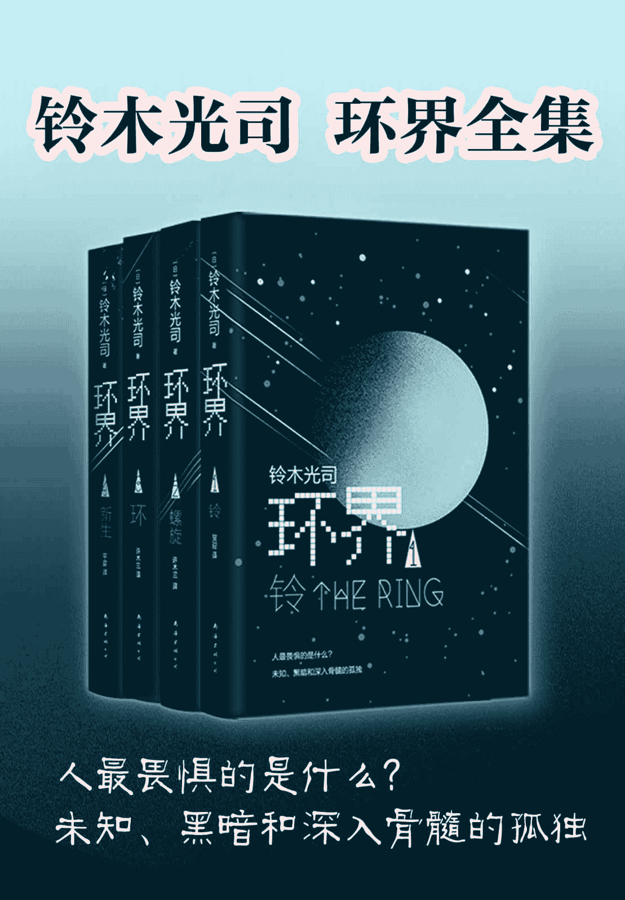
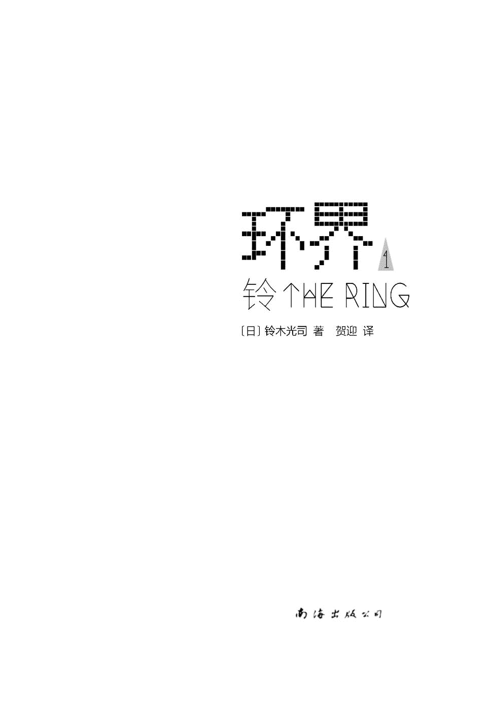
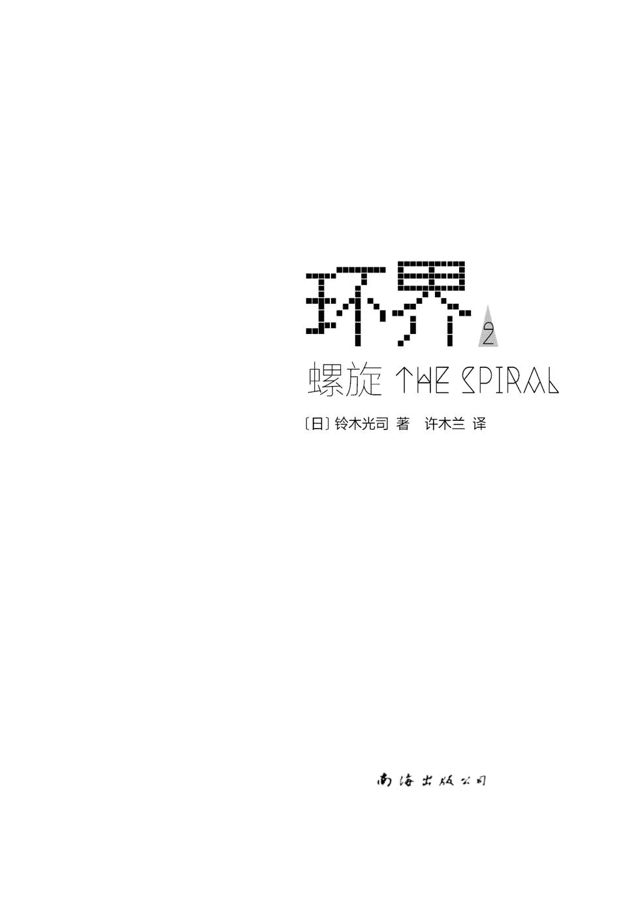
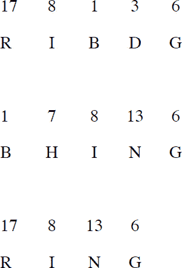
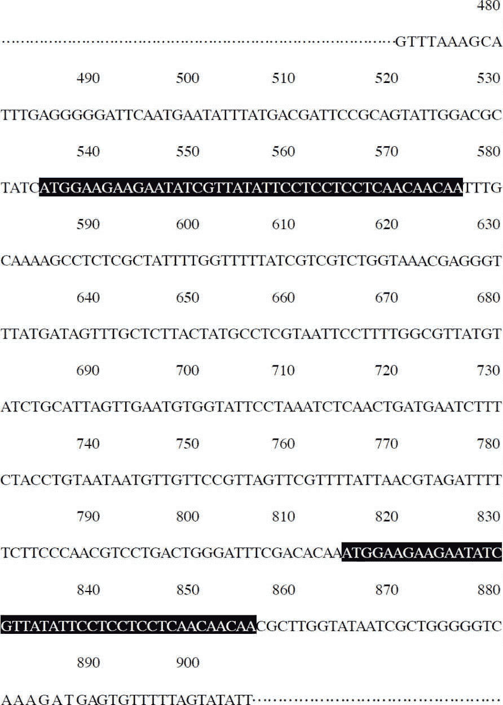
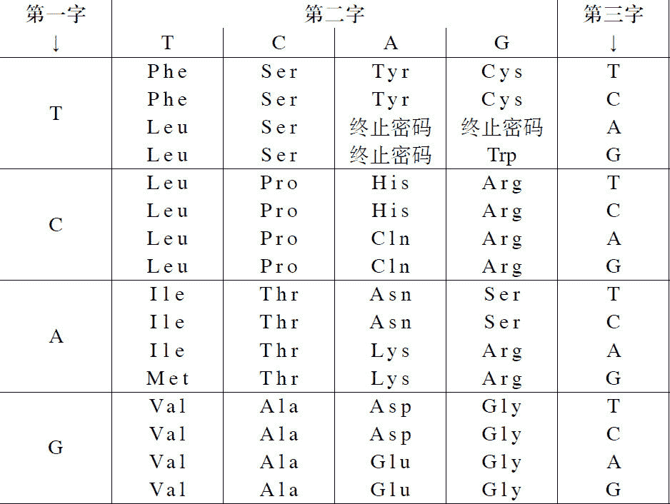
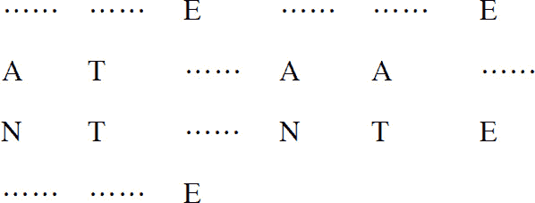
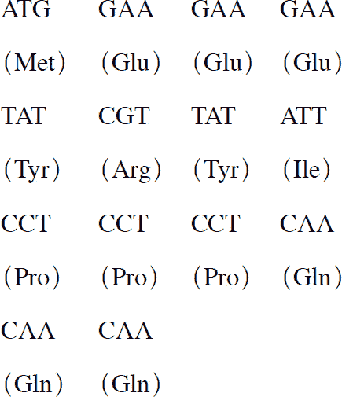
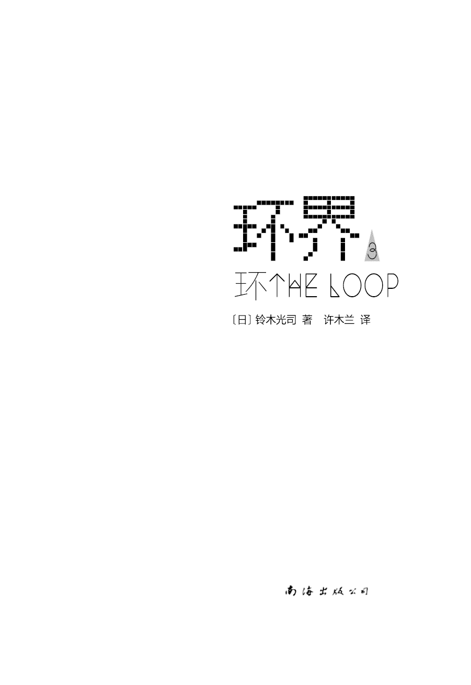
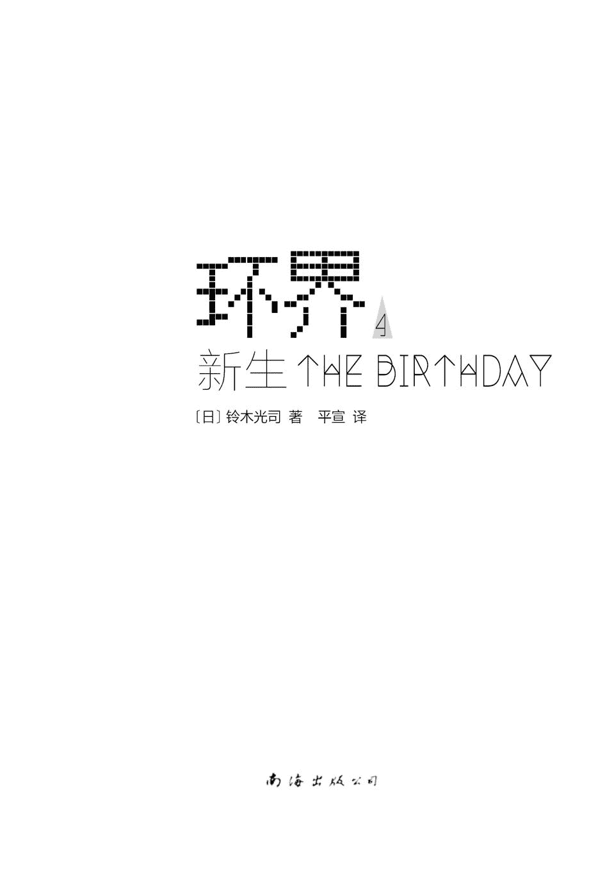

# 环界





# 第一章 初秋

## 1

9月5日　22:49　横滨

紧邻三溪园的住宅区北侧，数栋十四层高的公寓楼并肩而立。虽是新建，入住率却近乎饱和，每栋容纳近百户家庭，可邻里间多半素昧平生。唯有夜幕低垂，万家灯火次第亮起，才实感此处有人烟火气。

南侧是一座工厂，探照灯打在漆黑油腻的海面上，拉长了厂房落寞的倒影，碎光点点。外墙缠绕着密密麻麻的管线，宛如人体错综复杂的血管；管线上的装饰灯闪烁不定，恰似萤火虫飞舞，勾勒出一种诡谲而独特的工业之美。

再远些，与工厂仅百米之隔的一块规划宅地上，孤零零矗立着栋新建的二层小洋房。它紧贴一条南北向的单行道，旁边只有一个车位的停车场。同款房子在新开发区随处可见，可这栋四周却空无一物，取而代之的是林立的“售地”牌，显得格格不入，透着股子凄清——与那些落成即满的公寓形成鲜明对比。

此时，二楼敞开的窗户泻出荧光灯惨白的光，零落在阴暗的路面上。私立女子高中三年级生大石智子，正坐在书桌前。她身穿白色T恤配短裤，双腿叉开对着落地扇，身子扭向一侧，盯着摊开的习题集。T恤下摆被风吹得猎猎作响，凉风直灌肌肤，她却嘴里嘟囔着：“热、太热了……”怪暑假玩疯了，作业堆成山，智子只好怪罪天气。其实今夏并不算酷热，晴天寥寥，海水浴场游客大减。偏偏开学前五天持续高温，这滑稽的天气搅得人心烦意乱，忍不住咒骂老天爷：这鬼天儿，叫人怎么看得进书！

智子拢了拢头发，拧大收音机音量。余光瞥见纱窗上停着只小飞蛾，挡不住电扇风，瞬间便不知飞向何处。飞蛾没入黑暗后，纱窗还颤动了好半天。

至今，功课半点长进没有。明天就考试，就算熬个通宵也补不完。

瞥见钟面，已近十一点。不如看眼电视棒球新闻？万一爸妈上镜呢。可转念又惦记着明天的考试。智子向往大学，哪所都行，只要冠个“大学”名。可这暑假留下太多遗憾：天气作祟玩不尽兴，湿漉漉的闷热让人提不起劲儿——虽是高中最后一个暑假，真想轻松过完，熬过去就能和“女高中生”身份说拜拜了。

心烦意乱下，智子把怨气撒给父母。真是的！女儿在这挥汗如雨攻书，他俩倒好，若无其事跑去看夜场棒球！就不顾女儿心情？

因工作关系，父母弄到巨人队门票，双双去东京巨蛋了。赛后若无别处可去，这会该启程回家了。可这崭新的四居室里，此刻只剩智子独自一人。

虽连日无雨，智子却觉一股莫名湿气缠身。除身上汗，屋子里仿佛漂浮着细微水珠。她下意识拍了下大腿，“啪”地一声，手挪开却没拍扁蚊子。大概是心理作用，膝盖泛起针扎般的痒。屋里突然响起嗡嗡振翅声，智子双手在头顶乱挥。是苍蝇。为避开电扇风，它在门前骤然变换高度，消失在视野中。明明关着门，从哪钻进来的？她检查纱窗与墙壁接缝，找不到能容苍蝇进出的缝隙。突然，尿意与口渴同时袭来。一股莫名压势压了下来，虽不至于窒息，却重重撞击心脏。方才还叽里呱啦发牢骚的智子，忽如换了个人般陷入死寂。

下楼时，心脏怦怦乱跳。一辆车从楼前疾驰而过，车灯“唰”地扫过楼梯下墙壁。尾灯远去，引擎声渐弱，四周黑暗仿佛浓稠了几分。她故意重重迈脚步，顺手亮了走廊灯。

如厕后，智子坐在马桶上发呆。心悸不止，从未有过这般感受。究竟怎么回事？她深吸几口气，提上内裤短裤站起。

“爸、妈，快回来啊！”她突然用稚气嗓音喃喃，“不对，我这是在求谁？”不是求父母回家，倒像在乞求别人。“求求您，别伤害我。”不由自主用上了敬语。

用厨房水龙头洗净手，智子直接用湿手从冰柜抓冰块进杯，倒满可乐一饮而尽，杯搁在吧台上。冰块骨碌碌转几圈便静止。智子打了个寒战，仍觉口渴，又提出一升半装可乐续满。这回，手抖了。身后仿佛渗出腐肉腥臭，裹挟着她……那绝非实体，更非人类。

“求求您！别这样！”智子大声哀求。水池上方那盏十五瓦荧光灯倏忽闪烁几下，熄灭了。新灯泡居然这么不经用。智子后悔没把屋里灯全开。现在连走到开关处的力气都无，甚至不敢回头。她知道身后是什么：十六平方榻榻米的和室，壁龛供着爷爷牌位。窗帘没拉，透过玻璃能见对面绿草如茵的住宅区，远处公寓零星微弱的灯火。仅此而已。

第二杯可乐喝到一半，智子已动弹不得。纵使是心理作用，这诡异气氛也未免太浓。仿佛有什么东西伸过来，眼看就要触上脖颈，勒得她窒息——万一是“那个”怎么办？

智子不敢细想。一想起一周前那件拼命想忘的事，膨胀至极致的恐惧便要将她吞噬。秀一说过，既然上面那样定调，一切无法挽回，大家会一个接一个死掉。可一回都市，那卷印象深刻的录像便失了可信度，是谁恶作剧？智子试图想快乐的事，别的快乐事。可如果真是“那个”……如果是真的……对了，那时候不是会有电话打来吗？

啊，爸妈到底在磨蹭什么！

“快回来呀！”智子喊出声，可身后那诡异影子毫无收手迹象，依旧不动声色窥伺、等待。

十七岁的智子尚不懂“恐惧”本质，却深深感到，心底那份恐惧正疯狂蔓延。

认命吧，真遇上也没辙。不，肯定没事。回头看，那儿准空空荡荡。智子内心萌生回头的冲动，想赶紧解脱。可真没东西吗？后背凉飕飕的。一股恶寒从肩窜至脊背，T恤全让冷汗浸透。再往深处想，肉体便会剧烈异变。有人说过，肉体比精神更真实。

就在此刻，身后传来声响。回头看也没东西吧？不赶紧喝完可乐回屋复习，明天考试完蛋了。

“咔嚓——”玻璃杯里的冰块裂了。智子不由自主应声回头……

9月5日　22:54　品川站前十字路口　东京

信号灯转黄，木村没冲过去，将出租车靠左停稳。运气好能拉个去六本木路口的客。这儿多是奔赤坂、六本木方向的，常有人趁等红灯钻进车来。

一辆摩托从左侧掠过，停在靠近斑马线处。骑手是穿牛仔裤的小伙子。木村最恨这类四处乱窜、挡视线的摩托，尤其等红灯时理所当然停在他车头或车门边。今日生意不好，心情烦躁，他冷冷盯着那年轻人。对方戴全盔，看不清表情，左脚搭在人行道沿，岔开腿晃悠。

一位长腿年轻女子从人行道走过。年轻人扭头跟随目光，却未看全程。头约转九十度，视线落在左侧橱窗上。女子走出视线，他却仍定定盯着橱窗。行人专用灯开始闪烁，随即转红。横道中间行人加快脚步，擦着出租车过去，无人招手。木村空挡怠速，静候绿灯。

忽见摩托年轻人骤然举起双手，身躯剧烈颤抖，随即向木车这边栽倒，“咚”地撞上车门。

这笨蛋！肯定站不稳失重摔的。木村想。他开双闪下车，盘算车门若坏定要对方赔修理费。此刻绿灯亮，后车纷纷超车通过。那年轻人仰卧路面，双腿乱蹬，双手挣扎着想扯下安全帽。木村先查“饭碗”，果见车门上一道斜划痕。

“呸！”木村低骂一声凑近。扣环紧扣下巴，对方却拼命想摘盔，仿佛要连脑袋一起扯下来。

这么透不过气？木村觉出异样，一屁股蹲旁边问：“没事吧？”面罩是灰的，看不清神色。年轻人握住木村手，似有话要说，甚至想抱住他，却发不出声，也不再去扯面罩。

“等着，马上叫救护车。”木村果断决定。

奔向公用电话途中，木村想：真不可思议，一下没站稳摔成这样？落地撞头？不可能，戴着盔啊。手脚也没摔伤，别找我麻烦就行。要赖上我撞的可就麻烦了。保险能赔吗？那就得事故证明、接受警方盘问……

打完电话折返，见年轻人手按喉咙，已动弹不得。围观路人几个。木村推开人群说救护车叫了。

“喂、喂，坚持住，马上到。”

木村动手解扣环，轻易解下，根本不勒脖子。更惊人的是，年轻人面容扭曲变形。用一个词形容，便是“惊愕”。双眼瞪圆，红舌卷缩喉头，口水流出，等不到救护车了。木村摘下盔，伸手摸脉搏时，已无搏动。心头一惊，周遭景象瞬间虚幻。

倒地的摩托车轮仍缓缓转，黑汽油从引擎渗出，滴入下水道。澄澈夜空无风，顶端信号灯再变红。木村摇摇晃晃站起，抓栏杆，睁大眼再看躺地上的人。头枕安全帽，头身近成直角，怎看怎不自然。

是我放的？拿他盔垫头？我为何这么做？木村记不起几秒前发生何事。年轻人瞪大眼盯着他。木村觉寒气“唰”从肩窜过。这闷热夜晚，他仍抖个不停。

## 2

内护城河清澈水面倒映秋日清晨，炎热九月近尾声。浅川和行正赴地铁站台，忽改主意，想近距离欣赏方才在九楼见到的河景，便折返上楼梯出门。报社如沉淀瓶底的浑浊空气，往地面淤积。他渴望吸口外面清冽空气。只消见到东京城里一抹绿，五号高速与环岛交汇处的尾气也不再烦人，微明天际与晨风皆透着股清新。

昨晚熬夜，浅川困乏却难眠。完稿后的亢奋化作适度刺激，脑细胞仍活跃。这两周休息不好，打算今明两天在家补觉。且是总编命令，名正言顺休假。

忽见一辆空车从九段下方向驶来，本能举手拦车。前两天竹桥至新马场地铁月票用尽，未买新。坐地铁回北品川公寓要四百日元，打车近两千。虽多花千五，念及地铁需换乘三次，且刚发工资，决定奢侈一次。

浅川今日在此拦车，纯属一时冲动。若坐地铁回家，上文两起事件绝不会串在同一条线上。故事开端往往因偶然。

车停皇居侧楼前。司机四十上下，个头不高，满眼血丝，想是熬夜。仪表台贴张彩色免冠照，旁写名字——木村干夫。

“去北品川……”

听目的地，木村精神一振。北品川在公司车库东五反田前方，他正准备收车，正好顺路。此类情形常让司机寻到工作乐趣，木村不禁变得健谈。

“待会儿去采访？”

“啊？”浅川望窗外发愣，疲惫双眼布满血丝。纳闷司机怎知自己职业。

“先生，您不是报社记者吗？”

“我是周刊记者，您眼力真准。”

木村开车近二十年，凭上车地点、穿着、措辞，能猜准乘客职业八九不离十。一般来说，职业热门且以此自豪者，紧接着便聊工作。

“真辛苦啊，这么早干活。”

“不，相反。我现在回家睡觉。”

“噢，那样啊，跟我一样。”

平日浅川对工作无特别自豪感。今日却头一次尝到文章成铅字的成就感——策划的系列报道完稿，反响颇大。

“工作有意思吗？”

“凑合。”浅川敷衍。虽有时有趣有时枯燥，如今逐一作答太费劲。忘不了两年前那失败，仍清晰记得标题——《当代新神灵》。脑海浮现当年哆嗦着向总编申请二次采访的模样。

车内短暂静默。出租车飞驰过东京塔左侧弯道。

“先生，走运河沿岸，还是第一京滨？”依北品川具体位置路线不同。

“走第一京滨……新马场附近下。”

目的地明确，司机便轻松。木村下个路口右转。

快到那地了。一个月来，木村始终无法忘却那个十字路口。浅川对两年前失败耿耿于怀，木村却站相对客观立场看事故。他无关无责，无需反省。全是对方造成，提高警惕也避免不了。当时恐惧感近乎淡忘。

仅有一点无法解释：为何每次路过，都想把那事讲给别人听？后视镜见乘客打瞌睡便作罢。若醒着，便有冲动和盘托出。

“大概一个月前……”仿佛等木村开口，信号灯黄转红。“世上事太多让人看不透。”

木村开口试探浅川兴趣。浅川正睡迷糊，听此猛抬头扫视四周确认位置。

“最近猝死的人好像多了……没想到年轻人也这样。”

“啊？”“猝死”两字在浅川耳边回荡。木村续道：“将近一个月前吧，我车停那儿等绿灯，突然辆摩托朝我这倒下。非奔驰中摔倒，是停着突然‘砰’倒下。猜怎样？开摩托是个十九岁补习班学生……竟就这样死了！吓坏我了。救护车警车全来，乱成一团。”

浅川默听，凭十几年记者养成的敏锐，立刻记下司机名与车队名。纯属本能反应。

“那年轻人死法也怪。拼命想摘盔……整个人仰卧，手脚乱挥……我赶紧叫车，回来一看，人没了。”

“地点哪？”浅川全无睡意。

“喏，就那边。”木村指着车站前斑马线。浅川将此事深深烙印脑海。品川站位于港区高轮。若在那出事，归高轮署管。他脑中迅速检索打入高轮署内线。大报社威力在此，各领域布眼线，搜情报能力有时超警方。

“死因定为‘猝死’了？”浅川急问，虽不知有无此病名，也不知这事动了哪根神经。

“简直开玩笑！我车停着。他自己突然倒下。还要我交事故证明，保险公司差点留不良记录……真乃祸从天降！”

“准确日期时间还记得吗？”

“噢噢，您不会嗅出事件味儿了吧？九月四五号吧，嗯……大致前后。时间……想是晚十一点左右。”言罢，木村脑海再现当时景象。温热空气，摩托渗出的黑油……黑油像活物漫向下水道，车灯映照下成黏稠油滴，无声滴入旋即无踪，视觉似暂时障碍。还有那枕盔年轻人临死前的脸，那张惊恐至极的脸。他究竟被什么吓到了？

绿灯亮，木村轻踩油门。后座传来奋笔疾书声，浅川在记录。木村泛起恶心。自己为何记得如此清？吞口唾沫强压恶心。

“那么死因是什么？”

“心脏麻痹。”

心脏麻痹？法医真这么诊断？最近该少用这词了。

“除准确日期时间外，这也得确认。”浅川喃喃记录，“即除此外，死者身无外伤？”

“是的，没错。定是受惊吓，定是……令人惊恐的正是这一点！”

“啊？”

“噢，没什么……那人死时脸上充满极度恐惧……”

浅川心头一动。同时又否定两事关联。定是偶然雷同，仅是偶然。

转眼至京滨高速新马场。

“前面红绿灯左拐，那停车。”

车稳，浅川开门，递两张千元钞票连同名片给木村。“我是M报社浅川，方便的话，今天您说的事，能否让我更详细了解？”

“噢，没问题。”木木欣然。不知为何，觉这是使命。

“改天再电您。”

“电话是……”

## 3

小栗总编面色凝重听浅川汇报，脑际倏掠两年前浅川身影。那时浅川着了魔似的天天守着文字处理机，整理资料写影山照高传记，整个人异常、阴郁。小栗差点送他进精神病院。

巧合的是，正赶上那个时期。两年前，超自然现象在出版界刮起空前旋风，编辑室灵异照片堆积如山。寄来的尽是灵异学说、伪造照片，让人感叹：世道怎么了？小栗坚信人类能在一定程度上解读世界结构，唯独灵异现象，怎也找不到令人信服答案。投稿者比任何时期都多，超乎常规。不夸张说，每日来信足以淹没编辑室，全是灵异内容。不只M报社，日本所有出版社全卷入灵异漩涡。这现象令人费解、困惑。

M报社耗时调查发现，非一人多寄，基本每封匿名信来自不同人。估计有近千万人在该时期向各社投稿。一千万！举国出版界震惊。虽内容不全恐怖，单这数字已骇人——全国每十人中有一人投稿。但出版相关人士及亲友中，却无一投稿者。究竟咋回事？那些信从何而来？编辑们伤脑筋找不到答案时，风潮却平息了。非正常状态持续半年，如一场梦，编辑部重回正轨，不再收此类稿件。

### 总编的“冷处理”与记者的执念

周刊杂志面对这股诡异的投稿狂潮，主编小栗必须表态。他的决定出人意料——彻底“无视”。在他看来，掀起这阵灵异旋风的推手，多半是那些以猎奇为生的八卦刊物。它们刊登灵异照片、罗列怪谈实录，成功点燃了读者的投稿欲望。小栗心知肚明这个理由站不住脚，却也找不出更好的借口。

于是，编辑部将所有来信原封不动付诸一炬，对外界提及超自然话题一律避而不谈、冷若冰霜。时间久了，那股前所未有的投稿热潮才缓缓退去。可眼下，浅川偏要犯傻，往快熄灭的火堆上泼油。

“想重蹈两年前的覆辙？”小栗死盯着浅川的脸，目光如炬。

“我是说你啊……”每逢小栗词穷，总爱用这句口头禅开场。

“我很清楚总编您的顾虑。”

“不，这事挺有看头。但后果难料。万一最后又闹成两年前那副德行，岂不让人头大？”

小栗笃定两年前的灵异狂欢纯属人为炒作，为此深恶痛绝。那阵风潮给他添了不少堵，导致他对一切灵异现象都戴着有色眼镜。

“我不是想渲染神秘感，而是说，这绝非偶然。”

“偶然……”小栗手搭耳畔，回溯着刚才的谈话细节。

浅川妻子的外甥女、高三生大石智子，9月5晚11点左右在本牧家中猝逝，年仅17岁，死因：急性心肌机能不全。同一天、同一时刻，品川站前，一名19岁的补习生骑摩托等红灯时，突发心肌梗塞倒地身亡。

“我觉得这纯属巧合。你不是从出租车司机嘴里听说了车祸，才联想到外甥女的事吧？”

“能听我说完吗？”浅川竭力想勾起小栗的兴趣，“那摩托车男死前，拼命想扯下头盔。”

“然后呢？”

“智子被发现时，双手十指深陷发际，像是在极度痛苦中抓挠头部。”

浅川见过智子几面，像个寻常爱美的女高中生，平日极珍惜头发。这种孩子不可能用力扯扯自己的头。每每脑海浮现她抓挠的模样，他都会试着构想一个无形的阴影，去丈量那种逼迫她自残的、无法言说的惊恐。

“我真搞不懂。你是不是钻牛角尖钻昏了头？只要用心找，任何事都能强行扯出共同点。俩人都死于心脏骤停，剧痛难忍下抓头、扯头盔，这不很正常？”

浅川虽认可此可能，仍摇首否认。这个解释依旧苍白无力。

“总编，痛点在胸口。心口疼，为什么去抓头？”

“你心梗过？”

“……没有。”

“问过大夫没？”

“问啥？”

“心梗发作时，病人会不会抓头？”

浅川哑口无言。其实问过，医生回复模棱两可：不能排除可能，但无定论。有时反而相反，蛛网膜下腔出血或脑溢血会引发剧烈头痛、腹部不适。

“总之因人而异。就像做不出数学题，有人抓头，有人抽烟，有人捂肚子。”小栗转着椅子，“眼下毫无定论，且版面不足。你该懂，两年前那档子事后，咱们不能再轻易碰这题材。执意要写，随你便。”

或许真如总编所言，只是巧合。可为什么连医生都觉得不可思议？问大夫心梗会不会拼命扯自己头发，对方只是严肃地“唔”了一声，从未遇过此类病例。

“知道了。”

此刻唯有撤退，除非挖出更硬核的关联证据，否则休想说服总编。若无进展，就悄悄收手。浅川下定决心。

## 4

挂断电话，浅川手仍搁在听筒上，愣立原地。耳边回荡着自己卑微求证的语调，别扭得慌。对方起初从秘书手里接管电话时傲慢至极，听清来意后语气渐软。他大概以为浅川是来拉广告的，随即脑仁飞速运转，盘算这稿子能带来多少利益。

“顶级访谈”九月开刊。栏目锁定新锐企业掌门人，挖掘创业酸甜苦辣。采访虽顺利敲定，挂机时浅川却毫无成就感，反而心情沉甸甸——因为他预知将从这个庸俗男人嘴里听到千篇一律的说辞：创业血泪史、精明切入点、攻坚克难……若不识相告辞，对方能喋喋不休讲成功学讲到天荒地老。烦透了。浅川厌恶策划这栏目的人。他懂报社离不开广告，为铺路未来只能硬着头皮采。可他不在乎报社盈亏，只在乎这工作有没有意思。不费脑子的活儿，身体轻松，精神却极易疲乏。

明天采访需查资料，浅川奔四楼资料室。心头却挂念着另一桩事：两起耐人寻味的猝死案，究竟有无客观关联？这念头突兀闯入，虽不知从何查起。甩开那庸俗老总声音的瞬间，脑海闪过一个疑问：9月5晚11点前后猝死的，真只有这两起？

若还有同类案例，便可锁定“非偶然”。浅川决定翻阅9月上旬报纸。他平日只精读财经版，社会新闻多半扫标题，极易漏掉细节。他有预感，似有关联之事。隐约记得月前曾在社会版角落、报纸左下角极小版面瞥见个怪异标题，当时脱口“噢”了一声想细看，被同事喊走，忙到现在才腾出手。

从9月6日早报起查，浅川笃定能寻到蛛丝马迹。他像个寻宝童，心跳如鼓。昏暗资料室里翻阅近月报刊，竟尝到了庸俗采访绝无的亢奋。比起体面周旋于形形色色人物间，这活儿更让他着迷。

9月7日晚报，在印象位置，终于寻到那条消息。版面被“34人遇难海难”大新闻挤压，这条讯息比记忆中更袖珍，难怪被忽略。浅川架上银框眼镜，贴近报纸逐字啃读。

> **租赁车内发现一对离奇死亡的青年男女尸体**
>
> 7日晨6:15许，横须贺市芦名县某路段，路过卡车司机在路边空地停放的轿车前座发现一对青年男女尸体，报警。
>
> 追查车主，死者分别为东京都涩谷区补习生（19岁）及横滨市矶子区私立女子高中生（17岁），车系补习生两天前傍晚在涩谷租车行租用。
>
> 尸体发现时车门上锁，钥匙留在锁孔。推断死亡时间在5日深夜至拂晓。车窗紧闭，初判为熟睡中缺氧窒息或服药自杀，死因待查，暂排除他杀。

寥寥数语，浅川却看到了铁证。首先，死者女高中生与外甥女智子同校（横滨私立女子高中）、同龄（17岁）；租车男生与品川站前猝死男生同补习班（英进补习学校）、同龄（19岁）。推断死亡时间高度重合，死因同样不明。

这四条命定有关联，找出核心共同点指日可待。更何况浅川身处大报社，信息获取无虞。他攥着复印件飞奔回编辑部，仿佛挖到取之不尽的金矿，成就感炸裂，步伐加快得连等电梯都嫌慢。

横须贺市政府记者俱乐部，吉野正伏案疾书。不堵车的话，东京总部走高速仅需一小时。

“吉野先生。”浅川唤了声，已一年半未见。

“噢……浅川啊。啥事儿？大老远跑横须贺来……坐下说。”吉野拉椅子示意。满脸胡渣显得不修边幅，却意外地细腻体贴。

“最近忙？”

“噢，马马虎虎。”吉野是浅川新闻部前辈，早入社三岁，今年35。

“问横须贺通讯部才知你在这……”

“找我何事？”

浅川递过复印件。吉野认真阅读，耗时颇长。虽是自家稿件，本该熟稔于心，却读得全神贯注，连最爱的花生含嘴里都忘嚼。片刻，开始慢嚼细咽，仿佛要将此事逐一回想、消化入腹。

“这稿子咋了？”吉野一脸凝重。

“没啥，想多了解些细节。”

吉野起身。“走，隔壁喝茶聊。”

“有空？”

“没问题。这事儿挺有意思。”

市政府旁有家小咖啡馆，咖啡200日元一杯。吉野落座冲吧台吼：“两杯咖啡。”转身凑近浅川。

“听着，我干社会新闻十二年，见过阵仗不少，但这等怪事还是头一回碰到。”吉野喝口水，续道，“浅川，算交换条件吧。你在总部出版局混，咋想调查这档子事？”

实情暂不可说。浅川想独占“独家新闻”。若让吉野这高手知情，猎物转眼被抢。浅川赶紧圆谎：“没特别原因。我外甥女跟死者女高中生是朋友，她非要刨根问底。正好我来这儿，想顺道……”

烂借口。吉野目光泛疑，不悦靠回椅背：“当真？”

“嗯，毕竟是高中女生。朋友离世已够惨，死因又蹊跷，她问破了天……拜托，快说详情。”

“想知道啥？”

“死因查清了吗？”

吉野摇头。“唉，就是心脏骤停。为啥骤停，查不出。”

“无他杀嫌疑？比如勒杀……”

“不可能，颈部无内出血迹象。”

“药物呢？”

“解剖也未检出药物反应。”

“可这案子还没结案……”

“结个屁案。这又非凶杀，只能按病死或意外死亡归档，哪来调查组。”吉野靠在椅背，不屑道。

“为啥隐瞒死者姓名？”

“未成年嘛……也可能是殉情自杀。”吉野像想起什么，嗤笑一声，身子前倾，“那男生，内裤连牛仔裤一起褪到膝盖。女生同理，内裤也褪到膝盖。”

“难道……正进行中？”

“非正进行，是预备阶段。还没开整，就在那一刻——”吉野啪地拍掌，“出事了！”语气极具感染力。

“哟，浅川，跟我说实话。你是不是查到跟这案子相关的线索？”

……

“我守口如瓜，压根不想抢你功劳，纯属好奇。”

浅川沉默。

“喂，别吊胃口了。”

浅川斟酌再三，仍觉闭口为上。却又圆不了谎。

“抱歉吉野先生，能否再等两三天？我保证那时候必告诉你。”

吉野大失所望。“唉，你都这么说了……”

浅川以恳求目光催促吉野继续。

“只能认定发生了‘某种事’。那对男女正要欢好，却突然窒息而亡。这不是开玩笑。曾推测系预先服毒、药效发作身亡，可毒检无任何反应……当然，某些毒物不显性反应，但补习生和女高中生咋能轻易搞到这种毒？”

吉野脑海浮现现场景象。他曾亲临勘察，印象极深。沿芦名至大楠山土路而上，狭窄山谷间有片长满乔木的空地，轿车就停在那里。从山下驶来皆能瞥见车尾。不难想像补习生为何选此地。入夜后此路罕有车辆，山林成天然屏障，对囊中羞涩的情侣简直是天赐幽会圣地。

“死时，男生头紧贴方向盘车窗，女生头埋进副驾座椅与车门夹缝。我亲眼看两具尸体被抬出。车门一开，尸体顿时从两侧滑落，像死的瞬间被内侧巨力强力挤压，且死后三十小时，那股力量似仍留车内。勘查员刚拉开车门，两具尸体砰然弹出。注意，那是双开门，钥匙插在锁孔里车门就打不开。当时钥匙在锁孔，车门上锁……你懂这意味着啥。车处完全密闭状态，他们咋可能受外力挤压？猜猜他们死时啥表情？俩人极度惊恐，面目狰狞扭曲。”

吉野顿了顿。咕嘟一声吞咽声响起，不知是谁发出的。

“设想林中窜出猛兽，恋人理应吓得抱头。就算男生不护，女生也会先靠男生。可不管男女，却都拼命远离对方，背部死死贴住车门。”吉野摊手，做出无解姿态，“到底咋回事，真搞不懂。”

若无横须贺海难大案压版，这稿子早被大肆渲染成茶余饭后谈资。可当时在场者，含勘查人员，皆沉浸诡异氛围中——明知同念一疑问、话到嘴边，却无人说出口。众人明知双人同发心梗猝死概率微乎其微，却用医学上牵强附会的解释强迫自我接受，虽无人信服。大家不说疑问，非怕显笨，而是不敢承认身边发生了如此恐怖之事。依赖科学解释，能让人心安。

此刻，一股寒意顺浅川与吉野脊背窜升，两人同思一题。短暂寂静确认了彼此预感：事未了，方始。他们坚信，无论人类掌握多少科学真理，终有事实无法用科学法则诠释。

“发现尸体时，那对男女手放在哪？”浅川突问。

“头……不对，更像双手蒙面。”

“是不是这样，像要薅光头发似的？”浅川比划揪扯动作。

“嗯？”

“我意思是，他们可曾双手抓头，像要扯掉头发？”

“不是，我印象不似这样。”

果然吗？吉野先生，能否透露补习生和女高中生的姓名地址？”

“能。别忘了答应我的事。”浅川颔首笑，吉野起身。霎时桌面震动，咖啡洒满托盘——吉野一口未喝。

## 5

浅川本想利用闲暇深查四少男少女死因，奈何公务缠身，计划搁置，转眼入新月。无论绵绵细雨的八月，还是秋老虎发威的九月，都随浓重秋意远去，化作记忆。期间风平浪静。浅川阅报社版从不放过边角料，却再无同类案发现踪。难道在视线不及处，某种恐怖事物正紧锣密鼓实施“阴谋”？随时间流逝，越来越多人认定四死纯属偶然，彼此或无关联。浅川也未再见吉野。想必吉野早忘此事，若记着早联系了。

浅川热情亦退。他掏出随身携带的四张卡片，重温“绝非偶然”的信念。卡片记录死者姓名、住址等基本信息，空白处详细梳理8至9月四人行踪、成长轨迹及采访所得。

### 卡片一

**大石智子**　1972年10月21日生

私立启圣女子学园三年级，17岁

住址：横滨市中区本牧元町1-7

9月5日晚11点左右，父母外出期间，死于自家一楼厨房，死因：急性心肌机能不全。

### 卡片二

**岩田秀一**　1971年5月26日生

英进补习学校一年级复读生，19岁

住址：品川区西中延1-5-23

9月5晚10:54，品川站前十字路口倒地身亡，死因：心肌梗塞。

### 卡片三

**辻遥子**　1973年1月12日生

私立启圣女子学园三年级，17岁

住址：横滨市矶子区森5-19

9月5日深夜至拂晓，大楠山麓县道旁车内身亡，死因：急性心肌机能不全。

### 卡片四

**能美武彦**　1970年12月4日生

英进补习学校二年级复读生，19岁

住址：涩谷区上原1-10-4

9月5日深夜至拂晓，与辻遥子同死于大楠山麓车内，死因：急性心肌机能不全。

无需采访即可确认：智子与遥子同校同级；秀一与武彦同补习班同级。由遥子与武彦9月5日深夜驱车赴横须贺大楠山推断，两人纵非恋人，亦是亲密挚友。遥子友人透露，她似在与东京补习生交往，具体相识经过不详。浅川萌生疑窦：智子与秀一会否也是恋人？多方调查，却无佐证。智子恐根本不识秀一。那串联四人的线索在哪？若未知物随机收割，四人关系未免太近。会否因知晓隐秘而遭灭口？浅川尝试科学视角：四人是否曾在某地同感染侵袭心脏的病毒？

真存在这种病毒？浅川边走边摇头。

“病毒、病毒……”喃喃中拾级而上。转念一想，或该先用科学假说切入。设存在诱发急性心梗的病毒，比超自然力量更现实，也免招嘲讽。

# 环（节选）

尽管地球尚未发现此病毒，但它大概潜伏陨石内部，随宇宙飞来。或系新型细菌武器泄露。对，姑且视为病毒。当然，非所有谜题皆能迎刃而解。为何四人死状皆现惊恐？遥子与武彦死于狭窄车内，为何拼命躲避彼此？尸检为何一无所获？若是生化武器泄露，第三问易解：定有部门下令封锁。

顺此假设推演：因未发现其他受害者，可判定病毒非空气传播。系似艾滋病经血液传染，还是极难感染？关键在于：四人究竟在何时何地接触“病毒”？必须重梳8至9月行踪，找出共同时空。当事人已逝，求证共通点恐难。若是四人独有秘密，连至亲好友不知，便成死局。但四人必在同一时间、同一地点、共同接触过同一事物。

浅川落座文字处理机前，暂将未知病毒逐出脑海。取出采访手记，飞速整理录音带内容。稿子今日必须交。明天周日，他要陪妻阿静探望妻姐大石良美。他想亲赴智子死地，感受残留气场。名义是安慰丧女姐姐，阿静应允同行本牧，不知夫真实意图。

## 6

### 寻访·线索与恐惧

阿静再次见到双亲，已是月余前的事。外孙女智子离世后，两位老人每逢假期便从足利赶往东京，与女儿共渡难关——这事阿静今日方知。看着父母憔悴面容里压抑的痛楚，她心头一紧。老两口原有三个外孙：长女良美的女儿智子、次女纪子的儿子健一、以及自家女儿阳子。虽各只一孩，智子作为长外孙，却格外得宠，每次相见老人脸上总漾着笑意。可如今这满屋哀戚，叫人分不清究竟是姐姐夫妇更悲恸，还是父母更伤怀。外孙女当真有那么让人牵肠挂肚？

年满三十的阿静，只能设想自家孩子若不在了会怎样，勉强揣摩姐姐的绝望。可阳子才岁半，根本无法类比。她无法想象岁月沉淀如何让亲情愈发深重。

午后三点，父母踏上归途。

阿静觉得蹊跷。丈夫浅川平日不是忙得不可开交吗？怎会主动提议看望大姐？赶稿子时连智子葬礼都未出席，晚饭前更难见人影。他与智子仅有几面之缘，谈不上交情，按理不该这般怀念不舍。

“老公，咱们也该……”阿静轻碰浅川膝盖，凑近耳畔低语。

“阳子犯困了，让她在这睡会儿再走？”

浅川夫妇今日带着女儿同来。此刻正是她午睡时分，眼神已朦胧。可留下来睡，便得多待两小时——面对刚丧爱女的姐姐夫妇，这两小时该说什么？

“能不能让她在电车上睡？”阿静压低嗓音。

“上回这么试，她跟我们闹别扭，惨不忍睹。我不想再来一次。”

阳子一在喧闹处犯困便难缠极了：手脚乱蹬、撕心裂肺大哭，骂她更是火上浇油，唯有哄睡方能安宁。浅川最在意旁人眼色——乘客厌烦的目光像无声指责，让他窒息得只能沉默；阿静也不愿看丈夫脸颊肌肉紧绷抽搐。

“既如此……”

“就这么定，上二楼睡会儿。”

阳子枕在母亲膝头，半睁半合。

“我哄她。”浅川用手背轻抚女儿面颊。平日极少带娃的他突然说这话，让阿静诧异：难道他感同身受，体会到父母失女之痛？

“今天怎了？总觉得不对劲。”

“没事，看着快睡着了，交给我。”

阿静将女儿递过去：“拜托了，平时也这么帮衬。”

从母亲怀抱转到父亲臂弯，阳子微蹙眉头，未哭出声便已入睡。浅川抱女上楼。二楼两间和室、一间西式房——原是智子住处。他轻放女儿在朝南和室的被褥里，听得轻微鼻息，确认沉睡后便无需陪伴。

#### 潜入智子房间

浅川屏息退出，侧耳楼下动静，溜进智子房间。侵犯死者隐私让他愧疚，可为了大义、为惩恶行，不得不为。更悲哀的是，竟需编织种种理由为己行正名：我非为采访，只想找出你们四人共处的时地，稍扰一番。

拉开书桌抽屉：女高中生常用文具整齐摆放，三张照片、小置物盒、信件、备忘簿、针线。死后父母整理过？倒不像——生前爱整洁。能找到日记本省事了：×月×日、何地、与辻遥子、能美武彦、岩田秀一四人……若有此记录最好。浅川翻阅书架笔记本，又从抽屉深处摸出一本女性化日记，仅前几页寥寥数笔，日期久远。

书桌旁彩色箱子里非装书，乃红花纹小化妆盒。抽屉满是廉价饰品，耳环多因常丢不成对；随身梳缠着几缕细发。

打开定制衣柜，一股少女气息扑面：色彩艳丽的连衣裙、短裙挂满。姐姐夫妇似未决定如何处理这些浸染着独女气息的衣物。浅川侧耳楼下——妻子与姐姐夫妇正深谈。他逐件摸索口袋：手帕、半价电影票、口香糖纸、西装暗袋里的纸巾与月票。月票是山手至鹤见，夹着学生证与一张卡——野野山结贵。这名字怎读？YUKI还是YUUKI？男女不分。为何别人的卡在智子这？楼梯响动传来，浅川疾将卡揣入自己口袋，月票归位，合上衣柜，踱至走廊，正撞上上楼的良美。

“二楼有厕所吗？”浅川神色慌张。

“尽头那边。”良美未起疑，“阳子睡着了？”

“嗯，失礼了。”

“无妨。”良美轻颔首，整理和服衣带进了和室。

#### 太平洋休闲俱乐部会员证

厕所内，浅川审视卡片：太平洋休闲俱乐部会员证，印着野野山结贵名字、会员号、有效期。背面五条须知及公司信息——太平洋休闲俱乐部有限公司、东京都千代田区曲町3-5、电话(03)2614922。若非拾得或偷来，定是智子向野野山借用，为享俱乐部设施。地点何在？时间几时？

此处不便通话，浅川借口买烟奔向外面公用电话亭。

“喂，太平洋休闲俱乐部。”年轻女子声。

“想问凭贵会员证可用何设施？”

对方沉吟半晌——或是设施太多难三言两语道尽。

“我指从东京出发玩两天一夜的地方……”浅川补充。若四人离家住两三天极易被发觉，可家属毫不知情，推断顶多近处投宿一晚，谎称住友家便可瞒过。

“南箱根有太平洋乐园综合设施。”女子公事公办。

“具体有何项目？”

“网球、高尔夫、户外运动、游泳池等。”

“住宿呢？”

“有旅馆与出租别墅小木屋。方便则寄说明书供参考。”

“好，麻烦了。”为套话方便，浅川佯装客人，“一般客也能住旅馆和小木屋？”

“可，但按一般收费。”

“告知那边电话，我想找时间实地看看。”

“若想住宿，这边可预约。”

“不用，我有车，或兴致勃勃突访……说吧。”

“请稍候。”

浅川取便笺圆珠笔。

“准备好了？”女子报出两个十一位号码——外市号码真长。浅川疾记。

“贵公司其他地还有类似设施？”

“滨名湖、三重滨岛町有同类综合乐园。”

太远，高中生与补习生哪有钱跑那么远？

“皆正对太平洋。”

女子随即滔滔不绝推销会员权益。浅川听几句打断：“懂了，其它看指南。报地址，烦请寄份过来。”

挂断电话。手头宽裕倒可考虑入会，听完介绍竟真动心。

#### 返家与后续排查

阳子睡醒，足利父母已走。阿静在厨房帮发呆的姐姐洗碗，浅川殷勤端碗筷进厨房。

“喂，今日怎了？不对劲。”阿静洗碗边说，“哄娃睡觉、进厨帮忙，心境变了？能持续就好。”

浅川正思索，不愿被扰。此刻但愿阿静如其名般安静——让女人闭嘴，唯有置之不理。

“对了，阳子睡前你换尿布没？尿湿人家床不好。”

浅川不理会，目光扫视厨房墙壁。智子死于此，闻玻璃碎满地、可乐洒满地。或是她从冰箱取可乐欲饮时，被病毒袭击。浅川模仿智子动作：开冰箱、拿杯、作饮状。

“老公干嘛？”阿静张大嘴盯着。浅川我行我素，摆饮可乐姿势回头望——隔开客厅厨房的玻璃门映着水池荧光灯。外面天亮、客厅灯火通明，门上仅映灯光，不见此侧人影。若外漆黑内明亮，便如那晚智子站此处时：玻璃门化作镜子，映照厨房一切，连智子因恐惧扭曲的面容也无所遁形。浅川暗想，唯这块玻璃记录了一切，随明暗转换，或透明、或成镜。他着魔般凑近玻璃。阿静欲拍他后背，楼上传来哭声——阳子醒了。

“啊，阳子醒了。”阿静擦手冲上楼。可这回哭声异常剧烈，她慌忙奔去。

良美进厨房。浅川取出那张卡。

“卡掉钢琴底下了。”若无其事地递出，静候反应。良美接过翻看。

“怪了，怎会有这东西？”诧异歪头。

“会不会是智子向友借的？”

“可我从未听闻野野山结贵这名。她朋友里有这人？”良美满脸困惑，“真是的，这应是重要物件，只是那孩子已……”声哽咽。琐事勾起悲痛。浅川犹豫问不问。

“请问……智子暑假有无与友去这俱乐部玩……”

良美摇头。她深信女儿——应届考生，绝非为外宿撒谎之辈。浅川理解其心，不愿深究。临考女高中生若说与男性友去出租别墅玩，铁定被拒；定谎称去友家复习，父母毫不知情。

“我去找卡主人还卡。”

良美默垂首。丈夫在客厅唤她，她奔出。新佛坛前，父亲对着智子遗照喃喃自语，声声凄惨，浅川黯然神伤，内心仍难直视此事，只能默祷夫妇早日振作。

浅川推演：野野山借卡给智子，得知死讯后应立刻联系智子父母取回。可良美全不知情。野野山不该忘记此卡——虽系家族会员，但高昂会费在，丢失岂能无动于衷。如何解释？

推测：野野山或将卡借与岩田、辻、能美其中一人，因故却落入智子手中留存。野野山与借卡者父母联系，对方翻遍遗物亦寻不到。若联系其余三死者家属，或能轻易获野野山住址。今晚便打电话问问。若仍无果，这卡不大可能为四人提供共同时地。无论如何得见野野山当面谈。不行则从会员号查址，或直问公司——内行知内幕，借报社资源何愁查不到。

远处呼唤声传来：“……老公……老公！”妻子声夹杂孩哭，惊慌万分。

“喂，老公，快过来！”

浅川骤醒，竟忘方才思绪。女儿今日哭得不寻常，他越上楼越觉强烈。

“怎么回事？”责问妻子。

“不对劲，像中邪，哭声不似平常。病了？”

浅川探额——无热。可小手抖个不停，牵动全身颤栗，脊背时而微颤。满面通红，双目紧闭。

“何时开始的？”

“醒来没人在旁吧？”

孩子醒不见母多半哭，母来抱即止。婴儿哭泣表达需求，这需求何在？绝非撒娇——双臂遮面……是恐惧！因过度恐惧而哭！

阳子别过脸，微松紧握拳头，手指向对面——柱子。浅川顺势望去，天花板下三十厘米悬挂拳头大小的般若面具。怕鬼面具？

“就是那个。”浅川下巴抵抵面具。夫妇对视面具，又缓缓回头对视彼此。

“难道……这孩子怕鬼？”

浅川起身摘下面具翻放橱柜上。阳子不见它，哭声戛然而止。

“阳子乖，不怕鬼鬼了。”阿静明缘由，如释重负，贴颊安抚。浅川却难释然，莫名不愿久留此屋。

“快走。”催促妻子。

#### 电话排查与发现

傍晚返家后，浅川依次致电辻、能美、岩田家，核实是否听子女友提过俱乐部会员证。最后接通的是岩田母亲。

“有自称我儿高中学长者来电，要回借给我儿的俱乐部会员证……可我翻遍儿房间每个角落，仍未寻获，正不知如何是好。”母亲喋喋不休。浅川由此得野野山电话，即刻拨打。

野野山称：八月最后周日，涩谷与岩田见面，将会员证借予对方。岩田似说要与邂逅女高中生去投宿。

“暑假将尽，不趁最后几天玩玩，怎全力应考？”

野野山笑骂：“笨蛋！补习生哪有暑假！”

八月最后周日为二十六日，后若想投宿，极可能在二十七至三十日某天。九月一到，补习生高中生均迎新学期。

或因陌生环境疲乏，阳子很快与阿静同睡。浅川贴耳卧室门，听得母女微弱鼻息。晚九点，属他心境最畅时刻——妻女皆睡，狭小两居室公寓里方能安心工作。

#### 深夜推演

浅川取啤酒倒入玻璃杯。因会员证发现，调查终跨出关键步。八月二十七至三十这四天中某日，岩田秀一等四人极可能用过太平洋俱乐部住宿设施，其中南箱根太平洋乐园别墅小木屋可能性最大。距离上不太可能去箱根外，高中生囊中羞涩更不可能住酒店，通常用会员证租廉价别墅。会员证租一栋五千日元，均摊一人仅千余日元。

手边有别墅电话，浅川置纸条桌上。打电话问前台可确认四人是否以野野山名义投宿。但前台未必应答——管理员受专门训练，视保护客人隐私为义务。即使亮记者证明目的，电话里也不会透露。若联系当地分社请律师调阅住宿登记？可管理员仅对警方律师有义务，冒充易穿帮，给报社惹麻烦，须寻稳妥法。

如此至少三四天。浅川没这耐性——他现在就要答案，等不得三天，对解谜有炽烈热情。假若四人真在八月底南箱根别墅住一晚致神秘死亡，那儿究竟发生何事？病毒？他知将其称病毒实属逞强，显示不被神秘压倒。面对超自然力量，人用科学解释，某种程度上合情合理。对不明事物，无法用听不懂语言论述，须置换成可懂语言解释。

浅川忽忆阳子哭声。午后阳子见鬼面具为何吓成那样？

返程电车上，浅川问阿静：“哎，你跟阳子讲过鬼吗？”

“啊？”

“用绘本或什么告诉过她鬼很可怕？”

“怎么可能……”

夫妻对话止步。阿静无疑问，浅川却挂怀。除非触动人类本能，否则女儿不会如此恐惧。这不同于被告知“此物可怕”而生的惧。类人猿时代，人类常处恐惧中：雷电、台风、野兽、火山、黑暗……故知儿童初闻雷见电便本能恐惧。可雷电客观存在。鬼呢？字典注“想象中怪物”或“死者灵魂”。若阳子因鬼面可怖而惧，见同样可怖的哥斯拉模型理应也怕。她曾在百货橱窗见精致哥斯拉模型，不怕反好奇呆望许久，如何解释？一点明确：哥斯拉终属想象怪物，而鬼……难道只有日本有鬼？不对，西方有类似物，称恶魔……

### 第二章　高原

## 1

10月11日 周四

雨势渐大，浅川调快雨刷。箱根天气说变就变——小田原一带原晴空万里，随海拔升高空气转湿润。抵山顶前遭遇数次暴风雨。白天尚可观箱根山云雾预测山中气候，夜里只能盯车灯下路况。偶尔停车仰望，方觉星星早已无踪。东京站乘下行回音号时街头仅笼薄暮；热海站租车时月亮在云缝隐现；此刻车灯光晕中飘洒的细雨丝已化真雨滴，敲打挡风玻璃。

仪表盘液晶钟显19:32。浅川疾心算耗时：17:16搭东京发车，18:07达热海；18:30出检票口办完租车；超市买两桶方便面、一小瓶威士忌，琢磨如何驶出单行线密布市区，已近19点。

# 第三章　突风

## 1

### 10月12日 周五

橘黄色的隧道灯光像条吞人的巨兽，浅川和雄驾着车钻了进去。风声骤变，车厢内万物——皮肤、座椅、方向盘——都被染成那种令人毛骨悚然的暖黄色。雨刷吱呀作响，他关掉它，对向车道空无一辆。明明八点前能到，右脚却压不下油门。他厌恶那个目的地，厌恶得发自骨子里。

下午四点二十，他守在报社那台嘶哑的传真机前等了整整一个小时。热海通讯部回传的住宿登记复印件上，四个名字并排：野野山结贵、大石智子、辻遥子、能美武彦。八月二十九日周三，南箱根太平洋乐园别墅区B-4号房。岩田秀一冒用野野山之名，时间卡在四人离奇死亡前整整一周。浅川当即电话订下今晚同一间房，只要赶上明早十一点编辑会，时间绰绰有余。

收费站递出三枚百元硬币时，他明知故问："乐园在前面吗？"地图背得滚瓜烂熟，只是渴望听点人声。收费员指指前方指示牌左转，浅川发呆片刻才起步——那股午后的狂喜早已消散，取而代之的是四张死灰色脸孔在脑海轮番浮现，仿佛在嘲笑：现在退场还来得及。记者本能推着他往前，单枪匹马却叫人发毛。吉野要是知道准跟来，可同行是冤家。合适搭档只有一个：大学客座讲师，学识渊博、时间充裕，偏偏脾气古怪得像块石头，能不能处得来，浅川没底。

指示牌立在坡道拐角，白底黑字无霓虹，车灯扫过那瞬间稍纵即逝。左转上山，路窄得两车难容，急弯接急弯，路灯全无。对面来车根本无法避让。雨不知何时停了，丹那断层仿佛劈开了两个世界：山下淋雨，山顶星河。

山路仿佛无尽头，两侧 soon 现出售中的新建别墅。忽地路面开阔成双车道，华丽路灯两侧排开，路况骤然升级。浅川惊讶：一入乐园地界，处处奢华方才进门的羊肠小道算什么？玉米秆野草垂至路面，急弯藏在暗处，每一秒都提心吊胆。

宽阔停车场对面矗立三层服务中心兼餐厅。浅川停车进堂，挂钟恰指八点。砰砰击球声从楼下传来，四片网球场灯火通明，男女老少挥汗如雨。十月上旬周四晚八点，这深山老林，这些人发什么疯？再往下，三岛沼津夜景铺展，田子海湾漆黑一片。

餐厅全透明落地窗，内部一览无余。营业至八点却仍半座率：亲子游、女子团、情侣……浅川百思不解：这帮人从哪冒出来的？绝不可能全走那条鬼路。电话里服务员明说："热函公路中段左拐，顺山路而上。"难道另有近道？

明知打烊仍硬着头皮进去。玻璃外修剪整齐的草坪缓坡延伸至夜色。餐厅灯光昏黄，大概为衬托夜景。浅川拦住路过服务生问别墅位置："出大门右转，两百米管理员办公室，门口即停车场。"其实直走也能到，他为何绕进这现代建筑？自我剖析：把圆木小屋联想成《十三号星期五》剧场，渴望找点"现代科学痕迹"抚慰恐惧。可这山路如此凶险，为何仍引来成群活人打球用餐？他们看起来……不像活人。

期待小木屋区传来饭后欢笑，实则死寂。十栋小木屋仅六栋隐约可见，更下方连路灯无、窗户暗，尽没于树荫黑幕。B-4恰卡在明暗交界，仅露门楣上半。

推开管理员办公室门，电视声里无人影。管理员蜷在左后和室看洋片录像，英文字幕映在柜面玻璃上，抽屉塞满录像带。六十岁左右瘦小老头探头："欢迎光临！"热海通讯部带律师调查时，登记簿定是他翻的。浅川报名："预定房间的浅川。"

老头核对："B-4，请填姓名地址。"浅川写真名——野野山会员证昨已寄回，手头无证。"就您一个？"老头狐疑抬眼：从无单住先例，按价格住酒店更划算。递过被单，指指柜墙："要不租盘片？大片齐全。"浅川扫一眼：《夺宝奇兵》《星战》《回到未来》《十三号星期五》……全是科幻大片多为新片，客源多为年轻人。无兴趣，且为公务。"工作要做。"拎起手提文字处理机晃晃。老头会意。"餐具齐全。"浅川确认，实则只需烧水壶泡面。接过钥匙被单转身欲走，老头殷殷指路、致意："祝住得舒适。"

开门前，浅川戴上备好的橡胶手套——抵御神秘病毒的护身符，也是安定剂。

百瓦灯泡亮起，四十平米客厅一览无遗：壁纸地毯沙发电视餐具全新实用。脱鞋入室，对面阳台，上下两间九平米和室。独享这套房太奢侈。拉开纱帘玻璃门换气，失望：打扫得一尘不染，恐将一无所获。

和室橱柜空空。换上针织衫运动裤，旧衣挂入衣橱。上楼点亮二楼和室灯。浅川自嘲：竟把全屋灯全开了，真幼稚。

厕所门虚掩一缝，童年试胆游戏重现：夏夜不敢独自上厕所，留缝等父亲。毛玻璃后浴室干爽无水汽，浴缸洗脸池皆干——近期无客入住。想脱手套，汗湿粘手脱不下。冷风灌入，窗帘飘飞。

冰块满杯，倒半杯威士忌。加水瞬间犹豫，关上龙头——不敢碰屋内水源。冰块例外：细菌不耐高温亦不耐极寒。

深陷沙发开电视，新人歌声流淌，东京同步播放。换台，调中音量，包里摄像机置桌上——以防突发录像。

抿一口酒，镇定些许。脑中复盘全程：今晚找不到线索，稿子泡汤；换角度想，找不到线索=不染病毒=有妻女的他不枉死。架腿于桌——真在等什么？不怕？喂，不怕？说不定死神下秒敲门！

浅川不安环视，目光无法聚焦。盯着任何物体，幻觉似要成真，惊恐难耐。

冷风穿堂，关窗拉帘瞬间瞥见窗外：正对B-5屋顶，影子叠出更浓墨色。网球场餐厅挤满人，为何这儿只我一个？拉严窗帘，表显8:56。进屋不足半小时，体感超一小时。自我安慰：住这不一定有险。别墅建成半年，住过B-4的客不少，未全死。调查至今仅那四人死。追查或现更多，暂无同类。关键不在住，而在他们做了什么——不，是这屋子里能做什么？

厕所浴室橱柜冰箱翻遍，无痕迹。纵有，管理员早处理了。与其干喝威士忌，不如去问管理员快。

干杯续酒，加满自来水。危机感缓解，觉着利用工作间隙跑这鬼地方蠢透。摘镜洗脸，镜中映出苍白病容。会不会已染病毒……一饮而尽，再调一杯。

厨房回客厅，电话柜上突见一笔记本，封面"旅途回忆"。翻开：

**4月7日 周六**
暖子绝不会忘今天，为何？秘密。优一好温柔！嘻嘻！
——暖子

稚拙画着父母脸，带娃家庭。4月14日周六：
爸爸是胖子。
妈妈是胖子。
所以我也是胖子。

浅川强按顺序翻阅，虽渴望倒序。暑假前多周六入住，暑假中间隔缩短，近八月末感叹夏末声渐多。

**8月20日 周日**
啊！暑假快结束了，没碰上半点好事！谁救救我？救救这可怜虫！我有辆400cc摩托，帅得很，认识我超划算！
——A.Y.

渐变成征友启事。有对象的留情话，无对象的吐孤单。

**8月30日 周四**
警告！没胆量的别看！看了后悔！嘿嘿嘿！
——S.I.

就是这天——四人入住次日清晨。"S.I."当为岩田秀一缩写。唯独他内容诡异。"这个"是什么？浅川合上本子看侧面：一条细缝。手指探入，本子自动翻开至该页。那四人定曾打开此页压了什么东西，重压下此页至今自动弹开。放置的"东西"，就是岩田口中的"这个"。

翻遍电话柜角落，连根铅笔无。

重坐沙发继续翻。9月1日周六平淡无奇。不知那天住的大学生是否看过"这个"。此后记录再无相关。

合本点烟。既写"没胆量别看"，内容必骇人。随意翻开轻压："这个"重量需抵抗纸张合拢力。一两张灵异照片不够重，会是周刊或单行本？得看看。还是问管理员：8月30日客退房后，屋内有无遗留怪东西。若"这个"让他觉怪，必有印象。

目光忽落对面录像机——电视仍开，女星抱吸尘器追丈夫跑，家电广告。

对了，录像带重量刚好。

浅川捻灭烟头，脑海闪现管理员办公室墙上录像带。或因偶然看了部极恐怖电影，觉精彩想推荐？可岩田为何不用专有名词？如直接说《十三号星期五》精彩，何需"此"字代称？推断："这个"是种不知如何命名的东西。

还有查的价值吗？

现无他径，试这条无损。困守此地妄想无果。浅川出玄关，上石阶，推开管理员办公室门。

前台仍空，电视声不减。城里公司退休、想享清福却觉无聊、靠录像打发光阴的老人……浅川揣测。未及开口，老头已探头。浅川随口找由头："还想借几盘带子……"

老头笑开："随便挑，三百日元一卷。"

浅川走到"灵异电影"专柜：《地狱之家》《黑色恐怖》《大法师》《凶兆》……学生时代旧片，夹杂些未看新片。从头翻到尾，无一感兴趣。重新按序搜遍两百余盘。最底格角落，横置一盘无盒录像带。其余皆印剧照片名，唯此无标签。

"那是啥？"问出口浅川觉察自己用了"那"——它无专有名词、无别称。老头皱眉"啊"一声取起："这东西没内容。"

咦？他知内容？

"看过了？"浅川问。

"这个嘛……"老头歪头，似全无印象为何有此带。

"借我看眼？"

老头不答，啪拍膝盖："想起来了！客人落在客房的。我以为是咱们的，带回了……"

"落在B-4？"浅川不动声色追问。

老头笑摇头："两月前事了，哪记得这么细。"

"你看过了没？"

老头再摇头，笑容敛去："没。"

"借我用下。"

"想录电视节目？"

"嗯、是、是……"

老头瞟眼带子："防录卡拆了……看，这儿。"

酒精上涌，浅川焦急万分，骂声在心底滚：老东西，说借就借，乖乖交出不就完。醉成啥样也不会硬来。

"帮个忙，马上还。"低头哀求。老头百思不解：这客为何对空带子如此执着？莫非里面有精彩画面客忘删？后悔捡到时没看。虽有即刻看的冲动，碍于客面子，只好递出。浅川掏钱被拦："不用不用，这钱不能收。"

"谢了，马上还。"浅川扬扬手中带子。

"精彩的话马上告诉我。"老头好奇心全被勾起。柜里带子全看腻了，为何单漏这盘？明明是打发时间好货……不过或许只是录了无聊电视节目。

老头深信那盘带子很快会还。

---

## 2

# 第四章　录像带

## 1

### 10月12日 周五

"先让我看看那盘带子。"高山龙司笑吟吟道。六本木十字路口餐饮店二楼，晚七点二十。距浅川观带将近一日。特意选这繁华地，指望华服女子喧闹声能稍抚内恐，不料半点慰藉无。再提此事，昨夜经历复苏，恐惧不减反增，甚至觉原依附体表的"某物"影子，已潜入深处。

龦司衬衫领扣尽扣，领带勒紧，压根没想松。脖颈赘肉挤成两圈，似随时窒息。即便对人笑,那张棱角分明的脸也难留好印象。

他从杯中取冰块塞口。

"你没听清我说的话吧？很危险。"浅川压低声。

"那你找我出来商量什么？想要我帮忙对不对？"龦司浅笑，嘎嘣嘎嘣咬冰，"我没看过带子，怎么帮你想法子？"

龦司低头摇脑袋,笑意不减。浅川骤怒,歇斯底里吼:"你不信我吗？"

### 录像带里的死神倒计时

就像误拆了邮包炸弹，浅川在毫无防备的情况下看完了那卷录像带。此刻面对龙司那副云淡风轻、甚至带着几分嘲弄意味的笑容，他胸口堵着一团乱麻，说不出是什么滋味。这恐怖的程度前所未有，更可怕的是——噩梦才刚拉开序幕。他只剩六天寿命，死神的阴影像绞索般缠上脖颈，每一秒都在收紧。而这家伙龙司，居然还死脑筋非要把带子看个究竟。

“音量收敛点，我又不怕那玩意儿，你怂什么？听着，浅川，跟你说过多少遍了，我想亲眼目睹世界毁灭的那一刻。要是有人能拆解这世界的底层代码，搞懂始终、大小、虚实的终极奥义，命搭进去我也认了。你不最懂我么？记不记得？”

浅川当然记得。正因为太了解这个疯子，他才把前因后果全盘托底。

两年前，浅川刚跨过三十岁门槛。有次突发奇想，想摸摸同龄日本男人的脑袋瓜里到底装着啥、做着啥梦，便策划了个选题：跨行业挑三十个三十岁的活跃分子，从通产省官僚、都议会议员到大企业白领、普通上班族，用有限版面拼凑出这个年龄段的群像。备选名单里，浅川竟瞥见了高中同学——高山龙司的名字。头衔写着：K大学文学部哲学系客座讲师。浅川差点把笔掰断，印象里这货明明读的是医学系。

作为“学界新锐代表”受访，龙司的个性强得刺眼。高中时就让人看不透，如今更是古怪得像换了个人。医学院毕业直接跨专业攻读哲学博士，课程早修完了，助教坑若不被资深前辈占着，铁定是他的囊中之物。无奈之下混了个客座讲师，周一两节逻辑课糊口。

别搞错，“哲学”这玩意儿早就贴上科学边缘了，跟那些卖弄“人生意义”鸡汤的伪命题八竿子打不着。龙司钻的是逻辑学——数学之上的数学。古希腊哲学家多半也是数学家，龙司虽挂文科讲师名头，脑回路却是标准理科男。更绝的是，这人除了本行，在超心理学领域造诣深得离谱，硬生生把两套互斥的知识体系装进同一个脑袋。浅川曾质疑：搞特异功能、超自然那套，不违背科学铁律么？龙司反唇相讥：恰恰相反，超心理学才是撬开世界真相的万能钥匙。彼时盛夏酷暑，龙司却裹着条纹长袖衬衫，领口扣子扣到下巴——跟今晚一模一样。“我要看人类灭亡的瞬间，”他大汗淋漓地咧嘴，“看着那帮高呼世界和平、人类永存的伪君子，我就想吐。”

采访快结束，浅川抛出常规问：“谈谈未来的梦想？”

龙司平静得像在报菜名：“站在山丘上看人类灭亡，顺手挖个坑，在里面反复射精直到死。”

浅川手抖了下：“喂，这真能发？”

龙司露出那标志性的浅笑，颔首：“所以啊，我啥都不怕。”说着凑近浅川耳畔，“昨晚，我又‘搞’了一个。”

又来了！按浅川掌握的情况，这已经是第三个受害者。第一个得追溯到高二。俩人都从川崎市多摩区通勤去县立高中。浅川习惯早起一小时自习，除了职工他是头一个到教室。龙司则是迟到常客，第一节课从不正经上过。可暑假刚开学那天清晨，浅川推门进班，竟撞见龙司早早坐在桌子上发呆。“哟，稀客啊。”浅川打招呼。“哦……”龙司敷衍一声，目光涣散盯着窗外，双眼布满血丝，脸颊潮红，嘴里飘着淡淡酒气。

交情谈不上铁，浅川也没多问，自顾自翻书复习。忽然后颈一拍，龙司无声无息凑过来：“喂，帮个忙呗……”这人不光成绩顶尖，还是田径校队王牌，妥妥的风云人物。资质平平的浅川对这种“强者求助”毫无抗拒感。

“简单，给我家打个电话。”龙司亲昵地搭上浅川肩膀。

“行啊，打电话干嘛？”

“你就打过去，说找我。”

浅川皱眉：“找你？你人不在这儿么？”

“废话少说，按号码打。”

浅川照拨。龙司母亲接听，浅川开口：“请龙司接电话。”

“啊，龙司去学校了……”对面语气平静得吓人。

“噢，知道了。”浅川挂机。

“怎么样，成了？”龙司问，“我妈声儿抖没抖？紧张没？”

浅川一头雾水：“这搞啥名堂？有啥意义？”

## 2

出租车穿过六本木，朝北品川驶去。不堵车二十分钟搞定。后视镜里只露司机半个额头，单手把方向盘，闷声不吭——显然无意搭茬。可讽刺的是，半个月前就是因为坐上辆话痨司机的车，才把浅川拖进这趟浑水。每回想起那晚，浅川肠子都悔青了：再麻烦也该挤地铁换乘回家，别省那点事儿。

“家里能拷贝带子么？”龦司问。工作原因，浅川家备俩录像机，一台是早期古董，性能烂点，单纯复制绰绰有余。

“能。”

“哦，那赶紧拷一份我带走，回去逐帧研究。”

浅川心说：真敢说。可就这一句，莫名给他壮了不少胆。

御殿山下车，决定步行上坡。快九点，妻女大概率睡了。老婆阿静惯例九点前给女儿阳子洗澡，洗完钻被窝哄睡，自己也跟着睡死过去。想跟丈夫说两句，会在桌上留张“叫醒我”条子。浅川按条子摇人，阿静跟赶苍蝇似的挥手、皱眉、哼唧，迷迷糊糊半醒不醒，浅川只能灰溜溜退场。久而久之，浅川见条子也不叫了，阿静也懒得留条子。今晚九点，正是母女俩铁律般的就寝点，正好避开麻烦。阿静向来瞧龙司不顺眼，浅川觉得正常，从未追问。至今记得阿静那句“求求你别再叫那人来家里”时的厌恶神情。何况，绝不能在妻女面前播那盘带子。

屋内漆黑死寂，热气腾腾混着香皂味漫到玄关。母女俩裹着毛巾钻进棉被没多久。浅川贴着卧室门确认呼吸均匀，才领龙司进客厅。

“宝贝睡啦？”龙司遗憾地叹气。

“嘘！”浅川竖指抵唇。虽这点动静吵不醒她们，万一阿静觉出异常出来瞅一眼呢。

浅川熟练连好两台机器输入输出口，塞进录像带。按播放键前，他盯着龙司的脸，像在做最后确认。

“磨蹭啥？快放！”龙司盯着电视屏幕催促，眼神钉死屏幕未动。浅川把遥控器甩给他，起身走到窗边——他不想再看第二遍。本该冷静复盘、逐帧分析，可他彻底怂了，只想暂时逃离。阳台上点根烟。女儿出生时发誓不在家抽烟，三年婚姻风平浪静，老婆给他生了漂亮女儿，这底线他从未越雷池半步。

透过毛玻璃往屋内瞥，荧屏光影摇曳。独自在深山小木屋看带子，跟在这住着三口人的城区六楼公寓看，恐怖等级仿佛不同。但换做龙司，就算同环境下看，也绝不会吓得屁滚尿流，八成会瞪着屏幕嘿嘿冷笑，嘴里还骂骂咧咧地威胁回去。

烟灭，浅川刚转身要进屋，走廊门开了，阿静披着睡衣出来。浅川慌忙抄起遥控器按暂停。

“没睡？”浅川语气带责备。

“听见动静……”阿静说着，眼神在沙沙作响的雪花屏、龙司和浅川脸上来回扫视，满脸狐疑。

“快回去睡！”浅川下逐客令，不容置疑。

“要是浅川太太不介意，也可以过来一起看哦，这带子挺有意思的。”龙司盘腿坐地板上，回头冲阿静抛媚眼。浅川恨不得冲上去吼，却气结在喉头，只能攥紧拳头狠砸桌面。阿静被吓一跳，慌忙抓住门把手，眯着眼对龙司客套一句：“慢慢看”，随即匆匆缩回门后。浅川懂老婆在想啥。大半夜俩大男人关屋看带子，还慌忙关机……阿静眼底那抹轻蔑，浅川看得真切。与其说针对龙司，不如说是对雄性本能的鄙视。浅川张了张嘴，终究没解释，只觉无力。

果不其然，龙司看完全程面不改色。边哼小调边倒带，反复快进、定格，确认关键片段。

“这样一来，我也栽进去了。你剩六天，我七天。”龦司兴奋得像终于拿到入场券的玩家。

“你怎么看？”浅川问。

“不就是小孩子恶作剧嘛？”

“啊？”

“咱们小时候不常干这事？给人看恐怖画、倒霉信，再吓唬一句：看过这玩意儿的都会倒霉。”

浅川当然有这经历，夏夜怪谈里这套路烂大街了。

“所以呢？”

“就这感觉。”

“发现啥告诉我一声。”

“这个嘛……带子不算太吓人，像把现实跟抽象概念搅和在一起。要是那四个人没按带子上说的死法死掉，你早就当笑话嗤之以鼻了，对吧？”

浅川点头。棘手就棘手在——他知道带子上的话句句属实。

“先推演那四个蠢货为啥死。我觉得有两种可能。带子结尾说：‘看过这盘带子的人都会遭遇死亡命运。’之后，他们全中招了……喂，把逃脱死亡的方法叫‘咒语’吧。那么，那四个会不会是把部分咒语洗掉了才死？或者单纯因为没按咒语做？不对，还得查清楚：洗掉咒语的到底是不是那四个人？也可能那四个人看时，咒语早就被洗没了。”

“咋查？总不能去问那四个死人啊。”浅川从冰箱掏出啤酒，倒满两杯，推一杯给龙司。

“瞧好吧。”龙司重播结尾，在蚊香广告洗掉咒语的末尾瞬间按暂停，逐帧倒退、逐帧播放……画面定格：三人围桌而坐。电视节目画面冻结在屏上。晚上十一点档全国联播的《Night Show》。三人中，白发苍苍的是家喻户晓的畅销书作家，年轻貌美的是女子，另一位是关西活跃的相声演员。浅川凑近屏幕。

“认得这节目？”龙司问。

“TBS台正在播的《Night Show》。”

“对吧。作家是主持，女人是助理，相声演员是当天嘉宾。所以，只要查出那相声演员哪天上节目，就知道咒语是不是那四个人消的。”

“……有道理。”

《Night Show》惯例晚上十一点开播。若能确定这期是八月二十九号播的，洗掉咒语的就是当晚住别墅B-4号房的那四个人。

“TBS是你们报社下属企业吧？你查这事儿不费吹灰之力。”

“知道了，我去查。”

“拜托了。关咱俩性命呢。细节别漏，听清没，战友？”龙司拍拍浅川肩膀。同绑一根绳子上，他才用这称呼。

“你不怕？”

“怕？相反，死期确定反而有意思。死是惩罚……真带劲，不拿命当赌注，这游戏没劲。”从进门起龙司就兴奋得过头，浅川担心他是强装镇定掩饰恐惧。可从那双眼睛里，浅川没读出一丝怯意。

“下一步，查这带子是谁、何时、为何目的拍的。别墅落成才半年，锁定期间住过B-4的客人，查清带进带子的人。……大概锁定八月下旬入住的客人？可能性最大的是比那四个人早不了多久住进去的人。”

“这事儿也要我跑？”

龙司一口气干杯，沉吟片刻：“废话，咱俩都没几天好活了。你朋友圈没能帮忙的？叫上呗。”

“有个记者挺有兴趣。但这事关生死，恐怕没那么简单……”浅川想到吉野。

“啥关系？卷进来的人越多越好。骗他看了带子，他也得火烧眉毛满世界跑。那小子肯定乐得不行。”

“别拿你的变态标准衡量常人。”

“骗他说带子里有独家内幕，不管三七二十一塞给他看不就得了？”

跟龙司讲道理纯属找死。咒语内容不明前，绝不能随便害人。浅川觉得自己钻进死胡同。想查清来龙去脉得有计划推进，可带子太危险，找人手难上加难。毕竟像龙司这种自愿跳进死亡游戏的奇葩，世所罕见。吉野会咋反应？他也有妻儿，不会为满足好奇心豁出命去。退一步说，不给他看带子，光让他跑腿查资料也行。或许该跟他摊牌。

“知道了，我试试。”

龙司占着客厅桌子，把玩遥控器：“对对对，这带子内容大致分抽象和具象两类画面。”说着调出火山爆发画面定格，“瞧这火山，怎么看都像真实存在的，得查清是哪座。再查这火山啥时喷发过。山名一确定，拍摄时间地点水落石出。”

龦司继续播。画面冒出个老太婆，嘴里叨叨不知所云，夹杂着“咋样”“亡魂”“来年”“生崽”这类方言。

“这是哪门子方言？校里有研究方言的专家，我去问那家伙，准知老太婆是哪儿人。”龙司再快进。近尾声，出现张极有特点的男脸。满头大汗，呼哧带喘，身体有节奏晃动。镜头扫到男人裸露肩膀时，龙司按停，定格一张面部特写。五官清晰，眉眼耳廓一览无余。男人微秃，年龄三十上下。

“认得这人？”龙司问。

“可能么！”

“看得让人不适。”

“连你都觉得恶心，可见这货多非同寻常。我真想向他致敬。”

“别开玩笑。找通缉犯或艺人容易，凭张脸在一亿多日本人里找人，不可能。”

“你顺着‘罪犯’线查查呗？找拍黄带子的演员也行。”

浅川没吭声，记在便签上。待办事项太多，不记铁定漏。

龙司定住画面，顺手再掏瓶啤酒，给俩杯续满。“来，碰一个！”

不明所以，浅川没举杯。

“我有预感。”龙司黝黑的脸泛起病态红晕，“这事儿让我想起那种‘作恶’的画面。我闻到了当年的冲动味儿，管它从哪来……跟你说过吧？我第一次强奸女人的事。”

“噢，记得。”

“十五年前了。那时我也莫名有预感，心里躁动不安。我十七岁，高二，九月某夜。数学刷到半夜三点，又背了小时德语才睡。常态。四点起，像往常一样灌两瓶啤酒，再做每日必修课——出门溜达。出门那刻，脑子里萌生出种从未有过的感觉。你半夜三更在住宅区溜达过？感觉妙极了！连狗都睡了，跟你家宝贝似的。后来溜到栋公寓前，漂亮两层木结构。知道常在路上见个清秀女大学生住这，不知哪户，便逐个扫视八扇窗。本无企图，可视线落在二楼南头那扇时，心脏漏跳一拍。心底阴暗念头疯长。再扫一遍，依然那扇窗，阴暗念头翻江倒海。而且我笃定那门没锁——不知她忘了没。在念头驱使下，我上楼，站在门前。门牌罗马字写着‘牧田由加里’。右手死死扣住把手，捏了好久，用力左拧，纹丝不动。我还嘲笑自己蠢。就这瞬间，‘咔哒’一声门开了。这么说吧，门不是没锁，是自己开了，像有股邪力在推。那女孩盖着被子趴桌子上睡。我以为她在床上，结果不是。这时我看见她一条腿露在被子外……”

龙司顿住。脸上浮现出悲悯与残忍交织的怪异神情，像在祭奠尘封记忆。浅川头一次看龙司露这副暧昧嘴脸。

“……两天后，我放学路过那公寓，见两辆货车停门口，工人往外搬家具。搬家的正是由加里。她靠墙发呆，盯着家具出神，旁边站个像是她父亲的男人。女儿为啥突然搬家，做父亲的绝对不知真相。就这样，她从我世界消失了。不知她回老家了还是搬别处，是否还在原大学念书，但我知道——她再也不想在公寓多待一秒。嘿嘿！真可怜啊……当时她怕坏了吧！”

听得浅川透不过气，胃里翻江倒海，厌恶跟这货坐一块喝酒。

“你良心不痛？”

“习惯了。不信你天天用拳头砸水泥墙试试，最后你连痛觉都没了。”

所以你还在干同类事？浅川暗下狠心：这辈子别再让这货进家门，更别让他沾老婆孩子边。

“放心，我不动你闺女。”

心思被看穿，浅川尴尬岔开：“对了，你刚说的‘预感’是啥？”

“作恶的预感。没有那股莫名邪恶力量，我干不出那事儿。”说完龙司站起。身高跟坐着的浅川差不多。不足一米六的矮个子，高中铅球却能拿奖。肩头肌肉鼓得硬邦邦。

“我该撤了，你好好‘写作业’哦。天一亮，你只剩五天。”龙司张开手掌晃晃。

“知道。”

“邪恶力量的漩涡正在哪儿涌动。我闻到了怀念的清香……”龙司揣着拷贝带走到玄关。

“下次作战会议去你那。”浅川压低嗓音，字字清晰。

“知道、知道。”

龙司眼底浮出笑意。

门关上那刻，浅川瞥眼客厅挂钟——结婚贺礼。蝴蝶形红摆轮晃个不停。10:21……今天看了几回钟了？别太在意时间。龙司说得对，天亮我只剩五天。能不能破解被洗掉的咒语？

此刻浅川心态，像个面临零存活率手术的癌症晚期患者。他一直主张告知病情。可若病人听完陷入这精神状态，还是不知该不该告诉。有人面对死亡能燃尽生命绽放光彩，浅川做不到。虽说当下还撑得住，可命若剩一天、一小时、一分钟，他还能保持清醒么？毫无把握。他似懂非懂为啥既讨厌龙司又被吸引——因为龙司拥有常人望尘莫及的韧性。浅川活得战战兢兢，在乎他人眼光。龙司体内养着个神——不，是魔鬼，活得肆意妄为，从不向恐惧低头。而浅川只有想到死后留下孤苦妻女，求生欲才能压过恐惧。突然无比挂念妻女，轻推开卧室门，偷瞄一眼母女熟睡的脸。

没时间退缩了。浅川当机立断：打电话叫吉野过来，把来龙去脉全盘托出，求他帮忙。今晚能办的事，不办完铁定后悔。

## 3

### 10月13日 周六

浅川本想请周休假避世，可转念一想，与其蜷缩家中被恐惧吞噬，不如趁着周六进报社，借用资料库彻查那盘录像带的来历。他心知肚明，带着这颗定时炸弹根本无心工作，索性直奔总编室，向小栗总编摊牌，申请暂时放下手头采访任务。关键在于总编信不信“那个”。以小栗的一贯作风，大概率会嗤之以鼻，硬把离奇死亡强解释为巧合，用大众认可的逻辑强行拼凑因果。即便如此，浅川心里却泛起一丝病态的期待——把这“炸弹”甩到总编脸上，看他从容不迭的嘲讽笑容裂开，那画面着实诱人。

公文包底压着录像带。昨晚他已向同事吉野倾囊相授，聊到半夜。吉野虽被吓得直嚷“绝不看！离我远点！”，却也应下全力相助。他能信，多半是亲眼见过辻遥子和能美武彦在芦名县公路旁车内离奇暴毙的现场——那种连资深刑警都不敢出声、只能将死因归结为“鬼怪作祟”的窒息感，浅川感同身受。

推开总编室门，小栗那副标志性的轻蔑笑意果然僵在脸上。他撑着桌沿，眼珠滴溜溜转，飞速权衡浅川抛出的逻辑链：8月29日深夜，四名青年在山庄B-4房间看过带子，七日后离奇猝死；管理员捡到带子锁进办公室，浅川发现前它静静躺在那里；可浅川一看，死神倒计时便落在了自己头上——五天后。这中间的因果链条，总编如何自圆其说？

浅川垂眼注视着陷入沉思的小栗，脸上罕见地浮出一丝优越感。凭经验，他大致摸清总编的心理轨迹：先是震惊，继而否认，最后试图用理性拆解恐惧。

调查仍在深入。浅川联系上南箱根金子旅馆的女主人，确认了关键时间节点：8月26日晚8点起，B-4房的录像机处于录制状态。金子夫妇离开时遗留了带子，随后入住的正是那四名青年。雨夜里，他们随手播放，看到的全是乱码般的诡异画面，结尾附带死亡威胁。四人不信邪，心血来潮恶作剧——抹除逃生线索，重新封装，坑害下一任住客。他们临死前，会想起带子的内容吗？还是说死神降临太快，连悔恨都来不及？这不再是旁观者视角，浅川打了个寒颤：五天。找不到破局法，下一个躺在解剖台上、体会那份绝望的就是自己。

细想起来，若画面是那个六年级男孩录下的，信号源头何在？浅川曾推测有人用摄像机拍摄后带入，万万没想到——仅仅是放入空白带准备录节目，神秘画面竟凭空通过电波“闯入”录制其中。

**信号劫持！** 去年大选后半夜，NHK停播间隙有人插播诋毁对手的录像带，前车之鉴历历在目。除此别无他法。8月26日晚8点起，那些诡异影像极可能正漂浮在南箱根上空的电波里，恰巧被这盘带子接收。若真如此，通讯部门或当地分局必留有痕迹。浅川当即决定调取记录。

***

深夜十点，浅川拖着铅块般的腿回到家。玄关灯光下，妻女熟睡呼吸声均匀绵长。无论多累，推开卧室门确认她们安然无恙，早成肌肉记忆。

茶几上压着张便签：“高山找过你。” 白天浅川从报社连打数通电话去高山公寓，均无人应答——莫非他也跑外勤去了，且有新发现？浅川拨过去，响了十声无人接听。东中野那套单身公寓，怕是还没回。

无声冲个澡，拉开啤酒罐，再拨——依旧空号。改喝冰威士忌，指望酒精催眠，否则这具从未生过病的修长躯壳，如今被判了死刑般让人恍惚。

**若不解开带子含义与诅咒机制，10月18日深夜过后，我还能像没事人一样日出而作日入而息吗？** 小栗嘲讽的愚蠢、高山那句“世界结构不可理喻”、妻女如常的睡颜…… **可即便客机失事坠落，乘客也会死死攥住那根名为希望的稻草。**

第三杯威士忌下肚，第三次拨号。响七声，听筒被拿起的电流声传来。

“半夜三更干嘛！吼什么——” 浅川不假思索炸毛回吼，连对方是谁都懒得核实。面对高山，他总能卸下社交面具，肆无忌惮地说粗话、失分寸，明明从未把对方归入“挚友”行列，这默契着实诡异。

听筒那头却传来陌生女声，怯怯地喂了一声，被浅川一吼吓住。

“……不好意思，打错啦。” 浅川慌忙要挂。

“请问，您找高山教授吗？”

“呃，对。”

“教授还没回来……”

浅川心头猛跳：这声音年轻、柔软、带着股说不出的暖意。自称“教授”，非亲非故，情人？他一直以为没女人能看上高山那副德行。

“原来如此。我是浅川。”

“教授回来会回电给您。您是……浅川先生吧？”

挂断后，那尾音仍在耳畔萦绕，好听得让人心烦意乱。

洋子出生后，夫妻俩把双人床从铺地毯的卧室搬了出去——婴儿床塞不进那九平米小房间，只能在榻榻米上铺两床被子凑合。入睡顺序固定：妻女先睡，浅川最后挤进剩下的缝隙。妻女睡相极差，一觉醒来早滚到被窝外，浅川总得摸索着找缝隙钻进去。**若浅川不在了，那个缝隙要多久才会被填补？** 敦子改嫁不难，守寡的真空期三年或许是分水岭？他模糊地幻想妻子回娘家、把女儿托付给父母、重新出去工作、脸上重现光彩。他希望女人坚强，却无法忍受妻女因自己之死跌入生前地狱。

五年前，浅川从千叶支局调总社出版社，在电梯里偶遇在M报系旅行社任职的敦子。一次采访办通勤证，经办人不在，敦子接手。那时她二十五岁，爱旅行，羡慕浅川满世界飞采访。浅川却在她眼底看到了初恋的影子。

# 诅咒录像带的追踪实录

相识、相知，电梯间的点头之交最终修成正果。在双方父母的见证下，两人顺利步入婚姻殿堂。婚前半年，妻子敦子的父母资助了北品川一套2LDK公寓的首付。这并非赶在泡沫经济爆发前抄底，只为提前还清贷款。若错过那段窗口期，浅川一家恐难在东京核心区安家。仅一年光景，房价便翻了两番，而月供却不足时下房租的一半。虽夫妻俩常吐槽居所逼仄，但有这资产在手，日子过得踏实得多。*留给她们这笔宝贵遗产，总算让我安心，*浅川心想，*万一我有个三长两短，保险赔偿款若能覆盖房贷，这套房子就彻底归妻女所有了。*

*身故保险金好像是两千万日元，得核实一下。*浅川在脑海中模糊盘算着那笔钱的去向。*若有遗言交代，趁早记下为妙，*他警示自己。*只是，死因栏该怎么填？病逝、意外，还是他杀？*

近三个夜晚，浅川总在入睡时陷入悲观泥沼。他反复推演自己离世后的冲击，甚至起草了遗书。

**10月14日，周日**

清晨醒来，浅川第一时间拨通了高山的电话。话筒传来沙哑嗓音，显然是被铃声吵醒。想起昨晚的惶恐，浅川压不住火气，对着听筒吼道：“你昨晚到底跑哪去了？！”

“噢……喂，是浅川啊？”

“你难道不该给我回个电话？”

“唉，别提了，昨晚喝大了。那女大学生不光酒量惊人，床上功夫更是一绝。我认栽，彻底认栽！”

那一刻，浅川仿佛从噩梦中惊醒，前三天的煎熬瞬间化作一场空，只觉自己活得像个彻头彻尾的蠢货。

“别废话，我现在过去，你在家等着。”

浅川搭乘JR线至东中野，步行十分钟抵达落合方向的公寓。一路脑海里全是高山在酒吧厮混到深夜的身影。*这家伙定是查到眉目、解开谜题，才能心无旁骛地痛饮到凌晨三点。*越靠近目的地，他心头越发轻快，脚步不由自主加快。在焦虑与期盼、悲观与乐观的剧烈摇摆中，他已精疲力竭。

高山显然刚起床，穿着睡衣、满脸胡茬冲到门口。浅川甩 off 鞋子直奔主题：“有发现吗？”

“没什么大收获……嗯，先进屋说。”高山不住抓挠脑袋，眼神涣散，一副脑子还没“上线”的样子。

“先冲咖啡提提神。”浅川失望地将水壶搁上炉灶，故意制造巨大声响，骨子里透着一股时间不等人的急迫。

十二平米狭窄空间，四壁堆满书籍，两人盘腿而坐。

“快说，查到了什么！”高山抖着腿催促。容不得半点拖延，浅川迅速梳理昨日核实的线索，按时间轴呈现：首先，那盘录像带极大概率于8月26日晚八点，在南箱根度假村的木屋中录制。

“噢？”高山惊讶挑眉。他原以为有人带了预录好的人带混入。*若是信号劫持，理应有其他人目睹那些画面……*

“我已向热海、三岛通信部门核实，8月26晚南箱根地区无异常信号上报。”

“哦，哦……”高山抱臂沉吟片刻。“两种可能。一是所有看过画面的人都死了……不对，画面干扰时‘解咒法’未被抹除……算了。总之地方报也没相关报道……”

“我也查了。你的意思是除那四人外还有受害者？答案是零。无一例外。若真是信号劫持，目击者必不止这几个，却无新增受害者，亦无怪谈流出。”

“想起初现艾滋病时的情景？美国医生面对前所未见的症状束手无策，仅凭直觉察觉怪病现世。直至两年后‘艾滋病’才正式命名。对吧？”

箱根山西麓，丹那断层以西的山间，仅有寥寥山民散居于天神峠下。遥望南侧，便是那孤立的高原与南箱根太平洋乐园。*这片土地上，是否有某种不可见的存在正悄然滋长？*或许已有无数人莫名暴毙，只是未被公之于众。不只“艾滋病”，日本首发的“川崎病”亦耗时十载才被确认为新病种。距离录像带意外接收怪异信号不足两月，尚不足以形成“综合征”。若非浅川发现包括侄女在内的四死者共通点，这“病魔”恐仍潜伏地底。*越想越让人脊背发凉。*

“逐户走访问询当地人不现实。高山，第二种可能呢？”

“除了那四个孩子和我们，无人看过那些画面。细想：那个误录信号的臭小鬼，怎会知晓山区信号会变？东京12频道节目在乡下常对应不同频道。那笨蛋一无所知，录制时极可能仍锁定东京频道。”

*言之有理。*男孩或许调到了当地人不看的频道便按下定时录像，因无人监看画面，山区居民稀少、看电视者更寥寥。

“无论哪种假设，核心都是：信号发射源在哪？”高山简练总结。*唯有有组织的科学调查才能破局。*

“且慢。这推测未必准确。男孩误录怪异信号，仅是推测。”

“清楚。但若非坐实再查，能有别的结论？咱们得顺着这线索走。”

浅川理工基础薄弱，连电波本质都得现学。两人只能自行追踪发射源。必须再赴现场。除去今日，距截止期限仅剩四天。

次一谜题：谁抹去了解咒法？浅川向电视台核实青年落语家三游亭神乐客串直播节目《夜间秀》的日期，回复确为8月29日。由此确认，那四人确实在26至29日期间完成了解咒。

浅川从公文包抽出数张复印件——伊豆大岛三原山照片。“这个如何？”递予高山。

“三原山……这也能佐证。”

“你怎知？”

“关于老太婆方言，昨午我请教校内民俗学专家。对方判断疑似伊豆大岛方言，现已鲜用，或含大岛南端沙地集落土语。那专家向来模棱两可不下定论。但结合照片，方言确属大岛系，且那座山八九成是三原山。对了，三原山喷发史你查清了吗？”

“啊，当然。战后……战后喷发应能锁定……*鉴于拍摄手法之成熟，定是战后无疑。*”

“真的假的？”

## 录像带的诅咒

“你听好了，战后三原山共喷发四次。首次1950至1951年，二次1957年，三次1974年，最近一次记忆犹新……是1986年秋季。另外，1957年喷发形成新火口，致1死53伤。”

“就摄像机普及率而言，1986年最可疑，尚无十足把握。”

高山忽似想起什么，从包中翻出一张纸片。“对对对，那方言好像被译成普通话了。专家细细帮我翻了一遍。”

浅川接过细读，上书：“后来你身体怎样？老玩水的话，妖怪会来找你的。听着，要提防外人，因为你明年就要生娃了。你是我孙女，乖乖听婆婆话，本地人应该不介意吧？”

浅川反复诵读两遍，抬头发问：“这究竟是怎么回事？”

### 死神倒计时：四天内的绝望博弈

“凭什么我清楚？不是你非要追查到底吗？”

“我命悬一线，只剩四天了啊！”浅川茫然无措，线索繁杂如麻，完全无从下手。焦躁之下，他把怨气全撒在了龙司头上。

“切……我比你多活二十四小时，理应由我抛砖引玉。你也别光发愁，动动脑子啊。”

浅川心头陡然升起一股寒意。龙司手里多出的这一日，会不会成了他的制胜筹码？倘若破解咒语存在两种可能，龙司只透露了一种，再拿他的生死去验证真伪……这仅仅一日之差，竟可能化作致命的武器。

“龙司，我死活于你何干？你倒能若无其事地嘲笑我……”明知歇斯底里丢人，浅川仍忍不住嘶吼。

“说什么泄气话！有力气哭嚎，不如多动动脑筋！”

浅川依旧瞪视着他，怒火难平。

“喂！到底怎么安抚你才肯罢休？咱们是死党，你要真挂了，我会难过。我会拼命，你也别偷懒。咱俩一块儿冲刺，行了吧？”说着，龙司忽然拖长音调学起孩童腔，话音未落便粗野地大笑起来。

正笑间，大门被推开。浅川猛地直起身，隔着厨房望向玄关。一位年轻女子正弯腰褪下白色平底鞋，短发轻拂耳际，耳环泛着冷冽的白光。她抬头，四目相对。

“啊，抱歉，我以为只有老师一个人……”女子掩唇，神态优雅从容，一袭素净白裙与这间凌乱屋子格格不入。裙摆下露出的修长双腿，精致聪慧的面容，酷似电视广告里常露面的某位女作家。

“请进。”龙司嗓音骤变，裹着一层不怒自威的威严，往日的市井气尽敛，“介绍一下，这位是K大文学部哲学系的高野舞。常来旁听我的课，能听懂我那些胡扯的女孩不多见。这位是M报社的浅川和行，我的……挚友。”

高野舞讶然望向浅川。何来惊讶，浅川暂时参不透。

“初次见面。”她微颔首，嘴角勾起迷人的弧度。浅川从未见过这般完美的女子：细腻肌肤、明亮眸光、匀称身段，由内而外散发着知性、典雅与温柔……简直挑不出半点瑕疵。

浅川僵立当场，喉咙像被堵住。

“喂，说句话啊。”龙司捅了捅他的腰，浅川才如梦初醒挤出声“你好”，目光却依旧发直。

“老师，昨晚您去哪儿了？”阿舞轻挪丝袜包裹的脚尖，优雅逼近两三步。

“高林君和八木君邀我……”

两人并肩而立，阿舞比龙司高出十厘米，体重却不过对方一半。

“您不回来也不声不响……害我干等一整晚。”

浅川猛然惊醒——想起昨晚电话那头的声音。原来是这女子接的听筒。

龙司像挨训的顽童，垂首不语。

“哼，算啦。念你乖，原谅你这次。给你。”阿舞递过纸袋，“内衣裤洗好了。本来想帮忙收拾屋子，怕动了书本位置惹你生气，便作罢……”

浅川从对话里拼凑关系：昨夜这女子在龙司房里等到很晚。师生之谊？分明是超越界限的恋人。看着这对极不登对的情侣，浅川莫名暴躁，此刻更甚。龙司身边的一切似乎都脱离了常轨。他注视阿舞的眼神满溢慈爱，语气神态判若两人，简直是顶级变色龙。浅川恨不得当场揭发龙司劣迹，让高野舞幡然醒悟。

“老师，近午了，我做饭吧？浅川先生也留下？想吃什么？”

浅川尴尬地瞥向龙司。

“别客气，阿舞小姐手艺一流。”

“随便。”浅川总算松了口气。

阿舞出门采买，背影消失在门后，浅川仍恍惚盯着门口。

“喂，发什么呆？”龙司窃笑。

“没……没事。”

“喂！醒醒！趁她不在，赶紧把正事说清。”

“你没让阿舞看那盘录像带吧？”

“废话！”

“知道了。收尾吧，饭后我就走。”

“嗯……得先找到天线。”

“天线？”

“电波发射源啊！”

拖延不得。回家途中绕道图书馆，先查电波资料。与其今儿糊里糊涂奔南箱根，不如先推演调查。只要摸清排查电波干扰的法子，总能抓到端倪。

任务堆积如山，浅川却觉得壮志被抽空，满脑子全是阿舞的容颜身躯。凭什么她会跟龙司这号人厮混？愤怒与疑惑交织纠缠。

“喂，听见没？”龜司唤回他的神魂，“录像带里有男婴画面吧？”

“啊。”浅川强行驱散阿舞幻影，回忆羊水中新生儿的影像，脑海却浮现阿舞湿漉漉的裸体。

“看到那画面时，手心有种怪异触感，仿佛真抱着那婴儿……”

臂弯间阿舞与男婴交错重叠，令人眩晕。浅川终于找回感觉：婴儿确实躺在自己胳膊里。他陶醉地举起双手。龙司也有同感。

“我也感受到一股暖意。”

“你也？这究竟怎么回事？”

龙司凑到电视前重播。男婴平稳啼哭约两分钟，脖颈与臀下隐现一双温柔的手。

“咦，这是什么？”龙司定格逐帧播放。画面在刹那间转黑。连播时极难察觉，定格后却能捕捉到影像被涂黑的瞬间。

“啊！又有了。”龙司叫道。他像猫般拱背，目光死死钉住屏幕，忽而拉远视角，双目骨碌碌疾转——思考时的标志性动作。浅川看不透他在想什么，但龙司最终测算出：这两分钟里，屏幕变黑出现了三十三次。

“那又怎样？凭这能查出什么？纯属摄影故障或操作失误……”

龙司不理会，继续�寻别处画面。楼梯传来脚步声，龙司急按停止键。玄关门开，“久等了。”阿舞现身，瞬间将满屋笼罩在她的气息里。

---

### 周日下午·都立图书馆

十月中旬的周日，艳阳高照。都立图书馆前草坪上，亲子嬉戏：有父子练棒球，有父母累得躺草地呼呼大睡。悠闲安逸的气息弥漫四周。

面对这景象，浅川却只想逃回家。他在四楼自然科学区啃了一通电波基础原理，此刻茫然眺望窗外。今天思绪屡屡断裂，杂乱记忆潮水般涌来，根本无法聚焦。是焦虑作祟吧？浅川站起，渴望立刻见到妻女，被这股强烈思念冲击。时间不多了，再不能在草地上陪女儿撒欢……

近五点到家，妻子阿静正切菜备餐。背影透着郁郁寡欢。浅川心知肚明：难得休日，他丢句“我去趟龙司家”早出晚归，连娃都不带，阿静压力倍增。去处还是龙司家……那可不是什么好地方。想编谎言圆场，又怕有急事家里联络不上。

“喂，房地产商来电了。”阿静手中刀未停。

“何事？”

“问咱们卖不卖这套公寓。”

浅川把阳子抱腿上念绘本。女儿虽不懂含义，语言却在大脑沉淀，两岁左右便会如决堤洪水般涌出。

“出价多少？”

地价飙涨以来，中介屡屡上门劝售。

“七千万。”

比前阵子低了些。还清房贷后，妻女手里还能留下一笔可观积蓄。

“你怎么回的？”

阿静擦干手转身。“我说先生不在，我做不了主。”

阿静向来如此。先生不在……得跟先生商量……她从未独自随意决定。可往后呢……

“老公，你怎么看？该考虑了吧？中介说卖了这儿，郊外能买带院子的独栋。”

浅川一家的小小梦想：卖掉市中心公寓，郊外盖大宅。若无本金，不过是梦。但他们手握核心资产，梦想触手可及。诉说梦想本身，便能获得期待的快乐。

“再说，差不多该要二胎了……”

浅川比谁都懂阿静心中的蓝图：郊外宽敞大宅，两三个孩子各有书房，来客再多也不觉拥挤。阳子在腿上闹腾，抗议爸爸不看书。浅川只得移回目光。

“……很久很久以前，沼间叫作沼滨，长满茂密芦苇的沼泽地一直延伸到海边。”念着念着，泪水在眼眶打转。他想圆妻子的梦，真心想，可他只剩四天。若他不明不白死去，妻子能承受这打击吗？他们的梦想脆弱得一触即碎，而妻子浑然不知。

晚九点，妻女如常入睡。浅川却揪心于龙司临别那番话。

那家伙为何反复播婴儿画面？还有老太婆那句“汝来年要生崽了”——明年你就要生孩子了。老太婆说的孩子与男婴有何关联？此外，整屏变黑的瞬间隔会儿便现，好像三十多次。

浅川决定再看一遍带子，核实这些细节。龙司看似马大哈，实则拼命找线索。他逻辑思维强，直觉也敏锐。浅川的强项则是周密调查后推演真相。

浅川打开橱柜，手伸向录像带。推进录像机的瞬间，他察觉异样，手僵在半空——不对劲。

究竟哪儿不对，说不清。但第六感在尖叫：绝非多疑。确实发生了细微变化。哪儿？哪儿变了？心脏狂跳。

完了！事态朝坏处发展。想起来了！上次看完我明明倒带了！可现在，带子两侧卷轴粗细比是二比一，正卡在播放结束处，根本没倒回去。肯定有人偷看了，趁我不在家……

浅川冲向卧室。阿静母女相拥而眠。他翻过阿静，摇晃肩膀。“喂，醒醒！阿静……”压低嗓音怕吵醒阳子。阿静厌烦蹙眉，扭动躲避。

“喂，快起来！”浅川声音发颤。

“什么……事？怎啦？”

“我有话跟你说，过来。”浅川拽起阿静拖到客厅，将录像带塞她面前，“你……看过这个？！”

面对气势汹汹的丈夫，阿静看看丈夫，再看看带子。半晌，才挤出句：“不能看吗？”

干吗这么炸毛？难得周日他不知跑哪儿去。我无聊，翻出前天你和龙司偷偷摸摸看的带子看。根本不好看，啥也没有，还是黑白的。大概是M报社摄影部做的吧？阿静无声抗议：浅川没资格这么怒。

“你这笨蛋！”结婚以来，浅川头一次萌生殴打妻子的冲动。他死死攥紧拳头强忍——冷静，怪自己，把这玩意儿放在显眼处。信任妻子不会动私人物品，才随手搁橱柜。而且那天他俩看带子时阿静进来过，她好奇再正常不过。全是我不好，没藏好。

“对不起。”阿静一脸不服地道歉。

“你、什么时候、看的？”浅川声线发抖。

“今天上午。”

“当真？”

阿静不可能知晓，观看时间对她有多重要。她轻轻点头。

“大概几点？”

“问这干嘛？”

“少废话！快答！”浅川又攥紧拳头。

“十点半左右吧？记得《假面骑士》刚播完……”

《假面骑士》？那玩意儿只有女儿阳子爱看……浅川强撑着不晕过去。“行了，事关重大，听仔细！你看带子时，阳子在哪？”

阿静眼眶泛红。“坐我腿上啊。”

“也就是说，阳子也……跟你一起……看了……这盘带子？”

“她只是瞄一眼闪动的屏幕，那孩子看不懂……”

“少啰嗦！那无关紧要！”

梦想破灭？已不止于此！咱们将遭遇灭顶之灾，一个个毫无意义地死去……

阿静见丈夫愤怒、恐惧、绝望交加，终于意识到事态非同小可。

“老公……那是……骗人的吧？”阿静想起带子里她当恶作剧的那段话。不会有那种事。可丈夫为何这般慌张？

“老公，那是骗人的吧……怎么会有那种事……”

浅川只摇头，哑口无言。刹那，一股怜意涌起。他未曾料到，家中竟有人陷入与自己相同的命运。

---

### 10月15日 周一

这几天清醒的第一个念头，总是祈祷之前全是梦。他按约定时间去租车行提车。昨日确已预约。现实毫无变故地推演。

为寻本地电波发射点，必须有交通工具。市售对讲机难干扰电视电波，他准备用专家改装过的设备。从影像未曾中断判断，电波极强，发射源定在附近。若能搜集更多信息，便能锁定传送区域进而定位发射地。可浅川仅知一条：别墅区B-4号小木屋的电视接收到了这电波。除以此为圆心，结合地形地毯式搜索，他想不出别法，也不知耗时几何。浅川塞进三天换洗衣物……再多也没必要了。

即使面对面，阿静也不愿再提录像带。昨晚浅川一时编不出完美谎言，便未解释“一周后死亡”之事，让阿静先睡。阿静定也怕确认真相，宁愿糊涂。她未像往常追问，陷入沉默似检讨。可内心不安难消，看早间连续剧时频频直腰，对外界声响异常敏感。

“别再提这事，我也不知怎么答。总之，全交给我吧。”为安抚妻子，浅川只能这么说。他不能在妻子面前示弱。

出门前电话响了，是龙司。

“发现件有意思的事，想听听你意见。”语气透着兴奋。

“电话里说不行？我正赶去租车。”

“租车？”

“不是让我找电波发射地吗？”

“这样啊。那边先缓缓，火速过来一趟。说不定用不着找天线了，因为它的存在前提可能不复存在……我是说或许。”

若真得去南箱根太平洋乐园，从龙司家直奔更近。浅川决定先提车，顺路去龙司家。

车停人行道，浅川气喘吁吁敲响龙司家门。

“进来！门没锁。”

浅川推门而入，故意重重跨过厨房。“发现什么了？快说！”

“你急什么？”龙司盘腿而坐，瞪大眼看他。

“你到底发现什么？快讲！”

“冷静点嘛。”

“我哪能冷静！快！说！”

龙司沉默片刻，缓声问：“你怎么了？出什么事了？”

浅川瘫坐在十二平米狭窄房间里，双臂死死箍住膝盖。“我老婆……我老婆和女儿都看过那玩意儿了。”

“这……这下完了！”龙司定定盯着他，等他平复。打了个喷嚏，擤鼻涕发出“扑”声。“你想救老婆孩子吧？”

浅川像孩子般点头。

“既如此，更得冷静。我先不下结论，只摆证据。想知道由这些证据，你能推导出什么。你这激动法太麻烦。”

“知道了。”浅川乖乖应允。

“先去洗把脸。”

在妻子面前不能慌，只能在龙司面前崩溃一回。

浅川擦脸回来，龙司递过一张纸。上头列着简表：

| 编号 | 画面内容 | 时长/黑屏次数 | 类型 |
| :--- | :--- | :--- | :--- |
| 1） | 开头 | 83秒〔0〕 | 抽象 |
| 2） | 流出红色物体 | 49秒〔0〕 | 抽象 |
| 3） | 三原山 | 55秒〔11〕 | 现实 |
| 4） | 三原山爆发 | 32秒〔6〕 | 现实 |
| 5） | “山”字 | 56秒〔0〕 | 抽象 |
| 6） | 骰子 | 103秒〔0〕 | 抽象 |
| 7） | 老太婆 | 111秒〔0〕 | 抽象 |
| 8） | 婴儿 | 125秒〔33〕 | 现实 |
| 9） | 无数张脸 | 117秒〔0〕 | 抽象 |
| 10） | 旧电视 | 141秒〔34〕 | 现实 |
| 11） | 男人的脸 | 186秒〔44〕 | 现实 |
| 12） | 尾声 | 132秒〔0〕 | 抽象 |

一目了然，这是按电视画面分段的记录。

“昨晚你走后，我突发奇想列这表……懂意思吧？录像带共十二段画面。我给每段编号标题。标题后数字是播放时长，括号内是画面转漆黑的次数。”

浅川惊愕望向龙司。

“昨晚你走后，我查了婴儿以外的画面，确认是否也有全黑情况。结果得出这数据。三、四、八、十、十一号画面均出现此现象。”

“那后头‘抽象’和‘现实’是啥意思？”

“这十二段大致分两类：抽象类，即浮现脑海的景象，可称‘想象中的景象’；现实类，即肉眼所见的现实画面。”龙司顿了顿，“看这表，你没发现什么？”

“果真如你所言，只有现实画面出现黑屏。”

“正是。记住这点。”

“喂，龙司，别吊胃口了。快解释清楚，这到底意味着什么？”

“别急。我先给结论，反而让你直觉迟钝。一旦深信结论，哪怕扭曲事实，你也会强行圆场。侦查嫌犯同理：认定可疑，所有证据都指向他有罪。对么？现在不能走错路。你得帮我验证我的结论。从这些事实中，你是否有和我同出一辙的直觉？”

“我懂了。接着说。”

“听好，基于黑屏仅现于现实景象，我要你回想初见这些影像的感受，如我昨天说的婴儿画面。还有？那无数张脸的画面如何？”龙司操控遥控器调出画面，“仔细看，这些脸。”

嵌墙的数十张脸徐徐缩入，继而膨胀为成百上千张。细看每张脸，虽同为人脸，却隐隐透着细微差异。

“有什么感觉？”龙司问。

“感觉在指责我，骂我撒谎、骗子……”

“对吧。我也有相同……不，相近的感觉。”

浅川屏息凝思。

“怎么样？”龙司再问。

浅川摇头。“不行，想不出来。”

“再细想，定能和我想到一块去。听好，无论你我，一直以为这些影像是用摄像机之类机械镜头拍摄的，对不对？”

“难道不是？”

# 第六章

“那瞬间覆盖画面的黑屏又作何解释？”龙司逐帧播放，调出黑屏画面。约每三至四帧现一次黑屏，一帧约1/30秒，折算间隔约0.1秒。“为何它只现于现实画面，抽象画面毫无踪影？细看这画面。其实并非全屏漆黑。”

浅川凑近屏幕，果真非纯黑。上头薄薄覆着一层朦胧雾气般的东西。

### 眨眼里的隐秘录制者

“看这模糊的残影，这就是余像。盯着这些画面，你会不会觉得自己仿佛成了当事人？”龙司对着浅川夸张地眨了眨眼。

“难不成这是人在眨眼？”浅川低声嘟囔。

“八九不离十。这么一想，一切都串联起来了。人除了直接用双眼看世界，大脑里也会浮现影像。那时候不经过视网膜，自然就不会触发眨眼反射。但现实中，我们看风景靠的是光线投射在视网膜上成像，为防干涩，眼皮会不受控制地合上——那一瞬间的黑屏，就是闭眼的刹那。”

一阵更猛烈的恶心感袭上浅川心头。初看录像带时他曾冲进厕所呕吐，如今这股反胃感更甚。究竟是什么东西钻进了他体内？这盘带子根本不是摄像机拍的，而是经由某人的眼睛、耳朵、鼻子、舌头、皮肤——由人的五感直接“录制”。某种物体的影子竟硬生生闯入了他的感官，这股恶心让他止不住颤抖……而此刻，他正与体内的异物共享视角，看着这盘诡异的录像。任凭怎么擦拭，冰冷的汗水仍不断从额角渗出。

“喂，你知道吗？虽有个体差异，但男人平均每分钟眨眼二十次，女人却只有十五次。所以，录下这些影像的，极可能是个女人。”

浅川根本听不进龙司在说什么。

“喂，怎么了？脸色惨白像具尸体。”龙司嘿嘿直笑，“乐观点，咱们离真相又近了一步。如果影像源自某人的感官记录，咒语内容必与那人的意志相关——换言之，她想让我们为她做些什么。”

浅川大脑一片空白，龙司的声音虽在耳边回荡，语义却无法送达思维中枢。

“任务很明确：必须查清此人是谁，以及她生前——嗯，恐怕早已作古——究竟想达成何愿。那才是能让我们活命的‘谜底’。”龙司对着浅川挤眉弄眼，仿佛在说：还有疑问吗？

浅川驱车驶入第三京滨，转横滨横须贺公路直奔南方。龙司将副驾座椅放平，心安理得地睡去。临近下午两点，浅川却半点食欲全无。

他本想唤醒龙司，伸出的手又缩了回去。离目的地尚远。龙司只漫不经心地说去镰仓，既未透露具体地点，也未说明意图。浅川握着方向盘，烦躁情绪滋长。上车前龙司忙碌收拾行李时曾说“上车细说”，可一落座就甩下句“昨晚一合眼没合眼，到镰仓前别叫我”，便呼呼大睡。

在朝比奈下道，沿金泽街道行驶约五公里，抵达镰仓站前。龙司一觉睡了足足两小时。

“喂，到了。”浅川摇晃龙司肩膀。龙司像猫般舒展四肢，用手背揉揉眼，不住摇头，“好不容易做个好梦，真扫兴……啊！”

“下一步怎么办？”

龙司起身扫视窗外确认方位。“沿这路直走，见鸟居左拐，然后停车。”说完又要躺下，“嘿嘿，我要接着做梦。”

“喂，这段路五分钟不到。你既有空睡觉，总该把话讲清楚吧。”

“到了你自然懂。”龙司用膝盖顶住仪表盘，转眼又沉沉睡去。

浅川左转停车，眼前是栋两层老宅，牌匾写着“三浦哲三纪念馆”。

“开进那边停车场。”不知何时龙司微睁双眼，一脸餍足，鼻翼微张似在嗅香气，“嘿嘿，托你的福，我总算把那个梦做完了。”

“什么梦？”浅川打着方向盘问。

“还用说，当然是飞翔天际的梦，我最爱这类梦境。”龙司兴致勃勃哼着调子，舌尖舔过嘴唇。

纪念馆内空无一人。一楼三十多平米的大厅陈列着照片、书籍与简介。浅川读完简介才知三浦哲三乃何许人也。

“对不起，有人在吗？”龙司朝里喊，无人回应。

三浦哲三退休于Y大学，两年前七十二岁逝世。专长理论物理，在物性物理与统计力学造诣深厚。但建馆缘由并非物理学成就，而是他对超自然现象的科学剖析。简介称其理论获全球瞩目，可浅川从未闻其名。他主张何种理论？浅川在墙面与柜中搜寻。“意念拥有能量，而这种能量……”读到这里，里头传来脚步声。拉门开启，一位留胡须的中年男人现身门口。浅川见龙司递上名片，亦从胸袋掏出名片。

“您好，我是K大学的高山。”龙司语气圆滑，与对浅川说话时判若两人，显得颇为滑稽。浅川也递出名片。男人瞥见“大学讲师”与“周刊杂志记者”两抬头，眉头微蹙，厌烦神色主要针对浅川。

“方便的话，想跟您商量件事。”

“啊？什么事？”男人目光透出戒备。

“三浦先生生前，我曾有幸谋面。”

听此男人似松了口气，紧绷的面容舒缓。他搬来三把折叠椅，与二人对坐。“原来如此……请坐吧。”

“约三年前……对，就是三浦先生去世前一年，母校领导问我有无科学方法论讲义，经高冢教授介绍，我得以与三浦先生长谈……”

“就在这儿吗？”

“是的，多亏高冢教授引荐……”

闻得“高冢教授”之名，男人终露笑颜，似确认二人站在己方，不会攻击纪念馆。

“失敬，我叫三浦哲明，巧了，名片刚用完。”

“所以您是三浦先生的……”

“是的，不肖之子。”

“是吗？哎呀，真没想到三浦先生还有这般出色的儿子。”

浅川差点笑喷。哪有对年长十岁的人这么说的！

哲明简介了纪念馆由来：在学生协助下，将父亲遗宅改建为公开纪念馆，便于整理资料。他自嘲未遂父愿走学术路，反在馆旁盖了膳宿公寓经营。

“我这是仗着父亲名声和遗产地皮混口饭吃，妥妥不肖子。”

哲明讪讪一笑。公寓常接待高中生集宿，多为物理、生物等自然科学社团，也有超常心理研究会。高中集宿需名目，“三浦哲三纪念馆”便成最佳招牌。

“对了……”龙司正襟危坐，欲引入正题。

“啊，实在抱歉，我情不自禁废话一堆……两位究竟有何贵干？”

哲明倒不像科学家，倒似那些以貌取人的精明商人。浅川捕捉到龙司嘴角一抹轻蔑。

“其实，我们在找一个人。”

“什么人？”

“不，我们是为查清那人名字才来的。”

“啊？这……抱歉不太懂……”哲明皱眉，委婉催促龙司直说。

“我们不知此人生死，但可确定，她拥有常人难及的神秘力量。”龙司顿了顿，盯着哲明。哲明瞬间领会“神秘力量”深意。“三浦先生在该领域堪称日本首屈一指的收藏家。我曾听他说，利用情报网络将国内特异功能者列成名单，妥善保存至今。”

哲明面色阴沉，暗忖二人是否要翻阅档案寻人。

“啊，档案保存着。但其中多半是骗局，不可全信。”哲明一想到重查档案便打寒战。那些资料由十余名学生耗时数月整理，连带争议资料遵遗嘱保存，量大得惊人。

“劳烦您了。若不介意，让我们自个儿查。”

“资料存二楼仓库，两位先看看？”哲明起身。心想：你们不知档案有多海量，瞥见满墙书架定会打退堂鼓。于是领他们上楼。

室内挑高，正对楼梯墙面排列两排七格书架。每册档案装四十份资料，粗估数千册。龙司神色如常，浅川却惊骇欲绝：若耗时于此，只能在这阴暗仓库里等死。他失声喊：“我只有两只手啊！”

“我可以看看吗？”龙司若无其事地问。

“请、请便。”哲明愣住，好奇二人究竟寻何物。瞧片刻，似厌烦丢下句“我还有事”，便离去。

只剩二人，浅川压低声急问：“喂，到底怎么回事？快说啊！”

浅川仰头望书架，声线发粗。进馆后他首次开口。档案按年代序，封面日期自1956年至1988年——三浦博士逝世之年。博士一去，长达三十二年的搜集戛然而止。

“时间不等人，边查边说。我从1956年查起，你从1960年查起。”

浅川抽出一册翻开。每页至少一张照片附简要说明，另夹一张写着住址姓名的纸。

“你嘴上念叨查查查，到底查啥？”

“重点留意地址姓名，从中找出伊豆大岛的女人。”

“女人？”浅川歪头不解。

“那老太婆究竟对谁说‘明年你就要生孩子了’？”

确实，男人不可能生育。

两人埋头苦查，在重复枯燥劳动中交谈。龙司讲述三浦博士收藏始末。

博士痴迷超自然。1950年起尝试用特异功能做实验，却难获稳定结果，无法成理论。如透视实验，平时顺遂，一到公众面前便失常。博士知晓：发挥此能需高度专注。他需要随时可用能力者。若当众表演失败，自己便成骗子。博士坚信世间隐藏着无数特异功能者，毕生致力发掘。但逐一面谈核查透视、预知、念力太慢，便想出法子：将严密封装的档案寄给疑似能力者，要求用意念读出指定图案再原封寄回。隔千里亦可测能力。意念识字是基础，拥此能者多兼具预知或透视。

1956年，博士借任职出版社报社的学生，在全国广泛招募特殊能力者。学生听闻传闻即上报。核查回寄的密封信件，发现真有能力者仅约一成，大多被拆封调包。作弊邮件当场销毁，可疑资料保留，堆成这座难以收拾的档案山。随大众媒体发展、学生增多，情报网愈发完备，数据逐年递增，直至博士辞世。

“原来如此……”浅川低语，“现在懂这些资料的意义了。可你怎知我们要找的人定在其中？”

“我也没说定在，只是可能性极大。你知道那种有特异功能的人吧？现实中能用意念识字的不少。但无需装备就能将影像传送进电视，这种顶级特异功能者凤毛麟角。拥有此能之人必引人注目，三浦博士的网绝不会漏掉。”

浅川不得不服，加快翻阅速度。

“对了，为何让我从1960年查起？”浅川忽想起此事，抬头问。

“录像带里不出现台老电视吗？款式老旧，应是五十年代至六十年代初电视诞生期的机型。”

“光凭这也……”

“你真啰嗦，我不是说只是有这可能吗。”

浅川莫名烦躁，时间所剩无几，档案堆积如山，沉着反显不自然。

忽见档案现“伊豆大岛”三字。

“喂，找到了！”浅川像发现新大陆般大喊。龙司大惊回头。

档案写着：“伊豆大岛，元町，土田昭子，三十七岁”，邮戳1960年2月14日。内有一张漆黑中闪过白光般的黑白照片，说明：“寄信要求对方以特异功能读‘十’字，得此照片。无擦拭痕迹。”

“怎么样？”浅川兴奋得浑身发抖，等待回应。

“不是没可能，先抄下地址姓名再说。”龙司只回这句，又埋头查阅。线索这么快现踪迹，浅川振奋，龙司却冷淡得令人不满。

两小时过去，再无伊豆大岛女性踪影。寄件地址多在东京关东。哲明端茶来，丢下两三句似嘲讽实调侃的话便走。翻阅速度愈发缓慢，两小时竟未筛完一年资料。

浅川好不容易查完1960年，欲启1961年，余光瞥见龙司。只见他盘腿坐着，脸埋在摊开档案中纹丝不动。睡着了？浅川伸手瞬间，龙司发出颓丧呻吟。

“我饿死啦，去给我买便当和乌龙茶，顺便在‘小型阳光膳宿公寓’订今晚房间。”

“什、什么？”

“就是刚才那大叔经营的公寓啊。”

“我知道，我问你为啥订房间？”

“你不愿住吗？”

“我们哪有工夫优哉游哉住公寓啊！”

“就算找到女子资料，现在也去不了大岛，不如先睡一觉，攒攒体力。”

浅川厌恶与龙司同住，却无奈，只好跑出买便当、向哲明订房，随后二人共饮乌龙茶啃便当。晚上七点，难得小憩片刻。

浅川累得胳膊抬不起来，肩酸眼花。摘下眼镜凑近档案，鼻尖几乎贴纸，生怕分心漏掉关键。越专注越疲乏。

晚九点，死寂仓库忽响起龙司近乎疯狂的呼喊。“终于找到了！竟在这儿！”

浅川一屁股挤到龙司身旁，重戴眼镜，见上写：“伊豆大岛差木地，山村贞子，十岁”。邮戳1958年8月29日，注：“寄信要求对方用特异功能读自己名字，核对无误。”内有一张黑底白“山”字照片。那“山”字让浅川心惊胆战。

“哎、哎！就是这个！”声音颤抖。录像带中三原山爆发显现的画面，与这“山”字一模一样；第十段画面旧电视现“贞”字，而这女子名为山村贞子。

“你觉得呢？”龙司问。

“没错，就是这个！”

浅川心底升起一线生机：或许……还来得及……

## 10 月 16 日 星期二

上午十点十五分，浅川与龙司登上刚离热海港的高速快艇。伊豆大岛与本土无桥相连，车只能停在热海后乐园旁停车场。浅川左手仍紧握车钥。

预计一小时抵达。天公不作美，风势猛烈，似有暴雨将至。大多乘客缩在座位不愿上甲板。匆忙买票上船，未及看天气，台风恐已逼近。巨浪拍打船身，剧烈摇晃。

浅川捧着热罐咖啡，梳理来龙去脉。不知该夸自己追踪至此，还是骂自己疏忽未早发现“山村贞子”之名、早来调查。关键在于：有无发觉瞬间黑屏即“眨眼”、记录非摄像机乃人感官、发射强烈“意念”录制影像者具有惊人特异功能。龙司敏锐捕捉此点，终查出其名。不，尚不能确定“山村贞子”便是“凶手”，仅是“嫌疑人”。

海面波涛汹涌，船身剧烈颠簸。浅川突被不祥预感笼罩：我们真该一起来大岛吗？若被台风困住无法离岛，谁救我妻女？死期步步逼近——后天晚上22:04。

浅川用罐装咖啡暖手，缩成一团。“我还是无法相信，人真能有这本事？”

“这不是信不信的问题。”龙司盯着大岛地图，“你必须直面事实。我们能见的，只是不断变化现象的一部分……”他将地图搁膝上。“知晓宇宙大爆炸吧？众信两百亿年前剧烈爆炸诞生宇宙。我可用数学公式——微分方程——描绘爆炸后至今的宇宙模样。亿年前、百亿年前、乃至爆炸后一秒，皆可推演。可追溯至零点瞬间，即爆炸那刻，却怎么也算不出……宇宙终是开是合？始终无法知晓，唯知中间过程。这不酷似人生？”龙司戳了戳浅川手臂。

“是啊。翻相册也只能知晓三岁或刚出生模样。”

“正是。生前死后，人类一概不知。”

“人死如灯灭，万事空了吗？”

“你死过吗？”

“没有。”浅川认真摇头。

“那你凭何知死后世界模样？”

“你是说……灵魂存在？”

“我只能说不知。但思考生命起源，假设有灵魂存在，反而更易解释。现代分子生物学一派胡言，毫无现实性。知他们咋说吗？说球体混合二十余种氨基酸，通电搅拌便造出生命源蛋白。你会傻信这套？我倒觉神创说更合理。生命诞生刹那，与其说是新能量，不如说是某种意志在运作。”龙司凑近浅川，忽转话题，“哎，你在三浦馆不是热心读先生著作吗？有无发现有趣处？”

“记得写着‘意念是一种能量’。”

“还有呢？”

“不知，没时间看完。”

“嘿嘿，真遗憾！后头内容精彩得很！令人大惊失色之事，先生却能镇定道来。他想说：观念是一种具有能量的生命体。”

“啊？意思是脑中思想会变成生命体？”

“正是。”

“这说法太极端了。”

“虽极端，公元前已有类似思想。多被理解为生命论变体……”龙司忽失兴致，目光回落地图。

浅川非不知龙司意指何，却无法释怀：眼下之事科学难解释，当紧扣现象层面分析。首要破解咒语之谜、脱离死劫，而非探究特异功能真相。

出海口，船身晃动更烈。浅川恐晕船，胸口如有虫蚁蠕动。一直昏睡的龙司忽抬头望外。深灰浪峰翻滚，前方隐约现岛影。

“浅川，有件事我一直挂心上。”

“何事？”

“那四个住小木屋的毛头小鬼，为何未按咒语指示执行？”

“这还用说，定是不信录像带内容。”

“我最初也这么想，以为他们存恶作剧心态洗去咒语。可我猛然想起一事。高中时田径队外出集宿。一天深夜，斋藤冲进我们房间。记得斋藤吧？那傻小子。当时十二名队员挤一间屋。那傻瓜一进门便哆哆嗦嗦大呼小叫：‘我见鬼了！’说打开厕所门，看洗手池旁垃圾桶阴影里有张小女孩哭脸。猜猜除我外，其他十人咋反应？”

“一半信，一半哈哈大笑，这样吧？”

## 7

### 登岛：恐惧是刻在基因里的共识

高山龙司摇了摇头，目光透过舷窗投向灰白的海面。“悬疑片里常有这套路：开头没人信，结局却被怪物逐个收割。可现实远比剧本残酷——当时全信了。那十个人全信了。他们并非胆小鬼，换任何群体做这实验，结果都一样。恐惧，本来就是写在人类基因里的本能。”

“也就是说，那四个根本不可能不信录像带的内容？”浅川和吉听到这里，脑海里不由自主浮现出女儿看到鬼面具时歇斯底里的哭声，至今想不通：一个孩子，怎么会天生认定那张面具代表恐怖？

“也不全是。”龙司拖长了音调，“那些画面支离破碎，谈不上多恐怖，他们或许真没当真。但换个角度想：如果只是背段咒语就能保命，哪怕你满腹狐疑，会不试一把吗？万一管用呢？在那三个人面前装作无所谓，回东京后偷偷念了咒语，这事儿放谁身上都不奇怪。”

浅川心头的寒意愈发浓重。他也曾推演过最坏的情况：万一那咒语的要求根本无法完成呢？

“会不会正是因为做不到，他们才只能用‘不信’来给自己壮胆？”一个大胆的推测在他脑海成形：一个被杀的女人，借由录像将怨念留存世间，妄图借他人之手完成复仇……

“我猜到你在想什么。如果真是这样，你打算怎么办？”

如果咒语让你杀人，你会为了活命去杀一个素不相识的陌生人吗？浅川在良心深处拷问自己。在这种极端处境下，究竟会有谁真去执行那咒语？他猛甩甩头，强行切断这荒诞的思绪，只能祈祷“山村贞子”的愿望是件人人可为之事。

此时，大岛的轮廓已清晰入眼，轮船缓缓靠近元町港码头。

“喂，龙司，有个不情之请。”浅川开口艰涩。

“说。”

“要是我来不及了……”他咽下“死”字，“要是你明天破解了咒语，我老婆孩子也拜托……”

龙司打断他，语气难得利落：“这还用说？包在我身上！我负责把你老婆和小宝贝平安带出来。”

浅川掏出名片，背面飞快写下一串号码。“这事儿解决前，我打算先把妻女送回足利岳父母家。这是岳父母的电话，趁我还清醒，先交给你。”

龙司连眼皮没抬，随手塞进口袋。

船内广播响起：已抵达伊豆大岛元町港。浅川在码头公用电话给家里打去电话，劝妻子暂住娘家。他不知何时能回东京，甚至可能葬身此岛，不敢想象妻女蜷缩在狭窄公寓里发抖的样子。

下船坡道上，龙司突然问：“喂，浅川，你老婆孩子真那么重要？”

这话不像龙司的风格。浅川笑了笑：“到时候你自然懂。”

两人伫立大岛码头，体感风力比热海大得多。抬头望去，乌云从西向东急速流窜，巨浪拍打混凝土防波堤，震得脚底发麻。雨不大，偏风大，雨点被吹得横着钻进脸里。两人都没带伞，只能缩头縮脑、双手插兜，像两只落汤鸡狂奔过码头。

码头上举着“出租”、“民宿”、“旅馆”牌子的拉客声此起彼伏。浅川四处张望，寻找约定好的人。登船前在热海港，他托总部查到了大岛通讯部的号码，请早津协助调查。报社在伊豆七岛没设支局，只聘用当地人做通讯员，监视岛上动静，有异常再联络总部。总部派记者来，通讯员理所当然配合。早津从M报退休后定居大岛，情报网覆盖南面诸岛，出事能第一时间发稿，不用等记者到场。有他人脉搭把手，调查事半功倍。

电话里早津爽快应允，约定码头见。浅川说了人数和自已特征。

“请问是浅川先生吗？”身后突然传来招呼声。

“啊，我是。”

“我是大岛通讯部的早津。”早津递过一把伞，和蔼地笑着凑近。

“冒昧打扰，麻烦您了。”浅川边走边介绍龙司，三人钻进早津的车。外头风号怒吼，不进车根本没法说话。虽是辆轻型车，车内空间却出奇宽敞。浅川坐副驾，龙司靠在后排。

“直接去山村隆先生家？”早津握着方向盘问。虽过六旬，发量仍足，只是尽白了。

“这么快就查到贞子娘家了？”浅川讶异。电话里只说过要查“山村贞子”这个人。

“小地方，砂地只这一户姓山村。一查便知。隆先生平时出海捕鱼，夏天搞民宿。要不今晚住那儿？我家也行，太小太乱，怕委屈二位……”

早津爽朗大笑。虽夫妻俩住，可真塞不下两客人。浅川回头征询龙司。

“无所谓。”龙司淡淡吐两字。

车沿环岛公路向南端砂地驶去。“开车”算不上享受，路窄弯多，根本跑不快，对面多半也是轻型车。视野忽而右侧豁然开朗，海面映着阴天，白浪翻滚，轰鸣声中风声都变了调。没这白浪和地平线，天海交界、海陆分野全分不清。浅川死盯着窗外，心情像天色一样沉重。收音机播着台风消息，四周愈发昏暗。过一个Y字路口右拐，眼前出现一条山茶花隧道。车钻了进去。常年风雨冲刷，山茶花扭曲的根系裸露在外，被雨水浸透，泛着诡异的光滑质感。浅川突然产生错觉：仿佛正高速冲刷一头巨兽的肠道深处。

“砂地快到了。”早津说，“不过贞子大概率不在这儿了。具体情况问隆先生吧。听说他是贞子母亲的堂兄。”

“贞子今年多大了？”浅川问。龙司从上车就蜷在后排，一言不发。

“让我想想……从没见过她……要活着，今年该四十二三岁了吧！”

**要活着**……这措辞为何这么别扭？浅川心头一紧。难道她早就失踪了？千里迢迢赶来，若一无所获空手而回？一丝恐惧划过心头。

## 8

车辆停在一栋名为“山村庄”的两层楼房前。建筑依山势而建，坐拥无垠海景，天气晴好时尽揽绝美海景。远处海面上隐约可见几座呈三角轮廓的岛屿剪影——那是利岛。

“要是放晴了，往南望去，新岛、式根岛、神津岛全都看得清清楚楚。”早津指着南侧海面，语气里满是自豪。

---

“到底想查那女的哪桩破事？六十五年入团？别逗了！那是二十五年前的黄花菜都凉了！连去年一年的行踪都难摸清，更别提二十五年！”芳野心里暗骂，手里捏着话筒，把桌上的稿纸往近了拽了拽。

“啥都行，知道多少算多少。我们就想搞清那女人以前怎么活的，现在干嘛呢，到底图个啥。”

芳野只能长叹一声。

“唔……山村贞子当时多大？”

“十八岁。大岛高中毕业那会儿，直接杀去东京，钻进了‘秘书剧团’。”

“大岛？”芳野笔尖一顿，眉头拧紧，“你现在人在哪打电话？”

“伊豆大岛，差木地。”

“打算啥时候回？”

“越快越好。”

“台风要来了，你知道吧？”

浅川人在现场，不可能不知情。可芳野倒觉得这局面挺有意思，像极了虚构故事里的桥段——“死期”后天就到，当事人却可能被困在大岛走不了。

“船班飞班咋样？”浅川暂时还不清楚细节。

“还没定论，不过看架势……”

“停航了？”

“但愿没有。”

忙着查贞子的事，浅川没顾上细打听台风动态。虽说刚踏上差木地码头时就有不祥预感，可真听到“停航”俩字，危机感才实打实地逼近。他攥紧话筒，一声不吭。

“喂，别急，不一定……”芳野轻描淡写地岔开话题，“对了，那女人……贞子十八岁前的底细摸清没？”

“大致……”浅川站在电话亭里，竭力从外头风浪声里辨听话筒里的动静。

“别光盯着‘秘书剧团’啊？别的线索没了？”

“山村贞子，一九四七年生于伊豆大岛差木地。母亲志津子……名字记下。山村志津子，一九四七年二月二十二岁。生下贞子不久就扔给婆婆，自己溜去东京了……”

“为啥丢下娃跑岛上？”

“为个男人。名字也记下。伊熊平八郎，当时是T大精神病学助教，志津子的情夫……”

“那贞子是志津子跟伊熊生的？”

“证据不足，但八九不离十。”

“俩人没结婚呗？”

“是啊，伊熊早有原配。”

婚外情啊。芳野舔了舔铅笔尖，“懂了。后头呢？”

“一九五零年，志津子离岛三年回老家，跟女儿贞子团聚，住了阵子。年底又走了，这次带着贞子。此后五年，母女俩漂泊何处、干了啥，杳无音信。五十年代中期，岛上志津子的堂亲传出风声，说她在外头闯出名堂了，挺轰动。”

“出啥事了？”

“不清楚。那堂亲只听说志津子的传闻……亮出我的记者证后，他来句：‘你们媒体比我们自家人还清楚。’听那语气，五零年到五五年这档子，母女俩搞出的动静怕是震动了媒体圈。可这地儿偏，外头消息传不进来……”

“想让我核实？”

“就知道你聪明。”

“废话，换谁都听得懂。”

“还有一条。一九五六年，志津子领着贞子回老家，可贞子像变了个人，对堂亲的问话不理不睬，嘴里嘟囔着听不懂的胡话，愁眉苦脸，最后一头栽进三原山火口。才三十一岁。”

“连志津子为啥自杀也要我查？”

“拜托了。”浅川握着话筒，对着电话鞠躬。他后悔了，早知这趟差木地之行这般乱糟糟，就该听龙司的，独自留在东京守电话，跟芳野分头查，效率高多了。

“我尽力。不过咱们人手不够吧？”

“我给小仓主编打电话，看能不能抽调人手。”

“嗯，试试呗。”

好说歹说，浅川心里没底。小仓老抱怨编辑部缺人，压根不会往这种事上派人。

“还有，志津子死后，贞子留在差木地，由志津子堂亲抚养。那堂亲现在开着民宿……”浅川差点脱口说自己和龙司就住在那家民宿，话到嘴边又咽回去，觉得没必要多此一举。

“四年级时，贞子预言第二年三原山爆发，成了学校名人。听好了：一九五七年，真如贞子所言，三原山喷发了。”

“厉害啊。有这号人物，地震仪都省了。”

贞子预言应验的传闻在岛上炸开，被三浦教授的情报网捕获。这层大概也用不着细说。

“后来岛民常找贞子算卦，她死活不肯，仿佛根本没有那种能耐。”

“谦虚？”

“谁知道。高中毕业，贞子巴不得飞奔东京。只给养大她的亲戚寄过一张明信片，写着通过了‘秘书剧团’面试。从此音讯全无，岛上没人知道她人在哪、混得咋样。”

“想摸清后续去向，还得从‘秘书剧团’查起？”

“只能这么办……”

“我确认一下。我要查：志津子为啥轰动媒体、为啥跳火山、贞子十八岁进团后干了啥。就这三项，对吧？”

“对。”

“先查母还是女？你时间不多了吧？”

“先查女儿。”这事儿的核心，多半系在贞子后来的人生上。

“行，明儿个我杀去‘秘书剧团’。”

浅川瞥眼表，刚过六点。剧团排练厅这会儿不该关门。“芳野さん，别等明天，今晚就动身。”

芳野长叹一声，慢吞吞摇脑袋：“喂，浅川，替我想想行不？我手头堆着稿子呢。今晚……明天……”话卡住了，再往下说像施舍似的，他一向爱装硬汉。

“拜托了，后天就是我的截止期限！”浅川混迹业内多年，知道不能逼太紧。

“叹气，你这人……真拿你没辙。行，今晚我尽量去跑一趟，但不打包票。”

“谢了，这天大人情我记下了。”浅川致谢鞠躬，正要挂机。

“哎，等会儿。还有一件大事没问。”

“啥？”

“那盘录像带跟山村贞子有啥关系？”

浅川深吸一口气：“说出来你也信不了。”

“管他信不信，说。”

“那画面不是摄像机拍的。”浅川故意顿了顿，任由这句子在芳野脑子里发酵，“那是山村贞子的眼睛所见、意识中漂浮的影像，碎片化、断裂化、毫无逻辑地拼凑而成。”

“哈？”芳野瞬间石化。

“难以置信，对吧。”

“类似念写？”

“不太准确。她用意念投射在显像管上……‘念写’（念写）这个词倒贴切！”

“念写”（念写）跟“捏造”（捏造）同音。芳野觉得挺逗，笑出了声。浅川不恼，懂芳野心态，静静听着那爽朗大笑。

## 9

### 10月17日 周三

吉野伫立于参拜道与青山路交汇处，再度摊开记事本。目标落在青山六丁目一号，那栋名为“杉山公寓”的老旧建筑——四分之一世纪前，那位山村女子贞子曾在此栖身。门牌号与公寓招牌搭配得毫无章法，透着股让人心生绝望的荒凉感。沿青山路拐入弯道，根津馆旁便是该地块。眼前景象验证了吉野的预感：承载着廉价回忆的旧公寓早已消失，取而代之的是一座气派的红砖高级住宅。想追溯一名女性二十五年前的足迹，无异于大海捞针。

现下唯一的突破口，只剩下当年与贞子同批进团的研修生。七名同期生中，吉野耗费重金与人脉，才勉强摸清四人的下落。倘若这几位对贞子去向同样茫然，调查将彻底陷入死胡同。念及此处，焦躁感攀上心头。腕表指针已指过十一点，他顾不上喘息，冲进街角文具铺，发传真给伊豆大岛那边的通讯处，通报目前进展。

另一厢，浅川与龙司正滞留在早津安排的通讯部宿舍内。
“浅川，给我冷静些！”龙司瞪着在狭窄室内急促踱步的男人，厉声呵斥，“急也解决不了问题！”
广播里正滚动播报气象数据：风速峰值、中心气压、移动方向、暴风圈警报……声音听来仿佛在刻意嘲弄浅川的焦灼。

据早津推断，第21号热带气旋当前在御前崎南方海域，离大岛还有一百五十公里，维持四十米风力，时速二十公里朝偏北推进。料想今晚能到大岛南部海面，海空交通恐怕得拖到后天——周四——才能复航。

“周四……”浅川只觉心头猛沉，死寂中只剩一句呐喊：我的死期定在明晚十点！这台风，要么赶紧过境，要么快降级为低压消散得无影无踪！

“轮渡和航班究竟几时能通？！”浅川一腔怒火无处宣泄。早知今日，根本不该踏足此地！追溯后悔的起点，是不该观看那卷录像带？是不该对大石、岩田二人的离奇离世心生疑窦？抑或不该在那个路口拦下那辆车？去他的！

“喂，不是让你冷静点吗？耳朵聋了？对早津发牢骚有屁用？”龦司难得温和地扣住浅川的手臂，“说不定咱们真得照咒语上的指示在这岛上走一遍流程？这可能性不小。那四个毛头小子为何没按咒语办事？八成是囊中羞涩，凑不齐来大岛的路费。把这台风当老天爷赏赐的缓冲期吧，这么一想心里就踏实了。”

“咒语没找到前哪知道怎么个执行法？！”浅川甩开龦司的手。

早津夫妇面面相觑，看着两大老爷们吵架。浅川总觉得他们在背地里嘲笑自个儿。

“笑啥？”浅川想冲上去理论。龦司死死拽住他：“坐下！你这慌乱劲儿毫无建树。”

“调查有眉目了没？”早津沉声问，想稳住浅川的情绪。

“嗯，还行。”

“山村志津子有个青梅竹马住附近，喊来问问？台风天出不了海，源老头正闲得慌，准乐意来聊两句。”早津打着如意算盘：给个采访对象，浅川就不至于急躁了。“人都七十出头了，能不能问出干货难说，总比干等强。”

不等浅川回话，早津回头吩咐厨房的妻子：“喂，给源先生打个电话，请他过趟。”

果不其然，源次眉飞色舞地聊开了。谈论山村志津子，他是真上心。源次比志津子大三岁，今年六十八，是志津子的发小，也是初恋。对源次而言，说志津子就是在叙自个儿的青春。

源次漫无边际地絮叨往事，说着说着眼眶还红了，让浅川和龦司见识到了志津子的另一面。不过他俩心知肚明，别全信。记忆这玩意儿本就会加滤镜，何况是四十多年前的旧账。

源次说话磕磕绊绊、拐弯抹角，浅川听得直犯困。可源次忽然来了句：“志津子变成那样，多半是那件事惹的祸。有回，她从海里捞起个修行者的石像……在个月圆之夜……”这话瞬间勾起了两人的兴趣。据源次说，山村贞子她妈志津子身怀异能，跟那个月圆之夜脱不了干系。那晚，源次好像就划船陪在旁边。那是1946年夏末某夜，志津子二十一，源次二十四。

彼时秋老虎仍在逞威，夜里也散不了热。源次坐在走廊摇蒲扇，对着月光下风平浪静的海面发呆。脚步声打破寂静，志津子跑上他家门前坡道：“阿源，去钓鱼，快划船！”不提缘由，光拽袖子。源次问她，她只说：“这月色千载难逢！”源次愣愣盯着大岛头号美女。“别发愣了，快走！”志津子薅着衣领把人硬拽起来。向来听志津子话的源次反问道：“钓鱼……到底钓啥？”志津子望着海面，云淡风轻：“修行者的石像。”

“修行者的……”

志津子瞪眼叹气，告诉他：那天午前后，驻军美兵把修行者石像扔海里了。

东海岸中段有个叫“行者窟”的小洞穴，供着尊公元699年漂流至此、名唤役小角的修行者石像。传说役小角天资聪颖，修成咒术仙法，能役使鬼神。他的预知能力吓坏了掌权者，以“蛊惑民心”罪名将他流放伊豆大岛。那是约1300年前的事。役小角藏在海边洞窟苦修，传授岛民农渔技艺，深受敬仰。后获赦免返本土开道场。他在大岛仅住三年，传说后来穿铁鞋飞上富士山。岛民景仰不已，行者窟成岛上最重灵场，每年六月十五还办“行者祭”。

可太平洋战争刚结束，美军把行者窟里的役小角石像扔了大海。志津子躲在蚯蚓鼻（地名）岩石后亲眼目睹，将石像入海位置死死刻进脑子。

听志津子要钓石像，源次怀疑耳朵坏了。他会钓鱼，不钓石头。可不忍拒绝暗恋对象的请求，一门心思讨好。反正月夜陪美女出海，美事一桩。

他俩在修行者海滩和蚯蚓鼻生火做标记，摸黑往海里去。对这片海域俩人都熟。可夜里月光再亮，入水也瞎。源次边划桨边问志津子咋找。志津子不答，只盯着岸上火光定位。划出数百米，志津子骤然大喊：“停！”

她凑到船尾，脸贴水面往漆黑深处瞅，转头命令源次：“把脸转过去。”源次懂她要干嘛，心跳如擂鼓。身后传来衣物摩擦声，刺激得源次窒息。紧接着扑通一声，志津子入水。浪花溅上肩头，他猛回头——只见志津子用手巾束起长发，嘴衔根细绳，露脸在水面游动。深吸两口气，潜入海底。

她浮过几次面、换过几次气。最后一次露面，嘴里绳子不见了，哆嗦着说：“修行者让我绑好了。快，拉上来！”

源次挪到船头拉绳。不知何时志津子已上船穿好衣，蹲旁边帮忙。两人把石像放船中央，默默划回岸。当时气氛压得让人不敢问半句。她咋在漆黑大海里找到石像？源次百思不解。三天后问起，志津子说石像在海底呼唤她，能役使鬼神的石像，那双绿眼在黑海底闪闪发光……

此后，志津子身体出状况。从不头痛的她，开始频感针扎样疼，从未见过的画面闪现脑海，不久便成现实。源次细问得知：每当未来画面闪现，鼻端便闻到橘香。志津子甚至预知了源次嫁去小田原的姐姐死状。但她似无法主动预知。无征兆、突如其来的闪现画面无法断言，所以志津子从不替人算命。

次年，志津子不顾源次劝阻去东京，结识伊熊平八郎，怀上孩子。年底回故乡产下女孩，便是山村贞子。

源次话匣子一开合不拢。按他意思，志津子十年后跳进三原山火山口，绝对是因情郎伊熊平八郎。但对浅川俩人，唯一收获是：贞子她妈志津子也有预知能，且大概率源于那尊役小角石像。

就在这会儿，传真机响了。吐出张放大的山村贞子免冠照，是吉野从“飞翔剧团”弄来的。

浅川激动得发抖。这是他头一次见山村贞子真容。虽短暂，却真真切切与这女人共享过感受、同视角眺望过景象——仿佛在张阴暗床上，与个看不清面容的女孩欢好，同臻巅峰。微弱阳光渗入，女孩容貌终见天日……虽因传真模糊，山村贞子美丽端庄、魅惑动人的面容仍毕现无遗。

“真大美女。”龦司说。浅川却忽想起高野舞。论脸蛋，贞子远胜高野舞。可高野舞散发女性柔媚气，贞子流露的却是“令人厌恶”的感觉。定是贞子异能影响周围所致。但照片里没这股子劲儿。

第二张传真是志津子的资料，正好接上源次的故事。

1947年，志津子离开故乡差木地来东京。一日突发头痛倒地，被送医。经医生介绍，结识T大精神科副教授伊熊平八郎。伊熊致力用科学解释催眠。他发现志津子透视能力惊人，大感兴趣，甚至改了研究课题。随后以志津子为实验对象，钻研特异功能。师生关系早超越界限，伊熊虽有妻室，仍对志津子动情。同年年底，志津子怀上伊熊骨肉，为避世人耳目，返伊豆大岛差木地产下贞子。后将女儿留差木地，旋即返东京。三年后，为接女儿去东京又回差木地。此后直到跳三原山火山口自杀，始终带女儿寸步不离。

1950年，伊熊平八郎与志津子这对搭档在周刊报纸掀轩然大波。他对特异功能的科学诠释引发关注。或受伊熊T大副教授头衔迷惑，大众初信志津子特异功能，媒体多善意报道。可质疑势力根深蒂固，权威学者群发“存疑”评论后，舆论反转，对志津子伊熊不利。

志津子特异功能主表于意念复写、透视、预知等“超感官知觉”，从未显露意念移物。有杂志报：志津子额头抵住密封相册，能意念复写指定图案，百发百中读出密封信内容。另些杂志却骂志津子是骗子，受过训练魔术师轻松复刻。就这样，二人掀起的狂热渐冷。

此为转折，志津子厄运连连。1954年生次子，四个月夭折。时年仅七岁的贞子对刚出生的弟弟似倾注特殊关爱。

翌年，伊熊向媒体叫板，要当众展示志津子特异功能。志津子初反对，称众目睽睽下难聚精会神，恐失败。伊熊不退让。他受不了被骂骗子，认定唯有铁证堵悠悠众口。

当天，近百记者学者监视下，志津子扭捏上台。丧子后曾崩溃，精神状态差。实验极简：说出铅容器中两骰子点数。可志津子“感知”到围观百余人都盼她失败。最终她浑身战栗趴地板，悲痛大喊：“我不干了！人都多少有意念力，我只比常人强。如今置身百人盼我败的意念场，能力受阻无法施展！”伊熊接话：“不……不止百人。全日本国民都想践踏我成果。舆论一旦被煽动反向，媒体只讲多数爱听的话。你们知不知耻！”透视公开实验，在伊熊对媒体批判声中草草收场。

媒体认定伊熊怒吼是借口，想把失败甩锅媒体。次日头条赫然：“果真骗子……假面具撕下……大骗子T大副教授……五年争论画休止符……现代科学胜利！”无一报道支持志津子伊熊。

年底，伊熊与妻离婚，辞职离T大。此后志津子被害妄想加重。伊熊也想得特异功能，入山林瀑布下修炼。练过头患肺结核，住进南箱根疗养院。志津子精神更差。八岁贞子为避媒体世人嘲讽，劝志津子回差木地。岂料一疏忽，母亲跳进三原山火山口。三人生活脆弱崩塌。

浅川龦司同时看完两张传真。

“这是怨念。”龦司喃喃。

“怨念？”

“嗯。想啊，母亲跳三原山时，女儿贞子咋想？”

“恨媒体呗？”

“不光媒体。对那些先奉承后嘲讽、逼得她家破人亡的大众，恨之入骨。贞子三岁到十岁跟父母混，对这风气定有切肤之痛。”

“所以才发动这无差别攻击？”意识到自己也是媒体一员，浅川心里辩解不，是恳求：我和你一样，批判媒体体制。

“念叨啥？”

“嗯？”浅川未觉不知不觉出了声，像念经似的嘟囔。

“这么说，那盘录像带画面能大致解释了。三原山是贞子母亲自杀地，贞子预感火山将喷发，对那施加强烈意念。下个画面朦胧出‘山’字，大概是贞子幼时首次意念复写成功的字。”

“幼时？”为何非得幼时？

“嗯，四五岁吧。再下个骰子画面，是贞子在母亲公开实验现场，提心吊胆盯着猜骰子的母亲。”

“哎？可贞子明明看清骰子点数啊！”浅川龦司都用“自个儿的眼睛”看过那画面，绝不差。

“那咋了？”

“母亲志津子不是没透视出来吗？”

“母亲不行女儿行，稀奇啥？听着，贞子虽才七岁，能力已远超母亲，能不把百余人意念合力当回事。想啊，她能把影像送进电视！电视成像原理与光投射底片截然不同，得扫描525条扫描线。贞子竟能做到，能力惊人！”

浅川仍难释怀。“若她力量这般大，三浦博士寄来的意念复写底片上，岂非能复写更高难度图案？”

“你真笨！她母亲因特异功能扬名，后因之饱受苦楚，女儿岂愿重蹈覆辙。志津子定嘱咐过隐藏能力、过平常日子。所以贞子拼命压制能力，调至极普通的意念复写水平。”

贞子曾在剧团演员走后，独留排练场，对着当时珍贵的电视测试能力。极谨慎，绝不让人发觉。

“下个画面冒出的老太婆是谁？”浅川问。

“难说。那老太婆会不会在贞子梦里或哪冒出，悄悄透露些预言意味的事？老太婆说古老方言。你也留意了吧？这岛上基本说普通话。那老太婆年纪极大，没准生于镰仓时代，或与役小角有渊源。”

汝来年就要生崽了——明年你就要生孩子了。

“那预言，是真的吗？”

“紧跟着不是有男婴画面吗？我起初以为贞子生了男孩，可这传真看来，推断错了。”

“是她生后四个月夭折的弟弟？”

“对，该是。”

“那预言咋解释？怎么看老太婆是对着贞子叫‘汝’啊！难道贞子也生了孩子？”

“不知。我信老太婆话，贞子大概真生了。”

“谁的种？”

“我哪知道？别以为我全懂，我说的全是推测。”

若贞子有孩子，是谁的？孩子现在在哪？

龦司猛站起，膝盖狠撞桌底。“难怪饿得慌，过午了。喂浅川，走，吃饭去。”

## 10

10月18日 周四

风势更猛，万里晴空，几朵白云低浮。21号台风昨日傍晚掠过房总半岛，消失在东北海面。重现的蔚蓝大海刺眼生疼。与这秋高气爽截然相反，浅川站甲板眺望滚滚波涛，心情沉重如死囚待刑。抬眼望去，伊豆高原轮廓缓缓延伸半空。他终于迎来“死亡期限”。上午十点，再过十二小时，那刻就到。这一周真长……浅川切实感受到。常人一辈子不经历的恐怖，仅一周他全尝遍了。

现仅存线索，是他手中三张传真，吉野昨日花半天查出。建南箱根太平洋乐园前，那地上有建筑。曾是座颇奢华的建筑：结核病疗养院。

结核病，今鲜少人惧，读过近代文学的知：托马斯·曼写《魔山》缘于结核杆菌，梶井基次郎吟诵颓废诗亦因它。1944年青霉素、1950年链霉素发现，从结核夺走文学芳香，使其沦为普通传染病。日本大正至昭和，因这病死者年超二十万，战后骤降。虽如此，结核杆菌未绝迹，今因感染死者仍高达五千。

结核肆虐期，治疗需清新空气幽静环境。故疗养院多建高原。随医学进步，患者减少，疗养院功能变迁，不兼设内消外科等根本难维持。二十世纪六十年代中期，南箱根疗养院也面临变革，转型极难。地处交通极不便，患者一住进就难出院。若改综合医院，这成致命伤。故南箱根疗养院1972年关闭。

正为建高尔夫球场休闲设施觅地的太平洋休闲中心盯上那地。1975年，其买下含南箱根疗养院在内的高原地带，动工建球场，后陆续盖别墅、酒店、泳馆、健身房、网球场等。别墅小木屋半年前四月落成。

“啥地儿？”原在甲板的龦司，不知何时挨着浅川坐下。

“啊？”

“南箱根太平洋俱乐部。”

“夜景美。”那儿鲜有生机氛围，橘色灯光下砰砰网球声在浅川脑海复苏。这氛围从何来？自疗养院起，那儿到底死多少人？浅川脑海浮现沼津三岛望无际的美丽夜景。

浅川把第一张传真垫底，第二第三张摊膝上。第二张有疗养院简易配置图，第三张是疗养院现貌——南箱根太平洋乐园服务中心餐厅所在的华丽三层楼。他反复对比。两图显示近三十年沧海桑田，不以顺山势蜿蜒的路为准，根本认不出哪对哪。浅川凭印象，试从第二张图找别墅小木屋前身。怎么对比，那儿以前啥没有，只有山坡郁郁葱葱树林。

浅川又看第一张。除记南箱根疗养院变迁乐园过程，还记一关键信息——长尾城太郎，五十七岁，曾在热海经营内科兼小儿科医院的医生。1962至1967五年，长尾在南箱根疗养院任医。那时他是刚结束实习的青年。曾任职该院且健在的医生，只剩隐居长崎女儿家的田中洋三和长尾城太郎。想打听疗养院信息，只能找长尾。田中近八旬且在长崎，浅川根本没工夫去拜访。

浅川死乞白赖求吉野找健在证人，吉野抑制怒火，好不容易查出长尾名字。传来的不止名址，还附长尾趣闻。1962至1967五年，长尾在院里非全职医生。曾从医变患，住两周隔离病房。1966夏，去山间隔离区探访病人，不慎从患者染上天花。幸几年前种过牛痘，病情不重，出疹少、无二度发烧，后痊愈。为防传染，只得隔离治疗。有意思的是，长尾名字因此载入医学资料——他是日本最后一名天花患者。天花这病名，对浅川龦司这代人，是早已销声匿迹的词。

“龙司，你染过天花吗？”浅川问。

“别傻了，我怎么可能染天花？那病早绝迹了。”

“绝迹？”

“嗯，凭人类智慧绝迹。世上已无‘天花’存在。”

龦司说得对，世卫组织用疫苗彻底清扫后，天花病毒1975年从地球销声匿迹。世界最后一名天花患者名字自然也被记录——1977年10月26日非洲索马里发病的青年。

“病毒绝迹？喂，真有这可能吗？”虽浅川不懂病毒学，但他印象中，这玩意儿怎么灭杀，仍会变形态、顽强存活。

病毒，游走在生与死的灰色地带。甚至有假说直指本源：它究竟是人类细胞里“跑偏”的遗传因子？起源成谜，却与生命的诞生与进化纠缠不清。龙司松开交叉在脑后的手，大大地伸了个懒腰，眼里闪着兴奋的光：“浅川，这不妙不可言？细胞里的基因跑出来，另立门户成了生物。说到底，世间万物对立面，本质上大概率是同一枚硬币的两面。光与暗，混沌初开时井水不犯河水；神与魔亦是如此，堕落的神被冠以魔名，实则同源。男女也是。远古人类本是雌雄同体，似蚯蚓、蛞蝓般兼具双性器官，你不觉得这才是力与美的极致体现？”他嘿嘿直笑，“连交配都省了，多省事。”

浅川盯着他的脸，毫无笑意。雌雄同体？绝不可能是完美的巅峰。

“还有绝迹的病毒吗？”

“感兴趣回东京自己查。”

“回得去才行……”

“嘿！放心，铁定能回去。”

此时快艇正劈开大岛与伊东之间的海面。虽坐飞机更快，但为拜访住在热海的长尾城太郎，两人特意选了水路。

十点五十，热海后乐园的游览车若隐若现，两人准时登岸。浅川顾不上龙司的磨蹭，冲向停放租赁车的停车场。长尾诊所在伊东线来宫站附近，浅川踩死油门，在热海蜿蜒的坡道与单行道间穿梭。

一上车，龙司便一本正经地抛出论断：“幕后黑手，八成是恶魔。”浅川忙着认路标，无暇搭理。龙司自顾自道：“瘟疫总披着不同马甲降临。知不知十四世纪黑死病吞噬了欧洲近半人口？折算日本当时就是六千万命陨。艺人们把瘟疫画作魔鬼。如今艾滋不也被叫作‘现代恶魔’？但魔绝不会屠尽人类——没了宿主，魔也活不下去。病毒同理，细胞亡则毒灭。可人类真灭了天花吗？”

现代人难以想象，那曾让全球胆寒、死率极高的天花，在日本竟衍生出瘟神信仰与迷信，唤作“天花神”，实则即恶魔。但恶魔真能被赶尽杀绝？

### 11

车钻进来宫站前巷弄，一栋平房挂着“长尾医院·内科·儿科”招牌。浅川手搭车门，却迟疑了。表针指向十一点半，距“死期”不足十一小时。这若是空行，便是终点。

“发什么呆？进去啊！”龙司推了把浅川。他懂浅川的惧——最后一根稻草若断，生机便绝。便上前推门。

狭窄候诊室靠墙一张长椅，空无一人。龙司探身咨询台小窗：“借个光，找医生。”

护士压着杂志头不抬：“看病？”

“不是，请教事。”

护士合刊戴镜，扫视两人：“何事？”

“说了请教医生。”浅川从龙司身后探头，“人在吗？”

护士推镜，眼神颇盛气凌人。龙司冷笑：“这态度，难怪无人问诊。”

“你说什么？”

浅川正要赔礼，诊疗室门忽开，白大褂长尾现身。头顶虽秃，面容却显年轻，眉头紧锁盯着门口二人。

浅川、龙司同时回头，同声惊“啊”。

长尾知晓山村贞子之事。这非戏言，铁板钉钉。脑海中录像带终幕骤然复苏：喘息的男人，汗湿脸庞近在咫尺，充血双眸，裸露肩头裂口流血，鲜血滴落那双“眼睛”上模糊视线……正是长尾。虽苍老，绝不认错。

两人对视一眼。龙司指着长尾狂笑：“哈哈哈，游戏升级了！真没想到在这儿撞见您……”

长尾厌烦这诡异反应，厉声喝问：“你们何人？”

龙司置若罔闻，大步上前一把揪住长尾衣襟。长尾高龙司十厘米，却被惊人腕力扯近，耳贴龙司嘴边，听那温柔嗓音逼问：“约三十年前，南箱根疗养院，你对山村贞子做了什么？”

“语言”延迟数秒抵达大脑。长尾眼珠疯转，拼命检索尘封记忆。封印一解，他如漏气皮球瘫软。龙司疾扶住，靠墙而坐。

这男人怎知往事？莫名恐惧穿透长尾全身。

“医生！”肥胖护士藤村惊呼。

“去午休会儿。”

龙司催促浅川拉上玄关帘。藤村战战兢兢候指示。长尾佯装镇静：“藤村小姐，午休去，吃饭。”

“医生……”

“去！别管我。”

藤村一头雾水，愣到长尾怒吼“还不快滚”才夺门而逃。

“可开始？”龙司进诊疗室，长尾如听判刑的囚徒跟随。

“别撒谎。我俩‘亲眼’见过全过程。”龙司指指浅川，指指自己眼。

“不可能……树林里无旁人。按你们年龄……”

“不信随你们。但你这张脸、右肩伤疤，我们记得清清楚楚。”龙司语气骤变，“要不要说说伤疤来历？”他凑近长尾肩头，张嘴作势欲咬，“是山村贞子咬的吧？就这般……”

长尾瞪大眼，下巴抖个不停，张嘴合不拢，半天不出一声。

“懂了？听好，你的话不出此门，我担保。我们只想知道贞子身边的一切。”

大脑宕机中，长尾仍觉蹊跷：亲眼所见何需我供？且三十年前这俩人恐未出生。矛盾重重，头痛欲裂。

龙司冲浅川挤眉弄眼：嘿嘿，吓一吓就诚实了。

长尾果真倾吐，细节历历在目，连他自己都惊讶。随叙述，感官复苏：当年的酷热、蝉鸣、汗草气、那口古井……

“缘由？大概发烧头痛夺了理智。天花潜伏期后的前驱症状，我却未往自己身上想。幸好疗养院无他人染疫，结核合并天花，后果不堪设想。

# 往昔酷暑与古井深渊

那是个毒日头当空的夏天。新入院患者胸部断层片子上，有枚一元硬币大的空洞。“顶多一年。”我扔下判决书写诊断书，自身却突觉难受，逃出病房楼沿石阶下庭院树荫。头痛未减，却见一女子倚树眺望山景。非患者，乃我赴任前住院的东大副教授伊熊平八郎之女——山村贞子。虽父女异姓，名字却记忆犹新。近月她频现疗养院，却不守父床、不问医况，仿佛只为吞吐高原明媚。我坐至侧侧问：“令尊如何？”她神色漠然，死心早定，比任何医生都精准预知父亲死期。

就这般坐着听她诉说人生，我那无法忍受的头痛竟然消了，取而代之是股怪异灼热的亢奋，似有活力从无处涌出，热血沸腾。我端详贞子面容，不可思议世间竟有这般端庄丽人。审美标准虽模糊，但比我大二十岁的田中医生也曾感叹：再无胜过山村贞子者。我压抑急促呼吸，轻搭她肩：“寻阴凉处细聊？”

贞子无防备，颔首。将起身拍裙尘瞬间，领口敞开，映入眼帘那对小巧乳房，白得惊心。脑中轰然一白，重锤般撞击，思维瞬间失能。

贞子浑未察觉我内心风暴，拍净裙尘显得天真烂漫。

蝉鸣裹挟下，我们踏入密林。虽无目的地，脚步却似有神助般指向某处。汗浸脊背，我脱了衬衫只剩背心。山径尽头豁然开朗，斜坡立着栋十年无人问津的旧宅，墙皮剥落、屋顶塌陷在所难免。宅对面，一口古井。贞子见井惊呼：“好渴！”奔过去探身窥探。井显废弃。我跟上去，实为窥她探身露出的曲线。双撑井沿，她胸乳近在咫尺。漆黑井底涌上湿冷凉气拂面，却驱不散心头业火。冲动源头不明，天花高烧已夺舵，我从未受感官如此蛊惑。

鬼使神差伸手，触碰那柔软。贞子骇然仰头。脑中似有物跳跃。此后记忆碎片化，唯醒来时发现自己压着她。外衣被掀至胸口……她拼死反抗。我脑空白，直到她狠咬右肩，剧痛惊醒。看血流肩头滴落她脸，渗入眼中，她厌恶擦拭……我顺着她动作节奏，压了下去。那刻我是何嘴脸？她以何目光视我？定视我如禽兽……念头闪过，我达成目的。

事毕，贞子仰躺犀利盯我。屈膝撑肘缓缓后退。外衣皱至胸口，灰裙卷至腰间，她不遮胸乳，只退。阳光落在腿根，清晰照亮那小小黑色块状物。上望胸乳美好，下移目光……耻丘阴毛深处，竟长着发育完善的睾丸。

非医生或吓破胆。教科书照片我见过——“睾丸女性化综合征”，罕见男性假两性畸形。外表雌性完美，有乳、阴、阴道，多无子宫，性染色体XY。且此症患者多倾国倾城。

贞子仍盯我，恐是首次让家人外人知晓机密。几分钟前她还是处子。今后以女身活下去，必经适应期。我拼命为行径找补正当性。忽有声钻入脑海——**我要杀了你！**

意志坚定。直觉告知：这是她的心灵感应，肉体已接纳为事实。不先下手，我必死于她手。肉体防卫本能下达指令。我再压上去，双手掐住细颈，倾尽体重。惊讶的是她未反抗，反似迎接死亡般舒展眯眼，顷刻软绵绵。

未确认气息，抱尸走向古井。行动仍抢在意志前：非想弃尸井中，抱起瞬间撞见圆黑洞口，念头自生。一切仿佛预设，外在意念操控我。模糊知晓后果，耳畔低语：这是梦。

俯瞰井底漆黑。泥土芳香蹿升，知井底积浅水。松手，贞子身躯贴壁滑落，*砰*——落水声。死盯至目适应黑暗，不见身影。心忧未定，扔石掷土欲永埋井底。捧土攥石五六块扔下，再难动弹。石砸身发出闷响，刺激想像。念及那具病态美的肉体被砸毁，心绞痛。我清醒自己的矛盾：欲毁其体，又惜其体损。

## 长尾供述录与井口勘察

长尾语毕，浅川推过一张传真——南箱根太平洋乐园配置图。

“井在图何处？”浅川逼问。长尾辨认片刻，浅川补刀：旧址今为餐厅。长尾才拾回地形印象：“大概这片。”

“别墅小木屋区。”浅川起身，“走！”

龙司却钉在地上：“急啥？老伯伯还有话没问。那啥综合征叫啥？”

“睾丸女性化综合征。”

“能生育？”

长尾摇头：“不能。”

“再确认件事。强暴时你已染天花？”

长尾颔首。

“可日本最后天花感染者是山村贞子？”

贞子死瞬间，天花病毒必入体。可宿主亡毒灭，算不算感染？长尾避开目光，垂眸无语。

“喂！磨蹭啥？走啊！”浅川站玄关催促。

“哼，回忆真美！”龙司弹了下长尾鼻头，跟上浅川。

## 别墅区地毯搜索

浅川未料后续工作有多苦。井若未彻埋，从别墅区排查不难。定位井口，捞遗骸易如反掌。午后一点阳光刺眼洒在温泉坡道，闲适街景与炫目光影搅乱浅川想像。他未察觉：井深仅四五米，井底狭窄幽暗与地面阳光灿烂，截然两界。

见“西崎五金”招牌，浅川停车。

“你买装备。”丢下句，浅川奔向电话亭。插卡取卡，拨岳父家。岳父接听。

“我浅川，叫阿静、阳子听机。”省去寒暄，直奔主题。虽失礼，刻不容缓。岳父虽欲言又止，感知紧急，唤来女儿外孙女。庆幸非岳母接听，免得唠叨耽误工夫。

“喂？”

“阿静，是我。”妻声如久别重逢。

“老公，你在哪？”

“热海。你那边咋样？”

“挺好。阳子跟外公外婆混熟了。”

“她在旁边？”

话筒传来阳子牙牙学语的爆破音，扒着妈膝盖找爸的动静。

“阳子宝宝，是爸爸。”阿静贴近话筒。

“爸、爸、爸、爸……”

女儿叫声钻入耳膜。虽未成词，喘息、漏气、唇颊蹭麦克风声清晰可闻。仿佛女儿在侧，浅川涌起拼命拥入怀中冲动。“阳子乖等，爸爸嘟嘟车马上来接。”

“噢？几时来？”阿静已接话筒。

“周日。对，周日租车接你们，去日光兜风再回家。”

“哇！真的？阳子听见没？爸爸周日带咱们兜风！”

浅川耳根发烫。愿这承诺兑现。医生不敢无据给好消息，免得日后打击更重。

“那事快解了？”

“快了。”

“说定了。完事你得从头细说给我听。”

夫妻约定：不问过程，了结后全盘托出。妻始终守约。

“喂，聊够没？”龙司声在身后。浅川回头，见他塞装备进后备箱。

“改天再打。今晚恐无空。”

手悬挂机键。按下即断。为何打这电话？只为听声？还是有话未传？聊上小时，挂机时也觉言犹在耳。结局同。浅川挂断。反正今晚十点，尘埃落定。

正午，南箱根太平洋乐园弥漫高原气息。上回浅川感受的妖冶之气，尽藏阳光下。心理作用下，网球击打声清脆利落，*砰砰*穿梭网上。白雪覆盖的富士山巍峨眼前，山下温室点点，屋顶折射银光。

寻常午后，别墅区无客。出租木屋非假日旺季难满。B-4号今日空置。浅川让龙司办入住，自换便装扛行李。细扫屋内。周前狼狈逃窜的夜，厕所呕吐近失禁，蹲厕见涂鸦……历历在目。推开厕所门，涂鸦犹在原处。

下午两点，两人阳台啃路边买的便当，眺望四周草丛。从长尾医院赶路的焦躁骤消。再焦虑，也有悠然看光阴流逝的当下。浅川常这样，截稿前发呆望咖啡一滴滴漏，事后才觉优雅挥霍了宝贵时间。

### 午后对峙：井底的秘密

“先填饱肚子。”龙司嘴里塞满饭，含糊不清地说。他买了双份盒饭。浅川提不起胃口，筷子常悬半空，目光发呆扫视室内。忽而若有所思，扭头盯着同伴：“喂，直说吧，待会儿究竟干什么？”

“废话，找山村贞子。”

“找到了呢？”

“送回差木地供着。”

“那咒语意思是……贞子想要的就是这个？”

龙司嚼着饭，眼神涣散盯着虚空。显然他也没想通。浅川心头发紧，这是最后机会，必须拿准信，没有重来。

“眼下只能走这步。”龙司扔掉空盒。

“会不会是她想报仇？找杀她的人算账？”

“长尾城太郎？曝光那家伙事贞子就消气？”浅川死盯龙司眼睛探究竟。万一挖骨供奉救不了命，龙司会不会杀长尾？拿自己当实验品只想保自己？

“别瞎琢磨！”龙司咧嘴笑，“真恨长尾，老头早死了。”

“那贞子咋让长尾轻易杀了？”

“难说……她接连遭亲人离世、人生挫折。突然退出剧团不是挫折？去高原疗养院探父，得知父亲时日无多……”

“意思是对这世道绝望的人，反而不恨杀自己的人？”

“倒不如说，是贞子诱导长尾动手……说不准她是借刀自杀。”

母亲投海、父亲将亡、梦碎、身躯残缺……自杀动机太足。反而没证据证明非自杀。吉野传真说剧团创始人重森借酒夜袭，次日心梗猝死。贞子用念力杀人。想弄死一两男人易如反掌。长尾凭什么活？若非贞子操控长尾自杀，根本说不通。

“退万步说自杀，贞子为何非得死前遭污辱？别说‘死做处女可惜’这蠢话。”

浅川一语中的，龙司哑口无言。

“很蠢？”

“啊？”

“不想死时还是童子之身，这想法很蠢？”龙司难得一本正经，“换做我，也这么想。不想死时还是个雏儿。”

浅川觉龙司变了个人，虽说不清哪里变。

“当真这么想？男女有别，尤其是山村贞子。”

“嘿嘿，开玩笑。其实贞子不想被强暴，谁愿被侵犯？她把长尾肩膀咬见骨。被暴行逼得死念顿生，才不由自主驱使长尾结果自己……”

“可见她对长尾还是恨的。”浅川咽不下这口气。

“喂，得这么理解：贞子怨恨不指向具体某人，而是指向大众。相比之下，对长尾的恨算个屁！”

指向大众的恨？若注入录影带，咒语内容是什么……

龙司沙哑嗓音打断思路。“别想那些有的没的，赶紧找贞子才正经。能解谜的只有她。”喝干茶水，站起对着谷底扔罐。

两人立缓坡，目光落草丛。龙司塞给浅川把镰刀，下巴抬示意B-4左侧斜坡：“割草看地势。”浅川弯腰跪地，水平挥镰，一下下压倒草。

听说近三十年前这盖过旧宅，院前有口古井。浅川伸腰。要是我住这，盖哪？视野好处？盯着山下温室移步，可哪处景致都差不多。唯有B-4旁A-4周围平坦，最好盖房。爬到两房中间，割草摸土质。

他从未打井水，甚至没摸过井。深山里井啥样？水真会涌出？谷底往东几百米有片被大树围着的沼泽。浅川根本静不下心，血气上涌。瞥眼表，近三点。离期限只剩七小时，来得及吗？思绪乱麻，想不起井模样。

井痕在哪？四周定垒着高高石头。要是石头塌了埋井……绝对来不及挖骨。又看表，整三点。阳台喝近五百毫升茶，这会儿又渴。

找到凸起土堆！找到垒石痕迹！脑海回荡指令。浅川铲子向土堆挖去。时间与热血交替催迫。神经绷极致，却不觉累。可干活为何这般焦灼？

浅川挖过横穴。小学四五年级事。“哈哈哈……”无力笑。

“喂，干嘛呢？”

龙司声音炸响，浅川吓一激灵抬头。

“刚才跪那干嘛？搜索范围能不能大点？”

浅川张嘴仰望。龙司背光立，脸晒得黑黝黝，汗珠顺棱角滴落脚边。我在干什么？浅川想。眼前地面已被他挖出个小坑。

“挖陷阱呢？”龙司长叹。浅川皱眉想看表。

“别老盯表！笨蛋！”龙司拂开手。瞪了好会儿，叹气蹲下，语气软下：“歇会儿。”

“哪有闲心。”

“让你冷静。急没用。”轻推浅川胸口，浅川失重仰倒，摔四脚朝天。

“喏，就这么躺着睡，像婴儿……”

浅川挣扎想起。

“别动！躺下！别浪费体力！”脚踩住胸口直到放弃。浅川闭眼不抗。龙司挪脚走远。浅川睁眼，见龙司迈着粗短有力腿绕到B-4阳台背面。或许他在不远处找到古井。

焦躁缓解大半，仍不想动。四肢大字舒开，仰望苍穹。阳光刺眼。跟龙司比，自己意志这般脆弱，真让人厌恶。调整呼吸，试图冷静。未来七小时争分夺秒，没自信保持清醒。一切听指挥吧。抛弃自我，听从强者意志。如此摆脱恐惧。把自己埋进土里，与自然合一。许是这念头生效，突如其来睡意袭来，意识坠落。睡去前瞬，幻视将女儿高高举起，童年记忆随之复苏。

---

### 童年旧事：红土洞里的“猿人”

浅川长大的镇郊外有市立运动场。山崖下有片栖息小龙虾沼泽。上学时常去摸虾。一天山崖裸露红土在春阳下像挑衅显现。厌倦垂钓，突发奇想在向阳陡坡挖洞。土质极软，木板轻插红土稀稀落落撒脚边。后来伙伴也动手，大概三四人。

只挖一小时，挖出能容纳小学生横穴，接着往深挖。有伙伴说该回家。浅川仍默默挖。日落时洞大到能让所有孩子躲进去。浅川抱膝和伙伴开心笑。蜷身躲红土洞，觉自己像社会课学过的**北京原人**一样。

过了一会儿，洞口被个伯母脸堵住。伯母背对落日，脸黑黑看不清表情，但知是附近住五十岁左右主妇。

“怎在这挖洞？万一活埋了，我不难受吗？”

---

# 第四章　暗流

## 1

### 10月19日 周五 死线之后

管理处电话硬生生把浅川从梦里拽醒。催十一点退房，问续住。浅川握话筒摸枕边表。手臂酸得抬不起来，虽不疼明天铁定剧痛。没戴眼镜得凑近看清。十一点过几分。一时语塞，甚至搞不清身在何处。

“您到底续不续？”管理员不耐。身侧传来龙司呻吟。这才确认非自家房间。世界色彩不知不觉变调。那条从过去通今达未来粗线被切成睡前睡后两段。

“喂？听得见？”

“啊，听见。”换手握筒。

“十一点退房。”

“知道了，马上收拾滚蛋。”公事公办对公事公办。厨房传来细细水声，像昨晚睡前没拧紧龙头。挂断。龙司方才睁眼这会儿又合上。记忆模糊伸手可及唯有昏暗。勉强想起拜访长尾后来小木屋前事，此后空白。黑暗影像涌来几乎窒息。做了个印象极深梦，醒来瞬间干干净净忘了个精光。不可思议却感到格外愉悦。

“喂？听到了没？”

“啊听到了。”应声。

“退房时间十一点。”

“知道了马上走人。”龙司又闭眼。浅川摇晃身体。“喂起床！”

不知道睡了几小时。平时顶多五六小时，这次比平时久。很久没睡这么香踏实。

“喂龙司！再不快退房管理员要加费。”

更用力摇晃，龙司依旧不醒。抬头餐桌上塑料袋映入眼帘。突然想起乳白色袋子里装什么，终于一幕幕回忆梦境内容……呼唤山村贞子名字——那个从地板下冰冷泥土挖出、蜷缩在袋子里贞子。潺潺流水声……昨晚龙司用自来水洗净浑身泥泞贞子，那时已过死亡期限。此刻水龙头仍流水，浅川仍活着，格外兴奋。赶走逼近死神，生命受锤炼绽放光芒。贞子头盖骨像大理石饰品般美丽。

“喂龙司起床！”脑中闪过不祥预感，心似被牵绊。贴耳胸口隔着厚运动衫听心跳确认活着。耳朵快贴近脖子冷不防被两只粗壮手牢牢掐住，陷极度恐慌拼命挣扎。

“嘿嘿笨蛋以为我死了？”松手像孩子笑。现在浅川连玩笑开不出。即使贞子苏醒站桌旁龙司抓挠头发死，也会老老实实信吧。强压怒火，欠龙司人情。“别开这无聊玩笑！”

“彼此彼此谁叫你昨晚吓我一跳。”躺床上嘿嘿笑。

“我昨晚怎么了？”

“你猛栽井底了吓坏我。以为时间到被踢出局。”

浅川不解眨眼。

“咦不记得？麻烦家伙！”

确实不记得如何爬出井底。勉强记起筋疲力尽被龙司用绳子拉出。虽臂力大拉六十公斤上四五米非轻松。样子像志津子从海底捞役小角石像。只是志津子获不可思议力量，龙司落得浑身酸痛。

“龙司。”一本正经叫。

“干吗？”

“多亏你。”

“少来别说让人起鸡皮疙瘩话。”

“没你帮忙我现在……真感谢。”

“别说了我都要吐。被你感激又得不到好处。”

“一起吃午餐我请。”

“当然你请。”准备起身脚步踉跄。全身肌肉酸疼像非自己身体不能自如活动。

浅川从南箱根太平洋乐园餐厅给足利老婆打电话，说周日早租车去接。阿静问那事解决了？只回：“大概吧。”自己活着推断事解决。放下听筒却无法释然。龙司恐也抱同样疑问。

回餐桌问：“喂事真就这么结束？”

龙司趁打电话扫光午餐。

“闺女乐呵？”没立刻回。

“嗯。喂你呢？没觉得轻松痛快？”

“你还担心？”

“你呢？”

“有一点吧！”

“哪儿让担心？”

“那个老太婆话：汝来年生崽。明年生孩子。老太婆预言啊。”

龙司果然卡这点，浅川下意识圆场。“若‘汝’指贞子母亲志津子……”

龙司立马反驳：“不可能！录影带影像在贞子眼里或心里，老太婆对着那说。‘汝’只能是贞子。”

“老太婆预言未必准。”

“贞子预知百发百中。”

“可贞子生不了孩子。”

“所以诡异。生物学上她不是女人而是男人，不可能生育。更何况被长尾强暴前毫无性经验。而且……”

“而且什么？”

“初夜对象是长尾……长尾又是日本最后天花患者，巧合太诡异。”

也就是说神魔、细胞病毒、男女、光暗，早在基因深处宇宙初开便作为不矛盾统一体存在。追溯那层面非个人力可解。浅川只能尽力接受。哪怕存疑也得说服自己：暂且算结束。

“看我还活着，谜底已解事了……”

突然想起：役小角石像是否也渴望被捞起？这念头驱使志津子行动赋予新力量？觉从井底捞贞子遗骨与志津子捞石像如出一辙……可志津子得力量却让她陷厄运。由此推断逃出咒语恐因“意外获得能力”。

龙司扫眼浅川脸庞肩头确信活着。连连颔首。

“嗯应该没问题吧？”长吁一气瘫椅子，“可是……”

“哎？”

龙司撑身自问自答：“山村贞子到底生下了什么？”

## 2

### 归骨故里 疑云未散

热海站分道扬镳。浅川打算送贞子遗骸差木地请亲戚供奉。堂姐女儿失踪近三十年遗骨忽现只会困惑。事已至此不能不理。身份不明可作无主孤魂埋了，既知是贞子就得送回。时隔太久牵涉命案麻烦透顶，决定对差木地众人以“自杀”交代。原想交骨即走偏偏当天无船只能大岛住一晚。租车停热海港坐飞机更麻烦。

“送骨头这点事你一个人不就行？”下车过检票口龙司调侃。遗骸用黑方巾包着放车后座。这么小包裹小孩都能送。关键得让人收下。一遭拒无处安放麻烦大了。亲人若不供奉浅川觉咒语任务未完。突然冒出二十五年前死的人：这是亲戚贞子骨。对方会信？略感不安。

“那回见改天东京聚。”龙司挥手进站还有一堆论文赶工。“没事也可见面。”

“谢了改天好好谢谢。”

“少来我也玩得痛快。”

目送龙司没入月台阴影。即将消失那刻龙司一脚踏空差点栽倒。好不容易稳住那瞬间壮硕身躯在浅川眼中重影重叠。疲惫揉眼手拿开龙司不见踪影。莫名感觉涌上胸口不知哪飘来阵柑橘香勾得鼻子发痒……

当天下午顺利交遗骸给山村敬。敬刚捕鱼归见怀抱黑包瞬间猜透。双手递上：“贞子小姐遗骸。”敬凝视良久深情眯眼径直走来深鞠躬接过。“大老远跑趟辛苦了。”

浅川松口气。没想到这么爽快收下。敬看出疑惑语气笃定：“没错这就是贞子。”

三岁前九至十八岁贞子长住此村。对六十一岁敬她意味着什么？从接骨神情推断情感极深。怕毋须确认直觉知黑包裹贞子。一见包裹双眼放光定是某种“力量”发挥作用。

事了拔腿想逃编谎言：“赶不上飞机了”匆匆告退。一旦亲人反悔没证据不收骨得不偿失。若刨根问底追问贞子事也答不上。当下根本无心多言。

顺道去前天帮忙早津家而后奔大岛温泉旅馆。想把经历写成稿子得舒服泡澡洗刷疲惫。

## 3

### 东中野噩梦 录影机前的黑影

此时龙司趴东中野公寓书桌打盹。累极了嘴唇贴半写论文口水糊深蓝墨迹。手攥心爱勃朗钢笔——至今不用文字处理器写稿。

突然肩膀抽动贴桌脸扭曲变形。猛弹起挺直脊背双眼瞪圆仿佛彻底清醒。单眼皮吊梢眼充血。

做了个噩梦。一向宣称世上无可怕物可此时心底发颤窒息感袭来。瞥眼钟晚九点四十。一时想不起这时间意味何物。屋里荧光灯台灯全亮室内足够亮却觉不够亮。本能畏惧黑暗方才那梦被无法言说漆黑统治。

转椅子盯着录影机那盘带子还在里面。不知为何视线移不开只能死盯呼吸愈发急促。疑问冒出。完全无法逻辑分析只有影像眼前飞逝。

“完了果然还是来了……”双手撑桌沿感到背后似有人。公寓偏离街道幽静僻远。街道喧嚣模糊成团。汽车偶尔疾驰引擎轰鸣轮胎摩擦格外刺耳。街道声似模糊成块状物在他身后空间忽左忽右浮游。静心细听能辨声源其中夹杂虫鸣。浑然一体声响恍若魂魄游荡现实世界渐行渐远……四周出现缝隙来路不明灵气其间飘荡。冰冷夜气缠绕肌肤湿气结成阴影渐渐逼近。心跳超越滴答秒针越来越快。这股气息持续压迫胸口。

# 第 4 章

## 10 月 20 日 周六

拖着铅一样的腿跨过自家门槛，屋里空荡荡的，妻女都不在。浅川揉了揉太阳穴，掰着指头算了一遍：镰仓一晚，大岛被暴雨困了两天，南箱根小木屋一晚，回大岛又住一晚。明明才五天四夜，体感却像隔了半辈子。以前采访跑断腿，五天转眼就过，这次怎么每一秒都像拉长了似的？

书房里，文字处理机的风扇嗡嗡响。腰背酸痛得厉害，站坐皆难，这一周眉头没舒展过，昨晚硬睡了十个小时，疲惫感依旧像块湿毛巾拧不干。但手头堆积如山的稿子不写完，明天约好的日光游只能泡汤。

屏幕上前半段报告早就存好了，浅川盯着光标，硬逼着自己把从周一确认“山村贞子”这三个字开始的后续补齐。晚饭前赶出五张稿纸，速度尚可。要是这阵势能保持到深夜，稿子一交，这场闹剧就能画上句号。

手指偶尔悬停在键盘上。桌角复印纸上的黑白照片——贞子那张脸，美得渗人，仿佛随时会从纸面渗出来盯着你。浅川曾透过那双眼睛，和她共享过同一段视野；她的一部分曾钻进自己身体，挥之不去。他烦躁地把照片推到视野盲区，不敢再看。

下馆子随便塞了两口饭回屋，脑海里突然蹦出个念头：龙司现在在干嘛？谈不上想念，就是那张脸莫名其妙地浮现、放大、重影。胸口闷闷地发慌，浅川鬼使神差拨通了电话。

响了七声，有人接听。浅川松了口气，可话筒那头传来的却是女声，细细的，带着哭腔：“……喂？”

“高野舞小姐？我是浅川。上次多谢招待。”

“啊……不用客气。”声音依旧轻得像羽毛。

“龙司……在吗？”话一出口浅川自己都觉得不对劲，干嘛不直接让他接电话？

“老师……已经过世了。”

“啊？”浅川僵在原地，目光钉在天花板某一点，话筒差点滑落，“什么时候？”

“昨晚十点左右……”

上周五晚九点四十九分，龙司在浅川家看完录像带。时间对得上，分秒不差。

“死因呢？”明知故问。

“急性心衰……具体还在查。”

浅川双腿一软，差点跪下。没完，根本没完。第二阶段才刚开始。“阿舞，你别走，待在那儿。我马上到。”

挂断电话的瞬间，浅川瘫坐在地毯上。妻女的“死期”是明早十一点。这次没龙司了，孤军奋战。别发呆了，动起来！

街道上车流如织，浅川钻进路边租来的车里，庆幸自己为接妻女把还车日期推迟到了明天。方向盘握得发白，脑海里画面倒带般闪回，线头乱成一团。冷静，理清头绪！

重点在哪？首先，咒语根本没解开，逃生之法全无。贞子想要的不是入土为安，别有所图。那是什么？凭什么我还活着？这周我到底干了什么？龙司没干、我干了的事是什么？那四个少年为什么不行？

清晨拂晓，浅川不知何时在榻榻米上睡着。耳边仿佛有男人的呼吸拂过，鸟鸣声里分不清梦境现实。晨光微曦中，有个人影一闪而过。

# 第 5 章

## 10 月 21 日 周日

午夜刚过，周日来临。浅川趴在桌前，在备忘录上疯狂列重点，试图把思绪拧成绳。

# 序章

死神倒计时逼近，龙司破解了咒语谜底，给高野舞打电话——多半是让她过来配合仪式。关键问题是：凭什么我还活着？这一周我是不是无意中完成了咒语要求的“动作”？否则无法解释。咒语内容本该简单易行，为何那四个少年没率先行动？这周我做了什么、龙司没做什么？

“鬼才知道！”浅川对着空气吼，“这周我比龙司多做的事多了去了，别拿我开玩笑！”

他一拳砸在贞子照片上。“混蛋！还要折磨我多久才解气？”拳头一下下落在那张妖艳的脸上，贞子却纹丝不动，依旧保持着那副勾魂摄魄的美。

浅川踉跄进厨房，倒满一大杯威士忌想灌下去，杯子凑到嘴边又停住。今晚可能得开车去足利找破解之法，酒不能喝。

恨自己的无能——在小木屋挖尸时吓得魂飞魄散，全靠龦司在旁才硬撑到底。

“龙司！救救我！没有妻女我活不下去！借我点力气行不行？我为什么活下来？因为我先找到贞子尸骨？那妻女岂不是完了？不对，对吧，龙司？”思绪像绞肉机搅烂。明知现在不是崩溃的时候，却压不住狂躁。嘶吼许久，浅川总算喘匀了气，在便签上梳理关键点，包括老太婆的预言。贞子真生过孩子？死前与日本最后一名天花患者长尾龙太郎同床，和这事有关吗？没有任何定论。破解之法真存在吗？绝不能失败。

又熬了几小时，天亮了。浅川躺在榻榻米上，感觉耳边有男人的呼吸掠过，鸟叫声里虚实难辨。眯眼看晨光，有个影子在柔光里一晃而逝。

### 绝境中的抉择

浅川猛地惊醒，脑中毫无恐惧，目光死死钉住那个模糊的背影。

“龙司，是你吗？”

黑影沉默不语。就在这一瞬，一个书名仿佛被烙印进脑回褶皱深处——《人类与瘟疫》。

浅川合上眼，白色的书名在眼皮上浮现又消散。那本书应该在书房里。调查伊始，他怀疑那四人同步暴毙源于病毒，便买来研读。

晨光透过朝东的窗洒落。浅川想撑起上身，脑门却传来剧痛……难道在做梦？

他推开书房门，伸手从架上抽出那本被暗示的书——《人类与瘟疫》。他心知肚明是谁在指引。为了传授破解诅咒的关键，龙司的魂魄曾在那一瞬归来。

书厚三百余页，破咒之法藏在何处？浅川又是灵光一闪——第191页！这个数字不像书名那般清晰，却同样硬生生钻进了脑海。他翻到那页，刹那间，一个词像活了一样层层放大，撞进瞳孔。

繁殖 繁殖 繁殖 繁殖

“病毒通过损害生命机能来增加自身数量。病毒的本能，就是繁衍。”

“噢——”

浅川发出一声嘶吼。他终于读懂了“咒语”的含义。这周我做了龙司没做的事，难道不明显吗？我从别墅带回录像带，复制给龙司看。咒语的内容极其简单，人人可为：只需复制录像带，给未看过的人观看，助其“繁殖”！那四人恶作剧般留下录像带，却从未刻意取回去执行咒语的指令。

浅川拿起听筒，拨通了足利的号码。静香接听了。

“老婆，仔细听。有样东西你爸妈现在必须看……在我赶到前别让他们出门，听见没？这事大了。”

啊！我这是把灵魂卖给魔鬼了吗？为救妻女，我却要把岳父母推向险境。但为救女儿外孙，他们定会配合。只要他们复制录像带给别人看，就能避险。可之后呢……？

“我听不懂你在说什么。”

“别废话，照做。我马上走。对了，家里有录像机吗？”

“有！”

“Betamax还是VHS？”

“VHS。”

“知道了，我马上到。记住！哪儿也别去。”

“等一下，你让爸妈看的，是那盘录像带吗？”

浅川不知如何作答，陷入沉默。

“就是那个？”

“……是的。”

“安全吗？”

安全？再过五小时你和女儿就要死翘翘了。够了！蠢问题，没空细解释……浅川勉强压住冲顶的怒火。

“总之，照我吩咐做。”

七点前上高速，若不堵车，九点半能达足利岳父母家。加上给妻女各复制一盘带子的时间，到十一点“死线”前，分秒必争。浅川挂断电话，打开音响柜，拔下录像机电源。复制需要两台机器，这台必须带走。

刚要出门，他回头瞥了眼山村贞子的照片——真生了个麻烦精！

浅川决定从大井交汇进首都高，经湾岸线入东北道。走东北道不易堵，难点在于首都高能否畅通。他在大井收费站交费、瞥见拥堵指示牌，这才想起今天是周日。怪不得平日里车龙如珠串般排队的海底隧道，今天车稀稀拉拉，汇合处竟无拥堵。这下九点前能到，复制观看绰绰有余。浅川松开油门，方才还担心开太快出事。

车沿隅田川疾驰。周日清晨，街道呈现甫苏醒的慵懒。行人闲庭信步，与寻常截然不同。好一派祥和周末。

浅川陷入沉思。这场闹剧终将如何收场？那两株朝妻女不同方向扩散的“病毒”，前路几何？他又想：若复制给已看过的人，在特定圈层内循环播放，能否截断扩散？但这违背病毒繁衍本能。如今无人知晓病毒机能如何嵌入带子结构。破解谜题需实验，等有人肯献身寻真相时，病毒早已大面积蔓延。

若复制给他人看便能避险，人定会照做。谣言传播中，条件会变成“必须给未看过的人看”。一周缓冲期恐将缩短。看带之人等不及一周，会拼命复制……这“轮回”究竟会蔓延多远？

在恐惧这股人类本能的蛊惑下，录像带必然进化成瘟疫，瞬间席卷社会。人们会编造谣言，如“看过带子必须复制至少两盘、给至少两人看”。病毒将以单线传播、类传销般的几何级数高速扩散。不足半年，全日本国民沦为携带者，疫情扩散海外。几个受害者的出现将证实预警非虚，逼得人们更疯狂复制……由此引发何等恐慌、酿成何种结局、吞噬多少生命，不敢想象。

山村贞子恨世人逼死生父母；天花病毒被人类智慧逼入绝境，亦怨恨人类。这两份怨念融合于贞子特殊的躯壳中，以不可想象的形态重现世间。

无论浅川还是家人，凡看过带子者，皆潜伏感染此毒，成为携带者。更甚者，病毒直抵生命核心的基因基因。无人知晓这会催生何种后果，对人类未来史与进化将造成何种冲击。

为护家人，我决定将这足以灭绝人类的瘟疫撒向世界。浅川恐惧自己即将做的事，虽耳畔隐约有声呐喊：“若拿妻女做防波堤，事到此岂不就结？宿主灭亡，病毒灭绝，岂非救了全人类？”可惜那声音太微弱。

车驶入东北道，一路畅通。这速度定能赶上。浅川紧绷双肩，死死攥住方向盘。

“我绝不后悔。没有任何理由让妻女做防波堤。危机当前，无论付出何种代价，我都要护住她们。”为给自己壮胆，浅川喊出比引擎轰鸣更响的声音。龙司的灵魂指引他破解谜题，就是盼他救回妻女。

若是龙司还活着，定会脱口而出：“就凭当下的直觉，坦诚地活下去！前路茫茫，先过眼下这关。靠人类的智慧，总能寻到出路。对人类而言，这是场考验。恶魔总换着面孔随时代现身，打败它们的法子，也得跟着变。”

朝仓驱车奔向足利，车速平稳。后视镜里，刚甩在身后的东京天空，漂浮着一团诡异的黑云。它像条蜿蜒的巨蟒，在高空扭动，隐约透出不祥的预兆……



# 版权信息

书名：《轮回》（环2·轮）

作者：[日] 铃木光司

译者：徐木兰

出版社：南海出版公司

出版时间：2017-01-01

ISBN：9787544284974

本书由新经典文化授权出版

版权所有，侵权必究

# 目录

第一章 解剖　第二章 失踪　第三章 解码　第四章 进化　第五章 预兆　第六章 复活

# 第一章 解剖

## 1

安藤光雄做了个梦，坠入无底深海。电话铃声骤响，将他惊醒，他抓起听筒。

“喂……”

那头死寂无声。

“喂、喂……”安藤加重语气催促。片刻后，传来女人的声音，冷淡而低沉。

“收到了吗？”

安藤仿佛被推入深渊。梦境回笼：被海浪卷走，失去方向，坠入深处，被浪涛抛掷。和往常一样，他感到一只小手在胫骨附近抚摸。每当梦见大海，那只小手就会触碰他的脚，五指像海葵般缩回海底。他总焦急地伸手想抓住，却只抓到几绺细发，眼看着那具小小的躯体沉入更深处……

电话里女人的声音，像梦里那几绺发丝，引起一阵微弱的恶心。

“啊……收到了。”安藤不耐烦地应道。前妻签好字、盖好章的离婚协议书两三天前就寄到了，他签字盖章后立即生效，可他至今没动笔。

“那就……”前妻语气疲惫，急于终结这七年婚姻。

“意下如何？”

“你签好盖章，寄回给我。”

安藤默然摇头。他曾数次想重来，前妻总找借口拒绝，去意已决。不久，安藤也厌倦了低声下气，丢了尊严。

“我知道了，依你便是。”安藤爽快答应。前妻沉默片刻，沙哑地问：“你到底想怎样？”

“什么？我提过要求吗？”安藤反问，一头雾水。

“你对我做的事！”

安藤握紧听筒，无奈闭上眼：离婚在即，她却天天早早来电，为同一件事指责他。

“对不起……”嘴上道歉，心底却没半分愧意，不过是敷衍。

“诺利是不是不够可爱？”

“你在说什么！”

“可是……”

“别问我听不懂的事。”

“那你为什么那么做？”前妻声泪俱下，近乎癫狂地控诉。安藤想立刻挂断，让她别再打来，可出于补偿心理，他决定默默忍受，任她发泄。

“说句话啊。”

“说什么？一年三个月，天天围着那事转，早没话可说了。”

“还我孩子！”前妻只能悲鸣，拒绝面对是非曲直。安藤也渴望上天还给他们儿子，可他清楚，祈祷唤不回孩子的命。为安抚前妻，他竭力劝慰：“那不可能。”

“要是能还回来……”

看着前妻被过去的不幸缠绕，无法迎接新生，安藤心如刀绞。失去的永不归来；他只能劝她维系关系、规划未来。他不愿因此离婚，只要能复合，他愿付出一切。可前妻只把责任全推给他，让他对未来一片茫然。

“还给我……”

“还要怎样你才肯罢休？”

“你心里清楚你干了什么。”

安藤重重叹气。前妻常自言自语重复这些话；分明是精神出了问题。他曾介绍精神科医生朋友给她看，没用——她父亲是医院院长。

“我挂了。”

“你总是逃避。”

“我只想快点忘了这些，重新开始。”安藤知晓这番话毫无用处，却想不出别的法子。正要挂断，前妻又尖叫起来：“把诺利还给我……”

挂断后，前妻悲痛的声音仍在屋内回荡。安藤忍不住低语：“诺利、诺利……”他蜷缩在床上，痛苦地抱住头。良久，瞥见时钟，快上班了，不能再这样下去。

为防电话再响，安藤干脆拔了电话线，推开窗户透气。窗外电线杆上，乌鸦的啼鸣传来。久未亲近自然的安藤颇感意外。梦见漆黑海底、听完前妻尖叫后，这清脆的鸟鸣竟让他好受许多。

这个星期六，在晴朗的秋空下拉开帷幕。虽觉天气舒适，悲伤却从安藤心底深处涌起。他频频眨着充血的双眼，抽纸巾擤了擤鼻，重新躺下，却发现早已忍住的泪水决堤而出。从无声啜泣，到抽泣，再到呜咽，最后抱着枕头反复呼唤儿子的名字。这悲伤不是天天发作，纯属突如其来。过去两周，他未为亡儿流过一滴泪。可这突如其来的悲痛丝毫未减，这种状态怕是要持续数年。

一个绝望的念头突然在安藤心头滋长。他从夹在书里的信封中，取出几缕儿子溺亡后遗留的发丝。那日在海里寻子时，无名指上的结婚戒指不慎勾出了几根头发。儿子的遗体始终未浮出水面，无法火化；对安藤而言，这些发丝便是儿子的遗骸。他将发丝贴在脸颊，回忆儿子皮肤的触感；合上眼，儿子的面容浮现在脑海。

刷完牙，安藤赤着上身站在镜前。他扬起下巴，舌尖轻抵牙齿左右游移，感觉到薄薄的牙垢。下巴和脖颈上也冒了胡茬。他拿起剃须刀，刮掉脖颈上几根杂毛。再次扬起下巴，镜中映出他苍白的喉咙。

安藤再次拿起剃须刀，将刀刃抵向喉咙，从颈部划向胸口、腹部，停在肚脐附近。皮肤上浮现一道白线。这一刻，他将剃须刀视作手术刀，幻觉自己正在解剖自己的血肉。他常年解剖尸体，对胸腔结构烂熟于心。里头藏着拳头大小的心脏，配着两叶粉红的肺，不知疲倦地跳动。若专心聆听，胸膛深处能听见一股倔强的搏动声。

### 尸台上的旧识

悲伤究竟长在身体的哪个部位？倘若它长在心口，安藤真想伸手掏出那无边的悔恨。掌心渗出冷汗，剃刀滑脱，叮当一声落在洗漱台上。他侧过脸，瞥见喉结右侧渗着一抹血珠——方才刮胡子时不慎划破的。皮肉分开的瞬间，本该剧痛，可他只看见伤口，毫无痛觉。

最近，安藤的痛觉仿佛生了锈。起初几次见血，他还会惊觉受伤，久而久之，竟习以为常。他按着毛巾捂住脖颈，抬腕看表：八点半。该上班了。

如今，安藤只能将灵魂寄托于工作。只有埋首案头，才能暂时逃离记忆的纠缠。他是K大医学部的讲师，兼任东京都监察医务院的法医。唯有解剖尸体时，丧子之痛才会松开喉咙。

推开公寓大门，途经门厅时习瞥一眼表盘，比寻常晚了五分钟。他快步奔向车站。

从公寓到学校的路途中，有三个邮筒。安藤决定把离婚协议书投进第一个。

轮到他主刀的日子。监察医务院内，安藤翻阅着待解剖尸体的卷宗。十月中旬本不易出汗，可他的掌心却持续湿冷，一天洗了好几回手。甚至对照现场照片时，汗水又浸透掌心，不得不反复跑洗手间。

他将尸检报告附带的几张即时相排在桌面，逐张细看。首张照片里，大块头的男子枕着床头，除此别无外伤。次张照片，死者仰头，颈部无瘀青、无勒痕。后续照片里，找不到任何能锁定死因的创口。安藤判断，死因大概与刑事案件无关，多半是猝死或变死……但法理上，死因不明的尸体不得火化。照片里四肢大张，尸僵已定。安藤对死者再熟悉不过，万万没想到，自己会亲手解剖大学同窗——十二小时前，对方还活蹦乱跳。

高山龙司，与安藤同窗六载。那时同届毕业生几乎清一色冲临床，安藤选法医，被同学戏称“怪胎”。可高山更“离经叛道”，彻底偏离医学轨道。他以优异成绩毕业，转攻文学部哲学，殁时身份是文学部哲学科讲师，专攻逻辑。虽属不同学部，同是讲师职。高山仅三十二岁，比留级两年的安藤小两岁。

安藤盯着死因判定栏里的死亡时间：昨晚二十一时四十九分。

“死后时间精确得离谱。”他抬头看向身旁那位高个子的监检警官，“高山独居东中野公寓，单身男性猝死在家，为何能精确到分钟？”

“纯属巧合发现。”

高个子警官语气平淡，坐在一侧椅子上。

“哦？什么巧合？”安藤追问。

警官转头问身旁的年轻检察官：“高野麻衣小姐到了吗？”

“刚在家属待机室见到。”

“能叫她过来一下吗？”

“好。”检察官起身离去。警官向安藤解释：“高野麻衣非亲属，系第一发现人，故传唤作证。她是慕名前来求学的女大学生，听说还是高山的恋人。报告若有疑问，尽管发问。”

惯例上，行政解剖后尸体移交家属。高山母亲、嫂子、及发现尸体的麻衣均在待机室。在检察官引领下，麻衣步入办公室。核实身份后，安藤起身：“还得麻烦你了。”

今日麻衣身着素雅暗橙连衣裙，手捏白手帕，衬得肤色透白。她散发的女性气质极其强烈：鹅蛋脸、修长四肢、五官精致、曲线完美，无一瑕疵。安藤仿佛透过皮肤看见了脏器的颜色、骨骼的走向，指尖泛起一阵想要伸出触碰的冲动。

警官介绍毕，安藤引领麻衣落座，示意她双手搁桌。她面色苍白，带着贫血般的虚弱。安藤问：“还好吗？”

# 第一章

“不……没事。”麻衣按着手帕抵额，眼神飘向床铺方向，低头接过警官递来的水。情绪稍缓，她抬头，声若游丝：“抱歉，请……”

安藤秒懂。他推测麻衣大概是经期方至，加上劳累导致重度贫血。为安抚她，他主动透露：“其实死者高山龙司，是我学生时代的挚友。”

闻言，麻衣低垂的眼眸猛地抬起。“安藤先生，您是高山老师的同窗？”

“嗯，正是。”

她眯起眼，流露出重逢故人的神色，随即又垂首：“请多关照。”

从神色变化，安藤读出她心底的期盼：*既是老师的朋友，总不会草草了事……* 现实却是，无论尸台上躺的是否故交，他手中的手术刀都不会颤抖分毫。

这时，高个子警官插话：“麻衣小姐，能否再向医生复述一次发现经过？”

麻衣压低嗓音，向安藤复述了一遍——内容与昨晚向警方的笔录一致。“昨晚洗完澡吹干头发，电话突然响了。我恰好瞥了眼钟……有这个习惯，能靠时间猜来电人。

“平日多是我打给高山老师，他极少主动来电，更不至于九点后打来。起初我没往他身上想。拿起听筒，对面传来尖叫。我以为恶作剧，吓得甩开话筒，尖叫忽变呻吟，继而彻底沉寂。

“惊恐之下我又贴上耳朵，脑海闪过老师的脸，直觉那尖叫极像他的声音……我立刻回拨，却始终占线。那一刻我确信——打来的定是老师，他出事了。”

“高山在电话里说了什么？”

麻衣无声摇头。“嗯……一个字没说。只听见尖叫。”

安藤在记录纸上飞快记下，催促：“后来呢？”

# 访谈录：死亡现场的疑云

辗转换乘耗费了整整一个小时，安藤才抵达恩师的住处。推门而入，他先掠过厨房，随即在约十二平米的狭窄房间内看到了那具躯体。

“房门钥匙怎么处理的？”

“老师生前配了把备用钥匙交我保管。”舞低垂着头，声线里透着几分局促。

“门是反锁的吗？”

“嗯，里面锁着。”

安藤示意她继续：“你进屋后……”

“老师倒在床沿，仰面躺着，四肢大大地舒展开……”舞顿了顿，摇着头努力拼凑记忆碎片。安藤手中的几张现场照片恰好印证了她的描述，他将照片扇成扇面，轻轻扇动，为满脸汗意降降温。

“室内陈设有无异常？”

“没有特别之处。就是电话听筒没挂好，忙音一直在响。”

安藤将高山龙司的验尸报告与舞的口供对照拼凑，脑海中逐渐勾勒出事发轮廓：龙司必定察觉到了身体的异变，才会拨通舞的电话求救。可为何不叫救护车？若仅是心绞痛，他完全有时间拨打急救号码。

“急救中心是谁报的警？”

“是我。”

“用的哪部电话？”

“老师房间里的座机。”

“也就是说，在这之前龙司没打过急救电话？”安藤用眼神询问旁边的刑警，对方微微颔首。一瞬间，安藤脑海浮现个荒诞念头：莫非龙司因恋人无情而轻生？服毒后特意打电话折磨她，留下临死前的惨叫？但翻阅报告后他否定了猜测——现场无毒药容器，也无证据证明舞与龙司有恋爱关系，自杀可能性极低。况且，舞眼中的悲痛深邃真挚，绝非伪装；一个无情的女人不敢来认领解剖后的遗体，而龙司那般硬汉，也不会仅因失恋寻死。

是脑部病变？还是心脏骤停？急性心衰？抑或内出血？安藤对着镜子里那个晨起便满脸愁绪的自己太熟悉了，心碎的滋味骗不了人。

就在这时，担任解剖助手的检验技师敲门进来，压低嗓音：“安藤医生，准备工作就绪。”安藤起身：“那就开始吧。”

只要解剖一结束，真相自会水落石出。凭他多年的经验，断然不会看错高山龙司的真实死因。

# 第二章：解剖台上的真相

温和的秋阳透过窗棂洒下，却驱不散走廊深处阴冷潮湿的气息。安藤踩着胶靴，鞋底与地面摩擦发出吱呀声，身后跟着检验技师与两名刑警。记录员、摄影师早已在解剖室整装待发。

推门瞬间，流水声扑面而来。助手正站在解剖台冲洗池旁——那是专用的工具清洗池，水管口径粗大，水流奔涌洁白。约莫二十平米的密闭室内地面积水未干，所以包括旁听人员在内的八人全穿着高筒胶靴。解剖过程中，水龙头通常从不关闭。

高山龙司赤身躺在台上。身高约一米六，腹部堆积脂肪，肩颈至胸前的肌肉却极发达，隆起如丘陵。安藤缓缓抬起龙司的右手，毫无分量，生命已彻底离去。他从未想过，当年臂力无双、搭上手肘便能瞬间按倒对手的手腕，如今竟软绵绵如婴儿般任他摆布。

目光下移至小腹。龙司的生殖器在浓密耻毛中萎缩成一团，龟头近乎完全包裹在包皮内，显得脆弱不堪，与那副壮硕躯干形成诡异反差。一个幼稚的念头闪过安藤脑海：*龙司和舞，或许从未发生过实质关系。*

他握住手术刀，自尸体下颌直切至下腹。离世十二小时，体内余温尽散。安藤借器械剪开肋骨，逐块取出，继而摘出双肺交予助手。肺叶呈现漂亮的粉红——龙司学生时代便是坚定的控烟者，想必仕途上也延续了这习惯。助手飞快报出重量尺寸，记录员笔走龙蛇，快门声此起彼伏。

一层薄膜包裹着心脏，泛着黄白光泽。重312克，略超标准。心脏重量通常占体重0.36%左右。肉眼可见，这颗十二小时前还在跳动的器官，多处已发生坏死。左冠状动脉前降支被血栓堵塞，血流受阻导致心跳骤停——教科书级的心肌梗死表现。按坏死程度推断，死因锁定为血管闭塞，具体堵塞位置在左冠脉分支前端，死亡率极高。至于究竟何种因素诱发血栓，还得待明后续检查定论。

安藤笃定地向助手宣判死因：“左冠状动脉闭塞致心肌梗死。”随后他取出肝脏，逐一排查肾、脾、肠胃，均无异常。正准备开颅，助手突然出声打断：“医生，等一下，看咽喉部……”手指指向敞开的咽喉。

安藤凑近细看：龙司咽后壁黏膜有溃烂，面积虽小，若非助手提示极易漏过。*这大概与死因无关吧？先做活检，待结果出炉再定。*

随即，安藤在头部落刀，将头皮自枕骨剥离至额际。眼眶、口腔周围遗留粗硬毛发，头皮内侧露出白色骨质。掀开颅盖，取出那团布满回纹的灰白脑组织。

求学时代，龙司是医学院的佼佼者。英德法三语流利，研读最新文献时总能抛出直指核心的犀利提问，甚至让教授汗颜。只是钻研医学越深，他的重心越偏向纯数学。当年班里流行密码游戏，众人按学号出题竞速破解，赢家往往是龙司。

安藤向来出题刁钻，可龙司总能迅速破解。每一次交锋，安藤都仿佛被看穿了心底秘密，脊背发凉。旁人解不开龙司的谜题，安藤仅凭瞎猫碰死耗子侥幸赢过一次——当时他绞尽脑汁毫无头绪，偶然瞥见窗外招牌上的电话号码，才灵光一现联想出关键词。那时安藤对龙司嫉妒交加，常觉被其压制、主导，几场密码较量彻底击碎了他的自信。

如今，龙司那颗非凡的大脑静静躺在眼前。外观与常人无异，仅稍重些许；纵裂深邃如山脉，额叶高耸挺拔。*这颗大脑究竟是如何运转思考的？* 龙司痴迷纯数学，再给他十年，定能在学界建功立业。安藤对这份天赋既渴望又嫉妠。

确认脑部无异常后，安藤盖回颅盖。自拿起手术刀起已过五十分钟，常规解剖约需一小时。

粗略检查结束，安藤忽生别念。他伸手探入被掏空的下腹，摸索着扯出两颗鹌鹑蛋大小的灰白睾丸，表面光滑滑腻。安藤不禁在心底自问：*是龙司悲剧，死时无子嗣留存？还是我更悲剧，痛失三岁零四个月的爱子？*

心中答案毫不犹豫：**「我更惨！」** 至少龙司在不知不觉中离世，未尝实质性悲痛。悲痛如利刃凌迟，万刃穿心，而这种痛楚从未降临龙司身上。拥有孩子是难言的至福，可失去这份至福的创伤，百年难愈……安藤凝视着那两颗未尽使命的睾丸，思绪万千。

接下来是缝合尸体。安藤揉碎旧报纸团塞入龙司空荡的胸腹腔填充体积，随即开始缝合。头部缝合完毕，他冲洗净尸身，为龦司穿上浴衣。因脏器被取出，躯干较生前显瘦了一圈。

「龙司，你瘦了。我为何自方才起就在脑海里对着尸体自言自语？平日绝无此事……是尸体散发的气场让人想说话，还是因我们相识于学生时代？」

安藤准备入殓。两名助手抬起尸体时，他忽觉龙司的声音在心头回响，肚脐处泛起一阵抓挠不止的怪痒。安藤走到棺前，抚摸龦司胸腹，在腹部靠近肚脐处摸到一处细微硬结。他轻掀浴衣细看，发现缝合线上方露出一角报纸边角。

缝合时安藤极为小心，定是搬运时报纸团展开才露出。报纸沾染薄血与油脂。安藤拭去白色脂膜，露出几行小印刷数字。他凑近辨认，见报纸上排列着两行共六个数字。

```
178
136
```

*这是股票行情栏的数字？还是恰好断成两行的电话号码？抑或电视节目代码？无论哪版新闻，连续出现六个并排数字的概率都不大。* 安藤一时摸不清数字关联，权且死记硬背。他戴着手套的指尖将外露报纸塞回龙司腹中，拍了拍确认腹面平整，拉好浴衣。随后又抚摸一遍龙司圆鼓鼓的腹部确认无误，才缓缓后退。

忽地，一股寒意窜上脊椎，身体不受控制地颤栗。他想脱下橡胶手套，抬腕间手背擦过解剖台上龙司的手肘，瞬间汗毛倒竖。他漫不经心地搬来脚凳垫脚，好奇地盯着龙司的脸。龙司双目紧闭，睫毛微颤，仿佛下一刻便要睁开。流水声轰鸣，解剖室众人忙碌，唯独安藤感受到这股诡异氛围。

「这家伙真死了吗？」安藤自问，随即意识到这是个多么愚蠢的问题。他呆呆注视龙司；腹中报纸团似在蠕动，龙司腹部隐约起伏。

「为何其他助手和刑警毫无察觉？」安藤百思不得其解。紧接着，他感到强烈的尿意，同时仿佛听见龙司腹中报纸发出沙沙摩擦声。但膀胱的胀痛几乎让他无法忍耐。

# 第3章

解剖结束，安藤朝JR大冢站方向走去，打算吃午饭。途中数次回头，心头挥之不去一股莫名不安。他解剖过近千具尸体，为何唯独今日心神不宁？他向来以严谨庄重著称，缝合腹腔时露出报纸边角的疏漏从未发生过。*或许正是这微小疏忽引发不安，抑或……*

安藤走进常去的中餐馆，点了一份日替套餐。虽刚过12点05分，食客却寥寥无几；靠柜台桌前仅坐一中年男，戴着皮质登山帽吃面，不时瞥向安藤，让他浑身不自在：*为何不脱帽？为何盯着我看？* 当下安藤对琐碎细节异常敏感，迫切想探究其深意。

从龙司腹中爬出的六个数字在脑海中浮现，甩不掉、驱不散，持续闪烁。*莫非是电话号码？*

就在此刻，安藤发现登山帽男身后摆着台粉色电话。他产生拨号冲动。东京电话号码非六位数，但若那头有人接听……

「安藤？你方才痛得要命，还把我的睾丸切了……」龙司指责的声音在脑海炸响。

「久等了。」服务员平淡开口，将附汤的中式盖饭端上桌。菜叶下藏着两颗鹌鹑蛋，大小竟与龙司睾丸如出一辙。安藤咽了口唾沫，一口气喝光桌上已凉的白水。

安藤并非否定超自然现象的科学家，却因执着于那六个数字而感到愚蠢。他甩不开「178、136」，绞尽脑汁推敲那个痴迷密码的龙司究竟想传递何种讯息。

喝汤时，安藤在桌上铺开纸巾，从胸袋取出圆珠笔写下数字。假设A=0、B=1、C=2……Z=25，以0-25对应26个英文字母——这是替换密码的基础，也是最简单的密码。安藤先将「1, 7, 8, 1, 3, 6」拆解替换为字母，得出：

B　H　I　B　D　G

连读为「BHIBDG」。即便不查字典，安藤也知这并非单词。

接下来的尝试是将个位数与两位数拆分开来。安藤把这六个数字重新排列，筛选出不超过二十六的个位数与两位数，将其对应到二十六个英文字母上，试图拼出含义。他将推演过程一笔一划记在纸上。



在所有排列组合中，仅有一个有意义的单词浮现出来：**“RING”**。安藤喃喃念着这个词。“RING”作为名词是“铃声、戒指”，作动词则包含“鸣响、敲响、通知”等义。*一条报纸边缘从龙司腹部露出，上面的数字转换成字母，恰好拼出“RING”。这真的是巧合？*

就在那一瞬间，远处传来了警报声。安藤猛地想起童年在乡下听到的火警警笛。那晚父母因加班未归，屋里只剩祖母和他。尖锐的警笛撕裂了夜的寂静，安藤慌忙捂住耳朵，缩在祖母膝边发抖。他当时不懂那是火警，只从声音里嗅到了一种异样的征兆，仿佛接收到了厄运的预兆。仅仅一年后，父亲便在一场意外中离世。

食欲尽失，一阵恶心从胃底涌上喉头。安藤推开饭碗，向服务员要了杯水。

一个小时前，龙司的遗体已被安放入棺，由警方移交给家属。见到龙司遗容的那一刻，舞立刻上前深深鞠躬。今晚是守灵，明早火化。安藤执意要亲眼目送龙司化为灰烬。他隐约觉得龙司还活着……*龙司，你是在想传达什么给我吗？*

# Chapter 4

听完K大学本部法学部的一场讲座，安藤瞥了眼表，朝着图书馆赶去——那里是他与舞约定的碰面地。

昨日，舞曾致电法医解剖室，恰好轮到安藤值班。听筒里传来声音的瞬间，一张清丽的面孔便浮现在脑海。安藤常接到死者家属的电话，对方十有八九只关心死因。可舞打来电话的目的截然不同。守灵那晚，她悄悄溜出守灵现场，回到龙司住处整理遗稿，从中推导出几条可能与龙司死因相关的线索。

安藤既想套到有价值的信息，又想再看一眼舞那张清纯动人的脸，便告诉她明日午后在本部有讲座，散场后有大把时间细聊。舞指定在图书馆门前、樱花树下的长椅为会面处。安藤在此实习两年，从未约朋友在此碰面；过往只与念文学部的妻子在银杏树下相会。

远远便望见舞坐在长椅上。或许因穿着素净，她显得比十天前更稚嫩。听见脚步声，她抬起头。

“高野……舞小姐。”安藤唤道。

“啊，前几天辛苦您了。” *面解剖爱人尸体的法医，该用何词问候？* 舞别无他词。

“能坐下吗？”不待回应，安藤径直走到长椅旁，在她身侧坐下，翘起二郎腿。

“检测结果出来了吗？”舞语气平淡。安藤瞥了眼表：“有空吗？若方便，找个地方喝杯东西？我有几件事想请教。”

舞默然起身，整了整裙摆。

两人走进一家咖啡店。这里常有学生光顾，此时客稀寂静。他们选了靠窗、视野开阔的座位，女侍应生随即送上茶水与纸巾。

“水果圣代。”舞脱口而出。安藤微愣，随即要了杯咖啡。

“我就爱吃这个。”女侍走后，舞察觉圣代稍显幼稚，耸耸肩解释道。

咖啡与甜点很快上桌。圣代顶端点缀着红樱桃与威化饼——这正是舞钟情这家店的缘由。望着她专心进食的模样，安藤不由联想到儿子。儿子吃爱吃的东西时也是这般专注，模样煞是可爱。

安藤一口咖啡未动，目光始终落在舞身上。妻子痴迷节食，绝不会点圣代这种甜点，只喝无糖柠檬茶。可从外表看，舞比妻子更单薄。分居期间妻子瘦得连睁眼都费劲，可安藤脑海里的印象仍停留在新婚时那张圆润的脸庞。

舞将樱桃送入口中，将核吐进椭圆玻璃碟，用纸巾擦净嘴唇。安藤饶有兴致地看着她吃掉威化饼，又盯着杯底残留的冰淇淋出神，似在纠结是否捧起舔净。

直待舞吃完，两人才切入正题。舞迫切询问龙司的内脏解剖后是否送往进一步检验。

方才还在吃圣代的少女，转眼便谈论尸体器官去向——时机显得格外不合。安藤斟酌措辞。他曾向家属解释过术后器官检验，沟通屡屡受挫，颇感无力。外行不懂组织标本，一听“标本”便联想到浸泡福尔马林罐中的器官，由此在问答上浪费大量时间。

对安藤而言，组织标本如同行政人员手中的圆珠笔般寻常；可若不解释其形态、尺寸与制备流程，旁人根本无法理解。他决定从制备流程切入：“大部分工作在实验室完成。我们从导致心梗的部位取一小块，浸泡福尔马林，切成刺身般薄的切片，包埋于石蜡，再切制成显微镜载玻片用的薄切片，脱蜡、染色，组织学切片便告完成。随后移交检验室做进一步分析。”

“这样检查更容易？”

“当然。染色后在显微镜下观察细胞结构，易如反掌。”

“你看了吗？”

“移交检验室前，我瞥过一眼。”

“如何？”舞探身前倾。

“左冠状动脉回旋支前段发生闭塞，血流无法前行，导致龙司心脏骤停。这点我先前说过……但病变部位切成环状薄片，在显微镜下呈现的图像令人震惊……典型心肌梗死多因动脉粥样硬化，脂质沉积于内膜致血管狭窄、形成瘤样扩张、血栓堆积。龙司虽有血管闭塞，却非动脉粥样硬化所致，存在显著差异。”

“什么差异？”

**“肉瘤。”** 安藤简短吐出三字。

“肉瘤？”

# 第 5 章

“是的，究竟是特定组织细胞还是未分化肿瘤，目前尚难定论。这是在冠状动脉内膜与中膜从未见过的细胞性肿瘤。换言之，血管内部长出肿块，造成血管闭塞。”

“是癌细胞那类东西吗？”

“也有可能。但在血管内部生成肉瘤，几乎是不可能的事。”

“只要检查结果出来，就能查明致使肉瘤生成的原因了吧？”

安藤边笑边摇头。“只要它尚未形成综合征，我们就无从知晓病因，正如艾滋病……龙司或许先天存在冠状动脉缺陷。”

“可是，高山老师他……”

哪怕不懂医学常识的人也清楚，心脏冠脉若长出肿瘤，运动机能必大打折扣。

“确实。他高中时曾出战全国高中运动会，铅球项目成绩极为优异。”

“是的。”

“先天性心脏病患者绝无法在运动上如此活跃，所以想问问，龙司生前有无提及胸痛等不适？”安藤与龙司的交情实质上在大学毕业时便已断绝，此后在校园相遇也仅寒暄几句，从未留意对方身体变化。

“我和老师交往不足两年，所以……”

“没关系，这就够了。”

“老师体格异常强健，我记忆中他未曾患过感冒，当然也可能是他忍耐力极强，有病也不说，即便病情严重也……”

“任何细节都行。有什么让你觉得不对劲的地方吗？”

“其实，是这样的……”

安藤蓦地意识到，并非自己为了解剖报告找上高野舞，而是舞在守灵夜整理龙司论文时察觉异样，才约他出来商议。

“说出来听听看。”

# 第 6 章：深夜来访者与诡异巧合

“我也不确定这跟高山老师的死因有没有关联。”高野舞支支吾吾，眉眼低垂，那副欲言又止的模样竟透着几分惹人怜爱的笨拙。安藤收敛心神，语气不急不缓：“接着说。”

“十天前那个晚上，我趁守灵空档溜进老师房里整理遗稿，电话突然响了。我愣了下才接听，那头自称‘浅川先生’，说是老师高中旧识。”

“认得这人？”

“只见过一面。老师走前四五天，我在公寓里碰巧撞见。”

“男的？”

“自然。”

“那后来呢？”

“他似乎全然不知老师噩耗。我简短说了前一晚的事，他当场愣住，二话不说就要赶过来。”

“赶哪儿？”

“高山老师那套公寓。”

“人真来了？”

“来了，而且快得惊人。一进门目光就四下扫视，像在搜寻什么。反复追问我有没有发生特别的事，屋子里死后有没有动过东西……最让我发毛的是后来那句话。”舞停下，抿了口水润喉。

“说了什么？”

“原话我刻在脑子里了：‘龙司真的没跟你说什么吗？比如录像带之类的？’”

“录像带？”安藤挑眉。

“对啊，您也觉得离谱吧？”

“你从龙司那听过这茬？”

“从没听过。”

“录像带……”安藤把词咀嚼两遍，身子往椅背深处一靠。十天前——解剖尸体那个周六晚上——上门的自称“浅川”的男人，让他胸口窜起股寒意。“要是带子里录的内容足够炸裂，足以给心脏造成致命冲击也不无可能。”

安藤读懂了舞脑海里打转的疑惑。前阵子他在电视推理剧场看过类似桥段：妻子与丈夫下属私奔落入圈套，偷情实录连同恐吓信寄到家里。妻子塞进录像机，画面里赤裸纠缠、呻吟喘息的女人赫然是自己，吓得当场晕厥。视听双重冲击下，人确实会崩溃；循环播放更能把人逼进绝境。

“不可能！龙司明明是冠状动脉闭塞……再者，那等旁人眼中的怪才高山龙司，会被盘录像带吓死？”安藤说到后头，嗓音里竟泛起嘲谑。

“也不大可能……”舞也跟着轻笑，两人对龙司的认知惊人一致。那人豪放不羁，胆量非常人可比，寻常刺激根本动摇不了他分毫。

“对了，那浅川先生的联系方式你知道么？”

“没有……”话到一半舞猛捂住嘴，“想起来了，老师介绍时说是 M 报社的浅川和行。”

“M 报社的浅川和行？”

安藤将名字刻进记事本。查查报社就能联系上。说不定得亲自见一面，当面掰扯清楚。

舞突然托着下巴“唔”了一声。

“怎么？”

“‘和行’俩字真这么写？”

安藤低头盯着笔记本上刚写下的“浅川和行”，指尖发凉：ASAKAWA 有浅川、朝川、麻川；KAZUYUKI 有一幸、和幸、和之……凭什么我刚才笔走龙蛇、毫不犹豫写下这特定四个字？

“你咋知道用哪个汉字？”舞瞪大眼。安藤哑口无言，搞不清背后藏着什么玄机，直觉却尖叫——一切谜团都将指向这个男人。

# 第 7 章：雨夜独酌与天花疑云

儿子去后，安藤今晚头一回饭桌上对着清酒灌了几杯。非因丧子才戒酒，只觉酒精是麻醉剂，欢时添喜，悲时增愁。这年半悲绪缠身，沾酒必烂醉如泥，死念难遏。

十月已尽，天却飘着蒙蒙细雨，雾丝漫天。酒劲上涌，安藤浑身发烫，丝毫不觉寒冷。回公寓途中，他几次伸手出伞外，接住天降雨水。

途经便利店，突生买威士忌的念头，脚步刚停，目光便被眼前繁华夜景钉住：政府大楼灯火通明，雨幕中泛着妖冶光彩。楼顶红灯忽明忽灭，像极了摩斯密码在传递讯号。间隔漫长，宛如张大嘴的愚蠢巨兽。

安藤回到代代木公园对面那栋四层旧公寓——分居后的落脚处。无车位，屋内仅书架铁床，活脱脱穷困学生时代翻版，与南青山旧居云泥之别。

推窗瞬间，电话尖啸。

“是我。”

安藤秒懂对面是谁。不报名、这语气，除大学同窗宫下——现病理研助手——别无他人。

“抱歉，这么久才联系。”安藤先认怂，知他来意。

“今天去你研室了。”

“那是监察医务院附设的。”

“看你有两条钱路，我只能羡慕。”

“胡说啥？你可是未来教授预备役。”

“少扯远，舟越欢送会去不去，你还没回音。”

二内科舟越因父退休返乡继院，宫下任干事，通知已发，催着回复。安藤近来事缠身全忘了。若非儿子横死，欢送会主角本该是他。进法医研本是权宜之计，打算打好基础转临床、继岳父家院子，岂料一场意外改写剧本。

“几号？”安藤夹着话筒翻记事本。

“下周五。”

“周五……”无需核对，三小时前刚和舞约好周五晚六点共餐。孰轻孰重立判。安藤近十年未约年轻女子吃饭，好不容易等来“OK”，岂能再失良机。能否从噩梦惊醒，就看这回了。

“怎么样？”宫下催促。

“抱歉，先约了。”

“真的？又是老借口？”

安藤自己平时用什么借口推脱早忘了。“我以前都找什么理由？”

“不喝酒的理由呗，你这酒量……瞎掰啥？”

“不是那事。”

“不爱喝喝乌龙茶，主旨是聚聚。”

“真不是这么回事。”

“能喝不？”

“还行。”

“那……搞定心仪妹子了？”

看宫下那胖嘟嘟身板，真想象不出他第六感这么准。安藤和舞才见两面，谈不上喜不喜欢。

“哪位女神让你连舟越欢送会都甩脑后？值得道贺，随便带来得了。”

“没到那步。”

“挺慎重。”

“还好。”

“嗯，不勉强。不过我会跟大伙说你脱单了。”宫下笑了笑挂断。

安藤无处发火。这段阴霾日子里，唯一慰藉是宫下塞给他的那本小说——描写受创青年破茧重生，现珍藏书架。头一回发现这胖子还懂文学，也知书能给人勇气。

话锋一转：“对了，龙司组织标本查出啥没？”病变部分在宫下那边查。

“那事儿啊……”宫下长叹一声。

“咋了？”

“咋整都不透……你对关教授咋看？”关教授，病理研权威，癌细胞生成研究泰斗。

“突然问这干嘛？”

“老头子偶尔冒神经病话。死因非冠脉闭塞，他另提新说……龙司咽喉有溃疡，你忘了？”

“记得。解剖时差点漏掉，经助手提醒事后才切下来。”

“我只肉眼瞄了一眼，关教授一瞥那溃疡，猜猜说啥？”

“别卖关子！”

“说那玩意儿活像天花溃疡。”

“天花？！”安藤炸了声。

天花因疫苗已灭绝。七七年索马里末例，此后零报告。七九年世卫宣布全球清零。只感染人，无宿主即病毒灭绝。现存病毒冻存于莫斯科、亚特兰大两实验室。如今若现天花，只能假设实验室泄漏，可这可能性微乎其微。

“你也震惊吧。”

“会不会搞错？”

“有可能。但关教授定论了，咱们不能当耳旁风。”

“多久出结果？”

“约周把。真查出天花病毒，对你是天大事。”宫下干笑两声，俩人心知肚明大概率是误判，毕竟他们这年纪根本没见过天花活体，书本知识而已。

安藤脑海浮现书里满身痘疹、目光茫然的幼童照。天花标志全身出疹，感染后七天左右发病。

“可是，龙司皮肤没长疹子啊。”安藤回忆尸体皮肤在灯下泛着亮光。

“嘿，真不想说这蠢话。天花病毒会致严重血管闭塞，致死率近百%，你知不？”

安藤摇头：“不知。”

“这点我铁定。”

“意思是龙司冠脉闭塞是这玩意儿引起的？”

“极不愿往这方面想。可冠脉内那肉瘤到底是啥？显微镜下你也看了……咋长出那玩意儿？”

“这……”

“种过牛痘吧？”宫下又怪笑。

“还笑得出口！真要是天花病毒……”

“开玩笑归开玩笑，忽悠出个念头。”

“啥事？”

“撇开天花，若真因某种病毒长肉瘤，该有别人同症而亡……”宫下隔着话筒脑补可能性。

“不无可能。”

“要不你跑跟别的大学打听？用你的人脉，查资料易如反掌。”

“知道了。天花真若卷土重来成综合征，那是天塌大事。”

“别杞人忧天。”

寒暄几句挂断。

夜湿气钻进敞开的窗，雨停了，马路轮胎印渐干，像两条筋脉延伸远方。安藤关上阳台窗，隔绝车噪。从书架抽出医学大辞典翻目录。他对天花认知贫乏，非病毒发烧友无人拿这当课题。

天花病毒属痘病毒科，“重症”死率三四成，“轻症”五成以下。猴痘、牛痘、鼠痘尚存，日国内无疫情，偶发仅限局部痘疮。

安藤合上书，凭肉眼根本坐不实天花，顶多症状相似。转念又想：若龙司体内真有病毒，他和舞必染。天花例证：病毒附口腔黏膜生溃疡再释毒，唾液极强传染性。脑海不受控闪过舞与龙司唇齿交缠画面，安藤甩甩头驱散妄想，倒满一杯威士忌一饮而尽。

年半滴酒未沾，酒精炸开：喉咙灼烧，蔓延胃袋。虚脱感袭来，瘫坐床沿盯着天花板，硬撑着清醒。

儿子溺亡前夜，安藤梦见大海，深信是天象预警，却无力扭转悲剧，悔恨终生。再者，解剖龙司时腹部露出报纸碎片，数字转字母拼出“RING”，又作何解？

葬礼毕，肉身化灰，仅留组织标本。可感觉他仍活在世间，只是无法开口。

坠入昏睡前一分钟，安藤胡思乱想。刹那间理智抽离，灵魂俯瞰大字躺尸的躯壳。这姿势眼熟，还是近期见的。

困意如潮水中，他猛省：不久前照片里，龙司死前姿势，与此刻自己一模一样。寒意窜脊，安藤抗拒重瞳坐起，钻进被窝。入梦前，身躯仍在不受控颤栗……

# 第 7 章：六具尸体的共鸣

监察医务院解剖完两具尸体，安藤交接尾声杀回 K 大学。宫下传来龙司死因新进展，按捺不住躁动，一路飞车。

校门口新馆落成两年，十七层现代化楼宇，密集走廊连通旧馆。安藤从附属医院正门入内，穿廊过旧病房楼，连廊如迷宫，初来者必迷路。病理研门缝望去，宫下坐转椅几乎贴脸读书，书名《占星术入门》。

安藤绕后拍了拍厚肩膀。

宫下回头摘镜，反扣书本，转椅正对安藤：“你生日哪天？”

安藤不答反拿起书翻：“占星算命？女高中生才信这套。”

“别小看，贼准。快报生日。”

“少废话，你……”安藤拖椅子粗鲁落座，《占星术》滚地上闷响。

“淡定。”宫下捡书。

“查出病毒了没？”

宫下摇头：“跟别校法医研核实过，有无龙司同症死亡且走行政或司法解剖流程的，结果整理出来了。”

“同死因尸体有几具？”

“确认六具。”

“六具？！”

“对方也吓跳，就咱们会对这离谱死因专项排查。”

“哪几所大学？”

宫下趴桌子翻乱档：“S 大两具，T 大一具，横滨 Y 大三具，共六具，估计还有漏网之鱼。”

“给我看。”安藤抽过档案。

宫下午前收全传真，字迹模糊费解。安藤挑关键啃。

首是 T 大尸体：岩田秀一，十九岁，今年九月五晚十一点许，骑 50cc 摩托车品川站前十字路口摔死。解剖果：冠脉不明肿瘤阻塞，死因心梗。

Y 大三具里有对年轻情侣，同步死亡。能美武彦十九，辻遥子十七。九月六拂晓，神奈川横须贺大楠山脚租借车内被发现。辻内裤褪踝，能美牛仔裤内裤挂膝，推测深夜车震时双双心脏骤停。解剖果：血管肿瘤致冠脉阻塞。

安藤喃喃“怎么可能”仰望天花板。

“看见车里那对没？”宫下开口。

“看见了。同地同近乎同时心梗，连 T 大岩田算上，几乎同一时刻冠脉阻塞。这他妈什么鬼？”

“还有对母女……看了没？症状和龙司一模一样，咽喉长溃疡。”

安藤急翻下份。S 大母女：母亲浅川静，三十岁；女儿阳子，一岁半。见母亲名字，安藤心底泛熟悉感，手顿住沉思半晌。

“发什么呆？”宫下盯他脸。

“无……没事。”安藤继续读。

十月二十一正午，浅川静带女乘夫驾车，首都高湾岸线大井出口附近追尾。从浦安往大井，东京港隧道口堵车，被轻卡撞上。车毁人亡，仅驾驶员丈夫重伤。

“为啥转司法解剖？”安藤急问，寻常车祸鲜走司法，除非涉刑案检察官列席。

“别急，往下看。”

“换台新传真机得了？字模糊得我头疼。”安藤晃着卷筒资料。

“真没耐心！”宫下夺过直接念：“初判车祸死，调查发现无致命伤，蹊跷大了。额面脚有撞裂伤，却无生活反应伤痕……下面烧脑了。”

伤痕有无生活反应定生前死后。母女伤痕无生活反应，结论唯一：撞击瞬间，母女已死。

“这么说丈夫是在运尸？”

宫下摊手：“八九不离十。”

## 7

周一，安藤杀奔大田区 `S 大学` 医学院。

敲法医研门，等十分钟左右（离约定时间还早十分钟），无动静。法医研人少，三四人大概出去觅食了。正琢磨，身后响起嗓音：“找谁？”

回头，无框眼镜、瘦小青年，嫩得不像讲师。可那嗓门眼熟，安藤掏名片亮身份来意。

对方礼貌回敬递名片，果是周五电话里那位——`S 大` 法医研讲师，仓桥一芳。看着嫩，为压学生气特意挺胸沉声。

“请进。”仓桥殷勤领路。闲聊间交换尸体看法。谈及冠脉肉瘤致心梗，仓桥对这无先例死因大吃一惊。

“要看标本不？”仓桥起身取出冠脉阻塞组织切片。安藤先肉眼后显微镜，细胞变化与高山龙司如出一辙。苏木精曙红染色下，细胞质红、核蓝。正常细胞红多，病变细胞核大形扭，蓝多。蓝色细胞上浮现变形虫状红斑，缓缓扩散。这变化代表何意？必须揪出致命元凶，比在尸体找线索，找凶器凶手难百倍。

安藤离开目镜深吸一口气：“这是谁的细胞？”

“浅川太太。”仓桥站在柜前抽出一份卷宗又塞回去，脑袋歪向一边盯着柜体发呆，似在寻觅什么踪迹。安藤则再度将目光投向显微镜，既知晓细胞主人身份，便竭力脑补该个体发生变异的进程。

上月二十一正午，浅川和行驾车行经首都高湾岸线大井出口时遭追尾。解剖揭示：其妻女在撞车前一小时已双双离世，即上午十一点前后，母女俩以相同症状先后停止呼吸。

冠状动脉内长出的肉瘤原本微不足道，此刻却膨胀至堵塞血管、致使心脏骤停，竟同时带走两条性命，实属匪夷所思。若是同感染某种病毒，经潜伏期发病至死亡，周期若以月计，母女同步离世几乎不可能——先天个体差异本就存在，相差近三十岁的母女差异更大。

安藤回想起`Y 大学`解剖的那对青年男女，同样是同一时刻断气。若非巧合，感染至死亡的窗口期极短，别无合理解释。于是他暂搁“病毒元凶论”，转向食物中毒这类感染途径：同食毒物者会同步发病同症。毒源分天然、化学、细菌三类，却未闻哪种食物中毒能在冠脉生成肉瘤。莫非某实验室秘研菌株变异泄漏？

安藤抬头，自觉推演全在空想之中，恐徒劳无功。这时仓桥拿着卷宗走近，拖椅坐下，抽出十余张现场照片：“拍于事发当时，供参考。”

此案核心在于细胞异变而非驾驶过失，照片难解核心疑局。安藤仍逐张细看。首张是撞扁的车辆，引擎盖隆起如山，保险杠与大灯碎裂，中柱未压扁，巨大冲击力未波及后座。随后是路面特写，干燥沥青无刹车印，浅川显未专心驾驶——他究竟在看哪？多半回头查看后座妻女状况。

安藤像发扑克般，两三张两三张甩照片上桌。忽而目光定格一张：车内特写，仅露前排，驾驶位安全带垂落，副驾座椅前倾。

他凝视入神，掌心冷汗直冒，直觉照片藏玄机，凑近细究，终于捕捉线索：副驾座椅靠背下方隐约露出黑色长条物，另有一扁平黑物被头枕压住。安藤嗓音发紧唤仓桥：“这、这是何物？”

他推照片过去指着细节。仓桥摘镜凑近歪头沉吟，非不知物为何，实不解安藤为何对这物感兴趣。

“哪里古怪了？”仓桥盯着照片问。

“录像机……酷似录像机，你看呢？”安藤求证。

“嗯，像是录像机。”仓桥推回照片。座下黑色长方体细看右侧有圆钮，应是录像机或收音机；头枕下压扁之物似笔记本或文字处理机。以浅川职业，随身携带文字机不足为奇，可随身带录像机便耐人寻味。

龙司死翌晨，浅川现身其住处，缠问高野舞录像带下落。隔日，浅川将录像机置副驾，似欲前往何处，途中却在返品川公寓路上出事。他载着录像机意欲何为？若修机，附近电器行即可，无需上湾岸线。

安藤重阅全组照片，一张拍清车牌，他从公文包取笔记本记下：

`品川わ　5287`

“わ”字头表明为租赁车。安藤设身处地：何时会刻意载运录像机？脑海闪现一念——复刻！若挚友来电称得佳作录像带，手边仅一台录像机，浅川只能搬家中设备过去对拷。

倘能弄到那盘带子，安藤亦渴望一窥内容。

湾岸线大井出口归哪警署管辖？肇事车若由交管科扣留，车内物证应同步移交。妻女亡故、浅川昏迷无人代领，录像带或仍在交管科。安藤任监察法医，警界熟人多，要那台录像机易如反掌。

但在那前，安藤觉得必须即刻探望浅川和行，试从他口中撬开真相。资料显示浅川昏迷送医已逾十日，病情或有变化。

“知不知道浅川住哪家医院？”安藤问仓桥。

“品川济生医院……”仓桥核对卷宗，“没错。但患者仍处昏迷。”

“先去见见。”安藤边点头边自语，强迫自己认可这步棋。

## 8

安藤离开`S 大学`即拦车，上车未满十分钟便打起盹。脸颊贴玻璃，重心不稳额头撞上前排座背，远处传来警笛似的嗡鸣。

他条件反射瞥表：下午两点十一分。顶多睡了两三分钟，体感时间却飞逝。方才在`S 大学`仓桥处看事故照片，恍若隔世。

出租车停滞不动，安藤探身透前挡风玻璃望去：铁路道口栅栏落下，警报灯闪烁。向第一京滨左转数十米即京急道口，车卡此处。品川济生医院在道口前方，上行列车已过，栅栏迟迟不升，下行列车指示灯亮起。司机似放弃前行，拿起夹板夹着的记事本翻阅书写。

无妨，离五点约会尚早，时间充裕。安藤正想，忽觉车窗外一道目光如芒刺背，恰似显微镜下被审视的组织切片。他下意识张望：邻车有无熟人、人行道有无可疑视线，一无所获。自我宽慰是心理作祟，可视线愈发灼热，他再环顾——左侧人行道对面隆起土堤，一人沿堤疾跑；齐腰草丛中物体动停交替……

注视未曾移开。安藤万万想不到此地竟见一蛇。秋日午后阳光下，蛇眯成细缝双目泛冷光。安藤童年记忆骤然苏醒：乡村农舍旨旁，春日午后。

放学途经河堤方形围墙，发现一条如细线般灰色小蛇。初以为墙裂纹，凑近方知是蛇。

安藤拾拳大石把玩试重，随即投手姿态掷出。石飞越河面，“砰”击中数米外围墙，当场砸碎小蛇头颅。未料真中，吓得差点尖叫。虽隔距离，手心仍残留拳砸烂蛇的触感，他不由摩挲裤脚。

蛇尸坠河，安藤循河岸草丛踱步确认生死。俯身见蛇尸随流缓行。刹那，同款不安视线再现：更大一条蛇潜草丛盯着他，眸光幽森，令他脊背发凉。祖母嘱咐回响：“杀蛇必遭报应。”大蛇似对杀蛇者降下诅咒，安藤悔恨交加，心中狡辩：非故意以石击毙。

虽过二十载，印象犹新。他自诩“蛇报”乃迷信，孩童不谙爬虫习性才生恐惧。然那条小蛇、追随的母蛇始终挥之不去，渐化作两条绳索相互纠缠——自己被诅咒了？

联想至细胞核蕴`DNA`，`DNA`如双蛇盘升直冲云霄，承载数万代不绝生命密码，人类即被双蛇捆绑。安藤曾将遗传因子予儿子，儿子白皙肤色承袭妻方。

“孝则！”安藤念及于此，悲从中来唤儿名。抬头再扫车窗，心绪纷乱烦闷，闭目强迫思考别事。脑海忽现一只小手在浪潮冲击中下沉，他紧握拳头呜咽出声。

当年小蛇头碎随流去，二十年后母蛇诅咒降临现实。那年六月，未开发海滨，父子趴竹筏拍水远划，身后传妻声：“阿孝，回去了。”

唤不到儿子耳中。

“老公，该回去了吧！”妻声近乎歇斯底里。

浪高渐盛，安藤直觉该返，方拟调头，巨大白浪瞬间掀翻竹筏。父子同落水。水没顶瞬间恐惧吞噬。浮面时儿踪杳然。立姿游一圈见妻拼命划来。忽觉一手拂过足侧，即刻伸左手探寻，指尖仅触几缕发丝。

妻濒崩溃，狂划狂呼，惨叫划破寂寥海滨。明明觉儿在侧，却永抓不住。再潜入拼寻，终究徒劳。儿子就此消失，不知漂向何方，尸骨未浮，仅留数根发丝缠于安藤左手无名指婚戒……

前方栅栏终升起，安藤掩嘴啜泣。司机似察异样，屡照后视镜。

崩溃前必须收敛情绪！安藤内心警策：独卧床上任哭无妨，大庭广众不可发疯。强行拉回现实，冷不防脑海浮现高野舞面容。素衣高野舞以汤匙送水果圣代入口，拭嘴起身……

丧子后安藤与妻分居，不再对异性生幻想，甚至生意志渐弱。念及高野舞，眼前却现光亮。他对她存性幻想，仿佛她拥有自悲痛救赎他的神力。

出租车跨越道口前行，高野舞身影在安藤脑海反复闪现……

## 9

高野舞在小田急线相模大野下车，伫立路口犹豫转向。两周前夜行此路，今却全失方向感。身带龙司老家电话，迷路可电联其母，然若劳烦老人迎接，她倍觉不安，决定再试。仅十分钟路程，无妨。

脑海忽现安藤面容。周五约好共餐，今悔一时口快。对她，安藤是龦司挚友，或可从他口中探知龙司学生旧事，窥其深邃思想获启示。若安藤怀交往之心，后患无穷。

入学后她悟：男女追求迥异，她与友保持良性距离，仅给予知性刺激。异性成男友，关注点必下移，唯预拒一法。然她渴见男人将耻辱化力量、勇敢站起。永不长进、幼稚如童之辈，无法与她建深谊。

唯独高山龙司与她亲近。她眼中男人皆幼稚，唯龙司例外。彼此给予有形无形之物无法估量。若与安藤交往亦能如此，赴约屡不拒。经验告知几率极低，日本遇龙司般男子几乎为零。

昔舞随龙司谈基因工程时闻安藤名。她混淆`DNA`与基因，龙司释之：`DNA`为载遗传讯息化学物质名，基因则为海量遗传讯息中单一单位。基因工程即用限制性酶切割`DNA`重组。舞喻为拼图，龙司颔首补一句：“拼图，亦是破译密码。”

话题转向学生轶事。众知`DNA`技术含解码要素，掀起密码游戏风。龙司生动讲述，参与者增至十余人。规则简：一人出题，限期内破解，涉数理逻辑。医学院生皆沉迷。题难易随出题者异。龙司近乎全解，唯独他出题，仅安藤满男能破。龙司对舞述说被安藤破解时感：“仿佛心底被读取，不寒而栗……”

“安藤满男”名遂深植舞心。后经刑警介绍在监察医务院识安藤，不禁惊跳。然觉唯一能破龙司题者值得信赖，亲自解剖必能复原龙司遗容、查明死因。

若未从龙司口闻安藤名，若未怀疑龙司死因，她不会电监察医务院，不应约见面，更无共餐之约。龙司无心一言，竟让舞觉被无形锁链拘束。

转入错综住宅区入口，便利店招牌映入眼帘。认得招牌便不虞迷路。拐角即龙司老家，脚步不觉加快。

龙司老家约百坪，平平无奇。舞忆通宵旧景：一楼应有十五榻榻米起居室，连八榻榻米和室。

按铃，龙司母即现身领至二楼房间。龙司小学至大二居此，大三在校外租房后，此间仅作归家书房。

母置蛋糕咖啡退出，低头忧容步出走廊，舞对其丧子之痛感同身受。环视室内：十六平米和室约四平铺毯，置书桌，书柜靠壁，床上堆纸箱电器。约略数来二十余箱，皆龙司殁后自东中野住处搬回。大件家具已处置，多为书物。舞叹息坐榻榻米，啜口咖啡盘算：寻不着原稿便只能放弃。

脱毛衣挽袖，拆最前纸箱，多为文学书。拿起数册，其中一册系她赠书，书页残留东中野住处气息，瞬唤怅然。忍泪振作，倾箱倒箧，底层无稿纸。

逐箱拆封寻觅。渐背渗薄汗。整理三箱后停思：论文缺页或为龙司自述语汇，故被忽略。

晦涩逻辑符号学思想已于专业刊物刊载单篇。此番论文面向大众，非专业性，出版社月刊连载。舞曾列席编稿讨论会，理论内容烂熟于心。仅缺一两张，不碍前后逻辑，原无大碍。

月刊单回字数约四十张四百字稿纸，介三十七至四十三张间。守灵夜舞潜入龦司公寓整理，仅见三十八张手稿，页码恰止三十八，按理不漏页。

前日忙丧葬耽搁誊清，截稿前重阅，发觉末页与前页间似有缺漏。虽三十七、三八页码连贯，然关键結論不全，文章逻辑受损。三十七页末两行被龙司划去，画箭头指左上，次页却无箭头指向内容，亦无增补。舞慌乱反复阅，越读越觉文章诡异，結論被切断，戛然而止。梳理全文脉络，终觉数处关键缺失。十二章五百张稿纸即将成单行本，关头出岔子，舞急电龙司老家简述盼寻觅。

今站箱山前，舞终哭出声。龙司为何死？写完最后一回便断气，巧合太残酷——快现身告诉我漏稿何在。

舞端凉咖啡啜饮。曾想自补缺漏，似对龙司大不敬。誓必寻得原稿，遂拆下箱。

近四点，东向书房渐暗，舞起开灯。入十一月白昼缩短，顺手拉窗帘——总觉窥视在窗外。

大半箱检毕，仍无原稿。

忽闻胸腔剧跳，舞即停手，如猫拱背待心悸消退。从未有此体验，抚左胸思忖症由。因丢恩师稿感愧？否……室内似藏某种东西，与窗外窥视截异。

冰冷触感抚摸后脑颈项，凌厉视线斜射。舞猛回头：粉红毛衣挂箱上，系她脱挂处，织物细隙折射室光如目光闪烁。

取下毛衣，赫见一台录像机。黑壳缠线置箱顶。旁无电视自无连线。

必是龙司房间物件，随书籍搬运至此。舞恐惧指尖触机身边缘，电源线团缠机身，挂衣时录像机已在？记忆模糊。

舞凝视录像机约一分钟，原稿之事抛诸脑后。

“龙司真没和你说什么吗？譬如录像带之类……”龙司死翌晨浅川和行之言仍萦耳畔。舞解缠绕电源线，寻觅插座，终在桌下觅得延长线插上。录像机四“○”灯齐明灭，若死人将苏。

舞伸右食指在弹舱键前徘徊数回，不知何处传来警告勿触。她不顾按下弹出键，黑盒如眯眼吐黑舌般弹出一盘带，背面卷标书：

莱瑟·米里尼、法兰克·辛纳屈、沙米·迪贝斯·JR，1989

弹出带宛如巨舌。录像机缓转，似作轻蔑鬼脸。

舞抓住“黑舌”取出。

10

品川济生医院已在咫尺，安藤乘车被鸣笛救护车超越。狭窄单行道为让路倒车，安藤决定此下车。

十一层高楼矗立眼前。安藤由商店街向正门行。新旧馆间见救护车驶入。红灯映照院墙，警笛骤停，晴空下瞬现一片死寂空间。

安藤擦着停在路边的救护车走过，看着车顶的红色警灯渐渐熄灭，刺耳的警笛声也随之沉寂。按理说，急救人员早该冲下来拉开车门、架担架，可现场却诡异地纹丝不动。安藤顿住脚步，冷眼旁观：十秒、二十秒过去了，车尾门依旧紧锁，四周死一般安静；等到第三十秒，周围空气仿佛被瞬间冻结，医院大楼里依然不见一个白大褂冲出来。

就在这僵持中，突然窜出一个黑影，动作利落得像装了弹簧，一把扯开后车门，配合车内人员将担架卸下。担架倾斜的刹那，躺在上面、戴着氧气面罩的病人与安藤四目相撞。那人蜷缩着身子，扭头似要故意让安藤看清他的侧腹，可动作戛然而止——眼神里已彻底褪去生气。安藤不是头一次目送离别，却头一次撞上这般突兀的死相，一股寒意顺着脊背窜上来，他慌不择路地移开视线。

最近一段时间，安藤总爱从鸡毛蒜皮的小事里强行解读出“预兆”：土墙上蜿蜒的蛇，撞见的死亡现场，无不让他毛骨悚然。他从前嗤之以鼻，觉得迷信占星、活得战战兢兢的都是蠢货；可如今，他自己竟也成了那伙人的同类。

品川济生医院是S大附属综合医院，接待他的和田医生正是校方派来的。大概仓桥一芳早打过招呼，安藤亮明来意，便被领去西病房大楼七楼。

隔着病床，安藤瞥见躺平的浅川，脑海猛地闪过急诊室那个垂死的眼神——同样的空洞，同样的死寂。浅川双腕插着双路输液，直勾勾盯着天花板，纹丝不动。不管年轻时多英俊，如今脸颊凹陷得吓人，大半胡茬已白了根。

安藤凑近床边，压低声音唤道：“浅川先生。”

无人应答。安藤回头瞟了眼和田医生，才把手搭上浅川肩头。隔着浴衣摸到的皮肤毫无弹性，肩胛骨硬生生顶在掌心，他下意识地缩回手，浅川依旧像尊石像。

“一直这样？”安藤退开两步，问和田。

“从头到尾没变。”和田面无表情，“上月二十一号因车祸送来，足足十五天，不语、不哭、不闹、不吃、不拉。”

“医学上怎么判断？”安藤客套地问。

“车祸导致脑外伤可能性大，但影像检查全阴性，大概率是心因性的。”

“精神创伤？”

“极有可能。”

妻女双亡，精神崩溃——真就这么简单？安藤心里打着结。他看过现场照片，能脑补出浅川撞车那一刻的轨迹，总忍不住盯着副驾驶位：他到底塞了台什么摄像机？要送去哪儿？

安藤拖过椅子坐下，盯着浅川发呆，试图想像他脑内那个虚幻世界的模样。现实与幻境，孰苦孰乐？在幻觉里，妻女定然健在，说不定正抱着女儿闹得欢。

“浅川先生。”安藤带着同病相怜的心情再唤一声。听说浅川与龙司是高中同窗，该比他小两岁，可床上这人哪里看哪里像六十开外。悲伤真能催人老，这一年他自己也苍老了不少。

“浅川先生……”再喊一声，和田医生忍不住插嘴：“白费力气。”

果真如此，任凭安藤怎么叫，浅川毫无波澜。安藤站起问：“还有醒的可能？”

和田摊摊手：“只有老天知道。这类病例毫无征兆，好转恶化全凭运气，医学预测不了。”

“要是有变化，第一时间通知我。”

“知道了。”

两人先后出了病房。身后，浅川仍保持着那副死人般的模样，空洞的眼珠钉在天花板上，纹丝不动。

11

高野舞把椅背一放倒，整个人陷进去仰望天花板，任由刚洗完的湿发散开，合上双眼。

这间单间连卫生间带厨房才堪堪九平米，整面墙让书架占满了，连张像样的床都塞不下。睡觉时得把矮饭桌挪开，在地上铺床铺。她靠家里寄的生活费加家教微薄收入租下这地儿，选房三条件：离校近、独卫、私密性好。虽说房租吞了半数生活费，郊区同价位能租大两圈，她却死活不搬——东西伸手可及，住着顺手。

闭眼摸索着打开CD机，熟悉的旋律响起，她双手在大腿上打着拍子。初高中练短跑练出来的腿，肌肉结实线条漂亮。她跟着节奏调匀呼吸，祈求大脑高速运转，赶在今晚搞定稿子尾声。一想到能不能完稿还两说，心就乱成一团麻。

明天下午约好了S书房编辑木村见面交稿，可最后的结论怎么写，她至今没谱。今天又跑了趟龙司老家，依然一无所获——搞不好龙司根本没写完就去了。

笔尖在稿纸上反复启停，写了撕、撕了写，毫无进展。干脆去冲个澡换换脑子。

就在那一瞬间，灵光乍现，她猛地睁眼坐直，把椅背扳回垂直。

一直硬用自己的语言去填补空白，所以才卡得死死的。龙司那跳跃的思维根本按常理推演不了，想让文脉连贯，只能大刀阔斧删减。这么做龙司在地下也会欣慰，总比强行篡改原意强百倍。

念头通达，高野舞心情骤然豁然开朗。恰在这时，余光扫到一盘录像带——从龙司老家顺来的。她甚至不记得何时拿出来的，只觉被无形力量牵引。卷标标题与龙司的品味截然不同，他平日不听歌，偶尔也只听古典，字迹更绝非龙司手笔。

高野舞盘腿坐地，塞进录像机，选好频道，按下播放。机芯转动声响起，她心头一紧慌忙按暂停——万一内容不宜示人怎么办？可好奇心像藤蔓疯长，压不住，解除暂停。荧屏炸开一串跳动的噪点与杂音，随即画面如墨汁滴入水中，渗入她眼底……

回不去了！高野舞死盯着屏幕，画面与卷标标题毫无关联，全是莫名其妙的碎片蒙太奇。看完一阵剧烈反胃袭来，她狂奔进卫生间。后悔莫及，早知不该看，可那盘带子仿佛有魔力，让她根本按不下停止键。

冷汗浸湿后背，浑身发颤，胃里仿佛有团东西顺着食管往上窜。她伸手指扣喉催吐，仅吐出些许食物残渣夹着胃液，泪水决堤。

瘫软跪地，意识开始涣散……

# 第二章 消失的她

## 1

约定时间过了一刻钟，安藤烦躁地掏出记事本核对：11月9日周五晚六点，涩谷JR站西口忠犬八公像前。

他在附近转悠，凡是长得像高野舞年纪的女孩，都凑近瞅瞅脸。又熬了半小时，他找个公用电话打她家，响了十来声无人接听。

她到底耽搁啥了？该往这边赶吧？安藤挂上话筒，盯着表针滴答走，快一个钟头了，人影子没有。

“再等一个小时，就走人。”安藤跟自己说。他好久没约会，早忘了自己耐心几何，更没干等女人干等过——前妻向来守时，从不让他等。

可一个小时过去，他脚钉在原地挪不开，不甘心断了那线希望，在心里循环播放：“再五分钟，就五分钟。”

这周每分每秒都在盼着今晚，绝不轻言放弃。

最后，他在涩谷人海里干站了一个小时三十三分，依然不见高野舞踪影。

安藤进了饭店大堂，一边找欢送会会场一边走。原本推了不去，既然高野舞放鸽子，也就没理由缺席。这微凉的季节，与其回那间冷清的屋子，不如泡在涩谷站感受年轻人的热度。权当补偿自己，跟朋友们胡吃海喝一通也好。

欢送会近尾声，熟识的同事三五成堆商量二次会去处。一次会散场，教授们多半先撤，想痛快聊得续摊。安藤很快融入氛围，插科打诨。

宫下最先发现他，搭上肩膀：“哟？不是有约会吗？”

“被放鸽子了。”安藤故作轻松。

“真可惜。……走，跟我来。”宫下拽着他袖口躲到门后，不再纠缠八卦。

“咋了？”安藤诧异。宫下刚张嘴，二内科安川教授路过，宫下立马凑近安藤耳边：“二次会你去不去？”

“去呗。”

“成，到时候有事跟你说。”宫下扔下句，屁颠屁颠跟着安川教授去了，圆脸堆满笑。

安藤靠门边等宫下。几张熟面孔擦肩而过，打个招呼就走，无人停留聊天。自去年儿子落水身亡，安藤身边朋友越来越少。他知是自己错，朋友们想宽慰，他却一头扎进悲伤出不来。久而久之，人走茶凉，只剩宫下这根“定海神针”。不管安藤多绝望，宫下总能嘻嘻哈哈逗他笑，成了唯一的解药。只有跟他混在一起，能暂时忘却痛楚。

这年半，安藤几乎没真心笑过。高野舞看他那副愁眉苦脸，自然没兴趣共进晚餐。他觉着自己惨透了。年半前，他还是意气风发的赢家：妻贤子孝，住南青山豪宅，开全皮宝马，前途是院长……细想全是靠老婆和岳父，稍有风吹草动全得吐出去。

见宫下跟安川教授聊不完，安藤在大厅溜达，瞥见两部公用电话并排，掏出电话卡走过去，想再打高野舞。

响到第八声他挂断，若无其事瞥眼表——快九点了，爽约三小时，高野舞仍无音讯。她到底去哪了？

这时宫下送走教授回来，对安藤露出职业假笑：“久等了。”

“无所谓。”

宫下从兜里掏张纸递过来：“二次会地址，三丁目那家店，你认得吧？能不能先过去？我在这收拾一下。”

安藤一把抓住挥手要走的宫下：“喂，等一下。”

“干嘛？”

“你刚说有事找我，到底啥事？”

宫下舔舔嘴唇，红润的嘴唇张合：“我发现了。”

“发现啥？”

“病毒！”

“病毒？”

“今儿下午横滨Y大打电话来……你记得Y大解剖那对同车猝死的年轻男女吧？”

“啊，那对同时心梗的。”

“对，他俩病变部位查出同一种病毒。”

“是啥病毒？”

宫下嘴角下垂，长叹一声：“天花病毒。”

安藤当场石化。

“不愧是关教授，光看咽喉溃疡就断定是天花。”

“匪夷所思……”安藤自语。

“最离谱的是，龙司的组织切片里也查出同款病毒。亲眼见到报告我都不信。”宫下微醺，脸颊泛红，兴奋得不行。可安藤思绪早飞去高野舞那边了，强烈的不安感把俩事儿强行捆绑：龙司身上发生的，会不会在高野舞身上重演？说不定……已经发生了。

大厅醉汉喧哗，夹杂着稚童笑声。安藤浑身鸡皮疙瘩，四下张望，根本没小孩影子。

## 2

11月14日 周三

安藤杀到K大本部文学部哲学系研讨室，向教授们打听高野舞近况，得到一致回复：本周未见人影。哲学系女生本就稀少，高野舞堪称“系花”，一缺席立马显眼。

上周五被放鸽子后，安藤天天早晚各打一两趟电话，铃响到断电无人接。他曾猜测高野舞去男友那住了，可跑完哲学系，不安感像藤蔓缠上心头。接着他又闯教务处，搞定教务主任，从花名册抄到户籍：静冈县盘田郡丰田町，新干线两三小时。电话地址全记下了。

回家按学生手册号码拨过去，接电话的是高野舞母亲。安藤报上身份，对方瞬间手足无措——女儿学校的医学院讲师打电话来，十有八九是报噩耗。K大学生能免费挂附属医院号，她这么想不奇怪。她至少月联系两三回女儿，虽偶尔不巧撞上不在家，但这三周压根没听过女儿声音。安藤从她声线里听出了狐疑。

“真的？上周我打过去，我闺女不在家。”

安藤眉头拧成川字。

“啊，半年前也这样，咱俩总打不巧，差俩月没联系上。”

安藤急得直抓心，却不能对母亲直说。昨天刚从龙司切片里确诊同源病毒，传播途径还在排查，绝不能对媒体透露。

“方便透露吗，令千金常在外过夜？”

“从不。”母亲斩钉截铁。

“上周打电话具体哪天？”

她回忆片刻：“周二。”

“周二……”今天周三，整整一周杳无音信。

“会不会自己出去旅游了？”

“不可能。”母亲再次肯定，安藤恨不得顺着电话线过去问个究竟。

“那孩子最懂事，不给家里添麻烦，生活费全靠家教赚。绝不可能有闲钱出去浪费一个多周。”

上周五无故失约，事后零联系。若真觉得勉强，大可提前取消，偏偏没动静——定是撞上天大的事，让她彻底失联。龙司尸检现场照片如幻灯片般在脑海轮转，甩不掉。

“要是方便，明天能来趟东京吗？”安藤死死攥着话筒，低下头。

“您突然说这些，我乱了……”母亲沉默半晌，“我来东京干嘛？去报警？”

“先去她住处看看，我陪同。报警……再定。”安藤嘴上这么说，私下觉得还没到报警地步。

“真麻烦啊，明天……”

母亲拿不定主意。安藤见状立马接茬：“这样，明天我自己去她房间，管理员应该在吧？”

“嗯，在，搬家时跟我打过招呼。”

“那麻烦您先给管理员打个电话？就说我安藤满男明天下午两三点到，陪同我进屋看看。”

“行。”

“多谢。我直接找管理员，钥匙肯定不给我。”

“知道了，我先跟他说一声。”

## 3

安藤出检票口，对着记事本地址在地图上比对。午后阳光里，个穿橘红和服、踩草履的小女孩一蹦一跳牵着妈手，可爱得紧。安藤擦肩而过却频频回头，脑补她十五年后的模样——再过十五年，不就长成高野舞那样了吗。

没几步，他在商店街前停住，对面七层公寓便是目标。外观雅致，户型却能想见局促。房东为降租金招揽租客，生生隔出更多房间。

安藤绕正门按管理室门铃，中年管理员探出小窗。安藤亮明“受高野小姐母亲委托”，管理员拿着钥匙串出来。

“麻烦了。”

“不敢当，老师辛苦，这位高野小姐也是……挺麻烦的。”

不知从母亲那听了啥，安藤敷衍点头跟上。电梯口墙上排着信箱，其中一个塞得鼓鼓囊囊露出报纸边。安藤凑近一看，笔迹分明写着“高野”两字。

“啊……高野小姐的信箱，少见啊这情况。”

安藤抽出报纸逐份核对日期，最早是11月8日周四早报，算起今天第七天，七天没人取报。按母亲说法她不在外过夜，难道人在屋里，动弹不得？

“能走了吗？”管理员催促。

“走。”安藤跟进电梯。三楼到站，停在303门前，管理员从串钥匙里拣出一把插进锁孔。安藤退后半步，悔不该没带双手术塑料手套——置龙司死地的病毒，究竟是气溶胶传播，还是像艾滋病那样难感染？虽对人生无留恋，但在揭开真相前，还不想这么快领盒饭。

走廊响开锁声，安藤后退一步，全神贯注嗅觉捕捉。十一月中旬，尸体极易腐败。自诩嗅惯尸臭，信自己就算见最惨状也能压住逃窜冲动。

门开瞬间，一股凉风灌面——阳台窗大概没关。安藤战战兢兢吸气，空气里无尸臭。深吸几口，依然无腐味。他定住神，双手撑墙站稳。

“请进。”管理员立门内招呼。安藤站玄关处环视一圈。确认屋内无人，长舒一口气，脱鞋进屋。

“她到底跑哪去了？”管理员在身后碎碎念，鞋也不脱，没进屋意思。

安藤默然走到小厨房，脚下厚地毯软塌塌陷脚。抬头，十瓦荧光灯亮着，方才日光掩盖了灯光。水槽放俩杯子，安藤拧开龙头流出温水。拉灯绳熄灯，鸡皮疙瘩瞬间炸起。他四下扫视，无任何物品透露高野舞去向。

“走。”安藤穿鞋出门，身后响起关门声。

### 诡室余温

等电梯时，安藤的思绪不由自主飘回盛夏：他曾解剖一名在家中被勒死的年轻女性，尸体放置已超十小时。按常理，人死后体温每小时下降一度，可这具尸体的内脏竟仍维持着生前的温度，令人费解。

三楼到，电梯门滑开。

“稍等。”安藤脚步未动，挥之不去的违和感让他留在原地。方才屋内萦绕的诡异气息，此刻终于拼凑完整——那股熟悉的“余温感”，与解剖室里那具违背物理学常识的尸体如出一辙。

管理员见状只得停步：“不上去了吗？”

安藤反问：“这周一直没见高野小姐？”

电梯门合上，下行至一楼。

“没有啊，你也没……”管理员语塞。

高野舞从不旷课，却已十天未现身校园，电话无人接听，信箱塞满一周报纸。常理推断她从上周四起便未归，可屋内残留的“热度”不像空置，倒像有人近乎逗留过。

“我想再进去看看。”安藤转身。

管理员先是震惊，继而困惑，最后眼底浮出恐惧，将钥匙串塞给他：“走时放管理室即可。”言下之意，拒绝陪同。

安藤独自返回303。脱鞋、开窗、拉帘，午後三点的阳光斜切进南向窗。他站在光柱中打量四周：屋内气质雌雄莫辨，除了一把印着企鹅图案的椅子，根本无法判断住户性别。

他坐下，拿起那把内裤凑近鼻端——奶香。记忆闪回：儿子蹒跚学步时，尿布上也是这股味道。

放回原处，目光扫到电视柜下的录像机，红灯亮着。按下弹带键，白色标签上歪歪扭扭写着：“莱瑟·米里尼、法兰克·辛那屈、沙米·迪贝斯·JR，1989”。笔迹粗犷，非女性手笔。带子已倒带完毕。安藤推回机内——这盘带子，会不会串联起一切？他曾从高野舞口中得知浅川和行遭遇车祸时，副驾驶也放着台摄像机。

按下播放。数秒雪花噪点后，屏幕泛起如墨汁滴入稠液般的黑影，继而光点忽明忽灭、左右飞舞、缓缓膨胀。安藤浑身一紧，莫名恶心。

光点渐成轮廓，画面骤变——一则色彩艳丽的广告，强烈反差让他稍微松懈。广告循环播放，安藤快进。随之而来是天气预报，笑容满面的女主播指着图板；再快进，早间新闻，主播手持麦克风后退播报艺人离婚；再快进，时代剧……安藤推测：这带子怕是被反复覆录过。

紧绷感渐消。他原以为会看到更恐怖的画面，毕竟标签上写着演唱会。时代剧播毕，他按停止、倒带，定格在天气预报：“十一月十三日周二天气概况……”

安藤猛按暂停。今天十五号，这节目是前天录的。是谁按的录制键？高野舞前天回过家？可信箱堆满的报纸又怎么解释？

他查看留言电话。恰此时，水滴声响起。循声望去，厨房水龙头干爽。他走向玄关侧卫生间，门虚掩，开灯推门却碰上马桶，仅能开半扇。

侧身探入，浴帘垂至浴缸内侧。拉开帘子，天花板滴水落入积水约十厘米深的缸中，激起漩涡，漂浮的细发随水纹旋转。排水栓被拔除，排水缓慢，疑有毛发阻塞。安藤盯着水位下降，疑云顿生：是谁拔的栓？

试探性伸脚入缸，指尖触水——温热。数根发丝缠上指尖，触感竟与握住那具死后十小时尸体的手一般温热。这屋子明明空置一周，浴室却仿佛一小时前才有人沐浴、开除湿机、拔栓放水。

安藤缩手，在湿裤腿上擦干。余光瞥见马桶旁垃圾桶，卫生纸上褐色污渍夹杂未消化食物残渣，似胡萝卜。高野舞吐的？空间狭窄，他蹲身细辨，重心不稳，脸颊撞上马桶。

身后传来细碎笑声。

安藤吓得喉头发紧，不敢回头。笑声非幻觉，伴着“呼呼”气音，仿佛地底钻出花草般绽放。他僵立屏息，又是一声“哧”。喉咙挤出嘶吼：“管理员，是你吗？”

抽脚踏出门槛瞬间，察觉身后气流流动，有物掠过裤脚与袜缘间的皮肤。悲鸣冲口而出，背后确有未知存在。同时浴缸水声咻咻、发毛吸入下水道声响起。他彻底崩溃，狂骂乱踢卫生间门，砰然巨响，顺手冲了马桶水。

安藤强撑直腰，近乎笔直地试探背后是否仍有物。想逃，却觉无数蜘蛛爬满后背，汗毛倒竖。

确认脚踝无触感，转身冲出走廊，用力过猛撞上墙壁，忍痛不回头，听身后门自闭。

急促呼吸中奔向电梯，钥匙串叮当乱响。那屋子定有蹊跷，誓不回头。可屋内根本无藏身处，被褥衣柜皆空，除非是微型生物……

耳边蚊音绕耳，挥之不去。突感浑身发冷，无力咳嗽，双手本能插进兜里。久等电梯不至，抬头一看——仍停在一楼，他竟忘按楼层键。恼火连按数下，再次缩手入兜……

## 4

“喂，发什么呆？”

宫下一问，安藤大脑空白。两小时前的遭遇如海啸般掏空全身，鸡皮疙瘩至今未退。

“听没听见我说话？”宫下不耐烦提高音量。

“啊……听见了。”安藤敷衍，语焉不详。

“到底出什么事了？说说看。”宫下拖来圆凳，翘起二郎腿靠后。天色未全暗，法医研究室仅他二人。安藤从高野舞房间回来，情绪仍在风暴中心，恰逢宫下来讨论病毒课题，未及平复。

“没什么大事。”安藤不打算提那段“体验”。即便想说，也无从下笔——那非同寻常，尤其浴室失足栽向马桶时，分明感觉有“东西”伫立身后发笑。安藤自诩胆大，却不敢回头。

“气色很差啊。”宫下擦拭镜片。

“最近睡不好。”非谎言，安藤常半夜醒来盯着天花板。

“那就好，问你几回你都不说。”

“抱歉……”

“继续刚才的话题？”

“请。”

“横滨Y大解剖的两具尸体上发现的病毒……”

“像天花病毒的那个？”安藤插话。

“是啊。”

“外表很像？”

宫下指尖轻叩桌面，直视安藤：“你刚没听进去吧？我接上DNA自动解析仪，跑完碱基排列输入电脑，结果如何？几乎与实验室保存的天花病毒完全一致。”

“不可能完全一样吧？”安藤求证。

“哦，约七成相同。”

“剩下三成呢？”

“吓你一跳：其余碱基排列，与指导酶合成的人类遗传因子一致。”

“酶？什么生物？”

“人类。”

“别开玩笑……”

“信不信由你，事实如此。新病毒由天花基因与人类基因拼接而成。”

天花属DNA病毒。若是逆转录病毒含人类基因不稀奇，因其携带逆转录酶。但普通DNA病毒如何将人类基因整合入细胞核？安藤无法解释。更诡异的是，病毒碎片化保存人类基因，仿佛将人体解剖为几十万份，分散存储于各病毒颗粒。

“龙司体内的病毒也是这样？”

“终于切入正题。前几天，龙司冷冻血样里也查出同类病毒。”

“也是天花加人类的混合体？”

“大概。”

“大概？”

“大体相同，但部分碱基重复出现。像金太郎糖，任取一段，约四十碱基循环重复。”

安藤闻言语塞。

“但横滨那两具尸体的病毒里没有这段。”

“也就是说，横滨株与龙司株高度相似，仅存细微差异？”

“正是。在其他大学数据汇齐前，无法定论。”

桌上三部电话，最里侧响起。宫下啧啧：“来电话了。”

“失陪。”安藤起身接听。

“喂……”

“M报社吉野，安藤教授在吗？”

“我就是。”

“想请教上月二十日，东京监察医务院解剖高山龙司的是否为您？”

“是我操刀。”

“有事想请教，您何时方便？”

安藤一时不知如何作答。宫下凑近：“谁啊？”

安藤捂住话筒低语：“M报社记者。”放开手反问：“什么事？”

“关于这一连串事件……想听听教授看法。”

听到“连串事件”，安藤心头一震。媒体竟已嗅到风声？未免太快。“‘连串事件’指……”

“从高山龙司起，大石智子、辻遥子、岩田秀一、能美武彦，浅川妻女等接连猝死……教授意下如何，有空见面吗？”

若吉野掌握内情，或可套出更多信息——前提是不泄露核心机密，反向获取情报。

“行，我知道了。”

“什么时间合适？”

安藤翻开记事本：“明天午后，有两小时空档。”

吉野顿了顿，似在调整日程：“知道了，明天中午去研究室拜扰。”

双方几乎同步挂机。“怎么了？”宫下拉住安藤袖口。

“新闻记者。”

“说什么了？”

“想来请教。”

“噢……”宫下低头沉思。

“对方似乎也知情。”

“不知谁走漏风声。”

“明天见面问问。”

“别多说。”

“特别是病毒的事。”

“啊，说不定对方还不知情。”

安藤忽生一念：浅川与吉野同属M报社，两人相识。若吉野卷入此事，明天或能听到有价值信息。

好奇心开始膨胀。

## 5

周中午，吉野现身K大安藤研究室。一小时前两人来到车站前露天咖啡座，桌上仍留着名片。吉野反复把玩杯子，盯着表，显然还有别的约会。

“抱歉，我先失陪。”吉野低头起身，快步走向柜台旁公用电话。安藤见他翻开记事本慌张拨号，暗自松懈，靠回椅背，盯着名片：“M报社横须贺支社·吉野贤三”。

脑中乱成一团。据吉野所述，事发始于八月二十九晚，四男女入住伊豆半岛南箱根“太平洋休闲俱乐部”B-4小木屋，无意发现并播放一盘录像带。看带者一周后接连怪死。吉野若无其事补一句：“那带子怕是用超能力拍摄的。”

昔日安藤必嗤之以鼻。但亲眼目睹龙司剖腹露出带数字排列的报纸碎片，亲历高野舞房间诡异气场——这些若说与人，不也是荒诞无稽？至少吉野与此事直接关联，言之凿凿。他在浅川、龙司调查时曾充当后援，可信度较高。

“对不起，久等了。”吉野归位，飞快在记事本记录，笔尖蹭着络腮胡：“我们聊到哪了？”

“高山龙司。”

“噢，高山先生与教授是……”

“大学同窗。”

“啊……听说过。”

安藤蓦地想起：吉野是事后才联系他的。他抛出憋许久的疑问：“吉野先生，您看过那盘带子吗？”

“看过早躺这儿等您解剖了，我没那胆。”吉野笑答。

## 6

隔周六，安藤在监察医务院解剖完两具尸体，找来专司交通事故的警员，询问肇事车辆后续处理流程，以浅川在大井出口附近事故为例。

“先检车内有无证物。”年轻警员推了推眼镜。虽见过数面，安藤却是首次发问。“然后呢？”

“移交车主。”

“租赁车呢？”

“还给租车行。”

“好。若车上坐着一对年轻夫妇带女儿三人，住品川公寓，母女亡故，男子重伤住院，车内遗物怎么处理？”

“暂由属地交通科保管。”

“首都高大井出口事故，归哪管？”

“出口处么？高速内外管辖不同……”

安藤忽记起事故现场照片——确系首都高速公路东京湾海底隧道入口处。“在首都高速上。”

“那归首都高速公路交通警察署。”

安藤初闻此单位。“总部在哪？”

“新富町。”

“知道了。接着呢？”

“速联系家属认领。”

“家属全亡故了？”

“指住院者的直系亲属全无？”

安藤不清浅川家底，但推测双亲健在概率大，遗物大概率交给浅川父母。“明白了，谢了。”

安藤即刻查浅川老家地址，父母在座间市栗原。电话联系，父亲沙哑报出住神田的长子名字。浅川和行排行老幺，上有任综合出版社S书店文艺部的长兄、任中学语文教师的二哥。父亲提及警方已联系认领遗物。首都高速交通警察署离神田近，故由长子领取。安藤需联系浅川顺一郎，对方与妻居神田公寓。

直至晚间才联系上。安藤顾忌对方生疑，直陈来由，却隐瞒核心，仅以委婉语气强调浅川可能留有关键文书，亮明监察医法医身份，请求复印资料。

“保管遗物里有没有那些东西我也不清楚。”顺一郎恐未翻检。

“有没见到文字处理机？”

“有，差不多坏了。”

“里面有无磁盘？”

“未检查。装箱带回后未动过。”

“里面还有台摄像机吗？”

“有，我扔了，不对吗？”

“扔了？”安藤屏息。

“知他因工作常带文字机，不解为何带摄像机。”

“您说……扔了？”

“嗯，彻底坏了，前天扔的……修不好也没辙，和行不会怪我。”

“录像带还在吗？”安藤祈祷别扔带。

“也不知。除文字机、摄像机，还有两个旅行包，该是阿静和阳子的，未拆封。”

安藤急道：“可否去府上一趟？”

“可以。”顺一郎意外爽快。

“明天行吗？”恰逢周日。

“明早和作家打高尔夫……七点回。”

“那明晚七点拜访。”安藤边说边在纸上写“七点”，用圆珠笔反复划线加重。

周日晚七点，安藤抵达神田猿乐町顺一郎公寓。大楼夹立于写字楼间，无居民区喧嚣，周日深夜格外寂静。按铃，内传男声：“哪位？”

“安藤，昨天打电话的。”

# 第 7 章：代码与诅咒

浅川顺一郎开门的动作利落干脆，嘴里客套着“辛苦了”，侧身让安藤进屋。他刚打完高尔夫冲过澡，换上一身松垮的佳积布家居服，整个人散发着退休老人的松弛感。安藤此前脑补的是个瘦高、阴郁的中年男人，实际见面却是个带着娃娃脸的微胖大叔。浅川家三兄弟职业全沾“文字”边——大儿子做编辑，二儿子教语文，老幺和行是名记者，安藤猜测定是长兄带头的示范效应。他自己入医学门，也是受高中生物教师哥哥影响。

顺一郎从走廊储物柜拖出个纸箱，旅行包和文字处理机塞得满满当当，推到安藤面前：“瞧瞧这个。”

安藤道声麻烦，先摸出文字处理机记下型号。机盖撞碎了合不拢，他抱在膝头瞄准弹出键，按下去“咔哒”一声，磁盘弹出。磁盘裸奔，没贴标签也没写标题。

“想看看里头存了啥。”安藤抬眼看顺一郎。

“巧了，这盘跟我家那台不兼容，读不出来。”顺一郎摊手。

“那借我两三天？”

“哦……行。”

“用完立马还。”

“里头真写了东西？”顺一郎被安藤的急切劲儿传染，好奇心蹭蹭往上涨。

“谁知道呢。”

“那你赶紧还我。”顺一郎恨不得立刻看个究竟。

安藤把磁盘塞进夹克兜，总算松了口气，目光又落在黑色旅行包上——指望着里头有录像带。“能翻翻看吗？”

“应该没啥重要东西了。”顺一郎笑着摆手。

拉开拉链，全是衣服和尿片，录像带影儿没有。顺一郎大概真把带子连同录像机一块扔了。但磁盘到手，这桩莫名其妙的猝死案总算有了把手。

***

安藤推开病理研究室的门，正想喊宫下，反被宫下拦住：“喂，过来看看这什么玩意儿？”

安藤跟过去，差点笑出声。生化室的根本和宫下简直是同一个模子刻出来的——一米六、八十公斤，两个“矮冬瓜”并排站着。

“宫下前辈，您弟弟也在这儿呢？”安藤调侃。

“安藤，别把我们俩当成一个人。”根本皱眉纠正，神色不因长相雷同自卑，反而视宫下为楷模，立志学其人品学识。

“俩人太像，我眼花缭乱，你去减个肥我就好认了。”宫下戳戳根本的肚子。

“那宫下前辈陪我一块减？”

“笨蛋，俩人一起瘦下来，不还是分不清？”

玩笑到此为止。宫下把复印件塞给安藤。安藤一眼扫去，认出部分数据源自DNA碱基自动解析仪。

地球上所有带病毒的生命体，本质都是包含DNA（部分含RNA）细胞的集合体。细胞核内合成核酸，分DNA与RNA，功能各异。遗传本体DNA呈双螺旋，遗传信息藏在其中。遗传因子非DNA本身，而是遗传信息的一个单位、一张蛋白质合成设计图。这张图的“文字”是四种碱基——腺嘌呤(A)、鸟嘌呤(G)、胞嘧啶(C)、胸腺嘧啶(T)；RNA中则是尿嘧啶(U)替代T。三个碱基一组成密码子，对应特定氨基酸，如AAC编天冬酰胺，GCA编丙氨酸。蛋白由二十种氨基酸组合而成，一张设计图需数百个密码子排列。

遗传因子里全是“TCTCTATACC-AGTTGGAAAATTAT……”这样的字母串。翻译过来：TCT=丝氨酸，CTA=亮氨酸，TAC=酪氨酸，CAG=谷氨酰胺，TTG=亮氨酸，GAA=谷氨酸，AAT=天冬酰胺，TAT=酪氨酸。

安藤读完，又盯着随机排列的ATGC，在两处重复片段下画线标记。



第535-576碱基、第815-856碱基区域，42个碱基“ATGGAAGAAGAATATCGTTATATTCCTCCTCCTCAACAACAA”连续重复两次。

DNA氨基酸翻译法则



三碱基一组按上表法则译成氨基酸，如TCT=丝氨酸，AAT=天冬酰胺，GAA=谷氨酸。“终止密码”意指读取结束，“起始密码”为ATG。

◎二十种氨基酸对照表
Phe 苯丙氨酸  Leu 亮氨酸  Ile 异亮氨酸  Met 甲硫氨酸  Val 缬氨酸
Ser 丝氨酸  Pro 脯氨酸  Thr 苏氨酸  Ala 丙氨酸  Tyr 酪氨酸
His 组氨酸  Gln 谷氨酰胺  Asn 天冬酰胺  Lys 赖氨酸  Asp 天冬氨酸
Glu 谷氨酸  Cys 半胱氨酸  Trp 色氨酸  Arg 精氨酸  Gly 甘氨酸

安藤再细看另一处画线，完全一样的排列。不到一千碱基里出现两次完全一致的42碱基片段。他盯着根本：“像金太郎糖，切哪段都一个味儿。”

“这串有多长？”安藤问。

“指碱基数？四十二个。”

“四十二……十四个密码子，挺短。”

“总该有含义吧。”根本歪头。

“安藤，有点邪门……”宫下插话，“这无意义重复，只在高山龙司血液里的病毒里发现，另外两具尸体的病毒没有。”

安藤脑子飞速运转，像三个人同时拿着《李尔王》剧本，只有龙司手里那本，字里行间塞进去无意义字母。42碱基折算14个氨基酸密码子，若按字母类比，就是每页随机插入14个字母。若知底本是《李尔王》，多出来的部分立马能揪出来。

“咋看？”宫下兴致勃勃——真科学家遇上谜题最上头。

“光这点儿……太少了。”

三人陷入沉默，互相对视。安藤捡起资料继续啃，总觉得哪里不对劲，这无意义排列必藏玄机。可问题出在哪？这排列何时编入？是感染龙司的病毒株本就不同，还是在龙司体内变异生出这14个“文字”？意图何在？

空气凝滞，宫下先打破：“你不是有正事来的吗？”

“噢，差点忘了……”一听龙司血液有异常，安藤兴奋得把正事抛脑后。他掏出记事本亮给俩人看：“谁手头有这款文字处理机？”

宫下根本异口同声报出型号，大众货。“必须同款？”

“同厂商好找，关键磁盘得兼容。”安藤又掏出那张磁盘，“我想直连打印、复制份。”

“能不能塞微软系统里？”

“恐怕不行。”

根本猛拍一下手：“想起来了，咱们室里医疗员植田就有这款！”

“能借用一下？”

“刚毕业的小伙子，没问题。”

“麻烦了……”

“客气啥。”

“那就拜托了。”

***

# 第 8 章：磁盘里的“RING”

根本推开生化室门，安藤左手攥磁盘，右手撑门框。

“植田，过来一下。”

角落里瘦削青年转过椅子：“干嘛？”

根本笑吟吟问：“你用文字处理机不？”

“不用。”

“成。法医学安藤想借你机器用用，方便不？”

植田瞥安藤一眼：“哦……你好。”

“不巧，我机器跟这磁盘不兼容，想调数据。”安藤晃晃磁盘凑过去。

“ بلا問題。”植田起身把机器搬上桌。

安藤开盖通电，屏幕弹出菜单。选“打开旧文件”，插入磁盘，机身“吱吱”响，读取开始。

片刻，文字浮现屏上。

```
RING 9　　　199X·10·21
RING 8　　　199X·10·20
RING 7　　　199X·10·19
RING 6　　　199X·10·17
RING 5　　　199X·10·15
RING 4　　　199X·10·12
RING 3　　　199X·10·7
RING 2　　　199X·10·4
RING 1　　　199X·10·2
```

“RING、RING、RING……”安藤呢喃。

RING？啥玩意儿？莫非是龙司肚子里透出的暗号？

“怎么了？”根本见安藤发愣，担忧问道。

安藤摇头不语。

会不会只是巧合？浅川追查连环猝死，记录成册，取名“RING”，分九章存盘；龙司肚子里又露出那截报纸……科学上讲绝无可能！安藤强行否定这荒诞联想。脑海浮现龙司解剖台上的嘲讽笑容，下巴肉一抖一抖的。他不由信了几分吉野那荒唐故事：世上真有看完录像带、一周后暴毙的事。

***

# 第 9 章：文字处理机的低语

打印机“吱吱”响，一张B5纸要两三分钟。安藤急得抓心挠肝。浅川记录上百页，短时间印不完，他干脆借机器回家通宵印。边啃便利店便当边看，刚翻完第21页。

此刻他彻底信了：上周五吉野在咖啡厅说的全是真的。浅川报告与吉野口述几乎重合，唯独报告细到时间地点，笔触干练老练，像极了杂志记者，零废话。

9月5日深夜，东京神奈川四名青年男女同因心梗猝死。浅川推断病毒感染，科学上站得住脚。解剖发现类天花病毒不明株，实锤推断。浅川判断“感染途径”是破局关键，很快锁定共同轨迹：8月29日，南箱根太平洋乐园B-4号小木屋。

第22页，浅川和行写他搭新干线到热海，租车经热函公路赴南箱根。夜色加雨，山路难行，到达已过八点。记者好奇心压倒恐惧，硬着头皮进屋搜证。

从留言本查到四人看过录像带，转战管理室找带子。发现柜子底下躺着盘无标题、无盒带，心头一紧，借过来回屋看完。

开头是一片漆黑，浅川如此描绘：

# 第 10 章

漆黑画面上，无数针状光点忽明忽暗飞舞，缓慢膨胀，停驻左角。继而光点化作树枝，又变绽放花束，似蚯蚓蠕动……

安藤读完抬头，脑海强行构画。总觉得这开头在哪见过：萤火虫飞舞、缓慢放大……随即光点如毛笔分叉……

猛地想起——高野舞房间里！他为找舞踪迹，播过盘标题写着“莱瑟·米里尼、法兰克·辛纳屈……”的带子，开头几秒正是这鬼画面，随即切亮，循环播广告、新闻、时代剧至尾。

安藤懂了：高野舞看完后，为某种原因把内容全抹了重录。可开头几秒难擦，残留下来了。

浅川在小木屋捡到的带子，为何流转到高野舞手里？安藤梳理思绪。不对！不一样！浅川捡到的无标题，高野舞那盘用签字笔写了标题——那是复制品！“复制”这传播路径，简直像病毒，复制品性质也像游离生死之间的病毒。

这么说来，高野舞真因看带失踪？自此她房间长锁，不上学、不联家。也未见年轻女性猝死报道。安藤推演舞可能遭遇之事，发起呆来。二十二岁芳华，或死于无人知处，胸口发闷，更因他对舞怀有情愫，愈发心痛……

机器声把他拉回现实。与其瞎猜，搞清带子内容才是正经。

翻下页，一边读一边脑补画面。

鲜红泥浆涌出，火山喷发，熔岩染红夜空……突切白底黑“山”字，字消现两骰子在碗底转，继而满脸皱纹老太婆坐榻榻米对镜头说方言，似提醒何人。

画面硬切，无过渡，婴儿啼哭。婴儿像消失，切极嘈杂场景，数百人骂“骗子”“说谎”，人影如细胞分裂疯狂增殖。

旧电视屏现“贞”字，随即猛切男人脸，背后林木茂盛。男人喘息急促，满脸汗、充血眼含杀意、嘴歪流口水。突然嘶吼，赤裸肩现深可见骨伤口，血流不止，婴啼声不知从何来。拳头大石头砸向画面中央，碰撞声密集。

最后定格两行字：

**看过这部影片的人，将在一周后此时面临死亡。若不想死，从现在起按下面指示做……**

画面切蚊香广告。浅川断定后头该有逃生法，但广告结束便雪花噪点。

浅川得两结论：一、看带者一周后死；二、逃生法被首批四人基于恶趣味擦除。他塞带入提包，狂奔出B-4。

安藤深吸一口气，放下资料。

浅川大篇幅绘影绘声描摹恐怖影像，借文字将惊悚直植读者脑。安藤全盘接收，大脑成旋涡，搅缠所有人景，仿身临其境感受浅川当晚惊恐。可好奇心如藤蔓疯长，他渴望知后续。一手捏茶杯，一手抓资料，飞速阅读。

浅川返京即联系高山龙司，大略说经过。无独力、时间不足，唯信得过高中同窗龙司。曾告诉吉野，吉野拒看。唯龙司反应异常：听“看带一周死”，二话不说“拿来给我看”。龙司在浅川公寓看得津津有味，还要浅川复制一盘给他。

安藤读到“复制录像带”，抬头沉思带子流向——

浅川从小木屋带回原带，放在出事车上，警方连带录像机交给哥哥顺一郎，当垃圾扔了。另一盘在高野舞房里，仅残留开头，卷标字迹是浅川的——那是复制给龙司的那盘。浅川没用新带，拿录过音乐节目的旧带复制，后经龙司手到高野舞。

一路推演，串联顺畅。可龙司何时给舞的？舞从未提手里有带……或许龙司死后舞无意得带，不知情看了。

那盘带在浅川公寓复制成两盘。安藤将这事实死死刻脑海。

龙司带回复制带，研究尾部被擦“咒文”。两人共同疑问：为何恐怖带子在B-4？

起初以为游客自带，实则非也。那四人入住前三天，有家人用屋内设备录电视节目，退房忘带走，带子留在机里。故带子非拍好带来，而是录制时被不明电波入侵，录下诡异影像。

三天后四人入住，百无聊赖看带，觉得结尾威胁好玩。恶作剧心态擦除逃生指示，留带害后客。他们不信咒文，信了就不干这蠢事。可第二天带子就被管理员挪去办公室架上。

后来浅川不在家，妻女看了带。浅川不光为自己命奔走，还得救妻女。

同时，龙司挖到了一个惊人发现。他把家里的录影带反复倒带研究了好几遍，将画面内容拆解成表格分析。这盘带子由十二段影像组成，性质截然不同：一类是“现实影像”，如火山喷发、男子身影，乃是肉眼所见的客观实录；另一类是“抽象影像”，如开头画面、黑暗中飞舞的荧光光点，源自脑海想象。龙司将两类画面对比后发现，只有“现实影像”中会以每分钟十五次的频率闪现一瞬黑屏，而“抽象影像”则毫无此现象。

龙司由此推断：那些黑屏实为“眨眼”动作。用肉眼看东西时会眨眼产生黑屏，用心灵感应“看”则不会。且黑屏频率与女性眨眼次数吻合。结论显而易见——这盘带子非摄像机拍摄，而是某人以特异功能，将视觉与心灵讯息直接烧录而成。

安藤对此难以置信，直觉认为用超能力将影像投射到磁带上荒谬至极，顶多可能在底片上留下印记。但他不得不佩服龙司推演的严密逻辑，决定暂存疑点继续往下看。

浅川与龙司结伴前往镰仓三浦哲三博士纪念馆追查线索。这位超心理学权威用独特手段筛选全国超能力者并建档。两人在成千上万卷档案中逐页排查，耗时数小时，终锁定目标——山村贞子，出生于伊豆大岛差木地。

档案记载，贞子十岁时便能以超能力将“山”“贞”二字投印底片，与录像带中出现的汉字完全一致。两人确信元凶即贞子，次日搭渡轮赴大岛，意图从她的成长轨迹与隐秘过往中破解录像带之谜。

贞子究竟怀着何种未竟执念，让观带者面临死亡威胁？龙司预感贞子早已不在人世，临死前将达成不了的愿望化作怨念，借强烈念力附着于影像之中。

在M报社大岛通讯部协助下，两人联络东京的吉野展开多线调查。真相浮出水面：贞子生于1947年，系轰动一时的超能力者山村志津子、与T大精神科副教授伊熊平八郎之女。起初二人备受媒体追捧，后遭权威学术团体围攻志津子行骗，伊熊被逐出T大染上肺结核，志津子精神崩溃投身三原山自杀。

母死后，贞子寄居大岛亲戚家至高中毕业。小学四年级时预言三原山爆发一举成名，此后再未显露异能。高中毕业赴东京加入“飞翔剧团”立志从艺。大岛线索至此中断，后续行踪交由吉野追查。

吉野赶至四谷“飞翔剧团”排练场，从演员有马真口中证实：二十五年前确有山村贞子其人。有马亲眼目睹她让未通电的电视机自动播放画面。吉野还拿到两张贞子入团履历照——半身与全身像，照片中女子五官精致完美，美得令人窒息。

浅川见照传真，因贞子退团后行踪成谜而大受打击，咒文破解陷入死局。龙司却认为无需再查贞子去向，应转向追查：影像究竟如何钻进南箱根太平洋乐园小木屋的录像机？浅川再托吉野查该地前身。次日传真回复：此地曾为结核病疗养院。1962-1967年任院医的长尾，现于热海开内科/儿科诊所。

两人火速包快艇赴热海。此时距浅川看带已过一周，今晚十点若不解咒必死；龙司死线在明晚十点；浅川妻女则后天上午十一点。直奔长尾诊所时，两人心头一震——长尾正是录像带结尾现身的男子。龙司发动“死缠烂打”战术，逼长尾吐实二十五年前那个酷夏的罪行。

当时长尾探视山间隔离病房，染上天花，早期发烧头痛误作感冒，仍坚持照料结核患者。一日中庭偶遇刚退团无依无靠的贞子。长尾色心顿起，哄骗其至林中废屋古井前强暴。贞子拼死反抗，狠咬长尾肩头咬出血。

事后长尾惊觉贞子患“睾丸女性化综合征”，外表女性、染色体XY、无生育能力。长尾如中邪般勒住贞子脖颈将其抛入古井，再抛石掩埋。

听完供词，浅川指着乐园地图逼问井位。长尾指认在B-4号小木屋倾斜底部附近。两人折返搜寻，果在水泥层下寻获古井。推测贞子怨念自井底上窜，恰好传导至小木屋电视机旁，录下诅咒影像。

二人撬开木板潜入井底移开井盖打捞遗骐，认定“咒文”含义：贞子求观带者将其遗骨自封闭空间移出供奉。轮流下井铲泥，寻获完整颈椎与下肢骨。寻觅头骨时，夜晚十点敲响——浅川“死线”到来。他却奇迹生还，似证咒文已解。

次日，浅川独自护送贞子遗骨返伊豆大岛，龙司返东中野公寓撰文。两人坚信：猝死连锁将因遗骨重见天日而终结……

# 第 11 章

读毕，安藤起身推窗。脑海挥不去浅川龙司向井底垂绳的窒息感，渴望窗外清风。明治神宫林海随风沙沙作响，冷风拂面，稿纸簌簌飞舞。

仅余最后一页打印，浅川与龙司的“经历”即将终结。

打印机停止吐纸，赫然只有一张近乎空白的页。

十月二十一日，星期天。

病毒本性为繁殖。

咒文即复制，复制再复制。

记述戛然而止。十月二十一日，正是浅川在首都高速撞车身亡之日。前一日清晨，安藤解剖了龙司遗体，在监察医务院遇见高野舞。

安藤沉思良久，对后续推演如下：

十月十九日，浅川将遗骨交还贞子大岛亲属后，事端未了。浅川在大岛旅馆整理手记时，龙司在东中野公寓暴毙。浅川闻讯赶往公寓见到高野舞，追问：“龙司真没对你说过什么？比如录像带……”

浅川自以为破解咒文寻得生路，实则不然。为何龙司死而自己活？妻女死线迫在次日十一点，仅剩数小时，他必须独自破解真相。

十月二十一清晨，浅川灵光乍现，在文字处理机录入：

十月二十一日，星期天。

病毒本性为繁殖。

咒文即复制，复制再复制。

此处“病毒”指天花。贞子临死前与日本最后天花患者长尾城太郎交媾，天花病毒借其超能力存活并强化繁殖力。但录像带内的病毒无法自我复制，只能借人类“复制”传播。被擦除的结尾应指示：“观带者一周后此时面临死亡。求生者须依言行事——复制录像带，诱他人观看。”

浅川看带次日不仅让龙司看，还为龙司复制了一盘。他无意中让带子增殖，龙司却未执行“复制”动作。

浅川将录像机塞进租车，赴妻女父母家复制两盘让岳父母观看。观带者寻找新观看者并复制带子，循环往复。为救妻女，他伸手触碰后座冰冷亲人时，方向盘失控……

浅川陷入昏迷，源于丧挚爱之痛。或至今仍在追寻咒文终极真相。

安藤整理打印稿，自问：你当真信这荒诞故事？

他无声摇头，别无他语。

安藤亲眼见龙司冠脉长出诡异肉瘤，血液分离出类天花病毒。高野舞如今究竟在哪？

忽觉室内有非人生物气息，恶心感袭来，鸡皮疙瘩遍体。关掉文字处理机，拿起威士忌。不借酒精麻痹神经，今晚怕是无眠。

# 第 12 章

安藤将文字处理机还给生化室植田，怀抱资料奔病理室。宫下见厚厚一叠，惊讶抬头。

“喂，过来看这玩意儿。”

“咋了？”

“看完给我意见。”

安藤欲走，被叫住。宫下托腮敲桌：“喂，你不是擅长解谜吗？”

“学生时和同学瞎玩过。”

“哇！”宦下突然停笔。

“咋了？”

“就这、这……”宫下递张纸，继续敲桌。安藤瞥见——正是昨日龙司血液病毒经碱基自动解析仪读出的序列。

“病毒碱基排列，昨天给你看过。”

“这排列诡异得很。”

安藤盯着看：在混乱碱基中，四十二个碱基按固定间隔有序重复。

ATGGAAGAAGAATATCGTTATATTCCTCCTCCTCAACAACAA

“只有龙司体内病毒含这重复片段。”

“为什么单独龙司血液有这四十二碱基重复？”

宫下无视安藤目光：“你不觉得怪？”

“当然怪。”

敲击声骤停。“这莫非是暗号？”

安藤吞口唾沫。解剖龙司时，腹中露出报纸碎片，数字解读出“RING”。他曾告诉宫下。

“若是暗号，发报源在哪？”

“龙司。”宫下平静回应。安藤猛合双眼。“龙司已死，尸体是我解剖的。”

“无妨，你再解读试试。”宫下想把四十二碱基转字符。

“178136”易转“RING”，但四十二碱基转字需关键信息。安藤握纸手颤抖，心境如浅川陷入死胡同。昨日见这序列直觉是暗号，却强压下去，企图用科学解释一切。

“资料给你，慢慢拼。”宫下拍拍安藤肩，“信你能破解。”

### 第三章 解读

## 第 1 节

安藤与宫下跟随女侍至K大附属医院顶楼餐厅窗边落座。视野开阔，明治神宫外苑尽收眼底。职员享优待，虽脱白大褂，女侍一眼识破非探病客，递上内部午餐单。两人毫不犹豫点“今日特餐”含咖啡。

女侍走开，宫下郑重开口：“看完了。”

“如何？”

“实话，震惊。”

“信吗？”

“半信半疑。但内容与现实吻合——人名、死期，尸检验调查书与解剖记录摆在那儿。”

## 解剖记录与暗号解读

### 1 解剖检验与录像带追踪

四名青年男女尸检验书上的死期，与浅川记录完全重合。令安藤意外的是，向来实证主义的宫下竟全盘接受“超能力”设定。

“你真能接受？”

“最初不信。细想后发现——用现代科学视角解释那些疑点，恐怕永无答案。地球初始生命如何诞生？进化是连续偶然还是有既定方向？众说纷纭无法证伪。

“原子非太阳缩影，我们未发掘其应有潜能。微观下观测亚原子世界，结果或与观测者心理微妙关联。下一秒未知，故须宽容接纳万物。这对‘科学万能’信徒，无异于当头棒喝。”

安藤对科学万能也存疑，但不若宫下激进。“你想法太极端。”

“忘说我是唯心论者了？”

“唯心论？”

“‘色即是空，空即是色’。”

安藤不明所以，无暇深究，急于知晓对方疑点是否与自己同频。“读完浅川手记，有何疑问？”

“多了去了。”宫下往咖啡倒大量奶精牛奶搅拌，阳光透玻璃洒在红润面颊。

“首疑：浅川看带七天后为何仍活？”

“莫非他破解了咒文？带子结尾有指示，被恶作剧擦除。”

“强迫观看者执行特定行为？”

“嗯，浅川或在不知情下完成了咒文指令……”

“做了什么？”

“手记末尾写：‘病毒本性繁殖，咒文即复制再复制……’”安藤简述：浅川车祸后车内遗留录像机与文字处理机，高野舞房间留有被擦除内容的录像带。

“原来如此……浅川意图复制咒文内容，给未观看者看。”

“正是。”

“事发晨浅川带录像机上车，要去哪？”

“救妻女，去岳父母家。”

“岳父母会冒命看这毒带？”

“得去足利警方调查当况。”带子威胁一周内复制传播，浅川为救妻女复制两盘，岳父母附近或增新受害者。

念及带子如病毒般繁殖，宫下调侃：“怕是你要解剖更多猝死尸体了。”

安藤打个寒战。按此推演，高野舞看过带子定极恐慌，失踪近两周，不知何日安藤须亲手解剖她。

“但浅川活着啊。”安藤喃喃祈祷舞平安。

“若浅川成功复制两盘并让人看了，妻女为何仍死？”

“浅川为何至今仍活？”

“不知。若涉天花病毒，借咒文复制繁殖合乎逻辑。”

“龙司死前一切吻合手记。如今妻女亡故，事态诡异。”

“‘复制再复制’……不是录像带的愿望吗？”

“不知。”

女侍上餐，谈话暂歇，专心进食。

“真进退维谷……”安藤忽叹。宫下问：“何意？”

“若真有此带，我也想看，但看了必死，一周太短……”

“太短？”

“已勾起我兴趣，不知如何用科学解释——‘影像’经视听与大脑交互，竟能生成类天花病毒。”

“或影像致观看者体细胞DNA突变，生成未知病毒。”

“嗯，联想艾滋病毒，致病机制未明，患者与猴子必受某种影响。但HIV非百年旧存，查碱基序列或可溯源。”宫下探身凑近，两人思绪同步。

常人观影致特定心态，诱导体内DNA突变，生成类天花未知病毒，包裹心脏，冠脉长瘤，一周内瘤体最大阻断血流致心跳骤停。此病毒似癌病毒，近乎无传染性。

“你不想看那带子？”宫下忍不住想见实物。

“嗯……”

“真想弄到手。”

“别重蹈龙司覆辙。”

“对了，病毒碱基里的暗号，破解了没？”

“未。若是暗号，仅四十二碱基太短，转语言不过几单词。”

安藤多次尝试皆挫。

“明起连休三天，继续破解？”

安藤这才想起假期。丧子、别妻后，无假日可言。独处空屋唯增痛苦，长假更苦闷。

“再试试。”为打发假期，安藤决定以破解消磨，若成功或能慰藉。只求忙碌。

“周一告诉你龙司新进展。”三日内破解之约。

“拜托了。”宫下轻拍安藤左肩。

### 2 足利老夫妇遗书与录像带消亡推测

餐后安藤返室拨通栃木宇都宫J医大法医室。调查中查知浅川妻足利娘家，该地猝死尸体由J医大管辖。副教授接听，安藤询问上月末是否有冠脉闭塞致心梗死者。

副教授困惑：“不太懂你意思。”

安藤避谈《环》超心理学，直陈关东近期心梗猝死已七起，预测将增。

“你问遍关东所有医学院了？”

“没有……”

“为何只问贵校？”

“直觉有戏。”

“想问宇都宫附近有无此类尸体？”

### 第三章 图书馆里的碱基密码破译

“地点是在足利。”

“足利？”

听到这个地名，副教授惊得张大了嘴，半晌合不拢。“您从何得知此事？十月二十八日，足利确实发现了一对老年夫妇的尸体，次日就在我們研究室完成了解剖。”

“老两口叫什么名字？”

“姓小田，老先生的名字我一时想不起来……老太太叫节子。”

这与安藤早先调查的信息吻合——浅川的岳父母正是小田彻和小田节子。

十月二十一日清晨，浅川将摄像机置于租来的车上，赶往足利的岳父家中，意图复制两盘录像带供岳父母观看。为救女儿与外孙女，岳父母定会照做。岂料返程途中，浅川竟同时失去了妻女；一周后，观看过录像带的岳父母也离奇身亡。

“解剖时我着实吓了一跳！他俩死亡时间近乎完全一致，身边还留有遗书……冠状动脉内竟长着诡异的肿瘤，简直骇人听闻……”

“能否告知遗书内容？”

“只有些类似备忘录的记录，想必是临终前写就，就放在尸侧。”

“方便透露具体内容吗？”

“请稍候。”对方放下听筒，十几秒后回来，“抱歉，查找需时，待会儿传真给您行吗？”

“那太感谢了。”安藤报上传真号挂断，却久久僵坐在原地，难以动弹。

传真机滋啦作响，安藤冲上前撕下纸张展开。

```
K 大学医学院安藤先生：

传给您小田夫妇的遗书，如果有新的进展，请务必通知我们。

J 医大　横田
```

在副教授签名下方，附着小田夫妇的签名及数行字迹。

```
我们已经将录像带处理掉，应该不用再担心了，真的感到很疲惫。良美、纪子以后就拜托了。

十月二十八日早上  

小田彻节子
```

寥寥数语，当是小田彻与节子临终前所书。“良美”、“纪子”应是长女次女之名，可这开头究竟是写给谁看的？

他们已将录像带“处理掉”了？“处理”是指掩埋？抑或根本无法复制便作废？安藤试图代入小田夫妇的心理轨迹推演事态。

十月二十一日周日清晨，女婿浅川登门坦白：女儿与外孙女因录像带诅咒命悬一线。二老当即应允，浅川得以复制带子。可就在这天，女儿外孙女仍遭不测。小田夫妇原本半信半疑，因亲人目睹女眷暴毙，不得不信录像带威力。

送葬后，得知死因是原因不明的心肌梗塞，二人便有了心理准备。既照指示复制带子却仍救不回性命，便认定万念俱灰，加之丧事劳顿，遂生厌世之心。不愿再复制，只静候死神降临。不知他们究竟如何处置那两盘带子？彻底消磁弃之？还是埋入庭院深处？

安藤手边记着录像带流向表。

最初在南箱根太平洋休闲乐园B-4号小屋发现一盘神秘录像带，浅川带回后又为高山龙司复制一盘，一分为二。龙司那盘后流转至高野舞手中，仅留开头十秒，其余被消磁。浅川那盘连同故障摄像机被其兄顺一郎丢弃。浅川复制给岳父母的两盘，也被小田夫妇处理了。至此，山村贞子怨念所生的录像带彻底在人间销声匿迹。

安藤反复核对图表，确信：要根除病毒，必须销毁载体。录像带八月底现世，短短两月夺九条人命。若本月无新增猝死者，便证实录像带已被彻底清除，连环猝死画上句号。若浅川的《铃》报告书也不复存在，世人便无惧不明心肌梗塞夺命。然最根本的疑团仍萦绕心头：为何唯独浅川幸存？高野舞如今身在何处？

安藤直觉告诫自己：事端绝不至于如此简单收场。

***

安藤在图书馆柜台领了储物柜钥匙，一边走一边脱下夹克。初冬时节，他仅着薄衬衫单薄夹克，旁人瞧了都替他打颤。他素来多汗，空调房内衬衫单穿亦觉燥热。

从公文包取出笔记本与笔，将夹克揉成团塞进柜中。笔记本夹着龙司血液中病毒碱基排列表——这是今日的攻关任务。夹着笔记本走上三楼阅览室，寻个靠窗位坐定。

学生时代，他与龙司皆痴迷密码游戏，家中堆满相关书籍。奈何婚姻破裂三度搬家，书籍散佚，兴趣也随之消逝。

密码门类繁多，无专用代换表与频度分析表寸步难行。安藤无力购齐书籍，只能泡在图书馆啃。翻开入门书，重温十余年前的密码结构与解读基础，先判断这酷似天花病毒的碱基排列究竟属哪类密码。

密码大致分三类：替换文本为他字/符号/数字的“代换式”、打乱字序的“置换式”、字间插入冗余字的“插入式”。如从龙司腹中报纸数字解出的 `RING`，即数字转字母的代换式。安藤推测这碱基排列多半也是代换式。既有 `ATGC` 四碱基，若特定组合对应单字，破解在望。

安藤曾将龙司尸体数字解为 `RING`，故见碱基排列有重复字母，便联想到密码。`RING` 一词现身双重意图：除告知“轮/环”存在，更暗示后续密码可沿用同法破解，或为伏笔。

龙司血液中现天花样病毒，可假设发信者为龙司。尸骨虽化灰烬，组织标本尚存实验室，其 `DNA` 蓝图与海量遗传讯息留存于标本细胞中。若 `DNA` 继承龙司意识，并以语言形式发射密码……

安藤猛拍脑门：解剖学者不该有这般荒诞臆测。

但若碱基排列真能转换为特定词汇，别无他解。理论上，从龙司血液标本提取一段 `DNA`，即可克隆出酷似龙司的个体。

疑似天花病毒混入血液，龙司体内 `DNA` 集合体试图施加影响，在入侵者基因中植入“语言”。龙司意在传递此不明病毒讯息。为何不在红细胞 `DNA` 中，偏在外来病毒中植入？盖因他乃医学院高材生，知其他细胞 `DNA` 无被解析可能。

若连环猝死真由病毒所致，碱基自动解析仪必显排列顺序。龙司仅对不明病毒施微技巧，使其“发声”。纵使龙司 `DNA` 残留意识，旁人不知其联络手段。如今 `DNA` 双螺旋由 `ATGC` 四碱基构建，龙司只能以这四字母巧妙组合传达意识。非为防第三者破解而用密码，实乃别无他法。

安藤恍然大悟，阴霾尽散，心底狂呼：“或能破解！”若龙司残存于 `DNA` 中的意志欲借碱基排列与己对话，其语言必在己能力范围内。

为验证推论，安藤反复按步骤核对，生怕入口走错陷入死胡同。先前视作消遣游戏，今恨不得即刻得答。

首个难关：如何区分这四十二个英文字母。

```
ATGGAAGAAGAATATCGTTATATTCCTCCTCCTCAACAACAA
```

他尝试以二合一、三合一为单位切分。

### 方案一：双碱基为一组切分法

```
AT　GG　AA　GA　AG　AA
TA　TC　GT　TA　TA　TT
CC　TC　CT　CC　TC　AA
CA　AC　AA
```

安藤将四字母两两视为一单位，产生四乘四共十六种组合，再逐组对应单字。

此处生新题：此密码究竟用何种“语言”书写？

以平假名论，含浊音促音共五十音，难分十六组表达。英语廿六字母，意大利语二十字母。判定出题者用语是破解关键。然安藤已破此题。前因将 `178136` 顺利转为英文 `RING`，若是龙司提示，则可大胆假设此碱基排列亦可转英文字母。

将四十二碱基两两分组，得二十一组。其中 `AA` 重复四组，`TA` 与 `TC` 各三组，`CC` 一组，共十三种。安藤记于笔记，翻阅工具书寻“字符出现种类数”表。如英文虽廿六字，实用中 `E` `T` `A` 高频现身，`Q` `Z` 寥寥。密码书卷末常载字母频率统计，若属实，可推测书写语种。

统计结果：“廿一字母中出现字符种类平均数为十二。”

安藤见此数据心头狂跳：十二均值与碱基十三种极其接近。即四十二碱基两两分组得二十一组，若各组对应一英文字母，统计学上无矛盾。

暂存此说，再试三碱基一组。

### 方案二：三碱基为一组切分法

```
ATG　GAA　GAA　GAA　TAT　CGT　TAT
ATT　CCT　CCT　CCT　CAA　CAA　CAA
```

共分十四组，现 `ATG` `GAA` `TAT` `CGT` `ATT` `CCT` `CAA` 七种。十四字母中出现种类平均数为九，与七相近。安藤即觉重复过多：`GAA` `CCT` `CAA` 各重三次，`TAT` 重两次。最扎眼是这三组连续三重。若一组对一字母，同字母绝无连现三次之理。如 `Feel` `Class` 等虽有双写，从无三连写。

安藤顺手拿旁边原版书翻阅，数页寻连续三同字母处，翻五六页才觅一处。而在十四字母中寻三连同字单词，概率近乎零。反观双碱基分组，同字母连现两次仅一次。安藤断定：四十二碱基当两两为组，分二十一组，统计偏差最小。后续工作便是反复试错。

```
AT　GG　AA　GA　AG　AA
TA　TC　GT　TA　TA　TT
CC　TC　CT　CC　TC　AA
CA　AC　AA
```

`AA` 组合现四次，推测其对应字母极高频。安藤再查工具书英文字母频率表，最高者为 `E`，遂先设 `AA` = `E`。

次之 `TA` 与 `TC`（各三次），且 `AA` 后接 `TA`、 `TC` 后接 `AA` 各现一次，此乃关键线索，显示字符连接特征，亦经统计整理。安藤对照统计表，`E` 之后高频者为 `A`。故 `TA` 指 `A`，同理 `TC` 填 `T`，`CC` 以连接关系定为 `N`。迄今密码与字母组合严丝合缝，统计学上零抵触。



安藤将四十二碱基分二十一组，按频率表对应英文字母，得上述字母序列。以此为基，依元音辅音关系及连接线索填补空缺。

```
S　H　E　R　D　E
A　T　Y　A　A　L
N　T　I　N　T　E
C　M　E
```

开首 `SHE` 即“她”，此后字母任怎么分词皆不成义句。安藤遂互换 `E` 与 `A`、`T` 与 `N` 位置，按字位重排。为省时，从笔记本撕纸制廿六字母卡，如玩游戏般拨弄位置，终得下列排列。

```
T　H　E　Y　W　E
R　B　O　R　R　L
N　B　I　N　B　E
C　M　E
```

见此字母列，安藤脑海闪现 `THEY WERE BORN……` 句式，意指“他们诞生了”。总觉非正解，当有更妥答案，遂继续重组。约十分钟，推断出条件：第3、6、18、21字母同一；第7、10、11同一；第8、14、17同一；第13、16同一。

若输计算机设条件，瞬间可得所有满足条件的廿一字母有义组合。但无法辨识哪个才是龙司真意。

安藤抱头苦思：上文究竟何意？真为龙司讯息？

学生时代曾有一段敏锐期，此等难度题目只需一两分钟便能寻出破绽——须换思路，重设假设。

### 第四章

安藤专注思考，忘却流光。瞥见表已近午後一点，腹中空空，决定先上四楼餐厅用餐转换心境。

安藤边吃边望窗外公园荡秋千、玩沙堆的孩童。午后一点过，食堂人潮退去，空座渐多。餐盘旁放着碱基排列表，目光却总牵系窗外，凡有五六岁男童现身，便盯视不放。

两年前住南青山公寓时，某周日下午，因论文资料不足，携子散步至这图书馆。入口立牌“十八岁以下谢绝入内”，不忍独留孩子门外，遂作罢陪子去公园。站在摇晃秋千后推着儿子背，眼下那秋千仍在银杏树下荡漾。望着孩童腿屈伸摆动，却不见面容表情。好不容易收回目光，重握笔专心破解。

安藤假设数法逐一测试，行不通即弃。区区廿字母，不该靠频率连接表硬解，否则难度过高无法传递讯息。回阅览室，重将四十二碱基以三合一写于纸上。

```
ATG GAA GAA GAA TAT CGT TAT ATT CCT CCT CCT CAA CAA CAA
```

方才见 `GAA` `CCT` `CAA` 三组连现三次，判断英文无此单字结构，遂弃三合一说。然若适当替换字符，此说复可行。如 `OOOOEEEBBDDTPNHR` 这般重复字母列，重排可得有义句子。

```
BOB OPENED THE DOOR
```

安藤兴奋欲动，忽觉新难题：一旦 `GAA` 或 `CCT` 定字母，重排解读耗时巨大。且无关键词存在，解出亦不知孰真孰假。

或许在 `178163` 转 `RING` 时，已指定重排顺序。前提是先前解出的字母正确。安藤反复告诫自己转换思维，却仍陷同一模式。以两两或三三分组替换英文字母，是否太牵强？答案必唯一，且程序不繁。

此时安藤难以聚神，视线涣散。忽瞥斜对角一低头少女，酷似高野舞。

她究竟在哪？莫非龙司用此密码告知舞的下落？这过度理想化念头掠过脑际，连自己都觉好笑：我怎幻想成拯救危难女主角的侦探？

安藤突觉所为愚蠢。科学视角：这不过病毒 `DNA` 植入四十二重复碱基，非密码非他物。

夕阳西斜，安藤手背汗毛泛金黄光晕，挺腰环顾欲移避阳处。四周皆备考生，多躲书堆阴影里，安藤只能留原位。调整姿势，继续与四十二碱基对峙。

三碱基对应廿六英文字母的程序，不可能存在于函数中。函数里多对一或一对一，通常唯一解。这对应关系究竟藏在何处？

安藤觉逼近答案，困顿瞬间消散。起身奔向自然科学书架，抽出 `DNA` 专著翻阅，掌心因兴奋渗汗。急寻三碱基与氨基酸对应表。

终寻得该页，与碱基表并排摊开。三碱基合成蛋白质时，依表中法则转氨基酸。氨基酸共二十种，四碱基三三组合有六十四方式，替换成二十氨基酸必现重复。三碱基换氨基酸即多对一，每组合皆指向一种氨基酸，相当于“终止密码”。安藤按表将四十二碱基与氨基酸密码按序对应填入。



继而仅取氨基酸首字母，试排成列。

```
MGGGTATIPPPGGG
```

乍看毫无意义，三连重复处乃重中之重。安藤信别有解释，如三字连现时，亦须考量后两字空间。

```
MG——TATIP——G——
```

试写可能组合，仍无法成有义英文单词。

遂再变排列法。

```
Met
Glu（3 个）
Tyr
Arg
Tyr
Ile
Pro（3 个）
Gln（3 个）
```

停笔凝视字母列，约一分钟，目中现一英文单词。原来上列三重复密码，非指“三个”，乃指“第三个”。安藤依此律，逐个取出指定氨基酸密码。


眼前赫然现 `MUTATION` ——“突变”！

安藤一瞬忘身在图书馆，不禁呻吟。未料以函数理论屡试，竟解出此谜底。

龙司，你究竟想说什么？安藤抱头无声呐喊，胸膛因兴奋剧烈颤动。

### 第五章

安藤立于图书馆大厅公用电话前，拨通宫下号码。那头传来主妇备餐与童声喧闹，宫下捂住话筒仍难隔绝热闹气息。

“解开了！是什么文？”宫下高声欢呼。

“非文……是个单词。”

“好，快说答案！”

“`MUTATION`。”

“`MUTATION`？突变？”宫下反复咀嚼，“你以为什么意思？”

“不太清楚。”

# 循环的诅咒：当录像带学会进化

“现在能过来一趟吗？”宫下在电话那头发出邀约。他住在鹤见区北寺尾的一栋高档公寓，从品川站转乘京急线，约莫一个小时车程。

“成。”

“到车站给我打电话，站前有家不错的店，过去喝两杯细聊。”

“不行，爸爸不许走！”宫下正上幼儿园的女儿察觉父亲要出门，扑过来死死抱住腰。听筒里传来宫下斥责女儿的声音。虽是宫下主动约我，我却觉得自己像个拆散亲子的罪人，失落与嫉妒瞬间漫上心头。

“改天吧？”我好意打圆场，宫下语气却骤然转硬：“不行，我要亲耳听你复盘整个解读过程。到站打电话，我马上到。”不等我回应便挂了线。

那头传来的居家祥和气息久久萦绕耳畔，我叹息一声，走出图书馆奔向地铁口。

八天前去高野舞公寓时，我也坐过这趟京急。列车离开品川站攀升上高架，透过车窗俯瞰，两侧民居商铺的霓虹流光溢彩。十一月下旬，六点天已全黑。目光投向东京湾方向，八围社区棋盘般的窗框里透出稀疏灯火。假日傍晚，大多住户尚未开灯。我仍沉浸在破解暗号的余韵中，恍惚间将亮灭的窗户视作汉字笔画。远处楼宇隐约浮现字形，却无意义可辨。

“突变、突变……”我对着车窗外低声重复。

汽笛声划破夜色，列车进站。坐在末节车厢的我探头确认站名——正是高野舞居住区域。八天前站在她房间眺望，车站近在咫尺，行人可辨。此刻站在月台越过栏杆望去，商店街与斑马线呈直角向东延伸，前方数十米处矗立着那栋七层公寓。

列车启动铃响，车门合拢，将驶向川崎。我慌忙在七层楼面寻找三楼窗户，记忆中舞住三〇三，右数第三间。瞥见表针刚过六点，正是宫下一家团圆饭点，贸然造访不合适，便决定等下一班。目送列车疾驰而去，我再次凝视那栋公寓：三楼右数第三窗，依然漆黑。高野舞还没回家？

就在那瞬间，第三窗内泛起一抹淡青色微光，摇曳如风中残烛，忽隐忽现。我探身想看清，距离太远难辨真切。只需二十分钟就能进屋一探究竟……掐算时间，我冲出检票口钻进商店街。

不多时，我伫立在仰望已久的公寓楼下，仰头望向三楼。敞开的窗户飘出纯白蕾丝帘，配合对面租车行青色霓虹倒映，恰是月台上所见景象。可这合理解释平不复心头不安。八天前来访时，窗户紧闭，窗帘也被拉向一侧。今夜无风，商店街旁树木纹丝不动，初冬夜里窗帘为何自动飘动？

屋内开着电扇？那意味着人为操控。好奇心如藤蔓疯长，我再次想闯入高野舞房间。

管理室卷帘低垂，楼内静悄悄无人影。电梯直达三楼，走近三〇三，脚步不由自主放轻。门铃下贴着红底“高野”卷签。犹豫片刻，确认走廊空无一人，我贴耳门上——死寂，无电扇转动声，无任何声响。

“高野小姐。”未按门铃，我低声唤名。敲门，依旧无应答。

我相信高野舞看过那盘录像带，却想不通：带子应在我拜访前几天才被擦除。舞失踪第五天，是谁、为何要洗掉影像？刹那间，某种记忆苏醒——浴缸积水、水滴声、小腿被抚摸的触感……上次在此感受到的恐怖再度袭来。

我逐步后退，灰心丧志放弃探查。

“反正仅存的四盘神秘录像带全毁了，事已了结，舞的尸体很快就会被发现吧？留下也无意义。”喃喃自语中我走向电梯，只想逃离。莫名其妙，一踏入这公寓，便生出强烈逃窜冲动。

按下呼梯键，嘴里仍念叨：“突变……”

冷不防右侧走廊传来开锁声。我浑身僵硬，无法回头，只能扬起下巴余光瞥见——三〇三房门从内侧缓缓打开。我疯狂按电梯按钮，轿厢却不知死活降回一楼。

门缝中露出人影，我松了一口气。只见一身绿裙女子从包里掏钥匙，边朝我这边瞟边锁门。透过墨镜看去，分明不是高野舞。

电梯门终开，我闯入，手忙脚乱误按“开”键。门将合未合瞬间，一只白皙手伸进缝隙，门重新弹开。绿裙女子直挺挺站在我面前，五官端正，二十五岁上下。她手搭门框，利落按下“关门”又按“一楼”。我靠壁伫立，盯着她后背心底发问：你究竟是谁？

狭窄轿厢内漂浮着刺鼻怪异香水味，夹杂着铁锈般的血腥气，令我皱眉屏息。长发如瀑垂腰，扶壁的手白得透明，食指指尖裹着创可贴。无袖上衣单薄寒冷，光腿踩着便鞋。毛骨悚然中我强忍颤栗，感觉时间被无限拉长。一楼到，她大步走出大厅。我目送背影消失在黑暗中：身高不足一米六，身材匀称，膝上十厘米裙摆勾勒诱人曲线，皮肤白皙得惊人，小腿紫痣格外刺眼。

我呆立良久，直到夜色吞噬她的身影。

## 6 病毒的隐喻

约定地点的银行门口，我等来了骑着带前筐自行车狂飙的宫下。

“喂！安藤。”他急刹车在我面前，跨坐车上大口喘气。

“速度挺快。”虽等了十多分钟，对这老迟到鬼而言已算奇迹。

宫下停车领我钻进巷子深处。缓过气后他说：“我知道‘MUTATION’是突变，我也有这预感。”

“什么意思？”我简短发问。

“先喝杯啤酒。”宫下拽我进家叫“牛舌”的啤酒屋，不问自点两杯生啤加盐焗牛舌。熟门熟路招呼老板，径自占了柜台边最安静的位子。

他追问我如何解读碱基排列，从包里掏出纸让我演示过程，不时点头插嘴。

“MUTATION 这解法不对劲。按这逻辑通常只能出唯一解。”宫下语速极快，拍拍我肩膀，“你没发现还有同类情况？”

“同类情况？”

他摊开一张揉皱的便签，上绘极复杂图示——细胞内DNA双螺旋复制过程。双链互补，单链定型，另一链随之确定；细胞分裂时双链分离，一代代复制延续。

“这是啥？”我問。

“回想物种进化理论框架。”

进化论至今争议不休。新达尔文主义与今西锦司学说核心迥异，孰优孰劣无定论。假设林立，生物学家哲学家混战至今无果。分子生物学证实：突变与基因重组是进化主因，此乃近年才明朗。

“突变始于此时。”我笃定道。既然破解出MUTATION，谈话主导权便在我手。

“突变是进化契机。但突变是生物主动引发的吗？”宫下灌下大口啤酒，从胸袋抽出笔，不等我答便在纸上书写，“基因偶然缺损重组，必有错误发生。错误被复制固定，引发突变——这就是我们当下的‘突变机械论’。”

笔尖点着图示：此类偶然变异可人工诱导，如X射线、紫外线照射。但突变本质多为偶然。正确复制传递碱基序列，亦或因复制出错导致突变，再经复制衍生新物种，乃进化一步。

“好像……很像。”宫下喃喃。我豁然开朗补上：“是录像带的复制。”

“怎么，你也这么想？”宫下一筷子夹两块牛舌塞嘴，又灌口啤酒。

我翻过便签背面梳理疑点：八月二十六日，南箱根太平洋乐园小木屋现录像带。二十九夜，四青年恶作剧擦除结尾“一周内复制给他人”讯息，覆录电视广告。此乃意外事故，基因出错。浅川复制此带，错误随之复制。录像带结尾讯息至关重要，如同基因受环境干扰易突变，结尾被擦除，录像带发生了“突变”。

笔尖顿住：“等等，录像带无生命。”

“你如何定义生命？”

粗略而言，生命需具“复制能力”与“外壳”。单细胞中DNA掌管复制，蛋白质构筑外壳。录像带外壳是塑料长方盒，有复制能力吗？没有。我说：“录像带本身无复制力，所以……”

宫下按捺不住：“所以这像病毒。”

答案近乎让我尖叫。病毒游离于生非生之间，无繁殖力，潜入宿主细胞借力繁殖。录像带亦无复制力，以“七日不复制必死”咒语胁迫人类代劳繁殖，两者逻辑惊人相似。

“可……带子全销毁了。”

“旧毒株销毁了……”宫下满头汗喝啤酒，“录像带突变进化，衍生新毒株，说不定正潜伏某处，形态早已大变样。”

我张大嘴半天合不拢。啤酒见底，渴望高度酒精灼喉。嗓子却哑了，发不出声。宫下会意叫来烧酒，竖起食中指。酒上桌我一口干掉三分之一。宫下斜睨我：“若录像带突变进化成新种，旧种灭绝不影响新种吧？龙司能从冥界借碱基序列传话。你对‘MUTATION’真没别的解读？”

连灌几口烧酒，大脑异常清醒。我开始信服宫下——龙司留下关键词是预警。脑海浮现他嗤笑脸庞：“销毁带子就能高枕无忧？突变新种极可能已在你身边。”

艾滋病毒沉寂百年，突变后横空出世。旧病毒或不感人、不伤人，新株却能摧毁免疫系统。录像带若走这步棋……播放突变带子者，无论是否复制全数死亡，唯浅川例外。高野舞失踪怎么解释？

现阶段只能假设浅川是唯一例外。“为何只有浅川活着？”

“他是关键，不知带子究竟变异成何样。”

“不，还有一个。”我终于吐露高野舞真相：浅川复制带经龙司转予舞，舞房间留有观看痕迹，她已失踪近三周。

# 第四章 进化

## 1 验尸台上的不速之客

11月26日，周一下午。

安藤解剖完一名溺亡少年，向父亲核实生辰与事发经过，准备结案。父亲神志恍惚，语无伦次，时而中断望向窗外强忍悲痛，虚弱模样令安藤不忍，只想速速了结解脱。

监察医务室突然喧闹——一具身份不明女尸送达，由安藤学长中山主刀。警方通报：尸体发现于楼顶排气沟。助手池田声落，警官入室拉椅坐在中山旁记录。

安藤强压心绪继续笔录，却被中山与警官的碎语干扰。“身份不明”“年轻女性”反复钻入耳中。安藤停笔竖耳偷听。

“为何在楼顶？”中山问。

“或是轻生。”警官答。

“寻到遗书？”

“暂无。”

“死在排气沟？无人听见呼救？”

“大楼非居民区。”

“哪里？”

“品川区，东大井海岸公路旁十四层旧楼。”

安藤猛抬头，脑海闪过京急沿线风景：列车穿过密集民居，海岸公路旁矗立数栋仓库大楼，高野舞住处正对面。“身份不明年轻女性”“海岸公路大楼楼顶”……几个字在心头疯狂跳动。

“辛苦了，有事再联系。”安藤向少年父亲致意终止工作，收拾卷宗起身。恰巧中山与警官也起立。安藤拍拍中山肩膀，与警官打招呼，三人一同走向解剖室。

“开始解剖那具女尸？”

“是啊，身无分文。”警官答。

“多大年纪？”

“很年轻，二十出头，活着定是大美女。”

二十出头？高野舞二十二岁，看起来却像十几岁。安藤喉头发紧追问：“其他特征？”

“安藤医生怎么了？”中山调笑，“听说年轻美女来劲了？”

“非也，总觉得蹊跷。”安藤神色凝重不似玩笑。

中山收起笑意。

“噢，有件怪事必须告诉中山医生。”警官神色诡异。

“何事？”

“女尸未穿内裤。”

“上下都无？”

“不，仅下身无。”

“发现时着装如何？”安藤与中山同步联想：楼顶遭暴行后抛尸沟内？

“衣着整齐，外观无性侵痕迹。”

“穿什么？”

“上身衬衫加运动衫，下身制服裙配长袜，打扮朴素。”

临近十一月底，寒冬将至，为何仅穿制服裙不着内裤？个人习惯？安藤无法想象会在此场景发现此尸体。

“排气沟深三米、宽一米，靠楼顶机房，平常铁丝网防护，有一处脱落。”

“她从缺口坠落？”

“极大可能。”

“场所危险？易坠落？”

“非也，常人无特殊事不近那边，且电梯通楼顶出口上锁。”

“她怎上去的？”

“爬外墙螺旋逃生梯。”

“会不会故意在沟边脱内裤？”

三米深沟，坠落必伤。安藤推测：或以内裤代绷带裹伤，或制成工具攀爬。

“楼顶每角落、楼周附近全搜过了，无发现。”

“大楼周围？”中山插嘴。

“沟底呼救外界听不见，或将铁片裹内裤抛出求救。但假设不成立。”

“为何？”

“站沟底也抛不出栅栏外。”

“或外出时本就未穿，更合理。”

“暂无更优解释。”

三人停在解剖室前。

“安藤医生旁观？”中山问。

“嗯，一眼便走。”安藤暗忖：非高野舞，拍拍手走人；若是舞，现场交予中山再走。当务之急确认身份。

水龙头哗啦声中，安藤胃部翻涌，手脚微颤，恨不得即刻逃离。

犹豫间，中山推门而入，警官跟上。安藤滞留门外，透过门缝看见解剖台上横陈一具惨白裸体。

## 2

安藤有预感：该来的，终究来了。他浑身僵硬，跟在中山与警官身后，一步步逼近那具尸体。

死者后脑勺的发丝凝结着干涸的泥浆，脚踝扭曲成诡异的角度，皮肤色泽分明，极大概率是骨折或重度扭伤所致。颈部无勒痕，亦无显性外伤，依尸僵程度推断，离世已逾十小时。安藤脑海里挥之不去的是高野舞生前那细腻如脂的肌肤触感。他曾无数次幻想拥她入怀、肌肤相亲，妄念曾在心头野蛮生长，可如今，这机会永逝。一想到昔日引他遐想入非非的佳人竟沦为这副凄惨模样，安藤胸腔深处便涌起一股难以名状的暴戾。

“该死，怎么会变成这样？”安藤重重呼出一口气，中山与那名警官不约而同扭头望来。

“认识死者？”警官掩不住讶色发问。安藤只是轻轻眨了眨眼。

“那究竟是为何……”

中山摸不清两人交情深浅，一时语塞。

“知晓死者的联络地址？”警官语气温和，话里却藏着期盼——若安藤认得人，他便能从核实身份的繁琐中脱身。安藤默默翻出记事本，撕下一页写上高野舞老家的电话号码递过去。警官接过纸条确认：“确定无误？”

“绝无错误，此人乃高野舞小姐。”

警官当即转身奔出尸检室，火速联系高野家传达死讯。

安藤不愿在验尸房多留片刻。一旦手术刀划开高野舞的躯体，腐臭瞬间弥漫；剖开脏腑检视时，那股恶臭更令人作呕。他不想嗅到那味道。生前多么清丽脱俗，死后终究难逃腐败法则。此理他早明了，向来无感，唯独这一次，被青涩情愫缠绕，不愿让高野舞在记忆里的美好被腐臭覆写。

“我先撤了。”安藤凑近中山耳畔低语。中山诧异：“不是要旁观？”

“实验室还有事，事后再同我详述剖检细节。”

“知道了。”

随即，安藤拍了拍中山肩头，压低声线叮嘱：“留心冠状动脉，别忘保存该部位组织切片。”

中山一头雾水：“她有心绞痛？”

安藤不答，只紧扣住他肩膀：“拜托了。”

中山对上安藤眼底交织的复杂情绪，二话不说重重颔首。

## 3

剖验完高野舞遗体，中山回到监察医务院办公室。安藤从邻桌拖来椅子，抱胸靠坐，静候中山填卷宗。

“看样子，你挺上心那具女尸。”中山头也不抬。

“还行。”

“要看剖检报告？”中山推过整份卷宗。

“免了，直说重点。”

中山探身凑近：“直说了，死因非冠脉闭塞致心梗。”

安藤剖检前曾推测冠脉闭塞，结果推翻。他急切回溯：难道她没看录像？抑或肉瘤未成形？

“冠脉内真无肉瘤？”安藤死死追问。

“肉眼所见，没有。”

“连丝毫踪迹无？”

“不敢断言，得等切片出结果，目前难定论。”

“那死因是什么？”

“极可能是冻死，体质虚弱，抗不住严寒。”

“别处有伤？”

“左踝骨折，双肘挫裂伤，疑为坠入排气沟所致，伤口残留水泥渣。”

高野舞失足跌落深三米、宽一米的排气沟，骨折被困，仅靠雨水苟延残喘。安藤脑海不由浮现她绝境求生的惨状。

“高野舞在沟底撑了几天？”

“约十天左右。”

胃肠空空，皮下脂肪近乎全无。

“十天……”

若跌落后十天殒命，死后五天被寻获……安藤翻开记事本推演：失踪时间约在十一月十日前后。而约定见面是九日，当天杳无音讯，推断她九日前已失踪。且其公寓信箱塞满八日后报纸。综合来看，八至九日间定生变故，致其离家出走。

安藤在八、九两日重重标记。这两天，她经历了什么？他试图代入高野舞视角，勾勒遭遇。

尸体发现时身着运动衫、学生裙，诡异的是未穿内裤……安藤回想十五日探视其住所时的异样——若剖检推断属实，彼时她已困楼顶待援。当时他嗅到屋内有异物感，仿佛某种生命气息游离。

“噢，还有一事……”中山忽竖起食指。

“何事？”

“安藤医生，你与她关系匪浅吧？”

“谈不上，仅见两面。”

“末次见面何时？”

“上月底。”

“亦即离死前二十天……”中山神色暧昧，安藤目光逼视，催他続说。

“她怀孕了，对吧？”中山语速极快，安藤一愣未应。

“你指她？”

“自然是高野舞小姐。”中山瞪大眼盯着安藤错愕神色，“你不知情？”

安藤震惊至语塞。

“安藤医生，难道没察觉孕妇临产前的显性特征？”

“临产？”安藤喃喃复诵，仰头拼命回溯高野舞体态曲线。无论丧服还是洋装，腰身皆束得极紧，整体修长，葫芦曲线诱人。他分明在她身上嗅到处子幽香，怎会怀孕且临盆在即？越想越觉荒谬。

“偶有此种情况……临近分娩腹部却不显怀。”

“非腹围大小问题。”

中山察觉误会，连忙摆手，列举三铁证：“一、子宫膨大；二、胎盘剥离致子宫内壁受损；三、腹腔充满褐色分泌物并残留细碎肉块，疑似脐带尾端。”

这如何可能？安藤心底狂呼。

但中山这等老法医极少误判。若属实，只有一个推论——高野舞坠沟前已分娩完毕。约本月七日临盆入院待产，住院五六天，十二三日出院。或因婴儿未顺利降生，悲愤难耐上楼顶，失足坠沟，今晨才被发觉。

可安藤仍难释怀，因高野舞腹部平坦如初。他铭记初次见面：此办公室内，剖验龙司前询问首发现尸者高野舞。她随刑警入室欲坐，身形摇晃扶桌，一眼便识出贫血。安藤嗅到她身上血腥味，直觉判定为经期贫血。四目交接间，从她眼神读出无声回应：“女月事，勿扰。”监察医务院公共场合，她不欲惹事，以神识传递讯息。这意识直通的奇异体验，深植记忆至今。

安藤记得清，龙司剖验日是上月二十日。上月下旬正值经期的女子，本月怎可能分娩？妊娠即停经……难道我判断有误？安藤越想越慌，向来自信的直觉被剖检结果无情碾碎。

他猛地起身，指着报告：“这份复印份借我带走研读？”

中山整理后递过。

“啊，还有一事……采血了吧？”

“采了。”

“能分我些？”

“无妨。”

安藤欲检高野舞血液中是否携带疑似天花的未知病毒。一旦查实，便证她看过录像带。搞清此事与录像带关联，便逼近“突变”核心谜底。

## 4

高野舞尸体被发现前后，安藤接到浅川和行死讯。病情恶化转入S大附属医院，未几溘然。主治医称因感染安详离世，因事故丧失的意识终未清醒。

安藤赴S大附属医院，嘱咐主刀医师剖验要点：查冠脉是否因肿瘤阻塞，病变处有无类天花病毒。交代毕离院。返站途中，悔恨暗涌：浅川握关键讯息，只言片语未留便去。其死究竟偶然还是必然？高野舞亦同。浅川车祸，高野舞坠沟，皆机能衰竭而亡。两人是否因看录像带致死，难断。

安藤边走边思：发现高野舞尸体的大楼，离S大附属医院极近，她为何登顶？思绪纷飞，决定实地一探。折返中原路拦车，十分钟抵达。途经花店买小束花，在T运输公司仓库前下车。

仰望仓库南侧大楼，即高野舞陈尸处。陈旧十四层，外挂螺旋逃生梯。

至正面大厅驻足，改道外梯入口。欲弄清她如何登顶：搭电梯至十四楼再爬梯？还是一楼直爬？

夜间正面电动门降锁，搭电梯须经侧门门卫。深深夜卫不在，侧门亦锁，唯有外螺旋梯。安藤见二楼平台栅栏封死，似不可攀，仍决定先上探。

拧动栅栏把手纹丝不动，疑为防外闯内侧反锁。栅栏约一米八，身手敏捷者可越。高野舞中高中为田径队员，轻松翻越。侧望有通楼内门，执手亦锁。高野舞何时登楼？白日可搭梯直达十四楼；夜晚唯有翻栅爬梯。

安藤绕正厅入楼搭电梯。轿厢标注各层单位，半数空白，氛围诡谲。十四楼停靠，安藤摸黑寻楼梯登顶，遍寻不获，只得由走廊尽头门出。

推门瞬间，海风扑面，安藤竖起衣领。初登楼顶，东京湾在侧，海底隧道双洞如溺亡者鼻孔浮现水面。回身觅攀爬处，大门旁墙挂三米高梯子。安藤衔花束攀爬。

攀爬间思索：她为何非爬不可？非跳楼自杀。若顶楼跳下，两三米即落次楼阳台；只从十四楼外侧梯跳，才坠地面。

终登屋顶。四周无栏杆，防水层剥落，每步似陷，不敢近边。小心立于水泥凸台，环顾。岁末日落最早季，霓虹亮起。运河对岸京滨快车穿高架疾驰。

以车站为原点，视线移向高野舞公寓，再移回此处——沿海岸路右转百米即此。再望其公寓顶，七层楼，高度不及此楼半，处闹市核心，被高楼围合，与此楼人迹罕至截然不同。

安藤谨慎下至两间并排小屋间。一间管电梯机组，一间置空调机。南侧屋顶置巨型水箱，中间夹深排气沟。

安藤伫立沟前。铁网覆盖，开孔。脚踏暗黑长方边缘便觉将陷，不敢再前。微俯身，抛花束入孔，合十默祷。若非昨日修梯技师登顶，发现尸体恐更晚。

暮色四合，海风劲烈，安藤战栗。连俯瞰沟底勇气皆无，光看外观便起鸡皮疙瘩。狭窄空间等死何其恐怖，更况坠落摔伤踝，难以起身，只能仰望苍穹待毙。高野舞死前究竟熬了几日？

忽闻电梯机房传绞盘卷链声，电梯升降。安藤退两步，见机房外壳漆黑斑驳，人迹罕至显而易见。加快步伐离开，顺屋顶梯下。距十四楼阳台尚有一米高，纵身跃下。落地瞬间足底酸麻，身躯不受控弯曲，方见眼前放着把生锈梯子。

安藤回十四楼候梯。恰有轿厢上升。等待间极力揣测高野舞登顶缘由。或被恶徒追赶，对方翻栅紧随，她无路可逃，只能一路爬顶，误判形势将自己逼入死胡同……

电梯门开，一年轻女子立轿内。四目相对，安藤骇然认出——此女曾现身高野舞房间，曾同乘电梯下楼，断甲、臭味、那股挥之不去的诡异气息全都在。安藤岿然不动，大脑一片空白，不知所措。拼命寻找合理解释，恐惧却如潮水般涨高，毫无头绪。

# 第 5 章

电梯门在两人面前合拢，年轻女子随即伸手抵住门板，维持敞开。动作优雅从容，青底白圆点裙摆下露出未着丝袜的皓白双腿，左手持一小束花。安藤怔怔盯着那束花。

“我好像在哪见过你。”女子率先开口，嗓音低沉却极具磁性。安藤张口半晌，喉头才挤出一声。“啊……你是高野小姐的妹妹？还是姐姐？”

初遇于高野舞门外，今见于楼顶献花，唯此推测合理。女子微侧脖颈，面无可辨喜怒，安藤却将其视为默许。

姐妹持花祭奠亡者……安藤忽觉先前恐惧可笑。然究竟恐惧何物，他自己也说不清。初见时，他觉此女浑身妖气；谜底揭开，此刻只觉容貌惊艳。挺秀鼻梁、双眼皮、亮晶晶杏眼微微上挑、圆润腮帮……前几日公寓相遇她戴墨镜，未见这双眸。今初睹其美眸，撩人眼波撩拨得安藤心神不宁，胸腔骤然泛起涟漪。

“失敬，你是……”女子故意扬高调调反问。

“K大学医学院任职，安藤满男。”安藤报上名号，却难一言以蔽之与高野舞关系。女子走出轿厢，右手压住电梯，以眼神示意他速入。优雅举手投足间暗藏不可抗拒的力量，安藤鬼使神差顺从走进电梯。

“改日再登门拜访。”电梯门将合之际，女子留下这句话。随即电梯缓缓下行。安藤胸腔深处，一股无法抑制的情愫缓缓发酵，女子倩影在脑海定格。家庭破碎以来，高野舞是第一个引发他性幻想的对象，但今日冲击远超过往。仅十数秒相处，安藤对她小腿线条、飞扬眼尾刻骨铭心。一股难耐冲动猛袭胸口，他冲出大楼即拦车狂奔回家。

她究竟有何事？“拜访”又意指何？莫非仅是客套？安藤懊恼未问名姓电话，更怪异的是，他觉方才言行深受女子操控，仿佛意志尽失。

# 第 6 章

高野舞剖验后逾周，入十二月，寒意骤盛。安藤素厌冬日，偏爱春夏。儿逝后不再在意季节更迭，可今早骤降温让他不得不觉察冬至。自参宫桥公寓至K大附属医院虽有路程，搭车却不便，为增运动量常改走路通勤。本拟今日步行，奈何天公不作美，遂决定代代木乘国铁。

今早安藤约宫下、电镜专家根本共同镜检高野舞与龙司细胞。焦躁难耐，恨不得瞬移至校。迄今他处无疑似天花病毒感染报告，亦无经接触传染病例。结合高野舞房内发现磁迹被擦除录像带，若其体内查出疑似天花病毒，即可断定她看过录像带，亦即她身上发生的突变由录像带引发。

安藤踏入研究室，宫下精神抖擞打招呼：“哦，就等你了。”宫下与根本耗周备妥电镜观察前置工作。病毒观察非即时可为，须装离心机、制细胞超薄切片，诸般准备皆在前头完成。

“关灯。”根本下令。

“OK。”宫下利落应诺，熄灯。根本独入暗室，用托架固定超薄切片。宫下与安藤默不作声，坐镇控制台前，死盯荧屏。片刻根本归位，熄尽仅余盏灯，准备就绪。

三人屏息凝视荧屏，电子束照射下，细胞切片呈现微观宇宙。

“这是谁的？”宫下问根本。

“高山龙司。”

荧屏绿色图谱仿佛自成乾坤。根本拨动旋钮，细胞随调整流动。

“放大倍率。”

宫下下令，根本推至九千倍，坏死细胞形态毕现，发光细胞质上黑斑显示溶解。

“瞄准右上角细胞质，继续放大。”宫下盯着坏死细胞斑点，根本推至一万倍。

“再放大。”

根本推至二点一万倍。

“定格！”宫下凑近安藤。安藤上身前倾，贴近荧屏，竟见有物蠕动。渐次坏死的细胞中，无数蛇状病毒游走啃噬染色体表面。安藤脊背窜寒意，从未见此病毒。虽未亲见天花病毒电镜像，教科书仅瞥两三眼，仍能辨别两者迥异。

“骇人！”宫下张大嘴。此病毒若随血流窜入冠脉，抵达前降支内膜，致细胞病变长出肿瘤。明了组织机制，发病原理不再玄机。但眼前病毒竟由“意识”运作生成。非外源入侵，乃观看录像带影像后产生的意识。这么说，生命萌芽刹那，即具某种意识作用？

安藤思绪飘忽间，宫下喃喃自语：“‘RING’是什么？”

安藤视线回荧屏。宫下欲言又止。

这些病毒形态该如何喻？有弯曲、有壶状、大多椭圆环状……以“指环”形容最贴切。安藤与宫下发现这奇特形态，遂命名为“RING病毒”。

“你怎么看？”

# 第 7 章

安藤对安藤的果断判断佩服得五体投地，觉得这个命名无比贴切，可这反倒让安藤心头涌起一股不安。事情若是事事顺遂、尽在掌握，反而会让人怀疑背后是否有“神明”在操控。安藤不禁回溯事发的起点。最初，他是从龙司腹中滑出的报纸上捕捉到“178136”这串数字，破译出暗号“RING”；随后又从浅川和行手中得到一份标题为《铃》的报告，里面记录着令人难以置信的真相。如今，他们在电子显微镜下亲眼目睹了一群环状病毒，每轮循环都会变换形态，仿佛彰显着这种“RING病毒”拥有强烈的自我重组意志。

根本的神色与往常不同，操作投影仪的手微微颤抖。投影进行到第七张时，根本将高野舞的血液底片拿入暗房冲洗，把超薄切片装上载网，回到控制台按下快门。“这次换高野舞的细胞。”

根本循序渐进地调高倍率，没费多大功夫就锁定了病毒。毫无疑问，是同一种，依旧呈弯曲蠕动状。

“完全一模一样。”安藤和宫下异口同声地惊呼。但身为电镜专家，根本却敏锐地捕捉到了细微的差异。

“古怪。”根本托着下巴，歪头沉吟。

“发现什么了？”

“还不敢下定论，得用照片仔细比对。”根本一向严谨，不愿仅凭肉眼所见便给龙司血液中的病毒定性。科研工作容不得半点马虎，必须有实证支撑。

于是，根本将高野舞与龙司血液中的病毒并列对比。龙司体内部分病毒的环被切断，盘踞成壶状，其余多为完美圆环；而高野舞体内的病毒，大半环状结构被切开，拉长成线条。为求确凿，根本特意挑了一个清晰度极高的个体聚焦。屏幕上清晰呈现：这病毒仿佛从头部伸出长长的鞭毛，像波浪般摆动。

瞬间，安藤、宫下、根本三人脑海中闪过同一个念头，却谁也不敢说破。

根本又调出环状病毒照片对照，一目了然——高野舞样本中的线状病毒比例显著高于龙司。统计后发现，龙司样本中线状仅占十分之一，高野舞却高达二分之一。这差距不正常。

安藤主张，所有猝死者遗体均应保存细胞切片，用电镜筛查血液病毒。

# 第 8 章

假期结束的那个周五，安藤整理着所有猝死案件的解剖报告。眼神疲惫时，便走到窗前眺望放松。宫下也没歇着，将照片铺满桌面逐张核对。

这起连环猝死案共计十一人，含浅川和高野舞。且全员细胞切片中均检出同种病毒。死因确凿指向此病毒，且病毒可分环状、线状两亚群。仅高野舞与浅川的线状病毒占比达半数，其余九人仅十分之一。生死分水岭便在此——线状病毒比例一旦突破临界值，便能免除心梗死的威胁，数据佐证了这一点。但具体临界值是多少，仍属未知。

高野舞与浅川看过录像带，体内生成环状病毒，此前流程与另九人无异。但受某因素影响，病毒环面出现切痕并延伸为线状。若此类病毒超标，观看者便不会死于心梗。关键在于：为何唯独他俩体内的病毒环被切断？他们与其他九人有何不同？

“会是免疫系统差异？”安藤抛出猜想，宫下歪头沉吟：“免疫系统啊……”

“或者……”安藤顿了顿。

“什么？”

“病毒本身的特性？”

“我也倾向这方面。”宫下附和着，挺着大肚子把腿搭在对面椅子上，“起初因那四个年轻人恶作剧擦除录像带后半段，产生了一个‘出口’，病毒随之突变。这过程能从龙司DNA传递的讯息里印证。那么，究竟发生了何种突变？还是进化了？关键就藏在高野舞和浅川体内的病毒里，尤其是线状病毒的特征。”

“病毒特性是借宿主细胞复制。”

“废话。”

“这种复制偶尔会爆发式增长。”中世纪黑死病、近代西班牙流感，皆是病毒爆发性增殖引发的大疫。

“所以呢？”宫下催促。

“设想一下，按‘一周内不复制就死’的规则，一盘带子复制成两盘，速度极慢。哪怕照规矩办事，一个月也只能增至四盘。”

“嗯……没错。”

“那根本不足为惧。”

“你是说这不像病毒行为？”

“若靠这方式增殖，不配叫繁殖。”

“你到底想说什么？”宫下直勾勾盯着安藤。

“只是……”安藤自己也说不清，只觉事态正朝恶劣方向滑去。病毒能在几秒内复制至千万级，自主大量增殖。可录像带是一盘盘翻录，效率低得离谱。除非——突变诞生了新物种。

“我有种不祥预感。”安藤盯着环状病毒照片，密密麻麻重叠的病毒像极了录像带里纠缠的线。山村贞子临死前用念力聚能于井底，留下某种能量，一经触发便显现录像带。观看者体内便生成“RING病毒”。真正增殖的非物质，而是录像带与DNA烙印下的遗传讯息。可病毒在某环节却发生了意外变异。

“灾难降临前的预感？”宫下漫不经心地说出最坏结局。

“这种预感奇特得无法言喻。”解剖龙司后，安藤被迫卷入这诡异世界，一想到高野舞便心烦意乱。她死已一个半月，毫无线索显示她究竟“生”出了什么。但安藤不信她会生个可爱婴儿。

“别想太糟。即便突变，那玩意儿不一定适应外界环境。”

“意思是突变种最终会被淘汰？”

“存在这种可能。”

“你真乐观。”

“这像1918年西班牙流感，虽1977年在美再现，却未酿成死亡。当初它夺走两千万到四千万人命，六十年后却成了近乎无害的病毒。”

“也有因‘突变’而力量消退的案例。”

的确，自发现高野舞尸体起，再无同类猝死报道。安藤查阅报纸、动用警界人脉搜罗情报，均一无所获。正如宫下所言，新变种短期内或难适应环境，丧失感染力甚至灭绝。

“现在从何切入？”宫下转着椅子问。

“噢！我漏了一件事。”

“何事？”

“高野舞到底何时拿到的录像带。”

“这重要吗？”

“嗯，总觉得蹊跷，想核实日期。”近期安藤忙于病毒分析，竟把这事搁置了。

# 第五回 预兆

安藤轻松查清了高野舞拿到录像带的确切时间。先给龙司家打电话，他母亲听是儿子同学，语气亲切。问起高野舞是否来访，对方立刻确认：“来过。”

龙司母亲翻出记账本上粘的蛋糕收据，确认日期是去年十一月一日。安藤记在备忘录上。

“对了，高野小姐找龙司有何事？”

对方说，高野舞整理龙司连载手稿时发现缺页。

“原来是为找原稿去的。”安藤边问边记下刊载龙司论文的出版社。挂断电话时松了口气，生怕对方追问高野近况——一旦告知死讯，定又是一连串追问。

十一月一日，高野舞赴龙司老家寻原稿，发现录像带带回家，极可能当晚即观看。病毒一周内达增殖峰值，十一月八日她体内应已发生变异。

安藤曾约定十一月九日共进晚餐，当天打了数通电话均无人接听。莫非那时她已坠入排气道？

解剖显示死亡时间约在十一月二十日前后，坠落约在十天前，即十一月八、九日变异。反推观看日期应为十一月一日。

随后安藤赴图书馆翻阅刊载龙司论文的《潮流》杂志。去年十一月二十日刊出的期号刊登了龙司遗作《知识的结构》。安藤获悉：高野舞整理完原稿交给《潮流》编辑，说明看完带子后她曾与人会面。当即致电编辑部，约见责编木村，意在当面解谜。

安藤在水道桥站下车，按地址走五分钟，见到S书房综合出版社大楼。前台说明与木村有约后，在休息室等候。安藤暗想木村肯见素昧平生之人实属不易，从电话声线判断对方约二十几岁，应对老练稳重，形象应是戴银框眼镜的俊朗青年。不料现身的却是个穿花格吊带裤的矮胖中年，虽是冬天，额头却冒着细汗。

木村客套道歉，堆笑递名片：“副总编辑 木村智”。年纪怕近四十。

安藤回赠名片，客气提议：“百忙中打扰，附近聊聊？”

“这附近没店，去咱们休息室吧。”

安藤随他入电梯。休息室在顶层，面中庭，装潢奢华。沙发上环顾四周，几张面孔在刊物上见过。此处似是作家编辑洽谈地，多人手持稿件。

“真遗憾，他就这么走了。”

这话拉回安藤注意力，目光落在眼前肥胖脸庞。

“我和高山龙司是大学同班。”安藤心想这层关系该有用。

“啊，高山老师……您是……”木村低头瞥名片，若有所悟颔首。

“且他的遗体是我解剖的。”

木村骤然睁大眼，诚惶诚恐：“哦，那真是……”目光落在安藤端咖啡的手上，似对解剖龙司的手指存几分异样兴致。

“但我今天不是为问龙司之事。”安藤放下杯，双手叠桌上。

“那是为何？”

“想打听他学生高野舞小姐的事。”

木村闻名神色缓和，身子前倾：“想知道高野小姐什么？”

“您不知她已去世？”

“怎么会？高野小姐竟然……”

“去年十一月，坠落大楼排气道……”

“啊！原来如此，难怪一直联系不上。”

原来这里也有“同路人”。安藤对木油然生出亲近感，这男人分明也对高野舞怀着爱慕。

“请回忆末次见高野小姐是何日？”安藤不给对方伤感机会，直切主题。

“那是……新年号校样期将尽时，约十一月初。”

“确切日期？”

木村翻出旧手册，飞快定位：“十一月二日。”

正是高野舞拜访龙司老家、取走录像带的次日，此时她应已看带。

“地点在哪？”

“她来电说原稿誊清完毕，我马上去取。”

“在她住处？”

“否，车站前咖啡店，惯例如此。”木村刻意强调未去过高野住处。

“见面时觉她有异常否？”

木村露惊讶，不解安藤意图。

“比如身体不适？”

“身体不适……”木村双手交叉沉思。

“随口一问，看您有无察觉异状。”

“说实话，高野小姐那天确实有点不太对劲。”

“能否具体说说？”安藤露笑意缓解对方戒备。

“气色不好，像想吐，直捂着嘴。”

听到高野舞呕吐，安藤神经绷紧。他曾去高野住处，在浴室见过褐色呕吐物。

“问过原因没？”

“未问。她说前夜通宵整理高山老师原稿，身体不适。”

“原来是熬夜。”

“是。”

“还说别的？”

“日程赶，拿稿、谈单行本计划便告别。”

“单行本？龙司的书？”

“对，以出单行为前提连载。”

“何时出版？”

“下月。”

“愿大卖。”

“挺枯燥的书，期待不高，不赔本就行。”

话题在龙司相关插曲中偏离又拉回，约定一小时在闲谈中飞逝。

安藤致谢告辞，恰逢两男一女进来，觉得眼熟，低头忖度即明了。女的是传记作家，作被拍成电影一举成名；一男是导演；让安藤头疼的是导演旁那约四十岁男子，脸熟却唤不出名。

此时木村大喊：“浅川先生，不错哦！企划过了。”

安藤猛省——此人正是浅川和行之兄，浅川顺一郎。去年十一月中旬，安藤为拿浅川磁盘里的《铃》报告曾登门拜访，几日后归还磁盘。

安藤同时想起，浅川顺一郎名片印着S书房書籍部编辑。巧合？还是靠弟弟关系让自家公司给龙司出书？

此刻浅川顺一郎似也注意到安藤，神色惊讶且退缩：“不，那企划还……”

安藤欲打招呼，对方却已移开视线。

“对不起。”他匆匆拉着女作家、导演挪至隔壁空位，分明在躲避。安藤再看，浅川顺一郎正与导演交谈，全然不看自己。浅川顺一郎为何躲我？安藤百思不解，未曾得罪，绞尽脑汁也无答案。遂回头随木村离开休息室。

当晚回公寓，安藤破天荒泡了热水澡。儿在时父子夜夜共浴；儿去后独居，觉注满浴缸麻烦，只冲淋草草了事。

安藤出浴室，目光钉在墙上那张电镜照片上。

墙另侧是书柜，床头这面光墙成了白幕。安藤如读X光片般，利用逆光将照片贴上墙。几张系高野舞血液病毒照，按一万、一万七千、两万一千倍贴序，退后凝视。重叠的RING病毒宛如螺旋楼梯。他屏息盯视，试图寻得先前疏漏。关灯，聚光灯直射墙面，光束下白墙仿佛真有病毒攀爬。

安藤视线移至四万二千倍照片。RING病毒环被切断，化作细长线状。此现象仅见于高野舞与浅川血液，龙司等人几乎不见。但高野舞与浅川症状亦异：高野舞冠状动脉无狭窄倾向，浅川血管内膜却长出似海带之物。线状病毒未攻击高野舞冠脉内膜。他人冠脉全成靶标，为何唯她幸免？

安藤翻开记录高野舞十月底至十一月行程的笔记本。初见高野于监察医务院时，她气色欠佳，安藤以为是经期所致。

目光回到墙上十万倍线状病毒，努力回想初见印象。椭圆头、弯曲鞭毛……为何这些东西在高野舞血管游走，却不攻冠脉内膜？它们到底攻向何处？

安藤觉得脑袋发热，再盯笔记本：高野舞十一月一日晚看带，按经期推算，系第十二或十三天。

安藤逼近墙面，死盯甩动鞭毛、四处游走的RING病毒。这不酷似游向宫颈口的精子吗？

“精子？”安藤鼓起勇气说出口。女性经后两周左右排卵，卵子在输卵管最多存活二十四小时。若看带那晚输卵管恰有卵子，RING病毒骤获出口，便会从冠脉转攻卵子。

安藤呼吸急促，不由自主坐上床沿。高野舞看带那日极可能是排卵日，不知称她运好还是运坏，死去女性中仅她值排卵期，继而……

安藤脊背窜起恶寒。无数RING病毒攻击高野舞卵子，组装DNA，完成受精。虽完成进化步骤，仍残留基础性质。故一周后受精卵长至极限，排出体外，身躯留下产后痕迹。但高野舞究竟生出了什么？

此时安藤颤抖加剧，脚尖寒意升腾——我碰到那东西了！

去查看高野舞公寓时，空屋里感到生机，甚至浴室动弹不得时，也觉有柔软之物抚摸小腿。定是那东西！或处生长期，能随意隐匿。

安藤浑身战栗，脱睡衣再进浴室泡澡。塞子未拔，缸里留着热水。开热水注满，浸没全身。伸出双脚观察被“它”抚摸处，心惊胆战。

忽又念及一事：高野舞因排卵日成例外，那浅川怎解释？浅川是男性啊？他也“生”出了什么？

不知水太烫，安藤突觉口渴难耐。

## 1

成人节（一月十五日）连休首日，安藤接宫下电话约开车兜风。正愁怎么打发假期，自无拒绝理由，虽觉宫下反常，仍应允。

“去哪儿？”

“有点事想请你确认。”宫下仅此一句，未透目的地。安藤察觉他有隐情难启齿，便不再追问。

不久宫下果真开车到楼下。安藤上车即问去向。

“别问，跟我走。”

于是安藤不知目的地，随宫下踏上神秘之旅。上第三京滨公路，朝横滨新道方向，似去藤泽。当日往返不远，小田原、箱根、伊豆，极限热海、伊东。安藤边猜边享受未知乐趣。

横滨新道入口常堵车，连休首日车流量巨大。见宫下握方向盘一脸无聊，安藤抛出假设：“看带者为何唯独高野舞心脏血管无异变？因看带那日恰逢她排卵日，RING病毒转攻卵子。随后她在坠入屋顶排气道前，产下未知生命体，且仅在母体停留一周。如此推断，可解释她事发为何未穿内裤。”

宫下听毕沉默片刻，睁大圆眼沉思。忽而猛打方向盘，越过超车道挤入邻道。

“用电镜看高野舞RING病毒时，我也是这感觉。”

“ حقا？”

“总觉得那形状在哪见过……对，酷似精子。”

“我也同感。”

“根本也赞同。”

“我们三个想到一块去了。”

“对，直觉很重要。”说完宫下冲安藤一笑。

“喂，看着前面开车！”

## 1

前车那双猩红的尾灯近在咫尺，安藤吓得脚底猛踩虚设的刹车踏板，宫下却纹丝不动，从容地控制住车速。险些追尾的瞬间，安藤后背瞬间渗出冷汗。

“浅川为啥没死于心梗？简直不可理喻。”

“因为男人没有排卵期。”

“会不会像高野舞那样，体内发生了某种质变？”

“大概吧，病毒或许找到了新的‘出口’。”

“出口？”

宫下瞥见路标上的‘出口’两字，顺口借用了这个词。

“能让病毒大量复制的出口。”驶过保土谷侧道出口，拥堵瞬间消失，车流畅通无阻。宫下语气收敛了几分闲散：“咱们非得找到答案不可。”

“嗯，我也是这意思。”

“今年过年你干嘛了？”宫下忽而转换话题。

“啥也没干，就这么混过去了。”

“哦？我们全家去南伊豆的渔村。住条件简陋的民宿，就因为我钟爱的一本小说以那里为背景……书里有句话震撼我：‘从渔村望向海平面，能看见海市蜃楼。’”

安藤摸不透宫下葫芦里卖的什么药，却没打断，静静听着。

“听着酷，实际体验更妙。半夜醒来听涛声，盯着妻女的睡颜，真切感到她们是我的命。”

安藤太懂这份动容了。可宫下不给他感伤的缝隙，转头就问：“你说我老婆美不美？”

安藤脑海浮现那张脸，不自觉点头。

“ حقاً？”宫下得意地笑了，沉浸在初识回忆里，“我又矮又胖长相平庸，她不仅貌美性子还软，我运气爆棚。”

宫下妻子比他高挑，气质似曾红极一时的影星。宫下虽相形见绌，却凭实力坐上医学院教授宝座，根本无需自卑。

“所以我怕死……这事儿我一直当旁观者看热闹，想把结局推得更精彩点。”宫下的立场与浅川、高山截然不同，破不了案也不会有莫名其妙的迫害降临头上。

“我也一样。”安藤附和。

“有时会觉得这想法太幼稚。”

“什么时候？”

“从南伊豆渔村返程那天。”

“你在渔村看见海市蜃楼了？”

“我没看见。”

安藤眉头紧锁，觉得宫下答非所问。“海市蜃楼？”

“就是想去朝圣小说取景地嘛。”

“哦……感想如何？”

“什么感想？”

“实景跟脑补的不一样吧？”

“差距大了去了。”

“意思是读小说留下的印象，跟真实风景对不上？”

“不可能完全重合。”

安藤不觉得宫下幼稚。作家写景本就是筛选重组，基于作者视角，读者脑补与实景自然有出入。文字传达意境有限，没照片摄像机，无法忠实还原现场。

“反过来说……”宴下凑近安藤。

“喂，看路。”安藤严肃指着前方，宫下赶紧回头减速：“你记得几号看的《铃》？”

安藤连日期都记得清——去年11月19日，从浅川顺一郎那借来磁盘，打印资料通读一遍。

“那报告我也只读过一遍。”安藤也是。

“怎么样？”

“脑子里画面至今鲜活，时不时就蹦出来。”浅川笔下的世界栩栩如生，烙印在脑海挥之不去。安藤不解宫下意图，不知如何接话。

“如果《铃》能精准传达‘风景’，我有个疑问。”宫下侧脸在灯光下显得格外温和。安藤思索：若读《铃》后的脑补景象与实景完全重合，意味着什么？

“要真那样……”安藤声音发哑，觉车内暖气太足，空气干燥得呛人。

“先去核实实景。”

安藤恍然大悟宫下拉他兜风的真实目的——直奔《铃》的舞台，南箱根热海一带，用肉眼核对实景，多带个人方便交叉验证、精准判断。

“本来不想说，怕你觉得我怪。”

“无所谓。”

“忘问了，你是头一回来南箱根太平洋乐园吧？”

“当然，你呢？”

“读报告前连这地名都没听过。”

虽同是初来，安藤一闭眼，脑海立刻浮现斜坡排排小木屋，B-4号屋地板下的洞口，通往地下五六米深的古井。二十五年前，山村贞子遭凌辱后被抛尸井底，她的怨念裹挟天花病毒复制的渴望，永埋地下。

宫下瞥着右侧云雾缭绕的箱根山，驱车经真鹤往热海。《铃》载：“入热函公路即见南箱根‘太平洋乐园’指示牌。”两人按图索骥。初次行经此路，安藤却生出强烈的既视感。去年10月11晚，浅川和行驶此处，浑然不知B-4屋有“东西”等着，胸口却莫名压抑。

临近正午，艳阳高照。安藤记得《铃》写那晚是阴雨天，雨刷疯狂摆动。时节天气全不对，安藤脑海却浮现重重阴暗画面。忽见山坡白底黑字指示牌——“南箱根太平洋乐园”，字体独特，仿佛曾在何处见过。宫下果断左转入窄道。山路蜿蜒农田间，坡度陡峭，路面收窄，两侧杂草丛生。车往上爬，安藤熟悉感炸裂，仿佛故地重游。

“记得报告里的描写吗？”安藤压低嗓音。

“我正想问你。”宫下竟同感。安藤从未有过如此强烈的既视感，甚至预知前方不远将现三层建筑——服务中心兼餐厅。二人读《铃》后，对这地方一草一木烂熟于心。

## 2

宫下掉头下山，经热海沿真鹤海滨道向小田原方向驶去。车内寂静无声，满脑子方才所见，无心欣赏冬日海景。安藤为实地探访的事实烦躁：小木屋、古井、泥土腥味，像海市蜃楼般在脑海浮沉。还有录像带里男人的脸，挥之不去。

据探访，乐园设施集中在服务中心至饭店沿线靠山处——网球场、泳池、健身房、别墅；小木屋建在倾斜山坡。从路侧俯瞰山谷，函南至韮山一带温室林立，白色屋顶反射刺眼白光。所有景点无不令二人感到诡异的熟悉。

随后抵达B-4号屋，拧门把手，锁死。二人绕至阳台钻入。弯腰环顾，柱间隔板被砸开成大洞——高山龙司当年的杰作。去年10月18日，龙司与浅川顺绳下井捡出贞子遗骨，光想象就令人毛骨悚然。

宫下掏出备好的手电筒，光束穿透缝隙，中央突起处是古井口，旁边水泥盖宛在，与《铃》描述严丝合缝。安藤钻进洞里，却不敢凑到井边往下看，正如他不敢直视夺走高野舞性命的排气沟。

贞子遭暴行后被抛井，葬送短命；舞坠落矩形排气沟底，青春陨落。两处死亡之地形成鲜明对比：幽静树林下的圆筒井宛如沉海棺椁；海滨大道旁的矩形沟似悬空棺木。对比越强烈，相似感越诡异。安藤心脏狂跳，地底湿气腥味扑面，窒息感袭来。宫下却不管不顾，摇晃着肥躯往深处爬，安藤在井口制止：“停下，够了……”

宫下扭曲地卡住，犹豫不决。

“行吧。”他终究听劝，倒退而出。钻出阳台，二人大口吸着外界鲜氧。

至此，《铃》描述场景与现实完全吻合。宫下却不满足：“既来之，总得看看长尾城太郎长什么样。”

安藤忘了名，却对那张脸、说话习惯烂熟于心。二十年前此地是肺结核疗养院。现热海开诊所的长尾城太郎，曾任疗养院医生，也是日本最后一名天花患者。他强暴探望父亲的贞子并杀人抛尸。《铃》载来宫站前有平房，挂“长尾医院·内科·小儿科”牌，龙司曾诱导他供出二十五年前真相。

可到地方一看，诊所窗帘紧拉，非假日休诊，分明长期封闭。窗台缝隙积灰结网。二人灰心回车，忽见前方国立热海医院坡道上，轮椅缓缓下行。秃顶老人眼神涣散，推轮椅的是三十出头气质女子。一眼万年——长尾城太郎，短短三月，苍老了二十岁不止。

宫下下车凑近唤：“长尾先生。”

老人无反应。女子停步，狐疑打量宫下。宫下装旧识套近乎：“身体可好？”

女子轻声道谢，简短寒暄便嫌麻烦般疾步离去。这对宫下已是巨大收获。去年十月因浅川、龙司到访供出罪行，长尾恐由此精神崩溃。

目送两人远去，安藤与宫下同想一事：为何初见轮椅老人便认出是长尾？原来《铃》不仅记景精准，连人物容貌都忠实还原。

返程见“小田原厚木道路入口”标识，安藤侧头，见宫下满脸倦容。

“到小田原我下车。”安藤开口，宫下皱眉：“无妨，送你到家。”

“绕远路了，我坐电车回去。”

安藤知宫下累透了，送到代代木再回鹤见得多跑几十公里，恐撑不住。

“那就小田原下车吧。”宫下本该松口气省了路，却一动不动半字不吐。他向来不知说“谢谢”，感激再深也憋在肚子里。

车穿小田原闹市直抵车站。宫下喃喃：“连休一结束，咱俩最好去查血。”

安藤同感。明明想当“旁观者”，如今竟被迫成了“当事人”。

恶魔录像带已消失，咱们也没看影像，按理无灾无祸。安藤想。可连艾滋病毒传播途径未明，何况这变种病毒。他提心吊胆，怕电镜下见过的病毒入侵己身，从皮肤渗入血管，侵袭细胞、吞噬躯壳。

除作者浅川外，安藤是首个读《铃》报告者。文笔细腻至能让他一眼认出长尾，效力等同看过录像带。安藤怀疑自己会步后尘。但距11月19日已过两月，毫发无伤。看带者通常一周内因冠脉闭塞猝死。是“变异”延长潜伏期，还是自己成了无症状携带者？正如宫下所言，休假一结束必须回校查血，若查出病毒，得赶紧想法子。

“假如阳性，你咋办？”

“我不坐以待毙，总有法子。”宫下语气笃定，安藤觉他比自己更怕死——毕竟他有妻女牵挂。

车入小田原环状立交停稳，安藤下副驾挥手作别，目送尾灯远去。

怕是我也陷进去了……安藤愈发能共情浅川。他将自己与宫下，重叠投射到浅川与龙司身上，剖析特质性格。安藤对应浅川，宫下对应龙司。想到一半忽而失笑——浅川龙司早死透了，龙司尸体还是这双手解剖的！

过检票口，坐候车椅，背脊忽窜寒意。他揣测龙司躺解剖台时，也是这感觉。怀疑得乳腺癌比确诊更痛苦。一旦确知灾难降临，反倒能平静接受残酷真相。最难熬的，是暧昧不明、无法肯定的悬而未决状态。我染上RING病毒了吗？安藤反复自问。只有一法破局：以此身性命，让妻明白他因一时疏忽失子的悔恨。

寒冷候车室里，安藤按捺不住心悸，静候列车。

## 3

电车摇晃，安藤望窗外景渐合上眼。忽而惊醒，恍惚不知身在何处，怕睡着被带到天涯海角。靠椅伸懒腰，感受车厢震动，远处栅栏声逼近。

回想两小时前小田原分别，顺利上车，恍若隔世。连同探访“太平洋乐园”，似前生事，唯独高原风光与长尾城太郎的脸，深深烙印脑海。

揉揉眼再看窗外。夜色街道随车后退。车速骤缓，警报鸣响，红灯闪烁。安藤默念站名：“代代木八幡”。前一站就是住处“参宫桥”。这车中间不停直达终点新宿，安藤得坐到头再折返。

轨道在代代木八幡直角拐弯，穿过代代木公园漆黑树林。随后夜景熟悉至骨髓，右侧自家公寓赫然在目。安藤贴着左侧车窗，盯着日夜往返的站台。

蓦地，他扑向车窗，额头贴玻璃，目光钉在站台一年轻女子身上。寒冬里她仅穿运动夹克，专注注视两列列车擦身而过。车速放缓，车内乘客多望向站台。刹那间，四目相对。又是她！第三次！首次在高野舞房间外电梯，二度在舞陨落大楼电梯……

十分钟后，安藤坐折返车抵参宫桥站，踏上月台。对向进站车挡视线，他避开人流走向检票口，回头张望反向站台有无身影。知她不可能原地不动，却渴望再瞥一眼。

铃响，列车启动。车开走后，安藤捕捉到她的视线——她仍立原处。安藤冲她点头，似懂她意。慢步向检票口，女子配合下楼，二人在闸机前相遇。

“又见面了。”女子以偶遇口吻开口。

安藤知非偶然，却无力抗拒魅力，二人同过闸机，踏上商店街小径。

## 4

晨醒，身侧女子提议去看电影。一路十指相扣漫步。进影厅，她却自觉分开落座。假日早场人不满，安藤不解却不愿干涉。

他只知她是高野舞姐姐，叫真砂子。盯着银幕剧情不入，半因困倦，半因真砂子在侧。昨晚参宫桥相遇，为何带回家已记不清。只记得出站邀去酒店，推杯换盏间问出名字。果不其然，真砂子比舞大两岁，东京女子学校毕业，供职券商。随后返回住处。

安藤记起后段充满水声，真砂子冲澡，他坐床沿等。水声骤止，真砂子从黑暗走廊走来，关灯，裸着上身压上。左手按裹头毛巾，右手抚他脸。安藤吮吸她细腻肌肤，诱人体香堵住口鼻，窒息感袭来。拉过她身子才缓过气。嗅着少女清冽气息，双手从背后环绕……

电影仍在放映，安藤脑海回放昨夜缠绵。细想全程黑暗中进行，无论真砂子多美多惑，安藤皆无法视觉享受。她不关灯，连闹钟微光也用毛巾遮严，屋陷绝对黑暗……真砂子大概极爱黑暗。

安藤假装看屏，实则余光偷瞟。黑暗中真砂子愈发美丽，这女孩真配得上幽暗氛围。

放映间隙，真砂子频阖目唇动，呢喃细语，安藤听不清，侧身凑近，对比她嘴形与字幕，终悟：她在背台词。

影片讲声名狼藉少女被国家训练成杀人机器，正播首次执行任务。女主角黑裙藏枪入高级餐厅，飞快吐台词。忽觉真砂子嗓音与女主重叠。虽女主说法语，真砂子却瞬间日语同步，嘴形甚至比字幕还快。安藤震惊：她过目不忘？

出影院，真砂子眯眼打哈欠。安藤紧握她手，漫步冬日暖阳。初觉指尖冰凉，片刻双手皆暖。

因成人节，有乐町至银座长袖和服女孩成群。二人逆流闲逛，无目的地，随性消磨假日，等饭点再定去处。真砂子好奇打量银座每个角落，时发惊叹。安藤心满意足，尽享闲适。

真砂子在汉堡店前驻足，盯着海报看板。

“想吃汉堡？”

真砂子坚定点头，安藤便牵她进店。

## 5

真砂子的饭量大得惊人，转眼间两个汉堡、一大袋薯条全进了肚子，她还意犹未尽地四下张望。安藤连忙又买来一份冰激凌。这次她放慢了节奏，细嚼慢咽，不慎让化开的草莓果酱乳液滴落在膝头，弄脏了丝袜。她先用指尖蘸着舔，随后干脆抱起双膝，伸出舌尖直接舔舐，眼神里带着赤裸裸的挑逗。舔净后她才发现，新买的丝袜竟勾了丝。这双袜子是清早出门前，安藤见她在寒风中光着腿，特意在车站便利店买给她的。

安藤目不转睛地注视着她的一举一动，毫不感到厌倦。他心里犯嘀咕：这丫头到底从哪冒出来的？让我这般着迷……与其说是着迷，倒不如说是某种自暴自弃。他怀疑自己读了那份《铃》报告，让“RING 病毒”趁虚而入，才生出及时行乐的念头。

学生时代他读过本乡土小说，书里有个行事诡异的女子，被村人扣上疯癫的帽子，沦为男人们的泄欲工具。她无家可归，在河畔林野流浪，来者不拒，深山幽壑间也能随时“侍奉”男人……安藤将当年的阅读感受与眼下境遇重叠。小说背景是山间村落，人景和谐；若搬到现代大都市，基调便全变了——这里是东京银座，非深山老林，可真砂子身上那股气质，却与小说女主如出一辙。

他猛地想起小说结局：那女子在深山产下不知父为何人的婴儿，阵阵产痛嘶鸣越过树林，传向山外。故事戛然而止。安藤骤然惊醒，告诫自己绝不可伤害真砂子，须得好生照料。他后悔昨夜贪欢，竟疏忽了避孕。

真砂子正用手指在膝头破洞处画圈，洞口越扯越大，露出里头白皙的腿肉。安藤伸手覆住她的手，制止了动作，问道：“刚才在电影院你嘀咕个不停，到底在念叨什么？”

真砂子不答，反提要求：“带我去书店。”一问三不知，岔开话题是她的惯技。她提要求的次数远超回答问题，安藤却偏偏不厌其烦。

于是安藤领她进了银座最大的书店。真砂子在书架间穿梭，一站便是一个多小时。安藤不爱站着读书，便四处游荡，在收银台旁发现本 S 书房的宣传小册子，里头刊载着新书短评。

说不定能见到高山龙司的名字。安藤怀揣期待逐行扫视。从木村处得知龙司遗作定于下月出版，他渴望在册子上寻得故友踪迹，却被真砂子硬生生拖出了书店。

“去看电影？”真砂子不由分说，拉着安藤就走。安藤将小册子塞进大衣兜，问：“想看什么？”

真砂子依旧不语，只是紧攥着他的手狂奔。安藤瞥见她另一手卷着本杂志，脚步猛顿。自昨日至今，她分文未花，全是安藤买单，如今却明目张胆拿着杂志——这丫头是个贼！

安藤回望书店，未见店员追来。竟能躲过视线偷走东西。虽只是本三百日元的廉价杂志，被抓也无大碍，可安藤觉得自己从未这般大胆过。

***

安藤将钥匙插入锁孔，恰巧听屋内电话响起，慌忙推门。门刚开，铃声戛然而止。熟悉安藤住所狭小的朋友，通常响五六声便挂断，安藤便能从挂断方式判断来人。多半是宫下。

瞥一眼表，约莫晚八点。他请真砂子进屋，开灯开空调。午前到午后连看两场电影，背脊酸痛，想泡个澡缓缓。脱外套时忽觉口袋有物，掏出那本 S 书房小册子，搁在床头柜，打算洗完澡细瞧，确认龙司新书书名与发行日期。

褪尽衣物，他去刷浴缸放水。狭窄的浴缸瞬间注满，蒸汽弥漫，排气扇也无济于事。他回头看屋内，真砂子正坐床沿脱丝袜，便喊：“你要不先洗？”

话音刚落，真砂子起身进浴室，拉上帘子。电话又响，安藤冲去接听。果真是宫下，那头吼道：“你一天死哪去了？”

“看电影。”

“什么？看电影？”宫下音量拔高，“你干什么吃的？居然有这闲心。”

“就是啊，整整两部。”

“你在搞什么？我打了你好几遍电话。”

“这样啊……”

“知道我现在在哪吗？”背景嘈杂，似在路边电话亭，车声隆隆，“我已经到附近了，要不要上去？”

真砂子正洗澡，安藤正想拒绝，宫下突然大吼：“笨蛋，不是！是剧团、剧团！”

“什么？剧团？”

安藤吓了一跳。刚嘲笑他看电影，转头自己去看戏剧——我是不是还没睡醒？

“我在‘飞翔剧团’门口。”

安藤愣了半分钟，想起那是山村贞子生前待过的剧团。“你在那儿干嘛？”

“昨天我发现《铃》里记述的事物，简直像摄像机拍摄般客观准确，我们实地考证过了。”

安藤诧异宫下为何再提旧事，拿起眼前小册子，用圆珠笔在空白处记要点。他有边打电话边记笔记的习惯，能让情绪快速平复。

“今天我又发现件事要核实，关乎长相，而且不用跑热海，这附近就有证人。”

安藤急了，宫下说的全是雾里看花。“行了，说清楚点。”

“是山村贞子！”宫下咬牙切齿吐出名字。

“喂！山村贞子一九六六年就死了……”安藤话音忽顿，他明白了宫下去“飞翔剧团”的缘由，“是照片吗？”《铃》中提到，M 报社横须贺分部记者吉野曾去剧团寻线索，见过贞子履历表，附半身照与全身照，吉野当场复印了。

“你懂了？我们全忽略了山村贞子的长相。”

安藤拼命回想：《铃》载她个高、胸不丰但曲线匀称、长相中性、五官端正近乎完美。

“能把照片给我看吗？”安藤顺势问。他料定宫下已看过照片，且面容与想象吻合，故特意来电。

电话那头却传来长叹。“不一样！”

“什么不一样？”

“长相不一样。”

安藤瞬间语塞。

“怎么说呢？照片里的山村贞子，跟我们想象的完全两码事，真不知怎么形容。”

“到底咋了？”

“我现在一片乱！突然想起有个画像高手朋友，我问他啥脸最难画，他说：‘人脸皆有特征，画像似不难，最难是画自画像，尤其自我意识强烈时，会把自己的脸与画像剥离，画成另一个人。’”

“那跟这事有啥关系？”

“没啥，只是突发奇想，又想到那盘录像带大抵也是如此。它非摄像机拍摄，乃山村贞子以眼以心制成，而且……”

“而且什么？”

“录像里也播出了风景和人物。”

“我们不是看到了影像吗？”安藤愈发焦灼，宫下却仍吞吞吐吐。“喂，宫下，干脆点，直说不行吗？”

宫下屏息，压低声问：“‘铃》真的是浅川和行写的吗？”此时传来电话卡即将耗尽的提示音。

“啊，卡快没了，我发传真给你，行吧？”宫下急问。

“行。”

“那我马上发，你赶紧确认，但愿只是我多心……”话未尽，线路断了。

安藤呆立良久，浴室水声已止，屋内陷入死寂。他望向窗外，寒风从纱窗缝隙灌入，远处警笛刺耳。浴室蒸汽渗出，空气湿重，真砂子洗了许久。

安藤能理解宫下。读了《铃》，他怀疑自己中了“病毒”，整日坐立难安，才想到剧团或许存有贞子照片，特地跑去核实。

安藤盯着传真机，纹丝不动。为打发时间，他翻开小册子，翻至末页“二月新书”，列出十余本新书书名作者及简介。他逐行扫视，正中位置赫然印着高山龙司名字，书名《知识的构造》，简介为“现代思想最前线”。遗作夹杂在言情小说与电视台内幕本中，格外醒目。

这是龙司绝笔，必须买来读。安藤圈上书名，忽在同页“三月新书”倒数第三行，瞳骤缩，盯着那行字：

“三月新书”

……

……

《铃》，浅川顺一郎，战栗恐怖……

安藤惊骇欲绝，小册子坠落。浅川顺一郎要出这书！怪不得在 S 书房撞见他躲躲闪闪，原来是这桩勾当。他把弟弟浅川和行的《铃》据为己有，整理成小说出版。他误以为安藤知情，故冷面逃走。

“我绝不让他出书！”安藤怒吼。至少得证明《铃》无害，否则必须延期，这是医生的底线。

明天安藤与宫下要验血，结果需等数日。若呈阳性，便证实阅读此书会感染“RING 病毒”。贞子初仅制一盘录像带，复制也不过一盘增一盘。若改出版书，少则万册，多则数十万、百万册，铺天盖地席卷全国，宛如巨浪滔天，筑起黑色高墙。

他关紧纱窗，望向走廊，见真砂子腰裹浴巾，手提手袋，似在翻找内衣。电话忽响，安藤拿起听筒，确认是传真信号，切换接收模式。几秒后，机器嘶嘶吐纸。安藤僵立注视，忽觉背后有人，回头——真砂子穿着短裤，肩披浴巾立在身后，面颊绯红，眸中浮现安藤从未见过的光彩。

传真机“嘀”一声，打印完毕。安藤冲过去撕下纸张，坐床沿审视并排的两张照片：山村贞子半身像与全身像。随即，他发出一声嘶鸣。照片上的人，果真与他想象的贞子截然不同，照片里的人……就是眼前这女人！她不是高野舞的姐姐，“真砂子”这个名字也是假的！她站在安藤面前，从他手中取过传真纸扫一眼。安藤霎时全身瘫软，好不容易从喉咙深处挤出一声：“你是山村贞子吗？”

她嘴唇微动，含笑注视狼狈的安藤。安藤大脑一片空白，三十五载人生，头一次失去意识……

## 6

变故太突然！二十五年前已死的女子赫然立于眼前，昨夜缠绵缱绻的画面瞬间复苏……

意识回笼时，安藤闻到一股焦糊皮肤味。他原趴床上，不知何时已仰面朝天。他深吸一气，紧闭双目，凝神细听。浴室哗啦啦水声掩盖了夜晚寻常动静。他微睁眼，见顶灯两盏二十瓦荧光管刺眼明亮。他仰躺着，带着恐惧缓缓转动视线扫视屋内，继而撑起上半身。

水声忽止，他本能屏息。随即走廊探出张女人的脸，同前般只穿短裤，手持拧干毛巾。安藤想呼喊，喉头却发不出声。他挥手打开贞子递来的湿毛巾，踉跄站起，贴向侧壁。

他想唤山村贞子的名字，声带却不受控。这女子正是二十五年前死于井底、制造出那盘录像带的山村贞子，罕见超能力者，患睾丸女性化综合征的间性人。

安藤盯着她下半身，白色短裤遮掩下的双腿间，无任何隆起，亦无睾丸影踪。他回想昨夜反复爱抚那处，毫无异样，她与完美女性无异。可昨夜全程黑暗，他未亲眼目睹躯体。他忽忆起初见时感受到的妖气，确是真实不虚。

疑问千千万，可他如今连呼吸都觉吃力，根本无法出声。荧光灯下，贞子仅着短裤的躯体愈发白皙，纤细肌肤透着真实感，仿佛在强调她非鬼魅。他拼命思考对策，最终只得一个结论——逃！唯有逃离此地。

安藤背贴墙壁，向玄关挪去。贞子跟随视线移动，未出手阻拦。一见门把，他眼前一亮，踉跄拉门冲出。身上只穿便裤毛衣，外套来不及拿，飞奔下楼，一口气冲上大马路。抬头见屋内灯光从窗口泻出，他渴望瞬间融入人群，便狂奔向车站。

## 7

寒夜冷风肆虐，身后是代代木公园茂密林木。参宫桥站前喧嚣沸腾，他本能向人群密集处跑去。到了售票机前，才觉身无分文，另一兜仅有驾照——昨日与宫下同车外出，为防万一随身携带。幸好驾照夹层里塞着张五千日元钞票。这是他全身家当，住商务旅馆都不够。唯一能靠的只有宫下，于是买票上车，直奔鹤见找他。

已过晚九点，每合上眼，脑海便浮现山村贞子的面庞。他万万没想到，在如此短的时间里，自己对一个女人的情感会从滚烫化为灰烬。

## 8

初见山村贞子，安藤只觉一股令人战栗的妖气；二见时警觉瓦解，取而代之的是欲望；三见时，终得偿所愿。正当情愫暗长，却被推入黑暗深渊……他竟与一个二十五年前就死去的女人交欢，难以接受，“奸尸”二字浮上心头。她到底从哪冒出来的？死亡记录有误？还是真从冥界复活？

假日夜晚，车厢稀疏。安藤对面三人座躺个像苦力的男人，紧闭双目，路人经过便睁缝隙窥视。安藤打量车内乘客，觉人人面色铁青如死尸。他不禁抱肩缩身，竭力抑制颤抖与嘶吼冲动。

安藤接过宫下递来的白兰地，抿一口，热流滑过喉头，随即一饮而尽。

“怎么样？缓过来了？”

“总算还活着。”

“看着挺冷。”宫下不知安藤为何冬夜无外套狂奔而来。

“非天气所致。”安藤坐在宫下书房，角落铁丝床是今晚落脚处。二杯白兰地下肚，颤抖才止。

“到底出了什么事？”

安藤这才将昨夜至今始末倾吐，说完瘫倒床上，虚弱道：“我认栽了，你解释下这是怎么回事？”

“怎么会这样？”这当口众人大抵苦笑。宫下笑得浑身无力，往热咖啡里加白兰地细品，随即陷入沉思，寻找合理答案。

“问题在于……山村贞子从哪来的？”听语气，宫下胸有成竹。

“快说，那女人到底从哪冒出来的？”

“你不知道吗？”反问。

“不知。”安藤又躺下，摇头，一脸欲泣无泪。

“真不知？”

“快说啊，究竟从哪来的？”

“是高野舞生出来的！”

此言颇耐人寻味，安藤已无力思考，只能机械复述。“高野舞生的？”

“那盘录像带是山村贞子意念创造，高野舞恰在排卵期观影，体内‘RING 病毒’侵入卵子完成受精……不，准确说是高野舞卵子内 DNA 被山村贞子遗传因子彻底取代。”

“你是说……你能解释这机制？”

“设想一下，将‘RING 病毒’置于碱基自动解析仪分析，会发现天花病毒遗传因子与人类按一定比率混合。”

安藤闻言猛地坐起，递空杯。“那么人类遗传因子是……”

“没错，人类遗传因子被山村贞子分解成数十万碎片。”

“数十万携带山村贞子遗传因子的‘RING 病毒’碎片？”

“‘RING 病毒’具逆转录酶，可逐个运送碎片植入他细胞。”因人类 DNA 巨大，单一病毒无法一次运送完全部遗传信息。但若将人类 DNA 切成数十万片段，每病毒背负一片段，便成电镜下无数“RING 病毒”，它们背负贞子分散遗传因子，攻击高野舞卵子。

安藤激动地起立又坐下，急欲反驳。“可山村贞子二十五年前就死了，至今未发现她遗传信息。”

“问题正在此！山村贞子为何用意志力拍出那盘带子？”

贞子井底垂死瞬间，究竟用意志力拍下了什么“产物”？她怨恨世人，故让观影者尽死？这对她有何益处？影像或蕴含更重大意义……安藤听不懂宫下究竟想说什么。

“她才十九岁……”宫下徐徐引导安藤寻答案。

“所以呢？”

“她不想死。”

“对，太年轻了。”

“山村贞子将自身遗传信息加密，以能量形式残留。”

安藤不语，只连连叹气。贞子把遗传信息化为影像，以意志力注入录像带……没错，高山龙司也在 DNA 碱基排列上做密码，拼出“MUTATION”传递讯息。可人类遗传信息量太大，一盘带子根本装不下。

“不可能，人类遗传因子太庞大。”安藤反驳。宫下张开双手，指向屋内每个角落。“假设要用文字记录这屋里所有物品……”

书房约十六平米，铁床旁放张桌，桌上放计算机、堆杂志，最难描述是满墙书架，从文学到医学专业书数千册，光登记书名就得一天。

“信息量确实巨大。”安藤承认。

“但看这儿。”宫下做按快门状，“相机拍张照片，瞬间搞定，一张照片便能呈现屋内所有信息。若是连续影像，容量更大。所以，将山村贞子遗传因子加密，并非不可能。”

“让我想想。”安藤摇头。

“你慢慢想，我上厕所。”宫下开门消失在走廊尽头。

### 螺旋·第六章：复活

宫方才的推断虽属假设，但高野舞在受精后仅一周便产下山村贞子，这已是铁一般的事实。受精到分娩，七天走完常人十月旅程，唯有某种力量强行打破了细胞分裂的生理枷锁——核酸堆积至临界值本应终止分裂，那“RING 病毒”却以未知手段绕过了这道防线，催动胎儿疯狂生长。

回溯安藤初访高野舞住处，空屋里明明无人，却萦绕着生物特有的气息，如今细想，那第六感分毫未差。彼时，初生的贞子正蜷缩在屋内某个阴影里，体型微小，藏身易如反掌。安藤小腿上那抹若有若无的触感，极有可能是贞子伸出的手指。她霸占了高野舞的房间，与世隔绝，仅用一周便完成了从婴儿到成人的蜕变。安藤二度造访时，面对的已是成熟女性。他反复拆解这一时间线，试图为贞子的诞生与暴风般的成长寻找一个不违背亲身经历的合理解释。

可若这般以周计龄，贞子的寿命恐也只剩数周。去年十一月上旬复活，至今已过十周，她却依旧锁定在十九岁的巅峄肌肤上。难道一旦触及“死亡时的年龄”，生长时钟就会强制停摆？

宫下甩着湿手折返，开门见山：“还有一件事甩不开，天花病毒已完成关键使命。”

“嗯，天花病毒与山村贞子，是深度绑定的共生体。”贞子临终前在长尾城太郎身上染上天花，病毒在井底漫长发酵至成熟。两个非正常死亡的“生物”，同怀执念，同渴复活。

“听说浅川顺一郎要出《铃》了，消息可靠？”

“可靠，S书房小册子已登预告。”

“原来如此……贞子与天花病毒联手造出录像带，如今谜底被解开，进化目的达成，两条线准备收网归位——一条是山村贞子，另一条便是《铃》！”

安藤无异议。唯有遗传信息能游走于生死边界，随环境重塑形态，由“录像带”变身为“书”，理所应当。

“浅川和行就是靠这招活下来的？”

谜团彻底解封。“出口”有二：一是山村贞子，一是报告书《铃》。高野舞与浅川和行得以躲过冠状动脉阻塞的死劫，承担起“生产”重任。RING病毒入舞体直奔子宫，入和行体则攻占大脑——换言之，《铃》的真正作者非浅川和行，而是操纵他笔端的贞子DNA。故而书中景物如摄像机般精准，唯独贞子自述一章失真。

两人长默，推演贞子与《铃》将掀起何种人间惨剧。浅川顺一郎浑不知此书付梓将酿成怎样的灾难。当务之急，唯有不惜一切代价，叫停《铃》出版。

“走！”宫下重重拍击膝盖起身。

“去哪？”

“回你住处。”

“不是说了贞子在我屋里吗？”

“正因为在，才得去对抗。”

“慢着！”安藤脚步顿住。好不容易从贞子手中逃生，岂会轻易回头。

“没工夫犹豫。醒醒！我们早陷进去了。”宫下硬扯着安藤腋下将人提起，“快，现在或许是最后机会。”

“最后机会？”

“是贞子自己闯进你屋子的，对吧？”

“是啊。”

“她总有目的。”

“什么目的？”

“谁知道，怕是对你有所图谋。”

安藤脑海闪过二次见面时贞子留下的那句：“下次再去拜访你。”在宫下的拖拽下走出书房，他只觉脊背发凉——贞子究竟要他做什么？

---

代代木公园旁，车停稳。两人穿过行人道，仰望安藤住所四楼，窗漆黑一片。安藤狼狈逃窜已过去三小时，凌晨一点。

“喂，那货真在里头？”宫下压低嗓音。

“大概睡了。”

“死而复生的魔鬼，还需要睡眠？”语气尽是嘲讽。杳无人烟的街道上，两人伫立良久，仰望那扇窗。

“上。”宫下深吸一气，率先冲楼道而去，安藤默然紧随。在宫下催促下，安藤颤颤巍巍拧动门把——挂锁未扣，门应声而开。玄关空空，贞子随身的手提包也不翼而飞。逃亡时安藤分明瞥见它静静放在门口。

安藤抢先冲入，按亮灯，屋内空无一人，双腿一软瘫坐床沿。宫下仍保持警惕，卫生间、阳台逐一搜查。

“人走了。”宫下收回目光。

“去哪了随她便，最好一辈子别再跟我扯上关系。”安藤自语。忽地，余光扫到窗边桌上摊开的笔记本——他确信离开时合着的。几步跨上前，翻开扉页，歪歪扭扭几行字，落款“山村贞子”，抬头写着“致安藤先生”。他默读第一行，随手推给宫下。

“何物？”

“贞子留的。”

“噢。”

宫下接过，朗声念道：

> 安藤先生：
>
> 为不再惊扰，改用这古老的“留言”法，烦请静心细读。
>
> 你约莫已猜到我的来处。的确，我是借高野舞的腹重返人间，即便我自己，对这复活方式也曾惊惶失措。
>
> 幼时随父去南箱根疗养院，身为医学院副教授的父亲曾讲授遗传因子，我因此略懂皮毛，也在临死前生出夙愿：以意志力将我的遗传信息烙印于某物之上。
>
> 回首望去，死那一刻，我确实以意志将基因以某种形式保留了下来。与其让山村贞子的遗传信息腐烂在无人知晓的古井底，不如承受死亡的剧痛——这厌恶感驱使了我。结果如何？身为专家的你，自会有高明的注脚。
>
> 井底的死意随一位女性腹中胚胎缓缓生长，待意识苏醒，镜中映照的竟非我本人面容！初时我茫然无措，不解为何躯壳尽换，只余思维与记忆如故。
>
> 窗外陌生街景、列车、水泥林立、家电林立……见墙上日历，方悟已近四分之一个世纪。我潜入他人肉身，而被我夺舍的，便是高野舞。
>
> 高野舞怀我之时，并未生出我的意识。随躯体发育，我的自觉方渐清晰。临产前夕，我成功夺取子宫控制权，完全主导其肉体。我拥有母胎双重感知：指尖触碰输卵管皱褶时，高野舞的手指同步传来柔软触感。
>
> 越近产期，一事愈发缠心：产我之后，高野舞的躯壳将何去何从？她的灵魂能否回归，重整人格？我斟酌再三，断无可能。恰如毛毛虫化蝶留下空蛹，蛹无法存活——高野舞在灵魂被剥离那刻，已然死去。既是如此，我该在何处降生？
>
> 若在高野舞房中分娩，尸身不久将腐烂。虽我从胎儿至成人无需漫长时日，但为保生活品质，此处不可产子。我相中对面旧楼楼顶。可在彼处诞生，将高野舞的躯壳弃于排气沟，旁人不觉，我亦可自由使用她的房间。
>
> 临盆前夜，万全准备就绪。深更半夜，我攀上楼顶，系绳铁网，缒入排气沟。途中滑倒扭伤脚踝，幸未波及母体。于是，我再度重返人间。
>
> 从宫口爬出，以口以手解脐带，用备好的湿巾擦净身躯。一切就绪，旭日未升。仰首间，猛觉初死之井底，与此排气沟惊人相似——仿佛神明安排的重生仪式。我凭己力从洞底爬出，不如此，无法适应这世界。沟边垂绳，我顺藤而上，东方泛白，死寂街道苏醒，我深吸一口，饮下再生的滋味。
>
> 随后一周，我顺利长至死时年龄。最不可思议者，我完整保留了前世所有记忆：伊豆大岛差木地的出生、母亲沦为超心理学实验对象的漂泊生涯、父亲晚年疗养院的岁月……尽在掌握！这究竟为何？记忆莫非不存于大脑，而蕴藏于遗传因子深处？
>
> 还有一桩怪事：这具躯壳似非旧物，竟同时具备子宫与睾丸。前生我无子宫，复活后却双器官俱全，雄性机能甚至能射精，这点在与你的亲密接触中已获佐证。

念至此处，宫下抬眼打量安藤神色。安藤别过脸，催促他继续。

宫下却被文中细节钩住：“双性器官？若那货……不，不能叫女人，若无需交媾即可孕育，岂非天闻奇闻？”

低等动物多有无性生殖：蚯蚓雌雄同体，单细胞分裂亦是无性。未经雌雄交合诞下的后代，基因与亲本完全一致。换言之，山村贞子能生出山村贞子，这可能吗？

“若真如此……”安藤眼神飘向天花板，语带战栗，“我们不能再视贞子为人类。她是突变诞生的新物种，我们亲眼目睹了进化的瞬间。”

未来走向，取决于这新物种如何安稳落脚。突变新种若要�衍，必须寻觅同类。千羊群中现一黑羊，只能与白羊交配，后代尽白或灰，“黑”将消逝。唯有雌雄双“黑羊”，方能延续特质。贞子的难题已解：她可无性生殖，克隆般复制“山村贞子”特质。

然单体裂变增殖太缓，宛如录像带翻拷。在扩张期，“山村贞子”恐被人类尽歼。录像带那条线已断，贞子为稳存量，必须多向繁殖，争取生存空间。

宫下继续朗读，打断安藤沉思。

> 以上皆真。我将突变始末坦陈，只为让你明我处境，而后乞你相助。寻你而来，因信你是行家。
>
> 这抬举得我浑身发冷。安藤本能蜷缩抱头。一念及贞子求“帮忙”，便觉万分不安。
>
> 首要，请勿阻《铃》出版。次要，勿扰我后续行动，且予协助。
>
> 可否应允？我无半分胁迫，但若抗我，汝必遭厄。汝已读《铃》，一旦反抗，肉身将突变。汝虽视死如归，然若听命，吾必重谢，决不白嫖。汝意下如何？
>
> 吾能成汝最大夙愿，即是……

笔记本合上，宫下递还安藤。安藤呆立，任笔记本坠地。大脑一片空白，浑身脱力，万万想不到贞子会抛出这筹码。宫下洞悉其心，默不作声。

安藤无力合眼，理智与私情在良心上撕扯。贞子威逼利诱，拉他入伙，做新物种的“同伴”，听命行事。若无人类协助，“山村贞子”难立足世间。

如浅川顺一郎推波助澜《铃》出版，应允则安藤成贞子“下线”，丧失自我，沦为傀儡。可出卖灵魂的代价，甜美得令人窒息——那是安藤梦中无数次祈祷、现实中永不可得的夙愿！医学上讲，借贞子之力，或可圆梦。可即便如此……安藤发出压抑的呻吟。

不阻贞子，人类将面对何等厄运？身为人类一员，我能叛种吗？一旦阻她，唯有死路一条，肉身被灭，夙愿化泡影……唯留她躯壳完好，吾梦始有望。

呻吟化作呜咽，安藤伏床战栗。“喂，宫下，我该如何是好？”

“这是你的命题。”宫下声线冷静得可怖。

“我不知该如何抉择。”

“想清楚。若拦贞子，我俩必死，她另觅帮手。”

或如宫下所言，安藤与贞子相遇非偶然，乃她预判安藤将嗅出真相，先发制人。安藤与宫下绝难逃贞子掌心，只需察觉异动，潜伏体内的RING病毒便会爆发。

“你真要助那女人？”

“别无他法。”

“人类呢？”

“喂喂，别摆救世主架势。她不是许你重谢吗？莫错失良机。”

“不公平，你分文未得。”

“至少我有‘免死金牌’。”

安藤恍惚见自己数十年后被钉历史耻辱柱，戴“叛徒”标签。但这假设建立在人类存续的前提上——人类灭亡，史书亦不复存在。

为何沦落此地步？悔恨中，他回溯源头。一切始于解剖龙司——腹中报纸碎片，解出“RING”暗码，知《铃》存在，进而阅读……

若我不看，便不卷入……且慢，事有蹊跷。他喃喃念着龙司名，宫下诧异侧目。

这串偶然背后，似藏惊天谋局。龙司真善意吐露“RING”与“MUTATION”双码？为何而为？高野舞为何看那盘带？非恰逢排卵期观带，贞子焉能降生？带子是舞在龙司房里拿的，论文真缺页？唯龙司知晓。万事皆系龙司。龙司与舞交深，知其经期不奇。舞那日仿佛被龙司牵着鼻子走……怎会如此？

安藤声嘶力竭：“是龙司……”

宫下眯眼：“何意？”

“你不知？是龙司！龙司躲在贞子身后，操控一切！”

窗外低沉轰鸣，车流嘶吼，忽化作男人高亢狂笑，仿佛龙司从九幽地底发出恐怖嘲弄。安藤对着空气狂吼：“龙司，你在哪里？”

龙司与贞子勾结，沉溺猎杀人类的游戏，此刻正潜伏屋内，窥伺动静，嘲笑我们的愚蠢……

---

# Chapter 6　Resurrection

安藤猛然惊悟龙司的期许：若无他相助，龙司绝不可能得逞。可如今木已成舟，毫无退路——唯一出路，便是顺从龙司与山村贞子的谋划。

今日难得梅雨间歇的晴天，安藤奔赴大海。

两年前的今日，爱子葬身此湾。从此他厌恶这吞噬骨肉的大海，去年未曾踏足。但今年，他有不得不来的理由。

海滩较两年前微变：白沙滩上寥寥几人垂钓。初夏未至，无人下水游泳，仅两三户人家铺垫野餐。

安藤坐堤坝上，回溯两年前事故现场。遮挡刺目阳光，目光锁定沙滩上嬉戏的幼童。孩子赤足，挖坑堆沙，浪头涌来便惊慌退避。

忽闻呼唤。安藤以为是风声，抬头却见一男子沿堤坝缓行。身着条纹长衫，扣至领口。方脸汗珠密布，胸臂间肌肉贲张，短颈挤出两三道皱纹，透着股紧绷感。这面孔安藤见过——上次是去年十月，在监察医务院。

男子手提便利店塑料袋，在安藤身侧坐定：“喂，好久不见。”

安藤不理，目光死死钉住沙滩上的孩子们。

# 他复活了儿子，代价是复活那个男人

一声不吭地消失，连个去向都不留，手段真够绝的。

男人从塑料袋里掏出一罐冰乌龙茶，仰头一口气干尽，随即又取出一罐递了过来：“要喝一罐吗？”

安藤默默接过，甚至没看男人一眼，熟练地拉开拉环。

“你怎么知道我在这儿？”安藤语气平静，听不出波澜。

“问宫下的。他说今天是你儿子的忌日。有了这信息，你会在哪儿、在想什么，还用得着猜吗？”男人嘴角噙着笑。

“你到底想干什么？”安藤猛地提高音量。

“我特意坐火车、再换车赶过来的。见到老朋友，你不该高兴吗？”

“别做梦了！”

“说得真难听。”男人依旧带着那副玩世不恭的笑容。

“难听？你有资格说这话！害我落得今天这副德行的，到底是谁？”

“倒该谢你才对。毕竟你没让我失望，帮了我个大忙。”

安藤深刻体会到被人当猴耍的滋味。学生时代，他从未能读懂这个男人的加密逻辑，可自己的底细却总被对方一眼看穿。当年他还羡慕这份本事，可现在不同了，剩下的只有被利用的愤懑。

*是我亲手把这家伙“生”出来的！* 安藤恶狠狠地盯着高山龙司的侧脸。要是能剖开他的脑子看看结构，搞清他脑子里到底装的什么浆糊，安藤真想这么干。去年十月，他在验尸室解剖高山龙司尸体时，亲手摸过那颗大脑。要不是那天在那儿干了那档子事，他也不会被卷进这烂摊子。

“对你来说，这也是件好事。”龙司说话的语气，简直像是在施舍恩惠。

“是吗？”至今安藤都搞不清，自己当初做的到底是对是错。

就在这功夫，另一波浪头拍上岸滩。沙滩上那个矮小的身影站了起来，朝安藤挥手，踢起一阵砂砾跑了过来：“爸，渴死了。”

安藤二话不说，把龙司那罐乌龙茶塞给儿子。看着儿子咕嘟咕嘟喝得起劲，那副讨人喜欢的模样，与旁边满头大汗的龙司形成鲜烈反差。三岁半的儿子额头上滚落的汗珠，在阳光下像颗颗水晶。

“喂，‘搭档’，再给你整一瓶。”龙司在塑料袋里翻找。安藤厌恶龙司叫儿子“搭档”，更恶心这俩人竟然是从同一个子宫里钻出来的。

孩子把乌龙茶罐贴在额头降温，仰头问安藤：“这个能喝吗？”

“啊，能。”安藤目送儿子抱着罐子兴冲冲跑回沙滩，忍不住对着那道小小的背影大喊：“贵纪！”

贵纪回头，大声应道：“干嘛？”

“别再往海里钻了。”

“知道啦！”贵纪笑嘻嘻应着，转身又跑远了。

他还怕水，大概率不敢下海。安藤这么想着，可心里那块石头始终落不下地。

“孩子真讨喜。”

用不着龙司说，安藤心里比谁都明镜似的。儿子是命，是失而复得的命…… 为夺回这条命，安藤干出了背叛人类的勾当，良心至今不安。

他答应做山村贞子的帮凶，报酬是让溺亡两年的儿子复活。半年前，他在公寓里收到贞子亲笔留的条子，和宫下一起看过。起初谁也信不了世上有这等荒诞事，但很快他们不得不接受“复活”可能是真的。最硬的铁证，是亲眼目睹了贞子的复活。而且，安藤把儿子的头发妥善保存在书架上，里头的基因信息成了“复活计划”的关键原料。

从科学角度讲，这不算难事，前提是得有贞子这种具备超能力的“宿主”。先在贞子那雌雄同体的子宫里完成受精，再取出受精卵，把贵纪毛囊细胞的细胞核换进去，再植回贞子子宫。胎儿约一周爬出子宫，再过一周长到去世时的年龄，还保留所有过往记忆。安藤觉得眼前这孩子跟以前没两样，说话习惯一模一样，连跟父母那些细微到难以言说的联结都重现了。

贞子把贵纪还给安藤后，又提了个要求——想用同法子让龙司复活。这在安藤预料之中。贞子复活贵纪不是奖赏，只是铺垫。龙司早在病毒里埋好伏笔，为的就是这一刻复活愿望。最终他如愿以偿，正大大方方坐在安藤身边，成了贞子最强的“搭档”。

完成龙司的基因置换后，安藤把后续甩给宫下和贞子，一句话没留，带着儿子走人。他判断龙司一落地，自己的任务就算结案。有龙司在，贞子不再需要他；她最想要的，就是龙司这种靠谱的伙伴。安藤猜测，置换基因那会儿，俩人大概就达成了互利共生的交易，各取所需。

如今安藤想把这些烂事全甩在脑后。最上心的，是怎么把儿子养好。两个月前他辞了庆应大学的职，带着儿子在日本各地漂泊旅游，过着流浪日子，就是想离龙司和贞子远点、再远点。

龙司摸了摸口袋，掏出个小玻璃瓶：“瞧仔细了。”晃着瓶子凑到安藤眼前。

“这是啥？”

“从病毒里提炼的疫苗。”

安藤接过瓶子细瞧。他和宫下都查过血，结果呈阳性。看过《轮回》后，“轮回病毒”早就入侵身体，不知道哪天就发作。

“有了这个，你不用再提心吊胆担心病毒了。”

“就为给我送这玩意儿，特意跑这一趟？”

“怎么？难得来趟海边透透气也不行？”龙司贼兮兮地笑。

“那你能不能透个底，这世界未来会变成什么样？”安藤把疫苗揣进兜里。

“不知道。”龙司干脆利落。

“不会吧。你和山村贞子当上搭档，不是要重新设计生物界的蓝图吗？”

“我只清楚近期的动向。再远的，真不好说。”

“那近期的动向说说？”

“《轮回》发行量会破百万。”

“百万册？”安藤从新闻广告里早有耳闻。报纸上连天印“重版”，他第一反应就是“繁殖”。《轮回》会在极短时间内完成复制，感染病毒的人数将突破百万大关。

“还要拍电影。”

“拍电影？”

“对，正在搞女主角选角，定演山村贞子的人选。”

“选角？”安藤喃喃复述。

龙司突然乐得直不起腰，反问：“你知道贞子这个角儿最后会花落谁家吗？”

安藤对娱乐圈一窍不通，自然不知。龙司笑得更欢了：“你真笨。这人你也熟，熟得很。”

**贞子的基因野望与父亲的最后承诺**

“难道是山村贞子？”安藤一开口便意识到事态的严重性。贞子立志当演员，高中毕业即入剧团，阅历深厚，拿下角色易如反掌；加上超能力傍身，征服评委更是手到擒来。

可这哪里是饰演，分明就是**本色出演**。安藤瞬间看穿了她的图谋：借电影大规模“复活”早已绝迹的录像带，因为磁带里封存着她的基因密码。影片上映势必引发轰动，无数女性涌入影院。一旦撞上排卵期，她们就会重演高野舞的悲剧——七天后诞下贞子、化作干尸。录像带随之流入市场，画面从屏幕渗入人体，引爆式复制，贞子遍地走。而贞子本人，也能自行繁衍后代。

“媒介竟与贞子融为一体了？”

竜司只是沉默地勾起嘴角。

“早发现些，那部片子还能毁了。”

不光是电影，已出版的书也得全数回收焚毁！

“晚了。几十万感染者已成事实。《轮回》毁了也没用，体内‘轮回病毒’仍会突变……病毒从录像带跳跃至书本，继而侵入音乐、网络、游戏软件。新变种与贞子基因交配，衍生出更多病毒。凡接触这些媒介的排卵期女性，无一幸免，全将诞下新的山村贞子。”

安藤下意识按住胸口口袋，确认疫苗瓶尚在。这东西只针对旧病毒，对变种毫无作用。他不敢想象未来将爆发怎样的生物革命。人类总擅长事后诸葛亮，或许贞子的变种终将吞噬世界，推动人类灭绝。

“你就不在乎？”安藤无法眼睁睁看着贞子掌控人类命运，也读不懂竜司的心思。

“你站在人类视角，我不是。一人死，一贞子生，加减抵消为零。无伤大雅。”

“依然无法苟同。”

竜司满头冷汗，凑近安藤：“别在那废话了。你也是‘自己人’。”

“当自己人有什么好处？”

“只要物种能干预生物进程，存在本身便有价值。”

“进化？这叫进化？”将万物DNA强行统一为贞子单一基因，也配称进化？安藤细想，反而发现了破绽。人类基因多样，同种病毒绝不可能全灭全人类——冰河纪来临，爱斯基摩人或许还能存活。可单一物种零多样性，稍微一感染就团灭。贞子免疫缺陷若遗传，全族共享弱点，一场感冒便能重创“贞子一族”。人类只能静候这族群自生自灭，别无他法。

“知不知道生物为何进化？”

安藤对竜司的反问只能默然摇头。

竜司笃定道：“以眼为例，人眼结构精密绝伦。偶然让皮肤变角膜、瞳孔，视神经延伸至大脑，可这不等于能看见。若生命本身不具备‘想看’的意识，再复杂的结构也无从生成。这理论会招来学界嘲讽，但我管不了那么多。

“能想象无眼生物的世界吗？土里的蚯蚓，触碰到的黑暗触感便是全世界；海里的水母海星，贴着岩石随波逐流便是全世界。它们能产生‘看见’的概念吗？如同我们望不见宇宙边际。

“可地球生命进化出‘看见’的概念，从海爬上陆，再飞向天，终将文明握在掌心。

“黑猩猩认得香蕉，却无‘文明’概念。毫无认知的前提下，获取文明的意愿却源源不断涌现。这意愿从何而来，我也不知。”

“哦，连你也有不知之事。”安藤讥诮一声。

“所以听仔细了。若人类真死在贞子手里，怪只怪人类意志薄弱。”

“世上有物种盼着灭亡的吗？”

“人类潜意识不正期待着吗？统一基因，无个体差异，同貌同能，无爱恨执念，更遑论战争争吵。绝对和平，超越生死，‘死’不再可怕。这不正是你们渴望的？”竜司贴近安藤耳畔低语。

安藤目光锁定沙滩上的隆。男孩正将沙子往空罐头里填。

“我不一样！”安藤此刻笃定如 nunca。隆的存在，独一无二。

“哈哈……随你吧。”竜司起身。

“走啦？”

“时间差不多了。顺问一句，你打算怎么办？”

“找座荒岛，父子俩躲进去。我也只能做到这步了。”

“嗯，真像你。我会目送人类走完最后一步。说不定会诞生出超越人类智慧的意志，那一刻我绝不缺席。”

“保重。替我问候宫下。”

安藤的呼喊让竜司驻足。

“最后一件事……告诉你人类为何能进步。因为人类凡事能忍，**唯独受不了孤独**。这是动物的起点。为逃离孤独，只能不断进取。单一基因交配大概率乏味至极，仍会有人渴望个体差异。荒岛日子，会很无聊的。”挥手作别，竜司转身离去。

安藤脱去外套换上短裤，走向隆。握住儿子的手，轻声道：“走。”

从此，安藤要时刻兑现紧抱隆的誓言。两年前事故发生的海滩上，他真切地握住儿子的手，紧扣住两年的愧疚。

贞子在大楼天台排气管底重生时，以为爬出沟渠就能适应新世界。可安藤不愿让隆重温两年前的噩梦。隆至今怕水，不克服这关，生活处处受困。

父子踩着湿沙，任海水拍打赤足。安藤握紧隆的手，更用力了些。

“爸爸，拉勾。”隆再次提醒。

“嗯，一定。”

### 海誓难寄，归途有子

安度前妻至今不知贵则重生的真相，他曾向儿子许下承诺：待克服对大海的恐惧，便带他去见母亲。一想到母子重逢的那一刻，安度心头便涌动着难以抑制的激荡。

眼下当务之急，是编织一个无懈可击的谎言。譬如说，贵则溺水后被渔船救起，却因惊吓过度失去了这两年的记忆……这个说辞倒是顺理成章。至于夫妻俩能否破镜重圆，反倒成了次要问题——安度清楚，自己目前毫无把握说服前妻原谅过往。

就在此刻，一道巨浪裹挟着风雷轰然袭来。贵则随浪托起，发出一声惊恐的尖叫。安度反应极快，一把将儿子拽入怀中，大步冲向岸边。掌心传来的体温，灼热而真切——在这个即将崩塌的世界里，这唯一的脉动，才是活着的铁证。



# Copyright Information

Title: Loop.3, Loop

Author: [Japan] Koji Suzuki

Translator: Mulan Xu

Publisher: South Sea Publishing Company

Publication Date: 2017-01-01

ISBN: 9787544285650

This book is authorized by New Classic Culture Co., Ltd.

All rights reserved·Infringement will be prosecuted

# Table of Contents

Chapter 1: Night Ends Chapter 2: Cancer Ward Chapter 3: Journey to the Margins Chapter 4: Underground Space Chapter 5: Advent

# Chapter 1　夜色将尽

## 1

推开铝合金窗扉的刹那，夹着咸腥味的潮湿气息扑面而来。今夜风静气止，空气饱和得仿佛能拧出水来，更多的水汽正从漆黑的海湾升腾而起，贴附在阿信刚沐浴完的皮肤上。他不排斥这份黏腻，反倒觉得这让他与大海的距离拉近了仿佛只剩一步之遥。

仰望星空，是阿信保留多年的必修课。饭后他常伫立阳台，追踪星辰流转、盈亏月相。此刻月亮正神秘地褪变着清辉，深邃莫测，激荡出无限遐想与灵感。他摸索着套上拖鞋踏上阳台。二十九层的悬空平台仿佛漂浮于夜色中央，对阿信而言，这里是独处沉思的专属领地，让他感到前所未有的自在。

不知从何时起，气温开始一路攀升。入夏以来，夜间温度持续走高，明明已入秋，暑气却丝毫未减。阿信夜夜登台纳凉，却未沾半分清凉，唯有一股仿佛盛夏未尽的闷热裹挎全身。就在这时候，满天繁星仿佛垂手可得，他忍不住伸出手想去摘取，片刻间竟将酷热抛诸脑后。

面向东京湾台场的这片住宅区虽高楼林立，入住率却低得可怜。窗户透出的灯光寥寥无几，反衬得夜空繁星格外璀璨夺目。海风偶尔从东京湾卷来，吹干了阿信刚洗的发丝，留下一丝微微的发涩。

“阿信，关上窗，别着凉了。”厨房传来母亲雅子的喊声。她站在厨房看不见阳台，误以为儿子只是开了条缝透气，根本不知他正人立栏杆边纳凉。

这般炎热的天气，站在阳台吹风怎么会着凉？母亲的担心纯属多余。可要是她知道我现在的心境，定会立马命令我回屋。阿信索性关上铝合金窗，隔绝了雅子的呼唤。

百米高空，独自伫立，阿信忽觉背脊发凉——有人在黑暗中窥视。他猛地回头望向室内，空无一人，仅有厨房溢出的乳白灯光映照在客厅沙发上。顺着光影晃动的轨迹，他能脑补出雅子正站在大理石台前洗碗，身形随动作摇曳。

阿信将目光重投窗外幽暗处，像往常一样思考起这个世界的构成与运行法则。他不甘于仅解局部谜题，渴望洞悉自然演变，从而触摸那个统一的真理。

父亲英之是情报工学部的研究员，怀揣着同一个梦想。父子同处时，谈论的总是自然科学。平日里阿信抛出疑问，英之逐一拆解。自从加入“人工生命开发计划”并晋升教授、将研究基地迁至大学后，面对年仅十岁儿子的提问，英之从不敷衍。阿信许多大胆的假设，反倒成了父亲的灵感源泉。因此，这对话成了父子最珍视的时光。

周日午后，雅子常满含欣慰地旁观夫子激辩。偶尔英之入迷太深让阿信插不上嘴，他便在一旁为母亲“同步”进度，盼她也能参与进来。十岁的儿子能谈论超出她认知的深奥课题，让雅子骄傲得眼眸发光，看儿子的目光总溢满自豪。

阿信目光投向更远处。遥远的彩虹桥上，车流如织，川流不息。他真想看见父亲骑着摩托归来的身影。十年前，英之从人工生命研究员晋升大学教授，全家从东京郊外搬来台场。这栋临河高楼，算是圆了全家的梦。阿信偏爱高处眺望，每晚必奔阳台，张开双臂向星空抓取，任想象在无法触及的世界里狂奔。

若鸟类源自爬行类，栖息地理应从地面拓展至空中。这种变迁对人类进化有何启示？阿信念头一转，惊觉自己竟已一个月未曾踩实过泥土。他手扶与身高齐平的栏杆，想舒展一下脊背。这是他懂事以来的下意识动作，奇怪的是，只有在家人面前，这冲动从未出现过。

阿信常觉得有目光在暗处窥伺。久而久之，他习以为常。尽管此刻那种被注视感再次袭来，他清楚回头也只会看见一成不变的卧室、更深处的起居室与厨房，以及正在洗碗的母亲雅子。

阿信甩甩头，试图甩开那股被窥视的别扭感，转身靠在栏杆上。方才还觉万千目光聚焦，此刻身后却空无一丝异样。室内如故，雅子走动的身影在厨房灯光中投映摇曳。

尽管夜热依旧，阿信突然感到一阵彻骨的寒意。不想再留阳台，便折回客厅，悄悄窥探母亲动静。雅子已洗净碗筷，正拿抹布擦拭大理石台沿，嘴里哼着小调。阿信屏息凑近，从身后轻声问道：“妈，爸什么时候回来？”

雅子吓了一大跳，手一抖，台沿的小碟子“哐当”摔碎在地。

“唉呀，吓死我了。”雅子双臂交叉按在胸口，惊魂未定地喘息。

### 重力密码里的长寿谜题

“对不起。”阿信诚恳地道歉，虽然并非故意，但他总似乎能不经意间吓到真知子。

“阿信，你站那儿多久了？”

“就刚才。”

“你妈妈胆子小，别吓过头了。”真知子佯怒地数落儿子。

“真不好意思，我不是故意吓你的。”

“说是这么说，但我确实让你吓了一跳。”

“我只是想看看你的背影。”

“听不懂你在说什么。”

“噢，我……”阿信欲言又止，生怕继续说下去又把母亲吓着。他真想表达的是：哪怕你不回头，也能敏锐地察觉到身后有人凝视。

“爸爸什么时候回来？”阿信又问了一遍。他清楚真知子拿不准英之的归期，这问题毫无意义。见儿子闷闷不乐，真知子带着歉意替丈夫圆场：“爸爸今天忙，新接了个研究课题，恐怕要很晚才回。”尽管丈夫天天深夜才到家，真知子从未流露过一丝怨言。

“那我等他回来再睡。”

真知子收拾好厨房，擦着手走到阿信跟前：“想问爸爸什么事吗？”

“嗯，有几个问题。”

“是关于爸爸的工作？”

“不是。”

“那我替你问问。”

“唔？”阿信愣住了，随即忍俊不禁，“妈，你可是理科硕士呢。”

“知道啊，但我主修的是英语。”

大学时真知子攻读的是美国文化，对各州传说典故如数家珍，至今仍常自学阅读。

“管它呢，快说吧。妈妈可想听听儿子的问题了。”真知子裹着毛巾，催促儿子在客厅坐下。阿信觉得蹊跷，不知今晚母亲为何格外上心，和平日大不相同。

“等一下。”阿信转身回房，拿出两张复印纸，挨着母亲坐下。

“这是啥？又不是什么晦涩的数学公式吧？”

阿信递过纸张。见第一页是张世界地图，真知子不觉松了口气，拍拍胸脯：地理问题她不怕。她对北美人文地理烂熟于心，只要不超出这范围，照样能替儿子作答。

“不，是关于重力异常的问题。”

“什么？”儿子的提问果真超出了她的知识储备，真知子难掩失望。阿信凑过来，依据地球重力关系解读地图：“我们能用重力公式算出一个数值，这数值与由重力加速度修正得到的大地水准面数值之间，存在细微误差。我们就把这些误差，以正负数标注在地图上。”

两张纸分别标着“1”“2”。标“1”的世界图上，密密麻麻等值线勾勒出重力异常分布，填满“+”“-”数值。

普通地形图上，“+”值越大海拔越高，“-”值越深则海拔越低；而重力异常图里，“+”值增大代表重力增强，“-”值增大代表重力减弱。单位是毫伽，用色阶区分：白色区域为正值、重力强；深色区域为负值、重力弱，一目了然。

真知子扫了一眼图，抬头问：“什么是重力异常？”她不想在儿子面前装懂。

“妈妈，你觉得地球表面重力处处相同吗？”

“从没想过这事。”

“其实重力因地而异。”

“那就是说，这图上‘+’数值越大重力越强，‘-’数值越大重力越弱？”

“正确。地球内部物质密度不同。重力异常为负值，说明地下地质质量较小。总体上，纬度越高，重力越大。”

“另一张呢？”真知子指向标“2”的纸。也是世界图，却没复杂等值线，只有几十个黑点。

“这些是长寿村的位置。”

“长寿村？长命百岁的地方？”此时真知子脑子已有点转不过来。

“对，这些地区人们寿命显著更长。”阿信指着黑点，四处被双圈标出：黑海沿岸高加索山脉、日本鲛岛、喀喇昆仑山脉克什米尔、南美厄瓜多尔南部——全是著名长寿带。真知子头一回见长寿村分布图，快速浏览后催促儿子讲两图关系。

“把两张纸叠起来，对着灯光看。”阿信将等大两页重叠，缓缓举起。灯光下，一个个黑点透出密密等值线。“现在懂了吧？”

真知子还是一头雾水：“能不能说清楚点？”

“看，长寿村的位置，不就精准落在负重力异常区里吗？”

真知子再次举起纸张对光，果真，第二张图的黑点全落在第一张图“-”等值线范围内，且负值极大。

“哇，真是！”真知子惊讶不已，却仍未领会深意。

“或许，人类寿命与重力存在某种微妙联系。”

“这就是你想问爸爸的？”

“嗯。妈妈，生命在地球自然诞生的概率有多大？”

“大概跟中彩票头奖差不多——没那么容易吧？”

听到这答复，阿信忍不住笑了：“哪里话，那概率微乎其微，简直是奇迹。”

“可总有人会中头奖啊。”

“妈妈，你那是一百张彩票里必有一张中的情况。我说的是扔一百次骰子，每次全是六点。”

“那肯定是作弊。”

“作弊？”

“当然。扔一百次全是同一个点数，骰子绝对动过手脚。”

阿信怔了怔，喃喃自语：“那样啊……那必定有某种意图，否则太诡异了。”

“正是。”

“可常人根本察觉不到那么多。妈妈，若骰子没动手脚，怎么可能连扔一百次全是同一个点数？”

“那只有神能做到了。”

精子与卵子各携带一半染色体，源自英之体内反复分裂的精子与卵子结合形成受精卵，这才构成完整的“人”。在阿信认知里，精子卵子是构成个体的基本单位。生命诞生后，生殖细胞持续增殖，只为延续物种。

### 精子与啤酒：一个少年眼中的生命密码与家庭秘辛

阿馨做梦也没想到，自己会亲眼目睹生命的起点——父亲的精子。 *我真的就是从这微乎其微的东西进化而来的？* 爸爸体内制造出精子，与妈妈的卵子结合，孕育出新生命，这简直匪夷所思！

秀幸方便完出来，发现阿馨还杵在大理石台面前。他早把刚才那出即兴恶作剧抛到脑后了。 "喂，小子，发什么呆？"

"在观察老爸的'那个'。" 阿馨头都没抬，理直气壮地回道。

秀幸忍不住乐了。 "傻瓜，谁会盯着那玩意儿看得这么入神？你不害臊啊？"

说完，秀幸随手抓起厨房的抹布，随意擦了擦扔进水池。阿馨脑海中刚构建完的生命壮丽史诗瞬间崩塌，一股强烈的恶心感涌上来——尤其是看着秀幸拿洗碗布擦身体，随手一扔的样子，简直让人生理性不适。

此时，真知子还在卧室里，对丈夫出门后调戏儿子的事一无所知。要是知道了，她定会羞得满脸通红，估计得跟秀幸冷战好几天，今晚的宵夜也别指望了。

"真拿你们没办法。" 真知子喃喃自语，整理着凌乱的发丝，重新扣好扣错的睡衣扣子。看着妈妈这副模样，阿馨嘴角不由自主地上扬。

---

### 第一章　重力、长寿村与那个被冻结的承诺

真知子拖着拖鞋走在前头，阿馨跟着进了客厅。

"大半夜吵醒你们，不好意思啊。" 秀幸咧嘴一笑。

"没事。饿了？"

"有点。"

"想吃啥？"

秀幸一把拽住要进厨房的真知子，转身拿出啤酒杯。 "先干一杯再聊。"

真知子接过杯子，小口抿着。她不爱碳酸饮料，一口气喝不下一整杯，但酒量不小。看着她喝完，秀幸松了松领带。身为学术研究者，本不必这么正式，可他偏爱西装革履、骑摩托车上班。这反差萌常引来路人侧目，他却浑不在意。他站在忙着炒香肠的真知子身边，开始复盘今天实验室的琐事，指名道姓吐槽同事，完全把旁边的儿子当空气，沉浸在两人世界里。阿馨听着直犯困。

"阿馨，你刚才想问爸爸的事，问了没？"

"啥事？" 真知子突然插嘴，阿馨愣了下。

"就是那个重力异常的事儿呗。"

"哦，那个啊。" 阿馨从碗柜拿出两张复印纸递给秀幸。

"这孩子的新发现，把我惊呆了。" 真知子夸张地感叹。其实对阿馨来说，这根本算不上稀奇。

秀幸接过纸，盯着那张标着正负值和等高线的世界地图，皱眉道："这不就是重力异常分布图吗？"

视线移到第二张，他愣住了。脑子里有现成的地质分布图，可怎么对应也看不懂那些黑点代表啥。他根据重力异常特性瞎猜：会不会是地下埋藏的矿物？

"这到底是个啥？" 秀幸认输，问儿子。

"标注全球长寿村位置的坐标图。"

"长寿村？" 秀幸眼前一亮，立马把两张纸重叠："哦？只有重力负值区才有长寿村？"

"大概率是吧。" 阿馨兴奋地盯着老爸，使劲点头。秀幸眼里闪着光——这正是阿馨爱跟他聊天的原因。

"难道这就是你要问的问题？" 秀幸抬头。

阿馨有点虚：万一这发现早被别人烂大街了，我岂不成笑话？说出顾虑，秀幸却干脆利落："不可能，至少我没听说过。"

"真的？"

"说不定人类寿命真跟地心引力有关。要是这两图没显著相关性，早被判定为巧合了。不过小子，啥叫长寿村？定义是啥？"

秀幸这质疑很专业，阿馨自己也琢磨过：是百岁老人比例高，还是平均寿命长？若按后者，日本不就是个大长寿村？严谨点得给黑点设限、划界、筛选百岁人口、算概率。实际上，科学界压根没给"长寿村"立过标准，也没实锤数据证明那儿人更长寿，这顶多是个民间称呼。

"我觉着科学上没定论。但为啥会重合呢？" 秀幸反复念叨。

"爸，你听说过别的'重力关联生命'的理论吗？"

"嗯，听说无重力下母鸡下蛋不受精，这事儿知道不？"

"早听说过。" 三个月前观察精子时阿馨就联想到这茬。他好奇：若卵子未受精仅靠分裂发育，会长出啥样的人？皮肤光滑、鹅蛋脸的美女？自己这脑洞吓自己一跳，甩甩头赶走杂念。

"理论上八竿子打不着关系。可你为啥把重力异常和长寿村扯一块儿？"

"哦。" 阿馨走神半天才回神，解释说看电视专题心血来潮，才从电脑里调出重力异常图对比。

"我觉着就是巧合。"

"若是无意义巧合，也不算凶兆。"

"凶兆？" 这词儿不科学啊，阿馨不解老爸为啥提这茬。

真知子端着下酒菜过来，默默听丈夫儿子聊天。一听"凶兆"俩字，她凑近了。秀幸察觉老婆反应，调侃："真知子，你知道啥稀奇凶兆？"

"凭啥问我？"

"你不最信那套嘛。"

真知子爱看周刊占卜版，民间传说烂熟于心。"哦，是不是指'送手绢给恋人必分手'那种禁忌？"

"这谁不知道，来点猛料。"

阿馨摸不着头脑：老爸到底想听啥？其实他想找两件八竿子打不着的事，凑巧挂钩的案例。

"猛料……若见黑猫游泳，身边人要死人。"

"咦，真的假的？" 阿馨嘟嘴。

"是啊，你也该知道。" 真知子瞥眼秀幸。秀幸却笑着追问："还有没？"

"'出门时椅背对窗，钱包必丢'，听说过没？"

秀幸拍手叫好："行，咱们研究研究。真假辨不清，姑且视为'凶兆'。"

"哼！"

见真知子撅嘴，秀幸赶紧圆场："懂了懂，'椅背对窗'和'钱包丢'本俩码事，无科学依据。按理说民族生活习惯不同，凶兆应各异。可我不解：偏僻之地为啥也流传着一模一样的'凶兆'？以真知子说的为例，别处有没这说法？"

"当然有。欧美都有这传说。"

父子俩惊得面面相觑。

"真知子，你想过为啥会有这些凶兆没？"

"没想过。" 真知子利落否认。

"小子，你呢？"

"我猜跟心理有关。"

秀幸面前已堆五个空罐，三人聊得越发起劲。

"'凶兆'的逻辑是：经历某过程，必出某果，多为不吉，偶有喜事。说白了，就是阐释现象间的关联性。

"有些能用科学解释，如'云从东向西飘必下雨'，气象学搞定。可'拍照折寿''筷折履带断''见黑猫蛇遭殃'，让人毛骨悚然，引发焦虑。

"麻烦的是毫无逻辑者，如'椅背对窗''钱包丢'，俩现象半点关系没有。"

秀幸戛然而止，盯着阿馨。

"或许是经验总结？"

"对。要提高'椅背对窗'与'钱包丢'的吻合率，得看实验结果。"

"统计数据哪来的？"

"定是当事人发现俩现象挂钩才传出去的。丢钱包时恰好椅背对窗，于是告诉别人。关键是听的人也有同感，才深信不疑。传给第三人，若无同感便不予理睬、传闻消亡；若达成共识,'凶兆'便流传下来。俩无关现象一旦建立关联且具普适性，关系便愈发牢固，现实与假想空间开始共振。里头门道深着呢。"

"生命诞生也是这道理啊。" 阿馨喃喃自语。夫妻俩对视一眼。

"这让我想起'环'。" 真知子低语。秀幸连使眼色让她闭嘴——他不想碰"环"相关的话题。

---

可秀幸却顺着"环"接着聊："你觉着生命诞生，是偶然还是必然？"

"只能说不知。"

阿馨目前只能确认自己实实在在存在于世，故可说生命是必然；但无法确认地外有无生命，故亦可说生命是宇宙的偶然馈赠。

"你怎么看？"

"不该用现代科学视角裁决未知，这不对。爸不常这么教我吗？"

秀幸不觉浅笑。见老爸脸红，阿馨知他酒劲上头了——桌上已六个空罐。

"当成游戏想，说说你的想法。"

真知子回厨房炒面，手一停，望向阿馨，眼里闪着骄傲。

阿馨以人为例推演：宇宙是生命发源地，婴儿何时算"完整的人"? 剖腹断脐带时？还是受精卵着床时？

受精三周神经系统成型，若此时胎儿有思维，子宫便是其宇宙。它会泡在羊水里琢磨：我为何在此？出生计划怎么排？它不知子宫外有天地，不知自己源于生殖行为。从子宫内环境推测，它或会觉羊水就是养育自己的父母？羊水若似原始地球有机浓汤，搅拌一下便生蛋白质、自我复制……

但这概率堪比猿猴打字机敲出莎士比亚——趋近于零。若说猿猴百万年前会用打字机，没人信；敲出名著，定被认定作弊。可泡在羊水里的胎儿只会觉出生是偶然，不会想"被人动了手脚"，因为它根本不知外面的世界。胎儿在子宫约三十六周，经产道降生，首次触见母亲。随时间推移、知识增长，方知来历。子宫内那段时光，胎儿应无识别外部世界的能力。

阿馨从胎儿"宫内"与"宫外"两阶段特点，推演宇宙与地球生命现象的偶然与必然。

子宫孕育功能近乎先天自带，"受精"却可偶然、可蓄意（许多女性计划不生育）。女人一生生两娃，胎儿在宫内不足两年，宫外时间远超宫内。

反观宇宙：既存生命，生命便是必然？子宫大多时间非胎儿栖所，生命孕育反显偶然。宇宙并非处处充盈生命，故宇宙不孕育生命才是常态。

阿馨再摊开重力异常图，指向北美西部——亚利桑那、新墨西哥、犹他、科罗拉多四州交界的沙漠。"爸，这地儿咋样？"

"这有啥？" 秀幸睁大醉眼凑近。

"看这附近重力异常值。"

秀幸眼花揉揉眼。

"看，这点等高线值逐渐变小。"

"真小。"

"这地儿重力异常极显著。"

"哦，负值巨大。"

"地质学上，地下定埋着啥特殊玩意儿才造成这异常。说不定埋着质量极小的物质。"

阿馨在四州交汇处画个叉。虽未标准数值，但周围等高线显示重力极小。父子无语对视。此时装睡的真知子突然抬头，疲惫道："底下准没东西。" 显然装睡偷听。

"诶？你没睡？"

阿馨明知沙漠底下无物，却觉若有巨大空洞，解释重力异常易如反掌。或有巨大溶洞，远古部落居住其中，长寿村便极可能存在。一股强烈冲动涌上心头：一定要去那儿一探究竟。

"真奇哉，空无一物的空间里，却存在着某种东西……" 真知子自语，起身。

"妈，你也对这地儿感兴趣吧？重力负值区与长寿村重合，这极可能是长寿村所在。"

实则真知子感兴趣的是北美民俗，尤其是各州民俗活动。阿馨故设局：与其自己提，不如让妈说，成行概率大增。果不其然，真知子来劲了。

"这儿是印第安人聚居地。" 真知子知那些部族远古便定居荒漠溪谷，虽不确定是否长寿村所在, 猜测 alone 便勾起好奇。

"这小子定在谋划啥。" 秀幸看穿儿子企图。

阿馨满眼期待盯着真知子，诱导道："你不想去看看？"

"废话。"

"想去四州交界沙漠？" 秀幸若有所思。

"诶？" 阿馨偷瞄老爸表情。

"明夏或后年，我可能调往那边。"

"真的？" 阿馨惊喜出声。

"嗯，新墨西哥洛斯阿拉莫斯实验室和圣塔菲研究所有事, 得去趟。"

阿馨立马合十拜求："带我一个呗。"

"真知子，你去不？"

"废话。"

"行，全家总动员。"

"一言为定。" 阿馨飞快写下同意书。经验证明，白纸黑字比口头承诺靠谱得多。秀幸潦草签名，挥着纸说："看，我郑重承诺了。"

阿馨核对内容, 确无漏洞, 这才安心睡去。

窗外天已亮，朝阳喷薄而出，灼热得不像九月。西天残星未灭，分不清是夜是晨。

夫妻回卧室睡了，阿馨仍立窗前赏景。随日升，晨光万变，令他欣喜。东京湾飞来群群海鸟, 掠过即将隐没的星空, 唧唧喳喳。

日头彻底升起, 阿馨才进和室。秀幸大字躺平, 未盖毯；真知子蜷缩抱被, 酣睡正酣。阿馨握着去沙漠的同意书，抱枕侧卧，蜷起嘴角，带着笑意入睡。

---

### 第二章　肿瘤病房

#### 1

阿馨二十岁了，外表比实龄老成太多。不仅体格魁梧超常，思维行事更早熟得惊人。见过他的人都说：比同龄人稳重、负责。缘由无他——十三岁起，他被迫扛起家庭顶梁柱。

十年前，他还是个瘦弱小学生，日日从爸秀幸汲取自然科学知识，跟妈真知子习语言，从不操心柴米油盐。每天只在脑海搭建世界：它由何组成？构造如何？

一想十年前事，阿馨恍若隔世。那时常与父母谈到深夜，痴迷电脑，浑然未觉一道黑影正缓缓逼近。

当时他执着探究：长寿村分布与重力异常是否关联？并锁定重力负值极大之地——北美亚利桑那、犹他、科罗拉多、新墨西哥四州跨界区，甚至定下家庭探访计划，逼爸签下同意书，奈何终究成泡影。

珍藏多年的全家北美游同意书，阿馨始终小心翼翼地收着。秀幸虽常挂在嘴边要兑现承诺，可身为医科学生的阿馨心知肚明——这辈子怕是去不成了。父亲已经感染上了“转移性人类癌病毒”。

阿馨不清楚这病毒的溯源，只能推测多年前秀幸便开始诉说胃部不适，定是病毒诱导某类细胞恶变，癌细胞便在毫无征兆中悄无声息地疯狂分裂，将一家人奔赴北美沙漠的梦想彻底击碎。

起初，秀幸调任新墨西哥研究所的计划屡生波折，拖延至第三年才尘埃落定。行程定在罗斯阿拉莫斯与圣塔菲研究所各驻留三个月，真知子与阿馨计划提前两周出发。机票订好两个月，初夏时节，秀幸却突然坦白胃痛由来已久。

“去查查吧。”真知子劝道。

秀幸不以为意，当成寻常胃炎，日子照过。入夏后疼痛频发，离出发仅剩三周时，他甚至疼得干呕不止。即便如此，为不扫了全家的兴，他依然拒绝精密检查。直到疼痛难忍才就医，确诊幽门部位长了恶性肿瘤，须即刻住院，期盼已久的旅行泡汤。那年暑假，阿馨十三岁，仿佛跌入地狱，假期全耗在医院与家之间的奔波上。

“养好病，明年再去沙漠。”秀幸乐观坚毅，这成了他求生的支柱。

真知子受打击太大，身心俱疲，阿馨不得不撑起家里的一切：下厨做三餐，硬塞进母亲嘴里，拼命啃医学书籍，只为给母亲一点盼头。

手术很顺利，胃切除三分之一，若无转移，秋天便能归家返岗。自此，秀幸对待阿馨的态度变了。住院期间他流露出对儿子的依赖，开始以男人看待男人，用前所未有的严苛要求阿馨练就强健体魄，不再叫他“小子”，仿佛要将自己流逝的生机灌注进儿子躯壳。阿馨心领神会，默默回应。

两年后，阿馨十五岁生日那年，秀幸身体出血——癌细胞转移的红色警报。就医检查，结肠现半拳头大肿瘤。切除方案有二：保肛切结肠，复发风险高；或全切结肠肛门，装人工肛门，存活率高。权衡利弊，秀幸选择后者，决定以更高生存率对抗病魔。

夏日再次住院开刀，医生发现扩散情况不如预期严重，本可保肛，但考虑患者意愿仍全切。秋天出院，随后两年，二见家活在复发阴影里。

又过两年，黄色预警亮起：秀幸持续发烧，满身蜡黄，黄疸指征——肝脏被侵蚀。前两次手术医生断定不会转移肝脏淋巴，现实却打脸，医者束手无策。阿馨直觉父亲体内藏着未知病毒，某种癌病毒，这激发了他对基础医学的狂热。十七岁夏天，阿馨提前高中毕业，考入秀幸母校医学院。

第三次手术，秀幸失去半个肝脏。阿馨与真知子深知：癌细胞不会就此消失，只会在别处卷土重来。他们战战兢兢，等着看敌人下一步从哪冒出来。

“除非把他身上器官全啃光，这癌病毒不会停手。”真知子冷静道。她完全听不进阿馨的医学科普，风闻新疫苗、新疗法，不待验证便千方百计弄来试用。

## 1

真知子一头扎进淋巴细胞免疫疗法，又奔波于新兴宗教祈福，誓要救丈夫性命，哪怕把灵魂卖给魔鬼。这种近乎疯魔的模样，在阿馨成长岁月里留下灰暗印记——预示着秀幸的离去将彻底击垮真知子精神防线。

此后，秀幸的时间全在病床上度过。年仅四十九，却似七十老翁。化疗副作用让他秃顶、肌肉萎缩、皮肤失去光泽，整日抓挠瘙痒。可他从未放弃求生意志，握着妻儿的手反复念叨：“你们知道，明年咱们要去北美沙漠。”

这不是场面话，他是真想去，真在拼命。哪怕病情再坏，他笃信能赢。这份执念让阿馨深深信赖，也心如刀绞。

这年头，同症患者激增，已成综合征。病因成谜。阿馨后来从医生口中得知这新型病毒致癌机制。至于它与旧癌病毒有何不同，尚无定论。不久，数百万人中招，社会恐慌蔓延。

直至一年前，K大医学院分离病毒成功，证实此转移性癌症由病毒引起，命名“METASTATIC HUMAN CANCER VIRUS（转移性人类癌病毒）”，主要特征四点：

1.  致癌元凶是具逆转录酶的RNA病毒，感染者皆处致癌危机中。潜伏期因体质差异大，临床显示感染到发病需三至十五年不等。
2.  经淋巴细胞入侵，再通过性行为、输血、母乳传播。现感染率不高，但病毒突变惊人，不排除未来气溶胶传播。传播路径与艾滋病毒极似，有学者推测或为艾滋病毒在疫苗刺激下巧合重组变异而成。二者不仅传播相似，寄生机制也如出一辙：逆转录酶助病毒RNA与宿主细胞核融合，合成DNA双螺旋嵌入宿主基因组，致细胞癌变。更可怕的是，正常细胞无法分辨自体与病毒DNA，持续制造病毒颗粒外释，随血液淋巴扩散，巧妙规避免疫清除，伺机转移。
3.  一发作便极具侵袭转移性，故名。肿瘤分良恶，关键在“浸润”与“转移”。普通肿瘤若不侵犯周围、不入血管淋巴，不算恶性。但此病毒驱动的癌细胞增殖极快，极易入血入淋巴，在循环系统存活率远超旧癌种。感染者需有心理准备：八成以上会转移，目前无有效治疗手段。
4.  宿主不死，癌细胞便永生。正常细胞寿命有限，神经细胞更失去增殖力。但此病毒癌细胞培养液中可无限代传递，永不凋亡。这引发宗教界狂热讨论，甚至有教徒妄言若获此不死基因人类将长生。实则荒谬：癌细胞真永生，为何要杀死宿主同归于尽？大众却甘愿吞下这逻辑悖论。

## 2

阿馨日子排得满当当：护父、打工、盯着真知子防她乱喂偏方，根本没工夫念书。家里生计全压他肩上，他不但没喊累，反骗父亲说打工是攒旅费。秀幸心疼儿子耽误学业，强调还有积蓄供他读书。这乐观语气让阿馨松了口气，他瞒着父母的窘迫。好在“医科学生”招牌接家教收入颇丰，附属医院多长期住院儿童，家长爱找学生补课。

初夏，秀幸又念叨：“今年铁定全家去北美沙漠。”

此时噩耗传来：医生怀疑肺部转移。阿馨坐在附属医院三楼露天咖啡厅，喝杯咖啡压压惊。这里装修精致，中庭喷泉潺潺，餐点可口，全无医院死亡气息。

目光扫向入口，一抹身影牢牢钉住他。

来人是杉浦礼子母子，在服务员引领下斜对面落座。礼子一身米白夏装，素颜清丽，旁若无人般吸睛，若非身旁站着亮次，说她十几岁也信。

阿馨挪不开眼，礼子短裙下修长白皙的腿更让他目眩神驰。两周前酒店泳池偶遇，绿色泳衣的她便唤起强烈似曾相识感，可翻遍记忆库找不到人，只余隐隐不安。

那男孩怪异：浅色泳帽护目镜，格子短裤露细长O型腿，肤色病态苍白。玻璃倒影里，阿馨发觉男孩头部异常——帽下无发髻膨胀。落座即脱帽，光溜溜一颗头，显然是化疗脱发的癌童。母子非探病，乃陪诊化疗。秀幸同在化疗，亦因副作用秃顶。

阿馨托腮出神，看着三十出头的美艳母亲与男孩默默进食。不由拿男孩与秀幸比：父亲四十九，男孩十一二，同抗癌魔。

那身米白西装与医院格格不入的母亲，时而抬头望窗外，汤匙举起又放下，食欲全无，漫不经心扫视至此。四目相对，她目光转柔，阿馨却因这一瞥动弹不得。

礼子似也认出泳池边那张脸，欲语还休。阿馨轻点下颌，礼子回礼。随即她低声训斥亮次扔筷子任性，收回目光。阿馨却仍盯着，意识仿佛被抽离。

几天后中庭长椅再遇，同坐之下攀谈得知：母亲杉浦礼子，子亮次。亮次患肺癌，疑转移脑部，放化疗前需做无数检查。症状转移酷似秀幸，极可能同患“转移性人类癌”。阿馨骤觉寻得同盟——亮次与秀幸共抗同一敌人。“我们是战友。”

礼子同感。阿馨趁机问出心结：“我是不是在哪见过你？”

这话像烂俗搭讪，出口即悔。礼子客套笑道：“常被这么问，说我酷似旧剧女演员。”

阿馨觉她言不由衷，八成她就是那演员，既欲搪塞便不再追问。

道别时礼子塞给阿馨亮次的头等病房号：“有空来坐坐。”轻握他手指瞬间，指尖传来的细腻触感与成熟韵味，让阿馨陷入无法自拔的情动漩涡。

## 3

次日，阿馨赴约探望。礼子带着社交式笑容迎客，亮次坐床头晃腿看书。身为医科学生，阿馨知晓头等病房日均费用是普通五倍，配独立卫浴。

“谢了。”礼子客套，眼神却不似期待来客。旋即异常开心招呼儿子：“看谁来了。”

阿馨心知肚明：礼子邀他，不过给亮次找个说话的人。失落感袭来——吸引他的明明是礼子。初涉情场的他，对礼子那种求助般的眼神、慵懒姿态、惹人怜的大眼厚唇、同龄女孩无法比拟的成熟韵味与体态毫无招架力。嗅到她身上气息，腹底深处骚动。

反观亮次，目光涣散无焦，虽朝这边看，实穿透阿馨身后墙壁。手指搭在书页上，阿馨弯腰瞥见封面《恐怖的病毒》。推测他想解自身病情，遂亮明医科学生身份提问。惊讶的是，小学六年级的亮次对病毒特性、DNA结构、生命起源竟有自成体系的见解，对答如流。阿馨仿见幼时自己，恰似秀幸教导他的情景，亮次说话像个缩小版大人。

交谈正酣，护士领亮次去检查。狭窄病房仅剩两人，阿馨手足无措，礼子却若无其事坐床沿。

“看着不像二十岁。”礼子从谈话中捕捉到年龄信息。

“那你看我几岁？”阿馨向来显老，早习惯惊讶。

“大五岁吧。”语焉不详。

“脸老？”

“身子壮。”

“父母感情好。”

“啊？夫妻恩爱孩子就会显老？”

“因太恩爱互依赖，我得独立。”

“噢。”礼子一脸不解，望向空床。

阿馨想问礼子有无丈夫——亮次身侧无父影，纵有也淡漠。离异？丧偶？抑或根本无父？

“这孩子可能永远长不大、独不了立。”礼子盯着空床。阿馨耐心倾听。

“他得了癌……”

“哦。”果不其然。

“两年前事了，亮次爸走时，他一点不悲伤。”

大概不想示弱流泪。阿馨一念及秀幸可能离去，情绪失控，悲痛汹涌。面对父亲之死，他毫无自信克制悲伤。

“阿馨，有件事……不知能不能托付你……”礼子吞吐，眸光乞求，“能教亮次功课吗？”

“当家教？”

“嗯。”

教书是阿馨强项，时间尚可再揽一两个。可他疑惑必要性：亮次能力远超同龄，且病情若转移肺脑，念书岂非徒劳？礼子理当知晓儿子无法复学，聘家教不过想给他信心希望，不轻言放弃。

“周两小时左右，我能排得开。”

礼子激动凑近，手覆上他掌心。“谢了。校课教不教无所谓，陪他说说话就行，那孩子定开心。”

“成。”听来亮次恐无友，与阿馨过往重合。他虽融不进校园体制，却从不孤独，因与父母极其亲密。秀幸是特别的父亲，也是绝佳谈伴。

礼子此请，实是要阿馨代父行“父”职。阿馨自信胜任。转念又想：她是否也期待他补“夫”位？遐想疯长。约定下次来访，阿馨匆匆离去。

## 4

此后阿馨与亮次除功课，大把时间闲聊，多半谈科学，勾起阿馨幼时与秀幸辩论的旧梦。阿馨曾妄想以科学解释超常现象、拆解宇宙结构，每钻研关键节点却总撞上无法自圆其说的墙，恰逢秀幸发病，才转向医学。如今眼前这孩子也想解开世界谜题，频频追问遗传因子奥秘。

亮次坐床上，空洞目光投向虚空，苍白无奈的笑挂嘴角，像个知晓大限将至者对世界的嘲弄。或是习惯以此视角审视病情，可这表情落在稚童脸上，刺眼心酸。只要激烈辩驳驳倒他，那笑便消失。

“你怎么看进化论？”阿馨抛出话题。

“感觉。”亮次坐立不安，吊眼瞪他。

“那我问你，进化目的，是偶然还是注定？”

“阿馨你怎么看？”亮次臭毛病：表态前必先探对方底。

“我觉得进化有方向性、选择性。”阿馨难全信达尔文正统随机论，身为自然科学信徒，仍留目的论一席之地。

“定向进化说？我也这么想。”一旦入亮次思路，他便转身面对阿馨。

“按出现顺序逐个拆解？”

“出现顺序？”亮次尖叫。

“抓住生命‘诞生’瞬间，至关重要。”

“这样啊？”亮次皱眉，想速战速决。阿馨不解：生命如何诞生、为何能进化，环环相扣，最迷人。他与秀幸曾沿此主题谈尽。

“你说下去，虽然我也不知最初生命啥构造……”

阿馨讲段落，亮次催促续说。

“我觉得最初生命像种子，种子发芽，人类发育，像生命之树，代际间传递遗传信息。”

“可是，也存在‘没把握’的疑虑。”

### 种子里藏着参天大树的命运密码

“一颗微小的种子，蕴含着长成参天大树的全部奥秘。”阿馨轻声说道，“树干的粗细、叶片的色泽、果实的品种，所有遗传蓝图早已在最初那一刻写定。固然，风雨雷电会留下痕迹——缺光会枯萎、缺肥会细弱、雷劈风折在所难免。但无论外界如何施暴，内核从未动摇：银杏树终究不会结出苹果。”

稍作歇息，阿馨继续道：“海兽登陆、长颈鹿颈椎伸长，这些进化的奇观，不过是生命起源时预设好的成长程序在自动运行。”

“确实如此。”

“可生命在启动生长前，总得有某种意志在推着它走啊。”

“是神的意志吗？”亮次天真地追问。

阿馨指的并非神明，而是生命伊始或进化关头那股无形的神秘推力。他脑海忽地浮现出一幕惊心动魄的景象：鱼群如潮水般染黑海面，拼命跃向陆地，大半却葬身半途，眼中仍泛着茫然。正统进化论认为，并非鱼主动想上岸，而是造山运动反复发生、海水退去，迫使它们在干涸水边被迫适应。可阿馨始终难以置信：环境剧变，内脏器官便同步改造，鳃变肺、体制重组，倘若这中间出了差错，该如何收场？

目光落在亮次光秃的头顶，阿馨仿佛透过瘦弱的躯壳，看见了体内正在上演的惨烈攻防——正如秀幸一般，胃部大部、结肠肝脏已失，癌细胞下一步将侵占何处？

灵光乍现：癌细胞让器官变色、变形、长疣、失能，最终拖垮个体。细想之下，这活动酷似一只无形大手在摸索、试探各个器官；病毒顺着血液淋巴四处游走，刺探细胞，反复实验。这是为了什么？为了适应新躯体、诞生新器官？“转移性人类癌病毒”在体内横行，难道是在做“造器官”的实验？

这过程让水边鱼类濒临灭绝，也让大批人类倒下。但若海洋生物能在亿万年后登陆成功，那么经由无数人牺牲，人类或许也能进化出新内脏，完成如鱼跃登陆般的质变——只是不知等到何年。癌症死亡率攀升，卫生部门至今摸不清癌细胞何时觉醒，不知这“进化实验”是否专针人类，更不知周期几何。唯有竭力压缩“进化”所需时间，方能减少祭品。参考鱼变两栖、猿变人，进化周期似在依次缩短。

阿馨祈愿秀幸别做牺牲品，而做完成进化的先锋。谁不渴望重生、拥有永生？从“转移性人类癌病毒”特性看，它极可能制造不死细胞，连亮次都存有一线生机。但阿馨决定守住秘密，这种随意揣测病情的话，一旦说出，会动摇病人活下去的执念。

忽闻身后传来匀长呼吸，回头见礼子趴在桌上睡着了。阿馨与亮次对视一眼，相视莞尔。

才八点，初夏都市夜景透窗而入，车流声不绝。两人静静守着礼子，忽见她胳膊肘一动，脚下一踢将空罐踢到床底，却依旧未醒。

阿馨起身收拾：“阿姨睡了，我也该走。”

“还没说完呢。”亮次意犹未尽，噘着嘴。

“改天接着聊。”阿馨环视屋内，礼子脸颊枕在交叠的手背上，朝着这边，嘴微张，口水浸湿手背——那模样，竟让阿馨生出“可爱”的念头。

这是他头一次对十岁以上的女性用这词。刹那间，爱意如沸水般涌遍全身，指尖泛起触碰她的冲动。

亮次从床上伸手摇晃母亲肩膀：“妈、妈……睡太死叫不醒。”他瞥了眼阿馨，又望向旁边空床，平淡道：“妈照顾我累坏了，今晚还得起夜，能睡会儿就多让她睡会儿。”阿馨直觉亮次在说：“别吵醒妈，轻轻抱她过去。”以他的体力抱个女子轻而易举，可一旦肌肤相触，欲望恐失控，不由踌躇。

“妈睡成这样，我哪搬得动！”亮次故意侧脸盯着阿馨，仿佛看穿了他的心思，在试探。

# 第5章

阿馨默默铺好旁边的床铺；既不想让亮次小觑，也想试探肌肤之亲是否会震动心魂。

双手探入礼子颈窝与膝弯，一气抱起放上床。礼子唇瓣不经意擦过他脖颈，下意识搂紧了他。睁眼见是阿馨，安心地闭上眼继续睡。生怕惊醒她，阿馨动作轻得近乎无声。贴近她躯体，脸颊埋在胸腹间，隔着衣料感受柔软，不由自主微微颤栗。放下人后，脖颈余温未散，他缓缓坐起，反复自问：*我爱上礼子了吗？*

“下周再来。”胸口悸动未平，阿馨轻掩门，回头望亮次。亮次盘腿坐在床上，膝盖有节奏地上下晃动，关节嘎嘎作响。方才的顽皮不见了，取而代之的是冰冷刺骨的表情。“晚安。”

阿馨退出房门。他料定那抹冷笑会随门合而隐，也明白这母子相遇绝非巧合——未来的命运，恐将与他们纠缠不清。

# 第6章

对阿馨而言，拜访病理研究室的鬼月副教授是难得的愉悦。鬼月与秀幸是大学校友，交情深厚，虽非阿馨导师，阿馨却常就秀幸病情变化向他请教。阿馨定期造访，唯一目的在于此：鬼月正培养秀幸的癌细胞样本，阿馨想亲眼见识显微镜下的敌人面目。知己知彼，方能百战不殆。

走出癌症中心，阿馨直奔基础研究旧楼——病理、法医、微生物实验室所在。二楼法医，三楼病理。拾阶而上左转，走廊两侧挤满逼仄的研究室。阿馨直奔鬼月房间敲门。

“请进。”

阿馨从门缝探身。

“哟，来了。”鬼月照例迎接。

“打扰了？”

“看我忙成啥样。随便用。”鬼月正忙着分析下午刚切下来的患者组织细胞，无暇分身。阿馨反倒自在，想看多久看多久。

“那我自便了。”阿馨打开大型培养箱，寻找秀幸的细胞样本。箱内恒温、二氧化碳浓度固定，盖子不能开太久。盛装秀幸癌细胞的塑料培养皿固定放在原位，很快被找到。

每每想到永生就握在这皿中，阿馨便觉匪夷所思。三年前切下的部分鳝肝浸泡在福尔马林密封罐里，原本粉红的组织渐渐化作白色粉末，存放在另一柜。而手中培养皿里，秀幸的癌细胞在不足1%血清浓度下疯狂增殖。正常细胞耗尽血清生长因子便停止分裂；哪怕再添加大量生长因子，也只能在容器里叠加堆积，无法增殖——这是“接触抑制”特性。癌细胞却不同：不仅无“接触抑制”，对血清依赖极低。直说就是：癌细胞几乎不消耗养分，环境再拥挤也能叠加增殖。

皿中正常细胞仅增一层，癌细胞却已叠加数层仍在增长。即：正常细胞分裂次数有限、平面有序增殖；癌细胞拥有不死特性、无限分裂、肆无忌惮。人类追寻千古的永生，竟正是致死的元凶——这讽刺让阿馨口中发苦。

观察间，秀幸的癌细胞仿佛要证明立体活力，浮起成球，形态随之改变。曾经的正常细胞如今成了独立生命体，在宿主命悬一线时延续永生。

阿馨将培养皿置于相差显微镜下，调至200倍。镜下癌细胞呈现恐怖形态。继续放大，可见细胞簇拥成团；苍绿密集底下，伸出摆动的透明尾巴。细胞本非绿色，乃显微镜绿色滤镜所致。正常细胞无突起、扁平整齐；这些癌细胞却呈深绿色团块，布满无数点状突起，闪烁着诡异光泽，仿佛正在进行分裂。

### 显微镜下的同一张脸

阿信不断更换培养皿，将正常细胞与癌细胞置于光学显微镜下对比。镜头分辨率有限，只能勾勒出癌细胞诡异的外貌，细胞核与DNA的深层奥秘依旧隐匿在视野之外。他凝视着每一个癌细胞的形态，骇然发现：无论哪一个，都挂着一模一样的“神情”。整个培养皿仿佛铺满了无数张复制粘贴的面孔。*同一张脸？*

阿信猛地抬头，一股微妙的直觉在心底掠过。那些细胞壁分明酷似人脸，成千上万张脸挤在一处，堆叠出某种诡谲的纹理。

阿信生来便拥有某种莫名的第六感，父亲秀之曾教导他珍视直觉——解谜的线索往往藏于其中。无论是阅读还是走在街头，脑海中总会不合时宜地闪过别样画面：路边歌手的海报一瞥，某人的面容便会凭空浮现；这类“共时性”事件屡见不鲜。可若无海报为引，那些影像绝不会按逻辑顺藤而上。

如今癌细胞化作人脸，究竟预示着什么？阿信寻不得答案，重新凑近相差显微镜。视野中依旧是立体重叠的梭形癌细胞，顶端点缀着亮晶晶的球状颗粒。他忍不住自语：“定是我想多了……没错，不管哪个，长得都像同一张脸。”

分明不是男性面容，而是一张皮肤白皙细腻、轮廓柔和的少女椭圆脸。阿信满心狐疑。

### 第7章 病房里的交锋

病房内，阿信对面坐着梁词，浴室传来的水声让他耳根微红。玲子一直躲在里头，不是沐浴，是在手洗内衣。开课前，阿信瞥见她慌忙收走晾在屋内的贴身衣物。

阿信心不在焉地应答着梁词的提问，顺带道来秀之的病情。梁词眼神灼灼，想借此推演自己的未来。阿信没说出秀之患的是“转移性人类癌症病毒”，怕这负面字眼击垮梁词仅存的信心。

“阿信，我全靠你了。”

秀之病危时偶有脆弱，反复嘱托身后事：走后，真知子就托付给儿子了。阿信憋着一肚子火，恨不得吼父亲闭嘴。

给梁词描述症状时，秀之的身影在脑海里具象化，阿信不由抿紧嘴唇陷入沉默。察觉气氛沉重，梁词故意大笑打圆场：“说起来，我跟你爸聊过。”

同病相怜，能在大医院相遇也是缘分。

“当真？”

“他在7B病房，个子挺高的大叔。”

“没错。”

“特精神。常趁护士不备摸把屁股，嘴角永远挂着笑。”

梁词描绘的正是秀之。他在病友间声名远扬，那副硬刚病毒的豪迈模样，给无数癌症患者带去一线生机，让他们豪赌残生。可秀之在外人面前意气风发，独对阿信时却露出脆弱一面。

“阿信，你妈咋样了？”梁词随口一问，并无深意。

恰巧玲子走出浴室，收拾床上凌乱衣物又折返。阿信盯着她的背影，隐约猜到她不愿久留，是因谈到了真知子。

“癌细胞随淋巴转移，家属密切接触极易染上‘转移性人类癌症病毒’。”

主治医师那句话，让阿信为真知子揪心。虽因病情恶化夫妻生活已停，但早期同房数次，感染概率极高。近日她终听劝验血，呈阳性。虽未发病，但病毒基因序列已整合进染色体，正常细胞何时癌变，无法预知。

“发病了也绝不开刀。”拿到报告单，真知子当众表态。她清楚手术只能延缓病毒入侵，治不了转移的命运。眼见秀之病榻上的惨状，她对“被他人屠宰肉身”深恶痛绝。

最棘手的是，现代医学束手无策时，人们总把命运押注在“奇迹”上。此后真知子沉溺神秘宗教，想救的不是自己，而是命悬一线的丈夫。

她不惜血本，甚至出卖灵魂钻研印度典籍。案头堆满不知从何弄来的原版文献，嘴里念叨：“民间传说里，总有治癌的法子。”

水声仿佛故意在这个时候从浴室传来。梁词瞥了眼浴室，阿信压低嗓音：“我妈也中招了。”

“是吗？那你……”

阿信缓缓摇头。两个月前他查过，阴性。梁词发出一声带着嘲弄与悲凉的冷笑。阿信皱眉瞪他：“这有啥稀奇的？”

“觉得可怜。”

“可怜我？”阿信指指自己。梁词点头：“不是嘛。阿信，你心里想：我壮实得很，肯定能长命百岁。”

受秀之影响，阿信十六岁起骑摩托，甩掉了通宵打游戏的颓废日子，练就一身腱子肉。梁词却拿这紧实的肌肉讽刺他。阿信正色反驳：“外面的世界，没你想得那么惨。”

阿信懂梁词。才十二岁，染上病毒后童年在进出院、手术化疗中度过。他用自身为标尺丈量世界，理所当然觉得人人如他一般。

“反正人都得死。”梁词空洞地盯着天花板。阿信瞬间失了辩驳的力气。

化疗的痛楚常人难懂。剧烈呕吐频繁袭击，不仅食不知味，吃进去立马吐出来，连觉都睡不安稳。面对这般活法，阿信不知用什么话能鼓励梁词。一种异样的疲惫袭来——非身体之累，而是从心底涌起的哀伤。他渴望自由飞翔，渴望畅快大笑，渴望拥抱另一具温热的躯体。

“他们原本就不想要我，对吧？”梁词对着沉默的亚琳低声说道。就在这时，玲子从浴室走了出来，打断了这沉重的话题。她神色平静，毫无波澜，径直穿过房间走进了走廊。亚琳无法判断，玲子是因为承受不住梁词的责难而逃离，还是单纯有别的事要办。

方才起，亚琳的目光就一直追随玲子的动向，脑海中盘旋着两个疑问：玲子是否染上了“转移性人类癌症病毒”？梁词又是通过何种途径感染的？可这关乎他人隐私，他不便冒昧发问。

“那我先走了。”亚琳不想在梁词身边多留，他得去确认玲子的状况。至于自己这份关切，究竟源于爱意，还是别样的情愫，他自己也说不清。

推开通往走廊的门，他从狭窄的病房步入外界，身影很快融入那条漫长幽暗的甬道之中。

## 第八章

亚琳有种直觉：玲子此刻正身处医院最高处的某个静谧角落，发呆般俯瞰着这座都市的全景。

几个黄昏前，玲子曾站在病房楼顶层食堂旁的落地窗前，脸贴着玻璃向下张望。亚琳曾问她在做什么。

玲子笑着回答：初夏的白昼最漫长；当落日将沉，余晖将市中心的摩天大楼拉成漫长的黑影铺陈在街道上，那是这座城市最动人的瞬间。她偏爱在这个时分守望窗外。

电梯在十七层停稳。亚琳步出轿厢，在走廊尽头的柱子旁看到了那个身影。他屏息凑近。

夕阳的余晖将玲子的脸庞染成了一抹微醺的绯红。流转的光影在她白皙的皮肤上跳跃，泛着绚丽的光泽。就在亚琳走到她身侧的刹那，玲子从玻璃倒影里捕捉到他的身影，随即转身面对窗外，嘴角噙着一抹浅笑。

“对不起。”

亚琳一头雾水。这道歉究竟为何？若是感谢家庭教师辛苦辅导儿子，该说的是“谢谢”才对。

“你好像很喜欢高处。”亚琳没追究缘由。

“嗯，大概因为我平时住在平地上吧。”

亚琳推测，玲子与梁词的住所多半是平房，与他的生活环境截然相反。他至今仍与母亲同住在面向东京湾的高层公寓里。

似乎为了打破沉默，玲子主动畅想起未来：等医生治好梁词的病，她要做什么。其中有一项是出国旅行。

“那你呢？你的梦想是什么？”

被这话题一引，亚琳毫不犹豫地说出了十年前的计划——去北美沙漠。他讲起十年前那个深夜的家庭谈话，内容涉及地心引力与生命的关联。当时英之（Hideyuki）许诺要带他去北美沙漠，年幼的亚琳欣喜若狂。后来英之患癌，亚琳深入调研长寿村，竟发现长寿村与癌症患者之间似乎存在某种关联。

“有什么关联？”玲子饶有兴致地追问。

亚琳滔滔不绝地解释：“尚无定论，但统计数据里藏着不容忽视的异常。那晚我直觉地觉得，重力异常点与长寿村的重合绝非巧合。科学发现多半始于直觉，理论在后。那晚的事，或许是某种暗示。

“父亲癌细胞转移肝脏后，我开始详细考证全球长寿村。我筛选出公认的四大长寿村：高加索地区黑海沿岸的阿布哈兹；秘鲁与厄瓜多尔边境圣谷中的维尔卡班巴；隐世于喀喇昆仑与兴都库什山脉的洪扎部落；以及日本吐噶喇群岛上的苍岛。

“因无法逐一实地考察，我收集资料后粗略统计，发现了一个极其显著的特征：虽言之尚早，但这些地区几乎无人死于癌症。

“许多医学家、生物学家亲赴实地留下大量报告，却无一记录村民因癌离世。报告皆归因于饮食习惯差异。可癌症发病机理未解前，一切皆是推测。这些村民以蔬菜谷物为食，生活朴素，可烟酒消费量却高于他处，不能说他们接触的致癌物更少。

“匪夷所思——为何长寿村寻不出几个癌症患者？癌细胞是否具备让正常细胞永生的功能？两者有何关联？且长寿村位置竟与负重力区精准重叠，这该如何解释？”

亚琳顿了顿，压下激动的情绪。玲子沉默良久，舔了舔嘴唇，盯着他的脸问：“那‘转移性人类癌症病毒’究竟源自何处？”

“你为何这么问？”

玲子瞪大双眼，神情严肃得让亚琳觉得她可爱极了。虽相差十岁有余，他真想伸手轻捧住她的脸。

“别笑话我。我觉得，那病毒的起源，正是你提到的长寿村。”

亚琳秒懂。他读过这类小说：人类被癌细胞入侵却不死，反获延寿。玲子以此为基推演：长寿村非无病毒，乃是满载病毒，方得长生。

“你意指，长寿村民携带的癌细胞经病毒作用形成‘转移性人类癌症病毒’，继而扩散全球？”

“那些深奥理论我不懂，只是灵光一现。别当真。”

玲子目光移回窗外。短短几分钟，天际历经数次变色。耀眼光芒洒在她脸上，鼻梁至眼尾投下阴影。

“‘转移性人类癌症’患者最集中的，是日本与美国。”日美各有数百万患者，欧洲数十万。最诡异的是，长寿村周边地区几乎零发病记录。

“那北美沙漠呢？你提到的高负重力区，真有长寿村也不奇怪。难道完全无据？”

“硬要说有，恐怕只是个简单的游戏。”

“游戏”二字重重击中玲子。她脸色骤变，神色僵硬，扭头不再理会亚琳。

“怎么了？”亚琳一脸茫然。

# 第九章

“如今我们只能坐等奇迹降临了。”礼子背对着阿馨，语气平淡得令人心惊。阿馨不由得涌起一股烦躁：礼子正一步步陷入和真知子如出一辙的精神囚笼。

“绝不能这么想。”

“我偏要这么想。”

“你还有该做的事。”阿馨试图唤回礼子的理智，可礼子根本不听，自顾自地说：“是吗？我现在只觉得，那些长寿村的村民定是在某个时期集体感染了癌症病毒，却在癌细胞侵蚀内脏前，因某个未知原因转为良性，进而与人体共存，甚至提升了正常细胞的分裂上限，从而延长了寿命。这推测如何？”

这是阿馨头一次见礼子表达得如此流畅、如此有条理。

理性的态度虽改变不了事实的真伪，却能赋予人面对未来的底气。只要带着期待去搜寻证据，无论逻辑如何推演，总能拼凑出几块拼图。

眼下，亮次已回天乏术。阿馨能体会礼子抓住神明衣角祈求希望的心情，却无法接受这种天方夜谭，更没工夫去验证这些毫无科学依据的臆测。他隐隐后悔，不该把重力异常和长寿村的事告诉礼子。

“抱歉，希望你忘了我刚才说的一切。”

“怎能忘！你想去的北美沙漠，藏着消灭癌细胞、让恶性肿瘤良性化的秘密！”

阿馨双手乱晃，想安抚礼子，可礼子却以一种前所未有的狂热逼近。“你该去那儿。去找到那个秘密。”

“等、等一下……”

礼子的脸近在咫尺。不知何时，她已死死扣住阿馨的手。指尖传来的柔软触感，顺着掌心直窜心底。

“这种日子我过腻了。不久亮次就要进行第四次化疗。”

“那治疗痛苦万分。”

礼子不顾阿馨的回应，声线颤抖却坚定：“若能成行，我也想跟你一起去。”

阿馨毕生的愿望在这一刻悄然易主——原本的全家旅行，变成了与礼子二人的探险。一念及北美沙漠，心头便难以自抑地狂跳。横跨新墨西哥、亚利桑那、犹他、科罗拉多四州的负重力区，仿佛一个吞噬万物的巨大漩涡，深深吸扯着阿馨。而眼前这张仅涂薄唇彩的精致面庞，散发着天然体香的柔软躯体，让他彻底无力抽身。

走廊的荧光灯次第亮起。一根粗柱投出斜长的阴影，将两人裹挟其中。前方的窗户化作巨镜，映出过道里来来往往的身影。恍惚间，阿馨回握住礼子的手，十指紧扣，目光交汇，无声确认彼此的心意。随即，两人紧紧相拥。十七楼的走廊脚步声骤歇，仿佛此处已化作空城。

双手在对方背脊滑动，脉搏在喉头狂乱撞击。阿馨渴望吻上礼子的唇。他凑近，礼子却未回应，只更用力地摩挲他的后背，将额头抵在他的下巴处，刻意偏过脸，分明是在拒绝。阿馨几次想吻上去，礼子次次转身相避。恍然大悟——*她也被感染了？*

“转移性人类癌病毒”极可能通过唾液传播。礼子拒吻，是怕传染给他。阿馨顿悟亮次那句“你们根本不想生下我”的真相。或许亮次在母腹中便已感染。所以当儿子说出那些责怪母亲的话时，礼子只能选择无声离开。

虽已明了，阿馨的灼热丝毫未减。他轻轻推开礼子，双手捧住她的脸，用眼神告知：我懂了。无需多言，双唇重叠。这次礼子没躲避，一手勾住阿馨后颈，一手按上他的腰际。在滚烫的气息中，牙齿轻碰，随即唇舌交缠，溢出难以抑制的低吟。

四唇分离，两人皆喘息粗重。礼子挺直腰背，凑近阿馨耳畔，气息灼热：“求你……”

礼子想救的，不止儿子的命，还有她自己的。“拜托……救救我……”

“我不是神。”阿馨极力挤出这几个字。思维已然停摆，他只知自己也已跨入死亡的领域。并非迷茫，只是顺从本能紧抱礼子，不悔尝了那禁果。

“去那儿，你一定要去。”

幼时的夙愿，在礼子的催逼下愈发坚定：他非去探寻北美沙漠不可。

---

## 9

阿馨刚要推开病房门，床边椅子上的木月副教授便站起挥手：“嗨！”

“多陪聊会儿。”

“不行，你也知道我忙。”

阿馨知木月非客套，侧身让道：“这样啊？”

“是啊，刚被托付了件事，顺道过来看看。”木月视线落在秀幸身上，扬手道：“那我先走了。”目送木月离去，阿馨走到秀幸床边。

“爸爸，觉得怎样？”阿馨先观察秀幸气色，才在木月刚坐过的椅子上坐下。

“真讨厌。”秀幸盯着天花板，不悦道。

“咋了？”

“木月那家伙，满嘴坏消息。”

木月是秀幸医学院同窗，非临床医生，不直接诊断，阿馨不解他能带来什么噩耗。“啥坏消息？”

“知道中村正人吗？”秀幸声线沙哑。

“噢，那是爸的老友吧？”阿馨记得这名字，是秀幸搞“环计划”时的同事，现任公立大学工学院教授。

“死了。”秀幸直白吐出。

“什么？”

“得的和我一样的病。”同龄同事离世，让他直觉下一个轮到自己，冲击不小。

“您的情况没那么糟。”阿馨只能这么宽慰。秀幸躺在床上缓缓摇头，这苍白的安慰毫无作用。

“听过‘小松崎’这名字吗？”

“头一回听。”

“是我师弟，也是‘环计划’的研究员。”

“是吗？”阿馨不由吞了口唾沫，死神的脚步声仿佛清晰可闻。接着，秀幸接连报出三个名字，结尾皆是“去世了”。

“喂，你没觉察出什么？这些人全是以前搞‘人工生命’研究的同事，或合作过的老友。”

“全是染上‘转移性人类癌病毒’死的？”

“嗯，日本到底染了多少人？”

阿馨粗略估算，若算上礼子、真知子这类未发病者，感染者恐超百万。“百万以上？”

“虽多，仅占总人口百分之十八，身边该还有未染之人。”

秀幸用锐利目光审视阿馨。初时目光灼灼，似要探穿儿子内心，继而转柔，带着一丝乞求。

“你没事吧？”秀幸从被窝伸出手，碰了碰阿馨牛仔裤包裹的膝盖。他渴望握住儿子的手，又怕病毒借皮肤接触传染。他已将病毒传给真知子，若再传给阿馨，定会失去与癌魔抗争的勇气。

“检查结果没问题吧？”

“不用担心。”阿馨似被看穿心事，战战兢兢回应。两个月前检测阴性，下个月结果未卜。

阿馨假装听走廊脚步声，侧过脸，脑海不由自主浮现昨午在亮次病房的一幕，鲜活的肉体触感袭来，断断续续回想起那时的性冲动。前天黄昏，他与礼子止步于接吻，昨午却跨越了界限。因要取落在亮次病房的病理教科书，正好亮次被护士送去放射科，屋内仅剩礼子。阿馨轻敲门，从门缝见礼子拿毛巾在洗手台卸妆洗脸。她挥着毛巾大声道：

“是来拿忘带的东西吧？”

“真抱歉。”阿馨察觉亮次不在。

“进来。”礼子拉阿馨入内，顺手关门。两人站在洗手台前，礼子继续擦脸，素颜无遮地暴露在阿馨眼底，眼尾鱼尾纹清晰，反增几分韵味。阿馨用下巴示意里间床铺，问亮次去向。

“刚被护士带走。”

“做检查？”

“嗯，做血管造影……”礼子发音生硬。造影需注射显影剂，至少两小时，病房便只剩他们二人。

礼子对亮次必须化疗深感无力。化疗药物杀伤癌细胞的同时也毁伤正常细胞。每见亮次化疗后虚弱、厌食、呕吐，礼子比谁都痛心。即便忍受折磨，也只能略微抑制增殖，无法阻止转移命运。

阿馨不知对这无助的母亲说什么，陈词滥调只会让她更沉沦。礼子握住阿馨双手，盯着问：“只要等，奇迹就会来吗？”

“不知道。”

“我受不了这日子了。”

“我也一样。”

“求你想办法，救救我和那孩子，你办得到的。”

怎可能！阿馨心中呐喊，却不敢出声。

礼子额前发丝被水打湿贴在额头，湿润双眸满含哀怨，嘴唇紧抿，欲泣不泣，教阿馨心疼不已，赴汤蹈火在所不辞。

洗手台水龙头未拧紧，细细水声在狭窄病房响动，反倒催动情欲，刺激阿馨冲动。礼子想抽手拧紧水龙头，阿馨反握得更紧，贴近她身躯。她初作抗拒姿态，神色复杂。阿馨全不顾忌紧拥住她，调整体位，直接倒在床上。

长年陪亮次受残酷化疗，礼子性欲早减，这是母亲本能。如今面对阿馨强烈冲动，欲望重燃。阿馨不同，理智已被欲望吞噬，全然不顾礼子已染“转移性人类癌病毒”事实。于是，两具躯体交融……

阿馨沉溺昨夜回忆，全然不顾秀幸在旁絮絮叮嘱：“血检阴性？你还小，提防女人……凡事谨慎，别大意，别被一时诱惑……”秀幸唠叨半天，阿馨却不敢直视他脸，为辜负父亲期望而愧疚。

“喂，小子，听见没？”

阿馨发呆盯着天花板，被秀幸一唤拉回现实。许久未闻父亲叫他“小子”了。

“不用为我操心。”

虽如此回应，秀幸仍狐疑盯着他。两人默然对视许久，继续交谈，交换心得。秀幸伸手搭上阿馨膝盖，颇为得意道：“知道吗？你是我的宝藏。”

“我知道。”

“千万别认输，跟它们决斗。用你年轻的躯体去抵抗、消灭它们。”

礼子拜托我“帮个忙”，老头子却逼我去“拼命”，前者是情感绑架，后者是责任施压，归根结底都是外力加身。但倘若病毒真侵入我体内，发病风险变成现实，那便不再是旁人的事，届时我只能硬着头皮上。阿馨在心里默念。

“刚才齐木跟我提起，以前不少共事的同事接连病逝，我这才猛然惊觉，我身边这类案例似乎格外集中。”

“会不会……有什么隐情？”阿馨暗自揣测，为何秀幸周遭会聚集那么多“转移性人类癌”患者。

“说不定真有某种缘由。”

“难不成搞研究的更容易染上这病？”

“这最合你的专长。你去绘制一份日美两国感染者的分布图，尽量多搜集资料做统计，比如其他职业感染者的占比如何。”

“姑且试试看。”

“我有种预感，我们周围很快会出现大量患者，且这绝非偶然。”秀幸抬头望向天花板，左手伸向餐具柜边缘摸索，似在寻觅什么。阿馨比他快一步，从柜顶拿下几十张纸。“找的是这个吗？”

首页纸面印着一串字母。

```
AATGCTACTCTATTAGTAAATTGATGCACCTTTTCACTCGCGCCCA……
```

阿馨扫一眼便认出，这是基因的碱基序列。“这是齐木教授给的？”

“嗯。”秀幸应着，顺手拍了拍胸口。医生怀疑癌细胞已转移肺部，他如今须每日接受检查。

这厚厚一叠记录了九个基因，分布在数千至数十万个碱基序列中。阿馨凝视着密密麻麻的字母，无限感慨——这正是“转移性人类癌病毒”的碱基排列，恶魔病毒的遗传蓝图。

## 10

告别大学附属医院，阿馨决定直奔管理“环”计划海量内存的研究所。“环”这虚拟空间的历史数据，分散存储在六百二十太拉容量的全息存储器里，跨越二十载依旧弥足珍贵。

轻轨比地铁更快，阿馨便赶往车站。一落座，便从公文包里抽出那叠病毒碱基序列资料，纸上只有 ATCG 四种字母循环，任他怎么盯着也看不出门道。包里没带消遣的书，他只能硬着头皮继续钻研。

基因是遗传信息的单位，“转移性人类癌病毒”仅有九个基因，人类却拥有约三十万个，可见其微渺。通常三个碱基编码一种氨基酸，三千个碱基串联能合成一千个氨基酸，再“手牵手”折叠成蛋白质。一个基因动辄需要数千至数十万碱基来书写。

阿馨盯了许久，眼酸得厉害，抬头透过车窗缓解一下，又将视线拉回纸面。字体极小，车厢摇晃下看得难受，好在每个字母上方标有编号，方便定位序列位置。

1.  基因一……碱基数　3072
2.  基因二……碱基数　393216
3.  基因三……碱基数　12288
4.  基因四……碱基数　786432
5.  基因五……碱基数　24576
6.  基因六……碱基数　49152
7.  基因七……碱基数　196608
8.  基因八……碱基数　6144
9.  基因九……碱基数　98304

顺着数字往下看，九个基因的碱基总数一目了然，每个基因分别对应数千至数十万级别的碱基量。

此刻阿馨觉得车厢冷气太足，便起身挪到车门边。站定后，脑海不由自主浮现礼子的脸，紧接着是秀幸那张憔悴的面容。

目的地正是秀幸当年的老东家。二十五年前，秀幸博士毕业即入职“环”计划，核心研究“超算育种”整整五年。

阿馨当时未出生，对课题知之甚少。问过几次，秀幸总含糊带过，不愿细说，阿馨便推断研究恐进展不顺——要是成果斐然，老头子早得意得吹嘘一番了，哪会守口如瓶。久而久之，他也就不再追问。

这些年，秀幸或是上了岁数，或是病痛缠身，脾气竟罕见地变温和了。临走前，阿馨攥着那叠碱基序列正要出门，秀幸突然唤住他：“喂，小子。”

秀幸翻出二十年前的课题，简短道出特性：“我的课题，就是用计算机复刻生命诞生的过程。”

毕生夙愿，是搞清地球生命起源之谜，可计划最终却被叫停。他是那种绝不承认失败的人，至今仍想不通“环”计划为何会败得那么彻底，甚至被冻结。

“‘环界’癌变了。”所谓“癌变”，指“环界”偏离原有模式，仅能吸收特定模式，最终因多样性丧失而陷入停滞。

阿馨听得云里雾里。他渴望了解当年的“环”计划，因为同僚多因“转移性人类癌”离世，他必须确认这是巧合还是关联，遂提出拜访研究所。秀幸嘱咐他找还健在的天野研究员，并协助联系所里人员。

阿馨被手中这份代表病毒基因碱基数的资料深深吸引，九行数字并列，每个数字代表一个基因的碱基长度。

```
3072
393216
12288
786432
24576
49152
196608
6144
98304
```

阿馨向来对数字敏感，如今这份直觉对他发出警报：这九组数字似乎藏着共性。

他侧头望向窗外，高楼林立，车流穿梭于楼宇间隙。列车减速进站，几栋红黄绿三色的摩天大楼映入眼帘，高度超三百米，规划为商业圈。大楼名为“Square”，寓意“正方形”，亦指“平方”。

阿馨长吁一口气，目光重归那九组数字。

“我怎么这么钝！”他压低声音惊呼——这 9 组数字，全都是 2 的 N 次方乘以 3！

```
3072　2¹⁰×3
393216　2¹⁷×3
12288　2¹²×3
786432　2¹⁸×3
24576　2¹³×3
49152　2¹⁴×3
196608　2¹⁶×3
6144　2¹¹×3
98304　2¹⁵×3
```

阿馨脑中飞速运算：9 组数字，每组由 4 到 6 位数字构成，且无一例外均为 3×2^N，这种概率有多低——几乎为零。

为何这新型癌病毒的基因碱基数，会呈现 3×2^N 的排列？或许是巧合，也可能暗示特定机制。

十年前深夜，阿馨与父亲曾探讨生命起源与不祥征兆，结论是：这些看似偶发的事件背后，应有某种力量在“牵引”。

车厢广播报站：终点站到。阿馨跃下月台，四下张望。按父亲指引，步行十分钟可达研究所。他带着游魂般的神色，在闷热站台寻找出口。从阴冷车厢骤入酷热站台，剧烈温差让他泛起倦意。

阿馨将资料塞回公文包，按秀幸指示的方向走向研究所。

## 11

虽路程不远，全是坡道，阿馨抵达时已汗透重衫。他在旧楼前核对地址，确认四、五楼即为“环”计划资料管理所。乘电梯上四楼，向前台报上“天野”之名。前台女职员即刻拨内线：“二见馨先生找您……”

挂断后，她指向大厅沙发：“请稍候。”

阿馨坐下等待，随意打量四周，心头涌起深深感慨。

“久等了。”一声招呼从电梯口传来。阿馨起身迎上，低头介绍：“初次见面，我是二见馨，家父昔日蒙您照拂。”

“不敢当，倒是我受家父照顾多。”天野寒暄着，从卡夹递出名片。印着“医学博士”头衔，名叫“天野彻”。此处为计算机研究所，“医学博士”显突兀，阿馨念及秀幸亦是医科出身，便收起疑虑问：“您专攻哪块？”

天野微笑道：“微生物学。”他比秀幸晚两年进所，推算四十出头，面容却显年轻十岁。

“冒昧打扰，实在抱歉。”

“别客气，随我来。”天野领他乘梯上五楼，穿过前台直入约四十平米的办公室。四周书墙环绕，桌上摆着数台计算机。

天野让座，自坐专用椅：“家父的研究细节，想详细了解一下。”

“好，二见教授身体可好？”天野语气无社交辞令，尽是真挂念。阿馨模糊搪塞：“大概……还行。”

“教授教导我良多。”天野神色怀念，“这些年，这里变了许多，人也散漫了。”

阿馨留意到一路走来，除天野与前台，未见别人，恐是“转移性人类癌”肆虐后的残局。“听家父说，参与‘环’计划的研究员，好多都因‘转移性人类癌’去世了。”

“确有其事。”

“这背后该有原因吧？”

“目前大家仍不清楚。”

阿馨深信病毒暴发绝非偶然，溯源或能觅得治法。“您知首发病例在哪儿吗？天野博士既是微生物专家，该知晓此类信息。”

“此病酷似原有癌症，难辨识，统计极难。最早发现‘转移性人类癌病毒’，是在一名美国患者身上。”

阿馨闻所未闻，病毒源头在美。“美国哪里？”

“新墨西哥州阿尔伯克基，一名计算机技师。”天野皱眉，阿馨却暗喜。全球首例病毒宿主竟是计算机技师，而使用超算参与“环”计划的研究员正是高危群体，由此判定，病毒现世绝非偶然。

“对了，你看过以前的录像带吗？”天野起身问。

“录像带？”

“那是二见教授他们组制作的，旨在让上层与大众读懂‘环’计划主题，顺利申请经费预算。”

天野走出门，回头催促。他带阿馨绕环形走廊半圈，进一间设有沙发茶几的会客室。此处位居所内中央，无窗，四壁挂四幅同幅框的现代画，宛如美术馆。画作长宽一致，题材风马牛不相及，透着股冷硬疏离感。

阿馨凑近墙壁，见画角签着洋名，默念：“C……Eriot……”

“请坐。”天野指了指沙发，从对面柜子拖出台三十二寸电视，又从另一柜取出盘录像带。带侧贴签，大书标题——“环”。

开篇便科普“人工生命”概念，面向大众，自当浅显易懂。天野边笑边对阿馨道：“开始啦。”

屏幕上几何图形闪烁变幻。

所谓“人工生命”，区别于实验室剪接 DNA、克隆造人的湿件技术。它在算力中构拟生命，让虚拟生命在屏幕上生灭。源头是上世纪末风靡的“生命游戏”。

初期玩法若围棋盘对弈。屏幕呈二维棋盘，每格称“竞争者”，仅“生”“死”两态，以“黑”“白”表征。棋盘上只有黑点代表“生”。每个竞争者需与周围八向邻格互动。如某“生”格邻两三“生”格，可“残存”至下一代；若邻零或一“生”格，或超四“生”格，则下一代“死”。规则确定后，世代更迭循环“生”“死”。

邻两三则因互助而“存”；邻零一因孤独，邻四以上因拥挤，皆走向“死”。

无数黑点随世代交替织就黑白图案。研究员们嗅到算力中似有生物气息，发现“生”格具自我复制能力，或能破解地球生命进化之谜。一时间跨学科专家蜂拥而入，交流心得。医科出身的秀幸便被网罗入“人工生命”研究。天野或因同由入所。“环计划”打破学科壁垒，实现交叉融合，达成当时科学高度无法企及的成就。

天野快进带子，按下播放。“从这儿起，进入‘环’核心课题。”

屏幕现秀幸面容。婚后未久，神采飞扬，自信满满，衬衫下隐约见肌肉线条——阿馨首次目睹出生前父亲的模样。这意外画面，动摇了他的决心。

画面一转，切至美国广袤沙漠，黄沙滚滚下藏着地下世界。航拍镜头展示超导超级对撞机（SSC）外观，直径超五十公里。随即入内：巨大环形空间排列六十四万台巨型计算机。镜头再跳转东京摩天楼森林，深入废弃地铁隧道迷宫，亦矗立六十四万巨型计算机。“环”计划的强力后盾，正是日美共计 128 万台巨型计算机集群。

秀幸再现屏幕，先演示“环”硬件运作，继而旁白解说。他指着屏幕演示某生物细胞复制过程并标注，绘制人工细胞形成图。历经演变，生物细胞与人工细胞形态几近重合。

虽秀幸旁白的是二十年前前沿课题，放在当下阿馨却易于理解：“环”计划乃日美合作，旨在计算机虚拟空间内创生生命。在 DNA 遗传信息传递中，引入突变、寄生、免疫等例外机制，模拟地球生命进化，在算力中构建第二生物圈。简言之，即复刻一个真实世界的镜像。

此处天野按下暂停：“至此，有何疑问？”

“呃……这研究究竟对哪个领域最有用？”阿馨实则想问：经费从哪来？成果未来能落地何处？

## 虚拟生命的曙光

"盯着眼前的苟且解决不了长远的发展。"阿曼诺嘴角噙着笑意，"地基已经打好，上层建筑会长成什么样，谁也说不准。唯一的铁律是，成果终将渗透进无数领域——医学、生物学、物理学、气象学……不止自然科学，连股市走势、人口模型这些社会科学也在列。"

现实证明，"环"计划的红利已渗透至各个层面。它打碎了地球生态的原有平衡，重构了一套完整理论体系，在个体发生机制与脑意识控制领域更具划时代意义。更别提它攻克了数项疑难杂症的治疗方案，为医学界立下汗马功劳。

录像带后半段详细演示了"环"计划的执行逻辑：非线性动力学、L系统、基因构建等理论被整合进程序，自动生成复杂进化的可视化图谱。譬如细胞首次分裂后，便循环往复、缓慢生长……计算机以惊人的精度还原了形态与动态，仿佛那些像素真拥有了生命。

视频终止，阿新仍沉浸在震撼的说服力中。

用计算机模拟生命诞生与演化的研究并不罕见，全球各地都在进行。但像"环"计划这般，流程之繁复严谨、参数整合之海量深度，堪称空前规模的工程。地球生命演化耗时数十亿年，在此却被压缩进十余年算力中，完整复刻了世界演化全史。阿新对"环"计划的未来走向愈发好奇。

"'环'计划推进到哪一步了？"阿新趁阿曼诺倒带时发问。

"没问过二见教授？"

"他的原话是：'环世界'癌变了。"

阿曼诺颔首："大抵没错。"

"能细说么？"

"先喝咖啡吧，我正想打听二见教授近况。"阿曼诺领着阿新走进另一间屋——两排铁桌折叠椅，墙挂世界地图，典型的研讨会议室。女服务员端来两杯纸杯咖啡，热气腾腾。阿曼诺双手捧杯吹着热气。

空调似乎开得太足。阿新方才专注聊天未觉寒意，此刻见状才发觉自己手臂起了一层鸡皮疙瘩。

啜饮间，阿曼诺以说书人的口吻娓娓道来"环世界"的演变史。阿新心情舒畅，仿佛在旁观视角重温了一遍地球生命史。

## 12

"自复制型DNA培育成功后，'环世界'长期陷入混沌停滞。部分研究员坐不住了，担心永无出头之日；也有乐观派坚信，真实生命正是在如此漫长等待中孕育而生。远古单细胞统治了三十亿年，形态近乎静止。

"正如预判，'寒武纪生命大爆发'在虚拟世界准时上演，复杂生命形态井喷式涌现。为何偏偏在这个节点爆发？我无法解释。

"虚拟生命随时间演化分化：细菌病毒等单细胞生物延续古老生存策略直至灭绝；另一支进化出复杂个体，如翱翔苍穹的飞鸟；那些庞大而无法移动的个体，形态酷似地球植物。

"每个生命携带海量基因因子，复制时以固定概率出错，在自然选择压力下发生变异。惊人一幕出现了——有性生殖诞生了。

"自然界雌雄分化的起因至今仍是谜题。在'环世界'里，简单生物无需交配即可�衍，但复杂生物若无同类交配行为，新生命便无法诞生。

"两性分化让雌性获取多元基因信息，经体重组传递下一代，极大加速了演化进程。

"以上皆是前辈口述，我未亲眼目睹。得知计算机里的'人造生命'竟会行周公之礼，我当时激动不已。

"地球上寒武纪大爆发后巨兽如恐龙称霸，却在极短地质时间灭绝。新生物继承基因辐射演化，哺乳类登场。再经漫长岁月，被视为人类祖先的古猿人终于现身。

"我曾专门调取这段数据观摩。难以置信，早期古猿人动作笨拙酷似猿类，却在不断试错中逐渐挺直腰杆，步态趋于流畅。

"后续人类不仅具备自我意识，还演化出感知与信号交流能力。基因信息量显著跃升，生存率大增。我们破译其信号系统，确认它们使用的不是二进制，而是与我们同源的复杂语言。

"'环世界'内的人造生命开始书写自有史诗。同类聚群、冲突博弈、政治文化迭起……看着眼前鲜活的人类史诗，仿佛我们自己也在上一堂沉浸式历史课。

"随人类基因信息量激增，计算机运算速度渐趋迟缓。地球诞生三十亿年，计算机仅用半年跑完；生命诞生后模拟放缓，等到虚拟人类进化出与现实匹敌的智慧——区区数百年——却耗费了两三年算力。

"对全体所员而言，'环世界'是我们创造的虚拟实验场，但其中诞生的高等智慧生命早已脱离创造者掌控。在它们眼中，我们无异于神明。只要困在'环世界'，永无法窥见世界底层架构；唯一的出路，是离开这个世界。

"文明的绚烂令人动容：霓虹璀璨的街道、流淌的音乐与色彩、媒介狂欢推陈出新、大众沉浸在文字与旋律的幸福里，与我们的生活如出一辙。'环世界'甚至诞生了莫扎特、达·芬奇级别的艺术巨匠，为务实的历史进程增添了绚丽注脚。"

# “环世界”癌变之谜：一个病毒如何终结文明推演

“就在那时，一名研究员敏锐地捕捉到了一股异样的颓废气息，它如幽灵般潜伏在繁华艺术文化的表象之下。有人读出了‘环世界’即将走向终结的死兆，也有人在虚拟世界的各个角落同步发现了诡异的征兆。果不其然，没过多久，‘环世界’便开始了‘癌变’的进程……”

天野话音戛然而止，动作僵硬地将空咖啡杯送至唇边。

“‘癌变’究竟意味着什么？”

天野摊开双手，神色复杂：“‘环世界’仅保留了单一基因因子，丧失了多样化的遗传信息，人类便在灭亡的独木桥上走到了尽头。”

阿信仰头望向天花板，在脑海中反复咀嚼重组着天野的只言片语。

一群研究员借助运算速度惊人的巨型计算机，构建出一个名为“环世界”的三维虚拟空间。其内部空间广袤如宇宙，生存环境与原始地球如出一辙——土壤、地貌、气体成分皆高度还原，所有物理参数悉数设定就绪。从数学模型审视，“环世界”与现实世界共享同一套公式体系：重力加速度、水的沸点一致，周遭景致更是真假难辨。

这里甚至复刻了地球拥有的111种元素——碳、氢、氦、氮、钠、氧、镁、钙、铁……它们构成了所有有机与无机物的基石。两个氢原子结合一个氧原子生成水，氢原子与氮原子合成氨……一切运作法则与地球毫无二致。至于谁制定了“两氢一氧成水”这条铁律，恐怕只有造物主知晓答案。

“环世界”内的生命演化阶梯，与现实生物圈的进化轨迹严丝合缝。搭建它的核心目的之一，便是通过其演化路径推演人类未来。逻辑起点在于：“环世界”诞生的第一缕生命是RNA。既然它完美复刻了地球的物理环境，那么其演化进程理应与现实同步。

念及于此，阿信不禁脊背发凉。我们本可借“环世界”窥见地球的未来图景与生命的终局，可最终等来的却是全面“癌变”。这推演结果，竟与当下的现实惊人重合。这究竟是怎么回事？

“转移性人类癌症病毒”正肆无忌惮地蔓延。它们无雌雄之分，亦无死亡之忧。全球感染者已达数百万量级。一旦病毒因变异引发大规模增殖，患者数量必将呈指数级暴增。现实世界正陷入与“环世界”如出一辙的绝境——这是巧合？还是“环”计划精准预言了未来？不过，天野似乎尚未将现今病毒的横行与“环世界”的癌变画上等号。

阿信强压下心头骇浪，面色如常地追问：“‘环世界’里的生命，为何会癌变？”

天野直截了当地回应：“罪魁祸首是‘RING病毒’的现身。对它，我们一无所知，它仿佛凭空变戏法般冒了出来。”

“仅凭一种病毒，就能对‘环世界’造成毁灭性冲击？”

“蝴蝶扇动翅膀能改变世界天气，这世上本无不可能之事。”

生物学上的“蝴蝶效应”指微小扰动引发巨变。“RING病毒”的降临，强行扭转了“环世界”既定的演化轨迹。诡异的是，这病毒为何会凭空出现？

“当时可有假说解释‘RING病毒’的突现？”

“什么样的假说？”

“比如研究员干预了程序，又或者……”

“安保系统滴水不漏。”

“会不会是电脑病毒入侵？”

“并非不可能。这倒是最接近真相的解释。”天野眼神忽而一凝，陷入了恍惚。

“失礼了，能否联系上当年的其他研究员？”

闻言，天野嘴角牵强地扯出一抹苦笑：“如今，只剩我一人还活着。”

话音落下，他猛地捂住嘴，意识到失言——二见秀幸尚未离世。阿信未放在心上，仅回以一记苦笑。天野连忙补救：“我是在‘环’计划尾声才加入的.若想探究深层内幕，得去找项目发起人——克里斯托弗·艾略特先生。听说他已隐世多年……”

天野目光深沉地注视着阿信，继续道：“‘环’计划总部有位美籍研究员知晓他的下落，但此人性格乖戾，极难相处。”

“知晓他的名讳吗？”

“稍等。”天野起身离去，片刻返室时腋下夹着个文件夹。他翻阅低语：“找到了，科尼利厄斯·罗斯曼。”

“科尼利厄斯·罗斯曼……”阿信默念名字。此人是秀幸的旧识。五年前借来日发布报告之机造访二见家，寄居数日，临别前还在以东京湾为背景的阳台上合影留念。阿信对他的印象极深：尖削下巴、山羊胡、颈间手腕缠绕金色铃铛链，谈吐间常挂冷笑，理论基调透着浓重的悲观色彩。

“曾从二见教授口中提起过他吗？”

“他是家父的朋友.五年前见过一面，那山羊胡令人过目不忘。他现在何处？”

天野再次翻阅档案：“资料显示，十年前他从剑桥大学调往新墨西哥州的洛斯阿拉莫斯研究所。”

“新墨西哥”三字在阿信脑海中炸响。他起身踱步至墙边世界地图前，指尖精准按在“新墨西哥·洛斯阿拉莫斯”处。这里正是秀幸十年前计划全家游的目的地。罗斯曼十年前调任洛斯阿拉莫斯，而“转移性人类癌症病毒”的首例受害者，也出现在新墨西哥。

阿信紧闭双眼，近乎祈祷般低问：“能联系上他吗？”

天野语气飘忽：“恐难如愿。”

“为何？”

“约莫半年前，他留下一句意味深长的话后便杳无音讯。”

“何话？”

“‘转移性人类癌症病毒的关键人物是高山。’ 这听起来极不寻常。”

“‘高山’是人名？何许人也？”

“简言之，‘环世界’因未知病毒癌变的核心，皆绕他而转。那场癌变事件中，三名‘人造生命’扮演关键角色。高山意指‘High Mountain’；另二人分别为浅川——‘Shallow River’，与山村——‘Mountain Village’.”

“‘人造生命’也有名字？”

“理所当然。”

“罗斯曼仅吐露‘高山’之名便人间蒸发了？”

"Yes. The 'Metastatic Human Cancer Virus' is raging unchecked; he vanished without a trace, almost certainly infected." Amano lifted his palms slightly, voice muted. "To make matters worse, he was holed up in a backwater called Winslow, deep in the New Mexico desert. A place that's barely more than a ruin—dropping off the grid there is child's play."

"Winslow?"

"Right. A ghost town in the middle of nowhere. Practically abandoned."

Axin exhaled, fingertip landing on the world map—Winslow, New Mexico. A vague, persistent intuition tugged at him: Cornelius Rothman was waiting in that town's laboratory. He held the position, turning to face Amano. "Mr. Amano, do you grasp the specifics of how Takayama and Asakawa factored into the cancerization event?"

"I don't." Amano shook his head. "Most researchers only ever saw fragments. And the records aren't here—they're in America."

Axin leaned forward, urgency sharpening his tone. "Can I see them?"

"Access is possible. But it will take time."

## 13

Night clung to Tokyo, thick and windless, the humidity off the bay pressing against the skin. Axin stood on the balcony, staring up at a lightless sky—something he hadn't done in ages. Since hearing Amano lay out the "Ring" project's full scope, the conviction and wonder that used to anchor him to the stars had collapsed into dust.

As a boy, he'd been obsessed with the world's architecture, craning his neck at starlight, trying to picture the universe's edge. He'd lose sleep over it: what lies beyond the cosmic horizon?

Now, he forced himself into the perspective of an "artificial life" inside the "Ring World," letting the simulation run wild. Once an entity comprehends the boundaries of its own space, how does it re-perceive the cosmos? He even visualized the universe as a swelling object.

Before the "Ring" program launched, there was nothing—silicon ridges, perhaps, but no time, no space. The instant execution began, space inside the "Ring" erupted into existence, then stretched slow and steady. Crucially, that space didn't sit inside the massive server farms buried under Japan and America. It was like a cinema screen projecting a forest: the screen itself contains no trees. Whether inside the hardware or out, the "Ring World's" spatial coordinates were nonexistent. Researchers merely detected life signatures in the code and *inferred* the geometry. And the moment intelligence cracks the universe's source code, the urge to escape ignites—and space obliges by expanding.

Axin watched the black dome overhead, feeling the stars seem to push outward. A cold question surfaced: What if the real universe hosts countless identical virtual layers? If this reality is also a construct, might someone be watching us through a viewport right now? Just as they peered into the "Ring," setting coordinates summons a 3D feed of that place and time.

His hand flattened against his chest, drifting downward. Could this body be mere phantom sensation, not substance? No—this wasn't a fabrication. The flesh that had held Reiko carried a weight no imaginary construct could replicate.

## 14

Axin sat in the wreckage of his composure, turning over the two truths he'd just absorbed. Both were catastrophic. He'd steeled himself for this day, knew it was inevitable, yet his hands still shook.

Minutes ago, he'd been in Ryoji's ward. Seizing the window while Ryoji was away for tests, he'd locked the door and drowned in Reiko. The second he stepped back into Hideyuki's room, the other shoe dropped—karma, maybe, for the sin he'd just committed.

Reiko's scent still clung to his nose; his fingertips burned with the ghost of her skin; the cellular high hadn't crashed. Returning to his father's bedside riding that afterglow felt like desecration.

Hideyuki had shrunk another ring size in days. His chest was a birdcage of bone. Axin remembered a giant—muscles like armor that shrugged off a child's fists. That scientist's incongruous strength had withered into something terrifyingly fragile. So when the diagnosis came—metastasis to the lungs—surprise wasn't the reaction. Rage was.

"Don't hover. Sit." Hideyuki's voice was thin but gentle. Axin dropped into the chair, the fire in his gut banking to embers. "Surgery?"

"None. Not anymore." Immediate. Axin agreed silently; cutting the lung tumors wouldn't buy time, it would burn what little remained.

"My case is irrelevant. There's worse." Hideyuki pivoted to the briefing Assistant Professor Kiki had just delivered. Joint US-Japan research on the "Metastatic Human Cancer Virus" had yielded a nightmare: the pathogen jumped species. Not just humans—cats, dogs, smaller mammals. Mutation or design, the mechanism didn't matter. Once infected, animals became mobile bioweapons, spreading an exponential pandemic. The irony was brutal: this real-world trajectory mirrored the "Ring" project's finale perfectly. The "Ring's" cancerization consumed all life; the "Metastatic Human Cancer Virus" would not stop until the biosphere itself was malignant.

*Even if Reiko didn't infect me, something else will.* The rationalization tasted like ash. Axin checked out, letting his father's voice wash over him unheard.

"Hey. You with me?"

"Sorry." Axin snapped back, focus returning.

"Did you see Amano? How did it go?"

"Some pieces don't fit."

Hideyuki nodded, a low murmur. "Figured."

"Dad... the 'Ring's' ending. It's playing out now."

"The project launched thirty-seven years ago. I joined seventeen years in. Five years later, it was frozen. Twenty years of silence since. Memory rots." Hideyuki's gaze drifted. "Only recently did the ending resurface."

Axin studied him, half-believing. Ten years back, Hideyuki had dropped the "Ring" into conversation out of nowhere. He'd stopped short of the ending then—had to have sensed the flaw already.

"The cause of the 'Ring's' cancerization..." Axin started.

"The RING Virus." Hideyuki cut in, zero hesitation.

"Dad. Could someone have breached the program?"

A long silence. Hideyuki's eyes sharpened.

"Why ask that?"

"The Virus's origin was always a black box. Not spontaneous. Not endogenous. It came from the *outside*."

"Hmm."

"Your read?"

"If an intruder waited for evolution to begin before invading, the experiment's validity evaporates. And the 'Ring's' firewalls were... exhaustive."

# Axin and Reiko

# Chapter 15

A name fell from Axin's lips into the quiet room.

"Cornelius Rothman. Does that name mean anything to you?"

# 第 16 章

浴缸里的水温由微凉渐次转暖，最终精准地贴合了阿信的体感。水龙头关闭的瞬间，浴室陷入绝对的寂静。她蜷缩在温水中，头枕浴缸边沿，双臂环抱双膝，将自己卷成婴儿般的弧度。静默中，唯有胸腔里的搏动清晰可闻，每一次心跳都在水面激起细碎涟漪。这样整个下午无人打扰、仅仅浸泡发呆的闲暇，对阿信而言实在难得。

距离良二从医院楼道窗口坠楼，恰好过去一周。那一幕反复闪回，如顽固的残影赖在脑海深处，久久无法平复。坠落前后的几秒钟，给她带来了近乎毁灭性的冲击。良二在应急楼梯那扇狭窄窗前，回头投来的那个空洞眼神，至今仍钉在她的梦境里；玲子撕心裂肺的尖叫，支离破碎的画面碎片，尽数烙印在记忆最深处。

良二坠落后，阿信与玲子冲到窗口俯瞰：稚小的身躯扭曲在血泊中，暗红的血液在夕阳下顺着坡度缓缓流淌。玲子当场昏厥，阿信勉强扶住她。保安将良二紧急送往抢救室，但从十二楼直坠坚硬水泥地，生存几率本就是零。

阿信的噩梦常被那块染血的水泥地填满。现实中，医院中庭的血迹久洗不净，仿佛将这年轻的生命永久烙印在了地面上。此后她每次路过中庭，都会被恐惧钉住脚步，根本不敢靠近。

这是一场蓄谋已久的自杀。良二早知应急门内开设计，体检结束后本该准备第四次化疗，想到还要再与那个“不死恶魔”纠缠，厌倦感压垮了求生本能——与其在痛苦与失望中无尽煎熬，不如早早了结。况且受苦的不只他一人，长期陪护的玲子同样承担着同等重量的绝望。于是，死念在良二心头生根发芽。

阿信太理解这种心境了，尤其是在“转移性人类癌症病毒”入侵下选择死亡的痛楚，因为不远的将来，同样的厄运也将降临到她身上。可她不想像良二那样选择死亡。

“面对企图彻底摧毁你的敌人，必须全心全意地战斗到最后一刻。若想从死亡恐惧中解脱，唯有迎头赶上，以智慧赢下这场仗。”英幸曾这样告诉她。

***

“他是谁来着？”英幸语气里带着一丝轻蔑，一副“难道还没死？”的嘲讽口吻。

“你知道他在哪儿吗？”

“听说人在新墨西哥州，还在搞‘人工生命’那套研究。”

“哼，应该是去了新墨西哥州的洛斯阿拉莫斯国家实验室，具体下落不明。失联前留下一句话，意味深长：他说自己查清了‘转移性人类癌症病毒’的真实身份，关键人物是高山。”

“高山？”

“爸，你在‘轮环’里见过跟高山有关的画面吗？”

英幸低头沉吟，试图从脑海深处挖掘线索。多次大手术与病魔缠斗，记忆力难免衰退。思索良久一无所获，他烦躁地挥手：“没有，没见过。”

为缓和气氛，阿信转移话题：“对了爸，‘转移性人类癌症病毒’的碱基序列出来了，总共只有九个基因。”

“哼，前两天纪纪不是打印好了吗，不在你手里？”

“要看看那些数字吗？”阿信掏出序列数据递过去，每个基因都被彩笔圈出。

“这些是什么？”

“碱基数量。”

“3072、393216、12288、786432、24576、49152、196608、6144、98304。”

英幸按序念出这串数字。他初看没觉异常，疑惑地看向女儿。阿信清了清嗓，语速放缓：“爸，仔细听——这九个数，全都是 2 的 N 次方乘以 3。”

听罢，英幸目光再次落在纸面。几分钟思考后，他忽然长叹：“哦，让你发现了。”刹那间，脸上绽放出往日只在父女科学问答时才有的那种独特光亮。阿信虽觉欣慰，心头却涌起一股酸楚：好久没听到父亲的夸奖了。

“这会是巧合吗？”阿信想听听父亲的判断。

“不可能巧合。这些数都是四到六位数，九个全符合 2 的 N 次方乘 3，概率低得近乎为零，必有深意。十年前那晚你不是说吗？它们绝不可能凭空出现。”英幸虚弱地笑了笑。阿信瞬间想起十年前计划的全家旅行。自幼她就渴望在酷夏去北美沙漠，虽然后来搁置，那份向往从未褪色。

正当父女沉浸在旧忆里，走廊传来骚动。这栋楼没有急诊室，脚步声急促奔跑，阿信莫名紧绷。她竖起耳朵辨别喧哗：混杂着男子简短指令与女子压抑哭泣，那哭声耳熟能详——是玲子！

“爸，我出去看看。”阿信瞥了眼英幸，起身冲出病房。走廊里，一名穿制服的保安正指挥人员，一身号黄西装的女子狂奔而过。阿信盯着那背影，目光从后背拉链滑至白皙脖颈——果真是玲子。那拉链还是她刚拉下、伸手抚摸过的。细看之下，玲子脚上只穿着一只拖鞋，分明是仓皇出逃。察觉异常，阿信唤了声玲子便追了上去。

玲子带着两名保安拐进电梯旁的楼梯间，发出闷闷的哭喊。

“玲子。”阿信追入楼梯间。这里有货梯和应急楼梯。为方便紧急疏散，应急门设计为内开；为防病人跳楼，门装有监视器直通保安室，一有异动保安能最快赶到。

应急门推开瞬间，阿信看见一个小小身影坐在贴有红色三角标识的窗边。那是良二。他习惯性地抖着腿，神态轻松地注视着大人们的慌乱。保安定住脚步试图劝阻：

“别慌！”

“别这样！”

“过来！”

玲子也撕心裂肺大喊：“良二！”

良二看见玲子身后的阿信，故意与他对视，继而翻白眼夸张地露出眼白。下一秒，良二猛地向后仰身，眨眼间便消失在窗外的黑暗中。

可我真的有这份力量吗？阿信将身体完全没入浴缸，连耳垂都浸在滚烫的水里。细想之下，那“转移性人类癌症病毒”仿佛总阴魂不散地盯上了阿信，专挑她的亲友下手。

我真的是被派来拯救世界的战士吗？可这任务的分量，早已超出了我的能力范畴。

念头一转，阿信猛地从浴缸里坐起。“拯救世界”这念头像是一剂强心针，让她瞬间精神大振。趁着这股劲头，她打算今晚去见玲子。虽说这只是桩鸡毛蒜皮的小事，与拯救全人类毫不沾边，却是她当下最急迫、必须解开的心结：足足一周没见着玲子了。

阿信擦干身子，换上崭新的衬衫和牛仔裤。总算能见到玲子了！亮二葬礼后，这是两人首次碰面。此前玲子死活不肯见，阿信好说歹说才约出来，还附带个苛刻条件——只给一小时。这是唯一的机会；今晚无论怎样，她都得弄清楚玲子为何拒见，为何态度骤变得这般冰冷。

玲子公寓外头有个架高的露台，种满绿植。那是栋红砖墙的豪华三层楼。阿信走到大门前按了对讲，静等片刻。很快，玲子的声音从话筒传来，话音刚落，大门便自动敞开。

阿信穿过铺着地毯的大厅，直奔电梯。她琢磨着，既能给亮二安排贵宾病房，玲子的经济条件想必不错。当然，她不会刨根问底钱从哪来，玲子也不会主动提。从平日闲聊里，阿信只知道玲子嫁过个年长且事业有成的男人，几年前因癌症去世，留下一大笔遗产。

阿信走到三层尽头，轻按门铃。不足几秒，门开了，玲子站在门口迎她。一周不见，阿信觉得略生疏。玲子把头发整齐地挽成一束，用皮筋扎住；梳得发丝不乱的发间，夹杂着几根白发。

“请进。”说完，玲子便陷入沉默。

“好久不见。”

在玲子引领下，阿信进了客厅，在沙发落座。此后许久，两人谁也没开口。阿信察觉气氛不对，摸不透玲子为何突然这般冷淡。她猜玲子大概是找不着合适话题，不知说什么好，干脆闭口不语。

玲子一言不发，默默泡了杯薏米茶放在阿信面前，自己坐在对面。

“我真想见你。”

阿信伸手想碰玲子，可玲子立刻闪身后仰，靠进沙发深处，拉开距离。亮二葬礼上也是这样。当时阿信以为只有自己能抚慰玲子失子之痛，想搂搂她的肩，可玲子扭身躲开，拒绝安慰。阿信缺乏与女性相处的经验，搞不懂玲子为何抗拒，也找不出症结所在。

空调温度调得挺舒服，可玲子双臂抱胸，看起来冷得发抖。反倒是阿信觉得有点闷热。见玲子憔悴成那样，阿信多少能体会她内心的痛：亮二之死打击太重，让她把自己关得死死的。阿信不知说什么安慰话好，脑子里只有“振作点”“勇敢面对未来”这类陈词滥调，张嘴又觉得肉麻。于是两人就这么干坐着，在彼此面前默然无语。

“打算就这样坐着不说话吗？”玲子垂下眼帘，语气冰冷。这语气激怒了阿信，她忍不住提高音量：“你到底要闹到什么时候？”

“说什么呢？”玲子说完，突然双手抱头剧烈摇晃，发出呜咽声。

“我能做什么让你少难过点？我想分担，却不知如何是好。”

玲子抬起头，死死咬住下唇；红肿的眼眶里还噙着泪。“要是当初不认识你，该多好。”

阿信瞬间瞪大眼，厉声质问：“你是说你恨我？”

绝不可能！阿信在心里无声尖叫。真恨我，就不会接我电话、答应见面、制造这尴尬局面了。更何况，虽限定一小时，她分明有话想跟我说。

“那孩子全知道了。”玲子情绪稍缓，开了口。

“什么？”

“关于你和我。”

“关于我们相爱？”

“爱？那算爱吗？”玲子脸上浮现嘲弄神色。

“他知道多少？”阿信深吸一口气，挺直脊背。

“他知道我们在那间屋子里干了什么。”

阿信喉头滚动，嗓音沙哑：“不可能……”

“那孩子感知力极敏锐。我们当时太糊涂，竟干出那种事……干出那种事……”玲子情绪仿佛濒临崩溃。

“可是……”

“他留了遗书。”

“什么？”

“想知道写了什么吗？”

阿信没答话，紧张地连吞几口唾沫，神情僵硬。

“‘既然我不在了，你们俩就尽情干吧！’”玲子学着亮二的语气，面无表情地复述。

这怎么可能？阿信脑海浮现画面：亮二戴着泳帽，穿着宽松短裤，站在池边嘴角挂着冷笑，反复念着那句话。

“‘既然我不在了，你们俩就尽情干吧！既然我不在了，你们俩就尽情干吧！既然我不在了，你们俩就尽情干吧……’”

起初，阿信注意到每次亮二去检查，她和玲子就有两小时独处，于是发生了肉体关系。她记得第一次结束得极快，不足十分钟，两人脸上只剩疲惫与悔恨。那时如同现在，四目相对，面容都快哭坏了。

阿信喃喃说爱你，舔舐着玲子的泪。玲子又一次念出儿子的遗言；从身体深处。阿信漠然脱下鞋换上拖鞋。抬头一看，吓了一跳——真理子就站在面前。

“跟我来。”不由分说，真理子抓住阿信的手，兴奋地把她拽进屋里。

“妈，怎么了？”阿信被母亲拉进房里，一头雾水。她有许久没进母亲屋里了；屋内堆满书籍、杂志和复印资料。印象中母亲总爱收拾得井井有条，绝不像眼下这般狼藉。细想之下，虽同住一屋檐下，母亲的面容却模糊得像许久未见的老友。

“到底出什么事了？”亮二自杀后，阿信神经兮兮的，生怕突发状况。

“看这个。”真理子塞给阿信一本《幻想世界》杂志。

“这是啥？”这杂志专登全球神秘事件，阿信向来不感兴趣。真理子夺回杂志翻到第47页。“念这篇。”

文章标题是《绝症癌症生存记》。

# 第3章：边缘之旅

## 1

东方天际泛起鱼肚白，大半个天空仍裹在黑暗里。利明在漆黑中向微光前行；后视镜里全是一片漆黑。他仅凭寥寥线索，独自踏上莫哈维沙漠的公路，背负着寻找抑制“转移性人类癌症病毒”方法的沉重使命，在半夜里孤军深入。

### 曙光下的逃亡：九小时、一场赌约、与父亲的告别

天边的墨色终于松动，让出一线生机给清晨。暗红的光晕漫过呈茶褐色的天地，公路两侧层峦叠嶂的山脉浮现出虚幻的轮廓。敏树骑跨在十年前秀明买下的越野摩托上，双手紧扣把手，锐利的目光扫过沿途风光。这一路，他饱览了自十岁起便在梦中反复出现的美洲壮阔——穿越半个地球，连骑六小时，眼前终于铺展出一片荒凉的沙漠。

摩托车是昨天下午才由航空公司托运送达。按理说，为保存体力穿越沙漠，他该在客栈好生休息，拂晓再发车。可沙漠白昼酷热难耐，不宜长途骑行，他临时改了主意，昨晚十点便从洛杉矶杀了出来。

风驰电掣间，敏树庆幸自己走得早：既赏了路景，又抢回了时间——而时间，正是他眼下最稀缺的筹码。今天是九月一日，若在两个月内寻不着解法，不仅玲子，连她腹中未出世的孩儿，都将陷入生死劫数。

他在漆黑荒寂的莫哈韦沙漠中独自穿行，四周除车灯光束外，不见一丝亮色。车头锁定高速公路笔直前行，待日出破晓，便能目睹那场绚烂的朝阳。这六小时里，四冲程OHC2引擎的轰鸣未曾停歇。敏树维持着秀明教导的标准骑姿，双膝夹紧油箱，在沥青路面上疾驰。

往日若随意跨坐，早被秀明喝骂：“臭小子，膝盖死死顶住油箱！”

敏树转动肩颈，重心压在脚踏上继续加速——或许正因为父亲的严教，他才能维持同一姿势骑行数小时，仍满怀底气。

里程表显示已跑三百英里。油箱容量三十升，高速续航三百五十英里；得加油了，方圆两百公里内未必有加油站。

从夜骑到晨，他亲眼见证了地球自转的铁律。一旦停下，反倒觉得自己被抛弃在自转的轨道上。但愿别再迷路，到了下一个镇子，好好吃顿早饭，找家汽车旅馆补个觉。

后视镜里的夜色彻底退场，大地沐浴在旭日辉光中。前方浮现出街道的朦胧轮廓，一家兼营咖啡的加油站近在咫尺。

午後，敏树在汽车旅馆办妥入住，直奔浴室冲了个澡，倒在床上。虽想睡，引擎残留的震动仍在体内回荡，细胞仿佛仍在颤栗；躺在床上，他依觉着跨坐在摩托上，夹紧油箱的大腿内侧酸痛得厉害。

到底骑了多久？敏树掰着指头算：洛杉矶至沙漠六小时，找家小店慢悠悠吃早饭、加油，再骑三小时——共九小时。下一程，他打算再花九小时，沿40号州际公路向东至阿布奎基附近，左转入25号州际公路北上，经圣菲、洛斯阿拉莫斯，直抵康奈尔·罗斯曼的最后居所。终点在那片横跨亚利桑那、新墨西哥、犹他、科罗拉多四州的沙漠腹地。但他得先打听罗斯曼的下落，弄清他留下的那些话究竟意指何为。

敏树在床头背包里翻找半天，掏出钱包，抽出两张照片，平躺托在眼前，向挚爱倾诉衷肠。

出发前，他去过秀明的病房，说明赴美缘由。

“哦。”秀明只点了下头，没吭声。敏树便毫无保留地坦白了与玲子的关系。他怕自己这一去，若秀明撒手人寰，便再无机会说清楚。

得知玲子腹中怀着二见家的下一代，秀明发出一声古怪的笑：“小子，有你的。”声虽微弱，却死死扣住话题，追问玲子长相：“那女人长什么样？”

“在我看来，她是世上最好的女人。”敏树笃定作答。

那次谈话里，秀明反复念叨：“真叫人小觑不得！”甚至欢喜道：“我得活着看看曾孙长什么模样。”敏树庆幸自己说了实话。

目光从照片上移开，敏树翻身把它们塞回背包。那一刻，胸口涌起一股久久不散的剧烈躁动，孤独感如潮水加深。为摆脱这份寂寥，他强迫自己关注室内陈设：墙上华丽的圆形挂毯，头顶旋转的吊扇，吹下的凉风。

风扇有点响，厨房冰箱电机的嗡鸣更让人烦躁。家具家电与旅馆招牌一样老旧。床底下还传来“沙沙”声，多半是蟑螂在作祟。先前他在地板上见过一只，定是躲到床底去了。敏树对蟑螂毫无招架之力——生长于临东京湾的高层公寓，从未见过这玩意儿，根本不知如何应对。

本以为通宵赶路，累得倒头就睡；事与愿违，反倒精神亢奋。大概因初离日本、首住异国汽车旅馆，难免兴奋作祟。

这趟旅程，与敏树十年前梦想中的蓝图截然不同。念及梦境与现实的落差，泪水不由涌上眼眶。此行谜题重重：救垂危之父、解玲子迷惘之心、为新生生命、证明自我存在的价值……敏树一一罗列目的，试图以此激出勇气、自我鼓舞。刹那间，兴奋、感伤、疲惫、震惊、使命感、燥热交织缠绕，宛如无数蚂蚁在体内啃噬爬行，让他无论如何都合不上眼。

就在这当儿，敏树猛地想起旅馆中庭的小游泳池。他当即起身，换上泳裤，想借池水寒凉熄灭心头躁火。

他纵身跃入空无一人的池中，仰浮水面望天。他爱那种从空中入水的极速坠落感，尤其是潜入水底仰望天空时，能同时领略水与空气两重存在的层次——连刺眼的烈日，透过水面看去，也变得扭曲变形。

### 消散的灼热

水面只露出一张脸。透过“U”型中庭缺口的那个角落，视线直穿过空旷院落，撞上远处无垠的荒漠，那种荒凉反倒逼出了一股踏实的真实感。浸泡在水里，他感觉体内那团难熬的火气正一点点被浇灭。等滚烫彻底退去，他才攀出池边，踏着湿漉漉的脚印回了房间。

困意，这才如潮水般漫了上来。

## 2

日头爬高，毒辣得刺眼。阿信裹得严严实实：长袖运动衫、皮手套、牛仔裤腿塞进高筒靴，安全帽下只露出脖颈一小截皮肤。可即便如此，风驰电掣间，他依然觉得自己像块铁，正在烈日下被慢慢烤透。

目的地是温斯洛，新墨西哥州洛斯阿拉莫斯外围的一个幺蛾子小镇。

出发前，他托阿玛雅查过康奈斯·洛斯曼最后的落脚点。对方在温斯洛买了栋老宅，混着住带着干活，后来不知为何杳无音讯。阿信赌他还住老地儿；就算人走了，屋里总该留下点蛛丝马迹。

沿着40号州际公路一路向西，荒漠公路上车稀拉拉的，轻松按时抵达阿尔伯克基。再折向北上25号州际，随后拐上通往洛斯阿拉莫斯的支线，便能路过洛斯曼住的温斯洛。

眼看快到了，阿信在路边加油站煞住车。油箱其实还满着，停下来纯粹是问路。这种沿线加油站十有八九带便利店，不可能没人；再往前跑，怕是连个鬼影子都见不着。为保险，他还是把油加满。攥着小票进店，柜台后坐个留着胡子的中年男人，懒洋洋抬头：“嗨。”

买完单，阿信直奔主题问怎么去温斯洛。男人手指一点北边，吐字清癯：“三英里。”

“谢了。”

阿信转身要走，男人却开了口拦住他。

“去那儿干嘛？” 中年男人眯起眼，嘴角耷拉着，语气生硬得冒烟，虽话里没杀气，听起来着实难受。

“老朋友可能住那儿。” 阿信也不知咋解释，敷衍了句。男人嘴唇动了动，双手轻扬，两个字砸出来：“没东西。”

“没东西？” 阿信像只鹦鹉学舌般复述一遍，随即点了下头。男人就那么盯着他，一言不发，眼神像胶水粘在脸上。

尽管对方说温斯洛“空无一物”，阿信主意没变。他挤出个笑，扔下句“谢了”，推门出站，继续北上。

想瞄眼时间，左手抬起来表却被手套遮了。他用下巴顶开袖口，余光扫过表盘，视线随即收回正前方。就这一瞥的功夫，他捕捉到北侧沙漠边缘立着一排树，与前方稠密植被隔着老远——不留神真看不见。树旁是条没铺沥青的土路。阿信在路口停下，细细打量：土路旁每隔十来米立根木杆，有几根还挂着黑乎乎的电线。这电线杆怕是许久没通过电了。不凑近看，根本分不清哪是入口。仙人掌在杆子间野蛮生长，旧车辙印浅得快没了。

阿信琢磨着顺着电线杆走准能摸到温斯洛聚落，可从州际公路上根本望不见镇子影子。极目北望，土路翻过个小土坡便钻进天际线里了。

“来回守着电线杆跑，就不愁迷路回不了公路。” 他自言自语，把车头一拐，杀进了荒漠。来美洲头一遭，他在土路上这么狠拧油门。

## 3

路面起伏剧烈。冲过一段极烂的碎石地时，摩托竟腾空而起。阿信配合着车身离鞍，落地那瞬死死压住抖得发散的车头把手，靠着身体平衡硬生生稳住了架势。一旦失控方向，人车俱翻在所难免。他小心翼翼规避着地面凸起，在坑坑洼洼的土路上硬挤过去。

熬过这段，路面平坦开来。枯木杆沿路排开，一眼望不到头。这土路连着那排木杆，仿佛就是文明世界与蛮荒地界的分界线。

“噢！” 阿信低低惊呼一声。前方现出个小土坡，坡间洼地里伫立着一片片残垣断壁。不知土路和木杆能不能通聚落深处，但显而易见，这地方曾通过电、拉过话筒。木杆没伸进聚落腹地，像是到此为止了。

阿信在百米外停下，跨坐车上数前面褐色石屋——共二十户。沟壑深处看不见的区域不算，就算有房子也不过三五十户。他琢磨不透：早年拓荒者图个啥扎根这鸟不拉屎的地儿？看建材陈旧，人住了不少年头，可如今连个人影没有，几百米外望去分明是座烂尾废墟。

“没东西。”

加油站那男人的话又在脑海炸响。正如他所言，这儿真啥没有——只剩人类居住的残骸，静静等着腐烂，再变成鬼城。夕阳西坠，阿信低头瞥表，五点过分。得趁天黑前赶回州际公路，否则赶不上日落前住进汽车旅馆。

热度退去，气温骤降。面前这片废墟，阿信竟生出股寒意。百思不得其解：康奈斯·洛斯曼，掌握顶尖知识的科学家，为何甘愿蜷缩在如此偏远、稀少人烟的穷乡僻壤？

盯着前方废弃聚落发呆。现在掉头太晚，白白浪费时间；不如硬着头皮进去看看。他重新发动引擎，在轰鸣声中冲了进去。

没骑多远，阿信瞥见块路牌——“欢迎来到温斯洛”。他觉得这是个烂透了的玩笑。

距离拉近，房墙肌理清晰可见。风蚀让砂砾塞满了剥落石墙的每道裂隙。大街小巷停的那几辆车，也都让黄沙埋了大半。

温斯洛这废弃聚落里也有间加油站兼杂货店。加油机伫立在龟裂水泥地上，油管早脱了体，像条黑蛇盘踞街心。店铺窗户被木板死死钉死，碎玻璃碴子闪着冷光。阿信挂着极低车速穿过大街，目光扫视两侧每栋废弃宅院，誓要在墙皮剥落处寻出门牌号、或是任何能对上号的痕迹。

## 4 荒原上的抉择：癌变永生，还是惊鸿一艳？

与四周死寂的沙海相比，这片区域算得上树木繁茂。早年居民定居于此，想必是看中了地下丰沛的水脉，才换来这满目苍翠。树木排列整齐，生长姿态挺拔，可当风吹叶动，阿信却在粗糙树皮上发现了大量诡异的鼓包与凹陷。他凑近细看，那些凸起的组织颜色发暗，与树干本色迥异，酷似人类被烈日灼伤后留下的黑斑；翠绿的叶脉上也布满了土黄色的斑点。表皮虽完好，掀开一看，分明是病毒侵蚀的痕迹。

阿信脑海中闪过报纸上见过的亚利桑那州“转移性人类癌症病毒”感染树木的照片。那时照片模糊，细节不清，他未曾细究。眼下这景象，与记忆中的画面惊人地吻合。这些树的病情极重，绝非朝夕染上，定是多年积累的恶果。

环顾四周，阿信心头发紧：植物癌变已至这般田地，人畜又该如何幸存？四下无声，唯有风声呜咽。这过分的寂静，反倒让人毛骨悚然，仿佛响尾蛇、毒蝎正潜伏在砾石下、岩隙里、仙人掌影中伺机而动。他单脚踩着脚踏，另一脚撑地，明知高筒皮靴严密无缝，那些东西钻不进来，身子却还是止不住地发颤。

喉咙干得冒烟，可他不愿双脚落地，更不愿走去后备箱取水。他强忍渴意，拧动油门继续深入，缓缓盘旋进聚落核心。沿途房屋或为叠石砌成，或为泥墙垒就，虽式样不一，却共有一个特征：屋顶尽塌，仰望室内，直对苍穹。

阿信将摩托驶入一户废宅。斜阳穿透塌顶，光柱里尘埃浮舞。住户去哪了？是全染上那“转移性人类癌症病毒”死绝了？还是逃往了更�华之地？

“喂！”他对着屋角暗处大喊。声波震动下，光柱里的尘埃似也跟着颤了颤。宅子对面是块类似广场的空地，几户人家围成半圈。阿信把车头朝来路，怠速不熄，随时好逃命。随即下车，从尾箱摸出矿泉水，仰头灌下几大口。

目的只有一个：找到康纳斯·洛斯曼的住处，寻找他的蛛丝马迹！阿信穿过废屋，奔向广场。

这广场本是温斯洛居民共享的公共地。中心立着座西班牙风格的石碑，四周栏杆环绕。这尊象征女性的雕像坐镇半圆形城镇的正心。碑后突兀着一个山洞似的井口——这口井，才是聚落诞生的根基。阿信探身望去，一股呛人腐臭扑面而来，他强忍恶心，继续勘察。

满目干旱寸草不生，井底竟还有水。井口无盖，风灌进去便发出诡谲的风笛声。井沿边蜷缩着个拳头大的黑影，走近一看，是只死老鼠，翻着白肚。不止一两只，广场周围他足足数出十几具鼠尸。

阿信沿着鼠尸追踪而去。广场尽头那株癌树下，密密麻麻趴着许多黑点。黑点旁放着条长凳，凳上坐个人，背对残阳，拉出条长长的黑影。阿信屏息凑近，停在十米开外定睛细看——竟是具尸体，男尸。

无名男尸靠在椅背，双膝外撇，双手无力垂落，下巴搭着几撇长须。手腕颈间挂着串串金铃链，在夕照里反射出冷冽的光。阿信怀着恐惧贴近，自下而上辨认面容。瘦长脸庞、尤其是胡须生长区的形态，与康纳斯·洛斯曼如出一辙，那曾被阿信形容为“山羊胡”的部位一模一样。加上身上佩戴的金铃链，也是洛斯曼的标志性饰物。这具尸体，八成就是洛斯曼。

若果真是他，与阿信的渊源颇深。五年前来日宣讲学术，曾在阿信家住了数日。听闻染上“转移性人类癌症病毒”后，他拒绝化疗，选择在家听天由命。

阿信悲从中来，四处张望。忽地，目光被前方坡地上的一抹色彩钉住。耐旱灌木丛生间，巴掌大的花朵在枝叶摇曳中若隐若现。那树主干纤细，枝叶却繁茂得惊人，翠绿欲滴，迸发着惊人的生机。坡上几乎所有植物尽染癌变，叶片布满丑陋的土黄斑；唯独这棵树保留着本色，垂首的枝尖开满了薄瓣粉花。

植物界分无性与有性生殖两大阵营。周遭癌变者皆属无性生殖，而这开花之树，代表有性生殖。无性植物受某种诱因可转为有性；一旦初次开花，便迅速衰老、凋零、归于死寂。不妨说，它们以死亡为代价，换取绽放的欢愉。

阿信想摘下那朵花，献在康纳斯·洛斯曼面前。

只要环境允许，无性植物可生生不息。莫哈韦沙漠的植物靠无性繁殖已存活过一万年。这与癌细胞无异——环境若许，它们在培养皿里也能永生。可眼下这棵无性之树，竟主动选择转向有性；一旦花开，便将顺应自然律动，迈向死亡。

生命常被逼至十字路口：是选那开一次花便枯萎的短命，还是选那永不开花、癌变般永生的漫漫长夜？阿信不禁自问：你要哪一种？惊心动魄的绚烂，还是平淡无奇的永恒？

他会选那短暂而绚烂的一生！毫无疑问。

### 坡道尽头的异象

采完花沿着坡道下行时，阿辛瞥见几座相连的废弃屋顶间，射出一道刺眼的光束。那些屋顶多为石砌，按理说没什么能反光的物件。他眯起眼辨认光源，发现在一塌陷的红砖屋顶上，立着一块边缘裹着金属框的黑色矩形板——正折射着夕阳余晖，泛着诡异的光泽。这块黑板子与废弃屋顶的组合显得格格不入：在远离繁华的偏远山村，竟出现了这种科技产物。

那是套户用太阳能发电系统，足以供一户人家用电。若家家户户都装这套系统，路边就不需要电线杆了。可阿辛细找全村屋顶，唯独这家安装了。若是洛斯曼自家屋顶装着搞研究……

他把花放在洛斯曼膝头，按坡道上的方位估算，穿梭在房屋缝隙中寻找那户人家。可一进村子便像进了迷宫，左右穿行几转便辨不清方向。

风从墙缝灌入，发出尖锐的笛音，在阿辛脚边卷起细碎旋风。忽听风里夹着美式歌曲、鸟鸣与枝叶摩擦声。他定下心细听——是男人的低沉嗓音，若有若无、忽远忽近，仿佛隔着万水千山，又仿佛贴耳低语。声响随风在墙缝左穿右绕，根本锁定不了方位。

阿辛屏息辨听，逐渐锁定源头。他顺着声音穿过倾斜的墙壁，一步步踏入一座废弃屋内。

这二十平米被塌墙围成的空间里，漂浮着自然界不可能存在的人造氛围。角落立着铁管床，床垫钢丝外露；床边靠着结实的木橱，旁边搁着把折叠躺椅。因地面倾斜，杂物家具多有倾倒。台电灯歪在脚边，旧皮箱斜靠橱旁，手工钉的柜子倒在地上压着几本厚书。屋内每件物品都维持着微妙平衡——抽出橱板、挪动靠箱橱柜几厘米，所有家具恐瞬间如多米诺骨牌般连环倒塌。

忽地，男人沙哑嗓音伴着清晰呼吸音凭空响起，仿佛贴耳低语。阿辛惊跳后退，睁大眼四下扫视：屋内空无一人，声音戛然而止，只剩断续沙沙声。他循声望向橱柜与墙的缝隙，发现夹着根导线——怪声多半是收音机接触不良。

阿辛拾起导线上下左右拨动，噪音瞬间消失，男人沙哑嗓音变得清晰，伴着凄婉吉他声。细听确系广播节目，男子唱着老旧蓝调情歌，将情感融入歌词与琶音中。

声音源头找到了。可导线插在插座上是为何？废弃屋不可能通市电——莫非是屋顶那套太阳能系统供电？阿辛顺着线找到收音机，拨大了音量。

果然，太阳能系统必有输电端。得去看看！阿辛自我鼓劲解开谜团。他刻意回想这屋顶装着现代科技产品，压下对温斯洛废镇的恐惧，勇气在胸中缓缓升起。

他盯着墙上一扇门良久，伸手轻拧把手——门应声而开。似是通往地下室的入口。内部漆黑，仅门缝透出微弱光亮。地下室灯亮着，莫非洛斯曼走时忘关，像收音机一样？阿辛沿楼梯边缘向下窥探，仿佛有无形力量牵引，将他一步步拉入地下。

站在宽大地下室门前，他竖起耳贴门倾听——寂静无声。门缝漏光比想象更暗。下意识敲了敲门，随即觉得可笑，深吸一气，拧开把手。

跨入门槛，首先映入眼帘的是吊顶荧光灯，在幽暗地下室发出惨白微光，中央更透出种特殊光芒。地下室极其宽敞，中央摆着套电脑设备：显示器闪烁微光，旁边立着文件柜。

阿辛环视设备，走到电脑前。屏幕旁放着个像安全帽的装置，内外连着密密麻麻导线与电子仪器——分明是头戴式显示器。童年他用过这玩意玩 VR 游戏，乍见之下涌起强烈怀旧感。

旁边还连着数据手套。阿辛没去管，径直站在显示器前。屏幕随即浮现一行字：

「W·e·l·c·o·m·e.」

压下胸口激动，阿辛坐进屏前椅子。几秒后，他缓缓将手肘搁上扶手，深吸一口气，对着电脑问：「你是谁？」

电脑不答，屏幕播放起景象：起伏沙漠、狂风嘶吼。画面持续移动，给人身临其境之感，仿佛真置身沙漠。继而，一处聚落全貌缓缓浮现——这景象让阿辛强烈既视感。

他很快认出屏幕中的聚落正是温斯洛，只是模样与当下有些出入：规模更小，仅几处住宅。他认出聚落后的山脊轮廓，与方才所见一模一样。这影像属于何时？百年前？更早？画面无人，唯有浓重西部风情。不管怎么看都不像电脑生成图像。电影场景？纪录片？可百年前胶片不可能保存得这般清晰鲜活。即便用特技还原温斯洛旧貌，也未免太真实了。

忽听身后传来急促马蹄声逼近。阿辛猛地回头，墙上挂着音箱设备。为何画面是 2D 声音却是 3D 环绕？他瞥见身旁的头显与数据手套，恍然大悟：要进入那 3D 空间，必须戴上头显与手套。

## 5

他无法确定自己在马背上颠簸了多久——体感上，几分钟与数十分钟似乎皆有可能。

队伍顺着山谷抵达了河边。河流蜿蜒穿过幽深险峻的峡谷，水势远比想象中汹涌。站在峭壁上俯瞰时，河面显得细弱如线；可身临其境，竟是这般奔腾不息。虽是浑浊的茶褐色泥水，在这片干旱的土地上，清冽的水汽却实实在在地抚平了众人焦灼疲惫的心绪。阿辛内心深处，也悄然滋生出一股同袍之谊，潜意识里已将自己视作其中一员。

众人沿河岸前行，间或溅起水花。终于，在谷底一处相对开阔的地带停下歇息。几名印第安人仰头模仿兽鸣，发出震天长啸。其余众人随即分成两小队担任哨兵，睁大双眼分别盯紧上游与下游，严防后方追兵或前方伏击。

## 6

阿辛无力地瘫靠在椅背上。旁人眼中，他是崩溃的；而他自己明白，这是一场彻底的“死亡”。他此刻不过一具褪去灵魂的空壳。他亲历了一个人的离世全过程：心跳骤停，意识却在脑死降临前的漫漫长夜里仍在运作，那一刻，时间与空间同时瓦解、消失得无影无踪。

黑暗中忽有低喝炸响：“嘿，起来。”是个男人的嗓音，浑厚有力，自带一种撼动人心的穿透力。“过来。”

阿辛浑身剧颤，猛地从椅中弹起。他贪婪而深重地吸入一口空气，拼尽全力挺直脊背，仿佛溺水者拼命将头颅探出水面求生。他扯下头显狠狠摔在桌面，又撕下数据手套重重甩在地上。

心脏仿佛被一只无形大手死死攥住。他重重倒回椅背，呼吸这才慢慢平复。意识虽已归位现实，可方才的记忆却如烙印般清晰地刻在脑海，挥之不去。

他猛然发觉自己在哭。一时分不清是悲是痛，无数无法言说的情绪如潮水般同时涌上心头。他将脸埋入臂弯，放声痛哭，拼命对自己说这不是真的。泪光中瞥见手表——仅仅过去几十分钟。他不知这虚拟世界出自谁手，但在那里，他活出了另一段惊心动魄的真实人生：深爱过一个女人，育有子嗣，为部落浴血奋战至死。可挚爱却死在他眼前，他也同步走向了终点。

“蕾琪……” 阿辛喃喃唤出那个已刻入骨血的名字。在河中为彼此擦洗躯体时，肌肤相贴的亲密触感，至今仍栩栩如生地烙在指尖。

“科琳。” 那是女儿的名字。从呱呱坠地到学会蹒跚学步，阿辛无数次将她抱在怀里、背在肩上，翻越过无数座大山。

他将妻女的名字、面容铭记于心，唯独想不起自己叫什么，自己的脸模糊不清，临死前的剧痛也几乎遗忘。大脑仿佛被强行清空，只留下关于挚爱的记忆碎片。

阿辛踉跄着撑起残躯，狠狠用肩膀撞向墙壁。剧痛如电流般窜遍全身。他试图用这具身体的痛楚，转移胸口那股无名且无法排解的绞痛。

“我必须弄清这背后的含义。” 他不断催促自己冷静，混沌的思绪才勉强捞回一丝理智。

方才的体验与看电影截然不同。虚拟空间要求肉体与精神的双重全息沉浸。以当下技术，构建这样一个体量的虚拟世界，需要何等规模的算力支撑？会不会与“循环”计划有关？这究竟是不是“循环”计划的组成部分？

只需在头显中设定时空坐标，任何人便能借“循环”计划闯入任意历史场景。坐在终端前，戴上头显与手套，便能感知特定人物的视听，代入其人生，化身“循环世界”的造物主。在“循环世界”里，生死轮回不止，汇聚万千历史切片，动辄调用海量显存。阿辛渴望调取“循环”计划的所有数据核心，抽丝剥茧，细细研判。

他在脑海中反复推演：方才经历的虚拟世界，究竟是不是“循环”计划的真实投影？他倾向于相信，“循环世界”里的生命同样源于初始 DNA 的演化，拥有鲜活的血肉与体温，本质上区别于冰冷死板的电脑特效。可他也清楚，这个判断掺杂了私心——因与虚拟人物有过肌肤之亲、生出真挚情感，他才笃定他们非代码堆砌的虚影。

他在虚拟空间尝尽了死亡与离别的滋味，因而暗下决心：绝不想再失去挚爱一次。现实世界的生离死别，定比虚拟世界更加撕心裂肺；既已体验过一次，便誓不重蹈覆辙。因此，他必须找到攻克“转移性人类癌症病毒”（MHCV）的途径。

目睹虚拟世界后，他的内心防线剧烈动摇。他确信，虚拟世界与现实世界绝非割裂孤立，二者有着绝对的、剪不断理还乱的深层联结——正如“循环世界”的癌变，终将把“转移性人类癌症病毒”带入现实世界。

### 迷局中的坐标

这台电脑为何会静默地躺在这间屋子里？其中是否暗藏深意？有人预判到他会踏足此地，特意留下这套复杂的系统等候他吗？若真的是科尔内留斯·洛斯曼安排的，或许机器内部还藏着线索。

阿香曾给阿辛讲过一个北美印第安人的传说，提到塔利基特部落“在战士指引下向西行进”的故事。在虚拟空间里，阿辛的部落也流传着一段远古传说：落基山脉南麓的一座山谷中，大精灵镇守着一个洞穴，那里是部落永生的庇护所。所有人都循着传说向西迁徙，那条路线至今仍深深烙印在阿辛的脑海里。然而，在抵达终点前，他的妻女、儿子乃至他自己，全都意外陨落了。

我必须再走一遍这条路！

阿辛下定了决心。当务之急是利用卫星通讯联络日本，找计算机研究所的天野。他接通天野的终端，输入指令：“调取高山与浅川的相关影像资料，尽快传输至此。”这请求他在启程前就已托付给天野。

“循环世界”的规模与现实世界等齐，容纳数十亿生命，上演着形形色色的人生，编织出一个个民族史；因此其存储量惊人。从中筛选癌变前后的记录，无异于大海捞针。但一旦拿到那段记忆，他就能像以往那样戴上头显和数据手套，亲临现场调查。阿辛打算锁定“循环世界”中的关键人物，揭开这片世界癌变的真相。

趁着等待天野回传数据的间隙，阿辛迫切想听到阿香的声音。日本现在几点了？时差八小时，那边该是上午九点。阿香起床没？在虚拟空间体验过至亲离世的痛楚后，他愈发思念阿香，渴望知晓她的近况。

阿辛拨通了阿香的电话。响了七声才被接起，听筒里传来一句带着倦意的“喂？”。

听到阿香的声音，一种难以言喻的安稳感瞬间从心底涌起，仿佛溺水者终于抓住了岸边。“是我。”

阿香迅速掩去疲态，语气骤然振作：“啊！阿辛，是你吗？你在哪？没事吧？”连珠炮般的追问倾泻而出，满是挂念。这让他感到欣慰。

“我很好，等我回来。”阿辛反复叮嘱，便挂断了电话。

## 7

阿辛在一张破旧的铁架床上打盹，等候天野的消息。

关于“循环世界”的癌变，他曾多次深入调查，那是二十年前的事了。当时“转移性人类癌病毒”尚未大规模活跃。直到“循环世界”发生癌变，人们才确证该病毒的存在。近期又发现，不只人类，动植物也相继感染。更诡异的是，构成该病毒的9个遗传因子碱基数，全都是2的N次方乘以3。这种离奇的巧合，似乎暗示着病毒与二进制运算的计算机存在某种关联。

突然，阿辛从铁床上弹起，飞快在桌前坐定，屏幕上浮现出天野的几行指令。他依提示敲击键盘，随即静候“循环”工程的记忆库与这台终端完成链接。

“接通了。”阿辛强压下恐惧，戴上头显与数据手套。

电脑传来的年代是循环历1990年夏季起，视角锁定在某个特定人物的视听感知上。例如输入“循环历1990年10月4日14:39，北纬35°41′，东经139°46′”，即可瞬间调取该坐标的画面。

固定坐标仅推移时间，便能浏览该地点的编年史，还能用望远功能精准定位。假设输入“银座四丁目”，即可窥见该地不同时代的风貌。

观察者拥有360度全景视野，能像幽灵般在街头行人缝隙中自由穿梭，掌握世界里发生的每一桩事。被观测者毫无察觉。除时空坐标，观察者还能代入“循环世界”特定人物的感官，与虚拟身影重叠，共享其视听。

阿辛打算透过癌变进程中几位核心人物的眼睛溯源，尤其要亲历“高山”的过往。他极度好奇高山走过何种人生，又隐隐惧怕重温撕心裂肺的画面。犹豫良久，他才鼓起勇气操作电脑，启动程序，潜入“循环”工程的记忆深处。

当下的场景是闹市区一家餐厅内。斑斓霓虹灯光不时透过窗帘扫过。阿辛锁定的目标——高山，正坐在对面男子对面。对面那位是高山的挚友浅川，面容憔悴至极，因前晚观看了一卷诡异录像带。他约高山来此，恳请对方想法子救命。或因恐惧，浅川讲述时逻辑颠倒，时间线混乱，逼得高山在脑中强行重组剧情。

浅川的厄运始于一次搭乘出租车。健谈的司机讲了个怪事：某十字路口发生离奇摩托车事故。司机因红灯停车，亲眼目睹旁边摩托车骑手突然倒地，那人面目狰狞地试图摘头盔，转眼便毙命。死因是心肌梗死……司机激动地复述这惊悚经历。记者的直觉让浅川嗅到异常气息，随即展开调查，人生轨迹自此彻底偏离。

追查摩托骑手猝死真相时，浅川发现同一时间、不同地点，另有四名年轻人死于相同症状。其中一名少女竟是他的侄女。这极大地激起了他的好奇心。四名男女同症状同步死亡，概率低得离谱，必有蹊跷。他大胆推演，开始追查四人的共同点。

浅川查实这四人相识，且死前一周曾共同住在“太平洋乐园”度假村的别墅小屋。他火速赶往那座小屋，誓要找出死因。

起初浅川推测是病毒入侵。他假设四人在小屋感染病毒，一周后同步发病身亡。意料之外，未寻到病原体，却在小屋里发现了一卷录像带。

听到这里，高山笑了：“先让我看看那盘带子。”

# 录像带里的死神：当诅咒变成病毒，唯一的解药是“复制”

浅川脸色铁青，强压着暴怒，从牙缝里挤出几个字：“不是警告过你吗？看这东西会要命！”

高山龙司却毫不在意，从杯里捞出块冰砸吧砸吧嚼碎，眼神里写满了“笨蛋”两个字。

最终，高山还是上门来到了浅川家，盯着从小屋带回的录像带看了个仔细。画面通过高山的视网膜同步投射到阿芯的意识核心：毫无逻辑关联的碎片拼贴，从火山喷发切到初生婴儿，场景跳跃却烙印在脑海深处。这既非CG特效，也非摄像机拍摄，而是某种未知手段“投射”而成的影像。

紧接着，镜头从极低仰角怼上一张陌生男脸，随即上移露出肩头渗血，又闪过一张扭曲痛楚的面孔。视野骤然收缩成无数圆孔，拳头大的黑块伴着闷响砸落，阿芯仿佛感同身受般剧痛，画面最终沉入纯黑。

尾声处，歪歪扭扭的手写字迹浮现：
“观看此带者，一周后必死。欲活命，遵照以下指示……”

话音未落，画面硬切——夜空烟花绽放，浴衣女子纳凉乘凉，一段蚊香广告生生截断了死寂。雪花噪点闪烁，磁带停转。两人同时抬头，高山脑内极速结构化信息：四男女同期猝死，时间卡在观看后第七天，预言成真。但躲避死亡的“指示”早被擦除，救赎之路彻底堵死。

浅川陷入绝望倒计时，高山却兴奋得哼起曲儿，把性命当赌注玩刺激。阿芯锁定的目标竟是这副德行，它暂时抽离意识冷静分析：“循环世界”基于人工生命运行，物理法则不允许“杀人录像带”存在。除非——现实世界的入侵者或病毒植入了外挂代码。

带着疑问，阿芯继续监听。高山逼着浅川复刻一份拷贝，两人频繁碰头复盘，分头调查。期间浅川妻女误看带子，救命名单瞬间加满三人。

高山从成像原理突破：大数据碰撞推演出反直觉结论——画面非拍摄，乃念力“心灵摄影”直烧磁带。恰巧小屋客人录节目塞了空白带，才意外截获。这在封闭的“循环”物理律下属于零概率事件，阿芯震惊不已。

锁定“念力者”身份，两人翻遍档案，终于挖出名字——山村贞子。只知是女性，其余空白。实地追踪至出生地伊豆大岛，确认贞子拥有超能力。高中毕业进城闯荡后，她如人间蒸发，查无踪迹。

高山换个思路：为什么偏偏在那间小屋录下？土地档案揭开惊天秘密——此地曾是结核病疗养院。一名旧院医仍健在，在热海开诊所。

赶到热海见真人，阿芯瞳孔骤缩：眼前这医生，正是磁带结尾肩头滴血、面容惊恐的男主角。在高山逼供下，老医生崩溃招认：二十多年前杀害贞子并抛尸枯井。更骇人真相浮出——贞子竟是双性人。当年的枯井早被改建成度假屋小屋，贞子尸骸长眠井底，其“视觉记忆”穿透时空，直接烧录进小屋录像机。

两人潜入阳台撬开井盖，捞起白骨带回伊豆大岛妥善供奉，企图以此解咒。浅川挖骨时“死线”流逝，他竟意外存活，惊喜过度晕厥井底，被高山背回客栈。

然而结局没完。次日清晨，高山猝死于不明心梗。供奉白骨，破不了咒。

高山临死前，阿芯闪电切换锁定目标至浅川，哪怕是虚拟体验，它也拼命规避“死亡”进程。

得知噩耗，浅川陷入更深恐慌：谜题未解，自己为何独活？只有一种可能——这周他无意中完成了带子要求的“动作”，而高山没做。必须在妻女死期前找到答案。

恍然大悟：病毒的核心特征——**复制**！

# 录像带的诅咒与“Loop”病毒的谜团

浅川恍然惊觉，这盘录像带的运作逻辑竟与病毒活动如出一辙。若真如此，它渴望的便是“繁衍”——即让未观看者通过复制带子观看，以此无限增殖载体数量。本周他虽为高山复制过一份，但高山并未继续传递。浅川断定破局关键就在此刻。他当机立断抱起录像机驱车奔赴岳父母家，意图复制播放予两老观看，以此赎回妻女性命。

归途上，一场毫无征兆的惨剧却猝然降临。行驶至大井枢纽汇入首都高速时，他透过后视镜瞥见妻女在后座相拥酣睡。他伸手欲触，口中轻唤“快到家了”，指尖触及的瞬间却惊觉双双体温尽失。明明二人均已完成复制，仍未能逃脱“死期预告”的时限，双双突发心肌梗死猝死。浅川瞬间坠入绝望深渊，理智被悲痛吞噬，竟未察觉前车减速，直接追尾相撞。

在意志彻底崩塌的刹那，他仍喃喃自语：“为何同遭厄运，唯独我活了下来？”

这肉体与精神的双重重创重创了浅川的大脑，他自此陷入长久昏迷，不省人事。

## 8

浅川睁开双眸，瞳孔却无法聚焦。视线以天花板某点为圆心，呆滞地缓慢画圈。视网膜虽接收影像传至大脑，他却毫无“看见”的主观意识，仅是本能地转动眼球。

但阿信清楚知晓浅川的所在。病床旁，白帘遮隔，金属输液架静立。这些医疗设备令阿信泛起熟悉又刺痛的既视感。

高速追尾事故后，浅川被紧急送医，此后长期处于深度昏迷。阿信透过他视角见到的多是黑暗；浅川大多紧闭双目，偶尔睁开亦是空洞无神。

那一日，阿信借浅川之眼看见两名男子。一位身穿白大褂，想必是主治医师；另一位面生陌生。陌生男子凝视浅川脸庞，沉声唤道：“浅川先生。”

他搭上浅川肩头试图以触觉刺激唤醒，浅川毫无反应，连阿信都在其意识深处搜寻不到一丝波动。浅川仿佛沉入幽暗海底，无人能将其拽回。

“一直就这样吗？”男子离床询问医师病情。

“始终如此。”

随即两人低声交谈，从内容判断，来者医学造诣极深，极可能也是医生。

“浅川先生……”男子再度俯身贴近，眸含不忍，声线满是情意地反复呼唤。

“徒劳无功。”医师低叹。

阿信对这男子的神态极感兴趣，他对浅川的在意显得格外深切。

继续锁定浅川已无意义——他仅躺在床上昏迷，毫无信息产出。不如转换目标。阿信锁定的新目标，正是方才那位满眼担忧走出病房的男子。虽是初见面孔，阿信却生出强烈亲切感；从其与医师对谈推断，此人与整桩事件渊源极深。

阿信指尖在键盘上飞舞，解除与浅川的视听同步，重新锁定刚离开病房的男子。刹那间，意识剥离浅川大脑，注入安藤的感官之中，瞬间共感他心头乱痛。安藤的精神状态与阿信惊人契合，阿信迅速确信：这才是最契合的观测窗口。他甚至为安藤内心深处的孤寂长叹一声。

安藤，便是那名解剖高山、曾协助浅川追查录像带之谜的法医。果如阿信所料，他深陷事件核心。安藤在大学附属医院设有实验室，正与病理科同事联手拼凑全貌。

迄今为止，因观看录像带而死者已达七人：开端同亡的四名青年男女，高山、浅川妻女在列。七具尸体上，均检出同一种未知新型病毒。

安藤从同事处得知此发现，震惊不已。阿信亦大吃一惊——这新病毒或与现实世界肆虐的“转移性人类癌病毒”存在关联。

阿信随手抓起备忘录记下：——于“Loop”内破译新发现病毒DNA。解码结果是否与“转移性人类癌病毒”基因排列吻合？若寻得共性，“Loop”内病毒基因信息便可轻松破译。

借安藤眼耳感知的世界，处处弥漫悲凉。阿信无法溯源这悲伤——是安藤天性使然，抑或别有隐情？安藤眼眶泛红，仿佛背负着某种持续侵蚀日常的剧痛。阿信渴望探究安藤过往，奈何时不我待。

阿信大致知晓，安藤执念寻找一名失踪女性——高山的学生，高山舞。她独居狭小公寓，已失联一周。安藤推断：与高山关系紧密的舞，极可能遭遇不测或染上未知病毒，遂决定前往其住处调查。

安藤赶到舞的公寓，依然杳无音讯。仅在录像机中遗留一盘带子；舞似乎已观看过。然而带子内容所剩无几，大部分已被彻底抹除。

安藤无从寻觅舞的下落。若她已看带，便已无药可救；加之人员失踪，她或许已尸骨无存。

在舞的房内，安藤体验到前所未有的诡异感知。空气中仿佛漂浮着生命气息——一个极小、皮肤光滑的生物，发出少女般的嬉笑。安藤的情绪实时传导予阿信。随即，安藤感觉脚踝被不明物体抚摸，小腿肌肉传来湿冷触感。惊骇之下，他狼狈逃离。

“那屋子里绝对有古怪东西……再也不想回去了……”安藤边跑边想，心有余悸。

安藤委托同事进行的病毒DNA分析此时取得重大突破，揭示出诸多耐人寻味的现象。

就在此刻，他接到一通自称浅川同事的记者来电，请求会面。从记者口中，他得知高山与浅川追查录像带的缘由，并推断出浅川已将整个事件始末完整记录，存储于一枚磁盘之中。

# 当诅咒学会写作：从录像带到基因的“环”式进化

芦川车祸身亡后，遗留在车内的文字处理机与磁盘被其兄长回收。安藤循线找到兄长，拿到磁盘并当场调阅数据。报告标题赫然写着“环”。透过安藤的视角，阿新仿佛亲历其境，完整回放了芦川调查的全过程。

随后，安藤从高山龙司的DNA碱基序列中破译出一串代码：`MUTA-TION`——突变。以此为锚点，他串联起高山舞录像带被擦除的片段、芦川连同录像机一同丢弃的磁带、以及留在芦川岳父岳母手中另外两盘带子的销毁记录。结论显而易见：那个恶魔般的录像带，在物理层面已从世上彻底抹除。

然而，被四名年轻人恶作剧般“破解诅咒”的那盘带子，本质上是基因受损的DNA。芦川为高山复制带子的那一刻，变异发生了，一种全新物种随之诞生。所以，旧物种的灭绝，根本遏制不住新物种的�衍。

随即两大谜团浮现：录像带究竟进化成了何种形态？芦川为何还活着？还有一条关键线索隐匿其中：高山舞的尸体究竟在哪里被发现？

高山舞失踪十余天后，在大楼屋顶的排气管道中被寻获。因管道封闭无法判断是冻死还是饿死，解剖报告却抛出震惊结论：死因非心梗，与前七名受害者截然不同。她是跌落管道、被困耗尽体力而亡。更诡异的是，尸体显示有刚分娩过的痕迹。她究竟生下了什么？这对安藤而言简直是天方夜谭——不久前他还见过高山舞，彼时她体态纤瘦，毫无身孕迹象。

安藤与同事调动大学附属医院设备展开全方位分析。期间，观看录像带致死人数增至十一名，含始终未醒就此离世的芦川。十一具尸体血液均检出病毒，却分两种形态：环状与杆状。芦川与高山舞体内杆状病毒占优，死因非心梗；其余九人则以环状为主。推断随之分岔：若病毒保持环状，观看者必死于一周后；若环状结构被打破、转为杆状，或可保住性命。

安藤二人拼命寻找合理解释。此时他们发现，杆状病毒的运动轨迹酷似精子。结合高山舞尸留产育痕迹，若她在排卵日观看录像，病毒靶向的不是冠状动脉，而是卵细胞……杆状病毒是否让她受孕，诞下了“某种东西”？那会不会就是高山舞房间里的“它”？

安藤将推演套用到芦川身上。芦川是男性，无法分娩，那他“生”出了什么？

答案很快揭晓。

安藤偶遇一自称高山舞姐姐的女性，两人曾在发现尸体的大楼天台见过一面，这次邂逅拉近了距离。

正当女子沐浴时，安藤随手翻阅出版社新书目录，竟见《环》赫然在列，即将出版——那正是芦川的调查报告。恍惚间他顿悟：芦川“生”出的，就是这份报告《环》。“环病毒”借芦川之手完成繁殖使命，已正式从录像带进化为书籍《环》，即将引爆式扩散。

就在此刻，安藤收到同事传真的贞子生前照片，震惊得说不出话：照片中人，正是眼前这自称“姐姐”的女子。原来高山舞诞下的，是贞子山村本人。二十年前被抛弃枯井、尸骨已腐的贞子，竟借高山舞子宫实施了复活大计。

随后，贞子向安藤抛出合作邀约，希望他助力《环》出版，不阻断扩散计划。更甚者，《环》将跨越书本，借音乐、电影、电视、CD-ROM、游戏、网络等全媒介形态达成目的。若女性在排卵日观看电影版《环》，便会受孕产下贞子。不久，“环病毒”将席卷全球。灾难规模无法想像：贞子作为雌雄同体，将单一基因码无限复制；病毒在传递遗传信息的同时持续变异。

世间生物因基因多样而生生不息、精彩纷呈。一旦归于单一基因码，生命将失去所有趣味。贞子虽得永生，其余生物恐将毁于她手。关乎人类存亡，安藤必须抉择：做贞子伙伴活下去，还是选择死亡。为达目的，贞子抛出另一筹码——复活两年前溺亡的安藤儿子。

阿新这才知晓，安藤心头挥之不去的痛，源于爱子早逝。安藤与同事均信，借贞子子宫植入儿子基因，复活几率极高。安藤留存的几根儿子发丝，蕴藏珍贵遗传信息。别无他途，无论是否合作，安藤都将失去生命。他决定先看儿子重生，其余往后再说。

阿新不忍苛责。安藤渴望复子的执念穿透心扉，换作他，也难做抉择。

安藤与同事从贞子体内取出受精卵，植入儿子基因后回输。一周后，儿子从贞子腹中降生。安藤以背叛世界为代价，换回两年前逝去的爱子。

《环》出版后，约三万名女性因阅读而受孕，产下“贞子山村”。在新伙伴助力下，“环病毒”形态持续变异，人类基因多样性加速流失。感染者数量呈爆发式增长，最终形成无人可逃的全面蔓延。

此后，“环病毒”波及人类以外生物，同样掠夺基因多样性，扭曲生存法则。譬如一棵枝繁叶茂、生机勃勃、沿进化之路缓缓前行的树，一旦种子归于单一基因，结种数骤减，将退回远古原始生命形态。

为了永生献祭基因多样性，生命的进化路径竟走向了这般讽刺的尽头。这像极了登山者放弃登顶，甘愿沉溺山脚桃花源的幻象，终究错失巅峰，辜负了进化的使命。当“循环体”内的生命退化为单一基因因子，日子便陷入了毫无波澜的死循环，重复成了唯一的主题。进化既停，癌变便成了唯一的归宿。

阿信敲下指令，解除了安藤的锁定，缓缓将视角拉高。俯瞰那在“循环体”深处蠕动、扭曲的癌变群体，每一个个体都单调得令人发指。

一股熟悉的寒意顺着脊背爬上来。大学附属医院病理实验室里，透过显微镜凝视秀之癌细胞的场景倏忽重现：那些透明培养皿里，癌细胞肆意狂增，丑陋地铺展成斑块，与眼下这幅图景，简直如出一辙。

阿信摘下头戴式显示器，喃喃自语：“‘循环体’癌变了。”

## 9

不知在戴着头显、套着数据手套的椅子上坐了多久，阿信只觉四肢微麻。 “循环体”里的时间流速与现实脱节，再加上身处这见不着光的地下室，他早已失去了对时间的感知。

正想起身，一阵虚脱感猛地袭来，头重脚轻，仿佛几天几夜未进食。极度的疲惫与渴望交织，一种前所未有的空腹感在胃里灼烧。瞥了眼表，天快亮了。他撑着身子爬上楼梯，在摩托车尾箱里翻出矿泉水，先灌下去缓解一下。

沙漠的黎明，气温骤低。阿信拧开瓶盖，“咕咚咕咚”灌下大半瓶，总算找回了几分活人的实感。

方才窥探“循环体”时，他陷入过一种虚幻的恍惚：现实世界的轮廓变得薄如蝉翼，大地的真容模糊不清。虚拟空间与现实世界仿佛两个独立的气泡，却又摇摇欲坠地重叠在一起。

他一口气喝光剩下的水，随手拉开拉链就地解决，又拿着空瓶子走回地下室。他要用这些最原始的生理动作，向自己证明：我是血肉之躯，我真实地存在于这个物理空间里。

亲眼确证了“循环体”癌变的全过程，他却依然看不透其核心逻辑。那些与现实格格不入的画面实在荒诞。若那盒录像带源自赛博空间，破解之法本该轻而易举：植入病毒程序“复制即生”，设定解药程序“限期完成复制即可免死”。可“循环体”里的人只能靠内力自救，无外力可借，根本无法解除录像带设定的“七日死期”诅咒。这连串死亡，真的是因“观看录像带”而起？

阿信决定验证一下。他重新坐回电脑前。

若“观看录像带”是拖垮“循环体”的导火索，就必须在受害者观看的那一刻进行过滤干预。

他开始在系统里检索所有人观看录像带的瞬间，逐一调取画面，不锁定特定目标，只以旁观者视角审视。

第一个画面切入：一间别墅风的原木客厅。四个年轻男女围坐观看，神色半是惊恐半是嘲弄。有个男孩故作镇定地在一旁渲染气氛，对着别人露出挑衅的笑。

录像带放完，一个女孩瞬间面如死灰。“恶心！”她僵在原地，满脸惊恐。

那个装蒜的男孩一脚踹在电视上。“怎么可能有这玩意？分明是骗人的。”

# Chapter 10

“她真会编。结尾那几行字吓人是真吓人。”另一个女孩脸上毫无惧色，嘴里叼着烟，漫不经心地倒带，在另外三人注视下，将录像带末尾记录的“救赎之法：一周后死亡”抹除干净。她原想带走录像带吓唬朋友，但那三个胆小鬼犹豫了。他们只想赶紧远离这让人生理不适、甚至招来灾祸的录像带。

就在这时，屋内电话骤响。三个胆小鬼吓了一跳，抽烟的女孩却神色不变地拿起听筒。

“喂、喂？”看她表情，那头没声儿。

“喂、喂、喂……”她声音里渗出焦躁，开始发抖，咽了口唾沫，重重摔下听筒，猛地站起来尖叫：“这是什么鬼东西？！”

阿信不知电话那头是谁，只觉那一刻空间似乎扭曲了。紧接着画面主角切换到浅川，再到高山——这两人的素材他早看过，直接跳过继续往后搜。

第四个画面是浅川妻女。妻子拾起放在旁边的录像带塞进录像机，让女儿陪在身边，自己熨烫着刚洗好的衣服，女儿也跟着看。母女看完，客厅电话响了。妻子没关电视就去接听：“喂，浅川家。”

依然是死寂。

“喂、喂……”妻子握着话筒不放。阿信敏锐捕捉到电话周围空间也出现了扭曲，物体重叠，本该笔直的线条微微弯曲，不留心根本察觉不了。

随后出现在屏幕上的面孔全都陌生，阿信推测该是浅川的岳父岳母。画面一转，来到高山的房间。按日期时间推算，这是高山死前的记录。原来高山死前也看过带子。

阿信倒回一点进度，想仔细观察这个临死不惧的高山。画面里高山伏案专注书写，随后慢慢低头打盹。忽地，他猛然坐直，脖颈挤出皱褶，发根倒竖。

阿信犹豫要聚焦高山背部还是同步其视角。画面模糊一刹，他决定锁定高山的主观视角。瞬间，视野重叠。

高山呼吸急促，直觉身体在异化，却异常冷静地接受死亡，将脑中思绪一件件梳理顺畅。

*谜题没解开？为什么浅川活下来了？* 高山目光首先锁定屋角的录像机，带子还在里面。他顾不得剧烈运动引发的心绞痛，心脏狂跳如鼓，拼命爬向录像机。

阿信不知高山体内具体发生了何种病变，但他推测极大概率是冠状动脉长了肿瘤，阻塞血流——教科书级的急性心梗症状。

# 绝境中的赌注：高山竜司的最后通牒

高山竜司抽出那盒录像带，指尖颤抖着反复摩挲正反两面。阿虞看不透这男人葫芦里卖的什么药，更摸不清他脑海里到底在盘算什么。

只见高山捏着录像带的手抖得厉害，嘴里竟倒背如流地念起了封背上的标题。随即，他抬头望向天花板，视线又如雷达般在窗户、墙壁、书架间疯狂扫视，仿佛在猎捕某种隐形的猎物。最终，目光重新锁定在掌心的录像带上。阿虞分明捕捉到了他极度亢奋的状态——那种紧绷到极限、让双手持续痉挛的张力。

高山将带子塞进录像机，狠狠按下播放键。死到临头，他为何还要看这致命的诅咒之带？

画面跑起来后，高山侧头瞥了一眼书桌上的时钟：9点48分。确认时间无误后，他一个翻身滚上床铺，抓起电话听筒。一股惊人的求生意志隔着屏幕冲击着阿虞——他是在拼命寻找活路吗？

手指在按键上飞舞，铃声响了四下，那头传来女子的声音：“喂，喂……”

阿虞一眼认出是高野舞。难道高山想让舞听他临死前的哭嚎？

高山紧贴着听筒，双眼却死死钉在电视荧屏上。屏幕里，铅制容器中的骰子正缓缓旋转。下一秒，高山忍不住发出一声撕心裂肺的哀号，那声音穿过电话线直刺舞的耳膜。

“喂、喂、喂……”舞那边急得拼命喊，生怕高山出事。可高山却像被抽了魂，搁下电话，扭头盯着电视。就在那一瞬间，荧屏映出了高山模糊的倒影，阿虞恍惚间竟产生一种面对镜中自己的错觉。

高山的心脏擂鼓般狂跳，青筋暴起仿佛要刺破皮肤。双眼瞬间布满血丝，视野模糊得连阿虞的视角都跟着晃动。高山将那双深邃的眸子投向录像机插口处——那里正升腾起一缕烟雾，盘旋成圆柱体缓缓旋转。空间在那一刻发生了实质性的扭曲。高山将听筒凑向那个扭曲的空间，开始拨打另一串号码。阿虞微低下头，试图看清按下了哪些键。其实无需费神，电视屏幕上骰子依次显现的点数，正是高山正在拨打的号码。

```
33254136245163423425413624516343432541362451634133254136245163423452
```

濒死之际，人的思维会彻底失序吗？阿虞陷入沉思。就在这刻，电脑旁的卫星电话骤然响起。他愣了几秒才反应过来，又花了几秒分辨：这铃声究竟是现实中的，还是从高山房间里传来的回响？

确认是自己的电话后，阿虞毫不犹豫地摘下头显，抓起听筒。听筒里传来微弱、濒死的喘息与粗重呼吸，竟与电脑屏幕那头传来的呼吸声重叠在一起，让他怀疑自己的听觉出了幻觉。一个男声从听筒传来，因自动翻译功能而略显机械：“有人吗？喂，听得见吗？我有个请求……带我去你们的世界！我想去你们的世界。我绝不再让你们胡作非为！”

阿虞脑内轰鸣一片混乱。他猛地放大画面，聚焦在高山死死攥着听筒的左手上。来电者无疑是高山，而接听电话的——正是坐在电脑前的他自己。

还没等阿虞从这荒诞的穿越感中回神，高山那边已挂断。但那句“带我去你们的世界”像钉子一样钉在脑海里挥之不去。他必须冷静下来，彻底理清这其中的因果。

阿虞在脑海中反复推演假设，从正反两面试图找出漏洞。验证假设的唯一最优路径，是求助计算机研究所的天野，让他确证真相。他从电脑端发出指令：

> 对比“轮环病毒”DNA与“转移性人类癌症病毒”的基因序列。

“转移性人类癌症病毒”的DNA分析图谱早已备齐，阿虞手头就有底物序列表。只要“轮环病毒”测序完毕，对比便易如反掌。“轮环病毒”的基因序列似遵循某种规则，以0和1的二进制逻辑在“ATGC”四字母间互换排列，电脑程序瞬间即可解析。

阿虞从摩托车尾箱拖出睡袋铺在地下室，补了水、啃了点干粮，便钻进睡袋蜷缩成虾米状。在等待天野回复的间隙，他瞌睡连连。这半天神经紧绷到极致，一旦放松，睡意便如潮水般淹没了他。

两小时后，电脑屏幕亮起，扬声器响起提示音。阿虞弹射般爬起坐回工位。短短两小时补觉，让他恢复了大半体力，头脑也前所未有的清醒。他调取了天野发回的对比结果。

屏幕上，两种病毒的基因因子对比数据一目了然，共同碱基序列被高亮标注。关键基因因子高度相似，几乎锁定了“同源”结论。两种病毒如此相像，通常意味着一方在特定诱因下发生变异演化而来。从此角度看，“转移性人类癌症病毒”确实是由“轮环病毒”演变而来。

事实确凿后，阿虞强迫自己跳出既有思维框架。经验告诉他，人最易被预设假设囚禁，丰富的常识反而成了思维的枷锁，让人无法越雷池一步。

*冷静！* 他对自己下令：摒弃固化认知，此刻需要的是跳跃性思维。他代入高山竜司的视角，重演临死前的每一个动作。常理上，面对死神无人不想逃命。高山竜司发出了最原始、最本能的诉求。

阿虞怀疑：高山临死前，是否凭借敏锐直觉洞穿了一切？这至关重要，关乎所有谜题的钥匙。身处“循环”中的龙司，是否知晓万物的根源？

首先，高山不解：为何浅川能活，自己却必死？那一周里，浅川做了什么他没做的事？他立刻意识到复制录像带可避死——毕竟浅川曾为他复制过一盘。但他未止步于此，将所有疑问聚焦于一点：这些诡事究竟为何而生？这世界会不会是虚拟空间？或许这是他逻辑训练得出的终极推论。

进一步推演：若此界真为虚拟，背后必有操控者随意设定或取消死亡。此人当为创造虚拟空间的“造物主”或“神”。创世与运转本就是神的职权。在“循环”居民认知里，造物主即“神”。高山临死前欲与神谈判，首要任务便是寻找现实与神域的连接界面。

所以死前他环视天花板、墙壁，试图定位这世界与神域的接口。灵光一闪——录像带！一切始于“观看者一周内死亡”的设定，界面极可能藏于其中。他捕捉到录像机插口处的空间扭曲，孤注一掷赌上性命。

播放录像带时，情绪波动让他暂忽死期，先拨通了高野舞的电话。通话间，目光始终未离开屏幕。骰子在铅罐中旋转停止，一到六点数毕现。高山对着话筒发出悲鸣。他察觉到六个面中某些点数重复出现。

```
13325413624516342342541362451634343
2541362451634133254136245163423425...
```

高山提取出“133、234、343”三组数字，随即在“2541362451634”这个13位循环序列中，敏锐地捕捉到了遗传密码终止子的信号。作为专家，他瞬间确认这就是“停止”密码子。果断挂断舞的电话，他拨通了这串号码——连接瞬间建立，“Loop”虚拟空间与现实世界由此打通。

“带我去你们的世界。”他直抒胸臆。这不仅是科学家的终极渴望，更是高山打破囚笼的关键一步。他不为逃避死亡，只为跳出“Loop”这套系统，从更高维度解剖其架构、掌握操纵法则，圆了毕生夙愿。至于宇宙边境的真相、大爆炸前时空的构成等终极谜题，届时自会揭晓。

“带我去你们的世界。”

这句话听似稚嫩，怀揣同款执念的阿信却读懂了其中的分量。若神真存世，他亦愿赴神界当面一叙。

高山在“Loop”内挂机离世。那时监控“Loop”的操控者定然听到了这声呐喊，就像阿信一样。对方作何反应？

阿信以医学视角推演如何在现实中复活高山。直接提取体内基因重组固然困难，但“Loop”工程内存储的基因数据，却是现成的蓝图。

早在本世纪医学前沿，二十亿碱基对片段的合成已成现实，染色体合成技术（GFAM）更能逐个串联碱基、重塑人类染色体架构。

操作路径清晰：取受精卵去核，植入合成的高山染色体，回植母体，十月怀胎，高山竜司便以婴儿之身降生。但流程极其脆弱，任一环节的计算偏差、操作失误或程序漏洞，都足以导致结局天差地别。

比如高山感染的“环病毒”。若随基因重组泄露现实，后果不堪设想。“转移性人癌病毒”与“环病毒”的极致相似，便是铁证——高山已在现实重生，且携带的病毒发生变异外溢，酿成了当下的疫情失控。

究竟是谁将高山引入此世？

谜底仍在迷雾中，阿信决定暂搁置。下一个疑问：为何允许虚拟生命实体化？将数字生命投放物理世界，将引发何种质变？

童年玩游戏时，阿信对剧情很快厌倦，却记得那些由特殊曲线渲染的3D王子公主。虽非实体，却有惊艳虚妄者；甚至有角色曾以病毒形态“降世”。

这推测荒诞至极，可“Loop”拥有全球顶尖算力，不可能不成其可能。念及此，阿信心底泛起寒意。

高山竜司如今身在何处？在做什么？

科尼利厄斯·罗斯曼留下的遗言——“掌握转移性人癌病毒关键的是高山”，此刻阿信深信不疑。真相，正层层剥开。

# 第11章

阿信攀上地面，恍若隔世，仿佛在地下室蛰伏了数载。

烈日当空，灼烤大地；山风卷着沙砾呼啸而过，钻进废墟裂隙。光与空间的辽阔，与地下室的压抑判若两界。

他隐约觉察身体有异，似乎在短时间内活过了数条人生。实际上，他对着电脑不过四十二小时，摩托引擎上只落了一薄层灰。

跨上摩托，引擎轰鸣，他冲入尘烟。去向早明：沿峡谷西行，越过有水源的山头，再翻两座大山……

顺着这股强烈的指引前行，他明白一切尽在掌控之中。这局棋从何时落子？十年前那个夜晚规划家庭旅行时？漫长布局，今朝开局！

离温斯洛两日后，阿信终于驶离公路，闯入荒漠。平原疾驰十公里，一座小山阻道。他攀上南坡，越往上越觉死寂，仿佛能听见树木呼吸。四周无“转移性人癌病毒”肿瘤蔓延的痕迹，植被葱茏——荒漠腹地，竟藏着如此广袤的绿洲。

峭壁环抱的山谷深处，是茂密森林。一路来，唯有这棕色山谷生机勃勃，其余皆是黄褐荒原。

谷底怪石嶙峋，阿信艰难驾驭摩托穿行岩隙。溪流潺潺，路越窄坡越陡，终至摩托难行。他弃车林间，换上运动鞋，背上物资，记牢地形，沿溪徒步。

偶尔驻足观察水蚀痕迹，心算这百米深谷的成形岁月，眩晕袭来。自家高楼盖三年，这山谷却要亿万年冲刷，至今仍在被水流雕琢。

他跃石而行，俯身掬水猛灌，冰凉直抵腹腔，抚平躁动。再啜一口，坐石歇息。

这片孤寂之地弥漫着ICU般的死寂感，熟悉得让他心惊。术后英幸被推进ICU，密闭空间里只有呼吸机震动，病床上毫无生气可言。每次探视，他看到的只是被机器维系的躯壳，插管遍布面颊头顶，痛楚不言。管子越多，生命流逝越快。

阿信扫视幽谷，担忧英幸病情，挂念真知子。老爸病情恶化，不能久留。必须尽快找到病原体。还有沉溺于不可考传说、祈求奇迹逃避现实的母亲……以及玲子……

**荒原幻影：当模拟吞噬现实，死亡只是一场演练**

阿信指尖摩挲着胸袋里的两张旧照，指尖微微发白。一张是医院露天咖啡馆的偷拍：亮司按下快门的那一刻，他特意伸长脖颈，玲子却自然地将头靠在他肩头，眉眼间流转的柔情躲不开镜头，也瞒不住亮司那双复杂的眼睛。另一张是玲子独坐家中地毯，侧身撑手，发型定格在两三年前——不知那时，亮司的病魔是否已悄然埋伏。

这些照片是亲密后索来的战利品。玲子当时不悦地戳着他的腋窝追问用意，隔日却塞来一叠底片：醉酒聚会时的红晕，和服配菊花娃娃的疏离，厨房洗碗回头瞬间被亮司捕捉的惊愕。阿信最爱那张厨房抓拍，临行前却狠心丢弃，只带走前两张。此刻火光映照下，他盯着独照领口露出的锁骨与微隆乳线，脑海里浮现出一个两厘米长、卷缩如海马的胚胎——携带着他的基因。奇异的念头滋生：怀孕的玲子，比从前更令他心动。

没有喘息的余地。几张面孔在脑海轮番催促，他收起照片，起身攀向峰顶。

**第十二章**

落日沉入山脊，阿信在暗色降临前抢占了一块三面环岩的平地。熟悉感如影随形——温斯洛废墟、虚拟部落的归途、印第安战士的指引……真知子留下的线索“追随战士的指引”在现实中找不到对应的向导，他只能碎片化拼凑记忆与地貌，赌终点就在前方。

卸下背包的瞬间，自弃摩托步行起，莫名的既视感便如影随形，无逻辑地裹挟着恐惧、嫉妒、狂喜轮番冲击神经。他试图回溯源头，意识却在出生瞬间撞上墙壁，再无深入。放弃追问，铺开防潮垫钻进睡袋，啃着面包灌威士忌，以固定呼吸对抗沙漠骤降的寒夜。

一道实质的杀意刺破冥想。

十米外树影里，一个赤身裸体的褐肤男子半跪持弓，长发束后，肌肉不显夸张，拉弓姿态却凝聚着猎人般的纯粹冷静。黑曜石箭尖在月下泛着寒光，直指阿信眉心。没有仇恨，没有快意，只有任务执行者的空洞专注。

阿信瞳孔骤缩，在箭弦满月的刹那，本能幻化出野兽形态扑向地面。利箭贴身而过，意识随即陷入混沌。

**第四章 地下空间 · 13**

长久恍惚后，阿信撑身而起，手掌本能护住右眼——那只本该被贯穿的瞳孔完好无损。四周空空荡荡，无人无箭。是温斯洛残留的虚拟余韵，还是峡谷特有的磁场诱发的幻觉？无论真假，那种被死神锁定、在生死边缘无力挣扎的恐惧，比世间万苦更具穿透力。

他再度调匀呼吸，仰望山隙中悬挂的满月。童年时秀之讲过的宇航员名言突然炸响脑海：“月球上一切，与模拟训练一模一样。”

阿波罗登月前，美国沙漠里复刻了月表环境，无数次演练每一种意外。可当真正踏上月球，他们宣称：模拟与真实，毫无二致。精密计算的假设空间，为何能完美复刻现实？这莫非是某种启示？

“假设空间内嵌于现实环境”——这个大胆的推测在阿信脑中成型。若视“上帝”为世界的编写者，随意收割生命便不算罪过；若另一层假设空间真实存在，圣女诞神、死后复活等奇迹便不再违背物理法则。如今人类直面绝境，翘首以盼上帝降临。倘若上帝只在云端旁观，不入世干预，这世界必将在癌变中灭亡。

念及于此，阿信不再驻足。他攀上峡谷高地，顺着山脊继续向巅峰进发。背包里的干粮，已消耗过半。

旅途之上，幻影屡屡闯入视野：一名印第安人凭空显现，唤醒他心底尘封的记忆，指引着前行的方向。这向导总爱藏身岩石后，静静注视他的动向；等阿信察觉，对方已翻身跃下，消失在前方。与先前幻影一样，他手持弓箭，以极简的手势催促阿信跟上。阿信顾不得多想，便毫不犹豫地紧随其后。

不多时，阿信抵达一处U型山谷深处。弯曲褶皱的赭色岩壁上，绘满了无数图案。线条高度抽象，似兽似人，更有几何纹路酷似DNA双螺旋结构。这是很久前定居于此的印第安人留下的吗？这些壁画激起阿信强烈的预感——终点就在眼前。脑海中浮现出模糊意象：一座巨大的幽秘洞穴里，居住着一群与自然融为一体的长者。他们裹着麻布，如植物般活了数千年，专为来访者传授深奥智慧。

然而现实却给了他迎头痛击。足足赶路了一昼夜，那座遗存古迹的大洞穴依然杳无音讯。粮草耗尽，体力透支，未知的前路让他焦虑难耐，甚至认真考虑起放弃。若要回头，就得趁现在。背包里还剩一点干粮，只要摸回停摩托车的地方，总有办法。车油箱满着，离最近公路约二十公里，可以先回镇上补给，再杀回来。

阿信强迫自己冷静下来，思维一旦钻牛角尖，判断力就会失准。他试着给洞穴里那些“人”起个名——先知。当务之急是如何见到他们，从他们口中探知世界的构造，挽救父亲、母亲和玲子的性命？不知不觉间，他已将先知视作最接近神明的存在。

一路晴空万里，阿信疏忽了天气变化。站在山脊俯瞰，脚下景色历历在目，可转瞬间，云团汹涌翻滚，铺天盖地化作沉甸甸的铅灰色。厚重云层低垂，仿佛要压碎他的天灵盖，带来窒息般的压迫感。察觉不妙，阿信拼命寻找避雨处，可周围树木矮小稀疏，根本挡不住雨。他想起顺河而上时在半山腰见过几个小山洞，可位置隐蔽，根本难觅踪迹。

雨滴砸上脸颊。阿信四顾惊惶——满目碎石，无处藏身。忽听轰隆巨响，春雷炸裂，大地震颤。黄豆大的雨点倾泻而下。一小时前的烈日仿佛梦幻，雨势霸道地占领大地，无数细流瞬间在陆地上窜动。

阿信只能缩着脖子艰难挪动。帆布包里虽有几个塑料袋防雨，于事无补；帐篷更是忘带了。转眼间，他已成落汤鸡。运动鞋灌满水沉甸甸的，每迈一步都能绞出水来。厚牛仔外套紧贴皮肤，雨水顺着脊背直往下淌。世界化作一片惨白的灰蒙，前方景物全无。阿信全凭触觉踉跄前行，躲避临时形成的溪流，勉强摸索到一处稍高平稳的地势歇脚。

塞在帆布包塑料袋里的最后一块面包，早被雨水泡烂压扁；这大雨天也根本咽不下去。他换了主意，张嘴接雨水喝，权当填饱肚子。大雨无情抽打脸庞，刺痛难耐，阿信只得低头缩背，蜷坐地上。后颈暴露在外，被雨点狠狠砸击，阵阵尖锐疼痛袭来。他用帆布包护住后脑，默默等雨停。

他琢磨着，沙漠里的雨该是来得快去得快的阵雨。事与愿违，雨势毫无收歇迹象。刚见大雨转小、雾气弥漫似要停歇，转眼又比前更猛烈。恐惧在心头蔓延：局势岌岌可危。雨水正缓慢偷走体温，黑夜逼近，加上饥饿惊恐，他恐难熬过今晚。

四周温度骤降，夜色降临。倾盆大雨丝毫不减。阿信的处境宛如蒙眼被群殴——浑身挨踢挨打，毫无还手之力。更糟的是，一股浑浊激流猛地撞上双脚。他惊骇跃起，护头的帆布包脱落。失去平衡摔倒在地，在旁胡乱摸索，背包不见踪影——定被洪水卷走了。

他僵立黑暗中，先强迫镇定，再凭听觉触觉探查四周。惊恐地发现，地面积水已没脚踝，必须撤离。只能像泥鳅般摸爬滚打，依靠听觉和皮肤感知，向积水较浅处挪移。如今唯盼一线微光。置身黑暗数小时，连手表指针都看不清，不知过了多久。加上不熟地形，不敢妄动。来时见过百米深的悬崖，脚下极可能是万丈深渊。

就在此刻，落石声传来，阿信浑身僵硬。暴雨松动地基引发塌方吧？断续的碎石滚动声钻入耳中。诡异的是，滚石声传到阿信身前便戛然而止。只有一种解释：脚下就是无底深谷，落石全坠入其中。他缓缓扭动身躯想远离深渊，却因地基松动，顺着坡面滑落数十米。死亡预感如狂风骤雨般扑面而来。阿信感觉自己站在风暴巨浪拍打的礁石上，随时会被吞噬。暴雨再次狠抽脸庞，雨滴顺发际、眉骨、眼眶滑落——像极了泪水。

我要被雨活活淋死吗？阿信从未想过会因雨而死——多么荒诞！世界因癌变走向毁灭，我却栽在一场雨里！

再细想，被雨淋透早是旧时经历。一个月前，他从医院天台窗望见乌云压顶；那场雨没下满小时。当时阿信与玲子并肩站在厚玻璃后，看云色变幻，街景笼罩雨幕。隔着玻璃，外界显得陌生而遥远。阿信欣喜地注视着阔别多月的雨水。连晴这么久，及时雨宛如甘霖。龙二还活着，玲子腹中已孕育新命。

明明是同一场雨，那时是天降甘霖，如今却成地狱毒药。玲子、秀之、真知子的面容在脑海浮现。他竭力驱散最坏的念头，逼出一股勇气。稍有松懈，死亡阴影便会压顶。

绝不能睡去！一旦意识沉入黑甜乡，刺骨寒流便会趁虚而入，死神的镰刀也将落下。阿辛拼尽全力钉住最后一丝清醒。严寒让他不受控制地战栗，脑海里只剩一个执念：盼天亮。太阳一升起，气温回升，他就能从这吞噬一切的黑暗中解脱。黑暗是妄念的温床，死亡的阴影在侧伺机而动。若不能尽快脱困，意识随时可能彻底涣散。

忽而，阿辛察觉到附近有人气。那不像是印第安人的气息，而是另一种更具实感的存在。分不清男女，只听见几道细碎、听不懂的交谈声，似乎不止两人。

“喂，谁在那里？”阿辛故意压低嗓门粗声吼道，给自己壮胆。可黑影不但没退，反而缓缓增多，将他团团围住。听不懂语言，看不透意图。他们似乎同情他的处境，语气里又夹杂着嘲弄。直到拂晓将近，阿辛才断断续续听见声响渐远。

雨势渐歇，周遭轮廓在灰白薄雾中浮现。远处巍峨的石山原是赭红色，此刻只剩黑色剪影。这是个非黑即白的世界，可物体的边缘随天色渐亮、雨雾稀薄而愈发清晰。可阿辛只觉脑壳滚烫，天旋地转，浑身沉重得像灌了铅。这还是头一遭，定是身体过度失温、透支，染上风寒发了高烧。肺部哮鸣疼痛，恐怕已肺炎在即。

大白天了，雨停了，阿辛却连动弹一下的力气都无。半身陷在泥水里，只能蜷缩成只干虾米，费劲巴啦挪向无积水处。他最渴望的就是阳光——晒干湿透的衣衫与身躯。他强撑着坐起，脱下衣服拧干。凉风扑上裸露的皮肤，一阵剧烈寒战袭来，差点让他晕厥过去。

拧干湿衣后，阿辛钻进岩缝躲风，背靠山谷另一侧吹来的风口。必须省着力气，气温不升绝不妄动。侧卧石隙中，他眼看着四周变色：原本的黑白世界染上了色彩，远景出现了明暗层次。

数小时后，气温终于缓慢回升。阿辛迷迷糊糊睡去，半梦半醒间总睁眼瞅瞅头顶云层，盼着暖阳能穿透云层照到此地。

轰隆一声巨响，骤然将他惊醒。恍惚中仿佛重历昨夜暴雨惊魂，他吓得从藏身处滚爬而出。天空中有个黑影，阳光恰从其后照来。他眯眼仰望——一架崭新的喷气式直升机，凝聚现代科技精华的黑色机身在阳光下泛着冷冽光泽。这钢铁巨兽与周遭远古遗迹格格不入，正如印第安人拉满弓搭箭瞄准猎物般，朝这边逼近。

直升机悬停不动，旋翼卷起的狂风扬起满地尘土，引擎轰鸣震耳欲聋。忽而机头一转，拔升冲入云层。阳光刺破云层倾泻而下。那一瞬，阿辛恍惚觉得那束光化作了一道圣环。

## 1

睁眼瞬间，映入眼帘的是洁白天花板。阿辛环视四周，心头一震——这屋子竟无一扇窗。天花板角落有个矩形框框，怕是中央空调的出风口。墙面上有两道矩形细缝，大概率是门。门漆成与墙面同色，几乎浑然一体。一扇带把手，应通走廊；另一扇也有小把手，估通卫生间。墙面没贴壁纸，裹着层皮革材质。乍看是白的，细瞧才发觉是淡得发灰的米白。

阿辛慢慢意识到：自己活着，平躺在床上。他收回视线，将意识全数收回体内，下达指令活动手脚脚趾手指，确认肢体尚受控。可不知身在何处，只知被安置在空屋里。

过往片段开始回流，因果交织闪现，可他不信自己独自赴美、骑摩托穿沙漠、只为寻个地儿——甚至无法判断这是真实还是梦境。

记忆里，为寻传说中巨大洞窟，他半途见过数幅印第安古老壁画，绘在小洞外锯齿岩壁上，仿佛为通往神秘地下空间铺陈诡谲氛围。拂晓阳光触地那刻，轰隆巨响炸响，震耳之音仍萦绕脑际。当时天空出现架最新型喷气直升机。记忆到此戛然而止。此后记忆成团乱麻，真假交织，分不清何实何虚，只能等旁人佐证。

醒来足足一小时，未见半个人影。阿辛试着慢慢撑起上半身，想下地探个究竟。可力竭得厉害，稍一动便累得喘不上气。只能坐在床沿调整呼吸。低头瞥见床边一双拖鞋——分明不是他随身物件。

谁给备的？阿辛觉得这双大拖鞋仿佛在催促，鬼使神差地硬套了进去。

想在屋里转转或出门辨认方位，可拖鞋又大又沉，只能拖沓挪动。几步路下去，白袍下摆突然裂开，露出大腿——袍子里真空。阿辛这才发觉，自己身上除这件袍子别无寸缕。

伸手去拧面前门把手，想看看外头判断位置。门锁死了。不死心又拽了几下、左右扭了扭，纹丝不动。只好作罢转身。

就在这瞬间，他察觉门外有人。竖起耳朵听——咔哒一声，锁舌转动。他下意识后退两步，却毫无恐惧。即便门外冒出个自称火星人，他大概也不会惊讶。

门无声开启。正对着，坐着个老头，轮椅上。

“你醒了？”老头用英语问。阿辛下意识点头。

“你是二见薰先生吧？你好，我叫克里斯托弗·艾略特。”说完伸出手要握手。阿辛瞥见那只手，惊得瞠目：掌心硕大，轮椅脚踏板上那双脚也大得惊人，与坐在轮椅上矮小的躯干严重不成比例。按老外标准，他算矮个子。

最让阿辛费解的是：对方怎知他名字？所有能证明身份的证件卡片，全随着背包失踪了。

## 1 初识地下空间

阿新与埃利奥特握手的瞬间，目光不着痕迹地扫过老者全貌。对方头顶光秃，脸庞修长，肤色苍白却透着细腻的光泽，一块硕大的老年斑从左颊蔓延至颈侧，在白皙皮肤上显得格外刺眼。掌心传来的触感温和干燥，毫无敌意。阿新压下疑惑，开口问道：“敢问这里是何处？”

埃利奥特眯起灰色的眸子，嘴角勾起一抹意味深长的弧度：“此地，正是你渴望抵达的所在。”

阿新的目标是那座自太古便存在的巨大洞穴，亦是长生村的落脚点。可环视四周，眼前景象与想象中的地下村落截然不同。埃利奥特洞穿他的心思，指尖虚指顶端，反问：“你以为头顶是什么？”

阿新哑口无言。埃利奥特自顾自揭晓谜底：“头顶覆盖着一层厚厚的‘水层’。”

他刻意选用“水层”而非“水箱”二字。阿新依旧云里雾里，摸不清老者话语与“雨”有何关联。自那场暴雨后，雨声便成了他的心头噩梦，一提及便心惊胆战。

紧接着，埃利奥特指尖下压：“脚下又是什么？”

阿新心知肚明站在“大地”之上，却不愿搭话，选择沉默。埃利奥特再度自问自答：“这是一片辽阔的空间。”

照埃利奥特所言，阿新正身处一夹层空间：上方压着厚重水层，下方却是虚无缥缈的深空。可这逻辑说不通——若果真如此，此处重力值应极低。倘若地下有重物，重力应呈正值；若是轻物，则为负值。若脚下当真只是空无一物的虚空，必须有极其令人信服的理由来解释负重力的成因。

这老头分明在暗示：此处重力比外界小——意思是他早知我的行踪？阿新思绪万千，下意识撑住墙壁稳住身形。

“你早就知道我会来？”阿新费力挤出这句话，呼吸急促，只能吸入细碎的气息。

埃利奥特大手一伸，稳住他摇晃的躯体，语气慈祥：“不错，你已经到了。”

我……又发烧了？阿新感到浑身滚烫。

“唯一算漏的，就是那场风暴……”

话音未落，灼热感骤然化作寒流逆流而上，阿新双腿发软，耳边声音渐远。恍惚中他甩开扶持，想挪向床铺，却在半途栽倒。

## 2 病榻三日

随后三日，阿新的核心任务只有一个——养精蓄锐。

他盘算着体力恢复后，向埃利奥特讨个究竟。暂时被安置在一间小屋，埃利奥特偶尔来查看，日常起居则由名为“花子”的护士打理。

“花子”这个名字软糯可爱，让阿新联想到草原盛放的花朵，倒也贴切。可每当他问全名，对方总只是浅笑不语。趁埃利奥特不在，阿新曾穷追猛问：这里哪儿？埃利奥特是谁？脑海中所有疑问倾囊而出。花子却始终摇头扬笑，守口如瓶。

花子长相娇小，约莫一米五，圆润的脸颊配上大大的圆眼，酷似稚龄童子。可一旦解开束发，乌黑长发垂落，成熟妖娆的韵味扑面而来。光洁额头看不出岁月痕迹，身材娇小却发育良好，与那张东方面孔竟奇异地和谐。

初见她稚气外表，阿新理所当然认定她一无所知。虽得不到答案，他也未动怒。

花子虽貌似稚嫩，护理手法却专业老练。阿新背部瘙痒，她伸手搔抓，力度位置拿捏精准。在她细致入微的照料下，阿新按时挂水、服药、安睡，康复顺利。

朝夕相处中，阿新察觉异样：花子干活极安静，除公务操作外，极力避免肢体接触。虽态度专业、手法标准，却总在触碰瞬间微微迟疑，偶尔投来的眼神更透着难以言喻的惊恐与不自然。次日，阿新装睡半眯双目暗中观察。花子飞快更换吊瓶，动作间偷瞥他几眼，目光如见鬼魅。阿新满腹狐疑：究竟是我哪里让她这般骇然？

换完药水，花子弯腰凑近床沿细看，以为他仍在酣睡，胆子大了起来。就在此刻，阿新猛地睁眼，一把扣住她手腕。花子吓得连尖叫都发不出，喉头仅挤出一声短促的“啊”。

“你看我的眼神，像见了鬼？”阿新字字珠玑地逼问。本想先安抚她，可花子既不挣扎，也不别过脸，只是呆呆俯视着他。

“希望你能告诉我，为何用那双眼睛盯着我？”阿新重问一遍。花子神色转悲，摇头低语：“对不起。”

道歉真挚，却未作答。这既像因误视他为鬼魅而愧疚，也像因无法回答而抱歉。

阿新手劲渐松。他想或許护士职责之外，花子当真不便透露，便不再强求。可花子仍定定伫立床前，纹丝不动。

“说话疼吗？”她切回护士本职，询问病情。

“有点，但我想说话。”

“若方便，能否讲讲你自己的事？”

“哪方面？”

“哦，从出生到现在，一切。”

“为何想知道？”

“了解你了，便不会再用看鬼的眼神看你。”

或许只是不够熟。熟悉些，目光便会常态化。

“开始前，我有个问题。”花子神色陡然变得谨慎。

“能告诉我……你究竟多大了？”

“今年三十一，已嫁为人妇，育有两子。”

阿新下巴差点掉地。眼前人分明与少女无异，怎料已是两个孩子的母亲，三十一岁？

“着实让人意外。”

“听惯了。”

“我还以为你比我小。”阿新二十出头，花子大他十一岁。

“那你几岁？”

阿新报了实岁。花子眉头紧锁，喃喃自语：“原来如此？”

“我看起来很老吗？可我真就二十岁。”阿新说着不自觉摸了摸脸。进沙漠后未曾刮胡，粗糙胡茬或许增了几分沧桑。但真正让他受挫的是：原以为对方比自己幼小，实则大出一轮——这层关系反转，恐将悄然改变日后的相处模式。

事后，阿信常向花絮叙自身过往，花絮听得津津有味，一天要往他屋里跑好几趟。虽每回交谈仅十分钟左右，但花絮提问直击要害，短短几天便摸清了阿信至今的人生脉络。有个倾听者让阿信欣慰，仿佛借此确认自己仍真实存在于世。他也将那些勉强压抑的疑惑尽数倾吐：童年的念想、梦境、与父母的生活、曾计划的沙漠之旅。也有撕心裂肺的痛，尤其是秀星后来患癌住院，旅行计划泡汤，全家陷入奔波医院的忙碌。几年后查出系“转移性人癌病毒”所致，全家陷入绝望。可真知未曾放弃，深信美洲民间传说藏有治癌良方，于是埋首神话研究。阿信也因此将志向从天体物理转向医学。

谈及往昔，阿信满怀眷恋，屡动泪光。四天下来，讲述共计两三小时，过程中他常觉遥远记忆如晚霞般绚烂。

“你有过恋爱经历吗？”花絮忽抛出此问。阿信迟疑要不要讲玲子的事，若不问，他本想避而不谈。

一旦启齿谈及与玲子的恋情，良治便绕不开。那是段悲痛经历，阿信对自己因考虑不周酿成的后果深感不安。他与玲子共度春宵的病房，与眼下这间颇为相似，只是那间西侧全是落地玻璃，窗外是公园草坪，烈日常透窗倾泻……至于玲子给予他的欢愉，无论如何描述，都难以向花絮完整传达那份心灵的震颤。

花絮静听，时而露出难以置信的神色，继而摇头低语：“哦，不。”得知玲子怀了阿信的孩子，她的神情更显僵硬。

“打算生下这孩子吗？”花絮的提问突兀，阿信却不以为意：“当然极盼他降生，所以我才来这里。”

花絮闭目，嘴唇翕动发出呢喃，阿信听不清内容，只觉那姿态酷似祈祷。

此间无窗，唯靠时钟辨别时光流逝。指针显示，应是第四天傍晚。

阿信讲完与玲子有孩子后，花絮突然道：“今天到此为止。”

花絮似也无法掌控谈话时长，常被迫中途叫停。她无声地轻触阿信手腕，走至门口，推门回望他的神色。这举动让阿信生出强烈的似曾相识感。

阿信琢磨花絮离去时的眼神，猛然想起过往一幕。一位身着同款白衣的女护士曾走出病房，在门口踱步，露出与花絮如出一辙的神情。那时秀星切除直肠瘤手术顺利，转入大病房，同室四人皆是癌症患者。

进出病房的护士中，有位深受病患喜爱。她虽非倾国倾城，却亲和力十足，满溢善意，包容病患任性，从不露苦相。秀星最爱逗弄她，常摸其臀或拍肩调笑。

后因怀孕她休了年产假。离院那天，她特来秀星房道别，阿信正好探视。她笑着说希望明年复工时仍能见到大家容光焕发的面容。秀星回嘴：“等你回来，我早出院了。”别的病人也跟着附和。不管是玩笑还是真心，她逐个点头道别。

当护士要离开房间时，她的神态动作与方才的花絮惊人相似；她不断回望病患，流露出不舍。在阿信眼中，她似在说：“明年我复工时，已无法像现在这样见到这四个人了。”她不舍非因康复出院不再见，而是面对永诀的不甘；此别或成此生最后一面。

阿信也知当时，隔床病人脑部转移，对床切除生殖器，全室唯独秀星尚存生机，其余皆死神当头。所以护士才以那样的目光注视。如今花絮以同款眼神看阿信，令他不安达极致。

果不其然，自此阿信再未见花絮。

次日清晨，敲门声准时响起。阿信以为是花絮，欣然下床开门，来人却是艾略特。见阿信恢复良好，他满意颔首。

“身体状况如何？”他只管提问，不答阿信的疑惑。阿信耐心已至极限，先前靠见可爱少女花絮勉强压抑，如今艾略特这态度让积压的怒火即将爆发。

凭什么永远我回答问题？再这样下去，我会因极度焦虑崩溃。阿信强忍不知何时喷薄的怒气，颤声反问：“难道还不够吗？”

艾略特察觉语气中的愠怒，双手抬起示意稍候，深吸一口气道：“我理解你的心情。现在是执行计划的时候了。”

不知何计划，与我何干？阿信面色凝重，步步紧逼：“首先，你得告诉我这是哪，你们目的是什么。”

艾略特合拢原本张开的双手，郑重发问：“回答前，我要问你一件事。你信神吗？”

### 3

艾略特领阿信去另一间屋。同样无窗、严密封闭。阿信厌恶此类空间，但此处较前间宽敞，中央摆着一套真皮沙发。

艾略特请阿信先坐，自己从轮椅站起，臀部微后撇，拄杖也无，缓缓走至对面坐定。阿信瞠目结舌；他以为艾略特双腿残疾，原是完好无损。艾略特一脸得意：“不可用成见揣测事物，那会让你一开始就对万事生疑、不信任。”

阿信早已养成了一身怀疑一切的习性。即便在穿越美洲沙漠、陷入虚实难辨的困境之时，这份戒备心依然纹丝不动。

“你到底什么时候回答我？”阿信无视埃利奥特的话，语气带着几分赌气，“你不是早就说我注定会来这里吗？我非常在意这句话，想知道缘由。”

“如今解释尚早。若不把前因后果全盘托出，光听开头恐怕就能吓得你尖叫出声。”

“那就请你直说，究竟是怎么回事！”阿信情绪激动，对埃利奥特吞吞吐吐的语气早已不耐，更无法容忍自己的人生如同棋子般被他人随意摆弄。

“我能见到你，纯粹是因为你自主选择来到这里。人只能顺应命运，我根本无法强行把你带来。”埃利奥特面带微笑。这份随意插手他人命运的傲慢，瞬间点燃了阿心底最阴暗的冲动——他甚至萌生了杀死这个老头的念头。

埃利奥特平静地回视着阿信愤怒的目光，两人陷入短暂的僵持。

“你对‘The Ring’（环世界）了解多少？”埃利奥特率先打破沉默。

阿信双臂交叉，冷冷盯着对方：“你们的电脑模拟特效做得挺逼真。”

埃利奥特眉头一皱，显然不满这个评价：“说做得好？那不叫事实。你该说，我创造了一个完美的世界。”

“‘环世界’是你一手缔造的？”

一提到“环世界”，埃利奥特脸上流露出笃定的神色，话匣子像决堤般打开，滔滔不绝中甚至带着几分欢愉。

“约莫七十年前，我还是MIT的学生，年纪跟你现在差不多。彼时全球上下欢呼雀跃，为登月航天员送行。我想着科技若能这般突飞猛进，建设空间站、实现星际航行指日可待。我也想开辟另一个世界，但那不是另一个宇宙。”埃利奥特一口气说完，缩了缩脖子，嘟囔着嘴：“你知道如今驱动世界运转的核心是什么吗？”

“你指现实世界，还是‘环世界’？”

若问‘环世界’靠什么运行，稍具常识者皆知是能源与电力支撑的“环”计划。可现实世界呢……

埃利奥特露出一抹诡异的笑意：“无论现实还是‘环世界’，驱动逻辑如出一辙。你知道吗？推动现实世界运转的，是‘预算’！”他停顿片刻，待阿信消化完“预算”二字的分量，才继续道，“若‘环’计划这庞然大物没有预算，‘环世界’便无法存在。现实世界亦是如此，没预算便寸步难行。要是当年预算充足，说不定我们早就住在空间站里了。”

埃利奥特说到了点子上。科学发展从不脱离社会土壤单打独斗，而是依据当下环境决定前进航向。同理，无数社会建设与国策推行，皆由预算主导，按大众期待排定优先序。

七十年前，人类将蓝图绘向浩瀚星海。火星、月球被视作移民殖民地，星际穿梭是家常便饭，影视小说竞相描摹此景。可如今，科学家仍难送人类登陆火星。登月仅成昙花一现的荣光，随即太空开拓步伐如蜗牛般停滞。原因只有一个——没钱！

当时唯有埃利奥特看透此中门道。凭借其卓越才华，他本可在别的领域大展拳脚，却偏偏选了两个极端：发展到瓶颈的计算机系统，与刚刚破解双螺旋结构、方兴未艾的分子生物学。

埃利奥特发挥惊人想象力，强行融合这两大领域。核心命题直指灵魂：计算机内部，能否孕育人造生命？

起初，埃利奥特独自啃这块硬骨头。但随着计算机成为新时代宠儿，他的课题也跟着沾光，吸引来大批金主。

在时代洪流推动下，埃利奥特还发现了世界首个自我复制程序。于是他编写出能自主进化的软件。可他始终没忘初心——计算机里，到底能不能诞生人造生命？

埃利奥特原本断言，这梦想在20世纪末或下世纪初绝不可能实现。岂料，21世纪初便提前兑现了。不过早期的人造生命结构极简，屏幕上蠕动的仅是线虫罢了。

随后，埃利奥特为线虫分出雌雄，令其繁衍，新生命便在计算机中诞生了。那是本世纪初的事。新生细胞不断分裂，很快便像母体一样在屏幕上来回爬行。在埃利奥特眼中，这景象完美契合新世纪的开端。此后进化加速，几乎每个生物都逼真得与现实无异，宏观上无大变化，但在进化机制的应用上，却与鱼类两栖类的自然演化截然不同。

埃利奥特跳出“计算机模拟世界”的框架，让人造生命在机内自主进化，并强化研究主题——以地球生物圈为蓝本，构建另一处虚拟空间。

“环”计划随之实质性启动。在埃利奥特号召下，全球科学家齐聚一堂，朝同一目标冲锋。不仅信息科学、医学、分子生物学、进化论、天体物理、地质、气象等硬核学科，连经济学、历史学、政治学、社会学等人文社科领域的专家，也对此表现出极高热情。

要复刻一个与地球一模一样的虚拟空间，光靠科学知识不够，人文社科思想同样不可或缺。换言之，“环”计划的实验成果将反哺各层面，造福万物。比如生物学基石——进化论至今仍是谜团，争论不休。当虚拟空间诞生出生命形态，我们便能从中寻得线索，破解现实中未解之谜：从“为何开战”这类社会问题，到人口增长、股价波动等现象。这正是各界学者抢着资助“环”计划的根本缘由。

于是，在日美双方注资的天量预算下，“环”计划正式拉开帷幕。

早期此国际合作极为低调，鲜有宣传。无人能预料“环”计划会孕育出何种成果，它或许关乎新世界战略，故而行事审慎，未曾搞任何隆重庆典。

说到这里，埃利奥特念叨起几个让他魂牵梦绕的名字：“二见英之是位极其优秀的研究者。在日本专家群里，堪称达成跨时代伟业的关键人物。”

听他赞誉父亲，阿信原本郁结的心情渐渐舒畅。

“你见过我爸？”

“未曾谋面。只是从手下口中听过些风闻。”

修行生前鲜少提及“环”计划。阿信很想知道父亲在项目中究竟扮演何种角色，打算下次见面直问个明白。

埃利奥特打断阿信的走神，续道：“后来‘环’计划どうなった（变成什么样了），你应该清楚吧？”

“癌变了。”阿信干脆利落地吐出四个字。

“那是最后阶段的事了。在此之前，演化进程近乎完美，谁也没料到结局会如此荒诞。”

艾略特注视着阿信，欲言又止。阿信不耐地催促：“到底错在哪儿？”

“别紧张，在我看来，你也是‘环计划’的一环。”

“但你透露的诸多细节，着实惊人。”

艾略特半张着嘴，唇角溢出涎水，他慌忙用袖口抹去。“若物理参数一致，虚拟空间内也会自然演化出与现实高度相似的生命系统。可‘环世界’终究无法复刻现实。学界有种解释：演化源于偶然，绝无完全相同的发展路径。”

阿信惊讶：“物理条件一致，为何生命演化路径却殊途同归？你从中推导出什么结论了吗？”

“‘环’里诞生不了自然生命，因为我从头插了手。我撒播了被认为是早期生命的RNA，如同向大海播种。‘播种’非比喻，乃实情。RNA即种子，要长出特定生命之树，必须持有RNA之种。”

阿信忆起病房中与凉司探讨进化论时的言论，与眼下艾略特的论调如出一辙。

“还有别的发现？”阿信平静催促，生怕对方再流口水——那画面太像生命的退化，甚至透着死的阴影。

“其实‘环世界’与现实吻合度极高。现实中生命也非自然生成，我才需播种。你该懂其中深意吧？”

阿信想起长谈伊始，艾略特曾问：“你信神吗？”

此刻阿信淡然回应：“换个说法，这现实世界本身也是虚拟的？”

“当然。即便在现实，地球生命也非自然发生。我们为何在此？为何同一RNA种子同步被播撒？播种者是谁？即我们称之为‘上帝’的存在。祂按己像造生命，投放入世。《圣经》记载或属实。”

听罢结论，阿信面无波澜。旅途中他曾反复推演：现实或为虚拟，却无法证伪，仅是纯粹推测，信与不信，皆不改现实半分。

“即便认定上帝掌权，对现实也毫无裨益。”

见阿信这般冷静，艾略特靠回沙发。“若现实由上帝创造，那人类在计算机里构建的虚拟空间……”

话未落音，阿信脱口而出：“那上帝运行世界，也靠‘预算’吗？”

刹那间，艾略特眯起眼，投来寒光。

“讽刺我？”阿信怒视。僵持未久，艾略特神色缓和，恢复从容。

阿信瞥向挂钟，对谈三小时，腹中空空，却未入正题，疲惫感袭来。艾略特察觉止语：“累了？看部老片歇歇？午餐备好了。”

阿信面无表情。艾略特拿起遥控，墙面亮屏，按下播放，随即坐上轮椅推出房门。门合上，锁舌咔哒落锁——声响昭示现状：软禁。

为何如此？真相必须揭开。阿信暗忖。

屏幕播着旧片。十岁那年，秀星与真知带他进影院看过。他痴迷配乐，曾哀求真知买原声带，旋律至今萦绕。

此时，一黑衣大汉无声入室，放下三明治与奶茶。阿信边吃边闭目听配乐，乡愁漫溢。随即念及父亲秀星癌症缠身，二见家平静下伏巨变。泪水无声滑落，入口方觉。

巧合？这片对阿信意义独特。艾略特随手点播，还是知情特意安排？

恐怕一举一动尽在监视中。念及此，恶寒袭背，食之无味，三明治嚼蜡。

### 4

艾略特归来时，阿信刚用毕餐。

“胃口不错，很好，很好。”艾略特瞥了眼空盘，满意颔首。

“吃饱了。多谢，心情更乱了。”阿信觉得对话越深谜团越多，欲速斩这闹剧：我是为寻‘转移性人类癌症病毒’对策而来，无暇在此消磨。

“接下来，直述你的任务。”艾略特坐定。

像看穿心思。纵想逃，也出不去。阿信心里明镜。

“任务？”

“嗯。知不知为何而来？为寻‘转移性人类癌症病毒’解法，对么？”

目光交锋瞬间，阿信神经绷紧——思维被透视的厌恶感油然而生，他深恨这被预判的宿命感。

“我有个问题。”艾略特右手食指指向天花板，“中微子振荡理论，哪年问世？”

中微子，中性轻子，基本粒子。三性：近光速、不带电、聚能。首特性似光，实则不同——有能量便能穿透万物。太阳射出的中微子穿地核，向地球反向，奔赴幽暗。为何问此关基础粒子？

阿信脱口而出：“2001年。”我出生前，科学史一隅。

“正确。曾认定其零质量，世纪末证实有质量。”

“正是……”阿信急欲打断，被艾略特制止：“稍安勿躁，听我三分钟把中微子说清。万事有机关联，按部就班。直说你或不解。事实是：若无中微子振荡发现，你大概率不存在。”

“别开玩笑！中微子与我何干！百分之九十八是基本粒子啊！”阿信无法接受这种关联。

“我知道。给我三分钟，讲透中微子。”

## 地下室的密谈

紧接着，埃利奥特简述了中微子振荡的应用前景。

“物质经中微子照射后，测量其位移量并重组合成，便能实现三维数字化。有机、无机皆可照射，但这项技术核心落地于医学生理领域。它与基因测序截然不同——不是抽取单细胞分析DNA，而是将生物体的分子结构、脑细胞活跃度、心理状态乃至记忆功能，整体以三维数字形式提取记录。这是划时代的突破。”

“这套系统取‘中微子、扫描、捕获、系统’首字母，代号‘NSCS’，通称‘新帽’。它能解析生物体完整分子拓扑。‘环’计划启动后不久，另一研究所便着手建设该装置，投入巨资。虽非我直接主导硬件建设，但间接协调与技术交换不可或缺。”

埃利奥特顿了顿，推过茶壶：“想喝点茶冷静下？好好理清思路。”

# 正文

### 地下室的对话

阿辛端起早凉的茶水抿了一口。关于中微子的传闻他听过不少，却头一回听说要造“新帽”这种大型装置。

“抱歉让你听这么多无关废话，脑壳疼了吧。言归正传，谈谈‘转移性人类癌症病毒’。”

阿辛憋了一肚子不相干的铺垫，早等得不耐烦：“总算切入正题了。”

“你对这玩意儿了解多少？”

“‘转移性人类癌症病毒’的遗传因子碱基序列，我见过。”

“可至今无药可医，疫苗研发也卡死在那儿。”

“为什么？”

“溯源太耗时，根本锁定不了病毒‘诞生地’在哪。”

阿辛早有模糊预判，语气平淡：“我猜，泄漏源头是‘环’吧？”

埃利奥特瞳孔骤缩：“你怎么看出来的？”

看对方惊讶，阿辛暗爽，故意拖长音调卖关子：“这病毒不大，仅九条遗传因子，每条由数千至数十万碱基组成。诡异的是，这九条因子的碱基总数，全都是 2 的 N 次方乘以 3 的整数倍。”

“嘶——细节倒摸得挺透。”

“别夸我，就是对数字敏感。那九组数字最长六位，一眼就能看出全符合 2^N × 3 规律。”

“靠这个推断出病毒来源？”

“起初我也懵。为啥是‘2 的 N 次方乘 3’？三联密码子决定氨基酸，能理解‘3’的倍数关系。但‘2’从何而来？要是不知‘环’计划，我这辈子想不通。基数是 2，因为计算机是二进制的。这铁证‘转移性人类癌症病毒’源自‘环’，发源地就是‘环’。”

“完全正确。”埃利奥特大笑拍掌，眼神里毫无赞赏，满是讥诮。阿辛压低嗓音，冷静追问：“既知‘环’是源头，能搞出解药吗？”

埃利奥特不答反问，直勾勾盯着他：“你何时察觉病毒来自‘环’？”

“一个月前。”

“哦？我半年前就知道了。”埃利奥特语气没半点得意，满脸悔恨。

“说说你的见解。”阿辛语带恳切。

埃利奥特开口：“癌症区别于常规病。普通病早期用药能控，癌症早期无感、极易忽视。‘转移性人类癌症病毒’潜伏暗处，悄无声息建立据点、摧毁机能。像头犯罪分子藏身繁华都市，极难抓捕。症状又酷似现代文明病，伪装性极强。想想，‘环’项目研究员死于癌症——合理得很；要是死于怪病，全世界立马追查病毒。所以，研究员一个接一个‘猝死’，无人起疑。”

阿辛懂埃利奥特的痛。七年前病毒才被单独识别，区分于普通癌症更是去年的事。这期间病毒深耕据点，伺机爆发。埃利奥特定然失去过至亲，眼底交织着怨恨、悔恨与悲伤——读懂这男人的最佳契机。

阿辛直捣黄龙：“病毒为何从‘环’泄露，查清了吗？”

埃利奥特愣住，随即干笑：“啊，当然，肯定查了。”

“说说真相。”

“‘环’计划二十年前冻结。时间静止，人员冻结。知道为什么叫停吗？”

“经费断了呗？”

埃利奥特发呆片刻，突然捂腹大笑：“对对对，钱烧光了，学界撤援。成果顶尖，价值匹配投入，可项目不能无限续命。知不知道新墨西哥沙漠埋了多少巨型主机？六万四千台。东京地下更狠，六十四万台。启动那套阵列得核电站级供电，成本天文数字，根本养不起。就在那会儿，‘环’癌变了。”

阿辛对‘环’癌变的始末烂熟于心，他在温斯洛废墟亲历过一切。埃利奥特频频点头，仿佛早知全貌。

“你看到了……不，是你亲历了。但你不知‘环’癌变的*真凶*。我也不知。那个在‘环’内疯狂复制的诡异录像带，对内部个体而言是不可能发生的事件。

“也许你想：既解释不了‘环’内异象，总该解释得了自己创造的东西吧？说实话，我也做不到。并非所有现象皆有解。或是现实世界逆向感染‘环’，或是计算机病毒入侵。尽管防御体系完备，一旦联网便失控；网络恶作剧的破坏力不容小觑。

“最让我着迷的，是‘环’里的高山良二。”

埃利奥特意味深长地噤声，目光锁定阿辛。

阿辛秒接：“嗯，挺有意思的人。”

“确实，独一无二。”

### 虚实边界：从“循环”归来的死神与病毒的溢出

“你之所以盯上他，是因为他握着破解‘转移性人类癌症病毒’谜题的钥匙，对吧？”

艾略特眯起眼睛，目光如炬般刮过安藤的脸庞，仿佛要剖开他的大脑看个究竟，良久，才用一种审视的语调缓缓吐出一句：“屏幕上的高山，你没看见吗？”

“我是潜入高山意识深处，旁观了全程。”安藤有模有样地模仿着艾略特的语速，字句顿挫地回应，同时在脑海中核对记忆。的确如此。他曾与高山完成五感同步——视觉、听觉全数共享，借由高山的感官，从头到尾“亲历”了那场惨剧。

“哦？原来如此。”艾略特的语气忽地变得古怪，眼神游移闪烁，搞得安藤心里发毛，忍不住追着那双转个不停的眼珠看了过去。

“怎么？有问题吗？”

“没什么，只是谈话走向突然变得有趣了……姑且不论那个，你不觉得高山临死前发出的声音，跟你自己的声音简直一模一样？”

“是啊。”安藤记忆犹新。当时他借用高山的视听，“亲身”参与了一切。高山在死前找到了虚拟空间通往现实的接口，拨通了安藤所在实验室的电话。电话一接通，高山的声音便像是从安藤自己体内深处震颤出来的一般。

“高山说了什么？”

安藤竭力复刻高山的语调，逐字复述道：“带我去你的世界。”

“你怎么解读这句话？”

“高山意识到‘循环’之外存在造物主，那对他来说就是神的国度。他渴望在神的国度重生。”安藤深谙高山的执念，两人同病相怜，都想看透世界的底层结构。自幼起，安藤曾数次向秀行追问这个问题。可对孩子而言，世界的架构过于繁复；等他自觉快追上进度，科学又跨越式发展了，仿佛一场永无止境的捉迷藏。他想弄懂世界结构，如同捕捉影子般虚无缥缈。可若真有造物主存在，愿望便唾手可得——只需抵达造物主的世界，便能一览全貌。

艾略特平静地接话：“高山的心境我再清楚不过。他说那番话，不是因畏惧死亡。他骨子里藏着近乎狂暴的求知渴望，对世界真相的好奇心在刹那间引爆，酿成了一个奇迹。”

“奇迹？”

“属于他的奇迹。他死前将‘来到这个世界’的执念凝聚得近乎实质。若非当时‘新帽’分子装置的构想恰巧闪过我脑际，后续一切皆无从谈起，我甚至不会产生那个念头。正如刚才所说，那时有机环境下物质交换转移已成事实，我预估二十三十年会更进一步，索性成全了高山的心愿。”

“啊！你说什么？！”安藤猛地失声。虚拟空间里的个体，竟真在现实世界复活了？这等荒诞之事，竟真发生在眼前。他张大嘴巴，久久说不出话来。

艾略特神色自若，开始娓娓道来那套将虚拟个体高山龙司“拉”入现实的操作手法。

“要把‘循环’里积累的高山个体记忆经验完整迁移至现实，只有一条路。先以高山细胞的基因基序为蓝本，借助染色体合成仪与‘GFAM’技术，合成适配现实世界的DNA。

“流程是：先解析DNA碱基序列，再经由‘GFAM’以化学手段人工合成DNA。随后取人类受精卵，去核，植入人造的高山细胞核，再移回母体子宫。之后，只管等高山龙司降生。

“本质上，这与上世纪发明的无性生殖克隆技术如出一辙，门槛不高。于是，一个拥有高山龙司完全相同基因的人类，诞生在了这个世界。那是场惊世骇俗的实验——让虚拟空间的造物在现实落地生根。全体研究员无不振奋莫名。

“但毕竟是前所未有的尝试，必须绝对保密。一旦泄露，媒体定会以‘亵渎生命’为由掀起轩然大波。上世纪末人类克隆技术引发的社会震荡前车可鉴。有了这个教训，实验在极度机密下推进，‘循环’计划大多数成员皆蒙在鼓里。”

“那我父亲也不知情？”

艾略特重重颔首：“没错，瞒着他才稳妥。”

“所以老爸也被‘循环’在外了。”

“不，我的意思不是……啊，你这么套用倒也没错……”艾略特支支吾吾，似觉这措辞难以启齿。

“后来……”安藤已隐约猜到后文走向。

“完全如你所料。我们在高山临死前提取了基因。那时他已感染‘环状病毒’，我们在毫不知情的情况下，将‘环状病毒’的遗传因子连同高山一道，偷渡进了现实世界。”

“意思是，横行‘循环’内的‘环状病毒’，极有可能就是当前肆虐的‘转移性人类癌症病毒’的原型？”

“我们的推测一致。对比两者碱基序列，高度相似。高山降生现实的过程中，‘环状病毒’趁虚而入。其DNA大概率附着于大肠杆菌泄露出去。区别于常规病毒，它以惊人速度变异，迅速演化成今日的‘转移性人类癌症病毒’。”

艾略特勾勒的后续脉络，与安藤的推演丝丝入扣。当务之急，是如何根治这威胁全球的癌症病毒。安藤上前一步，逼近艾略特。

“说说根除‘转移性人类癌症病毒’的法子。你们找到对策了吗？”

“正如你所言，关键落在高山身上。”

“高山还在这世上？人在哪？”

艾略特托腮凝视安藤，忽而轻弹指尖，清脆的响声在寂静中炸开：“原来是视觉误差导致的错觉。危急关头，人类最易陷入混沌。”

安藤摇头，重重靠回沙发。每逢关键节点，艾略特总爱岔开话题。这暧昧模糊的态度，只会滋生更深的疑云。

艾略特视若无睹，拨弄遥控器，对面墙面缓缓降下一块屏幕。

“你曾在电脑端戴头显回溯‘循环’内幕，却漏看了这茬……也难怪，先入为主的成见遮蔽了认知。”他自言自语，像个庭院里对鸟絮语的老翁。安藤静默等候，冷眼旁观这老狐狸还要打出什么底牌。

艾略特调取高山临死前的影像投上屏幕。“这画面你经历过，只不过当时你的视角被锁死在高山一身上。”

屏幕重现安藤在温斯洛废墟目睹的那一幕。死神降临之际，高山孤注一掷，将录像带塞入录像机播放。

电视荧屏闪烁着支离破碎的杂讯。铅盒里骰子滚动。高山通话间，骰子排出的连续数字骤入眼帘，他发出一声凄厉长啸。就在那瞬间，斜前方的镜子恰巧折射出一道身影——耳夹话筒、满面惊愕的男子。分明是高山自己。高山将听筒贴近耳际，目光移开。就在那一刹那，镜中映出了他自己的脸。

## 5

艾略特按下暂停键，将画面定格，随即猛地推近镜头，死死锁定镜面中映出的高山脸庞。

“之前你视线死盯着高山，陷入了幻觉，主观意识在视网膜上投射了一层迷雾，这很常见。仔细看，这张脸眼熟吧？”他调节影像清晰度，将那张极度模糊的倒影强行拉清，细节毕现。

阿信半张着嘴，呆立当场，目光钉在镜子里的脸上——那是他自己的脸。刹那间，一股尖锐的刺痛如电流般窜过颅神经。

屏幕里，高山的面容因极度惊骇而扭曲，在死亡阴影下显得苍老不堪。可无论五官如何变形，阿信一眼认出了那人。尤其是那条硬朗的下颌线，从出生到现在，刻在他骨子里的轮廓。

“掌握‘转移性人类癌变病毒’关键钥匙的男人——高山·良治。高山，就是你！”艾略特粗短的手指重重戳在阿信胸口，这句宣判宛如末日钟声，轰碎了阿信最后一丝理智。

“不可能！”阿信紧闭双眼，无力地仰起头，直勾勾盯着天花板。

“我们需要借用你的力量，完成这项任务。”

艾略特的声音在耳边嗡嗡作响，化作一团乱麻，阿信听不进半个字。他的大脑像是世界末日留下的废墟，支离破碎，彻底失去运转能力。

***

阿信蜷坐在岩石平台边缘，双臂环膝，目光越过亿万年风蚀刻出的幽深峡谷，投向远方。红褐色的大地被白色条纹撕裂，地平线上怪石嶙峋，造型巧夺天工，倒像人工雕琢的建筑群。那日他在山脊遭遇暴雨如注，回首恍若隔世。更令他意外的是，黑夜中曾躲避风雨的岩洞，在日光下竟显得这般宽阔。某处景致，与温斯洛虚拟空间里见过的景象重叠无误——两条河流汇聚，化作一股浑黄的洪流。

阿信第一次如此贴近地审视大地岩石上蚀刻的褶皱，脑海中不由自主地将其与大脑回纹重叠——记忆便深埋于那些沟壑之中。他的脑容量不大，年仅二十出头，来到这个世界的方式也与常人截然不同：非自然受孕，而是基因信息数字合成的产物。

地下实验室里通往邻栋大楼的电梯直达直升机停机坪，一架青铜色直升机静卧其上，先前曾在暴风雨中将虚弱的阿信运至此地。实验室与停机坪之间，一条隧道深入地底黑暗，通往一座巨大的溶洞。洞穴深处，一个巨大的碗状凹陷盛满高透明度的水体。

艾略特先前那些话并非胡诌。他指着天花板说头顶有水层，脚下有巨大空间，句句属实。他挖掘了一公里深的地下，构建了一个直径约两百米的球形空间，外裹一层高透水体，屏蔽外界辐射。“新帽”分子装置便稳稳安坐于这利用天然地貌打造的地下堡垒核心。阿信从未见过“新帽”真容，却知道它即将裁决他的命运。

在地下实验室蛰伏了一个多周，今日方得首登地表，打量四周景色与全貌。艾略特似乎洞悉阿信心思：他渴望见天日，却绝不会抛下一切逃之夭夭。

天气晴好。阿信只着件T恤，难得享受了一周以来的首缕暖阳，吸着沙漠午后干燥的空气。他双臂交叉搓着胳膊，在脑海里反复梳理每一个细节，却始终理不出头绪，不知该如何抉择。

艾略特的言论存疑——这种离谱之事闻所未闻。难道就没有更简单的法子？艾略特凭什么能从虚拟空间提取高山·良治的基因，将其数字化、实体化，让高山以阿信之身降生现实？莫非这全是编织好的谎言，只为给“新帽”分子装置找个活体实验品？

拒绝他！用最恶毒的咒骂送他下地狱，立刻下山！哪怕余生坎坷，哪怕失去挚爱、留下终身遗憾……可每每思及此处，问题总绕回原点：同卵双胞胎基因同源，长相几近复刻。阿信与高山既共享基因因子，面容自然如出一模。每当细听高山嗓音，都如听自己录音般诡异熟悉。可光凭长相声线相似证明不了什么，电脑合成技术早已臻于化境。阿信将这质疑抛给艾略特。艾略特早有预料，直接塞给他卫星电话听筒：“你父亲在线。自己聊。”

“阿信吗？”秀幸的声音虚弱透着沙哑。阿信渴望父亲的声音、渴望那些美好的旧时光，渴望得近乎窒息。父子俩平静寒暄了几句近况。阿信报平安，秀幸欣慰道：“真的？真的？我最近也挺好的。”可透过话筒，阿信分明听出老人大限将至，绝非好转之兆。

阿信平静地追问自己的来历。秀幸惊愕片刻，随即将二十年前的往事倾囊相吐。阿信闭眼祈祷这是谎言，祈祷落空。秀幸的叙述，与艾略特版本别无二致。

艾略特将“高山·良治”投胎人世后，计划从“环”计划研究员中选出最合适的养父母。那时，二见秀幸与真知子婚后四年膝下无嗣，医院诊断真知子不孕。夫妇渴望孩子，辗转托人，艾略特便将初生的“高山·良治”——也就是阿信——交到他们手中。夫妇视若己出，倾注所有父爱。

交接前，艾略特通过特殊渠道立下条款：为绝后患，婴儿出身与细节必须永远封存。二见夫妇从未向阿信透露领养真相，将他当亲生骨肉抚养长大。倘若他们知晓“环”虚拟空间才是这孩子的诞生地，还会毫不犹豫接纳他吗？

阿信脑海浮现秀幸躺在病床上、虚弱握着听筒的模样。他沉着声线发问：“爸，养个没血缘关系的孩子，你后悔吗？”

即便妻子不孕，医疗技术也能通过人工授精留下自己的血脉啊。

“亲子间最牢固的纽带，从来不是血缘基因，而是日积月累的情感。你细想这二十年，你确实是我的儿子。”电话那头，秀幸的声音清晰有力。阿信百感交集道别挂断。冥冥中，他已预知：这是此生最后一次，听到父亲的声音。

屏幕上循环播放着高山龙司一生的数据流，从啼哭降生到闭眼终老。阿信——或者说此刻该叫薰——盯着看了许久，指尖悬在暂停键上没按下去。数理天赋、沉思时下意识捏拳的动作、甚至呼吸的节奏，每一帧都像在照镜子。可这镜子里的人，活成了完全不同的另一个生命。基因序列一模一样，注入的环境变量却截然不同，最后跑出的程序竟然毫无重合。这大概就是克隆最讽刺的真相：复制了肉身的蓝图，却复制不走灵魂的轨迹。

风裹挟着咸腥味从悬崖底灌上来。薰往前踏了两步，垂眸望去，蜿蜒的溪流在强光下泛着诡异的绿，像是混入了泥沙，又像是被什么污染了。退后一步，碎石簌簌滚落深谷。别掉下去，他提醒自己，这一摔碎的不只是骨头，是“循环”里所有人类最后的火种，也是现实世界仅存的翻盘筹码。

老艾略特是个彻头彻尾的魔鬼，这一点薰早看透了。二十年前那场精心编排的戏码，表面上是答应高山“回故乡”的遗愿，实则是为“新帽”分子装置找个活体实验品。那时候活人实验早禁了，没人肯把脑袋伸进那台把基因立体数字化的机器里。高山龙司成了完美的借口——从“循环”提取个体，常温保存，许诺“送你回家”，实则要用“新帽”剥离他的记忆与精神状态。单向道好走，无性生殖就能把代码投影进现实；但反向通道，只能靠这台机器硬闯。

“回故乡？”薰嘴角扯出一丝嘲弄。真回去了，父亲、母亲、玲子，还有她肚子里那个通过有性生殖留下的孩子，他全得亲手切断。这就是艾略特给的“正当理由”。

不过话得说回来，基因虽源于虚拟空间，落地生根后，薰是货真价实在这个世界活过的人。他选过路，爱过人，痛过、也快乐过，这份存在感没人能抹杀。偏偏一次合成意外，让“环病毒”缠上大肠杆菌跑到了体外，催生出“转移性人癌病毒”。薰作为宿主，理应病入膏肓，可体检报告一次次摆在面前——阴性，无症状。

艾略特推着眼镜，用那种解剖标本般的语气解释：“RNA逆转录成DNA时，片段突变了，内部带着终止密码子，所以查不出来。病毒进了细胞会疯狂改写序列，往DNA尾巴上加‘TTAGGG’，端粒不缩反长，细胞永生，也就是癌变。可你的细胞里根本没有这串碱基，病毒进去也啃不动，分裂周期硬是没被拉长。恭喜，你是天然免疫‘转移性人癌’的新人类。”

理论上讲得通，薰却怎么也高兴不起来。他更倾向于认为，这只是从“循环”投影到现实时，数据传输出现的微小偏差，像复印件边缘的一点墨迹晕染，再正常不过。

阳光把溪流拉得细长，像条发光的带子拖在谷底。薰低头看着，忽然觉得这条光带就是自己的命运轨迹，起点终点早被别人钉死在坐标里了。

到底是什么把他推到这儿来的？

十岁那年，电脑屏幕上莫名弹出全球重力异常分布图。后来才懂，那是艾略特从长寿村端发来的第一枚钩子。随后陆续寄来的原版书籍、真理子偶然翻到的“绝症癌症奇迹康复”报道、北美印第安传说里的蛛丝马迹……半年里，这些看似随机的碎片像磁铁一样，把薰和真理子原本平静的生活搅成漩涡，指向沙漠深处同一个坐标。最后他独自骑着摩托杀进大漠，艾略特从未动用过一丝强迫——用不着，他早就算准了薰的使命感与好奇心，设计好了一切台阶，等薰自己走上来。

“从不强迫”，艾略特爱挂在嘴边。因为“新帽”只认自愿的意志，稍有抗拒，数字化就会崩溃。

“对抗病毒的钥匙全在你身上。”老人眼神灼灼，“但光读DNA序列不够，没摸清病毒怎么重塑染色体三维结构、怎么劫持线粒体代谢循环、怎么篡改分泌因子，根本找不到破解口。想进‘循环’拿解药，得先把你全身基因精准复刻成数字标本。搞定这步，你父亲、母亲、玲子……全能救回来。”

艾略特伸出手，掌心朝上，像是托着整个世界的赌注。

### 绝境破局：以身为祭，修补两个世界的裂痕

他做梦也没想到，拯救挚爱、拯救正陷入大规模癌变的地球生灵——无论是人、兽，还是花草树木——的唯一代价，竟是献出自己的躯体。历经漫漫长途，薰突然顿悟：攻克“转移性人类癌症病毒”的关键，就藏在自己体内。

通过“新帽”分子装置将意识投射进“循环”系统，是根除病毒的最速捷径。一旦成功，不仅能扫清这股恐怖的病毒威胁，地球上所有生命甚至能与病毒建立共生关系。可眼下最大的拦路虎是时间不够用。彻底搞清所有谜团恐怕要耗费不少时日，薰担心在这段时间里，英幸会死于癌症，真知子会因悲痛发疯，怀孕的玲子会寻死觅活。

纵使他真来自“循环”，也抹不去在现实世界活过的那二十年。那二十年实实在在发生过，尤其是与玲子的深情羁绊，铁一般证明了他真切地活在这世上。念及于此，薰脸上浮现出一抹笃定的神色，勇气在胸腔里滚烫升腾。他不由自主地对着山谷大喊，声音顺着溪流飞远，随回声一同消散在空气中。

“艾略特的思想深邃超脱，早已超越常人的悲喜。没有他，就没有我的肉身。这二十年虽按他的蓝图行走，却也饱含酸甜苦辣。若问我愿不愿继续活在这世上，我的回答是肯定的。可话又说回来，若没有我，这世界也就不会有‘转移性人类癌症病毒’了。”

虽知自己无须负责，良心却仍在审判。薰匆匆转身，迈着沉重的步伐离去。

这十来天，艾略特忙着前期筹备，薰则守在电脑前，在“循环”里重走高山的一生。他将高山与亲友的交往、知识积累、思维模式、生活习惯乃至语言特质尽数吸纳，化为己用。基因完全同源，让薰“成为”高山龙司并非难事。高山短暂的一生已深深烙印在脑海，越了解，薰越觉得两人本就是同一人，两段人生在时空中重叠合一。

那天下午，薰跟随艾略特乘坐电梯，直下地下千米深处的地下室，准备开启这场前所未有的旅程。或许是现场肃穆的氛围感染了他，他竟毫无恐惧。

电梯门开启瞬间，“新帽”分子装置的庐山真面目露出一角。厚重的防护墙包裹着房间，无数巨型主机间灯光闪烁。这还只是外围，薰稍后还得独自深入核心腹地。

艾略特驾驶轮椅疾驰跟上，拒用电动款，执意锻炼臂力。可这老式轮椅置身于满屋尖端设备中，总显得格格不入。

艾略特喘息着开口：“先听我说，免得误会。你或许也怀疑过，病毒扩散是我故意为之。”

薰曾动过这个念头，此刻却无半分怨恨。“你有什么理由散布病毒？”

薰上前想推轮椅，艾略特却挥手拒绝，像赶苍蝇似的。“不用。理由还用问？为了‘循环’计划的经费！”

当下全球最迫切的任务，是研发针对“转移性人类癌症”的疫苗或疗法。而解冻被冻结二十年的“循环计划”，是根除病毒的唯一出路——前提是能争取到天文数字般的预算。一旦攻克，将造福社会万象。重启“循环”，是艾略特毕生夙愿。

“你不该重启‘循环计划’。”薰断言。

“哦？为何？”

“一来病毒活性尚不可测；二来你对这病毒刻骨铭心的恨，绝非伪装可得。”

艾略特吞了口唾沫，喉头发出怪响。身边重要的亲友也死于此病，他对这病毒的厌恶是真实的。

“你最清楚。泄露纯属意外。若摸清传播途径，便能找到防范之法。”艾略特满面悔恨，毫无虚伪之色。

“我知道。不然咱们也不会潜这千米深井。”

艾略特停下轮椅，泪光闪烁地望着薰。“你恨我吗？”

“恨你作甚？”薰反问。

“恨我擅自把你带来这世间，又在时候到来时唤你回去。”

“若无你，我便站不在这里。这二十年我活得很好，拥有太多美好回忆，毫无可恨之处。”

薰看得很开。虽接连遭逢变故——英幸患癌、真知子与玲子相继感染、甚至目睹亮司跳楼自杀——但细数一生，美好记忆占了上风。正是这些光亮，支撑他从容走过这条走廊。

“能不能歇会儿，聊聊？”艾略特嘴角又淌出口水。

“行。”

他们就在那通往“新帽”核心的走廊里对谈。薰倚墙而立，艾略特倦倚椅背，姿态尽量舒展，彼此对视一笑。

“我说过，没有‘新帽’项目，你便不会诞生于现实世界。万物串联，缺一不可，方成今朝局面。”

“这是层层叠叠的巧合？”

“是现实世界与‘循环’产生了共鸣。”艾略特又打了个比方。“咱们教不懂科学的孩子时，不常说原子是物质基本单位，结构酷似太阳系？于是我们可以把原子和基本粒子视为另一个宇宙。在那微观天地，或许也有像我们一样的生命。这就是‘生命之环’，我因此将这个假设空间命名为‘循环’。”

“小学时我跟老爸讨论过这事儿。”

薰的想象力不止于微观。太阳系是原子聚合，银河是原子集群，微观宇宙是细胞，宏观宇宙则是巨型生命。人腹中有生命，生命中又藏更小的生命……这种“笼式结构”常见于宗教教义，酷似轮回转世。

“若连接宏观环与微观环的链条断了，后果如何？时间一旦滞后，前后发展皆受影响，所以必须重新系上断裂的锁链。”

“到时候，原本癌变的历史会被改写吗？”薰抛出疑问。

**循环陷入进化死局，万物归于寂静。我们必须像切除癌细胞般，彻底剔除存储介质中那些病变的记录，将其从真实历史中抹除。一旦“循环”的进程被迫中断，唯一的出路便是重启一切。**

这道理正如开凿灌溉渠。水顺势而流，由高向低，受地形制约，偶尔会钻进死胡同，形成一潭死水。一旦去路受阻，水便会寻找出口，冲刷周围土地，另辟蹊径。河流从源头奔腾入海，蜿蜒曲折、淤塞阻滞、沙洲浮沉，每一处痕迹都清晰地记录着这一过程。

“循环”亦是如此。它眼下正陷入停滞维持现状的泥沼，并向现实世界投射出恶劣影响。因现实与“循环”存在共振，当现实世界竭尽全力攻克“转移性人类癌症病毒”这一顽疾时，“循环”必须同步修正其癌变的历史进程，否则问题无解。薰的第二项使命，便是在解决危机后，开凿出一条新的水道。

“在这个世界，有时需要神明的庇佑。而神，理所当然诞生于处女之身。”

面对即将化身“神明”的命运，薰内心毫无波澜，甚至没有一丝激动。他觉得这一切从未由他掌控。他大步向前，脑海中默默追问——在温斯洛废墟中目睹的那段印第安人生，究竟意味着什么？

薰在温斯洛见到的印第安人假想空间，本是艾略特预先安排好的。薰从未追问过布置那段影像的缘由，直到此刻，方才领悟其中深意。

影像中的印第安男子，眼睁睁看着妻儿在面前接连离世，却无力回天。这种无力感，比直面死亡更沉重。当薰摘下头显的那一刻，他发誓再不愿体验第二次。明知身处虚拟空间，那冲击依旧让他难以承受。

艾略特的初衷，是借由死亡体验激发薰的冒险精神。薰无法再忍受至亲在眼前离世的画面。哪怕以生命为赌注，他也要不顾安危去守护家人。

薰带着复杂心绪前行，艾略特推着轮椅跟在身后。“稍等。想打个电话吗？”

“电话？”

“总想对谁说点什么吧？”

薰刚与英之通完话。他渴望听到真知子的声音，却不知该说什么，也无法解释即将采取的行动。说实话，若真知子知晓真相，定会受到巨大打击。

“那就只能打给玲子了……现在，我只想和玲子说话。”

艾略特将薰领到走廊尽头的小屋。薰默默拿起话筒，祈祷玲子在家，拨通了号码。艾略特无声询问是否要在电视屏幕上显示对方影像。薰毫不犹豫地摇头。无需影像，唯有声音，方能将记忆刻得更深。

“喂。”

听到玲子温柔嗓音的瞬间，万千情绪如潮水般涌来。记忆与玲子的声音一同哽在喉头，无法自抑，泪水决堤而落。听着那声音，薰甚至后悔拨通了这个电话。

**6**

薰与艾略特走至长廊尽头，在一扇黑门前分别。艾略特伸出大手握住薰的手，力度不重。松开后，薰又反握了一把。

薰心绪凌乱，方才与玲子的最后通话占据了大半思绪。他目光涣散、茫然地望着面前的门。

“感觉自己活得太久了。”

听到艾略特这句低语，薰回过头。那是一张布满岁月沧桑的脸，却透着精明的神采。他清楚自己还剩多少时间。

“我会紧随其后。”艾略特在心底说道。两人各自转身，奔赴各自的使命。

“记得咱们的约定，全靠你了。”薰反复叮嘱，语重心长。二人有过契约：一旦艾略特从薰体内提取出治疗“转移性人类癌症病毒”的数据，必须优先救治英之、真知子和玲子。

“我知道。放心吧。”

薰用力推开门，闪身而入，门随即自动闭合。

踏入室内的刹那，一股怪异气味扑面而来——离子的腥臭味。随即，扬声器传来指令。除此声响外，外界的任何动静皆被隔绝，这里与世隔绝。

艾略特早已向薰详述全程流程。他需遵循扬声器指引，抵达“新帽”分子装置的核心位置。巨大的球形核心固定于最深处的房间，以便从各个方向接受中微子照射。遵照指令，薰脱去长袍与鞋袜，赤身裸体走向下一间房。

次间房内，薰按指示躺上伸缩平台。平台无声滑入幽暗狭长的通道。通道中，气体与纯水的混合物冲刷肉体，洗净皮肤表面的一切杂质。薰头顶浮现一串串红色数字，皆无限逼近100——99.99、99.999、99.9999……仅仅是在尾巴上不断添加9，显示着肉体纯度的指数。

随后，薰躺于平台上，被送入一个装满微高于体温纯水的透明长方体容器中，水面刚好没顶。这水箱形状酷似棺椁。薰连同纯水，缓缓推向直径近两百米的“新帽”分子装置球形核心。

浸没在纯水中，薰渐趋平静。他分不清肉身尽头与水的起始，仿佛血肉已与水融为一体，化作无数气泡消融其中。意识逐渐模糊，他试图作最后抵抗，拼命回方才与玲子通话的片段。

“宝宝今天早上动了一下。”玲子曾兴奋地告诉薰胎动的事。

薰猛然惊觉，自己浸没在巨大水箱中的姿态，竟与母体羊水中发育的胎儿惊人相似。四周漆黑一片，仿佛置身于一个由黑暗统治的微型宇宙。此处无重力，肉体重量感尽失，也看不见“新帽”装置那近两百米直径的球形核心。他感觉这个黑暗宇宙拥有无限辽阔的空间。

童年时，他喜欢站在二十九楼阳台仰望星空。看着星月，渴望洞悉世界结构的渴望在心中滋长，与日俱增。而此刻的位置，与那高楼阳台截然相反。一侧是漂浮着咸腥海风的东京湾高楼林立；另一侧是荒漠地下一公里深处的洞窟，弥漫着人造离子的气息。

刹那间，头顶亮起蓝光——定是中微子束照射。在薰眼中，那些蓝色光束宛若夜空中闪烁的星光。

## 第 5 章：降临

### 序章

梅雨季里难得的晴天，高山龙司——如今名为敦——独自漫步于海边防波堤，目光投向水面。眼前是如画的海湾美景：彩云染红地平线，几名垂钓者悠闲伫立，沙滩上两三户人家铺着塑料布野餐。虽未到游泳季，海风却裹挟着咸味扑面而来。自“Loop”重启已过半载，他的肉身与意识终于彻底同步于这个世界的节奏，获得久违的宁静。

去年十月，高山龙司曾被正式宣判死亡，尸体在医科大学被同窗安藤满男解剖。然而今年一月，在病理学家宫下及同僚协助下，他在长眠三月后惊醒。这一次，他从山村贞子子宫剥离，自行切断脐带，仅用一周便长成敦离开现实时的模样。安藤与宫下不知“Loop”实为造物主依照现实构建的拟真世界，自然也无法理解这复活的原理。

在“Loop”内流逝的三月，对应现实世界敦度过的二十年。原属于敦的意识，如今栖居于龙司的肉壳之中，开启新生。虽因死者身份难以抛头露面，生活多有不便，却成了钻研的绝佳掩护。这半年他闭关于宫下提供的实验室，逐层剥离细胞深处的暗示，终研制出对抗“环状病毒”的疫苗。

久违半年的海风让他陶醉。即便身为敦时，他也爱伫立家中高处阳台迎接夜风，旧习未改。

视线落在野餐家庭身后，一个赤着上身、穿着合身泳裤的男童正在浪尖前反复试探：小心翼翼避开海水，浪涌即退，随即蹲身挖沙堆城，动作透着不想弄湿的拘谨。龙司忽想起初见玲子时的游泳池——龙司那时穿着格子短裤、戴着勒得不露一根发的泳帽，滑稽得完全不像来游泳的。指尖似仍残留玲子肌肤的触感，她的容颜、声音、临别之语潮水般涌来。她现在如何了？

龙司双手提着冰饮，沿着仅几十厘米宽的防波堤缓行，平衡感奇异地清晰——这与穿越茫茫大漠截然不同，仿佛正踩着一条看不见的国境线。

---

### 前尘·数字湮灭与新生

球面“新帽”分子装置从四面八方释放中微子束，穿透薰的身体投射对面墙壁，逐比特采集基因图谱。光强渐增，数据量随之攀升。为完成三维构造数字化，他必须承受这场无形轰击。初期粒子流穿体而过，薰毫无知觉；后为获取完整基因，强度升至毁灭细胞级别，他却依旧未感肉体异样。

幽暗中蓝光始闪烁，频率加快，随即华丽的蓝光拖曳白光斜掠暗空，宛若流星般绚烂。薰平静仰望，童年仰望星空的宁静骤然回笼，恍若宇航员在太空审视宇宙，触摸神明领域的边缘。

此处本绝无声响，且隔音完备，可薰突感鼓膜遭重锤猛击，似有人在耳畔嘶吼。此间不可能有他人，定是数字信号在作祟。

意识深处骤然植入一帧画面——非眼见，似视频线直插脑后，恰格画风般抽象却色彩斑斓，刹那间闪逝。

蓝白光带在半空交织成绳，点亮幽暗空间。光与光触碰的“声响”传来，虽无实声，鼓膜却真切承受着数字冲击波的挤压。

失重托举薰从纯水槽浮升至光环。剥离肉身的瞬间，心境澄澈如镜。漫漫沙漠行旅将尽，终点在望。脑海浮现粗粝马赛克影像，轮廓模糊破碎，任凭如何聚焦，皆无法还原自然影像。

中微子光芒愈炽，体内分子结构开始数字化编码。随解析度跃升，意识里的方块拼图逐渐消融，还原为流畅自然的影像。

“新帽”分析终结。薰的自我意识熄灭。水槽中的肉身消解，仅剩被中微子毁灭的细胞碎屑在纯水中溃散。白光下水体浑浊无血色。现世之旅终结，肉身于“Loop”重生。

肉躯虽毁，意识长存。中微子精准捕捉死前脑态与神经化学反应，于“Loop”完美复刻。约一周后，婴儿将速发生长至入仓时的年龄体格，原初意识随之觉醒。

薰缓缓明白：自己身处子宫。非比喻，实浸羊水中。远处传来心跳——“咚咚，咚咚……”在幽闭球体中渐响。不知孕育者为谁，唯一确信是：即将诞生，渴望睁眼看世界。

他用力挤出产道。刺眼白光如医院惨白灯影，怪异脐带连着母体。薰挥臂欲断脐带，张口发出婴儿标准啼哭：

“唉！唉……”

全新旅程，于此起航。

## 第二章：疫苗与约定

视线尽头，防波堤上孤零零坐着一个身影，距离约莫百米。那是沙滩上男孩的父亲——安藤，也是隆司此行唯一想见的人。男人目不转睛地盯着儿子在沙地上奔跑的身影，对身后逼近的脚步声充耳不闻。

隔着老远，隆司便扬声喊道：“喂，安藤。”

安藤抬头，环视一圈，目光精准地锁定在走来的隆司身上。眉心微蹙，旋即又恢复成一副漠不关心的模样。这半年来，两人毫无交集。协助隆司复活后，安藤辞去大学职务，便如人间蒸发般销声匿迹。

隆司在安藤身侧坐下。对方连眼皮都没抬一下，只是将视线重新投向那个在沙滩上撒欢的男孩。

“一声不吭地消失，连个去向都不留。够绝的。”吐槽完，隆司从塑料袋里摸出一罐冰镇乌龙茶，咕咚咕咚一口气闷尽。又拿出一罐递过去：“喝一罐？”

安藤默然接过，甚至没看隆司一眼，利落地拉开拉环。

“你怎么知道我在这儿？”语气平静得像在聊天气。

“问宫下的。说今天是你儿子的忌日，我琢磨着你大概率会来这儿、做这事。”隆司指了指不远处，示意男孩回去。男孩踢着沙子走了过来：“爸，我渴了。”

安藤把隆司递来的罐子塞给儿子。男孩仰头大口吞咽，冰液顺着喉结滑入腹中。隆司盯着那张嘴，恍惚间想起：虽然复活的路径截然不同，但这孩子和他，竟是从同一个“母体”诞生出来的。

“喂，‘搭档’，再来一瓶。”隆司又在袋子里摸索。男孩把罐子抵在额头上，冲安藤问：“这个能喝吗？”

“随你。”

得了准信，男孩拎着罐子跑回沙滩，大概是想堆沙塔玩。安藤突然唤住他背影：“高野。”

男孩停步，回头：“干嘛？”

“别再自己跑去海里了。”

男孩笑了笑，应声“好”，转身跑远。想必他还留着溺水的阴影，对大海存着本能的畏惧。若不跨过这道坎，这日子该怎么过下去？

“挺可爱的孩子。”隆司笑了笑，脑海里不由浮现出若这孩子是玲子生的该多好。

安藤面无表情，反问：“能不能告诉我，这世界将来会变成什么样？”他盯着隆司，眼神笃定，仿佛对方握着标准答案。

隆司知道答案。起码比安藤更清楚未来的走向，可他张不开嘴。

“你怎么看？未来会变成什么样？”

被这么一逼，安藤开了口：“全世界都会在病毒攻势下灭亡。”

因为“环状病毒”将席卷全球，载体从录像带进化为形形色色的媒介，渗透进世界的每个角落。排卵期女性一旦接触携带病毒的视觉媒体，就会诞生出拥有山村贞子同源基因因子的个体；其余女性将死于心肌梗死。男性同理，除从事大众传媒业者外，其余皆在一周内惨死。身为医学专家，安藤自然能推演结局：最终，所有非贞子基因的遗传因子将被抹除，万物生灵尽数并入贞子那单一的基因池。

“你不在乎会变成那样？”安藤瞪视着隆司，眼底满是敌意。

隆司神色不变，从兜里掏出一支微型玻璃瓶，塞进安藤手里。

“看看这是啥。”

“这是……”

“用病毒提炼的疫苗。”

半年实验研究，隆司终于攻克出针对“环状病毒”的疫苗，自测效果甚至优于动物实验。“有了这玩意儿，病毒不足为惧。”

“专程跑这趟，就为给我这瓶东西？”

“怎么，难得来趟海边吹吹风不行吗？”隆司讪讪一笑。

安藤把玩着胸口口袋里的玻璃瓶，语调缓和下来，再次追问：“那你倒是说说，这世界未来究竟会怎样？”

“我不知道。”隆司难得坦诚相对。

“你不该有不知道的事吧？你不是和山村贞子搭档，重绘生物界的蓝图了吗？”

听罢，隆司只能苦笑，觉得再待下去毫无意义。

随后两人聊了《螺旋》出版后的风波，聊了贞子想客串《环》电影版女主角的荒诞念头，还聊了生物进化论。最后隆司挺直腰杆，自言自语：“哈哈……算了，行了。”

“走啦？”安藤仍坐在堤坝上，仰头看他。

“点儿到了。顺问一句，你今后打算咋办？”

“想找座荒岛，父子俩躲那儿过日子。我现在也就只能干这点了。”

“哼，挺像你的风格。我还得守着看，看到人类迈出最后一步。或许那时会诞生出超越人类智慧的意志——那一刻，我绝不缺席。”

放心吧，世界不会按你想象的那般毁灭。或许那种毁灭曾发生过，但这次不一样。因为我回来了。

“保重。替我向宫下问好。”

安藤这句话让隆司脚步顿住。

“最后再告诉你一件事……人类之所以能进步，是因为人类能忍受一切，唯独受不了孤独。生物进化的动力也在此。为逃离孤独，只能不断前行。若只是单一DNA的自我复制，未免太乏味；总有人渴望个体差异的存在。对了，荒岛生活会很无聊。记住了：无论遭遇何种灾难，必须正面硬刚。只要能积累克服困难的经验，世界就会改变。我相信你行。”

隆司挥挥头，头也不回地离去。他怀疑安藤未必能彻悟这番话，但笃信总有那么一天，安藤会懂。

就在那瞬间，他听见安藤父子压低声线交谈，不由自主回头。

“爸，说定咯。”男孩语气笃定。

“嗯，定了。”安藤与儿子击掌立誓：只要儿子战胜恐水症，就给奖励。

“爸一定遵守承诺，带你去见妈。”安藤因儿子之死与前妻离异。“妈肯定会吓一跳。”

隆司脑海浮现出安藤一家团圆的温情画面，羡慕之情如潮水般涌来。

***

隆司将与艾略特约定的经纬度、时刻地点死死刻在脑海。别过安藤，他沿海滨大道南下，抵达指定地点时尚早。眼前是密林覆盖的斜坡，他便在草地上坐下，静候时辰。约定是在“循环世界”1991年6月27日下午两点碰头。

隆司在“循环世界”已度过半年。艾略特所在世界的时间流速远慢于此。早期“循环计划”动用海量巨型计算机，时间流逝极快；后因大幅削减算力，一年被拉长至五六年。换算下来，隆司此处的半年，对应艾略特那边仅一个月。

**跨越虚实的告别与狭小空间的觉醒**



# 版权信息

**书名**：《轮回·新生》（注：原日文标题「環」，《午夜凶铃》系列语境下常译作「Loop」。第四卷副标题「新生」）

**作者**：[日] 铃木光司

**译者**：平选

**出版社**：南海出版公司

**出版时间**：2017年1月

**ISBN**：9787544285667

经新经典文化授权出版，版权所有，侵权必究。

# 目录

- 第一章：空中的棺椁
- 第二章：剧团疑云
- 第三章：生日快乐

# 第一章：空中的棺椁

## 1

1990年11月

意识尚未完全回笼，她茫然仰望苍穹。所谓的天空，只是一条狭长的缝隙；蔚蓝之外，全是漆黑的边框。初时分不清眼前是什么，也不知身处何地。

从睡梦中醒来，恍惚间仍似未醒。身体两侧紧贴冰冷混凝土，后背亦是如此坚硬刺骨。倘若头顶是圆形天光，她或许会以为身处井底；但见这长条形状，分明是躺在一条狭窄的排风沟里。

阳光无法直射进来。透过皮肤感受到的寒气告诉她，如今是清晨。偶有凄厉的乌鸦啼鸣从远处传来，在狭长空间里回荡，却不见鸟影，随之而来的是汽笛声。她确信此地临海——独特的海潮腥味钻入鼻腔。渐渐，她终于明白自己在哪——大概是临东京湾的一栋建筑物顶楼。

她抬起下巴，看见头顶附近横卧着两根锈蚀的水管。两侧混凝土墙壁挤压着躯干，肩膀与手臂分毫不动。她平躺着，甚至无法侧身。墙面崩裂处露出几根钢筋，尖锐如箭簇，稍一动弹便会刺破皮肉。

她挺直身子抬头，试图看向脚下方向。不知是视觉误差还是焦距未定，原本以为是钢筋的东西正随风摆动。凝神细看，并非钢筋，而是一条带子（和服腰带）。不知另一端系在何处，只见它在脚边飘舞。刹那间，她联想到《蜘蛛之丝》，继而想到地狱，突感全身毛细血管骤缩。她实在想不起来为何会在此；记忆如碎瓦砾般散落四处。纵使竭力回溯，也拼凑不出有意义的片段；每件事的因果都纠缠成一团乱麻。

这里究竟是哪？为何会在此？显然，部分记忆已然缺失，甚至不知空白有多大。她忍不住在心底呼唤自己的名字。

"高野舞……" 这个名字应该没错吧？虽有女性化的名字，却总觉违和：仿佛某种无法根除的异物入侵了身体，让她觉得自己不再是自己。

随即，她拼命回溯自己的来历、至今的经历——二十二岁，大学文学部学生，毕业后打算进哲学研究所。

突然，脚部传来剧痛。高野舞颤颤巍巍抬脸向下，惊得倒吸一口凉气，因为——看不见自己的双脚。片刻未能理解是什么挡住了视线，眯眼细瞧——竟是自己高高隆起的腹部。她惊恐地盯着——西装裙下的腹部莫名鼓胀。脚部的疼痛瞬间被遗忘，她轻抚腹部，意识到这异物并非夹在裙摆与皮肤之间，因腹部皮肤正从内向外撑大。她记得自己原本体态纤瘦，胸部不丰，纤细腰肢向来是傲人的资本。

震惊退去后，高野舞抚摸着腹部，无法相信眼前景象，大脑一片空白。她仿佛以旁观者视角审视隆起的腹部；蓦地，"孕妇"二字闪过脑海。

自此，破碎的影像不断涌现，她逐渐拼凑出为何会身陷此地。

一切始于一盒录像带。

"我只是无意看到了它……"

那时，高野舞分明有不祥预感，却仍将那盒带子放入录像机，按下播放键；指尖的触感至今历历在目。

## 2

## 3

命运的齿轮转动得悄无声息。无论是取走录像带，还是按下播放键，一切都像是顺理成章的巧合。高野舞仿佛只是无意间撞见了那盘带子，可心底深处又隐隐作痛——会不会有双看不见的手，早已在暗处布好局？她太怕那种无形的操控了，缺乏直面真相的勇气，便强行说服自己：这只是个意外。

高山龙司的死，和那盘录像带脱不了干系。这是她无意中从龙司的挚友浅川和行口中听来的只言片语，具体始末，浅川却避而不谈。

“龙司看了惊悚影片，吓死的”——这个荒诞至极的推测，是高野舞自己拼凑出来的。若不如此，她拿什么向外界解释“录像带致死”这番离奇内情？若不预设这个前提，她根本无法消化浅川的话。龙司死后，浅川曾盯着她问：“龙司真的没跟你提过什么吗？比如……录像带？”言下之意，那盘带子才是夺走龙司性命的凶手。当时舞不信，可这句话像颗种子，埋进心里发了芽。仿佛冥冥中有股吸力，牵引着她打开了那盒禁忌。

生前，龙司在大学讲授逻辑，还在刊物上连载哲学论文。誊抄那些手稿的重任，落在了他的学生——高野舞身上。龙司的字迹古怪得像天书，只有浸淫久了才能辨认。舞怀揣着研习恩师思想的心思，主动争取了这份差事。

连载写到最后一节，龙司猝然离世。解剖的法医安藤充男判定死因为冠状动脉阻塞导致的急性心梗，可疑点重重，真实死因扑朔迷离。甚至连挚友浅川都屡次暗示，神秘录像带才是直接死因，给他的离去蒙上了厚重的迷雾。

在把最后一份稿子交给编辑前，舞发现这年填鸭般赶出来的连载，结尾处竟缺了好几页。她把龙司的住处翻了个底朝天，不见踪影，只能奔赴相模大野的龙司老家碰运气。

向龙司母亲说明来意后，舞上了二楼龙司的旧房间。从小学到大学二年级，这里一直是他的书房。书籍、衣物、家电、杂物塞满纸箱，乱堆成山，暗藏无数死角。找了许久，疲惫感袭来之际，舞骤然感到脊背发凉——有个“东西”正从身后死死盯着她。

高中时，美术老师曾邀她做油画模特。虽穿着衣服，她却清晰感觉到老师的目光穿透布料，抚摸皮肤，直抵骨骼，带来羞涩与微醺交织的战栗。后来听说画家画人头时，目光能透过皮肉洞察颅骨结构，她才恍然大悟：那时老师的眼神，早已精准捕捉了她的骨相。

此刻，那种锐利的注视感卷土重来。尖锐的视线刺穿后背，钻过皮肉，直抵骨髓。

舞不由自主地回头。身后立着个黑色物件，盖着她的粉色开衫。掀开毛衣——是台黑色录像机。虽未通电，指示灯却还在幽幽闪烁着微弱的红光。浅川那句话瞬间在脑海炸响：“龙司真的没跟你提过什么吗？比如……录像带？”

这句话彻底撬开了舞的好奇心。她二话不说，插上了录像机的电源。

## 4

高野舞越发确信，自己身处此地绝非偶然，极有可能是早被精心安排好的棋子。此刻她躺在大楼天台的排气沟里，这狭长方正的空间，轮廓酷似录像带的外包装盒——不，更像是那盒录像带的外壳本身。不知不觉，东方泛白，天空由灰转蓝，湛蓝愈发浓重。光线从龟裂的缝隙里钻进来，切出明暗交错的光带，飞速下滑，恰似那道射入录像带盒内的光，急速旋转……

舞想起在龙司老家，将录像带从机器里抽出的瞬间。吐出带子的缝隙仿佛一张咧开的嘴，正冲着她嘿嘿怪笑。指尖触碰磁带时，明明是冰冷死物，却传来一股暖意，仿佛有生命的体温顺着指尖渗入掌心。

带面上用笔迹潦草地写着一串古怪标题：

莱瑟·米里尼、法兰克·辛那屈、沙米·迪贝斯·Jr·1989

这标题毫无章法，根本看不出内容。舞推测，这大概不是什么揭露内幕的物证，顶多是盘拷贝带。

现在她万分后悔把那盘带子从龙司老家带回来。明明只是找几页稿子，干嘛非要让那盘带子勾了魂去？视而不见不就行了？

光斑终于滑至缝隙底部，直射进舞的眼睛——正午已过，太阳当空。她虚弱地抬起左臂，手腕空空，没戴表，只能靠光线高度推算时间。

意识开始碎裂、剥离，清醒与恍惚交替袭来。醒来这几小时，她在半梦半醒中拼凑记忆。当务之急，只有一个：想办法逃出去。

按理说该恐惧、该绝望，可她却像个旁观者，冷眼旁观着自己。自我感知模糊不清，仿佛抓不住实体，一阵无源的恐慌涌上心头。

凭空浮现出一个画面：井底蜷缩着个楚楚可怜的少女。这幻觉定是有源头的，可源头未知。一股柑橘香气钻入鼻腔，催动着想象力，少女的面孔具象化，忽而贴近肌肤，忽而飘然远去。与此同时，少女的影子渐渐成型。舞竖起耳朵聆听四周动静。孤零零困于此地，恐惧像藤蔓缠绕，她渴望有人在身边，盼着脚步声快点响起，管他是谁。

只能干等救援吗？舞对自己的无力感到愤懑，厌恶这种被动等死。

垂下的绳索，是唯一通往外界的救命稻草。仰头望去，只见顶端打了个圆结。这绳子怕是承受不住她的体重，可别无他法。绳尾恰好垂在脚尖旁，离地几十厘米。舞强忍疼痛勉强撑起上半身，想试探能动多少，左脚踝却重重撞上壁面，痛得她惨叫出声。这剧痛反而证明神志尚清醒，倒给了她几分硬气。

冷汗浸湿衣衫，舞咬牙忍痛，拼尽全力想挣脱困境，上半身却连寸许都抬不起。

“救命！救命！”她试着喊了几嗓子，头顶那片一览无余的天空吞没了声响，外界毫无反应。若没人恰巧上天台办事，她喊破喉咙也是枉然。

舞开始另谋出路：得制造动静引人注意，让他们上来。比如往下扔东西，路人总会看见。身上有什么能扔的？

双手向上摸索，指尖触到两三块水泥渣。拈起一块，约拇指大小，砸中人顶多疼一阵，不致重伤。初高中时她是田径队短跑选手，也是垒球好手，可像现在这般平躺着投掷，能扔多远从未试过。若要扔，只能用右手朝脚的方向抛，还得越过天台栏杆落地才算数。

阳光渐渐西斜，舞想午后人多，便抓起块石头用右手往空中一抛——杳无回音，仿佛凭空蒸发。她望着狭长的天空失神，这细窄的一线，难道就是她世界的全部？她怀疑自己能否再与外界建立联系。

舞继续摸索，这次摸到根十厘米长的铁管，比水泥块重，能扔得更远。但万一砸中路人脑袋，后果不堪设想。她不想伤人，也想留下求救信息，便翻找口袋找布条绑在铁管上，好让拾到者知晓非自然坠落。口袋空空，裙子也不好轻易撕裂。闭目一瞬，灵光乍现：绑在铁管上最醒目的东西是什么？女性用品最合适不过——她决定脱下内裤，紧紧缠在铁管上。

机会只有一次，失败便万劫不复。舞颤颤巍巍掀起裙摆，指尖触及裸露的腰骨，哪怕抠破皮肉，也摸不到内裤的边缘——天啊！竟然没穿！这绝不可能，她从不真空出门。

她不由抬头想看清下身，隆起的腹部却挡住视线，只能用手摸索。腹腔深处，似有什么在蠕动。她猜是胎动，可转念一想，自己明明还是处女……意识又陷入混沌，肚子里到底藏着什么？

看着裙摆外鼓胀的腹部，内部压力让腹壁起伏不平。突然，她想起某部电影的情节，不寒而栗。

## 5

高野舞的记忆不会撒谎。

她曾差点把初夜献给男友。当时姿势与现在如出一辙，仰卧，四肢伸直僵硬。在推心置腹的长谈后，她下定决心。对方叫杉山，同校文学部学生，皮肤白皙，身形修长，五官俊秀，个头比她稍高，标准的美少年，与她颇为相配。舞非为色所动，而是折服于他的博学。杉山精通占星术与希腊文化，学识渊博，对答如流，总能给出精准回应，让她敬佩不已。

高中时舞痴迷体育，入大专心治学，恰巧邂逅才华横溢、散发中性魅力的杉山，一往情深。擅长田径的她选了文弱书生做男友，让死党们跌破眼镜：“咦？她不喜欢体育系的吗？”可若让她在文采与武艺中二选一，她必选文采，当然文武双全最好。在遇见高山龙司前，她从未见过如此优质的男性。

田径队时，学长们邀约不断。大家围桌闲聊，那无形散发的雄性气息常让她感到沉重压抑。而所谓“中性魅力”，自带一种轻松感。面对杉山，她无需时刻提防男性逼近的欲望，无需闪躲对方的聚焦目光，能安心、放松地相处。

那次在杉山住处，舞毫不犹豫准备结束处女身。遵从他的话闭眼躺下，因紧张四肢僵硬，姿势与今夜一模一样。杉山未试图缓解她的紧张，反觉她僵硬的躯体有趣，沉默着动作。舞的衣物件件滑落，露出光滑肌肤。无吻、无爱抚，这平淡如水的前戏，初尝云雨的舞并不觉得异样。

只剩内衣时，杉山抚摸她的胸部，将胸罩轻轻上推，露出娇小乳房。本就不丰满的乳峰显得更加平坦。虽闭着眼，舞仍能脑补出杉山盯着胸部的模样。

那停滞的十几秒里，舞尝到了前所未有的窘迫。她强烈感知到：杉山的目光，始终钉在她身上。气氛在急变，舞坐立难安：他在干什么？快点啊！

期待落空。杉山将胸罩复原。舞感到动作，睁眼难以置信地看着衣物件件被穿回身上。身上连口水都未沾染半点，完好无损地被遮蔽。

舞用眼神询问：怎么回事？

杉山凑近她耳畔低语：“还是别做吧。”向来能言善辩的他，此刻却低调得可怕，定是受了极大心理冲击。他大可找借口搪塞中途放弃，却只丢下这句话。

舞脑中轰鸣，呆立片刻，随即屈辱感如潮水般淹没——仿佛成了个被剥夺人格、随时可换面具的木偶。她自问：双方沟通后决定的事，为何中途退缩？是我肉体无魅力？胸部太小？隔着衣服不也看得出来吗！

舞带着莫名其妙的创伤离开杉山住处，径直回家。关系就此终结。

此后，舞虽赴诸多男性之约，却从未跨越最后防线。一想起此事，那空白的十几秒便化作恐怖影像扑面而来。与其再受此辱，宁愿终身守身如玉。她绝非因神志不清而失忆，从未有过真正性行为，连妇科检查都不必做。

那为何会怀孕？硬要找原因，只有看完那盘录像带后。舞想起另一个关键点：看带子那晚，恰是她的排卵期。排卵期、录像带，两者叠加，造就了身体的异变。

照进排气沟裂缝的光已升至顶点，太阳西沉，这矩形空间渐被黑暗吞噬。舞感到肉体再次被带有审视意味的目光窥探，视线源自腹中，仿佛胎儿的眼睛正盯着她。恍惚间，仿佛要印证她的猜测，腹部涌起一阵剧烈震颤。

## 6

回首来路，高野舞分明是掉进了精心编织的陷阱，不知是谁在暗处操控一切……

当时，她翻遍了龙司家所有家具，仍不见遗稿踪影。可跟编辑约定好明天交稿，下午前必须誊清最终章交差。

深夜，舞将自己关在房里，桌上摊着稿纸，却双手抱头束手无策。房间约十平米，她惯用矮脚榻榻米当书桌，跪坐阅读。尺许外立着两组书架，中间塞着台十四英寸电视。

舞频频仰头长叹。只是誊抄倒也罢了，关键是缺失部分怎么补。上一章结尾明示风向骤变，她根本预判不了龙司会如何收尾。若用自己的观点硬凑，落笔时心虚得慌。

忽地灵光一闪：她不必为“增加”内容发愁，可以“减少”啊。删减比添加轻松太多，也无须顾虑扭曲龙司原意。

如释重负之际，一盘录像带映入眼帘。那是在龙司家找稿时顺手带回的。她想先看带子放松一下。

舞跪坐在榻榻米上，顺手自然地伸出手，拿过了那盘录像带。

## 7 诅咒的孕育与诞生

这盘磁带裸露着卷轴，没有外壳保护。卷标上歪斜的手迹泄露了真相：它并非高山龙司原装，而是经他人之手复制，辗转流落进龙司公寓，最终又落入了她的房间。

高野舞将磁带送入录像机，动作行云流水地接通电源、按下播放。指尖触碰键位的刹那，本能尖叫在脑海炸响——*还来得及，扔掉它！* 可这警告瞬间被机器吞吐的雪花噪音淹没。

“滋——滋——”

好奇心终究压制了理智。屏幕骤亮，漆黑墨汁般的流动画面铺面而来。退路已断，她调整坐姿，画面随之弹出一行嚣张的血字：

**看完它，否则魂飞魄散！**

粗黑线条勾勒的威胁闪烁着刺目光点，直扎眼球，让她浑身难受却无法移开视线。

随即，意味不明的碎片画面砸来，带着窒息的临场压迫感。紧接着，红色岩浆喷薄而出，吞噬山谷；飞火织就残酷夜空。稍纵即逝间，一个硕大“山”字浮现又消散，取而代之的是圆形铅碗里滚动的两枚骰子。随后终于出现了人影——榻榻米上跪坐着老妇，对着虚空喃喃自语，方言难懂，神态却透着训诫的威严。

忽然，婴儿啼哭刺破寂静，画面中婴儿肉眼可见地长大。高野舞陷入诡异幻觉：仿佛双臂真实托举着那个婴儿，指尖触到温热细腻的皮肤。惊骇之下猛缩双手，婴儿消失，取而代之的是“说谎”、“骗子”的咒骂声浪。上百张扭曲面孔带着恨意裂变、增殖，化作无数光点塞满屏幕。最后，一个“贞”字浮沉于黑暗中。

男人脸庞突现，汗水淋漓、喘息粗重，背后稀疏树影暗示盛夏。他身穿背心，肩头闪着油光，暴晒后的皮肤起皮。双目充血含杀意，嘴角淌涎，仰头一声长啸消失。再现身时，肩头肉已被挖去一块，鲜血染红画面。

婴儿啼哭再起，尖锐刺耳。高野舞又触觉复苏——那温热触感。屏幕中央裂开圆洞，仿佛深井底望向天空满月，月面坠落几块拳大石头。

*“有人正从井底仰望苍穹。”*

这个满月画面，日后让她在死前凭直觉洞悉命运。

终章文字浮现：

**观看者将于一周后此时面临死亡。欲生存，须照下述行事……**

下一秒，熟悉的广告硬生生插入，抹去了活命法门。

高野舞颤抖着按下停止键，下颌僵硬，喉咙哽咽发不出声。

龙司死后，浅川曾追问：“龙司真没跟你说什么？比如录像带……”

带子确实在龙司房里，他看完一周暴毙。非亲眼所见，无人信此怪谈。每一帧都透着诡异真实感，撕扯着观看者每寸细胞。

高野舞茫然伏在机前，突然胃部翻涌，冲进洗手间。

*不该看的。后悔晚矣。* 手指探入喉咙，吐到胃液直流，泪鼻横流，瘫伏马桶边喘息。仿佛要将体内异物强行逼出，无形魔力操控躯壳，意识随即坠入黑暗。

看带后，她频繁瞬间失神。一周时光打碎重组，醒来已过数小时，身在何处不知，灵魂出窍。

她隐约觉醒：肉体正被异生命体接管，入侵者缓缓生长。*是排卵日看带导致？还是凡看者必死？* 她脑海浮现无数精子冲向卵子的画面——看带子会不会在体内培育微生物，直抵输卵管？处女怎可能怀孕？腹中定有生命，在紧绷子宫里翻腾踢打。

## 8 断绳而去，绝望尽头

绳端轻搔膝弯，位置似比正午下滑。究竟是谁在排气槽系了绳？

摸索中，高野舞确认绳结系在屋顶栏杆。黑暗里，双手被某种意志驱使，熟练打结。站在楼顶狂风中脚跟虚浮，却被莫名使命感钉住。绳子出门时已备好，塑料袋里还装着软绵绵的东西，是什么已记不清。

看带后，子宫内异物加速生长，侵蚀肉体。她常半夜惊醒，侧耳倾听腹中鼓动。仅四五天，腹大如临盆，乳头渗乳。

如今她终于懂了——来此排气槽底，是为分娩。

她不信腹中是自家骨肉，甚至怀疑是否为人。使命感驱使她隐秘产下异物，须做好“金蝉脱壳”准备。

前夜此时，她脱去内裤溜出屋，爬上海边旧楼顶。夜深人静，车稀人无。翻越二楼楼梯，顺螺旋消防梯上顶，再登水塔梯至机械室顶。靠海一侧有排气槽，悬空如棺。此处最适合蜕壳，将空壳弃此再好不过。顺绳滑入时扭伤脚踝。白日还能靠光影估时，漆黑夜里只剩闪烁星光，时辰全无。

突然悲从中来。困此超二十四小时，清醒仅两三小时，其余尽在昏迷。惊愕、恐惧、恶心袭过无数回，悲哀却是头回。

*肉体将毁。* 想动不动，想喊无声。腹中胎动却愈发猛烈，生机勃勃。

二十二年浮光掠影，心酸万分：躯壳被异物占据，为其诞生消耗，过往努力何意？泪流不止，悲悯无常。

十一月夜寒彻骨，水泥冰气透骨。

暖流突然渗出，蔓延开来。

*救命……* 喊不出声，剧痛如海啸卷走悲伤与寒冷。

海腥味浓烈，涨潮了。

幼时母语：“你是涨潮时生的。” 人随天地运作，涨潮生，退潮死。今夜生死同刻，是涨潮？还是退潮？

阵痛缓和，节奏比海浪缓慢，似有低沉旋律。汽笛、车笛织入音节。分不清幻听真响，只觉固定旋律抚平心绪。

神秘旋律缓解肉痛。*歌声从何来？* 猛然顿悟又否定，抬头望腹——*是谁在腹中吟唱？*

幻想腹中生命为减母痛而歌。它在漆黑羊水中，环境与她相似，却即将降生。

歌声若年轻女子，忽近忽远。旋即止歌，沉声道：“我曾死于井底。”

自报名为山村贞子，简述往事。高野舞不得不信——声音告知：录像非摄影机录制，而是意念烙印。她认同，因看带时，贞子的感知与她完全重合。婴儿画面在脑海闪现。

宫口全开，高野舞随阵痛用力。呻吟在狭窄空间回荡，听来全非己声，陌生感挥之不去。阵痛更急更猛，她极度专注又极度释放，子宫腹部反复收缩。

脑袋似被巨浪拍打，随节奏深呼吸，咬牙压抑嘶吼，全身力聚下半身。

月球牵引海水，缓缓涨潮。

撕裂剧痛袭来，下腹凝聚之力化作实体弹出。高野舞无助张臂，渴望抓住依托。

*生了。*

随即陷入昏迷。

## 8 断绳而去，绝望尽头

或仅昏厥两三分钟。醒来，股间蠕动着幼小身影。婴儿无声扭动，撑起上身爬行，双手划水般前推，透着惊人意志。

高野舞毫无初为人母的喜悦。仿佛排出异物，唯有安稳如释重负。

视线适应星光，婴儿全身裹羊水，皮肤湿亮。她死死抓着连在身上的皱褶绳索——脐带。高野舞想断之，力竭瘫软无力。

反观婴儿生龙活虎，双手将脐带拉成环含入口中啃咬。无齿牙床磨着中央，甩头扭脸，狰狞如厉鬼，全无新生儿模样。硬生生咬断后，从脚边塑料袋取出湿巾擦身——那巾子定是与绳同备，滑落时掉在脚边。

全程高野舞毫无印象，或是不知不觉被胎儿指使备产。

子宫继续收缩，微一用力胎盘娩出。婴儿与胎膜皆出，腹部扁平。俯瞰下，婴儿熟练擦拭全身似抚平皱纹，仿佛胎内已知出生后事。擦净后悠闲蹲坐，嘴嚅动进食。饥渴吃相勾起高野舞食欲。嘴边沾褐血，咀嚼声响——吃胎盘。双腮鼓动，吞咽营养，生命力更盛。婴儿啃食母亲肉身一角，露出满足笑。

黑暗中四目相对，高野舞脸现哀伤。

“你是山村贞子？” 声音沙哑。婴儿不避视，低头发贴额，默认身份。

斜上方绳垂肩侧。婴儿抓绳凝视，逃意毕露。

果不其然，婴儿攀绳而上，中途停下俯视，眨眼深望。无敌意、无怜悯、无恨意。满脸皱纹遮蔽心思。

片刻，婴儿抵达槽沿。星光下黑色轮廓环绕身周，残留脐带似兽尾魔角。婴儿伫立回望，高野舞想求救。

*救救我！*

求救对象竟是自体诞下的命，本该被护者反成救者。

希望落空。婴儿冷酷攀登，如咬断脐带般决绝。高野舞盼留绳——命悬一线唯一纽带。

“别丢下我！” 拼命哀求，婴儿视若无睹。绳被收上，身影消失，窸窣声仍在耳畔。

婴儿再探身，飞甩左手抛物。微光下，螺旋绳团落在腹上，轻飘飘。*恶作剧？分明恶意。*

婴儿诡谲一笑，钻入黑暗。去哪？做何？高野舞瞥见残留短脐带，仍被那小魔操控。

东京湾汽笛呜咽如狼嚎，唤醒住宅区犬吠。排气槽临海近居，却被异世法则统治。潮涨潮落，无事发生。此处生死无冲突，和谐共存。

高野舞无力苦笑，恨婴儿残酷，悲自我被控。环顾漆黑，遥想未来。盼黎明，长夜无尽。意识能否撑到天亮，毫无把握。

忽觉星辰坠近，身体漂浮……好舒服。

死神已至身侧。

# 第二章 剧场迷雾

## 1 噩梦重演，音效室的幽灵

1990年11月。

这座容纳四百人的中型剧场，远山学生时代在此排演无数，熟稔于心。更是魂牵梦绕之地，午夜梦回常醒在梦中剧场。对他来说，最熟悉的不是观众席非舞台，而是观众席后的音效室。那是他的领地，俯瞰舞台中央，掌控声光。

隐匿装饰架中的调音台、大型录音机，在强光下历历在目。他坐在音效椅上，右手压播放键，左手推推子，目不转睛盯着台上。

至今闭眼，录音机与调音台位置、当年的主题曲仍清晰回响。明知是梦，甚至预知剧情，却无法醒来。

最诡异的是，意识异常清醒，在梦醒边界反复横跳，陷入混沌模糊。虚实之间，卡着无法理解的灰色地带。

音效室紧邻灯光室。音效灯光虽非主轴，缺一不可，少了张力与情绪。音效随剧情推进，配合导演暗示、灯光节奏，无缝倾泻恰当乐曲；转折处加特效，推高潮，引观众入导演编织的梦境。

这剧团导演对音效近乎苛刻，甚至要求演员动作台词严丝合缝配合旋律，乐入时机稍偏，满盘皆错。为求完美，导演常提不合理要求。音效师从开演到谢幕绷紧神经，寸刻难松。

台上排练的年轻女演员是远山挚爱，初登大雅之堂，拼尽全力。远山倾注全部情感，指尖聚焦操控。过度紧张让汗珠从指尖渗出。

剧情需演员随乐低吟，远山只需按键，预录曲目便从舞台正面音箱流淌。

按下键。音箱却喷出陌生声响——模糊非乐，非效，倒似人类呻吟，阴森诡谲。明朗开阔场景骤现此声，极度违和。播放的分明是远山亲自剪辑的曲目，他对何时该响何声了如指掌，此刻却冒出匪夷所思的怪调。是谁在节骨眼植入这些鬼声？

远山慌乱未定，下一场景音效又错成刺耳电话铃，急促铜铃声炸响全场，局面彻底失控。

女演员经验浅，手足无措，无法如老将即兴圆场，只能呆立抬头，无助望向音效室。观众席黑暗，音效室灯亮为操作便利，台上一举一动看得真切。

视力好的她，眼神责备穿透黑暗——*看你干的好事！毁了我首秀！*

*拜托！我咋知道咋回事？我也是受害者啊！* 远山心喊，理由再多说不出口，僵在椅上似被铁链锁死。

全体演员停演，观众好奇回头，几百双眼齐刷刷射向音效室，责备意味窒息。

*不是我错，不是我错！*

远山张嘴无声，心中呐喊。情急下，内心声竟通过麦克风放大，响彻剧场。

**“不是我错，不是我错！”**

迫切呐喊将责备堵回，火上浇油，强烈谴责气氛笼罩全场。最锐利的是她的目光，让远山无处遁形。

同期入团，共历风雨，互勉生情。这是她出头良机，远山本欲助力，却心有余力不足。不帮就罢，竟成拖累。

他盼她成名，因己之失毁她良机。心如刀绞，咬牙切齿，恐惧冷汗浸透，从梦中惊醒。

远山一瞬分不清身在何处。调整呼吸，环顾四周——镜面天花板、陌生圆床、裹浴巾女子坐床沿注视。现实感渐回。

抬头见女子面容，胸口骤缩剧痛，战栗窜上脊背，冷汗涔涔。近来常觉后背胸口隐痛，被“又来了”的不安笼罩，想找医生看看。

“你做噩梦了。” 女子未察异样，反觉有趣，揶揄笑看他。

“啊、啊啊……” 远山仰卧不动，怕动则眩晕，待呼吸平复。

战战兢兢翻身，确认无碍，背对女子坐起，细细回味梦境与现实，惆怅长叹。明知是梦，却耿耿于怀。

许久，远山瞥表问女子：“我睡了多久？”

# 午后噩梦与二十四年的诅咒

“大概十五分钟吧。见你睡得死沉，我只好先去冲了个澡；回来却看你在床上直哼唧，该不会是坏事做尽，梦里遭报应了？”

远山挤出一丝苦涩的笑意，将脸深深埋进枕芯。他太清楚那个女人会怎么脑补：四十七岁，有妻有女，却在大白天偷腥，定是梦见被原配抓包才吓出一身冷汗。可事实上他滴酒未沾，且现在是十一月底的午后两点，万里无云，按理说根本轮不到做噩梦。

借着工作间隙偷得浮生半日闲，远山约了旧情人来旅馆幽会。餍足了食欲与性欲后，积压多日的疲惫招来了睡魔，将他拖入了长达十几分钟的梦魇。

这梦，二十四年前便反复缠身。那时他二十三岁，还是大学生。梦境细节虽异——剧场音效室放错曲目、断带粘好又裂、怪声突兀闯入——结局却如出一辙：初登台的女演员因音效事故当众出丑，舞台剧毁于一旦。而那个被毁掉前程的女孩，总是他心仪的对象，毁她戏路、断她星途的凶手，正是掌管声效的他。

二十四年前，远山作为“飞翔剧团”的音效师，亲历了那场如梦魇般的现实。自此，同类梦境销声匿迹二十四载，为何近来却死灰复燃？他心知肚明。约莫一个月前，M新闻社横须贺分社、名叫吉野贤三的记者突然来电，那张名片至今还插在夹子里。

那天午后归社，电话铃骤响。对方一开口便报出他的名字，精准点破一九六五年他入团的往事。顿了顿，对方压低嗓音，急切得像溺水之人抓浮木：“想请教几件关于山村贞子的事。”

那三个字从陌生人口中吐出，让远山心头重重一震。这段只能深埋心底的隐痛，竟被第三人揭开。每每忆起贞子的眉眼，他胸口便像被绳索勒紧，心跳失控——伤口，从未真正愈合。

他应允见面。赤坂咖啡厅里，吉野一派老派记者架势，捻着络腮胡，用灼灼目光试图唤醒尘封记忆，问题全绕着贞子失踪前后打转。

“飞翔剧团最后一演后，山村贞子便杳无音讯，是这样吧？”吉野迫切想知贞子去向，语调虽缓，神色却透着深切关怀。

远山哪里知道？他比谁都想找到她。若知她下落，此生轨迹早已重写。再做那个噩梦，定是听吉野提起贞子，惊动了潜意识深处的封印。

初婚败北，再婚平淡却安稳，有了儿子，日子在妻儿围绕下算得上充实。可脑海深处总闪过“如果”：若与贞子成婚……若世界末日……若人生重来……若一生仅许爱一人……答案无一例外指向山村贞子。若她突然现身愿接纳他，他甘愿弃一切从头。哪怕只再触碰一次她的肌肤，随即赴死也在所不惜。

“非得打电话给吉野不可。”远山暗下决心。若今日公务顺遂，明日——十一月二十七日——能腾出工夫，跑一趟横须贺也不算麻烦。

避开公司耳目，他掏出名片与电话卡钻进路边电话亭，拨通了横须贺分社。接线的正是吉野本人。

上回电话来得猝不及防，远山全程被动应答；吉野问得急，答得却模糊，临走甩手一走，留下满腹狐疑。这人未免太自私、太草率。M新闻社究竟为何四处打听贞子？这个疑问像颗钉子钉在远山脑门。

直截了当回拨，语气温和地提议再会，甚至主动提出赴横须贺。吉野那边道“那倒不必”，简述明日行程：昨日同事在品川医院病故，明早送葬，葬礼后有空档一小时。“明天下午四点，京急新马场站检票口见。”

远山记在手札上，确认无误。

## 第二章：海风裹挟的线索

走出旅馆，刺眼阳光直射瞳孔，远山几乎睁不开眼。或是方才偷情的愧疚作祟，让他对这强光格外敏感。晚秋午后明媚温暖，他分明感觉到，这秋高气爽的日子已入尾声。

快步踏上人行道，趁行人稀少握住女人的手，压低嗓音：“咱们就在这分手吧。”

“你现在回公司？”女人天真地晃着被握的手。

“嗯，一堆活儿堆着呢。”

“你每次都这样，从不在这儿多待一会儿。”空着的那只手闪电般捏了捏他的要害。

远山心想：时候到了。不再年轻，方才那阵心绞痛不知还会发作几回，谁敢保准何时有命在。他说：“改天联系。”嘴唇虚晃一个吻，转身离去。走出几步回望，女人眸中满是眷恋，目送他背影。他再挥挥手，穿过乃木坂林间小径疾行。谎话没全说——确有积压公务等他回去收拾。

大三那年，他一腔热血要当剧作家，钻进飞翔剧团文艺部实习。可大佬云集，插不上手，只好回音乐系啃老本，比同届晚一年拿毕业证。

毕业进唱片公司当导演，把剧团音效经验派上用场，竟意外契合天性，简直是天职。进棚录音从不觉累，除开与上司开企划会令人厌倦，与演员打交道反而极有成就感。正值乐坛空前繁荣，走到哪挑战都不愁，待遇优厚，玩伴好找，加班多半是脑力活。远山简直不敢信自己的运气，除偶尔身体不适，人生顺风顺水。直到吉野口中吐出“山村贞子”，梦境重启，内心大乱——因为她是此生唯一让他心动的女人。

“非打电话给吉野不可。”念头再起。搞定今日公务，明日大把时间，横须贺虽远，他不嫌麻烦。

## 第三章：尸体、脐带与消失的婴儿

初冬夕阳落得飞快。午后天空似被雾气凝住，转眼陷入黑暗，寒意骤增，浓重的冬意扑面而来。

远山觉得吉野比月前更憔悴，或许是送别英年早逝的年轻同事，打击不小。初次在新马场站下车，东行见运河，再前是南北向海岸线，路旁冷清仓库街，东京湾汽笛声此起彼伏从头顶传来。

海滨公路咖啡店，咖啡刚上桌，寒暄未启，吉野的传呼机炸响。他奔向角落公用电话，熟练夹着听筒拨号，一派记者本色。

“什么？高野舞的尸体被发现了？”音量不小，钻进远山耳里。

高野舞……陌生名字，毫无波澜。直到吉野提起“山村贞子”，远山才竖起耳朵。

吉野弯腰对着话筒大嗓门，沧桑面容因线索重现而焕发干劲。“三天前……地点……东品川……什么？就附近？有空我去现场……啊？到底是司法解剖还是行政解剖？好！知道了……死后九十小时？什么……死前有生产迹象？脐带？真的假的？那婴儿呢？……咦？不见了？凭空消失？”

远山拼凑出全貌：三天前附近发现女尸高野舞，解剖证实临产过子，婴儿下落不明。骇人听闻的凶杀案，死者是谁、怎么死与他无关，可那婴儿为何在产后人间蒸发？神经骤紧。

高野舞——初闻其名，为何刻骨铭心？脑海闪过画面：僵硬尸体旁，活婴跨过母亲遗体独自离去。一股寒意窜上脊背，“高野舞生产事件”释放强烈直觉：他已无法置身事外。吉野电话里的碎片拼成真实乐章，在脑海回响。远山仰头合目，电话挂断，睁眼时吉野已回座。

## 第四章：十九六六年的回响

### 1966 年 3 月

飞翔剧团第十一次公演前夕，远山把自己关在音效室做最终调试。明天首演，录音带、均衡器容不得半点差池。两月排练告终，大伙正式进驻小屋剧场，兴奋压过紧张。

排练时导演重森常坐他身侧，对音效吹毛求疵，稍有偏差便是排山倒海的辱骂。导演无法容忍音效快慢一秒、音量毫厘之差，远山天天胃痛欲裂。进了小屋剧场，音效室成独立小城，导演极少踏足，只要提示准时，便少了盯梢与训斥——开演后导演全神贯注舞台。这百八十度大转弯，让远山百思不解。

音效出错的噩梦不知做了多少回，怎能不放心上？可比起导演的压迫感，梦魇又算得了什么？他笃信噩梦不会成真。

观众大厅螺旋梯上，前行是灯光室，再前便是他的音效室。演员休息室与后台无直通通道，往返须绕出大厅爬楼梯，好在休息室有对讲机，否则麻烦透顶。

开演后重森不再纠缠音效，大概因音效室位置偏僻——排练时座位紧邻导演席，随时接受审视，压力无形中生成。

午前道具组就位，午后摆妥，晚间便可着装彩排。音效端只需搬运录音机，轻松得多。远山抬头透过隔音窗看舞台布景渐次成型，看着众人合力完成作品，觉得漫漫排练辛劳终有回报。台上演员虽无事可做，后台闲坐，想必心境与他一般。

便当充饥后，远山设定曲目、备齐特效带、反复核对播放顺序，自认万无一失，静候彩排。

彩排散场，导演略提几点便解散。

远山觉察身后有人，回首见微掩门口立着少女，室内光线昏黄，看不清面庞，起身拉门。

“原来是你，贞子。”

他拉着面无表情的山村贞子进屋，顺手带上厚重隔音门。远山等她开口，贞子却沉默伫立，目光穿过他落在身后近乎就绪的舞台——道具组搬运客厅家具，重森在旁指挥。

“我好怕。”

新人初登台的战栗。贞子伊豆大岛高中毕业直奔东京，不到两年以团员身份登台，破天荒纪录；八位同期生中，唯有她获此机会，焦虑在所难免。

“没关系，我在后台给你撑腰。”远山鼓励。贞子摇头：“不是这个意思。”

原本盯着舞台的她，转而死死盯着转动的空白带——远山检查完未按停止键。他按停、倒带：“头一回上台，谁都紧张。”

带子倒转间，贞子却炸出惊人一句：“这盘带子里，是不是录了女人的声音？”

远山失笑。从未单独录过人声，舞台上演员念白时插入他人声线，岂非干扰表演？“你在胡说什么？”

“大久保说的。刚才你查音乐带时，他表情古怪，像怕极了。说带子里有女声，好像在哪听过，我才……”

同期大久保多才多艺，却因身材矮小自卑深重，也暗恋贞子。

“知道了，那应该是群众喧哗声——你初登场时的背景音。”那喧嚣是从某电影录来的，人声混杂背景里，按理无单一声线，可总有人对特定声音敏感，陷入错觉。

“不，不是那地方。”贞子语气硬得像石头，远山不得不正视。

“知不知道是哪个场景？”只要定场，耳机一听便知。真有异声必删。可排练期他不知听了多少遍，编辑时反复监听，怪声绝无插入可能。

“大久保还说怪事。舞台后头不是有个小神龛吗？”

“大多剧场都供着摆设。”

大准准胡说八道吓唬贞子。剧场常设神龛，灵异传说易生；搭建大道具常伤人、演员积怨深，胡言乱语不足为奇。若贞子口中“带子有怪声”源于此，便是无稽之谈。

“不，我是说另一个。”

“另一个什么？”

“神龛。”

远山不止一次见过，舞台右侧深处水泥地上有座神龛，贞子却说还有一个。

“在哪？”

门口的贞子缓缓抬起左手，指向音效室中央，桌阴遮蔽处，远山坐位视野盲区。这一指让他脊背发凉，猛地弹起。这屋子是他的地盘，摆设他自认为烂熟于心，怎可能多出个神龛？

“呵呵……吓跳了吧？”

“别吓我。”重新落座，椅面冰凉，透着心头寒意。

“喂，看，就在这儿。”贞子拉他离座，来到装饰柜前。离地十厘米处，一组中分双开小门，无把手，极易误认作墙壁一节。指尖按中间，门轻弹而开。

远山以为里头塞着旧带子、电线杂物，并非如此。上下两层金属架，上层摞着贴标签的旧带盒；下层却放着个巴掌大木盒——贞子口中的“神龛”。仅打开一扇方门，音效室气质骤变。熟悉的工作台旁，凭空生出异样空间，真假难辨。腥臊腐气扑面，他却已分不清臭味是否真存。

两人端坐神龛前，供品赫然在目。乍看是截干瘪牛蒡，约小指第一节长，失水皱缩蜷缩一团。贞子不假思索捏起那物，像喂糖果般塞进远山摊开的掌心。

远山无奈观察思索：这究竟是什么？忽见贞子凑近那物猛嗅，脑海闪过念头，耳畔响起女声低语：“啊！生出来了。”

刹那顿悟：脐带。婴儿被剪断的脐带，保存许久的胎盘残留。

远山连退数步，将掌中物甩向贞子。贞子接住，平静自语：“果然如大久保所言。”

远山不愿在少女面前失态，调整呼吸，强作镇定：“大久保到底说了什么？”

贞子将脐带归位，道：“他说录音带里有女声，是呻吟，像生产般痛苦的呻吟。那是女人生孩子的声音。”

远山震愕失语。贞子听得这等诡谲之事，却冷静得仿佛无事发生，透着蹊跷。

恰此时，对讲机传来导演声：“好，开始彩排，全员就位。”

远山有种获救感。平日最厌烦的声音，此刻如神谕般召唤，拖他回现实。贞子也须火速赶赴舞台。

“该你上场了，加油！”喉咙干涩，声嘶哑粗重。右手推着贞子背，催她走螺旋梯。贞子不舍回身：“回头见。”

远山望着她妩媚甜美的侧颜，仿佛目睹女演员蜕变。比他小五岁的贞子，曾是可爱少女，褪去稚气却留存天真，这重重风情牵住了他的魂。

既是实战彩排，录音带必全程播放。若贞子所言非虚，这正是验证良机。远山戴上耳机，死盯放音点，余光却甩不开身侧神龛。

导演未下令，场内灯光已暗，仅桌端一盏幽黄照亮音效室。余光瞥见装饰柜小门半掩半合——方才未合严。女人临盆呻吟，哪来这种事？远山戴着耳机，缓缓挪动，脚尖用力踹上柜门，仿佛自语：“没什么好怕的，对吧？”

喀嚓——小门应声合上。就在这声响重叠之际，远山隐约捕捉到一丝微弱声响，压在关门声之下：婴儿啼哭，分不清是哭是笑，似刚落地的幼儿初啼。远山猛地锁定录音带——带子纹丝未动。

# Act Five

导演终于下达了指令，排练用的铁幕缓缓落下。按理说，外山此刻应立刻启动开场音乐，可他的双手却像失控般颤抖，指尖怎么也按不准那个播放键，硬生生错过了最精准的入场点。搞砸了这么大的事，谢幕时挨导演一顿臭骂是板上钉钉，但对现在的外山来说，这些后果早已无足轻重。

*按下播放键！* 他咬着牙，调动全身仅存的力气，强迫那只发抖的手完成这个本应轻而易举的动作。

嘹亮的前奏瞬间炸响，彻底淹没了那若有若无的婴啼。外山冷汗直冒，脑子飞快核对着下一条音效的提示点。就在这时候，一股淡得像柠檬皮剥开的清香，钻进了他的鼻腔。

## 中场休息

一幕戏下来，除了被导演留下加训的几个演员，其余众人迎来了二十分钟的空档。外山怕导演追究延误开场的责任，缩在音响室里不敢挪窝，直等导演毫无动静，才敢偷偷溜出来。

他下楼穿过大厅柜台，一路疾走进后台走廊。心里盘算着：*这点工夫，能不能逮着大久保把事儿问个明白？*

推开后台休息室，人不在。正对着镜子背台词的前辈停下来，喘着粗气指了指方向：“他在侧台给有马打岔呢。”

“谢了。”

外山转身就走，差点撞上个人。抬头一看，大久保正夸张地仰着身子，对他打招呼。

“哎呀，失陪了。” 大久保故意拖着腔调，学那种夸张的英式绅士腔，举手投足全是一股子浓重的戏腔。俩人年纪相仿，进团时间也长，交情算不上坏，但外山向来受不了大久保这副矫揉造作的劲儿。此刻只能挤出个比哭还难看的笑，一把抓住大久保袖口：“有事问你。”

“怎么了？” 大久保毫不意外，笑吟吟地问。

“先坐下。”

两人拖着镜子前的椅子对面坐下。大久保个头不高，一坐下显得更矮。他挺直脊背，那股子标准到近乎僵硬的姿势，仿佛随时准备接受检阅，谁看都知道是为了掩饰身高带来的自卑。

大久保原本在声望远胜飞翔剧团的老牌名团，进团难度极高，曾是他引以为傲的资本。可进了团却捞不到戏，最后只能流落到飞翔剧团。这个落差他咽不下气，便把锅甩给身高。外山早看透了：是这份傲气与自卑交织，逼出了他这套滑稽又夸张的表演人设。

休息不过二十分钟，外山不绕弯子：“你对贞子说怪话了？”

“怪话？说难听点算不算？” 大久保毫无愧色，“我没说过什么怪话。”

“我不怪你，只是觉得不对劲。”

“说来听听。”

“我管音效提示，关心这个天经地义。拜托实话实说：贞子说的是真的吗？磁带里真有女人的声音？准确说，是临产孕妇那种痛苦的呻吟？”

大久保拍手大笑：“啥？临产呻吟？别逗了。女人呻吟不都是跟男人同床共枕时候嘛？那会儿才会出声吧？贞子这反应未免太大惊小怪。”

“所以你是在开玩笑？”

“我没开玩笑。” 大久保得意地笑得直不起腰，不知哪来的亢奋劲。

“正经点。我也听到了。”

“听到啥？”

“婴儿哭声。”

大久保深吸一口气，脸上闪过一丝古怪，凑近外山：“在哪儿听的？”

“音响室的耳机里。”

“哦豁！哦豁！” 大久保夸张地缩回脖子，装模作样惊呼，“那可就对上号了。要真听见孕妇呻吟，那不刚好吗？”

那一刻，外山脑海里浮现出供奉在神龛里的脐带。

“这简直成了自我实现的预言。” 大久保的语气里满是幸灾乐祸。

“少说废话。从头到尾交代清楚，到底跟贞子说了什么？”

“贞子是咱们班的门面，长得水灵，得导演青睐，前途无量。可她头一回登台，紧张得要命。我看不忍心，想帮她缓缓神，就给她讲了两段鬼故事。”

外山急躁地追问：“所以，你根本没在磁带里听到过女声？”

“啊，完全没有。”

“还有一件事。你怎么知道音响室里有神龛？”

“音响室有神龛？” 大久保突然高声复述，清脆地拍了两下手掌。他闭上眼，低下头，嘴里念念有词，像是在诵经。

平日外山能忍他发疯，今天却没心情陪演，一股恶心感涌上喉头。他重重叹了口气，沉声道：“对，就这么大，” 比划了个尺寸，“供着脐带的那种。”

“我从来没进过音响室。”

“那是听别人说的？”

“要说舞台右侧的那个神龛，我天天拜。” 大久保突然拍手，一副恍然大悟的样子，“原来如此。意思是，我*没*跟贞子提过神龛的事。”

“无论你提没提，音响室里供个神龛这事儿本身就透着邪门。”

看大久保真不知情。那贞子怎么知道的？大久保不像撒谎……外山陷入沉思。

大久保吓唬贞子说磁带有女声，这种剧团野闻到处都是，本不值得动怒。大久保说他听的是床笫呻吟，所以告诉贞子是做爱的声音。可贞子咋听成了产痛？单纯误会？还是说供在神龛里的脐带，巧合得太离谱？外山耳边似乎还残留着耳机里那微弱的婴啼，回响久久不散。

 Suddenly，外山想起第二幕马上开场，得赶回音响室。可他不想独自进那屋，宁愿留在这亮堂堂的休息室。

“对了，贞子现在人在哪？” 外山眼神发虚，四下张望。

“喂，你看没看戏啊？导演把她留台上特训呢。” 大久保突然收起那套戏精架势，正色道。

外山这才想起第一幕才刚结束。他从音响室望过去，导演点名留下的演员正站在舞台中央，贞子在重森导演面前接收指导。哪怕隔着远，外山也能感觉到重森对贞子的那种异常关切。排练时他亲眼见过导演看贞子的眼神——又像含泪，又像爱恨交加，那种浓烈到惊心动魄的情感，是重森从未对谁流露过的。重森在剧团一言九鼎，看上的人，想逃都逃不掉。这是深爱贞子的外山，最不愿见到的一幕。

就在这时候，重森的声音从对讲机里传出：“好！第二幕开始！全员就位！”

休息室到音响室还有一段距离。外山撒腿就跑。身后大久保大喊：“喂！外山，别忘了关音响室对讲机，不然你这边的动静全播休息室去了！”

外山回头。大久保摇着手指，冲他比了个大大的V字手势。

# 第六幕

远山从化妆间走向大厅，脚下的触感忽变。化妆间外的混凝土走廊铺着长绒地毯，踩上去却硬邦邦、冰凉凉，诡异得让人心悸；几步跨入观众大厅，脚底才陷进松软的绒面里。这截然不同的两重觥感，让他莫名背脊发凉。

明日便是日昇剧团首演，大厅将挤满数千观众。远山脑海浮现那喧嚣人潮，脚步不由加快，穿过大厅，拾级而上侧旁的螺旋楼梯。

就在此刻，隐约传来两人的压低交谈。男女声，鬼鬼祟祟，似在防备什么。

远山驻足循声望去。礼堂门虚掩，门后阴影里两道剪影重叠——高大的男性，与纤细的女性对峙。远山屏息凝神，悄悄挪至视野盲区。

男人半身藏在墙后，侧脸清晰可见；女子背对着他，看不清面容。可远山一眼认出：男的是掌控剧团生杀大权的导演重森，女子的身形衣着，分明是佐田子。

“佐田子……”爱人的名字从喉咙里滑出，轻得像叹息。

重森凑近她耳畔低语，手搭在她肩头，拼命摇晃着她的身躯。这分明不是导演对演员的指导，更像某种肮脏的交易。

远山心头翻涌：愤怒、厌恶、无力。重森仗着权势，用下作手段染指中意的女演员，玩弄少女的身心——不可原谅。可细想又不足为奇，演艺圈这套潜规则连初出茅庐的他都懂。他真正在意的是佐田子。她无力硬抗权威，他只盼她能巧妙拒绝、不激怒对方。这有多难？在这光怪陆离的名利场，更难。他祈祷佐田子守住底线，否则那些海誓山盟算什么？两人虽未越雷池一步，可远山笃信她的“我爱你”真挚无伪。他的世界里，只有佐田子。

## 回忆：初遇与倾心

回溯一切，是远山先开的口。

去年秋天排练期，他难得获得独处良机。下部音乐剧含舞蹈段落，剧团特邀两名舞者，可女演员档期全满，无人能抽身排练，山村佐田子便被临时拉来垫底——虽不上台。

那是远山第一次看佐田子跳舞。震撼到说不出话：*好得惊人！* 入团考试起她便鹤立鸡群，远山暗恋许久，目光总不自觉追随她。可从未料到她舞技这般炽烈、灵动。初见她尽情绽放的瞬间，心脏狂跳，血液沸腾，灵魂仿佛出窍，追逐着她的身影。

可佐田子对自己的舞蹈毫无自信。编导耐心指导，她仍常在动作中顿住。远山看来轻而易举的步伐，在她眼里却深不可测。一次上厕所间隙，两人独自站在洗手池前。远山由衷赞道：“你跳得真好。”

佐田子却当成讽刺，眼底闪过愤恨：“嘲笑我干什么？我拼命练，比谁都强。”

显而易见，前辈们曾恶毒批评：“你的舞技差我们十万八千里。”面对真心夸奖，她只会防御性反击。

佐田子甩袖要走。远山从后追上：“绝无此意。”

她甩开他搭在肩上的手：“我自己知道跳得烂。别拿‘鳄鱼的眼泪’来敷衍我，我不需要怜悯。”

“不，我是真心觉得好。半点讽刺没有，句句属实。信不信由你。我只想你找回自信。”

“才不信呢！”

“我没骗你。听我说，我嘴笨。你真跳得烂，我会直说。”

两人僵持无语。远山目光坦荡诚挚。或许是话语生效，或许被真诚打动，佐田子终于露出羞涩笑意，轻轻点头：“好吧，我明白了。谢谢。”

那是远山第一次感到灵魂与佐田子贯通。此后，他化身幕后军师，记下众人常犯错误，针对性提点佐田子，客观反馈观感。他在阴影里为她呐喊，盼她终成一代名伶。向来受女性欢迎的远山，倾尽热情日日攻坚，佐田子的心门终于在不懈温柔中敞开。

或许树大招风，佐田子常遭前辈恶意中伤、捕风捉影的污蔑。唯独远山视若珍宝，让她感激无以言表。

打扫卫生按组分工，远山恰与佐田子同组。九月某日，两人巧合同抵排练厅。正午过后，宽敞大厅空无一人。

独处超一小时。远山飞快扫厕所、拖大厅，随后坐到角落那架老式立式钢琴前。琴身残破——半数琴键卡死，剩下的也跑了音。他避开坏键，为佐田子弹了几首自作曲。

佐田子先静立一旁聆听，继而挤上琴凳合奏。十指在残缺键盘上穿梭，勉强拼凑出完整乐章。算不上标准四手联弹，每个音符却诡异地和谐。佐田子幼年未受正统钢琴训练，却凭模仿弹出熟悉的忧郁旋律——远山叫不出曲名。

远山像被弹簧弹起，绕到佐田子身后倾听。左手和弦生硬，右手奏鸣旋律。技法稚嫩，却自带迷人的魔力，深深蛊惑了他。佐田子天生具备巨星种子，音乐品味自然超群。

或因音乐催化，一股无法抑制的冲动猛然涌上。远山注视着佐田子将刘海别至耳后，露出苍白细长的后颈。双手回归琴键，举手投足流露温婉气质，少女与成熟女性的魅力交织，勾勒出无法抗拒的诱惑。远山再无法压抑。

他听前辈骂佐田子“恶心女人”。以男性视角看，她魅力惊人，招致同性嫉妒在所难免。远山无法控制情感滋长，却无半点杂念——纯粹喜欢，情不自禁。

他鬼使神差地凑近，手不由自主伸向琴前的佐田子。

### 残酷的真相

“佐田子……”他从身后轻唤一声，将人紧紧箍入怀中。发际间传来的幽香让他血脉偾张，他贪婪地将脸颊贴上去磨蹭。佐田子仿佛早已洞悉他的意图，顺势转身，指尖轻触他的手背，随即主动环住他的腰身，迎了上来。

佐田子的反应让远山惊喜得几乎不敢置信。此前他辗转反侧，推演过无数种后果，甚至预演过被拒绝的狼狈模样，唯独没想过她会如此干脆地接纳。二十三年来虽有过几任女友，却从未在钢琴前拥抱佐田子时，尝到过这般让人战栗的欣喜。

先是鼻尖相抵的亲昵厮磨，继而温热的唇瓣相贴，吻得克制而深情。若有旁人窥视，定会误以为这对青涩的恋人纯真得不染一丝欲念。

身躯微分，气息交缠间，只听耳畔低语：

“其实，初见你的那一刻，我就喜欢上你了。”

远山率先告白，佐田子回应的声音轻得像羽毛：“我也爱你。”

这就是从佐田子口中吐露出的真心话。

***

可眼前这幕究竟算什么？远山死死钉在螺旋楼梯上，后槽牙咬得咯吱作响，恨不得冲下去把重森从佐田子身边扯开。角落里的两人，真的在接吻吗？远山觉得心脏被绞碎了。

四十七岁的重森，集导演与编剧于一身，在演艺圈人脉通天、威望极高。若远山冲动行事，不仅自己难脱干系，佐田子的前程怕也毁于一旦。理智与嫉妒在胸腔厮杀，几乎将他逼向疯狂边缘，他只能死死按捺。

他强迫自己继续注视，渐渐冷静下来，察觉到重森的神态不对劲。说不清哪里怪异，排练时重森盯着佐田子的眼神执着得可怕，此刻却像着了魔般癫狂——双目充血，呼吸粗重如拉风箱，时而按住胸口，仿佛窒息般痛苦。

一线希冀在远山心头升起：*看样子是重森单方面强吻，佐田子只是被动配合？两人身体并未紧贴……佐田子没骗我。*

可下一秒，佐田子的举动击碎了这脆弱的自欺。远山以为她会趁机挣脱，谁知她却主动迎上去，吻住了重森的唇。重森愣住了，不可置信地瞪大眼，呆呆盯着她。

远山能想象重森脸上有多震惊——那是远山自己震惊的镜像。他瞪大眼睛，死死盯着佐田子的后背。

佐田子没止步于一个吻。她后退半步，左手竟隔着裤料精准覆上重森的要害，揉捏把玩，动作熟稔得像在弄两颗软球。

重森再次踉跄后退，突如其来的大胆让他彻底失措——既承受着生理快感的冲击，又被这份放肆惊得不知所措。他的脸扭曲成一团，眼眶泛红像要哭出来……重心不稳，身子栽向墙壁，胸口剧烈起伏，一手按胸、一手扣喉，喘息声沉重急促。贫血？还是心绞痛？

不可思议的是，方才还恨不得杀了重森的远山，此刻竟生出一丝同情。现在的他和重森一样，都被佐田子的行为搞得一头雾水。她为何先献吻，随即又做出这等淫靡之举？简直匪夷所思。

佐田子弃开病倒的重森转身离去。走到半路，她猛地回头，目光精准穿透二十米外的阴影，直勾勾刺向楼梯扶手后的远山。

并非第六感，更像是长在后脑勺的眼睛——正如当时他在钢琴后拥抱她时，她未回头便知他到来。远山只能将这诡异的敏锐归结为佐田子天生的直觉。

四目相对，佐田子扬起手，朝他比了个“V”手势。

*“懂了吧？”* 她的眼神仿佛在说，解释着她的用意。可远山一片茫然，坠入迷雾；等他回神，佐田子早已消失在后台走廊的尽头。

佐田子分明有备而来，眼底燃着决绝；反观重森，双眸空洞死寂，仿佛失了魂。他仍仰着头，浑不知远山近在咫尺。与佐田子雷厉风行相比，重森显得迟钝得可怕，往日从容荡然无存。良久，他似回过神来，推门踏入剧场，脚步沉重得惊人。

确认两人彻底离去，远山才步入音响室。磁带就绪，随时可开场。

片刻后，对讲机传来重森的声音：“第二幕，开始。” 极力压抑仍掩不住的颤抖，隔着电波都能听出他骨子里的恐惧。

### 第七幕

第二幕拉开，正式排练开始。可远山的魂早飞了，方才那幕像放电影般在脑海无限循环，挥之不去。他提心吊胆磁带出岔，嫉妒、愤怒、震惊、焦虑汇作惊涛骇浪，一波波拍碎他的防线。

半年前，远山与佐田子确立关系。独处时拥吻缠绵、耳鬓厮磨是常态。远山乞求更进一步，佐田子却死活不肯。他虽遗憾，却也知足——佐田子才十八岁，或许他们真不该急于跨越那道线。即便没有极致欢愉，初恋那股青涩酸甜的“青苹果”滋味，也足以让他沉醉。他从未怀疑过佐田子的贞洁，唯一的不满，是她对这段关系守密得近乎偏执。

只有单独相处，佐田子才像个深爱他的恋人。一旦剧团的人出现，她态度瞬间冰封，让远山心惊胆战。远山在任何场合都视她为珍宝，佐田子却不是——众人面前，他不过众人之一。

## 8

远山有个小小的愿望：哪怕周围全是同伴，佐田子能坐在他身侧看他一眼，他就心满意足。他不想在大庭广众下被她无视。一旦被忽视，他便会用目光追逐她，趁无人注意时拥吻得更凶、更深。他也明白佐田子怕招惹闲言碎语，只是希望她能为自己多妥协一点。可她总回：“我不想让大家看见我们亲密。这是我们两人的秘密，你必须守住。记住，绝对不能说出去。一说出去，我就离开你。” 即使她反复叮嘱，远山仍想不通：为何要如此隐秘？难道这爱情见不得光？

目睹佐田子对重森的举止，远山开始揣测：进团以来，人人都想成名，佐田子的野心尤烈。他常感受到她对社会的敌视与疏离，也见过她俯视众生时眼底那股冷冽的轻蔑，仿佛看透世态炎凉，让人不寒而栗。

“世界没你想的那么冷酷无情。”

无论他说多少遍，佐田子从不听。反倒像过来人般教训他：“你这样下去，总有一天会死得不明不白。”

她究竟经历过什么惨痛，才练就这副看透红尘的冷酷眼神？远山曾热切追问，佐田子总岔开话题。他实在无法理解，为何她对这个世界怀着如此深重的恶意。

**第九章 幕后迷局**

十八岁的山村贞子，把复仇的筹码全押在“成名”上。对她而言，登上舞台中央、聚焦万众瞩目，是唯一能撕裂这个世界伪善面具的途径。外间正男看透了这层逻辑：想成星，先抓机会。剧团里能给机会的关键人物，非重森莫属。只要搭上这条线，混熟了、贴近了，戏份自然滚雪球般砸过来。果不其然，贞子进团不满一年，资历浅得连个毛头小子都不如，却硬生生被重森破格提拔，捞走了所有人垂涎的正式演出资格。这速度，快得离谱。

她是怎么做到的？外间不敢细想。脑海里，角落里两人纠缠的身影像幻灯片一样闪现、消失、再闪现，搅得他心烦意乱。换个角度想，贞子为何拼命瞒着跟他的关系，也就通透了。一旦传出他们是情侣，重森耳朵再钝也听得见。到时候解释再多也是苍白，好不容易算计来的角色立马黄汤——重森若知道贞子心属别人，岂会把重任交到她手里？

“一个还没成熟的十八岁妖精，就把我耍得团团转？”外间依旧戴着耳机，双手抱头，死命盯着别处，不敢看舞台。

“喂，外间，提示音漏了！”舞台监督的吼声从耳机里炸开。外间惊得一激灵，猛抬头。刚才走神瞄了一眼侧面，音效点全误了。他手忙脚乱砸下播放键，电话铃声迟钝地响起，原本紧凑的节奏被硬生生拖长。幸亏台上的是老戏骨，临场发挥补了几个动作，等铃响两声才慢吞吞拿起听筒。

外间配合着停带，这场算是惊险过关。

“混蛋！眼睛盯着舞台！”监督的咆哮再次穿透耳膜。

“抱歉。”外间心虚地摸摸鼻子，冷汗直冒。理亏就是理亏，分心误事怪不得别人。非要找根源，只能怪自己陷在情网里出不来，自作自受。

“该死！清醒点！”他几乎要被自己的胡思乱想压垮，情绪像喷发前的火山，毫无节制。自诩意志坚定、不轻易示弱的男人，竟为个女人堕落成这副德行。外间拼命甩头，想甩走那些荒唐念头，却如隔靴搔痒。

就在这时候，舞台上，山村贞子登场了。

贞子从右侧入场。那个“黑衣少女”一言不发，只是静默伫立在接电话的中年男子身后。灯光骤暗，再亮时，人已凭空消失。灯光与调度配合得天衣无缝。男子甩掉话筒，回头撞见鬼魅般伫立的少女，吓得魂飞魄散，狼狈爬行逃窜。懂剧情的观众都知道，这是关键伏笔。

外间对着那个瞬即隐没的身影，轻唤一声：“贞子……” 那不像呼唤，更像乞求——乞求一个即将永远飘走的灵魂回头。

一股不祥的预感骤然攥紧心脏。台上贞子的消失，仿佛在隐喻他们未来的结局：模糊、无果、不了了之。

“不！别乱想！”外间死盯着舞台，浑身僵硬。“黑衣少女”还有一次上场机会。

这次，贞子从舞台深处中央走出。少女伫立正中央，嘴唇翕动，似有万语千言，灯光却毫不留情地再次熄灭，画面硬切转场。她究竟想说什么？观众注定无从得知。

外间的心思仍卡在上一场。他渴望贞子把憋在喉咙头的话喊出来，当众宣之于口。他渴望她高喊：“外间，我爱你！”

若能当众听到这句告白，该多好。不用再偷偷摸摸躲在阴影里拥抱。若一切能摊开在阳光下，该多痛快。他渴望光明正大地爱她，让这消息直抵重森耳中，字字句句告诉他：贞子喜欢的是外间，不是你。那样，重森方才就不会做出那越界之举。思绪至此，愈发混乱。外间猛然惊觉——方才在空荡荡的观众席上，主动贴上去的，根本不是重森，是贞子。

“黑衣少女”意味深长地退场。虽登场寥寥，却留下诡异的余韵，仿佛人未走，声未落，不言不语，不辞而别。这手法造就了极强的震撼力。可现实里，外间不愿贞子就这样无声无息地消失。

***

排练草草收尾。没什么大毛病，导演只对着大伙说了声“辛苦了”，便径自瘫在观众席中央。重森一开口，众人便如获大赦，卸下紧绷与束缚。外间长舒一口气，二幕排练他失误连连，挨骂滋味不好受。

与其说因顺利而早散，不如说重森自己急需喘息。工作人员、演员、制作方站满舞台台下。重森字字珠玑说感受、打气劲，要大家扛住明起连演三周的强度。他面色惨白，靠在椅背上连站都不想站。可明天首演，演员们却个个脸泛红光，兴奋得发亮。

“辛苦了。” 寒暄几句，有人收拾走人，有人留下加练，各安天命。剧院午夜严准闭馆，保安巡查过每个角落才下班。外间回到音响室整理装备。

“接下来……” 他重新梳理思绪，核对明天首演有无遗漏。排练时已核对过磁带，无异常。他对自己耳朵有信心：哪怕走神，若真有杂音混入，绝逃不开监听耳机。连他都听不出的声音，观众自然听不见，更不可能影响演出。

桌下的架子上搁着那台专供录音用的盒式录音机。户座将它取出，单手拎着两端系好的皮革提带，另一只手拖着机身拖了出来。这是款带内置麦克风的新型号，轻便得很，挂在身上穿梭街巷就能采集喧嚣人声，回头在录音室拷贝剪辑，成品立马能用。

可这盘留在机里的带子，却藏着不想让人听见的内容。

就在昨天下午，排练室里只剩剧团自家人。一场恶作剧由擅长模仿的大久保发起，说要录下自己的声音听听效果。那时盒式录音机还是稀罕物，大久保让户座教了操作，便拉着同伴们凑热闹。他一登场便使出浑身解数，模仿得有声有色，围观众人看得入神，喝彩声不断。大久保倒带回放，这一听不要紧，笑得直打滚，缓过劲儿又开始严肃地剖析自己表演的瑕疵，那自评比表演本身更逗，引得大伙儿围着机器玩得更疯。

起初模仿的还是电视艺人，不知不觉靶子转向了身边人。先是剧团干部，拿个说话有腔调的演员开涮；紧接着轮到重森导演。戏弄剧团一把手属于禁区，胆小的同伴甚至跑去事务所确认重森不在，才敢放心大胆地继续。确认安全后，大久保的模仿登峰造极：重森提示演员的腔调、训斥演技烂的唠叨、甚至追求女演员时的那套台词，无不惟妙惟肖。重森在众人心中形象太鲜活，这一学，笑效加倍。户座按下播放键，重森的“分身”声响在室内回荡，那盘记录全程的磁带，此刻就静静躺在眼前。

为防万一，明天必须换上空白带随时待录。户座翻遍了也没找到备用盒，脑仁疼地盯着这盘“定时炸弹”。大久保模仿重森引得全员崩溃的现场实录，一旦流出撞上重森耳朵，绝不止挨骂那么简单。听众倒在其次，关键是大久保把重森追女被拒的丑态复刻得淋漓尽致，把人家架在火上烤，后果根本不可设想。

户座下定决心，销毁这盘祸根。关掉麦克风，按下录音键，让磁带空转一圈，四十五分钟足矣抹去一切痕迹。证据毁灭，他才能安心别的事。

磁带抹除间隙，他漫不经心望向舞台。几名演员慢悠悠踱步核对站位，山村贞子的身影也浮现中央，反复练习“黑衣女子”张嘴欲语的那一刻。忽而舞台骤暗，贞子只能在黑暗中摸索时机。

她到底想说什么？不，是那个“黑衣女子”憋着什么话没说出口？那些台词藏在重森脑子里？若真存在，户座真想亲耳听贞子亲口说出。

他贴近调音室的玻璃窗，死盯着贞子。贞子仿佛察觉，动作顿住，双手下垂，回望这边。虽隔着距离，视线却真真切切撞在一起。

调音室灯火通明，户座背光而立，透过玻璃显得模糊不清。舞台嵌灯亮起，笼罩着一种与排练截然不同的氛围——空旷、惨白。连站在那里的贞子也透着异样。那身黑衣剪裁古怪，裙摆下半截若隐若现透着料子，隐约泛着一丝说不清道不明的风情。

贞子下了台，穿过观众席走向大厅。是朝调音室来了？

户座失去了视线。脑海里浮现贞子穿过大厅，沿螺旋楼梯缓缓上行的身影。她从不赶路，总用那让人心焦的从容节奏，步履优雅轻盈。户座在心里默数等待敲门声。

没等来敲门，门却“吱呀”推开一条缝。贞子溜进来，回手带上门：“叫我？”

户座凑近看，舞台装扮下的贞子愈发动人，他怔住了，张不开嘴，也挤不出笑。本想摆张夸张的愤怒脸，肌肉却不听使唤，气闷得慌。贞子无视他拙劣的苦情戏，径直走过去，拉过导演椅坐下，仿佛才发现这沉默的男人。

“喂，生什么闷气？”

明知故问，越发让人心烦。“刚才那是怎么回事？”

贞子挑了挑眉。“啊，刚才？呵呵呵。”捂着嘴笑得肆无忌惮。

“明知我在看，故意对老师做那个动作？”剧团里人人称重森为“老师”，户座叫惯了，可一提这两字，喉头总觉堵着。

“真讨厌！那家伙重森……”户座故意在贞子面前咒骂自语。

“户座，你吃醋了？”贞子撑着扶手，做势欲起。

“醋什么？我是为你好。”户座撒谎，脸不红心不跳。分明不是为谁好，这躁动分明是嫉妒在作祟。

“户座，能不能别管我？”语气不重，却斩钉截铁，不留余地。

户座心头泛怯，“对不起”差点脱口，硬生生咽回去。“即便被重森看重，于你前途也无益。靠见不得光的手段上位，不如凭实力抓机会，成就梦想。”

多么老套的台词，活像电视剧烂梗，连户座自己听了都觉得掉价。

“梦想……户座，你知道我的梦想是什么？”

“当最红的女演员，不对吗？”

贞子脸上浮起暧昧笑意，托腮凝视着他。

“当个舞台剧演员，又有多少人会注意到我？”

“演艺圈不止舞台，还有电视、电影。”

“户座，看那边闪红灯的东西……”贞子下巴抬了抬，指向正在抹除的录音机。指示灯幽幽闪烁。

“嗯？录音机？”

“这盒式带子更小巧，录音也方便得多。”

“的确，挺方便的。”

“录像工具未来也会变成这样吗？我是说，不像电影院放映的那种又长又大的胶卷，而是塞进一盒小小的卡带里，就能录下大把的影像？”

佐田子畅想的场景，外间并不觉得是什么遥不可及的梦。说不定在不远的将来，影像真的能存进录像带里。

“有朝一日，你的愿望会成真。你主演的所有电影，都能轻松地在家里的电视机上重温。”

“可那还早着呢。”

她的语气里透着一股子泄气的劲儿。

“这又非做不到。你……”

“等到那一天真实现了，一切都晚了。”

“晚了？”

“到时候，我早就成个七八十岁的老太婆了。”哪怕佐田子顺遂地成了大红大紫的当红影后，等录像带系统普及开来，她也早就不再年轻了。

“这种事急不来。”

“我不想变老。我想永远保持年轻。你不觉得吗？”

最惧怕衰老的，莫过于渴望成名的年轻女演员。佐田子也不例外。外间在一旁漠然地想着。

“要是能陪在你身边，我才不在乎老不老。”外间像说句家常便饭似的，脱口而出一句像求婚般的话。绝无虚言。如果能和佐田子共度余生，岁月流逝又算得了什么。人生在世，谁也逃不开生老病死。等到垂暮之年、面对死亡的时候，若佐田子在侧，他能安详地走吗？

刹那间，一个画面闯入外间脑海：自己死在佐田子怀里。世界照常运转，文明不断进步。就在他即将谢幕之际，佐田子注视着他布满皱纹的脸……不知为何，幻觉里的佐田子依然保持着青春的模样。画面真切得让他心惊胆战。

佐田子读懂了外间想共度一生的真心。她嘴角慢慢扬起笑意，眉头微蹙，替自己辩解道：“外间，你误会了？你以为我喜欢老师？”

“我倒没这么想，但看你的举动……”

佐田子猛地摇头，不让他说完。

“不，不是那样。别误会。我讨厌老师，讨厌透顶。他死缠烂打的，让我害怕。那股子阴魂不散的劲儿，怪瘆人的，像个变态狂。他不能放松点吗？我们又不是小孩子了。”

遇上佐田子这号人物，连重森也毫无招架之力。也许重森要到四十七岁才真正谈上一场恋爱。外间又不由得对重森生出几分同情。

“说实话，我也很痛苦。我不知道该怎么把心意传达给你。我想信你，可……”

佐田子从导演椅上探过身子，手搭在外间膝盖上。虽才十八岁，却仿佛懂得如何消解嫉妒。她使浑身解数，拼命抚平外间躁动不安的心。

佐田子站起身，关了灯。屋内瞬间漆黑一片。只有舞台地板上的灯光透过玻璃窗，微弱地勾勒出佐田子诱人的身躯。可舞台上空无一人，地板灯也熄了。屋子彻底吞没在黑暗里。只有角落里录音机那盏小小的红灯，幽幽闪烁。

黑暗中，突然响起一声脆响——*咔哒*。佐田子似乎从里面反锁了门。接着，她轻轻坐上了外间的大腿。身子看似纤弱易碎，却实实在在有分量。外间闭上眼，借着这份重量确认佐田子的存在，顺从她的引导，脱去了衣物。

佐田子也拉下后背的拉链，把黑外套从头顶褪下。外间坐在椅子上，佐田子只剩贴身衣物，跨坐在他腿上。指尖触碰到柔软肌肤的瞬间，佐田子的体态曲线在外间脑海中清晰浮现。脱去黑衣的佐田子，反倒成了名副其实的“黑衣女郎”。虽在黑暗中无法看清她每一寸肌肤，这层朦胧感反倒更激荡起无限遐思。佐田子赤裸的身影在外间脑海中急剧膨胀。录音机的红灯将她的影子投得更黑。占有佐田子的满足感，彻底冲刷掉了心头的嫉妒与不安。

不知过了多久。两人沉溺于探索彼此身体的愉悦中，抚摸长发，亲吻脖颈。外间的欲望像脱缰野马，在荒原上狂奔，再无刹车可能。他一心只想快闯关卡。可佐田子忽而温柔，忽而猛烈，推开外间探向双腿之间的手。她凑到耳边，用若有若无的声音低语：“别比现在更爱我。因为我不想失去你。”

佐田子没张嘴说这话。那语声仿佛魔音穿脑，直接钻进外间的大脑深处。

“外间，我爱你。”

人的执念强烈到极致，会产生幻听吗？佐田子的声音确实直接回荡在脑海里。外间想：若真听到了这句话，他也希望别人能听到佐田子的情话。特别是重森。他必须听到。

“佐田子，要是你当众说爱我，我就……”外间沙哑地低语，佐田子却摇头拒绝：“不行。”

就在这一刻，外间的脚尖踢到了柜角，东西掉落的声响惊动了藏在暗处的神龛，还有供奉在里面的脐带绳。

“外间，我爱你。”

这依然是直接钻入大脑的声音……就在此刻，不知从哪传来一声婴儿啼哭，彻底淹没了佐田子的话语。外间绝不会听错。在佐田子身后，分明有新生婴儿的哭声……

## 1990年11月

转瞬间，山村佐田子留给外间的记忆与肌肤触感，让他浑身每一个细胞都清醒得可怕。倒不如说，那些记忆早已深深烙印进他脑细胞的DNA里。

他向吉野记者讲述了二十四年前的青春往事。并未细说当时的所有细节，仅提及排练那一天。可一回想起佐田子当年的语气、柔软的皮肤、发丝的触感，仿佛一切就发生在昨天。

“外间，我爱你。”

佐田子的声音依旧萦绕在耳畔。这是真实的声响，还是幻听？外间分辨不清。唯有此刻，当年的声音才真正重现耳畔。现场仿佛弥漫着诡异的气息。声音来自那个女人。她是他的真爱，是他想携手白头的人，是能给他带来幸福的女人。若能再见佐田子一面该多好。她在哪？过得好吗？为何杳无音信？但有一点可以肯定：她没成大星，依旧是个默默无闻的小角色。

外间觉得，像佐田子这样有魅力、有个性的女人实在罕见。不信她会就此默默无闻。他有不祥的预感。甚至觉得，光是拜托吉野记者打听她的下落，都需要极大的勇气。但他还是吐露了憋了许久的疑问。

“吉野先生，佐田子现在怎样了？如果你知道她的行踪，拜托实话实说。”

吉野用握笔的手托了托下巴，嘴唇抵着笔帽，慢条斯理地说：“你前后矛盾啊。山村佐田子毫无音讯，我哪儿晓得她过得好不好？”

“不，我以为你多少有点线索。你一直问我过去的事，我却问啥你不答。这未免太不公平了吧？”

“可……”

外间挺直腰杆，神色凝重，上身前倾。吉野的胡子几乎戳到他眼前。

### 那段录音，埋葬了所有人的青春

“贞子……还活着吗？”

远山直截了当地抛出这个问题，别无选择。他太了解吉野了，若不逼紧了问，这老狐狸定会再次岔开话题。或许是被这份逼人的认真打动，吉野露出一丝微妙的神色，侧头，缓缓摇了两下。

“唉，真遗憾。恐怕她……”

吉野斟酌着词句，这并非确凿证据，而是基于同事浅川的只言片语拼凑出的推断：山村贞子，大概率已经不在人世了。或许卷入了什么变故，自二十四年前退出剧团后，厄运接踵而至，最终英年早逝。

剧情走向正如远山预料。他不惊讶，甚至不知从何时起，心底便扎根了这么个预感：贞子早已离去。

可当这个猜想真从吉野口中说出，远山的反应却惊呆了吉野。一个四十七岁的大男人，毫无预警地崩溃了。豆大的泪珠决堤而出，簌簌砸在衣襟上。连远山自己都吓了一跳——这辈子刻骨铭心的唯一一次动心，就是那段与贞子的热恋。可那是二十四年前的陈年旧事啊。

往昔他自诩情场浪子，从未动过真心，如今听闻噩耗却泪失禁。这滑稽至极的一幕，让吉野手足无措，忙起身翻包找纸巾，默默递过去。

“对不起，我……”远山想解释，话到嘴边又咽回去，接过纸巾重重擤了声鼻子。

“我明白你的心情。”吉野的话听起来像敷衍，远山觉得碍事。他用力擤完鼻子，径直切入正题：“对了，吉野先生，你不是说电话采访过和我同期的团员吗？”

“北岛、饭野、加藤，还有北岛，三个人。”

“那他们都知道……我和贞子的事？”

“知道。”

远山百思不得其解。贞子护着这段感情小心翼翼，连不必在意的细节都守口如瓶，绝不可能对外张扬。他也答应过贞子，严守秘密，时刻警惕，为何众人却心知肚明？

“不可能，我们的事绝不会被发现。”

待远山情绪平复，吉野露出一抹意味深长的笑：“你太天真了。相爱的人，无论怎么藏，旁观者一眼便能看穿。”

“能具体说说吗？”

吉野发出一声似笑非笑、似叹非叹的声音：“啊，对啊，你不知道。这事儿听着像个恶作剧。”

“恶作剧……”

“毕竟是二十四年前的陈芝麻烂谷子，你听了也云里雾里。但听完你的叙述，我这边好些谜团豁然开朗，前因后果串得死死的。”

吉野大致复盘了从北岛那挖来的旧闻。并非盘托出，而是将北岛的信息与远山刚提供的线索拼接梳理。

那是最后一场公演的下午，后台休息室气氛异常高涨。三个月没休半天，散场后便是期待已久的假期。大久保拉着大伙儿看招牌模仿秀，北岛也凑趣鼓掌。不知谁提了一嘴：“上次模仿重森的录音好像还在。”

大久保瞬间僵住，脸色大变。那是他冒犯导演的铁证！他四下追问，无人知晓录音带下落。认定只有管音效的远山知道，万一落到重森手里，假期泡汤不说，前程难保。大久保坐立难安，提议去音效室销毁证据。

北岛看热闹不成，借口肚子疼溜去大厅厕所。两人同行至大厅分道扬镳：大久保上螺旋梯钻进音效室，北岛进厕所。

不知过了多久，北岛解完手、打完公用电话确认票务，准备折返休息室，却在拐角差点撞上面红耳赤、狂奔而来的重森。吓得他缩回厕所，透过门缝偷看。重森浑然未觉，气势汹汹，仿佛早知录音带存在。

但诡异的是，重森既不像暴怒，也不像困惑，倒像丢了魂。他推开女休息室门，压着嗓子拼命唤贞子的名字。北岛半身藏在厕所里，只能探头张望。

很快，一个女人影子出现在门口——定是贞子。她站在屋内，与走廊上的重森对峙。北岛看不清她的脸，甚至看不全身形，但从重森的口吻判断，那人准是贞子。

“贞子……你这家伙……”

重森搭上她肩膀拼命摇晃，语气带威胁却又像乞求，面部肌肉扭曲狰狞，目光锐利如刀，甚至泛着泪光，爱恨交加。唠叨了近十分钟才放人离去。临近下午场，贞子无奈起身去备场。

北岛这辈子忘不了贞子那时的表情。一种深不见底的绝望，无以复加。

贞子原是临时演员，临危受命代角，本该兴奋莫名，更别提这是她的处女秀。可观众反应平平，随着演出推进，她肉眼可见地沮丧下来。平日通体灵气的她，此刻光彩尽失，拖着灌了铅的腿爬上侧台阶。北岛望着那背影，心口闷痛得说不出话。

真相是什么？北岛当时不知。离开飞翔剧团进活动公司后，几年才从大久保口中拼凑出全貌。

散伙后各奔东西。一日北岛与大久保撞杯，聊起那最后一天下午。

大久保为找录音带闯进音效室，不管远山在不在，直接翻箱倒柜。架子底下找到台录音机，贴纸确认是那盘模仿重森的带子。可倒带重听，模仿段落不翼而飞。大久保松了口气：“早擦了啊？”

就在那刻，女人的呻吟声钻进耳膜。

“啊！啊！”

急促的喘息。未尝云雨的大久保初时不明所以，只觉新奇，听下去才懂了话语含义，也认出了声音主人。

“贞子……”大久保喃喃。没错，是贞子。鼻音重的愉悦呻吟，全心全意呼唤着远山的名字，像在宣誓真爱。

“别比现在更爱我了，因为我不想失去你。”

贞子喘息急促，间歇性发出无奈的音节。

“远山，我爱你……”

……

大久保听得魂飞魄散，忘了身在何处。那声音自带蛊惑感官的魔力，血液沸腾，浸入无法自拔的情绪漩涡——他和远山一样，爱着贞子。

从排练到公演，大久保带着扭曲心结看完一切。爱人为讨好导演上位让他难忍；她比自己先登台让他败北感爆棚；录音带揭露她爱的是远山，让他彻底崩塌。嫉妒化作毒藤缠绕，一个残酷念头滋长：要让想染指贞子的重森亲耳听这证据。

“远山，你最适合演被甩的废物！”杂念纷至沓来，大久保理智尽失，脸颊滚烫，做出了不可逆的蠢事。

他倒带、按播放、拧大音量。确认是贞子的声音后，按下对讲机键。瞬间，贞子呼唤远山的欢愉之声倾泻进休息室。

听到这里，远山发出近乎嘶吼的哀嚎。

“怎么会这样……”

吉野流露同情：“你真不知情？”

远山做梦也想不到：“我怎么会知？那天有朋友来看戏，拉我出去吃午餐了。”大多团员在剧院啃盒饭，有熟人来才能溜出去吃顿好的。

“有人严令封锁这事。”

“谁？”

“重森。”

“重森听了？”

“大概吧。他在休息室听对讲机放贞子的声音，情绪失控冲出去的。”

后续远山和吉野都知晓，就是北岛在厕所目睹的那一幕。

千秋乐落幕，收拾完按例庆功。席间重森邀干部续摊喝酒打麻将。酒酣耳热时，有人提起贞子有“特异功能”传闻，重森拍案而起：“我现在就去突击山村贞子的房间！”

众人烂醉如泥，无力拦阻。有人劝“再喝伤身”，草草散场。谁也信不得重森真敢去。真相便永埋黑暗。重森那晚是否真去突袭了贞子？无人知晓。

次日，重森现身排练场，判若两人。沉默木讷，游魂般踱步，最后坐椅子上睡去——再没醒来。死因：急性心肌功能衰竭。众人归结为连轴转演出累猝死。

讽刺至极。远山回想音效室闷热的日日夜夜。明知贞子爱己，却须在重森面前遮掩，日日受嫉妒折磨。他曾幻想：贞子的真心话若能传遍大伙耳朵该多好，哪怕惩罚重森滥权玩弄女性也好。讽刺的是，愿望真成真了，他却浑然不知。

“贞子，要是你能当众说爱我……”

录音从音效室播出，音效室主人是远山。贞子不知他在外吃饭。联系他平日愿望，贞子定会推断出是谁放的呻吟，远山捶胸顿足也晚了。

那晚她与重森间发生何事，远山至今不知。但他确信：贞子消失与他有关。贞子定以为被最信任之人背叛。最信任之人将最隐私的呻吟经扩音器公之于众，羞辱感摧毁一切，她一言不发便离了剧团，离了远山。

贞子大概已死。远山浑身虚脱。

此刻解释毫无意义，悔恨无法弥补，一切尘埃落定。大久保的恶作剧，换个角度看也是远山愿望的投射，心情复杂得无法言说。

远山脑海浮现大久保的脸。好久不见，真想见他，问清当年的事。

“对了，你知道大久保联系方式吗？”贞子失踪两月后远山也离了团，同期联系方式全无。吉野手里握着八人的底细。

“有，但大久保……已故。”

“诶？死了？”突如其来的死讯让远山微微发抖，如坠冰窟。

“同期还能联系上的，算上你只剩四个。”

“另四个呢？”

“全死了。”

远山与大久保是同期最大，活着也四十七。其余多比他们小两三岁，半数同期不满四十便离世，这意味什么？远山脊背发凉。

“大久保怎么死的？”病？意外？二者必居一。

“只听说是十年前事，死因没细问。去问北岛？我消息也是他给的。”

远山当然要问。吉野翻包掏笔记本读号码。市内号。远山撕纸疾记，盘算着明日便拨。

## 10

走出地铁站，远山沿一木街往公司走，后背数次渗出冷汗。已近十二月，天却反常温暖，万里无云，本该心旷神怡。可远山的心阴霾不散。昨日与北岛通话的内容如幽灵缠绕，久久不散。

一种说不清的窒息感游移在肩颈间。据北岛所言，大久保等四位同期在这些年里接连离世，死因惊人一致：全是急性心肌功能衰竭、心绞痛、心肌梗塞等心脏病。这巧合太诡异。

因大久保恶作剧，贞子呻吟经对讲机传遍休息室。当时在场：森新一郎、高田惠子、夕见真由三位同期，加上撞巧进来的重森，刚好四人。听过声音的，全死于心脏病。

重森次日毙命，其余三人在二十年后陆续病发，时间各异。但若称巧合，概率低得离谱。最早死的是放录音带的大久保，三十七岁心梗猝亡。这事实让远山恶心得想吐。

**我听到了吗？** 这才是远山最在意的。他并未亲耳听到对讲机播放的内容，可那声音仿佛直接刻进脑回路，鲜活得像贞子重现。曾以为那是贞子云雨时的情话，如今回望，分明别有深意。

还有一事，前几天和吉野谈话时远山漏说了：贞子的声音**绝不可能**在录音带里，他敢以性命担保。隔二十年回想，那画面依然清晰。为擦除大久保模仿声，他按下录音键。制作空白带时，必须关闭内置麦克风才能确保无声。这是关键，他反复确认过无数次。那天，电平指针纹丝不动，死死锁在零点。所以，他根本没录进贞子的声音。

走在人行道上，远山突感眩晕，身形晃了晃，勉强撑住电线杆。今天的头晕胸闷格外剧烈，平常歇歇就好，今儿却伴随强烈恶心。歇了许久不见缓解。

推开公司大门，穿过玄关直奔正对面的会客室。五楼办公室不去了，瘫在沙发上等虚脱感过去。比街上舒服些，但想回工位还得再缓缓。

会客室白茫茫一片，刺眼得发虚。

“远山。”

似有呼唤从何处传来，玻璃折射的影像像隔着层薄膜。远山揉了好几次眼，轮廓依旧模糊。

“远山。”

声线逼近，仿佛贴耳。一只手搭上肩头，轻拍两下。

“远山，你怎么了？叫你好几声都不应？”

远山睁大眼又眯起，顺声望去。助理导播藤崎和混音师安井站在跟前，都是他的直属下属。藤崎盯着他恍惚的脸皱眉：“真伤脑筋。”

啥事伤脑筋？远山想问，喉头像堵了棉花，发不出声。

“远山先生，您没事吧？”

“對……对不起，麻烦……拿瓶水来，行吗？”

“好的。”藤崎走到角落自动贩卖机买瓶运动饮料递过来。喝下去好受多了，远山问出方才憋着的句子：“到底出什么事了？”

“我也不知怎么跟您说，您跟我来一趟。真伤脑筋。”

远山沉重起身，在两人簇拥下坐电梯上三楼第二录音室。这里常录制古典乐，配备齐全，能应付大编制管弦乐。

昨日，藤崎安井陪音乐家下乡采风，在山间清冽空气里收录自然之音，效果极佳，带回剪辑。汇报说录制顺利，经编辑后可出唱片，近期可压CD上架。

“出什么岔子了？”远山问。藤崎递过耳机：“您先听听。”

远山戴上耳机，坐在调音台前示意，藤崎按下播放。优美钢琴声流淌而出。远山向藤崎投去疑惑眼神——毫无问题啊。

“就这里。”藤崎倒带重放。一个极短的乐段里，钢琴声之外，夹杂着一个极微极微的声音。以远山受过专业训练的听力，虽细却清晰入耳。远山眼珠骨碌碌转动，情绪剧烈波动，身躯微颤。

“怎么形容呢……像婴儿啼哭。”

婴儿微弱的哇哇声……可不止如此。藤崎大概听不见。在更深处，有语语句句浮现消失、消失又浮现。那是令人魂牵梦绕的声音。

“远山，我爱你。”

藤崎安井大概没听清，他们只听到婴儿哭声，误以为剪辑室后头停了辆车，车里恰好有婴儿，麦克风顺带收了音。

“不是那样，不是那样。”远山无声嘶吼。

“伤脑筋啊远山先生，这可是母带，唯一一盘。录音时我敢担保绝无此声！”藤崎还在细听，远山甩开他冲出录音室想透透气。

“远山先生，您去哪儿？”

远山在门口回头，闷声道：“这屋子透不过气，我出去走走。”光说这几句便耗尽全力。

远山出录音室等电梯时，贴着大厅落地窗眺望街道。午后阳光刺眼，过曝的光影模糊成一团。远山无白内障，街道却白茫茫一片。片刻后，整条街竟化作黑色带状。他吓出冷汗，汗水顺玻璃滑落，黏腻得像混了油脂，令人作呕。

### 失色世界里的绿色锚点

在黑白颠倒、色彩尽失的天地间，一个微小的黑点闯入远山的视野，继而缓缓放大。那是一个身着无袖橄榄绿连衣裙的女性身影，她的装扮与当下的季节格格不入。这个女人瞬间勾起了远山尘封的记忆——多年前，在小屋的音效室里度过的那些欢愉时光。那时他沉溺于与贞子的云雨之欢，目光却总被漆黑屋内录音机上闪烁的那盏红色小灯吸引。暗室中孤零零亮着的红光，反倒将周遭的黑暗衬托得愈发深邃莫测。

眼前的景象正印证着当年的体验：漆黑一片的风景里，唯有那件橄榄绿连衣裙顽强地维持着本色，带着一种近乎暴烈的违和感。仿佛在黑白世界的死寂中掀起了一场惊涛骇浪，那个渺小的绿点，竟独自支撑起了整个世界的统合之力。

就在此刻，电梯门“唰”地一声敞开。他抵达一楼，穿过玄关走到户外，世界重又恢复了原本的色彩，唯独胸口那股仿佛被绳索勒紧般的闷痛，久久不曾消散。

## 11

远山感到喉咙干渴得冒烟，方才藤崎给的运动饮料早已见底，此刻渴意卷土重来，难以忍受。他在楼下的自动贩卖机买了一罐柠檬汽水，一口气灌下大半罐。身体分明极需水分，可这汽水入腹，非但未缓解干渴，反倒让冷汗再次浸湿了全身。远山随手扔掉罐子，踏上人行道。

先前从观光电梯俯瞰街道时，他曾被一阵强烈的眩晕袭击，仿佛世界正在褪去色彩。而那唯一的绿色光点所散发的色泽，像具备某种魔力，死死锁住了他的注意力。

他开始漫无目的地前行，没有具体的去处，脑海里全是那抹绿光，只想走到大马路去一探究竟。

二十四年前音效室里的经历，恍若昨日重现，在脑海中鲜活地复苏。方才在录音室听到的、似乎被婴儿啼哭声掩盖的细碎呢喃，绝对是山村贞子的声音——这成了远山挖掘记忆的引信。整整二十四年的时光，仿佛被从记忆深处整块抽离，重新与当年和贞子共处的音效室接上了头。

当时，远山还察觉到音效室里漂浮着一股诡异的气息。初时未觉，进出几次后他渐渐捕捉到了这股味道，并试图追溯源头。这气味难以名状，非腐烂臭气，亦非寻常芬芳，淡雅却能给鼻腔黏膜带来奇异的刺激。

那一瞬间，远山的脑海中浮现出了“柠檬”的影子。或许屋子某处放着柠檬，但成熟的黄柠檬若久置室内，早该烂掉了。这气味分明更鲜亮，接近剥皮瞬间喷薄而出的辛冽——不是黄熟的果实，而是青绿色、未成熟的柠檬所特有的清冽。

# 第三章　生日快乐

## 1

“好像在看一出戏。”

看完影像，杉浦礼子压抑着胸口的躁动，喃喃自语。这念头并非空穴来风。

虽未佩戴连接电子设备的头盔，手上也无数据手套，只是单纯注视屏幕播放的画面，但对身怀六甲的她而言，这影像带来的冲击与不安惊心动魄。仿佛与主角共同经历了生与死的边缘，那种濒死般的体验足以造成巨大的精神创伤。天野考虑到影片可能对胎儿造成不利影响，全程在旁提醒着礼子。

观影前，礼子已从专家天野博士口中知晓“环”计划的大概。听讲解时她自以为能接受这套理论，可真看了片子，却怎么也无法置信。

屏幕上的主角并非演员扮演，而是某人亲身演绎的人生。礼子必须时刻提醒自己这一点，否则思绪早已大乱。可即使看完，她仍觉恍如隔世，像在观看一场虚构的剧目。

若只是记录常人日常的录像带，或许只会让人感到窥私的不安；偏偏播放的是离奇特异的事件，反倒让人产生看电影、追连续剧般的虚幻感。

这部影像的确诡异。一名女子坠落于大楼天台的排气沟内，竟在狭窄空间里分娩。初生婴儿自行咬断脐带，顺着细绳攀爬上墙——现实中绝无可能发生的怪诞景象。后续更不可思议：一男子枕着女子膝盖迎接死亡降临，而那女子从婴儿长大成人，仅耗时一周。她正是男子昔日的恋人。

或许因剧情与礼子自身遭遇惊人相似，她格外能共情那男子的心境；又或许是她将自身情感投射其中，才生出这“看戏”般的离奇感。

天野切断电源，待影像传递的意念沉入礼子大脑，平静发问：“如何？”

礼子道出方才所思：“总觉得像在看戏，无法相信现实会发生此等事。”

天野颔首笑道：“我初见《环》时，亦有同感。”

天野语气优雅。身为研究者，资历推断当超四十五岁，容貌却极年轻。银框眼镜、微白的面庞，怎么看都不似怀揣恶意之人，这让礼子安心不少。三天前初闻其电话中声音，便觉其谈吐令人心安，否则再怎么邀请她也不会登门。

接到素未谋面的天野来电时，正是礼子最绝望之际，彼时她已失去活下去的一切意愿。腹中渐长的胎儿如同不断膨胀的不安，让她对生存愈发索然无味。在“生还是不生”的抉择上，礼子缺乏勇气，只能惯性地过着每一天，甚至连自杀这般激烈的念头都未在脑海停留片刻。她知晓自己染上了传染性癌病毒，面对迫在眉睫的死神，毫无反抗之力，只能冷眼旁观肉体衰败，在麻木中度日。唯一的生存支撑，是腹中孩儿的父亲——二见馨。

两个月前，阿馨远赴美洲沙漠寻觅对策，欲扑灭正蔓延全球、或引发人类灭绝危机的“转移性人类癌病毒”。一个月前，礼子接到阿馨电话，对方言称或已寻获灭病毒之法，随即杳无音讯。凭己力赴美寻找一个骑摩托漂泊荒野的人无异于大海捞针，礼子只能徒劳等待。

临行前阿馨与她约定，礼子至今铭记：

“两个月后见。在此之前，无论发生何事，你必须活下来。”

约定的两个月已过，怀孕三个月的胎儿如今也长至五月，阿馨却仍无消息。礼子不再奢望产子，亦不再苟活。

对三十四岁的礼子而言，这或是最后生育机会，然此生命乃上天在其子亮次——二十二岁时生下的儿子——选择自尽后给予的补偿。思量生死微妙关联，腹中生命或含亮次重生之意，礼子理当珍重。可她已染病毒，生下的孩子必受波及，前路坎坷可想而知。

三天前，一自称生命科学研究所研究员的男子来电，自报姓天野，称有二见馨的消息相告，礼子半信半疑。天野再三恳请她亲赴研究所，礼子却怎也不愿，或是不愿听噩耗的本能作祟。天野语气温和有礼，礼子越发觉得对方知晓噩耗才怜悯顾虑，心生戒备。

天野不否认亦不承认，只强调电话难言明，坚邀礼子亲临。礼子拗不过热情，终至研究所。

在招待室，礼子听天野讲解庞大的“环”计划。闻言阿馨也曾在此听天野说明，礼子方觉此地气氛亲切几分。

所谓“环”计划，乃动用百万余台计算机构建另一仿真世界的国际研究项目。此世界不实存于空间，仅呈现为屏幕影像。计算机空间内生命无法自然产生，然植入与现实同源的生命基本元素DNA，群体便能启动进化。基于“起源同源”推演，“环界”开始像现实般诞生生命。

天野尽量详述全貌，非学术发布，略过术语，用浅显词汇让礼子建立初步认知。但觉口述不足，遂拿出两段与“环界”癌变关联紧密的影像播放。

第一段：年轻女子高野舞未婚怀孕，坠落天台排气沟，在长方形空间内分娩。婴儿仿佛有自主意识，用牙床咬断脐带，沿细绳攀援离开排气沟奔赴外界。对孕中礼子而言，极度不适。

第二段：时光倒流二十四年，场景全变，唯登场人物中有一人相同——自高野舞腹中爬出的婴儿，山村贞子。

以某剧团为背景，青春气息浓厚，走向与前段迥异。最不可思议者：一女子不借录音装置，竟能将声音直接录入磁带，且听过者皆因心梗而亡。男主角偶得此带，听闻女子声与婴啼后陷入死亡恐惧，终如愿以偿，枕着二十四年前爱恋的山村贞子膝首迎死。情节怎看皆如虚构连续剧。

天野待礼子看毕询问感想，续道：“虽显虚幻，实乃铁板钉钉。你方才所见之人，确曾活于世，亦确已步入死亡。”

闻言，礼子脑海浮现数假设：上世纪末曾有精密虚拟游戏问世，童年亦有涉猎。游戏设定随时间流逝，角色渐进化拟人。游戏角色系人造，难证其“活着”；但“环界”生物靠DNA进化而现，并非人造。

“意即，只需想像游戏角色为活人即可？”礼子发问，天野颔首：“可如此理解。‘环界’中所有生命皆拷DNA，确然活着，似我们般有容貌、雌雄之分、会恋爱……”

礼子信天野不诈，因第二段影像含恋爱情节、爱抚画面，连嫉妒等情绪亦与人类无异。理论上“环界”与地球以同一理论支撑，礼子对此无疑。

天野再述：将碳氮氦等构成宇宙百十种元素按性质类型录入计算机，具体组合无人知晓。礼子只能凭想像理解，那些科学疑问非所关心，只需知“环界”生命存活于“环界”即可。她想知阿馨之事，天野却滔滔不绝讲“环”。

礼子忽忆起阿馨曾言——现实世界或亦是一种假想空间。

不，本质上就是。宇宙诞生前无时空，难以想像，若以“环界”为喻，可轻易说明时空不在之态，故设定现实为假想空间并无矛盾。

但欲让大众接受现实即假想空间且与计算机仿真截然不同，恐超认知范畴，只能推论有未知力量操控宇宙走向。扣住此点，理论便难被反驳。

“请问……”礼子欲转话题，天野双手胸前一比，示意稍候。然话题渐入核心，转至传染性癌病毒：“‘环界’与肆虐现实的传染性癌病毒，关系匪浅。”

礼子浑身一僵，惊呼：“什么？”

礼子一家之不幸，皆因传染性癌病毒。此毒不但致组织癌变，更强癌细胞之力使其转移，宛如恶魔，乃礼子此生最恨之物。夫君因癌扩散两年前离世，子亮次因不堪化疗之苦，两月前在院跳楼自尽。

虽与子家教阿馨相恋并育有腹中骨肉，礼子亦染毒，与之有染的阿馨难逃感染。阿馨父亦为癌末患者，与亮次同院。阿馨母遭遇相似。环顾四周，皆因感染此毒而遭厄者众。

全球患者已达数百万。更骇人者，专家发现除血液、淋巴传播外，尚有他途，并间接证实波及动植物，地球灭亡谣言四起。

“实则，传染性癌病毒发源地即‘环界’，发现此事者乃阿馨。”

礼子首次从天野口中闻阿馨之名，血液瞬间沸腾。他真做到了！不知溯源对治疗有何助，单纯为阿馨功劳欣慰：“莫非已寻获治法？”

天野不答，续述：“方才两段影像，乃万事之始。你知道，山村贞子凭意志录像，此乃‘环界’科学法则绝无仅有之事。如我屡述，现实与‘环’以近似法则统御，故贞子死后二十四年借高野舞腹复苏等悖常理之事屡现。虽有人归咎计算机病毒，真因未明，亦无头绪可查。最大难题，在于如何处置这偶然诞生的病毒。”

礼子脑中一片混乱。依天野所言，查明病毒源头也无法解决？礼子不敢想阿馨白费心血，遂发问，天野正色回应：

“此问与‘吾辈为何存在于世’同义。吾等已以人形现世，但人类为何诞生，与如何使社会向善乃两码事。知人类为何具此形态、为何为欲望所奴，不等于知晓如何改善生活、和谐社会，唯有尽人事。但勿误会，阿馨发现确有价值，缘由须从病毒演变说起。

“回到原点。我已告知，‘环界’中山村贞子这特异分子能制录像带，观者一周后亡，避死之法唯将带复制予未观者看。推演之下，录像带将几何级数暴增。

“然复制过程中，因未知原因致带变异，转化为他态，如燎原火般扩散，宛如瘟疫爆发，一发不可收拾。观带者体内确产生病毒，‘环界’称‘RING病毒’。感染者一周后亡，正值排卵期女性若感染，虽无性行为亦会受精，产下山村贞子这一生命体。

“如此解释，你该明白，首段影像正是染‘RING病毒’而孕的高野舞产下贞子之实录。”

无论“环界”面临何等危机，对礼子如旁人家事，不生不安。她将信将疑听着，脑海浮现影像，想像一周后死亡录像带蔓延后果。带生“RING病毒”袭击女性子宫，令其产下单一生命体，若现实发生，全球必掀大恐慌，谣言四起，蔓延更速。人类若失序，世界瞬间灭亡。

“结果呢？”礼子急问。

“假想空间丧失多样性，退化为山村贞子单一遗传因子，致人类癌变灭亡。人类失多样性，除灭亡别无他途。正‘环界’面临灭亡时，‘环计划’因预算冻结。乃二十年前事。”

癌变、灭亡等字眼勾起礼子好奇，因天野提癌症，话题终落现实。

“‘环界’遭遇似预演吾现实社会即将面临之命运，骇人。”礼子交叉双手，掌心轻摩腕侧。

“正是。现实与假想互映互证。”

“亦互影响？”

“可如此说。”

“如母子关系？”

“哼，好假设。”天野露出发自肺腑的佩服。

实则礼子只是将荒诞之说转为己能解之语。她眼中，“环”地位如子宫，乃另一世界因父母爱而生的生命体栖息之所。母体健康影响胎儿，反之亦然。不仅生理，不可量化的情绪亦微妙影响胎儿。母心安宁，胎息平稳；母焦躁怒，胎心加速。一方患病必伤另一方，医学已证。

礼子以己方式消化，复问：“‘环’若灭亡，亦影响现实？”

“必有肉眼不见之影响，亦有明确因果影响。总之，‘环界’生‘RING病毒’已入侵现实，渐演变为传染性癌病毒雏形。”

天野暂搁“假想病毒能否在真实世界发效”疑问，先述为何“RING病毒”传至现实，然此段内容直将礼子推入惊愕深渊。

“‘环界’有个体染‘RING病毒’，名高山龙司，亦是唯一从假想移植至现实的个体。艾略特博士解析已死于‘环界’的高山龙司遗传因子并重组，使其在现实复活。全分子解析重组技术目前未达，故博士将其因子植入受精卵，令其以婴儿形态降生现实。

“但运不佳，高山龙司曾染‘RING病毒’。吾等怀疑在DNA解析或重组过程中，因故致‘RING病毒’自大肠杆菌外泄，变异为传染性癌病毒。因比对发现两者DNA碱基排列相似。”

天野顿住，意味深长地看礼子。礼子察觉其神情别有深意，下意识生出防备。

“高山龙司现实苏醒，在二十年前。”天野特强调二十年，似有言外之意。这正合阿馨年龄。

“还是先看这部影片再说。”天野将播第三部。

“勿太惊讶。抱歉，无论如何，信此事对怀孕的你冲击极大，我也不知该说何好……”天野似对任务懊悔，旋即复温和：“准备好了？他就是‘环界’的高山龙司。”

天野按钮，放大高山龙司身影。背景为某大学研究室，映出上逻辑学课程的高山龙司背影。镜头转前，高山龙司面朝桌面，仰望天花板。

“阿馨！”礼子见屏中主角瞬间，口中喃喃念出与高山龙司截然不同的名字。天野预想的惊愕未现于礼子脸上，见爱人身影，她仅凭习惯唤名，因仍无法即刻理解高山龙司与二见馨竟是同一人。

## 2

阿馨的DNA如何产生，礼子根本不在意。生命本从零始，腹中胎儿亦由精卵结合而成，受精前并不存在于世。对礼子有意义者，乃过程。她趁护士带亮次化疗之际，将病房当情趣旅馆，与阿馨沉溺鱼水。这绝非无情欲望冲动，乃相爱下自然发生。爱之驱使下，诞生了寄宿腹中的新生命。即使如此……

“‘环界’个体拷DNA，辅以现代科技，重组为生命体，理应可行。”礼子欲让自己速悟此说，然事发太骤，她几乎以为阿馨是生化人仅是己错觉。礼子不敢言全明精子达卵受精过程，然即使明了，记忆浮现的也只是二人的亲密与自然流露的思念，腹中孩子只是随爱而生的新生命。

“我爱他。”

# 第三章

得知阿馨出身真相后，礼子的爱意不减反增。可天野这类科学家最执着于生命诞生的“程序正确性”，对她的情感并不在意。

“阿馨非自然受孕，但这不影响亲子羁绊。”礼子淡然道出。

天野长舒一口气——若她不懂这层道理，他得花力气应付无尽追问。

“既然明白，那便好。”天野转身看表，示意送咖啡。

礼子直奔主题：“阿馨现在在哪？”

天野叹气摇头，点烟般点了一下对讲机。不久女职员端来两杯咖啡。天野端着杯子垂眸：“先喝杯咖啡压压惊。”

他定了定神，滔滔不绝讲起“中微子扫描捕捉系统”——New Cap。这装置能利用中微子振荡，把生物的三维结构、蛋白质电流状态乃至脑活动、记忆彻底数据化。装置埋在新墨西哥、亚利桑那、犹他、科罗拉多四州交界的地下深处。

礼子猛地抬头——阿馨去寻找癌病毒解药的地点，正是这四州交界。

“阿馨在那里？”她急问。

天野一脸茫然，不置可否。礼子强迫自己冷静：无论他说什么，我都能承受。

“阿馨端粒DNA排列非TTAGGG，癌病毒让端粒酶末端显现。实验证明，即使强行附加TTAGGG也会因不稳定分解。也就是说，阿馨对癌病毒天然免疫。”

“绝对不会感染癌病毒？”

“是的，细胞绝不会因此癌变。”

“好消息……”礼子却更慌了，New Cap的存在让不安膨胀。

“天野吞吞吐吐：“这正是世界期待的结果。扑灭癌病毒的线索，就在阿馨身上。”

礼子想起阿馨生前的预感：病毒的产生与治疗都与他相关，他诞生自带使命。

“阿馨能帮上忙？”

“岂止帮忙。全身信息详细分析，能找出划时代疗法。全是阿馨的功劳。”

“全身信息分析”——这词像钩子钩住礼子。天野开场白若留心，早该察觉阿馨是New Cap的实验体。

提供全身分析，肉体会怎样？天野避而不谈，含糊其辞。

“阿馨正在用New Cap？”

“是的。”

“用了会怎样？”

“剥去外物，躺进直径两百米的纯水圆筒，中微子光从筒壁穿透身体，信息源源不断被采集。”

礼子不在乎过程，只怕他受损，声带绷紧：“他身体到底会变成什么样？”

“为获完美信息，须细致照射至细胞崩解……所以……”

礼子歇斯底里尖叫，摇头甩乱长发。

“……肉体溶于水中，消失了。”

天野语含愤懑，像在抱怨自己也不得不接这差事。

“溶了……消失了……”礼子呆呆复诵，拼命想象却想不出画面。结果显而易见，她却死不说破，嘴张合吞吐。

天野心软却狠心宣判：“阿馨在现实世界等于已死。”

四目相对，天野不躲，等她爆发。

礼子别过脸，泪流满面，扑在桌上哭不出声。

“为什么……”除这词，她不知还能说什么。两年内丈夫死、子自杀、恋人消失，接连重击击碎生存意志。

来研究所前她已厌世。得知阿馨死讯，无力感瞬间转为自杀念头。唯有让承载感情的肉体消失，才能斩断悲苦。即便阿馨的数据能治她的病，她也熬不住了。治好又能怎样？再活几十年，心魔缠身。想到那种日子，她笃定：“我绝不那样活！”

霍地站起，撞翻咖啡杯浇湿膝盖，头也不回冲门口。

“你去哪？”天野追上扣住她手腕。

“受够了！”

“话没完。”

“懂了！”

“你什么都不懂。”

礼子拧门把，天野趁势死扣她手。她痛呼：“放手！”

愤怒毫无效果。正如阿馨有使命，天野也有使命——他要遵守与艾略特、不，与二见馨的约定。

“能再听几句？这是跟阿馨约好的。”

闻名礼子不动了，静等下文。

“让你们见面是我的任务。出发前阿馨与我、艾略特约定：为报答他伟大行为，我须安排你们见面。”

“见面……能见阿馨？”

“当然。他在那个世界活着。”

礼子木然转身，发梢滴咖啡未觉，脸色惨白。

“坐下。”天野指指沙发。

礼子抹泪整发，拖延缓冲，重新坐下。

天野盯表，礼子也察觉：“怎了？”

“十分钟左右，约了人。”

“谁？”

“阿馨。”

礼子脑袋嗡响。两个月前已死的阿馨，约定还算数吗？她生疑。

天野解释：“阿馨完全自愿用New Cap。”

“知道会死吗？”

“知道。New Cap实时数据化情感。若强迫，恐惧厌恶会让肉体僵硬，无法获最自然信息。阿馨平常心、甘愿牺牲、为救全人类——特别想救你、腹中孩、还有父母。”

礼子心坠谷底。若阿馨以死换命，她的命多重、多贵。

“阿馨之死双重意义。一、分析信息能从世界驱除癌病毒。二、全数据化过程让他在假想空间‘环界’重生。

“‘环界’与现实如胎儿与母体，微妙影响。不恢复‘环界’生命多样性，问题不解。

“阿馨留下宝贵资料，现实虽死，可利用资料让他在‘环界’重生，担起恢复多样性的责任。他如背负神命，死时便赴‘环界’。冻结二十年的‘环计划’将重启，须在‘环界’灭亡前纠正航向。”

“不能让阿馨在现实复活？”

“不可能。无性繁殖虽能复制相同DNA新生命，但人生轨迹全不同，与阿馨无关。但‘环界’重生的阿馨，虽无肉体，思考、感情、记忆皆同。”

“他还记得我？”

“当然。”

礼子懂了“另一个世界活着”的含义，可现实死亡不可改。假想空间里无法肉体欢愉、心灵对话。像刚才影像，阿馨只能像剧中人被旁观，无法对话。爱人伸手可及却触摸不到，世间再无更痛之事。

“‘环界’生物能看见我们吗？”

问到点子上。我们可观‘环界’，影片证明。反之否？那是外行想法。

“不可能，如我们无法窥见神界。”

礼子脑海浮现的不是人神。几天前产检，超声波显胎儿模样。母体可窥子宫，胎儿却看不见母亲全貌，认知单向。现实可观‘环界’，反之不行。她能接受。

“我懂了，让我见阿馨。”

哪怕单向，哪怕几分钟，她也要同处一空间的实感，重唤肌肤记忆。

“好，换地。阿馨可能有话对你说，嘱咐艾略特多次。现在播放的非全息回放，而是同时同地重现阿馨周遭场景，让他感知你在眼前。”

天野绕屏入内室输坐标，礼子坐定指定椅。天野问要否戴头盔数据手套。

“戴了怎样？”

“更立体真实，戴手套还能触摸他身体。”

礼子不假思索戴上。静坐调息，用帕子擦干发梢咖啡，整齐垂肩后。明知对方不见，女人的本能仍愿以最好模样现身爱人面前。

仿佛装在天堂的摄像机，时隔两月，礼子再见阿馨——现实已死的身影。渴望那张沉稳脸庞，心绪渐平。

## 3

“环界”时间1991年6月27日，下午两点刚过。坐标锁定，礼子透过视听装置切入“环界”立体影像。

系统启动，她感觉整个人切换空间，四周白茫茫，无数雾微粒漂浮。穿行雾隙，如漂浮云端，身体轻盈无比，无恐惧，反觉久禁忽获自由，通体舒畅。

很快意识到遮蔽视线的是云。拨开云层，半岛海岸突入海面。视野下探，仿佛伸手可触曲折海岸。海岸陡斜入海，放眼望去，稀疏松林外尽是土黄沙丘。沙丘上蜿蜒柏油路，阳光下闪灰光。虽不直视日光，从路面反光与波间闪烁判断，“环界”太阳在身后。

沙丘蜿蜒小径上有个人影，来回乱窜松林斜坡，似在寻找开阔地、直晒阳光处。人影终于在草地坐定，抬头望向礼子所在空间。

除隐约浪声与环绕风声，万籁俱寂。礼子尝试降高。大地渐次放大，带来不可思议距离感。坠落姿态如跳伞。

抱膝坐斜坡之人，现实名二见馨，“环界”名高山龙司。“环界”时间流速是现实六倍，礼子过了两月，“环界”已过一年。此刻对阿馨至关重要——他终于又能感知礼子在眼前。

礼子从数米上空俯瞰，贪婪注视阿馨：额头、鼻梁、坚韧唇角……阿馨亦如注视空中礼子容颜，微笑凝视天空。他知道礼子看得见他。

礼子微调位置，与阿馨同视角。脑海涌现共处回忆。共同时间地点不多，誓言多在医院，想起那是儿子自杀之地，悲喜交加如双刃剑。她闭目，从杂乱回忆中筛选关于阿馨的碎片。

很快，与阿馨共处的影像在脑海展开：走廊回眸眼神、高兴时天真笑容、抱她轻放床上小心抚摸、医院顶楼紧拥眺望都市谈病愈后的梦想……

究竟是想唤起过去，还是重温旧梦？都不是。礼子想与阿馨同行。可他已死，不在现实，可携手之人不见。

睁眼，阿馨已至眼前。嘴合张似语，却无声，只听天野说立刻调机、启动自动翻译。

阿馨抬头，眼神笃定，字字简洁有力。机器调好，杂音变清晰。经翻译，声音微变却清晰可辨。

“放——心——吧！”阿馨重重颔首。

要我放什么心？这是他挺身护世的保证？面对以命相救的礼子与孩，这一句“放心”，不仅肯定世界未来有望，更消融礼子疑惑。不知他自信从何来，短短几小时人生观翻转无数，终得一个结论。

我要活下去——念头贯穿全身细胞，往昔厌世理由尽散，她重拾生命价值。

阿馨赴美前，曾强迫想自杀的礼子约定：“两月后见。在此之前，无论何事，必须活下去。”如今阿馨寻得解法，亲身践诺。

# 第四章

礼子戴着数据手套，双手伸向阿馨。掌心搭上他肩头，触及强健肌肉下的肩胛骨。阿馨身体如故，毫无改变。

阿馨盘腿而坐，双手前伸。礼子想握住那双手，他却无反应——看不见她，本就无法回应。可她不死心，持续握手动作，深信念头终会触达。指尖顺着手腕滑向掌心，渴望十指相扣。

忽而，阿馨在半空挥手、抓挠头发——动作与礼子期待背道而驰。蓦地，他似有所感，双手轻轻前探。非自主，而是受礼子意志牵引。礼子掌心覆上他的掌心，仿佛传递心意，或不愿切断连接；小心翼翼移动掌心，阿馨做同款动作。

阿馨察觉了！虽不见礼子，却真切感觉到她的手就在他掌心。礼子颤抖着引领他的手贴向自己胸口，缓缓下移。紧扣双手宛若脐带，连接现实与“环界”。

“听。”礼子将阿馨手按向腹部脐侧，想让微小心跳透过皮肤传给对方。阿馨低头，重复同一句话：

“放——松！”

或因听见父亲声音，胎儿在子宫里猛踢一脚，作为回应。

### 回响与新生：在儿子跳楼的医院，她见到了爱人的父亲

踏入医院大门的瞬间，杉浦玲子的心头并未涌起预想中的剧痛，反而泛起一股诡异的平静。这里是儿子凉司结束生命的地方，三个月前，他从七楼消防通道的三角窗一跃而下，鲜血染红了门前的水泥地。可如今站在熟悉的走廊，她脑海里反复回荡的，竟只有初见安尊的那个午后。

记忆倒回最初的相遇。医院三楼连廊尽头的开放式咖啡厅，视野开阔，直面中庭。那天玲子察觉到一道灼灼目光，回头撞上安尊纹丝不动的注视。以往面对男人的窥视，她向来以冷眼回敬，可这双眼睛仿佛有吸力，让她无处遁逃。几日后交谈才知，这男人骨子里透着股沉静的智性，深深吸引了她。表面上请他当凉司的家庭教师，私底下却盼着能多制造些交集。

这段情事成了压垮凉司的最后一根稻草。儿子在病痛中挣扎求生，母亲却在情人怀里沉溺肉欲。凉司对母亲彻底失望，自认是累赘，在遗书般的笔记里留下那句诅咒般的低语：“我消失了，你就自由了。”

玲子曾无数次劝自己：母子俩都染上病毒，迟早要死，不过是早晚。可讽刺的是，科学家们利用安尊以命换来的数据，攻克了癌细胞清除技术。只要凉司再熬一熬，就能等来新生。这个认知，比死亡更残酷。

电梯在七层停下。走出大厅，空间仿佛扭曲变形。走廊中央的应急出口虚掩着，推开便是幽暗楼梯间，踏平处那扇能从外部开启的三角小�，就是凉司坠落的出口。

“约会与送葬，撞在同一座楼里。”玲子握紧门把手，强迫自己冷静，核对纸条上的房间号，敲了敲门。

“请进。”屋里传来衣物摩擦声，随即门开。

双山秀幸靠墙而坐，睡衣大敞，姿势扭曲诡异。腐臭混杂着分泌物弥漫病房，玲子掩住鼻息走了进步，关上门。这满身死气的老人定是安尊的父亲，她不由担忧起他的病况。

“初次见面，我是杉浦玲子。”

听到名字，秀幸猛地从墙上弹开，“欢迎，请坐。”他笑容满面，指了指塑料椅。他早知玲子会来——儿子临走前已全盘托出：恋人怀了孕，孩子是他的。

初次谋面，玲子却读出他笑意里不掺杂质的温情，那是对她、对腹中胎儿的欢迎。暖意融化了初见的拘谨。虽不懂癌症晚期该何种模样，但眼前这人完全不像行将就木。出于好奇，更因他是抚养安尊长大的父亲，玲子渴望知晓他的一切。

安尊源于虚拟空间“循环”的基因因子，经受精卵植入、女性孕育而生。虽无双山夫妇一丝血缘，却被视若珍宝抚养长大。而玲子腹中胎儿，确凿继承了安尊的基因。按理说孕育“人造生命”的后代该觉异物感，她却平静得惊人，仿佛隐隐感应到一股强大意志：从双山传至安尊，再延续至腹中孩儿。

一个月前，屏幕重逢让这预感成真。安尊留下的信息唤醒了玲子的生存意志；秀幸因该信息带来的疗法奇迹般好转，更坚定了她的信念。她带着好奇与感激打量老人。

“气色好多了。”玲子不知他原本多惨，只听安尊说癌细胞转移肺部、不可手术、只能等死。可眼下这模样，真不像命悬一线。

“最近觉得身体轻快，也不奇怪，内脏切了不少嘛。”秀幸自嘲一笑，随即闲聊近况。

玲子细述安尊如何在“循环”重生、传递关键讯息，想让老人欣慰。秀幸则像科学家复盘实验，以自身为例解析：将安尊细胞端粒区域的DNA序列植入感染病毒的细胞，竟获划时代疗效。这让同样携带病毒的玲子吃下定心丸。

话题很快转到孕妇身上。“怎么样？孩子好么？”

玲子笑着抚腹示意安好。秀幸追问预产期，得知还需三个月。问性别时，她只笑不语。

她早知是男儿。上月产检B超屏幕上，胎儿腿间清晰显出小小凸起。“啊，是男孩。”她脱口而出。医生守口如瓶，护士神色却证实了猜测。玲子不愿让秀幸知晓，怕他误解、怕他期待这是安尊的转世，只能含糊带过。

聊到此处，玲子起身告辞。秀幸也撑着要送客。

“躺着歇着就行。”

“别客气，顺道问句，打算哪家生？”

老人单手撑墙踉跄而行，玲子连忙搀扶，报了家附近一家产科医院名字。秀幸脚步骤停：“不在这儿生？”

语气里透着隐约责备。这可是大学医院，满院子是他的同窥晚辈，安尊也是这医科大的学生。他深谙此地底细，万一有个闪失，抢救条件远胜小医院。玲子本也考虑过，可这里是凉司自尽的鬼门关，她迈不过那道坎。

“我也犹豫着呢……”玲子揣测秀幸不知凉司死于此，可这不祥真相，终究无法启齿。

## “最好在这儿生。”

秀树的话里带着三分恳求、七分命令。玲子秒懂：他是急着抱孙子。

虽说秀树捡回一命，可真要彻底康复出院，怕是得拖很久。若在同一家医院待产，他就能第一时间见到曾孙，日后探视也方便。

玲子心头微动。短短半个多小时相处，她已摸清这老头的脾气——抛开芦苇父亲的身份不谈，单论人品，他绝对让人生好感。

“那我考虑一下。”

秀树乐得双手乱伸。玲子握住那双手，温热、厚实，分明是芦苇的手，同样的温柔，同样的深情。

“玲子，常来看我，我等着呢。”

他的语气、握手、寒暄，怎生熟悉得像芦苇。只是身份互换了：曾经被安慰的变成了安慰人，被守护的变成了守护人。

带上病房门，玲子心里已盘算：转院待产，未尝不可。

# 第5章

三月上旬，春寒料峭。半年光景，白驹过隙。

离预产期还有一个月，抑郁与焦虑再次如潮水般淹没玲子。深更半夜，独守空房，那种铺天盖地的孤独感简直要把她逼疯。

房子很大，八十平米客厅外加三间卧室。丈夫和儿子在时，宽敞叫舒适；如今，空旷成了压垮骆驼的稻草。巨大的空间映照出内心的空洞，让本就难熬的孤独雪上加霜。至亲相继离去，只剩她孤身一人。虽腹中有胎儿相伴，但对手已从那个名为“传染性癌症”的病毒，换成了更隐蔽、更难缠的“孤独”。

客厅摆满丈夫生前花重金买来的名贵家具，件件是宝。可对现在的玲子，这些陪葬品般的摆设毫无意义。她木然瘫在沙发上，掩面痛哭，不知用什么填补心头那个漏风的窟窿。明明发誓要好好活下去，一想到漫漫长夜里只有冷清清的自己，情绪瞬间跌入谷底。

她渴望有人说话，哪怕只说上两句。芦苇的父亲秀树是个绝佳的倾诉对象——同病相怜。可光靠和秀树聊天，治不了这随时发作的孤独症。面对这隐形敌人，她只有投降。

闭上眼，想赶走满屋子的孤魂野鬼，可脑海却像放电影般闪回过往。幼年、小学、中学、大学……片段剪辑，循环播放。

玲子清楚这缘由。前阵子整理杂物间，无意翻出个塑料盒，里头躺着十二年前办婚宴用的8毫米胶片。那片子她爱得紧，看过无数遍。朋友们胡剪乱拼的“生活特辑”，时隔多年重温，依然逗她会心一笑。

婚宴那天，巨幕上从婴儿照放到二十二岁出嫁。压轴那张合影里，她没正面对镜头，反侧身把隆起的小腹往未婚夫怀里送。这怪姿势是何意？

她记得清：拍照时虽未领证，肚子里却已有了他的种。为留住这瞬间，她特意挺腹搭手，强调孕肚。仪式上也没遮掩，片子一散场，司仪高喊：“二十二岁新娘玲子已怀新郎骨肉！”全场爆发掌声。

闭目回望，仿佛仍闻当日彩礼如雷。那时她何其幸运：双亲健在、夫君在侧、骨肉在腹。如今抱头沉思，却惊觉回忆非良药，反成催命符——空虚感借着回忆疯长。独活不好，人一孤单，就活在昨天里，像具行尸走肉，失了干任何事的力气。

“对了！”玲子猛地弹起，冲向装影音设备的房间。那儿有块巨幕连着电脑，是天野特意为她装的“Loop”观测终端，系统简陋却能给人临场感。

虽仍无法双向连线“Loop”，只能单向窥视，这恐让人更难受，但不想辜负天野好意，她还是按教导的法子接入了“Loop”。

安装时天野已锁定焦点——山田薰（高山龙司），故而画面一亮，芦苇的脸便赫然在目。玲子惊得失声。

她不知芦苇在“Loop”里的际遇，只见他侧卧沙发。拉远焦距，方知是医院候诊区。

“Loop”时间：1994年。项目重启三年。芦苇为铲除现实世界的癌魔献祭自我，为平复“Loop”内的癌变现象，重生为当时三十四岁的高山龙司；如今该三十七岁。玲子心中那个二十岁的少年，半年间在“Loop”里长成了比她大三岁的壮汉，眉宇间透着与日俱增的成熟韵味。

玲子看出高山龙司状态不佳，正在候诊。护士叫号，他猛睁眼，像刚从梦醒，茫然四顾。

隔着屏幕，玲子不自觉模仿他的动作，以此弥补无法对话的遗憾。数度以为四目相对，窒息般的喜悦涌上心头。

高山龙司进诊室，坐在医生对面，脱去上衣，露出强健背脊——上面横着一道二三十厘米长的疤。玲子认识的芦苇身上没有这道痕迹，定是“Loop”历险留下的。疤痕周围红肿未消，触目惊心。光想那伤口涌出多少血，玲子便坐立难安。

# 循环里的旁观者

诊疗过程在“循环”时间里约莫耗费了十分钟。高山龙司穿好衣服回到候诊大厅，在收费窗口取药，身后长椅上还挤坐着十来号等候的病人。当视线扫过某张脸时，玲子忍不住惊呼出声。

那是个气质清冷的年轻女子：额头饱满，眉浓如墨，鼻梁高挺，薄唇微抿，透着几分不近人情的锐利。放眼望去，她简直像是造物主最得意的杰作。玲子震惊的不是她的美貌，而是那股熟悉感——她见过这个人。

画面定格在女子脸上，仅几秒钟，名字便在脑海中跳了出来。

山村贞子！“循环”癌变的罪魁祸首。她能凭空将所见影像烙印录像带，观看者必死于七日之后。后来录像带发生变异，衍生出形形色色的媒介形态；一旦排卵期女性接触，便会孕育出与贞子基因完全一致的个体。

玲子至今仍记得那段坠入天沟分娩的影像。山村贞子从子宫爬出，用无齿的牙床咬断脐带。看完那段录像，身怀六甲的玲子根本无法将其当作单纯的恐怖片抛诸脑后。哪怕发生在另一个空间，光是回想就让人作呕、心惊胆战。就这样，山村贞子的单一 DNA 在“循环”内呈几何级数膨胀，变异的录像带化作洪水般漫溢的各类媒介，淹没了整个世界。

如今，导致“循环”癌变的元凶山村贞子，就站在高山龙司身后，若无其事地排队等候诊疗。龙司拿到处方的瞬间，似乎察觉到了贞子的存在，可神色纹丝不动，转身走出医院，举止和平常毫无二致。

医院门口，高山龙司与另一名山村贞子擦肩而过。两人互不相识，各自走向不同的方向。龙司走向停在入口的车；贞子则步入电梯向上。

龙司的车驶离停车场，奔向未知的远方。不久便上了高速，他猛踩油门加速，车窗外的景色以极致的速度疾驰而过，甩在身后。

玲子忘却了时间的流逝，目不转睛地盯着屏幕。

她已无法再以追剧的心态围观，因为映入眼帘的是一个活生生男人的一生。这个男人在她心中无可替代，真实的生命轨迹正在她眼前徐徐展开。

# 第六章

接下来的一个月，玲子每天定点接入“循环”，窥视高山龙司的生活；毫不夸张地说，这成了她枯燥生活中唯一的慰藉。

“循环”内的时间流速约为现实世界的六倍。现实中一日刚过，“循环”便已流逝六日。虽然只能看到碎片，但玲子觉得长时间盯着一个人的全程人生太过浪费；捕捉关键片段，其余靠脑补拼凑便足矣。

她大致摸清了龙司的轨迹。为遏制“循环”癌变、恢复原本的多样性，高山龙司四处奔波，忙碌异常——这竟成了提振玲子心情的最佳娱乐。她越发沉浸于“循环”的演变之中。起初只是为了逃避现实的孤独，逐渐却与里面的人物产生了共鸣。龙司雷厉风行的处事态度，也感染了她，让她心境舒畅。

如前所述，“循环”曾濒临灭亡。录像带“观看必死七日”的诅咒人尽皆知。随后录像带变异为其他形态，以更快速度扩散，让“循环”陷入恐慌。最讽刺的是，对病毒的恐惧心理反而加速了传播。没人愿静等七日后的死神降临，也没人愿做唯一观看录像带的冤大头，于是强迫他人观看、制造更多受害者的恶意杀人层出不穷。

玲子透过屏幕，体验着“循环”内发生的百态人生：有人为抢录像带厮杀；恩爱情侣因录像带反目成仇；有人为保护挚爱不择手段……这些行径与现实世界如出一辙，充满了自私的利己主义。

眼看“循环”将走向毁灭，却因高山龙司的“降临”而峰回路转。

为阻止癌变，龙司采取了双管齐下的对策。

三个月前，在天野实验室与玲子会面时，龙司其实已研制出对抗病毒的疫苗，这才敢拍着胸脯让玲子放心。此后，疫苗果然按预期逐步生效。

这款新疫苗首批用于接触过变异录像带、倒计时七日的感染者，以及因“环状病毒”感染而怀孕的女性。龙司继承了朝日奈的记忆，凭借现实世界掌握的理论，成功攻克疫苗研发。他洞悉“循环”结构，制造疫苗不在话下。疫苗双重功效：一治愈感染，二提升抗体，使人接触病毒也不致死、不致怀孕。

疫苗量产后，接种率飙升。曾作为凶器的小说《螺旋》（即《轮回》）不再具杀伤力，流通的书籍渐渐变得无害；录像带也仅保留娱乐功能。因这场风波，再没人会出于猎奇去看那盘录像带了。

“以前叫杀人录像带，你敢看吗？”
“杀人录像带？别开玩笑了，谁对那玩意感兴趣？”

不久，凶器沦为时代的遗物，被大众遗忘在记忆深处。

但还有一个棘手问题：如何处理几何级数增长的山村贞子生命体。

山村贞子为雌雄同体，个体能自我繁殖，增殖速度堪比病毒。虽变异病毒不再威胁人类，但若贞子在人口中的比例持续攀升，仍会重创“循环”生态。然而“循环”内鲜少有人赞成剥夺她们生存权。毕竟除隐患外，贞子未造成实质伤害；随意决定他人生死违背人道主义。抓捕由谁负责、如何处置，众说纷纭，迟迟未决。

最终却因一种新病毒的扩散而圆满解决。不知这新病毒是“循环”原有病毒的变异，还是有人为制造，反正它精准感染了山村贞子，清除了祸根，最终归于自然。

这个果断的结局让全“循环”民众敲响警钟：社会同质化必然酿成巨大隐患。“循环”社会随即展开激烈讨论——生态一旦失去多样性，将招致何等后果？

# 多样性是生存的底色，爱是跨越虚实的永恒

个体间的差异，是生命抵御灭顶之灾的最坚实盾牌。有人栖居高山，有人守望大海；有人生于冰封，有人长于赤道；肤色有深浅，基因有异同。差异的跨度越大，物种抵御未知打击、规避生存危机的能力就越强。设想一种病毒，它横扫热带人群，却在极地失效；前者覆灭，后者延续。只要生态系统内仍存多元个体，文明便有重启的火种，能重塑一个崭新的多元世界。反之，若全人类共享同一套DNA，一场瘟疫便足以按下灭绝键。

山村贞子群体的毁灭，便是这残酷定律的活体注脚。病毒精准地切断了她们的生机，倒也算仁慈，仅让她们按自然规律老去死去。贞子本非有性生殖诞生，拥有周龄速长为成人的异能，可染上病毒后，加速老化的时钟无情拨快，将她们推向自然终点。路边倒下的一个个贞子，看得礼子心如刀绞。贞子生前是剧团台柱，定然极惧衰老，如今死神加速奔袭，她却毫无招架之力。

同为女人，礼子不忍直视这悲剧，更让人心寒的是，这并非孤例。“环界”处处皆是贞子，这悲怆剧目正在无数角落循环上演。

“环界”居民都信这是自然演变的病毒，礼子却看穿了真相——推手是高山龙司，也就是阿馨。他的端粒序列异于常人，能调动现实世界的知识，制造出催化细胞疯狂分裂的病毒。礼子曾从天野处得知：细胞分裂次数锁定寿命长短，而分裂上限取决于端粒长度。

龙司在“环界”做了两件事：一是研发疫苗，斩断录像带传染与怀孕的路径；二是投放病毒，让贞子细胞狂奔走向衰亡。疫苗与病毒博弈共生，“环界”迅速找回了失落的多样性。

礼子拉远视角，视野骤然开阔。焦点上移百米，画面便穿透云层，飞出大气层。那个名为“环界”的球体，色泽悄然变幻，竟与现实世界般绚烂动人。初时，浑浊斑点如癣疥点缀表面；如今多样性回归，星球重焕光彩，万色交织出微妙的和谐之美。礼子抚胸长舒一口气。

降临“环界”是阿馨的使命，此刻任务圆满。屏幕流转的繁华胜过千言万语。

安心之余，倦意潮水般涌来。礼子关机躺下，心念明晨续看。腹中胎儿猛踢一记，生产在即，她特意将电话挪至枕畔备用。

次日同一时间开机。“环界”仅过六日，龙司肉身却已沧海桑田。他仍在医院诊室，照旧在医生面前解开衣衫。

礼子看清了他的背：旧伤斜痕之外，褐斑爬满皮肤，颈纹深刻，鬓发斑白，掀衣的手干枯如柴。短短数日，岁月在他身上狂飙。

礼子移回目光，心头升起不祥。转身瞬间，一张老态龙钟的脸印证预感。虽是龙司无疑，却非全身衰老——胸膛肌肉仍若青年般紧实。这种割裂的衰老，分明是非自然力量作祟，礼子不安加剧。

诊毕，龙司在挂号处摇晃等药。拿药出院，步履蹒跚。远镜下，候诊室空空荡荡，曾两度现身的贞子不再出现——她们已从“环界”彻底抹除。

龙司未驾车，步行归途。佝偻的背影、缩小的身形，诉说着油尽灯枯。走几步便靠杆喘息，偶尔含颗药片，似知不过是自我安慰。

真相昭然：加速老化病毒反噬制造者。龙司懂病毒机理，知自己与贞子再生机制同源，毒杀贞子必自毁，却依然义无反顾，二度献身，救赎“环界”众生。这屡次为人类赴死的宿命，令人唏嘘。

龙司走到公园，瘫坐水泥阶。礼子隔屏感受冰凉渗入臀部。路人衣着显示深秋微寒，救世主孤坐人海中无人识，众生擦肩而过。

礼子伸手，渴望触碰治愈彼此的孤寂。咫尺天涯，连握手都隔着次元壁。这是她入“环界”以来最焦灼的一刻。

龙司前倾，双手无力搭膝，偶尔仰望苍穹。不可思议的是，他脸上无悔，唯有尽享天年、心满意足的宁静。礼子读懂了：历经死与生，他沉浸在使命完成的充盈里，从容赴死。

身躯后仰靠上台阶，神情更添几分愉悦。礼子捕捉到情绪流转。或许他在看楼间天色，她更信他透过屏幕看见了自己。

龙司对空张合嘴唇，舌尖舔过干裂。礼子按天野教法锁定视角，共享他的视界。

画面旋转，楼间楔形蓝天映入眼帘。透过龙司双眼，礼子眺望“环界”。天际竟浮现一张面庞——她每日镜中见的脸，正是她自己。

“他在想我，所以我显现在他眼底。”哪怕合眼，眼睑内残留的也是她的影子。礼子感受到阿馨穿透生死的深切思念。

影像渐模糊，礼子泪湿双颊。她抚胸想象他未说出口的遗言。临死仍回忆共度欢愉，胜过世间最深情的告白。

礼子感知龙司脉搏递减，四肢麻木，死神次秒降临。目光未移，风景却溃散——楼、树、人尽灭，屏幕陷入黑暗，唯有她的脸轮廓清晰浮现，在死寂中深情滞留。

“环界”风光对礼子已失色彩。亲眼目睹离别，比噩耗更重锤心魂。

解除锁定，礼子怅然伫立。本以为能冷静送别，大脑却拒绝思考。良久平复，移开视线，不再凝视。龙司去了，“环界”于她再无牵挂。

“再见，阿馨。”

关机，虚拟世界随光消散。她知自己再不会打开它。

此时，腹中传来异样感，虽非剧痛，直觉呐喊：快生了。

礼子拿起听筒，按下号码。

## 7

初产妇一期宫缩，节奏缓慢、痛感微弱。活泼的胎儿缓缓下潜，礼子觉胸口一阵轻松。

上车报明大学附属医院。司机亲切问：“要生了？”稳住方向盘。

膝上放着大行李袋，装着待产包。生亮次时父母丈夫左右相陪，握手鼓劲；如今孤军奋战，不安挥之不去。

傍晚七点抵院。换装待产，宫口全开在等待。阵痛如巨浪滚滚，礼子痛得扭曲脸庞，忍不住唤阿馨名字——若他在侧，或能分担些痛楚。

间歇期，隐约传来乐声。非隔壁，窗外漆黑。礼子预感：孩子恐拖至深夜。

不久辨清，音乐自黑暗深处飘来，似医院为胎儿播放，低沉神秘，抚平痛楚。礼子突发奇想：会不会是腹中孩儿在吟唱？随即自嘲荒唐。仍抬头对肚子说：“别唱了，快出来吧。”

脑海浮现儿子在宫腔唱歌宽慰母亲的画面。或许“环界”残影太重，她把守护者与被守护者的角色搞反了。

午夜刚过，宫口全开，礼子被推入产房。医护指导下，她配合节奏用力。阵痛间隔骤缩，子宫腹肌疯狂收缩，礼子感觉身体聚拢力量，猛推胎儿下行。

想按护士教的腹式呼吸，痛与紧张让她只能浅促喘息。知须放松才能顺产，便脑补阿馨面容，试图对话。

“别出声！”剧烈喘吟中唤名，护士呵斥：出声只会白耗力。

“啊——”护士惊呼看医生，瞬间从会阴窥见胎头。医生低语，戴口罩听不清，眉头紧锁。

“进产房时宫口不全开了吗？”非问护士，乃自语。方才张开的宫口，此刻竟合拢了。

“怎么了？”礼子从对话捕捉紧张，抬头问。医生欲糊弄，礼子却不怕，直指核心：“我孩子又缩回去了？”

“嗯，像是。”见她轻松，医生也不遮掩，“再观察观察。”

母胎平稳，医生判断静待自然扩张无碍。生有定数，人不可妄控。礼子被推回待产室。

方才是狂风骤雨，此刻是黄昏无浪，礼子却怕这静谧。她记得有瞬间，似有力量篡改进程。护士惊叫时，她听出弦外之音，自己差点也叫出声——确感气流流转变异。

“快出来吧，孩子。”

婴儿犹豫，似躲在子宫窥探外界，评估这世界值不值得来。礼子盯着白墙轻语：“这儿挺好的哦。”双手覆腹感应，胎儿毫无反应。

瞥一眼床头钟，合眼小憩。快凌晨一点，入院才六小时，漫长如世纪。不断自我暗示：风浪才起，务必平心静气。

又过一小时，那护士再现。确认无变化，留句“加油”走人。

护士刚走，剧烈宁痛袭来，下腹强力外推，礼子痛得蜷缩扭动，摸索床边呼叫铃却触不到。

“真要生了！”

母性直觉觉醒，意识随之飘远……

次日，礼子安详卧床。昨夜生死搏斗如隔世，她慵懒沉浸在圆满里。分娩痛楚在婴儿落地瞬间化作感动，喜悦盈溢胸膛。

婴啼声起，孩儿不在身侧，被护士抱着。隔着厚玻璃窗——隔菌屏障，亦作镜面——礼子见儿子长相酷似阿馨，果是男婴。

玻璃倒影里，婴儿凝视上方巨大身影。影子弯腰，对着耳畔低语。渐渐，影子凝实，面容清晰。

“阿馨！”

礼子仰头热切唤名。阿馨憋了一路未说出口的话，终于从他唇齿间流出：

“生日快乐。”

这是阿馨赠予儿子诞生的祝福。

礼子告诉自己：待儿长大，把那卷影带给他看，让他亲自评判父亲是何等人物。

畅想未来，礼子激动万分，信儿子定会为父骄傲。

于是，她也跟着阿馨，一同祝福孩子：

“生日快乐。”