# 现代人工智能技术

# 引言

人工智能作为一门交叉学科，融汇了计算机科学、数学、统计学、物理学、生物学、心理学等众多领域的精华，其核心使命是探究如何赋予机器类人的智能行为与能力。自20世纪50年代萌芽以来，历经数轮起伏与变革，它已跃居当今科技版图中最炙手可热、影响力最深远的领域之一。经过长期演进，现代人工智能呈现出鲜明新貌：不仅在更高维度上逼近人类智能形态，更以增强人类智力为核心诉求深度嵌入日常生活，典型如跨媒体智能、大数据智能、自主智能系统等。在越来越多的垂直细分领域，AI在博弈、识别、控制、预测等环节的表现已超越人脑极限，人脸识别技术便是佐证之一。当下，现代AI技术正引发连锁式突破，有力推动经济社会从数字化、网络化向智能化完成跨越式跃迁。

基于此背景，本书由浅入深，从AI基础概念切入，层层递进至技术原理，并对当前热门前沿研究方向进行深度剖析。全书贯穿基础认知到前沿探索、理论推演到算法落地的完整链路，多维度、多层次覆盖现代AI技术全景，助力读者构建立体认知体系。

阅读本书，你将收获三大核心板块的系统性知识：

*   **人工智能基石（第1章）**：梳理基本概念、发展脉络、核心原理方法及主流研究应用版图，为进阶夯实根基。
*   **技术原理解析（第2-4章）**：深度讲解知识表达、推理机制、智能算法等底层逻辑，揭示AI如何表示处理知识、实施逻辑推演与优化求解。
*   **核心算法实战（第5-9章）**：聚焦机器学习、神经网络、深度学习、强化学习、联邦学习五大支柱算法，透析AI如何从数据中挖掘规律、构建复杂网络模型、攻克高阶认知任务、实现自主决策控制及达成分布式协同学习。

简而言之，这是一本内容充实、架构清晰、语言亲和的AI技术学习指南。它既能助你补齐基础课，又能引你触摸前沿脉动，为后续理论钻研与应用实践铺设坚实路基。衷愿本书成为你探索现代人工智能技术旅途中的得力伴侣与良师益友。

# 第1章 绪论

本章将系统阐述人工智能的基本概念、发展历程、基础原理方法，并全景式勾勒当前主要研究与应用疆域。

## 1.1 人工智能的基本概念

### 1.1.1 智能的内涵

人工智能（Artificial Intelligence，AI）的终极指向，是以机器替代人类承担部分智力劳动。因此，首当其冲的是理解人类智能行为的本质。

智能是“智力”与“能力”的统称，前者侧重认知层面，后者侧重实践层面。智能的起源与物质本质、宇宙起源、生命本质并列为自然界四大未解之谜。古今中外无数哲学家、语言学家、脑科学家倾毕生精力探寻，至今仍难穷其奥秘，难以给出精准定义。

近年来，神经心理学、脑科学等学科突飞猛进，人类对大脑结构、功能及运作机制有了初步窥见，但对全神经系统内部构架、作用机理，尤其是脑功能原理，认知仍显浅薄，亟待深入攻关。脑区开发亦是当前科研热点，旨在拓展人类对自身大脑的掌控边界。

基于现有脑科学认知与智能外在表现，学界从多维视角、多元切入点提出诸多流派观点，影响深远者主要有思维理论、知识阈值理论、进化理论三大流派。

#### 1. 思维理论

该流派坚持“智能核心即思维”，主张一切人类智能源于大脑思维活动，一切知识为思维产物，寄望通过解析思维规律与方法揭示智能本质。

#### 2. 知识阈值理论

该理论断言：智能行为取决于知识储备量及其泛化程度，系统之所以智能，因其拥有可调用知识。故将智能定义为：在海量搜索空间中快速定位满意解的能力。此理论深刻塑造了AI发展史，知识工程、专家系统皆在其影响下孕育成长。

#### 3. 进化理论

该理论认为人类核心能力在于动态环境下的移动、感知、生存繁衍。智能是复杂系统耦合后的涌现属性，由系统总行为及其与环境交互决定，可在无显性内部表征、无显性推理系统的情况下诞生。核心主张“以控制替代表征”，否定抽象对智能模拟的必要性，强调分层结构对智能进化的关键作用。由美国MIT布鲁克教授倡导，1991年提出“无表征的智能”，1992年推进“无推理的智能”，基于仿生机器兽研究得出，虽未成完备体系，但因颠覆传统认知而引发广泛关注。

综上，可将智能界定为**知识与智力的合成**：知识奠基一切智能行为，智力则驱动知识获取与应用求解。

### 1.1.2 智能的核心特征

#### 1. 感知能力

感知包含感觉与知觉。感觉捕捉物体单一属性（视、听、嗅等），知觉则将属性整合为整体认知。感知能力即借助视、听、触、嗅、味等器官感知外部世界的本领。

感知是人类获取外部信息的首要通道，绝大多数知识源于感知经大脑加工而得。感知一旦缺失，知识习得与智能活动皆无从谈起，故其是智能涌现的必要前提。研究表明，视觉与听觉主导人类感知，获取信息中视觉超80%、听觉约10%。因此，机器视觉与机器听觉自然成为AI感知研究的主战场。

#### 2. 记忆与思维能力

记忆是人类最核心的信息存储库，思维是理性认识的高阶形态，二者均为大脑关键机能，共同构成人类智能的根基。记忆存储外部输入及思维生成的知识；思维加工记忆信息，执行分析、计算、比对等运算，是获取知识、应用知识求解问题的根本动力。思维可分逻辑、形象、顿悟三型。

##### (1) 逻辑思维（抽象思维）
依逻辑规则处理信息的理性范式。流程为：感性认识入脑 → 匹配逻辑规则 → 作用于已知信息推演。往往需多轮规则迭代推理。成败取决于规则库完备性与已知信息可靠性。特点：**线性过程、易形式化（符号化）、严谨可靠、利于逻辑预测与认知深化。**

##### (2) 形象思维（直感思维）
以直观形象、表象为支柱。思维经两次飞跃：感性形象→理性形象认识（知觉→表象→形象分析比组合）；理性形象→实践（联想想象生成新意象→实践检验→循环迭代）。特点：**依赖直觉想象、非线性跳跃、难形式化（定性/半定量、规则非统一）、具创造性（信息缺失/变形下仍能产出满意解）。**

逻辑与形象思维特质迥异，实战中常配合：追求速度决策、容忍误差用形象思维；严谨论证推导用逻辑思维。假设猜想用形象，验证论证用逻辑。常规流程为：形象思维切入假设 → 逻辑思维深入论证。

##### (3) 顿悟思维（灵感思维）
科研创造、攻关克难中突然涌现、转瞬即逝的突破性思维。显意识与潜意识互动产物。陷入困境“苦思冥想”时，大脑高强度并行搜索，某念头忽现“茅塞顿开”。此“新想法”即灵感，或为关键信息，或为看似无关的触发点。其复杂度超形象思维，属高阶思维产物，机理至今未明。特点：**随机偶然（不可主观制造）、独创模糊（常人皆可产生）、穿插于逻辑与形象间，扮演突破、创新、升华角色。**

注：记忆与思维形影不离，同根同源——神经元构成的大脑皮质，通过神经元兴奋抑制的动态平衡共同实现。

#### 3. 学习能力

学习是生物本能，指个体在环境互动中凭经验产生的行为或行为潜能的相对持久变化。对人类而言，即在环境博弈中持续认知新事、积累知识、适应变迁。学习形态多元：自觉/非自觉、有意识/无意识、有指导/自主实践并存。

#### 4. 行为能力

个体以语言、表情、眼神、体态等回应外界刺激、传递意图信息的能力。若感知是信息“输入端”，行为便是信息“输出端”，二者均受神经系统统筹调度。

### 1.1.3 人工智能界定

人工智能又称机器智能，隶属计算机科学分支，旨在以人工手段于计算机上洞悉智能本质、实现智能。

AI雏形源于英国数学家艾伦·图灵。1950年论文《计算机器与智能》中，他提出“图灵测试”，明确界定AI内涵与机器智能判据：人机隔离、盲测对答，若人长时间无法分辨对话者身份，则机器具备人级智力，即计算机可思维。“图灵之梦”由此启航。

时至今日，图灵测试仍被视为衡量机器智能的经典基准。然也有质疑声指出：测试仅观测结果，忽略思维过程；通过测试≠拥有智能。1980年哲学家约翰·塞尔以“中文室”思想实验反驳强AI：计算机仅按程序处理符号，不理解语义，仅制造智能假象。

毋庸讳言，让机器企及人类智能高度难度极大。但研究正坚定迈进，图灵之梦未来可期。值得关注的是，当下诸多垂直领域，AI已展现显著比较优势。

## 1.2 人工智能发展简史

AI演进大致历经**孕育期、形成期、发展期**三大阶段。

### 1.2.1 孕育期（1956年之前）

远古以来，人类便幻想用机器分担脑力劳动、加速探索自然。关键理论与里程碑成果如下：

1.  亚里士多德创立三段论，奠基形式演绎推理体系。
2.  阿拉伯发明家加扎利设计首个可编程仿人机器人雏形。
3.  笛卡尔（17世纪初）断言“动物躯体即精密机器”。
4.  1642年帕斯卡造出首台机械数字计算器。
5.  1673年莱布尼茨改良实现乘除运算（步进计算器），构想通用推理演算实现机械化判断。
6.  1854年布尔创立二进制代数（布尔代数），著《思想法则》阐述“思维法则”。
7.  1936年图灵提出通用图灵机，奠基现代计算机科学。
8.  1941年阿塔纳索夫与贝瑞研制首台电子计算机，为AI研究提供物理载体。
9.  1943年麦卡洛奇与皮茨提出人工神经元模型（M-P神经元），刊《神经活动内在思想的逻辑演算》，以算法模拟人类思维，奠基神经网络；同年“控制论”术语诞生，波斯特证产生式系统为通用计算机制。
10. 1955年纽威尔与西蒙创立“逻辑理论家”（首个AI项目），自动证明《数学原理》38定理并优化部分证明；冯·诺依曼《计算机与人脑》未稿，从逻辑统计数学角度比较机器运算与人脑思维。

回溯孕育史，AI诞生乃科技创新与发明的必然趋势。

### 1.2.2 形成期（1956-1969年）

1956年夏，达特茅斯学院麦卡锡联合明斯基等举办首届AI研讨会（历时两月），会上正式敲定“人工智能”术语，被视为学科诞生标志，麦卡锡遂誉“AI之父”。此会深远影响后续机器学习、模式识别、AI语言等全谱系：

*   **机器学习**：1957年罗森布拉特构想“以类脑感知方式学会识别模式相似性”，被视为深度神经网络滥觞。
*   **模式识别**：1959年塞尔弗里奇开发首个模式识别程序。
*   **自然语言**：1966年MIT约瑟夫开发交互式“伊莉莎”（ELIZA），实现英语对话，标志NLP早期落地，旨在让计算机用人类语言沟通而非代码指令。

1969年首届国际人工智能联合会议（IJCAI）于华盛顿召开，标志AI学科获全球学术界正式接纳认可。

### 1.2.3 发展期（1970年至今）

70年代初多国布局研究，成果井喷。1972年PROLOG语言在马赛大学问世；同年斯坦福大学爱德华团队研发专家系统MYCIN，用于传染病诊疗。

然发展并非坦途。70年代AI陷入漫长“寒冬”：项目难度严重低估致美军方计划失败，前景悲观论蔓延，舆论施压导致项目叫停。核心瓶颈三座大山：**算力不足支撑不起应用**、**复杂度跃升导致程序崩溃**、**数据匮乏制约深度学习**。1973年莱特希尔报告痛陈英国AI研究“伟大目标”破产，致使后续六年无人问津。

触底反弹始于1980年：卡内基梅隆大学为数字设备公司打造专家系统`XCON`。本质为“**知识库+推理机**”架构，内置完整专业知识与经验，标志AI走出实验室、切入工程落地，迎来新生。

### 从“寒冬”到高光：AI发展史上的三次破圈时刻

进入90年代中期，得益于神经网络等核心技术的积累，以及公众认知逐渐回归理性，人工智能告别了起伏不定的过往，步入平稳发展的新阶段。1997年，IBM“深蓝”击败国际象棋霸主卡斯帕罗夫，将AI推向舆论风口，刻下了里程碑式的一笔。时隔十年，2006年辛顿在深度学习领域取得突破性进展，重燃了“机器超越人类”的技术曙光。2016年，AlphaGo力克围棋天才李世石，攻克了人类智力游戏的“最后堡垒”，再次掀起全球AI热潮。

## 1.3 人工智能的核心原理与技术路线

### 1.3.1 知识表示：让机器“读懂”知识

**知识表示的本质与必要性**
简单说，知识表示就是用特定形式把知识要素及其内在联系“翻译”出来，便于识别与理解。它是知识组织的基石——没有合适的表达形式，任何组织方法都无从谈起。人类依靠语言文字传递文明，但这套系统对计算机而言处理难度极大，并不适配机器运作逻辑。

AI的终极目标是构建能模拟人类思考、具备自主推理的机器系统。既然智能行为建立在知识之上，机器必须先“拥有知识”，才能“表现智能”。因此，如何有效表示知识，成为研究的重中之重。

**知识表示方法学：在探索中前行**
这门学科专攻“如何用机器语言表达知识”。要搞定它，得先弄懂知识本身的结构。遗憾的是，人类对自身认知体系至今仍缺乏清晰认知，完整的知识表示理论尚未建立。但这不妨碍工程实践：针对实际需求，研究者们已沉淀出逻辑表示法、产生式表示法、框架表示法、连接机制表示法等主流路径。

**两大核心流派：符号主义 vs 连接主义**
宏观上，表示方法分为两大阵营：

*   **符号表示法（符号主义）**：用含义明确的符号组合表达知识，擅长处理逻辑性强的任务。常见形式包括一阶谓词逻辑、产生式、框架、语义网、状态空间、脚本、Petri网、面向对象等（详见第2章展开）。
*   **连接机制表示法（连接主义）**：以神经网络为载体，通过节点连接传递信息，构建概念与知识。它是**隐式表达**——不依赖显式规则，而是用网络整体编码多维知识，天然适合处理图像、直觉等形象化知识。

### 1.3.2 机器感知：赋予机器“五感”

机器感知旨在让计算机拥有类人的感知能力，核心聚焦**机器视觉**（识别文字、图像、物体）与**机器听觉**（理解语音、声音）两大维度。这是机器获取外界信息的“门户”，也是实现智能化的必经之路。正如人类离不开感官，机器也需配备传感器。这一需求催生了**模式识别**与**自然语言理解**两大垂直研究方向。

### 1.3.3 机器思维：复刻人类的“大脑运算”

机器思维是让机器学会人类的思考模式，对感知信息与自主行为进行有目的加工。它是机器智能的**核心引擎**，支撑机器同时具备**逻辑推理**（按规则解题）与**形象思维**（凭直觉创新）的双重能力。AI领域的核心命题，正是如何让机器在这两种思维模式间自如切换。

### 1.3.4 机器学习：从“灌输知识”到“自主进化”

**为何必须学会“学习”？**
知识是智能之基。早期通过人工整理知识、转码输入（“显式编程”）虽能让机器“懂事”，但存在硬伤：知识难以实时更新，机器无法适应环境变化。真正的聪明，必须像人一样——**自主习得新知、在实战中迭代进化**。

**机器学习的内涵与挑战**
机器学习即赋予计算机自学能力：读书学、对话学、环境交互学，并在实践中自我修正。这是一个高度跨学科的硬核领域，牵涉脑科学、神经心理学、视听感知等。虽则深度学习近年实现爆发式突破，学习算法层出不穷，但距离“根本解决智能问题”仍有漫漫长途。

## 1.4 AI的主战场：十大核心研究与应用领域

随着算力跃升与网络普及，AI已渗透至各行各业。以下梳理十大标志性方向：

### 1.4.1 自动定理证明：机器推理的“试金石”

**定位与流程**
用机器验证数理逻辑命题的真伪，是AI早期核心方向，也是机器自主推理的关键技术。流程是：将命题形式化为逻辑语言 → 机器按规则推演求证或反证。

**两大范式与应用价值**
*   **全自动模式**：依靠SAT/SMT求解器、一阶定理证明算法独立完成。
*   **人机协作模式**：人类提供策略提示，机器执行细节推演。
应用覆盖数学发现、软件验证、系统安全、医疗诊断、信息检索等。它是AI最早落地且极大推动领域发展的方向。

**理论奠基与中国贡献**
核心难点在于“从前提P推导结论Q”往往陷入组合爆炸，主流采用**反证法**。Herbrand与Robinson奠定理论基石，尤其是Robinson的**归结原理**，让机器推理成为可能。我国吴文俊院士创立的**“吴氏方法”**，实现几何定理机器证明，堪称里程碑成果。

### 1.4.2 博弈对弈：以“棋”为镜，测智能之深浅

围棋、象棋、扑克、战争模拟等智力竞技统称博弈。它们考验记忆、经验、算力与应变能力。AI攻克博弈**非为娱乐**，而是将其作为**“硅基果蝇”**（克朗罗德语）——如同果蝇对遗传学，博弈是验证算法、迭代技术的标准化实验场。DeepBlue与AlphaGo的胜利，本质上是AI能力边界的阶段性公开考核。

### 1.4.3 模式识别：给世界“贴标签”的技术

研究如何自动描述、分类信号/图像/数据对象。**模式**是对象结构特征的描述，**模式类**是共性特征的集合。核心任务：让机器自动或少人工干预下，将模式归入对应类别。
技术脉络：早期依赖统计识别与结构识别；近年模糊数学、神经网络引入，衍生出模糊识别、神经网络识别，极大拓展了边界。

### 1.4.4 机器视觉：让机器拥有“透视眼”

**分层架构**
*   **低层视觉（预处理）**：边缘/运动检测、纹理分析、立体建模、色彩处理——目标是提取特征，为理解铺路。
*   **高层视觉（理解）**：引入领域知识，对图像语义进行分析判断。

**前沿课题与系统工作流**
实时并行处理、压缩传输复原、三维建模识别、动态视觉是当前攻关重点。
系统工作流：图像采集 → 专用处理系统（像素/几何/色彩运算 → 数字化特征提取） → 判别决策 → 现场设备执行。
**核心使命**：从二维图像反演三维物体几何信息（形状、位置、姿态、运动）。

**辨析：机器视觉 ≠ 模式识别**
虽紧密相关但侧重不同：视觉聚焦**三维几何空间信息**；模式识别聚焦**类别判别**（含图像、声音、文本等非视觉模态）。

**产业落地图谱**
国外已深度嵌入电子、汽车、冶金、食品、装配制造，质检环节贡献巨大。国内起步较晚，集中于医药、印刷、包装、食品饮料，但随着制造业升级与质检需求激增，工业视觉自动化前景极其广阔。

### 1.4.5 自然语言理解（NLU）：打通人机沟通的“最后一公里”

**痛点与愿景**
传统交互需编写C++/Java等代码，门槛高、覆盖窄。若机器能“听懂”“看懂”自然语（中文、英文等），应用边界将无限拓展，尤其利好机器人技术。NLU旨在实现人机自然语通信的理论与方法，三大核心指标：
1.  **精准问答**：理解输入，准确作答。
2.  **改写摘要**：生成摘要、同义复述。
3.  **机器翻译**：跨语言等义转换。

**发展简史：从“词典暴力”到“知识驱动”**
*   **50-60年代（机器翻译萌芽）**：幻想靠“查词典+简单语法”搞定，结果闹出无数笑话（如“精神分裂”译成“精神分裂症”式低级错误）。
*   **70年代（语法-语义突破）**：引入深度分析技术，诞生三大经典系统——**SHRDLU**（积木世界人机对话）、**LUNAR**（月球岩石数据库自然语言接口）、**MARGIE**（基于概念依赖的心理模型）。
*   **80年代后（知识为王）**：重视知识库作用。1990年赫尔辛基会议确立“大规模真实文本处理”战略，语料库语言学崛起，主张从海量语料挖掘语言知识，虽尚不成熟，但已成核心热点。

### 1.4.6 智能信息检索：从“找文档”到“给答案”

面对海量数据库，传统检索力不从心。智能检索系统需具备**三大核能**：
1.  **懂自然语**：用户可直接提问，无需学SQL。
2.  **会推理**：从存储事实演绎答案（而非仅匹配关键词）。
3.  **有常识**：融合常识与专业知识，补全隐性信息。
*案例*：数据库存“张强在采购部”、“李明是采购经理”，系统若知“经理管员工”，即可推理答出“李明是张强领导”。

### 1.4.7 数据挖掘与知识发现：在数据堆里“淘金”

**背景与定义**
数据爆炸导致“数据富、信息穷”，垃圾数据堆积。**数据挖掘**=从海量数据中提取有价值模式/规则/聚类/决策树/依赖网络；**知识发现**=将这些模式转化为可理解、可应用的知识（KDD全过程）。二者同属90年代初兴起的热门领域。

**KDD系统工作流与四步法**
系统自动分析原始数据，挖掘购买行为、市场趋势、疾病规律等关联模式，产出新知。
数据挖掘标准四步走：
1.  **数据预处理**：探察特征、离散化、降噪补缺、筛选样本。
2.  **建模**：选算法、调参数。
3.  **模型评估**：训练/测试集验证、性能打分。
4.  **模型应用**：部署上线，解读新数据。
知识获取是AI核心难题，故数据挖掘/知识发现长期占据研究C位。

### 1.4.8 专家系统：AI落地的“首批特种兵”

**地位与定义**
Feigenbaum等开发首个专家系统DENDRAL后，该方向迅速成为**最活跃、最高产、效益最显**的分支，广泛服役于医疗、地质、石化、教学、军事等领域。
专家系统=**拥有特定领域深度知识/经验 + 推理机制**的智能程序。它模拟人类专家思维解决难题，水平可达甚至超越人类专家。

### 1.4.9 机器人：AI理论的“练兵场”与“加速器”

**定位**
机器人=仿生电子机械体。集成感知、分析、决策、控制于一体，能长时作业、精准执行、耐受恶劣环境。它既是AI技术的**集大成验证平台**，也是倒逼AI理论突破的**核心驱动力**。

**三代演进史**
*   **一代·程序控制型（教导-再现）**：按预设指令/示教轨迹动作。优：动作仿真度高，商品化最成熟（搬运、焊接、看机床）。劣：死板、无感知、环境微变即失效、极易伤人（曾酿致死惨剧）。
*   **二代·自适应型（传感器+计算机控制）**：具视/触/听觉，能感知环境微调动作，从事焊接/装配/搬运。虽具初级智能，仍未达完全自治，常称“手眼协调型”。
*   **三代·智能型（感知-思维-行为三位一体）**：多模态感知（视/听/触/嗅）+ 中央处理器决策 + 灵巧执行。目前多为“部分智能”，真·智能机器人仍在攻关中，但已形成新兴高技术产业集群。

### 1.4.10 组合优化：攻克NP完全问题的“硬骨头”

**典型场景**
旅行商最短路、工厂排产调度、通信路由优化……现实中大量决策问题本质都是**组合优化**。

**复杂度壁垒**
这类问题多为**NP完全问题**——现有最优算法随规模增长，耗时呈**指数级爆炸**。换言之，大规模实例在可接受时间内无法求得最优解，多项式时间算法至今未寻获。这正是运筹学与AI交叉攻关的硬核战场。

# 破解组合爆炸：AI如何攻克大规模优化难题

面对大规模组合优化问题，最大的拦路虎莫过于“组合爆炸”。简单说，随着备选方案指数级增长，常规算法所需的算力、存储和步数会瞬间飙升，彻底超出承受范围。传统手段至此失效，迫使我们转向人工智能寻找破局之道。目前，遗传算法、神经网络等AI技术已被验证行之有效。

这类优化技术早已渗透至各行各业的核心环节：生产排程、通信路由、交通调度、列车编组、空管指挥乃至军事自动化系统，无不依赖其高效决策。

## 1.4.11 人工神经网络：从冬天到深度学习的觉醒

人工神经网络（ANN）本质上是对人脑神经系统的简化仿真，由海量简单处理单元通过广泛互联组成。故事始于1943年，麦克洛奇和匹兹构建了首个神经元数学模型，拉开神经科学理论序幕。然而，20世纪60至70年代，受限于理论瓶颈，研究陷入停滞。1969年，明斯基合著《感知器》严厉批判其局限，更将该领域推入寒冬。讽刺的是，同年Bryson和Ho已悄然提出BP算法——这一训练多层前馈网络的利器，却沉睡了十余年。

直到80年代，鲁梅尔哈特等人重发现并推广BP算法，霍普菲尔德提出同名网络模型，春风才吹醒沉睡的枝头，硕果累累。

2006年，一篇刊登于《Science》的论文点燃深度学习燎原之势。多伦多大学Hinton教授团队利用深层网络在视觉、语言任务中大放异彩。伴随云算力与大数据双翼齐飞，深度学习版图持续拓展。

如今，神经网络已成AI版图中不可或缺的核心版块。从模型架构、训练算法到理论分析、专用芯片，海量研究为神经计算机落地铺就坚实基石。其身影活跃于模式识别、图像处理、组合优化、自动控制、信息处理、机器人学等无数战场。

## 1.4.12 分布式AI与多智能体：协作中的涌现智慧

分布式人工智能（DAI）融合AI与分布式计算，致力于打造能在异构系统间交互协作、具备环境适应与自愈能力的鲁棒方案。其终极图景是构建能映射自然与社会运作规律的模型——此处智能非孤岛，而源于群体协作。

核心聚焦：多智能体如何对话、协同。两大支系各司其职：
*   **分布式问题求解（DPS）**：将复杂难题拆解为协作共享的模块/节点。
*   **多智能体系统（MAS）**：深究智能体间行为协调机制。

两者均需解决知识、资源、控制权的分配难题。关键分野在于：DPS通常预设全局模型、统一目标与评价标准；MAS则拥抱多个局部视角、异构目标与评价体系。正因更贴近人类社会协作本质，具备更强灵活性与开放环境适应力，MAS成为当下AI最热门赛道之一。

---

# 第1章 小结：智能的本质与AI的演进

人类智能似一座藏宝库，蕴藏自然馈赠与文明创造的财富，助我们认知重塑世界。各流派如异形钥匙，试图开启宝库探幽微。简而言之：**知识是智能行为的基石，智能是驾驭知识的能力。**

智能具备感知、记忆、思维、学习、行为特征；人工智能即以机器模拟该特征的技术体系。从萌芽、成型到繛荣，其版图覆盖知识表示、机器感知、思维、学习、行为等多维领域。

---

## 思考与探索

1.1 如何定义人类智能？核心特质有哪些？
1.2 什么是人工智能？发展历程经历哪些关键阶段？
1.3 AI研究的基本内涵包含什么？
1.4 AI主要细分研究领域有哪些？

---

# 第2章 知识表达：让机器读懂世界

本章先梳理知识与表达的核心概念，继而深度解析一阶谓词逻辑、产生式、框架三大经典表达范式。

## 2.1 知识与表达的核心逻辑

### 2.1.1 知识是什么

知识源于人类长期实践对客观世界的认知沉淀，本质是**信息间的结构化关联**。最典型的关联模式是“若……则……”，揭示因果逻辑。

AI领域将知识二分：
*   **事实**：静态属性描述（如“空气无色无味”）。
*   **规则**：动态因果推演（如“浑身发冷→可能发烧”）。

### 2.1.2 知识的四大内在特质

1.  **相对正确性**：真理皆有边界。牛顿力学适用于低速宏观；`1+1=2`仅成立于十进制。离开特定语境，知识失效。
2.  **不确定性**：真实世界充满噪声与灰度，知识真值非黑即白。
    *   *随机性*：症状与病因非一一对应（头痛不等于感冒）。
    *   *模糊性*：概念边界模糊（何为“高个子”？）。
    *   *经验性*：专家隐性知识难精确外化，且本身含糊。
    *   *不完全性*：认知是螺旋上升过程，认知盲区导致知识残缺。
3.  **可表示性**：知识须借载体（语言、图形、神经网络等）显性化，方能存储传播。
4.  **可利用性**：知识的价值在于实战落地，指导解决实际困境。

### 2.1.3 知识表示：通往机器理解的桥梁

知识表示旨在将人类认知形式化、模型化，使计算机超越数据处理，具备知识级推理能力。主流路径包括：一阶谓词逻辑、产生式、框架、状态空间、神经网络、遗传编码等。**无银弹**，各有所长、适用边界各异。工程实践中，需依场景选型或混合建模，无通用评价标准。

---

## 2.2 一阶谓词逻辑：严谨推理的基石

AI逻辑分经典（二值：命题/谓词逻辑）与非经典（多值/模糊逻辑，处理不确定性）。命题与谓词逻辑是知识表示与推理的基石。

### 2.2.1 命题：逻辑的原子单元

**定义**：命题 = 非真即假的陈述句。真值依语境而定（如`1+1=10`在二进制为真）。
*   符号化：大写字母代命题（`P`：“西安是古城”）。
*   常量/变元：具体命题 vs 抽象占位符。
*   简单/复合：原子命题经连接词（非、与、或、蕴涵、等价）组合成复合命题。

**命题逻辑短板**：无法捕捉对象内部结构与跨对象共性。
*   例：“老李是小李父亲”用`P`表示，父子关系丢失。
*   例：“李白、杜甫是诗人”无法形式化表达“诗人”这一共性。
→ 催生谓词逻辑。

### 2.2.2 谓词：拆解命题的显微镜

谓词逻辑将命题拆为**谓词名**（性质/关系）与**个体**（客体）。
*   形式：`P(x₁, x₂, ..., xₙ)`，`n`为元数。
*   个体三态：常量（具体对象）、变元（未指定集合）、函数（映射关系）。

**实例速览**：
*   `Student(Li)`：一元谓词，李是学生。
*   `Greater(7, 2)`：二元谓词，7大于2。
*   `Works(Li, MBI, Engineer)`：三元谓词，李在MBI任工程师。
*   `Police(father(Ma))`：函数嵌套，小马父亲是警察。
*   `father(father(Li))`：递归函数，小李祖父。

**辨析**：谓词返回真值；函数返回个体。二阶谓词允许谓词作个体（如`Works(Engineer(Li), IBM)`）。

### 2.2.3 谓词公式：构建复杂逻辑表达

#### 1. 五大逻辑连接词（真值表见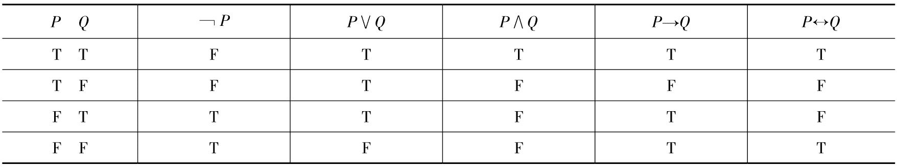）
| 符号 | 名称 | 语义 | 示例 |
| :--- | :--- | :--- | :--- |
| `﹁` | 否定 | 取反 | `﹁INROOM(Li, R2)`：老李不在2号房 |
| `∨` | 析取 | 或 | `Plays(LH, Bad) ∨ Plays(LH, Ping)` |
| `∧` | 合取 | 与 | `Like(CM, Study) ∧ Like(CM, Game)` |
| `→` | 蕴涵 | 若……则…… | `Owns(LW, Pen) → Color(Pen, Red)` **注意**：仅前真后假时为假，无需语义关联。 |
| `↔` | 等价 | 当且仅当 | `P ↔ Q` |

#### 2. 量词：界定个体作用域
*   **全称量词 `∀x`**：“对所有个体”。 `(∀x)[Robot(x) → Color(x, White)]`：所有机器人均白色。
*   **存在量词 `∃x`**：“存在某个个体”。 `(∃x)InRoom(x, p1)`：2号房有人。

**量词嵌套序至关重要**（以`F(x,y)`为“x,y是友”为例）：
*   `(∀x)(∃y)F(x,y)`：人人都有朋友。
*   `(∃x)(∀y)F(x,y)`：存在一位“社交达人”，与所有人为友。
*   `(∃x)(∃y)F(x,y)`：至少有一对朋友。
*   `(∀x)(∀y)F(x,y)`：任意两人皆为友。

**经典区别**：
*   `(∀x)(∃y)[Employee(x) → Manager(y,x)]`：每位员工都有直属经理（经理可不同）。
*   `(∃y)(∀x)[Employee(x) → Manager(y,x)]`：存在一位“大管家”，管辖所有员工。

### 3. 谓词公式的构造规则

量词的排列顺序直接决定了语义的走向。例如，`(∃y)(∀x)(Employee(x)→Manager(y,x))` 表达的是“存在某个经理，统管所有员工”；而 `(∀x)(∃y)Love(x,y)` 意为“人人皆有所爱”，一旦调换为 `(∃y)(∀x)Love(x,y)`，含义就变成了“存在某位‘万人迷’，被所有人喜爱”。可见，量词前后一换，语义天差地别。

#### 定义 2.2：什么是合法的谓词公式？

谓词公式由谓词、常量、变量、函数符号及标点符号按规则组合而成，构造逻辑如下：

1.  **基石**：单个谓词即为原子公式，也是最基础的谓词公式。
2.  **否定**：若 `A` 是公式，`¬A` 也是。
3.  **连接**：若 `A`、`B` 均为公式，`A∧B`、`A∨B`、`A→B`、`A↔B` 皆为公式。
4.  **量化**：若 `A` 是公式，`(∀x)A` 与 `(∃x)A` 也是公式。
5.  **闭包**：有限次套用上述规则生成的表达式，均属谓词公式。
6.  **优先级**：连接词结合优先级由高到低为：`¬` > `∧` > `∨` > `→` > `↔`。

### 4. 量词的“管辖范围”与变量身份

量词后紧跟的单个谓词或括号内的公式，称为该量词的**辖域**。在辖域内，被量词约束的变量叫**约束变量**；逃脱约束的则是**自由变量**。

**案例解析**：
在 `(∃x)(P(x,y)) ∨ R(x,y)` 中：
- `(∃x)` 的辖域仅限于 `(P(x,y))`。
- 辖域内的 `x` 是约束变量；`R(x,y)` 里的 `x` 及所有的 `y` 均为自由变量。

**变量改名原则**：
变量名本身无关紧要，但改名有讲究：
- 改**约束变量**：同量词下的同名约束变量须统一改名，且新名不能与辖域内的自由变量撞车。
- 改**自由变量**：新名不能与辖域内的约束变量重名。
*例：`(∃x)P(x,y)` 可改为 `(∃z)Q(z,t)`；`(∀t)Q(t,x)` 可改为 `(∀y)P(y,z)`。*

---

### 2.2.4 谓词公式的核心性质

#### 1. 解释：赋予符号“意义”
命题逻辑只需给变量赋真值（T/F），谓词逻辑则复杂得多。因包含个体变量与函数，必须先确定**个体域**（讨论范围），指定常量、变量、函数在域内的具体指称，再依谓词语义赋真值。不同的指称对应不同的**解释**，一个公式往往拥有多种解释，每种解释下公式均有确定真值。

#### 2. 三大语义分类（定义 2.3~2.5）
- **永真式**：在任意非空个体域的所有解释下皆为真。
- **永假式**：在任意非空个体域的所有解释下皆为假。
- **可满足式**：至少存在一种解释使其为真；若无任何解释为真，则称**不可满足式**。

> **难点提示**：验证永真性需遍历所有个体域及解释，一旦域无限，机械检验便成不可能。

#### 3. 等价关系与“工具箱”（定义 2.6）
若两公式 `P`、`Q` 在任意个体域的任意解释下真值相同，则称二者等价（`P≡Q`）。掌握以下等价式，是化简推理的利器：

| 类别 | 核心等价式 |
| :--- | :--- |
| **交换/结合/分配** | `P∨Q ≡ Q∨P`；`(P∨Q)∨R ≡ P∨(Q∨R)`；`P∨(Q∧R) ≡ (P∨Q)∧(P∨R)` |
| **德摩根律** | `¬(P∨Q) ≡ ¬P∧¬Q`；`¬(P∧Q) ≡ ¬P∨¬Q` |
| **否定/吸收/补余** | `¬¬P ≡ P`；`P∨(P∧Q) ≡ P`；`P∨¬P ≡ T`，`P∧¬P ≡ F` |
| **蕴涵转化/逆否** | `P→Q ≡ ¬P∨Q`；`P→Q ≡ ¬Q→¬P` |
| **量词核心转化** | `¬(∃x)P ≡ (∀x)¬P`；`¬(∀x)P ≡ (∃x)¬P` |
| **量词分配** | `(∀x)(P∧Q) ≡ (∀x)P∧(∀x)Q`；`(∃x)(P∨Q) ≡ (∃x)P∨(∃x)Q` |

#### 4. 永真蕴涵：推理的“单向道”（定义 2.7）
若 `P→Q` 在共同个体域的一切解释下为真，则 `P` 永真蕴涵 `Q`（记 `P⇒Q`），`Q` 是 `P` 的逻辑结论。

**常用推理规则速查**：
1.  **假言推理**：`P, P→Q ⇒ Q`
2.  **拒取式**：`¬Q, P→Q ⇒ ¬P`
3.  **假言三段论**：`P→Q, Q→R ⇒ P→R`
4.  **全称固化**：`(∀x)P(x) ⇒ P(y)` （`y` 为任意个体，消去全称量词）
5.  **存在固化**：`(∃x)P(x) ⇒ P(y)` （`y` 为使 `P` 为真的特定个体，消去存在量词）
6.  **反证法核心（定理 2.1）**：`Q` 为前提集结论 ⇔ 前提集合取 `¬Q` 后**不可满足**。这是**归结反演法**的理论基石。

---

### 2.2.5 一阶谓词逻辑：知识建模三步走

用 FOL 表达知识，遵循标准流程：
1.  **定义符号集**：明确每个谓词、常量、函数的语义。
2.  **赋值实例化**：根据场景给变量赋具体值。
3.  **连接成式**：用连接词、量词按语义拼装公式。

**案例 2.1：“储蓄有利息”**
- *建模 A（简版)*：`save(x)`、`interest(x)` → `(∀x)(save(x)→interest(x))`
- *建模 B（细版)*：`save(x,y)`、`money(y)`、`interest(u)`、`obtain(x,u)` → `(∀x)(∃y)(money(y)∧save(x,y))→(∃u)(interest(u)∧obtain(x,u))`
> **启示**：同一知识可有多种建模颗粒度，视推理需求而定。

**关联数据库建模**：
关系表本质是谓词实例集。
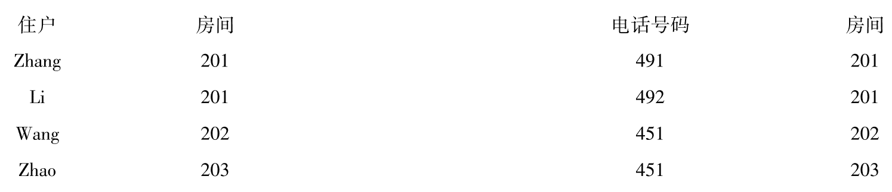
- `OCCUPANT` 表 → `OCCUPANT(Zhang, 201), OCCUPANT(Li, 201)...`
- `TELEPHONE` 表 → `TELEPHONE(491, 201), TELEPHONE(492, 201)...`

---

### 2.2.6 FOL 表示法：优势与短板并存

#### 四大亮点
1.  **贴近自然语言**：符号体系直观，低认知门槛。
2.  **精准二值**：非真即假，演绎结论绝对可靠，适合精确知识。
3.  **形式严谨**：语法语义定义完备，拥有成熟的定理证明体系（如归结原理）。
4.  **工程友好**：易转为子句集等机器内部形式，便于模块化存储、检索、维护。

#### 三大痛点
1.  **不懂“模糊”**：无法处理概率、模糊、不确定知识，应用受限。
2.  **组合爆炸**：事实多、策略差时，中间结论指数级膨胀，推理瘫痪。需启发式策略缓解。
3.  **效率偏低**：纯形式推理忽略语义启发，路径冗长，难以利用领域经验加速。

> **定论**：尽管有缺陷，FOL 仍是基石。QA3（化学）、STRIPS（机器人规划）、FOL（自动定理证明）等经典系统均构建于此。

---

## 2.3 产生式表示法：规则驱动的专家范式

源于 Post (1943) 替换系统，经 Newell & Simon (1972) 认知模型推广，现为专家系统主流表示（如 DENDRAL、MYCIN）。

### 2.3.1 产生式：IF-THEN 的多面手

核心结构：`IF P THEN Q` 或 `P → Q`。
- **前件 P**：匹配条件（事实/规则/操作）。
- **后件 Q**：结论或执行动作。

#### 四种表达模式
| 知识类型 | 格式 | 示例 |
| :--- | :--- | :--- |
| **确定性规则** | `IF 飞 ∧ 下蛋 THEN 鸟` | 编号 `r`，条件与结论明确。 |
| **不确定性规则** | `IF 条件 THEN 结论 (CF=0.6)` | MYCIN 中：革兰氏阴性+杆状+中间宿主 → 绿脓杆菌 (0.6)。 |
| **确定性事实** | 三元组 `(对象, 属性, 值)` / `(关系, 对象1, 对象2)` | `(Li, Age, 40)`、`(Friend, Li, Wang)`。 |
| **不确定性事实** | 四元组 `(对象, 属性, 值, CF)` | `(Li, Age, 40, 0.8)`、`(Friend, Li, Wang, 0)`。 |

#### 产生式 vs 蕴涵式：超越逻辑的工程实用性
1.  **语义更宽**：蕴涵式仅逻辑推导；产生式可含操作、过程、启发式规则（如“超温→关风门”、法律条文、文法规则）。
2.  **容忍不确定**：蕴涵式非真即假；产生式原生支持置信度。
3.  **匹配更灵活**：逻辑要求精确统一；产生式系统允许**模糊匹配**（相似度阈值内即通过）。

**形式化定义 (BNF)**：
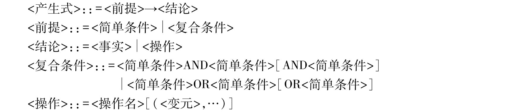

---

### 2.3.2 产生式系统：三驾马车架构

规则协同求解，前件匹配、冲突消解、执行动作、终止判断，循环往复。
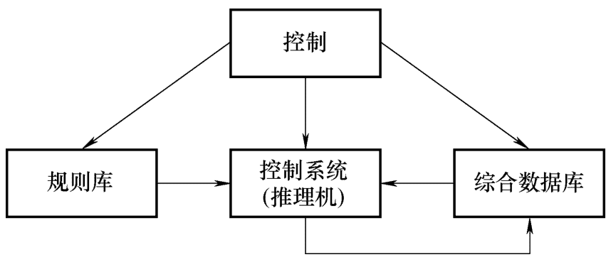

#### 核心三大组件
1.  **规则库** —— **知识仓库**
    存放领域规则（前件+后件）。要求：完整、一致、准确、灵活。需组织管理防冗余矛盾。

2.  **控制系统 / 推理机** —— **大脑调度中心**
    运行循环核心：
    - **匹配**：按策略从规则库筛选与综合库数据匹配的规则（冲突集）。
    - **消解冲突**：冲突集多规则时，按策略（如特异性、新近度、优先级）选 **唯一** 一条执行。
    - **执行**：结论入库、动作执行、不确定度计算。
    - **终止判断**：综合库含最终结论？是则停，否则循环。

3.  **综合数据库** —— **工作台/黑板**
    存放初始事实、中间推论、最终结果。动态演化，为匹配提供数据源。

---

### 2.3.3 实战演示：动物识别系统

目标：识别虎、金钱豹、斑马、长颈鹿、企鹅、鸵鸟、信天翁 7 种动物。
第一步：专家知识 → 规则库构建（见下文规则集）。

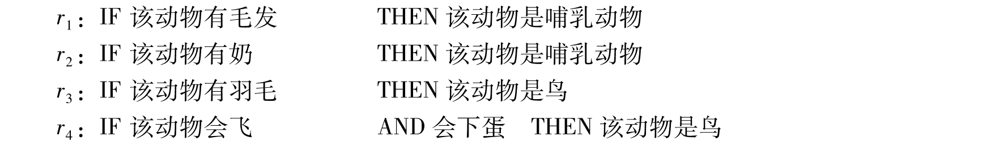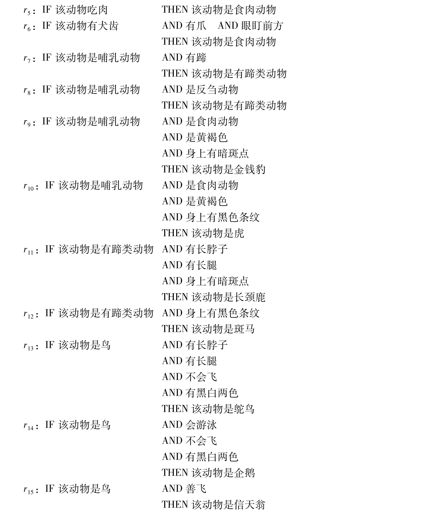

**专家系统如何像侦探一样“破案”：从7种动物到15条规则的推理实录**

这个智能识别系统的任务是辨认7种动物，但它背后可不是只有7条简单规则，而是部署了整整15条。设计思路很有层次感：先抓大特征——比如“有毛发”、“有羽毛”、“会飞”这些显性标签，把动物粗略归类为哺乳类、鸟类等大类；再进一步细化特征，像剥洋葱一样层层收敛范围，最终锁定具体物种。这种分级策略有两大妙用：一是**抗“信息不全”**——哪怕已知特征有限，也能给出个大概轮廓；二是**极易扩展**——想新增识别“牛”、“马”这类新物种？只需补充针对性规则（标号为`r`～`r`），完全不用动原有规则库的一行代码，规模增长可控。顺带一提，`r`～`r`就是给每条规则发的“工号”，方便后续调用引用。

---

### 实战复盘：一步步推导出“长颈鹿”

假设综合数据库（事实库）里已录入：暗斑点、长脖子、长腿、产奶、有蹄。规则库按顺序逐条匹配，推理机启动，过程如下：

**第一轮：锁定大类——哺乳动物**
- 遍历规则库：`r`要求“有毛发”，事实库无此项，作废；`r`要求“产奶”，完美命中；后续`r`～`r`均不匹配。
- 执行`r`，结论“哺乳动物”写入事实库，给`r`打“已用”标签防重复。
- 事实库更新：暗斑点、长脖子、长腿、奶、蹄、**哺乳动物**。还不够精确，继续。

**第二轮：细分类群——有蹄类**
- `r`、`r`、`r`、`r`、`r`轮番上阵，全军覆没；`r`匹配成功，其余`r`～`r`无效。
- 执行`r`，“有蹄类动物”入库，`r`标记已用。
- 事实库现状：暗斑点、长脖子、长腿、奶、蹄、哺乳动物、**有蹄类动物**。仍未定种，再接再厉。

**第三轮：精准定种——长颈鹿**
- 剔除已用的`r`、`r`，仅`r`能与当前事实库匹配。
- 执行`r`，“长颈鹿”入库。
- 事实库终态：暗色斑点、长脖长腿、奶、蹄、哺乳动物、有蹄类、**长颈鹿**。
- 检测到目标物种已在库中，**推理终结，结论输出：该动物是长颈鹿。**

---

### 核心机制揭秘：什么是“推理”？

上面的全过程，本质是**“规则库选规则 ↔ 事实库对事实 → 匹配成功 → 执行结论入库 → 事实库增殖 → 逼近答案”**的循环往复。每一次成功匹配，都让事实库“长”出新知识，离真相更近一步。这个循环，就是专家系统的心脏——**推理**。

> **旁注**：用C/C++的`if-else`硬写产生式系统也能跑，但规则一多，遍历匹配就成性能黑洞。于是诞生了**RETE算法**——专治规则触发条件的极速匹配引擎，内置冲突消解策略。游戏开发领域更有**RC++**（C++超集），原生嵌入产生式规则控制NPC行为，提供反应式控制器专用子集，开箱即用。

---

## 2.3.4 产生式表示法：优缺点全景扫描

### ✅ 四大核心优势

| 维度 | 通俗解读 |
|------|----------|
| **自然性** | “如果…那么…”符合人类因果直觉，读得懂、好维护，难怪成AI知识表示“C位”。 |
| **模块性** | 规则=最小知识单元，与推理引擎解耦，格式统一。增删改查像搭积木，规则库扩展零负担。 |
| **有效性** | 确定/不确定知识全拿捏；启发式经验、流程性操作同兼容。成熟专家系统多靠它表达过程性知识。 |
| **清晰性** | 固定“前提→结论”结构，单规则信息量小，设计排查一目了然，一致性/完整性校验易如反掌。 |

### ❌ 两大硬伤

1. **效率瓶颈**：大规则库+反复匹配=耗时；极端情况下还会**组合爆炸**，卡死系统。
2. **结构性知识“表达无能”**：擅长因果链（非结构化），面对“分类/属性/关联”这类网状结构（如本体、分类树）就抓瞎。**框架表示法**正是为此而生的补位方案。  
   实战中常**混搭**：`PROSPECTOR`用产生式+语义网，`Alkins`用产生式+框架，取长补短。

### 🎯 适用知识画像
- **散装独立型**：知识元松散、无结构依赖（如化学反应库）。
- **经验不确定型**：缺统一理论、靠经验判断（医疗/故障诊断）。
- **流程可分解型**：求解路径=一串相对独立的操作步骤，每步可映射为1~N条规则。

---

## 2.4 框架表示法：给知识装上“结构化骨架”

1975年，明斯基大神提出**框架理论**：人类认知世界，靠的不是散乱标签，而是记忆里预置的“框架模板”。初见新事物，大脑调取最贴切的框架，按实况填细节、补缺口，瞬间成像。  
**经典案例**：你没进教室前，脑海已有“教室框架”——四面墙、门窗、天花板、地板、课桌椅、讲台、黑板…细节（大小、颜色、数量）虽未知，但**骨架已就位**。进门一瞥，实测数据填入槽位，生成**实例框架**——这就是你眼前这个具体教室的视觉模型。

### 2.4.1 框架长什么样？

> **数据结构定义**：描述对象（物/事/概念）属性的容器。  
> 由**槽**组成，槽可再分**侧面**。  
> - 槽 = 对象某维度属性（如“职称”）  
> - 侧面 = 属性的细分面向（如“取值范围”、“默认值”）  
> - 槽值/侧面值 = 具体填充内容：基础类型（数值/字符串/布尔）、可执行动作/过程、另一框架名（引用关联）  
> - 约束条件 = 可选，无则不限

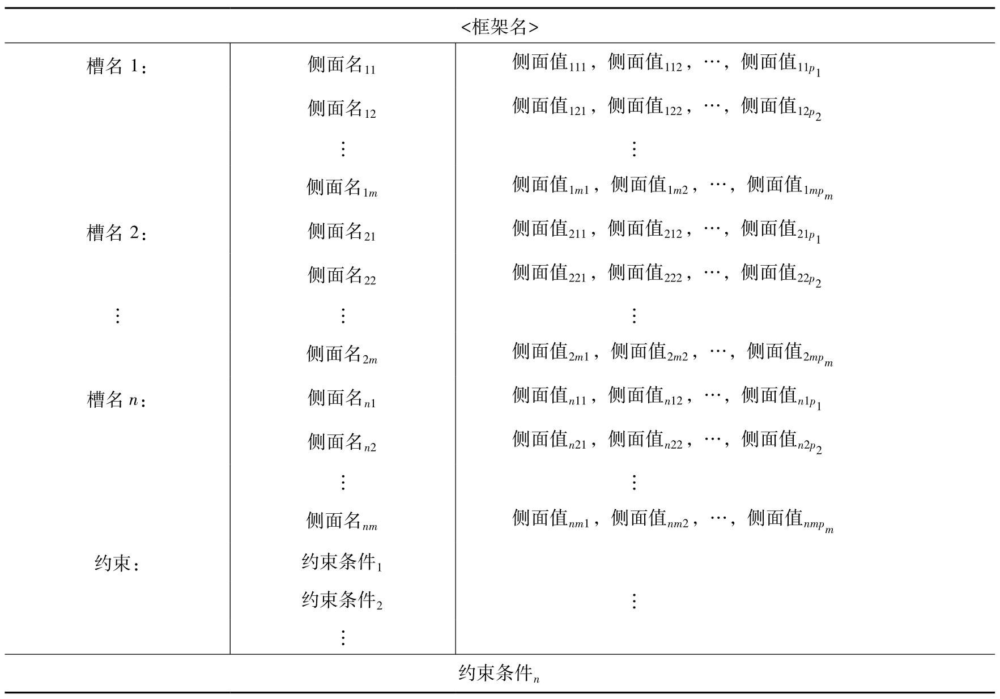

### 2.4.2 手把手建框架：三个实战范例

#### 范例 2.2：教师框架
9个槽位全维度刻画“教师”概念：姓名、性别、职称、所在系、研究方向、电话、办公室、薪水、授课。每槽自带约束——职称只能四选一，性别缺省“男”。  
填入实数据 → 得到**教师实例框架**。

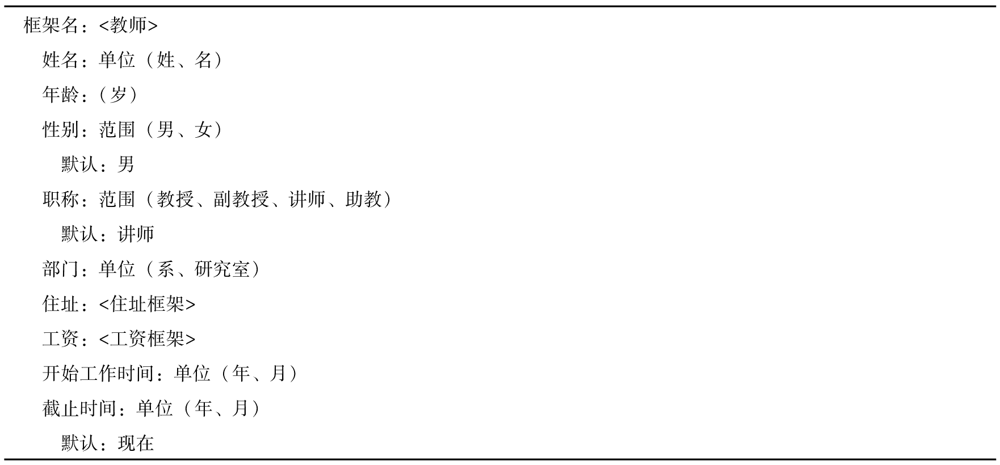  
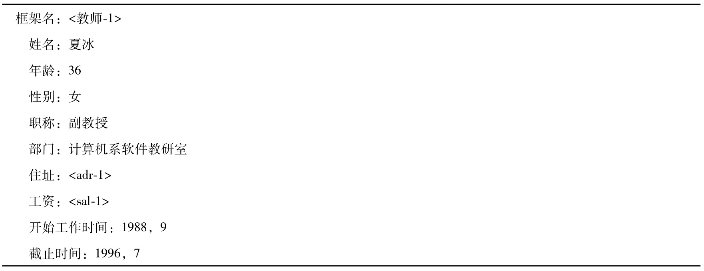

#### 范例 2.3：教室框架
13个槽位覆盖教室全属性（编号、容量、设备、位置…），同样带约束、默认值机制。

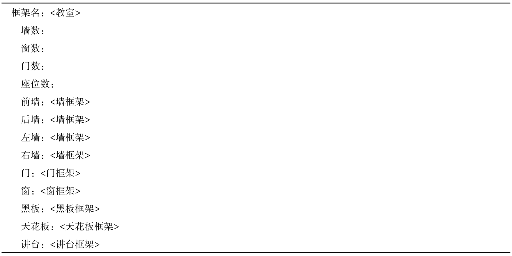

#### 范例 2.4：地震新闻框架（嵌套子框架演示）
“自然灾害框架” → 子框架“地震框架”，9个槽位。  
关键看“地形改变”槽：值不是简单数值，而是**另一个子框架**——实现框架间引用与层级嵌套。  
填入：某年月日、某地、6.0级、膨胀注水孕震模式、波速比0.45、水氧0.43、地形改变=子框架(0.60) → 生成**地震实例框架**。

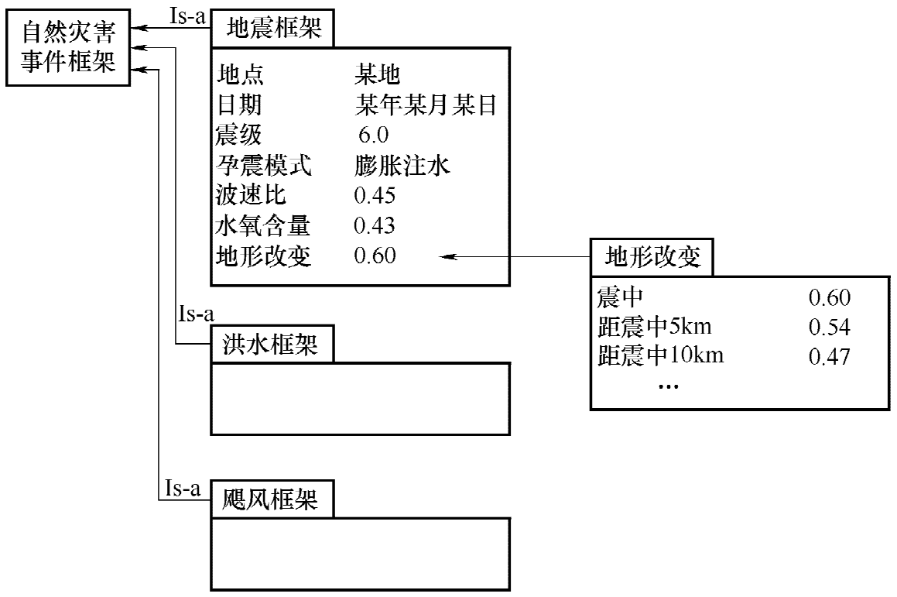  
*图 2-2 自然灾害框架层级图*

> **彩蛋**：产生式规则也能“框架化”。  
> `如果 头痛 且 发烧 则 感冒` → 框架版见下：

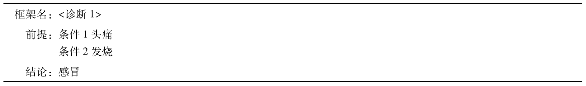

### 2.4.3 框架三大杀手锏

| 特性 | 破解痛点 |
|------|----------|
| **结构性** | 产生式只会“因果链”，框架靠“槽”表达任意复杂关系（因果用`Infer`槽，其他关系对应别的槽），支持子框架层级，知识单元从“规则”升级为“框架”，拿捏复杂问题。 |
| **继承性** | 槽值指向父框架名 → 自动继承父级槽值；子框架可覆盖/扩展。**减冗余、保一致**，构建知识网络利器。 |
| **自然性** | 贴合人类“先有整体轮廓，再填细节”的认知规律，极其顺手。 |

---

## 2.5 章节极速回顾：知识表示四大金刚

### 1. 知识本质
- 定义：关联信息形成的**信息结构**。  
- 四性：相对正确性、不确定性、可表示性、可利用性。  
- 不确定源头：随机性、模糊性、经验性、不完全性。

### 2. 命题与一阶谓词逻辑
- 命题=可判真假的陈述句。  
- 谓词`P(x₁,…,xₙ)`：谓词名+个体(常量/变量/函数)。  
- 逻辑连接词(¬∨∧→↔) + 量词(∀∃) → 复合命题。  
- 量词辖域、约束变量/自由变量、可满足/不可满足、逻辑结论判定准则。  
- **评价**：自然/精确/严密/易实现 ✅ | 不确定知识难表达、组合爆炸、效率低 ❌

### 3. 产生式表示法
- 核心：`如果…那么…`，蕴涵式只是其特例。  
- 覆盖：事实/规则/不确定度、确定/不确定、启发式/过程性。  
- 优/缺/适用：同上详表。  
- 系统三件套：**规则库 + 综合数据库 + 推理机(控制系统)**。  
- 推理本质：匹配→执行→增库→循环，专家系统核心。

### 4. 框架表示法
- 结构：框架→槽→侧面→槽值/侧面值。  
- 三大特性：结构性、继承性、自然性。  
- 定位：描述对象属性的**数据结构**。  
> ⚠️ 素材小结处有笔误：框架缺点写了“不能表达结构性知识”，实为产生式缺点，框架强项正是结构性。

---

## 思考题速览（自测用）
2.1~2.23 涵盖：知识定性/分类、表示选择、命题/谓词/公式辨析、一阶逻辑建模步骤、产生式vs蕴涵式、系统组件/推理步骤/冲突消解、框架结构/建模步骤、办公室/主机框架建模、自然语言转谓词公式、量词辖域/变元分析、解释与真值计算、推理形式化、XOR产生式建模。

---

# 第 3 章 确定性推理方法

开篇先立概念：定义、分类、方向策略，再深入四大硬核技法——**自然演绎**、**谓词公式转子句集**、**鲁滨逊归结原理**、**归结反演**。

## 3.1 推理基本概念

### 3.1.1 什么是推理？
人类面对问题：拿**事实**(证据) + **知识**(动力/依据) → 分析综合决策 → 发现联系/生成新知。  
AI里由**推理机**(程序)自动完成。两大入参：**事实**(起点/导航)、**知识**(燃料/地图)。

### 3.1.2 推理分类全景图

#### 三大基本范式
| 类型 | 方向 | 核心逻辑 | 典型结构 |
|------|------|----------|----------|
| **演绎推理** | 一般→个别 | 通用知识/假设 → 具体结论 | **三段论**：大前提(一般律) + 小前提(个别事实) → 结论 |
| **归纳推理** | 个别→一般 | 观察样本 → 概括规律 | — |
| **默认推理** | 缺信息→合理猜测 | 缺反证时按默认规则推断 | — |

> **演绎推理=AI主力**。三段论例：  
> 大前提：足球运动员身体都强壮。  
> （后续待续…）

## 推理方法全景速览：从演绎到启发式的思维地图

### 基础逻辑三段论：演绎推理的经典范式

大前提：足球运动员身体素质过硬。  
小前提：高波是足球运动员。  
结论：高波身体强壮。

### 一、归纳推理：从个别走向一般的认知跃迁

归纳推理指从具体案例中提炼普遍规律，是AI领域的核心推理手段。依据考察样本的覆盖面，可分为两类：

**完全归纳**：穷尽所有对象验证属性。  
*案例*：工厂全检每件产品均合格，故断定全厂产品合格。结论必然成立，属必然性推理。

**不完全归纳**：仅抽样部分验证即下结论。  
*案例*：随机抽检产品全合格，推断全厂产品合格。结论非绝对正确，属非必然性推理。

虽不完全归纳易出错，但受限于穷举现实难度，大多数归纳实践皆属此类。它是人类由个别及一般思维的基石。

---

### 二、默认推理：知识缺口下的“假设先行”策略

又称缺省推理。在信息不全时，假设特定条件成立以推进推理。

*机制*：条件A成立且无证据否定B时，默认B成立并以此为基础推导。  
*场景*：设计鸟笼不知鸟是否会飞 → 默认会飞 → 推导需加盖子。

*特征*：允许在知识不全时启动推理。若后续发现默认条件失效，需回溯撤销该假设及其衍生结论，依新知重推。

---

### 三、确定性 vs 不确定性推理：知识纯度的分水岭

| 维度 | 确定性推理 | 不确定性推理 |
|------|------------|--------------|
| 前提知识 | 确定无歧 | 模糊/概率/不全 |
| 结论真值 | 非真即假 | 置信度/隶属度 |
| 典型代表 | 经典逻辑推理（自然演绎、归结法、与/或图） | 似然推理(概率论)、模糊推理(模糊逻辑) |

现实世界多不确定，赋予计算机不确定性推理能力是模拟人类思维的关键。

---

### 四、单调 vs 非单调推理：结论演进的“可逆性”

**单调推理**：新知加入仅强化结论，推理路径单向前进，无回头。经典演绎推理即属此类。

**非单调推理**：新知可能推翻旧结论，导致推理回溯重启。常发生于知识不全时，需先假设再验证。**默认推理即典型非单调推理**。

*生活案例*：知X是鸟 → 推断X会飞 → 后知X是企鹅 → 撤销“会飞” → 加入“不会飞”。

---

### 五、启发式 vs 非启发式推理：有无“导航仪”的区别

**启发式推理**：引入领域经验（启发性知识）指引搜索方向，加速求解最优解。  
*例*：诊断脑膜炎/肺炎/流感三选一。规则r1→脑膜炎，r2→肺炎，r3→流感。若优先排除高危脑膜炎，先用r1；若流感高发季，先用r3。“脑膜炎高危”、“流感高发”即启发信息。

**非启发式推理**：纯按逻辑规则机械推演，无领域偏好。适用于知识完备、无需假设、无回溯风险的场景。经典演绎推理即属此类。

---

## 3.1.3 推理方向：四大控制策略的攻防博弈

推理控制策略覆盖方向、搜索、冲突消解、求解、限制五大维度。方向上分正向、逆向、混合、双向四种。

### 1. 正向推理：数据驱动的“推陈出新”

**核心逻辑**：初始事实 → 匹配规则 → 产生新事实 → 入库 → 循环直至得解或规则耗尽。

**标准化流程**：
1. 初始事实入库(DB)
2. 检库有无答案 → 有则出解，无则继续
3. 当前事实匹配知识库(KB)可用规则 → 无则跳步骤6
4. 匹配规则集 → 知识集合(KS)
5. KS非空 → 选规则推理 → 新事实入库 → 回步骤2；KS空 → 步骤6
6. 询问用户补事实 → 能补则入库回步骤3，不能补则宣告失败

*难点*：规则匹配算法、模糊匹配阈值设定。

---

### 2. 逆向推理：目标导向的“层层溯源”

**核心逻辑**：假设目标 → 寻找支撑事实 → 事实在库则证毕，不在库则判断是否需用户确认或继续分解子目标。

**算法骨架**：
1. 提出待证假设
2. 假设在库 → 证毕，验证下一假设；不在库 → 继续
3. 假设是原始事实？是→问用户；否→继续
4. KB中找所有能推出该假设的规则 → 备选集KS
5. KS中选一规则，其条件作新假设 → 回步骤2

*复杂性*：假设树回溯、多条件并行验证、子目标调度。  
*优势*：仅调用目标相关知识，目的明确，可生成解释。  
*劣势*：初始假设偏差大则频繁换假设，拖累效率。

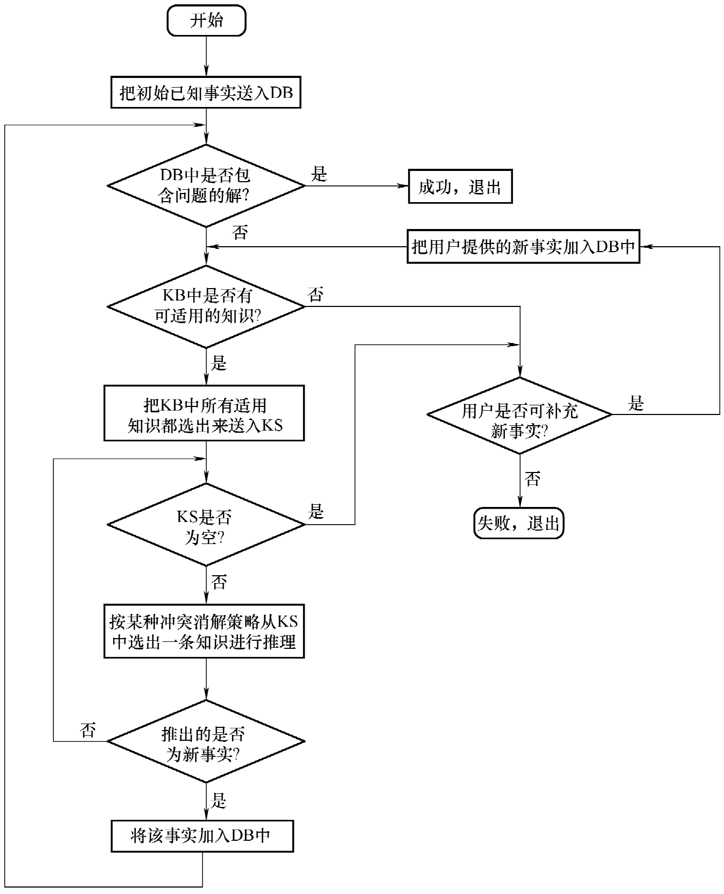  
图 3-1 正向推理示意图  

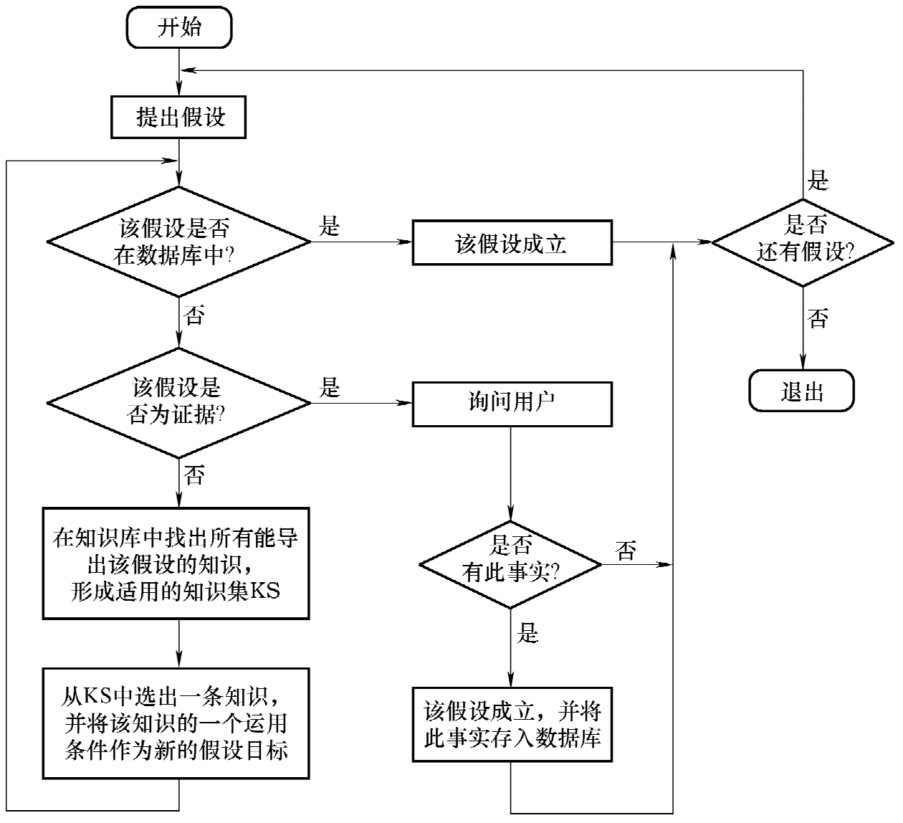  
图 3-2 逆向推理示意图  

---

### 3. 混合推理：双剑合璧的“互补共生”

正向盲目产生无关中间结果；逆向假设失误降效率。混合推理融合双方优势，三大典型适用场景：

| 场景 | 策略 |
|------|------|
| 事实不足 | 先正向挖掘不完全匹配规则 → 其结论作假设 → 逆向向用户取证 |
| 结论低信度 | 正向得初步结论 → 作假设逆向验证 → 补强证据提升可信度 |
| 结论过单一 | 逆向验证中获取新知 → 反哺正向推导更多结论（如确诊甲病后顺带发现乙病） |

两大混合模式：  
① 先正向后逆向：事实→部分结果→锁定目标→逆向验证/强信度  
② 先逆向后正向：假设目标→逆向取证→所得新知→正向发散更多结论

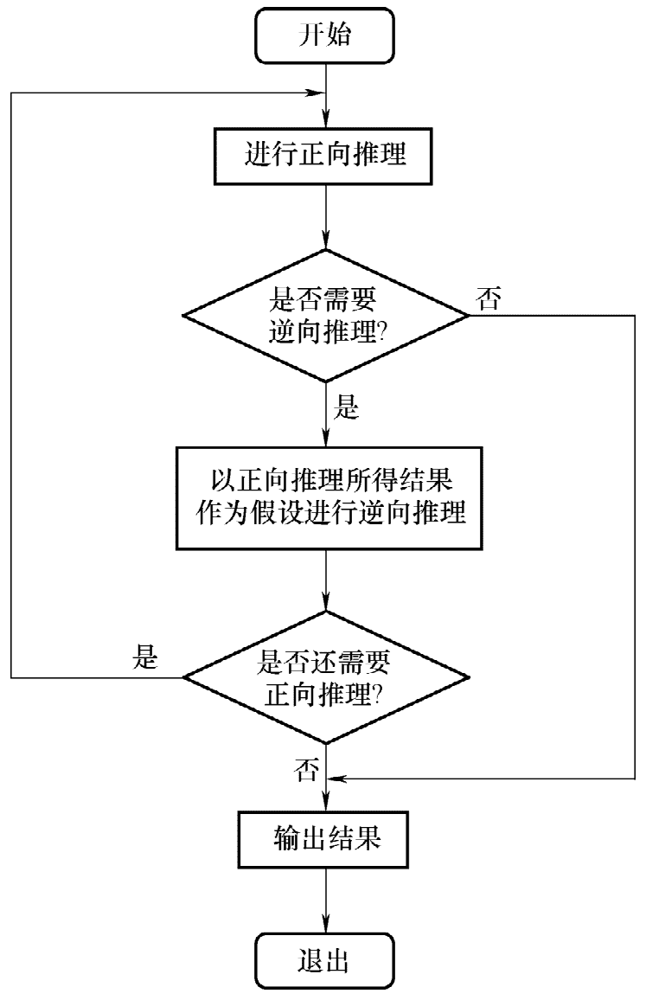  
▲图 3-3 先正向后逆向混合推理示意图  

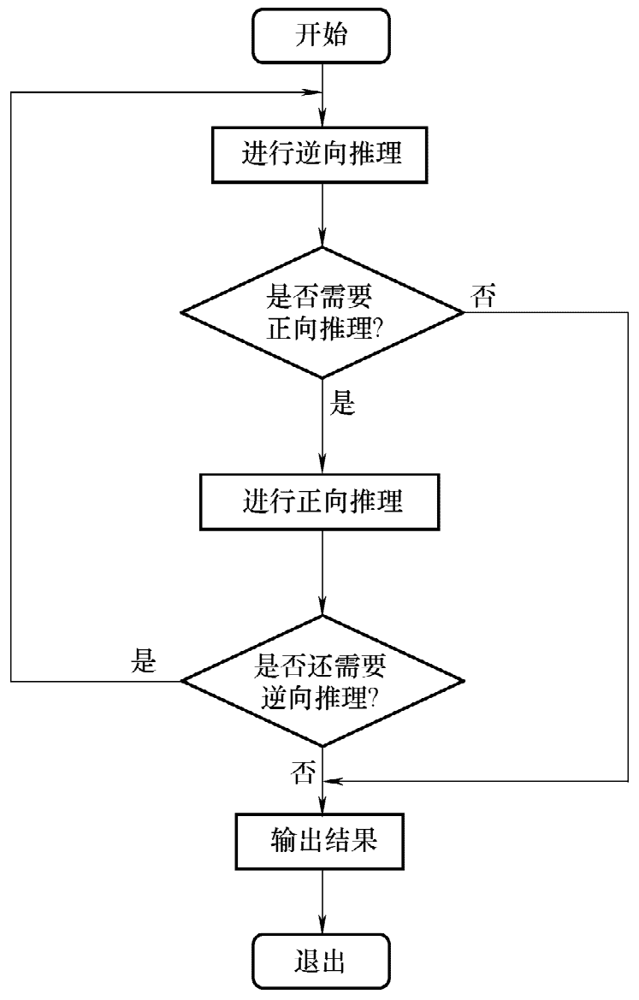  
▲图 3-4 先逆向后正向混合推理示意图  

---

### 4. 双向推理：中间相遇的“夹击战术”

定理证明常用。正向从事实出发，逆向从目标出发，**同时进行**，在中间某节点“碰头”（正向中间结果 = 逆向所需证据）即终止。

*核心难点*：  
- 如何判定“碰头”条件满足  
- 如何动态平衡双向推进比例、把控碰头时机

---

## 3.1.4 冲突消解：多规则匹配时的“仲裁机制”

事实与规则匹配可能现三态：  
① 单规则匹配 → 直接采用  
② 无规则匹配 → 知识缺失/超能力 → 人工介入  
③ **多规则/多事实组匹配 → 冲突** → 需冲突消解策略选单规则推进

消解本质：对候选规则**排序优选**。四大经典策略：

### 策略一：针对性优先（条件更特殊者胜）
规则r1条件包含r2所有条件且更多 → r1针对性更强 → 冲突时选r1。满足即更接近目标，缩短路径。

### 策略二：事实新鲜度优先（更新数据者胜）
推理产生新事实、用户补录事实 → 均更新时间戳。后生成者更新鲜。  
*比较三法*：  
1. 逐个对比：事实组A中更新鲜事实数 > 组B → A胜  
2. 顶配对比：A最新事实 vs B最新事实 → 谁新谁胜  
3. 兜底对比：A最旧事实 vs B最旧事实 → 谁更旧谁输（对方胜）

### 策略三：匹配度优先（相似度更高者胜）
不确定性推理中，计算事实与规则相似度。阈值内多人通过 → 相似度最高规则优先。

### 策略四：条件数极少优先（同结论下更轻量者胜）
多规则推同一结论 → 条件少者比对耗时短 → 优先触发。

*工程实践*：组合多策略分级降冲突，提速增效。

---

## 3.2 自然演绎推理：纯逻辑规则的“直推快车”

定义：从真前提出发，直接套用经典逻辑推理规则（P规则、T规则、假言、拒取式）得结论。

### 核心规则速查

| 规则 | 形式 | 语义 | 经典例 |
|------|------|------|--------|
| **假言推理** | P, P→Q ⊢ Q | 前件真、蕴涵真 → 后件真 | 金属导电，铜是金属 → 铜导电 |
| **拒取式推理** | P→Q, ¬Q ⊢ ¬P | 蕴涵真、后件假 → 前件假 | 下雨地湿，地不湿 → 未下雨 |

### 两大逻辑陷阱（严禁踩坑）

1. **肯定后件谬误**：P→Q真，Q真 → 谬推P真。  
   *伽利略日心说辩护曾犯此错*：日心说→金星有相位；金星有相位→∴日心说真（逻辑不成立）。

2. **否定前件谬误**：P→Q真，P假 → 谬推Q假。  
   *反例*：下雨→地湿；未下雨→∴地不湿（地可能因浇水湿）。  
   *根源*：蕴涵真时，前件假/后件真均不决定另一端真值。

---

### 实战演示：谓词逻辑自然演绎证明

**例 3.1**  
已知：  
1. 小张喜欢一切容易课程  
2. A班课程全易  
3. C++是A班课程  
证：小张喜欢C++

**谓词建模**：  
EASY(x)：x易  
LIKE(x,y)：x喜欢y  
A(x)：x属A班课程

**形式化**：
- ∀x(EASY(x) → LIKE(Zhang, x))
- ∀x(A(x) → EASY(x))
- A(C++)
⊢ LIKE(Zhang, C++)

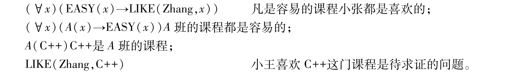

**证明链**：
1. ∀x(EASY(x)→LIKE(Zhang,x)) → 全称实例化 → EASY(z)→LIKE(Zhang,z)
2. ∀x(A(x)→EASY(x)) → 全称实例化 → A(y)→EASY(y)
3. A(C++), A(y)→EASY(y) → 假言推理 → EASY(C++)
4. EASY(C++), EASY(z)→LIKE(Zhang,z) → 假言推理 → **LIKE(Zhang, C++)** 证毕

---

*至此，推理分类体系与核心算法脉络已全景呈现。下一节将深入归结原理——自动定理证明的“核弹级”引擎。*

## 谓词逻辑自动推理：从公式到归结的“标准化”之路

### 前言：为什么要换套路？

上一节提到的**自然演绎系统**，走的是“人脑思维路线”。比如已知“张三选了简单的 C++ 课（`EASY(C++)`）”和“凡选简单课程 `z` 者，张三必喜欢 `z`（`EASY(z) → LIKE(Zhang, z)`）”，套用 `T` 规则与假言推理，立马得出“张三喜欢 C++（`LIKE(Zhang, C++)`）”。

这套系统优点明显：步骤符合直觉，推理规则丰富，方便嵌入领域启发式知识。但有个致命短板——**组合爆炸**。推理过程中产生的中间结论呈指数级增长，问题规模一大，算力直接跪。

为了让机器能“机械、高效”地推理，我们引入 **归结原理**。它的第一步，就是把五花八门的谓词公式，强制“整容”成统一格式的**子句集**。

---

### 一、 基础概念：搞懂这些“积木”

在动手转换前，先明确几个核心名词：

*   **原子公式**：逻辑中的最小单元，不可再分。
*   **文字**：原子公式或其否定。`P` 叫**正文字**（真），`¬P` 叫**负文字**（假），两者互为**互补文字**。
*   **子句**：若干文字用“或（∨）”串联。单个文字本身也是子句。
*   **子句集**：一组子句的集合，隐含“与（∧）”关系。
*   **空子句（`NIL`）**：空集，永假，**不可满足**——这是归结反演要猎杀的终极目标。

**定理 3.1** 给了我们理论支撑：谓词公式不可满足 ⇔ 其子句集不可满足。搞定子句集，等于搞定原公式。

---

### 二、 标准化“八步法”：把公式“洗”成子句集

任意谓词公式转子句集，按这套 SOP 走准没错：

1.  **干掉蕴涵/等价**：`→`、`↔` 全拆成 `¬`、`∨`、`∧`。
2.  **否定下沉**：把 `¬` 一层层往里推，贴紧谓词（用双重否定、德摩根律、量词互换）。
3.  **变量改名**：不同作用域的同名变量重命名，防止串位。
4.  **消灭存在量词（Skolem 化）**：存在变量用依赖它的全称变量构成的 **Skolem 函数** 替代（若无全称变量，用常量）。
5.  **拉成前束形**：所有量词提到最左边，形成 `(前缀)|母式|` 结构。
6.  **化合取范式（CNF）**：用分配律 `P ∨ (Q ∧ R) ⇔ (P ∨ Q) ∧ (P ∨ R)` 把母式变成“与的析取”。
7.  **省略全称量词**：默认全称量化，显式符号可丢。
8.  **拆解成集**：按 `∧` 拆分，每个析取式成一子句，变量最后再标准化一次。

---

### 三、 实战演示：四个例子一网打尽

#### 例 3.2：嵌套量词的“套娃”结构
**原式**：`(∀x)((∀y)P(x,y) → ¬(∀y)(Q(x,y) → R(x,y)))`

| 阶段 | 操作与结果 |
| :--- | :--- |
| **1. 消蕴涵** | `(∀x)(¬(∀y)P(x,y) ∨ ¬(∀y)(¬Q(x,y) ∨ R(x,y)))` |
| **2. 否定下沉** | `(∀x)((∃y)¬P(x,y) ∨ (∃y)(Q(x,y) ∧ ¬R(x,y)))` |
| **3. 变量改名** | `(∀x)((∃y)¬P(x,y) ∨ (∃z)(Q(x,z) ∧ ¬R(x,z)))` |
| **4. Skolem 化** | `y→f(x), z→g(x)` → `(∀x)(¬P(x,f(x)) ∨ (Q(x,g(x)) ∧ ¬R(x,g(x))))` |
| **5. 前束形** | 量词已在最左，不动。 |
| **6. 化 CNF** | 分配律展开：`(∀x)[(¬P∨Q) ∧ (¬P∨¬R)]` |
| **7. 去量词** | `(¬P(x,f(x)) ∨ Q(x,g(x))) ∧ (¬P(x,f(x)) ∨ ¬R(x,g(x)))` |
| **8. 成集合** | `{ ¬P(x,f(x)) ∨ Q(x,g(x)),  ¬P(y,f(y)) ∨ ¬R(y,g(y)) }` |

> **避坑点**：步骤 3 必须把第二个 `y` 改成 `z`，否则步骤 4 无法为两个 `∃` 生成不同的 Skolem 函数。

#### 例 3.3：合取项带量词的“分裂”结构
**原式**：`(∀x)({¬P(x)∨¬Q(x)} → (∀y)(S(x,y)∧Q(x))) ∧ (∀x)(P(x)∨B(x))`

*   **消蕴涵/否定下沉**：左边前件 `¬(¬P∨¬Q)` 变 `P∧Q`；后件 `¬(∀y)` 变 `∃y`。
*   **改名**：后半段 `x` 改 `w` 避免冲突。
*   **Skolem 化**：`∃y` 依赖 `∀x`，引入 `f(x)`。
*   **前束/标准形**：两个 `∀` 提前，分配律化简。注意 `Q(x)` 被提取成了单元子句（吸收律妙用）。
*   **最终子句集**：`{ Q(x),  P(y)∨S(y,f(y)),  P(w)∨B(w) }`

#### 例 3.4：函数符号与多层嵌套
**原式**：`(∀x){P(x) → {(∀y)[P(y)→P(f(x,y))] ∧ ¬(∀y)[Q(x,y)→P(y)]}}`

流程同理，重点：
*   `¬(∀y)[¬Q∨P]` → `(∃y)[Q∧¬P]`。
*   Skolem 函数 `g(x)` 处理 `∃y`。
*   双全称量词 `x, y` 提前缀。
*   三路分配得三子句。
*   **结果**：`{ ¬P(x)∨¬P(y)∨P(f(x,y)),  ¬P(x)∨Q(x,g(x)),  ¬P(x)∨¬P(g(x)) }`

#### 例 3.5：只求“前束形”不拆子句
**原式**：`(∃x)(∃y)((∀z)(P(z)∧¬Q(x,z)) → R(x,y,f(a)))`

目标：消 `∃`、拉量词、保留 `∀`。
1.  `∃x` 先消，用常量 `b` 代 `x`。
2.  消蕴涵、否定下沉：`¬(∀z)(...)` → `(∃z)(¬P(z)∨Q(b,z))`。
3.  `∃z` 依赖剩下的 `∃y`，Skolem 函数 `g(y)`。
4.  合并析取，提 `∃y` 到最前。
**结果**：`(∃y)(¬P(g(y)) ∨ Q(b,g(y)) ∨ R(b,y,f(a)))` —— 这就是消去存在量词后的前束形。

---

### 四、 归结原理：自动推理的“核武器”

有了子句集，如何判定不可满足？1965 年 Robinson 提出归结原理，开辟了机器定理证明新纪元。

#### 1. 命题逻辑版：文字“消消乐”

**定义 3.1（归结）**：
子句集中任取两子句 `C₁`, `C₂`。若 `C₁` 有文字 `L`，`C₂` 有 `¬L`（互补），把这对互补文字扔掉，剩下部分合并成新子句 `C`。此过程称**归结**，`C` 叫**归结式**，`C₁/C₂` 叫**亲本子句**。

*   `P` 与 `¬P` 归结 → `NIL`（空子句，胜利！）
*   `¬P∨Q∨R` 与 `¬Q∨S` 归结 → `¬P∨R∨S`

**定理 3.2（可靠性）**：归结式是亲本的逻辑结论。亲本真 ⇒ 归结式真。

**证明略述**：
设亲本子句为 `C₁`, `C₂`，归结式为 `C`。
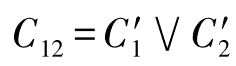
通过归结可得 `C₁` 与 `C₂` 的归结式。
### 1.2
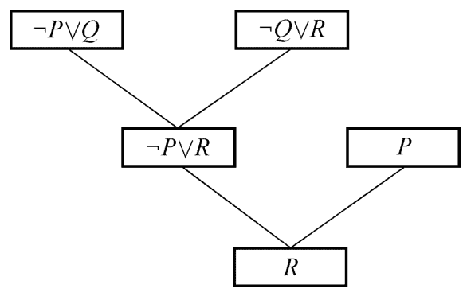
图 3-5 归结过程的树形表示
因为
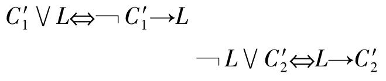
所以
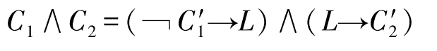
根据假言三段论得到
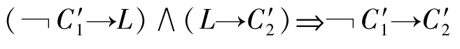
因为
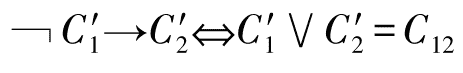
所以 `C₁∧C₂ ⇒ C`。
由逻辑结论定义，`C` 是 `C₁, C₂` 的逻辑结论。（证毕）

**两大推论（实战核心）**：
1.  **替换法**：用归结式 `C` **替换** 亲本，新集合 `S'` 不可满 ⇒ 原集合 `S` 不可满。
2.  **加入法**：把归结式 `C` **加入** 原集合得 `S''`，`S''` 与 `S` **不可满等价**。

> **启示**：不断归结、加入（或替换），只要推出 `NIL`，原子句集铁定不可满。这是**归结反演**的基石。

#### 2. 谓词逻辑版：先“合一”，再“归结”

谓词子句带变量，`P(x)` 和 `P(a)` 长得像但不等，不能直接消。必须先用**最一般合一（MGU）** 做代换。

**定义 3.2（二元归结式）**：
`C₁`, `C₂` 无公共变量。`L₁∈C₁`, `L₂∈C₂`，若 `σ = MGU(L₁, ¬L₂)`，则归结式为：
`C = (C₁σ - {L₁σ}) ∨ (C₂σ - {L₂σ})`

##### 实战三连击

**例 3.6：多路归结**
`C₁ = P(a) ∨ ¬Q(x) ∨ R(x)`，`C₂ = ¬P(y) ∨ Q(b)`

*   **路径 A（消 P）**：`σ={a/y}` → 归结式 `¬Q(x) ∨ R(x) ∨ Q(b)`。
*   **路径 B（消 Q）**：`σ={b/x}` → 归结式 `P(a) ∨ R(b) ∨ ¬P(y)`。
*   *同一对亲本，选不同互补对，得不同归结式。*

**例 3.7：变量重命名（避坑指南）**
`C₁ = P(x) ∨ Q(a)`，`C₂ = ¬P(b) ∨ R(x)` ❌ 变量 `x` 冲突！
→ **先改名**：`C₂' = ¬P(b) ∨ R(y)`。
→ 再合一 `σ={b/x}` → 归结式 `Q(a) ∨ R(y)`。

**例 3.8：因子——子句内部自洽**
`C₁ = P(x) ∨ P(f(a)) ∨ Q(x)`，`C₂ = ¬P(y) ∨ R(b)`
`C₁` 内部 `P(x)` 和 `P(f(a))` 能合一！`θ={f(a)/x}`。
→ 算**因子**：`C₁θ = P(f(a)) ∨ Q(f(a))`（去重）。
→ 拿因子跟 `C₂` 归结：消 `P`，`σ={f(a)/y}` → 归结式 `R(b) ∨ Q(f(a))`。

**定义 3.3（广义归结式）**：四种来源：
1.  亲本直归。
2.  `C₁` 因子 跟 `C₂` 归。
3.  `C₁` 跟 `C₂` 因子 归。
4.  因子 跟 因子 归。

**完备性（王炸）**：
一阶谓词逻辑下，**子句集不可满 ⇔ 一定能推导出 `NIL`**。
（Herbrand 理论保证，此处不展开。）

**避坑提醒**：
*   推不出 `NIL` ≠ 可满足。可能是策略没选对，或它真可满。
*   只有穷尽所有策略都推不出 `NIL`，才能判定可满足。

---

### 五、 归结反演：定理证明的标准动作

既然归结又可靠又完备，如何用它自动证定理？

**目标**：证明 `Q` 是 `P₁∧P₂∧...∧Pₙ` 的逻辑结论。

**等价转换**：
`Q` 成立 ⇔ `(P₁∧...∧Pₙ) → Q` 永真 ⇔ `(P₁∧...∧Pₙ) ∧ ¬Q` **不可满足**。

**归结反演 SOP**：
1.  **前提合取**：所有前提 `Pᵢ` 与 否定结论 `¬Q` 合取。
2.  **标准化**：按 3.3 节八步走，转成子句集 `S`。
3.  **归结循环**：
    *   在 `S` 中找可归结的子句对。
    *   算 MGU，生成归结式（含因子归结）。
    *   归结式加入 `S`（或替换亲本）。
    *   **若生成 `NIL` → 停止，定理得证（Q 成立）**。
    *   **若无新子句可生成且无 `NIL` → 停止，Q 非逻辑结论**。

这就是把“数学直觉”变成“代码逻辑”的完整链路。下一节，我们将看看如何用**归结策略**避开组合爆炸，让机器跑得更快。

# 逻辑推理与智能算法核心要点解析

## 3.5 归结原理：自动定理证明的利器

### 核心流程四步走

利用归结原理进行证明，通常遵循以下标准化步骤：

1.  **形式化前提**：将已知条件转化为谓词公式 $F$。
2.  **否定目标**：把待证结论表示为谓词公式 $Q$，并取其否定 $\neg Q$。
3.  **子句化**：将公式集合 $\{F, \neg Q\}$ 转换为子句集 $S$。
4.  **迭代归结**：在 $S$ 中反复应用归结规则，生成的归结式回加入 $S$。一旦推导出**空子句**，即表明原命题 $Q$ 成立。

---

### 实战案例 3.9：招聘逻辑推演

**场景**：公司面试 A、B、C 三人，心理预期如下：
1.  至少录用一人；
2.  若录用 A 但不录用 B，则必录用 C；
3.  若录用 B，则必录用 C。
**目标**：证明公司必定录用 C。

**形式化建模**：
设谓词 $P(x)$ 表示“录用 $x$”。
*   前提 1：$P(A) \lor P(B) \lor P(C)$
*   前提 2：$P(A) \land \neg P(B) \to P(C)$
*   前提 3：$P(B) \to P(C)$
*   反命题（待证结论取反）：$\neg P(C)$

**转化为子句集（合取范式）**：
1.  $P(A) \lor P(B) \lor P(C)$
2.  $\neg P(A) \lor P(B) \lor P(C)$
3.  $\neg P(B) \lor P(C)$
4.  $\neg P(C)$

**归结推导链**：
*   (5) $P(B) \lor P(C)$ —— 由 (1) 与 (2) 归结消去 $P(A)$
*   (6) $P(C)$ —— 由 (3) 与 (5) 归结消去 $P(B)$
*   (7) **NIL (空子句)** —— 由 (4) 与 (6) 归结消去 $P(C)$

**结论**：推导出空子句，原命题得证，公司一定会录用 C。该过程可用归结树直观展示。

---

### 实战案例 3.10：亲属关系推理

**已知**：
*   规则 1：任何人的兄弟均非女性。
*   规则 2：任何人的姐妹均为女性。
*   事实：Mary 是 Bill 的姐妹。
**目标**：证明 Mary 不是 Tom 的兄弟。

**谓词定义**：
*   $brother(x, y)$：$x$ 是 $y$ 的兄弟
*   $sister(x, y)$：$x$ 是 $y$ 的姐妹
*   $woman(x)$：$x$ 是女性

**公式化与子句化**：
1.  规则 1：$\forall x \forall y (\neg brother(x, y) \lor \neg woman(x))$
2.  规则 2：$\forall x \forall y (\neg sister(x, y) \lor woman(x))$
3.  事实：$sister(Mary, Bill)$
4.  反目标：$brother(Mary, Tom)$（假设为真，待求矛盾）

**归结步骤**：
*   由事实 (3) 与 规则 2 归结 $\Rightarrow$ $woman(Mary)$
*   $woman(Mary)$ 与 规则 1 归结 $\Rightarrow$ $\neg brother(Mary, y)$
*   代入 $y = Tom$，与反目标 $brother(Mary, Tom)$ 归结 $\Rightarrow$ **NIL**

**结论**：矛盾成立，Mary 不是 Tom 的兄弟。

---

## 3.6 章节小结：推理的全景图

### 一、 推理的概念与分类

推理是指从初始证据出发，借助知识库，按策略逐步导出结论的过程。可按五大维度分类：

| 分类维度 | 类型 | 核心特征 |
| :--- | :--- | :--- |
| **方向** | **演绎推理** | 一般 $\to$ 个别，必然性推导 |
| | **归纳推理** | 个别 $\to$ 一般，概率性总结 |
| **确定性** | **确定性推理** | 知识/证据/结论均确定无误 |
| | **不确定性推理** | 存在不确定因素，结论带概率 |
| **启发知识** | **启发式推理** | 引入经验知识剪枝、加速 |
| | **非启发式推理** | 纯靠逻辑规则，无经验干预 |
| **单调性** | **单调推理** | 新知识只增强结论，不推翻旧结论 |
| | **非单调推理** | 新知识可能推翻旧结论，需修正 |
| **启动方式** | **正向推理** | 事实驱动，向前链式推演 |
| | **逆向推理** | 目标驱动，向后回溯求证 |
| | **混合推理** | 正向与逆向结合 |

### 二、 核心推理方法：归结原理

1.  **基础定义**：
    *   **文字**：原子公式或其否定。
    *   **子句**：文字间用析取 ($\lor$) 连接的析取式。
    *   **子句集**：一组子句的合取（隐含全称量词）。
2.  **理论基石**：任一谓词公式可转化为等价的子句集。若公式永假，其子句集亦永假。
3.  **鲁滨逊归结原理**：
    *   **使命**：证明子句集不可满足（即导出空子句）。
    *   **流程**：目标公式化 $\to$ 否定 $\to$ 子句化 $\to$ 循环归结 $\to$ 得空子句 $\to$ 定理得证。
    *   **地位**：机器定理证明的基石。

---

## 3.7 思考与练习（精选）

*   **3.1** 详述推理定义及正/逆/混合推理差异，列举常用推理方式及特点。
*   **3.3** 定义子句、子句集，列出求谓词公式子句集的算法步骤。
*   **3.5** 阐述归结原理的意义、定义及“归结式”概念。
*   **3.6** 给定事实 $A, B, A\to C, B\land C\to D, D\to Q$，用归结法证 $Q$ 为真。
*   **3.7~3.9** 多题目演练：谓词公式消去存在量词、转前束式、化子句集。
*   **3.10** 判定给定子句集的可满足性（如 $S=\{\neg P\lor Q, \neg Q, P, \neg P\}$ 等）。
*   **3.11** 逻辑后承关系证明（含多前提、函数符、嵌套量词场景）。
*   **3.12** 自然语言转逻辑：“能读书的有文化”、“海豚无文化”、“部分鲸豚有智能” $\vdash$ “部分有智能者不会读书”。
*   **3.13** 逆否命题证明：“储蓄 $\to$ 有利息” $\vdash$ “无利息 $\to$ 无人储蓄”。

---

# 第 4 章 智能算法及其应用

本章聚焦智能优化算法：先溯源进化算法发展脉络，再深度剖析遗传算法（GA）及变体，最后覆盖粒子群优化（PSO）与蚁群算法（ACO）。

## 4.1 进化算法：起源、生物本源与设计准则

### 4.1.1 概念界定

**进化算法** 是一族受达尔文进化论启发、模拟自然选择与遗传机制的**随机搜索优化算法**。它通过“选择—重组—变异”循环，实现种群自组织、自适应地逼近全局最优。

**核心标签**：
*   **算法簇**：涵盖遗传算法 (GA)、遗传规划 (GP)、进化策略 (ES)、进化规划 (EP) 等。
*   **本质**：对自然选择“物竞天择、适者生存”的计算模拟。
*   **适用域**：擅长解决传统梯度法/穷举法无能为力的**大规模、非线性、多模态、非可微**复杂优化问题。
*   **特质**：全局搜索能力强、鲁棒性高、隐式并行、不依赖梯度信息、易于并行化实现。

**与传统算法的关键差异**：
| 维度 | 传统算法 | 进化算法 |
| :--- | :--- | :--- |
| **搜索起点** | 单一初始点 | 一组初始解（种群） |
| **搜索方式** | 确定性/梯度下降 | 群体协同、概率性迭代 |
| **问题编码** | 直接处理参数 | 需将解空间映射为编码空间（基因型） |
| **信息利用** | 导数、显性知识 | 目标函数值（适应度）、结构化随机信息 |

### 4.1.2 生物进化隐喻：算法的“源代码”

理解 GA 需对标生物学概念：

| 生物学实体 | 进化计算对应物 | 说明 |
| :--- | :--- | :--- |
| **染色体** | **个体/染色体编码** | 问题的一个候选解 |
| **基因/基因座** | **编码位/位值** | 解的决策变量分量 |
| **等位基因** | **取值域** | 变量的具体取值 |
| **基因型** | **编码串** | 搜索空间中的表示 |
| **表现型** | **解码后的解** | 实际问题空间中的参数 |
| **适应度** | **适应度函数值** | 目标函数值的单调变换，衡量优劣 |
| **选择** | **选择算子** | 优胜劣汰，高适应度个体繁衍概率大 |
| **交叉** | **交叉算子** | 两亲本交换片段生成子代，信息复用 |
| **变异** | **变异算子** | 随机微扰，维持多样性，跳出局部最优 |
| **种群** | **当代种群 $P(t)$** | 规模 $M$ 通常固定，迭代更新 |

**进化循环**：
初始化种群 $\to$ 评估适应度 $\to$ **选择** $\to$ **交叉** $\to$ **变异** $\to$ 新种群 $\to$ 终止判断（达标/达代）$\to$ 是/否。

### 4.1.3 算法设计五大黄金原则

1.  **适应性原则**：算法应适配问题类别，减少强假设，提升通用性。
2.  **可靠性原则**：针对随机性，需大样本统计验证求解成功率与精度。
3.  **收敛性原则**：理论保证能趋近全局最优，工程上追求收敛速度。
4.  **稳定性原则**：对控制参数（如交叉率 $P_c$、变异率 $P_m$）与数据扰动不敏感，“一套参数走天下”更稳健。
5.  **生物类比原则**：生物界验证有效的机制（如免疫、拟态、表观遗传）可迁移为新算子/策略。

---

## 4.2 遗传算法：经典范式与演进史

### 4.2.1 核心思想：从“生物进化”到“编码进化”

GA 将问题解映射为**染色体（基因型）**，通常用定长二进制串或实数向量表示。

**关键映射**：
*   **编码**：表现型（解空间参数）$\xrightarrow{\text{Encoding}}$ 基因型（染色体串）。
*   **解码**：基因型 $\xrightarrow{\text{Decoding}}$ 表现型，计算目标函数/适应度。

**演化引擎三驾马车**：
1.  **选择**：按适应度比例/锦标赛/排序选亲本。体现“适者生存”，但保留弱者小概率生存以维持多样性。
2.  **交叉**：以概率 $P_c$ 交换亲本片段（单点、多点、均匀等），生成后代。实现信息共享与大步跨越。
3.  **变异**：以微小概率 $P_m$ 翻转/扰动基因座。防止早熟，保障遍历性。

**种群动态视角**：
记第 $t$ 代种群为 $P(t) = \{x_1(t), x_2(t), ..., x_M(t)\}$，规模 $M$ 固定。
父代 $\xrightarrow{\text{Select, Cross, Mutate}}$ 子代 $\xrightarrow{\text{Survivor Selection}}$ $P(t+1)$。
迭代终止条件：最大代数、适应度收敛、目标阈值达标。

### 4.2.2 发展简史：从 Holland 到百花齐放

*   **1960s-70s**：**John Holland**（密歇根大学）奠基，提出 Schema Theorem（建块假说），出版《Adaptation in Natural and Artificial Systems》（1975），GA 正式成型。
*   **1980s**：De Jong 测试函数基准化；Goldberg 推广 GA 至工程优化，提出 SGA（简单遗传算法）；并行 GA、稳态 GA 概念萌芽。
*   **1990s**：实值编码 GA、杂交 GA（结合局部搜索/模拟退火）、多目标 GA (NSGA, SPEA2) 爆发；理论分析深入（Markov 链收敛证明）。
*   **2000s 至今**：自适应参数控制、大规模并行/分布式 GA、面向动态/不确定环境的 GA、与深度学习结合（神经架构搜索 NAS）、超启发式框架融合。

> **Goldberg 总结的 SGA 基因型**：二进制编码 + 比例选择 + 单点交叉 + 位翻转变异 + 代际更替。虽是基准，但现代实战多采用**实值编码 + 锦标赛选择 + 模拟二进制交叉 (SBX) + 多项式变异 + 精英保留**等改良组合。

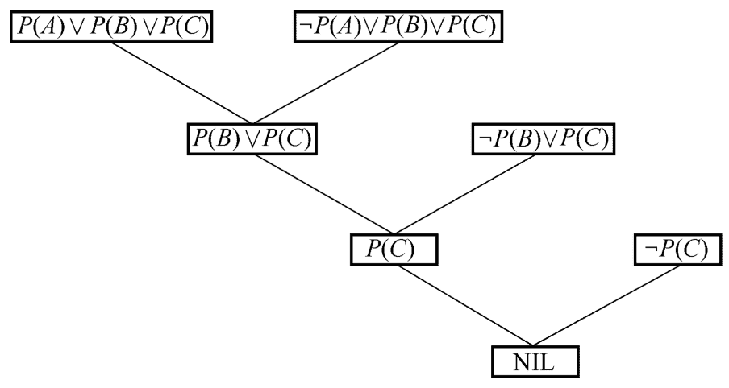

---
*本文系对教材第 3 章（归结原理与推理分类）及第 4 章（进化算法与遗传算法基础）核心知识点的结构化重构与语义重写，旨在便于快速复习与工程落地参考。*

# 进化计算基石：遗传算法的演进史与核心机制深度拆解

模拟自然界“优胜劣汰、适者生存”法则的计算模型——遗传算法，其核心在于借鉴达尔文进化论与孟德尔遗传学机制，在 silico 环境中搜寻全局最优解。这一理论体系由美国密歇根大学约翰·霍兰德教授于 1975 年正式奠基，其著作《自然与人工系统中的适应》出版，标志着“遗传算法”名称的确立，也确立了简单遗传算法（SGA）的雏形。

虽然后来在 80、90 年代迎来爆发式增长，但探索脚印早溯至 60、70 年代。早期仿生学研究搭建起生物学与工程技术的桥梁，霍兰德、雷兴伯格、福格尔等先驱分别开辟了遗传算法、进化策略、进化规划三大分支。可惜当时缺乏系统理论指引，研究多处摸索阶段。直到 70 年代中期，霍兰德与德容的奠基之作问世，特别是**模式理论**的提出，证明了重组操作获取“隐式并行性”的关键价值，才真正为该领域装上理论引擎。

1975 年堪称里程碑：霍兰德系统阐述理论体系，德容博士论文将模式理论与计算实验深度融合，奠定了至今仍具指导意义的基石。步入 80 年代，国际会议相继设立（如 ICGA、PPSN、FOGA），戈德堡专著《遗传算法在搜索、优化与机器学习中的应用》全景式总结前沿成果，推动学术生态繁荣。90 年代后，惠特利的定域交叉算子、阿克利的迭代遗传爬山法等创新层出，国内学者如戴晓明等通过多种群并行进化思想，有效攻克了早熟收敛难题。

随着应用版图拓展，该算法呈现五大演进趋势：向机器学习延伸破解知识获取瓶颈；与神经网络、模糊计算深度融合推动智能计算跃迁；并行化研究活跃提升算力效率；人工生命领域崭露头角；三大进化计算分支独立演进又相互渗透，为通用人工智能铺路搭桥。

## 4.2.3 编码：构建进化搜索的“染色体蓝图”

遗传算法包含五大核心组件：参数编码、初始群体设定、适应度函数设计、遗传操作设计、控制参数设定。编码是起点——算法无法直接作用于问题空间，必须将待解参数“翻译”成遗传空间里的染色体（个体），由基因按特定结构组装而成。

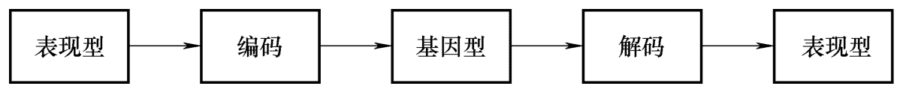

得益于算法的鲁棒性，编码并非刻舟求剑，但“如何针对特定问题设计编码方案”始终是关键一招。目前不存在万能编码标准，特殊问题往往需定制专属方案。

**编码三大铁律：**
1. **完备性**：问题空间所有可行解均能映射为基因型；
2. **健全性**：任意基因型必对应一个合法可行解；
3. **非冗余性**：表现型与基因型一一映射，无多余编码。

### 1. 二进制编码：最经典、也最“接地气”的选择
用 `{0,1}` 符号串构建基因型，串长由求解精度决定。

**亮点：** 最贴近生物染色体本质，便于诠释自然遗传规律；选择、交叉、变异实现简易，模式处理最丰富。

**痛点：**
- **局部搜索乏力**：连续函数优化时，临近最优解处表现型变异剧烈且不连续，易跳出最优区。
- **海明悬崖**：相邻整数编码差异巨大（如 15=01111 与 16=10000），需翻转所有位才能过渡，严重阻碍搜索效率。
- **精度与效率博弈**：精度需预设，低则无微调能力，高则字符串过长拖累效率。
- **高维灾难**：维度增长导致编码指数级膨胀，搜索效能骤降。

### 2. Gray 编码：专治“海明悬崖”的良方
相邻整数编码仅单比特不同，通过异或运算与二进制互转：
- 二进制转 Gray：`g[m]=b[m]`，`g[i]=b[i+1]⊕b[i]`
- Gray 转二进制：`b[m]=g[m]`，`b[i]=b[i+1]⊕g[i]`

**核心价值：** 消除海明悬崖，强化局部搜索能力，让连续空间探索更丝滑。

## 4.2.4 实数/浮点数编码：直击问题本质的“真值”表达
针对决策变量为实向量的场景，抛弃二进制转换，直接用实数/浮点数建模。

- **实数编码**：多实数组合表示基因型，在实数空间原生操作。
- **浮点数编码（真值编码）**：基因值直接取决策变量真实值，编码长度等于变量个数。

**硬性约束：** 交叉、变异等算子运算后，新个体基因值必须严格落在预设区间内。此外，多参数级联、复数、DNA、符号编码等变体各有适用场景，此处按下不表。

## 4.2.5 群体设定：进化舞台的“初始阵容”与“规模博弈”

遗传算法操作的是解的集合——种群。设定聚焦两点：初始化策略与规模权衡。

### 1. 初始种群：随机中藏策略
纯随机生成是底色，但引入领域知识可事半功倍：
- 依据问题特性锁定最优解大概率分布区间；
- 在区间内随机生成候选个体，筛选精英注入初始种群；
- 迭代扩充至预设规模。

### 2. 种群规模：在“早熟”与“冗余”走钢丝
规模过小 → 基因库贫瘠 → 易陷局部最优、优化效能低；
规模过大 → 计算冗余、筛选成本高、优势个体挤占多样性 → 同样拖垮效率。

**理论支撑：**
- **模式定理**：短定长、低阶、高适应度模式指数级增长，为全局搜索提供数学担保。
- **积木块假设**：优质模式块在遗传操作下拼装，逼近全局最优。

**实战经则：** 规模通常锁定在 **20~100**。既要保证基因多样性支撑交叉组合，又要避免海量个体淹没精英、稀释基因库、拖慢筛选。

## 4.2.6 适应度函数：进化的“指挥棒”与“自然选择的唯一依据”

适应度量化个体优劣，直接决定生存繁衍概率，是驱动演化的核心引擎。实战中需依问题定制，通常由目标函数变换而来。

### 1. 目标函数直映
- 最大化问题：`F(x) = Obj(x)`  ``
- 最小化问题：`F(x) = 1/Obj(x)` 或取反  ``

### 2. 尺度变换：化解“收敛与多样性”的死局
无选择则性能差，有选择则易早熟。尺度变换通过调整适应度评价标准，平衡探索与利用，规避“欺骗问题”（阻碍高适应度个体产生的干扰）。

**动态调控策略：** 早期拉小差距保多样性，后期拉大差距促精英传承。

#### (1) 线性尺度变换：简洁高效的基础款
`F' = aF + b`  ``
约束条件：
- 变换后均值不变  ``
- 最大值 = C × 新均值（C 为期望复制数，建议 1.2~2）  ``
系数求解  ``
防负值修正  ``

#### (2) 乘幂/指数尺度变换：非线性调控的进阶款
- **乘幂**：`F' = F^k`  ``，指数 `k` 可动态修正。
- **指数**：`F' = e^{F/a}`  ``，源自模拟退火，`a` 越小越向精英聚焦。

## 4.2.7 选择：优胜劣汰的“筛选机制”与“多样性守护”

选择即复制/再生，将优质个体直接或经交叉传递给下一代。核心矛盾：全选最优 → 早熟；全随机 → 不收敛。关键在于寻找“收敛速度与群体多样性”的平衡点。

常用算子库：轮盘赌、锦标赛、截断、蒙特卡洛、线性/指数排序、玻尔兹曼、随机遍历、精英策略等。

### 1. 个体选择概率怎么分？

#### (1) 蒙特卡洛法（适应度比例选择）：基础中的基础
选中概率正比于适应度：`P(n) = F[n] / ΣF[i]`  ``

#### (2) 排序选择：按序分配概率，免受绝对数值干扰
按适应度排序，按名次分配概率。克服比例法早熟停滞，鲁棒性更强，无需归一化。

**① 线性排序**  ``
最劣排第 1，最优排第 N，概率线性递增。即使适应度相同，名次不同概率也不同。

**② 非线性排序（指数分布）**  ``
`P(i) ∝ c^{N-i}`，`c∈[0,1)`。`c` 越小精英优势越大；`c→1` 则趋向均匀。计算前需降序排列。

### 2. 怎么按概率“抽中”个体？

#### (1) 轮盘赌选择：按概率比例“转盘抽奖”
计算各个体选择概率 `P(i)`（依赖适应度 `F[i]`），按概率随机抽取构建子代。最大化问题直用适应度；最小化问题需先转化（倒数/取反）为最大化形式。

[后续将详解锦标赛、精英保留等更高效的选择策略...]

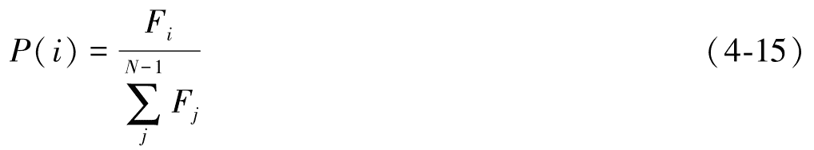

在给定种群中挑选 `Q` 个个体，本质上等同于让轮盘转动 `Q` 次。挑选前无需对种群个体预先排序。上述描述预设所有个体适应度均为正值且总和不为零。针对适应度出现负值的场景，可引入以下调整公式：

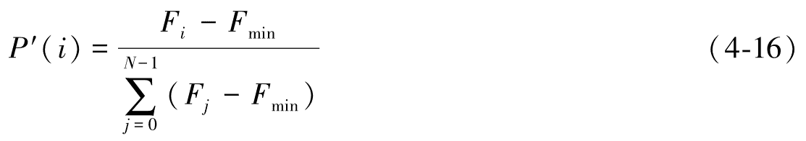

此处，`F` = min[i]{`F[i]`，0}。

min∈\0，`N`）

![设最劣的个体适应度的值为`F`，如果有个体的适应度概率为负，则被选择的概率为 0。而对于校正后适应度之和为 0 的情况，可以将所有个体的概率设为。min#### （2）锦标赛选择锦标赛选择方法是从种群中随机选择`m`个个体，将其中适应度最高的个体保存至下一代，只有适应度值高于其他`m`-1 个个体才能赢得锦标赛，这一过程会在算法过程中反复进行，直到保存到下一代的个体数量达到了预先设定的值为止。`m`称为竞赛规模。最劣的个体永远不会被保存，而最优的个体将总是会赢得锦标赛。在锦标赛选择方法中，选择压力可以通过改变个体数量`m`的大小来改变，当`m`的值较大时，种群中适应度值较差的个体将很难被选择，常见的有二元锦标赛、三元锦标赛等。与适应度比例选择相比，锦标赛选择由于缺乏随机噪声，在实际应用中经常使用，同时锦标赛选择与遗传算法的适应度函数的尺度没有关系，因为仅仅是比较绝对值的大小，无关正负值。锦标赛选择方法克服了适应度比例法的基于适应度的值以及排名的选择在种群规模特别大时计算的复杂性，因此可以得到更加多样化的种群。#### （3）随机遍历选择随机遍历选择是一种给定概率以最小化波动概率的方式选择个体的方法（见图 4-2）。可以将其看作是一种特殊的轮盘赌游戏，在轮盘上有`n`个等间距的点进行旋转选择。随机遍历选择使用一个随机值在等间隔的空间间隔里选择个体，相比于适应度比例法，该方法中适应度值较差的个体也有很大的被选择的概率，从而奖励了不公平性。该方法是由 James Baker 提出的，展示了其原理，其中`m`为要选择的个体数量。随机遍历选择保证了选出的子代，比轮盘赌选择更接近真实的情况。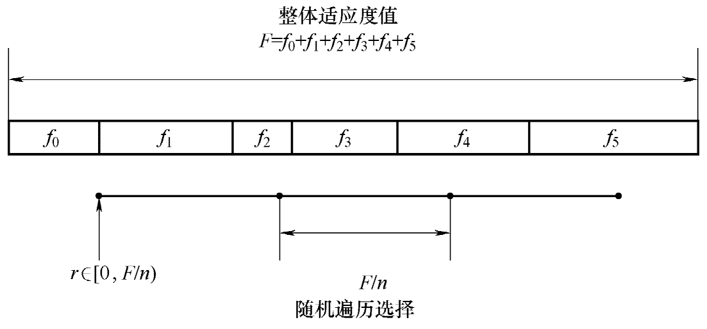

图 4-2 随机遍历选择示意图

#### 玻尔兹曼选择策略

玻尔兹曼选择器的选中概率定义如下：

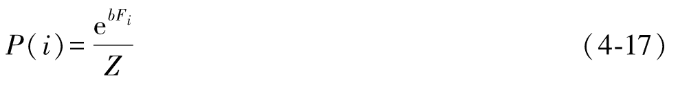

公式中，`b` 为控制选择压力的参数；`Z` 的计算方式如下：

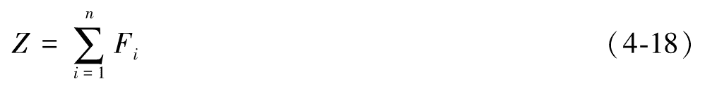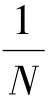

当 `b` > 0 时，高适应度个体的优势被放大，被选概率上升；`b` < 0 时则相反，优势被削弱；若 `b` = 0，所有个体平分选中概率。

#### 精英保留机制

精英保留策略（亦称最佳个体保存法）的核心是将种群中适应度顶尖的一个或多个个体，不经交叉直接复制进入下一代（这些精英个体仍保留作为下一代父代的候选资格）。这确保了算法终止时，最终种群必包含历代最优解。该机制能显著提升收敛效率，但也因加速收敛而增加陷入局部最优的风险。实验表明，保留种群规模 2%~5% 的顶尖个体时效果最佳。因此，结合其他选择算子时，通常会同步启用精英保留，防止最优个体丢失。

### 核心算子：交叉操作

自然界生物繁殖时，遗传物质混合重组，催生出基因型全新的后代，这一过程称为交叉。后代可能融合双亲优势基因表现更优，也可能继承劣势难以存活。自然筛选下，适应性强的后代更易传递基因，推动种群代代更优。

在遗传算法中，交叉算子（即基因重组）扮演核心角色。它通过替换两个亲本部分结构生成新个体。习惯上，实数编码称“重组”，二进制编码称“交叉”。子代可部分或完全继承亲本的结构特征与有效基因。

#### 基础交叉手段

#### 单点交叉

又称简单交叉。随机在染色体上设定一个交叉点，将该点前后的片段在两亲本间互换，生成两个新个体。

#### 双点交叉

与单点交叉类似，随机选取两个交叉点，交换两点间的片段形成新染色体。多点交叉同理推广。

#### 部分映射交叉 (PMX)

**步骤一**：随机选取一对亲本染色体，确定相同起止位置的基因片段：

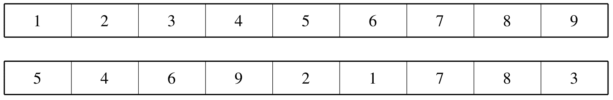

**步骤二**：互换这两组基因片段：

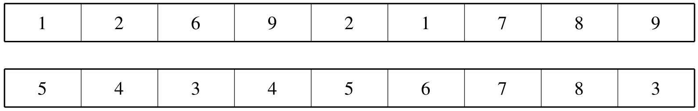

**步骤三**：冲突检测与修复。依据交换片段建立映射关系（如 1-6-3）。若子代 1 出现重复基因 1，按映射转为基因 3，以此类推直至消除所有冲突，确保子代基因合法。

最终结果：

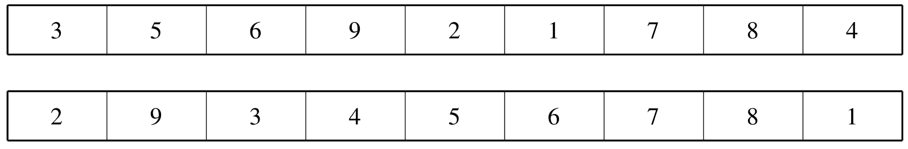

#### 有序交叉 (OX)

**步骤一**：同 PMX，随机选定亲本中相同位置的基因片段：

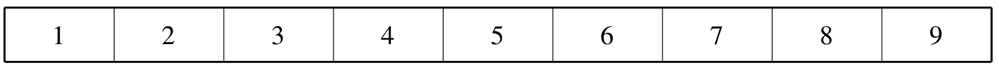

**步骤二**：生成子代，保留选定片段在原位置：

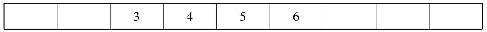

**步骤三**：在另一亲本中定位选定片段的基因位置，将剩余基因按顺序依次填入子代空位：

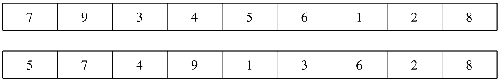

该算法同样生成两个子代，另一子代生成过程对称（交换亲本顺序即可），本例中另一子代为 254913678。与 PMX 不同，OX 无需冲突检测机制。

#### 定位交叉

**步骤一**：选取亲本中相同位置的若干基因，**位置可不连续**：

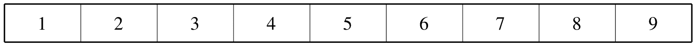

**步骤二**：生成子代，固定选定基因位置：

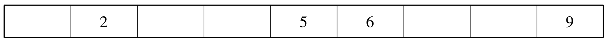

**步骤三**：在另一亲本中寻找选定基因位置，其余基因按序填入：

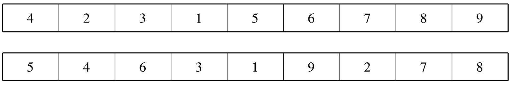

区别在于选定基因位置可不连续，其余逻辑与 OX 一致。本例另一子代为 243519678。

#### 修正型交叉策略

交叉易产生违反约束的非法染色体。引入惩罚函数虽可处理，但会增加算法复杂度、降低效率。更优方案是修正交叉、变异等算子，使非法染色体经修复自动满足约束条件。

### 变异操作：维持多样性的关键

变异是生物进化的根本动力。无变异则基因库封闭，适应能力停滞于初始种群上限（如眼径大小无法突破祖先最大值）。但自然界生物能力持续增强（人类眼径代代变大），说明存在打破基因型桎梏的力量。变异概率虽低，历经多代积累可引发巨变。变异无方向性，多为中性或有害，少数有利变异经自然选择保留，驱动进化。进化不仅优化既有性状，更能创生新特征。

在遗传算法中，变异对个体编码特定位随机翻转，旨在维护基因多样性，修补选择与交叉中丢失的基因。变异算子按位操作，以概率 `P` 改变染色体某位基因值，主要形式如下：

#### 位点变异

随机抽取个体编码的一个或多个位点，以较小概率 `P` 翻转基因值。二进制编码下 0/1 互换；实数编码按概率分布采样。为消除非法染色体，有时会联动修改其他位点基因。

m

#### 逆序变异

随机选取两个断点，将区间内基因序列逆序后重插原位。

#### 插入变异

随机抽取一个基因编码，插入至随机选定的目标位置。

#### 互换变异

随机选定两个位点，直接交换其基因值。

#### 移动变异

随机选取一基因，向左或向右随机位移若干位置。

### 遗传算法标准流程

1.  **初始化**：对自变量随机生成或启发式构造，形成含 `M` 条染色体的初始种群 `pop(1)`，设代计数 `t`=1。
2.  **评价**：计算种群 `p(t)` 中每条染色体 `popi` 的适应度值
    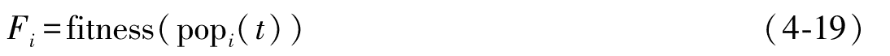
3.  **终止判断**：若满足停止条件则结束；否则，按概率 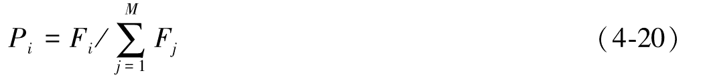 从 `pop(t)` 中随机抽取个体组成新种群 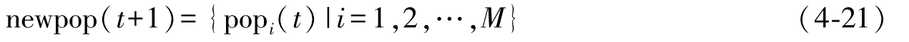。
4.  **遗传操作**：以概率 `P_c` 实施交叉生成 `crosspop(t+1)`；以微小概率 `P_m` 实施变异生成 `mutpop(t+1)`；更新 `t:=t+1`，令 `pop(t)=mutpop(t+1)`，回到步骤 2。

### 遗传算法的六大核心特征

1.  **群体搜索而非单点迭代**：传统算法从单一初始值出发易陷局部最优；GA 从解集（串集）出发，覆盖面广，利于全局寻优。
2.  **并行处理多个体**：同步评估多个解，降低早熟风险，天然适配并行计算架构。
3.  **仅依赖适应度函数**：不需梯度、连续性等先验知识，适应度函数定义域任意，极大拓宽了应用边界。
4.  **概率化搜索导航**：摒弃确定性规则，用概率跃迁规则引导搜索方向。
5.  **自组织、自适应、自学习**：利用进化信息自我组织搜索，高适应度个体生存概率大，基因结构持续趋优。
6.  **参数动态自适应**：算法内部可集成动态调控机制（如模糊自适应法），运行中自动调整控制参数与编码精度。

## 遗传算法进阶：主流改进方向

### 双倍体遗传算法：引入显隐性机制

前述为单倍体 GA（Holland 基础模型），每基因型仅单条染色体（如基因型 AB）。自然界高等生物多为双倍体（基因型 AaBb），即一对染色体决定性状，引入显隐性遗传。双倍体机制赋予算法“记忆”有用基因块的能力：低适应度染色体中可能隐藏作为最优解片段的优质基因块，显隐性机制可保留这些隐性优势基因，利于后续适应能力提升。

双倍体采用显性表达，延长有用基因块寿命，增强收敛性，且低变异率下仍能维持种群多样性。Goldberg 用动态背包问题验证：双倍体动态跟踪能力优于单倍体。

**设计步骤**：

1.  **编码**：每个个体拥双染色体（显性+隐性），编码方式同基础 GA。
2.  **复制**：依显性染色体适应度按概率复制个体至下一代。
3.  **交叉**：两个体的显性染色体互交，隐性染色体互交。显隐交叉率可异，工程上常设相同以简化实验。
4.  **变异**：显性染色体按 `P_m` 变异，隐性染色体采用**更高**变异率。
5.  **显隐重排**：三大算子执行完毕后，重排显隐性——适应度高者设为显性，低者设为隐性。

### 双种群遗传算法：打破平衡态

#### 核心思路：杂交打破停滞

基础 GA 长期演化易陷“平衡态”：种群特性趋稳不再变化，难以继续逼近全局最优。双种群 GA 引入**杂交操作**，交换两群体间的优秀个体遗传信息，打破停滞，跃迁至更高平衡态，助力跳出局部最优。本质上属并行算法，亦提升效率。

#### 算法设计流程

建立两独立种群，各自独立执行选择、交叉、变异。每代结束后，按规则交换个体（见流程图）。

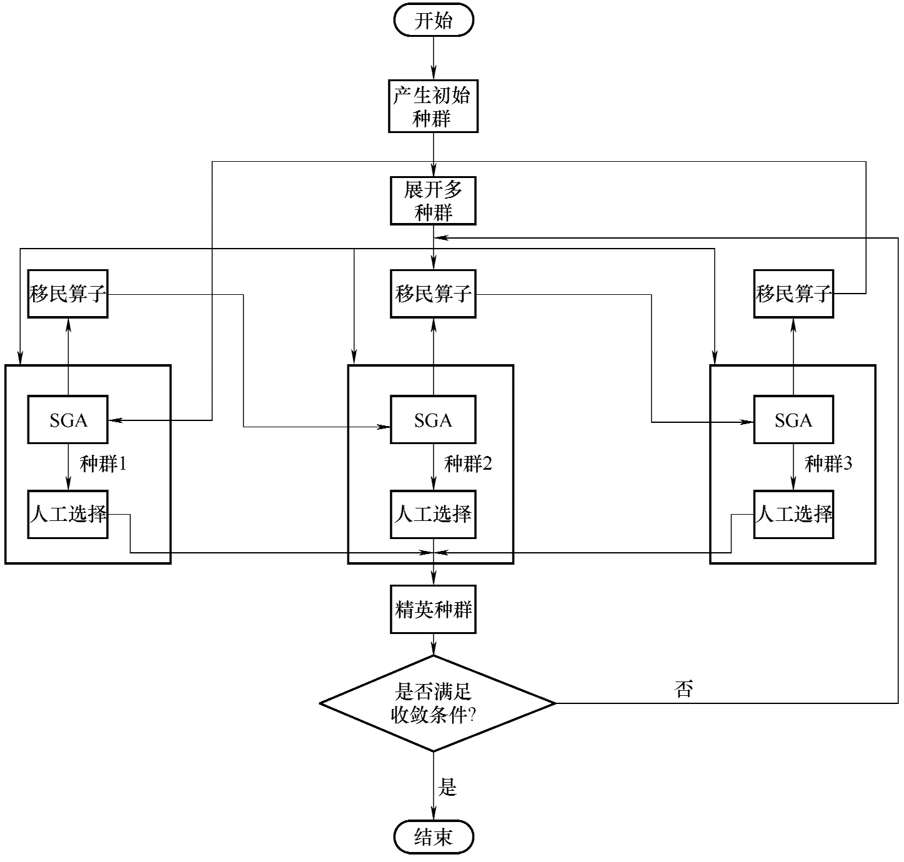

图 4-3 双种群遗传算法流程图

1.  **编码/解码**：同基础 GA。
2.  **交叉变异**：操作同基础 GA，但两群体独立演化，**交叉率、变异率可差异化设定**。
3.  **杂交算子**：设种群 A、B。两群完成进化后，生成随机数 `num`。从 A 中随机取 `num` 个个体连同 A 的最优个体，与 B 中同等数量的随机个体及 B 的最优个体互换。随机数 `num` 再现算法随机特性。

### 自适应遗传算法：参数动态调控

#### 核心动机：告别固定参数

交叉率 `P_c` 与变异率 `P_m` 直接决定收敛性能。`P_c` 过大破坏优良建块，过小搜索停滞；`P_m` 过小多样性不足，过大退化为随机搜索。不同问题需不同参数，手工调参繁琐。自适应 GA 让 `P_c`、`P_m` 随适应度自动调节，兼顾全局探索与局部开发，保持多样性的同时保证收敛。

#### 具体实施步骤

1.  **编码/解码**：同基础 GA。
2.  **选择**：用初始选择法产生 `N` 个个体（`N` 为偶数）组成初始解集。
3.  **适应度定义**：设 `f = 1/ob`，计算个体适应度 `f[i]`。
4.  **轮盘赌选择**：按轮盘赌选 `N` 个体，统计种群最大适应度 `f_max` 与平均适应度 `f_avg`。
5.  **自适应交叉**：个体按自适应公式计算出的 `P_c` 进行交叉。生成 `R(0,1)`，若 `R < P_c` 则执行染色体交叉。
6.  **自适应变异**：个体按自适应公式计算 `P_m` 进行变异。生成 `R(0,1)`，若 `R < P_m` 则执行变异（注：原文此处误写为交叉操作，实为变异）。
7.  **环境选择**：计算新个体适应度，与父代合并构成新种群。
8.  **循环判断**：达预设迭代数则终止，否则跳回步骤 4。

#### 概率自适应计算公式

设计依据：观察 `f_max - f_avg` 差值。差值越小，种群收敛度越高（均值逼近最大值），解向最优聚集。但警惕：收敛于局部最优时差值也极小（图 4-4 中 A 点低于分散态的 B 点）。因此，陷入局部最优时需**增大** `P_c`、`P_m`，即 `P_c`、`P_m` 与 `f_max - f_avg` **负相关**。

`P_c` 与 `P_m` 表达式如下：

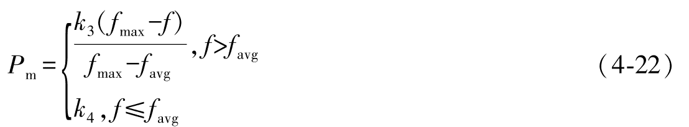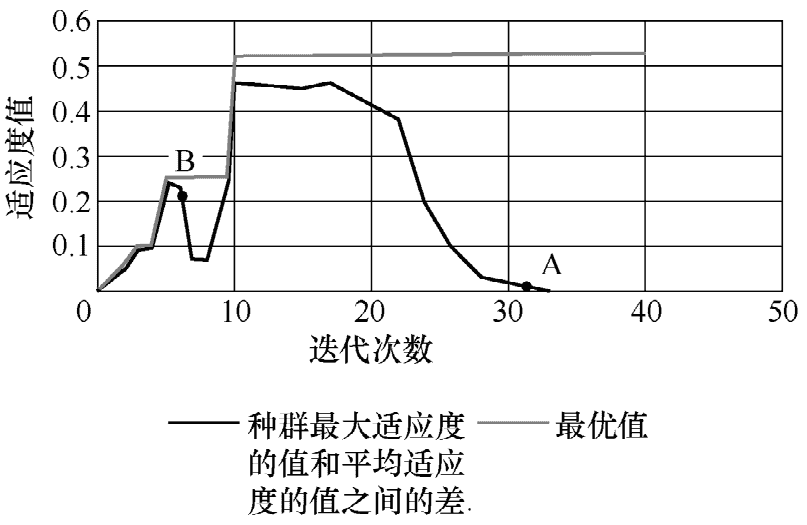

▲图 4-4 种群迭代情况

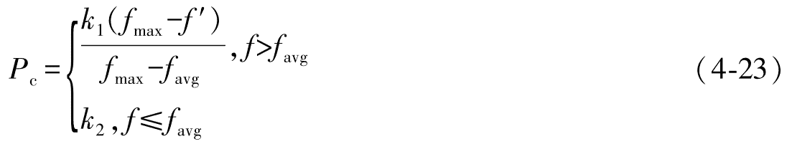

式中：`f_max` 为群体最大适应度；`f_avg` 为群体平均适应度；`f′` 为待交叉两个体中较大适应度；`f` 为待变异个体适应度。`k` 为 (0,1) 区间常数。

## 粒子群优化算法（PSO）

### 基本原理：鸟群觅食启发

1995 年，Kennedy 与 Eberhart 受鸟群觅食规律启发，于美国普渡大学建立简化模型，经多年迭代完善，最终形成粒子群优化算法。

# 第 4 章 群智能优化算法深度解析

## 4.4 粒子群优化算法（PSO）：从鸟群觅食到数学建模

### 核心灵感：集体智慧寻优
PSO 算法的诞生源于对鸟群觅食行为的观察。想象一群鸟在森林中寻找食物最丰富的区域：起初谁也不知晓具体位置，只能凭借大致感知四处搜寻。每只鸟都会记住自己发现过的“最肥沃”之地，同时群体内部实时共享信息——哪里食物最多，大家心知肚明。于是，每只鸟在飞行时都会综合考量：**个人历史最佳记忆**与**群体公认的全局最佳位置**，据此动态调整飞行航向。经过反复迭代，鸟群终将聚拢至食物最丰富的核心区（全局最优解）。

### 算法机制：无质量粒子的飞舞
与遗传算法等依赖“选择-交叉-变异”演化算子不同，PSO 将每个个体抽象为 `n` 维搜索空间中**无体积、无质量**的粒子。它们以特定速度在空间穿梭，仅凭适应度优劣引导群体向优区聚拢。

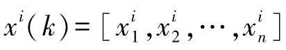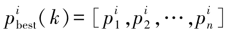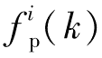

#### 数学定义：位置、速度与极值
对于第 `i` 个粒子（`i=1,2,…,m`），定义三大核心向量：
*   **当前位置向量**：粒子在搜索空间的实时坐标。
*   **个体历史最优位置 (`pbest`)**：该粒子迄今为止发现的适应度最优坐标。
*   **速度向量**：决定粒子下一步的移动方向与步长。
*   **全局最优位置 (`gbest`)**：整个群体迄今发现的最优坐标。

#### 核心迭代公式：三大驱动力的博弈
基础 PSO 的速度与位置更新规则如下：

公式解析：
*   **`ω` (惯性权重)**：承袭上一时刻速度，体现粒子对“惯性”的坚持，利于全局探索。
*   **`c1`、`c2` (加速常数/学习率)**：非负常数，分别调节认知与社会分量的拉力强度。
*   **`rand()`**：引入均匀分布随机数，赋予搜索随机性与多样性。

**速度更新的三项物理含义**：
1.  **惯性项** (`ω * v`)：保持原有运动趋势，防止过早收敛。
2.  **认知项** (`c1 * rand() * (pbest - x)`)：**“自我思考”**。指向个体历史最优，体现个人经验积累。
3.  **社会项** (`c2 * rand() * (gbest - x)`)：**“群体跟随”**。指向全局最优，体现信息共享与协作。

  *(注：原文此处有公式引用标记，保留原位)*

#### 四种拓扑模型：学习策略的取舍
Kennedy 基于 `c1`、`c2` 的取值划分了四种典型模式：
1.  **全模型** (`c1>0, c2>0`)：自我与群体双驱动，标准形态。
2.  **认知模型** (`c1>0, c2=0`)：唯我独尊，无群体交互，退化为多点并行随机搜索。
3.  **社会模型** (`c1=0, c2>0`)：盲目跟风，收敛极快但极易陷入局部最优。
4.  **无私模型** (`c1=0, c2>0, g≠i`)：追随邻居而非全局最优，引入局部拓扑结构。

#### 全局版 vs 局部版：速度与质量的权衡
*   **全局版 (gbest)**：所有粒子共享唯一 `gbest`。信息传播快，**收敛速度极快**，但**易早熟**（掉进局部极值坑）。
*   **局部版 (lbest)**：粒子仅参考邻域内最优 (`lbest`)。信息扩散慢，**抗早熟能力强，解质量往往更优**，但迭代耗时较长。

---

### 算法流程标准化六步走
1.  **初始化**：随机赋予 `m` 个粒子初始位置与速度。
2.  **适应度评估**：按目标函数打分。
3.  **更新 `pbest`**：当前适应度 > 历史最优？是则替换个体记忆。
4.  **更新 `gbest`**：当前适应度 > 全局最优？是则刷新群体记忆。
5.  **动力学更新**：依据核心公式迭代速度与位置。
6.  **终止判断**：达标（误差/代数）则输出 `gbest`，否则回步骤 2。

---

## 4.4.2 PSO 关键参数深度调优指南

### 1. 参数清单与核心作用
核心参数组：种群规模 `m`、惯性权重 `ω`、加速常数 `c1/c2`、最大速度 `Vmax`、最大迭代代数 `G`。

#### (1) 最大速度 `Vmax`：搜索分辨率的“刹车片”
*   **作用**：限制单步位移，防止粒子飞出搜索边界或“飞过”最优解。
*   **权衡**：过大 → 跳过精细解（精度丢失）；过小 → 陷入局部极值（探索不足）。通常设为动态搜索范围的 10%~20%。

#### (2) 三大权重因子：探索与开发的“指挥棒”
*   **惯性权重 `ω`**：
    *   大 `ω` → 强惯性 → 全局搜索能力强（探索）。
    *   小 `ω` → 弱惯性 → 局部挖掘能力强（开发）。
    *   *工程常用策略*：线性递减或非线性自适应调整，前期探索、后期开发。
*   **加速常数 `c1` (认知) / `c2` (社会)**：
    *   低值：粒子在目标区域外“游荡”，不易被吸引。
    *   高值：粒子“猛冲”目标，易越过最优点甚至震荡发散。
    *   经验值：早期常设 `c1=c2=2.0`。也可尝试 `c1=1.6, c2=1.8` 等非对称组合，视问题而定。

### 2. 公式分量缺失实验：解剖三项贡献
通过“消融实验”看清各项职责：
*   **仅保留惯性项 (`c1=c2=0`)**：粒子匀速直线飞至边界，**完全丧失寻优能力**。
*   **移除惯性项 (`ω=0`)**：速度无记忆，粒子仅在 `pbest` 与 `gbest` 加权中心振荡。**退化为局部搜索**，全局探索能力归零。
*   **移除认知项 (`c1=0`)**：纯**社会模型**。收敛飞速，但群体极易“群魔乱舞”陷入局部最优。
*   **移除社会项 (`c2=0`)**：纯**认知模型**。粒子互不通信，群体退化为 `N` 个独立随机搜索，**全局最优发现概率极低**。

> **结论**：`ω` 是全局/局部搜索的**总开关**；`c1` 保障**多样性**；`c2` 驱动**收敛**。三者缺一不可。

### 3. 参数设置进阶策略
*   **经验法则起步**：`ω=1.0` (或递减至 0.4)，`c1=c2=2.0`，`Vmax` 取范围 10%-20%。
*   **模糊自适应调节 (Shi & Eberhart)**：构建模糊系统，输入（当前全局最优适应度、当前 `ω`），输出（`ω` 的变化量）。实验证实：显著提升平均适应度，增强鲁棒性。
*   **编码与适应度**：PSO 原生采用**实数编码**，天然契合连续函数优化；速度/位置更新物理意义直观。适应度函数构建同 GA，统一转为求最大值且非负。

---

## 4.5 蚁群算法 (ACO)：信息素正反馈的寻优之道

### 起源与本质：微小个体的宏大智慧
ACO 由 Colorni、Dorigo 等人于 1991 年提出。属于**群智能**范畴：群体由大量“低智能”个体组成，通过**协作**与**间接通信 (Stigmergy)** 涌现出高阶智能，攻克复杂组合优化问题。

### 仿生原理：双重信息素机制驱动的正反馈
蚂蚁觅食遵循两条铁律：
1.  **跟踪**：倾向选择信息素浓度高的路径（概率选择）。
2.  **遗留**：行进路径上释放信息素。

**正反馈闭环**：路径走得多 → 信息素越浓 → 吸引更多蚂蚁 → 信息素更浓。未被选择路径因挥发而逐渐淡忘。这种**催化式增强学习**机制，让群体自发聚焦于最优/近似最优路径。

---

### 4.5.1 基础模型：以 TSP 为例的数学构建

#### 问题设定
*   `m` 只蚂蚁，`n` 座城市。
*   `d_ij`：城市间距离。
*   `τ_ij(t)`：时刻 `t` 路径 `(i,j)` 上的信息素浓度。
*   初始：蚂蚁随机分布，信息素均匀 `τ_ij(0) = τ0`。

#### 状态转移规则：概率选择下一站
蚂蚁 `k` 从 `i` 移至 `j` 的概率 `P_ij^k(t)` 由两因子博弈决定：

*   **启发因子 `η_ij = 1/d_ij`**：先验知识，距离越近吸引力越大（贪婪倾向）。
*   **信息素因子 `τ_ij^α`**：后天经验，走过的人多路径更热门。
*   **参数 `α` (信息素重要度) / `β` (启发重要度)**：调节“经验主义”与“贪婪直觉”的权重。
*   **`allowed_k`**：蚂蚁 `k` 待访问城市集合（动态缩减至空）。

#### 信息素更新机制：挥发与沉积的动态平衡
所有蚂蚁完成一轮遍历 (Tour) 后，全局更新：

*   `ρ (0<ρ<1)`：信息素挥发系数。**`1-ρ` 为残留系数**。
*   **挥发项 `(1-ρ) * τ_ij`**：遗忘机制，防止无限累积，保证探索新路径可能性。
*   **增量项 `Δτ_ij`**：所有蚂蚁在该边沉积信息素总和。

**三种信息素沉积策略对比**：
| 模型 | 增量公式 `Δτ_ij^k` | 信息来源 | 优劣结论 |
| :--- | :--- | :--- | :--- |
| **蚁量模型** | `Q` | 常数 | 局部信息，效果一般。 |
| **蚁密模型** | `Q / d_ij` | 局部距离 | 仅考虑单边长度，短视。 |
| **蚁圈模型 (AS)** | `Q / L_k` | **全局路径长 `L_k`** | **最优**。利用全局评价，短路径增强强、长路径增强弱；配合挥发机制完美平衡“遗忘坏路”与“强化好路”，收敛最快、鲁棒性最强。 |

> **工程首选**：标准 ACO 通常采用 **蚁圈模型 (Ant System, AS)**。

---

### 4.5.2 ACO 核心参数敏感性分析与配置经验

> **现状**：缺乏严格理论推导，参数选取高度依赖**经验调参**与**问题特性**。

#### 1. `α` (信息素启发因子)：**“从众心理”强度**
*   **增大** → 更信任前辈足迹 → 随机性↓、收敛↑、**早熟风险↑**。
*   **减小** → 更依赖启发/随机 → 探索↑、收敛↓。

#### 2. `β` (期望启发因子)：**“贪婪直觉”强度**
*   **增大** → 更贪心选近路 → 局部最优陷阱↑、收敛速度↑。
*   **减小** → 贪婪导向弱化。

#### 3. `α` 与 `β` 的**耦合博弈**
*   **全局寻优** 需强随机性（`α`、`β` 偏小）。
*   **快速收敛** 需强确定性（`α`、`β` 偏大）。
*   **核心难题**：二者需**协同配置**，寻找“探索-开发”平衡点。

#### 4. `ρ` (信息素残留系数) / `1-ρ` (挥发度)：**“记忆时长”控制器**
*   **挥发过强 (`1-ρ` 大 / `ρ` 小)**：未搜路径信息素速归零 → **全局搜索力崩塌**；旧路径易被锁死 → **随机性丧失**。
*   **挥发过弱 (`1-ρ` 小 / `ρ` 大)**：历史信息长期驻留 → **探索能力↑** 但 **收敛速度↓↓**。
*   典型经验值：`ρ ∈ [0.5, 0.99]` (即挥发度 1%-50%)。

#### 5. `Q` (总信息素量)：**正反馈增益旋钮**
*   蚂蚁一周期释放总量。`Q` 越大 → 正反馈越猛 → **收敛加速**。
*   但 `Q` 效果强依赖于 `α, β, ρ` 的配合及模型选择（AS 模型中 `Q/L_k` 自带归一化，相对稳健）。

#### 6. 主导参数三巨头
综合实证：**`α`、`β`、`ρ`** 是性能主导因子；`Q`、蚂蚁数 `m` 为辅助调节。

---

## 4.6 章节小结：三大元启发式算法速览对照表

### 1. 遗传算法 (GA) —— “达尔文演化”范式
*   **核心组件**：编码(二进制/实数) → 适应度函数(求最大值、非负) → 选择(轮盘赌/精英保留) → **交叉** → **变异**(位点/逆转/插入/互换/移动) → 参数控制。
*   **种群规模**：过小易早熟，过大算力浪费。

### 2. 粒子群优化 (PSO) —— “鸟群飞舞”范式
*   **无交叉变异**，仅靠**速度-位置**迭代。
*   **流程**：初始化 → 评价 → 更新 `pbest` → 更新 `gbest` → 更新 `v/x` → 判终止。
*   **实数编码**天然适配连续优化。

### 3. 蚁群算法 (ACO) —— “信息素正反馈”范式
*   **核心公式**：
    *   **转移概率**：`P ∝ τ^α * η^β` 
    *   **信息素更新**：`τ ← (1-ρ)τ + Δτ` 
    *   **增量计算**：`Δτ = Q / L_k` (AS模型) 
*   **参数 `α` 大 → 贪婪化，易早熟**。

---

## 思考题精选（自测与深化）
1.  GA 基本流程与核心特点？
2.  适应度函数作用？如何由目标函数构造？（举例说明）
3.  变异算子的本质思想？
4.  **对比题**：PSO 与基本 GA 根本区别在哪里？（无演化算子、实数编码、速度驱动）
5.  列举经典 GA 变体及优缺点分析。
6.  PSO 参数选取策略与依据？
7.  **本质题**：群智能算法 (PSO/ACO) 与进化算法 (GA) 异同？（个体智能/交互方式/编码/算子）
8.  ACO 参数选取原则与敏感性分析？

---

# 第 5 章 机器学习：从经验归纳到泛化预测

## 5.1 机器学习导论：让数据说话

### 核心隐喻：经验即数据，学习即建模
人类靠经验判断：“喵喵叫 → 猫”、“额头王字 → 虎”。**机器学习 (ML) 的使命：让计算机像人类一样，从历史数据（经验）中自动提取规律（模型），并用于对未知情况的判断，从而提升系统性能。**

### 发展简史：从神经模拟到数据驱动
*   **50年代**：萌芽期，欲破解大脑学习机理，受限于算力/理论而沉寂。
*   **80年代后**：多学科交叉（计算机科学、统计学、脑科学、心理学）催生爆发式增长。

---

### 5.1.1 核心术语拆解：模型 vs 算法 vs 数据

| 概念 | 定义 | 通俗类比 | 代码层面 |
| :--- | :--- | :--- | :--- |
| **模型** | 待解决的问题抽象 | “判断是不是猫” | 数学假设空间 / 函数族 |
| **算法** | 利用数据求解模型的计算过程 | “若会喵喵叫则为猫” | 优化目标函数的具体步骤 (SGD, EM, 信息增益...) |
| **数据** | 经验的数字化载体 | 无数张猫/非猫照片 | 训练集 / 测试集 (特征向量 + 标签) |

**范式转移**：
*   **传统编程** = `规则 (人工写 if-else) + 数据 → 答案`。痛点：规则获取依赖专家，费时费力，复杂问题难穷举。
*   **机器学习** = `数据 + 答案 (标签) → 规则 (模型参数)`。核心优势：**自动化特征工程与规则发现**，解放人力，应对高维非线性复杂问题。

> **典型应用**：手写邮编识别、垃圾邮件过滤、推荐系统、自动驾驶感知……凡是“易举例、难写规则”者，皆 ML 用武之地。

# 机器学习核心概念与特征工程实战全景图

## 5.1 机器学习基石：数据、模型与泛化边界

**数据是机器学习的基石。** 将所有数据汇聚成**数据集**，单条记录称作**样本**，用于刻画具体事件或对象。样本在某个维度上的性质叫**属性**，具体取值为**属性值**，单个样本拥有的属性总数即为**维数**。

**“学习”本质是从数据中提炼模型。** 用于构建模型的数据叫**训练集**，用于验证模型优劣的叫**测试集**。我们假设客观世界背后存在普遍规律（**真相**），模型对应着对规律的某种**假设**，训练过程就是让假设无限逼近真相。此处有个核心前提——**独立同分布（i.i.d.）**：所有数据来自同一未知分布且相互独立。因此，掌握的有效样本越多，模型逼近真实分布的精度通常越高。

模型落地目标是：给定属性，输出判断（即**标签**）。训练集与测试集必须携带标签，所有标签的全体构成**输出空间**。模型评估维度涵盖性能、偏差、评价方法等，后文将逐一展开。

### 拟合与泛化的博弈

模型与真相的贴合度称**拟合程度**。拟合不足为**欠拟合**；而在有限样本上能穿过无数条曲线，我们为何选这条？这依赖**归纳偏好**。科学界奉行的**奥卡姆剃刀原则**指出：若多假设均符合观测，选最简单者。

模型在测试集上仍保持高拟合，称**泛化性能强**；反之若训练集高分、测试集失手，即**过拟合**——模型过度记忆训练数据噪声（参数过多、复杂度超标、或数据含抽样误差），典型特征是**训练误差与测试误差鸿沟巨大**。

此外，**“免费午餐定理”**暗示：脱离具体问题谈算法优劣无意义。算法内置的归纳偏好与问题是否契合，往往决定成败。

## 5.1.2 学习范式全景图

机器学习主要分三大阵营（见图 5-1）：

**图 5-1 机器学习分类**
a) 监督学习——分类  b) 监督学习——回归  c) 无监督学习——聚类

### 1. 监督学习：有“标准答案”的教学
输入输出均已知，目标是学会映射关系以预测未来。数据被打上**标签**（正确答案），常用算法包括：
*   **回归**：预测连续值（如房价、气温）。
*   **分类**：预测离散类别（如垃圾邮件识别、疾病诊断），典型算法有贝叶斯、SVM、决策树等（后续章节详解）。

### 2. 无监督学习：自主发现隐藏结构
数据**无标签、无分类**，机器需自行探索内在模式。核心任务是**聚类**——依据机器自发发现的特性，将样本自动分组（簇），挖掘未知洞见。

### 3. 半监督学习：低成本高收益的中间路线
数据**小部分有标签，大部分无标签**。标注成本高（如蛋白质结构分析需专家数年）时极具价值：成本远低于全监督，精度却能逼近全监督。

---

## 5.2 特征工程：模型性能的“隐形引擎”

> **一句话总结**：特征工程是将原始数据转化为“更能表达业务本质”的特征，以提升模型在未知数据上的预测精度。简单说，就是筛选出对目标变量 `y` 有显著影响的自变量 `x`。

实战中面临海量特征：有的信息丰富，有的冗余重叠，有的纯属噪声。若不筛选直接喂模型，极易引发**维度灾难**甚至拖累准确率。特征工程主流程涵盖**特征选择、提取、构造**（见图 5-2）。

**图 5-2 特征工程常见方法与步骤**

### 5.2.1 数据获取：一切的源头
结合业务场景，重点评估三点：
1.  **来源**（存储方式、API、日志等）；
2.  **可用性**（获取难度、覆盖率、准确率）；
3.  **维度**（特征广度与深度）。

拿到原始数据后，先做**描述性统计与可视化探索**，建立直观认知（步骤见图 5-3）。

**图 5-3 数据获取常见步骤**

### 5.2.2 特征处理：最耗时、最关键的“清洗战”

#### 1. 特征预处理：补齐短板、剔除噪音
*   **缺失值处理**：删除、均值/中位数/众数填充、模型预测填充、标记为特殊类别等（详见图 5-4）。
*   **异常值检测与处理**：箱线图、Z-score、隔离森林等。
*   **去重**：按业务判断是否保留。
*   **格式统一**：类型转换、单位换算、时间格式标准化。

▲ 图 5-4 常见特征缺失处理方式

#### 2. 特征转换：让数据“说人话”
特征本质分三类：**连续型**、**无序离散型**、**有序离散型**。转换策略见图 5-5。

▲ 图 5-5 几种特征转换方式

**针对连续型特征：**
*   **分布对齐**：模型假设正态分布或特定分布表现更好时，施以对数、指数、Box-Cox 等非线性变换。
*   **缩放/归一化**：消除量纲与量级差异，防止大数值特征主导权重。
    *   *注意*：物理意义明确者（如经纬度）标准化会丢失语义，慎用。
    *   常用手段：Min-Max、Z-score、Robust Scaler 等（见图 5-6）。
*   **二值化**：设阈值将数值转布尔。
*   **离散化/分箱**：将连续数值切分为区间块，降噪且赋予业务含义（如年龄段）。

**图 5-6 常见无量纲化方法**

**针对离散型特征：**
*   **数值化/编码**：
    *   **Label Encoding**：有序类别直接映射整数。
    *   **One-Hot 编码**：N 个类别 → N 维稀疏向量，仅激活位为 1（见图 5-7）。适合无序、类别数少。
    *   **Dummy 编码**：N 个类别 → N-1 维，基准类别全 0（见图 5-8）。解决共线性，回归常用。
*   **高基数难题**：类别极多导致矩阵稀疏爆炸 → **降维**（特征哈希、Embedding、目标编码等），能降则降，不可强求。

**图 5-7 One-Hot 编码示意**

**图 5-8 Dummy 编码示意**

**时间戳拆解**：拆分为年/月/日/时/分/秒/星期/是否节假日等，**仅保留对当前模型最相关的粒度**，切忌全上。

#### 3. 特征构造与组合：化腐朽为神奇
若基础处理效果平平，需**衍生新特征**：
*   **统计聚合**：均值、中位数、标准差、分位数、峰度/偏度。
*   **时序滞后/滚动**：过去 N 周期的均值、最大值、趋势斜率。
*   **分箱交互**：将连续变量离散化后组合（常见分箱策略见图 5-9）。

**图 5-9 常见数据分箱方式**

**特征组合**是核武器：不同类型特征跨界融合（如“用户ID × 广告ID”、“地域 × 天气”），常用方式见图 5-10。优先挖掘**强特征维度**的交互。

**图 5-10 常见特征组合方式**

---

### 5.2.3 特征选择：精准“瘦身”，拒绝组合爆炸

**定义**：从全量特征集 `{a₁, a₂, ..., a_d}` 中挑出与任务强相关的子集。
*   **相关特征**：对任务有用。
*   **无关特征**：噪音。

遍历所有子集（2^d 种）不可行（**组合爆炸**）。工程上采用**启发式搜索 + 评价函数**的迭代范式：
1.  生成候选子集；
2.  评价打分；
3.  按分数迭代生成下一候选；
4.  无更优子集时停机。

#### 核心一：子集搜索策略（贪心为主）
*   **前向搜索 (Forward Selection)**：从空集起步，每轮加入提升最大的特征，直至无提升。
*   **后向搜索 (Backward Elimination)**：从全集起步，每轮剔除贡献最小的特征，直至性能收敛。
*   **双向搜索**：加减结合，动态调整。
*   *注*：以上均为贪心策略，可能陷入局部最优，除非穷举否则无法根治。

#### 核心二：子集评价准则
衡量特征子集 `A` 划分出的样本分布，与真实标签 `Y` 划分的**差异**。差异越小，特征越好。
*   **信息增益**：基于信息熵，`Gain(A)` 越大，分类信息越丰富（公式见 , ）。
*   决策树的节点分裂属性集，本质即前向搜索+信息增益的特征选择结果。
*   其他度量（基尼系数、卡方、相关系数等）均属“判断两个划分差异”的不同度量尺。

---

#### 三大流派：过滤式、包裹式、嵌入式

| 流派 | 核心逻辑 | 优点 | 缺点 | 典型代表 |
| :--- | :--- | :--- | :--- | :--- |
| **过滤式** | **先选特征，再训练**。用统计量（相关性、互信息、F检验）打分，与具体学习器无关。 | 速度极快，可扩展性强，防过拟合。 | 忽略特征间交互，未针对目标模型优化。 | **Relief / Relief-F**、方差阈值、卡方检验、相关系数法。 |
| **包裹式** | **以目标模型性能为评价指标**。在特征子集空间搜索，每轮训练模型验证。 | 针对性强，性能通常最优，捕捉特征交互。 | 计算开销巨大，易过拟合，依赖特定模型。 | **LVW (Las Vegas Wrapper)**、递归特征消除 (RFE)、前向/后向/双向逐步回归。 |
| **嵌入式** | **特征选择融入模型训练**。通过正则化、树模型特征重要性等机制，训练过程中自动完成筛选。 | 兼顾速度与性能，模型内生。 | 实现复杂，耦合特定算法。 | **L1 正则化 (Lasso)**、L2 正则化 (Ridge)、树模型 (GBDT/XGBoost/LightGBM) 特征重要性、Dropout。 |

---

##### 深度解析：Relief 算法（过滤式经典）
针对二分类设计，核心思想：**好特征应让同类样本靠近、异类样本远离**。
1.  随机抽样实例 `x_i`。
2.  找最近同类邻 `near-hit` 与最近异类邻 `near-miss`。
3.  更新特征 `j` 的权重 `W[j]`：
    *   若 `diff(x_i, near-hit, j) < diff(x_i, near-miss, j)` → 权重 **+** (有益)；
    *   反之 → 权重 **-** (有害)；
    *   连续特征归一化距离，离散特征 0/1 距离（公式详见 -）。

4.  多次采样平均，最终保留权重 > 阈值 `τ` 或 Top-k 的特征。
*   **Relief-F**：扩展至多分类，引入类别先验概率加权（见 ）。

##### 深度解析：包裹式实战策略
*   **完全搜索/穷举**：小规模可行。
*   **启发式/贪心**：前向选择、后向剔除、双向——**直接面向最终模型指标优化**，但搜索空间大，需精心设计启发式函数。
*   **随机搜索**：LVW 引入随机性跳出局部最优，设停止参数 `T` 控制耗时，但大特征集下可能超时无解。
*   **RFE (递归特征消除)**：基模型多轮迭代，每轮剔除低权重特征，重训排序。

##### 深度解析：嵌入式与正则化（线性模型视角）
目标函数：`min ||Xw - y||²`。样本少特征多时极易过拟合 → 引入正则项。

*   **L1 正则 (Lasso)**：`min ||Xw - y||² + λ||w||₁`。
    *   几何上菱形棱角触及等高线 → **稀疏解**，大量系数强制为 0（见图 5-11）。
    *   **天然特征选择**：仅保留非零系数对应的特征。
*   **L2 正则 (Ridge)**：`min ||Xw - y||² + λ||w||₂²`。
    *   几何上圆形光滑 → 系数趋近 0 但**不为 0**，无稀疏性，主要用于防过拟合、处理多重共线性。

**图 5-11 范数示意图**

> **工程口诀**：
> *   要稀疏、要解释性、要自动选特征 → **上 L1 (Lasso)**；
> *   特征高度相关、不想丢特征、只求稳健泛化 → **上 L2 (Ridge)**；
> *   两全其美 → **Elastic Net (L1+L2)**。

---

**下一站**：我们将深入实战，拆解特征工程在推荐系统、风控评分、NLP 等典型场景的落地打法。

# 正则化与稀疏性：L1 为何能“变废为宝”？

从图 5-11 可以直观发现：L1 范数的等值线与损失函数等值线的交点，总爱“撞”在坐标轴上；而 L2 范数的交点则倾向于落在某个象限内部。这背后的几何含义很关键——**L1 正则化天然倾向于产生稀疏解**，让部分特征权重直接归零，从而实现自动特征筛选，同时还能有效抑制过拟合（即公式 5-7 所示的岭回归机制）。

---

### 5.2.5 特征提取与降维：让数据“瘦身”不失“血”

数据预处理阶段，特征提取与降维是提升模型表达能力的“双子星”。
*   **特征提取**：挖掘高价值信息，强化模型表达力。
*   **数据降维**：在不牺牲精度的前提下，砍掉冗余特征，提速增效。

**核心原理**：本质上是“加权投影”——将多维变量按不同权重映射到低维空间（如一维），再叠加重组为新变量。

**主流三板斧**：
1.  **PCA（主成分分析）**：线性降维利器。将 n 维压缩为 k 维 (k < n)，非单纯丢弃维度，而是**正交基变换**，构造出方差最大的 k 维新特征。
    *   *实现路径*：基于协方差矩阵的特征值分解或 SVD（奇异值分解）。
    *   *SVD 实战逻辑*：数据矩阵 X (m×n) 分解为 U、Σ、V。取前 k 个最大奇异值对应的 V 矩阵，投影得到 X' (m×k)，特征维度从 n 降至 k。
    *   
    *   
2.  **KPCA（核主成分分析）**：非线性数据的“终结者”。通过核函数将样本映射到高维/无限维特征空间使其线性可分，再在该空间做 PCA。
3.  **ISomap 流形学习**：擅长处理手写数字等非线性流形结构数据。

> **工具箱补充**：线性阵营还有 LDA、LLE、LE、SNE、t-SNE；迁移学习领域可用 TCA（迁移成分分析）。

---

## 5.3 模型评估：别让“刷题高手”骗了你

### 核心痛点：训练误差 ≠ 泛化误差
*   **训练误差（经验误差）**：模型在熟悉的“教材”上的成绩。
*   **泛化误差**：模型面对从未见过的“考卷”时的真实水平。
*   **过拟合**：死记硬背训练集细节（甚至噪声），导致考试翻车。
*   **欠拟合**：连教材都没学会。
*   **残酷真相**：过拟合无法根治，只能缓解。模型选择的核心难题在于——**我们看不到泛化误差，训练误差又靠不住，怎么选模型？**

---

### 5.3.1 评估三大法宝

#### 1. 留出法：简单粗暴，但要“分层”且“重复”
把数据集 D 切分为互斥的训练集 S 和测试集 T (D=S∪T, S∩T=∅)，用 T 的表现估算泛化误差。
*   **关键细节**：
    *   **分层采样**：保持类别比例一致（如正负样本 1:1 切分后仍为 1:1），防止分布偏移。
    *   **多次随机重复**：单次切分结果波动大，需随机划分多次（如 100 次）取平均。
    *   **比例困境**：训练集太小 -> 模型不准；测试集太小 -> 评估不稳。经验值：训练 2/3 ~ 4/5。

#### 2. 交叉验证法：稳健的“K 折”标准
将 D 等分为 k 个互斥子集 (分层采样)，轮流留 1 个做测试，其余 k-1 个做训练，跑 k 遍取均值。
*   **常用设定**：**10 折交叉验证** (k=10) 最主流，5 折、20 折次之。
*   
*   **进阶玩法**：重复 p 次 k 折 (如 10 次 10 折)，进一步消除划分随机性带来的方差。
*   **极端特例——留一法 (LOOCV)**：k = m (样本数)。
    *   *优点*：训练集最大 (m-1)，无随机划分偏差，估计最接近真实模型。
    *   *缺点*：计算量爆炸 (训练 m 个模型)；且并非总比其他方法准（“无免费午餐”定理）。

#### 3. 自助法：小数据集的“救星”
基于 Bootstrap 采样（有放回抽样 m 次）。
*   **神奇数字**：约 **36.8%** 样本从未被抽中 (包外样本, OOB)。
*   **操作**：抽中样本组成训练集 D'，未抽中样本做测试集。训练集规模仍为 m，测试集约 m/3。
*   
*   
*   **适用场景**：数据量极小、难以切分时；集成学习基石。
*   **副作用**：改变了原始数据分布，引入估计偏差。数据充足时，留出法/交叉验证更优。

---

### 5.3.2 调参与最终模型：把最好的留给用户
*   **调参本质**：在参数空间网格搜索（范围+步长折中），寻找验证集表现最优的配置。参数多时工程量巨大，往往决定成败。
*   **最终交付**：选定算法和参数后，**必须用全量数据集 D 重新训练**！之前的评估过程都在“偷看”部分数据，最终模型要吃饱所有样本才上岗。

---

### 5.3.3 性能度量：用什么尺子，量出什么模型

#### 回归任务：均方误差 (MSE) 一统江湖
*   离散样本版 & 连续分布版定义见公式。
*   
*   

#### 分类任务：度量库里的“八仙过海”

**1. 基础双雄：错误率 & 精度**
*   定义直观：分错/分对的比例。适用二分类/多分类。
*     

**2. 进阶双雄：查准率 (P) & 查全率 (R) —— 此消彼长的博弈**
*   混淆矩阵四元组：TP, FP, TN, FN。
*   
*   **查准率 P = TP / (TP+FP)**：推荐系统核心（宁缺毋滥）。
*   **查全率 R = TP / (TP+FN)**：安检/逃犯核心（宁滥毋缺）。
*    
*   **P-R 曲线**：可视化权衡。曲线包络者优；交叉则难分高下。
*   
*   **综合指标**：
    *   **平衡点 (BEP)**：P=R 时取值。
    *   **F1 度量**：调和平均数 `2PR/(P+R)`，兼顾双高。
    *   **Fβ 度量**：引入 β 调节偏好。β>1 重查全；β<1 重查准；β=1 即 F1。
    *    
*   **多矩阵聚合**：
    *   **宏平均**：先算各矩阵 P/R，再平均。平等对待每个类别/数据集。
    *   **微平均**：先汇总 TP/FP/TN/FN，再算 P/R。平等对待每个样本。
    *     

**3. 终极大招：ROC 与 AUC —— 看排序质量，不看阈值**
*   **痛点**：很多模型输出概率/实值，阈值 0.5 只是默认。不同业务需不同阈值。
*   **核心洞察**：**排序质量才是模型内力**。将样本按“正例可能性”降序排列，截断点前判正、后判反。
*   **ROC 曲线**：横轴 FPR (假正例率)，纵轴 TPR (真正例率/查全率)。遍历所有截断点绘制。
*   **AUC (Area Under Curve)**：ROC 曲线下面积。
    *   AUC = 0.5：随机猜。
    *   AUC = 1：完美排序。
    *   **物理意义**：随机抽一正一负样本，模型给正样本打分高于负样本的概率。
*   **优势**：阈值无关、对类别不平衡鲁棒、直观比较模型排序能力。

---

**结语**：评估方法定规矩，性能度量定标准。懂得在业务场景里选对“尺子” (F1 还是 AUC？宏平均还是微平均？)，配上严谨的交叉验证流程，才是从“调包侠”进阶为建模专家的关键一跃。

# 从雷达到排序：ROC曲线与AUC的核心逻辑

ROC曲线的来头不小，诞生于二战时期的雷达信号处理，专门用来甄别敌我飞机。二十世纪六七十年代，它跨界进入心理学与医学检测，随后被机器学习界“收编”成标配工具。它的构建思路与P-R曲线如出一辙：先按学习器的预测得分给样本排队，再依次将样本视为正例切分，记录每一步的两个核心指标作图。区别在于坐标轴：纵轴是**真正例率（TPR）**，横轴是**假正例率（FPR）**，定义如下：

这张图称为ROC图（见左图）。对角线是随机猜测的基准，左上角（0,1）则是完美分类器的圣地——所有正例全排在反例前面。

**图示：理想与现实的ROC形态**

a) 理论光滑曲线  b) 有限样本下的阶梯近似

实战中，测试集有限，只能得到离散的坐标点，画不出丝滑曲线，只能连成折线（右图）。画法很直观：给定$m^+$个正例、$m^-$个反例，按分值排序。阈值初始设最大，全判反例，起点（0,0）。依次降低阈值，遇正例纵坐标走$1/m^+$，遇反例横坐标走$1/m^-$，连点成线即得。

模型PK时，若一条曲线完整包住另一条，前者完胜；若交叉，难分高下。此时量化利器登场——**AUC（曲线下面积）**。

几何上，AUC就是坐标点围成的梯形面积和。假设曲线由点$\{(x_1,y_1), ..., (x_m, y_m)\}$连接，估算公式为：

深究本质，AUC考量的是**预测排序的质量**。它与排序损失紧密相连：给定正反例集$D^+、D^-$，排序损失统计正例得分低于反例的比例（相等计0.5）。

不难发现，排序损失对应的是ROC曲线**上方**的面积。若某正例在曲线上对应坐标$(x, y)$，横坐标$x$恰是排在它前面的反例占比（即FPR）。由此推导出AUC与排序损失的换算关系：

rank

---

### 4. 代价敏感：当错误有了“价格标签”

现实里，错漏的后果天差地别。医疗上，漏诊病人（误判为健康）可能延误救命良机，误诊健康人（误判为病人）仅多跑趟检查；门禁系统拦住自家人伤体验，放行陌生人酿大祸。为衡量非均等损失，需引入**代价矩阵**。

以二分类为例，$cost_{ij}$表示将第$i$类预测为第$j$类的代价（见下表）。通常$cost_{ii}=0$；若0类误判为1类损失更大，则$cost_{01} > cost_{10}$，差距越大数值差越大。

01100110

**表 5-2 二分类代价矩阵**

回顾前文指标（如错误率），多隐式假设代价均等。非均等代价下，目标从“少错”变“少赔”。若以第0类为正类、第1类为反类，代价敏感错误率定义为：

同理可推导基于分布版本及精度等指标的代价敏感形式；扩展$i,j$取值即得多分类代价敏感度量。

**ROC曲线在非均等代价下失灵，代价曲线应运而生。** 代价曲线横轴为正例概率代价$P_c(+)$，取值[0,1]：

纵轴为归一化代价$cost_{norm}$，取值[0,1]：

其中$FPR$为假正例率，$FNR = 1-TPR$为假反例率。

绘制有妙招：ROC曲线上每一点$(TPR, FPR)$映射为代价平面上一条线段，连接$(0, FPR)$与$(1, FNR)$。线段下方面积即该条件下的期望总代价。将所有线段取下包络，围成区域面积即为学习器在所有条件下的期望总代价（见图 5-15）。

**图 5-15 代价曲线与期望总体代价**

---

## 5.3.4 比较检验：不止于“比大小”

有了评估方法与指标，似乎跑分比大小就完事？实则坑深着呢。核心矛盾有三：
1.  **靶子不同**：我们关心泛化性能，手里只有测试集分数，两者未必对齐。
2.  **数据敏感**：测试集怎么选、多大、含啥样本，结果全变。
3.  **算法抽风**：同代码、同参数、同数据跑多次，结果也抖动。

**统计假设检验**给比较立了规矩，能推断：测试集上A强过B，是否意味泛化性能统计显著优于B，把握几成。本节介绍最基础的两种，另有McNemar、Friedman与Nemenyi事后检验等进阶招式。下文默认以错误率$\varepsilon$为度量。

### 1. 假设检验与t检验

假设检验核心是对泛化错误率分布下判断（如$\varepsilon_A = \varepsilon_B$）。真实泛化错误率未知，只能用测试错误率$\hat{\varepsilon}$去估推分布。

直觉上，二者贴得近可能性大，离得远可能性小。

**二项检验**可查“$\varepsilon \le \varepsilon_0$”这类单模型假设。**t检验**同属单模型工具箱。实战更常比**多模型**，故引入成对t检验。

### 交叉验证t检验

以$k$折交叉验证为例，模型A、B在第$i$折错误率分别为$\hat{\varepsilon}_A^i, \hat{\varepsilon}_B^i$。若性能无异，同一数据分割下错误率应相等，即差值$\Delta_i = \hat{\varepsilon}_A^i - \hat{\varepsilon}_B^i$均值为0。据此构造t统计量检验。

---

## 5.3.5 偏差-方差分解：拆解泛化误差的“显微镜”

除了估性能，我们更想知**“为何如此”**。偏差-方差分解正是解释器，将期望泛化误差拆为三项。

以回归为例。测试样本$x$，真实标记$y$，训练集$D$上学得模型$f$预测为$f(x;D)$。算法期望预测为：

同规模不同训练集导致的输出方差为：

噪声项为：

**偏差**度量期望预测偏离真实标记的程度：

假设噪声期望为零（$E[y-\bar{y}]=0$），经代数展开合并，期望泛化误差分解为：

$E(f;D)=E[(f(x;D)-y)^2]$

可得：

即：

**泛化误差 = 偏差 + 方差 + 噪声。**

三字真言：
*   **偏差**（式5-38）：刻画算法拟合能力，反映“学不会”（欠拟合）。
*   **方差**（式5-36）：刻画数据扰动影响，反映“学废了/过拟合”。
*   **噪声**（式5-37）：任务本身的难度下界，反映“本就难学”。

给定任务，追求低偏差（充分拟合）与低方差（鲁棒抗扰）是核心矛盾，即**偏差-方差窘境**。如图5-16：训练不足偏差主导；训练深入方差上升；过度训练方差爆炸过拟合。

**图 5-16 偏差、方差与泛化错误率的关系**

---

## 5.4 有监督学习：线性模型族谱

### 5.4.1 线性回归：基石中的基石

#### 1. 线性模型长什么样

$d$维样本$x = (x_1, ..., x_d)^T$，权重$\omega = (\omega_1, ..., \omega_d)^T$表征属性重要性。线性模型预测函数为：

向量化写法：

优势显著：形式简洁、参数定模型定、可解释性强（$\omega_i$越大，$x_i$越关键），且是众多非线性模型的基础映射来源。

#### 2. 最小二乘法：寻找“最近”的直线

给定数据集$D = \{(x_i, y_i)\}_{i=1}^m$，目标让$f(x_i) \approx y_i$。核心在于定义“接近”。主流方案：**均方误差最小化（最小二乘法）**。

即最小化：

此即损失函数，量化预测偏离真实的程度。

#### 3. 梯度下降法：下山寻谷的优化艺术

均方误差基于欧氏距离，求解$\omega, b$即参数估计。**梯度下降法**非学习算法本身，而是通用最优化求解器，核心：沿梯度反方向迭代更新参数至收敛。

二维参数空间下，损失函数如山谷。从随机点出发，每步按梯度反方向下行：
*   更新规则：$\theta \leftarrow \theta - \alpha \nabla J(\theta)$
*   $\alpha$为**学习率**（步长），典型值0.01~0.1。

学习率博弈：
*   **过大**：跨越最优解，Loss震荡发散（图5-17b）。
*   **过小**：收敛极慢，易陷局部最优/鞍点（图5-17a）。

**图 5-17 学习率设定不当的后果**

实战中常从大到小尝试学习率（图5-18），或采用自适应算法（SGD, Momentum, Adam等）。

**图 5-18 不同初始学习率下的Loss曲线**

#### 4. 正则化：高维小样本的“紧箍咒”

特征维度远超样本数时（$d \gg m$），线性回归极易过拟合。引入正则化项，在损失函数加约束，压缩解空间：

本质上是对输入输出施加单调映射，衍生出广义线性模型（GLM）。常用**对数线性回归**（输出在指数尺度）：

一般单调可微函数$g(\cdot)$作链接函数：

亦记作：

---

### 5.4.2 逻辑回归：披着回归外衣的分类利器

#### 1. 模型构建：从阶跃到Sigmoid

二分类理想输出为阶跃函数（0/1），但不可微。选用**Sigmoid函数**近似：

图像呈S型，将实数域压缩至(0,1)，$z=0$处变化最剧烈（见图5-19）。

**图 5-19 Sigmoid函数图像**

代入线性模型$z = \omega^T x + b$，得逻辑回归模型：

变形得对数几率（Log Odds）形式，直观解释线性加权与概率的关系：

视$y$为类后验概率估计$P(y=1|x)$，则：

反推得：

进而：

#### 2. 参数估计：极大似然与牛顿法

给定数据集$D$，极大似然法估计参数：

即最大化似然函数$\theta$：

直接求解困难，取对数转化为极大化对数似然：

**牛顿法**登场：同为迭代法，但用**二次函数**局部近似目标函数（梯度下降用一阶线性近似）。对$\ln \theta$在$\theta_t$处泰勒展开至二阶：

忽略高阶项，求导数为零得迭代公式：

给定初值反复迭代至导数为零或达最大轮数。多维情形下引入Hessian矩阵，原理同理，此处不再展开。

# 优化算法的几何直觉：牛顿法为何更快

从几何本质看，牛顿法用二次曲面贴合当前点的局部地形，梯度下降仅用平面近似。前者拟合精度通常更高，因此规划的下降轨迹更贴近真实最优路径。

### 5.4.3 贝叶斯分类体系

#### 核心基石：贝叶斯定理

这类分类器统称贝叶斯分类器，理论基石是贝叶斯定理，由英国数学家托马斯·贝叶斯确立，揭示两个条件概率的联系。

先明确三个概念：
1. **条件概率（后验概率）**：事件B发生后，事件A发生的几率，记作`P(A|B)`。
2. **联合概率**：A与B同步发生的概率，标记`P(A, B)`。
3. **边缘概率（先验概率）**：单一事件发生的概率。通过对联合分布中非目标变量“边缘化”（离散求和、连续积分）获得，如`P(A)`、`P(B)`。

由此推导出核心公式：

#### 实战利器：朴素贝叶斯分类器

如何在机器学习中落地？以垃圾邮件识别为例：已知垃圾邮件高频现“AA”，低频现“BB”。新邮件含“AA”则大概率为垃圾，含“BB”则概率低。

朴素贝叶斯是家族中最简洁、应用最广的成员。

假设数据集含`m`类标签`c = [c₁, c₂, …, cₘ]`，样本`x`有`d`属性`x = [x₁, x₂, …, x_d]`。依据公式：

**核心假设——属性条件独立性**：给定类别后，假设所有属性相互独立，各自影响分类。

基于此，样本`x`属于类别`cⱼ`的概率简化为：

其中`P(cⱼ)`为类别先验，`P(xᵢ)`为属性边缘概率，`P(xᵢ|cⱼ)`为条件概率。

决策规则：选取使后验概率`P`最大的类别`cⱼ`。

**训练本质**：基于训练集`D`估算先验`P(cⱼ)`与条件概率`P(xᵢ|cⱼ)`。

**关键提示**：参数化虽简化计算，但准确性高度依赖假设分布是否贴合真实数据。实战需借助领域经验设定分布，盲目猜测易误导。若训练集`D`样本充足且独立同分布，类先验易精准估计。

式中，`d[cⱼ]`代表训练集中标签为`cⱼ`的样本子集。

**离散属性估计**：令`D_{cⱼ, xᵢ}`为训练集中标签`cⱼ`且第`i`属性取值`xᵢ`的样本集，条件概率估计为：

**连续属性**引入概率密度函数处理。

**零概率难题与拉普拉斯修正**：若某属性值未与某类共现，直接相乘导致后验为0，抹杀其他属性信息，不合理。

引入平滑机制——**拉普拉斯修正**。设`N`为类别数，`Nᵢ`为第`i`属性可能取值数，修正公式：

此法解决样本不足导致的零概率问题；随训练集增大，修正引入的先验偏见渐趋可忽略，估计值收敛真实概率。

**灵活部署模式**：
*   **极速推理**：离线预计算所有概率存表，在线只查表。
*   **数据高频更替**：懒惰学习，收到请求再临时估算。
*   **数据持续增长**：增量学习，仅更新新样本涉及的计数。

### 5.4.4 决策树：分而治之的艺术

#### 1. 树模型架构

树形学习结构经典。以二分类为例（图5-20）：
*   **内部节点**：属性判断条件。
*   **分支**：判断结果。
*   **叶节点**：最终分类标签。

包含根节点、内部节点、叶节点。根节点含全量样本，自顶向下递归测试。**根节点选择与内部节点顺序直接决定泛化能力。**

**停止生长条件**：
1.  当前节点样本纯度100% → 标记为叶节点。
2.  属性集为空或样本在所有属性上取值相同 → 标记为叶节点，类别设为父节点多数类（利用后验分布）。
3.  样本集为空 → 标记父节点为叶节点，类别设为父节点多数类（利用先验分布）。

#### 2. 划分策略的博弈

构建核心在于**如何选择最优划分属性**，目标让分支节点样本纯度尽快提升（同类聚集）。

主流算法有**ID3、C4.5、CART**，其中CART综合表现通常最优。

## ID3：熵与增益

以**信息熵**度量纯度，熵越小纯度越高。样本集`D`中第`k`类比例为`pₖ`，熵定义：

离散属性`a`有`Q`个取值，以`a`划分产生`Q`个分支`D^q`。考虑样本量差异，加权计算划分后期望熵，**信息增益**即划分前后熵的差值：

增益越大，纯度提升越显著，故以此为选择准则。

## C4.5：引入增益率抑制过拟合

ID3偏好取值多的属性（切分越细熵越低），极易过拟合（训练集完美，测试集失效）。

C4.5改进引入**信息增益率** = 信息增益 / 划分代价（固有值`H(D)`）：

分支越细分母越大，增益率随之降低，惩罚过度切分。

**注意**：增益率偏好取值少的特征。C4.5采用启发式两步走：先筛选增益高于平均值的特征，再从中选增益率最高者。

## CART：二叉树的极简高效

ID3/C4.5生成树往往庞大复杂。CART强制**二分裂**，大幅简化结构、提升效率、减少对数运算。它兼具分类与回归能力。

CART采用**基尼指数**度量不纯度：类别越混杂，基尼越大。可理解为随机抽取两样本类别不一致的概率。

属性`a`的基尼指数：

**选择使划分后基尼指数最小的属性**作为最优切分点：

## 剪枝：对抗过拟合的手术刀

过拟合树泛化差，需主动剪枝。

*   **预剪枝**：生长前判断是否继续，速度快但欠拟合风险大。
*   **后剪枝**：先生成全树再自底向上剪，泛化通常更优但耗时长。

**各算法策略**：
*   **ID3**：无剪枝，极易过拟合。
*   **C4.5**：**悲观剪枝**。递归评估用最优叶节点替代子树是否降低错误率（基于训练集错误率估算未知样本错误率）。
*   **CART**：**代价复杂度剪枝**。从最大树出发，迭代剪去对训练集熵贡献最小的分裂，生成嵌套剪枝树序列，再通过验证集选最优。

## 缺失值处理：不弃一分数据

现实样本常有缺失属性，直接丢弃浪费严重。

1.  **划分选择时**：仅用无缺失样本子集计算增益，按比例折算权重。
2.  **样本归属时**：将缺失样本**同时**划入所有子节点，但赋予不同权重（概率），而非硬性归入单一分支。

### 5.4.5 支持向量机（SVM）：寻找最稳健的分界线

#### 基础模型：大间隔分类器

SVM是定义在特征空间上的**间隔最大化线性分类器**。核心目标：求解能正确划分训练集且**几何间隔最大**的分离超平面。

训练集`D = {(xᵢ, yᵢ)}`，`yᵢ ∈ {-1, 1}`。超平面`ωx + b = 0`，`ω`为法向量，`b`为位移。

线性可分时超平面无穷多（感知机），但**最大间隔超平面唯一**（图5-21, 5-22）。

样本`x`到超平面距离：

假设超平面正确分类，约束条件：

距离最近、使等号成立的样本为**支持向量**。两异类支持向量至超平面距离之和即为**间隔**：

**优化目标**：最大化间隔`r` ⇔ 最小化`||ω||²`：

#### 对偶问题：拉格朗日乘子法

原问题是凸二次规划，可直接解，但对偶形式更高效。

构造拉格朗日函数：

`αᵢ ≥ 0`。对`ω, b`求偏导为0：

代入消去`ω, b`，得**对偶问题**：

解出`α`后反推`ω, b`得模型：

需满足**KKT条件**：

**关键洞见**：`αᵢ = 0`的样本不影响模型；`αᵢ > 0`必在间隔边界上，即为支持向量。**模型仅由支持向量决定**，绝大多数训练样本可丢弃。

对偶问题是二次规划，`SMO`（序列最小优化）是著名高效求解器：每次固定其余参数，仅优化两个`αᵢ, αⱼ`，迭代至收敛。

#### 软间隔与正则化：拥抱非线性可分

现实数据几乎不完全线性可分。引入**松弛变量**`ξᵢ ≥ 0`允许部分样本违约：

优化目标变为：最小化`||ω||²`与惩罚项之和：

`C > 0`为惩罚参数，`C`越大容错越低。`ℓ`为损失函数。理想是0/1损失：

但非凸非连续难优化，常用**Hinge Loss（合页损失）**、指数损失、对数损失替代。后续求解流程同硬间隔，走对偶路线。

#### 核函数：维度跃迁的魔法

原始空间往往线性不可分。将样本映射至高维特征空间`ϕ(x)`使其可分。

新空间超平面：`ωᵀϕ(x) + b = 0`。对偶问题涉及内积`ϕ(xᵢ)ᵀϕ(xⱼ)`：

高维下内积计算昂贵。定义**核函数**`κ`隐式计算内积：

模型决策函数化为：

**核函数选择是SVM最大变数**。它隐式定义了特征空间，选得好则性能强，选得差则映射到不合适空间导致失效。常用核函数见表5-3。

核函数亦可组合生成新核。此思想衍生出**核方法**家族，核心是将线性学习器“核化”为非线性学习器。

---

## 5.5 无监督学习：探寻数据隐秘结构

### 5.5.1 基本范式

前文聚焦有标签数据的监督学习（分类为主）。面对**无标签数据**，我们试图挖掘其内在规律——这就是无监督学习。

研究最深、应用最广的是**聚类**：
**目标**：将相似对象归入同一簇，**簇内相似度最大化，簇间差异度最大化**。即“同类紧聚，异类分离”。

通过无标签样本学习揭示数据本质，为后续分析奠基。原始数据与聚类结果对比见图5-23。

# 第 5 章 聚类实战：从评估指标到经典算法全景解析

## 5.5 经典聚类算法深度拆解

### 5.5.1 聚类性能评估：怎么量化“分得好”？

聚类跑完不算完，还得有套标准验收。性能度量既是事后的“体检表”，更能反哺建模——若提前锁定指标，直接将其设为优化目标，往往能拿到更对味的结果。好聚类的本质就八字：**簇内高内聚，簇间低耦合**。评价指标大致分两派：**外部指标**与**内部指标**。

**外部指标：有“标准答案”才能打分**  
这类指标把聚类结果拿去跟“参考模型”（真实标签、专家标注或理想划分）对齐，属于有监督视角下的考核。数值通常落在 [0, 1] 区间，**值越大，吻合度越高，质量越好**。  
*   **常见选手：** Jaccard 系数 (JC)、Fowlkes-Mallows 指数 (FMI)、Rand 指数 (RI)。

**内部指标：无标签自省，靠几何关系说话**  
不需要外部基准，纯看样本点跟聚类中心的空间布局。核心考量两个维度：  
*   **紧凑度：** 簇内样本到中心的平均距离（越小越紧）。  
*   **分离度：** 不同簇中心间的平均距离（越大越分明）。  
*   **常见选手：** Davies-Bouldin 指数 (DBI，**值越小越好**)、Dunn 指数 (DI，**值越大越好**)。

---

### 距离度量：聚类的“尺子”怎么造？

上述指标全靠“距离”支撑。标准距离需满足四性：非负性、同一性、对称性、三角不等式（直递性）。

给定两个 n 维样本 $x_i, x_j$，最通用的是**闵可夫斯基距离**：  
*   $p=2$ → **欧氏距离**（直线距离，最常用）   
*   $p=1$ → **曼哈顿距离**（街区距离，网格场景适用） 

**属性类型决定距离怎么算：**

| 属性类型 | 典型例子 | 能否直接算差值？ | 推荐度量 |
| :--- | :--- | :--- | :--- |
| **有序属性** | 评分 {1,2,3}、连续值 | **能**，“1”比“3”更接近“2” | 闵氏系、欧氏、曼哈顿 |
| **无序属性** | 水果 {苹果, 梨, 香蕉} | **不能**，类别间无大小序 | **VDM (Value Difference Metric)** |
| **混合属性** | 同时含有序+无序 | 需组合拳 | 闵氏 + VDM 混合 |

**VDM 核心逻辑 ：** 不看属性值本身，看**类条件分布差异**。若两个取值在各类别中出现的概率分布相似，则距离判定为近。

**进阶场景：**  
*   **属性重要性不一** → **加权距离**。  
*   **类与类距离** → 单连接(最短)、完全连接(最长)、中心距离、平均距离。  
*   **非度量距离**：现实常需“人似人马、马似人马、人不似马”，这违反三角不等式，需特殊设计。  
*   **度量学习**：别再拍脑袋定公式，让数据自己“学”出最合适的距离函数。

---

### 5.5.2 K-Means：原型聚类的“速度与激情”

**核心假设：** 簇结构可用一组**原型（质心）**刻画。  
**优化目标：** 划分 $k$ 个簇，最小化**平方误差 (SSE / E)** 。$E$ 越小，簇内越紧凑。

**求解难点：** 找全局最优是 NP-hard 问题。  
**工程妥协（Lloyd 算法/迭代贪心）：**  
1.  **初始化：** 随机选 $k$ 个种子（需预知 $k$）。  
2.  **指派：** 每个点归属最近质心。  
3.  **更新：** 重算各簇均值作为新质心。  
4.  **收敛：** 质心位移微乎其微时停手。多跑几轮随机种子取最优。

**优缺点极其分明：**  
✅ 极快、极简、可解释性强。  
❌ **强依赖 $k$ 值**；初始化敏感；仅能发现球状簇；**均值极怕离群点**。

**变体 K-Medians：** 用**中位数**代替均值作中心。  
✅ 鲁棒性强，不怕离群点。  
❌ 需排序，计算变慢。

---

### 5.5.3 GMM (高斯混合模型)：用概率取代“硬划分”

K-Means 是“非黑即白”的硬划分，GMM 引入**概率模型**，给出“属于某簇的概率”，即**软划分**。

**单高斯分布**由均值向量 $\mu$ 和协方差矩阵 $\Sigma$ 决定 。  
**GMM** 是 $k$ 个高斯分布的线性组合 ，参数含混合系数 $\alpha_i$、均值 $\mu_i$、协方差 $\Sigma_i$。

**训练目标：** **最大似然估计 (MLE)**。让观测数据 $D$ 出现概率最大 。  
取对数得**对数似然函数** ，求解参数使其最大化 。

**求解利器：EM 算法 (Expectation-Maximization)**  
迭代两步走，保证似然不降：  
*   **E-step (步骤 1-2)：** 根据当前参数，算每个样本属于各高斯成分的**后验概率（责任度）**。  
*   **M-step (步骤 3)：** 利用责任度加权，更新新参数：  
    *   新均值   
    *   新协方差   
    *   新混合系数   
*   循环至收敛或达上限。流程见 [图 5-24]。

**GMM 优势：** 能捕捉椭圆形簇，提供概率输出，理论基础扎实。

---

### 5.5.4 DBSCAN：密度视角下的“任意形状捕手”

不靠中心点，靠**样本分布紧密度**定簇。核心参数：邻域半径 $\varepsilon$、最小点数 $MinPts$。

**关键定义：**  
1.  **$\varepsilon$-邻域：** 距离 $\le \varepsilon$ 的点集。  
2.  **核心对象：** 邻域内点数 $\ge MinPts$。  
3.  **密度直达：** 点 $p$ 在核心点 $q$ 邻域内。  
4.  **密度可达：** 核心点链条传递（具有传递性）。  
5.  **密度相连：** 存在核心点 $o$，$p,q$ 均从 $o$ 可达。

**簇的定义：** 密度可达关系导出的**最大密度相连集合**。满足连接性+最大性。

**算法流程：** 遍历未访问点 $\to$ 找邻域 $\to$ 是核心点则发起扩展（递归收割密度可达点）形成新簇 $\to$ 非核心点暂标记为噪声/边界 $\to$ 直到全访问完。

**优缺点鲜明：**  
✅ **无需预知 $k$**；能发现**任意形状**簇；天然**识别噪声/离群点**。  
❌ 参数 $(\varepsilon, MinPts)$ 敏感，难调；**不适合密度差异大**的数据；高维下距离失效。

---

### 5.5.5 层次聚类：构建嵌套聚类树

输出不是单一划分，而是一棵**树状图 (Dendrogram)**，蕴含多粒度结构。

**两大流派：**  
*   **凝聚法 (AGNES，自底向上)：** 每点自成一簇 $\to$ 反复合并最近两簇 $\to$ 直到单簇或达标。  
*   **分裂法 (DIANA，自顶向下)：** 全体一簇 $\to$ 反复拆分最远两簇 $\to$ 直到单点或达标。

**簇间距离怎么算？（链接准则）**  
1.  **最小距离 (单连接/最近邻)：** 最近对距离。易产生“链状”簇。  
2.  **最大距离 (全连接/最远邻)：** 最远对距离。倾向紧凑球状簇。  
3.  **均值距离 (UPGMA)：** 两簇质心距离。  
4.  **平均距离：** 所有点对距离均值。  
5.  **中间距离：** 折中方案。

**评价：**  
✅ 无需预设 $k$，树状图直观，能看出层次关系。  
❌ **计算复杂度高 (通常 $O(n^2 \sim n^3)$)**，大数据难顶；对噪声/离群点敏感；一旦合并/分裂不可逆，易陷局部最优。

---

## 5.6 章末回响：机器学习全景速览

机器学习是 AI 的核心引擎，让机器从数据中悟道、决策、预测。实战中五大基石决定成败：

1.  **特征工程：** 数据炼金术。清洗、筛选、变换，把原料变成模型爱吃的“特征菜”。好特征顶十个模型，小数据下更是救命稻草。  
2.  **模型评估：** 体检报告。交叉验证、划分测试集、指标体系（准确率、F1、AUC...），防过拟合，指导调参。  
3.  **有监督学习：** 带标签练功。分类、回归主战场。SVM、决策树、神经网络皆悍将，核心是学 $X \to y$ 映射。  
4.  **无监督学习：** 无标签寻宝。聚类、降维主攻。探索数据内在结构，服务推荐、分割、预训练。  
5.  **概率图模型：** 概率+图论，显式建模变量依赖，推理利器。

**未来趋势：** 解释性成刚需（白箱化）；跨学科融合（脑科、心理）；算力数据双升催生超大模型。机器学习将持续重塑科技版图。

---

## 思考题精选

1.  为何特征工程是灵魂？请结合基本步骤/方法阐述。  
2.  TPR/FPR 与 Precision/Recall 的换算关系与实战取舍？  
3.  比较检验（如 t-test, McNemar）在模型选型中的统计学意义？  
4.  列举 3 种经典有监督算法，各用一句话概括核心思想。  
5.  列举 3 种聚类算法，对比其“发现簇形状”的能力边界。

---

# 第 6 章 神经网络与深度学习基石

> 本章自底向上构建认知：从单个神经元出发，串联线性网络、全连接网络、BP 算法，再进阶至 CNN、RNN，最后触及 GAN 前沿。

## 6.1 神经元与网络：从生物启发到数学抽象

### 6.1.1 生物神经元：智能的微观基石

人脑约 $10^{11}$ 个神经元，$10^{14}$ 个连接（突触）。  
结构：**胞体**（含核）+ **树突**（收信，树状分支）+ **轴突**（发信，长管）+ **突触末端**（释放神经递质）。  
工作机制：电脉冲 (动作电位) 顺轴突传播 $\to$ 突触释化学递质 $\to$ 下游神经元累积递质达阈值 $\to$ 发放脉冲（兴奋/抑制）。  
**启示：** 单元极简，规模巨大，复杂计算涌现于海量简单单元的连接与递质调节中。

### 6.1.2 人工神经元：M-P 模型与感知机雏形

1943 年 McCulloch & Pitts 提出 M-P 模型，开启仿真史。  
标准数学模型（感知机雏形）三板斧 ：  
1.  **加权求和：** $\sum w_i x_i + b$ （$w$ 控制输入重要性，$b$ 偏置防激活失灵）   
2.  **线性变换：** 恒等映射或仿射。  
3.  **激活函数 $f(\cdot)$：** **引入非线性**，赋予万能逼近能力；配合 BP 反向传播，控制梯度流动（防爆炸/消失）。

### 6.1.3 神经网络：会“长大”的函数拟合器

*   **自适应/自组织：** 训练中更新权重，拟合数据分布。  
*   **知识超越：** 学习能力可超越设计者先验（深度学习核心特质）。

**分类视角：**

| 维度 | 类别 | 判别标准 / 代表 |
| :--- | :--- | :--- |
| **学习范式** | **监督学习** | 数据有标签 $y$（分类/回归），学 $X \to y$ 映射 |
| | **无监督学习** | 无标签，挖掘结构（聚类/降维/生成） |
| **拓扑结构** | **前馈网络 (FNN)** | 信号单向流动（MLP、CNN） |
| | **反馈/循环网络 (RNN)** | 含循环/记忆，处理序列 |
| | **自组织网络** | 竞争学习 (SOM等) |
| | **生成对抗网络 (GAN)** | 生成器+判别器博弈 |

---

## 6.2 线性神经网络与全连接网络 (MLP)

### 6.2.1 线性神经网络：Adaline 与线性可分边界

*   **渊源：** 50 年代末 **Adaline (自适应线性元件)**，早期模式识别/信号处理主力。  
*   **结构：** 感知机输出端接**线性变换** $\to$ 输出连续实值（而非二值）[图 6-2]。  
*   **优势：** 收敛更快、精度更高（最小均方误差 MSE）。  
*   **硬伤：** **仅能解决线性可分问题**，XOR 等非线性问题无能为力。这是单层网络的理论天花板。

*(待续：全连接网络/多层感知机 MLP 将引入隐藏层+非线性激活，打破线性瓶颈...)*

# 核心架构解析：从线性单元到卷积网络

观察图示可知，线性单元的拓扑结构与基础神经元模型高度相仿，核心差异在于输出端引入了线性映射机制。正是这一机制，赋予了系统处理二分任务的能力，具体效果请参照图示。

▲图 6-2 线性神经网络结构

▲图 6-3 线性神经网络实现二值区分

其线性变换部分的数学表达如下：

其中，`f(x)` 代表输出节点的传递函数。

在标准线性单元基础上扩展多个输出通道，便构成了 Madaline 系统。如前所述，单一线性结构仅能应对二分划分，难以攻克异或等非线性可分难题，而 Madaline 通过多输出协作，可间接实现异或逻辑判别。原理上，单通道完成一项二分划分，另一通道完成另一项，两者组合即可达成异或分类（见下图）。

图 6-4 线性神经网络实现异或分类

## 线性网络核心优化器：LMS

对于线性系统而言，学习算法是其灵魂所在。LMS（最小均方准则）旨在通过基于纠错机制的策略，完成权重参数的迭代优化。

采用均方误差（MSE）作为性能评价指标：

式中 `Q` 为训练样本总量。线性网络学习的目标是寻找最优参数 `w` 以最小化 MSE，因此只需对 `w` 求 MSE 的偏导，令其为零即可求得驻点。

线性网络采用的优化范式是梯度下降策略，这是参数训练中最经典的手段之一。各层参数的具体推导过程如下：

### 全连接架构（多层感知器）

全连接架构，亦称多层感知器（MLP），是网络家族中最基础、应用最广的拓扑之一。无论是 CNN 还是 RNN，其内部往往都包含全连接模块，因此深入掌握其原理与实现，是进阶深度学习的必修课。

#### 1. 非线性核心：激活机制

全连接网络能够拟合复杂函数的关键，在于引入了非线性映射——即激活机制。以下介绍几大主流选择。

**S型函数**
其数学表达及图像如下：

▲图 6-5 Sigmoid 函数图像

该函数将任意实数输入压缩至 (0, 1) 区间。输入趋向负无穷时输出趋近 0，趋向正无穷时输出趋近 1；在输入接近 0 时，导数取得最大值。引入 S型单元可有效抑制梯度发散，但深层结构中易引发梯度衰减。

**双曲正切函数**
表达式与图像如下：

▲图 6-6 tanh 函数图像

Tanh 将输出映射至 (-1, 1) 区间，性质与 S型函数近似，同样面临饱和区间导致的梯度衰减风险，仅输出范围有所不同。

**修正线性单元（ReLU）**
作为当前深度学习领域的“首选非线性单元”，ReLU 形式简洁，即取最大值运算：

图 6-7 Relu 函数图像

**优势显著**：计算极快（仅需判断符号），收敛速度远超 S型与 Tanh。
**潜在缺陷**：输出非零均值（非闭区间），且存在 **神经元失活现象**（梯度为零导致参数停止更新）。缓解策略包括调整步长或重新赋初值（前者在实践中更常见）。为彻底解决失活问题，衍生出了 **参数化 ReLU (PReLU)**：

其中 `α` 通常设为 0.01，保留负轴微小梯度以避免神经元“死亡”。非线性单元选择无绝对标准，需结合任务实验筛选，甚至可自定义设计。

#### 2. 拓扑解析：中间层赋能非线性

全连接架构结构如图所示。相较于单层感知器，其核心进化在于**中间层**的引入，正是中间层配合激活机制，打破了线性可分的限制，赋予了网络通用非线性拟合能力。

▲图 6-8 全连接神经网络的结构

理论证明：若中间层不引入非线性激活机制（仅保留仿射变换），多层网络在数学上等价于单层线性结构。推导如下：

因此，**激活机制是多层感知器“深度”生效的必要条件**。MLP 在早期深度学习里程碑 AlexNet 的分类头中扮演关键角色。其二分决策边界示意见图示。

图 6-9 全连接神经网络实现二值分类

---

# BP 网络：逆向传播的奠基之作

BP（Backpropagation）网络是深度学习发展史上的关键转折点，其训练范式奠定了后续所有深度模型优化的基石。本节将深度剖析标准算法流程及改进策略。

### 标准 BP 算法流程

BP 网络属于多层前馈拓扑，架构上可视为多层神经元堆叠：首层为输入层，末层为输出层，中间层统称隐藏层。结构示意见图示。

图 6-10 BP 神经网络结构图

**运行分两阶段**：
*   **推理阶段**：正向计算，直接得出输出。
*   **训练阶段**：核心在于**逆向传播**更新参数，这也是 “BP” 名称由来。

训练遵循 “正向计算误差 -> 逆向计算梯度 -> 修正权重” 的迭代循环，直至满足收敛条件。完整流程图见下，关键五步解析如下：

图 6-11 BP 神经网络算法流程图

1.  **参数赋初值**：无先验信息时，权重 `w[ij]` 通常采用均值为 0 的均匀分布（区间 [-1, 1] 或 [-0.5, 0.5]）。
2.  **样本乱序**：每个 Epoch（全量数据一轮）打乱样本顺序，充分利用数据特性，防止陷入坏驻点。
3.  **正向传播**：输入经网络层层变换至输出层，记录各层净输入与激活输出。
4.  **逆向传播**：自输出层向输入层，逐层计算误差项（局域梯度）。
5.  **参数修正**：基于梯度下降法修正各层权重与偏置。

循环终止条件：误差达标或达到最大轮数。BP 的精髓在于高效完成权值迭代，其展现出的非线性映射、泛化与鲁棒性能，使其无需显式数学方程即可学习复杂输入-输出映射，这是深度学习“从数据中学习”范式的雏形。

### BP 算法局限与改进进阶

#### 1. 两大核心痛点
*   **次优解陷阱**：误差曲面极小点密集，梯度法易提前收敛于非全局最优解。
*   **平坦地带训练停滞**：误差曲面平坦区域（对应激活单元饱和区间）导致梯度接近零，参数更新极其缓慢，严重拖慢收敛。

#### 2. 主流改进方案

**针对次优解：先进优化器与赋初值策略**
随着理论成熟，Adam、Adagrad 等自适应优化器成为标配，能动态调整步长跳出浅层极值点。

> 公式含义：逐元素平方运算。推荐超参：`α`=0.001, `β1`=0.9, `β2`=0.999, `ε`=1e-8。

**Adam 算法细节**：

同时，参数赋初值对收敛点影响巨大，工程上常采用**多次随机赋初值 + 选优**策略。

**针对平坦地带/饱和区间：激活单元改造与动量机制**

*   **引入陡度系数 λ 改造 S型单元**：
    在输出层误差接近零时设 `λ > 1`，压缩净输入，强迫神经元跳出饱和区间，加速收敛。
    
*   **替换为 ReLU 及变体**：从根源上缓解饱和问题。
*   **引入动量机制**：
    标准修正公式：
    
    步长 `η` 过小收敛慢，过大易震荡。加入动量项后：
    
    `α`（动量因子）常取 0.9。物理意义：在震荡区平滑更新（缓冲作用），在平坦区累积历史梯度力量（`Δw(t)` 变大），加速逃离饱和区。
    
*   **自适应步长**：根据训练阶段动态调整 `η`，平衡收敛速度与稳定性。

---

# 卷积网络（CNN）：视觉智能的基石

LeCun 大神提出的 LeNet 虽早于当前 SOTA 模型，但其确立的**局部感受野、权重复用、池化下采样**三大核心基因，至今仍是所有现代 CNN 架构的起源。

### 卷积运算数学基础

CNN 核心运算为卷积。离散/连续定义分别为：

 (连续)
 (离散)

直观理解：卷积即两函数翻转、平移、逐点相乘求和的累加过程。视觉任务核心为**二维卷积**：

其中 `I` 为输入画面，`K` 为滤波器，`y` 为特征图。

### CNN 设计动机：为何 MLP 不适合图像？

全连接网络（MLP）面对图像数据遭遇**维度灾难**：画面像素动辄百万级，全连接参数量爆炸，算力与存储双重不可承受。CNN 通过三大数学特性破局：

1.  **局部连接**：滤波器尺寸远小于画面，仅关注局部感受野，大幅削减参数量与计算量。
2.  **权重复用**：同一滤波器在画面上滑动复用，仅需学习一组参数，而非每个位置单独学习，实现指数级参数压缩。
3.  **平移等变性**：权重复用天然赋予网络对平移变换的等变特性——先平移再卷积，等价于先卷积再平移。注：缩放、旋转等变换不具备此性质。

### CNN 核心组件架构

典型 CNN 包含：输入层 -> 特征提取层 -> 非线性层 -> 下采样层 -> 分类头（常接 MLP）。重点解析特征提取层与下采样层的关键超参。

#### 1. Padding 与 Stride：控制特征图尺寸

卷积操作涉及核在输入上如何滑动，直接决定输出特征图大小。

*   **无 Padding**：输入 `n×n`，核 `k×k`，步长 1 → 输出 `(n-k+1)×(n-k+1)`。边缘像素利用率低。
    
    ▲图 6-12 卷积示意图

*   **有 Padding**：输入周围补 `p` 层 0 → 输出 `(n-k+2p+1)×(n-k+2p+1)`。作用：保持空间分辨率不变（如 `p=(k-1)/2`），并强化边缘特征提取。
    
    ▲图 6-13 卷积填充示意图

*   **步长**：核滑动步距。
    *   Stride=1：输出尺寸大，特征密集。
    *   Stride>1（如 2）：输出尺寸快速缩小，引入下采样效果，减少计算量与冗余信息。

（后续章节将继续深入下采样层、经典架构演进及实战技巧...）

引入填充机制后，若将垂直与水平步幅均设为 `s`，输出特征图的尺寸可按公式 ［（`n-k+p+s`）/`s`］² 计算。值得注意的是，若末尾剩余移动距离不足一个步幅，该步操作将被直接丢弃。

#### 2. 池化机制详解

池化是卷积神经网络中常见的降维手段，通常插在卷积层之间。它的核心价值在于大幅削减待训练参数量，从而加速模型收敛、缓解过拟合风险。

从特性上看，池化能赋予网络近似的平移不变性——即输入发生微小位移时，输出特征的本质属性基本保持稳定。主流池化分为**最大池化**与**平均池化**两大类。最大池化在每个窗口内取峰值，擅长保留纹理等显著特征；平均池化则取均值，更侧重背景信息的平滑。两者计算逻辑与卷积异曲同工，只是聚合规则不同。

▲图 6-14 最大化池化示意图

▲图 6-15 平均化池化示意图

#### 3. 多通道卷积机制

前文以单通道二维矩阵为例讲解填充与步幅，但实战数据往往是多维立体的（如电力多变量监测数据）。

**多通道输入**时，需构建与输入通道数一致的卷积核组。每个通道独立卷积后，将所有通道的结果逐元素求和，合成为单通道输出。关键约束是：所有通道对应的卷积核尺寸必须统一。

**多通道输出**则意味着配置多组卷积核，每组产出一张特征图，堆叠形成多通道输出张量。这使得网络能从不同维度提取特征。

图 6-16 多通道输入和多通道输出示意图

## 6.5 循环神经网络

循环神经网络（`RNN`）专为序列数据设计，其节点按时间步链式连接，沿序列方向递归计算。80-90年代萌芽，21世纪发展为深度学习核心支柱，`Bi-RNN` 与 `LSTM` 是两大经典变体。

得益于对时序依赖的天然建模能力，RNN 广泛服务于时间相关任务：NLP 中的语言建模、电力负荷预测、金融行情序列分析等。其理论基石是**参数共享**——同一套权重在不同时间步复用，使模型能泛化到任意长度序列，且参数量不随序列增长而爆炸。

RNN 的核心在于循环单元结构，通用计算图如下所示。隐藏状态 `h` 承载历史信息，当前状态融合了过往记忆与当下输入。

▲图 6-17 循环神经网络计算图

正是隐藏状态 `h` 的引入，让网络得以跨时刻传递信息。对比全连接网络为捕捉长距依赖需堆叠大量层导致参数激增，RNN 通过时间展开的权重共享，以 `O(n)` 的时间/空间复杂度高效建模长序列。输入-隐藏层关系及网络整体架构如下图。

图 6-18 输入隐藏层和输入之间的关系

循环神经网络的计算公式如下：

展开来看，每层需学习的参数矩阵包括：

×`h`×`hh`×`qq`

即：输入-隐藏权重 `W`∈ℝ^d、隐藏-隐藏权重 `W`∈ℝ^h、隐藏偏置 `b`∈ℝ^(1×)，以及输出层权重 `W`∈ℝ^h 与偏置 `b`∈ℝ^(1×)。

xhhhhhqq

图 6-19 循环神经网络示意图

需特别注意：CNN/全连接网可并行计算，RNN 因时序强依赖**必须串行**，导致反向传播（BPTT）计算代价高昂，且需存储全程中间状态，内存开销随序列长度线性增长。

### 6.5.1 教师强制策略

原始 RNN 仅靠输出反馈驱动下一时刻，缺乏隐藏层到隐藏层的直接循环，导致历史信息易丢失。为强化时序建模，**教师强制** 引入真实标签作为下一时刻输入，切断误差累积链路，缓解长距依赖下的梯度消失。当然，结合 BPTT 仍是处理早期信息的必要手段。

图 6-20 导师驱动过程示意图

### 6.5.2 RNN 梯度计算与 BPTT

梯度下降是神经网络通用优化器。为透彻理解 RNN 训练，我们推导基于时间的反向传播梯度。网络结构示意：

▲图 6-21 循环神经网络示意图

式（6-28）为典型 RNN 形式，为简化推导，省略下标统一用矩阵 `U`、`V`、`W` 表示。总损失为各时刻损失累加。

常用激活函数 `tanh` 及 `softmax` 求导特性便于反向传播时复用前向值快速计算梯度。

总损失对各时刻损失求导恒为 1（累加关系）。反向传播从末尾时刻 `T` 启动，逐层回溯。

（`T`）

式（6-34）给出末时刻损失对输出向量 `O` 的梯度，具体形式取决于损失函数选型。随后利用链式法则，层层回传至隐藏状态 `h`、权重 `V`、`U`、`W` 及偏置 `b`。

任意中间时刻的隐藏状态梯度，由当前时刻直接贡献与后续时刻回传梯度共同决定。

### 6.5.3 双向循环神经网络

单向 RNN 只能“由过去看未来”，但在 NLP 等场景中，当前词义常受上下文共同制约。**双向 RNN（Bi-RNN）** 应运而生，正向/反向各自维护一套隐藏层，编码过去与未来上下文。

两向隐藏状态拼接形成完整表征 `H`∈ℝ^n，再送入输出层。

×2`h`

▲图 6-22 双向循环神经网络示意图

Bi-RNN 能利用“未来信息”辅助当前预测，在 NLP 基准任务上表现优异。但需警惕：并非所有时序任务适用（如电力预测无法知晓未来实测值）。**CNN 擅长空间局部相关性（图像/视频），RNN 擅长时序动态依赖**，二者分工明确。随着 `Transformer` 横空出世，序列建模迎来新范式，那是后话了。

## 6.6 生成对抗网络

生成对抗网络（`GAN`）^(¹³) 打破了“仅拟合、预测”的传统范式，实现了**从无到有的数据创造**。Yann LeCun 盛赞其为“神经网络诞生以来最酷的训练方式”。

GAN 由**生成器 `G`** 与**判别器 `D`** 博弈构成，二者均可为任意神经网络结构（如生成器接入 CNN 合成图像），GAN 更像一个灵活的训练框架。

图 6-23 生成对抗神经网络的结构

核心流程：生成器接收噪声 `z` 产出假样本 `G(z)`，判别器输出 `D(x)` 表示输入为真实数据 `x` 的概率。目标函数构建零和博弈：

- 判别器 `D` 追求 `D(x)→1`（识真）且 `D(G(z))→0`（辨假），最大化目标；
- 生成器 `G` 致力于欺骗 `D`，使 `D(G(z))→1`，最小化目标。

多轮博弈收敛至**纳什均衡**——判别器真假难辨（准确率 50%），此时生成器已能产出以假乱真的数据分布。

## 6.7 章节小结

从 20 世纪 AI 概念萌芽，到受限于算力沉寂，再到三巨头（Bengio, Hinton, LeCun）重燃神经网络火种，深度学习引领 AI 井喷。

本章脉络梳理：
- **线性/全连接/BP 网络**：奠基激活函数、前向传播、反向传播优化等核心概念；BP 虽淡出主流，其优化思想仍具传承价值。
- **CNN 复兴之路**：`LeNet` 破局，`AlexNet` 夺冠 ImageNet 开启现代 AI 纪元。填充、步幅、池化、多通道等机制至今仍是视觉基石。
- **RNN 时序建模**：参数共享破解长序列参数爆炸，`LSTM`/`GRU` 攻克长距依赖，成时间序列预测利器。
- **GAN 创造性飞跃**：基于博弈论，让网络学会“想象”与“创造”，将 AI 从判别式推向生成式，开启 AIGC 先河。

---

### 思考题

6.1 给定标量序列 `x₁, x₂, …, xₙ ∈ ℝ`，求常数 `b` 使损失最小化。
1. 推导 `b` 的解析解。
2. 该问题与正态分布有何关联？

6.2 若标量函数 `f` 输入为 `n×m` 矩阵 `X`，则 `f` 关于 `X` 的梯度维度是多少？

6.3 绘制多层感知机计算图，并与感知机数学公式对应标注。

6.4 实验调整卷积填充与步幅，观察输出尺寸变化。

6.5 音频信号处理中，步幅设为 2 意味着什么？

6.6 RNN 中增加隐藏层数量会带来什么影响？模型还能正常工作吗？

# 第 7 章 深度学习

# 深度学习

本章将从深度学习核心概念切入，系统解析深度卷积网络、残差网络、深度循环网络、GRU、LSTM 等经典架构，并深度探讨注意力机制。

## 7.1 深度学习核心概念

### 7.1.1 什么是深度学习

深度学习（`DL`）源于人工神经网络研究。在多层感知机（`MLP`）中，拥有多个隐藏层的结构即称作深度学习架构。其精髓在于**层层抽象**：低层特征组合形成高层语义特征，从而挖掘数据的分布式表达能力。因此，DL 属机器学习（`ML`）范畴，是一族新型模式分析方法的总称。

DL 通过数据输入、权重与偏置的非线性组合，模拟人脑认知过程，实现精准识别、分类与描述，使机器智能更逼近通用人工智能（`AI`）目标。三者包含关系如下：

图 7-1 人工智能、机器学习与深度学习的关系

# 前沿深度学习网络架构全景扫描

本章将系统梳理当前主流的深度学习神经网络架构。首先聚焦视觉领域，重点剖析深度卷积神经网络（CNN）、并行连接网络、深度残差网络（ResNet）及稠密连接网络（DenseNet）等核心架构，这些模型在图像分类、目标检测等视觉任务中表现卓越。随后转向序列建模，深入讲解深度循环神经网络（RNN）及其演进形态——门控循环单元（GRU）、长短期记忆网络（LSTM）、编码器-解码器架构以及注意力机制，它们在自然语言处理、语音识别、音乐生成等序列任务中占据统治地位。

通过系统掌握这些前沿架构，读者将构建起对深度学习原理与应用的立体认知，并掌握构建高性能、高精度模型的核心方法论。

### 7.1.2 深度学习的核心特质

深度神经网络由多层互联节点堆叠而成，呈现典型的层级拓扑：输入层负责数据接入，输出层产出最终预测，中间隐藏层则承担特征提取与表征变换的核心职能。训练流程遵循“前向传播推理 → 反向传播修正”双阶段机制：前向计算生成预测，反向根据损失梯度迭代更新权重与偏置。随着样本量积累与训练轮次推进，模型精度稳步提升。相较传统浅层学习，深度学习呈现两大本质差异：

**1. 架构深度的质变跃升**  
深度网络通常拥有 5–6 层乃至 10+ 层隐藏层。层级加深带来表达能力的指数级增强，使模型能逐层抽象出高阶语义特征，显著提升预测性能上限。

**2. 特征学习的范式革新**  
摒弃人工特征工程，转而通过逐层非线性变换，将原始特征映射至更利于任务求解的新特征空间。海量数据驱动的特征自动学习，不仅能捕捉数据深层统计规律，更大幅降低了特征工程的人力成本与技术门槛。

这两大特质——**深度架构**与**表征学习**，共同构成了深度学习突破浅层模型瓶颈、攻克复杂任务的基石。

### 7.1.3 深度学习十年演进史

过去十年，深度学习取得里程碑式突破，核心进展集中在五大维度：

- **模型容量控制**：`Dropout`（2014）等正则化技术有效遏制过拟合风险；
- **注意力机制**：以可学习指针结构破解统计学百年难题——在不增参前提下扩展系统记忆与建模复杂度，大幅提升长序列建模精度；
- **多阶段推理架构**：存储器网络、神经编程器-解释器（2015）引入迭代式内部状态修改机制，赋予神经网络类处理器的链式推理能力；
- **生成对抗网络（GAN）**：以可微参数算法替代传统采样器，重塑生成建模范式，显著提升模型灵活度与生成质量；
- **大规模分布式训练**：攻克 SGD 小批量依赖瓶颈，千卡级并行训练（如 1024 GPU、等效 3.2 万批量）将大数据集训练周期压缩数量级。

技术爆发的底层动力源于**算力与数据的双重红利**：早期受限于 RAM 算力瓶颈与小规模数据集，神经网络曾长期停滞；2010 年前后，互联网规模化服务沉淀海量标注数据，廉价高性能 GPU、传感器与存储普及，算力门槛彻底被打破。算力、数据、算法三驾马车协同发力，推动深度学习迈入大规模应用新纪元。

---

## 7.2 深度卷积神经网络

### 7.2.1 里程碑之作：AlexNet

`AlexNet` 是现代深度卷积网络的奠基之作，集成了 `ReLU` 激活、`Dropout` 正则化、数据增强、GPU 并行训练等现代深度学习工程套件。

回溯脉络：`LeNet` 奠定 CNN 在视觉领域的地位，但在大规模真实数据集面前性能受限。学界逐渐达成共识：**数据规模与特征表达质量对精度提升的边际贡献，远超学习算法本身的改进**。2012 年前，视觉特征仍依赖手工设计（SIFT、HOG 等）；LeCun、Hinton、Bengio 等先驱坚持“特征应被学习，且由多层可学习参数层级构成”——底层捕捉边缘/纹理/色彩，高层组合语义概念。`Alex Krizhevsky` 等人推出 `AlexNet` 斩获 2012 ILSVRC 冠军，以压倒性优势验证了深度学习范式，成为浅层与深度网络的分水岭。此后，VGG、Inception、ResNet、DenseNet 等更深、更强架构竞相涌现。

### 7.2.2 AlexNet 架构深度解析

`AlexNet` 沿袭 `LeNet` 卷积-池化-全连接经典范式，但通过**加深层数、扩大参数空间**适配百万级 ImageNet 数据。网络由输入层、5 个卷积层（含激活与池化）、3 个全连接层、输出层构成，结构示意见图 7-2。

图 7-2 `AlexNet`的网络结构图

**双路并行设计**是其标志性特征：两条完全对称的计算路径，各含 5 卷积 + 3 全连接，仅在第 3 卷积层及全连接层发生交互。此设计源于单张早期 GPU 显存不足以装载完整模型，双路拆分使单 GPU 仅处理半量参数；今时今日显存充裕，该设计已淡出主流。输入分辨率 `224×224×3`，输出 1000 类条件概率。单路关键层级参数详表：

| 层级 | 核尺寸/池化窗 | 步长 | 填充 | 输出尺寸（双路） | 备注 |
|------|---------------|------|------|------------------|------|
| Conv1 | `11×11×3×48` | 4 | 3 | `55×55×48` | 大感受野适配高分图像 |
| Pool1 | `3×3` Max | 2 | — | `27×27×48` | **重叠池化**（步长<窗口），增强特征提取 |
| Conv2 | `5×5×48×128` | 1 | 2 | `27×27×128` | — |
| Pool2 | `3×3` Max | 2 | — | `13×13×128` | — |
| Conv3 | `3×3×256×384` | 1 | 1 | `13×13×192` | **双路融合** |
| Conv4 | `3×3×192×192` | 1 | 1 | `13×13×192` | — |
| Conv5 | `3×3×192×128` | 1 | 1 | `13×13×128` | — |
| Pool3 | `3×3` Max | 2 | — | `6×6×128` | — |
| FC1–3 | — | — | — | 4096, 4096, 1000 | 展平后逐层降维 |

图 7-3 `LeNet`和`AlexNet`模型简化结构图

a）`LeNet` b）`AlexNet`

#### 架构设计的三大关键抉择

**1. 深度与宽度的重构**  
`LeNet-5` 仅 5 层（2 卷积+池化、2 全连接隐藏、1 输出），`AlexNet` 跃升至 8 层（5 卷积+池化、2 全连接隐藏、1 输出）。针对 ImageNet 图像尺寸远超 MNIST（>10×），首层采用 `11×11` 大核建立大感受野，后逐层收敛至 `3×3`。池化策略上，Conv1/2/5 后接 `3×3` 最大池化。通道数较 `LeNet` 扩张 10 倍，末端双 4096 维全连接层参数量近 1 GB，倒逼出双路并行工程方案。

**2. 激活函数的范式切换：ReLU 替代 Sigmoid**  
- **计算效率**：ReLU 仅需阈值操作，规避 Sigmoid 昂贵的指数运算；  
- **优化友好性**：Sigmoid 饱和区梯度趋零，参数初始化不当时极易导致梯度消散、训练停滞；ReLU 正区间梯度恒为 1，天然缓解梯度消失，加速收敛。

**3. 容量控制与数据增强的组合拳**  
`LeNet` 仅依赖权重衰减；`AlexNet` 引入 `Dropout` 显式正则化全连接层，并配合翻转、裁剪、色彩抖动等数据增强手段，以“虚拟扩容”样本空间，双管齐下压制过拟合。

---

## 7.3 深度残差网络

### 7.3.1 破解“退化”难题的 ResNet

2016 年，何恺明团队提出 **深度残差网络**，以**残差学习**范式根治深层网络“退化问题”：网络加深非但不收敛更优，反而训练误差上升。根因在于梯度在深层反向传播中指数级衰减（Sigmoid 下每层衰减至 0.25），导致浅层权重无法有效更新。

ResNet 核心创新——**跨层恒等映射（Shortcut Connection）**：引入恒等分支，使梯度可直接跨层流动，网络只需学习残差映射 `F(x) = H(x) - x` 而非完整映射 `H(x)`。当最优映射为恒等变换时，只需将残差推向零即可——**优化零映射远比拟合恒等映射容易**。此机制有效缓解梯度消失，使百层甚至千层网络成为可训练现实。

ResNet 横空出世即斩获 2015 ImageNet 分类冠军，并在检测、分割、人脸、语音等任务全线称霸，直接催生了 DenseNet、SENet 等后续架构创新。

### 7.3.2 ResNet 架构拆解

#### 1. 残差块：核心构建单元

▲图 7-4 普通卷积块与残差块结构对比

a）普通卷积块 b）残差块

典型残差块包含**两个 `3×3` 卷积层 + BN + ReLU** 主路径，加一条**跨层直连分支**。输入 `x` 经主路径映射为 `F(x)`，输出 `y = F(x) + x`。若需改变维度（通道数/分辨率），在直连分支引入 `1×1` 卷积投影匹配维度。

▲图 7-5 含`1×1`卷积恒等映射的残差块

图 7-5 展示标准瓶颈残差块：两个同通道数 `3×3` 卷积，各后接 BN+ReLU，最后在末端 ReLU 前执行逐元素加法。此设计强制主路径输出与输入同形，实现零参数恒等直连。

#### 2. ResNet-18：轻量级标杆架构

`ResNet-18` 含 16 卷积层 + 2 全连接层，总计 18 权重层。每卷积层后均接 BN 层（`AlexNet` 无此设计）。详细拓扑：

图 7-6 `ResNet-18`结构

| 阶段 | 结构描述 | 输出尺寸 | 备注 |
|------|----------|----------|------|
| Input | `224×224×3` RGB | — | — |
| Stem | `7×7` Conv, 64 核, s=2 → `3×3` MaxPool, s=2 | `56×56×64` | 大核下采样 |
| ResBlock1 | 2×BasicBlock (64-ch, 无投影) | `56×56×64` | 同维残差 |
| ResBlock2 | 2×BasicBlock (首块含 `1×1` 投影) | `28×28×128` | 空间减半、通道翻倍 |
| ResBlock3 | 2×BasicBlock (首块含投影) | `14×14×256` | 同前 |
| ResBlock4 | 2×BasicBlock (首块含投影) | `7×7×512` | 同前 |
| GAP | 全局平均池化 | `1×1×512` | 替代全连接，大幅减参 |
| FC | 全连接分类器 | 1000 | ImageNet 类别数 |

尽管结构精简，ResNet-18 在分类、检测基准上仍具强劲竞争力，是工业界部署的高性价比首选。

---

## 7.4 深度循环神经网络

### 7.4.1 序列建模的深度化演进

**深度循环神经网络** 通过垂直堆叠多层 RNN，构建深层时序表征能力。单层 RNN 难以捕捉长跨度、高阶抽象的时序依赖；多层架构中，浅层建模局部模式，深层抽象全局语义，层间隐状态双向流动（当前层下一时刻、下层当前时刻），形成立体时序建模体系。

代价是显著增加的计算开销与训练周期，且深层化加剧了**梯度消失/爆炸**风险。为破解此困境，学界提出门控机制变体：
- **LSTM**：三门机制（输入/遗忘/输出门）显式建模记忆单元读写，长程依赖建模能力质变；
- **GRU**：重置门与更新门融合，参数更少、训练更快，性能与 LSTM 接近。

应用版图覆盖 NLP（机翻、文本生成）、语音（识别/合成）、视频（分类/动作识别）等全谱系序列任务。

### 7.4.2 深度 RNN 拓扑结构

`L` 层隐藏层的深度 RNN 单元互联拓扑见图 7-7：每层隐状态 `h_t^{(l)}` 同时向**时间维（同层 t+1）**与**深度维（下层 t）**传递，形成时空交织的信息流动网络。

图 7-7 具有`L`个隐藏层的深度循环神经网络

×`d`×`q`

## 第 7 章 深度序列建模与注意力机制

### 7.4 深度循环架构的数学建模

考虑时间步 $t$（$t=1,2,\dots,T$）处的一个小批量输入矩阵 $\mathbf{X} \in \mathbb{R}^{n \times d}$（$n$ 为样本量，$d$ 为特征维）。令第 $l$ 个隐藏层（$l=1,2,\dots,L$）的状态为 $\mathbf{H}^{(l)} \in \mathbb{R}^{n \times h}$（$h$ 为隐藏单元数），输出层变量为 $\mathbf{O} \in \mathbb{R}^{n \times q}$（$q$ 为输出维）。隐层状态经激活函数 $\Phi$ 变换得到：

上述权重与偏置均属第 $l$ 层自有参数。输出层仅依赖最终隐层（即第 $L$ 层）状态 $\mathbf{H}^{(L)}$ 计算：

此处 $\mathbf{W} \in \mathbb{R}^{h \times q}$ 与 $\mathbf{b} \in \mathbb{R}^{1 \times q}$ 为输出层专属参数。

同 MLP 一样，隐层数 $L$ 与隐藏单元数 $h$ 均为超参数，区别于内置参数，支持人工调优。若将上述隐状态替换为 GRU 或 LSTM 单元，即可分别构建深度 GRU 与深度 LSTM 网络。

---

### 7.5 门控循环单元（GRU）

#### 7.5.1 双门机制：破解长序列建模难题

GRU 由 Kyunghyun Cho 团队于 2014 年提出。它在标准 RNN 基础上引入**重置门**与**更新门**，显著增强长序列建模能力，且参数量更少、训练更快。

*   **重置门**：控制过往信息的“遗忘比例”。
*   **更新门**：控制历史状态的“保留比例”。

两门协同调节信息流，有效缓解梯度消失/爆炸。GRU 结构精简，仅含单隐态、无显式输出，计算分三步：双门计算、候选状态生成、隐态融合。门值经 Sigmoid 映射至 (0,1)，候选状态经 tanh 约束在 (-1,1)。该模型在 NLP、语音、视觉等任务中表现优异。

#### 7.5.2 结构拆解与前向计算

**图 7-8 GRU 结构示意**

**1. 双门计算**
给定时刻 $t$ 的输入 $\mathbf{x}_t \in \mathbb{R}^{n \times d}$ 与上一隐态 $\mathbf{h}_{t-1} \in \mathbb{R}^{n \times h}$，重置门 $\mathbf{r}_t$ 与更新门 $\mathbf{z}_t$ 计算如下：

其中 $\mathbf{W}_{xr}, \mathbf{W}_{xz} \in \mathbb{R}^{d \times h}$、$\mathbf{W}_{hr}, \mathbf{W}_{hz} \in \mathbb{R}^{h \times h}$ 为权重；$\mathbf{b}_r, \mathbf{b}_z \in \mathbb{R}^{1 \times h}$ 为偏置；$\sigma$ 为 Sigmoid 函数。

**2. 候选隐态 $\tilde{\mathbf{h}}_t$**
重置门 $\mathbf{r}_t$ 通过 Hadamard 积（$\odot$）控制历史信息写入候选态：

$\mathbf{W}_{xh} \in \mathbb{R}^{d \times h}$、$\mathbf{W}_{hh} \in \mathbb{R}^{h \times h}$ 为权重，$\mathbf{b}_h \in \mathbb{R}^{1 \times h}$ 为偏置，tanh 保证数值稳定。

**3. 最终隐态 $\mathbf{h}_t$**
更新门 $\mathbf{z}_t$ 在旧态 $\mathbf{h}_{t-1}$ 与候选态 $\tilde{\mathbf{h}}_t$ 间做凸组合：

*   **$\mathbf{z}_t \approx 1$**：强制保留旧态，忽略当前输入，打通长距离梯度通路。
*   **$\mathbf{z}_t \approx 0$**：全盘接纳候选态，实现快速状态刷新。

这种自适应机制让 GRU 轻松跨越漫长时间步传递梯度。

---

### 7.6 长短期记忆网络（LSTM）

#### 7.6.1 专为长依赖设计的记忆架构

1997 年，Hochreiter 与 Schmidhuber 发表奠基之作《Long Short-Term Memory》。针对传统 RNN “长程记忆难、短程输入易丢” 及梯度异常痛点，LSTM 引入**记忆细胞**与**三大门控**（输入门、遗忘门、输出门），实现信息的“写、忘、读”精细化管理。

早期用于语音识别（2014 年大放异彩），随算力提升与深度学习浪潮，现已成 NLP（分类、翻译、情感）、视觉（分类、生成、分割）等领域的基石模型。

#### 7.6.2 三门协同：记忆的精准手术刀

**图 7-9 LSTM 结构示意**

每个门接收 $\mathbf{h}_{t-1}$ 与 $\mathbf{x}_t$，经 Sigmoid 输出 0~1 控制信号。

**1. 遗忘门 $\mathbf{f}_t$：决定“扔什么”**

**图 7-10 遗忘门结构**

$\mathbf{f}_t$ 接近 0 即丢弃对应细胞状态 $\mathbf{c}_{t-1}$ 维度信息；接近 1 则完整保留。训练后门值多呈两极分化（近 0 或 1）。

**2. 输入门 $\mathbf{i}_t$ 与候选细胞态 $\tilde{\mathbf{c}}_t$：决定“存什么”**

**图 7-11 输入门与细胞更新**

$\mathbf{i}_t$ 筛选重要特征，$\tilde{\mathbf{c}}_t$ 经 tanh 压缩至 -1~1，两者相乘得到增量信息。

**3. 细胞状态更新 $\mathbf{c}_t$**
$\mathbf{c}_t = \mathbf{f}_t \odot \mathbf{c}_{t-1} + \mathbf{i}_t \odot \tilde{\mathbf{c}}_t$ （遗忘旧 + 写入新）

**4. 输出门 $\mathbf{o}_t$ 与隐态 $\mathbf{h}_t$：决定“输出什么”**

**图 7-12 输出门结构**

$\mathbf{o}_t$ 筛选输出特征，$\tanh(\mathbf{c}_t)$ 归一化细胞状态，二者相乘得 $\mathbf{h}_t$，传递给下一时刻。

六大核心公式（遗忘门、输入门、候选态、细胞更新、输出门、隐态输出）完整定义了 LSTM 前向传播。

---

### 7.7 注意力机制：让模型学会“动态聚焦”

#### 7.7.1 打破固定向量瓶颈

传统 Seq2Seq 将整序列压缩为定长向量，长序列信息严重失真。注意力机制借鉴人类视觉认知，**动态分配权重**，让解码器每一步都能“看清”编码端的关键位置，显著增强长距离建模与泛化能力。广泛应用于 NLP、CV、语音等领域。

#### 7.7.2 标准计算三部曲

**Step 1：打分（相似度计算）**
当前查询（如解码隐态 $\mathbf{h}_t$）与所有键（如编码隐态 $\mathbf{x}_i$）交互打分：

$f$ 为可学习打分函数（点积、加性等）。

**Step 2：归一化（Softmax 权重）**

得到概率分布 $\alpha_i$，代表对第 $i$ 个输入的关注度。

**Step 3：加权求和（上下文向量）**

$\mathbf{c}_t$ 作为当前步的信息摘要，送入后续网络生成输出。

#### 7.7.3 五大主流变体速览

| 类型 | 核心逻辑 | 优势 / 代价 |
| :--- | :--- | :--- |
| **点积注意力** | $\mathbf{Q}\mathbf{K}^\top$ 直接做相似度 | 计算极快，但受向量模长影响大 |
| **缩放点积注意力** | $\mathbf{Q}\mathbf{K}^\top / \sqrt{d_k}$ | 缩放因子稳定梯度，**Transformer 基石** |
| **多头注意力** | 多组 Q/K/V 并行计算再拼接 | 多子空间建模，表达力强，参数量↑ |
| **自注意力** | $\mathbf{Q}=\mathbf{K}=\mathbf{V}=\mathbf{X}$ 序列内部交互 | 捕捉全局长依赖，并行度高，显存/算力↑ |
| **局部注意力** | 仅关注窗口内 Key | 线性复杂度，适合超长序列，可能丢全局信息 |

---

### 7.8 章节小结

本章系统梳理了深度学习两大支柱架构：
1.  **空间建模**：CNN / ResNet 统治图像、视频、音频领域。
2.  **序列建模**：深度 RNN 及变体 **GRU、LSTM** 攻克长依赖，成为文本/语音首选。
3.  **通用增强器**：**注意力机制** 以“动态加权”打破信息瓶颈，赋能编码器-解码器与自注意力架构。

深度模型虽结构多样（输入-隐藏-输出三层范式），但训练极度依赖算力（小时至天级）。其核心价值在于**端到端表示学习**，自动解决“信用分配”难题，免去人工特征工程。若欲深入神经网络理论体系，推荐研读《Deep Learning》（花书）。

---

### 思考题精选

*   **7.1** 残差块核心思想与典型拓扑？
*   **7.2** DenseNet 为何参数量比 ResNet 更少？
*   **7.3** 从零实现两层 RNN，增数据能将困惑度压多低？
*   **7.4** 固定隐藏维度下，对比 GRU / LSTM / Vanilla RNN 计算开销。
*   **7.5** 编解码器层数/维度不一致时，如何初始化解码端隐态？
*   **7.6** 纯堆叠位置编码+自注意力层做深度架构，潜在隐患有哪些？

---

## 第 8 章 强化学习：智能体的决策进化论

### 8.1 核心范式：序贯决策问题

机器学习中一类关键任务——**序贯决策**：智能体在离散时间轴上与环境持续博弈。每一步决策不仅影响即时收益，更重塑未来状态分布。

#### 8.1.1 标准流程建模

**循环范式**：
1.  **观测** 当前状态 $s_t$。
2.  **决策** 依策略 $\pi$ 选动作 $a_t$。
3.  **交互** 环境转移至新状态 $s_{t+1}$，反馈奖励 $r_t$。
4.  **迭代** 目标：最大化累积回报 $G_t = \sum \gamma^k r_{t+k}$。

**三大分类视角**：
*   **有模型 vs 无模型**：是否知环境转移概率。
*   **在线 vs 离线**：边学边用 vs 利用历史日志。
*   **基于价值 vs 基于策略**：学价值函数选动作 vs 直接参数化策略。

本章将依次拆解：马尔可夫决策过程（MDP）基础 → 价值法（DQN 等）→ 策略法（REINFORCE, PPO）→ 深度强化学习（DRL）→ 模仿学习 → 集成强化学习。

### 8.1.2 核心范式：强化学习

在智能决策的理论版图中，马尔可夫决策过程（MDP）奠定了基石：系统下一状态的概率分布是先验已知的。若引入多个主体博弈，便演变为马尔可夫博弈——每个阶段伊始，场景处于特定形态，所有主体同步选取动作并依据形态与动作组合获取收益，随后场景依据当前形态与联合动作跃迁至新的随机形态，循环往复。还有一种变体叫部分可观察马尔可夫决策过程（POMDP），其核心痛点在于真实形态隐匿不可见，主体只能通过观测窥探全貌。时至今日，强化学习被公认为求解 MDP 的主流计算范式。

**强化学习：通过交互试错达成目标的计算智能**

区别于监督学习依赖大量标注样本“喂”给模型，强化学习主打“自主进化”：主体在与外部环境的持续博弈中，无需标签指引，仅凭奖惩信号自我完善策略。这一体系由六大核心要素支撑：

1.  **历史轨迹 `H`**：由观测 `O`、动作 `A`、奖励 `R` 交织而成的时序记录，囊括了直至时刻 `t` 的所有可观测信息。
    
2.  **状态 `S`**：决策的信息基石，它是历史的函数映射，浓缩了预测未来（动作、观测、奖励）所需的一切足统信息。
    
3.  **策略 `π`**：主体的“行为准则”，将状态映射为动作。它分为确定性（一对一映射）与随机性（输出动作概率分布）两种形态。
    
4.  **奖励 `R(s, a)`**：标量信号，定义了任务目标，学习的核心驱动力在于最大化（或最小化）其累积期望。
5.  **动作价值函数 `Q(s, a)`**：面向未来的“收益预言家”，预估从当前状动对出发遵循特定策略能获得的长期累积回报，用以评判状态优劣。
    
6.  **环境模型**：主体内心的“世界模拟器”，用于推演下一状态分布及即时奖励，支撑规划与推理。

**交互闭环可视化**：主体感知观测 `O` 推断状态 `S`，按策略 `π` 发布动作 `A`，外部环境接收动作后完成状态跃迁并反馈奖励 `R`，循环不止。

*(参见 图 8-1 强化学习主体-环境交互流程)*

---

### 实战溯源：走迷宫看懂交互本质

以经典走迷宫为例（图 8-2）：迷宫即环境，格子即状态，上下左右为动作集（撞墙原地不动）。图 8-2b 展示了一套确定性策略 `π(s)`，指引每格移动方向；图 8-2c 在单步奖励恒为 -1 设定下，给出了遵循该策略各状态的价值 `V(s)`。主体的学习过程，本质上就是不断调整每格的移动方向（优化 `π`），以求最大化总奖励（最快出口）。
`π`

*(参见 图 8-2 走迷宫示意：a 环境布局 b 策略分布 c 状态价值)*

---

## 8.2 马尔可夫过程族谱详解

### 8.2.1 随机演化与“无记忆”特质

随机过程是描述不确定性随时间演化的数学抽象。在时刻 `t`，系统取值为随机变量 `S_t`，全体状态构成状态空间 `S`。一般而言，当前状态受历史全轨迹 `(S_1, ..., S_{t-1})` 影响，条件概率记为 `P(S_t | S_{t-1}, ..., S_1)`。

**马尔可夫性质** 打破了这种长程依赖：**当前状态仅取决于上一时刻**，即 `P(S_t | S_{t-1}) = P(S_t | S_{t-1}, ..., S_1)`。这种“无后效性”极大简化了建模复度。

### 8.2.2 马尔可夫过程（MP）：状态流的概率骨架

马尔可夫过程即满足马尔可夫性质的随机过程，用二元组 `(S, P)` 刻画：
*   `S`：有限状态集。
*   `P`：`n×n` 状态跃迁矩阵，元素 `P_{ij} = P(s_j | s_i)` 表示从 `s_i` 跃迁至 `s_j` 的概率。每行求和为 1。若某状态 `s` 无法跃迁至其他任何状态（`P(s'|s)=0, ∀s'≠s`），称其为**终止状态**。

**直观示例**（图 8-3）：圆圈为状态，箭头标注跃迁概率。`s2` 自环概率为 1，故为终止状态。
`22`

*(参见 图 8-3 简单马尔可夫过程示例)*

其跃迁矩阵写为：

给定初始状态（如 `s1`），可采样生成轨迹：`s1 → s4 → s3 → s1 → s2 → s2 ...`

### 8.2.3 马尔可夫奖励过程（MRP）：为状态标价

在 MP 基础上引入奖励机制，构成四元组 `(S, P, r, γ)`：
1.  `S`、`P` 同 MP。
2.  `r(s)`：奖励函数，输出状态 `s` 的即时奖励期望。
3.  `γ ∈ [0,1]`：**衰减系数**。远期收益不确定性大，引入折扣偏好即时奖励。

**核心指标——累积回报 `G_t`**：从时刻 `t` 启程至终止，所有折扣奖励之和。

**状态价值 `V(s)`**：回报的数学期望，即 `E[G_t | S_t = s]`。通过期望展开，可得**贝尔曼方程**：

即 `V(s) = r(s) + γ Σ P(s'|s) V(s')`。

**矩阵视角**：将所有状态价值堆叠为列向量 `V`，奖励向量为 `R`，贝尔曼方程化为线性方程组 `(I - γP)V = R`，解析解为：

**数值验证**（图 8-4 例）：设 `γ=0.75`，采样轨迹 `s1→s4→s3→s1→s2`，手算回报 `G ≈ -2.83`。代入解析式可得全状态精确价值。

### 8.2.4 马尔可夫决策过程（MDP）：引入“外部干预”

MP/MRP 中状态自发流转，MDP 引入**主体动作 `A`** 作为外部控制量。定义为五元组 `(S, A, P, r, γ)`：
*   `A`：动作空间。
*   `r(s, a)`：奖励依赖「状态-动作」对。
*   `P(s'|s, a)`：在 `s` 执行 `a` 后到达 `s'` 的概率。

**策略 `π`** 决定动作选择：`π(a|s) = P(A_t=a|S_t=s)`。确定性策略输出确定动作，随机策略输出分布供采样。

**双价值体系**：
*   **状态价值 `V^π(s)`**：遵循 `π` 从 `s` 出发的期望回报。
    
*   **动作价值 `Q^π(s, a)`**：在 `s` 先执行 `a` 再遵循 `π` 的期望回报。
    
*   **关联桥梁**：状态价值等于动作价值在策略分布下的期望。
    

**贝尔曼期望方程推导**：
利用期望线性性与马尔可夫性，拆解 `V^π` 与 `Q^π` 的递归结构：
*   状态价值递归：
    
*   动作价值递归（经奖励定义与式 8-16 代入）：
    
    
    最终形态：
    

式 (8-17) 与 (8-21) 分别为状态/动作价值的**贝尔曼期望方程**。

**策略评估的等价转化**：固定策略 `π`，可将 MDP “压缩” 为等价 MRP：
*   等效奖励：`r'(s) = Σ π(a|s) r(s, a)`。
    
*   等效跃迁：`P'(s'|s) = Σ π(a|s) P(s'|s, a)`。
    
得到新 MRP `(S, P', r', γ)`，直接套用解析解 (8-12) 即得 `V^π`。

**案例复盘**（图 8-5，策略见表 8-1）：计算等效矩阵与奖励向量，

代入解析解得状态价值，

进而反推动作价值，如 `Q(s4, 右)` 计算示例。
### 4

*(参见 图 8-5 MDP 示例 / 表 8-1 策略 π 动作概率表)*

### 8.2.5 最优策略：寻找“王者”

目标：在策略空间 `Π` 中寻找 `π*`，使 `∀s, V^{π*}(s) ≥ V^π(s)`。定义偏序 `π' ≥ π ⇔ ∀s, V^{π'}(s) ≥ V^π(s)`。最优策略存在但不唯一。

**最优价值函数**：
*   `V*(s) = max_π V^π(s)`
*   `Q*(s, a) = max_π Q^π(s, a)`

**最优性条件（贝尔曼最优方程）**：
*   最优动作价值 = 即时奖励 + 折扣后续最优状态价值期望。
    
*   最优状态价值 = 贪婪选取最大动作价值。
    
合二为一，得核心方程组：

### 8.2.6 策略迭代（PI）：评估-提升双引擎

寻找 `π*` 的经典路径：**策略迭代**，交替执行“评估当前策略价值” 与 “依据价值贪婪改进策略”。

#### 1. 策略评估：解 `V^π`
利用贝尔曼期望方程 (8-34)，采用动态规划思想，从终止状态反向传播，或迭代更新：
`V_{k+1}(s) = E_{a∼π, s'∼P}[r(s,a) + γ V_k(s')]`

向全状态空间推广的同步迭代格式：

压缩映射保证 `k→∞` 时收敛至 `V^π`。确定性策略下退化为简化形式；小规模状态空间可直接用解析解 (8-12)。

#### 2. 策略提升：贪婪进化
若在 `s` 处尝试动作 `a` 发现 `Q^π(s,a) > V^π(s)`，说明 `a` 优于原策略。若新策略 `π'` 满足 `∀s, Q^π(s, π'(s)) ≥ V^π(s)`，则 **策略提升定理** 保证 `π' ≥ π`（新策略全状态不劣于旧策略）。

证明略。

**贪婪构造最优策略**：直接令 `π'(s) = argmax_a Q^π(s, a)`。

迭代至 `π' = π` 时收敛，此时即为最优策略。

#### 3. 算法流程与收敛性保证
**算法 8-1**：任意初始化 `π` → 循环{策略评估得 `V^π` → 策略提升得 `π'`} → 直到收敛。

**收敛性论证**：策略提升单调不降 (`π_{k+1} ≥ π_k`)。有限 MDP 策略空间有限 (|A|^|S| 个确定性策略)，单调有界序列必在有限步内收敛至最优。

---

## 8.3 基于价值的强化学习：从表格到函数逼近

核心范式：直接逼近最优动作价值 `Q*(s,a)` 或状态价值 `V*(s)`，推导出的最优策略即 `π*(s) = argmax_a Q*(s,a)`。

### 8.3.1 时序差分（TD）学习：无模型在线估值

TD 算法旨在**免模型**估计状态价值 `V^π(s)`。

**蒙特卡洛（MC）视角**：若能采集 `N` 条从 `s` 出发的完整回报 `G_t^{(i)}`，取均值估计 `V^π(s)`。

**增量式更新（在线化）**：引入学习率 `α`，采样一条回报即更新：

**痛点**：完整回报 `G_t` 需轨迹终止才能获得，延迟极高。

**TD(0) 核心突破——自举**：用「即时奖励 + 下一状态当前估值」替代目标回报：
`V(s_t) ← V(s_t) + α [ R_{t+1} + γ V(s_{t+1}) - V(s_t) ]`

其中 `δ_t = R_{t+1} + γ V(s_{t+1}) - V(s_t)` 称为 **TD 误差**。此举合法性源于贝尔曼方程 `V(s) = E[R + γ V(s')]`，实现了**单步在线更新**，极大提升样本效率。

### 8.3.2 SARSA 算法：动作价值的在线迭代

将 TD 思想从状态价值推广至**动作价值 `Q(s,a)`**，同理可得增量更新规则...

随后，贪心法直接选取动作价值峰值对应的动作作为该状态下的策略输出，虽能完成策略优化。但若持续沿用贪心法生成确定性策略，可能导致部分状态-动作对（`s`，`a`）永无采样机会。对此，`ε`-贪心策略提供了简易修正：以 1-`ε` 概率择优，以 `ε` 概率在可行动作中随机抽取。于是，策略 `π` 的输出转化为如下概率分布：

由此，我们获得了一种基于时序差分的实用强化学习算法——SARSA，其详细流程见算法 8-2。

### 8.3.3 Q-Learning：离线策略的基石

Q-Learning 是时序差分体系中极具影响力的无模型算法。它摒弃环境模型，仅靠智能体与环境的交互轨迹，即可迭代逼近动作价值。理论上，在任意有限马尔可夫决策过程中，该方法能从当前状态出发，最大化长期累积奖励期望，从而觅得最优策略。

#### 1. 核心更新机制

虽同属 TD 阵营，但 Q-Learning 的更新规则独树一帜，其时序差分形式为：

这实质上是沿着**贝尔曼最优方程**（式 8-32）的方向，直接逼近最优动作价值。获得最优 Q 值后，配合贪心或 `ε`-贪心策略，即可推导出具体策略 `π(a|s)`。

**直观演示：走迷寻宝**

借一个“走迷宫”例子演示学习过程。如图 8-6，智能体从任意格子出发，目标是抵达状态 5。连线表示可通行路径。

**图 8-6 Q-Learning 示例环境**

设定：抵达状态 5 即得奖励 100，其余转移奖励为 0。折扣 `γ`=0.8，学习率 `α`=0.3，Q 表初始化为全零矩阵（式 8-46）。矩阵行索引当前状态，列索引“移动至目标状态”这一动作，如 `Q(2,3)` 表示状态 2 下选择“去状态 3”的价值。

**首轮**：起始状态 1，可达 3 或 5。若选 5，获奖 100。计算更新：

`Q(1,5)` 置为 100，Q 表更新为式 8-48 形式。智能体达终点，回合终止。

**次轮**：起始状态 3，首步选状态 1。计算 `Q(3,1)`：

随后依 `ε`-贪心策略，假设从状态 1 转向 5，更新 `Q(1,5)`：

抵达终点，回合结束，Q 表演变为：

反复迭代训练，Q 矩阵最终收敛至稳定形式：

训练告一段落。智能体依据此 Q 表（式 8-52）贪心决策。例如初始状态 2，会依次选择：去 3 → 去 1 或 4 → 去 5。

#### 2. 收敛性数学保证

收敛性证明的基石是一个随机过程收敛引理。

**引理**：设随机过程 `Δ_{t+1} = (1-α_t)Δ_t + α_t F_t`，若满足四条件，则 `Δ_t → 0`：

1. 步长 `α_t ∈ [0,1]`；
2. `∑α_t = ∞`；
3. `‖E[F_t]‖_q ≤ γ‖Δ_t‖_q`，且 `γ<1`；

4. 方差受控：`Var[F_t] ≤ C(1+‖Δ_t‖_q^2)`，`C>0`。

时刻 `t` 给定样本 `(s,a,r,s')`，更新式（8-45）重写为：

步长 `α(s,a) ∈ [0,1]` 且满足 `∑α(s,a)=∞`。两边同减最优值 `Q*(s,a)`，令误差项 `Δ_t = Q_t(s,a) - Q*(s,a)`，得：

定义噪声项 `F_t`，依转移概率求期望：

引入算子 `H` 简化记号，式（8-55）化为：

最优 Q 满足不动点方程 `Q* = H Q*`。代入得：

利用上式推导 `F_t` 方差：

即时奖励 `r` 有界，故存在常数 `C` 使方差受控。

引入**压缩映射**概念：若算子 `O` 满足 `‖Ox' - Ox''‖_q ≤ γ‖x' - x''‖_q` (`γ<1`)，称其为压缩算子。可证 `H` 在无穷范数（`q=∞`）下即为压缩算子：

结合压缩性质、式（8-57）与（8-59），建立偏序关系：

依引理，`Δ_t → 0`，即 `Q(s,a) → Q*(s,a)`。**Q-Learning 收敛性得证。**

## 8.3.4 On-policy 与 Off-policy：行为与目标的分野

判定算法归属的金标准：**生成数据的行为策略** 与 **评估/优化的目标策略** 是否重合。重合为 On-policy，分离为 Off-policy。

**1. SARSA：On-policy 典范**
更新式：`Q(s,a) ← Q(s,a) + α[R + γQ(s',a') - Q(s,a)]`
更新需 `(s,a,r,s',a')`，且 `a'` 由当前策略 `π` 产出。故估得 Q 值正是 `π` 下的价值，**行为策略 = 目标策略**，属 On-policy。

**2. Q-Learning：Off-policy 典范**
更新式：

仅需 `(s,a,r,s')` 即可更新。目标项 `max_a' Q(s',a')` 直指最优动作，**目标策略为贪心/最优策略**，但**行为策略可为探索策略（如 `ε`-贪心）**。二者分离，故为 Off-policy。

---

## 8.4 基于策略的强化学习：直击策略本质

前文聚焦“价值基础上导出策略”，此处转向**直接显式优化策略**。核心在于策略参数化：设目标策略 `π_θ(a|s)` 为可微随机策略（`θ` 为参数），可用线性模型或神经网络实现，输入状态输出动作分布。目标是最大化期望回报 `J(θ)`：

`s` 为初始状态。优化此目标即得最优策略。

### 8.4.1 策略梯度推导

对可微策略，采用梯度上升法优化 `J(θ)`，关键是求 `∇_θ J(θ)`。先推导状态价值函数导数：

为简化，引入状态访问分布 `d^π(s)` 及 `k` 步转移概率 `P(s→x, k, π)`。式（8-62）进一步展开：

可得：

代入（8-63）：

同理推广，定义优势函数 `A^π(s,a) = Q^π(s,a) - V^π(s)`。最终目标函数梯度为：

引入稳态分布 `d^π(s)`，梯度最终形态为：

式（8-67）即**策略梯度定理**。按此更新属 **On-policy**（用当前策略采样数据估梯度）。式中 `Q^π` 可用蒙特卡洛等法估计。

### 8.4.2 REINFORCE：蒙特卡洛版策略梯度

**REINFORCE** 直接用回合回报 `G_t` 作为 `Q^π` 无偏估计。有限步 `T` 环境下：

代入（8-67），得 REINFORCE 策略梯度：

流程见算法 8-3。

### 8.4.3 值函数近似：兼容性定理保驾护航

状态空间巨大（如视频游戏每帧一状态）时，存 Q 表不现实。引入**函数近似** `Q_w(s,a) ≈ Q^π(s,a)`，转化为参数 `w` 优化：

近似手段多样：线性、决策树、神经网络等。早期线性近似 `Q_w = w^T φ(s,a)` 最常用（`φ` 为特征函数）。

但并非所有近似器都兼容策略梯度（式 8-67）。引入**兼容函数近似定理**：

若近似器 `Q_w` 满足：
1. 梯度兼容性：`∇_w Q_w(s,a) = ∇_θ log π_θ(a|s)`；
2. `w` 最小化均方误差；

则可用 `Q_w` 替代 `Q^π` 而不改变梯度方向。

**证明**：最优 `w` 使梯度为零：

利用兼容条件变形：

线性变换得：

代入策略梯度式（8-67），结果不变：

### 8.4.4 Actor-Critic：演员与评论家的双塔共舞

前文分别讲“只学价值”与“只学策略”。**Actor-Critic (AC)** 双塔并举，同步学习价值函数与策略函数，效果卓越。当今 SOTA 算法（TRPO, PPO, DDPG, SAC 等）均基于 AC 框架。

策略梯度可泛化为：

`φ` 形式灵活。AC 采用优势函数 `A^π = Q^π - V^π`，衡量动作相对均值的优劣。AC 每步更新，不限步数，用 `r + γ V(s')` 估 `Q`，故优势函数写作 TD 误差 `δ = r + γ V(s') - V(s)`。

**双塔架构**：
*   **Actor (演员)**：与环境交互，在 Critic 价值指引下，用策略梯度优化策略。
*   **Critic (评论家)**：利用 Actor 交互数据学价值函数 `V_w(s)`，判断动作优劣，辅助 Actor 更新。

**Actor 更新**：沿用策略梯度，用 `δ` 替代 `Q`：`∇_θ J ≈ E[∇_θ log π_θ(a|s) · δ]`。
**Critic 更新**：建立价值网络 `V_w(s)`，最小化 TD 误差平方。单样本损失：

其中 `r + γ V_w(s')` 为 TD 目标（视为常数，阻断梯度）。损失梯度：

完整流程见算法 8-4。

---

## 8.5 深度强化学习：神经网络破解维度灾难

前文算法假设状态/动作可枚举。现实中（如 Atari 游戏，输入 100×100×3 RGB 图），状态数高达 `256^30000`，Q 表存储彻底不可行；连续空间更无从谈起。**函数拟合（深度神经网络）是唯一出路。**

### 8.5.1 DQN：深度 Q 网络的里程碑实践

**网络结构**：
*   连续动作：输入 `(s, a)`，输出标量 `Q(s,a)`。
*   离散动作：仅输入 `s`，输出全动作 Q 值向量（并行计算，极快）。
称拟合 Q 函数的网络为 **Q 网络**，参数为 `w`。

**损失函数设计**：
依据 Q-Learning 更新（式 8-45），让 `Q_w(s,a)` 逼近 TD 目标 `y = r + γ max_a' Q_w(s',a')`。单样本损失：

注：此形式含 `max` 操作，**仅适用离散动作空间**。

**两大工程创新**：
1.  **经验回放**：DQN 属 Off-policy，可用 `ε`-贪心收集数据存入**回放缓冲区**。训练时随机采样小批量。
    *   作用一：打破马尔可夫序列相关性，满足 i.i.d. 假设。
    *   作用二：数据复用，大幅提升样本效率。
2.  **目标网络**：为稳定训练，单独维护一套参数 `w^-` 计算 TD 目标 `y`。每 `C` 步将主网参数 `w` 复制给 `w^-`。损失函数改为：

**DQN 完整流程**见算法 8-5。

DQN 开创深度 RL 先河，但改进空间巨大。下文介绍两大经典增强版：**Double DQN** 与 **Dueling DQN**。

#### 1. Double DQN

# 核心算法进阶：价值估计修正、策略信任域与模仿学习范式

## 1. Double DQN：解耦选择与评估，抑制价值虚高

基础 DQN 在计算目标值时，`max` 算子隐含了动作筛选与价值评估两个步骤。若这两步共用同一组网络参数，神经网络拟合产生的正向噪声会被反复放大，导致 Q 值系统性偏高。动作维度越大，这种高估偏差越显著，甚至使训练发散。

Double DQN 引入双网络协作机制：在线网络仅负责贪婪动作的选取，目标网络专司该动作价值的评估。如此，即便在线网络对某动作给出虚高打分，目标网络的独立估值也能有效纠偏，显著缓解过估计问题。

## 2. Dueling DQN：双流架构解耦状态价值与动作优势

借鉴优势函数 $A(s,a) = Q(s,a) - V(s)$ 的定义，Dueling DQN 将 Q 网络拆分为两条并行分支：价值流输出 $V(s)$ 刻画状态基础收益，优势流输出 $A(s,a)$ 反映动作相对优劣。两流共享底层特征提取层（参数 $\eta$），末端各自拥有独立参数 $\alpha, \beta$，最终逐元素相加还原 Q 值。

该架构（见图 8-7）使得网络在动作影响微弱的状态下，能通过价值流快速传播学习信号，无需为每个动作单独拟合相近数值，大幅提升样本利用率。

直接相加存在表示不唯一隐患：$V$ 加常数 $C$、$A$ 减 $C$ 结果不变，易致训练震荡。Dueling DQN 通过强制最优动作优势为零（或令优势均值为零）施加约束，锚定价值流的唯一表示，保障收敛稳健。

## 8.5.2 TRPO：在信任区域内实现单调策略改进

神经网络参数化策略时，过大更新步长极易导致性能断崖式下跌。TRPO 核心思想是划定“信任区域”，仅在新旧策略接近的范围内更新，提供理论层面的单调提升保证。

推导起点将新策略目标 $J(\theta')$ 重写为旧策略 $\pi_\theta$ 分布下的期望，引入优势函数量化动作优劣。经数学变换，新旧目标差距与优势加权期望相关。若能在旧策略状态分布下保证加权优势为正，性能便单调递增。

直接求解受阻于新策略未知却需其采样，TRPO 采用两步近似：
1. **忽略状态分布漂移**，沿用旧策略状态分布构造代理目标；
2. **重要性采样**修正动作分布差异，将目标转化为仅依赖历史数据的可估形式。

为限制更新幅度，TRPO 引入 KL 散度度量策略距离，约束平均 KL 散度不超阈值 $\delta$，形成带约束优化问题。

经二阶泰勒展开近似：目标取一阶（梯度 $g$），约束取二阶（Hessian 矩阵 $H$），转化为二次规划，利用 KKT 条件得解析解方向 $x = H^{-1}g$。

### 关键技术实现

**共轭梯度法规避大矩阵求逆**：参数量巨大时显式求 $H^{-1}$ 不切实际。共轭梯度法仅需海森-向量乘积 $Hx$，迭代求解线性系统 $Hx=g$，大幅降低算力与显存压力。步长 $\beta$ 由 KL 约束决定，更新规则 $\theta \leftarrow \theta + \beta x$。

**回溯线性搜索保安全**：泰勒近似引入误差，候选更新未必真满足约束或提升目标。TRPO 引入回溯搜索，按衰减系数 $\alpha$ 反复缩减步长，直至同时满足 KL 约束与目标提升。

**GAE 融合多步估计优势**：广义优势估计对不同时步 TD 残差 $\delta_t$ 进行指数加权平均（参数 $\lambda \in [0,1]$），平衡偏差与方差。$\lambda=0$ 退化为单步 TD，$\lambda=1$ 接近蒙特卡洛估计。

## 8.5.3 PPO：以截断机制替代硬约束的轻量级方案

TRPO 理论优雅但工程繁琐（二阶优化、共轭梯度、线性搜索）。PPO 继承核心目标，用极简的**截断机制**替代硬性 KL 约束，仅靠一阶优化即可媲美甚至超越 TRPO，成为强化学习“常青树”。

PPO 基于重要性采样比率 $r_t(\theta) = \pi_\theta(a|s)/\pi_{\theta_{old}}(a|s)$。核心创新是 `clip` 函数：将比率硬性限制在 $[1-\varepsilon, 1+\varepsilon]$。
- 优势 $A>0$（优质动作）：鼓励增大比率，但上限锁死 $1+\varepsilon$，防过度贪婪；
- 优势 $A<0$（劣质动作）：压低比率，下限守住 $1-\varepsilon$，避免过度惩罚。

这种“软约束”既保留信任区域精神，又规避复杂二阶计算，兼顾稳定性与落地效率。图 8-8 直观展示了截断如何切除极端更新区域。

## 8.5.4 DDPG：面向连续控制的离策略先锋

TRPO/PPO 属 On-policy，样本利用率低；DQN 因需遍历动作空间取 `max`，难适配连续动作。DDPG 融合 DQN 离策略经验回放与 Actor-Critic 确定性策略梯度，专攻连续控制。

DDPG 维护四网络：Actor（策略 $\mu(s)$）、Critic（Q 函数）及其各自的目标网络。Actor 输出确定性动作，Critic 评估其价值。确定性策略梯度定理给出 Actor 更新方向：$\nabla_\theta J \approx \mathbb{E}[\nabla_a Q(s,a)|_{a=\mu(s)} \nabla_\theta \mu(s)]$。

目标网络软更新是 DDPG 另一亮点：$\theta' \leftarrow \tau \theta + (1-\tau)\theta'$，以插值方式平滑跟踪主网络，比 DQN 硬替换更稳定。算法流程见算法 8-8。

---

# 8.6 模仿强化学习：无奖励信号下的专家行为习得

现实任务常面临奖励稀疏、手工设计困难的困境。若有专家演示数据，模仿学习可绕过环境奖励，直接从状态-动作轨迹中习得策略。

## 8.6.1 行为克隆：最直观的监督预测范式

行为克隆（BC）将模仿退化为监督学习：专家状态 $s$ 为输入，动作 $a$ 为标签，最小化预测损失 $\mathbb{E}_{(s,a)\sim \mathcal{D}_{exp}}[L(\pi(s), a)]$。

优点显著：实现极简，数据充足时收敛极快。AlphaGo 早期即用 3000 万专家落子预训练，棋力超越业余高手。工程上常作为策略预热手段，让智能体从“高起点”开始探索。

但 BC 存在**累积分布偏移**致命伤：训练分布仅覆盖专家轨迹。策略微小偏差会把智能体带入未见状态，随机乱选动作，进一步偏离分布，错误像滚雪球般累积（图 8-10），最终失控。

## 8.6.2 逆向强化学习：反推奖励结构，再按图索骥

IRL 不直接拟合动作，而是**从专家行为反推奖励函数**，再跑标准 RL 优化策略。核心假设：专家行为隐含近乎最优的奖励结构。

### 最大熵 IRL：概率视角的奖励推断

将奖励参数化 $R_\phi(\tau) = \sum_t r_\phi(s_t,a_t)$。最大熵原理下，轨迹概率 $P(\tau|\phi) \propto \exp(R_\phi(\tau))$。优化目标是最大化专家轨迹集合的对数似然。

梯度形式揭示本质：让模型访问频率匹配专家访问频率。利用动态规划（前向-后向算法）计算状态边际概率 $P(s|\phi)$，迭代更新参数。

### 指导性成本学习：采样替代动规，适配高维未知动力学

最大熵 IRL 依赖已知动力学与离散动规，难用于复杂连续任务。GCL 引入**采样+重要性采样**双重机制：
1.  当前奖励下训练策略，采样轨迹无偏估计梯度；
2.  重要性采样权重 $w$ 修正新旧策略分布偏移，消除估计偏差。

## 8.6.3 GAIL：对抗博弈下的占用度量分布匹配

GAIL 从**占用度量** $\rho_\pi(s,a)$（状态-动作对访问频率）角度重构模仿：专家与学习者博弈，使两者占用度量分布一致。

结构借鉴 GAN：
- **判别器 $D_\phi(s,a)$**：输出“来自学习者而非专家”的概率。训练目标：专家数据输出 $\to 0$，学习者数据输出 $\to 1$。
- **策略 $\pi_\theta$**：将 $- \log D(s,a)$ 作为奖励，用任意 RL 算法（如 TRPO/PPO）最大化累积奖励。

对抗训练中，判别器不断抬高“专家像”的门槛，策略被迫生成越来越像专家的轨迹。最终纳什均衡处，两者占用度量分布重合，模仿完成。图 8-11、8-12 展示目标与架构。

---

# 8.7 集成强化学习：多模协同决策，打造鲁棒智能体

单模型易陷入局部最优或偏好特定场景。集成 RL 借鉴机器学习集成思想：**并行训练多个异质/同质智能体，决策时聚合其输出（投票、加权、蒸馏等）**。这不仅分散单一训练随机性风险，还能融合不同策略的互补优势（如探索与利用、稳健与激进），产出更稳定、泛化更强的最终策略，且天然适配分布式计算架构。

### 8.7.1 基于 Bootstrap 的 DQN

Bootstrapped DQN 算法引入 Bootstrap 重采样技术对 DQN 进行改良，旨在逼近 Q 值的概率分布。Bootstrap 本质是一种有放回抽样策略，通过重复抽样实验获取统计量，进而推算其置信区间。在 Bagging 集成思想中，该方法从总数据中生成 N 个子数据集，分别训练出 N 个模型，最终融合多模型输出。Bootstrapped DQN 在每个回合伊始，从其近似后验分布中抽取单一 Q 函数，智能体随后在整个回合中遵循该样本对应的最优策略行动。

该算法并行维护 K 个数据集 D[i] (i=1...K)，并如图 8-13 所示，利用共享网络主干搭载 K 个独立输出头进行分头训练。每个函数头 Q_i 均拥有专属的目标网络 Q(s, a | θ)，这使得每个头均能通过时序差分（TD）学习，提供数值一致且具备不确定性量化能力的价值估计。算法 8-10 详述了具体流程：变量 m 服从伯努利分布（取值 0 或 1），训练时据此判定智能体是否采纳当前步生成的样本。

▲图 8-13 共享神经网络结构

### 8.7.2 SUNRISE 框架

SUNRISE 全称 "A Simple Unified Framework for Ensemble Learning in Deep Reinforcement Learning"，其核心在于借助集成学习机制实现深度强化学习的稳健训练。它并非单一算法，而是一个通用框架，此处以 SAC 算法为例演示其运作逻辑。

SAC 架构示意见图 8-14。针对经验池 B 中的数据，Critic 网络致力于精准预估状态 s 下的期望回报。SAC 的显著特点在于目标函数融合了传统 Q(s, a) 与熵正则项 -α log π(a|s)。这旨在驱动智能体在追求高收益的同时保持策略的探索随机性。因此，Critic 的优化目标将期望收益与交叉熵项相加，形成最终的软价值目标（τ 代表元组 (s, a, r, s_t)）。

Actor 的损失函数同样包含双重项，优化方向与 Critic 一致：在维持策略熵的前提下最大化期望回报。其目标函数表达如下：

SAC 引入 Weighted-Bellman Backup 机制评估不同状态的重要性。核心逻辑是：若某状态的 Q 值预测方差较大，说明该估计噪声显著，执行贝尔曼更新时应对该 (s, a) 样本降权。权重计算公式如下：

其中 σ(·) 为 Sigmoid 函数；σ_Q 表示所有目标 Q 函数输出的经验标准差；T > 0 为温度系数。该权重取值区间锁定在 [0.5, 1]。基于此权重，可构建用于 Q 函数更新的目标函数：

▲图 8-14 SAC 算法结构示意图

SAC 进一步利用集成 Q 函数的预测均值与方差，通过 UCB (Upper Confidence Bound) 策略指导探索动作选择，公式如下：

式中 Q(s, a) 与 σ_Q(s, a) 分别为集成 Q 函数的经验均值与标准差，λ > 0 为超参数。UCB 机制通过引入探索奖励，激励智能体试访未充分探索的状态-动作对。算法 8-11 展示了完整流程，其中 B(β) 表示参数为 β 的伯努利分布。

## 8.8 章节小结

强化学习近年来备受瞩目，核心研究如何让智能体在环境交互中最大化长期累积奖励。本章系统梳理了该领域的基石概念与前沿进展。

内容脉络遵循由浅入深：先界定强化学习目标、智能体-环境交互协议及奖励信号机制；继而奠基于马尔可夫过程，阐释马尔可夫决策过程 (MDP) 与价值函数等核心定义；随后深度剖析基于价值与基于策略两大范式，详解价值函数、贝尔曼方程的理论地位，并覆盖主流算法及必要数学推演；深度强化学习部分聚焦神经网络拟合价值或策略的实践；最后延伸至模仿学习、集成强化学习等前沿融合方向。

总而言之，本章构建了一个广度与深度兼具的强化学习知识图谱，冀为读者科研与工程落地提供参考。亦需清醒认识到，随 AI 技术演进，强化学习仍面临诸多瓶颈，期待未来创新突破持续推动领域发展。

## 思考题

8.1 详述强化学习中智能体与环境交互的完整流程。
8.2 给定图 8-15 所示 MDP 及策略 π（表 8-2），设折扣因子 γ=0.75，请计算各动作价值。

▲图 8-15 马尔可夫决策过程

▼表 8-2 策略 π

8.3 如图 8-16 迷宫环境，智能体从圆点出发至三角终点。终点即时奖励 100，其余移动奖励 -1。设 γ=0.8, α=0.3，求解 Q-Learning 算法下的 Q 矩阵。

图 8-16 迷宫

8.4 假设策略 π 由参数 θ=[θ₁, θ₂] 决定（见表 8-3），基于给定 MDP，运用策略梯度法求解最优策略对应的参数值。
12

表 8-3 策略 π

θ

8.5 对比分析 DQN、Double DQN 与 Dueling DQN 的异同点。
8.6 结合专业背景，探讨何类数据可作为专家演示数据。
8.7 论述集成强化学习优于单一强化学习方法的根本原因。

# 第 9 章 联邦学习

# 联邦学习

本章开篇阐释联邦学习概念，继而深入隐私保护技术与激励机制，终章系统介绍横向、纵向联邦学习及联邦迁移学习三大核心技术路线。

## 9.1 联邦学习的概念

### 9.1.1 AI 面临的数据困境

2016 年 AlphaGo 战胜人类顶尖棋手，标志性地宣告 AI 走向成熟，激发了全社会对复杂 AI 应用落地的期待。机器学习 (ML) 成为核心驱动力，在推荐、NLP、语音、视觉等领域取得爆发式增长。然而，这些成果高度依赖海量数据支撑：AlphaGo 训练消耗 30 万棋谱，Facebook 目标检测系统吞吐 3.5 亿 Instagram 图片。

现实却是残酷的：除头部巨头外，大多数领域陷入“小数据”泥沼——数据稀缺、质量低劣，形成一个个孤立的“数据孤岛”。跨组织打通数据、汇聚至中心节点虽是直觉方案，但受商业竞争、隐私红线、合规流程制约，即便企业内部跨部门数据融合也阻力重重。高质量训练数据难以获取，数据孤岛难以桥接，成为 AI 落地的拦路虎。

同时，数据安全与隐私保护已成全球共识，法律监管趋严：欧盟 GDPR (2018)、加州 CCPA (2020)、中国《民法通则》《网络安全法》 (2017) 均对数据采集使用设下严格界限。传统“中心化收集-融合-建模-服务”范式在新法规下举步维艰，金融、医疗等敏感领域数据更难流转。核心矛盾在于：数据天然分散孤立，却被禁止集中聚合。合法合规地破解数据碎片化与隔离难题，是当前 AI 从业者的核心命题。

### 9.1.2 联邦学习的定义与内涵

为破解数据孤岛困局，联邦学习 (FL) 应运而生。其核心范式转换为：**数据不动模型动**。各数据持有方本地训练小模型，仅交换模型参数/梯度等抽象信息，经聚合生成全局模型。全程原始数据不出本地，交互过程经精心设计保障隐私安全。

McMahan 等人首次形式化定义：假设 N 方持有数据 {D₁...Dₙ}，传统路径是汇聚至中心集合 D = D₁∪...∪Dₙ 训练模型 M，任意一方均面临数据暴露风险。联邦学习路径下，各方用 Dᵢ 训练局部模型 Mᵢ，聚合 {M₁...Mₙ} 得全局模型 M，数据始终不出域。若设 ν、ν' 分别为集中式模型 M 与联邦模型 M' 的精度，对任意 δ>0，满足：

FED

则称联邦模型具有 δ 精度损失。式 (9-1) 揭示：分布式数据训练的联邦模型性能可无限逼近中心化训练上限。在诸多场景下，微小的精度让渡换取数据主权与合规安全，是极具性价比的交易。

### 9.1.3 联邦学习的三大分类体系

设矩阵 D 表征参与方 i 的数据（行=样本，列=特征，含标签 Y）。定义特征空间 X、标签空间 Y、样本 ID 空间 I，三元组 (I, X, Y) 构成完整数据集。依据各方特征空间与样本空间的重叠程度，划分为三类：

#### 1. 横向联邦学习 (HFL)
**适用场景**：业务同质、特征重叠度高、用户群体 (样本 ID) 重叠度低。典型案例：异地同业商场，商品特征一致，客群互不重合。
**机制**：以特征维对齐，联合特征相同、样本不同的数据训练。本质上扩充了样本空间 (行扩展)，提升模型泛化上限。

图 9-1 横向联邦学习定义

#### 2. 纵向联邦学习 (VFL)
**适用场景**：用户群体 (样本 ID) 高度重叠、特征维度差异大。典型案例：同城银行与商场，服务同一群用户，但金融属性与消费属性特征正交。
**机制**：以样本 ID 对齐为前提（需系统级安全对齐技术，如 PSI），联合样本相同、特征互补的数据训练（列扩展）。各方仅交换本地模型输出/梯度，原始特征不离本地。

图 9-2 纵向联邦学习定义

#### 3. 联邦迁移学习 (FTL)
**适用场景**：样本空间与特征空间均极少重叠。典型案例：异地银行与商场，用户不同、业务不同。
**定位**：HFL/VFL 的补充。若强行套用前两者，前者因样本无交集难以建模，后者易引发负迁移。FTL 基于跨域数据/模型相似性，借源域标签/知识辅助目标域建模，实现“小数据借力大模型”。

图 9-3 联邦迁移学习定义

## 9.2 隐私保护技术

### 9.2.1 联邦学习的隐私攻击面

“数据不出域” ≠ “绝对安全”。联邦学习原生机制未提供全方位隐私兜底，全流程仍存泄露隐患：

1.  **模型反推风险**：交互的模型参数/梯度虽抽象，却承载原始数据统计特征。攻击者可通过成员推断攻击判定某样本是否在训练集，或利用梯度反演还原原始数据。
2.  **参与方不可信风险**：设备异构、身份难验。半诚实参与者合规参与却暗中推断他方标签/数据；恶意参与者投毒模型诱导隐私泄露或破坏系统可用性。
3.  **模型部署泄露**：训练好模型本身即携带训练数据记忆（过拟合/成员记忆效应）。模型上线后，攻击者可通过预测 API 查询，实施模型提取、属性推断、成员推断等攻击，反溯训练集敏感信息。

一旦隐私事件发生，不仅造成数据资产损失，更击穿参与方信任基石，后续合作难以为继。故必须引入显式隐私增强技术 (PETs) 筑牢防线。

### 9.2.2 差分隐私

#### 1. 差分攻击溯源
在详解差分隐私前，先理解其对抗的攻击范式——差分攻击。

**差分攻击：统计数据背后的隐私陷阱**

想象一下，某医院对外发布统计公告：“我院现有 100 位患者，其中 10 人感染 HIV。”乍看之下，这只是宏观数据，似乎无关个人隐私。但若恶意攻击者已掌握其中 99 人的感染情况，只需将手中名单与医院公告对比，第 100 位患者的隐私便瞬间暴露无遗。医院并未主动泄露个体信息，却因统计特性导致隐私失守。

再看一个体重数据库的案例：系统记录三人体重分别为 50kg、60kg、70kg，对外仅开放“查询平均值”接口。张三录入前，攻击者查得平均值 A；张三录入后，再查得平均值 B。简单的一减一除，张三的精确体重便被反推出来。这类利用统计差异倒推个体信息的手段，专业上称为**差分攻击**。

#### 2. 差分隐私的定义

差分隐私的核心直觉在于“似曾相识却难辨真假”。如图 9-4 所示，假设有两个数据集 `D` 与 `D′`，仅差别在 Alice 的那条记录上。若攻击者拿到输出结果 `O`，无法判断 `O` 究竟源自 `D` 还是 `D′`，那么 Alice 的隐私就得到了实质性保护。换言之，任何对外发布的信息都应具备这种“模糊性”，让攻击者无法从结果中分辨出任何特定个体的痕迹。为此，发布前必须引入随机算法，对数据施加扰动。

图 9-4 差分隐私的直观原理

从系统架构看（见图 9-5），传统模式下数据持有者直接返回精准查询结果，极易被反推原始数据。差分隐私则要求引入中间层：数据持有者先提炼中间数据，再注入适量随机噪声，最终输出带噪结果。即便攻击者反推中间层，也会因噪声干扰而无法还原真实个体信息。

图 9-5 差分隐私的一般性方法

严格定义上：对于仅相差一条记录的相邻数据集 `D` 与 `D′`，给定随机算法 `M`，若其任意输出 `O` 满足式（9-2），则称 `M` 提供（`ε`，`δ`）-差分隐私保护。

此处 `ε` 为隐私预算，值越小保护越强；`δ` 为失败概率，值越小越安全。特别当 `δ=0` 时，退化为更严格的 `ε`-差分隐私。

#### 3. 差分隐私的实现

落地的关键在于“加噪”，而噪声大小取决于函数的**敏感度**——即相邻数据集输入下，函数输出的最大变化量。

业界主流采用两大噪声机制：

**1）拉普拉斯机制：专为连续数值型数据设计。** 利用拉普拉斯分布 `Lap(μ, b)` 生成噪声扰动真实值。

给定函数 `M: D→R^d`，其满足 `ε`-差分隐私的拉普拉斯机制表达为：

### L

其中 `Y[i]` 为独立同分布的拉普拉斯噪声变量。  
*场景举例：* 医院统计 60 岁以上老人人数真值为 400，查询时可能返回 401（高概率）、410（中概率）、390（低概率）等，真实值被淹没在概率分布中。

**2）指数机制：专攻离散非数值型数据。** 通过效用函数 `u(D×O)→R` 为每个候选输出打分，分越高被选中概率越大，从而构建概率分布采样输出。

*场景举例：* 查询“中国 Top 3 高校中的一所”，清华概率最高，复旦次之，华科较低，但均有可能被输出，从而掩盖真实偏好。

### 9.2.3 安全多方计算（MPC）

#### 1. MPC 是什么？

安全多方计算旨在构建一套协议，让一群“互不信任”的参与方，在各自隐私输入的基础上联合计算目标函数，保证结果准确，且即便有人作恶，也无法窃取他人输入。

具体而言，`n` 方持有数据 `x₁...xₙ`，联合计算函数 `f`：

### 12

最终各方仅能凭自己的输入 `xᵢ` 得到对应输出 `yᵢ`，对他人输入输出一无所知。

对比图 9-6 与 9-7：传统模式需可信中心节点收集明文，数据裸奔风险极高；MPC 模式下无需可信第三方，节点间仅交换处理后的密文/份额，原始数据始终不出本地，私密性得以根本保障。

▲图 9-6 传统分布式多方计算模型

▲图 9-7 安全多方计算模型

#### 2. MPC 的四大核心实现技术

MPC 落地路径多样，但底层思想多围绕**秘密共享**展开。以下逐一拆解：

##### (1) 不经意传输（OT）

OT 是两方协议：发送方持有消息-索引对 `(M₁,1)...(Mₙ,N)`，接收方选索引 `i` 获取 `Mᵢ`。**核心性质**：接收方除选中项外一无所知，发送方也不知接收方选了哪项。

### 12

最基础的 1-out-of-2 OT 基于 Diffie-Hellman 密钥交换构建，流程精妙地利用了密钥推导的不对称性，让接收方只能解密目标消息，而发送方无法区分接收方的选择。

##### (2) 混淆电路（GC）

GC 将安全计算函数编译为布尔电路，并对真值表进行加密打乱。执行分两阶段：**电路生成**（由一方负责）与 **电路执行**（由另一方负责），配合 OT 等原语完成。

图 9-8 混淆电路示意图

简易两方协议流程：A 生成加密电路 `GC` 并用输入 `a` 对应的密钥加密得 `Encrypt(a)` 发给 B；B 通过 OT 获取 `Encrypt(b)`；B 运行电路得 `Encrypt(F(a,b))`；A 最后发送输出解密密钥，B 解得最终结果。

##### (3) 秘密共享（SS）

核心思想：**拆碎了分管，合起来复原**。将秘密 `s` 拆成 `w` 份碎片 `sᵢ` 分发给 `w` 个用户，单份无用，任意 `t` 份（`t≤w`）即可复原，且具备容错性。

以 Shamir 方案为例（`w=5, t=3, p=17, K=13`）：
选取随机系数 `a₁=10, a₂=2`，构造多项式 `f(x)=13+10x+2x² (mod 17)`。
计算 5 个碎片：`s₁=8, s₂=8, s₃=10, s₄=0, s₅=11`。
任意集齐 3 个碎片（如 `s₁,s₂,s₅`），解方程组即可还原 `K=13`。

##### (4) 同态加密（HE）

**“密文运算，明文结果”**。允许直接对密文进行运算，解密后的结果等同于明文直接运算。代数上满足 `E(x Δ y) = E(x) Δ E(y)`。

图 9-9 同态加密的简单图解

以 Paillier 算法为例：选大质数 `p,q` 满足特定条件，生成公私钥对 `(n,g)` 和 `(λ,μ)`。加密 `c = g^m · r^n mod n²`，解密利用 `L` 函数还原。其天然具备加法同态性：`E(m₁) · E(m₂) = E(m₁+m₂)`。

---

### 9.3 激励机制：联邦学习的“留人”关键

#### 9.3.1 为什么必须引入激励？

联邦学习愿景美好：数据不出域，联合练模型。但落地面临现实拷问——**用户凭什么参与？**

参与成本实打实：算力消耗、带宽占用、电池损耗；隐私风险虽低但非零。理性用户（个人或企业）大概率选择“旁观”或“浅度参与”，导致模型质量因数据不足而下沉。因此，**激励机制非可选项，而是生存项**。它既补偿参与者成本，又能引导其采取更有利于全局模型的训练策略，形成正向循环。

#### 9.3.2 路线一：基于数据质量评估

**逻辑直观**：看数据“长相”定价值。指标包括数据量、分布、标签等。

*优点*：简单直观，无需介入训练过程。  
*缺点*：易忽略数据对模型的实际边际贡献，及数据间的相关性/冗余。

**典型评估体系：**

1.  **本地数据画像打分**：
    *   **重复值评分**：重复样本占比越高，分越低。``
    *   **缺失值评分**：各维度缺失率加权。``
    *   **异常值评分**：异常样本占比惩罚。``
    *   **单一值评分**：方差低于阈值视为无效特征。``

2.  **跨节点关联分析**：引入 PSI（隐私集合求交）、FIV（联邦信息价值）、FLCC（联邦线性相关系数）等算法，算出样本评分、FIV 评分、相关性评分。

3.  **综合定级发奖**：融合上述维度，判定该参与者是否提升了全局数据质量，激励高质量数据供给。

#### 9.3.3 路线二：基于模型参数评估

**逻辑内核**：参数更新幅度 ≈ 数据质量与多样性。不看原始数据，只看交上来的模型更新量级。

*优点*：天然护隐私，零额外通信开销。  
*缺点*：存在“激励失真”风险——更新大未必贡献大（如噪声大、异常数据），更新小未必贡献小（如高质量但分布均匀的数据），易导致过度或不足激励。

**典型案例**：...

### 核心机制：参数服务器调度联邦训练全流程

参数服务器范式下的协作训练遵循一套严密的闭环流程：

1.  **冷启动分发**：服务端完成全局模型初始化，随即将权重广播至全部候选节点。
2.  **轮次抽样与下发**：每轮伊始，服务器从参与者池中随机抽取一批客户端，推送最新全局模型。
3.  **本地计算差分**：入选节点基于私有数据集对接收模型进行训练，输出**参数更新量**（本地模型与下发全局模型的差值）。计算规则如下：

> 符号释义：$w_i^{t+1}$ 为参与者 $i$ 第 $t+1$ 轮本地训练产出的参数；$w^t$ 为第 $t$ 轮全局聚合参数。

4.  **上报更新与激励分配**：参与者上传更新量并按贡献领取奖励。奖励函数设计如下：

> 其中 $\alpha$ 为总奖励池系数（正常数），$n$ 为本轮入选人数，$\|\cdot\|_2$ 表示二范数。

5.  **全局聚合迭代**：服务器汇总所有上传更新量，融合生成新一轮全局模型，循环执行步骤 2～5 直至满足收敛判准。聚合公式为：

---

### 9.3.4 沙普利值评估：引入博弈论量化“公平贡献”

该方法将联邦学习建模为多方合作博弈，采用沙普利值作为衡量各方贡献的“黄金标尺”。沙普利值刻画玩家对联盟总收益的平均边际贡献，天然满足四大公理：

*   **效率性**：全体沙普利值之和等于总收益，分配零损耗。
*   **对称性**：贡献等价的参与者，回报必然一致。
*   **线性性**：博弈叠加时，收益等于各子博弈收益之和。
*   **零元性**：边际贡献恒为零的参与者，分配值为零。

针对联邦场景，参与者 $i$ 的沙普利值定义为：

> 说明：$N$ 为全体参与者集合，$n$ 为总数，$S$ 为任意子集，$f(S)$ 为子集 $S$ 联合训练模型在测试集上的性能指标（如准确率、Loss）。

**实操三步走**：
1.  **求边际贡献**：遍历子集，计算参与者 $i$ 加入/退出导致的 $f$ 变化量 $\Delta f_i$。
2.  **求期望贡献**：对所有可能子集的边际贡献取平均，得出沙普利值 $\phi_i$。
3.  **按值兑现**：依据 $\phi_i$ 大小落实奖惩。

**核心优势**：理论保证分配绝对公平，强激励吸引优质方入局。

**现实痛点**：
1.  **指数级算力墙**：精确计算需遍历 $2^n$ 子集，意味着指数级训练/测试开销，大规模场景下彻底不可行。
2.  **违背联邦初衷的全局视角**：需获取所有子集联合训练的模型表现 $f(S)$，这要么汇聚数据到中心（泄隐私），要么下发模型到端侧全量跑（通信爆炸），背道而驰。
3.  **指标“可加性”门槛**：沙普利值要求指标 $f(S)$ 具备可加性，但准确率等常用指标往往不满足，强行套用导致理论失效。

---

### 9.4 横向联邦学习：样本维度的“联合建模”

#### 9.4.1 定义与适用边界
**横向联邦学习（HFL）** 本质是**样本空间拼接**。
**适用条件**：各方**特征空间高度重合**（如同为“年龄、收入、负债率”），但**样本 ID 不重叠**（如 A 行管华东，B 行管华西）。通过联合建模扩充样本量，双赢提升风控、营销模型效果。

形式化刻画：参与者 $i、j$ 的特征空间 $X$ 与标签空间 $Y$ 交集非空，样本 ID 空间 $I$ 互不相交。

**安全假设**：通常设定参与者**诚实可信**，中央服务器为**“诚实但好奇”**——只负责聚合不作恶，但会偷窥中间传输数据推断隐私。

#### 9.4.2 两大经典架构范式

##### 1. 中心化架构（Client-Server 模式）
> 典型拓扑：中央参数服务器 + 多客户端。

**标准流程五步走**：
1.  Server 初始化全局模型 → 广播全员。
2.  Client 本地抽样数据 → 训练本地模型。
3.  Client 上传本地模型/梯度。
4.  Server 加权平均聚合 → 得到新全局模型 → 广播回传。
5.  循环 2-4 至收敛。

**数学建模视角**：
假设 $N$ 个参与者，第 $i$ 方持有 $m_i$ 样本。目标是极小化全局经验风险：

> 其中 $M$ 为总样本量，$L_i$ 为第 $i$ 方本地损失函数：
> 

迭代动力学：
Server 下发全局参数 $\theta$ → Client 本地优化（如 SGD）得 $\theta_i$：

→ Client 上传 $\theta_i$ 或梯度 → Server 加权平均聚合更新 $\theta$：

周而复始，直至收敛。

##### 2. 去中心化架构（P2P 对等网络）
> 无中心 Server，节点间环状/图状通信。

**核心流程**：
1.  本地算梯度 → **加密掩码** → 发给随机邻居。
2.  收到邻居密文 → **安全聚合**（如同态加密加权平均） → 转发下一随机邻居。
3.  重复传递聚合，直至全网信息汇聚完毕。
4.  本地解密聚合结果 → 更新自有模型。
5.  循环迭代。

**数学抽象**：
$N$ 方协同训练模型 $f(w)$。第 $t$ 轮，节点 $i$ 计算梯度，经加密算法 $E_i$ 加密为 $g_i^t$，发往随机邻居 $j$：

节点 $j$ 安全聚合得 $G_j^t$，转发给随机邻居 $k$：

经多轮路由，节点 $i$ 收齐所有聚合结果 $G_1^t \dots G_N^t$，解密后更新参数：

> $\alpha$ 为学习率。完成一轮迭代，重复至停止条件。

#### 9.4.3 FedAvg：联邦优化的“标准答案”

联邦优化区别于传统分布式优化，面临四大“硬骨头”：
1.  **Non-IID**：数据分布严重偏斜，单节点数据无法代表全局分布。
2.  **Unbalanced**：各方数据量悬殊，训练负载极度不均。
3.  **Massively Distributed**：参与者海量、分散（尤以移动端为甚）。
4.  **Communication Bottleneck**：无线弱网、频繁离线、带宽昂贵。

Google 2017 年提出 **FedAvg** 精准破局。适用于有限和形式目标函数：

联邦场景下改写为 $K$ 个参与者加权求和：

**核心思想**：用**本地多步 SGD 近似全局梯度下降**。
全局更新规则：

但全局梯度 $\Delta F(w_t)$ 因数据分散无法直算。FedAvg 让各客户端算本地梯度，Server 按数据量加权平均作为近似：

**一句话总结**：**本地多轮迭代 + 服务端加权平均 = 通信轮数大幅削减。**
详细伪代码见 。

---

### 9.5 纵向联邦学习：特征维度的“拼图游戏”

#### 9.5.1 定义与核心角色
**纵向联邦学习（VFL）** 切分的是**特征空间（列）**。
**适用场景**：**样本 ID 空间高度重合**（同一批用户），但**特征维度互补**（如商超掌握“消费行为”，银行掌握“信用评分”）。通常需一方持有标签 $Y$ 以支持监督学习。

形式化刻画：参与者 $i、j$ 样本 ID 空间 $I$ 交集非空，特征空间 $X$ 互不相交。

**安全模型更严苛**：假设**全体参与者均为“诚实但好奇”**，通信链路绝对安全无损。隐私风险聚焦于参与方本身。
引入 **半可信第三方 (STP)** 可提效：类似 HFL 的 Server，收加密中间结果算梯度/损失再分发，**不持有明文数据，不触碰无关特征参数**。

**推理阶段同样需协作**：各方仅持有自有特征对应的模型参数，预测时必须联合推理。

#### 9.5.2 典型架构与两大核心模块

> 架构角色：客户端（持数建模）、协调者（管通信/对齐/加密）、审计者（可选，监合规）。

**模块一：加密样本对齐（PSI）**
**目标**：不泄露 ID 差集前提下，求交集作为建模样本空间。
**手段**：安全多方计算 (MPC)、同态加密 (HE) 等。
**流程**：双方 ID 哈希加密 → 第三方盲比对 → 返回各自交集索引。

**模块二：加密模型训练**
**目标**：利用对齐样本，不露明文特征，联合更新参数。
**手段**：差分隐私、联合安全计算。

**实战案例：A 商超（特征 X）+ B 银行（特征 Y + 标签 Z违约）** → 联合训练逻辑回归。
模型形式：

> $f$ 为 Sigmoid，$w_0$ 截距，$w_i$ 权重，$\varepsilon_i$ 误差。

**训练协作细节**：
最小化损失函数，梯度下降/牛顿法求解。每轮迭代：
1.  A 方算自有特征梯度/海森矩阵 → 加密发 STP。
2.  B 方算自有特征梯度/海森矩阵 → 加密发 STP。
3.  STP 解密合并再加密 → 分发回各方对应部分。
4.  双方依据收到密文更新本地参数。
收敛后，双方各得自有特征权重，联合完成违约预测。

#### 9.5.3 FedBCD：攻克 VFL 通信瓶颈的“本地迭代”尝试

**痛点直击**：VFL 每轮迭代**强制实时梯度交换**，通信开销巨大，成为扩展性与实用性的核心瓶颈。

**思路借鉴**：HFL 中 FedAvg 靠“本地多步 SGD”大幅降通信频次。VFL 能否照搬？

**难点剖析**：**并非简单迁移**。
1.  **耦合度极高**：VFL 梯度计算天然需要多方协作完成（如逻辑回归中概率预测需汇总所有特征），无法像 HFL 那样独立完成本地前向反向传播。
2.  **安全与收敛的博弈**：引入本地更新易破坏收敛性，且加密协议设计复杂度指数级上升。
3.  **聚合规则失效**：FedAvg 的加权平均在 VFL 耦合梯度面前不再适用。

**FedBCD 的使命**：在**保证收敛性、守住安全底线**的前提下，设计适配 VFL 的**区块坐标下降**策略，实现“少通信、快收敛、强安全”的三角平衡。这正是后续算法演进的关键突破口。

# 联邦学习核心技术深度剖析：纵向协作优化与跨域迁移实战

## 面向分布式特征的通信高效协作范式 FedBCD

针对前文提及的通信瓶颈，刘洋团队于 2022 年推出研究成果《FedBCD：面向分布式特征的通信高效协作学习框架》^( ²² )。

### 问题建模与数学形式化

设定协作场景：`K` 方参与者基于 `N` 条样本联合建模，样本由特征与标签构成。特征向量 `X[i]` ∈ ℝ^(1×) 分散持有，第 `k` 方拥有维度 `d[k]` 的特征子集。约定最后一位参与者掌握全量标签，其余方仅持特征，记为：

由此，联合训练目标可表述为如下优化问题：

其中 `θ[k]` 为第 `k` 方本地模型参数；`Θ` = [`θ[1]`, ..., `θ[K]`] 为全局参数集；`f(·)` 表示经验损失；`γ(·)` 为正则化项；`λ` 为权衡超参数。

### 统一损失形式与梯度计算机制

涵盖线性回归、逻辑回归、SVM 等主流模型，损失函数可统一写为：

核心要求：各方 `k` 在**零原始数据交换、零本地参数暴露**前提下求解 `θ[k]`。

针对小批量 `S` ⊂ `D`，参与方 `k` 的随机部分梯度定义为：

引入辅助记号，对式（9-30）型损失，有：

为使各方能本地得到 `Δ[k]f(Θ; S)`，前 `K-1` 方需计算中间量发送给第 `K` 方；第 `K` 方汇总计算后广播回其余方。于是所有方均可依据式（9-32）完成梯度更新。

推广至任意损失，定义计算 `Δ[k]f(Θ; S)` 所需交互信息为：

随机梯度即可通过下式获取：

全局随机梯度汇总为：

若直接套用 SGD 求解式（9-29），迭代格式如下：

此即 `FedSGD` 基础形态。但该方式每轮迭代均需交互中间量，通信开销巨大。`FedBCD` 核心策略：**通信前，各方本地连续执行 `Q` ≥ 1 次梯度下降**。若 `Q`=1 则退化为 `FedSGD`；按交互并行与串行，衍生出 `FedBCD-p` 与 `FedBCD-s` 两种模式（见图 9-14）。

图 9-14 `FedBCD-s` 与 `FedBCD-p` 流程示意

算法 9-2 给出 `FedBCD-p` 伪代码实现。

## 联邦迁移学习：跨越异构数据鸿沟

### 9.6.1 基本定义与适用边界

横向/纵向联邦学习要求参与方特征空间或样本空间高度重叠。现实中，**特征维度与用户群体往往双重不重合**（如异地商超与银行），传统范式失效。

联邦迁移学习（FTL）应运而生，核心思想：引入迁移机制，利用源域知识辅助目标域建模，通过捕捉跨域不变性实现知识迁移，以源域标签监督目标域预测，大幅拓展适用范围。

沿用 9.1.3 节符号体系（特征空间 `X`、标签空间 `Y`、样本 ID 空间 `I`），FTL 适用场景刻画为：

其中 `D[i]`, `D[j]` 分别为参与方 `i`, `j` 数据集。

安全模型延续“诚实但好奇”假设：各方遵守协议执行，但会尝试从交互中推断隐私。

### 9.6.2 三大技术路线分类

FTL 本质是将迁移学习融入横向/纵向联邦，按迁移粒度分三类：

**1. 基于样本的迁移策略**
聚焦样本层面干预。横向场景下，各方数据分布差异拖累性能，通过样本重加权/筛选缩小分布距离；纵向场景下，业务目标差异导致对齐样本引入负迁移，同理可通过样本/特征筛选规避。

**2. 基于特征的表征对齐**
目标是协同学习**共享潜在表征空间**，作为跨域分布与语义的“适配层”。横向联邦常采用最小化最大平均差异（MMD）学习该空间；纵向联邦则最小化对齐样本上各方表征的距离度量。

**3. 基于模型的参数迁移**
致力于共训可迁移模型或利用预训练初始化。横向联邦本质即属此类：每轮产出全局模型作为本地微调初始化。纵向联邦可利用对齐样本训练预测头，或借半监督推断缺失特征/标签，扩充训练集强化共享模型。

### 9.6.3 安全联邦迁移学习框架详解

刘洋等人 2020 年作《A Secure Federated Transfer Learning Framework》^( ²³ ) 提供经典实现范式。

#### 双方协作设定：源域带标签，目标域无标签

设 A、B 两方协作。A 为源域持有数据集及全量标签，B 为目标域持有数据集。双方存在有限重叠样本集，A 方持有重叠样本标签 `D`=。假设双方已通过实体对齐获知重叠 ID，目标协作建模使 B 方获得预测能力（标签全在 B 方的情况对称适用)。

#### 隐藏表征生成与预测建模

通用场景下，A、B 方隐藏表征由神经网络 `Net^A`、`Net^B` 编码生成，维度 `d`。引入预测函数为目标域数据打标。利用可用标签数据，训练目标函数为：

其中 `Θ^A`, `Θ^B` 为网络参数；`l` 为监督损失，Logistic Loss 下 `l(y, φ)` = log(1+e^(-yφ))。

#### 对齐约束：拉近跨域表征距离

除监督目标外，需最小化 A、B 方在重叠样本上的表征差异：

式中 `l` 为对齐损失，可选或。令 `K` 为常数，简记为。

#### 联合目标与梯度反传

最终优化目标整合为：

`γ`, `λ` 为权重系数；为正则参数。

对 `p` ∈ {A, B}，反向传播计算梯度：

#### 训练流程六阶段（见图 9-15）

图 9-15 联邦迁移学习训练流程图

1.  **本地编码**：A、B 方分别过 `Net^A`、`Net^B` 得隐藏表征、。
2.  **密态交互中间量**：A 方计算加密中间结果发 B 方辅助梯度计算；B 方计算加密中间结果及 `[L][B]` 发 A 方辅助梯度与损失计算。
    
3.  **掩码保护敏感值**：A 方生成随机掩码 `m^A` 得并连同 `[L][B]` 发 B 方；B 方生成 `m^B` 得发 A 方。
    
4.  **解密回传**：A 方解密得发 B 方；B 方解密得发 A 方。
    
5.  **去噪更新参数**：双方剔除掩码得纯净梯度，更新各自网络。
6.  **迭代至收敛**：重复步骤 1～5 直到模型稳定。

#### 推理预测四步走

1.  B 方计算加密得发 A 方。
    
2.  A 方评估并用随机值掩藏得发 B 方。
    
3.  B 方解密得发 A 方。
    
4.  A 方得出），解码获标签回传 B 方，完成预测。

算法 9-3 给出预测阶段伪代码。

## 9.7 章节知识图谱回顾

本章系统构建了联邦学习核心知识体系：

1.  **基石范式**：缘起“数据孤岛”与隐私合规诉求，联邦学习确立**数据不出域、模型共协同**的分布式范式。按数据划分维度，划分为横向（同特征异样本）、纵向（同样本异特征）、迁移（异构域）三大类别。
2.  **隐私护盾**：联邦非绝对安全，隐私增强技术不可或缺。重点解析**差分隐私**（噪声扰动）与**多方安全计算**（密态计算）两大支柱技术，给出定义与轻量化实现示例。
3.  **激励引擎**：参与联邦涉及算力、带宽等成本。引入激励机制引导协作，详细对比**数据质量**、**模型参数贡献**、**沙普利值**三类贡献度量方案并附示例。
4.  **典型算法全景**：
    *   横向代表作 `FedAvg`，适配同特征异样本场景。
    *   纵向代表作 `FedBCD`，通过本地多步更新大幅压降通信轮次，适配同样本异特征场景。
    *   联邦迁移学习：打破同构假设，利用跨域知识迁移化解分布不一致难题，覆盖定义、分类（样本/特征/模型）及安全框架落地流程。

## 思考与实践题

9.1 请给出联邦学习的正式定义及其核心特征。
9.2 对比联邦学习与传统中心化机器学习的异同。
9.3 概述联邦学习的主要优势与面临的关键挑战。
9.4 联邦学习通过哪些技术手段保障数据安全与隐私？
9.5 差分隐私与同态加密在联邦学习中如何具体落地？
9.6 横向联邦学习与纵向联邦学习在数据假设与适用场景上有何区别？
9.7 举例说明横向与纵向联邦学习各自的典型业务场景。
9.8 分析 `FedAvg` 算法的优势局限及适用边界。
9.9 联邦迁移学习通过何种机制解决跨域数据分布不一致问题？

---

# 参考文献

1. 马少平，朱小燕. 人工智能［M］. 北京：清华大学出版社，2004.
2. 王万森. 人工智能原理及其应用［M］. 2 版. 北京：电子工业出版社，2007.
3. 王万良. 人工智能导论［M］. 5 版. 北京：高等教育出版社，2020.
4. GOLDBERG, DAVID E. Genetic Algorithms in Search, Optimization and Machine Learning［M］. New Jersey: Addison-Wesley Longman Publishing Co., Inc., 1989.
5. KENNEDY J, EBERHART R. Particle swarm optimization［C］. Proceedings of ICNN'95 - International Conference on Neural Networks, 1995(4): 1942-1948.
6. COLORNI A, DORIGO M, MANIEZZO V. 蚁群的分布式优化［C］. 第一届欧洲人工生命会议论文集，1991.
7. DEREK S, PETER E. 特征选择的实用方法［C］. 机器学习论文集，1992: 249-256.
8. KONONENKO I. 估计属性：RELIEF 的分析与扩展［C］. 机器学习：ECML-94，1994: 171-182.
9. DOICU A, TRAUTMANN T, SCHREIER F. 线性问题的 Tikhonov 正则化［C］. 大气反问题的数值正则化，2010: 39-106.
10. KIMBER A. 自助法的介绍［J］. 英国皇家统计学会杂志：Series D（统计学家），1994, 43(4): 600.
11. ALOISE D, DESHPANDE A, HANSEN P, et al. 欧几里得平方和聚类的 NP-难性［J］. 机器学习，2009, 75(2): 245-248.
12. LECUN Y, BOTTOU L, BENGIO Y, et al. 应用于文档识别的基于梯度的学习［J］. IEEE 会议录，1998, 86(11): 2278-2324.
13. KINGMA D, BA J. Adam：一种随机优化方法［C］. 国际学习表征会议，2014.
14. OLOF M. C-RNN-GAN：一种具有对抗训练的连续循环神经网络［C］. NIPS 2016 构造机器学习研讨会，2016: 1.
15. CHARU C A. 神经网络与深度学习［M］. 柏林：Springer，2018.
16. 张伟楠，沈键，俞勇. 动手学强化学习［M］. 北京：人民邮电出版社，2022.
17. SUTTON R S, MCALLESTER D, SINGH S, et al. 函数近似的强化学习策略梯度方法［C］. 神经信息处理系统进展，1999, 12.
18. MNIH V, KAVUKCUOGLU K, SILVER D, et al. 通过深度强化学习实现人类水平控制［J］. 自然，2015, 518(7540): 529-533.
19. SCHULMAN J, WOLSKI F, DHARIWAL P, et al. 近端策略优化算法［J］. arXiv 预印本 arXiv, 2017: 1707.06347.
20. PETER K, BRENDAN H M, BRENDAN A, et al. 联邦学习中的进展与开放问题［J］. arXiv 预印本 arXiv, 2021: 1912.04977.
21. YANG Q, LIU Y, CHEN T J, et al. 联邦机器学习：概念与应用［J］. 计算机协会，2019, 10(2): 1-19.
22. LIU Y, ZHANG X W, KANG Y, et al. FedBCD: A Communication-Efficient Collaborative Learning Framework for Distributed Features［J］. IEEE Transactions on Signal Processing, 2022, 70: 4277-4290.
23. LIU Y, KANG Y, XING C H P, et al. A Secure Federated Transfer Learning Framework［J］. IEEE Intelligent Systems, 2020, 35(4): 70-82.