# 现代数据科学与人工智能技术

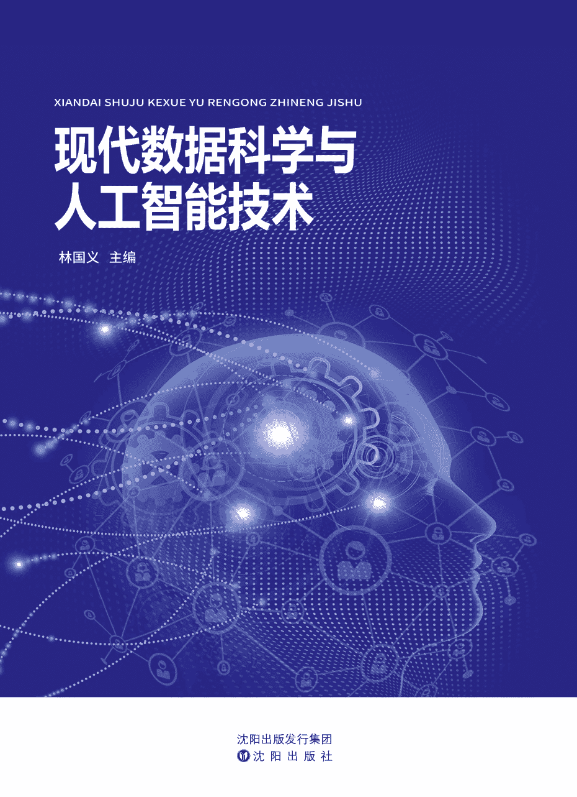

## 前言

在这个数据如空气般无处不在的时代，现代数据科学与人工智能（AI）技术已成为驱动各行各业变革的核心引擎。互联网的爆发式增长催生了海量大数据资源，它们不再只是冰冷的记录，而化作了支撑社会运转的关键基建。正是在这样的土壤中，数据科学作为一门新兴的处理范式应运而生，并迅速与AI深度融合、协同演进。

AI技术极大地拓宽了数据科学的疆界：从经典的数据挖掘、机器学习研究，延伸至与现实场景的深度嵌合。AI蕴含的巨大势能，更直接推动了万行百业的数字化转型，赋能企业实现决策精准化、运营高效化、成本可控化。

本书以“现代数据科学与人工智能技术”为名，构建了一个逻辑严密、层次分明的知识体系：
**起步夯基**：系统梳理数据科学的定义溯源、核心架构、分析全流程，以及数据、云计算、大数据与AI的辩证关系；
**技术进阶**：深度剖析数据获取与预处理、存储计算、分析可视化等工程实践核心；
**智能核心**：聚焦AI领域的知识表示与推理、知识图谱、知识库检索、机器学习及自然语言处理（NLP）等前沿技术；
**落地实战**：全景式复盘大数据与AI在工业、教育、医疗、金融、安全五大重点领域的应用图谱。

全书兼具理论厚度与实战温度，旨在为从业者提供一份可落地、可参考的进阶指南。成书过程中凝聚了众多专家学者的智慧与大量文献的支撑，谨此致谢。受限于笔者水平，疏漏在所难免，恳请同行批评指正。

---

# 第一章　数据科学概论

大数据时代已至，数据无处不在。掌握“获取、理解、处理、挖掘价值、可视化呈现、有效沟通”这一套数据核心素养，将是未来数十年职场与生活的核心竞争力。数据科学是一门典型的交叉学科，它融汇了数学、统计学、计算机科学、AI、模式识别、分布式计算、图形学等多维理论与技术。学好它，就是为了武装大脑，用数据思维解决学习、工作与生活中的复杂难题。

## 第一节　数据科学：定义与溯源

### 一、 何为数据科学？

科学的版图宏大：微观至粒子，宏观至宇宙；既囊括自然法则，也涵盖人类逻辑与社会行为。本质上，科学是一套**“可验证、可预测、系统化”的知识构建工程**——人类通过不断试错探索，最终组织成关于世界的认知体系。

**数据科学，正是这套方法论在“数据域”的投射。**

它有双重意蕴：
1.  **向内看（研究数据本身）**：剖析数据的类型、结构、状态、属性，洞察其变化形态与内在规律；
2.  **向外看（赋能他学科）**：提供一套全新的研究范式，助力自然科学与社会科学揭示自然现象与人类行为背后的真相。

权威定义指出：数据科学是**利用科学方法、流程、算法与系统，从结构化或非结构化数据中提取价值的跨学科领域**。它打通了统计学、信息科学、计算机科学的任督二脉，核心知识图谱覆盖：统计建模、操作系统、程序开发、数据库原理、机器学习、数据可视化等。

### 二、 数据科学从何而来？

*   **1960年·萌芽**：丹麦计算机先驱、图灵奖得主彼得·诺尔首提“数据科学”，初衷意在替代“计算机科学”称呼。1974年，他经广泛调研后多次强调该概念。
*   **1997年·正名**：统计学家吴建福在密歇根大学演讲《统计学是否等同于数据科学》，将统计学重构为“数据收集—建模分析—决策应用”三部曲，强烈建议将统计学更名为数据科学。
*   **2002/2003年·成型**：《Data Science Journal》与《The Journal of Data Science》相继创刊，学科阵地正式确立。
*   **大数据时代·爆发**：海量数据倒逼学科高速发展，数据科学正式站上C位，成为焦点。

---

## 第二节　核心架构与分析全流程

### 一、 数据科学的“铁三角”结构

**数据是载体，信息是内核，处理是桥梁。** 数据科学研究的本质，就是**“数据 → 信息 → 知识 → 产品”**的价值炼金术。其支撑体系由三大支柱构成：

| 核心支柱 | 关键使命 |
| :--- | :--- |
| **领域专长** | 懂业务、知痛点。唯有深谙数据来源领域，才能问对问题、定对方向、找到行动靶心。 |
| **数学底座** | 筑模型、强逻辑。建模与可视化的基石；没有扎实数学功力，模型便如无根之木。 |
| **计算机科学** | 搭架构、跑流程、落地。从存储/计算/网络的底层架构，到开发平台与工具链的选型，是工程落地的硬支撑。 |

**终极交付物：数据产品**——由数据驱动、可交付、可落地的智能化成果。

### 二、 数据分析“五步走”标准化流程

数据分析是数据科学的心脏，面向具体业务需求，遵循 **“目标 → 准备 → 探索 → 建模 → 可视化”** 闭环：

1.  **问题描述（定北极星）**：
    *   先有业务痛点，后有数据搜集——**拒绝“为数据说数据”**。
    *   基于专业背景界定问题、拆解目标、搭建框架、明确指标与逻辑。这是成败的关键前置动作。

2.  **数据准备（炼原料）**：
    *   **获取 → 清洗 → 标准化**。多源异构数据按业务逻辑归一，去冗余、补缺失、除无效，产出“分析就绪”数据集。

3.  **数据探索（摸底牌）**：
    *   用统计量与图形“透视”数据：分布特征、变量关联、潜在模式。
    *   *反馈机制*：一旦发现脏数据（重复/缺失/异常），立即回溯清洗环节。

4.  **预测建模（造引擎）**：
    *   依目标选算法（机器学习/统计），**多算法并行、多参数调优、多维度评估**。
    *   核心原则：**数据特性决定算法选择**，无银弹，只有最优解。

5.  **结果可视化（讲故事）**：
    *   让隐性规律显性化：饼图/柱图/折线/散点/雷达……形式服务于洞察传递。
    *   沉淀报告、接入Web/移动端、生成数据产品。**好可视化 = 高效沟通 = 决策赋能。**

> **贯穿始终的红线**：领域知识必须全流程介入，为每个环节校准方向。

---

## 第三节　研究版图与学习价值

### 一、 研究范畴：四维立体矩阵

数据科学区别于计算机/信息/知识科学，其独特性在于**直接以“数据”为研究对象**，支撑自然科学与行为科学，并推动科研范式向“数据驱动”跃迁。

具体研究版图覆盖五大知识簇：
1.  **统计学基因**：数据模型、过滤、分析、结构优化；
2.  **计算机基因**：获取、处理、存储、安全；
3.  **图形学基因**：可视化、协同仿真、虚拟环境；
4.  **AI基因**：机器学习、神经网络；
5.  **领域基因**：垂直场景下的理论与方法论。

宏观归纳为**“四大支柱”**：
*   **基础理论（科学）**：数据观测与推理理论（存在性、测度、代数、相似性、分类、百科全书）；
*   **实验工程（工程）**：建立实验体系、假说理论，探索数据类型/状态/属性/规律，揭示自然与人类行为奥秘；
*   **技术攻关（技术）**：破解挖掘、清洗、存储、处理、分析、建模、可视化、展现全链路技术难题；
*   **场景落地（应用）**：输出脑科学、行为科学、生物、气象、金融、地理等**“X+数据科学”**交叉学科。

### 二、 为什么要学数据科学？

**人才缺口巨大，赛道红利期长。**
社会急需两大角色：
*   **数据科学家**：深度解析数据、产出洞察的“科学从业者”；
*   **数据工程师**：构建数据底座、落地工程化的“架构建设者”。

**本书/课程的核心使命，正是精准培养这两类稀缺人才。**

---

## 思考与练习
1.  用自己的话定义数据科学，并梳理其发展脉络。
2.  画出数据分析标准化流程图，标注关键动作与反馈回路。
3.  结合你的专业背景，数据科学的“四大支柱”将如何重塑你的研究范式？

---

# 第二章　数据、云计算与大数据：三位一体的数字基建

## 第一节　数据：重新认识世界的原子

### 一、 数据的本质内涵
数据科学的靶心在“数据”。**数据 = 以符号形式（定性/定量）记录的事物描述**。它是人为构建的“现实世界映射系统”，源于观察或实验，反映地点、事件、对象、概念。
*   **模拟数据**：连续值（如声波信号）；
*   **数字数据**：离散值（如考试分数）；
*   **载体不限**：文本、音频、图像、视频均为数据。

### 二、 DIKW 金字塔：从噪音到智慧
**数据（Data）→ 信息 → 知识 → 智慧**，核心区别在于**抽象层级递进**：

| 层级 | 特征 | 转化动作 |
| :--- | :--- | :--- |
| **数据** | 原始、零散、无意义、符号堆砌 | — |
| **信息** | 被解释、被赋予语义、指示具体事物 | **解读与释义** |
| **知识** | 系统化、理论化、可迁移的理解 | **整合与呈现** |

> **数据科学的核心任务 = 贯通 DIKW 全链路**：采集 → 分类 → 录入 → 储存 → 处理 → 统计 → 分析 → 整合 → 呈现。

---

## 第二节　云计算：算力自由的基础设施革命

云计算的核心范式转移：**“自建机房” → “按需租赁，随用随付”**。公共超大规模数据中心化身“算力电厂”，用户预约资源、按量结账，实现**高利用率、低成本、极致弹性**。

### 一、 内核解码
*   **交付模式**：网络化、按需化、弹性化交付硬件/平台/软件/服务。
*   **运行机制**：数据永驻云端服务器，终端仅缓存；用户提交配置需求，平台动态调度虚拟化资源池。
*   **用户体验**：屏蔽基建细节，无需专业运维，即享超算级算力（万亿次/秒级）。

### 二、 五大标志性特征（NIST标准）
1.  **按需自助**：零人工交互，API 秒级开通资源。
2.  **泛网络接入**：跨终端（PC/手机/物联网）统一入口。
3.  **资源池化虚拟化**：多租户共享物理池，动态切分隔离。
4.  **快速弹性伸缩**：随业务波动自动扩缩容，效率最大化。
5.  **可度量服务**：计量计费透明化，支撑“即付即用”商业模型。

### 三、 三大部署形态
*   **公有云**：Google Cloud, AWS, Azure……面向全网，共享经济。
*   **私有云**：防火墙内专属，大型组织（高校/科研院所/央企）的数据主权堡垒。
*   **混合云**：敏感数据留私有，弹性算力借公有，兼顾合规与性价比。

### 四、 三层服务模型（SPI 模型）
| 模式 | 核心能力 | 用户管控范围 | 典型场景 |
| :--- | :--- | :--- | :--- |
| **IaaS** (基础设施) | 算力/存储/网络/OS镜像 | 应用、数据、运行时、中间件、OS | 迁移遗留系统、高性能计算、自建K8s集群 |
| **PaaS** (平台) | 开发框架/数据库/中间件/DevOps | 应用、数据 | 敏捷开发、微服务治理、AI模型训练平台 |
| **SaaS** (软件) | 成品应用（CRM/ERP/协同办公） | 仅用户配置/数据 | 即开即用、零运维、订阅制 |

### 五、 技术底座：三大支柱的成熟与重组
1.  **算力跃迁**：摩尔定律驱动单位成本指数级下降；虚拟化、分布式/并行计算、海量存储技术成熟 → **资源池化成为可能**。
2.  **带宽爆发**：密集波分复用（DWDM）商用，单纤承载 Tb 级带宽，长距传输成本暴跌 → **远程算力调度成为现实**。
3.  **互联网普及**：全球互联互通、Web 技术生态繁荣、API 标准化 → **服务化交付生态闭环**。

互联网已化身为现代人感知世界、认知事物的“必选外设”。有了它，人类的感知触角与认知半径彻底摆脱了时空枷锁，实现了指数级延伸。与此同时，它也是连接人与人、人与社会的高效通道，让沟通的质效跃升至新高度。

互联网技术编织起覆盖全球的计算机网络脉络，从光纤骨干到无线热点，深度渗透进工作生活的每个毛细血管。这客观上催生了分布式系统的落地，为云计算的软硬件基建铺平了道路，也激活了云计算的市场需求与用户群体。

#### (四) 系统虚拟化技术

伴随虚拟化技术的突飞猛进，单台物理服务器如今可轻松整合过往多台设备的负载。这不仅大幅跑赢了硬件利用率，削减了能耗与采购成本，更关键的是，它推动数据中心管理向自动化、智能化跨越，大幅压缩了运维投入。

### 六、 云计算的核心技术支撑

云计算涉及的关键技术并非凭空而来，而是长期IT演进中，被实际需求反复打磨、孵化成熟的结晶。技术的成熟倒逼云计算诞生。其核心技术版图主要涵盖：

#### (一) 虚拟化技术

它将物理资源“逻辑化、统一化”，屏蔽了底层硬件的差异性，对外暴露标准接口。结果显而易见：资源利用率飙升，且能随业务需求秒级弹性调度、部署。细分来看，包含计算、存储、网络、应用等多维虚拟化。

#### (二) 分布式编程模型与计算

核心在于“透明化”与“极简化”。它在后台自动将用户代码拆解为高效并行任务并调度执行，开发者无需关心底层复杂性，只需用简单模型即可驾驭云端算力。

#### (三) 海量数据分布式存储技术

面对海量并发访问，云存储采用分布式架构配合冗余机制，三大指标——高可用、高可靠、高性价比——缺一不可。其鲜明标签是：分布式、高吞吐、高传输率。

#### (四) 海量数据管理技术

数据分散存储只是前提，核心挑战在于如何高效治理、分析这座分布式“数据山”，这要求管理技术具备强大的规模化处理能力。

#### (五) 虚拟资源的管理与调度

平台层通过自动化、智能化手段，让成千上万虚拟资源协同作战：业务秒级开通、故障自愈、大规模集群稳如磐石。

#### (六) 云计算安全技术

新模式带来新攻击面：隐私保护、数据备份、基建防护……单靠技术不够，还需法律护航，构建立体防御体系。

### 七、 云计算的四大核心价值

透过终端用户、IT变革、社会转型、可持续发展四个棱镜，云计算的价值愈发清晰：

#### (一) 交付高效便捷的服务

对用户而言，云不是新技术、新架构、新方法，而是**全新的IT资源消费模式**。技术细节深度隐匿，用户像用水用电一样“按需取用、按量付费”，无需自建、自管、自维，专注业务本身。

#### (二) 推动信息技术的范式革命

继PC、互联网之后，云计算是第三次IT浪潮。区别在于：它不止建立在硬软网之上，更核心的是基于网络的**资源与服务交付**。它重塑了IT获取路径，极大降低了社会信息化门槛。

#### (三) 赋能社会发展转型

这是一场生产力的解放运动。云计算卸下了用户“重资产前置投入+高运维后置负担”的双重枷锁，让知识、智慧以极低边际成本转化为实绩。同时，它为创新型、平等、和谐社会的构建注入动能。

#### (四) 构建可持续的双赢生态

可持续的本质是“双赢”。用户端：需求全满足，不问技术细节；提供端：盈利可持续，才能服务长久。唯有双向奔赴，生态才能长青。

云计算让“IT像水电一样普惠”的梦想照进现实。彻底击碎信息化准入高墙，让创新变得简单、自然、触手可及。

## 第三节 大数据

### 一、 大数据认知重构

#### (一) 大数据的基本类型

> “随大数据持续演进，数据已升级为国家战略核心资产，社会影响力与日俱增。”^([\[2\]](#txt002.html#footnote_content_txt002_2))

大数据是流动、变化、高速生长的信息资产，蕴藏着不可估量的价值蓝海。这倒逼我们必须换脑（新思维）、换手（新技术）、换法（新模式），方能破译其密码。唯有创新处理范式，大数据才能蜕变为具备强决策力、强洞察力、强优化力的“三高”资产（海量、高增长、多样化）。

通常维度看，大数据囊括网络日志、音视频、图片、地理位置等全谱系数据：
*   **结构化数据**：驻留数据库，二维表可表达；
*   **非结构化数据**：文档、文本、图片、XML、HTML、报表、影音等泛非结构形态；
*   **半结构化数据**：游走于二者之间，自描述、结构内容混存、边界模糊。

数据多样性的根源，在于互联网与物联网将万物编织成网。在网上，人既是信息消费者，也是生产者、传播者；在物联网里，设备、传感器、仪器永不停歇地制造、传递数据流。

#### (二) 大数据的主要特征

大数据呈现“四维特征”：

1.  **量大且增速恐怖**：全球数据总量远超历史巅峰，且呈倍增态势；单应用计算数据量亦剧增。
2.  **流快且值时效短**：产生传播呈流式特征，跨时空流转；价值窗口期急剧收缩，倒逼极致计算与使用能力。
3.  **源杂且结构复杂**：编码、存储、应用特征多维度差异共存；非结构化、半结构化占比持续攀升。
4.  **价值密度低但总量巨大**：规模效应放大知识价值，推动科技社会跃迁。但同时伴随个性化、不完备、价值稀疏、交叉复用等特征——**大珍珠藏深沙，淘金难度前所未有**。这要求计算系统必备高性能、实时、分布式、易用、可扩展五大基因。

**维度对比**：若云计算是对传统IT架构的“硬件层颠覆”，大数据分析则是对行业“业务层升级”。它重塑企业竞争逻辑——未来皆为“数据化生存企业”，竞争焦点从资本、技术、模式转向**数据争夺**（规模、多样性、构建新产品新模式的能力）。当前，传统企业纷纷从IT向DT（Data Technology）转型，单纯“上云”已不足以创造增量价值。

#### (三) 大数据的七大基本功能

如何将数据资源变现为解决方案？大数据提供七把钥匙：

##### 1. 追踪
全网全时记录，溯源任意轨迹。消费行为、偏好、支付、搜浏、位移……追踪是大数据应用的**起点**。

##### 2. 识别
追踪基础上，通过定位、比对、筛选精准定身。尤其引入语音、图像、视频识别，拓宽分析维度，精度跃升。

##### 3. 画像
多源数据融合追踪、识别、匹配，勾勒立体全景像。消费端：精准触达广告产品；企业端：精准画像信用风险。

##### 4. 预测
基于历史轨迹与画像，推演趋势与复现概率。指标异动即时预警。较传统统计预测，大数据显著强化了风控建模能力。

##### 5. 匹配
海量池中精准捕捉，利用相关性、邻近性高效撮合。共享经济（网约车、租房、金融）的底层逻辑即在此。

##### 6. 优化
按最短距离、最低成本等目标函数，算法重构路径与资源配置。企业端：提效增质；公共端：节源开源、提升服能。

##### 7. 应用细分示例
复杂应用多可拆解为上述原子能力组合。如**精准扶贫**：
*   *识别+画像* → 精准锁定贫困户；
*   *追踪+提示* → 全链路监控资金、行为、效果；
*   *匹配+优化* → 资源效能最大化。
这些能力非大数据独有，但大数据做到**更准、更快、更强**。

##### 7. 应用细分示例
（此处原文编号重复，保留原貌）当前貌似复杂的应用，大多可拆解为上述原子能力的组合拳。

### 二、 大数据诞生的双重基石

数据已渗透进每个行业毛细血管，成为关键生产要素。挖掘运用大数据，预示新一轮生产力跃升与消费者红利到来。大数据生成的两大基石：**计算机技术进步（技术基）+ 互联网/物联网爆发（数据基）**。

#### (一) 技术基：算力与工具的进化

*   **无线互联技术**：催生移动互联、传感网，让人“随时随地产数”、设备“全天候不间断产数”。
*   **数据抓取技术**：获取门槛大幅降低。
*   **并行处理技术**：巨量数据处理能力与效率质变。
*   **高容高可靠存储**：存得下、取得快。
*   **可视化/VR技术**：数据转化为直观视觉，直击价值本质。
*   **人工智能技术**：机器智慧辅助挖掘、决策，人机协同再升级。

#### (二) 数据基：万物互联的数据洪流

*   **互联网（尤移动端）**：网络无处不在 → 数据无处不在。主观性数据为主（文本、图片、音视频、日志、点击流），非结构化居多。人需休息，数据产出有波谷。
*   **物联网**：万物联 → 万物生数。车、家具、传感器、衣物……设备不眠不休，**物联网天生即大数据**。对比互联网：数据更结构化、速度更快、体量更大、客观性更强（声光电热重力加速度等物理量）。

### 三、 大数据的渠道来源图谱

下一代革命（工业4.0/中国制造2025、物联网、区块链分布式计算）的核心唯独是**数据**。万物互联、万物数据化后，基于数据的个性化、智能化将引发超越工业3.0自动化产线的**根本性生产力跃迁（0到1）**。这是一场商业范式革命，未来的本质是人的未来，数据智能驱动的智能商业是起点。**大数据首务：有数可用。**

主流认知中，互联网与物联网是大数据的“产地与仓库”：

1.  **互联网巨头**：天生大数据玩家。搜索、社交、媒体、交易核心赛道，自带海量数据飞轮。
2.  **移动智能终端**：智能手机/平板普及，App追踪万物事件。交易数据、画像数据、状态上报（如地理编码变更）……非结构化数据富集于邮件、文档、图片、音视频、博客、维基、社交媒体流，为文本分析提供富矿。电商交易、行为、Web点击流日志亦是核心矿脉。
3.  **物联网设备**：时刻采集，设备量与数据量双增。智能电表、温控器、工厂机械、智能家电……自组网、自回传、云端分析。机器/传感器数据是物联网典范。
    *   *应用场景*：构建模型 → 持续监测（异常识别）+ 预测性维护（提前预警）。国外经典案例层出。
4.  **企业自有业务数据**：房产交易、大宗商品价格、特定群体消费……严格说算不上“大数据”，但**获取易、加工易、落地快**，是当前国内最常见应用资源。
5.  **政府公共数据**：公认质优价高，但开放度低。灰色渠道流出加工成产品。《大数据纲要》力推公共数据开放共享，技术使然。

**选数避坑指南（行业场景实操）：**
*   **看支撑**：真有数？可持续？源可控？安隐患？
*   **看质量**：能保实效？
*   **自有数据**：可控性强、质量稳，但覆盖面窄 → 需外补。
*   **网抓数据**：技术定生死，量与质的博弈。
*   **三方数据**：盯稳定性、溯源头。**无可靠源，巧妇难为无米之炊**。许多伪应用仅蹭风口融资，数据源不可持续。

### 四、 大数据的深度冲击波

大数据重塑科学研究、思维范式、社会发展、就业市场、人才培养五大版图。

*   **科学研究**：推开**第四范式——数据密集型科学**大门（前三：实验、理论、计算）。
*   **思维方式**：“全样非抽样、效率非精确、相关非因果”三大颠覆性特征。
*   **社会发展**：数据决策成新常态，推动IT与业深度融合，催生新技术新应用。
*   **就业市场**：数据科学家成“最性感职业”。
*   **人才培养**：倒逼高校IT专业教学科研体制变革。

#### (一) 大数据重写科学研究史

人类科学研究历经四次范式跨越：

1.  **实验科学（范式1）**：伽利略比萨斜塔实验（1590），两球同落，一锤定音推翻亚里士多德统治物理学1900年的谬论。
2.  **理论科学（范式2）**：受限于实验条件，人类转向数学/物理理论建模。牛顿三大定律构筑经典力学大厦，深刻改写文明进程。
3.  **计算科学（范式3）**：1946年ENIAC诞生，开启计算机时代。算法+程序+算力，攻克模拟仿真难题。大存储、高速度、高精度、可重复，成科研利器，加速人类飞跃。
4.  **数据密集型科学（范式4）**：数据积累达临界质变，物联网+云计算推波助澜。计算机不再仅能“模拟”，更能“分析总结、生成理论”。**一切以数据为中心：从数据中发现问题、解决问题、实现价值。**

# 大数据：重塑科学范式与社会图景的核心引擎

大数据正化身为科学工作者的“富矿”，蕴藏着待挖掘的未知模式与高价值洞见，服务于生产生活，推动科技与社会双轮驱动。虽说第三、四范式均借力计算机，但内核截然不同：第三范式遵循“假设—采集—验证”闭环，而第四范式则以海量既有数据为起点，经计算反推未知理论，实现了从“以理论导数据”到“以数说理”的根本跨越。

## 思维范式的三重重构

大数据时代最深刻的变革，发生在认知层面：**全量替代抽样、效率优于精确、相关取代因果。**

### 1. 全样而非抽样：打破“盲人摸象”的物理瓶颈
受限于存算能力，传统分析只能通过小样本推演全貌，样本虽小、成本可控，却难免“以偏概全”。如今，分布式文件系统、数据库与 MapReduce 并行框架构筑了近乎无限的存算底座，使全量数据直击分析成为常态，且能在秒级窗口内出结果，速度重塑认知边界。

### 2. 效率而非精确：告别“放大镜下的微误差”
抽样分析因结果需外推至全量，微小误差会被放大成灾难性偏差，迫使传统方法把精确性置于效率之上。全样分析天然规避了外推放大风险，大数据场景下“秒级响应”才是生存法则——慢一步，数据即贬值。因此，高吞吐、低延迟的处理效率跃升为核心指标。

### 3. 相关而非因果：拥抱“知道是什么”而非“执着为什么”
传统分析痴迷因果链条：利润下滑必溯源，雾霾讨论增必推演口罩销量。大数据时代，相关性即生产力。电商推荐“买防盗锁的也买坐垫”，平台无需解释心理动因，只需捕捉强相关模式即可精准转化。在海量数据面前，**“有用”压倒了“懂理”，相关性成为决策的新锚点。**

## 社会发展的深度重塑

### 1. 决策范式升级：从“结构化受限”到“全谱系洞察”
数据驱动决策非新事物，但数仓受限于关系模型，难容非结构化洪流。大数据决策打破类型与规模桎梏，直面多源异构数据。政府舆情治理即典范：融合论坛、微博、微信多源流，穿透表象抓本质、见趋势、挖隐情、做预测，让应急决策从“拍脑袋”转向“拍数据”。

### 2. 产业融合加速：IT 渗透至每个业务毛细血管
物流优选路径、金融组合选股、零售精准画像、广告定向投放、电网安防调度……大数据像毛细血管般渗入互联网、金融、交通、能源等传统版图，**“数据触达处，生产生活必重构”** 不再是口号，而是可量化的降本增效实绩。

### 3. 技术迭代飞轮：应用倒逼内核，内核反哺应用
“汽车大数据”重塑车险即生动注脚：传统险企靠出险率粗放分级，同质化竞争；车联网接入行车轨迹、驾驶习惯等细粒度数据，配合精算模型实现“一人一价”精准承保。掌握数据与模型者，即掌握定价权与客户心智。**新需求催生新技术，新技术释放数据能量，进而淘汰依赖人工经验的旧业务——这正是大数据驱动的创新飞轮效应。**

## 就业与人才：稀缺性定义价值

数据科学家从 2010 年的“隐形职位”跃为硬通货。互联网、零售、金融三大阵营争夺白热化，**非结构化数据分析能力**成稀缺核心。虽有“自动化替代论”唱衰需求，但商业价值显性化趋势下，企业对能变现数据的复合型人才渴求度只增不减。

## 高校破局：从“象牙塔”走向“实战场”

现状痛点：学科割裂（统计、数学、计算机各自为战）+ 环境缺位（无真实海量数据、无业务场景），导致数据科学家主要靠企业“师徒制”野蛮生长，高校供给严重脱节。

### 破局路径：“引进来”+“走出去”双轨并行
- **引进来：** 引入企业真实数据搭建仿真沙箱，聘请一线专家任教，让课堂贴近战场；
- **走出去：** 推动学生深耕互联网、金融、电信一线，教师下沉参与企业项目，实现知行合一。

### 课程重构：打破院系墙，建“组合拳”师资
跨院系联合授课，融合数学、统计、编程、机器学习、可视化、NLP 等模块，培养**“懂算法、会工程、通业务、强实战、有创新”**的 T 型复合人才，为产业输送可即战力的生力军。

---

# 五、大数据平台：能力与架构的双重奠基

单一技术难支全生命周期，**统一大数据平台**是治理与扩展的基石。

## 核心能力“五件套”

| 能力层级 | 核心使命 | 关键特征 |
| :--- | :--- | :--- |
| **数据采集** | 纳百川 | 兼容公共数据、埋点日志、业务交易等多源、异构、海量接入 |
| **数据存储** | 分仓储 | 多模适配：数仓用关系型、实时计算用 NoSQL、海量文档用文档库，按场景选型 |
| **处理计算** | 活引擎 | 离线批处理、交互查询、迭代图计算、实时/流式计算多框架共存，YARN/Mesos 统一调度 |
| **数据分析** | 产洞见 | SQL 引擎 + 机器学习库 + 多维分析，支撑预测、预警、决策全链路 |
| **可视化与应用** | 现价值 | 图表大屏直击业务痛点，分析成果落地为可执行的业务动作 |

## 分层架构“六层塔”

### 1. 数据源层：资产之本
订单、日志、轨迹、物联感知……**谁掌握一手数据，谁掌握主动权**。源头治理决定上限。

### 2. 数据采集层：入口关卡
- **Kafka：** 流式缓冲总线，削峰填谷；
- **Sqoop：** 关系库与 Hadoop 双向搬运工；
- **Flume：** 日志采集聚合利器，高可用可靠；
- **Avro：** 跨语言序列化标准，二进制高效存储。
*核心逻辑：多源汇聚→集中存储→入库清洗。*

### 3. 数据存储层：多模共生
- **文件系统：** HDFS/Hadoop 基石、GFS/Google 先驱；
- **NoSQL 矩阵：** HBase(列)、MongoDB(文档)、Neo4j(图)、Redis(KV)——各取所长应对半/非结构化数据；
- **关系型阵地：** Oracle/MySQL 守住强一致性事务堡垒。

### 4. 数据处理层：框架百花齐放
| 计算范式 | 代表框架 | 适用场景 |
| :--- | :--- | :--- |
| 批处理 | MapReduce | 海量、非实时 |
| 交互式 | Tez (DAG优化) | 多依赖作业加速 |
| 图/迭代 | GraphX, Hama (BSP) | 图计算、机器学习迭代 |
| 实时查询 | Druid | 秒级 OLAP |
| 流式计算 | Storm, Spark Streaming | 实时 ETL、风控、监控 |
| 资源调度 | YARN, Mesos | 集群统一资源管控 |
| 协调服务 | ZooKeeper | 分布式一致性基石 |

> **Spark** 以内存计算重新定义速度上限，成为统一计算入口的首选。

### 5. 数据分析层：工具箱升级
- **SQL 族：** Hive(ETL 基石)、Impala(MPP 交互)、Kylin(超大规模多维)；
- **脚本/算法族：** Pig(MapReduce 封装)、MLlib/SparkR(机器学习原生支持)；
*目标：在廉价集群上跑出商业级分析性能，加速数据变现。*

### 6. 数据可视化与应用层：最后一公里
将抽象模型转为可视大屏、可配报表、可调用 API，**让数据“会说话、能指路、可执行”**，完成从资产到资本的终极闭环。

**数据可视化：让复杂数据“听得懂人话”**

数据可视化技术的核心价值，在于将晦涩难懂的数据转化为一目了然的视觉语言。它巧妙地梳理数据间错综复杂的关联，借助图表、映射或表格等直观载体，以友好、易用的图形化、智能化界面呈现给用户，辅助分析决策。作为人类洞察复杂现象、解读海量数据的关键手段，可视化可依托数据接口或BI门户落地。更进一步，可视化分析通过交互式界面，支持从海量、动态、不确定甚至相互冲突的数据中融合信息，帮助我们深度理解复杂情境、验证既有预测、探索未知领域，同时提供高效、可复核、易懂的评估与沟通渠道。

当前大数据应用呈现“双轨并行”态势：一条是以商业变现为目标的商业大数据，另一条是聚焦公共福祉、非营利性质的公共服务大数据。商业阵营以Facebook、Google、淘宝、百度等巨头为代表，它们凭借海量用户画像、行为轨迹、位置信息等核心资产，输出精准广告推荐、定向营销方案、经营分析报告等高价值服务；公共服务领域则广泛应用于流感趋势研判、春运客流预测、应急响应调度、城市规划布局、路政建设管理及运营模式优化等民生场景。

## 第四节　大数据与人工智能：相辅相成的“双子星”

大数据与人工智能代表了IT领域最前沿的技术演进方向，二者互为表里、协同进化，既有明确界限又深度纠缠。

### 一、核心差异：输入与输出的分野

最本质的区别在于数据流向：大数据是经过清洗、结构化、集成后的“原料输入”，而人工智能是数据加工后产出的“智能输出”。

#### (一) 目标与手段的迥异
大数据本质属于传统计算范畴，它不直接驱动行动，而是专注于从极大规模、高多样性的数据集中“寻找结果”。这些数据涵盖结构化事务记录，也包含图像、邮件、传感器流等非结构化内容。

人工智能则是赋予机器认知能力的计算形式，使其能像人类一样感知输入、做出反应。AI系统具备自我进化特性：根据环境反馈调整行为、修正响应。其核心在于分析解释数据、解决实际问题。借助机器学习，计算机能掌握应对特定结果的行动模式，并将其固化为未来的标准化反应。

#### (二) 应用场景与用户体验的差异
大数据偏向“洞察赋能”。以Netflix为例，它通过分析观影习惯推断偏好，进而推荐内容，核心是“懂用户”。

人工智能聚焦“决策执行与迭代”。无论是自适应软件、自动驾驶，还是医学影像筛查，AI都在复刻人类任务，但追求更高速度、更低错误率，核心是“替人类做决定、做得更好”。

### 二、深度联结：数据喂养算法，算法激活数据

尽管定位不同，二者却是最佳拍档。

#### (一) 大数据是AI的“粮仓与训练场”
图像识别应用需吞吐数万张飞机照片才能学会识别飞机。AI真正腾飞的关键，在于GPU等大规模并行处理器的普及——其数千核心架构远超CPU的并行能力，让原有算法跑得飞快、落地可行。

#### (二) 海量数据催化AI能力质变
大数据提供算力底座，机器学习算法通过海量样本“试错学习”来复现行为。AI不具备人类式的推理直觉，它依赖大量数据反复训练。数据喂得越多，模型越精准。回望过去，AI困境源于算力不足、数据稀缺、传感器落后、互联网未普及导致实时数据缺失。如今，快速处理器、丰富输入设备、高速网络、海量数据集一应俱全。**毫不夸张地说：没有大数据，就没有今日的人工智能。**

## 思考与练习

1.  云计算的核心特征与服务形态有哪些？
2.  大数据如何重塑社会发展进程？
3.  试论大数据与人工智能的辩证关系。

## 【注释】

[\[1\]](#txt002.html#footnote_quote_txt002_1) 杨丽华，鄂晶晶，冯锋. 云计算任务数据节能存储模型仿真[J]. 计算机仿真，2023，40(2):535－539.

[\[2\]](#txt002.html#footnote_quote_txt002_2) 张清华，高渝，申秋萍. 数据科学:从数字世界到数智世界[J]. 数据采集与处理，2022，37(3):471－487.

# 第三章　数据获取与预处理：从“找米”到“淘米”

## 第一节　数据获取：认清“米”的性质与来源

数据科学研究的前提是“有米下锅”。开工前须厘清两个概念：**数据语义**——数据在现实业务中的业务含义（如公司名、日期、身高）；**数据类型**——决定该数据支持何种数学运算与操作。

### 一、数据的四种“体质”分类

按运算权限递增排序：

1.  **分类型（命名尺度）**：仅关心“同/异”，只支持 `=`、`≠` 判断（如性别、血型、编号）。
2.  **排序型（顺序尺度）**：存在大小序，支持 `=`、`≠`、`>`、`<`（如学历层次、满意度等级、比赛名次）。
3.  **区间型（等距尺度）**：定量数据，无绝对零点，单点无义，差值有义。支持 `=`、`≠`、`>`、`<`、`+`、`-`（如摄氏温度、历法年份、标准化考试分）。
4.  **比值型（比率尺度）**：定量数据，有绝对零点，可视为向量。全运算符开放：`=`、`≠`、`>`、`<`、`+`、`-`、`×`、`÷`（如身高、体重、收入、绝对温度）。

> **提示**：区间型与比值型常合称**定量型数据**。

### 二、核心获取技艺——网络爬虫

网络爬虫（网页蜘蛛/机器人）是按规则自动采集互联网信息的程序。面对指数级膨胀的网络数据，它是高效“淘金”的利器。

#### (一) 爬取网页的标准化动作

尽管爬虫形态各异，核心流程高度趋同：

1.  **播种**：人工给定入口URL。互联网拓扑呈“蝴蝶状”，爬虫通常从左侧门户类高价值结构出发。
2.  **双队列调度**：运行队列（待抓）+ 完成队列（已抓）。大规模场景下用数据库模拟队列，支撑海量抓取与断点续传。
3.  **取任务**：线程从运行队列取队首URL，空则终止。
4.  **标记完成**：处理完毕的URL移入完成队列，去重防循环。
5.  **解析扩散**：抓取后解析页面内URL，经过滤合法入运行队列。
6.  **循环迭代**：重复步骤3-5。

#### (二) 互联网页面的“五重身份”

从爬虫视角看，网页分五类：
1.  **已抓未过期**；2. **已抓已过期**（镜像滞后于动态源站）；3. **待抓**（运行队列中）；4. **可知未抓**（已发现链接但未入队）；5. **不可知**（爬虫触达盲区，如深网、需登录页）。

#### (三) 抓取策略：决定“先抓谁、后抓谁”

待抓URL队列的排序策略直接关乎资源利用率与高价值页面覆盖率。以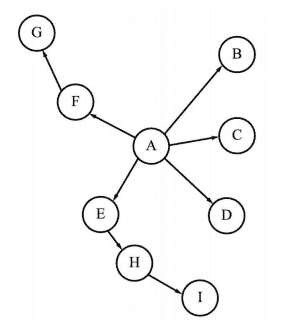图拓扑为例：

图 3－1　网页拓扑结构示例

1.  **深度优先（DFS）**：一条路走到黑再回溯。实现简单但弊端明显：门户等高价值页常在浅层，深层价值递减；极易陷入“爬虫陷阱”（无限深度/循环链接），鲜用于生产。
    *   *示例路径：A→F→G→E→H→I→B→C→D*
2.  **广度优先（BFS）**：层层推进，先抓完种子页所有邻居。符合“重要页离种子近”规律，覆盖面广，工业界主流选择。
    *   *实现*：新发现链接直接插入队列尾部。
    *   *示例路径：A→B→C→D→E→F→H→G→I*
3.  **反向链接数策略**：被引用越多越重要（类似学术引用）。但受广告链接、作弊链接干扰，搜索引擎常结合“可信反链”综合判断。
4.  **Partial PageRank 策略**：引入PageRank思想。对已抓页+待抓队列计算PR值排序抓取。权衡开销：每抓K页重算一次PR。新发现链接暂无PR，用入链传递值聚合作为临时PR参与排序。
5.  **大站优先策略**：按站点聚类，待抓页数多的站点优先下载，利于带宽利用与权威源覆盖。

#### (四) 更新策略：跟上“活”的互联网

网页实时变化，需决定何时回访刷新：

1.  **历史参考策略**：基于历史更新频率建模（常用泊松过程）预测下次变更时间。
2.  **用户体验策略**：用户只看前几页结果。优先更新排名靠前的页。保留多版本历史，量化内容变更对搜索质量的影响均值，作为重抓依据。
3.  **聚类抽样策略**：解决“无历史数据”、“存储历史版本成本高”痛点。假设同类属性页面更新频率相似，抽样测得周期推广至整类。

#### (五) 分布式抓取架构：单机抗不住全网

面对亿级页面，标准为“三层分布式”：跨地域数据中心 → 数中心内多抓取服务器 → 单服务器多爬虫实例。

**数据中心内协作两大模式：**

1.  **主从式**：Master维护队列、分发URL、均衡Slave负载。瓶颈在Master单点性能与可用性。
2.  **对等式（P2P）**：全节点对等。URL按域名Hash取模(`H mod m`)分配节点。缺点：节点增减导致全网Hash映射漂移，扩展性差。
    *   **改进——一致性哈希**：将域名Hash映射至 0~2³² 环，均分给m台机器。节点故障仅影响顺时针下一节点接管其区间，其余完全不受波及，实现平滑扩缩容。

#### (六) 主流开源爬虫横评

| 项目 | 定位与特色 | 核心差异点 |
| :--- | :--- | :--- |
| **Heritrix** | 归档级框架，组件可插拔。追求**完整、精准、不修改**原貌（含非文本）。重复抓取不覆盖旧版。采用BFS。四步走：选取→分析归档→入队→标记。 | 仅单线程、多爬虫不协作；操作复杂；硬件故障恢复弱。 |
| **Nutch** | **索引导向**。深度遍历抓取本地。仅保留可索引内容；支持内容修剪/格式转换；存储为数据库友好格式；重复URL以新覆旧；命令行交互；早期定制难（近年改善）。 | 面向搜索引擎后端，而非全站归档。 |
| **Larbin** | **极简主义**。只抓URL扩展，不解析、不存库、不建索引。为搜索引擎提供原始数据源。单一但高配、高效（单实例日抓500万页）。 | 专职“采集器”，下游自行处理。 |
| **Lucene** | **非爬虫**。Java全文检索工具包。提供索引/搜索能力。文本化即可索引。采用**倒排索引**，查询极快。流程：建索引→解析关键词→索引命中→返回文档。 | 定位“检索引擎核心”，常与Nutch搭配（Nutch抓+Lucene搜）。 |

## 第二节　数据清洗与集成：把“脏米”洗成“精米”

### 一、数据清洗：四大核心工序

将原始“脏数据”转为可用“净数据”：

1.  **填补空缺值**；2. **平滑噪声数据**；3. **纠正不一致数据**；4. **消除冗余数据**。

重点拆解前两项：

#### (一) 填补空缺值：别让“空洞”毁模型

**缺失成因五宗罪**：设备故障、因不一致被删、认知偏差未录入、业务轻视未采集、变更无日志。

**主流填补手段**：

1.  **直接丢弃含缺失属性的元组**：适用于缺类别标签（分类/描述任务）。缺点：缺失比例大时样本损失惨重，有效性差。

## 数据预处理核心技术：从缺失值填补到降维归约

### 缺失值处理策略

**人工补录**：虽准确，但人力成本高昂、耗时漫长，难以应对大规模数据集，实用性受限。

**自动填补技术**：主流手段包括全局常量、属性均值、同类样本均值，以及基于回归、决策树、贝叶斯推理等模型预测的潜在值。

> **⚠️ 潜在风险提示**：
> 自动填补易导致数据分布发生倾斜，使数值过度聚集于特定区间，形成“头重脚轻”或“比萨斜塔”式的非均匀分布。这不仅会引发计算效率瓶颈，还可能导致分析结论“以偏概全”。根本原因在于：填补值终究是基于现有信息的推测，而非真实观测值，错误在所难免。

### 噪声数据平滑处理

**噪声来源**：数据采集设备故障、人工录入失误、传输干扰、技术瓶颈、命名规范不统一等。

#### 1. 分箱法
核心逻辑：将排序后的数据按规则划入“箱”（区间），再对箱内数据分别平滑处理。实施前必须按目标属性排序。

| 分箱策略 | 核心机制 | 优势 | 劣势 |
| :--- | :--- | :--- | :--- |
| **等深分箱 (等频率)** | 每箱样本数相近，箱深一致 | 利于数据缩放 | 属性值难以均分，管理不便 |
| **等宽分箱 (等距离)** | 区间宽度固定 `W=(Max-Min)/N` | 实现最简单 | 无法有效处理倾斜数据，易产生异常箱 |
| **自定义区间** | 依据业务需求划分 | 灵活贴合业务 | 依赖领域专家经验 |

#### 2. 进阶平滑手段
*   **聚类法**：将相似值归类，落离群外的视为噪声（孤立点）进行修正。
*   **回归法**：拟合函数（线性/非线性）捕捉变量间变化规律，用理论值平滑观测值。

---

## 数据集成：打破孤岛的挑战

将多源数据汇聚至统一存储，需攻克三大难题：

1.  **实体匹配**：识别不同源中指代同一实体的字段（如 `id` vs `customer_id`），常借助元数据辅助判断，防止错配。
2.  **冗余消除**：
    *   *派生冗余*：某属性可由其他属性推导得出。
    *   *命名冗余*：同一概念因命名不一导致重复存储。
    *   *后果*：增加挖掘复杂度，拖垮处理效率。
3.  **值冲突**：同一实体在不同源中数值不一致，需制定统一解决规则。

---

## 第三节 数据变换与归约：提质增效的关键

### 一、数据变换：重塑数据形态

| 变换类型 | 核心动作 | 典型场景/工具 |
| :--- | :--- | :--- |
| **平滑** | 去噪 | 分箱、聚类、回归 |
| **聚集** | 汇总计算 | 数据立方体、`sum()`、`count()`、`avg()` 等 OLAP 操作 |
| **概化** | 概念上卷 | 用高层概念替代细节数据，降低复杂度，加速处理 |
| **规范化** | 比例缩放 | 将数值映射至统一小区间，消除量纲/量级差异影响 |
| **属性构造** | 特征工程 | 由 `height`、`width` 构造 `area`，挖掘隐性关联，提升模型表现 |

#### 规范化三大主流算法详解

1.  **Min-Max 规范化**  
    适用：边界已知。线性映射 `[min, max]` → `[new_min, new_max]`。
2.  **Z-Score 标准化 (零均值)**  
    适用：边界未知或存在极端离群点。依赖均值 `μ` 和标准差 `σ`：`x' = (x - μ) / σ`。
3.  **小数定标规范化**  
    机制：移动小数点位数，取决于最大绝对值。如 `Max=980`，移三位得 `0.98`。

> **💡 工程警示**：规范化不可逆改变原始数据分布（尤其中后两者）。**必须持久化规范化参数**（均值、标准差、Min/Max 等），保证新增数据与历史数据按同一标准处理，维护特征空间一致性。

### 二、数据归约：以小博大，保真降维

**动机**：原始数据量巨大，直接挖掘耗时不可接受。归约旨在获取“精简且高保真”的代表性子集。

**四大评判金标准**：
1.  体量足够小；
2.  完整性最大程度保留；
3.  挖掘结果与全量数据一致或近似；
4.  归约耗时 < 挖掘节省时间。

**四大核心策略**：

| 策略 | 核心手段 | 适用目标 |
| :--- | :--- | :--- |
| **数据立方体聚集** | 多维汇总 | 缩减数据量，保留分析所需信息粒度 |
| **维度归约 (属性归约)** | 相关性分析、主成分分析 (PCA) | 剔除无关/弱相关/冗余属性，破解“维度灾难” |
| **数据抽样 (样本归约)** | 简单随机、分层、簇抽样等 | 获取有代表性子集，平衡成本与精度 |
| **离散化/概念分层** | 等宽、等深、聚类、决策树离散化 | 连续属性 → 区间标签，简化描述，利于规则挖掘与理解 |

---

## 章节复盘与思考

1.  网络数据获取的主流技术路线有哪些？
2.  数据清洗流程包含哪些核心环节？
3.  对比三种规范化方法的适用边界与优劣势。

---

# 第四章 数据存储与处理架构

## 第一节 数据存储新范式

### 大数据时代的六大存储挑战

| 维度 | 核心诉求 | 关键技术点 |
| :--- | :--- | :--- |
| **容量** | 弹性横向扩展 | 模块化增容、在线扩容、免停机运维 |
| **延迟** | 低延迟高吞吐 | 实时交易支持、HPC 适配、虚拟化加速 |
| **安全** | 多级合规防护 | 跨域数据混合访问控制、行业标准（金融/医疗/政务）适配 |
| **成本** | 降本增效 | 设备利用率最大化、去昂贵专有硬件、软件定义存储 (SDS) |
| **灵活性** | 多场景适配 | 基础设施随分析应用协同演进，支持多模数据 |
| **应用感知** | 智能调度 | 存储层感知上层业务特征，定制化服务，提升整体效能 |

### 云存储：从设备到服务的范式跃迁

> **本质定义**：云存储**非单一介质**，而是**服务模式**。通过集群、分布式文件系统（如 HDFS）、网格技术整合海量设备，经应用软件抽象，对外提供统一存储/访问接口。

**三大差异化特征**：
1.  **服务导向**：面向多租户在线存储服务（传统面向 HPC/OLTP）。
2.  **技术挑战聚焦**：安全性、可靠性、海量并发下的高效率（传统侧重块/文件性能指标）。
3.  **管理能力跃升**：集成海量数据治理、公共服务支撑、自动化运维能力。

**核心价值**：以软件定义方式实现“存储设备 → 存储服务”转化，完美契合大数据高并发读写、非结构化处理、高可用高扩展刚需。

---

## 第二节 数据处理利器：Python 生态与分布式计算

### Python：数据科学的“通用语言”

**生态优势**：低门槛、开源开放、语法优雅、跨平台、库极其丰富。
*   **标准库**：覆盖数据结构、网络、文件、DB、文本、GUI 等基础设施。
*   **数据科学栈**：
    *   计算基石：`NumPy` (多维数组)、`SciPy` (科学计算)
    *   数据处理：`pandas` (DataFrame/Series)
    *   可视化：`matplotlib`、`seaborn`
    *   统计建模：`statsmodels`
    *   机器学习：`scikit-learn`
    *   深度学习：`TensorFlow`/`PyTorch` (生态兼容)

---

### Python 核心语法速览

#### 1. 标识符与规范
*   组成：字母/数字/下划线，非数字开头，**大小写敏感**。
*   下划线约定：
    *   `_foo`：受保护成员（约定俗成私有，可访问）。
    *   `__foo`：私有成员（名字改写，外部不可直接访问）。
    *   `__foo__`：魔术方法/特殊属性（如 `__init__`, `__name__`）。
*   保留字/关键字不可作标识符。

#### 2. 缩进即语法
*   无大括号 `{}`，无分号 `;`（同行多语句除外）。
*   **缩进一致性**定义代码块边界（推荐 4 空格）。

#### 3. 对象模型与变量机制
*   **万物皆对象**：标识、类型、值、方法、属性。
*   **赋值 = 绑定/引用**，非拷贝。
*   **拷贝陷阱**：
    *   浅拷贝 (`copy.copy`)：顶层新建，嵌套对象仍共享引用。
    *   深拷贝 (`copy.deepcopy`)：全递归复制，彻底隔离。

#### 4. 语法糖：写更少代码，表更清晰意图
*   上下文管理器 (`with`)
*   循环/异常的 `else` 子句
*   `*args` / `**kwargs` 动态参数
*   `lambda` 匿名函数
*   推导式 (List/Dict/Set/Gen)
*   生成器 (`yield`)
*   装饰器 (`@decorator`)

#### 5. 函数进阶
*   **参数类型**：位置必需、关键字、默认值、可变参数 (`*args` 打包成元组)。
*   **作用域链**：LEGB 法则 —— Local → Enclosing → Global → Built-in。
    *   `global` 声明修改全局变量。
    *   `nonlocal` 声明修改嵌套作用域变量（闭包关键）。
*   **递归**：自调用 + 明确基准情况，逻辑清晰但需警惕栈溢出与效率。
*   **闭包**：内部函数引用外部（非全局）作用域变量，形成“函数+环境”封装体。

---

### 大数据处理重器：Hadoop 生态

**定位**：Apache 顶级项目，分布式基础设施框架。屏蔽底层细节，让开发者聚焦业务逻辑，释放集群算力。

**核心组件 HDFS (Hadoop Distributed File System)**：
*   **高容错**：多副本机制 (默认 3 副本)。
*   **高吞吐**：流式数据访问，适合大文件批量读写。
*   **松耦合 POSIX**：放宽标准约束，优化大数据场景性能。

#### Hadoop 架构演进
*(素材截止于此，后续通常涵盖 YARN 资源调度、MapReduce 计算模型、生态组件 Hive/HBase/Spark 等)*

Hadoop 系统由多层组件协同构建。基础设施层为 `HDFS`，负责统管集群内全部存储节点的文件数据；上层计算引擎为 `MapReduce`，由 `JobTrackers` 与 `TaskTrackers` 协作完成任务调度与执行。

###### HDFS 核心架构解析

在外部客户端视角下，`HDFS` 呈现为标准的分级文件系统界面，支持文件的增删改查等常规操作。但其内部架构建立在特定节点体系之上，这由其分布式特性决定。关键节点包含：唯一的 `NameNode`，掌管全局元数据服务；以及多个 `DataNode`，提供实际存储块空间。单 `NameNode` 设计引入了单点故障隐患，是 `HDFS` 早期版本的主要短板。

文件入库时会被切割为固定大小的数据块（默认 64MB），并按副本策略分发至多个 `DataNode`。这种机制区别于传统 `RAID` 冗余方案。块大小与副本数由客户端创建文件时指定。`NameNode` 集中管控所有文件操作元数据，集群内部通信均基于标准 `TCP/IP` 协议栈。

###### NameNode：元数据管理中枢

`NameNode` 通常独占一台物理机运行，核心职责是维护文件系统命名空间及管控客户端访问权限。它决定文件块向 `DataNode` 的映射分布：以常见三副本为例，首副本置于同机架不同节点，末副本跨机架存放，兼顾容灾与带宽。

实际数据流不经过 `NameNode`，其仅传递块级元数据。客户端发起写请求时，`NameNode` 返回目标块 ID 及首个 `DataNode` 地址，并通知后续副本节点准备接收。

元数据持久化依赖两大文件：`FsImage` 存储命名空间全量镜像，`EditLog` 记录增量操作日志，二者均落盘于 `NameNode` 本地文件系统。为防数据损毁，这两个关键文件需配置多副本备份。

`NameNode` 单点故障风险客观存在，传统主备切换难以实现真正的 100% 可用性，唯有引入 Hadoop Non-stop Namenode 方案方能彻底解决。

###### DataNode：分布式存储主力军

`DataNode` 同样以进程形式运行于独立节点。典型集群拓扑为：单 `NameNode` 搭配海量 `DataNode`，节点按机架物理归属组织，机架内通过交换机互联。Hadoop 预设机架内网络吞吐优于跨机架链路。

`DataNode` 响应客户端读写指令，同时执行 `NameNode` 下发的块创建、删除、复制命令。`NameNode` 依赖 `DataNode` 定期上报的心跳包（携带块列表报告）感知集群状态，校验块映射一致性。若节点心跳丢失，`NameNode` 立即触发副本修复流程，在健康节点上补齐丢失块。

###### 文件写入流水线机制

`HDFS` 定位于大文件流式访问场景，非通用文件系统。写入流程为：客户端先将数据缓冲至本地临时存储；积累达一个块大小时，向 `NameNode` 申请创建文件；`NameNode` 分配块 ID 及首 `DataNode` 地址，并通知从 `DataNode`；客户端向首节点推送数据，数据经管道流式复制至后续副本节点；客户端同步生成校验文件；末块传输完毕后，`NameNode` 提交元数据持久化，写入流程终结。

##### 集群部署：从单机到生产环境

开发调试可单机运行 Hadoop，但生产性能依赖机架级商用服务器集群。集群感知拓扑结构，以此指导任务调度与数据分布。设计假设节点随时可能失效，框架原生具备单机乃至整机架故障的自愈能力。

##### MapReduce 计算范式与调度

Web 搜索索引构建是 `MapReduce` 经典应用场景。作为并行数据处理引擎，其核心流程受 Google 论文启发：输入爬虫抓取的网页文本，输出词频统计，支撑后续检索服务。

最简 `MapReduce` 作业包含 `Map`、`Reduce` 与驱动 `main` 函数三件套。`main` 整合作业控制与 I/O 路径。Hadoop 提供丰富接口与抽象类辅助开发调优。

`MapReduce` 根植于函数式编程。`Map` 将输入集合转为键值对列表；`Reduce` 按键聚合键值对列表。二者均可并行启动多实例。

`JobTracker` 运行于主节点，单例掌管全局作业调度，类比 `NameNode` 角色。作业提交后，`JobTracker` 依据 `HDFS` 块分布信息（数量与位置）规划 `TaskTracker` 从任务，实现“计算向数据移动”的数据局部性原则——这是 Hadoop 高性能的关键所在。每个输入分片对应一个 `Map` 任务，`TaskTracker` 汇报执行进度与结果。

#### Spark：新一代内存计算引擎

`Spark` 诞生于 UC Berkeley AMPLab，2009 年由 Matei Zaharia 主导开发，2010 年开源，2013 入选 Apache 孵化器，2014 晋升顶级项目。定位为基于内存的集群计算平台，从多轮迭代批处理切入，兼融 SQL 仓库、流计算、图计算等范式，堪称全能选手。

简述：内存计算集群系统，旨在加速数据分析；提供高阶 API，原生支持交互查询与迭代算法。

##### 核心抽象：RDD 与算子体系

计算模型抽象为带工作集的数据流（DAG）。突破点在于：利用内存承载工作集并保证容错。内存访问速度超磁盘数量级，性能跃升显著。

容错机制采用**血统日志**而非检查点。检查点涉及数据冗余与网络开销，而 `Spark` 记录粗粒度 `RDD` 变换谱系，开销可忽略。

运行空间分离：`Spark RDD` 空间与 `Scala` 原生空间。原生空间承载标量、集合及持久化存储。

算子分四类：
1.  **输入算子**：将 `Scala` 集合（如 `parallelize`）或外部存储数据吸入生成 `RDD`。
2.  **变换算子**：`RDD` 经变换产出新 `RDD`。运行时 `RDD` 切分为分区分布集群。分区为逻辑概念，变换前后分区可共享物理存储，规避函数式不可变带来的内存膨胀。部分算子处理简单元素，部分针对 `Key-Value` 键值对。
3.  **缓存算子**：将中间结果 `RDD` 分区物化落盘/入内存，备后续复用。
4.  **行动算子**：触发计算执行。输入为 `RDD` 及其血统依赖链，输出回原生空间（标量、集合或存储）。遇行动算子即为作业触发点。

**惰性求值机制**：变换算子序列仅在 `RDD` 空间构建元数据 `DAG`（有向无环图），顶点为 `RDD` 及生成算子，边表示依赖。这条谱系链命名为 `Lineage`。计算一直延迟至行动算子出现，随后一次性提交执行。

##### 任务调度与依赖优化策略

程序启动分两阶段：客户端记录变换序列增量构建 `DAG`；行动算子触发 `DAGScheduler` 将图解析为 Job 与 TaskSet。

运行模式支持本地单进程（调试用）与集群模式。集群模式下，客户端驻留 `Master`，经 `Cluster Manager` 分发分区任务至 `Worker/Slave` 节点。

**依赖分类** 是调度优化基石：
*   **窄依赖**：父 `RDD` 每分区最多被一个子分区依赖。支持 **流水线优化**——融合连续 `fork/join` 屏障，减少全局同步与中间结果物化，大幅提速。
*   **宽依赖**：子分区依赖父 `RDD` 全部分区（对应 `Shuffle` 操作）。流水线优化到此终止。

`DAGScheduler` 回溯依赖图构建 `Stage`：遇宽依赖切分 Stage，Stage 内安全实施流水线。

依赖类型亦指导容错策略：窄依赖节点失效仅需重算丢失父分区，无跨节点阻塞；宽依赖需全量父分区就绪，重算代价高。故**检查点策略应优先加宽依赖节点**，权衡血统长度与宽依赖分布。

## 思考与练习

### 练习题目

1.  大数据技术如何重塑数据存储范式？
2.  函数签名通常包含哪些要素？
3.  Hadoop 体系架构核心组件有哪些？

### 参考文献

[[1]](#txt004.html#footnote_quote_txt004_1) 肖飞. 云存储及应用特点探讨 [J]. 互联网天地, 2019(4):57.

[[2]](#txt004.html#footnote_quote_txt004_2) 郭婺, 郭建, 张劲松, 等. 基于 Python 的网络爬虫设计与实现 [J]. 信息记录材料, 2023, 24(4):159.

# 第五章 数据分析与可视化实战

## 第一节 分类分析核心理论

### 一、相似性与差异性量化指标

数据相似度与相异度是挖掘算法（如聚类）的基石。多数场景下，计算得出相似/距离矩阵后，原始数据即可丢弃，转而进入相似性空间建模。

*   **相似度**：衡量对象相像程度的非负数值，常规约束于 `[0, 1]` 区间。
*   **相异度**：量化对象差异程度的非负数值，常取 `[0, 1]` 或 `[0, +∞)`。

### 二、分类建模方法体系

分类分析旨在挖掘数据库对象共性，依模式将数据映射至预定类别。其在实证研究中地位核心^([1])，应用广泛（如手写数字识别）。

#### （一）分类学习基础范式

属监督学习范畴，训练集含标签。按标签形态分三类：
1.  **二分类**：是非二选一判定。
2.  **多分类**：多类别中单选预测。
3.  **多标签分类**：单样本对应多标签（如影片同时属“动作”与“犯罪”，新闻兼具“政治”与“法律”属性），极为常见。

模型本质上分**线性**与**非线性**两大阵营。

**线性分类模型**假设特征与类别存在线性可分关系，通过特征线性组合决策：
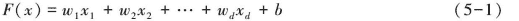
向量化形式：
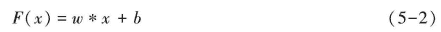
其中 `w` = (`w1`, `w2`, …, `wd`)。核心任务是学习参数 `w` 与 `b`。代表算法：逻辑回归、线性判别分析 (LDA)。

**非线性分类模型**处理线性不可分问题。经典算法涵盖：决策树、支持向量机 (SVM)、朴素贝叶斯、K 近邻 (KNN)。

#### （二）决策树构建逻辑

决策树模拟人类决策推理，树结构映射判断路径。例：信用卡审批（通过/拒绝），根节点为总问题，内部节点依次测试“固定工作”、“年龄段”、“信用记录”等属性，叶子节点给出最终结论。

树包含根节点、内部节点、叶子节点。每次划分产出符合条件的子样本集，递归完成空间分割。

**生成算法递归终止条件**：
*   当前节点样本纯度达 100%（同类）→ 标记叶子节点返回。
*   样本在所有属性取值相同 → 标记为多数类（兼具模糊分类效果）。

**核心环节**：每步从特征集中选取最优分裂属性，目标兼顾预测准确与树规模最小。主流算法 `ID3`、`C4.5`、`CART` 差异在于分裂准则，实战中需多算法实测选优。

#### （三）朴素贝叶斯概率模型

##### 1. 概率论前置知识

算法建立在贝叶斯定理之上，先明确基础概念：

*   **随机试验**：同条件可重复，全集已知，单次结果不确定。
*   **事件与样本空间**：
    *   **基本事件**：单一可能结果。
    *   **基本空间**：全体基本事件集合。
    *   **必然/随机/不可能事件**：概率为 1、介于 (0,1)、为 0 的事件。
    *   **互斥事件**：不能共同发生。
    *   **对立事件**：必有其一发生。
    *   *例：抛硬币，“正面”“反面”互为互斥与对立事件，构成基本空间。*
*   **概率定义**：事件频率的极限估计。
    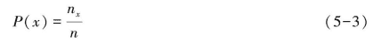
    式中：`nx` —— 事件 `x` 发生次数；`n` —— 试验总次数。

### (4) 先验概率：经验的初始判断
所谓先验概率，就是依靠过往经验或逻辑推演，在实验发生前就能确定的概率基准。
**案例一**：抛硬币，正反面各 50%，这是典型的先验认知。
**案例二**：袋中装有 1 到 5 号共 5 张卡片，随机抽取。抽中偶数（2、4）的概率为 2/5，即 40%，这同样属于先验范畴。

### (5) 条件概率（后验概率）：在“已知”发生后的重新评估
条件概率，亦称后验概率，核心在于**“条件已成”**——事件 B 已经发生的前提下，事件 A 发生的可能性，记作 `P(A|B)`。若样本空间仅含 A、B 两事件，则存在如下核心关系：

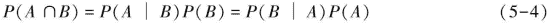

或表述为：

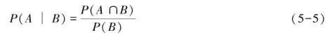

同时成立：

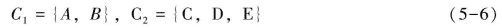

公式中的 `A∩B` 代表 A、B 同步发生。若二者互斥（互不相容），则 `P(A∩B)=0`，随之可得 `P(A|B)=P(B|A)=0`。

### (6) 全概率公式：将复杂拆解为简单求和
已知一组两两互斥且穷尽样本空间的事件 `B₁, B₂, ..., Bₙ`。对任意事件 A，其发生概率可通过在各种情形 `Bᵢ` 下的条件概率加权求和获得：

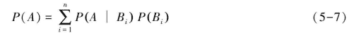

此公式的精髓在于：**将对复杂事件 A 的直接计算，转化为在不同简单场景 `Bᵢ` 下概率的加权汇总。**

### (7) 贝叶斯定理：从“果”反推“因”的数学工具
贝叶斯理论解决的核心问题是：**已知结果发生的概率，如何反推某因由导致该结果的概率？** 其数学表达为：

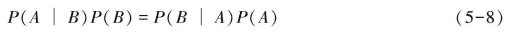

或等价写作：

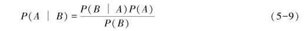

---

## 2. 朴素贝叶斯分类：极简假设下的决策逻辑

### 为何称“朴素”？
因为它只做最原始、最激进的两个假设：
1.  **特征条件独立**：所有特征属性互不影响；
2.  **特征同等重要**：无权重差异。

### 分类决策流程
给定待分类样本 `x`，分别计算其属于各已知类别 `c` 的后验概率 `P(c|x)`，取概率最大者 `cₖ` 作为判定结果。依据贝叶斯公式：

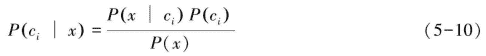

在所有 `P(c₁|x), P(c₂|x), ..., P(cₙ|x)` 中，若 `P(cₖ|x)` 最大，则判定样本 `x` 属于类别 `cₖ`。

---

# 第二节 数据聚类分析：无标签下的“物以类聚”

聚类分析，本质是**将对象集合自动划分为若干由相似对象组成的群组（簇）**。这是人类认知世界的本能行为，也是机器学习中**无监督学习**的核心任务。

## 一、 聚类分析：定义与方法论

### (一) 核心定义：无标签下的结构发现
机器学习按任务分“监督”（有标签学映射）与“非监督”（无标签找规律）。聚类属于后者——**训练数据无标签，通过挖掘样本间的相似性规律，揭示数据内在结构。**

**聚类的五大支柱要素：**
1.  **数据集**：含多对象/样本，每对象由多特征描述。
2.  **相似度度量**：量化“远近”的标尺，常用欧氏距离、曼哈顿距离、余弦相似度等。
3.  **聚类簇**：划分结果。簇内高相似（紧密），簇间低相似（分离）。
4.  **聚类算法**：执行划分的策略。主流有 `K-means`（划分）、`AGNES/DIANA`（层次）、`DBSCAN`（密度）等，各有目标函数。
5.  **结果评估**：用簇内相似度、簇间距离、轮廓系数等指标，验证“紧密度”与“分离度”。

**应用价值**：数据挖掘、模式识别、图像分割、市场细分……帮助发现隐藏模式，赋予无序数据结构化理解。

### (二) 聚类方法的三大流派
聚类的本质目标只有一条：**簇内高内聚，簇间低耦合。**
即要求：
1.  组内数据高度相似；
2.  组间数据显著差异。

根据“衡量远近”的标准不同，方法分三类：

| 流派 | 核心逻辑 | 典型代表 | 关键特征 |
| :--- | :--- | :--- | :--- |
| **基于划分** | 相似归一类，不似分两家 | `K-means` | 简单、常用，需预设簇数 `k` |
| **基于层次** | 不预设簇数，按相似度构建树状层级 | `AGNES` (凝聚), `DIANA` (分裂) | 可视化层次结构，自动决定粒度 |
| **基于密度** | 簇=高密度区域连通体 | `DBSCAN` | **能发现任意形状簇**，天然抗噪声 |

---

## 二、 划分聚类：K-means 算法详解

`K-means` 是划分法的鼻祖。目标：**簇内点尽可能近，簇间点尽可能远。**

**算法流程（迭代优化）：**
1.  **初始化**：从 `n` 个样本中随机选 `k` 个作为初始质心（聚类中心）。
2.  **分配**：计算其余样本到各质心的距离，按**最小距离原则**归入最近簇。
3.  **更新**：对**发生变动的簇**重新计算质心（取均值）。
4.  **收敛判断**：重复 2、3 步，直到簇分配不再变化（或变化小于阈值）停止。

---

## 三、 层次聚类：AGNES 自底向上构建树

`AGNES` (Agglomerative Nesting) 属凝聚型层次聚类，**不需预设簇数**，自底向上逐级合并。

**八步走流程：**
1.  **数据准备**。
2.  **距离矩阵计算**：两两样本距离/相似度（欧氏、曼哈顿、余弦等）。
3.  **初始化**：每个样本自成一簇。
4.  **簇间距离定义**：单链接/全链接/平均链接等策略计算簇与簇距离。
5.  **合并最近簇**：找距离最小的两簇，合二为一。
6.  **更新距离矩阵**：按所用链接策略调整新簇与其他簇距离。
7.  **循环合并**：重复 5、6，直到达预设簇数或仅剩一簇。
8.  **输出结果**：生成层次聚类树（树状图）。

**核心优势**：无需预先指定 `k`，依数据内在结构自然形成层级。

---

## 四、 密度聚类：DBSCAN 发现任意形状与噪声

`DBSCAN` (Density-Based Spatial Clustering of Applications with Noise) 基于**密度连通**思想：**簇 = 密度相连点的最大集合。**

**核心概念**：
*   **核心点**：`Eps` (邻域半径) 内包含点数 ≥ `MinPts` (最小点数阈值)。
*   **直接密度可达**：点 `p` 在核心点 `q` 的 `Eps` 邻域内。
*   **密度可达/相连**：通过核心点链条传递可达性。

**三步实现过程：**
1.  **搜索核心**：遍历数据集，检查每点 `Eps` 邻域。满足 `MinPts` 者创建簇，作为核心对象。
2.  **扩展聚类**：迭代吸纳核心点**直接密度可达**的对象；若遇新核心点，继续扩展（可能引发簇合并）。
3.  **终止**：无新点可加入任何簇时结束。剩余未归属点即为**噪声**。

**关键参数**：`Eps` (邻域半径)、`MinPts` (最小邻域点数)。

---

# 第三节 数据预测分析：驾驭时间序列的未来

带有时间标签的动态数据（时间序列），记录着事物演变轨迹。分析其规律、对比历程（环比/同比）、计算特征平均值，最终目的是**预测未来**。常用预测手段：移动平均、指数平滑，按误差优选。

**前提：数据可比性四原则**
1.  统计时长一致；
2.  核算范围一致；
3.  经济含义一致；
4.  计算方法、价格、单位一致。

---

## 一、 描述事物发展变化的指标体系

### (一) 反映“水平”的指标：站在多高、走了多远

#### 1. 发展水平（时点/期末数值）
时间序列每个点的指标数值，反映该时点规模水平。
*   **报告期**：当前研究期（如 8 月销量 789）。
*   **基期**：对比基准期（如 7 月销量 500）。
*   **相对指标——发展速度/指数**：报告期 ÷ 基期。
    > 例：8 月销量是 7 月的 **157.8%**，即增长 **57.8%**。

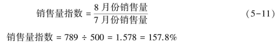

#### 2. 平均发展水平（序时平均数/动态平均数）
将一段时间内观测值平均，抹平短期波动，反映总体趋势。**计算方式视数据类型而异：**

| 数据类型 | 特征 | 计算平均法 |
| :--- | :--- | :--- |
| **时期数列** (销售额、利润、产量) | 连续登记、可加总、值随时长变 | **简单算术平均** |
| **时点数列** (年末人口、期末存量) | 间隔登记、不可加、值与时长无关 | **加权平均/特定公式** |
| **相对指标数列** (增长率、构成比) | 无可加性、分子分母结构 | **分子平均 ÷ 分母平均** |
| **平均指标数列** (人均产出) | 同相对数列 | **参照相对数法** |

#### 3. 增长量：绝对变化的度量
两期发展水平之差。
*   **逐期增长量**：`Δₜ = Xₜ - Xₜ₋₁`（比上期增减多少）。
*   **累计增长量**：`ΣΔ = Xₜ - X₁`（比固定基期累计增减多少）。
*   **关系**：累计增长量 = 对应逐期增长量之和。

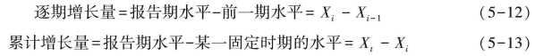
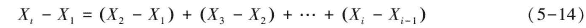

*   **年距增长量**（消除季节性）：`Xₜ - Xₜ₋₁₂`（同月比）。

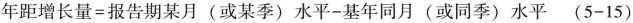

> 正值=增长，负值=下降，单位同原数据，亦称“增减量”。

#### 4. 平均增长量：单位时间的平均绝对增幅
一定期内平均每期增减的绝对数，通常用简单算术平均：

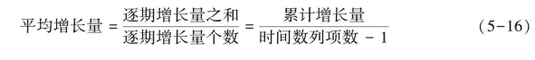

---

### (二) 反映“速度”的指标：跑得多快、加速多少

速度指标均为**相对数**（倍数或百分比），描述变化程度。

#### 1. 发展速度：水平对比的相对值
报告期水平 ÷ 基期水平。说明“报告期是基期的几倍”。
*   **环比发展速度**：连着比（比上期），反映逐期波动。
*   **定基发展速度**：盯着比（比固定基期），反映长期总速度。

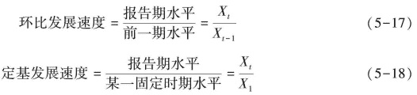

**两者换算关系：**
*   环比速度连乘 = 定基速度。
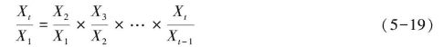
*   相邻定基速度相除 = 环比速度。
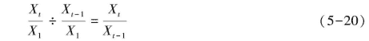

#### 2. 增长速度：增量对基期的相对值
增长速度 = 发展速度 - 1。
*   发展速度 > 1 → 正增长；< 1 → 负增长（下降）。
*   同理分**环比增长速度**、**定基增长速度**。

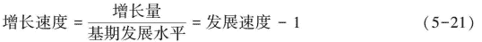
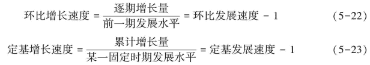

*   **同比/年距增长速度**（消除季节）：年距发展速度 - 1。

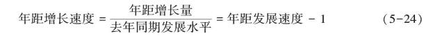

#### 3. 平均发展速度与平均增长速度：长周期的“巡航速度”
*   **平均发展速度**：各期**环比发展速度的几何平均数**（水平法/几何平均法），反映平均每期按何倍数递增。
*   **平均增长速度**：平均发展速度 - 1，反映平均每期增长率（非算术平均）。

**水平法/几何平均法公式**：
用期末水平 ÷ 期初水平，再开 `(n-1)` 次方。

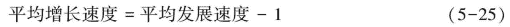
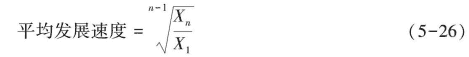

---

**结语**：掌握概率论基石、聚类三大流派、时间序列双指标体系，即掌握了从“不确定性推理”到“无标签结构发现”再到“动态趋势预判”的数据分析核心三板斧。

# 水平法短板解析：为何两点式计算难掩中间波动？

水平法仅凭期首、期末两个节点数值推算，核心聚焦终点发展水平，却对中间过程的起伏“视而不见”。因此，若要用它求平均发展速度，必须先剖析间隔期内各阶段的经济运行实况。一旦中间环节忽高忽低，或期末数值因特殊因素严重失真，该法算出的平均速度便失去了代表性。

# 二、 时间序列拆解与预测实战体系

动态数据（即时间数列）通常由长期趋势、季节变动、循环变动、随机变动四大要素交织构成。

*   **长期趋势**：反映现象在漫长周期内，受稳定因素驱动呈现的持续升降方向。
*   **季节变动**：受季节因素制约，在固定周期（通常短于一年）内规律性波动，如零售额随季节更替起伏。
*   **循环变动**：虽也属周期性波动，但周期非固定且跨度较长，表现为涨落交替而非单向延伸，经济周期即典型代表。
*   **随机变动**：剔除上述三者后的残留，源于突发偶发因素，无规律可循。仅含此成分的序列称作平稳序列。

实际序列可能由单一要素构成，亦可能多因素叠加。分析的首要任务，是识别这四类因素的组合形态与相互作用机制，并用数学模型量化其与数列的关系，形成**影响因素分解模型**。

预测动态数列需先确认序列成分，筛选适配模型并评估优劣，最终敲定最优方案。衡量预测优劣的核心指标是预测误差（预测值与实测值之差），最常用的评估工具为均方误差（`MSE`），其值越小，预测精度越高。计算公式如下：

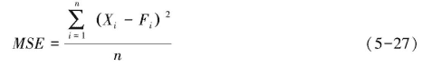

式中 `Xi`、`Fi` 分别代表原始实测值与预测值。

接下来重点解析**平滑法**，该法适用于仅含随机成分的平稳序列。通过移动平均等手段对序列“去噪平滑”，剔除随机扰动，从而捕捉趋势，既可服务短期预测，也可用于趋势描述。主流手段包括移动平均法与指数平滑法。

## (一) 移动平均法：滑动窗口去噪

该法通过逐期递移扩大时距，计算扩展窗口内的平均值生成新序列。新序列中短期偶然因素干扰被削弱甚至消除，从而凸显基本发展趋势。

操作上，选定移动间隔 `k` (`1＜k＜t`)，对序列逐期滑动取平均，作为下一期预测值。`t+1` 期预测公式为：

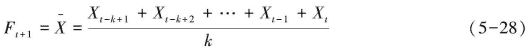

**特点**：等权重对待窗口内各观测值；仅利用近期 `k` 期数据；窗口长度固定。适合平稳序列。同一序列不同步长精度各异，可通过试错法寻找使 `MSE` 最小的最优步长。

## (二) 指数平滑法：历史数据加权递减

移动平均法弃用历史远期数据，且采用等权算术平均。若能纳入全量历史数据，并按时间远近赋予递减权重，或能提升效果。指数平滑法应运而生。

其核心为加权平均：时间越久远，权重呈指数级衰减。以第 `S1` 期为例，预测值由前一期预测值与实测值加权得出：

初始无首期预测值 `F`，常令其等于首期实测值：

后续推导如下：
第二期：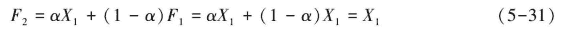
第三期：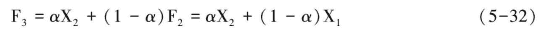
第四期：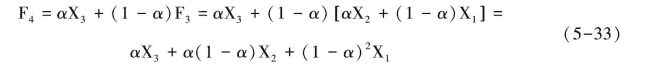

推演可见，随预测期推进，公式中指数项持续增大。

**平滑系数 `a` 选择策略**：序列随机波动大时，宜取较大 `a` 以快速跟踪变化；序列平稳时，宜取较小 `a`。亦可结合 `MSE`，多备选 `a` 实测比对，选误差最小者。

# 三、 预测模型深度研究与落地应用

## (一) 预测模型基石理论

### 1. 预测方法谱系

按范围分：宏观预测（国民经济/区域/部门）与微观预测（单一经济单位）；按期限分：长/中/短期预测；按结果性质分：定性与定量预测。

*   **定性预测**：依据事物性质、特点及历史现状，做非量化分析判断趋势。高度依赖经验与主观判断。优势：简便、快、历史久。适用于缺数据、难建模、环境剧变场景。常用法：用户/员工意见法、专家会议、德尔菲法、类比法等。存片面性、精度不足短板，常作定量辅助。
*   **定量预测**：基于历史统计数据，借数学模型进行量化分析，亦称客观预测。

### 2. 预测通用流程六步走

1.  **定目标、定期限**：明确预测对象与时间跨度。
2.  **调研集数、去伪存真**：以目标为核心收集详实可靠资料，剔除虚假及低关联数据。
3.  **选模型、多路径并行**：调研主流理论模型，按目的与数据条件选法；多法并行预测，分别做合理性复核。
4.  **搭平台、落地实现**：依理论选库选语言，构建模型系统。
5.  **评结果、优中选优**：考核达标与否，模型相关检验，比对精度拟合度，择优录取。
6.  **动态更新、迭代升级**：引入最新管理经动态与数据，重调模型提精度。

## (二) 回归分析预测模型详解

### 1. 一元线性回归模型

处理自变量 `x` 与因变量 `y` 线性相关的最简模型，是通晓回归理论、建模思想与应用的入门基石。

**(1) 模型表达**  
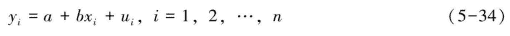

**(2) 建模与检验**  
**① 参数最小二乘估计**：`yi` 估计值  与实测差为残差 `li`，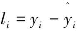。以残差平方和最小为准则估计参数 `a`、`b`：  
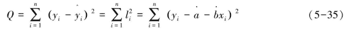

**② 相关性检验**：一元回归常用相关系数 `R` 量化 `x`、`y` 线性关联紧密度。  
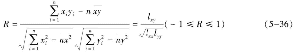

### 2. 多元线性回归模型

在一元假设基础上，额外要求自变量间线性无关。抽取 `n` 组样本即可估参。

**(1) 模型表达**  
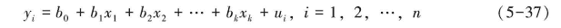

**(2) 建模与检验**  
**① 最小二乘估计**：样本回归模型 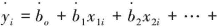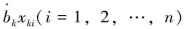。求参数估计量 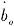、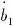、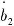、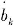。残差平方和 `Q`：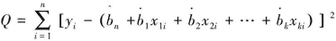 求最小。  
偏导整理为矩阵形式：  
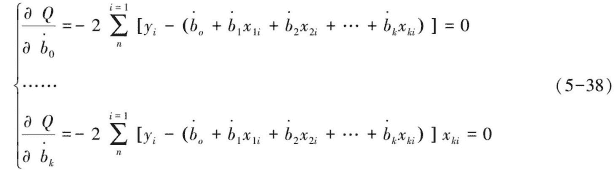 → 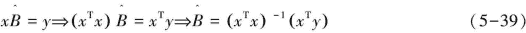

**② 模型检验体系**  
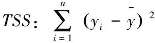：总离差平方和（观测值偏离均值）。  
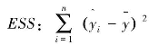：回归平方和（自变量变动解释部分）。  
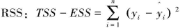：残差平方和（不可控随机干扰部分）。

**(3) 回归方程实战预测**  
**① 点估计**：方程通过检验后，代入给定解释变量 `X0`，得点预测值：  
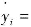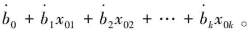

**② 区间估计**：量化风险、给出置信度。在显著性水平下求置信区间，即寻正实数 `δ` 使实测值 `y0` 以 `1-α` 概率落入 `(y0-δ, y0+δ)`。满足 `P(y0-δ, y0+δ)=1-α`。其中  
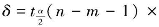

### (三) 趋势外推预测模型

**核心逻辑**：事物演进多为渐进非跃迁；历史驱动因素延续主导未来；变化幅度有限。据此外推未来趋势。

**建模六步法**：选参数 → 收数据 → 拟合线 → 趋势外推 → 写说明 → 研应用。

**主流模型**：皮尔、龚珀兹、林德诺及各类生长/包络曲线。

**皮尔曲线**擅描技术增长与新品扩散（如耐用品普及、爆款累计销量、孤岛种群增长）。数学模型：  

**参数求解路径**：  
1. 三次样条插值将非等时距序列转等时距。  
2. 等时序列三等分：第1段 `t=1..r`，第2段 `t=r+1..2r`，第3段 `t=2r+1..3r`。  
3. 设三段数值倒数和为 `S1`、`S2`、`S3`，则：  
  
模型倒数化：  
  
得参数解：  

# 第四节 数据关联分析：挖掘隐性关联规则

### 一、 关联分析界定

关联规则揭示数据项间隐含关系：事务中某些项出现推导出其他项同现。属无监督学习。生活应用广泛，如超市购物篮分析挖掘“啤酒与尿布”经典关联。

#### (一) 关联规则形式化定义

项集 `I={I1, I2, ..., Im}`。规则形如 `X→Y`，`X,Y⊆I` 且 `X∩Y=∅`。

#### (二) 四大核心指标

设事务集为 `W`。

1.  **置信度**  
    支持 `A` 的事务中，同时支持 `B` 的占比 `c%`，即 `P(B|A)`。  
    *例*：买啤酒者中 50% 买尿布 → 置信度 50%。

2.  **支持度**  
    同时支持 `A` 和 `B` 的事务占总事务比 `s%`，即 `P(A∩B)`。  
    *例*：100 顾客中 15 人同买啤酒尿布 → 支持度 15%。

3.  **期望置信度**  
    单纯支持 `B` 的事务占比 `e%`，即 `P(B)`。  
    *例*：100 顾客中 25 人买尿布 → 期望置信度 25%。

4.  **提升度**  
    置信度 / 期望置信度。量化 `A` 出现对 `B` 出现概率的提升倍数。  
    *例*：50% / 25% = 2。

#### (三) 关联规则挖掘任务定义

给定交易集 `T`，找出支持度 ≥ 最小支持度、置信度 ≥ 最小置信度的所有规则。

穷举法复杂度 `O(2^n)`（`n` 为项数），超市万级商品下指数爆炸不可行。**高效挖掘是核心难题**。

**两阶段法**：
1.  **生成频繁项集**：扫掘满足最小支持度的所有项集。
2.  **生成强规则**：频繁项集基础上，筛选满足最小置信度的规则。

*注*：`{啤酒→尿布}` 与 `{尿布→啤酒}` 支持度同等于 `{啤酒,尿布}` 项集支持度。

### 二、 Apriori 算法

# 关联规则挖掘与数据可视化核心技术解析

`Apriori`算法的核心任务是从海量数据中捕捉高频项集。为提升挖掘效率，其关键策略在于尽早剔除那些不可能满足频繁性条件的候选集。在实际落地关联规则分析时，拥有充足的历史数据积累是前提，挖掘出的潜在规则随后可用于业务预测。

### 三、FP-Tree 算法

`FP-Tree`同样致力于频繁项集挖掘，其巧妙之处在于引入三大数据结构协同存储中间结果：首先是**项头表**，汇总所有满足最小支持度的1-项集（频繁1-项集）及其出现计数，并按计数降序排列；其次是**FP树**，将原始事务数据压缩映射为树形结构驻留内存；最后是**节点链表**，串联起项头表中每个频繁项在FP树内所有出现位置的节点。

算法执行流程分五步走：

1.  **首扫建表**：遍历数据库统计1-项集支持度，过滤低频项，余下项按支持度降序入驻项头表。
2.  **二扫排序**：再次遍历数据库，逐条事务剔除非频繁项，并按项头表顺序重排，生成有序事务集。
3.  **构建FP树**：顺序读入有序事务集插入树中。节点由“项+计数”组成，事务中排序靠前的项作祖先，靠后的作子孙；共享祖先节点计数累加。新节点生成时，项头表通过节点链表即时链接。全量插入完毕，FP树落成。
4.  **递归挖掘**：自项头表底部向上，以各项为后缀，定位其条件模式基，在此基础上递归构建条件FP树，挖掘所有包含该后缀的频繁项集。
5.  **结果筛选**：若无项数限制，输出步骤四全部结果；否则仅保留满足长度约束的频繁项集。

---

## 第五节　数据可视化技术

数据可视化是研究数据视觉表达的学科，其核心在于将抽象信息（含属性与变量）转化为图形符号，以清晰高效地传达洞见。优秀的可视化要求美学形式与功能性深度耦合，通过直观手段穿透繁杂数据迷雾，直击关键信息。

设计体系可拆解为四个级联层级：**问题刻画层**（锚定真实用户痛点）、**抽象层**（将领域任务/数据映射为通用模型）、**编码层**（设计视觉通道与交互）、**算法层**（实现系统落地）。层层嵌套，上游输出驱动下游输入。

### 一、数据可视化的类型划分

依据处理对象差异，可视化分为两大主流：**科学可视化**聚焦带空间几何属性的结构化数据（如三维场测量）；**信息可视化**攻克无空间坐标的抽象非结构化数据（如金融流水、社交网络、文本）。前者核心是几何拓扑特征的有效呈现，后者难点是高维大规模数据下的视觉混淆消解。两者融合数据分析，催生出**可视分析学**——可视化的第三大支柱。

#### (一)科学可视化

植根于计算机图形学，广泛服务于物理、化学、气象、航天、医学、生物等自然科学领域，助力科研人员解读模型、发现模式与异常。理论体系相对成熟。早期聚焦三维时空物理化学现象，数据按张量阶数分为标量场（温度、密度）、向量场（风场、力场）、张量场（应力、扩散），可视化技术随之划分为三大类。

#### (二)信息可视化

处理对象为无固有空间位置的抽象数据（文本、层级、网络、软件结构等）。渊源统计图形学，融合信息图形与视觉设计，主要呈现在二维平面。核心挑战：有限画布如何高密度、低干扰地编码海量高维抽象信息。布局策略需由具体分析任务驱动定制。

#### (三)可视分析学

定义为“以可视交互界面为媒的分析推理科学”。它将图形学、数据挖掘、人机交互熔铸一体，通过可视交互通道，将人的感知认知优势注入数据处理全链路，实现人机智能优势互补，构建螺旋式知识提炼闭环，支撑高质量决策。

其学科交叉矩阵极广：可视化侧涵盖科可视、信可视、计算机图形学；分析侧覆盖信息获取、数据处理、挖掘、统计、知识发现；交互侧融合人机交互、认知科学、感知心理学。全流程中，人机交互贯穿模型构建、推理分析、信息呈现各环节，最终成果需有效表达、作业与传播。

### 二、数据可视化的核心流程

大数据时代，可视化显著提升信息挖掘效率与决策精度。科可视与信可视均建立了参考流程架构；可视分析流水线则以**数据**为入口，**知识**为出口，提供双通道：**交互可视化路径**（人在回路）与**自动挖掘路径**（模型在回路）。两路中间产物分别为可视化视图与数据模型，用户可交互修正视图或调参优化模型。流程三大核心支柱：

#### (一)数据表示与转换

基石环节。原始数据须转为计算机友好的结构化表达，同时最大程度保留信息内涵与上下文。海量数据下，可伸缩、可扩展的表示方法是关键。异构多源数据融合为统一视图，助力分析师聚焦数据本质，亦是研究热点。

#### (二)数据的可视化呈现

将数据映射为直观、可操作的视觉形式。同一数据集往往存在多种视觉编码方案。核心难题：在庞大的设计空间中选取最优编码。判据三维——感知认知特性、数据固有属性、分析任务目标。

实时流式数据常态化，静态可视化方法难以直接迁移。动态可视化要求时间连贯性与实时计算性能，倒逼算法创新、算力升级（分布式/云计算）、显示增强（亿级像素/大屏拼接）与交互革新（体感/可穿戴）。

#### (三)用户交互

可视化分析的终极目的是解决任务。通用任务归为三类：**生成假设**、**验证假设**、**视觉呈现**。可视化既支持探索发现新假设，也支撑假设校验，更助力专家向大众传播洞见。交互是辅助分析决策的直接驱动力。

尽管人机交互研究由来已久，但面向海量数据、支持决策的智能交互技术（如任务导向、假设驱动）仍属未解难题。挑战跨越底层硬件交互方式、复杂交互范式流程，以及多显示环境、多任务下的可扩展性瓶颈。

### 三、可视化中的数据与图表

#### (一)可视化中的数据

认知链路：**数据模型**（底层存储与操作，如浮点数组、分类字符）→ **概念模型**（高层语义定义，赋予业务含义，如“气温序列”）→ **实际语义**（具体应用场景意义）。

分类视角多元：按数据模型分数值/字符/布尔；按概念模型分实体对象（车辆类型）；科学计算常依测量标度分四类：**名义/分类型**、**有序/顺序型**、**区间/等距型**、**比率/绝对零点型**。

#### (二)可视化中的图表

统计图表是可视化基石，仍是复杂系统不可或缺的原子组件。

1.  **柱状图**：用矩形长度/高度编码数值，对比两组以上数据（不同时点/条件），单变量，适合中小规模数据。可横向、多维扩展。
2.  **直方图**：单变量频率分布可视化。横轴为取值分箱，纵轴为频数/频率。揭示分布形态、离群点、峰态。**核心区别**：直方图面积和归一化为1（概率密度），柱状图无此约束。
3.  **饼图**：以“饼”隐喻整体，扇区面积编码占比。环状树图等高级图表的雏形。

### 四、可视化中的交互技术

#### (一)交互技术的主要作用

视觉呈现与用户交互是可视化系统双引擎。静态图像/视频虽辅助理解，但面对大规模复杂数据效力有限：屏幕像素有限、二维平面难承载高维结构。交互破局于二维：

1.  **空间矛盾缓解**：通过缩平旋、动态查询等手段，在有限物理空间内虚拟化无限信息空间。
2.  **深度参与赋能**：可视分析不预设结论，而提供探索平台。交互让用户从旁观者变为驾驭者，主导假设生成、验证、知识提炼全程。

视图与交互实战中密不可分，多数交互技术专为特定视图定制。下文梳理主流交互任务类型。

#### (二)交互技术的任务类型

系统设计视角出发，按用户任务分类，涵盖七大核心类别：

1.  **选择**：在纷繁视图中标记关注对象，支持追踪与定位。
2.  **导航**：大空间数据下的核心手段。通过**缩放、平移、旋转**三基操，任意检索空间位置，切换视野信息。
3.  **重配**：提供多视角观察。重组布局、重新排序，消除空间距离导致的视觉关联衰减。
4.  **编码**：动态切换视觉通道（颜色、大小、形状、方向、字体）或图表类型，重塑视觉外观，深化认知。
5.  **抽象/具象**：控制信息粒度层级。**概览优先，缩放细节**（上卷下钻）是典型范式，支持多层级浏览。
6.  **过滤**：以约束条件/关键词动态实时筛选，结果随输入即时刷新，极大提升检索效率。
7.  **关联**：高亮跨视图/跨数据的关联链接。同一数据多视图异表达，或异数据同视图同表达，支撑多角度对照分析。

交互分类法不一，实践中按项目依据与适用场景灵活选型组合。

---

# 五、数据可视化的实现工具

可视化旨在借助图形化手段清晰传达信息，将数据属性映射为多维视觉通道，支持多维洞察与深度分析。主流工具介绍如下。

## (一) ECharts

`ECharts`是基于`JavaScript`的开源可视化库，跨端（PC/移动）流畅运行，提供直观、交互丰富、高度可定制的图表方案。

**图表生态极丰**：常规统计图（折线/柱状/散点/饼/K线/盒形）、地理可视化（地图/热力/线图）、关系可视化（关系图/矩形树图/旭日图）、多维分析（平行坐标）、BI组件（漏斗/仪表盘）。支持图表混搭叠加。更提供**自定义系列**：仅需传入`renderItem`函数，即可将数据任意映射为自定义图形，且无缝复用现有交互组件。

### 1. 适用场景
*   业务/大数据系统后端计算完成后的结果前端展现。
*   Web页面原生`HTML`+`JS`嵌入式集成。
*   依托丰富官方示例与文档快速上手。

### 2. 使用入门三步走
1.  **获取库文件**：官网按需打包下载（源码版含调试提示）、GitHub Release `dist` 目录、或 CDN（cdnjs / jsDelivr / BootCDN）直链引入。
2.  **引入初始化**：标准`<script>`标签加载，同普通JS库无异。
3.  **绘制首图**：
    *   准备具备宽高的DOM容器。
    *   `echarts.init(container)` 实例化 → `setOption(option)` 驱动渲染（如简单柱状图）。

## (二) Plotly

`Plotly`是极具影响力的开源可视化框架，以浏览器原生`Web`交互图表为呈现载体，可构建数十种精美图表与地图，提供`JavaScript`、`Python`、`R`、`Julia`等多语言绑定。下文以 **Python + Jupyter Notebook** 为例详解基础用法。

### 1. Plotly 绘图对象图谱

核心绘图模块（Trace 类型）覆盖主流可视化需求：
*   极坐标系：`Angularaxis`
*   区域填充：`Area`
*   条形/柱状：`Bar`
*   统计分布：`Box`（箱线图）
*   金融专用：`Candlestick` / `OHLC`（K线与开高低收）
*   色标映射：`Color-Bar`
*   等值线/轮廓：`Contour`
*   基础曲线：`Line`
*   矩阵热力：`Heatmap`
*   ……（另有散点、饼图、3D曲面、地图等大量类型）

# Plotly 离线绘图与图形对象构建指南

Plotly 提供在线与离线两种绘图模式。在线模式要求注册账号并配置 API Key，流程相对繁琐。相比之下，离线绘图更为便捷，主要通过 `plotly.offline.plot()` 与 `plotly.offline.iplot()` 两个函数实现。前者会在当前工作目录生成 HTML 文件并自动在浏览器打开；后者专为 Jupyter Notebook 环境设计，能将图表直接嵌入 `.ipynb` 文档中。本文采用后者进行演示。

## `plotly.offline.iplot()` 核心参数详解

1.  **`figure_or_data`**: 接收 `plotly.graph_objs.Figure`、`plotly.graph_objs.Data` 对象，或能描述图表结构的字典、列表。
2.  **`show_link`** (布尔值): 控制图表右下角是否显示 Plotly 官方链接标识。
3.  **`link_text`** (字符串): 当 `show_link=True` 时生效，用于自定义右下角链接的提示文字，默认显示 "Export to plot.ly"。
4.  **`image`** (字符串或 None): 指定图表导出下载的格式，可选 `png`、`jpeg`、`svg`、`webp`；默认为 `None`，即不提供下载功能。
5.  **`filename`** (字符串): 设置保存文件的名称，默认为 "plot"。
6.  **`image_height`** (整数): 定义图表高度（像素），默认 600。
7.  **`image_width`** (整数): 定义图表宽度（像素）。

## 2. 定义 Graph 对象

`plotly.graph_objs` 模块集成了 Plotly 所有的图形构建组件。引入所需组件后，可结合业务数据与自定义配置参数实例化一个 `graph` 对象，最后将其传入 `plotly.offline.iplot()` 完成渲染。

## 3. 构建 Traces (轨迹/数据系列)

导入对应的图形对象后，核心步骤是根据可视化需求，为指定对象配置数据参数。这一过程在 Plotly 中称为构建 **Traces**。单张图表支持叠加多个 Trace，实现多系列数据对比或混合图表效果。

---

## 思考与练习

1.  基于分类结果，分类分析可细分为哪几类？
2.  聚类分析中，划分簇群的常用方法有哪些？
3.  数据可视化主要包含哪些呈现形式？

---

## 参考文献

[1] 吴梦云, 蒋浩宇, 冯士倩. 多源高维数据的多分类纵向整合分析及应用[J]. 统计研究, 2021, 38(8): 132.
[2] 王国燕, 汤书昆. 传播学视角下的科学可视化研究[J]. 科普研究, 2013(6): 20.
[3] 温丽梅, 梁国豪, 韦统边, 等. 数据可视化研究[J]. 信息技术与信息化, 2022(5): 164.

---

# 第六章　人工智能技术基础

## 第一节　概念与知识表示

### 一、概念表示

对人工智能而言，知识是核心资产，而概念则是构建知识大厦的基石。概念是人类认知世界、交流思想、传递信息的基本单元。缺失特定概念，思想表达将举步维艰甚至无从谈起。精准运用概念是人类的核心认知能力之一。既然知识本身也是一种概念，那么准确表达概念便成为了知识表示的前置条件。

要表示概念，首要任务是给出精准定义。漫长历史中，人类始终在探索概念的定义之道。1953 年以前，主流观点认为一切概念皆可精确定义，所谓无法定义仅因研究不足。这被称为**概念经典理论**。1953 年，维特根斯坦《哲学研究》出版，打破了这一教条：并非所有概念都能被精确界定（如日常生活中的“猫”、“狗”）。这一转折催生了原型理论、样例理论与知识理论等现代认知流派。

#### (一) 经典概念理论

经典定义的核心在于给出一个命题（陈述句），使“隶属于某概念”成为一个非真即假的二值判断。一个经典概念包含三要素：**概念名**、**内涵表示**、**外延表示**。

*   **概念名**：语言符号层面的标签，属于符号/认知世界。
*   **内涵表示**：用命题刻画概念本质属性，反映主观认知，属于心智世界。
*   **外延表示**：满足内涵条件的所有实例构成的经典集合，客观可观测。

经典概念多见于科学领域。例如：
*   **偶数**：内涵为“能被 2 整除的自然数”，外延为 {0, 2, 4, 6...}。
*   **英文字母**：内涵为“英语单词使用的字母符号”，外延为 {a, b, c... z}。

经典概念因其边界清晰，既可用数理逻辑处理内涵，也可用集合论处理外延，在科研与生活中极具价值。

#### (二) 概念的现代表示理论

现实中，诸如“人”、“勺子”、“美”、“丑”等日常概念，难以用单一命题定义，也难以枚举全体实例构成经典集合。**“秃子悖论”**揭示了这一困境：若“秃子”是经典概念，从“无发是秃子”推导“多一根发仍是秃子”，经 10 万次推理后会得出“满头发也是秃子”的荒谬结论。

维特根斯坦通过剖析“游戏”概念，质疑了“所有概念皆有经典内涵表示”的假设。现代认知科学支持此观点：生活实用概念未必存在经典命题定义。但这不妨碍人们熟练使用这些概念。为此，认知科学家提出了新理论：

1.  **原型理论**：概念由一个“最理想代表”（原型）表征。原型可以是实例、虚拟对象或图示。隶属度不再是 0/1，而是基于与原型的相似度连续变化。如“鸟”的原型是麻雀/燕子（会飞、有羽），而鸵鸟/企鹅虽属鸟类但非典型原型。扎德据此提出**模糊集合**（隶属度为 [0,1] 实数）及**模糊逻辑**，解决了秃子悖论。
2.  **样例理论**：概念无单一原型，而是由一组已知样例表征。儿童仅接触有限样例即能识别“人”，无需形成原型。识别新事物时，判断其更像哪个概念的已知样例集。样例表示形式包括：全体已知样例、最佳/典型样例、筛选后的部分样例。
3.  **知识理论**：概念嵌入特定知识框架（文明/文化）中，无法独立存在。颜色概念跨文化差异即佐证。认知科学假设概念在心智中以**认知表示**形式存在（属于内涵表示），具体形式因概念而异（命题、原型、样例、知识或其他），需具体问题具体分析。

### 二、知识表示

人工智能学科的研究对象即知识，涵盖概念、表示、组织、获取、应用等全链路。为便于机器处理，知识需采用**形式化、规范化**的方式描述，即知识表示。其内容覆盖事实、规则、控制性知识，甚至形成知识模型。

主流表示方法包括：**产生式表示法、谓词逻辑表示法、状态空间表示法、知识图谱表示法**。

#### (一) 产生式表示法

利用类文法规则对符号串进行替换，模拟人类解题思维。这是 AI 中最常用的表示法，要求掌握其形式化建模方法。知识由**事实**（静态描述）与**规则**（动态因果联系）构成。

##### 1. 知识组成要素

*   **事实表示**：
    *   *对象性质*：三元组 `(对象, 属性, 值)`，如 `(牡丹花, 颜色, 红)`。
    *   *对象关系*：三元组 `(关系, 对象1, 对象2)`，如 `(父子, 王龙, 王晨)`。
    *   事实集合构成**综合数据库**。
*   **规则表示**：形式为 `If P then Q`。`P` 为前件（触发条件），`Q` 为后件（行动/结论）。满足 `P` 即可推导出 `Q`。规则集合构成**规则库**。

##### 2. 知识分层对应

1.  对象层 $\rightarrow$ 知识中的对象
2.  事实层 $\rightarrow$ 知识中的事实
3.  操作/规则层 $\rightarrow$ 知识中的规则
4.  约束设置层 $\rightarrow$ 元知识

##### 3. 优劣势评价

**优点**：
*   **完整性**：可覆盖对象、事实、规则、部分元知识四层；主表示确定性知识，兼顾非确定性。
*   **简易性**：表示直观，易学易用。

**不足**：
*   **表达力受限**：难以表达嵌套、递归、多规则组合等复杂知识结构。
*   **推理局限**：仅支持演绎规则，无法表达归纳规则。

#### (二) 谓词逻辑表示法

基于数理逻辑符号系统，是典型的**符号主义**表示法，能完整覆盖对象、事实、规则、元知识。

##### 1. 六大核心概念

1.  **个体**：客观世界基本单位（如自然数 1、2、张三、李四），用 `a,b,c` 或 `x,y,z` 表示。分常量与变量，变量取值范围称个体域。
2.  **函数与项**：个体间的映射转换（`y=f(x)`）。个体及函数生成的个体统称**项**。
3.  **谓词**：描述个体间关系或性质（如 `P(x,y)` 表兄弟关系）。取值为真(T)或假(F)。按个体数分一元(性质)、二元(关系)、n元谓词。
4.  **量词**：界定谓词在个体域上的真值分布。
    *   **存在量词** $\exists x P(x)$：域中至少一个个体使谓词为真。
    *   **全称量词** $\forall x P(x)$：域中所有个体使谓词为真。
5.  **命题**：可判真假的语句（用 `P,Q,R` 表示），谓词及带量词谓词皆为命题。
6.  **命题联结词**：构建复合命题的 5 种运算符：
    *   合取 $\land$ (并且)
    *   析取 $\lor$ (或者)
    *   否定 $\lnot$ (非)
    *   蕴含 $\to$ (若...则...)
    *   等价 $\leftrightarrow$ (当且仅当)

##### 2. 谓词逻辑合式公式 (WFF) 构造规则

*   **原子公式**：谓词应用于项 `P(t1...tn)`，或单个命题 `R`。
*   **递归构造**：
    1.  原子公式是 WFF。
    2.  若 `A,B` 是 WFF，则 `(\lnot A)`、`(A\lor B)`、`(A\land B)`、`(A\to B)`、`(A\leftrightarrow B)` 是 WFF。
    3.  若 `A` 是 WFF，`x` 是个体变量，则 `(\forall x A)`、`(\exists x A)` 是 WFF。
    4.  仅由有限次上述步骤生成的为 WFF。
*   *注*：括号可按优先级省略；量词辖域仅含单一原子公式时括号可省，否则保留。

##### 3. 谓词逻辑公式的解释
[PRE*]（此处标记保留，后续内容待续）

# 谓词逻辑：从形式定义到知识表示的桥梁

在谓词逻辑体系里，公式本质上只是一串符号，唯有赋予具体“解释”才能焕发生命力。所谓解释，就是为逻辑符号搭建现实映射：划定个体域 $D$，让个体变量在其中游走；指派个体常量落座具体实体；将 $n$ 元函数 $f$ 对应为 $D^n \to D$ 的确定映射；命题符号 $R$ 取值于 $\{F, T\}$；$m$ 元谓词 $P$ 则对应 $D^m \to \{F, T\}$ 的映射。经此诠释，公式才有了确定的真假值与现实意义。

## 4. 永真公式：跨越解释的真理

公式经解释固化为命题后，我们便可探讨其在“所有可能世界”下的表现，由此引出永真性层级：

*   **可满足性（定义 3）**：存在至少一种解释及赋值，让公式 $A$ 为真。
*   **永真性（定义 4）**：在**一切**解释与**一切**赋值下，公式 $A$ 恒为真。这才是逻辑意义上的“铁律”。
*   **永假性（定义 5）**：在所有解释与赋值下，公式 $A$ 恒为假，即矛盾式。

## 5. 谓词逻辑如何承载知识

谓词逻辑不仅是形式系统，更是知识表示的利器，可分两大维度：

1.  **事实性知识（静态快照）**：借助带解释的公式，精准刻画个体属性（一元谓词）与个体间关系（多元谓词），构建静态的世界模型。
2.  **规则性知识（动态推演）**：
    *   **常识性规则**：源自亚里士多德形式逻辑的 18 条基本推理规则，属演绎逻辑核心，放之四海而皆准。
    *   **领域性规则**：基于特定场景下可满足公式（局部为真）提炼的推理模式，服务于垂直领域。

## 6. 评价：严谨完备，但非万能钥匙

**优势：**
*   **体系完整**：覆盖知识体系四要素——对象（个体/项）、事实（公式）、规则（推理规则）、元知识（部分），兼容常识与领域知识。
*   **形式严密**：数学化符号体系保证逻辑零漏洞，便于机器处理、验证与自动推理。

**短板：**
*   **只认“确定性”**：无法表达“可能”、“大概率”等非确定性知识（如模糊、概率认知）。
*   **只走“演绎路”**：局限于演绎推理，无法原生支持归纳、类比、溯因等非常规推理模式。

---

# 状态空间法：把解题变成“走迷宫”

状态空间表示法是 AI 早期经典的问题求解范式，核心隐喻：**在状态图中寻找从起点到终点的路径**。

## 1. 核心三要素

*   **状态（事实层）**：$S = \{S_0, S_1, ..., S_n\}$，由 $n$ 个状态变量（分量）确定一个快照。受约束条件限制。
*   **操作/算符（规则层）**：状态间的动态迁移动作。有前置条件，作用于状态改变分量值，实现 $S_i \to S_j$。本质是状态间的关联。
*   **状态空间（模型层）**：三元组 $(S, F, G)$。
    *   $S$：初始状态集
    *   $F$：操作集（迁移函数）
    *   $G \subseteq S$：目标状态集（非空）
    *   *等价视角*：带权有向图（状态空间图），节点=状态，弧=操作，整体=知识模型。

## 2. 五层映射：对标知识体系

| 空间层级 | 知识体系对应项 | 说明 |
| :--- | :--- | :--- |
| 1. 状态分量 | **对象** | 基本构件 |
| 2. 状态 | **事实** | 对象组合快照 |
| 3. 操作 | **规则** | 动态变换逻辑 |
| 4. 约束 | **元知识** | 限定有效状态/操作的元规则 |
| 5. 状态空间整体 | **知识模型** | 完整问题求解空间 |

## 3. 评价：结构清晰，难负复杂重任

**长处：**
*   **四要素俱全**：对象、事实、规则、元知识均可映射，表示完整。
*   **上手极简**：概念直观（节点+边），工程实现门槛低，契合搜索策略（BFS/DFS/A*等）。

**痛点：**
*   **状态爆炸**：结构扁平，难以组织层级化、模块化的复杂知识，仅适合中小规模搜索问题。
*   **演绎单一**：规则本质仍是演绎迁移，缺乏归纳学习能力。

---

# 知识图谱：互联网时代的“实体关系网”

知识图谱（KG）是大数据与语义网融合的产物，**核心单元是“实体”，核心任务是“连接关系”**。

## 1. 核心语法：三元组与图

*   **实体**：现实世界可辨识的对象（如“某学生”）。
*   **属性（一元关系）**：实体-值关联，三元组 `(属性, 实体1, 实体2/值)`。例：`(颜色, 牡丹花, 红)`。
*   **关系（二元关系）**：实体-实体语义关联，三元组 `(关系, 实体1, 实体2)`。例：`(父子, 王龙, 王晨)`。
*   **图视角**：节点=实体（含属性），边=关系。每个实体有唯一 ID。属性本质上也是实体，通过关系连接。**KG = 万物互联的语义网络。**

## 2. 三层极简映射

| KG 层级 | 知识体系对应项 |
| :--- | :--- |
| 实体 | 个体/对象 |
| 属性 | 事实/性质 |
| 关系 | 规则/关联逻辑 |

> 注：KG 天然弱化了显式“元知识”层，约束多隐含于 Schema/Ontology 中。

## 3. 评价：生于网络，长于检索，短于深度推理

**杀手级优势：**
*   **极简建模**：仅“实体+关系”即可编织亿级知识网，天然适配分布式存储与并行计算。
*   **场景精准**：专为 Web 规模检索、推荐、问答设计，工具链成熟（Neo4j, JanusGraph, RDF/SPARQL 等），生态闭环完整。
*   **融合友好**：易于多源异构数据对齐融合（实体链接/对齐）。

**天生短板：**
*   **表达力上限低**：难以建模复杂逻辑（嵌套量词、模态、时序、因果链条）、规则链与约束。
*   **确定性陷阱**：标准 KG 存储的确是“事实三元组”，难表“不确定/概率/模糊”知识。
*   **元知识匮乏**：缺乏对“知识如何获取/验证/更新”的元级建模能力。

---

# 第二节 知识图谱与推理：从数据到知识的炼金术

21 世纪以来，互联网海量数据倒逼出 KG 这条**“低成本、大规模、半自动”**的知识生产线，重振知识工程与专家系统，成为新一代 AI 基建。

## 核心思想：数据语义化 + 图谱表示 = 自动化知识工厂

---

### (一) 知识获取四部曲

#### 1. 原料分级：网络数据三态
| 数据类型 | 网络形态 | 知识化难度 | 原因 |
| :--- | :--- | :--- | :--- |
| **结构化** | 关系数据库、结构化 Web | ⭐ 低 | 自带 Schema（模式/数据字典），语义显性 |
| **半结构化** | 灵活 Web 页面 (JSON/XML) | ⭐⭐ 中 | 结构松散，需视情况按结构化/非结构化处理 |
| **非结构化** | 文本、图像、语音、普通网页 | ⭐⭐⭐ 高 | 无显性结构，需 NLP 深度理解 |

#### 2. 两大先决条件
1.  **数据语义化**：裸数据（"18", "代代红"）$\xrightarrow{赋予语义}$ 知识（"代代红饮料价格 18元"）。
2.  **语义统一表示**：引入 KG 作为标准载体，简单且内涵丰富。

#### 3. 四大生产线（构建完整知识引擎）

| 方法 | 核心机制 | 典型案例/现状 | 角色定位 |
| :--- | :--- | :--- | :--- |
| **人工标注** | 专家/众包手工赋语义 | 维基百科早期 | 启动期基石，成本高、难规模化 |
| **自动抽取** | **主流**。NLP/ML (抽取、分类、聚类、关联) 从文本/库自动产出三元组 | 当前工业界主流管线 | **推理引擎主体** |
| **融合重组** | 对接现有开放 KG (Wikidata, DBpedia等) 抽取、对齐、补全、合成 | 维基百科为“种子库”，衍生出无数垂类 KG | **低成本扩容利器**，引擎重要组件 |
| **推理补全** | **辅助**。演绎推理 (用谓词逻辑规则) 从已知三元组推导新三元组 | 补全缺失链接、辅助问答/推荐 | **质量增强器** |

#### 4. 自动化管线深度解析（重中之重）

*   **结构化数据入图**：
    *   关系表实例 $\to$ 实体
    *   实例-属性值 $\to$ 一元关系 (属性)
    *   联系表实例 $\to$ 二元关系
    *   *数据字典直接充当 Schema/Ontology。*

*   **非结构化文本入图（NLP 三板斧）**：
    1.  **实体识别 (NER)**：词法/句法分析，找实体 mention。
    2.  **实体消歧/链接 (EL)**：聚类消歧，"特种兵" 是兵种还是饮料？映射至唯一 KB 实体 ID。
    3.  **关系抽取 (RE)**：分类关联，抽取属性与二元关系。

*   **半结构化数据**：按“结构化程度”动态选择上述模板法或 ML 法。

---

### (二) 知识图谱谱系大观：百花齐放的生态版图

KG 已成 AI 基础设施。按**性质**与**技术演进层次**双维分类：

#### 1. 按知识性质分（应用视角）
*   **通用百科类**：维基百科、百度百科……广覆盖、重实体。
*   **垂直领域类**：法律、金融、医疗……深专业、强 Schema。
*   **场景流程类**：贷款办理、签证流程……重过程、重状态迁移。
*   **语言语义类**：ConceptNet……重词义、跨语言对齐。
*   **常识知识类**：人类共识本体……重推理支撑。

#### 2. 按构建代际分（技术视角）
*   **L1 人工初代**：纯人工/众包（早期维基、Cyc 初期）。
*   **L2 融合二代**：以 L1 为种子，融合重组 + 人工/半自动增补 (DBpedia, YAGO, Freebase 早期)。
*   **L3 自动三代**：以 ML/NLP 自动化构建为主 (NELL, Knowledge Vault, 现代商业 KG)。

#### 3. 明星图谱名片集

| 图谱 | 定位/血统 | 规模/特色 | 关键词 |
| :--- | :--- | :--- | :--- |
| **Cyc** | 百科常识老祖 (1984~) | 50万实体/3万关系 (OpenCyc 24万/200万) | 谓词逻辑表示、人工起家、近年转自动、对接 Wiki/DBpedia |
| **ConceptNet** | 多语言语言谱 | 开放、跨语言词义网络 | 服务 NLU、常识推理 |
| **YAGO** | 德系语义巨头 | 挂接 Wikipedia + WordNet | 高精度、实体类型体系丰富 |
| **DBpedia** | 结构化维基提取版 | **95亿三元组、127语言** | 标准化 RDF、LOD 云核心节点 |
| **Freebase** | 维基+众包百科 (已停更/迁移) | 5813万实体、32亿三元组 | 早期商业 KG 标杆、MID 标识符体系 |
| **NELL** | CMU "永不停歇" 学习器 | 日读日学、半年 35万三元组 | **持续自动学习**、机器学习驱动、研发性强 |
| **Knowledge Vault** | Google 重器 (2014) | **16亿+ 三元组** | 融合 Freebase/YAGO 结构化数据、全自动 ML 抽取、商业级应用 |

---

# 知识图谱中的知识存储

[待续：存储引擎选型 (RDF vs LPG)、三元组索引策略、分布式分片、增量更新、向量化融合检索等工程化核心议题...]

# 知识图谱的底座：分布式图数据库全景解析

当下网络空间里，知识图谱遍地开花，它们的“家”都安在特定的数据库里。这类数据库有着鲜明的共性：都是建立在互联网多个节点之上的分布式架构，底层数据呈图结构分布。说到图结构的表达，主流无非两条路：一是经典的**三元组**（Subject-Predicate-Object），二是更直观的**属性图**模型（节点、边、属性）。

市面上主流的存储方案，主要集中在以下三大阵营：

### Freebase：开创者的谢幕

作为 Google 早期亲手打造的专用图数据库，Freebase 采用三元组结构存储。这种形式写入知识极其高效，堪称“存储利器”。但短板也明显——**查询检索性能疲软**。随着业务迭代，这块短板愈发掣肘，导致它逐渐退出主流舞台，鲜少见到新项目采用。

### Neo4j：查询王者的崛起

Neo4j 是开源阵营的扛鼎之作，它精准修补了 Freebase 的痛点。核心改良在于：引入**六元组**数据结构，并全面拥抱属性图模式。这一招让知识查询效率实现质变。配上一套成熟、强大的图查询语言，Neo4j 成为“以读为主、查询密集型”知识库的不二之选。不过，硬币有两面，它在**知识更新写入**上的表现相对乏力。

### NoSQL / HBase：大数据时代的全能选手

NoSQL 不是单一产品，而是一套面向大数据的通用数据库标准体系。它内置多种 AI 友好型数据结构，其中**图结构**与**键值结构**天然契合知识图谱的存储与应用场景。它还兼容三元组表形式，拥有完备的 DDL/DML/DCL 语言体系，操作效率高、适配面广。业界普遍看好：这类数据库极有可能进化为未来最具潜力的语义型数据库——**既是数据管理中枢，也是知识管理中枢**。基于此标准衍生出的产品已不少，HBase 便是典型代表。

---

# 知识图谱落地：从“存得下”到“用得好”

知识图谱早已跑通**知识检索、自动问答、智能推荐**三大核心赛道，且边界仍在外拓，比如决策支持系统等新领域。这些应用的组合，实际上构建起了**新一代专家系统**，是新一代人工智能的关键基建。

### 知识搜索：把“文档海”变成“答案库”

本质上，知识图谱是一个结构化知识库。用户抛出查询，搜索引擎在图谱中穿梭检索，直接返回答案而非网页链接。
> **实例**：输入“陆汝钤”，引擎定位该实体节点，秒级聚合并输出其相关属性、关系信息，而非扔给你一堆含该关键词的网页。

### 自动问答：推理出“精准答案”

这不再是简单匹配，而是利用实体间的**关系链路推理**。
> **实例**：问“代代红价格”。系统捕获实体“代代红”，匹配关系三元组`(饮料价格, 代代红, 18)`，经推理直接抛出结论：“代代红价格 18 元”。过程全程自动化，无需人工干预。

### 自动推荐：挖掘“隐性关联”

核心逻辑是**基于关系的扩散推荐**。以种子实体为起点，沿图谱边遍历关联节点，作为候选推荐。
> **实例**：用户关注饮料“代代红”，系统顺藤摸瓜找到同类关联实体——可口可乐、百事可乐、椰汁、雪碧等，组成推荐列表精准触达。

---

# 知识推理：给 AI 装上“逻辑大脑”

推理是演绎式获取知识的核心手段。它以已知知识为前提，反复套用规则，推导出新知识。这是人类日常思维与科研的基本范式，也是符号主义 AI 的基石。既然人类已看透自身演绎推理的形式规律，便可用数理逻辑（尤其是**谓词逻辑**）在机器上复刻“推理能力”。

## 谓词逻辑自然推理：三大经典范式

自然推理是谓词逻辑推理的标准形态，主流三种：**永真推理、假设推理、反证推理**。

### 永真推理：标准的“正向推演”

建立在**永真公式（公理/常识）**、**领域知识（已知条件）**与**推理规则**之上的正向链路。本质上就是谓词逻辑的**定理证明**。
证明过程是一个公式序列 $P_1, P_2, ..., P_n$，每一步 $P_i$ 必须源自五类来源之一：
1.  永真公式；
2.  已知条件；
3.  由前序 $P_k, P_r$ 经**分离规则**得出；
4.  由前序 $P_k$ 经**全称规则 (US, UG)** 得出；
5.  由前序 $P_k$ 经**存在规则 (ES, EG)** 得出。
终点 $P_n = Q$ 即为定理。全程需标注每步引用的规则。

### 假设推理：化繁为简的“条件证明”

针对目标定理为 $A \to B$ 形式的正向推理变体。核心技巧：**把前件 $A$ 暂时当作已知条件加入，目标缩减为只证 $B$**。
证明序列规则除增加“$P_i$ 可以是 $A$”外，其余同永真推理。终点 $P_n = B$ 即证成。此法**以增强已知换取目标简化**，大幅降低证明复杂度。

### 反证推理：归谬法的“逆向突围”

属于**反向推理**。将目标定理 $Q$ 的否定 $\neg Q$ 加入已知集，推演至**矛盾（永假式，记作 $\square$）**。
证明序列规则核心变化：允许 $P_i$ 为 $\neg Q$，终点 $P_n = \square$。若推得矛盾，原定理 $Q$ 成立。

### 假设反证推理：双剑合璧的“终极简化”

融合两者优势。目标为 $A \to B$ 时，**同时将 $A$ 与 $\neg B$ 加入已知**，直接推演至 $\square$。
证明序列允许 $P_i$ 为 $A$ 或 $\neg B$，终点 $P_n = \square$。实现**“全目标转已知，统一求矛盾”**，证明过程最精简。

---

## 谓词逻辑自动定理证明：从纸面走向机器

理论有了，但要让计算机跑起来，光有数学思想不够，还得要**规范化表示**与**标准化操作流程**。

### 关键一步：子句范式标准化
将任意谓词公式“洗”成机器可识别的标准形：
1.  转**前束范式**（量词前置 + 合取范式尾部）；
2.  用 **ES** 消存在量词；
3.  用 **US** 消全称量词；
4.  合取项转**蕴涵式**，即**子句**；
5.  整体公式表示为**子句集**。

### 核心引擎：归结原理

这是基于**反证法**的算法核心。
*   **逻辑内核**：已知子句集 $S$，待证定理 $E$。等价于证明 $S \cup \{\neg E\}$ 推导出 $\square$。
*   **基本定理**：

> 其中 $A_n = B_i (i < m)$。则必有公式为真：

*   **推论**：$\{P, \leftarrow; \leftarrow, P\}$ 可得空子句 $\square$。
*   **实操逻辑（反驳法）**：
    1.  构造 $S' = S \cup \{\neg E\}$；
    2.  在 $S'$ 中不断找“异号同谓词”消去（匹配/合一），合并生成新子句；
    3.  出现 $\square$ 即止，定理得证。
全程仅靠**一种规则——反驳法**贯穿始终。

### 归结落地的三把钥匙：代换、合一、匹配

谓词层面“同谓词”判定远比命题逻辑复杂，需满足三要素：谓词符同、元数同、对应项同。对应项同又分三况：
1.  变量对变量 → **变量代换**；
2.  变量对常量 → **变量代换为常量**；
3.  常量对常量 → **必须本身相等**。

因此需引入**代换**机制：$\theta = \{t_1/x_1, t_2/x_2, ..., t_n/x_n\}$，用项 $t_i$ 替换变元 $x_i$。合一算法正是寻找使两谓词相同的最一般代换。

### Prolog 语言：把推理变成编程

法国马赛大学 Colmerauer 团队基于归结原理，设计出逻辑编程语言 **Prolog**，并实现解释器。它以**标准谓词逻辑形式**为语法，以**归结原理**为运算语义，核心表示单元是 **Horn 子句**。Prolog 程序 = **数据库（事实+规则）** + **提问（目标）**。现实问题只需建模为标准谓词逻辑，即可写成 Prolog 程序交由机器自动推演。

Prolog 三大核心语句：

另有内置谓词支撑常用功能。

---

## 知识推理方法评价：荣光与瓶颈并存

作为早期 AI 主流范式，谓词逻辑推理**优势鲜明**：
1.  **数学底座硬**，理论严谨、逻辑透明；
2.  **擅长简单演绎任务**。

但**短板随规模暴露**：
1.  **门槛高**：符号化建模极度依赖高水平知识工程师；
2.  **效率低**：算法复杂度高，大规模推演吃力；
3.  **半可判定**：定理不成立时算法可能永不终止（不收敛）。

---

# 知识库与知识搜索技术：AI 的“粮仓”与“检索器”

知识是 AI 的燃料，海量知识亟需专业机构组织管理——**知识库**应运而生。从 AI 诞生伊始便伴随至今，地位愈发核心。**“知识搜索是下一代搜索引擎的关键，知识库则是这项技术的核心。”**

## 知识库：从“堆砌”到“体系”

早期粗略理解为“存知识的仓库”或“知识集合”。随 AI 演进，概念明晰为：**由软硬件、人员、流程构成的、面向知识全生命周期管理的专用计算机系统**。

### 知识的四维画像

做库先懂“货”。知识特性决定库的设计：

| 维度 | 分类 | 核心差异 |
| :--- | :--- | :--- |
| **时间** | 挥发性 vs 持久性 | 保存周期长短 |
| **范围** | 私有 vs 共享 | 服务单一应用还是多应用复用 |
| **规模** | 小规模 → 大规模 → 超大/海量 → 大数据 | 量变引发质变：小规模免管理，超大规模必管，大数据讲分布式/并行/多模 |
| **处理** | 直接知识 vs 间接知识 | 实践得来 vs 二次加工得来 |

### 知识库核心概念体系

1.  **知识库管理 (KM)**：软件（KBMS）+ 人（知识工程师）双驱动。工程师负责采集、录入、维护。
2.  **知识库管理系统 (KBMS)**：核心软件中枢，五大职能：
    *   **定义**：规定知识数据结构；
    *   **操纵**：增删改查；
    *   **推理**：演绎 + 归纳；
    *   **控制/保护**：约束、并发、安全；
    *   **服务**：如知识采集接口。
3.  **知识工程师 (KE)**：专业人员团队，知识入库的“搬运工”与“守护者”。
4.  **知识库系统 (KBS)**：四位一体架构——**知识库（数据）+ KBMS（软件）+ KE（人）+ 算力平台（硬/专用软）**。以库为核心，统称知识库系统。

### 知识库应用系统 (KBAS)

KBS 直接服务上层应用。KBS + 业务应用 = **KBAS**。其特征：**以知识库为核心，具备独立知识管理与获取应用能力**。包含平台、库、KBMS、应用软件、工程师五大件。

---

## 知识库应用系统开发：工程化交付

遵循系统工程与软件工程范式，分三线并进：**平台建设、知识库建设、应用开发**。

### 五步走开发流程

1.  **计划制订**：立项层面，定边界、定资源、定进度。
2.  **需求分析**：统筹平台、库、应用三方需求，出规格书。
3.  **系统设计**：三板块独立设计：
    *   **知识库设计**最重：概念设计（表示形式）、逻辑设计（模式/模型/推理法）、物理设计（总体结构/参数）。
    *   应用程序设计、平台设计同步推进。
4.  **系统开发生成**：代码落地，部署平台运行维护。
5.  **运行维护**：三线分离——应用维护、知识库维护、平台维护，互不干扰。

---

# 典型知识库系统演进回眸

## 知识库发展第二阶段典型系统

### (1) 知识库系统组成

# 解析知识库系统演进与核心智能技术：从演绎数据库到维基百科，再到搜索策略与机器学习

## 知识库系统架构拆解：四大组件与三层结构

知识库系统（KBS）的骨架由四大核心模块搭建而成：**知识库本体**、**推理引擎**、**知识操纵接口**以及**查询接口**。

*   **知识库本体**是核心仓库，内部分为**事实库**（存放具体数据实例）与**规则库**（存放逻辑推演规则）。
*   **推理引擎**是大脑，负责依据规则对事实进行逻辑推演。
*   **知识操纵接口**提供增、删、改能力，支撑知识的录入与维护。
*   **查询接口**则面向用户，提供知识检索与推理结果的输出通道。

从系统论视角看，这四部分又凝练为三大基本结构：
1.  **内部核心层**：事实库、规则库与推理引擎构成的封闭推理闭环。
2.  **输入接口层**：对应知识操纵功能，是知识流入系统的通道。
3.  **输出接口层**：对应查询操作及推理输出，是知识流向用户的出口。

## 典型实现路径：演绎数据库系统

在知识库发展的第二阶段，主流实现方案是**演绎数据库系统**。其核心思路是“借船出海”：**以成熟商用关系数据库（RDBMS）为内核进行扩展**。

关系数据库天然充当**事实库**角色，且自带SQL查询与增删改操作。在此基础上，系统仅需补齐两大拼图即可化身为知识库系统：
1.  **规则库**及其配套的输入/输出机制；
2.  **推理引擎**及其配套的输入/输出机制。

这种“内核复用”策略大幅降低了工程落地门槛。

---

## 第三阶段标杆：维基百科——互联网规模的知识库范式

进入大数据与互联网时代，**维基百科**成为新一代知识库系统的教科书级案例。它诞生于2001年1月，由维基媒体基金会运营，依托全球志愿者协作，构建起覆盖301种语言、词条超2500万的自由知识宝库。

其技术演进里程碑清晰可见：
*   **2012年 WikiData 上线**：剥离结构化数据，成为 Wikipedia 的**核心知识库（事实库）**。
*   **2015年 KE 启动**：引入知识获取推理引擎，补齐**推理能力**短板。

维基百科的成功引发连锁反应，催生了谷歌百科、YAGO、百度百科等数十个姊妹产品，它们互联互通，共同编织成互联网上的**庞大知识图谱群落**。

### 深度建模：维基百科的三层结构与四层模型

#### 1. 需求分析模型：词条的“三层塔”结构
维基百科以“词条”为原子单位，每个词条内部构建三层递进结构：
*   **项（Entry）**：顶层文档视角，**键值对**结构。键定主题，值链接完整文档内容，给出主体语义总览。
*   **语句（Statement）**：项的语义分解单元，文档的**子集**，将大文档拆解为可组合的语义块。
*   **属性（Property）**：语句的细粒度注解，同样采用**键值对**形式，属性名为键，值为链接文档，完成精细化语义标注。

2500万词条通过此三层结构相互关联，织就极其复杂的语义网络，构成了需求分析模型。

#### 2. 概念模型：知识图谱的“有向树”投影
在需求模型之上，引入**知识图谱**进行概念建模。上述“项-语句-属性”三层结构，自然映射为一棵**三层有向树**，直观呈现知识层级与关联。

#### 3. 逻辑模型：落地 WikiData 的物理形态
逻辑模型直接建立在 **WikiData** 之上：
*   图谱的**拓扑结构** → WikiData 的**图存储结构**；
*   节点的**内部结构** → WikiData 的**键值存储结构**。
实现了从概念到存储的无缝映射。

#### 4. 知识操纵：查询、修改与采集的闭环
维基百科不仅存知识，更重运营，操纵体系覆盖全生命周期：
*   **查询推理**：支持全局检索与 KE 引擎推理查询双通道。
*   **修改操作**：开放协作的核心，支撑词条实时迭代。
*   **采集增补**：**爬虫自动抓取（Web数据、关系数据库抽取）+ 人工核验**的混合模式，经清洗集成后入库，保证知识鲜度与广度。

### 工程落地：四步走开发流程

维基百科作为大型知识库应用系统，其开发遵循标准化工程流程：

| 阶段 | 核心任务 | 关键产出/技术选型 |
| :--- | :--- | :--- |
| **1. 需求分析** | 梳理总体需求 | **分析模型**（三层结构词条网络） |
| **2. 系统设计** | **知识库模式设计** + **应用程序设计** | 概念设计(知识图谱)→ 逻辑设计(WikiData图/键值)→ 物理设计(WikiData参数)； 应用端：知识获取(查询/KE推理/展示)、自动采集入库(爬虫/抽取/清洗集成) |
| **3. 平台设计** | 基础设施选型 | **互联网云平台** + **WikiData 知识库中间件** |
| **4. 开发生成** | 代码落地与数据灌装 | 平台构建、知识生成(结构化按模式、非结构化用ML)、应用开发 |

---

# 知识搜索：AI 早期的核心求解引擎

搜索策略是早期 AI（专家系统、模式识别）的**基石技术**，本质是**“问题求解”的通用框架**。

## 核心范式：状态空间法 + 搜索算法

求解流程三步走：
1.  **建模**：将问题（初始状态、目标、操作集）抽象为**状态空间图**。
2.  **搜索**：在图中从初始状态出发，应用操作符扩展节点，寻找通往目标状态的**最优路径**。
3.  **执行**：输出操作序列（解）。

**问题四要素**定义了搜索边界：
*   初始条件（起点）
*   操作符集合（状态迁移规则）
*   目标检测函数（终点判定）
*   路径费用函数（优劣评价）

**关键洞察**：状态空间往往巨大且隐式存在，**“边扩展、边判断、边生成”**是常态，而非一次性全图加载。

## 盲目搜索：无导航的暴力遍历

不利用问题特定知识，按固定顺序遍历，盲目性强，易陷入**组合爆炸**。

*   **广度优先搜索 (BFS)**：层层推进，**保证最优解（最短路径）**，但空间复杂度高，目标深时极其低效。
*   **深度优先搜索 (DFS)**：一条路走到黑（死胡同回溯），空间省，但**不保证最优解**，易陷入无限深度分支。

二者遍历顺序**确定性固定**，一旦空间给定，节点访问序列即刻锁定。

## 启发式搜索：引入“直觉”的智能导航

核心思想：**利用问题特征信息（启发信息）预测目标方向，剪枝无效路径，提速增效。**

### 关键机制：评估函数 f(n)
为每个待扩展节点打分（整数值），**分值越低越优先扩展**。评估函数值由距离、时间、成本等**人工赋予的语义信息**决定，因此同算法不同参数设定，效果天差地别。

### 启发信息三大作用
1.  决定**扩展哪个节点**；
2.  决定**生成哪些后继节点**；
3.  决定**剪除哪些无效节点**。
启发能力越强，无效节点扩展越少。

### 算法演进谱系

| 算法 | 核心逻辑 | 优缺点与适用性 |
| :--- | :--- | :--- |
| **A 算法** | 每步用 f(n) 评分，选小者向下扩展至目标。 | 通用启发式框架，**无约束条件，解质量无保证**。 |
| **A* 算法** | 对启发函数 h(n) 施加约束：`h(n) ≤ h*(n)` (h*为真实最小代价)。 | **若有解，必得最优解**。核心在于设定合理的 `h'(n)` 估价函数。 **痛点**：并非所有问题都能找到满足条件的 `h'(n)`，适用性受限。 |

---

# 机器学习：让机器拥有“归纳进化”的能力

机器学习（ML）本质是**用计算机系统模拟人类学习机理**，核心范式是**“归纳思维”**——从海量个体事实中提炼通用知识模型。

## 认知基石：人类学习的两条路
1.  **间接学习**：书本、师承、多媒体传授（知识显性化传递）。
2.  **直接学习**：观察、实践、归纳、类比、顿悟（从数据中自主生成知识，**ML 主攻此道**）。

## 系统架构：双世界交互的五元模型

一个完整的 ML 结构模型由**学习系统（内部）**与**外部世界（环境）**交互构成，流程贯穿五大组件：

1.  **环境**：知识源泉，承载文字、声光、物理信号等多模态实体。
2.  **感知器**：**接口转换层**（A/D转换器、各类传感器、专用采集设备），将异构实体标准化为**结构化样本数据**。
3.  **样本数据**：学习燃料。要求**量大、准确、结构统一**。属性分为“训练属性”与“标号属性（标签）”，衍生出**无标号样本**与**带标号样本**两大阵营。
4.  **机器建模**：核心引擎。算法代码化为程序模块，吞吐样本进行统计计算，迭代调整参数，产出**学习模型**。
5.  **学习模型**：最终交付物，**知识模型的计算机表征**，具备泛化预测能力。

**核心公式：样本数据 + 机器建模 = 学习模型**

## 三大学习范式：监督、无监督与半监督

根据样本是否带标签，建模路径截然不同：

### 1. 监督学习 —— “有标准答案的练兵”
*   **输入**：**带标号样本** (X, Y) —— 已知输入与期望输出。
*   **任务**：拟合映射函数 `Y = f(X)`。模型带初始参数框架，通过海量样本迭代收敛参数。
*   **强项**：效果最好、应用最广、**分类/回归主力军**（即分类器）。
*   **短板**：**标注数据获取昂贵、耗时**，成为瓶颈。

### 2. 无监督学习 —— “无标签下的自组织”
*   **输入**：**不带标号样本** (X) —— 仅知数据分布，不知正确答案。
*   **机制**：算法**自我调节、自我更新、自我完善**，挖掘数据内在结构。
*   **常用手段**：**聚类分析**（划分群落）、**关联规则**（发现共现模式）。
*   **特点**：样本易得，**但模型规范性、可解释性较弱**，需人工后处理赋予业务含义。

### 3. 半监督学习 —— “少量标签撬动海量数据”
*   **动机**：融合两者优势，利用**少量带标签 + 大量无标签**数据联合训练。
*   **价值**：大幅降低标注成本，同时利用无标签数据的分布信息提升模型泛化上限，是工业界落地的**性价比甜点区**。（素材此处截断，但概念已明确）

---

**结语**

从演绎数据库的刚性逻辑，到维基百科的柔性协作与图谱化表达；从状态空间盲目遍历的穷举逻辑，到启发式搜索的智能剪枝；再到机器学习从监督走向半监督、自监督的数据效率跃迁。**知识工程的历程，本质上是“知识获取来源多元化、表达结构化、推理自动化、模型泛化能力进化”的历程。** 理解这些基石，方能在大模型时代看清技术脉络的来龙去脉。

### (3) 学习模型构建

所谓学习模型，本质上是样本数据经由机器建模沉淀出的知识形态，是学习过程的核心产出。

在梳理了样本数据、建模机制及模型形态之后，接下来重点剖析两大主流学习范式：人工神经网络与贝叶斯推理。

## (二) 人工神经网络范式

> “人工神经网络是一种模拟人脑神经系统结构与功能的信息处理系统，属于分布式并行处理的抽象数学模型，现已渗透至诸多科学版图并取得显著成效。”^([\[4\]](#txt006.html#footnote_content_txt006_4))

该体系主要由三大支柱构成：基础神经元模型、网络拓扑架构、以及学习优化机制。

### 1. 核心计算单元：基础神经元模型

神经元是网络的原子单位。虽模型形态多样，但最通用的基准模型——基础人工神经元模型（即标准神经元模型）具备严格的数学表达。依此模型，单个神经元由**输入端**、**内部计算核心**、**输出端**三部分组装而成。

#### (1) 输入机制
单个神经元可接纳多路外部信号，每路输入对应一条有向连接线。信号源自外部节点（含其他神经元）的输出 $X_i$，每条连接线携带一个权重 $W_{ij}$（$i$ 为源节点编号，$j$ 为目标节点编号）。权重取值区间不固定，可正可负，编码着连接的强弱与性质。

#### (2) 内部计算核心
内部结构包含三大功能模块：

*   **线性求和器（加法器）**：编号为 $k$ 的神经元接收 $m$ 路输入，计算输入信号 $X_i$ 与对应权重 $W_{ik}$ 乘积的累加和（$i=1,2,\dots,m$）。该值量化了外部神经元对当前节点的综合作用力。
*   **偏置项（偏差值）**：求和器输出易受环境噪声干扰产生偏移，引入偏置 $b_k$（文中记为 $A$）用于校正基线，增强模型鲁棒性。
*   **非线性激活机制**：旨在约束输出幅度，将信号压缩至特定区间（如 $[-1, 1]$ 或 $[0, 1]$）。常用压缩型函数包括 Logistic 函数、Sigmoid 函数等，赋予网络非线性拟合能力。

#### (3) 输出传递
神经元 $k$ 的输出记为 $O_k$，经由连接线传递，可作为下游神经元的输入信源。

### 2. 网络拓扑架构

神经元按特定拓扑规则连接成网。按深度可分为基础网络与深层网络，此处聚焦基础架构——**感知机**，涵盖单层、双层、三层等形态。

生物大脑结构错综复杂、规律性弱，而人工网络为达成确定功能，采用高度规则化的组织方式：

#### (1) 层级化组织：单层与多层
网络按层堆叠，同层神经元结构同构、并行排布、通常无横向连接，层是架构的基本单元。层间通过全连接或局部连接交互。常见配置为单层、两层（含一隐层）及三层（含两隐层）结构。

#### (2) 信息流向：前馈与循环
神经元分层排布，连接有向。
*   **前馈型**：信号单向流动，无闭环回路。典型如 M-P 模型、BP 网络。
*   **循环型（反馈型）**：存在闭合回路（常引入延迟单元同步），具备动态时序记忆能力。典型如 Hopfield 网络。
跨维度组合（单/多层 × 前馈/循环）可衍生出多元化的网络模型族。

### 3. 学习与优化机制

网络具备自主学习能力，核心逻辑遵循“构建标注集 $\to$ 算法驱动训练 $\to$ 权重迭代更新 $\to$ 误差收敛 $\to$ 模型定型”的闭环：

1.  **样本驱动**：以真实世界数据为燃料，每份样本含输入向量与真实标签，蕴含因果映射规律。
2.  **前向推理与误差计算**：输入样本得网络预测值，对比真实标签获取误差信号。
3.  **反向修正（训练）**：依据预设学习算法（如梯度下降），反向传播误差，修正权重 $W_{ij}$ 及偏置，使修正量趋零、参数收敛稳定。
4.  **模型沉淀与泛化**：训练完成即得知识模型，具备归纳推理能力，可执行分类、预测等下游任务。

## (三) 贝叶斯概率推理

贝叶斯方法植根概率论，核心在于利用 **贝叶斯定理** 融合先验与后验，构建概率分类器。主流分两支：

*   **朴素贝叶斯（朴素贝叶斯网络）**：假设特征向量 $X=\{x_1,\dots,x_n\}$ 在给定类别下**条件独立**（属性间无依赖）。此假设极大简化计算，却常能达成精准分类。
*   **贝叶斯网络（信念网络）**：放宽独立假设，显式建模属性间依赖拓扑，联合概率分布参数刻画复杂关联。

**训练范式**：将样本映射为 $n$ 维特征向量，归属于 $m$ 个决策类 $C_1,\dots,C_m$ 中之一。若满足类条件独立性则用朴素贝叶斯，否则构建网络结构学习参数。

**核心优势**：
1.  **信息融合**：先验知识与数据驱动后验有机结合；
2.  **鲁棒性强**：天然适配含噪、干扰数据集；
3.  **可解释性**：推理链路透明，可还原因果逻辑；
4.  **理论最优**：满足独立假设时，朴素贝叶斯具概率意义上的精确性；
5.  **应用广泛**：是分类学习的基石工具之一。

# 二、自然语言处理技术体系

人类通用的语言称**自然语言**，相对的是计算机语言、世界语等**人工语言**。自然语言是人类思维的外化载体，亦是 AI 模拟人类智能的核心战场。

**NLP 核心使命**：攻克人机间自然语言通信的理论与方法，分两翼：
*   **自然语言理解（NLU）**：将人类语言转化为机器可计算的知识模型；
*   **自然语言生成（NLG）**：将机器内部意图经知识模型转化为人类可读语言。

**模态维度**：**文本**（基石）与 **语音**。研究常以文本处理为主干，延展至语音理解与生成。

## (一) 自然语言理解（NLU）

### 1. 理解原理：从歧义到确证
以中文为例，理解对象是**汉字串（文本）**，目标是产出**具备句法结构与语义内涵的知识模型**。

**核心挑战**：汉语歧义性强，理解高度依赖上下文、场景与语境。单一输入常对应多个候选模型。
**破解路径**：必须引入海量知识（显性与隐性）、知识推理、机器学习及深度学习技术，消解歧义，对齐原意。核心技术栈聚焦于知识表示、知识库构建、知识获取、推理引擎与学习算法。

**处理流水线**：汉字串 $\to$ **词**（基本单位） $\to$ **句** $\to$ 段/篇。关键环节聚焦 **词法、句法、语义** 三层递进分析。

### 2. 理解实施：三级阶梯

#### (1) 词法分析：切分与标注
##### 第一、中文分词策略
词是理解原子。中文无分隔符，**切分**是首要任务，将字串转为词串。词的边界灵活，受语法、语义、领域、频度共同制约。主流技术路线三条：
1.  **基于词典的机械匹配**：建词典、按策略（最长匹配等）切分。适配领域受限、文本简单的场景，属早期基石。
2.  **基于字序列标注**：引入标记集（如 B/I/E/S 标识词首/中/尾/单字），将分词转化为序列标注问题，利用统计模型（HMM、CRF）求解。
3.  **基于深度学习的端到端建模**：以字级向量为输入，经多层非线性变换直接预测标签或动作。优势在于自动特征工程、长距离依赖建模、目标导向优化，可兼容序列标注范式，成当代主流。

##### 第二、词性标注技术
为切分后的词打上类别标签（名/动/形等），同词性词在句法中功能同构。此步为句法、语义分析奠基。

**中文难点**：缺乏形态变化线索，一词多性（多义兼类）普遍，单靠词典查表失效，需深度依赖语义上下文。
**技术演进**：
1.  **规则法**：专家构建规则库推理。精准但维护成本高、泛化弱，仅适简易场景。
2.  **统计学习法**：视为序列标注，利用低成本高质量标注数据训练模型（HMM、ME、CRF 等），效果显著，成工业界主流。
3.  **深度学习法**：深层神经网络（BiLSTM+CRF、Transformer 等）自动完成特征抽取与组合，摆脱人工特征工程，进一步刷新上限。

#### (2) 句法分析：结构解析
词串 $\to$ 句子/短语结构树。任务是确定词/短语间的依存或短语结构关系，以树结构（句法分析树）规范化呈现。

**两大范式对决**：
*   **规则基**：早期主流，依托短语结构文法、乔姆斯基文法等固定规则推理。受限于规则脆性与语言歧义，效果瓶颈明显。
*   **学习基**：80 末语料库爆发与 ML 算法引入引发革命。决策树、HMM 早期探路，IBM 统计机器翻译系统（利用多语言议会语料）成里程碑。近期**无监督/半监督 + 深度学习**成最强音，极大缓解标注依赖，推高解析精度。

#### (3) 语义分析：深度理解
运用 ML 理解文本语义，按粒度分级：
*   **词汇级**：消歧、获取词义；
*   **句子级**：解析句级语义角色、逻辑形式；
*   **篇章级**：建模文本宏观结构，捕获跨句语义链接（共指、衔接、篇章关系）。

**技术主流**：统计学习范式。以信息论与数理统计为基、大规模语料为驱动、ML 技术为引擎，自动习得语义知识。

## (二) 自然语言生成（NLG）

将机器意图经知识模型编码，解码为自然语言。过程大量依赖 AI 技术，架构三阶段：

### 1. 内容规划：宏观蓝图
*   **内容确定**：决策“说什么”，映射机器内部意图/知识。
*   **结构构造**：决策“怎么组织”，将内容分块、排序、加修辞衔接，生成符合认知习惯的篇章骨架（知识模型雏形）。

### 2. 句子规划：微观雕琢
在内容框架上细化句级表达：
*   **词汇选择**：依语境、目标、约束选词造句，完成消息到语言形式的映射，支持多候选。
*   **聚合优化**：按规则融合词汇成句雏形，润色使其流畅达意。
*   **指代表达生成**：为实体选择恰当指代词/定语，消除歧义、增强连贯与可读性。

**核心产出**：带完善句法参数（边界、时态、语态、引用关系等）的子句列表。注：自然语言固有歧义与交叉引用，使“理想化规划”极具挑战。

### 3. 句子实现：表层落笔
最终映射为**字符、标点、结构标注**组成的表层文本。含双轨：
*   **语言实现**：按主谓宾框架定语法、定时态/体、遍历输出词串。
*   **结构实现**：将段落、章节等宏观结构标注映射为实体排版。

## (三) 自然语音处理

语音处理三驾马车：**语音识别（ASR）**、**语音合成（TTS）**、**语音交互 NLP**。以中文为例，文本 NLP 融合 ASR 与 TTS 打通语音闭环。重度依赖知识工程、ML/DL（尤深度神经网络）、大数据与高性能计算。

### 1. 自动语音识别（ASR）：声文转写
任务：语音 $\to$ 文本。实战中常与 NLU、TTS 联动，构建自然交互回路。

**技术演进**：
*   **早期**：信号处理 + 模式识别（GMM-HMM 为王）。
*   **转折**：ML 介入，尤其 **深度学习（DNN、CNN、RNN、Transformer）** 带来范式跃迁，声学建模能力质变。
*   **融合**：引入语法/语义高层知识提精度，与 NLP 深度绑定。
*   **数据驱动**：海量数据 + 算力红利，催生数据中心范式，与大数据、高性能计算深度耦合。

**本质**：跨学科综合应用技术，融汇信号处理、模式识别、ML、数值分析、NLP、高性能计算等诸多领域成果。

### 2. 语音合成（TTS）：文声还原
又称“文语转换”。流程：**文本序列 $\to$ 语言学前端处理 $\to$ 音韵/韵律序列 $\to$ 声学后端建模 $\to$ 语音波形**。

*   **前端（语言学）**：分词、字音转换、韵律预测（停顿、重音、语调），输出带韵律标记的音素序列。
*   **后端（声学）**：依音素序列实时合成高保真语音流（单元拼接 $\to$ 参数统计 $\to$ 端到端神经声码器）。

### 3. 语音交互闭环

#### (1) 语音理解：声 $\to$ 义
**语音识别（ASR）** 转文本 $\to$ **文本理解（NLU）** 转知识模型。两级串联，完成语音到机器认知的跃迁。

#### (2) 语音生成：义 $\to$ 声
**文本生成（NLG）** 出文本 $\to$ **语音合成（TTS）** 出波形。实现机器意图的语音化表达。

# 第七章　大数据与AI技术深度融合的应用图景

## 第一节　工业赛道：大数据与人工智能的协同变革

### 一、工业大数据：重塑制造业决策内核

所谓工业大数据，是指在工业数字化进程中积累的海量数据集，以及与之配套的技术体系与应用生态的总称。它对数据处理的时效性、来源的可信度、安全防护的等级提出了更严苛的要求。唯有深谙工业大数据的核心优势，方能掌握未来市场的主动权。

#### （一）四大演进趋势：破局与新生

**1. 外部生态渐臻成熟，数据壁垒加速消融**
以工业4.0、工业互联网为旗帜的智能制造浪潮，推动了传感器、控制器等软硬件体系的普及。随着智能制造应用深入，数据孤岛正被逐步击穿，人机、机机互联互通成常态，为数据自由汇聚铺平道路；同时，应用需求的旺盛进一步催熟了外部环境。

**2. AI与大数据深度共生，双向奔赴成必然**
工业大数据的清洗、质检、智能分析，离不开机器学习、数据挖掘、模式识别、自然语言理解等AI技术；反之，AI模型训练渴望数据滋养，工业大数据恰成沃土。这种“数据喂养算法，算法挖掘数据价值”的深度融合，已成不可逆趋势。

**3. 云平台成主阵地，降门槛、强赋能**
传统互联网大数据工具难直适工业场景，导致方案高昂、门槛高筑。工业云平台的异军突起，为中小企业提供了即插即用、弹性扩展、性价比高的解决方案，大幅压低了拥抱大数据的成本门槛。

**4. 新业态竞相涌现，专业分工细化**
大数据可视化、AI自动化软件的普及，打破了专家与门外汉的技术壁垒。企业可自主完成基础分析，将复杂需求外包给专业服务商，从而催生了存储、清洗、分析、可视化等细分赛道的软件开发与外包服务新产业。

#### （二）四大落地路径：从战略到执行

1.  **汇聚资源，筑基础**：整合行业数据资源，建设工业互联网与信息物理系统（CPS），驱动制造业向数据驱动智能化转型。
2.  **全链渗透，促变革**：推动大数据在研发、生产、管理、营销、协同全环节集成应用，重塑制造模式，助力工业升级。
3.  **建云用云，强服务**：加速工业云及应用服务平台建设，依托“两化融合”与“中国制造2025”政策红利，激活创新应用场景。
4.  **试点先行，树标杆**：开展智能工厂与精细化管理大数据应用试点，以点带面，复制推广。

### 二、人工智能与工业4.0：智能制造的双引擎

历经蒸汽、电力、信息三次工业革命，AI正引领第四次工业革命，目标直指“高效、安全、便捷”的AI+工业新范式。工业4.0聚焦制造智能化，旨在建立智能工厂。AI在机械臂、机器视觉、大数据领域的突破，正为制造、安检、销售全链路注入创新基因，智能工厂愿景指日可待。

#### （一）工业4.0 = 智能制造：新生产模式的全景定义

工业4.0借助现代通信与网络技术，推动制造业智能化转型，其本质即智能制造。核心由**智能工厂**（解决生产系统/设施智能化）与**智能生产**（追求生产效率极致）双轮驱动。

这是一种IT与OT深度融合的新范式：众多智能工厂借移动互联、物联网织就制造大网；工厂内部，设备、产品、人才借内部通信机制实现数据采集、决策下达的闭环。

**四大鲜明特征：**
*   **产智能化**：AI信息网络打通通信，生产提速增效。
*   **设智能化**：设备具备环境感知与自主调节能力。
*   **管智能化**：电力、楼宇、保护系统联网，能源配置最优化。
*   **链智能化**：供应链全局统筹，从原料到交付，管理体系更合理。

#### （二）机械臂进化论：小型化与智能化双轮驱动

大型制造（如车企）早已普及机械臂，随自动化需求下沉，小型加工成新战场。此类场景不比举重，比的是“细活”，倒逼机械臂走向小型化、智能化。

**1. 小型化：为密集布局让路**
不仅体积缩减，作业半径也要收敛。传统大臂加安全距离，反而挤占产线空间，甚至需返工改线。小型化后，可直接替代工位工人，无缝接入现有产线，效率立竿见影。

**2. 智能化：赋予“手脑协同”灵性**
依托力觉、视觉传感器，结合深度学习工人操作经验，机械臂建立起丰富的应对知识库。感知材料特性瞬间，AI软件指挥精准作业。传统编程的刚性精准，遇上AI的柔性适应，将精密制造推向极致。

#### （三）机器视觉：工业安检的“千里眼”与“铁卫士”

机器视觉号称“自动化的眼睛”，非接触式检测零损伤，安全性极高，这是其广泛落地的基石。对比人眼，优势碾压：

| 维度 | 机器视觉 | 人眼局限 |
| :--- | :--- | :--- |
| **速度** | 高速捕捉，看清人眼不可见高速物体 | 反应慢，受生理状态干扰大 |
| **精度** | 亚毫米级，随硬件迭代持续提升 | 生理极限锁死精度上限 |
| **成本** | 7×24h无疲劳，边际成本极低 | 需倒班休息，综合成本高 |
| **重复性** | 标准化流程，结果高度一致 | 主观波动大，结果不稳定 |
| **客观性** | 不受情绪/生理影响，绝对中立 | 易受情绪/状态干扰 |
| **光谱范围** | 覆盖红外、紫外、X射线等不可见光 | 仅限可见光 |

凭借全天候、全光谱、高精度特性，机器视觉在恶劣工况下经济效益显著。结合机器学习，它能自主学习区分安危环境，大幅提升本质安全。

**三大实战场景：**
1.  **人员精准管控**：全维度人脸识别，杜绝无关人员闯入。
2.  **消防前置预警**：红外测温+火焰识别，火患消灭于萌芽。
3.  **用电安全护航**：全厂电路实时巡检，过载短路无处遁形。

#### （四）AI重塑工业销售：从“卖产品”到“懂需求”

工业4.0视数据为核心资产。海量工业数据经深度学习淬炼，能深度洞察消费者真实诉求，倒逼产品迭代升级。区别于传统大数据营销，AI营销的“智”在于：**打通供应链、物流仓储、生产制造三端数据孤岛，为决策提供全链路智能参考**。随工业数据爆发式增长，AI营销模型迭代加速，企业销售战力将质变跃升。

### 三、智能工厂建设五大战略：从蓝图到落地

“招工难、用工贵”倒逼转型，AI技术成熟提供支撑，智能工厂建设成共识。但路怎么走？五大策略为关键。

#### （一）锚定核心价值链，推进信息化“最后一公里”落地

良信电气副总吴煜直指要害：质量是核心，非单指产品合格率，而是构建**全价值链质量平台**，实现平台级信息化。

企业信息化是竞争力基石，主阵地为“四大系统”：**ERP（资源计划）、SCM（供应链）、CRM（客户关系）、PLM（产品全生命周期）**。打通这四大系统，消灭信息孤岛，是智能工厂的“地基工程”。

**信息化落地，直击五大智能化目标：**
1.  **产品智能化**：打通PLM多系统，协同设计，结构化沉淀全生命周期数据，赋能自动化。
2.  **生产智能化**：ERP管控打开“黑箱”，流程透明、可追溯。
3.  **物流智能化**：SCM统筹，压降线边库存，提响应、强透明。
4.  **设备智能化**：跨系统数据对话，精准调控产线与机械臂，落地自动化/智能化。
5.  **管理智能化**：横向打通系统壁垒，流程与数据深度融合，为项目决策注入智慧。

**核心逻辑**：无全价值链质量平台，无真智能化。唯有打通信息壁垒，智能化体系才能扎根企业内部。

#### （二）立标准，破迷思：五维度定义“真智能”

有自动产线、有机器人 ≠ 智能工厂。智能工厂覆盖面广，需硬指标衡量：

1.  **车间物联网成网否？** 传统仅设备互联，智能工厂需**人-机-系**三元全联接，交互式通信成常态，管理触手可及。
2.  **大数据用实否？** 设备端数据量级巨大（秒级采集），智能工厂必建数据模型，融合AI持续优化；偏标即报警，闭环自动。
3.  **生产现场无人否？** 基线是自动化，进阶是自诊自愈：故障自查自修，秒级复产。
4.  **生产过程透明否？** 信息化支撑下，全程留痕、数据真实，AI系统一键溯源监管。
5.  **生产文档无纸否？** 环保友好是底色。工艺卡、质量单、蓝图数字化，不仅省纸，更终结“找图难、查版本难”，检索效率指数级跃升。

这五标准揭示：建智能工厂是系统工程，唯有逐项落实，方能定制专属进阶路径。

#### （三）建智造单元：最小数字化闭环，存量资产保护神

业界公认：“智造单元是智能制造落地最有效抓手”。智能工厂系统复杂，落地须从单元切入。

**构建逻辑**：功能近似设备组群 → 软件连接成多功能模块 → 对接管理系统 → 形成一体化单元。

**“一现场、三轴向”架构解码：**
*   **资源轴**：泛资源池——人、机、法、环、甚至企业文化。
*   **管理轴**：要素管控与运维——质、本、效、交全周期把控。
*   **执行轴**：PDCA闭环——计划、执行、检查、改进循环往复。

**核心价值**：
*   **最小数字化工厂**：单元自带多品种小批量/单件流生产力。
*   **存量资产保护伞**：既有设备纳入体系复用，投资成本可控，平滑过渡。
*   **生态基本单**：在整体智能环境下，榨干存量设备效能，诠释柔性制造精髓。

#### （四）重人机协同：非“无人”，乃“共生”

智能工厂本质非无人区，而是**成本可控前提下的人机最优配合**，以应对市场个性化需求。
工业4.0背景下，需求转个性化 → 机器人担重复、危险、高精 → 人类聚焦创造、决策、服务。人机协同，而非单纯替代，才是可持续之道。

#### （五）育科技意识：拥抱新技术，保持进化力

技术日新月异，智能工厂建设无终点，唯有保持技术敏感度，主动试错新赛道。三大关键技术值得All in：

1.  **智能语音+ERP**：语音唤醒功能/录入/设备联动，交互效率质变。
2.  **图像智能扫码/识别**：单据凭证秒生成，消灭手录痛点与错漏。
3.  **增强现实（AR）运维**：扫码叠加虚实模型，AI辅助诊断给方案，维修效率跃升。

**结语**：智能工厂非一蹴而就，但实践者已在探路。死磕这五大策略，方能构筑真正意义上的智能工厂护城河。

## 第二节　教育赛道：大数据与人工智能的育人新范式

# AI赋能教育：重塑高校育人生态的新范式

人工智能浪潮滚滚向前，其在教育版图的深度渗透已成定局。“AI+教育”不再是概念，而是重构教学场景、重塑育人逻辑的关键变量，并迅速成为资本追逐的新高地。

## 一、 回归初心：高校教育与管理的底层逻辑

### （一）教育的本质：以人为本，通向幸福

教育的核心使命从未改变——**促进人的全面发展与社会进步**。它是连接个体与社会的桥梁，本质上是一场“培养人”的活动。

*   **内外兼修**：德智体美是内在修养；经政文关联是外在适应。二者本质一致。
*   **守护内核**：归根结底，教育是润泽生命、开启智慧。守护学生的精神高地，让内心充盈幸福、宁静有力，才是教育的终极归宿。
*   **关键节点**：高校是学生入世前的“最后一站”，肩负着培养“大学之人”的重任。

### （二）管理的本质：协同增效，服务育人

高校是培养高素质人才的特殊组织，教学、科研、管理三驾马车缺一不可。**管理的最高善，是改变他人的生活**。

*   **核心任务**：优化要素组合，协调内外关系，用有限资源撬动无限潜能，服务于培养“德智体美劳”全面发展的普适性人才。
*   **人本管理**：管理对象是鲜活的“人”。管钱管物易，管人管心难。师生积极性的激发，是管理成效的试金石。
*   **借力之道**：管理是双刃剑，艺术在于“借力”——增加协同力（动力源），减少阻力源。树立“向管理要效益”意识，方能提升资源利用率。

---

## 二、 大数据重塑：高校治理的“数智化”转型

大数据技术正以前所未有的力量，重写数据采集、治理模式、教学评价的底层代码。

### 1. 数据采集：从“事后补救”到“全过程洞察”

*   **传统痛点**：依赖结构化、结果型数据，滞后性强，难以实时掌握师生动态，更难预测预警。
*   **新范式**：智慧校园实现数据**非结构化、动态化、过程化、微观化**。“学”与“教”全留痕，数据流经大脑加工变智慧流，推动管理科学化、人性化。
*   **核心原则**：**功能是必需，情感是刚需，以人为本**。
*   **因果为王**：教育区别于商业，不止于“知其然”，更求“知其所以然”。挖掘规律、溯源根因，方能破解育人难题。

### 2. 治理模式：从“精英治理”到“共治善治”

*   **旧模式**：信息不对称，决策小圈子，会议形式化，师生真实声音难达高层。
*   **新变革**：技术打破时空壁垒，实现“管理”向“治理”跨越。
    *   广集群众智慧；
    *   统一战略认知，凝聚合力；
    *   矛盾化解于无形；
    *   决策留痕透明，杜绝“任性”，推动科学民主决策。

### 3. 教育教学：规模化下的“私人定制”

*   **翻转与在线**：继印刷术、学校制后，在线教育是第三次形态跃迁，解决“量”与“质”的统一。
*   **双重优势**：
    *   **私人定制**：适应性学习软件生成动态“个人播放列表”，精准预测干预路径。
    *   **大规模个性化**：相似学情分组，同质教材推进，成本可控，效果显著。
*   **行为评价与学习诱导**的平台，仅是大数据教育冰山一角。

### 4. 考核评估：从“经验/结果/宏观”到“数据/过程/微观”

*   **三大转向**：重数据、重精准、重过程。
*   **全景画像**：打通校内外数据孤岛，多维度（知情意行）立体画像，告别“唯分数论”，落实素质教育。
*   **前置布局**：连续动态数据支撑战略调整，预测人才需求趋势。
*   **过程革命**：学习分析系统（采集-存储-分析-呈现）实时可视化，助力教师精准调控课堂。
*   **预警机制**：教学科研设定阈值自动报警，倒逼质量监控智能化，推动评价体系多元化、个性化转型。

---

## 三、 AI教学模式：让“以学生为中心”落地生根

传统“以师为中心”难越雷池，“以生为中心”受限技术虚悬。AI的介入，打破了这层天花板。

### 1. 智能语音系统：点亮语言课堂的“互动引擎”

以畅言系统为例，四大硬核优势重构英语教学：
*   **趣味导入**：隐形码+识别笔，让静默图片“开口说话”，沉浸式激发兴趣，深化词汇印刻。
*   **氛围制造**：“魔音”模拟喜爱角色声线，听觉刺激瞬间拉回注意力，活跃课堂气场。
*   **情境练兵**：一键生成情景模式，将枯燥操练变为情境演练，巩固效果倍增。
*   **赋能教师**：纯正发音纠偏，海量资源持更，补齐师资短板（尤其偏远地区），实现教师成长与教学提质双赢。
*   **核心差异**：**极致交互性**——语言教学的灵魂，传统录音机/词典无法比拟。

### 2. 智能批改：释放教师生产力的“加速器”

批改是教师了解学情的窗口，亦是吞噬精力的“黑洞”。AI批改实现三级跨越：
*   **机器阅卷**（客观题） → **OCR识别+逻辑建模**（主观题雏形） → **深度融合AI**（全场景覆盖）。
*   **技术底座**：MyScript全品类手写识别（数学/多语/图形/容错）+ 微软海量题库深度学习比对 = **真·智能批改**。
*   **典型案例**：“OKAY智慧教育”全场景落地；“爱作业”App秒级搞定口算，家长端/教师端双覆盖。
*   **核心价值**：
    *   **还原教师主业**：脱离繁琐劳动，聚焦备课、研学、因材施教。
    *   **零遗漏、全画像**：数据驱动教学决策。
    *   **即时反馈**：随堂测秒出结果，当堂讲透难点，教学闭环极致缩短。

### 3. 智能分析：破解“因材施教”规模化难题

大班额下，个体差异让“教-学-评-改”闭环难以闭合。AI提供双路径：

*   **路径一：构建优化智能模型**
    *   案例：分级阅读平台。推荐匹配材料 -> 嵌入测验 -> 智能分析生成报告 -> 迭代推荐/反馈教师。动态适配，精准滴灌。
*   **路径二：自适应学习平台（以Knewton为代表）**
    *   三大核心：智能推课、预测性分析、结果复盘。
    *   逻辑：数据画像 -> 推荐路径 -> 预测天花板 -> 复盘效能 -> 精准迭代。
*   **本质意义**：技术托举起“反馈闭环”，让大规模教学也能享受“定制化”待遇，因材施教从理想变为可操作的标准动作。

---

## 四、 破局未来：AI+教育深度融合的三大关键跃升

当前虽实现路径优化与服务个性化，但**理论滞后实践、深度融合不足**的矛盾凸显。破局需聚焦三大维度：

### 1. 人才培养：以“应用能力”为锚，造“高素质综合型”生力军

单一学科背景已不适配，市场需要具备**思维推理、问题解决、创新突围**三大核心力的复合型人才。

*   **复合技术人才**：打破学科壁垒，推动多学科交叉融合，让理论落地生根，产出可用成果。
*   **“AI+”师资队伍**：未来名师标准重定义——**懂AI技术、会用AI工具**。
    *   课堂进化为“双师课堂”：人类导师+AI导师协同作战。
    *   必须系统性变革：教学模式重塑、方式革新、环境迭代、培训体系完善，全链条赋能“AI教师”成长。

### 2. 数据底座：以“个性化检索”为引，建“统一标准”智能资源库

智能场景（智能教室/学习空间）的基石是海量优质数据。现状是**异构数据林立、标准缺失、共建共享机制卡脖子**。

*   **当务之急**：制定统一数据标准，打通孤岛，治理异构噪音。
*   **终极目标**：支撑精准检索与个性化推荐，让数据真正流动起来、智能起来、增值起来。

---

**结语**

AI不是教育的替代者，而是教育的**放大器**与**重塑者**。从管理治理的科学化，到教学过程的个性化，再到评价体系的多元化、师资队伍的专业化，每一步跨越都指向同一个坐标：**让教育回归“以人为本”的初心，让每一个生命都能在算法与温情的双重拥抱中，生长为更好的自己。**

## 核心观点：教育资源云端共享与AI深度赋能

未来教育发展的首要任务，在于对现存资源实施规范化整合。通过建立统一的技术规范与标准体系，打破壁垒，汇聚各类优质资源，实现跨区域、大范围的信息共享。搭建教学资源云数据库是关键举措，结合当前资源现状，主要有两条落地路径：一是引入第三方专业力量运维，借力云计算实现安全高效的服务；二是自建独立共享服务中心，强化专业度与针对性。

### 需求导向：深化AI技术实践与创新

人工智能在基础教育落地，核心聚焦于智能教学场景、师资、技术及学习工具四大要素的重构。发力点锁定在智能教室、智能学习空间等物理场景的落地，以及以学生真实需求为圆心的自适应学习系统构建。下一阶段技术研发与教育融合，必须将人的主观能动性与情感因子纳入考量，打磨出需求清晰、落地性强的产品，推动AI技术在实践中迭代升级。

人类已正式跨入AI新纪元，技术与教育深度融合已成常态。“人机协同”非未来式，而是进行时，且正加速重塑教育版图。随着原住民一代对科技驾轻就熟，AI将逐渐内化为课堂标配。面对这一趋势，亟需完善人才培养体系，强化AI核心技术攻关，健全资源共建共享机制，驱动教育迈向更高维度。

## 第三节　大数据与人工智能在医疗领域的应用

### 一、医疗大数据的八大核心特征

随经济腾飞与网络普及，我国医疗卫生加速信息化转型，大数据技术渗透率持续攀升。医疗大数据涵盖诊疗全过程产生的临床与管理数据，如电子病历、影像资料、用药档案等。除具备通用大数据“4V”特征外，更彰显时序性、隐私性、不完整性、长期保存性四大行业专属属性：

1.  **体量巨大**：单张CT约150MB，基因组序列达750MB，标准病历超5GB，社区医院数据量动辄TB/PB级。
2.  **类型多元**：文本、影像、音频等多模态数据并存。
3.  **增速极快**：数字化浪潮推动临床决策、用药监控、疫情分析等实时数据爆发式增长。
4.  **价值高但密度低**：虽能赋能疾病防控、精准诊疗、新药研发、费用管控、疑难攻关及健康管理，但原始数据价值密度较低。
5.  **时序性强**：就诊流程、发病演进、检测波形均为时间维度函数。
6.  **隐私性高**：数据泄露后果严重，合规底线不可触碰。
7.  **不完整性**：人工录入导致残缺偏差，采集处理缺失致使数据库难以全景反映疾病谱。
8.  **长周期存储**：医疗档案需长期留存备查。

### 二、构建医疗大数据分析体系的关键路径

当前处于数据爆发期，医院积累了海量宝贵信息资产，对诊断、治疗、费控均具高价值。如何驾驭大数据趋势推进信息化建设，成为核心课题。国外应用走在前列，已实现个性化诊疗、新药研发、预测分析；国内多由企业自主开发。技术演进遵循“收集→预测→决策支持→价值提取”四阶段，医院可同时扮演数据供给方、产业投资方、价值消费方三重角色。目前正处数据集成期，结构化临床、影像、文献数据已纳管，但设备日志、基因、情绪行为等数据仍待挖掘。

推进信息化建设需把握四大关键：

#### (一) 强化数据集成，打破“烟囱”壁垒
异构系统是常态，集成化旨在实现跨库数据、硬件、人力资源的融通共享。医院信息化已从一体化迈入集成化深水区，这是建设主战场、效益显现的关键，更考验建设能力。集成非止于电子病历，非病历业务数据同需打通，唯有贯通全链路数据，方为大数据分析筑牢基石。

#### (二) 重塑数据质量，夯实应用地基
海量医疗数据支撑系统运转，质量优劣直接决定使用价值。需从完整性、可用性双轮驱动：推行电子病历结构化、专科病历个性化建设，提升采集效能；建立质量标准体系，引入全流程监控机制，规范采集源头管理。

#### (三) 筑牢数据安全，守住合规红线
数据指数级增长带来动态监控与隐保挑战。国务院指导意见将健康医疗大数据列为国家战略资源，确立“规范有序、安全可控”首要原则。唯有敬畏安全、守护隐私，方能实现数据融合共享与开放应用的良性循环。

#### (四) 三维发力，深化大数据应用场景
管理模式转型下，数据特征显性化，但距临床成熟落地仍有距离，科研仍是主战场。突围路径在于：横向拓宽信息化覆盖面；纵向深耕单一领域（如高值耗材管控延伸至床旁、手术台）；立体推进互联互通，释放协同效能。

### 三、医疗大数据处理全流程模型

平台依托医院信息系统获取源数据，经整合加工后服务于医护、患者、管理者，核心流程包含五环：

1.  **数据获取**：按应用主题从信息平台抽取原始数据入库。
2.  **数据整合**：按统一存储规范与定义，融合临床、医技、管理等部门分散的异构业务数据，解决跨系统查询分析难题。
3.  **数据加工**：清洗、转换、加载（ETL），依业务规则建模，完成计算与聚合。
4.  **数据展现**：可视化技术降维呈现，便于多角色理解决策。
5.  **数据分析**：服务患者、临床、管理三大主线。基于就诊全周期构建模型，涵盖五大核心数据集：
    *   **患者特征**：主诉、病史、检查检验、既往史、嗜好、职业居住等全维画像。
    *   **病种诊断**：首要、次要、再次诊断分层记录。
    *   **治疗方案与费用**：药品、检查、检验、手术、护理、治疗六大类及材料、床位、换药等明细账。
    *   **治疗结局**：治愈、好转、未愈、死亡四级评价。
    *   **管理运营**：物资、HRP、财务、绩效等后台系统数据。

### 四、AI赋能医疗：九大核心应用场景

当前行业治理、临床科研、公共卫生、管理决策、便民惠民、产业发展成六大核心应用矩阵，AI聚焦前三者。IT巨头、创新企业、政府机构、医疗主体多方共舞，具体落地九大场景：

#### (一) 智能辅助诊疗：千人千面的方案生成器
挖掘海量临床档案，按体征、环境、心理、经等多维切分患者群。新患就诊时，系统依特征数据自动分层，匹配个性化检查与治疗方案。

#### (二) 影像智能诊断：医生的“火眼金睛”
依托PACS，在保真前提下融合CT/MRI/PET-CT多维影像，经配准、分割、聚类后，引入AI识别病灶，大幅减轻医生负担，提升判读精度。

#### (三) 合理用药：用药安全的“智能闸门”
融合病历、诊断、医嘱、过敏等多源数据，实时预警禁忌、配伍、相互作用风险；挖掘历史处方，量化抗菌药/注射剂/基本药占比，核验不合格率，数据驱动规范医疗行为。

#### (四) 远程监控：院外延伸的“生命防线”
接入家用心脏仪、血糖仪、芯片药片等终端，采集体征数据云端分析后反馈，结合病史动态调整方案，缩短住院周期，缓解门急诊压力。

#### (五) 精准医疗：基因级的“靶向打击”
整合患者完整病历、同病种相似病例及基因组数据，借生物信息学、本体挖掘等技术溯源致病因，输出精准诊断报告与最优方案，追求疗效最大化与副作用最小化。

#### (六) 成本与疗效分析：支付改革的“算力引擎”
以生存期、生活质量为指标，对比不同方案健康获益与成本差异，为单病种付费、总额预付等模式提供决策支撑，实现费用可控下的临床最优解。

#### (七) 绩效管理：精细化运营的“驾驶舱”
对床位周转、收支结构、门急诊量等指标深度建模。如美式再住院风险评估模型，有效降低返院率，为医患双方节省巨额成本。

#### (八) 医院控费：遏制费用虚高的“调节阀”
针对药品占比高、大型设备/耗材增长快、非合理就医等痛点，测算各病种诊疗标准费用与补偿基准，监控核心指标，驱动精细化成本管控。

#### (九) 医疗质量分析：核心竞争力的“体检表”
将质量数据转化为管理决策指标，融合患者特征、历史档案、图表信息，为管理层提供数据支撑，彰显大数据管理价值。

此外，疾病趋势预测、健康评估、患者行为洞察、心电智能诊断等领域，大数据与AI应用前景广阔。

## 第四节　大数据与人工智能重塑金融投资新范式

### 一、投资前瞻：穿透周期的独立判断

投资本质是在不确定性中捕捉确定性趋势，需兼具产业链趋势与拐点预判能力。这是长期主义者的游戏：短期赛道拥挤，长周期（5-10年+）下同期竞争者稀释，新赛道持续涌现。行业周期性强，美林时钟效应显著，资本市场下行期募投双难。“二八法则”残酷——头部20%投资人瓜分80%利润。唯有基于产业纵深的独立思考，具备前瞻性长远眼光，在窗口期精准决策，方能跻身头部，避免随波逐流。

#### (一) 产业洞察：独立思考是制胜关键
投资非博弈运气，而是认知变现。需看透产业本质，识别周期节奏，在喧嚣中守住定力。

#### (二) 双维前瞻：赛道与组织

##### 1. 赛道前瞻：锁定第四次工业革命红利
股权投资推动科技创新与社会进步，VR沉浸、机器人手术、云计算推演等科幻场景正加速落地。以AI、清洁能源、机器人、量子信息、可控核聚变、VR、生物技术为引擎的“工业革命4.0”号角已响。中国已成全球第二大股权投资市场，“大众创业、万众创新”政策助推，但面临竞争白热化、区域性显著、头部效应强等挑战。

把握当下，需明确两点：
*   **定坐标**：生产力跃升将我们置于新一轮工业革命起点，亦是产业转折点。回顾十年，消费服务类（O2O、文娱）领跑，硬科技（AI、生物、光电芯片）相对滞后。
*   **选赛道**：方向大于努力。须对标国家战略与世界潮流，引导资金流向硬科技、消费升级。大健康、大数据、AI、万物互联等万亿级赛道，易诞生现象级企业与独角兽。
    *   *案例*：老龄化浪潮下，精准医疗、再生医学、养老机器人、干细胞疗法蕴含爆发力。大数据挖掘将引发信息革命，可穿戴设备或将实现芯片级体内植入，物联网与大数据重塑人类认知边界，机器人无处不在，自动驾驶与共享出行重构交通图景。技术演进呈指数级，跨越临界点即现“奇点”。

##### 2. 组织前瞻：S基金与母基金的崛起
*   **二手份额转让基金（S基金）活跃**：区别于IPO退出，买卖双方议价（估值×折价率），跳过J曲线前端等待期，加速现金回笼，后期介入风险更低。
*   **母基金（FOF）成主力**：市场化母基金凭借对GP风格策略的深度识别，叠加政府引导基金加持，将成行业中流砥柱。优质母基金精选头部GP，并跟投优质项目，以精准跟投增厚收益。
*   **技术赋能决策**：大数据与AI挖掘成败企业共性特征，筛选优质二手份额，前瞻比对提升决策效能。

### 二、投资决策分析：分阶段、分目的的精准建模

#### (一) 类型拆解：阶段与目的的双重维度

##### 1. 按阶段分：四类基金的差异化逻辑
*   **天使基金**：聚焦种子期，押注团队与愿景。
*   **VC基金**：切入成长初期，验证商业模式可复制性。
*   **PE基金**：布局成熟期，看重利润稳健增长与IPO确定性。
*   **并购基金**：市场化基金联手产业资本，猎取协同价值标的，助力横向/纵向扩张布局。

**核心铁律**：不同阶段投资逻辑互不通用。天使逻辑不能套用VC，发展阶段决定关注焦点与决策模型。阶段定性错误或理念混淆，是投资失败的高频诱因。

##### 2. 按目的分：战略与财务的利益博弈
*   **战略投资人（SI）**：非短期逐利，深度参与经营决策。通常为产业链主导者，通过上下游布局实现纵向延伸，强化主业护城河。追求长周期收益，建模采用现金流折现法（DCF），考核周期长。
*   **财务投资人（FI）**：聚焦财务回报，退出导向明确，较少干预经营。

#### (二) 投资决策模型的核心考量维度

财务投资人与战略投资人的核心诉求存在本质分野。前者聚焦于短期内实现资本增值，通常以 3 至 5 年的业绩窗口为依据，判断标的是否具备快速爆发的成长潜力。

股权投资决策需重点把控五大维度：宏观层面的经济走势、行业景气度与入场时机；团队层面的创始人底色、管理层实力及核心技术骨干；业务层面的产品服务、护城河、商业模式及规模体量；财务层面的成长性与估值水平；法律层面的关联交易、股权架构及同业竞争风险。

除了收益预期，风险识别同等关键。项目风险主要集中在六大领域：实际控制人诚信与操守、主营业务可持续性、财务造假与偿债隐患、法律合规缺失、经营管理失效、以及项目操作执行层面的不确定性。

成熟的投资决策框架需对上述因素进行全维度权衡，基本架构涵盖以下核心板块：

### 1. 企业生命周期
企业发展呈现创立、成长、成熟、衰退的动态轨迹。投资黄金窗口期通常锁定在前两个阶段及成熟期拐点来临之前，需规避衰退期及成熟期拐点之后的资产缩水风险。

# 投资时机的把控艺术

对投资人而言，择时是制胜关键。早期项目虽估值低，但商业模式未跑通、盈利路径模糊，风险系数极高；晚期项目虽内控完善、管理科学、估值较高，但安全边际相对收窄。最优策略往往是：在新兴赛道成为市场共识前 2 至 3 年，提前布局，精准落子。

## 2. 经济周期的阶段特征
经济周期，即商业周期，反映经济活动围绕长期趋势的周期性扩张与收缩，本质是 GDP、总收入、就业率的波动。通常划分为繁荣、衰退、萧条、复苏四阶段，图形上更直观地表现为顶峰、衰退、谷底、扩张。

## 3. 产业周期与趋势研判
投资本质是买入未来现金流。遵循巴菲特逻辑，优质标的应具备长期稳定业务、特许经营权及持久竞争优势。企业成长与行业趋势高度正相关，衰退赛道难跑出高增长独角兽。

成熟期行业（如传统制造）市场天花板低、格局固化、护城河深；新兴赛道供给稀缺、供需缺口巨大，为后来者提供爆发式增长空间，此时团队战斗力与运营机制成为突围核心变量。

## 4. 可持续发展能力的穿透式考察
历史业绩仅是过往，可持续性才是估值锚点。警惕依赖不正当资源、单纯先发优势或政策红利换来的虚假繁荣。一旦资源效用递减或强敌入场，复购率、使用率崩塌，将失最佳扩张窗口，长远价值大打折扣。

## 5. 规模效应与市场天花板
“独角兽”标配不仅是企业体量，更看行业市场规模及产业链成熟度。电商等大盘赛道，标准化程度高、获客快、天花板高，易跑出规模效应。反之，某些需求虽大但难标准化、扩张边际成本极高的赛道，规模化难度大、增速受限。投资应聚焦“大市场、高天花板、可标准化”领域。

## 6. 团队：早期定生死，晚期定上限
创始团队影响力随阶段递减但始终关键。早期团队即企业，中晚期制度固化后影响力弱化但不可忽视。

优秀团队标配：专业与全面并重（懂技术更懂运营、懂管理更懂产品），深耕垂直领域，精准击中痛点。但**比经验更稀缺的是持续学习能力**。环境剧变中，经验主义是毒药，唯有拥抱新知、快速迭代的组织才能穿越周期。投资时需重点考察管理层对新技术的学习态度、人才梯队建设及培训实效。此外，掌握最终决策权的实际控制人，其战略意图与风险偏好直接决定企业命运。

## 7. 商业模式：跑通与跑赢
该概念源于风投，高度浓缩“如何赚钱”的逻辑。投资关注点：经营模式看创新与可行，盈利模式看成长与稳定。不同赛道侧重迥异：餐饮看单店模型可复制性（如海底捞），零售看资金周转效率。

## 8. 产品与服务：核心竞争力的具象化
主营业务是护城河的外化形式，涵盖实物、网服、劳务等形态。创业者须清晰认知：核心产品何在？如何创造价值变现？非标品虽难快速规模化，亦需谋划商业化跃迁路径。实战中预设模式常失灵，团队能否根据反馈敏捷调整，是生死考验。

判断团队靠谱，除看过往战绩，更看**行业相关度**。大行业下细分差异巨大（养老地产≠养老护理，存储芯片≠显示芯片），精准定位细分赛道，方能以最小成本撬动最大效用。警惕“好高骛远”型团队：未聚焦产品打磨，妄想一步建成全生态、冲刺上市标准，此类项目需严格甄别。

## 9. 财务状况：透过报表看本质
经营能力三支柱——方向正确、运营可持续、获利可观，均映射于三大报表。财务复盘需穿透历史，洞察核心竞争力与长续航能力。

### (1) 剔除“非经常性损益”水分
出售资产、政府补助等非经常性损益不可持续，估值测算时必须扣除，还原真实盈利能力。

### (2) 警惕无形资产高占比隐患
相较固定资产，无形资产减值风险更大（技术迭代导致）。一旦大幅减值，资产负债率飙升，运营风险骤增。超行业均值者，需深挖成因。

### (3) 双维度解读偿债风险
**资产负债率**（负债/总资产）反映债权人资金占比及贷款安全边际；**产权比率**（负债/所有者权益）聚焦债权与股权杠杆关系，揭示财务结构风险与股东承担亏损缓冲能力。

### (4) 主营收入增长轨迹
销售额持续上扬，即便未盈亏平衡，也能显著提振投资人风险偏好，确认成长确定性。

### (5) 薪酬支付比率：利润去向了哪里
揭示利润中有多少用于再投资扩张，多少被内部消耗，是判断造血与输血平衡的重要窗口。

**综合研判标准**：非经常性损益少、无形资产占比低、产权比率与薪酬比率可控、营收稳健增长＝行业领跑者雏形。

**风险穿透三表关联**：
① 利润大增但经营性现金流持续为负 → 流动性危机或造假预警；
② 应收账款周转率波动 → 营收质量存疑（提前确认/渠道压货/竞力下滑）；
③ 现金流依赖融资杠杆而非利润留存 → 造血功能衰竭；
④ ROE 对比融资机会成本 → 拆解盈利下滑根因（行业/产品/投资回报率）。

## 10. 成长性：多维合力的结果
受行业需求、市场空间、运营水平、管理科学度综合驱动。

### (1) 产品力驱动的高增长
供不应求源于两大引擎：赛道处于扩张期（需求端）；产品竞优占据高市占率（供给端）。

### (2) 运营质量决定成长上限
能否穿越瓶颈期、打破天花板，靠硬核运营体系：高阶销售体系拓宽疆域、成熟成控体系建立成本护城河、稳健人事关系与文化凝聚力保障组织张力。

## 11. 投资收益预测与估值体系
风险收益四象限：高风低收（弃）、低风低收（守）、高风高收（主流）、低风高收（稀缺 Alpha，遇即全力抓取）。

估值非静态打标，需结合行业实况，多指标交叉验证（PE、PS、DCF 等），横向对标竞品，动态识别内在优劣势与比较优势，全景式决策。

## 12. 价值定义：一二级市场的分野
**二级市场**：信仰价值投资，基本面定锚，情绪波动制造买入机会，价格终归价值。但基本面判断须动态修正，避免“刻舟求剑”。
**一级市场**：聚焦退出周期与回本节点。资金有机会成本，基金有收益基准，覆盖成本并获超额收益，才是投资成功的硬指标。

## 13. 风险与安全边际：生存第一，收益第二
收益与风险正相关。新赛道、新技术、早项目，高倍收益伴随高死亡率。投资必修课：在不确定性中寻找可承受风险与最大收益的平衡点，构建匹配自身风险偏好的科学评估模型，在实战复盘中迭代自洽投资体系。

PE 实战典范：极致追求“确定性”。不仅单一标的要确定，更通过组合构建实现整体胜率提升，在确定性基础上博取超额收益。

# 三、 智能金融新范式

## (一) 腾讯金融云：以“AI 即服务”重构基建
面对智能化浪潮，腾讯金融推进技术自进化，提出 **“AI as a Service”** 战略，全力打造金融云底座。

客户矩阵覆盖四大行、股份制/城商/农商/民营银行、保险、券商、公募等全牌照机构，稳居国内金融科技平台首梯队。

智能金融时代，四大技术趋势确立：**云架构赋能弹性与敏捷**，提升场景适配与合规安全获取效率；**连接技术夯实触达基础**，打通机构与客户沟通链路；**数据智能挖掘资产价值**，驱动业务智能化跃迁；**RegTech 应对监管趋严**，合规成本边际递减。

深耕 AI 多年，腾讯金融云在视觉、语音、NLP 三大核心能力上，开放 25 项金融级 AI 服务（智能客服、智能风控等），加速金融机构构建智能生态圈，护航行业安全合规升级。

## (二) 蚂蚁金服：科技定义金融
蚂蚁自诩 **Techfin（科技金融）而非 Fintech**，核心壁垒在于“科技”而非“金融牌照”。AI 为内核，驱动全业务链条，并加速外向赋能。

**智能客服“小蚂答”**：日均处理 200-300 万咨询，满意度超人工 3%。语音识别实现“说即达”，免去按键等待；风控“保镖”功能实时冻结风险账户、一键报案止损。

**App 智能化重构**：海量功能入口深层化难题，通过语音交互实现“所念即所得”。

**核心业务渗透**：交易风控、基金推荐、贷款准入等全链路嵌入 AI 决策大脑。

**全球化输出**：复制中国无现金社会经验，加速向新兴市场渗透，推动全球支付基建变革。

# 第五节 大数据与人工智能：安全领域的“新基建”

安全关乎国运民生，是长期、复杂、全球性的系统工程，需多平台协同、多技术融合、多方合力攻坚。大数据与 AI 不仅化解数据爆炸挑战，更以场景理解力跃升赋能传统产业转型，释放巨大社会生产力。数字化高速期，互联网、物联网、云计算等新基建普及，为安全治理提供数据土壤。金融、城市应急、环保、食品、舆情等领域已见显著成效。

## 一、 大数据护航食品安全监管

食品安全大数据是构建“预防型”监管体系的基石。政策红利与 AI 技术窗口期叠加，为弯道超车创造条件。该工程融合食品工程、统计分析、数据库、网络技术，AI 在食材识别、后厨监控、感官评定等场景落地，显著提升监管效能。

技术支撑四层架构：
① **物联网溯源**：全链路采集原料产地信息，实时追踪；
② **云计算底座**：承载海量物联数据存储与算力；
③ **大数据中台**：完成数据清洗、融合、挖掘，为 AI 提供高质量弹药；
④ **AI 应用层**：以算力模拟人类认知，加速决策，地位日益核心。

### (一) 食品安全大数据分析处理全链路
监管触角延伸至生产、采购、库存、销售全环节。多源数据汇聚分析，反哺监管决策闭环。基础技术栈四大支柱：

#### 1. 食品安全大数据采集与预处理

# 食品安全大数据与智能技术融合应用实践

高效的信息搜集与科学研判，为食品安全长效治理筑牢数据基石。借助感知终端、互联网、万物互联及ZigBee协议等手段，可精准获取特定监测指标。原始数据的初加工质量直接决定后续挖掘深度，核心在于融合技术的运用——涵盖多源融合、集约整合、清洗去噪等环节，剔除冗余干扰，整合异构数据，提炼高价值监管情报。

#### 2. 数据流转与归档体系

网络技术让海量信息流转高效便捷。监管现场中，感知终端、视频探头捕获的实时流，可经由树莓派、蓝牙、Wi-Fi等物联通道上传。云端算力、YeeLink平台支撑异构数据分类落盘与高效解析，极大增强批量处理能力。现代压缩算法大幅压降存储体量，让档案管理更轻量、高效。

#### 3. 核心挖掘模型与场景落地

贝叶斯网络已用于欺诈预判，能识别已知品类及进口产品的欺诈模式，命中率达80%。决策树可监测化学成分并辅助分类，服务于风险排查规划。神经网络模型能学习模拟奶酪感官评定等复杂任务。这些技术广泛赋能网络订餐、包装溯源、风险研判及联合执法等实战场景。

#### 4. 协同治理格局

监管呈现“政府主导、行业企业联动、社会公众参与”态势。政府侧统筹市场监管、食药、农业、商务、卫健、经信等多部门联动，多维发力构建立体防控生态。

## (二) AI技术赋能食品安全全链条

### 1. 后厨智能管控

机器视觉可实时核验从业人员着装合规（帽衣罩）、排查鼠患等生物入侵，并对清洗消毒设施、器具容器、水池配置等关键设备完成资产标记与状态记录。相比人工巡检，智能模式大幅压降人力成本，显著提升预警精度与管控效能。AI介入不仅形成行业震慑、规范生产行为，更能实时捕获违规、自动固证留痕，大幅削减行政成本，拓宽监管维度，为决策提供数据支撑，推动治理向精细化、透明化演进，筑牢安全防线。

### 2. 营养定制与智能排餐

智能排餐针对特定人群口味与营养诉求，科学搭配食材、生成专属食谱，保障膳食均衡。考虑到体况动态变化，系统兼顾多样化、个性化与周期性调整。智能食堂引入自动烹饪设备，大幅压降人工成本，实现口味高度标准化；精细化菜品与定制服务精准击中消费痛点，提升就餐体验。融合云端分析顾客偏好与经营数据，助力门店迭代升级，抢占市场先机。

### 3. 新品研发提速增效

AI擅长处理人类难以企及的海量参数。嘉士伯联合微软、丹麦高校利用机器嗅觉感知风味差异，精准把控新品开发、品控检测；算法还能依据个人口味定制面条烹饪参数（软硬度、工艺），实现“千人千面”式产品创新。

### 4. 无感智能检测

可穿戴终端`eButton`可连续自动记录佩戴者视野场景。经交叉验证测试（半训练半测试），食物识别准确率分别达91.5%与86.4%，展现AI在无感监测领域的应用潜力。

AI与食品安全深度融合，双向奔赴：一端强监管、治乱象，净化市场生态；一端顺应消费升级，兼顾安全与营养健康，回应民生核心诉求，助力高质量发展，增进民众获得感幸福感。持续激发AI在食品领域的创新活力，前景无限广阔。

## 二、 生态环保领域的数据智能化实践

当前，我国正处环境质量改善攻坚期。面对生态问题复杂化与国家保护高压态势，传统手段难以支撑新时期“复杂、动态、系统”需求。推动数据智能技术应用已上升为国家战略，生态环境大数据成为学科研究热点。

生态环境数据中枢核心功能聚焦四大维度：采集挖掘、处理管理、分析应用、决策支撑。

### (一) 多源感知与智能挖掘

搭建匹配监测体系的汇聚中枢，实现监测数据实时动态上云。对跨介质数据完成预处理、智能校核、空间匹配与网格化赋值，衔接基础信息库。引入深度模型与智能评估技术动态反馈优化采集策略；依托高性能集群支撑并行批量处理与动态更新，挖掘分析并可视化呈现数据价值。

### (二) 异构融合与标准化管理

融合多源采集与网络挖掘技术，汇聚自然地理、气象水文、经社人口、污染排放、环境质量等多维长序列基础数据。甄别不同来源数据可靠性与一致性，将异构多源数据转化为可识别、可提取、可利用的标准化信息，完成空间匹配建库。构建高效查询索引子系统（文件、数据库、处理模块），优化多源库管理性能。依托存储与网络设施，通过图形化界面实现跨网异构资源交换共享，统一标准对外服务，支撑综合研判监管。

### (三) 模型分析与实战赋能

深化数据应用与环境系统分析研究，夯实理论基础、方法体系与技术框架，服务于区域发展环保关系认知、资源承载力模拟预警、环境质量趋势预测。主流方法涵盖机器学习、深度模型、云端算力，已广泛落地于生态环境预测评估与管理决策。

### (四) 协同调控与决策中枢

面向区域协同调控与综合决策，融合发展战略、保护目标、政策标准、成本效益、技术进步、风险管控等要素。基于数据研判，结合系统分析与数值模型，研发多介质综合模拟协同调控系统，实现区域多介质协同调控与管理决策支撑。

## 三、 网络空间安全的数据防御体系

随人类社会加速演进、通信技术迭代跃升，信息交互高频化、积累海量化，数据智能时代全面来临。这并非虚无概念，而是真实存在于民生医疗、航天海洋、环保法治等各领域的时代刚需。

当前国家网络安全至关重要。完善的防护体系既守护个人隐私不泄露，又关乎国家长远安危。面对具备组织性、隐蔽性的黑客攻势，传统防御思想与机制效能衰退，难以在最短时间内捕获溯源并有效应对。固有短板暴露无遗。引入海量日志处理技术，针对性检测未知威胁，成为破局关键，意义深远。

### (一) 核心基础设施防护

#### 1. 域名解析体系安全强化

DNS作为网络基石，常被利用发起劫持、流量洪水等攻势。企业常接入第三方防护服务。我国应争取根域名服务器运营权，构建完整防范体系。利用海量数据研发高性能抗攻击解析系统，建立应急灾备缓存全球多级数据；同时挖掘解析日志分析攻击特征，推动下一代域名服务安全演进。

#### 2. 流量型攻击（DDoS/CC）克星

DDoS/CC仍为高发手段。主流安全厂商提供流量清洗、加速缓存、数据分析一体化策略。数据技术可深度剖析海量日志，挖掘新攻击特征与漏洞，溯源定位攻击者与黑客画像。

#### 3. 恶意代码/木马与APT对抗

云端算力+数据技术驱动的云安全体系，是对抗高级持续性威胁（APT）的利器。研发APT检测防御产品，分析终端木马分布与感染目标；大时间窗口下全流量镜像侦听，全量存储访问请求，建模关联分析可视化，自动发现异常行为、溯源定位攻击链。云端杀毒引擎广泛应用于企业防护：网状客户端异常监测捕获最新恶意程序信息上云，利用先进算力自动分析处理未知病毒、0day漏洞等威胁，将解决方案实时下发至全网端点。

### (二) 犯罪预测与社会治理

#### 1. 数据奠基与规范化

首要按案件类型整理分组，同类按危害度细分，为精准研判铺垫。借助`JMP`强大可视化能力，在准备阶段即大量制图辅助判断。如分类过细增加趋势识别难度，需调整分类逻辑；经清洗、删减、整合输出标准化分析数据集。

#### 2. 可视化研判破局

`JMP`丰富图形工具助力警方高效侦查。大量采用条形图、折线图、等高线图等可视化手段。如柱状图+等高线图结合案件类型与地理区域：柱状图清晰呈现各类案量对比，宏观把控全局；再引入日期、经纬度维度深度剖析时空分布规律。灵活图形分析快速揭示犯罪关联规律，为预防部署提供保障。`JMP`六西格玛工具包进一步助力识别犯罪成因，有效遏制案发，护航平安建设。

## 思考与拓展

1. 数据智能与AI融合应用还可拓展至哪些新赛道？
2. 双技融合发展面临哪些核心瓶颈与挑战？
3. 辩析数据智能与AI融合应用模式的利弊得失。

## 【注释】

[1] 李敏波，王海鹏，陈松奎等. 工业大数据分析技术与轮胎销售数据预测[J]. 计算机工程与应用，2017，53(11):109.

[2] 刘艳丽，俞莉，龙建成. 医疗大数据的应用[J]. 医疗装备，2017，30(16):64.

[3] 吕彬，张悦，齐标等. 大数据在信息安全领域的应用分析[J]. 信息安全研究，2019，5(7):607.

## 参考文献

[1] 朝乐门，王锐. 数据科学平台:特征、技术及趋势[J]. 计算机科学，2021，48(8):1-12.

[2] 朝乐门，张晨，孙智中. 数据科学进展:核心理论与典型实践[J]. 中国图书馆学报，2022，48(1):77-93.

[3] 陈虹，赵有俊. 云计算下小样本数据库间差异消除方法研究[J]. 计算机仿真，2022，39(3):315-318.

[4] 崔晓晖，李伟，顾诚淳. 食品科学大数据与人工智能技术[J]. 中国食品学报，2021，21(2):1-8.

[5] 邓中国，周奕辛. 数据清洗技术研究[J]. 山东科技大学学报(自然科学版)，2004，23(2):55-57.

[6] 付文秀，李星. 基于MBF的RFID冗余数据清洗[J]. 铁道学报，2013，35(7):85-89.

[7] 郭超睿，胡志刚. 大数据背景下人工智能技术在“智慧校园”建设中的应用分析与展望[J]. 数字通信世界，2020(1):187-188，213.

[8] 郭婺，郭建，张劲松等. 基于Python的网络爬虫的设计与实现[J]. 信息记录材料，2023，24(4):159.

[9] 何大安. 大数据、物联网与产业组织变动[J]. 学习与探索，2019(7):82-91.

[10] 康睿智，郝文宁. 数据归约效果评估方法研究[J]. 计算机工程与应用，2016，52(15):93-96.

[11] 雷尚君，李勇坚. 推动互联网、大数据、人工智能和实体经济深度融合[J]. 经济研究参考，2018(8):50-58.

[12] 李芳国，张贝克，高东. HAZOP知识图谱构建方法[J]. 化工进展，2021，40(8):4666-4677.

[13] 李玲娟，梁玉龙，王汝传. 数据归约技术及其在IDS中的应用研究[J]. 南京邮电大学学报(自然科学版)，2006，26(6):52-55.

[14] 李敏波，王海鹏，陈松奎等. 工业大数据分析技术与轮胎销售数据预测[J]. 计算机工程与应用，2017，53(11):100-109.

[15] 刘博罕，何昆仑，智光. 大数据与人工智能技术对未来医学模式的影响[J]. 医学与哲学，2018，39(22):1-4.

[16] 刘艳丽，俞莉，龙建成. 医疗大数据的应用[J]. 医疗装备，2017，30(16):63-64.

[17] 刘玉华，翟如钰，张翔等. 知识图谱可视分析研究综述[J]. 计算机辅助设计与图形学学报，2023，35(1):23-36.

[18] 卢思安，侯国庆. 基于大数据分析技术的云计算资源预测研究[J]. 计算机仿真，2022，39(10):502-505，537.

[19] 吕彬，张悦，齐标等. 大数据在信息安全领域的应用分析[J]. 信息安全研究，2019，5(7):599-607.

[20] 阮敬. 数据科学的编程基础[M]. 北京:首都经济贸易大学出版社，2019.

[21] 申畯，冯园园，张洁雪等. 知识搜索中的知识库建设问题研究[J]. 情报杂志，2015，34(10):129-133.

[22] 王传庆，李阳阳，费超群等. 知识图谱平台综述[J]. 计算机应用研究，2022，39(11):3201-3210.

[23] 王国燕，汤书昆. 传播学视角下的科学可视化研究[J]. 科普研究，2013(6):20.

[24] 王健，乐嘉锦. RFID数据清洗技术研究进展[J]. 计算机科学与探索，2022，16(12):2678-2694.

[25] 王良玉，张明林，祝洪涛等. 人工神经网络及其在地学中的应用综述[J]. 世界核地质科学，2021，38(1):15-26.

[26] 王秋艳，郑亮，陈伟明等. 人工智能与云计算在金融行业的应用实践[J]. 人工智能，2023(2):79-89.

[27] 魏瑾瑞，蒋萍. 数据科学的统计学内涵[J]. 统计研究，2014，31(5):3-9.

[28] 温丽梅，梁国豪，韦统边等. 数据可视化研究[J]. 信息技术与信息化，2022(5):164.

[29] 吴丹，孙雅琪，许浩. 数据科学研究生教育的多学科比较研究[J]. 图书馆论坛，2021，41(11):108-117.

[30] 吴国栋，刘涵伟，何章伟等. 知识图谱补全技术研究综述[J]. 小型微型计算机系统，2023，44(3):471-482.

[31] 吴梦云，蒋浩宇，冯士倩. 多源高维数据的多分类纵向整合分析及应用[J]. 统计研究，2021，38(8):132.

[32] 肖飞. 云存储及应用特点探讨[J]. 互联网天地，2019(4):57.

[33] 徐洁磐. 人工智能导论[M]. 北京:中国铁道出版社有限公司，2019.

[34] 杨丽华，鄂晶晶，冯锋. 云计算任务数据节能存储模型仿真[J]. 计算机仿真，2023，40(2):535-539.

[35] 杨旭，汤海京，丁刚毅. 数据科学导论[M]. 北京:北京理工大学出版社，2017.

[36] 张立强，吕建荣，严飞等. 可信云计算研究综述[J]. 郑州大学学报(理学版)，2022，54(4):1-11.

**[37] 必读文献：数据科学如何重塑认知边界——从“数字”跨越至“数智”**

由张清华、高渝、申秋萍三位学者联合撰稿，这篇深度解析刊载于《数据采集与处理》2022年第37卷第3期（第471－487页）。文章核心聚焦数据科学的演进逻辑，系统阐释了其如何推动人类认知从“数字世界”向更高阶的“数智世界”跨越，为洞察数据智能化转型提供了关键理论坐标。