# 解码生命智能：当AI遇见医学

## 编委会名单

**主编**：肖俊杰

**副主编**：杨力明、周永、金琰斐

**编委**（按姓氏笔画排序）：
丁小雷、于研、王子琦、王娟、邓嘉莉、邱艳、孙晓东、徐费几、李弘、杨剑、陈怡晴、陈学禹、陈雪瑞、陈雷、赵婧、许斌、张云鹏、高明春

---

## 引言：跨越维度的融合

生命科学的演进轨迹，大致可划分为两个截然不同的纪元。首个纪元跨越18世纪初至20世纪中叶，以博物学范式为核心。科学家们通过细致入微地观察生物形态与行为，勾勒出地球生命的多元面貌，揭示了遗传与演化的宏大叙事——达尔文的自然选择学说与孟德尔的豌豆实验便是这段时期的丰碑。第二个纪元自1953年DNA双螺旋结构破译拉开帷幕，现代生物学借力物理化学手段，深入分子、细胞、器官至个体的各个层级，剖析生命的物质基础与互作逻辑。尽管组学与生物信息学让海量数据处理成为可能，但研究视野往往受限于特定体系，难以贯通生命科学的全维度，因而仍难以触及生命现象的本质核心。

与此同时，自约翰·麦卡锡在20世纪60年代提出“人工智能”概念起，这项技术便致力于以机器模拟人类思维破解复杂难题，历经推理、知识工程、机器学习至深度学习四大发展浪潮。深度学习植根于神经网络研究，旨在让计算机具备类脑计算能力。放眼当下，AI在生命科学领域展现出极强的靶向性与应用张力；而医学作为生命科学的落地转化，正渴望AI赋能以实现防疾治病的跨越式提升。因此，加速AI医学创新应用、重塑诊疗范式、构建智能化、网络化、个性化的医疗生态，不仅是推动医疗均衡、促进公平、提升质量的关键路径，更是医疗现代化进程中不可或缺的核心驱动力。

AI的技术属性与社会属性深度耦合，已成为经济增长的新引擎、社会发展的加速器。医学AI作为当代医学演进的关键分支，为医疗服务的高可及性、有效性与个性化奠定了坚实技术底座。伴随医学影像、组学数据的爆发式增长，算法模型的迭代优化，软硬件算力的跃升，AI技术正加速从实验室走向临床一线，助力医生双提“效”与“准”。以精准医学为例：深度学习与神经网络正搭建起分子表型、病理表型与临床表型跨尺度的关联与因果网络；AI驱动生物信息学在组学与影像组学数据中挖掘疾病风险；海量数据库的统计筛查，直击早防早筛、精准诊断分型、预后判断及个性化靶点发现等临床核心痛点。由此可见，AI在医疗大数据分析与应用领域蕴藏着巨大势能。

2018年，教育部印发《高等学校人工智能创新行动计划》，大力倡导“AI+X”复合型人才培养新范式，引领科技创新与示范应用。大数据驱动下的视觉分析、自然语言理解、语音识别等能力飞跃，在生命科学特别是医学领域展现惊人潜力，于影像分析、手术导航、早诊早治等环节意义重大，且已进入快速落地期。将AI技术引入医学实践，并将其演进规律与未来图景传授给青年学子，正是培育“AI+X”复合型领军人才的必由之路。

师者，传道授业解惑也。上海大学肖俊杰教授，深耕心血管病领域，身兼国家级高层次人才、上海市曙光学者、优秀学科带头人、宝钢优秀教师奖得主等殊荣。其领衔团队打造的本科生课程“生命智能”，斩获2021年上海高校一流本科课程、2020年市级重点课程等荣誉，并获校级本科教材建设立项资助。课程贯彻“AI+X”育人理念，聚焦AI在医学检验、手术治疗、代谢组学等诊疗环节的应用前景，以膀胱癌、神经退行性疾病、脊柱外科、心脑血管病、心理疾病五大病种为切入点，深度剖析AI优势；更延伸至药物研发、人造皮肤、纳米医学等基础前沿。肖教授团队将教学实战经验凝练成册，著就《生命智能》，意在为高等教育复合型人才培养新模式探路。书中传递的“生命智能”思想，为医学AI发展注入深度思考。教材以生命科学相关专业本科生为对象，旨在夯实AI科研基础、拓宽医学应用视野，引导学子以临床痛点为导向，思考AI破解技术难题与医疗困境的新路径，为优化医疗环境、提升资源效能贡献青年智慧。

作为上海大学“生命智能”课程的衍生教材，本书凝聚了编委团队的教学心血与实战智慧，为新时代生命学科复合型人才培养与交叉科研范式革新起到了探幽发微的作用。衷心期盼同学们在研习过程中日有所获，收获知识的愉悦与成长的喜悦。

张康
2022年8月1日

---

## 第一章 生物医学检测与智能诊断

### 学习导图

攻克本章后，你将能够：
1.  **把脉核心**：阐释生物医学检测的临床价值及其核心构成要素。
2.  **洞悉核酸**：掌握核酸检测的主流逻辑与代表性技术手段。
3.  **识别蛋白**：熟悉蛋白质检测的核心思路与关键技术平台。
4.  **预见未来**：概括生物医学检测向智能化演进的方向与鲜明特征。

战国时期，神医扁鹊四见蔡桓公，目睹病情从皮肤浅层侵蚀至骨髓深处，三次进谏治疗，奈何蔡桓公讳疾忌医，终至病入膏肓、体痛而亡（战国·韩非《韩非子·喻老》）。

这一典故深刻揭示了医学铁律：**早发现、早诊断、早治疗**。疾病初期干预能显著提高治愈率，改善生存质量。诊断是治疗的前提，而早期诊断的钥匙，握在生物医学检测技术手中。纳米技术、电子科技与人工智能的崛起，推动生物医学检测向多元化、微型化、集成化、智能化跃迁，强力赋能临床智能诊断，为人类健康筑起坚实防线。

### 一、 破题：生命的“晴雨表”与检测的“十字路口”

生物标志物，是客观反映生物体结构功能变化的内在指标。其水平波动，折射出基因、蛋白、代谢功能层面的生理或病理演变，为疾病发生发展提供关键线索。临床常见标志物分两大阵营：
*   **核酸阵营**：如冠状病毒、HIV等RNA病毒，乙肝病毒等DNA病毒。
*   **蛋白阵营**：如癌胚抗原（CEA）、甲胎蛋白（AFP）等肿瘤标志物；心肌肌钙蛋白（cTn）等心血管标志物；IgG/IgM抗体等感染性疾病标志物。

临床实践中，核酸检测锁定乙肝、丙肝、艾滋等病毒性疾病；甲胎蛋白监测肝癌动态；肌钙蛋白确诊急性心梗；IgG/IgM区分感染阶段。**核酸与蛋白，构成了生物医学检测的双核心、也是临床诊断的基石。**

何为生物医学检测？它是现代生命科学与医学深度交叉融合的“跨学科”前沿。其核心在于发展并应用多元传感技术，对生理病理相关生物标志物进行定性/定量分析，满足生理监测与疾病诊断的刚需。该领域以转化医学为向导，以临床诊断为靶心，整合生物、信息、工程、化学等多学科优势，打通基础研究与临床医学的“任督二脉”，推动个性化诊疗落地。近年，纳米、电子、AI三驾马车并驾齐驱，赋予检测技术多元化、集成化、自动化、智能化新特质，为动态、实时、精准的医学诊断奠基。本章将从生物标志物筛查与诊断技术切入，夯实核酸/蛋白检测基础，进而透视多学科交叉背景下智能诊断的现状与趋势，助你建立生物传感与医学诊断的初步认知框架。

### 二、 双剑合璧：核酸与蛋白检测的“秘密武器”

#### （一） 核酸检测：从扩增到定量的技术进化史

新一代测序（NGS）与聚合酶链式反应（PCR），是当前病毒核酸检测的“双子星”。NGS通过逆转录获取病毒RNA的互补DNA（cDNA）文库，再经测序仪解读全基因组序列；PCR则是核酸筛查的常规利器，更是确诊病毒感染的“金标准”之一。

##### 1. PCR：模拟生命复制的“复印机”
1993年，卡里·穆利斯凭借发明PCR荣获诺贝尔化学奖。PCR本质是**核酸指数扩增技术**：模拟DNA半保留复制，在耐热DNA聚合酶驱动下，以一对特异性引物为起点，对目标DNA实现百万倍级扩增。反应体系包含DNA模板、耐热聚合酶、引物、dNTP、缓冲液等（见图1-1A）。一个完整循环三步走（见图1-1B）：
*   **变性**（95℃）：高温断裂氢键，双链解链为单链；
*   **退火**（55℃）：低温诱导引物与互补单链结合；
*   **延伸**（72℃）：聚合酶催化引物5'→3'方向延伸，合成新链。
2~3小时内，目标核酸即可完成指数级放大。

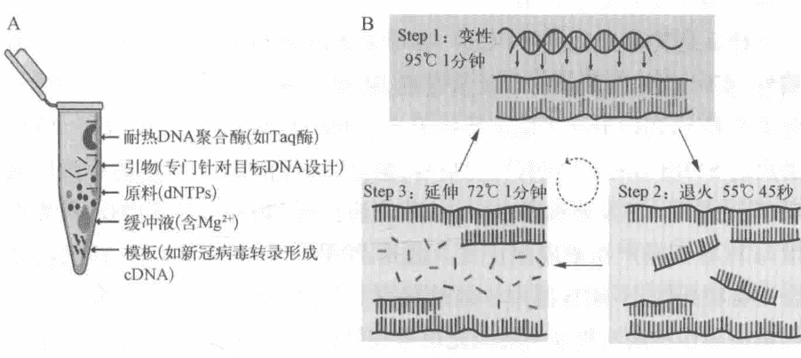

**图 1-1 PCR 原理示意图**

工程化进程加速了PCR普及：1987年首台热循环仪TC1问世，实现程序化控温；1988年嗜热水生杆菌Taq酶的引入，耐高温特性免除了每循环手动加酶之苦，大幅提升自动化效率，被《Science》封为“年度分子”；1994年“热启动”技术横空出世——抗体结合抑制酶活性，高温解离复活，兼得常温配制便利与特异性扩增双重红利；1996年实时荧光定量PCR（qPCR）诞生，将PCR从定性推向**精准定量**，以高特异、高灵敏、高自动化确立了核酸检测“金标准”地位。

##### 2. 实时荧光定量PCR：用光信号“计数”分子
核心逻辑：引入荧光分子为信号报告员，实时监测PCR动力学，实现核酸定量。
*   **SYBR Green I**：最常用染料。游离无光，嵌入双链小沟强荧光（Ex~497nm/Em~520nm），强度与双链浓度正相关。缺点：无序列特异性，难直接鉴别核酸。
*   **TaqMan探针**：特异性鉴别利器。两端标记荧光基团与猝灭基团。完整时邻近猝灭；扩增中Taq酶5'→3'外切酶活性水解探针，释放荧光基团，信号随产物同步累增（见图1-2）。

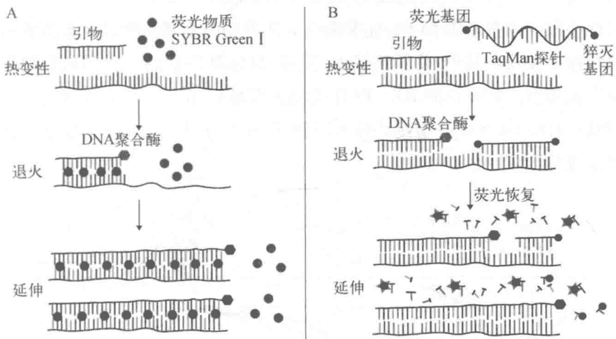

**图 1-2 实时荧光定量 PCR 示意图**

针对RNA病毒，基于TaqMan探针的RT-PCR（实时荧光逆转录PCR）是主流。流程：依据病毒特异基因序列（如ORF1ab、N基因）设计引物探针，以逆转录cDNA为模板，经qPCR检测（见图1-3）。读懂结果需懂三个关键参数：
*   **基线**：前3~15循环信号平稳期；
*   **阈值**：设定在指数扩增期，为基线信号标准差的10倍；
*   **Ct值（循环阈值）**：荧光信号跨越阈值所需的循环数。指数期内，Ct值与起始拷贝数对数呈线性负相关。

定量模式分绝对定量（需标准曲线，操作繁琐）与相对定量（引入内参基因，如比较Ct法、标准曲线法，简便普适）。病毒核酸判读逻辑：无Ct值/无S型曲线=阴性；Ct值≤检出限且呈S型曲线=阳性。

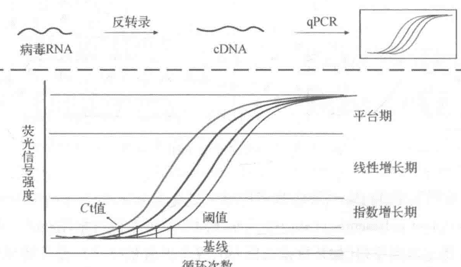

**图 1-3 RT-PCR 检测病毒核酸示意图**

##### 3. 技术迭代：第三代PCR与等温扩增的突围
**数字PCR（dPCR）**：第三代PCR里程碑。核心创新——**样品分割**。利用微流体通道/液滴/芯片将核酸分散至数万微反应室，实现“单分子”扩增。通过直接计数荧光阳性反应室，结合泊松分布算出绝对浓度（见图1-4）。
*   **优势**：摆脱Ct值与内参依赖，抗扩增效率干扰，直得绝对定量；分割体系极大提升灵敏度与抗干扰力，精准度、重现性俱佳；能捕捉核酸微小差异，擅长低病毒载量排查。
*   **短板**：操作相对繁复，仪器试剂成本高。

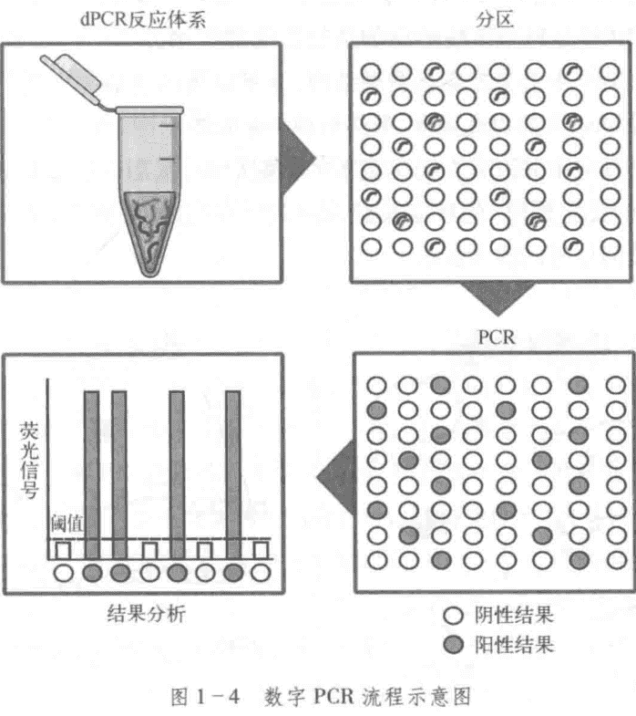

**等温扩增**：恒温下快速扩增，无需热循环仪，极适合即时检测（POCT）。三大流派：
1.  **指数扩增**（如LAMP）：多引物协同，常需辅助酶；
2.  **线性扩增**（如RCA）：体系简便，抗非特异扩增；
3.  **级联扩增**：灵敏度超指数扩增。

以**滚环扩增（RCA）**为例（见图1-5）：引物结合环状DNA模板，在等温聚合酶作用下持续延伸，生成含海量重复序列的长链单链DNA。此外，**杂交链反应（HCR）**等无酶扩增技术异军突起：利用核酸链竞争杂交，靶标触发发夹探针H1开放，暴露序列再开放H2，循环往复形成超长双链产物。虽不合成新核酸，但“一链引发无限延伸”，极大聚集信号分子，完美契合生物检测信号放大需求。

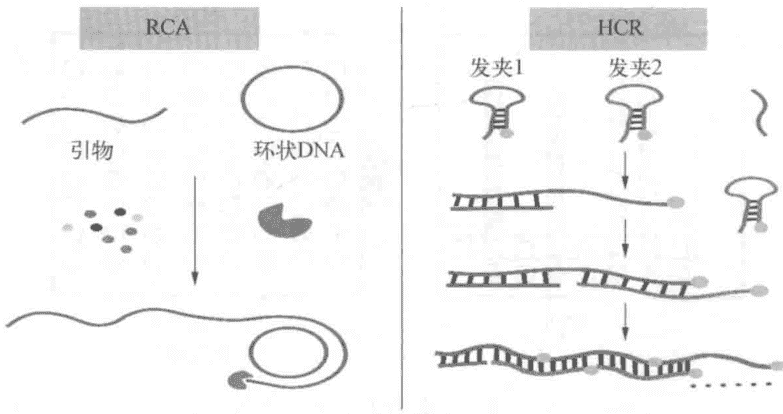

**图 1-5 RCA 和 HCR 原理示意图**

#### （二） 蛋白质检测：另一把“手术刀”的锋芒

# 深度解析：从ELISA到智能穿戴，生物医学检测的进化史

蛋白质作为生命活动的核心执行者，是中心法则下DNA翻译的最终产物。在生物医学领域，蛋白质标志物因其与癌症、心脑血管等重大疾病的紧密关联，成为疾病诊断的“风向标”。无数检测技术的迭代升级，本质上都源于对蛋白质精准捕获的极致追求。本文将从经典的ELISA切入，带你领略蛋白质检测技术的演进脉络，直至智能诊断的前沿疆域。

## 1. ELISA：蛋白检测的“黄金标准”基石

### 核心原理：抗原抗体的“专属握手”
免疫分析的本质，是利用抗原-抗体特异性识别这一“专属握手”机制。

*   **抗原**：能激发免疫应答并与产物结合的分子。完全抗原兼具免疫原性与抗原性；半抗原仅具抗原性，需结合载体蛋白才能“转正”。抗原表面的特定化学基团——抗原决定簇，是抗体识别的靶点。
*   **抗体**：B淋巴细胞分化而来的浆细胞分泌的免疫球蛋白。ELISA中分工明确：**一抗**直指目标抗原；**二抗**则是异种动物针对一抗产出的“抗体的抗体”。按克隆性分，**单克隆抗体**精准锁定单一决定簇，**多克隆抗体**则是识别多个决定簇的“联合舰队”。

### 关键机制：酶联与固相吸附的双重保障
ELISA之所以经典，立足于“酶联”与“吸附”两大支柱：
1.  **酶联（信号放大器）**：将酶（常用HRP、ALP）标记于抗原/抗体上，既保留免疫活性，又赋予催化放大能力。商业化试剂盒多采用HRP搭配TMB底物，显色灵敏度极高。
2.  **吸附（分离舞台）**：将捕获分子固定在固相载体（如微孔板）表面。这种固相化操作，让靶标与样本杂质轻松分离，结合抗原抗体的高特异性与酶的高催化效率，实现了**高特异、高灵敏**的双重保障。

### 三大经典模式：因地制宜的检测策略
*   **双抗体夹心法——大分子抗原的“标配”**：需抗原含≥2个表位。固相抗原+酶标抗体形成“三明治”，信号与浓度**正相关**。关键点：包被抗体与酶标抗体须来自不同物种或针对不同表位，避免竞争干扰。
*   **间接法——抗体筛查的“万金油”**：仅需更换包被抗原即可检测不同抗体。痛点在于抗原纯度影响灵敏度，必须用BSA、酪蛋白等封闭空位，抑制非特异性吸附。
*   **竞争法——小分子/半抗原的“独门绝技”**：固相抗体结合位点有限，样本抗原与酶标抗原“抢座位”。样本浓度越高，结合的酶越少，显色越浅，信号与浓度**负相关**。

> 病毒抗体检测常用间接法（固相病毒抗原+血清抗体+酶标二抗）与双抗原夹心法（固相抗原+血清抗体+酶标抗原），后者对IgM检测尤为有利。

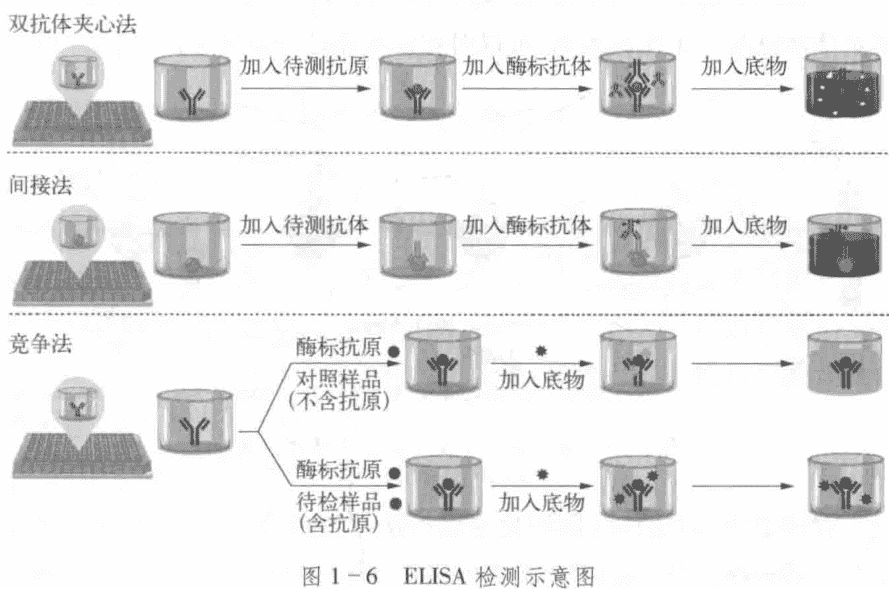

## 2. 突破色谱极限：化学发光与胶体金的分道扬镳

### 化学发光免疫分析（CLIA）：以光代色，灵敏度跃升
摒弃酶催化比色，改用化学反应发光信号（如鲁米诺发光），CLIA实现了**超高灵敏、极速响应、全自动化**。
*   **磁微粒化学发光法**是当下主流：磁微粒替代微孔板，磁场分离洗涤更彻底，背景噪音极低。
*   **原理链路**：病毒重组蛋白包被磁微粒捕获抗体 → ALP标记二抗结合 → 催化AMPPD生成不稳定中间产物 → 分解释放470nm光子 → 光强与抗体浓度成正比。
*   **实战记录**：2020年初，中美监管机构均紧急批准多款基于此技术的病毒IgG/IgM检测试剂盒，成为疫情应对的主力军。

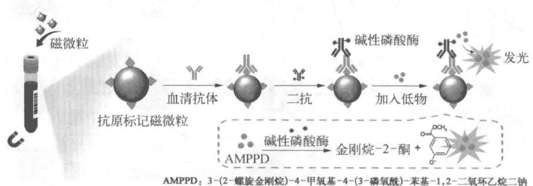
> 图示：磁微粒化学发光法工作原理示意图

### 胶体金侧流层析（LFIA）：即时检测（POCT）的“国民级”应用
1984年验孕棒问世，将实验室装进口袋。
*   **核心替换**：用红色金纳米颗粒取代酶标记，肉眼可见，无需仪器。
*   **运作逻辑**：毛细作用驱动样本流动 → T线（固定抗体）捕获“抗原-胶体金抗体”复合物显红（阳性） → C线（固定羊抗鼠IgG）捕获游离胶体金抗体显红（质控，必须红）。
*   **优势**：极简操作、便携、分钟级出结果，是基层筛查、家庭自测的首选。

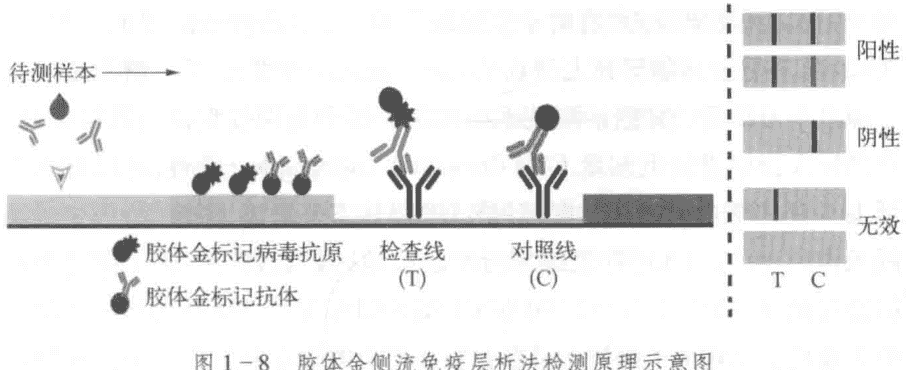
> 图示：胶体金侧流免疫层析原理示意图

## 3. 智能诊断新纪元：AI、微流控与穿戴设备的三重奏

纳米技术、电子工程与AI的融合，正推动生物检测从“手工半自动”迈向**自动化、集成化、智能化**，剥离人为经验依赖，打破医疗资源壁垒。

### (一) 机器学习赋能：让数据会“说话”，让影像会“思考”
深度学习（DL）构建多层神经网络模拟人脑处理海量医学数据，正重塑诊断范式。

*   **肺癌筛查破局者**：Google Nature Medicine刊文模型，经4万余张CT训练，在6716例筛查与1139例验证中，表现媲美放射科专家，大幅降低读片经验门槛，提升早诊一致性。
*   **生存预测向导**：基于1.7万例非小细胞肺癌数据训练的生存神经网络，预测可靠性超越传统TNM分期，指导个性化治疗显著改善预后。
*   **病毒性肺炎“鉴别狙击手”**：3D检测神经网络嵌入放射科工作流，在4356例CT中以89.76%灵敏度、95.77%特异性精准区分病毒性肺炎、社区获得性肺炎及非肺炎。
*   **拉曼光谱+AI“秒级鉴菌”**：利用拉曼散射（非弹性散射）指纹特征，结合深度学习全谱分析，无需培养，**几秒内**完成多菌种扫描识别，准确率超94%，速度精度双超普通CNN模型。

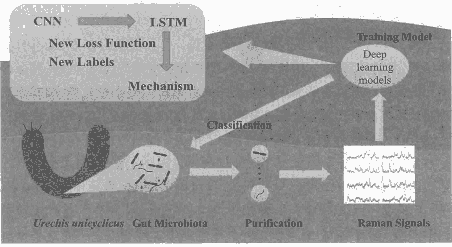
> 图示：基于拉曼光谱和深度学习的病原体检测模型
> *注：引用自S X Yu et al., 2021, 经ACS许可。*

### (二) 微流控芯片：方寸之间，筑起“掌上实验室”
微流控技术在微纳尺度精控微量流体（10⁻⁹~10⁻¹⁸ L），集成样本制备、分离、检测全流程，被誉为**Lab-on-a-chip**。

*   **核心优势**：样本量微、反应快、高通量并行、低成本、适用靶标广（核酸/蛋白/单细胞/细胞器）。
*   **工艺进化**：从丝网印刷、喷墨打印进阶至3D打印、飞秒激光；基底从纸/玻璃拓展至水凝胶、聚合物、纳米新界面。

#### 纸基微流控：低成本自动化的教科书级范例
纸张凭借亲水多孔结构利用毛细力驱动流体，结合ELISA体系：
*   **创新结构**：双层设计+旋转长臂装置控制“连/断”状态。底层多通道对应环形反应区（固定RBD抗原），顶层旋转驱动液体依次完成捕获、封闭、洗涤、显色。
*   **读出方式**：手机拍照分析免疫条带灰度值定量抗体。**无需专用仪器，简便、快速、高通量**，极适合资源受限场景。

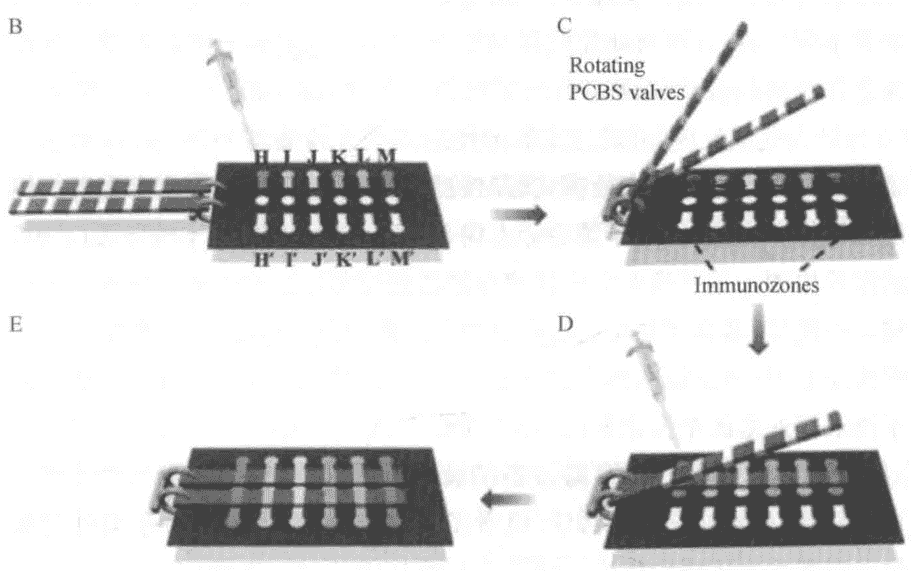
> 图示：纸基微流体检测病毒血清抗体示意图
> *注：引用自F W Gong et al., 2021, 经ACS许可。*

#### 聚合物/玻璃基高集成芯片：实验室级精度的便携化
*   **玻璃基**：光学本底低、生物相容性佳、易化学修饰，湿/干法刻蚀成型。
*   **聚合物基（如POEGMA）**：柔性好、紫外透射佳、可堆叠多层复杂结构。
*   **D4-DA芯片实战**：喷墨打印固定多抗原点（N蛋白、S1、RBD），采用双抗原夹心法+荧光标记。**重力+毛细力驱动**，芯片内置反应室、定时通道、缓冲液区、吸水垫，**全自动完成孵育-洗涤-干燥**，60分钟内用60μL全血/血清完成多重抗体及预后标志物（IP-10）定量，配合手持式D4Scope读取。高度集成、操作友好、单细胞级分析潜力，是POCT高端化的标杆。

### (三) 基于柔性可穿戴设备的智能诊断发展

**柔性穿戴生物传感：贴合肌肤的移动监测站**

材料学、生物医学与电子工程的跨界融合，让基于柔性材料的可穿戴生物传感器成为智能诊断领域的一颗耀眼新星。“柔性”源自英文 *flexible* 的意译。此类装置多选用本征可拉伸的聚合物作骨架，搭配导电水凝胶、离子凝胶、介电弹性材料等基底，借助喷墨打印、丝网印刷、软刻蚀等印制工艺构建可折叠的轻量化电子线路，精准满足生物感测所需。

相较传统笨重仪器，柔性生物传感器凭借微型化、便携化、智能化的“三化”优势，配合人因工学设计与自愈特性，能与皮肤甚至脏器表面实现无感贴合，亦可集成至隐形眼镜、牙套、耳饰、耳机等日常佩件中。这种形态打破时空限制，支持对代谢产物、pH值、脉搏、血压等生理病理指标实施体内、实时、动态的连续追踪。

当前，电化学感测手段是此类装置的核心支撑。作为经典技术，它以氧化还原反应中的电子转移为基石，捕捉电极电位、电量、电流、电导等物理量变化，实现特定分子的精准定性定量。其高灵敏、高准确、高选择性、操作简便、成本低廉及易于微型化的特质，完美适配生物医学场景。近来，近场通信（NFC）技术的引入更是锦上添花——通信模块与感测模块深度集成，让检测与数据同步上传同步完成，大幅推动生物医学检测终端向集成化、智能化跃迁。

**实战范例：守护新生儿的“隐形卫士”**

近年来，穿戴式装置持续融合新技术、新服务，健康监测版图不断拓展。以新生儿黄疸为例，约八成婴儿出生首周会出现生理性高胆红素血症，重度者更可致脑损伤。针对这一痛点，科研团队研发出动态监测胆红素的穿戴装置。该设备集成四颗LED光源（波长覆盖460、570、640、950 nm），通过特征吸收光谱同步追踪经皮胆红素、血氧饱和度、心率等多维指标。借助蓝牙链接智能终端，数据实现即时上传与分析，临床实证其可胜任新生儿黄疸及光动力疗法的动态连续监测重任。

**破局之道：直面四大核心瓶颈**

机遇与挑战并存。柔性传感器的规模化落地仍需攻克四道关卡：
1.  **贴合度难题**：生物体与器件的完美耦合，倒逼基底材料在弹性、安全性、舒适度、生物相容性上全面进阶，并衍生出多元化佩戴形态以适配复杂场景。
2.  **数据高保真**：动态监测要求极致的输出精度与分析效能，需深度融合智能终端，在保障时效性、准确性的前提下，拓展数据解读的便捷度与多样性。
3.  **个性化诊疗**：区分健康与病态个体的生化指标差异，开发混合能量采集器与高性能感测体系，精准响应差异化监测诉求。
4.  **持久续航**：长程监测催生自供能刚需，从汗液等体液中收集储存能量、实现能量自给自足，是智能化演进的必由之路。

区别于微流控与AI聚焦特定疾病的精准打击，可穿戴传感器更着眼于“大健康”日常防线。秉持“治未病”理念，将智能诊断渗透进生活肌理，通过动态、实时、持续的数据流，筑牢疾病预防与早筛的双重屏障。

### 核心洞察

**健康中国战略**明确指出：“人民健康是民族昌盛和国家富强的重要标志，要完善国民健康政策，为人民群众提供全方位全周期健康服务。”无论“精准医疗”还是“健康中国”，根基皆系于生物医学的飞跃。诊断是治疗的基石，也是生物医学检测成果转化的终极呈现。随着纳米技术、电子技术、AI等前沿领域日新月异，生物医学检测借力学科交叉优势，不仅让PCR、ELISA等经典手段焕新颖，更催生出层出不穷的新范式。在持续刷新检测灵敏度的同时，技术演进明确指向小型化、集成化、智能化，为临床智能诊断铺就康庄大道。例如，基于碱基互补配对的DNA分子计算，利用其超高密度存储与并行计算优势，强力推进多参数同步分析的精准诊断。展望未来，智能诊断必将实质性提升临床判读的时效性、准确性、有效性，输出更理性的个性化精准治疗方案，惠及全民健康，助力“精准医学”与“健康中国”宏图落地。

### 思考与探究

1.  病毒核酸检测的常规手段有哪些？请概述其核心流程。
2.  病毒特异性血清抗体包含哪些亚型？主流检测策略为何？
3.  简析“金标”检测试剂盒的基本原理及关键组件构成。
4.  结合实例，阐述生物医学检测在智能诊断演进中的技术特征。
5.  谈谈你了解的智能诊断其他前沿方向及其底层技术逻辑。

### 文献溯源

- [1] A Esteva, A Robicquet, B Ramsundar, et al. A guide to deep learning in healthcare. Nature Medicine, 2019, 25(1): 24–29.
- [2] A W Martinez, S T Phillips, M J Butte, et al. Patterned paper as a platform for inexpensive, low-volume, portable bioassays. Angewandte Chemie International Edition, 2007, 46(8): 1318–1320.
- [3] C A Heid, J Stevens, K J Livak, et al. Real time quantitative PCR. Genome Research, 1996, 6(10): 986–994.
- [4] C Jung, A D Ellington. Diagnostic applications of nucleic acid circuits. Accounts of Chemical Research, 2014, 47(6): 1825–1835.
- [5] C Zhang, Y M Zhao, X M Xu, et al. Cancer diagnosis with DNA molecular computation. Nature Nanotechnology, 2020, 15: 709–715.
- [6] D Ardila, A P Kiraly, S Bharadwaj, et al. End-to-end lung cancer screening with three-dimensional deep learning on low-dose chest computed tomography. Nature Medicine, 2019, 25: 954–961.
- [7] D E Birch, L. Kolmodin, J Wong, et al. Simplified hot start PCR. Nature, 1996, 381: 445–446.
- [8] E Engvall, P Perlmann. Enzyme-linked immunosorbent assay (ELISA) quantitative assay of immunoglobulin G. Immunochemistry, 1971, 8(9): 871–874.
- [9] F W Gong, H X Wei, J Qi, et al. Pulling-force spinning top for serum separation combined with paper-based microfluidic devices in COVID–19 ELISA diagnosis. ACS Sensors, 2021, 6(7): 2709–2719.
- [10] G Inamori, U Kamoto, F Nakamura, et al. Neonatal wearable device for colorimetry-based real-time detection of jaundice with simultaneous sensing of vitals. Science Advances, 2021, 7(10): eabe3793.
- [11] G M Whitesides. The origins and the future of microfluidics. Nature, 2006, 442: 368–373.
- [12] H Lee, J A Martinez-Agosto, J Rexach, et al. Next generation sequencing in clinical diagnosis. The Lancet Neurology, 2019, 18(5): 426.
- [13] H X Bai, R Wang, Z Xiong, et al. Artificial intelligence augmentation of radiologist performance in distinguishing COVID–19 from pneumonia of other origin at chest CT. Radiology, 2020, 296(3): E156–E165.
- [14] J M Perkel. Life science technologies: The digital PCR revolution. Science, 2014, 344(6180): 212–214.
- [15] J T Heggestad, D S Kinnamon, L B Olson, et al. Multiplexed, quantitative serological profiling of COVID–19 from blood by a point-of-care test. Science Advances, 2021, 7(26): eabg4901.
- [16] M S Han, JH Byun, Y Cho, et al. RT–PCR for SARS–CoV–2: Quantitative versus qualitative. The Lancet Infectious Diseases, 2020, 21(2): 165.
- [17] M W Yang, J G Huang, J L Fan, et al. Chemiluminescence for bioimaging and therapeutics: Recent advances and challenges. Chemical Society Review, 2020, 49(19): 6800–6815.
- [18] R L Guyer, D E Koshland, Jr. The molecule of the year. Science, 1989, 246: 1543–1546.
- [19] S Avrameas. Coupling of enzymes to proteins with glutaraldehyde: Use of the conjugates for the detection of antigens and antibodies. *Immunochemistry*, 1969, 6 (1) : 43 - 52.
- [20] S X Yu, X Li, W L Lu, et al. Analysis of Raman spectra by using deep learning methods in the identification of marine pathogens. *Analytical Chemistry*, 2021, 93 (32) : 11089 – 11098.
- [21] T R Ray, J Choi, A J Bandodkar, et al. John A Rogers; Bio-integrated wearable systems: A comprehensive review. *Chemical Reviews*, 2019, 119(8) : 5461 – 5533.
- [22] W C Mak, V Beni, A P F Turner, et al. Lateral-flow technology: From visual to instrumental. *Trends in Analytical Chemistry*, 2016, 79: 297 – 305.
- [23] Y Cao, X M Yu, B Han, et al. In situ programmable DNA circuit-promoted electrochemical characterization of stemlike phenotype in breast cancer. *Journal of the American Chemical Society*, 2021, 143(39) : 16078 – 16086.
- [24] Y L She, Z C Jin, J Q Wu, et al. Development and validation of a deep learning model for non-small cell lung cancer survival. *JAMA Netw Open*, 2020, 3 (6) : e205842.
- [25] Y X Zhao, F Chen, Q Li, et al. Isothermal amplification of nucleic acids. *Chemical Reviews*, 2015, 115(22) : 12491 – 12545.

(本章作者：赵婧 肖俊杰)

---

## 第二章：人工智能重塑疾病诊疗新范式

### 本章学习导向

研习本章后，你将掌握：
- 人工智能在疾病诊疗中落地的核心技术矩阵；
- AI赋能诊疗的典型应用范式；
- AI医疗领域的现状瓶颈与未来演进趋势。

**生命虽微，韧性无限。** 苏轼《赤壁赋》云：“寄蜉蝣于天地，渺沧海之一粟。哀吾生之须臾，羡长江之无穷。” 郑板桥《竹石》叹：“咬定青山不放松，立根原在破岩中。千磨万击还坚劲，任尔东西南北风。” 生命对个体仅有一次，疾病来袭，生命体验遭受重创，甚或阻滞人类繁衍与文明进程。

心理学大师阿德勒毕生探究“将负转正”的生命张力。作为新一轮科技革命的核心引擎，人工智能正深度重塑社会图景。谷歌CEO皮查伊断言：“AI是人类最深刻的探索之一，其革命性影响将超越火与电。” AI的飞跃与场景外溢，为医疗突围注入全新动能。

### 一、 绪论：从抗疫历程到智能医学崛起

人类文明史，实为一部与病魔博弈不断突围的进化史。医学，是这部史诗中浓墨重彩的篇章。2500年前，希波克拉底奠基“四体液失调致病说”；1800年前，盖伦承继发扬；500年前，文艺复兴催生维萨里解剖学革新；400年前，哈维揭示“血液循环”奥秘；150年前，巴斯德证菌致病、立微生物学，以科学方法论重塑医学认知，开启“现代医学”序章。化工崛起带来合成药物与抗生素革命；量子力学推演分子生物学诞生，1953年双螺旋结构破解，开启生命密码阅读时代。新世纪以来，循证、精准、整合医学并驾齐驱，现代医学驶入快车道。

如今，**智能医学**异军突起。这门新兴交叉学科，以现代医学与生物理论为基座，融合机器学习、大数据、脑科学、云计算等前沿AI技术，探幽病理现象与生活本质的耦合规律，寻觅人机协同的智能诊疗范式并落地临床。AI医药萌芽于70年代：1972年英国利兹大学AAPHelp系统为文献首载医疗AI雏形；此后匹兹堡INTERNIST-I（内科辅助）、斯坦福MYCIN（感染症决策）、ONCOCIN等系统接力问世。90年代哈佛DXplain已能依症定案。近年，IBM Watson凭借NLP、大数据检索挖掘，实现极速医学判读，加速全球落地（含中国市场）；Google、Microsoft等巨头亦频出破圈佳绩。国内虽起步较晚（80年代初），但21世纪进展迅猛：百度“医疗大脑”“灵医智惠”，阿里“Doctor You”“ET医疗大脑”，南京美桥AI陪诊，腾讯牵头数字诊疗装备专项等，集群式探索推动医疗服务跃迁。

### 二、 疾病诊疗的AI关键技术图谱

当下，AI与医疗健康融合纵深推进，已成重塑行业竞争力、提升服务水位的关键变量。其核心技术版图涵盖（见图 2-1）：
机器学习、深度学习、卷积神经网络、知识图谱、自然语言处理、人机交互、计算机视觉、生物特征识别、虚拟现实、增强现实等。

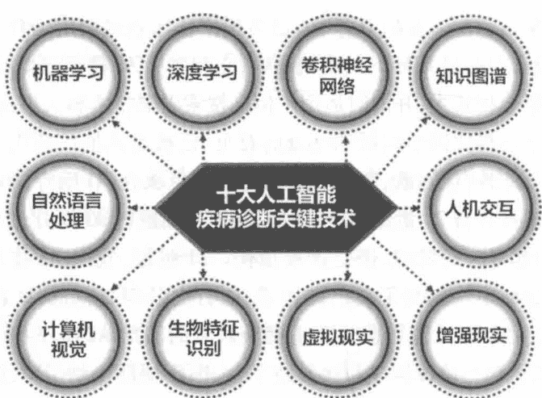

## 十大核心技术：AI疾病诊断的“发动机”

#### 1. 机器学习（ML）：智能的基石
机器学习融合了概率论、统计学、凸分析等多学科精髓，核心在于让计算机模拟人类学习过程，通过重组知识结构持续自我进化。作为AI的“心脏”，它是赋予机器智能、贯穿所有应用领域的根本路径。

#### 2. 深度学习（DL）：多层网络的突破
深度学习是机器学习的进阶分支，构建于海量人工神经元堆叠的多层网络之上。它通过深度融合网络层级，在抑制无关干扰的同时精准提取特征。相比传统ML，DL凭借“深度”与“组合性”优势，大幅削减了人力物力成本。

#### 3. 卷积神经网络（CNN）：图像识别的利器
CNN采用局部连通与权值共享机制，有效精简连接参数、降低模型复杂度与过拟合风险。其最大亮点在于图像可直接作为输入端，省去传统手工特征提取与重构环节。在二维图形处理上，它能自动捕获拓扑结构、色彩纹理等本质属性，在压缩、识别、位移等任务中展现卓越鲁棒性。

#### 4. 知识图谱（KG）：贴近人脑的认知框架
知识图谱本质是语义网知识库，以“实体节点+关系边”构建直观推理骨架。作为第三代AI理论基石，它极度贴合人类思维模式，能从海量医学影像与文献中挖掘结构化知识，落地智能辅助诊断、知识问答、风险评估及质控管理等场景。

#### 5. 自然语言处理（NLP）：打通人机沟通壁垒
NLP致力于让计算机理解并运用自然语言，是一个高度复杂的信息系统。医学领域初期聚焦文本分析、数据处理、库建设及人机问答，现已延伸至病情监测、治疗决策支持、预后评价、药物研发及健康管理全链路。

#### 6. 人机交互（HCI）：无创诊断的新窗口
HCI研究用户与机器的反馈回路，核心目标是优化交互体验。医疗应用中，它利用语音、步态等自然感官互动数据，无创评估患者功能状态，辅助医生诊疗。其优势在于仅通过观察交互表现即可客观判断健康状况，主攻早期预警与辅助诊断。

#### 7. 计算机视觉（CV）：模拟人眼的“慧眼”
计算机视觉模拟人眼“看、定、认”全流程，涵盖图像处理、模式识别、语义理解等关键技术。目前已深度渗透超声、影像、病理、生物医学图像等辅助诊断环节，发挥着关键决策作用。

#### 8. 生物特征识别（BI）：身份认证的“硬核”技术
BI采集个体固有生理与行为特征进行身份核验，被视为极具前景的新兴战略技术。国内已将其列为重点发展方向，主要服务于医学档案管理，如用血核验、公费医疗确权及个人档案管控。

#### 9. 虚拟现实（VR）：沉浸式医疗新体验
VR构建多感官刺激的虚拟世界，实现高阶人机自然交互。医疗落地聚焦两大板块：医学教育培训与神经心理治疗，为医生练兵与患者康复提供沉浸式场景。

#### 10. 增强现实（AR）：现实叠加的“透视眼”
AR将难以触达的实体信息仿真叠加至现实空间，创造超感官体验。临床应用集中于医学教学、手术导航、肿瘤放疗等高精度场景，赋予医生“透视”能力。

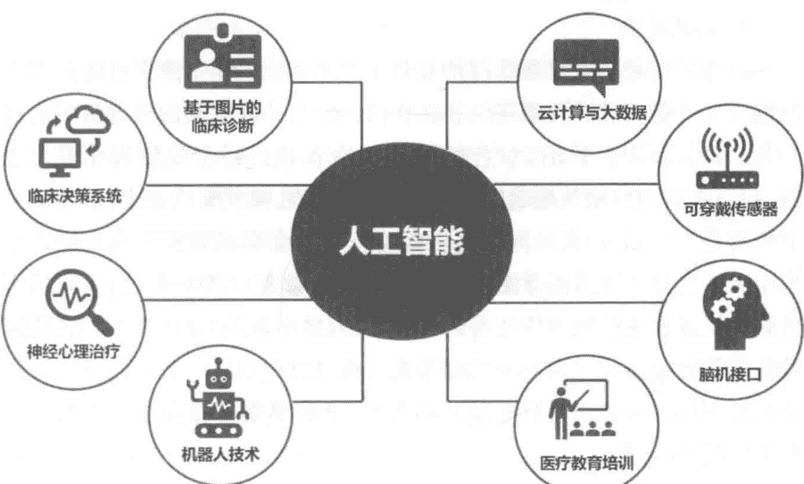

## 临床落地全景：AI重塑疾病诊疗新版图

随着AI技术加速迭代，其在医疗卫生领域已成不可或缺的核心驱动力。从助力运动障碍患者重获自主的脑机接口，到智慧康复、智能诊断的广泛铺开，AI正在重塑医疗范式。但客观而言，人类对AI的探索仍处早期，挑战与机遇并存。

### 一、 AI医学影像：以“算力”换“精准”

AI医学影像依托感知认知与深度学习优势，构建“数据处理→影像筛查→智能决策”三级流程，通过精准预测模型分析多因子数据，助力病原分型，大幅提升筛查质效，为医生提供最优决策参考。主攻肺结节、乳腺肿瘤、慢性肝病/肝纤维化等高发病种。

**1. 肺部结节：攻克早筛“最后一公里”**
肺癌发死率双高，早期信号即肺结节。CT虽为首选，但人工读片效率低、易疲劳漏诊、对医师依赖强。基于DL的CAD系统应运而生：引入三维残差卷积网络压降假阳性，强化形态边缘特征识别，实现结节自动检测、分类分级全流程智能化。

**2. 乳腺肿瘤：破解主观判读瓶颈**
良恶性鉴别关乎治疗预后，传统依赖钼靶、超声、MRI及医生主观经验，高强度工作易漏微小病变。乳腺CAD系统聚焦肿块与钙化特征，对微钙化灵敏度极高，在早期病变识别上优势显著，已成早筛标配。

**3. 慢性肝病与肝纤维化：无创分期新标尺**
早期干预可阻断肝癌化进程。SVM已用于慢性肝病临床诊断；结合硬度评估与DL的CAD系统植入剪切波弹性成像（SWE），实现CLD无创评估；基于CNN的DL模型分析增强MRI，显著提升肝纤维化分期诊断效能。

### 二、 AI病理诊断：让“金标准”更高效

病理诊断是疾病定性的“金标准”，但影像高复杂性导致定量分析困难。AI凭借DL技术实现影像快速标准化处理、可疑区精准勾画、结构化意见输出。实证显示：病理医师效率跃升、负荷减轻、环境改善、误漏诊率下降。核心布局乳腺癌、前列腺癌、宫颈癌三大阵地。

**1. 乳腺癌：从整体切片到分子分型**
临床痛点在于读片耗时、医师间一致性差。CNN分析WSI切片patch可精准识别浸润性导管癌；多款DL算法验证淋巴结转移诊断稳健；在核分裂计数自动判读、免疫组化分析、分子分型及个性化治疗规划上均展现优越性。

**2. 前列腺癌：Gleason评分的智能化助手**
发病率随年龄攀升，Gleason分级关乎预后指导。多视图提升分类法融合强度纹理特征实现良恶分化，显著提升组织学诊断准确率与效率；CNN更可实现活检标本疾病区域自动注释与定量分析。

**3. 宫颈癌：从细胞分割到智能筛查系统**
全球女性第二大恶性肿瘤，传统筛查漏诊率高。DeepCare研发的涂片智能筛查系统，单分钟完成数字化切片分析、可疑细胞定位分型；基于超像素与CNN的分割法使核区检测精度达94.5%，为自动化辅助阅读系统奠定基石。

### 三、 AI眼科诊断：守护“心灵之窗”

应用深度聚焦眼病诊断，从早期眼底照片结构分割，到DeepMind DL系统、中山眼科中心小儿白内障AI程序，再到眼肿瘤、屈光、角膜病潜能释放，技术迭代明显。

**1. 青光眼：早筛利器，分型仍是短板**
三大致盲之首，隐匿进展快。OCT结合AI大幅提升灵敏特异度；基于眼底照片的DL算法检测视神经损伤指标均超90%。但精准分型仍存明显短板。

**2. 糖尿病视网膜病变（DR）：自动化筛查标杆**
糖尿病三大并发症之一，眼底照相是随访主力。早期AI分离测量眼底照片，后引入Messidor数据集实现分级自动筛查，与裂隙灯诊断高度一致；DL系统筛查灵敏特异度双高，成可靠筛查手段。

**3. 年龄相关性黄斑变性（AMD）：专家级筛查能力**
老年致盲主因。OCT数据集分析可预测早期风险、评估视觉预后。实测AI识别能力媲美人类专家，推动AMD诊断自动化、个性化进程。

**4. 先天性白内障：云端平台重构诊疗模式**
儿童失明主因，早诊早治至关重要。中山大学团队构建DL云平台，上传图像即出诊断与方案，打破传统模式，多中心临床应用效果理想。

### 四、 AI血液病诊断：全维度赋能“显微镜下的决策”

骨髓形态学分型是血液病确诊“金标准”。AI流程为：自动扫描识别形态→信号校验→资深医师复核→出具报告，实现人机协同。

**1. 形态学分析：CNN重塑分类范式**
传统人工阅片与AI高度契合。CNN免手工操作分类粒/红系细胞，准确率超97%；CNN+AlexNet区分急淋亚型与正常骨髓准确率达97.78%；慢粒、急髓、B淋巴瘤异型细胞识别亦有成熟体系。

**2. 免疫表型分析：流式数据的“加速器”**
AI+多参数流式技术精准分辨CD5+/- B淋巴瘤（准确率89%），健康人与慢淋/单克隆球蛋白血症区分率达97%。核心优势是极致效率：AI处理单份数据耗时仅为资深医生的1%。

**3. 细胞遗传学分析：核型与FISH的双重突破**
核型分析对增殖性肿瘤、白血病分型关键。CNN核型分类准确率超93.79%。FISH克服核型分析标本要求高、分辨率低痛点，AI通过神经网络识别荧光信号，精度83%-87%；贝叶斯/感知机模型进一步推进非点/点信号分割分类，精度约80%。

**4. 分子生物学分析：精准医疗的“数据大脑”**
大数据筛选分子标志物是现代病理研究核心。DL整合基因突变、年龄、细胞遗传大数据，预测AML预后准达83%。AI赋能基因检测，融合临床与基因组数据，为精准诊疗策略提供理论支撑。

### 五、 AI神经心理治疗：数字疗法新前沿

神经心理学建立脑机制与心智行为的量化关联。AI融合三维影像、声效、实时交互动画，在心理干预与镇痛领域展现独特价值。

**1. 心理治疗：沉浸式干预新范式**

# AI 重塑医疗版图：从辅助诊断到脑机互联的全景图谱

## 心理疗愈新范式：虚拟现实介入精神障碍

随着社会转型加速与生活节奏紧凑，大众在享受物质富足的同时，心理负重持续攀升，精神类疾病逐渐浮出水面。尽管心理援助与诊疗机构已成刚需，但“讳疾忌医”心理导致就诊滞后，损身更伤神。神经心理疗法革新催生出新路径：借助 AI 装备构建沉浸式虚拟空间，患者无需面对面即可接受专业干预。临床证据显示，医生运用沟通技巧远程操控虚拟场景，能精准击破患者现实困境；此类疗法依从性高、疗效显著，正成为化解心理危机的利器。

### 疼痛管理的“注意力转移术”

在镇痛领域，AI 展现出独特优势。其核心逻辑在于利用动画、声光等多模态刺激构建虚拟情境，强制转移患者感知焦点，使其在疗程中暂时“遗忘”痛楚。典型案例是“幻肢痛”干预：截肢者常感知残肢仍存并伴随疼痛。实验证实，头戴式显示器与传感装置协同，能诱导患者进入虚拟环境，重现肢体存在感与运动控制感，从而实现镇痛减压，有力推动神经心理康复进程。

## 临床决策支持系统（CDSS）：医生的“外脑”与“护盾”

CDSS 定位为应对半结构化/非结构化医学难题、经人机交互提效的智能决策中枢。它汇聚海量医学知识库，助力临床医生锁定最优诊疗路径与护理方案。多项实证研究确认，CDSS 能有效打破认知天花板、规避人为疏漏、压降医药成本、护航医疗质量，现广泛部署于基层网点与三甲医院。

**基层端：筑牢分级诊疗“第一道防线”**  
覆盖 3000+ 疾病谱，通过智能问诊提示与分级诊疗逻辑，助力基层医生快速甄别危急重症与跨学科疑难病例，显著降低漏诊误诊率；针对慢病管理高频需求，深度赋能病情评估、调药决策，构建起“辅助问诊-慢病管控-用药审核-知识检索-患教”全链路应用矩阵。

**院端：深度融合权威数据，赋能精准医疗**  
引入权威医学数据库无缝嵌入院内网络，智能解析患者全维数据。主数据库层面，依托深度学习与大数据挖掘，自动完成 SNOMED-CT、LOINC、ICD-11 等标准映射，将非结构化病历转化为高价值决策与科研资产；算法层面，融合新一代 AI 实现知识库自进化与推理迭代，标准化程度跃升；应用层面，基于循证证据与统计分析，提供实时策略支撑、方案优选、医嘱自审及个体化建议，并延伸至电子病历质控评级。

**痛点直视：** 标准法规滞后、数据质量参差、隐私安全隐忧、复合型人才短缺，仍制约 CDSS 深水区拓展。

## “沃森”启示录：认知计算冲击肿瘤诊疗生态

全球年增肿瘤患者 1400 万，十年增幅预测 42%；国内年增 400 万、亡 280 万、五年生存率仅 37%、规范治疗率不足半数。面对医学知识年均 6% 爆炸式增长、专家资源稀缺、诊疗标准不一的三重困境，AI 切入正当时。

IBM DeepQA 团队打造的“沃森”具备自然语言理解与复杂问题求解双核能力。临床实战中，它通过读取病征病史、调用多源异构数据、融合 NLP 与大数据分析，秒级输出诊疗建议；更可充当专科护士角色协助疑难病处置、审核医嘱合规性。未来展望：自动聚合患者全病程数据生成诊疗摘要，大幅提速临床决策。

“登月计划”落地见证生态共建：IBM 联手 MD Anderson，以沃森认知计算驱动肿瘤专家系统，优化诊疗路径；完善病历检测标准、汇聚科研数据、赋能深度挖掘。梅奥、斯隆-凯特林、克利夫兰等国际顶尖机构及强生等药企同步接入，拓展至证据医学、药物研发等维度。但须警醒：医疗本质包含人文关怀，患者渴望温度而非冰冷算法；技术普及进程中，需确立人机协作的伦理边界与价值导向。

## 手术机器人：重新定义“精准”与“微创”

外科手术虽臻成熟，却高度依赖术者经验与手眼协调，容错率极低。手术机器人以亚毫米级精度、消除生理震颤、三维可视化优势，重塑骨科、神外、内镜三大主战场手术范式，大幅提升成功率、降低风险、减轻医师负荷。

### 骨科领航：从“手感”到“数字孪生”

核心价值在于定位导航与精密操作。新一代机械臂强化轨迹规划，消除微观抖动误差；光学追踪系统赋予术中全视角监控与纠偏能力；微创通道规划精准至解剖层面，最大程度保全神血管与软组织，从源头遏制感染风险。

### 神经外科“立体定向”首台机

大脑手术容错零边际。FDA 批准首款立体视手术机器人，凭借亚毫米定位与路径规划能力，术前影像融合术中导航，被动式机械臂稳如磐石。国产 CRAS 系统采用 PUMA 执行机构，已攻克无框架立体定向与内镜手术临床应用，打破垄断格局。

### “达·芬奇”引领腔镜微创革命

腹腔脏器密布，精度要求极致。达·芬奇系统以“主控台-机械臂-3D 成像”三位一体架构，实现术者远程操控器械完成复杂微创操作。核心突破：创伤微小化、视野立体化、操作灵活化，确立软组织微创手术新标杆。

## 脑机接口（BCI）：打通意念与世界的“隐形桥梁”

BCI 跳过外周神经肌肉通路，直连大脑与外部设备，实现双向信息流。单向模式仅支持单向指令或反馈；双向模式则构建闭环交互。本质上，它是解码神经信号、外化思维意图、实现脑机直控的康复终端。

### 双轨驱动康复新机制

**功能替代轨：** 重度瘫痪患者通过意念驱动外骨骼、智能家居等设备，重获环境交互自主权。  
**神经重塑轨：** 意念控制训练诱导中枢神经反馈重组，激活脑可塑性，实现功能代偿，本质提升生存质量。  
VR 融合进一步提升脑信号信噪比与生态效度，强化 BCI 性能上限。

### 脊髓损伤康复：跨越断裂的“神经桥梁”

脊髓断裂阻断下行指令，但大脑运动意图依然完整。BCI 电极捕获皮层信号转化为数字指令驱动机械运动，触觉反馈回传闭环，患者通过操作学习重塑神经回路。目前已覆盖上下肢运动重建、感觉重建、神经性疼痛调控等全谱系康复场景。

### 神经功能拓展：从“代偿”到“超越”

语音合成接口实现“默读”合成语音，为失语者打开沟通之门；哥伦比亚大学研究证实脑电调控唤醒水平可优化认知状态。从康复治疗到“脑控/读心”，跨感官感知与体能增强，BCI 勾勒人类进化无限可能。然伦理红线同在：植入安全性、决策自主权、人格同一性、真实性边界，亟待技术迭代与治理共舞。

## 智能可穿戴：让健康监测“无感化、连续化、前置化”

定义泛化为集成计算与通信的随身智能终端，形态涵盖腕戴、足戴、头戴、智能纺织及非标配件。医疗场景聚焦健康监测、疾病干预、远程康复三大价值锚点。

### 腕戴终端：全民健康“入口级”哨兵

老龄化与资源匮乏倒逼监测下沉。智能手环/表内置高精度传感阵列，覆盖血氧、心率、心电、脑电等核心指标，功能延伸至计步、血糖趋势、能耗、睡眠架构分析。蓝牙/WiFi 透传 + APP 云端同步，构建点对点健康管理闭环。

### BrainLink 头箍：脑波交互的消费级探索

多终端蓝牙互联，实时解码专注度、压力值、松弛度、疲劳度等脑状态指标；用户通过意念调控注意力/放松度下达指令，落地“脑控”交互新范式。

### 智能医用纺织品：穿在身上的“主动式”诊疗平台

环境感知与预设响应机制，重塑慢病管理模式。在疼痛调节、经皮给药、哮喘/COPD 管理、慢性创面愈合等领域展现独特价值。现状：国内仅极少数纺织电极工艺成熟，药物检测与生物调理系统多处实验室阶段，商业化落地道阻且长。躯干式生物传感器已能捕捉炎症因子、胰岛素等深层指标异常，预示着“发病前预警”临床转化曙光。

### 下肢柔性传感器：帕金森运动症状的“隐形追踪器”

织物集成柔性传感阵列，兼容触压检测与体动捕获。鞋底、膝/踝关节贴附部署，实时量化步态、体位、震颤、呼吸、关节动学等多维参数，为早筛、病情追踪、方案调整提供客观数字生物标记物。

## AI 医教融合：虚实共生重塑临床技能培养

医疗差错多源人为，岗前训练刚需与患者权益保护、临床资源稀缺构成矛盾。AI+教育打破时空物理限制，构建零风险、高保真、可复演的训练新生态。

### VR 观摩教学：打破手术室“围墙”

5G+VR 多技术融合，医生院外即享“上帝视角”：主刀微表情、器械运用、解剖层次全程沉浸式直击。传统见习模式革新，直观性与可及性双提升，加速医学人才成长曲线。

### 虚拟手术仿真系统：可犯错的“飞行模拟器”

特定术式模型 + 虚拟环境 + 多模态感知反馈。学习者置身虚拟术野，视听触三位一体模拟全真手术流程。高保真、强交互、零后果，提供不受伦理与资源束缚的标准化训练场，填补临床上手前的“最后一公里”。

---

## 结语：在挑战中进化，于共生中前行

AI 已深度渗透诊断、治疗、决策、手术、康复、监测、教育医疗全链条，勾勒出智慧医疗宏大蓝图。但前路非坦途：数据孤岛、算法黑箱、法规滞后、伦理困境、人才断层，挑战与机遇同频共振。医疗不仅是技术博弈，更是人文守望。唯有以严谨科学态度驾驭技术、以温情人文底色校准方向，方能让 AI 真正成为守护生命健康的“最强辅助”，造福人类福祉。

---

## 思考与实践指引

1.  AI 赋能医疗的核心价值锚点在哪里？
2.  当前 AI 在医疗全流程的具体渗透图谱如何？
3.  驱动医疗 AI 落地的底层技术逻辑是什么？
4.  如何构建“技术向善、人机共生”的认知框架？

---

## 参考文献

- [1] 敖波文,刘婷.带有空间信息的卷积神经网络车道路面语义分割模型研究.信息与电脑(理论版),2021,33(2): 43-45.
- [2] 曹悦,杨贺迪,缪森,等.医疗手术机器人的现状与未来.中国科技信息,2021(10): 123-125.
- [3] 高飞,叶哲伟.智能医学发展简史.中华医史杂志,2021,51(2): 97-102.
- [4] 高灵宝,杜银学,陆江波,等.浅谈机器学习.铸造设备与工艺,2021(6): 41-43.
- [5] 龚瑜,菊俊斌,郝赤子,等.脑机接口在脊髓损伤康复中的应用进展.中国康复医学杂志,2020,35(6): 744-748.
- [6] 胡吉永,杨旭东.智能医疗纺织品的研究现状.纺织导报,2020(9): 51-56.
- [7] 胡雪嬅,韩雪峰.自然语言处理在医疗器械中的应用研究.吉林省教育学院学报,2020,36(6): 183-186.
- [8] 机器人医生沃森将如何改变世界？创新时代,2015(3): 22-24.
- [9] 蒋勤,张毅,谢志荣.脑机接口在康复医疗领域的应用研究综述.重庆邮电大学学报(自然科学版),2021,33(4): 562-570.
- [10] 李翔云,叶庆,邓朝华.临床决策支持系统功能及其应用态势分析.中国医院,2020,24(10): 35-38.
- [11] 李洋,汪柳萍,黄进,等.人机交互技术在神经系统疾病辅助诊断中的应用:现状与前景.协和医学杂志,2021,12(5):608-613.

- [12] 蔺亚妮,闫麒,黄先琪,等.人工智能在血液系统疾病中的辅助诊断作用.中华检验医学杂志,2020,43(12):1156-1159.

- [13] 刘琦,于汉超,蔡剑成,等.大数据生物特征识别技术研究进展.科技导报,2021,39(19):74-82.

- [14] 孙苗苗,张智弘.人工智能在病理诊断中的应用.中华病理学杂志,2019(4):338-340.

- [15] 谭玲,鄂海红,匡泽民,等.医学知识图谱构建关键技术及研究进展.大数据,2021,7(4):80-104.

- [16] 韦哲,石恒兵,曹彤,等.国内外智能可穿戴设备的研究进展.中国医学装备,2020,17(10):18-21.

- [17] 吴绯红,赵煌旋,杨帆,等.医学影像+人工智能的发展、现状与未来.临床放射学杂志,2022,41(4):764-767.

- [18] 翟倩,丰雷,张国富,等.人工智能在精神心理卫生领域的应用.浙江医学,2020,42(10):1078-1084+1091.

- [19] 郑维炜,张弦.柔性可穿戴传感器的研究进展.合成纤维,2022,51(3):39-43.

- [20] 郑阳.医疗人工智能的关键技术及应用.医学信息,2021,34(2):19-22.

- [21] 郑泳智,朱定局,吴惠舜,等.知识图谱问答领域综述.计算机系统应用,2022,31(4):1-13.

- [22] 朱谷雨,张景尚,万修华.人工智能在眼科的应用进展.国际眼科纵览,2019(1):14-18.

- [23] 朱丽兰,郭磊,李英.虚拟现实技术在医疗保健领域的应用与前景.信息与电脑(理论版),2021,33(4):10-12.

- [24] A Barragán-Montero, U Javaid, G Valdés, et al. Artificial intelligence and machine learning for medical imaging: A technology review, Phys Med, 2021, 83: 242–256.

- [25] G Currie, K E Hawk, E Rohren, et al. Machine Learning and Deep Learning in medical imaging: intelligent imaging. J Med Imaging Radiat Sci, 2019, 50(4): 477–487.

- [26] K Harezlak, M Blasiak, P Kasprowski. Biometric Identification Based on Eye Movement Dynamic Features, Sensors (Basel), 2021, 21(18): 6020.

- [27] R Hamamoto. Application of Artificial Intelligence for Medical Research, Biomolecules, 2021, 11(1): 90.

## 第三章 人工智能在手术中的应用与展望

### 本章学习目标

读完本章，你将能够：

- 1. 认识人工智能机器学习能力的核心价值。
- 2. 掌握人工智能对外科疾病预测的效能。
- 3. 理解人工智能跨领域协同带来的增益效应。
- 4. 客观评估人工智能对外科医生的影响及其局限性。

技术迭代加速了人工智能（AI）在医疗版图的渗透，它已深度嵌入临床诊疗的全链路，在电子病历信息采集、术中精准成像等环节扮演着关键角色。设想一下，若术中遭遇疑难杂症，能即时调动全球专家智库集思广益；若能精准预判病情演进，便可为患者减轻创伤、为家庭分担重负。AI 在外科领域的潜力远不止于此，本章将系统剖析其在手术中的实战意义与未来图景。

### 一、引言

人工智能是一门探索如何模拟、延伸与拓展人类智能的综合性技术科学。AI 曾被视为科幻臆想，历经数十年迭代，现已成为时代主旋律，在多个维度展现出不可替代的竞争力。公众心态也从最初的恐惧、怀疑，转变为接纳，继而对 AI 落地应用充满期盼。外科手术作为医学皇冠上的明珠，正深度红利于这波技术浪潮。AI 核心版图涵盖机器学习、神经网络、自然语言处理、计算机视觉等分支，它们各司其职，在围手术期不同节点发力。对外科医师而言，厘清 AI 的技能边界、优势短板，是驾驭这一利器的前提。

### 二、人工智能机器学习在手术中的应用

区别于传统计算机依赖显式编程的刚性逻辑，AI 最大的杀手锏在于机器学习——它能自主从数据中挖掘规律、构建模型并实现预测。

#### (一) 机器学习

- **1. 机器学习的主要流派**

机器学习（ML）主流范式包含：监督学习、非监督学习、强化学习与深度学习。

**（1）监督学习。** 核心是“喂”给机器带标签的样本，明确分类标准与解析逻辑，让 AI 归纳规律，进而具备处理新数据的分类预测能力。典型场景如：输入标注过的正常脏器影像，训练 AI 识别器官，进而辅助临床数据分层。

**（2）非监督学习。** 无需人工标注，直接投喂原始数据，AI 通过捕捉数据内在差异自动发现隐匿模式。例如：利用图像色彩饱和度差异，自动区分出血与非出血组织并分类。

**（3）强化学习。** AI 通过“试错-反馈-调整”闭环，在与环境的交互中最大化长期收益。研究案例显示：在糖尿病治疗中，AI 结合持续血糖监测与智能泵，自动调节胰岛素剂量，适配不同活动强度需求，夜间给药表现尤为优异。多算法协同下，AI 在检测分析、流行病学建模与预测预警上展现广阔蓝图。

**（4）深度学习（DL）。** 作为 ML 的前沿分支，DL 通过多层神经网络学习数据的分层表达，使机器逼近人类对文本、图像、语音的认知能力。在语音识别、医学影像（如 CT 成像）领域成果斐然（见图 3-1）。

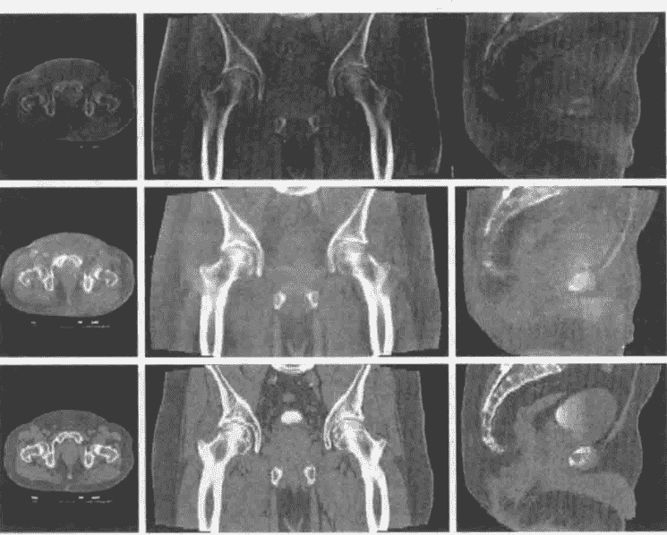

图 3-1 深度学习在 CT 成像中的应用

注：引用自参考文献(W Zhao et al., 2021)，版权经 Quant Imaging Med Surg 许可。

- **2. 人工神经网络的预测实力**

人工神经网络（ANN）模拟生物神经元结构：输入层（树突）、隐藏层计算（细胞体）、输出层传递（轴突），擅长处理非线性复杂关系。

**临床预测降维打击。** 传统评分量表（如 Ranson 标准）在重症急性胰腺炎（SAP）分层上局限性明显。引入 ANN 后，预测准确度显著超越传统工具，为早期干预、预后判断提供了精准坐标。

**高危手术获益显著。** 腹主动脉瘤（AAA）开放修复术围术期死亡率高。基于 ANN 的预测系统整合多维变量，院内死亡率预测准确率突破 95%，为个性化围术期管理、成本控制与风险规避提供了强力支撑。

#### （二）自然语言处理（NLP）：挖掘病历隐性价值

NLP 致力于打通人机自然语言沟通壁垒，是海量非结构化电子病历（EMR）结构化利用的钥匙。它不仅要识别医学专业术语，更要解析语法、语义、意图。临床实战中，NLP 可自动抽取病历关键短语，预警术后并发症。一项纳入 2974 例患者的研究证实：NLP 对急性肾损伤、深静脉血栓、肺炎、脓毒症及术后心梗等并发症的自动识别能力大幅跃升。

#### （三）计算机视觉（CV）：赋予 AI “慧眼”

CV 被誉为 AI 的视觉系统，通过数字化手段量化图像/视频特征（色彩、纹理、空间位置），识别统计学显著事件（如出血组织识别）。它极大增强了 AI 对视觉信息的理解深度，已从实验室走向临床实战。研究表明：CV 在腹腔镜胃切除术识别准确率达 92.8%，大幅提升术中信息获取量；亦可模拟复杂心脏运动学，辅助诊疗决策（见图 3-2）。综述文献指出，CV 辅助贯穿腹腔手术全周期：术中导航、机器人协作、人机交互、模拟培训、决策支持、术中引导，全方位提质增效。

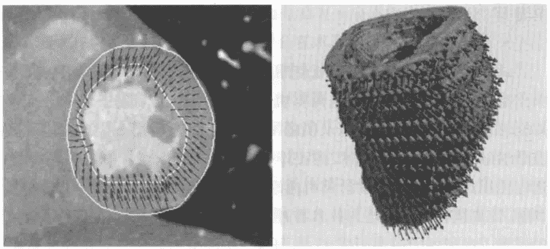

图 3-2 心脏左心室收缩期二维运动估计（左）与舒张期三维体积/运动估计（右）

注：引用自参考文献(J Olveres et al., 2021)，版权经 Quant Imaging Med Surg 许可。

##### 1. 术中导航：可视化解剖地图

导航系统融合术前影像与术中实景，实现坐标配准，帮助医生“透视”肉眼不可见的微细解剖结构（血管、神经），规避损伤风险。已广泛用于神经外科，并向肾上腺切除、脾切除、胰十二指肠切除、食管/肝切除等腹腔高难手术延伸。

##### 2. 机器人辅助手术：精细操作的延伸

以达·芬奇为代表的手术机器人，将医生手部动作经主控台映射为机械臂微操作，显著提升精细度与操控舒适度。循证医学证据显示：较开放手术，机器人手术减少止痛药用量、缩短住院日；前列腺切除术中优化尿控、降低器官损伤与阳性切缘率；妇科、结直肠领域亦展现独特优势。痛点在于：主机车体积大、灵活度受限、采购维护成本高昂，制约普及。

##### 3. 人机界面（HMI）与 VR 模拟培训：重塑学习曲线

HMI 作为人机信息交换的媒介，融合多模态交互（视觉、触觉、听觉）。结合 VR 触觉反馈，在肝/肺切除、神经外科、肾镜取石等培训中反馈良好。数据显示：接受 VR 系统化训练（含手术视频、解剖教学、围术期管理）的医生，疝修补术操作更快、并发症更低。三维可视化特别助力复杂解剖（如肝脏分段）的空间重构认知。

##### 4. 临床决策支持系统（CDSS）：驾驭数据洪流

面对爆发式增长的多源异构临床数据，CDSS 成为医生的“外脑”。团队开发的结肠癌预测模型整合海量临床病理数据，在个体生存率预测上表现卓越，印证了 CDSS 破解临床难题、辅助精准决策的高应用前景。

尽管 CV 临床落地仍处早期，但未来数年其应用边界必将持续外拓。

### 三、人工智能与其他领域的协同潜能：1+1>2

AI 子领域与外部技术模块的耦合，催生出指数级的创新可能。

#### （一）吻合口瘘风险智能预警：从“主观经验”到“数据驱动”

结直肠术后吻合口瘘发生率 5%-15%，与死亡率强相关，早期识别救命关天。传统依赖医生主观判断，准确率有限。北挪威大学医院团队融合数十万份电子病历（自由文本、血液检验、生命体征），构建多模态融合模型，显著提升预测性能，为床旁实时预警系统奠基，助力临床医生提前布防。

#### （二）机器人微创手术：重塑霍尔斯特德培训范式

百年前“看一个、做一个、教一个”的徒手传承模式，在微创机器人时代面临重构。机器人微创技术显著降低术后输血、呼吸并发症风险，同时将术者操作上限与学习效率双提升，倒逼外科培训体系革新。

#### （三）智能组织自主机器人（STAR）：向全自主手术迈进

现有机器人仍属“主从控制”，软组织手术高度依赖医生手眼协调，并发症风险难以归零。刚性组织可术前规划精准执行，但软组织弹性、变形、不可预测性极强，要求系统具备实时感知-决策-执行闭环。STAR 系统集成近红外荧光 3D 视觉追踪与轻量化机械臂，通过微透镜阵列实时重构三维场景，已在体外猪小肠吻合实验中成功验证自主性。这标志着从“辅助医生”向“自主执行”跨出关键一步。

**跨域融合是核动力。** 真正的全自主手术虽仍在远方，但多学科协同正加速到来。AI 的核心优势在于融合分析结构化（指标）与非结构化（病历、视频、影像）混合数据，支撑临床决策。正如自动驾驶源于机器人学、CV 与神经网络的三位一体，外科 AI 的未来必在于“先进机器人学 + 计算机视觉 + 神经网络 + 临床知识图谱”的深度耦合。外科医生应主动下场，参与 AI 质量评估与适用性验证，推动技术向临床实践良性落地。

### 四、人工智能的限制：清醒认知边界

技术演进遵循“期望-失望-改进-再期望”的螺旋上升规律。AI 旨在赋能而非全盘替代，唯有科学方向加严谨数据，方能善用。然任何技术皆有双刃剑效应，滥用误用必生风险。

#### （一）临床数据系统性收集：垃圾进，垃圾出

数据是 AI 的燃料。收集流程若存在系统性偏差（缺失、误录、选择偏倚），将直接污染模型输出，导致结论不可信。研究设计、执行、分析全链路质量决定证据等级。内部效度（因果推断的可信度）极易受干扰因素侵蚀，任何推理环节的微小偏差都可能放大为与真实值的巨大偏离。

#### （二）临床试验中的偏差

# 破解临床科研四大系统误差：AI 重塑外科协同新范式

严谨是临床科研的基石，然而选择、执行、度量、流失四大系统性偏差如同隐形暗礁，时刻威胁着结论的效度。

**入组偏差**源于随机化程序失守。当研究者将样本强行归入“典型模式”并过度赋权、忽略反证时，便会在随机噪音中幻视规律，导致预测系统性偏离。根源锁定在样本分配环节的扭曲。

**执行偏差**爆发于干预落地期。若实验组暗享额外疗法，即引入表现偏差。双盲设计（医者与受试者同盲）可有效拦截此风险，亦能消解安慰剂反应干扰。

**度量偏差**潜伏于结局采集与分析链条。推行统一规范的度量标准，辅以科学盲法，是筑牢防线的关键。

**流失偏差**源于受试者依从中断或失访造成的数据真空，进而扭曲结论。具体表现为：违背入组标准、拒遵医嘱（偏离方案）；主动退出、失联、因病情急变或严重不良事件被迫中止干预、因死亡被剔除分析（失访）。这些断点在数据链条上植入系统性误差。

大量实证证实，上述偏差确凿存在并曾颠覆试验结论。转视机器学习领域，有监督训练高度仰赖高质量标注样本，但高昂采集成本与低质标注构成双重瓶颈。曾有研究揭示：气胸病例影像中胸腔置管被误标为病变特征录入数据集，直观演绎了“垃圾进，垃圾出”隐患。算法责任归属、自动化分析的可靠性与可核验性，关乎人机信任基石，这些顾虑制约了智能技术从医疗到自动驾驶的落地，倒逼科学界持续深探。

### 五、智能技术与外科医师：协同进化的双向奔赴

AI 赋能外科首当其冲在于技能补位与决策增强。数据显示，病理学家借助智能工具将癌变淋巴结识别误诊率从 3.4% 压降至 0.5%；放射科与术者在乳腺高危病灶活检判读上的失准率亦显著下降。展望近期，AI 将贯穿诊疗全周期，扮演核心角色。

#### （一）手术全周期：智能系统的多维介入与价值释放

**术前部署：** AI 实现患者连续追踪监测，拓宽电子病案维度，不仅为手术方案输出精准的个性化风险打分，更为术后护理提供关键预测指标，夯实后续治疗基石。

**术中协同：** AI 与多模态设备联动，输出手术视野影像、实时生命体征流，为关键决策节点注入数据智能。

**术后闭环：** AI 持续随访预后反馈，在最大程度预警术后并发的同时，以实战数据反哺模型迭代。

**生态构建：** AI 可织就全球手术录像、病案知识共享网络，沉淀出“实践-技术”评估数据库。

**经济账本：** 大数据测算显示，智能技术每年可为全球医疗体系节省千亿级支出，强劲经济动力驱动技术演进。

#### （二）外科医师：智能演进的“关键推手”与核心受益者

手术 AI 的演进需医师主动创新驱动，而非被动等待技术成熟——终极红利终将回馈临床一线。

*   **数据供给侧改革：** 样本匮乏是模型性能天花板。医师应主动投身临床信息采集，提升模型预判精度。随清洗技术进步，注册库效用将外延至基因组、蛋白组、影像、病理等多维数据。
*   **跨界协作范式：** 作为核心利益相关方，医师应主动寻求与数据专家合作，挖掘新型临床信息形态，赋予数据临床可解释性。
*   **效率最大化：** 作为最大受益群体，医师牵头多学科协作，可将临床信息采集效率推向极致。
*   **沟通枢纽角色：** 面对患者的直接对话者身份，决定了医师在信息获取上的不可替代性。建立高效、高价值的医患交互渠道，是丰富数据、提升 AI 风险预判能力的源头工程。

### 小结：智能临床版图持续扩容，术者肩负领航使命

从数据体系搭建到术中影像智能解析，AI 临床应用版图持续扩容：有监督/无监督/强化训练重塑数据分析范式；深度神经网络强化风险预判；NLP 技术挖掘电子病案识别术后不良事件；CV 技术提升手术精度；多领域协同催生新可能。AI 临床图景远未到边界——无论是技能补位还是决策增强，它都将通过性能迭代，双向优化患者护理体验与医生工作流程。外科医师的特殊定位，赋予其引领智能技术向善演进、推动医疗事业高质量发展的责任与使命。

### 思考与练习

1.  机器学习的核心范式包含哪四类？
2.  当前 AI 是否具备替代外科医师实施自主手术的能力？
3.  AI 在外科手术应用中仍面临哪些现实瓶颈？
4.  AI 在外科领域尚有哪些待挖掘的应用图景？

### 参考文献

- [1] A Monsalve-Torra, D Ruiz-Fernandez, O Marin-Alonso, et al. Using machine learning methods for predicting in-hospital mortality in patients undergoing open repair of abdominal aortic aneurysm. J Biomed Inform, 2016, 62: 195–201.
- [2] A Pandya, L Reisner, B King, et al. A review of camera viewpoint automation in robotic and laparoscopic surgery. Robotics, 2014, 3(3): 310–329.
- [3] B B Yarlagadda, M S Russell, G A Grillone. In robotic surgery of the head and neck. G. A. Grillone, S. Jalisi, Eds, 2015, 1: 1–11.
- [4] B Zendejas, D A Cook, J Bingener, et al. Simulation-based mastery learning improves patient outcomes in laparoscopic inguinal hernia repair: a randomized controlled trial. Ann Surg, 2011, 254(3): 502–509.
- [5] C Pape-Koehler, C Chmelik, A M Aslund, et al. An interactive and multimedia-based manual of surgical procedures: Webop: an approach to improve surgical education. Zentralbl Chir, 2010, 135(5): 467–471.
- [6] C Robertson, A Close, C Fraser, et al. Relative effectiveness of robot-assisted and standard laparoscopic prostatectomy as alternatives to open radical prostatectomy for treatment of localised prostate cancer: a systematic review and mixed treatment comparison meta-analysis. BJU Int, 2013, 112(6): 798–812.
- [7] D Moher, B Pham, A Jones, et al. Does quality of reports of randomised trials affect estimates of intervention efficacy reported in meta-analyses? Lancet, 1998, 352: 609–13.
- [8] E A Murphy. The logic of medicine. Baltimore: Johns Hopkins University Press, 1976.
- [9] G E Hinton, S Osindero, Y-W Teh. A fast learning algorithm for deep belief nets. Neural Comput, 2006, 18: 1527–1554.
- [10] G P Moustris, S C Hiridis, K M Deliparachos, et al. Evolution of autonomous and semi-autonomous robotic surgical systems: A review of the literature. Int. J. Med. Robot, 2011, 7: 375–392.
- [11] G R Sutherland, S Wolfsberger, S Lama, et al. The evolution of neuroArm. Neurosurgery, 2013, 72: A27–A32.
- [12] H G Kenngott, J Neuhaus, B P Muller-Stich, et al. Development of a navigation system for minimally invasive esophagectomy. Surg Endosc, 2008, 22(8): 1858–1865.
- [13] H G Kenngott, L Fischer, F Nickel, et al. Status of robotic assistance: a less traumatic and more accurate minimally invasive surgery? Langenbeck's Arch Surg, 2012, 397(3): 333–341.
- [14] H J Murff, F FitzHenry, M E Matheny, et al. Automated identification of postoperative complications within an electronic medical record using natural language processing. JAMA, 2011, 306: 848–855.
- [15] J Eberhardt, A Bilchik, A Stojadinovic. Clinical decision support systems: potential with pitfalls. J Surg Oncol, 2012, 105(5): 502–510.
- [16] J H Ranson, K M Rifkind, D F Roses, et al. Prognostic signs and the role of operative management in acute pancreatitis. Surg Gynecol Obstet, 1974, 139: 69–81.
- [17] J J Rassweiler, M Muller, M Fangenerau, et al. iPad-assisted percutaneous access to the kidney using marker-based navigation: initial clinical experience. Eur Urol, 2012, 61(3): 628–631.
- [18] J Marescaux, F Rubino, M Arenas, et al. Augmented-reality-assisted laparoscopic adrenalectomy. JAMA, 2004, 292(18): 2214–2215.
- [19] J Olveres, G González, F Torres, et al. What is new in computer vision and artificial intelligence in medical image analysis applications. Quant Imaging Med Surg, 2021, 11(8): 3830–3853.
- [20] K F Schulz, I Chalmers, R J Hayes, et al. Empirical evidence of bias. Dimensions of methodological quality associated with estimates of treatment effects in controlled trials. JAMA, 1995, 273: 408–412.
- [21] L L Kjaergard, J Villumsen, C Gluud. Quality of randomised clinical trials affects estimates of intervention efficacy. Proceedings of the 7th Cochrane colloquium. Universita S. Tommaso D'Aquino, Rome. Milan: Centro Cochrane Italiano, 1999: 57 (poster B10).
- [22] L W Nifong, V F Chu, B M Bailey, et al. Robotic mitral valve repair: Experience with the da Vinci system. Ann. Thorac. Surg, 2003, 75, 438 - 443.
- [23] L Zappella, B Béjar, G Hager, et al. Surgical gesture classification from video and kinematic data. Ann Surg, 2018, 268(1): 70 - 76.
- [24] M Kranzfelder, C Staub, A Fiolka, et al. Toward increased autonomy in the surgical OR: needs, requests, and expectations. Surg Endosc, 2013, 27 (5): 1681 - 1688.
- [25] M Muller, M C Rassweiler, J Klein, et al. Mobile augmented reality for computer-assisted percutaneous nephrolithotomy. Int J Comput Assist Radiol Surg, 2013, 8 (4): 663 - 675.
- [26] M Remacle, V M N Prasad, G Lawson, et al. Transoral robotic surgery ( TORS) with the Medrobotics Flex™ System: First surgical application on humans. Eur. Arch. Otorhinolaryngol, 2015, 272: 1451 - 1455.
- [27] M Volkov, D A Hashimoto, G Rosman, et al. Machine Learning and Coresets for Automated Real-Time Video Segmentation of Laparoscopic and Robot Assisted Surgery. IEEE International Conference on Robotics and Automation, Singapore, 2017: 754 - 759.
- [28] N Hirst, J Tiernan, P Millner, et al. Systematic review of methods to predict and detect anastomotic leakage in colorectal surgery. Colorectal Dis, 2014, 16 (2): 95 - 109.
- [29] P Jüni, D Tallon, M Egger. “Garbage in-garbage out”? Assessment of the quality of controlled trials in meta-analyses published in leading journals. Proceedings of the 3rd symposium on systematic reviews: beyond the basics, St Catherine’s College, Oxford. Oxford: Centre for Statistics in Medicine, 2000: 19.
- [30] R M Mitchell, M F Byrne, J Baillie. Pancreatitis. Lancet, 2003, 361: 1447 - 1455.
- [31] R Modifi, M D Duff, K K Madhavan, et al. Identification of severe acute pancreatitis using an artificial neural network. Surgery, 2007, 141: 59 - 66.

### 第四章 膀胱癌遇见AI：重塑诊疗新范式

#### 本章核心看点
- 洞察膀胱癌诊疗现状的痛点与困局；
- 解读人工智能如何赋能精准诊断；
- 探究AI在分子分型与个性化治疗中的关键作用；
- 前瞻智能手术系统在围术期管理中的应用前景。

---

### 一、 破局：为何我们需要“智慧”的介入？

癌症早已跃居全球第二大死因，如同达摩克利斯之剑，悬在人类健康头顶。它带来的打击是双重的：沉重的心理阴霾与难以承受的经济重压。难怪大众“谈癌色变”，仿佛确诊即判了“死刑”。

在泌尿系恶性肿瘤中，膀胱癌极为常见，更棘手的是其“顽固”的复发特性——五年复发率高达 80%。反复发作、反复治疗，让膀胱癌成为实体瘤中人均治疗成本最高的疾病，无数家庭因此陷入贫困。破解这一死局，关键在于三个“精准”：早期精准发现、手术精准切除、术后精准监测。

科技浪潮滚滚向前，人工智能（AI）已渗透进生活的毛细血管，在肿瘤精准医疗领域更是硕果累累。本章将深度解析 AI 如何在膀胱癌诊疗全流程中大显身手，带来颠覆性变革。

膀胱癌高复发的“三大拦路虎”分别是：术前早筛难、术中净切难、术后监测难。虽然共聚焦内窥镜、光学相干断层扫描（OCT）等新型成像技术，以及荧光膀胱镜联合造影剂，已显著提升检出率与切除率，但它们终究逃不开“侵入式”标签。术后常规膀胱镜随访，让患者反复经历生理痛苦与心理恐惧，极大限制了临床推广。

临床呼唤一种“无创、高敏、高特”的“神器”。大数据时代下，机器学习、深度学习等 AI 核心技术应运而生。影像组学挖掘微观特征，提升微小病灶识别与术中切除精度；深度模型构建复发预警体系，实现智能化动态监测，大幅减少有创操作带来的创伤。可以说，AI 为膀胱癌诊疗装上了理想的翅膀，正推动着术前、术中、术后的全链条革命。

---

### 二、 现状扫描：膀胱癌诊疗的“三高”困境与短板

膀胱癌以“高发病、高死亡、高复发”著称，五年复发率区间 50%~80%。病理上 90% 以上为尿路上皮癌，余为鳞癌、腺癌等；少数源自间叶组织（如横纹肌肉瘤，好发于儿童）。按浸润深度分为非肌层浸润性（NMIBC，含 Tis、Ta、T1）与肌层浸润性（MIBC，≥T2）两大阵营，治疗策略截然不同。

**筛查诊断“工具箱”虽满，却各有短板：**
- **尿脱落细胞学**：无创便捷，但准确率低，易受炎症干扰；
- **超声**：首选筛查，仅能捕捉 >0.5cm 病灶；
- **CT/MRI**：分期分级主力，擅长判断浸润深度及转移，却难辨炎性改变、原位癌等早期微小病变；
- **膀胱镜+活检**：公认“金标准”，直观全面，且经历了白光→荧光→窄带光谱（NBI）的进化，非肌层浸润癌识别率超 80%。

**但痛点依然尖锐：**
1.  **有创困境**：膀胱镜随访频次高，患者身心俱疲，依从性差；
2.  **活检局限**：采样有盲区、有滞后、有风险（可能促进播散），且晚期转移患者单一部位组学难代表全貌。

**治疗端同样面临抉择难题：**
NMIBC 主攻经尿道电切（TURBT）+ 膀胱灌注；MIBC 需行根治性切除 ± 新辅助/辅助化疗。手术方式高度依赖诊断精度，而疾病异质性导致分期分型动态变化，极易造成“治疗不足”或“过度治疗”。术后辅助疗法只能延缓复发，难以根治。面对重重不确定性，新诊疗模式刻不容缓。

---

### 三、 AI 赋能：从“辅助工具”到“核心引擎”

#### （一） 精准诊断：让影像“会说话”，让病理“零漏诊”

AI 融合计算机科学、语言学、哲学等多学科，已成医疗健康领域“智能影像、智能病理、智能决策”三大支柱。2020 年工博会上，健康智能机器人 2 分钟完成全身系统风险评估，生动诠释了 AI 的速度与精度。机器学习是核心，深度学习更模拟人类视听思维，攻克复杂模式识别，重塑临床决策流程。

**1. 放射组学：无创活检的“虚拟探针”**
2012 年 Philippe Lambin 提出“放射组学”概念，将医学影像转化为可量化的高维数据，挖掘基于影像的生物标志物。相较物理活检，它具备**全肿瘤覆盖、可重复无创、反映微环境与异质性**的独特优势。

实战成果斐然：
- **CT/MRI 纹理特征 + 机器学习**：三维分析膀胱壁弥散加权/ADC 图像，术前无创区分癌与正常组织，精准刻画异质性分布，助力分级诊断；
- **MRI 纹理入模**：术前区分高低级别膀胱癌，准确率达 **83%**；
- **CT 深度学习**：精准预测肌层浸润情况，辅助临床分期；
- **纳米级原子力显微镜 + AI**：扫描尿液脱落细胞，诊断率高达 **94%**，远超常规膀胱镜；
- **膀胱镜 AI 靶向活检**：深度卷积神经网络 (CNN) 标记可疑阳性区，引导“精准打击”，大幅降低盲区漏诊率；
- **病理图像深度学习**：HE 染色片上构建 NMIBC 分类器，AUC、灵敏度、特异度均破 **90%**，有效遏制漏诊误诊；
- **代谢组学 + 机器学习**：超高效液相-质谱分析尿液代谢物/标志物，建模表现优异。

**2. 端到端分期分级模型：告别人工选特征**
基于 T2WI 的残差网络 (ResNet) 双任务模型，分期、分级预测准确率分别达 **82% 与 79%**。端到端架构免去手工特征工程，性能超越传统流程，临床落地价值显著。

> **小结**：AI 辅助诊断已广泛渗透泌尿领域，虽仍在进化中，但随着技术迭代，其核心地位将愈发稳固。

#### （二） 分子分型：解锁精准治疗的“隐藏密钥”

精准医疗核心在于“因人制宜”，分子亚型是连接预后与疗效的关键桥梁。同一肿瘤，不同亚型对同一方案反应天差地别，精准分型 = 避免无效/过度治疗。

膀胱癌分子分型探索从未停歇：1999 年概念提出后，经历 Ki-67/FGFR3 双标记 → 免疫组化 → 基因测序聚类分析。聚焦 MIBC，主流分型体系包括：贝勒/北卡二分法、MD安德森三分法、TCGA 四分法、瑞典隆德五分法等。

**分型指导临床决策的铁证：**
- **化疗反应性差异**：三分法下，基底样侵袭性强但**化疗敏感**，新辅助化疗显著延长 5 年生存；p53 样**强耐药**，宜选免疫/靶向治疗。
- **免疫治疗预测**：阿特珠单抗研究显示，TCGA-II 型有效率 34%，I 型仅 10%，揭示免疫微环境本质差异。
- **T1 期精细化分层**：167 例免疫组化分析将 T1 期分为低风险基底样、高风险基因不稳定型、鳞癌样，为检查点抑制剂疗效评估提供新坐标。

**AI 深度学习：从 HE 切片“读”出分子密码**
- **直接预测分子亚型**：苏木精-伊红 (HE) 切片输入深度模型，输出 MIBC 分子分型，与预后高度相关，前景广阔；
- **预测 FGFR3 突变及异质性**：算法直读切片，精准捕捉突变状态及肿瘤内异质性；
- **实战价值**：基底鳞状亚型对顺铂方案高敏，术前预知即获益。

虽成果振奋，临床规模化应用仍待时机。随深度学习算力与数据积累，AI 终将成为分子分型“超级阅卷人”，助力医生制定真正个性化的“专属处方”。

#### （三） 智能手术：从“经验医学”迈向“数据医学”

达·芬奇机器人已成泌尿外科标配，尤其在膀胱全切+原位新膀胱重建中优势碾压腹腔镜：术中/术后并发症率仅 **7% / 21%**，显著优于传统腔镜。AI 与机器人深度融合，正重塑手术全流程。

##### 1. 术前“飞行模拟器”：AI 虚拟训练系统
传统培训靠解剖书本 + 临床摸索，周期长、风险高、难复现复杂解剖。
**AI 智训系统**引入虚拟助手，术前实时纠偏、术中机器人稳定操作，**双管齐下提升精度、降低并发症、缩短住院**。年轻医生学习曲线大幅压缩，成效跃升。

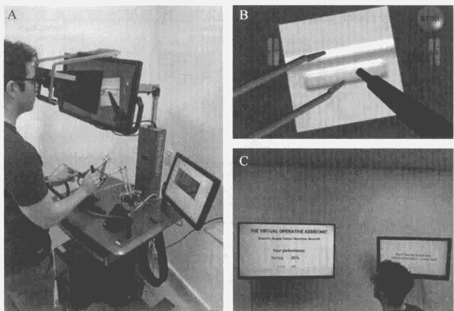

图 4-1 基于 AI 的手术培训体系
注：引用自参考文献 N Mirchi et al., 2020, 版权经 the Public Library of Science 许可。

##### 2. 术中“智慧导航”与个性化规划
手术方式选择向来依赖专家经验，新手面对复杂病例如履薄冰。**AI + 大数据比对 + 个体参数建模** = 定制化手术方案。术前在虚拟环境中“排练”高危复杂病例，预判风险、优化路径。这不仅托底安全率，更赋予患者极致的个性化诊疗体验。

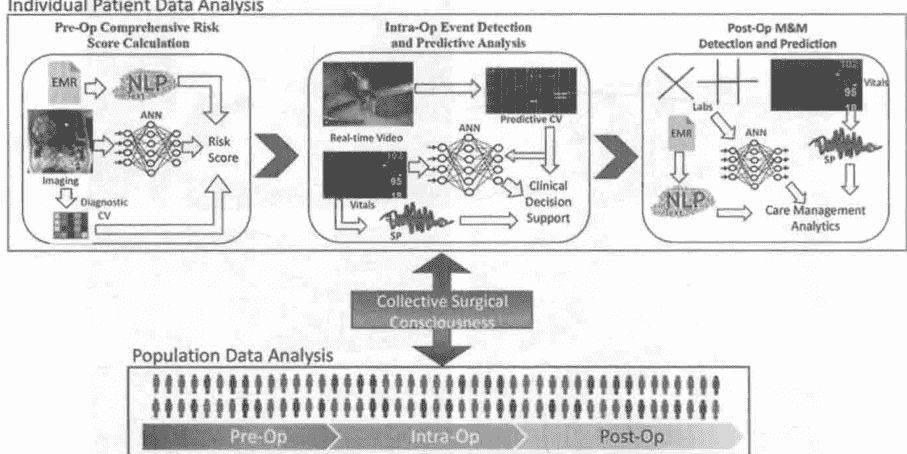

图 4-2 AI 赋能围术期全流程管理
注：引用自参考文献 (D A Hashimoto et al., 2018)，版权经 Annals of Surgery 许可。

---

**本章小结**：从影像筛查到分子解码，从虚拟训练到实战导航，AI 正以不可阻挡之势，将膀胱癌诊疗从“经验驱动”推向“数据驱动”、“智能驱动”。这场变革，关乎每一位患者的生存质量与尊严，也标志着泌尿肿瘤学迈入了全新的智能纪元。

### 智能技术重塑膀胱肿瘤诊疗全景：从微创手术到精准预后的范式跃迁

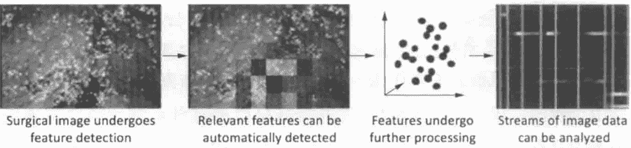

**图 4-3 术中智能视角下的病灶精准定位**

*注：图片来源经Annals of Surgery授权引用（D A Hashimoto et al., 2018）。*

得益于智能算法的迭代升级，机器人辅助导航平台正深度重构癌症外科版图，为临床专家开辟全新机遇。此类系统不仅能优化术中操作判断，更能有效规避视野盲区引发的风险，将非必要组织损伤降至最低。

#### (四) 智能模型赋能术前药物敏感性预判，推动分层治疗落地

药物治疗作为膀胱恶性肿瘤长程管理的基石，地位不可替代。依据肌层侵犯深度，该病分为非肌层浸润型（NMIBC）与肌层浸润型（MIBC）两大谱系。NMIBC常规实施经尿道切除联合腔内灌注（如BCG、表柔比星），然复发率仍高达50%-80%，部分病例更会进展为MIBC，迫使患者长期接受镜检动态监测。可手术切除的MIBC标准范式为“术前药物降期+根治性切除+尿路重建”，不可切除者则以姑息性放药为主。显然，药物贯穿诊疗全周期。

术前药物降期能降低分期分级，为原本失去手术窗口的患者创造切除良机，同时清除微小转移灶，显著延长生存获益。循证证实，药物联合手术显著优于单纯手术。然而，个体对药物的敏感性差异巨大，亟需一种“赛前”预判工具，指导精准分层用药。

2019年，Phillip Palmbos团队构建了基于CT影像的智能决策辅助系统（CDSS-T），融合深层卷积网络（DL-CNN）与影像组学特征，专攻MIBC术前药物反应评估。该系统可为无应答者提供非侵入、客观、可复现的决策参考，助力早期停药规避无效毒性。虽前景广阔，但受限于样本量不足、缺乏独立队列验证，模型泛化能力受限，目前仅能作为医师决策的参考辅助，而非唯一金标准。未来需扩充多中心样本、迭代算法架构，提升模型在新场景下的鲁棒性。可预见，更多高灵敏度模型将涌现，精准赋能药物反应预判，推动诊疗迈入“千人千方”时代。

#### (五) 智能算法重构复发与长远结局预判新范式

精准预判再发风险与长远结局，是医患双方的核心诉求。长期以来，缺乏高灵敏标志物与智能工具，导致依赖传统统计学手段的预后评估精度有限，难以满足临床精准化需求。

智能技术在此领域展现核心优势。类脑网络（ANN）与神经因子分解机（NFM）擅长捕捉非正态人群中变量间的非线性复杂关联，为个体化风险分层提供可能。

*   **NFM实证：** 有团队利用609例根治性切除伴盆腔淋巴结清扫患者的临床病理数据训练NFM模型，中位随访72月，模型识别再发准确度84%，灵敏度81%，特异度85%。
*   **ANN生存预测：** 另一研究基于369例患者数据构建ANN预测5年总生存率（OS），随访48月，其灵敏度与特异度均显著优于传统Logistic回归。
*   **大规模队列对决：** 基于SEER库16万余例大样本研究显示，ANN预测总生存AUC达0.81，显著超越Cox比例风险模型（0.70）；疾病特异性生存（DSS）预测两者相当（AUC均约0.80）。
*   **人机较量：** 有研究直接对比ANN与资深专家，发现ANN预测肌层浸润型死亡事件准确率82%，远超专家组65%；但在浅表癌再发预测上，两者旗鼓相当（75% vs 79%）。

这些证据表明，智能技术正试图打破传统病理分期统计学的局限，建立个性化预后算法。机器学习允许对海量高维数据进行动态复杂建模，输出可靠的个体化预测。但警惕“过度拟合”陷阱至关重要——模型在训练集高歌猛进，在外部测试集却水土不服，临床价值归零。独立验证是检验模型“泛化能力”的试金石。

展望未来，机器学习将深度渗透内镜检查、影像解读、预后算法等多维场景。跨学科（外科、影像科、病理科、肿瘤科）协作将成为智能工具的最佳试验田，有望填补专科知识鸿沟，重塑决策流程。但“机器判断能否完全替代人类审查”仍是悬而未决的伦理与科学命题，我们须在深度解析模型“黑箱”机制、严格验证预测效能的前提下，审慎推进。

### 总结

近年，智能技术凭借在医疗版图的核心驱动力，成为膀胱恶性肿瘤诊疗的焦点。面对“高发、高死、高复发”三大挑战，智能技术提供了全流程决策支持：融合影像组学实现高精度诊断、结合病理AI明确分级分期规避过度/无效治疗、赋能术前规划与术中导航保障手术安全、构建大数据预测模型实现再发预后动态监测。未来，随着算法迭代与实证积累，智能技术将进一步确证其临床价值，进化为医师诊疗决策的“最强大脑”。

### 思考与实践

1.  智能技术的技术版图包含哪些核心板块？
2.  智能技术在膀胱恶性肿瘤诊疗全周期（筛查、诊断、治疗、随访）的具体落地场景有哪些？
3.  当前医疗智能技术面临的“阿喀琉斯之踵”（核心短板）是什么？
4.  膀胱恶性肿瘤临床诊疗中最迫切待解的痛点问题有哪些？
5.  展望未来，智能技术在该领域尚有哪些蓝海待开发？

### 参考文献

[1] 何天基,葛波.肌层浸润性膀胱癌新辅助治疗现状及展望.临床泌尿外科杂志,2020,35(2):158-161.
[2] 姜啸烨,高闫尧,孙振业,等.机器人膀胱切除原位回肠盲新膀胱重建术治疗肌层浸润性膀胱癌的临床分析.现代泌尿外科杂志,2020,25(12):1099-1102.
[3] 杨龙雨禾,王跃强,邱学德,等.人工智能在泌尿外科影像学诊断的现状及展望.分子影像学杂志,2020,43(2):225-229.
[4] 郑尧,张烨,杜鹏,等.基于T2W磁共振影像的ResNet模型构建在膀胱癌分级和分期双目标预测中的应用研究.中国医学装备,2020,17(8).
[5] A Buchner, M May, M Burger, et al. Prediction of outcome in patients with urothelial carcinoma of the bladder following radical cystectomy using artificial neural networks. Eur J Surg Oncol, 2013; 39(4): 372-379.
[6] A Ikeda. Support system of cystoscopic diagnosis for bladder cancer based on artificial intelligence. Endourology, 2020, 34: 352–358.
[7] A O Kadlec, S Ohlander, J Hotaling, et al. Nonlinear logistic regression model for outcomes after endourologic procedures: a novel predictor. Urolithiasis, 2014. 42(4): 323–327.
[8] C H Shao, C L Chen, J Y Lin, et al. Metabolite marker discovery for the detection of bladder cancer by comparative metabolomics. Oncotarget, 2017, 8(24): 38802–38810.
[9] D A Hashimoto, G Rosman, D Rus, et al. Artificial intelligence in surgery: promises and perils. Annals of surgery, 2018, 268(1), 70–76.
[10] E Arvaniti, KS Fricker, M Moret, et al. Automated Gleason grading of prostate cancer tissue microarrays via deep learning. Sci Rep, 2018. 8(1): 12054.
[11] E Wu, L M Hadjiiski, R K Samala, et al. Deep learning approach for assessment of bladder cancer treatment response. Tomography, 2019. 5(1): 201–208.
[12] E Wu, L M Hadjiiski, R K Samala, et al. Deep Learning Approach for Assessment of Bladder Cancer Treatment Response. Tomography, 2019; 5(1): 201–208.
[13] G J Bartsch, A P Mitra, S A Mitra, et al. Use of artificial intelligence and machine learning algorithms with gene expression profiling to predict recurrent nonmuscle invasive urothelial carcinoma of the bladder. J Urol, 2016, 195(2): 493–498.
[14] Global cancer statistics 2020: GLOBOCAN estimates of incidence and mortality worldwide for 36 cancers in 185 countries. CA Cancer J Clin.
[15] G Zhang, Z Wu, L Xu, et al. Deep learning on enhanced CT Images can predict the muscular invasiveness of bladder cancer. Front Oncol, 2021, 11: 654685.
[16] H Coy, K Hsieh, W Wu, et al. Deep learning and radiomics; the utility of Google TensorFlow™ Inception in classifying clear cell renal cell carcinoma and oncocytoma on multiphasic CT. Abdom Radiol (NY), 2019. 44(6): 2009–2020.
[17] H C Shin, H R Roth, M Gao, et al. Deep Convolutional Neural Networks for computer-aided detection: CNN architectures, dataset characteristics and transfer learning. IEEE Trans Med Imaging, 2016; 35(5): 1285–1298.
[18] I Sokolov, M E Dokukin, V Kalaparthi, et al. Noninvasive diagnostic imaging using machine learning analysis of nano resolution images of cell surfaces: Detection of bladder cancer.Proceedings of the National Academy of Sciences, 2018, 115(51): 12920–12925.
[19] J Ding, Z Xing, Z Jiang, et al. CT-based radiomic model predicts high grade of clear cell renal cell carcinoma. Eur J Radiol, 2018. 103: 51–56.
[20] K H Cha, L Hadjiiski, H P Chan, et al. Bladder cancer treatment response assessment in CT using Radiomics with Deep-Learning. Sci Rep, 2017; 7(1): 8738.
[21] K H Cha, L M Hadjiiski, R H Cohan, et al. Diagnostic accuracy of CT for prediction of bladder cancer treatment response with and without Computerized Decision Support. Acad Radiol, 2019; 26(9): 1137 – 1145.
[22] K H Cha, L M Hadjiiski, R H Cohan, et al. Diagnostic accuracy of CT for prediction of bladder cancer treatment response with and without computerized decision support. Acad Radiol, 2019. 26(9): 1137 – 1145.
[23] L Yan, Z Liu, G Wang, et al. Angiomyolipoma with minimal fat: differentiation from clear cell renal cell carcinoma and papillary renal cell carcinoma by texture analysis on CT images. Acad Radiol, 2015. 22(9): 1115 – 1121.
[24] M Långkvist, J Jendeberg, P Thunberg, et al. Computer aided detection of ureteral stones in thin slice computed tomography volumes using Convolutional Neural Networks. Comput Biol Med, 2018. 97: 153 – 160.

**参考文献**

- [25] M S Choo, S Uhmm, J K Kim 等. 基于机器学习算法预测单次体外冲击波碎石术治疗输尿管结石无结石率的模型构建. *J Urol*, 2018, 200(6): 1371–1377.
- [26] N Brieu, C G Gavriel, I P Nearchou 等. 机器学习实现肿瘤芽基自动定量，辅助 TNM 分期优化肌层浸润性膀胱癌预后判断. *Sci Rep*, 2019, 9(1): 5174.
- [27] N C Wong, C Lam, L Patterson 等. 应用机器学习预测机器人辅助根治性前列腺切除术后早期生化复发. *BJU Int*, 2019, 123(1): 51–57.
- [28] N Mirchi, V Bissonette, R Yilmaz 等. 虚拟手术助手：一款面向手术与医学模拟训练的可解释人工智能工具. *PloS one*, 2020, 15(2): e0229596.
- [29] O Eminaga, N Eminaga, A Semjonow 等. 基于深度卷积神经网络的膀胱镜图像诊断分类研究. *JCO Clin Cancer Inform*, 2018, 2: 1–8.
- [30] R Suarez-Ibarrola, S Hein, G Reis 等. 机器学习与深度学习在泌尿外科的现状与未来：聚焦尿石症、肾细胞癌、膀胱癌及前列腺癌的文献综述. *World J Urol*, 2020, 38(10): 2329–2347.
- [31] X P Xu, X Zhang, Q Tian 等. 基于 MRI 强度图与高阶导数图的三维纹理特征，用于区分膀胱肿瘤与壁组织. *Int J Comput Assist Radiol Surg*, 2017, 12(4): 645–656.
- [32] X Xu, X Zhang, Q Tian 等. 基于 MRI 强度图与高阶导数图的三维纹理特征，用于区分膀胱肿瘤与壁组织. *Int J Comput Assist Radiol Surg*, 2017, 12(4): 645–656.
- [33] X Zhang, X Xu, Q Tian 等. 基于扩散加权成像纹理特征的放射组学评估膀胱癌分级. *J Magn Reson Imaging*, 2017, 46(5): 1281–1288.
- [34] Y Kazemi, S A Mirroshandel. 一种基于集成学习预测肾结石类型的新方法. *Artif Intell Med*, 2018, 84: 117–126.
- [35] Z Zhang, W Fan, Q Deng 等. 循环肿瘤细胞在膀胱癌及上尿路上皮癌中的预后与诊断价值：基于 30 项已发表研究的荟萃分析. *Oncotarget*, 2017, 8(35): 59527–59538.

（本章撰稿：王子琦 李弘 杨力明）

---

### 第五篇章 人工智能赋能神经退行性疾病诊疗新范式

#### 本章核心学习指引

研习本章后，你将能够：

- 1. 熟悉神经退行性疾病的核心病理特征。
- 2. 掌握该类疾病主流的诊断与干预手段。
- 3. 理解人工智能技术在辅助诊断神经退行性疾病方面的独特优势。
- 4. 洞察脑机接口（BCI）技术在医疗版图中的应用前景。
- 5. 把握脑机接口技术在神经退行性疾病治疗领域的演进趋势。

#### 一、 引言：困局与破局

在人类与疾病的长期博弈中，神经退行性疾病（Neurodegenerative Disease, NDD）是一类极具挑战性的“隐形杀手”。其病理基础在于脑脊髓神经元的进行性、不可逆退化——鉴于中枢神经系统神经元缺乏再生潜能，一旦发生大规模损伤，便会引发毁灭性的功能永久丧失。如何实现彻底治愈或有效遏制病情，始终是科学家攻关的核心难题。

尽管医学进步显著延长了人类寿命，但以阿尔茨海默病（AD）、帕金森病（PD）为代表的神经退行性疾病，目前仍处于“对症不治本”的阶段。海量科研投入虽推动了认知边界，但在发病机制解析与药物研发上，人类却遭遇前所未有的瓶颈。不过，随着生物医药与计算机智能技术的深度融合，攻克这一堡垒的曙光正在显现。

**人口老龄化催生的流行病学危机**
步入新世纪，全球老龄化浪潮汹涌。我国已正式迈入老龄化社会：当前 60 岁以上老人超 1.26 亿，预计本世纪中叶将突破 4 亿大关。这一人口结构变迁直接推高了 AD、PD 等老年高发疾病的患病基数。数据显示，美国 AD 患者约 600 万，年均耗资数百亿美元；流行病学调查指出，65 岁以上人群 AD 患病率约 10%，女性占比近 2/3。PD 作为第二大高发病种，65 岁以上人群患病率约 1%。而亨廷顿病（HD）、脊髓小脑共济失调（SCA）、肌萎缩侧索硬化（ALS）等疾病，发病率则无显著年龄倾向。

**神经退行性疾病的“六大共性痛点”**
AD 与 PD 等典型疾病呈现显著共性：
1.  病因复杂：涉及多基因缺陷、表观遗传、脑血管功能障碍及环境因素交织；
2.  年龄依赖性强：发病率随年龄并行攀升；
3.  病程隐匿漫长：神经变性早始于生命早期，临床症状却延后数十年爆发；
4.  蛋白病理核心：特定蛋白构象改变导致神经毒性产物异常沉积；
5.  早期生物标志物匮乏：缺乏精准预测与早筛工具；
6.  病愈疗法缺位：目前均无治愈性方案。

**AI 与 BCI：双引擎驱动诊疗变革**
近年 AI 浪潮涌动，以机器学习（ML）为核心的计算方法正重塑诊疗流程——从疾病特征捕捉、鉴别诊断优化、病程量化追踪到药物疗效监测，均可实现自动化或智能化辅助。

同时，神经功能受损导致的运动、认知、社交障碍严重降低患者生活质量。脑机接口（Brain Computer Interface, BCI）作为颠覆性交互技术，打破了对外周神经肌肉通路的依赖，建立起大脑与外部设备的直连通道。借助 AI 对神经信号的深度解码，BCI 可实现运动意图的外部执行，扮演替代、改善、重建、增强等多重角色，为神经肌肉损伤人群打开新世界。

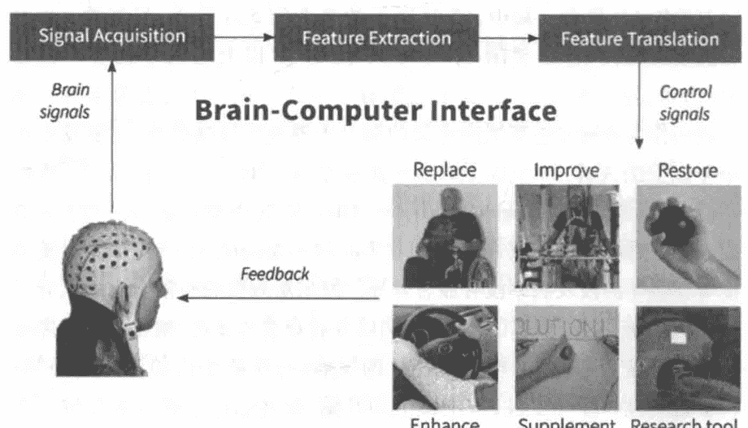

图 5-1 脑机接口应用场景示意（图片来源：http://www.engineering.com）

BCI 系统可填补因伤病导致的功能缺失（如 PD 震颤、ALS 萎缩）。大脑作为人体最精密器官，解码其奥秘关乎自我认知。脑科学由此成为战略制高点。2013 年以来，中美欧日等纷纷启动“脑计划”，融合神经科学、信息学与脑科学，致力于绘制脑图谱、研发神经调控工具、解析神经-行为关联。BCI 作为核心抓手，其神经调控潜力为 AD、PD、癫痫等难治性疾病开辟了全新治疗赛道。

#### 二、 神经退行性疾病谱系解析

神经退行性疾病本质上是脑脊髓神经元渐进式退化的综合征。按表型分，主要落入两大阵营：**运动机能受损型**（如 ALS、小脑共济失调）与**认知记忆衰退型**（以 AD 为代表）。按病程节奏分，则可分为**急性**（脑缺血、脑损伤、癫痫）与**慢性**（AD、PD、HD、ALS、SCA、Pick 病等）两类。尽管临床表征、病理部位、病因各异，但无一例外指向神经元的病变与凋亡。以下聚焦四大高发典型病种。

##### （一） 阿尔茨海默病：记忆的“橡皮擦”

AD 起病隐匿、进展缓慢，是痴呆谱系中最常见病种，女性发病率显著高于男性。核心表现为记忆衰退、认知持续下降、运动障碍及精神行为异常。病程常分三期：
- **早期**：近记忆减退、社交退缩、判断力减弱、执行功能受损、定向力障碍；
- **中期**：精神行为异常显性化（易怒、妄想、重复言语）、生活自理能力下降、语言理解表达受阻、甚至不识亲人；
- **晚期**：语言自理全面丧失、长期卧床。

**病理标志**：β-淀粉样蛋白（Aβ）沉积形成老年斑、过度磷酸化 Tau 蛋白聚集成神经原纤维缠结，二者协同驱动突触功能失调与神经元凋亡。
**病因拼图**：确切分子机制未明，公认多因素共同作用。主流假说涵盖：Aβ 假说、Tau 蛋白病理、金属代谢/信号转导异常、钙稳态失衡、氧化应激/凋亡、APP/PSEN/ApoE 基因变异、免疫炎症、激素水平变化、线粒体功障、神经营养因子缺乏、代谢紊乱及遗传易感性等。

##### （二） 帕金森病：运动的“减速带”

PD 位居第二，好发于 50 岁后，65 岁后达高峰，男性多于女性。
**核心病理**：中脑黑质致密部（SNpc）多巴胺能神经元选择性消亡，致纹状体多巴胺（DA）枯竭。DA 缺乏引发基底节环路失衡：纹状体对内侧苍白球（GPi）抑制减弱 → GPi 对丘脑过度抑制 → 丘脑对运动皮层驱动不足，最终导致运动功能受抑。
**病因学**：遗传、环境、衰老、氧化应激多因素交织。
**临床三联征**：运动迟缓（自发运动频幅双降，表现为眨眼减少、面具面、臂摆动减少）、静止性震颤、肌强直。

##### （三） 亨廷顿病：基因的“定时炸弹”

HD 又称“大舞蹈病”，为常染色体显性遗传病，核心三联征：舞蹈样不自主运动、精神异常、进行性痴呆。
**分子根源**：亨廷顿基因（HTT）CAG 重复扩增编码异常亨廷顿蛋白，细胞内聚集成包涵体，干扰神经元功能。
**发病窗口期**：多发于 30~50 岁。早期步态不稳、协调障碍；中晚期运动机能全面瓦解、语言丧失、认知崩塌至痴呆，病程 10~20 年致死。
**神经病理**：纹状体（尾壳核）神经元大量缺失致舞蹈样动作，大脑皮层萎缩致痴呆。
**独特优势**：得益于基因检测，可实现发病前精准预测，这在 AD 等散发性疾病中难以企及。

##### （四） 肌萎缩侧索硬化症：躯体的“渐冻人”

ALS 由上、下运动神经元共同退化引致，致死率极高。
**流行病学特异性**：亚洲人群发病率、发病年龄、家族性比例（FALS 仅 1.2%~2.7%，远低于欧美 10%）均呈现种族差异。现视其为综合征而非单一病，环境、衰老、遗传共同驱动。
**症状演进**：肢体无力/言语吞咽障碍起病，渐进性蔓延，平均生存 3~5 年。
**潜在致病机制**：
1.  **病毒假说**：肠道病毒 RNA 检出阳性，但因果关系待证；
2.  **钙稳态崩溃**：钙调节蛋白异常触发运动神经元特异性死亡；
3.  **细胞骨架缺陷**：神经丝等组装异常阻滞轴突运输或形成堆积；
4.  **轴突运输衰竭**：关键物质无法抵达末梢，导致突触功能衰竭；神经丝异常表达可能加剧运输受阻。

#### 三、 神经退行性疾病现行诊疗版图

##### （一） 当前治疗现状与局限

# 神经退行性疾病：困局与破局的AI新路径

神经退行性疾病的发病率已攀升至心脑血管疾病与恶性肿瘤之上，跃居威胁人类健康的头号杀手。高昂的医疗成本更让社会不堪重负。困境在于，医学界对这类疾病的病因机制至今仍欠缺本质洞见，导致临床上缺乏能逆转病程、实现治愈的有效手段。现行药物与手术疗法，仅能暂缓症状进展、改善生活质量，无法从根源叫停病情恶化。早期诊断技术的匮乏更让治疗陷入被动。患者往往被迫终身依赖免疫抑制剂或神经递质调节药，严重的副作用反噬进一步透支了生存质量。破局迫在眉睫：必须深挖病理机制，创新疗法体系。

干细胞疗法由此成为曙光。动物实验证实其能修复神经功能，临床转化也已起步。核心难点在于如何规模化获取功能性神经细胞。临床常用干细胞分三梯队：具备增殖分化潜能的神经祖/前体细胞；源自脊髓、脐带血、分化能力强劲的基质/间充质细胞；以及以胚胎干细胞、iPSCs为代表的全能/多能干细胞。虽然后者优势显著，但移植后增殖失控及致瘤风险尚存，故临床主攻前两类。

#### （二）症状画像：双重打击下的生存困境

病程中，运动症状与非运动症状双轨并行。前者掣肘日常行动，后者侵蚀生命质感。虽不直接致死，却重创劳作能力、社交功能与心理防线。诊疗策略必须“双管齐下”：手术、药物、运动、心理干预并举，既要解决当下症状，又要着眼长远延缓病程、预发未发。

临床决策强调个体化：剂量与方案需综合疾病分期、认知状态、就业身份、发病年龄等多维变量。核心原则是——在锚定疗效的前提下，将药物不良反应压至最低，还患者可体面度过的时光。

#### （三）早期干预：抢跑“时间窗”

病程不可逆渐进，故“早诊早治”成生死线。非药物端聚焦科普赋能、心理疏导、营养支持、医患深度沟通；药物端则从单药起步，或以多靶点联合用药优化风险收益比，力求延缓病程、减少并发、疗效最大化。药物分两大阵营：疾病修饰治疗药（DMT）借基因技术干预遗传物质，延缓躯体衰退；对症治疗药聚焦症状缓解，部分兼具修饰潜力。

---

### 四、 AI与脑机接口：重塑诊疗新范式

近年，AI与BCI（脑机接口）双引擎驱动，为神经退行性疾病诊疗注入颠覆性变量。AI不仅赋能精准诊断监测，更在新药研发中展出锋芒。

#### (一) AI赋能精准诊断与全程监测

**1. 异常Tau蛋白的“智能量化师”**
神经原纤维缠结中异常Tau蛋白沉积是AD及tau病谱的核心标志，但形态多变、分型量化极难，致使确诊极具挑战。机器学习算法破局：从数字病理图像中自动识别、分级、计数病变。实验证实，其对复杂病理评估的准确度与一致性可媲美甚至超越人工，大幅降低误诊率，并助力患者分层，深化疾病认知。

**2. 诊疗监测的“全景计算框架”**
随着老龄化推高发病率，计算方法已成诊断监测利器。ML技术可自动完成：发病特征捕捉、鉴别诊断优化、病程量化追踪、药效动态监测。有课题组系统复盘了覆盖AD、PD、HD、ALS、MSA全谱系的计算方法，建议按临床特征分类模型，细致解析各病种决策系统。研究锁定五大高价值探索方向：
*   **AD睡眠图谱**：解码药物对生活方式的调节效应。
*   **语音生物标志物**：基于语音/词汇分析鉴别PD、HD、MSA、ALS等运动障碍及痴呆类型。麦克风普及使语音诊断极具落地潜力。
*   **EEG泛神经标志物**：无创、低成本、可穿戴设备加持，有望简化全谱系诊断流程。
*   **移动端记忆测试**：APP替代专业人工施测，降门槛、强获取、利追踪，精准区分AD、MCI及其他痴呆。
*   **双重任务范式**：同步监测认知与运动储备，量化“认知储备”对发病延迟/症状减轻的预测价值。融合可穿戴多模态数据（步态、声纹、睡眠、脑电），构建早筛预警与药效观测的闭环系统。

**3. 帕金森病诊断：从“医师经验”到“影像计算”**
PD潜伏期长、异质性高、诊断依赖专家经验。MRI捕捉微细脑部改变，但高维多模态数据难为传统数学有效解码，大样本准确率仍待提升。AI介入后，统计模型与ML算法深度挖掘结构/功能异常特征，输出分类诊断结果。数据挖掘、神经网络、深度学习等前沿技术在医学影像中大显身手，定量成像分析技术更有望成神经精神疾病自动诊断、综合评价与机制研究的核心工具。

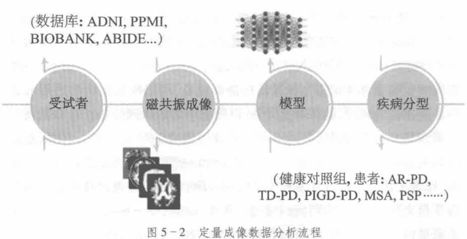

**4. 阿尔茨海默病：多模态成像+AI，锁定“转化预警”**
AD无药可阻，共识指向MCI及临床前阶段干预。早期诊断与预后预测虽难，但MRI、FDG-PET、Aβ-PET、tau-PET四大模态提供互补信息。现有研究多聚焦MCI分类器构建与多模态融合预测转化，单一模态准确率多徘徊80%关口。未来图景清晰：专家经验主导将让位于自动化、计算机化的AI决策支持系统，覆盖从影像预处理到诊断预后的全链路。

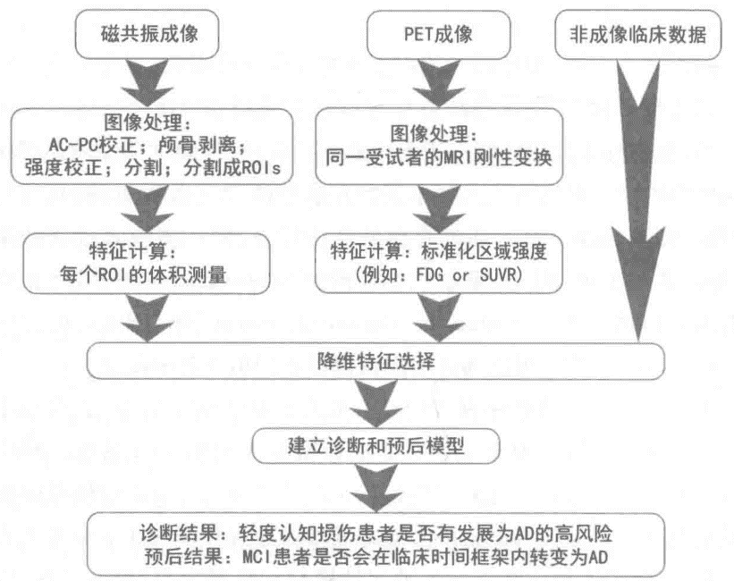

> 图示：从图像处理到诊断和预后决策支持的整个工作流程

**5. ALS药靶挖掘：语义计算加速“未知变已知”**
ALS治疗仍是无解难题。课题组创新引入文献语义相似性分析，筛选ALS相关RNA结合蛋白（RBPs）新变异，强力补充传统组学筛选。验证发现7种新关联RBPs中5种确证改变（含小脑中间神经元RBMS3新发现），前十高排名RBPs含RBM45、SC-35、MTHFSD等已知致病因子。该计算流程与ML工具协同，有望大幅压缩ALS及疑难神经病的科学发现周期。

#### (二) AI驱动药物研发：从“海里捞针”到“精准制导”

**1. 药物筛选：Galectin-3抑制剂的“中药库突围”**
神经炎症是NDs共性病理，Galectin-3激活小胶质/星形胶质细胞引燃炎症，抑制其成新靶点。团队融合通用AI算法与传统筛选流：分子对接从中药库捕获高亲和力候选，多算法交叉验证，深度学习500轮建模筛得最优XGBoost模型（测试集R²=0.9，迁移至ZINC库验证原库化合物亲和力更强），分子动力学模拟确认配体-受体复合物100ns稳定结合。最终锁定山楂、香蒲有效成分（1,2-二甲苯、香蒲酸）为潜力抑制剂。XGBoost在小样本药筛中高精表现，印证“AI+中药库”创新范式的高价值。

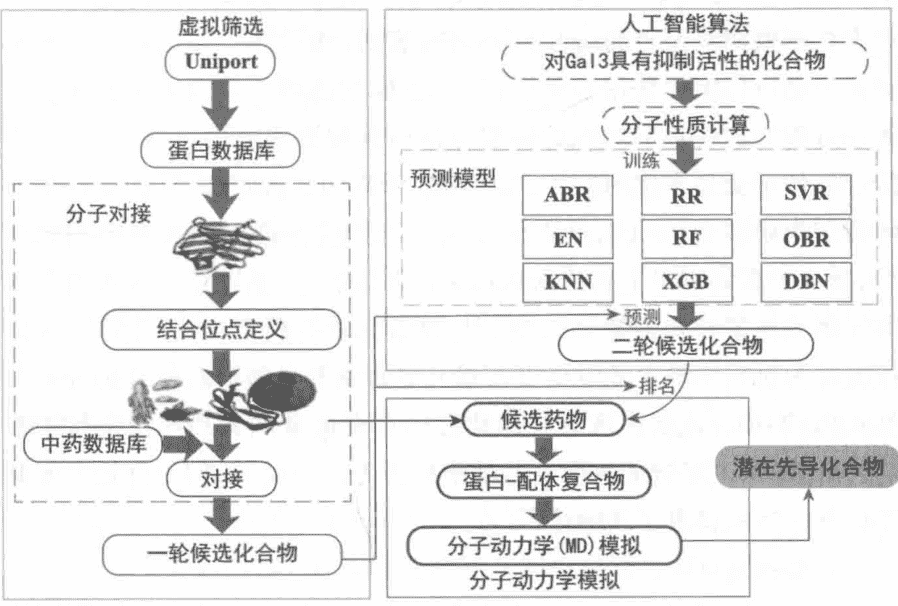

> 图示：实验设计流程图

**2. 疾病建模：双引擎驱动认知跃迁**
计算模型随算力与数据双升而涌现。虽存临床落地瓶颈，但AI有望补齐短板、反哺认知。方法谱系丰富：线性/非线性混合模型、自建模回归、微分方程、事件驱动模型解码进展轨迹与生物标志物动态；Cox回归、贝叶斯网络、深度学习预测发病概率；非负矩阵分解、聚类分析、深度学习实现亚型分层。知识驱动模型（通路中心法、疾病知识图谱）融合先验知识，为病理机制阐释提供语义级洞见。数据驱动与知识驱动双模并进，正重塑NDs研究版图，AI破解临床研究痛点、重塑认知路径的潜力巨大。

**3. 脑机接口（BCI）：构建意念与世界的“神经桥梁”**
BCI植根神经科学、生物医学、计算机科学、康复医学交叉前沿，本质是：采集脑信号→算法解码意图→驱动外部设备响应。它不仅拓宽人机交互边界，更成改善生活品质的革命性工具，需求持续爆发。

大脑活动产生的多模态物理化学生物信号理论上均可编码控制。实用BCI锚定四要素：大信息量脑电、高时间分辨率、便携设备、低成本——脑电信号成首选载体。

**临床转化三大场景：**
*   **失能者的“外骨骼”**：霍金尝试眼动/脑电控制虽终放弃，但验证了BCI对ALS等“清醒锁定”患者重建沟通、劳动、学习能力的可行性。
*   **康复增强器**：助力患者参与训练、提升自理、重拾信心。
*   **意念控制终端**：华南理工团队研发混合EEG-EOG异步脑控轮椅，融合运动想象、P300、眨眼三模态，实现七种转向导航。四名健康受试者无辅助自主高效完成控制，验证系统有效性与鲁棒性。

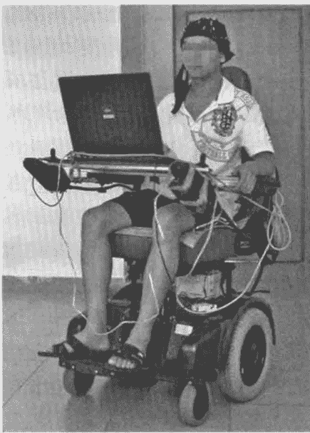

> 图示：脑机接口的异步轮椅

**植入式BCI的硬核攻关：**
延世大学柔性植入物破解刚性电极与软组织机械失配，实现共形接触下高保真信号采集。综述直击痛点：慢性失效、非吸收电子、低密度阵列。理想闭环治疗需：同域精准定位病灶与刺激、集成传感/刺激/给药/光遗传多功能、无线化避免污染与不适、消除时空校准偏差。材料学与系统集成创新，正推动BCI从实验室走向病床边。

### 破译“渐冻”困局：脑机接口能否重塑神经退行性病变的治疗未来？

运动神经元衰亡导致肌肉萎缩、力量消退，让ALS患者深陷运动障碍的泥沼。脑机接口（BCI）技术的出现，为这类肢体机能受损人群点亮了一盏希望之灯。其核心逻辑在于：捕获大脑皮层的电信号，经算法解码识别运动意图，进而驱动外骨骼机器人、仿生假肢等外部装备替身执行。已有实践证明了这一路径的可行性——比利时蒙斯大学构建的基于P300成分的异步BCI系统，让瘫痪者仅凭意念即可操控智能手机社交功能；清华大学团队依托稳态视觉诱发电位（SSVEP）范式，成功指挥机械臂完成倒水这一连贯精细动作。

### 核心局限：单向“读取”难触病理根源

纵观现状，主流BCI仍停留在“脑控外设”的单向交互阶段。它虽能通过意念驱动辅助器械缓解生活不便，却无法逆转神经元变性的病理进程。要实现从“辅助”到“治愈”的跨越，关键在于构建“读写闭环”：设备不仅要读懂大脑语言，更要具备反向调控神经回路的能力。未来的理想图景是，即便致病因子客观存在，系统也能通过精准的电刺激或神经调控干预，抑制病理表达，实现真正的疾病修饰治疗。

### 落地困境：科研、工程与伦理的多重拦截

然而，从实验室走向临床普惠，道阻且长。高昂的研发投入、漫长的验证周期导致技术成熟度不足、商业化落地艰难。科学层面，海量神经元构成的网络复杂度远超认知，神经编码规律与反馈调节机制仍属谜题；工程端，信号采集的信噪比、意图识别的鲁棒性、实时处理的算力均待突破。此外，隐私保护、身份认同、技术滥用等伦理红线的界定，更是悬在头顶的达摩克利斯之剑。尽管挑战重重，BCI作为攻克神经退行性绝症最具颠覆性的前沿方向，依然值得全力以赴。

### 深度思考

- 神经退行性疾病为何迄今仍是医学“硬骨头”？
- 现有临床干预手段主要覆盖哪些维度？
- 人工智能介入该领域时，核心短板体现在何处？
- 脑机接口若要实现临床治疗级应用，必须攻克哪些关键卡点？

### 参考文献

- [1] 程明,任宇鹏,高小榕.脑电信号控制康复机器人的关键技术.机器人技术与应用,2003,4: 45–48.
- [2] 葛松,徐晶晶,赖舜男,等.脑机接口：现状,问题与展望.生物化学与生物物理进展,2020,47(12): 1227–1249.
- [3] 李静雯,王秀梅.脑机接口技术在医疗领域的应用.信息通信技术与政策,2021(2): 87–91.
- [4] 刘冲.阿尔茨海默病相关蛋白 Aβ 抑制剂的合成与评价.清华大学,2010.
- [5] 徐如祥.脑芯片-脑机接口治疗技术进展.中华脑科疾病与康复杂志,2020,10(6): 383–384.
- [6] 杨帮华.自发脑电脑机接口技术及脑电信号识别方法研究.上海交通大学,2007.
- [7] 张双虎.脑机接口：风口还是人口.中国科学报,2021–04–08(3).
- [8] Alzheimer's Association. 2017 Alzheimer's Disease Facts and Figures. Alzheimer's & Dementia, 2017, 13(4): 325–373.
- [9] A M Tăuţan, B Ionescu, E Santarnecchi. Artificial Intelligence in Neurodegenerative Diseases: A Review of Available Tools with a Focus on Machine Learning Techniques. Artificial Intelligence in Medicine, 2021, 117: 102081.
- [10] A Soldan, C Pettigrew, Q Cai, et al. Cognitive Reserve and Long-term Change in Cognition in Aging and Preclinical Alzheimer's Disease. Neurobiology of Aging, 2017, 60: 164 – 172.
- [11] D B Celeste, M S. Miller. Reviewing the Evidence for Viruses as Environmental Risk Factors for ALS: A New Perspective. Cytokine, 2018, 108: 173 – 178.
- [12] D Ito, M Hatano, N Suzuki. RNA Binding Proteins and Neuropathological Cascade in ALS/FTD Neurodegeneration. Science Translational Medicine, 2017, 9(415).
- [13] E Kahana, M Alter, S Feldman. Amyotrophic Lateral Sclerosis a Population Study. J. Neurol, 1976, 212: 205 – 213.
- [14] E Lacorte, L Ferrigno, E Leoncini. Physical Activity, and Physical Activity Related to Sports, Leisure and Occupational Activity as Risk Factors for ALS: A systematic review. Neuroscience & Biobehavioral Reviews, 2016, 66: 61 – 79.
- [15] F B Han, Y Q Gu, H Zhao. Quality Standards of Stem Cell Sources for Clinical Treatment of Neurodegenerative Diseases. Advances in Experimental Medicine and Biology, 2020, 1266.
- [16] G E Birch, S G Mason. Brain-computer Interface Research at the Neil Squire Foundation. IEEE Transactions on Rehabilitation Engineering, 2000, 8(2), 193 – 195.
- [17] G K Sepehr, M Sarah, M Hofmann-Apitius. Data Science in Neurodegenerative Disease: Its Capabilities, Limitations, and Perspectives. Current Opinion in Neurology, 2020, 33(2): 249 – 254.
- [18] H Ahmadian-Moghadam, M S Sadat-Shirazi, M R Zarrindast. Therapeutic Potential of Stem Cells for Treatment of Neurodegenerative Diseases. Biotechnol Lett, 2020, 42: 1073 – 1101.
- [19] H Wang, Y Li, J Long, et al. An Asynchronous Wheelchair Control by Hybrid EEG – EOG brain-computer interface. Cogn Neurodyn, 2014, 8: 399 – 409.
- [20] J P Taylor. A PR Plug for the Nuclear Pore in Amyotrophic Lateral Sclerosis. Proceedings of the National Academy of Sciences, 2017, 114(7): 1445 – 1447.
- [21] J Wolpaw, N Birbaumer, W J Heetderks, et al. Brain-computer Interface Technology: A review of the First International Meeting. IEEE Transactions on Rehabilitation Engineering, 2000, 8(2): 164 – 173.
- [22] J Xu, M Zhang. Use of Magnetic Resonance Imaging and Artificial Intelligence in Studies of Diagnosis of Parkinson's Disease. ACS Chem. Neurosci, 2019, 10: 2658 – 2667.
- [23] L Lescaudron, P Naveilhan, I Neveu. The Use of Stem Cells in Regenerative Medicine for Parkinson's and Huntington's Diseases. Current Medicinal Chemistry, 2012, 19(35): 6018 – 6035.
- [24] L M de Lau, M M Breteier. Epidemiology of Parkinson's Disease. Lancet Neurol, 2006, 5(6): 525 – 535.
- [25] L M L DeLau, M M B Breteier. Epidemiology of Parkinson's Disease. Lancet Neurology, 2006, 5(6): 525 – 535.
- [26] L P Deng, W H Zhong, L Zhao, et al. Artificial Intelligence-Based Application to Explore Inhibitors of Neurodegenerative Diseases. Frontiers in Neurorobotics, 2020, 14: 108.
- [27] M Bozzi, F Sciandra. Molecular Mechanisms Underlying Muscle Wasting in Huntington's Disease. International Journal of Molecular Sciences, 2020, 21(21): 8314.
- [28] M Emig, T George, Zhang JK, et al. The Role of Exercise in Parkinson's Disease. Journal of Geriatric Psychiatry and Neurology, 2021, 34(4): 321 – 330.
- [29] M Eshraghi, P P. Karunadhara, J Blin, et al. Mutant Huntingtin Stalls Ribosomes and Represses Protein Synthesis in a Cellular Model of Huntington Disease, Nature Communications, 2021, 12: 1.
- [30] M Morris, S Maeda, K Vossel, et al. The Many Faces of Tau. Neuron, 2011, 70: 410 – 426.
- [31] M Oberstadt, J Claben, T Arendt. et al. TDP-43 and Cytoskeletal Proteins in ALS. Mol Neurobiol, 2018, 55: 3143 – 3151.
- [32] M Prince, A Wimo, M Guerchet, et al. World Alzheimer Report 2015: the Global Impact of Dementia: An Analysis of Prevalence, Incidence, Cost and Trends. Technical report, London. 2015.
- [33] M Signaevsky, M Prastawa, K Farrell, et al. Artificial Intelligence in Neuropathology: Deep Learning-based Assessment of Tauopathy. Lab Invest, 2019, 99: 1019 – 1029.
- [34] N Bakkar, T Kovalik, I Lorenzini, et al. Artificial Intelligence in Neurodegenerative Disease Research: Use of IBM Watson to Identify Additional RNA-binding Proteins Altered in Amyotrophic Lateral Sclerosis. Acta Neuropathol, 2018, 135: 227 – 247.
- [35] N Nag, G A Jelinek. A Narrative Review of Lifestyle Factors Associated with Parkinson's Disease Risk and Progression. Neurodegener Dis, 2019, 19: 51 – 59.
- [36] P Forouzannezhad, A Abbaspour, C F Li, et al. A Gaussian-based Model for Early Detection of Mild Cognitive Impairment Using Multimodal Neuroimaging. Journal of Neuroscience Methods, 2020, 33: 108544.
- [37] P Jiang, D W Dickson. Parkinson's Disease: Experimental Models and Reality. Acta Neuropathol, 2018, 135: 13–32.
- [38] R A Armstrong. What Causes Alzheimer's Disease. Folia Neuropathologica, 2013, 51(3): 169 – 188.
- [39] R Cacabelos. Parkinson's Disease: From Pathogenesis to Pharmacogenomics. Int. J. Mol. Sci, 2017, 18: 551.
- [40] R G Smith, M E Alexianu, G Crawford. Cytotoxicity of Immunoglobulins from Amyotrophic Lateral Sclerosis Patients on A Hybrid Motoneuron Cell Line. Proceedings of the National Academy of Sciences, 1994, 91(8): 3393 – 3397.
- [41] R Prashanth, S D Roy. Novel and Improved Stage Estimation in Parkinson's Disease using Clinical Scales and Machine Learning. Neurocomputing, 2018, 305: 78 – 103.
- [42] R Rahimian, L-C BÉland, S Sato, et al. Microglia-derived Galectin-3 in Neuroinflammation; A Bittersweet Ligand? Med Res Rev, 2021, 41: 2582 – 2589.
- [43] S N Illarioshkin, S A Klyushnikov, V A Vigont, et al. Molecular Pathogenesis in Huntington's Disease. Biochemistry Moscow, 2018, 83, 1030 – 1039.
- [44] T Jacopo. Artificial Intelligence in Medicine: Disease Diagnosis, Drug Development and Treatment Personalization. Current Medicinal Chemistry, 2021, 28(32).
- [45] V Martínez-Cagigal, E Santamaría-Vázquez, J Gomez-Pilar, et al. Towards an Accessible Use of Smartphone-based Social Networks through Brain-computer Interfaces. Expert Systems with Applications, 2019, 120: 155 – 166.
- [46] X N Liu, K W Chen, T Wu, et al. Use of Multimodality Imaging and Artificial Intelligence for Diagnosis and Prognosis of Early Stages of Alzheimer's Disease. Translational Research, 2018, 194: 56 – 67.

- [47] Y Cho, S Park, J Lee, et al. Emerging Materials and Technologies with Applications in Flexible Neural Implants: A Comprehensive Review of Current Issues with Neural Devices. Adv. Mater, 2021, 2005786.

- [48] Y Li, J Pan, F Wang, et al. A Hybrid BCI System Combining p300 and SSVEP and Its Application to Wheelchair Control. IEEE Trans Biomed Eng, 2013, 60(11): 3156 – 3166.

## 第六章：数字智能重塑脊柱手术新范式

### 本章学习目标

研读本章后，你将能够：

- 1. 精通数字智能导航技术在脊柱外科临床中的实战应用。
- 2. 熟练掌握数字化设计与 3D 打印技术在脊柱手术中的落地流程。
- 3. 全面了解脊柱外科数字化影像技术及手术机器人的前沿发展动态。

回溯历史，18 世纪蒸汽机的轰鸣开启了工业革命篇章，将人类推入工业文明纪元，火车等交通工具应运而生；19 世纪，内燃机与电力技术的普及催生了汽车、飞机，极大地便利了人类出行；20 世纪，以计算机、航天航空为标志的科技跨越打破了时空壁垒，构建起“地球村”，让全球沟通触手可及；步入 21 世纪，第四次科技革命浪潮汹涌，人工智能、自动驾驶等颠覆性技术迭出，驱动社会全面迈向数智化新阶段。

如今，一台智能手机即可承载丰富生活场景，一句语音指令便能驱动助手管控家电开合，这仅是数字智能雏形的显现。伴随技术演进，无人驾驶、智慧医疗的大门已然洞开，为未来铺就宽广大道。聚焦脊柱外科领域，数字智能的注入正推动手术向精准化、个性化跃迁，显著提升患者康复质量。

### 一、引言

近年数字智能飞速演进，为多学科注入全新机遇。现代医学版图中，医学影像学率先拥抱数字智能，作为外科医师的“第二双眼”，其迭代升级强力赋能外科发展。

数字化浪潮叠加 X 线技术革新，推动医学影像实现数字化转型，在降低辐射剂量的同时优化了影像传存效能。CT、MRI 等断层成像技术的突破，加速了影像学数字化进程，彰显了数字智能对传统医学的重塑之力。当下外科手术朝智能化、微创化、精准化纵深挺进，数字智能持续拓展发展边界。在外科领域，数字技术与计算机辅助手术（CAS）对围手术期全流程的渗透影响力与日俱增。

目前脊柱外科手术仍高度依赖术者经验。影像学虽能辅助术前评估，但术中具体执行仍仰仗医生“手感”把控。随着数字智能突围，术前规划得以具象化呈现，术中导航依规划路径实施，助力医生在计算机辅助下精准高效操作，削减创伤，最大化复原患者机能，引领脊柱外科步入精准个体化治疗新纪元。

虽临床应用尚处成长期，但全国脊柱同道潜心钻研，已结出数字化个性化植入体、手术导航机器人、可视化技术等丰硕成果。

### 二、数字影像智能识别在脊柱外科的实战价值

近年来，人工智能（AI），尤其中心支柱——机器学习（ML）技术突飞猛进。AI 涵盖机器学习、符号推理、启发式及进化算法等分支，共同推动科技跃升，其中 ML 对脊柱外科贡献卓著。作为 AI 核心分支，ML 赋予机器基于历史经验与数据完成特定任务、具备自主学习的能力。

ML 依托数据训练模型达成预期目标，天然契合基于数据特征的计算输出场景，如图像分类。近年 ML 在图像处理领域爆发，人脸检测识别等任务中，其图像分类、目标检测、关键点定位性能已超越专业人工操作员。

当前 AI/ML 技术仍在进化，医学影像识别处于起步探索期。虽基于 ML 的新应用刚露峥嵘，但已引发影像科医生等群体高度关注。数字影像识别技术成熟将大幅跃升解读精度，强力支撑临床诊疗决策，对未来医疗数据解读与诊疗规划制定具战略推动力。虽基础医学研究应用尚少、影响力有限，但脊柱外科相关研究成果正呈爆发式涌现。

#### (一) 机器学习赋能数字智能影像核心场景

在数字智能影像领域，ML 核心价值在于“预测”。融合开发者提供的影像特征与模型自主学习归纳的深层特征，实现输入图像向期望输出的精准映射。ML 落地主要聚焦三维度：

1.  **分类**：预训练模型智能识别图像特征并归类。临床高频场景为基于组织病理图像的自动诊断系统，依据 CT、MRI 等影像判读病理特征，辅助疾病诊断。
2.  **回归**：将离散数据映射为连续结果。例：在非连续影像切片中，通过计算输出目标解剖结构的精准定位坐标。
3.  **聚类**：模型自主归纳海量输入数据特征并分类。区别于分类需预训练，聚类无需监督。已用于依据疼痛进展模式，将骨质疏松性椎体骨折患者精细分层。

无论何种任务，大规模、高质量的训练与测试数据集都是 ML 落地基石。医学研究领域，这对临床数据采集标准提出更高要求，同时也带来数据隐私、伦理合规的严峻挑战。

#### (二) AI 与 ML 在脊柱外科的深度渗透

##### 1. 脊柱结构智能定位与标注

脊柱外科 AI 影像识别的首要应用，即脊柱结构的自动识别、标注与定位，旨在辅助医师精准诊断评估疾病。当前技术已能从 X 线、CT、MRI 等放射影像中提取椎骨、椎间盘等关键信息，并以直观方式呈现。通过识别提取脊柱特征标志，可实现椎体或椎间盘的分离建模，助力医生精准洞察椎体形态与病变（图 6-1）。

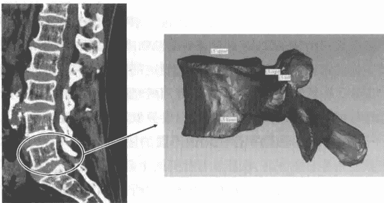

图 6-1 AI 椎体智能识别示意

此外，神经卷积网络与深度学习亦可用于结构定位，通过机器拟合脊柱影像形态实现精准定位。当前成熟商用图像处理软件精度已达临床诊疗预期标准。

##### 2. 语义分割算法

图像分析的首要关卡是“理解内容”，即判定每个像素归属区域，此即语义分割。分割可人工或自动完成。脊柱外科对 AI 要求更高：不仅要识别像素属于椎体还是椎间盘，更需精准识别具体脊柱节段。因此，分割算法质量评估至关重要。现阶段 AI 多依赖人工标注数据训练，但人工标注难达像素级精度，导致人工与机器分割质量均难量化评判。过往研究常用骰子相似性系数（DSC）衡量分割与真值空间重叠度，用平均表面距离（MSD）度量分割表面与真值表面的平均偏差。

近年脊柱分割研究涌现，结合多技术实现像素级分解与深度学习分割，精度显著提升。虽成果振奋，但脊柱解剖分割仍存巨大优化空间。

##### 3. 计算机辅助诊断（CAD）

融合患者既往数据，ML 可整合病史与影像，实现脊柱疾病自动诊断。目前 ML 已覆盖退行性疾病、脊柱畸形、肿瘤学等领域。例：输入患者症状、病史、影像资料，输出疾病分类（如将腰背痛分为单纯性、神经根型、脊柱病理性、心因性疼痛），ML 通过深度学习挖掘数据与结果关联，输出诊断建议。受限于技术成熟度与医疗责任伦理，放射科医生短期内不会被替代，但 ML 作为“超级助手”辅助诊断的价值不可估量。

##### 4. 预后预测与临床决策支持（CDS）

预测分析基于历史数据推演未来，深受新 AI 技术与大数据驱动。CAD 主用监督学习（依已知标签纠偏），预后预测侧重非监督学习（挖掘数据内在相似性自主分析预测）。预测分析早期即获医疗界青睐，因其在优化患者护理、财务管理上潜力巨大。应用场景涵盖：高风险慢病患者筛查与干预获益人群识别、个性化用药治疗方案定制、住院不良事件预警、供应链优化等。

对比脊柱研究其他 AI 应用，预测分析与 CDS 仍处萌芽期。现有预测模型鲜用影像数据，因缺乏深度学习等先进技术支撑；且缺乏训练此类模型所需的 AI 专业人才及涵盖临床影像的大规模数据库。但各国脊柱登记数据激增，或将催化该领域重大突破。AI/ML 作为颠覆性新技术，已达高水平，在部分科研版图落地生效。得益于深度学习创新与算力释放，计算机视觉与图像处理势头最劲。当前多数脊柱 AI 研究聚焦医学影像，未来势必向脊柱生物力学等更多维度渗透。

### 三、数字化材料设计与 3D 打印在脊柱外科的创新实践

脊柱解剖复杂，脊柱脊髓损伤诊疗高度依赖影像资料。复杂脊柱侧弯畸形、脊柱肿瘤等更考验传统影像学极限。严重侧弯扭曲周围组织形态结构，致血管神经走行异变，术前医生必须精准掌握脊柱形态及周围神血管走行。为将影像资料立体直观呈现，3D 打印技术应运而生。

3D 打印融合现代信息技术与传统制造工艺，凭借数字化设计直击成型。相较 CT、MRI 二维切片，3D 打印模型以立体直观优势完美复刻患者脊柱解剖，大幅赋能术前路径规划与个性化植入体选型。利用打印导航模板辅助椎弓根螺钉植入，术前锁定最佳手术通道；针对腰椎间盘突出、发育畸形等需截骨手术，精准划定截骨范围；椎间融合器植入术中，个性化植入体实现贴合度与固定效果的双重跃升。

#### 1. 3D 打印技术核心优势

采用逐层累积成型，不受零部件几何复杂度限制，材料利用率极高。打印精度可控制在 0.3 mm 以内，远超传统模型加工。流程极简，省去模具设计制造环节，CAD 数据直驱实体成型，周期大幅压缩。材料选择灵活多元，甚至延伸至生物活性组织打印研究。核心优势在于“个性化定制”——仅需一张 CAD 图纸，即可根据患者需求无限迭代修正。

#### 2. 破解脊柱复杂疾病诊断难题

面对脊柱创伤、畸形等复杂病种，传统影像难以精准呈现三维解剖关系。医生依赖影像判读决策，准确性关乎生死。3D 打印重建三维解剖结构，直观展现椎体病变、损伤部位范围，显著提升诊疗效能。

对比传统影像，3D 打印模型信息更详尽、立体、直观，助力医生透析复杂空间解剖，精准定性，降低漏诊误诊率，为患者匹配最优方案，达成最佳诊疗结局。

#### 3. 定制个体化高精度手术蓝图

医生制订方案需凭影像进行空间想象，极考验经验。3D 打印 1:1 实体模型可按需分层打印，聚焦特定区域，支撑精准决策。医生可在模型上预演手术，提前暴露风险、优化流程、提升熟练度，达成缩短手术时间、减少出血、降低辐射暴露的“三减”目标。更可定制专用器械：导航模板辅助钉入、截骨导板精准划界、个性化植入体精准贴合。

#### 4. 数字化设计未来图景

3D 打印规避椎弓根螺钉植入盲目性，精准赋能个性化方案，同步提升成功率与效率。解剖模型跨越诊断、教学、植入体定制全场景，临床价值凸显。

新材料技术迭代为 3D 打印注入强心剂。传统工艺难驾驭新材料成型，3D 打印灵活适配推动新材料临床落地。通过优化支架内部拓扑强化力学性能，与新材料特性协同增效。随组织细胞培养技术突破，活细胞或成打印“墨水”，随支架同步成型。未来，细胞级骨组织打印修复脊柱病变，有望开启革命性突破新篇。

### 四、数字化导航在脊柱外科的精准赋能

#### (一) 数字化导航体系全景解析

##### 1. 核心概念与运作原理

计算机导航辅助系统植根于全球卫星定位技术，融合医学影像技术，将术前 CT、MRI 影像融合重构为二三维可视化图像，引导医生术中精准沿预设通道操作。标准流程：术前导入影像构建三维模型；术中医生持标记器械操作，光学/电磁追踪系统将器械与患者模型注册至同一坐标系，实时解算器械体内位姿，实现精准定位与微创操作。

数字导航集三维定位、医学图像处理、三维可视化于一体，借助光学或电磁定位辅助术中定位，实时掌握手术目标结构信息，助力医生达成术中目标，最大程度规避周围组织损伤，降低术中损伤与术后并发症风险。对优化路径、提精度、减损伤、增成功率具有里程碑意义。

##### 2. 导航系统“四大件”架构

核心组件：工作站、位置跟踪仪、手术导航工具、监视器。以成熟的达·芬奇手术机器人为例拆解（图 6-2）：
(1) **工作站**：虚实坐标系配准中枢，承担图像可视化处理；
(2) **位置跟踪仪**：光电信号实时捕捉患者位姿，固定于脊柱上，动态补偿呼吸及操作导致的位移，稳固实体坐标系；
(3) **手术导航工具**：器械标记物载体，确立器械空间位姿，服务校准与植入辅助；
(4) **监视器**：影像与器械位姿融合显示终端，将工作站信息实时反馈术者。

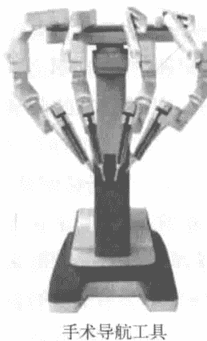

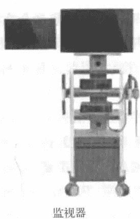

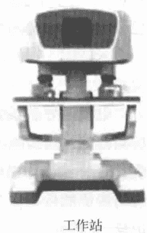

图 6-2 达·芬奇手术机器人系统组成示意

##### 3. 交互模式分类：主动、被动、半主动

按计算机导航与手术环境交互维度划分：

1.  **主动式导航（手术机器人代表）**：术前规划设定，机械臂自主执行，无需医生实时干预。痛点：机械臂柔性不足，复杂操作受限；安全冗余设计与伦理争议制约临床推广。
2.  **被动式导航（主流辅助模式）**：系统仅辅助确定轨迹，实操由医生主导。空间立体定位是核心，助力医生精准入路。定位手段含光学、超声、电磁法。
3.  **半主动式导航（融合新范式）**：融合双方优势，属机器人范畴。机械臂执行主操作，保留医生在安全域内微调工具的自由度，兼顾精准与柔性，规避纯机械误操作风险。

##### 4. 机械导航系统深度剖析

主流分框架式机械系统与无框架机械臂定位系统两派：
*   **框架式**：精度高，但设备笨重，遮挡视野、干扰操作、患者不适感强。
*   **无框架机械臂**：机械臂与计算机耦合，摆脱框架束缚，不遮挡视野、操作便捷，但定位精度尚存短板，限制临床普及深度。

### 脊柱手术导航核心技术与机器人进展全景扫描

脊柱外科正经历一场由数字化技术驱动的深度变革。从基础的定位导航到智能手术机器人的萌芽，技术迭代正在重塑手术的精度边界与临床范式。本文系统梳理主流导航技术原理、脊柱各段手术应用实况、手术机器人分类与中外发展现状，并深度剖析当前瓶颈与未来演进方向。

---

#### 一、 三大主流导航技术：原理、优势与短板并存

手术导航的核心在于“看清、定准、不受扰”。目前临床主流的三大技术路线各有千秋，构成了技术选择的多维坐标。

**1. 电磁导航：低成本无遮挡，但“怕金属”成硬伤**
该系统由三个磁场发生器与一探测器组成。探测器线圈捕捉穿透软组织的磁场，反推发生器相对位置及探测器空间坐标，定位精度可观。其造价亲民且无视线遮挡困扰，但“阿喀琉斯之踵”极其明显——对金属极度敏感。手术室内的监护仪、高频电刀等常规设备皆成干扰源，严重削弱导航的准确性与可靠性。

**2. 超声导航：实验室精度高，临床环境“水土不服”**
基于超声测距原理，发射器安标架、接收器挂器械，经计算机解算空间位置并输出高清图像。实验室环境下表现优异，但一旦进入手术室，环境噪声、气温波动、气流扰动等非受控因素便显著拖累精度，导致该技术难以在临床大规模落地。

**3. 光学导航：临床“主力军”，唯惧“视线盲区”**
采用普通光或红外成像，结合三目/双目机器视觉定位，凭借高精度、灵活便捷成为目前应用最广的导航模式。然而，术中器械、医生体位遮挡标志点导致成像丢失的问题始终难以根治，是制约其完美发挥的关键短板。

---

#### 二、 数字化导航在脊柱分段手术中的实战价值

导航技术并非“通吃”，其价值在不同解剖区段、不同病理类型中呈现差异化特征。

**1. 颈椎手术：化解“禁区”风险，重塑高危操作安全线**
上颈椎（C1~C3）解剖极其复杂，椎动脉、延髓、颅神经密布，容错率近乎为零。导航系统通过术前三维重建“透视”患者个体解剖，规划最安全入路；术中实时引导调整进针方向、角度、深度，使椎弓根螺钉置入精准可控。这不仅降低了对医生经验的绝对依赖，更显著减少软组织剥离、缩短手术时长、降低出血量，综合获益患者预后。

**2. 胸腰椎手术：攻克爆裂骨折固定难题，推进微创精准化**
胸腰椎爆裂骨折常伴脊髓受压、椎管狭窄，椎弓根螺钉固定质量直接决定脊柱稳定性重建成败。传统手术高度依赖医生“手感”，而导航系统引入术前个性化规划，术中精准导航至目标点位，有效规避周围软组织损伤，实现“精准、微创”双重突破，大幅提升螺钉置入成功率。

**3. 脊柱矫形手术：破解畸形解剖迷局，降低并发症与辐射损伤**
随着电子产品普及，脊柱侧弯、生理曲度异常高发。畸形解剖导致椎弓根走向怪异，自由手置钉风险极高。数字化导航依托患者特异性畸形数据，定制最优置钉通路与螺钉规格，显著提升手术成功率。临床数据显示，该技术能同步压缩手术时间、术中出血、医患辐射暴露及术后并发症发生率，且学习曲线平缓，极大降低推广门槛。

**【核心优势总结】** 经十余年临床验证，计算机辅助导航较传统手术确立三大核心价值：
*   **术前所见即术中所得**：三维影像与实体配准，可视化“盲区”结构，优化路线规划，微创化获益患者快速康复。
*   **全过程数据留痕**：手术轨迹、关键参数自动记录，为术后复盘、科研分析、医法律据提供客观依据。
*   **打破时空壁垒**：奠定远程协作/异地手术技术基础，推动优质医疗资源下沉与均衡。

---

#### 三、 从导航到机器人：脊柱外科智能化的跃迁逻辑

手术机器人并非取代导航，而是“导航+机械臂”的进化形态——在导航精准定位基础上，以机械臂执行操作，进一步释放医生双手，契合“个体化、微创化、精准化”现代医学内核。脊柱手术机器人虽仍处临床早期，但技术路线已清晰分化。

**1. 两大技术流派：被动跟随 vs 主动智能**

| 维度 | **被动导航机器人** | **主动导航机器人** |
| :--- | :--- | :--- |
| **核心逻辑** | 依赖术前测量与术中信息录入，机械臂锁定预设轨迹，医生手持器械沿导向通道操作 | 术中实时捕捉器械与脊柱相对位置，机械臂动态跟随/主动修正，应对复杂解剖变化 |
| **代表系统** | **SPINEASSIST**（脊柱领域唯一获批系统）：微型并联机器人固定椎体，C臂配准术前规划，医生操作器械完成植入 | **三维导航手术机器人**：基于3D-CT规划，红外相机实时追踪标志点，标志点漂移自动补偿，覆盖术前扫描至手术实施全流程 |
| **适用场景** | 技术成熟度高、实施相对简单的标准化椎弓根螺钉置入 | 解剖复杂、需高精度动态调整的微创骨科手术 |
| **发展趋势** | 向主动智能、图像融合方向演进 | **未来主流**：深度融合医学影像与机器人技术，稳定性与安全性成核心竞争力 |

**2. 国际巨头布局：从“达·芬奇”到专用系统的差异化竞争**

*   **达·芬奇系统**：软组织手术“王者”，7自由度仿生机械臂实现触觉反馈、远程操控，器械生态完善（抓持、缝合、电凝），但非脊柱骨科专用。
*   **宙斯系统**：仿人腕设计机械手，毫米级切口入路，术野放大15-20倍，微创优势显著。
*   **伊索（AESOP）系统**：语音控制内镜定位器，解放医生一只手，人机交互模式创新早期典范。

**3. 国产力量崛起：从“0到1”迈向产业化关键期**

国内自1997年起步，已形成“妙手A”、“天智航”、AOBO、“天玑”等临床级产品矩阵：
*   **“妙手A”**：国产首台自主知识产权微创手术机器人，三维视觉+力反馈系统双加持，触觉仿真提升操作精度。
*   **“天智航”**：首款双平面骨科机器人，攻克长骨/骨盆复杂骨折远端螺钉定位难题，配合C臂实时影像降低辐射，脊柱应用尚少。
*   **AOBO**：7自由度新型架构，大工作空间、高灵活度，配合专用手术镜优化操作人因。
*   **科研梯队**：沈阳自动化所脊柱机器人、哈工大微创机器人等正加速向临床转化。

**现状研判**：国产机器人普遍处于“科研验证向产业化过渡”关键期，虽在适用范围、鲁棒性、临床易用性上仍有提升空间，但已构建起完整技术自主可控链条。

---

#### 四、 直面痛点与破局：导航技术的“成长烦恼”与进化路线图

**1. 三大“拦路虎”：标准缺失、学习陡峭、术中漂移**

*   **标准真空**：产品百花齐放却各自为政，缺乏统一技术规范、操作流程（SOP）及疗效评价“金标准”，医生面对多套系统学习成本高企，多中心临床研究难以开展。
*   **推广阻力**：医生习惯传统操作流程，缺乏系统化导航培训体系；定位球易遮挡、占据操作空间、改变手术习惯等人因工程问题未解，成临床推广“绊脚石”。
*   **精度漂移**：术前规划与术中实况天然存在鸿沟——麻醉肌肉松弛、骨块切除致脊柱形变、呼吸心跳微动等，均导致配准偏移，动态补偿技术仍待突破。

**2. 四大演进趋势：从“能用”向“好用、通用、智用”跨越**

*   **建标立规成首务**：亟需制定统一评价标准、操作规范，倒逼设备互操作与临床证据积累，提升实用性。
*   **时间成本曲线拐点**：设备调试曾拖长手术时间，但随团队熟练度提升，常规手术置钉/手术时长已不增反降；复杂病例优势更显著。建议“常规练兵、复杂上阵”渐进式学习路径。
*   **机器人百花齐放向深度专精**：各厂商聚焦细分赛道（微创、畸形、创伤等），共同推动脊柱手术向“微创、精准、个性化”纵深发展。
*   **数智融合是终局**：随着安全性达标、标准统一，导航机器人必将融入互联网、大数据、AI生态，实现术中决策支持、术前模拟推演、术后预后预测的全链条数智化闭环。

---

### 结语：在不确定性中确定未来

计算机辅助导航虽问世不久，却已打开脊柱外科新的可能性维度。恰如微创内镜早期历经质疑终成主流，导航技术虽存瑕疵，但演进势头不可逆转。随着工程技术攻关深入、临床证据积累、标准生态建立，其精度与实用性将持续跃升，终将成为脊柱外科医生手中不可或缺的“数字化手指”，驱动脊柱疾病诊疗迈入高精度、低创伤、强智能的新纪元。

---

### 思考与练习

1.  脊柱外科数字化技术的全场景应用版图有哪些？
2.  数字智能技术通过何种机制量化提升手术精度？
3.  对比电磁/超声/光学三大导航系统的临床适用边界与核心短板。
4.  结合临床需求，谈谈你对骨科手术机器人技术路线演进的判断。

---

### 参考文献

[1] A Gadia, K Shah, A Nene. Emergence of Three-Dimensional Printing Technology and Its Utility in Spine Surgery. *Asian Spine J*, 2018; 12(2): 365–371.

[2] A Hosny, C Parmar, J Quackenbush, et al. Artificial intelligence in radiology. *Nat Rev Cancer*, 2018; 18(8): 500–510.

[3] B N Staub, S S Sadrzemi. The use of robotics in minimally invasive spine surgery. *J Spine Surg*, 2019, 5(Suppl 1): S31–S40.

[4] C Freschi, V Ferrari, F Melfi, et al. Technical review of the da Vinci surgical telemanipulator. *Int J Med Robot*, 2013, 9(4): 396–406.

[5] C J Chang, G L Lin, A Tse, et al. Registration of 2D C-Arm and 3D CT Images for a C-Arm Image-Assisted Navigation System for Spinal Surgery. *Appl Bionics Biomech*, 2015; 478062.

[6] C McKenna, R Wade, R Faria, et al. EOS 2D/3D X-ray imaging system: a systematic review and economic evaluation. *Health Technol Assess*, 2012; 16(14): 1–187.

[7] C Stuer, F Ringel, M Stoffel, et al. Robotic technology in spine surgery: current applications and future developments. *Acta Neurochir Suppl*, 2011, 109: 241–245.

[8] E D Sheha, S D Gandhi, M W Colman. 3D printing in spine surgery. *Ann Transl Med*, 2019, 7(Suppl 5): S164.

[9] F Galbusera, G Casaroli, T Bassani. Artificial intelligence and machine learning in spine research. *JOR Spine*, 2019; 2(1): e1044.

[10] F Galbusera, G Casaroli, T Bassani. Artificial intelligence and machine learning in spine research. *JOR Spine*, 2019; 2(1): e1044.

[11] I H Kalfas. Machine vision navigation in spine surgery. *Front Surg*, 2021, 8: 640554.

[12] J Huang, Y Li, L Huang. Spine surgical robotics: review of the current application and disadvantages for future perspectives. *J Robot Surg*, 2020, 14(1): 11–16.

[13] J J Rasouli, J Shao, S Neifert, et al. Artificial Intelligence and Robotics in Spine Surgery. *Global Spine J*, 2021, 11(4): 556–564.

[14] J Schmidhuber. Deep learning in neural networks: an overview. *Neural Netw*, 2015; 61: 85–117.

[15] J T Yamaguchi, W K Hsu. Three-Dimensional Printing in Minimally Invasive Spine Surgery. *Curr Rev Musculoskelet Med*, 2019, 12(4): 425–435.

[16] J Y Lee, D A Bhowmick, D D Eun, et al. Minimally invasive, robot-assisted, anterior lumbar interbody fusion: a technical note. *J Neurol Surg A Cent Eur Neurosurg*, 2013, 74(4): 258–261.

[17] J Zhang, Li H, Lv L, Zhang Y. Computer-Aided Cobb Measurement Based on Automatic Detection of Vertebral Slopes Using Deep Neural Network. *Int J Biomed Imaging*, 2017; 2017: 9083916.

[18] K Cleary, C Nguyen. State of the art in surgical robotics: clinical applications and technology challenges. *Comput Aided Surg*, 2001; 6(6): 312–328.

[19] L P Nolte, M A Slomczynkowski, U Berlemann, et al. A new approach to computer-aided spine surgery: fluoroscopy-based surgical navigation. *Eur Spine J*, 2000, 9 Suppl 1: S78–88.

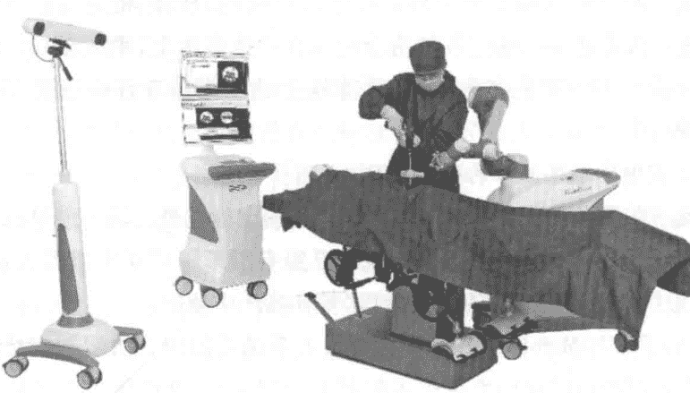

## 第七章 AI赋能心脑血管疾病预警：从理论到实战

### 核心看点：读完本章，你将掌握

- AI的底层逻辑与核心定义
- 医学AI从萌芽到爆发的演进脉络
- AI四大技术支柱的差异化能力
- 机器学习落地疾病预测的标准化路径
- AI在心脑血管领域的高价值应用图谱

---

### 引言：智能医疗新纪元的开启

人工智能（AI）作为计算机科学的前沿分支，其本质是利用算力载体复现人类的认知、思维与决策能力。从早期的理论探索，历经象征主义、连接主义的多轮迭代，至深度学习引爆感知智能革命，AI已完成从“实验室概念”到“生产力工具”的跨越。

这场变革的燃料，源于数学、神经科学、认知心理学、计算机工程等学科的深度融合。多学科交叉催生出的新型算法架构，正以指数级速度重塑医疗效能边界——无论是慢病管理的全周期干预，还是急危重症的毫秒级预警，AI正成为临床决策不可或缺的“数字副驾”。

**聚焦心脑血管领域：一场关乎生死的算力竞速**

慢性非传染性疾病吞噬了全球70%的生命，而心脑血管病位居榜首，其死亡人数是癌症的两倍，疾病负担高居全球之首。面对“发病急、窗口期短、致死率高”的临床痛点，传统风险评分模型因地域差异、特征维度受限，存在约20%的高危人群漏判率。AI技术的介入——从远程会诊专家系统、手术导航机器人，到基于多模态数据的突发事件智能预警——正在从根本上重构防治范式。

---

### 一、 溯源：AI与医学AI的双螺旋演进史

#### 1. 通用人工智能：三次浪潮，一脉相承的智能跃迁

| 阶段 | 核心范式 | 关键突破 | 局限与转折 |
| :--- | :--- | :--- | :--- |
| **萌芽期 (1950s)** | 逻辑主义/符号主义 | 图灵测试确立判智标准；SNARC神经网络原型机诞生；“逻辑理论家”开创搜索推理；**1956达特茅斯会议**正式命名“AI” | 仅能解决封闭逻辑问题，缺乏感知能力 |
| **第一次高潮 (1956-1976)** | 专家系统/知识工程 | 逻辑推理机制成熟，擅长定理证明、象棋博弈 | 知识获取瓶颈显现，无法处理模糊不确定性，陷入“第一次寒冬” |
| **第二次高潮 (1980-1987)** | 连接主义/神经网络 | BP算法(1986)打破多层网络训练僵局，仿生神经计算雏形显现 | 单任务适用性强，复杂泛化能力弱；大数据训练受限于算力，再遇“寒冬” |
| **第三次爆发 (2011至今)** | **深度学习/大数据驱动** | 算力指数级跃升(GPU/TPU)+海量标注数据+算法创新(ResNet, Transformer等) | 感知智能达人级/超人级；通用人工智能(AGI)成新攻关目标 |

> **关键节点回望**：
> - **1950** 图灵测试：机器智能的“罗塞塔石碑”
> - **1951** Minsky制造SNARC：首次硬件级神经信号模拟
> - **1956** 达特茅斯会议：学科诞生的“宣言时刻”
> - **2016** AlphaGo胜李世石：深度强化学习震撼世界，引爆全民AI认知觉醒

#### 2. 医学AI：从“实验室孤儿”到“临床标配”的四十年突围

- **1974 斯坦福SUMEX-AIM计划**：首尝AI+医学结合，受限于算力停留在理论构想。
- **1980s 第五代计算机+BP算法**：硬件迭代激活神经网络，医学AI驶入快车道。
- **1985 首届欧洲医学AI会议 / 1989《医学人工智能杂志》创刊**：学科共同体建立，标准化进程启动。
- **21世纪以来**：深度学习赋能医学影像、病理、基因组学、药物研发全链条，FDA/NMPA批准上市的AI医疗器械数量呈爆发式增长，完成“从科研论文到临床产品”的闭环跨越。

---

### 二、 技术全景：AI四大核心分支的能力版图

AI的核心内核是**“基于输入的判断与预测”**，四大分支分工协作，构建智能体完整能力链：

#### 1. 模式识别—— **“感知中枢”**：将杂乱信号转化为结构化认知
- **语音/文本理解**：方言识别、病历文本结构化、医患对话情感计算
- **生物特征鉴权**：指纹/人脸/掌静脉多模态身份核验
- **生物医学信号解码**：心电/心音/多普勒/基因序列自动诊断
- **影像智能检索**：PACS影像以图搜图、遥感病灶自动勾画

#### 2. 机器学习 (ML)—— **“认知大脑”**：从数据中自习得决策规则
> **区别传统编程**：无需显式编码规则，通过海量数据“训练”获得泛化能力。

| 学习范式 | 核心逻辑 | 典型算法 | 医学典型场景 |
| :--- | :--- | :--- | :--- |
| **监督学习** | 有标签数据映射输入→输出 | 决策树、SVM、随机森林、XGBoost、深度神经网络 | 疾病分类分级、预后分层、用药响应预测 |
| **无监督学习** | 无标签数据挖掘内在结构 | K-means、层次聚类、PCA降维 | 患者表型聚类、疾病亚型发现、异常检测 |
| **半监督学习** | 少量标签+大量无标签协同 | 伪标签、一致性正则化 | 稀缺标注医学影像利用 |
| **深度学习** | 多层非线性特征自动提取 | CNN、RNN、Transformer、GNN | 医学影像分割、病理全切片分析、多模态融合 |
| **强化学习** | 环境交互最大化累积奖励 | DQN、PPO、AlphaZero架构 | 手术机器人策略优化、个性化治疗路径规划 |

#### 3. 数据挖掘 (DM)—— **“知识发掘机”**：从海量噪声中淘金高价值洞见
融合统计学、数据库技术、ML与模式识别，专注**“未知的、潜在的、可用的”**知识发现。临床应用：真实世界研究(RWS)、不良反应信号挖掘、临床路径优化、医保欺诈检测。

#### 4. 智能算法 (软计算)—— **“求解利器”**：仿生启发式攻克NP-Hard难题
- **人工神经网络 (ANN)**：非线性逼近通用定理，打破冯·诺依曼瓶颈，支撑深度学习大厦。
- **遗传算法 (GA)**：进化论启发，全局最优搜索，用于放疗计划优化、药物分子设计。
- **蚁群/粒子群/模拟退火**：群体智能/物理退火机制，解决手术排程、器械布局等组合优化。

---

### 三、 实战指南：机器学习构建心脑血管预测模型的标准化流水线

#### 为什么传统模型失效？
**Framingham评分**虽为经典，但多国外部验证揭示：地域人种差异导致校准度下降，且线性假设无法捕捉非线性交互，**高危漏判率约20%**。ML凭借非线性建模、高维特征自动筛选、集成学习鲁棒性优势，显著提升AUC与净获益。

#### ML建模全生命周期（MLOps医学落地版）

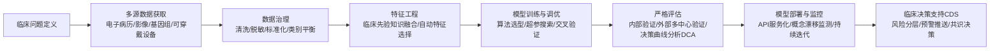

#### 关键成功要素（Key Success Factors）

1. **数据质量>算法花哨**：垃圾进，垃圾出。重点攻克缺失值处理、时序对齐、标签一致性（如Kappa系数>0.8）。
2. **临床可解释性不可妥协**：SHAP值、注意力热力图、名义列线图，让医生“看懂”黑箱推理。
3. **外部验证是生命线**：单中心数据易过拟合，**多中心、多种族、不同时期**的前瞻性验证是上市/入指南门槛。
4. **动态更新机制**：建立模型性能衰减监测指标（PSI、AUC漂移），触发自动重训练流水线。
5. **伦理合规底线**：数据脱敏合规(GDPR/PIPL)、算法偏见审计(公平性指标)、知情同意与临床责任界定。

---

### 结语：重塑心脑血管防治新生态

从Framingham的线性评分，到Transformer架构下的多模态动态风险画像，AI正在将心脑血管疾病管理从**“事后救治”**推向**“事前预判、事中干预、事后优化”**的全周期智能闭环。未来已来，掌握AI方法论，即掌握了通往精准医疗的入场券。

---

### 核心参考文献速览

> 以下文献为本章理论支撑与技术溯源核心来源，建议深度研读：

1.  **脊柱导航与机器人奠基作**：Rauschmann et al. *Spine* 2009 (导航vs传统植入); Merloz et al. *Proc Inst Mech Eng H* 2007 (荧光导航).
2.  **AI/ML综述里程碑**：Chang et al. *Front Surg* 2020 (脊柱ML); Poduval et al. *Indian J Orthop* 2020 (骨科AI颠覆力); Federer & Jones *PLoS One* 2021 (骨科AI scoping review).
3.  **3D打印个性化手术**：Hsu et al. *Minim Invasive Surg* 2018; Cho et al. *Asian Spine J* 2018; Lu et al. *Int J Med Robot* 2009 (钻导板); Cartiaux et al. *Ann Biomed Eng* 2014 (PSI骨肿瘤).
4.  **椎弓根螺钉精度循证**：Tian et al. *Int Orthop* 2009 / *Eur Spine J* 2011 (Meta分析); Schep et al. *Injury* 2003 (CAOS综述).
5.  **经典教材与权威指南**：*详见教材参考文献列表 [20]-[31]*.

# 构建高性能机器学习预测模型的五大核心步骤

搭建基于机器学习（ML）的预测模型，并非一蹴而就，而是一个严谨的工程流程，主要涵盖五个关键环节（流程详见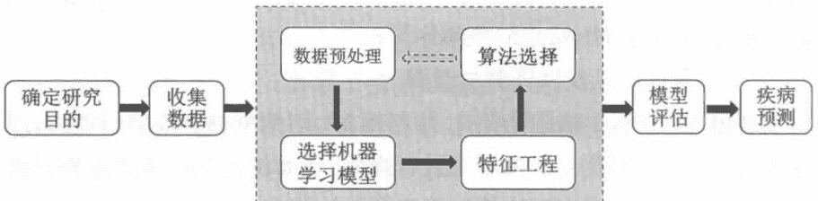）：

**首要任务是明确目标与数据获取。** 这是奠定模型性能上限的基石。数据维度需全面覆盖，通常囊括人口学属性、体检指标、临床表现、用药病史及专项研究所需的特定信息。

**其次是数据清洗与预处理。** 原始数据往往夹杂着噪声、缺失、冗余或高维稀疏等问题，直接入模效果不佳。需依据研究意图，灵活运用异常值剔除、多重插补、标准化校正、特征编码、降维及筛选等手段，将数据“洗净、整齐”。

**第三步聚焦特征工程。** 这是提升模型预测力的核心杠杆。通过对原始特征进行高阶组合与变换（如连续变量四则运算、离散变量交叉、统计特征构造），挖掘特征间隐含的非线性关系，让模型“读懂”数据深层逻辑。

**第四步是算法模型甄选。** 面对监督、半监督、非监督、强化学习及深度学习等多元算法体系，没有“最好”，只有“最合适”。必须结合具体任务属性与应用场景，精准匹配算法工具。

**最后一步是模型评估与验证。** 采用交叉验证等稳健策略，配合准确率、AUC等核心指标，全方位审视模型泛化能力，确保结论经得起推敲。

---

## 机器学习算法全景速览：按学习范式分类

### 1. 监督学习：有标签的“标准答案”模式
核心逻辑是利用带明确标签的数据训练，通过不断对比预测值与真实值、迭代优化参数，直至达标。常用兵器谱包括：朴素贝叶斯、KNN、随机森林、XGBoost、决策树、SVM、逻辑回归、BP神经网络等。

### 2. 半监督学习：少量标签撬动大量无标签数据
兼具标注与未标注样本。模型先自学数据内在结构，再辅以少量标签指导。典型应用涉及分类回归，代表算法有图论推理、拉普拉斯SVM等。

### 3. 非监督学习：无标签下的“自主发现”
完全依赖算法挖掘数据内禀结构与规律。主力军为聚类（K-means、层次聚类）与降维（SVD、PCA）技术。

### 4. 强化学习：环境反馈驱动的“试错进化”
区别于监督学习的“对错判定”，此处输入即反馈信号，模型据此动态调整策略。擅长动态系统控制、机器人决策，主流算法为Q-Learning及时序差分学习。

### 5. 深度学习：向人脑认知机制进阶的复杂模型
通过多层神经网络自动学习特征表示层级，在视觉、语音领域实现降维打击。常见架构涵盖CNN、自编码器、DBN等。

---

## 实战案例：眼底影像+AI，精准预警肾病与糖尿病

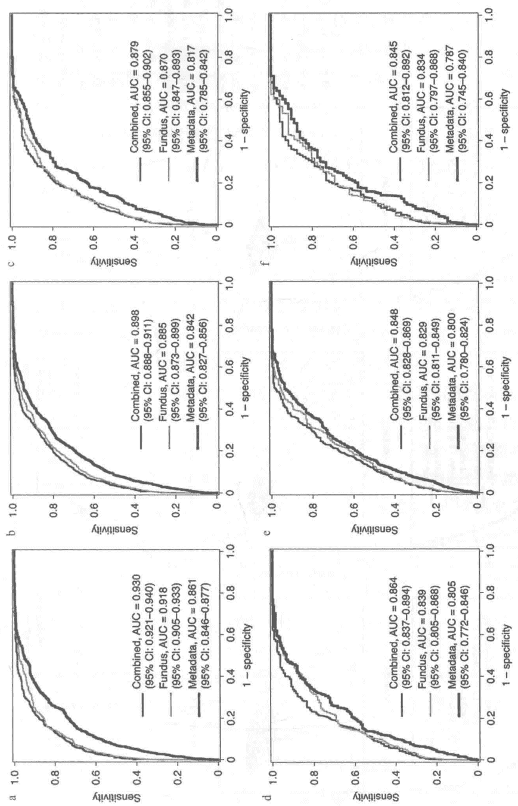

### 案例背景
本研究旨在开发AI系统，仅凭视网膜眼底影像或融合临床元数据（年龄、性别、血压、BMI等），实现对慢性肾病（CKD）及2型糖尿病（T2DM）的早筛、发病率预测及进展评估，打破传统单一指标（eGFR、空腹血糖）预测的局限。数据源汇聚北大一院、华西医院等七大顶级医疗中心（CC-FII多中心队列）。

### 数据策略：分阶段、严质控
*   **横断面阶段：** 纳入4.3万+受试者，8.6万+张眼底照。按7:1:2划分训练/优化/内测集，打磨算法模型。
*   **纵向队列阶段：** 纳入1万+受试者，2万+张照片，专攻发病率预测。
*   **质控铁律：** 剔除伪影、重拍不合格图像，建立统一诊断金标准。

### 三大模型矩阵对决
*   **模型1（临床基线）：** 仅用元数据，跑随机森林与逻辑回归。
*   **模型2（影像单兵）：** 纯眼底图输入，深度卷积神经网络（CNN）出击。
*   **模型3（双模融合）：** CNN提取影像深层特征 + 临床元数据，联合分类决策。

### 统计评估体系：多维度“体检”
*   **回归任务：** MAE、R²、PCC量化连续值预测误差；Bland-Altman图、ICC校验eGFR预测一致性。
*   **分类任务：** ROC/AUC（含Bootstrap 95%CI）评估二分类性能。
*   **纵向生存分析：** Kaplan-Meier曲线分层 + Log-rank检验；4/5年时变AUC追踪长期预测稳健性。
*   **左右眼一致性：** ICC验证双眼预测可靠性。

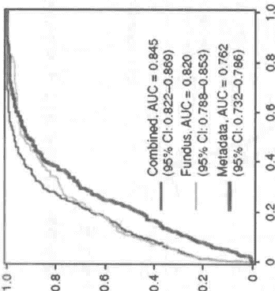
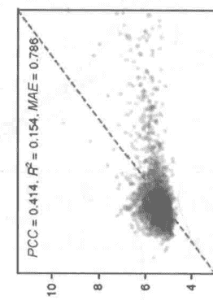
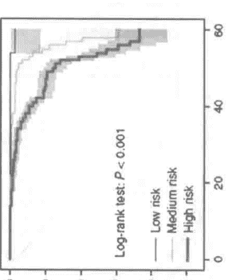
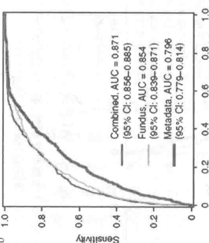
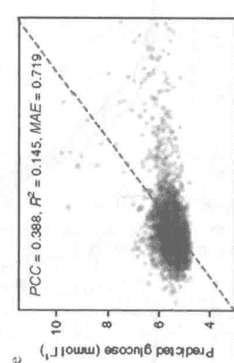
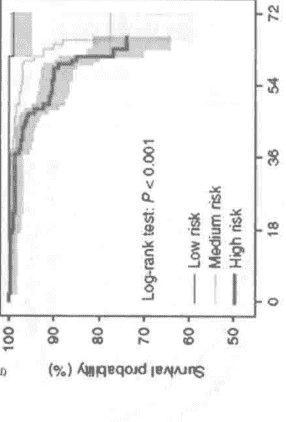
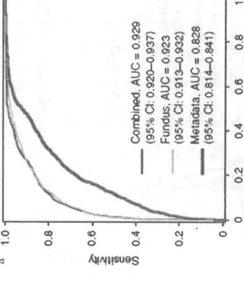
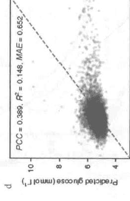

### 核心成果
经外部验证队列及智能手机采集影像前瞻研究双重验证：融合模型识别CKD与T2DM的AUC达**0.85~0.93**；基于11.5万+张图像训练，可精准回归eGFR与血糖水平；更能按进展风险对患者分层，极具临床转化潜力。

---

# 五、AI重塑心脑血管诊疗新生态

前沿技术浪潮已全渗透心脑血管领域，催生新医学范式，重塑诊疗康全链路。随着电子病历信息化加速，AI成为破解资源短缺、推动精准医疗的关键引擎。其核心支柱涵盖医学机器人、语音识别、图像识别、NLP及专家系统等。

#### （一）医学机器人：从“阅片员”到“术中领航”
*   **影像阅片：** 深度学习赋能机器人，阅片速度与精度双超人工，大幅缓解医生负担，降低漏误诊率。
*   **手术辅助：** 术中机器人实现亚毫米级精度植入，将传统4小时高难脑外科手术压缩至2小时，微创、可视、高效，医患双赢。
*   **护理赋能：** 知识图谱驱动护理决策推荐；饮食、送药、搬运机器人分流繁重体力劳动，释放护理人力回归精准人文关怀。

#### （二）语音识别：解放医生双手的“隐形笔录”
语音转文本、自动结构化填入病历模板，配合医学知识库与智能决策支持，显著缩短书写耗时、提升规范度、降低疏漏风险。虽处起步期，但将成电子病历系统标配核心模块。

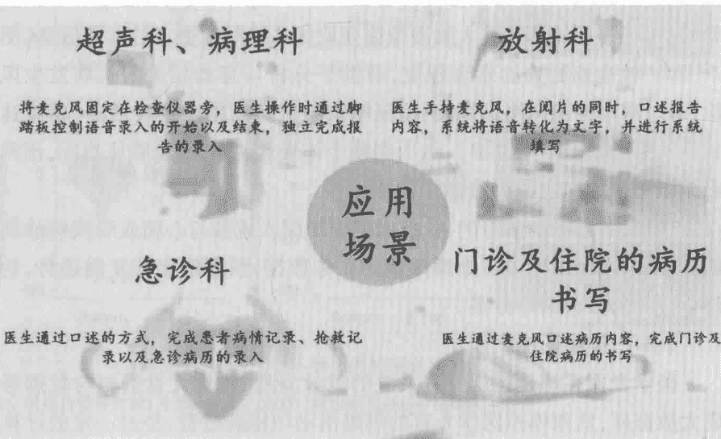

#### （三）图像识别：穿透影像迷雾的“火眼金睛”
*   **超声心动图自动化：** AI自动标注解剖结构、切标准切面，识图准确率超**92%**，已成非心内科医生急诊首选工具，亦是青年医师最佳导师。
*   **全维影像处理：** 2D/3D超声采集、重建、分割、自动测量全链路智能化。
*   **3D人脸洞察衰老与心脑风险：** 三维面容蕴含丰富生理信号。深度神经网络实现高精度面部年龄预测（MAE<3岁），量化个体衰老速率，融合临床指标预警心脑血管事件。未来，AI将深度介入诊断全流程，助力海量影像分析、趋势预判与个性化方案制定。

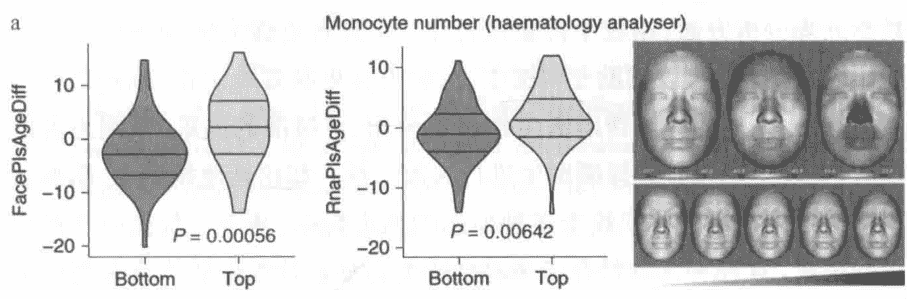
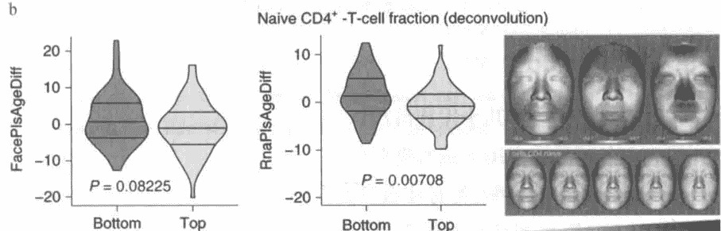
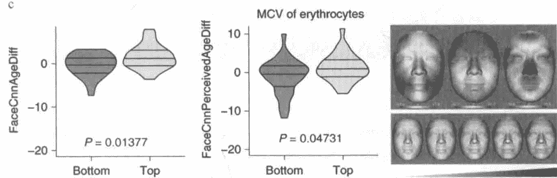

#### （四）专家系统：数字化“超级大脑”的临床决策支持
从早期MYCIN感染诊断，进化至沃森肿瘤（WFO）等现代系统。依托海量文献库、推理引擎，输出个性化、分级治疗建议。多中心研究证实：WFO建议与专家组高度一致，具备秒级检索、辅助决策、医学教育三大价值。**但须清醒：AI缺乏人文关怀与情感沟通，无法替代医生在复杂博弈中的最终决断与温情传递。**

---

### 小结

# 第八章 开启智慧医疗与心理健康新纪元

### 本章学习指南

读完本章，你将能够：
1.  准确把握精神疾病的核心概念、分类体系及典型临床表现。
2.  深刻理解变革传统精神疾病诊疗模式的迫切性。
3.  全面认知新型精神卫生管理模式的运作逻辑。
4.  明确人工智能介入精神卫生领域的必要性与价值。

---

### 前言：从四体液说到智能诊疗的跨越

古希腊医圣希波克拉底曾提出“四体液学说”，归因血液、黏液、黄胆汁、黑胆汁失衡致病。这一认知延续许久，直到 19 世纪中叶至 20 世纪初，弗洛伊德等先驱开创精神分析，配合药物干预，才让精神医学实现质的飞跃。如今，人工智能与精神疾病诊疗深度融合的智慧医疗新范式正强势崛起，为深陷精神困境的群体点亮了新的希望之光。

---

### 一、引言：破解心灵迷局的新钥匙

奥斯卡影片《美丽心灵》刻画了天才数学家纳什与精神分裂症的抗争：在妻子守护与自我意志的双重支撑下，他拨开幻觉迷雾，重回学术巅峰并摘得诺贝尔奖。这既是智慧与勇气的赞歌，也是理想化的结局。现实中，无数患者终生困于病痛，面临误解、确诊延迟、治疗缺位的多重困境。

随着信息技术井喷，高效便捷的智慧医疗模式应运而生，科学家目光聚焦 AI 在精神卫生的落地潜力。本章将系统梳理精神疾病谱系与临床画像，剖析 AI 赋能智慧医疗的现状、难点与突围路径，勾勒其在精神卫生领域的应用全景。

---

### 二、生物—心理—社会医学视角下的精神卫生现状

#### 惊人的流行病学数据与治疗鸿沟
中国疾控中心精神卫生中心 2009 年数据显示，全国精神疾病患者破亿。其中精神分裂症致残率高达 82.4%~93.64%，位居致残榜首。精神疾病负担占总疾病负担 20% 以上，高居榜首。更触目惊心的是：超 5600 万患者从未接受正规诊疗，重性精神疾病患者仅 1/4 获得专科服务。

#### 供需矛盾与模式变革的倒逼
人口老龄化、寿命延长、社会转型期的多重压力（学业、就业、独生子女养老等）推高发病率，家庭与社会负担双重加码。然而，诊断依赖主观经验、病程长且易复发、高昂费用导致贫困家庭弃疗、专业资源极度稀缺……一系列结构性痛点，倒逼我们必须构建**“社区为基础、智慧技术赋能、诊疗一体化”**的新型管理模式，以低成本、高可及、强实效的方案破局。

---

#### (一) 精神疾病：概念界定与核心症候群解析

**1. 核心定义与重性疾病谱系**
精神疾病是生物、心理、社会多因交互作用下，脑功能紊乱导致认知、情感、意志、行为不同程度障碍的疾病总称。卫计委明确界定的**重性精神疾病**包括：精神分裂症、分裂情感性障碍、持久妄想性障碍、双相情感障碍、癫痫精神障碍、精神发育迟滞伴发精神障碍。此外，物质所致精神障碍、强迫症、焦虑症等神经症谱系亦属范畴。

**2. 三大高频疾病深度画像**

| 疾病类型 | 核心特征 | 临床痛点与关键信息 |
| :--- | :--- | :--- |
| **精神分裂症** | 病因未明；思维、情感、行为不协调，意识清晰、智力多保留。青年高发，男女比无显著差异。 | **分型复杂**（单纯、青春、紧张、偏执、未分化、残留、抑郁型），**偏执型最多见**（稳定妄想+幻听）。**复发率极高**，早期规范干预是改善预后的黄金法则。 |
| **心境障碍** (抑郁障碍/双相障碍) | 显著持久的情感异常高涨或低落。抑郁症表现为核心三联征：心境低落、兴趣缺失、精力减退，伴无价值感、自杀风险。 | **识别难、起效慢、依从性差**三重困境：早期症状隐匿，患者就医延迟；抗抑郁药需数周起效；代谢副作用导致停药率高，疗效大打折扣。 |
| **强迫症** | 属轻型精神障碍。核心为**“自知力保留的对抗性症状”**——患者明知强迫思维/行为多余不合理，却无法控制，引发显著焦虑及社功能受损。 | 认知、逻辑、自知力完好，但陷入“明知故犯”的内耗循环，严重消耗心理资源。 |

---

#### (二) 精神医学诊疗现状：困境与突围

[PRE*] 当前精神专科诊疗面临“诊断主观化、资源分布极不均衡、长程管理缺位、患者依从性低”四大结构性难题。传统面诊模式难以支撑海量患者的筛查、随访与复发预警需求，这正是智能化技术介入、重塑诊疗工作流的切入点所在。

---

### 附录：拓展思考与权威参考

#### 思考与练习
1.  AI 发展历程可划分为哪几个关键阶段？
2.  AI 在医学版图中的主要应用疆域有哪些？
3.  AI 核心流派分类及各自技术特点是什么？
4.  基于机器学习的疾病预测建模包含哪些关键步骤？
5.  心脑血管领域 AI 落地的核心场景集中在哪几方面？
6.  AI 在心脑血管疾病中创造的核心临床价值与意义几何？

#### 核心参考文献精选
*   **奠基性文献**：Samuel A.L. (1960) / Wiener N. (1960) / Minsky M. (1970) — 早期自动化伦理与计算机科学形态探讨。
*   **医学 AI 综述**：Yu K.H. et al. (2018, *Nat Biomed Eng*) / Jiang F. et al. (2017) / Mintz Y. & Brodie R. (2019) — 医疗 AI 全景与入门。
*   **心血管专题**：Kritanawong C. et al. (2017, *JACC*) / Johnson K.W. et al. (2018, *JACC*) / Dorado-Diaz P.I. et al. (2019, *Rev Esp Cardiol*) — 精准心血管医学与心脏病学 AI 应用现状。
*   **深度学习医学影像**：Litjens G. et al. (2017, *Med Image Anal*) / Ciresan D.C. et al. (2010) — 深度学习在医学图像分析/识别中的里程碑。
*   **多模态与临床验证**：Tison G.H. et al. (2022, *JACC*) / Kamran F. et al. (2022, *BMJ*) / Zhou N. et al. (2019, *Oncologist*) — AI 增强心电图、COVID-19 恶化预警、Watson 肿瘤决策一致性研究。
*   **跨学科应用**：Zhang K. et al. (2021, *Nat Biomed Eng*) 视网膜影像预测肾病/糖尿病 / Xia X. et al. (2020, *Nat Metab*) 面部 3D 分析衰老异质性 / Park S. et al. (2022, *J Clin Oncol*) 肿瘤微环境空间分析。

*(本章撰稿：周永 陈学禹)*

# AI赋能心灵医学：破解精神卫生困局的智慧新路

尽管临床心理学与精神病学历经百年发展，积累了显著进展，但诊断依据依然模糊，预后判断缺乏确定性，心理与药物治疗的有效率长期徘徊在30%至50%区间。当前诊疗高度依赖精神科医生依据患者及家属的主观叙述、临床体征，通过试验性用药观察反应来制定长期方案，客观实验室检查与影像学分析严重缺位。这种“凭经验、靠主观”的模式难以取信患方，不仅延长病痛、造成资源错配，更易因误诊错失早期干预黄金期。更棘手的是高复发特性：超八成患者五年内复发，首发患者两年内复发率近半，极大增加了诊疗难度。

国内注册精神专科医师不足四万，与国际标准差距悬殊。医疗服务供给不足，叠加公众精神卫生认知匮乏（知晓率、识别率、求治率“三低”），导致高复发、高再住院、高致残“三高”并存，患者社会功能恢复困难，家庭社会负担沉重。专科医生短缺使基层精神卫生机构建设乏力，患者涌入综合医院，非专科医生易忽视或误判为躯体疾病，延误治疗时机。此外，病耻感普遍存在，源于社会认知偏见与恐惧，导致患者自我认同受损、隐瞒病情、拒绝就医；甚至近半数符合出院标准的患者因家属担忧复发而滞留病房，挤占公共资源。

住院患者以精神分裂症为主，抑郁、强迫等高负担疾病常被忽视，家属多将其归因于压力情绪问题，致使诊疗滞后。2021年国家“脑科学计划”推进关键期，精神医学作为核心板块，亟需拥抱前沿科技，重塑传统诊疗范式，提升社会心理健康水平。

### 三、基于人工智能发展的智慧医疗

科技飞跃催生了融合信息技术、AI与医疗健康的智慧医疗。其核心在于将物联网、大数据深度植入医药卫生领域，打通患者、医护、设备、机构间的协作壁垒，驱动传统医学向智慧服务模式跃迁。智慧医疗借助信息化手段落地远程诊疗与自助服务，有效压降成本、提质增效、缓解资源紧张；通过线上资源共享平衡医疗资源分布不均。在“健康中国”战略引领下，智慧病房建设如火如荼，该领域已成医疗未来核心增长极。加速技术攻关与产业落地，满足多元需求、守护全民健康，是当前行业面临的机遇与挑战。

#### (一) 智慧医疗的概念

狭义上，智慧医疗即临床决策支持系统（CDSS）：录入主诉、体征、检验结果，输出潜在诊断建议及后续检查路径，辅助精准诊断。广义上，它覆盖挂号分诊、电子病历全程留痕、异地就医数据互通等就医全链路，旨在提供更便捷、连贯的医疗体验。

#### (二) 我国智慧医疗建设现状

2009年IBM提出概念后，市场需求与规模持续扩容。数字化录入打破数据孤岛，挖掘高价值信息，推动个性化医疗演进。国内发展脉络清晰：临床信息化 → 区域信息化 → 全域信息化。如今医疗APP普及，预约、缴费、报告查阅一键搞定，大幅缓解就诊压力、节省双方时间。智慧医疗依托数据分析实现个性化管理，针对不同人群定制方案，提升康复效率；引入“互联网+家庭医生”模式，康复后持续追踪，预防复发、管控慢病、优化预后。从院前预约、诊中辅助到院后随访，全流程贯通，真正实现了从“以病为中心”向“以患者为中心”的转变。

#### (三) 智慧医疗建设过程中的困难与挑战

数据爆炸时代，如何从海量医疗数据中提炼核心价值，实现患者全周期、全方位健康管理，是燃眉之急。现实中，不少医院及医护观念滞后，“重临床轻管理、重效率轻质量”，尤其资源薄弱地区对AI新事物接受度低，阻碍推广普及。

隐私保护是大数据背景下的核心痛点。数字化虽是破解资源失衡、低效配置的良方，但医疗信息泄露风险不容小觑——姓名、联系方式、住址、病历等敏感数据一旦外泄，将危及患者人身安全，引发机构信誉危机、法律诉讼乃至社会负面影响。这倒逼建立规范数据共享制度，严控隐私数据存储与使用，在合规框架内挖掘数据价值，稳妥推动模式转型。

#### (四) 智慧医疗的发展前景与方向

5G高速传输特性为远程医疗装上引擎，优质资源可跨越山海下沉至偏远地区，远程指导诊疗随训成真。5G+AI融合创新层出不穷：远程会诊结合AI辅助诊断赋能基层；北京积水潭医院借5G手术机器人跨省实施脊柱手术。新技术拉近医患距离，让三四线城市及乡镇居民足不出户享受名医服务，大幅压降时空成本。智慧医疗凭借高研发效率、低时间成本、技术精准化等优势，已成全球竞争新高地，未来必成国际角力焦点。

### 四、智慧医疗在精神卫生领域中的应用

专家提出“AI为产品，数据挖掘为基石”，引入计算系统生物学构建疾病数学模型，驱动医疗向数据驱动模式转型。通过文本提炼、数据挖掘、指标筛选、降维分析，层层递进揭示症状亚群关联，最终服务于诊断、预后、疗效预测及生物标志物监测。在国家战略推动下，精神卫生与AI深度融合，成果加速落地临床，应用版图主要涵盖三大维度：患者端情绪调节赋能、医生端诊疗监测增效、科研端大数据挖掘病理机制。

#### (一) 人工智能在精神疾病诊断中的作用

##### 1. 预测产后抑郁风险
机器学习作为AI核心，通过模拟人类学习自动优化参数求解最优解，已渗透搜索推荐、翻译识别等日常场景，其临床诊断潜力被公认优于传统统计学方法。近年科学家聚焦机器学习与心理精神医学交叉，利用多维数据强化转化研究。我国每年新增产后抑郁患者约120万，严重威胁母婴健康。已有机构基于风险分层模型开发APP，供孕妇自测情绪；多家月子中心亦接入算法预警体系，守护产妇心理防线。

##### 2. 基于脑电生物信号的精神疾病风险预测
上海精神卫生中心牵头构建“基于脑电生物信号的个体化心理风险预测与优化管理体系”，汇聚近十年高危人群生物行为学队列数据，将复杂变量纳入精准计算模型，实时后台分析提取关键生物标志物，输出个体风险画像与可干预靶点，进而制定针对性早期干预方案，力争延缓甚至阻断疾病进程。

##### 3. 精神疾病脑影像处理系统
基于Web的多模态MRI自动化处理系统，简化分析流程，实现数据处理“零门槛”。系统自动测量脑影像参数，对标同年龄段健康参考库，异常值触发诊断报告生成，显著提升诊断准度，减轻医生工作负荷。

#### （二）精神疾病治疗中应用人工智能的意义

##### 1. 精准医学指导精神疾病诊疗
研究发现，同药同法因基因差异疗效天壤之别。精准医学应运而生：基于大样本数据解析分子机制，融合组学、影像、临床等多维信息，为个体定制防诊疗方案与用药剂量，追求“最大疗效、最小副作用”。流调显示精神疾病家族聚集性高、病因多隐、缺客观诊断金标准，引入精准医学势在必行。

##### 2. 人工智能治疗创伤后应激障碍
PTSD源于极端创伤事件，共病率高、自杀风险是常人6倍以上。战区军民是高发人群，但心理援助人力不足且险境难入。美南加大推出AI心理治疗师：拟人化形象，捕捉面部微表情、语音语调，结合量表诊断并给方案。患者面对AI更放松、配合度更高，有效突破防御机制。灾害事故频发背景下，AI在线监测高危人群心理状态、实施早期干预，可有效遏制PTSD恶化。

##### 3. 基于人工智能的毒瘾评估与干预检测体系
毒品劫持多巴胺奖赏回路，破坏脑抑制机制，致成瘾。上海精神卫生中心融合VR与AI大数据，构建覆盖“渴求评估-认知干预-防复吸监控”全链条的毒瘾管理系统。采集心率、皮电、脑电量化心理渴求，大数据画像成瘾程度，输出个性化方案；康复后经APP与穿戴设备实时监测，高危行为自动预警，大幅降低复吸率。

##### 4. APP/VR 儿童孤独症辅助康复系统
孤独症系广泛性发育障碍，感觉统合失调重创语言社交，是0-6岁精神致残儿首位杀手。传统疗法痛点：成本高、护理繁、人才稀、训练难。教育APP凭借交互性与便捷性成新宠。针对性情绪识别APP依认知特征建模，覆盖六大基础情绪与六层级认知，记录分析学习行为，引导患儿融入社交场景。上海中心研发VR康复系统，沉浸式模拟学校等公共场景，场景丰富、安全可控、居家可用，显著降本增效，成家长安心之选。

#### （三）人工智能在精神疾病预后中的应用潜能

高压社会下，睡眠障碍成常态。AI睡眠追踪器监控行为、纠正习惯、预测障碍，但专家指出现有算法模式缺陷、传感器易脱离导致数据失真，改善睡眠仍任重道远。智能手机已成移动监测终端：心率体温、运动轨迹（反映情绪能量水平）、震颤（药物副作用）、通讯频次（社交功能）、面部微表情语音语调（精神状态）、服药依从性与睡眠质量，均可连续捕捉。语句逻辑混乱预警精神分裂复发，记忆力下降提示认知受损，为出院后长程管理提供数据支撑。然面部分析、语音监听引发隐私担忧，致使部分用户抗拒，这是AI落地必须跨越的信任鸿沟。

### 小结

物质富足催生精神需求觉醒，但精神疾病重视度与研究深度仍显不足。千百年来人类不懈探索心灵奥秘，大数据与智慧医疗的到来，为精神医学指明新航向，为患者打开希望之门。推动AI与精神卫生深度融合，加速传统模式向智慧医疗转型，必将成为长期研究热点与应用主流，为深受精神疾病折磨的人群带来真实福祉。

### 思考与练习

- 1. 现阶段精神疾病诊疗存在哪些弊端？
- 2. 由传统医疗模式向新型智慧医疗模式转变的过程中有哪些困难和挑战？
- 3. 在大数据时代该如何防止医疗信息泄露？
- 4. 举例说明人工智能在精神医学领域的应用价值。

### 参考文献

- [1] 黄悦勤.我国精神障碍流行病学研究现状.第六次全国流行病学大会暨第四届全国中青年流行病学工作者学术会议.
- [2] 廖震华,丁丽君,温程.我国 60 年精神障碍流行病学调查研究现状.中国全科医学,2012,15(10): 5.
- [3] 马弘,刘津,何燕玲,等.中国精神卫生服务模式改革的重要方向: 686 模式.中国心理卫生杂志,2011(10): 12 - 15.
- [4] 王永固,谢扬,殷文娟.基于 Pad 的教育 APP 教学设计模型构建与开发研究: 以孤独症儿童情绪识别训练 APP 为例.中国电化教育,2017(6).
- [5] 赵欣,张青,王继军,等.开创精神卫生智慧医疗与人工智能新时代.中国卫生资源,2019,129(5): 27 - 30.

# 第九章 AI赋能生物标志物挖掘新范式

### 核心学习导图

读完本章，你将重点掌握：
- 代谢组学研究的核心内涵；
- 疾病生物标志物挖掘的战略价值；
- 生物标志物研究的全链路逻辑框架；
- 机器学习范式与传统统计学方法的本质区别；
- 集成机器学习算法在标志物体系构建中的实战方案。

步入21世纪，人工智能与生物医药双轮驱动成为时代主旋律。AI技术已全渗透至生产生活各环节；与此同时，高通量组学技术的跨越式进步，极大拓展了人类从生物样本中解码数据的边界，为临床标志物筛选、疾病分子机制解析等奠定了坚实数据基石。然而，面对呈指数级增长的海量数据，以假设检验为核心的传统统计工具已难以胜任。AI算法的迭代爆发，为高维数据处理与疾病标志物精准筛选注入了全新范式。

---

## 一、 破题：精准医学的“导航仪”与AI的“加速度”

**精准医学**，亦称“精准医疗”，其核心在于依托患者内在生物学特征、临床表型等多维信息，实现诊疗方案的“因人制宜”与决策的“量身定制”。这标志着医学模式从“对症下药”向“对人下药”跨越，贯穿疾病预防、筛查、诊断、治疗全周期。国家卫健委《“十四五”国家临床专科能力建设规划》明确锚定技术创新航向，聚焦再生医学、精准医学等前沿高地，力争关键领域实现“从0到1”突破。

精准医学的落地，关键在于**生物标志物**能否精准区分“健康态”与“疾病态”，进而对疾病风险、预后走向、治疗响应实现精准分层。生物标志物，即能客观标记机体系统、器官、组织以至细胞/亚细胞层面结构功能变化的生化指标，是疾病诊断、新药/新疗法安全性评价的“金标准”。**AI算法与高通量代谢组学数据的深度耦合**，构建起标志物筛选的智能化引擎，为精准医学装上了强劲“加速器”。

---

## 二、 核心拆解：生物标志物全景图谱

### （一） 概念溯源与内涵重构

“Biomarker”一词早期活跃于地质学文献，指代源自生物体的有机化合物（曾译“生物标志化合物”）。20世纪60年代切入医学视野，80年代正式确立生物医学学术地位。学术界对其内涵曾见仁见智，直至2001年，美国国立卫生研究院（NIH）召集专家工作组给出权威定义：**“一种可客观测量评价的特征，作为正常生理过程、病理过程或药物干预药理反应的指示指标。”** 这一定义的落地，标志着学界认知的统一与关注度的飙升。

在疾病研究语境下，生物标志物特指能客观量化的、表征生理/病理/治疗过程中特异性生化指标。监测其动态变化，可窥探机体实时生物学状态；疾病特异性标志物的捕获，助力疾病甄别、早筛早诊及疗程监控；通过分子、细胞、个体等多尺度量化标志物异常度，可为严重毒性损伤拉响早期预警。作为个体化医疗的“核心变量”，挖掘表征疾病进程的标志物已成医学研究主战场。伴随生物芯片、新一代测序等高通量技术迭代，海量标志物数据井喷，相关文献指数级增长，从发现、筛选、验证到应用的全产业链商业版图以高复合增速扩张。

综上，生物标志物可泛指标记系统、器官、组织、细胞及亚细胞结构功能**已发生或潜在变化**的生化指标，应用覆盖疾病诊断、分期判定、新药评价、疗法靶向人群有效性/安全性验证等全场景（见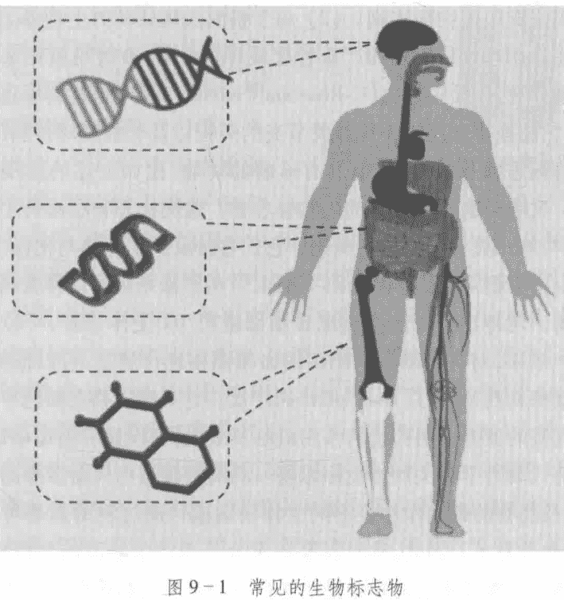）。其物质基础具有不确定性：或为细胞分子结构/功能重塑，或为生理活性物质异常表达，或为代谢通路紊乱及异常代谢产物堆积，或为个体/种群/生态系统层面的异常表型。

### （二） 分类体系与筛选“硬指标”

#### 1. 入选“门槛”：五大金标准
鉴于标志物涵盖面极广且随检测技术进化持续外拓，为确保临床转化效能，筛选需满足五大刚性指标：
- **特异性**：精准锚定靶标疾病/状态；
- **灵敏度**：捕捉微弱信号，不漏诊；
- **重复性**：跨个体/批次稳健可复现（允许可接受个体差异）；
- **稳定性**：样本采集、保存、检测全流程信号不衰减；
- **安全性**：对受检者零损伤或仅可接受微创损伤。

#### 2. 功能导向：四大分型图谱
基于临床应用意图，生物标志物可划分为四大阵营（见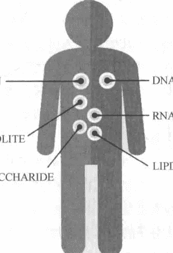）：

| 分类维度 | 核心功能 | 典型案例/场景 |
| :--- | :--- | :--- |
| **诊断/预后标志物** | 判定疾病“存/无”、分期分级、预测结局 | 体检常规项（血压、血糖）；遗传学突变位点随技术进化纳入此类 |
| **疾病活动/疗效监测标志物** | 量化病情重度、评估疗效、监控毒副作用 | **C反应蛋白（CRP）**：类风湿关节炎病程与干扰素疗效的“晴雨表”；血压/血糖兼具诊断与监测双重属性 |
| **药物药效标志物** | 直击药物-靶标结合及药理效应，**新药研发最看重** | 神经退行性病D2受体造影验证靶点占有率；2型糖尿病血糖漂移验证DPP-4抑制剂（西格列汀）疗效；可缩短新药审批周期 |
| **药代动力学相关标志物** | 解码药物转运代谢差异，指导个体给药 | **抗癌药伊立替康**：UGT1A1*28基因型患者代谢缺陷需减量避毒；**硫唑嘌呤**：用药前必查TPMT基因位点规避骨髓抑制风险 |

> **注**：第二、三类标志物存在功能重叠；第四类强调药物基因组学指导临床用药的精准价值。

依据生物标志物的内在自然属性，可将其划分为核酸类（DNA、RNA）、蛋白类、糖类及衍生物等几大阵营（见图 9-2）。

**1. 核酸类标志物**  
过去十余年，该领域取得突飞猛进的进展，核心驱动力在于测序技术的飞跃。DNA 层面的标志物涵盖单核苷酸多态性（SNP）、插入缺失（InDel）、拷贝数变异（CNV）及甲基化修饰，甚至延伸至染色体层面的插入、缺失、重排与重复；RNA 侧则聚焦于表达水平差异、序列变异以及非编码 RNA（如 microRNA、lncRNA）的发现。

**2. 蛋白类标志物**  
这是研究历史最悠久、应用最成熟的一类。常规体检中的酶类指标便是典型代表。得益于血液、唾液等样本易获取、检测流程简便，蛋白标志物早已深耕临床。近年来蛋白质组学的兴起，更为这一领域注入了新活力。

**3. 糖组标志物**  
糖组汇集了生物体内所有糖类——无论是游离单糖还是共价结合的糖链，堪比基因组与蛋白质组的“糖版图”。糖蛋白、糖脂上的糖链蕴含海量信息，经筛选可捕获疾病特异性标志物，例如特定多聚糖即可指示乳腺癌。

**4. 代谢组标志物**  
代谢组学成果亦被广泛引入标志物开发。代谢组指代内源性小分子代谢产物的动态全貌。理论涵盖大分子与小分子，但实践中聚焦相对分子质量 <1000 的小分子。代谢物种类与浓度的波动，往往直接映射疾病信号。

#### （三） 生物标志物的研究技艺与路径选择

挖掘出一个高价值的疾病生物标志物，其社会效益与商业潜力往往不亚于一款创新药的诞生。标志物的应用催生了分层医学与个性化诊疗，这类新模式能压缩新药申报周期、降低研发成本、提升治疗精准度，同时减轻患者经济负担。基于标志物检测的靶向疗法，为肿瘤及遗传病治疗带来曙光，吸引医药界与研发机构投入重资布局。

##### 1. 多元化的研究技术矩阵

标志物类型繁多，对应的研究技术自然也是百花齐放。几乎所有解析核酸、蛋白、糖类等大分子的手段，均可迁移至此。针对 SNPs、CNVs、microRNA、lncRNA 等核酸标志物，测序与基因芯片是主力；面向蛋白、多肽，则有质谱（MS）、HPLC、GC-MS、LC-MS、CE-MS、双向电泳（2DGE）、蛋白芯片等丰富工具箱（见图 9-3）；代谢组与糖组研究亦可借力上述平台。

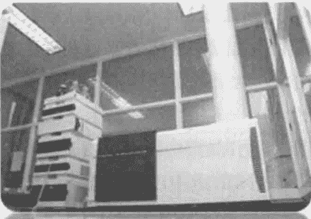

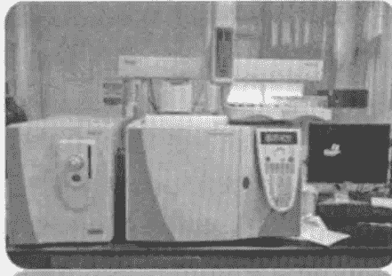

图 9-3 蛋白、多肽类生物标志物的常用研究技术

#### (四) 高通量组学技术：标志物研究的加速器

生物芯片、新一代测序等高通量技术的成熟，强力推动了标志物研究。它们不仅能捕捉单一基因或表达产物的变异，更能从整体视角揭示基因间的互作与功能关联。复杂疾病往往涉及多个基因网络，若每个网络对应一枚标志物，组合面板便能更客观地刻画病态。组合式标志物兼顾灵敏度与特异性，重复性亦更优。转录组、蛋白组、代谢组等技术迭代，驱动了此类标志物研发。但残酷现实是：巨额投入下，真正达标临床诊断的单一敏感特异标志物寥寥无几。组合虽强，但跨人群重复性常受挫——技术差异、数据处理偏差、患者遗传背景异质性均是拦路虎。个体基线差异大，导致阳性/阴性判定困境。如何从数据海洋中淘金、推出经得起临床验证的标志物，是核心挑战。但随着检测技术进步、算法优化、大样本积累，我们有理由期待更多理想标志物落地临床。

### 三、 代谢组学研究策略：贴近表型的窗口

代谢物位于信号通路末端，是机体即时生理状态的“晴雨表”。作为系统生物学继基因组、蛋白组后的新星，代谢组学通过定性定量手段，全景扫描特定生理周期内的低分子量代谢物，解码动态代谢变化规律，揭示生命活动的代谢本质。它聚焦全代谢物谱变化，通过体液成分分析锁定系统生化特征与功能调控网络——体液代谢谱即映射生理病理状态。研究对象锁定分子量 <1000 的内源性小分子，种类远少于基因与蛋白，却信息密度极高。

#### （一） 肿瘤分型与代谢标志物挖掘

得益于“最贴近表型”的特质，代谢组学在疾病分型与标志物发掘上独具优势。2009年，密歇根大学团队借助 GC-MS 平台锁定前列腺癌标志物——肌氨酸，并揭示其促转移潜能。相比传统手段，代谢组学动态图谱能以更高灵敏度、更早阶段区分胰腺癌与慢性胰腺炎。异常基因不必然导致蛋白功能异常，异常蛋白也不必然扰乱代谢。致病因子与分子异常的关联强度，决定了预测精准度。全代谢组检测不仅能辅助诊断，还能全程监控病情演进、分级分层，赢得防治先机。

#### （二） 心血管疾病分型与代谢指纹图谱

代谢组学凭借高通量检测配合多元统计，能筛选显著差异代谢标志物，深度解构病理机制，为防治提供科学依据。生命代谢永不停歇，疾病必扰代谢网络，致使体液小分子显著漂移。对比生理/病理态、同病不同分型分期的代谢差异，即可构建诊断分型标志物组合。冠心病作为高危心血管病，金标准冠脉造影虽准但创伤大、贵、繁。临床渴望微创、低成本、简便的早筛技术。代谢组学可对标准血清、血浆、尿液实施高通量小分子扫描，其中多已被确认为风险因子。克利夫兰医院与 UCLA 学者发现：肠菌降解卵磷脂的“副产物”能预测心脏病风险。动物实验证实：肠菌参与膳食脂质转化为 TMAO（三甲胺 N-氧化物），TMAO 促动脉斑块形成。这揭示共生菌可致/加重肥胖、免疫失调等病态，以 TMAO 为靶点或可防治动脉粥样硬化。锚定关键标志物后，结合基因组、蛋白组、肽组、代谢组等多组学联合分析（见图 9-4），可多维解析疾病机理。

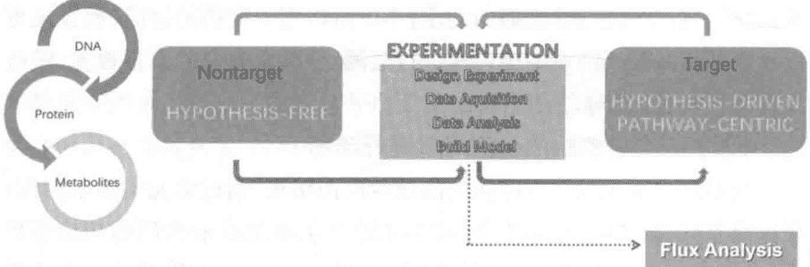

图 9-4 多组学研究

#### （三） 广泛靶向代谢组：新一代检测利器

现代生活方式催生的“代谢综合征”——肥胖、高血压、高血糖三高叠加，成健康头号杀手。除肿瘤心脑血管外，代谢组学亦为代谢综合征机制解析、诊断用药提供新思路。“广泛靶向代谢组”融合非靶向广度与靶向深度，集高通量、高灵敏、绝对定量于一体，擅长捕获中低丰度代谢物，是新标志物发现的利器。核心优势：单次覆盖 1000+ 代谢物、触达低丰度、跨越 20+ 代谢通路、近千标准品库保驾护航定性定量精准。覆盖氨基酸衍生物、糖类、核苷酸衍生物、维生素、脂质等核心代谢族群。

技术演进下，科研路径愈发清晰：基因测序定控制基因，蛋白测序追下游通路，代谢组学看最终表型输出；或多组学联合作战，全景式重构发病机制，为诊疗监测寻得新切入点。

### 四、 高通量代谢组学数据处理：从混沌中提炼真知

代谢网络错综复杂，衍生数据具备高维、小样本、强干扰“三高”特征，常规统计力不从心。如何精准解析数据、挖掘高价值信息、筛选潜在标志物，成为数据处理的核心攻关点。

#### (一) 数据预处理：打磨原始数据的“粗糙石”

以主流 LC-MS 为例，虽具高灵敏、高分辨、高通量优势，但仪器精度、pH、前处理、温度等多重变量会引入噪声、异常值、缺失值，扭曲统计结果，故预处理势在必行。完善的预处理能屏蔽干扰，护航多变量建模与标志物筛选。色谱-质谱原始数据杂乱无章，需先经峰识别、对齐、校正、保留时间校正“四步走”，再入预处理流程。主流操作聚焦数据清洗与转换。清洗含缺失值填补（均值/中位数/近邻/多重插补）与去噪平滑（分箱/聚类/回归/视噪声为缺失填补）；转换则通过标准化/归一化（Z-score/Min-Max）消除量纲与量级差异，将多维数据映射为可比的无量纲纯值，为后续统计铺路。

#### (二) 异常数据处理：剔除“离群点”还原真实图景

样本固有异质性导致个别代谢组分在正常生理或个体间差异巨大，干扰分类，故须预先剔除异常样本。统计学上，偏离整体分布模式的少量对象即“离群点”，缺失值是典型代表。缺失成因多元：特有代谢物仅现于个别样本、浓度低于检出限、峰匹配失败致未检出。缺失值显著偏倚分析，必先填补，继之标准化缩放至统一区间，赋予算法跨单位比较加权能力。鉴于代谢组数据丰度跨度大，标准化消除偏差、确保可比性至关键。填补标准化后，变量同域可比，利于综合分析。后续关键在于：如何用统计学从高维数据中提取关键信息，洞察代谢动态？代谢组数据变量数（百~万级）远超样本数（小样本），呈“大P小N”结构，同其他组学一致。若要有效建模提特征，降维是必经之路。

#### (三) 多变量统计分析：破解高维数据的“密码”

质谱代谢组数据高维显著，必须借力多变量统计揭示变量间复杂互作，地位举足轻重。主流方法分“非机器学习”与“机器学习”两派。前者指机器学习普及前的传统算法，智能化程度低，难以捕捉复杂非线性关系。

##### 1. 机器学习统计分析：赋能数据深度挖掘

机器学习（ML）让计算机从数据中自主习得规律、积累知识、进化智能、拟人决策，是通往 AI 的核心径路。Mitchell 1997 年经典定义：“计算机利用经验自我优化性能。”它融汇 AI、统计、神经生物、认知科学、计算理论、控制论、信息论、哲学等跨学科成果。实战证明其在数据挖掘、图像/语音识别、医疗诊断、生物信息、自动驾驶、金融工程、工控等领域成果斐然。方法论上：基于网络架构建模，选学习策略与训练法，捕捉输入数据结构与内在模式，迭代参数，用数学工具求解最优预测，兼顾泛化与防过拟合（见图 9-5）。

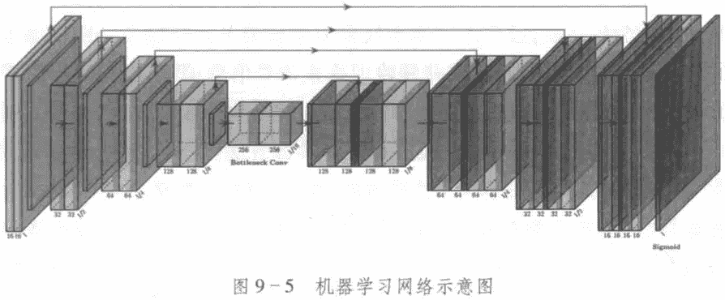

ML 算法主分两类：无监督学习——无标签自主学习，代表有 PCA、NLM、奇异值分解、深度信念网络、聚类、LDA 等；有监督学习——有标签指导学习，涵盖 PLS-DA、Fisher 判别、OPLS-DA、SVM、随机森林、ANN、决策树等。

PCA 是代谢组学高频降维利器。1901 年 Pearson 提出，1933 年 Hotelling 完善。核心逻辑：将众多变量压缩为少数不相关主成分（线性组合），保留原始信息最大化，实现降维与解释。本质是线性变换：协方差矩阵对角化，几何上即坐标系旋转至样本离散度最大的 p 个正交轴，高精度将高维映射低维。

有监督阵营中，PLS-DA 是判别分析常客，广泛服役代谢组学。其机制：分样本特性建模训练、验证模型信度，兼具多元线性回归与 PCA 功能。下文将逐一拆解两大经典有监督算法。

### 核心算法解析与组学数据分析进阶

#### 一、 支持向量机（SVM）：统计学习理论的经典实践

在机器学习的版图中，支持向量机（SVM）堪称基石般的存在，早已在模式识别、分类与回归等多个维度大展拳脚。其理论雏形可追溯至 1963 年，由 Vapnik 与 Chervonenkis 共同奠基；1993 年，Cortes 与 Vapnik 引入软间隔机制完成关键完善，并于 1995 年正式面世。面对小样本、非线性及高维模式识别等棘手场景，SVM 展现出不俗的实力。其核心优势在于双重目标的统一：既追求经验误差的最小化，又致力于几何间隔的最大化，从而实现类别间的高效切分。

**原理架构：** 当样本在原空间线性可分时，算法直接锁定最优超平面；若遇线性不可分困境，则通过引入松弛变量实现柔性处理。进而，借助核函数这一“维度跃迁”工具，将低维输入空间的样本映射至高维特征空间，化非线性为线性可分，进而在该空间内以线性算法求解最优分类超平面。构建过程中，结构风险最小化原则与 VC 维理论护航，将期望风险锁定在概率上界，保证解的全局最优性。

**四大亮点：**
1.  **泛化能力强**：立足统计学习理论，有限训练样本获得的微小误差，能稳健推广至独立测试集；
2.  **全局最优保证**：求解凸优化问题，规避局部最优陷阱；
3.  **非线性求解利器**：核函数巧妙化解非线性难题；
4.  **鲁棒性优异**：分类间隔最大化赋予模型抗干扰韧性。

因此，SVM 能攻克众多模式识别与回归估计难题。二维视角下，线性可分表现为一条直线完成二类分离；高维空间则对应超曲面切割。现实中线性不可分占主流，非线性样本常经核函数映射至高维化为线性可分。在可分条件下，SVM 构造最大间隔超平面执行二分类，核心在于寻找使超平面到所有数据点距离平方和最大的那个平面，该最优平面能为新样本提供更优预测性能。

#### 二、 人工神经网络（ANN）：仿生智能的通用逼近器

人工神经网络（ANN）模拟生物神经系统的拓扑结构与信息处理机制，本质上是一种数学或计算模型。它被视为通用的函数逼近器——理论证明，仅两层网络在神经元充足、训练数据充分条件下即可逼近任意函数，故具备“可学习”本质。ANN 通常以外界信息驱动内部结构自适应调整。其架构呈层级化：输入层居前，隐藏层居中（可多层），输出层殿后，海量节点通过带权连接构建计算图。

**双向传播机制：**
- **前向传播**：输入信号经前一层输出与后一层权重运算、叠加偏置，生成后一层输出，层层递进至终端输出层。
- **反向传播**：针对前向预测值与真实标签的偏差，反向传递误差信号修正权重与偏置，驱动模型迭代收敛。

近年得益于大规模并行计算架构与 GPU 算力的普惠化，计算机算力实现质变。在强算力与海量数据双轮驱动下，端到端训练大规模神经网络成为常态，摆脱了对预训练范式的依赖，ANN 在各类实战场景中绽放光彩。

#### 三、 组学数据分析模块：从工具箱到智能生态

同其他高通量研究一样，生物标志物挖掘离不开专用的数学、统计与信息学工具链，以应对高维、小样本、多变量的数据特质。多元机器学习方法的引入，显著提升了组学数据处理精度。为榨取更多高通量数据价值，科研者开发了 Biopython、BioPerl 等专用生物信息编程套件，极大降低了分析与可视化门槛，同时也倒逼未来分析方法进化，提出四大核心诉求：
1.  **自然语言交互**：以日常通用语言直达分析目的，消除编程壁垒；
2.  **数据驱动智能**：分析解读范式由“人工主导”转向“数据自解”，实现以数治数；
3.  **全流程透明化**：可重复性是生物医学基石，分析细节须有据可查、公开透明；
4.  **移动社交适配**：智能手机打破时空桎梏，成为随时随地开展组学分析的便捷终端。

展望未来，AI 与生物标志物发掘技术的深度融合，将实现组学有效信息的精准提取，为疾病早筛早诊、精准医疗、病理机制解析注入强劲动能。

#### 四、 章末综述

现代科技迭代与学科深度渗透，为解码人体奥秘铺平道路，交叉融合优势为个性化智能医疗搭建载体，让“精准医学”触手可及。AI 技术推动生物标志物发现跨越新门槛，精准捕获关键差异特征，为医患决策输出高置信度预测。在 AI 赋能下，我们能更透彻洞察：何种标志物异常诱发疾病、何种环境诱发风险、依据何种征兆实现疾病预判。随着 AI 演进，分析仪器与算力融合将愈发成熟，AI 构建的高通量发掘体系为标志物筛选奠基，强力支撑“精准医学”。虽融合之路仍存瑕疵与挑战，但坚信 AI 能助我们持续破局，终圆“精准医学”宏愿，惠泽生民。

#### 五、 思考与探究

1.  如何界定生物标志物的内涵？
2.  生物标志物研究主流路径有哪些？
3.  面对海量高通量组学数据，可用筛选策略有哪些？
4.  传统统计学习与机器学习范式的本质分歧是什么？

#### 六、 参考文献

- [1] 阿基业.代谢组学数据处理方法：主成分分析.中国临床药理学与治疗学,2010,15(5)：481－489.
- [2] 阿基业,何骏,孙润彬.代谢组学数据处理：主成分分析十个要点问题.药学学报,2018,53(6)：9.
- [3] 邓魁,李贞子,侯艳,等.基于二维最大重叠离散小波变换的代谢组质谱数据的预处理方法.中国卫生统计,2017(6)：850－852.
- [4] 邓乃扬,田英杰.数据挖掘中的新方法：支持向量机.上海：科学出版社,2004.
- [5] 董继扬,李伟,邓伶莉,等.核磁共振代谢组学数据的尺度归一化新方法.高等学校化学学报,2011,32(2)：262－268.
- [6] 公晓云,申小涛,徐静,等.代谢组学数据正态性对疾病分类准确性的影响.山东大学学报,2016,54(4)：89－93.
- [7] 柯朝甫,张涛,武晓岩,等.代谢组学数据分析的统计学方法.中国卫生统计,2014,31(2)：357－359.
- [8] 李响.代谢组学中的多变量数据分析新方法及其应用的研究.大连：中国科学院大连化学物理研究所,2011.
- [9] 刘攀,冯长焕.正态标准化数据无量纲处理在因子分析中的应用.内江师范学院学报,2017(12)：54－58.
- [10] 刘盈君.基于随机森林的精神分裂症血清代谢组学研究.山东大学学报,2015,53(2)：92－96.
- [11] 刘月程,王焕军,马金刚,等.质谱代谢组学数据处理的研究.化学分析计量,2018,5.
- [12] 娄笑迎,崔巍.机器学习在肿瘤分子标志物挖掘中的研究进展.中华检验医学杂志,2021,44(6):5.
- [13] 吕一丹.基于支持向量机的胰腺癌标志物预测研究.吉林: 吉林大学,2018.
- [14] 亓云鹏,胡杰伟,柴逸峰.代谢组学数据处理研究的进展.计算机与应用化学,2008,25(9).
- [15] 祁亮,沈洁.机器学习在肝癌诊疗领域的应用进展.癌症进展,2019,17(5):7.
- [16] 王敏,黄寅,张伟,等.代谢组学信息获取与数据预处理瓶颈问题探讨.药学进展,2014(2):81-88.
- [17] 王元明,焦伟.异常数据的检测方法.重庆理工大学学报,2009,23(2):86-89.
- [18] 温锦波.基于 NMR 的代谢组学的数据预处理方法及其在糖尿病研究中的应用.厦门: 厦门大学,2007:42-45.
- [19] 湘高,彭楚武,管茶香.人工神经网络在生物医学检测中的应用: 生化测量数据处理方法的研究.中国生物医学工程学报,2007,26(2):5.
- [20] 熊行创,方向,欧阳证,等.基于人工神经网络的生物组织质谱成像分类与识别方法.分析化学,2012,40(1):7.
- [21] 杨志辉.基于机器学习算法在数据分类中的应用研究.山西: 中北大学,2017.
- [22] 周志华.机器学习.北京: 清华大学出版社,2016.
- [23] B Galindo-Prieto, L Eriksson, J Trygg. Variable influence on projection (VIP) for orthogonal projections to latent structures (OPLS). Journal of Chemometrics, 2014, 28(8): 623-632.
- [24] D Naveen, H Zhang, S Laurie, et al. Recommendations for clinical biomarker specimen preservation and stability assessments. Bioanalysis, 2017, 9 (8): 643-653.
- [25] G Hinton, L Deng, D Yu, et al. Deep neural networks for acoustic modeling in speech recognition: The shared views of four research groups. IEEE Signal Processing Magazine, 2012, 29(6): 82-97.
- [26] I J Goodfellow, Y Bengio, A C Courville. Deep learning, 2016, MIT Press. http://www.deeplearningbook.org/.
- [27] M Dumarey, B Galindo-Prieto, M Fransson. OPLS methods for the analysis of hyperspectral images-comparison with MCR-ALS. Journal of Chemometrics, 2015, 28(8): 687-696.
- [28] M Wang, R J Lamers, H A Korthout. Metabolomics in the context of systems biology: Bridging traditional Chinese medicine and molecular pharmacology. Phytotherapy Research, 2005, 19 (3): 173-182.
- [29] S Bijlsma, I Bobeldijk, E R Verheij. Large-scale human metabolomics studies: A strategy for data (pre-) processing and validation. Analytical Chemistry, 2006, 78(2): 567–574.
- [30] S R Conway, H R Wong. Biomarker Panels in Critical Care. Critical Care Clinics, 2020, 36(1): 89–104.
- [31] S Rochfort. Metabolomics Reviewed: A new “Omics” platform technology for systems. Biology and implications for natural products research. Journal of Natural Products, 2005, 68(12): 1813–1820.
- [32] T A Manolio, Francis S. Collins, N. J. Cox, et al. Finding the missing heritability of complex diseases. Nature, 2009, 461: 747.
- [33] Y Bengio, A Courville, P Vincent. Representation learning: A review and new perspectives. IEEE transactions on pattern analysis and machine intelligence, 2013, 35(8): 1798–1828.
- [34] Y Bengio. Learning deep architectures for AI. Foundations and trends in Machine Learning, 2009, 2(1): 1–127.
- [35] Y LeCun, L Bottou, Y Bengio. Gradient-based learning applied to document recognition. Proceedings of the IEEE, 1998, 86(11): 2278–2324.

(本章作者：孙晓东 张云鹏)

## 第十章 智能皮肤：仿生感知的材料革命

### 本章学习目标

研读本章后，你将具备以下能力：
1.  刻画皮肤的微观解剖架构；
2.  阐释皮肤信号传导的生理机制；
3.  界定新一代智能皮肤的核心内涵；
4.  掌握智能皮肤的关键材料学特质；
5.  描述智能皮肤的多模态信号检测能耐。

### 一、 引言：科幻照进现实的交互新界面

前文已系统梳理生物医学检测与智能诊断的演进脉络。伴随人工智能浪潮汹涌，以智能皮肤为旗舰的可穿戴设备迎来爆发式增长。皮肤作为人体面积最大的器官，集自我修复、弹性伸展、触觉感知于一身，是机体与外界物理世界对话的核心接口。模拟人类皮肤生理机能并拓展超感官功能的仿生装置，被冠以“智能皮肤”之名。近年芯片制造、半导体精密加工及医学前沿的协同突破，按下了智能皮肤研发的加速键，使其在健康监测疆域斩获实质性进展。本章将揭开智能皮肤的神秘面纱，从皮肤形态发生与解剖基石切入，夯实基础认知，进而深度解析这一新兴交叉学科的核心概念与研究前沿。

### 二、 皮肤全景透视：演化史诗与精密架构

#### （一） 演变历程：从水生呼吸到陆生锁水的适应性重构

皮肤是人体最大器官，守护机体内环境稳态功不可没。它既是内脏组织的“物理铠甲”，也是内部系统与外界环境交互的“效应前哨”。皮肤重量约占体重 5%（若含皮下组织可达 16%），成人平均体表面积 1.5~2.0 m²，厚度 0.4~0.5 mm（不含皮下组织）。普遍规律为：女性薄于男性，婴幼儿薄于成人，眼睑最薄，臀部、掌跖部最厚。

皮肤筑起多重物理屏障，抵御机械冲击、化学腐蚀、病原入侵及辐射/热/冷等物理刺激，维系内环境恒定。丰富的感受神经末梢将外界信号上传中枢，激发触觉、温觉、痛觉、痒觉等体感，驱动靶器官完成反射弧动作。皮肤亦承担分泌排泄重任，代谢废物或药物（如磺胺类）可随汗液排出。更关键的是，体表信号能映射体内生理状态变迁，智能皮肤可通过无创检测表征多脏器生物电/化学信号，蕴含巨大的转化应用潜能。

无论昆虫、鱼类还是人类，皮肤皆为生存必需。物种间皮肤形态差异巨大，人类皮肤是如何进化而来的？脊椎动物皮肤演化与栖息生态紧密耦合。脊椎动物从水生经两栖过渡至陆生，历经圆口类→鱼类→两栖类→爬行类→鸟类→哺乳类，皮肤结构随之剧变：
- **圆口类**：体表裸露，表皮真皮薄弱，仅具单细胞腺体；
- **鱼类**：无锁水压力，表皮真皮单薄、缺角质层，但富单细胞黏液腺，分泌黏液减阻助游；
- **两栖类**：幼体期似鱼，成体长出薄角质层及多细胞黏液腺，兼顾保湿与防过度吸水；
- **爬行类**：高度角质化锁住水分，退化腺体保持干燥（鳄、龟、蜥蜴例外），彻底适应陆地；
- **鸟类**：皮薄、与肌肉连接松散、角质层薄，被羽毛覆盖适配飞翔，仅保留尾脂腺；
- **哺乳类**：角质层发达，表皮、真皮、皮下脂肪均增厚，集保湿、保温、隔热于一体，衍生毛、角、爪、蹄、甲等附属器。至此，皮肤结构功能臻于完善。

#### （二） 微观架构：三层协同的动态生命单元

早期认知将皮肤视为单一被动屏障，随皮肤病理学、解剖学深入，范式转向：皮肤是动态重塑的复杂器官，深度整合参与多重信号网络。

哺乳动物皮肤由表及里分三层（图 10-1）：**表皮**、**真皮**、**皮下组织**。表皮内嵌毛囊、汗腺、皮脂腺等附属器，通过基底膜与真皮锚定连接。

##### 1. 表皮层

# 皮肤解剖与智能皮肤技术深度解析

表皮作为皮肤最外层的防线，由持续更新的鳞状上皮构成，奠定了皮肤屏障的结构根基。由于表皮内无血管分布，其营养供给全赖真皮层渗透的组织液；同时，密布的神经末梢赋予了它敏锐捕捉外界刺激、产生多元感知的能力。表皮的主力军是表皮细胞（角质形成细胞），基底层细胞历经分化与迁移，自内而外有序排列成四大层级：基底层、棘层、颗粒层与角质层。基底层细胞锚定于基底膜，蕴含增殖潜能，其子代经不对称有丝分裂上移至棘层并退出细胞周期，于此膨大并建立紧密的细胞间连接；颗粒层细胞质膜下则形成不透水的“角化包膜”结构；最外端的角质层由扁平、无核的鳞状细胞组成，细胞间隙填充丰富脂质，构筑起难以逾越的“分子堡垒”，有力阻隔病原入侵与体液流失。

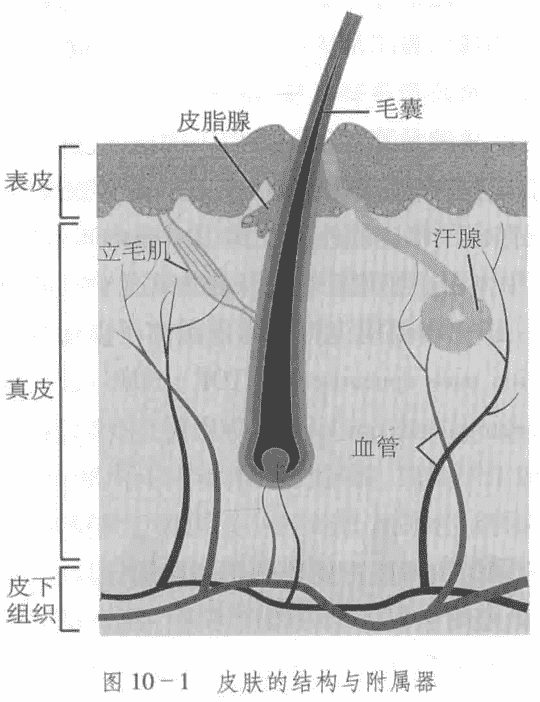

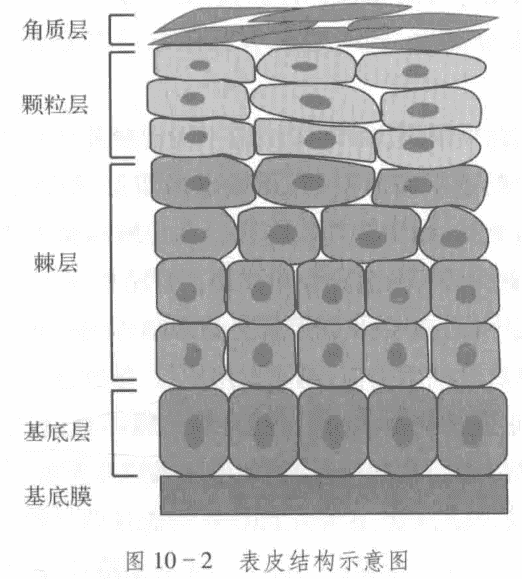

角质层厚约 10~20 微米，由 10~25 层角化细胞堆叠而成，标志着表皮分化的终末阶段。随着细胞持续增殖分化，角质细胞按相应速率脱落，维持动态平衡。年轻人表皮更新周期约两周，50 岁以上者则延长至 37 天左右。最新研究借助飞行时间二次离子质谱（TOF-SIMS）与拉曼光谱显微技术揭示：角质层至少可分为功能迥异的三个亚层——最表层似“海绵”，可吸收并释放水溶性小分子；中层主司水分锁持；底层则维系结构强度。表皮的核心屏障——渗透屏障，依靠角质细胞表面的神经酰胺、固醇、游离脂肪酸等高疏水脂质封装，有效遏制经皮水分流失。鉴于油脂、醇类易渗透角质层，护肤品常以此为基质强化渗透；角质层内的角蛋白既减缓水分蒸发，又能吸水保湿。

颗粒层居角质层之下，由 2~3 层扁平多角细胞构成，胞质含深嗜碱性透明角质颗粒，越靠表层颗粒越大越多，可折射光线减轻紫外损伤；鱼鳞病患者此处颗粒异常，印证其对皮肤生理功能的关键作用。棘层位于颗粒层下，含 4~8 层带棘突的多角细胞，靠近基底层处形态相似，向外渐趋扁平；细胞具分裂能，经桥粒互锁，间隙充盈组织液供代谢所需，亦分布神经末梢感知刺激。基底层又称生发层，单层柱状细胞栅栏状排列，锚定基底膜与真皮连接；细胞增殖向外推进，补充角质消耗；半桥粒连接基底膜，传递调控增殖、迁移、分化的信号。皮肤附属器（毛囊、皮脂腺、汗腺、甲等）源自表皮，与皮肤协同执行生理机能。毛发为哺乳类特有，隔离护御外界，生长状况折射整体健康；毛囊周围神经网密布、血管丰富，新研究显物理刺激可诱导毛囊分泌趋化因子招募免疫细胞（如轻抓）；汗腺则担负排泄与体温调节。

##### 2. 真皮

真皮为表皮深层的致密结缔组织，厚度超表皮，经波浪状基底膜相连。富含血管、淋巴管、神经，承担免疫防御、体温调节、感知传导等重任。结构上分浅层乳头层与深层网状层：乳头层由结缔组织乳头突向表皮基底层，形成波浪状交接面；网状层由胶原与弹性纤维编织，赋予皮肤弹性韧性。成纤维细胞为真皮关键细胞，调控纤维蛋白与细胞外基质组分，深度参与损伤修复与瘢痕形成。

##### 3. 皮下组织

皮下组织位于真皮深面，以疏松结缔组织为主，布满脂肪、肌肉及结缔组织，扮演缓冲机械应力、储能、保温角色。厚度因年龄、性别、部位、营养而异：腹臀最厚脂肪丰富，眼睑、手足背、阴茎处最薄近无脂肪。因组织疏松、血管丰富，临床常作皮下注射部位。

##### 4. 皮肤感觉受体

皮肤广布的感觉受体让我们能辨温度冷暖、质地软硬。人类皮肤可感触觉、痛觉、温觉、冷觉，其中触觉是智能皮肤拟真生物皮肤的核心指标。皮肤主要分布四型触觉受体：慢适应受体（SAR-1、SAR-2）响应持续刺激，快适应受体（FAR-1、FAR-2）捕捉动态振动。SAR-1 位表皮基底层指状突起，敏感 0.4~3 Hz 刺激，擅识别形变、形状纹理；SAR-2 居真皮层，应答 100~500+ Hz 持续压力与拉伸，辅助手指定位与运动方向感知；FAR 遍布表皮真皮，FAR-1 锁定 5~50 Hz 低频，服务于物体运动感知、纹理识别与抓握控制；FAR-2 覆盖 50~400 Hz 高频，对纹理细节识别及工具使用至关重要。

受体分布密度与分辨率呈部位差异：以手部为例，SAR-1 与 FAR-1 指尖最密，SAR-2 与 FAR-2 掌部均匀；自指尖至面部、大腿、腹部，触觉分辨率递减，彰显皮肤结构的复杂性与进化智慧。外界刺激激发受体产生信号，经神经纤维汇聚传至大脑，经整合后判断物体大小、形状、质地等属性。

### 三、智能皮肤概述

皮肤是人机环境交互的关键界面。以电子器件重构皮肤特性——即智能皮肤，正深度重塑医疗健康、机器人等领域。芯片制造、半导体精密加工、柔性技术、新材料的飞跃，为智能皮肤注入强劲动力。何为智能皮肤？它是模拟人体皮肤特征、具备感知功能的超薄电子器件，传感器为核心，捕获外界信号经检测转化为电信号反馈识别系统。概念并非新生事物，20 世纪 80 年代即已萌芽，灵感很大程度上源自科幻影视：《星球大战》中卢克装备的全感知电子手，《终结者》里自愈机器人，激发科学家将科幻照进现实。1983 年惠普推出首款触控电脑，开启人体触觉交互电子设备先河；1985 年 GE 面向机械臂研发智能皮肤，赋予近距离环境感知避障能力，虽早期分辨率受限。90 年代柔性材料引入电子领域，推动可拉伸智能皮肤实质性突破。传统电子装置多为刚性金属，柔性电子技术让智能皮肤实现伸展贴合体表。近十年成果爆发：具触觉、自充电、自愈合功能的智能皮肤相继问世。除仿人类皮肤，科学家还借鉴变色龙环境适应性、蜘蛛振动敏感度等生物特征，开发出特种功能智能皮肤。

智能皮肤应用聚焦医疗、假肢、机器人三大版图：可持续监测身体微小变化，捕捉健康向疾病转化的病理生理轨迹；植入义肢赋予佩戴者触觉反馈等。

#### （一）智能皮肤的材料特性

人体皮肤可在一定范围拉伸弯曲不变形，层遭烫伤、叮咬、划伤却能快速自愈。传统电子元件刚脆，缺乏伸展与自愈属性；智能皮肤欲拟真，必须复刻这些核心特质。材料科学与加工工艺的进步，让多项皮肤样特性落地成为可能。

##### 1. 伸展特性

紧密贴合皮肤是智能皮肤的首要特征。人体皮肤耐受约 15% 扭曲变形及十至数百千帕弹性形变，故智能皮肤需具备足够拉伸性，以适应体动过程中的弯曲拉伸。实现路径主要有二：研发本征可拉伸新材料；重构脆性材料微观结构赋予伸缩性。水凝胶凭借优异的拉伸性、自愈性、离子导电性及生物相容性，成为柔性电子研究热点，新型水凝胶实现多维构型，工作范围高达 2800%。纳米材料、PDMS、导电聚合物等亦在攻关中。结构设计层面，波形结构、剪纸结构等几何拓扑有效缓释形变应力。

##### 2. 自愈性

使用中不可避免遭受损伤，理想智能皮肤应在特定条件下自主修复，复原形貌与功能。按机制分两类：一类内嵌自愈剂微胶囊，损伤触发释放修复，但修复有限，不宜智能皮肤；另一类依赖动态化学键，更契合需求。损伤致键断裂，聚合物链扩散重组恢复本性。如斯坦福团队研发的氢键型高分子聚合物，对切口不敏感（拉伸超 1200%），人工汗液中亦能自愈。目前多为部分功能修复，全功能自愈仍是巨大挑战。

##### 3. 生物相容性

指材料植入特定部位引发适宜的生物反应（血液、免疫、组织）及材料自身理化稳定性。智能皮肤长期贴身，生物相容性至关重要：除无毒无害，还须规避过敏、瘙痒等不良反应。采用天然材料（如丝素蛋白）或经修饰优化，是解决该问题的可行策略。

##### 4. 自充电性

能量可源于体内（机械运动转电能）或环境（光能）。主流自充电方案采用可拉伸太阳能电池，如最新可拉伸有机光伏电池。此外，材料还需兼顾自清洁、光透过率、灵敏度等指标。

#### （二）智能皮肤检测信号

智能皮肤需配备感受器捕获环境变化启动信号传递。按信号性质分为电信号、物理信号、生物化学信号三大类，分别指向特定生理特征，经内置传感器检测，实现生理心理状态动态监测。

##### 1. 电信号

外界刺激、情绪波动、生理病理改变均引发组织细胞电信号漂移。电信号响应快、灵敏度高，能实时反映受影响程度，故可通过监测电信号追踪特定组织细胞的病理生理状态。现有电生理传感器已覆盖心电、脑电、肌电监测：心电信号反映心肌细胞活动及心脏病理生理；脑电信号源自神经元放电；肌电信号伴随肌肉收缩舒张产生。心电振幅最大，检测相对容易。

**表 10.1 电信号传感器检测靶点与目的**

| 电信号 | 目的 |
| --- | --- |
| 脑电信号 | 筛查脑损伤、头痛、颅内肿瘤、失眠、癫痫、眩晕、情绪异常等 |
| 心电信号 | 诊断心血管疾病 |
| 肌电信号 | 运动指导、运动损伤诊断、神经肌肉疾病评估等 |

##### 2. 物理信号

物理传感器接收温度、压力、张力、湿度等信号。虽信号易获取，持续监测仍具挑战。皮肤温度是生理病理（发热、中暑、感冒）关键参数，基于电阻温度系数的传感器可连续精准测绘体表温度空间分布；但表皮测温仅反映体表温而非核心体温。压力信号用于血压、脉压、眼压检测辅助诊断：血压脉压为心血管核心指标，眼压升高常提示青光眼。压力传感器材料涵盖碳纳米管、石墨烯等。应变传感器测量形变，可监测手部弯曲等大动作，亦可捕捉吞咽、老年人震颤等微小运动，助力帕金森早筛。

**表 10.2 物理传感器检测靶点与目的**

| 物理信号 | 目的 |
| --- | --- |
| 温度 | 监测感染、中暑、感冒 |
| 压力 | 监测血压、脉压、眼压 |
| 形变 | 监测手部弯曲、吞咽、震颤 |

##### 3. 生物化学信号

人体蕴含多种可检测生化信号，血液为临床诊断主力体液，血糖是糖尿病金标准。常规采血属创伤性，难以连续监测且患者痛苦。科学家致力探索无创体液检测——汗液、唾液、泪液、间质液，成为智能皮肤生化传感器的攻关靶标。

**汗液**为人体最丰富生物液，富含健康相关数据：代谢物（葡萄糖、乳酸、尿酸等）、电解质（钠、钾、氯离子）、大分子（核酸、蛋白）。汗钠提示电解质平衡；钙离子关联骨质疏松；尿素升高预警肾衰竭；乙醇浓度与血液高度相关，可量化饮酒量。更具吸引力的是智能皮肤支持汗液原位检测。传统汗液检测需实验室离体操作，柔性印刷纹身传感器实现皮肤持续贴合，成理想检测平台。2013 年加州大学团队借此平台实时监测运动中汗液乳酸，获取分泌谱系；受试者佩戴传感器运动，经乳酸氧化酶法测定。虽汗液乳酸不直接等同血乳酸，但能反映长时运动体能消耗，指导科学训练。

**泪液**中特定生物分子浓度与血液呈相关性，可间接反映血液水平；成分较血液简单，含眼病相关信息，分析价值日增。泪液含蛋白、多肽、电解质、代谢物：泪液葡萄糖高度相关血糖；脯氨酸蛋白-4 升高提示干眼症。挑战在于：采样量微且易挥发，采集法差异大；情绪性泪与反射性泪成分不同，强调需在无刺激条件下检测。隐形眼镜嵌入生物传感器与信号处理器，实现无刺激连续监测，极具潜力；但对透光性、生物相容性、伸展性要求极高，仍处探索期。

**唾液**含葡萄糖、乳酸、酶、激素等标志物：IL-8 关联癌症；皮质醇反映压力状态。智能皮肤推动唾液原位检测落地，常采用贴附牙釉质或牙套方式布设传感器。

#### （三）智能皮肤的应用

近年研究证实，智能皮肤在多领域展现广阔应用前景，现梳理典型场景。

##### 1. 健康领域

科学家在健康医疗应用上投入大量研究。智能皮肤已具备多参数人体信号检测能力，支持长时程、动态健康数据采集，为临床诊疗提供更全维的决策依据。

# 无创监测新突破：智能皮肤如何重塑血糖管理

动态血糖监测是智能皮肤的一大“杀手级”应用场景。对于深受“黎明现象”困扰、清晨血糖飙升的特殊糖尿病群体而言，实时捕捉血糖波动节律是精准调整用药方案的关键。传统指尖采血或静脉抽血，不仅让患者饱受针刺之痛，更因采样时间点稀疏，难以全景式呈现血糖全天候轨迹，存在明显的监测盲区。智能皮肤凭借无创优势打破了这一困局，能连续、动态地追踪血糖变化，大幅提升了对无症状异常及特殊节律性血糖波动的捕捉能力。

科研团队已推出基于“电子纹身”的无创监测原型，核心原理在于反向离子电渗技术——通过在皮肤表面施加微弱电流，将间质液中的葡萄糖“吸引”至表层，配合表面集成的传感器即可便捷读数。这一方案不仅验证了无创血糖监测的可行性，更为其他生物标志物的无创检测提供了全新范式。早期美国厂商曾凭借此技术获FDA批准上市，实现每10分钟自动采样一次，虽因皮肤刺激、校准繁琐等问题在21世纪初退市，但为后来者积累了宝贵经验。如今，Abbott的FreeStyle Libre、Dexcom G6及Senseonics Eversense等CGM主流产品均已获批，主攻间质液葡萄糖监测，预示着表皮生物传感器正加速迈向多元化分子检测的新阶段。

# 失声者的新声：激光石墨烯人工咽喉

语言是人类沟通的核心桥梁，意外导致的语言障碍让患者陷入孤岛。清华大学团队研发的激光诱导石墨烯人工咽喉，带来了突破性曙光。许多失声者虽无法成词，但声带仍能产生微弱振动（呻吟），该装置能精准捕捉并区分这些振动在强度与频率上的细微差异，将其解码为清晰可懂的语义输出，让失声者重获“发声权”。

## 2. 机器人领域：赋予机器“触觉”，驱动具身智能进化

从扫地机到康复机器人，机器人正渗透生活方方面面。随着需求升级，行业期待机器人从“自动化”跨越至“智能化”，而触觉感知正是灵活操作的基石。清华团队基于热感应与压热效应开发的多功能智能皮肤，集成了力觉、位置、温感于一体，成功赋予机器人自动避障、碰撞检测、人机交互乃至打太极拳等精细动作能力。斯坦福团队的仿生智能皮肤更进一步，能实时解耦剪切力与法向力——实验中，装配该皮肤的机械手轻触草莓即刻停止用力，完美规避损伤，而传统无触觉机械臂需人工干预才能做到这一点。此技术延伸至假肢领域，更能让截肢者重拾温度触感，感知婴儿肌肤的柔嫩与温暖。

## 挑战与瓶颈：通往大规模应用的“拦路虎”

过去几十年，智能皮肤的飞速发展预示着智能诊疗新时代的到来。但要真正走出实验室、融入日常，仍需攻克多重硬核难题。

### 1. 生物相容性：贴合肌肤的安全博弈
虽比植入式器械更具安全性与可控性优势，但长期贴敷并非零风险。金属过敏人群易诱发接触性皮炎；长期佩戴可能导致对金属或化学成分的致敏风险累积；且主流设备多抑制排汗、透气性不足，导致角质层过度水化、皮肤屏障受损。生物相容性的提升，仍是当务之急。

### 2. 数据可信度：从信号噪声到临床换算的距离
人体生物信号极其微弱，极易被体内本底噪声或环境干扰淹没，对传感器抗干扰能力提出极高要求。更关键的是，表皮无创检测获得的是间质液数据，而非临床金标准的血液葡萄糖浓度。如何提高换算模型的精度、建立覆盖个体差异的参数校正方案，直接决定了数据的临床可用性。

### 3. 多模态融合：解耦复杂信号的算力难题
多传感器集成虽已验证可行，但面对多重复杂刺激的精准解耦仍是拦路虎。单一刺激下校准容易，多模态耦合场景下的信号精准分离处理难。寄望于机器学习、深度学习的最新进展，为信号处理带来新解法。此外，芯片集成度高、制备工艺复杂、成本高昂等硬件层面的瓶颈，同样制约着规模化量产。但随着科技迭代，这些难题终将被逐一击破。

## 展望未来：跨学科协作开启智能皮肤新纪元

皮肤是机体天然的“防护盾”，也是感知外界的“感知网”。智能皮肤模拟其结构与功能，正加速从实验室研发走向临床研究与民生应用，在无创诊疗、疾病早筛早诊等领域大显身手。其发展离不开医工深度融合：医生对皮肤生理结构的深度洞察指导传感器设计，工程师以新材料新工艺释放器件潜能。虽道阻且长，但伴随生物技术、芯片工艺、人工智能的协同突围，智能皮肤终将更好地服务人类福祉。

## 思维延伸：留给读者的探索题

1.  皮肤解剖学分层及各层生理功能是什么？
2.  皮肤触觉感受器有哪些分类？它们的分布特点与接收信号类型有何差异？
3.  智能皮肤≠生物皮肤，请结合定义谈谈你的理解。
4.  发散思维：除文中场景外，智能皮肤还能在哪些领域大显身手？

## 参考文献

[1] 马超，赵刚. 电子皮肤研究进展：材料、功能与应用. 中国科学技术大学学报，2021.  
[2] A Chortos, J Liu, Z Bao. Pursuing prosthetic electronic skin. Nat Mater, 2016.  
[3] A J Bandodkar et al. Tattoo-based noninvasive glucose monitoring. Anal Chem, 2015.  
[4] A Kubo et al. The stratum corneum comprises three layers with distinct metal-ion barrier properties. Sci Rep, 2013.  
[5] C L Simpson et al. Deconstructing the skin. Nat Rev Mol Cell Biol, 2011.  
[6] C M Boutry et al. A hierarchically patterned, bioinspired e-skin. Sci Robot, 2018.  
[7] D J Lipomi et al. Stretchable organic solar cells. Adv Mater, 2011.  
[8] D Oliveira et al. Neutrophil migration in infection and wound repair. Nat Rev Immunol, 2016.  
[9] D Tsuruta et al. Hemidesmosomes and focal contact proteins. J Dermatol Sci, 2011.  
[10] G Z Li et al. Multifunctional electronic skins enable robots to safely interact with human. Adv Sci, 2022.  
[11] H N Lovvorn et al. Relative distribution and crosslinking of collagen. J Pediatr Surg, 1999.  
[12] I A Darby et al. Fibroblasts and myofibroblasts in wound healing. Clin Cosmet Investig Dermatol, 2014.  
[13] J C Yang et al. Electronic Skin: Recent Progress and Future Prospects. Adv Mater, 2019.  
[14] J Kang et al. Tough and Water-Insensitive Self-Healing Elastomer. Adv Mater, 2018.  
[15] J Kim et al. Wearable biosensors for healthcare monitoring. Nat Biotechnol, 2019.  
[16] J Kim et al. Non-invasive mouthguard biosensor. Analyst, 2014.  
[17] K Nagao et al. Stress-induced production of chemokines by hair follicles. Nat Immunol, 2012.  
[18] L Qiang et al. Keratinocyte autophagy enables activation of keratinocytes and fibroblasts. Autophagy, 2021.  
[19] L Q Tao et al. An intelligent artificial throat with sound-sensing ability based on laser induced graphene. Nat Commun, 2017.  
[20] M G Rohani, W C Parks. Matrix remodeling by MMPs during wound repair. Matrix Biol, 2015.  
[21] M J Tierney et al. Clinical evaluation of the GlucoWatch biographer. Biosens Bioelectron, 2001.  
[22] M L Hammock et al. 25th anniversary article: The evolution of electronic skin. Adv Mater, 2013.  
[23] M Li et al. Macrophage-derived exosomes accelerate wound healing. Artif Cells Nanomed Biotechnol, 2019.  
[24] M S Mannoor et al. Graphene-based wireless bacteria detection on tooth enamel. Nat Commun, 2012.  
[25] N M Farandos et al. Contact lens sensors in ocular diagnostics. Adv Healthc Mater, 2015.  
[26] P T Caswell, T Zech. Actin-Based Cell Protrusion in a 3D Matrix. Trends Cell Biol, 2018.  
[27] T Matsui, M Amagai. Dissecting the formation, structure and barrier function of the stratum corneum. Int Immunol, 2015.  
[28] V L Alexeev et al. Photonic crystal glucose-sensing material. Clin Chem, 2004.  
[29] W Jiang et al. Fully Bioabsorbable Natural-Materials-Based Triboelectric Nanogenerators. Adv Mater, 2018.  
[30] W Z Jia et al. Electrochemical tattoo biosensors for real-time noninvasive lactate monitoring. Anal Chem, 2013.  
[31] Y C Cai et al. Mixed-dimensional MXene-hydrogel heterostructures for electronic skin sensors. Sci Adv, 2020.  
[32] Y Koike et al. Fibroblast growth factor 2 accelerates epithelial-mesenchymal transition. Sci Rep, 2020.  
[33] Y Yang, W Gao. Wearable and flexible electronics for continuous molecular monitoring. Chem Soc Rev, 2019.

(本章作者：王娟 丁小雷)

---

# 第十一章 药物智造：AI重塑新药研发范式

## 核心学习目标

通过本章学习，你将能够：
1.  **读懂底层逻辑**：掌握药物设计的基本原理与全流程架构。
2.  **洞察技术渗透**：了解人工智能技术在药物研制各环节的发展现状与应用深度。
3.  **判断战略价值**：评估人工智能对未来药物设计开发模式变革的决定性意义。

# AI赋能新药研发：从“制造”迈向“智造”的破局之路

### 一、引言

回溯历史，人类对抗疾病、延续生命的探索从未止步。从神话传说中的炼丹术、神农尝百草，到《黄帝内经》《本草纲目》等典籍的积淀，先民们凭借朴素智慧从自然中寻得药方。步入17世纪，欧洲科学家相继从植物中分离出吗啡、奎宁、阿托品等成分，并通过人工合成与结构修饰，开创了化学药品的新纪元。19世纪末化学制药工业雏形初现，20世纪更迎来爆发式增长：磺胺类药物让人类首握抗菌利器，青霉素的问世极大丰富了抗感染“武器库”，胰岛素获取破解糖尿病治疗难题，激素合成催生避孕药，维生素量产长期占据市场半壁江山……此后，心脑血管药、抗精神病药、抗肿瘤药、抗病毒药等领域屡获突破，强力推动了医药工业进阶。2015年，屠呦呦获诺贝尔奖，让中草药赢得世界瞩目。

然而，传统研发模式已难适应时代需求——“双高一低”（高成本、高投入、低成功率）成为行业顽疾，人类迫切期盼新范式。21世纪是AI时代，人机协同、AI与药研深度融合，正将行业从“药物制造”推向“药物智造”。

回望工业文明演进：18世纪蒸汽机开启机器替代人力的第一次工业革命；电力广泛应用推动第二次革命；计算机诞生引领第三次革命。如今，以AI为核心的智能互联技术，正成为第四次工业革命的引擎。提及AI，许多人想起AlphaGo以3:0完胜柯洁。但击败人类并非终局，DeepMind借围棋验证算力边界，实为探索AI落地、驱动社会变革。凡能收集处理信息的人造系统均可称作AI，其研发初衷是模拟人类学习、推理、规划等思维，实现高阶应用，甚至分担脑力劳动。

药物研发关乎人类命运。二战时青霉素挽救无数伤员，《我不是药神》里格列卫让慢粒白血病患者五年生存率从64%跃升至83%，接近常人水平。这些突破显著提升了生活质量与人均寿命。但百余年研发史上，阿尔茨海默病、肿瘤、艾滋病等难题仍存；药害悲剧亦警钟长鸣——20世纪50年代沙利度胺虽缓解孕吐高效，却致万余婴儿畸形，毁无数家庭。药物研发既是生物化学前沿的试金石，更是人类抗疫斗争的基石。

医药市场规模超万亿，辉瑞、强生、阿斯利康等巨头年销超百亿，利润反哺研发，形成良性循环。国内虽有创新药企，却无一药物入围全球畅销药前十。对比国际巨头研发投入超销售额20%，国内企业长期低于10%，仿制药为主、创新意识弱是共性短板。

近年来，中国生物医药增速近22%，跃居全球第二大市场，预计2030年占GDP比重约15%，成经济新引擎。政策端持续发力，引导企业从“仿制”向“创新”转型；欧美研发成本攀升、预算收缩，研发阵地加速向中国及亚太、拉美转移。未来十年，中国有望成全球医药创新主力军。但专家直言：建设“健康中国”，须洞悉创新趋势，实现从制造大国到创新强国的跨越，这关乎科技竞争制高点与经济社会长远发展。研发者寄望新技术破局，AI或成关键钥匙。

### 二、传统药物设计与开发

传统新药研发是“烧钱、耗时、高风险”的马拉松。从立项到上市，需历经靶点筛选、药物挖掘、先导优化、临床试验、审批上市等环节（见图11-1）。统计显示，单款新药平均耗资26亿美元、耗时10载，每一步皆考验团队综合实力，暗藏淘汰危机。

图11-1 传统药物研发流程示意

#### （一）药物挖掘：大海捞针的概率游戏

传统靶点筛选靠“上市药物×已知靶点”交叉匹配，耗时费力且充满偶然性。药物挖掘即先导化合物筛选，需从海量小分子库中通过组合实验或高通量筛选，捕捉具生物活性的“种子选手”，再经结构修饰优化。后续在细胞、组织、动物模型验证安全药效，同步考量给药途径、剂型设计与工艺可行性，前期仅此就耗3-6年。

临床阶段更是“绞肉机”。2006-2015年数据显示：I期通过率63.2%，能进III期仅30.7%，累计从I期到获批上市成功率仅9.6%——十款进临床药物，终有一款得偿所愿。若还在临床前阶段，成功率更是微乎其微。细分领域差异巨大：血液病药物成功率最高(26.1%)，抗感染次之(19.1%)；而神经、心血管、精神、肿瘤四大临床急需领域均低于均值，肿瘤药更仅5.1%。

#### （二）传统研发的“曲线救国”策略

面对高壁垒，“老药新用”成重要补充。沙利度胺虽酿“海豹肢畸形”惨剧，后因免疫调节与抗血管生成特性，获批治疗麻风及多发性骨髓瘤；其衍生物来那度胺更成“明星药”，适应症不断扩展，2018年销售近百亿美元。

另一路径是追踪专利过期药或联用开发，催生“Me-too/Me-better”药物。此路省去靶点发现与早期筛选，大幅降本增效。国产埃克替尼对标进口靶向药，研发成本仅2.5-3亿人民币，远低于国际平均水平，但本质仍属国内“跟随型”创新，国际话语权掌握在巨头手中。

### 三、药物智造——基于人工智能技术的药物研发

“药物智造”即以AI赋能研发生产全链条。AlphaFold2对98.5%人类蛋白结构预测精度达原子级，媲美冷冻电镜实测，标志性突破。AI已重塑智能辅诊、影像识别、基因解读等医疗场景，在药研领域更是核心驱动力：预计研发周期与成本均可减半，成功率大增，真正实现“制造”向“智造”质变。

#### (一) AI重构药研七大核心场景

AI已渗透药研全周期，覆盖靶点发现、候选药物确定、化合物合成筛选、ADMET预测、晶型预测、病理生物学研究、新适应症挖掘七大场景（见图11-2）。

| 应用场景 | 核心AI技术路径 |
| :--- | :--- |
| 靶点药物发现 | 算法学习、组合设计 |
| 候选药物确定 | 文献搜集、资源整合 |
| 化合物合成及筛选 | 云计算、机器人自动化 |
| 预测ADMET性质 | 机器学习、模块设计 |
| 药物晶型预测 | 集成模型、动态配置 |
| 病理生物学研究 | 模型建立、分析推测 |
| 药物新适应症发掘 | 深度学习、分析组合 |

图11-2 AI在药物研发中的应用场景及关键技术

**1. 靶点药物发现：破解“靶点荒”**
现售药物多靠已知靶点，新靶点稀缺。机器学习算法可通过组合设计挖掘深层知识，解析靶点与小分子作用位点，发掘潜在靶点药物。2017年葛兰素史克携手Exscientia投入4300万美元，针对10个未公开靶点寻找候选药物，即为典型布局。

**2. 候选药物确定：数据海洋中的“淘金者”**
海量文献、专利、非结构化数据及企业积累中藏着宝藏。AI能自动提取生物学知识、关联多源数据、挖掘有效分子结构，规避信息遗漏。BenevolentAI的JACS系统即擅长处理碎片化信息，辅助临床试验设计与数据收集。

**3. 化合物合成及筛选：从“逆合成”到“机器人化学家”**
2020年FDA批准新药中小分子超七成，仍是主流。AI合成源于Corey“逆合成分析”，1969年诞生首个计算机辅助程序OCSS及LHASA系统。近年深度学习引发革命：上海大学Waller团队《Nature》刊文展示深度神经网络规划合成路线；利物浦大学开发移动机器人化学家，实现自动化合成闭环。虚拟筛选结合图像识别，可从万万分子库中高效捕捉活性先导化合物，精准预测理化性质、成药性与毒性。

**4. 预测ADMET性质：把关“成药性”关卡**
吸收、分布、代谢、排泄及毒性（ADMET）是先导优化生死线。KNN、RNN、SVM、随机森林、图卷积等模型因低复杂度、高可解释性成主流。Simulations Plus开发的ADMET Predictor整合机器学习与生理药代动力学，成大厂加速优化利器。AI药企常“自研+采买”商业软件，借力长期积累的预测精度与模型适用性。

**5. 药物晶型预测：全景视野下的精准选择**
小分子晶型关乎稳定性与生物利用度。AI动态配置预测可覆盖所有潜在晶型，杜绝漏筛风险，助企业快速锁定最优晶型，大幅压缩周期与成本。

**6. 病理生物学研究：解密疾病“黑箱”**
病理机制不明是疑难杂症无药可医的根因。IBM Watson通过文献学习建模，预测RNA结合蛋白与渐冻症(ALS)关联：仅用2013年前数据训练，却精准预测2013-2017年发现的4个突变蛋白，并新鉴定出5种相关蛋白，验证了AI挖掘疾病机制的威力。

**7. 药物新适应症发掘：让“老药”焕新生**
算法重定位现有或晚期候选药物，成生物制药企业首选低风险策略。BenevolentAI用深度学习与NLP重评估失败药“Bavisant”，证实其治疗帕金森病日间嗜睡潜力。药物重定位规避安全性测试风险，大幅缩短上市周期。俄亥俄州立大学团队基于120万心衰患者数据训练深度模型，挖掘出二甲双胍、依他普仑等9种潜在获益药物。法国Pharnext借AI发现药物组合PXT3003，实现单药难达的协同疗效，极大简化研发路径。

#### (二) 药物智造的落地路径

为最大化AI价值，实现技术与业务深度融合，药企主要采取三种模式：

- **1. AI研发外包**

# AI药物研发：三大合作范式与破局之路，纳米技术开启“吞下外科医生”新纪元

## 三大合作范式：药企如何拥抱AI？

### 1. 外包给AI初创公司：轻装上阵，守住核心机密
这是当前最主流的切入方式。流程大致是：药企提供靶点情报与历史数据，AI初创团队负责搭建模型、跑通筛选流程，一旦挖掘出潜力候选分子，药企再按约定授权或自行推进后续开发。这种模式对大药企极其友好——灵活度高、边际成本低，核心难点在于**如何甄别靠谱伙伴、并严守研发全链路最核心的机密数据**。  
近年来标杆案例频出：辉瑞携手IBM Watson、武田联手Numerate，在靶点发现与化合物筛选上大幅压缩周期；赛诺菲与Exscientia达成2.83亿美元大单攻克代谢疾病；此外，BMS、勃林格殷格翰、GSK分别与Sirenas、Bactevo、Cloud Pharmaceuticals结盟，全方位为研发管线注入算力动能。

### 2. 自建内部AI军团：数据不出门，能力留心间
一边寻求外援，一边练就内功。头部药企纷纷组建专业算法团队、搭建高性能计算平台，意在双管齐下：提升运营效率、筑牢数据安全护城河。辉瑞、阿斯利康、默克、礼来、GSK等巨头无一例外发起数字化转型与组织重组。  
以诺华为例，2018年其“STRIDE”战略一期落地，完成大数据底座、数字基建与AI系统的部署，覆盖文档管理、高性能计算等核心场景；下一步直指**AI驱动的预测分析平台**，欲在临床试验运营上实现降本增效。

### 3. 产学研共生：借学术原创力，破应用落地局
学术源头创新是药物研发的“水龙头”。从化学合成到生物机制，上市药物无不溯源于基础研究。药企与高校联手，AI技术与学术洞察互补，能加速新靶点、先导化合物的落地转化。  
Atomwise在打磨AtomNet系统的同时，长期与卡罗琳斯卡医学院、哈佛、多伦多大学等顶尖学府保持深度互动，正是“以学术喂养算法、以算法反哺科研”的典范。

---

## 破局与困境：AI制药的“成长烦恼”

尽管声量巨大，质疑声从未停歇。一项调查显示，**超45%受访者认为机器学习被过度炒作**；融资端曾经的狂热也让投资回报充满变数。更现实的痛点在于**临床验证的“死亡谷”**——目前AI诞生的新药多停留在I期，尚未经受II/III期的残酷检验。动物模型有效不等于人体有效，毒副作用往往在临床才暴雷。业内共识是：**AI目前仍处技术攻关早期，是工具而非科学，仅在特定环节实现突破。**

### 前端研发同样“翻车”
药物化学家多持怀疑态度：复杂的化学反应空间，真能用几行代码概括？事实是，**大量AI辅助尝试以失败告终**——生成分子合成难度大、药理毒性高、活性基团不稳定，问题层出不穷。

### 核心挑战是“懂药的不懂码，懂码的不懂药”
AI制药的本质，**不是IT人才的挑战，而是药学人才的转型考验**。一支高效团队的前提，是计算科学家与药物化学家能“无障碍对齐”，读懂彼此意图。这要求企业**真金白银投入**：组建跨学科梯队、持续开展交叉认知培训。

### 数据孤岛：宝藏锁在自家仓库
专家直言：“核心数据全在药企手里，皆因商业机密极少共享，导致数据利用率极低。”而AI模型极度渴望海量高质量数据。**如何构建有效共享机制、挖掘深层数据价值**，是行业必须破解的结构性难题。

### 流程重塑：从“渐进”到“跃迁”
AI驱动不是给旧流程打补丁，而是要求**重构研发与业务全链路**，以最大化释放机器学习、大数据、云计算的协同效能。

### 警惕“好高骛远”的幸存者偏差
IBM Watson曾是万众瞩目的“明星”，许诺惠及十亿人、覆盖80%癌症类型的80%患者。但技术底座撑不起野心，加之苛刻部署条件、高昂成本、封闭生态，最终在亚马逊、微软、谷歌的围追堵截下败下阵来，甚至传出停止药物研发工具开发的消息。**技术落地需脚踏实地，切忌PPT造车。**

---

## 未来已来：从“制造”走向“智造”的进化论

AI赋能药研，核心价值在于**双降（金钱成本、时间成本）与一增（医患互动深度、患者长期获益）**。但要实现**全流程贯通**，至少还需5-10年甚至更久。关键在于：跳出泛泛而谈，针对具体场景、基于现有数据，解决具体问题；从被动“推数据”转向主动“拉数据”，按需生成高质量训练集。

### 中国路径：补课、借鉴、寻找差异化优势
国内AI药企起步晚、数量少，但“制造转智造”大势所趋，**AI是必经之路**。药企需对标跨国巨头：内部孵化AI团队或外部深度绑定初创公司，在个体化用药、依从性管理、生产验证与假药识别等安全价值链全环节布局。  
监管端同步升级：药监部门引入AI可**大幅简化审批流程，实现更快、更透的监管**。

---

## 核心共识：人机协作，而非互相替代

技术再强，无法提供**创造力、同理心、伦理审查、受试者心理社会支持**等“人为因素”。  
**人创造技术，不是为了被取代，而是通过融合协作，解锁更多未知与可能。** 这才是技术存在的终极意义。

---

## 留给从业者的三个思考
1.  **全链路拆解**：药物研发包含哪些关键阶段？AI在各阶段的切入点差异在哪里？
2.  **案例复盘**：除文中提及外，还能列举哪些AI成功/失败案例？核心成败因何？
3.  **辩证视角**：传统研发与AI研发优劣势对比？AI当前边界在哪？未来十年演进路径怎么看？

---

## 新篇章：纳米技术——连接生命科学与AI的桥梁纽带

### 学习导航
掌握纳米技术在生物医学**四大应用方向**；洞悉纳米探针的**核心优势**；梳理纳米递药系统的**三大设计策略**；厘清纳米抗菌材料的**分类与机理**；评估纳米组织工程的**应用潜力**；解读“纳米+AI”在**疾病体内可视化诊疗**中的革命性意义。

### 启示录：费曼的预言——“吞下外科医生”
1959年，诺奖得主费曼在《底部还有大量空间》演讲中畅想：  
> *“吞下一个机械外科医生，它在血管中游走到心脏，‘看’一圈，找到故障瓣膜并切除；微型机器植入体内，长期辅助衰竭器官。”*  
这被视为纳米科技雏形，更是**“纳米+AI”实现体内诊疗闭环的终极图景**。

### 战略高地：国家队布局与学科属性
“健康中国”战略要求攻关核心技术、补齐生命科学短板、推动生物技术与AI、大数据深度融合。  
数据显示：21世纪全球960个重大科研方向中，**89%关联纳米科技**。它是物理、化学、材料、能源、生命、药理、工程七大基础学科的**创新引擎**，属前沿型、基础型、平台型科学，是变革性产业技术的策源地。

### 认知重塑：尺度效应创造“新物性”
纳米（10⁻⁹米）尺度下，物质性质发生质变：脆性变韧性、惰性变催化、半导体变高效发光。  
**纳米科学**探索0.1-100nm物质的特有性质；**纳米技术**通过原子分子操控，制备特定功能器件。这一“新工具”赋予材料理想的力、热、光、电、磁性能，重塑疾病预防、检测、成像、治疗全体系。  
当前，我国在纳米药物治疗重大疾病（肿瘤、心脑血管）及药物递送基础研究已跻身世界前列。**智能纳米药物融合纳米科技、AI、生物医学三大领域，有望成为药物研发的颠覆性力量。**

---

## 纳米医学四大战场：检测、递送、抗菌、组工

纳米技术已在疾病检测、治疗、成像、预防全域开花：

*   **基因测序降维打击**：纳米孔测序利用电场驱动单链DNA穿孔，电流信号直接解码序列，**成本与速度双优于传统法**。
*   **递药系统“制导导弹”**：突破化学、解剖、生理多重屏障，精准聚集病灶，最大化疗效、最小化毒性。  
      
    **图 12-1 血小板仿生纳米药物突破血脑屏障,靶向血栓**  
    *注：引用自参考文献（J P Xu, et al., 2019）,版权经 American Chemical Society 许可。*  
    如图所示，仿生纳米药物可穿越血脑屏障直抵血栓，修复缺血神经元，显著提升溶栓精度。
*   **抗疫实战验证**：新冠疫情中，纳米胶体金检测凭借**极速、便携**优势成为一线主力；纳米制剂改造抗病毒药，显著提升稳定性、靶向性与生物利用度，攻克传统药物稳定性差、易耐药痛点。

**总结纳米技术在生物医学四大核心应用支柱：成像检测、药物递送、抗菌材料、组织工程。**

---

## 聚焦前沿：纳米探针——照亮微观世界的“手电筒”

# 纳米医学新视界：从精准成像到智能递药与组织再生

长久以来，探针多以具备靶向识别能力的有机小分子为主。而新兴的纳米探针，凭借独特的表面效应、尺寸优势及特殊孔道结构，成功突破了传统小分子体系的应用瓶颈，极大地拓展了临床适用场景。立足纳米技术，主流成像模式主要划分为四大阵营：（1）核素成像，涵盖正电子发射断层扫描（PET）、单光子发射断层扫描（SPECT）及X射线计算机断层扫描（CT）；（2）磁共振成像（MRI）；（3）荧光成像；（4）光声成像（PAI）。

## 一、 核素成像：强化对比度的“放大镜”

核素成像能清晰呈现人体解剖结构的影像，是临床器官病变诊断的主力手段。造影剂的引入，如临床常用的小分子碘剂，可显著提升对比度与检测精度。纳米级碘基CT造影剂改良了油溶性小分子碘剂的生物相容性，并延长了血液循环半衰期。金、稀土、铪、钡等金属基纳米CT造影剂相继登上肿瘤诊断舞台，它们通过增强X射线衰减来提高图像对比度。值得一提的是，稀土元素镝（Z=70）对高能X射线的吸收能力远超碘元素。

图 12-2 多通道荧光探针用于食管腺癌的诊断

注：引用自参考文献 J Chen, et al., 2021，版权经 BMJ Publishing Group Ltd. & British Society Gastroenterology 许可。

## 二、 磁共振成像：软组织的“透视眼”

MRI摒弃了X射线，无电离辐射损伤，安全性更高，擅长软组织成像且无穿透深度限制。鉴于人体主要磁性核为氢核（¹H），¹H-MRI应用最广。但正常组织与病变区氢核信号差异微小，识别精度有待提升。为此，引入MRI造影剂成为增强对比、实现敏感诊断的关键。氢核MRI造影剂主要分两类：
*   **阳性造影剂（顺磁性）**：缩短纵向弛豫时间（T1），呈现亮信号，以钆基剂为代表。纳米钆基剂兼具7个未成对电子带来的强顺磁性、长血液半衰期及易功能化优势，典型如NaGdF₄、Gd₂O₃及含钆树枝状大分子。
*   **阴性造影剂**：缩短横向弛豫时间（T2），呈现暗信号，以铁基剂为主。纳米氧化铁具超顺/铁磁性，通过调控粒径可实现超顺磁向顺磁转变，展现卓越的T1加权造影性能。

除氢核外，异核MRI中¹⁹F灵敏度仅次于¹⁹F（达¹H的83%），极具潜力。生物体内¹⁹F主要以固态形式存在于骨骼牙齿，几乎无内源背景干扰。将¹⁹F-MRI“热点”图与¹H-MRI解剖细节叠加，可精准揭示组织解剖特征。

## 三、 荧光成像：近红外窗口下的“高清视野”

当荧光探针发射落入近红外（NIR）区，便能规避芳香氨基酸等内源生物分子干扰，显著提升分辨率。受限于组织穿透深度仅厘米级，科研人员常借助光纤导出体内信号成像。近红外二区（NIR-II, 1000~1700 nm）探针利用生物组织透明窗，大幅降低光子吸收散射，消除自发光背景，实现高分辨、高信噪比及深层穿透。

量子点（InAs、InP、PbSe、PbS、CuSe、CuTe、Ag₂Se、Ag₂S等）凭借尺寸可调的吸发光特性成为明星材料。为规避重金属毒性，通常需包覆生物相容性外壳。Ag₂S是首个用于NIR-II成像的量子点，发射峰达1300 nm，量子产率15.5%。稀土掺杂纳米粒子NaYF₄:Yb/Ln则是首批NIR-II稀土探针。部分传统NIR-I小分子（如ICG、IR-783）表现出媲美NIR-II探针的性能，常与单壁碳纳米管、量子点、稀土纳米粒子等联用。

## 四、 光声成像：光学灵敏度与声学穿透的“完美融合”

光声成像兼具光学高灵敏度与声学深穿透优势，剖面深度超荧光成像，空间分辨率优于超声，可实现活体分子级成像。利用近红外激光（650~900 nm）激发，穿透深度可达50 mm。量子点、有机小分子、碳纳米管、金纳米粒子等因优异的光吸收与光热转换效率，成为理想造影剂。但各有短板：金属纳米粒子光学性能优却存临床安全性隐忧；有机材料可修饰、成本低，但光稳定性有待加强。

图 12-3 用于肿瘤免疫治疗的多重响应纳米递药系统 (引用自参考文献 J Zhang, et al., 2022)

#### （二） 纳米递药系统：三大策略破解靶向难题

依据设计思路，纳米递药系统可分为三类：（1）自上而下的生物信息利用，改造天然纳米材料（蛋白复合物、细胞外囊泡EVs、多巴胺/黑色素载体、生物膜仿生载体）；（2）自下而上的分子自组装，基于病灶微环境设计响应性载体；（3）两者融合的复合载体，兼具双重优势。

**1. 借力天然：自上而下的策略**
受马达蛋白、胞外囊泡启发，科学家利用天然蛋白疏水腔装载小分子，通过ATP、pH诱导构象变化及配体互作实现靶向释放。但腔腔尺寸限制了大分子装载。EVs及微颗粒可经电穿孔或基因工程装药，携带细胞生物信息，介导特异性互作，是极具潜力的天然递药系统。此外，细菌/细胞膜与人工纳米颗粒融合，可同步实现送药、免疫激活及毒素清除。不过制备过程中蛋白磷脂变性可能降低疗效，且常缺乏响应性，难控释放。

**2. 精妙设计：自下而上的自组装**
此路径聚焦化学材料原理，基于病灶内外源刺激设计可脱壳、电荷反转、敏感键断裂机制，实现药物时空可控释放。pH、谷胱甘肽（GSH）、活性氧（ROS）、温度、缺氧等特异性分子赋予载体病灶特异性富集能力。

除分子级自组装，光、力、化学刺激下的二次组装/解组装可通过粒径变化延长病灶滞留。DNA折纸技术则通过调控核酸序列、分子锁及适配体，响应疾病蛋白标志物，实现药物释放的正负反馈调控。

**3. 融合创新：复合载体与细胞“背包”**
理想系统应经长循环达病灶，精准识别标志物释放报告分子与药物。抗体片段、多肽、核酸适配体、叶酸等修饰介导主动聚集。在生物标志物升高、氧化还原/pH/缺氧/剪切力/酶等理化特性及外部热/声/光/电/磁刺激下，纳米载体实现结构变化与载物可控可逆释放。

针对被动捕获聚集效率低、主动推进（酶/化学/超声气泡/磁场）方向不可控、时效短等痛点，研究者尝试“细胞背包”策略：将纳米粒子负载于细胞/细菌表面。趋磁细菌沿磁感线及氧梯度抵达肿瘤核心；T细胞表面纳米粒子响应受体激活引发的硫基水平升高释放药物，调控免疫。虽面临免疫原性、早期内吞挑战，但随着多学科理解深化，模拟天然效应器/感应器构建系统，有望统一自上而下与自下而上两大范式。

#### （三） 纳米抗菌材料：多管齐下应对耐药危机

病原微生物引发感染交叉感染，抗生素滥用加速耐药进化。为抑菌杀菌，科学家开发出多元抗菌材料体系，通常以金黄色葡萄球菌、大肠杆菌、铜绿假单胞菌等典型菌株为靶标评价疗效。

**1. 金属类抗菌材料**
含K⁺、Na⁺、Ca²⁺、Mg²⁺、As³⁺、Ag⁺、Hg²⁺等离子的金属、金属盐及...

图 12-4 光诱导抗菌材料的抑菌原理（引用自参考文献 YM Yang, et al., 2022）

**2. 抗生素升级与抗菌肽新希望**
抗生素靶向细菌生存核心过程（细胞壁合成、核酸转译），但长期使用诱发耐药。利用细菌响应性纳米材料精准递送抗生素至感染灶，可提效克耐药。
抗菌肽除杀菌外，还能抑制/破坏生物膜，部分兼具抗炎抗癌。已有70余种进入开发管线，8种获FDA批准（如多粘菌素、万古霉素、达托霉素等）。但肾毒性、神经毒性及给药途径受限（仅3种腺苷酸候选物可口服）是痛点。纳米技术赋能抗菌肽靶向递送，可强效降毒。

**3. 阳离子聚合物：物理破菌机制**
机制涵盖：吸附细胞壁→穿透结合细胞膜→破坏膜完整性→细胞内容物泄漏致死。常用类型包括壳聚糖、季铵盐、N-卤代胺、膦/硫盐、胍盐、抗菌水凝胶。壳聚糖机制多元（破膜、抑代谢、结合DNA抑制RNA合成），可能并存。细菌易对季铵盐产生耐受，长期影响抑菌效果，故研发高效复合抗菌剂以适应多重耐药机制至关重要。

**4. 光诱导抗菌：PDT与PTT的协同杀伤**
*   **光动力疗法（PDT）**：光激发光敏剂产生活性氧（单线态氧¹O₂破坏力最强），氧化破坏大分子，具非侵入、广谱、不易耐药优势。常用光敏剂（卟啉、酞菁等）为高共轭大环化合物。
*   **光热疗法（PTT）**：光热剂吸附菌表面→光照转热→局部温度超50℃致酶失活菌死。三阶段精准打击，减少正常组织副作用。

相较传统抗生素，PDT/PTT具长波长深穿透、时空可控、无耐药性优势。但需解决菌-剂特异性结合、光热转换效率、光敏剂水溶性及抗聚集等问题。纳米自组装体协同PDT/PTT可显著提升光诱导抗菌效能。

#### （四） 纳米组织工程：从分子识读到器官重生

纳米组织工程融合纳米科技与组织工程，从原子分子级解析细胞结构功能关系，设计仿生材料装置，修复受损组织功能。细胞内核糖体、高尔基体等本质上是分子级加工车间，生命过程遵循基因密码有序更替蛋白质组。终极目标是掌握原子分子相互作用本质，直接用原子分子设计制造特定形态功能的组织。

首要任务是借助扫描探针显微镜（STM/SPM）、纳米生物探针、生物芯片等技术，从原子分子级揭示真核细胞基因组结构调控、基因产物构建细胞结构及功能行使机制。以此为基础，从科学认知跨越至工程技术，设计制造纳米细胞、纳米组织器官，调控种子细胞粘附、增殖、定向分化，奠定功能替代基础。

人体组织器官多为细胞与细胞外基质（ECM）构建的复杂多级复合体。ECM通过特异性粘附、增殖、分化调控细胞命运，决定移植组织能否融合适应并修复功能。纳米支架旨在模拟ECM成分结构功能，作为种子细胞载体，构建三维空间复合体，在mm/μm/nm三尺度调控细胞生长：
1.  **毫米级**：工程组织形状尺度；
2.  **微米级**：基质孔径控制细胞迁移生长；
3.  **纳米级**：表面理化特性影响细胞粘附基因表达，生长因子微观调控驱动特异性增殖分化。

纳米纤维心脏贴片兼具机械强度与弹性，完美贴合心脏搏动。优质支架纳米材料需满足：① 模拟ECM功能，利粘附增殖分化，良好生物相容性与亲和性，无免疫排斥；② 生物可降解且降解可控，匹配新生组织速度；③ 优异机械强度与加工性，植入后维形、保外观、复部分功能；④ 互联孔结构、适宜孔径、≥80%孔隙率及高比表面积，利细胞生长、营养代谢交换及血管化。

### 三、 疾病诊疗的可视化与量化：纳米技术与AI的“双剑合璧”

临床诊疗新模式中，纳米技术与AI相辅相成，催生多模态诊疗新范式。纳米技术充当外科医生的“眼与手”，辅助病灶诊断治疗；AI技术作为“大脑中枢”，助力医

### AI与纳米科技：重塑精准医疗新版图

细分病种、定制专属诊疗方案，是现代医学演进的关键命题。当下，机器对感知数据的解读能力突飞猛进，已在多个维度落地生根。临床一线，智能系统深度嵌入肺结节早筛、儿童骨龄评估等流程；随着技术迭代升级，辅助诊疗研究呈爆发式增长，覆盖药物挖掘、核酸序列解析、影像诊断、远程监护、虚拟助理及可穿戴终端等板块。对于影像学、病理学、皮肤科、眼科等重度依赖视觉数据的学科，智能算法潜力尤为惊人。然而，外部验证缺位、模型泛化乏力、实验设计欠规范等短板，依然制约着技术走向成熟。

#### (一) 跨尺度多模态纳米探针：精准定界与分子洞见

纳米科技与人工智能的深度耦合，被寄予化解AI瓶颈、开启智能诊疗新纪元的厚望。以跨尺度多模态纳米探针为例，其长处在于：能精准勾勒正常组织、病灶及间质的分界线；融汇基因组学、生物学、医学等跨域创新资源；发掘兼具诊断与预后价值的生物标志物；锁定新型治疗靶点，终达成疾病预测、预防与精准医疗的愿景。疾病演进涉及海量分子类别、显著的时空异质性及错综复杂的互作网络。借助纳米探针标记疾病特异性分子靶标，配合智能量化手段，将宏观影像定量表型与疾病分型本质建立映射。实证显示，仅凭算法从CT影像提取的28项特征，便可重构肝癌78%的全基因表达图谱，将影像量化特征与ctDNA、MSI、TMB、EGFR、Erb-B2、PARP1等免疫分子活性关联，精准预判免疫疗效与预后，推动影像组学向分子生物学离体检测延伸，显著增强临床决策效能。

#### (二) 智能量化分析：从影像组学到多维融合

影像组学立足CT、PET/CT、MRI等模态，已广泛服务于肺癌、直肠癌、膀胱癌、乳腺癌等实体瘤的定量研究，可从影像中挖掘海量定量特征支撑临床探索，兼具非侵入、可重复、成本低等优势，且能揭示肿瘤内在异质性。如图12-6所示，算法对乳腺超声影像实施量化解析、标注良恶性特征，显著压低了假阳性率。大数据与图像处理领域，深度卷积神经网络（DCNN）架构简洁高效，契合影像学与病理学图像的处理与模式识别需求。此类关联成像表型与基因表达的算法，理论上适用于任意疾病状态及成像手段（含PET/CT、MRI等）。智能量化分析实现了四大跨越：推动研究从回顾性走向前瞻性，样本量从小规模迈向大规模，模态从单一转为多模态融合，组学维度从单一拓展至影像-病理-基因多组学联合分析。

图 12-6 AI 系统减少乳腺超声检查中的假阳性结果 (引用自参考文献 YQ Shen, et al., 2021)

### 核心要点回顾

智能纳米制剂具备多模态响应能力，能对光、声、热、电、磁等物理信号敏感反馈并上报位姿状态；在影像导航下，可通过构象变化、药物释放或声、热、自由基产生实现局部治疗，同步监控疗程，将体内分布代谢动力学过程可视化。此外，融合算法解析生物样本，可明确疾病分型与诊疗策略。当前，智能纳米机器面临核心瓶颈：工业化合成与实验室小试在动量、热量、质量传递机制上的差异，导致放大生产暗藏未知变数；临床应用对批次稳定性与均一性要求更严苛。故纳米药物设计需在功能性与复杂性间寻求平衡，精准筛选适配转化应用的适应症与人群。

### 思维训练场

- 1. 纳米技术如何重塑生物医学版图？
- 2. 请梳理医用纳米材料的核心分类体系。
- 3. 列举AI在医学领域落地的典型场景。
- 4. 纳米材料与AI融合应遵循哪些基本准则？

### 文献溯源

[1] 樊春海. DNA纳米技术进展. 科学通报. 2019;64(10):987-988.  
[2] 耿介, 张鸿祺. 人工智能技术在颅内动脉瘤诊疗应用中的研究进展. 中国脑血管病杂志. 2021;18(7):477.  
[3] 李素萍, 陆泽方, 聂广军, 等. 智能纳米机器用于重大疾病治疗的研究进展. 中国科学基金. 2021;35(2):195.  
[4] 习近平. 构建起强大的公共卫生体系为维护人民健康提供有力保障. 求是. 2020(18).  
[5] Lu CF, Hsu FT, Kevin LCH, et al. Machine learning-based radiomics for molecular subtyping of gliomas. Clin Cancer Res. 2018;24(18):4429-4436.  
[6] Wang FF, Wan H, Ma ZR, et al. Light-sheet microscopy in the near-infrared II window. Nat Methods. 2019;16:545-552.  
[7] Cui HT, Liu CY, Timothy E, et al. 4D physiologically adaptable cardiac patch: A 4-month in vivo study for the treatment of myocardial infarction. Sci Adv. 2020;6:eabb5067.  
[8] Wang HY, Zhu DQ, Alexandra P, et al. Covalently adaptable elastin-like protein-hyaluronic acid (ELP-HA) hybrid hydrogels with secondary thermoresponsive crosslinking for injectable stem cell delivery. Adv Funct Mater. 2017;1605609.  
[9] Zhu H, Fan JL, Du JJ, et al. Fluorescent probes for sensing and imaging within specific cellular organelles. Acc Chem Res. 2016;49:2115-2126.  
[10] Yan HZ, Shao D, Lao YH, et al. Engineering cell membrane-based nanotherapeutics to target inflammation. Adv Sci. 2019;6:1900605.  
[11] Chen J, Jiang Y, Chang TS, et al. Thomas D Wang; Multiplexed endoscopic imaging of Barrett's neoplasia using targeted fluorescent heptapeptides in a phase 1 proof-of-concept study. Gut. 2021;70:1010-1013.  
[12] Xu JP, Wang XQ, Yin HY, et al. Sequentially site-specific delivery of thrombolytics and neuroprotectant for enhanced treatment of ischemic stroke. ACS Nano. 2019;13(8):8577-8588.  
[13] Tian J. The next-level precision medicine in cancer management using artificial intelligence. Artif Intell Precis Oncol. 2021;36(3):171-172.  
[14] Zhang J, Lin YD, Lin Z, et al. Stimuli-responsive nanoparticles for controlled drug delivery in synergistic cancer immunotherapy. Adv Sci. 2022;9:2103444.  
[15] Long LL, Huang MY, Wang N, et al. A mitochondria-specific fluorescent probe for visualizing endogenous hydrogen cyanide fluctuations in neurons. J Am Chem Soc. 2018;140:1870-1875.  
[16] Alberto M, Federica M, Alberto M, et al. Tumour-associated macrophages as treatment targets in oncology. Nat Rev Clin Oncol. 2017;14:399.  
[17] Richard PF. There's plenty of room at the bottom. 1959.  
[18] Cheng Q, Wei T, Lukas F, et al. Selective organ targeting (SORT) nanoparticles for tissue-specific mRNA delivery and CRISPR-Cas gene editing. Nat Nanotechnol. 2020;15:313-320.  
[19] Li R, Thomas SCN, Stephanie JW, et al. Therapeutically reprogrammed nutrient signalling enhances particulate albumin bound drug uptake and efficacy in KRAS-mutant cancer. Nat Nanotechnol. 2021;16:830-839.  
[20] Ankur S. Eliciting B cell immunity against infectious diseases using nanovaccines. Nat Nanotechnol. 2021;16:16-24.  
[21] Huang SX, Lei D, Yang Q, et al. A perfusable, multifunctional epicardial device improves cardiac function and tissue repair. Nat Med. 2021;27:480-490.  
[22] Liu SY, Chen X, Bao LL, et al. Treatment of infarcted heart tissue via the capture and local delivery of circulating exosomes through antibody-conjugated magnetic nanoparticles. Nat Biomed Eng. 2020;4:1063-1075.  
[23] Jiang W, Christina AVR, Chen YX, et al. Designing nanomedicine for immuno-oncology. Nat Biomed Eng. 2017;1:0029.  
[24] Mu W, Jiang L, Zhang JY, et al. Non-invasive decision support for NSCLC treatment using PET/CT radiomics. Nat Commun. 2020;11:5228.  
[25] Fan Y, Wang PY, Lu YQ, et al. Lifetime-engineered NIR-II nanoparticles unlock multiplexed in vivo imaging. Nat Nanotechnol. 2018;13:941-946.  
[26] Liu Y, Guo R, Wu LL, et al. One zwitterionic injectable hydrogel with ion conductivity enables efficient restoration of cardiac function after myocardial infarction. Chem Eng J. 2021;418:129352.  
[27] Yang YM, Chu BB, Cheng JY, et al. Bacteria eat nanoprobes for aggregation-enhanced imaging and killing diverse microorganisms. Nat Commun. 2022;13:1255.  
[28] Shen YQ, Farah ES, Jamie RO, et al. Artificial intelligence system reduces false-positive findings in the interpretation of breast ultrasound exams. Nat Commun. 2021;12:5645.  
[29] Zhong YT, Ma ZR, Wang FF, et al. In vivo molecular imaging for immunotherapy using ultra-bright near-infrared-IIb rare-earth nanoparticles. Nat Biotechnol. 2019;37:1322-1331.  
[30] Hu ZH, Fang C, Li B, et al. First-in-human liver-tumour surgery guided by multispectral fluorescence imaging in the visible and near-infrared-I/II windows. Nat Biomed Eng. 2020;4:259-271.  

(本章作者：陈雪瑞 邱艳)

## 后记：初心与展望

“生命科学的跃升仰赖技术创新驱动。智能技术的演进深刻重塑了生命健康与生物医学版图。”人工智能持续迭代、衍生新形态，试图以机器学习分担人类脑力与体力劳动，有望大幅提升人类攻克疾病的能力，进而推开智能医疗时代的大门。

“生命智能”是上海大学大工科人工智能系列课程的收官之作，其诞生凝聚了顾骏教授与顾晓英教授的心血，从课程顶层设计、首轮授课到超星平台录制，均由二位教授携手完成。时任上海大学生命科学学院党委书记沈忠明、陈沁教授，办公室主任王伟博士等为课程落地给予了强力支持。在我看来，“生命智能”不仅是一门极具意义的课程，更是一段珍贵经历的见证。这门课的开设源于我有幸参与“创新中国”教学。衷心感谢学校！感谢顾晓英教授！2015年，我以副教授身份加入上海大学“大国方略”系列之“创新中国”课程建设，与一批杰出教授同向同行，结识顾骏教授，在迷茫困惑时获得其悉心指引，恩情难以言表。

本教材以AI医学应用为切入点，聚焦其在诊疗领域的潜力与趋势，兼顾典型性、实用性与可读性，旨在向当代大学生传递科技创新理念，深化对智能医疗的认知，强化责任感与使命感。书中系统梳理了AI在医学检验、手术治疗、代谢组学等诊疗环节的价值，详述其在膀胱癌、神经退行性疾病、心脑血管病、心理疾病及脊柱外科等场景的优势，并延伸探讨了AI赋能药物研发、智能皮肤与纳米医学研究的路径。期盼本书所蕴含的教育思想能抛砖引玉，激发学子思辨与争鸣。

本书获2021年度上海高校一流本科课程、2020年度上海高校市级重点课程及2021年度上海大学本科教材建设项目资助，致以谢意。亦感谢上海大学出版社傅玉芳老师的耐心协助与包容，成就此书。教材广泛参考智能医学文献，吸纳专家观点，列举代表性成果，各章参考文献均为主要依据，受限篇幅未能尽录，恳请海涵。向所有被引用著作的编著者致以诚挚敬意！虽经反复打磨，受限于资料、水平等条件，疏漏在所难免，恳请专家批评指正！

## 生命智能

Life Intelligence

上海大学出版社

微信公众号

定价: 58.00元

ISBN 978-7-5671-4531-3

