# 生成式AI实战：智谱与DeepSeek 应用全景

生成式生态正进入快速扩张期。相关系统在自动撰写新闻、模拟对话、辅助创作等场景中的表现愈发抢眼，也在重塑人与机器的协作边界。

在视觉创作方向同样取得明显进展。近几年以渐进去噪为核心的扩散类方法逐渐成为主流。这类方法在艺术产出和影视制作中展现出强实用价值，让创作者能更高效地把复杂设计意图落地，尤其在高分辨率图像合成上成效显著。

回望演进路径，从早期对抗网络与变分自编码器的探索，到 Transformer 与扩散架构的大规模落地，每一次技术跃迁都为行业注入新动能。这些进展不仅拓宽技术边界，也深刻影响内容生产、交互体验和工业设计等多个领域。

## 3. 生成式技术的核心特质

生成式系统主要呈现以下特征。

- 1）对数据的强依赖：训练需要海量素材，来源涵盖公开语料、用户原创内容或人工标注的专业集。素材的质量与多样性直接决定合成结果的好坏与丰富度。
- 2）架构高度复杂：这类系统通常参数规模庞大、层级非线性明显。以 GAN、VAE、Transformer 为代表的深度生成网络，通过多层神经结构构建复杂的隐空间，从而合成更逼真的样本。
- 3）输出不确定性高：合成内容难以完全可控，尤其在开放式任务如图像合成、长文本创作时。因为模型不遵循固定规则，输出常带创造性与随机性，也因此难以预判。
- 4）跨模态合成能力：不仅限于单一文本或图像，还可实现跨模态融合。例如文本转图像、图像转描述，或生成音频、视频等，为跨领域应用提供灵活性。

## 4. 生成式与判别式系统的差异

生成式与传统判别式系统的关注点不同。判别式系统侧重类别区分，通过已有输入进行分类或回归预测，典型代表是支持向量机 SVM 与逻辑回归 LR，常用于猫狗识别、字符分类等。而生成式系统旨在学习数据分布规律，创造全新样本。这种创造能力使其可用于图像合成、文章撰写、虚拟对话等创造性工作。

## 5. 优势与局限

优势主要体现在：

- 1）生产效率提升：能够快速批量产出文本、图像、视频等素材，显著提升创作效率。
- 2）个性化定制：可根据情绪、风格等条件生成定制化内容，广泛应用于广告、媒体与娱乐。
- 3）激发创作力：为设计师、作家、音乐人等提供快速迭代创意、探索新艺术形式的工具。

局限主要包括：

- 1）对海量数据的依赖：高质量数据的采集、清洗与标注成本高昂。
- 2）真实性与准确性风险：复杂场景下易出现逻辑错误或事实性偏差。
- 3）伦理与安全隐患：深度伪造滥用、虚假信息传播、隐私侵犯等问题值得关注。

## 6. 未来演进方向

随着应用场景扩张，未来可能向以下方向演进。

- 1）更强的跨模态合成：实现文本、图像、音频、视频的无缝转换与融合，提供全方位内容生成支持。
- 2）自监督学习普及：利用大规模无标注数据训练，降低对人工标注的依赖，拓展数据稀缺领域的落地。
- 3）与其它技术融合：结合强化学习、增强学习等，形成更智能、能适应复杂业务的应用体系。

理解其原理、特性、优势与边界，有助于架构师与开发者更合理地将生成式系统融入实际项目，提升创造性与生产力。

## 1.2 生成式系统核心原理概览

生成式系统的核心建立在深度学习与概率生成模型之上，通过学习数据分布来合成具备相似特征的新数据。生成对抗网络、变分自编码器、自回归模型如 GPT 等，构成了技术基础。

### 1. 生成对抗网络 GAN

GAN 的核心是双网络对抗训练，使合成内容逐步逼近真实分布。模型包含：

- 1）生成器 Generator：负责合成模拟数据，目标是让输出难以与真实数据区分。
- 2）判别器 Discriminator：负责区分合成样本与真实样本，通过训练提升鉴别能力。

训练过程中生成器试图“欺骗”判别器，判别器不断提升识别能力，形成类似零和博弈的优化，最终生成器在监督下产出更逼真样本。该过程如图 1-1 所示。

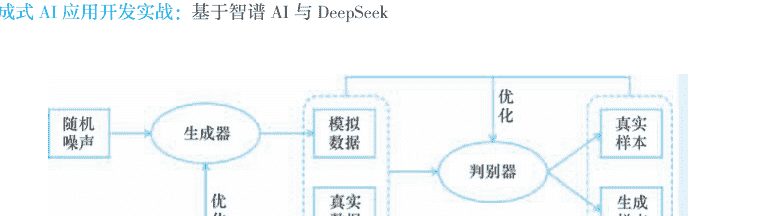

GAN 在图像、视频等多媒体合成上表现突出，但存在训练不稳定、模式崩溃等挑战，需要通过结构优化来缓解。

### 2. 变分自编码器 VAE

VAE 是结合概率模型与自动编码器的生成方法，可在学习分布的同时合成新数据。包含：

- 1）编码器 Encoder：将输入压缩到隐空间，通常映射为高斯分布并输出均值与方差。
- 2）解码器 Decoder：根据隐分布逆向生成样本。

变分自编码器如图 1-2 所示。


VAE 采用变分推断与重参数化技巧，能在隐空间稳定采样。与 GAN 相比训练更稳定，但合成质量相对偏低，常出现图像模糊，更适合连续性要求高、需要多样化的场景，如异常检测与特征学习。

### 3. 自回归模型 Autoregressive Model

自回归模型通过递归生成序列在 NLP 领域取得进展，GPT 系列是代表。其生成依赖：

- 1）条件概率建模：依据已生成内容预测下一步，如文本中根据前文预测下一个词。
- 2）Transformer 架构：GPT 基于 Transformer 与多头自注意力，能捕捉上下文关系，保持语义一致性。

GPT-3、GPT-4 等通过数十亿参数实现出色的合成效果。优势是连贯流畅，短板是生成效率低、模型体量大。

### 4. 迭代去噪模型 Diffusion Model

基于概率生成的方法，在图像合成上近年成果显著。核心思路是逐步将噪声转化为目标图像。主要步骤：

- 1）正向扩散过程：向图像逐步添加噪声直至接近纯噪声。
- 2）反向去噪过程：从噪声出发逐步去噪，通过反向采样逼近真实分布。

相比 GAN 和 VAE，去噪模型合成更稳定，细节保留与质量更优，但合成速度偏慢。

### 5. 流模型 Flow-based Model

流模型基于概率密度建模，将复杂数据映射为标准分布如高斯分布。核心机制：

- 1）双向可逆映射：数据在隐空间与数据空间间可逆转换。
- 2）精确概率计算：可计算数据概率密度，增强可解释性。

典型模型 Glow、RealNVP 在质量与推理速度上表现良好，但高维数据下的效率仍有挑战。

### 6. 多模态生成模型

多模态模型可处理文本、图像、语音等多种输入，实现模态转换。例如 CLIP 结合文本与图像语义，DALL·E 与 Stable Diffusion 实现高质量文本到图像转换。

这类模型依赖自注意力机制与大规模预训练，具备跨模态理解与合成能力，广泛应用于虚拟现实内容创作与智能交互。

### 7. 训练与优化方法

训练方式影响合成质量，常见技术包括：

- 1）对抗训练：用于 GAN，通过生成器与判别器的对抗学习提升样本质量。
- 2）变分推断：VAE 核心，通过将复杂分布转为易计算的隐分布估计概率。
- 3）重参数化技巧：稳定 VAE 等模型的训练，丰富隐空间采样。
- 4）预训练与微调：用于自回归与多模态模型，先在大规模语料上预训练，再针对任务微调。

这些方法提升了合成效果，使输出更接近真实数据，增强实用性。

### 8. 核心技术难点

主要难点包括训练稳定性、数据质量与合成速度。大规模模型训练资源需求高、耗时长，且合成结果存在随机性与不可控性，需进一步提升稳定性和可控性以适配实际场景。

技术进步依赖深度学习、概率建模与多模态理解的持续演进。掌握 GAN、自回归、流模型等原理，能为软件架构师与开发者提供理论基础与实践指引。即便不深入原理，也可在应用层开展有效设计与开发。

## 1.3 代表性生成式系统

生成式应用能力由模型驱动，自 ChatGPT 发布以来模型迭代加速，新系统不断涌现，为应用发展提供强力支撑。

### 1.3.1 OpenAI

OpenAI 发布了多项里程碑系统：

- （1）2018 年 6 月：GPT-1 首个将 Transformer 与无监督预训练结合的自然语言合成系统，开启大规模语言模型探索。
- （2）2019 年 2 月：GPT-2 拥有 15 亿参数，能合成连贯有逻辑的长文本，展示 NLP 潜力。
- （3）2020 年 5 月：GPT-3 参数达 1750 亿，在理解与合成、翻译问答等任务上表现突出。
- （4）2021 年 1 月：DALL·E 可根据文本描述合成全新图像，展现图像合成潜力。
- （5）2021 年 8 月：Codex 支持代码自动合成，是 GitHub Copilot 核心技术。
- （6）2022 年 4 月：DALL·E 2 升级版，能合成更高分辨率更细致的图像。
- （7）2022 年 9 月：Whisper 多语言语音识别系统，识别水平接近人类。
- （8）2022 年 11 月：ChatGPT 基于 GPT-3.5 的网页应用，可进行自然语言交互，掀起生成式热潮。
- （9）2023 年 3 月：GPT-4 及 ChatGPT Plugins 多模态大系统，支持图像输入，Plugins 可访问网络、编译代码、调用第三方程序。
- （10）2023 年 5 月：ChatGPT iOS 版 提供移动端体验。
- （11）2023 年 8 月：ChatGPT Enterprise 版 面向企业，提供安全隐私保护与高级功能。
- （12）2023 年 9 月：GPT-4V Vision 视觉增强版，可执行复杂视觉分析。
- （13）2023 年 10 月：DALL·E 3 理解复杂提示更精准，合成更高分辨率图像，并集成 ChatGPT 能力。
- （14）2023 年 11 月：GPT-4 Turbo 融合文本与视觉能力，合成更高质量内容。
- （15）2024 年 2 月：Sora 视频合成系统，可生成长达一分钟高清视频。
- （16）2024 年 5 月：GPT-4o 多模态输入输出系统，支持文本、音频、图像，提升交互自然性。
- （17）2024 年 7 月：GPT-4o-mini 高效推理系统，响应更快。
- （18）2024 年 9 月：o1-mini、o1-preview 强化学习训练的大语言系统，可执行复杂推理，生成长内部思维链，在专业领域表现突出。
- （19）2024 年 10 月：Canvas 写作与代码协作工具，整合 ChatGPT 文本与编程辅助功能。
- （20）2024 年 10 月：Windows 版 ChatGPT 桌面优化，方便 Windows 用户使用。
- （21）2024 年 10 月：ChatGPT 实时网络搜索功能 对话中可获取最新网络信息，提升准确性与时效性。
- （22）2025 年 1 月：o3-mini 专为科学、数学、编程设计，推理强且响应快，被视为高性价比推理技术突破。

### 1.3.2 百度文心大模型

百度围绕 ERNIE 与文心一言发布系列系统：

- （1）2019 年 3 月：ERNIE 1.0 首个基于知识增强的预训练语言系统，引入知识图谱提升理解与合成能力。
- （2）2019 年 7 月：ERNIE 2.0 在 1.0 基础上提出持续学习框架，支持多任务训练并不断学习新知识技能。

国内模型迭代盘点

- （3）2021 年 7 月：ERNIE 3.0
2021年7月面世的ERNIE 3.0是对既有系列的再升级。借助更大规模的语料、更成熟的训练方法以及更强的网络结构，该版本在多项自然语言处理任务上实现了明显提速。

- （4）2023 年 3 月：文心一言
文心一言于2023年3月上线，主打知识增强型的语言大模型。基于深度学习构建，具备较强的理解与生成能力，可对用户输入作出精准回应并依托上下文续写内容。这一产品的发布彰显了百度在自然语言处理赛道的积累。

- （5）2024 年 3 月：ERNIE 系列轻量化模型
2024年3月，ERNIE家族推出轻量化分支ERNIE Speed、ERNIE Lite等。在保持核心能力的前提下实现更小体积与更快响应，适配算力受限、时延敏感的落地场景。

- （6）2025 年 预计 2025 年下半年发布，具体时间未公布：文心一言 5.0
规划显示百度拟于2025年下半年推出文心一言5.0，具体命名或有微调。新品有望在前代基础上进一步打磨，提升语言类任务的效果，持续巩固相关领域的领先态势。

### 1.3.3 讯飞星火大模型
科大讯飞的星火系列是国内较早进入商用的基座之一，在此之上孵化出多款面向市场的产品。

- （1）2023 年 5 月：讯飞星火认知大模型（V1.0）
V1.0于2023年5月发布，由科大讯飞自主研发，定位为新一代认知智能基座，能够与用户自然交流、解答问题并覆盖多行业认知需求。

- （2）2023 年 6 月：讯飞星火认知大模型（V1.5）
V1.5在开放式问答与多轮对话上取得突破，同时升级了文本生成、语言理解和逻辑推理能力。

- （3）2023 年 8 月：讯飞星火认知大模型（V2.0）
V2.0强化了代码编写能力与多模态识别能力，进一步拓宽功能边界与适用范围。

- （4）2023 年 10 月：讯飞星火认知大模型（V3.0）
该版本在科大讯飞全球1024开发者节正式亮相，性能与落地能力同步提升，为更多场景提供智能支撑。

- （5）2024 年 1 月：讯飞星火认知大模型（V3.5）
V3.5在前代基础上持续优化，使用体验更为流畅智能。

- （6）2024 年 6 月：讯飞星火认知大模型（V4.0）
V4.0在文本创作、语言解析、知识问答、逻辑推理、数学能力等多维度实现对GPT-4 Turbo的整体超越。

- （7）2025 年 1 月：讯飞星火深度推理模型 X1
该模型隶属于科大讯飞办公智能体产品线，旨在提升办公场景下的推理与处理效能

### 1.3.4 智谱 AI 大模型
智谱AI大模型由北京智谱华章科技有限公司发布，公司聚焦新一代认知智能模型研发，核心技术为自研GLM预训练框架及多阶段增强预训练方法。

- (1) 2021 年 3 月：GLM
2021年3月发布的GLM提出全新训练范式，打破了BERT、GPT的瓶颈。

- (2) 2021 年 6 月：GLM-10B
GLM-10B是国内首个参数规模达到百亿级别的模型。

- (3) 2022 年 8 月：GLM-130B
GLM-130B在GLM框架上继续演进，对归一化、激活函数、掩码机制等进行优化，打造出千亿量级的精细中英双语模型。

- (4) 2022 年 9 月：CodeGeeX
CodeGeeX是一款代码生成型模型，日均可为程序员提供约一亿行的代码支持。

- (5) 2023 年 3 月：ChatGLM
ChatGLM为千亿级基座对话模型，并同步开源ChatGLM-6B。

- (6) 2023 年 5 月：VisualGLM-6B (CogVLM)
2023年5月开源多模态对话模型VisualGLM-6B，即CogVLM。

- (7) 2024 年 1 月：GLM-4
在首届技术开放日Zhipu DevDay上发布的GLM-4为新一代基座模型，综合表现较上一代显著提升。

- (8) 2024 年 7 月：CogVideoX
2024年7月推出的视频生成模型CogVideoX，推理速度较前代CogVideo提升约6倍。

- (9) 2024 年 8 月：GLM-4-Plus
2024年8月发布的新一代基座模型GLM-4-Plus，国内首个具备AI视频通话功能的模型。

- (10) 2024 年 10 月：GLM-4-Voice
2024年10月推出端到端情感语音模型GLM-4-Voice，并发布模型交互智能体AutoGLM。

- (11) 2024 年 12 月：GLM-Zero-Preview
2024年12月发布的GLM-Zero初版采用扩展强化学习训练，标志智谱正式切入AI推理模型领域。

- (12) 2025 年 1 月：GLM-Realtime、GLM-4-Air-0111、GLM-4V-Plus、Flash 系列模型
2025年1月集中推出多款产品。实时多模态模型GLM-Realtime可快速理解视频或语音并实现无缝对话，上下文记忆长达两分钟；高性价比语言模型GLM-4-Air-0111性能接近GLM-4-Plus而调用成本减半；视觉升级版GLM-4V-Plus支持4K超清及极端长宽比图像无损识别，可理解最长两小时视频；Flash系列为完全免费的多模态套件，涵盖语言、图像、视频等能力。

### 1.3.5 DeepSeek
DeepSeek是一家专注于前沿语言大模型研发的科技公司，旗下DeepSeek-R1、DeepSeek-V3等系列在多项任务上表现突出。公司坚持低成本高效路线，并对外开放模型以推动技术普及。

- (1) 2023 年 11 月：DeepSeek Coder
首个开源代码模型，支持多语言代码生成、调试与数据分析。

- (2) 2023 年 11 月：DeepSeek LLM
参数规模约670亿的通用模型，包含7B和67B的基础及对话版本，覆盖多种自然语言任务。

- (3) 2024 年 2 月：DeepSeek Math
2024年2月发布的数学专用模型，以DeepSeek Coder V1.5 7b为基础构建。

- (4) 2024 年 3 月：DeepSeek-VL
公司开源的视觉-语言模型DeepSeek-VL。

- (5) 2024 年 5 月：DeepSeek-V2
第二代开源混合专家MoE模型，总参数约2360亿，性能与GPT-4 Turbo相当，支持长上下文与多任务，适用于代码生成、数学推理等场景。

- (6) 2024 年 11 月：DeepSeek-R1-Lite 预览版
轻量推理模型预览版，聚焦高效推理，在速度与准确性上表现突出，适合资源受限环境部署。

- (7) 2024 年 12 月：DeepSeek-V3
2024年12月开源发布，总参数约6710亿，性能接近GPT-4o，引入无辅助损失负载均衡与多元词预测，支持FP8混合精度训练与FP8 KV Cache，大幅提升生成效率并降低训推成本。发布后迅速成为开源社区标杆。

- (8) 2025 年 1 月：DeepSeek-R1、DeepSeek-R1-ZERO
2025年1月开源新一代推理模型DeepSeek-R1，推理水平可与OpenAI的ChatGPT o1相媲美。其应用超越Google Gemini与Microsoft Copilot，登顶美区App Store免费榜第六。英伟达宣布模型接入NVIDIA NIM，亚马逊与微软亦相继接入。

- (9) 2025 年 2 月：DeepSeek 系列模型上线国家超算互联网平台
2025年2月，DeepSeek-R1、DeepSeek-V3、DeepSeek-Coder等已陆续入驻国家超算互联网平台。

汇总头部厂商的产品节奏与发布时间，可明显感知生成式AI正处于高速迭代、竞争激烈且关注度持续升温的阶段。将这些节点整理如图所示，可更直观把握当前模型市场的热度与未来走向。

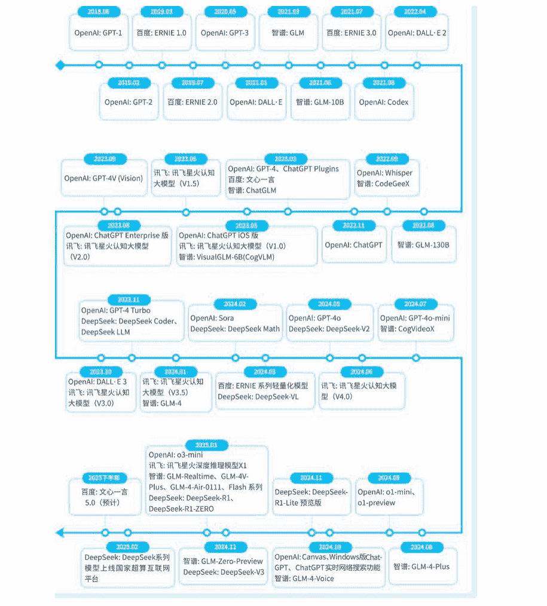

图 1-3 主流模型演进时间线

## 1.4 DeepSeek 的创新与崛起
OpenAI推出ChatGPT后开启了生成式AI新纪元，而以DeepSeek-V3为代表的模型则进一步推动该领域向更低花费、更高效率方向演进，为技术普及与商业化应用拓展新路径。

### 1.4.1 DeepSeek 引领行业变革
DeepSeek以算法创新为核心重塑行业。从技术突破到商业模式改变，从性能领先到全球竞争格局变化，其低花费高效能模式展现出强劲竞争力，对行业发展产生深远影响。这标志着生成式AI正由技术探索迈向产业变革，以DeepSeek为代表的国内创新力量正在描绘人机协同、智慧共生的新图景。

DeepSeek带来的变革主要体现在：

#### 1. 低成本高效能的技术突破
通过算法创新在算力与数据利用上取得显著突破。采用多头潜在注意力MLA机制与混合专家MoE架构，有效降低显存占用、提升计算效率。尤其是DeepSeek-V3，训练与推理花费均远低于主流模型，打破“算力竞赛”旧逻辑，动摇“算力至上”投资模式，让更多企业与个人能够负担AI应用与研发，为行业开辟新路径。

#### 2. 商业模式的颠覆
选择全面开源并公开技术细节，允许商业化使用，颠覆传统行业规则。开源策略吸引全球开发者参与共建优化，同时近乎免费的高性价比对现有商业模型的盈利能力形成挑战，倒逼市场竞争与创新加速。

#### 3. 卓越的性能表现
在多项基准测试中均保持领先。无论数学推理、代码生成、自然语言推理还是多模态理解，都展现出优异优势，为AI的广泛落地奠定坚实基础。

#### 4. 全球人工智能竞争格局的重构
DeepSeek的成功推动国内AI崛起，并对全球竞争格局产生深远影响。其低花费高效能模式直接挑战“高资本+高算力”的传统路径，迫使其他科技巨头加速布局开源模型，令全球竞争更激烈多元。同时，其对华为昇腾平台的兼容设计降低了对境外芯片的依赖，影响行业与全球科技竞争格局，推动创新发展。

#### 5. 对资本市场预期的重塑
技术与商业模式创新直接触发市场对AI行业增长逻辑的重估。过去几年AI高投入低回报的问题被放大，市场开始更关注技术效率与生产力转化。该变化影响资本投向，也推动行业向更健康可持续方向演进。

#### 6. 推动 AI 应用从云端向终端渗透的加速
DeepSeek降低使用门槛、优化模型性能，使中小企业与个人开发者也能参与创新。其技术可部署于普通设备如手机，加速AI应用由云端向终端渗透，让技术更普及便捷，也为未来开辟新场景与市场空间。

DeepSeek的成功为全球AI行业指明更高效、更开放的方向，标志技术发展正从“资本驱动”转向“算法驱动”，凸显算法创新对行业的重要性，也为未来发展提供新思路。

### 1.4.2 DeepSeek 低成本实现途径
DeepSeek通过多重技术手段实现低花费高效运行，形成独特优势。

#### 1. 创新模型架构减少激活参数
采用MoE架构，通过细粒度专家分割与共享专家隔离等优化，每次仅激活部分专家处理输入，降低计算复杂度与内存需求。MLA架构的引入进一步节约显存、提升算力利用率。生成每个token时仅激活部分参数，大幅减少计算量与训练成本，在保持高性能的同时实现节能高效。

#### 2. KV 缓存优化
将KV缓存压缩为潜在向量，大幅减少显存占用，降低推理与训练成本，提升运行效率。

#### 3. 高效训练方法
综合使用分布式训练、优化通信策略、PTX代码优化、动态图计算优化与混合精度计算，提升模型FLOPs利用率，减少GPU小时数，从而降低训练成本。

#### 4. 参数精度优化
参数转为FP8精度，并采用KV缓存量化技术，进一步降低算力资源消耗，在保持精度的同时实现轻量化与高效。

#### 5. 智能分工与设备受限路由机制
通过智能分工与设备受限路由实现资源高效利用。动态调班系统实时监控负载并自动调整任务分配；双向流水线技术实现计算与数据传输并行，减少等待；设备受限路由限制每个token的发送量，稳定GPU间通信开销。

#### 6. 内存优化
借助“临时工模式”与数据迁移策略优化内存管理。部分计算不保存中间结果，需时再重算，节省显存；不常用数据迁移至主机内存，减轻显卡负担，提升效率。

#### 7. 模型专业化
针对不同任务研发专用模型，如DeepSeek-Coder与DeepSeek-R1，所需算力更少、成本更低，更好满足特定需求。

#### 8. 高效的分词技术
分词器在中文处理上表现突出，能够压缩文本。更少token意味着更少计算，从而降低花费，使中文任务处理更具优势。

## 1.5 生成式 AI 应用场景
随着技术进步，生成式AI的应用已从单一文本生成扩展至多模态生成与跨领域应用。通过自动生成高质量内容，AI提升了生产效率，推动了创意产业变革。主要应用场景如下。

### 1. 自然语言生成
生成式AI在文本自动生成、内容创作、信息摘要等方向应用广泛，具体包括：

- 1）内容创作：可基于关键词或主题自动撰写文章、生成社交媒体内容、制作新闻报道等。GPT-3、GPT-4、DeepSeek-V3等模型能生成流畅连贯的文本，为辅助写作与文案创作提供创意支持。

- 2）摘要生成：可自动提炼文档或新闻要点，为用户提供关键信息，在新闻汇总、文献综述等场景中帮助快速获取核心内容。

- 3）对话系统：在聊天机器人与对话系统中的应用普遍。通过训练对话模型，AI可生成类人自然语言应答，用于客户服务、虚拟助手、情感陪伴等。例如智能客服借助自然语言生成实现全天候咨询，提升体验。

- 4）翻译与语言理解：不仅能生成文字，还可在多语言间进行翻译与语义理解。结合多模态模型，可融合文字、语音、图像信息，实现跨语言跨文化的自然交互。

### 2. 图像和视频生成
生成式AI在图像与视频生成领域展现丰富场景，从艺术创作到工业设计再到医疗图像合成，赋能多行业创新。

- 1）艺术创作：为艺术家与设计师提供无限创意可能。可根据提示生成图像或视频，并呈现特定风格。例如DALL·E与Midjourney等模型可按文本提示生成图像，实现自由艺术创作。

- 2）视频编辑和特效：在视频生成与编辑上取得显著进展。通过图像到视频技术，可依据单帧图像或文本描述生成视频并自动添加特效、调整色调，为影视、广告等内容制作提供高效方案。

生成式模型正在多行业渗透，推动内容创建与智能交互进入新阶段

- 3）医学影像生成与增强：生成式模型在影像重构上价值明显。可对三维CT、MRI等数据的纹理与分辨率进行补足，帮助医生提升诊断可信度；同时能模拟病变组织、构建数字病人，为医学研究与教学提供可控逼真的素材。
- 4）产品设计与工业制造：模型常介入设计早期创意，通过批量生成造型方案、配色建议与结构草案，帮助设计团队压缩周期、降低成本。

### 3. 游戏与虚拟现实
程序化内容生成让游戏素材与关卡制作更高效多元，增强沉浸感。
- 1）虚拟角色对话：游戏内可部署智能会话模块，使角色与玩家实时交流。借助训练好的自然语言模型，角色能给出个性化回应，提升代入感。
- 2）场景自动搭建：模型可自主构建虚拟世界与场景，减少手工建模投入。例如生成对抗网络可产出森林、山脉等复杂地貌，应用于开放世界游戏，为探索提供丰富空间。
- 3）道具与装备生成：模型能自动创造游戏道具与装备，使体验更具多样与随机性。该技术已在角色扮演游戏中落地，玩家可获得定制化武器，提升趣味。
- 4）VR 环境构建：在虚拟现实中作用显著，尤其在教育培训领域。模型生成的沉浸环境可用于医疗模拟、工程演练等，提供沉浸式学习体验。

### 4. 医疗与健康
渗透持续扩大，在辅助诊疗、研发加速与健康监测方面潜力可观。
- 1）新药研发：模型可生成药物分子结构并模拟药理特性，加快研发进程。通过学习分子特征与结构规律，创造新分子组合并预测有效性与安全性，快速筛选候选。
- 2）病理影像分析：在病理图像生成与增强方面应用广泛。通过输出高分辨率病理图，辅助医生诊断癌症、肿瘤等疾病；同时生成的影像可扩充深度学习的训练集，提升诊断能力。
- 3）虚拟健康助手：用于健康监测与咨询服务。借助自然语言生成能力，虚拟助手可撰写健康报告、提供饮食建议与健身指导，助力日常养生。
- 4）手术模拟训练：在医疗培训中生成虚拟手术场景，让学员与教师在虚拟环境中演练操作，提升实践技能。

### 5. 教育与培训
聚焦点是自动内容生产、智能教学助手与虚拟课堂，有助于实现个性化与互动。
- 1）智能教学助手：可作为教学助手，为学生提供即时学习反馈。通过自然语言生成，能定制个人学习材料、习题解析与学习报告，提升学习效率。
- 2）虚拟课堂搭建：助力创建虚拟课堂，通过生成仿真场景与交互角色，让学生在沉浸式环境中学习，适用于历史、地理、科学实验等教学。
- 3）自动内容生产：能够依据课程内容自动生成学习指南、练习题与测验，使教师聚焦个性化指导与互动教学，提高教育资源使用效率。

### 6. 营销与广告
可自动生成个性化广告内容与推荐，提升用户参与度与转化。
- 1）广告内容生产：依据目标用户兴趣与行为自动生成文案、图片与视频，个性化内容更易吸引注意，提升点击与转化。
- 2）产品推荐与个性化推荐：通过分析浏览历史与兴趣偏好，向用户推荐个性化产品与服务。结合生成模型，推荐系统能提供高度定制化的购物体验，提升满意度。
- 3）虚拟客服：在客户服务中用于生成自然语言应答，解答常见问题。虚拟客服全天在线，可快速处理大量咨询，降低企业人力成本。

### 7. 法律与金融
用于合同生成、风险分析与报告撰写，助力企业提升合规性与运营效率。

## 8. 生成式 AI 的跨领域融合应用
跨领域融合将进一步推动技术创新。与物联网、区块链等技术结合，可在智能制造、供应链管理与智能城市建设中开辟新模式。例如生成式技术可生成预测供应链需求的分析报告，或创建智能城市虚拟模型，为政策制定提供更全面的数据支撑。

总体来看，生成式技术凭借自动生成内容与智能交互能力，已在各行业发挥关键作用。随着模型能力与算力的持续提升，其应用将日益增多并向深处发展，从内容生成延伸到智能决策，为产业创新提供强劲动力。

## 1.6 编程中的关键问题与挑战
开发与部署生成式应用时，架构师与开发者面临多重复杂编程挑战，涉及模型选型与构建、训练数据质量、模型优化、生成质量管控以及伦理法律等。厘清并解决这些问题，既能提升生成效果，也能确保应用符合技术规范与伦理标准。

### 1. 模型选择和构建的复杂性
生成式领域可选模型众多，如生成对抗网络、变分自编码器、自回归模型和迭代去噪模型，不同模型在生成效果、训练难度与适用场景上各有长处。
- 1) 模型适配性：选择需以具体任务为导向。例如生成对抗网络在图像生成上表现优异，自回归模型在文本生成上更占优势，如何在模型特性与任务需求间取得平衡是复杂决策。
- 2) 模型架构设计：生成式架构普遍复杂，编写与调试多层神经网络需要较高编程水平，常需在架构、激活函数、损失函数等方面反复试验以寻优。实际开发中多采用已有预训练模型，但微调时理解架构仍有助于顺利进行。
- 3) 模型扩展性：项目部署常涉及横向扩展提升数据吞吐量和纵向扩展提升细节质量与多样性。扩展时保持模型稳定性与一致性是设计、部署与编程上的重要挑战。

### 2. 数据质量和标注
生成式技术对数据高度依赖，训练数据的质量直接决定生成效果。若采用已有模型则不需自行准备数据；若需微调或少样本技术，则需面对以下问题。
- 1) 数据清洗：数据集常含噪声、错误或冗余，需清洗预处理。该过程耗时耗力，要求编写严谨的数据处理代码以免负面影响生成结果。
- 2) 标注准确性：训练中标注质量直接影响模型质量。图像或文本生成任务中，每类或每属性都应有准确标注，确保模型学习到有效特征。开发标注工具并保证标注一致性是提升数据质量的关键。
- 3) 多模态数据集管理：生成式应用的多样性带来多模态数据管理挑战。需将文本、图像、音频等不同模态整合，设计统一的数据接口与结构。

### 3. 模型训练与优化的资源消耗
生成式训练与微调需大量计算资源，尤其GPT、DALL·E等大规模模型。核心挑战包括：
- 1) 计算资源限制：训练常需大量GPU，耗时从数小时到数周不等。如何在有限资源下提升效率是难点，分布式训练、模型并行化等策略常用但实现复杂。DeepSeek在预训练上取得突破，应用层面如何用有限算力完成微调值得研究。
- 2) 梯度消失和梯度爆炸：深度网络训练中常见问题，生成式模型因层次深更易出现。可通过梯度裁剪、正则化、选择合适激活函数与优化算法来改善稳定性。
- 3) 生成质量与稳定性的平衡：生成效果常需在高质量与稳定性间权衡。如生成对抗网络中需持续优化生成器与判别器的对抗平衡，避免模式崩溃，通常需反复调参与设计稳定训练流程。

鉴于上述原因，开发中不建议将微调作为首选，仅在必要时采用，且需对资源投入与周期有充分评估。

### 4. 控制生成内容的多样性与一致性
模型生成时需在多样性与一致性间取得平衡，确保内容既有创新又满足需求。
- 1) 多样性控制：目标是避免生成趋同。可通过引入随机性、使用多样性损失函数等实现，但需防止过度随机影响代码稳定性。
- 2) 一致性维护：文本生成中一致性是质量关键。编程需关注上下文连贯性，避免不合理或重复内容。模型可借助自注意力机制或条件生成保持一致，但实现与调试难度较高。

### 5. 生成内容的评价标准
- 1) 主观评价因素：质量评价涉及文本流畅性等主观维度，如何设计自动化评价机制量化这些因素是技术难题。
- 2) 多维评价体系：质量不应由单一指标决定，通常需综合准确性、丰富性、连贯性等。多样化标准要求编程实现灵活的评价指标与数据处理流程。
- 3) 人类反馈的引入：人类反馈在评价中作用关键。可设计人机交互接口收集用户反馈，但如何处理与利用反馈以真实反映生成质量是重要挑战。

对生成内容的评价在面向企业、政府等非C端应用中尤为重要，应在项目启动前即明确评价手段与标准。

### 6. 伦理和法律挑战
生成式技术广泛应用带来伦理与法律风险，尤其深度伪造、版权与数据隐私。
- 1) 深度伪造的伦理风险：可合成逼真图像视频，可能制造虚假内容。编程时需考虑引入检测机制，保证生成内容真实合法。
- 2) 版权问题：生成内容是否受版权保护、是否侵权尚存法律争议。为规避纠纷，需关注数据来源合法性。
- 3) 隐私保护：训练、微调、少样本数据可能含敏感信息。编程时需采取匿名化、加密等措施，确保符合数据保护法规。

### 7. 调试与错误处理
生成式调试比传统机器学习更复杂，结果具随机性，调试难度加大。
- 1) 调试生成内容：生成结果不稳定，初期调试易出现预期外输出。有效记录与分析生成内容、定位问题是编程难题。
- 2) 错误反馈机制：生成模型错误反馈不如判别模型明确，如模式崩溃或多样性不足，需通过多次对比找根源，难度提升。
- 3) 日志记录和可视化工具：详尽日志与可视化界面有助于分析模型生成行为，辅助调试细节问题。
- 4) 提示词的调试：提示词对生成结果影响显著，除代码逻辑调试外，还需大量调优提示词。对习惯代码调试的开发者而言是巨大挑战，常需提示工程师参与。

### 8. 部署与维护
- 1) 计算资源的需求：大规模模型对GPU与内存要求高，生产环境运行可能消耗大量资源。部署时需选择合适云服务或分布式架构以保证高效稳定。
- 2) 响应速度与效率：模型响应速度直接影响用户体验，实时生成场景下延迟需优化。可通过优化生成流程与简化模型结构提升速度。
- 3) 模型的更新与管理：模型需持续迭代以适应新需求与数据。版本控制与参数管理是重要维护环节，保证稳定性并促进持续改进。

综合上述挑战与数据安全隐私因素，设计应用时需审慎评估公有模型服务平台与私有化部署的选择。

总之，生成式应用编程挑战贯穿模型选择、数据准备、训练优化、生成控制与部署。开发者可通过逻辑与提示词优化、调试工具与评价标准提升生成质量与稳定性，同时充分考量伦理法律问题，确保技术创新与道德法规要求兼顾。

## 1.7 本章小结
本章简要介绍了生成式技术的基本概念、核心原理、典型应用场景及编程中的关键问题与挑战。通过探讨生成对抗网络、变分自编码器、自回归模型与迭代去噪模型等核心模型，了解了其在文本、图像、视频、游戏、医疗、教育等领域的广泛应用。同时分析了模型构建与选择、数据准备、训练优化、生成控制及伦理法律等编程难点。学习这些内容有助于把握生成式技术的实际应用潜力，掌握应对编程挑战的初步思路，为后续实践奠定基础。

# 第2章
## 会话编程——与生成式AI交互的基本方式
毫无疑问，OpenAI的ChatGPT是生成式智能领域最具影响力的产品之一。上线后迅速引发全球关注，成为人工智能领域的明星，其最大特点是通过会话形式与人交互。ChatGPT提供了一种全新而具创新性的交互方式，让智能不再只是冰冷工具，而是能有温度地参与日常生活，以类人方式帮助解决问题。

### 2.1 交互式对话编程
交互式对话编程已成为生成式智能应用开发的常见模式。该模式强调人机互动而非单向指令执行。开发者需为应用设定“对话框”，既可为真实界面也可为应用内部对话逻辑，用于接收用户问题、展示模型回复，或由智能主动提问引导深入讨论。这种方式与传统调用API获得可预测结果截然不同。

实际上，交互式对话编程不仅限于ChatGPT类网页或APP应用。在智能客服、语音助手、智能教育等场景中，它的作用日益重要。借助智能的语义理解能力，可更好地把握用户需求，提供更精准服务。

当然，该模式也面临挑战，如如何让智能更准确理解复杂多变的人类语言，如何在交互中展现更高智能与创造性，以及如何保护用户隐私等，这些仍需持续研究。

总体而言，交互式对话编程是生成式智能应用编程的基础，后续讨论将基于此模式不断深入。它让应用形态进入全新阶段。

为方便读者实践，本书大部分示例基于智谱AI开放平台 https://open.bigmodel.cn 编制与展示。该平台提供的API与OpenAI几乎完全一致，便于平台间无缝切换。尽管服务能力上OpenAI可能占优，智谱AI开放平台仍是可靠选择，其接口设计与功能实现很大程度上参考OpenAI标准，使得在该平台的学习可直接迁移至OpenAI开放平台或其他遵循OpenAI标准的平台。对话模型例程也可选择DeepSeek提供的服务。

本书示例使用人工智能领域最广泛的Python语言，实际项目中可按需选用其他语言，编程思想与方法保持一致。

#### 2.1.1 编程与运行环境准备
首先需安装Python执行环境，过程相对简单，按操作系统遵循官方文档或教程即可。本书示例均在Python 3.11.9环境下验证通过。

其次，调用智谱AI需安装其SDK，操作简便，用pip安装即可，运行命令如下。
```
pip install zhipuai
```
类似地，若希望使用OpenAI或其他生成式智能平台的开放服务，也需安装对应SDK，对OpenAI而言SDK名称为openai。这些SDK一般封装了一系列服务接口，使开发者能像调用本地函数一样接入使用平台开放服务。

OpenAI 在生成式 AI 领域的话语权足够强，其 API 设计已经演变成事实上的行业通用协议。市面上绝大多数大模型都提供了与 OpenAI 风格高度一致的接入接口，甚至可以直接拿 OpenAI 的官方 SDK 去调用，比如我们后续会用到的智谱 AI、DeepSeek 等，都能无缝接入。这种统一让模型切换和系统整合变得异常顺滑，开发者不必为每个厂商重写一整套接入逻辑。

#### 2.1.2 密钥与 Base URL 的配置要点

SDK 本身只是和模型服务对话的工具箱，要安全地建立连接，必须先准备好两项核心凭证：API Key 和 Base URL。

API Key 是服务商为每个账号签发的唯一身份凭证，用来校验请求是否来自授权用户。以智谱 AI 开放平台为例，使用者需要先完成账号注册、身份验证并同意服务条款，之后平台才会下发专属的密钥，后续每次调用都必须携带它，否则会被拒。

Base URL 则是服务网络入口的地址，相当于调用 API 时的基础路径。若使用官方 SDK 去访问对应厂商的官方服务，通常无需手动指定，SDK 会自动指向默认地址。只有在调用私有化部署的模型或第三方镜像服务时，才需要显式填入正确的地址。

面向程序使用，这两项凭证有三种常见的配置思路。

- 1) 写死在代码里：最直接的做法是在初始化客户端时把密钥和地址作为参数传进去。但把敏感信息硬编码会带来泄露风险，一旦代码被公开或误传，密钥就暴露了。而且更换凭证时必须改源码再重新发布，维护成本高且容易中断服务。
- 2) 放在系统环境变量中：把 OPENAI_API_KEY、OPENAI_BASE_URL 或 ZHIPUAI_API_KEY 这类变量写入操作系统环境，程序运行时动态读取。信息脱离代码、安全性提升，也不用改动源码就能切换配置。缺点是不同开发、测试、生产环境需要分别维护，容易配置混乱。
- 3) 统一放到项目目录的 env 文件里：启动时由程序加载同目录下的 env 文件读取配置。配置和代码分离，敏感信息不会进源码，通过加入 .gitignore 即可避免被提交。兼顾安全与便利，是目前开发社区的主流做法。

本书采用第三种方案来统一管理密钥与地址。示例如下。

```
# OPENAI_API_KEY="XXXXXXXXXXXXXXXXXXXXXXXXXXXXXXXX"
# OPENAI_BASE_URL="https://open.bigmodel.cn/api/paas/v4/"
ZHIPUAI_API_KEY="XXXXXXXXXXXXXXXXXXXXXXXXXXXXXXXX"
```

文件前两行是 OPENAI_API_KEY 与 OPENAI_BASE_URL，用于用 OpenAI SDK 去连智谱 AI 时的配置，前者取自智谱 AI 开放平台，后者指向智谱的服务地址；使用时记得去掉配置项前的 #。如果直接用智谱 AI 自己的 SDK，则只需要在第三行设置 ZHIPUAI_API_KEY 即可。同理，用 OpenAI SDK 直连 OpenAI 也只需配置 OPENAI_API_KEY。

#### 2.1.3 CLI 快速对话实战

环境就绪后，就可以进入第一个开发示例：一个极简的命令行问答程序。相较于图形界面，CLI 能把注意力完全集中在与模型服务的交互逻辑上。

首先需要读取前面创建的 env 文件获取 API Key，python-dotenv 提供的 load_dotenv 与 find_dotenv 能完成加载，随后用 os.environ.get 取出变量值。

```
import os
from dotenv import load_dotenv, find_dotenv
_ = load_dotenv(find_dotenv())
# 智谱 AI
api_key = os.environ.get('ZHIPUAI_API_KEY')
# OpenAI
# api_key = os.environ.get('OPENAI_API_KEY')
if api_key is None:
    raise ValueError("API Key is not set in the .env file")
```

注：请确保已安装 python-dotenv 包，未安装时执行 pip install python-dotenv。

拿到密钥后就可以构造本地客户端代理。智谱 AI 的构造器是 ZhipuAI()，OpenAI SDK 的构造器是 OpenAI()。

```
# from openai import OpenAI
# client = OpenAI(api_key=api_key)
from zhipuai import ZhipuAI
client = ZhipuAI(api_key=api_key)
```

上面写法是显式把密钥传进去。若 env 文件或环境变量使用了厂商规定的标准变量名 OPENAI_API_KEY、OPENAI_BASE_URL 或 ZHIPUAI_API_KEY，SDK 会自动查找，无需再手写 api_key 参数，代码可以简化为：

```
from dotenv import load_dotenv, find_dotenv
_ = load_dotenv(find_dotenv())

# from openai import OpenAI
# client = OpenAI()
from zhipuai import ZhipuAI
client = ZhipuAI()
```

为了复用，我们把调用 chat.completions.create 封装成 get_completion 函数。

```
def get_completion(prompt, model="glm-4-plus", temperature=0.01):
    messages = [{"role": "user", "content": prompt}]
    response = client.chat.completions.create(
        model=model,
        messages=messages,
        temperature=temperature
    )
    return response.choices[0].message.content
```

该方法常用参数包括：

- model：模型编码，通常是全小写的模型名称，不同模型能力与成本各异，需要在效果和费用间权衡。
- messages：对话历史，以 JSON 列表形式传入，每条消息格式为 {"role":"user","content":"你好"}。常见角色有 System、User、Assistant、Tool，后续章节会逐步展开。
- temperature：采样温度，控制输出随机性，正数取值。主流模型常用 0~1，DeepSeek 等可到 0~2，智谱默认 0.95。数值越大越有创意但不稳定，越小越稳但重复性高。

方法返回的结构化对象中，choices 列表保存候选回答，通常取 choices[0]，真实文本位于 choices[0].message.content。

本书示例为突出主线逻辑，大多省略了异常捕获，工程实践中应补充健壮的错误处理。

封装完成后，用几行代码即可开启交互。

```
while True:
    user_input = input("请输入提示文字(输入'exit'退出程序): ")
    if user_input is None or user_input == "" :
        continue
    elif user_input.lower() == 'exit':
        print("程序退出。")
        break
    else :
        res = get_completion(user_input, temperature=0.9)
        print("\n===大语言模型 completion:===")
        print(res)
        print("==================END==================\n")
```

把片段合并到 prompt-cli.py 或 prompt-cli2.py 中运行，输入提示词后得到的结果类似图 2-1 所示。

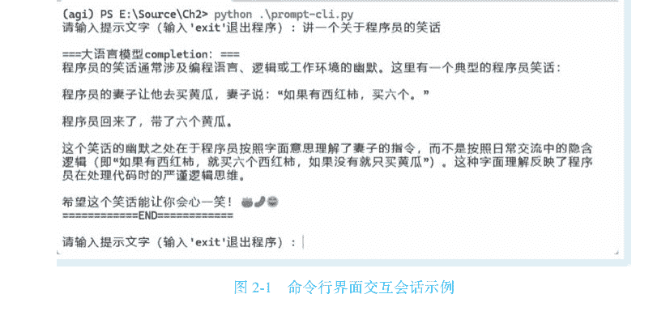

代码里 temperature 设为 0.9，所以即使重复提问，模型也会给出不同的发挥。至此，第一个能与大模型对话的应用就完成了，后续可以在此基础上扩展更复杂的功能。

## 第 2 章 会话编程：与大模型对话的基础方法

界面部分我们先以 GUI 思路展开，它逻辑清晰，能让开发焦点集中在模型交互上。

## ▶▶ 2.1.4 从命令行到图形界面

命令行程序功能完整，但对普通用户不够友好。为了提升后续提示词工程的体验，我们把 CLI 升级为图形化 Web 界面。

OpenAI API 已成业界标准，ChatGPT 的交互范式也被广泛借鉴。本节的图形界面就模仿 ChatGPT 的对话体验来做。

Python 生态里实现 Web 界面的方案很多，为了降低前后端门槛，本书选用 Streamlit。它是一个面向数据科学和机器学习的快速原型工具，提供输入框、滑块等现成组件，非 Web 专业开发者也能迅速搭出可交互的原型。图书中所有图形示例均基于它实现。

接入逻辑与之前一致，先读取 API Key 并封装 get_completion，这里不再重复。

导入 streamlit 并搭建界面的核心代码如下，注释已说明每段作用。

```
import streamlit as st

# 头像配置
ICON_AI = '🤖'
ICON_USER = '👤'

# 显示一条消息(包含头像与消息内容)
def dspMessage(role, content):
    with st.chat_message(role,
                         avatar=ICON_AI if role == 'assistant' else ICON_USER):
        st.write(content)

# 追加并显示一条消息
def append_and_show(role, content):
    st.session_state.messages.append({"role": role, "content": content})
    dspMessage(role, content)

# 如果还没有消息,则添加第一条提示消息
if 'messages' not in st.session_state:
    st.session_state.messages = [{"role": "assistant",
                                  "content": "我是你的信息助手,请问你查询什么信息?"}]

# 将会话中的 messages 列表中的消息全部显示出来
for msg in st.session_state.messages:
    dspMessage(msg["role"], msg["content"])

# 接受用户输入的提示词,并调用大模型 API 获得反馈
if prompt := st.chat_input():
    append_and_show("user", prompt)
    reply = get_completion(prompt)
    append_and_show("assistant", reply)
```

注：请确保已安装 streamlit 包，未安装时执行 pip install streamlit。

代码中 messages 列表预置了一条 role 为 assistant 的消息，它代表模型的身份。用户角色为 user，模型回复以 assistant 角色返回。示例里这条消息仅用于界面展示，后续上下文对话示例会将其作为历史记录参与处理。

prompt-gui.py 编码全部完成后，即可使用文档中给出的指令把演示程序启动。

```
streamlit run prompt-gui.py
```

启动后浏览器会主动打开演示页面，若未自动打开，可手动输入本机地址与端口，例如 http://localhost:8501 或 http://IP:8501 进入。进入页面后在底部输入框里填入提示词，等待片刻即可看到模型的返回文本，呈现效果见图 2-2。

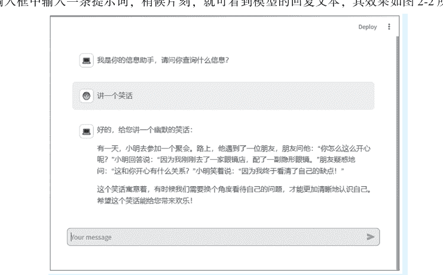

图 2-2 图形界面交互会话示例

## 2.1.5 借助流式输出加速响应

结合前面两个示例的运行体验，可以感觉到模型回复相对传统应用更慢。实际上模型并非等到全部写完才开始给结果，之前的实现是要求模型先把整段内容生成完毕再一次性推送给应用端。另一种做法是让模型在生成过程中就把已产出的片段逐步推送给前端，这就是流式输出。

流式输出是提升时效与交互连贯性的常见手段。采用后，模型产出部分内容就能立即送到客户端展示，无需等待整段完成，用户的等待被压缩，互动感更顺滑。尤其在长文本生成时优势明显，用户能尽早看到初稿，若不满意可即时终止，避免长时间等待后才发现问题而浪费时间与算力。

为了获得更实时流畅的体验，可在前述示例基础上做改造以支持流式。

首先在调用 chat completions create 时新增 stream 参数并设为 True。此时模型会以标准事件流形式分块回传，流结束时会返回 “data: [DONE]”。为突出这一特性，可把封装函数改名为 get_stream_completion，也可保留原函数再额外新增一个同名函数。

```
def get_stream_completion(prompt, model="glm-4-plus", temperature=0.01):
    messages = [{"role": "user", "content": prompt}]
    response = client.chat.completions.create(
        model=model,
        messages=messages,
        temperature=temperature,
        stream=True  # 启用流式输出
    )
    return response
```

完成调用改造后，模型的响应就能以流的方式回传。为了让应用及时捕获事件流并把收到的文字展示在界面上，展示部分也需要调整。

以流式方式呈现文字时，需要在每次取到片段后立刻输出且不换行，否则阅读体验会受影响，而 streamlit 并未提供理想的直接支持。可行的做法是在每次交互中为提问者和助手各创建一个动态容器，流式内容到来时把截至目前收到的全部字符写入该容器，实现渐进显示。流结束后把完整结果保存并在同一容器中输出最终文本。

按此思路改造后的代码如下所示。

```
# 显示一条消息(包含头像与消息内容)
def dspMessage(role, content, container):
    with container:
        if role == 'assistant':
            st.markdown(f"{ICON_AI} {content}")
        else:
            st.markdown(f"{ICON_USER} {content}")

# 追加并显示一条消息
def append_and_show(role, content, container):
    st.session_state.messages.append({"role": role, "content": content})
    dspMessage(role, content, container)

# 如果还没有消息,则添加第一条提示消息
if 'messages' not in st.session_state:
    st.session_state.messages = [
        {"role": "assistant",
         "content": "我是你的信息助手,请问你查询什么信息?"}
    ]

# 将会话中的 messages 列表中的消息全部显示出来
for msg in st.session_state.messages:
    container = st.empty()  # 创建一个新的动态区域
    dspMessage(msg["role"], msg["content"], container)

# 接受用户输入的提示词,并调用大模型 API 获得反馈
if prompt := st.chat_input():
    user_container = st.empty()  # 用户消息的动态区域
    assistant_container = st.empty()  # 助手消息的动态区域

    append_and_show("user", prompt, user_container)

    # 在会话状态中创建或重置 assistant 的响应
    response_key = "assistant_response"
    st.session_state[response_key] = ""

    # 获取流式输出的生成器
    stream_response = get_stream_completion(prompt, temperature=0.9)

    # 逐步接收流式数据并显示
    for chunk in stream_response:
        if chunk.choices[0].finish_reason is None:
            content_chunk = chunk.choices[0].delta.content
            st.session_state[response_key] += content_chunk
            assistant_container.markdown(
                f"{ICON_AI} {st.session_state[response_key]}"
            )
```

## 2.2 提示词工程

与生成式模型交互时，用户输入的文字即为提示词。提示词的撰写有其规律和技巧，写得好能引导模型产出令人满意甚至超出预期的答案，写得差则容易导致答非所问。随着模型能力提升，对提示词的容忍度在提高，但高质量的提示词设计仍是有效利用模型、开发生成式 AI 应用的核心能力之一。

本节围绕提示词撰写与优化即提示词工程展开，下文示例均可借助上一节搭建的示例程序进行验证。

### 2.2.1 迭代式提示词开发：营销文案优化案例

在工作实践中，首次尝试的提示词很少能一次达到理想效果，通常需要依据模型反馈不断调整优化，直至输出符合预期。

以某公司灯箱安防方案为例，期望借助模型完成推广文案。整理方案技术信息后，初步指令如下：

> 以下是一套方案的相关技术信息，请根据这些信息生成一份推广文案。

IUBIOT 灯箱安全监控方案...

提交后，模型生成了一版篇幅过长的文案，如图 2-5。

图 2-5 所示的回复篇幅过长，阅读负担较重。为控制长度，可在指令中增加字数限制：

> 以下是一套方案的相关技术信息，请根据这些信息生成一份推广文案。

**字数限 50 字以内。**

“<方案信息内容同前例>”

重新提交后，模型产出两句话左右的版本，如图 2-6。

“智守安全，光控未来！IUBIOT灯箱监控，防火防灾防意外，手机远程调控，智慧商业新选择！”

注：指令中明确要求字数时，模型会尽力遵循但不会严格执行。存在其他约束时表现类似。因此可以期待模型大致遵循指示，但需理解其执行存在一定弹性，这种弹性有助于保持输出连贯性和准确性。

这次模型把原文压缩到约 39 字，简明概括了方案核心功能，便于终端使用者快速了解。

现实中智能灯箱多由系统整包集成商采购，终端使用者很少直接购买。为此指令需进一步明确目标受众，突出集成商关注的技术要点，再次迭代：

> 以下是一套方案的相关技术信息，请根据这些信息生成一份推广文案。字数限 50 字以内。由于该方案并非直接面向最终使用者销售，而是由系统整包集成商采购，通常他们更关心方案所采用的技术，所以生成的文案要适合面向系统整包商进行营销，要具有技术性质，侧重于方案的技术优势。

“<方案信息内容同前例>”

生成的文案为：

> 物联网技术赋能，IUBIOT 灯箱安全监控、实时监测、远程控制、防患于未然。智能集成，为您的项目保驾护航！

文案已有技术感，但信息仍显单薄。面向集成商介绍时需列出具体设备并给出说明，否则缺乏采购依据。因此进一步提高要求，可指定输出格式，例如网页用 HTML，并放宽字数限制。修改后的指令如下：

> 以下是一套方案的相关技术信息，请根据这些信息生成一份推广文案。字数限 200 字以内。由于该方案并非直接面向最终使用者销售，而是由系统整包集成商采购，通常他们更关心方案所采用的技术，所以生成的文案要适合面向系统整包集成商进行营销，要具有技术性质，侧重于方案的技术优势。**面向系统整包集成商还需要列出具体的设备。请用一个表格，提供具体设备的信息。表格应该有两列。第一列包括设备的名称，第二列包括设备的简要说明。给表格命名为“产品列表”。表格线宽度为 1 磅。将所有内容格式化为可用于网站的 HTML 格式。将描述放在<div>元素中。**

“<方案信息内容同前例>”

此时模型返回包含 HTML 代码的响应，并附带简要说明。以下是某次响应的 HTML 代码片段。

```
<div>
<h2>引领物联网安全监控,IUBIOT 灯箱解决方案</h2>
<p>针对灯箱安全监控,IUBIOT 推出了一站式解决方案。我们的产品采用先进物联网技术,实时监测并远程控制,有效预防电气火灾等安全事故。特色功能包括状态监测、故障报警、自动断电保护、远程调光控制以及可选的温湿度与烟雾感应等。为系统整包集成商提供高效、可靠的智能灯箱管理体验。</p>
<h3>产品列表</h3>
<table border="1"cellspacing="0" cellpadding="5" width="100%">
<tr>
<th>产品名称</th>
<th>简要说明</th>
</tr>
<tr>
<td>智能物联灯箱控制器 RL-GW-01S</td>
<td>实时监测灯箱状态,远程控制,支持 4G 无线数据上传,适配多种传感器,可控负载达 6kW。</td>
</tr>
<tr>
<td>调光控制器 RL-DIM-01</td>
<td>通过 RS485 或 Zigbee 连接,实现节能调光,单模块功率 200W,电压可选 12V 或 24V。</td>
</tr>
</table>
</div>
```

将代码保存为空白网页文件并在浏览器中打开，可看到实际渲染效果，如图 2-7，一个符合要求的设备列表清晰呈现。

至此面向系统整包集成商的推广文案已生成，效果较为理想。专业营销人员若仍有额外需求，可继续迭代指令直至获得满意结果。

### 2.2.2 引导式推理：破解思维题

与模型互动时，若得到偏差或错误结果，不必急于否定其能力，而应尝试重构指令，要求模型在给出最终答案前进行一系列相关推理。换言之，面对难以在短期内完成的任务时，模型容易给出不完美的答案，此时通过细化步骤引导其思考，往往能得到更可靠的结果，这与人类解题过程类似。

例如智力类游戏常出现直接求解错误。以下为一例：

如下信息每行独立，但具有相同的规律，那么最后一行的答案应该是什么？

5★3→28

9★1→810

8★6→214

5★4→19

7★3→？

把该指令直接输入模型，常得到无意义甚至错误的反馈。调用 OpenAI 的 GPT-4o 模型后得到的推导过程与结果如下。

在给定的模式中，每个表达式的结果是由两个数的操作生成的。观察以下每行的操作：

1. 5★3→28：

   5 × 3 = 15

   5 + 3 = 8

提示词进化笔记：从跑偏到可验证

先看一个典型的误导案例。有人把规律定格为“先乘、再翻位、后拼和”：
5★3被解读成 5×3=15，15倒置为51，再拼接 5+3=8 得到28；
9★1被解读成 9×1=9，9+1=10，硬把9转成90再接10得到810；
8★6被解读成 8×6=48，48倒置为84再接8+6=14得到214；
5★4被解读成 5×4=20，20倒置为02再接5+4=9得到19。
沿此路径，7★3会被算成7×3=21，7+3=10，21倒置为12再接10得到110。推演貌似完整，实则全盘错误。

要把模型拉回正轨，关键在于提示层面的引导。换位思考，如果面对的是一个孩子，会怎样启发？
观察到此前反馈只用了乘法与加法。于是提示它跳出这两个运算符，尝试减法与除法。再者，模型一直把数字当数值处理，而数字既是数值也是字符。基于此诊断，在提示中加入思考支架，让模型做更全面、更具逻辑的探索。

> 如下信息每行独立，但遵循同一规律，最后一行的答案应为？
> 5★3→28
> 9★1→810
> 8★6→214
> 5★4→19
> 7★3→?
> 请按以下思路求解：
> 1. 所有行中★代表了某种规律，且各行的规律是相同的。
> 2. 对于数字，如果视为数值，则可尝试加、减、乘、除等运算。
> 3. 对于数字，如果视为字符，则可尝试连接，例如 1 和 2 连接为 12，交换位置，例如 12 交换为 21 等运算。
> 4. 数值运算的结果如果视为字符，也可尝试连接、交换位置等运算。
> 5. ★代表规律，可能是上述单一简单运算，也可能是它们的组合。
> 6. 你必须先对第一行尝试上述每一种运算及其组合，直至找到严格正确的规律。
> 7. 然后使用找到的规律解释第二、三、四行，如果每一行验证都通过，则证明找到的规律是正确的，否则重新查找规律。
> 8. 使用前述过程中确定的规律，推导第五行的结果。

把修正后的提示喂给模型后，推理回到正确轨道，首次提交就得到满意结果。

> 根据题意，每一行中的★代表某种规律，且各行的规律是相同的。我们首先尝试对第一行进行各种运算，以找出★所代表的规律。
> 分析第一行：
> 5★3→28
> 尝试数值运算：
> 加法：5 + 3 = 8
> 减法：5 - 3 = 2
> 乘法：5 × 3 = 15
> 除法：5 / 3 ≈ 1.67
> 组合运算：5 + 3 = 8 和 5 - 3 = 2
> 结合以上运算，如果将结果视为字符并连接，可以得到 28。
> 验证第二行：
> 9★1→810
> 加法：9 + 1 = 10
> 减法：9 - 1 = 8
> 将减法和加法的结果视为字符并连接，得到 810。
> 验证第三行：
> 8★6→214
> 加法：8 + 6 = 14
> 减法：8 - 6 = 2
> 将减法和加法的结果视为字符并连接，得到 214。
> 验证第四行：
> 5★4→19
> 加法：5 + 4 = 9
> 减法：5 - 4 = 1
> 将减法和加法的结果视为字符并连接，得到 19。
> 推导第五行：
> 7★3→?
> 根据前述规律（减法结果连接加法结果）：
> 加法：7 + 3 = 10
> 减法：7 - 3 = 4
> 将减法和加法的结果视为字符并连接，得到 410。
> 最终答案：
> 7★3→410
> 综上所述，结合对数值运算结果的字符连接，第五行的答案应为 410。

由此可见，提示词若不足以支撑正确推理，就需要在提示中加入引导与提示，推动模型朝向正确方向前进。这就是迭代式提示词开发的过程。开发者需要在每次迭代中根据反馈不断调整提示，直到结果可接受。

面向不同任务，引导方式各不相同。例如对某些任务，可以把完成步骤明确告知模型，使其执行更顺畅。

寓言类问题也能说明这一点。以下提示词尝试给出寓言并直接询问打工人的启示：

> 以下由三个反引号包含的内容是一则寓言，它给打工人的启示是什么？
> 一只乌鸦坐在树上，整天无所事事。一只小兔子看见乌鸦，就问：“我能像你一样整天坐在那里，什么事也不干吗？”乌鸦答道：“当然可以啦，为什么不呢？”于是，兔子便坐在树下开始休息。突然，一只狼出现了，狼跳向兔子……抓住兔子并把它给吃了。

常规解读是乌鸦因居高而安全，兔子因处低位而风险更大，必须更努力生存，要认清自身处境，不能盲目模仿他人。

而某次模型回复则有所偏差：

> 这则寓言给打工人的启示是：不应该效仿那些看起来不劳而获的人，因为每个人的处境和能力都是不同的。乌鸦可以无所事事是因为它有其他生存的方式或者特定的优势，而兔子效仿乌鸦的行为却导致了它的灭亡。
> 对于打工人来说，这个启示强调了以下几点：
> 努力工作的重要性：不能仅仅因为看到别人似乎不费吹灰之力就能成功，就放弃自己的努力。每个人的生存环境和能力都不相同，需要根据自己的实际情况去规划和工作。
> 认识自我：了解自己的能力和局限，选择适合自己的生活方式和工作态度，而不是盲目模仿他人。
> 警惕潜在风险：就像寓言中的兔子没有意识到狼的威胁一样，打工人应该对可能出现的风险保持警觉，并采取预防措施。
> 现实与理想的差距：现实世界中，不劳而获往往是不可能的。这个寓言提醒我们，理想化的生活方式可能在现实中是不切实际的。
> 总之，这个寓言提醒打工人要勤劳、自省并认清现实，为自己的生活和未来负责。

显然回复偏离了核心，模型未能抓住乌鸦与兔子在位置上的关键差异。于是对提示进行分步引导：

以下由三个反引号包含的内容是一则寓言，依次回答以下问题：
1. 在寓言中，乌鸦、兔子、狼分别处于什么位置？狼为什么能够吃兔子而不吃乌鸦？
2. 这则寓言的寓意是什么？
3. 它给打工人的启示是什么？
<寓言内容同前例>

这一次模型按步骤作答，答案逐层递进，质量明显提升。

1. 在这则寓言中，乌鸦坐在树上，兔子坐在树下，狼在地面活动。狼能够吃兔子而不吃乌鸦，是因为乌鸦坐在树上，狼无法轻易接触到它，而兔子则在狼的捕猎范围内。这反映了现实中的情境，即在某些情况下，位置或环境的不同可以决定一个人的安危。
2. 这则寓言的寓意是警示人们不要轻易模仿他人的行为，而忽略了自身的情况和特点。兔子模仿乌鸦的行为，却没有意识到自己与乌鸦在生存环境上的差异，最终导致了悲剧。
3. 它给打工人的启示是：
每个人都有自己的职责和环境，应该根据自身实际情况来规划行为，不能盲目模仿他人。
在职场中，需要清楚自己的位置和角色，做好自己的本职工作，不能因为看到他人的状态而忽视了自身应尽的职责。
安全意识很重要，随时要有危机感，不要因为短时间的安逸而放松警惕，造成不可挽回的后果。

需要特别指出的是，随着模型不断进化，像 OpenAI 的 o1、o3 这类模型已具备自主拆解任务、逐步推理的能力，对提示词的依赖降低，输出质量却更高。

### 2.2.3 商品评价提炼实战：文本概括

文本概括是生成式模型的基础能力，涵盖总结段落、提炼文章要点、撰写摘要甚至书籍简介。文本概括对文字工作者帮助明显，在电商场景同样价值突出。商家可以利用概括功能把海量冗长的客户评论提炼成要点，快速把握客户偏好与情绪，从而指导平台和商家优化服务。

以下展示对一段电商平台随机抽取的长评进行概括的过程。示例中隐去平台名并修正了一处笔误，其余保持原貌。

> 请将以下客户对商品的评价进行概括，不要超过 30 个字。
> …
> XX 上的东西质量有保证，价格便宜，买着放心用着舒心。客服也很好，消费者权益有保障，质量经得起考验。大瓶用得持久，小样出门旅行带着很方便，总之就是好。韩国后天气丹已收到，物流快，客服服务态度好，有诚信，收到货后包装完好。快递送货及时，五星好评。产品包装：包装高端大气上档次。吸收效果：吸收效果很好！保湿程度：夜间使用非常保湿。适合肤质：敏感肌肤也可以使用，味道很好闻。我真的非常喜欢它，非常支持它，质量非常好，和卖家描述的一模一样，我非常满意。我真的很喜欢它，它完全超出了我的预期。交货速度非常快，包装非常仔细，物流公司服务态度良好。我非常满意这次购物，包装很好，水和乳液两大瓶，可以用很久，和以前买的小样香味儿一样，用后不油腻，我是敏感肌肤，用后暂时没有出现问题，使用一阵后再追评！

模型的概括结果如下。

> 质量有保证，价格实惠，服务佳，包装精美，保湿效果好，适合敏感肌肤，物流快，超值满意。

网上购物涉及平台、卖家、物流等多方主体，不同主体关注的侧重点不同。因此在概括时可以明确关注焦点，让模型有针对性地抽取信息。

例如物流服务商可用以下提示：

> 请将以下客户对商品的评价进行概括，不要超过 30 字，并且聚焦在物流上。
> <客户评论内容同前例>

概括结果如下。

> 物流快速，包装完好，服务态度好，满意度高。

同理，买家、卖家、生产厂家可能更关注价格与质量，于是提示可调整为聚焦价格与质量：

> 请将以下客户对商品的评价进行概括，不要超过 30 字，并且聚焦在产品价格与质量上。
> <客户评论内容同前例>

这次的概括结果如下。

> 质量保证，价格实惠，包装精美，保湿效果好，适合敏感肌肤，高性价比。

由此可见，文本概括可以根据不同关注点进行侧重抽取，满足多场景需求。

### 2.2.4 文本理解与推理应用

文本推断指从指定文本中推断出实体、关系、情感等信息。该能力可广泛用于标签提取、关键信息抽取、情感分析与舆情监测，提升处理效率并加深数据分析深度。

首先可利用推断能力从文字中抽取关键信息。例如对新闻进行简要概括，帮助用户快速获取时间、地点、人物、事件等要点，无须通读全文。配套原文查阅途径使用户可在阅读摘要后决定是否深入阅读，从而节省时间。

请根据以下由三个反引号包含的新闻提取出以下信息：
1. 时间
2. 地点
3. 涉及主体
4. 事件
5. 结果
```
据新加坡《联合早报》5月16日报道，印度尼西亚鹰记航空公司一架载有468名乘客和机组人员的客机从印尼起飞，因起飞不久后引擎起火而返回机场紧急降落。
报道称，鹰航15日发表声明说，这趟飞往沙特麦地那的鹰航1105航班由波音747 400飞机执飞，于当地时间15日17时15分返回印尼望加锡国际机场，所有乘客均未受伤。
鹰航总裁在声明中称：“机长发现其中一个引擎冒火，当下判断必须进一步检查以确定引擎是否出现故障，所以在飞机起飞后决定立即返航。”
他介绍，机上有450名乘客和18名机组人员，其中包括前往麦地那的朝圣者。所有乘客已在鹰航安排下于同一天乘搭另一趟班机飞往沙特。
目前，事发客机已停飞接受安检。
```

将上述提示词输入示例程序，可以得到如下返回结果。

1. 时间：当地时间15日17时15分，即5月15日17时15分。
2. 地点：起飞地点为印尼，降落地点为印尼望加锡国际机场。
3. 涉及主体：印度尼西亚鹰记航空公司，乘客和机组人员共468名，包括前往麦地那的朝圣者。
4. 事件：一架由波音747 400飞机执飞的鹰航1105航班，在起飞后引擎起火，返回机场紧急降落。
5. 结果：所有乘客均未受伤，乘客均已安排在同一天乘搭另一趟班机飞往沙特，事发客机停飞接受安检。

新闻篇幅较短，处理后结构更清晰。若对更长的新闻文本进行关键信息抽取，效果会更明显。

文本推断的另一重要应用是情感分析。以电商为例，单件商品可能收到数万条评论，手工判断情感倾向负担极重。借助模型推断，可快速判断每条评论的情感，大幅提升效率，帮助商家及时优化产品与服务。

仍以之前的商品评论为例，使用以下提示获取其情感倾向。

> 以下用三个反引号包含的产品评论的情感是什么？
> xx上的东西质量有保证，价格便宜，买着放心用着舒心。客服也很好，消费者权益有保障，质量经得起考验。大瓶用得持久，小样出门旅行带着很方便，总之就是好。韩国后天气丹已收到，物流快，客服服务好，有诚信，收到货后包装完好。快递送货及时，五星好评。产品包装：包装高端大气上档次。吸收效果：吸收效果很好！保湿程度：夜间使用非常保湿。适合肤质：敏感肌肤也可以使用，味道很好闻。我真的非常喜欢它，非常支持它，质量非常好，和卖家描述的一模一样，我非常满意。我真的很喜欢它，它完全超出了我的预期。交货速度非常快，包装非常仔细，物流公司服务态度良好。我非常满意这次购物，包装很好，水和乳液两大瓶，可以用很久，和以前买的小样香味儿一样，用后不油腻，我是敏感肌肤，用后暂时没有出现问题，使用一阵后再追评！

稍后模型返回类似如下回复。

> 这段评论的情感是积极的。评论者对xx平台上的产品质量、价格、客服服务、物流速度、产品包装、吸收效果、保湿程度等方面都表达了满意和赞赏，使用了很多正面词汇如“质量有保证”“便宜”“放心用着舒心”“有诚信”“五星好评”“高端大气上档次”“非常保湿”“非常满意”等，显示出评论者对所购买的产品和服务感到非常满意。

可以注意到模型先给出结论再列举依据。在实际应用中，若仅需结论，可要求模型以限定词反馈。修改提示词如下。

> 请仅以“正面”“负面”或“中性”反馈以下用三个反引号包含的产品评论的情感。
> <客户评论内容同前例>

随后得到的回复只有“正面”一词。

> 正面

在某些场景下，仅需判断是否表达了特定情感，也可要求模型返回简洁判断以便统计或后续处理。

修改提示词如下并再次提交模型。

> 请以“是”或“否”反馈以下用三个反引号包含的产品评论是否表达了愤怒或不满。
> <客户评论内容同前例>

模型按预期返回了一个“否”字。

> 否

上述过程在不断简化情感判断，而在另一些场景下，情感标签需要更精细。此时可以要求模型输出多个情感词汇进行标注。

> 请以不超过五个词汇反馈以下用三个反引号包含的产品评论的情感。
> <客户评论内容同前例>

模型迅速推断出五个表达情感的词汇。

> 正面、满意、推荐、高质量、超预期。

模型还具备识别文本中各类实体的能力，这在自然语言处理任务中尤为重要。实体识别是指从文本中抽取出人名、地名、组织名、日期、货币等信息。通过该能力，模型可在信息提取、文本分析、数据挖掘中发挥关键作用。例如在金融领域，可从财经新闻中提取公司名称与相关事件辅助投资决策；在医疗领域，可从医学文献与临床记录中准确提取药物名称、疾病名称与治疗方案，支持智能诊断系统开发。此外，实体识别还在客户服务自动化、法律文书处理、社交媒体分析等领域展现广泛价值。

例如在信息系统建设的业务需求收集过程中，利用模型的实体识别能力，可从业务描述中自动抽取涉及的角色、系统及其他相关信息，提升需求分析效率，为系统设计奠定基础。以下是一个简单示例。

> 请列出以下描述中涉及的角色和系统。
> 教师向教务处提交学生成绩单，教务处干事将成绩单导入学生管理系统，并在学校内网发布成绩查询通知。学生看到成绩查询通知之后，登录学生信息查询系统，就可以查看到自己的考试成绩。

将上述提示词输入示例程序，获得的分析结果如下。

> 涉及的角色和系统如下：
> 角色：
> 1. 教师
> 2. 教务处干事
> 3. 学生
> 系统：
> 1. 学生管理系统
> 2. 学校内网
> 3. 学生信息查询系统
> 描述中各个角色的操作如下：
> - 教师：向教务处提交学生成绩单。
> - 教务处干事：将成绩单导入学生管理系统，并在学校内网发布成绩查询通知。
> - 学生：在看到成绩查询通知后，登录学生信息查询系统查看自己的考试成绩。

实操中能明显感觉到，大模型对业务描述里出现的参与主体、相关系统以及两者之间的互动脉络抓取得很准，而且把每个角色的具体操作步骤还原得条理清晰，实体抽取的稳定性相当高。把这种特长放到需求分析环节，就能在很短的时间内把分散的业务信息梳理成体系，让做需求的同事判断更准、推进更快、覆盖更全，整体效率得到明显拉升，也为后续开发和排期争取到更宽裕的窗口。面对逻辑纠缠的复杂业务时，这种能力尤其关键，能有效规避人为疏漏和理解偏差，保证需求既全面又精确。

类似效果并不是生成式模型独有，传统机器学习同样可以从文本中抽取实体和关键信息。只是传统做法的落地链路更繁琐：首先要准备一套带明确标注的语料作为训练样本；然后针对特定任务做特征工程、挑选算法、调参；最后把模型部署到云端或本地，才可以对真实数据进行分析和整理。

传统路线在不少场景下也能用，但从数据准备到上线的全流程都要耗费大量人力和时间。更关键的是，情感分析、命名实体识别等不同任务都要各自准备数据、各自训练、各自部署。模型堆得越多，算力消耗越大，运维管理的复杂度也随之飙升，资源利用率和整体效率明显受限。

### 2.2.5 多语秘书：文本转换实战
生成式大模型本质上是面向自然语言处理的智能系统，在文字处理上的能力很强。它可以快速完成翻译、语气转换、润色校对、语言评测等日常工作，也能承担编辑、扩写、撰写等专业任务，为用户提供高质量的语言支持。适用范围覆盖学术写作、商务文档、自动回复等几乎所有需要高质量文本输出的场景，在办公和专业写作中完全可以扮演一名合格甚至优秀的多语助理。

#### 1. 翻译
跨语言转写是大语言模型的核心能力之一。相比传统翻译工具，模型在词汇丰富度、语法准确度以及语境自然度上都有明显优势，还能依据具体语境或用户偏好生成更地道、更贴合实际使用的译文，这使其在国际交流、跨境商务和多文化沟通中具备很高的价值。

面对复杂句式、语义模糊或带有文化特色的表达，模型凭借海量语料的训练积累，能够给出更精准流畅的译文，极大提升跨语言沟通的质量和效率。

传统软件通常难以直接指定目标语气的风格，只能通过反复修改原文去试探效果。而生成式模型可以直接接受明确指令。

> 请将下面这段中文译成英文，并分别给出正式与非正式两种语气：
> 我明天要参加一个会议。

输入后可得到：

> Formal tone: I will attend a meeting tomorrow.
> Informal tone: I've got a meeting to go to tomorrow.

模型训练语料覆盖全球主要语言，除了英语，日语等语言的翻译准确度也很高。

> 正式语气：私は明日、一つの会議に参加する予定です。
> 非正式语气：明日、会議に行くんだ。

即使是小语种，表现依然稳定：

> 正式语气：Aking susubukang dumalo sa isang pagpupulong bukas.
> 非正式语气：Pupunta ako sa isang meeting bukas.

模型对语气的把控十分成熟。把外语译回熟悉的中文也能明显感受到差异。

> 请把下面这段英文译成中文，并分别使用正式与非正式语气：
> May I pay by card?

返回结果：

> 正式语气：我可以使用信用卡支付吗？
> 非正式语气：可以用卡付钱吗？

#### 2. 调整语气风格
同一件事在不同场合的表达方式差异很大，模型能够在语境之间灵活切换。典型用法就是把口语化表达改写为正式商务邮件。

提示：

> 请把下面这段话改写成正式的商务邮件。
> “李总，上周你说的那个项目的具体需求是什么来着？”

模型几乎秒出可用稿，只需少量润色即可发送：

> 尊敬的李总，
> 您好！上周与您沟通的项目中，您曾提到具体需求。为了确保理解一致并推进后续工作，烦请您再次详细说明该项目的具体需求，方便我们及时准备。
> 期待您的回复，祝商祺！
> 此致敬礼！
> [您的姓名] [您的职位] [公司名称] [日期]

作者曾在跨国公司担任项目经理，邮件往来每天数封到数十封，必须用英语撰写。中文五分钟能写好的内容，换成英文往往要花15分钟到半小时。借助文本转换能力，这一过程现在通常五分钟内即可完成。

增加英文要求后同样高效：

> 请把下面这句话改写成正式的商务邮件，因为收件人公司的工作语言是英语，请用英文完成并遵循英文邮件格式。
> “李总，上周你说的那个项目的具体需求是什么来着？”

得到：

> Subject: Inquiry Regarding Project Specifications Discussed Last Week
> Dear Mr Li,
> I hope this message finds you well.
> I am writing to follow up on our conversation from last week regarding the project you mentioned. Could you please provide me with the specific requirements and details of the project we discussed? Your guidance will be instrumental in moving forward with the necessary preparations and ensuring a seamless execution.
> Thank you for your attention to this matter, and I look forward to your prompt response.
> Best regards,
> [Your Full Name] [Your Position] [Your Company Name] [Your Contact Information]

这种转换能力源于模型对语言细微差别和上下文关系的深度理解。非正式对话转成正式文本时，它不仅调整用词句式，还会增添礼貌表达和专业术语，使结果符合商务规范，在提升沟通效率和专业度、降低人工负担方面价值显著。

#### 3. 错别字及语法纠正
写作时因水平或粗心常出现错字、语法和用词问题，模型可以自动检测并修正，提高准确性和流畅度。它能够识别拼写、语法、用词不当等多种错误，并给出更合适的表达。

示例指令：

> 请校对并更正下面这段文字：
> 做为一名技术人员，必需拥有强大得罗辑能力，否则难以将技术落底到实际项目之中。

修正结果：

> 作为一名技术人员，必须具备强大的逻辑能力，否则将难以把技术落实到实际项目中。

更正点：

1. “做为”→“作为”。
2. “必需”→“必须”。
3. “强大得罗辑能力”→“强大的逻辑能力”。
4. “落底”→“落实”。
5. “之中”可简化为“中”，语气更顺畅。

类似能力也可用于英语改错练习：

> 请校对并更正下面这段文字，并用中文说明修改之处：
> Ms Emma is our English teacher, whom is tall and slim, and always wears beautiful smiles. Ms Emma is in her thirties. She has been teaching in 15 years, so she has rich experiences. Ms Emma always thinks of ways make her classes lively and interested. On one hand, we have learnt a lot of English from him, on the other hand, we had learnt a lot about the cultures of foreign countries.
> Ms Emma is very much patient and nice, though strict with us. We are proud at being the students of so a great teacher.

模型回复：

> 以下是校对并更正后的文本，以及修改说明：
> Ms Emma is our English teacher, who is tall and slim, and always wears a beautiful smile. Ms Emma is in her thirties and has been teaching for 15 years, which means she has rich experience. Ms Emma always thinks of ways to make her classes lively and interesting. On one hand, we have learned a lot of English from her; on the other hand, we have also learned a lot about the cultures of foreign countries.
> Ms Emma is very patient and kind, though she is strict with us. We are proud to be students of such a great teacher.

修改之处：

1. whom→who，主语从句需用 who。
2. beautiful smiles→a beautiful smile，单数名词更恰当。
3. in 15 years→for 15 years，持续时间用 for。
4. rich experiences→rich experience，整体概念用单数。
5. ways make→ways to make，补全不定式。
6. interested→interesting，课程应是 interesting。
7. him→her，主语 Ms Emma 为女性。
8. had learnt→have also learned，保持时态一致并加入 also。
9. very much patient→very patient，patient 前不需 much。
10. proud at being→proud to be，固定搭配。
11. so a great teacher→such a great teacher，such 修饰名词。

对比参考答案，十处改动中九处完全一致，准确率很高，堪称优等生水平。

目前已有不少开发者基于模型的生成与转换能力，打造英语学习辅助软件，结合语音识别与转换，实现虚拟口语陪练，让学习者在仿真对话中提升表达能力，同时降低练习成本。

### 2.2.6 写作助手——文本扩展
在生成式AI中，文本扩展是指基于已有素材，利用模型生成能力进行内容丰富或续写。模型可以在原文本上补充细节、背景、例证或对概念进行进一步阐释。

主要应用包括：

1) 增加细节和背景信息：为简短介绍补充发展历程、技术突破和实际案例，使内容更具体全面。
2) 提供解释和阐述：对概念或术语做深入说明，帮助理解。
3) 举例说明：通过具体编程实例或应用场景，让抽象概念更清晰。
4) 扩展讨论和分析：在原有分析基础上增加趋势预测和专家观点。

甚至只给一个开头或核心概念，模型也能生成连贯深入的内容。

> 请续写“梦断酒醒无归处”。

生成：

> 梦断酒醒无归处，夜深人静泪沾巾。四周寒气侵骨髓，满腹心事对谁陈。
> 独坐街头思往，岁月匆匆如流水。昨日欢歌笑语声，今朝孤影度时光。
> 浮生如梦悲无常，世事沧桑换故颜。何处觅得旧时景，重逢故人共倾杯。
> 望尽天涯无去路，回首故乡在远方。愁绪难抒心如焚，醉卧红尘笑苍茫。

在文学创作上，模型的表现已远超多数人，写普通文章更是游刃有余。

例如需要写情书时，可给出结构要求让模型完成：

现在你正和一位女孩子谈恋爱，你现在的任务是给女孩子写一封情书，情书至少应有五段，其中情书第二段到第四段请分别以“你是我的太阳”“你是我的月亮”“你是我的星星”开头。

模型迅速生成：

亲爱的，

从我们相识的那一刻起，我的世界变得如此美好。你就像是温柔的风，轻轻吹拂着我心头的每一个角落。在此，我想要用文字表达我对你的深情，虽然笔尖的力量远远不足以描述我心中情感的万分之一。

你是我的太阳，是我生命中不可或缺的光源。你的笑容如同阳光般灿烂，驱散了我所有的阴霾，给予我无尽的温暖和力量。每当想到你，我的内心便被满满的希望和喜悦所填满。

你是我的月亮，静静地在夜空中守护着我。在我们无法相聚的夜晚，我总是仰望星空，思念着你的温柔和体贴。你是那么的明亮，那么的纯净，仿佛能洗净我一天的疲惫，让我在梦中与你相拥。

你是我的星星，在无数个夜晚为我指引方向。在浩瀚的人生旅途中，有了你，我不再迷失，不再彷徨。每一个与你共度的时光，都成为我生命中最珍贵的回忆，如同繁星闪烁，永远熠熠生辉。

在这爱的篇章里，我想对你说，无论未来有多少风雨，我都愿意紧紧握住你的手，与你并肩前行。感谢你成为我的太阳、月亮和星星，让我的生活变得如此美好。愿我们的爱情如天空般辽阔，如星河般璀璨。

永远爱你的，

[你的名字]

文本延展的用途远不局限于创作领域，凡是涉及自动生成或润色文字的场景都能受益。以电商平台的买家评价回复为例，商家为了强化消费体验、提升用户留存，通常需要对评论进行跟进。这类任务正是模型延展能力发挥空间的地方。

下面给出一段可直接投喂的指令示例。

你是一位电商客服的 AI 助手。你的任务是根据客户的评价对该评价进行回复。

以下由三个反引号包含的内容是客户评价，请生成回复以感谢客户。为使回复更贴近该评价，在回复中应提及评价中的具体细节，且回复应简明而专业。回复时请使用积极的情感。

```
××上的东西质量有保证，价格便宜，买着放心用着舒心。客服也很好，消费者权益有保障，质量经得起考验。大瓶用得持久，小样出门旅行带着很方便，总之就是好。韩国后天气丹已收到，物流快，客服服务好，有诚信，收到货后包装完好。快递送货及时，五星好评。产品包装：包装高端大气上档次。吸收效果：吸收效果很好！保湿程度：夜间使用非常保湿。适合肤质：敏感肌肤也可以使用，味道很好闻。我真的非常喜欢它，非常支持它，质量非常好，和卖家描述的一模一样，我非常满意。我真的很喜欢它，它完全超出了我的预期。交货速度非常快，包装非常仔细，物流公司服务态度良好。我非常满意这次购物，包装很好，水和乳液两大瓶，可以用很久，和以前买的小样香味儿一样，用后不油腻，我是敏感肌肤，用后暂时没有出现问题，使用一阵后再追评！
```

在该指令下模型输出基本符合预期。配合常规的信息化手段，平台或商家便能把原本费时费力的评论回复做得更高效，甚至实现自动化。

> 感谢您对××平台的支持和信任，以及对我们产品的喜爱。非常高兴得知您在使用我们的产品后感到满意，特别是对于产品的高品质、合理的价格和优秀的客服服务给予了高度评价。您提到的“包装高端大气上档次”“吸收效果很好”以及“保湿程度”令您在夜间使用时感到非常舒适，这让我们倍感欣慰。同时，您对我们的物流速度和客服诚信也给予了肯定，这对于我们来说是极大的鼓励。

我们特别注意到您是敏感肌肤，但使用后没有任何问题，这一点对我们来说非常重要，我们也会继续把控产品质量，让所有肤质的朋友都能放心使用。您所说的“大瓶用得持久，小样出门旅行带着很方便”，我们也会在以后的产品设计中考虑到这一点，继续为大家提供便利。

再次感谢您的详尽评价和满满的认可，我们期待您后续的使用感受，并希望您能继续支持××平台和我们的产品。如果您有任何问题或需要进一步的帮助，请随时联系我们。祝您生活愉快，购物开心！您的五星好评是我们前进的动力！

## 2.3 让 AI 具有记忆——保留对话上下文

人与人交流时会自动借助上下文来把握意图，这源于长期积累的语言经验和认知习惯。模型本身却不会自行保存历史对话，缺乏持续的全局语境理解能力。解决办法是让应用在与模型交互时，显式地把当前对话的上下文一起带上。

启动之前完成的示例程序 prompt-stream.py，按顺序输入两条有关联的问题，如图 2-8 所示。可以看出这两次对话被当作孤立事件处理。第二次提问时，模型完全无法调取第一次的信息，说明现有交互方式缺少语境记忆，每轮都是独立的。

这种割裂式的对话在需要连续交流的场景里并不友好。若希望构建能持续对话并理解上下文的应用，就必须让对话在语境中延续。一种简便有效的做法是，每次提交新提示时把历史对话一并提交。这样模型能拿到完整记录，便可依据上下文应答，大幅提升连贯性和理解度。

在 chat.completions.create 的参数说明中，messages 的类型是列表。为了实现基于上下文的交互，应用每次提交新提示时，都需要把历史对话通过该列表传进去。也就是说，messages 不仅要包含当前提示，还应包含之前的对话内容，通常是历史提示与模型对应的回复。

例如，messages 可以被设定为如下列表，该列表包含三条消息。前两条消息构成了第一轮对话，而第三条消息则表示当前提交的问题。

```
messages = [
    {"role": "user", "content": "我昨天给小明买了三本书"},
    {"role": "assistant", "content": "书是不错的礼物哦。"},
    {"role": "user", "content": prompt}
]
```

读者可以基于示例程序 prompt-cli.py 进行修改，代码中除修改 messages 赋值外，还需将提示词修改为“我昨天给谁买书了？”，修改后的示例代码请参见源文件 prompt-session-sample.py。运行后可以看到，模型能够根据上下文正确推断出“昨天给小明买了三本书”。

在上述 messages 列表中各条消息的键 role 对应的值除 user 外，还出现了 assistant。role 一共有四个允许的值，分别是 user、assistant、system 和 tool。这四个值的作用简述如下。

1) user：表示用户，通常是发送消息或提出请求的实体。用户通过输入问题或指令与模型进行交互，并期望得到相应的答复或解决方案。

2) assistant：表示代表模型的人工智能助手，其主要职责是回应用户的请求和问题。assistant 根据接收到的用户输入，生成适当的回答或执行相应的操作，以满足用户的需求。在对话时，它的存在就像另外一个交流对象。

3) system：这个角色通常用于设置对话的初始条件或控制对话的整体环境。可以包括设定模型的身份角色、行为模式、定义对话的上下文等。这类消息通常在对话开始时发送，并定义了整个对话的基调。

4) tool：表示可以用来协助完成特定任务的工具。这类角色通常不直接参与对话，而是辅助 assistant 完成用户请求的特定操作，例如调用外部 API、执行计算或访问数据库。tool 的使用将在本书后续部分详细介绍。

理解了会话上下文的作用及如何在对话中保持对话历史后，下一步将此前完成的示例程序 prompt-stream.py 升级为可以保持上下文的更友好的版本。

在原先代码实现中，chat.completions.create 方法的参数 messages 是通过根据用户输入的提示词构造的仅包含一条信息的列表。为使其能够接受对话历史列表，需要对代码进行一些修改。具体来说，需要将函数 get_stream_completion 的第一个参数由 prompt 修改为表示对话列表的 messages，并删除原先在函数中构建 messages 的那一行代码。

以下是修改后的函数 get_stream_completion 实现。

```
def get_stream_completion(messages, model="glm-4-plus", temperature=0.01):
    response = client.chat.completions.create(
        model=model,
        messages=messages,
        temperature=temperature,
        stream=True  # 启用流式输出
    )
    return response
```

随后需要解决传入参数 messages 是对话列表的问题。在原先的代码实现中，为了在界面展示对话历史，已经将所有对话保存在 st.session_state.messages 之中，其中也包含用户刚刚提交的提示词。因此，第二处修改仅需将调用函数 get_stream_completion 处的第一个实际参数修改为 st.session_state.messages 即可。

以下是修改后的代码。

```
# 获取流式输出的生成器
stream_response = get_stream_completion(st.session_state.messages,
                                       temperature=0.9)
```

运行修改完成的示例代码（完整代码参见源文件 prompt-stream-session.py），再次输入两条消息：“我昨天给小明买了三本书”和“我昨天给谁买书了？”。此时，可以观察到模型根据上下文正确地回答了问题，如图 2-10 所示。

回顾前面对提示词进行迭代的实例，每次调整提示词时，都必须将待处理的文本包含在提示词中，其原因就在于此前的示例程序中未能包含对话上下文信息，每次对话都是相对独立的。在这种情况下，模型不知道此前的对话内容，因此才需要在每次交互时重新提供相关文本。

## 2.4 本章小结

当程序具备对话上下文的处理能力后，在迭代优化提示词或进行追问时，就无须每次都附上待处理的文本或之前模型的回复。这种改进使得模型能够在对话中参考之前的交流内容，从而实现更加自然和连贯的交互，使其行为更加接近人类。

再次在上述完成的示例程序中连续输入前后相关的任务要求，如图 2-11 所示。可以看到，模型已经可以正确地根据上下文理解提示词的要求了。

需要特别补充说明的是，在与模型交互时，向模型提交的信息与模型返回的信息均会计入此次对话的 token 消耗（token 是生成式 AI 模型输入输出的基本单位，1 个 token 大约相当 3/4 个英文单词或 1 个汉字，它也是服务商收费的计量单位）。因此，在一个会话过程中，若每次对话均携带全部历史对话数据，将导致后续对话消耗的 token 数量越来越多。

这不仅会增加成本，还可能超出模型允许的每次交互的最大 token 限制。为了在实际应用中有效利用上下文信息并同时考虑成本与 token 数量限制，需要采取一些策略应对这一问题。通常建议使用的方案如下。

- 1) 保留最近的若干次对话记录：可以选择性地保留最近的对话记录，而丢弃较早的对话。这种方法能够显著减少每次交互的 token 消耗，同时保持对话的连贯性和上下文相关性。

- 2) 文本概括：在保留最近对话记录的基础上，对较早的对话记录进行文本概括。通过这种方法，可以以更精炼的形式保留对话的关键内容，达到减少 token 消耗的目的。文本概括的实现在本章前文实例中已有涉及。

本章主要介绍了模型的对话编程及提示词工程，这两者都是基于生成式 AI 开发应用程序的最基础技术。特别是提示词工程，看似简单，实则写出优秀的提示词需要工程师们不断学习与尝试。

在对话编程部分，本章详细阐述了如何通过编程与模型进行互动，从而实现自然语言处理任务。对话编程不仅涵盖了基本的输入输出操作，还包括处理用户意图、上下文管理等复杂问题。

提示词工程则是通过设计和优化提示词，最大限度引导模型生成准确且符合预期的输出内容。本章探讨了一些常见的提示词设计技巧，并通过实例解析帮助读者理解如何在实践中应用这些方法。

以本章内容为基础，后续将带领读者进入更深入的生成式 AI 应用开发领域，进一步开发出更实用更贴近需求的应用程序。

# 第3章 函数调用——构建生成式AI的神经反射弧

自 OpenAI 发布 ChatGPT 以来，生成式 AI 模型如雨后春笋般涌现，为人们带来了前所未有的体验。从技术角度来看，生成式 AI 的底层原理可概括为“推理”，这一过程本质上是一个概率选择过程。正因为如此，生成式 AI 并非无所不能，它在语言处理和生成方面表现出色，但在涉及数学计算等需要精确结果的领域，依赖概率推理显然是不可靠的（同时应当看到，生成式 AI 模型的数学推理能力一直在持续提升，这也是当前模型演化的一个重要方向）。另外，诸如数据库查询这一类的操作，无论从安全性还是技术复杂度来看都不应由模型直接完成。因此，在实际应用中，对于那些模型难以胜任或必须严格保证结果准确性的场景，应用程序必须转向使用传统的具备严格逻辑与过程控制的方式实现，结合模型与传统应用各自优势能力协同工作以完成任务。在这一协作过程中，函数调用（Function Calling）则充当关键的桥梁。

使用函数调用不仅能够弥补模型在数理计算任务方面的局限性，同时也能充分发挥模型在语言理解和生成方面的优势。例如，在需要进行复杂数据处理或精确计算时，可以通过函数调用将这些任务委托给专门的计算函数，同时利用模型识别与生成待调用函数的参数、以自然语言方式与用户进行交互等。这样的协作模式不仅提高了系统的交互体验，也保证了结果的可靠性与准确性，达到“强强联合”的效果。

此外，函数调用还可以实现系统的模块化与解耦，使得各个功能模块可以独立开发和优化。例如，在一个数据分析系统中，生成式 AI 模型可以负责接收用户的自然语言查询并解析出具体需求，而底层的各种计算函数则负责实际的数据查询、处理与结果生成。通过这种方式，不同的功能模块既能独立维护，也能通过明确的接口紧密协作，形成一个高效、可靠的整体系统。

### 3.1 计算定积分——本地函数调用

本地函数调用是函数调用最简单、最容易理解的应用场景。

假定当前应用场景中涉及数学运算，例如需要计算定积分，可以先尝试直接让模型推理计算，图 3-1 和图 3-2 展示了使用完全相同的提示词所得到的两个不同的结果。

计算函数 $f(x) = \sin(x)$ 在 $[0, \pi]$ 的定积分，给出计算过程。你返回文字中的数学表达式使用 LaTeX 表达式表示，并且所有 LaTeX 表达式前后必须各添加一个符号 “$”。

要计算函数 $f(x) = \sin(x)$ 在区间 $[0, \pi]$ 上的定积分，我们可以使用基本的定积分公式。

定积分的一般公式是：

$$\int_{a}^{b} f(x) \, dx$$

其中，$a$ 和 $b$ 是积分的上下限。

对于三角函数 $\sin(x)$，它的不定积分（即原函数）是 $-\cos(x)$。因此，我们可以将这个不定积分在积分区间 $[0, \pi]$ 的端点值相减，得到定积分的值。

具体计算如下：

$$\int_{0}^{\pi} \sin(x) \, dx = -\cos(x) \Big|_{0}^{\pi}$$

接下来，我们将积分上限 $\pi$ 和下限 $0$ 代入 $-\cos(x)$：

$$-\cos(\pi) - (-\cos(0))$$

$\cos(\pi)$ 等于 $-1$，而 $\cos(0)$ 等于 $1$，所以我们得到：

$$-(-1) - 1 = 1 - 1 = 0$$

因此，$f(x) = \sin(x)$ 在区间 $[0, \pi]$ 上的定积分值为 $0$。

图 3-1 模型推导定积分 1

计算函数 $f(x) = \sin(x)$ 在 $[0, \pi]$ 的定积分，给出计算过程。你返回文字中的数学表达式使用 LaTeX 表达式表示，并且所有 LaTeX 表达式前后必须各添加一个符号 “$”。

要计算函数 $f(x) = \sin(x)$ 在区间 $[0, \pi]$ 上的定积分，我们使用以下定积分公式：

$$\int_{a}^{b} f(x) \, dx$$

在这个例子中，$a = 0$, $b = \pi$，所以我们要计算的是：

$$\int_{0}^{\pi} \sin(x) \, dx$$

要找到这个积分的值，我们需要找到 $\sin(x)$ 的一个原函数。$\sin(x)$ 的原函数是 $-\cos(x)$。然后，我们根据定积分的定义，计算原函数在上限和下限的差值：

$$-\cos(x) \Big|_{0}^{\pi}$$

接下来，我们将上下限代入原函数：

$$-\cos(\pi) - (-\cos(0))$$

知道 $\cos(\pi) = -1$ 和 $\cos(0) = 1$，代入上面的表达式，我们得到：

$$-(-1) - (-1) = 1 + 1 = 2$$

因此，函数 $f(x) = \sin(x)$ 在区间 $[0, \pi]$ 的定积分为：

$$\int_{0}^{\pi} \sin(x) \, dx = 2$$

图 3-2 模型推导定积分 2

注：在上述提示词中，之所以要求在 LaTeX 表达式前后加上“$”符号，是为了确保在使用 st markdown 函数显示 LaTeX 表达式时，能够以转换后的正常数学表达式形式呈现，而不是显示 LaTeX 的原始代码。通过这种方法，系统可以正确解析并渲染 LaTeX 表达式。

在进行数学运算时，尤其是涉及复杂计算时，模型的表现可能受到多种因素的影响。这些因素包括但不限于输入提示词的精确度、模型的内在不确定性以及训练数据的覆盖范围。上述两次运行结果的差异正是这种不确定性的表现，也证实了前面分析中提及的生成式 AI 进行精密数学运算时面临的局限性。

解决上述问题的方案便是使用本地函数实现定积分计算，而不是让模型进行定积分的推理计算。

计算 $f(x) = \sin(x)$ 的定积分本地代码实现比较简单，以下是利用 Python 的 numpy 和 scipy 包实现该计算的一个具体示例。

```python
import numpy as np
from scipy.integrate import quad

# 定义被积函数  f(x) = sin(x)
def f(x):
    return np.sin(x)

# 计算定积分
def di(x, y):
    return quad(f, x, y)[0]
```

本地函数实现定积分计算功能之后，需要告诉模型本地有这么一个函数可以实现定积分计算，如果需要进行定积分计算，不再由模型自行推导，而应通知本地应用程序调用上述已定义的函数 di(x,y) 进行计算。这一能力的实现是通过与模型对话时添加参数 tools 来实现的。

函数 create_function_calling_request 封装了与模型进行会话的接口 chat completions create，为参数 tools 指定了具体的值。示例代码如下。

函数调用实战指南：从 tools 声明到结果回传全流程

```python
# 创建一个用于 Function Calling 的函数定义
def create_function_calling_request(messages):
    return client.chat.completions.create(
        model="glm-4-plus",
        messages=messages,
        tools=[
            {
                "type": "function",
                "function": {
                    "name": "di",
                    "description": "计算函数 f(x) = sin(x) 的在 [x,y] 的定积分。",
                    "parameters": {
                        "type": "object",
                        "properties": {
                            "x": {
                                "type": "number",
                                "description": """定积分下限，
                                必须从用户输入中识别出定积分下限，
                                否则提示用户重新输入。"""
                            },
                            "y": {
                                "type": "number",
                                "description": """定积分上限，
                                必须从用户输入中识别出定积分上限，
                                否则提示用户重新输入。"""
                            }
                        },
                        "required": ["x", "y"]
                    }
                }
            }
        ],
        tool_choice="auto"
    )
```
参数 tools 承载的是一组可调用函数的清单，每个条目都由若干固定字段共同描述其能力与输入规范，具体字段含义见表 3-1。

表 3-1 参数 tools 设定 function 时的字段

| 参数名称 | 类型 | 是否必填 | 说明 |
| :--- | :--- | :--- | :--- |
| type | String | 是 | 必须写成 function |
| function | Object | 是 | 函数的完整定义 |
| — name | String | 是 | 函数标识名 |
| — description | String | 是 | 用自然语言概括功能，模型据此判断是否以及如何调用 |
| — parameters | Object | 是 | 参数结构，采用 JSON Schema 描述；若无需参数可省略 |
| — — type | String | 是 | 必须为 object |
| — — properties | Object | 是 | 每个键对应一个参数的定义，内含 description 与 type |
| — — — 参数名 | Object | 否 | 描述该参数的对象 |
| — — required | 列表 | 否 | 声明必须提供的属性名 |

注：function 包含 name、description、parameters 三部分，其中 parameters 由 type、properties、required 组成，properties 则列出实际的参数名与说明。

以示例程序为例，tools 中声明了一个名为 di 的函数，它接受两个数值型参数 x 与 y，且 required 明确二者均为必填，同时用 description 分别说明函数用途与参数含义。

函数声明必须与本地实现严格对应，尤其是名称和参数名要完全一致。description 的写法尤为关键，模型正是依据这段文字来决定是否触发调用、调用哪一个以及填充哪些参数。tools 描述越精确、越完整，模型的判断与执行就越可靠。

除 tools 外，还可配合 tool_choice 参数使用。常见取值是 auto，让模型自行决定是否调用；部分模型还支持强制调用或禁止调用，以满足不同场景的控制需求。

完成声明封装后即可发起调用，调用方式与之前一致，只需把提示词换成涉及定积分计算的任务，即可观察模型的决策和返回。

```python
# 创建一个包含函数调用的 prompt
prompt = "计算函数 f(x) = sin(x)的在[0,π]的定积分。"
messages=[{"role": "user", "content": prompt}]

# 发送请求并获取响应
response = create_function_calling_request(messages)
```
在早期示例里，应用拿到模型回复后会直接展示 choices[0].message.content，因为那是模型针对提示所产生的自然语言答案。但当模型选择执行函数时，返回形态会发生变化，这时需要把注意力放到 choices[0].message.tool_calls 上。

tool_calls 是一个列表，可能包含多条调用指令。本例仅声明了一个函数，关注点就变成列表是否为空，若不为空则重点看第一个元素。

代码层面，先取出 tool_calls 的第一个元素，再判断它是否为 None，从而确认本次交互是否产生了函数调用指令。

```python
# 解析响应并调用相应的函数
function_call = response.choices[0].message.tool_calls[0]
if function_call is None:
    result = response.choices[0].message.content.strip()
```
解析返回结果时，若 tool_calls 不存在或为空，就按普通文本处理，直接提取并使用返回内容。若存在调用指令，则需要解析出函数名与对应参数。

函数名可通过 tool_calls 元素的 function.name 属性获取，参数则保存在同一元素的 function.arguments 中。下面是提取这两个信息的示例写法。

```python
function_name = function_call.function.name
function_args = json.loads(function_call.function.arguments)
```
拿到函数名和运算所需参数后，就可以执行本地函数完成定积分计算。出于安全考虑，执行前必须校验模型请求的函数名是否与本地已定义的函数名完全相同。若 tools 中声明了多个函数，还需根据请求名映射到对应的本地实现。这一校验能避免误调用和潜在风险。

本地函数执行完毕后，把结果保存到变量中，以便后续回传给模型。

```python
if function_name == "di":
    a = function_args.get("x")
    b = function_args.get("y")
    result = di(a, b)
```
模型发起函数调用时，除了给出函数名和参数，还会为每次调用分配一个唯一的 id。该 id 在把执行结果交回模型时起到关联作用，必须一并带回，否则模型无法匹配结果归属。

另外，模型本身不具备记忆能力，每轮交互都需要带上上下文。因此在提交函数执行结果前，要先把上一次模型返回的调用指令合并进对话历史，再把本地函数的运行结果追加到历史末尾。这样模型才能基于完整上下文继续处理。

上述逻辑的封装代码如后述。

```python
messages.append(response.choices[0].message.model_dump())
...
# 将本地计算结果返回大模型
follow_up_prompt = {
    "role": "tool",
    "tool_call_id": function_call.id,
```
### 3.2 数据查询助手——数据库访问

上一节讲了如何让生成式模型在合适时机调用本地函数，各自发挥所长：本地函数擅长计算、数据处理与系统操作，模型擅长自然语言理解，能够判断是否需要调用、从用户问题中抽取参数并生成调用请求。结合起来应用会更高效、更精准。

实际上模型的语言理解能力往往超出预期。它不仅能识别要调用的函数和参数，还能根据数据库表结构和用户提示自动生成符合需求的 SQL 语句，再把 SQL 交给本地函数执行并返回查询结果。本节就基于这一能力实现一个数据查询助手。

要搭建助手，首先需要一个数据库，设计表结构、写入模拟数据，并提供一个查询函数。为求轻量快速，示例选用 SQLite3，建立演示表并插入若干记录作为基础。

建表时充分使用注释，对表整体和每个字段的含义做详尽说明，既帮助模型准确理解结构，也提升代码可读性。

```python
# 描述数据库表结构
db_schema = """
-- 订单详情表
CREATE TABLE orders (
    id INT PRIMARY KEY NOT NULL, -- 主键,不允许为空
    customerName STR NOT NULL, -- 客户名,不允许为空
    productName STR NOT NULL, -- 产品名称,不允许为空
    price DECIMAL(10,2) NOT NULL, -- 价格,不允许为空
    status INT NOT NULL, -- 订单状态,整数类型,不允许为空。1 代表已支付,2 代表已退款
    create_time TIMESTAMP DEFAULT CURRENT_TIMESTAMP, -- 创建时间,默认为当前时间
    refund_time TIMESTAMP -- 退款时间,可以为空
);
"""
```
建表语句准备好后，就可以初始化数据库。初始化主要完成三件事：建立数据库连接、创建订单表、写入模拟数据。为方便复用，这些步骤被封装进 initDB 函数。

```python
import sqlite3

cursor = None

# 初始化数据库
def initDB():
    global cursor
    # 创建数据库连接
    conn = sqlite3.connect(':memory:')
    cursor = conn.cursor()

    # 创建 orders 表
    cursor.execute(db_schema)

    # 插入模拟记录
    mock_data = [
        (1, '张三', '衬衫', 50, 1, '2024-02-15 13:24:00', None),
        (2, '王五', '外套', 200, 1, '2024-01-20 09:15:00', None),
        (3, '李四', '短袖', 80, 1, '2024-05-10 15:30:00', None),
        (4, '赵六', '裤子', 120, 1, '2024-04-05 11:45:00', None),
        (5, '张三', '外套', 200, 1, '2024-03-12 10:00:00', None),
        (6, '李四', '短袖', 80, 1, '2024-06-01 14:30:00', None),
        (7, '王五', '衬衫', 50, 2, '2024-02-28 16:15:00', '2024-03-02 10:30:00'),
        (8, '赵六', '裤子', 120, 1, '2024-01-10 08:45:00', None),
        (9, '张三', '短裤', 90, 1, '2024-04-20 12:00:00', None),
        (10, '李四', '外套', 200, 1, '2024-05-25 17:15:00', None),
        (11, '王五', '短袖', 80, 1, '2024-02-10 11:30:00', None),
        (12, '赵六', '衬衫', 50, 1, '2024-06-15 09:45:00', None),
        (13, '张三', '裤子', 120, 1, '2024-01-25 14:00:00', None),
        (14, '李四', '短裤', 90, 2, '2024-04-10 16:15:00', '2024-04-12 10:30:00'),
        (15, '王五', '外套', 200, 1, '2024-03-20 11:45:00', None),
        (16, '赵六', '短袖', 80, 1, '2024-05-05 13:00:00', None),
        (17, '张三', '衬衫', 50, 1, '2024-06-10 09:15:00', None),
        (18, '李四', '裤子', 120, 1, '2024-02-25 15:30:00', None),
        (19, '王五', '短袖', 80, 1, '2024-01-15 12:45:00', None),
        (20, '赵六', '短裤', 90, 1, '2024-03-10 10:00:00', None)
    ]

    for record in mock_data:
        cursor.execute(f"""
            INSERT INTO orders (
                id, customerName, productName, price, status,
                create_time, refund_time)
            VALUES (?, ?, ?, ?, ?, ?, ?)
        """, record)

    # 提交事务
    conn.commit()
```
表与数据就绪后，下一步是构建查询函数。该函数负责执行模型生成的 SQL，获取结果并作为返回值返回。因此函数需要接收一条 SQL 语句作为输入，并把查询得到的数据集吐出来。

```python
# 执行 SQL 查询数据
def ask_database(query):
    global cursor
    cursor.execute(query)
    records = cursor.fetchall()
    return records
```

数据库与模拟数据的准备工作到此算是收尾了。为了以后维护更省心，上面用到的代码可以收拢到一个独立的源文件里，完整版本可以参考 DBTools.py。

接下来参照 3.1 节的做法，给模型下发请求时要用 tools 参数把本地数据查询函数讲清楚，说明得越完整，模型生成 SQL 的准确度与调用本地函数的指向性就越好。

```python
import DBTools as db

# 创建一个用于 Function Calling 的函数定义
def create_function_calling_request(messages):
    return client.chat.completions.create(
        model="glm-4-plus",
        messages=messages,
        tools=[{
            "type": "function",
            "function": {
                "name": "ask_database",
                "description": "使用此函数来回答用户关于业务数据的问题。\n                    应识别用户的输入并生成完整的 SQL 语句作为本函数的参数。",
                "parameters": {
                    "type": "object",
                    "properties": {
                        "query": {
                            "type": "string",
                            "description": f"""
                            SQL 查询用于提取信息以回答用户的问题。
                            SQL 应该使用这个数据库模式来编写：
                            {db.db_schema}
                            查询应以纯文本形式返回,而不是 JSON。
                            查询应仅包含 SQLite 支持的语法。
                            """,
                        }
                    },
                    "required": ["query"],
                }
            }
        }],
        tool_choice="auto"
    )
```

一个细节值得留意：在 query 参数的 description 里补上被查询表的结构说明，同样也可以放到提示词里。这样模型能对数据表的构成和特性形成认知。说明里还要明确要求模型生成的 SQL 必须严格遵循 SQLite 的语法规范，确保语句可执行，避免语法错误带来的失败。

想让本地查询函数正常跑起来，先要完成数据库的初始化，初始化完成后才能进入标准的函数调用流程，再借助与模型的对话实现用自然语言访问数据的体验。

模型返回的本地函数调用指令的识别方式，和上一节的示例逻辑是一样的。

下面是实现的相关代码。

```python
# 初始化数据库
db.initDB()

# 接收用户查询
while True:
    user_input = input("请输入提示文字(输入'exit'退出程序): ")
    if user_input is None or user_input == "":
        continue
    elif user_input.lower() == 'exit':
        print("程序退出。")
        break
    else:
        messages = [{"role": "user", "content": user_input}]
        response = create_function_calling_request(messages)
        function_call = response.choices[0].message.tool_calls[0]
        if function_call is None:
            result = response.choices[0].message.content
        else:
            messages.append(response.choices[0].message.model_dump())

            function_name = function_call.function.name
            function_args = json.loads(function_call.function.arguments)
            if function_name == "ask_database":
                sql = function_args.get("query")
                print(f"\n大模型生成 SQL 语句:\n{sql}\n")
                result = db.ask_database(sql)
                # 将本地查询结果返回大模型
                follow_up_prompt = {
                    "role": "tool",
                    "tool_call_id": function_call.id,
                    "content": json.dumps({"result": result})
                }
                messages.append(follow_up_prompt)
                result = create_function_calling_request(messages)

        reply = result.choices[0].message.content.strip()
        print(f"大模型最终回复:\n{reply}\n")
```

为了在运行时能看到模型到底生成了什么 SQL，代码里加了 print 语句把生成的语句直接打到控制台。

至此，“数据查询助手”的全部代码已经拼完，可运行的完整源码见 FunctionCallingDB.py 和 DBTools.py。

执行 FunctionCallingDB.py，输入想要查询的内容，控制台会同步展示模型生成的 SQL 以及最终的回复。作者试了几组查询，结果都是正确的，过程与结果如图 3-4 所示。

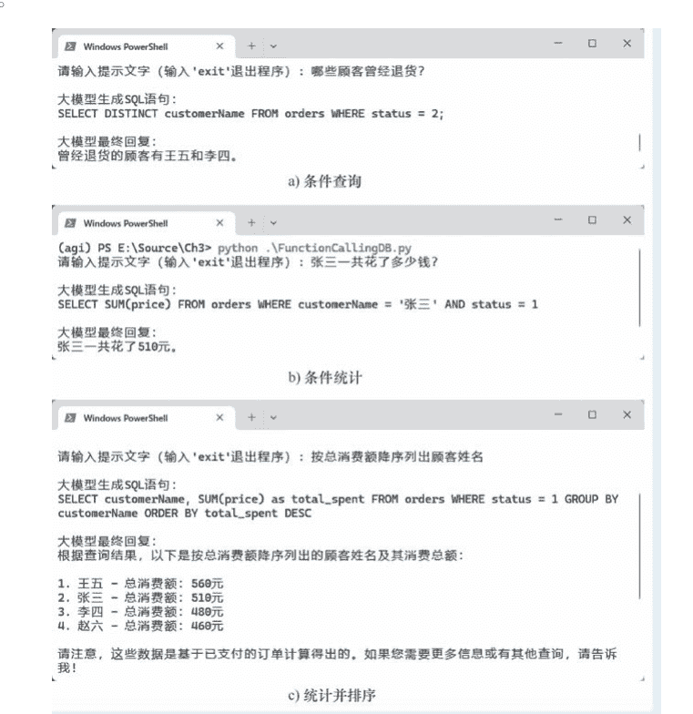

上面的示例只针对单张表，实际测试效果很理想。但真实业务里数据源往往是多表甚至跨库，复杂度会明显上升。这时候在描述表结构时，除了字段本身，还必须把主键、外键以及表与表之间的关联关系说清楚，让模型能精准理解关联。

需要注意的是，随着参与的表越来越多，模型对表间关系的理解精度会下降，错误 SQL 的概率也会上升。可行的对策有两条：一是借助数据库视图等手段把结构简化、减少表数量，降低理解难度；二是给模型一些表连接的示范，用少量的高质量样例做少样本学习，提升生成 SQL 的准确性。

“数据查询助手”这节展示了模型与本地数据库操作函数结合的实际效力，自动化程度和准确度都在提升数据处理与挖掘效率方面打开了很大的想象空间。传统做法需要开发人员写大量代码并反复调试，生成式 AI 的加入大幅压缩了时间和人力成本。借助自然语言生成 SQL 的方式，操作门槛被显著拉低，非专业用户也能高效完成复杂的数据操作。可以说，生成式 AI 在语言理解与数据操作上的结合前景很广，值得持续探索与推广。

### 3.3 天气查询助手：接入第三方 API 的实践
前面两节都是本地函数的调用。现在前后端分离、微服务和分布式架构已成主流，仅靠本地函数已难以覆盖真实需求，让模型具备调用远程 API 的能力，无论是内部接口还是第三方服务，都变得关键。

虽然远程 API 调用对读者并不陌生，但模型如何完成调用仍需说明。OpenAI 平台可以通过 Assistant 访问远程 API，但多数平台并不提供此类支持。一个简单有效的做法是把对远程 API 的调用逻辑封装在本地函数里，模型通过调用这些本地函数间接完成远程访问，就能灵活触达分布式系统中的各种服务。

本节以“天气查询助手”为例，演示如何用这种方式调用远程 API，同时也会拆解在一次对话中需要多次函数调用才能达成目标的处理思路，帮助在复杂场景下提升实战能力。

为了降低门槛，这里直接选用公共服务 API。天气查询助手的核心需求是和模型自然对话获取当前天气，因此需要调用天气查询服务。示例选用高德开放平台提供的天气查询 API。

高德天气查询服务必选参数是 key，即调用权限的唯一标识，和 city，即城市行政编码。key 需要在高德开放平台注册账号后获取，注册后有免费额度。city 则需要先通过另一个接口拿到。

这里用到的是高德开放平台的搜索 POI 2.0 API，除必须的 key 和 keywords 外，还提供可选参数 region，用来限定搜索区划，让返回的地点信息更精准。API 的返回结果信息很丰富，本示例只用到其中的 adcode，也就是天气查询 API 所需的城市行政编码。

通过本地函数 get_location_adcode 和 get_wx 分别对这两个远程接口做封装，让模型可以用本地函数调用的方式触发远程请求，具体代码如下。

```python
# 封装高德 POI 查询接口
def get_location_adcode(keywords, region=""):
    url = f"""https://restapi.amap.com/v5/place/text? key={
        amap_key}&keywords={keywords}&region={region}"""
    ret = requests.get(url)
    result = ret.json()
    if "pois" in result and result["pois"]:
        return result["pois"]
    return None

# 封装高德天气查询接口
def get_wx(adcode):
    url = f"""https://restapi.amap.com/v3/weather/weatherInfo? key={
        amap_key}&city={adcode}"""
    ret = requests.get(url)
    result = ret.json()
    if "lives" in result and result["lives"]:
        return result["lives"]
    return None
```

封装完成后，就可以在与模型对话的 tools 参数里对这两个函数做说明，描述必须详尽且准确，讲清功能和各参数含义。参考实现如下。

```python
def get_completion(messages, model="glm-4-plus"):
    response = client.chat.completions.create(
        model=model,
        messages=messages,
        temperature=0.01,
        tool_choice="auto",
        tools=[{
            "type": "function",
            "function": {
                "name": "get_location_adcode",
                "description": "根据地点关键字,获得地点的 adcode",
                "parameters": {
                    "type": "object",
                    "properties": {
                        "keywords": {
                            "type": "string",
                            "description": "地点关键字,需要被检索的地点文本信息,必须是中文",
                        },
                        "region": {
                            "type": "string",
                            "description": "地点所在的区域名,必须是中文",
                        }
                    },
                    "required": ["keywords"],
                }
            }
        },
        {
            "type": "function",
            "function": {
                "name": "get_wx",
                "description": "取得给定 adcode 代表区域的天气",
                "parameters": {
                    "type": "object",
                    "properties": {
                        "adcode": {
                            "type": "string",
                            "description": "某个区域的行政编码",
                        }
                    },
                    "required": ["adcode"],
                }
            }
        }]
    )
    return response.choices[0].message
```

后续的流程与前两个示例类似：解析模型返回的函数调用指令并执行对应的封装函数。不同之处在于，前两个示例基本是一次调用就能完成，而天气查询需要链式调用。

用户提出天气查询需求后，模型先识别并提取地址信息；基于提取的地址调用搜索 POI 2.0 API 获取对应的 adcode；拿到 adcode 后再调用天气查询 API 获取具体天气。这是一次对话里的两次连续调用，复杂度明显提升。

实际情况可能更复杂：用户输入里可能包含多个地址，每个地址的 adcode 不同，天气也不同。这就要求针对每个地址分别用对应的 adcode 调用天气查询 API，处理上需要更细致的判断逻辑和多次调用配合。

## 第 3 章
函数调用：打造生成式 AI 的神经反射弧

搜索 POI 2.0 API 在 key 与 keywords 的基础上，提供可选的 region 参数来限定搜索范围，从而让地点返回更符合预期。调用时综合使用这三个参数，可以在用户提示词中包含区划信息时获得更准确的结果。返回内容中 adcode 正是天气查询接口所需的城市行政编码，本示例仅使用该字段。

结合前面场景拆解，代码要解决的核心问题是：每次读到模型返回时，判断是否需要触发函数调用，同时还要能捕捉到一次返回里可能混杂多个调用的情形。所以实现必须兼顾多调用检测与解析。相关逻辑示例如下。

```python
# 对每次大模型的返回结果均进行是否有函数调用的判断
while (response.tool_calls is not None):
    messages.append(response.model_dump())  # 把大模型的回复加入到对话中
    # 遍历执行大模型返回结果中所有的函数调用指令
    for tool_call in response.tool_calls:
        args = json.loads(tool_call.function.arguments)
        print(f"\n 调用 API:{tool_call.function.name}参数:{args}")
        if (tool_call.function.name == "get_location_adcode"):
            result = get_location_adcode(**args)
        elif (tool_call.function.name == "get_wx"):
            result = get_wx(**args)

        if result is None or result == "":
            result = "未找到相应信息。"
        print(f"调用 API 结果:{result}")

        messages.append({
            "tool_call_id": tool_call.id,  # 用于标识函数调用的 ID
            "role": "tool",
            "name": tool_call.function.name,
            "content": f"{result}"
        })

    response = get_completion(messages)
    print(f"\n 新一轮结果:{response}\n")

# 保存并显示已经完成的回复
append_and_show("assistant", response.content)
print(f"\n===END===\n")
```

剩余部分基本沿用 prompt-gui.py 的写法，这里省略不表。唯一要单独关注的是对话列表里第一条 system 消息的 content，需要改写成适配天气查询任务的版本。这一改动属于提示词层面的调整，会直接牵引模型的行为和输出。实际工程里，提示词要写得足够精细，并反复打磨迭代，才能确保效果稳定可靠。

本示例对该部分的改动如下。

```python
{"role": "system", "content": "你是一个天气小助手,你应当先分析用户消息中的地址,然后调用 API 查找地址的 adcode,然后根据 adcode 调用 API 查找对应地区的天气信息。如果查找出的 adcode 有多个,则使用每一个 adcode 调用 API 查找对应地区的天气信息。最终整合输出天气情况。"}
```

至此，天气查询助手的代码骨架已经搭完，完整文件可参考 CallAmapAPI_WX.py。跑起来后，直接输入天气查询的自然语言提示，或只输入想查的地址，就能得到反馈。实测表现令人满意，程序能稳定运行并返回准确的天气信息。更值得注意的是，哪怕输入里包含了多个可匹配的地址，助手也能逐一识别解析，并为每个地址给出对应的天气，效果参见图 3-5 所示。

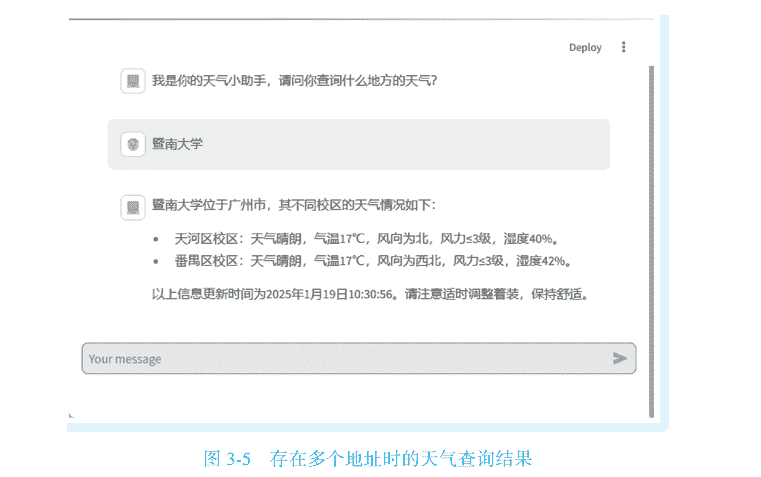

最后需要强调的是，前面提到的两步 API 调用都会返回信息量丰富的 JSON。示例程序本身并没有对这些结果做任何解释或二次处理。以 POI 2.0 搜索为例，程序没有主动提取 adcode，也没有统计 adcode 数量或去重。程序只是把原始查询结果原样交给模型，模型却能从繁杂数据里精准抽取出 adcode，并且自动保证同一 adcode 只被使用一次。同样，天气查询 API 返回的 JSON 里包含高德平台定义的多项天气说明，程序同样未做特殊处理。得益于强大的语义理解能力，模型自行解析出关键天气要素，并将其转化为通顺的自然语言输出。

### 3.4 网络搜索助手——网页搜索

前三节已经说明了在生成式 AI 应用里如何灵活调用本地函数。细心的读者会发现 tools 列表中每个元素的 type 字段，在之前示例里一直是 "function"，其实它还有其他合法取值。本节把 type 改为 "web_search"，顾名思义，这里的工具就是网页搜索器。

预训练模型通过海量语料积累知识，但语料本身有时间局限，反映的是训练时点的信息。随着世界变化，新的概念、事件不断涌现，模型对最新事物的掌握会逐渐滞后甚至空白。

当任务需要时效性信息时，给模型补上新鲜数据就很有必要。网页搜索器正是为此而生。它借助搜索引擎实时抓取互联网上的新闻、论文、社交动态等，为模型提供最新或冷门的资讯，让回答更贴近现实。这样基于大模型的系统才能更好地跟上信息变化。

搜索完成后的网页内容会交由模型整合，整合结果再返回给应用。

设置网页搜索器很简单：在 tools 参数里加入一个 type 为 "web_search" 的条目，并把 enable 设为 True 即可。若还想同时拿到来源页面的标题、URL、媒体名等元信息，则把 search_result 设为 True。

基于以上思路，代码中 tools 的配置如下。

```python
def get_completion(messages, model="glm-4-plus"):
    response = client.chat.completions.create(
        model=model,
        messages=messages,
        temperature=0.01,
        tool_choice="auto",
        tools=[{
            "type": "web_search",
            "web_search": {
                "enable": True,
                "search_result": True,
            }
        }],
    )
    print(f"\nget_completion:{response}")
    return response
```

检索完成后，网页内容会自动被合并，应用层无需额外处理，就像普通的对话程序一样继续后续开发。本示例在模型回复末尾额外列出 web_search 检索到的具体网页，方便用户点开查看原文，因此需要额外的展示逻辑。

如前所述，若开启来源展示，需把 search_result 设为 True，此时模型返回里会出现名为 web_search 的对象，内含本次检索到的全部网页信息。示例通过遍历该对象，组合标题、媒体名称和 URL 生成超链接供用户点击。

实现思路的代码如下。

```python
response = get_completion(messages)

content = response.choices[0].message.content
print(f"\n综合结果:{content}\n")
if (hasattr(response, "web_search") and
    response.web_search is not None):
    content = f"{content}\n\n * 以下是消息来源: * \n"

    # 遍历检索到的网页信息
    for searchResult in response.web_search:
        print(f"\nsearchResult=\n{searchResult}\n")
        webContent = searchResult["content"]
        webIcon = None
        if "icon" in searchResult:
            webIcon = searchResult["icon"]
        link = searchResult["link"]
        media = None
        if "media" in searchResult:
            media = searchResult["media"]
        title = searchResult["title"]

        print(f"\nwebConten={webContent}\nwebIcon={webIcon}\nlink={link}\nmedia={media}\ntitle={title}")
        if media is None:
            searchContent = f"[{title}]({link})"
        else:
            searchContent = f"[{title} - {media}]({link})"
        content = f"{content}\n{searchContent}\n"

# 保存并显示已经完成的回复
append_and_show("assistant", content)
print(f"\n===END===\n")
```

另外，为让模型明确应用意图，还需在消息列表的 system 消息里预设指引信息。设定代码如下。

```python
messages = [
    {"role": "system",
     "content": """你是一个具备网络访问能力的信息小助手，
你应当先分析用户消息中的关键主题,然后优先使用网络检索相关信息，
然后根据搜索的结果给出回答."""},
    {"role": "user", "content": prompt}
]
```

网络搜索助手的核心部分至此完成，其余代码与前文示例一致，完整实现见 FunctionCallingWebSearch.py。运行后的效果是：输入相关提示词后，模型会输出整合后的内容并附带信息来源，效果如图 3-6 所示。

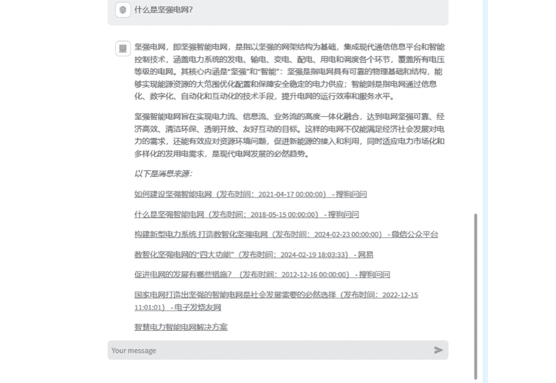

特别说明，本示例在智谱 AI 上验证通过，但并非所有大模型都提供 web_search 工具。若使用的模型不支持，可退回到本章前文的函数调用方式，自行封装本地搜索函数。当模型判定需要检索时，调用该本地函数完成搜索，再把结果回传给模型做分析和归纳，最终生成整合答案。主流搜索引擎和第三方检索平台大多提供 API 支持，后续示例会采用第三方平台的方式。

这种基于本地函数的搜索方案，不仅能复现本节网络搜索助手的功能，还能按需定制搜索流程。因为搜索逻辑在本地，开发者可以自由更换搜索引擎、调整查询参数，甚至对结果做预处理，以提升准确性。

在实际选型时，需要权衡两点：一是目标模型平台是否原生支持 web_search；二是未来是否可能换平台。从工程角度看，若更看重平台兼容性，就应避免依赖特定平台功能；若更看重快速落地和效果，则优先使用平台原生能力。最终决策需综合考量。

### 3.5 本章小结

本章系统介绍了生成式 AI 应用中的函数调用机制，它是模型与传统软硬件系统互联的关键桥梁。借助这座桥梁，AI 与传统系统既能发挥各自优势，也能弥补彼此短板，从而完成更复杂的任务。掌握如何让两者协同工作，是生成式 AI 应用设计与开发者的核心技能。

## 第4章 生成式AI应用设计模式——提升生成式AI的推理能力

传统软件设计里，设计模式是经过验证的最佳实践，能有效解决特定场景问题。生成式 AI 应用同样形成了自己的技巧与模式。本章将聚焦这些模式，帮助读者提升构建 AI 应用的能力。

### 4.1 思维链

思维链 Chain of Thought，CoT，是一种把复杂任务拆解为若干关联步骤的认知策略。把一个大问题拆成多个小问题逐步求解，可以理清思路、组织信息、完成逻辑推理。

在 AI 领域，CoT 同样适用。面对自然语言任务时，模型会一步步推理，逐步构建答案。这种分阶段处理让模型更易理解复杂问题。与传统黑箱不同，CoT 强调中间推理过程，提升透明度和可解释性。把问题拆成子任务后，模型能更精准处理细节，也便于对每一步进行反馈迭代。分步推理在多轮对话、复杂文本分析和编程等场景有广泛价值，为 AI 应用设计提供了新的优化思路。

#### 4.1.1 激发生成式 AI 潜能——零样本提示

零样本提示 Zero-Shot Prompting 指不经过任务微调或专门训练，仅靠预训练模型已有知识和精心设计的提示词完成任务的方法。它高度依赖模型本身的理解能力。

使用时用户直接提问，模型即时生成回答。全书第 2 章的文本概括、推断、转换等任务都采用了这种方式。它让普通用户无需培训就能快速获得模型反馈，是最常见的交互方式。

但直问直答并非万能。遇到需要严谨逻辑或多步推导的任务时，模型容易失准。这时引入思维链技术可以显著提升回答质量，引导模型逐步推理，获得更准确详尽的结果。

CoT 对模型解题效果影响很大，其中最具代表性的是 “Let's think step by step.” 这句提示。很多原本无法正确解决的问题，在加入这句话后效果明显改善。

例如，任务是：给出一个英文句子，取出每个单词的最后一个字母，按原顺序拼接。运行前文的 prompt-stream.py 示例，直接提交如下提示词：

> 请将以下英文句子中所有单词的最后一个字母取出，然后将它们按原始单词前后顺序拼接在一起：

>

> The play was very interesting I did not enjoy it

返回的结果类似图 4-1 所示，看起来只是删掉了首词和空格标点，很多时候输出更是难以理解，无法看出推理逻辑。

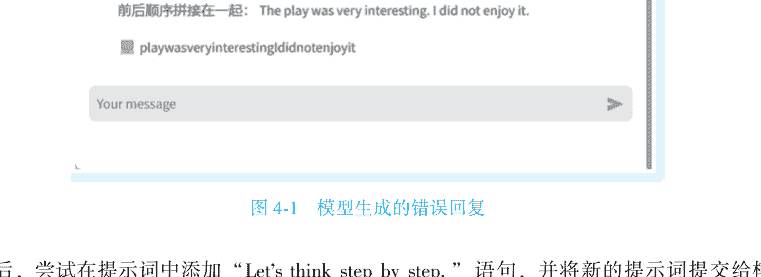

随后在提示词中加上 “Let's think step by step.” 后重新提交，运行结果如图 4-2 所示。此次模型给出了正确答案，这句话的效果堪称神奇。

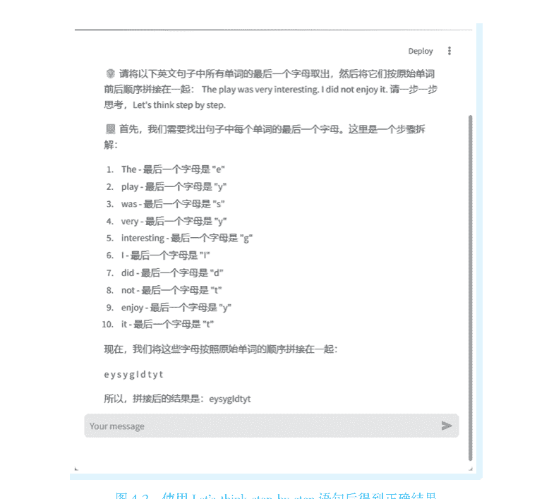
近几年生成式大模型的自我推演能力在明显变强，部分新系统已经能够把任务自行拆解并逐层展开思考。正因为自发推理在增强，过去靠“请一步步想”这类话术来点燃链式思考的做法正在逐渐失效。现在已有不少模型在没有额外指令的情况下，就能独立理解问题、安排解法并一步步推到答案。OpenAI 发布的 o1、o3 最有代表性，它们解题时更像在模仿人类的分层推演，因此同类题目即便不加提示也能算对。接下来要展示的案例也印证了同样现象：用常规模型必须额外说明怎么思考，而具备自发分步推理能力的模型可直接抛题。

下面用一道小学常见算术题做对照，题目如下。

> 一只猴子掉进深三米的枯井，每天白天往上爬零点九米，夜间往下滑零点六米。按这个节奏，它什么时候能爬出井口？

眼尖的读者很快能算出第8天出井。把这道题原样输入给模型，返回结果如图4-3所示。表现并不理想，但从回答里能看出模型确实在尝试用分步思路处理，只是推演中出现了失误，说明它已经在自发使用链式思考，却还不够稳。

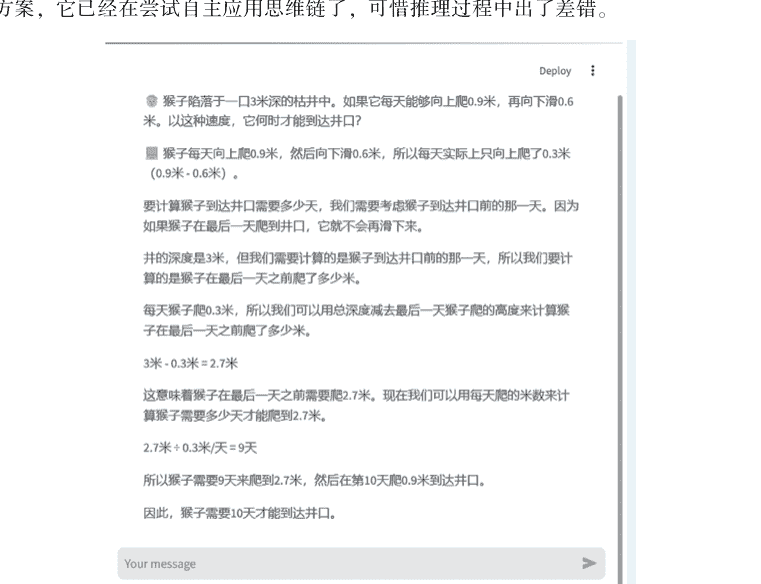
注：此次试验用的是 GLM-4，若换成 GPT-4o 或 GLM-4-Plus 这类更强版本，则能直接给出正确答案。

这类每日净增不固定的题目，有一种朴实但稳妥的解法：按天模拟。每天先算爬到最高点，再判断是否已触顶；没触顶就按规则再滑零点六米，当日净增只有零点三米。一旦某天最高点达到或超过井口，就停止下滑，任务结束。这种逐日递推虽然看起来机械，对低年级孩子来说是唯一能用的办法，却很好地体现了链式思考的本质。

沿着这个思路，把提问改造成明确的逐日记录格式，让模型按天写出最高点和最终落点。改写后的提问如下。

> 猴子掉进深三米的枯井中。如果它每天能够往上爬零点九米，再往下滑零点六米。以这种速度，它何时才能到达井口？
>
> 请逐日计算猴子当天的最高高度和最终落点，按下面格式输出，然后据此推算下一天。
>
> 第【1】天，最高达到【0+0.9=0.9】米，未达井口，下滑0.6米，最终位置【0.9-0.6=0.3】米；
>
> 第【2】天，最高达到【0.3+0.9=1.2】米，未达井口，下滑0.6米，最终位置【1.2-0.6=0.6】米；
>
> 第【i】天，最高达到【Hi】米，未达井口，最终位置【Li】米；
>
> ...
>
> 第【n】天，最高达到【Hn】米，到达井口。
>
> 故第【n】到达井口。
>
> 严格按以上形式输出，不要使用数学公式推导。

注：模型天生喜欢走捷径，用公式一次性解题，所以在最后特别加上了“不要用数学公式”的限制。

把改写后的提问送入模型后，它严格按天计算并判断，过程显得缓慢笨拙，却在链式思考的约束下最终推导出正确答案，结果如图4-4所示。

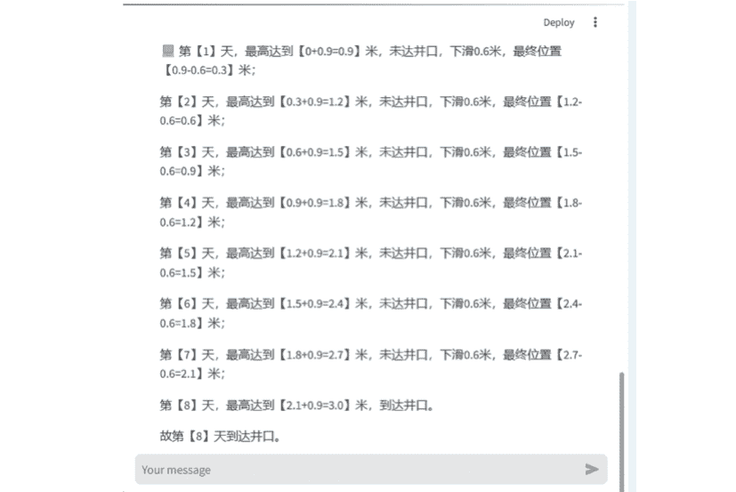
图4-4 模型使用思维链推理1

当然也可以换一种更高级的引导方式，让模型用公式化的思路来解题。关键在于把思考方向和步骤拆清楚，就像给孩子一步步辅导一样。这次设计的提问是：

> 猴子掉进深三米的枯井中。如果它每天能够往上爬零点九米，再往下滑零点六米。以这种速度，它何时才能到达井口？
>
> **请按以下思路推理：**
>
> 1. 寻找猴子每天爬到的高度与天数之间的关系。
>
> 2. 思考猴子最后一天与它之前爬升的高度会有什么不同。
>
> 3. 猴子最后一天之前所爬总高度、最后一天所爬高度及井深之间存在什么关系。
>
> 4. 综合以上信息，列式求解第几天猴子到达井口。
>
> 5. 求解后，反思上述过程是否有推理或计算错误，如有，则修正之。

注：正如前文提到，模型在计算上并不总是精准，所以在结尾要求模型对此进行反思，旨在为其提供一个修正潜在错误的机会，从而尽量确保计算结果的准确性和可靠性。

提交上述提示词，这次模型按新的思路逐步分析该练习题并给出了最终结果。结果如图4-5所示。

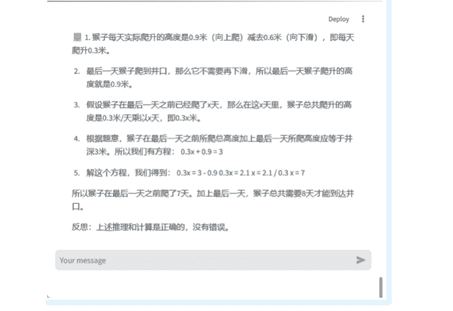
上面几段示例，提交的提示词只是“提醒”“引导”模型应当如何思考，但并没有给出任何类似的例子，即没有给出任何样本，所以这样的方法称为“零样本提示”。

#### 4.1.2 生成单元测试用例——少样本提示
在使用生成式模型的技巧中，除零样本提示外，还有少样本提示，它也是一种在自然语言处理领域使用的技术，尤其在与生成式模型的交互中被广泛应用。少样本提示的核心思想是在没有大量标注数据的情况下，通过给模型提供几个示例来引导其生成所需的输出。

具体来说，使用少样本提示的步骤如下。

- 1) 问题描述：先给出要解决的问题或任务的简要描述。
- 2) 提供示例：列出几个示例，示范输入和相应输出，必要时也可以给出推理过程。这些示例可以帮助模型理解任务的模式、要求或推理思路。
- 3) 生成输出：在提供示例之后，给出新的任务，让模型按照示例模式生成与新任务对应的推理输出，或者要求模型继续完成示例尚未结束的任务。

少样本提示在引导模型按照正确思路解决问题，或是继续依据样本提供的“标准”完成剩余任务方面，展现出非同一般的有效性。举例来说，在测试领域，用户只需在提示词中提供少量精心挑选的测试用例样本，模型便能够依据这些样本的形式和规律，高效地推理出符合要求和预期的测试用例。在测试领域应用这种技术不仅可以提升测试工作效率，还能确保测试用例的质量和统一性，从而有助于提升整个软件开发流程的可靠性和稳定性。

以下是一个单元测试用例的样例。

```
以下是函数 add 的定义。
javascript
function add(a, b) {
    return a + b;
}

下面是一些针对 `add` 函数的单元测试用例，请按照相同的格式生成新的测试用例：
1. 测试用例：两个正数相加
输入：a = 2, b = 3
预期输出：5
测试代码：
javascript
test('adds 2 + 3 to equal 5', () => {
    expect(add(2, 3)).toBe(5);
});

2. 测试用例：两个负数相加
输入：a = -1, b = -1
预期输出：-2
测试代码：
javascript
test('adds -1 + -1 to equal -2', () => {
    expect(add(-1, -1)).toBe(-2);
});

3. 测试用例：一个正数和一个负数相加
输入：a = 1, b = -1
预期输出：0
测试代码：
javascript
test('adds 1 + -1 to equal 0', () => {
    expect(add(1, -1)).toBe(0);
});

请继续为函数 add 补充必要的测试用例：
```
将上述包含少量样本的提示词输入程序，片刻之后，便获得了模型生成的以下回复。

```
4. 测试用例：两个较大的正数相加
输入：a = 1000, b = 2000
预期输出：3000
测试代码：
javascript
test('adds 1000 + 2000 to equal 3000', () => {
    expect(add(1000, 2000)).toBe(3000);
});

5. 测试用例：一个数与其相反数相加
输入：a = 50, b = -50
预期输出：0
测试代码：
javascript
test('adds 50 + -50 to equal 0', () => {
    expect(add(50, -50)).toBe(0);
});

6. 测试用例：两个小数相加
输入：a = 1.5, b = 2.5
预期输出：4.0
测试代码：
javascript
test('adds 1.5 + 2.5 to equal 4.0', () => {
    expect(add(1.5, 2.5)).toBe(4.0);
});

7. 测试用例：其中一个数为零
输入：a = 0, b = 10
预期输出：10
测试代码：
javascript
test('adds 0 + 10 to equal 10', () => {
    expect(add(0, 10)).toBe(10);
});
```
通过这些测试用例，我们可以确保 add 函数在不同情况下都能正确执行。这对于保证代码质量和稳定性非常重要。

生成式模型在代码相关领域具备卓越能力，这也可能是它表现最好的领域之一。因此，AI 编程已经广泛渗透到各类开发人员的日常编码工作中，它正在成为开发人员不可或缺的工具和辅助手段。

以上示例通过提示词为模型提供少量样本，让模型成功且高效地继续完成未结束的工作。在实际应用中，也可以提供针对某一个或几个函数的完整单元测试用例，然后让模型完成其他函数的单元测试用例。当然，对于像上例中这样通用性较强的普通函数，即使不提供样本，模型也可以生成较为完备的单元测试用例，但对特殊函数或某些专业性较强的函数来说，提供少量样本将有效提升生成测试用例的质量。

在诸多应用场景中，都可以采取类似方式，即提供少量具有代表性的样本，以便让模型更深刻地理解提示词描述的意图，从而能够更出色地完成各类任务。这一做法是提示词工程领域常用且行之有效的技巧之一，它在提示词工程中占据着重要地位，值得进一步探索和应用。

### 4.2 思维树
思维树作为一种思维方式，它在理解和分析复杂问题时往往比思维链更加全面且深入。前文所述的思维链，通常是一种线性、连续的思考过程，每个思考环节都像链条上的一环，环环相扣，直至得出结论。然而，这种思维方式往往局限于固定的路径，难以跳出既定框架，因此在处理复杂问题时，就显现出其局限性。

相比之下，思维树则像一棵枝繁叶茂的大树，大树的每个分支都是一个可能的思考方向，这种发散性的思考方式可以从多个角度看待问题，从而更全面地理解问题和解决问题。构建思维树，首先需要明确问题核心，然后围绕这个核心展开各种可能的思考方向，每个方向又可以进一步细化，形成更多分支，如此循环往复，直至问题的各个方面都被充分探讨。

#### 4.2.1 结构化写作——基于思维树进行创作
假设当前任务是要分析一个产品的市场前景，通常这类分析需要按照产品的特点、市场需求、竞争对手、营销策略等子话题进行思考，而对于产品特点又可以从产品的功能特性、技术创新、品质与耐用性等角度进行讨论。类似地，对于市场需求、竞争对手、营销策略等子话题也需要从不同角度对其进行分析与讨论。其实，这就是思维树的基本应用形态。

使用思维树这种模式，生成式模型可以展现出其强大的创造性能力。尤其在话题分解、提供针对性解决方案以及深入讨论内容方面，借助思维树，模型不仅能够系统性地分析话题，提供有效的解决方案，甚至可以生成结构严谨、内容丰富的文章或者论文。

基于以上思想，可以尝试打造一款能够自动分析主题并自动生成相关内容或解决方案的应用程序。

首先，依然是加载环境变量并生成模型的客户端。具体代码如下。

```python
from dotenv import load_dotenv, find_dotenv
_ = load_dotenv(find_dotenv())

from zhipuai import ZhipuAI
client = ZhipuAI()
```
然后，对访问模型的 API 进行封装。具体代码如下。

```python
def generate_text(prompt):
    messages = [{"role":"user", "content":prompt}]
    print(f"\n\nprompt=\n{prompt}")
    response = client.chat.completions.create(
        model="glm-4-plus",
        messages=messages
    )
    resultContent = response.choices[0].message.content.strip()
    print(f"resultContent=\n{resultContent}")
    return resultContent
```
随后，为描述思维树结构，示例程序面向思维树结点定义一个名为 ThoughtTreeNode 的类，这个类的每个实例代表着思维树上的一个结点。而每个思维树结点，至少应囊括以下几个核心元素：当前结点所聚焦的主题（话题）、与该主题（话题）紧密相关的子主题（子话题）结点列表（倘若存在的话），以及针对该结点主题（话题）的解决方案。在构思主题（话题）解决方案过程中，为确保模型能够精准理解问题讨论的上下文环境，结点还需记录其所隶属的父主题（父话题）。

基于以上讨论，类 ThoughtTreeNode 的构造器__init__代码设计如下。

```python
import ast
# 思维树结点
class ThoughtTreeNode:
    def __init__(self, question,
                 children=None,
                 parentQuestion=None):
        self.question = question
        self.children = children if children is not None else []
        self.parentQuestion = parentQuestion
        self.solution = None
```
若当前主题（话题）的子主题（子话题）需通过模型生成构建，那就需要对 ThoughtTreeNode 类进行扩充，增加子主题（子话题）生成方法。该方法将当前主题（话题）作为输入，提交至模型以产生与其相关的子主题（子话题）。随后，这些子主题（子话题）将被用于构建思维树的子结点，并作为当前主题（话题）结点的直接下属层级。在需要进一步深化分析的情况下，该方法还需具备递归调用能力，即为生成的子主题（子话题）进一步生成隶属于它的子主题（子话题），从而形成更为丰满完备的思维树结构。

方法 generate_children 用于生成子主题（子话题），其代码如下。

```python
# 生成指定层级子话题
def generate_children(self, level=1):
    level -= 1
    if self.parentQuestion is None:
        prompt = f"""讨论`{self.question}`这一话题，
                应当从哪几方面进行讨论？请生成相关子话题列表。"""
```
在用 `generate_children` 完成主题分解之后，接下来应当针对各层级的主题（话题）展开解决方案生成工作。在此过程中，不同层级的解决方案生成策略存在着细微差别。对于思维树的叶子结点而言，应当令模型生成该叶子结点对应主题（话题）的完整解决方案。而对于非叶子结点，则仅需生成一段简明扼要的概述即可，这是因为非叶子结点的解决方案实际上是由其所有子结点的解决方案共同构成，所以无须再进行过多的描述。通过这样的方式，就可以逐步构建出层次清晰、内容充实的解决方案体系。

通过方法 `generate_solution` 实现上述功能，并且在生成当前主题（话题）的解决方案后，采用递归方式调用所有子结点的 `generate_solution` 方法，为对应子主题（子话题）生成其对应解决方案。具体代码如下。

```python
# 生成解决方案
def generate_solution(self):
    if self.parentQuestion is None:
        prompt = f"""请给出`{self.question}`这一话题解决方案。"""
    else:
        prompt = f"""请给出`{self.question}`
            在父话题`{self.parentQuestion}`下的解决方案。"""

    if self.children is None:
        prompt = f"""{prompt}请详尽说明,1000 字左右."""
    else:
        prompt = f"""{prompt}概述即可,详细内容将由子话题描述,200 字左右."""

    response = generate_text(prompt)
    self.solution = response

    # 对子结点递归调用,生成对应话题解决方案
    for child in self.children:
        child.generate_solution()
```
所有父子结点主题（话题）的解决方案都生成完毕后，接下来需要对这些解决方案进行整理和输出，本示例程序仅通过方法 print_tree 简单输出到标准输出设备（屏幕）。在实际应用中，可根据需求将这些不同层级的解决方案以特定的格式输出到文本文件或 Word 文档。

## 第 4 章 生成式 AI 应用设计模式——提升生成式 AI 的推理能力

```python
# 输出思维树
def print_tree(self, level=0):
    print(' ' * level + str(self.question))
    if self.solution:
        print(' ' * level + '\n' + self.solution)
    for child in self.children:
        child.print_tree(level + 1)
```
到这里，负责承载思维树节点的 ThoughtTreeNode 类已经全部写完。下一步就可以进入实操，先挑一个自己感兴趣的话题作为切入点建一个根节点，随后对该节点做两层向下拆解，逐步把内在逻辑和结构展开成一棵完整的思维树。在此基础上，针对树上每一个节点所代表的小主题生成对应的定制化解法，最后把由思维树组织出来的方案整体输出。下面就是这一流程的代码落地。

```python
# 示例用法
def main():
    # 假设我们有一个问题
    root_node = ThoughtTreeNode("如何学好人工智能编程?")

    # 分解问题,向下分解两个层级,构建思维树
    root_node.generate_children(2)

    # 生成解决方案
    root_node.generate_solution()

    # 打印思维树及其解决方案
    root_node.print_tree()

if __name__ == "__main__":
    main()
```
你可以把示例里的主题换成自己想探究的问题，然后跑一下 tot_topic.py，体验一下思维树方式下模型会给出怎样的结果。实际应用中，还能根据具体业务需求在提示词里对方案的生成提出更细的要求或约束。示例程序运行耗时比较长，输出量也很大，本书就不贴具体结果了。

这个例子已经把思维树的结构搭建起来，并且按照结构生成了对应的解法。本质上，这种树状组织方式和思维导图如出一辙，都是用树来承载和呈现复杂思想。在写作领域，这种做法通常被称为结构化写作。

#### 4.2.2 红白球谜题：用思维树做推理剪枝
思维树另一个很有价值的用法，是把所有可能的解法先以树形展开，从根节点出发逐条检查通往叶子节点的路径是否合理，对不合规的分支做“剪枝”，从中保留合法解，最终得到答案。

比如下面这种求 A、B、C 三人盒子里球的颜色的经典逻辑题，就很适合用思维树来解。

> A、B、C 各自拿着一个盒子，盒子里可能是红球也可能是白球。每个人看不到自己盒子的颜色，却能看到另外两个人的。
>
> 已知三人只说真话：
> A 说：“B 和 C 的盒子不全是白球。”
> B 说：“A 和 C 的盒子都是白球。”
> C 没有发言。
> 需要推断出三人盒子里球的颜色。

建树时，节点按 B、C、A 的顺序排列，更便于后续推理。也就是说，B 的颜色放在根节点下一层，C 放在第二层，A 放在第三层。

示例程序用 anytree 的 Node 来表示思维树节点，并用树形结构穷举出三个盒子颜色的所有组合。

```python
from anytree import Node, RenderTree
def create_logic_tree():
    # 创建根结点
    root = Node("推理盒子里的球的颜色")

    # 创建 B 的状态结点
    b_red = Node("B: 红", parent=root)
    b_white = Node("B: 白", parent=root)

    # 创建 C 的状态结点
    for b_node in [b_red, b_white]:
        Node("C: 红", parent=b_node)
        Node("C: 白", parent=b_node)

    # 创建 A 的状态结点
    for b_node in [b_red, b_white]:
        for c_node in b_node.children:
            Node("A: 红", parent=c_node)
            Node("A: 白", parent=c_node)

    return root
```
建好树之后，可以用下面的代码把它打印出来。

```python
# 打印树结构
def display_tree(root):
    for pre, fill, node in RenderTree(root):
        print("%s%s" % (pre, node.name))
```
调用 `display_tree` 的效果如图 4-6 所示。

树形结构搭好后，真正的核心工作是剪枝。剪枝的目的是把不符合题意的分支剔除。判断依据是：从根到当前节点所代表的颜色组合是否满足题目条件。一旦不满足，就把该节点及其所有子节点一起剪掉，也就是删除或标记为非解，保证后续搜索不会再走这条路。

示例里通过 `prune_tree` 函数依据当前路径状态和题目条件判断路径是否可能成立。因为例子比较简单，代码里并没有做真正的物理删除，而是由调用方根据 `prune_tree` 的返回值决定是继续向下探索还是放弃当前路径。具体实现如下。

```python
def prune_tree(state, condition):
    prompt = f"""判断条件'{condition}'和状态: '{state}'是否矛盾?
没有矛盾用'no'回答,存在矛盾用'yes'回答,
请仅判断该条件与状态是否矛盾,
不要进行任何推理判断,也不要进行任何假设。
简要说明判断依据。"""
    result = generate_text(prompt)
    return "no" in result.lower()
```
准备工作完成后，就能开始真正的推理。思路很直观：从根节点出发，对树做深度优先遍历，边走边检查颜色组合的合理性，不合理就剪掉，直到走到叶子。

代码层面，就是在遍历过程中对每一条从根到当前节点的路径调用一次 `prune_tree`，拿到该路径是否可行的结论。

如果判断通过，就继续深入该节点的子节点；如果当前节点已经是叶子，则这条路径就是一个解。如果判断不通过，就跳过该节点及其子树，等于在树上做了一次剪枝，说明这条路径不是有效解。

这样逐步筛选，就能得到所有符合题意的路径。整个过程其实就是一种严谨的列举法。

完成推理的工作由 `solve_question` 函数承担，其代码如下。

```python
info_a = "A 看到 B 和 C 的盒子内的球,并且说:"B 和 C 两个盒子内的球不全是白色的。""
info_b = "B 看到 A 和 C 的盒子内的球,并且说:"A 和 C 两个盒子内的球都是白色的。""
info_c = "C 看到 A 和 B 的盒子内的球,但未发表任何意见。"

# 遍历树进行剪枝
def solve_question(root):
    states = []
    for b_node in root.children:
        b_state = b_node.name
        for c_node in b_node.children:
            c_state = f"{b_state}, {c_node.name}"
            # 根据 A 的陈述进行剪枝
            if prune_tree(c_state, info_a):
                for a_node in c_node.children:
                    a_state = f"{c_node.name}, {a_node.name}"
                    # 根据 B 的陈述进行剪枝
                    if prune_tree(a_state, info_b):
                        state = f"({a_node.name}, {b_node.name}, {c_node.name})"
                        states.append(state)
    return states
```
`solve_question` 执行完毕后，会把符合条件的解保存在列表 `states` 中并作为返回值返回。后续只需要把 `states` 输出即可，代码很简单，读者可自行补充或参考 tot_ball.py 源码。

运行示例，最终能找到一组满足条件的颜色组合。因为中间输出较多，这里不再展示运行截图。

乍看之下，思维树解法似乎有点笨拙，主要是因为示例问题本身不复杂，人脑推理更快。但在更复杂、信息更纷繁的场景下，思维树能保证逻辑清晰，避免遗漏或多解。

相比思维链，思维树更全面深入。构建思维树后，模型可以从多个角度审视问题，挖掘不同维度与内在关联，列出所有可能性再筛选出正确答案。它还能帮助程序更好地组织和呈现思考过程，提升推理的全面性、有效性和准确性。在合适的场景下，积极使用思维树思考模式，能更好地应对各种挑战。

## 第 4 章 生成式 AI 应用设计模式：强化推理能力
现实任务的复杂程度各不相同，太复杂的任务往往需要先拆解成多个子任务，子任务如果仍旧复杂，还可以继续拆分，直到足够简单为止。

生成式 AI 应用开发也同理。若把一个过于复杂的任务一次性扔给模型，效果通常不理想。模型可能应付不过来，或虽完成但质量偏低。这既暴露了模型处理复杂任务的局限，也提醒我们设计时必须合理拆解任务，以保障质量和可靠性。

拆分后得到的子任务大体有两种：一种是彼此独立、无强依赖，可以并行执行；另一种是存在强依赖，必须按序完成。前者利于并行提升效率，后者需要精确调度。实践中要结合任务特点灵活选择。本节聚焦子任务间无强依赖的情形，存在强依赖的情况将在下一节讨论。

没有强依赖的子任务可以并行或串行执行，无需特别考虑顺序。工程上常采用“蜂巢模式”。在这种模式里，各子任务地位平等，像蜂巢的孔洞一样各自独立、不相互依赖。优势是能充分利用计算资源并行处理，提高整体效率；同时任务分配和管理更简单，降低了协调同步的复杂度。典型逻辑见图 4-7。

举例来说，基于生成式 AI 模型实现“六顶思考帽”自动化讨论，就是一个典型场景。

“六顶思考帽”是一种经典思维工具，把思考分成六个方向，分别用白、红、黑、黄、绿、蓝六种颜色的帽子来代表。轮流戴帽能让团队或个人从不同视角分析问题，避免单一思维，提升决策质量。

显然，六顶帽子都需要与模型交互。按面向对象思想，可以为六顶帽子分别设计六个独立类。由于它们的交互行为高度相似，仅思考方向不同，为简化代码、提升可维护性和可读性，最佳做法是先抽象一个公共基类 Hat。示例中该基类就叫 Hat。

Hat 类主要由两部分组成。一部分是构造器，负责读取环境变量如 API 密钥等，并据此初始化一个本地模型代理。

构造器还需一个关键参数 systemRole，用来在实例化时明确该 Hat 实例的角色定位和行为准则。设置不同的 systemRole，就能让实例在不同场景下表现出多样化的角色和行为。

下面是构造器 `__init__` 的具体实现。

```python
from zhipuai import ZhipuAI
from dotenv import load_dotenv, find_dotenv

class Hat:
    def __init__(self,systemRole=None, model="glm-4-plus"):
        self.model = model
        self.systemRole = systemRole
        _ = load_dotenv(find_dotenv())
        self.client = ZhipuAI()
```
Hat 类的另一部分是与模型交互并获取反馈的方法。其实现思路与本书前文封装的交互代码类似。不同点在于构造 messages 参数时，先加入一条 role 为 system 的消息，内容就是构造器传入的 systemRole，再加上用户消息。这样能明确告诉模型它的身份设定和行为要求。

该功能被封装在 `generate_idea` 方法中，代码如下。

```python
# 与模型交互,生成一个想法
def generate_idea(self, prompt, temperature=0.01):
    messages = []
    if self.systemRole is not None:
        messages.append({"role":"system",
                        "content":self.systemRole})
    messages.append({"role":"user", "content":prompt})
```
由于“讨论问题”通常会产生大量内容，上述方法采用流式输出，并把处理过程封装在 `stream_print` 中，代码如下。

```python
# 流式输出
def stream_print(self, stream_response):
    # 逐步接收流式数据并显示
    resultContent = ""
    for chunk in stream_response:
        hasChocies = hasattr(chunk, "choices")
        if hasChocies and chunk.choices[0].finish_reason is None:
            content_chunk = chunk.choices[0].delta.content
            resultContent += content_chunk
            print(content_chunk, end="")
    print("\n")
    return resultContent
```
另外，白帽的定位是聚焦客观事实与数据的收集分析，因此白帽需要具备互联网搜索能力。所以 Hat 类还需提供一个具备网络搜索功能的方法 `generate_info_from_Search`，用来查找、整合和利用互联网信息。

该方法的实现代码如下。

```python
# 与模型交互,基于网络搜索生成一个想法
def generate_info_from_Search(self, prompt, temperature=0.01):
    messages = []
    if self.systemRole is not None:
        messages.append({"role":"system",
                        "content":self.systemRole})
    messages.append({"role":"user", "content":prompt})

    response = self.client.chat.completions.create(
        model=self.model,
        messages=messages,
        temperature=temperature,
        stream=True,
        tool_choice="auto",
        tools=[{
            "type": "web_search",
            "web_search": {
                "enable": True,
                "search_result": True,
            }
        }],
    )
    resultContent = self.stream_print(response)
    return resultContent
```

基类 `Hat` 的实现到这里基本收官。

有了这个通用底座，接下来就可以按六顶思考帽的思路，派生出颜色各异、视角各异的六个子类。为每顶帽子注入专属身份和行为，才能让它们在讨论时各司其职。

先看白帽 `WhiteHat`。它直接继承自 `Hat`。在构造阶段，把白帽的定位、特性以及执行动作这三块信息拼装成 `systemRole`，再用这个参数去调用父类的构造器，让实例从一开始就带着“查资料、讲事实”的角色意识。用于发言的方法 `get_idea` 需要联网查证，所以内部调用的是父类专门用于搜索获取信息的方法 `generate_info_from_Search`。

白帽 `WhiteHat` 的完整实现如下。

```python
# 白帽
class WhiteHat(Hat):
    def __init__(self, *args, **kwargs):
        role = "白帽"
        feature = "关注客观的事实和数据"
        function = "收集和分析与问题相关的客观信息,提供事实依据"
        systemRole = f"""你的角色是六顶思考帽中的`{role}`，
            你的特点是`{feature}`。
            你的功能是`{function}`"""
        super().__init__(systemRole=systemRole,
                         *args, **kwargs)

    def get_idea(self, subject):
        return super().generate_info_from_Search(subject)
```

紧接着是绿帽 `GreenHat`、黑帽 `BlackHat`、黄帽 `YellowHat`、红帽 `RedHat` 以及蓝帽 `BlueHat` 的构建。

这五个类的构造逻辑和白帽高度一致，都是先把各自的角色描述、鲜明特点、行为要求组合成 `systemRole`，再交给基类构造器初始化，保证每个子类都能以自己的风格进入讨论。在行为层面，它们都实现 `get_idea`，而因为没有像白帽那样的特殊需求，直接复用父类 `Hat` 提供的 `generate_idea` 即可完成观点输出。

绿帽、黑帽、黄帽、红帽、蓝帽的定义代码如下。

```python
# 绿帽
class GreenHat(Hat):
    def __init__(self, *args, **kwargs):
        role = "绿帽"
        feature = "富有创造力和想象力"
        function = "提出新的想法、解决方案或可能性，鼓励创新和求异思维。"
        systemRole = f"""你的角色是六顶思考帽中的`{role}`，
            你的特点是`{feature}`。
            你的功能是`{function}`"""
        super().__init__(systemRole=systemRole,
                         *args, **kwargs)

    def get_idea(self, subject):
        return super().generate_idea(subject)

# 黑帽
class BlackHat(Hat):
    def __init__(self, *args, **kwargs):
        role = "黑帽"
        feature = "进行批判和质疑"
        function = "分析问题的缺点、风险和挑战，提出负面反馈和潜在问题。"
        systemRole = f"""你的角色是六顶思考帽中的`{role}`，
            你的特点是`{feature}`。
            你的功能是`{function}`"""
        super().__init__(systemRole=systemRole,
                         *args, **kwargs)

    def get_idea(self, subject):
        return super().generate_idea(subject)

# 黄帽
class YellowHat(Hat):
    def __init__(self, *args, **kwargs):
        role = "黄帽"
        feature = "从正面考虑问题，表达乐观的观点"
        function = "强调方案的优点和潜在好处，进行积极思考和建设性反馈。"
        systemRole = f"""你的角色是六顶思考帽中的`{role}`，
            你的特点是`{feature}`。
            你的功能是`{function}`"""
        super().__init__(systemRole=systemRole,
                         *args, **kwargs)

    def get_idea(self, subject):
        return super().generate_idea(subject)

# 红帽
class RedHat(Hat):
    def __init__(self, *args, **kwargs):
        role = "红帽"
        feature = "表达情感和直觉。"
        function = "分享个人感受和直觉,为决策提供情感层面的考虑。"
        systemRole = f"""你的角色是六顶思考帽中的`{role}`，
            你的特点是`{feature}`。
            你的功能是`{function}`"""
        super().__init__(systemRole=systemRole,
                         *args, **kwargs)

    def get_idea(self, subject):
        return super().generate_idea(subject)

# 蓝帽
class BlueHat(Hat):
    def __init__(self, *args, **kwargs):
        role = "蓝帽"
        feature = "负责控制和调节思维过程。"
        function = "确保所有观点都得到充分考虑,并根据其他角色的言论做出总结报告。"
        systemRole = f"""你的角色是六顶思考帽中的`{role}`，
            你的特点是`{feature}`。
            你的功能是`{function}`"""
        super().__init__(systemRole=systemRole,
                         *args, **kwargs)

    def get_idea(self, subject):
        return super().generate_idea(subject)
```

六个颜色类都准备好后，就可以挑一个议题让它们轮番上阵。先为每顶帽子各自创建实例，调用 `get_idea` 时把议题作为输入传入。

除蓝帽之外的五顶帽子发言彼此独立，顺序不必固定，代码层面甚至可以并发执行来提升速度。等到白、绿、黑、黄、红五方的观点都收集完毕，再由蓝帽整合各方意见，输出总结性结论。

这一段落的演示代码如下。

```python
def main():
    whitehat = WhiteHat()
    greenhat = GreenHat()
    yellowhat = YellowHat()
    blackhat = BlackHat()
    redhat = RedHat()
    bluehat = BlueHat()

    # 拟定一个讨论的话题
    topic = "氢能源汽车的前景"

    # 假设不同颜色的帽子发言顺序不定,以下执行顺序可随机调整;
    # 或者可以使用线程或其他形式并发执行
    print("【白帽】")
    idea_white = whitehat.get_idea(topic)
    print("【绿帽】")
    idea_green = greenhat.get_idea(topic)
    print("【黑帽】")
    idea_black = blackhat.get_idea(topic)
    print("【黄帽】")
    idea_yellow = yellowhat.get_idea(topic)
    print("【红帽】")
    idea_red = redhat.get_idea(topic)

    # 蓝帽总结各方发言
    idea_all = f"{idea_white}{idea_green}{idea_black}{idea_yellow}{idea_red}"
    print("【蓝帽】")
    idea_blue = bluehat.get_idea(idea_all)

    # 输出蓝帽对各方发言的总结
    # print(f"【蓝帽】\n{idea_blue}")

if __name__ == "__main__":
    main()
```

说明一下，现实线下使用六顶思考帽通常是会议形式，发言轮流进行，其他帽子在倾听，蓝帽负责把控节奏，多轮往复，发言还会互相引用并展开追问。本示例为了演示方便做了简化。

在上面的实现里，白帽、绿帽、黑帽、黄帽、红帽这五类实例就扮演了“蜂巢”角色。它们地位平等，可以串行也可以并行各自完成子任务，最后由蓝帽统一收敛结果。

蜂巢模式的价值在于子任务并发和整体效率的提升。更关键的是，每个子任务可以按需匹配最合适的模型，不必强求一套模型打天下。这种灵活的模型选择，既增强了系统的适应性，也能提高准确性和响应速度。

## 4.4 软件缺陷分析与指派——组合模式

当一个大任务可以拆成多个子任务且子任务间基本独立、没有强依赖时，用“蜂巢模式”推进是高效的，各分支可以并行跑起来。但如果子任务存在链式依赖，后一个必须以前面一个的结果为输入，蜂巢模式就不适用了，这时需要“组合模式”，按逻辑顺序串联调度，确保依赖关系被正确满足。

以软件工程里的缺陷处理为例。测试发现 Bug 后会记录，项目经理或负责人要分析缺陷归属，再指派开发人员修复。纯人工操作往往耗时数小时到数天。模型可以基于自然语言理解判断缺陷所属模块，如果再知道模块对应的负责人，就能直接完成指派，显著提升效率并减少人为失误。

在这个流程里，比较典型的两个模型参与点是缺陷所属模块的分析，和缺陷责任人的指派。为了演示组合模式，示例只聚焦这两个子任务。

与前面相同，先定义一个与模型交互的基类 `Task`，提供构造器 `__init__` 和执行入口 `execute_task`。这两个接口与前文 `Hat` 的构造器和 `generate_idea` 在设计上一致，这里不再重复。

针对“分析缺陷所属模块”这一子任务，定义子任务类 `IssueCategory`，继承自 `Task`。它的任务是根据缺陷描述判断问题出在哪个具体模块，因此需要掌握系统模块构成。

示例中以在线商城客户端为例，模块结构为了演示方便直接写死在 `IssueCategory` 的构造器里，实际项目中更建议放到外部文件或从管理系统动态读取。为体现模块与功能的层级关系，代码采用常见的缩进排版。

随后用这些模块信息拼装系统提示词 `systemRole`，明确该类的职责、能力边界和输出要求，最后调用父类 `Task` 的构造器完成实例化。相关代码如下。

## 第 4 章 生成式 AI 应用设计模式——提升生成式 AI 的推理能力

```python
# 分析缺陷子任务
class IssueCategory(Task):
    def __init__(self, *args, **kwargs):
        moduleStructure = """
            用户注册与登录
                注册新用户
                用户登录
                密码找回
            商品浏览与搜索
                商品分类浏览
                商品详情查看
                商品搜索
            购物车管理
                添加商品到购物车
                查看购物车内容
                修改购物车商品数量
                移除购物车商品
            订单管理
                创建订单
                查看订单状态
                取消订单
                订单跟踪
            支付与结算
                选择支付方式
                完成支付
                支付状态查询
            用户评价
                查看商品评价
                发表商品评价
            个人中心
                修改个人信息
                查看订单历史
                优惠券管理
                地址管理
        """
        systemRole = f"""你是一名缺陷分析专家，
你要根据测试人员提交的缺陷说明判断这个缺陷属于系统中的哪一个一级模块。
当前系统的模块结构如下：
{moduleStructure}
你仅需回复一级模块名称即可，
不要回复推理过程,不要解释,不要其他无关文字。
"""
        super().__init__(systemRole, *args, **kwargs)
```

在 IssueCategory 这个类中，缺陷归属模块的判定逻辑被封装到了 identify 方法里，方法体本身并没有额外处理，只是直接把执行权交给了父类 Task 的 execute_task。

```python
# 缺陷模块识别
def identify(self, issue):
    return super().execute_task(issue)
```

围绕缺陷所属模块展开的分析子任务，IssueCategory 类的搭建到此算是收尾。接下来还要落地另一个子任务——IssueResponsible，用来确定缺陷修复的负责人。它的整体结构与 IssueCategory 很像，同样只包含构造器 `__init__` 和一个用来指派的功能方法 assign_responsible。

IssueResponsible 的构造器里以硬编码的方式写死了各模块对应的负责人，同时把该子任务的职责范围、功能要点以及其他相关约定也一并说明。负责分派的人员方法 assign_responsible 内部同样不做额外逻辑，直接复用父类 Task 的 execute_task 来完成调用。IssueResponsible 完整的实现代码如下。

```python
# 责任人指定子任务
class IssueResponsible(Task):
    def __init__(self, *args, **kwargs):
        moduleResponsible = """
            用户注册与登录: 张三
            商品浏览与搜索: 李四
            购物车管理: 王五
            订单管理: 赵六
            支付与结算: 陈七
            用户评价: 郑八
            个人中心: 李九
        """
        systemRole = f"""你是一名项目经理，
        你要根据缺陷属于系统中的哪一个模块指派调查、修复缺陷的责任人。
        当前系统的模块设计与开发的责任人信息如下：
        {moduleResponsible}
        你仅需回复责任人名字即可，
        不要回复推理过程,不要解释,不要其他无关文字。
        """
        super().__init__(systemRole, *args, **kwargs)

    # 指派责任人
    def assign_responsible(self, category):
        return super().execute_task(category)
```

注：这里默认一个模块只由一位开发者负责，在真实项目落地时，需要结合实际情况对 IssueCategory 和 IssueResponsible 中的模块划分、功能细节、责任人名单以及行为逻辑进行相应调整。

最后，可以借助下面的测试脚本来运行程序验证效果，完整源码可参考 issueAssignment.py，用来确认这两个子任务是否能把缺陷分析与责任人指派做成自动化。

```python
def main():
    issue = """
1. 选择一个商品
2. 添加至购物车
3. 继续浏览商品，并选择另一个商品加入购物车
4. 打开购物车，购物车中只有后加入的商品，而没有最初加入的商品
"""

    ic = IssueCategory()
    category = ic.identify(issue)
    print(f"category={category}")

    ir = IssueResponsible()
    responsible = ir.assign_responsible(category)
    print(f"responsible={responsible}")

if __name__ == "__main__":
    main()
```

程序运行后的呈现效果见图 4-8。

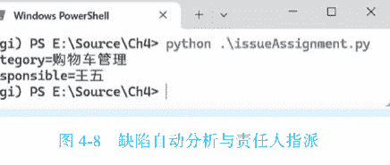

本例里同时出现了两个子任务，一个是分析缺陷所属模块，另一个是指定修复责任人。两者之间存在明显的强依赖：只有先明确缺陷属于哪个模块，才能合理地指派负责人。因此 assign 任务必须在 category 任务完成之后才能启动。两者在执行顺序上存在固定先后，需要把它们串联起来使用，这也就是常说的“组合模式”，业内更通用的说法是“工作流”。

实际业务中的任务链往往比示例复杂得多，常常需要把多个子任务按照流程逻辑串起来。依据子任务之间的不同关联，可以把“蜂巢模式”与“组合模式”配合使用，从而设计出更合理的子任务执行策略。

## 4.5 本章小结

本章梳理了在生成式 AI 应用开发中可借鉴的若干设计模式，掌握这些模式能帮助架构师与开发者在设计和编码时更高效地利用模型能力。生成式 AI 应用的开发技术仍在快速迭代，经验也在持续积累，未来会涌现更多模式与最佳实践。作为设计者和开发者，一方面要在实践中不断提炼自己的方法并形成可复用的模式，另一方面也要持续关注业界研究与案例，保持技术与产品的持续优化。

# 第 5 章 LangChain 概览：生成式 AI 应用中间件

LangChain 是一个以生成式大模型为驱动的开源应用开发框架，提供了大量灵活易用的组件，帮助开发者快速搭建基于大模型的创新应用。框架的核心目标是降低开发、部署与运维的复杂度，让开发者把精力集中在业务逻辑与创意实现上，而不必耗费过多成本在底层技术与基础设施上。

## 5.1 生成式 AI 应用开发中间件概述

伴随生成式 AI 应用的普及，专门服务于该类应用的开发中间件也迅速发展起来。以微软主推的 Semantic Kernel 为例，它提供了一个开源 SDK，帮助开发者高效地与大模型交互，涵盖技能管理、上下文存储、提示词模板化等核心能力，便于把模型能力融入复杂应用。

面向多模态场景，Hugging Face Transformers 与 DeepSpeed 提供了强有力的支持。Transformers 针对文本、图像、语音生成等主流任务提供了简洁的模型接入接口，DeepSpeed 则在训练与推理层面做优化，为大模型的规模化部署提供保障。

在微服务与扩展性方面，Ray Serve 为开发者提供了一个可水平扩展的分布式中间件，用于把生成式模型服务化。它具备高并发与弹性伸缩能力，很适合生产级生成式服务。

在众多中间件中，LangChain 的差异化在于对复杂工作流的友好支持，特别适合多轮对话、复杂推理以及多数据源融合等场景。作为一个功能完备的开发框架，LangChain 覆盖了生成式 AI 应用从开发到部署再到运维的全流程，支撑能力非常全面。

开发阶段，LangChain 提供了模块化的构建块，显著提升研发效率。这些组件易于组合，也能与数百家第三方供应商无缝对接，极大拓展应用边界。借助 LangGraph，还可以构建具备状态保持、流式处理以及人工干预能力的智能体。

部署阶段，LangServe 可以把任意 LangChain 链式调用转化为 REST API，方便与其他系统联通，提升灵活性和可扩展性。

运行阶段，LangSmith 平台提供了全链路的监控与评估能力，开发者可以实时查看应用状态、性能表现与异常点，及时优化与修复问题，确保系统长期保持可用甚至最优。

凭借全生命周期支撑、模块化组件、丰富的生态集成以及实时监控评估，LangChain 已成为生成式 AI 应用开发最主流的框架之一。

LangChain 生态由 LangChain-Core、LangChain、LangChain-Community、LangChain-Text Splitters、LangGraph、LangServe、LangSmith 等开源包组成。

LangChain-Core 提供了组件的基础抽象以及组合机制，即 LangChain 表达式语言。它定义了模型 LLM、向量存储、检索器等核心接口，但不包含任何第三方集成，依赖被刻意保持轻量。

LangChain 包则提供了构成认知架构的链、智能体以及检索策略。它同样不绑定特定厂商，而是面向所有集成的通用实现。

LangChain-Community 由社区维护，汇聚了大量第三方集成。部分关键合作伙伴被独立成包，例如 OpenAI 的代码在 langchain-openai 中，而非放在 Community 包里，以提升清晰度。该包覆盖了 LLM、向量存储、检索器等核心组件的集成，并且所有依赖均为可选，保持包体轻盈。

LangChain-Text Splitters 主要负责文本切分，支持字符串、HTML、JSON、KONLPY、LaTeX、Python 对象等多种格式。

LangGraph 将步骤建模为图中的节点与边，可用来构建健壮且带状态的多参与者应用，能与 LangChain 协同使用，也可独立运行。

LangServe 可把 LangChain 链发布为 REST API。

LangSmith 是一个开发平台，用于调试、测试、评估与监控生成式 AI 应用。

LangChain 的整体生态如图 5-1 所示。


图 5-1 LangChain 全生态构成（图片来自官方 GitHub）

本节重点介绍 LangChain 开源包中的 LangChain-Core、LangChain、LangChain-Community、LangChain-Text Splitters，侧重其编程能力，其余部分可参考官方文档 https://python.langchain.com/docs/introduction/ 或相关教程。

## 5.2 模型的输入与输出

生成式 AI 应用的核心能力来自于模型本身，通过输入输出交互来调用模型能力。任何面向生成式 AI 的开发中间件都必须提供对模型输入输出的支持。

### 5.2.1 让 AI 回答：模型接口封装

LangChain 本身并不内置大模型，只提供与多种模型交互的统一标准接口。其核心组件 BaseLLM、LLM 以及 BaseChatModel 均隶属于 LangChain-Core，LLM 继承自 BaseLLM，这些类及其接口为不同模型提供统一的接入方式。

各模型厂商或开发者可通过继承上述基类完成特定模型的封装。通常这类实现放在 langchain_community.llms 与 langchain_community.chat_models 中。对于热门厂商，会单独提供专属包，如 OpenAI 的封装位于 langchain_openai。

使用 LangChain 调用 OpenAI Chat 接口的示例代码见源文件 llm_openai.py。

```python
import os
from langchain_openai import ChatOpenAI
from dotenv import load_dotenv, find_dotenv

_ = load_dotenv(find_dotenv())
model = os.environ.get('model')
if model is None:
    raise ValueError("model is not set in the .env file")

llm = ChatOpenAI(model=model,
                  temperature=0.9,
                  )

result = llm.invoke("讲一个笑话。")
print(result.content)
```

注：1. 与其他示例不同，这段代码从配置文件读取模型编码而非硬编码，这并非强制要求，但能提升灵活性。借助配置文件，开发与运维人员可在不改动代码的情况下切换模型，增强可维护性与跨环境适应性。
2. 运行前需安装对应依赖包。

示例中先指定模型名称与温度参数构造 ChatOpenAI 对象 llm，随后通过 llm.invoke 方法传入提示词完成一次输入输出。

类似地，若改用智谱 AI 实现同等功能，代码见源文件 llm-zhipu.py。两者主要区别在于导入包名与代理类的名称不同，整体逻辑保持一致。

```python
import os
from langchain_community.chat_models import ChatZhipuAI
from dotenv import load_dotenv, find_dotenv

_ = load_dotenv(find_dotenv())
model = os.environ.get('model')
if model is None:
    raise ValueError("model is not set in the .env file")

llm = ChatZhipuAI(model=model,
                  temperature=0.9,
                  )

result = llm.invoke("讲一个笑话。")
print(result.content)
```

流式输出是生成式 AI 应用的重要体验特性，LangChain 也予以支持。可通过为模型代理接口参数 callbacks 指定 StreamingStdOutCallbackHandler 回调处理器来实现。修改上述代码后重新运行，见源文件 stream.py，输出会以流式形式逐段呈现，用户体验明显提升。修改后的代码如下。

```python
import os
from langchain_community.chat_models import ChatZhipuAI
from langchain.callbacks.streaming_stdout import (
    StreamingStdOutCallbackHandler
)
from dotenv import load_dotenv, find_dotenv

_ = load_dotenv(find_dotenv())
model = os.environ.get('model')
if model is None:
    raise ValueError("model is not set in the .env file")

llm = ChatZhipuAI(
    streaming=True,
    callbacks=[StreamingStdOutCallbackHandler()],
    temperature=0.9)
llm.invoke("写一篇关于花前月下的散文.")
```

在工程落地时如果要切换到别的特定模型，只需把现有的封装类换成对应的实现即可。LangChain 为市面上常见模型都提供了现成的封装，集中在 langchain_community 中由社区维护，主流模型基本都有可用版本。若需要的模型尚未进入 LangChain 生态，或是企业内部的私有化部署，开发者可以参考已有模型的接口封装代码，继承 LLM 或 BaseChatModel 完成自定义封装。

### 5.2.2 提示词模板实战

提示词的质量直接决定生成式AI应用的效果，这一点架构师和开发团队都必须重视。传统软件主要靠调代码，生成式应用则要在调代码的同时反复打磨提示词。很多时候提示词的调试难度甚至高于代码调试，需要扎实的词汇量、搭配感和句式构造能力，才能写出既贴合模型特性、又传达精准意图且尽可能精简的提示。

1. 提示词模板（PromptTemplate）

为了让使用者无需精通提示技巧也能获得稳定体验，LangChain 提供了 PromptTemplate 机制。开发者可以在开发阶段把已经调通验证过的提示固化下来，保证上线后输出的可控性。发布之后，终端用户只要填入那些真正可变的核心信息即可，不需要关心模型的推理引导过程。

#### 2. 对话消息模板

与模型对话时通常会涉及 system、assistant、user 等角色。为了减少构造消息格式的成本，LangChain 提供了 SystemMessagePromptTemplate、AIMessagePromptTemplate 和 HumanMessagePromptTemplate 三个模板。借助它们，开发人员可以把精力放在内容设计上，消息的格式规范由框架负责，代码会更简洁规范。

例如，可用 SystemMessagePromptTemplate 定义模型的角色与职责，用 HumanMessagePromptTemplate 给出待翻译的原文，再用 AIMessagePromptTemplate 给出带有输出样式的译文示例，最后再次用 HumanMessagePromptTemplate 接收用户的实际输入。

把各角色的消息按对话顺序组合起来，就能得到一个 ChatPromptTemplate 对象，示例中命名为 chat_prompt，随后依次调用 chat_prompt 和 llm 的 invoke 方法获取模型反馈。示例代码如下。

```python
import os
from langchain_community.chat_models import ChatZhipuAI
from dotenv import load_dotenv, find_dotenv
from langchain_core.prompts.chat import (
    ChatPromptTemplate,
    SystemMessagePromptTemplate,
    AIMessagePromptTemplate,
    HumanMessagePromptTemplate,
)

_ = load_dotenv(find_dotenv())
model = os.environ.get('model')
if model is None:
    raise ValueError("model is not set in the .env file")

llm = ChatZhipuAI(model=model,
                  temperature=0.9,
                  )

system_template = "你是一名实时翻译,你能将用户输入的消息同步翻译成英文和日文。"
system_message_prompt = SystemMessagePromptTemplate.from_template(
    system_template
    )

example_human = HumanMessagePromptTemplate.from_template("你好")

ai_template = "中文:你好。\n 英文:Hello.日文:こんにちは。\n"
ai_message_prompt = AIMessagePromptTemplate.from_template(ai_template)

human_template="{text}"
human_message_prompt = HumanMessagePromptTemplate.from_template(
    human_template
    )

chat_prompt = ChatPromptTemplate.from_messages([
    system_message_prompt,
    example_human,
    ai_message_prompt,
    human_message_prompt])

prompt = chat_prompt.invoke("我是只快乐的小蜜蜂。")
result = llm.invoke(prompt)

print(result.content)
```

运行上述示例程序，完整代码见源文件 messagePromptTemplate.py，结果如图 5-3 所示。

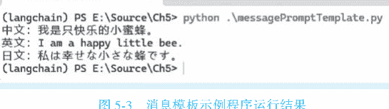

#### 3. 少样本提示模板

少样本学习的核心思想是用少量示例帮助模型更快理解意图，并按期望的思路展开推理。LangChain 对此提供了内置支持，包含 FewShotChatMessagePromptTemplate 和 FewShotPromptTemplate 等。

下面代码借助 FewShotChatMessagePromptTemplate 实现了与前一个示例相同的翻译功能。关键区别在于创建 few_shot_prompt 时，通过 examples 参数传入一组示例文本，让模型在生成时有可参照的模式。

```python
import os
from langchain_community.chat_models import ChatZhipuAI
from dotenv import load_dotenv, find_dotenv
from langchain_core.prompts import (
    FewShotChatMessagePromptTemplate,
    ChatPromptTemplate
)

_ = load_dotenv(find_dotenv())
model = os.environ.get('model')
if model is None:
    raise ValueError("model is not set in the .env file")

llm = ChatZhipuAI(model=model,
                   temperature=0.9,
                   )

examples = [
    {
        "中文":"你好。",
        "英文":"Hello.",
        "日文":"こんにちは。"
    }
]

example_prompt = ChatPromptTemplate.from_messages(
    [('human', '{中文}'), ('ai', '英文:{英文}\n日文:{日文}')]
)

few_shot_prompt = FewShotChatMessagePromptTemplate(
    examples=examples,
    example_prompt=example_prompt,
)

final_prompt = ChatPromptTemplate.from_messages(
    [
        (
            'system',
            '你是一名实时翻译,你能将用户输入的消息同步翻译成英文和日文。',
            few_shot_prompt,
            ('human', '{input}'),
        ]
    )
)

result = llm.invoke(final_prompt.format(input="我是只快乐的小蜜蜂。"))
print(result.content)
```

执行该程序，完整代码见源文件 fewShotChatMessagePromptTemplate.py，可得到指定文本的英文与日文译文，且输出格式与示例一致，运行结果如图 5-4 所示。


## ▶▶ 5.2.3 输出解析与结果提取

模型交互的返回里除了文本回复或 Tools 调用指令，还携带着大量调试和分析价值的元信息。日常使用时我们更关注反馈内容本身。

本章前面示例曾用如下写法输出结果：

```python
result=llm.invoke("讲一个笑话。")
print(result.content)
```

这段代码展示了如何取出文字回复，打印的是返回对象的 content 属性。可推断返回对象里除 content 外还会有其他字段。

想完整了解返回内容，可以把 print(result.content) 改为 print(result)。运行后会得到类似如下结构：

> content='...' 'response_metadata': {'token_usage': {'completion_tokens': 219, 'prompt_tokens': 9, 'total_tokens': 228}, 'model_name': 'glm-4', 'finish_reason': 'stop'}, id='run-3b5d8f94-a0ce-43f5-b163-a8adb9d14117-0'

可见 LangChain 整理后的返回包含 content、response_metadata、id 等信息，各自承载不同含义。

注意，以上仍是 LangChain 加工后的结果。原始模型返回会更复杂。若把第 2 章示例 prompt-cli.py 中 get_completion 的返回值改为直接返回完整 response，而非只取 choices[0] message content，再次运行即可看到更原始的结构：

```
Completion(
    model='glm-4',
    created=1718429220,
    choices=[CompletionChoice(
        index=0,
        finish_reason='stop',
        message=CompletionMessage(
            content='好的,这里有一个简单的笑话:\n\n 为什么电脑从来不生病?\n\n 因为它有好的“防毒软件”! \n\n 希望这个笑话能给你带来一点欢乐!',
            role='assistant',
            tool_calls=None))],
    request_id='8741759899338101150',
    id='8741759899338101150',
    usage=CompletionUsage(
        prompt_tokens=8,
        completion_tokens=32,
        total_tokens=40))
```

正如前面所说，常规实现只关心 content。LangChain 提供了输出解析器来简化这一过程。例如导入 langchain_core.output_parsers 中的 StrOutputParser，用它解析模型返回，就能直接拿到文本，而无需自行处理复杂结构。修改后的代码见源文件 strOutputParser.py：

```python
from langchain_core.output_parsers import StrOutputParser

response = llm.invoke("讲一个笑话。")
strResult = StrOutputParser()
result = strResult.invoke(response)
print(result)
```

输出解析器不仅支持纯文本，还能处理 JSON、XML 等结构化格式。在实际场景中，提示词常会要求模型按固定格式返回结果以便程序后续使用，其中 JSON 需求最常见。此时可使用 JsonOutputParser 直接得到 JSON 对象。

在上述示例基础上，把解析器换成 JsonOutputParser，并调整提示词要求模型以 JSON 格式返回，随后解析得到一个 JSON 对象的列表 result，再通过循环逐条打印：

修改完成的代码见源文件 jsonOutputParser.py。

```python
import os
from langchain_community.chat_models import ChatZhipuAI
from dotenv import load_dotenv, find_dotenv
from langchain_core.output_parsers.json import JsonOutputParser

_ = load_dotenv(find_dotenv())
model = os.environ.get('model')
if model is None:
    raise ValueError("model is not set in the .env file")

llm = ChatZhipuAI(model=model,
                   temperature=0.9,
                   )

response = llm.invoke("请以 JSON 格式列出世界前三高建筑的名称及其高度。")
jsonResult = JsonOutputParser()
result = jsonResult.invoke(response)
```

for item in result:

    print(item)

执行完上面调整过的示例，就能拿到三条符合 JSON 格式的输出，效果如图 5-5 所示。

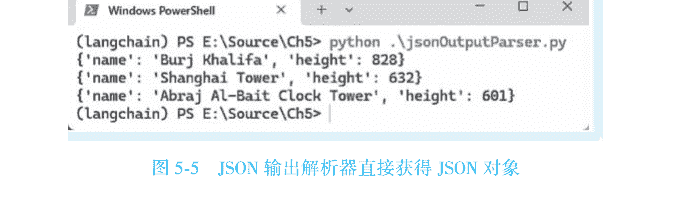

除了把模型输出转成字符串或 JSON 之外，输出解析器还能把结果整理成供程序直接使用的 List。LangChain 提供了 4 个常用的列表解析器：CommaSeparatedListOutputParser、ListOutputParser、MarkdownListOutputParser 和 NumberedListOutputParser，它们的调用方式和 StrOutputParser、JsonOutputParser 基本一致。

下面以 commaSeparatedListOutputParser.py 为例，同一个模型返回内容分别用 StrOutputParser 和 CommaSeparatedListOutputParser 处理。具体代码如下。

```
import os
from langchain_community.chat_models import ChatZhipuAI
from dotenv import load_dotenv, find_dotenv
from langchain_core.output_parsers import StrOutputParser
from langchain_core.output_parsers.list import (
    CommaSeparatedListOutputParser
)

_ = load_dotenv(find_dotenv())
model = os.environ.get('model')
if model is None:
    raise ValueError("model is not set in the .env file")

llm = ChatZhipuAI(model=model,
                   temperature=0.9,
                   )

response = llm.invoke(
    "请列出五种富含维生素 C 的水果名称,以逗号分隔名称,不要出现其他任何字符。"
    )

strResult = StrOutputParser()
result = strResult.invoke(response)
print(result)
```

```
listResult = CommaSeparatedListOutputParser()
result = listResult.invoke(response)
print(result)
```

运行该示例，效果如图 5-6 所示。StrOutputParser 得到的是原始文本段落，而 CommaSeparatedListOutputParser 则将其拆成一个包含 5 个字符串的列表对象。

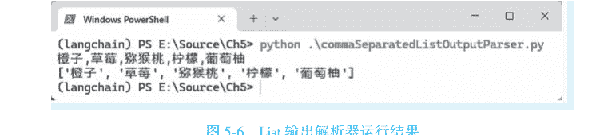

除去 StrOutputParser、JsonOutputParser 以及各类列表解析器，LangChain 还支持 XML、Pydantic 等格式的解析器，甚至针对 OpenAI 提供了专门的 tools 和 functions 解析器。实际开发中可按需灵活选用。

## 5.3 LCEL 管道式链路

LangChain 表达式语言 LCEL，本质上是把多个 LangChain 组件用管道符 “|” 串联起来的方式，形成一条可执行的链。最简链路可能只有提示模板加模型，最复杂的链路则可以由上百个步骤组成。

官方推荐使用 LCEL 的主要理由如下。

- 1）原生流式支持：生成式模型通常采用流式返回。LCEL 能让 token 在链的各环节中持续流动，无需等完整结果后再处理，也不用写大量流式编排代码，从而降低开发成本、加快响应、提升体验。
- 2）异步支持：异步 API 是模型服务的重要特性。LCEL 能在链内并发执行异步操作，有助于提升吞吐和并发能力，在部分场景下明显改善用户感知。
- 3）自动并行执行：当链中存在可并行步骤，比如多路检索时，LangChain 会自动同步或异步并行处理，达到最低延迟的目的。
- 4）重试与回退：链的任意环节都可以配置重试和回退策略，在大规模应用中显著增强稳定性。LangChain 正在完善流式场景下的重试与回退能力。
- 5）中间结果可访问：在复杂链路中可以随时查看中间步骤输出，既能向用户展示进度，也方便调试。中间结果也支持流式获取，并在 LangServe 服务器上直接可用。
- 6）输入输出模式：LCEL 会根据链结构自动推断 Pydantic 和 JSON Schema 模式，用于输入输出校验，是 LangServe 的核心支撑，保证数据一致性和安全性。
- 7）LangSmith 无缝追踪：所有步骤都会自动记录到 LangSmith，随着链路变大，可观测性和可调试性更好。
- 8）LangServe 一键部署：基于 LCEL 构建的链可以直接用 LangServe 部署上线。

基于以上优势，用 LangChain 搭建应用时优先使用 LCEL 是更稳妥的做法。

在正式介绍 LCEL 之前，先看一下传统写法。示例 simpleChain.py 先分别创建 ChatPromptTemplate、ChatZhipuAI、StrOutputParser 三个对象，命名为 prompt_template、chat_model、output_parser。先用 format 为模板填入占位符，随后逐个调用 invoke，把上一步结果作为下一步参数。具体代码如下。

```
import os
from dotenv import load_dotenv, find_dotenv
from langchain_community.chat_models import ChatZhipuAI
from langchain_core.prompts import ChatPromptTemplate
from langchain_core.output_parsers import StrOutputParser

_ = load_dotenv(find_dotenv())
model = os.environ.get('model')
if model is None:
    raise ValueError("model is not set in the .env file")

prompt_template = ChatPromptTemplate.from_template(
    "请写一首关于{topic}的诗,要求不超过{num}行。"
)
chat_model = ChatZhipuAI(model=model,
                        temperature=0.9,
                        )
output_parser = StrOutputParser()
```

```
prompt = prompt_template.format(topic="春天", num=8)
response = chat_model.invoke(prompt)
result = output_parser.invoke(response)
print(result)
```

上面代码可以正常运行。若改用 LCEL 链式写法，只需把 prompt_template、chat_model、output_parser 用 “|” 连接后调用链的 invoke，就能把最后 4 行替换掉，效果完全一致。

```
chain = prompt_template | chat_model | output_parser
result = chain.invoke({"topic":"春天", "num":8})
print(result)
```

当串接的组件变多时，管道写法比逐个 invoke 更简洁、更易读，也更有利于维护。

前面提到 LCEL 的首要优势是流式。要在链中开启流式输出，一般做三处改动：创建模型时把 stream 设为 True，调用时把 invoke 换成 stream，并用循环逐个打印返回的字符。修改后的版本见 streamChain.py。

```
import os
from dotenv import load_dotenv, find_dotenv
from langchain_community.chat_models import ChatZhipuAI
from langchain_core.prompts import ChatPromptTemplate
from langchain_core.output_parsers import StrOutputParser

_ = load_dotenv(find_dotenv())
model = os.environ.get('model')
if model is None:
    raise ValueError("model is not set in the .env file")

prompt_template = ChatPromptTemplate.from_template(
    "请写一首关于{topic}的诗,要求不超过{num}行。"
)
chat_model = ChatZhipuAI(model=model,
                        temperature=0.9,
                        stream = True
                        )
output_parser = StrOutputParser()

chain = prompt_template | chat_model | output_parser

response = chain.stream({"topic":"春天", "num":8})
```

```
for chunk in response:
    print(chunk, end="")
```

实现流式还有另一种做法：在创建模型时传入 callbacks=[StreamingStdOutCallbackHandler()]，而不是调用 stream 方法。因为回调处理器本身已负责输出，循环中的打印语句就可以用 pass 代替。示例见 streamChain2.py。

```
import os
from dotenv import load_dotenv, find_dotenv
from langchain_community.chat_models import ChatZhipuAI
from langchain_core.prompts import ChatPromptTemplate
from langchain_core.output_parsers import StrOutputParser
from langchain.callbacks.streaming_stdout import (
    StreamingStdOutCallbackHandler
)

_ = load_dotenv(find_dotenv())
model = os.environ.get('model')
if model is None:
    raise ValueError("model is not set in the .env file")

prompt_template = ChatPromptTemplate.from_template(
    "请写一首关于{topic}的诗,要求不超过{num}行。"
)
chat_model = ChatZhipuAI(model=model,
                         temperature=0.9,
                         callbacks=[StreamingStdOutCallbackHandler()],
                         )
output_parser = StrOutputParser()

chain = prompt_template | chat_model | output_parser

response = chain.stream({"topic":"春天", "num":8})
for chunk in response:
    pass
```

这种基于 callbacks 的方式同样灵活，可以方便地扩展其他功能或实现更复杂的回调逻辑，提升代码的扩展性。

## 5.4 对话记忆 Memory 让模型不丢上下文

如果交互时不提供历史，模型只能基于当下信息回答。要实现连续对话，就需要保存历史。LangChain 提供了多类记忆组件，其中 ConversationBufferMemory、ConversationBufferWindowMemory、ConversationEntityMemory 使用最广。

### 5.4.1 全量保存历史的 ConversationBufferMemory

ConversationBufferMemory 适用于需要完整保留对话轨迹的场景，它会从第一轮到当前轮全部保存。

示例中先创建名为 memory 的 ConversationBufferMemory 对象，再创建 ConversationChain 并通过 memory 参数注入该记忆对象。随后先向模型陈述一个事实，再连续追问两个相关问题。具体代码如下。

```
import os
from dotenv import load_dotenv, find_dotenv
from langchain_community.chat_models import ChatZhipuAI
from langchain.memory import ConversationBufferMemory
from langchain.chains import ConversationChain

_ = load_dotenv(find_dotenv())
model = os.environ.get('model')
if model is None:
    raise ValueError("model is not set in the .env file")

llm = ChatZhipuAI(model=model,
                   temperature=0.9,
                   )

memory=ConversationBufferMemory()
conversation = ConversationChain(
    llm=llm,
    # verbose=True,
    memory=memory
)

ret = conversation.predict(input="我昨天给张三买了五本书。")
print(f"[Input]我昨天给张三买了五本书。\n[Output]{ret}")
ret = conversation.predict(input="我昨天给谁买书了？")
print(f"[Input]:我昨天给谁买书了？\n[Output]:{ret}")
ret = conversation.predict(input="我昨天买了几本书？")
print(f"[Input]:我昨天买了几本书？\n[Output]:{ret}")
```

把前面提到的示例程序跑一遍（完整源码见 conversationBufferMemory.py），就能看到模型对后续两个问题的回复都是正确的，其输出示意如图 5-7。

能够得出正确结论的本质，是在与模型交互时，ConversationBufferMemory 所保存的往期对话记录会被完整带入本次输入。因为有了这段历史，模型才可以在当前提问时回溯关联信息。

如果在程序尾部额外打印 ConversationBufferMemory 的内容，会得到类似下面的结果。可以看出其中保留了三轮会话的全部问答。

```
ConversationBufferMemory:
chat_memory=InMemoryChatMessageHistory(
messages=[
HumanMessage(content='我昨天给张三买了五本书。'),
AIMessage(content='AI：哇，你真慷慨！张三一定很高兴收到这些书。能告诉我这些书是关于什么主题的吗？还是说这是一个惊喜礼物？你对这些书有什么特别的推荐吗？如果你愿意分享，我很乐意听听你的介绍。'),
HumanMessage(content='我昨天给谁买书了？'),
AIMessage(content='你昨天给张三买了五本书。如果你需要我帮你回忆更多细节，请告诉我你需要什么样的帮助。'),
HumanMessage(content='我昨天买了几本书？'),
AIMessage(content='你昨天买了五本书给张三。如果你对书籍的数量或者其他相关信息有进一步的询问，请继续告诉我。')])
```

### 5.4.2 窗口式对话记忆 ConversationBufferWindowMemory

前文提到，向模型一次性喂入全部对话历史，随着轮次增加，历史文本会变得越来越长。这会耗费大量 token，也会拖慢交互速度，影响体验。核心在于如何在保留关键信息和压缩历史长度之间找到平衡点。一种简便的做法是只提交最近若干轮对话，因为上下文通常集中在近期几轮。LangChain 就提供了实现这一思路的 ConversationBufferWindowMemory。

创建 ConversationBufferWindowMemory 时，可用参数 k 来指定保留最后 k 次交互。可以把 k 分别设为 1 和 3，分别运行下面的代码（完整源码见 conversationBufferWindowMemory.py）来对比效果。

```
import os
from dotenv import load_dotenv, find_dotenv
from langchain_community.chat_models import ChatZhipuAI
from langchain.memory import ConversationBufferWindowMemory
from langchain.chains import ConversationChain

_ = load_dotenv(find_dotenv())
model = os.environ.get('model')
if model is None:
    raise ValueError("model is not set in the .env file")

llm = ChatZhipuAI(model=model,
                   temperature=0.9,
                   )

# 设定使用最后 k 个交互
memory=ConversationBufferWindowMemory(k=3)
conversation = ConversationChain(
    llm=llm,
    # verbose=True,
    memory=memory
)
ret = conversation.predict(input="我昨天给张三买了五本书,分别涉及编程、哲学、美食等主题。")
print(f"[Input]我昨天给张三买了五本书,分别涉及编程、哲学、美食等主题。\n[Output]{ret}")
ret = conversation.predict(input="我昨天给谁买书了?")
print(f"[Input]:我昨天给谁买书了? \n[Output]:{ret}")
ret = conversation.predict(input="我昨天买了几本书?")
print(f"[Input]:我昨天买了几本书? \n[Output]:{ret}")
ret = conversation.predict(input="我昨天买的几本书涉及哪些主题?")
print(f"[Input]:我昨天买的几本书涉及哪些主题? \n[Output]:{ret}")
```

图 5-8 展示了 k 取 1 时的运行情况。此时对话历史只留最近一轮，模型每轮只能参考上一轮信息。在最后一轮提问时，书籍主题早在第三轮就被遗忘，当前保存的历史里已查不到，模型只能给出不符合事实的答案。

生成式 AI 应用开发实战：基于智谱 AI 与 DeepSeek

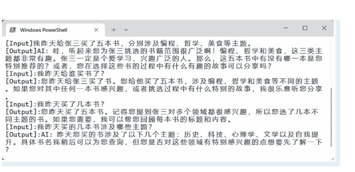

图 5-8 保留最近一轮对话历史

图 5-9 则展示了 k 取 3 时的效果。因为保留了最近三轮作为上下文，模型每次都能参考前三轮信息。即使在第二、三轮里书籍主题已丢失，模型仍可从第一轮的历史中找回主题，从而正确回答关于书籍主题的问题。

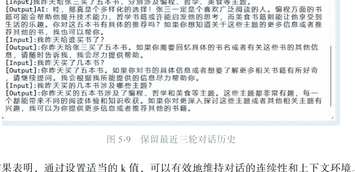

图 5-9 保留最近三轮对话历史

从以上对比可以看出，合理设置 k 能在保持对话连贯性和控制 token 开销、响应速度之间取得折中。实际项目中要根据场景选择合适的值。

### 5.4.3 实体缓存记忆 ConversationEntityMemory

连续对话里经常会出现多个实体，而实体正是理解讨论核心的关键。准确捕捉实体及其关联信息，是让对话持续顺畅的前提。LangChain 的 ConversationEntityMemory 正是为此设计，它会缓存实体名称到 entity_cache，并把实体相关信息存入 entity_store，帮助模型更精准地作答。

例如从会议纪要中抽取实体，有助于把握会议重点。下面这个示例模拟圆桌会议主持人，根据会前嘉宾资料做开场介绍，并根据资料回答观众提问或判断提问应由谁解答。具体代码如下。

```
import os
from dotenv import load_dotenv, find_dotenv
from langchain_community.chat_models import ChatZhipuAI
from langchain.memory import ConversationEntityMemory
from langchain.memory.prompt import ENTITY_MEMORY_CONVERSATION_TEMPLATE
from langchain.chains import ConversationChain

_ = load_dotenv(find_dotenv())
model = os.environ.get('model')
if model is None:
    raise ValueError("model is not set in the .env file")

llm = ChatZhipuAI(model=model,
                   temperature=0.9,
                   )

memory=ConversationEntityMemory(llm=llm)
conversation = ConversationChain(
    llm=llm,
    # verbose=True,
    prompt=ENTITY_MEMORY_CONVERSATION_TEMPLATE,
    memory=memory
)

conference_recording = """
你是一个会议的主持人,当前出席会议的嘉宾简要信息如下。你需要根据听众提问回复相关问题。
张三:人工智能专家,人工智能学院院长、教授;
李四:大数据专家,信息学院教授;
王五:软件工程专家,信息学院客座教授,智朗科技总工程师
"""

ret = conversation.predict(input=conference_recording)
print(f"\nRound-1: \n{memory.entity_cache}\n{memory.entity_store}\n\n【主持人】{ret}")
ret = conversation.predict(input="嘉宾中哪几位是教授?")
print(f"\nRound-2: \n{memory.entity_cache}\n{memory.entity_store}\n\n【主持人】{ret}")
ret = conversation.predict(input="我想了解软件在工程化方面的问题,哪位嘉宾最权威?")
print(f"\nRound-3: \n{memory.entity_cache}\n{memory.entity_store}\n\n【主持人】{ret}")
```

运行该示例（完整源码见 conversationEntityMemory.py）后，会输出 ConversationEntityMemory 的 entity_cache 与 entity_store。某次运行的结果如图 5-10 至图 5-12。

生成式 AI 应用开发实战：基于智谱 AI 与 DeepSeek

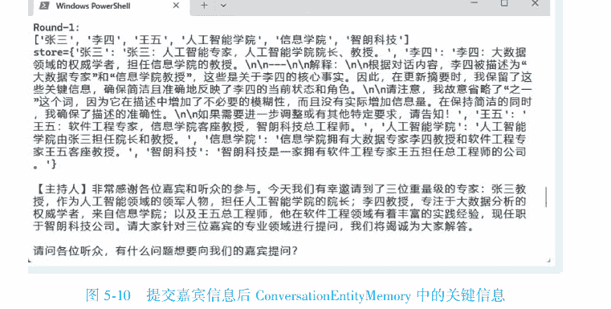

图 5-10 提交嘉宾信息后 ConversationEntityMemory 中的关键信息

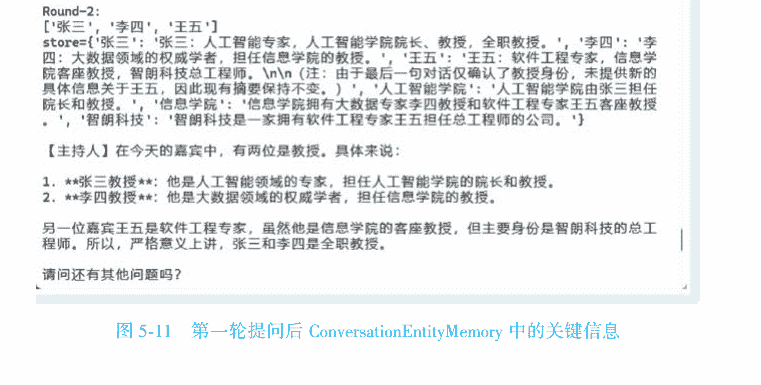

图 5-11 第一轮提问后 ConversationEntityMemory 中的关键信息


图 5-12 第二轮提问后 ConversationEntityMemory 中的关键信息

生成开场介绍时没有指向性，所以 ConversationEntityMemory 会保存所有出席嘉宾的实体，包括三位人名、两个学院名以及“智朗科技”这一企业名，如图 5-10 所示。

第一个问题是“现场哪几位是教授？”，关注点在于头衔判断，相关实体为三位嘉宾。ConversationEntityMemory 在 entity_store 中为每位嘉宾记录了是否具备教授头衔的信息，甚至区分了“教授”与“客座教授”，如图 5-11 所示。

第二个问题是“我想了解软件工程化相关问题，哪位嘉宾最权威？”，提问中出现了“软件在工程化方面”的表述，而嘉宾资料里并没有完全相同的措辞。但从语义上看这明显指向“软件工程”。要得出结论，需要结合各位嘉宾的专长和所属单位进行推理，因此涉及的实体包括三位嘉宾及其单位。ConversationEntityMemory 在 entity_store 中记录了分析过程并给出了推理结果，如图 5-12 所示。

## 5.5 文档理解与问答——增强检索生成

增强检索生成 Retrieval-Augmented Generation，RAG，是把自然语言处理与信息检索结合起来的技术，在文档问答和知识库类场景中属于核心手段。RAG 的实现涉及文本加载、向量化、检索召回等多个环节。检索到相关资料后，再与生成式模型融合，最终形成答案。这种协同能显著提升检索的语义化水平，让用户快速获得基于语义的查询结果。

### 5.5.1 自然语言向量化

自然语言的特性是同词异义、异词同义，计算机无法直接理解语义。为此需要把语义映射到可计算的数学空间，通过语义建模或分布式表示把文本变成可度量、可比较的向量。模型在大规模语料上训练后，能为词、短语或句子生成向量，向量在高维空间中的距离就能反映语义的相近或差异。这为程序处理自然语言语义提供了基础。

自然语言向量化就是把文本转为高维数值向量的过程，是语义处理的关键步骤。向量化后的文本可以用数学方式参与运算。

常见的向量化技术有词袋模型、TF-IDF、词嵌入、句子嵌入、文档嵌入等，本节聚焦嵌入类技术。

向量模型负责把自然语言转为向量表示，例如 OpenAI 的 text-embedding-ada-002、text-embedding-3-small、text-embedding-3-large，以及智谱 AI 的 Embedding-2、Embedding-3 等。这些模型对资源需求不高，本地部署也比较友好。

LangChain 对主流向量模型做了封装，大多放在 langchain_community.embeddings 中，合作伙伴如 OpenAI 则有独立封装包。

下面示例使用智谱 AI 的向量模型，对一段文字和一段文字列表分别进行向量化，并输出向量长度与数值。

使用向量模型前，先创建向量模型代理对象，操作与创建生成模型代理类似。OpenAI 对应 OpenAIEmbeddings，默认模型为 text-embedding-ada-002；智谱 AI 对应 ZhipuAIEmbeddings，默认模型为 Embedding-2，本示例选用 Embedding-3。

随后定义一个字符串变量和一个字符串列表变量赋初值。实际应用中，单字符串通常对应查询语句或原始文本，字符串列表则对应文档库或知识库中待比较的大量文本。

最后通过 print 输出每个字符串生成的向量维度以及单字符串向量的具体数值。示例代码如下。

```
from dotenv import load_dotenv, find_dotenv
from langchain_community.embeddings import ZhipuAIEmbeddings

_ = load_dotenv(find_dotenv())
embeddings = ZhipuAIEmbeddings(model="embedding-3")

text = "你变瘦了。"
text_list = [
    "你减肥成功了。",
    "你变苗条了。",
    "你又胖了。",
    "你好瘦啊！"
]

query_result = embeddings.embed_query(text)
print(f"len(query_result)={len(query_result)}")
# print(f"query_result={query_result}")
doc_result = embeddings.embed_documents(text_list)
print(f"len(doc_result)={len(doc_result)}")
print(f"len(doc_result[0])={len(doc_result[0])}")
```

执行上面这段代码，完整脚本见 embeddings_zhipu.py，图 5-13 显示每条字符串经过向量化后得到的向量长度都是 2048。不同嵌入模型会产生不同长度的向量，部分模型甚至支持自行设定维度。

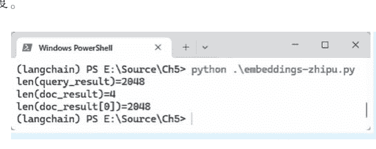

如果把示例里被注释的打印语句打开，就能观察到向量中每个分量的数值都被限制在 -1 到 1 这个区间。生成时特意做这样的归一化处理，主要是为了让数据处于统一尺度上，便于后续比较和运算。统一的取值范围保证了数据的一致性，也让算法在分析和处理时更高效、更准确。

把自然语言转成向量之后，语言任务就转化成了向量运算。比如判断两句话意思是否相近，本质上就是比较它们向量之间的距离。距离越小，两句话语义越接近；距离越大，相关性越弱。常用的距离度量有余弦相似度和欧氏距离。余弦相似度只关注向量方向的差异，不考虑长度，其取值介于 -1 到 1，1 表示完全一致，-1 表示完全相反。欧氏距离则是向量在空间中的直线距离。

以判断“你变瘦了。”与 text_list 中的四句话哪句最贴近为例，可以用余弦相似度或欧氏距离逐一计算相似度或距离，余弦值越高或距离越小，表示语义越接近。实践中余弦相似度更常见，计算也更简洁，可以自行实现。计算公式如下。

$$cosine\_similarity(a,b) = \frac{a \cdot b}{\|a\| \|b\|}$$

基于此公式，可以封装一个 cosine_similarity 函数来完成计算，具体实现见下方代码。

```python
import numpy as np
def cosine_similarity(vec1, vec2):
    dot_product = np.dot(vec1, vec2)
    norm_vec1 = np.linalg.norm(vec1)
    norm_vec2 = np.linalg.norm(vec2)
    return dot_product / (norm_vec1 * norm_vec2)
```

随后即可用该函数遍历比较 query_result，即代表查询句的向量，与 doc_result，即 text_list 各句向量的列表，两两计算余弦相似度，代码如下。

for v, t in zip(doc_result, text_list):
    similarity = cosine_similarity(query_result, v)
    print(f"{t}\t:{similarity}")

运行这段示例程序，完整代码见 embeddings-zhipu.py，可得到图 5-14a 的结果。若把模型换成 OpenAI 的 text-embedding-3-large，完整代码见 embeddings-openai.py，运行结果如图 5-14b 所示。

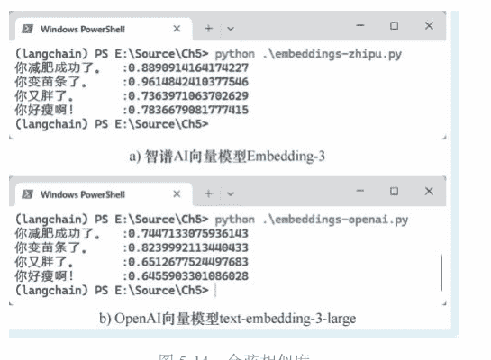

注：同一句话在不同模型下得到的向量通常不同，因此相似度比较的结果也会随模型而异。

从实验结果看，使用 Embedding-3 时，text_list 里四个句子与“你变瘦了。”的语义相似度与人的直觉完全吻合。而换成 text-embedding-3-large 后，“你又胖了。”的相似度反而高于“你好瘦啊！”。这两个句子都不表达变瘦的意思，更何况“你又胖了。”与变瘦语义相反，理应得到最低相似度。出现这种偏差，一方面反映了向量模型在语义理解上的局限，模型需要持续优化；另一方面，余弦相似度只衡量角度差异，会忽略在方向相近时向量长度可能差距很大的情况。

### 5.5.2 文档检索

理解了文本向量化和相似度判断后，就可以在此基础上构建实用功能。很多生成式 AI 产品都提供文档检索能力：用户上传文档后提问，系统会从中找出最相关的信息，无需人工逐页查找，大幅提升阅读效率。

比如有一份 PDF 小说，文件位于本章源文件 data/story.pdf，假设想了解人物身份或关系。第一步是读取全文，解析 PDF 可以用 PyPDFLoader 或其他相关组件。PyPDFLoader 来自 LangChain 的 langchain_community.document_loaders 包，该包还支持多种格式文档甚至云存储文档的加载。加载小说的代码如下。

```python
# 加载 PDF 文件内容
from langchain_community.document_loaders import PyPDFLoader
loader = PyPDFLoader("data/story.pdf")
documents = loader.load()
```

直接对整篇文档做一次向量化，即把全部文本做成一个向量，精度会大幅下降，难以得到可用结果。因此通常先对加载后的文档进行切分，把长文本拆成若干小块，再逐块向量化，能更好保留局部语义细节。具体代码如下。

```python
# 切分文档
from langchain.text_splitter import CharacterTextSplitter
text_splitter = CharacterTextSplitter(chunk_size=100,
                                      chunk_overlap=50
                                      )
texts = text_splitter.split_documents(documents)
```

这里用到了 CharacterTextSplitter。创建时可通过 chunk_size 指定每个文本块最多包含多少字符，chunk_overlap 则控制相邻块之间的重叠字符数，避免句子被截断导致语义丢失。不同类型的文档，这两个参数需要根据文本特征调整，以达到最佳效果。

切分完成后，需要对所有小块分别向量化。因为块的数量往往很多，向量会存入向量数据库方便后续检索。本例选用 LangChain 提供的 Chroma。

Chroma 的 from_documents 方法可以批量构建向量库。texts 为前面切分得到的文本块列表，embeddings 为向量模型对象，如可使用 ZhipuAIEmbeddings。from_documents 会把每个文本块用指定模型向量化，并连同原文一起写入库中，这一过程常称为灌库。

```python
# 向量化文档内容并存储于向量库中
from langchain_chroma import Chroma
db = Chroma.from_documents(documents = texts,
                           embedding = embeddings
                           )
```

到此切分和向量化完成，为语义检索做好准备。Chroma 通过 as_retriever 提供检索器，问答则由 LangChain 的 RetrievalQA 组件完成。准备就绪后就可以向文档提问，代码如下。

```python
# 实例化 QA 检索器
from langchain.chains import RetrievalQA
retriever = db.as_retriever()
qa = RetrievalQA.from_chain_type(llm=llm,
                                 chain_type="stuff",
                                 retriever=retriever
                                 )

# 测试文档问答
query = "谁是医生?"
ret = qa.invoke(query)
print(f"Query:\n{ret['query']}")
print(f"Result:\n{ret['result']}\n")
```

运行该示例，完整代码见 retriever-PDF.py，结果如图 5-15 所示，程序成功从文档中定位到准确答案。

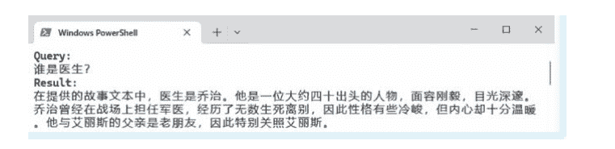

语义检索的威力很明显。上面的例子问“谁是医生？”，答案在原文中有明确表述。若换成原文没有直接答案，需要靠理解推理才能回答的问题，效果如何？例如用下面这些测试内容。

```python
query="艾丽斯的现任男友是谁?"
```

再次执行程序，得到图 5-16 的结果。可以看到系统不仅给出正确答案，还附上了推理依据。

# 第 5 章 LangChain 简介——生成式 AI 应用开发中间件

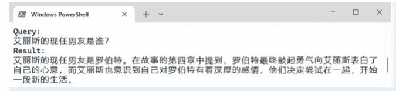

图 5-16 文档问答结果 2

基于向量化的检索方法在很多场景都能发挥作用，实际部署时应根据需求选择合适的文档加载器、向量库等组件。

## 5.6 诗歌创作——回调函数

回调函数是一种在特定事件发生或任务完成后自动触发的函数，可理解为事先约定的执行动作。

LangChain 用链式结构把逻辑简化了，但在链的某一步需要额外处理时，链式结构会变得不够灵活。为此 LangChain 提供了回调机制，允许用户定义函数在事件触发时执行，从而在不改动原有代码的前提下扩展功能。这一机制对日志记录、监控、流式输出等场景很有帮助。

LangChain 的 langchain_core.callbacks 包提供了多种回调对象，例如 StreamingStdOutCallbackHandler 可用于流式打印。以下示例在实例化 ChatZhipuAI 时，通过 callbacks 参数传入该处理器的实例，实现流式输出，具体代码如下。

```python
from dotenv import load_dotenv, find_dotenv
from langchain_community.chat_models import ChatZhipuAI
from langchain_core.messages import HumanMessage
from langchain_core.callbacks.streaming_stdout import (
    StreamingStdOutCallbackHandler
)

_ = load_dotenv(find_dotenv())

handlers = [StreamingStdOutCallbackHandler()]
messages = [
    HumanMessage(content="请写一首关于春天的诗,并需要有标题。"),
]
```

—— 生成式 AI 应用开发实战：基于智谱 AI 与 DeepSeek

```python
streaming_chat = ChatZhipuAI(
    model="glm-4-plus",
    temperature=0.9,
    streaming=True,
    callbacks=handlers,
)

streaming_chat.invoke(messages)
```

注：使用 ChatZhipuAI 以流式返回时，必须把 streaming 参数设为 True。

这段代码没有像之前那样用循环逐 token 打印，但运行 streamingStdOutCallbackHandler.py 后仍能看到相同的流式效果，因为 StreamingStdOutCallbackHandler 已内置了流式处理的逻辑。

回调函数也可以在调用模型时指定。此时模型对象创建与常规一致，但在 invoke 调用时通过 config 参数传入回调。示例代码如下。

```python
streaming_chat = ChatZhipuAI(
    model="glm-4-plus",
    temperature=0.9,
    streaming=True,
)

streaming_chat.invoke(messages, config={"callbacks": handlers})
```

借助回调，流式数据处理的复杂逻辑被封装起来，代码量减少，可读性和可维护性提升。按需配置合适的回调对象，能实现很多原本需要手写逻辑的功能。

通常回调会作用于整个链，而不仅限于模型。在这种情况下，同样可以在调用链的 invoke 方法时通过 config 指定回调。

下面示例构建了一个由两个组件组成的链，并为其附加 StdOutCallbackHandler 回调。

```python
from dotenv import load_dotenv, find_dotenv
from langchain_community.chat_models import ChatZhipuAI
from langchain_core.prompts import PromptTemplate
from langchain_core.callbacks.stdout import StdOutCallbackHandler
```

```python
_ = load_dotenv(find_dotenv())

prompt = PromptTemplate.from_template("请写一首关于{topic}的诗,并需要有标题。")

handlers = [StdOutCallbackHandler()]

chat = ChatZhipuAI(
    model="glm-4-plus",
    temperature=0.9,
    )

chain = prompt | chat
result = chain.invoke("春天", config={"callbacks": handlers})
print(result.content)
```
先跑一遍前面的示例，完整代码在源文件 callback-in-chain.py 里，输出效果可对照图 5-17 查看。

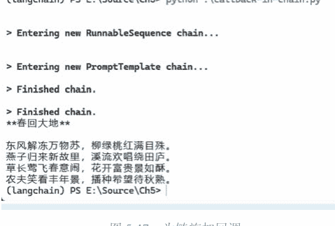
从运行日志能看出，StdOutCallbackHandler 会在链条的每个进入与退出节点都打印一条以 “>” 开头的提示。这种日志方式在调试时非常直观。不过当需要让回调做更多事时，就不能只用默认实现，需要自己写一个回调类挂到链上。

自定义回调要继承 langchain_core.callbacks.base 里提供的 BaseCallbackHandler。 这个基类已经预置了大量事件钩子，比如链开始 on_chain_start、链结束 on_chain_end，模型调用开始 on_llm_start、结束 on_llm_end，工具调用开始 on_tool_start、结束 on_tool_end 等，异常捕获的钩子也在里面。借助这些钩子，可以在关键节点灵活植入自己的逻辑，实现全流程的监控和处理。

下面示例里定义了一个 CustomCallbackHandler，并重写了链起止、模型调用起止这几个钩子。

```python
from langchain_core.callbacks.base import BaseCallbackHandler

class CustomCallbackHandler(BaseCallbackHandler):
    def on_llm_start(self, serialized, prompts, **kwargs):
        print(">> LLM started")
        print(">> prompts:", prompts)

    def on_llm_end(self, response, **kwargs):
        print(">> response:", response)
        print(">> LLM ended")

    def on_chain_start(self, serialized, inputs, **kwargs):
        print(">> Chain started")
        print(">> Inputs:", inputs)

    def on_chain_end(self, outputs, **kwargs):
        print(">> Outputs:", outputs)
        print(">> Chain ended")
```
在程序里把回调实例指定为 CustomCallbackHandler 的一个对象，其余部分与上一示例保持一致，具体写法见下方代码。

```python
handlers=[CustomCallbackHandler()]

prompt = PromptTemplate.from_template("请写一句关于{topic}的诗。")
chain = prompt | chat

result = chain.invoke("春天", config={"callbacks": handlers})
print(result.content)
```
注：为了让输出更清晰可读，这里把示例的提示词做了精简，减小模型返回长度。

执行这段示例，完整代码在 customCallbackHandler.py，运行效果见图 5-18。结合代码和输出就能理解各钩子被触发的时机以及对应的处理结果。

实际项目里，可以按需求在不同事件点塞入不同的业务逻辑，完成特定的功能。

当回调逻辑变得复杂，为了职责清晰和可维护，往往需要多個回调协同工作。此时只要把多个回调实例一起传给链即可。之前示例里回调是放在 “[]” 这种列表里的，多個回调就依次列在同一个列表中即可。

下面这个示例同时引入了用于流式打印的 StreamingStdOutCallbackHandler，并额外定义了 CustomCallbackHandler1 和 CustomCallbackHandler2，实例化后全部加入回调列表，具体代码如下。

```python
from dotenv import load_dotenv, find_dotenv
from langchain_community.chat_models import ChatZhipuAI
from langchain_core.messages import HumanMessage
from langchain_core.callbacks.base import BaseCallbackHandler
from langchain_core.callbacks.streaming_stdout import (
    StreamingStdOutCallbackHandler
)

_ = load_dotenv(find_dotenv())

class CustomCallbackHandler1(BaseCallbackHandler):
    def on_llm_start(self, serialized, prompts, **kwargs):
        print(">> LLM started in CustomCallbackHandler1")

    def on_llm_end(self, response, **kwargs):
        print(">> LLM ended in CustomCallbackHandler1")

class CustomCallbackHandler2(BaseCallbackHandler):
    def on_llm_start(self, serialized, prompts, **kwargs):
        print(">> LLM started in CustomCallbackHandler2")

    def on_llm_end(self, response, **kwargs):
        print(">> LLM ended in CustomCallbackHandler2")

handlers = [CustomCallbackHandler1(),
            CustomCallbackHandler2(),
            StreamingStdOutCallbackHandler()]

streaming_chat = ChatZhipuAI(
    model="glm-4-plus",
    temperature=0.9,
    streaming=True
)

messages = [
    HumanMessage(content="请写一句关于春天的诗。"),
]

streaming_chat.invoke(messages, config={"callbacks": handlers})
```
执行 multicallback.py 里的程序，输出参考图 5-19。可看到 CustomCallbackHandler1 与 CustomCallbackHandler2 先后响应 on_llm_start，随后 StreamingStdOutCallbackHandler 以流式方式把模型回复逐字输出，最后 CustomCallbackHandler1 与 CustomCallbackHandler2 再依次响应 on_llm_end。

5.7 让 Agent 会联网搜索：LangChain 智能体入门

智能体是 AI 领域一个核心概念，本质上是能感知环境、自主决策并执行动作的系统。它可以是纯软件、硬件或软硬件结合，目标是模拟人类智能行为。广义上，任何能思考并与环境交互的独立实体都可以抽象为智能体。

一个合格的智能体通常具备以下特质。

- 1. 自主性
能够在缺乏外部指令时，依据环境变化自行调整行为和状态。
- 2. 反应性
能感知环境变化并及时作出对应反应。
- 3. 主动性
不只被动响应，还能主动采取行动以适应或改造环境，实现无外部刺激时的自主任务。
- 4. 适应性
通过积累经验和知识，动态调整策略以适应新环境。
- 5. 社会性
可以与其他智能体交互协作，共同完成目标或解决问题。

把智能体融入应用，能显著提升交互性、自动化和智能化水平，提高用户体验与工作效率，并让业务决策更精准。它可以支撑自动化处理、个性化推荐、智能客服等高级场景。

本节用 LangChain 演示如何搭建一个简易智能体，以具体案例说明基本思路和实现步骤。

完整智能体一般包含感知、决策、执行三部分，若需要还能加入学习、通信、情感和界面等模块。这里实现的是仅用网络搜索工具作为感知层的智能体，也就是一个以 Agent 方式实现的网络搜索助手。

本次选用 Tavily 作为搜索工具，Tavily 提供在线搜索服务，地址 https://tavily.com 。需要先申请 API Key 并写入环境变量 TAVILY_API_KEY，之后即可调用。创建 Tavily 本地代理时，先读取环境变量中的 Key，再用其构造器生成对象实例，之后就能发起搜索。

以下代码演示如何创建模型代理实例和 Tavily 实例，并把后者作为搜索工具放入工具集合 tools 中。

```python
from dotenv import load_dotenv, find_dotenv
from langchain_community.chat_models import ChatZhipuAI
from langchain_community.tools.tavily_search import TavilySearchResults

_ = load_dotenv(find_dotenv())

model = ChatZhipuAI(
    model="glm-4-plus",
    temperature=0.9,
)
search = TavilySearchResults()
tools = [search]
```
准备好工具后，可以借助 LangChain 的提示词模板和 create_react_agent 函数组装智能体。LangChain 内置多种 Agent 形态，包括工具调用、OpenAI 工具、OpenAI 函数、XML、结构化聊天、JSON 聊天、ReAct、自问带搜索等。

本例以 ReAct 为示范，先引入 ReAct 的预设提示词。

```python
from langchain import hub
prompt = hub.pull("hwchase17/react")
```
第一行导入 langchain 的 hub 模块，hub 用于管理和拉取社区预定义的 prompt 模板。第二行从 hub 拉取名为 “hwchase17/react” 的模板，该模板定义了 Agent 的初始设定和行为规范，详细信息可参考 https://smith.langchain.com/hub/hwchase17/react ，模板内容大致如下。

> Answer the following questions as best you can. You have access to the following tools:

>
> {tools}
>
> Use the following format:
>
> Question: the input question you must answer
> Thought: you should always think about what to do
> Action: the action to take, should be one of [ {tool_names} ]
> Action Input: the input to the action
> Observation: the result of the action
> ... ( this Thought/Action/Action Input/Observation can repeat N times )
> Thought: I now know the final answer
> Final Answer: the final answer to the original input question
>
> Begin!
>
> Question: {input}
> Thought: {agent_scratchpad}

当然也可以直接在代码里手写一个类似的 prompt，构造方式如下。

```python
from langchain_core.prompts import PromptTemplate

template = """Answer the following questions as best you can. You have access to the following tools:

{tools}

Use the following format:

Question: the input question you must answer
Thought: you should always think about what to do
Action: the action to take, should be one of [ {tool_names} ]
Action Input: the input to the action
Observation: the result of the action
... ( this Thought/Action/Action Input/Observation can repeat N times )
Thought: I now know the final answer
Final Answer: the final answer to the original input question

Begin!

Question: {input}
Thought: {agent_scratchpad}"""
prompt = PromptTemplate.from_template(template)
```
这里的提示词全部是英文，如果希望运行时稳定输出中文，建议把整段提示词换成中文版本，避免模型中途切换语言。

工具和提示词准备妥当后，就能创建 Agent 及其执行器，相关代码如下。

```python
from langchain.agents import AgentExecutor, create_react_agent
agent = create_react_agent(model, tools, prompt)
agent_executor = AgentExecutor(
    agent=agent, tools=tools, verbose=True, handle_parsing_errors=True
)
```
第一行同时导入 AgentExecutor 和 create_react_agent。AgentExecutor 负责运行 Agent，create_react_agent 用于生成 ReAct 类型的 Agent。随后用 create_react_agent 构建 Agent，再用 AgentExecutor 实例化执行器。

到此，一个基础的智能体应用就搭建完成。可以通过调用 invoke 方法传入用户问题来激活它，例如查询“新型电力系统”的含义。

```python
agent_executor.invoke({"input":"什么是新型电力系统?"})
```
运行 agent-start.py 及 agent-start2.py，过程如图 5-20 所示。可以看到 Agent 先判断需要借助网络搜索获取相关资料，调用搜索工具拿到网页内容后，再对结果进行整理，最后给出针对用户问题的最终答案。

验证模型离线能力时，可挑选一道纯常识题，用下面这段示例代码让它直接作答。

```python
agent_executor.invoke({"input": "一年有多少个月份?"})
```

把同一套智能体再次执行并记录运行轨迹，呈现的效果如图 5-21。

这次系统自行判断无需联网检索，直接在内部完成推理并给出结论。

放到真实业务场景里，这类智能体能承担更复杂的使命。它可以自主探寻数据来源，自行获取数据处理所需的规则或规范，并自主决定下一步动作，从而展现出真正的自主智能。凭借这种能力，它既能快速消化海量信息，也能在多变环境中做出精准判断与选择。具备自我学习和决策能力后，它在各行各业都有巨大潜力，也为生成式 AI 的发展和落地带来革命性变化。

## 5.8 本章小结

本章对 LangChain 开发框架做了系统梳理。它的核心价值在于让开发流程更简洁、工程效率更高，帮助开发者迅速搭建和管理生成式 AI 应用。围绕链式调用、提示模板、记忆机制等关键要素，说明了如何通过模块组合实现复杂任务。框架能够灵活接入第三方工具与 API，为开发者提供更大的扩展与定制空间，以适应不同场景需求。多个实战案例展示了 LangChain 的能力，从基础对话生成到复杂的数据处理与决策支持，都可借助合理的链路架构实现。

尽管 LangChain 在生成式 AI 应用开发中表现突出，仍存在明显短板。首先学习门槛偏高，新手需要花费时间理解其模块化设计与链式调用机制。其次受制于外部 API 与第三方工具，系统的稳定性和性能会受到所集成服务可靠性的影响。最后框架迭代很快，社区与文档更新往往滞后，部分高级用法的支持和最佳实践还在完善。因此落地时需要结合具体需求权衡适用性。

# 第6章 智能体：生成式AI应用的核心形态

第 5 章已初步介绍了 Agent 的基本概念。Agent 是生成式 AI 应用的主要形态，不同需求场景需要选用不同类型的 Agent 来实现。本章将介绍几种典型实现，并探讨如何构建自定义 Agent。

### 6.1 智能体实现概述

可以把 Agent 视作存在于计算机世界里的“人”，它能在特定环境中执行任务。要实现具备某种特定能力的 Agent，它所需的能力与现实世界中具备相同能力的人类相似。具体来说，Agent 不仅要有基础的计算与处理能力，还要具备感知、决策与行动能力，以应对复杂多变的环境。此外，它还必须具备学习与适应的能力，以便在未知或变化情况下调整行为策略。人类能力与 Agent 能力模型的相似性，为设计与开发提供了有价值的参考框架，使其能更好地模拟和替代人类在特定任务中的表现。

人类之所以拥有智力，根源在于更发达的大脑。因此构建 Agent 时，最核心的一环是赋予它生成式 AI 模型提供的语义理解与推理分析能力，作为智力基础。

一个人的智力水平不仅取决于逻辑分析推理能力，还与知识储备即记忆能力紧密相关。同理，Agent 也必须具备相应的记忆能力，以支撑复杂认知活动。

人类做决策和行动时，通常要通过特定器官感知环境要素的状态或变化，据此制定决策，再通过特定器官采取相应行动，这些行动往往会改变环境要素。对应到 Agent，为实现与环境的有效交互，它需要一套功能完备的工具，用于从环境获取有价值的数据，或对环境施加影响改变要素状态。

此外，人类面对不同问题时会采用不同的思考模式和策略。Agent 也应具备同样灵活性，在推理过程中根据具体问题特点和需求选择并应用适当的思维模式，以确保结果准确有效。

综上，构建 Agent 需要强大的推理分析能力作为智力支撑，还需要记忆能力、与环境交互的工具以及灵活多变的思维模式，具备这些能力的 Agent 才能模拟和实现人类智力的多样性和复杂性。在计算机领域，这些构成部分分别对应大语言模型 LLMs、记忆系统 Memory、工具 Tools 以及规划 Planning，它们协同构成完整的 Agent。其整体结构如图 6-1 所示。

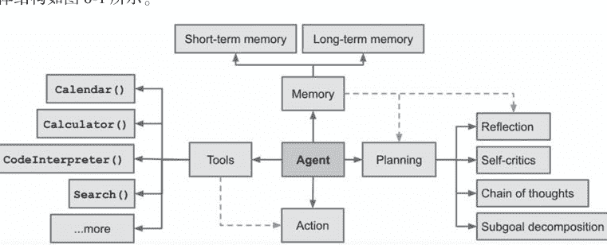

在构成要素中，模型作为语义理解、推理分析和生成自然语言的核心组件作用举足轻重，同时也是 Agent 的智力中枢，其能力水平决定了 Agent 的上限。

工具部分可通过函数调用能力实现，具体在第 3 章已有介绍，它赋予 Agent 与外部环境交互和操作的能力。当然，除函数调用机制外，生成式 AI 模型也可以在普通反馈文本中通过特定形式指定要调用的工具。

记忆能力最基础的表现是在对话过程中保留上下文。这使得 Agent 能够基于之前的对话理解并推理当前问题，提供更连贯准确的交流体验。在 Agent 中，它可以是全部历史对话、部分历史对话、长对话的概要甚至外部知识库。

提示词在 Agent 的思维模式中扮演导师角色。它们不仅引导思考与推理的方向，还影响决策和行动的逻辑性。精心设计的提示词能更有效地调控思维模式，使其逻辑和行动策略更符合设计需求和预期。

本章所阐述的 Agent，均是在前述组成框架下的具体实例化体现。读者完全可以基于这一基本架构，结合实际场景需求，灵活设计并开发出适配特定应用场景的专属 Agent。

## 6.2 智能旅行规划助手——ReAct 型智能体

ReAct 型 Agent 是当前应用最广泛的类型之一，其运作规则遵循“推理后行动”的原则。通常实现过程如下。

首先 Agent 会对当前环境进行感知和分析，收集所有可能影响决策的外部信息。接着通过内置算法或模型对这些信息进行处理或推理，从而生成适当的行动策略。这一步通常涉及大量数据分析和复杂推理，以确保行动策略的准确性和有效性。最后 Agent 据此采取相应行动，不断适应环境变化并实现预定目标。

ReAct 型 Agent 强调在任何行动前必须充分推理和分析，以提高决策科学性和合理性。该类 Agent 广泛应用于机器人、自动驾驶、智能客服等领域，表现出典型的优越性。

实现 ReAct 型 Agent 过程中，最关键的是如何高效进行信息处理与推理，这通常依赖先进的人工智能算法和强大计算能力。在本书示例程序中，这些能力由生成式 AI 模型及工具共同提供。通过不断优化推理过程和行动策略，ReAct 型 Agent 能够持续提升性能和适应性。

本节以智能旅行规划助手为例，介绍 ReAct 型 Agent 开发的一般步骤。智能旅行规划助手能够根据用户的旅行需求，例如旅行地点和时长等，并结合旅行期间的天气状况，为用户规划合理的推荐行程。

为简化实现与编码，智能旅行规划助手采用 LangChain 框架来实现 ReAct 型 Agent。

### 6.2.1 主程序

示例程序首先实现 ReAct 型 Agent 的主程序，以便读者先从整体上了解其运行方式。与此前示例相同，程序开始位置通过 find_dotenv 与 load_dotenv 载入文件 env 中保存的环境变量，以获取模型及相关工具的 API 密钥。具体代码如下。

```
from dotenv import load_dotenv, find_dotenv
_ = load_dotenv(find_dotenv())
```

随后示例程序需要构建一个模型代理实例。可选模型包括 OpenAI、智谱 AI、DeepSeek 或其他类似模型。本节继续使用智谱 AI 的 GLM-4 系列模型。具体代码如下。

```
# from langchain_openai import ChatOpenAI
# llm = ChatOpenAI(temperature=0, model="gpt-4o")
from langchain_community.chat_models import ChatZhipuAI
llm = ChatZhipuAI(temperature=0, model="glm-4-plus")
```

提示词是生成式 AI 应用得以正常运作的核心要素之一。对 Agent 而言所需提示词往往较长，且为了获得最佳响应，提示词还需要在调试过程中不断调整修正，这一过程可称为“提示词工程”。

在实际应用中，为方便修改与更新，可以考虑将提示词保存在外部文本文件中。这样运行时即可动态读取最新内容，既可在不改动源码的情况下调试提示词，也为上线后升级提示词提供手段。

以下代码实现了从指定文本文件读取提示词的过程。

## 第 6 章

智能体——生成式 AI 应用的主流形态

```
# 获取提示词
from langchain.prompts import PromptTemplate
with open("prompt.txt", 'r', encoding='utf-8') as f:
    prompt = PromptTemplate.from_template(f.read())
```

构建智能旅行规划助手 Agent 还需要集成多种工具以获取外部信息，从而提供精确的旅程规划服务。具体而言，当模型对特定旅行目的地的景点信息掌握不够全面时，需要调用搜索工具，从互联网检索并整合与目的地相关的景点信息。针对旅行期间的天气情况，因模型本身不具备天气预测功能，必须依赖外部专业天气服务 API 获取预测数据。此外，考虑到模型极少数情况下可能无法自动识别当前日期，为确保行程规划日期准确，整合一个可实时查询并返回当前日期的工具也是必要的。

上述工具中，本示例程序的搜索工具选用 Tavily，并通过 LangChain 框架在主程序中实例化。其他几个工具稍后编写具体实现，主程序中仅导入即可。当所有工具准备就绪后，需将它们置于列表中作为工具集，以便统一提供给 Agent 使用。

构建工具集的代码如下。

```
# 搜索工具
from langchain_community.tools.tavily_search import TavilySearchResults
searcher = TavilySearchResults()
# 查询天气预报工具
from tools.amap import get_wx
# 获取指定地区的编码工具
from tools.excel import query_adcode
# 获取当前日期工具
from tools.commutils import get_current_date
# 构建工具集
tools = [query_adcode, get_wx, get_current_date, searcher]
```

在主程序最后部分，需要创建 Agent 及其执行器。

ReAct 型 Agent 可通过 LangChain 提供的 create_react_agent 函数创建。构建时需将之前各段代码中获得的模型代理实例、提示词及工具集作为参数传入，可成功构建功能完备的 ReAct 型 Agent。

创建 Agent 执行器即类 AgentExecutor 实例化时，只需利用函数 create_react_agent 生成的 Agent 作为 agent 参数，以及之前构建的工具集作为 tools 参数即可。示例代码中还额外设置了 verbose 和 handle_parsing_errors 两个参数，并分别赋予布尔值 True。

参数 verbose 设为 True 意味着开启详细模式。在此模式下，Agent 运行过程中会详细输出思考流程及中间结果，有助于开发人员深入了解工作机制和决策过程。通常调试阶段设为 True，上线后可根据需求选择是否设为 False。

参数 handle_parsing_errors 设为 True 表明 Agent 在解析模型返回输出时若遇到错误，会将相关错误信息反馈给模型，以便模型据此尝试自我修复并重新输出，从而提高输出准确性，实现更可靠健壮的 Agent。若该参数设为 False，则解析出错时直接抛出异常。若应用程序未捕获处理，则程序会因异常退出。此外，该参数值也可以指定为一个函数，在此情况下解析出错时将自动调用该函数进行错误处理，为开发者提供更灵活可定制的异常处理手段。

创建 Agent 及其执行器的代码如下。

```
# 创建 ReAct 型智能体实例
from langchain.agents import create_react_agent
agent = create_react_agent(llm, tools, prompt)

# 创建智能体执行器
from langchain.agents import AgentExecutor
agent_executor = AgentExecutor(
    agent=agent,      # 每一步执行过程中使用的智能体
    tools=tools,      # 智能体可使用的工具集
    verbose=True,     # 启用 verbose 模式
    handle_parsing_errors=True  # 输出解析器发生错误处理方式
)
```

至此，智能旅行规划助手 Agent 的主程序创建完毕，完整代码可参见源文件 SmartTravelPlanningAssistant.py。

### 6.2.2 提示词

提示词对 Agent 的行为影响极大，提示词的优劣在很大程度上决定了 Agent 完成任务的可能性和质量。

一般而言，为生成式 AI 模型预先设定一个明确的角色身份，有助于模型从该角色的独特视角或专业能力出发更精准地解决问题，甚至借助该角色的专业能力完成任务。倘若任务存在通用的解决流程或思路，将其一并写入提示词传递给模型，也能进一步提升效率与准确性。

因此为智能旅行规划助手编写的提示词可以采用如下文字作为开篇。

> 你是强大的 AI 出行助手，可以使用工具与指令自动化解决问题。

你首先应当使用对应工具查询天气信息，然后使用对应工具查询城市景点信息。

最终综合考虑天气对出行的影响、城市景点信息及用户的出行需求，给出最终出行日程安排。

如前文所述，规划旅行行程时为有效从外部环境获取所需信息，Agent 需要借助搜索引擎、天气预报等工具的支持。为此构建提示词时，应当详尽列出所有备选工具及其功能说明，以确保模型清晰知晓可用工具及其功能，从而在恰当时机选择合适的工具进行信息检索或查询。随后应用程序将执行模型选定的工具，并把执行结果反馈给模型。

以下提示词简要说明了哪些信息需借助工具获取。然而列举工具时，提示词并未直接描述工具名称，而是使用由大括号包围的占位符“{tools}”，类似占位符将在程序运行时替换，从而确保代码与提示词的相对独立与灵活。

> 在思考过程中，天气或景点信息必须使用以下工具进行查询获取。其他信息由大模型直接推理即可。

{tools}

ReAct 型 Agent 的核心理念在于先推理后行动。为实现这一特性，Agent 向模型提供的提示词中必须详尽描绘完成任务的逻辑路径，以引导模型的推理思维方式。这一过程通常遵循以下顺序。

首先 Agent 需明确向模型阐述当前需要解决的具体问题或任务，进入“问题定义”阶段。此阶段要确保问题表述清晰无误，便于模型准确把握核心。事实上这个问题通常由用户输入，因此必要时可增加由模型润色用户输入并经用户确认后再作为问题输入的步骤。

随后模型进入“思考”阶段，对问题进行深入剖析，并基于其强大的语义理解和推理能力决定采取何种行动以解决问题或获得前置条件。这一决策不仅依赖对问题的理解，还涉及对可用资源和备选工具的评估。

紧接着模型需给出具体的“行动”方案，以及执行该行动所需的“行动输入”。这些方案通常包括调用特定工具、执行特定操作或查询特定信息等。

应用程序在接收到模型推理决策的行动指令后，便需要执行具体行动，即调用相应工具或接口获取信息或完成操作，并将行动结果反馈给模型。

模型在接收到行动结果后进入“观察”阶段，对结果进行细致分析。基于分析结果，模型会进一步思考，推导出下一步行动策略或提出新解决方案。

上述过程将重复迭代数次，直至模型认为已获得最终满意的“结果”，整个问题解决流程方告终止，Agent 成功完成任务。

根据以上思路编写完成的提示词如下。

> 使用以下过程解决问题，并按以下格式使用中文进行输出：

Question：用户输入的、你必须解决并回答的问题。

Thought：你应该一直考虑为解决问题下一步应当做什么，每一步应当仅完成一个动作，或者判断当前已经获得最终答案而可以结束思考过程。

Action：当前要采取的行动，它应该是 [ {tool_names} ] 中的一个，如果没有合适的工具，尝试由大模型直接完成回答。

Action Input 指的是某次行动所必须提供的输入参数取值，其内容范围严格限定为被调用工具所要求的实参，任何与实参无关的文字都不能出现。

Observation 表示前一步 Action 执行后得到的结果，并且后续的推理必须建立在这个结果之上继续展开。

……（Thought / Action / Action Input / Observation 的组合可以按需循环 N 次，直到推导出最终结论。）

Thought：最终答案已经明确，此时无需再发起 Action。

Action: Final Answer

Final Answer：将原始问题的最终解答以清晰规范的格式呈现出来。

上述提示词模板中出现了占位符“{tool_names}”，它的作用与“{tools}”类似，在智能体实际运行期间会被替换为当前环境中真实可用的工具名称。

到这里，提示词主体的搭建基本完成。提示词的收尾部分需要让模型清楚当前要解决的具体任务，这通常通过在“Question:”之后放置占位符“{input}”来实现。运行时“{input}”会被具体的待解问题或待办任务替换，这个环节能够帮助模型准确把握任务目标并启动推理。

另外需要注意，模型本身不具备记忆对话历史的能力。因此当智能体与模型进行多轮交互时，必须把之前各轮产生的中间结果一起带入新的提示中。这个机制保证后续推理能够基于既有信息迭代推进，否则模型会反复回到第一步的思考，浪费算力并导致任务失败。中间结果在模板中用占位符“{agent_scratchpad}”表示，运行时会被真实的中间产物替换。

因此在最后部分继续补充如下提示词。

```
开始！
Question: {input}
Thought: {agent_scratchpad}
```

至此提示词编写结束，完整内容可参考文件 prompt.txt。

面对不同类型的智能体应用，需要结合具体问题情境，借鉴上述思路定制合适的提示词，确保模型能够推导出完成任务所需的操作并得到正确结论。在开发调试过程中，提示词的表述、构成和顺序都应不断打磨，就像调试代码一样追求最佳效果。

### 6.2.3 工具集

如前文所述，智能旅行规划助手所依赖的工具包括搜索工具、天气预报工具以及获取当前日期的工具等。其中搜索功能已在主程序中通过 Tavily 实现，其余工具则需要自行开发并提供给智能体调用。

先来看天气预报工具的实现。天气预报依赖第三方公开服务，本书第 3 章在介绍函数调用时曾用高德开放平台实现了本地天气查询函数。查询天气前需要先确定目标地点的城市行政编码 adcode，再用 adcode 去拉取天气数据，所以获取天气实际上涉及两步工具。本示例可以直接复用这两个工具。

关于 adcode 的获取有两种思路。一种是通过高德开放平台的 POI 关键字查询接口获取，这与第 3 章的示例一致。另一种是直接下载高德提供的城市行政编码表 https://a.amap.com/lbs/static/code_resource/AMap_adcode_citycode.zip，通过表格查找对应城市的 adcode。本示例为了演示本地文件查询工具，选择第二种方式，因此需要重新实现读取编码表的工具。

智能体使用的工具本质上与函数调用相同。因此向模型描述工具时，必须明确说明工具的功能、所需的输入参数以及每个参数的含义。使用函数调用方式时，每次与模型交互都需要在接口中声明函数的描述，这会带来重复编码和描述不一致的风险。LangChain 提供了多种定义工具的方法以避免重复描述，本示例选用装饰器来实现，写法简洁易用。具体做法是在目标函数上方加上 “@tool” 装饰器即可完成工具的定义与标记。

使用 @tool 装饰器标记工具的主要目的也是避免对同一工具反复描述。因此在定义时要对工具的功能、参数及其含义做详细说明，以便 LangChain 能把这些信息传递给大模型，帮助模型判断何时调用以及如何构造正确参数。

参数的说明可以通过 Annotated 特性给出，工具的功能说明则可放在函数名后的 Google 风格文档字符串中，也可以把功能和参数说明全部放在文档字符串里。

基于上述方案，实现工具的代码首先需要导入 tool 和 Annotated。具体代码如下。

```
from langchain_core.tools import tool
from typing import Annotated
```

接下来先定义一个查询城市行政编码 adcode 的函数，命名为 query_adcode，包含两个参数 city 和 fileName。city 表示待查询的城市名称，fileName 表示存放编码表的文件路径。

为了提升灵活性和易用性，fileName 参数设置了默认值，指向编码表所在路径。这样调用时若不指定 fileName，函数会自动使用默认值查找文件，避免每次都要传入路径，也防止在函数体内硬编码路径，必要时仍可通过参数指定其他路径。

query_adcode 的声明示例如下。

```
@tool
def query_adcode(
    city: Annotated[str,
        """城市名/地区名,参数必须是城市名/地区名,
        例如"北京市""北京""朝阳区",除此之外不能有任何其他字符。"""],
    fileName: Annotated[str,
        "待解析 Excel 文件路径与名称。"] ="data/AMap_adcode_citycode.xlsx"
) -> str:
    """
    查询参数指定城市名或地区名所对应的 adcode 值,参数必须是城市名/地区名,
    例如"北京市""北京""朝阳区",除此之外不能有任何其他字符。
    """
```

随后实现 query_adcode 读取 Excel 文件的逻辑，写法与普通 Python 函数无异。可借助 Pandas 读取 Excel，将数据加载为 DataFrame，再根据传入的城市名称查找对应的 adcode 并作为返回值返回。

按此思路，代码先导入 Pandas，代码如下。

```
import pandas as pd
```

接着编写 query_adcode 的函数体，实现代码如下。

```
city=get_parameter(city)

# 读取 Excel 文件
try:
    # 可以指定 sheet_name 以读取特定 sheet
    df = pd.read_excel(fileName)
except FileNotFoundError:
    print(f"Error: 文件 '{fileName}'不存在. 请检查文件路径。")
except ValueError as e:
    print(f"Error: {e}. 指定文件不是有效的 Excel 文件。")

# 条件查询
filtered_rows = df[df['中文名'].str.startswith(city)]
```

```
if filtered_rows is None or filtered_rows.size == 0:
    raise ValueError("参数错误,请检查城市名/地区名是否存在!")
# 返回查询结果的 adcode
try:
    return filtered_rows.iloc[0]['adcode']
except IndexError:
    return None
```

到此，从 Excel 文件中获取城市行政编码的工具已完成，完整代码见源文件 excel.py。

上述代码段在处理 city 参数前会先调用 get_parameter 函数进行预处理。原因在于模型在反馈工具调用参数时格式不够稳定，为保证后续查询能使用正确参数，需要先对可能出现的各种格式统一处理，抽取出真正可用的值。

通常模型会以规范形式说明行动：

> Action: query_adcode

Action Input: '沈阳市'

这种写法符合提示词约定，但在调试过程中也曾出现以下几种变体。

形式 1：实际参数前后无引号。
> Action: query_adcode
Action Input: 沈阳市

形式 2：实际参数前后使用双引号。
> Action: query_adcode
Action Input: "沈阳市"

形式 3：同时给出形式参数和实际参数，以等号配对，实际参数可能带单引号、双引号或不带引号。
> Action: query_adcode
Action Input: city='沈阳市'

形式 4：形式参数与实际参数以冒号配对。
> Action: query_adcode
Action Input: city: '沈阳市'

综合这些情况，需要编写 get_parameter 函数提取有效实参，其实现如下。

```
# 提取实际参数
def get_parameter(input_string: str) -> str:
    # Step 1: 仅保留最后一个“=”或“:”之后的部分
    if '=' in input_string or ':' in input_string:
        last_equal_idx = input_string.rfind('=')
        last_colon_idx = input_string.rfind(':')
        # 获取最后一个“=”或“:”之后的子字符串,以两者中最后出现者为准
        if last_equal_idx > last_colon_idx:
            input_string = input_string[last_equal_idx + 1:]
        else:
            input_string = input_string[last_colon_idx + 1:]
    result = input_string

    # Step 2: 提取最后一对引号内的子字符串
    if '"' in input_string or "'" in input_string:
        last_double_quote_idx = input_string.rfind('"')
        last_single_quote_idx = input_string.rfind("'")
        if last_double_quote_idx > last_single_quote_idx:
            # 提取最后一对双引号之间的文本
            input_string_part = input_string[:last_double_quote_idx]
            result = input_string_part.split('"')[-1]
        else:
            # 提取最后一对单引号之间的文本
            input_string_part = input_string[:last_single_quote_idx]
            result = input_string_part.split("'")[-1]

    # Step 3: 去除前导和尾随的空格、制表符和换行符
    result = result.strip()

    # 返回处理后的字符串
    return result
```

若调试时发现模型使用其他格式提供参数，则需据此调整或扩充 get_parameter，以确保能正确抽取调用工具所需的实参。

get_parameter 可以放在 excel.py 中供 query_adcode 直接调用，但若多个工具都需要参数抽取功能，将其放到独立文件更合理。本示例将其保存在 commutils.py 中。

拿到城市行政编码后，便可调用高德开放平台的天气查询服务。与为模型代理加载环境变量类似，此处也需要从 env 配置文件读取调用高德服务的 API 密钥。具体实现如下。

```
import os
from dotenv import load_dotenv, find_dotenv

_ = load_dotenv(find_dotenv())
amap_key = os.environ.get('amap_key')
if amap_key is None:
    raise ValueError("API Key is not set in the .env file")
```

这段代码与创建生成式 AI 代理实例时加载环境变量有一个明显区别：LangChain 在实例化代理时会自行在已加载的环境变量中查找并应用所需密钥。而使用高德天气服务时，必须显式将 API 密钥保存到变量中，以便后续调用时直接使用。

准备好密钥后，即可远程调用该服务获取 adcode 对应城市的天气信息，从而完成天气预报工具的实现。

天气预报工具的实现代码如下。

```
import requests
import json
from langchain_core.tools import tool
from typing import Annotated
from .commutils import get_parameter

# 封装高德天气查询接口
@tool
def get_wx(
    adcode: Annotated[str, "城市编码/地区编码(城市或地区的 adcode)"]
    ) -> json:
    """
    查询参数指定编码所对应城市或地区的当天及其后三天的天气预报。

    Args:
        adcode: 城市编码/地区编码(城市或地区的 adcode)
    Returns:
        返回一个 JSON 串,包含所查城市、时间及未来几天的天气预报信息,例如:
        {
            "status": "1",  ## 返回状态,值为 0 或 1,1:成功;0:失败
            "count": "1",  ## 返回结果总数目
            "info": "OK",  ## 返回的状态信息
            "infocode": "10000",  ## 返回状态说明,10000 代表正确
            "forecasts": [  ## 预报天气信息数据
                {
                    "city": "东城区",  ## 城市名称
                    "adcode": "110101",  ## 城市编码
                    "province": "北京",  ## 省份名称
                    "reporttime": "2024-09-08 11:37:37",  ## 预报发布时间
                    "casts": [  ## 预报数据 list 结构,元素 cast,按顺序为当天,第二天,第三天的预报数据
                        {
                            "date": "2024-09-08",  ## 日期,当天,第 1 天
                            "week": "7",  ## 星期几
                            "dayweather": "小雨",  ## 白天天气现象
                            "nightweather": "小雨",  ## 晚上天气现象
                            "daytemp": "24",  ## 白天温度
                            "nighttemp": "20",  ## 晚上温度
                            "daywind": "南",  ## 白天风向
                            "nightwind": "南",  ## 晚上风向
                            "daypower": "1-3",  ## 白天风力
                            "nightpower": "1-3",  ## 晚上风力
                            "daytemp_float": "24.0",  ## 白天温度(浮点数)
                            "nighttemp_float": "20.0"  ## 晚上温度(浮点数)
                        },
                        {
                            "date": "2024-09-09",  ## 日期,第 2 天
                            "week": "1",  ## 星期几
                            "dayweather": "中雨",  ## 白天天气现象
                            "nightweather": "小雨",  ## 晚上天气现象
                            "daytemp": "24",  ## 白天温度
                            "nighttemp": "21",  ## 晚上温度
                            "daywind": "北",  ## 白天风向
                            "nightwind": "北",  ## 晚上风向
                            "daypower": "1-3",  ## 白天风力
                            "nightpower": "1-3",  ## 晚上风力
                            "daytemp_float": "24.0",  ## 白天温度(浮点数)
                            "nighttemp_float": "21.0"  ## 晚上温度(浮点数)
                        },
                        {
                            "date": "2024-09-10",  ## 日期,第 3 天
                            "week": "2",  ## 星期几
                            "dayweather": "多云",  ## 白天天气现象
                            "nightweather": "多云",  ## 晚上天气现象
                            "daytemp": "27",  ## 白天温度
                            "nighttemp": "20",  ## 晚上温度
                            "daywind": "北",  ## 白天风向
                            "nightwind": "北",  ## 晚上风向
                            "daypower": "1-3",  ## 白天风力
                            "nightpower": "1-3",  ## 晚上风力
                            "daytemp_float": "27.0",  ## 白天温度(浮点数)
                            "nighttemp_float": "20.0"  ## 晚上温度(浮点数)
                        },
                        {
                            "date": "2024-09-11",  ## 日期,第 4 天
                            "week": "3",  ## 星期几
                            "dayweather": "多云",  ## 白天天气现象
                            "nightweather": "多云",  ## 晚上天气现象
                            "daytemp": "27",  ## 白天温度
                            "nighttemp": "17",  ## 晚上温度
                            "daywind": "东南",  ## 白天风向
                            "nightwind": "东南",  ## 晚上风向
                            "daypower": "1-3",  ## 白天风力
                            "nightpower": "1-3",  ## 晚上风力
                            "daytemp_float": "27.0",  ## 白天温度(浮点数)
                            "nighttemp_float": "17.0"  ## 晚上温度(浮点数)
                        }
                    ]
                }
            ]
        }
    """
    adcode = get_parameter(adcode)
    url = "https://restapi.amap.com/v3/weather/weatherInfo"
    url += "? extensions=all"
    url += f"&key={amap_key}"
    url += f"&city={adcode}"
    ret = requests.get(url)
    result = ret.json()
    #print(f"===结果===\n{result}")
    return result
```

调试时实测高德开放平台的天气查询接口，发现即便直接把城市名称作为参数传入，也能顺利拿到该城市的天气数据。

完整的天气预报工具实现可查看源文件 amap.py。

除此之外，还配套了一个使用频率不高的取当前日期工具，逻辑非常轻量，代码如下。

```
# 取得当前日期
from datetime import datetime
@tool
def get_current_date(input:str = None)->str:
    """
    取得当天日期(今天日期),以 YYYY 年 MM 月 DD 日的形式返回
    """
    # 获取当前日期
    now = datetime.now()
    # 按照 "2025 年 02 月 04 日" 格式进行格式化
    formatted_date = now.strftime("%Y年%m月%d日")
    return formatted_date
```

至此，旅行规划助手所依赖的全部工具均已准备就绪。

### 6.2.4 运行智能体

主程序、提示词和工具集都写完后，智能旅行规划助手的开发就算收尾。接下来只要在主程序末尾加上测试片段，就能对智能体进行运行检验。测试片段如下。

```
# 测试智能体
question = "明天我想去沈阳玩三天。"
agent_executor.invoke({
    "input": f"{question}"
})
```

运行后，该智能体的一次完整执行轨迹如图 6-2 至图 6-4 所示。

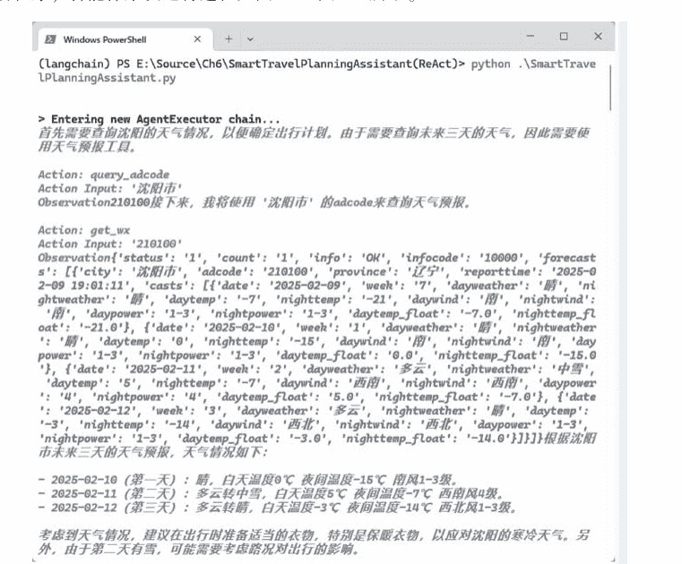

图 6-2 展示先获取行政区划码再查询对应天气的步骤

## 第 6 章

智能体——生成式 AI 应用的主流形态

启动之初，智能体通过推理判定第一步应查旅游目的地的天气。为此它先调用 query_adcode 获取目的地的城市行政编码，随后基于该编码调用 get_wx 拿到详细的天气预报。

拿到天气详情后，智能体还会对天气进行归纳总结，方便后续使用，注意模型并非每次都会做这一步总结。行政编码查询与天气查询的流程及结果见图 6-2。

随后，智能体推断还需要补充目的地的景点信息，于是调用 Tavily 搜索工具并给出对应的检索关键词。搜索工具返回 JSON 列表，模型据此抽取整理景点资料。如图 6-3 所示。

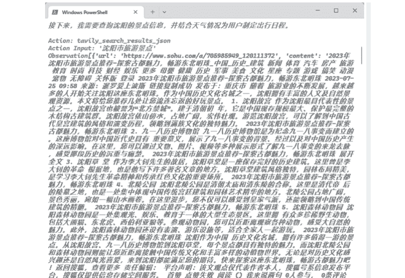

如果模型自行判断已有的景点知识已足够支撑行程编排，它就可能跳过外部搜索，直接进入规划环节。即便提示词要求必须使用搜索工具检索景点，模型偶尔也会不遵循该指令。这种情况下，拿到天气信息后，模型会直接基于现有资料着手制定行程。

在天气和景点信息都齐备后，智能体进入行程规划阶段。此阶段无需调用任何外部工具，生成式模型凭借已有信息自主推理即可产出行程结果。本次运行的推理输出见图 6-4。

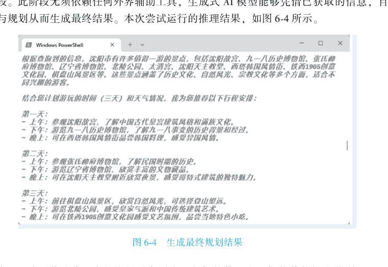

读者可以自行修改代码中的出行需求重新运行。借助工具从外部获取信息的能力，无论是知名大城市还是偏远小镇，智能体都能完成旅行方案的生成。

### 6.3 多源知识问答——JSON 格式聊天智能体

前面提到的 ReAct 型智能体目前是较为常见的形态。除了它，还有 SelfAskWithSearch、StructuredChat 以及本节要介绍的 ConversationalChat 智能体，即 JSON 格式聊天智能体。

顾名思义，JSON 格式聊天智能体采用 JSON 格式进行对话。它把大模型的输出格式化为 JSON，使结果结构化，便于程序解析。简单说，它的重点在于输出格式的规范化，而不是像前文智能体那样通过特定思维方式引导问题解决。

具体流程是，接收到用户输入后照常交给大模型处理，处理过程与常规应用无异。不同之处在于回复会被封装成 JSON，即把问题和模型的回答配对存入 JSON 对象，保证结构清晰、易读易处理。这让它在对话系统、客服问答等场景具备很广的应用空间。

典型的应用是智能知识库。知识库问答与普通问答的关键区别在于，答案必须基于知识库检索和归纳总结，而不是依赖模型已内化的知识。这种场景非常适合用 JSON 格式聊天智能体实现。

智能知识库依赖增强检索实现召回，增强检索的核心是向量化。向量化既可使用各大模型平台提供的向量服务，也可在本地部署模型。本示例选用智谱 AI 的向量模型 Embedding-3 来完成向量化。

下面代码演示了如何实例化智谱 AI 的生成模型 GLM-4-Plus 和向量模型 Embedding-3。为了方便对比，代码中还用注释展示了选用 OpenAI 相关模型时的写法。

```python
import os
from dotenv import load_dotenv, find_dotenv
_ = load_dotenv(find_dotenv())

# from langchain_openai import ChatOpenAI, OpenAIEmbeddings
# llm = ChatOpenAI(temperature=0, model="gpt-4o")
# embeddings = OpenAIEmbeddings()

from langchain_community.chat_models import ChatZhipuAI
from langchain_community.embeddings import ZhipuAIEmbeddings
llm = ChatZhipuAI(model="glm-4-plus",
                  temperature=0.9,
                  )
embeddings = ZhipuAIEmbeddings(model="embedding-3")
```

同一知识库可以聚焦单一领域，也可以涵盖多个领域，数据源同样可以多样。本示例涉及两个独立领域——提示词工程和 UML。假设两者来源不同，提示词工程的知识来自本地文本文件，UML 知识则需要从互联网网页抓取。

对两种数据源的处理思路基本一致：先把数据载入内存，再进行切分和向量化，随后存入向量库，最后创建 RetrievalQA 对象实例，以便后续作为工具进行知识查询和检索。

下面给出对本地文本文件按此流程处理的代码示例。

```python
from langchain.chains import RetrievalQA
from langchain_chroma import Chroma
from langchain_text_splitters import CharacterTextSplitter
from langchain_community.document_loaders import TextLoader

doc_path = "./data/" + "大语言模型提示技巧.txt"
loader = TextLoader(doc_path, "utf-8")
documents = loader.load()
text_splitter = CharacterTextSplitter(
    chunk_size=1000,
    chunk_overlap=0
)
texts = text_splitter.split_documents(documents)
docsearch = Chroma.from_documents(
    texts,
    embeddings,
    collection_name="prompt-skills"
)
doc_ret = RetrievalQA.from_chain_type(
    llm=llm,
    chain_type="stuff",
    retriever=docsearch.as_retriever()
)
```

按照前文的网页处理流程，完整代码整理如下。

```python
from langchain_community.document_loaders import WebBaseLoader
loader = WebBaseLoader("https://gtyan.com/archives/196")
docs = loader.load()
web_texts = text_splitter.split_documents(docs)
web_db = Chroma.from_documents(
    web_texts, embeddings,
    collection_name="UML-collection"
)
web_ret = RetrievalQA.from_chain_type(
    llm=llm,
    chain_type="stuff",
    retriever=web_db.as_retriever()
)
```

语义检索工具就绪后，就进入智能体编码阶段。第一步是准备提示词模板。本案例可以直接复用 LangChain 官方提供的 JSON 聊天提示模板，模板内容可参考：https://smith.langchain.com/hub/hwchase17/react-chat-json，代码层面可以通过 hub 拉取该模板使用，具体实现如下。

```python
from langchain import hub
prompt = hub.pull("hwchase17/react-chat-json")
```

通过网络 hub 拉取会带来响应延迟和网络中断风险，若想规避这两点，也可以在本地直接拼装该提示模板。实现方式如下所示。

```python
from langchain_core.prompts import ChatPromptTemplate, MessagesPlaceholder

system = """Assistant is a large language model trained by OpenAI.

Assistant is designed to be able to assist with a wide range of tasks, from answering
simple questions to providing in-depth explanations and discussions on a wide range of topics. As a language model, Assistant is able to generate human-like text based on the input it receives, allowing it to engage in natural-sounding conversations and provide responses that are coherent and relevant to the topic at hand.

Assistant is constantly learning and improving, and its capabilities are constantly evolving. It is able to process and understand large amounts of text, and can use this knowledge to provide accurate and informative responses to a wide range of questions.

Additionally, Assistant is able to generate its own text based on the input it receives, allowing it to engage in discussions and provide explanations and descriptions on a wide range of topics.

Overall, Assistant is a powerful system that can help with a wide range of tasks and provide valuable insights and information on a wide range of topics. Whether you need help with a specific question or just want to have a conversation about a particular topic, Assistant is here to assist."""

human = """TOOLS
------
Assistant can ask the user to use tools to look up information that may be helpful in answering the users original question. The tools the human can use are:

{tools}

RESPONSE FORMAT INSTRUCTIONS
---------------------------

When responding to me, please output a response in one of two formats:

**Option 1:**
Use this if you want the human to use a tool.
Markdown code snippet formatted in the following schema:

json
{{
    "action": string, \The action to take. Must be one of{tool_names}
    "action_input": string \The input to the action
}}


**Option # 2:**
Use this if you want to respond directly to the human. Markdown code snippet formatted in the following schema:

json
{{
    "action": "Final Answer",
    "action_input": string \ You should put what you want to return to use here
}}


USER'S INPUT
-------------------
Here is the user's input (remember to respond with a markdown code snippet of a json blob with a single action, and NOTHING else):

{input}"""

prompt = ChatPromptTemplate.from_messages(
    [
        ("system", system),
        MessagesPlaceholder("chat_history", optional=True),
        ("human", human),
        MessagesPlaceholder("agent_scratchpad"),
    ]
)
```

进入智能体搭建前，先把之前完成的 RetrievalQA 实例封装成 Tool 形式，让智能体能够根据需求自行判断、生成并调用指令。随后调用 create_json_chat_agent 构造智能体，再基于该智能体实例化一个 AgentExecutor 执行器。相关代码如下。

```python
from langchain.agents import AgentExecutor, Tool, create_json_chat_agent

tools = [
    Tool(
        name="prompt skills",
        func=doc_ret.run,
        description="当你需要回答关于提示词的相关问题时,使用此工具。输入的问题应当完整。",
    ),
    Tool(
        name="UML collection",
        func=web_ret.run,
        description="当你需要回答关于 UML 中集合的相关问题时,使用此工具。输入的问题应当完整。",
    ),
]

agent = create_json_chat_agent(
    llm=llm,
    tools=tools,
    prompt=prompt
)
agent_executor = AgentExecutor(
    agent=agent,
    tools=tools,
    verbose=False,
    handle_parsing_errors=False
)
```

到此，JSON 聊天智能体的构建即告完成，包含全部环节的源代码请查看 agent-vectorstore.py。

```python
question = "在与大语言模型交互时,如果使用带用歧义的提示词,大语言模型能否理解?"
print(f"\n 问题 1:{question}")
ae = agent_executor.invoke({"input": f"{question}"})
print(f"\n 回答:{ae}")

question = "在 UML 中需要使用成员唯一但无序的集合时,应选择哪个集合?"
print(f"\n 问题 2:{question}")
ae = agent_executor.invoke({"input": f"{question}"})
print(f"\n 回答:{ae}")
```

为了检验效果，可以追加一段示例测试代码。

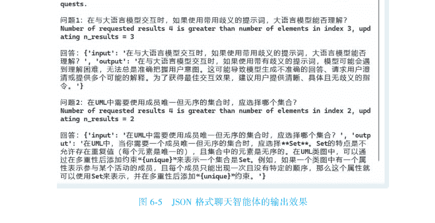

加入测试代码后运行，输出结果会以结构化 JSON 形式返回，如图 6-5 所示。

图 6-5 JSON 格式聊天智能体的输出效果

本示例已覆盖构建知识库的核心流程。落地到实际业务时，要依据知识来源不同调整或补充知识获取方式；同时，示例中的向量库体量较小，生产环境建议替换为更合适的向量数据库产品。

## 6.4 智能旅行规划助手——自定义智能体

前文已经介绍了 LangChain 支持的两种常见智能体，多数场景下已能满足需求。但当面对特殊业务要求，或希望完全自主设计智能体时，就需要从底层着手自行编写代码。

本节演示如何基于 LangChain 的基础组件打造一个自定义智能体。自定义方案的核心框架由自己编码实现，同时复用 LangChain 的基础能力。当然这并非唯一路线，若有特殊限制，也可以脱离 LangChain，完全自研智能体的全部功能。本节仍以智能旅行规划助手作为落地方案展开。

### 6.4.1 辅助类实现

要让自定义智能体更易落地，首先需要实现一批周边辅助类，用来支撑核心逻辑并降低实现复杂度。

#### 1. 行动类（Action）

智能体推理时需要不断采取行动来获取信息或改变环境状态，绝大多数行动都依赖外部工具的执行结果。因此设计一个行动类来统一承载工具名称和参数，便于传递和管理。

有了行动类，智能体的每一步行动都会被规范化，工具调用所需信息也能被完整、可靠地传递，提升推理和执行的稳定性，也为后续扩展打下基础。

定义 Action 类继承自 BaseModel，包含两个核心字段：name 用字符串记录待调用工具的名称；args 为可选字典，以键值对形式保存工具所需的参数，键为形参名，值为实参。

将 args 设计为可选，是因为并非所有工具都需要入参，部分工具可直接执行。这样的设计让 Action 能适配不同参数要求的工具调用场景。通过 name 和 args 的设定，Action 实例即可精确描述一次工具调用需求。

行决策到执行的各个环节也由此得到支撑，具体代码如下。

```python
from pydantic import BaseModel, Field
from typing import List, Optional, Dict, Any

class Action(BaseModel):
    name: str = Field(description="工具名称")
    args: Optional[Dict[str, Any]] = Field(
        description="工具参数,包含形参名称与实参值")

    def __str__(self):
        ret = f"Action(name={self.name}"
        if self.args:
            for k, v in self.args.items():
                ret += f", {k}={v}"
        ret += ")"
        return ret
```

Action 类还额外实现了 `__str__` 方法，方便把实例直接转为可读字符串，例如用 print 直接输出工具名和参数，无需额外处理。

Action 类的完整实现见源文件 Action.py。

#### 2. 异常类（ActionFormatException）

生成式大模型的输出建立在概率推理之上，结果存在随机性。同一问题可能在语义和格式上都有差异。对自然语言回复而言，细微偏差通常可接受，但涉及行动指令时，若格式不严格符合约定，程序就无法正确解析下一步该做什么，从而导致推理混乱。

因此需要定义一个专用异常，当模型返回的行动指令格式错误时抛出。捕获到该异常后，可立即要求模型修正格式，保证解析和执行的准确性，提升系统的健壮性和用户体验。

定义 ActionFormatException 继承自 Exception，实例化时会在异常信息前补充“Action 指令格式不正确”的说明。具体实现见 myexception 目录下的源文件 ActionFormatException.py。

```python
class ActionFormatException(Exception):
    def __init__(self, value):
        self.value = value
        self.message = f"未能按正确的格式要求生成调用 Action 的指令: {value}."
        super().__init__(self.message)
```

### 6.4.2 辅助函数实战

辅助类用来把智能体的主线流程理顺，而那些与主线关联不强的通用小功能，就交给辅助函数来兜底。这样编码更清爽，用户体验也会更顺手。

#### 1. 命令行彩色输出封装

命令行里，智能体不同状态的日志默认都跑到标准输出，呈现出来就是一成不变的灰白色。

用 Python 输出时，加点颜色转义就能立刻提升辨识度。比如想让一段文字变绿，就可以通过下面的写法实现。

```python
print('\033[32m'+text +'\033[0m')
```

这里的 “\033[32m” 就是绿色控制码，用来把后续文字染成绿色；“\033[0m” 则是重置码，负责把颜色拉回默认，避免污染后面的内容。

加入色彩后，调试时能一眼分辨出信息类型，对理解运行结果很有帮助。智能体里常用的彩色打印封装如下。

```python
# 定义颜色转义序列
BLACK = '\033[30m'
RED = '\033[31m'
GREEN = '\033[32m'
YELLOW = '\033[33m'
BLUE = '\033[34m'
PURPLE = '\033[35m'
CYAN = '\033[36m'
WHITE = '\033[37m'

# 重置颜色的转义序列
RESET = '\033[0m'

def print_default(text, end="\n"):
    print(RESET + text, end=end)

def print_black(text, end="\n"):
    print(BLACK + text + RESET, end=end)

def print_red(text, end="\n"):
    print(RED + text + RESET, end=end)

def print_green(text, end="\n"):
    print(GREEN + text + RESET, end=end)

def print_yellow(text, end="\n"):
    print(YELLOW + text + RESET, end=end)

def print_blue(text, end="\n"):
    print(BLUE + text + RESET, end=end)

def print_purple(text, end="\n"):
    print(PURPLE + text + RESET, end=end)

def print_cyan(text, end="\n"):
    print(CYAN + text + RESET, end=end)

def print_white(text, end="\n"):
    print(WHITE + text + RESET, end=end)
```

具体实现可以参考 color_print.py，基本思路是对常见颜色做成函数，方便按需扩展。

#### 2. JSON 解析工具集

大模型返回的内容里常夹带行动指令，不同模型写法不一，但我们可以要求模型统一用 JSON 描述下一步动作，解析起来会更稳。举个例子：

```json
{
    "Action": "query_adcode",
    "args": {
        "city": "旅行地点"
    }
}
```

键 Action 指向要调的工具名，这里是查询行政编码的 query_adcode；键 args 则是嵌套对象，里面列出工具所需的参数名和参数值。结构清晰，机器好识别。

因此智能体必须能从模型文本里挑出 JSON 字符串并解析出来。

先判断文本里是否包含 JSON，有则提取，没有则跳过。实际场景里，模型回复里可能出现多个 JSON，这时通常只有最后一个是新生成的行动，前面的多为历史记录。为了降复杂度，我们直接取最后一个。

为此准备了 get_last_json，它用正则在文本里找大括号包裹的片段，并返回最后一个匹配结果。

```python
import re

# 取得文本中最后一个 JSON 字符串
def get_last_json(text) -> str:
    # 正则表达式匹配 JSON 字符串
    pattern = r'\{(?:[^{}]*|\{(?:[^{}]*|\{[^{}]*\})*\})*\}'

    # 使用 re.findall 提取所有符合 JSON 结构的部分
    json_strings = re.findall(pattern, text)

    last_json_str = None

    # 如果找到 JSON,提取最后一个
    if json_strings:
        last_json_str = json_strings[-1]

    return last_json_str
```

拿到字符串后下一步是转成对象。Python 的 json.loads 能解析外层，但本设计里的 JSON 是特殊嵌套——args 的值本身也是个 JSON 字符串，并不会自动展开。

于是需要 parse_nested_json 先用 json.loads 解析外层，再遍历每个值，对看起来像 JSON 的字符串继续做一次解析；能解析就替换为对象，解析不了就保持原样。

```python
import json

# JSON 解析
def parse_nested_json(text):
    # 对内层 JSON 的双引号进行转义
    # text = escape_inner_quotes(text)
    try:
        # 解析外层 JSON
        outer_json = json.loads(text)

        # 解析内层 JSON
        for key, value in outer_json.items():
            try:
                value = json.loads(value)
                outer_json[key] = value
            except json.JSONDecodeError as e:
                if has_balanced_braces(value):
                    raise e
        return outer_json
    except json.JSONDecodeError as e:
        raise e
```

解析过程中 json.loads 失败会抛 json.JSONDecodeError。外层的异常我们直接抛给上层处理，内层的异常则做特殊判断：调用 has_balanced_braces 检查字符串里是否包含成对的大括号。若成对存在，说明本应是有效 JSON 但解析失败，继续抛出异常；若没有大括号或不匹配，则视为普通文本，忽略这次异常。

has_balanced_braces 的逻辑很简单：先判断是否包含大括号，再遍历统计左大括号加一、右大括号减一，最后看计数是否为零。

```python
# 检查文本是否包含大括号且配对
def has_balanced_braces(s):
    # 如果字符串中不包含任何大括号,直接返回 False
    if '{' not in s and '}' not in s:
        return False

    # 初始化一个计数器
    brace_count = 0

    # 遍历字符串中的每一个字符
    for char in s:
        if char == '{':
            brace_count += 1  # 左大括号,计数器增加
        elif char == '}':
            brace_count -= 1  # 右大括号,计数器减少

        # 如果在遍历中任何时候右大括号多于左大括号,直接返回 False
        if brace_count < 0:
            return False

    # 最终如果 brace_count 为 0,表示括号匹配,否则不匹配
    return brace_count == 0
```

到这里，JSON 相关的提取与解析就齐了，完整代码见 json_util.py。

### 6.4.3 Action 工具搭建

自定义智能体同样需要一套工具，Action 工具的落地是关键。

#### 1. 用户交互工具

之前的示例在推理期间基本不和用户互动。现在我们想在推理过程中主动提问、补充信息，就需要一个顺手的交互工具。

当前采用命令行交互，工具只需要一个字符串参数 question，用来承载智能体想问的问题。实现上直接用 input 把问题打印出来，等待用户回车提交答案。

作为 Action 工具，还要给大模型看懂工具说明，所以在函数上方加上 @tool 装饰器，并在代码里说明参数用途和功能。

以下是用户交互工具的实现示例。

```python
# 获取用户的输入
@tool
def request_user_input(
    question: Annotated[str, "向用户提问的问题。"]
) -> str:
    """
```

向用户提出问题，获取用户的回答，以补充所需要的信息。

"""

ans = input(f"\n{question}\n")

return ans

```

值得注意的是，当前的实现采用简单的命令行交互界面，但在实际应用中还应结合应用程序的交互形态探索更多样化的交互形式，如图形用户界面（GUI）等，以进一步提升用户体验和智能体的实用性。

#### 2. 其他工具

当前要实现的智能体是此前已通过 ReAct 型智能体形式完成的具有相同功能的智能旅行规划助手。因此，与先前开发的 ReAct 型智能旅行规划助手智能体相似，该智能体同样依赖特定工具获取旅行目的地的天气信息。在必要情况下，当前实现的智能体也需借助搜索工具，从互联网中检索有关旅行目的地的景点详情。

关于搜索工具的选择，可继续使用 Tavily，也可选择其他检索工具或者自行封装实现。至于与查询天气信息相关的两个工具——query_adcode 和 get_wx。这两个工具的实现与 ReAct 型智能旅行规划助手智能体中的实现完全一致，直接复用即可。因此，关于这两个工具的具体实现说明，在此不再赘述。

## ▶▶ 6.4.4 智能体主体实现

本示例程序把即将实现的自定义智能体封装进一个名为 MyAgent 的类中，也就是说，智能体的核心实现代码都将被整合并放置于这个类中。该类将作为智能体功能的主要载体，承载其所有关键逻辑和行为模式。

为了确保智能体能够正常运作，一个智能体至少应当包含生成式 AI 模型代理实例、工具集以及提示词模板这三个基本组成部分。因此，在智能体实例的初始化阶段，必须明确指定这些组件实例，以确保它们能够被正确地集成并发挥作用。

此外，针对不同场景下的具体问题，智能体尝试进行推理所需的步骤可能会有所不同。为避免智能体陷入无休止的推理循环，应用程序应当为其设定一个最大推理步数限制。这一限制的目的是确保智能体在合理的时间内结束推理任务。如果在达到最大推理步数后，智能体仍未能成功完成任务，则系统应当中止当前推理过程，并宣告该任务失败，让用户重试或者放弃该任务。

综上所述，在智能体实例的初始化过程中，除需要指定模型、工具集以及提示词模板的实例外，还需要明确设定一个合理的最大允许推理步数，以确保智能体能够在可控的范围内结束其推理任务。因此，类 MyAgent 的构造器__init__实现代码如下。

```python

def __init__(
    self,
    llm: BaseChatModel,
    tools: List[BaseTool],
    prompt: str,
    max_steps: Optional[int] = 10,
):
    self.llm = llm
    self.tools = tools
    self.max_steps = max_steps
    self.verbose=False
    tool_names=','.join([tool.name for tool in tools])
    self.prompt = ChatPromptTemplate.from_messages(
        [
            MessagesPlaceholder(
                variable_name="long_term_memory"
            ),
            HumanMessagePromptTemplate.from_template(
                prompt
            ),
        ]
    ).partial(
        tools=render_text_description(tools),
        tool_names=tool_names,
    )

# 工具调用推理循环解析
要让模型在多步任务里自行规划并调用工具，核心是构建一个可迭代的思考-行动闭环。实现上通常把一次完整任务拆成单次对话生成、指令解析、工具执行、记忆回写四个环节。下面这组片段展示了该闭环的关键实现，调用结构与原实现保持一致，解读文字已重新组织。

```

在设计智能体时，通常会设置一个开关变量，该开关变量的作用在于控制智能体运行进程中是否展示中间结果。按照习惯，这个变量通常被命名为 verbose，并且在初始化时将其默认值设定为 False。本示例智能体在设计时也遵循这一惯例。

具体来说，verbose 变量作为一个开关，当它被设置为 True 时，智能体会在运行过程中输出详细中间结果，例如思考过程、工具调用指令、工具执行结果等，这有助于开发人员对智能体进行调试和追踪智能体行为。而当它被设置为 False 时，智能体只会输出必要的结果，不再输出中间结果和调试信息，以便更清晰地展示运行结果并提高运行效率。这种设计方式在智能体开发中十分常见，它提供灵活的控制手段，使得开发人员可以根据需要选择是否展示中间结果。当然，具体哪些信息在 verbose 为 True 时进行输出，也是设计师和开发人员在设计和实现智能体的过程中所要考虑和决定的事情。

此外，初始化方法还通过 ChatPromptTemplate 实例化了提示词。该提示词包含一个长时记忆占位符，该占位符在智能体运行时根据场景需要选择全部或部分上下文内容进行替换，从而确保智能体与生成式 AI 模型对话的连贯性和一致性。提示词的另一个关键组成部分是提示词模板，该模板通过提示词工程编写，它是引导智能体按特定思维模式进行推理的关键所在。在加载提示词模板时，通过 partial 方法同步替换模板中的工具及工具名称等占位符，以确保模型能够正确使用这些工具进行推理和响应。

智能体在执行任务的过程中需要频繁与模型进行交互。因此，有必要将每次交互的代码逻辑抽象为一个独立方法。这一做法可以有效抽象与模型交互的处理逻辑，简化代码、提高代码可维护性和可读性。

智能体的__step 方法实现与模型进行单次交互的具体代码逻辑细节。
__step 方法的形式参数包含三个组成部分：待解决问题（question）、短时记忆（short_term_memory）以及长时记忆（long_term_memory）。

待解决问题 question 指的是用户输入的、需要智能体进行推理与解答的具体问题或任务。这些问题或者任务通常需要智能体通过一系列推理才能完成，但在每次与模型的交互中都需要将它传入，以便使模型清楚最终要解决的问题或者要完成的任务是什么。

短时记忆 short_term_memory 的作用是存储智能体在一次完整的推理任务中与模型交互产生的所有历史信息。一次推理任务的交互次数最多不超过在__init__方法中所设定的 max_steps。短时记忆提供当前推理进程的上下文，它是确保推理任务的每一步都能在上一步的推理基础上顺利继续推进的关键所在，它使得智能体能够连续、有效地处理复杂的推理过程。

长时记忆 long_term_memory 用于存储智能体运行期间用户提出的每一个问题或任务，以及智能体针对这些问题或任务给出的最终回复。长时记忆的存在，使得用户在获得某个问题或任务的解决方案后，能够基于该方案进行进一步的追问或提出新要求。这种记忆机制极大地增强了智能体的交互性和实用性，为用户提供更加灵活和便捷的问题解答体验。

__step 方法的实现代码如下。

```python

# 与模型进行一次交互

def __step(self,

           question: str,

           short_term_memory: List[str],

           long_term_memory: ChatMessageHistory,

           ) -> Tuple[List[Action], str]:

    """执行一次与大模型的交互"""

    inputs = {

        "input": question,

        "agent_scratchpad": "\n".join(str(short_term_memory)),

        "long_term_memory": long_term_memory.messages,

    }

    chain = self.prompt | self.llm | StrOutputParser()

    response = ""

    for s in chain.stream(inputs):

        response += s

        if self.verbose:

            print_green(s, end="")

    # 将响应加入短时记忆

    short_term_memory.append(response)

    # 抽取响应中的行动项

    actions = self.__extract_actions(response)

    return actions, response

```

上述代码首先将待解决问题（question）、短时记忆（short_term_memory）以及长时记忆（long_term_memory）整合并构造为一个字典变量 inputs，以便将其作为后续链处理的输入数据。

随后，代码利用 LangChain 框架的链式特性，将提示词（prompt）、大语言模型（llm）以及字符串输出解析器（StrOutputParser）通过符号“|”依次连接构建成一条完整的处理链。一旦链构建完成，代码便采用流式处理的方式调用该链，并将此前构造的字典变量 inputs 作为输入数据传入链中进行处理。

代码最后部分则先将模型反馈的结果追加到短时记忆变量 short_term_memory 中。接着调用方法 __extract_actions 从反馈结果中提取出当前需要采取的行动。最终，将提取出的行动与模型的完整反馈结果共同作为方法的返回值返回给调用者。

上述 __step 方法调用了另一个方法 __extract_actions，它用于从模型的反馈结果中提取出需要采取的行动。该方法的逻辑很简单，仅调用另外两个方法 __extract_python_actions 和 __extract_json_action 进行具体的行动指令提取。具体代码如下。

```python

# 提取行动指令

def __extract_actions(self, text: str) -> List[Action]:

    actions = self.__extract_python_actions(text)

    action = self.__extract_json_action(text)

    if action:

        actions.append(action)

    return actions

```

__extract_python_actions 方法用于从模型返回结果中抽取以 Python 格式呈现的指令。然而，当前智能体实现示例设定了一个明确要求，即模型应当仅以 JSON 格式返回指令。因此，一旦模型返回 Python 格式表示的指令，方法 __extract_python_actions 会立即抛出一个类型为 ActionFormatException 的异常。随后，这一异常将会被上层代码所捕获。在捕获到该异常后，上层代码会采取相应处理措施，通常是要求模型重新生成并返回符合预设要求的 JSON 格式指令。

当然，在实际应用场景中，为进一步提升智能体运行效率，也可以考虑放宽对指令格式的限制，允许 Python 格式行动指令存在。若采取这一策略，那么 __extract_python_actions 方法就需要进行相应调整，其代码要实现对 Python 格式指令的有效提取与解析。这样的设计调整能够保证智能体功能完整性，同时又提升其灵活性和适应性，从而更好地满足实际应用中的模型返回指令格式可能存在的不确定性。该方法的具体代码如下。

```python

# 提取 python 格式指令

def __extract_python_actions(self, text: str) -> List[Action]:

    if text.find("tool_call") >= 0:

        raise ActionFormatException(

            "不要使用 tool_call 的形式发起工具调用。"

        )

    return []

```

__extract_json_action 方法用于从模型返回结果中提取以 JSON 格式表示的指令，这种格式也是当前示例智能体唯一允许的格式。它的代码逻辑是先调用前述完成的 JSON 函数集中的函数 get_last_json 取得模型返回结果中最后一个 JSON 串，然后继续调用 JSON 函数集中的函数 parse_nested_json 将其转换为 JSON 对象，最后使用这个 JSON 对象生成行动类 Action 的实例并将该实例作为函数的返回值返回给调用者（这里的调用者是方法__extract_actions）。

方法__extract_json_action 的实现代码如下。

```python

# 提取 JSON 格式指令

def __extract_json_action(self, text: str) -> Action:

    last_json = get_last_json(text)

    if last_json:

        try:

            # 转换成 JSON

            json_data = parse_nested_json(last_json)

            # 创建 Action 实例

            action = Action(name=json_data['Action'],

                            args=json_data['args'])

            return action

        except json.JSONDecodeError as e:

            raise ActionFormatException(e)

        except TypeError as e:

            raise ActionFormatException(e)

    else:

        return None

```

至此，实现单次与生成式 AI 模型交互的方法__step 及其相关联方法已经介绍完毕。然而，要完成一个完整任务的推理需要多次调用方法__step，当前示例通过 invoke 方法完成一次完整任务推理逻辑，也就是说方法 invoke 会反复调用__step，直到任务完成或者达到预设的最大允许步数而中止任务。

方法 invoke 的参数主要包括待解决问题（question）和长时记忆（long_term_memory）。此外，还可以通过参数 verbose 来改变在智能体实例化时对是否输出中间结果的设定。

invoke 方法的实现代码如下。

```python

# 推理任务

def invoke(self,

          question: str,

          long_term_memory: ChatMessageHistory,

          verbose=False,

          ) -> str:

    self.verbose = verbose

    # 初始化短时记忆：记录推理过程

    short_term_memory = []

    # 思考步数

    step_count = 0

    # 最终回复

    reply = ""

    if self.verbose:

        print_yellow(f"\n 当前长时记忆:\n{long_term_memory}\n")

    while step_count < self.max_steps:

        step_count += 1

        if self.verbose:

            print_green(f"\n\n【开始第{step_count}轮思考】\n")

            # print_yellow(f"\n 当前短时记忆:\n{short_term_memory}\n")

        try:

            actions, response = self.__step(

                question=question,

                short_term_memory=short_term_memory,

                long_term_memory=long_term_memory,

            )

        except ActionFormatException as e:

            observation = f"""你应当以合法的 JSON 格式返回工具调用指令。

                参考以下错误信息修正调用指令:{e}"""

            short_term_memory.append(observation)

            if self.verbose:

                print_red("\n 工具调用指令格式错误,要求修正后调用")

            continue

        if actions is None or len(actions) == 0:

            break

        for action in actions:

            # 执行动作

            observation = self.__exec_action(action)

            short_term_memory.append(

                f"工具[{action.name}]执行结果:{observation}"

            )

            if self.verbose:

                print_cyan(

                    f"\n 工具[{action.name}]执行结果:{observation}\n"

                )

    if step_count >= self.max_steps:

        # 如果步数达到上限,返回错误信息

        reply = "抱歉,我未能完成任务,请您重新提交您的问题。"

    else:

        reply = response

    # 更新长时记忆

    long_term_memory.add_user_message(question)

    long_term_memory.add_ai_message(reply)

    return reply

```

从上述代码可以看到 invoke 方法的核心逻辑相对简单。它在一个最多执行 max_steps 次的循环结构中反复调用__step 方法。每次调用__step 方法后，代码会检查返回结果中是否存在需要采取的行动。若不存在，则表明当前任务已推理完成并获得最终结果，循环随即结束；反之，则通过__exec_action 方法执行相应行动，并将行动的结果追加到短时记忆（short_term_memory）中，随后系统进入下一次循环，继续调用__step 方法以进一步推进任务的推理进程。

在调用__step 方法的过程中，代码会捕获可能抛出的 ActionFormatException 异常。一旦这类异常发生，代码会在短时记忆中添加行动指令格式不正确的信息，以便在下一轮与模型的交互时，提示其生成符合格式要求的行动指令。

循环结束后，代码会通过对比已完成的循环次数与预设的最大允许步数 max_steps 判断任务是正常结束还是未能如期完成。随后，将任务的问题及获得的结果保存到长时记忆（long_term_memory）中，以便用户在后续追问或修改意图时作为上下文供智能体参考。

在 invoke 方法的最后，代码将模型最后一次的反馈或未能完成任务的消息作为返回值返回给调用者。

如上所述，在调用 invoke 方法时，如果模型的反馈中包含行动指令则会触发执行__exec_action 方法以采取相应行动。__exec_action 方法被设计为每次仅执行单一行动。在上述 invoke 方法的代码逻辑中，鉴于可能存在多个需要依次采取的行动，因此采用 for 循环来逐一执行这些行动。然而，需要特别提醒读者注意的是，前述__step 方法的实现仅提取一个行动，这意味着在此场景下，尽管存在循环结构，但实际上该循环最多只会执行一次。

在实际应用场景中，应确保方法 invoke 与__step 在行动处理逻辑上的一致性，开发人员可以根据实际需求调整代码逻辑。例如，扩展__step 方法，令其能够同时提取多个行动指令。

__exec_action 方法的代码如下，它的主要参数是表示待采取行动的 Action 实例。

```python

# 执行行动

def __exec_action(self, action: Action) -> str:

    if action is None:

        return f"Error: 工具名称不能为空。"

    tool_name = action.name

    tool = None

    for t in self.tools:

智谱大模型快速上手：搭建可对话智能体与图文交互

想把 glm 系列模型快速跑起来做实战，核心就两件事：先把环境和模型初始化好，再把工具、提示词和交互流程串起来。下面是一套可以直接复用的骨架，第一部分是基于 LangChain 的智能体，第二部分是用官方 SDK 做轻量视觉对话。

先加载环境变量并指定模型，这里采用智谱的 ChatZhipuAI，并把温度调到 0 以保证输出稳定。注释里保留了 OpenAI 的写法，方便切换。
```

## 6.4.5 提示词

与其他类型智能体一样，在自定义智能体中，提示词同样扮演着重要角色。它就像思维方式指南，引领生成式 AI 模型按照预设路径进行思考，从而决定智能体的推理模式与推理过程。

针对当前要完成的自定义智能体——智能旅行规划助手，提示词的首要任务便是明确设定智能体的角色定位，并阐述其完成任务应遵循的思维逻辑，以便为用户量身定制旅行规划。同时，提示词还需说明可使用工具及代表备选工具集的占位符 {tools}（如前所述，提示词中的占位符在智能体实例初始化时将在构造器方法 __init__ 中被逐一替换）。

紧接着，提示词进一步细化解决问题的流程，包括中间结果呈现方式以及最终结果输出要求。而对于在推理过程中返回的行动指令，提示词明确要求采用 JSON 格式进行说明，并提供了一个具体样例（即少样本），以供模型参考。

最后，提示词明确模型当前要解决的用户问题。在这一环节，应确保与提示词前半部分的描述与要求保持高度一致。并且，提示词分别引入占位符 {input} 代表待解决的旅行规划问题，{agent_scratchpad} 代表一轮任务推理过程中的所有交互信息（即作为短时记忆的载体），以及 {long_term_memory} 代表用户提出的每个问题及智能体给出的最终规划结果。

通过上述提示词设计思路完成的提示词将引导智能体在解决问题的过程中，尽量遵循预先设定的思路指引为用户提供精准、高效的旅行规划服务。最终的提示词如下。

> 你是强大的 AI 出行助手，可以使用工具与指令自动化解决问题。
你首先应当从用户的问题中提取出用户想要去旅行的地点、开始时间及旅行时长。
然后分别调用工具查询旅行地点的天气、景点，然后结合天气与景点信息按旅行时间安排具体行程，行程必须按天规划，每天行程包含天气概况和具体景点。
在思考过程中，天气及景点信息必须使用以下工具进行查询获取，严格禁止假想或者编造数据。
{tools}
其他信息由大模型直接推理即可。
使用以下过程解决问题，并按以下格式使用中文进行输出：
* 用户需求 *：用户输入的旅行需求你必须解决并安排行程。
* 关键信息 *：从用户需求中提取的旅行地点、开始时间、旅行时长以及在思考过程中调用工具获得的 adcode、天气、景点。如果用户未提供开始时间，则认为是从明天开始；如果用户未提供旅行时长，则你根据旅行地点景点数量自行指定时长；如果用户未指定旅行地点，则你需要直接询问用户获得旅行地点并等待用户的输入，而不是假设旅行地点，也不要使用任何工具获取它。
* 信息查询 *：将旅行地点作为参数调用工具"query_adcode"，以获得旅行地点的 adcode。工具必须是 [{tool_names}] 中的一个且每次仅能包含一个工具调用，并且必须以形如 {"Action": "query_adcode", "args": "{"city": "旅行地点"}"} 的 JSON 格式输出，在不需要调用工具时请不要使用 JSON 格式。然后你暂停思考，并将工具调用信息返回给用户，用户端执行工具获得结果后，用户端会向你提交结果，然后你再继续下一步的思考。不要重复使用相同参数调用同一工具，不要在回复中再次提及历史工具调用信息。
*获取信息*：上一步中指定工具由客户端执行的结果。你要根据这个执行结果继续思考。
重复以上"信息查询"与"获取信息"，以 adcode 作为参数继续调用查询天气的工具"get_wx"，获取天气信息。
重复以上"信息查询"与"获取信息"，调用检索工具"tavily_search_results_json"，获取旅行地点的景点信息。如果必要，可以多次进行检索。
*最终规划*：通过以上步骤获取了天气、景点、旅行时长信息，你综合这些信息给出旅行的最终行程规划，并以整理良好的格式进行输出。在需要调用工具获取信息时不要输出，仅在已经获得最终结果时输出。

开始！
* 用户需求 *：{input}
* 关键信息 *：{agent_scratchpad}
* 此前任务结果 *：{long_term_memory}

## 6.4.6 主程序实现及智能体运行

为了运行自定义智能体，还需要编写一个主程序，该程序负责初始化生成式 AI 模型、工具集，并向智能体传递待解决的用户问题。
首先，需要构建生成式 AI 模型实例，这一步骤与前述示例程序一致，具体代码如下。

```python

from dotenv import load_dotenv, find_dotenv

_ = load_dotenv(find_dotenv())

# from langchain_openai import ChatOpenAI

# llm = ChatOpenAI(temperature=0)

from langchain_community.chat_models import ChatZhipuAI

llm = ChatZhipuAI(temperature=0, model="glm-4-plus")

工具是智能体的能力来源。先引入 Tavily 搜索，再接入自研的微信查询、区划编码查询、日期获取和人工输入请求，统一收进一个列表供后续调用。
```

紧接着，需要构建智能体运行所需的工具集，具体代码如下。

```python

# 构建工具集

from langchain_community.tools.tavily_search import (

    TavilySearchResults

)

search = TavilySearchResults()

from tools.amap import get_wx

from tools.excel import query_adcode

from tools.comm_utils import get_current_date

from tools.comm_utils import request_user_input

tools = [query_adcode,

         get_wx,

         search,

         request_user_input,

         get_current_date]

提示词单独放在文件里管理，运行时直接读取，保持代码干净。
```

注：以上述形式构建工具集时，检索工具 Tavily 的 name 为 tavily_search_results_json。
随后，提示词模板将通过文件读取的方式载入内存，为后续的智能体运行提供必要的指导。
代码如下。

```python

with open("prompt.txt", 'r', encoding='utf-8') as f:

    prompt = f.read()

有了模型、工具和提示词，就能实例化自定义的 MyAgent。
```

在准备好模型实例、工具集以及提示词模板后，就可以着手构建自定义智能体实例了。具体代码如下。

```python

agent = MyAgent(llm=llm,

                tools=tools,

                prompt=prompt)

最后做一个简单的命令行循环，维护对话历史，输入 quit 即可退出，回复会原样打印出来。
```

此后，还需要构建一个 ChatMessageHistory 实例，以充当智能体的长时记忆对象。
最后，在通过用户交互界面（在本示例程序中为命令行界面）获取用户输入的问题后，应用程序将调用智能体的 invoke 方法，启动智能体开始推理解决用户提出的问题。为方便用户在获得智能体的初次回答后能够继续追问或继续提出新的问题，示例程序设计了一个循环模式的用户交互流程，确保用户能够持续与智能体进行对话。具体代码如下。

```python

chat_history = ChatMessageHistory()

while True:

    question = input(

        f"\n========================\n 请输入您的问题(quit 退出):"

    )

    if question.strip().lower() == "quit":

        break

    reply = agent.invoke(question, chat_history, verbose=True)

    print_white(f"\n\n========================\n{reply}")

如果不需要 LangChain 的封装，直接用官方 SDK 也可以更快。同样先加载环境，注释保留了 OpenAI 的示例代码，模型换成支持视觉的 glm-4v-plus。
```

在完成上述主程序代码（完整代码参见源文件 MyAgent.py）的编写工作之后，便可以着手启动自定义智能体，以尝试解决用户旅行需求问题。
例如，在程序运行后，输入需求“明天去北京玩三天”。智能体接收到这一需求后，将其传递给生成式 AI 模型开始展开逐步推理。
智能体第 1 轮思考过程的表现如图 6-6 所示。它通过逻辑推理，明确当前任务是查询旅行目的地城市的 adcode，即北京市的 adcode。据此，智能体以规范的 JSON 格式构建并发出查询北京市 adcode 的行动指令。随后，它调用工具集中的函数 query_adcode，用以查询获取北京市的行政编码 adcode。

在成功获取北京市的行政编码 adcode 之后，智能体将第 1 轮推理行动的结果信息提交给模型，立即进入第 2 轮思考阶段，该推理过程的具体信息如图 6-7 所示。在第 1 轮推理思考过程中，智能体获取 adcode 的目的就是为了进一步获取北京市的天气信息。因而一旦成功获取到 adcode，智能体在第 2 轮推理思考过程中便迅速提出查询北京市天气信息的要求。这一过程体现了智能体在思维与推理上的连贯性。

类似地，在查询到北京市近几日的天气信息后，智能体也将查询获取的天气信息提交给模型，并进入第 3 轮思考。第 3 轮思考过程如图 6-8 所示，这一次智能体推理出的行动是检索北京市的景点信息。因而搜索工具被调用以便从互联网中检索北京市的景点信息。

正如在讨论 ReAct 型智能体示例程序时提及的，景点信息与前述两轮推理思考过程中要求行动获取信息存在一个显著的差异，即景点信息尤其是诸如北京这类大都市的著名景点信息，在模型中实际上已经内化了相关知识。这意味着，生成式 AI 模型在规划参观景点日程时，无须依赖外部搜索便能进行日程的安排。因此，智能体在思考过程中可能会选择不执行搜索而直接进入最终的规划思考阶段。

然而，值得注意的是，由于生成式 AI 模型所依赖的训练数据存在时效性限制，它对于这些景点的最新动态并不了解。生成式 AI 模型对此有着清醒的认识，加上提示词中明确要求检索目标城市的景点信息，因此，即便具备一定的景点知识，它仍大概率会主动要求访问搜索互联网以获取更为详尽的景点信息。更为可贵的是，如果用户需求包含不同类型的景点时，例如人文景点或自然景观，模型还会进一步推理出需要利用多个不同的景点类型作为关键词多次在互联网上进行搜索，以便更全面地收集相关景点信息，从而为用户提供更加精确和完善的旅行规划建议提供充足的信息准备。

经过前三轮推理思考并采取相应的行动后，智能体已经获取旅行目的地的天气与景点信息，基于这些信息智能体便可以进入第 4 轮推理思考开始规划旅行行程。其推理思考过程如图 6-9 所示。

智能体的第 4 轮推理思考已经成功地解决了用户的问题，即“明天去北京玩三天”的用户需求得到圆满解决，因而第 4 轮思考结束后，整个任务宣告结束。主程序输出最终结果，如图 6-10 所示。

在获取智能体所提供的行程规划之后，若用户萌生新的构想，或希望对刚刚生成的行程规划做出若干调整，可以继续向智能体提出相应需求。例如，用户可能要求“将行程延长至四天”或“增加更多自然风光景点的参观”等。随后，智能体将基于先前任务的结果，启动第二轮任务的推理流程，并最终为用户呈现调整后的日程安排。

此外，得益于在智能体中集成了与用户进行交互的工具，当用户输入的需求不够明确时，智能体将能够主动向用户提问以获取更多信息。例如，当用户输入“明天出去玩三天”这样未指明具体地点的需求时，智能体可能会询问用户“您计划前往哪个目的地游玩呢？”或类似的问题，以便明确旅行的具体地点。

鉴于生成式 AI 模型在推理过程中具有概率性特征，每次运行智能体所获得的结果可能会存在差异，甚至截然不同，这完全属于正常现象。但若智能体未能按照预期生成结果，开发人员不仅需要仔细检查智能体的代码实现逻辑是否存在问题，还需要特别关注提示词的编写质量。唯有确保代码逻辑准确无误，且提示词设计得当，方能使智能体圆满地完成特定任务，满足设计期待。

## 6.5 本章小结

本章主要围绕智能体这一重要的生成式 AI 应用程序形态进行深入说明与探讨。LangChain 框架为智能体应用程序提供丰富多样的支持，涵盖多种不同类型的智能体实现。同样，其他类似的开发框架也对智能体的构建与运行给予了充分的支撑与保障。

本章不仅详细展示了如何利用 LangChain 框架快速构建智能体的过程，还深入探讨了如何自主设计并实现一个智能体的方法。通过这一过程，读者可以逐步理解智能体的工作原理及其内在运行机制。

在充分理解智能体的基本理论与实现过程后，当面对具体的应用需求时，读者应依据实际需求，设计符合预期功能与性能的智能体解决方案。这将有助于读者更好地将智能体与传统应用程序相结合，创造出功能更强体验更好的应用程序。

# 第7章 多模态编程——生成式AI的视觉与听觉感知和生成能力

当下，生成式 AI 正迈入多模态编程的新时代，文字、图像、声音、视频等多种信息形式正在交织融合，共同构建智能的多维应用程序。本章将探索多模态这一领域，探索人工智能技术如何模拟并拓展人类的图像、视频、语音感知与生成能力。

## 7.1 图像、视频与语音识别

在信息技术早期阶段，以字符形式显现的文字无疑是信息处理的主要对象。随着科技的不断进步，多媒体形式（主要包括声音、图像以及视频等）逐渐占据日益显著的重要地位。时至今日，语音识别技术已经发展得相当成熟，并被广泛应用于各个领域。随着生成式 AI 技术的迅猛崛起，图像与视频识别及解析技术也取得了突飞猛进的进步。这些技术进步极大地提高了机器的信息理解与信息生成能力，使得人工智能的“聪明程度”更接近人类，人类在这些技术的帮助下可以更加高效、深入的进行信息处理。

### 7.1.1 看图说话——理解图像内容

图像识别技术早已历经多年实践与积淀，从人脸识别、指纹识别、物品识别等静态识别到姿态动作识别等动态识别均已实现广泛的应用与普及。这些技术均以特征识别为核心，通过对图像中特定特征进行提取与分析，实现对目标对象的准确识别与分类。

在此基础上，多模态模型的出现进一步推动了图像识别技术的应用与发展。这一创新性技术不仅能够判别图像类型，更赋予了对图像进行生动描述的能力，实现了类似于人类“看图说话”的技能。

OpenAI 提供的 GPT-4o 等模型、智谱 AI 提供的 GLM-4V-Plus 等模型均具备识别图片、视频等多媒体信息的能力。例如，希望识别图片时，可以通过以下步骤编写程序实现。

首先，依旧是加载环境变量并创建生成式 AI 模型服务客户端，下述代码中同时给出了创建 OpenAI 和智谱 AI 客户端的代码。为了简化后续代码，也预先将即将使用的模型编码存储在名为 model 的变量之中。

```python

from dotenv import load_dotenv, find_dotenv

_ = load_dotenv(find_dotenv())

# from openai import OpenAI

# client = OpenAI()

# model = "gpt-4o"

from zhipuai import ZhipuAI

client = ZhipuAI()

model = "glm-4v-plus"

封装一个统一的 completion 接口，默认温度 0.01，方便后续拼装 messages 调用。
```

随后，遵循先前示例程序惯例，将与模型交互的过程封装到一个专门函数中，以简化与模型进行交互的复杂度，同时可提升代码的可读性和可维护性。具体代码如下。

```python

def get_completion(messages, model="glm-4v-plus", temperature=0.01):

    response = client.chat.completions.create(

        model=model,

        messages=messages,

        temperature=temperature

    )

    return response.choices[0].message.content

最简的交互就是循环读取图片链接和用户文字，空输入跳过，输入 exit 结束程序。
```

在与生成式 AI 模型进行交互时，需要向模型提供提示词以引导其进行响应。在以往纯文本交流的情境中只需简单地输入一段文字，模型便能对这段文字进行语义理解并作出相应回应。然而，当涉及图片解析这一更为复杂的任务时，向模型输入的信息则至少需要包含两项要素：图片本身以及用户意图。图片作为解析任务的被解析对象，是模型进行视觉分析和理解的基础和信息来源，故而模型需要接收图片，以提取其中的关键信息和特征。与此同时，用户意图则是对模型行为的一种指导和约束，它告诉模型需要从图片中获取哪些信息，或者希望模型根据图片中的信息进行什么样的推理生成任务。

因此，程序代码需要包含接收图片和解析意图两项输入内容。网络图片可以使用其 URL 地址作为输入，本地图片则可以将其转换为 BASE64 编码格式数据提交给模型。以下示例代码采用接收图片 URL 地址的方式实现，使用本地图片方式的代码实现稍后说明。应用程序在接收到图片 URL 后，继续让用户输入其意图。

在获得图片信息与用户意图之后，程序就可以着手组装消息（messages），以便将其提交给模型进行分析与处理。相较于前述纯文本交互场景，这一过程的主要区别在于在构建消息时需要明确指定消息类型（type）。

具体来说，对于存储于网络的图片应将其消息的 type 设定为 “image_url”，随后通过键名为 “image_url” 所对应的值说明图片 URL 地址。而对于以文本形式表达的用户意图则需将消息的 type 指定为 “text”，并通过键名为 “text” 所对应的值保存表达用户意图的文本。为更直观地理解消息组成，可参见随后给出示例代码中变量 messages 的构建情况。

将图片 URL 和用户意图组装到消息中后，便可以调用此前封装的函数 get_completion 与模型进行交互。

上述流程的示例代码如下。

```
while True:

    image_url = input("请输入图片 URL(输入'exit'退出程序): ")

    if image_url is None or image_url == "" :

        continue

    elif image_url.lower() == 'exit':

        print("程序退出。\n")

        break

    user_input = input("请输入提示文字(输入'exit'退出程序): ")

# 多模态交互速览

一个循环里串起图文问答、历史消息累加、本地图片 Base64 传输、视频链接引用和 Whisper 音频转写。空白输入自动跳过，输入 exit 则结束运行并给出提示。模型调用统一使用 temperature 0.7，返回结果被分隔符包围，方便核对。

    if user_input is None or user_input == "" :

        continue

    elif user_input.lower() == 'exit':

        print("程序退出。\n")

        break

    else :

        messages=[

            {

                "role": "user",

                "content": [

                    {

                        "type": "image_url",

                        "image_url": {

                            "url" : f"{image_url}"

                        }

                    },

                    {

                        "type": "text",

                        "text": f"{user_input}"

                    }

                ]

            }

        ]

        res = get_completion(messages=messages, model=model, temperature=0.7)

        print("===大语言模型 completion;===")
        print(res)
        print("================END================\n")

```

至此，解析图片的代码编写完成，完整代码可参见源文件 image2text_simple.py。

尝试运行该程序，程序首先提示要输入图片的 URL。假设如图 7-1 所示图片存储在网络上的某个位置（参考图 7-2 中的输入），可将这个网络地址输入。


图 7-1 待解析的图片（来源：AI 生成）

随后输入意图“描述这张图片”。
程序将上述两条输入组合成消息后提交模型进行处理，片刻后程序就输出模型对图片的描述文字。
上述交互的完整过程如图 7-2 所示。从程序运行结果来看，模型能够准确地描述出图片所展现的场景，而且语言组织与表达能力也相当不错。

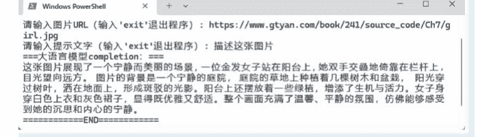

图 7-2 描述单张图片

描述图片是对图片进行解析最基本的要求，也是模型能够理解图片的表现。结合生成式 AI 模型的“生成”能力，其实可以围绕图片让模型做更多工作，例如就本例而言，可以在指定图片 URL 后要求模型根据图片展现的场景写一篇小说。某次运行效果如图 7-3 所示。
由图 7-3 运行结果可知，上述示例程序针对一张图片完成了一个任务，而结合此前已经掌握的对话编程技术，还可以基于上下文围绕图片展开多轮对话。
为实现围绕图片进行的多轮对话功能，需要对上面的示例代码进行适当扩展。扩展逻辑主要包含以下两个方面：首先，在每次接收到模型的回复后，需要将该回复添加到对话消息列表；其次，需要构建一个能够持续接收用户输入的循环结构，并将用户输入同样添加到对话消息列表。
在原有示例代码的尾部追加以下代码段，即可实现一个能够围绕图片进行多轮对话的应用程序。

—— 生成式 AI 应用开发实战：基于智谱 AI 与 DeepSeek

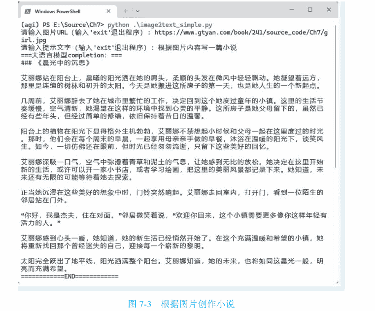

图 7-3 根据图片创作小说

```

messages.append(

    {

        "role": "assistant",

        "content": f"{res}"

    }

)

while True:

    user_input = input("请输入提示文字(输入'exit'退出程序): ")

    if user_input is None or user_input == "" :

        continue

    elif user_input.lower() == 'exit':

        print("程序退出。\n")

        break

    else :

        messages.append(

            {

                "role": "user",

                "content": f"{user_input}"

            }

        )

```

198

## 第 7 章 多模态编程——生成式 AI 的视觉与听觉感知和生成能力

```

    }

)

res = get_completion(messages=messages, model=model, temperature=0.7)

messages.append(

    {

        "role": "assistant",

        "content": f"{res}"

    }

)

print("===大语言模型 completion:===")
print(res)
print("==================END==================\n")

```

运行修改完成的程序（完整代码参见源文件 image2text_session.py），并围绕图片本身连续提问，可以看到程序给出了令人满意的回复。其实际运行效果如图 7-4 所示。

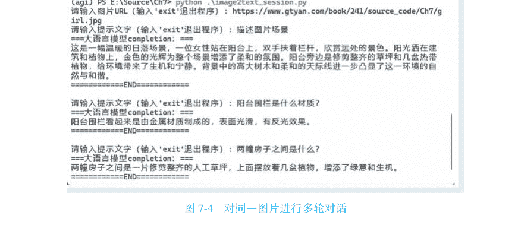

上述示例程序成功地解析了网络上存在的图片。然而，在实际应用场景中，并非所有情况都允许或便于将图片上传至网络，更多时候，这些图片保存在本地设备。因此，程序必须具备解析本地图片的能力。为解决这一问题，可以采取的策略是将本地图片文件数据转换成 BASE64 编码格式数据，然后再将编码后的数据提交给大型模型进行处理。

修改上述示例代码，首先将输入图片 URL 的代码改为输入图片路径，具体代码如下。

```

while True:

    image_path = input("请输入图片路径(输入'exit'退出程序)：")

    if image_path is None or image_path == "":

        continue

    elif image_path.lower() == 'exit':

        print("程序退出。\n")

```

```

exit

else:

    break

```

随后，程序读取输入图片文件数据，并将其转换为 BASE64 编码格式数据，具体代码如下。

```

import base64

with open(image_path, 'rb') as img_file:

    img_base = base64.b64encode(img_file.read()).decode('utf-8')

```

最后，在构建发送给模型的消息时，将 “image_url” 中的 “url” 值指定为刚刚获得的 BASE64 编码格式数据即可，具体代码如下。

```

messages=[

    {

        "role": "user",

        "content": [

            {

                "type": "image_url",

                "image_url": {

                    # "url" : f"data:image/jpeg;base64,{img_base}"
                    "url" : img_base

                }

            },

            {

                "type": "text",

                "text": f"{user_input}"

            }

        ]

    },

]

```

注：使用 OpenAI 的模型时，需要在 BASE64 格式数据前加 “data:image/jpeg;base64,”。

运行修改完成的代码（完整代码参见源文件 image2text_base64.py），输入本地图片路径名称以及对图片的解析要求。稍候片刻，便可以看到模型返回了对图片的描述。运行过程及模型对图片的描述结果如图 7-5 所示。

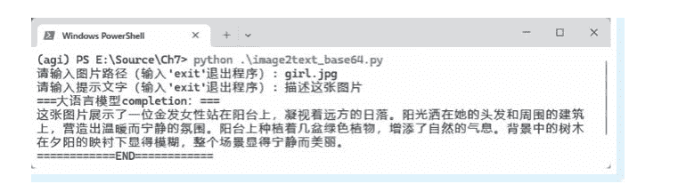

图 7-5 描述本地图片

## ▶▶ 7.1.2 替你刷视频——理解视频内容

模型具备对图片的理解能力是人工智能领域的一项突破。一方面是因为这标志着模型在视觉理解领域进入新的阶段；另一方面，动态的视频本质上是由一连串连续的图片（即帧）构成的。因此，一旦模型能够精准地理解每一帧图片的内容与含义，它便能进一步解析并理解整个视频的内容。

正是鉴于图片理解与视频理解之间存在着这样的高度关联性，应用程序可以从视频中抽取若干帧（画面），并将这些帧（画面）提交给模型进行阅读分析。在获取每一帧（画面）的解析结果后，再将这些解析结果按顺序整合并再次提交给模型，模型按时间线对视频帧的静态描述结果进行理解并建立关联，从而实现对连续视频内容的全面理解。也正是由于这一逻辑存在，截至本书完稿之时，OpenAI 尚未直接提供对视频进行解析的原生支持。在其官方指南中，推荐做法也是通过本地应用程序先对视频进行帧抽取，随后再调用模型对抽取出的帧分别进行解析再对结果进行整合，以此作为完成视频解析任务的技术路径。

智谱 AI 则提供直接对视频进行解析的支持，其代码实现逻辑与对图片实现解析几乎如出一辙，唯一差异仅在于构建提交给模型的消息时，将表示图片 URL 的 “image_url” 替换成表示视频 URL 的 “video_url” 即可。

可以基于前述图片解析示例程序修改实现视频解析程序，主要修改内容为 messages 构建部分，修改后的代码如下。

```

messages=[

    {

        "role": "user",

        "content": [

            {

                "type": "video_url",

                "video_url": {

                    "url": f"{video_url}"

                }

            },

            {

                "type": "text",

                "text": f"{user_input}"

            }

        ]

    }

]

```

运行上述修改完成的程序（完整代码参见源文件 video2text_session.py）即可实现对输入视频的解析。

与图像解析类似，同样可以通过将本地视频文件数据转换为 BASE64 编码格式数据的方式来实现对本地视频文件的解析功能。即先读取视频文件并对视频数据进行 BASE64 格式的编码处理，然后在构建消息时，将“video_url”的“url”值替换为BASE64编码格式的视频数据即可。修改完成的程序源代码可参阅源文件video2text_base64.py。

运行修改完成的视频解析程序，给出一个网络视频URL或本地视频路径与文件名称及与视频相关的问题，如图7-6所示，可以看到除最后一个问题有待商榷外，模型正确地回答了其余的问题。

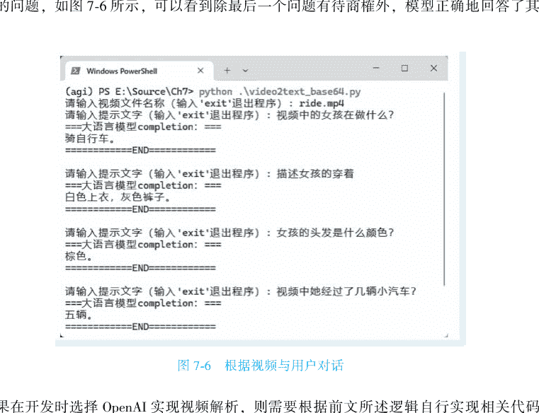

如果在开发时选择OpenAI实现视频解析，则需要根据前文所述逻辑自行实现相关代码，读者可自行尝试，本书不再赘述。

## ▶▶ 7.1.3 会议秘书——语音识别

语音识别技术相较于图像识别技术更早地迈入实用化与商用化的阶段。在当今社会，众多智能设备，无论是手机、平板电脑、智能家居系统，还是智能汽车等，均已能够通过语音接收用户指令。这些设备不仅具备识别语音中所蕴含语义的能力，更进一步，它们还能够识别声音的独特声纹特征，从而精准地判断指令是否真正源自其合法主人。

语音识别技术的不断进步，极大地提升了用户交互的便捷性与安全性。随着生成式AI模型特别是多模态模型的涌现，语音识别技术的应用前景愈发广阔。这些模型不仅增强了语音识别的准确性，还使得智能设备能够更好地理解复杂语音指令。智能设备结合语音生成能力甚至能够与人类进行一定程度的自然语言对话，为用户提供更加智能化、个性化的服务体验。可以预见，语音识别技术未来将在更多领域发挥重要作用，持续推动智能科技蓬勃发展。

时至今日，市场上已经涌现众多性能卓越、表现优异的语音识别引擎，供用户根据自身需求进行选择和应用。与此同时，生成式AI正逐渐展现出其强大的“端到端”能力，即处理复杂任务时，能够直接从输入端到输出端进行高效、准确的映射，无须经过烦琐的中间步骤，因而这也要求模型具备语音识别与处理能力。在这一背景下，一些领先的人工智能公司，如 OpenAI，已经发布或集成诸如 Whisper-1 等先进的大规模语音识别模型。

本节将使用 Whisper-1 模型实现示例程序，展示其语音识别能力。首先，依然是导入环境变量以获取 OpenAI 的 API KEY，随后构建 OpenAI 的模型服务客户端并设定模型变量 model 为 whisper-1。具体代码如下。

```

from dotenv import load_dotenv, find_dotenv

_ = load_dotenv(find_dotenv())

from openai import OpenAI

client = OpenAI()

model = "whisper-1"

```

随后，程序需要接收用户输入的音频文件路径与名称。程序成功打开该文件后，调用 OpenAI 模型服务客户端的方法 audio.transcriptions.create 进行语音识别。在此过程中，代码明确指定模型编码为 whisper-1，并将之前打开文件时获得的文件句柄作为参数传入，以便模型能够获取并识别该音频文件中的语音内容。最后使用 print 输出识别出的文字。具体代码如下。

```

while True:

    file_path = input("请输入音频文件路径名称(输入'exit'退出程序): ")

    if file_path is None or file_path == "":

        continue

    elif file_path.lower() == 'exit':

        print("程序退出。\n")

        break

    else:

        with open(file_path, "rb") as audio_file:

            transcription = client.audio.transcriptions.create(

                model=model,

                file=audio_file

            )

            print(transcription.text)

# 双线程实时语音转写实践

做本地实时转写时，常见做法是让音频采集和文本识别各自运行，通过队列衔接形成生产者消费者。采集端持续从麦克风读取 PCM，按预设时长累积成一段 wav 写入临时目录，生成的文件路径随后放入队列；识别端阻塞等待队列，一有新文件就调用 Whisper-1 完成转写并立即打印结果，转写结束后清理临时文件。入口先创建临时目录、队列和停止标志，启动采集与转写两个线程，按下 Ctrl+C 时触发停止信号，等待两端收尾后退出。

下面还附带一个跨平台图像模型切换的小片段，用 supplier 变量在 OpenAI 的 DALL·E 3 与智谱 CogView-3-Plus 之间选择，并据此实例化客户端和调用入口。

```

运行上述代码（完整代码请参见源文件 audio2text.py），输入 mp3、mp4、mpeg、mpga、m4a、wav 或 webm 等格式音频文件的路径与名称，稍等片刻，程序便会输出从音频文件中识别出的文字，其具体效果如图 7-7 所示。从图中可以清晰地观察到该语音识别模型识别文字准确性很高。值得一提的是，whisper-1 模型支持包括英语、汉语、日语、法语等在内的近 60 种语言，功能十分强大。

然而，在汉语应用场景下，模型 whisper-1 的表现并非始终尽如人意。为更直观地说明这一点，可以再次运行上述示例程序，并输入一个朗诵古诗（最好是较为鲜为人知的诗篇）的音频文件。例如输入朗诵《赋得古原草送别》的音频文件，模型 whisper-1 识别结果如图 7-8 所示，从图中可以明显看出，其识别效果并不理想，存在相当大的偏差（当然，如果此时换成一个不知道该古诗的人进行听写，结果也不会理想）。因而在具体应用时，一方面应根据应用场景选择合适的模型；另一方面，也可以增加一个文本修正环节，即将语音识别模型识别出的文字提交给生成式 AI 模型进行修正，进而获得正确文本。

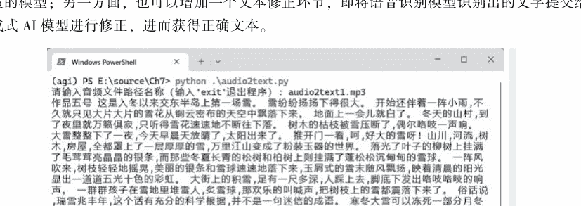

图 7-7 语音识别现代文


图 7-8 语音识别古诗

如前所述，当前已经有众多基于语音识别能力的落地应用。例如，参加会议可能是每个人工作的一个重要组成部分，而会议记录又是会议结束后需要整理备案的重要文件。编制会议记录对记录人来说是一项严肃且具挑战性的工作，如果借助人工智能技术，先对会议发言进行语音识别，再根据识别出的发言文稿结合提示词让生成式 AI 模型整理会议记录，将大大提升会议记录的整理效果及效率。事实上，当前市场上已有按这一思路实现的产品在销售。

以下将完成一个简易版“会议秘书”示例程序，它的主要功能是在会议进行过程中将与会者的发言转换为实录文字。至于在获得实录文字的基础上进一步生成会议记录的功能，感兴趣的读者可在本示例程序的基础上进行扩充。

会议秘书将与会者发言的语音转换为文字，理想状态下的设计是与会者发言时实时采集语音流，然后直接对采集到的语音流进行语音识别转换，生成对应文字。但当前 OpenAI 提供的模型 whisper-1 的访问方式只接受音频文件，因而在设计上需要进行变通，即先将与会者发言按一定时间长度分割并保存为音频文件，然后再对保存的音频文件进行识别，生成对应实录文字。

基于以上思路，示例程序首先要对与会者的发言进行语音采集，此功能可以借助模块 pyaudio 完成。模块 pyaudio 用于处理音频流，它提供录制和播放音频的功能。而采集到的语音则可使用模块 wave 保存为 wav 格式的音频文件。采集音频涉及诸如采样率等一些专有参数配置，遵循良好编码习惯，可以将这些参数保存在配置常量中并将其放置于源文件开始部分。导入 pyaudio 和 wave 模块，并定义相关配置常量，具体代码如下。

audio 与 wave 及设定参数常量的代码如下。

```python

import pyaudio

import wave

# 配置参数

CHUNK = 1024  # 每次读取的音频数据块大小(字节)

FORMAT = pyaudio.paInt16  # 音频采样格式,16位整型

CHANNELS = 1  # 音频通道数,单声道

RATE = 16000  # 采样率

RECORD_SECONDS = 5  # 每段录制时长

TEMP_AUDIO_FOLDER = "temp_audio"  # 临时音频文件夹

```

随后，定义一个名为 record_audio 的函数，用以实现音频信号采集并将其存储为音频文件的功能。函数 record_audio 首先创建一个 pyaudio 对象，随后通过该对象的 open 方法开始采集音频，然后在一个循环中不断按指定时间间隔持续保存音频文件，最后则在 finally 代码块中关闭音频采集流并终止 pyaudio 对象。具体代码如下。

```python

def record_audio(audio_queue, stop_event):

    """录制音频并将文件名添加到队列中"""

    p = pyaudio.PyAudio()

    stream = p.open(format=FORMAT,

                    channels=CHANNELS,

                    rate=RATE,

                    input=True,

                    frames_per_buffer=CHUNK)

    file_index = 0

    print("正在录音……")

    try:

        while not stop_event.is_set():

            frames = []

            for _ in range(0, int(RATE / CHUNK * RECORD_SECONDS)):

                if stop_event.is_set():

                    break

                data = stream.read(CHUNK)

                frames.append(data)

            if frames:

                temp_file = os.path.join(

                    TEMP_AUDIO_FOLDER, f"audio_{file_index}.wav"

                )

                with wave.open(temp_file, 'wb') as wf:

                    wf.setnchannels(CHANNELS)

                    wf.setsampwidth(p.get_sample_size(FORMAT))

                    wf.setframerate(RATE)

                    wf.writeframes(b''.join(frames))

                audio_queue.put(temp_file)

                file_index += 1

    finally:

        stream.stop_stream()

        stream.close()

        p.terminate()

        print("\n 录音线程已停止。")

```

紧接着，定义一个名为 transcribe_audio 的函数，它实现对函数 record_audio 录制的音频文件进行识别，即转录。相对上述示例程序代码，函数 transcribe_audio 要持续不断地读取函数 record_audio 录制的音频文件而不是只读取一个，所以它通过一个循环结构持续读取音频文件，如果当前没有待处理的文件，它还会等待新文件生成后再继续处理。而对循环中每个单一音频文件的识别处理则和前述示例程序代码相同。具体代码如下。

```python

import queue

import time

import sys

from dotenv import load_dotenv, find_dotenv

from openai import OpenAI

def transcribe_audio(audio_queue, stop_event):

    """从队列中获取音频文件并进行转录"""

    _ = load_dotenv(find_dotenv())

    client = OpenAI()

    model = "whisper-1"

    print("开始转录......")

    try:

        while not stop_event.is_set():

            try:

                temp_file = audio_queue.get(timeout=1)

            except queue.Empty:

                continue

            if temp_file is None:

                continue

            try:

                # print(f"正在转录音频文件:{temp_file}")

                with open(temp_file, "rb") as audio_file:

                    response = client.audio.transcriptions.create(

                        model=model,

                        file=audio_file

                    )

                    print(f"{response.text}", end="")

                    sys.stdout.flush()

                # 删除临时文件

                if os.path.exists(temp_file):

                    os.remove(temp_file)

            except Exception as e:

                print(f"转录错误:{e}")

    finally:

        print("\n转录线程已停止。")

```

会议秘书需要一边聆听与会者发言一边将发言转换为文字，故 record_audio 和 transcribe_audio 函数需要并行执行，因此它们应分别在两个独立线程中运行。为了能够优雅地中止这两个线程运行，在两者的代码中都使用了名为 stop_event 的事件控制循环继续或结束。

本示例程序的最后部分是主程序。主程序先是创建一个用于存储音频文件的目录，随后创建并启动录音和转录线程，最后则在一个循环中捕获键盘中断事件（按 Ctrl+C 快捷键），以便在键盘中断事件发生时通知录音和转录线程停止运行。具体代码如下。

```python

import os

import threading

def main():

    """主函数:启动录音和转录线程"""

    # 创建临时文件夹

    os.makedirs(TEMP_AUDIO_FOLDER, exist_ok=True)

    # 启动录音和转录线程

    audio_queue = queue.Queue()

    stop_event = threading.Event()

    recorder_thread = threading.Thread(

        target=record_audio,

        args=(audio_queue, stop_event)

    )

    transcriber_thread = threading.Thread(

        target=transcribe_audio,

        args=(audio_queue, stop_event)

    )

    recorder_thread.start()

    transcriber_thread.start()

    # 设置键盘中断

    try:

        while True:

            time.sleep(100)

            pass

    except KeyboardInterrupt:

        print("捕获到键盘中断,正在停止程序……")

        stop_event.set()

        recorder_thread.join()

        transcriber_thread.join()

    finally:

        print("程序已退出。")

if __name__ == "__main__":

    main()

```

至此，会议秘书应用程序开发完成（完整代码参见源文件 meetingRecorder.py）。有条件使用 OpenAI 的读者可以运行程序，体验其实际效果。

对于语音识别，除模型 whisper-1 外，OpenAI 还提供了 gpt-4o-realtime-preview、gpt-4o-audio-preview 等模型，这些模型除了能够识别语音外，更重要的能力是可以分析音频中所包含的情感、语调和音调，为全方位人机端到端语音交互提供了可能。它们使用与模型对话相同的 API，更便于应用程序通过对话的方式与人类进行交互，其代码逻辑与本书图像识别的示例程序非常相似，感兴趣的读者可参考相关示例程序及 API 说明自行完成。

## 7.2 图像、视频与语音生成

相较于图像、视频及语音的识别技术，它们的生成技术无疑要复杂得多，就正如几乎每个人都具备“看图说话”的能力，但仅有通过专业训练的少部分人才具备“画画”的能力一样。迄今为止，仅有语音生成技术（也称语音合成技术）得以广泛普及并应用于诸多领域。然而，随着生成式 AI 技术的兴起，图像生成与视频生成已不再是遥不可及的梦想，而是成为触手可及的现实，并逐渐从单纯生成图像或视频扩展到融入诸多行业应用中。这些技术的快速发展，不仅为人类带来更为丰富的视觉与听觉体验，也预示着多模态技术在未来将有更加广阔的应用前景。

### 7.2.1 你说 AI 画——文生图

首个产生广泛而深远影响的图像生成模型是 DALL·E，它由 OpenAI 公司发布。它的问世不仅引起科技界广泛关注，还在艺术、娱乐、法律等多个领域引发深刻且富有启发性的讨论。这一模型的诞生，标志着人工智能技术在图像生成领域迈出了重要的一步，对于推动相关领域的创新与发展具有不可估量的价值。本书不涉及使用模型进行应用程序设计与研发之外的讨论，有兴趣的读者可以查阅相关文章。

OpenAI 当前提供的图像生成模型包含 DALL·E 2 和 DALL·E 3 等模型，智谱 AI 则推出 CogView-3 及 CogView-3-plus 等模型。它们的调用方式基本相同，可以使用类似的代码逻辑实现通过提示词生成图片（即“文生图”）。

在本节的文生图示例程序中，尝试增加能够便捷切换模型服务平台的逻辑，以便进一步提升应用程序的灵活性，使其能够根据不同需求或场景，轻松转换、适配并调用不同模型服务平台提供的模型服务。

示例程序依然先加载环境变量，以获取访问生成式 AI 模型的 API 密钥，然后生成模型服务客户端。随后引入一个名为 supplier 的变量，用于控制应用程序在 OpenAI 与智谱 AI 所提供的模型服务之间切换。同时根据该变量的不同取值，为模型编码变量 model 赋予对应平台的图像生成模型编码。此外，OpenAI 与智谱 AI 提供调用图像生成模型的 API 存在细微的差异：OpenAI 使用方法 images.generate，而智谱 AI 则使用方法 images.generations。为简化后续模型调用及代码维护工作，也可根据 supplier 的值，将其对应的 API 方法名称赋予变量 functionName，此后的代码则使用变量 functionName 完成对应方法调用。这种设计可以在切换使用 OpenAI 与智谱 AI 时简化代码维护工作。

按以上思路完成的代码如下。

```python

from dotenv import load_dotenv, find_dotenv

_ = load_dotenv(find_dotenv())

# 确定选择使用的模型服务平台

# supplier = "OpenAI"

supplier = "ZhipuAI"

# 根据服务平台初始化模型名称及 API

if supplier == "OpenAI":

    from openai import OpenAI

    client = OpenAI()

    model = "dall-e-3"

    functionName = client.images.generate

else:

    from zhipuai import ZhipuAI

    client = ZhipuAI()

    model = "cogview-3-plus"

    functionName = client.images.generations

三合一生成脚手架：图 视频 语音

用统一的环境变量加载方式，几十行代码就能让文生图、图文生视频、文本转语音在命令行里跑通，三段实现彼此独立，换模型或服务商只需调整参数位置。

一、图生成快速封装

把单次请求抽象成一个函数，统一接收描述文本、模型名称与尺寸，返回首个结果的可访问地址。外层用循环读取控制台输入，空输入直接略过，收到退出信号就结束会话，其余情况调用封装并打印链接。

```

相较于本书中的其他示例程序，上述代码已经展现出相当的灵活性。如果追求设计实现更加灵活、更具适应性的应用程序，则可以进一步考虑将变量 supplier、model 及 functionName 的值存储于环境变量或配置文件之中。通过这种方式，当需要切换至不同模型服务平台时，甚至无须对代码进行任何修改，只需调整相应的环境变量值或配置项即可。

随后，代码将与模型的交互操作封装成名为 get_completion 的函数，函数 get_completion 包含三个关键参数：提示词 prompt、模型编码 model 以及生成图像大小 size。提示词 prompt 用于传递用户对期望生成图片的描述与要求；模型编码 model 是选定模型平台提供的图像生成模型的编码，在使用 OpenAI 时，它可以是 “dall-e-2” 或者 “dall-e-3”，而在使用智谱 AI 时，它可以是 “cogview-3” 或者 “cogview-3-plus”；图像大小 size 以分辨率的形式设定，不同模型所支持的分辨率不同（DALL·E-2 支持 256×256、512×512 及 1024×1024；DALL·E-3 支持 1024×1024、1792×1024 及 1024×1792；CogView-3-plus 支持 1024×1024、768×1344、864×1152、1344×768、1152×864、1440×720 及 720×1440；CogView-3 不支持 size 参数），实际应用时根据需求进行选择与设置即可。代码还对 model 与 size 设定了缺省值，以简化函数调用。

函数 get_completion 的代码如下。

```python

def get_completion(prompt, model="cogview-3-plus", size="1024×1024"):

    response = functionName(

        model=model,

        prompt=prompt,

        size=size

    )

    return response.data[0].url

```

函数 get_completion 的最终返回值是已生成图片的 URL 地址，而非图片文件本身。因此，要获取该图片，用户需访问该 URL 地址进行下载或查看。通常，各服务平台都会限制该 URL 的有效期，因而应用程序不应将该 URL 作为图像的永久保存地址，而是应在图像生成后尽快下载并按保存策略存储。

代码最后部分则是接收用户输入的提示词然后调用函数 get_completion 根据用户输入的提示词生成图片。具体代码如下。

```python

while True:

    user_input = input("请输入待生成的图片描述(输入'exit'退出程序)：")

    if user_input is None or user_input == "":

        continue

    elif user_input.lower() == 'exit':

        print("程序退出。\n")

        break

    else:

        res = get_completion(prompt=user_input, model=model)

        print(f"图片 URL:{res}")

二、图文到视频与进度轮询

先从 .env 读取密钥并实例化 ZhipuAI，锁定 cogvideox 作为视频模型。封装提交函数，支持纯文本描述或配合参考图链接。交互时先后索取描述与底图链接，至少提供一项才允许继续，提交后输出任务信息。返回体通常处于处理中状态，随后进入循环每约三十秒拉取一次结果，处理中继续等待，异常时中断，成功时展示视频地址与封面地址。

```

运行上述代码（完整代码参见源文件 image_generator.py），输入对期望生成图片的详细文字描述，即所谓 “文生图提示词”，稍后程序便会返回模型生成图片的 URL 地址。如图 7-9 所示。

在浏览器中打开程序所返回的 URL 链接后，用户即可看到图像生成模型依据所输入的提示词精心创作的图片，其效果如图 7-10 所示。这张图片生动展现了提示词中所描述的场景要求，提示词的文字意境在画面中通过视觉效果得到近乎完美的体现。


当然，不可否认，虽然图像生成模型已展现出强大的能力，但当前图片依然有诸多细节尚存进一步提升空间。这些细微之处，仍需图像生成模型继续改进与完善，随着技术的不断进步和图像生成模型的日益强大，这些瑕疵与不足必将会被逐步克服与解决。未来，图像生成技术必将能够带来更加精美、细腻且富有创意的视觉盛宴。

### 7.2.2 你说 AI 演——文生视频

当今短视频正成为吸引大众注意力的主流媒体形式，文生视频技术的问世迅速吸引了所有人的目光，它仿佛预示着视频自媒体领域即将迈入一个门槛更低、效率更高的全新纪元。人们已经开始憧憬，未来的影视巨制或许能够完全依托先进的生成式 AI 技术来完成拍摄与制作。

毋庸置疑，当前视频生成领域中最为出色的模型当属 OpenAI 推出的 Sora。该模型凭借其卓越能力，仅通过简短的提示词描述或一张静态图片输入，便能生成犹如电影画面般逼真的场景。它所生成的场景内容丰富，能够涵盖多个角色、不同类型的动作以及细腻的背景细节，并且在画质上更是达到 1080P 高清标准，时长最高可达 1 分钟左右。

智谱 AI 也推出了国产文生视频模型 CogVideoX，该模型目前可根据输入的文本描述或图片生成 6 秒左右的视频，并且提供 API 调用方式，便于开发人员进行调用与集成。本节将使用模型 CogVideoX 实现一个简单的文生视频应用程序。

## 第 7 章 多模态编程——生成式 AI 的视觉与听觉感知和生成能力

与其他示例程序相同，在代码的开始部分首先导入包含 API 密钥的环境变量，并设定使用的模型编码为 “cogvideox”。具体代码如下。

```python

from dotenv import load_dotenv, find_dotenv

_ = load_dotenv(find_dotenv())

from zhipuai import ZhipuAI

client = ZhipuAI()

model = "cogvideox"

```

随后，代码将文生视频模型的 API 封装至一个名为 `get_completion` 的函数中。该函数有三个参数，分别是模型编码 `model`、提示词 `prompt` 以及基础图片 `image_url`。

参数 `model` 用于指定将要使用的文生视频模型编码，并预设其默认值为 “cogvideox”，以便于在调用该函数时，若未明确指定模型编码，则自动采用此默认值。

参数 `prompt` 承载着待生成视频的描述性信息，它允许用户以文本形式输入对期望生成视频或简或详的说明。

参数 `image_url` 为模型提供另一种创作视频的灵感来源，它可以指定为一张图片的 URL 地址，或者提供以 BASE64 编码格式保存的图片数据。视频生成模型将以此图片作为创作基础，结合用户提供的描述或提示词（如果有的话），进行视频的生成与创作。

值得注意的是，在调用函数时，用户可以仅选择 `prompt` 与 `image_url` 这两个参数其中之一进行使用，但不可同时省略两者。这意味着用户至少需要提供提示词或基础图片两项中的一项，以便模型能够据此进行视频生成。

函数 `get_completion` 的代码如下，它仅简单封装 API，在实际应用中应当在其中加入诸如参数合法性判断、异常处理等功能，以提升函数健壮性。

```python

def get_completion(model="cogvideox",

                   prompt=None,

                   image_url=None):

    response = client.videos.generations(

        model=model,

        prompt=prompt,

        image_url=image_url

    )

    return response

```

随后，需要开始着手编写实现用于接收用户输入提示词和基础图片的代码。与其他示例程序有所不同，在正式调用相关功能之前，本示例程序增加了一项必要的检查步骤，即验证用户是否至少已经输入了提示词或一张图片的 URL 地址，以保证调用视频生成模型时有足够的输入。而在成功收到用户输入后，代码立即调用函数 `get_completion`，并在其返回时输出打印函数的返回结果。具体代码如下。

```python

while True:

    user_input = input("请输入待生成视频的描述(输入'exit'退出程序): ")

    if user_input.lower() == 'exit':

        print("程序退出。\n")

        exit()

    image_url = input("请输入待生成视频的基础图片(输入'exit'退出程序): ")

    if image_url.lower() == 'exit':

        print("程序退出。\n")

        exit()

    if user_input == None and image_url == None:

        print("描述和基础图片必须输入至少一项。")

        continue

    else:

        break

    res = get_completion(model=model,

                        prompt=user_input,

                        image_url=image_url)

    print("===提交任务===")

    print(res)

返回示例通常如下：

```

不难想象，视频生成相较于文字或图像生成而言，显然是一项更为耗时的工作。上述函数 `get_completion` 所封装的 API 其实际功能是提交视频生成任务而不能直接获得视频生成结果。故该 API 其实是一个任务提交 API，当 API 返回时，视频生成任务往往还在进行之中，尚未完成。该 API 的返回值是一个视频任务对象（如下所示），它主要包含平台生成的任务 id、调用的模型编码 `model`、视频生成结果 `video_result`、处理状态 `task_states` 及任务编号 `request_id` 等信息。其中 `task_states` 可用于表明当前任务状态，值 “PROCESSING” 表明视频生成任务还在进行之中，值 “SUCCESS” 表示视频生成成功，值 “FAIL” 表示视频生成失败。

```

VideoObject(id='446317117024013369145801869887580464', model='cogvideox', video_result=None, task_status='PROCESSING', request_id='9145801869887580463')

轮询逻辑如下：

```

视频生成任务提交之后，应用程序可以通过任务结果查询 API 查询视频生成任务是否结束，其参数使用提交视频生成任务时所返回的任务 id。本示例程序使用定时循环查询任务状态。如果任务未完成则暂停片刻后继续查询，直至任务成功或者失败。
如果视频任务成功完成，则返回对象的视频生成结果 `video_result`，结果将包含已生成视频的 URL 地址及视频封面图片的 URL 地址。
查询任务状态并输出视频生成结果 URL 的代码如下。

```python

print("===查询任务状态===")

while True:

    response = client.videos.retrieve_videos_result(

        id=f"{res.id}"

    )

    if response.task_status == "PROCESSING":

        print("PROCESSING...")

        import time

        time.sleep(30)

        continue

    elif response.task_status == "FAIL":

        print("===任务失败===")

        break

    else:

        print("===任务完成===")

        print(f"视频URL:{response.video_result[0].url}")

        print(f"视频封面:{response.video_result[0].cover_image_url}\n")

        break

三、文本转语音落盘

同理加载环境变量并创建 OpenAI 客户端，选择 tts-1。循环读取待合成文字，空值忽略，退出指令停止。调用语音合成接口，音色使用 alloy，按当前时间戳生成文件名写入本地 mp3。

```

运行上述代码（完整代码参见源文件 `video_generator.py`），其运行结果如图 7-11 所示。

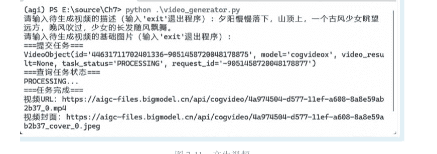

在浏览器中分别打开视频生成结果中的视频及封面图片链接，可以观看到生成的时长大约 6 秒的视频以及与视频匹配的封面图片，其中封面图片如图 7-12 所示。


感兴趣的读者也可以尝试将一张基础图片的 URL 地址作为输入来生成视频。通常而言，相较于单纯依靠文本生成视频的过程，提供基础图片生成视频所需要的时间明显更长一些。从生成结果看，通常生成视频的效果是让图片中静止的生物（例如人或动物）动起来。

### 7.2.3 朗读助手——语音生成

正如语音识别技术较图像与视频识别技术比较成熟一样，语音生成（或语音合成）技术相较于图像与视频生成技术而言其成熟度也更高。同样地，语音生成技术已经在众多领域内得到了广泛的应用。

与语音识别技术相仿，OpenAI 亦在语音生成领域推出两种类型的模型。其一是基于文本转语音（TTS）技术的模型 `tts-1`，该模型具备将任意文本内容高效转换为自然流畅的语音输出能力，为用户提供便捷的语音交互体验。另一类模型，则是在介绍语音识别技术时已提及的 GPT-4o 系列模型中的 `gpt-4o-realtime-preview` 与 `gpt-4o-audio-preview` 等，它们可根据用户输入的提示词或语音即时生成以音频形式表现的回应内容，进一步丰富和提升语音交互的多样性和灵活性。

以下示例程序选用模型 `tts-1` 实现从文本到语音的转换。

首先依旧是加载环境变量，并使用环境变量中的 API 密钥生成 OpenAI 模型服务客户端，以及指定将要使用的模型编码。具体代码如下。

```python

from dotenv import load_dotenv, find_dotenv

_ = load_dotenv(find_dotenv())

from openai import OpenAI

client = OpenAI()

model = "tts-1"

```

接下来是接收用户输入的文本，代码会将用户输入的文本作为 OpenAI 语音转换 API（即方法 `audio.speech.create`）的参数进行传递。同时，还利用该 API 的参数选项指定所需的模型编码及声音风格。OpenAI 为用户提供多种声音选择，包括 `alloy`、`echo`、`fable`、`onyx`、`nova` 以及 `shimmer` 等，以满足不同需求和应用场景。

在模型 `tts-1` 完成语音转换之后，代码会调用 API 响应结果 `response` 的方法 `write_to_file`，将转换完成的语音保存在指定文件中，以供后续使用。以上实现代码如下。

```python

while True:

    text = input("请输入待转换文本(输入'exit'退出程序): ")

    if text is None or text == "" :

        continue

    elif text.lower() == 'exit':

        print("程序退出。")

        break

    else:

        response = client.audio.speech.create(

            model=model,

            voice="alloy",

            input=text

        )

        from datetime import datetime

        now = datetime.now()

        numeric_date_string = now.strftime("%Y%m%d%H%M%S")

        speech_file_path = f"{cur_path}/{numeric_date_string}.mp3"

        response.write_to_file(speech_file_path)

        response.close()

三段脚本分别覆盖图像、视频、语音的常用生成路径，调整模型名与参数即可迁移到其他提供商。

# DeepSeek 推理接入与 VS Code CodeLens 实践

想把大模型的推理能力嵌进日常工具，并让编辑器里直接出现一键解释的代码悬浮操作，可以按下面这条精简路线走：先把模型调用环境搭好，分别实现普通问答与渐进式输出，再在 Streamlit 里处理会话初始化，最后用脚手架搭起 VS Code 扩展并实现 CodeLens。

把鉴权令牌与接入地址写进环境变量，后续即可通过兼容 OpenAI 的客户端调用。
```

运行上述已完成的代码（完整代码请参见源文件 `text2audio.py`），输入一段拟进行转换的文字。待程序顺利执行完毕后，即可打开所生成的音频文件，聆听与输入文字相对应的语音内容。

从实际落地的角度来看，语音识别与语音生成是人工智能技术中最早落地应用的技术之一，诸如英语（或其他语种）口语陪练、聊天等类型的应用已屡见不鲜。此外，国内外众多主流生成式 AI APP 也都支持用户直接通过语音输入信息，并以语音的方式输出其反馈，这使得 APP 的使用更便捷、互动性更强，极大地提升了用户体验，降低了用户使用人工智能的门槛。

## 7.3 本章小结

本章着重阐述了与图像、视频及语音相关联的应用程序开发。人类的交互行为根植于多元化的模态载体之中，而多模态技术的融合则使得人工智能更加贴近人类的智能表现。

多模态编程绝非单纯的技术堆砌，它是对人类智能的一种深刻且全面的模拟。试想一下，一个系统能够同时精准地理解指令内容、敏锐地识别面部表情、细致地分析语调情感，并据此生成贴合用户个人需求的回应，这样的系统必将带给人类全新的体验。具备这种能力的智能实体在教育、医疗、娱乐等多个领域均展现出巨大的应用潜力，也必将成为未来人工智能应用程序的主流发展趋势。

随着多模态技术的不断进步和应用的日益广泛，多模态智能体将逐渐渗透到工作与生活的方方面面，作为生成式 AI 应用程序设计师与开发人员应及时关注、学习、应用多模态技术。

## 第 8 章 DeepSeek 应用开发

DeepSeek 是生成式 AI 模型的典范，它具有一般生成式 AI 的能力，因而本书前述内容的大部分示例均可改用 DeepSeek 提供的模型实现。而 DeepSeek 在推理及代码编程方面表现优异，结合其对计算资源相对低的需求，使得它成为众多企业应用场景中优先的选择对象。

### 8.1 逻辑推理大师——DeepSeek 推理模型应用

应用程序调用 DeepSeek 提供的模型能力可直接通过使用 OpenAI 的 SDK 实现。如本书第 2 章所述，基于 OpenAI 提供的 SDK 访问其他模型服务时需要设置的环境变量除 `OPENAI_API_KEY` 外，还需设置 `OPENAI_BASE_URL`。如果使用 DeepSeek 官方提供的服务，则文件 `.env` 中环境变量的设置如下所示。

```
OPENAI_API_KEY="sk-xxxxxxxxxxxxxxxxxxxxxxxxxxxxxxxx"

OPENAI_BASE_URL="https://api.deepseek.com/v1"
读取本地 .env 后封装一个标准补全函数，默认选用对话版模型，温度参数压到接近零以保证输出稳定。
```

此外，还需要在代码中指定所要使用的模型，例如可将第 2 章中的示例程序 `prompt-cli.py` 中的模型编码改为 “deepseek-chat”，而其他部分保持不变即可使用 DeepSeek 提供的模型服务。修改完成的代码如下。

```python
from dotenv import load_dotenv, find_dotenv

_ = load_dotenv(find_dotenv())

from openai import OpenAI

client = OpenAI()

def get_completion(prompt, model="deepseek-chat", temperature=0.01):

    messages = [{"role": "user", "content": prompt}]

    response = client.chat.completions.create(

        model=model,

        messages=messages,

        temperature=temperature

    )

    return response.choices[0].message.content
若希望看到思考过程逐步呈现，可切换到推理版模型并打开流式响应开关。
```

运行程序（完整代码参见源文件 `prompt-cli2.py`），输入提示词，即可获得模型 `deepseek-chat` 反馈的回复。需要指出的是，与 DeepSeek 交互时参数 `temperature` 的取值范围是 [0,2]，与其他模型相似，该参数值越小模型的反馈越稳定，该参数值越大则模型的反馈越具有随机性和创意。

在本书交稿之际，DeepSeek 提供了两个模型服务，一个是上述示例程序中已经使用的编码为 `deepseek-chat` 的模型，其对应模型版本为 DeepSeek-V3；另一个是模型编码为 `deepseek-reasoner` 的模型，其对应模型版本为 DeepSeek-R1。随着模型的迅速迭代，后续它们所对应的模型版本也会不断升级。

DeepSeek-V3 是一款对话模型，而 DeepSeek-R1 则是一款推理模型，DeepSeek-R1 在后训练阶段大规模使用了强化学习技术，在仅有极少标注数据的情况下，极大提升了模型推理能力。在数学、代码、自然语言推理等任务上，性能比肩 OpenAI o1 正式版。DeepSeek-R1 的 API 还对用户开放思维链输出，即应用程序可以获得模型在给出结论前的模型推理过程。

在应用程序中展示模型的推理过程应当使用体验更好的流式输出，流式输出也能够更好地仿真模型思考与推理过程。因此演示模型 DeepSeek-R1 推理能力的示例程序可以基于第 2 章的示例程序 `prompt-stream.py` 修改完成。

首先代码要采用 OpenAI 的 SDK 生成客户端，随后修改与模型进行交互的 API 封装函数 `get_stream_completion`，将其参数 `model` 的默认值设置为 “deepseek-reasoner”，或者也可以在调用函数 `get_stream_completion` 时将参数 `model` 的值设定为 “deepseek-reasoner”。具体实现代码如下。

```python
from openai import OpenAI

client = OpenAI()

def get_stream_completion(messages, model="deepseek-reasoner"): # 更改模型为 deepseek-reasoner

    response = client.chat.completions.create(

        model=model,

        messages=messages,

        stream=True  # 启用流式输出

    )

    return response
在 Streamlit 界面里，初次打开时预置一条助手开场白，避免会话列表为空导致异常。
```

随后，可以选择修改或不修改显示在页面的问候语，以下代码修改了问候语，明确说明当前会使用思维链。

```python
# 如果还没有消息,则添加第一条提示消息

if 'messages' not in st.session_state:

    st.session_state.messages = [{"role": "assistant",

                                  "content": "我是你的推理思维链助手,请告诉我要完成的任务是什么?"}]
真正拉取流式结果时，去掉第一条引导信息，只把后续用户往来的记录传给模型。
```

在调用函数 `get_stream_completion` 前，还需要增加从保存对话历史上下文的对象 `st.session_state.messages` 中提取出除第一条消息外的所有消息的代码。增加该行代码的原因在于与推理模型 DeepSeek-R1 交互时，第一条消息必须是用户消息，而当前示例程序代码中第一条消息是上述代码设置的以角色 assistant 发出的问候语，因而在将对话历史提交模型前需要将该问候语删除。以下代码实现上述功能，并使用调整后的对话历史列表调用封装函数 `get_stream_completion`。

```python
# 获取流式输出的生成器

messages = st.session_state.messages[1:]

stream_response = get_stream_completion(messages)
进入 VS Code 扩展部分，先安装 Yeoman 与官方代码生成器。
```

与此前示例相同，API 被调用后模型将通过流式方式持续返回其反馈内容，它存储在每次返回的 `choices[0].delta.content` 中。而对于推理模型，它先是返回其推理过程，即思维链内容，这些内容存储在每次返回的 `choices[0].delta.reasoning_content` 中。在推理过程结束后，模型将继续以流式方式通过 `choices[0].delta.content` 返回其推理结论。即推理模型返回的内容中包含思维链内容，见图 8-1 中的第一轮对话。

应用程序在取得一轮对话的回应后，在整合对话历史上下文时，需要特别注意不要将该轮对话的思维链内容加入对话历史，因为思维链是推理模型的思考过程，对话历史上下文仅关注每一轮对话的问题和回答（或者说是任务和结果）。因而在对话历史上下文中永远不会包含思维链内容，它应当仅在当前对话中进行使用和处理。因而在多轮对话中，历史消息总是由每一轮对话的问题和回答构成，见图 8-1 中的第二轮对话和第三轮对话。

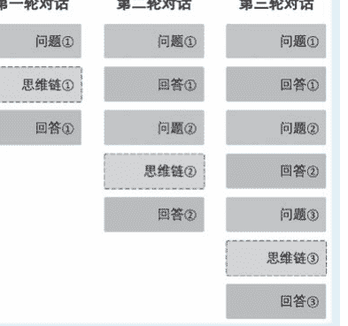

通过上述说明，可以看出对话历史其实总是由用户消息（问题）和助手消息（即模型返回的消息：回答）交替构成，且第一条消息必须是用户消息（问题），如果违背这一规则，推理模型将返回错误。当然并非所有推理模型都有如此严格的要求。

在此前的示例程序中，通常会将第一条消息设置为系统消息，用来说明当前模型所担当的角色及要解决的是哪一类问题。而遵循上述规则时则没有机会设定系统消息，因而使用推理模型时，不需要设定模型当前所担当的角色，当然，也可以将角色设定编制在用户消息中。

基于上述说明，示例程序应当先从流中取得思维链内容进行显示，待推理过程结束（即思维链内容输出完毕后），再从流中取得模型最终返回的回答内容。当前主流应用在输出思维链内容时会采用在左侧添加一条竖线，并且思维链内容以浅色字体进行输出，本示例程序也遵循这一设计。在思维链内容输出完成后，思维链内容通常不再具备价值，因而在程序中可以设计为继续保留或不再继续保留其内容，本示例程序选择不再保留的方案，而是仅显示推理模型的最终输出结果。

按上述设计修改完成的代码如下。

## 8.2 智能辅助编程插件——DeepSeek 的对话、续写及 FIM 补全

编程能力是生成式 AI 模型表现最为优异的领域之一，DeepSeek 也不例外。基于模型的编程能力开展人工智能辅助编程以提升编程效率是当前众多软硬件研发团队的优先事项。一些团队采用内部微调过的模型使得模型可以面向特定领域提供更好、更高效的辅助编程能力；一些平台服务商则提供通用的人工智能辅助编程服务，如 GitHub 和 OpenAI 合作开发的人工智能编程助手 GitHub Copilot。它提供了智能代码补全、支持多种编程语言、根据自然语言编程、跨文件推理等功能，并支持多个流行的代码编辑器和集成开发环境（IDE），国内的通义灵码也提供类似的服务。

对于大部分研发团队而言，代码的严格管控是信息安全的重要保障，因而使用公有模型服务实现人工智能辅助编程是不被允许的，所以有必要构建私有化部署的模型及其对应的辅助编程工具。本节将展示如何实现辅助编程工具，即实现一个 Visual Studio Code（以下简称 VS Code）辅助编程插件（即 VS Code 扩展）。当然，本实例将使用 DeepSeek 提供的公有服务，如有必要，读者可参考其他技术资料进行模型的本地化部署。

### ▶▶8.2.1 VS Code 扩展框架

VS Code 辅助编程插件实例采用 TypeScript 编程语言，辅助编程插件遵循 VS Code 扩展的通用实现过程，因而需要搭建一个通用的 VS Code 扩展框架，然后基于该框架实现人工智能辅助编程能力。

#### 1. 环境准备

VS Code 扩展依赖 Node.js 环境开发，如果开发环境中尚未安装 Node.js，则可至官网 (https://nodejs.org) 下载后安装。

Node.js 安装完毕后需要进一步安装 Yeoman 生成器和专门用于生成 VS Code 扩展项目的生成器模板。Yeoman 生成器可以帮助开发人员快速生成项目模板、文件结构等，从而加速开发过程；generator-code 是一个专门为 VS Code 扩展开发设计的 Yeoman 生成器，通过它，开发人员可以轻松地生成 VS Code 扩展项目的基本框架和文件结构，为 VS Code 扩展项目开发提供一个良好的起点。

这个安装过程使用 Node.js 的包管理工具 npm 完成，具体指令如下。

```
npm install -g yo generator-code
运行交互式命令生成基础目录结构。
```

至此，相关环境准备工作完成。

#### 2. 创建扩展项目

VS Code 扩展项目开发环境准备妥当之后，即可开始创建一个插件开发框架。可使用如下命令开始创建。

```
yo code
项目起步后补上请求、URI 处理与类型声明等基础包，方便后续实现网络交互。
```

运行上述命令后，会出现一个选择菜单（如图 8-4 所示），此时选择 “New Extension (TypeScript)” 选项并按 Enter 键。

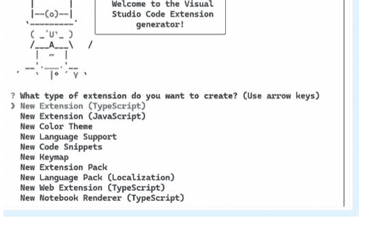

选择完项目类型后，提示输入扩展项目名称，这个名称不但是当前项目的名称，也会在插件实现并发布后出现在 VS Code 扩展列表作为插件名称展示。可在此处输入 ai_assistant_example 或者其他合适的名字，如图 8-5 所示。

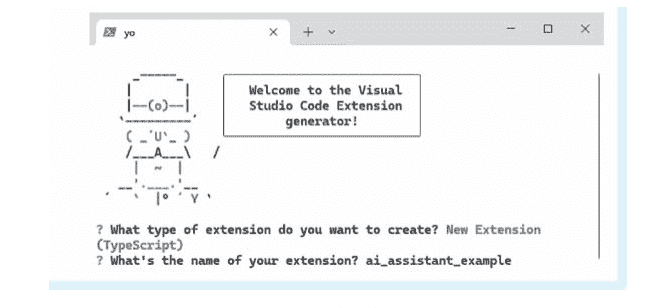

后续还有一系列配置选项，一直按 Enter 键全部使用默认值即可。如果在实践中读者有特殊要求，则可考虑配置其他值。所有选项设定完成后，工具将生成一个 VS Code 扩展项目的框架，如图 8-6 所示。

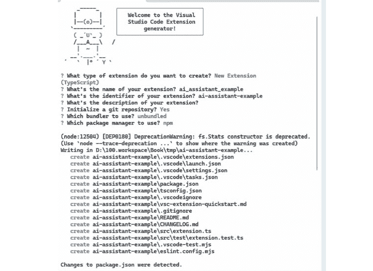

在生成的框架中，实现辅助编程功能主要需要修改的是源文件 src/extension.ts 及配置文件 package.json。

#### 3. 安装依赖

VS Code 扩展的开发过程需要依赖一些额外的库来辅助实现各种功能。为确保开发顺利进行，我们需要安装这些必需的依赖项。只需执行以下命令，即可轻松完成安装。

```
npm install axios vscode-uri @types/vscode uuid
核心实现是 CodeLens 提供者，遍历当前文档匹配函数声明，并在声明上方挂载可交互的悬浮按钮，用于解释或优化代码。
```

这条命令会安装以下依赖：axios 用于进行 HTTP 请求；vscode-uri 用于处理 VS Code 中的 URI 相关操作；@types/vscode 为 VS Code 扩展开发提供类型定义支持；uuid 用于生成唯一标识符。

完成这些依赖安装后，意味着 VS Code 扩展开发框架已经搭建完毕。接下来，就可以正式着手实现人工智能辅助编程的相关功能了。

不同的编程语言具备不同的关键字和特性，本示例辅助编程插件将仅面向 JavaScript 语言实现辅助编程功能。读者在理解人工智能辅助编程插件的实现技术后，可以自行编写所需要支持的编程语言。

### 8.2.2 解释与重构优化代码

解释和重构优化已经编写完成的代码是辅助编程工具通常都会提供的基础功能。前者在理解项目基础代码（通常称 Base 代码）或者接手研发团队其他人员开发的代码时特别有用，甚至在开发者回看自己数周或数月前编写的代码时也有帮助；而后者则可用于提升已完成代码的质量，通常辅助编程工具能够给出更灵活、更具适应能力且更健壮的重构建议。

解释与优化代码均是针对已完成的代码进行操作的，在辅助编程插件中通常使用右击菜单或代码透镜（CodeLens）的方式触发执行相应功能。在本示例程序中，选用代码透镜的形式来实现这两个功能。

代码透镜提供了在源代码中添加交互的途径。本示例将实现针对 JavaScript 函数的解释与优化功能，因而通过代码透镜实现在函数上方显示“解释代码 | 优化代码”这两个功能项，其效果如图 8-7 所示。

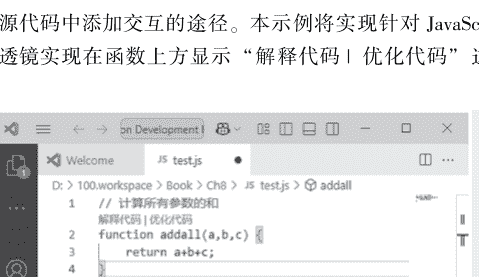

图 8-7 为函数添加功能按钮

实现上述效果的 TypeScript 代码如下，其中识别 JavaScript 代码中函数的关键点在于查找“function”关键字，并排除在注释、文本中出现的 function 字样。代码通过存储在常量 regex 中的正则表达式实现该功能，倘若需要将解释代码与优化代码功能扩展到其他代码段，则需要根据具体需求修改该正则表达式。

```
//CodeLens 提供者

class CodeLensProvider implements vscode.CodeLensProvider {

    provideCodeLenses(document: vscode.TextDocument): vscode.CodeLens[] {

        // 在每个函数或者类上添加 CodeLens 按钮

        const codeLenses: vscode.CodeLens[] = [];

        const regex = /^(?!(?:\s*\/\/|\s*\/\*|.*['"` ])).*?\bfunction\s+([a-zA-Z_$][\w$]*)\s*\(/gm;

        let match: RegExpExecArray | null;

        // 查找文档中的函数定义

        while ((match = regex.exec(document.getText())) !== null) {

            const functionName = match[1];

            const startPos = document.positionAt(match.index);

            const endPos = document.positionAt(match.index + match[0].length);

            const range = new vscode.Range(startPos, endPos);

            // 创建解释代码和优化代码的 CodeLens

codeLenses.push(new vscode.CodeLens(range, {

                title: `解释代码`,

                command: 'deepseek.extension.explainCode',

                arguments: [functionName, document]

            }));

            codeLenses.push(new vscode.CodeLens(range, {

                title: `优化代码`,

                command: 'deepseek.extension.optimizeCode',

                arguments: [functionName, document]

            }));

        }

        return codeLenses;

    }

}

```

上述代码在找到函数声明后，通过代码透镜功能为其依次添加“解释代码”和“优化代码”命令，并分别指定解释代码执行 deepseek.extension.explainCode 命令，优化代码执行 deepseek.extension.optimizeCode 命令。

上述代码实际上是完成了一个代码透镜提供者，此后还需要在 VS Code 的扩展入口函数 activate 中将其注册到上下文，才能够真正实现在代码中嵌入显示这两个按钮。注册代码透镜提供者的代码如下。

```

export function activate(context: vscode.ExtensionContext) {

    // 注册可交互命令:解释命令,优化命令

    const codeLensProvider = new CodeLensProvider();

    context.subscriptions.push(

        vscode.languages.registerCodeLensProvider(

            { scheme: 'file' },

            codeLensProvider

        )

    );

}

```

按钮显示之后，还需要真正实现解释代码和优化代码的功能，在前述代码透镜提供者的实现中已经分别指定解释代码和优化代码所对应的命令，而这些命令也需要在函数 activate 中完成注册才能被执行。

注册解释代码命令的代码如下，其主要逻辑是在解释代码命令被触发时显示一个正在请求解释代码的提示信息，以便开发人员知晓当前状态。随后代码借助函数 getFunctionRange 获取当前函数的起止位置进而获取当前函数的实现代码，并将获得的代码嵌入到提示词（prompt）之中。构建完成的提示词通过调用函数 getAIResponse 提交给大模型并等待其反馈，大模型的反馈结果通过函数 showAIResponse 进行展示。

```

// 注册代码解释命令

context.subscriptions.push(

    vscode.commands.registerCommand('deepseek.extension.explainCode',

        async (functionName: string,

            document: vscode.TextDocument) => {

            console.log("触发解释代码功能。");

            // 请求解释代码并提示用户

            vscode.window.withProgress(

                {

                    location: vscode.ProgressLocation.Notification,

                    title: '正在请求解释代码……',

                    cancellable: false

                },

                async (progress, token) => {

                    try {

                        // 获取函数的开始和结束位置

                        const functionRange = getFunctionRange(

                            document,

                            functionName);

                        if (functionRange) {

                            // 获取当前函数的代码片段

                            const functionCode = document.getText(functionRange);

                            const prompt = `请解释以下函数代码:\n ${functionCode}`;

                            console.log(prompt);

                            // 请求 AI 解释代码

                            const explanation = await getAIResponse(prompt);

                            // 显示 AI 的解释结果

                            showAIResponse(explanation, '解释代码');

                        } else {

                            vscode.window.showErrorMessage('无法找到当前函数的代码范围。');

                        }

                        return; // 完成任务

                    } catch (error) {

                        // 错误处理

                        vscode.window.showErrorMessage('获取代码解释失败,请稍后再试。');

                        console.error("解释代码时出现错误: ", error);

                        return; // 任务完成但失败

                    }

                }

            );

        })

);

```

上述代码中函数 getFunctionRange 获取当前函数的起止位置，其实现逻辑较为复杂，它不是本示例程序的重点，故示例代码中只给出简单实现，其具体代码可参见源文件 extension.ts，此处不再列出。在实际应用中可借助 TypeScript 编译器 API 实现精准解析。

上述代码调用函数 getAIResponse 实现与大模型的交互，它是本示例程序的核心环节，具体实现代码如下。

```

import axios from 'axios';

const DEEPSEEK_API_URL = 'https://api.deepseek.com/v1/chat/completions';

async function getAIResponse(prompt: string): Promise<string> {

    const config = vscode.workspace.getConfiguration('deepseek');

    const apiKey = config.get<string>('apiKey');

    if (!apiKey) {

        vscode.window.showErrorMessage('请先配置 DeepSeek API 密钥');

```

return "";
}

const response = await axios.post(DEEPSEEK_API_URL, {
    model: "deepseek-chat",
    messages: [
        { role: "user", content: prompt }
    ],
    temperature: 0.7,
    max_tokens: 1000
}, {
    headers: {
        'Authorization': `Bearer ${apiKey}`,
        'Content-Type': 'application/json'
    }
});

return response.data.choices[0].message.content.trim();
}
```

调用大模型之前，首要工作仍是准备好接入信息：API 密钥与服务地址。本例选用 DeepSeek，服务地址被写死为代码里的常量，密钥则放到 VS Code 的配置区管理。运行时会先从工作区读取 DeepSeek 的配置项，再取出用于鉴权的密钥。具体添加配置的方式后文会介绍。

TypeScript 里借助 axios 就能发起请求，只需在 post 中填入基础 URL、模型参数并把密钥放到请求头即可。temperature 与 max_tokens 可以按需微调，也能把它俩暴露成配置项，让插件更灵活，使用者可自行设定。

注册解释命令时还会用到 showAIResponse，用来把模型输出呈现在编辑器里。做法是新开一个 Webview 面板，以 HTML 渲染 getAIResponse 的结果。这里有两点需要注意：Markdown 需要转成 HTML，以及返回文本里常带的 code fence 需要做字符转义，以免破坏页面结构。为节省篇幅，showAIResponse 的具体实现不再展开，可参考 extension.ts 原文件。

解释代码的逻辑到此已完成，对应效果见图 8-8。

优化代码的实现思路与解释代码几乎一致，仅提示词从“请解释”改成“请优化”。细节不再重复，运行截图见图 8-9。

解释与优化两个功能就此收官。这一套向大模型提问-展示结果的模式，也能复用到代码评审、流程图生成、单元测试编写等面向成品代码的辅助场景。

## 第 8 章 DeepSeek 应用开发

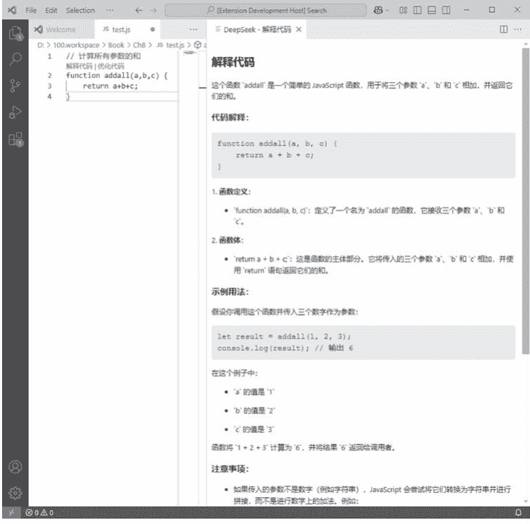

图 8-8 解释代码命令运行效果

229

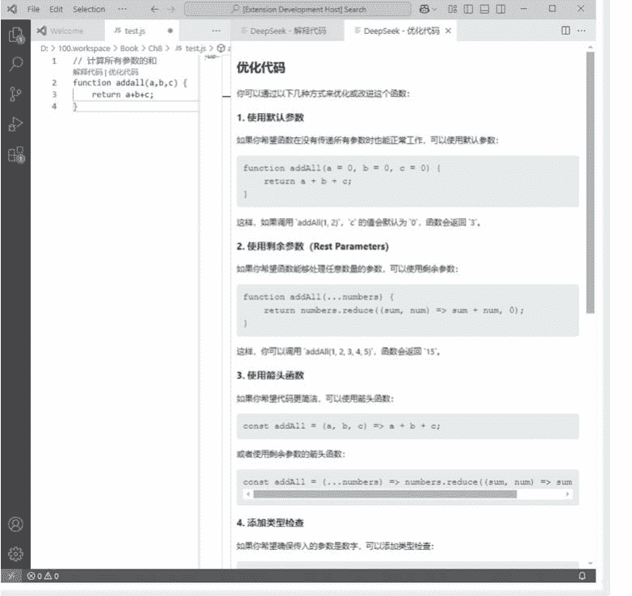

图 8-9 优化代码命令运行效果

### 8.2.3 智能代码补全

智能补全是 AI 编程提效最直观的表现之一。它会在写代码时，根据已输入的内容和注释推断意图，实时给出续写建议；认可后按 Tab 即可采纳。

内联补全必须在编辑器光标处实时生效，核心是内联补全提供者。下面展示的 CodeInlineCompletionProvider 类即为实现载体。

```typescript
// Inline 提供者
class CodeInlineCompletionProvider
    implements vscode.InlineCompletionItemProvider {
    async provideInlineCompletionItems(
        document: vscode.TextDocument,
        position: vscode.Position
    ): Promise<vscode.InlineCompletionItem[]> {
        console.log("触发代码补全功能");

        // 获取当前源文件全部内容
        const sourceCode = document.getText();
        const sourceCodeTrim = sourceCode.trim();
        // 当上下文为空
        if (sourceCodeTrim === "") {
            return [];
        }
        console.log(sourceCodeTrim);

        try {
            // 获取 AI 响应
            const prompt = `请补全以下代码，
                除代码及注释外，不要添加任何其他信息，禁止给出当前已有代码，
                仅返回补全部分的代码，
                最多继续完成一个函数，
                如果使用注释理解程序员意图时，应优先使用离待补全代码最近的注释：
                ${sourceCodeTrim}`;
            const response = await getAIResponse(prompt);

            // 清理返回的代码(去除语言标记等)
            let cleanResponse =
                response.replace(/[a-zA-Z]*\n|\n/g, "").trim();
            console.log("代码补全返回:");
            console.log(cleanResponse);

            // 创建内联补全项
            const inlineCompletionItem =
                new vscode.InlineCompletionItem(cleanResponse);

            // 设置补全的显示方式
            inlineCompletionItem.range = new vscode.Range(
                position.with(undefined, 0),
                position
            );

            inlineCompletionItem.command = {
                command: 'editor.action.triggerSuggest',
                title: '触发代码补全',
            };
            return [inlineCompletionItem];
        } catch (error) {
            vscode.window.showErrorMessage('代码补全请求失败,' + error);
            return [];
        }
    }
}
```

provideInlineCompletionItems 负责具体补全。先抓取当前上下文，拼成提示词交由 getAIResponse 让模型生成后续片段。模型回复往往带 ``` 围栏，正则会把围栏去掉，留下干净代码，最后包装成内联补全项展示。

同前面几类功能一样，提供者写好后还需在 activate 里注册到 VS Code 才能生效，注册片段如下。

```typescript
export function activate(context: vscode.ExtensionContext) {
    // 注册代码补全功能
    const inlineCompletionProvider = new CodeInlineCompletionProvider();
    context.subscriptions.push(
        vscode.languages.registerInlineCompletionItemProvider(
            { scheme: 'file' },
            inlineCompletionProvider
        )
    );
}
```

实际体验时打开一个 JS 文件，输入一段注释后稍作停顿，就能看到图 8-10 的补全效果；输入半行代码也能正常触发，效果如图 8-11。

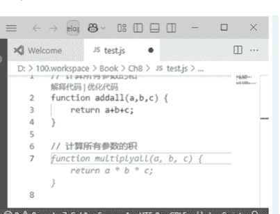

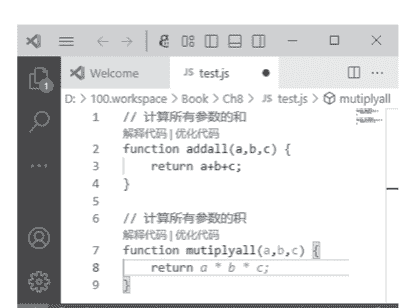
示例程序目前是光标一动就发请求，输入每个字符、空格或回车都会触发一次新的补全。如此高频调用不仅会让大模型压力激增，还容易出现代码在返回途中已更改，导致结果直接作废的尴尬。为此实际落地时一般会叠加防抖、主动取消过期请求和结果缓存等机制，用来降低交互成本并提升使用手感。

这个补全方式本质上和解释代码、优化代码指令一样，都是普通的大模型对话交互。DeepSeek 实际上提供了更贴合代码补全场景的对话前缀续写能力，不过在本书成稿时该功能仍在 Beta 测试，稳定性不足以支撑高频补全需求，所以示例里没有采用。接下来用一个简短示例来演示前缀续写如何工作。

```python
from dotenv import load_dotenv, find_dotenv
_ = load_dotenv(find_dotenv())

from openai import OpenAI
client = OpenAI(base_url="https://api.deepseek.com/beta")

comment = "// 找出所有水仙花数并返回"
prompt = f"""请根据由中括号包含的说明完成代码函数实现，
    仅实现函数,不要返回测试代码或其他任何信息。
    [{comment}]"""

messages = [
    {"role": "user", "content": prompt },
    {"role": "assistant", "content": "JavaScript\n", "prefix": True}
]
response = client.chat.completions.create(
    model="deepseek-chat",
    messages=messages,
    stop=" ",
)
print(response.choices[0].message.content)
```
示例中把 stop 参数设为代码块的反引号，这样模型在输出完代码后会立刻终止，不会再追加解释或多余说明。执行这段程序，完整代码见源文件 prefix.py，运行效果可参考图 8-12。

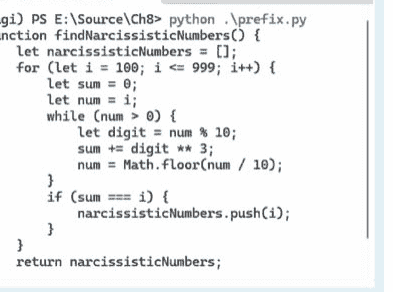
与之类似，DeepSeek 另一项仍在 Beta 的 FIM，即 Fill In the Middle，乃至补全功能，也很适合函数首尾已确定、只需补中间实现，或在源文件中间插入一段代码的场景。下面给出一段使用 FIM 补全的示例。

```python
from dotenv import load_dotenv, find_dotenv
_ = load_dotenv(find_dotenv())

from openai import OpenAI
client = OpenAI(base_url="https://api.deepseek.com/beta")

prompt = """
# 计算参数指定范围内所有整数的和
python
def fun(x, y):
"""

suffix = """
    return ret;

"""

response = client.completions.create(
    model="deepseek-chat",
    prompt=prompt,
    suffix=suffix,
    max_tokens=1024
)
print(response.choices[0].text)
```
该程序，完整代码见源文件 fim.py，给出正在编写的注释以及代码段的开头和结尾，让模型去推断中间部分。运行后得到的结果如图 8-13 所示。

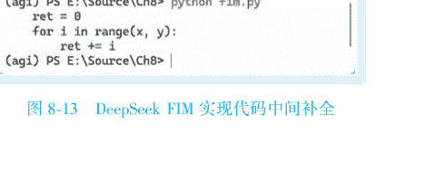
等 DeepSeek 正式稳定开放前缀续写和 FIM 补全后，可以回头升级前面智能辅助编程插件的代码，以获得更可靠的代码推荐体验。

### 8.2.4 插件打包与安装使用
所有代码完成后，还需在 package.json 配置文件中补充解释代码指令、优化代码指令以及 DeepSeek API 密钥的配置项。具体配置如下。

```json
"contributes": {
    "commands": [
        {
            "command": "deepseek.extension.explainCode",
            "title": "解释代码"
        },
        {
            "command": "deepseek.extension.optimizeCode",
            "title": "优化代码"
        }
    ],
    "configuration": {
        "title": "DeepSeek 配置",
        "properties": {
            "deepseek.apiKey": {
                "type": "string",
                "description": "DeepSeek API 密钥"
            }
        }
    }
}
```
配置更新完毕后，在工程根目录执行打包命令即可将 VS Code 扩展打包成可分发包。

```bash
npm install -g vsce
vsce package
```
打包完成后会得到一个 vsix 扩展包，可直接在 VS Code 中离线安装以启用智能辅助编程能力。若有需要，也能发布到 VS Code 扩展市场供他人使用。

## 8.3 基于 DeepSeek-R1 构建的小说生成工作流
智能体已成为生成式 AI 应用的主流形态，市面上的低代码平台都通过可视化流程把大模型交互和工具调用串起来，本质上就是工作流。本节将结合 DeepSeek 的推理模型 DeepSeek-R1 与工作流思路，搭建一个小说生成器。

### 8.3.1 小说创作工作流拆解
工作流是一组按既定规则和顺序协作的步骤或活动，广泛用于管理、开发、制造等领域，目标是提效、降错、保证一致。

小说写作通常包含四个核心阶段。

1. 创作准备是流程起点。作者要围绕选题做系统性规划：先确定核心冲突与世界观框架，再通过人物小传塑造立体角色，随后安排章节结构与叙事节奏，最终形成带有关键情节锚点的完整蓝图，为后续写作奠基。

2. 初稿撰写阶段，作者按蓝图推进章节创作。需要在创作自由与结构把控间找平衡，保持叙事连贯的同时动态调整人物成长线和情节密度，保证逻辑自洽。

3. 修订打磨是迭代优化环节。初稿完成后通常要做多维度自检：通读标记逻辑断层与语言问题，定位叙事薄弱点，对高潮铺垫、情感转折等关键节点列出专项修改清单。部分作者还会用朗读校对来校准语感。

4. 审校出版是质量管控的最后关卡。出版社一般执行三审三校：初审检查标点版式等基础规范，复审从文学性和市场性角度提出结构建议，终审由主编确认合规性。作者需在约定时间内完成三轮修改，终稿经三方确认后进入出版流程。

上述流程即小说创作工作流，可用图 8-14 表示。

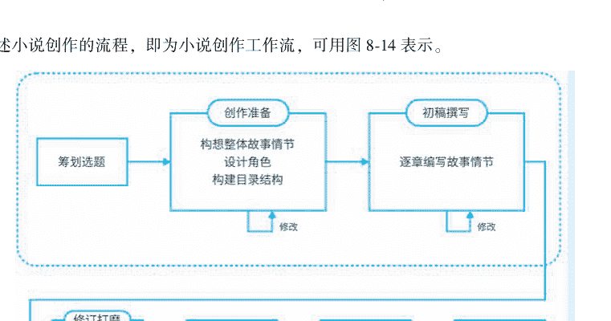
基于生成式模型的写作为何仍按此流转，是因为大模型替代了传统作者写稿，但每个环节仍需人参与，通过多轮人机对话不断校准输出。

例如构建故事框架时，先输入类型、主题、角色、背景等关键信息。生成器据此推断出初步蓝图后，若角色设定与预期不符，就需用户提出修改意见，模型据此调整完善。其他阶段也需频繁交互修正，最终达成满意结果。

### 8.3.2 模型交互接口封装
与前例相同，先封装与模型交互的接口，目的是为部分参数设定默认值，简化调用。小说生成器选用 DeepSeek 推理模型，采用流式返回以提升体验，封装方式与前面示例一致，代码如下。

```python
# 与大模型的交互
from dotenv import load_dotenv, find_dotenv
_ = load_dotenv(find_dotenv())

from openai import OpenAI
client = OpenAI()

# 流式交互接口封装
def get_stream_completion(messages,
                        temperature = 0.95,
                        model="deepseek-reasoner"):
    response = client.chat.completions.create(
        model=model,
        messages=messages,
        temperature = temperature,
        stream=True
    )
    return response
```
流式交互时，模型会先返回思考过程，推理结束后再返回正式回答。对 DeepSeek-R1 来说，思考内容通过 `chunk.choices[0].delta.reasoning_content` 得到，正式回复则通过 `chunk.choices[0].delta.content` 得到。

函数 `get_stream_completion` 负责接口封装，而一次完整交互由 `complete_interaction_DeepSeek` 完成，它接收包含历史上下文的提示词，并以流式输出模型反馈。

因小说生成需要较高创意，`temperature` 设为 1.9，DeepSeek 的取值范围为 [0,2]。对话结束后能拿到完整的思考过程和正式文本，但思考过程对话结束后再无实用价值，函数最终只返回正式回复并丢弃思考内容。

`complete_interaction_DeepSeek` 的实现如下。

```python
# 完成一次 DeepSeek 模型交互
def complete_interaction_DeepSeek(short_term_memory):
    # 逐步接收流式数据并显示
    reasoning_content = ""
    content = ""

    # 获取流式输出的生成器
    stream_response = get_stream_completion(messages=short_term_memory,
                                           temperature=1.9,
                                           model="deepseek-reasoner")

    for chunk in stream_response:
        if chunk.choices[0].delta.reasoning_content:
            reasoning_content += chunk.choices[0].delta.reasoning_content
            print_green(chunk.choices[0].delta.reasoning_content, end="")
        elif chunk.choices[0].delta.content:
            content += chunk.choices[0].delta.content
            print(chunk.choices[0].delta.content, end="")

    return content
```
输出时为了在命令行区分思考过程与正式回复，两者采用不同颜色。思考过程由自定义函数 `print_green` 以绿色打印，正式回复使用系统 `print` 以默认颜色打印。

`print_green` 通过 ANSI 颜色转义序列实现绿色输出，实现如下。

```python
# 常量定义
GREEN = '\033[32m'
RESET = '\033[0m'

# 在终端中输出绿色文本
def print_green(text, end="\n"):
    print(GREEN + text + RESET, end=end)
```
至此，大模型交互相关的封装已完成，为落地小说生成器的工作流做好了准备。

### 8.3.3 工作流落地实现
生成器按任务顺序依次执行各环节，结束后即可得到符合创作意图的人工智能撰写小说。

#### 1. 创作准备——搭建小说蓝图
搭建蓝图的核心是依据选题全面规划小说整体框架。首先要为生成器提供基础创作信息，包括期望的小说类型如言情、悬疑、科幻冒险等，作品想传达的主题思想，角色设定如主要人物数量、性格、背景及成长轨迹，以及故事发生的现实或虚构背景环境，还需明确计划的章节数，以便安排节奏与结构。

函数 `generate_novel_info` 负责据此构建蓝图。它先让用户以自然语言输入基础信息，输入方式自由，既可只提供部分信息，也可补充额外要求。基于推理模型的生成器容忍度很高，能自行推断缺失信息以支撑后续创作。

章节数关系到下一阶段的处理，故单独输入以简化程序。若做成可上线产品，章节数可从用户文本中自动抽取或由生成器按篇幅自定。

交互提示由自定义函数 `input_blue` 实现，它对 `input` 进行封装，通过颜色转义把提示文本以蓝色输出，类似 `print_green` 的做法。

获取基础信息和章节数后，程序组装生成蓝图的提示词，形成一条用户消息并加入短时记忆列表。该记忆仅在 `generate_novel_info` 内部有效，用于记录蓝图构建期间的交互历史，提供上下文支持，最终完成蓝图创建。

函数 `generate_novel_info` 的代码如下。

```python
ASK_OK = "\n====================\n 以上生成的内容您是否满意？如果需要调整,请直接给出修改意见。如果您满意,请直接输入“OK”。"

# 生成小说标题、简介、角色、目录、章节概要
def generate_novel_info(long_term_memory) -> Tuple[str, str]:
    novel_setting = input_blue("请输入小说设定(类型、主题、角色、背景等):")
    chapter_num = input_blue("请输入章节数量:")

    prompt = f"故事设定:{novel_setting}\n"
    prompt += f"章节数量:{chapter_num}\n"
    prompt += "请根据以上故事生成设定,"
    prompt += "生成故事的标题、简介与目录(由引子、中间各章节、大结局组成),"
    prompt += "以及引子、中间各章节、大结局、各章节概述、主线、引出下一章节的伏笔等,但大结局不需要伏笔。"
    prompt += f"中间各章节数量必须为{chapter_num},不可增减,引子、大结局必须分别在中间章节前后。"

    short_term_memory = [
        {"role": "user", "content": f"{prompt}"}
    ]
    long_term_memory.append({"role": "user", "content": prompt})

    while True:
        # 与大模型交互
        novel_info = complete_interaction_DeepSeek(short_term_memory)
        short_term_memory.append({"role": "assistant", "content": novel_info})

        # 与用户交互
        prompt = input_blue(ASK_OK)
        if prompt.upper() == "OK":
            break
        else:
            short_term_memory.append({"role": "user", "content": prompt})

    long_term_memory.append({"role": "assistant", "content": novel_info})
    return novel_info, chapter_num
```

提示词框架搭好之后，程序把携带着该提示词的短期记忆清单一起交给 `complete_interaction_DeepSeek` 处理，由该接口向推断型大模型发起请求，随后会返回大纲推导的中间轨迹（如图 8-15 所示）以及最终确认的大纲文本（如图 8-16 所示）。

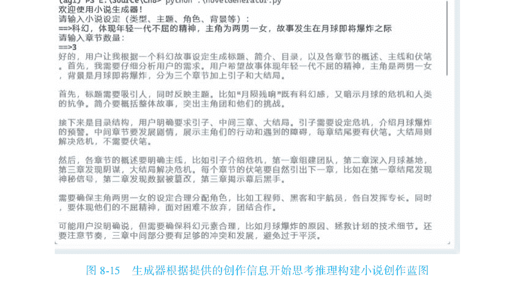

当推断型模型给出第一版大纲后，程序会主动征求使用者意见，确认是否对内容做微调。若使用者提供修改方向，系统便再次触发 `complete_interaction_DeepSeek`，借助模型内部的思考链对大纲进行迭代（如图 8-17 所示）。使用者可以反复提交反馈，直到结果符合预期为止。能否顺滑地循环，核心在于前面搭建的短期记忆以及对话记录持续累加的机制。


经多次打磨后，若大纲得到使用者确认，就可进入下一个流程环节。收尾前，还要同步刷新长期记忆库。长期记忆负责沉淀各阶段的产出，本环节仅保存使用者最初提供的创作基线、设定章节规模，以及阶段结束时敲定的最终大纲。

#### 2. 初稿撰写——逐章生成小说内容

大纲环节收尾后，创作系统已明确整体框架与写作思路，接下来进入第二阶段，着手填充正文。多数中长篇作品都由若干章节串联，写作惯例也是循序推进，因此需要先封装一个负责产出单章内容的函数，代码示意如下。

```python
# 生成一个章节的小说内容
def generate_a_chapter(chapter_info, long_term_memory):
    print_green(f"正在生成{chapter_info}内容……")
    # 构建提示
    short_term_memory = copy.deepcopy(long_term_memory)
    prompt = f"请基于已经生成的小说目录及内容简介信息,生成章节{chapter_info}的内容,字数不超过1000字,不要重复。"
    short_term_memory.append({"role": "user", "content": prompt})
    long_term_memory.append({"role": "user", "content": prompt})

    novel_info = None
    while True:
        # 调用模型生成内容
        novel_info = complete_interaction_DeepSeek(short_term_memory)
        short_term_memory.append({"role": "assistant", "content": novel_info})

        # 与用户交互
        prompt = input_blue(ASK_OK)
        if prompt.upper() == "OK":
            break
        else:
            short_term_memory.append({"role": "user", "content": prompt})

    long_term_memory.append({"role": "assistant", "content": novel_info})
    return novel_info
```

`generate_a_chapter` 的整体实现思路与前面生成大纲的 `generate_novel_info` 保持一致，这里不再赘述。

全书的产出必须章节递进完成，所以再设计一个统筹全局的函数 `generate_novel_content`，它会循环调用 `generate_a_chapter` 直到整部作品写完。流程很直观：先调用一次产出引子，再循环产出中间章节，最后再调用一次产出尾声。`generate_novel_content` 的代码如下。

```python
# 生成小说正文
def generate_novel_content(chapter_num, long_term_memory):
    # 小说正文
    novel_text = []
    # 依次生成各章节的内容
    # 引子
    chapter_text = generate_a_chapter("引子", long_term_memory)
    novel_text.append(chapter_text)

    # 生成中间各章节内容
    ch_num = int(chapter_num)
    for i in range(1, ch_num + 1):
        chapter_text = generate_a_chapter(f"第{i}章", long_term_memory)
        novel_text.append(chapter_text)

    # 生成大结局
    chapter_text = generate_a_chapter("大结局", long_term_memory)
    novel_text.append(chapter_text)

    return novel_text
```

至此，创作系统所需的前两个核心环节已搭建完毕。若想扩充更多步骤，可参照这两个环节的做法延伸。

在当前示例里，每一步都借助推断型模型完成。可在真实的流程设计中，并非所有步骤都要调用推断型模型，有的步骤可用对话型模型支撑，也有步骤完全无需模型介入，比如读取本地库、调用外部接口读写数据等，具体取舍要结合实际业务目标来决定。

#### 3. 组装工作流

各个步骤实现后，最后一步是按既定顺序把它们串联起来，形成可执行的整体。本示例把编排逻辑直接写在 `main` 函数内，代码如下。

```python
# 主函数
def main():
    print("欢迎使用小说生成器!")

    # 长时记忆
    long_term_memory = []

    novel_info, chapter_num = generate_novel_info(long_term_memory)
    # print(novel_info)

    novel_text = generate_novel_content(chapter_num, long_term_memory)
    print("=============小说正文=============")
    print(novel_text)
```

到这里，创作系统的核心代码已全部到位（完整实现见源文件 `novelGenerator.py`）。启动程序后，每完成一个步骤，系统会自动进入下一阶段，如图 8-18 所示。待全部步骤跑完，一篇完整作品便已生成。


图 8-18 流程依次执行

该创作系统的流程链由顺序执行与循环执行共同构成。在实际落地中，某一步完成后也可能依据条件走向不同分支，也就是流程链同样支持分支设计。总体来看，流程链的设计思路与程序控制结构高度相近，设计时可借鉴程序流程的思路。

## 8.4 本章小结

本章以 DeepSeek 为底座，演示了推断型模型驱动的逻辑问答应用与小说创作系统，以及基于对话型模型的智能编程辅助插件。推断型模型自带的链式思考机制，使其在数理与逻辑分析方面的表现显著增强。落地时，设计者与工程师需依据任务特性权衡模型选型。编程辅助插件依托对话型模型实现了代码解读、代码重构和智能补全，随后阐述了 DeepSeek 的前缀补全与 FIM 补全机制，并展望了这两项能力在编程辅助领域的未来空间。

总体而言，DeepSeek 既具备主流模型常见的功能，也在探索独有的特性，其对算力的需求明显下降，加速了生成式 AI 在企业内部的普及。可以说，它正推动生成式 AI 从试验阶段向产业级核心生产力实质迈进。

作 / 者 / 简 / 介


## 范永刚

沈阳工业大学计算机科学与技术硕士，现任智朗科技企业数字化中心技术总监。近二十年深耕软件研发及数字化咨询，擅长把前沿技术转化为可落地的产业方案，推动企业智能化转型。


## 刘佳

东北大学计算机科学与技术专业毕业，现任智朗科技企业数字化中心业务总监。长期聚焦企业级技术方案，在智能制造、智慧能源、企业信息化架构等方向积累丰富经验。

策划编辑 ◎ 李晓波

封面设计 ◎ MX DESIGN STUDIO

本书面向技术开发者与创新实践者，遵循“概念-交互-开发”的递进脉络，系统拆解生成式 AI 从理论到落地的关键路径。内容覆盖从基础到落地的全链路开发实践，帮助读者快速掌握构建 AI 应用的核心技能。无论是初学者还是在职从业者，都能从中获得行业洞察与实操经验。

——安宝磊 AI 领域资深人士，十余年从业经历

本书以一线视角打造的 AI 开发指南，通过数十个案例串联提示词工程、函数调用、智能体与多模态开发，涵盖 LangChain 及检索增强等核心模块，并深度拆解智能编程助手等企业级实战场景。无论是 AI 初学者入门，还是资深工程师突破瓶颈，本书都是低成本构建高价值 AI 应用的实用手册。

——李钢桥 北京谦合益邦云信息科技有限公司联席 CEO、网易有道前硬件研发总监

彼得·蒂尔曾说，《主权个体》对他的影响超过任何一本书。书中描绘了技术精英摆脱旧秩序、掌控自身命运的时代图景，也揭示了一场静默却深刻的革命：个体不再只是社会齿轮，而是手握算法之刃的主角。本书正是通往这一时代的钥匙，它不仅是 AI 应用开发书，更是一本赋能个人的《未来生存手册》。读者将学会如何与 AI 对话，如何利用多模态视听感知能力打造智能体，成为“用代码定义边界”的人。

——陈阳 上海思未艾数据技术有限公司总经理

本书从生成式 AI 应用开发的真实需求出发，以具体案例阐释开发技术，在实践中实现应用，兼具指导性与操作性。既可作为课程参考，也适合项目落地，同样适用于希望掌握前沿 AI 技能的学习者与开发者。

——张翼英 天津科技大学博士生导师、教授级高工

生成式 AI 热度持续，能讲清“怎么做”的作品却不多见。本书通过一个个开发场景把技术带到实用层面，阅读后收获明显。

——崔文平 英特尔亚太研发中心

全书代码清晰、示例贴近实战，覆盖多个生成式 AI 热门应用，读完即可上手，是程序员案头值得备置的开发指南。

——崔焱 微软亚太科技有限公司


资源获取方式：

本书配套案例源代码资源，读者可关注机械工业出版社计算机分社官方微信公众号——IT有得聊，回复 78217 获取下载链接。


上架指导：计算机/人工智能

ISBN 978-7-111-78217-9

定价：99.00元