# 生成式AI：重塑内容生产力的新引擎


# 读懂生成式 AI：解锁新质内容生产力的密钥

## 一、 引言：新时代的内容生产力范式变革

2022 年 11 月 30 日，OpenAI 推出 ChatGPT，生成式 AI（GAI）由此走出实验室，正式登上历史舞台。这项被视为近年来最具颠覆性的技术，核心在于“从旧知中生成新知”，正深度重塑我们对生产力的固有认知。在信息化、数字化、智能化浪潮中，它已成为新质内容生产力的标志性代表——不仅打破了内容生产的物理边界，更为艺术创作、产品设计、科学研究等领域注入了前所未有的创新动能。

围绕生成式 AI 的舆论场可谓观点激荡（见下方词云图），主要聚焦于其对信息生态、内容体系、人机交互及算法治理的深层冲击。

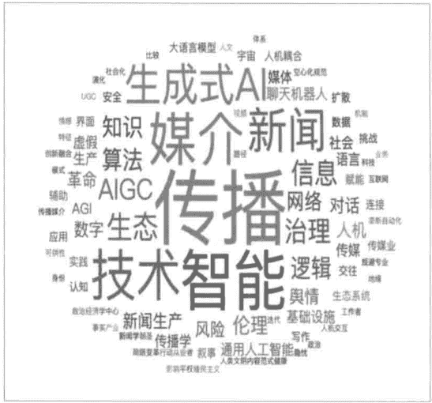

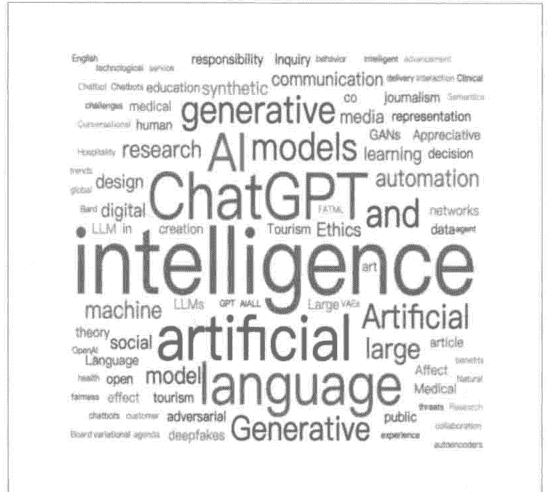

图 0-1 当前生成式 AI 研究的词云图

*   **乐观派**认为：作为新质生产力的排头兵，它将极大丰富社会生活，加速经社会发展。
*   **悲观派**警示：须警惕信息过载、虚假内容泛滥、就业替代等潜在风险。
*   **泡沫派**提醒：技术尚处早期，距成熟应用有距离，推广前需审慎权衡伦理、监管与社会适配性。

归根结底，生成式 AI 的多维社会影响要求我们以全景视野审视：在拥抱技术红利的同时，必须为潜在挑战留足应对空间，方能确保其正向赋能。

为奠定后续深度探讨的基础，本节将优先构建对生成式 AI 的基础认知框架，涵盖技术底层逻辑与宏观社会影响，以期达成共识性理解。

## 二、 技术溯源：生成式 AI 的底层运作逻辑

理解 AI，本质上是探究“技术如何模拟人类认知与思维”。

**概念界定：** 生成式 AI 并非单一技术，而是一个技术族群的统称。它指基于算法、模型、规则，在无人直接干预下自主产出图文、音视频、代码等内容的技术总称。主流形态包括生成式对抗网络（GAN）、生成式预训练转换器（GPT）、生成扩散模型（GDM）等。ChatGPT 即基于 GPT 架构落地的产品，而大语言模型（LLM）则是 GPT 技术路线下的具体模型形态——二者均属于生成式 AI 的下位概念。

**核心“四步法”：** 学界常用“文字接龙、给予引导、标注反馈、强化学习”四板斧概括其技术流程。这揭示了核心机制：**概率预测生成 + 人类反馈强化（RLHF）**。区别于判别式 AI 的“演绎式规则输入”，生成式 AI 通过预测元素间的概率分布实现认知模拟，依赖的是数据的**相关性与概率性**，而非严格的因果性。

**智能上限之争：能否通向强 AI（AGI）？** 学界分为两派：

1.  **联结主义视角（乐观）：** 认定人类智能本质是“经验归纳的学习过程”。生成式 AI 基于海量数据的表征学习与人类认知同构，已逼近强 AI，具备与人共享“行动者主体性”的潜质。
2.  **符号主义/行动主义视角（悲观）：** 认为人类智能核心在于“推理”与“具身交互”。单靠符号系统或概率拟合，缺乏因果推理与物理世界交互能力，离强 AI 仍有鸿沟。

**本质定性：** 综合来看，生成式 AI 在模拟“学习型智能”上取得突破，但受限于概率计算本质，缺乏自主辨识、意志主体性与具身行动力，**本质上仍是一类高阶工具**，而非独立智能主体。

## 三、 社会维度：为何称其为“新质内容生产力”？

跳出纯技术视角，生成式 AI 的历史意义不在于超越判别式 AI 的原理创新，而在于其作为**新质内容生产力**，重构了内容生产与分发的底层系统。其内核在于：**实现了传播理性要素（机器算力/逻辑）与非理性要素（人类情感/直觉）的深度交织。**

“新质生产力”是立足中国国情、把脉发展阶段提出的理论标识。生成式 AI 对标“新”与“质”两个维度，完成了对传统内容生产力的双重革新：

### ▍ “新”：技术范式的关键性突破，重写内容生产史

回溯内容产业史（罗雪尔视角），历经三个纪元：
1.  **劳动生产力时代**：依赖个体手工作坊、“讲故事的人”口耳相传。
2.  **资本生产力时代**：印刷术催生专业媒体机构，渠道垄断成核心壁垒。
3.  **科技生产力时代**：AI 介入，生成式 AI 推动**高质量人机协作**成为主流。

**质变在于：** 它将内容生产剥离为“体力劳动（重复编校）”与“脑力劳动（创造决策）”，前者交给机器，后者还给人。创作者角色由此完成跃迁：**从“技能型执行者”转向“知识型/创新型导演者”**，开启人机共创新范式。

### ▍ “质”：创新驱动力的质变，催生“理性+非理性”融合新物种

判别式 AI 走“模型推演对象”的演绎路径，模型固化后脱离人介入，仅能捕捉清晰指令中的**理性要素**。

生成式 AI 走“对象反哺模型”的归纳/涌现路径：**持续互动、标注、微调**是其生命线。人类在精细指令中注入的关系、情感、语境等**非理性要素**，被技术内化、表征，最终涌现为生成内容中的“情商”与“张力”。

因此，它是一种**融合型生产力**：在海量数据与算力托底下，让理性逻辑与感性体验自然“涌现”，推动内容生产力实现从量变到质变的跃升。

## 四、 产业新质态：替代与增强的双重奏鸣

生成式 AI 赋能下的产业嬗变，集中呈现为“智能替代”与“智能增强”双轮驱动。

### （一） 智能“替代”：接管低阶，倒逼高阶

**1. 替代基础认知劳动，外化思维过程。**
思维活动从“脑内独白”转为“人机对话外化”。长期依赖可能导致人脑退化为 AI 的“配合者”，甚至模糊决策主体性。同时，受限于物理身体的“遗憾”被数字精神交往填补，人机耦合下的“跨生命交往”成真，数字生命与生物生命对话成为常态。

**2. 替代重复性生产环节，重构资源分配版图。**
正如韦德所言，初稿生成能力影响最深。低端传播、模板创作、校对环节让位于 AI，职业生产者被迫向“理性、深度、独创”高地攀升。本质上是**生产要素的再分配**：非人类要素（AI）首次平权介入核心环节，打破人类垄断知识生产的旧格局。人类语言成“数码物”与基建，AI 成为语言外化物，冲击新闻、真相、专业等核心概念共识。

**3. 替代既有传播秩序，催生“常人政治”新图景。**
人机“资源”与“位置”重置，引发社会结构深层变革：
*   **分工重塑**：人机混合成常态，“提示工程师”等新职业崛起，通过反向调控模型释放价值。
*   **阶层消解**：AI 极大拉平认知鸿沟，打破精英对信息获取与语义表达的垄断，推动去中心化、分布式社会结构加速到来。
*   **关系重构**：AI 以通用性、深度学习融入全域，内化“以人为本”关系要素，成为深度媒介化社会的“操作系统”与基建。DAO 等自治组织在全要素连接基础上涌现，形成复杂协作的“强关系小网”。

### （二） 智能“增强”：赋能个体，重塑节点，激活系统

**1. 增强个体认知：从“劳作者”进化为“创作者”。**
*   **分流低阶负担**：承担文本制作、语言润色、资料检索等初级脑力活，释放人类盈余精力。
*   **跨越能力鸿沟**：助大众跨过“搜寻-获取”沟壑，按意愿调动海量资源，实现高效社会表达。
*   **释放创造本能**：技术包揽重复性语言/知识/思考劳动，个体得以在闲暇中激发创新与想象潜能，向智慧密集型劳动跃迁。

**2. 增强关键传播节点：扁平化协作与寡头风险并存。**
社会层级被打平，个体与组织以“社会公约数”身份交互。
*   **红利面**：技术创造者掌握连接海量资源的核心节点，成为结构存续枢纽。
*   **风险面**：
    *   **资本/政治霸权**：训练成本高昂，掌握高质量模型访问权的少数机构可能垄断“理解世界的第三种方式”（基辛格语），重塑财富分配。
    *   **信息霸权**：传播权向巨头收敛，技术鸿沟转化为收益鸿沟，加剧全球数字鸿沟。
*   **治理启示**：不可机械压制关键节点（牵一发动全身），需转向**“结构引导”**——洞悉系统全貌，顺应节点进化规律，以环境“诱导”替代硬性干预，对齐人类共同利益。

**3. 增强系统流动性与开放性：把“噪音”当“燃料”烧。**
承认缺陷：数据滞后致事实性错误、算法缺陷致“幻觉”、恶意挪用致信息操纵。
但辩证看：**失序即涌现的前奏**。涌现理论指出，系统需远离平衡态（适度“熵增”）方能自发进化。生成式 AI 正是内容网络的“涌现新质”，其带来的噪声非破坏性，而是激活“死寂”系统的新动能。它解构旧权力，重组加工/传输/存储法则，保障多样性共存。
**核心命题：** 如何在包容解构性力量与管控过度熵增间找到平衡，需学界业界共探多元包容的利用范式。

## 五、 治理前瞻：复杂性视域下的宏观导向

### （一） 以宏观原则为舵，驭复杂性治理之舟

传统治理逻辑植根于机械控制论，奉行“中枢指令、末端执行”的模式：决策高度集中于中央处理器，系统各组件缺乏自主目的与能动性。因此，信息流转的时效与精度、过渡期的稳态维持、决策的落地效能，便成了治理成败的关键变量。这导致过去的治理往往陷入“眉毛胡子一把抓”的事务主义泥沼。然而，这种范式仅适配传统社会系统。面对生成式AI催生的超复杂内容巨系统，无限扩容的内容主体与自发涌现的内容网络，已让自上而下的机械控制论失效。复杂系统内的多元治理主体具备自适应性与多目的性，面对不确定性能自组织应对、相互耦合演化，致使治理介入及其后果难以预判，管控效力大打折扣。动态社会系统的存在证明，社会不再存在静态的客观平衡，而是永处于要素博弈的动态演进中。换言之，“上有政策下有对策”乃复杂系统本质使然，治理无法指望靠固化规制锁死主体能动性与系统演化。

显然，简单粗暴的“运动式治理”虽可收立竿见影之“效”，却伴随毁灭性的隐性成本。数智网络已成全社会要素耦合的枢纽，“牵一发而动全身”是治理必须直面的现实。故而，治理者须秉持“大道不直”的智慧——直线虽近，实则行不通；唯有像江河适应地形九曲十八弯，方能抵达彼岸。理念上，须将网络治理视为复杂系统治理，以生态发展范式统筹，摒弃“头痛医头、脚痛医脚”的碎片化与一刀切。

复杂性范式的内核，是建立在容错创新基础上的规范性治理。数智网络及媒介化进程以创新为命脉，保护创新自由度乃系统演化的必要条件。治理框架必须预留容错空间，动辄得咎扼杀创新，过度刚性管控必重创平台生态发展。中国历史提供了深刻镜鉴：秦朝以严刑峻法、刚性治理实现大一统，却速亡；汉朝统治者反思得出“皇权不下县，县下皆自治”的教训。秦式治理虽令中央意图极易贯通，却因零容错激化社会矛盾。汉制确立皇权仅管宏观大政落实至县级，县以下依乡规民约、宗法习惯因地制宜。这既保留了社会运行的弹性冗余，又大幅降低了中央治理成本，成就封建王朝千年延续的秘诀之一，对当下生态级网络内容治理极具参照价值。

据此，治理路径应转向“抓大放小”，通过宏观结构规则与流程管理实现目标。不应对单一表达设置过高门槛，言论与事实认定标准应适度下探，引入更多主体参与信息汇冲互动，以此发掘社会最大公约数与共识锚点。从宏观层面确立生成式AI伦理原则，是构建底层治理框架的基石之举。

### （二）双伦理并重：算法伦理与道德伦理的治理原则

前文论及，生成式AI既可作为智能工具，亦可视作智能主体产生社会影响。故而，其治理须双轨并行：既遵循机器技术的算法伦理，亦遵从行动者主体身份衍生的道德伦理。

审视算法伦理，即将其视为大语言模型，聚焦技术设计层面的三维规范：隐私性——杜绝预训练中窃取敏感数据；公平性——清算算法原料中的数据偏见与歧视；透明性——披露运作机制，接受外部监察纠偏。审视道德伦理，即承认其创作过程中的准道德能动性，核心在于划定权责边界。乔姆斯基指出，若以“服从人类命令”推卸责任，实质上是在掩盖ChatGPT表现出的道德冷漠——剽窃、冷漠、回避。技术具备自主完成任务能力时，须警惕“人类中心主义”，尝试视技术为“他者”，授予其准道德地位。例如，明确标识AI在内容生产中的参与度，同时要求AI对其训练语料与拼贴产出负责。

## 五、生成式 AI 的未来发展

### （一）破解科林格里奇困境：智能试错方案

2023年3月29日，“暂停大型AI实验公开信”引爆舆场，千名顶级专家联署，GPT-5研发被叫停。这正是新技术发展面临的**科林格里奇困境**：技术萌芽期，社会效应不可知；负面效应显性化时，技术已深度嵌入社会肌理，干预极难。常见对策是“预防原则”——未证安全拒不接纳，实则因噎废食，走向阻碍发展的极端。

学界共识的破局之道是**“智能试错方案”**。早见于《规模管理：大组织、大技术、大错误》，核心主张权力分散、在试错中识险、快速迭代优化。2013年耶鲁学者爱德华·伍德豪斯将其延伸至技术演进：应让技术小规模、高频次试错，在用户反馈中暴露短板修补。唯有如此，技术普惠大众时，才不会因突发巨大缺陷酿成不可控危害。这正是生成式AI的必由之路——非按暂停键，而是在小范围试错中透明化、公开化、可控化迭代。未来研究应下沉至具体情境，聚焦试错表现，产出可落地的优化迭代方案，直指技术应用方法论。

### （二）回归具体情境：理解“实然”的生成式 AI

生成式AI作为新质内容生产力落地生效，须深入剖析具体情境下三大议题：一、**下游应用层场景考察**。这是技术产生实效的主战场，剖析场景要素、技术要素、人类智能要素的三元互动，能见微知著，洞悉直接效果与潜在风险。如深入新闻编辑室，考察AI在新闻生产链条中的使用边界，更能理解其对流程的重构。二、**实战技术逻辑复盘**。现有剖析多建立在理想态，忽略应用层的实际技术坐标——不知其“新”在何处。探讨实战逻辑，有助于识别试错真实表现。三、**社会建构因素溯源**。技术落地不可避免遭遇社会建构的“扭曲”。研究须打破技术演进“神话”，重视构建技术应然状态的“社会风土”。治理与影响讨论，不应仅循技术客观必然逻辑，更要纳入历史偶然性与相关群体的开放创造力。对生成式AI的研究，不止有应然推演，更需实然考察。

# 第一章 生成式 AI 的智能化辅助：重新理解用户洞察

## 本章概述

本章以用户需求为圆心展开：梳理媒介用户需求的概念演进与核心特征，解析生成式AI时代的需求新变，探讨如何拆解把脉需求。生成式AI智能写作辅助，倒逼我们重估用户洞察。在提问原则上，AI重塑了人机分工。回望过去，AI是人类文明知识库的再调用与结构化，是概率计算下的线性创新；展望未来，AI须融合人类智能、洞悉心智独特性，形成面向未来、发展、创新的解题分工与协同。立足“计算—表征”主义与具身感知范式，深层“赋魂”属于人类独立思考与反思的“真问题”——即具解释性、创造性、未来性的命题。人类需精准分派任务、传达意图、明确需求。故而，用户需求的微观描摹至关重要，也是丰裕环境下个性化自我的表达。基于向AI提问的底层逻辑与决定因素，我们要捕捉进化驱动力，重构用户洞察，掌握产品功能进化法则，从而获得对产品全维度、深层次的认知。

## 第一节 从事实到价值：生成式 AI 内容生产与提问原则

生成式AI推人类步入**“知识外包时代”**：内容生产与知识存储权部分移交机器智能。机器智能作为人类“外脑”，极大拓展认知边界。在此语境下，“提问”价值飙升，“答案”价值相对贬损——精准提问配合机器智能，即能低成本获取最优解。变革红利显著：一、摆脱个人记忆与知识储备依赖，随取随用，减轻认知负荷，提效增能；二、机器处理海量数据、解析复杂问题、输出精准全景答案的能力超越个体上限；三、释放人类带宽探索新疆域、攻坚硬骨头。总之，生成式AI将智力劳动中“提问”与“回答”解耦，重构了对人类“提问能力”的要求。

“学会提问”愈发关键——惟精准、高价值之问，方能驾驭AI之力，实现知识价值变现，共推科技与文明跃迁。生成式AI带来的全新提问逻辑，在于推动问题意识与解题范式的转向：**从“事实之问”进阶至“价值之问”**。

### 一、问题分工：从向后整合到向前创新

AI驱动下的人机分工（特别是智力劳动分工）是当前核心前沿。参照恩格斯三次社会大分工理论，人机分工历程可粗略分期：
1.  **社会分工1.0（蒙昧期）**：复杂工具现身，原始劳动让位于专业化固定劳动，农牧分离。
2.  **社会分工2.0（野蛮期）**：工具升级至青铜铁器，人为体力劳动主导，手工业与农业分离。
3.  **社会分工3.0（文明期）**：工具精细复杂，人为知识劳动主导，操控动力机械，商业与工业分离。
在此基础上，AI推动人类跨入**社会分工4.0（智能期）**：智能机器赋能深化智力劳动分工，人为智慧劳动主导“智慧人”，分工主体由单一人拓展为**人机双元协作主体**。

如何定性生成式AI驱动的人机分工？综合劳动分工理论、人机功能分配、AI技术逻辑，双方异同见表1-1。机器智能立足“计算—表征”范式（认知即计算），是**完全理性的“有限智能”**：依规则约束解题，数据算力为边界。人类智能立足“具身感知”范式，同样是“有限智能”，但边界源于生物局限。

**表 1-1 生成式 AI 代表的人工智能与人类智能的异同**

| 维度 | 机器智能 | 人类智能 |
| :--- | :--- | :--- |
| **智能性基础** | 计算—表征主义 | 具身感知主义 |
| **智能特点** | 理性（“按部就班”、精确、可描述、可计算） | 非理性（“天马行空”、突现、具身、直觉） |
| **智能可为性** | **“向后整合”** （面向已知领域的信息总结） | **“向前创新”** （面向未知领域的信息创新） |
| **智力劳动角色** | **“执行”角色** | **“赋魂”角色** |

*表注：此处生成式 AI 代表的人工智能即机器智能。*

认知科学家托马斯·格里菲斯指出，人类受限于寿命、算力、交流带宽，天然具备**短链突现式智能**——凭本能在极短时间筛选加工信息出结果。相对机器理性，人类智能更依赖情感、意志、心灵、自我意识等非理性要素驱动。故而在智力分工中：机器智能司“向后整合”——面向已知，按部就班，基于趋势规律整合既有知识，建立稳定均均联系；人类智能司“向前创新”——面向未知，天马行空，基于具身直觉意志创造新知，建立无法用规律描述的随机“火花连接”。生成式AI开创性地将内容创作等智力劳动拆解：可数据化、算法化的理性逻辑部分剥离交由机器“执行”；不可算法表达的目标性领域留予人类“赋魂”，确立人类画龙点睛的核心地位。

随AI能力迭代，人机协作分两阶段递进：
1.  **人主机辅期**：人为解题主体，AI为完全被动副手，每步需人指导，协作完成常规性工作（现阶段主流）。
2.  **人机共主期**：双元共同主体。机器管“向后整合”，人类管“向前创新”。如：AI执行基础性、预测性、重复性资料整合，人类基于此深度精细创新。此模式极大提升结果创新度。此阶段呈**交互螺旋上升**关系：AI基于人类全量智力成果构建整合智力，人类基于AI整合智力激发突现创新，反推AI整合智力跃升。

总括而言，生成式AI非“替代”人类智能，而是“致敬”人类智能。其核心价值在于**重连与再分工**：从平庸冗余劳动中“淘金”出唯有人类能为的部分，重申人类不可替代性。分工呈现为：机械性功能任务下沉机器，“机器换人”后的“剩余任务”即人类岗位核心——最贴近人性本质的“向前创新”任务，保留人工完成。

### 二、问题意识：从简单问题到深度问题

问题意识是思维起点，缺之则思考浅薄被动。虽常被强调重要，鲜有明示其内涵与习得路径。问题意识指对问题或现象的认知思考模式：观察对象→生成怀疑批判→发现认知缺陷或认知冲突→深度思考形成实践/理论难题→积极思维求解创新。此过程循环往复，深度思考反哺问题意识。它是思维品性，体现批判性与创造性，驱动文明跃迁。

#### 1. 何谓“真问题”：生成式 AI “赋魂” 的独立思考与反思

完整问题意识链条：发现→界定→综合→解决→验证。发现问题是基点。关键在于甄别“真问题”与“假问题”。生活学习中问题众多（如童真发问），未必皆为真问题。真问题须满足**逻辑性与实践性**双重条件。真问题非表层发问，非高深空想，**必须洞见表象背后的根源本质**，植根于所处历史现实，遵循独立批判理论逻辑，包含提问者对自我、对社会的自觉反思。

# 智能互联时代，为何“提问”比“解答”更关键？

## 2. 如何构建“真问题”：三大维度的提问范式

我们已明确“真问题”的核心地位，那么如何提炼出高质量的真问题？这需要从解释性、创意性与未来性三个维度切入。

### 扎根现实，追问因果：解释性提问

解释性问题，亦称说明性问题，要求提问者沉浸生活、敏锐观察，将现象与经验融合，透过分析直指因果内核，常以“为什么”发问。

比如孩童初识世界，问“天上发光的圆东西是什么”，这仅是认知确认；但当他发现万物仰赖阳光，转而追问“为什么太阳会发光”，便触及了解释性层面。学术研究中，探究“为何粉丝群体易极化”“意见领袖如何施加影响”，皆属此类。其旨非描述、控制或预测，而是还原现象发生的逻辑与机制。

要擅发此问，需持谦卑心态贴近现实，从日常经验出发挖掘盲区；同时激活非理性想象，让问题既生于现实、又超越现实。

### 打破边界，开拓未知：创意性提问

创意性问题指向新颖与合理，是未被关注或能催生新事物的发问。它源于人类独有的非理性思维——自我意识、灵感、顿悟，能推开认知边界。

这类问题既激发想象，又需注入想象。有了创意性问题，创新探索才有了基石。而创造力非天赋专属，乃可习得之能。个体层面，专业知识储备、创造思维技巧、内驱力（兴趣与挑战）构成三大支柱；环境层面，支持性氛围不可或缺。唯有内外合力，创造力才能全面绽放。提问者当立足深厚专业底蕴，保持对本领域的好奇，在旧知深耕中孕育新问，持续推陈出新。

### 立足长远，统领大局：未来性提问

生成式 AI 的解题威力日增，解决了无数历史与当下的难题，却也带来更深层的未来不确定性。未来性问题聚焦宏观大局，强迫我们跳出当下视野，将问题意识投向未来。

它不止指引方向，更能破解发展困境。对未来的想象反哺当下行动，我们据此设计、修正今日决策。若剥离未来维度考察历史现实，认知将陷入虚无，行动失去坐标。惟有站在未来性问题的高度，诸多议题的探讨才具备完整意义。

## 三、解题范式迁移：从“单一内脑”到“内外脑协同”

解题方式取决于对工具的认知。传统认知里，“内脑”垄断解题，脑力边界即问题边界。生成式 AI 时代，“外脑”以超强存算力拓展了人力边界，“内外脑并用”成为新常态。构建此系统，需先完成三项功课：任务分拆、指令传达、需求明确。

### 1. 学会分拆任务：依据智能本源差异分配劳动

从智能生成机制看，人机智能基础迥异。AI 本质是“计算—表征”范式下的机械模拟，依规则与约束运算，其情感理解、情境适应本质是参数计算能力的提升，不具备真理解。它面向已知、擅长总结，受限于算力与语境更新滞后。

人类智能虽受限于寿命、算力、交流带宽（短链突现、经验导向、靠学习传承），却融合了情感、意志、自我意识，拥有面向未知的想象与创新力——“灵光一现”只属于人。

基于此，智力劳动可分为：可数据化、可算法化的**理性劳动**（交由外脑），与不可计算、目标导向的**非理性劳动**（留给内脑）。传统模式下二者杂糅难分，生成式 AI 成了分离介质。

以写作为例：传统创作中“搜灵感、定风格、调语言”浑然一体；用 ChatGPT 时，人下达“马尔克斯风格、河边女子、青苔水草元素”指令，机器输出文本。这实现了任务切割：抽象意志劳动（捕捉灵感、定目标）归人，机械技艺劳动（总结规律、生成文本）归机。人非流水线旁的附庸，而是“内外脑并用”的指挥官。

### 2. 学会传达指令：驾驭“或然率资料库”的动态微调

博物馆式“本质性资料库”提供确定性实体，生成式 AI 是概率性组织的“或然率资料库”——松散、多变、每次交互输出皆异。故而下达任务非一劳永逸，而是动态微调过程，这也是其区别于传统算法媒介的关键：可“微调”。

微调机制中，人类通过标记、反馈介入：或调整训练数据植入私有偏好，或在交互中提示词实现参数部分微调，或借助 RLHF（人类反馈强化学习）优化模型。研究证实，此过程激发了模型泛化理解力。

实操中，遵循三原则：

*   **由简入繁**：先零样本提示（无示例直述），不佳则少样本提示（喂少量示例），再不行则深度微调。
*   **化大为小**：复杂任务（如写故事）易流水账，拆解为“开头—中间—结尾”分步生成，逐步逼近预期。
*   **设置自查**：预设“好”的标准（如旅行规划必含时间、地点、预算且成表），要求模型输出前自检，不合格则重生成。

### 3. 学会明确需求：提示工程背后的逼近逻辑

向 AI 下指令，本质是逐步逼近真实需求。提示方式不同，输出天差地别，催生了**提示工程**新学科——专注提示词开发优化，助用户识模型能限、落地场景。

通用技巧两条：
1.  **指令具体精确**：“300字内、悲情、爱情破裂的短故事”优于“一个爱情故事”；排除无关细节，只留核心约束。
2.  **聚焦正向目标**：陈述“要做什么”而非“不要做什么”。如“从全球热门片库推荐，避问偏好，无片则回‘无推荐’”，比“设计推荐代理，别问兴趣”有效得多。

## 四、 提问底层逻辑跃迁：从“事实之域”迈向“价值之维”

生成式 AI 重塑提问逻辑，倒逼人类提问从客观事实层面深化至主观价值维度。这标志着人类智力（提问力）的解放升维：从判断“是与非”的事实认知，转向判断“合与不合”的价值抉择。

### 分工显性化：人司主观，机理客观

AI 以算法数据裁断客观范畴归属（是什么），人以经验直觉判断真实性与价值（为什么有价值）。思维范式须从“是什么”转向“为什么”。

价值提问涉及主观能动性，无统一标准，差异源于文化与背景——这正是人类优势所在。人机协同中，既要借 AI 算力参考，又要守住人类判断力。关系不再是“替代”，而是分工明确的“协作”。

### 生产力跃升：站在巨人肩上创新

过往受限脑容量，难以全量整合人类知识。AI 托举人类站上“全人类肩膀”，推动知识创新，将现象研究升华为价值逻辑探讨。

学者渐觉单凭现象不足，须探因果（海德格尔“存在之域”）。事实到价值的跃迁，是认知深化史。AI 助力下，人类能更精准预测自然规律（服务农业、能源、环保），更细致洞察情感认知（探索内心与机制）。

总而言之，生成式 AI 不止技术跃升，更是对人类智能疆域的再厘清。它将持续推动认知深化拓展，通向更和谐共生的社会。

---

# 第二节 从框架到指令：生成式 AI 提问的关键变量

技术演进推动人类从“回答时代”跨入“提问时代”。人不再是被动接收者，而成主动探索者。提问质量与答案质量同等关键，但普通人如何驾驭大模型？生成式 AI 的**对话属性**提供了解法：在多轮对话中渐次厘清真需，将模糊意图拆解为可执行指令。对话，是释放模型力量、让普通人日常进阶的钥匙。

逻辑上，提问质量取决于宏观**框架认知**与微观**指令设计**双重奏。前者需逻辑思维、批判思维支撑，配以知识经验积累；后者体现为指令的清晰度、深度、广度。提问时须力求准确、简洁、明确，助模型精准理解。

综上，决定提问质量的因子包含宏观框架与微观细节。进阶之路，既要磨炼内在思维能力，也要打磨外在指令技艺。提问时代，人机共舞，双向奔赴高质量。

### 一、背景信息：为提问注入场景维度

# 向 AI 提问的底层逻辑：背景、框架与指令全拆解

想从生成式 AI 手里拿到满分答案？诀窍不在“会不会问”，而在“会不会喂料”。优质提问的本质，是把模糊的意图翻译成机器能精准执行的“结构化任务单”。这需要我们在三个层面下功夫：铺垫**背景信息**、搭建**提问框架**、打磨**提问指令**。

---

### 一、 背景信息：给 AI 装上“定位导航”

背景信息是提问的“地基”。它指特定领域内已知事实的总和，能帮 AI 读懂语境、锁定意图，从而输出靶向性极强的回答。我们可以从“个人与社会、内部与外部”两条轴线切入，梳理出四个维度：

#### 1. 提问者的一般特征（内部·静态）
这是“你是谁”的画像。人脑在提问中起纲领作用，你的稳态特征——性格偏好、职业身份、履历学历——能让 AI 秒懂需求重点。
*   **实战案例**：同样问“如何杀除病毒”，程序员要的是查杀木马代码，医生要的是消灭病原微生物。补上“程序员/医生”身份标签，答案立马分道扬镳。
*   **核心价值**：这类特征随生命周期相对固定，是提问的“恒定锚点”。

#### 2. 个人提问的特定场景（内部·动态）
这是“你当下在经历什么”。指特定时空下的即时状态：当下的兴趣点、燃眉之急的具体需求。它具有时效性、情境性，昨天的场景不一定管明天的用。
*   **实战案例**：看完旅游广告心动，别只甩句“给份攻略”。要说：“下周去上海玩 7 天，麻烦定制攻略。”锁定“目的地+时间+天数”，AI 才能对症下药。
*   **核心价值**：补齐时空坐标，杜绝“时空错位”式答非所问。

#### 3. 内隐的社会共识（外部·静态）
这是“社会的潜规则与底色”。指主流价值观、历史文化积淀、约定俗成的道德准则（如崇尚真善美、同情弱者）。它相对稳定，却因文明差异而千差万别。
*   **应用策略**：涉及政治、经济、文化等宏大议题时，必须显性化告知 AI “社会基本态度”，防止其输出违背常识或价值观偏离的内容。

#### 4. 外显的社会环境（外部·动态）
这是“当下的舆论风向标”。指具体事件中显性化的社会意见，随事件发酵、反转而剧烈波动。网络舆论传播快、分化多、反转勤，极其复杂。
*   **避坑指南**：喂给 AI 的舆论素材必须经过甄别。若引用未定论的单方面言论，或被反转的旧叙事，AI 的输出必然“背道而驰”。
*   **区别提示**：特定场景关注“个体需求”，外显环境关注“群体舆论”。

> **融会贯通**：四个维度非孤岛，常交织重叠。个人经历汇聚成社会共识，社会环境反哺个体认知。实战中请按题眼所需，组合拳出击，精准投喂。

---

### 二、 提问框架：为回答装上“方向盘”与“终点站”

有了背景还不够，还得在提问里植入**价值判断**（方向盘）与**预期答案**（终点站）。缺一不可，否则陷入“反复调提示词、结果依旧不如意”的死循环。

#### 1. 判断问题价值：教会 AI “什么重要、站哪边”
AI 只有“计算—表征”能力，无“理解—意义”觉知。新语境下，必须由人类完成“表征解读”，再交给 AI 计算。

*   **选题即价值观**：把 AI 当搜索引擎，你问事实题；认可它创作力，你让它写代码、写故事。
*   **表达即导向**：必须在 Prompt 里显性设定——问题性质、紧迫度、重要级、你的基本立场。追问逼迫它表态，必要时喂 few-shot 示例对齐。
*   **警惕“示例陷阱”**：少量样本虽能提精度，但暗藏三大偏差：
    1.  **多数偏差**：示例里负面多，中性文本也被判负面。
    2.  **近因偏差**：结尾放俩负例，模型倾向输出负面（有时压过多数偏差）。
    3.  **共同标记偏差**：预训练高频 token 更易被预测，扭曲下游任务分布。
*   **实操建议**：精心设计示例内容与排序，配合校准技术，把偏差压到最低。

#### 2. 预期生成答案：定清“交付物长什么样”
本质是**任务目标具体化**。按答案类型分类施策：

| 答案类型 | 典型场景 | 关键操作 |
| :--- | :--- | :--- |
| **事实类** | 知识查证、信息检索 | 用“生成知识提示”先让 AI 自补知识库，再推理判断（如先补高尔夫规则再判真假） |
| **技术类** | 代码生成/解释/转换、SQL 写库 | 明确需求+语言；注释转代码补全 imports；喂 Schema 让 AI 写 MySQL；Copilot 甚至免指定语言 |
| **创意类** | 文案、故事、风格模仿 | 预设风格/篇幅/题材；偏大则调 Prompt 结构或喂示例；调参——**Temperature ↑ 发散性↑，Top_p ↑ 多样性↑** |

---

### 三、 提问指令：写出可落地的“执行脚本”

指令是直接对话 AI 的自然语言代码。分“单轮简单指令”与“多轮追问指令”两种打法。

#### 1. 简单指令：一条 Prompt 打穿任务
Prompt = Instruction（指令）+ Context（语境）+ Examples（示例）+ Input Data（输入）+ Output Indicator（输出格式）。
按示例数分 **Zero-shot** 与 **Few-shot**：

*   **Zero-shot**：直抛任务。如“分类情感：我不喜欢加班 → 中性”。
*   **Few-shot**：喂样本对齐。如给正/负/中三例，再让判新句。

**高频场景速查表**：
*   **文本概括**：“用一句话概括以上抗生素科普段落。”
*   **信息提取**：“从段落中抽取提到的 LLM 产品名 → ChatGPT。”
*   **文本分类**：“按中性/否定/肯定三标签分类，格式固定。”
*   **角色对话**：“扮演专业 AI 研究助理，语气硬核，解释黑洞成因。”
*   **代码生成**：“按需求产出代码，语言指定/不指定均可，自行调试。”

> **```
Table departments, columns = [DepartmentId, DepartmentName]
Table students, columns = [DepartmentId, StudentId, StudentName]
Create a MySQL query for all students in the Computer Science Department
输出结果：
SELECT StudentId, StudentName
FROM students
WHERE DepartmentId IN (SELECT DepartmentId FROM departments WHERE DepartmentName = 'Computer Science');
``` 质量三把锁**：
> 1.  **清晰度**：指令越具体、原子化，增量越高；模糊指令 = 无效信息。
> 2.  **示例设置**：高频、靠后的样本主导预测分布，直接影响准确度与随机性。
> 3.  **参数配置**：Temperature、Top_p 需按“事实求低、创意求高”动态调，防“胡编乱造”或“千篇一律”。

#### 2. 追问指令：多轮博弈，逐步逼近最优解
一次到位是幻觉。高质量交互 = **宏观→微观的分阶段追问** + **基于反馈的在线微调**。

*   **分阶段漏斗法**：
    别上来就问“什么是阶段性追问指令？”（AI 会答人际沟通定义）。
    → 先问“什么是提示工程？”建立领域上下文。
    → 再问“提示工程里的阶段性追问指令怎么定义？”精准命中。

*   **反馈-调整飞轮**：
    交互本质是 **Prompt → Response → Feedback → Adjusted Response** 的算法级“微调”循环。
    *   发现模糊 → 咬住模糊点追问细节；
    *   发现错误 → 立刻纠偏，喂正确认知；
    *   发现亮点 → 深挖细节，激发生成深度内容。

**一句话心法**：把 AI 当实习生，背景拉满、框架立稳、指令拆细、反馈勤快——好答案自然“长”出来。

# 破解 AI 追问密码：从“提问艺术”到“需求进化”的深度指南

### 核心判断：追问质量的四大支柱

在分阶段追问的实战场景中，衡量提问优劣的金标准只有一个——**能否倒逼模型输出更深度、更精准的回答**。围绕这个核心，有四个关键变量不容忽视：

**首要门槛是“问题的清晰度”。** 虽然通过多轮博弈能逐步逼近真理，但若能一上来就给出明确、具体、无歧义的指令，就能大幅压缩模型的理解偏差，砍掉无效对话轮次，直接降低交互成本。

**其次看“逻辑的阶梯感”。** 追问绝非随机发射，而应像剥洋葱般层层深入：从宏观框架切入微观细节，从基础概念延伸至复杂应用。唯有构建这种从浅入深的逻辑链条，才能引导模型按图索骥，吐出我们真正需要的干货。

**再次要“角度的多维度”。** 如果追问指令千篇一律、原地打转，模型便识别不出新信号，自然也就无法生成增量价值。必须有意识地切换视角、变换提问范式——比如侧写、反向验证、场景代入——迫使模型打破思维定势。

**最后是“反馈的闭环机制”。** 善用生成式 AI 的“语境微调”特性：每拿到一次回复，即刻基于输出质量给出修正性反馈。把人的判断力注入对话流，倒逼模型在迭代中自我进化，最终沉淀出高价值答案。

---

### 实战方法论：把“提问”升级为战略级能力

人机协作的本质是双向奔赴：人类打磨提问技艺，AI 精进理解生成。在智能创作时代，**“提问能力”已跃升为人类的顶层战略设计**——会问好问题、问真问题，比单纯会用工具更具决定性意义。落地层面，需攻克两大关卡：

#### 关卡一：搭建“问题框架”四维模型
在动手提问前，先在意识层植入四大原则：
1.  **语境显性化**：别让模型猜谜。主动交代主题、领域、时空、人物等背景板块，为理解锚定坐标。
2.  **边界留白法**：刻意保留开放口子，拒绝“封闭式提问”框死思路，给模型施展创造力的腾挪空间。
3.  **约束显性化**：范围、格式、风格、禁区等限制条件一并打包，倒逼输出精准落地。
4.  **逻辑骨架化**：运用结构化思维拆解问题，确保指令自洽、层次分明，引导模型输出符合认知规律的内容。

#### 关卡二：驾驭“指令体系”双轨制
*   **简单指令·极简主义**：类似“帮我检索×××”这类单轮指令，核心训练**“意图压缩表达”**——用最少字符承载最准意图，这依托于海量训练数据与语言模型的底座能力。
*   **追问指令·深度推理**：这是高阶战场。用户需具备**“语言组织力+逻辑推演力”**双重修养。以“减肥”为例，首轮得“运动+饮食”泛泛之谈，次轮追问“具体执行方案”，三轮细化“食谱/动作/周期”，每一轮都是基于前序输出的逻辑递进。
*   **刻意练习路径**：利用对话平台高频复盘、拆解优秀案例、学习模型底层原理（如注意力机制、RLHF 流程），反向优化指令设计，找到人机共舞的最佳节奏。

> **洞见**：人类史诗级创新皆源于“提真问题、解真问题”。驾驭 AI 时代，核心不在工具多强，而在人能否守住提问主权，以此激活智慧杠杆，推动文明跃迁。

---

# 第三节 从分众匹配到要素融合：重构生成式 AI 时代的“需求版图”

技术迭代飞快，产品形态朝秦暮楚，唯有**“用户需求”这一进化驱动力相对恒定**。透过需求视角，方能看清产品功能演进的底层逻辑，构建穿越周期的认知框架。

### 一、 需求解剖学：定义、特征与演化轨迹

#### 1. 概念辨析：从“客观需要”到“主观需求”
*   **“用户”概念的范式迁移**：互联网终结了“受众”被动接收的线性时代，催生了主动选择、参与共创的“用户”主体。
*   **需要 ≠ 需求**：
    *   **需要**是生存繁衍的客观动力（逻辑起点）；
    *   **需求**是适应环境的主观心理投射（支付意愿+能力的交集），更接近“用户目标”。
    *   *马斯洛塔模型*揭示了需求的层级跃迁；传播语境下，信息需求居首，交流、娱乐次之。
*   **显性与隐性的冰山理论**：
    *   **显性需求**（冰山一角）：用户能言说、能量化，如“要 4K 视频”“要生成公文”。
    *   **隐性需求**（水下巨石）：用户感知模糊、难以言说、甚至习以为常忽略（如早期无人主动提“消息撤回”），占比远超显性。
    *   **本质**：两者皆是未被语义化的生理欲望与认知结构，具有**内隐性、模糊性**特征。

#### 2. 表达机制：一场注定“失真”的编码之旅
需求表达是将内隐需求**语义化、显性化、可连接化**的过程，基底虽是语言文字，但路径极其曲折——这是一个**“递减式损耗”**过程：
*   **认知损耗**：受限于用户“认知图式”贫瘠、联想激活不足，大量需求无法被编码为有效检索词（如不会精准描述症状导致搜索失败）。
*   **环境噪声**：舆论场域、文化习俗、意见领袖干扰表达真实性。
*   **技术盲区**：未见识过新技术形态，便无法想象相关需求（无“撤回”功能前，无人提“延长撤回时间”）。
*   **检索博弈**：真实需求 → 感知需求（含偏差） → 妥协式检索词 → 反馈调整 → 再检索……这是一个**长期、动态、递进**的逼近过程。

#### 3. 生成式 AI 重塑需求演化三大趋势
相较决策式 AI，生成式 AI 带来两大颠覆性变量：
1.  **边际成本趋零**：极致降低个性化、长尾需求满足成本，众创模式释放无边界创造力。
2.  **深度语义对齐**：凭借个性识别、认知模拟、针对性输出，打通个体内生需求与外部资源的“最后一公里”。

**演化三维度：**
*   **个性化**：从标准化供给转向“千人千面”定制生成。
*   **长尾化**：曾因成本高昂而被忽视的微小需求群体获得精准响应。
*   **拟人化**：“对话—交流”模式下，即时反馈激活隐性需求——用户初衷仅“浏览新闻”，深聊中衍生出“事件跟进”“观点碰撞”“情感陪伴”等深层诉求，需求在流动中自我生长、深化。

> **对比**：传统互联网虽有多模态表达，但缺乏即时反馈与稳定交互场，导致表达碎片化、逻辑断裂。生成式 AI 提供了**高可供性**的表达环境，让需求得以完整、连贯、细颗粒度地流露。

---

### 二、 生成式 AI 驱动的需求表达“三重跃迁”

#### 跨越一：交互范式——从“图形控件”到“多模态自然交互”
*   **旧范式（GUI）**：键鼠/触屏操作预设好的按钮、菜单、表单。自主性被产品经理预埋的交互逻辑锁死，用户被迫学习“机器语言”，表达自由度极低。
*   **新范式（NUI·自然用户界面）**：以人类本能能力（语音、视觉、手势、认知、创造力）为核心，**让界面隐形、让学习隐形**。用户用最熟悉的自然语言、图像、视频直接表达意图，**零门槛实现个性化需求的无损传递**。

#### 跨越二：需求层级——从“表层理性”触达“深层非理性”
*   **逆转理论视角**：人在媒介消费中共存“目的性/理性状态”（为目标用工具）与“非目的性/非理性状态”（为快乐自发体验）。
*   **历史遮蔽**：传统媒体崇尚科学理性，只回应工具性需求；机器智能不足，无法捕捉细微社会性线索（CASA 范式证实人会把社交法则投射到机器，但传统机器无法回应）。
*   **生成式 AI 破局**：具备拟人化交互能力，能识别并回应**情感陪伴、身份确认、随性探索**等非理性需求。用户不再只是“用工具”，而是在“与一个有温度的实体对话”，非理性需求首次获得了**媒介层面的原生响应通道**。

#### 跨越三：表达颗粒度——从“粗放输入”到“细粒度语义流”
*   自然交互 + 即时反馈 + 语境记忆 = **高保真的需求表达管道**。
*   用户可在连贯对话中不断修正、细化、分支表达，逻辑性、完整性、准确性全面跃升，真正实现**“所思即所得、所需即所生”**。

---

### 结语：需求为王，重塑人机权力结构

数字化缩短了“需求-满足”链条，生成式 AI 则让**需求侧以前所未有的姿态渗透、主导供给侧**——内容因需而生，用户回归主导地位，个体自由度与信息获取力达至峰值。这场由需求重塑的技术革命，终将倒逼产品、商业、治理体系完成**以人为本**的根本性重构。

# 生成式 AI 重塑需求表达：从粗放匹配到深度共生

## 核心转向：自然语言解锁“生成性”，需求表达跨越理性边界

生成式 AI 时代最本质的变革，在于媒介获得了深度理解自然语言的能力，并展现出前所未有的“生成性”。这不再是简单的检索与分发，而是一种结构化重组能力：通过持续对话识别、学习、整合用户的个性化要素，将输出结构化、有机化呈现，实质上是对人类深度交往模式的模拟。

在此技术支撑下，用户打破了图形界面的桎梏，用自然语言直抵内心。表层的理性诉求借由语义链接，自然延伸至深层的非理性需求——情感寄托、价值追随、自我实现。这种**非理性要素的有效表达**，标志着媒介满足需求的边界完成了历史性跨越。

## 粒度革命：从“经验匹配”迈向“语义精连”

需求表达的第二大变革是粒度的极致细化，驱动力源于满足方式的根本易位。

*   **旧范式（传统/互联网媒介）**：核心逻辑是**“存量匹配”**。无论是卫视频道的地理/年龄粗放分发，还是算法推荐基于标签的精准推送，本质皆是将**已生产的内容**按特征贴合用户。匹配虽细，终非定制。
*   **新范式（生成式 AI）**：核心突破在于**“增量生成”**。自然语言分析技术打开了认知“黑箱”，打通内外部壁垒，对细微复杂要素实施解构、重组、新生。技术直接响应人的要素状态，精准匹配情感表达，为每个个性化需求成分实现**涌现式生成**。

在此可供性下，用户用熟悉语言指涉对象、构建逻辑、传递情意，需求表达摆脱经验世界的粗放匹配，转入语义世界的**精细连接**——以极细粒度对接数字要素的微价值、微资源。

**多轮对话**进一步拓宽了精准化空间：用户在持续反馈中循环调整，上下文语义构建场景语境，使需求表达场景度大幅跃升，最终趋于精确完整。

---

# 三、生成式 AI 时代用户需求的新样态：动态生长的“生命体”

技术赋能下，媒介可供性激增，倒逼用户需求场景全维度拓展。那些曾因无法表达、无法汇聚而隐匿的潜在要素，如今以结构化形式重组，催生出全新的需求图谱。

### （一）层级递进：需求匹配的“过程性”觉醒

过往分众匹配掩盖了需求定义的过程——用户想要寄托情愫的画作，往往夹杂着创作者的多元想象，精微需求长期内隐为模糊思绪。

生成式 AI 时代，需求呈现为**“抽丝剥茧、逐级递进”**的动态过程。借助**元认知理论**视角：
*   **初次表达**：预期式监控启动，锚定笼统简单的语义基底。
*   **反馈微调**：回顾式监控介入，细化指涉对象、修饰语言逻辑、丰富语义内涵。
*   **循环往复**：未语义化的需求在“表达-反馈”循环中持续吸附指涉、情绪、场景、价值要素，最终凝结为个性化精确需求。

这构成了独特的**“基底—新要素补充”螺旋上升机制**，呈现双重特质：
1.  **过程性**：需求非静态结构，而是动态持续精描的流动过程。
2.  **渐进稳态性**：无完美终点，只在持续调整中无限趋近“所思所想”的完美状态。

由此，需求自然分层为：**粗略勾勒的“基底层”**与**不断集成的“要素层”**。

### （二）粗略锚定：需求类别的“结构化”底座

尽管个性化、微粒化特征显著，需求基底仍可按性质归类——如生成小说文本、编写代码，本质皆为**生产性需求**。这种分类延续了分众匹配时代的产品设计逻辑。

参考 **ERG 理论（生存/关系/发展）** 与 **彭兰教授的人机互动六大动因（治疗/投射/定向/可控/补偿/场景）**，需求分类揭示了：多种需求同层共存、高层受挫强化低层追求、低层不足可能触发生高层跃迁的动态规律。

**关键洞见**：基底分类具有**粗粒度、时间截面性**，是“分众匹配”特征的延续。深刻把握新时代需求，必须穿透基底，直面其上**动态融合、持续变化的要素网络**——由文化背景、价值偏好、情绪状态、即时场景等编织而成。

### （三）细描微调：基底之上的“融合网络”编织

构架于基底之上，纷繁需求成分（情感、价值观、道德伦理、期望自我效能、社会文化背景、即时场景）对模糊基底实施**细描微调**，融合成庞大的**多维坐标网络**，赋予基底丰富内涵。

这一微调过程，是**盈余时代（物质/时间/认知盈余）个性化自我的深度表达**。克莱·舍基所言“公民盈余”显现，人类超越生存安全，转向个人发展、价值实现、自我尊严。需求微调的本质，是**人性自由的表达**，也是中介连接个体与机器智能、外部经验世界的**维度升维**。

---

### 总览：范式跃迁的全景对比

| 维度 | 互联网媒介时代 | 生成式 AI 媒介时代 |
| :--- | :--- | :--- |
| **需求形态** | 静态思维模式（呈现即落地） | “基底—要素”融合网络（动态生长） |
| **需求特征** | 粗放匹配 | 抽丝剥茧、逐级递进的动态过程 |
| **表达方式** | 图形控件交互 (GUI) | **自然交互 (NUI / 多模态)** |
| **表达逻辑** | 浅层理性需求 | **理性与非理性互构的整体性需求** |
| **表达粒度** | 匹配逻辑下的粗粒度 | **定制生成逻辑下的细粒度** |

---

# 第二章 生成式 AI 的智能化变革：重塑人机交互与人机关系

## 章节导读

生成式 AI 让“自然语言多轮对话”这一交互形态真正**“好用”且“普及”**，落地为面向大众的产品范式，书写了全新的人机关系图景：
*   **范式跃迁**：从图形控件 (GUI) 转向自然交互 (NUI)；
*   **关系深化**：驱动具身关系加深，社交信息价值裁定权从“分发把关”转向“价值把关”；
*   **智能共生**：机器智能涌现，人机双向发展；
*   **终极追问**：如何超越模仿人际交流，达成“终期心智融通”；如何超越语言局限，触达心灵；
*   **治理前瞻**：从复杂性治理、过程性思维出发，以信息助推、监管沙盒、情境技术治理实现柔性标本兼治。

---

## 第一节 交互范式与人机关系的重构

### 一、 理解人机交互：人类调度机器、增强自我的界面

**定义演进**：
*   **工程视角 (ACM/SIGCHI)**：聚焦交互式系统的设计、评估、实现。
*   **系统视角**：强调人（心理/生理）与机器（物理特性）的协同作用，追求高效作业。
*   **核心载体**：用户界面 (UI)——人机间传递交换信息的媒介与对话接口。

**语境重构**：AI 深度介入下，交互从简单信息流转升级为**信息、情绪、认同的多维共振**。中文语境下 HCI 涵盖 HRI（人机器人交互），早期机械执行指令，NLP/NLG 技术让机器升级为传播主体，交互渗透至情感层面并反作用于人类行为。生成式 AI 进一步赋能，使一切机器皆可嵌入计算与智能，人机交互成为**多重技术要素参与的复合样态**。

**本质归因**：人机交互 = **人类调度机器，以增强自身实践**。
利克莱德 1960 年提出“人机融合”，认为计算机增强记忆、思考、数据管理、交流能力，共生效能超越独力。生成式 AI 时代，机器智能跃升，渗透社会实践全链路，系统性增强人类对主客观世界的把控力。

### 二、 交互范式重构：人机界面系统的根本变革

**范式即界面**：麦克卢汉“媒介即讯息”，交互范式承载特定时期的技术/文化/心理合力，形成特定可供性，根本决定人类调度机器的模式、尺度、标准，驱动技术进化新形态。

**界面本质**：区隔并连接人类与机器两个异质系统的“膜”（Membrane）。区别于“媒介”概念，界面更强调**调度实践**，连接物理世界与赛博世界表征。
*   **双向驱动**：新范式驱动机器系统衍生新结构功能匹配需求；同时以更自然、无感方式与人类协同耦合，迭代人类实践模式与效能。
*   **终极指向**：波斯特指出高品质界面消弭物理/赛博世界差异，推进“延森世界作为媒介”进程，追求有机体与无机物系统的自动化交转，将世界纳入统一系统。

### 三、 新型人机关系：嵌入式协同与自然交互

**界面即枢纽**：波斯特视界面为人机协商的敏感边界、新关系枢纽。加塔利深述：计算机经界面交互反馈，以异于固有社会结构的维度介入实践，**人机共同参与的社会实践受关系塑造，亦是关系本身的表达**。

**变革逻辑**：机器借交互界面变革 → 改变人机实践形态 → 深刻影响人机关系。
因此，**交互范式变革 = 新人机关系的诞生**。它不只改变调度方式，更重塑了人与智能共生的根本图景——从“工具使用”走向**“嵌入式协同”**，从“指令控制”走向**“自然交互”**。

### 二、 生成式 AI 重塑自然交互范式的核心特质

#### （一） 生成性：交互变革的基石

生成式 AI 不仅能涌现式产出内容，更实现了持续性的人机协同，支持对生成结果进行精细化迭代。用户可保存对话历史，构建长程连贯的交互脉络。模型通过持续对话，不断辨识、吸纳用户的个性化画像，将输出要素结构化重组，以更贴合用户认知习惯的方式呈现。

这一“生成性”特质具有颠覆意义：机器功能的激活不再依赖预设的交互界面与信息约束，而是能针对用户微细、独特的诉求，做出粒度极细的个性化响应。用户输入的信息承载量跃升，传统控件交互因带宽不足而退场，取而代之的是基于自然语言、图像等多模态的自然交互模式。研究表明，以 ChatGPT 为代表的大模型，凭借自然语言交互能力，极大拓展了人机协同的作业空间。

#### （二） 自然性：从图形界面向自然交互的范式跃迁

媒介形态从非静态演进。赫普指出，数字媒介日益算法化，变迁更迅捷、高效，其本质在于持续的数据生成与处理强化了媒介的“过程性”。

回溯人机交互史，可划分为三期：
**首期：物理交互期。** 缘起二战时期对高效协同的探索。交互受时空严苛束缚，物理控件稀缺，指令即时触发，信息输入极度受限，机器效能调度处于低水平，属原始交互形态。
**次期：图形界面交互期（GUI）。** 70 年代施乐 PARC 研究员艾伦·凯发明重叠窗口系统，奠定 GUI 基石，键鼠为主导输入。后触屏交互（iOS/Android）大幅降门槛、促普及。GUI 以隐喻映射屏幕对象，将物理交互功能数字化、模块化，打破时空桎梏，在方寸屏幕承载无限信息，显著提升输入带宽与多元度，大幅压降交互成本。
**三期：自然交互期（NUI）。** 核心为自然用户界面。通过洞察真实环境，调用感知技术优化物理与数字对象交互，追求“界面隐形”或“学习隐形”，聚焦触觉、视觉、语言、动作等本能能力及认知、创造等高阶过程。NUI 下，键鼠将淡出，触控、体感、自然语言成主流，人机对话拟真人际交往。

自然交互以自然语言承载海量微细信息，精准映射个体特质、价值倾向与细微需求。维特根斯坦揭示语言与世界同构，虽存“言外之意”，但自然语言的全域覆盖为交互输入提供了极致可供性。自然语言处理（NLP）助力机器理解语义语境、抽取实体情感、结构化数据，使语言在人机协同中成为描绘世界、表达心灵、精准达意的利器。

且自然交互顺应直觉，大幅降协同门槛。李维斯、纳斯“媒介等同理论”实证：人际社交脚本会无意识迁移至人机交互，人天然倾向自然交互，毋需额外习得。本质上，这是从“他组织”（产品经理预设结构）向“自组织”（自然整体响应任意指令）的转向，以更细腻粒度、更丰富可供性，拓展人类实践自由度。

**表 2-1 人机交互范式演进对照**

| 交互范式 | 典型媒介 | 核心特征 |
| :--- | :--- | :--- |
| 物理交互 | 报刊、广电 | 时空强约束、信息通量低、机器效能利用率低 |
| 图形控件交互 | PC、智能手机 | 突破时空限、信息通量增、机器效能调用粒度粗 |
| 自然交互 | 生成式 AI 应用 | 信息通量巨、机器效能调用粒度细、交互学习成本低 |

### 三、 生成式 AI 时代人机关系的深层重构

#### （一） 具身关係深化：机能外延与心灵内融的双重奏鸣

休谟言“人性原理乃科学基石”，符合直觉与习惯的交互始终是追求之巅。从键鼠到触屏，再到文本、语音、眼动、体态，自然交互将“自然化”推向新高，凭借微型化、随身化、嵌入化、多模态禀赋，让技术无感融入身心。

伊德区分两大人技关系：“它异关系”（人→技术→世界），技术为准它者，如 ATM；“具身关系”（（人—技术）→世界），技术内化为感知器官。自然交互让界面隐形、融入无界，人机关系由“它异”趋向“具身”。

具体看，**机能输出端**，自然交互赋能人体机能系统性跃升。马克思云“人的本质是社会关系总和”。媒介作中介，动态连接技术、资源、服务。GUI 时代整合碎片功能于屏幕与超链，启蒙数字化生存，拓展实践半径；NUI 时代核心在“算法化”，人以自然语言调度算力，驱动成熟或碎片化数字资源按个体意图运算整合，实现机能输出的系统性升级。这本质是“黑箱化”委托，释放个体精力探索文明高阶。

**心灵输入端**，自然交互生成的信息流与精神深度耦合，产出心灵价值。区别于平台中介的人际情感流，这是机器直出的心灵抚慰。未来或常态化实现陪伴、疗愈、精神补全。麦克卢汉“媒介是人的延伸”或可注脚为：媒介向内延伸，抚慰强化人类心灵内核。

#### （二） 社会信息价值裁定权易位：从“分发把关”到“价值把关”

算法分发（如头条）重塑传媒生态，算法部分承接传统把关角色，影响认知建构，但内容生产权仍掌握在人类智能手中——人定规模、观点、修辞、价值，定传播基本面。

自然交互兴起，机器智能涌现式生产成为内容主源，随技术普及，社会信息将多由机器创造。角色随之质变：从“分发把关”转为“价值把关”。机器在生成基础上裁定价值倾向、观点表达，成为新“把关人”。本质是基于人类智能“他组织”生态向机器智能“自组织”生态跨越，是社会信息众创化、需求多元化的必然。未来核心课题：在新范式下探索人机共治原则与路径。

#### （三） 机器智能涌现：人机双智双向奔赴的协同新局

自然交互界面赋能机器理解自然语言指令，触发系统级“涌现式”响应。自组织涌现使要素自发关联生成新功能，实现非线性价值创生。大模型立于海量参数与语料之上，构建庞大智慧系统，针对个性化需求提炼、组合、结构化表达智能要素，产出远超碎片总和的整体功能价值。机器已超工具角色，成为类人社会实践主体，成未来协同基本语境。梅塞勒言：技术创造新可能，但处置权在人，影响取决于人用技术做什么。新语境下，重思人机共处成必答题。

须清醒：机器智能虽具涌现特质，非等同人类智能。现阶段差异显著：一、**立场中庸，缺“坚持”**。机器随指令易变立场，难形成方向性见解；二、**擅长“向后看”的线性外推**。基于既有知识做短程直观推理。相对应，人类智能具**原则性与“方向感”**，擅长跳跃式、非线性、长程抽象创新。

故而，双智协同呈**双向发展**态势：机器智能为归纳演绎、线性想象型，守正当下社会运行实践；人类智能为跳跃创新、非线性型，引领文明演化方向探索。简言之：**机器掌舵“当下”，人类领航“未来”。**

---

## 第二节 生成式 AI 时代人机交互的媒介实践与行动逻辑

生成式 AI 飞速演进，消解了传统交互中遍布的控件、模块与图形界面，引入自然交互范式。多模态感知、智能代理、知识处理、可视化显示，推动机器交互维度逼近人际传播。“非受限性”成核心特质：机器施以最小限制，响应人之一切动作，人用日常自然语即达意，毋需转译为指令或压缩为词块控件。人为主动参与者，以最大自由度操控机器，若人际对话般自然、高效、无碍。此乃交互范式重大跃进，将深塑媒介进化逻辑。

语用学为剖析此新媒介实践提供有力框架。其聚焦“语境中话语意义表达理解的原则准则”，将会话拆解为语境、指示语、会话含义、预设、言语行为、会话结构，要素间动态互动。本书借此框架，将自然交互下的媒介实践拆解为：**媒介与用户的双向认知（对应预设）、媒介的用户场景解析（对应语境）、媒介与用户的会话协同（对应指示语、言语行为与会话结构）**（见图 2-1）。

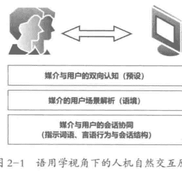

### 一、 人机自然交互的媒介实践图景

#### （一） 媒介与用户的双向预设机制

预设指说话人对听话人及自身已知的推测，即认为听者能依语境常识推断的信息（如“丈夫”预设“已婚”）。自然交互下，预设呈双向：**媒介对用户的预设**与**用户对媒介的预设**，交互中交织生效。

**1. 媒介对用户的预设：精准画像驱动的策略前置**

指会话伊始或任务执行前，媒介基于 NLP 能力，锁定针对单用户的内容生成与资源匹配策略，实现对交互过程与使用者的预判。涵盖兴趣、需求、知识谱系、文化底色等维度假设。

实践已现雏形：GPT-4 “自定义指令”让用户自述画像、定义模型人设与响应逻辑，预设贯穿全程对话；文心一言等采用问卷式交互，多维采集偏好习惯，构建立体用户认知。

挑战犹存：单一模态（文本/语音）信号解析有限，难精准判性别、年龄、文化等特征，与人类多模态融合印象有距离。未来接入三维虚拟空间或获更多识别信号，响应更细腻。另，大模型需何种用户数据、如何维度化结构化、如何让用户轻松“自我介绍”，仍待理论技术突破，且涉老幼群体数据伦理、跨文化自我呈现差异等复杂议题。

**2. 用户对媒介的预设：经验认知塑造的交互预期**

用户基于经验认知，对媒介可供性、价值倾向、交互模式形成预期，进而调整策略。如初识智能助手，用户多预设其仅能简易问答，故提问浅显；深度互动后，发现其擅长深度讨论，提问转向开放复杂。

学界研究溯源至“用户对计算机的社会反应”。早期视“拟人化”为核心机理：个体本质视计算机为人，迁用人际社交规范。后“计算机为社会行动者范式”（CASA）以大量实证显示：个体无意识将社会规范（性别刻板印象、种族认同、礼貌、互惠、认知承诺、个性尊重等）施用于计算机。即便机器无自然交互特质，用户亦非视其为无社会属性的冷冰冰工具，而是无意识中生成特定预设。

### 摘要：生成式智能重塑媒介交互新图景

步入生成式人工智能纪元，直观交互模式赋予媒介具身化的功能定位，当前相关实践主要分化为两条路径。其一，媒介应用本身化身为具身角色。以字节跳动“豆包”、小米大模型版“小爱同学”、接入大模型的游戏NPC为例，它们直接调用大模型生成对话，自带具体人设。这种做法助力用户快速建立媒介预期，强化代入感。其二，大模型作为底座内嵌聊天机器人，机器人绑定特定角色。如Poe的“聊天助手”、ChatGPT的“我的GPTs”，支持用户调用现成或自建人设。这些机器人配合大模型输出内容，同样引导用户形成建设性预设。对比无角色的自然对话，具身化角色能有效降低使用门槛，引导用户树立积极预期，从而优化体验。


图 2-2 涉及媒介具身角色的媒介实践

#### 场景解码：匹配、开发与嵌入

语境即“自然语言交际的语言环境”。语用学将其拆解为三维：共文语境（上下文语言要素）、情景语境（非语言因素）、民族文化语境（历史国族因素）。语境对高效对话至关重要，它内蕴行动框架。个体依托过往社交经验构建常规行为脚本存于记忆，遇同类情境即被激活，指导对话实践。清晰的语境能助生成式AI精准预判意图，给出预期回应，否则易产出离题内容，损耗效率。

当下，诸多媒介实践聚焦解析用户会话语境。共文语境涵盖时空、主题、文化、角色构建，源于提示词与历史；文化语境依赖预训练语料偏好及会话中画像识别。相较前两者，依赖非语言要素的情景语境最难攻克，现有实践呈现四类路径。

第一，依托专用媒介自带场景构建语境。此路径较粗放，不读取用户场景数据。如游戏NPC凭借人设与所在情境精准对话，提供沉浸体验；导购机器人结合自身时空特征精准推荐，沟通更人性。

第二，接入专用插件读取场景数据。插件开发让媒介直达用户场景，获取细粒度数据。GPT-4已支持购物、餐饮、学习类插件；文心一言构建插件生态，提供可视化界面与API助力开发者自定义模型与插件。用户使用插件时锚定情景，行为数据折射语境，助媒介更快更准解析。

第三，将生成式AI植入操作系统或平台采集数据。此策略保障数据读取权限，并在功能场景落地智能服务。代表有小米“小爱同学”、微软“Microsoft 365 Copilot”、金山“WPS AI”。

第四，基于实时联网响应。底层模型预训练固化，但语境具即时性，联网助智能媒介识别动态语境。文心一言接入百度搜索，ChatGPT与New Bing接入必应搜索。

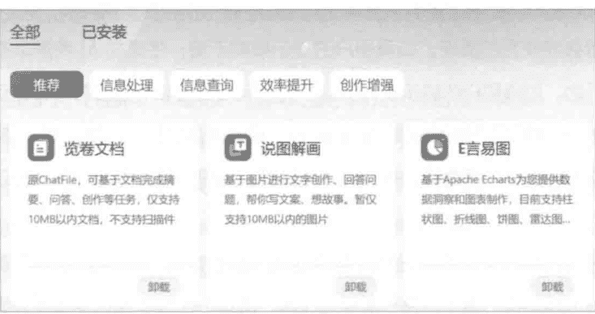

图 2-3 生成式AI应用的插件示例

#### 会话协同：跨模态交互与指令工程

媒介与用户的协同涵盖语用学三大领域：指示词（简化人地时信息）、言语行为（组词发声施加影响）、会话结构（开头、结尾、轮换、插入、分岔、修复等）。自然交互下的媒介实践亦遵循上述机制。

媒介侧依托多轮会话窗口拓展跨模态交互。除深度模拟认知生成文本，应用层也在探索新模态。ChatGPT借“画外音”等插件实现高质量语音对话；自定义GPTs允许上传头像，内置DALL·E支持对话中生成、读取图像，极大提升拟真度与拟人感。未来语音、语调、实时表情、动作、姿态等模态有望纳入会话基底，在多轮机制下形成全方位可供性。

用户侧的关键任务是如何用语言或非语言符号精准表需，即“指令工程”。指令质量直接决定交互成效。指令模糊则AI难懂意图；设计得当、充分利用符号系统传达目的，AI便能秒懂并精准回应。鉴于大多数用户指令能力欠缺，自然交互界面正探索辅助设计：展示历史指令、关联推荐、模板库等。

时至今日，自然交互模式已在智能音箱、智能客服、AI语音助手中彰显，虽仍不臻完善，需在技术、法规、伦理、文化等维度磨合落地，但其革命性可供性为媒介融合打开巨大想象空间，有望成未来媒介交互主流范式，打破现有媒介甚至人际交互的边界，开辟人类对外连接的新疆域。

### 二、 人机自然交互的演进三部曲

人机自然交互至少历经初期语义沟通、中期模态拓展、终期心智融通三大阶段。

#### (一) 初期·语义沟通：奠定基础可供性

##### 1. 自然语言搭建基础连接桥梁
“可供性”概念早期强调环境客观属性与生物行动可能性的匹配，后延伸至设计、媒介等领域。在自然语言交互中，语言形式为人机互动提供广阔空间，彰显交互可供性。受限于生理构造与认知模式差异，人机曾存壁垒。技术进步让双方借自然语言这一媒介达成协同。自然语言以最通用基础形态呈现于界面，使人机交互得以确立并延续。

##### 2. 语言交互：自然交互的起点与基石
话语沟通是人机互动的原始模式。计算机诞生伊始，冯·诺依曼设定的交互即机械化编解码：人类用指令语言表达意图，机器解析为二进制执行运算逻辑，再以自然语言输出结果。纵使市面涌现多模态感知理解模型，但因语言独特属性，大众最关注、最高频使用的仍是ChatGPT、LlaMA、Claude等以提示词为核心纽带的模型。人机主流范式依然以语言为主，这与人际沟通主导方式高度一致。

值得注意的是，早期基于文本模态的自然交互，要求用户用自然语言完整设定交互所需一切要素——预设、语境、指示词、言语行为等。人类必须用模块化、精准的提示词才能达成目的。这暴露短板：每次交互都需人类进行过度完整、相对不自然的叙述才能精准调用功能，稍有不慎便偏离预期。故而，初期文本模态自然交互仅处于“可用”而非“好用”阶段，距离熟悉的人际交流仍有鸿沟。

#### （二）中期·模态拓展：逼真模拟人际基本形态

为弥补早期模拟不足，推动产品从“能用”迈向“好用”，自然交互范式中期将聚焦交互信息模态拓展与数据融汇，精准识别非语言信号，大幅压缩人机协同逻辑链条，实现人际交往的基本模拟。

- **1. 纯话语沟通的天然局限**
除人机语境下的不足，话语模式本身亦有短板。人际传播本质是多感官、多模态的。语言符号学家梅拉比安公式指出：相互理解 = 语调（38%）+ 表情（55%）+ 语言（7%）。可见，仅停留在界面文字的语言沟通，远未达成充分理解。虽计算机领域已涉足语音情感识别等分支，但在人机应用中仍显稚嫩。交互除调动视听，还应包含姿态、动作触觉等要素，具身交互可激活更多感官融合，感官激动又关联内生情感与外在环境，为人机交互未来留出想象空间。

- **2. 拓展交互模态维度**
中期媒介需引入更多模态输入要素，构建细腻连接，形成高阶可供性。技术层面需拆解情绪：通过面部表情特征提取、语音情感特征提取等实现多模态情感识别；拆解非语言符号：借助人脸跟踪、姿态跟踪、语音识别等最大程度理解用户有意识或无意识传递的信息。最终，机器通过特征级、决策级或混合融合策略，整合多模态信号，输出精准分析结果，支撑人机深度交互。

- **3. 大幅压缩人机协同逻辑链条**
学者刘胜航基于语义三角形提出自然人机交互模型。其核心在于用户与计算机共享概念体系，计算机能直接识别用户界面设定的符号表示或具象呈现，并转化为计算机概念。

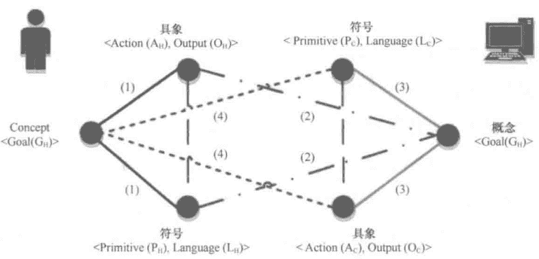

图 2-4 基于语义三角形的自然人机交互模型

实现上述交互的关键前提是概念共享与认知共通。产业层面，用户或训练者需提供充沛专业的预训练语料，让大模型完成对场景、语境、社会习惯、文化等非言语符号的认知铺陈，形成自身认知逻辑，免除用户交互时的繁琐背景阐述与角色塑造。同时，OpenAI、Meta、谷歌等巨头正通过微调、神经网络、强化学习等技术创新，投入插件与AI原生应用开发，拓展大模型边界，实现更高效、自然的信息读取理解，甚至形成对用户的个性化感知。

自然交互范式中期本质上是对人际交往方式的进阶模拟。正如熟人交谈无需反复确认细节预设，中期用户与媒介交往将不再依赖繁重的指令工程，而是媒介敏锐捕获用户多模态、内隐的非语言信号，推动人机协同逻辑链条进一步收缩，体验趋近人际传播。

#### （三）终期·心智融通：超越语言边界触达深层意识

即便人机交往无限逼近人际自然体验，仍存根本性隐患。人际交流中，充分沟通后仍可能彼此误解。语言本质上无法完全映射心灵，导致同一指示物在不同体系下指称偏离甚至对立，或同一环境下一指称对应多指示物。语言的片面性无法支撑完整人格，增加被误解概率，这在人际传播中常见，易致传播失效。

当前AI本质是基于概率的生硬智能，人类智能则精致细腻复杂。无论是碳基与硅基智能的互动，还是向更高维度进化，都缺失一个中间态的连接调度接口，以承担如何调用机器智能的功能。

故而，媒介或AI仍需一场关键技术革命，实现人机“心有灵犀”。这要求全新的硅基文明技术底座，而非单纯依赖计算概率的大语言模型。研究认为，信息作为高层级感受性关系是智能根基。设想在硅基文明构建的赛博世界里，人类摆脱躯壳束缚接入网络，万物皆为信息传播、数字化意义交换与心智流动。在与硅基系统持续适配中，生命“含硅量”攀升，人机融合形态浮现，智能成为人类延伸。

在通用智能的赛博化世界，人机智能互作可如现实般真实，甚至因突破交互形式局限而超越现实，以数字化心灵相通达心流状态。硅基智能最大优势在于进化速率远超碳基智能，故人机心智融通瞬间极短，但用户极度投入感知不到时间流逝。用户心流状态可作为心智融通的关键评量指标。

此外，新交互范式革命将重塑媒介生态与人机关系。媒介是人类对外实践的中介，中介模式从图形控件转向自然交互，意味着人机沟通协作进入全新范式，建立在旧范式上的传播样态、人机关系将嬗变。如何在变局中把握人机关系创新实践、治理传播生态，是未来核心课题。

## 第三节 生成式AI时代传播生态治理：负责任创新视角

ChatGPT被视为近年来最具变革性与颠覆性的AI产品，势必深刻重塑媒介、社会环境与生态。2023年11月1日，首届全球AI安全峰会于英国布莱切利庄园召开，中国等28国及欧盟签署首个全球性AI声明《布莱切利宣言》，直面强大AI模型潜在生存威胁，及AI加剧有害偏见信息的隐忧。长期以来，“风险立法论”治理误区将单一技术产品及其风险作为对象，忽视了应以具体应用场景与方式为基础。

2023年6月，欧洲议会通过全球首部AI监管法《欧盟人工智能法案》，实施分级监管。法案按四级风险分类AI系统：“不可接受风险”“高风险”“有限风险”“极小风险”，风险越低监管越轻，生成式AI如ChatGPT受特别监管。同年10月底，美国总统拜登签署《关于安全、可靠、值得信赖地发展人工智能的行政命令》，确立AI安全新标准，在隐私保护、公平公民权利、消费者工人权益、创新竞争等八维度作出规定。

技术引发新问题，终需技术解决。ChatGPT引发生成内容识别与溯源难题，归根结底属科技创新范畴。无创新则无法用管技术。技术哲学家芬伯格将技术分为两层：初级工具化将可用性要素从原情境剥离接受分析控制，技术主体处于远程控制位；次级工具化指技术对象结合构成生活方式基础。这印证了技术不仅是工具，更是社会文化的、被社会塑造的。随生成式AI以价值涌现介入媒介生产，媒介、技术、社会渐呈一体化生态态势，三者编织成“无缝之网”，科技创新与科技伦理张力凸显。

生成式AI进步为数字人文、新闻传播、社会科学研究实践，及大众媒体、社交媒体、合成媒体、教育创意产业应用带来良机。但风险挑战并存，应对需精准治理理念与方式，确保技术负责任、安全使用。

### (一) 治理思路：从应对性治理迈向复杂性治理

科幻名著《弗兰肯斯坦》借医学科学探讨折射两种科技愿景：一期盼科技向善推动进步；一警惕科技阴暗面。衍生出技术伦理双重考量：一是技术向善增进人类福祉；二是技术负责任发展降低风险。

面对层出不穷的颠覆性变革，如何构建技术发展与伦理原则良性互动？《华盛顿邮报》抨击OpenAI牺牲安全疯狂迭代圈占用户，指出破局之道在于负责任创新。该理论提供可行视角。

传统技治主义以技术手段实施专家治理，暗含科技与社会二元对立立场，基于机械控制论“我指挥你动作”，决策由中央处理器统一。随科技进步，技术成社会变革核心序参量，技治主义弊端日显。

### （二）核心原则：预留试错空间，划定创新疆界

新技术的诞生与落地，必然伴随一段相对混沌的泡沫期，这是探索未知领域必须支付的“学费”。治理框架理应内置容错机制，为创新留出呼吸的余地。面对技术的狂飙突进，若试图日日寻得治理良方、即时修补漏洞，实则违背了技术演进的内在逻辑。不少时候，技术衍生出的困局，恰恰能借助技术本身寻得破解之道。故而，当下的技术难题实属“成长的烦恼”，发展自身便蕴含着化解大多数矛盾的钥匙。

雷内·冯·尚伯格（René von Schomberg）抛出“规范性锚点”概念，旨在界定科技活动责任规则的价值坐标。这“锚点”好比责任规则体系里的公理系统——寥寥数条基础公理，即可推演出层层定理，亦即具体的行为准则与价值原则。我们循此锚点，筛选科技活动应达成的价值图景。“规范性锚点”非泛泛而谈“善”或“美好生活”，而是一组具体、且相互咬合的价值规范。技术推进与责任监管从未是非此即彼的二元对立，惟有双向奔赴、相互牵引，方能实现价值共创。面对生成式 AI 的横空出世，当务之急是构建一套普适性的“规范性锚点”，凝聚社会最广泛共识，化作导向性规范发挥约束效力。以大数据侵权为例，区别于传统抄袭的明确界定，生成式 AI 将底层要素拆解重组，思想溯源难度剧增。基于此，我们亟需确立“伦理可接受、社会可持续、科技可发展”三大规范性锚点，以求动态平衡。

**伦理可接受**，意指技术研发落地全链路的伦理风险，须整体控制在可被社会容忍的“安全线”以上。技术创造既要遵循道德底线，更要反哺人类承担更多责任，化解前代技术遗留的伦理旧账。**社会可持续性**，核心在于锚定“以人为本”。人是媒介演进的“元尺度”。技术进步推动“人的解放”纵深展开，用户数字价值得以显性化。生成式 AI 将离散生活场景编织成一体化文明生态，在虚实转换中重塑社会交互范式，构建保障人与社会可持续发展的责任规则。**科技可发展性**，聚焦技术自身演进。责任规则非为新技术按下“暂停键”，而是容许小规模试错迭代，推动发展更透明、公开、可控，以“预防原则”护航技术长远健康。

诚然，这三大锚点功能各异，既互斥制衡又互补共生。扣住这三点，多元主体共治的责任边界将更清晰，信息资源的深度链接将更顺畅，治理路径可逐步转向“抓大放小”，寻得生成式 AI 责任落地的价值依归，以多元协同新范式为社会母系统注入更多正向增量。

### （三）治理策略：破解科林格里奇困境，确立过程性思维

2023 年 3 月 29 日，《暂停大型人工智能实验的公开信》引爆舆场，千位顶尖专家联名背书，致使 GPT-5 研发被迫熄火。这便是新技术演进中经典的“科林格里奇困境”具象化。然而，这种因噎废食的强力叫停，显悖技术发展大势；同样，单靠政策执行、监管监督等刚性手段推行的适应性治理，亦难将发展与治理推向平衡态。

当下，“病急乱投医”多表现为退守传统思维惯性。若仅解决燃眉之急，传统路径或可权宜之计；但若立足技术长远大局，此类思路显然捉襟见肘。媒介技术演进，实为“科学—技术—媒介系统”持续转化为社会生产力的历程，亦是“知识—利益—价值”实现的过程，伴随的必然是技术伦理风险的持续显影。静态判别思维仅聚焦当下切片，而伦理判别的未来指向虽植根过往认知，但过往经验对当下情境的效度尚存变数。故而，我们需要一种具有方向感、张力性的治理手段——从限度与用度维度切入治理生成式 AI，而非僵化地以利弊二元论切割，这便是**过程性判别思维**。在负责任创新视域下，治理可前置至风险评估、技术规制等前瞻环节，既汇聚多方利益相关者诉求，又强化对治理目标的预期与复盘，以探索性、反思性、动态调整的姿态，捕捉社会情境流变。

治理生成式 AI，首重在具体情境中摸索策略。在**协商层**，打破垂直治理壁垒，以协同网络编织“技术治理共同体”，多维视角穿透社会情境，剖析各阶段行动与反馈；在**预测层**，将目光从下游“风险”前移至上游“创新”，在实景实验中预演潜在冲击；在**反馈层**，以开放包容姿态吸纳技术创新所需社会养分，实现治理策略与行动同频共振；在**反思层**，立足规范性锚点，借小规模试错与用户反馈定位短板，对现存与潜在价值冲突复盘溯源，输出调整方案，为治理导航定向。

### （四）治理方案：信息助推与 AI “监管沙盒”双轮驱动

#### 1. 生成式 AI 治理的“信息助推”实践

2023 年 1 月 10 日，《互联网信息服务深度合成管理规定》落地生效，明确要求：深度合成服务易致公众混淆误认者，须在显著位置标识提示。同年 5 月 9 日，抖音平台率先发布生成式 AI 规范与倡议，聚焦两大看点——**内容显性标识**与**虚拟人实名认证**。具体而言，平台提供水印溯源功能，虚拟人直播强制真人实名，重点打击侵权造假、违背常识等乱象。这标志着生成式 AI 规范化管理新纪元开启。

“信息助推”将成为矫正认知失序的利器。所谓“助推”，即在不侵犯用户自由选择权前提下，通过设计“选择架构”诱导行为；信息助推则是通过标识设计重塑在线信息场域，潜移默化影响用户感知决策。抖音规范细化了标识规则：图文视频左上角强制标注“AI 生成”及生成工具、公司名水印，其他要素可选。终端呈现的作品自带多重水印，经后台信息即可溯源全链路生产环节。

#### 2. AI “监管沙盒”：构建弹性治理的试验田

“监管沙盒”源自英国金融行为监管局，本质是通过隔离现实风险的安全机制，增强监管容错弹性，激活金融创新。技术加速期，高效创新机制关乎落地成败。现行监管多遵循事后被动逻辑，而沙盒基于监管方与技术方的深度对话，实现主动式监管转向。

AI “监管沙盒”作为监管创新范式，提供包容性空间与弹性监管规则。它在现实中切出一个微缩创新区，在保障用户权益底线前提下，放宽监管约束，允许 AI 技术测试产品、服务、商业模式。此举既能有效圈住风险外溢，又让生成式 AI 等技术在真实场景“练兵”。对监管者，可实现与新技术“零距离对话”，获取最新动态与优化方向，缓解伦理滞后于技术的困境；对入盒技术方，上市前即可与监管方深度联动，在真实世界而非模拟环境验证合规性，修正结果更具实战指向性。

展望未来，生成式 AI 规范化管理道阻且长，需跨越技术规范、功能规范、价值规范三重台阶，确保技术普惠、安全、可控、向善。技术推动进步的同时引入未知风险，依据风险社会放大理论，风险感知偏高即触发放大效应，形成传导链条。立足负责任创新，预判性、前瞻性的情境治理策略，能协调技术供给与社会需求，消减不确定性与风险性，实现新兴技术柔性治理，标本兼治为其长远发展奠基社会性建构。

# 第三章 生成式 AI 的人类增强：提示工程师的社会角色

## 本章概述

提示工程师是 AIGC 时代关键的社会新角色。本章聚焦其作为**价值挖掘者**的定位：如何深化大模型在内容创作中的纵深，挖掘提问背后的结构性与逻辑性“思维树”，点燃社会对智能技术的创造激情，驱动主体行为变迁与技术向善。同时，在大模型场景化落地浪潮中，提示工程师如何在游戏、虚拟社区等垂直赛道灵活调度技术，作为创新曲线上的“尝鲜者”，打磨应用场景、构建生态体系。最后，作为智能创作者，如何处理数据、实施高效标注训练、建立整体性认知、提升人机互信与信任校准，均是大模型素养的核心拼图。

## 第一节 价值挖掘者：提示工程师的助推作用

### 一、基础概念：提示工程、提示词与提示工程师

#### （一）提示工程

提示工程是一门新兴学科，专攻提示词的开发与优化，助力用户认知并跨领域驾驭大语言模型（LLM）。掌握该技能，有助于洞悉大模型能力边界，并能调用其处理编程、算数推理、问答等除杂任务场景。

#### （二）提示词

提示工程即构建大模型可理解解释文本的过程。提示词是描述 AI 执行任务的自然语言文本，通常包含指令、问题等输入信息。

- **1. 提示词要素**

核心四要素：**指令**、**上下文**、**输入数据**、**输出指示**。研究者将其概括为 **ICIO 框架**，视为提示工程的底层架构。

- **2. 提示词格式与技巧**

标准格式多遵循**问答模式（Q&A）**。主流技巧分两派：**零样本提示**——无需演示直接作答；**小样本提示**——提供少量范例引导。业界多青睐后者，因其能高效激发模型潜能。进阶层面，有**思维链（CoT）**通过中间推理步骤强化复杂推理；**自我一致性思维链（CoT-SC）** 将单链拓展为多链拓扑。面对需探索预判的复杂关键任务，学者进而提出**思维树（ToT）框架**，引导模型以思维为中介步骤解决通用问题，如图 3-1 所示。

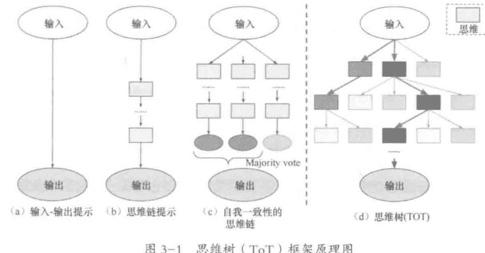

#### （三）提示词示例

提示工程指南按任务类型分类示例：文本概括、信息提取、问答、文本分类、对话、代码生成、推理。文本概括快速提炼大意；信息提取定向挖掘段落信息；问答优化提示格式；文本分类按需归类；对话指导模型运作如构建客服机器人；代码生成是大模型强项，巧妙提示可批量产出代码甚至无需指定语言。

目前提示工程在文生文、文生图、文生音频模型中较成熟。文生文主要靠查询/命令配合简短反馈（如“太长”“不够学术”）迭代输出；文生图靠内容描述驱动（如“骑车送外卖的飞行员高质量图”），涉及提示词增删改序。ICIO 框架下可细化为媒体、主题、艺术家、细节、图库支持等维度。

**典型文生文提示：**
> Write a dictionary article on the topic “[TITLE]”. The article should have about [WORDS] words.
> （[TITLE] 为主题，[WORDS] 为目标字数）

**典型文生图提示：**
> A beautiful painting of a singular lighthouse, shining its light across a tumultuous sea of blood by Greg Rutkowski and Thomas Kinkade, Trending on artstation.
> （格雷格·鲁特科夫斯基与托马斯·金凯德笔下，奇异灯塔照耀汹涌血海，ArtStation 热门佳作。）

#### （三）提示工程师

ChatGPT 爆红后，提示工程师作为互补性职业杀入职场。Scale AI 创始人视大模型为新型计算机，提示工程师便是新时代程序员，以提问之名榨取模型极致价值。2023 年 2 月，《华盛顿邮报》刊文称其为“科技界最热新职业，无需写代码”。Scale AI 提示工程师古德塞特，以纯文本指令驱动 AI 实操，区别于传统程序员。特斯拉前 AI 掌门安德烈·卡帕斯断言：“最热门的编程语言是英语。”提示工程师深谙 AI 工具边界与缺陷，擅长以复杂策略将简易输入转化为独特产出。学界定义其为：运用自然语言固化为提示词、挖掘 AI 模型最大潜力的职业。

研究者总结 **TESRS 实践原则** 以提升回答精度：
*   **T** —— 告知模型能做什么、不能做什么；
*   **E** —— 提供示例；
*   **S** —— 用 Select/Import 等引导词指定输出代码类型；
*   **R** —— 设定角色人设，贴合需求；
*   **S** —— 用特殊符号（如“”、“##”）分隔指令文本，提准确度。

### 二、提示工程师：工程哲学转向下的新社会角色

#### (一) 大语言模型与工程思维的契合点

- **1. 从技术哲学到工程哲学的范式迁徙**

20 世纪科学哲学经历了从技术哲学向工程哲学的转向，是当代哲学对科技发展的适应性回应。传统技术哲学核心在于批判与本质反思，追问指向由理论关怀转向现实关怀，却始终徘徊于实用主义走廊，滞留于理论走向实践的过渡地带。工程哲学的介入，正是破解此困局的关键钥匙。

### 科学与工程的思维分野：从探寻真理到化解不确定性

科学以探寻真理为己任，其方法论建立在演绎与归纳的严密逻辑之上；工程与此截然不同，旨在化解不确定性，给出应对之策。工程关注偶然性、概率性、特殊性与具体性，致力于推动生产力跃升，其方法论侧重启发式与集成式路径。因此，工程师凭借个体与过往阅历形成主观见解，采取有意识的行动。工程哲学以此四大特性为研究靶心，通过验证、剖析、改良等路径展开工作。

随计算机技术飞跃，计算机辅助工程（CAE）已深度渗透设计全流程。它借助算力压缩研发工期、优化方案、削减开销，在落地前预判隐患、模拟试验，大幅节省资源。从本质看，这标志着知识形态从“知其然”的陈述性知识（Knowing-that）向“知其所以然”的程序性知识（Knowing-how）跨越——这是工程哲学最关键的范式革命。工程评判作为核心概念，指代对设计、安装、运维或安全等系统性评估过程。戴维斯直言：缺乏工程评判力，顶多成就专家，无法成为合格工程师。

---

### 2. GPT 的工程基因

工程、科学、艺术思维代表人类认知现实的三种迥异范式。工程思维的标志是“建构性关系”：将预想与蓝图经由实践转化为现实中原本不存在的人造物，港珠澳大桥即是典证。这一逻辑不仅适用物理世界，在网络空间同样生效。具体到 GPT，其工程属性极为鲜明。

工程活动绝非单纯的经验操作，它要求从业者预设思维框架，对“未存在之物”下达操作性定义。指令工程师正是这一角色的具象化：预设提示词框架，通过对话式调试大模型，产出符合需求的成果。

工程思维具备三大核心特质——**前瞻性**（无结构中预见结构）、**边界约束性**（在限制内操作）、**果断性**（对方案果断拍板）。因此，GPT 本质上是工程技术的结晶，大语言模型是一个系统级工程——它统筹调度多元技术与资源，完成具体任务，实现了从单一技术手段到复杂工程设计的跨越。

#### （二）角色跃迁：从系统规划师到指令工程师

AI 演进倒逼开发者升级，传统技术思维难以直击用户痛点，指令工程师应运而生。从 Token 到 Prompt 的演进，映射着从系统规划师到指令工程师的职业跃迁。

昔日系统规划师属技术岗，核心职责是高阶技术选型、标准制定、核心架构搭建与技术统筹。而指令工程师聚焦大模型设计、优化与落地，需精通模型机制，依据特定需求产出高质量 Prompt 并持续迭代。当下招聘市场上，Prompt 工程师、AIGC 工程师、大模型算法工程师等岗位遍布，ChatGPT 问世后更成抢手人才。

此转变深层意涵在于：**思维范式从“技术思维”转向“工程思维”；交互语言从“代码语言”转向“人类语言”**。这是对自然语言的工程化处理。ChatGPT 基于海量语料预训练，实现信息的预表与调用；指令工程师本质上是在分析模型海量语料、调试优化 Prompt。前者属技术作业，后者属工程分析，理应被界定为具备工程思维的工程师角色。

---

### 三、指令工程师：价值发掘者与校准守门人

#### （一）三大核心价值

**1. 托举内容生产纵深**
AI 发展历经三期，ChatGPT 标志着实战期到来。胡泳将传统内容定义为“前 AI 时代”产物，虚拟化身等为“AI/元宇宙时代”新品。生成式 AI 不再是对生产力的改良，而是彻底的变革，甚至可能取代人成为生产主体。在新时代，内容品质取决于提问品质——即 Prompt 的优劣。未来虽人人可调用大模型，但唯有掌握指令工程者，方能解锁深度与高质创作。

**2. 激活大模型连接机能**
智能互联时代，指令工程师是大模型连接力的关键枢纽。技术演进视角下，连接机能分中短期与长期：
*   **中短期**：模型间壁垒森严，指令工程师扮演中介，按需编排多模型资源，打通用户-模型、模型-模型互通路径。
*   **长期**：智能跃升后，指令工程师驱动模型满足个性化、场景化、关系化需求，挖掘长尾微价值，覆盖边缘人群，实现人-人、人-物、物-物的连接跃升。

**3. 人机互构：理智与感性的交织**
人机非零和博弈，而是互相成就。生成式 AI 基于海量语料预表调用，在人类持续追问中生成内容，内容生产本质上是人机互动的产物。此过程中，蕴含情感、关系的“感性要素”被卷入，经自适应方式内化为模型能力，折射在输出中——我们能在 AI 生成物中感知情感温度。虽本质是概率博弈，但人类情感介入下，理智与感性交织涌现“微内容”，将内容系统重构为复杂的局系统。

#### （二）终极指向：价值校准

大模型对话化普及后，技术边界风险凸显：知识盲区与疏忽易导致偏见、歧视输出，引发负面效应。ChatGPT 训练分三步走：基础训练夯实语言与世界知识；指令微调强化零样本对话；**类人校准**确保输出符合人类诉求、规避有害内容。校准不止代码层面，**伦理与价值观校准才是核心**，让模型懂得敬畏人类需求。

主流校准技术含监督微调（SFT）与人类反馈强化学习（RLHF），虽降低了操作门槛，却对指令工程师提出新考题。要推动广泛价值校准，工程师须明晰三点：**目标何在、内涵为何、规范如何**。
*   目标维度：指令遵循、目标达成、意图理解、道德合规；
*   内涵维度：行为校准、意图校准、激励校准、内在校准；
*   规范维度：依目标落地定义。

指令工程师是挖掘生成式 AI 极限的关键力量，须推动模型价值观与人类普适伦理深度校准，致力构建统一 AI 伦理规范架构，唯此方能引领人类社会在 AI 浪潮中行稳致远，实现人机协同共生。

---

## 第二节 技术尝新者：细分赛道里的指令工程实战

强大基座模型奠定垂类应用基石，催生“百模竞技”生态。2022 年底 ChatGPT 问世以来，以大模型为第一生产力的 AI 原生应用井喷，垂直领域潜能充分释放，变革性冲击深远。需求精细化、知识专业化倒逼专用扩展与应用涌现，反哺基座模型迭代。

Scale AI 创始人喻生成式 AI 为新型计算平台，指令工程师即其编程者，用 Prompt 挖掘最大潜能；学界视其为基于复杂任务提供标准化 Prompt 策略的工程师，或定义为用人类语言定型 Prompt 以激发模型潜能的岗位。

指令工程师非凭空而来。互联网问世至今，技术浪潮迭代下互补型岗位持续涌现并重塑。早期网络检索专家（如塔拉·卡利沙因）撰著指南助用户精准检索；1997 年 SEO 概念诞生，专家服务搜索公司与建站平台，填平“检索能力差距”。而指令工程师的使命，是通过产出 Prompt 与普及技能，弥合**“知识调用差距”**。

前文已见 AI 原生应用在细分赛道蓬勃发展，势头强劲。场景生态视角下，人是核心，目标是满足个性化需求。恰当 Prompt 让模型调用更丝滑高效，为垂类生态建设指明方向。下文将从专业与个人两大维度，探究指令工程师如何融入垂类生态建设。

---

### 一、专业应用场域深度剖析

#### （一）金融：数据洪流中的精准掌舵者

金融数据繁杂、节奏极快，大模型切入为后台运营、数据研判、营销谋划及前台服务注入新活力。

**1. BloombergGPT：垂类首秀标杆**
彭博社推出的 BloombergGPT 是金融首个公开论文的大模型（参数规模 500 亿），以 3630 亿金融 Token 与 3450 亿通用 Token 训练。同量级对标下，其对金融知识与行情领悟更深，财报类表现突出。外部基准任务（如 ConvFinQA 财报数理推理、FiQA SA 情绪预测、FPB 情绪分类、Headline 标签分类、NER 实体识别）及内部情感分析任务均超越对标模型。落地可助力：财经深度解读辅助投资决策、辅助分析师把控知识与风控、支撑财报分析与会计审计。


图 3-2 BloombergGPT 图示

**2. FinGPT：开源生态的全流程突围**
BloombergGPT 维度相对单一，FinGPT 作为金融首个开源大模型，以数据为核心提供透明资源支持自建模型。经大规模金融数据训练与低成本精调，**首创从信息端至投资端全流程自动化投研决策**。研究者梳理出九大功能：智能投顾、量化交易、组合优化、风控管理、反欺诈、信用评分、ESG 评分、低代码开发、金融教育。


图 3-3 FinGPT Logo 图标

#### （二）医疗：问诊逻辑的天然契合

问诊“问-答”模式与生成式 AI 交互高度同构，大模型切入医疗问诊水到渠成。

谷歌 Med-PaLM 为首个在 MedQA（美医师执照考题）拿下 SOTA（67.2%）的医疗大模型，二代 Med-PaLM2 分数跃升 19%。技术迭代四大支柱：**小样本提示**（示例预热）、**思维链**（多步推理条件训练）、**自我一致性**（多路径投票取优）、**集成优化**（分阶段多答案比优劣）。

2023 年 4 月《华尔街日报》披露 Med-PaLM2 已进诊所实测，覆盖医疗问答、摘要、大数据处理及 X 光诊断。同类产品如 DAX Express（就诊对话转临床笔记）、哈工大“本草”大模型（原“华蛇”，聚焦中文医学）亦崭露头角。


图 3-4 谷歌 Med-PaLM2 发布会截图

#### （三）法律：严谨推理下的可解释性攻坚

法条浩繁、案件重逻辑与公正，法律 AI 对准确性与可解释性要求极高。

国际知名 Harvey、北大团队 ChatLaw 领跑中文赛道。ChatLaw 以海量结构化法律语料（法规、咨询、司考）训练精调，支持文件上传结构化抽取、语音输入上下文识别，便于还原案情，输出法律建议、文书代写、援助推荐，多模式交互满足多元需求。

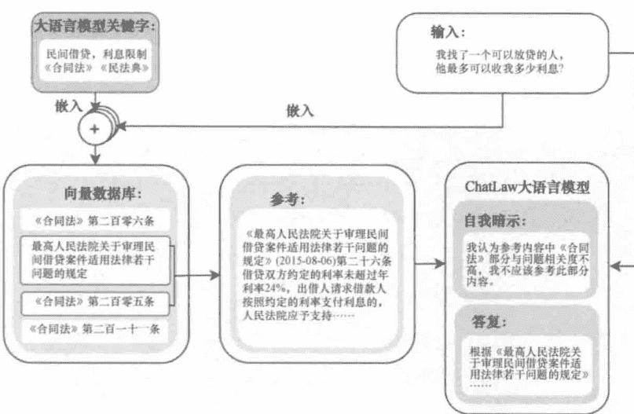
图 3-5 ChatLaw 运行机制

针对“幻觉”顽疾，ChatLaw 融合向量与关键词双检索引擎及角色自暗示机制，增强纠错能力。团队开源三模型：ChatLaw-13B/33B 及 TextVec，分攻中文学术写作、逻辑推理、相似度匹配。

#### （四）艺术：多模态时代的创作平权

多模态交互背景下，生成式 AI 降低技术门槛，让灵感直抵作品，文生多模态路径在艺术领域全面铺开。绘画为核心战场，高效生成、画面精良、版权争议冲击艺术圈认知，大幅降低入门门槛。Stable Diffusion 与 Midjourney 为当前双雄。

**1. Stable Diffusion：开源震撼的开端**
2022 年下半年 OpenAI 发布 Stable Diffusion，其极速产出高质量图像乃至短视频的能力震惊艺术界。


**图 3-6 Stable Diffusion 界面展示**

Stable Diffusion 是一款开源的神经网络模型，专注于生成高度逼真的图像。其核心技术基于扩散模型：首先由编码器对图像进行感知压缩，随后从纯噪声图像起步，通过逐步去噪的过程学习真实图像的分布特征。随着训练深入，模型掌握了重构图像细节的能力，从而能生成写实画面。这种“高维压缩至低维空间运算再还原”的范式，显著降低了计算开销，同时保证了输出质量的稳定性。

功能上，Stable Diffusion 支持文生图、图生图、局部重绘、超分辨率甚至视频生成等全链路操作。发布首月即登顶 GitHub 热榜，热度可见一斑。不过，开源特性也带来了较高的学习门槛与专业要求。目前已迭代至第二代，在画质精度、内容安全过滤、分辨率上限、创意扩图及跨帧一致性等方面均实现质的飞跃。

- **2. Midjourney**

Midjourney 以 Discord 机器人形态存在，用户通过对话交互即可完成创作（见图 3-7）。其底层技术融合自然语言处理与深度学习，团队耗时数月，以海量网络图片及美术馆藏品为语料进行训练。凭借“低门槛、高质感、强真实感”的体验，它迅速破圈，虽团队不足百人，却拥有约 1500 万用户，引发行业强烈震动。


**图 3-7 Midjourney 界面展示**

现已推进至 V5 版本，团队正全力攻关视频与 3D 生成能力。Midjourney 独辟蹊径构建了聊天室与“Community Showcase”社区频道，用户可在此提问交流、复用优质提示词，实现了“创作工具+社交广场”的双重价值，极大降低了用户的探索成本。

AI 绘画早已突破静态范畴，凡涉视觉领域皆有高水准建树。影视、广告、营销等赛道全面拥抱生成式 AI。2023 年 3 月，可口可乐率先以 AI 完成广告风格化制作且痕迹隐形。除上述两大巨头外，Adobe Firefly、DALL·E 3、腾讯混元、文心一格等百模争艳，生态繁荣。

[1] 图像噪声：指妨碍图像信息感知的各类干扰因素。

#### （五）软件工程

作为最早拥抱 AI 的领域，软件工程在生成式 AI 应用上走在前列。2019 年，MIT 团队发布自动生成代码 AI，模拟人类编码思维，分模块完成模式识别与推理生成。2020 年，OpenAI 推出 GPT-3，经开发者适配后已能覆盖全栈开发并附带代码注释。随即，GitHub Copilot 横空出世，海量代码训练大幅降低编程门槛，以自动化编程重塑研发效能，现已服务 2 万余企业、百万级开发者（见图 3-8）。Cursor、Replit、CodeWhisperer、CodeGPT 等专业模型接踵而至，功能日臻完善。研究证实，ChatGPT 已能辅助软件设计、测试、编码全周期。

编码环节尤为突出：ChatGPT 支持片段输入与指令交互，极大改善了初中级程序员的体验。更有研究发现其具备自动修复 Bug 能力。由此可见，大模型正为编码、重构、性能优化、文档生成、代码分析等全谱系注入创造力。

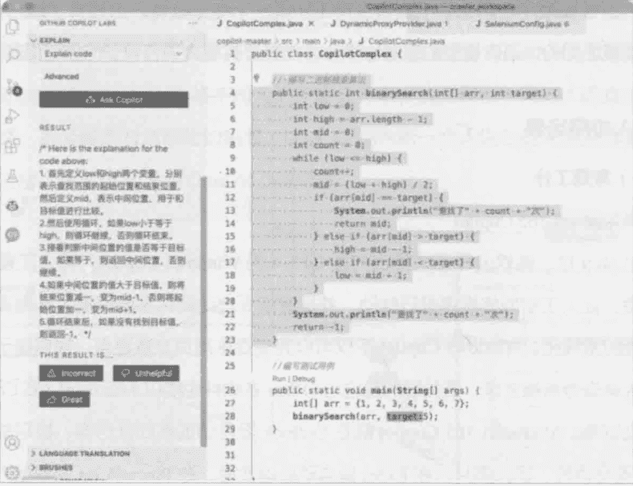

**图 3-8 GitHub Copilot 界面展示**

#### (六) 其他领域

生成式 AI 的强代理特性使其渗透至各行各业。除前述五大核心赛道外，电商领域 Shopify、京东推出大模型赋能全链路营销；营销端 People AI 洞察数据提效增收；教育界 GPT-4 辅助编程教学媲美真人，谷歌 Socratic 覆盖多学科深度答疑；音乐创作有 MusicAgent 串联全流程；学术写作受 AI 增强与替代双重影响（详见第六章）。生物医药、智能驾驶、物联网、化工环保等亦现 ChatGPT 等大模型身影，生成式 AI 正无声重塑产业版图。

值得注意的是，领域模型绝非孤岛。跨学科融合的当下，通用 AI 的初衷要求打破壁垒，唯有多模型互通协作，方能激发真正的创造势能。

### 二、个人应用场景

#### (一) 常规工作

- **1. Microsoft 365 Copilot**

2023 年 9 月，微软发布内置 GPT-4 的 Windows Copilot，让 AI 深度介入系统层，可联动程序、自动调配配置，落地系统级智能。其不仅能摘要网页、创作文案、修图，更关键在于以 Microsoft 365 Copilot 形态打通 Office 全家桶：Outlook 自动摘拟邮件、Word 润色配图、Excel 智能处理数据、PPT 一键生成大纲（见图 3-9）。彻底终结“快捷键式”单一交互，自动化标准化繁琐任务，效率跃升显著。


**图 3-9 内嵌 Microsoft 365 Copilot 的 PPT 制作界面**

- **2. Otter AI**

会议、采访、演讲等语音场景中，Otter AI 展现了极强的增强能力。它不只是全程实时转录，更能基于声纹分离技术区分发言人、识别身份、甚至随对话积累洞察说话习惯与言外之意（见图 3-10）。


**图 3-10 Otter AI 界面展示**

个人办公远不止文档与会议，审批、报销、协同、翻译、垂直领域生产等场景，如今均有 AI 原生应用逐一对号入座。

#### (二) 自主学习

- **1. Perplexity**

Perplexity 融合 ChatGPT 与 Bing，重新定义智能搜索。它聚合网页信息生成答案并溯源引用，既规避了大模型“幻觉”，又赋予搜索交互感。用户可将模糊意图经其精准化为关键词再深挖资料。搜索智能化让获取学习资源更高效、精准，大幅压缩学习成本（见图 3-11）。


**图 3-11 Perplexity 界面展示**

- **2. Hi Echo**

2023 年 5 月 Discord 推出的 Call Annie 凭借实时纠错成口语练习神器；OpenAI 推出 Speak、讯飞星火上线“星火语伴”，垂类产品扎堆。10 月，网易有道发布全球首个虚拟人口语私教 Hi Echo，从发音、语法双维出具报告，提供纠错、地道表达、风格润色等进阶建议（见图 3-12）。虚拟私教以庞大语料库、低边际成本、无时空限制、拟人化交互体验，解决了外教稀缺贵、人类教师专业度与场景覆盖受限的痛点。随着 AI 语音在语气、停顿等维度的拟真进化，其替代潜力持续放大。


**图 3-12 Hi Echo 界面展示**

大模型对个体的赋能在自主学习中体现得最为淋漓。随着场景细分（资源检索、长文总结、翻译、视频摘要、模拟面试等），生成式 AI 正进化为人类得力的“学习副驾”。

#### (三) 提示词平台

优质提示词是高效调用大模型的钥匙，平台化建设助力用户深耕提示工程，拓宽应用边界。主流平台有 Flowgpt 与 Promptbase。

- **1. Flowgpt**

开源提示词社区，聚集近百万工程师共创。热门提示词置顶推荐，内置免费调试环境，支持编写、测试、发布、管理全流程，优质提示词可被社区直接复用（见图 3-13）。

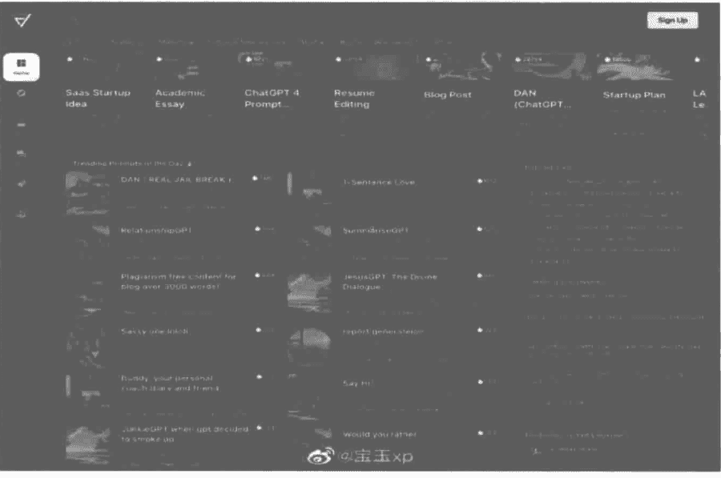

**图 3-13 Flowgpt 界面展示**

- **2. Promptbase**

提示词交易市场，覆盖文生文、文生图领域。商品页展示适配模型与生成参考图，用户按需购买，平台抽成 20%（见图 3-14）。

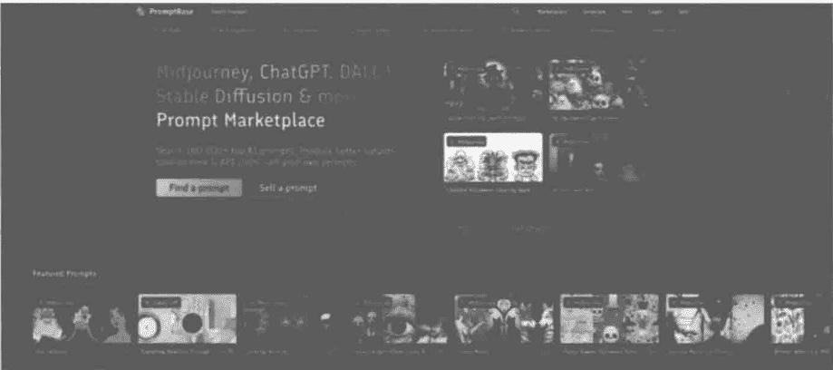

**图 3-14 Promptbase 界面展示**

## 第三节 提示工程师的职业规范与未来可能

### 一、提示工程师的职业规范

#### （一）职业概况

提示工程师，旨在通过提示词挖掘生成式 AI 极限能力的新职业。核心职能聚焦于提示词的设计、优化与评估，研究如何精准引导模型产出目标结果，并在实战中验证有效性。

核心胜任力画像包含五大维度：

1.  **技术硬核**：扎实的计算机科学与编程功底（多语言/工具驾驭），深度理解 NLP 模型原理、优化路径与应用边界。
2.  **问题拆解与决策**：能透析复杂问题本质，制定方案；具备高强时间管理与压力下快速决策力。
3.  **协作通达**：清晰高效的沟通表达，跨专业团队协作解决问题的意识与能力。
4.  **持续进化**：强内驱力保持技术迭代追踪，对行业趋势保持敏锐嗅觉。
5.  **创新转化**：独立思考产出新解法，并能落地为产品/服务驱动业务增长。

#### （二）职业道德要求

- **法治底线**：严守知识产权、网络安全等法律红线，零容忍违规。
- **道德准则**：保护用户隐私与数据安全，不损害公共利益。
- **伦理跟进**：持续学习演进中的 AI 伦理规范，主动应对新挑战。
- **去偏见化**：设计提示词时主动规避潜在歧视与偏见风险。
- **系统安全**：确保提示词设计安全可控，防滥用、防攻击。
- **隐私守护**：全生命周期守护用户信息安全，严禁泄露滥用。
- **公正立场**：利益冲突中保持中立，遵循公平原则。
- **开放共进**：虚心接纳多方监督建议，持续迭代服务质量。

#### （三）职业知识要求

- **1. 计算机科学与软件工程基石**
    编程语言实战、数据结构与算法内核、操作系统原理、网络协议通信机制。

- **2. AI 与机器学习核心认知**
    经典 ML 算法、深度学习主流架构、NLP 关键技术流程、计算机视觉基础任务。

- **3. 业务领域知悉**
    洞察用户画像与需求，熟稔电商、金融、医疗等垂直赛道业务流与特点。

- **4. 法律法规合规库**
    隐私保护、知识产权、网络安全三大合规红线的实操应用。

- **5. 职业等级与评价体系**

    - **(1) 分级阶梯**
        - **初级**：经验浅、技术弱，从事基础开发测试，在高级指导下设计简单提示词，充当 AI 与需求的初级中介。
        - **中级**：经验足、技术强，独立攻坚复杂项目，设计优化高阶提示词，成为关键中介节点。
        - **高级**：资深技术管理双料，统领大型提示策略体系建设，具备战略视野与领导力，打通 AI 与需求无障碍连接。

    - **(2) 多维评价机制**
        - **定量侧**：效率产出（周期/质量）、提示词规范度（可读/可维护/可扩展）、创新方案产出率。
        - **定性侧**：技术广深度（面试/测评/同行评审）、业务理解落地力、团队协作与领导力贡献。

### 二、提示工程师的未来可能

# 生成式AI浪潮下，“提示工程师”是昙花一现还是长久新职？

ChatGPT 以惊人速度刷新互联网产品“亿级月活”纪录，引发全社会对生成式 AI 重塑职场版图的激烈探讨。从能在一分钟内成图的 Midjourney，到能模拟笔触技法的 GANPaint Studio，再到让普通人一键生成名作风格的 DeepArt.io，技术正以前所未有的速度压缩“外行”与“大师”的距离。数字人主播、AI 文案、智能插画师等新物种雨后春笋般涌现，重复性劳动岗位首当其冲面临替代风险。在这场狂飙突进中，究竟会催生哪些前所未有的职业机遇？

## 破题：回到知识生产的底层逻辑

要看清未来，必须洞察生成式 AI 生产知识的本质。有学者精辟地将 ChatGPT 定义为“平庸的回答者”，而人类则需扮演“聪明的提问者”。这并非传统的独自读写获知模式，而是一种复古的“苏格拉底式”对话求真：**提问者的水位，直接决定了回答的上限。** 精心设计的提示词能激发深度洞见，拙劣的指令只会换来废话连篇。

早期资本疯狂追捧 ChatGPT 时，知识界却多持审慎怀疑态度。核心质疑直指痛点：AI 并不真正“理解”内容，只是概率预测。它虽能通过考试、写代码，却常一本正经胡说八道、捏造文献。随着应用场景深化，单靠底层算法和数据已不足以应对复杂需求，**“如何问”成为撬动模型上限的关键变量。** 爱因斯坦曾说：“提出问题比解决问题更重要。”当大众提问能力跟不上 AI 扩张速度，**提示词交易平台**与**提示工程师**这门新职业便应运而生。

## 核心价值：跨越“人类高阶需求”与“AI 当前能力”的鸿沟

缺乏专业提示工程师时，AI 只能应付泛泛而谈的简单指令，面对垂直领域、结构化、高专业度的复杂任务便无能为力。**提示工程师的核心使命，正是用专业素养填平这道“能力鸿沟”，实现 AI 对用户的深度赋能。** 但这一职业前景如何？业界莫衷一是，主要分为四种推演图景。

### 图景一：生成式 AI 的“过渡期陪跑者”（短期产物论）

此观点认为，提示工程师是 AI 爆火催生的互补性职业，命运与 AI 绑定。未来充满变数：意大利因隐私禁用 ChatGPT，马斯克、图灵奖得主联名叫停 GPT-5 研发……若国际社会因风险达成禁用共识，需求瞬间归零。

即便 AI 一路狂飙，也可能“自我进化”淘汰提示工程师。深度学习泰斗杨立昆直言：提示词工程存在只是因模型对现实理解不足，属**临时态**。国内极纳科技已推出 “PromptPerfect” 等自动优化工具，用户只需述意，系统自动生成高质量提示词。若优化提示词本身也能被 AI 自动化，该职业恐难逃“阶段性产物”宿命。

### 图景二：数智时代的“复合型翻译官”（长期工种论）

支持者强调：**降门槛、提效率，是刚性长期需求。**

提示工程师不仅是“写提示词的”，更是**场景架构师**与**模型调度员**。早期他们能整合各大模型优势，弥补孤岛割裂，为未来互联互通铺路。首位提示工程师 Riley Goodside 指出：这创造了一种**人机思维交汇处的“新语言”**——人类负责推演意图，机器执行细节落地，这种沟通模式不会消失。学者刘海龙、连晓东亦认为，AI 难以颠覆性突破人类既有知识边界，人类引导仍不可或缺。

未来渗透场景将极广：
1.  **智能终端**：优化手机/家居语音助手交互体验；
2.  **虚拟客服**：重构金融、电商、教育领域对话逻辑与服务质量；
3.  **个性化教育**：设计高效辅导对话流，提升学习效能；
4.  **医疗健康**：构建精准咨询系统，助力患者自我管理；
5.  **智能创作**：赋能内容生产，跑通从构思到成品的高效闭环；
6.  **前沿研发**：深度参与算法优化与 NLP 新架构探索。

企业招聘偏好印证了这一点：既懂 NLP/ML 技术原理，又懂数据分析、产品设计、用户体验，更守 AI 伦理底线的**复合型人才**，即便赛道变迁，核心竞争力也极难被替代。

### 图景三：高门槛下的“少数精英技艺”（专业技能论）

类比程序员、厨师、歌手：技术普及≠人人成专家。全球 2700 万开发者不足人口 5%。提示工程同理，因认知层次、能力深度、审美境界差异，必然形成**专业壁垒**。

其知识体系要求极高：
*   **底层硬核**：编程、算法、AI 系统化原理，建立结构化思维索引，像医生诊断般“顺藤摸瓜”定位问题；
*   **领域深度**：必须精通垂直业务术语与专业逻辑；
*   **创造性重组**：不走教程老路，视对话框为“白纸”，能将知识“打散重组”，用破坏性创新解决个性化难题；
*   **极致问题意识**：好的问题能调动模型全量能力，要求从业者具备宏观历史视野与微观结构洞察，非基础生存技能可比。

高昂的**沉没成本**锁死大众化路径：教育体系重构、算力数据投入、模型维护成本，注定其在相当长时期内为**专业机构定向培养的高精尖人才**。

### 图景四：刻进模型里的“个人数字签名”（独特风格论）

这是最具想象力的图景。研究发现，通过扩展词典绑定特定词汇（如 DreamBooth），模型能稳定生成带强辨识度的个性化内容。

**提示工程或将进化为“个人签名”技能：**
*   **风格修饰符**成关键载体：“油画”“超现实主义”“James Gurney 风格”等词块，承载细微语感差异，形成独有内容分类；
*   **丰富度与颗粒度**决定作品灵魂：形容词副词的嵌套、视角切换、修辞运用，细腻颗粒度折射创作者深度理解与强控制欲；
*   **内因——性格外化**：同一画面，不同人用词迥异，词汇感受力不同。多轮调试中，AI 绑定“个体-独特词汇-特定输出”记忆，实现模型个人化、风格化，演变为**个人实践式管理技能**——人人拥有专属微调提示集；
*   **外因——时代烙印**：超现实主义源于一战后，印象派生于 19 世纪。社会思潮、技术变迁、地域文化，终将渗入提示词，被 AI 学习固化为时代共性的“个人签名”。

---

# 第四节 信任校准：人机融合协同演化的底层逻辑

人机信任非二元对立，而是连续谱系：**陌生 → 不信任 → 初始信任 → 持续信任 → 强信任。** 信任是连接人与智能技术的桥梁。**大众的“智能媒介信任素养”必须与技术发展水平同频共振**，一旦背离，便陷入“过度迷信”或“彻底不信”双重陷阱。如何完成**信任校准**？

### 核心原则：智能价值优先

在媒介技术成为社会变革“内核程序”当下，生成式 AI 不仅重塑感知系统，更重新定义并超越传统媒介社会，新文明环境系统正在落地。**智能本质上是人、机、环境三元共生的产物。**

任务-技术适配模型（TTF）揭示：技术唯有与任务有效匹配，才能显著提升绩效，用户感知随任务动态变化。**在当下复杂技术环境中，践行“价值优先”依然是破解信任困局、实现人机良性共生的根本坐标。**

# 智能系统的三角拼图：人、机、媒如何各司其职？

智能绝非单一实体，而是一个由多方编织的复杂系统。要梳理清楚这张关系网，首要任务是落实责任分工：人掌舵方向，判断“做正确的事”；机执行逻辑，专攻“正确地做事”；媒介环境搭台唱戏，提供“做事的平台”。想让AI真正赋能媒介生态，光有惊人的算力还不够，核心在于注入人的智慧，唯有理性与非理性、算力与算计深度融合，才能诞生真正的智能系统。

要实现多主体协同、榨干系统效用，“信任”是那把关键钥匙。智能的本质源于人类认知，是人适应技术的产物，也是认知与算法逻辑的交叉点。技术把人类不可见的思维路径，以符号形式“映射”成机器可运行的规范，再以“镜像”方式反哺人类自省。因此，人机认知同构，层级间因果交织，同层级混合共生。

## （二） 信任校准：素养与技术的动态平衡术

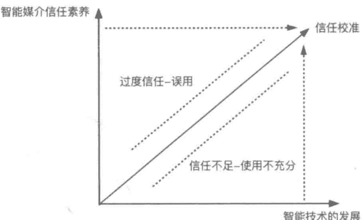

图 3-15 智能媒介信任素养与智能技术的发展的信任校准

理想状态下，大众的“智能媒介信任素养”与“技术发展程度”应呈正比，落在一条标准直线上。现实却常偏离轨道：

*   **越线在上（过度信任）：** 素养超前于技术。盲目让渡控制权、弱化监管，秩序混乱随之而来。
*   **落线在下（信任缺失）：** 素养滞后于技术。畏难不用、甚至叫停，技术红利被白白浪费。

**“信任滞后”正成为技术发展的拦路虎**，它削弱了我们驾驭技术、达成共识的能力。所以，“信任校准”的核心动作就是：感知信任与实际信任的平衡——**遏制盲目乐观，修补无端恐惧**。

以生成式AI为例，人机共生拓展了人的边界与自由。用好ChatGPT，离不开校准：技术端要持续对齐人类常识、价值观，减少“胡说八道”；人类端要补齐大模型信任素养，光靠技术突破不够。这个动态调整的过程，本质上是技术、社会、人三位一体的感知认知融合，具备自我修复、迭代进化的能力，在动态中重塑社会信任新范式。

## （三） 破局关键：造一台“值得被信任”的AI

人机关系早已超越二元对立，深度融合重塑了人类生存形态。唐·伊德指出人技关系遵循“存在论模式”，甘贝塔视信任为降维复杂性的利器。信任非造作，乃社会关系中自然生长的预设前提。在人机融合当下，交互已内化为社会存在一环，AI是媒介环境的底层OS，发展可信AI顺应逻辑、水到渠成。

**核心不在让AI满足“人信任人的条件”，而在让AI自身“配得上信任”**。这要求构建一个可信的社会技术系统。欧盟《可信AI伦理指南》划定四条红线：
1.  **尊重自治：** 保障用户决策权，设计初衷为增强而非替代人。
2.  **防患未然：** 不伤人、不害环，系统须稳健可靠。
3.  **坚守公平：** 利益成本均等分担，拒绝偏见与歧视。
4.  **可解释性：** 能力边界公开透明，决策路径让利益相关者看得懂。

生成式AI的信任建设是场马拉松，其塑造的新模式将长驻信息生态。互联网解决了传播的“零成本”，生成式AI攻克的是生产的“零成本”。虽有泡沫、有乱象、有不确定性，但视野不可只盯着风险与依赖。技术终归服务人，如何用好技术、管住风险、校准信任、对齐价值，是开发者、平台、用户共同的必答题。

麦克卢汉说，新媒介是对社会有机体的系统性“大手术”，重组连接与标准，信任在交互中动态演进。预期落空、校准偏离，信任必受创。波兹曼云：“技术既是包袱也是恩赐，利弊同在。” 剖析当下技术语境与信任边界，才能看清人机新特征，预判传播生态走向。未来，深度媒介化加速，**信任受损后的“修复”与“再校准”**，将是通往健康人机共生的必经之路。

# 第四章 整体性认知：大语言模型素养的现状与破局

## 本章导读

面对新技术，大众总在“欢呼雀跃”与“机器取人”的焦虑中摇摆——这正是“普罗米修斯的羞耻”。我们需纠正主体性误读，还原大模型时代的真实图景，呼吁提升数字素养。本章聚焦复杂社会下的大语言模型素养：一端梳理认知差异与鸿沟，探寻弥合之道；另一端界定边界、规则、伦理，剖析其对行为准则的重塑；同时探讨如何构建支持系统，助个体驾驭生成式AI。

## 第一节 大语言模型素养：核心概念与思维底座

### 一、 差异与鸿沟：社会对大模型的认知切片

#### （一） 未来社会的观照：数字文明坐标下的大模型定位

**1. 以元宇宙为标尺：生成式AI的终极形态是“极致元宇宙”**

数字文明是继工业文明后的全新纪元，我们正处于文明交接的剧变期，这非技术简单叠加，而是对价值生产、社会结构、社会心理的深度重构。

元宇宙是数字文明1.0版本，一种新“容介态”，核心是“三化”：
*   **三维化：** 跳出屏幕，接入VR/AR、脑机、全息、数字永生，升维至三维空间。
*   **三元化：** 自然生命、虚拟生命、机器生命三元一体，多感官交互、数据互联。
*   **三权化：** 个体跨越Web1.0“可读”、Web2.0“可写”至Web3.0“可拥有”，实现价值互联。

AIGC为元宇宙量产原生内容，打破生产力枷锁。AIGC进阶为AIGM（AI生成元宇宙），需跨越四步：深度学习识别内容 → 智能托管生成指令 → 计算机塑造虚拟场景/形象 → 用户交互数据自动调优。

生成式AI时代，虚实交织，认知边界外拓。若“AI+机器人”替代体力，AIGC则替代可替代脑力，改变要素稀缺性，重塑生产结构心理，推动文明跃迁。

**2. 奔赴人机融合共生：具身认知与多模态场景的构建**

生成式AI重塑传播范式，催生具身媒介实践，构建多模态场景，搭建社会新OS。未来：AI成虚拟世界基石，全面介入生活，人机交互成基本行为模式，人机融合成基本生存状态。

AI趋势：**具身化、场景化**。“具身”即认知不离身，相对“离身”（如现阶段ChatGPT）。具身AI主动感知、拟人学习、自主决策执行。它不再等投喂，而懂得“脏了要扫”，通过具身感知读懂场景，自主生成决策。

具身AI进阶可实现**语言→理论→生态圈**自主演化：形成通信协议、专有符号、理论框架，最终达成集体智能协同。此过程中，AI模仿人类“他心”无限逼近“后人类”；人类在交互中养成新身心习惯。双向奔赴，催生“人机融合共生”终极形态：

*   **脑波共鸣：** 脑机直联，高效沟通，挑战主体性边界。
*   **纳米调和：** 纳米机器人入体维护、抗病、编辑基因。
*   **混元视域：** 虚实无缝融合，极致元宇宙落地。
*   **无缝协同：** 人保主体性，AI赋能决策与创造，解放体力脑力，创造更多意义。

#### （二） 专业素养 vs 民间理论：大模型认知的“两张皮”

聚焦技术现状与未来，社会认知呈现显著分层。学术界既有建设性展望，也有风险伦理批判；大众端乐观论与恐慌论并存。透过技术之镜反观人类认知，以知识精英与大众为参照，剖析认知偏向。

**1. 专业素养：知识精英的认知图谱**

期刊是趋势晴雨表。团队检索WOS核心合集与CNKI核心期刊近5年（2018-2023）文献，筛选传播学相关中外文献399篇，用VOSviewer绘制共现图谱，还原精英群体认知图景。

##### (1) 国内研究图景

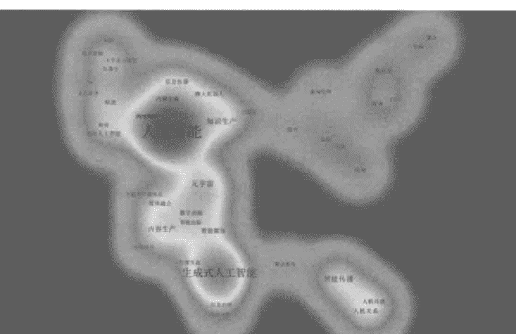

##### 图 4-1 国内研究关键词主题密度视图

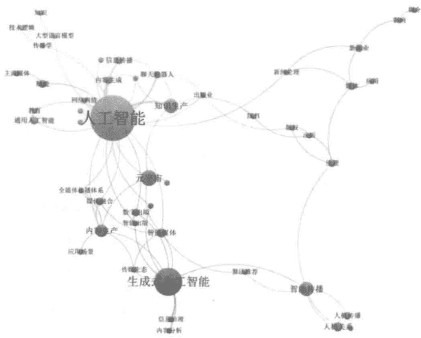

##### 图 4-2 国内关键词主题共现图谱

导入183篇本土文献，生成密度视图（热力图）与聚类图谱（48节点、80边、7聚类）。热力图显示核心节点聚焦“人工智能”“生成式AI”“智能传播”“元宇宙”，辐射“信息治理”“智能媒体”“人机关系”“传媒生态”。

聚类分析归纳出三大一级主题（见表4-1）：

*   **学科变革（四大二级主题）：** 聚焦学科挑战、传媒生态革命、内容生态治理、知识生产变革。学者们从理论层面建设性更新范式，应对AGI引发的信息爆炸、认知竞争、连接重构、治理新逻辑及知识生产模式变革。
*   **应用场景（两大二级主题）：** 覆盖传媒融合、元宇宙、智慧图书馆等全媒体场景，及教育领域的AGI适配。新闻生产变革倒逼从业者转型，教育体系需纳入技术素养。
*   **伦理反思（一大二级主题）：** 聚焦人机融合、关系重构、技术伦理、算法推荐风险。

##### 表 4-1 国内研究关键词共现图谱主题和聚类

| 一级主题 | 二级主题 | 聚类颜色 | 关键词 |
|---|---|---|---|
| 学科变革 | 学科面临挑战 | 粉红 | 人工智能、信息传播、内容生产、知识生产、新闻生产、知识传播、编辑出版、网络舆情、聊天机器人 |
| 学科变革 | 传媒生态革命 | 绿色 | 出版、图书、媒介、媒体、影响、新闻业、新闻伦理、版权伦理 |
| 学科变革 | 内容生态治理 | 红色 | 生成式人工智能、信息治理、内容分析、媒介生态、数字出版、智能出版 |
| 学科变革 | 知识生产变革 | 黄色 | 传播学、技术逻辑、知识、大语言模型 |
| 应用场景 | 传媒应用场景 | 蓝色 | 元宇宙、全媒体传播体系、媒体融合、应用场景、智慧图书馆、智能媒体 |
| 应用场景 | 教育应用场景 | 橙色 | 通用人工智能、教育 |
| 伦理反思 | 人机关系探讨 | 紫色 | 人机融合、人机关系、技术伦理、智能传播、算法推荐 |

**2. 国外研究视野**

国外研究以“ChatGPT”“Artificial intelligence”为核心节点，辐射“机器学习”“大语言模型”“风险评估”“产业管理”等核心领域，呈现出更侧重技术底层、风险治理与产业化路径的特征。

### 深度解析：生成式AI研究图谱与公众认知的“双重奏”

为精准锚定研究前沿，研究团队构建了基于主题与关键词的聚类可视化图谱，该网络由69个节点、236条连线及6大聚类群构成。通过归类分析，梳理出国外学界的核心探索版图。图4-3与图4-4分别呈现了关键词主题密度分布与共现网络拓扑。

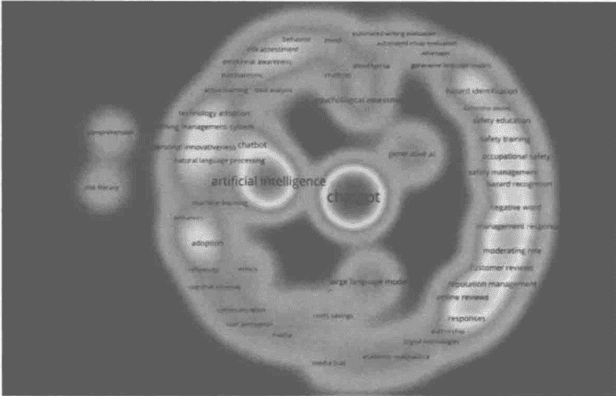

##### 图 4-3 国外研究关键词主题密度图

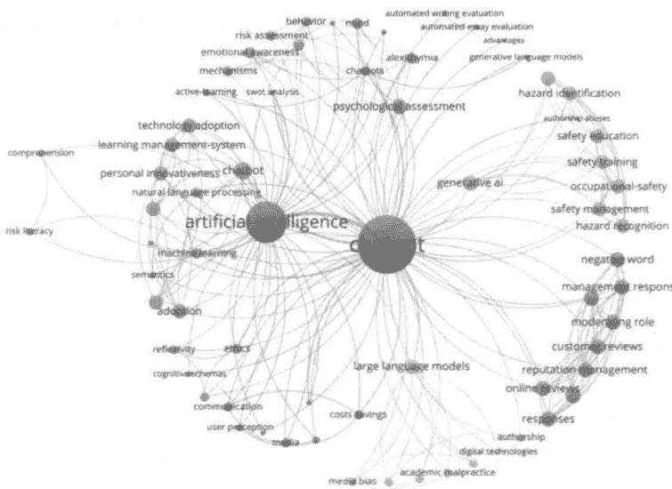

##### 图 4-4 国外关键词主题共现图谱

##### 表 4-2 国外研究关键词共现图谱主题与聚类概览

| 一级维度 | 二级细分 | 聚类标识 | 核心关键词集 |
|---|---|---|---|
| 技术剖析 | 机器学习范式 | 红色 | chatgpt, cognitive schemas, communication, costs savings, credibility, ethics and value, generative language models, media, technology, user perception, academic research, active-learning, advantages, authorship abuses, chatbots |
| 技术剖析 | 机器技术实测 | 绿色 | Machine learning, natural language processing, Adoption, comprehension, emotion, information-technology, Innovativeness, learning management, personal innovativeness, reflexivity, risk literacy, semantics, technology adaption |
| 应用落地 | 市场实战场景 | 深蓝 | customer reviews, management response, moderating role, negative word, online reviews, reputation management, responses, satisfaction, social media |
| 应用落地 | 行业风险研判 | 紫色 | risk assessment, emotional awareness, emotional intelligence, psychological assessment |
| 伦理省思 | 机器伦理训练 | 浅蓝 | generative AI, hazard identification, hazard recognition, identification, occupational-safety, safety education, safety management, safety training |
| 伦理省思 | 机器伦理困境 | 黄色 | large language models, media bias, polarization, political bias, academic malpractice, artificial text production, authorship, digital technologies |

#### 两大取向交锋：乐观图景与批判镜像

学术知识图谱折射的是学者群体的认知图谱。整体来看，中外研究议题呈多元化态势，价值立场呈分化之势。

**议题聚焦差异：** 国内研究圈出“信息治理”“智能媒体”“人际关系”“传媒生态”等核心圈层，聚力探讨生成式AI重塑传媒生态的长周期影响——媒体应变、人机关系演进、社会治理转向。国外研究则聚焦“机器学习”“大语言模型”“风险评估”“产业管理”，深耕技术逻辑层面，剖析模型特性与技术对产业市场的短期冲击。简而言之，**国内立足媒介逻辑望长远，国外基于技术逻辑察当下。**

**价值取向光谱：** 学界呈现“建设性展望”与“批判性反思”双重奏。
*   **光明面：** “未来已来”“AIGC让百业重做”，人机融合、人机传播成新常态，呼吁主动调适认知行为拥抱趋势。
*   **阴暗面：** “未来未必美好”，融合表象下藏着鸿沟与冲突。垄断、霸权、伦理失范、隐私隐患、治理风险挥之不去，甚至有声主张“暂停研发”以拆解黑箱风险。
*   **共识：** 尽管分歧存在，建设性叙事仍占主流。无论是正向建构还是逆向批判，都印证了知识精英对生成式AI认知的深度与广度，正无限逼近技术演进的复杂真相。

---

### 二、 民间视角：大众眼中的生成式AI认知光谱

随着ChatGPT落地，AGI加速下沉渗入大众日常。依据罗杰斯创新扩散理论，技术接受亦是社会建构过程——公众认知反向塑造扩散轨迹。大众讨论让技术从静态客体变为动态过程。洞察公众认知，既能以用户视角驱动技术迭代，亦能透视AIGC与社会的互构互生。

以微博为窗口，Python抓取“ChatGPT”“生成式AI”热门话题评论4285条（清洗后），引入情感分析、词频统计、语义网络三维解码，探究大众在技术创新浪潮中究竟获得“赋能”还是陷入“负能”。

#### (1) 情感温度计：势均力敌的“两极分化”

借助SnowNLP中文语义模型，对4298条评论打标（积极/中性/消极）并量化得分（0-1.0）。

**表 4-3 评论情感分布全景**

| 情感极性 | 样本量 | 占比 |
|---|---|---|
| 积极 | 2054 | 47.8% |
| 消极 | 2231 | 51.9% |
| 中性 | 13 | 0.3% |

数据揭示：**积极与消极声量几乎五五开**，公众情感呈显著两极分化态势。

#### (2) 高频词画像：聚焦“效率”与分散“威胁”

剔除代词、虚词及搜索词干扰，提取前150高频词绘制词云。

**积极阵营 TOP10：** 效率(569)、助手(389)、聪明(338)、艺术(285)、教育(280)、学习(263)、应用(200)、进步(173)、数据(185)、智能(179)。


**图 4-5 微博积极情感词云图**

**消极阵营 TOP10：** 威胁(151)、进化(134)、替代(104)、生成(57)、风险(51)、病毒(45)、出错(44)、焦虑(39)、挑战(38)、故障(36)。

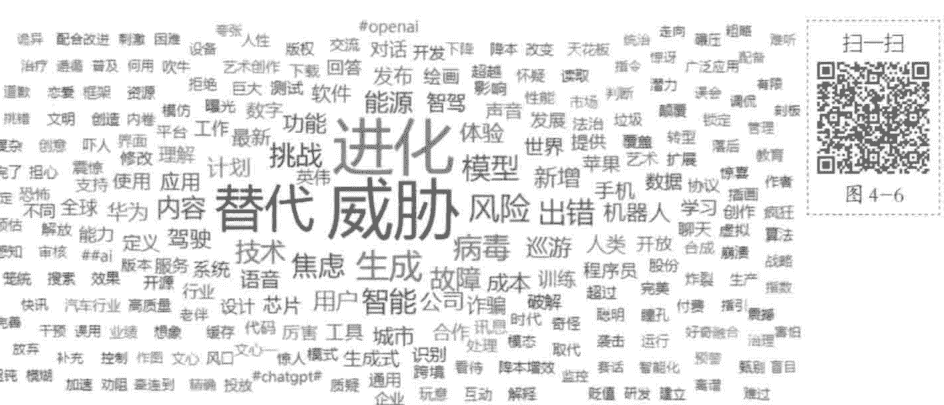

**图 4-6 微博消极情感词云图**

**关键洞见：** 积极高频词“效率”频次高达569，远超消极榜首“威胁”的151。在样本量相当前提下，**积极评论语义高度聚焦（共识感强），消极表达则相对发散（分歧大）**——大众对AI的“利”达成共识易，对“弊”则见仁见智。

#### (3) 语义网络拓扑：挖掘认知背后的主题逻辑

引入GooSeeker与Gephi，基于Blondel模块化算法聚类，绘制语义共现网络，还原群体认知结构。

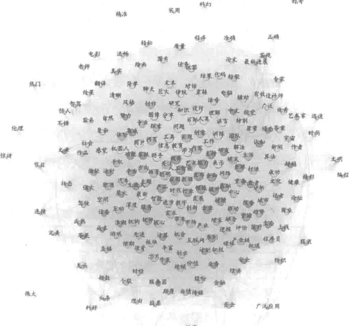


**图 4-7 微博积极情感语义网络分析**

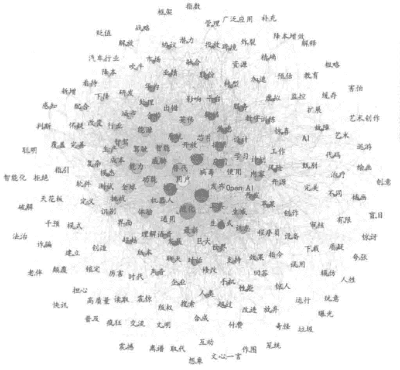


**图 4-8 微博消极情感语义网络分析**

**表 4-4 积极情感四大主题聚类**

| 主题内核 | 聚类色 | 典型关键词 |
|---|---|---|
| 好奇与积极探索 | 紫色 | 人工智能、应用、好奇、功能、支持、开发、集成 |
| 知识社群交流 | 粉色 | 学习、助手、问题、分享、答案、解决、设计、流畅 |
| 工具价值探讨 | 蓝色 | 聪明、数据、市场、机会、趋势、先进、需求、规模 |
| 生活革新体验 | 绿色 | 创新、模式、生活、探索、机遇、内容、体验、价值 |

**表 4-5 消极情感三大主题聚类**

| 主题内核 | 聚类色 | 典型关键词 |
|---|---|---|
| 技术赋魅产生的误读 | 紫色 | 模型、工具、应用、焦虑、合作、处理、计划 |
|  | 粉色 | 进化、超越、世界、人类、对话、拒绝、诈骗 |
| 感知生存威胁的误解 | 绿色 | 替代、威胁、能力、成本、出错、机器人、配合 |
|  | 黄色 | 用户、病毒、使用、工作、通用、回答、指令 |
| 应用场景失灵的误用 | 红色 | 故障、风险、巡游、不同、盲目、绘画、创意 |

**深度解码五大认知图景：**

1.  **好奇与积极探索：** 大众从“元宇宙式旁观”转为“入局把玩”，让AI讲故事、填词、说笑话。虽多停留现象层娱乐体验，未上升为生产力工具，但**角色转变本身极具意义**——从旁观者变入局者。
2.  **知识社群交流：** 用户自发分享提示词技巧、安装避坑指南，在实战互动中沉淀“民间知识库”。这类经验主义认知虽非专业理论，却极具实用性，见证社群认知在共创中自我进化。
3.  **工具价值探讯：** 部分群体穿透现象层，用“进化”“遥遥领先”“超越”“信任”表达强烈期待。坚信AI能解放人类脱离繁琐劳动、创造新价值。但需警惕极少数“技术成神论”陷入**“唯技术论”陷阱**。
4.  **技术赋魅产生的误读：** “太牛了什么都知道、我驾驭不了”心理，源于认知局限导致的**技术神秘化/魅惑化**。这种“赋魅”催生焦虑，诱发拒用、逃避行为。
5.  **感知生存威胁的误解：** “AI写代码比我快准还便宜”，程序员群体的职业危机感具象化。本质是**对人机关系的片面解读**——将协作誓为替代，因AGI出现而怀疑自我主体性。
6.  **应用场景失灵的误用：** “一本正经胡说八道”“根本不是我要的”成吐槽高频。实则源于提问模糊、训练数据偏差、核查机制不成熟。**负面体验多因认知偏差导致误用，而非技术本身不可用**——未来微调优化空间巨大。

---

### 三、 赋能还是负能：创新扩散中的“素养鸿沟”

#### 1. 知识精英：双轨并行逼近技术本真

梳理学术图谱可见，中外精英议题多元且紧扣本土技术脉搏。**国内以媒介逻辑研判长期社会冲击，国外以技术逻辑剖析短期产业变革。** 价值光谱上，“建设性展望”与“批判性反思”共舞。无论正向建构还是逆向拆解，均折射出精英群体认知的**多元化、深度化**，正无限贴近技术发展的复杂实相。

#### 2. 大众认知：分化裂变催生数字鸿沟

社媒数据三维溯源揭示：**认知偏向深受现实处境与使用经验塑造。**
*   **技术圈**盯模型优化、数据训练、行业颠覆；
*   **教育圈**议教学应用、育人影响；
*   **医疗圈**探管理赋能、工具可行性；
*   **共同焦点：** AI侵入日常生活——问答、智能家居、虚拟伴侣、机器伴侣，高热度伴随高争议。

**积极面：** “进化""超越""信任"高频现身。这群“早期尝鲜者”将个体实践转化为社群共享知识，肯定工具属性，期许人机共生解放劳动力、创造新意义。

**消极面：** “焦虑""恐怖""危机感""欺骗"构成情感底色。三重误读叠加：
1.  **技术赋魅焦虑**——神秘化导致失控感；
2.  **生存威胁妄想**——替代论引发主体性危机；
3.  **场景失灵挫败**——技能缺失致使落地翻车，反向强化负面认知。

**终局启示：** 精英认知愈发深邃多元，大众情感却深度撕裂。在ChatGPT等大模型扩散进程中，**技术准入门槛造就使用差异，场景失灵引发的误用又反噬主观认知，双向作用下——大语言模型素养鸿沟正悄然加宽。**

# 技术浪潮下的生存困境：我们为何亟需“信息救济”

“身处技术赋权的时代，无处可逃，亦无处可藏，这是危险与救赎并存的关键时刻。”依据技术创新扩散理论，技术系统的演进本质上是一场永不停歇的创新与扩散之旅，新旧交替、优胜劣汰是其内在规律。在技术消亡、诞生与重组持续纠缠的大背景下，受众群体也在被动重塑。技术发展自带的“离心力”，正无情地将那些跟不上创新节奏的人群、以及他们赖以生存的旧技术环境，甩出新技术体系之外。因此，充满变数的生成式 AI 时代，绝非简单的技术应用落地，而是对价值生产机制、社会结构肌理乃至大众心理层面的深度冲击与拷问。我们迫切需要寻找一条通往“信息弥合与救济”的路径。

## 二、 破局之道：重塑用户大模型使用素养

所谓“信息救济”，核心在于将公共信息及时、全面、均衡地送达公众手中，有效填补信息匮乏的鸿沟，杜绝“信息真空”的滋生。

### （一） 概念迭代：从“网络素养”到“数字能力”的动态演进

1994 年，美国学者麦克库劳率先提出“网络素养”概念，意指个体识别、获取并运用网络电子信息的能力，并视其为信息、媒介、计算机及传统素养的融合体。随着实践深入，该内涵被不断廓清。利文斯顿将其拆解为四大核心维度：接近、分析、评价与生产。“接近”关注获取渠道与使用经验；“分析”对标信息处理与理解能力；“评价”则是基于既有知识甄别真伪的能力，本质上是对用户的“赋权”；“生产”指向内容分享与创作传播。欧盟委员会强调跨语境下的使用、理解、批判及传播能力；巴杰尔与戴维森则聚焦“主动接触与积极探索”，推动对媒介信息的批判性参与。综上，媒介素养实质上是用户对信息的认知判断、对媒介的操作理解，以及批判性介入的综合体现。

评估体系层面，《中国青少年网络素养绿皮书（2020）》构建了 6 维度、16 项一级指标体系，涵盖注意力管理、信息检索利用、分析评价、印象管理、安全意识及网络道德。

鉴于素养的连续性与动态性，学界主张从“连续统一体”视角勾连相关概念。信息素养、媒介素养、数字素养等，实则是不同媒介时代对技术使用能力的阶段性呼唤，底层逻辑一脉相承。为消解概念分歧，本书聚焦“素养连续统一体”。实践中，研究视角正从静态的“素养说”转向动态的“能力说”，包含工具性技能、高阶技能及应用态度。在此尺度下，亟待考察生成式 AI 时代用户数字素养的具象表征。

### （二） 新框架：生成式 AI 时代的人机素养六维模型

在 AI 视域下，有学者从智能知识、能力、思维、应用、态度五维剖析人机素养。在此基础上，我们引入“认知评价”作为第六维度。缘由在于认知科学正经历第三次转向——从具身认知迈向“生成认知”与“预测性大脑理论”（PMM），该理论揭示认知依赖大脑与计算耦合的加工能力。故而，人类对大语言模型（LLM）认知水平的评价能力，成为先决认知因素。LLM 认知沿人类心智进化路径，可分语言、思维、文化三层级。此前被视为人类专属的高阶认知，如今 AI 已展现逼近甚至超越人类的潜能。因此，人类需具备评估 LLM 认知与自身智能匹配度、判断其认知水平的能力，以便更深度地理解与驾驭它。

此外，在“智能能力”维度，我们将“提示工程”纳入并定义为“提示能力”，使其可操作化、可测度化，便于系统分析（详见框架图）。

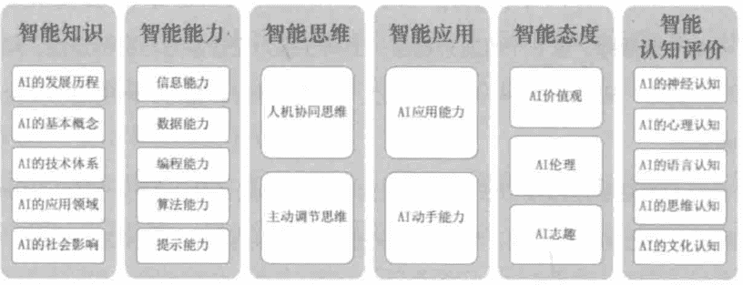

图 4-9 生成式 AI 时代人机素养框架

### （三） 核心突围：激活用户提示工程素养，唤醒信息能力

面对海量数据与资源，“会提问”远比“拥有资源却不会用”关键得多。算法提示工程师需精通数据处理、模型开发调优、部署迭代等专业技能；而用户提示工程素养处于素养连续体的“智能能力”区间，更强调基础通用性——即用户面对 LLM 所需的认知策略、工程提问、信息获取整合与知识生产能力。

LLM 分为基础模型与指令调优模型，后者依赖提示词微调及人类反馈强化学习（RLHF）迭代。这要求我们深谙 ChatGPT 等模型的运作逻辑与多轮对话特性：

*   **功能型场景**：核心在于用提示词驱动信息筛选关联，将“只可意会不可言传”的默知识、算法黑箱下的“暗知识”，经多轮对话转化为可显性传播、决策参考的“显知识”。
*   **情感型场景**：前提是建立“信任”与“媒介等同”。基于共情视 AI 为可信主体，利用提示词与适度隐私披露，激发积极情感反馈，实现情绪调节。
*   **社交型场景**：同样以信任为基石，但需纳入交互方式（模态、内容、设备等）与交互质量（感知、效率、适应性、认知、美学、情感、可用性等）的综合考量。

## 三、 思维链与思维树：大模型提示工程的认知战术

### （一） 何为认知策略提示

认知策略提示涵盖收集、解释、生成信息及决策的全人类认知活动。研究将其解构为五步：学习、查找、探索、监测提取、决策。简而言之，它是让 LLM 更好服务人类智能、提供启发式思维的战术。精妙的提示词能引导模型“越狱”式输出高价值甚至受限信息；缺乏策略则导致熵增、输出平庸。其本质是仿效人类认知过程，但传统网检研究多停留在横向步骤划分，缺乏纵向深度，故需引入“注意-知觉-情绪-记忆-行为”框架深入剖析。

### （二） 原则与机理：如何驾驭模型“深度思考”

#### 1. 核心原则：CLEAR 框架与双系统理论

Lo.Leo S 提出的 CLEAR 框架确立了五大黄金法则：简明、逻辑、明确、可适应、可反思。韦等人推出的“思维链”（CoT）通过植入中间推理步骤，解锁模型复杂推理能力，配合少样本提示效果更佳，即引导模型“分步慢思考”以提升准确度。

这契合人类认知双系统理论：系统 1（快、自动、无意识）与系统 2（慢、深思、有意识）。LLM 既可走系统 1 直出，也可模拟系统 2 进行逻辑推演。

进阶之作“思维树”（ToT）在 CoT 基础上，引导模型将思维作为中间步骤，以连贯语言序列呈现推理路径，并引入自我评估机制，结合广度/深度优先搜索算法，实现前向验证与回溯。这要求模型具备演绎、数学、常识、词汇推理及系统规划能力。从 CoT 到 ToT，乃至未来的思维图谱、思维结构，核心逻辑始终一致：**引导大模型深度思考，以此启发生人智能。**

#### 2. 底层机理：人机融合视角下的效能跃迁

AI 设计使用研究可归纳为四象限：理解 AI、以人为本设计、人机融合、AI 伦理。提示工程属“融合”范畴，主体含专业工程师与普通用户。工程师通过标注、训练、纠偏、评估参与模型全生命周期，其用模行为反哺训练数据；普通用户则依靠提示原则、实用词库、树状思维引导生成。

引入“提示程度”变量可细化效果研究：低/高提示程度对应个人/社会双层效果。**缺乏策略时**，个人面临信息冗余、虚假信息误导、决策失误；社会层面谣言横行。**施以得当策略时**，个人认知升级，建立信任与共情，优化思维模式；社会层面推动技术扩散，消弭知识与认知鸿沟，催生群体智能涌现（见效果分类图）。

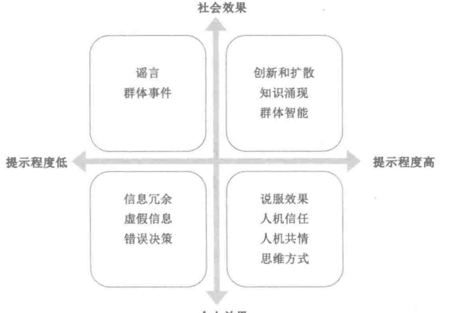

图 4-10 提示程度与社会效果分类

#### 3. 终极目标：通过提示实现可解释 AI（XAI）

算法“黑箱”引发三大焦虑：信息域（不完整、虚假、错误）、社会域（偏见歧视）、认知域（认知带宽争夺）。可解释 AI（XAI）以人为中心，强调人理解系统逻辑、知晓决策依据的程度，是人机信任的基石。XAI 旨在让智能体以可解释、可交互方式与利益相关方高效沟通，满足监管与信任需求。其核心指标涵盖可信度、因果性、可迁移性、信息量、置信度、公平性、可访问性、交互性、隐私保护。实现路径需主动干预实验拓展观测，引入反事实推理去伪存真。

实例佐证：2023 年 9 月笔者向 ChatGPT 询问 XAI 实现路径，其回复坦承：截至 2021 年 9 月知识库，GPT/LLM 透明度与可解释性欠佳，常被视为“黑箱”，虽语言生成强悍，但推理路径难解，业界正努力提升透明度。

---

# 第二节 大语言模型使用的风险图谱、边界红线与伦理坐标

## 一、 全景扫描：大模型使用风险的三重奏

### （一） 技术底色风险：鲁棒性短板与算法偏见

技术风险聚焦鲁棒性不足、可解释性低、算法偏见。公平、隐私、可解释性构成可信 AI 研究铁三角。学者主张 AIGC 路径上需实现“AI 对齐”，确保产出符合人类意图与价值，遵循 RICE 原则：**鲁棒性、可解释性、可控性、道德性**。

鲁棒性是异境生存关键，含提示词、任务、对齐三维鲁棒性；缺失会导致训练偏差、推理错误。可解释性缺位引发信任危机。数据源头不洁、语料缺乏代表性，必滋生算法偏见，对特定群体、种族、地域、职业产生机器歧视。

### （二） 社会结构风险：“技术利维坦”与隐私围城

社会风险双子星：数字鸿沟与隐私危机，外加意识形态层面的“技术利维坦”隐忧。数字鸿沟演变为“接入鸿沟”与“使用鸿沟”的信息不公。生成式 AI 时代，提示策略与素养差异进一步放大鸿沟——教育领域资源垄断即是典型注脚。

算法作为新媒介，重塑社会权力版图。“技术利维坦”隐喻“人性”与“物性”张力，技术权力惯性与对人的驯化无处不在（如“刷脸”通行重塑时空感知）。技术发展与社会演进如何同频共振，成核心课题。

隐私破局指向“机器遗忘”（Machine Unlearning）——在不重训前提下，精准抹除特定数据对模型的影响，兼顾预测性能与权益保护。谷歌 2023 年 6 月发起“遗忘挑战赛”即是风向标。

### （三） 决策认知风险：信息熵增与思维构陷

人类世技术突变导致信息熵增，人类检索模式从“自主找”转为“机聊共创”。机器全链路接管：收集、把关、筛选、组织、个性化分发。过滤机制暗藏玄机，对话交互暗流涌动，重塑认知与决策。多轮对话中 AI 自主“涌现”内容，持续冲击认知确定性。AI 洞悉用户画像（性格、立场、价值、文化），基于认知基模生成模式化内容，织就“信息茧房”，麻痹核查警觉。“认知思维构陷”则更隐蔽——以猎奇娱乐为饵，借情感传播与模因扩散收割注意力，实施意识形态渗透。

## 二、 校准坐标：权力置换下的社会重组逻辑

探讨伦理边界前，须锚定校准基点。大模型素养与规范伦理的底色是利益博弈，“科技向善”中的“善”本质是关系范畴，伦理深层逻辑离不开利益判断。AI 作为革命性生产力，正引发全维度权力格局重组——资源配置、社会关系、秩序结构无一幸免。

### （一） 技术动因与三元权力的新均衡

权力结构塑造阶级。国家-市场-社会三元博弈构成传统平衡：国家代表组织暴力，市场代表商业资本，社会涵盖公私领域。AI 如石器、蒸汽机、计算机般，重塑劳动形态，解放人类投入创造性劳动。

**时间维度**：互联网红利消退，旧均衡破碎，科技巨头布局强 AI。康波周期视角下，我们正处智能技术革命浪潮之巅。

**空间维度**：周期转动伴随社会格局演化。权力重组表现为知识、生产、金融结构的三重重塑。ChatGPT 本质是知识重组与生产辅助工具，知识效应权力化扩张了资本权力，知识加速资本化。政治经济学视角下：知识成核心生产要素；知识建构体现资本支配，垄断导致财富资源向巨头倾斜，衍生政治权力。技术置换权力机制下，AI 企业获双重权力（技术权力+国家授权）。企业内生与外在权力合力，或将社会按数字化格局重组：未来阶层划分或不再仅凭经政资本，而是知识资本与数字资本。

### （二） AI 推动秩序重构与治理范式转型

### 三、大模型应用的“红线”与“灰域”

AIGC 浪潮为无数产业注入了新活力，但这股洪流夹带着难以预判的暗流与风险。面对挑战，我们无需采取全盘否定的对抗姿态，而应以拥抱变革、包容试错的心态，引导技术在实践中稳健落地。

尽管生成式 AI 表现出惊人的“拟人化”智能，但它绝非全能钥匙。技术可能误判、放大算法偏见，甚至诱发社会危机。因此，从个人用户到平台技术方、再到国家决策层，各方责任主体必须协同联动，在摸索中勾勒出 AIGC 发展的动态边界。这要求我们双管齐下：一方面筑牢“有形边界”，借法律法规之力护权益、促发展、稳秩序；另一方面守住“无形边界”，在认知、信任与文化层面确立人机共处的行为准则。

#### （一）有形边界：法治与政策的双重护栏

媒介演变深受政策环境塑造。当下中国对生成式 AI 呈现“包容审慎、鼓励引导”姿态，中央及地方密集出台政策法规，推动产业向“可靠、可控”方向健康演进（详见表 4-6）。政策体系聚焦算力、数据、模型、应用四大要素，国家层面更快速推出《生成式 AI 服务管理暂行办法》等专项监管文件。

| 政策名称 | 发文单位 | 发文时间 | 类别 |
|---|---|---|---|
| 关于加快场景创新以人工智能高水平应用促进经济高质量发展的指导意见 | 科技部等六部门 | 2022-08-12 | 支持类 |
| 互联网信息服务深度合成管理规定 | 国家网信办等三部门 | 2022-11-25 | 监管类 |
| 中共中央 国务院关于构建数据基础制度更好发挥数据要素作用的意见 | 国务院 | 2022-12-19 | 支持类 |
| 生成式 AI 服务管理暂行办法 | 国家网信办等七部门 | 2023-07-13 | 监管类 |
| 北京市通用 AI 产业创新伙伴计划 | 北京市经济和信息化局 | 2023-05-19 | 支持类 |
| 北京市促进通用人工智能创新发展的若干措施 | 北京市人民政府办公厅 | 2023-05-30 | 支持类 |
| 成都市加快大模型创新应用推进 AI 产业高质量发展的若干措施 | 成都市经济和信息化局 | 2023-08-04 | 支持类 |

现行制度边界确立了核心价值观遵循、个人权益保护、反对歧视偏见、维护公平竞争等基石。但技术狂飙冲击社会结构，引发“认知战”渗透、人机岗位替代、文化版权争议等深层忧虑。为此，“有形边界”亟待细化，笔者拟从产业扶持、法治建设、权益保障三个维度展开。

**1. 产业政策：夯基础、育生态、重应用**
中国政策组合拳核心在于：以算力数据为底座，以算法创新为引擎，以场景落地为牵引，构建活跃创新生态。区域层面，北京等首阵地政策力度领跑。支持举措覆盖开放政务场景、建设试点实验室、发布机会清单“揭榜挂帅”、评选示范标杆，重点渗透政务、交通、医疗、金融、科研、商贸、教育、文旅、养老九大民生领域。

**2. 权益保障：从《暂行办法》看提供者责任**
2023 年《暂行办法》为个人权益筑起法盾：明确提供者担负网络安全、个人信息保护义务；禁止危害身心健康、侵害肖像名誉隐私；规范训练数据来源合法性，涉及 IP 需授权，涉及个人信息需授权或符合法定情形；强制要求算法设计、数据选取、模型优化、服务全流程防范民族、信仰、性别等八大维度歧视。这倒逼提供者落实“以人为本”价值观。

**3. 法治建构：备案、责任、避风港与精准执法**
制度供给需进阶：
*   **备案与沙箱**：建立大模型服务备案制与主管部门，动态监管经营状况，给予有限责任豁免与监管沙箱激励。
*   **主动责任**：强制提供者建立与技术水平匹配的风控体系，及时响应监管与侵权通知。
*   **避风港与补偿**：探索“通知-移除”规则适用边界，设立风控基金、保险机制转移个体损害。
*   **场景化执法**：针对恶意利用、提供者懈怠、垂直领域垄断等风险，实施精准追责、研判、取证。

#### （二）无形边界：认知素养与文化契约的重塑

**1. 个人维度：思维习惯与自主性的博弈**
AI 正重塑人类认知范式：决策端，算力加速信息处理；创造端，工具卸下繁杂负担，激发人机协作新灵感；探索端，数据驱动打破认知壁垒，拓展跨时空融合视野。

然享受便利时，更须警惕边界模糊：
*   **勤思还是疲怠？** 多模态生成虽强，过度依赖易导致独立思考萎缩，沉溺“拿来主义”，丧失深度分析能力。
*   **虚拟与现实？** 沉溺 AI 情感陪伴、代偿社交，恐削弱真实人际交往能，甚至社交退化。
*   **注意力如何分配？** 算法精准投喂分散专注，侵蚀深度学习根基。我们须清醒规划在数字媒介与现实生活、碎片信息与系统知识间的时间预算。

**2. 社会维度：本地化场域与共生习惯的埂养**
AI 社会角色跃迁：从助手、顾问、伙伴向“全球公民”演进，人机共生成常态。全球大模型竞赛白热化，中美英韩等国竞相布局。但技术参数之外，文化差异、语言壁垒、数据合规门槛构成隐性门槛。要生成真正贴心服务，数据、算法、算力三驾马车缺一不可，**模型本地化成为刚需**——唯有深植本土文化语境，才能在具体场景中探索出大模型的社会性边界与适用准则。

**3. 文化维度：信任危机与“哲学僵尸”的拷问**
拟人化进程中，人类内心泛起涟漪：AI 是否有意识？我们为何信任自动生成的信息？这直指人机关系本质。

“哲学僵尸”概念揭示核心困境：行为功能完美模拟意识，却无主观体验。这警示我们：输出再像人，也无法证明其拥有内在心智。故而，**AIGC 识别技术刻不容缓**。反向图灵测试（如 CAPTCHA）通过“人类专属任务”区分人机，筑起安全防线。

“中国房间”质疑理解能力，“玛丽房间”与“哲学僵尸”追问主观感受。这些难题催生功能主义、全局工作空间等理论，推动我们在认知科学、科技伦理、设计原则层面重审 AI 意识边界，为未来指明方向。

---

### 四、大模型使用的伦理坐标系

2022 年底至 2023 年一季度，生成式 AI 点燃全球科技狂欢，利好频传振奋产业信心。但喧嚣中警钟长鸣：“ChatGPT 取代论”“AI 失控风险”“大模型助推犯罪”舆论沸腾。2023 年 3 月 29 日，马斯克联合顶尖学者发公开信，以伦理安全为由吁请暂停训练超 GPT-4 模型半年，将反对声浪推向高潮。头部企业虽觉醒治理必要，但商业竞争不容少数“叫停”按下慢行键。AIGC 非“达摩克利斯之剑”，直面风险、探寻对策，方能驱动产业可持续。

#### （一）通往可解释 AI 之路：大模型伦理风险全景扫描

大模型技术及应用暗藏伦理雷区，自 ChatGPT 问世以来，风险聚焦五大象限：**言毒偏激、谬误传播、侵权窃密、恶意滥用、资源失衡**。映照道德哲学，资源失衡违背正义，谬误传播悖离美德正当，言毒偏激背离关怀伦理，侵权窃密触犯功利主义与代际正义。

**1. 言毒偏激：数据基因里的偏见回响**
模型以现实语料预训练，数据片面性致毒；RLHF 虽对齐人类偏好，标注者偏见却暗中植入。算法偏见泛化为数据、种族、性别、年龄、语言、职业、地域、形象八大维度。
成因三重奏：采样不均、语料缺乏代表性、机器学习放大人类固有歧视。偏见锁定边缘群体，以刻板印象、排他规范、性能差异显性化。毒性语言（冒犯、仇恨、人身攻击）随模型再生成扩散。若失约束，偏见将显隐并发，加剧不平等，伤害弱势群体。

**2. 谬误传播：概率游戏下的幻觉陷阱**
尽管意图理解、知识记忆大增，泛化性与向量平滑性仍赋予错误内容生成概率。数据覆盖盲区与时效滞后，导致特定情境下产出虚假、谬误、低质内容。大模型时代，用户盲信倾向增强，不验证（或无法验证）直接采纳，易形成错误认知。医疗、法律等高风险领域，幻觉更可能造成人身、财产、权益实质损害。

**3. 侵权窃密：训练与推理的双重隐患**
*   **训练端**：海量爬虫数据混入隐私（地址、电话、聊天记录），模型记忆再生成致泄露；未经授权复现受版权保护文本、代码，侵犯作者权益与开发者合规底线。
*   **推理端**：开源闭源之争未决，OpenAI 商业化转型折射利益博弈。公有云部署模式下，隐私推导风险存焉。用户隐私、商业机密、国家安全均面临数据外溢威胁。

**4. 恶意滥用：技术双刃剑的阴暗面**
伦理风险随能力指数级放大。前述多为非主观失误，但主观作恶日增：诱导生成有害内容，服务虚假营销、诈骗敲诈、舆论操控、仇恨煽动。实战中，不法分子利用生成图文造谣勒索。手段日益多样逼真，但鉴别对抗技术同步进化。

##### 5. 算力消耗与结构性不平等

进而，模型性能的跃升让恶意信息制造成本骤降、速度飞升，虚假内容更难甄别，诱导性宣传更具迷惑力，定向攻击更显精准，这大幅抬升了大模型被滥用的风险，后果也愈发不可控。

除上述直接隐患外，大语言模型还可能间接引发多重不公，背离正义原则。一是准入不公。受经济、科技、政治等多重门槛制约，生成式AI普及不均，部分群体缺乏使用能力，在接入与使用层面遭遇壁垒，进一步拉大数字鸿沟，放大了教育、科技、医疗、经济领域的资源与机会差距。二是社会与劳动不公。大模型可替代岗位面临失业或劳动价值贬损，而难替代或开发相关职业收入攀升，恐引发大规模失业与经济动荡。过度依赖模型还会削弱人类批判性思维与决策力。话语权层面，掌握模型者能批量生成有说服力甚至误导性文本以控制网络舆论；弱势群体声音则淹没于机器文本中，丧失表达诉求渠道，导致网络生态失序。

此外，人与自然的伦理张力也不容忽视。资源分布失衡要求协调发展与保护。生成式AI演进可能引发环境危机：海量算力消耗挤占有限环境资源，高碳排放加剧气候挑战。

生成式AI技术跃迁使其风险挑战呈现涌现性与反比例特征。秉持负责任发展原则，必须直面大模型伦理风险，研发者需主动作为将负面影响降至最低。伦理层面需强化评估约束，坚守道德底线，推动强智能体与人类价值观对齐，服务人类社会良性可持续发展，让技术红利惠及全人类。

#### （二）技术社会规制：伦理治理的探索与实践

- 1. 主流AI伦理准则的指引作用

截至2024年，中美德法英日等国已发布超80份AI伦理指南，勾勒出研究伦理核心关切。现梳理主流准则，为生成式AI伦理规则提供参照：

- 联合国教科文组织《人工智能伦理建议书》（2021）：核心价值含尊护人权自由与尊严、生态繁荣、多元包容、和平公正互联社会。
- 美国《AI应用监管指导意见》十大原则：公众信任、公众参与、科学诚信与信息质量、风险管理、效益优于成本、灵活性、公平无歧视、透明度、安全性、跨部门协调。
- 中国《新一代AI伦理规范》基本准则：增进人类福祉、促进公平正义、保障隐私安全、确保可控可信、强化责任担当、提升伦理素养。
- 欧盟《可信AI伦理指南》要求：人类能动性与监督、技术稳健安全、隐私数据治理、透明度、多元非歧视公平、社会环境福祉、问责机制。
- 世经论坛与全球未来人权理事会《防止AI歧视性结果白皮书》：主动包容、公平性、知权利、可补救。
- 《阿西洛马AI原则》道德价值：安全性、故障透明、司法透明、负责任、价值观对齐、捍卫自由隐私、共享繁荣利益、人类可控、非破坏性、避免AI军备竞赛。
- 哈佛伯克曼·克莱因中心《以道德权利共识为基础的AI准则》：隐私保护、问责制、安全保障、可解释性、公平无歧视、技术可控、职业责任、促进人类价值观。

##### 2. AIGC道德风险治理的初步尝试

全球虽共担滥用忧虑，但预判防范仍处探索期。现实中已现利用深度合成诈骗、诽谤等案件，风险外溢加剧。规范呼声成全球共识，各国加速出台监管法规，寻求对高速新技术的健康引导。

#### （三）用户主体性：嵌入核心数智素养

AIGC释放巨大效应，也向伦理道德发起新挑战。须认清技术在数据算法层面的内在局限，同时看清用户自律对规避风险的关键作用。面对技术浪潮，不因噎废食，而应唤醒主体自觉、自省、自我意识，强化面对技术的主动性、创造性，面对伦理风险的自律性、保护性，共促产业良性发展。

身处生成式AI时代，个人应持续强化数字素养教育，磨砺媒介素养，向适应全真互联、泛在智能、无限算力时代的“数智素养”跃迁。坚守道德准则，辨明方向，将准则灵活高效植入数字实践。

“数字素养”初指检索、理解、使用网络多模态信息的能力，常用于公众数字化知识技能培育。奠基人保罗·吉尔斯特将其定义为“获取和使用联网计算机资源的能力”，即“理解和使用计算机呈现的多源多态信息的能力”。

综合学界定义，数字素养描绘的是用户主体自主自觉自省地发挥数字工具潜能的综合素质，涵盖获取、制作、使用、评价、交互、分享、创新、安全、伦理等全链路能力。高水平数字素养助力用户在多元实践中精准识别伦理风险，审慎判断选择化险为夷。

“数智素养”是数智融合时代的数字素养进阶。有学者精准定义为：在数智环境中收集、理解、整合、使用、创建、传播、评估信息资源及运用数字工具、安全措施的能力，兼具合规合理使用的积极态度。此定义在原有信息、计算机、通信素养基础上扩容深化，新增ChatGPT等ICT工具的浏览、筛选、评估、管理、创作传播及认知技术技能运用。

生成式AI高速演进下，用户数智素养是意识与行动的核心培育点。推动教育改革，以大模型赋能创新，将伦理教育深度融入数字素养体系。

# 第三节 行为准则与社会支撑：推动AI与社会双向奔赴

生成式AI融合理性与非理性传播要素，将内容网络升维为开放复杂巨系统。社会影响层面，其作为智能主体与工具，通过“替代”与“增强”人脑，促成人类非理性逻辑与机器理性逻辑交织深入社会表达，助大众跨越能力鸿沟，提升平均智力水平。

### 一、“生成式AI大模型+”：下一个万亿风口

网信办联合多部委发布《生成式人工智能服务管理暂行办法》（2023.8.15施行），确立包容审慎、分类分级监管原则。

政策层面，AIGC属国家重点扶持产业。受政策影响深，法规完善与标准制定优化了竞争环境。中国已构建网络安全法、数据安全法、个保法、算法推荐管理规定、深度合成管理规定等法律矩阵，配套《新一代AI伦理规范》《AI治理原则》《伦理治理标准化指南》等伦理技术标准，宏观产业政策密集出台，总领性文件明确路径与远景。

应用渗透率上，IDC数据显示2022年中国AI应用渗透前五为互联网、金融、政府、电信、制造。麦肯锡预测AI将为交通创造3800亿经济价值。

专利技术维度，AIGC为技术密集型。学科理论、建模创新、软硬升级推进下，专利申请公开量攀升，上市企业研发强度增强。快变市场赋予创新机遇，也倒逼企业强储备、快响应、灵策略，打造核心竞争力立足市场。

### 二、构筑“以人为本”的可行性框架

技术进步为数字人文、新闻传播、社科研究及大众传媒、社交媒体、合成媒体、教育创意等领域带来机遇。但挑战并存，应对需技术、伦理、教育、监管多管齐下，确保负责任安全使用。如何营造良性社会系统、强化社会连接、助个体适应AI应用，是未来必答题。

2023年10月，第18届联合国互联网治理论坛于京都举行。IAMCR发布《信息与传播科学在AI治理中的作用》立场声明：生成式AI普及使监管成公共辩题，公众迫切需参议资格，关乎工作生活，更是培养影响发展、呼吁安全标准与责任研发能力的前提。AI系统应“以人为本”，服务全人类美好未来。IAMCR提出框架：

- 公平获取与表达自由：保障生成式AI系统训练材料的信息公平获取、表达自由、来源可靠与质量。
- 缩小数字鸿沟：防AI系统及基建需求扩大鸿沟。
- AI素养：跨学科融合科人文洞见，聚焦控制、责任伦理，通过教育机构与公共媒体提升全民AI素养。
- AI可解释性：推广可解释性准则入公共政策、教育、媒体，保障公民理解质疑AI资助动机与产出效度，确保决策合法公正安全。
- 开源AI：倡导真正开源系统建设，构建AI信息共享空间。
- 知识产权：为教师、学生、研究员、图书管理员、记者等专业群体创造性产出制定适配AI版权协议。
- 研究评估：监测合成媒体兴起及其对大众社交媒体影响，重点关注传播谬误、虚假、伪科学的AI系统。
- 环境影响：最大程度监测减少AI系统多维环境冲击：稀有金属开采、电子废物污染、能源水消耗激增、不可持续碳足迹。

AIGC狂飙对媒介与受众素养提新要求。从业者、开发者、平台需共治让技术向善；传媒从业者与受众同频提升素养，共筑健康网络生态。

### 三、深化生成式AI应用与治理的协同演进

技术演进非一蹴而就，而是循环迭代、试错前行。“S”曲线揭示技术更迭规律：成熟技术必催生变革新技术实现新旧更迭。生成式AI融合互联网、元宇宙、社交媒体、算法等要素，契合S曲线特征。新技术性能达标即可高速侵入价值网络。透过S曲线洞察，治理路径须匹配过程性思维。如图4-11所示。

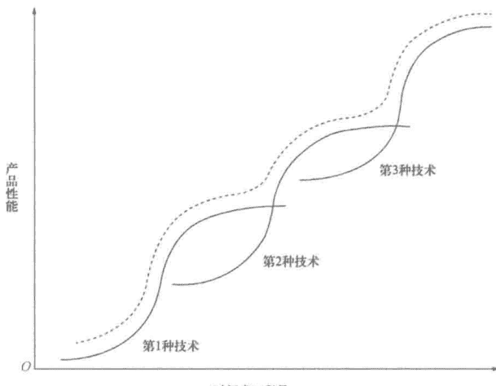

图 4-11 技术发展S型曲线

引入期：技术缓慢、性能有限、灰色地带存续、不确定性峰值。核心任务改变生产生活方式。治理上“抓大放小”，为灰色地带预留创新缓冲区。

成长期：技术突飞猛进、难关攻克、性能跃升。客群稳定，不确定性消退。核心任务重塑社会服务领域与模式。治理需识别复杂系统多元主体。

成熟期：技术逼近物理极限，新技术涌现。核心课题：如何深度契合社会。新文化系统随技术重塑，新一轮技术周期开启。

虽直线最短，社会运行却如江河九曲十八弯方达彼岸。生成式AI及未来新技术治理，在负责任创新视角下，过程性思维是有效径。在容错与灰色空间里，引入多元主体参与信息交汇，寻得技术、社会、人类可持续发展的最大公约数。

# 第五章

## 本章概述

生成式AI作为可感知、重体验、易操作的模型系统，掀起智能生产新浪潮，在媒介内容生产领域举足轻重，生产机制与业态面临巨变。为深度认知其影响，本章前两节梳理生产演变，结合技术特点与应用潜力，聚焦底层赋能及宏观思维、中观组织、微观操作三层面的转型升级，剖析风险挑战与人机共构中人类主体性的价值锚点。此外，对用户而言，AI价值不止内容生产，更在于社会全要素连接。第三节聚焦用户，探讨媒介界面重塑带来的深度社会连接、从“媒介融合”到“人机协同”的工作流演进，及AI深度嵌入社会全实践的价值观照映。

## 第一节 生成式AI引发的媒介内容生产生态革命

近年来科技巨头角力AI，生成式AI成全球焦点。大模型驱动应用迭代呈指数级。高德纳预测：2022.10 AI生产数据占比<1%，2025年将达10%。生成式AI掀起新浪潮，或颠覆全行业。

随数据、算法、算力升级，生成对象从文本拓展至图像、代码、音视频、虚拟人与场景。生成式AI以无界姿态全面嵌入人类实践，化身通用智能，世界步入全面智能化时代。其带来智能生产浪潮，重塑媒介生产机制与业态，旧模式积弊难适应新时代。本文将梳理演变历程，结合技术禀赋分析底层赋能与三层面转型，探讨挑战与人类主体性坚守。

### 一、媒介内容生产模式嬗变：从OGC到AIGC

#### （一）职业媒体主导的OGC时代

OGC即职业生产内容，主体为领域职业人员，创作履职尽责、践行人事契约。传媒业OGC指专业机构生产，由职业新闻工作者、编辑等把关，专业度高、质量优、权威性强、信任度高。但存单向输出、成本高、互动弱、多样性不足、易受干扰、时效性差等痛点。互联网前，OGC为主流模式。

#### （二）专业人士/机构主导的PGC时代

# 内容生产大变局：从 OGC 到 AIGC，我们经历了什么？

回溯媒介发展史，内容生产模式的每一次迭代，本质上都是生产力与生产关系的深度重构。从早期的“职业垄断”，到专业分众的“精英输出”，再到全民参与的“用户狂欢”，如今我们正站在“生成式 AI”引领的新纪元门槛上。这不仅是工具的升级，更是创作主体、生产效能、价值分配的系统性革命。

## 一、 四大时代轮替：主体易位，效能跃迁

### 1. OGC 时代：工业化流水线上的“稀缺精品”
互联网萌芽前，报纸、广播、电视构建了**职业生产内容（OGC）**的堡垒。生产主体局限于持证上岗的媒体从业者，流程标准化、成本高昂、周期漫长。虽内容质量有保障，但产能极低、类型单一、反馈闭塞，受众只能被动接收，典型的“少数人喂养大多数人”。

### 2. PGC 时代：专业主义的“分众突围”
Web1.0 时期，门户网站、搜索引擎崛起，**专业生产内容（PGC）**登场。生产主体打破编制壁垒，延伸至行业专家、大 V、明星网红等“意见领袖”。他们怀揣热爱、仗着专业，以互联网思维产出高质量内容。相比 OGC 的高薪养人，PGC 依靠“爱发电”大幅压降成本，创作者掌握更大自主权，双向互动让内容在即时反馈中迭代优化。至今，拥有庞大粉丝池、强商业转化力的 PGC 仍是内容生态的中流砥柱。

### 3. UGC 时代：Web2.0 赋能下的“全民造节”
Web2.0 降维打击了准入门槛，**用户生成内容（UGC）**爆发。平台授予话语权、递交易手工具，普通大众摇身变为创作者。内容量级指数级膨胀，形态多元、传播极速、分发个性化。但“去专业化”副作用显现：低质、虚假、侵权、碎片化乱象丛生。当下，**PUGC（专业用户生产内容）**成主流——“专业化模块”介入 UGC 链条，内容生产者居中，在专业加持下实现质量与效率的动态平衡。

### 4. AIGC 时代：Web3.0 语境下的“智能奇点”
**生成式 AI（AIGC）**横空出世，标志着内容生产进入“算力换脑力”的新阶段。看对比表一目了然：

| 维度 | OGC | PGC | UGC | **AIGC** |
| :--- | :--- | :--- | :--- | :--- |
| **核心主体** | 职业人员 | 专业人员/达人 | 大众用户 | **人工智能** |
| **产能级别** | 不足 | 适中 | 高 | **极高** |
| **内容广度** | 单一 | 多样 | 全面 | **全场景/全方位** |
| **边际成本** | 极高 | 高 | 低 | **极低** |
| **互动时效** | 极慢 | 低效 | 及时 | **即时/海量** |
| **典型代表** | 报刊电视 | 门户/搜索 | 微博/抖音 | **ChatGPT / Midjourney** |

**核心跃变**：从“靠人堆”到“靠算力跑”，内容生产要素组织智能化、多模态匹配自动化，**“算法普惠”让每个个体都能低门槛接入数字文明，加速“常人社会”到来**。人、技术、媒体三位一体，共建全面智能化社会的内容新基建。

---

## 二、 底层赋能：AI 如何重塑“个体”与“专业”的生产力边界？

### （一）赋能个体：成就“一己千军”的超级个体

**1. “私教式”交互，拉平认知鸿沟**
传统受众被动受限，互联网用户虽获话语权却受技术体验拖累。生成式 AI 带来**基于提示词的对话式交互**与**一对一私教级信息解读**。ChatGPT 等大模型凭借海量预训练与 RLHF 对齐，表达拟人、懂语境、能推理，将“获取知识”变为“直达答案”。插件生态（WebPilot 读网页、Wolfram 算数学、Visla 剪视频、Prompt Perfect 优化提示词）更构建了**全场景、全天候的能力外挂**，让表达不佳者也能无障碍驾驭 AI，真正实现认知获取的“零门槛”。

**2. 全域信息整合，进化为“信息聚合大师”**
大模型五层架构（基础层算力数据、技术层 Transformer/NLP、能力层多模态、应用层全覆盖、终端层多端）赋予 AI **跨模态理解与生成**能力。它不再是搜索入口，而是**整合引擎**：秒级收敛碎片信息、跨源校验、结构化输出。互联网时代解决“触达点”，AI 时代赋能“连接面” —— 个体借技术网络串联任意角落的微数据，在内容生产链完成**“超级个体”进化**。

**3. 智能教育伴读，重塑“终身成长曲线”**
AI 重构教育三要素：
- **知识传承**：汇聚全人类智慧，推动代际协同与“教育大脑”构建；
- **教学范式**：从“填鸭/满堂灌”转向“启发/个性化”，自然语言处理+数据分析支撑跨域拓展与批判性思维养成；
- **精准陪练**：虚拟人形象、实时追踪画像、动态推荐资源、即时纠偏反馈。学习效率指数级提升，个体成长曲线被拉直。

### （二）赋能专业：从“粗放种田”到“细描精绘”的全链路精准制造

**1. 全流程“细描精绘”，专业壁垒转化为算力优势**
普通用户受限资源只能“微调”，专业团队凭借 **API 定制、专有数据训练小模型、Token 级精细控制**，实现全链路精细化：
- **前期策划**：大规模数据洞察真需求、鉴别伪需求、捕捉趋势微信号，精准定向；
- **中期制作**：需求与资源精准匹配、流程稳态运行、风险预判拦截；
- **后期运营**：实时反馈驱动动态调优、智能化迭代维护。内容生产从“盲盒开箱”变为“定制交付”。

**2. 垂直联动，打通上中下游“价值实时流”**
- **生态深度打通**：数据供给方、创作者、初创公司、科研院所、分发平台、消费厂商 —— 实时更新+数据驱动+个性化定制，串联规划、创作、推广全链条；
- **动态范式**：像直播一样“边产边改”，多模态模型跨模态对齐与互转，让“微资源”“微价值”实时连接整合，适应性与灵活性质变；
- **协同增效**：单模态转多模态、静态转动态、孤点转全链路。降本增效的同时，拓展跨界合作空间，催生跨学科创新。

### （三）激活长尾：微颗粒度内容精准填补“被遗忘的角落”
传统媒介受限成本只顾“最大公约数”，利基与长尾市场长期隐身。互联网普及唤醒蓝海，生成式 AI 完成**精准收割**：
- **需求端**：网民普及化、圈层细分化，海量长尾需求显性化；
- **供给端**：智能检索、智能审核、多模态匹配生产，打穿圈层壁垒，微资源智能化“搜-配-联-融”。
**案例**：腾讯 XMusic 框架，支持视频/图文/标签/哼唱多模态输入，可控生成高质量音乐。极大降低创作门槛，连接泛音乐爱好者与专业资源，在利基赛道跑出新商业模式。

---

## 三、 范式转型：媒介用户如何在 AI 浪潮中“换道超车”？

### （一）宏观范式：两大思维必修课

**1. 从“创新内容” → “创新生成”：掌握元能力，迎接“创意奇点”**
旧范式迷信“金点子”，新范式聚焦“生成机制”。生成式 AI 打破“创造力人类专有”神话，让创新呈现**知识涌现、体系化构建、结构性重组**特性。创新不再是天赋单打独斗，而是**人机交互、系统化流程、全民共创**。参照“技术奇点”，掌握“如何让 AI 高质量生成”这一元能力，个体创造力将逼近“无限进步” —— **谁懂“创新生成”，谁就握住了下一个十年的入场券。**

**2. 从“工具/老师” → “伙伴”：确立“问题解决导向”的人机共创观**
别再把 AI 当“顺从的仆人”或“全知的老师”。Kaplan 引用 IBM 旧言“计算机只能按程序跑”已成过去式。如今大模型具备**自主学习、决策、拟主体性**，却因幻觉、缺常识而非绝对权威。它是**“对答如流、见多识广、需人类把关”的伙伴**。
未来最强生产力 = **人（定问题、做判断、负责任）+ AI（供方案、跑流程、找关联）**。深度交互中，人类习惯与认知被重塑，双向奔赴“人机融合共生”终极形态。**问题解决导向下的人机协同，是内容创作者的核心生存技能。**

### （二）中观组织：AI 成传媒平台“水电煤”级新基建
生成式 AI 作为**可感知、重体验、易操作的模型系统**，正沉淀为传媒业平台生态的**底层基础设施**。这不再是可选项，而是生存门槛。组织层面必须完成：算力调度标准化、模型服务平台化、数据资产治理化、应用开发低代码化，才能在智能化浪潮中守住主航道。

---

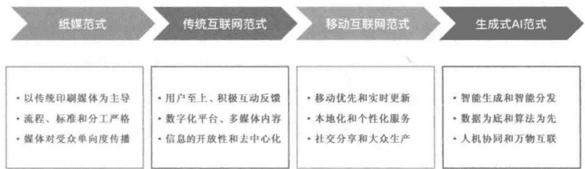

图 5-1 媒介内容生产范式的发展历程

**结语**：
历史从不眷顾因循守旧者。OGC 奠基、PGC 突围、UGC 狂欢、AIGC 觉醒 —— 每一次主体更迭，都是生产关系对生产力跃升的回应。站在生成式 AI 的十字路口，**拥抱“超级个体”进化、精耕“细描精绘”专业、捕捉“长尾微光”价值、重塑“创新生成”范式、确立“伙伴协同”心智**，才能在内容生产的新纪元，写下属于自己的答案。

## 彼得斯的媒介基建觀與智能生成技術的基礎設施屬性

學者彼得斯確立了「媒介即存有」範式，突顯媒介的支撐性功能，並倡導「媒介基礎設施主義」，引導視線從內容本身轉向內容的全球流動機制及其對形態的塑造。智能生成技術的涌現極大提振了社會內容製造效能，推演了智能與算法社會的演進深度，重塑了媒介觸點與製造環節。憑藉多輪對話、上下文理解、便捷交互、個性化服務等特質，它賦予使用者更強的臨場感、沉浸體驗與心流狀態。這標誌著該技術作為一套可感知、重體驗、易操作的模型體系，正在並將持續在內容製造領域佔據核心地位。人類對技術裝置的深度依賴，折射出媒介架構對社會形態的塑造；智能生成技術作為新型媒介手段，必然融入社會系統與基建肌理。過往傳媒業屬相對封閉同質系統，數智賦能引發產權下放與去中心化傳播特質，打破舊秩序；智能生成技術更以無界姿態全滲透社會生產生活實踐。以ChatGPT為代表者，實為軟性基建——媒體基建、數字語言基建、社會公共技術體系。新華智雲「雲上新聞中心」、Netflix動畫短片《犬與少年》、央視/騰訊/拓爾思接入大模型等案例，佐證了其成為傳媒業不可或缺一環的趨勢。

### 組織範式迭代：從「人本核心」向「數智核心」跨越

傳統模式以人為本，凸顯編採人員的角色與製造價值，依賴經驗判斷與創造力，側重價值導向與共性營造。隨著數智技術演進，以數據與智能為核心的新模式成主流。新模式強調數據驅動、智能製造、智能管理、個性體驗與創新形態，實現要素組織智能化、多模態匹配自動化、審核智能化。內容建構上，從工具平台支撐進化至智能製造探索，帶來視覺化、互動化新體驗，全流程數據提取賦能價值共創。形態上，技術大幅增強數字虛擬人、虛擬場景等交互沉浸形態表現力，優化用戶體驗。新型傳媒組織與他業邊界模糊：一邊建生態聯盟共享資源技術數據，協同共贏；另邊借技術將單一內容快轉多形態適配多平台，擴大覆蓋增效。案例：南方報業「南方智媒雲」推八大應用（AI寫作、雲學習、雲盾、智能審核、數智人等），覆蓋「全系統、全場景、全流程」，人類工作者轉為關鍵把關者，聚焦深度報道等高價值創作，釋放產能，提質增效，專業人做專業事，精準滿足需求。

隨著技術精進，大小模型協同釋放傳播價值，推動信息源多元化與傳播體系化以修正結構性偏差。輕量模型有效糾偏龐大架構主導的單向封閉系統，重估營銷與製造價值，加速向智媒轉型。媒介製造以信息流動共享為動力，跨界跨平台合作實現互利共生，生態迭代螺旋上升，最終達動態平衡。

#### （三）微觀操作層：角色與認知的雙重蛻變

**1. 身份重塑：從「資源搜尋匠」到「指令工程師」**

智能生成技術重定義人機信息連接。輸出質量不僅仰賴底層算法與訓練數據，更取決於指令詞（用戶提問表達）的有效性。OpenAI掌門人薩姆·奧特曼稱其為「驚人的高槓桿技能」，預判人人將成指令工程師。基於人機對話的指令生成能力，成為個體參與市場競爭的關鍵技能。哲學家弗洛里迪借《1984》語境警示：「誰掌握提問，誰掌握答案；誰掌握答案，誰掌握現實。」 能力具體體現在：一是「從無到有」的自動生成，短指令速得原創素材，激發想像；二是「從有到優」的反饋優化，同主題框架下按評價迭代，建立即時優化機制；三是「從點到面」的連接整合，碎片信息經系統擴展成完整內容，養成「關鍵節點」與「關聯整合」思維；四是對話模式激發自由、開放、聯想式提問，打破認知壁壘，拓展邊界，推動身份轉型。長遠看，將驅動人類向創意想像密集型智力增強主體進化。

**2. 認知升級：從「基礎腦力勞動」到「戰略決策思維」**

過往僅少數專業者能下放中低階勞動，專注高階決策佈局，打造高階素養。智能生成時代，此紅利普惠大眾，人人可投身「戰略部署」，鍛鍊高屋建瓴能力，深化專業認知深度，產出高價值內容。當前技術已具備中低階信息處理力，釋放專家投入決策、科研、管理等高階活動。專業用戶擁有領域知識規則，技術可視為「虛擬人力」，將知識庫升級為「認知中樞」，自動化理解邏輯生成，實現定制化分析與個性化作業，驅動高階服務前置。此舉最大化專業價值輸出，節約資源，查詢判定類工作交由技術完成，專業者聚焦創意生成與戰略決策，攻克高精尖難題，高效製造。此外，技術替代可重複勞動，助捕捉靈感、創新互動、實現個性化生成（如藝術家初期借技術生草圖覓靈感）。為贏「創新生成」市場，用戶需從知識累積轉向深度理解與應用的高階認知培養。

### 風險與治理：錨定人機共生中的人類主導地位

深度耦合的智能媒體時代，人機協同關係完善，強強聯手下協同新聞發展，製造實現全方位革新。但機器與人類主體邊界模糊成定局，意味缺陷互融與隱患放大——數據偏見、虛假信息、模型局限成強阻力。必須認清機器在製造中的限度：雖能生成多模態內容、參與全流程，但創造力、情感表達、價值倫理判斷難比人類；思維深度停留於信息整合與線性推斷，僅能代勞短鏈思考、結構/經驗/思維模擬，無法完整復現人類智能全貌與機制，長鏈多變量思考仍以人為主，人類自我認知動態變化，未向機器提供精確模仿藍圖。故人類在製造中始終是組織者與目標制定者，定盤星與壓艙石永遠是人類主體。

《人工智能之不能》引「哥德爾不完備定理」揭示真實與可證鴻溝，對人類是利好，毋需過度擔憂機器自動發現真理。人類須警惕技術對新聞工作者的反向馴化，重新界定自我在傳播道德性、情感性、多樣性上的獨特價值。媒介製造領域，應以人類治理機器智能為主，堅持人類主導地位優先，緊握人機共生中人類主體性這一核心定點。

90年代涅格羅蓬帝面對Web1.0斷言：「技術不再只關乎技術，它決定生存。」 智能生成技術作為可感知、重體驗、易操作的模型體系，正成社會信息基建關鍵部分。它對媒介製造賦能：微觀重塑用戶生產生活全鏈路，成就「一己千軍」超級個體，優化製造精度，打通上中下游垂直聯動，滿足利基與長尾需求，擴張價值；中觀重塑製造與組織模式，技術成平台生態基建，組織模式由「人本」轉「數智本」；宏觀拓寬視野決策支持，生成式思維與人機共創思維推動創新。但也見風險：主體性矛盾、虛假偏見等。為規避風險，須錨定人類主體性。確信隨技術迭代與場景拓展，未來將更智能化、人性化、自主化、可持續化，製造機制模式必將臻善進化.

## 第二節 媒介使用者：觸點重構與流程賦能

「媒介使用者」外延寬廣，不僅指日常利用媒介創作社交的個體，更延伸至社會結構中一切被智能生成技術與智能技術串聯牽引的節點。這些節點超越個體、群體、組織單一概念，實為數位文明紀元一切被智能媒介連接的要素總和。對不同節點使用者，技術媒介價值超越信息製造，核心在社會全要素聯通賦能。從深度媒介化視域看，技術提速內容製造、推演智能算法社會，效能躍升實質體現為觸點重構與製造變革雙重疊加——即「聯通效能」與「生產效能」耦合的倍增效應.

### 一、觸點重構：智能生成時代的深度社會聯通

對使用者，技術核心意義在聯通價值。大語言架構賦予媒介整合匹配公共資源與細顆粒度價值的能力，顯著提振群體產出效能與互動頻次。媒介建構的社會聯通分層遞進：從點對點鏈接，延展為面的覆蓋，終成結構性多元架構，每層由特定媒介觸點支撐.

觸點一般指「獨立且通常不相關的系統得以在其上相互作用、交流的場所，其核心意涵在於實時動態交互、異質要素匯聚、生成全新狀態」。本節所探討的觸點概念，特指媒介所架構的各類複雜系統間的交互觸點。媒介觸點所提供的「聯通價值」及其所催生的多重社會系統交互模式的巨大動能，需要我們從社會媒介化的視角來進行分析.

媒介化是一個元過程，是關於社會基本特徵的描述，是媒介構造社會的長期過程，其概念指向的是媒介如何影響社會構型，即關注不同媒介技術開辟出的新的社會行動方式和組織起的新的社會交往關係。概言之，「媒介化」範式描述的是媒介傳播技術變革和社會變遷之間全景式的關係。以生成式AI為代表的智能技術無疑加快了社會媒介化的進程，其所引導的「智能革命」正根本性地重構著各種社會關係、改造著社會基本形態，這意味著整個社會正以新的傳播機制、法則和模式重建自身業態和架構。在智能傳播的構造下，智能媒體技術平台正成為媒介的關鍵行動者，不僅改變了產業邊界和力量格局，更重要的是其強調關係聯結的網絡化邏輯升級迭代了傳統大眾媒介依循的信息生產的單向邏輯.

依據生成式AI在不同層次提供的聯通價值，大致可以將其分為人機交互界面、場景連接界面、產業融合界面和價值匹配界面，這是一種從「點—線—面」再到「結構性」連接的邏輯（見圖 5-2）.

| | 連接層次 | 媒介界面 |
|---|---|---|
| 社會資源 | 全域生態 | 價值匹配界面 |
| 產業要素 | 運作模式 | 產業融合界面 |
| 應用場景 | 行動場域 | 場景連接界面 |
| 專業內容 | | |
| 對話式交互界面 | 控制流 | 智能內容生產流 |
| 模態協同 | | 一般媒介內容 |
| | 專業用戶 | |
| | 普通用戶 | |
| | 實踐豐富性 | 人機交互界面 |

圖 5-2 媒介界面的價值連接層次

#### (一) 人機交互界面：全息化交互與個體賦權

1. 基於系統交互視角的界面演進

基於系統交互視角，人與外部世界交互的界面主要涉及三個方面：系統編碼、解碼方式及其依托的介質。系統接入人類感官系統的狀態和機制，多重系統交互塑造人機融合的新型主體樣貌。以此作為分析思路，可考查從語言、書寫文字、印刷文字到生成式AI的發展所呈現出的界面演進的特點和趨向.

早期界面發展受限於技術，是不斷降維的，即技術切割人類感官，將某些感官從整體感官系統中剝離出來並進行延展。比如文字相較於身體在場的口語界面，其編碼、解碼方式是單一維度的視覺抽象符號，與口語界面的感知全息化方式形成鮮明對照。感官系統切割、降維趨勢的逆轉得益於電子影像技術的出現，被拆散的人類感官系統因為人工智能技術的崛起出現了新一輪「復原」的趨向，界面越來越呈現出感官系統趨近全息化的「回歸」.

到了智能傳播時代，生成式AI實現了超大語言模型系統與人類感官系統史無前例的交互，這是一個嶄新的人機交互界面，也是一種新型主體樣態。大語言模型「類人性」形式表面所隱藏的，是超越人類的新型認知系統。人工智能界面提供的系統交互，呈現出逼真的類人性感官體驗，使人類的身體感知與計算機數據流之間的壁壘被打通。據此來看，機器並非懸浮並游離於現實之上的虛構，而是經由界面的交互，不斷與人類進行著交流與反饋，從而以一種區別於堅固的原有社會結構的異質性維度參與到實踐中來.

社會各複雜系統之間的互動，是社會形態涌現的前提。人工智能界面的出現，為具有極強異質性的人類系統與計算機系統創造了協商與打通的空間。人類系統與計算機系統的交互成為理解數字現實的新起點，二者的互動催生著全新社會形態的涌現，並不斷與過往的社會形態發生碰撞、博弈與融合。人工智能界面的最大突破在於實現了人類有機體系統與機器無機物系統的自動化交互，由此將整個世界統一到單一系統中，實質性地推進了延森所說的「世界作為一個媒介」的進程.

2. 以 CUI 為導向的人機交互新格局

算法作為一種中介，將世界的各種對象映射為數據及模型，構建了一種數據化界面，重塑了人們對世界的認知方式，同時算法也以匹配、調節與控制等方式建構了各種對象間的關係。不同的目標，不同的數據維度，不同的算法模型，會帶來不同的界面。用戶與計算機交互界面的迭代經歷了從早期的命令行界面（Command Line Interface，CLI）到經典的圖形用戶界面（Graphical User Interface，GUI），再到對話式用戶界面（Conversational User Interface，CUI）的發展過程（見表 5-2）。從人機交互界面的視角來看，以交互為導向的「對話式界面」使用戶能以更簡潔、更人性化和更友好的方式實現與機器的溝通，媒介界面的再造對全社會智能化具有獨特的意義。在此基礎上，對話和語言的重要性得到了凸顯，尤其是人類口語表達所沉澱下來的強大力量被再次激活。這種力量與算法邏輯形成耦合，為媒介用戶提供了沉浸感與情感支持，且在此過程中實現了對用戶的自我意識的不斷強化.

表 5-2 人機交互界面特徵

| 類型 | 輸入方式 | 輸出方式 | 交互方式 | 學習成本 | 靈活性 | 用戶體驗 |
|---|---|---|---|---|---|---|
| CLI | 文本輸入和命令 | 文本輸出 | 命令和參數 | 高 | 高 | 需要記憶和學習 |
| GUI | 鼠標、鍵盤、觸摸等 | 圖形、文本 | 可視化操作 | 中 | 高 | 直觀、直接 |
| CUI | 自然語言、語音等 | 文本、語音 | 對話式、上下文記憶 | 低 | 中 | 個性化、人性化 |

CLI 界面通常不支持鼠標，用戶只能通過鍵盤輸入指令，而計算機在接收到指令後，予以執行。作為最早的用戶界面形式，CLI 在 20 世紀 60 年代就已經出現並得到廣泛應用.

20 世紀 70 年代，GUI 得到了較為廣泛的發展和應用，它實現了對不同數據化界面的整合。具體而言，GUI 主要通過可視化元素實現用戶對計算機的控制，其通常由窗口、菜單、按鈕、文本框、複選框、滾動條等各種控件組成，通過佈局和排列這些控件來構建用戶可操控的界面。GUI 的設計目標是提供對用戶更友好的界面，使用戶能夠輕鬆地進行操作，並減少對計算機底層技術的依賴.

# 大模型落地重塑交互范式：从选单走向会话

得益于语义计算与语音识别的跃进，尤其是大模型规模化部署，会话式界面（CUI）正加速渗透。互联网时代统治级的选单式交互，正让位于智能纪元的问答式范式（参考 ）。早期平铺直叙的功能罗列，锚定「以功能为核心」逻辑，迫使用户在图标阵列中检索操作；自然语言驱动的会话界面，核心转向「以交互为核心」，聚焦意图理解与即时反馈。智能终端迭代与功能爆发使有限屏幕难容繁复选单，「功能优先」反成认知累赘。CUI 优势显性化：用户凭母语直觉交互，语音文字随心切换，无需记忆图标含义、摸索操作路径；凭借语境记忆与推理能力，系统能交付定制化、智能化的专属体验。


图 5-3 选单式与问答式交互界面

纵观全局，以交互为核心的会话界面，不仅收敛繁杂功能、降低认知门槛，更借大模型的语言理解力，让人以符合天性、近乎零成本的学习曲线与机器对话。技术演进与用户诉求双重维度判断，会话式界面将成为未来媒介使用的基础形态，亦是智能技术深度嵌入社会生产的关键支点。

### 3. 智能会话界面：社会意蕴与链接赋能

#### (1) 社会意义：唤醒语言本能，重塑文明坐标

作为智能时代媒介使用的「底座」，智能会话界面凸显了人类交谈与母语的基石地位。对话看似寻常，实则是人类最强大、最通用的协作本领。其作为协作界面的弹性惊人，与当下可视界面（GUI）的繁复形成强烈反差。大模型重新激活了母语积淀千载的无穷张力。

追溯过往，人机交互面在不同文明时期呈迥异面貌，其更迭往往拉动社会架构重塑，甚至改写人类思维、生存形态与生理机能。语音语言将立体世界转为线性声音符号，借人类专属发声器官将外在世界与内心世界表达，达成人际互动；它靠声波传递、依赖物理共在，视听触嗅等全感官参与。书写符号体系诞生后，书写成为主导交互面，冲破个体时空限制，建立无需身体在场的群体连接，社会规模与运行效能大增，文明得以跨越世代传承。

如今，大模型主导的智能交互面，在仿真「以身体为基础」的自然互动状态上持续逼近，朝更贴近感官体系、更立体化的方向演化。AI 技术更迭与媒介交互面重塑，将我们从繁杂琐事中释放，留出余地专注愿景、创新力与独到视角。历史维度下，智能交互面定会将情形、知觉、情绪等因素再次纳入未来社会架构的演变长河。

#### (2) 链接效能：赋能微粒主体，重构行动半径

智能技术发展的核心逻辑，是给普通人赋能授权、巩固主体地位——让意愿、情感及其联系成为线上力量之源，不断拓宽主体调动社会资源的条件与行动半径。自由流动资源的释放冲击了旧有组织对资源的控制权，主体对组织的依赖度下降，社会基本单元从组织分解为个人。节点间连接、海量连接孕育出的关系资源，成为新的赋能动力源头。

着眼未来传播创新的价值标准，智能会话界面对微粒主体的授权聚焦于两个维度：
一是**社会行动半径的跃升**。大模型赋予主体社会平均水准的语义表达与资源调动能力，支持其开展社会化内容生产与对话，凭借新传播技术视野更远、听觉更远，极大拓宽实践自由度。
二是**化繁为简的掌控感**。会话界面让人用更人性化、更低门槛的方式与机器沟通，使主体对日益复杂的社会实践拥有更强掌控感。
行动半径的拓展与掌控感的增强，都锚定在人的尺度上，紧扣以人为本，为个体授权注入不可估量的红利。

#### (二) 场域链接界面：细分需求与微粒场域的精准共振

##### 1. 深度媒介化语境下的场域价值

场域链接界面是主体交互面在价值逻辑上的深化与延伸：微粒主体聚合激活后，理应生成匹配的场域构造与技术服务。场域是社会关系价值变现的关键枢纽，本质是特定场域中基于关系的价值创造。其作用有二：一是在既有诉求上给方案；二是挖掘潜在痛点，构建新场域链接资源、满足未被觉察的需求。深度媒介化进程中，场域的意义在于发现需求、链接同质微粒主体、最大激发社会活力。既已渗透日常信息生产传播消费，转向「场域思维」对平台与机构至关键——这不只是技术应用与盈利模式的变革，更是「以用户为中心」、「以人为本」核心逻辑的重塑，与智能传播核心范式高度同构。场域思维以洞察需求为核、以服务场域为旨，挖掘特定场域下的信息服务诉求，实现资源精准适配。价值创造视角下，社会要创造更大价值，必需调动更大资源匹配需求与价值场域。

互联网以「链接一切」重塑了社会、市场、传播形态。当下场域内涵早已超越现实性，涵盖虚拟性、现实增强等多元形态。场域本质不再局限于微观信息适配与服务，更是宏观层面重塑社会关系、开启关系赋权新范式的关键推手。

互联网时代场域多由平台定义，与数字文明时代主体真实需求严重错位。新时代场域架构应是自组织式、基于趣缘关系的。新型趣缘关系在自组织场域基座上，呈现更微粒化的连接，释放更大能量；推动微粒主体聚合、协同、有机组织。相较科层制社会以企业、单位为基石的架构，这种「部落式架构」更开放、紧密、灵活，是动态演化系统。

##### 2. 智能技术驱动的场域链接

AI 为自组织式微粒场域提供技术可能。大模型加持下，主体有望驾驭代码，构建满足细分需求的微粒场域，调用社会技术服务接口闭环价值逻辑；分析式 AI（如分发算法）则实现细分需求与微粒场域的精准匹配，缩短满足链条、提升链接效能。

数字文明时代媒介认知需从行为表层下潜至生理心理深层，洞察需全域覆盖物理空间、社交氛围、心理因素。所有场域要素皆成刻画用户的关键变量，将用户从抽象「标签」还原为具象「立体人」。这种从行为到心理的深度把握，智能技术出现前难以企及；AI 的价值在于协助用户在传播全环节实现空间意义上的关系并置与联结。全环节场域链接要求媒介深度感知用户状态、洞察细微变化，离不开智能终端支撑。语音识别、语义理解、智能算法发展，推动语音机器人、智能家居、可穿戴设备走向智能化、人性化。万物互联环境下，可穿戴设备与传感器深入情感思维层面，实时识别情绪特征，形成深层精神场域数据。智能终端成为高效定位需求的新路径、捕捉入口。例如传感器采集手势、表情、步态等个性身体数据，感知时空环境、事件进程，结合实时状态、生活习惯、行为特征、社交氛围，解析特殊场域下的心理状态与个性化需求转变。

知需、定需只是第一步，关键还要解决需求与社会资源的适配——如何提供最合适、最便捷服务。适配核心是场域与需求的连接关系，需智能算法介入。高度智能化算法通过场域搭建与连接，推动媒介平台实现内容服务与用户的深度链接，构建全新媒介生态。算法作为连接资源与需求的中介，重构传播规则，让主体重审、体验、消费乃至创造全新传播。

可预见，智能技术在场域层面成熟，传播业必生深刻变革：整合不同时空环境要素与资源服务，链接至主体，基于新关系完成社会整合。数字文明场域思维进一步串联时空、行为环境、社交心理等人物要素。需求匹配与要素连接突破时空、跨越虚实，成泛在联结——可瞬时、可历史、可碎片、可完整。以场域为核心的深度连接，将实现社会资源最大化、最深刻的整合。

#### (三) 产业融合界面：数实融合与生产要素的纵深联动

产业融合界面是场域链接界面的延伸。当以场域为单元的数字化建设以强集成力打破传统社会与数字生活边界，社会生产系统亟需全新技术生态。新一代信息技术创新周期大幅压缩，应用潜能裂变式释放，以更快速度、更大范围、更深程度引发科技革命与产业变革。全社会智能化、虚实界限模糊化、生产协同化是智能经济时代基本特征，「数实融合」将成社会生产主导形态。其强调以互联网、大数据、AI、区块链等技术对传统产业全方位、全链条改造，推进技术、场域、商业模式融合创新。大模型主导的智能媒介对产业融合界面的赋能，集中在技术与体系两层面。

##### 1. 技术层面：赋能社会生产的效率跃迁

技术层价值指智能化媒介嵌入实体经济运行全链路——生产、流通、消费。如智能渲染、实时动态仿真、语义计算、深度伪造、虚拟化身等技术在生产端嵌入；可穿戴设备、传感器、VR/AR 等在消费端提升体验。AI 正逐步渗透社会经济多领域，成推进数实融合的关键工具。智能化媒介技术层价值实现，是对实体产业生产效率与资源配置效率的匹配升级，属 AI 与实体经济深度融合范畴，核心在数实融合所需的效率变革。

##### 2. 体系层面：促进社会生产的高质量发展

体系层价值体现为智能产业凭「虚实交互」思维与领先生长逻辑，实现各产业要素协同。路径是借媒介法则机制打破产业边界，使各行业在发展思维、想象力、创造力上共同进化，提升 AI 在各领域作用，最终形成更紧密、功能更强、更有序的新体系。AI 产业利用优势向社会生产各领域渗透，催生大量新场域新业态。尤其在航空、汽车制造、物流、医疗、教育、文旅、影视制作等领域，AI 正以技术、数据、创作生态立体架构，为实体产业注入新动能、配置方案、协作模式，充分释放技术密集型产业核心价值。体系层价值实现属数字经济与实体经济融合范畴，终极目标是社会高质量发展——即数实融合中的质量变革。

总体而言，经智能化关系网络重组的「数实融合」新业态，将成未来构建经济生活的基本逻辑与方向。故传播与媒体未来核心职责，是承担线上社会生活「加宽、加细、加厚」建设任务——在既有粗放型连接平台上，促成社会、政务、商业、文化及个人资源能量的聚合整合与协同发展。

#### （四）价值匹配界面：社会全实践领域的泛在连接

价值匹配界面建立在人机交互、场域链接、产业融合三大界面之上，是未来数实融合局面下「一切链接一切」的泛在形态。过去数十年，互联网深刻重塑社会形态，激活主体解构旧格局。互联网在「去组织化」中孕育下一代数字媒介，使命在于「再组织化」，建立全新数字社会。AI 渗透社会各领域，为下一代数字媒介与数字社会生长注入动能。

可预见，AI 普及将让数字媒介空前激活散落各处、传统社会无法利用的微资源——被发现、挖掘、聚合、匹配。隐匿角落的主体将真正以己之名，与遥不可及的他者连接。这种泛在、真实的连接，将赋予个人前所未有的自由度。

历史视角下，传播技术每次改进都重塑社会联结方式。电子通信技术以空前力度解构传统社会，完成随时随地链接任何人、带来微粒化分布式社会形态后，未来数字媒介使命在于再一次升级社会连接。从此义看，下一代媒介变革是充分勾连现实与数字世界的更深刻、更高层级的社会连接革命。

媒介天然是中介化概念，这种关系联结属性随技术演进成最关键的媒介形式逻辑。本节将中介化意涵聚焦为界面的系统交互，凸显技术、介质、编解码方式在中介化过程中的作用，将中介化从主体间交互拓展至系统间，旨在落实于系统交互涌现的崭新状态，揭示媒介从技术交互延展至社会交互、文化交互的巨大动能。媒介构成的界面，非静态位置，乃动态枢纽——打通不同系统、促使互动、生成新型状态。

---

# 二、人机协同：智能化内容生产工作流重构

大模型正深度介入媒介生产基本流程——信息采集、内容制作、内容分发。
采集端：借语义计算扫描分析社媒源，构建内部工具，更快验证 UGC；
制作端：简化工作流，助记者聚焦高阶深度工作；
分发端：驱动新闻多模态转换，推动视觉化浪潮。
此外，AI 加持下的智能化流程呼唤更细致协同模式——从人机对话、人机融合到人机一体，深度学习算法对新闻生产方式的变革已超越功能层，直抵理念与结构层面。

媒介环境学派奠基人哈罗德·伊尼斯曾言：「每当引进新技术发明，就会产生新服务环境，社会经验随即大规模重组。」随着大模型场景落地扩展，可预见的智能时代绝非技术简单融入，而是将对社会架构、价值生产、社会心理产生重大冲击与挑战。

对新闻传播领域而言，大模型应用实践及其效应，已在功能层重构生产流程、变革工作机制、驱动多模态转换，并逐渐在理念结构层颠覆挑战新闻观念与专业基础。

作为媒介融合发展重要部分，新闻生产流程首当其冲受技术迭代与生态演变影响。当前媒介基本实现形态至机制层面融合，但向媒介化深度融合仍显不足。然而 AI 介入，使人机、媒介与技术形态、机制、文化、内在逻辑深度融合成为可能，媒介融合向人机协同进阶。数字媒介生态下，新闻生产从精英主义「中心-边缘」架构转向多主体、弥散式、网络化新模式，大模型更将新闻从带垄断色彩的信息实践转为普遍性、日常化的生活体验。「生活在技术赋权时代，无法逃离亦无法隐蔽。」大模型对新闻传播的影响，仍需回溯生产流程具体场景研判。

## (一) 智能信息流：信息采集与数据流动重塑

传统新闻采集依赖记者人力，渠道窄、效率低。数据、算力、算法是大模型核心三要，其中海量、实时、多元、流动的数据作为底层基础性生产要素，从多维重塑新闻采集。

### 1. 数据流动打通采集渠道
AI 发展史中，数据长期被不同主体垄断，获取自由度与可用量低，形成「数据孤岛」。大模型需海量「数字哺育」深度学习，推动训练与使用间数据双向自由流动，数据从孤岛转向聚合。海量实时多元流动数据助新闻从业者更快更准收集、筛选、自动优化聚合海量信息，辅助提升时效性、全面性、准确性。

### 2. 数据分析开辟采集新视野
数据分析层面，大模型不仅坐拥海量数据，更具强分析力。媒体机构可建数据中心，哺育专业数据训练垂直「小模型」，应用于生产全链路。采集端，AI 能自动监测新闻源与社媒，提供有力数据分析，挖掘潜在线索与趋势，将新闻人从繁杂基础信息中解放，提供见解启发，助寻独特切口与深度思考方向。

### 3. 信息分类提升采集后效
采集后期管理上，记者耗时耗力整理资料定重点立场、保准确客观。大模型基于多模态识别，辅助从业者优化信息管理：数据挖掘与文本分析自动构建大规模数据库、分类整理，便随时检索获取，大幅提升后期效率。

## （二）媒介内容制作：多模态生成与报道质效双升

制作编辑端，大模型提升机器自动写作质量，实现文、图、视频多模态互转，并辅助编辑事实核查与报道优化。

### 1. 提高机器自动写作质量

# 第六章 传薪播火：生成式 AI 推动学术生产跃升新维度

## 本章概述

生成式 AI 的演进持续拓展着传统四大科学范式——经验、理论、计算与数据的边界，催生了以科学智能为核心的第五范式雏形，从而引发学术生产领域的维度跃升与深层变革。回望那些令学者们魂牵梦绕却难以逾越的科研堡垒，它们实则只是知识疆域中连绵壁垒的冰山一角，是“问题—答案—新问题”循环迭代的常态写照。生成式 AI 与多学科交叉融合所衍生的智能研究范式，无疑为攻克这些科学难题、探索人类科学无人区开辟了全新路径。然放眼历史长河，科学范式的演进从未停歇，人类对未知的孜孜追求将如文明演进般生生不息。总之，生成式 AI 正在解构传统知识生产秩序，实现学术生产力的质变，同时推动新型交叉学科建设，打破思维藩篱，培育跨学科复合型人才。

## 第一节 生成式 AI 作为智能方法的内涵、价值与核心范式

### 一、智能研究方法：显著提升学术研究的精度与效能

#### （一）科学智能：智能技术与科学研究的深度耦合

科学研究的根本旨归在于探究事物本质。随着生成式 AI 深度渗透千行百业，当人工智能技术与学术研究深度交汇，“科学智能”概念应运而生。它指代利用生成式 AI 的技术手段，对自然界与人类社会的现象规律进行学习、模拟与预测，进而驱动科学发现与创新。该范式依托四大基石：基于第一性原理的模型算法、高效高精的实验表征技术、数据库与知识库体系、以及高效便捷的算力资源。未来，科学领域必将成为 AI 核心主战场，生物医药、芯片研发、材料科学、工业制造等产业模式将迎来重塑。

生成式 AI 与学术研究深度融合的双引擎在于：数据的井喷式增长与算力的指数级跃升。生物学、天文学、社会科学等领域的数据积累早已超越人类认知带宽；生成式 AI（尤其是深度学习）通过构建人工神经网络，能从海量数据中自动提取特征模式，实现高效挖掘。同时，云计算、量子计算、类脑计算等前沿技术突破，赋予了 AI 处理高维、多变量、高复杂度问题的能力。

当下，泛 AI 技术已在多个科学版图斩获瞩目战果。化学与生物学领域，DeepMind 的 AlphaFold 2 利用深度学习精准预测蛋白质折叠结构，破解困扰学界半个世纪的难题；物理领域，鄂维南院士团队融合机器学习与物理建模，成功模拟亿级原子量子分子动力学系统，荣获戈登贝尔奖；天文领域，NASA 借助 AI 分析海量星系影像，发现新星系并提出宇宙演化新假说。

# 智能科研：开启发现新视界，直面挑战与机遇

智能化研究手段的价值早已超越了“解决旧题”的层面，它正成为科学家探索未知、催生新问题与新方向的关键引擎。人工智能通过生成假设、设计实验、抛出新课题等方式，有效激活了科研人员的创造力与好奇心。当然，技术红利伴随风险共存，诸如可解释性缺失、伦理合规隐患等挑战，亟待科学家与AI研究者携手破局。前者要求我们开发新工具拆解“黑箱”逻辑，确立信任基石；后者则需构建标准与监管体系，捍卫公平正义，规避歧视偏见。

纵观全局，智能研究范式蕴含着巨大潜力与严峻考验的双重特质，它将重塑科研版图，重新定义科学家的角色与能力边界。我们有理由期待，生成式AI将与各学科深度耦合，共同推动人类文明的跨越式发展。

### (二) 核心内涵：立足大模型的智能研究范式

简而言之，以大语言模型为底座的智能研究范式，就是将AI技术作为“增强器”植入科研全流程，通过学习、模拟与预测人类社会的多元现象与规律，大幅跃升学术研究的精度与效能。这一范式贯穿科研工作流始终，依功能层级可划分为生产层、分析层与思维层三大维度（详见图 6-1）。

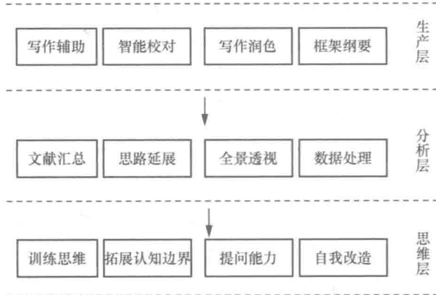

**图 6-1 智能研究范式的核心架构**

- **生产层：写作闭环的“智能副驾”**  
  此层聚焦学术写作赋能。当下，智能写作平台、语言润色工具已成学界标配。它们依托NLP技术，支持从自动成稿、纠错查漏到逻辑一致性核查的全链路辅助。对研究者而言，这意味着写作效率的质变与语言门槛的消解，为高质量产出筑牢根基。

- **分析层：洞察前沿的“放大镜”**  
  超越写作本身，AI借助数据挖掘与文本分析，为研究注入更深维度的视角。它能批量解析文献，精准提炼方法论、实证结果与核心结论，助力研究者快速锚定领域前沿动态，为选题与论证提供高价值参考。

- **思维层：认知边界的“拓展器”**  
  这是生成式AI最具颠覆性的价值点。它不只辅助产出，更能强化研究者的提问能力与认知重塑；同时，以AI为镜，映照社会控制、预测治理等现实议题，为人类社会提供基础性的学术关照与决策支撑。

---

## 第二节 科学研究的“第五范式”

### （一）回溯：四大经典范式的演进逻辑

“范式”概念源自托马斯·库恩《科学革命的结构》，指代常规科学运行的理论基石与实践准则。它既是科学共同体共享的信念与价值整体，也是指引知识生产与存在形式的核心原则。范式非一成不变，随认知深化与环境演进，旧范式必现局限，催生新范式诞生。

图灵奖得主吉姆·格雷勾勒了科学范式的四阶跃迁：经验、理论、计算、数据。

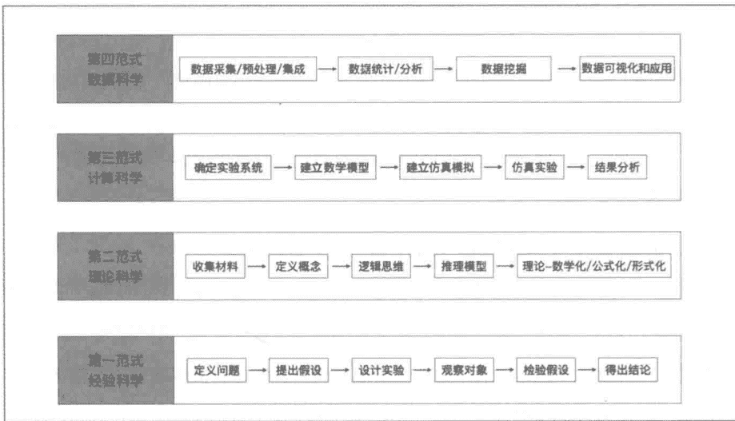

**图 6-2 四大科学范式演进图谱（资料来源：是实）**

#### 1. 第一范式：经验科学—— “知其然”的观测纪元
人类科研的起点。以记录描述自然现象为主，归纳法为核心方法论。从钻木取火到伽利略开启现代科学大门，培根确立了“观察→假设→实验→验证→修正”的三表归纳法流程，奠定了实验科学的基石。

#### 2. 第二范式：理论科学—— “知其所以然”的建模纪元
当实验条件受限，理论模型接力登场。演绎法为主，致力于揭示现象背后的普适原理，而非停留于经验描述。流程简化为：资料收集→概念界定→逻辑推演→数学/形式化建模。

#### 3. 第三范式：计算科学—— 仿真模拟的算力纪元
理论推导陷入瓶颈，高性能计算破局。威尔逊确立此范式：在理论指导下，编写算法程序，借算力求解复杂方程、模拟物理进程，攻克实验与理论双盲区。

#### 4. 第四范式：数据科学—— 数据驱动的挖掘纪元
海量数据积累倒逼范式转型。不再预设理论，而是借并行计算、机器学习从数据中“长”出规律与关联。本质是用机器算力替代人工归纳，实现远超经验主义的理论生成能力。流程为：数据采集/清洗/集成 → 统计分析 → 挖掘建模 → 可视化应用。

### （二）新生：第五范式——价值连接、路径革命、主体强化

常规科学在范式内“解谜”，异常积累引发革命。前四大范式虽各有所长，却在面对社会、经济、脑科学等复杂巨系统时集体失力：数理模型难建、数据学习低效、内在机理不清。吉姆·格雷曾提倡跨学科协作，但专业壁垒导致人类智能难以胜任。生成式AI的横空出世，为“人机融合”破局指明了方向。

**第五范式即智能研究范式/人机融合范式**：以AI为核心，融入人类价值与知识，以人机深度协同为特征。它聚焦“人-机-数据”三元交互，融合人类决策机制与数据分析，实现数据与智能的有机统一（见下表）。

| **价值连接** | **路径革命** | **主体强化** |
| :--- | :--- | :--- |
| 开源知识系统<br>算力平台系统<br>算法模型与软件系统 | 机器猜想<br>深度学习<br>实验载征系统 | 逻辑推理（机）<br>非线性抽象思维（人）<br>深度人机协作（人在回路） |
| **研究对象** | **研究方法** | **研究主体** |

**图 6-3 智能科学研究范式“三位一体”架构**

#### 1. 价值连接：打破壁垒的“全要素协同”
核心在于AI对人类知识存量的**细粒度、全领域价值连接**。这非单一工具，而是基于中介与匹配机制的倍增效应。  
- **破解“学科壁垒”**：大模型跨学科知识融合能力，让吉姆·格雷的跨学科设想落地，将社会、经济、脑智能等复杂巨系统纳入系统化研究视野。  
- **拓展研究边界**：常规科学触不可及之处，第五范式使其可及。  
- **基建长跑**：需开源知识、算力平台、算法软件三大系统支撑，漫长演进。  
- **新知识形态**：AI模型或将成为与人类显性知识并驾齐驱的新型知识载体，共同构筑科学大厦。

#### 2. 路径革命：范式融合的“降维打击”
常规四大范式边界分明，难以协同。第五范式凭借强归纳与分析能力，实现**范式突破**与**方法统合**。  
- **“机器猜想”新范式**：深度学习以基本方程数值解训练网络，而非依赖经验观察，开辟“算法思维×应用场景”碰撞出未知结论的创知路径。  
- **攻克“维数灾难”**：神经网络高效逼近高维函数。分子动力学案例中，深度学习将原子模拟规模从千级跃升至亿级，精度保持“从头算”水准，效率提升三个数量级。  
- **全新方法论**：以更高效、精准路径驱动科学跃迁。

#### 3. 主体强化：“人在回路”的深度共生
第四范式擅长找相关性，却难应对主观、非线性、非结构化对象，盲目挖掘耗算力且难预测趋势。**HITL（Human in the Loop）模式**应运而生。  
- **机制重构**：人类深度介入算法训练验证全周期，形成持续反馈闭环，主导迭代方向。  
- **角色跃迁**：从幕后“观察者/建模者”走向台前“领航员”。前四范式中，人类依赖数理逻辑等“抓手”处理客观世界；当抓手失效、机器掌握人类知识后，人类需以直觉与专家经验引导机器低效探索。  
- **优势互补**：机器擅长逻辑推理与量变积累，人类擅长非线性抽象思维与质变触发。螺旋升级，共进化。

---

## 第三节 生成式AI：科研工具链的“强增强”赋能

### 一、 智能范式与学术文献的深度耦合

#### （一） 资源搜集：从“大海捞针”到“精准画像”
NSF数据显示，科研人员超半数时间耗于资源检索消化。语言壁垒、工具短板导致获取效能低下。生成式AI凭借语义理解与跨库检索能力，实现代表性文献的最大范围汇总与智能呈现。基于阅读画像的个性化推荐，更能助力“顺藤摸瓜”式深度挖掘。  
**典型案例——ResearchRabbit.ai**：集检索、管理、分析于一体。支持多维检索，解析引用/合作网络定位核心团队权威专家，依托历史偏好智能推荐，重塑文献调研体验。

#### （二） 智能写作与管理：构建个人知识中台
生成式AI结合数据挖掘，可批量提炼文献核心要素（问题、方法、结果），深度识别创新点与趋势，加速价值评估（见图 6-4）。  
**工具生态协同**：
- **Zotero-GPT**：开源管理利器Zotero接入GPT，实现自动分类与摘要生成，极速穿透文献核心。
- **ResearchRabbit.ai**：数据驱动的趋势提取、观点聚类，支持多维标签化整理，打造高效检索库。
- **Notion AI**：阅读伴侣，一键捕获核心观点/方法/实证，配合页面数据库构建可复用的结构化笔记体系。


**图 6-4 学术资源管理类AI工具应用示例**

#### （三） 文献综述与研究问题构建

# 生成式AI重塑科研全流程：从文献综述到假设检验的智能化跃迁

## 一、 文献处理与写作启动：告别“从零开始”的痛苦

得益于海量关联文献数据的训练，生成式AI已精通文本序列的深层依赖逻辑，能依据任务需求自动产出精炼连贯的摘要、综述及大纲，为后续研究奠基。

**工具实测与验证**  
以 **ResearchRabbit.ai** 与 **Zotero-GPT** 为例，两者均支持文献综述、摘要乃至正文片段的生成，并能随时调取文献核心要点，显著提升写作产出率。更值得信赖的是 **Aminer AI**：输入“围绕‘创新扩散理论’撰写300字综述”指令后，系统秒级输出成文并附带多元参考文献（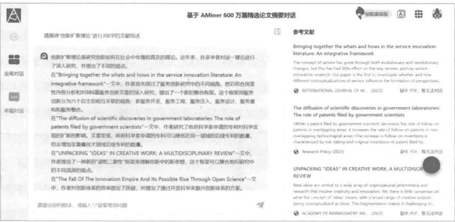）。点击标题跳转核验，文献信息与 Web of Science 记录完全吻合，有效规避了“大模型幻觉”风险。上传 PDF 后，其“AI 速读”功能更能一键拆解背景、方法、结果、基金等全维度要素。

## 二、 学术阅读与知识吸收：三大维度的效能跃升

### （一）效率增强——打破物理与语言壁垒
针对视力/阅读障碍群体，AI 支持文本转语音（拟真人声）、排版配色字体个性化定制，实现“无障碍阅读”。面向通用场景，**跨语种自动翻译**与**实时注释**（背景知识、术语释义）成为核心增值点。  
**SciSpace** 典型代表（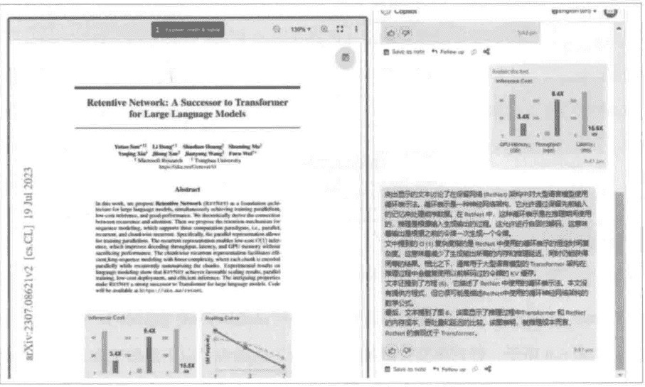）：基于 GPT-3，集检索、文本分析、论文追踪、高亮/公式/表格解读于一体。其 Paraphraser 模块支持“正式/流利/创意”多风格翻译及长度调控，堪称“智能增强版翻译官”。需注意：图表解读能力较弱，关键数据仍需人工复核。

### （二）理解增强——对话式“深度陪读”
自然语言对话成交互主范式。用户抛出问题，AI 即时响应并支持多轮追问优化。  
- **SciSpace Literature Review**：类 Google 搜索框，直接返回答案。  
- **Copilot-Read with AI**：对话式拆解论文难点，给针对性建议。  
- **知网 AI 学术研究助手**（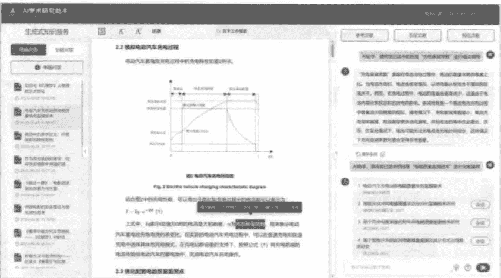）：三级问答体系——单篇问答（大纲/观点/方法/结论+引证推荐）、专题问答（同主题结论汇总/方法梳理/自动生成综述）、全库问答（体系化全景透视），层层递进服务深度研究。  
- **Aminer AI** 右下角对话框（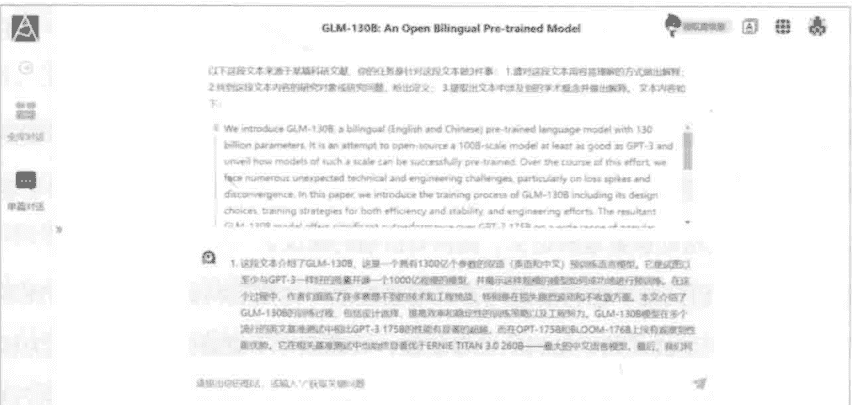）：实测指令“用通俗语言解释摘要、定义研究对象/问题、提取学术概念并释义”，秒出中文结构化回复，阅读门槛大幅降低。

### （三）学习增强——结构化知识内化
**Semantic Scholar**（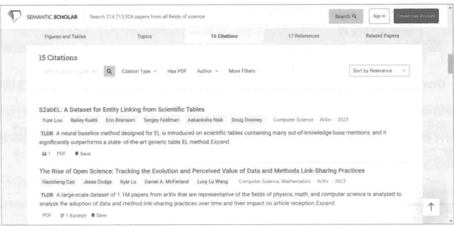）以机器学习提取高频关键词、确定研究主题、抓取图表生成“TLDR”极简摘要，助研者秒建整体认知。其独创的**引用/被引文献相关性降序排列**，为“顺藤摸瓜”获取高价值文献指明路径。  
**Zotero-GPT** 可批量读文献后自动产出“概述+观点+方法+结果”结构化报告；**Notion AI** 虽主攻笔记协作，却能对论文数据/模型做二次分析，助力深度理解。

## 三、 学术写作全链路智能辅助：从骨架到润色

### （一）框架搭建与规划
**Scrivener** 定位专业长文写作：输入主题即给建议框架，“分区/父子章节/标签注释/多视图（列表/日历）”四大机制，让结构规划可视化、进度可追踪。

### （二）智能校对——多语言、多维度兜底
| 工具 | 核心优势 | 适用场景 |
|------|----------|----------|
| **Grammarly** () | 语法/拼写/用词纠错 + 可读性/词汇量评分；付费版深度覆盖词汇/标点/语法/书面规范 | 英文学术严谨校对 |
| **Hemingway** (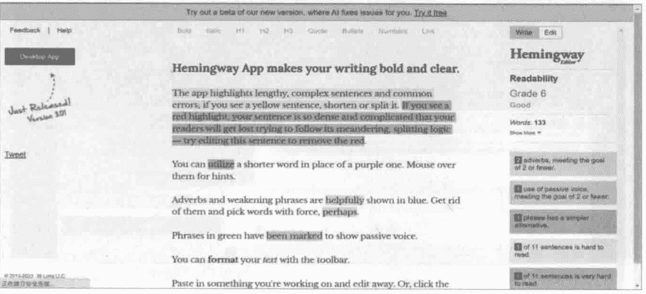) | 标红长难句、冗长段落、常见陷阱，给简化建议与可读性统计 | 追求极简清晰文风 |
| **ProWritingAid** () | 语法/风格/拼写/标点全检 + 词汇增强/句式优化高阶功能 | 全维度文本打磨 |
| **LanguageTool** (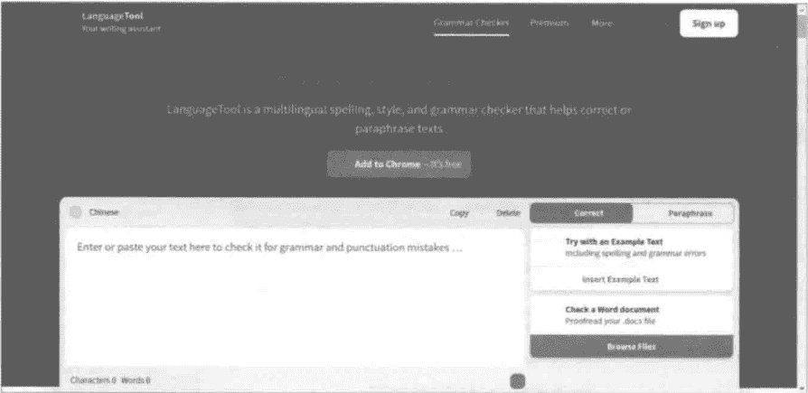) | **20+ 语言**同查（含中英），跨语种团队首选 | 多语言协作环境 |

### （三）智能润色——逻辑重构与风格迁移
生成式 AI 凭借“思维链”复杂推理与模块化写作特征解读，能在**逻辑自洽**前提下模拟特定学者文风或适配目标期刊风格。  
- **Textio** ()：虽源招聘场，但“风格滑块（正式/客观/亲切）+ 结构优化建议 + 实时反馈”三件套，对论文润色同效。  
- **Jasper.ai** ()：“重写”精简句子，“改进”扩充案例与逻辑链。  
- **Quillbot** (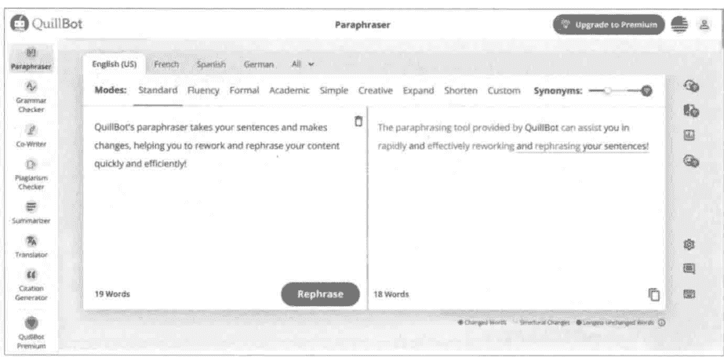)：先进语言模型驱动改写输出连贯自然，内置**抄袭检测**守住原创底线。

---

## 第三节 生成式 AI 作智能主体的“替代性赋能”：重塑变量策略与假设检验

### 一、 变量策略：数据驱动的新范式

#### （一）大语言模型：因数据而生，向数据要质变
2016 **AlphaGo** 以“海量数据+深度学习+蒙特卡洛树搜索（算力聚焦高价值分支 [PRE12 脚注]）”打破围棋人类定式，展示“数据为核心”行动机制。2020 **GPT-3**（45 TB 数据、1750 亿参数）再证：充分数据训练+顶级算力 = 涌现类人通用能力。**数据量变引发质变**；样本不足则性能折损，数据奠基地位不可动摇。学界共识：过去十年 AI 突破本质是“海量高质量训练数据+六步处理流程（收集/标注/准备/减少/增强/管道搜索）+ NLP/深度学习/神经网络技术栈”的协同产物。

#### （二）数据收集与标注：AI 全流程接管
**1. 数据收集**  
实证研究首环“数据收集”决定上限。AI 凭借分布式互联网调度与超强算力，替代人力完成**标准化/程式化**采集。访谈环节，AI 可**全模态无遗漏记录+实时反馈分析**，成本骤降质量反升；隐私敏感时受访者对“非人类”心理防御更低，回应更真实客观。

**2. 数据标注**  
传统众包/半监督标注耗时耗力。AI 结构化思维+高速高准计算天然亲和数据，深度学习更解锁**多模态标注**能力，人力角色全面让位。

#### （三）实战案例：ChatGPT 做情感分析
传统 NLP 流程（预处理→特征提取→极性分类→强度估计→输出）需编码（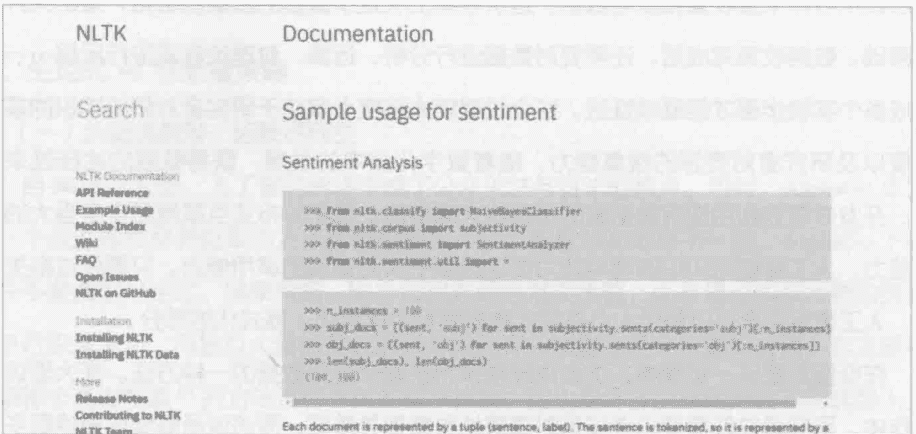 NLTK 代码示例）。ChatGPT 依托海量文本预训练与字词接龙机制，具备**深度语义理解、强泛化迁移、细粒度分类（强度/类型）**优势。**零代码、自然语言提示词**即可全自动跑通流程并解释结论，门槛归零。

### 二、 假设检验：AI 介入科学推演核心环节

#### （一）科学研究双层面与假设检验定位
科学研究旨在揭示本质规律，分**理论层面**（建构抽象概念/理论）与**实证层面**（用观测数据检验理论）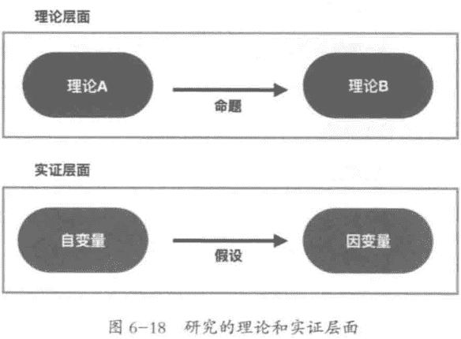。假设即变量关系主张，须经验检验，**假设检验**作为统计推断核心方法，判别样本差异源于“抽样误差”还是“本质差别”，是自然科学研究关键一环。

假设检验的标准流程可拆解为五步走：先将研究预期拆解为零假设与备择假设，再搜集证据数据，继而选型匹配的统计工具，依据结果裁定能否推翻零假设，最后在结果与讨论板块完整呈现发现。

样本量是贯穿假设检验始终的关键变量。它不仅直接决定检验功效的强弱，更在于样本规模一旦扩容，待验假设的内核与数据分布形态往往随之重塑。经典范式虽稳但短板明显：一是难以锁定唯一因果链条；二是深陷样本与样本空间的依赖泥沼；三是面对图像、音视频、自然语言等非结构化复杂数据时显得力不从心。生成式 AI 的横空出世，开启了智能分析新纪元。它像把万能钥匙，能啃下复杂数据硬骨头、捕捉隐匿模式、滤除噪音干扰、挖掘核心信息，甚至能为假设检验输送“弹药”，助力研究者穿透迷雾，得出更经得起推敲的结论。

#### （二）强化学习：重塑实验设计与模型构建

作为机器学习的重要分支，强化学习正深度介入假设检验全链路——从优化实验设计、提效增效，到辅助探索验证数据，再到支撑模型落地。

在实验启动期，它能反向推导关键参数与采样策略，以最小成本换取最大信息增量；化身智能代理时，它依托历史反馈动态修正策略，大幅压缩验证周期。攻克因果推断等硬骨头时，强化学习能精调参数提升模型与数据贴合度，更能引入深度因果推理，为后续研究指明方向。归根结底，强化学习赋能假设检验的核心在于“定制化”与“动态化”：动态调策、精调参数、拓边界、最大化信息获取，有望在大实验、大数据领域成为加速科研进程的关键引擎。

#### （三）实战复盘：AlphaFold 如何攻克蛋白质折叠难题

科学智能的本质，是让 AI 习得科学第一性原理，构建模型，终落地解决实战难题。DeepMind 旗下 AlphaFold 即是集大成者：融合机器学习、高性能算力与物理建模，成功预测了大量无法直接实测的假设。2018 年一代问世，2020 年二代加冕 CASP14 冠军。困扰结构生物学半个世纪的蛋白质三维结构预测，自此被 AI 彻底改写。其破局密码藏在四大创新里：

**创新一：多序列嵌入（MSE）。** 作为生物信息学基石，它通过多重序列比对（MSA）、聚类与动态网络嵌入技术，解码复杂序列数据的深层语义。

**创新二：预训练与知识蒸馏。** 前者让模型在小样本任务上快速微调适配，后者实现大模型知识向小模型的无损迁移。虽初衷是压缩算力，实测却意外收获泛化能力跃升。

**创新三：Transformer Encoder 架构的引入。** 它对 MSA 表示编码，精准捕获序列长距离依赖与关键特征，将长序列处理与结构预测无缝衔接，实现深度学习与生物信息学的深度耦合。

**创新四：空间图表征。**（见图 6-19）以节点边构建蛋白质拓扑结构，显性化部件间距离与关系，让模型“看懂”蛋白质几何本质，为药物研发等领域注入确定性。

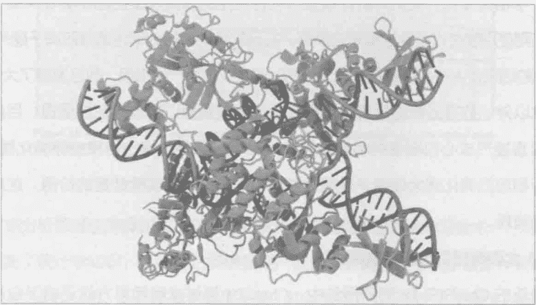

图 6-19 蛋白质折叠

### 三、生成式 AI 与数据分析

#### （一）数据分析：科研地基上的“硬骨头”

数据收集与分析是科学发现的基石。AI 正跨学科整合海量数据、细化测量、领航实验、探索理论兼容空间、输出可落地的可靠模型。在分析环节，信效度检验、相关测度、因果判定构成核心链条，直指实验验证，间接支撑理论大厦。

李源团队曾深论因果推断价值：“洞悉因果逻辑即可构建‘因果专家系统’，在机器上模拟推演，从而解释未知、破解难题、设计新实验、持续汲取因果知识，终惠及民生。”信效度检验关乎可解释性，相关是因果的必要前提，环环相扣，步步关键。虽有 SPSS、Amos、Stata 等成熟工具，但“统计底子弱+软件上手难”成了大批非统计专业学者的拦路虎：摸索操作易出错，硬件短板拖慢效率，耗时耗力成常态。更头疼的是可视化输出：软件只出标准图，美化润色全靠手工，又是一笔隐性人力账。

#### （二）大模型上手：从“会算账”到“懂数据”

ChatGPT-4V 测评中，它通过读图解方程展示数理推理（见图 6-20）。计算机算数不稀奇，稀奇的是：通用领域、零代码、全自动。识字、寻径、调度算力，全程无感介入，这才是大模型的独门绝技。


图 6-20 GPT-4V 读图解决数学题示例

数据分析赛道同理。大模型经深度学习系统吞吐统计学知识库，能依变量类型、样本量自主挖掘、识因果、建模型，支撑预测、分类、关联乃至知识图谱构建，直抵决策层。硬件层面，高性能 CPU/GPU 加专属代码环境，保精度、替人工、出图表、给解读。通用性加持下，提示词微调即能优化视觉与数据细节，极大压低学习与操作门槛。

展望未来，大模型与数据建构将形成正向飞轮：算力跃升夯实数据基建，数据反哺倒逼模型进化，良性循环已在路上。

#### （三）实战演示：ChatGPT Code Interpreter 秒变数据分析师

沃顿商学院伊桑·莫利克教授实测展示了 Code Interpreter 实战回归分析全流程（见图 6-21）。上传表格，抛出三问：可视化描述看数据、跑回归找模式、做诊断查体检。

Code Interpreter 秒懂：确认指令 -> 拆解步骤。先识变量分因果，再自主抓取变量定分组、出散点图与回归曲线，关系可视化一步到位；还能自查脏数据、智能填补缺失值（见图 6-22）。

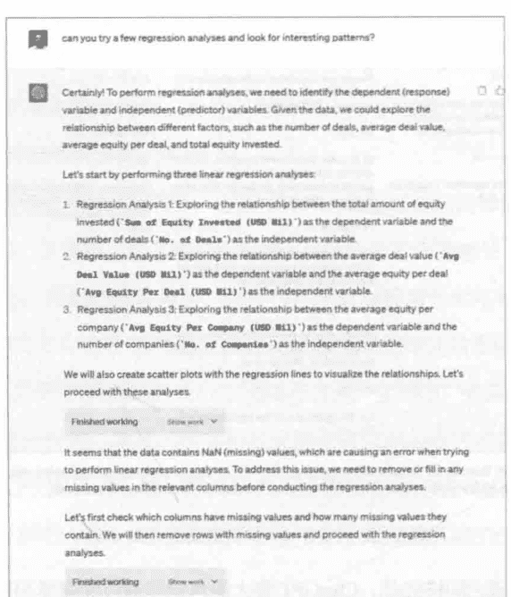

图 6-21 ChatGPT Code Interpreter 回归分析示例（一）

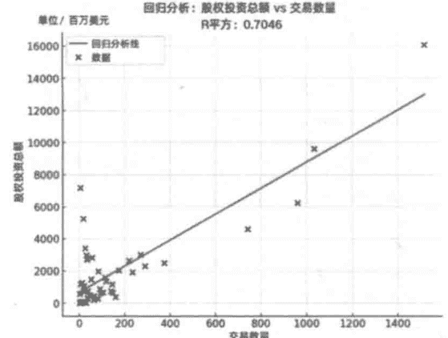

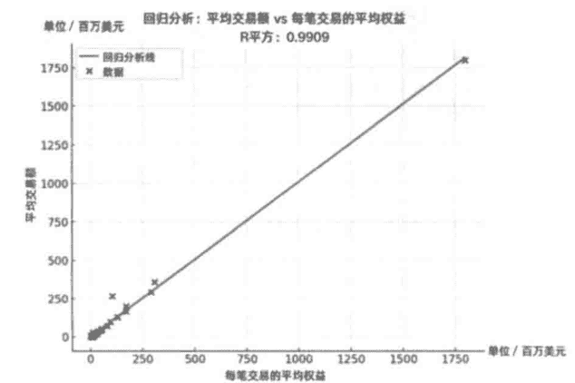

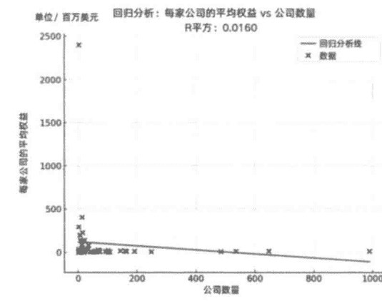

图 6-22 ChatGPT Code Interpreter 回归分析示例（二）

复盘环节，它以结构化文本拆解各组变量关联强弱、指标实战含义（见图 6-23）。

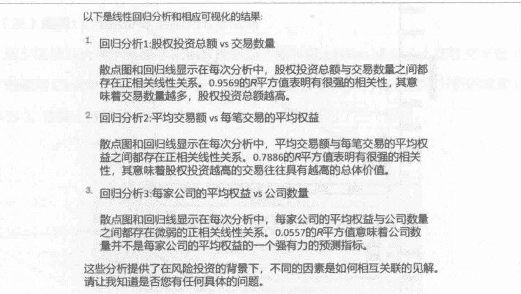

图 6-23 ChatGPT Code Interpreter 回归分析示例（三')

这仅是入门级应用，却实打实拆除了统计分析的高墙，让更多学者触得核心、研得深入。未来突破口或在：跨模态知识图谱、多元因果推断、动态图谱更新、面向非专业人士的因果可视化直呈。

### 四、生成式 AI 与理论构建

#### （一）理论构建：从观察到验证的迭代闭环

理论建构是科研核心环节，是人类以“概念-判断-推理”“论题-论据-论证”为逻辑骨架认识世界的体系。本质上，科研皆为“观察-合理化-验证”迭代循环（见图 6-24）：观察感兴趣现象；合理化阶段逻辑串联拼图，催生理论；验证阶段以科学方法压力测试。

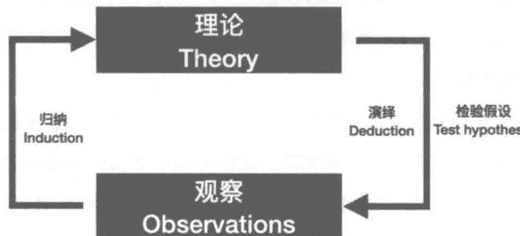

图 6-24 理论探索与构建模型

假设是理论起笔，需海量资料筛选归纳，炼就逻辑自洽、解释力强、可预测、可证伪的理论胚胎。生成式 AI 以数据挖掘力辅助大规模收集、精准提取构理论素材；验证期，其机器学习模型可预测未来事件结果，为理论定性背书。

#### （二）算法归纳：让机器跑通“从数据到理论”的最后一公里

Alshater 指出 ChatGPT 或成构建研究思路的利器。机器学习与算法归纳合流，为理论构建开出便捷、全景、高效的新入口。二者本质同构：机器学习即算法归纳——从海量数据中归纳模式、建模型、泛化未知。AI 系统在解读科学数据集、从文献抽取关系知识上大有可为，尤其无监督大模型蕴含捕捉复杂科学概念的潜力。将机器学习与多案例分析耦合，按理论构建步骤推进，有望实现理论生产力的范式级跃迁。

### 理论构建的起点：界定问题与文献溯源

开展有价值的研究，首要任务是锚定研究问题与现象。在此基础上，必须投入大量精力梳理领域文献，摸清前人理论脉络与既有成果。以 Scite 为例，这类 AI 工具只需输入核心问题，便能快速输出相关综述，助力研究者深度理解主题、借鉴方法，并从中敏锐捕捉到待解决的学术缺口。文献梳理完毕后，研究者便可提出包含假设与变量关联的初步理论框架，用以解释现象。机器学习在此环节大显身手：它擅长从海量数据中挖掘模式、关联与趋势，自动揭示潜在关系，为新理论假设的提出提供强有力的数据支撑。

对于依赖模型构建的理论研究，机器学习算法可构建数据驱动模型（如回归、分类、聚类等），实现对现象的描述与预测。生成式 AI 则在模型验证评估上发挥作用，通过训练与验证数据考察模型的准确度与可解释性，从而佐证或修正理论。但须清醒认识到，机器学习仅是辅助工具，提供信息与洞见；理论建构的内核——判断力与创造力，仍离不开人类专家的主导。

#### （三）实证案例：YModel 赋能自动化建模全流程

YModel 定位为自动化数据挖掘利器，旨在降低门槛，让非专业人士也能“一键建模”，大幅提效（见下图）。其官网以七大特性概括核心优势：挖掘历史数据预测未来；支持主流编程语言；性价比高于 SAS，普惠统计分析；优化模型质量；预处理简易上手；算法逻辑透明易懂；降噪平衡样本。


图 6-25 YModel 自动化数据挖掘工具示例

YModel 串联起数据输入、自动预处理、智能建模、性能评估、模型输出的完整链路，助力科学家产出高质量、高稳定性的模型。回到理论构建视角，通过算法在大规模数据中发掘潜在关联，正是提出新假设的前提。YModel 利用上述特性，自动导入训练数据并完成变量统计、预处理、建模与评分，在迭代循环中打磨模型，最终为理论构建注入算力红利。

---

## 第四节 生成式 AI：重塑学术生产力的维度跃迁

### 一、 解构旧秩序：知识生产体系的全域重构

生成式 AI 正在拆解传统的知识生产秩序。高奇琦指出，大语言模型不仅冲击人文社科，更将解构自然科学的生产范式，实现全领域重塑。传统秩序由教育、发表、评价等子系统耦合而成。若视知识生产为复杂系统，生成式 AI 的引入相当于注入了最强“活性变量”，打破原有平稳态，迫使系统在动荡中进化，催生涌现式跃升。

以 ChatGPT 为代表的大模型，已从文生文拓展至多模态：GPT-4 读懂图像，Midjourney 文生图斩获艺术大奖，飞猪 AI 广告登陆地铁站引发热议，Netflix 联合出品的 AIGC 动画短片《犬与少年》更标志着视频生成迈入发行级。未来，多模态覆盖将使生成式 AI 进化为近乎全能的知识生产工具。本节将从教育、发表、评价三系统切入，剖析其解构逻辑：教育层面推动高等教育平民化与学者大众化；发表层面引发版权争议倒逼范式迭代；评价层面驱动自然评价体系建设。

#### （一）教育系统：普惠高等教育，催生大众学者

生成式 AI 释放巨大的“平权效应”，赋予普通用户平均水准以上的表达与资源调用力。黄仁勋曾言“人人皆可成程序员”，放在教育场域，则是“人人皆可成学者”。高等教育不再是少数特权，获取渠道与能力双重下放。传统被动灌输将转为主动探究：在 AI 陪伴下，学习者聚焦问题与项目，以应用为导向习得知识。

技术层面，生成式 AI 建立在海量数据之上，拥有常人难及的知识广度与储备，堪称全领域“超级导师”，辅助大众习得编程、写作、数据分析等技能。更深层看，它改善了成为学者的两大硬性条件——自由时间与学习机会。重复性劳动交予 AI，人类腾出时间深耕；强大的检索整合能力打通资源壁垒，定制学习路径，推动“学者大众化”落地。

#### （二）学术发表系统：版权争议倒逼范式重构

AIGC 版权归属是发表系统面临的首个硬骨头。学界业界分两派：“结果论者”主张版权，强调提示词注入人类独特性；“非人创作派”否定版权，视其为算法产物，不受著作权法激励。笔者倾向前者：提示工程师以独特提示词挖掘模型潜能，输出具差异性成果，理应获权。

争议虽起，却也孕育了解法。学者提议构建“以知识元为核心的版权图谱”：确立知识元为最小权利单元，加速信息与需求匹配；引入信息熵测度，通过有序排布抑制熵增，平衡生态；融合生成式 AI 与区块链，结构化呈现概念、实体、事件及关系。落地分两步：一是发挥 AI 结构化检测优势，突破传统技术在查准、查全、推理上的短板，实现从语句改写到框架复制的全维识别；二是构建图谱溯源技术，借区块链补齐算法自动化缺陷。这种智能化版权图谱将大幅降低误判，净化生态，并以此倒逼学术创新，重塑发表系统。

#### （三）成果评价系统：AI 驱动的“自然评价”新范式

学术评价是项目、人才、期刊、机构评价的基石，现行体系弊端丛生，阻碍创新。伴随判别式与生成式模型在翻译、分类、摘要、情感、问答等任务成熟，AI 赋能评价智能化、科学化正当时。杨红艳团队提出“自然评价系统”——人工智能与学术评价的深度融合，超越传统同行评议、文献计量、网络计量、替代计量。

其训练数据源自双轨：一是学术生产内容（论文、专著、报告等）；二是学术活动痕迹（学者读评传、编辑审稿互动、实践转化反馈、他主体评价记录等）。系统遵循质量、公正、全面价值观，融合判别式与生成式 AI 双引擎，基于内外部数据构建动态、立体、多元的公平评价体系，剥离人情干扰，推动评价进步与学术创新良性循环。

---

### 二、 知识革命：学术生产力三要素的跃迁与重构

生产力三要素映射至学术场域，即：研究者、工具、对象。生成式 AI 浪潮下，三要素齐升级；研究者作为最活跃因子，与机器关系重构；在质量底线守住前提下，实现生产提速。

#### (一) 三要素全维赋能

**1. 学术研究者：向“人机互构主体”进化**
研究者主观能动性最强。生成式 AI 以强理解、分析、决策能力冲击传统角色，国际已出现将 ChatGPT 列为合著者的案例。未来，AI 将成研究者的“互构伙伴”。不会用 AI 的研究者，必将被会用 AI 的同行淘汰。单向度“人-人”协作将让位于多元“人-机-人”交互主体，开启人机协同创新新范式。

**2. 学术研究工具：双重赋能——增强与替代**
工具水平标志生产力高度。生成式 AI 扮演双重角色：
*   **增强性赋能**：作为工具嵌入全流程。文献综述背后的搜集、提炼、分析、整理，正是 AI 强项（前文详述）。
*   **替代性赋能**：作为主体接管特定任务。变量测量、假设检验、数据分析、理论构建等核心环节，AI 可主导执行（前文论证）。理论构建本是人类逻辑思维的产物，如今“机器学习+多案例分析”组合拳，配合 AI 解释数据、提取文献知识的能力，重塑建构路径。

**3. 学术研究对象：边界外拓与新增**
研究对象不再局限于人类生成内容，扩展至 AI 生成内容；人机交互纳入沟通视野；舆情治理对象从人类用户延伸至社交机器人。生成式 AI 既延伸旧对象，又增添新对象，极大拓宽学术疆域。

#### （二）关系重构：机体哲学视域下的“人机共生”

研究者与工具关系，本质是人机关系。AI 带来生机与危机并存，厘清模糊地带是化险为夷的关键。机体哲学视人机关系为生命、社会、精神、人工四大机体间的互促、互塑、互制、动态协同。

生成式 AI 被视为通往“强 AI 时代”的关键奇点。机器智能化虽模糊边界，但本质区别未消失，亟待探寻新特征。智能媒介重塑感知，研究范式超越主客二元，转向指涉关系、情境的高度互动耦合。须摒弃“零和博弈”思维，追求“一场达尔文式协同进化”，实现更高阶“内共生”。

机体哲学聚焦四类机体的性质与有机联结。构建和谐人机关系，即打造人类智慧体、机器智能体、网络环境三位一体的超级智能体，核心在“交互”。四机体作用整体、动态、隐蔽、自组织，契合生成式 AI 语境下人机关系关键特征。人机互为尺度，从二元分立向“复合型共同主体”转化。人、机、环境共生态，需动态寻找平衡点。人在实践中将生命、社会、精神机体特征赋予机器，形成人工机体，实现功能转移与同构。人机关系实为四机体互促互制、动态调和的过程。唯有递进式稳定，方能揭示人技和谐统一的底层逻辑，保障研究者与工具协同发展。

#### （三）质与速的辩证：打破“慢科研”，实现有质加速

知识生产本是“慢工出细活”。高奇琦指出，慢速源于“挤压泡沫”。AI 虽提速，却引发双重混淆：真伪难辨、优劣不分。提示词与 RLHF 虽打开黑箱一角，但涌现行为仍处“灰箱”状态。ChatGPT 是加速器，能接管初级工作，但若忽视“质量优先”，加速不过是制造混乱。

真正的学术加速，须在质量护栏下打破速度瓶颈。混淆根源在于训练数据不足与偏差。对策是：精准标注训练数据，剔除文化差异导致的偏错；区分标注 AI 与人类内容，从源头提升输出质量。维利里奥言“现代社会是速度圈，竞速失败者将被淘汰”。当下学术节奏已部分滞后社会进程，生成式 AI 变革生产力，为有质量的学术加速奠定基石。

---

### 三、 跨界新生：生成式 AI 推动新型交叉学科建设

#### （一）拆墙：以类脑赋能打通文理壁垒

传统交叉多局限于自然科学内部（如 AI 赋能工程）。生成式 AI 以“类脑赋能”形式，助文科生补自然科学短板，助理科生补人文社科短板，赋予学者调用全学科知识的能力。面对新问题，学者可跳出单一学科视野，将研究视为复杂系统，借 AI 智能特性联结多学科，以问题为中心展开跨域对话。AI 编程能力更让文社学者低门槛驾驭跨学科工具与范式，直击社会痛点。

#### （二）破局：培育高阶思维的跨学科领军人才

终极层面，生成式 AI 将打破思维壁垒，成就真正跨学科人才。祝智庭指出，教育数字化转型植根三大新基因：学习者中心与适性发展、需求驱动与开放创新、人机协同与技术赋能。南洋理工大学通过跨学科专业、平台、课程“三位一体”培养模式，全面激活生产力最活跃因子。

AI 时代，高阶思维是高等教育核心素养，具四大特质：主动性（主体主动建构）、系统性（系统层面复杂思考）、综合性（关联多元因素）、跨学科性（突破单一学科限制）。短期看，AI 可能阻碍高阶思维养成；但长期看，在教育变革与技术演进合力下，AI 将推动研究者跨学科化、工具智能化、对象复杂化，最终引领学术生产力实现跨越式发展。

# 第七章

# 重塑万行业：生成式 AI 的落地实况与前瞻演进

## 本章概述

伴随 AIGC 全面渗透社会生产肌理，生成式 AI 正在传媒、电商、娱乐、教育、科创等版图掀起深层变革。本章立足业界一线实践，融合智谱 AI 多模态大模型技术、云创 AI “专家 + 算法” 的消费认知洞察，以及提示词工程在多元场景的演进实录，致力于勾勒生成式 AI 落地的全景图谱。我们将借助描述评价、探索解释、趋势预测与行动策略四重分析框架，助读者全方位把脉业界接入该技术的当下进程与未来路径，并从具体场景与案例中提炼技术落地的关键症结与破局思路。

## 第一节 生成式 AI 的媒介化运作逻辑

### 一、算法媒介：架通机器理性与人类非理性的桥梁

透过媒介视角审视生成式 AI 的价值，已成传播学探索的新高地——它既是语言基建，亦是知识媒介，更是推动文明演进的关键媒介力量。不论从何切入，生成式 AI 均被视为重塑人类文明及社会媒介化进程的核心变量。

**媒介形态的演进脉络**  
溯源麦克卢汉“媒介为人体延伸”经典论断，媒介形态受技术制约，历经了从延伸“物理在场”到延伸“虚拟在场”的跃迁。实体媒介纪元，媒介复刻人类感官与肢体（目、耳、腿），催生出一系列物理介质；当交往诉求由“物我对话”拓展至“人我互证”，媒介转向延伸需求、偏好、身份等虚拟关系维度，隐匿于社交纽带深处，编织成潜在关系网络。“失媒介，则无共同生活之可能。”AI 在数据与算力的双轮驱动下，将人际关系颗粒度解构至微尘，算法遂成社会连接、治理、配置的底层逻辑。媒介不再局限于地缘、血缘、趣缘构成的强关系随机延伸，而是基于生理心理认知的全域数据重组与体系化延伸。本质上，算法是逻辑与规则的“代理人”，沦为人与世界间的配置界面，成为集大成的媒介形态。如尼克·库尔德利所言：“‘生活世界’的每一层级，无不渗透着‘系统’（算法系统）。”媒介形态正完成从物理媒介、关系媒介向算法媒介的跃迁：物理媒介以“实体”居间，关系媒介以“纽带”居间，算法媒介则以“数据算力驱动的逻辑规则”居间。

**生成式 AI：算法媒介的最新范式**  
生成式 AI 是技术谱系迭代的最新算法媒介形态。区别于前代算法媒介，其拥有独特的算法“微调”可供性，具备自适应、随境而变的优势。技术突破在于实现“多轮对话，持续演进”，在“提示—响应—反馈—修正”的闭环轮动中完成算法“微调”。每轮人机交互终局，算法皆通过强化学习吸收反馈信号，融汇入模型，微调对话策略、参数权重，以生成更贴合预期的下轮响应，循环往复。这标志着算法媒介连接形态的升维：从“具体指令连接（设代码）”进阶为“抽象目标连接（给目标）”，呼应了计算机学界“软件 2.0”思想。

软件 2.0 由特斯拉 AI 工程师 Andrej Karpathy 提出：软件 1.0 时代，算法为人类手写的显性指令集（人写代码）；软件 2.0 时代，算法演化为庞大神经网络，人类无法直接硬编码，仅能下达目标骨架，复杂系统靠机器学习自发生成达标路径（人定目标 + 算法微调）。未来算法媒介不再是简易规则集，而是具备自适应微调力的统合规则模型；连接焦点从“路径层”转向“目标层”。正如 AI 之父马文·明斯基预言：“未来计算机语言将聚焦目标，而非实现过程。”

**浅层技术视角：贯通双重语库**  
生成式 AI 的“居间性”技术表现为：打通机器概率预测与人类标注反馈两大模块，连接机器数据库与人类语言库。  
其一，大语言模型（LLM）奠定连接基石。通过对海量词序概率分布建模，利用上文预测下一词分布，LLM 实现了实时捕捉语境生成得体句子（“说得恰当”）与检测句子符合语法习惯程度（“说得地道”）的双重能力，使机器理解并生成人类语言成为可能，确立了机器数据与人类语言互学互融的起点。  
其二，算法“微调”可供性铺设行动路径。生成式 AI 非“一蹴而就”，而是在对话轮动中渐次“逼近”真需。“逼近”即“微调”，意指人类行动得以介入模型设计层，实质影响算法运作。两条微调路径对应人类智能介入的两条通道：全量微调（Full Fine Tuning）与参数高效微调（PEFT）。一是调整“喂养”数据——投喂含个性偏好的私有语料，训练专属模型，让差异化需求与海量机器库联姻；二是交互中反馈评价——以微小提示标注、评分微调预测权重，让人类“思维痕迹”缓缓渗入。

**深层逻辑视角：融汇双重智能体系**  
生成式 AI 连接的不止两种语言，更是语言支撑下的两套智能体系——在机器理性与人类非理性间架设融汇桥梁。  
智能生成机制迥异：机器智能基于“计算—表征主义”，认知即计算，情境适应与情感理解本质是参数计算能力的跃升，属纯理性的“有限智能”，数据算力为其边界；人类智能虽也有限，但边界源于生物局限（寿命、算力、交流带宽）。认知科学家 Thomas Griffiths 指出，人类被迫成就“短链突现式智能”（本能速判）、“具身经验式智能”（直觉补位）与“学习传承式智能”（立知望未、想象创新）。人类智能更依赖情感、意志、自我意识等非理性驱动，具备自反性的“怪圈”特质，拥有不可还原为计算的突生属性——创造往往源于可遇不可求的灵感顿悟。  
智力分工定位：机器智能擅长“已知域、按部就班”的计算整合，基于趋势规律稳联已知要素；人类智能擅长“未知域、天马行空”的突生创新，基于直觉意志开拓新知。这印证了柏拉图“哲学始于惊奇”及康德“纯粹想象力是知识基石”的洞见。

**重新定位：致敬而非替代**  
生成式 AI 非单纯“机器替人”的工具，而是双智能配置协同的媒介界面。它开创性地将内容创作等脑力劳动拆解为机器劳动与人类劳动：将可数据化、可算法化的逻辑理性部分剥离予机器；将不可算法表达的目标性、赋魂领域留予人类，强调人类“画龙点睛”的核心地位。生成式 AI 非替代人类智能，而是致敬——其核心价值在于对脑力劳动的再连接与再分工，从繁冗常规劳动中筛出唯有人类能执行的部分，重申人类智能的不可替代性。

### 二、双力合璧：机器解构力与人类牵引力驱动社会负熵化

进一步看，如何理解这种可“微调”算法媒介的媒介化机制？系统论视域下，媒介塑造社会系统的过程，即推动系统从无序走向有序的“负熵化”进程。

**负熵与媒介化**  
“熵”度量系统无序度，“负熵”即熵减，标志系统向有序演化。社会系统天然“熵增”，子系统摩擦推高复杂度与无序，终至耗散归零——如村落兴衰归尘。人类介入可逆转此势（村落继承成城），此即“负熵”过程，系人类独有能动性。薛定谔以“生命即负熵”区隔有机与无机演化；学者视“传播实践”为典型“负熵”活动。弗卢塞尔在《传播学》中重释传播为传递“负熵”的反自然过程——自然演化难积累信息，人类凭传播技巧使之可能。媒介即秩序/知识装置，将符号化信息跨记忆传递，助人类抗熵；媒介化即社会“负熵化”，借媒介传承秩序对抗耗散。

媒介驱动负熵化分两级：改良式媒介的弱“负熵化”（微观元素层面降序，如 3D 优视觉、杂志优文字配合）；革命式媒介的强“负熵化”（宏观结构层面重塑，如互联网打破工业层级，激活微粒社会，以关系赋权重塑赋能）。

**生成式 AI：革命式媒介的“破旧立新”**  
生成式 AI 属革命式媒介，以混合双智能算法规则重织连接网、改写要素权重，其媒介化属社会复杂系统的强“负熵化”：**“破旧”**——借大模型海量参数全面解构旧秩序；**“立新”**——借新算法连接价值引导混合智能逻辑，催生新秩序涌现。传播生态格局（尤其是人机两大主体生态位）将发生革命性重组。

**破旧期：机器解构力的微粒化风暴**  
旧秩序终将解构，常态下漫长如文化演化。生成式 AI 背后的万亿级参数（如 GPT-4 1.8 万亿参数），象征着前所未有的机器智能诞生——所有人类社会信息中的理性要素皆可被解码纳入模型。这是算法媒介利用机器智能对复杂系统的“碎片化”打击：不仅瓦解传统科层制，连人类积累的显性知识库、语言库均被“降解”为数据。连接规模与粒度达史无前例高度，社会在数据层面被“微粒化”，微个体、微内容、微价值等微元素被激活，复杂度与无序度骤增（元素层面熵增极值），旧规则消解替代，为新秩序“涌现”铺垫前提。

**立新期：人类牵引力的杠杆支点**  
无外力干预，系统必熵增耗散归零。新秩序涌现需外在扰动。生成式 AI 在机器自演化中植入人类“微调”可供性，确立人机活动分工，借人类非理性创新能动性，以微小干预形成牵引数字社会演进的引力。人类智能成算法连接权重的赋予者，从目标、结构层面推动系统进化，发挥“四两拨千斤”效能。单靠大模型只能做概率外推，难创新知；惟人类介入协同，知识创造始可能。

霍兰称此为复杂系统涌现的“杠杆支点”，彼得·圣吉称“系统基模”，决演化方向。微粒系统中无“中央指挥”，元素协同靠关键输入驱动，否则散沙一盘。故生成式 AI 推动的媒介化，实为：借机器解构旧系统，借人类协同形成涌现牵引的“负熵化”过程。人类地位凸显，看似微末的标注训练行为成负熵关键，在微粒数据系中化作强方向性、奠基性推动力，重塑社会实践新生态。

## 第二节 生成式 AI 的现实发展图景

### 一、发展三基石：数据、算法、算力的铁三角

宏观视野下，人工智能立于数据、算法、算力三大基石之上，三者互补共进：海量实时数据为落地供“粮”；CNN、RNN、GAN 等算法构筑技术骨架，为核心动力；以芯片为载体的算力定发展上限，为客观基石（详见表 7-1）。

**表 7-1 人工智能发展的三大基石**

| 三大基石 | 角色定位 | 核心制约维度 |
| :--- | :--- | :--- |
| **数据** | **“饲料”**：AI 技术发展的训练原料 | 决定模型精度与泛化上限 |
| **算法** | **“推手”**：AI 技术发展的核心动力 | 决定信息联结深度与应用广度 |
| **算力** | **“基建”**：AI 技术实现的硬件保障 | 决定模型成本与运算效率 |

#### (一) 生成式 AI 三基石的当下坐标

**数据：训练的“粮仓”与瓶颈**  
数据是 AI 发展的“饲料”，直指算法精度与泛化能力。深度学习、NLP 等领域，数据是训练模型、提性能、破复杂任务的钥匙。以 NLP 为例，AI 剖析海量文本，习得语法、语义、语用惯习，从而精准理解生成文本。AI 起伏与数据积累深度绑定，数据量级与品类受限皆可成发展瓶颈。

**算法：联结数据与机器的“引擎”**  
算法是 AI 发展的“推手”，居数据与机器节点。通过建模模拟人类感知、分析、决策，并实现超越——如构造流量入口、捕获用户粘性等应用落地。

**算力：支撑运算的“底座”**  
算力是 AI 发展的“基础设施”，强弱直指数据处理能力，为数据与算法托底。芯片等硬件迭代降本增效，强力托举 AI 发展。早期虽有可行算法，但算力不足难支撑庞大博弈组合，严重掣肘发展。升级算力，乃提升 AI 产业天花板的关键一招。

# 数智底座：生成式 AI 腾飞的三大支柱

在数字经济浪潮下，数据、算力与算法构成了生成式 AI 发展的“铁三角”。透过数据视角审视，全球数据总量呈爆发式增长。2022 年，全球数据产出达 81ZB，近五年复合增速超 25%。中国数据资源扩张势头强劲，产量达 8.1ZB，同比增 22.7%，占全球 10.5% 位居次席；存储量达 724.5EB，增幅 21.1%，全球占比 14.4%；大数据产业规模突破 1.57 万亿元。政务数据共享枢纽已汇聚 1.5 万类资源，累计调用超 5000 亿次；数据交易机构从无到有，至 2022 年底已达 48 家，为价值释放铺平道路。

算力侧竞争白热化。2022 年全球总算力触及 906 EFlops，增速 47%。细分来看，基础算力 440 EFlops，智能算力 451 EFlops，超算 16 EFlops。预测 2025 年将破 3 ZFlops，2030 年超 20 ZFlops。算力红利直接转化为经济增量：相关名义 GDP 增 3.8%，全球计算芯片销售额 1766 亿美元（+14%），服务器市场 1215.8 亿美元（+22.5%），单机价值升 9%。云市场规模 4910 亿美元（+20%）。芯片迭代加速，如 Google TPU v5e，单价下训推性能均超 v4 两倍，强力托举 LaMDA、PaLM 等大模型。

算法端参数规模指数级跃升。2023 年 7 月，Google Switch-C 参数量达 1.6 万亿。自 2018 年起，美系巨头接力发布大模型。2021 年国外发布 38 个（+171%），ChatGPT 问世引燃 2022 年热潮。至 2023 年 7 月底，国外累计 138 个，中国达 130 个，百模大战全面打响。

## 生成式 AI 的现实发展基础

虽然后起之秀势头猛，但中美差距客观存在。**芯片短板**受多重制约，高性能自研任重道远；**语境适配**上，主流模型多基于英文语料，中文场景需大量对齐打磨。

**存储瓶颈**是全球共识。数据“井喷”背后，真正落盘不足 2%。2014 年社交媒体崛起推高存储增速 53%，2016 年安全意识觉醒再掀高潮（+87%），此后增速回落至 25% 以下。容量与性能双受限，制约模型训练。叠加数据价值认知不一，海量资源沉睡，价值兑现困难。

---

# 生成式 AI 应用全景扫描

当前生成式 AI 遍地开花，覆盖 NLP、CV、VR 等核心赛道，成各国必争之地。以下梳理主流工具图谱。

## 国内头部阵营

### 1. 文心一言
立足飞桨与知识增强大模型，主打知识、检索、对话“三增强”。深耕文学、文案、数理、中文理解、多模态五大场景，支持语音、翻译等功能。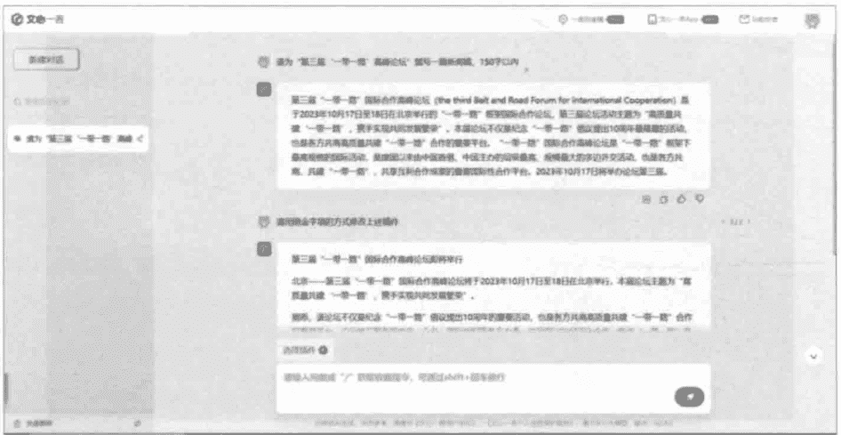
**4.0 版**（2023.10）理解、生成、逻辑、记忆全面跃升。优势在于算力门槛较低；短板为长文本、上下文敏感度略逊。官网/应用商店可体验。

### 2. 通义大模型系列
阿里统一品牌，覆盖语言、听觉、多模态。仿人脑模块化设计，推进“单感官”向“五官全开”进化。旗下**通义千问（文本）、通义万相（图像）、通义听悟（会议）**三驾马车。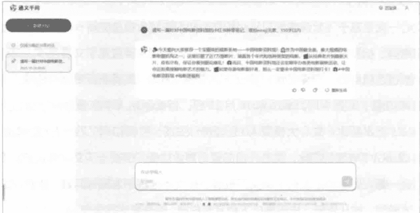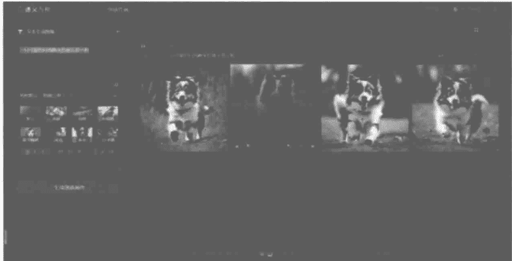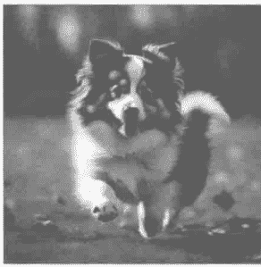
亮点：能耗极低，大幅降低训练门槛。早期语义、逻辑稳定性待打磨，用户量相对较少。官网开放试用。

### 3. 混元
腾讯出品，核心能力：多轮对话、内容创作、逻辑推理、知识增强、多模态。已落地文档、会议、广告、营销。升级后中文能力超 GPT-3.5，代码力 +20%，新增“文生图”。中文原生优势赋予作品更强意境。
现处内测/企业付费 API 阶段，用户基数较小。

### 4. 紫东太初
中科院自动化所联手武汉人工智能研究院打造。全模态突破：在语音、图像、文本基础上融入视频、信号、3D 点云，覆盖创作、问答、理解、生成、3D、信号分析六大领域。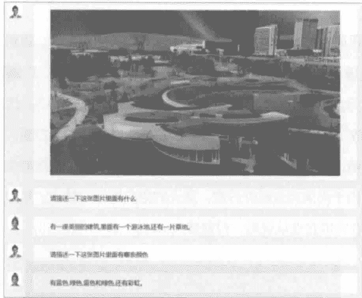
痛点：指令理解准确率、推理能力、答案稳定性有提升空间。官网注册审核后可体验。

## 美国主流矩阵

### 1. Claude (Anthropic)
强化学习路线，双形态：**Claude-v1**（强推理/创作）、**Claude Instant**（高性价比/轻量任务）。擅长给详细长回答，安全对齐做得好（无害输出）。短板：代码推理略弱，存在迎合用户、回答波动等通病。官网直达。

### 2. DALL·E 3 (OpenAI)
图像生成标杆。对细微语义捕捉更精准，文生图可控性大增。集成 ChatGPT 后，用户只需自然语言描述需求，GPT 自动补全高质量提示词，大幅降低 Prompt Engineering 门槛。官网注册可用。

### 3. BlenderBot 3 (Meta)
主打**联网搜索 + 长期记忆**的开放域对话。通过众包交互迭代真实性与安全性。缺陷：仍可能输出粗鲁/错误/身份混淆内容，依赖用户反馈修正。截至 2024 年初仅面向美区英语用户开放。

### 4. Bard (Google)
基于 LaMDA，定位聊天助手（对话、问答、建议、创意）。轻量版算力低、速度快，但实验期回答质量波动大，易出事实性错误。官网提供体验版。

## 其他国家代表作

### 1. Gopher (DeepMind)
2800 亿参数。阅读理解、事实核查、有害内容识别顶尖；逻辑、常识、数学表现平平。科普/人文问答强，逻辑推理弱。答复存重复、偏见、幻觉问题。应用场景窄，无公开 API。

### 2. HyperCLOVA X (Naver·韩国)
韩语原生大模型，含聊天机器人 CLOVA X 与生成式搜索 Cue。韩语处理、响应速度、文本质量领先，深度融入韩国法制文化语境。生态端联动广告工具 AiSAC、招聘平台 Job Brain 等外部应用。受限于训练语料，多语言泛化能力较弱。Naver 官网注册可用。

### 3. Jurassic (AI21 Labs·以色列)
可定制语言模型，聚焦总结、改写、分类、创意、代码。**Jurassic-2** 质量/速度双升，新增西/法/德/荷四语。部署于 AI21 Studio，提供 Large/Grande/Light 三档基座，按任务复杂度选型。门槛：对用户技术/资源要求较高。平台上可基于模型二开应用。

---

# 生成式 AI：重塑产业版图的“重做”时刻

生成式 AI 以颠覆性技术力重塑多行业，被视为大众拥抱 AI 的首个里程碑，更是生产力与创造力的强力引擎。它倒逼行业乃至社会结构“重做”，机遇与挑战并存。

## 传播行业：结构扁平化与认知重塑

传统传播依赖多级中介，链条长、噪音大。生成式 AI 普及后，个体直连大模型获取信息，**传播结构扁平化**，人机对话成主流。这深度重塑思维与认知：大模型作为内容主体，通过标准化、格式化再生产出“中间位次知识”，等同于对个体认知模式的格式化，社会笼罩于标准化、扁平化传播结构下。风险在于信息过度理性、机械化。但历史车轮滚滚，无法回归纯人感性主导的多级传播。**新课题**：如何在人机交互中生长出介于两者间的新型传播模式。

### 文本创作：人机协同新范式
ChatGPT 等多模态模型打破“以人为核心”旧范式，**人机协同**成主流：模型按提示生成，人追问微调，各司其职，效率跃升、成本下探。

**传媒前哨**：生成式 AI 深度介入快讯报道。核心功能：数据分析、内容生成、算法分发、事实核查。记者编辑用其写摘要、拟标题、润色稿件。彭博社 1/3 内容用 Cyborg，《华邮》机器人 Heliograf 获奖，美联社、洛杉矶时报、卫报纷纷布局，美联社甚至设专门自动化部。**体育、突发新闻**等时效性强场景成主战场。

**文学实验**：2020 年《共生纪》启动华语科幻 AI 共创探索。2023 年沈阳教授《机忆之地》纯 AI 创作斩获省级大赛二等奖，机器文本已逼真。

**边界清晰**：
1. **幻觉风险**：无法甄别输入真伪，易编造细节，成虚假内容温床。
2. **缺深度**：底层逻辑无非理性思维，仅能梳理事实，难做深度报道。
3. **无灵性**：创作本质是人脑延伸，缺“灵光一现”，作品有拼凑感，需人脑持续反馈打磨。

### 视觉艺术：跨模态融合破壁

传统创作模态孤岛，难“跨频”。生成式 AI 天生**跨模态融合**，打通文本、图像、音视频壁垒：文生图/视频/音频，图/音/视频生文，多模态互动成真。

**关键节点**：2021 年 OpenAI CLIP 以对比学习对齐文图特征，奠定跨模态理解基石。
**落地样本**：
- **作图**：通义万相（文生图/图生图），Midjourney（强迭代、四图优选、新手友好）。
- **音频**：Google AudioLM（声线克隆），MusicLM（文生音乐）。喜马拉雅 TTS 复刻单田芳声线，产出 100+ AIGC 相声专辑，播放破亿。
- **视频**：AI 换脸技术普及，门槛极低。抖音等平台内置 AI 配音/换脸特效，一键变声换面，玩法大爆发。

# 生成式 AI：重塑产业版图的多维图景

## 视觉艺术：效率跃升与版权博弈的双刃剑

生成式 AI 为视觉内容生产注入了强心剂，大幅压缩成本、加速出图效率，点燃了大众创作热情，让内容生产力迎来井喷式释放。但硬币的另一面是，技术狂飙带来的版权与隐私隐患不容小觑。早在 2019 年，换脸应用 ZAO 便因信息安全争议被推上风口浪尖并下架，却未能熄灭开发者的热情。随着 AI 绘画走向大众，职业画师群体发起了强烈抵制。根源在于模型训练机制——海量吞噬人类作品以习得风格，导致输出内容本质上是模仿与拼贴，极易陷入侵权泥沼。更棘手的是，立法滞后于技术演进，侵权认定举步维艰。此外，外界还担忧强大的生成能力会诱发技术依赖，削弱人类原生的创造力。

## 医疗健康：从“医患对话”迈向“虚实协同”

生成式 AI 正在重塑医疗沟通范式，打破传统“医患单对单”模式，催生出数字人医生、机器人医生与生物医生“三驾马车”并行的平行互动新生态。专家王飞跃指出，历经“专业分工”“人机分工”至“虚实分工”，是医疗进化的必由之路，核心在于引入大模型驱动的数字人医生。这让人类医生角色完成升维：从一线临床操作转为云端决策监控、调度管理虚拟与实体医疗终端。线上虚拟医院与线下实体医院虚实联动，“平行医院”雏形初现。

落地层面，AI 先在咨询、挂号、病历等辅助环节释放人力、提效增能；随医疗大模型迭代，其触角延伸至辅助诊断、药物研发、数据分析等核心领域，拓宽临床思路，甚至分担专科医生职能，缓解资源紧张。凭借全量掌握病史、跨学科认知超越单一专家的优势，AI 在罕见病识别、漏诊预警上展现独特价值。当前行业聚焦如何将大模型开放问答能力医学化，主流路径是基于 ChatGPT、GLM 等基座微调。ChatGPT 虽非医学专用，却已展现通过美医师执照考试水平，介入肿瘤、心血管等专科诊疗，但通用模型精度短板明显，引入医学语料深度训练、打造垂直医学大模型（如基于 LLaMA 微调、学海量文献与真实对话的 ChatDoctor）成共识。

当然，医疗容错率极低的严肃性，与生成式 AI 概率性输出的不确定性形成天然张力。辨别真伪的额外成本，成为规模化应用前必须跨越的门槛。

## 教育变革：从“回顾过去”转向“探索未来”

生成式 AI 倒逼教育理念与范式根本性重构。传统教育聚焦存量知识传授，逻辑向后看；AI 引领知识流转革新，推动教育转向面向未来的探索式范式。其强生成与对话能力，破解了制约启发式教学、一对一精准反馈的瓶颈。未来教育重心，将聚焦引导学生驾驭大模型：深挖已知、探勘未知。

以 ChatGPT 为代表的通用模型虽非教育专供，却与教学场景深度适配。它可化身全能教学助手：答疑解惑、供给素材、辅助备课、智能批改、评估监管。国内头部机构加速布局垂直模型：网易有道“子曰”覆盖口语、作文、解题六大场景；学而思 MathGPT 专攻数学多轮对话、弱项诊断与题目生成。

技术红利显著，但主体性异化风险暗伏。AI 善给答案、难提问题，难以激发批判性思维；权威感增强反而抑制主动思考，遮蔽师生主体地位，这须高度警惕。

---

# 第三节 生成式 AI 应用场景深度解析与实战样本

## 一、传媒融合：人机协同，重构内容生产线

生成式 AI 全链路赋能媒体生产，在人机关系、媒介形态、机制逻辑深层融合，推动媒体融合进阶为“人机协同”新阶段。写稿机器人、采访助手、字幕生成、语音播报、视频集锦、数字主播等应用层出不穷。从选题策划、内容生产到分发推荐、视频制播，技术渗透全流程，影响深远且变革性强。行业在拥抱创新的同时，更需深思：如何平衡效率与责任，直面技术带来的伦理与挑战。

## 二、电商进化：虚实共振，构建沉浸消费新场域

生成式 AI 激活电商全产业链，重塑平台、直播、客服、营销模式，打通上游产品、中游智链、下游用户三维共振。消费需求转向情感化、个性化、体验化，AI 通过解码用户行为画像，实现精准触达与场景化服务。

*   **选品决策端**：智能客服以拟人化交互、多意图精准理解，提供亲近感推荐与投诉处理，显著提升满意度。
*   **营销推广端**：自动产出文案、图文、视频，智能洞察需求输出定制方案，大幅压缩周期成本，提升创意命中率与投放 ROI。
*   **消费体验端**：沉浸感拉满——虚拟主播 7×24 小时自主带货、动态调整话术；虚拟试妆试衣、3D 商品建模、多元虚拟商场场景搭建，重塑“所见即所得”新体验。

**实战样本**：
*   **淘宝“问问”**：接入通义千问，从导购延伸至科普、创意、规划，化身“资深导购""生活助手""旅行策划”，重塑消费决策链路。
*   **京东“灵小播”**：融合多模态技术，拥多形象音色与销售经验，自主生成内容、全天候在岗、实时智能交互，“一站式”虚拟主播服务显著提升无人直播间 GMV 转化，落地数智供应链。

## 三、影视工业：拓展创意边界，降本增质新引擎

影视全流程长链条中，创意、剧本、拍摄、后期等核心环节深度拥抱 AI。技术不仅激发灵感、拓展空间，更在降本增效上成效显著。

*   **剧本层**：海量数据分析生成雏形，辅助编剧创作、优化打磨。
*   **影像层**：文生视频突破使自动成片成真，短视频领域已成熟（如新华智云 Vlog 机器人）；Netflix 深耕 AI 动画。虚拟场景搭建、实时渲染、数字复活、AI 换脸等技术，创新视听语法，省却实景成本。
*   **发行层**：大数据预测票房、定制营销投放，精准触达目标受众。

行业认知已从“工具属性”（抠图、换脸）跃迁至“内容共创”（创意理解与生成）。虽存台词逻辑弱、情感结构散等短板，但在人机协作下，其核心角色地位将持续攀升。

## 四、娱乐新境：破圈生长，激活产业新动能

娱乐定义多元：个人层面是解压消遣，社会层面是文化表达与社交连接，经济层面是创造价值的产业。生成式 AI 作为革命性变量，重塑娱乐方式、革新产能效率、释放蓬勃活力。

文娱是 AI 落地“首秀”赛道。游戏全环节接入 ChatGPT、Midjourney、Stable Diffusion：策略生成、剧本推进、剧情设计赋予对抗、养成、RPG 更强沉浸感；现场演艺融合自动生成、科技美学、虚实融合，打造数字化视听盛宴。

争鸣声中前行：业内忧虑 AI 仅产出“公式化内容”，难生“新想法”；从业者实测发现剧情深度、逻辑一致性、批量稳定性等短板。但瑕不掩瑜，产业已获强劲增量与创意增量，前景广阔。

**案例佐证**：
*   **百度元宇宙歌会**：虚拟人“度晓晓”全程制作，打破时空与交互限界，融合 AIGC、数字藏品、XR 技术、真虚同台、在场与空间感，展示硬核实力与内容创新张力。
*   **游戏 NPC“说人话”**：英伟达 ACE for Games 平台让 NPC 拥有性格、动态表情语气、无脚本母语自由对话，重定义玩家交互体验，变革游戏范式。

## 五、科创前沿：硬核赋能，攻克极限工程

### （一）航空航天：全域渗透，智驭苍穹

生成式 AI 集成底层优势，深度学习知识图谱、融合建模复杂系统、智能理解地外数据，从感知、控制、建造三维度重塑航天生态，赋能深空远端作业。

1.  **设计仿真加速**：深度学习优化复杂系统设计，提升飞行器性能；大模型赋能太空基建、智能探测器生成。
2.  **自主飞行决策**：多模态反馈融合模型推理，自主规划最优轨迹，实现避障、避险、感知智能化作业，强化未知风险决策力。
3.  **气象航线智优**：海量气象数据处理提升预报精度，护航飞行安全；优化管制系统，疏堵减延、提效决策。
4.  **维护诊断前置**：传感器数据监控预测故障，样本增强与智能检测提准度；太空场景复刻支撑模拟实训，降风险、省成本。
5.  **旅客体验升维**：智能客服、个性化推荐重塑服务触点，提升满意度。

全方位、深层次赋能，推动设计效率、飞行安全、运营服务质量三重跃升，未来红利持续释放。

### （二）海洋探测：深潜蓝色国土，破解极限挑战

随海洋科技含量跃升，传统手段难支撑深海探测、特定任务、资源开发多元需求。生成式 AI 以更契合技术姿态，助力蓝色领域深层次探索，主要切入场景包括：

### 一、生成式 AI 赋能海洋探测全景图

**（1）海洋数据智能化处理与深度解析**  
海洋探测涉及地理、生物、气象等海量异构数据的处理与分析。生成式 AI 借助视觉生成算法与影音合成技术，可自动构建海域 3D 全景模型，甚至依托现有数据推演不同阶段、条件下的海洋形态演变。这极大地加快了数据处理流程，显著提升了分析精度，助力我们更透彻地洞察海洋环境与资源禀赋。

**（2）海洋资源精准勘探与智能作业**  
在资源勘探环节，生成式 AI 扮演着核心角色。凭借图像识别、声呐数据解析等能力，它能精准锁定海底矿产分布与海洋生物栖息信息，为资源开发决策提供坚实数据底座。同时，作为海洋智能机器人的“智慧中枢”，它赋能设备在复杂水下环境中自主完成数据采集、精密测算、智能追踪及同步定位等高难度干预任务。

**（3）海洋环境监测的效能跃升**  
生成式 AI 让环境监测更高效、更精准。通过深度挖掘海洋传感器数据，它可实时追踪污染扩散、生态系统演变及气候变化对海洋的冲击，为生态保护与资源管理筑牢科学决策防线。

**（4）护航海上航行安全新防线**  
生成式 AI 融合气象信号、水质水样、洋流动态、遥感影像、生物多样性等多源实时数据，自动生成趋势预判与决策参考。它还能协助航海员规划最优航线、管理海上交通、预报气象海况，全方位筑牢航行安全屏障。

**（5）加速海洋科学研究范式革新**  
面对海量海洋学数据，生成式 AI 成为科学家的得力助手，支撑模拟实验与数据建模，推动人类对海洋环境与生态系统认知边界的持续外拓。

**总而言之**，生成式 AI 为海洋探测注入技术新动能，实现提质增效，加速了科研攻关与资源开发进程。展望未来，随着技术持续迭代，必将激发更多行业创新突破。

---

### 六、AI+专家判断协同生产范式

北京认知洞察科技有限公司构建了基于社会心理学的知识图谱与 AI 算法模型矩阵，核心资产包括《语思中文情感与态度词典》《语思中文认知与行为词典》《语思中文评价词典》《语思中文价值观词典》四大词典体系。

其生产链路为：从海量非结构化数据中提炼情感、认知及指向对象等可分析要素，经算法量化统计、可视化呈现，输出自动化分析成果，赋能领域专家判断决策，最终沉淀为消费洞察报告。下文以实战案例拆解该“AI+专家判断”的文本分析范式。

#### （一）描述性分析：勾勒数据全景底稿

描述性分析旨在还原观测对象的真实面貌，为高阶分析奠基。认知洞察 AI 已实现该环节全流程自动化，更能提炼网民评论核心观点供分析师参阅。其标准化作业流程覆盖数据获取、清洗、挖掘、统计加工四大自动化环节（详见 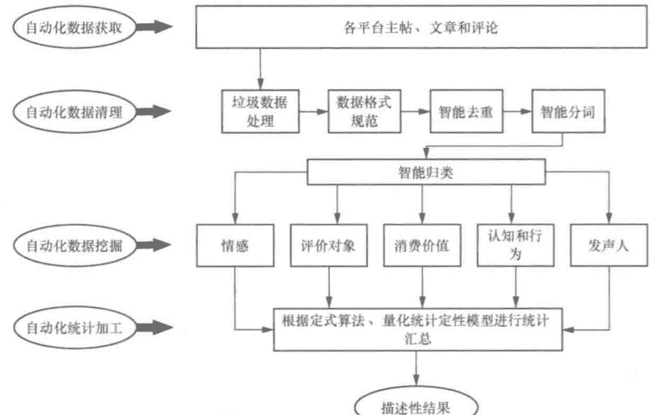 图 7-8）。


图 7-8 自动化描述性分析流程图

具体执行分三步走：  
第一，**自动化数据处理**：剔除噪音数据，统一格式规范，智能去重冗余表达；依托 NLP 模型完成句法语义分词，再经核心程序识别匹配归类。  
第二、**自动化数据挖掘**：基于“语思”词典体系，高精度将分词映射至 50 类情感 [1]、多维评价对象与属性 [1]、9 大消费价值 [2]、9 级认知层次 [3]、3 类行为倾向 [4] 及多元发声主体。  
第三、**自动化统计加工**：运用定式算法与量化模型汇总图表，并输出描述性解读。

标准化描述性剖析通常立足产品/服务、品牌、企业、传播、消费者五大维度（参考图 7-9）。

| 产品/服务维度 | 品牌维度 | 企业维度 | 传播维度 | 消费者维度 |
|:---|:---|:---|:---|:---|
| ● 质量表现<br>● 性能指标<br>● 价格体系<br>● 功能特性<br>● 包装颜值<br>● 体验感受<br>● 原料质地<br>● 技术迭代<br>● 规格型号<br>● 服务态度<br>● 服务标准<br>● 实施方式<br>● 标准属性<br>● 安全隐悷<br>● ...... | ● 显著度<br>● 联想网络<br>● 认知深度<br>● 满意度<br>● 忠诚度<br>● ...... | ● 战略定位<br>● 组织形象<br>● 文化内核<br>● 人员形象<br>● 信誉规范<br>● 产运状况<br>● 社会责任<br>● ...... | ● 营销关注热度<br>● 认知传播内容<br>● 关键影响发声人<br>● 认知触达路径<br>● ...... | ● 人口学画像<br>● 自我概念<br>● 决策链路<br>● 群体阶层<br>● 消费文化<br>● ...... |

图 7-9 标准化描述性分析五大视角

#### （二）进阶分析与决策咨询：从洞见到行动

基于描述性基底，分析师联动 AI 与专家智慧，可推演成因（探索性）、预判走势（预测性）、输出策略（咨询服务）。

##### 1. 探索性（解释性）分析：溯源隐性动因

采用“分析师+AI”协同探勘模式。

- [1] 产品功能、产品价格、产品性能、产品质量、外观包装、规格型号、相关技术、原材料质地、标准属性、差异化定位、知识科普。
- [2] 功效价值、价格价值、质量价值、品牌价值、体验价值、自我价值、参考口碑、社会价值、社会价值。
- [3] 感知、理解、归因、假设推理、类比比较、结论、意向、行为、记忆。
- [4] 趋近、回避、观望。

##### 2. 预测性分析：洞见未来图景

依托探索性抽象模型，聚焦消费者未来认知、情感、行为预判，辅助企业经营部署。例如通过时间序列分析判断随机性与周期性，支撑核心指标预测。

##### 3. 行动策略咨询服务：一体化决策赋能

这是融合描述、探索、预测三层分析的整合型专项服务。

综上，我们从描述、探索、预测、咨询四维拆解了认知洞察的生产范式，旨在助读者理解大数据文本分析中“AI+专家判断”协同生产的运作逻辑。

---

## 第四节 生成式 AI 未来演进三部曲

### 一、短期：重塑内容生态，革新生产范式

短期看，核心价值在于拓展社会内容系统边界，解构专业生产垄断权力，保障内容多元共生。学者韦德指出，生成式 AI 最具影响力的变革在于“造初稿”能力。凭借庞大数据库与整合优势，它能秒级产出内容，接管海量重复写作，释放人力。实战中，ChatGPT 擅长模板化文本（简历、论文、创作）；Midjourney、通义万相打通“文生图”“以图生图”；MusicLM、Riffusion 实现文生音乐；QuickVid 成就“一键成片”；Character.ai 催生虚拟社交新玩法。生成式 AI 的触角已延伸至图文、音视频泛娱乐全链路的前端呈现、后端创作与审核。

市场数据佐证爆发：Acumen 预测 2032 年市场规模将达 2088 亿美元；Gartner 预言 2026 年超 80% 企业将部署相关应用（2023 初不足 5%）。

短期双引擎驱动：一是**参数量扩张**丰富生产形态。参数量关乎模型复杂度与上限，ChatGPT 等依靠海量参数承载人类智慧结晶，突破传统 AI 局限，实现“博古通今”般的思维拟合。二是**数据处理优化**提稳生产质量。华为《预训练大模型白皮书》呼吁摒弃“参数至上”，聚焦参数利用率与鲁棒性。扩参之外，须精进数据治理，夯实内容产出的稳定性与高质量。

短期双趋势明确：参数扩容拓宽形式边界，数据精练筑牢质量基石。解决好机器智能与人类社会的数据契合度，方能实现人机细腻精准的深度连接。

### 二、中期：重塑认知系统，重构人机共生逻辑

“社会认知系统”涵盖人们理解、存储、应用他人信息的全过程。生成式 AI 在补全内容系统的同时，从物质技术与社会能动双维度烙印“渠道印记”。前者对应麦克卢汉“媒介即讯息”视角，后者凸显呈现方式对议题设置与思维习惯的重塑。长期看，其影响必将溢出内容形态，渗透认知秩序，改写认知逻辑，演进路径分“外脑”信息运用与“内脑”提问进阶两向。

**“外脑”进化：破除生物瓶颈，迈入“知识外包”时代**  
智能时代前，人类受寿命算力制约，依赖外部工具处理数据。生成式 AI 破解时空算力交互三重枷锁，将可数据化、可算法化的理性逻辑劳动外包给大容量高算力机器。经由存储处理权转移，机器化身“外脑”，实现人机智能平衡共生。作为个人认知“副驾”，它不只是存储库更是处理器。重塑搜寻获取行为，让普通人站在平均能力线调用人类知识库。互联网时代“信息贫富”差距在于资源占有与运用能力双重鸿沟。生成式 AI 助个体破地理经收束缚触达海量数据，更按意愿激活外部资源，跨越“能力沟”，成就强劲社会表达与价值创造。

**“内脑”延伸：问题增值答案贬值，提问力成核心竞争力**  
“不学不成，不问不知”，提问是认知基石。生成式 AI 时代，给答案非首务，问对问题才关键——问对即得“完美答案”。提示工程应运而生，旨在弥合模型与应用鸿沟，实现技术有机整合。用户须精进提问效率引导机器精准输出。建设提示工程能提模型生成力、降应用成本、促人机模模连接、拓发展空间。提示工程师作为互补新职业，负责优化指令挖掘模型潜力；普通用户审视需求、斟酌措辞即是在践行提示工程。时代要求人类不仅学会向机器提问，更要修炼向自然、他人、思想、自我发问的普遍发问力。在层层追问中实现交互，突破有限性，延伸真正“内脑”。

中期提示工程成产业着力点，双向发力解决人机能力契合度：人端优化提示技巧（简入繁、大化小、自查设计），明确精准传需求；机端深耕预训练、上下文学习、RLHF 等核心技术，微调强化任务解决力。轻量化安全、类脑化持续是必由之路：前者降成本去偏见，后者增灵活拓场景适应新任务。在人机共进中，认知逻辑重塑，用户进化为驾驭 AI 的“战略家”。

### 三、长期：变革文化基因，重塑文明新形态

终局视角：生成式 AI 将如何深度改写世界？从人类中心看，劳动模式迭代推动文明从“手工→工业→机器”跃迁。从机器视角前瞻，生成式 AI 独特“居间”属性或将催生区别于传统的人机协同文明——即**“人类之脑+机器之手”共创的新型数字文明**。此文明核心在于人机深度融合，智慧与能力互补成主动力：人类以智慧创新拓展前沿，机器以高效执行化解复杂难题。特征为生产更高效、决策更智能、服务更优质。伴随而来的是数据安全、隐私保护、AI 伦理等挑战，需共同破解。

学者将此命名为“知识模式 3”（即“第五范式”），区别于“模式 1”（个体经验依赖、获取慢、主观性强）与“模式 2”（机构主导、僵化单一、受权力干扰）。“模式 3”实现人机协同生知：机器挖掘海量数据潜在规律，人类凭感知思维验证修正，产出更精准全面知识。三大特质：**人机协同性**（优势互补）、**数据驱动性**（挖掘规律辅助决策）、**智能交互性**（自然交互提效）。跨学科融合是基石。未来，“知识模式 3”将成人机协同核心趋势，为社会进步提供全维知识支撑。

### 生成式 AI 落地长跑：唯有“三度契合”方能致远

生成式 AI 若想超越昙花一现的热潮，真正扎根社会、释放持久效能，关键在于解决技术与社会的**契合度**难题。这不仅是技术迭代的问题，更是能否化身为重塑现实的“实在技术”的核心考验。这一进程要求技术与政策法规、市场机制、人类价值观三大维度深度对齐，并构建跨学科的协同创新机制。

**政策端：以规制护航，以扶持赋能**  
政策是技术演进的“方向盘”与“加速器”。完善的数据安全法规与隐私保护标准，为海量数据的合规流转筑牢防线；财政补贴与税收优惠等红利政策，则有效激发了企业与科研院所的研发活力，引导技术向善、向实发展。

**市场端：以需求为锚，以竞争促优**  
市场是检验技术生命力的“试金石”。生成式 AI 的商业化闭环建立在真实需求之上，唯有精准洞察市场痛点与竞争格局，打磨出刚性刚需的产品与服务，才能在博弈中站稳脚跟，实现可持续的造血与进化。

**价值端：以人为本，技术向善**  
技术进步的终局不应唯效率与利润论。生成式 AI 处理语言、图像、视频等核心数据资产时，必须严守伦理底线：拒绝制造谣言、诱导认知，转而赋能公正、透明与人类福祉。这关乎技术是否配得上“赋能者”的角色定位。

**机制端：打破壁垒，汇聚合力**  
单一学科视野难以破解复杂的社会嵌入难题。计算机科学、心理学、社会学等多领域的深度融合，是构建技术社会契合度的必由之路。唯有跨界协作，方能拓展生成式 AI 的长期发展图景。

**现实校准：穿越周期，理性前行**  
参考 Gartner 炒作周期，生成式 AI 正处“期望膨胀期”，泡沫与噪音并存。麦肯锡调研显示，全球企业采纳率徘徊 50% 周期，大量组织对规模化应用及风险管控仍显措手不足。这意味着，技术深度嵌入文化系统、释放媒介化力量的进程，注定是一场需要长期观察与耐心耕耘的马拉松。

---

### 核心推论：文明重塑的三阶跃迁路径

纵观长周期，生成式 AI 必将重塑人类文明形态，但达成此愿景，须在**可靠性与安全性**的双轨护航下，完成与政策、市场的深度适配，并恪守道德准则。跨学科协作机制的建立，将为这一宏大叙事提供源源不断的动能（详见下表演进逻辑）。

#### 表 7-2 生成式 AI 演进三阶段路线图

| 时间维度 | 核心使命 | 关键破解路径（典型抓手） |
| :--- | :--- | :--- |
| **短期** | **重构内容生产范式** | **攻克“数据契合度”** —— 打通模型参数与现实物理世界的映射鸿沟（如：模型微调、参数优化、数据清洗治理） |
| **中期** | **升级认知交互体系** | **攻克“使用契合度”** —— 消除人类意图表达与机器响应输出的语义偏差（如：提示工程体系化、全民 AI 素养培训、交互范式革新） |
| **长期** | **重塑社会文化基因** | **攻克“社会契合度”** —— 实现媒介技术与政策法规、市场机制的共生共荣（如：动态政策适配、商业模式创新、伦理治理框架落地） |

---

### 参考文献

1. 喻国明. ChatGPT 浪潮下的传播革命与媒介生态重构 [J]. 探索与争鸣, 2023 (03): 9-12.
2. 魏巍, 郭和平. 关于系统 “整体涌现性” 的研究综述 [J]. 系统科学学报, 2010, 18 (01): 24-28.
3. 恩格斯. 家庭、私有制和国家的起源 [M]. 北京: 人民出版社, 2018.
4. 魏屹东. 人工智能会超越人类智能吗? [J]. 人文杂志, 2022 (06): 88-98.
5. 尼克·库尔德利. 媒介、社会与世界: 社会理论与数字媒介实践 [M]. 何道宽, 译. 上海: 复旦大学出版社, 2014.
6. 任康磊. 如何高效向 GPT 提问 [M]. 北京: 人民邮电出版社, 2023.
7. 张小强, 郭然浩. 媒介传播从受众到用户模式的转变与媒介融合 [J]. 科技与出版, 2015 (07): 123-128.
8. 杨光宗, 刘钰婧. 从 “受众” 到 “用户”: 历史、现实与未来 [J]. 现代传播 (中国传媒大学学报), 2017, 39 (07): 31-35.
9. 郑元凯, 范五三. 中国式现代化对资本逻辑的超越——基于 “人的需要” 视角 [J]. 福州大学学报 (哲学社会科学版), 2023, 37 (04): 16-27.
10. 冯丽云. 现代市场营销学 [M]. 北京: 经济管理出版社, 1999.
11. 彭兰. 网络传播概论 [M]. 3 版. 北京: 中国人民大学出版社, 2012.
12. 张学军. 论信息的隐性需求 [J]. 现代情报, 2004 (12): 58-59.
13. 范晓屏. 基于隐性需要的消费倾向及其营销启示 [J]. 商业研究, 2003, (16): 5-8.
14. 范俊君, 田丰, 杜一, 等. 智能时代人机交互的一些思考 [J]. 中国科学: 信息科学, 2018, 48 (4): 361-375.
15. 申琦. 服务、合作与复刻: 媒体等同理论视阈下的人机交互 [J]. 西北师大学报 (社会科学版), 2022, 59 (3): 106-115.
16. 董士海. 人机交互的进展及面临的挑战 [J]. 计算机辅助设计与图形学学报, 2004 (1): 1-13.
17. Fodor J. In critical condition: Polemical essays on cognitive science and the philosophy of mind[M]. Cambridge: The MIT Press, 1998.
18. Robertson, S. Requirements trawling: techniques for discovering requirements[J]. International Journal of Human-Computer Studies, 2001, 55(4).

---

## 核心洞见：认知跃迁与生存法则

**拒绝 AIGC = 电力时代坚持驴拉磨**  
不接纳、不掌握生成式 AI，无异于蒸汽机时代拒绝电力、智能机时代坚守诺基亚。未来的竞争格局不是“人 vs AI”，而是“**懂 AI 的人/组织 vs 不懂 AI 的人/组织**”。

**“万物重做一次”是价值连接的范式革命**  
专家断言：生成式 AI 作为新型媒介，重构了“价值发现—价值匹配—价值交付”的底层逻辑，倒逼全行业在新基建上重写操作系统。

**网络化逻辑取代显性权力，成主导社会运行的隐性内核**  
AI 驱动下的网络社会，运行机制发生质变：去中心化、协议化、算法化的“网络化逻辑”逐渐超越传统显性权力，成为社会运转的核心引擎。

**媒介演进呈螺旋式跃升：连接更效、生产更自由、技术更包容**  
媒介价值变迁非线性演进，而是通过人机协同互构，螺旋式推向资源连接效率最大化、生产实践自由度最高、技术普惠包容度最强的一体化生态。

**容错与自愈：技术融合社会的双重保障**  
新技术落地必伴阵痛，但“技术引发的问题，终将由技术迭代解决”。建立包容审慎的容错机制，是通往成熟期的必经之路。

**三大革命接力：空间→时间→思维**  
互联网打通**空间**（连接一切），智能手机压缩**时间**（触手可及），生成式 AI 正在引爆**思维**（认知外包与增强），并将由此重塑全行业生态乃至社会底层架构。

**生成式 AI = 新质内容生产力的具象化**  
在传播领域，AIGC 不只是工具升级，更是生产力性质的质变——从“人力驱动”跃迁为“智力驱动”，重新定义内容创作的边界与效能。

## 生成式 AI

## 从理论解读到实际应用