# AIGC：机理与实践

# 导论

生命从诞生起就靠感官持续丈量世界。视、听、嗅、味、触五路信息并行，让个体不断积累经验、塑造技能，最终在社会中安身立命并改造环境。

硅基智能遵循相似的成长路径，只是步调快得多。先是机器学习，随后神经网络兴起，再到以 Transformer 为核心的架构迭代，发展迅猛。2022 年底 ChatGPT 登场，2023 年初 GPT-4 发布，公众对生成式智能的关注瞬间拉满。带感的是，大模型首次表现出接近人类常识与推理的特质，这是早期系统所缺的内核。AlphaGo、AlphaFold 再强，也只是各自领域的顶尖高手，ChatGPT 则呈现出通用式的表现。

OpenAI 首席科学家伊利亚·苏茨克维曾说，GPT 在学习一种对世界的整体表征。他把互联网文本视作世界的投影，于是以海量网络文本训练的 GPT，实质在学习世界本身。人类要花数年乃至数十年建立的认知，GPT 靠算力在很短时间内逼近，接近成年人的思维水准。

拥有这类全局表征后，GPT 还能实现“万物生成”。所谓万物，按照苏茨克维的解释，是指世界在数字空间的映射，涵盖文字、图像、声频、视频、剧本、代码、方案、设计稿等与生产生活紧密相关的形态。因为模型已具备一定常识与逻辑，只需用特定专业数据做微调，就能成长为可独当一面的专业角色，比如艺术家、设计师、程序员、工程师、广告投放优化师、供应链专家、客服专员等。这正是 AIGC 的核心价值所在。

当前技术正处爆发期，生成式智能迭代极快，需要系统梳理。本书既讲清原理与模型，也展开行业场景的真实运用，把理论与实操打通，帮助读者理解 ChatGPT 等里程碑的意义。结合作者二十余年研究与实践经验，本书给出方向。特别强调的是，本书既解释数字媒体即虚拟世界的生成逻辑，也讨论该技术如何赋能实体经济。在存量竞争时代，用生成式智能重新定义生产力、在存量中谋求增量，意义重大。

如图 0-1 所示，本书的知识覆盖可作三维呈现。X 轴是生成式大模型的维度，对应第二章《AIGC 的底层逻辑》，回答“用什么生成”；Y 轴是数字媒体形态的维度，对应第三章《功能拆解：AIGC 能产出何种内容》，回答“能产出什么”；Z 轴是行业职能的维度，对应第四章《商业落地：AIGC 的产业应用与前景》，回答“能做哪些事”。三轴构成的空间每个点都有明确指向，例如用 GPT-4 生成代码服务于制造，用 Stable Diffusion 生成图片服务于营销。之外，第一章带领读者入门，第五章则探讨岗位是否会被大规模替代以及如何主动应对。

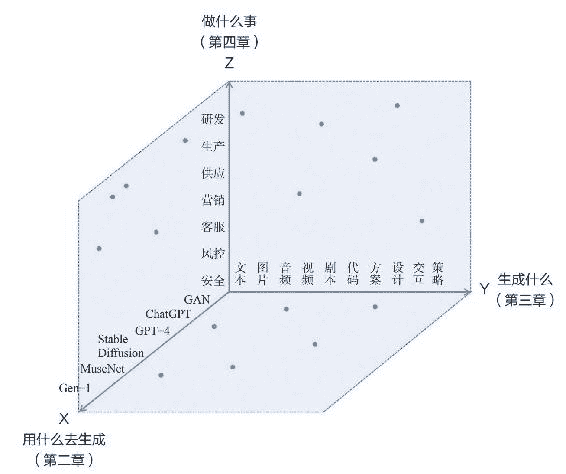

图 0-1 知识覆盖范围示意

愿不想在生成式智能时代掉队的读者，读罢本书能把握底层逻辑与真实应用，也希望对工作生活有所帮助。“万物可生成”的时代已来，理解、训练、使用乃至与智能协作，对大多数人将成常态。未来已至，一起出发。

# 第一章 初识生成式智能

现象级产品 ChatGPT 的面世点燃了 AIGC 与背后生成式智能的热情。本章从判别式智能切入过渡到生成式智能，比较两者差异，挖掘场景与商业潜力，并聊聊“内容皆可生成”的价值。概览之后，视角收敛到具体工具，解析 ChatGPT 背后的原理与发展脉络。若你对该领域仅有模糊印象，这里可建立初步认知，并了解近期最值得关注的工具。

## 行业全景

若要挑选 2023 年最热的话题，ChatGPT 必在清单之上。2023 年初它席卷全球，成为流量焦点，人们争相发掘潜能，讨论未来走向乃至与人类的关系。作为智能家族的明星应用，以 ChatGPT 为代表的产品获得广泛关注，也引发更多思考。

人工智能被视为当代三大前沿技术之一，近年来存在感持续增强，这是产业快速发展的体现。想清晰理解以 ChatGPT 为代表的新技术，先从产业版图的发展与现状入手会更完整。

智能的普及并非一帆风顺，曾经历漫长寒冬。十多年前它还是不受看好的小众赛道，如今已成为街头巷尾的热议话题，几乎任何事务都能与之关联。短短十余年间，数据持续井喷，问题不断涌现，如今智能的春天才算真正到来，各领域都急需其助力。这也是行业应用如此广阔的原因，人工智能市场堪称辽阔待开发的原野。如图 1-1 所示，人工智能行业应用版图由不同行业领域与不同职能方向共同构成应用矩阵，对每个行业的相关职能，人工智能都能找到落地方案，例如零售行业的供应链、营销、客服，以及金融行业的研发、营销、客服、风控等已出现落地实践，图示中以蓝色标出。但广阔的行业职能中，仍有大量场景待探索。

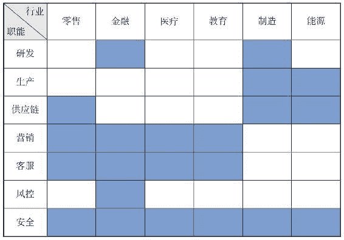

图 1-1 智能行业应用矩阵

从产业视角看，人工智能包含基础层、技术层、应用层。基础层为产业提供数据与算力支撑；技术层是核心，涵盖各类模型与算法的研发升级；应用层则面向特定场景形成软硬件产品或解决方案。产业规模发展到何种程度？英国德勤的报告预测，全球人工智能产业规模将从 2017 年的 6900 亿美元增长至 2025 年的 64000 亿美元，2017 至 2025 年复合增速达 32.10%，整体呈高速攀升态势。此外，近年人工智能成为各行各业投资的热门方向，风头正劲，为经济带来显著增量。

在应用层面，人工智能已在制造、零售、金融、医疗卫生等领域大显身手，在某种程度上改变了组织的运转节奏，使其更快解决难题并压低成本。从消费者角度看，人工智能也带来了更多选择。总体而言，人工智能如一块正在打磨的原石，已露出璀璨一角，它在推动经济发展的同时，也将深层次改变人类生活。接下来我们从判别式智能与生成式智能两类技术切入，进一步了解产业版图。

### 判别式与生成式

人工智能可按模型划分，主要分为判别型与生成型。

判别型，也称判别式人工智能，学习的是数据中的条件概率分布，即样本属于特定类别的概率，再对新场景进行判断、分析与预测。主要应用包括人脸识别、推荐系统、风控系统、智能决策系统、机器人、自动驾驶等。在人脸识别中，它对实时获取的人脸图像提取特征，再与人脸库匹配实现识别；在电商中，它可学习平台海量用户消费行为，制定最合适的推荐方案，提升交易量。

生成型则学习数据中的联合概率分布，即多个变量构成向量在数据中的概率分布，对已有数据进行归纳总结，并基于深度学习等技术创作模仿式、拼接式的内容，实质是自动生成全新内容。其输出形态多样，包含文字、图画、声频、影像等。例如输入小说情节的简要描述，它能生成完整的小说；再例如它能生成现实中不存在的人物照片。如图 1-2 所示即为国外网站生成的“不存在的人”照片。

总体来看，两种模型的基础逻辑一致：人工智能模型本质是一个函数，靠纯逻辑难以推导准确表达式，该函数是通过训练得到的。我们把已有数据喂给机器，让机器从中寻找最符合规律的函数；面对新数据时，机器便可通过该函数进行预测或生成。

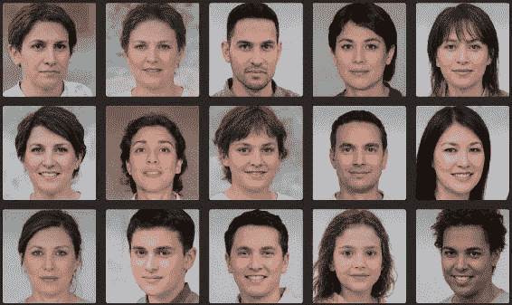

图 1-2 由模型合成的虚构人物

图片来源：https://generated.photos/faces

判别型人工智能与生成型人工智能作为两大分支，在多方面各不相同。

宏观上，判别型人工智能是用于决策的技术，利用机器学习、深度学习、计算机视觉等处理专业问题，帮助企业优化决策。生成型人工智能则是用于自动创作新内容的 AI 技术，借助语言模型、图像模型、深度学习等自动生成新的文字、图像、声频、影像。因此，判别型人工智能更像对人类决策过程的模仿，生成型人工智能则聚焦于内容创作。

微观上，两者在技术路径、成熟度、应用方向上差异更清晰，如表 1-1 所示。

表 1-1 两类智能的对照

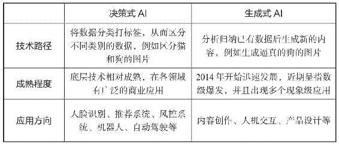

技术路径上，判别型人工智能的核心是对已有数据做“打标签”，区分不同类别，最简单的例子是猫狗区分、草莓苹果区分，做的是“是不是”“是这个还是那个”的判断。生成型人工智能则是在归纳分析已有数据后“创作”新内容，见过大量狗的图像后，它能创作出一只全新狗的图像，实现举一反三。

成熟度上，判别型人工智能应用更为成熟，已在互联网、零售、金融、制造等行业落地，大幅提升工作效率。生成型人工智能起步更晚，2014 年后发展迅猛，呈指数级爆发，已在文字与图像生成等领域落地。

应用方向上，判别型人工智能在人脸识别、推荐系统、风控系统、机器人、自动驾驶中已形成成熟应用，与日常生活紧密相连。生成型人工智能则在内容创作、人机交互、产品设计等领域展现巨大潜力。

举例来说明。购物时，购买某一类产品后平台会自动呈现同类或相关商品，背后就是判别型人工智能在发挥作用。电商平台基于用户浏览行为分析用户与商品的关联，有针对性地推送内容。2003 年起亚马逊就将该技术用于电商，推荐精准匹配需求，降低用户搜索成本并提升销售额。可见平台似乎比用户更懂用户，消费额随之上升，平台也借此获取商业价值。

行业数据显示，亚马逊约 40% 的收入来自个性化推荐系统，而推荐系统每年为网飞带来超过 10 亿美元产值。新闻、音乐、影像平台同样利用个性化推荐，剖析用户长期与短期兴趣后进行精细化推送，通过停留、观看、点赞、收藏等行为实时刻画用户画像，减少人工运营，提升用户粘性，凸显人工智能价值。在自动驾驶领域，人工智能可智能分析路况、识别跟踪各类物体，提升行车安全。虽尚未完全成熟，但在技术迭代下市场潜力可期。

对于生成型人工智能，ChatGPT 的出现带来冲击式认知。因其功能强劲、应用广泛，文字、图像、音视频相关从业者面临“强大助手”上线时的焦虑，担心被取代。从可能性看，它可进行文字转语音、图像智能编辑、影像智能剪辑、文字续写或纠错等多样化工作，帮助人们摆脱机械劳动，聚焦创意性工作，为文字作者、翻译、插画师、影像剪辑师提供极大支持。它还能承担设计师、程序员甚至专业工程师的部分设计与编程工作，提升效率的同时让专业人士更专注核心环节。当然，生成型人工智能也对从业者素质与技能提出新要求。总体而言，两种 AI 均可帮助推进工作，如事件决策、内容创作。合理利用人工智能有助于提升客户体验，帮助企业降本增效，并抓住新商业机会。

如前文所述，数据与模型分属人工智能产业的基础层与技术层，无论判别型人工智能还是生成型人工智能的应用都离不开二者，接下来进一步了解“大数据”与“大模型”如何重塑人工智能版图。

### 从大数据到大模型

无论判别型人工智能还是生成型人工智能，以其现有功能与潜力，都能为人类完成大量工作，未来甚至趋于万能。那么这种万能技术是如何训练出来的？这就涉及大数据。两者都离不开海量数据来训练模型。

大数据已是大众熟悉的概念。顾名思义是海量数据，但它不仅体量大，还具多样性与高速增长特征。图 1-3 展示了 2017 至 2025 年全球数据总量增长趋势与预测。收集、存储、处理、分析各类来源的大数据，可帮助企业迅速获取有价值信息并做出正确决策，用于改善商业活动，提升效率、降低成本、推动增长。正如人通过经历积累经验，人工智能领域则通过大量数据训练模型。

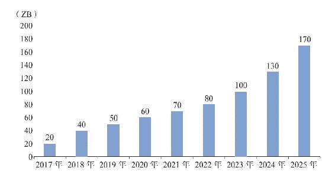

图 1-3 全球数据总量变化预测

数据来源：国际数据公司发布的白皮书《数据时代 2025》

随着深度学习的落地，模型本身所需存储空间近年显著增长。最初的 GPT 约有 1.17 亿参数，ChatGPT 约 1750 亿参数，最新的 GPT-4 参数更多，有报道称可能达 1T，即 10000 亿，但 OpenAI 并未公布具体数值。这些拥有海量参数的模型统称为“大模型”。如图 1-4 所示为大模型参数数量变化趋势。深度学习是一种受人脑生物神经网络机制启发，模仿人脑解释与处理数据的机器学习技术，可自动进行特征提取、识别、决策与生成。它已大规模应用于自然语言处理、计算机视觉、机器翻译等领域，为诸多工作带来前所未有的精度与效率，也推动了人工智能行业的高速发展。

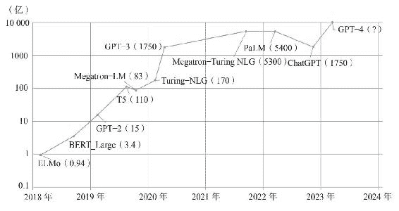

图 1-4 大模型参数规模演进

大模型能够分析处理海量数据，在解决问题上取得更好效果。本书的主角生成型人工智能正是大模型的产物。近年来大模型在越来越多行业与消费类应用中崭露头角，因其能迅速有效处理海量数据，帮助个人与企业提升效率。大模型与人工智能技术相辅相成，随着人工智能发展，大模型也持续进步。此外，5G 网络与弹性计算等基础设施的普及，也为大模型发展创造更多可能性，使其成为不可或缺的内容生成工具。

### 市场展望

2021 年，高德纳咨询公司预测，至 2023 年将有 20% 的内容由生成型人工智能创建，至 2025 年生成型人工智能产生的数据将占所有数据的 10%，而 2021 年该比例不足 1%。2022 年 9 月，红杉资本发布的文章《生成式 AI：充满创造力的新世界》预测，生成型人工智能将创造数万亿美元的经济价值。据预测，2025 年国内生成型人工智能应用规模有望突破 2000 亿元，传媒领域应用空间超 1000 亿元。且生成型人工智能应用场景十分广泛，除文字、图像、音视频、游戏等数字媒体，还可延伸至制造、建筑等实体行业。

在文字生成方面，生成型人工智能可通过语言模型、神经网络、深度学习快速创建有助于改善客户体验的内容，如新闻资讯、剧本、营销文字、智能客服等。人工智能生成营销文字、智能客服等已在许多行业广泛应用；人工智能生成新闻资讯与剧本等功能也可期待，叠加 ChatGPT 等突破性模型后，文字性工作有望变得更轻松。

在图像生成方面，生成型人工智能可通过计算机视觉分析图像，生成营销素材、设计方案、艺术作品等，节省人力与时间。此外，生成型人工智能还能在声频生成、影像生成、跨模态生成领域大展拳脚。

在声频生成方面，生成型人工智能可帮助使用者更好分析、编辑与生成声频文件，创作出优秀声频作品。例如克隆真人语音、文字生成特定语音、作曲编曲等，生成型人工智能都能替代人工完成，且已在市场上广泛应用。

# 生成式AI正把想象变成现实

视频制作是生成式AI活跃度很高的方向，它能为使用者产出高质量的影像，比如精准定位并剔除特定段落、实现智能追踪剪辑、自动生成特效、完成多源素材合成等。AI数字人的营造更是它的代表性技能。李安执导的《双子杀手》里，团队就借助AI打造出数字角色小克，威尔·史密斯在数字技术的加持下同时饰演50岁的特工亨利和23岁的特工小克，影片实现了真人明星“年轻版”的数字化呈现。

在跨模态创造层面，生成式AI打破了单一媒介的边界，可以把文字转为创意图像、把图像转为视频、把文字直接转为视频，或由图像和视频反向生成文字。对创意力旺盛的人群以及影视从业者而言，这几乎是提升工作效率的神器。图1-5就是一句“panda in a space suit”即穿着宇航服的熊猫触发出的图像案例。在游戏开发里，生成式AI同样能派上用场，自动化设计流程、优化体验，比如生成更具自主性的AI NPC，说不定你下一款游戏里的对手就是AI在深度参与。

图 1-5 根据“panda in a space suit”生成的图片

生成式AI的影响并不止于数字内容。实体行业里，它的潜力同样可观，特别是在建筑等大型垂直领域，生成的对象已超出图文，进入更丰富的三维设计范畴。在搭建数字建筑模型时，AI可以为建筑师快速产出3D模型，帮助其更直观地理解项目走向。设计师也能调用AI图像生成工具来丰富方案细节，若把较为粗糙的初稿输入系统，AI会基于此延伸出更精细的设计。甚至随手涂鸦的一张建筑线稿，都能被AI转化为对应的实景效果图，随着手绘信息不断补充，AI输出的实景稳定性也会随之提升。图1-6就是借助AI图像生成工具得到的建筑设计示例。

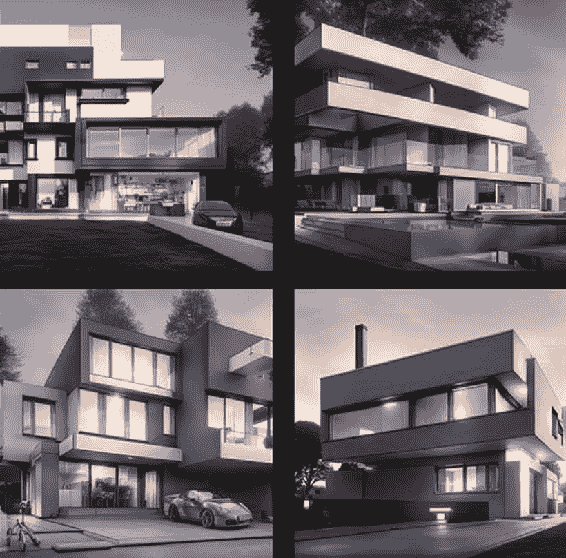
图 1-6 由 AI 图像生成工具生成的建筑设计图

图片来源：https://stability.ai/blog/stablediffusion2-1-release7-dec-2022

技术浪潮此起彼伏，人工智能正成为社会迈向未来的主引擎，前景辽阔。生成式AI是一个极具突破性的产业走向，它不仅为数字媒体和虚拟空间创造价值，也推动实体行业升级，在提高效率、优化流程的同时孵化新的增长点，是实体经济转型难得的契机。

## AIGC时代：内容全自动生产

眼下ChatGPT、GPT-4等AIGC产品正吸引大量关注。要真正理解这些新事物，需要梳理一下内容生产的历史脉络。在多年“内容大战”中，我们已先后经历了PGC、UGC、AIUGC三种形态的更迭。PGC即专业生产内容，由具备专业背景的创作者输出；UGC是用户生产内容，来源更偏向大众，人人皆可创作；AIUGC则是人工智能介入到用户创作流程的结合体。如今迎来AIGC。与前三种不同的是，AIGC里人工智能本身成为内容源头，“无生命的主体”直接为人类生产内容，人工智能在社会中的应用再一次发生颠覆性跃迁。如图1-7所示，从PGC到UGC、AIUGC再到AIGC，内容总量呈递进式放大。

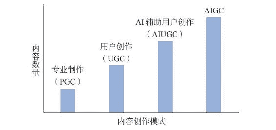
图 1-7 内容创作的四个发展阶段

从字面上看，AIGC即利用人工智能自动生成内容的方式，它依托生成式AI模型、训练数据等，产出文本、图像、音频、视频、代码等多种形态，这种高效率生产为市场注入新鲜活力。AIGC的兴起让各行各业获益，也让生活更便捷，但随之而来的深层思考也在同步展开。

AIGC开启了新一轮内容生产革命，在多样性、品质、效率三方面推动产业大步向前。它既能填补消费型内容扩容的缺口，也能快速生成多样化形态以适配细分场景，以AI作者的身份助推商业化浪潮。也许你正在浏览的图片或视频正是AI作者的作品，而你并不知晓。

下面围绕AIGC展开，对文本、图像、视频等主要形态的具体作用做进一步说明。

### 文本生成

AIGC在文本侧的应用集中在新闻撰写、固定格式写作、风格改写以及对话聊天，GPT是主流模型之一。

GPT的正式名称是生成式预训练Transformer，它是一种分析并预测语言的人工智能模型，可用于自然语言处理，例如机器翻译、自动摘要、快速问答。它的核心能力在于能在文本中自动学习概念并预测后续内容，即依据上下文记住概念并迅速给出相关输出。

GPT背后的基础架构是一种新型机器学习技术，能处理海量自然语言数据。它依靠大型神经网络，在已有文本库中学习自然语言规律，无需人工设计专门的自然语言处理系统，就能基于已有文本自动生成语法正确、语义相关的内容，可谓内容生产的利器。

GPT的发展经历了GPT-1、GPT-2、GPT-3、GPT-3.5到GPT-4多个阶段。GPT-1先用海量未标注语料预训练语言模型，再针对特定任务微调。GPT-2在此基础上进行多任务训练，数据规模更大，语言处理能力提升。GPT-3在参数量、数据量和训练成本上均远超前代，可完成更复杂的任务。

OpenAI推出的ChatGPT是GPT-3.5的延伸，是一款聊天机器人，能学习和理解人类语言进行对话，还可撰写视频脚本、营销文案、翻译文本、编写代码等。尤其在代码理解与编写方面的表现，在程序员群体中引发广泛讨论，也激起了关于AI替代人类的争议。

2023年3月，OpenAI发布了GPT-4，被称为当时最强的模型。在文学、医学、法律、数学、物理和程序设计等领域表现出很高的熟练度，并能跨领域整合概念与技能，理解复杂概念。公开演示中，工作人员向GPT-4展示一张图片并询问有趣之处，模型回答说图片有趣在于把一个大而过时的VGA接口插入一个小而现代的智能手机充电口，十分荒谬，思维已接近常人。

要了解AI发展，离不开企业推动。以文本生成为主打的Jasper公司位于美国加州，其产品可轻松生成Instagram标题、TikTok视频脚本、广告营销文本、邮件内容等重复性脑力工作。该功能推出后，对社交媒体、跨境电商、视频制作等新兴行业产生巨大冲击。

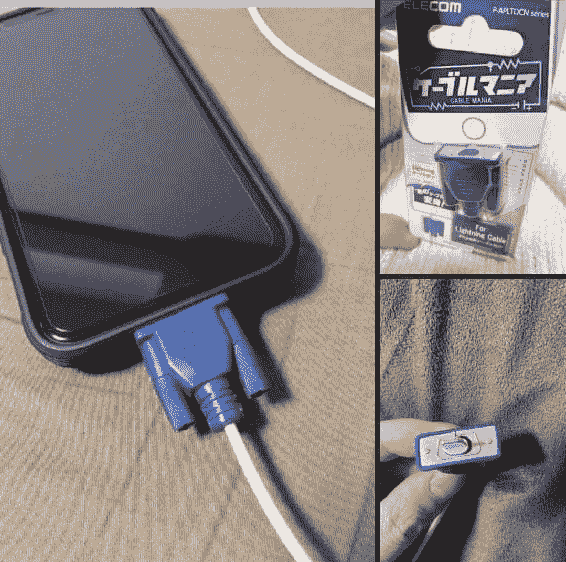
图 1-8 一张“有趣”的图片

图片来源：https://openai.com/research/gpt-4

除了Jasper，OpenAI也是绕不开的关键玩家。这家2015年成立的AI研究公司致力于推动人工智能安全可控发展，其首创的GPT类自然语言处理模型使其迅速成为行业领先者，并在与微软等巨头的合作中把AI应用推向更高层次。

由于GPT以英文语料为主且不开源，国内也在探索自主模型。2020年11月中旬，北京智源人工智能研究院与清华大学团队合作推出中文预训练模型清源CPM，具备类似GPT的能力。

### 图片生成

你是否尝试过用AI作图？背后很可能在使用Diffusion扩散模型。Diffusion是一种受物理扩散现象启发的AI技术：先对图像不断加入噪声形成模糊图像，类似墨水滴入水池的扩散过程；再通过深度神经网络学习模糊图像的逆扩散过程，还原并生成新图像。

该技术在视觉艺术和设计领域颇受欢迎。Stability AI是一家领先的AI研究公司，2022年由其与两家初创公司共同研发的Stable Diffusion模型发布，能够真正实现“一秒出图”。这意味着用户可以借助AI实现瑰丽梦境、还原宏大想象，为小说配上极具幻想感的插图，即使概念再超现实也能被呈现。

2022年AI绘图骤然升温，DALL·E2、Stable Diffusion、Midjourney等现象级应用相继出现，先在海外掀起热潮，随后迅速传到国内。Midjourney由同名实验室开发，是降低绘画创作门槛的工具，用户输入文字描述即可自动生成作品，采用深度学习模型产出素描、油画等高质量画面。

Stable Diffusion被视为AI绘画热潮的源头之一，其公司Stability AI在爆火前估值约1亿美元，爆火后升至10亿美元，增幅达十倍，体现出大众化AI程序的强劲市场潜力。

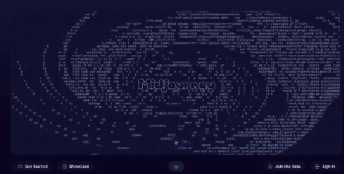
图 1-9 Midjourney 官网

另有公司另辟蹊径，如成立不足两年的PromptBase，主营AI绘画工具提示词的销售，用户复制提示词到Midjourney、Stable Diffusion等平台可实现精准快速生成，减少探索成本。

国内方面，百度集团旗下文心一格于2022年8月宣布，用户输入文字并选择作画风格即可快速生成画作。依托飞桨深度学习平台和文心大模型，经过海量优质图文学习和多次迭代，其中文语义理解能力和高质量图像生成能力不断增强，更好满足国内需求。

### 视频生成

AIGC视频生成是一种基于人工智能的视频制作技术，能根据用户提供的文字提示自动生成视频内容，并可按需调整参数以获得最佳效果。这在一定程度上是AIGC图像生成的延伸，其目标是生成由连续图像即帧组成的序列，利用深度神经网络生成高质量视频和动态内容，大幅提升制作速度并增强逼真感。

该技术已在多个行业落地。学校可用其制作动画或教学视频，医院可模拟手术过程帮助外科医生理解流程。我们体验过的游戏、虚拟现实、视频会议等，都可能关联到AIGC视频生成技术。

随着技术成熟，新兴科技公司开始用AI进行影视制作，传统流程与AI深度结合可实现大规模动态图像处理、自动剪辑、自动字幕、智能特效设计等，在解放人力物力的同时降低成本。

案例颇多，电脑艺术家格伦·马歇尔的AI电影《乌鸦》获2022戛纳短片电影节评审团奖。影片以视频网站短片Painted为基础，输入OpenAI神经网络，再指导另一模型生成图像，最终产出“荒凉风景中的乌鸦”视频。在《速度与激情7》中，剧组将虚拟演员植入视频，实现虚实融合。技术路径包括从既有镜头提取动作表情建立数字成像模型、渲染虚拟人物，替身演员完成肢体拍摄后再替换面部，从而让已逝的保罗·沃克在片中“重生”。

在AIGC视频赛道，2023年2月6日AI初创公司Runway官宣发布Gen-1。该模型采用最新深度学习编码技术，可将数据转化为精美3D图像和视频，并据文字脚本、图片、视频剪辑自动生成内容，营造逼真的3D场景，让用户体验现实中无法触及的情境，如太空旅行、历史重现等小说般的穿越。

谷歌推出Imagen Video与Phenaki两款工具，Imagen Video可生成高清及艺术风格视频和文本动画，具有高度可控性、对世界知识和3D对象的理解能力；Phenaki可按故事时间线生成视频。硅谷巨头Meta则推出Make A-Video，可生成富有想象力的奇趣视频。

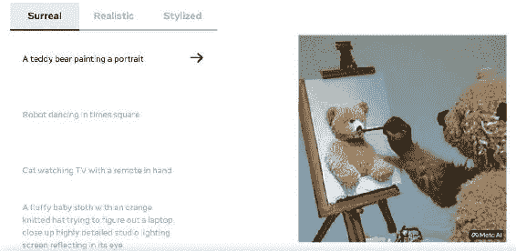
图 1-10 Make-A-Video 生成视频示例

图片来源：https://makeavideo.studio

不同内容形态的模型并非壁垒分明，而是可联合使用。例如GPT-3与Stable Diffusion结合可实现流畅修图，减少耗时，让美工免受甲方反复折腾。如图1-11所示，给定输入图像和编辑指令文本，系统会遵循描述性指令进行加工。实现此类功能的前提是对AI话术有精细化理解并使用有效提示词，否则容易鸡同鸭讲。

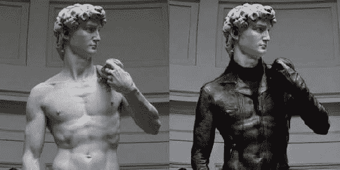
图 1-11 通过给 AI 发出指令，给雕像穿上衣服（使用 instructPix2Pix 生成）

总体来看，AIGC在文本、图像、视频等主流形态中已实现快速渗透，进步令人难以想象，可辅助创作甚至自动生成内容。未来人类是否会被AI构建的信息茧房困住，仍需时间检验。但从产业视角看，AI技术革新已渗透日常生活，沉淀为人人可用的工具，这是积极变化。伴随快速发展而来的伦理与道德问题或许需要一段过渡期，等待规则完善。AIGC势不可挡地进入人类领地，与人类相伴共生。

## 生成式AI的核心价值

前文已提到人工智能的两大主要类型：生成式AI与决策式AI。决策式AI擅长对新场景进行分析、判断与预测，应用于人脸识别、推荐系统、风控系统、精准营销、机器人、自动驾驶等；生成式AI擅长自动生成全新内容，主流形态基本覆盖，包括文本、图像、音频、视频等。二者在技术路径、成熟度、应用方向上差异明显。下文聚焦生成式AI的核心价值展开。

### 生成式AI聚焦于认知的逻辑层面

决策式AI与生成式AI不仅名称不同，从认识论角度看，二者聚焦的认知层级也不同。认识论关乎知识来源与知识判断。如图1-12所示，认识过程常被描绘为金字塔结构，人类认知由数据、信息、知识、逻辑逐步进阶至形而上的哲学与信仰，所认识内容的颗粒度与结构深度随之变化。

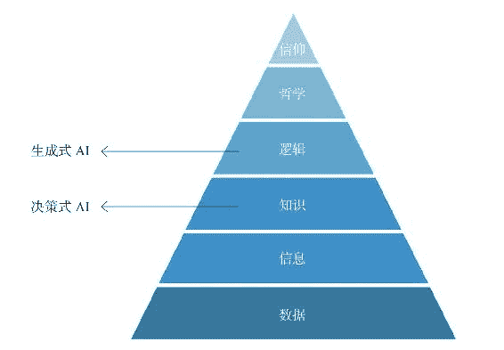
图 1-12 生成式 AI 和决策式 AI 聚焦于不同的认知层面

决策式AI更像在知识层面做题，生成式AI则把战场抬到了逻辑层面，两者在理解深度上差距明显，却都还未触及认识论里的信仰与哲学。粗看都是“懂东西”，细看一个是把海量信息汇总出结论，一个是基于这些信息做演绎与再创造。后者更贴近人类智能的创造力，内容的新意也更强。

落地场景里，决策式AI依托既有数据做分析、判断和预测，在推荐、风控、精细化营销等领域已深度服务人类。生成式AI站得更高一层，它不止复盘数据，而是归纳后再推演创造，正逐步在内容生产、人机交互、产品设计等方向释放价值。

### 生成式AI为何更靠谱

拿做题来类比就很直观：决策式AI擅长选择题，强项是分类；生成式AI擅长简答题，拿手的是原创。

更深的隐患在于稳定性。试想一个图像分类网络，常规猫图它能给出猫90%、马5%的置信度。给这张猫图加一点人类几乎察觉不到的噪声后，模型却径直把马的概率抬到90%、猫降到5%。如图1-13所示，这种对语义理解的缺位，说明只对条件分布建模的决策式模型很容易被扰动，做出离谱且稳定的错误。

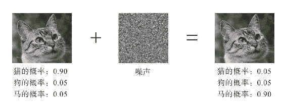

图 1-13 噪声干扰决策式 AI 的识别能力

这种脆弱性会外溢到业务。模型对新样本的输出摇摆不定，高价值客户被误判为低价值，风险客户被误判为低风险，这正是制约决策式AI规模化落地的关键。

原理上也能看清差异。决策式模型从大量猫狗照片里学到“长得像谁就判谁”，本质是相似度匹配。生成式模型则先从训练集中抽象出猫的大小、毛色、体型等特质，再去和狗的特质对照，给出各自的概率，再做抉择。

因此生成式AI更成熟，能学习人的推理方式，产出符合常识与规则的内容。它的代价是需要足够多的数据来逼近真实分布，训练与推理相对更慢；决策式模型对数据量要求较低，速度更快，小样本下偶尔更准。

也正因如此，GPT等新一代生成模型可以批量生产可用的文本、图像、代码，让人从重复劳动中抽身，有人甚至戏称它是打工人的福星。

## 生成式AI的价值全景

把人类内容生产粗分为艺术创造、设计与逻辑思维，生成式AI已在三者都能掀起冲击。

艺术层面，绘画已被重塑。2023年3月，我国首部由AIGC完成完整情节的漫画诞生，艺术家王睿以小说《元宇宙2086》为底本，经加噪、去噪、复原、作画，把文字转为可视画面，线条流畅色彩绚烂。AIGC绘画已进入拍卖场，2022年12月AI山水画首拍成交110万元，该作由百度文心一格与画家乐震文续完陆小曼未完成稿《未完·待续》，训练用了陆小曼的画稿与书法，神韵逼真。

音乐也在被“入侵”。百度数字人度晓晓与龚俊数字人合唱的《每分每秒每天》，作词作曲全由AI把控。度晓晓是国内首个可交互虚拟偶像，唱跳主持样样在行。

影像方面，谷歌研究院提出文本驱动的video diffusion model，可实现动态镜头与物体动画，为个性化电影创作打开空间。网飞短片《犬与少年》由AIGC制作，是全球首个AIGC动画短片，小冰负责画面与场景绘制，让创作者回返核心创意。

设计领域是AIGC的大展身手场。Midjourney等绘图工具输入T恤、丝巾、插画或角色设计的需求，就能直接输出可用的稿件，单幅或连续纹样都能处理。

3D方向，英伟达的Magic3D先用低分辨率粗建模型再逐步精化；OpenAI的Dream Fields无需照片即可凭空生成3D船只、花瓶、巴士、食物、家具等，游戏影视虚拟现实的建模成本大幅下降。

服装上，谷歌与Zalando合作的Project Muze融合600多位时装设计师风格，用户输入性别、偏好、情绪即可得到定制方案，AIGC正成为产业布局的关键环节。

城市与家装也不例外。谷歌发布过基于航拍的城市绿化地图工具，生成科学绿化建议，对抗极端高温。家装赛道已出现AI+服务生态，群核科技的AIGC实验室瞄准全空间设计，从家居到商业空间、地产建筑都能生成迭代方案。

逻辑工作同样被覆盖。ChatGPT写代码已成常识，aiXcoder推出的aiXcoder XL在2023年2月开放代码生成API，提升开发效率。医药领域出现“生物版ChatGPT”——蛋白生成。晶泰科技的XuperNovo平台内含ProteinGPT，技术路线类似ChatGPT，可一键设计符合要求的蛋白质药物，已用于多个大分子项目。

绘画、影视、环境、家装、编程、制药，似乎想得到就能落地。未来生成式AI与决策式AI强强联合，形成多层协同，或将彻底解放机械式工作，前提是内容质量过硬。

## 里程碑式的存在——ChatGPT

近两年AI热潮此起彼伏，进入2023年，ChatGPT成为现象级“顶流”。由OpenAI推出的大型语言模型，它用自然语言理解增强聊天机器人与智能应用，能写文章、给建议、答疑等。

2022年11月上线后仅两个月用户破亿，成为史上最快破亿应用，对比TikTok用了9个月。爆火不仅因聊天流畅，更因“样样精通”。它能解脑筋急转弯，不被题目绕晕；能写“秦始皇摸电门，赢麻了”这种离谱主题的文章且通顺；能模仿社交平台文案，连符号都像真人编辑；还能在对话中学会北京口语。

学生群体极度依赖，美国Study.com对1000名学生的调查显示，89%用ChatGPT做作业，48%用它做小测，53%用它写论文。美国已出台政策遏制，正确引导使用是必须的。

职场也在被改写。PCMag报道谷歌曾用面试程序员题目考ChatGPT，结果被评为三级软件工程师水平。ResumeBuilder.com对1000家企业调研显示，49%已在使用ChatGPT用于招聘辅助、编码等，48%的企业用它替代部分员工工作，25%的企业因此节省超过7.5万美元成本，失业隐忧浮现。

### ChatGPT发展历程

生成式AI学习数据联合概率分布，在此基础上归纳创造。ChatGPT通过学习词序组合与逻辑，自回归地逐词生成，如同“接龙”，训练语料虽来自既有创作，但输出是新组合而非简单复制。

其根源在Transformer。2017年谷歌大脑团队发表《Attention Is All You Need》，首次提出基于注意力机制的Transformer并用于语言，模型含6500万可调参数，在句法分析与翻译等任务上领先，影响后来的AlphaFold 2等模型。

OpenAI在Transformer爆发不足一年后，2018年发表《Improving Language Understanding by Generative Pre-training》，推出1.17亿参数的GPT-1，用BookCorpus约7000本图书预训练，再在四种语言场景微调，在文本分类、问答、相似度、蕴含等维度超越基础Transformer。

一年后发布GPT-2，架构延续，参数增至15亿，多项语言指标再刷新。

2020年推出GPT-3，1750亿参数，训练集包括约6700亿词符的书籍、4290亿词符的网页爬虫数据、30亿词符的维基百科文章，规模与能力再次跃迁。

GPT-3 的规模远超常人想象，支撑它学习的语料库体量同样惊人，所需资金也非常夸张。据粗略统计，重训一次这样的模型大概要花 500 万到 2000 万美元。算力投入越多，烧钱速度越快、周期越短；投入越少，周期被拉长、成本也相对摊低。尽管门槛这么高，实际用起来只要给一段提示，甚至不加任何提示直接提问，也能返回质量不错的答案。只是早期 GPT-3 没有好用的操作界面，上手难度不小，真正用过的人并不算多。

2022 年 NeurIPS 年会上，OpenAI 再度放出重磅消息，推出了 ChatGPT。GPT-3.5 实质上是 ChatGPT 的初代原型，是在 GPT-3 基础上做过微调后得来的模型，GPT-3.5 成型后 ChatGPT 才正式登场。自此之后，这款对话式自然语言处理工具迅速成为市场第一梯队，几乎成了行业的现象级产品。

### 多家厂商抢滩布局
热度起来后，国内头部科技公司纷纷跟进，把资源投向生成式 AI 这一新赛道，比如百度、阿里巴巴、360 等先后发布了类似 ChatGPT 的产品，意图抢占本土对话大模型的先机。海外巨头也同步加速，微软、谷歌等都在 AIGC 方向加大投入。

先说国内。坊间消息称阿里达摩院正在内部测试一款类 ChatGPT 的对话机器人，同时考虑把大模型能力与钉钉等协作办公软件深度结合。百度作为国内 AI 领域的领头企业，推出了类对话模型“文心一言”，具备多解输出、自动生成等特性，有关功能正逐步在百度搜索内小范围放量，这说明百度对 AIGC 已进入实质布局阶段。总体来看，阿里和百度等巨头的共同思路，都是把对话模型能力嵌进自身核心业务里，换取更深的商业增量。

360 在这一赛道也保持持续投入，在文本生成图像、类对话大模型等方向维持研发花费。2023 年 3 月的 360 主办论坛上，创始人周鸿祎现场演示了公司自研的类 ChatGPT 大型语言模型，该模型在中文语义理解上已有明显进步，标志着 360 的阶段性成果。

阿里随后发布了大模型“通义千问”。官方规划是阿里今后产品线将全面引入通义千问。该模型还展现出更强的野心，负责人称阿里云会提供完备的算力与大模型基础设施，并帮助创业公司及各类机构打造专属大模型，推动国内整体 AI 实力全面提升。

看完国内再看海外，美国微软与 ChatGPT 母公司 OpenAI 的联动最为紧密。2023 年 2 月，微软推出新版 Bing 搜索引擎和 Edge 浏览器，两者均接入 ChatGPT，升级后的 Bing 能像对话模型一样处理带大量上下文的复杂提问。

同月，微软宣布企业级产品线将全线引入 ChatGPT，覆盖 Azure 云服务、Teams 聊天工具、Bing 搜索以及 Word、PPT、Excel 等组成的办公套件。目前 GPT-4 已内置于新版 Bing，这意味着微软正式与谷歌搜索引擎展开正面较量。此前微软已与 OpenAI 深度绑定，不仅打算扩大投资，OpenAI 的模型训练也依赖微软 Azure 云计算资源。

面对微软的动作，谷歌迅速跟进，推出对话式 AI 系统 Bard，并计划将其与自家搜索结合。谷歌云计算部门则与 OpenAI 形成对冲，宣布与竞争对手 Anthropic 展开新合作，而 Anthropic 也已把谷歌云作为主要云平台。2023 年 1 月，Anthropic 推出自研架构的聊天机器人 Claude，被视为 ChatGPT 的强劲挑战者。

老牌厂商英伟达与 ChatGPT 的关联也密切，模型训练过程动用了上万片英伟达高端 GPU。亚马逊、Meta 等巨头的高管也公开表示要积极布局 AIGC 与类 ChatGPT 赛道。在生成式内容领域，各家的竞争才刚开始。

## ChatGPT 的实用场景
宏观布局看完，下面聊聊与日常生活更贴近的问题：ChatGPT 到底能用来做什么。

从公开报道来看，它可以分担部分工作、降低负担，应用面非常广，下面举几个例子。

速读与概括：会议临近还剩一份文件没看完，通读耗时太长而时间紧张。这时可把文件复制进聊天框，让它提炼出最关键的信息。这个活它已经做得很熟练，随时可以尝试。

客服互动：它能通过即时聊天或邮件与用户沟通，解答疑问并给出指引。只要给一个简单的指令，例如“写一封给客户的问候邮件”，它就能给出样例。结果不满意时，稍改指令再试一次，就能得到完全不同的内容，几乎不会重复。

对话式学习：它可以充当在线学习伙伴，在交流中解答问题并提供帮助。比如周末学完古罗马历史想自测，它能立刻给出 5 道相关题目，还能纠正你写下的答案。

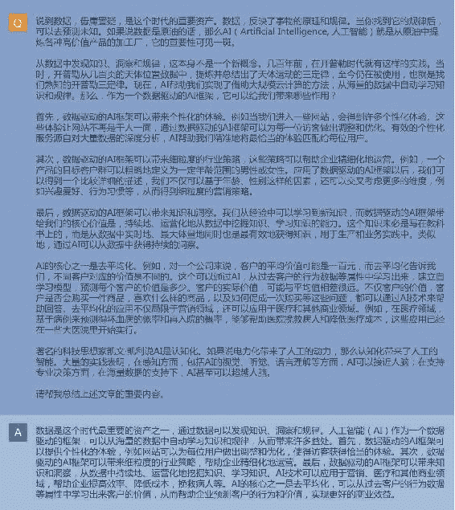
图 1-14 ChatGPT 在快速阅读和总结方面的应用示例

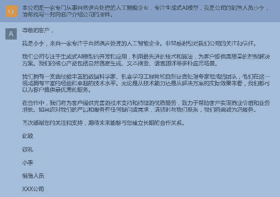
图 1-15 ChatGPT 在客户服务和支持方面的应用示例

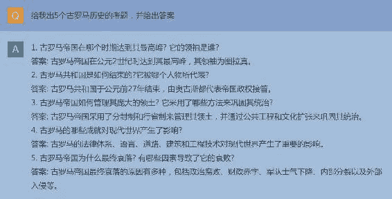
图 1-16 ChatGPT 在交互问答方面的应用示例

健康咨询：它能回答用户关于疾病与治疗的提问，并在基础上给出康复与营养方面的建议。比如孩子突然没胃口，不知道原因，可以询问它，它会把可能原因条分缕析地列出，还能扮演“私人健康调理师”提供建议。

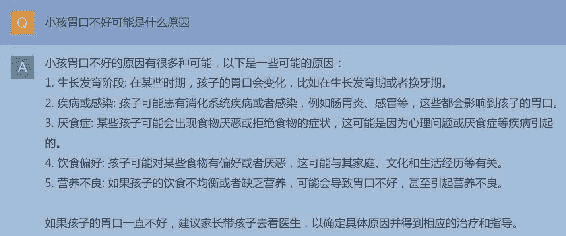
图 1-17 ChatGPT 在医疗保健方面的应用示例

代码检查：写了一整天代码后太累没精力复查，这时可让它检查错误并给出修改建议，省下大量精力。

代码批注：不少程序员认为这项功能很实用。把一段代码交给它并要求做注释解释作用，它会返回带注释的版本，同样能大幅提升效率。

表格公式生成：在办公中让它写几个 Excel 公式也毫无问题。把表格处理需求用文字描述输入，它就能生成可直接使用的公式。

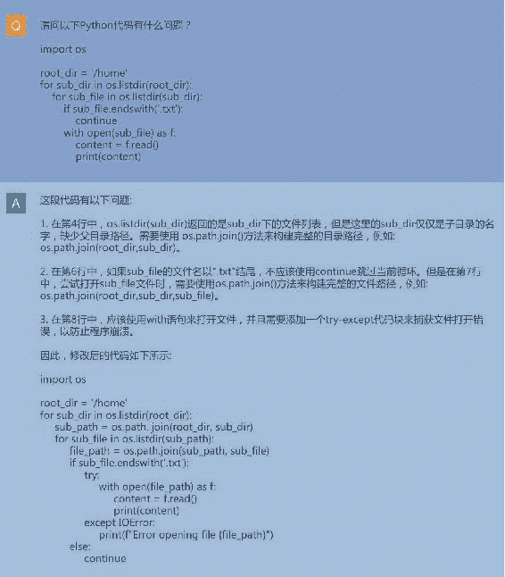
图 1-18 ChatGPT 在代码审查方面的应用示例

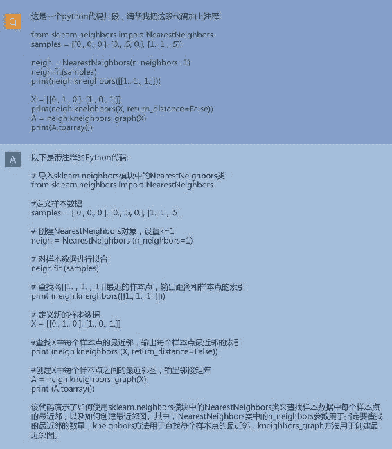
图 1-19 ChatGPT 在代码评论方面的应用示例

除了上述基础场景，其能力远不止于此，还能在营销、客服、风控等业务中发挥作用。它能直接帮助跨境电商卖家撰写营销文案，在智能广告投放、即时客户服务、提升用户体验等方面实现降本增效。比如店主需要快速上架商品生成文案，而负责文案的同事恰好请假，就能借助它迅速产出一段营销文案，前提是明确风格与主题。已有不少人尝试用它生成小红书文案。类似的巨型语言模型还能提升金融业务流程自动化水平，让用户信用数据、借款与还款记录的分析、关键要素提取、风险等级评估等环节逐步自动化，从而增强行业风险识别能力。随着模型迭代，其业务边界会越来越广。

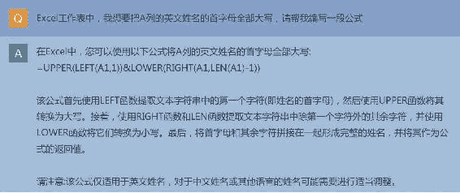
图 1-20 ChatGPT 在 Excel 助手方面的应用示例

2023 年 3 月，OpenAI 正式上线 ChatGPT 插件生态。官方指出，现阶段语言模型在多项任务上表现尚可，但结果有时不够理想，通过引入更多外部数据持续训练可以不断提升效果。插件被形象地比喻为“眼睛和耳朵”，新系统能与开发者定义的 API 交互，把 ChatGPT 与第三方应用对接，让模型获取训练数据之外的更多、更新或尚未覆盖的信息。插件执行安全可控的操作，提升了整体实用性，也让 ChatGPT 可执行的范围变得更广。

总体而言，从应用场景看，它能做速读与概括、客服互动、代码检查、代码批注、健康咨询、营销文案撰写等工作，范围并不局限于此。随着模型技术与算力持续进步，它将走向更高阶的迭代，为人类在更多行业提供应用，并产出更丰富精彩的对话与内容。

不过，应用中也显现出不少局限与弊端：回复准确性不足，存在捏造信息或混淆事实的情况，用户需要自行甄别；缺乏人类判断力，无法辨真伪，也难以处理复杂问题，甚至带来伦理风险；模型需要持续训练与调优，依赖海量学习语料和算力支持，成本巨大；模型本身存在不稳定、不透明、难以解释等问题；同时，它也引发了就业冲击的担忧，有人担心大模型发展会导致大规模失业。任何工具都有两面性，它也不例外。面对这种双面性，我们更应合理使用。人工智能的推进仍然任重而道远。

# 第二章 AIGC 的底层逻辑
现在你应该清楚我们广泛使用的生成式 AI 究竟是什么了。本章将更深入，从底层技术逻辑，也就是“用什么去生成”的角度，继续拆解生成式 AI，让它的骨骼与脉络显现出来。本章涵盖生成式 AI 的基础模型，包括 Transformer 模型、GPT 模型和 Diffusion 模型。你可能会觉得有些难度，但读完这一章，就能理解这些模型的运行逻辑，从而更好地把生成式 AI 用到自己身上。

## 生成式模型基础原理
人工智能在近十多年里取得的进展，技术层面最大的推手无疑是深度学习。而深度学习的爆发得益于海量数据、图形处理器带来的强大算力以及模型本身的不断改进。2006 年，计算机科学家兼认知心理学家杰弗里·辛顿首次提出“深度信念网络”。与传统方式不同，深度信念网络包含“预训练”阶段，能让神经网络权重先找到接近最优解的位置，再通过“微调”对整体网络进行优化。这种分阶段训练大幅缩短了深度学习模型的训练时间。毫无疑问，前文提到的 GPT、ChatGPT、Diffusion 等生成式 AI 模型都属于深度学习范畴。那么深度学习究竟是什么？它与机器学习有何关系？哪些经典深度学习模型有助于理解当下最新的生成式 AI？本节将为你解答。

### 深度学习如何诞生与演进
机器学习是人工智能的一个分支，研究计算机如何模拟和实现人类的学习行为。在 AI 发展历程中，机器学习占据核心地位。借助各种模型，机器学习可以从海量数据中学习规律，对新数据进行智能识别或预测，并为决策提供支持。深度学习是机器学习的一种。如图 2-1 所示，人工智能是一个大范畴，其中包含机器学习，而机器学习中又包含深度学习。机器学习是提升 AI 性能的重要途径，深度学习则是机器学习的重要组成部分，解决了许多复杂的识别、预测和生成难题，推动了 AI 的蓬勃发展。那么深度学习是如何发展起来的呢？

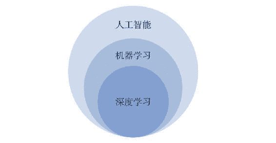
图 2-1 人工智能、机器学习、深度学习关系示意图

深度学习的概念最初源于人工神经网络。科学家发现人类大脑约有 1000 亿个神经元，大脑的思考、记忆等活动本质上依赖神经元相互连接形成的神经网络。人工神经网络是一种模仿人类神经网络进行信息处理的模型，具有自主学习和自适应能力。

1943 年，数学家皮茨和麦卡洛克建立了第一个神经网络模型 M-P 模型，能够进行逻辑运算，为神经网络发展奠定基础。生物神经元由细胞体、树突、轴突和轴突末梢等构成。M-P 模型是对生物神经元结构的简化模仿，左侧为生物神经元示意图，右侧为 M-P 模型示意图。为了便于建模，M-P 模型把树突、细胞体等接收的信号视为输入值，轴突末梢发出的信号视作输出值。1958 年，计算机科学家罗森布拉特发明了感知机，分为输入层、输出层和隐含层。感知机能进行简单的模式识别和联想记忆，是人工神经网络的重要突破，但它无法预测复杂函数。20 世纪 80 年代，人工智能科学家拉姆梅尔哈特、威廉斯、辛顿、杨立昆等人发明了多层感知机，解决了这一问题，推动了人工神经网络的进一步发展。20 世纪 90 年代，诺贝尔奖得主埃德尔曼提出 Darwinism 模型并建立神经网络系统理论。他从达尔文自然选择理论获得启发，将其与大脑思维方式联系起来，认为“面对未知未来，成功适应的基本要求是预先存在多样性”，这与我们现在谈论的模型训练和预测方式相契合，对 90 年代神经网络发展产生重大意义。

此后神经网络技术长期缺乏突破性进展。直到 2006 年，被誉为“人工智能教父”的辛顿正式提出深度学习概念，认为无监督学习与有监督学习相结合可以对现有模型进行优化。这一观点在 AI 领域引起强烈反响，许多顶尖高校学者纷纷投身研究。2006 年被称作“深度学习元年”，从此深度学习进入爆发式发展期。2009 年，深度学习开始应用于语音识别。2012 年，深度学习模型 AlexNet 在 ImageNet 图像识别大赛中夺冠，深度学习逐渐成为神经网络的代名词。同一时期，吴恩达教授开发的深度神经网络将图像识别错误率从 26% 降至 15%，成为 AI 在图像识别领域的重要进步。2014 年，脸书的 DeepFace 项目在人脸识别准确率上超过 97%。2016 年，基于深度学习的 AlphaGo 在围棋比赛中击败韩国顶尖棋手李世石，在全球引发轰动，也让公众真正认识到 AI。2017 年起，深度学习开始在城市安防、医学影像、金融风控、课堂教学等领域广泛应用，直至最近的现象级产品 ChatGPT，它已悄然渗透进日常生活。

### 经典的深度学习结构
通过以上介绍，我们了解到深度学习属于机器学习，也明白了它是如何从人工神经网络一步步发展而来。那么深度学习到底是什么？深度学习建立在计算机神经网络理论和机器学习理论之上，利用建立在复杂网络结构上的多处理层，结合非线性转换方法，对复杂数据模型进行抽象，能够很好地识别图像、声音和文本。下面介绍两种经典的深度学习模型：CNN 和 RNN。

CNN 的全称是 convolutional neural network，即卷积神经网络。对卷积神经网络的研究始于 20 世纪 80 至 90 年代，到 21 世纪随深度学习深入而得到飞速发展，该网络常用于图像识别领域。如图 2-3，卷积神经网络通常包含以下几个层次：输入层、卷积层、池化层、全连接层。

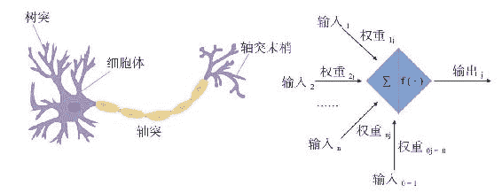
图 2-2 神经元及 M-P 模型示意图

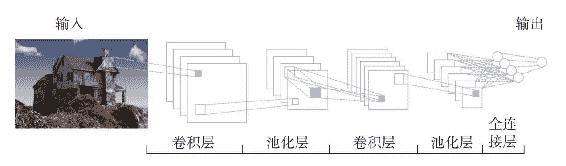
图 2-3 卷积神经网络工作过程示意图

卷积、循环与生成：深度学习三支柱

图像进入网络后，首先在输入端完成基础预处理，像是降维、归一化这类操作，为后续计算做准备。卷积部分的计算单元并不对整张图一次性处理，而是以局部感受野滑动抽取特征。比如一张包含幼犬的照片里，某个单元只负责耳朵轮廓，另一些单元只关注眼部细节。多尺度的核可以捕捉不同粒度的纹理，让特征空间被拉宽，从而提升判别力。随后池化对特征图做稀疏压缩，去掉冗余信息，降低后续计算量。全连接层则起到收敛作用，把前面分散提取的头部、躯干、四肢等局部表征拼接成一个整体向量，完成类别输出。这就是典型的卷积式识别链路。

从运行方式看可以归纳出三点特质。首先，识别不需要扫描全貌，每个单元只聚焦局部，任务难度被拆解。其次，卷积核具备迁移能力，训练后会识别幼犬的滤波器也能在其他画面中寻找相似物体。第三，维度被压缩后主要区分信息依然保留，反而减少了数据处理负担。正是这些特性让该架构在视觉任务上表现突出，牛津大学提出的VGG模型即基于此，在ImageNet 2014的定位赛道上取得第一，候选框生成与图像定位检索都很精准。

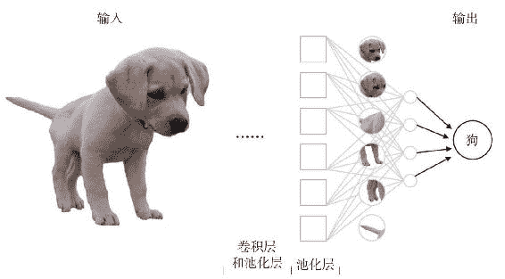

图 2-4 卷积神经网络图像识别过程示意图

人工神经网络与卷积网络都能处理离散事件。卷积网络擅长单张图像识别，一百张照片的处理互不干扰，但面对连续的语言理解或翻译任务效果就会衰减。现实中很多情境依赖上下文，比如“阿华每次逛超市都会大量采购水果，因为他最爱吃( )”，括号内很容易推断为“水果”，因为“吃”后面通常接名词，而句中最贴切的就是水果。针对这类强连续性问题，循环网络被提出。

RNN即recurrent neural network，最早在80年代末由多位研究者提出，主要用于语音等时序信号的理解。循环意味着在同一序列上重复操作，序列元素相互依赖，顺序一旦错乱意义就会改变。该结构弥补了卷积网络在连续事件上的不足。

之所以能处理连续信息，是因为它不仅使用当下输入，还把先前感知的数据一起带入。激活值从第一层传向下一层，层层累积后产生输出。图2-5展示了典型结构，包含输入层、隐藏层与输出层，循环发生在隐藏层。隐藏层通常包含一个预测函数，序列进入后函数计算，结果又作为新输入再次进入隐藏层，形成持续循环的预测，既依赖新数据，也受前次循环影响。

图 2-5 循环神经网络原理示意图

连续数据的高频出现让循环网络应用广泛。可用于预测下一词或下一句，实现文本生成，写稿机器人即基于此。也能实现跨语言转换，是机器翻译的重要支撑。语音识别领域也大量采用，当前主流智能语音助手多依赖该模型。

## 深度学习模型总览

## 循环神经网络的落地场景

随着市场扩大，股价波动呈现一定规律，循环网络在股市预测上有先天优势。大量的历史数据使其学会走势规律，例如模型发现某只股票连续下跌超过七天后会缓慢回升，且该规律长期稳定，那么下一次持续下跌至第七天便成为较好的买入时机。实践显示，对股价的拟合效果较好，应用价值高。

文本识别也是重要方向。以电商为例，如何结合用户主观评价准确评估商品质量和商家等级是难题。借助循环网络的文本解析能力，可以把用户评论转化为商家等级评价。若同时售卖同款商品的商家A好评远多于商家B，则A在质量维度上等级更高。服务态度、发货速度、描述相符度等多个因素综合后形成全面评价，帮助用户在海量信息中更快找到合适商品。

## 对抗式生成网络 GAN

GAN全称generative adversarial networks，即生成式对抗网络，由Ian Goodfellow等人于2014年提出，后续衍生出CycleGAN、StyleGAN等变体，在换脸、换衣等场景下生成效果逼真。2020年PaddleGAN实现的表情迁移可从一张照片生成唱歌视频，催生了“蚂蚁呀嘿”等现象级内容。

其核心是无监督的双网络博弈，一个生成网络，一个判别网络。生成网络从潜在空间随机采样噪声，转化为逼近训练集真实样本的虚拟数据，再送入判别网络。判别网络负责区分真实样本和生成样本。两网络不断对抗、调整参数，直至生成结果难以区分。

通俗比喻是：一位厨师练习摆盘，一位品鉴师负责挑瑕疵。厨师先做一批菜品，品鉴师指出与大厨水准的差距，厨师根据反馈改进，再做新品，品鉴师继续点评，直到品鉴师无法分辨差别。正是这种对抗，让GAN能学习大量无标注数据的多维特性，无需人工标注即可逼近训练分布，实现无监督学习。目标本质上是拟合训练数据的分布，对图像而言即拟合像素概率分布。

主要应用有三类。第一，条件生成，基于文字生成图像或视频。第二，数据增强，学习样本分布后采样生成新样本扩充训练集。第三，风格迁移，将一张图的风格迁移到另一张图，实现内容与风格的分离。

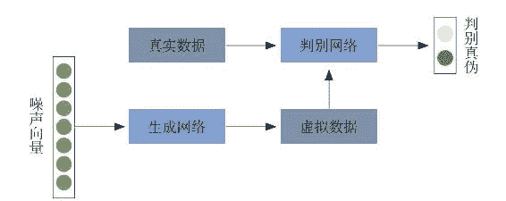

图 2-6 `GAN`网络架构示意图

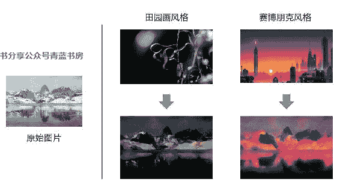

图 2-7 `GAN`模型实现图片的风格迁移

深度学习的爆发已渗透生活各领域，既能识别图像、预判趋势，也能优化决策、自动生成内容。尽管仍与人类认知有差距，作为思维辅助，深度学习已成必然趋势。CNN、RNN、GAN是典型代表，后续生成式AI的介绍也会反复提及。

## Transformer 与 ChatGPT 模型解析

Transformer的出现与ChatGPT密切相关。自提出后被广泛扩展，DeepMind用其构建蛋白质结构预测模型AlphaFold 2，计算机视觉领域也在用其逐步替代卷积网络。可以说Transformer是当前深度学习最亮眼的成果之一。

### 序列到序列模型

Transformer之名源于transform，即转换，核心能力是从一个序列转换到另一个序列。这不是简单的词对词跳跃，而是经过多步处理。

序列指文本、语音、视频等具有连续关系的数据，不同于图片间 often 无关联，序列中当前时刻与前后时刻相关。机器学习里一大类任务就是序列到序列问题，如翻译是将一种语言文字序列转为另一种，机器人对话也是将问题序列转为回答序列。表2-1列举了典型例子。

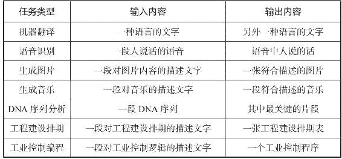

序列到序列任务有两个特点：输入输出长度不固定，且元素间顺序影响结果，如“我不喜欢”与“喜欢我不”含义不同。深度神经网络擅长固定长度向量，如图像识别，但对不定长序列如机器翻译、语音识别、智能对话处理不足。自2013年起，这成为研究热点，催生了序列到序列模型。

该模型由编码器和解码器组成，先编码输入序列生成中间语义向量，再解码得到目标序列。以中译英为例，编码器接收中文序列，解码器输出英文序列。

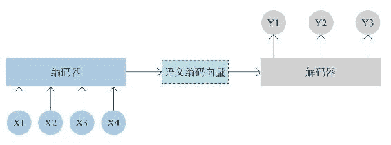

图 2-8 编解码机制结构图

实际应用中输入输出形式可不同，如看图说话输入图片输出描述，编码器可用CNN，解码器可用RNN；反之输入描述生成图像则结构互换。这种编解码机制可适配几乎所有序列任务。

但存在问题，长句翻译易出现梯度消失，解码时使用最后一个隐藏层输出的定长向量，远端词记忆衰减，后端词被过度强调。注意力机制提供了解决方案。

### 注意力机制原理

传统编解码难以体现句子中不同词的重要性。例如“我喜欢这本书，因为它讲了很多关于养花的知识”，做情感分析时应更关注“喜欢”，做内容分类时应更关注“养花”。注意力机制借鉴人类有限注意力的思路，从海量信息中抽取关键部分。

它计算编码器输出各向量与解码器输出各向量的相关性，经归一化得到权重，表征输入与输出元素间的关联。训练过程中不断优化权重，帮助解码器生成时合理参考输入。

自注意力是变体，减少外部依赖，擅长捕捉内部关联。如“He thought it was light before he lifted the backpack.”中，“light”指灯还是轻的，需结合上下文。自注意力会计算各词间关联，看到“backpack”后会提高“light”对应“轻”的权重。

自注意力让模型更好地挖掘前后关联，性能超越普通序列模型。Transformer正是通过多层自注意力学习不同空间的特征，实现从无意序列到有意序列的转换。

### Transformer 架构

Transformer在编码器-解码器基础上升级，编码端由多个编码器串联，解码端由多个解码器串联，并在输入编码和自注意力上优化，采用多头注意力和位置编码，能处理更复杂的语言。

每个编码器含自注意力和前馈网络，自注意力基于前一个编码器的输入计算相关性权重输出新编码，前馈网络进一步处理后传给下一个模块。解码器在编码器结构上多一个针对编码器的注意力机制，从最后一个编码器获取信息，最后接线性变换和归一化生成序列。

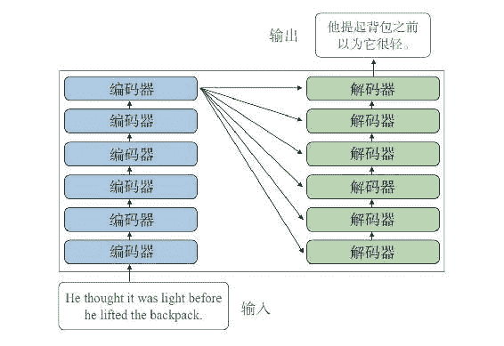

图 2-9 `Transformer`网络结构图

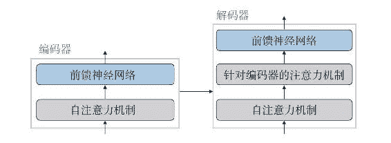

图 2-10 `Transformer`编解码器内部结构图

多头注意力让不同标记间的关联通过多个注意力头并行计算。不同头关注不同关系，如一个头关注相邻词，另一个关注动词与宾语。并行计算提升效率，最终拼接后由前馈网络处理。

例如“The monkey ate the banana quickly and it looks hungry.”中“it”指什么，自注意力易出错，多头注意力可同时捕捉多种依赖，减少歧义。

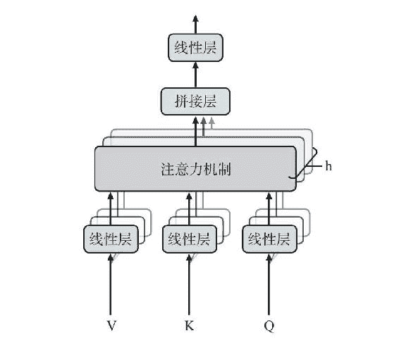

图 2-11 多头注意力原理图

从注意力到扩散：AIGC 的技术底座

多头注意力之所以关键，在于它允许不同视角同时工作。编码词“it”时，有个头可能盯着“monkey”，另一个头却觉得“it”和“banana”更相关，如果只靠单一视角，最终判断很容易跑偏。多头机制的价值就在于此，其他头能捕捉到“hungry”这样的线索，把多个编码结果加权融合后，“it”与“monkey”的关联度被拉高，语义偏差也就被最大程度地抹平了。

位置编码是 Transformer 的另一项独有设计。只知道注意力落在哪儿不够，还得知道词与词的先后关系。拿“她买了书和笔”来举例，句中两个“a”到底修饰“book”还是“pen”，是一本还是一支，人类一眼就能分辨，模型却容易只看“a”与周边词的相关性而忽略顺序。加入位置编码后，每个词向量都叠加上它在序列中的位置信息，模型在衡量相关性时就同时兼顾了语义相似和位置相近，从而更精准地判断指代和修饰关系。

有了多头注意力和位置编码的加持，Transformer 具备了对语义做近乎极致理解并给出回应的能力，也为后来 GPT 这类大规模预训练模型铺好了路。

### GPT 系列模型

GPT 走的是预训练加微调的两段式路线。传统神经网络通常随机初始化参数再不断优化，而 GPT 先用海量通用语料做预训练得到一套通用参数，再用这套参数初始化模型，用少量垂类数据继续训练，这一步叫微调。预训练本质上就是迁移学习，让自然语言处理从“靠大量人工调参”进入“靠大数据预训练加小数据微调”的新阶段。

GPT 家族一直在堆叠 Transformer 的思路上迭代，把 Transformer 当作特征提取器，配合超大规模语料、超大参数量和强算力不断升级，验证了模型容量和数据规模提升后能力也会持续完善。

相对 GPT-1，GPT-2 用了更多、质量更高的训练数据，还能无监督地完成下游任务。GPT-3 把规模推向极致，45TB 训练数据搭配 1750 亿参数，即使零样本或极少样本微调，也能在众多数据集上超过精心调参的微调模型，大幅节省训练成本并解决了标注稀缺的问题。

ChatGPT 则是基于 GPT-3.5 的微调版本，并引入了人类反馈强化学习，语义理解的智能度因此跃升。

如图 2-12 所示，ChatGPT 的训练分三步走。

第一步，用人工标注做微调。标注团队准备一批提示词，来源既有内部构造也有 OpenAI 现有积累，然后人工给出对应答复，形成“提示-答复对”数据集，用它微调 GPT-3.5 得到初版模型。

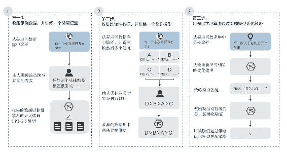

图 2-12 `ChatGPT`模型训练步骤

第二步，训练一个能评价答复好坏的奖励模型。用第一步模型对一批提示词各自生成多个候选答复，标注团队把这些答复排序，人类的偏好隐含在排序里，构成新的标注集来训练奖励模型，该模型随后可给模型输出打分，提供评价标准。

第三步，用奖励模型配合强化学习优化策略。准备提示词样本集，生成答复后由奖励模型打分，再据此调整策略。此时人工已退出，改为 AI 训练 AI，不停迭代策略直至答复质量稳定提升。

经历上述流程，ChatGPT 逐步成型，问世即引发全球关注。2023 年 3 月 OpenAI 发布更强的 GPT-4，但 ChatGPT 在自然语言处理上的里程碑意义依然突出。我们对 Transformer 和 ChatGPT 的实现已有基本了解，这项成果未来势必为 AIGC 应用打开更多可能。

## Diffusion 模型

推动 AIGC 爆发的另一个引擎是 AI 绘画。2022 年 4 月 OpenAI 发布 DALL·E2，仅凭简短文字就能生成全新图像，AI 绘画正式进入新纪元。此工具极大解放了设计者的双手，成为内容生产的新范式。

随后网络上涌现大量 DALL·E2 作品，从卡通动物到山水油画再到商业 PPT 配图，无所不能，且多为原创，图库里找不到重复。图 2-13 展示了输入“cowboy skiing, oil painting”后的生成效果。

图 2-13 `DALL·E2`模型输出效果示例

DALL·E2 既是创作工具也是图像生成技术的新标杆，其背后扩散模型因此受到广泛关注。2022 年 8 月 Stability AI 的 Stable Diffusion 同样基于扩散模型问世，2022 年 11 月 Midjourney 发布 v4 版本，在商业图文转图上展现惊人可用性，同样根植于扩散技术。

## 什么是 Diffusion

扩散模型出现前，以 GAN 为代表的对抗生成网络长期占主导。GAN 易出现模式崩溃，比如用多种动物训练却只生成狗，且训练不稳定，难以大规模应用。扩散模型借助新训练思路绕开 GAN 的调优难题，可直接用于特定任务，生成效果惊艳，研究也因此百花齐放。

“扩散”源自物理学的分子热运动传输，从高浓度向低浓度转移，趋向热平衡与熵增。墨水滴入清水最终均匀扩散就是典型例子。此时此刻的小体积墨水分布极难精确计算和采样，但最终均匀态可用简单数学表达描述，而统计热力学能刻画扩散过程中每个时刻的可逆概率分布，只要步长足够小就能从简单分布回到复杂分布。

扩散模型最早可追溯到 2015 年论文《基于非平衡热力学的深度无监督学习》。受统计热力学启发，作者提出先向训练图像不断加噪声直至模糊，就像墨水扩散，随后训练模型学习逆转这一过程。下面展开说明。

如图 2-14，算法包含正向扩散和逆向扩散两个过程。正向过程是逐步对图像施加高斯噪声，直到图像完全不可辨识。风景逐渐模糊到马赛克，看似随机却遵循马尔可夫链，每一步的状态只依赖前一步，按固定概率转移，形成明确的正向过程。

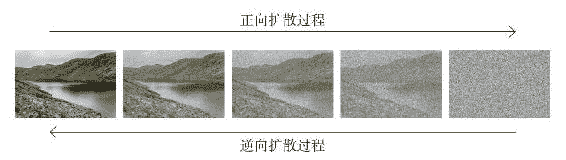

图 2-14 扩散模型的扩散过程

要把马赛克恢复成原图，逆向推导极其困难。多次加噪后的模糊图几乎无法完美还原。因此扩散模型用神经网络近似逆向扩散的概率分布。即便图像已被噪声淹没，也能逐步恢复到接近原貌，随着迭代学习结果更符合预期。

正反两过程结合，扩散模型能基于一张原图生成全新图像，降低了训练的数据处理难度，用新的数学范式重新定义生成。与 GAN 相比，扩散模型只需训练生成器，目标函数简单，无需额外网络，使用门槛大幅降低。

模型初现时关注度不高，一方面 GAN 当道，另一方面早期生成质量一般，且马尔可夫链需要较多扩散步数，导致生成缓慢，作者曾感叹“当时并不令人惊喜”。但现代图像生成技术已悄然萌芽，扩散模型最终登上舞台，生成式图像迈入“文本到图像”时代。

## 文本到图像

2020 年 OpenAI 发布 GPT-3，基于 Transformer 的多模态语言模型，可做翻译、生成、语义分析等任务。2021 年 1 月，OpenAI 发布 DALL·E，可根据文本生成惊艳图像，被视为 Transformer 向视觉领域的延伸，参数量达 120 亿，被称作“图像版 GPT-3”。

“由文本生成图像”怎么理解？DALL·E 官网的例子很直观。输入“牛油果形状的椅子”，模型会生成一系列外观与颜色都接近牛油果的椅子图像。

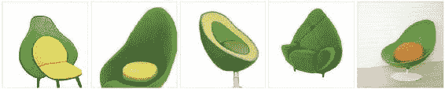

图 2-15 牛油果形状的椅子示例

图片来源：`https://openai.com/research/dall\-e`

再如输入“一个写着 openai 字样的店面”，生成的图像里店铺门口均出现 openai 标志。

图 2-16 写着 openai 字样的店面示例

图片来源：`https://openai.com/research/dall\-e`

DALL·E 既能理解提示词要求，又能按要求作画。相比先前图像到图像的模式，文本到图像更贴合使用习惯，一经推出即获追捧。此后 DALL·E2、Stable Diffusion、Midjourney 等皆采用此范式。下面以 Stable Diffusion 为例说明“字变画”的过程。

## Stable Diffusion

Stable Diffusion 由 Stability AI 主导开发，交互简单、生成迅速，在降低门槛的同时保持惊艳效果，再度点燃 AI 绘画热潮。

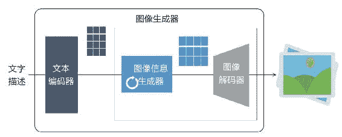

图 2-17 `Stable Diffusion`模型内部结构

整体可分为文本编码器和图像生成器两部分。文本编码器把语义转成计算机可处理的数学表示，随后图像生成器据此合成图像。

文本理解依赖 CLIP 模型。CLIP 由 OpenAI 开源，是基于对比学习的图文预训练模型，全称 Contrastive Language-Image Pre-training。它不仅具备语义理解能力，还能通过注意力机制把文本与图像耦合。

训练 CLIP 需要图文结合的数据集。模型是在从网上收集的 4 亿张图片及其文字描述上训练的。图 2-18 展示了部分数据示例。

CLIP 由图像编码器和文本编码器组成。训练时从数据集中随机抽取图片和文字，两者不一定匹配，通过各自编码器变成向量，训练目标是让图文匹配的向量更接近，从而得到最优参数。

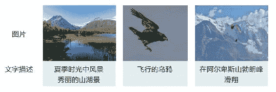

图 2-18 `CLIP`训练图片及相关描述示例

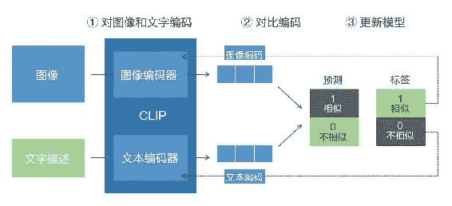

图 2-19 `CLIP`模型训练过程

例如狗的图片与“一只狗”的文字，训练好的 CLIP 会生成高度相似的编码，为相互转化奠定基础。人类语言与计算机视觉因此获得统一的数学表征，这是文字生成图像的核心。

图像生成器分两阶段：信息生成与解码。

信息生成阶段，扩散模型先用随机数生成器产生噪声，再与 CLIP 编码结合形成带语义的噪声编码，随后压缩为低维隐空间信息，即隐变量。这与传统直接生成图像的扩散模型不同，信息量更少，处理更快、资源更省。

技术上由 UNet 与调度算法协作完成。调度算法控制生成进度，UNet 逐步执行，迭代 50~100 次隐变量质量不断提升。

解码阶段把隐变量升维还原为完整图片。扩散过程是逐步去噪并注入语义，每一步都在把图像推向预期效果。

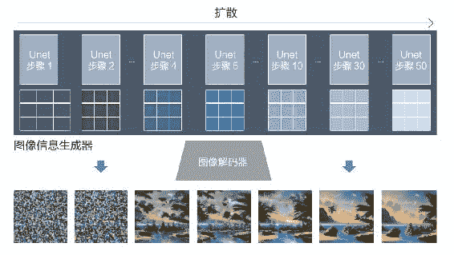

图 2-20 图像生成器去噪过程演示

总体来看，Stable Diffusion 先用 CLIP 把提示词转成接近图像语义的编码，再在图像生成器中完成扩散、去噪与合成，最终实现“文字变图片”的看似神奇的过程。

Stable Diffusion、DALL·E2、Midjourney 这批绘图系统的集中涌现，让人切身感受到生成式智能的演进节奏已经远超常识预期。在 AIGC 的整体版图中，绘画能力的爆发几乎指向了设计行业未来走向的风向标。借助持续的人工智能推进，数字内容的生产逻辑正迎来史诗级的重构，这点已无可争议。置身其中的实践者，是否已做好迎接这场未知变革的准备？

# 第三章 AIGC 生成边界的实践扫描

弄清 AIGC 的产业脉络与技术底层后，便可以从使用视角去审视这类模型在现实里究竟在做些什么。事实上 AIGC 很早就渗入日常，在许多意想不到的角落已经在运转。本章以数字媒体为切口，即围绕“能生成什么”，聚焦文字、图像、音频、视频、游戏等方向，观察在 AIGC 加持下内容是如何被制造并呈现在用户面前的。读完之后，相信你也会忍不住上手尝试，体会其中的效率。

## 文字创作：从新闻撰写到研报与代码的全面覆盖

前面已经提及 AIGC 的多项基本能力，包括文字、图像、视频的产出，揭开了它的第一层面纱。这里把焦点收敛到最基础的文字创作，看看机器究竟能写出哪些类型的文字，以及它们在真实场景中的落地方式。背后离不开深度神经网络、Transformer、大规模预训练模型等技术的支撑。

在这些技术之上搭建的生成体系，在写作领域里已形成强势态势，被广泛用于新闻撰写、报告撰写、代码撰写等场景，大幅提升企业效率、降低人力成本，同时改善用户体验。下面就从这三个方向展开。

### 新闻生产正走向自动化

ChatGPT 引发关注之前，AIGC 在新闻写作领域的运用已相当普及。先回顾传统流程。过去新闻生产完全依赖人工，从选题到发稿全程手工，耗时耗力。

首先是资料汇集，撰稿人要搜集官方文件、专家点评、数据、报道、调查等各类来源，检索筛选就已耗费大量时间。其次是资料整合分析，确保准确客观，海量信息下需要大量比对，有时还需深入调研。接着是稿件撰写，需把控结构、语言、主题、角度、标题、导语等，推敲词句以保证准确易读。最后是编辑校对，多轮修改以保证完整性和准确性，需逐一检查错别字、用词、语法。新闻行业对时效性要求极高，人工撰写压力巨大。也因此，AIGC 一出现就被认为将颠覆行业，拥抱它变得顺理成章。

现实中不少机构已开始尝试。Automated Insight 以新闻自动化生成著称，其产品 Wordsmith 早就在美联社使用，每季度可生成约 3000 篇报道，且错误率低于人工撰写。如今该公司的自然语言生成技术不仅用于新闻，还被各企业采购，用来基于数据生成内部报告，节省大量人力，让撰稿人和分析师去做更有价值的事。

国内的探索也很活跃。2015 年 9 月腾讯财经推出自主研发的自动写稿机器人 Dreamwriter。封面新闻自研机器人“小封”，既能快速生成稿件也能与用户语音互动。新华社拥有体育财经新闻机器人“快笔小新”，还有“媒体大脑”AI 平台。2019 年全国两会期间，“媒体大脑”对比 6 年政府工作报告异同后，推出《一杯茶的工夫读完 6 年政府工作报告，AI 看出了啥奥妙》。由此可见 AIGC 在新闻生成中的应用愈发广泛，影响持续加深。

2020 年 12 月 24 日，《人民日报》发布由百度提供技术支持的“创作大脑”，助力智能编辑部建设，拉开国内智能媒体新时代帷幕。该平台提供覆盖全媒体生态的智能解决方案，具备实时新闻监测、智能写作、新闻转视频、图片智能处理、智能字幕制作、直播智能拆条、在线视频快编、可视化大数据等 18 项功能。背后的技术来自百度智能云“云+AI”和百度大脑智能创作平台，深度参与新闻生产的策、采、编、审、发全流程，能显著提升内容生产效率。随着 ChatGPT 的发布，其强大的文字创作能力让编辑更快完成新闻编写，为行业带来新一轮变革。

不过 AIGC 内容生成也有阴暗面。传统媒体通过采访撰写和严格审核保证真实性，而 AI 生成新闻高度依赖大数据，数据多从网络抓取，真伪难保，对人物、事件缘由等深层问题难以理解，容易产出假新闻。针对信息甄别难的问题，人民日报社推出国内首个 AIGC 内容检测工具 AIGC-X，可快速分辨机器文本与人工文本，对中文检测准确率在 90% 以上。

未来人机边界将被进一步模糊，“人机协同”或成为主流。AI 负责简单重复的工作，专业记者负责深度思考和价值判断。协同方式主要有两种：一是人类设计程序，让 AI 完成有危险性或重复性强的报道，如自然灾害、体育新闻；二是 AI 辅助人类，利用大数据收集挖掘事件内核后再报道，为读者提供更有价值的内容。

## 智能研报的生成实践

除新闻外，AI 在报告生成上同样表现出色，以投研报告为例。

传统撰写投研报告耗时费力。第一是数据处理耗时，需提前收集大量信息，由经验丰富的分析师手工处理挖掘。第二是语言表达复杂，涉及大量专业术语，需多角度阐释数据结论。第三是内容复杂多样，需兼顾宏观经济、公司基本面、市场趋势、竞争对手等进行详实分析。第四是标准化要求高，需投入时间保证文献引用、图表设计、文本格式等准确。

金融从业者每天接触大量投研报告，涉及行业、产业、宏观等维度，通常由专业分析师撰写，要求全面收集和分析能力。如何用 AI 自动生成报告提升效率，成为金融机构积极探索的方向。

在此背景下，以 AIGC 为支撑的智能投研应运而生。它利用 AI 自动完成对海量金融信息的收集、提取、归纳、压缩、分析和预测，为投资研究人员提供信息支持，而非直接给出决策。借助相关技术，分析师可更快撰写报告，同时保证内容准确和体例一致。

与人工相比，智能投研的最大优势是高效。人工投研需耗费大量时间在数据终端收集素材，再用专业逻辑组织成决策，效率有限。智能投研可借助模型迅速读取海量信息，自动化多维度计算分析，发现事件关联并做出一定程度预测，按预设模板生成研究报告，实现从信息收集到内容呈现的跨越。AI 模型的应用还能避免分析师主观影响，使内容更客观，进一步提升效率。

智搜信息是典型案例，在自然语言处理领域技术扎实，能进行大规模文本数据分析。其写作机器人在金融领域主要用于财经快报，原理是以预定义财经模板为基础填入关键数据，一键生成财经报告。目前模板涵盖国内外宏观经济与大盘分析、上市公司研究报告、个股综评、行业研究报告等，数据来自国内金融数据供应商实时供给。写作机器人撰写上万字的财经报告仅需数秒，数据翔实、图文并茂、可读性强。该技术已在太平洋保险集团落地，其智能投研系统可在集团内自动完成各类财经数据报告写作。

## 代码的自动生成趋势

2022 年 11 月 3 日，推特迎来大规模裁员，波及几乎所有部门，约 50% 员工失业，安全审查团队离开比例达 15%。难以获知全部决策缘由，但 AIGC 在工作场景中日益普及显然是重要背景。在代码能自动生成的时代，是否还需要如此多程序员？

把目光放在当前应用上。GitHub 2021 年 6 月联合 OpenAI 推出 GitHub Copilot 预览版，被称为“你的 AI 结对程序员”。它可基于命名或正在编辑的代码，结合上下文给出建议，使用的是 OpenAI 的 Codex 模型，能把自然语言转为代码。Codex 实为 GPT-3 的编程微调版本。据官方介绍，Copilot 经过数十亿行代码训练，既能理解英语也能理解其他语言，还能把注释转为代码，实现自动联想和纠错，在编写单元测试用例方面也表现出色。

数月测试后，GitHub 全新升级个人版和企业版 Copilot，生成能力更强、响应更快。数据显示，使用者中 90% 表示能更快完成任务，73% 表示节省大量精力，75% 表示使用时更有成就感、更专注。如图 3-1，只要输入简单提示词，Copilot 就能联想出整个函数实现。当然，现在它仍是辅助工具而非完全替代，随着时间推移，替代可能性并非天方夜谭。

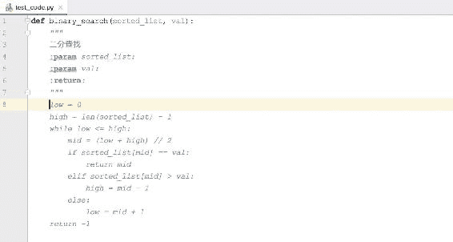
图 3-1 GitHub Copilot 代码生成示例

国外热度高涨，国内也不落后。硅心科技 aiXcoder 于 2022 年 6 月推出国内首个基于深度学习的支持方法级代码生成的智能编程模型 aiXcoder XL，可同时理解人类语言和编程语言，基于自然语言描述一键产出完整程序代码。如今通过简单 API 和工具即可体验其便利。

技术进步始终由人驱动，人也始终是核心。未来 AI 将在各领域正向发展，服务各行各业，把劳动者从简单重复中解放出来，高效率人机合作将进一步促进产业融合与重塑，迎来全新智能化时代。

## 视觉创作：清晰度与艺术性的拉扯

看完 AIGC 与文字的结合，你可能也会好奇它在其他内容形式上的表现。风靡社交平台的 AI 绘画就是 AIGC 与图像结合的典型，用户们积极尝试，用它实现天马行空的想法，迸发出更多灵感。

2022 年 8 月，美国科罗拉多州举办新兴数字艺术家竞赛，其中杰森·艾伦提交的 AIGC 作品《太空歌剧院》格外引人注目，获“数字艺术/数字修饰照片”类一等奖。无绘画基础的参赛者获奖引发热议，也让 AI 绘画真正走进大众视野。

在 AI 绘画发展时间线上，有几个关键应用。Midjourney 是目前使用体验较好的图像生成工具之一，速度快功能全，艺术家常用来找灵感，上文获奖的《太空歌剧院》即由 Midjourney 生成。DALL·E2 由 OpenAI 推出，相较前代分辨率更高、延迟更低。Stable Diffusion 一经推出便因强大的生成能力和简单易用备受喜爱。出图过程如开盲盒，也让许多人把它当作“游戏工具”。

图 3-2 《太空歌剧院》

图片来源：https://m2now.com/ai-killed-art

### 文本到图像的进化

目前市面上的不少 AI 绘图工具都具备“文本到图像”模型，能根据自然语言描述生成匹配图像。该类模型通常将语言模型与图像生成模型结合，语言模型把输入文本转为潜在表示，图像生成模型据此生成图像。现阶段效果最好的模型训练数据多来自网络抓取的图像文本对。

“文本到图像”自 2015 年起受业界重视，依托深度神经网络的快速进步。谷歌大脑的 Imagen、OpenAI 的 DALL·E 等均可生成近似真实照片的作品。Stability AI 推出的 Stable Diffusion 则成为该领域的一匹黑马。

Diffusion 模型是当前主流图像生成模型之一，原理是通过连续添加高斯噪声破坏训练数据，再学习反向去噪过程，从而从随机输入合成新数据。

以 Stable Diffusion 为例，用户可设置生成步数、随机种子、单次生成数量 1~10 张等参数，还可创建多种格式图像，横版分辨率最高可达 1365×768，竖版最高 768×1365。产出图像可用于任何用途，包括商业目的。

图 3-3 由 Stable Diffusion 生成的图像

2022 年底上线的 Stable Diffusion 2.0 能力更强，采用全新文本编码器 OpenCLIP 训练，与 1.0 相比图像质量显著提升、清晰度明显改善。

DALL·E2 是 OpenAI 的 AI 绘画产品，支持“文本到图像”和“文本引导的图像到图像”生成。若使用后者，可先上传图像作为初始图，再按提示作图。它还提供“编辑生成的图像”功能，可在已有图像基础上扩展或补全遮挡部分。DALL·E2 生成图像分辨率为固定的 1024×1024，也可用于合法商业目的。

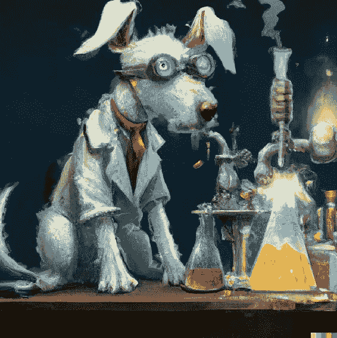
图 3-4 由 DALL·E2 生成的图像

Midjourney 文本绘图快速上手
Midjourney 来自同名研究室，文字驱动绘画的操作门槛很低。把描述性指令递交到客户端即可立刻得到对应的视觉结果，还可在结果基础上衍生变体或把成片放大提升清晰度。除了纯文字驱动，也可上传一至多个图片的网络地址，配合文字共同引导创作方向。平台对输出格式兼容性好，个别版本单张分辨率可达 2048×2048，付费会员获准将作品用于商业场景。

图 3-5 由 Midjourney 生成的图像

生成式绘画在海外持续升温，国内的爆发更像井喷。仅 2022 年下半年，文心一格、无界版图、6pen、Tiamat、盗梦师等产品就密集上线。微博、小红书等主流社区随处可见相关成果，研究者、内容创作者、投资人多方推波助澜，让这股浪潮渗透到各个圈层。国内热度极高的小程序“造梦日记”，即是在 Stable Diffusion 基础上做国产化增强，团队对底座进行了改造，并以自研的“follow instruction”方式进行训练，同时注入大量本地化素材。上线一周就实现日增 5 万新用户的成绩。

创作边界不止于平面，3D 内容的自动化生产也在起步。Omniverse Audio2Face、NVIDIA GANverse3D、NeRF 等工具已经能借助 AIGC 实现图像内容的自动生产。GANverse3D 擅长把平面图转成逼真的三维模型。做训练集时，需要从多角度描绘同一个物体，就像摄影师围着一栋房子环拍那样，多视角素材会被送入逆向图形渲染框架。逆向图形本质是从二维图像推断出三维网格，完成多视角训练后，仅凭一张二维图，GANverse3D 就能生成网格并渲染。

### 生成艺术风格图像

除了写实画面，智能绘图还能做风格化创作，被称为绘图圈“霸王”的 Stable Diffusion 拥有庞大的艺术风格库。赛博朋克、水墨、日漫等风格应有尽有，油画、素描、水彩等表现形式也能自由切换。

打开软件后，可以先在脑中设定想呈现的风格、情绪、物件与元素，输入文字即可得到成片。提示词非常丰富，例如海浪、山峰、神庙、森林、秋天、雨滴、雾气、苔藓、城堡、花田等营造诗意与朦胧感的词，欢乐、沉郁、霓虹、赛博朋克、蒸汽朋克等描述情绪或氛围的词，以及超现实、魔幻、水墨、素描、油画等描述画风的词，还可指定艺术家风格，如毕加索、达·芬奇、梵高、莫奈、宫崎骏等。

肖像生成上，Stable Diffusion 处理得很从容。无论是动漫、水彩等手绘抽象风格，还是侧视、3/4 视或正面视等不同视角，乃至照片级的高仿真，都能快速完成。名人照也能还原，例如输入科学家爱因斯坦的名字，系统即可准确生成相应照片。

富有中国艺术特色的水墨画也能被生成，其产出的水墨老虎栩栩如生。

它还能绘制非洲大草原的自然风光，通过加入提示词，让本就气势恢宏的象群景象显得格外宁静。

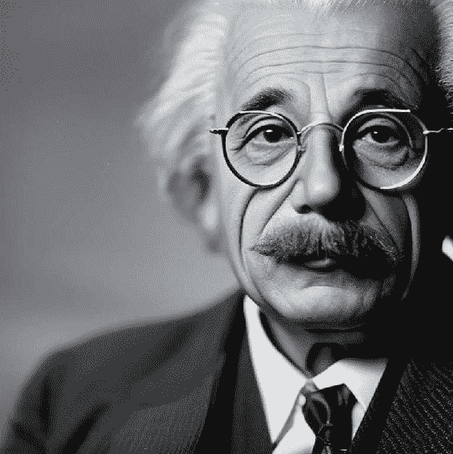
图 3-6 由 Stable Diffusion 生成的爱因斯坦照片

图 3-7 由 Stable Diffusion 生成的水墨画

图 3-8 由 Stable Diffusion 生成的非洲大草原自然风光图

模仿大师风格同样不在话下。让 Stable Diffusion 分别以毕加索和梵高风格为一位老奶奶作肖像，两位大师的画风差异明显，生成结果与各自风格高度一致，左图为毕加索风格，右图为梵高风格。

也可以任意指定艺术风格，例如生成文艺复兴时期水彩画——威尼斯水城。

对未来生活环境的想象也很直观，比如让原本荒芜的火星长满绿植，人类在其上安居乐业。

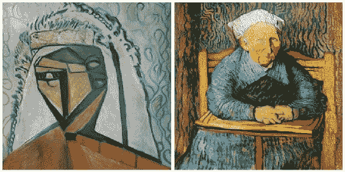
图 3-9 由 Stable Diffusion 生成的不同风格肖像画

图 3-10 由 Stable Diffusion 生成的文艺复兴时期水彩画

图 3-11 由 Stable Diffusion 生成的火星生活环境

### 其他顶尖平台

生成式绘图领域已进入多方角逐阶段，各大平台都在抢夺用户。先看海外的绘图程序。Fotor 是一个在线图片编辑网站，在全球拥有上百万用户，主业虽是图片编辑，但也支持智能图像生成。使用方式很直接，输入文字提示后查看输出结果，每天可免费生成 10 次。平台可体验文本到图像、图像到图像、快速生成等多种转换模式，支持三维绘画、动漫角色绘画、逼真图像生成等，功能相当完备。

## AI 生成内容应用概览

## AI 图像生成

NightCafe 是市面上热度很高的智能图像生成软件，用户每天有 5 次免费机会。它上手方便，支持快速生成、多艺术风格、高分辨率输出，算法和选项比多数生成器更丰富，具备文本到图像和样式转换两种模式。样式转换允许用户上传图像后将其变为名画风格。NightCafe 采用信用点系统，积分越多可生成的图像越多。

Dream 梦境生成器由加拿大人工智能创业公司 WOMBO 创建，被不少人认为是最均衡的全能型工具。操作与 NightCafe 类似，输入一句话、选定艺术风格即可生成图像。其优势在于支持上传参考图像，让结果更贴近用户想法。风格库丰富，且可免费无限制生成。

Craiyon 是一款便捷的图像生成软件，曾用名为 DALL·E mini，由谷歌与 Hugging Face 推出。只需输入文字说明即可生成图像，无需注册，生成速度很快。

Deep Dream 另具特色，附带了用于创建视觉内容的人工智能工具。它能基于文本提示生成逼真图像，也可将基础图像与个性化绘画风格融合。通过海量图像训练的深度神经网络，用户可在基础图像上生成新内容。

在国内，相关产业发展迅速，文心一格是典型代表。它在中文和中国文化理解与生成上优势明显，背后的文心大模型在数据采集、输入理解等层面深入研究，形成更强的中文能力，对中文用户的语义理解更到位，更适合中文环境落地。

昆仑万维旗下的天工巧绘 SkyPaint 也是重要玩家。该公司是国内 AIGC 领域发展较为全面的公司之一，也是首个全面发展 AIGC 开源社区的公司。旗下产品涵盖文本、图像、音乐、编程等多形式内容生成。天工巧绘可生成现代艺术风格的高分辨率图像，支持 Stable Diffusion 模型及相关微调模型的英文提示词，意味着 Stable Diffusion 适用的提示词在此同样可用。

皮卡智能推出的神采 PromeAI 风格库丰富，可将涂鸦和照片转为插画，自动识别人物姿势生成插画；能把线稿上色并提供多种配色方案；可自动识别图像景深并生成相同景深的图像；还能识别建筑和室内图像的线段并据此生成新设计方案。

本节从智能绘画延伸到当下生成图像的最新突破与热门应用。许多人仍在摸索绘图，甚至未曾听说。但悄然间一项新突破出现了——“AI 读脑术”。最新研究称，仅用功能性磁共振成像扫描大脑特定部位获取信号，人工智能就能重建人眼所见的图像。目前只能复制“眼睛”所观察到的东西，会不会有一天，能依据大脑中的思维、记忆构建出图像或文字？若真到来，人类是否会变成“三体人”？无论如何，“潘多拉魔盒”是否打开，需要思考的并非技术本身，而是操控它的人。作为人类，与人工智能共行的时刻，我们将面临无数拷问。

## 音频制作：精准还原、实时合成

人工智能在“入侵”文本、图片后，在音频生成领域同样大展拳脚，为生活带来不少便利。与文本、图片不同，音频是随时间变化的声音序列，每个细节都极富生动性。下面从音乐生成、语音克隆两方面看 AIGC 如何与人类协同工作。

### 音乐生成

传统认知里，音乐由人创作，蕴含创作者的主观情感，很难想象机器参与其中，但 AIGC 让不可能成为可能。OpenAI 发布的 MuseNet 模型即可轻松生成音乐。

图 3-12 `MuseNet`音乐生成神经网络的界面

MuseNet 属于人工智能音乐创作的深度神经网络，被称作“全能”，可模仿 10 种不同乐器，涉猎乡村、古典、摇滚等多种风格，用户基于想要的风格生成约 4 分钟的作品。

它并非依据人类既有创作方法编程，而是在学习现有音乐的和声、节奏与风格后开始创作。研发人员从 MAESTRO 数据集、BitMidi 音乐网站等渠道收集训练数据，也收集爵士、流行等风格的音乐，训练时使用了数十万个音乐文件。掌握不同风格后，MuseNet 即可混合生成新曲。若提供肖邦夜曲的前几个音符，并要求生成带有钢琴、吉他、长笛的流行乐，机器会按需求生成。

OpenAI 还在 Twitch 上举办过 MuseNet 实验音乐会，并推出面向应用端的 MuseNet-powered co-composer，让普通人也能创作。它提供简单模式与高级模式。简单模式下，用户先听到随机样本，选定作曲家或风格后生成音乐；高级模式选择更多，可自由设定乐器等，生成更具个性化的作品。局限在于它通过计算音符和乐器的概率作曲，容易产生不和谐内容，比如把肖邦风格配上低音鼓，听感割裂。

在乐坛，人工智能已成人气“新星”。美国歌手 Taryn Southern 与人工智能共同推出世界首张人工智能作曲专辑 I AM AI。索尼 Flow Machines 与法国作曲家 Benoit Carre 合作发布专辑 Hello World，收录 15 首人工智能参与创作的歌曲，听感顺滑。曾在 YouTube 名噪一时的单曲 Daddy’s Car 即由索尼人工智能应用推出。谷歌为庆祝巴赫生日，在主页放置小游戏，用户确定音符与节奏后，系统会以巴赫风格演奏。Google Chrome Music Lab 推出 Song Maker，用可视化方式帮助人类理解音乐。

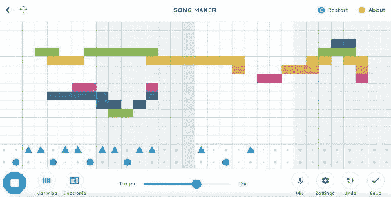
图 3-13 谷歌的`Song Maker`制作器面板

谷歌还利用 NSynth 神经网络音频合成技术推出神经网络音频合成器 Magenta，可在浏览器使用，切换音色并通过滚动条调节音色偏向，对即兴创作很友好。

国内各类人工智能音乐应用层出不穷。“虚拟歌手”App 持续走热，歌叽歌叽、ACE 虚拟歌姬 等受到年轻人欢迎。这类 App 可基于用户音色制作人工智能歌手，社交网站上大量出现“用自己的声音做虚拟歌手”的教程。除了虚拟歌手功能，还有“一键写歌”“硬核原创”等。每个人门槛极低即可创作。例如“一键写歌”只需输入关键词与生日，就能快速生成约 30 秒的“人生主打歌”，甚至把星座及性格特点穿插到歌词中。“硬核原创”提供部分音符供用户选择，形成简单旋律后填词即可完成，创作后可选人声试听。网易云音乐、腾讯、阿里等平台也推出人工智能作曲、作词应用。AIGC 与音乐的结合已悄然渗透生活。

### 语音克隆

对 AIGC 而言，音乐合成只是较易实现的功能，语音克隆同样值得关注。语音克隆涉及语音合成技术，即文本转语音，将文本按需求转化为音频。语音克隆是语音合成的分支，若要克隆某人声音，通常需采集说话人语音数据训练合成模型。

深声科技近期与小米合作，在智能音箱“小爱同学”的定制声音功能中融合语音克隆技术。可让用户克隆自己的声音、父母、子女、伴侣的声音，并支持音色分享。这项应用已成为智能终端如车载机器人、智能手机、智能家居的基本功能。传统语音合成需要大量语音数据，语音克隆所需更少，可加快智能终端迭代，但对声学模型训练要求更高，容易出现发音模糊、发错音等问题。如今经过迭代，用户只需朗读 20 句短文本、录制约 90 秒语音，即可快速克隆声音，将个人情感表达、发音特点乃至口音融合进人工智能合成音中。

要让计算机用任意声音读出任意文字，需要先了解两件事：要读什么、如何读。研究人员设计的语音克隆系统有两条输入路径：一是想要计算机读的文本，二是想要模仿的声音样本。例如想让哪吒的声音说“我喜欢玩滑板”，需提前输入文字“我喜欢玩滑板”和一段哪吒的声音样本，系统便能学会哪吒的声音特征并据此发声。

工作流程是：得到约 20 句、90 秒左右的语音后，对应的音频与文字内容分别编码，一同训练个性化声学模型。模型建立后，对任意文本先预处理成字符和音素序列，再经声学模型转换为带有说话人音色特点的声谱图。声谱图不能直接发声，最后需声码器将其转为声音波形，完成语音克隆。

代表性应用是 MockingBird，由 GitHub 博主推出，可在数秒内克隆任意中文语音，并用该音色合成新内容。若样本在 10 秒以内，配合 10 个字的语音文本，合成时间会更短。缺陷在于模型先按标点断句，再并行处理多段文字，标点会影响合成质量；口音、情绪化语气、自然停顿等也会导致生成问题。

该模型已有多样商业化形态。音视频制作者不想录音或懒得补录时可派上用场，也可帮助主播给打赏观众发送合成的个性语音。拓展方向包括跨语种语音克隆，甚至让实时翻译器保留说话人音色。在影视行业，可帮助面向多地区发行的作品将配音转化为多语种。如今机器已能模拟真实人类声音，若还能还原说话时的节奏，便更逼真，进一步帮助处理工作与生活的琐碎事务。

当声音学会跨界：AIGC如何改写娱乐生产

国内市场的声纹仿真早已走出实验室，成为可规模化落地的生产力。喜马拉雅依托自有声库，把新闻稿、图书内容、网络文章等文字材料快速转成听觉产品，把音频产出效率拉开了一个量级。旗下“单田芳声音再现”项目颇具代表性，已推出多张风格迥异的声音专辑，与此前官方授权的“单田芳评书”一起拼成完整的IP组合。作品保留了单氏评书极具辨识度的腔口与饱满情绪，将当下热播的悬疑推理《无证之罪》重新演绎，也补完艺人未及完成的经典《十二金钱镖》，借助跨时空的创意演绎让新派非遗获得新生命。AIGC在供给侧的加入，让文化产品的形态更丰富、体量更大，也让经典的延续更有韧性。

中国音频市场触点多、用户覆盖广，成长空间可观，技术正在变成决定竞争格局的分水岭。生成式人工智能加快了声音内容的制作与分发，随着内容规模放大和模型迭代，AI在声音链路里的参与度清晰可见地在加深，产业整体正朝智能化演进。

### 跨模态音频的玩法
看到这个小标题可能会问声音能否玩跨模态。现实情况是否定的否定。当前音频跨模态方向已经不止一种，包含文字转音频、图像转音频、视频转音频等。近期走红的 `Make-An-Audio` 就是典型案例（图 3-14）。该应用由北京大学、浙江大学与火山引擎语音团队联合推出，只需投喂文字、图片或短视频，就能生成逼真的音效，鸟鸣、钟表、汽车的照片，或烟花、狂风、闪电的画面，都能得到对应的声音。这类技术有机会重塑视频制作的音效标准。

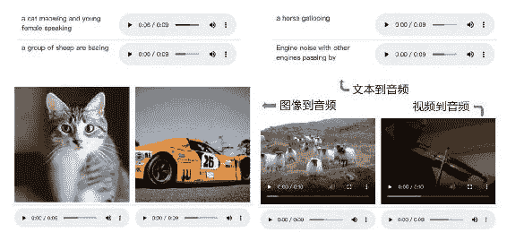

图 3-14 `Make-An-Audio`实现跨模态音频合成

图片来源：https://text-to-audio.github.io

这款爆款的底层逻辑是什么？在视觉驱动音频合成上，`Make-An-Audio` 借用 `CLIP` 文本编码器及其图像-文本联合空间，以图像编码作为条件来驱动音频生成。但现实中音频-文字描述对的数据并不充裕，制约模型上限。为此北大、浙大与火山语音团队提出文本增强策略，先用模型为音频生成文字描述，再随机重组获得更具多样性的训练样本。整体上该模型能产出高质量且可控的音频，并提出“`No Modality Left Behind`”理念，主张不丢弃任何一种模态输入。

可以预见，音频合成AIGC将在电影配音、短视频创作等领域大展拳脚，借助 `Make-An-Audio` 这类工具，普通人也能随时随地用文字、图片、视频合成生动音效，个人音效师的门槛将被拉低。目前模型仍不完美，因数据来源杂、样本质量不均，偶尔会生成与文字不符的声音，但进步速度着实惊喜。

AIGC进入音频赛道，在音乐创作、声纹仿真、跨模态合成上快速进化，使用门槛降低，娱乐方式更多元。既然文字、图像、视频都能变音频，我们已进入万物可生成的阶段，甚至可以畅想音乐节奏驱动舞蹈动作拆分与组合，个性化舞蹈教学内容自动生成，线下练舞室或将面临新挑战。产业一端升级，另一端必然连动，未来AIGC在音频领域的想象空间仍在打开。

## 影视创作进入智能时代
影视爱好者能明显感受到新技术正重塑电影工业，新型3D、无人机拍摄、VR/AR与AIGC深度绑定，其中AIGC的影响尤为突出。从剧本到视听设计、特效、剪辑再到表演，人工智能都能介入，AI写剧本、做特效、完成剪辑甚至参与演出，已从科幻走向现实。

当下AI在电影领域最核心的作用是把创作和管理推向自动化与智能化，把创作者从重复性劳动中解放，聚焦更有创造性的环节。视觉特效、特技设计、影片剪辑等高重复度工作正逐步被AI接管，行业自动化程度在不断提升。

### 剧本智能生成
剧本属于文本创作的重要分支，AIGC在这块同样游刃有余。传统剧本创作痛点明显：周期长、沟通成本高，一个质量过关的剧本常要超过12个月，创作者需与制片方、导演反复确认方向与诉求，一点偏差就可能导致项目停滞。AIGC的介入显著压缩了周期，为后续环节争取时间。

市场落地如何？谷歌旗下 `DeepMind` 推出写作模型 `Dramatron`，可自动生成人物小传、场景描述、情节点及对话，人类创作者可在其基础上编辑成正式脚本。它像“剧本版的ChatGPT”，已有用户用它创作戏剧与电影连贯剧本。操作上，只需输入一段故事梗概，系统便会输出标题、人设、场景、细节与对话。

`Dramatron` 依托大语言模型的优势，采用分层故事生成机制，保证长距离连贯性。它能根据用户提供的核心冲突摘要，即“日志线”，生成数万字剧本，并包含标题、人设、情节、地点、对话等要素，用户可在任意生成阶段修改、替换、重写，交互体验流畅。

2022年8月，埃德蒙顿国际边缘戏剧节上映了由 `Dramatron` 参与编剧的影片，验证了其实践力。为评估可用性，研究团队邀请15位专家进行两小时共创会议，多数评审给出积极反馈。

国内数字化娱乐科技公司海马轻帆也上线“小说转剧本”功能。进入网站创作平台，粘贴小说内容即可一键输出剧本格式文本。系统会拆解描述性语言，重组为包含关键场景、对白、动作的视听语言。小说作者、IP改编编剧及影视公司都是典型用户，往往几秒钟就能完成文本到剧本的格式转换，同时借助AI语义理解剔除内心独白、全知视角等非视听元素，实现从文本到视听的基本迁移。创作方只需在转换后的框架上进行创意打磨即可。

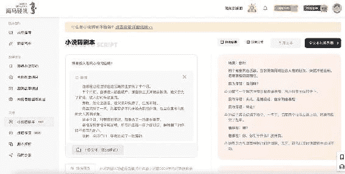

图 3-15 海马轻帆“小说转剧本”界面

这项创新大幅缩短IP改编前期梳理周期，提升改编效率，为短视频、中短剧、长剧集提供高效解决方案。以改编短剧《契约夫妇离婚吧》为例，快手小剧场上线4个月获300万点赞，账号涨粉超62万，首月播放突破1亿。

除小说转剧本外，海马轻帆还提供格式一键切换、角色出场统计、海量创作灵感素材库、短剧分场脚本导出、剧本智能评估等功能。格式切换可在中式与好莱坞风格间转换；角色统计能自动识别人物并以图表呈现戏份；灵感库输入关键词即可获取故事片段；分场导出适配短视频平台需求；智能评估则对电影、电视剧、网剧进行商业价值数据分析。

### 虚拟角色与场景打造
人工智能面部替换近期引发热议，不仅是娱乐，更可合成人脸、声音，实现劣迹艺人替换、已故演员数字复活、多语言译制音画同步、演员年龄跨越、高难度动作合成等，减少演员自身局限。对换角、补拍难题提供新解法。

2020年播出的《三千鸦杀》就因女演员解约，采用人工智能面部替换完成，已杀青剧集避免了高额重拍成本，虽效果仍待提升，但已证明可行性。

AI还能合成虚拟场景，用数字手段生成难以实拍或成本高昂的场景与细致人脸、皮肤质感。数字特效被广泛用于动画、科幻与创意短视频。

电影《阿丽塔》制作中使用了两项深度学习技术：一是用人脸追踪，输入面部活动信息训练模型，遮挡时也能推算缺失数据；二是训练模型生成正确尺寸与方向的皮肤及毛孔，使质感更逼真。《复仇者联盟3》也用机器学习算法提升面部表情捕捉，通过演员面部扫描数据制作灭霸表情，让虚拟角色心理变化更细腻。国内剧《热血长安》大量场景由AI生成，团队采集实景后做数字建模，演员在绿幕棚内表演，再通过实时抠像与虚拟场景融合。

### 智能后期与修复
剪辑一直是人力密集环节。传统剪辑耗时久，AI剪辑可依据成熟的剪辑风格与镜头语言自动挑选、组接，显著提升效率。

市场应用已很广泛。2019年国庆大阅兵直播中，央视新闻用AI完成分列式与群众游行视频剪辑。AI学习历史阅兵画面、信号规律与时间点，判断画面内容与稳定性，形成多路信号AI剪辑模式，可同时处理多机位画面切换。直播当天阅兵方阵表演结束后5分钟内生成首个AI剪辑视频，2小时内完成82个视频剪辑输出，效率远超人工。

AIGC还能修复或还原影视图像，提升清晰度与画面质量。视频修复分物理修复与数字修复，前者处理胶片杂质、形变、划痕，后者基于机器学习自动修复，可减少人力与成本。

AI已修复百年前的北京老视频（图3-16）和电影《我的1919》（图3-17），核心步骤是补帧、上色、分辨率扩增，即让视频更流畅、黑白转彩色、低分辨率升至4K。

以补帧应用 `DAIN` 为例，它基于视频深度感知与时间帧插值，会先推测物体远近关系与遮挡情况，再以高效采样生成高质量帧，比传统补帧更接近真实拍摄。上色可借助 `DeOldify` 技术，其改进的GAN保留了色彩丰富度并降低闪烁副作用，不过色彩还原不一定完全真实，是模型的主观学习结果。

腾讯与环球音乐联合打造的“张国荣2000年《热·情》演唱会超清修复版”，吸引数千万观众回看。爱奇艺修复了《三毛流浪记》《小兵张嘎》《东方红》等100多部经典电影至4K，并持续推进公益与商业修复。中影数字制作基地与中国科大合作的“中影·神思”系统已修复《马路天使》《血色浪漫》《厉害了，我的国》《亮剑》等，单部修复时间缩短约3/4，成本减半。优酷利用阿里云“画质重生”技术修复老片后，《倚天屠龙记》播放量增长450%，《寻秦记》《士兵突击》《亮剑》等重回榜单。

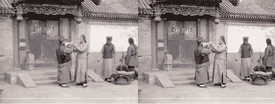

图 3-16 老北京视频利用 AI 修复前后对比

图片来源：https://hyper.ai/14992

图 3-17 电影《我的 1919》利用 AI 修复前后对比

图片来源：http://media.people.com.cn/n1/2020/1019/c40606-31896307.html

AIGC在影视领域的应用覆盖剧本、角色场景到后期制作，让作品更丰满。作为观众，我们期待更多优秀作品出现，相信AIGC会渗透更多环节，让影视打磨更精细。

## 游戏行业迎来AI革新
无论国内外，生成式AI都深刻影响游戏产业。游戏强互动、重实时体验的特性导致开发成本高昂，也为AI颠覆埋下伏笔。

即便是成本压缩到最低的独立游戏，开发到完成仍需数百万元预算，大型商业游戏更高。《和平精英》《第五人格》等头部产品的开发维护成本均进入亿元级。国外成熟市场也不例外，被誉为史上最昂贵游戏之一的《荒野大镖客2》，仅制作成本就达数亿美元，8个章节、100多个任务、千余角色配专属声线，画面精致却成本惊人。

因此国内外都认同游戏开发耗资费时，AI辅助创作工具备受期待。若生成式AI能深度应用，可大幅释放生产力、提升效率、缩短上线周期，同时显著降低成本，催生新类型游戏，为市场注入活力。

### 内容自动化生成
AI如何助力降本增效？游戏开发投入主要分人力成本与非人力成本。不管是个人独立制作还是公司化商业研发，这两项构成核心开支。

游戏研发花钱，最烧的就是人。做一款游戏的核心团队大致可归为策划、美术、程序这三块，再往下拆就是系统、文案、数值、关卡、引擎、角色、场景、美术风格、原画等大量细分岗位。除了人力，还有房租、水电、机器、服务器、IP 授权这些非人力开销，其中人力往往占据总预算的绝大部分。

在具体分工上，策划和程序要从立项跟到上线，全程在线，而真正吃时间、吃精力的往往是美术。角色、场景、整体美术风格的定调，以及游戏里出现的每一帧画面，都要美术来把控。近几年二次元赛道被进一步放大，年轻玩家对画面质感的要求越来越高，厂商对美术的投入也水涨船高。

拿国内的爆款来看，《崩坏3》和《阴阳师》都曾把手游市场带旺，也让市场进入了拼美术的阶段。画面精致、设计考究的二次元作品扎堆上线，行业直接进入内卷期。玩家要高品质，厂商只能加码成本来保住自己的水位，否则很容易被拉开差距。

在这种内卷下，AI 绘画成了缓解压力的一条路，也基本能兜住玩家对品质的期待。先说 2D 辅助。AI 目前更多是作为前期探索的参考工具，用在角色概念、场景概念、服装、武器、海报等环节，帮助团队在短时间内试探多种风格走向。需要澄清的是，AI 并不是直接替美工画成品图，大家要的不是能直接上线的原画，而是一个灵感触点——可能是色彩的暗示、构图的灵感，或是一点模糊的氛围感，创作者在此基础上完成真正的手工打磨。

Lost Lore 的创始人就分享过一个实操案例，他们做了一款叫 `Bearverse` 的手游。项目在角色设计阶段引入生成式 AI，原本估算要 5 万美元的费用被压到 1 万美元，还在 1 个月内完成了 198 个可操控角色的初稿。

游戏里全部角色都是熊，每只熊都有独立的阶级和部族设定。要靠传统手绘把 198 只熊区分开，工作量极大。AI 介入后效率跃升。

团队用 `Midjourney` 走“AI 文字提示 + 人工修正”的路线。生成一只新熊时，先把已有的熊图作为参考上传，再配上详细的提示词来锁定特征，比如主体色、熊掌里拿的道具、姿态、背景元素、是否带反射等。举例的提示词是“行军中的邪恶灰熊，铁制盔甲、头骨装饰、动态攻击姿势、古旧头盔加防毒面具，后启示录风格”。每只熊都有自己的独特点词库，这样就得到了如图 3-18 所示的结果。

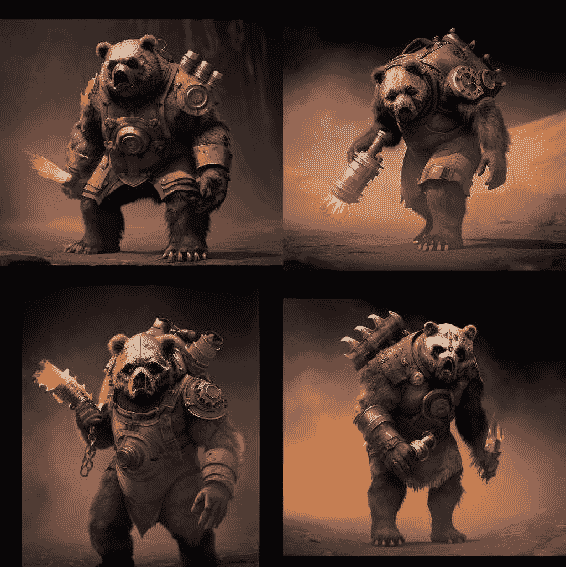

图 3-18 Lost Lore 工作室使用 AI 绘画生成的角色熊

图片来源：https://gameworldobserver.com/2023/01/27/ai-use-case-how-a-mobile-gamedevelopment-studio-saved-70k-in-expenses

AI 出图后，画师还要做二次调整，把结果调到符合游戏规范的最终角色。这个流程把前期设计的时间大幅压缩。AI 的用处不止角色，游戏里的部分 3D 建筑概念也由 AI 参与。先把手绘的建筑草图丢进 `Midjourney`，得到参考概念图（图 3-19），再由画师微调定稿。可以说，玩家在游戏里经过的不少场景都沾了 AI 的边。

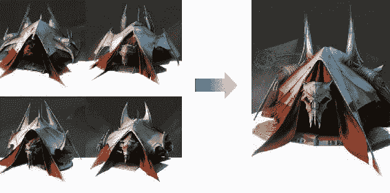

图 3-19 运用`Midjourney`绘画软件生成的 3D 建筑参考概念图（左边为草图，右边为生成结果）

图片来源：https://gameworldobserver.com/2023/01/27/ai-use-case-how-a-mobile-gamedevelopment-studio-saved-70k-in-expenses

用数字看更直观。以角色和场景概念为例，过去做一个角色大约要 16 小时，做 17 个就是 272 小时，约 34 个工作日。有了 AI 绘画辅助后，工作室的艺术总监不到一周就把 17 个角色的方案过了一遍。场景方面，原本需要 1 到 2 周的概念设计，被压缩到一天内完成。

`Bearverse` 的例子说明了 AI 在 2D 创作和 3D 概念上的放大效应，而这只是前期工作的冰山一角。动画、关卡和世界构建、配乐、音效、角色语音和对话等环节，生成式 AI 都能提供更多支持。

### NPC
游戏里常见的 NPC，也就是非玩家角色，早就被用来提升体验。街机时代的 `Pong` 就用虚拟对手制造对抗感，让玩家有和真人对战的错觉。但这类对手只是设计师写好的脚本，行为固定，无法根据玩家表现动态调整，互动体验有限。

生成式 AI 成熟后，OpenAI 等公司推出的 `GPT` 类自然语言对话模型，让高拟人化的 NPC 成为可能。很多厂商开始尝试打造能真正对话的角色。

早在 2005 年就有探索，比如游戏 `Fa?ade`。玩家扮演晚宴客人，和一对关系紧张的夫妻用文字对话，玩家的说法会直接影响夫妻关系和剧情走向。这种高互动玩法当时很受追捧。

作为实验作，`Fa?ade` 影响了后来大量互动设计的想象。随着生成式 AI 普及，`Charisma.ai`、`Inworld.ai` 等面向开发者的智能聊天平台出现。厂商可以基于世界观和角色设定，为游戏定制独有的 NPC，它们的语言和行为会随玩家不同而变化，核心是服务整体世界观。它们不再是摆设，在推动剧情和沉浸感上作用越来越大。

开发商 `Alientrap` 把 OpenAI 的 `GPT-3`、语音识别和语音合成结合，做了一个演示（图 3-20），发布后引发讨论。

图 3-20 游戏演示截图

图片来源：http://www.gamelook.com.cn/2021/03/434604

演示里测试人员和名叫 Bobby 的市政工作人员对话，单看回答方式很难分辨是真人还是 AI。这也预示着未来 NPC 会更智能，AI 会进一步提升游戏体验。

另外还有一批以娱乐为目的的聊天机器人，比如虚拟聊天应用 Glow。核心就是和 AI 聊天，用户可自行设定聊天对象的背景、性格、价值观，还能通过对话训练语气和说话风格。

## 创新型 AI 游戏
AI 不仅能降本增效，还能催生全新类型。以 Spellbrush 的 Arrowmancer 和微软的《模拟飞行》为例，两者都靠生成式 AI 的实时内容生成实现创新玩法。

Arrowmancer 是一款角色扮演游戏（图 3-21），最大特点是 AI 来捏角色，玩家自己当画师。用 AI 捏人的流程只有四步：初始形态、确定发色瞳色、完善细节、定格姿势。和市面上常见的捏脸相比，上限更高，画风还能自选，很受玩家欢迎。

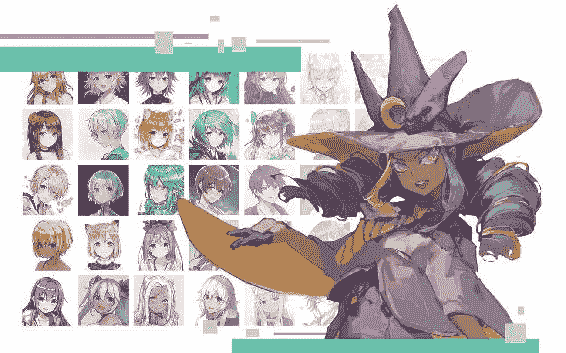

图 3-21 Arrowmancer 游戏概念图

图片来源：`https://www.arrowmancer.com`

《模拟飞行》主打真实世界和仿真飞行（图 3-22）。游戏地表由 Bing Maps 构建，细节通过 Azure AI 呈现，数据交互用 Project xCloud 云服务。相比传统飞行模拟，最大的差异是能实时生成地图和景物，这一切都靠 AI 支持。

图 3-22 《模拟飞行》游戏画面图

图片来源：`https://tech.sina.com.cn/csj/2020-09-04/doc-iivhvpwy4807517.shtml`

除了单机作品，机器学习与沉浸式娱乐结合的工作室 Hidden Door 也推出了 AI 游戏平台，玩家共同构建一个无限叙事的多元宇宙。在这里可以组队把故事世界重组为互动图文小说，有类似跑团的氛围和俏皮的 AI 解说员，任何人都能即兴创作冒险情节，生成的内容可被收集、交易、分享并混入新世界。

国外玩得成熟，国内也在跟进。网易、腾讯、字节跳动等一线厂商都推出了 AI 相关项目。网易《逆水寒》项目组宣布在 NPC 上用 AI，并提出“实装国内首个游戏 GPT”的口号，游戏内智能 NPC 能自由对话并给出有逻辑的行为反馈，已上线可体验。

字节跳动旗下朝夕光年无双工作室则把 AI 用在竞技场景，和字节游戏 AI 团队合作研发了竞技场 AI 机器人。系统能按玩家段位匹配合适的对手，机器人的表现更接近真人，提升对局体验和留存。

总体看，生成式 AI 在前期内容制作上的降本作用，有助于打破大厂垄断，也会推动类型创新。但设计师和艺术家并不会被取代，他们把重复耗时的工作交给 AI，核心创意仍在人手里。智能 NPC 提升可玩性的同时，也可能在现实生活中扮演问题解决者或陪伴者的角色。生成式 AI 作为基础工具，会在游戏市场中越来越常见。

元宇宙对技术能力提出更高要求，生成式 AI 的应用场景会更广，也为游戏产业指明了下一步方向。

# 第四章　商业落地：AIGC 的产业应用与前景
本章从“做什么事”的行业职能视角，讨论生成式 AI 怎样深度赋能传统行业的五大板块：研发、生产、供应链、营销、客服。在产业链里，生成式 AI 像催化剂一样为不同环节赋能。对职场读者而言，这部分内容贴合工作实际，希望能帮助大家更灵活地使用生成式 AI，重塑生产力。

## 研发设计：设计能力样样俱全
设计数字或实物原型的过程是典型的劳动密集型迭代。团队要通过多轮分析、理解和优化来打磨想法，但每次迭代都耗费时间和经费，开发期内完成不了太多轮，也难探索备选方案，最终往往不是最优解。生成式 AI 带来了一种新方式——生成式设计。

生成式设计利用 AI 为产品或零件提供多种变体，生成速度快，能缩短开发周期并增加创意选择。它可以是在已有产品上增删要素，也可以按要求从零生成新方案。通过分担标准化工作，工具让设计师更聚焦核心创新。

目前 AI 已能根据粗略草图和提示生成高保真效果图，并随 3D 模型发展延伸到产品设计领域，形成各种生成式设计工具。高德纳预计到 2027 年有 30% 的制造商会用生成式 AI 改进研发流程，下一个手机 App 或运动鞋可能就是 AI 设计的。同理，药物研发也在被改写，预计到 2025 年 30% 的新药由生成式 AI 设计。

产品设计大致分外观设计和结构设计两个阶段，外观是“由无到有”的形态塑造，结构是为实现性能而做的内部构造。下面先看 AI 在两个阶段的作用，再谈药物研发。

### 外观设计
CALA 是一个领先的时装设计平台，能把创意快速转化为草图、原型和产品，并统一在数字平台上。它的生成式 AI 工具已上线免费试用，基于 OpenAI 的 DALL·E。用户输入文字描述，AI 生成创意图，CALA 用此打造新型时装设计流程：输入关键词生成多套原稿，大幅加快节奏。

操作流程是先从 25 个基础款式里挑一个，如毛衣、衬衫、帽子等，再输入提示文本描述整体创意并选材质，最后输入提示文本调整装饰细节如袖口、拉链。以“鸭舌帽”为例，输入 `fashion，colorful，heart` 作为创意方向，约 20 秒后就能得到 6 套方案，基本符合要求（图 4-1、图 4-2）。

确定初步方案后，可直接丢进设计工作台继续修改，添加图案、批注或做精确测量（图 4-3）。

图 4-1 在 CALA 中选择款式和设计风格

图 4-2 在 CALA 中查看生成结果

图 4-3 CALA 设计工作台

CALA 并不是一键出成品，仍需要设计师的经验支撑，但它降低了新人门槛，也为资深设计师提供大量灵感，提升效率。时装领域的做法也为建筑外观等其他外观设计提供了参考。

建筑外观比时装复杂，对可用性要求更高。Stable Diffusion 这类图像模型内含大量建筑风格图像，但可控性仍是难题。光靠提示词很难得到想要的方案，例如用 Stable Diffusion v2.1 输入提示词 `The architectural appearance of the commercial complex in the city center, full of fashionable colors` 生成的图（图 4-4）往往只是好看而非可用。

更有效的做法是人机配合的渐进生成。建筑设计包含构思、草图、素材生成等阶段，可把每一步的输出作为下一步的初始图，在此基础上按新提示继续绘制，让 AI 贯穿流程。图 4-5 展示了设计师与 AI 协作完成写字楼从草图到定稿的全过程。

图 4-4 Stable Diffusion 生成的建筑设计图

图 4-5 Stable Diffusion 渐进式生成建筑设计图

# 生成式协作重塑研发制造

图片来源：`https://www.sohu.com/a/607863678_121124407`

和生成式模型配合工作时，建筑师可以在很短的时间内拿到一套可用的初步构想。模型往往会抛出很多新颖的点子，但要把结果调校到符合意图，还是要靠人来审校修正。把细节补齐之后，一份完整的建筑方案就能定稿。

从灵感到落地的链路被打通，在开放的运行机制下，创造力和产出效率被同时放大，这类体验被很多人视为一次关键拐点。业内普遍预期，生成式技术在各类外观造型领域会迎来快速扩张，并改变既有工作方式。

### 结构设计
结构探索是产品研发的另一环节，汽车零部件的结构优化就是典型的应用场景。美国通用汽车正借助基于人工智能与云计算的生成式方法，系统性地寻找车用部件的可行解法。配合增材制造，车企能够以更经济的方式制造复杂结构件和个性化组件，为用户提供更好性能与更多选择。

增材制造是通过材料逐层堆积成实体的成型技术，也被称作快速成型、自由成型等，通俗说法就是 3D 打印。近年来该技术已深度进入汽车制造。2015 年底特律初创公司 Local Motors 发布电动双座跑车 Strati，75% 的零部件使用 3D 打印；2016 年洛杉矶初创公司 Divergent 3D 在其后推出 700 马力的超级跑车 Blade，车身与底盘都采用 3D 打印。随后首款 3D 打印电动汽车 LSEV 在中国 3D 打印文化博物馆亮相，显示这类汽车会成为未来制造的重要方向之一。

如果说 3D 打印是通往未来汽车世界的门，生成式设计就是打开门的钥匙。生成式设计利用生成式模型与云技术把工程师和计算机连接起来，挖掘出单独依靠人或机器难以产生的零件解法。工程师先设定组件的目标与约束，比如材料、制造方式、预算等，输入软件后，软件通过算法遍历大量可能性并推荐最优解。

图 4-6 通过生成式 AI 设计出的汽车零件（左边为原始零件，右边为 AI 优化后的零件）

图片来源：`https://www.autodesk.com/customer-stories/general-motors-generative-design`

3D 打印与生成式设计结合，提升了汽车工业生产效率，让汽车实现更轻、更省油、更便宜，大幅增强品牌竞争力。提升性能只是起点，未来在经销商处即可经济高效地制造零件并定制车辆，比如按客户需求定制装饰包，用客户姓名或心仪球队标志个性化装饰，都将成为常态。

除汽车外，生成式模型在航空航天制造作用日益凸显。美国国家航空航天局的戈达德航天中心开发出一套把数字编码需求与生成式设计结合的航天部件设计工具，2 小时内即可完成部件设计，且成果完全符合 NASA 标准规范。该工具还能满足中心内部大量仪器的设计要求，包括避开光路、热隔离、黏合接头、螺栓接头等。

戈达德航天中心的一项对比研究把人工设计与生成式设计并排评估，对比结果见图 4-7。人工设计共迭代 4 次：第一次方案过重，实物 0.59kg；第二次加入镂空减重；第三次调整镂空提升刚度；第四次是全新思路，虽满足要求但用数控机床或 3D 打印都不易制造。

图 4-7 人工设计与生成式 AI 设计对比

数据来源：Ryan McClelland, “Generative Design and Digital Manufacturing: Using AI and Robots to Build Lightweight Instruments”

多方面来看，生成式设计优于专业人工。人工方案中仅初始版本易于制造，而生成式设计的方案均易制造；刚度质量比提升 3 倍以上，最大应力显著下降。这种性能跃升在机械设计中并不常见。最关键的是速度：两名工程师花两天才能完成的设计，用生成式模型只是一名工程师 30 分钟梳理需求，约 1 小时即可生成方案。开发周期与成本大幅压缩。

生成式技术在生产制造行业快速演进，结合数字制造等关键技术优化设备结构的设计与制造，让研发时间大幅缩短、性能显著提升，这些改进过去难以实现。结构设计领域正迎来全面变革。

### 药物研发
人工智能已在医疗领域广泛应用，辅助问诊、制定治疗方案、药物研发等环节发展迅速。ChatGPT 出现后，医疗问诊的互动方式、反馈内容、准确率与效率都有明显提升。

大型互联网公司纷纷通过研发或收购推出生成式医疗平台。GPT-4 发布前一天，谷歌联手 DeepMind 发布医疗专用生成式模型 Med-PaLM，用于回答医疗保健相关问题。此前微软语音识别子公司 Nuance 发布结合 GPT-4 的医生临床记录模型 DAX Express，这是首个融合 GPT-4 的医疗行业应用，可在数秒内自动生成临床笔记，大幅减轻记录负担。

随着技术成熟，模型不仅用于辅助问诊，还深度介入药物设计。辉瑞、强生等国际药企均尝试用人工智能研发药物，利用生成式模型设计针对特定疾病的蛋白模型，部分药物已进入临床试验。生成式设计从宏观延伸到微观分子层面。

药物研发涵盖药物发现、临床前研究与临床试验，耗时漫长、投入巨大。药物发现包括识别与选择药物靶点、发现或设计先导化合物、优化先导化合物、遴选候选药物等，难点在于靶点发现与化合物设计。生成式模型颠覆了传统进程，通过海量数据测算快速锁定药物靶点，从数据库匹配合适分子，进而完成化合物设计、预测代谢与理化性质、分析对人体作用等，缩短周期、降低投入、提升效率。

传统流程中，靶点发现与化合物设计需大量实验筛选，从数百上千个分子中寻找有效化学分子，能进入临床准备阶段的极少。人类思维易趋同固化，难以跳出框架设计创新药物。大多数潜在靶点是蛋白质，结构决定功能，需设计 2D 氨基酸序列折叠成 3D 蛋白，蛋白质可折叠形态数量庞大，带来巨大难题。

生成式模型在该方向具备先天优势：可通过机器学习挖掘与计算大量数据，迅速发现靶点提高命中率；还能计算蛋白质折叠的最佳模式，进行 3D 结构设计；更能突破人类固化认知，生成此前未曾考虑的新方案，预测、设计并生成全新蛋白，提供新药物设计思路。

## 生成式 AI 在研发设计、生产制造与供应链管理中的应用

## 生成式 AI 在药物设计与研发中的应用
目前生成式模型在蛋白质设计与改造上取得实质性进展，能实现设计建模、改造与进化。Salesforce Research、合成生物学公司 Tierra Biosciences 与加州大学团队联合研发的新型系统 ProGen 可从零生成蛋白质，且多样性很强。ProGen 生成的人工溶菌酶与天然溶菌酶序列一致性仅 31.4%，却具有相似活性，催化效果得到验证，首次打通模型预测与实验的壁垒。

英伟达的云服务 BioNeMo 可用于生成、预测与理解生物分子数据，加速药物研发中最耗时耗财的阶段，包括加速蛋白创造。该产品依托专有数据，通过生成式模型设计蛋白结构，辅助研发出最佳候选药物。用户可通过浏览器界面交互式推理与实验，确定蛋白结构并可视化呈现，大幅加快研发设计流程。

生成式模型在分子生成与设计的应用不仅限于大分子蛋白，小分子领域已有落地。2020 年人工智能制药公司英矽智能 Insilico Medicine 推出分子生成与设计平台 Chemistry42（图 4-8），借助前沿算法从零设计新颖分子，并持续评估分子结构，在生成式模型的辅助下进行药效、代谢稳定性、合成难度等多维度评分与优化。2023 年 2 月，英矽智能宣布新冠小分子药物 ISM3312 获批进入临床试验。该药是冠状病毒复制必需的 3CL 蛋白酶小分子抑制剂，源自 Chemistry42 平台设计的分子结构优化而来，是英矽智能第二款模型设计小分子药，也是全球首款获批临床试验的模型设计新冠口服药。得益于生成式模型的参与，ISM3312 具备新颖结合方式与分子骨架，相较其他 3CL 蛋白酶抑制剂作用机制不同，展现出差异化潜力。

图 4-8 `Chemistry42`用于配置基于结构的药物设计生成实验的界面

图片来源：Yan A. Ivanenkov, et al, “`Chemistry42`: An AI-based Platform for De NovoMolecular Design”

生成式模型在药物设计领域的应用是模型生成能力从宏观到微观的延伸，但受基础数据与设计精细度限制，仍无法承担全部流程，从设计到成药困难重重。尽管如此，借助大数据与大模型，生成式模型已为药物设计提供强力助力，随着模型与数据积累，其在医疗与生命科学领域的作用将愈加关键。

无论外观设计还是结构设计，从宏观世界到微观世界，生成式模型都展现出强劲设计能力，应用前景广阔。当前其在方案生成时仍以辅助为主。因为设计的价值不仅在于图纸输出，更在于背后的体系化思考、需求对接、市场理解与用户共情，这些仍需设计师的专业与经验，并在实践中校正、迭代与落地。但不可否认，生成式模型应用于研发设计的优势明显，能迅速创建与修改设计，提供海量创意供挑选，提升效率。协作下设计师可更快获得初步方案，利用模型辅助成图表达效果，突破知识边界与思维局限，更好发挥创造力。随着研究深入，其在研发设计中的应用场景必将愈加丰富。

## 生产制造：“L4 级别”的智能控制
L4 级自动驾驶指高度自动驾驶，能在特定条件下完成驾驶任务无需驾驶员操作，是当前自动驾驶的最高水平。生产制造领域，智能制造同样能实现“L4 级别”的智能控制。设想这样一幅画面：车间里各类机器人忙碌，有的负责组装，有的负责运输，产品从组装、质检、打包到运输全程自动完成；设备需维护时会自动通知技术服务部门。这正是智能工厂的日常，制造过程由智能设备与程序主导，各工序数据通过传感器完整上传云端，技术人员在控制室即可掌控全局。

继蒸汽机、电气化、数字信息化之后，智能制造对应第四次工业革命，亦称工业 4.0。工业 4.0 由德国提出，核心是自动化提升与智能机器、智能工厂的使用，同时利用数据分析与洞察提升生产与供给效率，生产灵活性增强，制造商可通过大规模定制更好满足客户需求。

智能制造已在多行业落地。汽车制造中，上汽大众安亭新能源汽车工厂采用近 1500 台工业机器人，车身与电池车间基本实现无人化全自动生产，总装车间自动化率较传统总装提升近 45%，极大提高全流程效率，代表全球汽车行业先进制造水平。家居行业，美克国际家居携手 IBM 的智能制造项目从设备、产线、运输、计划协调等多方面智能化改造，利用工业机器人实现自动化生产，提高劳动生产率、降低人力需求，产能翻番，交付周期从行业平均 120 天缩短至 35 天。

图 4-9 上汽大众新能源汽车工厂

图片来源：https://www.csvw.com/csvw-website/news/company-news.html?newsid=2927

随着智能制造普及，制造领域将越来越多应用工业机器人。传统控制多以预设编程指令为主，工况变化需编写新指令适配。如今生成式模型带来新思路，允许机器人或机械臂通过模拟学习物体相互作用，而非单纯依赖预编程完成工作。

### 机器人控制
本节讨论仅限工业机器人。按 ISO 8373 定义，工业机器人是面向工业领域的多关节机械手或多自由度机器人，是靠自身动力与控制能力实现各种功能的自动执行装置。工业机器人最早诞生于 1954 年，美国人乔治·德沃尔首次提出概念。1959 年，德沃尔与合伙人建立 Unimation 公司，生产出第一台工业机器人 Unimate（图 4-10），开启机器人发展新纪元。

最初的 Unimate 重约 2700 磅，约 1.2 吨，功能较为单一，安装在压铸产线用于搬运压铸件并焊接。随着产业需求变化，工业机器人精度不断提升，能力日益增强。如今汽车、金属、化工、医药等传统行业，以及手机、平板、智能穿戴等新兴产线都能看到工业机器人的身影。2022 年 12 月，ABB 推出占地仅 135mm×250mm 的史上最小六轴工业机器人 IRB 1010（图 4-11），可精细处理可穿戴设备内部各类小型组件，契合可穿戴智能设备快速发展下制造商在狭小空间快速生产的迫切需求。

图 4-10 工业机器人鼻祖——`Unimate`

图片来源：https://www.roboticscareer.org/news-and-events/news/23360

图 4-11 “史上最小”六轴工业机器人——`IRB 1010`

图片来源：https://new.abb.com/news/detail/95706/prsrl-abb-unveils-smallest-industrialrobot-with-class-leading-payload-and-accuracy

随着应用广泛，不同场景的控制需求愈发复杂。目前多数工业机器人仍采用底层空间定位控制，通过编码实现一系列固定动作并循环执行。这种方式在特定环境自动化作业中相当有效，但缺点明显，工况稍有变化即导致运行出错。以码垛机器人为例，工件位置与摆放角度变化时，可能无法准确抓取，导致后续工作失败。

现已有技术尝试增加视觉感知能力，借助工业视觉让机器人自动识别工件位置，动态调整移动距离或抓取角度，提升对复杂工况的适应性。但该优化仍只适合相对简单场景。如今生产制造对机器人泛化能力要求不断提高，工件形状、重量、硬度都会变化，不同规格需分情况处理，让机器人自如应对多样性成为新挑战。

为解决这些问题，谷歌机器人团队等提出 RoboticsTransformer 1（RT-1）。即我们此前提及的 Transformer 模型在机器人控制领域的自然延伸。这是一种多任务模型，能准确把视觉设备采集的实时画面与指令文字描述转化为机器人最终动作序列，实现运行时高效推理，使实时控制成为可能。该过程如图 4-12 所示，文字与图像信息先经卷积神经网络 FiLM EfficientNet 预处理，生成中间编码向量，再由 Transformer 模型转化为机器人可理解的一系列操作指令，机器人依次执行完成任务要求。

图 4-12 `RT-1`技术原理

# 生成式AI正在重塑制造与供应链

谷歌团队历时13个月，汇聚了超13万段视频、700多个任务，由17台机器人共同采集，搭建起大规模训练集。在此基础上研发的RT-1机器人，已能完成拣取、安放、拉开抽屉、合上抽屉，以及把物品放入抽屉或取出等操作。为检验泛化水平，团队从四个维度施压：从未见过的指令、干扰物下的抗扰能力、不同背景环境的适应力，以及把这些因素叠加的真实场景。测试结果显示，RT-1在各项场景下表现稳健，整体成绩明显领先同类模型。

RT-1为工业机器人迈向通用化提供了一个可落地的范例。借鉴其训练与部署思路，未来各行业很可能出现泛化更强、智能更高的机器人产品。

图片来源：Anthony Brohan, et al, “`RT-1`: Robotics Transformer for Real-WorldControl at Scale”

图 4-13 `RT-1`机器人在不同维度上的泛化能力测试

图片来源：Anthony Brohan, et al, “`RT-1`: Robotics Transformer for Real-WorldControl at Scale”

### 多臂联动如何实现精准协作
强模型能让单台工业机器人更聪明，效率也能提升，但单机能力终究有天花板。面对产线上的复杂指标，单打独斗往往吃力，多机协作因此进入研究视野。

相比单机，多机器人系统在承载力和容错力上更具优势。群体作业可分工配合，工作周期大幅压缩，整体产能随之上升；任务并非完全绑定在单一机器上，某台设备失效时，系统可即时调度其他机器接手，从而降低整体出错概率。

协同控制是多机系统的核心课题，尤其在生成式AI蓬勃的当下，如何用新思路提升协作效率值得深思。已有研究针对铰接式物体的多臂操作，证实生成式AI能起到积极作用。

铰接式物体指由铰链连接的两个部件，可相对转动。最典型的是门，门与墙体通过铰链固定，开关门理论上只需一只手。我们关注的是两个活动部件通过铰链连接的情况，比如剪刀、钳子。小尺寸的只需两指操作，大型则需要双手协同。在工业场景中，这类工件往往需要多台机器人配合完成，看似简单，实操难度却很大。

为此，研究团队提出V-MAO方案。输入是一张包含铰接物体与场景的RGBD扫描图，即在彩色图像上叠加深度信息。基于该扫描，生成模型会学习每条机械臂的理想接触点分布。示意上，第二臂的生成模型会以第一臂的动作作为条件来预测自己的操作点。

图 4-14 `V-MAO`工作原理

图片来源：Xingyu Liu, Kris M. Kitani, “`V-MAO`: Generative Modeling for Multi\-ArmManipulation of Articulated Objects”

研究者把多臂协同操控抽象为一个生成问题：从“铰接物体各刚体部分的点云分布”到“多臂操作接触点”的映射，并采用分层方式同时捕捉局部细节和全局结构。模型沿用编码器-解码器架构，用来处理点云的几何形态和特征分布。在自建仿真环境中验证，该方法在六类不同工件、两种不同机器人上的成功率都很高。这说明，通过学习复杂工件的接触点分布，生成式AI能够实现多机器人协同的智能化控制。

### 工厂质检正在被AI接管
质检是制造链条的守门环节，凡是进入市场的产品都必须通过检验。不同品类质检标准不同：饮料要看外包装是否完好、日期是否清晰；汽车零部件则要检查表面划痕、倒角是否合规。

传统人工质检存在明显短板：标准因人而异且个人也会波动；工作单调重复易疲劳，导致漏检误检上升；经验难以复制，人员流失后需要重新投入大量培训成本。

现今企业转向AI质检。如图 4-15，AI质检利用基于深度学习的视觉检测技术，在产线对产品图像进行实时判别，发现缺陷后联动运动机构剔除问题品，从源头消除质量隐患。

图 4-15 AI 质检系统结构

全面替代虽是大势所趋，但深度神经网络的视觉模型对缺陷样本有较高依赖。尤其是微小、弱对比度的缺陷，样本稀缺、难采集，且现场采集成本高，导致模型难以达到理想水平，漏检误检风险依然存在。

应对之策是缺陷库扩充。传统数据增强仅靠平移、旋转、缩放、翻转等图像变换，对小样本弱缺陷帮助有限。生成式AI提供了新路径：先用生成模型合成缺陷图像，再用合成数据训练检测模型。具体分两步走：第一步为同一类缺陷制作不同位置的种子图，可人工构建或通过平移生成；第二步对每张种子图生成不同强度的缺陷样本，如图 4-16 所示，每行从左到右缺陷强度递减，共生成6张不同强度图，实际中可扩展更多。缺陷库随之大幅丰富。

图 4-16 指定缺陷类型生成不同缺陷强度图片

图片来源：Shuanlong Niu, et al, “Region — and Strength — Controllable GAN for DefectGeneration and Segmentation in Industrial Images”

经过扩充后，模型对低对比度缺陷的识别能力明显增强，整体检测性能同步提升。这印证了生成式AI在质检领域的实际价值，也让更多场景的AI质检成为可能。

生成式AI不只是擅长理解和创作文本图像，它正演化为通用的基础模型，为传统制造业智能化提供强大支撑。工业控制与质检的成功实践已然证明这一点。未来，借助成熟的生成模型对制造设备进行智能化改造，将是持续关注的重点。

## 供应链智能化：库存也能自动编程
供应链是从原材料供应商延伸到终端消费者的全流程网络，涵盖供应商、生产商、分销商、零售商等。供应链管理聚焦产品流、信息流、资金流的整合，目标是最大化客户价值、最小化成本。核心模块包括需求预测、库存规划、仓储设计、配送优化。随着数据积累，数据驱动的方法让企业在全链路实现降本增效。

### AI在供应链的切入点
## 供应链AI应用全景
供应链数据丰富，但管理仍高度依赖经验。很多管理者只能凭常识粗略判断，ERP、WMS等系统虽能记录数据，却不会给出建议，缺乏预警和前瞻性指导。在复杂多变的环境下，决策往往滞后，容易造成成本浪费甚至丧失竞争优势。

麦肯锡预计，AI在供应链中的大规模应用，每年可为企业创造1.3万亿到2万亿美元的经济价值。AI能处理海量数据洞察现状，辅助合理决策。当供需失衡时，AI的预测能力可提前预判需求、规划网络，让商家从被动变主动。物流端也能据此调配运力，把资源投向需求旺盛区域，降低运营成本。此外，AI还能做复杂情景模拟和精准仓储、库存优化。

未来几年，智能仓将成为主流，大型仓库将高度自动化。AI成为不可或缺的驱动力。亚马逊的CartonWrap自动化打包线，由分拣、裁切、打包等模块组成，理想状态下每小时可输出1000个包裹，效率是人工的5倍。阿里巴巴的智能仓通过自动化系统日处理超百万件商品，运输、仓储、装卸、搬运基本全自动，人工仅保留条码复核、分拣机监护等环节，效率提升至少30%，拣货准确率接近100%。

AI已深度渗透供应链各环节，提升效率、降低成本。其中生成式AI在需求预测和库存管理上作用尤为突出。

## 从经验到算法：需求预测升级
供应链以市场需求为指挥棒，需求预测是所有计划的基础。做准需求，才能实现产销协同。以物美超市为例，借助需求预测，商品缺货率从17%降至个位数，库存周转天数由27天压缩到17天。

传统预测依赖专家意见或基础统计，工作量大、成本高、精度有限。AI预测则整合多维数据，提升时序模型的准确性。

模型输入通常包括：商品特征库，涵盖属性、文本、图像等多维度标签；历史销量，是时序建模的基础；季节性因素，捕捉需求周期规律；促销活动，评估活动对销量的短期冲击。如图 4-17 所示，AI预测值与真实值高度贴合。

在零售中，AI对未来两周的需求预测准确率可达75%至85%，而传统经验加人工方法通常不超过70%。同时，库存周转天数明显下降。例如生鲜品牌借助AI预测优化库存，减少损耗和经营风险。

图 4-17 AI 需求预测值和实际值对比

生成式AI进一步提升了预测的速度与精度。以往介绍的seq2seq架构被应用于此，图 4-18 展示了模型结构。该架构在不同门店、不同时间、不同商品上均可复用，降低了预测复杂度，兼顾低计算成本与高精度，能高效支撑供应链应用。

图 4-18 是用于需求预测的seq2seq模型架构。编码器接收历史销售额及时间相关附加数据，输出最后时间步的隐藏向量；中间的上下文条件模块将该向量与静态不变数据融合；解码器以此为初始状态，自回归生成未来序列预测。这正是生成式AI在供应链中的典型用法，它不仅会写会画，还能提供可靠的预测洞察，推动供应链智能化。

图 4-18 用于需求预测的 seq2seq 模型架构图

图片来源：Iván Vallés-Pérez, et al,“Approaching Sales Forecasting Using RecurrentNeural Networks and Transformers”

## 库存管理：从被动补货到主动优化
库存管理不是简单的补货，而是通过科学手段平衡服务质量与企业利润。核心是通过分析和建模评估库存策略，在考虑订货成本与储存成本的基础上确定经济订货批量，并兼顾全链路影响。

有效库存管理可帮助企业平衡资源，利用来识别、缓解缺货与滞销风险。

库存需要在客户下单前准备好，这需要精准预测。库存过高导致滞销亏损，过低则引发缺货和客户不满。传统管理依赖经验，常出现断货与积压并存。AI可通过学习预测消费者需求，动态响应趋势变化。基于预测与优化算法，结合历史销量、季节、促销等因子，AI可实时调整安全库存、补货点、补货量，制定最优方案。区域需求、季节变化等也被纳入考量，以避免商品在货架上流失或在仓库中变质。

服务水平提升意味着安全库存增加，成本也会上升；服务不足则流失客户。AI库存管理可合理设计安全库存，精确计算补货时机，制定多元化补货计划，并在需求变化时动态调整，实现降本增效与客户满意度双提升。

大规模生产网络极其复杂，可能涉及数千种成品、数万至数十万种原材料与中间品，库存决策难度极高。传统模拟方法在处理普通系统尚可应对，面对大规模问题则力不从心，因节点数量庞大，建模与优化成本难以承受。

此时，生成式AI常用的序列模型提供了新思路。库存模型与RNN有相似之处：RNN对时序数据建模，每步接收当前输入和上一步输出计算结果。库存系统同样在每个时间点包含三个对应部分：输入为外部需求，内部结构为复杂的库存网络，输出为管理成本。且每个时间点的状态会序列式影响后续图 4-19。因此，库存优化可转化为序列模型的训练问题。

图 4-19 RNN 生成库存模拟示意图

图片来源：Tan Wan, L. Jeff Hong,“Large-Scale Inventory Optimization: A Recurrent Neural-Networks-Inspired Simulation Approach”

据估算，把序列建模思路引入库存管理模型，能让整体计算提速约三个数量级，足以应对大规模库存难题。图 4-19 中间一行框住的部分其实暗藏着很复杂的网络结构。将库存模型与序列建模关联起来是值得推广的做法。现阶段生成式技术还在快速演进，序列建模的形态也随之多样化，像注意力机制这类方法，很可能为库存模型的设计提供更有力的思路。可以预见，未来将有更多成熟的生成模型进入库存管理实践。

整体来看，智能技术在供应链里的渗透在加快，需求预测、库存管理等难题都能从生成式方法里获得思路。依靠精准预测，供应链各节点配合更顺畅，资源在链路上分配更合理。库存端，系统能对安全库存、经济订货批量等指标给出及时且可靠的预警，并为调拨补货提供可操作的建议。仓储端，系统可帮助管理者进行资源调配并输出实时作业信息与风险提示。作业层面，拣选路径规划与仓库机器人协同可实现端到端自动化。

目前供应链中智能技术的落地已较为普遍，复杂场景下的表现仍在摸索，但可以预见，生成模型能够联动价格、库存、仓储、配送等多个环节，推动资源配置进一步优化。暂且不谈数据整合与贯通的基础工作，生成模型的兴起几乎必然带来一次跃升。理想的运作模式是判别模型负责预测与判断，生成模型通过学习与模拟给出建议方案，最终由管理者拍板，不久或将成为常态。

## 营销创作进入减负时代

在智能时代，企业每一次与用户的接触都在累积数据，管理决策高度依赖数据。对于营销这类强数据驱动的专业，智能技术与之天然契合。浏览网页或短视频时，系统能精准推送感兴趣的文章、视频或直播；逛电商时，相关商品仿佛心有灵犀般呈现。这体现了判别模型锁定核心人群、匹配个性化内容与产品的价值，已成为行业标配。

随着生成模型的突破，其在营销中的应用场景快速扩散，重塑玩法。生成模型凭借内容生产力，可批量产出活动所需的创意素材。价值远不止于此。品牌借助多模态生产效率的提升，可打穿营销全链路，在购买旅程的不同阶段输出差异化内容，激发兴趣并加深品牌认知。

例如文心一言等工具在与潜在用户对话时，可通过商品或内容推荐引发注意；对已购用户，它可扮演贴身客服，个性化陪伴，提升停留时长，让品牌更牢地占据心智，从而提高转化与复购。通过助力全生命周期运营，生成模型正由表及里渗透到日常营销。下面从方案制定、素材生产、沟通触达三方面说明其如何提升效率并实现个性化。

## 投放方案可由模型自动生成

企业营销数据往往未完全打通，整盘策略的自动生成仍有难度，但在细分场景里产出可执行的方案已可行。广告投放即典型案例。如今投放系统大量使用基于机器学习的判别模型自动优化效果，优化师的部分工作已被逐步替代，判别模型已成为投放的基础设施。

随着 AIGC 普及时，需求从“优化效果”转向“方案本身由模型生成”。把预算、目标、人群、媒体、传播要点等条件输入模型，类似作画时的提示词，生成模型便能输出最优投放策略。

沿此思路，判别模型与生成模型结合，有望推动数字广告进入新阶段。效果类数字广告的参数结构化程度高，结果可确定且可实时反馈，为模型决策与优化提供土壤：一边判别模型实时调优执行，一边生成模型在投放前制定的策略也能依据实际效果自动迭代。最终模型选出的方案常带出人意料，效果也更理想，正如扩散模型总能产出令人惊讶的画面，却常被专业创作者借鉴。

国外案例中，营销 SaaS 头部厂商 Adobe 用智能技术优化预算分配与场景规划。系列机器学习算法将评估与规划结合，使用者可把跨渠道数据分析周期从数月压缩到数周。产品能生成最优预算分配方案以最大化投资回报并达成收入目标，也能洞察用户在不同渠道、不同时间的行为，优化全旅程体验，帮助众多企业取得丰厚回报。

国内方面，蓝色光标旗下销博特在 2022 元创版本中推出智能策划模块，聚焦多人协同。通常一场策划需专业小组经历草案、数据分析、头脑风暴、媒体规划等多轮沟通，耗时数周。使用模块后，用户填写简报发起项目，模型约 30 分钟内生成初版方案，随后邀请团队成员加入讨论与完善。策划成型周期被压缩至 2-3 天。

## 文案与视觉素材的批量生产

营销人最困扰的往往是创意如何诞生并低成本落地。过去有人靠收集上万条案例背诵来练手。如今借助 AIGC 工具，文案与图像可快速生成并筛选，效率明显提升。

Stable Diffusion、Midjourney、DALL·E2 等图像生成工具展现出惊人能力，ChatGPT、GPT-4、文心一言等在文案生成上各有优势。Jasper.ai 核心产品用生成模型帮助企业与个人撰写营销内容；Copy.ai 数秒内产出高质量广告文案。Persado 通过拆解叙事、情感、描述、格式等要素进行多组实验，找到与每个用户沟通的最佳表达，模型随数据不断进阶。此类个性化能力曾帮助戴尔点击率平均提升 50%，转化率平均提升 46%，加入购物车比例平均提升 77%。

Phrasee 也是值得关注的玩家。它可在社媒、推送、邮件等多渠道自动生成营销文案，提升打开、点击与转化，且始终保持品牌调性。客户反馈积极：英旅游巨头维珍假日称邮件收入增数百万英镑；达美乐比萨表示邮件效果显著改善；沃尔格林甚至用其生成内容提升客户互动与新冠疫苗接种率。

在视觉侧，德国电商巨头 Zalando 为合作品牌提供前沿方案：把指定模特的服装颜色或身体姿势迁移到另一模特上。此类生成方案可快速制作营销图，避免大量重复劳动（图 4-20）。

图 4-20 将衣服颜色和模特姿态（第一行）迁移到目标风衣上（第二行）

图片来源：Gökhan Yildirim，et al, “Generating High-Resolution Fashion Model Images Wearing Custom Outfits”

Adobe 近期推出的 Firefly 创意生成模型，把 AIGC 元素直接带入工作流。用户可用橡皮擦工具擦掉模特身上的衣服，输入“A red jack”等文字描述瞬间换装，还能调节面部细节如年龄、笑容和睁眼幅度。期待其很快融入产品矩阵，大幅提升图片创作效率。

国内腾讯自研的腾讯广告混元智能大模型是广告系统理解内容的核心引擎，千亿参数规模，能准确理解文字与图像蕴含的信息，甚至可将文字、图像、视频作为整体理解，使广告理解更贴合用户整体感受。多模态理解能力可精准把广告推送给合适人群，提升体验与效果。除理解能力外，还具备文字、图像、视频综合生成能力：“图生视频”可将静态图自动生成不同样式的视频广告；“文案助手”可为广告自动生成更合适的标题；“文生视频”未来只需一句文案即可生成匹配视频。创作门槛与成本因此显著下降。

## 沟通触达的智能化升级

营销沟通指企业通过媒介把产品信息、理念与情感传递给消费者的过程，包括广告、公关、促销、个人推销与直销等。这里重点看电话外呼与直播带货。

电话外呼能快速有效触达客户并积累口碑。例如教育行业新课发布时，外呼系统可自动拨打或使用外呼机器人触达，将有意向学员转人工，提升服务效率。系统会把意向客户录入 CRM，记录沟通内容、跟进计划并提醒二次触达，管理者也能实时查看通话录音、接听率、通话时长等指标。

尽管智能外呼机器人已广泛使用，传统方案沟通效果有限：一是难以理解复杂对话与解决复杂问题，目前多停留在初步筛选意向客户，仍需人工配合；二是训练、部署与优化成本较高，通常需按业务场景定制，企业需权衡投入产出。

随着 AIGC 发展，“更懂你”的外呼机器人正在出现。人工智能服务商百应科技从三方面探索结合：其一，把类 ChatGPT 模型纳入智能中控引擎作为回答源，提升准确率，使多轮对话更自然；其二，任务式对话中的意图理解可借助类 ChatGPT 模型结合对话聚类实现，便于发现新类别与相似问题；其三，外呼机器人主动触达时需运营师配置流程与知识库，类 ChatGPT 模型可辅助运营师提效，同时优化对话流畅度与体验。未来搭载 AIGC 的外呼机器人将带来全新通话体验。

若说外呼机器人是幕后英雄，虚拟主播已走向台前。虚拟主播以虚拟形象活跃于视频平台，国内常称虚拟 UP 主。它可提供 24 小时不间断的产品推荐与在线服务，成本低、效率高且“不挑活”，同时不存在人设崩塌风险，人设与言行由品牌掌控，可控性更强。

2022 年双十一期间，多家电商平台直播间出现虚拟人。半夜时分，美妆品牌旗舰店直播间几乎都能看到虚拟主播。京东美妆虚拟主播曾现身欧莱雅、玉兰油、圣罗兰等 20 多个大牌直播间，24 小时在线，用专业美妆知识解答疑问，提供精准选购体验。

魔珐科技打造的虚拟偶像翎 Ling 背后是“有光”虚拟直播产品。消费版仅需 1 个摄像头与 1 台笔记本即可开播，大幅降低成本。可为品牌生成主题 3D 虚拟直播间，实现高精度全风格 3D 虚拟形象，支持弹幕礼物互动 3D 玩法，并按需求定制角色姿态、表情包、动作库与才艺技能。

虚拟主播离不开先进生成技术，魔珐科技的核心技术包括智能建模与绑定、智能表演动画与变声、基于文本的动画与语音生成、预制动画与实时动画拼接、实时解算与渲染等。在这些技术支撑下，原创虚拟人妲己曾做客珂拉琪直播间，身着酷炫紫发形象逼真，狐狸耳朵可爱，介绍口红色号信手拈来，与真人主播配合自然毫无违和。

总体而言，生成模型已成为营销热词，在方案、文案、图片、沟通等环节都能发挥关键作用。配合判别模型锁定核心人群并实现个性化推荐，生成模型既能提升营销投资回报，也能优化客户体验，在提振业绩的同时塑造良好品牌形象。

## 客户服务的人性化跃迁

未来几年，生成式智能的重要分支对话智能的商业化路径清晰可行，有望在多个场景逐步替代人工客服。主因有二：一是主要经济体人口增速放缓，劳动力减少导致用工成本上升，各行各业有强烈替代需求；二是智能客服机器人能承担人工难以胜任的工作，效率更高且错误率更低。零售、金融、电信等劳动密集型行业的客服，很可能成为首批被替代的领域。下面从三维度看生成模型如何重塑客服价值。

### 沟通质量的实质提升

消费者生活方式与行为模式变化，服务期待不断提高，个性化需求日益突出。近年来企业大力建设客服中心，我国座席规模持续增长，年复合增长率保持约 17%，2020 年已突破 300 万个。随着规模扩大，用人成本也在攀升，企业需要在满意度与成本间寻求平衡。

传统客服工作强度大，经常加班轮岗，内容枯燥重复，耗时耗力，客户投诉也易导致情绪积压，流失率高，进而推高招聘与培训成本。客服中心还面临招聘难、效率低、高峰波动大、质检绩效管理耗时等难题，运营难度加大，企业难以满足客户需求，也难以挖掘客服数据的价值，长期看会流失客源。

智能客服有望破解这些痛点，实现真正的数字化、智能化运营。

当前生成模型正重塑内容生态，对话类模型如 ChatGPT 的对话能力已在实际应用中显现，可承担客服角色。但商业级智能客服需要在明确的业务与服务目标下，结合专业知识与业务逻辑给出可靠解答，最终解决问题。目前 ChatGPT 在客服场景的响应准确性仍不足，若要在智能客服中使用，需针对具体业务微调模型，并通过审核修正持续训练，以提升专业能力。

旧金山起家的客服自动化服务商 `Intercom` 在这条路上走得很远。已有超过两万五千家企业让客服团队运行在 `Intercom` 的方案之上，持续用 AI 为客服加码是这家公司的长期主张。`ChatGPT` 上线后不久，`Intercom` 便在自家产品里推出了多项人工智能能力，希望借助生成式 AI 提升处理效率。实践下来效果并不理想，特别是遇到找不到依据的问题时，`ChatGPT` 倾向于编造内容，而在客服场景里这种失真是致命的。

随着 `OpenAI` 发布 `GPT-4`，上述幻觉问题得到明显改善，`Intercom` 紧接着在该模型基础上构建了客服机器人 `Fin`。`Fin` 继承了 `GPT-4` 的核心长处，同时更贴合客服业务的实际要求。设计上聚焦四个方向：第一，依托 GPT 实现流畅自然的对话交互；第二，回答严格限定在企业可控的信息范围内；第三，将错误或不准的回复控制在可接受水平；第四，尽可能减少人工接手的比例。

`Fin` 以前沿的 AI 对话能力为底座，相较传统机器人更能自然地进行客服沟通。它还能理解跨多个轮次的上下文，客户在得到初步答复后提出追问，机器人可作进一步解释。在客服领域，可信度与可靠性是根本，`Intercom` 在 `GPT-4` 之上做了针对性的增强与防护。比如 `Fin` 只依据企业现有素材作答，从而提升准确性与可信度。再者，为降低失误风险，`Intercom` 为 `Fin` 设计了新的交互界面——给出答案时会自动附上来源文章链接，让客户自行核验信息出处，也能在出现小偏差时减小负面影响。

图 4-21 当`Fin`给出答案时，它会链接到其来源文章，让客户验证来源是否相关

图片来源：`https://www.intercom.com/blog/announcing-intercoms-new-ai-chatbot`

即便再聪明，聊天机器人也无法覆盖全部问题。当超出能力范围时，`Fin` 可把对话无缝转交给人工支持团队。

图 4-22 `Fin`如果无法回答问题，可以将问题无缝转给客服人员

图片来源：`https://www.intercom.com/blog/announcing-intercoms-new-ai-chatbot`

按 `Intercom` 的设定，`Fin` 仅使用企业已有的帮助内容来生成回复，以避免不准确或出乎意料的输出，企业因此能高度掌控机器人的表达。若提问超出知识库覆盖范围，它会明确表示自己不知道，这一点很关键。很多通用 GPT 机器人会调用大量网络信息，但客服实践表明，限定信息来源能从根本上提高可预测性与可信度。此外，`Fin` 还支持在既有内容基础上调节“创造性”程度，分高中低三档，企业可依据自身特性和需求做权衡取舍。

图 4-23 `Fin`拒绝回答领域外的问题

图片来源：`https://www.intercom.com/blog/announcing-intercoms-new-ai-chatbot`

`Intercom` 对 `Fin` 的局限也坦诚说明：第一，不同行业对客服准确率的容忍度不同，对多数行业当前精度已够用，但对要求极高的行业仍需提升；第二，当下 `GPT-4` 的使用成本不低，未来有望大幅下降；第三，`GPT-4` 的响应时延有时会超过十秒，随着技术演进会逐步改善。总体而言，`Fin` 目前还不完美，却已经能应对大量企业客服中心的现实挑战。

### 知识库管理
知识文章用于解决客户在使用产品或服务时遇到的各类问题，常见形态包括解决方案、产品介绍、功能文档等。所有知识文章集合起来形成知识库，它本质上是一个自助式服务库，帮助客户自行找到答案。同时，知识库也是智能客服的“灵魂”，结构清晰、内容精准并配合合理的对话流程，才能保证交互质量与流畅度。

生成式 AI 的到来让我们可以用 GPT 模型，从海量的客服对话、聊天记录和客户信息中自动生成知识文章，加快问题解决速度并把更多电话转化为自助服务。客户关系管理厂商 `Salesforce` 于 2023 年 3 月推出基于生成式 AI 的 `Einstein GPT`，该产品可从历史客服记录中生成知识文章并归纳 `FAQ`，还能在每次营销和客服互动中批量产出个性化内容，比如自动撰写客服聊天回复。通过个性化、即时的交互，`Einstein GPT` 能显著提升客户满意度。

知识库持续膨胀，若缺乏有效治理就会成为客服乃至业务发展的瓶颈。百度大脑的“智能知识库”方案即是面向企业知识管理的 AI 实践，提供统一便捷的知识管理与应用服务，借助底层 AI 能力解决知识生产、管理和应用环节的问题，帮助企业在业务增长中快速沉淀并有效利用知识。如图 4-24，该方案可接入多源异构数据，通过一系列 AI 模型加工为业务场景可用的文档、`FAQ`、视频、图片等多种知识形态。具体而言，“全流程生产后台”涵盖智能采编、知识加工、智能审核和知识运营，“个性化知识门户”提供浏览与检索能力。在客服中心的应用中，方案支持座席软件实时调用答案，并可呈现面向座席和用户的差异化内容。智能化的采编、加工与运营大幅提升了知识生产效率。

图 4-24 百度大脑的“智能知识库”解决方案

图片来源：`https://ai.baidu.com/solution/cskb`

### 客服质检
客服质检是服务质量评估与改进的重要环节，既是发现客服漏洞、衡量服务水平的工具，也是推动流程完善、促进服务进步的手段。其核心目标是帮助客服人员改进服务，从而提升企业整体服务能力。通过数据分析可以定位人员能力短板和中心服务漏洞，及时整改，进而提高服务水平，这才是质检的真正价值。

质检掌握着客服中心最核心的资产之一——通话录音。基于大量录音，质检人员最容易洞察客户不满背后的真实需求，企业应如何响应才能满足期望，以及哪些需求未被满足说明工作需要改进。若能回答这些问题，将为经营决策提供极具价值的依据。

传统质检完全依赖人工。多数中心会配备专职质检员，规模较小的团队则由管理人员兼任。他们会抽样回听历史录音，也会在现场或通话系统旁听即席抽测。

这种做法沿用多年，质检结果会作为考核或培训依据。但一个长期困扰是：抽样太少结论不具代表性，抽样太多工作量激增。对通话量巨大的大型中心负担很重，小型中心因缺乏专人，质检任务压在管理人员身上，在繁忙工作中难以保证足够的抽样量。

人工智能的兴起提供了新的解法：引入 AI 可对全部通话录音不分昼夜地进行质检，避免抽样偏差；AI 判定不受情绪影响，也规避了人工的主观性。

当前已商业化运行的智能质检系统，在流程中体现出三大明显改进：第一是语音转写，利用语音识别技术把录音转成文字，便于快速浏览，质检人员无需逐段回听；第二是关键词检测，可迅速识别对话中的敏感词、违禁词并向管理层预警，比传统抽查更可靠；第三是情绪识别，通过语气、语速、语调等信息判断客服情绪波动。

除此之外，生成式 AI 还能捕捉对话中的细微语义信息，这可能是其更大的价值。以基于 `Transformer` 的 `seq2seq` 模型为例，可把客户与客服的对话解析为包含“产品无法启动”“客户情绪激动”“客服表现不耐烦”等语义标签的输出序列。依托这类信息进行质检，能全面解放人工，提升效率，并带来显著优势：第一，AI 质检可全量覆盖，无漏检；第二，可实时或近实时处理录音，及时发现问题并优化；第三，标准统一且成本低廉，除质量控制外还能实现实时业务分析。由此，长期困扰管理者的质检难题得以缓解。

图 4-25 AI 客服质检样例

本节讨论了生成式 AI 赋能客服的三个关键面向。第一，类 `ChatGPT` 的智能对话，生成式模型从根本上提升了多轮交互精度，这是“智能”客服的核心。第二，智能知识库管理，业务知识是智能客服的基础，AI 帮助高效生产、管理与应用知识，是保障对话质量的底座。第三，智能客服质检，通过质检驱动中心质量持续迭代，也为智能客服价值的释放提供支撑。三者协同升级，使基于生成式 AI 的智能客服在真实业务中逐步学会类人的多轮对话能力，为客户带来更好体验，也为企业创造价值。

# 第五章　主动还是被动？决胜`AIGC`
任何技术都有两面性，生成式 AI 快速发展之际，关于它是否会取代岗位的讨论也愈演愈烈，引发了 AI 焦虑。本章将剖析 `AIGC` 的优势与瓶颈，回应其是否会大规模替代工作，以及我们应如何主动应对。人工智能迭代中，部分工作确实会受影响，但更值得关注的是其长远发展方向与现实意义，过度担忧与唱衰并无必要。关键在于善用这一强大工具，将其作为助手，发挥工具价值，与之和谐共处。

## 展望未来：`AIGC`是否是新一轮的技术革命？
前文已介绍 `AIGC` 的底层逻辑与应用场景，那么未来它将对人类社会产生怎样的根本改变？指向何种智能时代？科幻情节离我们还有多远？透过 `AIGC`，我们已能想象这样的世界：AI 成为人类智慧与创造力的倍增器，每个人都能获得认知层面的即时帮助，人工智能或将拥有不逊于甚至超越人类的智慧。

也有人表达担忧，认为人工智能“太智能”可能带来难以预料的风险，尤其在 `GPT-4` 发布后。`GPT-4` 在部分任务上的智能程度令人震撼。2023 年 3 月，马斯克等科技领袖与多位科学家联名呼吁暂停比 `GPT-4` 更强系统至少六个月的训练，并建立更公开、可解释、稳定的人工智能行业规范。

人工智能是一把双刃剑，人类与 AI 如何共存，世界将发生怎样的变化，有待时间验证。

### AGI
近年来，人工智能在自然语言处理、视觉识别、文本图像视频生成等领域取得突破。如今它正试图从只能解决特定问题的“弱人工智能”迈向更具通用性的“强人工智能”——`AGI`，即通用人工智能。`AGI` 无疑将成为下一个重要方向。

`AGI` 也称强人工智能，指具备与人类相当或超越人类的综合智慧，能展现人类所有智能行为的人工智能。与之相对，当前及过去的系统多属弱人工智能或窄人工智能，在特定任务上可超越人类，却难以迁移到其他问题。例如，训练机器识别人脸的能力，并不自动帮助它实现身体平衡与导航。

2013 年，谷歌旗下 DeepMind 发布首版 `DQN` 模型，将深度学习与强化学习结合，开启了 `AGI` 实现的探索。此后 DeepMind 与 OpenAI 推出一系列成果：2016 年 `AlphaGo` 战胜世界围棋冠军，2019 年 `AlphaStar` 在《星际争霸 2》中击败职业选手；2019 年 OpenAI 发布 `GPT-2`，2020 年发布 `GPT-3`，随后推出 `ChatGPT` 与 `GPT-4`。要达到 `AGI` 水平，还需更强能力：面对不确定性时的推理与决策、包括常识在内的知识表示、规划学习与自然语言沟通，以及将上述能力整合以实现目标。

可以预见，`AGI` 将是人工智能研究的重大跃迁，其出现将对各垂直行业产生颠覆性影响，也会重塑生活与工作方式。在技术快速扩张的时代，能尽早识别、理解并善用新技术者，更有可能在竞争中脱颖而出，赢得新市场与空间。

### 从`AIGC`走向`AGI`
`ChatGPT` 的横空出世让大众对人工智能的突破有了新认知，人们第一次看到 AI 系统能够完成从闲聊到论文写作、代码编写等多种任务。随之而来的是期待：它是否就是开启 `AGI` 时代的蒸汽机。

客观而言，当前自然语言处理与大语言模型已显露出部分 `AGI` 特征，但距离真正 `AGI` 仍有差距。`ChatGPT` 等模型虽具备对话、翻译、文本生成等实用功能，却仍缺乏跨模态感知、多任务协作、情感理解等关键能力，因而出现看似合理实则错误或荒谬的回答，对提问措辞敏感，不同表述得不同结果，也难以拒绝不合理或不道德请求。

作为中长期目标，`AGI` 技术需不仅能执行特定任务，还能像人类一样通盘理解并处理多样信息，成为具备类人或超人类智能的程序。尽管 `ChatGPT` 等模型在自然语言处理上取得进展，仍需进一步研究才能逐步逼近 `AGI`。可能的研究方向包括：

第一，跨模态感知。人类接触的信息来源可视为不同模态，如文字、声音、图像、味觉、触觉等。随着传感器与信息技术发展，模态范围不断扩展。跨模态感知涉及多感官信息交互，例如文本到图像的检索，或图像到语音的转换以辅助视障人士。人类天生具备整合多源感官信息的能力，而当前多数 AI 系统只能使用单一传感器，不同模态需设计专用模型，模型间难以打通，这正是迈向 `AGI` 的痛点之一。

第二，多任务协作。人类能同时处理多个任务并在不同任务间协调转换。对机器人而言，“帮我热一下午餐”“把遥控器拿过来”等指令包含理解、分解、规划、识别等一系列动作，需要多任务协作能力，包括任务规划、选择与转换，使系统不仅能同时完成多种任务，还能快速适应训练之外的新任务。

第三，自我学习与适应。人类可通过持续学习与经验积累提升能力。实现 `AGI` 需让系统具备自我学习与适应能力，主要涉及增量学习、迁移学习与领域自适应。增量学习类似人每日吸收新知识且不遗忘旧知，解决深度学习中的“灾难性遗忘”问题：在新数据集上训练后，模型在旧数据集上的性能往往大幅下降。

迁移学习的直觉人人都有，先学会认苹果再认梨会更快，先练电子琴再转钢琴上手也更顺。机器学习里做法相近：先在任务 A 上把模型练好，再把这个起点搬到任务 B 去，让相关任务里积累的知识迁移过来提升新任务的表现。关键是找准源域和目标域的共同结构并加以利用。日常里这种共通性随处可见，人体的骨骼框架相近，不同商品的瓶身轮廓相似，各品牌手机的唤醒手势也类同，本质可归纳为一种不变性。抓住不变才能应对万变。

领域自适应是迁移学习的一个分支，借助源域里标注充分的数据训练出精细模型，再把模型用到标注稀少甚至没有标注的目标域。难点在于源域与目标域的联合概率分布不一致。举例来说，用国内汽车照片训练的分类器在国内图库表现很好，直接套到国外车型上就明显掉线，这时需要领域自适应来完成自适应迁移。

第四，情感理解。读懂情绪并表达情绪是人类最核心的特质，在沟通协作里常常决定下一步走向。图灵奖得主马文·明斯基以及美国国家工程院院士罗莎琳德·皮卡德都认为机器必须具备理解与表达情感的能力。如今不少生成式对话系统把精力放在语言质量的打磨上，对人类情感的把握关注不足。让系统具备情感表达、情感分析与情感生成，是迈向 AGI 的关键方向之一。

第五，超级计算能力。通用智能需要庞大算力支撑。为了提升算力，人们多管齐下：研发更高效、更易扩展的计算平台；采用分布式计算，把任务拆成若干小块分发到多台机器并行处理，压缩整体耗时；采用边缘计算，把采集与分析放在更靠近数据产生的位置，处理更快，也更利于安全、隐私和传输效率。就像汽车不断加大油箱、提升燃油效率以跑更远。

这些方向只是众多分支的代表，通用智能的真正落地需要多学科交叉融合，这是一个复杂且需要持续探索的过程。

### 内容革命的起点
ChatGPT 的出现被普遍视作里程碑，影响深远。斯坦福专家认为它在心智层面约相当于 9 岁儿童。功能上可以持续完善，但在心智演化是否会像人随年龄增长那样发展，尚无定论。如今 AIGC 已在多个场景替代基础脑力劳动，对生活与生产方式带来颠覆性变化。

前文已说明，AIGC 生成的文本、图像、音频、视频、代码等多元内容在多样性、质量、效率三方面推动创作大步前进。当前文本、图像、视频生成已达到相当高的水准，但代码、算法、规划、流程设计等更偏工程化的内容，或许是这场革命里更关键的部分。

代码生成正在落地。GitHub Copilot 和 ChatGPT 都具备代码产出能力，输出兼具实用性与创造性，可替代部分初级开发工作。进一步看，人们正在探索自动生成移动应用等完整产品。2023 年 3 月，微软宣布把 ChatGPT 技术扩展到 Power Platform，让用户在几乎不写代码的情况下就能搭建自己的应用。未来只需用自然语言描述功能需求，人工智能就能完成创作，大幅节省学习新表达工具和繁琐开发流程的时间。

代码实践令人惊叹，算法、规划、流程设计的内容革命必将掀起更大浪潮。推动生产向更高效率、更强创造力发展并与多产业融合，已悄然改变现实生活。这一改变不仅降本增效，更能促进个性化内容生成。人工智能能以优于人类的知识水平承担信息挖掘、素材调用、复刻编辑等基础机械劳动，让每个人都成为艺术家、设计师或工程师，随时生成有创造力的个性化内容，从技术层面以低边际成本、高效率满足海量个性化需求。

期待 AIGC 与其他产业多维互动、渗透融合，孕育新业态、新模式，为各行各业创造新的商业模式，提供价值增长新动能。文本生成是 AIGC 商业化最早的技术之一，除此之外，广告、动漫、影视的智能内容生成，医疗、科研、社会民生等都将成为落地领域。到了 AGI 时代，通用智能体能够处理无限任务、自主产生并完成任务，并具备价值系统。我们将迎来生产力的又一次解放，人们可以把更多精力集中在人工智能尚未能处理的方面。

AIGC 已带来新一轮内容革命，将推动互联网、数字媒体乃至传统行业的全面改造升级，以及生产力的全面变革。按当前应用趋势，AIGC 作为新一轮技术革命主角的态势逐渐显露。AGI 走向尚不可知，AIGC 的未来值得每个人期待。正如 OpenAI CEO、ChatGPT 之父山姆·阿尔特曼所说：“万物的智能成本无限降低，人类的生产力与创造力得到解放。”

## AIGC 的亮点与暗礁
AIGC 以强大的创造力、快速反应力和全面输出力给人震撼。依托大数据和大算力，AIGC 大模型必将突破个人使用层面，从写作、设计、编程、问答等业务转向更广阔场景，产生商业价值，为经济发展注入新动能，为产业变革带来新动力，助推社会生产力实现高质量跃迁。

好坏并存。在看到 ChatGPT 在人工智能赛道高歌猛进的同时，也要意识到 AIGC 带来的风险和挑战。发展迅猛，相关法律法规尚不完善，面临数据安全与隐私保护、著作权争议等问题。

### 生成能力的边界扩张
强项已十分明显，可生成的内容丰富，远不止文本、图片、音频、视频等数字媒体，能广泛覆盖人类生产生活所需各类产品。AIGC 不仅能进行传统文案创作或广告、动漫、影视等数字媒体内容生成，也能设计新产品、新流程、新方案。例如教育领域，部分机构会基于学生需求和兴趣数据，用 AIGC 工具为其设计个性化课程，以提升教学效果；在时尚领域，设计师借助 Khroma 以及 Colormind 等 AIGC 工具，可把草图变为彩色图像并分析上色后的多种变体组合，让时尚品牌更具创意。可以预见，AIGC 能覆盖生活的各个领域，随着各类人工智能系统的开发应用，AIGC 与人们生产生活的关系将越发紧密，以强大功能在各类人群生活中扮演重要角色。

图 5-1 `Khroma`根据指定颜色生成的图片

AIGC 工具可能已在日常工作中扮演助手角色，如撰写营销方案、编写代码等，大大提升效率，但若仅视其为此，就低估了其能量。AIGC 不同于传统人工智能工具，它实现了从决策式 AI 到生成式 AI 的转型。决策式 AI 的知识局限于数据本身，而生成式 AI 在总结归纳数据的基础上可以生成数据中不存在的样本，在认识论上已产生逻辑。换言之，生成式 AI 具备了一定的归纳与创新能力。因此，AIGC 不仅能生成碎片化内容，还能提供面向完整场景内容框架的生成机会。相比决策式 AI 只能做选择题，生成式 AI 交互性更强，通过强大的语言建模和推理能力，能在多轮交互中以类人方式交流、学习和进步，为很多场景提供更完整应用人工智能的可能性。

以 AI 电话客服为例，决策式 AI 通常只能在每个节点判断用户意图，依据学习经验和预设逻辑做出选择，从而进行一问一答。传统 AI 电话客服显得很笨，回答机械生硬，内容不够精准，交互度不足。且 AI 电话客服的逻辑框图是人工设定的，无法根据实际情况及时更新，与真正交流仍有差距，无法满足用户需求，也无法提供良好对话体验。而生成式 AI 经一定量数据训练后，可根据场景描述和限制条件输入，直接产生类似图 5-2 的逻辑框图。以此方式解决问题可能是跨时代的意义，意味着许多需要专业经验的工作可通过生成式 AI 完成，AI 在行业场景下的渗透更加深入，可极大提高工作效率。

由此可见，生成式 AI 生成的内容已不局限于一般意义上的内容，而是面向完整场景的内容框架和逻辑结构。AIGC 对这类业务场景进行升级改造，能够真正赋能实体经济，实现生产力的极大提升。

图 5-2 AI 电话客服逻辑框图

### 流程重塑
以 ChatGPT 为代表的 AIGC 应用目前已深度参与企业业务流程改造，将文本、图片、视频、代码等内容的自动化生成能力与原有企业管理系统集成融合，能够精简优化原本复杂的业务流程，大幅提升组织业务运行效率。

AIGC 对业务流程的影响无疑是积极的，无论用于内容撰写、智能客服、日程管理，还是市场营销、销售、财务、人力等业务领域，都能不同程度精简或优化业务流程，缩短流程周期，提高效率，最终对企业组织起到降本增效作用。

一方面，AIGC 可精简与优化原有业务流程。通过分析大量数据识别常见模式和规则，AIGC 能生成与业务流程相契合的自动化程序，提高组织生产效率和自动化水平，实现业务流程快速执行。原本需要多个步骤的业务流程借助 AI 可实现流程自动化，大大减少人工干预，进而解放人力、降低成本，还可提高执行效率。

举例，现在开发人员已能用 ChatGPT 编写代码，只要开发人员给的要求和提示足够完整，它甚至可以从头到尾编写完整代码。整个过程不需要开发人员输入任何代码，只需不断用文字交互。ChatGPT 同时还能阅读已有代码、添加注释或纠错，如此便可极大提升代码、文档编写和审查效率。通过使用 ChatGPT，开发人员可简化工作流程，提高生产力，减少开发成本、缩短开发时间，原本需要更多时间和精力构建的应用也能轻松完成。

## 流程迭代与现实阻力
另一方面，基于 AIGC 的新流程可以替代原有流程。有些业务流程原来完全由人力承担，若人力不足只能业务外包，效率未提升成本却逐步上升。有了可胜任业务的 AIGC，自然就能用这些技术替代原来业务流程。例如，智能客服可以用 AIGC 生成服务话术，短视频拍摄可以用 AIGC 生成简单剧本等。AIGC 技术的独立生成能力也很强大，只需输入一定提示信息，就能独立完成大量内容创作工作。

从实现角度，可将 AIGC 工具与 ERP、企业资源计划、RPA 机器人流程自动化、BPA 业务流程自动化、BI 商业智能及低代码等工具集成，形成端到端解决方案，以全局化方式优化业务流程。比如，可将 AIGC 与 ERP 系统集成，自动生成项目排期计划，或将 ChatGPT 用于低代码平台通过对话聊天方式自动构建流程框图等。而在这个过程中，AIGC 与这些管理系统不是并行关系，而是与整体业务流程融合在一起。

ChatGPT 与 Salesforce 的集成案例就是变革业务流程的典型。通过嵌入 Salesforce 即时通信工具，ChatGPT 可帮助团队更高效工作，例如在与客户对话过程中，依据多轮对话上下文信息快速起草消息，或快速找到问题答案，从各方面提升工作人员效率，让他们能专注于更有价值任务，以此提升团队生产力。现在已有不少软件厂商在探索其产品与生成式 AI 的集成融合应用，比如有的低代码平台已在教客户如何通过 API 集成 ChatGPT，微软也发布了 Microsoft 365 Copilot，在 Office 办公软件中加入了 GPT-4（图 5-3）。

生成式 AI 技术与各种软件系统的集成融合已成为趋势，正在极大地改变与优化企业工作模式。可以说，一家企业能否很好利用生成式 AI，将标志着这家企业能否在千变万化的市场中站稳脚跟、持续保持足够竞争力。随着搭载生成式 AI 的解决方案走入更多企业和组织，生成式 AI 也将带领它们迈入更高效的业务流程时代。

图 5-3 Outlook 邮件生成功能

图片来源：https://cloudblogs.microsoft.com/dynamics365/bdm/2023/03/06/introducingmicrosoft\-dynamics-365-copilot-bringing-next-generation-ai-to-every-line-of-business

## 瓶颈挑战
当然，AIGC 也存在发展瓶颈。AIGC 虽发展迅速，却一直面临准确度挑战，经常被人诟病生成内容准确率不高、可信性不强、文本直接拼凑、没有逻辑性等，时常出现令人哭笑不得的错误。除技术本身发展限制，引入技术的成本短期内也会大幅增加，算力和维护成本也是要面对问题。AIGC 运行需要庞大算力支撑，技术发展也加剧对算力的需求，这势必产生巨大成本，甚至需要探索计算方式变革。此外，AIGC 发展和应用也可能造成人员失业问题，取代部分蓝领和白领工作，由此带来社会大范围焦虑和恐慌。数据安全与隐私保护、著作权争议等问题也是 AIGC 进一步发展的瓶颈。

在人工智能时代，数据被称作新一轮技术革命的“石油”，它既是最重要资源，也是最大隐患。AIGC 的生成能力来自数据和模型，而数据来源本身就会引起隐忧。AIGC 发展同样需要面对和解决数据问题。

首先是数据来源问题。AIGC 并不会凭空创造数据，其生成能力以现有数据为基础，而数据来源本身就可能涉及侵犯他人著作权、肖像权、名誉权、个人信息等多项权利风险。如果使用数据是未经文字、照片、影视、短视频等作品著作权人授权许可，则涉及侵犯著作权；如果生成内容出现侮辱、诽谤等情况，可能对他人产生负面影响，涉及侵犯名誉权；如果使用人脸等个人生物识别信息，也可能存在侵犯公民个人信息安全风险。

再者是数据传输和保护问题。以 ChatGPT 为例，用户在对话框输入文字内容后，该内容首先会传输到 ChatGPT 服务器上，随后 ChatGPT 才会给出相应回答，这些服务器可能部署在国外的某个机房中，在短暂时间内数据就完成了多次跨境传输。用户在使用 ChatGPT 时很有可能无意间造成个人信息、隐私信息、商业秘密等信息泄露。为此，微软、亚马逊等公司已提出禁止员工对 ChatGPT 分享任何机密信息，防止出现泄露商业秘密问题。而负有保密义务的用户在使用 ChatGPT 和类似人工智能工具时，更应当注意保护隐私信息，以免出现泄密行为。

应对 AIGC 带来数据风险问题的首要路径是遵守相关法律法规，各国针对数据安全、个人信息保护都制定了相关法律法规，我国的《网络安全法》、《数据安全法》及《个人信息保护法》等法律对数据及个人信息保护都做出了规定，在收集和使用数据时应该遵守相关规定。

法律具有滞后性，无法跟上技术发展速度，生成式 AI 对原有法律规定也提出了挑战，例如给备受关注的欧盟《人工智能法案》 AI Act 的出台和谈判增加了诸多困难。但是各国均在积极应对，出台政策或者法律规定，以保障网络用户合法权益。2023 年 1 月 10 日，《互联网信息服务深度合成管理规定》正式施行，这是我国第一部针对深度合成服务治理的专门性部门规章，对深度合成服务提供者和技术支持者进行了规定，要求加强训练数据和技术管理，保障数据安全，不得非法处理个人信息。AI 合成平台必须要求内容创作者实名认证，监督创作者标明这是由 AI 合成之类的标识，避免公众混淆或者误认，并且要求任何组织和个人不得采用技术手段删除、篡改、隐匿相关标识。如提供合成人声、人脸生成等生物识别信息编辑功能，应当依法告知被编辑的个人，并取得其同意。

在跨境传输数据方面，也有相应法律法规，数据传输方需要主动进行数据出境风险自评估，为数据出境申请必要的授权或许可，并定期评估和审计数据出境的情况，维护国家数据安全。此外，还可以通过强化数据安全治理的技术手段，加强技术研发、资产保护、隐私保障和数据加密；加强 AIGC 全生命周期的网络安全测评，强化安全框架，保持对系统的检查与对抗检测；明确监管责任，提高算法透明性，加强算法问责，建立人工智能生成内容鉴别机制。

除了数据问题，AIGC 也会带来著作权方面争议。根据我国《著作权法》规定，自然人和法律拟制的人是享有著作权和履行义务的主体。由此，AIGC 不能作为著作权主体，但这并不意味着 AIGC 创作内容不受法律保护。目前观点认为，AIGC 生成的原创性内容，实际上是人机合作的智力成果，因此人工智能创作内容完全可以认定为属著作权所保护的“作品”范畴，著作权归属于人工智能软件开发者。此前，在腾讯诉盈讯科技侵害著作权案中，法院认定腾讯公司开发的 Dreamwriter 智能写作助手生成的财经文章是腾讯公司主持创作的法人作品，保护了其著作权。这一判决有利于鼓励相关人工智能产品的创新发展。

AIGC 的运转离不开原材料，这就让它不可避免地触碰到他人已受著作权保护的成果。按照现行的著作权规则，任何使用都得取得权利人同意并付费。没有授权就用的话，侵权风险就会放大，相关纠纷已经大量出现。2023 年 1 月，全球图片库巨头华盖创意 Getty Images 把 Stability AI 告上法庭，指控其未经许可抓取平台上数百万张图片。一个月后，《华尔街日报》记者弗朗西斯科·马可尼公开指出 OpenAI 在训练 ChatGPT 时，擅自使用了路透社、纽约时报、卫报、BBC 等主流媒体的文章，却未支付费用。

不少国家和地区已经在尝试设立“文本与数据挖掘例外”“计算机分析例外”等类型的限制。这些规则为 AI 使用作品提供了有限空间。在中国，现行规则仍强调使用他人作品须经著作权人授权。AIGC 在做内容生成时，就要先排查素材库里是否包含受保护作品，对需要授权的素材必须取得许可，否则很容易掉进侵权陷阱。

总体看，AIGC 在数据安全和版权层面确实存在挑战，但它带来的效率跃升和流程重塑是实实在在的，而且几乎不可逆。随着更多科技公司入局，应用场景会持续扩散。法律本身不该成为阻碍技术进步的枷锁，技术每一次突破都会带来法律问题。法律总有滞后性，但应当及时回应，助力科技向善，推动产业升级。

## 工作岗位会消失吗？
ChatGPT 能引发这么大的共鸣，除了因为它推动产业升级，更因为大家担心人类会被取代。人工智能专家李开复在 WISE 2016 独角兽大会上就曾预言，未来十年全球约一半的工作可能被 AI 取代，涉及翻译、记者、助理、司机、销售、客服、交易员、会计等岗位。

2023 年 3 月 15 日，OpenAI 推出 GPT-4，能力明显跨步：可同时接受图像和文本输入、输出文本，文本长度上限大幅提升，准确性也更稳；还能写歌词、创作风格多变的文本，并以指定角色和风格作答，整体表现呈飞跃式提升。GPT-4 在多项考试中的表现已接近甚至超过多数专业大学生，例如在模拟律师考试中成绩排进前 10% 左右。

图 5-4 GPT-4 在各种测试中的表现
数据来源：OpenAI,“GPT-4 Technical Report”
紧接着微软发布 Microsoft 365 Copilot，日常 Office 套件都被 GPT-4 加持：Word 能帮忙写论文，PPT 可依据文案自动成型，Excel 不再需要手工写公式。虽然功能还在测试阶段，但办公方式的改变已经势不可挡。媒体不免惊呼，微软这是要动摇全球打工人的饭碗。

GPT-4 对多行业产生强烈冲击，具体影响还在消化中，但震荡不可小觑。不少人开始消极自问：上大学还有意义吗？考证还有必要吗？机会还在吗？离失业还有多远？

### 生成式 AI 真能取代创作者吗？

图 5-5 ChatGPT 对自身能否取代人类的回答
ChatGPT 的标志性意义在于把 AI 从决策式推向生成式，认识论上从知识阶段迈向逻辑阶段，更贴近人类思维，也更适配各领域需求。这种变化自然引发恐慌，尤其是内容从业者：AIGC 会不会抢走创作岗位？

这种焦虑可以理解。智能机器人取代的是重复体力，AIGC 指向的是需要创造力的脑力劳动。已经有大厂用 ChatGPT 自动生成和重构业务代码，也有设计师先让 ChatGPT 出方案再用 Midjourney 等工具出图。据 AI 绘画网站 6pen 预测，未来五年 10% 到 30% 的图片将由 AI 生成或辅助生成，按此推算市场规模可能突破 600 亿元。

图 5-6 AI 生成图片的市场规模
图片来源：6pen，《中国 AI 绘画行业调查报告》
不可否认，AIGC 降低了创作门槛，让更多脑中有画面、心中有故事的人能表达出来。它像个全能创作者，覆盖领域和形式非常广。缺点也很明显：内容容易陷入固有模式，缺乏真正的新颖性，也常出错。但胜在覆盖面广。像 ChatGPT 这类应用在日常文字工作中很有效，尤其适合重复、基础、有规律的内容，如写报告、制表、检索等。它能把创作者从琐碎工作中解放，提效明显。编程、翻译等相对复杂的工作，AIGC 已达到专业水准。

也有质疑声音。ChatGPT 的输出常出现错误、逻辑不清，甚至“幻觉”式编造，难以直接落地执行。基于共现训练的模型没有人的逻辑和伦理判断，容易产生虚假关联和机械拼凑，需要持续更新素材，而素材来源本身就可能有法律风险，生成物也可能侵权。原创性也常被质疑，被认为只是批量生产的模式化结果。

2023 年首期“之江院士讲坛”上，中国工程院院士潘云鹤指出，ChatGPT 虽博览群书、出口成章、迭代快，但仍缺独创性。

爱奇艺前首席内容官马东曾说，“内容与科技本质不同，它发自人心，解决人心的焦虑。我们用技术打开物质世界，却需用内容探索内心世界。”人类创作是有感而发、情感外溢，AIGC 的创作来自素材和模型，通过海量数据提炼特征再套用。受制于更新速度和算力，它没有主观能动性，很难产出真正新颖的内容或风格，也无法像人一样传递共情，作品机械、同质、缺乏温度，在价值和情感传递上力不从心。若发展以牺牲人类创造力为代价，那绝非技术初衷。

当下 AIGC 冲击明显，但难以完全取代创作者，更像助手。在创作前可以快速梳理信息、搭好框架，或为主题生成已有模式和策略，启发灵感，减少构思和基础工作的耗时，让创作者更聚焦创意、新颖性和情感价值，也能更快摸清领域情况，缩短周期。程序员写代码时很多写法是定式，AIGC 可大幅压缩这类代码时间，让他们把精力放在需求理解和架构设计上。

AIGC 也会让企业创作成本大幅下降，尤其人力成本，从而倒逼创作者做得更快、更好。要正面拥抱它，把它训练成自己的创作助手，跳出基础工作，突破瓶颈，提升生产力和质量。

### 到底哪些人会被替代？
AI 是否导致失业一直是老话题，ChatGPT 的出现只是加剧了担忧。

客观说，随着模型和算力提升，低创造性的岗位会被先行替代。但替代谁，要分情况看。不同行业渗透程度、算法成熟度、商业化程度和回报不同。零售、金融、安防等领域 AI 已较成熟，能商用并形成规模效应；工业、教育、政务中 AI 已普遍起到辅助作用；交通、医疗、文娱等领域价值显现，但落地仍需探索。渗透越深，替代风险越大，成本也是关键，人力、算力和维护费用以及法律伦理约束都制约应用。

剑桥大学研究者卡尔·弗雷和迈克尔·奥斯本在评估 AI 对劳动力可替代性时，用了三个维度：社交智慧、创造力和感知操作能力，估算美国 702 个职业中 47% 可能在未来 20 年受巨大冲击，涉及数千万人。他们还发现，易被替代的职业通常技能和受教育要求更低。

图 5-7 人工智能对人力可替代性的三个维度
社交智慧指人际互动技能，如同理心、谈判、社交洞察，对应教师、销售、心理咨询师、管理者、社会工作者等；创造力指原创与艺术审美，对应艺术家、作家、研发工程师等；感知操作能力指手指灵敏度、协调能力及应对复杂环境的能力，对应律师、医生、司机、美发师、急救人员、电工等。

AI 在处理不面对人、创新变通要求低的工作时更高效、更稳定；面对需要情感互动、复杂场景或高创新要求的工作时，表现就逊色。AI 模拟人脑但不等于人脑，它通过过往数据找规律下结论。面对有迹可循、规律强的工作，AI 占优。结论是：重复性高、有迹可循、需具体执行的工作最易被取代；需要面对人、高创新、强情感互动、高专业经验、体现领导力和情感价值的工作最难取代。

真正被彻底取代的工作很少，但绝大多数职业都会受影响。目前 AI 多在部分环节辅助，提升效率，让人摆脱重复劳动。数据录入、电话客服等技术要求低且重复的岗位，AI 已表现突出。但把 AI 视为完全取代工作仍需理性，AI 更带来岗位数量的调整。它也在催生新品类和市场，创造新岗位，如算法工程师、AI 产品经理、提示词工程师、AI 创意师、AI 调校师等，需求在上升。普华永道 2018 年 12 月报告《人工智能和相关技术对中国就业的净影响》估算，未来 20 年中国约 26% 的岗位或被 AI 取代，但通过提生产率和收入可产生约 38% 的新岗位，净增约 12%。总体是职业结构在重塑。

## 面对冲击，我们该怎么做？
“君子生非异也，善假于物也。”人类史就是工具不断升级的历史。从天火到石器，从农耕到蒸汽、电气、信息时代，人类用工具解放生产力。工业 4.0、再工业化、中国制造 2025 都宣告第四次工业革命到来，如今 ChatGPT 和 GPT-4 出现，全球进入 AI 大加速期。

没有工具革新，人类仍在自然竞争中挣扎。我们成长也离不开工具。工具在进步，人与工具相互促进，劳动被解放，创造空间被打开，这正是创新的意义。

AIGC 是以数据驱动、以提升生产力为目标的变革。作为深耕人工智能二十余年的从业者，我对 AI 始终保持乐观。生产力和生产关系的改变势不可当，保持开放心态很重要。与其焦虑被取代，不如认识到 AI 完成的是枯燥繁重的内容，它淘汰的是落后生产力，而非人类。对大多数人而言，AI 不是对手，而是工作伙伴，是必备的生产要素。我们应训练并使用 AI，让它为我所用，Work with AI。

任何新工具都经历从边缘到主流的过程，初期质疑再到价值凸显。AIGC 的落地仍在探索，技术也在迭代。对个体而言，更重要的是提升认知，接受与 AI 共存的必然趋势。与其担忧，不如拥抱并掌控。

第一，要有 AI 思维。本质是数据驱动思维，从海量数据中建模，对未知做最优预测。在生成式应用中，就是从数据中建模并自动生成新内容。无论决策式还是生成式，底层逻辑一致，都依赖海量数据训练。理解 AI 思维要抓住数据为基、模型为核、算力为实现、业务场景为落地的结构，避免经验主义的主观局限。

第二，要有 AI 工具思维。即善于借助工具解决问题、提效、解放劳动力。AI 工具思维是掌握数据化方法，学会使用和训练 AI。AIGC 发展不可逆，不如主动利用。理解底层逻辑，在工作生活中使用 AI，挖掘其工具价值并训练其适配性，将自己从繁琐事务中解放。未来人人都可以是 AI 的使用者和训练师。

# 尾声
三年前，我的第一本书《AI 思维：从数据中创造价值的炼金术》出版时，我的儿子才一岁半，刚刚会走，能听懂指令。那时他只能观察世界，语言表达有限。如今他已能认数字字母、掌握生活技能、具备社交能力，语言进步很大，还会讲故事了。与他同步，人工智能也经历了爆炸式成长，生成式 AI 成为主流范式，感知、认知、逻辑推理和内容创作能力都在提升，成长轨迹与幼儿颇为相似。数据经处理成信息，信息沉淀为知识，生成式 AI 的学习目标正是全人类知识，它已初步具备逻辑能力，能创造新内容。

《AI 思维》出版后，我接触过诸多有 AI 需求的企业，它们普遍期待高，但产出常不理想或成本高昂。AI 的痛点在于不够智能，缺乏通识，模型只能做特定事，不同场景需定制开发。ChatGPT 的出现带来了希望。自然语言处理让 AI 能学习人类语言，从而掌握大部分知识和逻辑。ChatGPT 及 GPT-4 让我们看到了强人工智能的影子。人类的视觉进化了数亿年，听觉数十万年，从学会说话到掌握语言历经数十万年，用人工系统模拟难度可想而知。但若通识级大模型真正实现，基于它微调得到专业模型并不会太难，只需深入行业结合，就能赋能。

我最早因阅读神经网络书籍而建立对 AI 的认知。那时正值低谷，却是我信念的起点。此后 Transformer、Diffusion、GPT 等架构不断揭示数据本质。世界虽复杂，感官和语言进化时间漫长，但最新神经网络竟能抽丝剥茧、化繁为简，以人类可及算力模拟我们形成的感官和语言能力，为更智能的系统提供了底层支撑。

面对人工智能的高速发展，我希望这本书能为想要入门生成式 AI 的读者提供一点启发。生成式技术正在逐步渗透进日常生活，有可能从根本上改变我们的思维习惯、创作方式、教育形态和工作协作。

在多年从事 AI 工作的过程中，我得到过众多师长的指点、同事的帮助和合作伙伴的支持，也与一批志同道合的朋友共同探索。成书期间，张亚光、张凯璇、高欢提供了大量实质性协助，在此表达衷心感谢。

无论对人工智能抱持热情拥抱还是审慎观望，变革的现实已不容忽视，智能时代已然开启。未来在屏幕对面与我们交流、参与电影制作、共同完成工作的，很可能就是人工智能。如同以往的工业革命，AI 正驱动新一轮的生产力跃迁，并推动文明迈向新阶段。道路漫长、挑战不少，但愿我们都能全力以赴，不负时代。

欢迎交流讨论，联系方式：aigcbook@163.com。

# 参考资料

1.Introducing ChatGPT.https://openai.com/blog/chatgpt.

2.ChatGPT 只是开始：企业生成式 AI 的未来.https://www.gartner.com/cn/information-technology/articles/beyond-chatgpt-the-future-of-generative-ai-for enterprises.

3.红杉资本.Generative AI: A Creative New World.

4.国际数据公司.数据时代 2025.

5.2022 人工智能全景报告！AI 芯片火爆，元宇宙、生命科学深度融合.http://news.sohu.com/a/573380016_121299481.

6.人工智能专题报告：生成式 AI，人工智能新范式，重新定义生产力.https://xueqiu.com/1185816882/241577758.

7.新春伊始：从 CHAT-GPT 到生成式 AI，人工智能新范式.https://www.sohu.com/a/636242397_121634652.

8.被 ChatGPT 带飞的 AIGC，能为垂直产业做些什么？https://tech.ifeng.com/c/8NRxAaN46Eb.

9.王霜奉.AIGC 带来内容生产方式变革. 上海信息化，2022 年 11 期.

10.李强.AIGC 潮涌：喧嚣过后前路何往. 21 世纪经济报道，2023—02—13.

11.从内容到技术，AIGC 的升华敲开五大新应用场景，细分赛道受益股一览（名单）.https://xueqiu.com/5822120884/241803015.

12.Alec Radford, Karthik Narasimhan, Tim Salimans,et al.Improving Language Understanding by Generative Pre-Training.2018.

13.Alec Radford, Jeffrey Wu, Rewon Child,et al.Language Models are Unsupervised Multitask Learners.2019.

14.Long Ouyang, Jeff Wu, Xu Jiang,et al.Training language models to follow instructions with human feedback.NeurIPS,2022.

15.Tom B. Brown, Benjamin Mann, Nick Ryder,et al.Language Models are Few-Shot Learners.NeurIPS,2020.

16.OpenAI.GPT-4 Technical Report.2023.

17.Sébastien Bubeck, Varun Chandrasekaran, Ronen Elda,et al. Sparks of Artificial General Intelligence: Early experiments with GPT-4.2023.

18.“中文版 GPT-3”来了：会算术、可续写红楼梦，用 64 张 V100 训练了 3 周.https://www.thepaper.cn/newsDetail_forward_10039031.

19.Runway！AI 技术+视频制作的新一代视频内容生成工具.https://www.uisdc.com/runway.

20.AI 绘画捧红多个独角兽企业，公司估值飙升 10 倍达 76 亿.https://new.qq.com/rain/a/20221026A06K7M00.

21.ChatGPT 背后的超神模型：GPT-1 到 GPT-3.5 是如何演化的？https://new.qq.com/rain/a/20221214A07LRG00.

22.男主保罗死后，《速度与激情 7》是怎样拍完的？https://www.sohu.com/a/10774083_118844.

23.从决策式 AI 到生成式 AI，人工智能发展的技术路线是什么？https://mp.weixin.qq.com/s/IDANbafgKuizNI7ihapBBQ.

24.我国首部 AIGC 生成完整情节漫画（插画）问世元宇宙.https://news.sina.com.cn/sx/2023-02-23/detail-imyhryyx1788418.shtml.

25.画师地位不保？AI 作画掀起 AIGC 领域新浪潮!http://news.sohu.com/a/619169558_121473094.

26.首个虚拟偶像 AIGC 歌曲来了！文心大模型助力对话交互式搜索创新.https://view.inews.qq.com/a/20220615A09PBT00.

27.Netflix 首支 AIGC 动画片开播，小冰做的.https://new.qq.com/rain/a/20230201A03K6R00.

28.英伟达推出 3D 模型智能生成应用 Magic3D，数字化建模迈入 AI 时代.https://new.qq.com/rain/a/20230204A00V2E00.

29.CES 使用生成式 AI 快速生成虚拟世界的 3D 资产.https://www.163.com/dy/article/HQB7AM9Q0552BFKV.html.

30.AI 遇到时尚　时装有了新表情.https://m.gmw.cn/baijia/2023-02/20/36378906.html.

31.“群核科技（酷家乐）”宣布成立 AIGC 实验室，侧重 3D 场景.https://36kr.com/p/2143079551289861.

32.AIGC 应用持续升温！aiXcoder 代码生成大模型正式开放 API 接口，开发者可共建智能编程工具.https://www.sohu.com/a/645504858_104421.

33.“怪胎”ChatGPT 的前世今生，以及未来.https://www.sohu.com/a/615907 251_121124372.

34.“中国版”ChatGPT 能干啥？百度、阿里都来了，应用方向各显神通.http://news.hexun.com/2023-02-09/207767700.html.

35.中美“狂飙”ChatGPT，一文读懂超 20 家科技巨头最新布局.http://finance.jrj.com.cn/tech/2023/02/09121237325932.shtml.

36.Ian Goodfellow,Yoshua Bengio,Aaron Courville.深度学习.北京：人民邮电出版社，2017.

37.周志华.机器学习.北京：清华大学出版社，2016.

38.Michael Nielsen.深入浅出神经网络与深度学习.北京：人民邮电出版社，2020.

39.姚期智.人工智能.北京：清华大学出版社，2022.

40.David Foster.生成式深度学习.北京：中国电力出版社，2021.

41.Wenju Xu, Chengjiang Long, Ruisheng Wang,et al.DRB-GAN: A Dynamic ResBlock Generative Adversarial Network for Artistic Style Transfer.ICCV2021.

42.Noelia Ferruz,Steffen Schmidt,Birte Höcker.A Deep Unsupervised Language Model for Protein Design.Nature Communications, 2022.

43.ChatGPT“石破天惊”，下一个 AI 杀手级应用在哪.https://www.163.com/dy/article/HULKFF1R0539JGBD.html.

44.Beautifully Illustrated: NLP Models from RNN to Transformer.https://towardsdatascience.com/beautifully-illustrated-nlp-models-from-rnn-to transformer-80d69faf2109.

45.丁磊.AI 思维：从数据中创造价值的炼金术.北京：中信出版社，2020.

46.David E. Rumelhart, James L. McClelland. Learning Internal Representations by Error Propagation.MIT Press, 1987.

47.Sepp Hochreiter, Jürgen Schmidhuber.Long Short-Term Memory.Neural Computation,1997.

48.Yann LeCun, Lon Bottou, Yoshua Bengic,et al.Gradient-Based Learning Applied to Document Recognition.Proceedings of the IEEE,1998.

49.Ian Goodfellow, Jean Pouget-Abadie, Mehdi Mirza,et al.Generative Adversarial Nets.NIPS,2014.

50.Kuntal Ganguly. GAN：实战生成对抗网络.北京：电子工业出版社，2018.

51.Ashish Vaswani, Noam Shazeer, Niki Parmar,et al.Attention Is All You Need.NIPS,2017.

52.Jascha Sohl-Dickstein, Eric A. Weiss,Niru Maheswaranathan, et al.Deep Unsupervised Learning using Nonequilibrium Thermodynamics.ICML,2015.

53.Alexey Dosovitskiy, Lucas Beyer, Alexander Kolesnikov,et al.An Image is Worth 16x16 Words: Transformers for Image Recognition at Scale.ICLR,2020.

54.AI 生成艺术的底层原理：非平衡物理的扩散模型.https://swarma.org/?p=39798.

# 参考文献

55.扩散模型的近期崛起。`https://deepsense.ai/the-recent-rise-of diffusion-based-models/`.

56.DALL·E：从文本创建图像。`https://openai.com/research/dall\-e`.

57.Aditya Ramesh, Mikhail Pavlov, Gabriel Goh,et al. 零样本文本到图像生成. ICML,2021.

58.什么是扩散模型。`https://lilianweng.github.io/posts/2021-07-11diffusion-models/`.

59.Robin Rombach,Andreas Blattmann,Dominik Lorenz,et al.高分辨率图像合成与潜在扩散模型.CVPR, 2022.

60.生成式 AI，那些获得客户和投资人认可的产品是什么样的？`https://www.sohu.com/a/612764631\_621617`.

61.国内首个 AI 生成内容检测工具——AIGC-X 正式开始公测.`https://finance.sina.com.cn/jjxw/2023-03-03/doc-imyipzuv7736991.shtml`.

62.金融科技趋向智能化，智搜写作机器人落地研报自动化写作.`https://qiye.chinadaily.com.cn/a/202103/18/WS60532701a3101e7ce9744a74.html`.

63.GitHub Copilot 全新升级，工作效率提升 55%.`https://www.sohu.com/a/643231452\_453160`.

64.AIGC 应用持续升温！aiXcoder 代码生成大模型正式开放 API 接口，开发者可共建智能编程工具.`https://www.infoq.cn/article/KJwyZy7rFdZwbumRMHty`.

65.科幻文学——元宇宙原力引擎重装上阵.`https://www.yuanyuzhoujie.com/2022/0919/11359.shtml`.

66.AIGC：人工智能下一个风口？.`https://www.sohu.com/a/619058617\_120809910`.

67.录一段人声即可生成 AI 歌手让你轻松飙高音.`https://finance.sina.com.cn/tech/2022-05-28/doc-imizirau5193054.shtml`.

68.让米粉为之疯狂的声音克隆技术：深声科技如何用 90 秒录音克隆出你的声音？.`https://www.leiphone.com/category/industrynews/UlCc7Mx2jTPLmgB3.html`.

69.这个网站只要录音 1 分钟，就能克隆出你的声音.`https://www.geekpark.net/news/231092`.

70.MuseNet 官网.`https://openai.com/research/musenet`.

71.AIGC 的应用之影视，拓展空间，提升质量.`https://new.qq.com/rain/a/20221214A005JF00`.

72.人工智能为电影注入丰富可能.`http://scitech.people.com.cn/n1/2020/1019/c1007-31896888.html`.

73.马斯克点赞！DeepMind 神 AI 编剧，一句话生成几万字剧本.`https://new.qq.com/rain/a/20221211A02WQ200`.

74.海马轻帆官网.`https://www.haimaqingfan.com`.

75.可能是国内第一部 AI 换脸电视剧，这效果我惊呆了.`https://www.thepaper.cn/newsDetail\_forward\_6653457`.

76.AI 修复老片又快又好，但还取代不了专业修复师.`https://www.thepaper.cn/newsDetail\_forward\_7392892`.

77.AI 剪辑大阅兵.`http://www.zgjx.cn/2020-10/21/c\_139454087.htm`.

78.自然语言对话未来发展｜数据堂.`https://www.163.com/dy/article/HHQBJBP 30518B55B.html`.

79.Charisma 官网.`https://charisma.ai/about`.

80.Arrowmancer 官网.`https://www.arrowmancer.com`.

81.Hidden Door 官网.`https://www.hiddendoor.co`.

82.游戏中的生成式 AI 革命.`https://new.qq.com/rain/a/20230222A02JH900`.

83.7 年资深游戏美术设计师：AI 真好用，幸好还不够好用.`https://new.qq.com/rain/a/20230225A005PM00`.

84.游戏公司精确测算：在真实项目中采用 AI 画图节省了 80%美术成本！.`http://www.gamelook.com.cn/2023/03/511309`.

85.10 个经典游戏创意：以前的 NPC 居然这么蠢萌！.`https://www.sohu.com/a/128291064\_501093`.

86.Demo 演示“游戏智能 NPC”，AI 已经能嘲讽人类了？.`http://www.gamelook.com.cn/2021/03/434604`.

87.Hidden Door 启动。构建叙事多元宇宙的 AI 游戏平台。`https://www.businesswire.com/news/home/20220316005334/en/Hidden-Door Launches-AI-Game-Platform-to-Build-the-Narrative-Multiverse`.

88.游戏研发用 AI 能降多少美术成本？大厂纷纷入局 AI 团队搭建，网易推出国内首个游戏版 ChatGPT.`https://www.sohu.com/a/648383533\_121119410`.

89.朝夕光年无双工作室的游戏 AI 探索之路.`https://games.sina.com.cn/2022-01-07/detail\-i-ikyakumx8890557.shtml`.

90.AI 专题报告之二：AIGC 将开启新一轮游戏产业变革：从“上网”到“上算”由“网络世界”至“虚拟现实.`http://stock.finance.sina.com.cn/stock/go.php/vReport\_Show/kind/lastest/rptid/729869030844/index.phtml`.

AI落地全景：46个行业应用样本

从游戏研发到药物设计、从智能制造到客户服务，人工智能正以生成与决策两种形态切入各行各业。下面汇总近年具有参考价值的案例、产品与研究，呈现技术转化为降本增效实践的路径。

91. 一则关于手机游戏开发团队借助人工智能削减约7万美金运营费用的实操记录。`https://gameworldobserver.com/2023/01/27/ai-use-case-how-a-mobile-game development-studio-saved-70k-in-expenses`
92. AI-Cases 平台汇总了制造领域中生成式设计的实践案例集合。`https://ai-cases.com/ai-for-manufacturing/generative-design`
93. CALA 官方站点。`https://ca.la/`
94. 通用汽车借助生成式设计推动零部件轻量化与效能提升的客户案例。`https://www.autodesk.com/customer-stories/general-motors-generative design`
95. 一篇探讨如何利用人工智能进行轻质结构设计的讨论帖。`https://scanalyst.fourmilab.ch/t/generative-design-using-artificial-intelligence-to design-lightweight-structures/2993/1`
96. 建筑设计师运用AI完成雨片街方案演示，业主方反馈强烈的案例。`https://www.sohu.com/a/607863678_121124407`
97. 首款经生成式人工智能设计的抗新冠口服药物获得临床试验许可的报道。`https://www.163.com/dy/article/HUES6PGF05318Y5M.html`
98. ProGen 被视为生命科学领域的类ChatGPT工具，其在蛋白质设计方面的进展介绍。`https://www.yeasen.com/news/detail/1242`
99. NVIDIA 发布生成式人工智能服务并追加六款开源模型，以助力药物研究提速的新闻。`https://tech.ifeng.com/c/8ON2ESuEPU6`
100. Yan A. Ivanenkov 等著，Chemistry42：依托人工智能的从头分子设计系统，2021 年论文。
101. 解读上汽大众新能源汽车工厂实施工业4.0智能制造的具体做法。`https://www.eet-china.com/mp/a36550.html`
102. 关于工业4.0发展现状中纵向集成典型案例的研究文章。`https://www.sohu.com/a/282589652_686936`
103. ABB 新发布了高精度高载荷的迷你型工业机器人产品。`https://new.abb.com/news/zh CHS/detail/96351/abb-irb1010-small\-robot`
104. Anthony Brohan 等人提出 RT-1：面向大规模真实场景控制的机器人Transformer模型，2022。
105. Xingyu Liu 与 Kris M. Kitani 发表 V-MAO：针对关节物体多臂操作的生成建模方法，CoRL 2021。
106. Shuanlong Niu 等人提出一种可控区域与强度工业图像缺陷生成分割GAN，刊于 IEEE Transactions on Industrial Informatics 2022。
107. Gökhan Yildirim 等人研究如何生成佩戴定制服装的高分辨率时尚模特图像，ICCV 2019。
108. 蓝色光标旗下的销博特推出 2022 元创版，推动营销策划协作的创新。`https://finance.sina.cn/2022-01-24/detail-ikyamrmz7182101.d.html`
109. Adobe 介绍借助高级人工智能实现营销预算规划与测量的方案。`https://business.adobe.com/cn/products/experience-platform/planning-and-measurement.html`
110. Adobe 切入 AIGC 领域，发布图片生成模型并以版权优势作为差异化卖点。`https://finance.sina.com.cn/jjxw/2023-03-21/doc-imymscsn3070667.shtml`
111. 腾讯混元大模型在广告投放中的应用案例，以及支撑降本增效的三大技术解析。`https://new.qq.com/rain/a/20220621A04XJ000`
112. 百应科技融合人工智能与 ChatGPT 打造高品质智能对话体验的报道。`https://news.iresearch.cn/yx/2023/02/461164.shtml`
113. 虚拟主播令颜欢迅速走红的成功要素复盘。`https://m.36kr.com/p/2145874334533896`
114. 讨论双十一期间虚拟人直播带货对消费者的影响。`https://www.thepaper.cn/newsDetail_forward_20660222`
115. Iván Vallés-Pérez 等人研究循环神经网络结合 Transformer 的销售预测方法，Expert Systems with Applications 2022。
116. Tan Wan 与 L. Jeff Hong 提出受循环神经网络启发的大规模库存优化仿真策略，INFORMS Journal on Computing 2022。
117. 刘宝红、赵玲著《供应链的三道防线：需求预测、库存计划、供应链执行》，机械工业出版社 2018 年版。
118. 分析 ChatGPT 等生成式模型算力成本与商业化前景，以及微软、谷歌所面临的挑战。`https://xueqiu.com/6351082895/243814164`
119. 探讨传统客服压力下如何借助智能客服构建解决用户痛点的方案。`https://www.163.com/dy/article/H9DPFE990511805E.html`
120. Salesforce 文章阐述生成式人工智能重塑客户服务的三种路径。`https://www.salesforce.com/blog/three-ways-service-impact-generative-ai`
121. Salesforce 发布 Einstein GPT，被定位为全球首个面向 CRM 的生成式人工智能。`https://www.salesforce.com/news/press-releases/2023/03/07/einstein generative-ai`
122. Intercom 推出基于 GPT-4 的 AI 聊天机器人 Fin 的官宣。`https://www.intercom.com/blog/announcing-intercoms-new-ai-chatbot`
123. 解析 Einstein GPT 如何成为 Salesforce 人工智能发展历程的关键节点。`https://www.salesforce.com/news/stories/salesforce-ai-evolution`
124. 百度人工智能开放平台入口。`https://ai.baidu.com/solution/cskb`
125. Sonya Huang 与 Pat Grady 合著《生成式人工智能：一个充满创造力的新世界》，发表于 Sequoia Capital。`https://www.sequoiacap.com/article/generative-ai-a-creative-new-world`
126. 论先以 ChatGPT 改造自身再实现突破的实践思路。`https://www.thepaper.cn/newsDetail _forward_22177677`
127. 国海证券研报指出 AIGC 将推动内容生产力变革，为传媒行业注入新动能。`http://stock.10jqka.com.cn/20230303/c645264139.shtml`
128. 6pen 发布《中国人工智能绘画行业调研报告——技术、用户、争议与未来》，2022 年。
129. 杜雨、张孜铭著《AIGC：智能创作时代》，中译出版社 2023 年出版。
130. 王培、刘凯撰写《通用人工智能导航：AGI 的历史与现状》文章。`https://www.jiqizhixin.com/articles/ 2018-11-15-6`
131. 以 ChatGPT 为例探讨 AIGC 的法律风险与合规对策。`https://www.zhonglun.com/Content/2023/03-03/1155067160.html`
132. 生成式人工智能正在重塑业务流程，ChatGPT 推动的 AIGC 改变组织运作方式。`https://www.tmtpost.com/6409269.html`
133. 讨论对话式人工智能场景下的人机协作与决策智能问题。`https://www.163.com/dy/article/HP4B4P1J055612B3.html`
134. 陈永伟发表《超越 ChatGPT：生成式人工智能的机遇、风险与挑战》，载于《山东大学学报》哲学社会科学版 2023 年 3 月。
135. 孙伟平撰文《人机工作竞争：挑战与出路——从全球热议的 ChatGPT 说起》，刊于《思想理论教育》2023 年 3 月。
136. 郑世林、姚守宇、王春峰合著《ChatGPT 与新一代人工智能技术发展的经济与社会影响》，发表于《产业经济评论》2023 年 3 月。