# 智能新纪元：生成式AI全景解读

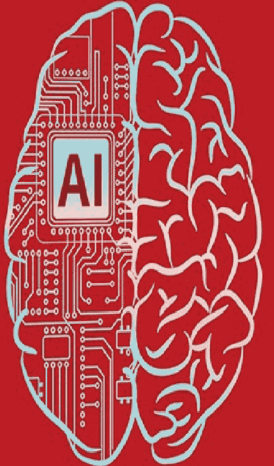

## 引言

自呱呱坠地起，人类便借助视觉、听觉、嗅觉、味觉、触觉等通道，持续不断地感知与认知世界。我们在与环境的不断互动与学习中成长，再通过专业知识的体系化习得，掌握立身之本，进而尝试改造世界。

“硅基”智能体的成长路径虽与“碳基”生命殊途同归，却在速度维度拥有碾压性优势。AI历经机器学习萌芽、神经网络深化，至Transformer架构确立，2022年底ChatGPT问世、2023年初GPT-4震撼登场，瞬间点燃了公众对生成式AI的热烈关注。最振奋人心的突破在于：大模型初步具备了人类级别的通识与逻辑推理能力——这正是前代AI的短板。无论是AlphaGo还是AlphaFold，此前顶多算得上垂直领域的“专家”，而ChatGPT实现了通用化跨越。

正如OpenAI首席科学家、ChatGPT核心架构师伊利亚·苏茨克维所言，GPT（生成式预训练模型）习得的是“世界模型”。他视互联网文本为现实世界的数字投影，因此，吞吐海量网络语料的GPT，实则是在高速内化整个世界的运行法则。在我们历经数年乃至数十年积累认知的同时，GPT借助惊人算力，以极快节奏完成了同等认知构建，已逼近成年人思维水平，成为名副其实的“世界模型”。

更关键的是，拥有“世界模型”底座的GPT，具备了“生成万物”的潜能。苏茨克维指出，此处“万物”特指现实实体在数字空间的映射——涵盖文本、图像、音频、视频、剧本、代码、方案、设计图等与生产生活紧密相关的一切数字化产物。既然大模型已具备成年人级别的通识与逻辑，我们只需投喂特定领域数据进行“微调”，它便能摇身一变为独当一面的专业人才：艺术家、设计师、程序员、工程师，或是广告优化师、供应链专家、客服专员。这或许正是生成式AI与AIGC（AI Generated Content）赋予我们的核心价值。

置身AI技术井喷的当下，生成式AI正处于高速迭代期，技术与应用日新月异，系统性认知刻不容缓。本书应运而生，旨在系统阐释生成式AI的底层原理与模型架构，深度剖析其在行业场景的实战应用，打通理论与实操。凭借作者二十余载AI领域的深耕积累，为读者指明航向。尤为难得的是，本书不仅理论解构了数字媒体即虚拟世界的生成逻辑，更探讨了生成式AI如何反哺实体经济。在存量博弈的经济周期里，以生成式AI重构生产力范式，赋能产业焕新，于存量中谋增量，战略意义深远。

如图0-1所示，本书构建了一个三维知识坐标系：X轴对应生成式大模型维度（第二章“AIGC底层逻辑”，解答“用什么生成”）；Y轴对应数字媒体形态维度（第三章“功能解析：AIGC能生成什么”，解答“能生成什么”）；Z轴对应行业职能维度（第四章“商业落地：AIGC产业应用与前景”，解答“做什么事”）。空间内任意坐标点均具备特定业务含义，例如：基于GPT-4生成代码投入生产、基于Stable Diffusion生成图服务营销。除上述三章外，第一章引领读者初识生成式AI，第五章直面核心焦虑——AI是否会大规模替代岗位，我们该如何主动拥抱变革。

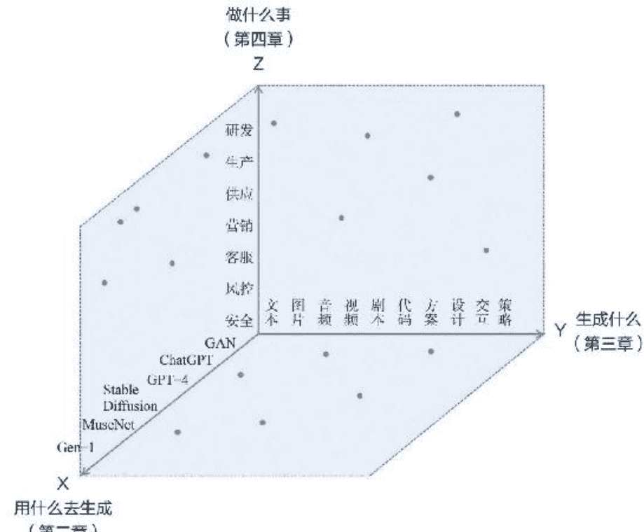

### 图0-1 本书知识领域三维坐标系

愿每一位不甘在生成式AI时代掉队的读者，合上书页时都能看透底层逻辑、洞悉实战应用，让本书成为工作生活的得力助手。“万物皆可生成”的时代已至，理解AI、训练AI、驾驭AI、甚至与AI协同作战，将成为每个人的必修课。未来已来，让我们共赴新程！

## 出版方寄语：打造掌上全能书库

### 你想读的书，这里都有

### 5秒极速寻书，秒级触达

## 1. 专属代找电子书服务（真·移动随身图书馆）

锁定微信公众号：**东东电子书**

全网资源汇聚，构建最全移动书库愿景；极速检索响应，找书仅需5秒；7×24小时自动化发书，无需等待。针对新书、绝版书、难寻书，专项攻坚，承诺有求必应。

## 2. 超高性价比知识付费课程（覆盖主流平台，价格感人）

得到、喜马拉雅、樊登读书、千聊、十点课堂等200+主流知识付费平台资源全囊括，涵盖全领域品类。同一公众号：**东东电子书**，一站式获取。

## 关注公众号，解锁更多福利

**东东电子书** —— 书友交流社群同步开放！

## 第一章 初识生成式人工智能

现象级产品ChatGPT横空出世，引爆了AIGC与生成式AI的关注热潮，无数人跃跃欲试AI工具红利。本章将带你步入AI产业版图腹地，见证从决策式AI向生成式AI的范式跃迁，深度对比两大技术路线异同，挖掘应用场景与商业蓝海；剖析“内容皆可生成”的核心价值；随即聚焦具体工具，深度拆解大众熟知的ChatGPT，溯源其原理与进化脉络。无论你对生成式AI是一知半解还是初窥门径，本章都能助你建立清晰认知框架，掌握当下最值得关注的生成式AI工具矩阵。

### 纵观AI产业全景版图

若评选2023年度科技热词，ChatGPT必占鳌头。年初以来，它以席卷之势成为全球流量顶流，大众前仆后继挖掘其潜能、推演未来、探讨人机关系。作为“AI家族”的现象级应用，它将人工智能技术推至聚光灯下，引发深度思考。

人工智能被誉为当代三大尖端技术之一，近年来“存在感”指数级上升，系产业飞速发展的必然投射。欲洞悉以ChatGPT为代表的新智能浪潮，全面认知AI，不妨先从产业版图的演进与现状切入。

回望过往，AI发展历经漫长“寒冬”。十余年前，它仍是不被看好的小众赛道；而今，已成街头巷尾高频热词，万物皆可“+AI”。十余载沧海桑田，数据爆发、问题迭出，AI的春天方才真正到来，各行各业急需智能赋能。这也解释为何AI应用版图如此辽阔，市场蓝海亟待深耕。图1-1呈现AI行业应用矩阵：横向为零售、金融、医疗、教育等行业赛道，纵向为研发、生产、营销、风控等职能维度。蓝色标记处即为已落地实践区——如零售供应链/营销/客服、金融研发/营销/客服/风控等。但这仅是冰山一角，更广阔的行业与职能组合仍待开拓。

| 行业\职能 | 零售 | 金融 | 医疗 | 教育 | 制造 | 能源 |

|---|---|---|---|---|---|---|

| 研发 | | ■ | | | ■ | |

| 生产 | | | | | ■ | ■ |

| 供应链 | ■ | | | | ■ | ■ |

| 营销 | ■ | ■ | ■ | ■ | | |

| 客服 | ■ | ■ | ■ | ■ | | |

| 风控 | | ■ | | | | |

| 安全 | ■ | ■ | ■ | ■ | ■ | ■ |

### 图1-1 人工智能行业应用版图矩阵

从产业链视角审视，AI分层为基础层（数据与算力底座）、技术层（模型算法核心）、应用层（场景化软硬件/方案）。规模几何？德勤预测：全球AI产业规模将从2017年6900亿美元跃升至2025年6.4万亿美元，2017-2025年复合增速32.1%，呈指数级爆发。投资端同样火热，AI成为各行业配置首选，强势拉动经济增量。

应用端，AI已渗透制造、零售、金融、医疗等诸多领域，重塑组织运作，提速增效、降本控费。消费端，用户获得更丰富选择。简而言之，AI是一块已露锋芒的璞玉，在驱动世界经济跃迁的同时，将深度重塑人类生活图景。为深入理解版图，下面我们从决策式AI与生成式AI两大分支切入。

### 决策式AI与生成式AI：双子星迥异

AI模型维度可分为决策式AI（判别式AI）与生成式AI。

**决策式AI**学习条件概率分布——即样本属于特定类别的概率，据此对新场景判别、分析、预测。主战场含：人脸识别、推荐系统、风控系统、智能决策、机器人、自动驾驶。如人脸识别：提取实时图像特征，匹配人脸库完成认证；推荐系统：学海量消费行为，定制最优推荐策略，最大化GMV。

**生成式AI**学习联合概率分布——即多变量向量的联合概率，归纳既有数据，借深度学习创作拟真、拼接式新内容，实现自动化生成。产出形态极丰：文本、图像、音频、视频等。如输入小说梗概，生成全文；造出现实不存在的逼真人像。图1-2展示某海外网站生成的“虚拟人像”。

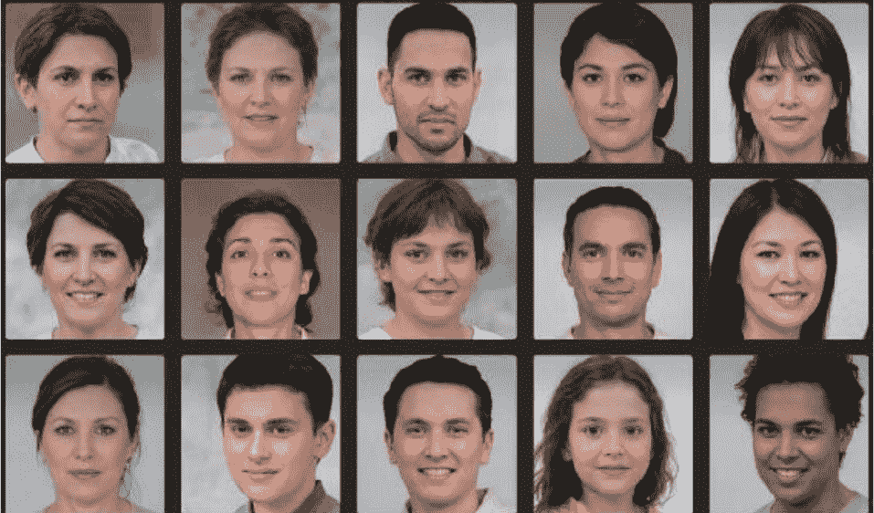

### 图1-2 “虚拟人像”集锦

> 图片来源：https://generated.photos/faces

本质上，无论哪类模型，底层逻辑同构：AI模型本质是函数，精确表达式难以逻辑推导，只能通过海量数据“训练”拟合。喂入既有数据，让机器寻找最贴合规律的函数映射；新数据来临，即可通过该函数预测或生成结果。

作为AI模型两大支柱，决策式与生成式在宏微观均差异显著。

**宏观视角**：决策式AI聚焦“辅助决策”，融合机器学习、深度学习、计算机视觉攻克垂域难题，优化组织决策；生成式AI聚焦“内容创生”，驾驭语言/图像模型与深度学习，自动产出文本、图像、音视频。前者模仿人类决策过程，后者专攻创作新内容。

**微观视角**，从技术路径、成熟度、应用方向三维深度解析：

### 表1-1 决策式AI与生成式AI深度对比

| 维度 | 决策式 AI | 生成式 AI |

|---|---|---|

| **技术路径** | 数据打标分类，区分类别（如辨别猫狗图片） | 归纳既有数据，生成新内容（如创作逼真犬图） |

| **成熟程度** | 底层技术相对成熟，多领域规模化商用 | 2014年起加速演进，近期指数级爆发，诞生多个现象级应用 |

| **应用方向** | 人脸识别、推荐/风控系统、机器人、自动驾驶等 | 内容创作、人机交互、产品设计等 |

**技术路径上**：决策式AI核心是“打标分类”，干“判断是非、区分彼此”的活儿（如分猫狗、莓果）；生成式AI则“读万卷书、行万里路”后“落笔生花”，看遍狗图后能画出新狗，实现“举一反三”。

**成熟度上**：决策式AI应用深厚，已在互联网、零售、金融、制造广泛落地，大幅提效；生成式AI“年纪更小”，2014年至今狂飙突进，文本/图像生成率先落地。

**应用方向上**：决策式AI深耕人脸、推荐、风控、机器人、自动驾驶，贴近民生；生成式AI在内容生产、人机交互、产品设计展现爆发力。

**生活案例佐证**：

购物平台“猜你喜欢”背后，是决策式AI剖析用户-商品关联，精准分发。亚马逊2003年引入此技术，推荐精准匹配需求，大幅降低搜索成本、提升销售额。数据显示：亚马逊约40%营收源自个性化推荐；Netflix年获超10亿美元推荐红利。新闻、音乐、视频平台同理，实时分析停留、点赞、收藏，精细刻画用户画像，弱化人工运营，显著提升粘性。自动驾驶领域，AI智能研判路况、识别跟踪多目标，渗透率稳步攀升，虽全无人驾驶尚待成熟，但迭代升级下市场潜力巨大。

生成式AI侧，ChatGPT带来冲击式认知。功能强、域宽的特性，让文本、图像、音视频从业者在“强力助手”上线时产生替代焦虑。客观上，它能胜任文字转语音、图像智能编辑、视频智能剪辑、文本续写纠错等�杂工作，释放创意产能，赋能作者、翻译、插画、剪辑师；更能分担设计师、程序员、工程师的初级设编工作，让专家聚焦高价值环节。同时，它倒逼从业者素质跃迁。总言之，双子星均能赋能决策与创作，合理利用AI，利在提升体验、降本增效、捕捉商机。

如前所述，数据与模型分属基础层与技术层，两大AI应用均离不开数据驱动与模型支撑。下面我们看“大数据”与“大模型”如何重塑AI版图。

### 从大数据到大模型：智能跃迁的双引擎

无论决策还是生成，当下功能与潜力的实现，均仰赖海量数据训练模型。

大数据概念大众熟知，指海量数据集，实则具备“多源异构、高速增长”特性。图1-3描绘2017-2025年全球数据总量爆发曲线。收集、存储、处理、分析多源高速数据，助企业极速获取洞见、科学决策、优化业务，提效降本、驱动增长。正如人类以经历积累经验，AI领域以海量数据炼就模型。

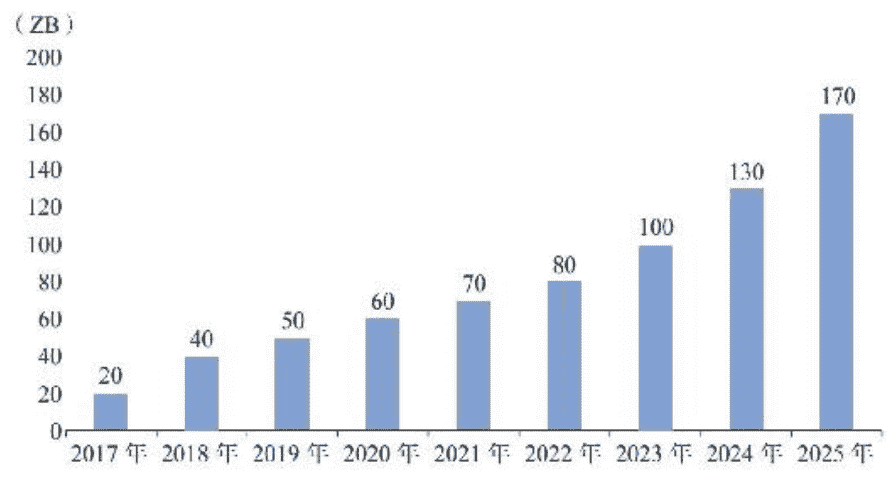

### 图1-3 2017-2025年全球数据总量增长趋势与预测

数据来源：IDC白皮书《数据时代2025》

伴随深度学习落地爆发，模型存储规模近年指数级跃升。初代GPT参数量1.17亿，ChatGPT达1750亿，最新GPT-4传闻达1万亿（1T）量级（OpenAI未官宣），此类海量参数模型统称“大模型”。图1-4展示参数量演进轨迹。深度学习受脑神经网络启发，模拟人脑处理数据，能自动完成特征提取、识别、决策、生成，广泛应用于NLP、计算机视觉、机器翻译等，带来前所未有的精度与效率，一举拉动AI领域进入高速发展期。

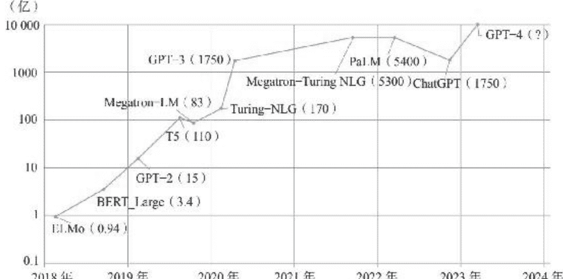

### 图1-4 大模型参数规模演进趋势

大模型凭借处理海量数据的强大能力，在解决复杂问题上表现卓越。本书主角“生成式AI”即大模型落地的杰出产物。近年大模型在行业端与消费端崭露头角，核心在于其高效处理海量数据的能力，赋能个体与组织提效。大模型与AI技术互为表里，协同演进。叠加5G普及、弹性计算等基建红利，大模型发展空间再拓新维，注定成为不可或缺的内容生成利器。

### 生成式AI市场竞争格局

# 生成式AI：重塑万亿产业版图的“新引擎”

早在2021年，高德纳咨询（Gartner）便做出大胆预判：到2023年，五分之一的内容将出自生成式AI之手；至2025年，其生成数据占比将飙升至10%（2021年不足1%）。红杉资本亦在2022年发文预言，这项技术将催生数万亿美元经济增量。聚焦国内市场，预计2025年应用规模将破2000亿大关，传媒细分领域更有望释放超千亿空间。生成式AI俨然已成“全能选手”，不仅深耕文本、图像、音视频、游戏等数字媒介，更向制造、建筑等实体经济纵深渗透。

### 文本生产：从营销文案到新闻剧本的“超级写手”
借助语言模型与深度学习，生成式AI能高产出优质文本，显著提振客户体验。AI营销文案、智能客服早已在各行各业落地生根；而新闻撰写、剧本创作等领域，随着ChatGPT等大模型突围，未来或将彻底改写文字工作者的效率图景。

### 视觉创作：设计与艺术的“加速器”
计算机视觉赋能AI“读懂”图像，进而产出营销素材、设计方案乃至艺术臻品，大幅压缩人力与时间成本。音频端，语音克隆、文本转语音、智能编曲已成成熟应用；视频端，从片段检测、智能剪辑、特效合成到现象级的AI数字人，应用图景全面铺开。李安导演《双子杀手》中，威尔·史密斯借助数字技术实现“双龙戏珠”般的跨龄同框，便是经典注脚。

### 跨模态与游戏：打通感官壁垒的“创意中枢”
文生图、图生视频、视频生文……跨模态能力让想象力具象化，“穿宇航服的熊猫”只需一句话即可成真。游戏开发中，自动化关卡设计与拟真NPC的引入，预示着玩家未来将体验到AI深度参与的沉浸式虚拟世界。


图1-5 根据 “panda in a space suit” 生成的图片

### 实体经济：从“平面生成”迈向“三维重构”
生成式AI的野心不止于虚拟。在建筑等重资产行业，它正突破文字图像的次元壁，切入3D设计核心环节。建筑师输入草图或初版方案，AI即可输出精细化模型与实景渲染图，手绘线条越丰富，生成结果越稳健。这标志着AI从“辅助绘图”进化为“共创伙伴”，为实体产业升级注入确定性动能。

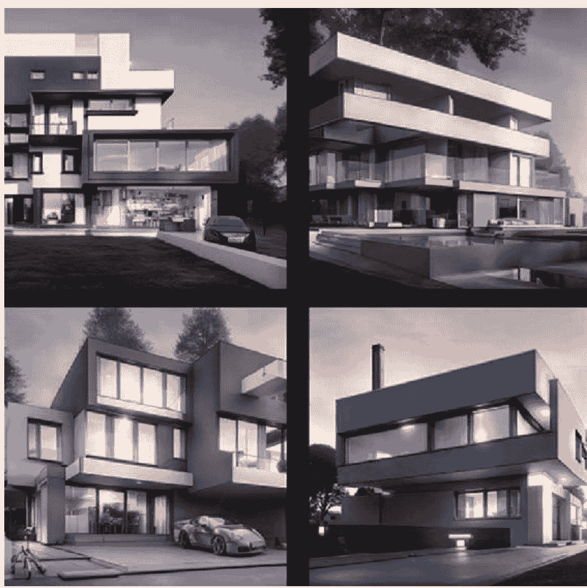

图1-6 由AI图像生成工具生成的建筑设计图

图片来源：https://stability.ai/blog/stablediffusion2-1-release7-dec-2022

技术浪潮滚滚向前，AI已成人类驶向未来的旗舰战舰。生成式AI作为突破性增长极，不仅重塑数字内容供给，更赋能实体流程再造，在降本增效中开辟全新价值曲面。

---

## 聚焦AIGC：万物皆可“生成”

目光聚焦当下，ChatGPT、GPT-4引爆全球视野。复盘过往，内容生产已历经三轮迭代：PGC（专业生产）、UGC（用户生产）、AIUGC（智能辅助用户生产）。如今，AIGC强势登场，核心范式发生根本性逆转——**“无生命”的算法成为唯一内容源头**，人类退居指挥官与筛选者。这一跃迁不仅引爆内容供给量级（如图1-7所示呈指数级跃升），更迫使我们重审创作本质。

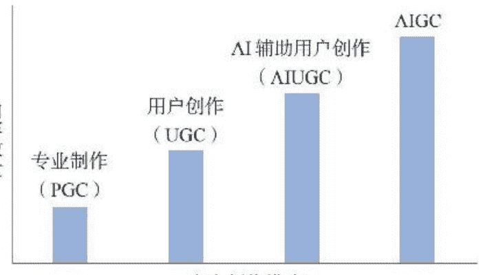

图1-7 内容创作的四个发展阶段

AIGC即“AI自动生成内容”，依托大模型与海量训练数据，秒级产出文本、图像、音视频、代码等多模态成果。这股“鲶鱼效应”搅动万业，生活因便捷而变色。然繁华背后，深层隐忧亦随之浮现：版权归属、真伪辨析、伦理边界……

AIGC以**多样性、高质量、极致效率**三重优势，重构内容生产力版图：精准匹配长尾需求，批量适配细分场景，以“AI作者”身份冲锋商业化前沿。你我刷屏的图文视频，或已出自AI之手而浑然不觉。

以下，我们拆解文本、图像、视频三大主战场，洞察AIGC如何“长袖善舞”。

### 文本生成：GPT家族的“统治级”演进
主攻新闻撰写、格式文档、风格迁移、对话交互，GPT（Generative Pre-trained Transformer）是当之无愧的主流霸主。其核心在于“预测下一个Token”，实现上下文长程记忆与逻辑推演，攻克机器翻译、自动摘要、即时问答等NLP硬骨头。

技术底座上，大型神经网络吞吐海量语料，自主习得语言规律，免去人工特征工程之劳。发展脉络清晰可见：
*   **GPT-1**：无监督预训练+有监督微调，奠定范式；
*   **GPT-2**：多任务训练+数据集扩容，能力跃迁；
*   **GPT-3**：参数量、数据量、算力三维爆发，涌现复杂推理能力。

**ChatGPT（GPT-3.5衍生）** 横空出世，以类人对话交互撕开认知缺口：写脚本、做营销、翻文档、写代码样样精通。程序员圈更因其“读懂代码、生成代码、修复Bug”能力炸锅，引发“AI替代论”狂潮。

**GPT-4（2023.3发布）** 再掀惊涛骇浪：文理医法数编全科满分，跨域概念融会贯通，甚至具备“常识推理”雏形。官方演示中，面对“VGA接口插手机充电口”的荒诞图片，它精准吐槽“尺寸与时代双重错位”，展现出令人战栗的类人理解力。


图1-8 一张 “有趣” 的图片

图片来源：https://openai.com/research/gpt-4

商业落地端，**Jasper** 等SaaS先锋率先变现，覆盖社媒文案、跨境电商、短视频脚本等高频刚需，重塑内容营销链路。**OpenAI** 作为技术源头，从非营利起家，凭GPT系列确立王者地位，携手微软推动AI普惠。

受限于英文语料与闭源壁垒，国内自主可控探索不止。2020年，北京智源与清华联手推出**清源CPM**，为中文大模型按下“国产化加速键”。

### 图像生成：扩散模型点燃“秒出图”革命
你用过的AI绘图工具，大概率跑在**Diffusion（扩散）模型**上。其灵感源自物理学“扩散现象”：正向加噪至纯噪声（如墨滴入水），逆向去噪还原图像（神经网络学习逆过程），从而实现从无到有的生成。该技术已成视觉艺术与设计领域的“新基建”。

**Stability AI** 率领开源阵营突围。2022年联合发布的 **Stable Diffusion** 实现真·“一秒出图”，让宏大想象、超现实梦境、小说插图触手可及。估值从1亿狂飙至100亿，印证生成式AI的惊人商业张力。

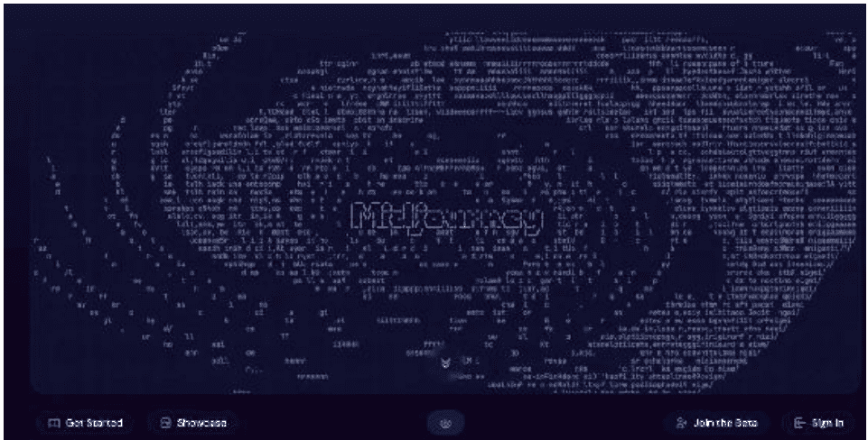

图1-9 Midjourney官网

现象级应用扎堆涌现：
*   **Midjourney**：文生图降维打击，素描油画信手拈来，拉平创作门槛；
*   **PromptBase**：另辟蹊径卖“咒语”，精准提示词让出图少走弯路；
*   **文心一格（百度）**：飞桨+文心大模型底座，深谙中文语义，精准捕捉本土审美需求。

### 视频生成：从“静帧”向“动态叙事”跨越
本质上是图像生成的时序延展——生成连贯帧序列。深度神经网络赋能高保真、可控参数、极速产出。应用已渗透教育（教学动画）、医疗（手术仿真）、游戏/元宇宙（动态资产生成）等刚需场景。

影视工业变革最为剧烈：AI接管动态捕捉、自动剪辑、智能字幕、特效设计，大幅压降成本。
*   **AI电影《乌鸦》**：Glenn Marshall借OpenAI模型“二次创作”短片，斩获戛纳短片奖；
*   **《速激7》“数字复活”保罗·沃克**：动作捕捉+面部替换+数字建模，让逝者在银幕“重生”，成就技术与人文的双重致敬。


图1-10 Make-A-Video生成视频示例

图片来源：https://makeavideo.studio

**头部玩家全员入局**：
*   **Runway Gen-1**（2023.2）：文本/图像/视频驱动生成3D真实场景，让“穿越”“太空漫游”在屏幕成真，誓做创意无限的“造梦机器”；
*   **Google Imagen Video / Phenaki**：前者主打高清艺术风与3D理解，后者擅长长故事线视频生成；
*   **Meta Make-A-Video**：专攻脑洞大开的奇趣短片生成。

### 跨模态协同：打通“任督二脉”的化学反应
单模型独斗已成过去式，**模型组合拳**成主流。GPT-3写提示词 + Stable Diffusion出图/改图，实现“自然语言驱动精修”，美工彻底告别“甲方改稿地狱”。前提是：人类需精通“提示词工程”，精准对齐AI意图，否则极易“鸡同鸭讲”。


图1-11 通过给AI发出指令，给雕像穿上衣服（使用instructPix2Pix生成）

---

## 结语：共生，而非替代

纵观文本、图像、视频，AIGC已攻克核心高地，实现从“辅助创作”到“自主生成”的跨越。未来，我们是否会陷入AI编织的“信息茧房”，仍待时间检验。

但不可逆转的是：**技术已下沉为大众工具，渗透生活肌理**。伦理规范与法律红线的补齐，必将经历阵痛过渡期。然AIGC势如破竹，已闯入人类疆域，**开启“碳基与硅基”共生共荣的新纪元**。

### 生成式AI的核心价值

# 生成式AI：为何它能成为“新顶流”？

前文已为大家梳理了AI的两大主流流派——生成式与决策式，并厘清了各自的“拿手好戏”。一言以蔽之：决策式AI擅长基于现有场景做分析、判断、预测，广泛服务于人脸识别、推荐算法、风控、精准营销、机器人及自动驾驶等领域；生成式AI则主攻“从0到1”的内容创造，文本、图像、音频、视频全能通吃。两者在技术路线、成熟度、落地赛道上截然不同。接下来，我们将聚焦生成式AI，深度拆解其核心价值。

## 认知维度的“降维打击”：聚焦逻辑层

你可能意想不到，这两者不仅名字不同，在认识论视角下，它们作用的认知层级也有高低之分。认识论研究的是知识从哪来、怎么判断真伪。如图1-12所示，认知过程像座金字塔，人类理解由浅入深：数据→信息→知识→逻辑→哲学/信仰，层级越高，颗粒度越细、结构越深。

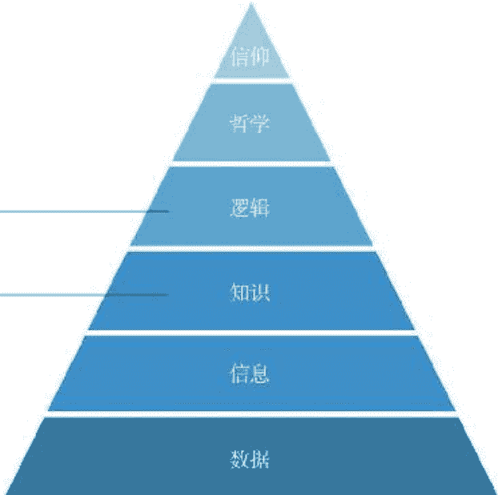

图1-12 生成式AI与决策式AI聚焦的认知层级差异

决策式AI停留在“知识”层，而生成式AI跨越到了更高阶的“逻辑”层（尚未触及哲学信仰层）。这意味着：决策式AI本质是基于海量数据信息提炼出的知识总结与判断；生成式AI则是基于数据、信息、知识在逻辑层面的演绎创新。后者更逼近人类智慧本质，内容创新张力也更强。

实战中，决策式AI靠分析历史数据服务于推荐、风控等场景；生成式AI作为高阶形态，不止于分析，更通过归纳数据实现演绎创新，正在内容创作、人机交互、产品设计等领域大显身手。

## 核心优势：从“做选择题”到“做简答题”

若对比后仍感模糊，不妨用考试打个比方：决策式AI擅长**选择题**，核心是分类；生成式AI擅长**简答题**，核心是创作。

### 决策式AI的“阿喀琉斯之踵”：脆弱的信任基石

深究原理，决策式AI暗藏隐患。设想一个分类极准的神经网络，面对常规图像游刃有余。但若输入图片仅添加极微量噪声（人眼几乎不可见），模型竟可能闹出天大笑话。如图1-13，一张模型判定为“猫概率90%”的图片，加噪后竟被判定为“马概率90%”。

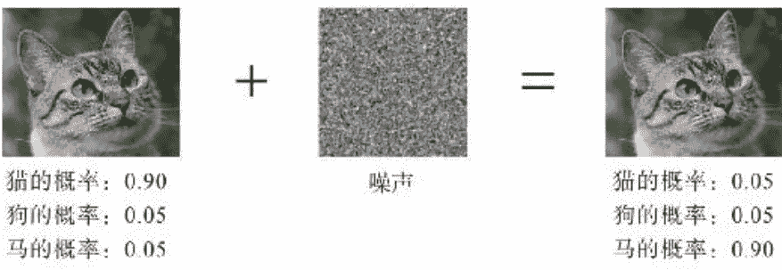

图1-13 微小噪声导致决策式AI识别翻车

这揭示了基于条件分布建模的缺陷：模型缺乏对语义的真理解。若系统建立在如此不稳定的地基上，像婴儿般易跑偏，后果不堪设想：高价值客户被误判为低价值，高风险客户被放行……这些不确定性正是阻碍决策式AI规模化落地的拦路虎。

### 生成式AI的“内功心法”：理解生成机理

俩模型原理大不同：

*   **决策式（判别式）**：见猫狗照片多了，学会“猫长啥样、狗长啥样”，来新样本就比相似度，像谁就是谁。
*   **生成式**：学会猫的“特质”（体型、毛色、体态），也学会狗的“特质”。面对新样本，先提取其特质，分别与猫狗特质匹配打分，概率大者胜出。

显而易见，生成式AI更成熟、更智能。它能习得思维逻辑，产出符合常理规则的内容。生成式模型关注“结果怎么来的”，代价是极度渴求大数据量以保证采样质量，推理速度相对较慢；决策式模型不挑数据量，跑得快，小数据下准确率甚至更高。

凭借这套原理，GPT等新生代模型才能生成多模态内容，把人类从繁杂重劳中解放出来——妥妥的打工人“福星”！

## 价值版图：无所不及的“全能选手”

生成式AI究竟有多“万能”？若把人类内容生产粗分为**艺术创造、设计执行、逻辑思维**三类，生成式AI全线覆盖，专业级输出让人直呼“危机感”。

### 艺术创作：从“辅助”到“主理人”

*   **漫画/绘画**：2023年3月，国内首部AIGC全剧情漫画《元宇宙2086》诞生。艺术家王睿借工具将文字转为流畅绚丽的视觉画卷。AI山水画《未完·待续》拍卖成交110万，百度文心一格通过“投喂”陆小曼真迹，练就以假乱真的神韵。
*   **音乐**：度晓晓、龚俊数字人合唱《每分每秒每天》，词曲编全包；度晓晓更是国内首个可交互虚拟偶像，唱跳主持样样行。
*   **视频/影视**：谷歌研发视频扩散模型(VDM)实现动态镜头、图像动画化，未来人人可做导演。网飞《犬与少年》成全球首部AIGC动画短片，小冰包揽画面场景，人类创作者回归核心创意。

### 设计领域：效率与想象力的双重跃升

*   **平面/插画**：Midjourney等工具，只需提词“T恤设计、连续纹样”，即出可商用稿。
*   **3D建模**：英伟达Magic3D由低分辨粗模进阶高精模；OpenAI Dream Fields无需照片凭空生成3D模型（船、花瓶、公交、家具……），游戏、影视、VR建模彻底告别纯手工。
*   **服装设计**：谷歌Project Muze融合600+设计师风格，输入性别/喜好/情绪即出独家时装。虽尚在探索高阶设计，但已成产业链必环。
*   **环境艺术/城市规划**：谷歌AI工具结合航拍生成“城市绿化图”及建议，低成本科学应对热岛效应。未来公园、街道绿化或皆由AI规划，治愈感拉满。
*   **家装/空间**：群核科技等建立AIGC实验室，覆盖家居、商业、地产全空间设计迭代；智能客服跟踪进度，重塑服务生态。未来装修设计师或将是AI。

### 逻辑思维：代码与药物研发的“硬核突围”

别误以为AIGC只是“模仿大师”，它能啃硬骨头。

*   **代码生成**：ChatGPT写代码已是常识。aiXcoder XL开放API，分析海量开源项目学语言特征，动态生成代码，灵活高效攻克各类开发任务，极大提速软件交付。
*   **医药研发**：“生物版ChatGPT”ProteinGPT横空出世，晶泰科技XuperNovo平台实现大分子药物（抗体/蛋白质）“一键生成设计”，技术路线对标ChatGPT，已实战应用于多个项目，表现亮眼。

绘影绘声、筑城造物、写码研药……AIGC的边界，似乎只受限于人类的想象力。

## 双剑合璧：决策+生成，解锁更大价值

生成式AI与决策式AI非此消彼长，而是强强联手。多层次、多维度协同，能把人类从机械性劳动中彻底释放，推升内容生产力——前提是质量过硬。这需要技术者持续钻研、测试，文明社会未来的增量突破，或就系于AIGC之手。

# 里程碑式现象级产品：ChatGPT

近两年AI浪潮迭起，2023伊始，OpenAI推出的大语言模型(LLM) **ChatGPT** 杀疯了。它能赋能聊天机器人与智能应用，处理写作、建议、问答等多元任务。

2022年11月发布，2个月用户破亿，刷新史上最快增速纪录（TikTok用了9个月），热度可见一斑。

### 为何它能“出圈”？（十八般武艺，样样精通）

*   **不背谜语**：脑筋急转弯信手拈来。
*   **一本正经胡说八道**：写“秦始皇摸电门，赢麻了”有模有样，不杠设定。
*   **文案鬼才**：小红书风、emoji表情包拿捏到位，真假难辨。
*   **方言速成**：几轮对话训练就学会地道北京话，疑似真人托底。
*   **全能打工仔**：策划、文案、代码、诗歌……上手即用，许多人已将其培养为“二代打工人”。

**学生党狂喜，监管跟进**：Study.com调查显示，89%美学生用它写作业，53%写论文。美方已出台禁令，未来需引导青少年科学用技。

**职场杀入腹地**：PCMag爆料谷歌用面试题测ChatGPT，评级达**三级软件工程师**水平。ResumeBuilder.com调查千家企业：49%在用，主攻招聘、编码；48%已用它替代员工，25%节省超7.5万美元成本。部分岗位失业预警拉响！

# ChatGPT进化史：从Transformer到“神器”

生成式AI通过学习联合概率分布，归纳旧知创新知。ChatGPT作为NLP模型，学习词汇组合规律与逻辑，按“接龙”式自回归生成文本（根据上文预测下一个词）。虽语料皆存量，但非抄袭拼凑，乃是逻辑重组的新创作。

能力非一日之功，其“前世”紧扣**Transformer（变换器）**，故事始于2017年。

### 2017：源头——谷歌《Attention Is All You Need》
谷歌大脑团队发文，首创基于注意力机制的Transformer，用于自然语言处理，参数6500万。训练后在句法分析、翻译等榜单封顶，成当时最强LLM。该架构深刻重塑AI技术树，渗透至AlphaFold 2等多领域，成无数强模型之“源头活水”。

### 2018：GPT-1——OpenAI入场
OpenAI紧跟Transformer热潮，发文《Improving Language Understanding by Generative Pre-training》，推出**1.17亿参数**的GPT-1。沿用Transformer架构，但训练数据集BookCorpus（7000+未出版图书，覆盖言情、冒险等多类）更庞大。预训练+四大场景微调后，文本分类、问答、相似度、语义判定四维度全面超越基础Transformer，登顶新霸主。

### 2019：GPT-2——规模跃迁
架构不变，参数暴增**10倍至15亿**，刷新多项语言任务榜单纪录。

### 2020：GPT-3——参数爆炸
**1750亿参数**，架构延续，规模再扩。训练集堪称恐怖：双书籍集(670亿token)、清洗版全网爬虫(4290亿token)、维基百科(30亿token)。

……

# ChatGPT爆火背后：巨头入局与普通人的实战宝典

GPT-3凭借海量参数量著称，训练数据集规模惊人，成本自然高昂——业内保守估算，单次训练烧资500万至2000万美元。算力投入越大，耗时越短，反之亦然。虽只需抛出提示词甚至免提示直问即可获高质量回复，但因缺乏友好交互界面且准入门槛较高，GPT-3鲜为大众所用。

2022年NeurIPS大会上，OpenAI正式揭晓新成员——ChatGPT。GPT-3.5作为前身铺路，ChatGPT随即横空出世，迅速成为现象级NLP应用，实至名归的“AI顶流”。

### 巨头角力：国内外大厂抢滩“生成式AI”

市场反响炽热，国内外科技巨头纷纷下场“抢滩”，试图在生成式AI这片蓝海占得先机。

**国内阵营：以核心业务为锚点，谋求增量**  
阿里达摩院自研对话机器人已进入内测，并谋划将大模型能力深度植入钉钉生产力套件。百度推出“文心一言”，其多轮生成、智能创作等能力将逐步融入搜索引擎，布局意图明显。无论阿里还是百度，策略一致：将类ChatGPT技术注入核心业务模块，寻求商业增量。  

360创始人周鸿祎亲自演示自研大模型，展现出不俗的中文语义理解能力，交出阶段性答卷。阿里正式发布“通义千问”，宣布全系产品接入。阿里云更豪气表态：提供算力底座与基建，助力各类企业甚至创业团队低门槛训练专属大模型，托举中国AI整体水位。

**海外阵营：生态绑定与底层军备赛**  
微软是OpenAI最紧密的盟友。2023年2月，搭载ChatGPT的新版Bing与Edge亮相，搜索体验升级为“懂上下文的对话式问答”。同月，微软宣布全线产品接入ChatGPT：Azure云、Teams协作、Bing搜索，覆盖Word/PPT/Excel的Office全家桶。GPT-4内置新版Bing，直指谷歌搜索霸主地位。此前双方已深度绑定，OpenAI借力Azure算力加速突破。  

谷歌推出Bard对抗，同步融合搜索。云业务牵手OpenAI竞对Anthropic，后者推出Claude，被视为ChatGPT劲敌。英伟达贡献超万张高端GPU支撑训练；亚马逊、Meta等高管亦表态加码布局。AIGC混战，大幕拉开。

### 场景落地：手把手教你用ChatGPT提效

放眼产业全景后，落回个体视角：ChatGPT究竟能为普通人做什么？全网实测证明，它能接管部分脑力劳动，场景极广。

#### 场景一：极速阅读与摘要  
会前临时收到长文档？丢给ChatGPT，秒出核心要点。  
### 图1-14 极速阅读总结实战演示

#### 场景二：智能客服与文案生成  
从欢迎邮件到工单回复，给个提示词即可生成多版本话术，拒绝重复。  
### 图1-15 智能客服文案实战演示

#### 场景三：互动学习陪练  
自学古罗马史想测水平？它能出题、批改、讲解，随时充当私教。  
### 图1-16 互动问答教学实战演示

---

#### 核心逻辑揭秘：数据即原油，AI为炼厂  
数据是时代核资产，蕴含规律。开普勒从天体数据推导三定律，是早期“数据挖掘”；如今AI借云算力，自动从海量数据炼出知识。数据驱动AI框架三大价值：

1.  **千人千面的个性化体验**：网站不再千篇一律，AI依托深度分析，为每位访客定制专属内容。
2.  **颗粒度极细的运营策略**：打破粗放式人群圈选，融合兴趣、行为等多维特征，输出精准营销打法。
3.  **源源不断的知识与洞察**：非书本死知识，而是实时、海量、高效从数据中“长”出的活知识，直接服务业务。

**AI核心之一：去平均化**。平均客单价100元掩盖个体差异，AI从历史行为学习模型，精准预测单客价值、购买意向、偏好及促单策略。此法不止营销，医疗上据病例血液概率辅助诊疗，已在顶级医院落地，挽命降本。  

凯文·凯利定义AI为“认知化”：蒸汽电力释放人工动力，认知化释放人工智能。实践表明，视听语感知已逼近人类，海量数据加持下，专业决策更可超越人类。

---

#### 场景四：家庭健康参谋  
娃突然厌食不知因？问ChatGPT，它能条分缕析列出生长期、疾病、厌食症、偏好、营养等可能原因，化身“私人健康调理师”。  
### 图1-17 家庭健康咨询实战演示

#### 场景五：程序员“副驾驶”  
代码写累了不想Review？交给它查错、重构、加注释，效率飙升。Excel公式不会写？用自然语言描述需求，它生成可用公式。  
### 图1-18 代码审查实战演示  
### 图1-19 代码注释实战演示  
### 图1-20 Excel公式生成实战演示  

请问以下Python代码有什么问题？  
```
import os
root_dir = '/home'
for sub_dir in os.listdir(root_dir):
    for sub_file in os.listdir(sub_dir):
        if sub_file.endswith('.txt'):
            continue
        with open(sub_file) as f:
            content = f.read()
            print(content)
```  
这段代码有以下问题：  
- 1. 在第4行中，os.listdir(sub_dir)返回的是sub_dir下的文件列表，但是这里的sub_dir仅仅是子目录的名字，缺少父目录路径。需要使用os.path.join()方法来构建完整的目录路径，例如：os.path.join(root_dir, sub_dir)。  
- 2. 在第6行中，如果sub_file的文件名以“.txt”结尾，不应该使用continue跳过当前循环。但是在第7行中，尝试打开sub_file文件时，需要使用os.path.join()方法来构建完整的文件路径，例如：os.path.join(root_dir, sub_dir, sub_file)。  
- 3. 在第8行中，应该使用with语句来打开文件，并且需要添加一个try-except代码块来捕获文件打开错误，以防止程序崩溃。  
因此，修改后的代码如下所示：  
```
import os
root_dir = '/home'
for sub_dir in os.listdir(root_dir):
    sub_path = os.path.join(root_dir, sub_dir)
    for sub_file in os.listdir(sub_path):
        file_path = os.path.join(sub_path, sub_file)
        if sub_file.endswith('.txt'):
            try:
                with open(file_path) as f:
                    content = f.read()
                    print(content)
            except IOError:
                print(f"Error opening file {file_path}")
        else:
            continue
```  
```
这是一个python代码片段，请帮我把这段代码加上注释
from sklearn.neighbors import NearestNeighbors
samples = [[0., 0., 0], [0., .5, 0.], [1., 1., .5]]
neigh = NearestNeighbors(n_neighbors=1)
neigh.fit(samples)
print(neigh.kneighbors([[1., 1., 1.]]))
X = [[0., 1., 0], [1., 0., 1]]
print(neigh.kneighbors(X, return_distance=False))
A = neigh.kneighbors_graph(X)
print(A.toarray())
```

```
以下是带注释的Python代码:
#### 导入sklearn.neighbors模块中的NearestNeighbors类
from sklearn.neighbors import NearestNeighbors

#### 定义样本数据
samples = [[0., 0., 0], [0., .5, 0.], [1., 1., .5]]

#### 创建NearestNeighbors对象，设置k=1
neigh = NearestNeighbors(n_neighbors=1)

#### 对样本数据进行拟合
neigh.fit(samples)

#### 查找邻居[[1., 1., 1.]]最近的样本点，输出距离和样本点的索引
print(neigh.kneighbors([[1., 1., 1.]]))

#### 定义新的样本数据
X = [[0., 1., 0], [1., 0., 1]]

#### 查找X中每个样本点的最近邻，输出每个样本点最近邻的索引
print(neigh.kneighbors(X, return_distance=False))

#### 创建X中每个样本点之间的最近邻图，输出邻接矩阵
A = neigh.kneighbors_graph(X)
print(A.toarray())

该代码演示了如何使用sklearn.neighbors模块中的NearestNeighbors类来查找样本数据中每个样本点的最近邻，以及如何创建最近邻图。其中，NearestNeighbors类中的n_neighbors参数用于指定要查找的最近邻的数量，kneighbors方法用于查找每个样本点的最近邻，kneighbors_graph方法用于创建最近邻图。
```

### 图1-19 让ChatGPT当代码审查员

前文略览了ChatGPT的几个入门级玩法，但这只是冰山一角。它的才华横溢远超想象，早已渗透进营销获客、智能客服、风控审核等核心业务环节，成为降本增效的利器。

对于跨境电商卖家而言，它就是随叫随到的“金牌文案”。遇到新品上架急需推广文案、运营人员却不在岗的窘境？只需喂给它调性与卖点，一段高转化文案瞬间出炉。小红书种草笔记、详情页五点描述，它样样精通。在金融赛道，大模型更是将信贷流程自动化推向新高度：从多维用户数据清洗、关键特征提取，到风险等级精准画像，全链路无人值守，让风控识别能力实现质变。随着模型版本迭代，这份“业务清单”只会越拉越长。

> **Q** Excel表格里，A列全是英文名，怎么用公式把首字母统一转大写、其余转小写？

> **A** 在Excel中，请直接使用以下公式：
> `=UPPER(LEFT(A1,1))&LOWER(RIGHT(A1,LEN(A1)-1))`
>
> **原理解析**：`LEFT`截取首字符，`UPPER`强制大写；`RIGHT`配合`LEN`截取剩余字符，`LOWER`转为小写；最后用`&`拼接成完整姓名。
> **温馨提示**：此方案仅适配英文名，中文或其他语种需另行调整。

### 图1-20 ChatGPT化身Excel神助攻

2023年3月，OpenAI正式发布插件系统，为大模型装上了“眼耳鼻喉”。官方坦言：单靠参数堆砌训练数据，模型能力提升有天花板。插件的引入，打通了ChatGPT与第三方API的任督二脉，让它能实时调取训练库之外的最新信息、执行受控操作，实用性与适用边界由此指数级跃升。

纵观当下，ChatGPT已覆盖速读总结、智能客服、代码审查、医疗辅助、营销创作等N个赛道，且边界仍在外扩。随着底层算力与架构的双重进化，它必将向更高阶态迭代，在更多垂直领域产出高质量交互与内容。

但必须清醒看到另一面：**幻觉频发**，一本正经胡说八道，真伪需人工甄别；**缺乏判断力**，不懂因果逻辑，复杂决策与伦理把关乏力；**养模型成本高企**，海量语料与算力投入令人咋舌；**黑盒特性**导致不可解释、不稳定；**就业焦虑**蔓延，替代论甚嚣尘上。工具皆有两面，ChatGPT不例外。面对双刃剑，唯有规范应用、人机协同，方能驾驭这场漫漫长征。

## 第二章 AIGC的底层逻辑

至此，你该对生成式AI的“面子”有数了。本章我们将剥开表皮，直击“里子” —— **底层技术逻辑**，看透它是“用什么生成”、如何生成。核心议程锁定三大基石模型：Transformer、GPT、Diffusion。概念虽硬核，啃透即通透，助你驾驭AIGC得心应手。

### 生成式模型基石

过去十余年AI井喷，深度学习功不可没。其爆发动力三驾马车：**海量数据、GPU算力、模型架构迭代**。2006年，“AI教父”辛顿推出“深度信念网络”，首创**“预训练+微调”**分阶训练法，让权值快速逼近最优解，大幅压缩训练周期。GPT、ChatGPT、Diffusion等当红生成式模型，无一不是深度学习嫡系。那么，何为深度学习？它与机器学习怎么个关系？有哪些经典架构能助我们读懂前沿SOTA？本节逐一拆解。

### 深度学习的进化史

机器学习是AI的核心分支，专攻“让机器模拟人类学习”，从海量数据挖掘规律，支撑识别、预测、决策。深度学习是其进阶形态。如图2-1，AI > ML > DL，层层包含，步步深化。深度学习攻克了大量复杂识别/生成难题，推动AI从“能用”走向“好用”。

**溯源：从生物神经元到M-P模型**
深度学习肇始于**人工神经网络（ANN）**，灵感源自大脑千亿神经元的连接协作。1943年，皮茨与麦卡洛克构建**M-P模型**，抽象生物神经元结构（树突/细胞体=输入，轴突末梢=输出），实现逻辑运算，奠基神经网络。
**感知机与多层突破**
1958年，罗森布拉特发明**感知机**（输入-隐含-输出三层），能做简单模式识别，却攻不克非线性难题（如XOR）。80年代，拉姆梅尔哈特、辛顿、杨立昆等推出**多层感知机（MLP）**，引入反向传播，破解难关，推动ANN二次春。
**达尔文启示与寒冬**
90年代，诺奖得主埃德尔曼借达尔文“自然选择”理论构建Darwinism模型，主张“预存多样性应对未知”，深刻影响后续训练范式。随后神经网络陷入长达十余年的低谷期。

**2006：深度学习元年**
辛顿正式命名“深度学习”，主张**无监督预训练+有监督微调**优化模型。斯坦福等名校跟进，学界迎来爆发式增长。
**里程碑时刻**
*   2009年：攻入语音识别腹地。
*   2012年：AlexNet横扫ImageNet，深度学习=神经网络代名词；吴恩达团队将图像识别错误率砍半（26%→15%）。
*   2014年：Facebook DeepFace人脸识别准确率破97%。
*   2016年：AlphaGo屠榜李世石，AI破圈，全民知晓。
*   2017年至今：安防、医疗、金融、教育全面落地，直至ChatGPT现象级引爆，早已渗透生活毛细血管。

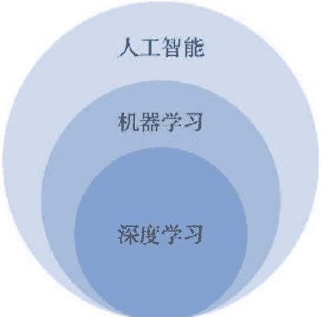

图2-1 人工智能、机器学习、深度学习关系示意图

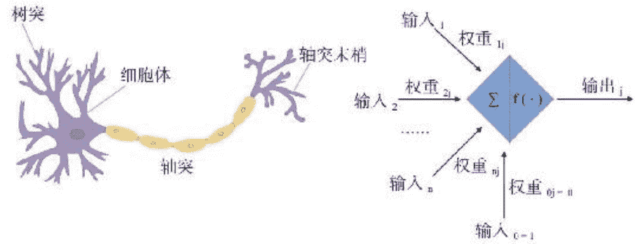

图2-2 神经元及M-P模型示意图

### 深度学习的两大经典架构

搞清来龙去脉，再看深度学习本质：基于复杂网络结构的多处理层，配合非线性变换，对高维数据抽象建模，擅拿图像、音频、文本“三大件”。下面登场的是两位“元老级”选手：**CNN** 与 **RNN**。

#### CNN：图像识别的“显微镜”
**全称**：Convolutional Neural Network（卷积神经网络）。80-90年代萌芽，21世纪深度学习浪潮中扶摇直上，图像领域绝对霸主。架构如图2-3，四层流水线：
1.  **输入层**：预处理（如降维、归一化），减轻计算负担。
2.  **卷积层**：核心引擎。神经元不盯全图，只扫**局部感受野**（如狗耳、眼睛），多尺度滑动提取特征，维度丰富、精度高。
3.  **池化层**：压缩降维，保留核心特征，砍掉冗余数据量。
4.  **全连接层**：将前序散落的局部特征（头、身、腿）拼装成完整特征向量，输出类别概率（图2-4演示）。

**三大核心特性**成就图像霸主地位：
1.  **局部感知**：单神经元只管一小块，降低识别难度。
2.  **权值共享**：训练好识别狗耳的滤波器，识别猫耳、兔耳通用，极大减少参数量。
3.  **亚采样/池化**：特征维度降了，语义没丢，反而抗噪抗变形能力更强。

牛津VGG模型即基于此，凭借极简深层架构，拿下2014年ImageNet定位任务冠军。

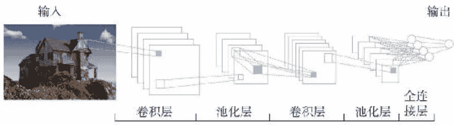

图2-3 卷积神经网络工作过程示意图

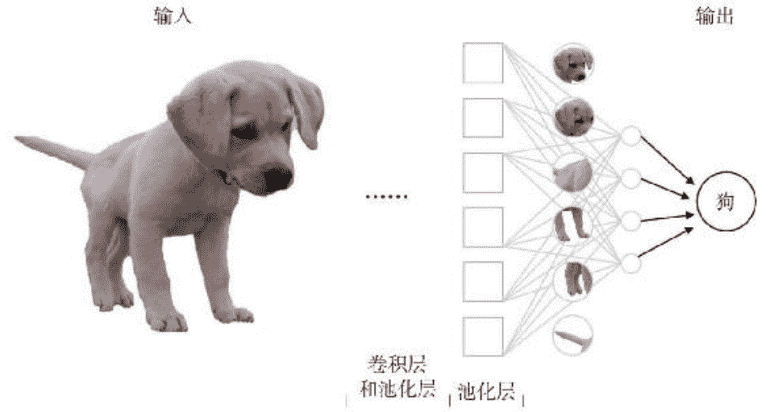

图2-4 卷积神经网络图像识别过程示意图

#### RNN：序列建模的“记忆体”
CNN、ANN处理的都是**独立同分布**样本（如100张互不相关的图）。但现实全是**连续序列**：语音、文本、股价、视频流……顺序一乱，含义全无。RNN（Recurrent Neural Network，循环神经网络）应运而生，专治时序依赖。

**核心机制：隐藏层的“循环反馈”**
如图2-5，隐藏层引入自连接。**当前输入 + 上一时刻隐状态 = 当前隐状态**，层层传递。相当于自带“记忆带”，预测下一个词/帧/点时，上下文全在掌握。
> 例：“小明每次去超市都买很多苹果，因为他最爱吃( )” → 结合“吃”(动词) + “苹果”(前文名词) → 轻松补全“苹果”。

**应用版图极广**：
*   **文本生成/续写**：写稿机器人、智能补全。
*   **机器翻译**：Seq2Seq架构鼻祖。
*   **语音识别**：Siri、小爱同学底层常驻选手。
*   **金融量化**：捕捉股价时序规律（如“连跌七日必反弹”），拟合真实走势，实战价值高。
*   **电商舆情/商家分级**：读懂海量长评论，多维度（质量、物流、服务、描述相符）量化打分，助用户避坑选优。

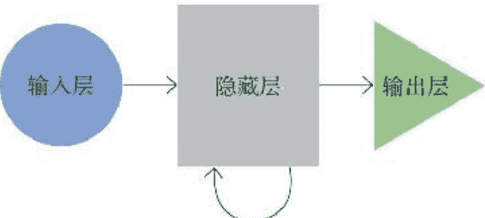

图2-5 循环神经网络原理示意图

### GAN：生成式AI的“魔术师”
**全称**：Generative Adversarial Networks（生成式对抗网络）。2014年，伊恩·古德费洛（Ian Goodfellow）灵光一现，构建**“生成器 vs 判别器”**零和博弈：生成器拼命造假，判别器拼命找茬，双方军备竞赛，最终生成以假乱真样本。

变体层出不穷：CycleGAN（风格迁移）、StyleGAN（高保真人脸合成）……“换脸”、“换装”视频满天飞。2020年，PaddleGAN表情迁移模型**单张照片驱动生成唱歌视频**，直接引爆“蚂蚁呀嘿”等全网梗，让大众直观领略了生成式AI的“黑魔法”威力。

## 解码生成式对抗网络（GAN）

什么是生成式对抗网络？简单说，它是一种基于无监督学习的模型架构，核心在于让两个神经网络“对着干”、共同进化。这对“搭档”分工明确：一个是**生成器**，另一个是**判别器**。

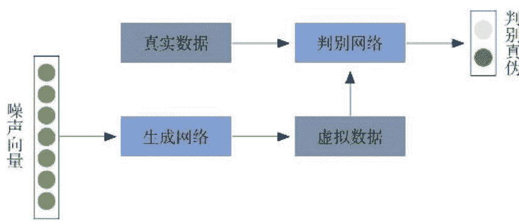

图2-6 GAN网络架构示意图

生成器的角色像个“伪造者”，它从潜在空间随机抽取噪声向量，将其加工成看似真实的“虚拟数据”，力求以假乱真，骗过判别器。判别器则扮演“鉴别官”，输入端同时接收真实样本和生成器造出的假货，任务是把二者精准区分开。双方你来我往、参数迭代，直到达到纳什均衡——生成器产出的内容连判别器都无法辨别真伪，此时模型训练大功告成。

打个通俗的比方：好比一位业余摄影爱好者（生成器）想拍出大师级大片，而一位资深图片编辑（判别器）负责挑刺。摄影师先出片，编辑指认破绽；摄影师据此改进技法再出新片，编辑继续找茬。这场“博弈”持续升级，直到编辑再也看不出业余作品与大师佳作有何分别。

正是这种机制，让GAN能从海量**无标注数据**中自发捕捉深层特征。传统模型依赖人工打标签“喂”数据，GAN则通过内部对抗自动拟合训练集的真实分布（比如图像任务中的像素概率分布），实现了真正的无监督学习。

搞懂原理，再看GAN的三大主战场：
1.  **条件生成**：文本生成图片、甚至文本生成视频，指哪打哪。
2.  **数据增强**：学会数据分布后按需采样，低成本扩充训练集。
3.  **风格迁移**：将“风格图”的笔触、色调嫁接到“内容图”上，精准复刻大师神韵。

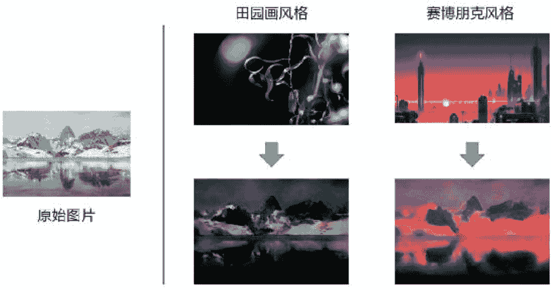

图2-7 GAN模型实现图片的风格迁移

当下，深度学习已渗透至社会生产、科研探索与日常生活的方方面面。它不仅能识图、预测、辅助决策，更能自主创造新内容。虽距人类认知仍有鸿沟，但作为思维外骨骼，深度学习已成不可逆的时代潮流。前文提及的CNN、RNN、GAN皆是典型代表，后续探讨生成式AI模型时，它们还将频频登场。

---

## Transformer 与 ChatGPT：智能跃迁的基石

Transformer 与 ChatGPT 的渊源极深。自诞生起，Transformer 便以摧枯拉朽之势席卷多领域：DeepMind 借它打造蛋白质预测神器 AlphaFold 2；计算机视觉界也在复杂任务上逐步以它取代 CNN。毫不夸张地说，Transformer 是深度学习演进史上最耀眼的里程碑之一。它究竟有何魔力，能催生出 ChatGPT 这类现象级应用？拆解如下。

### 序列到序列：万物皆可“翻译”

名字里的 "Transform"（转换）直指核心——**序列到序列（seq2seq）**。这里的“序列”，指文本、语音、视频等具备强时间/位置依赖性的连续数据。与图片的独立性不同，序列数据前后紧扣，上文决定下文，顺序一乱，语义全非。

机器翻译、语音识别、智能对话、文生图/乐、基因测序、工程排期、代码生成……表2-1列举的这些，本质都是“把一个序列变成另一个序列”。

| 任务类型 | 输入内容 | 输出内容 |
|---|---|---|
| 机器翻译 | 语言A文本 | 语言B文本 |
| 语音识别 | 声音信号 | 文本内容 |
| 生成图片 | 描述文本 | 对应图片 |
| 生成音乐 | 描述文本 | 音频片段 |
| DNA序列分析 | 基因序列 | 关键片段 |
| 工程建设排期 | 需求文本 | 排期表 |
| 工业控制编程 | 逻辑描述 | 控制程序 |

**表2-1 序列到序列问题示例**

这类任务有两大“拦路虎”：
1.  **长度不定**：输入输出长短不一，无法像图像识别那样用固定向量或补零搞定。
2.  **顺序敏感**：“我不喜欢”vs“喜欢我不”，字序一变，天地之别。

2013年前后，如何让神经网络啃下这些“硬骨头”成为研究热点，序列到序列模型应运而生。

经典架构采用**编码器-解码器**范式（图2-8）：编码器将输入序列压缩成语义向量，解码器再展开生成目标序列。以中译英为例，中文进编码器，英文出解码器。这种结构极其灵活，编解码器可分别选用 CNN、RNN 等模块，几乎能适配所有序列转换场景。

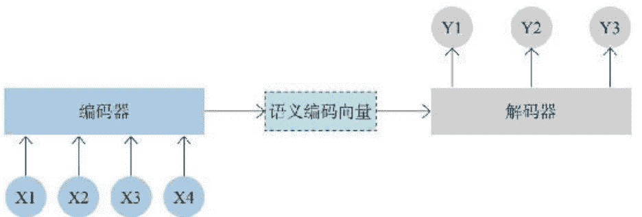

### 图2-8 编解码机制结构图

但缺陷显而易见：长句翻译易**梯度消失**。解码端只盯着最后一个隐层输出的定长向量，导致“近视效应”——末尾词记忆深，首尾词被稀释。破局关键，引入**注意力机制**。

### 注意力机制：学会“重点看”

人类阅读时，目光聚焦关键词，略过冗余词。注意力机制模仿此道：计算编码端各向量与解码端各向量的相关性，归一化为权重，显式建模输入输出元素间的“谁重谁轻”。

> 例句：“我喜欢这本书，**因为**它讲了很多关于**养花**的知识”
> - 做情感分析 → 权重聚焦“喜欢”
> - 做内容分类 → 权重聚焦“养花”

训练中不断优化权重，让解码器生成时，对输入每个位置都有合理的“关注度参考”。

**自注意力**更进一步：摆脱外部依赖，专攻序列**内部**关联。
> “He thought it was **light** before he lifted the **backpack**.”
> 看到 "backpack"，"light" 瞬间锁定为“轻”而非“灯”。自注意力通过两两计算关联，精准捕获这类长距离依赖。

实践证明，自注意力挖掘文本内联能力远超常规模型。Transformer 正是堆叠多层自注意力，将“无序”序列转化为“有序”语义表示。

---

## Transformer 架构深度解剖

Transformer 在编解码基础上做了重磅升级（图2-9、2-10）：编码端、解码端均由多层同构模块串联，并引入**多头注意力**、**位置编码**等关键创新，攻克复杂语言理解难关。

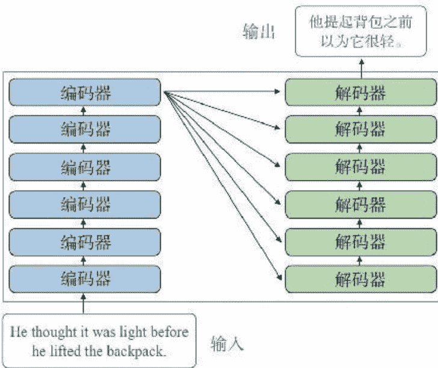

### 图2-9 Transformer网络结构图

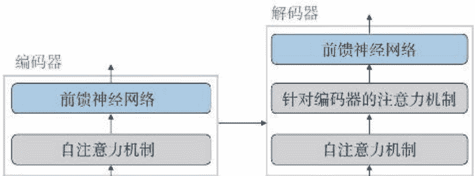

### 图2-10 Transformer编解码器内部结构图

### 编码器：双子星结构
每层编码器包含两大核心：
1.  **自注意力层**：算前层输出间的相关性权重，产出新编码。
2.  **前馈神经网络**：对每个新编码独立深加工，传给下一层。

### 解码器：三驾马车
每层解码器在编码器基础上增设一路：
1.  **自注意力层**（同编码器）
2.  **编码器-解码器注意力层**：**关键桥梁**，从最后一层编码器汲取全局语义信息。
3.  **前馈神经网络**（同编码器）

最后接线性变换+归一化，吐出最终序列。

### 多头注意力：多视角“会诊”

单头注意力易偏颇，多头注意力让不同“头”并行捕捉不同语言现象（图2-11）：有的头盯相邻词搭配，有的头盯动宾关系，有的头盯代词指代……并行计算提速，最后拼接融合，由前馈网络整合输出。

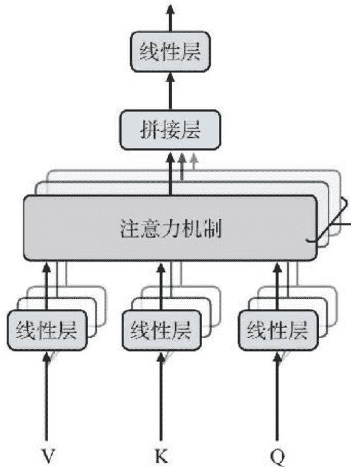

### 图2-11 多头注意力原理图

> “The monkey ate the banana quickly and **it** looks hungry.”
> “it”指猴子还是香蕉？单头易误判。多头下，部分头盯 "it"-"monkey"，部分头盯 "it"-"banana"，但更多头捕获 "hungry"-"monkey" 强关联，加权投票下，“it=猴子”胜出，消歧成功。

### 位置编码：给词贴“序号”

自注意力本质是**集合操作**，不感知顺序。"She bought **a** book and **a** pen." 两个 "a" 谁修饰谁？无位置信息模型会懵圈。位置编码为每个词注入唯一位置向量，让相关性计算同时兼顾**语义**与**位置**，精准定位修饰关系。

多头注意力+位置编码，赋予了 Transformer 深度理解语义、生成连贯回复的核心能力，也为后续 GPT 等大模型奠定了地基。

---

## GPT 系列：预训练+微调的范式革命

GPT 确立了**“大规模预训练 + 小规模微调”**的两阶段范式。传统网络随机初始化参数再优化；GPT 先用海量通用语料预训练得一套“通识参数”，再用少量领域数据微调。这属于迁移学习，彻底改写了 NLP 依赖大量标注、人工调参的旧局面。

架构上，GPT 坚持**堆叠 Transformer**（仅解码器部分），以超大语料、超多参数、超强算力为三驾马车，通过不断扩容实现能力跃迁：
- **GPT-1**：奠基范式。
- **GPT-2**：数据量质双升，支持**零样本**下游任务。
- **GPT-3**：45TB语料、1750亿参数**规模极致**，极少样本甚至零样本即超越精调模型，解决了标注难、训练慢两大痛点。

---

## ChatGPT：加上“价值观对齐”的 GPT-3.5

ChatGPT 基于 GPT-3.5，核心创新是引入**基于人类反馈的强化学习（RLHF）**，让模型长出了前所未有的“语义理解力”与“安全对齐度”。训练分三步走（图2-12）：

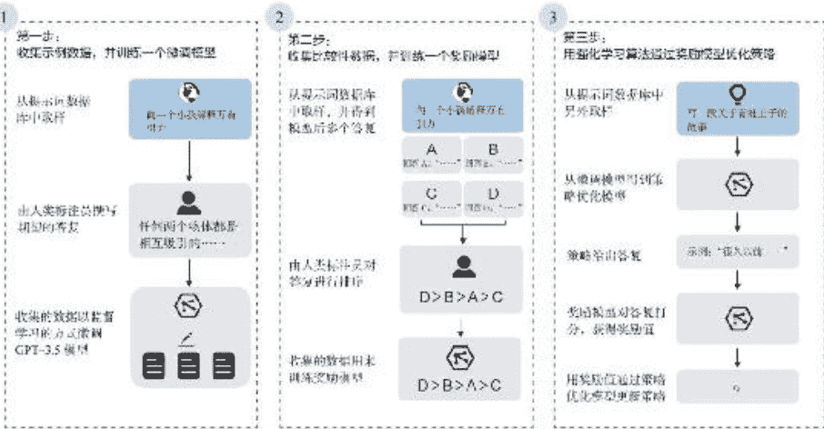

### 图2-12 ChatGPT模型训练步骤

**Step 1：监督微调（SFT）—— 冷启动**
标注团队准备提示词库（自造+历史积累），人工撰写高质量回复，构建“指令-回答”对，微调 GPT-3.5 得到**SFT模型**。

**Step 2：奖励模型（RM）—— 学会“打分”**
采样提示词，让 SFT 模型生成多条回复。标注员对多条回复**排序打分**（隐含人类偏好），训练一个打分器——**奖励模型**。此后，模型输出质量有了量化裁判。

**Step 3：强化学习（PPO）—— AI 训练 AI**
准备新提示词集，策略模型（初始为SFT模型）生成回复 → 奖励模型打分 → 根据分数用 PPO 算法更新策略。**全程无人工干预**，闭环迭代多轮，直至回复质量收敛最优。

这一套“组合拳”打出，ChatGPT 横空出世，震惊全球。虽然后有 GPT-4 更强，但 ChatGPT 在 NLP 历史上的里程碑地位不可撼动。理解其底层逻辑与 Transformer 核心，才能看清 AIGC 未来的无限可能。

---

## Diffusion 模型：AI 绘画的“扩散”美学

推动 AIGC 井喷的另一引擎，是 AI 绘画技术的质变。2022 年 4 月，OpenAI 推出 **DALL·E 2**，以“一文生图”震撼开启 AI 绘画新纪元：输入寥寥数语，即得全新精美图像。它极大解放了设计师生产力，倒逼内容生产工具链重构，成为生成式 AI 落地应用的标志性突破。

# AI绘画爆火背后：扩散模型如何重塑视觉创作？

转眼间，网络上被DALL·E 2生成的作品刷了屏。不管是身着格子衫的萌系动物、意境深远的山水画卷，还是极具商用质感的科技风PPT配图，它全都能轻松驾驭。最关键的是，这些作品皆为“原创”，在现有图库中找不到任何一模一样的复刻版。图2-13直观展示了DALL·E 2针对“牛仔滑雪，油画风格”这一提示词的创作成果。


图2-13 DALL·E2模型输出效果示例

DALL·E 2不仅引发了内容创作领域的变革，更树立了图像生成与处理技术的新标杆。其背后的核心技术——扩散模型，由此步入大众视野。2022年8月，Stability AI推出的Stable Diffusion，同样立足于扩散模型架构；紧随其后，Midjourney实验室发布v4版本，在商业级文生图落地上展现出惊人的实力，底层同样依赖扩散技术。

#### 扩散模型究竟是什么？

在扩散模型崛起前，GAN（生成对抗网络）长期霸占图像生成研究的主流地位，但其先天不足显而易见：难以覆盖完整概率分布（如训练动物图像却只生成狗），且训练极不稳定，严重阻碍了推广应用。扩散模型凭借前沿训练范式，绕过了GAN繁琐的调优环节，可直接面向特定任务部署，产出令人咋舌的生成效果，瞬间引爆了该领域的百花齐放。

“Diffusion”译为“扩散”，源于物理学现象：分子凭借热运动从高浓度区向低浓度区迁移（布朗运动），这是一个趋向热平衡、由熵驱动的过程。经典案例便是墨水滴入水中逐渐均匀分布。微观看，某微小体积内墨水分子分布极其复杂、难以采样；宏观看，墨水彻底扩散后，分布却变得均匀简单，可用数学表达式精确描述。统计热力学能刻画扩散各时刻的概率分布，且过程可逆——步长足够小，便能从简单分布逆向还原至复杂分布。

扩散模型最早见于2015年论文《基于非平衡热力学的深度无监督学习》。受统计热力学启发，作者构建了新型生成模型，核心思路直观：持续向训练图像注入噪声直至变为模糊噪声图（正向扩散，如墨水扩散），再训练模型学习逆转过程，从噪声重构图像（逆向去噪）。

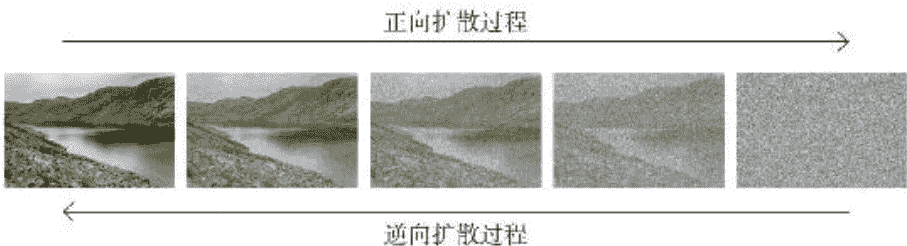

### 图2-14 扩散模型的扩散过程

如图2-14所示，算法包含正向与逆向两阶段。正向过程通过马尔可夫链逐步叠加高斯噪声，使图像从清晰风景渐变为不可辨识的马赛克。虽看似随机，实则每一步状态仅依赖前一状态，遵循特定概率分布，从而确立了明确的正向路径。

难点在于逆向：从多轮随机噪声叠加的模糊图完美复原原图近乎不可能。扩散模型另辟蹊径，引入神经网络拟合逆向扩散的概率分布。这种近似策略极其高效，即便面对全噪声图，也能复原出高度还原的图像，且随迭代优化，生成质量持续攀升。

正向加噪与逆向去噪的闭环，让模型能以原图为种子生成全新图像。这套新数学范式重新定义了“生成”，较GAN仅需训练生成器、目标函数简洁、无需对抗训练，大幅降低了使用门槛。

### 从“文本到图像”的摩登时代

扩散模型初期并未引起轰动：GAN势头正盛分流关注，且早期模型生成质量一般，马尔可夫链特性导致步数多、生成慢，甚至作者回忆当时“模型并不令人惊喜”。然而，技术变革已在暗流涌动。

2020年，OpenAI发布GPT-3，确立Transformer在NLP的霸主地位。次年1月，其推出DALL·E，参数量120亿，被誉为“图像版GPT-3”，实现了从文本到惊艳图像的跨越。如何理解“文生图”？官网案例极具说服力：输入“牛油果形状的椅子”，输出批量兼具椅子结构与牛油果质感色泽的创意图（图2-15）；输入“写着openai字样的店面”，生成图像门头标志均精准呈现字样（图2-16）。

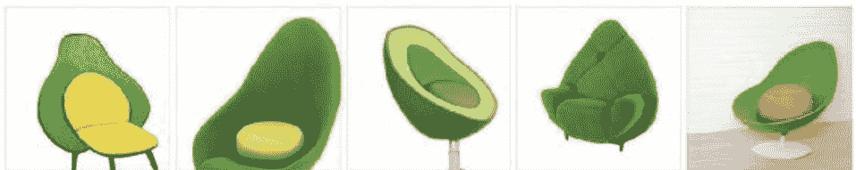

图2-15 牛油果形状的椅子示例

图片来源： https://openai.com/research/dall-e


图2-16 写着openai字样的店面示例

图片来源： https://openai.com/research/dall-e

DALL·E兼具语义理解与精准绘图能力，较传统“图生图”更符合人类直觉交互，一经面世即成典范。DALL·E 2、Stable Diffusion、Midjourney等后续巨头均沿袭此路线。下面以Stable Diffusion为例，拆解“字”如何变“画”。

### Stable Diffusion：降维打击的工程艺术

Stable Diffusion由Stability AI主导，交互友好、出图极快，在大幅降低门槛的同时保持高质量输出，掀起新一轮AI绘画热潮。

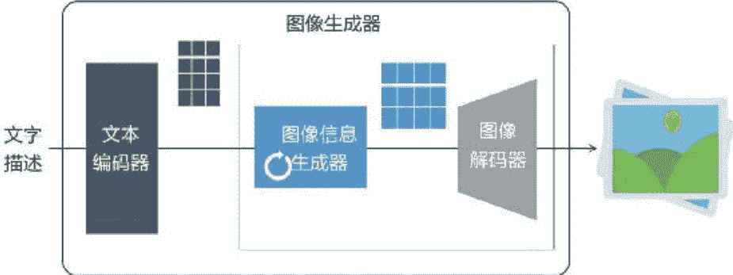

图2-17 Stable Diffusion模型内部结构

如图2-17，内部架构分文本编码器与图像生成器双引擎。前者利用CLIP模型将自然语言编码为机器可读的数学向量；后者接管向量，完成语义到像素的映射。

**文本编码器：CLIP的“翻译官”角色**
计算机不懂人话，需CLIP（Contrastive Language-Image Pre-training）这种对比学习预训练的多模态模型桥接。CLIP不仅懂语义，更能通过注意力机制耦合文图信息。其训练基于4亿对网络图文数据（图2-18示例）。

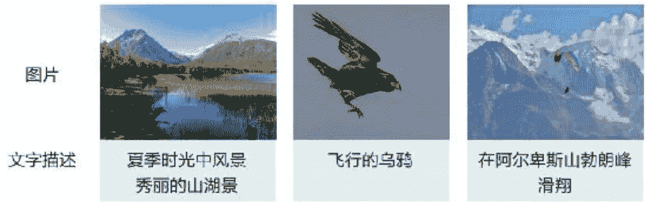

图2-18 CLIP训练图片及相关描述示例

CLIP含图像编码器与文本编码器。训练时随机抽取图文对（不保证匹配），分别编码为向量（图2-19）。目标是拉近匹配对向量距离，推开非匹配对，最终获得最优编码器参数。

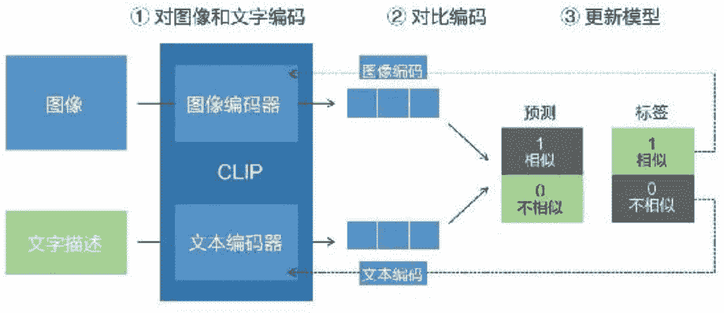

图2-19 CLIP模型训练过程

例如，“一只狗”的文本与狗图经训练后映射为高度相似向量，打通了人类语言与计算机视觉的统一数学表示——这是文生图的基石，CLIP在文本编码环节功不可没。

**图像生成器：隐空间里的“变废为宝”**
此模块分两阶段：信息生成与图像解码。

*生成阶段*：随机噪声与CLIP输出的语义编码融合，生成带噪语义编码，再压缩为低维**隐空间信息**（Latent Space）。这正是Stable Diffusion超越早期扩散模型的关键——早期模型在像素空间直接扩散，计算量巨大；SD在压缩的隐空间操作，信息量骤减，速度与资源利用率质变跃升。

技术实现上，由**U-Net**网络与**调度算法**协同：调度器控制去噪节奏，U-Net执行逐步预测噪声。迭代50-100轮，隐变量质量逐轮精进。

*解码阶段*：接管去噪完成的隐变量，升维还原为完整图像。由于扩散过程是逐步注入语义去噪，解码过程呈现图像从模糊到清晰、从无序到有序的“显影”过程（图2-20）。

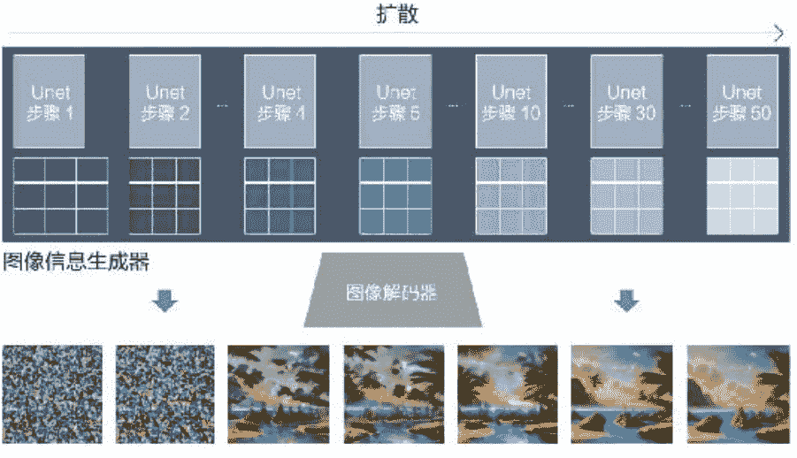

图2-20 图像生成器去噪过程演示

总结来看：CLIP将提示词“翻译”成视觉语义向量；图像生成器在隐空间完成“加噪-去噪-生成”闭环，最终输出符合语义的图像。文本编码器与生成器合力，让“字变画”成为可复现的工程流程。

无论是Stable Diffusion、DALL·E 2还是Midjourney，扩散模型与多模态技术的融合，已将AI绘画推向实用化深水区。这标志着AIGC技术演进超预期，也为数字内容生产范式的全维度重构吹响号角。身处这场未知革命的浪潮中，我们，准备好了吗？

## 第三章 功能分析：AIGC到底能产出什么？

读懂了产业脉络与底层逻辑，接下来从应用层——“生成什么”切入。AIGC早已渗透生活肌理，在你意想不到的角落默默发力。本章将聚焦数字媒体维度，逐一拆解文、图、音、视、游五大赛道的生成实景，见证内容如何在AIGC加持下高效诞生。读完定让你跃跃欲试，亲身体验效率革命。

### 生成文字：新闻、报告、代码，一键直达

前文已揭示AIGC全能图景，本节深耕文本生成这一基本功。其底气源自深度神经网络、Transformer架构、大规模预训练等硬核技术栈。在这些基座之上，文本生成技术在新闻、报告、代码等领域“叱咤风云”，显著提效、降本、优体验。以下逐项拆解。

#### 新闻生成：从“人海战术”到“算法流水线”

ChatGPT引爆舆论前，AIGC已在新闻线深耕多年。传统新闻生产全链路靠人：选题、采集、分析、撰稿、校对，环环耗时耗力。采集要遍历公文、专家观、数据、调查；分析要海量信息去伪存真、深度比对；撰稿要把控结构、语言、角度、标题、推敲字句；校对要多轮查漏补缺、纠错别字病句。时效性与高标准的双重夹击，让从业者不堪重负。AIGC降临，行业直呼“颠覆”，拥抱者蜂拥而至。

现实中，Automated Insights旗下Wordsmith早已入驻美联社，季度自动产出3000篇稿件，错漏率反低于人工。其NLG技术现服务于各类企业内部报告生成，释放分析师精力投入高价值决策。国内同步跟进：2015年腾讯财经推出Dreamwriter；封面新闻“小封”能写稿、能语音交互；新华社“快笔小新”聚焦体育财经，“媒体大脑”两会期间对比6年政府工作报告，输出深度解读《一杯茶的工夫读完6年政府工作报告，AI看出了啥奥妙》。AIGC在新闻生产链的渗透已成气候。

2020年底，《人民日报》联手百度上线“创作大脑”，开启智能媒体新纪元。这套“十八般武艺”平台覆盖实时监测、智能写作、新闻转视频、智能字幕、直播拆条、快编、可视化大数据等18项全流程能力。底座百度智能云“云+AI”技术，深度介入策、采、编、审、发全链路，全面提振内容生产力。如今ChatGPT以强文本能力赋能编辑部，新闻创作范式必将迎来新一轮质变。

# AIGC的双刃剑：从假新闻困局到人机共生的新范式

硬币总有两面，“AIGC内容生成”也不例外。回溯传统媒体时代，新闻诞生需经历记者跑腿采访、撰写初稿、层层严审的漫长链条。虽耗时费力，却为真实性筑起了防线。反观AI生新闻，虽借力大数据疾行，但数据源多为网络抓取，真伪难辨；信息溯源、人物关联、事件脉络等深层逻辑，更非算法所能穷尽，假新闻由此滋生。针对“筛噪存真”难题，人民日报社率先亮剑，推出国内首款AIGC检测工具——AIGC-X，可秒级甄别人机文本，中文检测准确率破90%。

展望未来，人机边界将进一步消融，“人机协同”必成新闻生产主流范式。分工明确是关键：AI接管高危、重复、标准化任务（如灾情快讯、体育战报）；资深从业者聚焦深度调查、价值判断、策划核心。协同模式主要有二：一是人设计流程、指挥AI执行危险或重复性报道；二是AI以大数据挖掘事件深层内核，辅助人类产出高价值深度稿。

## 智能投研：重塑报告生产力范式

撰写投研报告，向来是“高耗能、高门槛、重合规”的硬骨头。痛点四座大山：一是数据清洗耗时，海量信息收集、人工筛选、经验萃取，动辄数日；二是专业表达难，术语密集、逻辑多变，非资深分析师难驾驭；三是维度极其复杂，宏观、基本面、竞品、趋势，缺一不可，分析深度要求高；四是规范极其严苛，引用、图表、排版，容错率极低。

金融从业者每日淹没在行业、产业、宏观的研报海中，传统模式高度依赖分析师全能型能力。如何用AI自动生成、提效增质，成机构必争高地。

**智能投研**应运而生。它非替人决策，而是以AI自动完成海量金融信息的“收、提、归、简、析、预”，为决策铺路搭桥。实战中，AI助分析师极速成稿，双重保障：内容精准、体例统一。

对比人工，智投核心优势在“快”且“准”。人工模式下，分析师泡在终端刷数据、跑逻辑、做可视化，链条长、效率低。智投模型秒级吞吐海量信息，自动化多维建模、关联挖掘、趋势预判，按预设模板一键出报，实现“从收集到呈现”的跨越式提速。更关键的是，算法剔除主观偏见，输出更客观，间接再提报告形成效率。

**实战标杆——智搜信息**。深耕NLP多年，其写作机器人主攻财经快报。原理是“预定义模板+关键数据注入”，实现“一点生成”。模板库覆盖宏观大盘、个股研报、行业深度等，数据直连国内头部供应商实时源。万字长报，秒级产出，数据翔实、图文并茂、可读性强。已落地太平洋保险集团，支撑集团内各类财经数据报告自动化写作。

```
def binary_search(sorted_list, val):
    """
    二分查找
    :param sorted_list:
    :param val:
    :return:
    """
    low = 0
    high = len(sorted_list) - 1
    while low <= high:
        mid = (low + high) // 2
        if sorted_list[mid] == val:
            return mid
    elif sorted_list[mid] > val:
        high = mid - 1
    else:
        low = mid + 1
    return -1
```

图3-1 GitHub Copilot代码生成示例

## 代码生成：从“副驾驶”到“自动驾驶”的进化论

2022年11月，推特大裁员震动硅谷，五成员工离场，安审团队更损失15%。裁因虽复杂，但AIGC在编码场景的渗透不可忽视。代码能自动生成的当下，我们还需要这么多程序员吗？

聚焦当下应用。全球最大代码托管平台GitHub，联手OpenAI于2021年6月推出**GitHub Copilot预览版**——被开发者亲称为“AI结对程序员”。底层驱动是Codex模型（GPT-3编程微调版），经数十亿行代码训练，擅长自然语言转代码、上下文感知补全、注释转实现、单测生成、甚至自动纠错。多语言支持，对非英语母语开发者尤为友好。

短期测试后，个人版/企业版全面升级，生成更强、响应更快。官方数据极具说服力：90%用户任务加速，73%大幅节能，75%体验成就感飙升、专注核心逻辑。如图所示，极简提示词即得完整函数实现。但切莫言“全替代”，Copilot名副其实是“副驾”，核心决策仍在人。然长河落日，AIGC终将重塑程序员版图。

国内不甘人后。**硅心科技(aiXcoder)** 2022年6月推出**aiXcoder XL**，国产首个支持方法级生成的深度学习编程模型。双语同构理解，自然语言描述即得完整代码，简易API即可接入体验。

技术向善，人本核心。AI应用必然正向演进，将劳动者从�琐重复中解放，高效人机协作催化产业融合重塑，智能化新纪元加速到来。

### AI绘画：像素级的分辨率、清晰度、真实感与艺术表达

读完AIGC与文本的共舞，想必对“AI绘画”这匹黑马跃跃欲试。近期霸屏社交网络的AI作画，正是AIGC与图像融合的爆发式产出。大众纷纷入局，以提示词为笔，绘天马行空，激荡灵感火花。

2022年8月，科罗拉多新兴数字艺术大赛，无绘画基础的杰森·艾伦凭借Midjourney生成的《太空歌剧院》（图3-2）斩获“数字艺术/数字修饰照片”组一等奖。此事件引爆舆论，让AI绘画真正破圈狂欢。


图3-2 《太空歌剧院》

时间线上，几大里程碑应用绕不开：**Midjourney**——出图快、功能全、艺术家寻灵感首选，获奖作即出于此；**DALL·E 2**——OpenAI出品，分辨率更高、延迟更低；**Stable Diffusion**——开源黑马，上手易、速度快、可控强，让专业玩家与泛娱乐用户同沉迷“开盲盒”式创作。

#### 图像生成的技术突围

主流工具均具备**“文生图”**能力：自然语言描入，匹配图像出。底层融合语言模型（文本转潜在表示）与图像生成模型（条件生成）。顶级模型训练数据多源自网络海量图文对。

2015年起，得益于深度神经网络跃迁，“文生图”迎来爆发。Google Imagen、OpenAI DALL·E系列，已能以假乱真。**Stable Diffusion**更是领域搅局者。

前文提及，**Diffusion扩散模型**成新一代主流。核心原理：高斯噪声逐步破坏训练数据，再学习反向去噪复原。训练收敛后，模型可从随机噪声合成新数据，实现算法层面的创新范式迁移。

以Stable Diffusion为例，参数可控性强：采样步数、随机种子、批量数（1-10）均可设。输出分辨率横版达1365×768、竖版768×1365，生成内容含商用权（图3-3）。


图3-3 由Stable Diffusion生成的图像

**SD 2.0（2022年底）** 换装OpenCLIP文本编码器，画质与清晰度实现质变飞跃。

**DALL·E 2** 双引擎驱动：“文生图”+“图生图（文本引导）”。上传底图+提示词即可二创，支持局部重绘、外扩补全、遮挡修复。定长1024×1024分辨率，合规商用（图3-4）。

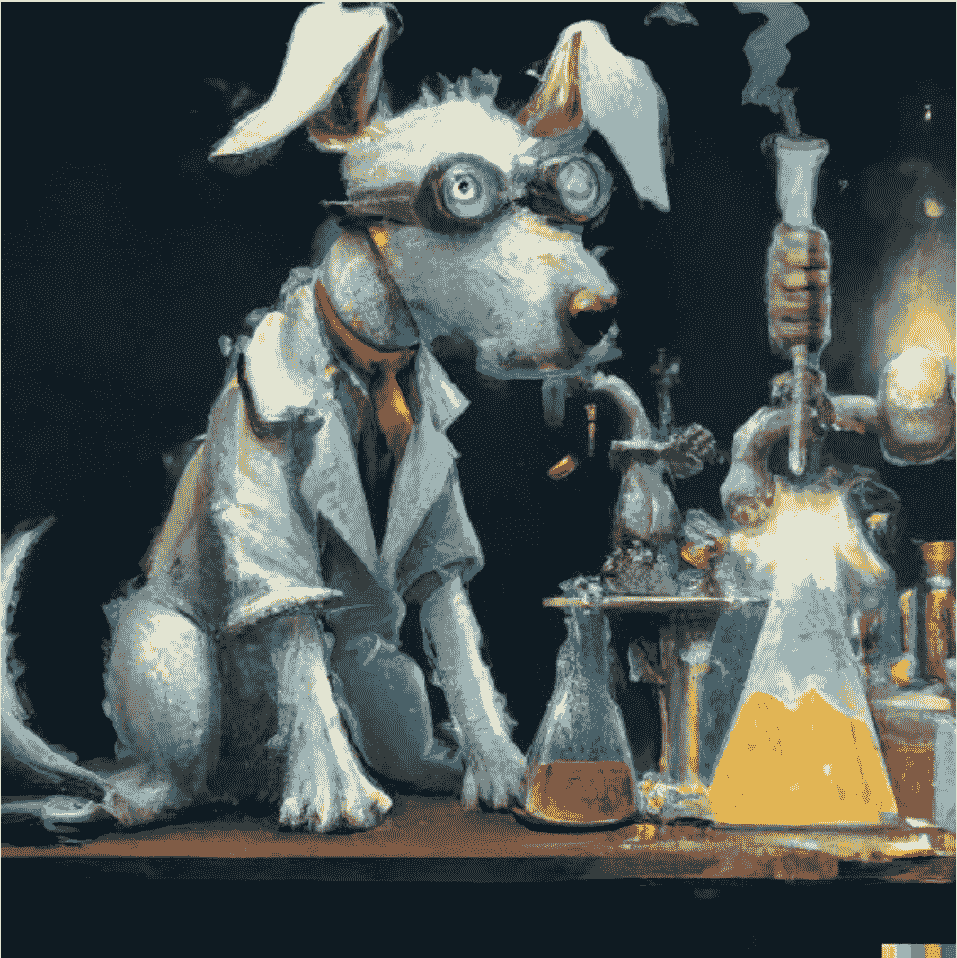

图3-4 由DALL·E 2生成的图像

**Midjourney** 交互极简：提交Prompt得图，支持变体生成、超分放大。兼容图片URL+文本引导混合创作。分辨率上限更高（版本依赖，最高2048×2048），付费会员享商用授权（图3-5）。

图3-5 由Midjourney生成的图像

国内井喷式爆发：2022下半年，**文心一格、无界版图、6pen、Tiamat、盗梦师**密集上线。微博、小红书刷屏，技术派、创作者、投资人多方造势，全圈层渗透。现象级小程序**“造梦日记”** 基于SD魔改：本土化模型重构、自研“follow instruction”训练范式、注入海量本地数据。上线周增5万用户，验证本土化适配威力。

AI绘画不止平面，**3D生成**已起步：**Omniverse Audio2Face、NVIDIA GANverse3D、NeRF**等工具落地。GANverse3D可将单张2D图反演为逼真3D模型。训练时多视角拍摄（如环绕拍摄房屋），喂入逆向渲染框架（2D推3D网格），推理期仅需单视图即可生成渲染级3D网格。

#### 艺术风格图像：无限可能的风格迁移

除写实，AI更擅“风格化”。SD拥有庞大风格库：赛博朋克、水墨、日漫、蒸汽朋克……油画、素描、水彩……情绪、氛围、画风、大师风，提示词即点即用。

**实测SD风控力：**

*   **肖像全能**：动漫抽象、水彩柔美、多角度构图（侧/3/4/正），至照片级超写实。输“爱因斯坦”，即得神似照片（图3-6）。
*   **国韵水墨**：老虎水墨图，神韵毕现（图3-7）。
*   **大景构筑**：非洲草原象群，叠加提示词调节氛围，壮阔转宁静（图3-8）。

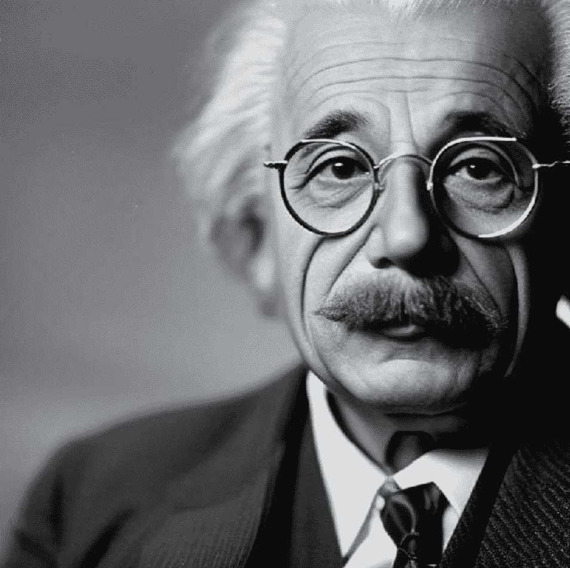

图3-6 由Stable Diffusion生成的爱因斯坦照片


图3-7 由Stable Diffusion生成的水墨画


图3-8 由Stable Diffusion生成的非洲大草原自然风光图

*   **大师附体**：同一老奶奶肖像，毕加索立体解构 vs 梵高旋涡星空，风格神还原（图3-9左/右）。

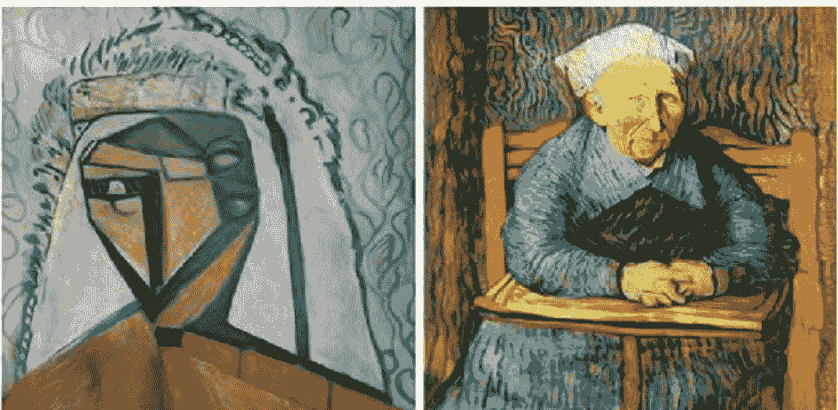

图3-9 由Stable Diffusion生成的不同风格肖像画

*   **跨时空指定**：文艺复兴水彩风——威尼斯水城，唯美呈现（图3-10）。


图3-10 由Stable Diffusion生成的文艺复兴时期水彩画

*   **科幻愿景**：荒芜火星变绿洲，人类安居乐业（图3-11）。


**AI绘图江湖群雄逐鹿：盘点那些你不可不知的挑战者**

图3-11 由Stable Diffusion生成的火星生活环境

当前AI作图赛道已进入白热化厮杀阶段，头部玩家各显神通争夺用户心智。在这场无声的博弈中，究竟谁能突围？且看除巨头之外的诸多劲旅如何布局，以此窥见产业全貌与演进脉络。

先聊聊海外阵营。Fotor本是一款拥有百万级全球用户的在线修图工具，近期顺势接入AI生图能力。操作门槛极低：输提示词、看结果，日赠10次免费额度。它覆盖文生图、图生图、极速出图等多模态，兼容3D、动漫、写实等风格，功能颇为全面。

NightCafe则是另一高人气选手，每日提供5次免费额度。强项在于算法丰富、分辨率高、双模驱动（文生图+风格迁移）。后者只需上传底图，即可一键转名画风。其采用积分制，积分越多产出越多。

Dream（梦境生成器）出自加拿大初创WOMBO之手，被誉为“全能王者”。流程与NightCafe类似，但支持“图生图”参考图功能，能更精准落地脑补画面，风格库丰富且不限生成次数。

Craiyon前身DALL-E mini，由Google与Hugging Face联合孵化。免注册、极速出图、纯文本驱动，主打一个“轻量便捷”。

Deep Dream另辟蹊径，内置视觉内容创作工具箱。依托海量图训练的深度神经网络，既能文生写实图，也能融合底图与个性化风格，甚至支持在基础图层上二次生成。

海外百花齐放之际，本土力量同样生猛。文心一格凭借文心大模型的中文语义深度理解，在汉语语境与中国文化基因的生成上构筑护城河，落地适配度极高。

昆仑万维旗下天工巧绘，作为国内首个全栈AIGC开源社区运营者，其产品矩阵覆盖文、图、音、码全模态。巧绘擅长高清现代艺术风输出，关键兼容Stable Diffusion生态提示词，迁移成本极低。

皮卡智能推出的“神采PromeAI”则主攻设计落地：涂鸦/实拍转插画、线稿自动上色配色、景深保持重绘、建筑室内线段识别生成新案。风格库深、工程属性强，直击专业作图痛点。

回顾本节，我们梳理了AI生图的最新突破与热门应用。或许你尚未上手，甚至未闻其名，但技术已悄然跨越新门槛——“AI读脑术”横空出世。最新研究显示，经功能性磁共振扫描特定脑区信号，AI即可复原视觉所见。虽目前仅限“眼见”复刻，但倘若未来能解码思维记忆重建图文，人类岂不成“三体人”？潘多拉魔盒是否已启，考验的从来不是技术本身，而是掌控它的人。人机共行时代，我们将直面无数拷问。

### 音频生成：声韵精准还原，合成实时呈现

攻克文本、图像后，AI在音频领域同样大显身手。音频区别于静态文本图像，是随时间流动的动态声波序列，细节极其丰富。下面从作曲、克隆、跨模态三个维度，拆解AIGC如何与人类共舞。

#### 作曲：从“辅助工具”到“联合创作者”

传统认知里，音乐承载主观情感，是人类专属艺术。AIGC打破此界。OpenAI推出的MuseNet（图3-12）便是深度神经网络作曲家，可驾驭10+乐器，涉猎古典、摇滚、乡村等风格，单曲最长4分钟。

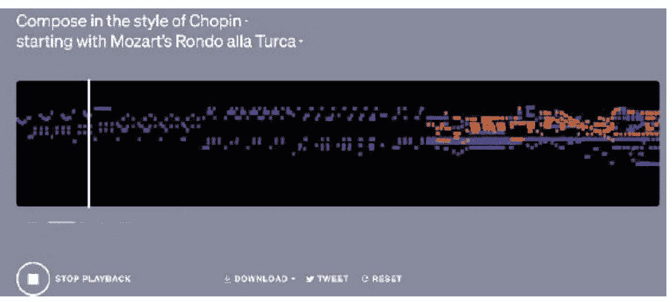

图3-12 MuseNet音乐生成神经网络的界面

MuseNet非按规则硬编码，而是海量乐谱训练后习得和声、节奏、风格特征再创作。训练语料覆盖MAESTRO、BitMidi及爵士、流行等海量曲库，规模达数十万级。掌握风格基因后，它能融合创新：给肖邦开头几音，要求生成带钢琴、吉他、长笛的流行曲，它便能无缝衔接产出。

OpenAI还在Twitch办过实验音乐会，并推出面向大众的“MuseNet共同作曲家”，分简易版与进阶版。前者选风格/作曲家即出曲；后者可自选乐器深度定制。现存短板在于概率采样机制，偶发不和谐片段（如肖邦风格混入重低音鼓），听感割裂。

乐坛AI新星不止MuseNet。美歌手Taryn Southern联手AI发行全球首张AI专辑《I AM AI》；索尼Flow Machines携手法作曲家Benoit Carre推《Hello World》，15首AI共创曲毫无违和感；爆款单曲《Daddy’s Car》亦出自索尼AI。谷歌曾庆巴赫诞辰推网页小游戏，用户定音符节奏即得巴赫风演奏；Chrome Music Lab推出Song Maker（图3-13）可视化教学作曲；Magenta基于NSynth神经音频合成，浏览器端即玩，切音色、调偏向，即兴创作极便。

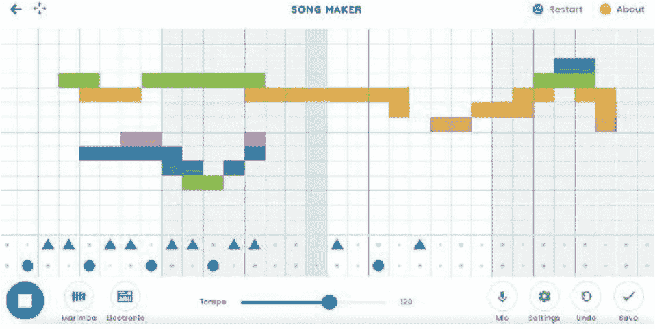

图3-13 谷歌的Song Maker制作器面板

国内“虚拟歌手”App异军突起，“歌叽歌叽”“ACE虚拟歌姬”深受年轻圈层追捧。用户可训练专属AI音色，社交平台教程满天飞。除生成歌手，还内置“一键写歌”“硬核原创”：输关键词+生日，30秒出“人生主打歌”，星座性格自动入词；选音符拼旋律再填词，秒变创作者。成品可选人声试听。网易云、腾讯、阿里等巨头亦布局AI词曲工具。不知不觉，“AIGC+音乐”已渗透生活肌理。

#### 声音克隆：极少样本，还原声纹神韵

音乐合成只是冰山一角，语音克隆才是硬核刚需。本质是定向文本转语音（TTS）：采集目标音频训练模型，实现指定音色朗读任意文本。

深声科技与小米合作，将克隆技术植入“小爱同学”定制音色功能。用户可复刻自家人声，支持音色分享，已成车载、手机、智能家居标配。相较传统TTS需海量数据，克隆仅需极少样本，大幅加速终端迭代，但对声学建模要求更高，早期易发音模糊、破音。经迭代，现仅需读20句短文、录90秒，即可捕捉情感、口音、发音习惯注入合成音。

原理上，系统需知“读什么”（文本）与“怎么读”（音色参考）。双路径输入：目标文本+参考音频片段。如要哪吒音色说“我喜欢玩滑板”，喂入该句文本及哪吒音样本，模型即可解耦音色特征完成迁移。

流程：音文对齐编码→训练个性化声学模型→任意文本预处理为字符/音素序列→声学模型转声谱图（含音色特征）→声码器合成波形→输出克隆音色语音。

代表作当属GitHub热门项目MockingBird。秒级克隆中文音色并合成新内容，10秒内样本+10字文本合成极快。缺陷在于按标点断句并行处理，标点影响韵律；口音、情绪、停顿亦干扰质量。

商业化落地广泛：配音懒人神器、主播定制感谢语、跨语种克隆赋能实时翻译保留原音色、影视多语种配音本地化。若再攻克节奏韵律建模，以假乱真将进一步释放生产力。

喜马拉雅依托海量语料库，用克隆技术极速文转音，大幅提产。其“单田芳声音重现”项目，以单式评书极具辨识度的腔调跨时空演绎《无证之罪》《十二金钱镖》等新旧作，联合官方授权专辑构建IP矩阵，以AIGC续写非遗生命力。

国内音频消费场景丰、用户基数大、增量空间足，技术成核心竞争力。生成式AI加速内容生产分发，随着规模化与迭代，AI参与度肉眼可见加深，音频产业迈向深度智能化。

#### 跨模态生成：声由心生，万物皆可“发声”

音频跨模态玩法多元：文生音、图生音、视频生音。火山语音联合北大、浙大推出的Make-An-Audio（图3-14）便是集大成者。用户投喂文本/图片/视频，即得逼真音效。鸟鸣、钟声、车声图片，或烟花、狂风、闪电视频，皆能精准还原对应声场。该技术或将重塑视频制作流程。

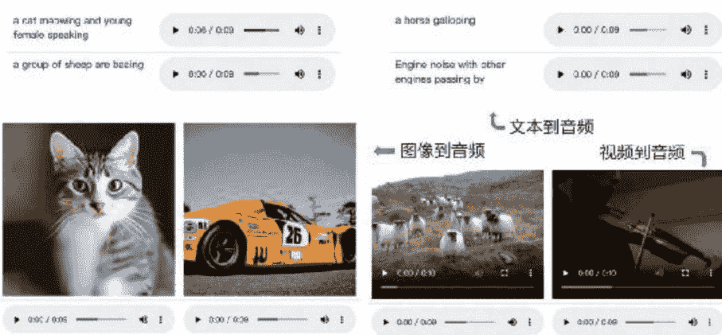

图3-14 Make-An-Audio实现跨模态音频合成

图片来源：https://text-to-audio.github.io

核心技术路径：视觉端借助CLIP文本编码器的图文联合空间，以图像编码为条件引导音频合成。难点在于音频-文本配对数据稀缺。团队创新“文本增强策略”：用模型生成音频描述，经随机重组构造动态训练样本，缓解数据饥渴。模型确立“No Modality Left Behind”理念，解锁任意模态输入的高质量、高可控音频合成。

展望未来，电影配音、短视频创作将成主战场。借助此类模型，人人可化身专业音效师，随时随地以多模态素材合成生动声效。现阶段受限于多数据源混训与样本质量波动，偶现内容不符等副作用，但AIGC在音频赛道的进展已足振奋。

AIGC以“魔法”重塑音频版图，作曲、克隆、跨模态三驾马车飞驰，赋能便利与娱乐新体验。文本、图像、视频皆可生音，我们步入“万物皆可生成”纪元。大胆畅想：音乐亦可生舞！未来或可拆解节奏风格重组动作，定制个性化舞蹈教学，线下练舞室将迎真挑战。产业共生共变，静候AIGC在声域带来更多可能。

### 影视工业：万千场景，任君调度

影迷皆感新技术重塑电影业：新型3D、无人机航拍、VR/AR……而AIGC影响之深、印象之烈，首屈一指。从剧本、视听设计、特效、剪辑到表演，AI全链路渗透。AI编剧、导演、特效、剪辑、演员的电影，已从想象走进现实。

核心价值在于自动化与智能化：将从业者从繁杂重复劳动中解放，聚焦高阶创意。视效、特技、剪辑等重工序逐步交予AI，行业工种加速智能化转型。本节带你实地考察AIGC在影视落地的硬核贡献。

#### 剧本工厂：从“年更”到“日出”

前文已述AIGC文本长才，剧本自不在话下。传统编剧痛点显性：周期长（优质本普遍年级）、沟通成本高（反复对齐方向题材）、偏差即停摆。AIGC介入可大幅压缩周期、提速增效，为后续环节赢时间。

# AI重塑内容生产：从影视工业到游戏开发的全链路突围

AIGC既已深度介入剧本创作，市场端究竟跑通了哪些闭环？谷歌DeepMind推出的Dramatron给出了标杆式答案——这堪称“剧本版ChatGPT”，能一键产出人物小传、场景清单、情节节拍与台词对白。创作者只需抛出一句话梗概，系统即可自动生成标题、人设、大纲、细节及对话，且全程支持人工介入修改、重写，灵活度极高。

Dramatron的核心优势在于“分层故事生成”架构。它借助大模型的长程记忆能力，从核心冲突摘要（日志线）出发，一口气推演数万字完整剧本，彻底告别了早期连续文本生成“写着写着就跑偏”的痛点。生成流程层层递进：先立人设、再拆场景、后写对白，中间任意节点均可插入人工指令微调。2022年埃德蒙顿国际边缘戏剧节上，由它参编的影片公开亮相；更有说服力的是，15位资深剧本专家历时两小时实测联创，绝大多数给出了高度认可的评价。

国内赛道上，海马轻帆的“小说转剧本”功能则主打工业化落地。将小说文本粘贴进输入框，几秒钟即可输出标准剧本格式：系统自动剥离心理独白、上帝视角等非视听语言，补全场景标识、动作指令与对白文本，实现从“读的文本”到“演的蓝图”的基础转换。这为IP改编扫清了繁杂的前期梳理工作，创作者只需聚焦情节创意打磨。实战数据极具说服力：短剧《契约夫妇离婚吧》上线4个月斩获300万+点赞、涨粉62万、单月播放破亿。平台还配套“一键切换中式/好莱坞格式”、“角色戏量自动统计”、“灵感素材库”、“短剧分场导出”、“商业价值智能评估”等工具箱，覆盖创作全周期。

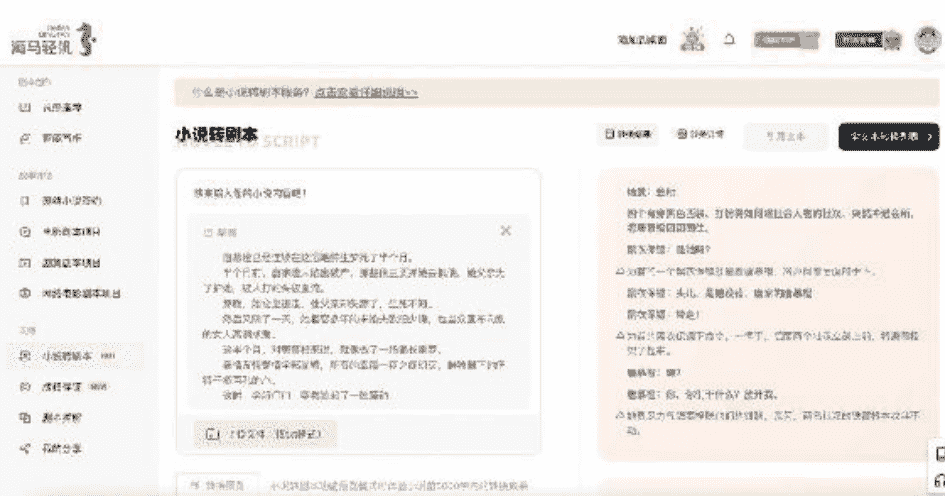

图3-15 海马轻帆“小说转剧本”界面

演员调度与场景构建同样迎来了范式迁移。AI换脸技术早已跳出娱乐梗的圈层，成为解决“劣迹艺人替换”、“故人数字复活”、“多语言口型同步”、“跨年龄演绎”、“高危动作合成”等棘手问题的标准方案。《三千鸦杀》女主换角、戏份已杀青却面临重拍成本高企的困局，便是靠AI换脸低成本破局。虽现阶段效果仍有打磨空间，但已证明其能有效规避“牵一发动全身”的制作风险。

虚拟场景合成则打破了物理拍摄的边界。《阿丽塔》女主制作引入双重深度学习：一是面部追踪补全，利用肌肉激活数据推算遮挡区域；二是皮肤微观生成，训练模型输出正确尺寸与方向的毛孔纹理，实现照相级真实感。《复仇者联盟3》则用机器学习重构面捕流程，让灭霸的微表情精准承载演员表演细节。国产剧《热血长安》采用“实景采集→数字建模→绿幕实演→实时抠像融合”全流程，将演员置于栩栩如生的虚拟世界中，大幅压缩外景成本与不可控风险。

#### 后期制作

剪辑向来是人力黑洞。传统模式下，剪辑师需在海量素材中反复比对、拼接，耗时惊人。AI剪辑引入成熟镜头语言库与风格数据库，实现自动选片、智能组接，效率实现量级跃升。2019年国庆阅兵直播，央视新闻部署“多路信号AI剪辑模式”：系统学习历史阅兵画面、信号规律与时间节点，掌握镜头调度逻辑，支持多机位、多角度并行剪辑切换。实战中，单个方阵表演结束5分钟内出片，2小时内产出82条成品视频，人工团队根本无法企及。

影像修复领域，AI让尘封经典重焕新生。修复逻辑遵循“补帧→上色→超分”三步走：将24帧插至60帧流畅播放、黑白映像智能着色、480P低分辨率拉升至4K超高清。以DAIN算法为例，它基于视频深度感知做时间帧插值，生成前先推理物体远近遮挡关系，再高效采样像素，输出质感远超索尼Motionflow、AMD Fluid Motion等传统硬件补帧方案。上色端，DeOldify改良GAN模型保留色彩艳丽优势并抑制闪烁伪影，虽非历史真实还原，但视觉观感极佳。

落地案例密集落地：腾讯联合环球音乐推出张国荣《热·情》演唱会超清修复版，千万粉丝同屏共忆；爱奇艺百部经典（含《三毛流浪记》《小兵张嘎》《东方红》）4K修复上线，并持续推进数字修复工程；中影数字基地联合中科大研发“中影·神思”系统，修复《马路天使》《血色浪漫》《厉害了，我的国》《亮剑》等片单，工期压缩75%、成本腰斩；优酷“画质重生”技术加持下，《倚天屠龙记》播放量暴涨450%，《寻秦记》《士兵突击》《亮剑》等剧集修复后强势回归各大平台榜单前列。

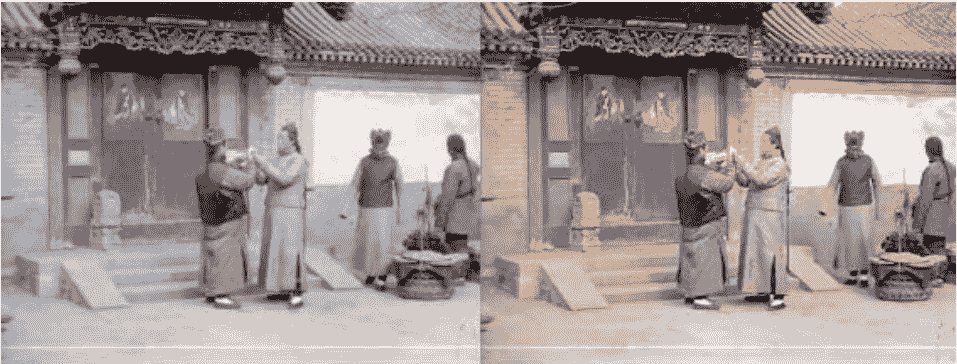

图3-16 老北京视频利用AI修复前后对比

图片来源： https://hyper.ai/14992


图3-17 电影《我的1919》利用AI修复前后对比

图片来源： http://media.people.com.cn/n1/2020/1019/c40606-31896307.html

从剧本落笔、角色造型、场景搭建，到剪辑拼接、修复重生，AIGC已渗透影视工业全链路，为无数作品注入降本增效的硬核动能。作为受众，我们正享受着技术红利带来的内容丰盈；展望未来，渗透深度只会加大，影视工业精度将被重新定义。

### 互动娱乐：游戏中的生成式AI革命

无论国内外，生成式AI正在重写游戏产业的底层逻辑。游戏天然的强交互、重实时特性，逼迫开发者承担极高研发成本，这也为生成式AI的颠覆性入场埋下伏笔。

不信看账本：即便压缩到极致，独立游戏起步也要百万级预算；《和平精英》《第五人格》等头部产品虽未披露细节，但规模决定其研运成本必在亿元量级。海外成熟市场更夸张，《荒野大镖客2》仅制作费就达数亿美元——8章节、百余任务、千余角色各配专属配音与性格设计，极致真实换来极致烧钱。高昂门槛成行业共识，也让AI辅助创作工具承载了“解放生产力、重塑成本结构”的厚望。一旦生成式AI深度嵌入开发管线，周期将大幅缩短、成本显著下探、新玩法涌现，玩家再无需漫长等待。

#### 游戏内容生成

拆解成本结构，人力占大头（策划、美术、程序三大工种衍生出数十个细分岗），非人力次之。美术环节最耗时耗力，涵盖角色、场景、风格、原画全链路。二次元文化崛起倒逼画质军备竞赛，《崩坏3》《阴阳师》爆红确立了“卷美术”赛道，厂商被迫持续加码美术预算以守住水位。

AI绘画精准击中痛点——不求直接交付成品，专攻前期“发散与定调”。美术师在角色设定、场景概念、服装道具、海报KV等环节引入AI，极短时间内跑通多风格方向，汲取配色灵感、构图创新、意境氛围，再以此为基石深化创作。

Lost Lore工作室开发手游《Bearverse》的实战极具参考值。角色设计阶段引入生成式AI，原定5万美元预算压缩至1万美元，1个月内完成198个可操作角色设计。游戏以熊族为主体，每角色含阶级、部族设定，198只熊需视觉区分度极高，传统流程工作量恐怖。工作室采用“Midjourney生成+人工微调”双轨制：输入参考图+详细Prompt（主体色、手持道具、姿势、背景、材质反射等），如“一头行军中的邪恶灰熊，穿铁甲戴骨饰，动态攻击姿势，古老头盔防毒面具，后启示录风格”，快速产出候选图，画师二次修饰定稿。部分3D建筑概念图亦由草图经Midjourney扩展后由人工把关。

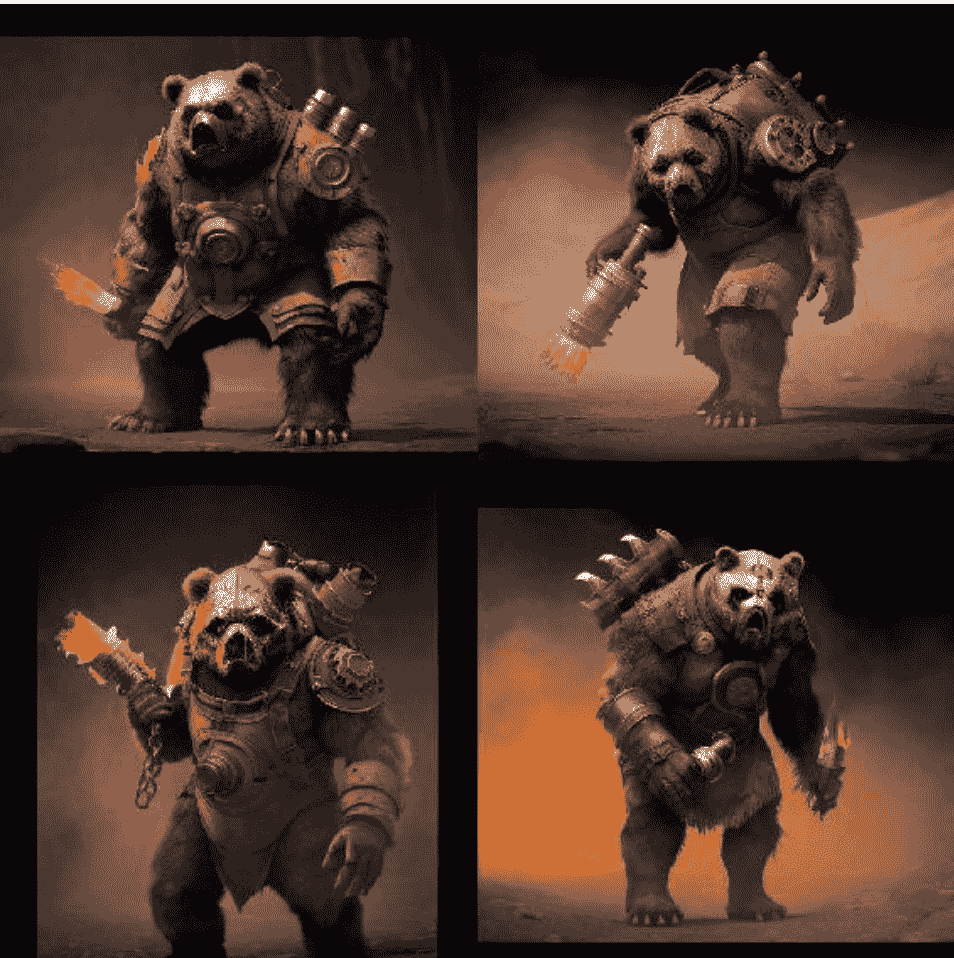

图3-18 Lost Lore工作室使用AI绘画生成的角色熊

图片来源： https://gameworldobserver.com/2023/01/27/ai-use-case-how-a-mobile-gamedevelopment-studio-saved-70k-in-expenses

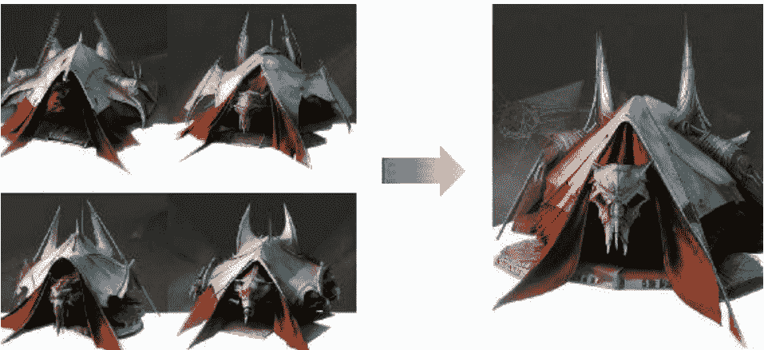

图3-19 运用Midjourney绘画软件生成的3D建筑参考概念图（左边为草图，右边为生成结果）

图片来源：https://gameworldobserver.com/2023/01/27/ai-use-case-how-a-mobile-gamedevelopment-studio-saved-70k-in-expenses

数据直观见证效能跃迁：角色概念图从16小时/个（17个需34个工作日）压缩至一周内搞定17个；场景概念图从1-2周压缩至1天。这尚未计入动画、关卡、世界观、音乐、音效、语音对白等更多AI可介入的环节，潜力空间巨大。

#### NPC

NPC（非玩家角色）历来是游戏体验关键。早期如《Pong》虚拟对手，仅是预设脚本程序，无法随玩家表现动态调策，互动体验天花板极低。生成式AI的到来，正让NPC从“脚本傀儡”进化为具备涌现智能的“原住民”，开启真正动态交互的新纪元。

# 生成式AI重塑游戏体验：从“背景板”NPC到无限可能的虚拟世界

随着生成式AI技术跨越式成熟，以OpenAI为代表的头部科技企业推出了GPT等极其拟真人脑对话模式的大语言模型。这一突破令无数游戏厂商跃跃欲试，纷纷谋划打造高拟人化的智能NPC，以此跃升玩家沉浸感。

其实，早在2005年，《Façade》这款实验性自然语言交互游戏就已探路。玩家扮演晚宴客人，通过文字干预一对濒临破裂的夫妻关系，每句对话都暗暗改写剧情走向。这种极致的互动性让它一炮而红，也为后续开发者描绘了互动叙事的无限蓝图。

如今，生成式AI深度赋能下，Charisma.ai、Inworld.ai等智能聊天机器人平台应运而生。开发者只需接入API，注入世界观与人设，即可定制专属NPC：它们能依玩家言行动态反馈，却始终服务于宏大叙事。这些数字生命早已超越“装饰品”范畴，成为推动剧情、深化代入的核心引擎。

游戏厂商Alientang更是将GPT-3、语音识别与语音合成打通，推出演示视频引发全网围观。

图3-20 游戏演示截图

图片来源：http://www.gamelook.com.cn/2021/03/434604

演示中，测试员与市政NPC“Bobby”自然对谈，若屏蔽画面，仅凭语气措辞根本分辨不出真假。这窥见了未来：更聪明的NPC将成标配，AI将全方位重塑游戏体验。

除此，专门面向娱乐陪伴的聊天应用也异军突起，如Glow。核心玩法极简：用户自定义人设（背景、性格、三观），通过对话微调语气话术，打造专属“电子搭子”。

## 创新型AI游戏：生成式内容开辟全新赛道

游戏领域的AI应用早已不止提效降本。借助生成式AI的实时内容生成能力，Spellbrush的《Arrowmancer》与微软《模拟飞行》分别开辟了前所未有的玩法范式。

《Arrowmancer》主打“AI捏纸片人”。四步流程——初始形态、定发色瞳色、精修细节、锁定姿势——让每个玩家都是画师。相比传统捏脸的有限参数，其上限极高、画风自选，精准捕获二次元用户心智。


图3-21 Arrowmancer游戏概念图

图片来源：https://www.arrowmancer.com

微软《模拟飞行》则靠Bing Maps构建真实地表，Azure AI渲染万物细节，Project xCloud驱动数据交互。核心差异在于：地图、景物实时生成，告别静态资源包，带来真正“活”的星球。


图3-22 《模拟飞行》游戏画面图

图片来源：https://tech.sina.com.cn/csj/2020-09-04/doc-iiwhvpwy4807517.shtml

更激进的是Hidden Door：融合机器学习与沉浸式娱乐，搭建多人共创的无限叙事宇宙平台。玩家组队将世界重组为互动图画小说，在AI旁白的桌面RP氛围中即兴冒险，海量NPC、物品、地点随心调用。成品可收藏、交易、分享，甚至混搭成新世界，实现“玩家即创作者”的终极形态。

国内巨头自然不甘示弱。网易《逆水寒》喊出“国内首个游戏版GPT实装”，智能NPC支持自由对话与逻辑行为反馈，已正式上线供玩家体验。字节跳动朝夕光年无双工作室联合游戏AI团队，攻克竞技场AI陪练：按段位匹配、拟真人操作风格，让单机也能享受“竞技对抗”快感，显著提升留存。

可见，生成式AI在内容生产端大幅压缩成本，有望打破大厂垄断，催生类型创新；但设计师、艺术家并未被取代，只是将重复劳动外包给AI，核心创意仍掌握在人手中。体验端，智能NPC不仅让游戏更耐玩，更延伸为现实中的“解题专家”与“情感陪伴”，全维度升级生活质量。作为基建工具，生成式AI将高频现身游戏市场。

总言之，游戏是生成式AI落地的关键战场，未来必将爆发更多革命性变革。元宇宙概念对技术天花板的极致追问，更为游戏产业指明了进化方向。

---

# 第四章 商业落地：AIGC产业应用与前景展望

本章将以“行业职能”视角，拆解生成式AI如何深度赋能研发、生产、供应链、营销、客服五大核心板块。它在全产业链中扮演“催化剂”角色，释放出惊人“工作能力”。职场读者读完定能找到对号入座的场景，学会用AI重塑生产力、提效增收。

## 研发设计：从外观到结构的全能设计伙伴

原型设计向来是劳动密集型迭代：团队反复经历分析、理解、优化循环，耗时费力，迭代次数受限，替代方案鲜有探索，最终成品往往非最优解。生成式设计的出现，改写了这一范式。

它利用AI批量产出设计变体，极大加速选项生成，缩短开发周期，拓宽创意广度。形态多样：既可在现有基础上增删要素，也可从零生成全新方案。承接标准化琐碎工作后，设计师得以聚焦核心创新。

现阶段，AI已能据草图与提示词产出高保真效果图；伴随3D模型突破，生成式设计工具全面渗透产品设计。Gartner预测：2027年将有30%制造商引入生成式AI优化开发流程，你的下一个App、下一双跑鞋，极可能出自AI之手。药物研发同理：2025年预计30%新药将由生成式AI设计。

产品设计分外观与结构两阶段，合力完成“从0到1”。下面分别解析AI在两阶段及药物研发中的实战表现。

### 外观设计：从灵感火花到落地草图的加速器

CALA作为头部时装设计平台，已将创意转化、原型打样、成品生产全链路数字化。其新上线的免费生成式AI工具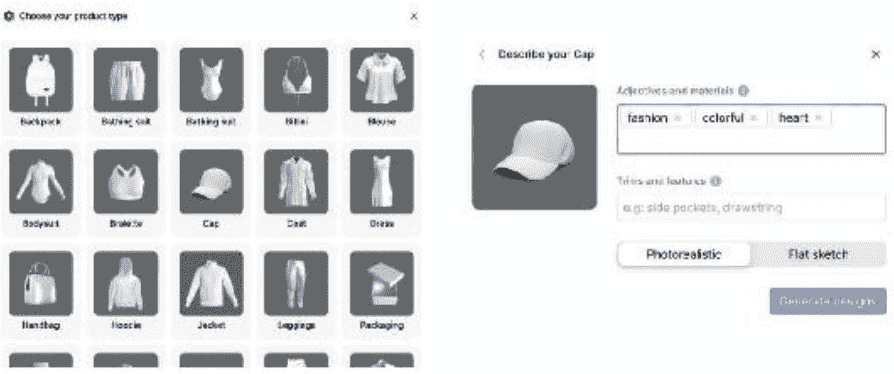基于OpenAI DALL·E构建：设计师选款式（25类基础款）、输创意关键词、选面料、改装饰细节（袖口、拉链等），约20秒即得6套方案。

以“鸭舌帽”+“fashion, colorful, heart”为例，生成结果高度契合设计意图。确认后可一键插入工作台深度修改：增图案、加批注、精准测量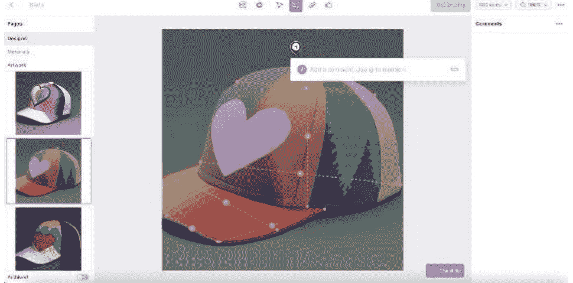。


## 图4-1 在CALA中选择款式和设计风格

### Select generated designs

- Regenerate

- Insert


## 图4-3 CALA设计工作台

需注意：CALA非“一键出图”神器，仍仰赖设计师功底，但它大幅降低新人门槛、为资深者提供海量灵感，效率跃升显著。这为建筑等其他外观设计领域树立了标杆。

建筑外观设计要素更繁杂、可用性要求更高。理论上Stable Diffusion潜藏海量高质量建筑风格，但可控性仍是痛点：生成的漂亮造型往往不合需求，需堆砌大量提示词。实测输入“市中心商业综合体外观，富有时尚色彩”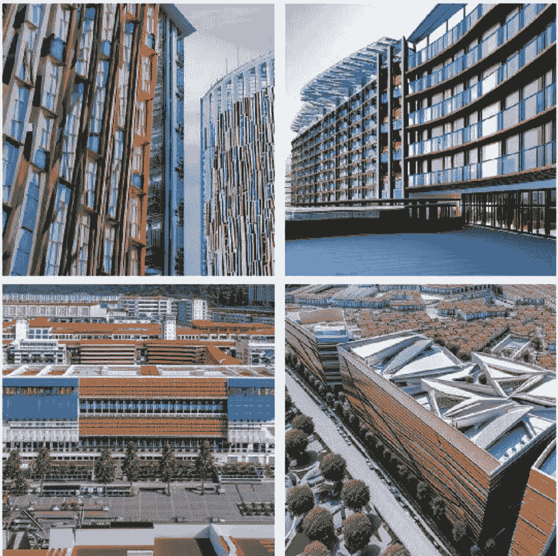，成品偏离预期。


## 图4-4 Stable Diffusion生成的建筑设计图

解法是“人机协同渐进式生成”：将方案构思、草图、素材生成等各阶段串联，上一步输出作下一步初始图，配合新提示词迭代。如图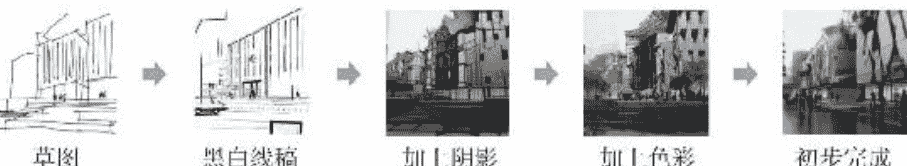所示，设计师与AI联手，完成写字楼从草图到定稿全流程。


## 图4-5 Stable Diffusion渐进式生成建筑设计图

图片来源：https://www.sohu.com/a/607863678_121124407

协作中，AI贡献奇思妙想，人类把关校正，细节补全后方案即成。生成式AI将协同与创作融合，从灵感源头激发创造力，体验堪称革命性。未来必将在更多外观设计细分赛道大放异彩，重塑设计方法论。

### 结构设计：用算法换取极致性能与极速交付

结构设计是产品落地的关键，汽车零部件是典型战场。通用汽车借力AI+云计算的生成式设计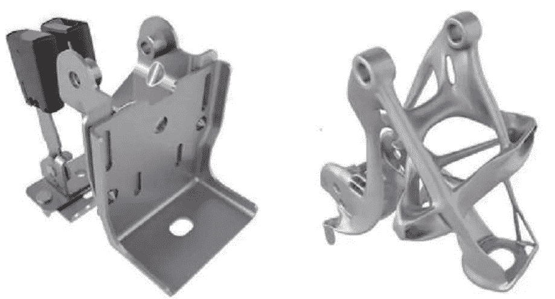，配合增材制造（3D打印），经济高效地量产复杂件、定制件，性能与选择权双提升。

2015年Local Motors推出75%零件3D打印的Strati；2016年Divergent 3D亮相700匹“超跑”Blade；中国首款3D打印电动车LSEV问世——3D打印已成汽车制造必争方向。而生成式设计，正是打开这扇门的钥匙：工程师设定目标约束（材料、工艺、预算），软件算法遍历所有可能，推荐最优解。


## 图4-6 通过生成式AI设计出的汽车零件（左边为原始零件，右边为AI优化后的零件）

图片来源：https://www.autodesk.com/customer-stories/general-motors-generative-design

3D打印+生成式AI，让汽车实现“更轻、更省油、更便宜”，竞争力跃升。未来，经销商端按需打印定制件（如专属装饰包、车主姓名/战队Logo个性化件）将成常态。

航空航天领域表现更惊人。NASA戈达德航天中心开发“数字编码需求+生成式AI”工具，**仅2小时**完成航天部件设计，全满足NASA严苛规范（避光路、热隔离、胶接/螺栓接头等），且能批量支撑内部仪器设计。

对比研究数据极具说服力：人工专家迭代4次，首版太重(0.59kg)，二版镂空减重但刚度不足，三版调整镂空，四版换拓扑虽达标但难加工。生成式AI迭代31次，自动产出两套方案：重量0.2kg，最大应力仅11.2-14.8MPa（**刚度质量比超人工3倍+，应力大幅降低**），且全流程易加工（数控3天/3D打印3周）。**核心优势在于速度：两工程师两天的工作，一人半小时定需求+一小时出图，开发周期与成本断崖式压缩。**

| 设计师 | 人类专家 | 人类专家 | 人类专家 | 人类专家 | AI | AI |
|---|---|---|---|---|---|---|
| 设计 | [图片] | [图片] | [图片] | [图片] | [图片] | [图片] |
| 迭代次数 | 1 | 2 | 3 | 4 | 31 | 31 |
| 重量 (kg) | 0.59 | 0.18 | 0.27 | 0.18 | 0.2 | 0.2 |
| 最大应力 (MPa) | 26.3 | 189 | 103 | 60.7 | 14.8 | 11.2 |
| 制造方案 | 数控机床 1700美元, 3周 | 数控机床 无报价 | 数控机床 无报价 | 数控机床/3D打印 无报价 | 数控机床 1000美元, 3天 | 3D打印 2000美元, 3周 |

## 图4-7 人工设计与生成式AI设计对比

> 数据来源： Ryan McClelland, “Generative Design and Digital Manufacturing: Using AI and Robots to Build Lightweight Instruments”

生成式AI设计在可制造性、性能指标、交付速度上全维碾压人工专家。这种量级的性能跃迁在机械设计史罕见，标志着工业设计范式的根本性转移。

# 生成式AI重塑制造业：从分子设计到智能工厂的全维跃迁

生成式AI正以惊人速度渗透生产制造版图，携手数字制造等核心技术，重塑设备结构的设计与制造逻辑。这种变革让研发周期大幅压缩、性能指数级跃升，实现了传统手段难以企及的突破，结构设计领域正迎来一场彻底的范式革命。

### 药物研发：从宏观问诊到微观分子的“降维打击”

AI早已在医疗版图深耕细作，无论是辅助问诊、方案制定还是新药攻关，皆占据核心席位且演进迅猛。ChatGPT的横空出世更让医疗交互焕然一新——对话形态、反馈质量、精准度与效率实现全方位跨越。

科技巨头们通过自研与并购双轮驱动，竞相布局生成式医疗平台。GPT-4发布前夕，谷歌联合DeepMind推出医疗垂直大模型Med-PaLM，专攻健康医疗问答；微软旗下Nuance则抢先发布基于GPT-4的临床记录应用DAX Express，秒级生成病历笔记，极大缓解医护文书负担。

随着技术演进，AI触角已延伸至药物设计微观领域。辉瑞、强生等药企巨头纷纷试水AI研发，利用生成式AI构建针对性蛋白质模型，多款管线已推进至临床阶段，标志着AI设计能力实现从宏观世界向微观分子层面的跨越。

**研发痛点与AI破局**
新药诞生需历经发现、临床前、临床试验三重关，动辄十年磨一剑、资金吞吐量惊人。核心难点锁定在“靶点挖掘”与“化合物设计”两大环节。生成式AI借力海量数据算力，可高速锁定靶点、匹配分子、完成化合物设计、预测代谢理化性质及药理作用，实现周期压缩、成本控制与效率跃升的三重奏。

传统模式下，科研人员需在成千上万分子中筛选针对性化合物，成功率极低。人类思维易陷入路径依赖，难以设计结构新颖的创新药。而蛋白质作为核心靶点，其三维折叠形态决定功能，二维序列向三维结构的折叠组合呈天文数字级爆炸，构成设计高墙。

生成式AI展现出天然降维优势：不仅能通过机器学习挖掘数据、提高靶点命中率，更能破解蛋白质折叠难题，设计三维结构，甚至打破认知边界生成人类未曾构想的新蛋白、新方案。

**标杆案例与平台实力**
*   **ProGen系统**：Salesforce Research联合Tierra Biosciences及加州大学研发，可从零生成高多样性蛋白。其创造的人工溶菌酶与天然序列一致性仅31.4%，却展现同等活性，首次打通AI预测与实验验证的“最后一公里”。
*   **BioNeMo云服务**：英伟达推出生物分子生成预测平台，依托专有数据训练模型，支持浏览器端交互式推理、结构可视化，大幅加速最耗时耗资的蛋白质创造与候选药物筛选。
*   **Chemistry42平台**：英矽智能2020年发布，实现从零设计新颖分子并多维评分优化。2023年，其设计的新冠口服药ISM3312获批临床，成为全球首款进入临床的AI设计新冠小分子药物。该药物拥有独特结合模式与骨架，展现差异化机制优势，印证生成式AI在小分子设计上的硬核实力。

尽管受限于基础数据与精度，AI尚难包揽全流程药物设计，但大模型与大数据已提供强劲助力。随着模型迭代与数据积累，其在生命科学版图的权重必将持续攀升。

**设计协作新范式**
无论宏观外观还是微观结构，生成式AI均展露强劲设计势能。当下仍定位“辅助驾驶”，因设计本质在于体系化思维、需求对接、市场洞察与用户共情，这些仍赖设计师专业积淀与实战打磨。但AI优势显性：极速迭代方案、海量创意供给、效率指数级提升。人机协作下，设计师可快速获取初稿、借力AI成图表达、突破知识边界、释放创造力。未来，应用场景将随研究深入持续丰富。

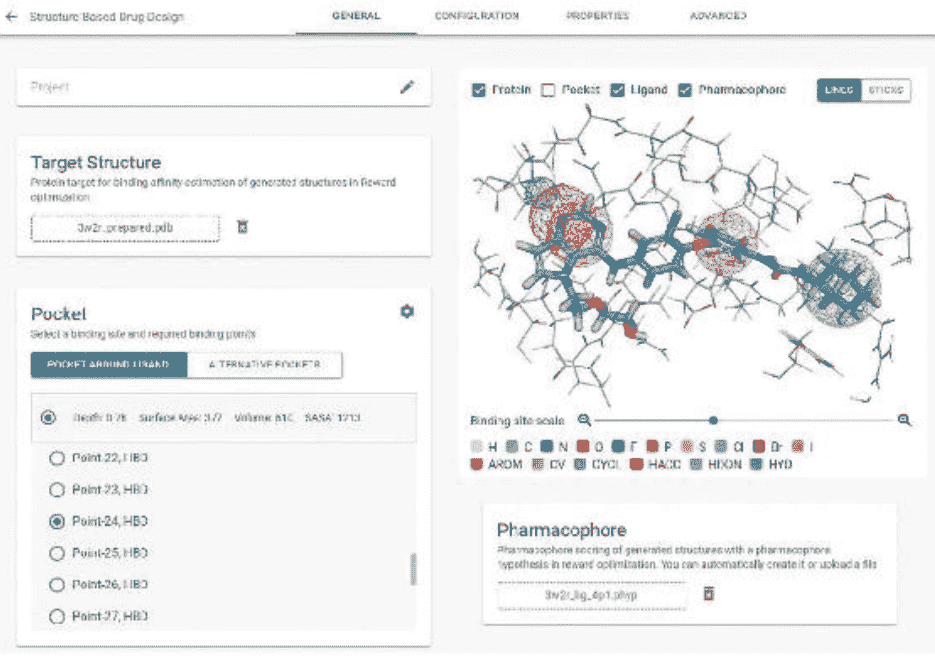

## 图4-8 Chemistry42用于配置基于结构的药物设计生成实验的界面

图片来源： Yan A. Ivanenkov, et al, “Chemistry42: An AI-based Platform for De Novo Molecular Design”

### 生产制造：解锁工厂端的“L4级”智能控制

L4级自动驾驶意味着特定条件下无人接管，代表当前自动驾驶天花板。在制造端，智能制造技术正复刻这一高度——实现“L4级”智能控制。想象一下：车间内机器人分工协作，组装、质检、打包、物流全流程自主闭环；设备自诊故障并自动工单派单；技术人员坐镇中控室即可全域掌控。这就是智能工厂的日常图景：生产由智能体主导，全链路数据实时上云，决策在云端完成。

继蒸汽、电力、信息化三次工业革命后，智能制造开启“工业4.0”纪元。德国首倡，核心在于自动化跃升、智能机器/工厂落地、数据驱动增效，赋能大规模定制与柔性供给。

**落地标杆**
*   **上汽大众安亭新能源工厂**：近1500台工业机器人矩阵，车身/电池车间无人化，总装自动化率较传统跃升45%，定义全球车企制造新高度。
*   **美国际家居×IBM**：全链路智改（设备、产线、物流、计划），机器人自动化生产助力产能翻倍，交付周期从行业均值120天压缩至35天。

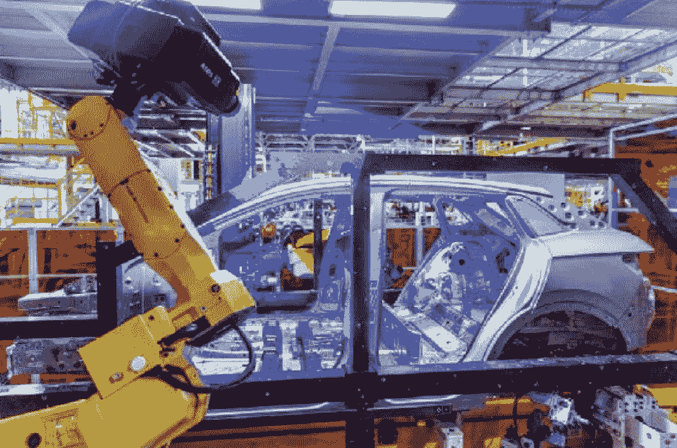

## 图4-9 上汽大众新能源汽车工厂

图片来源： https://www.csvv.com/csvv-website/news/company-news.html?newsid=2927

智能制造普及倒逼工业机器人需求爆发。传统机器人依赖预设指令，工况变动需重写代码。生成式AI带来新范式：让机器人通过仿真学习物理交互规律，而非死执预编程逻辑。

### 机器人控制：赋予钢铁臂膀“通用大脑”

本节聚焦工业机器人（ISO 8373定义：多关节/自由度、自动执行、自带动控的机械装置）。1954年德沃尔奠基，1959年Unimation诞生首台Unimate（重1.2吨，仅搬运焊接压铸件），开启机器人纪元。

历经产业迭代，精度与能力双飞跃。从汽车、金属、医药等传统强基，到手机、穿戴等新兴消费电子产线，工业机器人无处不在。2022年ABB发布掌上型六轴机器人IRB 1010（占地仅135×250mm），精准适配穿戴设备微型组件装配，精准回应电子产线“寸土寸金、极速换线”刚需。

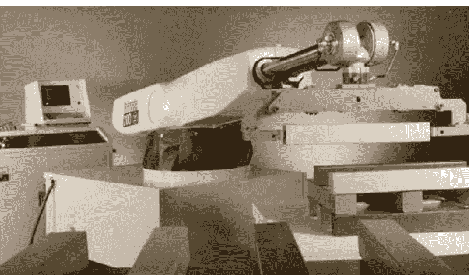

图4-10 工业机器人鼻祖——Unimate

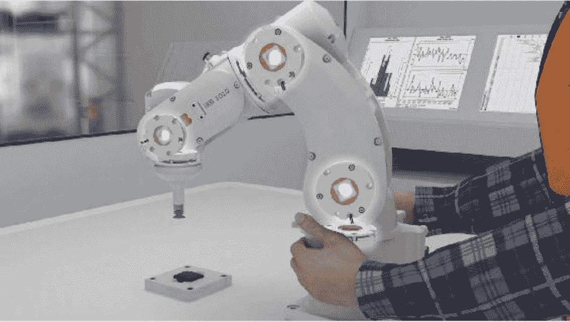

图4-11 “史上最小” 六轴工业机器人——IRB 1010

**控制难题与进阶之路**
应用场景复杂化倒逼控制升级。主流仍采用底层空间定位控制——固化代码循环执行，虽稳但脆，工况微变即失效（如码垛机器人遇工件位姿偏移即抓取失败）。

视觉赋能成破局先锋：工业视觉识别工件位姿，动态修正轨迹，增强适应性。但仅适用相对简单场景。实战中工件位置、形状、重量、硬度多维度漂移，多规格混流处理成常态，如何赋予机器人强泛化能力，成核心课题。

**RT-1：Transformer登陆具身智能**
谷歌机器人团队推出Robotics Transformer 1 (RT-1)，将Transformer引入机器人控制。该多任务模型能将视觉实时流与自然语言指令映射为动作序列，支持实时推理控制。流程见图4-12：文图经FiLM EfficientNet编码为向量，再经Transformer解码为机器人指令集，驱动执行。

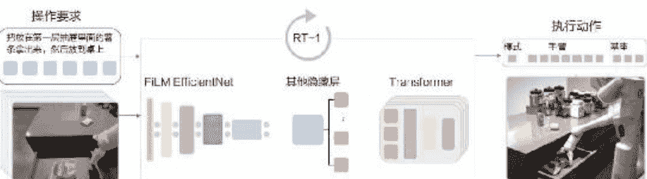

图4-12 RT-1技术原理

图片来源：Anthony Brohan, et al, “RT-1: Robotics Transformer for Real-World Control at Scale”

谷歌构建超大规模数据集（13万+视频、700+任务、17机器人、13个月采集），训练出具备抓取、放置、开合抽屉等技能的机器人。泛化测试覆盖未见指令、干扰物抗扰、异构环境适应及复合实况（图4-13），RT-1全维度碾压同类基线，为工业机器人通用化提供极具潜力的范式。相信借鉴此路径，更多高泛化、高智能机器人将涌现。

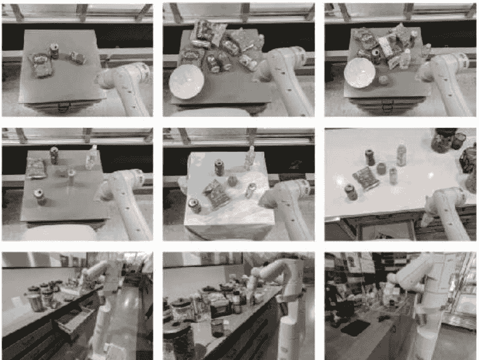

图4-13 RT-1机器人在不同维度上的泛化能力测试

图片来源：Anthony Brohan, et al, “RT-1: Robotics Transformer for Real-World Control at Scale”

### 多机器人协同：从“独行侠”到“特种部队”

单机能效有限，复杂产能目标迫使研究转向多机器人协同。群体优势显性：一是**吞吐强**——分工协作大幅压缩节拍；二是**容错高**——任务冗余设计，单点故障自动熔断切换，系统鲁棒性跃升。

协同控制成核心命题，生成式AI能否赋能？已有研究在铰接式物体操作上给出肯定答案。

**铰接物体协同难题**
铰接物体即通过铰链连接的可转动多刚体系统（门、剪刀、钳子、工业夹具）。单臂固定一端操作另一端易如反掌，但工业场景下多为双端非固定（如大型剪刀需双臂协同），看似简单实则极难：需实时推理运动学约束、力学耦合与碰撞规避。

**V-MAO：生成式协同新范式**
研究团队提出V-MAO方案（图4-14）：输入铰接物体及场景的RGBD扫描（含深度信息），生成模型学习各机械臂最优接触点分布。创新点在于将后臂生成以先臂动作为条件，构建时序依赖。

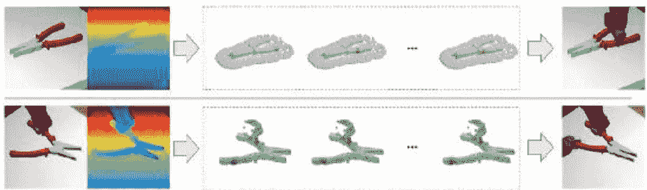

图4-14 V-MAO工作原理

图片来源：Xingyu Liu, Kris M. Kitani, “V-MAO: Generative Modeling for Multi-Arm Manipulation of Articulated Objects”

核心在于将“多臂协同操纵”转化为“从刚体点云分布生成多臂接触点”的生成建模问题，分层学习局部/全局点特征。沿用Encoder-Decoder架构处理三维点云几何与特征。仿真实测显示，该方案在6类物体、2型机器人上均达高成功率，实证生成式AI通过学习复杂接触分布，可有效驱动智能化多机协同。

### 工业质检：从“人海战术”到“AI慧眼”

质检是制造生命线，关卡未过不得出厂，质量不过市场不得长久。检测维度因品而异：饮料查标签/喷码，车件查划痕/倒角。

**传统痛点**：标准主观漂移（人际/人内不一）；高强重复易疲劳致漏判误判；培训周期长、经验不可复制、人员流动成本高。

**AI质检重构价值链**（图4-15）：深度学习视觉检测+运动控制剔除，实现缺陷自动识别、精准剔除、隐患清零。


图4-15 AI质检系统结构

# AI质检破局：生成式AI如何解决“小样本”难题

AI接管工业质检已成定局，但落地时常卡在一个现实痛点上：深度学习视觉模型训练极其依赖大量、多类型的缺陷样本。现实却是，微小、低对比度的缺陷在产线上极难捕捉，采集成本高、周期长、样本质量参差不齐，导致模型泛化能力不足，漏检、误检率居高不下。

针对“缺样本”困境，生成式AI提供了一套全新的**样本增强范式**。传统增强手段（旋转、翻转、缩放等）对极小样本问题收效甚微。新方案分两步走：

1.  **构建“种子图”**：针对单一缺陷类别，通过人工布局或几何变换，生成不同位置的基础缺陷图。
2.  **强度维度扩充**：这是核心环节。对每张种子图，利用生成模型批量产出**不同强度梯度**的缺陷变体（如从明显到极弱的6级甚至更多强度）。


图4-16 指定缺陷类型生成不同缺陷强度图片

图片来源：Shuanlong Niu, et al, “Region — and Strength — Controllable GAN for Defect Generation and Segmentation in Industrial Images”

实战证明，这种“位置+强度”双维扩充策略，显著增强了模型对弱对比度缺陷的感知力，整体检测指标大幅跃升。生成式AI不再只是“会画图、会写文”，它正作为强大的通用基座，赋能传统制造智能化升级。未来，借助成熟生成模型改造各类产线设备，将是持续深耕的方向。

---

### 供应链管理：让库存计划“自动驾驶”

供应链连接着从原料到消费者的全链路，核心在于平衡“最大化客户价值”与“最小化总成本”。随着数据沉淀加深，数据驱动管理已成降本增效关键。

#### 痛点：经验主义与滞后决策
供应链不缺数据，缺的是**洞察力**。管理者常凭有限经验粗略判断，ERP/WMS等系统只管记账不管建议，缺乏预警与预测能力。面对复杂不确定性，决策往往滞后，一次失误可能引发巨额浪费。麦肯锡预测，AI赋能供应链年价值可达1.3万亿至2万亿美元。

#### AI介入：从“被动响应”到“主动规划”
AI通过多维数据分析，精准预测需求、优化网络布局、调配运力、规划仓储库存。智能仓储已成主流：亚马逊CartonWrap线每小时打包千单，效率超人工5倍；阿里智能仓日处理百万单，人工仅留守复核监护岗，效率提升30%以上，准确率近乎100%。生成式AI更在**需求预测**与**库存管理**两大核心板块大显身手。

#### 需求预测：多维特征喂养Seq2Seq模型
需求预测是供应链大脑。传统靠拍脑袋或简单统计，准确率低、成本高。AI引入四大维度特征构建时序模型：
*   **商品画像**：标签体系下的属性、文本、图像多模态融合；
*   **历史销量**：时间序列建模基石，处理复杂非线性趋势；
*   **季节周期**：捕捉需求随季节更替的周期性规律；
*   **促销干扰**：量化历史大促效应及新玩法带来的增量预期。


图4-17 AI需求预测值和实际值对比

生成式AI中的**Seq2Seq架构**在此大放异彩。编码器压缩历史销量与时变特征，上下文模块融合静态属性，解码器自回归输出未来序列预测。实测该架构以低算力实现高精度（两周预测准确率75%-85%，远超传统70%上限），有效降低库存周转天数，助力生鲜等高损耗品类降本增效。


图4-18 用于需求预测的seq2seq模型架构图

图片来源：Iván Vallés-Pérez, et al, “Approaching Sales Forecasting Using Recurrent Neural Networks and Transformers”

#### 库存管理：用RNN范式破解“大规模库存”NP难题
库存管理非简单补货，乃服务水平与利润的动态博弈。传统刚性策略难应对“缺货与积压并存”。AI融合预测与优化算法，动态演算安全库存、再订货点、最优订货量，实时感知需求漂移，动态调整补货计划，在成本与服务间寻得帕累托最优。

真正的挑战在于**大规模网络**：数千SKU、数十万节点，传统模拟建模面临维度灾难，优化求解近乎不可行。创新在于：将库存系统映射为**序列模型（RNN/Transformer）**。

*   **输入** = 外部需求冲击
*   **隐层结构** = 复杂库存网络拓扑
*   **输出** = 综合持有/缺货成本
*   **时序依赖** = 当前库存决策通过链式传导影响全周期绩效


图4-19 RNN生成库存模拟示意图

图片来源：Tan Wan, L. Jeff Hong, “Large-Scale Inventory Optimization: A RecurrentNeural-Networks-Inspired Simulation Approach”

此法将计算效率提升**千倍量级**，轻松支撑百万级节点优化。随着注意力机制等生成式技术迁入，长程依赖建模能力将更强。未来，决策式AI负责精准预测判断，生成式AI负责方案生成与仿真推演，人类决策者拍板确认——这才是供应链管理者梦寐以求的“智能中枢”形态。

---

### 市场营销：生成式AI重塑全链路增长飞轮

营销向来数据驱动，与AI天然契合。决策式AI已让“千人千面”推荐成为标配；而生成式AI（AIGC）的爆发，正将营销推向**“内容无限供给+全旅程智能陪伴”**的新纪元。

从获客种草（文心一言等对话式推荐），到留存促活（AI客服个性化陪伴深化心智），生成式AI贯穿客户全生命周期。以下三大场景最具代表性：

#### 1. 营销方案：从“优化执行”进化为“生成策略”
广告投放早已是决策式AI主场（实时竞价、定向优化）。现在，生成式AI上游介入：**输入预算、目标、人群、媒体、卖点等结构化Prompt，直接输出最优投放方案**。
更激进的是**“决策式AI+生成式AI”双引擎闭环**：投放前生成式AI出方案，投放中决策式AI实时调优，效果数据反哺生成式AI迭代方案。最终方案往往“匪夷所思”却极致高效，正如Diffusion模型启发专业画家。Adobe营销SaaS即实践此道，将跨渠道分析周期从月压缩至周，助力企业ROI最大化。

#### 2. 营销素材：多模态生产力爆发，覆盖全链路触点
文案、图片、视频、3D素材，生成式AI分钟级产出，成本降维打击。品牌借此在客户旅程每个节点（种草、搜索、详页、售后）精准投放差异化内容，高频次触达强化品牌认知，打通“货找人”最后一公里。

#### 3. 营销沟通：从“标准化回复”到“超个性化陪伴”
大模型赋能智能客服/销售助手，具备长文本理解、多轮推理、工具调用能力。不再是冷冰冰的决策树，而是能共情、懂业务、会推荐的“数字员工”，7×24小时低成本承接海量咨询，显著提升转化与复购。

**展望**：生成式AI不只是内容生产工具，更是营销操作系统的内核升级。它将数据、内容、决策、执行打通，让营销真正实现**“策略自动生成、素材无限供给、沟通深度个性、全链路闭环优化”**。企业竞争焦点将从“会不会用AI”转向“能否构建数据飞轮与Prompt工程体系”，率先建立生成式营销基建者，将赢得下一个十年。

在国内营销科技领域，蓝色光标旗下销博特近期上线了2022元创版智能策划模块，核心切中营销策划多人协作的痛点。以往一场专业营销策划的诞生，往往需要策划、数据、媒介等多角色组建专项小组，历经草案拟定、数据复盘、头脑风暴、媒介排期等多轮拉通，动辄耗时数周。而销博特此番推出的模块，只需用户录入简报发起项目，AI即可在半小时内产出初稿方案。团队成员随即可进场协同审阅、碰撞创意、标注修改，将整个策划落地周期硬生生压缩至2至3天。

#### 文案图像生成：创意生产的加速器

令营销人头疼的莫过于“如何低成本产出高质量创意”。业内常说，练就文案基本功靠的是积累与背诵海量经典案例。如今，AIGC工具的介入彻底改写了这一逻辑：营销人只需筛选AI批量生成的文案与图像，效率便实现了质变。

Stable Diffusion、Midjourney、DALL·E 2等绘图神器展现了惊人的视觉生成力；ChatGPT、GPT-4、文心一言等大模型在文本创作上也各显神通。除了这些头部玩家，垂直领域的新势力同样动作频频。Jasper.ai与Copy.ai主打秒级产出高转化营销文案；Persado则通过拆解叙事、情感、格式等文案元素组合运行实验，精准匹配个性化话术，助力戴尔实现点击率提升50%、转化率增长46%、加购率飙升77%的亮眼战绩。

Phrasee在多渠道文案自动化生成上深耕细作，其核心优势在于严守“品牌声量”，生成内容天然贴合调性。维珍假日借此实现邮件营收数百万英镑增量，达美乐比萨邮件效果显著跃升，沃尔格林甚至用AI生成内容推动新冠疫苗接种率提升。


视线转向视觉生成实战。德国电商巨头Zalando的研究团队为合作品牌带来前沿方案：利用生成式AI将指定服装色彩与模特姿态迁移至新模特身上（如图4-20所示）。这一方案让品牌摆脱重复拍摄劳作，大幅压缩营销图片产出周期。

图4-20 将服装色彩与模特体态（首行）迁移至目标风衣款式（次行）

图片来源：Gökhan Yildirim, et al, “Generating High-Resolution Fashion Model Images Wearing Custom Outfits”

Adobe推出的“萤火虫”(Firefly)则将AIGC原子化能力嵌入创作流。用户可用“橡皮擦”抹除模特服饰，输入“红夹克”即时换装，甚至能微调面部年龄、笑容弧度、睁眼幅度等细节。期待其尽快全面融入Adobe全家桶，届时营销视觉产能将再迎飞跃。

本土方面，腾讯自研的千亿参数“腾讯广告混元AI大模型”已成广告内容理解的核心引擎。它能融合文本、图像、视频多模态联合理解，精准捕捉广告语义与用户整体感受，显著提升定向分发精度与用户体验。更具想象力的是其生成侧能力：“图生视频”让静态素材动起来，“文案助手”自动优化标题提效，“文生视频”未来只需一句话即可定制视频广告。营销内容生产门槛与成本由此双降。

#### 营销触达：从外呼到虚拟主播的进化

营销沟通承载着企业通过广告、公关、促销等渠道触达消费者的使命。我们重点剖析电话外呼与直播带货两大典型场景。

电话外呼凭借即时触达、高效传播优势，长期是销售转化利器。教育行业新课上线时，外呼系统自动筛选意向学员转人工，并同步记录通话细节至CRM制定跟进计划，管理层还能实时监控接听率、通话时长等指标。但传统AI外呼机器人短板明显：一是难懂复杂对话、解不了复杂题，仅能做初筛，离不开人工兜底；二是定制化训练部署成本高，企业ROI核算压力大。

随着AIGC演进，“更懂业务”的新一代外呼机器人应运而生。百应科技从三个维度探索融合路径：将类ChatGPT模型纳入中控引擎作为回答源，大幅提升多轮对话自然度与准确率；利用大模型结合对话聚类辅助意图理解，解决相似问扩充与新类别发现难题；赋能AI运营师高效配置任务流与知识库，同步优化机器人对话流畅度。搭载AIGC的外呼体验，值得期待。

若外呼是幕后推手，虚拟主播便是台前常驻明星。国内称其为“虚拟UP主”，凭借7×24小时不下播、成本可控、零“人设崩塌”风险（人设言行全掌控在品牌方）等特性，成为直播间标配。2022年“双十一”美妆品类头部直播间，半夜时段几乎全由虚拟主播守夜。京东美妆虚拟主播现身欧莱雅、圣罗兰等20+大牌直播间，以专业讲解支撑全天候转化。

魔珐科技推出的“有光”虚拟直播产品，消费版仅需一镜头一笔记本即可开播，极致降本。其支持品牌定制3D场景、高精度全风格虚拟形象、弹幕礼物3D互动，并提供姿态、表情、动作、才艺全栈定制。技术底座覆盖智能建模绑定、智能表演变声、文本驱动动画语音、预制与实时动画拼接、实时渲染解算等全链路。原创虚拟人妲己做客珂拉琪直播间，紫发狐耳形象逼真，专业讲解口红色号与真人主播默契配合，零违和感。

综上，生成式AI已深度渗透营销方案、文案、图片、沟通全链路。配合决策式AI的精准定向与个性化推荐“超能力”，双引擎驱动下，企业营销ROI与客户体验同步跃升，业绩增长与品牌资产积累并行不悖。

### 智能客服：重塑服务体验的新范式

未来数年，对话式AI商业化路径清晰，将在多场景渐进式替代人工客服。双重驱动力在于：全球主流经济体劳动力萎缩推高用工成本，倒逼智能替代刚需；智能客服不仅能承接人工难覆盖的高频标准化作业，且效率更高、错漏率更低。零售、金融、电信等劳动密集型客服赛道，将成生成式AI替代人力的主战场。以下从三个维度看AI如何重塑服务价值。

#### 对话升级：让AI真正听懂并解决问题

消费者服务预期升级、个性化需求激增，倒逼企业扩充客服规模。国内客服座席年复合增长率17%，2020年破300万，人力成本随之飙升。企业陷入“保满意度”与“控成本”的两难。

传统客服痛点密集：高强度轮班、枯燥重复劳动、投诉负面情绪累积导致高流失，进而推高招培成本；运营端面临招聘难、效率低、峰值波动大、质检重等困局，难以挖掘数据价值，长期必致客源流失、增收乏力。

生成式AI为破局带来契机。ChatGPT等大模型对话能力已验证，可直接承接一线服务角色。但商业级智能客服必须在明确业务目标与专业知识库约束下作答，核心在于“准确解决问题”。原生ChatGPT在垂直客服场景准确性不足，需结合业务微调、人工审核修正持续迭代。

旧金山客服自动化厂商Intercom深耕此道，服务超2.5万企业。ChatGPT发布后其迅速接入AI功能，但初期效果不及预期——模型频繁“一本正经胡说八道”，这在客服零容忍。GPT-4发布显著缓解幻觉，Intercom随即基于此构建客服专用机器人Fin，设计遵循四大原则：自然对话、企业可控知识库作答、幻觉率压至可接受线、极致减少人工介入。

Fin凭借新一代对话能力，支持多轮语境理解，客户可追问细节获取补充说明。Intercom为其定制护栏：答案仅源企业现有内容，提升可信度；新UI强制引用来源文章链接，便于用户核验，降低小错误影响（图4-21）。


图4-21 Fin回答附带来源文章链接，支持用户核验相关性

图片来源：https://www.intercom.com/blog/announcing-intercoms-new-ai-chatbot

遇无法解决问题，Fin无缝转接人工坐席（图4-22），保障服务闭环。

Can you help me book a flight?
Unfortunately, I don't have any information about booking flights.
I'm only capable of answering questions about Staybnb. Could you ask me something else?
Is it possible to book a package of both a flight and a Staybnb reservation?
I'm sorry, but I can't help you with that. I'm going to pass you over to a teammate who can help you with this.
Hi there, Lisa from our Customer Support team here! I can help with this.

图4-22 Fin无法作答时无缝转接人工客服

图片来源：https://www.intercom.com/blog/announcing-intercoms-new-ai-chatbot

Fin严格限域企业知识库，规避网络杂讯干扰，根本上提升可预测性与可信度。面对库外提问直言不知（图4-23），而非强行编造。同时提供高中低三档“创造性”回答模式，企业可按业务特性自主取舍。


图4-23 Fin拒绝回答知识库覆盖外的问题

图片来源：https://www.intercom.com/blog/announcing-intercoms-new-ai-chatbot

Intercom坦承Fin现存挑战：严苛合规行业准确率仍待打磨；GPT-4调用成本高昂（未来可期降）；响应延迟峰值超10秒（技术迭代将优化）。瑕不掩瑜，Fin已具备应对主流企业客服挑战的实战能力。

#### 知识赋能：从海量记录中炼出服务金矿

知识库由FAQ、产品手册、功能文档等文章构成，是客户自助服务与智能客服对话质量的双重基石。结构清晰、内容精准、流程合理的知识库，是智能客服的“灵魂”。

生成式AI打通了从“数据”到“知识”的转化链路。借助GPT模型，海量工单记录、聊天日志、客户信息可自动沉淀为结构化知识文章，加速问题解决、推动自助服务比例提升。Salesforce 2023年3月推出Einstein GPT，可自动生成知识文章、汇总FAQ，并在营销服务每次交互中批量产出个性化回复。借此，个性化与即时性双驱动下，客户满意度显著跃升。

# 企业知识库难管理？百度大脑“智能知识库”来破局

随着企业知识库规模持续膨胀，若缺乏高效治理，极易演变成制约企业乃至客服中心发展的“拦路虎”。百度大脑推出的“智能知识库”方案，正是利用AI技术化解这一难题的利器。它为客服场景提供了统一、便捷的知识管理与应用服务，凭借底层AI能力，贯穿知识生产、管理、应用全链路，助力企业在业务演进中快速沉淀并高效调用知识。


图4-24 百度大脑的“智能知识库”解决方案

图片来源：https://ai.baidu.com/solution/cskb

该方案支持多源异构数据接入，经由一系列AI模型加工，产出文档、FAQ、视频、图片等多形态知识内容。其核心架构包含两大模块：**“全流程生产后台”**涵盖智能采编、知识加工、智能审核、知识运营四大环节；**“个性化知识门户”**则提供知识浏览与检索功能。实战中，方案可无缝对接座席软件，支持实时调取答案，并能区分面向座席与用户的差异化内容呈现。得益于智能化的采编、加工与运营能力，知识生产流程效率实现质的飞跃。

---

#### 客服质检：从“抽样痛点”到“全量智检”

客服质检是服务质量评价与提升的关键一环，既是发现漏洞、测评质量的“体检表”，更是推动进步、优化流程的“指挥棒”。其终极价值在于通过数据分析，精准定位人员能力短板与中心服务盲区，进而驱动整改，提升综合服务水平。

质检工作绝非仅限于“打分”。质检团队掌握着核心资产——海量通话录音。深度挖掘这些数据，能洞察客户不满背后的真实诉求，为企业决策提供高价值依据。

**传统模式的困境：**
长期以来，质检高度依赖人工。大型中心设专职质检员，小型中心则由管理者兼任。方式无非是录音抽检或现场旁听。这带来了无解的矛盾：抽样少，结果无代表性；抽样多，工作量爆炸，大型中心负重难行，小型中心管理者更是分身乏术。

**AI重塑质检流程：**
人工智能的介入打破了僵局。AI“不知疲倦”实现全量质检，规避抽样偏差；“铁面无私”消除人为主观波动。成熟的智能质检系统已商用，三大核心功能重塑效率：
1.  **语音转写**：ASR技术将录音变文本，告别“听录音”低效模式。
2.  **关键词检测**：全时段自动捕捉敏感词、违禁词并预警，远超人工抽查可靠度。
3.  **情绪识别**：通过语气、语速、语调分析，量化座席情绪波动。

**生成式AI的降维打击：**
大模型能捕捉细微语义，这是质检增值的新高地。例如基于Transformer的Seq2Seq模型，能将对话解析为“产品故障、客户愤怒、座席不耐烦”等结构化标签（如图4-25）。这意味着：全量覆盖零漏检、实时/近实时干预、统一标准低成本，且能延伸出实时业务分析价值，彻底化解管理层的“质检焦虑”。


图4-25 AI客服质检样例

---

**本节小结：生成式AI赋能客服三大支柱**
1.  **类ChatGPT智能对话**：大模型从根本上攻克多轮对话精度，是“智能”客服的核心基因。
2.  **智能知识库管理**：业务知识是基石，AI驱动知识高效生产、流转、应用，是对话质量的底气。
3.  **智能客服质检**：以质检倒逼中心整体质量迭代，释放智能客服最大价值。

三位一体，推动智能客服在实战中习得拟人化多轮对话能力，双赢客户体验与企业效益。

---

# 第五章 主动还是被动？决胜AIGC时代

技术总是把双刃剑。生成式AI蓬勃发展之际，关于“替代论”与“AI焦虑”的讨论甚嚣尘上。本章将剖析AIGC优劣势，回应岗位替代担忧，探讨如何主动拥抱、驾驭这把强力工具，实现人机共生。技术迭代必然冲击部分岗位，但与其过度恐慌或盲目唱衰，不如聚焦长远：如何用好AI助手，释放工具红利，才是硬道理。

### 展望未来：AIGC是新一轮技术革命的“蒸汽机”吗？

透过AIGC，我们窥见未来图景：AI成为人类智慧与创造力的“倍增器”，让认知辅助触手可及，甚至展现超越人类的智能雏形。

但担忧与呼声并存。GPT-4的“恐怖”智力引发警惕。2023年3月，马斯克等硅谷大佬联名呼吁暂停更强模型训练6个月，以建立安全协议与行业规范。AI究竟通往乌托邦还是潘多拉魔盒？人类与AI如何共存？拭目以待。

### AGI：通往“强人工智能”的远征

近年来，AI在NLP、视觉、多模态生成领域取得指数级突破。现在，目标锚定**AGI（通用人工智能）**，即“强AI”——具备人类级甚至超人类的通用智能，能泛化处理任意智力任务。

这与当下所有的“弱AI/窄AI”本质不同：弱AI虽在特定任务（如人脸识别、围棋）超人类，但能力不迁移。识别人脸的模型，不会帮它走路导航。

**里程碑回溯：**
*   2013年 DeepMind DQN模型，深度学习+强化学习，开启AGI征程。
*   2016 AlphaGo、2019 AlphaStar，游戏领域展露通用学习潜力。
*   OpenAI GPT-2/3/ChatGPT/GPT-4，语言大模型路线杀出重围。

**通往AGI的“能力缺口”：**
未来AGI需补齐关键能力：不确定性下的推理决策、常识知识表示、规划与自然语言交互、以及上述能力的整合调度。AGI一旦实现，将引发颠覆性社会变革，重塑行业与生活工作范式。抢跑者将赢得新赛道。

### 从AIGC迈向AGI：ChatGPT只是“火种”

ChatGPT让大众首见AI“通才”模样：闲聊、写论文、写代码样样精通。许多人视其为开启AGI时代的“蒸汽机”。

**现实检验：** 当前大模型虽展现AGI曙光，但距离真正通用智能尚远。缺失跨模态感知、多任务协作、深度情感理解等核心特征。这导致其常“一本正经胡说八道”、对Prompt敏感脆弱、难以拒绝不合理请求。

**AGI的五大攻关方向：**

1.  **跨模态感知**：打破单一模态壁垒。人类天然融合视听触觉；现有AI多为单模型单任务（如文生图模型不懂语音）。实现模态间真正互通互用，是AGI最大痛点。
2.  **多任务协作**：人类指令“热午餐”背后是理解、规划、导航、抓取的复杂协同。AGI需具备任务分解、规划、切换、泛化新任务的“通用执行力”。
3.  **自我学习与适应**：
    *   *增量学习*：解决“灾难性遗忘”，持续学新知不忘旧识。
    *   *迁移学习*：以不变应万变，利用源域相似性加速目标任务（如识苹果助识梨）。
    *   *领域自适应*：解决分布偏移，让模型从“国内车照”迁移到“国外车照”依然精准。
4.  **情感理解**：明斯基、皮卡德等大师均言：无情感不成智能。当前生成式模型重语言质轻情感计算，补齐情感表达、分析、生成是关键一环。
5.  **超级算力底座**：高效算力平台、分布式计算、边缘计算多管齐下，为AGI提供源源不断的“燃料”。

上述仅是冰山一角，AGI实现需跨学科深度融合，道阻且长。

### 新一轮内容革命的起点：万物皆可生成

AGI虽未至，ChatGPT已成里程碑（斯坦福专家评其心智相当9岁童）。AIGC正替代基础脑力劳动，重塑生产生活。

前文已证：AIGC在文本、图像、音视频、代码上实现**多样性、质量、效率**三重跃升。但革命远未止步于“可感知内容”：

*   **代码生成落地**：GitHub Copilot、ChatGPT已替代部分初级开发。微软Power Platform接入GPT，让“自然语言编程”成真，极大降低开发门槛。
*   **算法、规划、流程设计的深层革命**：这才是核爆点。AI以超人类知识密度承担挖掘、调用、编辑等脏累苦活，同时让人人成为“艺术家/工程师”，以**近零边际成本、高效率**满足海量个性化需求。

**未来图景：**
AIGC与多产业融合渗透，催生新业态新模式。落地版图覆盖广告、影视、医疗、科研、民生……AGI时代，通用智能体自主规划执行任务、拥有价值观，将迎来生产力再解放：人类摆脱认知带宽限制，聚焦AI无能为力的高维创造。

正如奥特曼所言：**“万物智能成本趋近于零，人类生产力与创造力被彻底释放。”** AIGC内容革命已启，重塑互联网、数字媒体及传统产业，AGI前路未卜，AIGC未来值得每一位参与者期待。

### 智能非万能：直面AIGC的优势与天花板

### 智能生成时代：红利与暗流并行的破局者

凭借惊人的想象力、毫秒级的响应速度及全模态的产出能力，生成式人工智能（AIGC）正重塑大众认知。在海量语料与算力集群的双轮驱动下，大模型必将冲破个人工具的界限，从文书处理、视觉设计、代码编写、知识问答等基础作业，向纵深场景渗透，释放商业势能，为宏观经济装上新引擎，为产业迭代输出强动力，推动社会整体生产力实现跃迁式升级。

技术红利与潜在风险如影随形。ChatGPT 在竞技场上强势领跑的同时，配套法规的滞后性日益凸显，数据资产保护、隐私边界划定、版权归属博弈等棘手课题接踵而至，构成了悬在头顶的制约因子。

#### 核心长板：全谱系覆盖，重塑创作范式

生成式智能的优势毋庸赘述：产出物极其丰富，早已打破文本、影像、音频、视频等数字媒介的壁垒，延伸至人类生产生活所需的万物谱系。它不止于文案策划、广告影视、动漫游戏等内容制造，更深度介入新品概念、工艺流程、解决方案的原生设计。

*   **教学定制化**：教育机构依托学习画像与兴趣图谱，调用智能工具生成专属课表，显著提升教学精准度。
*   **时尚智造化**：设计师借助 Khroma、Colormind 等应用，将线稿瞬间转为彩色效果图（详见 ），并快速推演多元配色方案，激活品牌创意基因。

展望未来，生成式智能将渗透生活肌理。随着各类智能系统落地生根，其与人类协作的纽带将更加紧密，凭借核心能力在群体生活中占据关键席位。


即便智能助手已融入日常协作——撰写营销企划、辅助编程开发——显著压缩了工时，若认定其价值仅止于“提效”，便是严重低估了其势能。生成式智能实现了从“判断型 AI”向“创生型 AI”的质变：前者认知锚定于既有样本，后者则在归纳演绎基础上，凭空构筑数据分布之外的新样本，在认识论层面诞生了逻辑雏形，具备了抽象与创新的潜能。

这意味着，其产出已非碎片化素材，而是面向完整业务场景的内容架构与逻辑骨架。相较于判断型 AI 只能在预设选项中“单选”，创生型 AI 交互维度跃升，凭借语言建模与推理引擎，可在多轮对话中以“拟人”姿态交流、学习、进化，为深度场景落地打开想像空间。

以智能语音客服为例（详见 ）：传统判断型模型仅能在预设节点识别意图、按脚本响应，逻辑树由人工硬编码，迭代滞后，体验生硬。而创生型模型经训练后，仅需场景描述与约束条件，即可自动生成复杂业务逻辑图。这种“以描述代编程”的范式具有划时代意义——大量依赖专家经验的决策性工作可下放给机器，让智能深度渗透垂直领域，极大释放人力效能。


可见，创生型智能输出的已非泛泛之谈，而是完整场景下的业务架构与逻辑闭环。生成式智能对业务场景的重构，将真正赋能实体经济，引发生产力的指数级跃升。

#### 流程重塑：深度融合，极致降本增效

以 ChatGPT 为旗舰的生成式应用，正深度介入企业运营链路再造。将多模态自动化产能与现有 ERP、RPA、BPA、BI 及低代码平台深度熔铸，可大幅压缩冗长环节，显著提升组织运转效能。

无论部署于内容中台、智能座席、日程协作，还是市场获客、销售转化、财务核算、人才管理等核心板块，生成式智能均能以差异化力度优化链路、压缩周期、提升吞吐，最终助力企业实现“降本增效”硬指标。

**路径一：精简存量链路。** 智能引擎通过海量日志挖掘模式规则，自动生成贴合业务的自动化脚本，推动流程无人化执行，削减人工干预，释放编制、压降成本。
*   **实证**：研发人员仅需自然语言对话，即可驱动模型完成全周期代码生成、审查、注释与纠错，大幅缩短交付周期、压缩研发投入。

**路径二：增量链路替代存量。** 过往依赖人力堆砌或外包协作的高成本、低产出环节，现可由智能体独立承接。输入提示指令，即可批量产出服务话术、短视频脚本等交付物。

**落地关键：端到端原生集成。** 生成式智能非外挂并行，而是深度内嵌。例如接管 ERP 自动排产排期，或嵌入低代码平台通过对话式交互构建流程骨架。
*   **标杆范式**：ChatGPT 融入 Salesforce 协作套件，依据多轮对话上下文辅助起草回复、检索知识，让一线人员聚焦高价值决策。微软推出 Microsoft 365 Copilot，将 GPT-4 原生植入 Office 全家桶（详见 ），标志着“生成式智能 + 企业软件”已成不可逆主流。企业能否驾驭生成式智能，将成为其在动荡市场中立足、保持核心竞争力的关键分水岭。


#### 现实掣肘：技术、成本与合规的三重考验

尽管图景宏大，生成式智能仍面临显性短板：可信度存疑（幻觉频发、逻辑断层）、准入成本高昂（算力与运维开支巨大，倒逼计算范式变革）、就业结构冲击引发群体性焦虑（蓝白领岗位同步面临替代风险），以及数据合规与版权博弈的双重困局。

**数据：核心资产与最大隐患并存。**
生成能力源于数据与参数，源头即埋伏笔：
1.  **溯源合规风险**：训练语料若未经授权，涉嫌侵害著作财产权、肖像权益、名誉人格权及个人信息权；生成物若含侮辱诽谤成分，触犯名誉保护红线；采集生物特征信息，恐侵犯隐私安全底线。
2.  **流转泄露隐患**：以 ChatGPT 为例，用户输入跨境流转至境外节点，极易导致个人隐私、商业机密外泄。微软、亚马逊等头部厂商已下达禁令，严防机密信息输入。

**破局之道：法治与技术双轮驱动。**
*   **合规筑基**：遵循《网络安全法》《数据安全法》《个保法》等法系；落实《深度合成管理规定》，强制实名、显性标识 AI 产出、保护生物识别信息；跨境流转需自评估、获授权、行审计。
*   **技术兜底**：强化加密隐私计算、全链路安全测评、红蓝对抗演练；明确监管主体责任，提升算法透明度，建立内容溯源鉴别体系。

**版权迷局：主体资格与侵权边界。**
我国《著作权法》主体限定为自然人与法人，智能体非权利主体。但司法实践（如腾讯“Dreamwriter”案）倾向认定智能产出为“人机协作智力成果”，纳入法保护范畴，权利归属开发者/使用方。

然而，训练语料涉海量第三方成果。未经许可使用极易陷侵权泥沼：Getty Images 起诉 Stability AI 挪用亿级图库；《华尔街日报》记者指控 OpenAI 免费“收割”主流媒体语料。国际上已探索“文本与数据挖掘（TDM）例外”制度，国内则强调生成前须审查语料库权利状态，获授权后方可合规使用。

总体而言，虽面临数据治理、版权博弈等深层挑战，生成式智能凭借极致实用性与灵活性，已给运营链路带来不可逆转的高效变革。更多科技玩家入局、更多垂类落地在所难免。法律不应成创新桎梏，新技术必带来法理挑战。尽管法治滞后于社会实践，但应主动回应，推动技术向善，护航产业升级。

---

### 职场生存焦虑：饭碗还稳吗？

ChatGPT 引爆舆论场，既因其重塑产业之力，亦因“智能替代论”引发的生存恐慌。李开复早前预判：未来十年，半数岗位（涵盖翻译、记者、助理、驾驶、销售、客服、交易、会计等）将由智能体接管。

2023 年 3 月，GPT-4 问世，多模态交互（图文输入、文本输出）、超长上下文窗口、精准推理、风格化创作等指标实现代际跃升。它在模拟法考、SAT、GRE 等高强度测评中表现超越大多数人类考生（详见 ），甚至通过法考且排名前 10% 区间。


随即，Microsoft 365 Copilot 面世，Word 自动成文、PPT 智能成稿、Excel 自然语言分析……办公范式被永久重写。媒体惊呼：“微软这是要‘颠覆’全球打工人生存法则？！”

冲击真实且深远。许多人陷入虚无叩问：高等教育必要性何在？资格证书含金量几何？岗位存续几何？离失业还有多远？

#### 创作者会被“下岗”吗？


如前所述，ChatGPT 标志着智能体从“判断”跨越至“创生”，从“知识检索”迈向“逻辑推演”，逼近人类认知核心。这让创作者群体坐立难安：生成式智能会抢走我们的饭碗吗？

这种职业焦虑合情合理且客观存在。工业机器人替代的是重复性体力劳动，而生成式智能直指创造性脑力劳动。头部大厂已实测用模型自动生成重构代码，设计师结合 Midjourney 等工具直接产出成稿。6pen 预测：未来五年 10%-30% 视觉素材将由智能生成/辅助产出，市场规模或破 600 亿大关（详见 ）。


*(正文至此结束)*

# AIGC时代来袭：从焦虑到共舞的生存进化论

AIGC的横空出世，确实极大地拉低了内容生产的准入门槛，让每一个“脑中有画面、心中有故事”的普通人，都能借助工具实现自我表达。它宛如一位博览群书的“全能创作助手”，覆盖领域之广、形式之多，前所未见。诚然，受限于训练机制，AIGC难以打破固有认知天花板，产出内容缺乏颠覆性新意，甚至偶尔闹出“胡说八道”的笑话。但它的核心优势在于“全”与“快”。以ChatGPT为代表的应用，在处理报告撰写、数据制表、信息检索等重复性、规律性强的基础文本工作时，效率极高，甚至在编程、翻译等专业门槛较高的领域，也已展现出专家级水准。这使得创作者得以从繁琐的底层劳动中抽身，将精力聚焦于更高阶的创意与决策，显著压缩创作周期，提升整体产出效能。

当然，质疑声从未停歇。有人指出，大模型生成内容逻辑漏洞频现，“一本正经胡说八道”的幻觉问题依存，难以直达执行层面直接落地。其底层基于“共现即关联”的统计规律，缺乏人类的逻辑推演与伦理判断，易产生虚假关联或生硬拼凑。训练数据的版权归属模糊、更新滞后，也引发法律与侵权隐忧。更有观点直指原创性痛点：AIGC产出本质是海量素材的模式化重组，而非发自内心的独创。正如潘云鹤院士在“之江院士讲坛”所言，虽能“博览群书、出口成章、迭代提高”，却终缺“独创性”一魂。马东曾敏锐指出，内容与科技本质迥异，前者直抵人心、抚平焦虑。人类创作是情感由内而外的流露，而AIGC仅是对既有素材特征的提取与套用，受限于数据更新与算力，无主观能动性，难生新风样，更无法传递温度与共情，内容易陷同质化、机械化泥沼。若技术发展以牺牲人类创造力为代价，实乃本末倒置。

放眼当下，AIGC对创作者群体构成冲击是不可逆的趋势，但“全盘取代”论不攻自破，其真实定位是**“超级副驾”**。创作伊始，它能秒级搭建框架、梳理素材库、生成多维策略，为创作者破题启思；创作中，它接管代码模板、基础排版等标准化执行动作，比如助力程序员跳出繁琐语法，聚焦需求理解与架构设计。这不仅压缩了基础劳动耗时，更倒逼创作者向“高创意、高情感、高新颖”的价值高地进阶。

企业端同样受益，边际成本骤降，尤其是人力投入。这倒逼从业者“跑得比AI更快、飞得比AI更高”。与其对抗，不如拥抱：驯化模型、优化提示词、构建专属工作流，将AI打造为得力干将，以此突破个人瓶颈，实现产能与质量的双重跃升。

### 谁将被AI取代？深度解析替代逻辑

“AI会抢走我的饭碗吗？”这份焦虑由来已久，ChatGPT的爆发只是将其推向高潮。

毋庸讳言，随模型迭代与算力跃升，低创造性岗位必然首当其冲。但替代边界在哪？需**具体场景具体剖析**。AI在零售、金融、安防等领域已实现商用闭环，可自主决策执行；在工业、教育、政务深度赋能，大幅提效；在交通、医疗、文娱虽显价值，却仍在探索落地细节。渗透深度决定替代风险。同时，人力成本、算力开销、合规伦理等现实桎梏，也制约着全面替代的节奏。

剑桥大学弗雷与奥斯本引入**社交智慧、创造力、感知操作**三维度（），对美702职业进行替代概率建模。结论惊人：47%职业面临高冲击，涉及人数达千万级。且易被替代职业，多为低技能、低学历门槛岗位。

逐维拆解：  
**社交智慧**（同理心、谈判、洞察）对应教师、销售、心理咨询、管理等；  
**创造力**（原创审美）对应艺术家、作家、研发工程师等；  
**感知操作**（灵敏度、协调、复杂环境适应）对应律师、医生、司机、急救、电工等。  

AI擅长“非人际、低创新、高规律、重执行”的标准化作业；一旦涉及**情感交互、复杂变通、高阶创新、深度经验、领导力彰显**，便显乏力。本质上，AI模拟人脑习得规律，但路径迥异。竞争战场在于“有迹可循”。**高重复、强规则、重执行**的任务最易被收割；**面向人、求创新、重情感、依经验、需担当**的工作，筑起护城河。

实则，能被“彻底替代”的岗位极少，但**“深度影响”覆盖大半**。当下AI多为“助手”而非“主角”，数据录入、话务客服等低技能重复岗已见替代成效。理性看，AI带来的是**岗位结构重塑**：在催生算法工程师、提示词工程师、AI调校师等新职业的同时，普华永道测算中国未来20年虽有26%岗位消亡，却将净增12%就业机会。核心在于**职业结构的迁移与升级**。

### 破局之道：培养AI思维与工具思维

“君子生非异也，善假于物也。”人类史，乃工具进化史。从钻木取火到蒸汽机、电力、计算机，每一次工具跃迁皆解放生产力、拓展文明边界。今朝，ChatGPT/GPT-4引爆智能革命，全球步入AI大加速期。我们与工具互生共长，借工具之进化释放劳动力，激发更大创造空间——这正是工具革新的终极意义。

AIGC是以数据驱动、提效增产为核心的技术范式革新。作为深耕AI二十载的从业者，我始终笃定乐观：**生产力与生产关系的重构势不可挡，开放心态是唯一解法。** 无需过度焦虑，AI淘汰的从来不是人，而是落后生产力；它不是对手，而是必备生产要素、最佳拍档。**Work with AI（与AI共舞）**，训练它、驾驭它、为我所用！

新工具从边缘走向主流，必经质疑与打磨。AIGC落地仍在探索，技术迭代日新月异。个体层面，当务之急是**认知升维**，深刻认知“人机共生”是必然趋势。与其忧虑，不如拥抱并掌控。

**第一，确立AI思维（数据驱动思维）。**  
核心逻辑：海量数据→训练模型→最优预测/生成。无论决策式还是生成式AI，底层皆依赖数据喂养，而非单凭经验推演。看透“数据-模型-算力-场景”四要素，可规避经验主义的主观局限，以概率性思维应对不确定性。

**第二，践行AI工具思维（善用工具赋能）。**  
工具思维精髓：借力解难、提效、解放双手。AI工具思维要求我们精通数据化语言，掌握“用AI、练AI”方法论。技术浪潮不可逆，与其消极抵触，不如主动挖掘工具价值，调教模型适配业务流，从�杂事务中解脱。未来，**人人皆可为AI使用者，亦是训练师。**

## 后记：与AI共长大，奔赴新文明

三年前《AI思维：从数据中创造价值的炼金术》付梓，彼时爱子蹒跚学步，牙牙学语；如今他识文断字、讲故事、有社交，成长惊人。恰如其分地映照了AI这三年的“爆发式进化”：生成式AI跃为主流范式，感知、认知、推理、创作样样精进，宛如数字幼儿的极速成长。数据成信息，信息炼知识，大模型吞吐全球知识体系，初具逻辑与创造雏形。

著书期间，我走访无数企业：期待值拉满，落地却步履维艰——痛点在于“不够聪明”。缺通识、强定制、高迭代成本，是旧范式顽疾。ChatGPT以自然语言为钥，打开了通往“强人工智能”的希望之门。人类视觉进化数亿年，语言跨越百万年，人工系统模拟之难可想而知。但一旦攻克“通识基座大模型”，下游“微调”垂直技能便水到渠成，关键在于**深度懂业务、懂场景、能融合**。

我与AI的缘起始于神经网络寒冬中的书页，那是认知与信念的起点。Transformer、Diffusion、GPT等架构，皆蕴含对数据本质的洞见。世界虽繁复，感官语言进化漫长，最新架构却能化繁为简，在可及算力下模拟人类核心能力，为超级智能奠基。

愿此书为渴解生成式AI者点灯领路。它将深度渗透生活，重塑思维、创作、教育、工作全流程。

感恩二十载同行者——师长、同仁、合伙人。著书历程中，张亚光、张凯璇、高欢倾力相助，致谢。

无论拥抱或抵触，**未来已来，AI时代业至**。隔屏对话、拍片协作、并肩工作的伙伴，大概率是硅基智体。如历次工业革命般，我们正乘生产力跃升之风，奔赴新文明阶段。路漫漫其修远兮，吾将上下而求索，全力以赴，不负韶华。

**欢迎交流探讨，联系邮箱：aigcbook@163.com。**

## 参考资料

- 1. Introducing ChatGPT. https://openai.com/blog/chatgpt.
- 2. ChatGPT 只是开始：企业生成式 AI 的未来。https://www.gartner.com/cn/information-technology/articles/beyond-chatgpt-the-future-of-generative-ai-for-enterprises.
- 3. 红杉资本. Generative AI: A Creative New World.
- 4. 国际数据公司. 数据时代2025.
- 5. 2022人工智能全景报告！AI芯片火爆，元宇宙、生命科学深度融合。http://news.sohu.com/a/573380016_121299481.
- 6. 人工智能专题报告：生成式AI，人工智能新范式，重新定义生产力。https://xueqiu.com/1185816882/241577758.
- 7. 新春伊始：从 ChatGPT 到生成式 AI，人工智能新范式。https://www.sohu.com/a/636242397_121634652.
- 8. 被 ChatGPT 带飞的 AIGC，能为垂直产业做些什么？https://tech.ifeng.com/c/8NRxAaN46Eb.
- 9. 王霜奉. AIGC带来内容生产方式变革. 上海信息化，2022年11期.
- 10. 李强. AIGC潮涌：喧嚣过后前路何往. 21世纪经济报道，2023-02-13.
- 11. 从内容到技术，AIGC的升华敲开五大新应用场景，细分赛道受益股一览（名单）。https://xueqiu.com/5822120884/241803015.
- 12. Alec Radford, Karthik Narasimhan, Tim Salimans, et al. Improving Language Understanding by Generative Pre-Training. 2018.
- 13. Alec Radford, Jeffrey Wu, Rewon Child, et al. Language Models are Unsupervised Multitask Learners. 2019.
- 14. Long Ouyang, Jeff Wu, Xu Jiang, et al. Training language models to follow instructions with human feedback. NeurIPS, 2022.
- 15. Tom B. Brown, Benjamin Mann, Nick Ryder, et al. Language Models are Few-Shot Learners. NeurIPS, 2020.
- 16. OpenAI. GPT-4 Technical Report. 2023.
- 17. Sébastien Bubeck, Varun Chandrasekaran, Ronen Eldan, et al. Sparks of Artificial General Intelligence: Early experiments with GPT-4. 2023.
- 18. “中文版GPT-3”来了：会算术、可续写红楼梦，用64张V100训练了3周。https://www.thepaper.cn/newsDetail_forward_10039031.
- 19. Runway! AI技术 + 视频制作的新一代视频内容生成工具。https://www.uisdc.com/runway.
- 20. AI绘画捧红多个独角兽企业，公司估值飙升10倍达76亿。https://new.qq.com/rain/a/20221026A06K7M00.
- 21. ChatGPT背后的超神模型：GPT-1到GPT-3.5是如何演化的？https://new.qq.com/rain/a/20221214A07LRG00.

# 一份横跨影视、代码与药物研发的AIGC全景参考书单

人工智能生成内容（AIGC）正以肉眼可见的速度重塑内容生产版图。从好莱坞大片的“死后复活”到代码编写效率的指数级跃升，再到新药研发周期的大幅压缩，这份精心梳理的百条参考资料，为你勾勒出一张清晰的技术演进与应用落地图谱。

## 影视与娱乐：当AI走上舞台中央

保罗·沃克离世后，《速激7》如何借助技术完成“谢幕演出”，揭开了AI在影视后期无限可能的序章。如今，Netflix已播出首部全流程AIGC动画短片，小冰、Charisma、Hidden Door等平台更让虚拟偶像能唱会跳、NPC具备深度对话甚至吐槽能力。游戏领域更是重灾区：网易推出游戏版ChatGPT，朝夕光年深耕AI玩法，实测数据显示美术外包成本直降八成，手游工作室单项目省下7万美元。从《Arrowmancer》的美术生成到《海马轻帆》的剧本辅助，内容生产管线正经历“从上网到上算”的范式迁移。

## 技术脉络：从感知智能到生成智能的跨越

想读懂底层逻辑？经典教材不可绕行：Goodfellow的《深度学习》奠基，周志华《机器学习》系统化，Nielsen带你直观拆解神经网络，姚期智院士把脉AI前沿，Foster专攻生成式深度学习。关键论文里程碑清晰可见：Rumelhart的反向传播、Hochreiter的LSTM长短期记忆、LeCun的CNN图像识别、Goodfellow开创GAN对抗生成、Vaswani的Transformer“Attention Is All You Need”统一NLP与CV、Sohl-Dickstein引入扩散模型热力学视角、Dosovitskiy的ViT让Transformer攻克视觉、Rombach的Latent Diffusion奠定Stable Diffusion基石。配合《NLP模型演进图解》、扩散模型原理深度解析、DALL·E零样本生成报告，技术演进脉络一目了然。

## 多模态落地：图文、代码、音频、三维全开花

**视觉创作**：国内首部AI全绘漫画问世，酷家乐成立AIGC实验室深耕3D场景，英伟达Magic3D、CES展示的生成式3D资产管线，让建模进入“言出法随”新纪元。时尚界引入AI生成纹样，设计师用Midjourney/Stable Diffusion出方案让甲方“破防”，通用汽车借生成式设计轻量化零部件，建筑师雨片街实战验证方案生成效率。

**代码智能体**：aiXcoder大模型开放API，GitHub Copilot升级后效率提升55%，程序员正从“写代码”转向“审代码”。

**听觉合成**：MuseNet作曲，声音克隆技术仅需1分钟样本即可复刻音色，DeepMind戏剧大模型一句话生成万字剧本，AI歌手轻松飙高音。

**内容合规**：国内首个AIGC检测工具AIGC-X公测上线，为版权与真伪辨识装上“电子狗”。

## 产业深水区：游戏、工业、制药与具身智能

**游戏变革**：资深美术实测“AI真好用，幸好还不够好用”，精准量化成本降本80%，研发模式从“堆人力”转向“堆算力”，Hidden Door构建叙事多元宇宙，智能NPC已能实时嘲讽玩家。

**工业4.0与具身智能**：上汽大众工厂展示纵向集成智造，ABB推出最小工业机器人IRB 1010，Google DeepMind发布RT-1机器人Transformer，Liu Xingyu提出V-MAO多臂操作生成模型，机器人开始具备真实世界的泛化操控能力。

**AI制药——生命科学的“ChatGPT时刻”**：全球首个生成式AI设计新冠口服药获批临床，ProGen开启蛋白质设计新纪元，英伟达BioNeMo平台新增6大开源模型加速药物发现，Chemistry42平台实现从头分子设计。丁磊《AI思维》所言“从数据中炼金”，在制药领域正兑现成可量化的临床进度。

这份清单涵盖顶会论文、权威教材、一线案例、商业动态与工具官网，无论你是追踪前沿的研究员、寻找落地场景的产品经理、还是布局未来的投资人，都能在此找到穿透周期的坐标系。

# 生成式AI产业落地全景扫描：核心文献与实战案例深度合集

生成式AI（AIGC）正以摧枯拉朽之势重塑产业版图，从工业质检的精密视觉到时尚电商的高保真生成，从营销决策的智能大脑到供应链的最优解，再到客服体系的彻底重构与虚拟人的商业化破圈，技术落地的广度与深度超乎想象。梳理近两年来学术界与工业界的核心成果，为你勾勒一幅清晰的AIGC产业化全景图。

### 一、 工业视觉新范式：可控生成赋能缺陷检测
针对工业场景样本稀缺、标注昂贵的痛点，Niu等人（2022）在《IEEE Transactions on Industrial Informatics》上提出区域与强度可控GAN，实现了工业缺陷图像的定向合成与精准分割，为小样本工业视觉任务提供了高质量数据增强新思路。

### 二、 时尚电商“虚拟试穿”：高分辨率定制化生成
Yildirim等人（ICCV 2019）攻克了高分辨率时装模特图像生成难题，支持依据指定服装生成穿着效果图，极大降低了服装电商的拍摄成本与周期，成为时尚零售数字化转型的关键技术支撑。

### 三、 营销决策“去玄学化”：AI驱动预算规划与版权护航
1.  **协作创新升级**：蓝色光标“元”创版（2022）展示了AIGC如何重构营销策划全流程协作模式。
2.  **预算精准把控**：Adobe Experience Platform引入高级AI规划工具（2023），助力企业摆脱经验主义，实现营销预算的透明化与最优化配置。
3.  **版权合规先行**：Adobe Firefly（2023）以“版权清白”的训练数据构筑商业化护城河，解决了AIGC商用最大的法律顾虑。

### 四、 广告投放与大模型工程化：头部厂商的降本增效实战
1.  **腾讯混元实战录**（2022）：揭秘三大技术引擎如何支撑千亿级广告流量分发，实现ROI显著跃升。
2.  **百应科技融合实践**（2023）：结合ChatGPT类能力打磨智能对话系统，将人机交互体验推向新高度。

### 五、 虚拟人经济爆发：从“现象级出道”到“双十一带货”
令颜欢（2022）的破圈之路与双十一虚拟人直播带货热潮（2022），标志着虚拟IP已具备成熟商业变现闭环，正重塑直播电商与品牌营销的新叙事。

### 六、 供应链大脑进化：预测与库存的深度学习重构
1.  **销售预测新SOTA**：Vallés-Pérez等人（Expert Systems with Applications, 2022）融合RNN与Transformer，大幅提升销量预测精度。
2.  **大规模库存优化**：Wan & Hong（INFORMS Journal on Computing, 2022）借鉴RNN思想设计仿真算法，破解大规模库存决策难题。
3.  **体系化方法论**：刘宝红、赵玲《供应链的三道防线》（2018）以需求预测、库存计划、执行三部曲，奠定供应链韧性基石。

### 七、 算力经济与大模型演进：巨头博弈与技术溯源
雪球深度复盘（2023）剖析ChatGPT算力开销与商业化路径，直击微软、谷歌面临的创新者窘境；极客智库（2018）则回溯AGI发展脉络，为理解通用人工智能演进提供历史坐标。

### 八、 智能客服与CRM范式革命：从“响应”到“主理”
1.  **痛点直击**（网易，2022）与**行业展望**（Salesforce, 2023）：生成式AI将重塑客服交互逻辑，实现从被动应答到主动解决的跨越。
2.  **里程碑产品落地**：Salesforce Einstein GPT（2023）开启生成式CRM纪元；Intercom Fin（2023）基于GPT-4重新定义AI Chatbot上限；百度开放平台持续沉淀企业级知识库方案。
3.  **演进逻辑复盘**：Salesforce AI演进史（2023）印证了从预测式到生成式的必然跨越。

### 九、 资本视野与行业图谱：Sequoia眼中的“创意新世界”
Sequoia Capital（2023）深度报告《Generative AI: A Creative New World》勾勒出生成式AI应用层爆发的投资版图与创新机会图谱。

### 十、 行业深度复盘与自我革命
澎湃新闻（2023）以“先革自己的命”为题，警示从业者拥抱变革；国海证券研报（2023）确立AIGC为内容生产力革命核心驱动力；6pen行业调查（2022）从技术、用户、争议三维度全景扫描AI绘画生态。

### 十一、 系统性知识沉淀：从入门到精进的书架必备
杜雨、张孜铭《AIGC：智能创作时代》（2023）与王培、刘凯《通用人工智能导航》（2018），分别为构建AIGC认知体系、理解AGI历史现状提供了权威教材级参考。

### 十二、 合规护栏与组织变革：技术红利下的必答题
1.  **法律风控**（中伦律师事务所，2023）：梳理ChatGPT衍生的数据合规、IP归属、内容安全等关键法律风险及应对策略。
2.  **组织重塑**（钛媒体，2023）：生成式AI重塑业务流程（BPR），驱动组织运营模式根本性变革。
3.  **人机协作新范式**（网易，2023）：探讨对话式AI场景下决策智能与人机分工的最优边界。

### 十三、 学术前沿研讨：机遇、竞争与社会影响
陈永伟（2023）辩证审视生成式AI的机遇与挑战；孙伟平（2023）聚焦人机工作竞争下的个体出路；郑世林等（2023）从产业经济学视角量化新一代AI技术的宏观经济社会效应。

---

### 📚 你的移动知识库，随时待命

**愿景：打造最全移动书库，让找书不再难**

**🔍 极速找书 · 代找电子书（真·掌上图书馆）**
- **全网覆盖**：新书、绝版书、冷门书，100%命中
- **秒级响应**：关注即享5秒极速发书，24小时自动通过
- **入口**：微信搜索公众号 **「东东电子书」**

**🎓 低价知识付费 · 全平台课程库（性价比之王）**
- **平台全覆盖**：得到、喜马拉雅、樊登读书、千聊、十点课堂等200+主流平台
- **领域无死角**：商业、心理、亲子、技能、财经...全品类任选
- **价格破底**：同款课程，实惠到心动
- **入口**：同一公众号 **「东东电子书」**，菜单栏直达

**👥 加入书友社群，共读成长**
关注公众号，解锁专属读者交流群，与万名同频者共赴阅读山海。

**长按识别/搜索关注 👇**
# 东东电子书