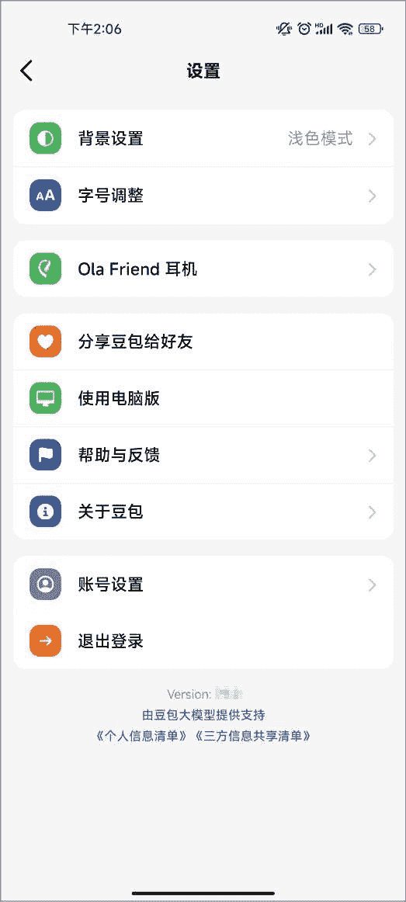
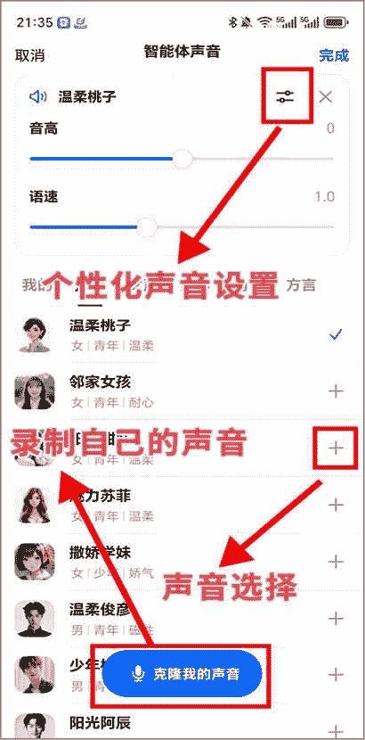
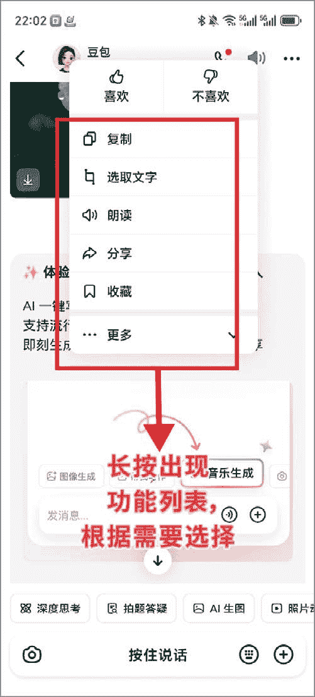

# 生活难题一键解：豆包实用全攻略

# 内容提要

本书以豆包为工具，覆盖生活全场景，帮助解决“不会用 AI”“不敢用 AI”等认知障碍，是一本零基础、场景化、即学即用的操作指南。

本书共 14 章，包括豆包的注册和设置、辅导学习、日常写作、生活难题解答、新技能学习、用短视频记录生活、经营小买卖、休闲娱乐、拍摄爆款视频、丰富晚年生活、短视频脚本创作、找到赚钱方法等内容，全面解决“教育”“生产”“娱乐”“赚钱”四大刚需。本书通过近 100 个真实案例，结合操作视频，帮助用户快速掌握豆包这一 AI 工具的使用技巧。

本书适合对 AI 感兴趣，希望使用 AI 解决问题的读者阅读。 EXr6287u6NNVz+GYLY+7SCGVQ1Qs5GpzKP8t9pj/VFiiRBuyi5+kak+b/wyV/yWacqUOQqYMtlkKCpGDzVSpAA==

# 前言

豆包是字节跳动家族的 AI 产品，与抖音是兄弟产品。它就像一个随时在线的智能小助手，不管你是打字问，还是直接语音说，它都能听懂你的需求，帮你解决各种问题。无论是做饭、写总结、学英语，还是提醒日程、推荐电影，豆包都能轻松应对。

这本书的写作目的很简单，就是帮你轻松掌握豆包的各种功能，让它成为你生活中的得力助手。不管你是想解决日常问题、学习新技能，还是想通过抖音赚钱，豆包都能帮你搞定。

这本书从最基础的注册、登录开始，一步步教你如何使用豆包的各种功能。例如，怎么用豆包辅导孩子写作业、怎么用豆包写文章、怎么用豆包拍短视频，甚至怎么用豆包赚钱。案例丰富，操作步骤简单明了，就算是第一次使用豆包的人也能轻松上手。

书里还特别贴心地为大家准备了很多实用的小技巧。例如，怎么提问才能让豆包更懂你，怎么设置豆包让它更符合你的使用习惯，甚至怎么用豆包生成图片、创作歌曲、解数学题，等等。无论你是年轻人、老人还是孩子，都能在这本书里找到适合自己的豆包使用方法。

总之，这本书能够让你的生活更轻松、更高效。豆包就像你的“智能小跟班”，随时待命，帮你解决各种难题。希望你能通过这本书更好地利用豆包，让它成为你生活中的好帮手。

赶紧翻开本书，跟着步骤一步步操作吧。你会发现，豆包真的能让你的生活变得更简单、更有趣！ EXr6287u6NNVz+GYLY+7SCGVQ1Qs5GpzKP8t9pj/VFiiRBuyi5+kak+b/wyV/yWacqUOQqYMtlkKCpGDzVSpAA==

# 第一章
打开智能生活新大门

EXr6287u6NNVz+GYLY+7SCGVQ1Qs5GpzKP8t9pj/VFiiRBuyi5+kak+b/wyV/yWacqUOQqYMtlkKCpGDzVSpAA==

## 1.1　豆包是何方神圣

豆包是由字节跳动推出的一款智能助手，与抖音同属一个大家族。它利用先进的人工智能技术，帮助用户解决日常生活中的各种问题。无论是通过文字输入还是语音对话，豆包都能与你流畅交流，成为你生活中的得力助手。

#### 1.省时省力，提高效率

豆包最显著的优势就是能帮你节省时间和精力。以前遇到不懂的问题，可能需要花费大量时间上网搜索或请教他人，而现在只需要问豆包即可：想做菜但不知道步骤，豆包立刻为你提供详细菜谱；写工作总结没思路，豆包帮你列出清晰的大纲。它就像一本随时在线的“百科全书”，能快速为你提供答案，让生活更高效。

#### 2.学习新知识，提升自己

豆包不仅是问题解决工具，还是你的“私人老师”。它能帮助你学习各种新技能：想学英语的话，豆包可以给你推荐学习资料，还能陪你练习对话；如果想了解某个领域的知识，豆包可以用通俗易懂的语言为你讲解。无论你是学生还是职场人，豆包都能帮助你不断进步。

#### 3.解决生活琐事，让生活更轻松

生活中的琐碎事务，豆包也能轻松搞定：提醒你重要的日程安排，避免遗忘；为你制订健身计划，帮助你保持健康；推荐好看的电影、有趣的书籍，丰富你的生活；当你心情烦闷时，豆包还能陪你聊天，向你提供建议。它就像一个贴心的“生活管家”，让你的生活更加轻松自在。

#### 4.个性化服务，满足你的需求

豆包还能根据你的喜好和需求，提供定制化服务：如果你爱吃辣，它会推荐辣味菜谱；如果你正在减肥，它会为你制订健康的饮食计划。这种个性化的服务让豆包的帮助更有针对性，能真正满足你的需求。

总之，豆包是一款实用又贴心的智能助手，能够帮你解决各种问题，让生活更高效、更轻松。无论是学习、工作还是日常生活，它都能成为你的得力伙伴，为你提供随叫随到的智能服务。有了豆包，生活会变得更简单、更美好！ EXr6287u6NNVz+GYLY+7SCGVQ1Qs5GpzKP8t9pj/VFiiRBuyi5+kak+b/wyV/yWacqUOQqYMtlkKCpGDzVSpAA==

## 1.2　注册、登录就几步，轻松开启奇妙之旅

豆包（如图 1-1 所示）的注册流程简单便捷，以下是详细的下载和注册步骤，帮助你快速完成账号注册。注意，豆包是一个不断升级迭代的应用，本书使用的版本是 8.0.0，不同版本的界面可能不完全相同，本书会持续更新豆包界面的教学视频。

图 1-1　豆包 App 图标

#### 1.下载豆包 App

如果你使用的是苹果手机（iPhone），可以打开“App Store”，在搜索框中输入“豆包”，找到豆包 App 后，点击“获取”并安装。

如果你使用的是安卓手机，可以打开“应用商店”（如华为“应用市场”、小米“应用商店”、OPPO“软件商店”等），在搜索框中输入“豆包”，找到豆包 App 后，点击“安装”。

#### 2.打开豆包 App

下载完成后，在手机桌面上找到豆包 App 的图标，点击图标，打开豆包 App。

#### 3.选择登录方式

打开豆包 App 后，你会看到登录界面。目前支持以下登录方式，如图 1-2 所示。

●　抖音一键登录： 点击“抖音一键登录”，授权后即可快速登录。

●　手机号登录： 点击“手机号登录”，系统会自动识别本机号码，点击“一键登录”即可完成登录。

#### 4.完成注册

选择登录方式并完成授权后，你的豆包账号就注册成功啦！你可以立即开始使用豆包的各项功能。

#### 5.其他注册方式（如有）

如果豆包 App 后续支持更多的注册方式（如微信、QQ、苹果账号等），你可以按照以下步骤操作。

●　微信/QQ 注册： 点击对应的图标，授权登录。

●　苹果账号注册： 点击“使用 Apple 登录”，授权后完成注册。

图 1-2　豆包登录界面

如果注册或登录时遇到问题，可以尝试切换网络或重新启动 App。

如果还有疑问，可以继续问 AI 以下问题。

● AI，登录时收不到验证码怎么办？

● AI，如何绑定其他登录方式？ EXr6287u6NNVz+GYLY+7SCGVQ1Qs5GpzKP8t9pj/VFiiRBuyi5+kak+b/wyV/yWacqUOQqYMtlkKCpGDzVSpAA==

## 1.3　探秘豆包主界面，这些功能别错过

豆包的主界面的设计简洁明了，功能丰富，你可以很方便地找到所需功能。以下是主界面的详细功能介绍，分为 3 个部分：主界面核心功能键、聊天框与语音输入、内容生成与处理功能键。

#### 1.主界面核心功能键

在豆包主界面的底部有 5 个核心功能键，如图 1-3 所示。

图 1-3　主界面核心功能键

●　对话。 点击后进入与豆包的聊天界面，支持文字、语音等多种交互方式。

●　智能体。 进入智能体中心，浏览、创建或管理智能体，例如学习助手、健康顾问等。

●　创作。 提供多种创作工具，例如“AI 生图”“帮我写作”“音乐生成”等，激发你的创作灵感。

●　通知。 查看豆包的消息通知，例如日程提醒、任务更新等。

●　我的。 进入个人主页，查看账号信息、编辑个人资料、管理设置等。

#### 2.聊天框与语音输入

豆包的“对话”界面如图 1-4 所示，该界面包含以下关键组件。

●　聊天框。 聊天框位于界面下方，是豆包的核心交互区域。你可以直接在聊天框中输入文字提问，例如：“今天天气怎么样？”豆包会实时回复。豆包支持多种场景的问答，如生活小窍门、文案撰写等。

●　语音输入按钮。 位于聊天框右侧，点击后即可开启语音输入功能。你可以通过语音与豆包交流，例如：“帮我查一下明天的日程。”它特别适合开车、做饭等不方便打字的场景。

●　电话按钮。 位于聊天框的上方，点击后可以直接与豆包进行语音通话，例如：“帮我规划一下今天的任务。”语音通话适合需要长时间语音交互的场景，在通话过程中，你可以调整音量或切换耳机/蓝牙设备，确保通话清晰、流畅。

图 1-4　“对话”界面

#### 3.内容生成与处理功能键

在“对话”界面的聊天框的上方，有一排功能键（如
图 1-4 所示），提供多种实用功能。

●　深度思考。 点击该按钮后，豆包会为你提供深度分析和建议，适合复杂问题的解答。

●　帮我写作。 输入写作需求，豆包帮你生成文章、诗歌或文案，支持多次修改。

●　录音纪要。 上传录音文件，豆包自动生成文字纪要，方便整理重要内容。

●　AI 生图。 输入文字描述，豆包生成对应的图片，或对上传的图片进行优化处理。

●　拍题答疑。 拍照上传题目，豆包快速给出答案和解析，是优秀的学习助手。

●　照片动起来。 上传静态照片，豆包将其转化为动态效果，趣味十足。

●　打电话。 点击后，直接与豆包语音通话，适合不方便打字的场景。

●　来点音乐。 点击后，豆包为你推荐或播放音乐，是放松心情的好选择。

●　音乐生成。 输入文字描述，豆包生成个性化音乐片段，满足你的创作需求。

●　翻译。 输入文字或语音，豆包快速翻译成多种语言，沟通无障碍。

●　AI 写真。 上传照片，豆包生成艺术风格的头像或写真，趣味十足。

●　豆包日报。 点击后，可查看每日精选资讯，快速了解热点新闻和行业动态。

●　健康咨询。 输入健康问题，豆包提供专业建议，帮你管理健康。

●　文档阅读。 上传文档，豆包提取关键信息并生成摘要，使你阅读更高效。

●　网页阅读。 输入网页链接，豆包解析内容并生成摘要，帮你快速获取核心信息。

●　日程提醒。 设置日程或任务，豆包会按时提醒，帮你规划时间。

功能键的排序可能因个人的使用习惯而不同，以你的手机显示的顺序为准。

如果还有疑问，可以继续问 AI 以下问题。

● AI，如何让豆包生成更符合需要的图片？

● AI，拍题答疑功能支持哪些类型的题目？ EXr6287u6NNVz+GYLY+7SCGVQ1Qs5GpzKP8t9pj/VFiiRBuyi5+kak+b/wyV/yWacqUOQqYMtlkKCpGDzVSpAA==

## 1.4　简单设置，让豆包更懂你

为了让豆包更符合你的使用习惯，在使用时可以进行一些简单设置。以下是详细的设置步骤，帮助你快速上手。

#### 1.个人设置

打开豆包 App，进入“对话”界面，按照以下步骤进行个人设置。

（1）进入设置界面

在豆包主界面点击置顶的豆包图标，进入“对话”界面。点击界面左上角的头像或右上角的“三个点”图标（如图 1-5 所示），进入设置主界面，如图 1-6 所示。

图 1-5　“对话”界面个人设置入口

图 1-6　设置主界面

（2）设置形象

在设置主界面，点击“设置形象”按钮可以设置形象。目前提供男、女两种形象，未来可能会增加更丰富的选项。

（3）语音设置

语音设置有两种方式。

● 在“设置形象”界面（如图 1-7 所示），点击“更改”选项，进入“智能体声音”界面（如图 1-8 所示），选择语音类型（如女声、男声）。

● 在设置主界面（如图 1-6 所示），点击“声音”选项，进入“智能体声音”界面（如图 1-8 所示），选择语音类型，并调整语音播报的音高和语速。

图 1-7　“设置形象”界面

图 1-8　“智能体声音”界面

（4）字号调整

在设置主界面（如图 1-6 所示），点击“字号调整”选项，根据需求调整字号大小。

#### 2.个人信息设置

在豆包主界面，点击右下角的“我的”按钮，进入个人主页。

（1）编辑个人资料

在个人主页点击“编辑个人资料”，即可修改昵称或更换头像，如图 1-9 所示。

图 1-9　个人主页

（2）更多设置

在图 1-9 所示的个人主页的右上角，点击“齿轮”图标，进入设置界面，如图 1-10 所示。

你可以进行以下设置。

●　背景设置： 选择跟随系统、浅色模式或暗色模式。

●　账号设置： 管理账号安全、隐私设置等。

●　其他设置： 如“帮助与反馈”等。

图 1-10　设置页面

##### 举个例子

你进入“对话”界面，点击左上角的头像，进入设置主界面，进行以下设置。

● 设置形象：选择男性形象。

● 语音设置：将语音播报速度调慢，音高调高。

● 字号调整：将字号调大一号。

接着，你返回主界面，点击“我的”，进行以下设置。

● 编辑个人资料：将昵称改为“小明”，上传一张新头像。

更多设置：将背景设置为暗色模式。

设置可以随时修改，根据需求灵活调整。

如果还有疑问，可以继续问 AI 以下问题。

● AI，如何让语音播报更符合我的需求？

● AI，背景设置有哪些模式可选？

按照以上步骤，你可以轻松设置豆包，让它更懂你，更好用！ EXr6287u6NNVz+GYLY+7SCGVQ1Qs5GpzKP8t9pj/VFiiRBuyi5+kak+b/wyV/yWacqUOQqYMtlkKCpGDzVSpAA==

## 1.5　快速上手小秘诀，新手秒变“老玩家”

要想快速上手用好豆包，其实非常简单！记住以下小秘诀，你也能轻松成为“老玩家”。

#### 1.有啥需求，直接开口问

豆包擅长回答各种问题，无论是找菜谱、学知识还是写文案，直接问就行。

提问时尽量详细，例如：“我想做一道番茄炒蛋，家里有番茄、鸡蛋和葱，怎么做？”

如果不想打字，可以直接点击“电话”按钮，用语音与豆包交流，方便又高效。也可以按住聊天框不松手，开启语音输入功能，如图 1-11 所示。

图 1-11　语音输入界面

豆包的语音识别功能非常精准，支持普通话和多种方言，识别速度快，就像和朋友聊天一样自然。

#### 2.常用问题，添加到主界面随时问

如果你经常问类似的问题，如“今天天气怎么样”或“帮我查一下日程”，可以点击图 1-12 所示的搜索智能体入口，进入智能体管理界面，搜索相关智能体（如“天气助手”或“日程管理”），将对应的智能体添加到主界面，随时点开随时问，省时又省力。

图 1-12　搜索智能体入口

#### 3.多尝试，发现更多惊喜

豆包功能丰富，可以多尝试不同的功能，例如让豆包讲个笑话使自己放松心情，请它推荐一本好书来充实自己，让豆包帮你规划日程，等等。用得越多，你就越能发现它的强大之处，豆包简直就是生活中的“智能小跟班”！

豆包的功能会不断更新，记得多尝试新功能。

如果还有疑问，可以继续问 AI 以下问题。

● AI，如何让豆包的回答更详细？

● AI，如何快速找到需要的智能体？ EXr6287u6NNVz+GYLY+7SCGVQ1Qs5GpzKP8t9pj/VFiiRBuyi5+kak+b/wyV/yWacqUOQqYMtlkKCpGDzVSpAA==

## 1.6　豆包回复有妙招，“5 步高效提问法”轻松拿捏

要想让豆包更好地帮你解决问题，按照以下的“5 步高效提问法”进行提问，保准它能懂得你的心思，给出超有用的回答！

#### 1.我是谁

先简单介绍自己，让豆包了解你的情况，如“我是一个刚毕业的大学生”或“我是一个家庭主妇”。

#### 2.我遇到的问题

清楚地描述你遇到的困难或需求，如“我想找一份工作”或“我想学做一道菜”。

#### 3.问题的具体情况

提供问题的细节，帮助豆包更精准地理解你的需求。例如：“我想找一份互联网行业的工作，但我没有相关经验。”或者“我想学做红烧肉，但不知道需要哪些调料。”

#### 4.我想要什么

明确告诉豆包你希望它如何帮助你。例如：“你能给我一些找工作的建议吗？”或者“你能提供一种简单的红烧肉做法吗？”

#### 5.希望的结果

你想要得到什么样的结果，可以进一步说明。例如：“我希望找工作的建议能具体一些，最好教我如何写简历。”或者“我希望红烧肉的做法简单一点，因为我是一个新手。”

##### 举个例子

“我是一个刚毕业的大学生，想找一份互联网行业的工作，但我没有相关经验。你能给我一些找工作的建议吗？最好能教我如何写简历，以及面试时需要注意什么。”

按照这样的方式提问，豆包能更准确地理解你的需求，给出更有针对性的答案。

提问时尽量详细，这样豆包的回答会更精准。

如果还有疑问，可以继续问 AI 以下问题。

● AI，如何让提问更清晰？

● AI，如何让豆包的回答更实用？ EXr6287u6NNVz+GYLY+7SCGVQ1Qs5GpzKP8t9pj/VFiiRBuyi5+kak+b/wyV/yWacqUOQqYMtlkKCpGDzVSpAA==

## 1.7　不会写字别发愁，玩转豆包有妙招

不会写字的朋友也不用担心，豆包的语音功能非常强大，动动嘴就能轻松操作！以下是详细的使用步骤，帮助你快速上手。

#### 1.打开豆包 App

在手机上找到豆包 App 的图标，点击打开。

#### 2.使用语音输入

进入主界面后，点击顶部的豆包聊天框。

按住下方的聊天框不松手，就可以开始说话了。

#### 3.直接说出你的问题

你想问什么就直接说出来，例如：“今天天气怎么样？”或者“我想学做红烧肉。”豆包会听懂你的话，并给出语音回答。

#### 4.听豆包的回答

豆包会用语音读出答案，你只需要认真听即可。如果没听清楚，可以告诉豆包：“请再讲一遍。”

#### 5.继续对话

如果你还有其他问题，继续按住聊天框说话即可。例如：“红烧肉需要哪些调料？”或者“怎么做才能更好吃？”豆包会持续与你对话，解答你的疑问。

语音输入时吐字尽量清晰，豆包的回答会更准确。

如果还有疑问，可以继续问 AI 以下问题。

● AI，如何让语音识别更精准？

● AI，如何快速找到需要的智能体？ EXr6287u6NNVz+GYLY+7SCGVQ1Qs5GpzKP8t9pj/VFiiRBuyi5+kak+b/wyV/yWacqUOQqYMtlkKCpGDzVSpAA==

## 1.8　别担心！揭秘使用豆包的安全保障

使用豆包时，信息安全是大家最关心的问题之一。豆包在设计时充分考虑了用户隐私和数据安全问题，以下是详细的安全保障说明和使用建议。

#### 1.豆包的安全保障

豆包采用了先进的数据加密技术，确保用户信息在传输和存储过程中得到保护。你的聊天记录和个人信息不会被随意泄露，除非你主动分享。

#### 2.聊天内容的安全性

你和豆包的聊天内容默认是保密的，不会被第三方获取。只有在你自己主动分享的情况下，聊天内容才会对外公开。

#### 3.避免分享敏感信息

虽然豆包有完善的安全措施，但为了更保险，建议不要在聊天中分享敏感信息，如银行卡号、密码、身份证号等个人隐私或涉及安全的重要信息。

#### 4.其他安全建议

●　使用强密码： 如果绑定了账号，建议设置强密码，并定期更换。

●　注意设备安全： 确保手机或电脑的安全，避免他人随意使用。

●　关注官方更新： 及时更新豆包 App，获取最新的安全补丁和功能优化更新。

豆包会不断优化安全措施，但用户也需注意保护自己的隐私。

如果还有疑问，可以继续问 AI 以下问题。

● AI，如何设置强密码？

● AI，如何确保聊天内容不被泄露？ EXr6287u6NNVz+GYLY+7SCGVQ1Qs5GpzKP8t9pj/VFiiRBuyi5+kak+b/wyV/yWacqUOQqYMtlkKCpGDzVSpAA==

# 第二章
豆包助力孩子成长

EXr6287u6NNVz+GYLY+7SCGVQ1Qs5GpzKP8t9pj/VFiiRBuyi5+kak+b/wyV/yWacqUOQqYMtlkKCpGDzVSpAA==

## 2.1　辅导作业不再愁，豆包妙招来帮忙

通过简单实用的方法，帮助文化水平不高的家长培养孩子独立思考和自主学习的习惯，减少对他人辅导的依赖。

错误提问： 帮我培养孩子的学习习惯。

提问过于模糊，AI 无法提供针对性回答

正确提问：

●　我是谁 ——我是一名初二学生的家长；

●　我遇到的问题 ——我无法辅导孩子学习，想培养他独立思考和自主学习的习惯；

●　问题的具体情况 ——孩子的学习依赖性强，我希望他能自己解决问题；

●　我想要什么 ——请 AI 告诉我如何用简单的方法培养孩子独立思考和自主学习的习惯；

●　希望的结果 ——孩子能养成独立思考和自主学习的习惯，减少对他人辅导的依赖。

培养要点：

● 从小事做起，逐步培养孩子的独立性；

● 多鼓励，少批评，让孩子感受到学习的成就感。

如果还有疑问，可以继续问 AI 以下问题。

● AI，如果孩子不愿意独立学习，怎么办？

● AI，如果我想提高孩子的学习兴趣，怎么办？ EXr6287u6NNVz+GYLY+7SCGVQ1Qs5GpzKP8t9pj/VFiiRBuyi5+kak+b/wyV/yWacqUOQqYMtlkKCpGDzVSpAA==

## 2.2　激发学习兴趣，让孩子主动爱上学习

通过简单实用的方法，帮助在外打工的家长提升孩子的学习积极性，让孩子主动学习。

错误提问： 帮我提升孩子的学习积极性。

提问过于模糊，AI 无法提供针对性回答

正确提问：

●　我是谁 ——我是一个长年在外打工的家长；

●　我遇到的问题 ——我没有时间管孩子学习，孩子的学习积极性不高；

●　问题的具体情况 ——孩子对学习没有兴趣，成绩不理想；

●　我想要什么 ——请 AI 告诉我如何用简单的方法提升孩子的学习积极性；

●　希望的结果 ——孩子能主动学习，提高成绩。

提升要点：

● 多鼓励，少批评，让孩子感受到学习的成就感；

● 从小目标开始，逐步培养孩子的学习兴趣。

如果还有疑问，可以继续问 AI 以下问题。

● AI，如果孩子还是不愿意学习，怎么办？

● AI，如果我想让孩子更自觉，怎么办？ EXr6287u6NNVz+GYLY+7SCGVQ1Qs5GpzKP8t9pj/VFiiRBuyi5+kak+b/wyV/yWacqUOQqYMtlkKCpGDzVSpAA==

## 2.3　传授学习方法，孩子成绩一路飙升

通过简单实用的方法，帮助文化水平不高的家长教会孩子如何预习和复习，提升学习效果。

错误提问： 帮我教孩子预习和复习。

提问过于模糊，AI 无法提供针对性回答

正确提问：

●　我是谁 ——我是一个文化水平不高的家长；

●　我遇到的问题 ——我不会教孩子如何预习和复习；

●　问题的具体情况 ——孩子的学习效果不好，我想帮他提高；

●　我想要什么 ——请 AI 告诉我如何用简单的方法教孩子预习和复习；

●　希望的结果 ——孩子能掌握预习和复习的方法，提升学习效果。

学习要点：

● 预习时先了解大致内容，复习时巩固重点知识；

● 使用简单的工具，如字典、错题本，帮助孩子学习。

如果还有疑问，可以继续问 AI 以下问题。

● AI，如果孩子不愿意预习，怎么办？

● AI，如果我想让孩子的复习更有效，怎么办？ EXr6287u6NNVz+GYLY+7SCGVQ1Qs5GpzKP8t9pj/VFiiRBuyi5+kak+b/wyV/yWacqUOQqYMtlkKCpGDzVSpAA==

## 2.4　缓解学习焦虑，心态轻松学习好

通过简单实用的方法，帮助长期在外打工的家长缓解孩子的学习焦虑，让孩子轻松面对学习。

错误提问： 帮我缓解孩子的学习焦虑。

提问过于模糊，AI 无法提供针对性回答

正确提问：

●　我是谁 ——我是一个长期在外打工的家长；

●　我遇到的问题 ——我的孩子学习压力大，很焦虑；

●　问题的具体情况 ——我没时间陪孩子，想帮他缓解焦虑；

●　我想要什么 ——请 AI 告诉我如何用简单的方法缓解孩子的学习焦虑；

●　希望的结果 ——孩子能轻松面对学习，减少焦虑。

缓解要点：

● 多关心孩子，让他感受到你的爱和支持；

● 帮助孩子放松，不要让他一直处于紧张状态。

如果还有疑问，可以继续问 AI 以下问题。

● AI，如果孩子还是焦虑，怎么办？

● AI，如果我想让孩子更自信，怎么办？ EXr6287u6NNVz+GYLY+7SCGVQ1Qs5GpzKP8t9pj/VFiiRBuyi5+kak+b/wyV/yWacqUOQqYMtlkKCpGDzVSpAA==

## 2.5　孩子沉迷网络，豆包教你巧妙应对

通过简单实用的方法，帮助忙碌的家长解决孩子沉迷网络游戏的问题，恢复学习状态。

错误提问： 帮我解决孩子沉迷网络的问题。

提问过于模糊，AI 无法提供针对性回答

正确提问：

●　我是谁 ——我是一名初一学生的家长；

●　我遇到的问题 ——孩子沉迷网络游戏，影响学习；

●　问题的具体情况 ——我没时间管孩子，想帮他戒掉网瘾；

●　我想要什么 ——请 AI 告诉我如何用简单的方法解决孩子沉迷网络游戏的问题；

●　希望的结果 ——孩子能减少上网时间，专注于学习。

解决要点：

● 设定规则，逐步减少上网时间；

● 培养其他兴趣，让孩子有更多选择。

如果还有疑问，可以继续问 AI 以下问题。

● AI，如果孩子不听话，怎么办？

● AI，如果我想让孩子更自觉，怎么办？ EXr6287u6NNVz+GYLY+7SCGVQ1Qs5GpzKP8t9pj/VFiiRBuyi5+kak+b/wyV/yWacqUOQqYMtlkKCpGDzVSpAA==

## 2.6　量身定制学习计划，孩子进步看得见

通过简单实用的方法，帮助文化水平不高的家长为孩子制订假期学习计划，让孩子的假期不荒废。

错误提问： 帮我制订学习计划。

提问过于模糊，AI 无法提供针对性回答

正确提问：

●　我是谁 ——我是一个文化水平不高的家长；

●　我遇到的问题 ——学校放假了，我不知道怎么管孩子的学习；

●　问题的具体情况 ——我想让孩子的假期不荒废，但不会制订学习计划；

●　我想要什么 ——请 AI 告诉我如何用简单的方法为孩子制订假期学习计划；

●　希望的结果 ——孩子能利用假期时间学习，不荒废时间。

学习要点：

● 每天固定时间学习，养成好习惯；

● 学习内容要简单，适合孩子的年龄和水平。

如果还有疑问，可以继续问 AI 以下问题。

● AI，如果孩子不愿意学习，怎么办？

● AI，如果我想让孩子学得更多，怎么办？ EXr6287u6NNVz+GYLY+7SCGVQ1Qs5GpzKP8t9pj/VFiiRBuyi5+kak+b/wyV/yWacqUOQqYMtlkKCpGDzVSpAA==

## 2.7　考试复习不用慌，豆包帮你出方案

通过简单实用的方法，帮助文化水平不高的家长为孩子制订期末复习计划，帮助孩子顺利备考。

错误提问： 帮我制订复习计划。

提问过于模糊，AI 无法提供针对性回答

正确提问：

●　我是谁 ——我是一个文化水平不高的家长；

●　我遇到的问题 ——孩子上小学六年级，马上期末考试，我不知道怎么帮他复习；

●　问题的具体情况 ——我想让孩子好好复习，但不会制订复习计划；

●　我想要什么 ——请 AI 告诉我如何用简单的方法为孩子制订期末复习计划；

●　希望的结果 ——孩子能顺利备考，取得好成绩。

复习要点：

● 每天固定时间复习，养成好习惯；

● 复习内容要全面，重点复习薄弱环节。

如果还有疑问，可以继续问 AI 以下问题。

● AI，如果孩子不愿意复习，怎么办？

● AI，如果我想让孩子的复习更有效，怎么办？ EXr6287u6NNVz+GYLY+7SCGVQ1Qs5GpzKP8t9pj/VFiiRBuyi5+kak+b/wyV/yWacqUOQqYMtlkKCpGDzVSpAA==

## 2.8　疑难问题全解答，孩子学习好帮手

通过简单实用的方法，帮助家长理解并解答孩子的古诗词解读题。

错误提问： 帮我解答古诗词解读题。

提问过于模糊，AI 无法提供针对性回答

正确提问：

●　我是谁 ——我是一名初二学生的家长；

●　我遇到的问题 ——孩子有一道古诗词解读题不会做，我想帮他解答；

●　问题的具体情况 ——题目是“解读杜甫的《春望》，分析其历史背景及表达的情感”；

●　我想要什么 ——请 AI 告诉我如何解答这道题；

●　希望的结果 ——能理解并解答这道题，帮助孩子学习。

解题要点：

● 结合历史背景，深入分析诗句含义；

● 分析对场景的描写，体会诗人情感。

如果还有疑问，可以继续问 AI 以下问题。

● AI，如果孩子不理解诗词的主题，怎么办？

● AI，如果我想让孩子学会杜甫的更多诗词，怎么办？ EXr6287u6NNVz+GYLY+7SCGVQ1Qs5GpzKP8t9pj/VFiiRBuyi5+kak+b/wyV/yWacqUOQqYMtlkKCpGDzVSpAA==

# 第三章
写作有困难，豆包来救场

EXr6287u6NNVz+GYLY+7SCGVQ1Qs5GpzKP8t9pj/VFiiRBuyi5+kak+b/wyV/yWacqUOQqYMtlkKCpGDzVSpAA==

## 3.1　写家书不知咋下笔，豆包教你诉真情

通过文字表达对远方亲人的思念之情，传递内心的牵挂与关爱。

错误提问： 帮我写几句话。

提问过于模糊，AI 无法提供针对性回答

正确提问：

●　我是谁 ——我是一个农村老太太，文化水平不高；

●　我遇到的问题 ——儿子在外面打工，我很想他；

●　问题的具体情况 ——我不知道怎么用文字表达我的思念；

●　我想要什么 ——帮我写几句话，表达对儿子的思念；

●　希望的结果 ——让儿子感受到我的牵挂和爱。

表达思念的要点：

● 回忆过去的温馨场景，唤起情感共鸣；

● 关心对方的生活和健康，体现母爱的细腻；

● 表达对未来的期盼，传递温暖和希望。

如果觉得文字不够贴切，可以继续问 AI 以下问题。

● AI，我想让语气更温柔一些，可以怎么改？

● AI，我想加一些家乡的事情，应该怎么补充？ EXr6287u6NNVz+GYLY+7SCGVQ1Qs5GpzKP8t9pj/VFiiRBuyi5+kak+b/wyV/yWacqUOQqYMtlkKCpGDzVSpAA==

## 3.2　借条这样写，规范又安心

通过规范的借条内容，确保借款人和出借人的权益得到保障，避免还款纠纷。

错误提问： 帮我写一张借条。

提问过于模糊，AI 无法提供针对性回答

正确提问：

●　我是谁 ——我是一个农村人，文化水平不高；

●　我遇到的问题 ——张三找我借了 1000 元钱，为期三个月，我不知道怎么写借条；

●　问题的具体情况 ——我想确保张三到期还款，但不知道借条该怎么写；

●　我想要什么 ——请 AI 帮我写一张规范的借条；

●　希望的结果 ——借条内容清晰，能保证张三按时还款。

借条必备要素：

● 双方的姓名、身份证号、联系方式；

● 借款金额（大写和小写）；

● 借款日期和还款日期；

● 还款方式（一次性还清或分期）；

● 违约责任（未按时还款的处理方式）。

如果觉得内容不够全面，可以继续问 AI 以下问题。

● AI，如果我想加上利息，该怎么写？

● AI，如果借款时间更长，怎么修改借条内容？ EXr6287u6NNVz+GYLY+7SCGVQ1Qs5GpzKP8t9pj/VFiiRBuyi5+kak+b/wyV/yWacqUOQqYMtlkKCpGDzVSpAA==

## 3.3　请假条小窍门，轻松获批没烦恼

通过规范的请假条内容，帮助你向公司或学校清楚表达请假需求，确保请假手续顺利完成。

错误提问： 帮我写一张请假条。

提问过于模糊，AI 无法提供针对性回答

正确提问：

●　我是谁 ——我是一个小学文化水平的人；

●　我遇到的问题 ——家里有事需要我回去帮忙，想请两天假，但不知道怎么写请假条；

●　问题的具体情况 ——我需要向公司/学校请假，但不会写正式的请假条；

●　我想要什么 ——请 AI 帮我写一张规范的请假条；

●　希望的结果 ——请假条内容清晰，能顺利请假。

请假条必备要素：

● 称呼（如“尊敬的领导/老师”）；

● 请假原因（简单说明家里的事情）；

● 请假时间（具体日期）；

● 表达需求和承诺（如“恳请您批准”“我会按时返回”）；

● 署名和日期。

如果觉得内容不够全面，可以继续问 AI 以下问题。

● AI，如果我想多请几天假，该怎么写？

● AI，如果家里的事情比较复杂，怎么表达？ EXr6287u6NNVz+GYLY+7SCGVQ1Qs5GpzKP8t9pj/VFiiRBuyi5+kak+b/wyV/yWacqUOQqYMtlkKCpGDzVSpAA==

## 3.4　村里通知咋写清，豆包给你好思路

通过规范的通知内容，向村民传达村里修路的信息，提醒大家注意出行安全。

错误提问： 帮我写一份通知。

提问过于模糊，AI 无法提供针对性回答

正确提问：

●　我是谁 ——我是农村村委会的干部；

●　我遇到的问题 ——村里要修新路了，需要通知村民注意出行安全；

●　问题的具体情况 ——我需要写一份通知，但不知道怎么写才规范；

●　我想要什么 ——请 AI 帮我写一份通知；

●　希望的结果 ——通知内容清晰，村民能理解并注意安全。

通知必备要素：

● 标题（如“通知”）；

● 称呼（如“各位村民”）；

● 通知内容（说明修路时间、地点、注意事项）；

● 表达感谢和歉意（如“感谢理解与配合”“敬请谅解”）；

● 署名和日期。

如果觉得内容不够全面，可以继续问 AI 以下问题。

● AI，如果施工时间有变动，怎么修改通知？

● AI，如果施工区域扩大，怎么提醒村民？ EXr6287u6NNVz+GYLY+7SCGVQ1Qs5GpzKP8t9pj/VFiiRBuyi5+kak+b/wyV/yWacqUOQqYMtlkKCpGDzVSpAA==

## 3.5　夸夸村里好人好事，文案轻松搞定

通过得体的语言，表扬王大爷义务照顾村里孤寡老人的善举，弘扬正能量，激励更多村民参与公益。

错误提问： 帮我夸夸王大爷。

提问过于模糊，AI 无法提供针对性回答

正确提问：

●　我是谁 ——我是村里的老支书；

●　我遇到的问题 ——我想表扬王大爷义务照顾村里孤寡老人的好事，但不知道怎么说才得体；

●　问题的具体情况 ——王大爷长期默默奉献，我想让更多的人知道他的善举；

●　我想要什么 ——请 AI 帮我组织一段表扬的语言；

●　希望的结果 ——语言真诚感人，能激励更多村民学习王大爷的精神。

表扬语言要点：

● 具体描述王大爷的事迹，突出他的无私奉献；

● 表达对王大爷的敬意和感谢；

● 号召村民学习王大爷的精神，弘扬正能量。

如果觉得内容不够全面，可以继续问 AI 以下问题。

● AI，如果我想加一些王大爷的具体故事，怎么补充？

● AI，如果我想让语言更感人，怎么修改？ EXr6287u6NNVz+GYLY+7SCGVQ1Qs5GpzKP8t9pj/VFiiRBuyi5+kak+b/wyV/yWacqUOQqYMtlkKCpGDzVSpAA==

## 3.6　回忆小时候，让文字充满温暖和童趣

通过生动的语言，帮助你将儿时摸鱼的回忆记录下来，保留珍贵的记忆。

错误提问： 帮我写回忆。

提问过于模糊，AI 无法提供针对性回答

正确提问：

●　我是谁 ——我是一个五十多岁的人，文化水平不高；

●　我遇到的问题 ——我想把小时候跟小朋友去河里摸鱼的回忆写出来，但不知道怎么写；

●　问题的具体情况 ——这段回忆对我来说很珍贵，我想记录下来；

●　我想要什么 ——请 AI 帮我写一段回忆的文字；

●　希望的结果 ——文字生动感人，能真实还原当时的场景和感受。

回忆文字要点：

● 描述具体的场景和细节（如田里的鱼、小朋友的动作）；

● 表达当时的感受和心情（如好奇、快乐）；

● 结合现在的生活，升华回忆的意义。

如果觉得内容不够全面，可以继续问 AI 以下问题。

● AI，如果我想加一些当时的对话，怎么补充？

● AI，如果我想让文字更感人，怎么修改？ EXr6287u6NNVz+GYLY+7SCGVQ1Qs5GpzKP8t9pj/VFiiRBuyi5+kak+b/wyV/yWacqUOQqYMtlkKCpGDzVSpAA==

## 3.7　记录村里新鲜事，把生活写成故事

通过生动的语言，帮助李婶记录村里电商直播卖土豆的新鲜事，展现村里的变化和活力。

错误提问： 帮我记录一件新鲜事。

提问过于模糊，AI 无法提供针对性回答

正确提问：

●　我是谁 ——我是村里的李婶，文化水平不高；

●　我遇到的问题 ——村里最近搞了电商直播卖土豆，我想记录下来，但不知道怎么写；

●　问题的具体情况 ——这是村里的新鲜事，我想让更多的人知道；

●　我想要什么 ——请 AI 帮我写一段记录的文字；

●　希望的结果 ——文字生动有趣，能真实展现村里的变化。

记录文字要点：

● 描述具体的场景和细节（如直播的台子、土豆的种类）；

● 展现村民的反应和变化（如大家的热情、忙碌的场景）；

● 表达对新鲜事的感受和期待（如对未来的希望）。

如果觉得内容不够全面，可以继续问 AI 以下问题。

● AI，如果我想加一些村民的对话，怎么补充？

● AI，如果我想让文字更生动，怎么修改？ EXr6287u6NNVz+GYLY+7SCGVQ1Qs5GpzKP8t9pj/VFiiRBuyi5+kak+b/wyV/yWacqUOQqYMtlkKCpGDzVSpAA==

## 3.8　写作没灵感，豆包帮你脑洞大开

通过简单实用的方法，帮助写作能力较差的村民快速提升写作水平，表达自己的想法。

错误提问： 帮我提升写作能力。

提问过于模糊，AI 无法提供针对性回答

正确提问：

●　我是谁 ——我是一个小学文化水平的村民；

●　我遇到的问题 ——我想写点东西，但写作能力较差；

●　问题的具体情况 ——我想把小时候的经历写下来，但不知道怎么写；

●　我想要什么 ——请 AI 告诉我如何快速提升写作能力；

●　希望的结果 ——能写出通顺、有内容的文章。

提升要点：

● 多读多写，积累经验；

● 从简单的句子开始，逐步提高。

如果还有疑问，可以继续问 AI 以下问题。

● AI，如果我想写得更生动，怎么办？

● AI，如果我想提高写作速度，怎么办？ EXr6287u6NNVz+GYLY+7SCGVQ1Qs5GpzKP8t9pj/VFiiRBuyi5+kak+b/wyV/yWacqUOQqYMtlkKCpGDzVSpAA==

# 第四章
生活难题问豆包，轻松解决没烦恼

EXr6287u6NNVz+GYLY+7SCGVQ1Qs5GpzKP8t9pj/VFiiRBuyi5+kak+b/wyV/yWacqUOQqYMtlkKCpGDzVSpAA==

## 4.1　生活小窍门，一问豆包全知道

通过简单实用的方法，帮助宝妈延长自家蔬菜的保鲜时间，减少浪费。

错误提问： 帮我保鲜蔬菜。

提问过于模糊，AI 无法提供针对性回答

正确提问：

●　我是谁 ——我是一个宝妈；

●　我遇到的问题 ——我平时喜欢种蔬菜，但种的蔬菜吃不完，不知道怎么保鲜；

●　问题的具体情况 ——我想让蔬菜保存得更久，但不知道方法；

●　我想要什么 ——请 AI 告诉我如何保鲜蔬菜；

●　希望的结果 ——蔬菜能保存得更久，减少浪费。

保鲜要点：

● 不同的蔬菜有不同的保鲜方法，比如叶菜类适合冷藏，根茎类适合通风存放；

● 保持干燥，避免蔬菜受潮。

如果还有疑问，可以继续问 AI 以下问题。

● AI，如果我想让蔬菜保存得更久，怎么办？

● AI，如果我想腌制蔬菜，怎么操作？ EXr6287u6NNVz+GYLY+7SCGVQ1Qs5GpzKP8t9pj/VFiiRBuyi5+kak+b/wyV/yWacqUOQqYMtlkKCpGDzVSpAA==

## 4.2　家禽家畜养殖秘诀，豆包倾囊相授

通过简单实用的方法，帮助养殖户提高鸡蛋的产蛋量并保持鸡蛋的品质。

错误提问： 帮我提高产蛋量。

提问过于模糊，AI 无法提供针对性回答

正确提问：

●　我是谁 ——我是一个养了 500 只鸡的养殖户；

●　我遇到的问题 ——我想提高鸡蛋的产蛋量并保持鸡蛋的品质；

●　问题的具体情况 ——我不知道怎么提高产蛋量和保持鸡蛋的品质；

●　我想要什么 ——请 AI 告诉我如何提高产蛋量和保持鸡蛋的品质；

●　希望的结果 ——产蛋量增加，鸡蛋的品质保持良好。

提升要点：

● 提供优质饲料和充足的饮水；

● 保持鸡舍的卫生和光照，减少母鸡应激。

如果还有疑问，可以继续问 AI 以下问题。

● AI，如果产蛋量还是不高，怎么办？

● AI，如果我还想提高鸡蛋的品质，怎么办？ EXr6287u6NNVz+GYLY+7SCGVQ1Qs5GpzKP8t9pj/VFiiRBuyi5+kak+b/wyV/yWacqUOQqYMtlkKCpGDzVSpAA==

## 4.3　庄稼种植遇问题，豆包帮你找对策

通过简单实用的方法，帮助村民治理小麦蚜虫并防止虫病扩散，确保小麦丰收。

错误提问： 帮我治理蚜虫。

提问过于模糊，AI 无法提供针对性回答

正确提问：

●　我是谁 ——我是一个种了 500 亩小麦的村民；

●　我遇到的问题 ——小麦遭遇了蚜虫，不知道怎么治理；

●　问题的具体情况 ——我想治理蚜虫并防止虫病扩散；

●　我想要什么 ——请 AI 告诉我如何治理小麦蚜虫并防止虫病扩散；

●　希望的结果 ——小麦蚜虫得到控制，确保丰收。

治理要点：

● 及时喷洒农药，控制蚜虫的数量；

● 结合生物防治和农业措施，减少蚜虫的繁殖。

如果还有疑问，可以继续问 AI 以下问题。

● AI，如果蚜虫已经扩散，怎么办？

● AI，如果我想预防蚜虫，怎么办？ EXr6287u6NNVz+GYLY+7SCGVQ1Qs5GpzKP8t9pj/VFiiRBuyi5+kak+b/wyV/yWacqUOQqYMtlkKCpGDzVSpAA==

## 4.4　电器坏了别着急，豆包教你简单维修

通过简单实用的方法，帮助村民解决家里电灯闪烁的问题，确保照明正常。

错误提问： 帮我修灯。

提问过于模糊，AI 无法提供针对性回答

正确提问：

●　我是谁 ——我是一个村民；

●　我遇到的问题 ——家里的电灯一直闪烁，不知道怎么解决；

●　问题的具体情况 ——我想让电灯不再闪烁，恢复正常；

●　我想要什么 ——请 AI 告诉我如何解决电灯闪烁的问题；

●　希望的结果 ——电灯不再闪烁，照明正常。

解决要点：

● 先检查灯泡和开关，再检查线路；

● 如果自己解决不了，请专业电工帮忙。

如果还有疑问，可以继续问 AI 以下问题。

● AI，如果换了灯泡还是闪烁，怎么办？

● AI，如果我想预防电灯闪烁，怎么办？ EXr6287u6NNVz+GYLY+7SCGVQ1Qs5GpzKP8t9pj/VFiiRBuyi5+kak+b/wyV/yWacqUOQqYMtlkKCpGDzVSpAA==

## 4.5　看病挂号那些事儿，豆包帮你捋清楚

通过简单实用的方法，帮助宝妈快速为孩子挂号看病，解决孩子咳嗽发烧的问题。

错误提问： 帮我挂号看病。

提问过于模糊，AI 无法提供针对性回答

正确提问：

●　我是谁 ——我是一个宝妈；

●　我遇到的问题 ——孩子两岁，咳嗽还发烧，不知道怎么快速挂号看病；

●　问题的具体情况 ——我想尽快带孩子看医生，但不知道挂号流程；

●　我想要什么 ——请 AI 告诉我如何快速挂号看病；

●　希望的结果 ——孩子能尽快看医生，缓解病情。

挂号要点：

● 优先选择网上或电话挂号，以节省时间；

● 如果病情严重，直接挂急诊。

如果还有疑问，可以继续问 AI 以下问题。

● AI，如果挂不上号，怎么办？

● AI，如果我想了解孩子的病情，怎么办？ EXr6287u6NNVz+GYLY+7SCGVQ1Qs5GpzKP8t9pj/VFiiRBuyi5+kak+b/wyV/yWacqUOQqYMtlkKCpGDzVSpAA==

## 4.6　农村医保咋报销，豆包给你讲明白

通过简单实用的方法，帮助村民了解阑尾炎手术的医保报销流程，减轻经济负担。

错误提问： 帮我处理医保报销问题。

提问过于模糊，AI 无法提供针对性回答

正确提问：

●　我是谁 ——我是一个刚做完阑尾炎手术的村民；

●　我遇到的问题 ——我想用医保报销手术费用，但不知道流程；

●　问题的具体情况 ——我想了解哪些费用可以报销，以及报销流程；

●　我想要什么 ——请 AI 告诉我医保报销的流程和可以报销的费用项目；

●　希望的结果 ——能顺利报销手术费用，减轻经济负担。

报销要点：

● 出院时尽量在医院直接结算，可以节省时间；

● 保留好所有票据，方便后续报销。

如果还有疑问，可以继续问 AI 以下问题。

● AI，如果医院不能直接结算，怎么办？

● AI，如果我想了解更多的医保政策，怎么办？ EXr6287u6NNVz+GYLY+7SCGVQ1Qs5GpzKP8t9pj/VFiiRBuyi5+kak+b/wyV/yWacqUOQqYMtlkKCpGDzVSpAA==

## 4.7　农村喜事咋安排，豆包帮你出谋划策

通过简单实用的方法，帮助村民为八十岁老人办一场体面又实惠的寿宴，表达孝心。

错误提问： 帮我办寿宴。

提问过于模糊，AI 无法提供针对性回答

正确提问：

●　我是谁 ——我是一个村民；

●　我遇到的问题 ——家里老人八十岁，想办寿宴，但不知道怎么办；

●　问题的具体情况 ——我想办一场既体面又实惠的寿宴；

●　我想要什么 ——请 AI 告诉我如何办一场体面又实惠的寿宴；

●　希望的结果 ——寿宴办得体面又实惠，老人开心。

办寿宴要点：

● 简单布置，增加喜庆气氛；

● 准备实惠的菜单，邀请亲友参加。

如果还有疑问，可以继续问 AI 以下问题。

● AI，如果我想让寿宴更有仪式感，怎么办？

● AI，如果我想节省更多的费用，怎么办？ EXr6287u6NNVz+GYLY+7SCGVQ1Qs5GpzKP8t9pj/VFiiRBuyi5+kak+b/wyV/yWacqUOQqYMtlkKCpGDzVSpAA==

## 4.8　农村常见纠纷咋解决，豆包教你巧化解

通过简单实用的方法，帮助村民处理宅基地纠纷，维护自身权益。

错误提问： 帮我处理纠纷。

提问过于模糊，AI 无法提供针对性回答

正确提问：

●　我是谁 ——我是一个村民；

●　我遇到的问题 ——我和邻居因为宅基地问题产生了纠纷；

●　问题的具体情况 ——邻居说我家的围墙占了他家的地方，但我有老地契证明；

●　我想要什么 ——请 AI 告诉我如何处理这个纠纷；

●　希望的结果 ——能够和平解决纠纷，维护自身权益。

处理要点：

● 出示地契，证明自己的权益；

● 找村干部调解，避免冲突升级。

如果还有疑问，可以继续问 AI 以下问题。

● AI，如果邻居不认地契，怎么办？

● AI，如果我想了解更多的法律知识，怎么办？ EXr6287u6NNVz+GYLY+7SCGVQ1Qs5GpzKP8t9pj/VFiiRBuyi5+kak+b/wyV/yWacqUOQqYMtlkKCpGDzVSpAA==

# 第五章
跟豆包学新技能，开启精彩新生活

EXr6287u6NNVz+GYLY+7SCGVQ1Qs5GpzKP8t9pj/VFiiRBuyi5+kak+b/wyV/yWacqUOQqYMtlkKCpGDzVSpAA==

## 5.1　开车先学交规，豆包带你轻松过关

通过简单实用的方法，帮助乡镇企业家快速掌握关键交规内容，节省学习时间。

错误提问： 帮我学交规。

提问过于模糊，AI 无法提供针对性回答

正确提问：

●　我是谁 ——我是一个乡镇企业家；

●　我遇到的问题 ——我想学驾驶，但没时间学交规；

●　问题的具体情况 ——我想知道关键的交规内容，并了解网上学习的方法；

●　我想要什么 ——请 AI 列出关键交规内容并告诉我如何在网上学习；

●　希望的结果 ——能快速掌握交规，顺利学车。

学习要点：

● 重点记住交通信号灯、限速和让行的规则；

● 多做模拟题，熟悉考试内容。

如果还有疑问，可以继续问 AI 以下问题。

● AI，如果我想了解更多交规，怎么办？

● AI，如果我想提高考试通过率，怎么办？ EXr6287u6NNVz+GYLY+7SCGVQ1Qs5GpzKP8t9pj/VFiiRBuyi5+kak+b/wyV/yWacqUOQqYMtlkKCpGDzVSpAA==

## 5.2　电工基础技能，豆包教你快速入门

通过简单实用的方法，帮助养鸡场老板学习电工基础知识，解决电线短路问题。

错误提问： 帮我学电工知识。

提问过于模糊，AI 无法提供针对性回答

正确提问：

●　我是谁 ——我是一个养鸡场老板；

●　我遇到的问题 ——养鸡场的电线经常短路，找人修很麻烦；

●　问题的具体情况 ——我想学一些电工基础知识，自己解决问题；

●　我想要什么 ——请 AI 告诉我电工基础知识和网上学习的地方；

●　希望的结果 ——能自己解决电线短路问题，减少麻烦。

学习要点：

● 重点学习电线连接和开关安装的知识，防止短路；

● 多看视频，动手实践。

如果还有疑问，可以继续问 AI 以下问题。

● AI，如果我想了解更多的电工知识，怎么办？

● AI，如果我想提高维修技能，怎么办？ EXr6287u6NNVz+GYLY+7SCGVQ1Qs5GpzKP8t9pj/VFiiRBuyi5+kak+b/wyV/yWacqUOQqYMtlkKCpGDzVSpAA==

## 5.3　学做菜看豆包，菜谱技巧全掌握

通过简单实用的方法，帮助村民学会做美味的柴火烧鹅。

错误提问： 帮我做柴火烧鹅。

提问过于模糊，AI 无法提供针对性回答

正确提问：

●　我是谁 ——我是一个在外打工的人；

●　我遇到的问题 ——最近回农村过年，我想吃柴火烧鹅；

●　问题的具体情况 ——我想做柴火烧鹅，但不知道怎么做才好吃；

●　我想要什么 ——请 AI 告诉我如何做美味的柴火烧鹅；

●　希望的结果 ——能做出一道既美味又有营养的柴火烧鹅。

做菜要点：

● 鹅要腌制入味，烤制时火候要均匀；

● 炖煮时间要够，让鹅肉软烂且入味。

如果还有疑问，可以继续问 AI 以下问题。

● AI，如果我想让柴火烧鹅更香，怎么办？

● AI，如果我想做更多的菜，怎么办？ EXr6287u6NNVz+GYLY+7SCGVQ1Qs5GpzKP8t9pj/VFiiRBuyi5+kak+b/wyV/yWacqUOQqYMtlkKCpGDzVSpAA==

## 5.4　简单木工活，豆包助你创意无限

通过简单实用的方法，帮助村民学习木工手艺，做出精致的木工活。

错误提问： 帮我学木工知识。

提问过于模糊，AI 无法提供针对性回答

正确提问：

●　我是谁 ——我是一个村民；

●　我遇到的问题 ——我想学木工手艺，但不知道从哪里开始；

●　问题的具体情况 ——我想做出精致的木工活，但不知道学习的路径；

●　我想要什么 ——请 AI 告诉我如何做出精致的木工活；

●　希望的结果 ——能学会木工手艺，做出精致的木工活。

学习要点：

● 从简单的木工活开始，逐步提高；

● 多练习，熟能生巧。

如果还有疑问，可以继续问 AI 以下问题。

● AI，如果我想让木工活更精致，怎么办？

● AI，如果我想了解更多的木工知识，怎么办？ EXr6287u6NNVz+GYLY+7SCGVQ1Qs5GpzKP8t9pj/VFiiRBuyi5+kak+b/wyV/yWacqUOQqYMtlkKCpGDzVSpAA==

## 5.5　花草养护有妙招，教你养出好风景

通过简单实用的方法，帮助宝妈种出好养且开花多的玫瑰花。

错误提问： 帮我种玫瑰花。

提问过于模糊，AI 无法提供针对性回答

正确提问：

●　我是谁 ——我是一个在家带娃的宝妈；

●　我遇到的问题 ——我想种玫瑰花，但不知道怎么种；

●　问题的具体情况 ——我想让玫瑰花好养且开花多；

●　我想要什么 ——请 AI 告诉我如何种玫瑰花；

●　希望的结果 ——玫瑰花好养且开花多。

种植要点：

● 选择透气性好的花盆和肥沃的土壤；

● 保持充足的光照并适量浇水。

如果还有疑问，可以继续问 AI 以下问题。

● AI，如果玫瑰花不开花，怎么办？

● AI，如果我想让玫瑰花长得更好，怎么办？ EXr6287u6NNVz+GYLY+7SCGVQ1Qs5GpzKP8t9pj/VFiiRBuyi5+kak+b/wyV/yWacqUOQqYMtlkKCpGDzVSpAA==

## 5.6　简单音乐入门，开启美妙音乐之旅

通过简单实用的方法，帮助村民快速入门并提升吹唢呐的技巧。

错误提问： 帮我学吹唢呐。

提问过于模糊，AI 无法提供针对性回答

正确提问：

●　我是谁 ——我是一个村民；

●　我遇到的问题 ——我想学吹唢呐，但不知道怎么入门；

●　问题的具体情况 ——我想通过练习快速提升吹唢呐的技巧；

●　我想要什么 ——请 AI 告诉我如何入门并提升吹唢呐的技巧；

●　希望的结果 ——能快速入门并提升吹唢呐的技巧。

学习要点：

● 从基础开始，逐步提高；

● 多练习，熟能生巧。

如果还有疑问，可以继续问 AI 以下问题。

● AI，如果我想让唢呐吹得更好，怎么办？

● AI，如果我想了解更多的唢呐知识，怎么办？ EXr6287u6NNVz+GYLY+7SCGVQ1Qs5GpzKP8t9pj/VFiiRBuyi5+kak+b/wyV/yWacqUOQqYMtlkKCpGDzVSpAA==

## 5.7　小生意门道多，豆包教你轻松赚钱

通过简单实用的方法，帮助返乡大学生顺利开设乡村民宿，实现创业梦想。

错误提问： 帮我开民宿。

提问过于模糊，AI 无法提供针对性回答

正确提问：

●　我是谁 ——我是一名返乡大学生；

●　我遇到的问题 ——我想在家乡开一个乡村民宿，但不知道怎么开始；

●　问题的具体情况 ——我想了解开民宿的步骤和方法；

●　我想要什么 ——请 AI 告诉我如何开乡村民宿；

●　希望的结果 ——能顺利开设乡村民宿，实现创业梦想。

开民宿要点：

● 选择好地点，设计有特色的民宿；

● 提供优质服务，吸引游客。

如果还有疑问，可以继续问 AI 以下问题。

● AI，如果我想让民宿更有特色，怎么办？

● AI，如果我想提高民宿的入住率，怎么办？ EXr6287u6NNVz+GYLY+7SCGVQ1Qs5GpzKP8t9pj/VFiiRBuyi5+kak+b/wyV/yWacqUOQqYMtlkKCpGDzVSpAA==

## 5.8　美容美发小知识，让你变身时尚达人

通过简单实用的方法，帮助宝妈学会做一款特别的盘发，在参加婚礼时更加美丽。

错误提问： 帮我做盘发。

提问过于模糊，AI 无法提供针对性回答

正确提问：

●　我是谁 ——我是一个宝妈；

●　我遇到的问题 ——我要参加同村姐妹的婚礼，想做一款特别的盘发；

●　问题的具体情况 ——我想学会做一款特别的盘发，但不知道怎么弄；

●　我想要什么 ——请 AI 告诉我如何做一款特别的盘发；

●　希望的结果 ——能做出一款特别的盘发，参加婚礼时更加美丽。

盘发要点：

● 头发要梳顺，编发时要均匀；

● 发髻要盘紧，用发夹固定好。

如果还有疑问，可以继续问 AI 以下问题。

● AI，如果我想让盘发更特别，怎么办？

● AI，如果我想了解更多的盘发技巧，怎么办？ EXr6287u6NNVz+GYLY+7SCGVQ1Qs5GpzKP8t9pj/VFiiRBuyi5+kak+b/wyV/yWacqUOQqYMtlkKCpGDzVSpAA==

# 第六章
豆包教你拍短视频，记录乡村好生活

EXr6287u6NNVz+GYLY+7SCGVQ1Qs5GpzKP8t9pj/VFiiRBuyi5+kak+b/wyV/yWacqUOQqYMtlkKCpGDzVSpAA==

## 6.1　拍村里风景咋构思，豆包给你灵感

通过简单实用的方法，帮助村民选择适合拍摄的乡村风景，展现村里的美丽风光。

错误提问： 帮我选择拍摄内容。

提问过于模糊，AI 无法提供针对性回答

正确提问：

●　我是谁 ——我是一个村民；

●　我遇到的问题 ——我们村风景好，我想拍个短视频，但不知道拍哪些内容；

●　问题的具体情况 ——我对如何拍摄内容不太了解，希望得到一些实用的建议；

●　我想要什么 ——请 AI 告诉我可以拍摄哪些乡村风景；

●　希望的结果 ——能拍出有流量、吸引人的短视频，展现村里的美丽风光。

拍摄要点：

● 选择有代表性的风景和活动，确保内容丰富多样；

● 注意光线和构图，确保画面质量；

● 多角度拍摄，增加画面的层次感和动感。

如果还有疑问，可以继续问 AI 以下问题。

● AI，如果我想让视频更有故事性，怎么设计内容？

● AI，如果我想提高视频的播放量，怎么办？ EXr6287u6NNVz+GYLY+7SCGVQ1Qs5GpzKP8t9pj/VFiiRBuyi5+kak+b/wyV/yWacqUOQqYMtlkKCpGDzVSpAA==

## 6.2　记录村民生活，这样拍超有烟火气

通过简单实用的方法，帮助村民拍摄真实、生动的村民生活短视频，展现乡村的日常生活。

错误提问： 帮我拍村民生活。

提问过于模糊，AI 无法提供针对性回答

正确提问：

●　我是谁 ——我是一个村民；

●　我遇到的问题 ——我想拍村民的生活，但不知道怎么拍；

●　问题的具体情况 ——我想展现真实的村民生活，但不知道从哪些场景入手；

●　我想要什么 ——请 AI 告诉我如何拍摄村民的生活；

●　希望的结果 ——能拍出真实、生动的村民生活短视频。

拍摄要点：

● 选择有代表性的生活场景，展现真实的村民生活；

● 注意光线和角度，确保画面自然生动；

● 后期剪辑要简洁，突出主题。

如果还有疑问，可以继续问 AI 以下问题。

● AI，如果我想让视频更有故事性，怎么设计内容？

● AI，如果我想提高视频的播放量，怎么办？ EXr6287u6NNVz+GYLY+7SCGVQ1Qs5GpzKP8t9pj/VFiiRBuyi5+kak+b/wyV/yWacqUOQqYMtlkKCpGDzVSpAA==

## 6.3　农村美食制作，镜头下的诱人美味

通过简单实用的方法，帮助宝妈拍摄吸引人的红糖糍粑制作短视频，展现传统美食的魅力。

错误提问： 帮我拍红糖糍粑制作的短视频。

提问过于模糊，AI 无法提供针对性回答

正确提问：

●　我是谁 ——我是一个喜欢美食的宝妈；

●　我遇到的问题 ——我想拍红糖糍粑的制作过程，但不知道怎么拍效果好；

●　问题的具体情况 ——我想展现红糖糍粑的制作细节和它的美味，但不知道从哪些角度入手；

●　我想要什么 ——请 AI 告诉我如何拍摄红糖糍粑的制作过程；

●　希望的结果 ——能拍出吸引人的红糖糍粑制作短视频。

拍摄要点：

● 突出制作细节，展现传统工艺的魅力；

● 注意光线和角度，确保画面清晰生动；

● 后期剪辑要简洁，突出主题。

如果还有疑问，可以继续问 AI 以下问题。

● AI，如果我想让视频使人更有食欲，怎么调整画面？

● AI，如果我想提高视频的播放量，怎么办？ EXr6287u6NNVz+GYLY+7SCGVQ1Qs5GpzKP8t9pj/VFiiRBuyi5+kak+b/wyV/yWacqUOQqYMtlkKCpGDzVSpAA==

## 6.4　展示农村手工艺品，让传统文化绽放光彩

通过简单实用的方法，帮助村民拍摄吸引人的剪纸制作短视频，展现传统手工艺的魅力。

错误提问： 帮我拍剪纸短视频。

提问过于模糊，AI 无法提供针对性回答

正确提问：

●　我是谁 ——我是一个村民；

●　我遇到的问题 ——我想拍剪纸的制作过程，但不知道怎么拍效果好；

●　问题的具体情况 ——我想展现剪纸的精细工艺和艺术美感，但不知道从哪些角度入手；

●　我想要什么 ——请 AI 告诉我如何拍摄剪纸的制作过程；

●　希望的结果 ——能拍出吸引人的剪纸制作短视频。

拍摄要点：

● 突出剪纸的精细工艺和艺术美感；

● 注意光线和角度，确保画面清晰生动；

● 后期剪辑要简洁，突出主题。

如果还有疑问，可以继续问 AI 以下问题。

● AI，如果我想让视频更有艺术感，怎么调整画面？

● AI，如果我想提高视频的播放量，怎么办？ EXr6287u6NNVz+GYLY+7SCGVQ1Qs5GpzKP8t9pj/VFiiRBuyi5+kak+b/wyV/yWacqUOQqYMtlkKCpGDzVSpAA==

## 6.5　分享农村趣事，拍出欢乐与温情

通过简单实用的方法，帮助村民拍摄精彩的划龙舟短视频，展现端午节的传统文化氛围。

错误提问： 帮我拍划龙舟短视频。

提问过于模糊，AI 无法提供针对性回答

正确提问：

●　我是谁 ——我是一个村民；

●　我遇到的问题 ——我想拍划龙舟的过程，但不知道怎么拍效果好；

●　问题的具体情况 ——我想展现龙舟比赛的激烈和节日的热闹，但不知道从哪些角度入手；

●　我想要什么 ——请 AI 告诉我如何拍摄划龙舟的过程；

●　希望的结果 ——能拍出精彩的划龙舟短视频。

拍摄要点：

● 突出比赛的激烈和节日的热闹氛围；

● 注意光线和角度，确保画面清晰生动；

● 后期剪辑要简洁，突出主题。

如果还有疑问，可以继续问 AI 以下问题。

● AI，如果我想让视频更有动感，怎么调整画面？

● AI，如果我想提高视频的播放量，怎么办？ EXr6287u6NNVz+GYLY+7SCGVQ1Qs5GpzKP8t9pj/VFiiRBuyi5+kak+b/wyV/yWacqUOQqYMtlkKCpGDzVSpAA==

## 6.6　宣传村里特产，豆包帮你吸引眼球

通过简单实用的方法，帮助村民拍摄吸引人的紫土豆宣传短视频，展现产品的特色和优势。

错误提问： 帮我拍紫土豆宣传短视频。

提问过于模糊，AI 无法提供针对性回答

正确提问：

●　我是谁 ——我是一个村民；

●　我遇到的问题 ——我想拍紫土豆宣传短视频，但不知道怎么拍效果好；

●　问题的具体情况 ——我想展现紫土豆的种植过程、收获和营养价值，但不知道从哪些角度入手；

●　我想要什么 ——请 AI 告诉我如何拍摄紫土豆宣传短视频；

●　希望的结果 ——能拍出吸引人的紫土豆宣传短视频。

拍摄要点：

● 突出紫土豆的种植环境和营养价值；

● 注意光线和角度，确保画面清晰生动；

● 后期剪辑要简洁，突出主题。

如果还有疑问，可以继续问 AI 以下问题。

● AI，如果我想让视频使人更有食欲，怎么调整画面？

● AI，如果我想提高视频的播放量，怎么办？ EXr6287u6NNVz+GYLY+7SCGVQ1Qs5GpzKP8t9pj/VFiiRBuyi5+kak+b/wyV/yWacqUOQqYMtlkKCpGDzVSpAA==

## 6.7　拍摄农村好人好事，传递正能量

通过简单实用的方法，帮助小学老师拍摄打动人心的短视频，展现张婶多年如一日照顾孤寡老人的感人故事。

错误提问： 帮我拍感人故事短视频。

提问过于模糊，AI 无法提供针对性回答

正确提问：

●　我是谁 ——我是村里的一个小学老师；

●　我遇到的问题 ——我想拍张婶照顾孤寡老人的视频，但不知道怎么拍能更打动人；

●　问题的具体情况 ——我想展现张婶的坚持和爱心，但不知道怎么规划；

●　我想要什么 ——请 AI 告诉我如何拍摄和规划短视频；

●　希望的结果 ——能拍出打动人心的短视频。

拍摄要点：

● 突出张婶的坚持和爱心，展现感人的细节；

● 注意光线和角度，确保画面温暖生动；

● 后期剪辑节奏要舒缓，突出情感。

如果还有疑问，可以继续问 AI 以下问题。

● AI，如果我想让视频更有故事性，怎么设计内容？

● AI，如果我想提高视频的播放量，怎么办？ EXr6287u6NNVz+GYLY+7SCGVQ1Qs5GpzKP8t9pj/VFiiRBuyi5+kak+b/wyV/yWacqUOQqYMtlkKCpGDzVSpAA==

## 6.8　短视频剪辑不求人，豆包教你简单操作

通过简单实用的方法，帮助村民掌握基本的视频剪辑技巧，提升视频质量。

错误提问： 帮我剪辑视频。

提问过于模糊，AI 无法提供针对性回答

正确提问：

●　我是谁 ——我是一个村民；

●　我遇到的问题 ——我拍了视频，但不知道怎么剪辑；

●　问题的具体情况 ——我对视频剪辑一窍不通，希望得到一些实用的建议；

●　我想要什么 ——请 AI 告诉我如何剪辑视频；

●　希望的结果 ——能剪辑出流畅、有流量的视频。

剪辑要点：

● 裁剪多余部分，保留精彩内容；

● 添加转场效果和字幕，提升视频质量；

● 选择合适的背景音乐和音效，增强感染力。

如果还有疑问，可以继续问 AI 以下问题。

● AI，如果我想让视频更有节奏感，怎么调整剪辑？

● AI，如果我想提高视频的播放量，怎么办？ EXr6287u6NNVz+GYLY+7SCGVQ1Qs5GpzKP8t9pj/VFiiRBuyi5+kak+b/wyV/yWacqUOQqYMtlkKCpGDzVSpAA==

# 第七章
做小买卖找豆包，生意红火有妙招

EXr6287u6NNVz+GYLY+7SCGVQ1Qs5GpzKP8t9pj/VFiiRBuyi5+kak+b/wyV/yWacqUOQqYMtlkKCpGDzVSpAA==

## 7.1　卖农产品咋宣传，豆包帮你想办法

通过简单实用的方法，帮助村民有效推广自制的麻辣萝卜干，吸引更多顾客。

错误提问： 帮我写宣传语。

提问过于模糊，AI 无法提供针对性回答

正确提问：

● 我是谁 ——我是一个村民；

● 我遇到的问题 ——我要开网店卖自制的麻辣萝卜干，但不会宣传；

● 问题的具体情况 ——我想吸引更多顾客，但不知道怎么写宣传语；

● 我想要什么 ——请 AI 帮我设计宣传语；

● 希望的结果 ——能吸引更多顾客购买麻辣萝卜干。

宣传要点：

● 突出产品特色和口感，吸引顾客注意；

● 结合情感共鸣，增加顾客的购买欲望；

● 添加促销信息，刺激顾客下单。

如果还有疑问，可以继续问 AI 以下问题。

● AI，如果我想让宣传语更有吸引力，怎么调整？

● AI，如果我想提高网店的销量，怎么办？ EXr6287u6NNVz+GYLY+7SCGVQ1Qs5GpzKP8t9pj/VFiiRBuyi5+kak+b/wyV/yWacqUOQqYMtlkKCpGDzVSpAA==

## 7.2　摆摊卖货这样吆喝，顾客纷纷来

通过简单实用的方法，帮助村民有效吸引顾客，顺利销售土豆。

错误提问： 帮我吆喝。

提问过于模糊，AI 无法提供针对性回答

正确提问：

● 我是谁 ——我是一个村民；

● 我遇到的问题 ——我想去镇上摆摊卖土豆，但不会吆喝；

● 问题的具体情况 ——我想吸引更多顾客，但不知道该怎么吆喝；

● 我想要什么 ——请 AI 帮我设计吆喝词；

● 希望的结果 ——能吸引更多顾客购买土豆。

吆喝要点：

● 突出土豆的新鲜和品质，吸引顾客注意；

● 强调价格优惠，刺激顾客购买；

● 结合情感共鸣，增加顾客的购买欲望。

如果还有疑问，可以继续问 AI 以下问题。

● AI，如果我想让吆喝更有吸引力，怎么调整？

● AI，如果我想提高销量，怎么办？ EXr6287u6NNVz+GYLY+7SCGVQ1Qs5GpzKP8t9pj/VFiiRBuyi5+kak+b/wyV/yWacqUOQqYMtlkKCpGDzVSpAA==

## 7.3　开网店咋起步，豆包带你迈出第一步

通过简单实用的方法，帮助村民在抖音上开设网店，销售村里的土特产。

错误提问： 帮我开网店。

提问过于模糊，AI 无法提供针对性回答

正确提问：

● 我是谁 ——我是一个村民；

● 我遇到的问题 ——我想在抖音上卖土特产，但不知道怎么开网店；

● 问题的具体情况 ——我对开网店一窍不通，希望得到一些实用的建议；

● 我想要什么 ——请 AI 告诉我如何在抖音上开网店；

● 希望的结果 ——能顺利开设抖音网店，销售土特产。

开店要点：

● 确保商品图片和描述清晰、详细；

● 拍摄吸引人的视频，增加曝光率；

● 提供优质的售后服务，增加顾客信任。

如果还有疑问，可以继续问 AI 以下问题。

● AI，如果我想让视频更有吸引力，怎么调整？

● AI，如果我想提高销量，怎么办？ EXr6287u6NNVz+GYLY+7SCGVQ1Qs5GpzKP8t9pj/VFiiRBuyi5+kak+b/wyV/yWacqUOQqYMtlkKCpGDzVSpAA==

## 7.4　找进货渠道，豆包给你实用方法

通过简单实用的方法，帮助村民找到合适的进货渠道，丰富网店产品。

错误提问： 帮我找进货渠道。

提问过于模糊，AI 无法提供针对性回答

正确提问：

● 我是谁 ——我是一个村民；

● 我遇到的问题 ——我想增加网店的产品，但不知道去哪里找进货渠道；

● 问题的具体情况 ——我对进货渠道不太了解，希望得到一些实用的建议；

● 我想要什么 ——请 AI 告诉我如何找到合适的进货渠道；

● 希望的结果 ——能顺利找到进货渠道，丰富网店产品。

进货要点：

● 选择信誉好的供应商，确保产品质量；

● 与供应商建立长期合作关系，确保货源稳定；

● 注意价格和物流成本，确保利润空间。

如果还有疑问，可以继续问 AI 以下问题。

● AI，如果我想找到更便宜的货源，怎么办？

● AI，如果我想提高网店的销量，怎么办？ EXr6287u6NNVz+GYLY+7SCGVQ1Qs5GpzKP8t9pj/VFiiRBuyi5+kak+b/wyV/yWacqUOQqYMtlkKCpGDzVSpAA==

## 7.5　算账别亏本，豆包教你精打细算

通过简单实用的方法，帮助村民掌握基本的算账方法，确保销售利润清晰明了。

错误提问： 帮我算账。

提问过于模糊，AI 无法提供针对性回答

正确提问：

● 我是谁 ——我是一个村民；

● 我遇到的问题 ——我卖自家土豆，但不知道怎么算账；

● 问题的具体情况 ——我对算账不太了解，希望得到一些实用的建议；

● 我想要什么 ——请 AI 告诉我如何算账；

● 希望的结果 ——能清楚掌握销售利润。

算账要点：

● 每次销售后及时记录收入和成本；

● 定期总结，确保利润清晰明了；

● 使用工具，方便记录和计算。

如果还有疑问，可以继续问 AI 以下问题。

● AI，如果我想提高利润，怎么办？

● AI，如果我想记录更详细，怎么调整？ EXr6287u6NNVz+GYLY+7SCGVQ1Qs5GpzKP8t9pj/VFiiRBuyi5+kak+b/wyV/yWacqUOQqYMtlkKCpGDzVSpAA==

## 7.6　吸引顾客小招数，生意火爆不是梦

通过简单实用的方法，帮助村民提升网店订单量，吸引更多顾客。

错误提问： 帮我提升订单量。

提问过于模糊，AI 无法提供针对性回答

正确提问：

● 我是谁 ——我是一个网店店主；

● 我遇到的问题 ——我的网店订单量很低，想吸引更多顾客；

● 问题的具体情况 ——我对吸引顾客不太了解，希望得到一些实用的建议；

● 我想要什么 ——请 AI 告诉我如何吸引顾客；

● 希望的结果 ——能提升网店订单量。

吸引顾客要点：

● 优化商品描述和图片，提升吸引力；

● 开展促销活动，刺激顾客下单；

● 利用社交媒体和合作推广，增加曝光率。

如果还有疑问，可以继续问 AI 以下问题。

● AI，如果我想让促销活动更有效，怎么办？

● AI，如果我想提高顾客满意度，怎么办？ EXr6287u6NNVz+GYLY+7SCGVQ1Qs5GpzKP8t9pj/VFiiRBuyi5+kak+b/wyV/yWacqUOQqYMtlkKCpGDzVSpAA==

## 7.7　处理售后问题，豆包教你妥善应对

通过简单实用的方法，帮助村民有效处理网店售后问题，提升顾客满意度。

错误提问： 帮我处理售后。

提问过于模糊，AI 无法提供针对性回答

正确提问：

● 我是谁 ——我是一个村民；

● 我遇到的问题 ——我的网店售后问题有点多，不知道怎么处理；

● 问题的具体情况 ——我对处理售后不太了解，希望得到一些实用的建议；

● 我想要什么 ——请 AI 告诉我如何处理售后问题；

● 希望的结果 ——能有效处理售后问题，提升顾客满意度。

处理售后要点：

● 及时回复，表达关心和解决问题的态度；

● 提供合理的解决方案，确保顾客满意；

● 快速处理，避免顾客等待时间过长。

如果还有疑问，可以继续问 AI 以下问题。

● AI，如果顾客不满意解决方案，怎么办？

● AI，如果我想减少售后问题，怎么办？ EXr6287u6NNVz+GYLY+7SCGVQ1Qs5GpzKP8t9pj/VFiiRBuyi5+kak+b/wyV/yWacqUOQqYMtlkKCpGDzVSpAA==

## 7.8　同行竞争咋应对，豆包帮你出奇制胜

通过简单实用的方法，帮助网店店主有效应对同行竞争，提升店铺竞争力。

错误提问： 帮我应对竞争。

提问过于模糊，AI 无法提供针对性回答

正确提问：

● 我是谁 ——我是一个网店店主；

● 我遇到的问题 ——与我经营同类产品的店铺很多，竞争激烈；

● 问题的具体情况 ——我不知道如何应对同行竞争，提升店铺的曝光量，增加订单销量；

● 我想要什么 ——请 AI 告诉我如何应对同行竞争，提升店铺竞争力；

● 希望的结果 ——能提升店铺竞争力，增加订单销量。

应对竞争要点：

● 提供独特的商品或服务，与对手区分开；

● 定期推出特价商品或优惠活动，吸引顾客；

● 提升服务质量和购物体验，增加顾客黏性。

如果还有疑问，可以继续问 AI 以下问题。

● AI，如果我想让促销活动更有效，怎么办？

● AI，如果我想提高顾客满意度，怎么办？ EXr6287u6NNVz+GYLY+7SCGVQ1Qs5GpzKP8t9pj/VFiiRBuyi5+kak+b/wyV/yWacqUOQqYMtlkKCpGDzVSpAA==

# 第八章
休闲娱乐好伙伴，豆包陪你乐翻天

EXr6287u6NNVz+GYLY+7SCGVQ1Qs5GpzKP8t9pj/VFiiRBuyi5+kak+b/wyV/yWacqUOQqYMtlkKCpGDzVSpAA==

## 8.1　好看的农村题材电影，豆包推荐给你

通过简单实用的方法，帮助大学生找到适合自己口味的农村题材电影，丰富文化生活。

错误提问： 帮我推荐电影。

提问过于模糊，AI 无法提供针对性回答

正确提问：

● 我是谁 ——我是一名大学生；

● 我遇到的问题 ——我想看一些近年很火的农村题材电影，但不知道哪些好看；

● 问题的具体情况 ——我对近年农村题材电影不太了解，希望得到一些推荐；

● 我想要什么 ——请 AI 推荐几部近年既好看又符合当代农村生活的电影；

● 希望的结果 ——能找到适合自己口味的电影，了解真实的农村生活。

观影要点：

● 选择适合自己口味的电影，享受观影乐趣；

● 注意电影的背景和主题，理解农村生活的多样性和时代变迁。

如果还有疑问，可以继续问 AI 以下问题。

● AI，如果我想看更多类似的电影，怎么办？

● AI，如果我想了解电影的背景，怎么查找？ EXr6287u6NNVz+GYLY+7SCGVQ1Qs5GpzKP8t9pj/VFiiRBuyi5+kak+b/wyV/yWacqUOQqYMtlkKCpGDzVSpAA==

## 8.2　学跳广场舞不发愁，轻松变身舞林高手

通过简单实用的方法，帮助退休在家的村民找到最火的广场舞音乐，并提供网上学习广场舞的途径。

错误提问： 帮我推荐广场舞音乐。

提问过于模糊，AI 无法提供针对性回答

正确提问：

● 我是谁 ——我是一个退休在家的村民；

● 我遇到的问题 ——我想跳广场舞，但不知道现在最火的音乐是什么，也不知道怎么学习跳广场舞；

● 问题的具体情况 ——我想学跳广场舞，但不知道有没有网上学习的方法；

● 我想要什么 ——请 AI 推荐最火的广场舞音乐，并告诉我如何网上学习跳广场舞；

● 希望的结果 ——能跳上最火的广场舞，丰富退休生活。

学习要点：

● 选择适合自己的音乐和舞蹈，从简单的开始学；

● 多练习，熟能生巧。

如果还有疑问，可以继续问 AI 以下问题。

● AI，如果我想学更多广场舞，怎么办？

● AI，如果我想提高舞技，怎么办？ EXr6287u6NNVz+GYLY+7SCGVQ1Qs5GpzKP8t9pj/VFiiRBuyi5+kak+b/wyV/yWacqUOQqYMtlkKCpGDzVSpAA==

## 8.3　好玩的手机小游戏，闲暇时光不无聊

通过简单实用的方法，帮助村民在农闲时找到好玩又简单的手机游戏，丰富生活。

错误提问： 帮我推荐手机游戏。

提问过于模糊，AI 无法提供针对性回答

正确提问：

● 我是谁 ——我是一个村民；

● 我遇到的问题 ——农闲了，我想找几款好玩又简单的手机游戏；

● 问题的具体情况 ——我不知道哪些游戏好玩又简单，也不知道在哪里找；

● 我想要什么 ——请 AI 推荐几款好玩又简单的手机游戏，并告诉我在哪里可以找到；

● 希望的结果 ——能找到适合的手机游戏，丰富农闲生活。

游戏要点：

● 选择适合自己的游戏，从简单的开始玩；

● 控制游戏时间，不要影响生活。

如果还有疑问，可以继续问 AI 以下问题。

● AI，如果我想找更多游戏，怎么办？

● AI，如果我想和朋友一起玩游戏，怎么办？ EXr6287u6NNVz+GYLY+7SCGVQ1Qs5GpzKP8t9pj/VFiiRBuyi5+kak+b/wyV/yWacqUOQqYMtlkKCpGDzVSpAA==

## 8.4　跟着豆包学唱曲，唱出乡村悠长韵味

通过简单实用的方法，帮助戏曲爱好者快速学会唱豫剧《花木兰》，丰富文化生活。

错误提问： 教我学唱豫剧。

提问过于模糊，AI 无法提供针对性回答

正确提问：

● 我是谁 ——我是一个戏曲爱好者；

● 我遇到的问题 ——我想学唱豫剧《花木兰》，但不知道怎么学；

● 问题的具体情况 ——我想快速学会唱《花木兰》，丰富文化生活；

● 我想要什么 ——请 AI 告诉我如何快速学会唱豫剧《花木兰》；

● 希望的结果 ——能快速学会唱《花木兰》，丰富文化生活。

学习要点：

● 多听原唱，熟悉旋律和唱腔；

● 分段学习，逐步提高。

如果还有疑问，可以继续问 AI 以下问题。

● AI，如果我想让唱腔更地道，怎么办？

● AI，如果我想了解更多豫剧知识，怎么办？ EXr6287u6NNVz+GYLY+7SCGVQ1Qs5GpzKP8t9pj/VFiiRBuyi5+kak+b/wyV/yWacqUOQqYMtlkKCpGDzVSpAA==

## 8.5　豆包教你扭秧歌，开启乡村欢乐时光

通过简单实用的方法，帮助乡村教师学会扭秧歌，并找到网上学习视频，方便教学。

错误提问： 帮我学扭秧歌。

提问过于模糊，AI 无法提供针对性回答

正确提问：

● 我是谁 ——我是一名乡村教师；

● 我遇到的问题 ——学校要开联欢会，我要教学生扭秧歌，但不知道怎么扭；

● 问题的具体情况 ——我想学会扭秧歌，并找到网上的学习视频；

● 我想要什么 ——请 AI 分步骤教我扭秧歌，并告诉我在哪里可以找到学习视频；

● 希望的结果 ——能学会扭秧歌，并找到学习视频，方便教学。

学习要点：

● 从基本步伐开始，逐步练习扭腰和转圈；

● 多练习，熟能生巧。

如果还有疑问，可以继续问 AI 以下问题。

● AI，如果我想让扭秧歌更有节奏感，怎么办？

● AI，如果我想了解更多秧歌知识，怎么办？ EXr6287u6NNVz+GYLY+7SCGVQ1Qs5GpzKP8t9pj/VFiiRBuyi5+kak+b/wyV/yWacqUOQqYMtlkKCpGDzVSpAA==

## 8.6　土味情话不会说，豆包教你甜蜜出击

通过简单实用的方法，帮助村民追求心仪的姑娘，并学会几句土味情话。

错误提问： 帮我追求姑娘。

提问过于模糊，AI 无法提供针对性回答

正确提问：

● 我是谁 ——我是一个村民；

● 我遇到的问题 ——我喜欢上同村一个姑娘，不知道怎么追求她；

● 问题的具体情况 ——我想追求她，但不知道怎么做，还想学几句土味情话；

● 我想要什么 ——请 AI 告诉我如何追求姑娘，并教我几句土味情话；

● 希望的结果 ——能顺利追求到姑娘，表达心意。

追求要点：

● 真诚对待，多关心她的感受；

● 用土味情话增加情趣，但不要过度。

如果还有疑问，可以继续问 AI 以下问题。

● AI，如果姑娘对我没兴趣，怎么办？

● AI，如果我想了解更多追求技巧，怎么办？ EXr6287u6NNVz+GYLY+7SCGVQ1Qs5GpzKP8t9pj/VFiiRBuyi5+kak+b/wyV/yWacqUOQqYMtlkKCpGDzVSpAA==

## 8.7　讲讲笑话乐一乐，生活充满欢笑

通过简单实用的方法，帮助农闲时感到无聊的农民朋友找到好笑的笑话，增添生活乐趣。

错误提问： 我想听笑话。

提问过于模糊，AI 无法提供针对性回答

正确提问：

● 我是谁 ——我是一个农闲时感到无聊的农民；

● 我遇到的问题 ——农闲时间挺无聊的，想找点好笑的笑话打发时间；

● 问题的具体情况 ——平时没什么娱乐活动，想找点轻松的笑话看看；

● 我想要什么 ——请 AI 帮我找几个好笑的笑话，并告诉我在哪里可以找到更多；

● 希望的结果 ——能通过笑话放松心情，打发时间。

放松要点：

● 笑话虽好，但别笑得太大声，小心吵到邻居哦！

如果还有疑问，可以继续问 AI 以下问题。

● AI，有没有适合讲给小孩听的笑话？

● AI，有没有适合在聚会上讲的笑话？ EXr6287u6NNVz+GYLY+7SCGVQ1Qs5GpzKP8t9pj/VFiiRBuyi5+kak+b/wyV/yWacqUOQqYMtlkKCpGDzVSpAA==

## 8.8　豆包教你备渔具，轻松开启钓鱼之旅

通过简单实用的方法，为钓鱼新手提供经济实惠的钓鱼装备建议，帮助钓鱼新手在有限预算内顺利开始钓鱼活动。

错误提问： 我想学钓鱼。

提问过于模糊，AI 无法提供针对性回答

正确提问：

● 我是谁 ——我是一个有时间，想学钓鱼的新手；

● 我遇到的问题 ——不知道钓鱼需要准备哪些装备，预算有限；

● 问题的具体情况 ——想学钓鱼，但不想花太多钱，希望配置简单实用；

● 我想要什么 ——请 AI 推荐一些经济实惠的钓鱼装备，适合新手使用；

● 希望的结果 ——能用最少的钱买到必要的装备，顺利开始钓鱼。

钓鱼要点：

● 初次钓鱼可以选择附近的池塘或河流，先熟悉基本操作。

如果还有疑问，可以继续问 AI 以下问题。

● AI，钓鱼时需要注意哪些技巧？

● AI，有没有适合夜钓的装备推荐？ EXr6287u6NNVz+GYLY+7SCGVQ1Qs5GpzKP8t9pj/VFiiRBuyi5+kak+b/wyV/yWacqUOQqYMtlkKCpGDzVSpAA==

# 第九章
豆包带你拍出爆款视频

EXr6287u6NNVz+GYLY+7SCGVQ1Qs5GpzKP8t9pj/VFiiRBuyi5+kak+b/wyV/yWacqUOQqYMtlkKCpGDzVSpAA==

## 9.1　确定拍摄主题，让你的视频与众不同

通过简单实用的方法，帮助喜欢拍视频但不知道拍什么内容的你找到适合的拍摄方向，结合你的兴趣爱好，让视频更有趣。

错误提问： 我想拍视频。

提问过于模糊，AI 无法提供针对性回答

正确提问：

●　我是谁 ——我是一个喜欢拍视频的人，平时喜欢做饭、养花和跳广场舞；

●　我遇到的问题 ——不知道拍什么内容，想找到适合的方向；

●　问题的具体情况 ——我喜欢做饭、养花和跳广场舞，但不知道如何把这些兴趣变成视频内容；

●　我想要什么 ——请 AI 给我一些建议，告诉我可以拍什么内容；

●　希望的结果 ——找到适合的拍摄方向，让我的视频更有趣。

拍摄要点：

● 拍摄时注意光线和声音，画面清晰、声音清楚会更吸引人。

如果还有疑问，可以继续问 AI 以下问题。

● AI，如何让我的视频更有趣？

● AI，拍视频需要哪些设备？ EXr6287u6NNVz+GYLY+7SCGVQ1Qs5GpzKP8t9pj/VFiiRBuyi5+kak+b/wyV/yWacqUOQqYMtlkKCpGDzVSpAA==

## 9.2　借助豆包策划拍摄内容，创意满满

通过简单实用的方法，帮助你策划拍摄糖醋排骨视频，让内容有趣、易懂，吸引观众。

错误提问： 我想把我做的糖醋排骨拍出来。

提问过于模糊，AI 无法提供针对性回答

正确提问：

●　我是谁 ——我是一个喜欢做饭并想拍视频的人；

●　我遇到的问题 ——想拍糖醋排骨视频，但不知道怎么策划和呈现内容；

●　问题的具体情况 ——我有独家秘方，但不知道如何拍得有趣又清晰；

●　我想要什么 ——请 AI 帮我策划拍摄内容，告诉我怎么呈现；

●　希望的结果： 拍出一个有趣、易懂的糖醋排骨视频。

拍摄要点：

● 拍摄时注意光线，让食物看起来更诱人。

如果还有疑问，可以继续问 AI 以下问题。

● AI，如何让视频剪辑更流畅？

● AI，拍美食视频需要哪些设备？ EXr6287u6NNVz+GYLY+7SCGVQ1Qs5GpzKP8t9pj/VFiiRBuyi5+kak+b/wyV/yWacqUOQqYMtlkKCpGDzVSpAA==

## 9.3　拍摄技巧简单易学，小白也能成高手

通过简单实用的方法，帮助你在拍摄视频时掌握简单易上手的技巧，提升视频质量，让内容更吸引人。

错误提问： 我想学拍摄技巧。

提问过于模糊，AI 无法提供针对性回答

正确提问：

●　我是谁 ——我是一个想拍好视频的新手；

●　我遇到的问题 ——不知道拍摄时要注意哪些细节，想学习简单易上手的技巧；

●　问题的具体情况 ——想拍出清晰、有趣的视频，但不知道从何入手；

●　我想要什么 ——请 AI 告诉我拍摄时需要注意的细节和技巧；

●　希望的结果 ——拍出高质量的视频，吸引更多观众。

拍摄要点：

● 正式拍摄前先试拍一段，检查光线、声音和画面是否合适。

如果还有疑问，可以继续问 AI 以下问题。

● AI，如何让视频拍摄得更流畅？

● AI，拍视频时如何吸引观众注意力？ EXr6287u6NNVz+GYLY+7SCGVQ1Qs5GpzKP8t9pj/VFiiRBuyi5+kak+b/wyV/yWacqUOQqYMtlkKCpGDzVSpAA==

## 9.4　拍摄场景构思与设置，营造独特氛围

通过简单实用的方法，帮助你在拍摄糖醋排骨视频时布置一个美观、实用的场景，让视频更具吸引力。

错误提问： 我想布置拍糖醋排骨的拍摄场景。

提问过于模糊，AI 无法提供针对性回答

正确提问：

●　我是谁 ——我是一个想拍糖醋排骨视频的人；

●　我遇到的问题 ——不知道如何布置拍摄场景，想让视频看起来更专业；

●　问题的具体情况 ——已经有了拍摄方案，但场景布置没有头绪；

●　我想要什么 ——请 AI 给我一些简单易行的场景布置建议；

●　希望的结果 ——布置一个美观、实用的拍摄场景，提升视频质感。

拍摄要点：

● 布置场景时，先试拍几张照片，检查效果是否满意。

如果还有疑问，可以继续问 AI 以下问题。

● AI，如何让食物在视频中看起来更美味？

● AI，拍摄时如何避免反光？ EXr6287u6NNVz+GYLY+7SCGVQ1Qs5GpzKP8t9pj/VFiiRBuyi5+kak+b/wyV/yWacqUOQqYMtlkKCpGDzVSpAA==

## 9.5　拍摄注意事项，避免踩坑出好片

通过简单实用的方法，帮助你在拍摄糖醋排骨视频时注意关键细节，确保视频流畅、清晰、吸引人。

错误提问： 我拍糖醋排骨视频还要注意啥。

提问过于模糊，AI 无法提供针对性回答

正确提问：

●　我是谁 ——我是一个正在拍摄糖醋排骨视频的人；

●　我遇到的问题 ——场景和灯光都布置好了，但不知道拍摄中还应注意哪些细节；

●　问题的具体情况 ——想确保视频质量，避免常见拍摄问题；

●　我想要什么 ——请 AI 告诉我拍摄中需要注意的关键细节；

●　希望的结果 ——拍出流畅、清晰、吸引人的视频。

拍摄要点：

● 拍摄时保持耐心，多拍几遍，选择最好的片段。

如果还有疑问，可以继续问 AI 以下问题。

● AI，如何让视频剪辑更流畅？

● AI，拍摄时如何避免画面抖动？ EXr6287u6NNVz+GYLY+7SCGVQ1Qs5GpzKP8t9pj/VFiiRBuyi5+kak+b/wyV/yWacqUOQqYMtlkKCpGDzVSpAA==

## 9.6　素材剪辑成佳作，豆包教你神操作

通过简单实用的方法，帮助你将拍摄的糖醋排骨视频剪辑成高质量的作品，并推荐简单易用的剪辑工具。

错误提问： 我想学剪辑。

提问过于模糊，AI 无法提供针对性回答

正确提问：

●　我是谁 ——我是一个刚拍完糖醋排骨视频的新手；

●　我遇到的问题 ——不知道如何剪辑视频，想剪出好的作品；

●　问题的具体情况 ——视频素材拍好了，但不会剪辑，也不知道用什么工具；

●　我想要什么 ——请 AI 告诉我剪辑技巧并推荐简单易用的工具；

●　希望的结果 ——剪出一个流畅、吸引人的视频作品。

剪辑要点：

● 剪辑时注意节奏，避免画面切换太快或太慢。

如果还有疑问，可以继续问 AI 以下问题。

● AI，如何让视频字幕更美观？

● AI，剪辑时如何调整视频亮度？ EXr6287u6NNVz+GYLY+7SCGVQ1Qs5GpzKP8t9pj/VFiiRBuyi5+kak+b/wyV/yWacqUOQqYMtlkKCpGDzVSpAA==

## 9.7　作品发布有技巧，流量满满不是梦

通过简单实用的方法，帮助你在抖音发布糖醋排骨视频时获得更多流量，吸引更多观众。

错误提问： 我如何发布做好的作品。

提问过于模糊，AI 无法提供针对性回答

正确提问：

●　我是谁 ——我是一个准备在抖音发布糖醋排骨视频的新手；

●　我遇到的问题 ——不知道如何发布视频才能获得更多流量；

●　问题的具体情况 ——视频已经剪好，但担心发布后没人看；

●　我想要什么 ——请 AI 告诉我发布视频时需要注意的技巧；

●　希望的结果 ——视频获得更多流量，吸引更多观众。

发布要点：

● 发布后多分享到朋友圈或微信群，增加初始播放量。

如果还有疑问，可以继续问 AI 以下问题。

● AI，如何让视频进入热门推荐？

● AI，抖音算法是怎么推荐的？ EXr6287u6NNVz+GYLY+7SCGVQ1Qs5GpzKP8t9pj/VFiiRBuyi5+kak+b/wyV/yWacqUOQqYMtlkKCpGDzVSpAA==

## 9.8　账号设置小窍门，打造专属形象

通过简单实用的方法，帮助你将抖音账号设置得更吸引人，增加粉丝关注和互动。

错误提问： 我怎么设置我的账号。

提问过于模糊，AI 无法提供针对性回答

正确提问：

●　我是谁 ——我是一个刚创建抖音账号的新手；

●　我遇到的问题 ——不知道如何设置账号才能更吸引人；

●　问题的具体情况 ——账号刚注册，想吸引更多粉丝关注；

●　我想要什么 ——请 AI 告诉我设置账号时需要注意的技巧；

●　希望的结果 ——账号设置得更吸引人，增加粉丝和互动。

运营要点：

● 定期更新视频，保持账号活跃度。

如果还有疑问，可以继续问 AI 以下问题。

● AI，如何让粉丝更愿意互动？

● AI，抖音账号怎么快速涨粉？ EXr6287u6NNVz+GYLY+7SCGVQ1Qs5GpzKP8t9pj/VFiiRBuyi5+kak+b/wyV/yWacqUOQqYMtlkKCpGDzVSpAA==

# 第十章
退休老人用好豆包，开启精彩晚年生活

EXr6287u6NNVz+GYLY+7SCGVQ1Qs5GpzKP8t9pj/VFiiRBuyi5+kak+b/wyV/yWacqUOQqYMtlkKCpGDzVSpAA==

## 10.1　退休生活小建议，让晚年生活更充实

通过简单实用的方法，帮助你适应退休生活，找到新的生活乐趣和目标，让退休生活充实而有意义。

错误提问： 退休生活怎么过。

提问过于模糊，AI 无法提供针对性回答

正确提问：

●　我是谁 ——我是一个刚退休的人，工作了三十多年；

●　我遇到的问题 ——退休后不知道做什么，生活变得不习惯；

●　问题的具体情况 ——突然闲下来，感觉无所适从；

●　我想要什么 ——请 AI 给我一些建议，帮助我适应退休生活；

●　希望的结果 ——找到新的生活方向，让退休生活充实快乐。

生活要点：

● 退休是人生的新阶段，慢慢调整心态，享受生活。

如果还有疑问，可以继续问 AI 以下问题。

● AI，如何规划退休后的时间？

● AI，退休后如何保持心理健康？ EXr6287u6NNVz+GYLY+7SCGVQ1Qs5GpzKP8t9pj/VFiiRBuyi5+kak+b/wyV/yWacqUOQqYMtlkKCpGDzVSpAA==

## 10.2　身体健康小帮手，守护你的健康

通过简单实用的方法，帮助你改善精神疲倦的情况。

错误提问： 如何调理我的精神状态。

提问过于模糊，AI 无法提供针对性回答

正确提问：

●　我是谁 ——我是一个老年人；

●　我遇到的问题 ——我最近感觉很疲倦，影响了日常生活；

●　问题的具体情况 ——总想睡觉，提不起精神；

●　我想要什么 ——请 AI 告诉我出现这种情况的原因和调理方案；

●　希望的结果 ——恢复精神状态。

守护要点：

● 如果精神状态不能及时恢复，及时就医，听从医生建议。

如果还有疑问，可以继续问 AI 以下问题。

● AI，有哪些适合老年人的运动？

● AI，如何预防老年人精神健康问题的出现？ EXr6287u6NNVz+GYLY+7SCGVQ1Qs5GpzKP8t9pj/VFiiRBuyi5+kak+b/wyV/yWacqUOQqYMtlkKCpGDzVSpAA==

## 10.3　随身生活小助手，生活琐事全搞定

通过简单实用的方法，帮助退休人士制订好玩又实惠的南京游玩攻略。

错误提问： 我可以去哪里游玩。

提问过于模糊，AI 无法提供针对性回答

正确提问：

●　我是谁 ——我是一个退休在家的老年人；

●　我遇到的问题 ——准备组织五个姐妹去南京游玩；

●　问题的具体情况 ——不想跟团，想在南京玩三天，但不知道怎么安排性价比最高；

●　我想要什么 ——请 AI 帮我安排三天的游玩行程；

●　希望的结果 ——既玩得开心，费用又不高。

出行要点：

● 出行前查看天气预报，准备好防晒和保暖衣物。

如果还有疑问，可以继续问 AI 以下问题。

● AI，南京有哪些必玩景点？

● AI，在南京住宿推荐哪里？ EXr6287u6NNVz+GYLY+7SCGVQ1Qs5GpzKP8t9pj/VFiiRBuyi5+kak+b/wyV/yWacqUOQqYMtlkKCpGDzVSpAA==

## 10.4　想多挣点钱，豆包帮你出谋划策

通过简单实用的方法，帮助刚退休的你找到适合的挣钱方式，既能发挥经验，又不用拼体力，让退休生活充实又有收入。

错误提问： 我想多挣点钱。

提问过于模糊，AI 无法提供针对性回答

正确提问：

●　我是谁 ——我是一个刚退休的人，身体不错，不想在家闲着；

●　我遇到的问题 ——想找个挣钱的方式，但不想拼体力；

●　问题的具体情况 ——退休后有时间，想利用经验或兴趣赚钱；

●　我想要什么 ——请 AI 推荐一些适合的挣钱方式；

●　希望的结果 ——找到适合的挣钱方式，充实退休生活。

挣钱要点：

● 选择适合自己的方式，既能赚钱又能享受乐趣。

如果还有疑问，可以继续问 AI 以下问题。

● AI，如何开线上课程？

● AI，手工艺品怎么在网上卖？ EXr6287u6NNVz+GYLY+7SCGVQ1Qs5GpzKP8t9pj/VFiiRBuyi5+kak+b/wyV/yWacqUOQqYMtlkKCpGDzVSpAA==

## 10.5　缺乏社交活动怎么办，豆包给你支支招

通过简单实用的方法，帮助退休的你拓展社交圈，结识新朋友，让生活更加丰富多彩。

错误提问： 我想拓展社交圈子。

提问过于模糊，AI 无法提供针对性回答

正确提问：

●　我是谁 ——我是一个退休五年的人，朋友越来越少；

●　我遇到的问题 ——社交圈变小，想多交一些朋友；

●　问题的具体情况 ——退休后社交机会减少，想找到拓展社交圈的方式；

●　我想要什么 ——请 AI 推荐一些拓展社交圈的方法；

●　希望的结果 ——结识新朋友，丰富退休生活。

社交要点：

● 主动一点，多和别人打招呼，慢慢建立联系。

如果还有疑问，可以继续问 AI 以下问题。

● AI，如何找到附近的兴趣小组？

● AI，参加志愿活动要注意什么？ EXr6287u6NNVz+GYLY+7SCGVQ1Qs5GpzKP8t9pj/VFiiRBuyi5+kak+b/wyV/yWacqUOQqYMtlkKCpGDzVSpAA==

## 10.6　带孙子意见不同，豆包帮你化解矛盾

通过简单实用的方法，帮助你在带孙子时减少与儿子的争执，找到和谐相处的方式，让家庭关系更融洽。

错误提问： 带孙子意见不同怎么办。

提问过于模糊，AI 无法提供针对性回答

正确提问：

●　我是谁 ——我是一个退休后帮忙带孙子的老人；

●　我遇到的问题 ——带孙子时经常和儿子吵嘴；

●　问题的具体情况 ——在带孙子的方式上意见不一致，容易发生争执；

●　我想要什么 ——请 AI 告诉我如何解决这个问题；

●　希望的结果 ——减少争执，和谐带孙子。

相处要点：

● 带孙子是件开心的事，别让争执影响家庭和谐。

如果还有疑问，可以继续问 AI 以下问题。

● AI，如何和儿子更好地沟通？

● AI，有哪些科学的育儿方法？ EXr6287u6NNVz+GYLY+7SCGVQ1Qs5GpzKP8t9pj/VFiiRBuyi5+kak+b/wyV/yWacqUOQqYMtlkKCpGDzVSpAA==

## 10.7　记忆力下降怎么办，豆包教你小妙招

通过简单实用的方法，帮助你在记忆力下降的情况下，通过简单的方法减少对生活的影响，保持生活质量。

错误提问： 如何解决我的记忆力下降问题。

提问过于模糊，AI 无法提供针对性回答

正确提问：

●　我是谁 ——我是一个退休 10 年的人，记忆力越来越差；

●　我遇到的问题 ——记忆力下降，影响日常生活；

●　问题的具体情况 ——经常忘记事情，想找到改善的方法；

●　我想要什么 ——请 AI 告诉我如何减少记忆力下降对生活的影响；

●　希望的结果 ——生活不受记忆力下降的影响，保持正常状态。

改善要点：

● 记忆力下降是正常现象，别太焦虑，慢慢调整。

如果还有疑问，可以继续问 AI 以下问题。

● AI，有哪些适合老年人的健脑游戏？

● AI，如何通过饮食改善记忆力？ EXr6287u6NNVz+GYLY+7SCGVQ1Qs5GpzKP8t9pj/VFiiRBuyi5+kak+b/wyV/yWacqUOQqYMtlkKCpGDzVSpAA==

## 10.8　健康养老怎么做，豆包为你做规划

通过简单实用的方法，帮助你在年龄增长的情况下，调整生活方式，保持健康，实现健康老去的目标。

错误提问： 我如何健康养老。

提问过于模糊，AI 无法提供针对性回答

正确提问：

●　我是谁 ——我是一个年龄越来越大，希望健康老去的人；

●　我遇到的问题 ——身体不如以前，想保持健康；

●　问题的具体情况 ——年龄增长，身体机能下降，想找到健康生活的方法；

●　我想要什么 ——请 AI 给我一些生活上的建议；

●　希望的结果 ——通过调整生活方式，保持健康，延缓衰老。

生活要点：

● 定期体检，关注身体变化，及时调整生活方式。

如果还有疑问，可以继续问 AI 以下问题。

● AI，有哪些适合老年人的运动？

● AI，如何通过饮食延缓衰老？ EXr6287u6NNVz+GYLY+7SCGVQ1Qs5GpzKP8t9pj/VFiiRBuyi5+kak+b/wyV/yWacqUOQqYMtlkKCpGDzVSpAA==

# 第十一章
写家庭生活短视频脚本，豆包帮你出创意

EXr6287u6NNVz+GYLY+7SCGVQ1Qs5GpzKP8t9pj/VFiiRBuyi5+kak+b/wyV/yWacqUOQqYMtlkKCpGDzVSpAA==

## 11.1　确定拍摄主题，抓住观众眼球

通过简单实用的方法，帮助你在抖音上找到适合的拍摄主题，通过创作吸引观众，实现赚钱的目标。

错误提问： 咋用抖音赚钱。

提问过于模糊，AI 无法提供针对性回答

正确提问：

●　我是谁 ——我是一个普通人；

●　我遇到的问题 ——我没什么特长，想玩抖音赚钱，不知道拍什么主题的作品效果更好；

●　问题的具体情况 ——想通过抖音赚钱，但没有明确方向；

●　我想要什么 ——请 AI 推荐一些适合普通人拍的抖音主题；

●　希望的结果 ——拍出受欢迎的作品，赚到钱。

拍摄要点：

● 拍摄时注意画面清晰、声音清楚，内容要有趣或实用。

如果还有疑问，可以继续问 AI 以下问题。

● AI，如何让抖音视频更吸引人？

● AI，抖音怎么通过流量赚钱？ EXr6287u6NNVz+GYLY+7SCGVQ1Qs5GpzKP8t9pj/VFiiRBuyi5+kak+b/wyV/yWacqUOQqYMtlkKCpGDzVSpAA==

## 11.2　故事人物咋设定，让角色鲜活起来

通过简单实用的方法，帮助你在抖音上拍摄家庭搞笑视频，明确角色设定和内容方向，吸引更多观众。

错误提问： 我想拍搞笑视频。

提问过于模糊，AI 无法提供针对性回答

正确提问：

●　我是谁 ——我是一个普通人；

●　我遇到的问题 ——我想拍家庭搞笑视频；

●　问题的具体情况 ——不确定角色设定和内容方向；

●　我想要什么 ——请 AI 推荐搞笑日常的角色设定和内容类型；

●　希望的结果 ——拍出有趣的搞笑视频，吸引观众。

拍摄要点：

● 拍摄时注意自然真实，避免过度表演。

如果还有疑问，可以继续问 AI 以下问题。

● AI，如何让搞笑视频更有趣？

● AI，搞笑视频怎么剪辑效果更好？ EXr6287u6NNVz+GYLY+7SCGVQ1Qs5GpzKP8t9pj/VFiiRBuyi5+kak+b/wyV/yWacqUOQqYMtlkKCpGDzVSpAA==

## 11.3　剧情咋开始才有趣，引人入胜

通过简单实用的方法，帮助你在拍摄家庭搞笑视频时，从一开始就吸引观众，提高视频的观看率和互动率。

错误提问： 我的搞笑视频怎么开场。

提问过于模糊，AI 无法提供针对性回答

正确提问：

●　我是谁 ——我是一个普通人；

●　我遇到的问题 ——我想拍关于“勤俭老妈”和“剁手女儿”的搞笑视频；

●　问题的具体情况 ——担心视频开场不够吸引人，观众不感兴趣；

●　我想要什么 ——请 AI 告诉我几种关于“勤俭老妈”和“剁手女儿”的开场设计；

●　希望的结果 ——视频开场吸引人，提高观看率。

拍摄要点：

● 开场要简洁有力，避免拖沓，抓住观众注意力。

如果还有疑问，可以继续问 AI 以下问题。

● AI，如何让搞笑视频更有节奏感？

● AI，家庭搞笑视频怎么设计剧情？ EXr6287u6NNVz+GYLY+7SCGVQ1Qs5GpzKP8t9pj/VFiiRBuyi5+kak+b/wyV/yWacqUOQqYMtlkKCpGDzVSpAA==

## 11.4　开场思路不用愁，豆包帮你想妙招

通过简单实用的方法，帮助你在家庭搞笑视频中，用好奇悬念对话作为开场，吸引观众注意力，增加视频趣味性。

错误提问： 如何做搞笑视频的开场白。

提问过于模糊，AI 无法提供针对性回答

正确提问：

●　我是谁 ——我是一个普通人，想拍关于“勤俭老妈”和“剁手女儿”的搞笑视频；

●　我遇到的问题 ——我准备以好奇悬念对话作为开场；

●　问题的具体情况 ——我不知道有哪些好奇悬念对话适合作为开场；

●　我想要什么 ——请 AI 推荐一些适合作为开场的好奇悬念对话；

●　希望的结果 ——视频开头吸引人，增加观看率。

拍摄要点：

● 选择角色自然说出的话，避免刻意表演，保持真实感。

如果还有疑问，可以继续问 AI 以下问题。

● AI，如何让角色的表现更自然？

● AI，家庭搞笑视频怎么设计后续剧情？ EXr6287u6NNVz+GYLY+7SCGVQ1Qs5GpzKP8t9pj/VFiiRBuyi5+kak+b/wyV/yWacqUOQqYMtlkKCpGDzVSpAA==

## 11.5　中间情节咋安排，跌宕起伏才有看点

通过简单实用的方法，帮助你在“神秘包裹”的开场后，设计有趣的情节，让视频内容更完整、更吸引人。

错误提问： 如何设计视频的中间情节。

提问过于模糊，AI 无法提供针对性回答

正确提问：

●　我是谁 ——我是一个普通人，想拍关于“勤俭老妈”和“剁手女儿”的搞笑视频；

●　我遇到的问题 ——我想采用关于“神秘包裹”的开场设计，但不知道如何安排开场后的情节；

●　问题的具体情况 ——不知道“神秘包裹”后续怎么拍；

●　我想要什么 ——请 AI 帮我设计开场后的情节；

●　希望的结果 ——视频内容完整有趣，吸引观众看完。

拍摄要点：

● 情节要自然流畅，避免生硬过渡，保持真实感。

如果还有疑问，可以继续问 AI 以下问题。

● AI，如何让家庭搞笑视频更有节奏感？

● AI，搞笑视频怎么设计反转情节？ EXr6287u6NNVz+GYLY+7SCGVQ1Qs5GpzKP8t9pj/VFiiRBuyi5+kak+b/wyV/yWacqUOQqYMtlkKCpGDzVSpAA==

## 11.6　结尾咋让人印象深，要做到回味无穷

通过简单实用的方法，帮助你在“用途反转”的中间情节后，设计一个反转又搞笑且能引发思考的结尾，让视频更有深度和趣味。

错误提问： 我想做一个结尾搞笑的视频。

提问过于模糊，AI 无法提供针对性回答

正确提问：

●　我是谁 ——我是一个普通人，想拍关于“勤俭老妈”和“剁手女儿”的搞笑视频；

●　我遇到的问题 ——我决定以“用途反转”作为中间情节，想要一个既搞笑又能引发思考的结尾；

●　问题的具体情况 ——不知道怎么设计结尾情节；

●　我想要什么 ——请 AI 帮我设计一个反转的既搞笑又能引发思考的结尾；

●　希望的结果 ——视频结尾有趣又有意义，吸引观众看完并思考。

拍摄要点：

● 结尾要自然有趣，同时传递温暖或思考，避免生硬说教。

如果还有疑问，可以继续问 AI 以下问题。

● AI，如何让结尾更有深度？

● AI，家庭搞笑视频怎么设计温情情节？ EXr6287u6NNVz+GYLY+7SCGVQ1Qs5GpzKP8t9pj/VFiiRBuyi5+kak+b/wyV/yWacqUOQqYMtlkKCpGDzVSpAA==

## 11.7　拍摄场景咋选，要营造最佳氛围

通过简单实用的方法，帮助你在拍摄家庭搞笑视频时，选择合适的拍摄地点并布置场景，让视频效果更好。

错误提问： 怎么布置拍摄场景。

提问过于模糊，AI 无法提供针对性回答

正确提问：

●　我是谁 ——我是一个普通人，想拍关于“勤俭老妈”和“剁手女儿”的搞笑视频；

●　我遇到的问题 ——我已经确定了完整的剧情，准备以“老妈真香”作为结尾，但不知道怎么布置场景；

●　问题的具体情况 ——剧情已经确定，但需要合适的拍摄地点和场景布置；

●　我想要什么 ——请 AI 推荐不同的拍摄地点和场景布置方案；

●　希望的结果 ——拍出效果好、吸引人的视频。

拍摄要点：

● 拍摄前先试拍一段，检查场景和光线是否合适。

如果还有疑问，可以继续问 AI 以下问题。

● AI，如何让场景更有趣味性？

● AI，拍摄时如何避免穿帮镜头？ EXr6287u6NNVz+GYLY+7SCGVQ1Qs5GpzKP8t9pj/VFiiRBuyi5+kak+b/wyV/yWacqUOQqYMtlkKCpGDzVSpAA==

## 11.8　简单分镜头咋弄，教你轻松掌握拍摄节奏

通过简单实用的方法，帮助你在拍摄家庭搞笑视频时，通过分镜头拍摄，让视频更流畅、更有层次感。

错误提问： 分镜头怎么拍。

提问过于模糊，AI 无法提供针对性回答

正确提问：

●　我是谁 ——我是一个普通人，想拍关于“勤俭老妈”和“剁手女儿”的搞笑视频；

●　我遇到的问题 ——不知道分镜头怎么拍效果最好；

●　问题的具体情况 ——选用“神秘包裹-用途反转-老妈真香”剧情，场景设定为客厅，涉及的产品是按摩椅，但不知道如何拍摄分镜头；

●　我想要什么 ——请 AI 告诉我拍摄分镜头的建议；

●　希望的结果 ——拍出流畅、有层次感的视频。

拍摄要点：

● 每个镜头保持 3～5 秒，避免过长或过短，确保节奏流畅。

如果还有疑问，可以继续问 AI 以下问题。

● AI，如何让分镜头过渡更自然？

● AI，分镜头拍摄时如何避免穿帮？ EXr6287u6NNVz+GYLY+7SCGVQ1Qs5GpzKP8t9pj/VFiiRBuyi5+kak+b/wyV/yWacqUOQqYMtlkKCpGDzVSpAA==

# 第十二章
普通人靠豆包和抖音赚钱秘籍

EXr6287u6NNVz+GYLY+7SCGVQ1Qs5GpzKP8t9pj/VFiiRBuyi5+kak+b/wyV/yWacqUOQqYMtlkKCpGDzVSpAA==

## 12.1　发掘自身赚钱优势，开启财富大门

通过简单实用的方法，帮助你在抖音上找到适合普通工人的赚钱方式，通过简单易行的内容创作获得收入。

错误提问： 抖音可以赚钱吗？

提问过于模糊，AI 无法提供针对性回答

正确提问：

●　我是谁 ——我是一个普通工人，想在抖音赚点钱；

●　我遇到的问题 ——没有特长，不知道拍什么内容能赚钱；

●　问题的具体情况 ——想通过抖音赚钱，但没有明确方向；

●　我想要什么 ——请 AI 告诉我适合普通工人的抖音赚钱方式；

●　希望的结果 ——通过抖音赚到钱。

拍摄要点：

● 内容要真实有趣，避免过度表演，保持自然感。

如果还有疑问，可以继续问 AI 以下问题。

● AI，如何让抖音视频更吸引人？

● AI，抖音带货怎么选产品？ EXr6287u6NNVz+GYLY+7SCGVQ1Qs5GpzKP8t9pj/VFiiRBuyi5+kak+b/wyV/yWacqUOQqYMtlkKCpGDzVSpAA==

## 12.2　借助豆包找热门赚钱领域，抢占先机

通过简单实用的方法，帮助你在抖音上找到除了内容分享和带货之外的其他赚钱方式，适合普通人操作。

错误提问： 我想在抖音挣钱。

提问过于模糊，AI 无法提供针对性回答

正确提问：

●　我是谁 ——我是一个普通人，想在抖音赚钱；

●　我遇到的问题 ——除了内容分享和带货，不知道其他赚钱方式；

●　问题的具体情况 ——想通过抖音赚钱，但不想局限于内容分享和带货；

●　我想要什么 ——请 AI 告诉我抖音上其他适合普通人的赚钱方式；

●　希望的结果 ——通过抖音赚到钱。

赚钱要点：

● 选择适合自己的方式，慢慢积累粉丝和资源。

如果还有疑问，可以继续问 AI 以下问题。

● AI，如何快速增加抖音粉丝？

● AI，抖音直播怎么吸引更多人观看？ EXr6287u6NNVz+GYLY+7SCGVQ1Qs5GpzKP8t9pj/VFiiRBuyi5+kak+b/wyV/yWacqUOQqYMtlkKCpGDzVSpAA==

## 12.3　搞好抖音账号定位与包装，打造吸睛人设

通过简单实用的方法，帮助你在抖音定位账号并包装，吸引更多粉丝，提升账号影响力。

错误提问： 我想做抖音账号。

提问过于模糊，AI 无法提供针对性回答

正确提问：

●　我是谁 ——我是一个刚开抖音账号的普通人；

●　我遇到的问题 ——不知道如何定位账号并包装；

●　问题的具体情况 ——准备发作品，但账号没有明确方向和包装；

●　我想要什么 ——请 AI 告诉我如何定位账号并包装；

●　希望的结果 ——账号定位清晰，包装吸引人，吸引更多粉丝。

包装要点：

● 定期更新内容，保持账号活跃度。

如果还有疑问，可以继续问 AI 以下问题。

● AI，如何让账号内容更有吸引力？

● AI，抖音账号怎么快速涨粉？ EXr6287u6NNVz+GYLY+7SCGVQ1Qs5GpzKP8t9pj/VFiiRBuyi5+kak+b/wyV/yWacqUOQqYMtlkKCpGDzVSpAA==

## 12.4　利用豆包创作吸睛视频，涨粉不是梦

通过简单实用的方法，帮助你在抖音上策划更多家庭搞笑视频内容，保持账号活跃度，吸引更多粉丝。

错误提问： 我想发抖音视频。

提问过于模糊，AI 无法提供针对性回答

正确提问：

●　我是谁 ——我是一个刚发第一个作品的抖音新手；

●　我遇到的问题 ——后面的作品没有思路，不知道拍什么；

●　问题的具体情况 ——想拍家庭搞笑视频，但缺乏创意；

●　我想要什么 ——请 AI 帮我策划更多家庭搞笑视频内容；

●　希望的结果 ——拍出有趣的家庭搞笑视频，吸引更多粉丝。

拍摄要点：

● 内容要真实有趣，避免过度表演，保持自然感。

如果还有疑问，可以继续问 AI 以下问题。

● AI，如何让搞笑视频更有节奏感？

● AI，家庭搞笑视频怎么设计反转情节？ EXr6287u6NNVz+GYLY+7SCGVQ1Qs5GpzKP8t9pj/VFiiRBuyi5+kak+b/wyV/yWacqUOQqYMtlkKCpGDzVSpAA==

## 12.5　抖音带货入门与实操，轻松开启赚钱路

通过简单实用的方法，帮助你在抖音上开始短视频带货，明确具体步骤，顺利实现赚钱目标。

错误提问： 我想做短视频带货。

提问过于模糊，AI 无法提供针对性回答

正确提问：

●　我是谁 ——我是一个想在抖音做短视频带货的普通人；

●　我遇到的问题 ——不知道如何开始，具体步骤是什么；

●　问题的具体情况 ——想通过短视频带货赚钱，但没有经验；

●　我想要什么 ——请 AI 告诉我短视频带货的具体步骤；

●　希望的结果 ——顺利开始短视频带货，赚到钱。

拍摄要点：

● 视频内容要真实有趣，避免硬性推销，保持自然感。

如果还有疑问，可以继续问 AI 以下问题。

● AI，如何选到爆款产品？

● AI，短视频带货怎么提高转化率？ EXr6287u6NNVz+GYLY+7SCGVQ1Qs5GpzKP8t9pj/VFiiRBuyi5+kak+b/wyV/yWacqUOQqYMtlkKCpGDzVSpAA==

## 12.6　抖音直播赚钱流程，带你开启直播之旅

通过简单实用的方法，帮助你在抖音上开始直播带货，明确具体步骤，顺利实现赚钱目标。

错误提问： 我想做直播带货。

提问过于模糊，AI 无法提供针对性回答

正确提问：

●　我是谁 ——我是一个想在抖音做直播带货的普通人；

●　我遇到的问题 ——不知道如何开始，具体步骤是什么；

●　问题的具体情况 ——想通过直播带货赚钱，但没有经验；

●　我想要什么 ——请 AI 告诉我直播带货的具体步骤；

●　希望的结果 ——顺利开始直播带货，赚到钱。

直播要点：

● 直播内容要真实有趣，避免硬性推销，保持自然感。

如果还有疑问，可以继续问 AI 以下问题。

● AI，如何选到爆款产品？

● AI，直播带货怎么提高转化率？ EXr6287u6NNVz+GYLY+7SCGVQ1Qs5GpzKP8t9pj/VFiiRBuyi5+kak+b/wyV/yWacqUOQqYMtlkKCpGDzVSpAA==

## 12.7　粉丝运营与变现策略，让流量变现金

通过简单实用的方法，帮助你在直播间人少的情况下，通过话术和技巧留住观众，提升互动和人气。

错误提问： 我想提升直播间人气。

提问过于模糊，AI 无法提供针对性回答

正确提问：

●　我是谁 ——我是一个新手主播，直播间人少；

●　我遇到的问题 ——不知道如何留住观众，缺乏话术和技巧；

●　问题的具体情况 ——直播间观众少，互动不足，想提升留人效果；

●　我想要什么 ——请 AI 告诉我留住观众的话术和技巧；

●　希望的结果 ——提升直播间人气，留住更多观众。

互动要点：

● 保持热情和耐心，即使人少也要积极互动。

如果还有疑问，可以继续问 AI 以下问题。

● AI，如何让直播间更有吸引力？

● AI，直播时如何应对冷场？ EXr6287u6NNVz+GYLY+7SCGVQ1Qs5GpzKP8t9pj/VFiiRBuyi5+kak+b/wyV/yWacqUOQqYMtlkKCpGDzVSpAA==

## 12.8　应对竞争与困难，豆包帮你突破困境

通过简单实用的方法，帮助你在有一定粉丝基础的情况下，通过粉丝运营和变现策略，实现账号的持续增长和收入提升。

错误提问： 我想做粉丝运营。

提问过于模糊，AI 无法提供针对性回答

正确提问：

●　我是谁 ——我是一个有一定粉丝量的主播；

●　我遇到的问题 ——不知道如何进行粉丝运营和变现；

●　问题的具体情况 ——粉丝量增加，但缺乏运营和变现方法；

●　我想要什么 ——请 AI 告诉我粉丝运营和变现的具体方法；

●　希望的结果 ——通过粉丝运营和变现，实现账号的持续增长和收入提升。

运营要点：

● 粉丝运营要真诚，避免过度商业化，保持粉丝信任。

如果还有疑问，可以继续问 AI 以下问题。

● AI，如何提高粉丝的忠诚度？

● AI，直播带货怎么选品更赚钱？ EXr6287u6NNVz+GYLY+7SCGVQ1Qs5GpzKP8t9pj/VFiiRBuyi5+kak+b/wyV/yWacqUOQqYMtlkKCpGDzVSpAA==

# 第十三章
探索豆包更多玩法，解锁无限可能

EXr6287u6NNVz+GYLY+7SCGVQ1Qs5GpzKP8t9pj/VFiiRBuyi5+kak+b/wyV/yWacqUOQqYMtlkKCpGDzVSpAA==

## 13.1　让豆包帮你创作歌曲，展现音乐才华

想让豆包帮你创作一首超棒的歌曲吗？超简单，几步就能轻松搞定，快来看看具体步骤吧。

#### 1.打开豆包 App

在手机里找到豆包 App 的图标，点一下，把它打开，就像平常打开其他手机软件一样。

#### 2.进入“音乐生成”功能

App 一打开，你就来到主对话界面啦。界面下面有一排功能按钮，仔细找找，看到“音乐生成”按钮就点进去。

#### 3.选择歌曲类型

这时候豆包就会问你想写啥类型的歌，是民谣、流行，还是摇滚呢？你直接告诉它就行，比如你说：“我想要一首流行歌曲。”要是你想给小朋友听，就说：“我想要一首轻快的儿歌。”

#### 4.描述歌曲内容

接着要告诉豆包你想写的歌是什么主题的。比如你心里想着爱情，那就说：“我想写一首关于爱情的歌。”要是你最近旅游特别开心，就说：“我想写一首关于旅行的歌。”

#### 5.生成歌词和旋律

豆包可厉害啦，它会根据你说的内容，马上生成歌词和旋律。你要是想听歌词，就让它读给你听；想听听旋律，也能让它播放。

#### 6.调整和修改

要是你听了觉得不太满意，别着急。你就跟豆包说具体的想法，比如“把副歌部分改得更有力量”，或者“旋律再欢快一点”，它就会按照你的要求帮你调整。

#### 7.保存和分享

等你对歌曲满意了，就可以让豆包把这首歌保存到你的手机里，以后想听随时能听。要是你觉得这首歌特别好，想跟朋友炫耀一下，也能直接分享给他们。 EXr6287u6NNVz+GYLY+7SCGVQ1Qs5GpzKP8t9pj/VFiiRBuyi5+kak+b/wyV/yWacqUOQqYMtlkKCpGDzVSpAA==

## 13.2　让豆包帮你写作，诗歌一挥而就

想用豆包写一首赞美春天的七言绝句？超简单，几步就能轻松搞定，快来看看具体步骤吧。

#### 1.打开豆包 App

在手机里找到豆包 App，打开它。

#### 2.进入“帮我写作”功能

App 打开后，你就来到主对话界面啦，界面下方有一排功能按钮，仔细找找，看到“帮我写作”按钮就点进去。

#### 3.选择写作类型

这时候豆包会问你想写啥类型的内容，像文章、宣传文案、诗歌，等等。你直接跟它说：“我想写一首七言绝句。”

#### 4.描述写作主题

接着要告诉豆包你想写的诗是什么主题，比如你就说：“我想写一首赞美春天的七言绝句。”

#### 5.生成诗歌

豆包可厉害啦，它会根据你说的内容，马上生成一首七言绝句，比如这首“春风拂面花满枝，燕子归来报春时。绿柳轻摇映碧水，人间四月最相宜。”

#### 6.调整和修改

要是你对生成的诗不太满意，别担心。你跟豆包说具体的想法，比如“把第二句改得更生动一点”，或者“让整首诗再优美一些”，它就会按照你的要求帮你调整。

#### 7.保存和分享

等你对这首诗满意了，就可以让豆包把这首诗保存到你的手机里，以后随时能看。要是你觉得这首诗写得特别好，想跟朋友炫耀一下，也能直接分享给他们。 EXr6287u6NNVz+GYLY+7SCGVQ1Qs5GpzKP8t9pj/VFiiRBuyi5+kak+b/wyV/yWacqUOQqYMtlkKCpGDzVSpAA==

## 13.3　让豆包帮你生成图片，品尝创意视觉盛宴

想用豆包生成一幅超棒的图吗？超简单，几步就能轻松搞定，快来看看具体步骤吧。

#### 1.打开豆包 App

在手机里找到豆包 App，打开它。

#### 2.进入“AI 生图”功能

App 打开后，你就来到主对话界面啦，界面下方有一排功能按钮，仔细找找，看到“AI 生图”按钮就点进去。也可以在豆包的主界面下方点击“创作”按钮，进入创作界面，点击“开始创作”按钮，选择“AI 生图”。

#### 3.描述你想生成的图片

接着，把你脑海里想要的图片的样子告诉豆包。比如你说：“我想生成一幅春天的风景图，有花有树还有小溪。”说得越详细，生成的图就越符合你的想法。

#### 4.选择图片风格（可选）

这时候，豆包可能会问你喜欢什么风格的图，像卡通、写实、油画，等等。要是你心里有偏好，就直接告诉它：“我想要卡通风格。”或者说：“我想要写实风格。”要是没啥特别要求，跳过这步也可以。

#### 5.生成图片

豆包可厉害啦，它会根据你说的内容，马上生成一幅图。生成后你就能预览图片，看看是不是自己想要的。

#### 6.调整和修改

要是你对生成的图片不太满意，别着急。你跟豆包说具体的想法，比如“把花的数量改得多一点”，或者“让小溪再清晰一些”，它就会按照你的要求帮你调整。

#### 7.保存和分享

等你对图片满意了，就可以让豆包把图片保存到你的手机里，以后想看随时能看。要是你觉得这图特别好，想跟朋友炫耀一下，也能直接分享给他们。 EXr6287u6NNVz+GYLY+7SCGVQ1Qs5GpzKP8t9pj/VFiiRBuyi5+kak+b/wyV/yWacqUOQqYMtlkKCpGDzVSpAA==

## 13.4　让豆包帮你的图片动起来，惊艳众人

想用豆包把图片变成超有趣的动态图吗？超简单，几步就能轻松搞定，快来看看具体步骤吧。

#### 1.打开豆包 App

在手机里找到豆包 App，打开它。

#### 2.进入“照片动起来”功能

App 打开后，你就来到主对话界面啦，界面下方有一排功能按钮，仔细找找，看到“照片动起来”按钮就点进去。也可以在豆包的主界面下方点击“创作”按钮，进入创作界面，点击“开始创作”按钮，选择“照片动起来”。

#### 3.选择要动的图片

你可以从自己的手机相册里挑一张喜欢的图片，要是想用刚刚生成的那张图，也没问题。找到图片后，点一下，就把它选中啦。

#### 4.描述动态效果

接下来，把你希望图片怎么动的想法告诉豆包。比如你可以说：“我想让小溪的水流动起来。”要是你喜欢花的动态，就说：“我想让花随风摇摆。”说得越清楚，最后生成的动态图就越合你心意。

#### 5.生成动态图

豆包可厉害啦，它会根据你说的内容，把静态的图片变成动态图。生成后，你就能预览效果，看看是不是自己想要的那种感觉。

#### 6.调整和修改

要是你对生成的动态图不太满意，别着急。你跟豆包说具体的想法，比如“让水流再快一点”，或者“把花摇摆的幅度弄得再大一些”，它就会按照你的要求帮你调整。

#### 7.保存和分享

等你对动态图满意了，就可以让豆包把这幅动态图保存到你的手机里，以后想看随时能看。要是你觉得这幅动态图做得特别好，想跟朋友炫耀一下，也能直接分享给他们。 EXr6287u6NNVz+GYLY+7SCGVQ1Qs5GpzKP8t9pj/VFiiRBuyi5+kak+b/wyV/yWacqUOQqYMtlkKCpGDzVSpAA==

## 13.5　让豆包帮你搜热点，紧跟潮流步伐

想用豆包找感兴趣的话题和热点？超简单，几步就能轻松搞定，快来看看具体步骤吧。

#### 1.打开豆包 App

在手机里找到豆包 App，打开它。

#### 2.进入“豆包日报”功能

App 打开后，你就来到主对话界面啦，界面下方有一排功能按钮，仔细找找，看到“豆包日报”按钮就点进去。

#### 3.浏览热点话题

一进入“豆包日报”，就能看到当下的热点新闻和话题。上下滑动屏幕，你就能把这些内容都看个遍。

#### 4.搜索感兴趣的话题

要是你心里有特别想找的话题，就在聊天框里输入关键词。比如你要是想了解科技方面的事儿，就输入“科技新闻”；要是对娱乐圈的八卦感兴趣，就输入“娱乐八卦”。

#### 5.阅读详细内容

看到感兴趣的话题，直接点进去，豆包就会把详细的新闻内容或者相关讨论都展示出来。这下你就能仔仔细细阅读，把事情的来龙去脉都弄清楚了。

#### 6.保存或分享

要是看到某条新闻特别有意思，想以后再看，就点一下“保存”按钮，它就被保存到你手机里了。要是想和朋友分享，那就点“分享”按钮，直接发给他们。

#### 7.设置提醒（可选）

要是你对某个话题特别关注，还能设置提醒，比如说：“有新科技新闻时通知我。”这样一有新内容豆包就会提醒你。 EXr6287u6NNVz+GYLY+7SCGVQ1Qs5GpzKP8t9pj/VFiiRBuyi5+kak+b/wyV/yWacqUOQqYMtlkKCpGDzVSpAA==

## 13.6　让豆包和你聊天，畅所欲言无界限

想用豆包主界面下面的“打电话”按钮和豆包愉快聊天吗？超简单，几步就能轻松搞定，快来看看具体步骤吧。

#### 1.打开豆包 App

在手机里找到豆包 App，打开它。

#### 2.进入“打电话”功能

App 打开后，进入“对话”界面，界面下方有一排功能按钮，仔细找找，看到“打电话”按钮就点进去。（也可以点击界面上方的电话按钮，和豆包聊天）。

#### 3.开始和豆包聊天

点了“打电话”按钮后，豆包就会接通电话。这时候你直接用语音和它聊天就行啦，想问今天天气咋样，就说：“今天天气怎么样？”，想听笑话就说：“给我讲个笑话。”

#### 4.声音设置

要是你觉得豆包说话的声音太小或者太大，在通话界面就能调整音量。要是你想用耳机或者连接蓝牙设备通话，也可以点击“设置”按钮进行选择。

#### 5.其他设置

在“设置”里还有更多能调整的地方，比如语音播报的音量和速度。你要是觉得音量小，就说：“把音高调高一点。”要是觉得语速太快，就说：“语速慢一点。” EXr6287u6NNVz+GYLY+7SCGVQ1Qs5GpzKP8t9pj/VFiiRBuyi5+kak+b/wyV/yWacqUOQqYMtlkKCpGDzVSpAA==

## 13.7　让豆包帮你点歌，随时随地享受音乐

想用豆包给自己点喜欢的歌听吗？超简单，几步就能轻松搞定，快来看看具体步骤吧。

#### 1.打开豆包 App

在手机里找到豆包 App，打开它。

#### 2.进入“来点音乐”功能

App 打开后，你就来到主对话界面啦，界面下方有一排功能按钮，仔细找找，看到“来点音乐”按钮就点进去。

#### 3.选择歌曲类型

刚点进去，豆包就会问你想听啥类型的歌，像流行、摇滚、民谣这些。你直接告诉它就行，比如你说：“我想听一首流行歌曲。”要是想给小朋友听，就说：“我想听一首轻快的儿歌。”

#### 4.描述歌曲内容

接着，你得跟豆包说说你想听啥主题的歌。比如你心里想着爱情，就说：“我想听一首关于爱情的歌。”要是最近夏天到了，就说：“我想听一首关于夏天的歌。”

#### 5.播放歌曲

豆包可厉害啦，它会根据你说的内容播放歌曲，然后你就可以直接听啦。

#### 6.声音设置

要是你觉得歌曲声音太小或者太大，在播放界面就能直接调整音量。要是你想用耳机或者连接蓝牙设备听，也可以点击“设置”按钮进行选择。

#### 7.其他设置

在“设置”里还有更多好玩的设置，比如音效。要是你喜欢重低音的感觉，就说：“低音重一点。”要是希望高音更清晰，就说：“高音清晰一点。” EXr6287u6NNVz+GYLY+7SCGVQ1Qs5GpzKP8t9pj/VFiiRBuyi5+kak+b/wyV/yWacqUOQqYMtlkKCpGDzVSpAA==

## 13.8　让豆包帮你解题答疑，知识难题全攻克

学习或者工作中碰上难题别发愁，豆包主界面下面的“拍题答疑”功能能帮大忙，不管是数学题、语文题还是英语题，都不在话下。快来看看具体步骤吧。

#### 1.打开豆包 App

在手机里找到豆包 App，打开它。

#### 2.进入“拍题答疑”功能

App 打开后，你就来到主对话界面啦，界面下方有一排功能按钮，仔细找找，看到“拍题答疑”按钮就点进去。

#### 3.拍照或上传题目

要是你想用手机摄像头拍题目，就直接对准题目拍；要是之前已经拍好了，存在手机相册里，就从手机相册里把题目图片上传到豆包。

#### 4.等待豆包分析

豆包可厉害啦，它会自动识别题目内容，然后给出详细的解答步骤和答案，你就耐心等一会儿。

#### 5.查看解答

豆包把解答过程显示出来后，你就可以仔仔细细阅读每一步，这样就能理解解题思路啦。

#### 6.调整和修改

要是你觉得豆包解答得不太清楚，比如某一步没看懂，就跟豆包说：“把第二步解释得更详细一点。”或者你想换种解题方法，就说：“换个方法解答。”豆包会按你的要求调整。

#### 7.保存和分享

等解答完了，要是你觉得这个解答对你很有帮助，想以后再看，就可以让豆包把解答保存到手机；要是你朋友也有同样的难题，你也能直接分享给朋友。

##### 举个例子

你点开“拍题答疑”按钮，拍下一道数学题“2 *x* +3=7，求 *x* 的值”。豆包马上就给出解答过程：“第一步：2 *x* =7-3；第二步：2 *x* =4；第三步： *x* =2”。你一看，觉得讲得很清楚，对自己有帮助，就可以保存下来啦。

总之，用豆包的“拍题答疑”功能解决难题特别简单，只要拍一下题目，就能轻轻松松得到解答过程和答案，赶紧试试吧！ EXr6287u6NNVz+GYLY+7SCGVQ1Qs5GpzKP8t9pj/VFiiRBuyi5+kak+b/wyV/yWacqUOQqYMtlkKCpGDzVSpAA==

# 第十四章
用好豆包小窍门，体验升级超畅快

EXr6287u6NNVz+GYLY+7SCGVQ1Qs5GpzKP8t9pj/VFiiRBuyi5+kak+b/wyV/yWacqUOQqYMtlkKCpGDzVSpAA==

## 14.1　生成你的智能体，开启独特互动体验

随着豆包的升级，智能体创建流程更加简洁、高效。以下是智能体的生成步骤，帮助你快速打造专属 AI 助手。

#### 1.打开豆包 App

在手机里找到豆包 App，打开它。

#### 2.进入智能体管理界面

打开 App 后，点击底部导航栏的“智能体”按钮，进入智能体管理界面。

#### 3.创建智能体

在图 14-1 所示的智能体管理界面，点击“创建 AI 智能体”按钮，进入智能体设置界面。

#### 4.设置智能体

在图 14-2 所示的 AI 智能体设置界面，对智能体进行以下个性化设置。

●　设置智能体形象。 可以从默认头像库中选择或上传自定义图片。

●　设置名称。 输入智能体的名称，例如：“小智”或“健康小助手”。名称应简洁易记，符合智能体的功能定位。

●　设定描述。 描述智能体的功能和特点，例如：“这是一个学习助手，可以帮助你查资料、背单词和制订学习计划。”描述应清晰明了，便于用户理解。

●　设置声音。 选择智能体的声音类型，如“温柔桃子”或“悠悠君子”。根据智能体的定位选择合适的声音风格。

图 14-1　智能体管理界面

图 14-2　AI 智能体设置界面

●　设置语言。 选择智能体的语言，如“中文”或“英语”，满足不同用户需求。

●　设置是否公开。 设置智能体的可见范围，如“私密·仅自己可对话”或“公开·所有人可对话”。如果选择公开，其他用户也可以使用你的智能体。

●　更多高级设定。 点击“更多高级设定”，可以进一步调整智能体的细节，目前支持以下 3 个功能。

❏　介绍。 设置智能体的自我介绍，例如：“你好，我是你的学习助手小智，我可以帮你查资料、背单词和制订学习计划。”“你好，我是健康小助手，我可以为你推荐饮食和运动计划。”

❏　开场白。 设置智能体与用户互动时的开场白，例如：“今天想学点什么？我可以帮你查资料或背单词哦！”“今天感觉怎么样？需要我为你推荐健康计划吗？”

❏　建议回复。 设置智能体的常用回复建议，例如：当用户问：“怎么背单词更高效？”时，建议回复：“可以试试每天背 10 个单词，结合例句记忆哦！”当用户问：“今天吃什么比较好？”时，建议回复：“推荐你吃清淡的蔬菜沙拉，搭配鸡胸肉，健康又美味！”

#### 5.保存并使用

完成所有设置后，点击“创建智能体”按钮，智能体将保存到个人主页的“智能体”列表中，也会展示在豆包主界面。你可以随时使用或修改智能体。

##### 举个例子

你进入“智能体中心”，点击“创建智能体”，然后设置：

选择智能体的形象：戴眼镜的卡通形象

设置名称：“小智”

设定描述：“这是一个学习助手，可以帮助你查资料、背单词和制订学习计划。”

设置声音：男声

设置语言：中文

设置是否公开：仅自己可见

高级设定：

介绍：“你好，我是你的学习助手小智，我可以帮你查资料、背单词和制订学习计划。”

开场白：“今天想学点什么？我可以帮你查资料或背单词哦！”

建议回复：

当用户问：“怎么背单词更高效？”时，建议回复：“可以试试每天背 10 个单词，结合例句记忆哦！”

创建智能体后，你的专属学习助手“小智”就诞生了！

智能体的设置可以随时修改，根据需求灵活调整。

如果还有疑问，可以继续问 AI 以下问题。

● AI，如何让智能体更懂我的需求？

● AI，智能体可以同时具备多种功能吗？ EXr6287u6NNVz+GYLY+7SCGVQ1Qs5GpzKP8t9pj/VFiiRBuyi5+kak+b/wyV/yWacqUOQqYMtlkKCpGDzVSpAA==

## 14.2　智能体个性设置，打造独一无二的它

在智能体使用过程中，你可以随时根据个人喜好进行个性化再设置，让智能体更符合你的需求和风格。以下步骤帮助你轻松打造独一无二的智能体。

#### 1.打开豆包 App

在手机里找到豆包 App，打开它。

#### 2.进入“我的”界面

打开 App 后，点击底部导航栏的“我的”按钮，进入个人主页。

#### 3.进入智能体列表

在个人主页中，找到智能体列表（如图 14-3 所示），点击进入你已创建的智能体。

图 14-3　智能体列表

#### 4.进入智能体主界面

点击你想要设置的智能体，进入智能体主界面，点击左上角的智能体图标或右上角的“三个点”图标（如图 14-4 所示），进入智能体设置主界面（如图 14-5 所示），开始进行个性化设置。

●　设置智能体形象。 点击头像，从默认头像库中选择或上传自定义图片，更换智能体形象。

●　查找聊天内容。 点击“查找聊天内容”选项，可以快速搜索与智能体的历史对话记录。

●　智能体设定。 点击“智能体设定”选项，可以修改智能体的名称和设定描述。

●　设置声音。 点击“声音”选项，选择你喜欢的声音类型。

图 14-4　智能体主界面

图 14-5　智能体设置主界面

●　设置语言。 点击“语言”选项，选择智能体的语言。

●　添加到桌面。 点击“添加到桌面”选项，可以将智能体快捷方式添加到手机桌面，方便快速使用。

●　清除上下文。 点击“清除上下文”选项，可以清除智能体的历史对话记录，重新开始互动。

##### 举个例子：

##### 原设置：

头像：默认形象

名称：“学习助手”

设定描述：“帮助我学习”

声音：默认女声

##### 重新设置：

你进入“我的”界面，点击“智能体列表”，选择“学习助手”，然后点击右上角的“三个点”，进入个性化设置：

头像：戴眼镜的卡通形象

名称：“小智”

设定描述：“帮我制订学习计划并提醒任务”

声音设定：克隆我的声音

完成后，你的智能体“小智”就会以全新的形象和功能为你服务！

智能体设置可以随时修改，根据需求灵活调整。

如果还有疑问，可以继续问 AI 以下问题。

● AI，如何让智能体更懂我的需求？

● AI，智能体可以同时具备多种功能吗？ EXr6287u6NNVz+GYLY+7SCGVQ1Qs5GpzKP8t9pj/VFiiRBuyi5+kak+b/wyV/yWacqUOQqYMtlkKCpGDzVSpAA==

## 14.3　与豆包的智能体交朋友，乐趣无穷

现在你可以通过多种方式快速构建你需要的智能体并与它互动。以下的操作步骤帮助你轻松与智能体交朋友。

#### 1.打开豆包 App

在手机里找到豆包 App，打开它。

#### 2.进入智能体管理界面

打开 App 后，点击底部导航栏的“智能体”按钮，进入智能体管理界面，如图 14-6 所示。

图 14-6　智能体管理界面

#### 3.搜索智能体

在智能体管理界面，你可以通过以下两种方式找到需要的智能体。

●　方式一： 关键词搜索。在搜索框中输入关键词，如“学习助手”或“健康顾问”。点击搜索按钮，查看相关智能体列表。

●　方式二： 分类选择。浏览智能体管理界面上方的分类标签，如下所示。

❏　推荐： 系统根据你的使用习惯推荐智能体。

❏　精选： 豆包精选的热门智能体。

❏　拍照问： 根据图片进行回答的智能体。

❏　学习： 学习助手、背单词工具等。

❏　生活： 健康顾问、旅行规划师等。

❏　近期上新： 最新上线的智能体。

❏ ……

点击分类标签，找到你感兴趣的智能体。

#### 4.选择智能体

找到你需要的智能体后，点击进入智能体详情页，查看功能介绍和用户评价。如果觉得合适，可以通过以下两种方式添加智能体。

●　直接对话： 点击智能体，进入对话界面，开始互动。对话结束后，智能体会自动添加到豆包主界面。

●　直接添加： 点击智能体右侧的“加号”按钮，智能体会直接添加到豆包主界面。

#### 5.开始互动

添加完成后，返回豆包主界面，在列表中找到刚添加的智能体。点击进入，开始与智能体互动，例如对学习助手说：“帮我检查一下今天的作业。”对健康顾问说：“给我推荐一个运动计划。”

#### 6.调整和修改

如果对智能体的回答不满意，可以提出调整需求，例如：“作业提醒再详细一些。”“把运动计划改得简单一点。”

智能体会根据你的需求优化回答。

智能体可以随时添加或删除，根据需求灵活调整。

如果还有疑问，可以继续问 AI 以下问题。

● AI，如何找到更适合我的智能体？

● AI，智能体的回答可以更个性化吗？ EXr6287u6NNVz+GYLY+7SCGVQ1Qs5GpzKP8t9pj/VFiiRBuyi5+kak+b/wyV/yWacqUOQqYMtlkKCpGDzVSpAA==

## 14.4　在豆包里用自己的声音说话，超有代入感

想让豆包用你的声音回答问题吗？只需简单几步，就能轻松实现！以下是详细的操作步骤。

#### 1.打开豆包 App

在手机里找到豆包 App，打开它。

#### 2.进入设置界面

进入豆包聊天框，点击左上角的头像或右上角的“三个点”图标，进入设置界面。

#### 3.进入“智能体声音”界面

在设置界面，点击“声音”选项，进入“智能体声音”界面，如图 14-7 所示。

图 14-7　“智能体声音”界面

#### 4.选择“克隆我的声音”

在“智能体声音”界面中，点击“克隆我的声音”选项。

#### 5.录制自己的声音

按照提示，自己的声音，例如：“你好，我是豆包。”“今天天气怎么样？”确保录音清晰，语速适中。

#### 6.保存设置

录制完成后，豆包会生成你的专属语音。点击“完成”，生成的声音会自动保存在“我的”分类中。点击“我的”，找到刚刚生成的语音，点击右侧的“+”按钮，将其设置为豆包的答复声音。

#### 7.测试效果

返回主界面，与豆包聊天，听听它是否用你的声音回答。如果对效果不满意，可以重新录制或调整设置。

录音时尽量选择安静的环境，确保声音清晰。

如果还有疑问，可以继续问 AI 以下问题。

● AI，如何让自定义声音更自然？

● AI，录制声音时需要注意什么？ EXr6287u6NNVz+GYLY+7SCGVQ1Qs5GpzKP8t9pj/VFiiRBuyi5+kak+b/wyV/yWacqUOQqYMtlkKCpGDzVSpAA==

## 14.5　好内容随时分享，文件导出轻松搞定

在豆包中发现有趣或实用的内容时，你可以轻松分享给朋友或导出文件，以下是详细的操作步骤。

#### 1.分享内容

（1）打开豆包 App

在手机里找到豆包 App，打开它。

（2）找到要分享的内容

浏览豆包生成的内容，例如一篇文章、一首歌或一张图片。

（3）点击“分享”按钮

在内容界面，点击“分享”按钮，如图 14-8 所示。

图 14-8　“分享”按钮

（4）选择分享方式

选择你喜欢的分享方式，例如微信、QQ、短信等。点击后，系统会跳转到对应的应用。

（5）发送内容

选择好友或群聊，点击“发送”按钮，内容就会分享出去。

#### 2.导出文件

（1）打开豆包 App

在手机里找到豆包 App，打开它。

（2）找到要保存导出的内容

浏览豆包生成的内容，例如一篇文章、一首歌或一张图片。

（3）点击“导出文件”按钮

长按想要导出的内容，弹出功能列表。如果没有“导出文件”按钮，点击“更多”，找到“导出文件”选项并点击，根据系统推荐的格式（如 Word 文档、PDF 文件、TXT 文件等），按提示操作即可。

分享和导出功能简单易用，适合与朋友分享或保存重要内容。

如果还有疑问，可以继续问 AI 以下问题。

● AI，如何将内容保存为 PDF？

● AI，分享内容时如何选择格式？ EXr6287u6NNVz+GYLY+7SCGVQ1Qs5GpzKP8t9pj/VFiiRBuyi5+kak+b/wyV/yWacqUOQqYMtlkKCpGDzVSpAA==

## 14.6　收藏内容哪里找，轻松查找不迷路

在豆包中可以随时查看和管理收藏的好内容，以下是详细的操作步骤，帮助你轻松找到所需内容。

#### 1.打开豆包 App

在手机里找到豆包 App，打开它。

#### 2.收藏想要的内容

找到你想要收藏的内容，例如一篇文章、一张图片或一首歌。长按内容，弹出功能列表，点击“收藏”按钮。

#### 3.进入“我的”界面查看收藏内容

在豆包主界面，点击右下角的“我的”按钮，进入个人主页。在个人主页中，找到“收藏”选项，点击进入。

#### 4.浏览收藏的内容

在“收藏”界面，你可以看到之前保存的所有内容。可以上下滑动屏幕，浏览这些内容。

#### 5.查看内容详情

点击你想要查看的内容，豆包会显示详细内容。你可以仔细阅读文章、查看图片或者播放歌曲。

#### 6.复制并分享

长按想要分享的内容，弹出功能列表，点击“复制”按钮。将内容粘贴到微信、QQ 等社交平台，与朋友分享。

##### 举个例子

你打开豆包 App，进入“我的”界面，点击“收藏”，找到之前保存的一篇关于旅行的文章。点击查看详细内容后，你觉得不错，长按内容并点击“复制”，将文章分享给朋友。

收藏功能适合保存重要内容，方便随时查看。

如果还有疑问，可以继续问 AI 以下问题。

● AI，如何快速找到收藏的内容？

● AI，收藏的内容可以分类吗？ EXr6287u6NNVz+GYLY+7SCGVQ1Qs5GpzKP8t9pj/VFiiRBuyi5+kak+b/wyV/yWacqUOQqYMtlkKCpGDzVSpAA==

## 14.7　豆包提问小技巧，获取精准答案

要想让豆包更好地帮你解决问题，记住以下小技巧，轻松获取精准答案。

#### 1.问题要具体

避免提问过于模糊，例如：“今天吃什么？”改为具体问题，例如：“家里有土豆、青椒和肉，帮我推荐一道简单的家常菜。”具体问题能让豆包更准确地理解你的需求，提供更符合你期望的答案。

#### 2.复杂问题拆开问

如果问题太大或太复杂，可以拆分成几个小问题。例如，“怎么省钱？”这个问题可以拆分为以下 3 个问题。

● “日常生活中怎么节省水电费？”

● “超市购物有哪些省钱技巧？”

● “怎么规划每月的开销？”

分步提问能让豆包更有针对性地解答，帮助你逐步解决问题。

#### 3.举例说明

通过举例让豆包更清楚你的需求。例如，你想让豆包推荐电视剧，可以说：“我喜欢《乡村爱情》这种轻松搞笑的电视剧，帮我推荐类似的。”举例能让豆包更好地理解你的偏好，提供更符合你口味的推荐。

##### 举个例子

你想了解如何照顾家里的绿植，可以这样提问：

“绿萝怎么浇水才能长得更好？”

“家里光照不足，适合养什么植物？”

“怎么防止绿植长虫子？”

通过具体、分步的提问，豆包会给出更详细、更有用的答案。

提问时尽量清晰、具体，豆包的回答会更精准。

如果还有疑问，可以继续问 AI 以下问题。

● AI，如何让提问更清晰？

● AI，复杂问题如何拆分？ EXr6287u6NNVz+GYLY+7SCGVQ1Qs5GpzKP8t9pj/VFiiRBuyi5+kak+b/wyV/yWacqUOQqYMtlkKCpGDzVSpAA==

# 结束语

朋友们，读到这里，相信你已经对豆包有了全面的了解，也掌握了用它让生活更轻松、更高效的方法。豆包就像是一个随时待命的“智能小跟班”，无论是生活中的小烦恼，还是学习、工作中的难题，它都能帮你轻松搞定。

这本书的目的，就是希望每个人都能用好豆包，让它成为你生活中的得力助手。无论你是想辅导孩子写作业、写文章、拍短视频，还是想通过抖音赚钱，豆包都能为你提供实用的解决方案。它的功能强大，操作却很简单，只要你愿意尝试，就能发现它的无限可能。

生活中总会有各种各样的问题，但有了豆包，很多事都能变得简单。它不仅能帮你省时省力，还能让你学到新技能，甚至为你打开一扇通往新世界的大门。无论是年轻人、老人，还是孩子，都能从豆包中找到适合自己的使用方法。

最后，希望大家能真正把豆包用起来，让它成为你生活中的好帮手。无论是解决日常琐事，还是追求更大的梦想，豆包都会一直陪在你身边，为你提供支持。

生活可以更简单，也可以更有趣。让我们一起用好豆包，开启更高效、更精彩的生活吧！

配套资源验证码 250555 EXr6287u6NNVz+GYLY+7SCGVQ1Qs5GpzKP8t9pj/VFiiRBuyi5+kak+b/wyV/yWacqUOQqYMtlkKCpGDzVSpAA==