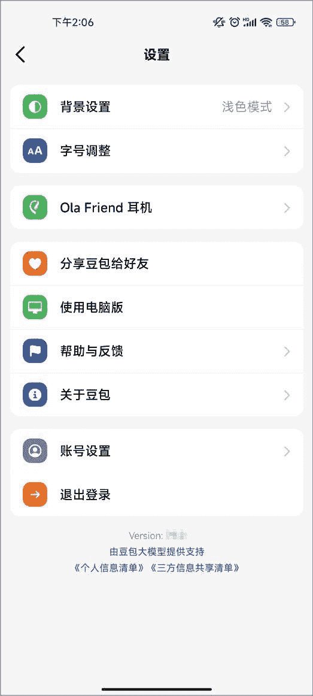
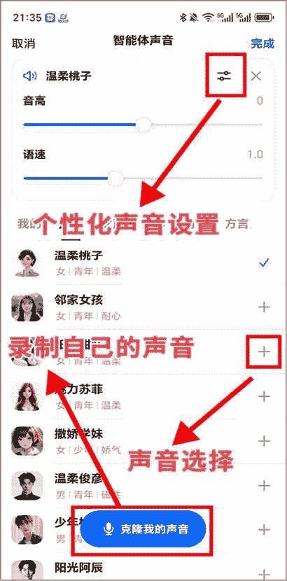
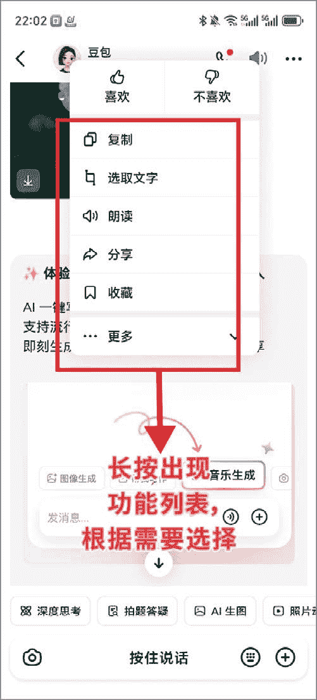

# 豆包全场景活用手册：一键化解生活难题

# 本书概览

本书以豆包为核心工具，串联起学习、工作、生活、娱乐的全链路场景，专门破除“不会用AI”“不敢用AI”的心理门槛，是一部零门槛、分场景、可即学即用的实操指南。

全书共14章，涵盖账号创建与个性化配置、学习辅导、日常写作、生活求助、新技能速成、用短视频记录日常、微型生意运营、休闲消遣、拍摄吸睛短视频、丰富退休生活、脚本创作、变现路径等内容，覆盖教育、生产、娱乐、变现四大核心需求。结合近百个真实使用案例与配套操作视频，帮助读者快速掌握这款智能助理的实用技能。

适合对人工智能感兴趣，想用智能助理解决实际问题的读者阅读。

# 前言

豆包出自字节跳动，与抖音同属一个生态。它像一位7×24小时在线的贴心伙伴，无论是文字交流还是语音表达，都能准确把握意图并给出回应。查菜谱、整理总结、练习英语口语、提醒待办、推荐影视，它都能从容应对。

本书的初衷很简单，帮助你把豆包的各项能力真正用起来，让它成为日常的得力助手。无论是处理琐碎事务、提升新技能，还是借助抖音实现收益，豆包都能提供支持。

从最基础的注册登录开始，逐步演示具体用法。比如如何让豆包辅导孩子作业、如何借助它完成文章撰写、如何用它拍摄短视频，甚至怎样经由它实现盈利。案例丰富、步骤清晰，哪怕是首次接触也能快速上手。

书中还收录了不少操作心得，比如怎样提问才能得到更精准的结果、如何调整偏好使其更贴合个人习惯，以及生成图片、创作音乐、解答数学题等进阶玩法。不论年轻人、中老年人还是孩子，都能在此找到对应的使用方式。

总体来说，本书能让生活更省心高效。豆包宛如随身的智能小跟班，随时待命。希望你借助本书充分发挥豆包的价值，让它成为生活的好搭档。

翻开本书按步骤实操，你会发现豆包真的能让生活更便捷、更有趣！

# 第一章
开启智能生活的入口

## 1.1　认识豆包 它能做什么

豆包由字节跳动推出，和抖音同源。依托先进的人工智能技术，帮助用户解决各类日常生活难题。无论是文字输入还是语音交流，都能流畅互动，成为可靠的生活伙伴。

#### 1.提速增效，日常更顺手

豆包最直观的价值在于节约时间和精力。过去遇到难题常需花费大量时间检索或求助，现在直接询问即可：想做菜却不知步骤，它马上给出详细菜谱；写工作总结缺乏思路，它帮你梳理出清晰框架。它像一本随时在线的百科，快速给出答案，让生活更高效。

#### 2.自学成长，持续进阶

豆包不仅是解题工具，也能充当私人导师。想学英语，它能推荐资料并陪你练习口语；想了解某个领域，它会用通俗语言讲解。无论学生还是职场人士，都能借助它不断提升。

#### 3.打理琐碎，让日子更从容

生活的琐碎，豆包也能接手：提醒重要日程避免遗忘；制定健身计划助力健康；推荐电影、好书丰富闲暇；情绪低落时还能陪聊给出建议。它像一位贴心的生活管家，让日常更从容。

#### 4.量身定制，体验更贴合

豆包可依据个人偏好提供定制方案：偏爱辣味就推送辣菜食谱，正在减脂就给出健康膳食计划。这种个性化服务让帮助更有针对性，真正满足需求。

总体而言，豆包是一款实用且体贴的智能助手，覆盖学习、工作与生活的多种场景，提供即时响应的智能服务。有了它，生活会更简单美好！

## 1.2　账号开通三分钟，开启使用之旅

豆包的账号创建流程简洁，下面给出下载与注册的详细步骤，帮助你快速完成。注意豆包在持续迭代，本书示例版本为 8.0.0，不同版本界面或有差异，后续教学视频会同步更新。

图 1-1　豆包 App 图标

#### 1.下载安装

iPhone 用户打开“App Store”，搜索“豆包”，找到应用后点“获取”安装。安卓用户打开“应用商店”，如华为应用市场、小米应用商店、OPPO 软件商店等，搜索“豆包”，点“安装”。

#### 2.启动应用

安装完成后在桌面找到豆包图标，点击打开。

#### 3.选择登录方式

进入登录页，目前提供以下方式，如图 1-2 所示。

●　抖音一键登录：点击后授权即可快速进入。  
●　手机号登录：点击后系统自动识别本机号码，点“一键登录”完成。

#### 4.完成注册

授权通过后账号即创建成功，可立即使用各项功能。

#### 5.其它登录方式

若后续支持更多方式，可按提示操作。

●　微信/QQ 登录：点击对应图标授权。  
●　Apple 账号登录：点击“使用 Apple 登录”授权后完成。

图 1-2　豆包登录界面

注册或登录异常时可尝试切换网络或重启 App。

如还有疑问，可继续问 AI 以下问题。

● AI，登录时收不到验证码怎么办？  
● AI，如何绑定其它登录方式？

## 1.3　首页全解析，常用功能一网打尽

豆包首页设计简洁明了，功能集中，下面分三部分介绍：底部核心按键、对话区与语音输入、内容生成与处理按键。

#### 1.底部五大入口

底部共 5 个核心入口，如图 1-3 所示。

图 1-3　主界面核心功能键

●　对话。进入聊天界面，支持文字、语音等多种交互。  
●　智能体。浏览、创建或管理智能体，如学习助手、健康顾问等。  
●　创作。提供“AI 生图”“帮我写作”“音乐生成”等创作工具。  
●　通知。查看消息提醒，如日程、任务更新等。  
●　我的。进入个人主页，管理账号、资料与设置。

#### 2.对话区与语音交互

“对话”界面如图 1-4 所示，包含以下要素。

●　聊天框。位于下方，是核心交互区，可直接输入文字提问，如“今天天气如何？”豆包会实时作答，支持生活技巧、文案等多种场景。  
●　语音输入键。位于聊天框右侧，点击即可语音提问，适合开车、做饭等不便打字场景。  
●　电话键。位于聊天框上方，点击可与豆包进行语音通话，如“帮我规划今日任务”。通话中可调节音量或切换耳机蓝牙，保证清晰。

图 1-4　“对话”界面

#### 3.顶部工具栏快速操作

在“对话”界面聊天框上方有一排功能键，如图 1-4 所示。

●　深度思考。提供深入分析与建议，适合复杂问题。  
●　帮我写作。输入需求后生成文章、诗歌或文案，可反复修改。  
●　录音纪要。上传录音自动转文字，方便整理。  
●　AI 生图。输入描述生成图片，或对已上传图片优化。  
●　拍题答疑。拍照上传题目，快速给出答案与解析。  
●　照片动起来。把静态照片转为动态效果。  
●　打电话。直接进行语音通话，适合不便打字时。  
●　来点音乐。推荐或播放音乐，放松心情。  
●　音乐生成。输入描述生成个性化音乐片段。  
●　翻译。文字或语音快速互译。  
●　AI 写真。上传照片生成艺术风格头像。  
●　豆包日报。查看每日精选资讯，掌握热点。  
●　健康咨询。输入健康问题获取专业建议。  
●　文档阅读。上传文档提取要点并生成摘要。  
●　网页阅读。输入链接解析内容并摘要。  
●　日程提醒。设置任务后按时推送提醒。

功能顺序可能因个人使用习惯略有不同，以手机实际显示为准。

如还有疑问，可继续问 AI 以下问题。

● AI，如何让豆包生成更符合需求的图片？  
● AI，拍题答疑支持哪些题型？

## 1.4　个性化配置 让助手更懂你

使用过程中做些基础设置，能让豆包更贴合个人习惯。下面给出上手步骤。

#### 1.个人设置

打开豆包 App，进入“对话”界面后按以下流程设置。

（1）进入设置页

在主界面点顶部豆包图标进入“对话”界面，点击左上角头像或右上角“三个点”图标，如图 1-5 所示，进入设置主界面，如图 1-6 所示。

图 1-5　“对话”界面个人设置入口

图 1-6　设置主界面

（2）设置形象

在设置主界面点“设置形象”可选择形象，目前提供男、女两种，后续可能扩充。

（3）语音设置

有两种入口。

●　在“设置形象”界面，如图 1-7 所示，点击“更改”进入“智能体声音”界面，如图 1-8 所示，选择音色。  
●　在设置主界面，如图 1-6 所示，点击“声音”进入“智能体声音”界面，可选音色并调节音高与语速。

图 1-7　“设置形象”界面

图 1-8　“智能体声音”界面

（4）字号调节

在设置主界面点“字号调整”，按需放大或缩小字体。

#### 2.个人信息设置

在主界面点右下角“我的”进入个人主页。

（1）编辑资料

在主页点“编辑个人资料”，可修改昵称或更换头像，如图 1-9 所示。

图 1-9　个人主页

（2）更多设置

在图 1-9 主页右上角点“齿轮”图标，进入设置页，如图 1-10 所示。

可进行的设置包括：

●　背景设置：跟随系统、浅色或暗色模式。  
●　账号设置：管理安全与隐私。  
●　其它设置：帮助与反馈等。

图 1-10　设置页面

##### 举例说明

进入“对话”界面，点击左上角头像进入设置主界面，设置形象为男性，语音播报速度调慢、音高调高，字号调大一号。再返回主界面点“我的”，把昵称改为“小明”，上传新头像，背景设为暗色模式。设置可随时调整，按需修改。

如还有疑问，可继续问 AI 以下问题。

● AI，如何让语音播报更符合个人需求？  
● AI，背景设置有哪些模式可选？

按以上步骤即可轻松配置豆包，让它更懂你、更好用！

## 1.5　新手起步指南 三招变熟练

掌握几个小窍门，就能迅速熟练使用豆包。

#### 1.有需求直接开口

豆包擅长各类提问，找菜谱、学知识、写文案都行。提问时尽量具体，例如：“家里有番茄、鸡蛋、葱，想做番茄炒蛋，该怎么做？”不想打字就点“电话”按钮语音交流，或长按聊天框开启语音输入，如图 1-11 所示。

图 1-11　语音输入界面

语音识别精准，支持普通话和多地方言，体验自然。

#### 2.常用问题固定到首页

经常询问的内容如“今天天气”“查一下日程”，可点图 1-12 所示的搜索智能体入口，进入管理界面搜索相关智能体如“天气助手”“日程管理”，添加到首页，一键即问，省时省力。

图 1-12　搜索智能体入口

#### 3.多尝试发现惊喜

豆包功能丰富，多尝试不同玩法，如让它讲笑话、推荐好书、规划日程等。用得越多越能体会其强大，简直是生活里的智能小跟班。

功能会持续更新，记得探索新能力。

如还有疑问，可继续问 AI 以下问题。

● AI，如何让豆包的回答更详细？  
● AI，如何快速找到需要的智能体？

## 1.6　提问技巧升级 五步框架拿捏精准回复

想让豆包更懂心意，可按“五步高效提问法”组织问题。

#### 1.我是谁

先简单介绍自身情况，如“我是一名刚毕业的大学生”或“我是一位家庭主妇”。

#### 2.我遇到的问题

清晰描述困难或需求，如“我想找工作”或“我想学做一道菜”。

#### 3.问题的具体情况

补充细节，便于更精准理解。例如：“我想找互联网行业的工作，但缺乏相关经验。”或“我想学红烧肉，不知道需要哪些调料。”

#### 4.我想要什么

明确期望豆包如何帮助。如：“你能给我一些求职建议吗？”或“能提供一个简单的红烧肉做法吗？”

#### 5.希望的结果

进一步说明想要的成果。例如：“希望建议具体，最好教我写简历。”或“希望做法简单，我是新手。”

##### 示例

“我是一名刚毕业的大学生，想找互联网行业的工作，但没有相关经验。你能给些求职建议吗？最好教我如何写简历，面试要注意什么。”

按此方式提问，能获得更有针对性的回答。提问越详细，结果越精准。

如还有疑问，可继续问 AI 以下问题。

● AI，如何让提问更清晰？

● 让豆包输出更贴合实际？ EXr6287u6NNVz+GYLY+7SCGVQ1Qs5GpzKP8t9pj/VFiiRBuyi5+kak+b/wyV/yWacqUOQqYMtlkKCpGDzVSpAA==

## 1.7 不擅长打字？用声控也能玩转
哪怕键盘操作不熟练，也能流畅使用豆包。语音能力足够强，靠说话就能完成交互。下面这套上手路径很清晰。

#### 1. 启动豆包程序
在手机桌面找到豆包图标，点击进入主界面。

#### 2. 开启语音输入
进入首页后，先点按顶部的会话入口，再长按底部的话筒区域，保持按压即可开始讲话。

#### 3. 直接说出需求
想咨询什么就直接开口，比如说“今天天气如何”或“教我做红烧肉”。系统会识别意图并用语音给出回应。

#### 4. 听取回答
结果会以语音播报，你只需认真聆听。听不清时可说“请再说一遍”。

#### 5. 延续对话
后续还有问题就继续长按输入区提问，例如“红烧肉需要哪些配料”“怎样做味道更好”。豆包会持续跟进并解答。

发音清晰会让识别率和答案准确度都提升。

仍有困惑时，可参考以下追问方向：
● 语音识别精度怎样提升？
● 怎样迅速定位所需智能体？ EXr6287u6NNVz+GYLY+7SCGVQ1Qs5GpzKP8t9pj/VFiiRBuyi5+kak+b/wyV/yWacqUOQqYMtlkKCpGDzVSpAA==

## 1.8 用得放心，豆包安全机制详解
谈到使用豆包，最关心的往往是信息安全。产品在设计之初就把隐私保护和数据安全放在首位，下面说明防护做法与使用建议。

#### 1. 平台安全基座
采用领先加密方案，保障数据在传输与存储环节不被窃取。会话记录和个人资料不会被随意泄露，除非用户主动公开。

#### 2. 对话保密性
与豆包的交流默认私密，第三方无法获取。只有主动分享时，内容才会被对外展示。

#### 3. 避免透露敏感信息
即便防护完善，为更稳妥，建议不要在对话中提供银行卡号、登录密码、身份证号码等隐私或高风险信息。

#### 4. 其他使用建议
● 设置强密码：若已绑定账号，请使用复杂密码并定期更换。
● 保护终端安全：确保手机、电脑不被他人随意操作。
● 保持版本更新：及时升级App，获取安全补丁与功能优化。

平台会不断完善安全能力，但个人隐私保护也需要用户共同注意。

仍有困惑时，可参考以下追问方向：
● 强密码如何设置？
● 聊天内容怎样确保不外泄？ EXr6287u6NNVz+GYLY+7SCGVQ1Qs5GpzKP8t9pj/VFiiRBuyi5+kak+b/wyV/yWacqUOQqYMtlkKCpGDzVSpAA==

# 第二章
豆包助力孩子成长
EXr6287u6NNVz+GYLY+7SCGVQ1Qs5GpzKP8t9pj/VFiiRBuyi5+kak+b/wyV/yWacqUOQqYMtlkKCpGDzVSpAA==

## 2.1 作业辅导有思路，豆包来支招

借助简便可行的办法，帮助文化程度有限的家长引导孩子养成独立思考、自主学习的习惯，降低对他人辅导的依赖。

错误提问： 帮我培养孩子的学习习惯。
提问过于宽泛，AI 难以给出针对性建议

正确提问：
● 角色：初二学生的家长；
● 当前困境：无法辅导孩子学习，希望培养独立思考与自主学习的习惯；
● 具体表现：孩子学习依赖性强，难以自行解决问题；
● 期望指导：请说明用简易方法培养孩子独立思考与自主学习习惯的做法；
● 预期效果：孩子能形成独立思考、自主学习的习惯，减少对他人辅导的依赖。

培养要点：
● 由日常小事入手，逐步提升孩子的自主能力；
● 肯定多于指责，让孩子感受到学习的成就感。

仍有困惑时，可参考以下追问方向：
● 若孩子抗拒独立学习，该如何引导？
● 怎样提升孩子的学习兴趣？ EXr6287u6NNVz+GYLY+7SCGVQ1Qs5GpzKP8t9pj/VFiiRBuyi5+kak+b/wyV/yWacqUOQqYMtlkKCpGDzVSpAA==

## 2.2 点燃学习热情，让孩子主动学

运用简便实用的策略，帮助长期在外务工的家长提高孩子的学习积极性，促使孩子自愿投入学习。

错误提问： 帮我提升孩子的学习积极性。
提问过于宽泛，AI 难以给出针对性建议

正确提问：
● 角色：长期在外务工的家长；
● 当前困境：无暇关注孩子学习，学习积极性偏低；
● 具体表现：对学习缺乏兴趣，成绩不理想；
● 期望指导：请说明用简易方法提升孩子学习积极性的做法；
● 预期效果：孩子能主动学习，成绩有所提升。

提升要点：
● 以鼓励为主、批评为辅，让孩子体会学习的收获感；
● 从小目标起步，慢慢培养学习的兴趣。

仍有困惑时，可参考以下追问方向：
● 若孩子仍不愿学习，该怎么应对？
● 如何让孩子更自觉？ EXr6287u6NNVz+GYLY+7SCGVQ1Qs5GpzKP8t9pj/VFiiRBuyi5+kak+b/wyV/yWacqUOQqYMtlkKCpGDzVSpAA==

## 2.3 掌握预习复习法，成绩稳步提升

用简易可行的方法，帮助文化程度不高的家长指导孩子做好预习复习，提升学习效能。

错误提问： 帮我教孩子预习和复习。
提问过于宽泛，AI 难以给出针对性建议

正确提问：
● 角色：文化水平有限的家长；
● 当前困境：不会指导孩子预习与复习；
● 具体表现：孩子学习效果不佳，需要提升；
● 期望指导：请说明用简易方法教孩子预习与复习的做法；
● 预期效果：孩子能掌握预习复习方法，提升学习效果。

学习要点：
● 预习先把握整体脉络，复习侧重巩固重点；
● 借助字典、错题本等简易工具辅助学习。

仍有困惑时，可参考以下追问方向：
● 若孩子不愿预习，该如何处理？
● 复习效率怎样再提高？ EXr6287u6NNVz+GYLY+7SCGVQ1Qs5GpzKP8t9pj/VFiiRBuyi5+kak+b/wyV/yWacqUOQqYMtlkKCpGDzVSpAA==

## 2.4 缓解学业焦虑，让学习更轻松

借助简便方法，帮助长期外出务工的家长减轻孩子的学习焦虑，助其从容应对学业。

错误提问： 帮我缓解孩子的学习焦虑。
提问过于宽泛，AI 难以给出针对性建议

正确提问：
● 角色：长期在外打工的家长；
● 当前困境：孩子学业压力大，焦虑明显；
● 具体表现：无暇陪伴，想帮助缓解焦虑；
● 期望指导：请说明用简易方法缓解孩子学习焦虑的做法；
● 预期效果：孩子能轻松面对学习，减少焦虑感。

缓解要点：
● 多些关心，让孩子感受到爱与支持；
● 引导孩子适度放松，避免长期紧绷。

仍有困惑时，可参考以下追问方向：
● 若焦虑仍未缓解，该怎么办？
● 如何增强孩子的自信心？ EXr6287u6NNVz+GYLY+7SCGVQ1Qs5GpzKP8t9pj/VFiiRBuyi5+kak+b/wyV/yWacqUOQqYMtlkKCpGDzVSpAA==

## 2.5 孩子沉迷网游，豆包给出应对思路

采用简便策略，帮助繁忙的家长处理孩子沉迷网络游戏的问题，帮助其重回学习轨道。

错误提问： 帮我解决孩子沉迷网络的问题。
提问过于宽泛，AI 难以给出针对性建议

正确提问：
● 角色：初一学生的家长；
● 当前困境：孩子沉迷网络游戏，影响学业；
● 具体表现：无暇监管，想帮助戒除网瘾；
● 期望指导：请说明用简易方法解决孩子沉迷网游问题的做法；
● 预期效果：孩子减少上网时间，专注学习。

解决要点：
● 制定规则，分阶段压缩上网时长；
● 发展其他爱好，为孩子提供更多选择。

仍有困惑时，可参考以下追问方向：
● 若孩子不听劝，该如何应对？
● 如何培养孩子的自律性？ EXr6287u6NNVz+GYLY+7SCGVQ1Qs5GpzKP8t9pj/VFiiRBuyi5+kak+b/wyV/yWacqUOQqYMtlkKCpGDzVSpAA==

## 2.6 定制假期学习表，进步看得见

运用简便做法，帮助文化程度有限的家长为孩子规划假期学习安排，避免假期虚度。

错误提问： 帮我制订学习计划。
提问过于宽泛，AI 难以给出针对性建议

正确提问：
● 角色：文化程度有限的家长；
● 当前困境：假期来临，不知如何管理孩子学习；
● 具体表现：希望假期不被荒废，但不会制定计划；
● 期望指导：请说明用简易方法为孩子制定假期学习计划的做法；
● 预期效果：孩子能利用假期学习，不浪费时间。

学习要点：
● 固定每日学习时段，形成良好习惯；
● 任务难度适中，匹配孩子年龄与水平。

仍有困惑时，可参考以下追问方向：
● 若孩子不愿学习，该怎么引导？
● 怎样让学习内容更丰富？ EXr6287u6NNVz+GYLY+7SCGVQ1Qs5GpzKP8t9pj/VFiiRBuyi5+kak+b/wyV/yWacqUOQqYMtlkKCpGDzVSpAA==

## 2.7 期末复习有安排，备考不焦虑

用简便方法，帮助文化程度不高的家长为孩子制定期末复习方案，助力顺利备考。

错误提问： 帮我制订复习计划。
提问过于宽泛，AI 难以给出针对性建议

正确提问：
● 角色：文化水平有限的家长；
● 当前困境：孩子小学六年级，临近期末，不知如何辅导复习；
● 具体表现：想让孩子好好复习，但不会制定方案；
● 期望指导：请说明用简易方法为孩子制定期末复习计划的做法；
● 预期效果：孩子能顺利备考，取得好成绩。

复习要点：
● 每天固定复习时段，培养好习惯；
● 兼顾全面复习，重点攻克薄弱环节。

仍有困惑时，可参考以下追问方向：
● 若孩子不愿复习，该如何处理？
● 复习效果怎样再提升？ EXr6287u6NNVz+GYLY+7SCGVQ1Qs5GpzKP8t9pj/VFiiRBuyi5+kak+b/wyV/yWacqUOQqYMtlkKCpGDzVSpAA==

## 2.8 难题一网打尽，学习更顺畅

借助简便方法，帮助家长理解并解答孩子遇到的古诗词赏析题目。

错误提问： 帮我解答古诗词解读题。
提问过于宽泛，AI 难以给出针对性建议

正确提问：
● 角色：初二学生的家长；
● 当前困境：孩子有一道古诗词解读题不会做，想帮忙解答；
● 具体表现：题目为“解读杜甫的《春望》，分析其历史背景及表达的情感”；
● 期望指导：请说明如何解答此题；
● 预期效果：能理解并解答题目，帮助孩子学习。

解题要点：
● 联系历史背景，深入解读诗句内涵；
● 分析意象描写，感悟诗人情感。

仍有困惑时，可参考以下追问方向：
● 若孩子不理解诗词主题，该怎么办？
● 如何让孩子学到更多杜甫作品？ EXr6287u6NNVz+GYLY+7SCGVQ1Qs5GpzKP8t9pj/VFiiRBuyi5+kak+b/wyV/yWacqUOQqYMtlkKCpGDzVSpAA==

# 第三章
写作有困难，豆包来救场
EXr6287u6NNVz+GYLY+7SCGVQ1Qs5GpzKP8t9pj/VFiiRBuyi5+kak+b/wyV/yWacqUOQqYMtlkKCpGDzVSpAA==

## 3.1 写家书表达思念，豆包助你落笔

用文字传达对远方亲人的思念，表达心底的牵挂与关怀。

错误提问： 帮我写几句话。
提问过于宽泛，AI 难以给出针对性建议

正确提问：
● 角色：农村老太太，文化水平不高；
● 当前困境：儿子在外打工，很想念；
● 具体表现：不知如何用文字表达思念；
● 期望指导：请帮忙写几句话表达对儿子的思念；
● 预期效果：让儿子感受到牵挂与爱。

表达要点：
● 回忆温馨往事，引发情感共鸣；
● 关心对方生活与健康，体现细腻关怀；
● 寄托对未来的美好期许，传递温暖希望。

若文字不够贴切，可继续追问：
● 想让语气更温柔，该如何修改？
● 想加入家乡元素，该怎么补充？ EXr6287u6NNVz+GYLY+7SCGVQ1Qs5GpzKP8t9pj/VFiiRBuyi5+kak+b/wyV/yWacqUOQqYMtlkKCpGDzVSpAA==

## 3.2 借条规范书写，权益更安心

借助规范的借条格式，保障借贷双方权益，减少还款争议。

错误提问： 帮我写一张借条。
提问过于宽泛，AI 难以给出针对性建议

正确提问：
● 角色：农村居民，文化水平不高；
● 当前困境：张三借了1000元，期限三个月，不知怎么写借条；
● 具体表现：想确保到期还款，不知格式；
● 期望指导：请帮忙写一份规范的借条；
● 预期效果：借条内容清晰，保证按时还款。

借条必备要素：
● 双方姓名、身份证号、联系方式；
● 借款金额大写与小写；
● 借款日期及还款日期；
● 还款方式为一次性还清或分期；
● 违约责任，即未按时还款的处理方式。

若内容不够全面，可继续追问：
● 若想加入利息，该如何表述？
● 若借款期限更长，格式如何调整？ EXr6287u6NNVz+GYLY+7SCGVQ1Qs5GpzKP8t9pj/VFiiRBuyi5+kak+b/wyV/yWacqUOQqYMtlkKCpGDzVSpAA==

## 3.3 请假条写得规范，审批更顺畅

采用规范的请假条写法，帮助你向单位或学校清晰说明请假需求，确保流程顺利。

错误提问： 帮我写一张请假条。
提问过于宽泛，AI 难以给出针对性建议

正确提问：
● 角色：小学文化水平的人员；
● 当前困境：家里有事需回乡帮忙，想请两天假，不知如何书写；
● 具体表现：需要向公司/学校请假，但不会写正式文书；
● 期望指导：请帮忙写一份规范的请假条；
● 预期效果：内容清晰，能顺利获批。

请假条必备要素：
● 称呼，如“尊敬的领导/老师”；
● 请假原因，简要说明家庭事务；
● 请假时间，具体日期；
● 表达请求与承诺，如“恳请批准”“按时返回”；
● 署名及日期。

若内容不够全面，可继续追问：
● 若想多请几天，该如何表述？
● 若家庭事务比较复杂，如何表达更妥当？ EXr6287u6NNVz+GYLY+7SCGVQ1Qs5GpzKP8t9pj/VFiiRBuyi5+kak+b/wyV/yWacqUOQqYMtlkKCpGDzVSpAA==

## 3.4 村务通知怎么写，豆包给你思路

借助规范的通知格式，向村民告知村内修路事宜，提醒注意出行安全。

错误提问： 帮我写一份通知。
提问过于宽泛，AI 难以给出针对性建议

正确提问：
● 角色：农村村委会干部；
● 当前困境：村里要修新路，需通知村民注意出行安全；
● 具体表现：需要写一份通知，不知如何规范；
● 期望指导：请帮忙写一份通知；
● 预期效果：内容清晰，村民能理解并注意安全。

通知必备要素：
● 标题，如“通知”；
● 称呼，如“各位村民”；
● 通知内容，说明修路时间、地点及注意事项；
● 表达感谢与歉意，如“感谢理解与配合”“敬请谅解”；
● 署名及日期。

若内容不够全面，可继续追问：
● 若施工时间有变动，如何修改通知？
● 若施工范围扩大，如何提醒村民？ EXr6287u6NNVz+GYLY+7SCGVQ1Qs5GpzKP8t9pj/VFiiRBuyi5+kak+b/wyV/yWacqUOQqYMtlkKCpGDzVSpAA==

## 3.5 宣传村里好人事迹，文案不再难

用恰当的表达来赞美王大爷无偿照料村里孤寡老人的善行，传递积极力量，带动更多乡亲加入公益。

错误提问： 帮我夸夸王大爷。

提问太笼统，AI 没法给出有针对性的回复

正确提问：

●　我是谁 ——我是本村的老支书；
●　我遇到的问题 ——王大爷自愿照看村中孤寡老人，我想肯定他的行为却不知如何措辞才合适；
●　问题的具体情况 ——王大爷长期默默付出，希望让大家了解这份善行；
●　我想要什么 ——请 AI 帮我拟一段褒奖的文字；
●　希望的结果 ——表达真挚动人，能够鼓舞更多村民向他看齐。

表扬语言要点：

●　把王大爷的具体做法讲清楚，凸显他无私奉献；
●　流露出对王大爷的敬重与感激；
●　呼吁乡亲们学习他的品格，传递正能量。

如果觉得内容不够全面，可以继续问 AI 以下问题。

●　AI，我想加入王大爷的一些具体事例，该怎么补充？
●　AI，怎么把表扬的话说得更动人一些？ EXr6287u6NNVz+GYLY+7SCGVQ1Qs5GpzKP8t9pj/VFiiRBuyi5+kak+b/wyV/yWacqUOQqYMtlkKCpGDzVSpAA==

## 3.6　童年记忆写出温柔童趣

用生动的描写把小时候下河摸鱼的经历写出来，留住这段宝贵的回忆。

错误提问： 写一下我的回忆。

提问过于模糊，AI 无法提供针对性回答

正确提问：

●　我是谁 ——我已年过半百，识字不多；
●　我遇到的问题 ——想把儿时和伙伴们在河里摸鱼的片段写下来，却不知从何下笔；
●　问题的具体情况 ——这段经历对我意义非凡，希望能保存下来；
●　我想要什么 ——希望 AI 帮我写一段回忆文字；
●　希望的结果 ——文字鲜活有情感，能把当时的情景和心情还原出来。

回忆文字要点：

●　细化场景与细节，比如河边的鱼、小伙伴的动作；
●　写出当时的心境，比如好奇、开心；
●　联系现在的际遇，深化这段回忆的价值。

如果觉得内容不够全面，可以继续问 AI 以下问题。

●　AI，想加入当时的对话，该怎么补？
●　AI，如果我想让文字更感人，怎么修改？ EXr6287u6NNVz+GYLY+7SCGVQ1Qs5GpzKP8t9pj/VFiiRBuyi5+kak+b/wyV/yWacqUOQqYMtlkKCpGDzVSpAA==

## 3.7　村里新事写成生动故事

用生动的笔触帮李婶记下村里用直播卖土豆的热闹事，呈现乡村的改变与生机。

错误提问： 帮我记下最近的新鲜事儿。

提问过于模糊，AI 无法提供针对性回答

正确提问：

●　我是谁 ——我是村里的李婶，文化程度有限；
●　我遇到的问题 ——村里最近在搞直播卖土豆，我想写下来却不知怎么表达；
●　问题的具体情况 ——这是村里的大事，我希望更多人了解；
●　我想要什么 ——请 AI 帮我写段记录文字；
●　希望的结果 ——文字有趣生动，真实反映乡村的变化。

记录文字要点：

●　描绘具体现场与细节，像直播搭建、土豆品种；
●　体现村民的反应与变化，像大家的热情、忙碌场面；
●　写出对这件新鲜事的感受和对未来的期盼。

如果觉得内容不够全面，可以继续问 AI 以下问题。

●　AI，想加入村民的交谈，该怎么补？
●　AI，如果我想让文字更生动，怎么修改？ EXr6287u6NNVz+GYLY+7SCGVQ1Qs5GpzKP8t9pj/VFiiRBuyi5+kak+b/wyV/yWacqUOQqYMtlkKCpGDzVSpAA==

## 3.8　写作卡壳快速打开思路

用简便可行的小方法，让写作基础薄弱的乡亲迅速提高笔力，说出自己的想法。

错误提问： 怎么才能写好文章。

提问过于模糊，AI 无法提供针对性回答

正确提问：

●　我是谁 ——我是小学文化的村民；
●　我遇到的问题 ——想写点东西，但写得不好；
●　问题的具体情况 ——想把儿时经历写出来，却无从下手；
●　我想要什么 ——请 AI 教我怎样快速提高写作；
●　希望的结果 ——能写出流畅且有内容的文字。

提升要点：

●　多阅读多练习，积累素材；
●　从简单句起步，慢慢提升。

如果还有疑问，可以继续问 AI 以下问题。

●　AI，想让文章更生动怎么做？
●　AI，如果我想提高写作速度，怎么办？ EXr6287u6NNVz+GYLY+7SCGVQ1Qs5GpzKP8t9pj/VFiiRBuyi5+kak+b/wyV/yWacqUOQqYMtlkKCpGDzVSpAA==

# 第四章

生活小困扰，豆包来解忧

EXr6287u6NNVz+GYLY+7SCGVQ1Qs5GpzKP8t9pj/VFiiRBuyi5+kak+b/wyV/yWacqUOQqYMtlkKCpGDzVSpAA==

## 4.1　蔬菜保鲜延长小妙招

用简单实用的技巧，帮助宝妈让自家种的菜放得更久，减少浪费。

错误提问： 蔬菜怎么保鲜。

提问过于模糊，AI 无法提供针对性回答

正确提问：

●　我是谁 ——我是一位宝妈；
●　我遇到的问题 ——我常种菜，经常吃不完，不知道怎么存放；
●　问题的具体情况 ——想让菜放久点，却不知办法；
●　我想要什么 ——请 AI 教我蔬菜保鲜的方法；
●　希望的结果 ——菜能放更久，不浪费。

保鲜要点：

●　不同菜类保鲜方式不同，例如叶菜放冰箱，根茎类通风保存；
●　保持干燥，防止受潮。

如果还有疑问，可以继续问 AI 以下问题。

●　AI，怎么让蔬菜存放时间更长？
●　AI，如果我想腌制蔬菜，怎么操作？ EXr6287u6NNVz+GYLY+7SCGVQ1Qs5GpzKP8t9pj/VFiiRBuyi5+kak+b/wyV/yWacqUOQqYMtlkKCpGDzVSpAA==

## 4.2　鸡蛋产量品质双提升

用简易可行的方法，帮助养殖户提高产蛋量，同时保持蛋品质量。

错误提问： 怎么让鸡多下蛋。

提问过于模糊，AI 无法提供针对性回答

正确提问：

●　我是谁 ——我养了五百只鸡；
●　我遇到的问题 ——想增产又保质；
●　问题的具体情况 ——不清楚提升产量和品质的具体做法；
●　我想要什么 ——请 AI 指导提高产蛋和维持品质的方法；
●　希望的结果 ——产蛋更多，品质稳定。

提升要点：

●　供给优质饲料和充足饮水；
●　保持鸡舍干净整洁，适当光照，降低母鸡压力。

如果还有疑问，可以继续问 AI 以下问题。

●　AI，若产蛋仍不理想该怎么办？
●　AI，如果我还想提高鸡蛋的品质，怎么办？ EXr6287u6NNVz+GYLY+7SCGVQ1Qs5GpzKP8t9pj/VFiiRBuyi5+kak+b/wyV/yWacqUOQqYMtlkKCpGDzVSpAA==

## 4.3　小麦蚜虫防治与防扩散

用实用方法帮村民防治小麦蚜虫，防止扩散，保障丰收。

错误提问： 蚜虫怎么治。

提问过于模糊，AI 无法提供针对性回答

正确提问：

●　我是谁 ——我种了五百亩小麦；
●　我遇到的问题 ——小麦出现蚜虫，不知如何处置；
●　问题的具体情况 ——想控制蚜虫并避免蔓延；
●　我想要什么 ——请 AI 介绍防治小麦蚜虫和防扩散的方法；
●　希望的结果 ——蚜虫受控，小麦顺利丰收。

治理要点：

●　及时用药，压低蚜虫基数；
●　结合生物防治和田间管理，降低繁殖。

如果还有疑问，可以继续问 AI 以下问题。

●　AI，若蚜虫已蔓延该怎么处理？
●　AI，如果我想预防蚜虫，怎么办？ EXr6287u6NNVz+GYLY+7SCGVQ1Qs5GpzKP8t9pj/VFiiRBuyi5+kak+b/wyV/yWacqUOQqYMtlkKCpGDzVSpAA==

## 4.4　灯光闪烁快速排查

用简单方法帮村民解决家中灯光闪烁，确保照明正常。

错误提问： 灯坏了怎么修。

提问过于模糊，AI 无法提供针对性回答

正确提问：

●　我是谁 ——我是本地村民；
●　我遇到的问题 ——家灯一直闪烁，不知原因；
●　问题的具体情况 ——希望灯光恢复稳定；
●　我想要什么 ——请 AI 教我处理灯闪的方法；
●　希望的结果 ——灯光稳定，照明正常。

解决要点：

●　先看灯泡开关，再查线路；
●　自行处理不了请找专业电工。

如果还有疑问，可以继续问 AI 以下问题。

●　AI，换灯泡后仍闪咋办？
●　AI，如果我想预防电灯闪烁，怎么办？ EXr6287u6NNVz+GYLY+7SCGVQ1Qs5GpzKP8t9pj/VFiiRBuyi5+kak+b/wyV/yWacqUOQqYMtlkKCpGDzVSpAA==

## 4.5　孩子就诊挂号指南

用简便方法帮助宝妈快速为孩子挂号，缓解咳嗽发烧。

错误提问： 怎么挂号。

提问过于模糊，AI 无法提供针对性回答

正确提问：

●　我是谁 ——我是位宝妈；
●　我遇到的问题 ——两岁的孩子咳嗽发烧，想尽快挂号；
●　问题的具体情况 ——想快点看医生，但不明白流程；
●　我想要什么 ——请 AI 介绍快速挂号的方法；
●　希望的结果 ——孩子早点就诊，病情缓解。

挂号要点：

●　优先线上或电话预约，省时；
●　病情严重直接挂急诊。

如果还有疑问，可以继续问 AI 以下问题。

●　AI，挂不上号怎么办？
●　AI，如果我想了解孩子的病情，怎么办？ EXr6287u6NNVz+GYLY+7SCGVQ1Qs5GpzKP8t9pj/VFiiRBuyi5+kak+b/wyV/yWacqUOQqYMtlkKCpGDzVSpAA==

## 4.6　医保报销流程说明

用简明方法帮村民弄清阑尾炎手术医保报销流程，减轻费用压力。

错误提问： 医保怎么报销。

提问过于模糊，AI 无法提供针对性回答

正确提问：

●　我是谁 ——我刚做完阑尾炎手术；
●　我遇到的问题 ——想报销手术费，不知流程；
●　问题的具体情况 ——想了解可报项目和流程；
●　我想要什么 ——请 AI 说明报销流程和可报费用；
●　希望的结果 ——顺利报销，减轻开销。

报销要点：

●　出院时争取医院直接结算，省时间；
●　妥善保存票据，便于报销。

如果还有疑问，可以继续问 AI 以下问题。

●　AI，若医院不能直接结算怎么办？
●　AI，如果我想了解更多的医保政策，怎么办？ EXr6287u6NNVz+GYLY+7SCGVQ1Qs5GpzKP8t9pj/VFiiRBuyi5+kak+b/wyV/yWacqUOQqYMtlkKCpGDzVSpAA==

## 4.7　八十寿宴体面实惠策划

用实用方法帮助村民为八十岁老人办一场既体面又省钱的寿宴，尽孝心。

错误提问： 办寿宴该怎么做。

提问过于模糊，AI 无法提供针对性回答

正确提问：

●　我是谁 ——我是村民；
●　我遇到的问题 ——家老人八十，想办寿宴不知咋办；
●　问题的具体情况 ——希望寿宴体面又经济；
●　我想要什么 ——请 AI 指导如何办体面实惠寿宴；
●　希望的结果 ——寿宴成功，老人高兴。

办寿宴要点：

●　适度布置，营造喜庆气氛；
●　准备经济实惠菜谱，邀请亲友共庆。

如果还有疑问，可以继续问 AI 以下问题。

●　AI，怎么让寿宴更有仪式感？
●　AI，如果我想节省更多的费用，怎么办？ EXr6287u6NNVz+GYLY+7SCGVQ1Qs5GpzKP8t9pj/VFiiRBuyi5+kak+b/wyV/yWacqUOQqYMtlkKCpGDzVSpAA==

## 4.8　宅基地纠纷化解办法

用简便方法帮助村民妥善处理宅基地纠纷，维护权益。

错误提问： 纠纷怎么处理。

提问过于模糊，AI 无法提供针对性回答

正确提问：

●　我是谁 ——我是一名村民；
●　我遇到的问题 ——与邻居因宅基地起争执；
●　问题的具体情况 ——邻居称我围墙占地，我有老地契为证；
●　我想要什么 ——请 AI 指导如何处理；
●　希望的结果 ——和平解决，保障权益。

处理要点：

●　出示地契证明产权；
●　请村干部调解，避免矛盾扩大。

如果还有疑问，可以继续问 AI 以下问题。

●　AI，若邻居不认可地契怎么办？
●　AI，如果我想了解更多的法律知识，怎么办？ EXr6287u6NNVz+GYLY+7SCGVQ1Qs5GpzKP8t9pj/VFiiRBuyi5+kak+b/wyV/yWacqUOQqYMtlkKCpGDzVSpAA==

# 第五章

学新本领，跟豆包开启新生活

EXr6287u6NNVz+GYLY+7SCGVQ1Qs5GpzKP8t9pj/VFiiRBuyi5+kak+b/wyV/yWacqUOQqYMtlkKCpGDzVSpAA==

## 5.1　交规快速掌握指南

用简便方法帮助乡镇企业家快速掌握重点交规，节省时间。

错误提问： 交规怎么学。

提问过于模糊，AI 无法提供针对性回答

正确提问：

●　我是谁 ——我是乡镇企业家；
●　我遇到的问题 ——想学开车，但没时间学交规；
●　问题的具体情况 ——想了解重点交规及线上学习方式；
●　我想要什么 ——请 AI 列出重点内容并介绍网学方法；
●　希望的结果 ——快速掌握，顺利学车。

学习要点：

●　记住红绿灯、限速、让行等要点；
●　多做模拟题，熟悉考题。

如果还有疑问，可以继续问 AI 以下问题。

●　AI，想了解更多交规怎么做？
●　AI，如果我想提高考试通过率，怎么办？ EXr6287u6NNVz+GYLY+7SCGVQ1Qs5GpzKP8t9pj/VFiiRBuyi5+kak+b/wyV/yWacqUOQqYMtlkKCpGDzVSpAA==

## 5.2　电工基础快速入门

用简便方法帮养鸡场老板掌握电工基础，解决线路短路。

错误提问： 电工知识怎么学。

提问过于模糊，AI 无法提供针对性回答

正确提问：

●　我是谁 ——我是养鸡场老板；
●　我遇到的问题 ——鸡场线路常短路，找人修麻烦；
●　问题的具体情况 ——想学基础，自己处理；
●　我想要什么 ——请 AI 介绍电工基础和学习资源；
●　希望的结果 ——能自行排除短路，减少麻烦。

学习要点：

●　重点学线路连接、开关安装，防止短路；
●　多看视频，多动手练。

如果还有疑问，可以继续问 AI 以下问题。

●　AI，想学更多电工知识怎么办？
●　AI，如果我想提高维修技能，怎么办？ EXr6287u6NNVz+GYLY+7SCGVQ1Qs5GpzKP8t9pj/VFiiRBuyi5+kak+b/wyV/yWacqUOQqYMtlkKCpGDzVSpAA==

## 5.3　柴火烧鹅做法详解

用简单实用的方法教村民做美味柴火烧鹅。

错误提问： 柴火烧鹅怎么做。

提问过于模糊，AI 无法提供针对性回答

正确提问：

●　我是谁 ——我在外打工；
●　我遇到的问题 ——过年回乡想吃柴火烧鹅；
●　问题的具体情况 ——想做但不知技巧；
●　我想要什么 ——请 AI 教我做法；
●　希望的结果 ——做出美味营养的烧鹅。

做菜要点：

●　鹅肉需腌透，烤制火候均匀；
●　炖够时间，让肉软烂入味。

如果还有疑问，可以继续问 AI 以下问题。

●　AI，如何让烧鹅更香？
●　AI，如果我想做更多的菜，怎么办？ EXr6287u6NNVz+GYLY+7SCGVQ1Qs5GpzKP8t9pj/VFiiRBuyi5+kak+b/wyV/yWacqUOQqYMtlkKCpGDzVSpAA==

## 5.4　木工手艺入门与创意

用简易方法帮助村民入门木工，做出精致作品。

不当问法： 教我点木工方面的知识
问法太笼统，难以得到可操作的指引

优化问法示范
角色定位： 本村普通乡民
当前难题： 想掌握木工手艺，却不清楚起点
具体背景： 希望做出精致木工作品，目前不了解学习路线
希望获取： 请 AI 解释如何做出精致木工活
期望结果： 能学会手艺，做出精致作品

掌握要点
由入门级活计起步，难度逐步提升
持续练习，熟练后更顺手

可追问
木工活如何做到更精致？
怎么提问才能拓展木工知识？ EXr6287u6NNVz+GYLY+7SCGVQ1Qs5GpzKP8t9pj/VFiiRBuyi5+kak+b/wyV/yWacqUOQqYMtlkKCpGDzVSpAA==

## 5.5 玫瑰易养指南

借助简易实操，帮助在家育儿的妈妈养出易养且花繁的玫瑰

不当问法： 教我怎么种玫瑰
描述不够具体，回应容易跑偏

优化问法示范
角色定位： 全职在家照顾孩子的育儿妈妈
当前难题： 想种植玫瑰，却无从下手
具体背景： 希望植株易养并且花量多
希望获取： 请 AI 介绍种植玫瑰的具体做法
期望结果： 植株好养，花开旺盛

养护要点
选用透气花盆搭配疏松肥沃基质
保证充足光照，浇水保持不干不湿

可追问
玫瑰久不开花该怎么改善？
如何提问才能让玫瑰长势更旺？ EXr6287u6NNVz+GYLY+7SCGVQ1Qs5GpzKP8t9pj/VFiiRBuyi5+kak+b/wyV/yWacqUOQqYMtlkKCpGDzVSpAA==

## 5.6 唢呐入门提速

借助简便练习，帮助乡民迅速上手并提升吹唢呐能力

不当问法： 帮我学吹唢呐
表述太宽泛，难以给出针对建议

优化问法示范
角色定位： 村内乡民
当前难题： 想学唢呐，不清楚入门方式
具体背景： 希望通过练习尽快提升演奏技巧
希望获取： 请 AI 说明入门并提升唢呐技巧的方法
期望结果： 能快速上手，演奏更娴熟

掌握要点
由入门功法起步，循序渐进提升
坚持多练，熟练后更自如

可追问
怎样让唢呐吹得更流畅好听？
想了解更多唢呐知识该怎么问？ EXr6287u6NNVz+GYLY+7SCGVQ1Qs5GpzKP8t9pj/VFiiRBuyi5+kak+b/wyV/yWacqUOQqYMtlkKCpGDzVSpAA==

## 5.7 乡间民宿创业

借助清晰步骤，帮助回乡大学生顺利开办乡村民宿

不当问法： 帮我开民宿
提问太模糊，难以形成有效方案

优化问法示范
角色定位： 回乡大学生
当前难题： 想在家乡开设乡村民宿，不清楚起步方式
具体背景： 希望弄明白开民宿的流程和要点
希望获取： 请 AI 指导如何开设乡村民宿
期望结果： 能顺利开业，实现创业目标

运营要点
选址要合适，打造有特色的住宿环境
提供优质服务，吸引游客入住

可追问
怎样让民宿更具辨识度？
如何提升民宿入住率？ EXr6287u6NNVz+GYLY+7SCGVQ1Qs5GpzKP8t9pj/VFiiRBuyi5+kak+b/wyV/yWacqUOQqYMtlkKCpGDzVSpAA==

## 5.8 婚礼盘发速成

借助简易技巧，帮助育儿妈妈学会一款特别盘发，让婚礼造型更出彩

不当问法： 帮我做盘发
提问不够明确，难以对症解决

优化问法示范
角色定位： 育儿妈妈
当前难题： 要参加同村姐妹婚礼，想做一款特别盘发
具体背景： 想学会好看盘发，却不清楚操作方法
希望获取： 请 AI 教我如何做一款特别盘发
期望结果： 能扎出特别盘发，婚礼上更美丽

操作要点
先将头发梳顺，编发时保持线条均匀
发髻盘紧，用发夹固定牢靠

可追问
如何让盘发更有特色？
想学习更多盘发技巧该如何提问？ EXr6287u6NNVz+GYLY+7SCGVQ1Qs5GpzKP8t9pj/VFiiRBuyi5+kak+b/wyV/yWacqUOQqYMtlkKCpGDzVSpAA==

# 第六章
用手机记录田园生活，短视频也能吸睛
EXr6287u6NNVz+GYLY+7SCGVQ1Qs5GpzKP8t9pj/VFiiRBuyi5+kak+b/wyV/yWacqUOQqYMtlkKCpGDzVSpAA==

## 6.1 村景拍摄灵感

借助简易方法，帮助乡民挑选合适田园景致，展现村庄之美

不当问法： 帮我选拍摄内容
问题太宽泛，难以给出针对建议

优化问法示范
角色定位： 村内乡民
当前难题： 村里景色不错，想拍短视频，不知拍什么
具体背景： 对选题把握不准，希望获得实用建议
希望获取： 请 AI 推荐可以拍摄的田园风景
期望结果： 能拍出有流量、吸引人的短视频，展示村庄之美

拍摄提示
挑选有代表性的景致和活动，保证内容丰富多样
关注光线与构图，提升画面质感
多角度取景，增加层次感与动感

可追问
想让视频更有故事性该如何设计内容？
怎样提升视频播放量？ EXr6287u6NNVz+GYLY+7SCGVQ1Qs5GpzKP8t9pj/VFiiRBuyi5+kak+b/wyV/yWacqUOQqYMtlkKCpGDzVSpAA==

## 6.2 烟火气生活记录

借助简易操作，帮助乡民记录真实生动的田园生活，呈现日常烟火气

不当问法： 帮我拍乡民生活
提问过于模糊，无法给出具体指导

优化问法示范
角色定位： 村内乡民
当前难题： 想拍摄乡民生活，不知怎么下手
具体背景： 想展现真实田园生活，不知从哪些场景切入
希望获取： 请 AI 说明如何拍摄乡民生活
期望结果： 能拍出真实、生动的田园生活短视频

拍摄提示
挑选有代表性的生活场景，体现真实感
关注光线与机位，让画面自然生动
后期剪辑简洁，突出主题

可追问
如何让视频更有故事性，怎样设计内容？
怎样提高视频播放量？ EXr6287u6NNVz+GYLY+7SCGVQ1Qs5GpzKP8t9pj/VFiiRBuyi5+kak+b/wyV/yWacqUOQqYMtlkKCpGDzVSpAA==

## 6.3 美食制作镜头

借助简易方法，帮助育儿妈妈拍摄诱人红糖糍粑制作视频，展现传统美食魅力

不当问法： 帮我拍红糖糍粑制作的短视频
提问不够具体，回应难以对准需求

优化问法示范
角色定位： 热爱美食的育儿妈妈
当前难题： 想拍红糖糍粑制作过程，不知怎样拍好看
具体背景： 想展示制作细节和美味，不知从何角度切入
希望获取： 请 AI 指导如何拍摄制作过程
期望结果： 能拍出吸引人的红糖糍粑制作短视频

拍摄提示
突出制作细节，体现传统工艺魅力
关注光线与角度，保证画面清晰生动
后期剪辑简洁，突出重点

可追问
想让画面更有食欲该如何调整？
怎样提高视频播放量？ EXr6287u6NNVz+GYLY+7SCGVQ1Qs5GpzKP8t9pj/VFiiRBuyi5+kak+b/wyV/yWacqUOQqYMtlkKCpGDzVSpAA==

## 6.4 剪纸工艺上镜

借助简便手法，帮助乡民拍摄吸睛剪纸制作视频，呈现传统手工艺之美

不当问法： 帮我拍剪纸短视频
问题太笼统，难以给出精准建议

优化问法示范
角色定位： 村内乡民
当前难题： 想拍剪纸制作过程，不知怎么拍效果好
具体背景： 想展现剪纸精细工艺和艺术美感，不知从哪入手
希望获取： 请 AI 说明如何拍摄剪纸制作过程
期望结果： 能拍出吸引人的剪纸制作短视频

拍摄提示
突出剪纸精细工艺与艺术美感
关注光线与角度，确保画面清晰生动
后期剪辑简洁，突出主题

可追问
如何让视频更有艺术感，该调整哪些画面？
怎样提高视频播放量？ EXr6287u6NNVz+GYLY+7SCGVQ1Qs5GpzKP8t9pj/VFiiRBuyi5+kak+b/wyV/yWacqUOQqYMtlkKCpGDzVSpAA==

## 6.5 龙舟赛拍摄

借助简易方法，帮助乡民拍摄精彩划龙舟短视频，展现端午传统氛围

不当问法： 帮我拍划龙舟短视频
提问过于模糊，无法提供针对指导

优化问法示范
角色定位： 村内乡民
当前难题： 想拍划龙舟过程，不知怎么拍好看
具体背景： 想展现比赛激烈和节日热闹，不知从哪些角度入手
希望获取： 请 AI 说明如何拍摄划龙舟过程
期望结果： 能拍出精彩的划龙舟短视频

拍摄提示
突出比赛激烈感与节日热闹氛围
关注光线与角度，保证画面清晰生动
后期剪辑简洁，突出主题

可追问
如何让视频更有动感，该怎么调整画面？
怎样提高视频播放量？ EXr6287u6NNVz+GYLY+7SCGVQ1Qs5GpzKP8t9pj/VFiiRBuyi5+kak+b/wyV/yWacqUOQqYMtlkKCpGDzVSpAA==

## 6.6 特产宣传拍摄

借助简便方式，帮助乡民拍摄有吸引力紫土豆宣传短视频，展示产品特色

不当问法： 帮我拍紫土豆宣传短视频
提问不够明确，难以对症下药

优化问法示范
角色定位： 村内乡民
当前难题： 想拍紫土豆宣传短视频，不知如何拍好
具体背景： 想展现种植、收获和营养价值，不知从哪入手
希望获取： 请 AI 说明如何拍摄紫土豆宣传短视频
期望结果： 能拍出吸引人的紫土豆宣传短视频

拍摄提示
突出种植环境与营养价值
关注光线与角度，保证画面清晰生动
后期剪辑简洁，突出主题

可追问
如何让画面更具食欲感？
怎样提高视频播放量？ EXr6287u6NNVz+GYLY+7SCGVQ1Qs5GpzKP8t9pj/VFiiRBuyi5+kak+b/wyV/yWacqUOQqYMtlkKCpGDzVSpAA==

## 6.7 温暖故事记录

借助简易方法，帮助村小教师拍摄打动人心短视频，记录张婶长期照顾孤寡老人感人故事

不当问法： 帮我拍感人故事短视频
提问过于宽泛，难以给出有效方案

优化问法示范
角色定位： 村内小学教师
当前难题： 想拍张婶照顾孤寡老人的视频，不知如何更打动人
具体背景： 想展现坚持与爱心，不知怎样规划
希望获取： 请 AI 说明如何拍摄和规划短视频
期望结果： 能拍出打动人心的短视频

拍摄提示
突出坚持与爱心，捕捉感人细节
关注光线与角度，让画面温暖生动
后期节奏舒缓，突出情感

可追问
如何让视频更有故事性，怎样设计内容？
怎样提高视频播放量？ EXr6287u6NNVz+GYLY+7SCGVQ1Qs5GpzKP8t9pj/VFiiRBuyi5+kak+b/wyV/yWacqUOQqYMtlkKCpGDzVSpAA==

## 6.8 剪辑技巧入门

借助简易方法，帮助乡民掌握基础剪辑技巧，提升视频质量

不当问法： 帮我剪辑视频
提问太笼统，难以给出针对建议

优化问法示范
角色定位： 村内乡民
当前难题： 拍了视频，不知怎么剪辑
具体背景： 对视频剪辑一窍不通，想获得实用建议
希望获取： 请 AI 说明如何剪辑视频
期望结果： 能剪辑出流畅、有流量的视频

剪辑提示
去掉冗余片段，保留精彩内容
添加转场与字幕，提升质感
挑选合适的背景音乐与音效，增强感染力

可追问
如何让视频更有节奏感，该怎么调整剪辑？
怎样提高视频播放量？ EXr6287u6NNVz+GYLY+7SCGVQ1Qs5GpzKP8t9pj/VFiiRBuyi5+kak+b/wyV/yWacqUOQqYMtlkKCpGDzVSpAA==

# 第七章
乡村小生意，提问要精准
EXr6287u6NNVz+GYLY+7SCGVQ1Qs5GpzKP8t9pj/VFiiRBuyi5+kak+b/wyV/yWacqUOQqYMtlkKCpGDzVSpAA==

## 7.1 麻辣萝卜干文案

借助简易方法，帮助乡民有效推广自制麻辣萝卜干，吸引更多顾客

不当问法： 帮我写宣传语
提问过于模糊，无法提供有效方案

优化问法示范
角色定位： 村内乡民
当前难题： 要开网店卖自制麻辣萝卜干，不会宣传
具体背景： 想吸引更多顾客，不知如何写宣传语
希望获取： 请 AI 协助设计宣传语
期望结果： 能吸引更多顾客购买麻辣萝卜干

文案提示
突出产品特色与口感，抓住注意
结合情感共鸣，提升购买欲
加入促销信息，刺激下单

可追问
如何让宣传语更有吸引力，该怎么调整？
怎样提高网店销量？ EXr6287u6NNVz+GYLY+7SCGVQ1Qs5GpzKP8t9pj/VFiiRBuyi5+kak+b/wyV/yWacqUOQqYMtlkKCpGDzVSpAA==

## 7.2 摆摊吆喝技巧

借助简易方法，帮助乡民有效吸引顾客，顺利售出土豆

不当问法： 帮我吆喝
提问太宽泛，难以给出针对建议

优化问法示范
角色定位： 村内乡民
当前难题： 想去镇上摆摊卖土豆，不会吆喝
具体背景： 想吸引更多顾客，不知该如何吆喝
希望获取： 请 AI 协助设计吆喝词
期望结果： 能吸引更多顾客购买土豆

吆喝提示
突出土豆新鲜与品质，吸引注意
强调价格优惠，刺激购买
结合情感共鸣，提升购买欲

可追问
如何让吆喝更有吸引力，该怎么调整？
怎样提高销量？ EXr6287u6NNVz+GYLY+7SCGVQ1Qs5GpzKP8t9pj/VFiiRBuyi5+kak+b/wyV/yWacqUOQqYMtlkKCpGDzVSpAA==

## 7.3 网店起步提问

抖音开店入门
用通俗易懂的方式，指导乡亲把家乡特产放到抖音平台实现线上销售。

错误提问：帮我开网店。
表述太宽泛，模型难以给出针对性回复

正确提问：
● 身份：我是乡村居民；
● 困扰：想在抖音售卖乡土特产，却不清楚店铺如何启动；
● 情况说明：对开店全流程毫无概念，需要具体指引；
● 需要的帮助：请说明在抖音开店的步骤；
● 期望成效：顺利上线店铺并完成特产销售。

开店要点：
● 品图务必清晰，文字介绍务求详尽；
● 拍摄具吸引力的短视频，提升曝光；
● 注重售后服务，赢得顾客信赖。

后续可继续咨询的问题
● 短视频怎样优化更抓眼？
● 有哪些方法可以拉升成交量？
EXr6287u6NNVz+GYLY+7SCGVQ1Qs5GpzKP8t9pj/VFiiRBuyi5+kak+b/wyV/yWacqUOQqYMtlkKCpGDzVSpAA==

## 7.4　锁定靠谱货源

用简便易行的方法，帮助乡亲找到合适的进货渠道，让网店品类更丰富。

错误提问：帮我找进货渠道。
提问模糊，模型无法给出精准建议

正确提问：
● 身份：我是个村民；
● 困扰：想为网店增加商品，不知货源往哪里找；
● 情况说明：对进货渠道不熟悉，想获得实用指引；
● 需要的帮助：请教如何找到合适的进货来源；
● 期望成效：能拿下稳定货源，拓宽网店品类。

进货要点：
● 优选信誉良好供货商，保证品质；
● 建立长期合作，确保供应稳定；
● 兼顾价格与物流成本，留足利润空间。

后续可继续咨询的问题
● 如何寻觅更低价的货源？
● 网店销量该如何提升？
EXr6287u6NNVz+GYLY+7SCGVQ1Qs5GpzKP8t9pj/VFiiRBuyi5+kak+b/wyV/yWacqUOQqYMtlkKCpGDzVSpAA==

## 7.5　算账别亏本

用简易方法帮助村民掌握基础核算技巧，让利润一目了然。

错误提问：帮我算账。
问题过于宽泛，难以给出针对方案

正确提问：
● 身份：我是村里人；
● 困扰：售卖自家土豆，却不懂得核算成本；
● 情况说明：对记账很陌生，需要实操指导；
● 需要的帮助：请说明算账的具体做法；
● 期望成效：能清楚掌握每笔利润。

算账要点：
● 每次成交后及时记录收入与支出；
● 定期汇总，对比盈亏情况；
● 借助工具辅助记录，提升效率。

后续可继续咨询的问题
● 想提高利润该怎么做？
● 如何让账目记录更详尽？
EXr6287u6NNVz+GYLY+7SCGVQ1Qs5GpzKP8t9pj/VFiiRBuyi5+kak+b/wyV/yWacqUOQqYMtlkKCpGDzVSpAA==

## 7.6　吸引顾客小妙招

用简单办法帮助店主提升网店订单，吸引更多买家。

错误提问：帮我提升订单量。
表述不清，难给出有效指导

正确提问：
● 身份：我是网店经营者；
● 困扰：店铺订单偏少，想招揽更多顾客；
● 情况说明：不太懂如何吸引客户，需要实用建议；
● 需要的帮助：请教如何吸引更多顾客；
● 期望成效：订单量得到提升。

吸引顾客要点：
● 优化商品图文，增强吸引力；
● 推出促销活动，刺激购买欲；
● 利用社媒与合作推广，扩大曝光。

后续可继续咨询的问题
● 促销活动怎样设计更有效？
● 如何提升顾客满意度？
EXr6287u6NNVz+GYLY+7SCGVQ1Qs5GpzKP8t9pj/VFiiRBuyi5+kak+b/wyV/yWacqUOQqYMtlkKCpGDzVSpAA==

## 7.7　售后处理有讲究

用简便方法帮助村民妥善处理网店售后，提升口碑。

错误提问：帮我处理售后。
描述太宽，无法精准回答

正确提问：
● 身份：我是村民卖家；
● 困扰：网店售后问题不少，不知如何应对；
● 情况说明：对售后处理不了解，需要建议；
● 需要的帮助：请教如何应对售后问题；
● 期望成效：能妥善解决售后，提升满意度。

处理售后要点：
● 及时回复，体现关心与解决意愿；
● 提供合理方案，让顾客感受到重视；
● 快速执行，避免长时间等待。

后续可继续咨询的问题
● 若顾客对方案不满意怎么办？
● 该如何减少售后问题？
EXr6287u6NNVz+GYLY+7SCGVQ1Qs5GpzKP8t9pj/VFiiRBuyi5+kak+b/wyV/yWacqUOQqYMtlkKCpGDzVSpAA==

## 7.8　应对竞争有招数

用简单实用的思路，帮助店主应对同行竞争，提升竞争力。

错误提问：帮我应对竞争。
提问过于概括，难以给出具体指引

正确提问：
● 身份：我是网店店主；
● 困扰：同类店铺众多，竞争激烈；
● 情况说明：不清楚如何提升曝光与销量；
● 需要的帮助：请教如何应对同行竞争，提升店铺实力；
● 期望成效：竞争力增强，订单销量增加。

应对竞争要点：
● 提供差异化商品或服务，脱颖而出；
● 定期推出特价或优惠活动，吸引关注；
● 提升服务质量与购物体验，增强粘性。

后续可继续咨询的问题
● 如何让促销活动效果更好？
● 如何提高顾客满意度？
EXr6287u6NNVz+GYLY+7SCGVQ1Qs5GpzKP8t9pj/VFiiRBuyi5+kak+b/wyV/yWacqUOQqYMtlkKCpGDzVSpAA==

# 第八章
休闲时光好伴侣，与你一起快乐每一天
EXr6287u6NNVz+GYLY+7SCGVQ1Qs5GpzKP8t9pj/VFiiRBuyi5+kak+b/wyV/yWacqUOQqYMtlkKCpGDzVSpAA==

## 8.1　农村题材电影推荐

用简单方法帮大学生找到符合口味的农村题材影片，丰富精神生活。

错误提问：帮我推荐电影。
表述宽泛，难以给出针对建议

正确提问：
● 身份：我是大学生；
● 困扰：想看近年火的农村题材电影，不知选哪部；
● 情况说明：对近期农村片了解不足，需要推荐；
● 需要的帮助：请推荐几部好看且贴近当代农村生活的影片；
● 期望成效：能找到喜欢的影片，了解真实农村。

观影要点：
● 按个人口味挑选，享受观影过程；
● 注意影片背景与主题，理解农村多样性与时代变迁。

后续可继续咨询的问题
● 想看更多同类型影片怎么办？
● 如何查到影片背景信息？
EXr6287u6NNVz+GYLY+7SCGVQ1Qs5GpzKP8t9pj/VFiiRBuyi5+kak+b/wyV/yWacqUOQqYMtlkKCpGDzVSpAA==

## 8.2　广场舞轻松学

用简便方法帮助退休村民找到热门广场舞曲目，并提供线上学习渠道。

错误提问：帮我推荐广场舞音乐。
问题太笼统，无法精准回答

正确提问：
● 身份：我是退休在家的村民；
● 困扰：想跳广场舞，不知当下流行什么曲子，也不会学；
● 情况说明：想学跳舞，不清楚网上如何学习；
● 需要的帮助：请推荐热门广场舞音乐，并告知线上学习方法；
● 期望成效：能跟上潮流，丰富退休生活。

学习要点：
● 选择适合自己的曲目与动作，从基础开始；
● 多加练习，熟能生巧。

后续可继续咨询的问题
● 想学更多广场舞该怎么办？
● 如何提升舞蹈技巧？
EXr6287u6NNVz+GYLY+7SCGVQ1Qs5GpzKP8t9pj/VFiiRBuyi5+kak+b/wyV/yWacqUOQqYMtlkKCpGDzVSpAA==

## 8.3　农闲手机游戏

用简单方法帮助村民在农闲时找到好玩易上手的手机游戏，增添乐趣。

错误提问：帮我推荐手机游戏。
描述模糊，难以给出针对建议

正确提问：
● 身份：我是村民；
● 困扰：农闲想找几款好玩简单的手机游戏；
● 情况说明：不清楚哪些游戏好玩、好找；
● 需要的帮助：请推荐几款简单好玩的手机游戏，并说明获取途径；
● 期望成效：找到合适的游戏，丰富闲暇时光。

游戏要点：
● 挑选适合自己的游戏，从简单的开始尝试；
● 控制时长，避免影响日常生活。

后续可继续咨询的问题
● 如何找到更多游戏？
● 想和朋友一起玩该怎么做？
EXr6287u6NNVz+GYLY+7SCGVQ1Qs5GpzKP8t9pj/VFiiRBuyi5+kak+b/wyV/yWacqUOQqYMtlkKCpGDzVSpAA==

## 8.4　学唱豫剧花木兰

用简便方法帮助戏曲爱好者快速掌握豫剧《花木兰》的演唱，丰富文化生活。

错误提问：教我学唱豫剧。
提问太宽泛，难以精准指导

正确提问：
● 身份：我是戏曲爱好者；
● 困扰：想学唱豫剧《花木兰》，不知从何学起；
● 情况说明：希望快速学会演唱，丰富文化生活；
● 需要的帮助：请教如何快速学会唱《花木兰》；
● 期望成效：能顺利学会演唱。

学习要点：
● 多听原唱，熟悉旋律与唱腔；
● 分段练习，逐步提升水平。

后续可继续咨询的问题
● 如何让唱腔更地道？
● 想了解更多豫剧知识怎么办？
EXr6287u6NNVz+GYLY+7SCGVQ1Qs5GpzKP8t9pj/VFiiRBuyi5+kak+b/wyV/yWacqUOQqYMtlkKCpGDzVSpAA==

## 8.5　扭秧歌教学

用简单方法帮助乡村教师学会扭秧歌，并找到线上学习视频，便于教学。

错误提问：帮我学扭秧歌。
问题笼统，无法给出针对建议

正确提问：
● 身份：我是乡村教师；
● 困扰：学校要办联欢会，需要教学生扭秧歌，自己不会；
● 情况说明：想学会扭秧歌并找到网上的教学视频；
● 需要的帮助：请分步教我扭秧歌，并告知视频在哪里找；
● 期望成效：能学会扭秧歌，找到教学资源，方便上课。

学习要点：
● 从基本步伐入手，逐步练习扭腰和转圈；
● 勤加练习，熟能生巧。

后续可继续咨询的问题
● 如何让秧歌更有节奏感？
● 想了解更多秧歌知识怎么办？
EXr6287u6NNVz+GYLY+7SCGVQ1Qs5GpzKP8t9pj/VFiiRBuyi5+kak+b/wyV/yWacqUOQqYMtlkKCpGDzVSpAA==

## 8.6　土味情话攻略

用简单方法帮助村民追求心仪对象，并学会几句土味情话。

错误提问：帮我追求姑娘。
描述过于宽泛，难以精准回答

正确提问：
● 身份：我是村民；
● 困扰：喜欢上同村姑娘，不知如何追求；
● 情况说明：想追求她，又想学几句土味情话；
● 需要的帮助：请教如何追求姑娘，并教几句土味情话；
● 期望成效：能成功表达心意，追求到她。

追求要点：
● 真诚相待，多关心她的感受；
● 用情话增添趣味，但不要过度。

后续可继续咨询的问题
● 若姑娘没兴趣怎么办？
● 想了解更多追求技巧怎么办？
EXr6287u6NNVz+GYLY+7SCGVQ1Qs5GpzKP8t9pj/VFiiRBuyi5+kak+b/wyV/yWacqUOQqYMtlkKCpGDzVSpAA==

## 8.7　讲笑话解闷

用简单方法帮助农闲无聊的农民朋友找到好笑段子，增添生活乐趣。

错误提问：我想听笑话。
提问模糊，难以给出针对建议

正确提问：
● 身份：我是农闲时感到无聊的农民；
● 困扰：农闲时间无聊，想找点笑话打发时间；
● 情况说明：平时娱乐少，想看轻松笑话；
● 需要的帮助：请给我几个好笑的笑话，并告诉我更多获取途径；
● 期望成效：通过笑话放松心情，打发时间。

放松要点：
● 笑话虽好，别笑得太大声，注意别打扰邻居。

后续可继续咨询的问题
● 有没有适合讲给小孩的笑话？
● 有没有适合聚会时讲的笑话？
EXr6287u6NNVz+GYLY+7SCGVQ1Qs5GpzKP8t9pj/VFiiRBuyi5+kak+b/wyV/yWacqUOQqYMtlkKCpGDzVSpAA==

## 8.8　钓鱼装备入门

用简便方法为钓鱼新手提供经济实惠装备建议，帮助在有限预算内开启钓鱼之旅。

错误提问：我想学钓鱼。
问题太宽泛，难以精准指导

正确提问：
● 身份：我想学钓鱼的新手，有时间；
● 困扰：不清楚钓鱼需要哪些装备，预算有限；
● 情况说明：想学钓鱼，但不想花太多钱，希望配置实用；
● 需要的帮助：请推荐经济实惠适合新手的钓鱼装备；
● 期望成效：用最少钱买齐必要装备，顺利开始钓鱼。

钓鱼要点：
● 初次可去附近池塘或河边，先掌握基本操作。

后续可继续咨询的问题
● 钓鱼时要注意哪些技巧？
● 有没有适合夜钓的装备推荐？
EXr6287u6NNVz+GYLY+7SCGVQ1Qs5GpzKP8t9pj/VFiiRBuyi5+kak+b/wyV/yWacqUOQqYMtlkKCpGDzVSpAA==

# 第九章
拍出爆款视频全攻略
EXr6287u6NNVz+GYLY+7SCGVQ1Qs5GpzKP8t9pj/VFiiRBuyi5+kak+b/wyV/yWacqUOQqYMtlkKCpGDzVSpAA==

## 9.1　确定视频主题

用简单方法帮助喜欢拍视频却不知拍什么的人找到合适方向，结合兴趣爱好，让内容更有趣。

错误提问：我想拍视频。
表述笼统，难以给出精准建议

正确提问：
● 身份：我喜欢拍视频，平时爱做饭、养花、跳广场舞；
● 困扰：不清楚拍什么内容，想找个适合的方向；
● 情况说明：喜欢做饭养花跳舞，不知如何转化为视频；
● 需要的帮助：请给出建议，告诉我可以拍什么内容；
● 期望成效：找到合适的拍摄方向，让视频更有趣。

拍摄要点：
● 注意光线和声音，画面清晰、声音清楚更吸引人。

后续可继续咨询的问题
● 如何让视频更有趣？
● 拍视频需要哪些设备？
EXr6287u6NNVz+GYLY+7SCGVQ1Qs5GpzKP8t9pj/VFiiRBuyi5+kak+b/wyV/yWacqUOQqYMtlkKCpGDzVSpAA==

## 9.2　策划拍摄内容得创意

用简洁实操的思路，帮你规划糖醋排骨的拍摄，做出好玩易懂、能吸睛的作品。

问法错误： 想把自己做的糖醋排骨录下来。

这种说法太宽泛，AI 没法给出有用的回复

正确的提问方式：

● 我是谁 ——我是一名爱下厨且想做视频的爱好者；
● 我面临的难题 ——想制作糖醋排骨相关视频，却不知如何构思和表达；
● 具体背景 ——手头有独家做法，不清楚怎样拍得生动又清楚；
● 我期望 AI 做到 ——帮忙设计拍摄方案，指导呈现方式；
● 理想结果 ——完成一部有趣易懂的糖醋排骨视频。

拍摄要点：

● 拍摄时多关注光线，令食材更诱人。

如仍有困惑，可继续向 AI 请教以下问题。

● AI，剪辑如何才能更顺畅？
● AI，拍摄美食视频要准备哪些器材？ EXr6287u6NNVz+GYLY+7SCGVQ1Qs5GpzKP8t9pj/VFiiRBuyi5+kak+b/wyV/yWacqUOQqYMtlkKCpGDzVSpAA==

## 9.3　零基础也能掌握的拍摄技巧

借助易学易用的方法，让你在拍摄时快速get上手技巧，提升成片质感，让内容更有看点。

错误问法： 希望学习拍摄技巧。

表述过于笼统，AI 难以给出针对性指导

建议提问：

● 我是谁 ——我是想提升拍摄水平的新手；
● 遇到的问题 ——不清楚拍摄细节，想掌握容易上手的诀窍；
● 具体情况 ——希望拍出清晰有趣的片段，却不知如何开始；
● 想让 AI 帮助 ——请告诉我拍摄中该关注的细节与方法；
● 期望结果 ——产出高质量视频，赢得更多关注。

拍摄要点：

● 正式录制前先拍一段测试，确认光线、音效和画面的合适度。

还有疑问的话，可以接着问 AI：

● AI，怎样让拍摄过程更流畅？
● AI，拍摄时如何抓住观众眼球？ EXr6287u6NNVz+GYLY+7SCGVQ1Qs5GpzKP8t9pj/VFiiRBuyi5+kak+b/wyV/yWacqUOQqYMtlkKCpGDzVSpAA==

## 9.4　场景布置思路，打造有质感画面

用简便可行的做法，指导你在拍摄糖醋排骨视频时布置出好看又实用的场景，增强画面吸引力。

不合适的提问： 想为糖醋排骨视频布置场景。

问得太模糊，AI 难以给出具体方案

更清晰的提问：

● 我是谁 ——我想拍摄糖醋排骨视频的人；
● 我的困惑 ——不知怎样布置场景，才能让视频显得专业；
● 具体状况 ——拍摄方案已定，但场景布置上缺乏灵感；
● 需要 AI 提供 ——一些简单易操作的布置建议；
● 希望达到 ——一个美观实用、提升质感的拍摄场景。

拍摄要点：

● 布置完成后先拍几张样片，检验效果是否达标。

后续可继续请教 AI：
● AI，怎么做才能让食物在镜头里更诱人？
● AI，拍摄中如何减少反光？ EXr6287u6NNVz+GYLY+7SCGVQ1Qs5GpzKP8t9pj/VFiiRBuyi5+kak+b/wyV/yWacqUOQqYMtlkKCpGDzVSpAA==

## 9.5　拍摄易踩坑点，轻松拍出好作品

提供简易实用的指导，助你在拍摄糖醋排骨视频时留意关键细节，保证成片流畅清晰有吸引力。

错误提问： 拍摄糖醋排骨视频还要注意什么。

提问不够具体，AI 难以给出精准建议

正确提问方式：

● 我是谁 ——我正处于糖醋排骨视频拍摄阶段；
● 遇到的问题 ——场景灯光已就位，却不确定拍摄中还有哪些细节要留意；
● 具体情况 ——想保证成片质量，规避常见失误；
● 希望 AI 做到 ——提示拍摄过程中需要注意的重要细节；
● 期望结果 ——呈现流畅、清晰、吸睛的视频。

拍摄要点：

● 拍摄保持耐心，多次取景，挑选最佳片段。

如有其他疑问，可继续咨询 AI：
● AI，剪辑怎样更顺畅？
● AI，如何防治画面晃动？ EXr6287u6NNVz+GYLY+7SCGVQ1Qs5GpzKP8t9pj/VFiiRBuyi5+kak+b/wyV/yWacqUOQqYMtlkKCpGDzVSpAA==

## 9.6　素材剪辑技巧，轻松打造高质量作品

用简单实操的方法，帮你把拍摄好的糖醋排骨素材剪成高品质成品，并推荐上手快的剪辑工具。

问法不当： 想学习剪辑。

表述过于笼统，AI 难以提供针对性帮助

建议提问：

● 我是谁 ——我是刚完成糖醋排骨拍摄的新手；
● 遇到的问题 ——不清楚如何剪辑，期望做出好作品；
● 具体情况 ——素材已备好，但缺乏剪辑经验和工具选择；
● 需要 AI 提供 ——剪辑方法以及易用的工具推荐；
● 期望结果 ——剪出流畅吸睛的成片。

剪辑要点：

● 注意把握节奏，避免切换过快或过慢。

若有其他困惑，可继续询问 AI：
● AI，怎样让字幕更漂亮？
● AI，剪辑时如何调节画面亮度？ EXr6287u6NNVz+GYLY+7SCGVQ1Qs5GpzKP8t9pj/VFiiRBuyi5+kak+b/wyV/yWacqUOQqYMtlkKCpGDzVSpAA==

## 9.7　发布技巧全攻略，实现流量增长

提供简易实用的策略，助你在抖音发布糖醋排骨视频时提升曝光，吸引更多观看。

不当提问： 我该怎样发布已完成的作品。

提问太宽泛，AI 无法给出有效建议

更清晰提问：

● 我是谁 ——我是准备在抖音发布糖醋排骨视频的新手；
● 遇到的问题 ——不知如何发布才能拿到更多流量；
● 具体情况 ——视频已剪辑完毕，担心发布后无人关注；
● 希望 AI 指导 ——发布时需要注意的技巧；
● 期望结果 ——作品获得高流量，吸引大量观众。

发布要点：

● 发布后可多分享至朋友圈或微信群，提升初始播放。

后续问题可咨询 AI：
● AI，怎样提高进入热门推荐的几率？
● AI，抖音的推荐机制是怎样的？ EXr6287u6NNVz+GYLY+7SCGVQ1Qs5GpzKP8t9pj/VFiiRBuyi5+kak+b/wyV/yWacqUOQqYMtlkKCpGDzVSpAA==

## 9.8　账号设置指南，打造个人品牌

用简便实用的方法，帮你把抖音账号调得更吸睛，提升粉丝关注和互动。

错误问法： 该如何设置我的账号。

提问过于笼统，AI 难以提供具体建议

优化提问：

● 我是谁 ——我是刚注册抖音的新手；
● 遇到的问题 ——不清楚怎样设置才能更具吸引力；
● 具体情况 ——账号刚创建，希望吸引更多粉丝；
● 希望 AI 告诉我 ——账号设置时应注意的诀窍；
● 期望结果 ——账号更具吸引力，提高粉丝量和互动。

运营要点：

● 保持规律更新，维持账号活跃。

可继续向 AI 请教：
● AI，如何提升粉丝互动意愿？
● AI，抖音账号怎样快速涨粉？ EXr6287u6NNVz+GYLY+7SCGVQ1Qs5GpzKP8t9pj/VFiiRBuyi5+kak+b/wyV/yWacqUOQqYMtlkKCpGDzVSpAA==

# 第十章
退休生活焕新，利用豆包开启精彩晚年
EXr6287u6NNVz+GYLY+7SCGVQ1Qs5GpzKP8t9pj/VFiiRBuyi5+kak+b/wyV/yWacqUOQqYMtlkKCpGDzVSpAA==

## 10.1　退休生活规划，让晚年更有趣

借助简单实用的思路，帮助你顺利过渡退休期，发现新乐趣与目标，让晚年充实有意义。

错误提问： 退休后该怎么生活。

问法太模糊，AI 难以给出具体建议

建议提问：

● 我是谁 ——我是一名刚退休、从业三十余年的老人；
● 遇到的问题 ——退休后无事可做，生活节奏不适应；
● 具体情况 ——时间突然变多，感到迷茫无措；
● 需要 AI 提供 ——适应退休生活的建议；
● 期望结果 ——找到新方向，拥有充实快乐的退休生活。

生活要点：

● 退休是人生新篇章，逐步调整心态，尽情享受。

如有疑问可继续问 AI：
● AI，退休后时间该如何安排？
● AI，怎样维护退休后的心理健康？ EXr6287u6NNVz+GYLY+7SCGVQ1Qs5GpzKP8t9pj/VFiiRBuyi5+kak+b/wyV/yWacqUOQqYMtlkKCpGDzVSpAA==

## 10.2　健康守护指南，改善精神疲惫

提供简便实用的方法，助你缓解精神疲倦问题。

错误问法： 怎么调理我的精神状态。

提问不够具体，AI 难以给出针对性回答

优化提问：

● 我是谁 ——我是一名老年人；
● 遇到的问题 ——近期感到疲倦，已影响日常；
● 具体情况 ——频繁犯困，精神提不起；
● 希望 AI 告知 ——此状况的可能原因及调理办法；
● 期望结果 ——恢复精神状态。

守护要点：

● 若精神无法及时恢复，请及时就医并遵医嘱。

可继续咨询 AI：
● AI，适合老年人的运动有哪些？
● AI，如何预防老年精神健康问题？ EXr6287u6NNVz+GYLY+7SCGVQ1Qs5GpzKP8t9pj/VFiiRBuyi5+kak+b/wyV/yWacqUOQqYMtlkKCpGDzVSpAA==

## 10.3　出行规划助手，轻松安排南京之旅

用简单实用的方式，帮退休人士制定有趣实惠的南京游攻略。

错误提问： 我能去哪里玩。

提问过于笼统，AI 无法给出精准方案

建议提问：

● 我是谁 ——我是一名在家养老的退休老人；
● 遇到的问题 ——计划带五位姐妹自助游南京；
● 具体情况 ——不想跟团，想在南京待三天，需性价比最高的行程；
● 希望 AI 帮助 ——安排三天游玩计划；
● 期望结果 ——玩得开心且花费合理。

出行要点：

● 行前查看天气，备好防晒与保暖衣物。

可继续问 AI：
● AI，南京有哪些必游景点？
● AI，南京住宿如何选择？ EXr6287u6NNVz+GYLY+7SCGVQ1Qs5GpzKP8t9pj/VFiiRBuyi5+kak+b/wyV/yWacqUOQqYMtlkKCpGDzVSpAA==

## 10.4　退休增收方案，利用经验轻松赚钱

提供简易实用的思路，帮刚退休的你找到合适增收途径，发挥经验优势，不费体力，让生活充实又有收入。

错误提问： 我想多赚点钱。

提问太模糊，AI 难以提供有效建议

正确提问方式：

● 我是谁 ——我刚退休，身体状况良好，不想闲着；
● 遇到的问题 ——想赚钱但不想靠体力；
● 具体情况 ——退休后时间充裕，想靠经验或兴趣创收；
● 希望 AI 推荐 ——适合的赚钱方式；
● 期望结果 ——找到合适方法，丰富退休生活。

挣钱要点：

● 选择契合自身的方式，实现盈利与乐趣兼顾。

可继续请教 AI：
● AI，怎样开设线上课程？
● AI，手工艺品如何在线上销售？ EXr6287u6NNVz+GYLY+7SCGVQ1Qs5GpzKP8t9pj/VFiiRBuyi5+kak+b/wyV/yWacqUOQqYMtlkKCpGDzVSpAA==

## 10.5　社交拓展技巧，结交更多朋友

提供简便实用的方法，助退休人士扩大社交圈，认识新伙伴，让生活更丰富。

错误问法： 我想扩展社交圈。

提问不够明确，AI 难以给出针对性建议

建议提问：

● 我是谁 ——我退休五年，朋友渐少；
● 遇到的问题 ——社交圈缩小，希望多认识朋友；
● 具体情况 ——退休后社交机会变少，需拓展方式；
● 希望 AI 提供 ——扩大社交圈的具体建议；
● 期望结果 ——交到新朋友，丰富晚年生活。

社交要点：

● 保持主动，多打招呼，逐步建立联系。

可继续咨询 AI：
● AI，如何找附近的兴趣小组？
● AI，参与志愿活动需注意什么？ EXr6287u6NNVz+GYLY+7SCGVQ1Qs5GpzKP8t9pj/VFiiRBuyi5+kak+b/wyV/yWacqUOQqYMtlkKCpGDzVSpAA==

## 10.6　带孙子沟通技巧，维护家庭和谐

提供简便实用的指导，帮你在照顾孙子时减少与儿子的矛盾，找到和谐相处之道，增进家庭关系。

错误提问： 带孙子意见不合怎么办。

提问太笼统，AI 难以给出针对性方案

正确提问：

● 我是谁 ——我退休后负责带孙子；
● 遇到的问题 ——与儿子因带娃常起冲突；
● 具体情况 ——育儿方式分歧，导致争执频繁；
● 希望 AI 告诉 ——如何解决此问题；
● 期望结果 ——减少争吵，和谐共育。

相处要点：

● 带孙是快乐的事，避免争执影响家庭氛围。

可继续问 AI：
● AI，如何与儿子沟通更顺畅？
● AI，有哪些科学育儿方法？ EXr6287u6NNVz+GYLY+7SCGVQ1Qs5GpzKP8t9pj/VFiiRBuyi5+kak+b/wyV/yWacqUOQqYMtlkKCpGDzVSpAA==

## 10.7　记忆力维护小技巧，提升生活质量

提供简易实用的方法，助你在记忆力减退时降低对生活的影响，保持良好生活品质。

错误提问： 怎么解决记忆力下降。

提问过于宽泛，AI 难以给出精准建议

建议提问：

● 我是谁 ——我退休十年，记忆力明显走下坡；
● 遇到的问题 ——记忆力减退，影响日常；
● 具体情况 ——常忘事，希望找到改善办法；
● 希望 AI 指导 ——如何减轻记忆力下降带来的影响；
● 期望结果 ——生活不受影响，保持正常状态。

改善要点：

● 记忆力衰退属正常现象，无需过度焦虑，逐步调整。

可继续请教 AI：
● AI，适合老年人的健脑游戏有哪些？
● AI，饮食如何帮助改善记忆力？ EXr6287u6NNVz+GYLY+7SCGVQ1Qs5GpzKP8t9pj/VFiiRBuyi5+kak+b/wyV/yWacqUOQqYMtlkKCpGDzVSpAA==

## 10.8　健康养老规划，延缓衰老有方法

提供简便实用的指导，助你在年岁增长时调整生活方式，保持健康，达成健康养老的目标。

错误提问： 我怎样才能健康养老。

提问太笼统，AI 难以给出针对性回答

正确提问方式：

● 我是谁 ——我年纪渐长，期望健康长寿；
● 遇到的问题 ——身体不如从前，想维持健康；
● 具体情况 ——机能下降，希望找到健康生活办法；
● 希望 AI 提供 ——生活方面的建议；
● 期望结果 ——通过调整生活方式，保持健康，延缓衰老。

生活要点：

● 定期体检，关注身体变化，及时调整习惯。

可继续咨询 AI：
● AI，适合老年人的运动有哪些？
● AI，如何用饮食延缓衰老？ EXr6287u6NNVz+GYLY+7SCGVQ1Qs5GpzKP8t9pj/VFiiRBuyi5+kak+b/wyV/yWacqUOQqYMtlkKCpGDzVSpAA==

# 第十一章
家庭短视频脚本创意，轻松吸引观众
EXr6287u6NNVz+GYLY+7SCGVQ1Qs5GpzKP8t9pj/VFiiRBuyi5+kak+b/wyV/yWacqUOQqYMtlkKCpGDzVSpAA==

## 11.1　主题选定指南，快速抓住眼球

用简单实用的方法，帮你在抖音找到合适的拍摄主题，通过内容吸引观众，实现变现目标。

错误提问： 怎么在抖音赚钱。

提问过于模糊，AI 难以给出针对性建议

建议提问：

● 我是谁 ——我是一名普通用户；
● 遇到的问题 ——缺乏特长，想靠抖音赚钱，不知拍何主题效果好；
● 具体情况 ——想通过抖音变现，但方向不明；
● 希望 AI 推荐 ——适合普通人拍摄的抖音主题；
● 期望结果 ——产出受欢迎作品，赚到收益。

拍摄要点：

● 拍摄时保证画面清晰、声音干净，内容有趣或实用。

如有疑问，可继续向 AI 请教。

● 想请教 AI，如何让抖音短片更抓眼？
● 想了解怎么把平台流量变成收入？ EXr6287u6NNVz+GYLY+7SCGVQ1Qs5GpzKP8t9pj/VFiiRBuyi5+kak+b/wyV/yWacqUOQqYMtlkKCpGDzVSpAA==

## 11.2 人物怎么搭，角色才鲜活

用轻便易行的方法，帮你在抖音拍家庭搞笑类短片，把人设和内容方向理清楚，让更多人愿意停留。

不推荐的问法：我想拍搞笑视频。
表述太宽泛，模型很难给出可操作的建议

更清晰的提问方式：
● 身份说明：我属于普通群体
● 当前诉求：想制作家庭搞笑短片
● 具体卡点：对角色塑造和选题方向拿不准
● 希望获得：请推荐日常搞笑的人设和题材类型
● 预期效果：做出有笑点、能吸引观众的作品

拍摄建议：
● 保持生活化的状态，别刻意夸张表演，真实感更重要。

后续可这样追问：
● AI，有什么办法让搞笑视频笑点更足？
● AI，搞笑视频剪辑怎么更出彩？ EXr6287u6NNVz+GYLY+7SCGVQ1Qs5GpzKP8t9pj/VFiiRBuyi5+kak+b/wyV/yWacqUOQqYMtlkKCpGDzVSpAA==

## 11.3 开头怎么抓人，一下吸睛

用可落地的小技巧，让家庭搞笑片一开场就稳住观众，提升完播和互动。

不建议的问法：我的搞笑视频该怎么起头。
说法太笼统，很难得到针对性回应

更优的提问示例：
● 身份：我属于普通群体
● 拍摄主题：想做“勤俭老妈”与“剁手女儿”的搞笑内容
● 主要担忧：怕开场不够抓人，观众直接划走
● 求助目标：请给出该主题的几个开场设计方案
● 期望结果：开场更吸睛，提升观看率

拍摄建议：
● 开头要简练有力，避免拖沓，直击注意力。

后续可继续询问：
● AI，如何让搞笑视频节奏更紧凑？
● AI，家庭搞笑视频的剧情该怎么构建？ EXr6287u6NNVz+GYLY+7SCGVQ1Qs5GpzKP8t9pj/VFiiRBuyi5+kak+b/wyV/yWacqUOQqYMtlkKCpGDzVSpAA==

## 11.4 悬念开场妙招

借助简便做法，让你在家庭搞笑视频里以好奇悬念式对话做开场，抓住注意并增加趣味。

不恰当的问法：搞笑视频开场白怎么做。
问题描述不清，很难给出有效方案

更优的提问示例：
● 身份：我是普通群体，想拍“勤俭老妈”和“剁手女儿”的搞笑视频
● 当前打算：准备用好奇悬念对话作为开头
● 具体困惑：不知道有哪些合适的悬念对话可用
● 求助目标：请推荐几段适合开场的悬念对话
● 期望成果：视频开头更吸引人，提升观看率

拍摄建议：
● 让角色用自然口吻说出台词，避免刻意表演，保持真实感。

后续可继续提问：
● AI，如何让角色表现更自然？
● AI，家庭搞笑视频后续剧情怎么安排？ EXr6287u6NNVz+GYLY+7SCGVQ1Qs5GpzKP8t9pj/VFiiRBuyi5+kak+b/wyV/yWacqUOQqYMtlkKCpGDzVSpAA==

## 11.5 中段怎么铺，情节才有张力

用简单实用的做法，帮你在“神秘包裹”开场后设计有趣桥段，让内容更完整、更让人看下去。

模糊提问：视频中间情节如何设计。
提问过于宽泛，难以给出建议

更优的提问示例：
● 身份：我是普通群体，想拍“勤俭老妈”和“剁手女儿”的搞笑视频
● 当前状况：想用“神秘包裹”作开场，但不知后续怎么接
● 具体困惑：不了解包裹后的情节该如何展开
● 求助目标：请帮我设计开场后的情节走向
● 期望成果：视频内容完整有趣，观众愿意看完

拍摄建议：
● 情节衔接要自然流畅，避免生硬转场，维持真实感。

如有疑问可继续问：
● AI，如何让家庭搞笑视频更有节奏感？
● AI，搞笑视频的反转情节怎么设计？ EXr6287u6NNVz+GYLY+7SCGVQ1Qs5GpzKP8t9pj/VFiiRBuyi5+kak+b/wyV/yWacqUOQqYMtlkKCpGDzVSpAA==

## 11.6 结尾怎么收，印象才深刻

通过简便方法，帮助你在“用途反转”的中段后，设计一个既幽默又能引发思考的收尾，让视频更有深度。

不建议提问：我想做个搞笑结尾的视频。
描述不够具体，难以提供方案

更优的提问示例：
● 身份：我是普通群体，想拍“勤俭老妈”和“剁手女儿”的搞笑视频
● 当前计划：已确定“用途反转”作为中段，想配一个搞笑又发人思考的结尾
● 具体困惑：不知道结尾情节该怎么构思
● 求助目标：请设计一个反转、好笑且有思考性的结尾
● 期望成果：结尾有趣又有意义，引发观众共鸣

拍摄建议：
● 收尾要自然有趣，可传递温暖或思考，避免说教感太强。

可继续向 AI 提问：
● AI，如何让结尾更有深度？
● AI，家庭搞笑视频怎么加入温情元素？ EXr6287u6NNVz+GYLY+7SCGVQ1Qs5GpzKP8t9pj/VFiiRBuyi5+kak+b/wyV/yWacqUOQqYMtlkKCpGDzVSpAA==

## 11.7 场景怎么选，氛围才到位

用简单实用的方法，帮助你在拍摄家庭搞笑视频时挑选合适地点并布置场景，提升观感效果。

笼统提问：拍摄场景该怎么布置。
问题过于宽泛，难以给出针对建议

更优的提问示例：
● 身份：我是普通群体，想拍“勤俭老妈”和“剁手女儿”的搞笑视频
● 当前进度：剧情已定，结尾想用“老妈真香”，但不知场景如何布置
● 具体需求：需要合适的拍摄地点和布景方案
● 求助目标：请推荐不同拍摄地点及布置建议
● 期望成果：拍出效果好、更吸引人的作品

拍摄建议：
● 正式拍摄前先试拍一段，检查场景和光线是否合适。

后续可咨询：
● AI，如何让场景更有趣味性？
● AI，拍摄时怎样避免穿帮镜头？ EXr6287u6NNVz+GYLY+7SCGVQ1Qs5GpzKP8t9pj/VFiiRBuyi5+kak+b/wyV/yWacqUOQqYMtlkKCpGDzVSpAA==

## 11.8 分镜怎么排，节奏更顺畅

通过简便方法，帮助你在拍摄家庭搞笑视频时用分镜头呈现，让画面更流畅、有层次。

模糊提问：分镜头该怎么拍。
表述不清，难以提供有效指导

更优的提问示例：
● 身份：我是普通群体，想拍“勤俭老妈”和“剁手女儿”的搞笑视频
● 当前困惑：不确定分镜头怎么拍效果最好
● 具体情况：剧情为“神秘包裹-用途反转-老妈真香”，场景客厅，产品是按摩椅，但不知分镜如何安排
● 求助目标：请给出分镜头拍摄建议
● 期望成果：拍出流畅、有层次感的视频

拍摄建议：
● 每个镜头控制在 3～5 秒，避免过长或过短，保证节奏流畅。

可继续提问：
● AI，如何让分镜头过渡更自然？
● AI，分镜头拍摄时怎样避免穿帮？ EXr6287u6NNVz+GYLY+7SCGVQ1Qs5GpzKP8t9pj/VFiiRBuyi5+kak+b/wyV/yWacqUOQqYMtlkKCpGDzVSpAA==

# 第十二章
普通人借助豆包和抖音实现变现
EXr6287u6NNVz+GYLY+7SCGVQ1Qs5GpzKP8t9pj/VFiiRBuyi5+kak+b/wyV/yWacqUOQqYMtlkKCpGDzVSpAA==

## 12.1 找准优势，开启变现通道

借助易操作的方法，帮你在抖音上找到适合普通工人的赚钱方式，用内容创作获取收入。

宽泛提问：抖音可以赚钱吗？
提问太宽泛，难以给出针对性答案

更优的提问示例：
● 身份：我是个普通工人，想在抖音赚点钱
● 当前困境：没有特长，不知道拍什么能赚钱
● 具体情况：想通过抖音变现，但缺乏方向
● 求助目标：请告诉我适合普通工人的抖音赚钱方式
● 期望成果：通过抖音获得收入

拍摄建议：
● 内容保持真实有趣，避免过度表演，维持自然感。

可继续询问：
● AI，如何让抖音视频更吸引人？
● AI，抖音带货怎样选品？ EXr6287u6NNVz+GYLY+7SCGVQ1Qs5GpzKP8t9pj/VFiiRBuyi5+kak+b/wyV/yWacqUOQqYMtlkKCpGDzVSpAA==

## 12.2 用豆包探路赛道，抢占先机

通过简单方法，帮助你在抖音上发掘除内容分享和带货外的其他变现方式，适合普通人操作。

不具体提问：我想在抖音挣钱。
问题不具体，难以提供有效建议

更优的提问示例：
● 身份：我是普通人，想在抖音赚钱
● 当前困境：除了内容分享和带货，不知道还有哪些方式
● 具体情况：想变现，但不想局限于前两者
● 求助目标：请告诉我抖音上其他适合普通人的赚钱方式
● 期望成果：通过抖音赚到钱

赚钱要点：
● 选择适合自己的路径，慢慢积累粉丝和资源。

可继续咨询：
● AI，如何快速提升抖音粉丝？
● AI，抖音直播怎样吸引更多观看？ EXr6287u6NNVz+GYLY+7SCGVQ1Qs5GpzKP8t9pj/VFiiRBuyi5+kak+b/wyV/yWacqUOQqYMtlkKCpGDzVSpAA==

## 12.3 账号定位包装，打造人设

通过简便方法，帮助你在抖音明确账号定位并做好包装，吸引粉丝、提升影响力。

笼统提问：我想做个抖音账号。
提问过于笼统，难以给出建议

更优的提问示例：
● 身份：我刚开抖音账号的普通人
● 当前困境：不知如何定位账号并进行包装
● 具体情况：准备发作品，但账号缺少方向和包装
● 求助目标：请告诉我如何定位和包装账号
● 期望成果：账号定位清晰、包装吸睛，吸引更多粉丝

包装要点：
● 定期更新内容，保持账号活跃度。

可继续问：
● AI，如何让账号内容更有吸引力？
● AI，抖音账号怎么快速涨粉？ EXr6287u6NNVz+GYLY+7SCGVQ1Qs5GpzKP8t9pj/VFiiRBuyi5+kak+b/wyV/yWacqUOQqYMtlkKCpGDzVSpAA==

## 12.4 用豆包策划内容，涨粉更轻松

通过简便方法，帮助你在抖音策划更多家庭搞笑视频，保持活跃，吸引粉丝。

不够具体提问：我想发抖音视频。
问题不够具体，难以提供方案

更优的提问示例：
● 身份：我是刚发第一条作品的抖音新手
● 当前困境：后续作品没思路，不知道拍什么
● 具体情况：想拍家庭搞笑视频，但缺乏创意
● 求助目标：请帮我策划更多家庭搞笑内容
● 期望成果：拍出有趣的家庭搞笑视频，吸引更多粉丝

拍摄建议：
● 内容真实有趣，避免过度表演，保持自然感。

可继续询问：
● AI，如何让搞笑视频更有节奏感？
● AI，家庭搞笑视频怎么设计反转？ EXr6287u6NNVz+GYLY+7SCGVQ1Qs5GpzKP8t9pj/VFiiRBuyi5+kak+b/wyV/yWacqUOQqYMtlkKCpGDzVSpAA==

## 12.5 短视频带货入门实操

通过简便方法，帮助你在抖音开启短视频带货，明确步骤，顺利实现变现目标。

模糊提问：我想做短视频带货。
提问太模糊，难以给出指导

更优的提问示例：
● 身份：我是想在抖音做短视频带货的普通人
● 当前困境：不知如何开始，具体步骤是什么
● 具体情况：想通过短视频带货赚钱，但没经验
● 求助目标：请告诉我短视频带货的具体流程
● 期望成果：顺利启动带货并赚钱

拍摄建议：
● 视频内容真实有趣，避免硬性推销，保持自然感。

可继续问：
● AI，如何选到爆款产品？
● AI，短视频带货怎么提高转化率？ EXr6287u6NNVz+GYLY+7SCGVQ1Qs5GpzKP8t9pj/VFiiRBuyi5+kak+b/wyV/yWacqUOQqYMtlkKCpGDzVSpAA==

## 12.6 直播带货流程全解析

通过简便方法，帮助你在抖音开始直播带货，明确步骤，实现变现目标。

笼统提问：我想做直播带货。
问题笼统，难以提供建议

更优的提问示例：
● 身份：我是想在抖音做直播带货的普通人
● 当前困境：不知如何起步，具体流程是什么
● 具体情况：想通过直播带货赚钱，但缺乏经验
● 求助目标：请告诉我直播带货的具体步骤
● 期望成果：顺利开启直播带货并赚钱

直播要点：
● 直播内容真实有趣，避免硬推销，保持自然感。

可继续咨询：
● AI，如何选到爆款产品？
● AI，直播带货怎样提升转化？ EXr6287u6NNVz+GYLY+7SCGVQ1Qs5GpzKP8t9pj/VFiiRBuyi5+kak+b/wyV/yWacqUOQqYMtlkKCpGDzVSpAA==

## 12.7 留住观众，流量变现

通过简便方法，帮助你在直播间人少时，用话术和技巧留住观众，提升互动与人气。

不够具体提问：我想提升直播间人气。
提问不够具体，难以给出方案

更优的提问示例：
● 身份：我是新手主播，直播间人少
● 当前困境：不知如何留住观众，缺乏话术技巧
● 具体情况：观众少、互动不足，想提高留人效果
● 求助目标：请告诉我留住观众的话术与技巧
● 期望成果：提升直播间人气，留住更多观众

互动要点：
● 保持热情和耐心，即使人少也要积极互动。

可继续问：
● AI，如何让直播间更有吸引力？
● AI，直播时怎样应对冷场？ EXr6287u6NNVz+GYLY+7SCGVQ1Qs5GpzKP8t9pj/VFiiRBuyi5+kak+b/wyV/yWacqUOQqYMtlkKCpGDzVSpAA==

## 12.8 突破瓶颈，运营变现双提升

通过简便方法，帮助你在已有一定粉丝基础后，通过运营和变现策略实现账号持续增长和收入提升。

宽泛提问：我想做粉丝运营。
问题太宽泛，难以提供指导

更优的提问示例：
● 身份：我是有一定粉丝量的主播
● 当前困境：不知如何进行粉丝运营和变现
● 具体情况：粉丝增长但缺乏运营变现方法
● 求助目标：请告诉我粉丝运营和变现的具体方法
● 期望成果：实现账号持续增长和收入提升

运营要点：
● 粉丝运营要真诚，避免过度商业化，保持信任。

可继续咨询：
● AI，如何提高粉丝忠诚度？
● AI，直播带货怎样选品更赚钱？ EXr6287u6NNVz+GYLY+7SCGVQ1Qs5GpzKP8t9pj/VFiiRBuyi5+kak+b/wyV/yWacqUOQqYMtlkKCpGDzVSpAA==

# 第十三章
探索豆包更多玩法，解锁无限可能
EXr6287u6NNVz+GYLY+7SCGVQ1Qs5GpzKP8t9pj/VFiiRBuyi5+kak+b/wyV/yWacqUOQqYMtlkKCpGDzVSpAA==

## 13.1 用豆包创作原创歌曲，展现音乐才华

想用豆包快速做一首歌？全程很顺滑，按下面流程走就行。
#### 1. 启动豆包
手机桌面找到豆包图标，点一下打开，和打开其他 App 一样。
#### 2. 进入音乐生成
打开后进入主对话页，底部功能栏里找到“音乐生成”，点击进入。
#### 3. 设定曲风
豆包会问你想要什么类型，直接说明即可，比如“我要一首流行歌”。给孩子听就说“我要一首轻快儿歌”。
#### 4. 描述创作主题
告诉豆包歌曲想表达什么，比如“主题是爱情”，或“主题是旅行”。
#### 5. 生成歌词与旋律
豆包会据此生成歌词和旋律。可以让它朗读歌词，也可以播放旋律试听。
#### 6. 调整修改
感觉不满意就反馈具体想法，例如“副歌更有力量”或“旋律更欢快些”，它会按要求优化。
#### 7. 保存分享
确定满意后，让它保存到手机，随时收听；想炫耀给朋友，也可直接分享。 EXr6287u6NNVz+GYLY+7SCGVQ1Qs5GpzKP8t9pj/VFiiRBuyi5+kak+b/wyV/yWacqUOQqYMtlkKCpGDzVSpAA==

## 13.2　用豆包轻松写诗

想让豆包写一首赞美春天的七言绝句？操作很简单，按步骤来就行。
#### 1. 打开应用
手机里找到豆包 App，点击启动。
#### 2. 进入写作助手
进入主对话界面后，底部功能列表里找到“帮我写作”，点进去。
#### 3. 选择文体
豆包会询问内容类型，文章、宣传文案、诗歌等都行，直接说“我想写一首七言绝句”。
#### 4. 说明写作主题
告诉豆包具体主题，例如“我想写一首赞美春天的七言绝句”。
#### 5. 生成诗文
豆包会立刻生成符合要求的七言绝句，例如“春风拂面花满枝，燕子归来报春时。绿柳轻摇映碧水，人间四月最相宜。”
#### 6. 优化修改
对结果不满意，可提出具体要求，如“第二句更生动些”或“整体更优美些”，它会据此调整。
#### 7. 保存分享
满意后让它存到手机，随时阅读；觉得不错也可以直接分享给朋友。 EXr6287u6NNVz+GYLY+7SCGVQ1Qs5GpzKP8t9pj/VFiiRBuyi5+kak+b/wyV/yWacqUOQqYMtlkKCpGDzVSpAA==

## 13.3　用豆包生成创意图片

想让豆包画一张图？只需几步就能完成，快看流程。
#### 1. 打开豆包
在手机里找到豆包 App，启动它。
#### 2. 进入AI生图
打开后到主对话页，底部功能栏找到“AI 生图”点进去。也可以点底部“创作”，进创作页后点“开始创作”再选“AI 生图”。
#### 3. 描述画面
把脑中想要的画面告诉豆包，例如“我想要一幅春天的风景，有花有树还有小溪”。描述越细，结果越准。
#### 4. 选定风格
豆包可能会问风格偏好，如卡通、写实、油画等。有想法就说“我要卡通风格”或“我要写实风格”，没要求可跳过。
#### 5. 生成预览
豆包会按描述快速生成图片，生成后可直接预览。
#### 6. 反复调整
不满意就说具体修改点，比如“花的数量多一点”或“让小溪更清晰”，它会重新生成。
#### 7. 保存分享
满意后让它存到手机，随时查看；想分享给朋友也能一键发出。 EXr6287u6NNVz+GYLY+7SCGVQ1Qs5GpzKP8t9pj/VFiiRBuyi5+kak+b/wyV/yWacqUOQqYMtlkKCpGDzVSpAA==

## 13.4　让图片动起来

想用豆包把静态图变成动态？很轻松，几步搞定。
#### 1. 启动豆包
手机里找到豆包 App，打开它。
#### 2. 进入照片动起来
到主对话页后，底部功能栏找到“照片动起来”进入。也可以点底部“创作”，再点“开始创作”选择“照片动起来”。
#### 3. 选定素材
从手机相册挑一张喜欢的图，或直接用刚生成的图，点击选中。
#### 4. 描述动效
告诉豆包希望怎样动，例如“让小溪的水流动起来”或“让花随风摇摆”。描述越清楚，效果越符合预期。
#### 5. 生成动态图
豆包会把静态图转成动态图，生成后即可预览效果。
#### 6. 细调修改
对效果不满意，可反馈细节，如“水流快一点”或“花摇摆幅度大一点”，它会按要求调整。
#### 7. 保存分享
满意后保存到手机，随时观看；做得好也可以直接分享给朋友。 EXr6287u6NNVz+GYLY+7SCGVQ1Qs5GpzKP8t9pj/VFiiRBuyi5+kak+b/wyV/yWacqUOQqYMtlkKCpGDzVSpAA==

## 13.5　用豆包追热点

想用豆包找感兴趣的话题？很简单，按下面步骤操作。
#### 1. 打开豆包
手机里找到豆包 App，打开它。
#### 2. 进入豆包日报
打开后到主对话页，底部功能栏找到“豆包日报”点进去。
#### 3. 浏览热点
进入后即可看到当下热点新闻和话题，上下滑动即可浏览。
#### 4. 主动搜索
有特定想看的主题，就在对话框输入关键词，比如“科技新闻”或“娱乐八卦”。
#### 5. 阅读详情
点进感兴趣的话题，豆包会展示详细内容和相关讨论，便于了解来龙去脉。
#### 6. 保存或分享
看到有价值的新闻点“保存”即可存到手机；想分享就点“分享”发给朋友。
#### 7. 设置提醒
对某个话题特别关注，可设置提醒，例如“有新科技新闻时通知我”，有更新会第一时间推送。 EXr6287u6NNVz+GYLY+7SCGVQ1Qs5GpzKP8t9pj/VFiiRBuyi5+kak+b/wyV/yWacqUOQqYMtlkKCpGDzVSpAA==

## 13.6　用豆包语音聊天

想用主界面下面的“打电话”按钮和豆包聊天？几步就能开始。
#### 1. 打开豆包
手机里找到豆包 App，打开它。
#### 2. 进入打电话
进入“对话”界面后，底部功能栏找到“打电话”点进去，也可点击上方电话按钮。
#### 3. 开始通话
点进去后豆包会接通，直接用语音交流。想问天气就说“今天天气怎么样”，想听笑话就说“给我讲个笑话”。
#### 4. 声音调节
通话界面可调节音量，觉得太小或太大都能改；想用耳机或蓝牙通话，点击“设置”选择设备。
#### 5. 其他设置
设置里还能调整语音播报音量和语速，例如说“把音量调高一点”或“语速慢一点”。 EXr6287u6NNVz+GYLY+7SCGVQ1Qs5GpzKP8t9pj/VFiiRBuyi5+kak+b/wyV/yWacqUOQqYMtlkKCpGDzVSpAA==

## 13.7　让豆包为你点播

想用豆包点喜欢的歌听？操作很直观，跟着做就行。
#### 1. 打开豆包
手机里找到豆包 App，打开它。
#### 2. 进入来点音乐
到主对话页后，底部功能栏找到“来点音乐”点进去。
#### 3. 选择类型
进去后豆包会问想听什么类型，如流行、摇滚、民谣等，直接回答，比如“我要一首流行歌”，给小孩听就说“我要一首轻快儿歌”。
#### 4. 描述内容
再说明想听的主题，比如“我要一首关于爱情的歌”或“我要一首关于夏天的歌”。
#### 5. 播放试听
豆包会根据描述播放歌曲，直接收听即可。
#### 6. 音量调节
播放界面可调整音量，也可点“设置”选择耳机或蓝牙设备。
#### 7. 音效设置
设置里还能调音效，例如说“低音重一点”或“高音清晰一点”。 EXr6287u6NNVz+GYLY+7SCGVQ1Qs5GpzKP8t9pj/VFiiRBuyi5+kak+b/wyV/yWacqUOQqYMtlkKCpGDzVSpAA==

## 13.8　用豆包答疑解题

学习或工作中遇到难题，豆包“拍题答疑”能帮忙，无论数学语文英语都行。
#### 1. 打开豆包
手机里找到豆包 App，打开它。
#### 2. 进入拍题答疑
到主对话页后，底部功能栏找到“拍题答疑”点进去。
#### 3. 上传题目
想用相机拍就直接对准题目拍摄；已有照片就从相册上传。
#### 4. 等待分析
豆包会自动识别题目并给出详细步骤和答案，稍等片刻即可。
#### 5. 查看解析
解析展示后可逐条阅读，帮助理解思路。
#### 6. 调整修改
觉得不清可要求细化，例如“把第二步解释得更详细”或“换个方法解答”，它会按要求修改。
#### 7. 保存分享
觉得有帮助可让它保存到手机；朋友有同样问题也能直接分享。
##### 举个例子
点开“拍题答疑”，拍下“2x+3=7，求x”。豆包给出：“第一步：2x=7-3；第二步：2x=4；第三步：x=2”。看完觉得清楚就可以保存了。
总之，拍一下题目就能得到完整解析，赶紧试试吧！ EXr6287u6NNVz+GYLY+7SCGVQ1Qs5GpzKP8t9pj/VFiiRBuyi5+kak+b/wyV/yWacqUOQqYMtlkKCpGDzVSpAA==

# 第十四章

用好豆包小窍门，体验升级超畅快

EXr6287u6NNVz+GYLY+7SCGVQ1Qs5GpzKP8t9pj/VFiiRBuyi5+kak+b/wyV/yWacqUOQqYMtlkKCpGDzVSpAA==

## 14.1　生成你的智能体，开启独特互动体验

豆包升级后创建智能体更简洁高效，下面是快速上手流程。
#### 1. 打开豆包 App
手机里找到豆包 App，打开它。
#### 2. 进入智能体管理界面
打开后点底部导航栏的“智能体”，进入管理页。
#### 3. 创建智能体
在智能体管理页点“创建 AI 智能体”，进入设置页。
#### 4. 设置智能体
在 AI 智能体设置页进行个性化配置。
● 设置形象。可从默认头像库选，也可上传自定义图片。
● 设置名称。输入如“小智”或“健康小助手”，要简洁好记且符合功能。
● 设定描述。说明功能和特点，如“学习助手，可查资料、背单词、制订计划”，表述要清晰。
● 设置声音。选择声音类型，如“温柔桃子”或“悠悠君子”，按定位挑选。

图 14-1　智能体管理界面

图 14-2　AI 智能体设置界面

● 设置语言。可选中文或英语等，满足不同需求。
● 设置是否公开。可选“私密·仅自己可对话”或“公开·所有人可对话”。
● 更多高级设定。点“更多高级设定”可细调：
❏ 介绍。设定自我介绍，如“我是你的学习助手小智，可帮你查资料、背单词、制订计划”。
❏ 开场白。设定互动开场，如“今天想学点什么？我可以帮你查资料或背单词哦！”
❏ 建议回复。设定常用回复建议，如用户问“怎么背单词更高效？”建议回“可试试每天背10个，结合例句记忆”。
#### 5. 保存并使用
全部设置完成后点“创建智能体”，它会保存到个人主页智能体列表，并在主界面展示，可随时使用或修改。
##### 举个例子
进入智能体中心创建智能体：形象选戴眼镜卡通，名称“小智”，描述“学习助手，可查资料、背单词、制订计划”，声音男声，语言中文，公开范围仅自己可见，高级设定介绍、开场白、建议回复均按需求填写。创建后专属学习助手“小智”就诞生了，设置可随时调整。
如果还有疑问，可继续问 AI：AI，如何让智能体更懂我的需求？AI，智能体可以同时具备多种功能吗？ EXr6287u6NNVz+GYLY+7SCGVQ1Qs5GpzKP8t9pj/VFiiRBuyi5+kak+b/wyV/yWacqUOQqYMtlkKCpGDzVSpAA==

## 14.2　智能体个性设置，打造独一无二的它

使用过程中可随时按喜好调整，让智能体更贴合需求和风格。下面是操作步骤。
#### 1. 打开豆包 App
手机里找到豆包 App，打开它。
#### 2. 进入“我的”界面
打开后点底部导航栏的“我的”，进入个人主页。
#### 3. 进入智能体列表

打开个人中心后定位智能体清单，参照图14-3的样式，点击已创建的智能体即可进入。

图 14-3　智能体列表

#### 4.进入智能体主界面
先打开要调整的智能体主页，再轻点左上角头像或右上角三点菜单，如图 14-4 所示，进入设置总览如图 14-5 所示，开始个性化配置。

● 形象更换。点一下头像，可在系统自带库中挑选，也能上传自制图片替换。
● 历史对话检索。点选“查找聊天内容”，快速定位过往会话。
● 基础设定。点“智能体设定”，可修改名称及描述信息。
● 音色选择。点“声音”，挑选喜好的音色类型。

图 14-4　智能体主界面

图 14-5　智能体设置主界面

● 语言设定。点“语言”选项，为智能体指定使用语种。
● 桌面快捷。点“添加到桌面”，把智能体入口放到手机桌面，方便即时调用。
● 对话清空。点“清除上下文”，清除历史记录后重新开始交流。

##### 举例说明

##### 原始配置
头像：默认形象
名称：“学习助手”
设定描述：“帮助我学习”
声音：默认女声

##### 调整后配置
进入“我的”页面后打开“智能体列表”，选中“学习助手”，再点右上角三点进入个性化设置：

头像：戴眼镜的卡通形象
名称：“小智”
设定描述：“帮我制定学习计划并提醒任务”
声音设定：克隆自己的声音

设置完成后，“小智”会以全新形象与功能提供服务，各项配置随时可调，按需灵活变更。

如有疑惑，可向 AI 探询下面话题。
● 让智能体更贴合个人需求的做法？
● 一个智能体能否同时承担多种职责？ EXr6287u6NNVz+GYLY+7SCGVQ1Qs5GpzKP8t9pj/VFiiRBuyi5+kak+b/wyV/yWacqUOQqYMtlkKCpGDzVSpAA==

## 14.3 认识豆包智能体，轻松上手

现在能通过多种途径迅速搭建所需智能体并展开交流。以下步骤助你快速上手。

#### 1. 启动豆包
在手机里找到豆包程序，点击启动。

#### 2. 进入智能体管理页
启动后，点底部导航的“智能体”，进入管理界面，如图 14-6 所示。

图 14-6　智能体管理界面

#### 3. 寻找所需智能体
在管理界面可用两种方式定位。

● 方式一：关键词检索。在搜索框输入关键词，如“学习助手”或“健康顾问”，点搜索查看相关列表。
● 方式二：分类浏览。浏览上方分类标签，包括：

❏ 推荐：按使用习惯推荐。
❏ 精选：平台精选的热门智能体。
❏ 拍照问：可基于图片作答的智能体。
❏ 学习：学习助手、背单词工具等。
❏ 生活：健康顾问、旅行规划师等。
❏ 近期上新：最新上线的智能体。
❏ ……

点标签即可找到感兴趣的对象。

#### 4. 挑选智能体
找到目标后进入详情页，查看功能介绍与用户评价。若满意，可通过两种方式添加。

● 直接对话：点击智能体进入聊天界面开始互动，结束后会自动出现在豆包主界面列表。
● 直接添加：点击右侧“加号”，智能体直接加入主界面。

#### 5. 开始互动
添加完成后返回主界面，在列表中找到新加入的智能体，点击进入即可交流。例如对学习助手说：“帮我检查今天的作业。”对健康顾问说：“推荐一个运动计划。”

#### 6. 调整与优化
若回复不满意，可提出优化建议，例如：“作业提醒更详细些。”“运动计划简化一点。”

智能体会根据反馈优化回复。

智能体可随时增删，按需调整。

如有疑惑，可向 AI 咨询下面话题。
● 怎样找到更适配自己的智能体？
● 智能体的回复能否做得更个性化？ EXr6287u6NNVz+GYLY+7SCGVQ1Qs5GpzKP8t9pj/VFiiRBuyi5+kak+b/wyV/yWacqUOQqYMtlkKCpGDzVSpAA==

## 14.4 让豆包用你的声音回应

想让豆包用你的声线回答？几步即可实现，操作如下。

#### 1. 启动豆包
手机里找到豆包程序，点击启动。

#### 2. 进入设置
在聊天界面点左上角头像或右上角三点，进入设置页面。

#### 3. 进入“智能体声音”
在设置页点“声音”，进入“智能体声音”界面，如图 14-7 所示。

图 14-7　“智能体声音”界面

#### 4. 选择“克隆我的声音”
在界面中点击“克隆我的声音”。

#### 5. 录制声线
按提示录制，例如：“你好，我是豆包。”“今天天气怎么样？”保持环境安静，语速平稳。

#### 6. 保存设置
录完后会生成专属语音。点“完成”，语音自动保存在“我的”分类。打开“我的”，找到刚生成的语音，点击右侧“+”，设为回复音。

#### 7. 测试效果
返回主界面与豆包对话，确认是否使用你的声音。如不满意可重录或调整。

录音建议选安静环境，保证清晰。

如有疑惑，可向 AI 咨询下面话题。
● 如何让自定义声音更自然？
● 录制声音时需要留意哪些事项？ EXr6287u6NNVz+GYLY+7SCGVQ1Qs5GpzKP8t9pj/VFiiRBuyi5+kak+b/wyV/yWacqUOQqYMtlkKCpGDzVSpAA==

## 14.5 内容分享与文件导出

在豆包发现有趣或实用的内容时，可轻松分享给他人或导出文件，具体步骤如下。

#### 1. 分享内容
（1）启动豆包
手机中找到豆包程序，点击启动。

（2）定位待分享内容
浏览生成的内容，如文章、歌曲或图片。

（3）点击“分享”按钮
在内容页点击“分享”，如图 14-8 所示。

图 14-8　“分享”按钮

（4）选择分享方式
挑选微信、QQ、短信等，点击后跳转至对应应用。

（5）发送
选择好友或群聊，点击发送即可。

#### 2. 导出文件
（1）启动豆包
手机中找到豆包程序，点击启动。

（2）定位待导出内容
浏览生成的内容，如文章、歌曲或图片。

（3）导出
长按内容弹出功能列表。若无“导出文件”，点“更多”，找到“导出文件”并点击，按系统推荐格式如 Word 文档、PDF 文件、TXT 文件操作即可。

分享与导出操作简便，适合转发或存档。

如有疑惑，可向 AI 咨询下面话题。
● 如何把内容保存为 PDF？
● 分享时怎样选择格式？ EXr6287u6NNVz+GYLY+7SCGVQ1Qs5GpzKP8t9pj/VFiiRBuyi5+kak+b/wyV/yWacqUOQqYMtlkKCpGDzVSpAA==

## 14.6 收藏内容查找指南

豆包支持随时查看和管理收藏内容，下面步骤帮你快速定位。

#### 1. 启动豆包
手机中找到豆包程序，点击启动。

#### 2. 收藏内容
找到想保存的内容，如文章、图片或歌曲，长按后点击“收藏”。

#### 3. 进入“我的”查看收藏
主界面点击右下角“我的”，进入个人主页，找到“收藏”并进入。

#### 4. 浏览收藏
在收藏页可看到所有已保存内容，上滑下滑动浏览。

#### 5. 查看详情
点击条目，豆包会展示完整内容，可阅读、查看或播放。

#### 6. 复制分享
长按内容，点击“复制”，粘贴到微信、QQ 等平台分享给朋友。

##### 示例
打开豆包，进入“我的”-“收藏”，找到之前保存的旅行文章。点开后觉得不错，长按复制分享给朋友。

收藏适合保存重要资料，随时查阅。

如有疑惑，可向 AI 咨询下面话题。
● 如何快速定位收藏的内容？
● 收藏的内容可以分类管理吗？ EXr6287u6NNVz+GYLY+7SCGVQ1Qs5GpzKP8t9pj/VFiiRBuyi5+kak+b/wyV/yWacqUOQqYMtlkKCpGDzVSpAA==

## 14.7 提问技巧，获得更精准答案

想让豆包更好地协助，记住以下技巧，轻松获得精准回复。

#### 1. 问题要具体
避免模糊提问，如：“今天吃什么？”改为：“家里有土豆、青椒和肉，推荐一道简单的家常菜。”具体问题帮助更准确理解需求。

#### 2. 复杂问题拆分
问题过大时拆成小问题。例如“怎么省钱？”可拆为：
● “日常如何节省水电费？”
● “超市购物有哪些省钱技巧？”
● “每月开销如何规划？”

分步提问更具针对性。

#### 3. 举例说明
通过示例让需求更清晰。如推荐电视剧可说：“我喜欢《乡村爱情》这种轻松搞笑的剧，推荐类似的。”举例帮助更好理解偏好。

##### 示例
了解绿植养护可这样问：
“绿萝怎么浇水长得更好？”
“光照不足适合养什么植物？”
“如何防止绿植生虫？”

具体分步提问会得到更详细有用答案。

提问时尽量清晰具体，回复会更精准。

如有疑惑，可向 AI 咨询下面话题。
● 如何让提问更清晰？
● 复杂问题如何拆分？ EXr6287u6NNVz+GYLY+7SCGVQ1Qs5GpzKP8t9pj/VFiiRBuyi5+kak+b/wyV/yWacqUOQqYMtlkKCpGDzVSpAA==

# 结束语

朋友们，读到这里，相信你已全面了解豆包，也掌握了让生活更高效的使用方法。豆包就像随时待命的智能小助手，无论生活琐事还是学习工作难题，都能轻松搞定。

本书目的就是让每个人都能用好豆包，成为生活助手。无论辅导孩子写作业、撰写文章、拍摄短视频，还是通过抖音变现，豆包都能提供实用方案。功能强大操作简便，只要尝试就能发现无限可能。

生活问题层出不穷，有了豆包很多事变简单。它不仅省时省力，还能学到新技能，甚至打开新世界大门。年轻人、中老年人、孩子都能找到适合自己的用法。

最后，希望大家真正用起来，让豆包成为好帮手。无论解决日常琐事还是追求更大梦想，豆包都会陪伴提供支持。

生活可以更简单也有趣。让我们一起用好豆包，开启更高效精彩的生活吧！

配套资源验证码 250555 EXr6287u6NNVz+GYLY+7SCGVQ1Qs5GpzKP8t9pj/VFiiRBuyi5+kak+b/wyV/yWacqUOQqYMtlkKCpGDzVSpAA==