# 核心看点：解码生物医药大数据的“智算”新范式

生物医药大数据是关乎人类生存健康的核心战略资产，蕴藏着海量知识与信息。唯有借助高效处理与智能分析技术，才能推动该领域完成从“假设驱动”向“数据驱动”的范式跨越，催生出一个潜力无限、增速迅猛的交叉前沿。本书系统梳理了并行计算、机器学习及深度学习在生物医药大数据中的落地基础，并以作者团队十余年实战沉淀为蓝本，深度复盘了基因表达谱解析、微生物基因组挖掘、药物虚拟筛选、肿瘤分型精准识别、RNA编辑位点定位、增强子预测等硬核案例，全景式还原科研攻关的路径与方法论。

本书横跨高性能计算、大数据、机器学习与生物医药四大专业，既可供一线科研人员查漏补缺、拓宽视野，亦堪称相关专业高年级本科生及研究生的进阶必读教材。

---


# 重磅推荐：院士领衔背书，定义“智算生物学”新高度

2020年新冠疫情的全球蔓延，敲响了生命科学研究的警钟。生物医药技术与大数据、人工智能、高性能计算的深度融合，正成为提升人类医疗健康水平的核心引擎。

本书主编彭绍亮教授，毕业于国防科技大学计算机学院，深耕高性能计算、生物信息、大数据领域多年，是国内该交叉学科的领军青年才俊。其带领团队与海内外顶尖机构建立长效协作，结出丰硕研究成果。

这部由彭绍亮教授携手王晓伟博士倾力打造的专著，不仅系统复盘了国内外并行计算、数据挖掘、机器学习等前沿进展，更独家披露了团队在大规模异构超算平台上攻关并行算法、极致优化的实战心法。内容跨越高效处理与智能分析双重维度，直击基因序列解析、宏基因组研究、药物虚拟筛选、肿瘤表达谱分型等科研临床一线场景。

本书凝聚团队十载科研心血，填补了国内该交叉领域系统性专著的空白。读者可由此窥见前沿科学问题全貌，习得跨学科研究的方法论与核心技术，必将有力推动我国高性能计算与生物医药智能分析的融合创新迈上新台阶。

---


# 专家导读：搭建从宏观认知到技术落地的“连心桥”

随着新一代信息技术全面渗透，“十三五”期间国家启动“精准医学”、“数字诊疗装备”等重大专项，生物医药大数据与AI、高性能计算的交叉融合已成国策。未来，其在守护人类健康中的战略地位将愈发凸显。

市面上虽不乏探讨“AI+生物医药”理念的书籍，但读者往往“懂概念、不懂落地”，急需一座连接宏观愿景与技术细节的桥梁，一本能把高性能计算、大数据、机器学习、生物医药四大领域交叉融合的方法论“讲透、讲深、讲活”的著作。

本书应运而生。它立足理论与应用双视角，系统总结近年国际国内前沿成果，构建起生物医药大数据与AI技术架构的映射关系，并以团队十余年一线实战成果为注脚，做到内容充实、脉络清晰、深入浅出、难易适度。无论你是普通爱好者、医疗从业者，还是领域科研人，均能借此构建全景认知，精准把握复杂核心问题。

全书采用系统论视角统领全局，架构严谨：从概述切入，夯实高效处理与智能分析双基座，随后依次展开海量表达谱分析、前噬菌体预测、高通量虚拟筛选、字典学习肿瘤分型、深度学习识别RNA编辑位点与增强子等九大专题实战。这种结构化、体系化的编排贯穿始终，真正实现“授人以渔”。

---

# 作者寄语：十年磨一剑，只为“授人以渔”

长期以来，团队聚焦大规模异构超算在生命科学与医药领域的推广应用，携手中科院上海药物所、军事医科院、华大基因、电子科大、人和未来生物、智超医疗等单位深度协作，在生物医药大数据赛道持续突围，致力攻克海量数据分析的“时效性”与“准确性”双重难题。

面对市面上汗牛充栋的大数据、机器学习通论教材，本书另辟蹊径：在简要奠基并行计算与机器学习基础后，聚焦输出团队最新原创性研究成果——覆盖基因表达谱、微生物基因组、药物虚拟筛选、肿瘤分型、RNA编辑、增强子识别六大核心场景。旨在帮助读者透过现象看本质，掌握跨越大数据、超算、生物医药交叉领域的底层思维与实战范式，真正做到“授人以渔”。

书成不易，感恩遇见。致谢国防科大计算机学院、廖湘科院士及卢宇彤、刘杰、李姗姗诸位老师；感谢团队崔英博、杨顺云、谢湘成、郭润鑫、董懂、张志强、程乾等同门倾力贡献；特别鸣谢中科院上海药物所蒋华良院士、朱维良、徐志建，军事医科院李松院士、童贻刚、伯晓晨、钟武、李非、舒文杰，电子科大邹权，湖南大学谭蔚泓院士、李肯立，中科院生物物理所陈润生院士等合作伙伴的鼎力相伴。

案例研究获国家超算长沙中心（湖南大学）算力与平台强力支撑，并承蒙国家重点研发计划、国家自然科学基金、湖南省杰青基金、长沙市科技计划、鹏城实验室、国家重点实验室等多渠道经费资助，作者铭感于心。

著书为澄，疏漏在所难免，恳请各位同道批评指正。

作者 敬上
于长沙

---

# 第一篇 破局之基：绪论

## 第一章 生物医药大数据与智能分析：全景扫描与范式重构

得益于高通量测序技术“高性能、低成本”的双重红利，基因组数据迎来指数级爆发。在生物医学刚需驱动下，千人基因组计划、ENCODE、modENCODE、TCGA、人类微生物组计划等国际巨型项目接力推进，基因组数据量以每12-18个月翻十番的恐怖增速狂飙，早已甩开摩尔定律预测的硬件迭代节奏，标准大数据特征尽显。不仅如此，蛋白质组学、生物医学影像、药物虚拟筛选等细分赛道同样面临数据洪峰冲击。挑战与机遇并存，这为交叉学科研究者打开了前所未有的创新窗口。

本章将为您绘制生物医药大数据技术全景图谱：厘清核心概念与技术体系，将关键难题拆解为“高效处理”与“智能分析”双引擎，助您一眼洞穿领域全貌。

### 1.1 何为生物医药大数据？

大数据，本质是指在常规工具与时限下无法完成采集、管理、处理的数据集合。其核心画像为“4V”特征：体量巨大、流速极快、类型多元、价值密集。

在需求牵引与技术推力双轮驱动下，大数据已渗透生物医药产业链研发、制造、医疗服务全链条，呈现井喷态势，主要源于三大引擎：

**引擎一：生命整体性与疾病复杂性，倒逼海量数据支撑病因解码。** 人类生命系统遗传分子机制精微复杂，唯有海量多维数据加持，方能透视隐匿规律，为病因溯源与疗法创新筑牢基石。

**引擎二：高通量测序技术迭代与成本暴跌，释放基因大数据生产力。** 百万级DNA同步测序让物种转录组、基因组全景解析成为现实。从人类基因组计划启动至今，单人测序成本已从数亿级跌至千元级，且仍在持续下探，直接催生海量测序数据洪流。

**引擎三：IT产业与医院信息化提速，激活医学影像等诊疗数据源头活水。** 先进医疗设备持续量产人体数据，医院数字化转型打通存储共享“任督二脉”，让临床数据流动变得高效便捷。

### 1.2 高效处理：为数据“提速”更要为科研“减负”

面对规模宏大、结构复杂的数据洪流，唯有高效存储、挖掘、分析、可视化组合拳方能应对。生物医药大数据高效处理的核心逻辑只有一条：**极致提速**与**极简易用**并重。前者依靠大规模并行处理技术突围，后者借力云计算成熟方案破局。

#### 1.2.1 大规模并行处理：算力跃迁的硬核支撑

数据规模与计算强度早已击穿单机天花板，倒逼计算生物学、计算药物学等学科与计算机科学深度耦合重生。生物信息爆发、生物作用复杂、组合化学计算繁重、分子多样性关联性强……一切矛盾指向同一解药：超算、网格计算及新一代体系架构。

全球顶尖超算集群早已投身生物医药主战场，但软件移植扩展性、跨平台移植性、集成度、易用性等“拦路虎”依然横亘：如何将存量工具高效移植并行化？如何用分布式技术破解规模瓶颈？如何榨干FPGA、GPU、MIC等加速卡性能？归根结底，生物医药大数据呼唤超算与网格计算提供的顶级算力托底。

##### 1.2.1.1 超级计算机：国家战略力量的“算力航母”

超算是处理海量数据、极限运算的国家重器，以“快”、“大”、“全”著称，配套丰富外设与软件生态。作为高科技竞赛核心赛道，“天河”、“神威”系列屡夺世界冠军，我国已在天津、广州、济南、长沙布局国家超算中心集群，部署大量生物医药分析平台与软件流水线，为大科学装上最强引擎。典型实践三大样本：

*   **天津中心：药物发现与基因组学双引擎。** 依托“天河一号”，中科院上海药物所实现模拟与实验闭环，零化修获癫痫先导化合物，攻克GPCR心血管新靶点；中心构建PB级基因组存储分析平台，赋能华大基因健康咨询与精准育种落地见效。
*   **长沙中心：智慧医疗云生态。** 面向科研院所与创新企业，开放分子动力学、蛋白组学、合成甾体激素、水稻GWAS、生物医学工程等算力服务；自建湖南首个健康医疗云、区域卫生信息平台、远程医疗云，打通区域智慧医疗“最后一公里”。
*   **广州中心：全尺度生命科学一站式服务。** 平台覆盖分子生物学至生态系统多尺度，集成生物信息分析、药物设计筛选、医学大数据挖掘于一体，软硬结合。已适配NAMD、BLAST、Gromacs、Modeller等主流工具，支撑大分子模拟、药物筛选、蛋白结构预测、序列比对、SNP检测、疾病关联、外显子/转录组、医疗数据挖掘全链路科研。

##### 1.2.1.2 网格计算：闲置算力的“众包变现”

网格计算将地理分散的海量节点编织成虚拟超算，通过任务切片分发榨干闲置资源，是典型大规模分布式模式。药物研发领域应用极早：United Devices曾用`Metaprocessor`联合200万台PC，完成3500万药物分子虚拟筛选，刷新计算机化学项目规模纪录；世界社区网格`FightAIDS@home`动员10万台终端助力斯克利普斯所攻克艾滋药物研发。

#### 1.2.2 云计算：按需取用的“算力水电”

云计算以“按量付费”重塑生物医药算力消费模式：便捷接入、资源池化、分钟级交付、极简运维。其容错机制允许廉价节点组网，自动化管理大幅摊薄数据中心成本，资源利用率远超传统架构。实测动辄数万美元、数月周期的任务，上云仅需百美元级、天级耗时。

生物医药云平台蓬勃兴起。国内广州超算中心部署的`Galaxy`平台（宾大与约翰霍普金斯联合开发）功能强悍、支持二开、工具库丰富；华大基因自研`EasyGenomics`云平台，拥万级算力与海量存储，直指EB级数据处理极限。

### 1.3 智能分析：AI赋能，让数据“会思考”

AI浪潮席卷全球，这个诞生于1956年达特茅斯会议的古老梦想，因深度学习在生物医药等重点领域的突破性进展，迎来第三次春天。AI版图辽阔，机器学习作为核心分支，核心逻辑是“算法+海量数据训练模型->推理决策”，传统算法（聚类、决策树、贝叶斯、SVM、Adaboost）在指纹、人脸、目标检测等任务已成熟落地，但在更复杂场景捉襟见肘。

转折点在深度学习。作为神经网络进化的高级形态，深度学习理论与实践双突围，在诸多领域实现降维打击，重塑AI光明前景。生物医药大数据的成败，与机器学习深度绑定；深度学习的崛起，本质受惠于大数据技术红利。生医与AI融合的钥匙就是**“先进算法+有效数据”**双轮驱动：算法提效增准，数据夯实根基。

2012年后，大数据技术成熟、算力指数级跃升、深度学习横空出世，三驾马车拉动以深度学习为核心的机器学习在生医领域从科研走向应用全面开花。特别是**卷积神经网络（CNN）**与**循环神经网络（RNN）**双子星算法，正深度重塑生物医药现状与未来图景。

### 1.4 小结

生物医药大数据已成战略高地，高效处理（超算/网格/云）筑底座，智能分析（机器学习/深度学习）建高楼。本书将沿着“底层算力->核心算法->场景落地”主线，带您逐层深入，拆解关键技术攻关实录。

# 算力与智能双驱动：破解生物医药大数据处理的“困局”与“新境”

大规模并行计算技术的飞跃，正重塑生物医药大数据的处理版图。无论是巅峰算力的超级计算机，还是性价比极高的服务器集群，都已成为支撑生物医药软件高效运行的基石。随着并行计算机架构持续演进，新的计算模式与框架层出不穷，这既为软件并行优化带来了前所未有的机遇，也提出了严峻挑战。身处该领域的一线从业者，必须紧跟计算机体系结构与并行范式的最新进展，方能立于不败之地。

另一方面，以深度学习为核心的AI技术，虽已在基因解码、辅助诊疗、影像分析、药物研发等战场斩获佳绩，但人工智能与生物医药大数据的深度融合，仍处于漫漫长征的起步阶段。这场融合不仅呼唤更智能、更落地的算法突围，更离不开高性能计算（HPC）作为“强劲引擎”持续输出澎湃算力，以及大数据技术源源不断提供高质量海量数据作为“高纯度燃料”。

## 1.5　全书内容蓝图一览

本书聚焦生物医药大数据的“高效处理”与“智能分析”两大核心议题。前者对应第二篇，深度剖析算法大规模并行优化的实战路径；后者对应第三篇，聚焦机器学习（尤其深度学习）在生物医药数据中的分析应用。

**第二篇（高效处理篇）：** 第2章奠定并行计算基础；第3-5章实战复盘作者团队在海量基因表达谱分析、功能性前噬菌体预测、高通量药物虚拟筛选三大场景的并行优化实践，覆盖人类基因组、微生物基因组及药物筛选领域，展示关键算法的并行化重构历程。

**第三篇（智能分析篇）：** 第6章普及机器学习与深度学习基础及其生物医药落地；第7-9章详述团队在肿瘤基因表达谱分类、RNA编辑位点识别、增强子识别三大课题上的研究。其中第7章侧重传统机器学习破解癌症诊疗难题，第8-9章则聚焦深度学习攻坚基因分析任务。本书所指“智能分析”，涵盖传统机器学习与近年来异军突起的深度学习等AI技术全谱系。

---

# 第二篇　生物医药大数据的高效处理：并行优化的实战方法论

本篇核心使命是攻克生物医药大数据算法的并行优化难题。开篇第2章夯实并行计算底层认知，随后第3-5章通过三个硬核案例复盘团队实战成果。期冀读者不仅掌握并行计算与优化的核心原理，更能透过案例触类旁通，获得“因地制宜”落地的实战体感。

## 第2章　高效处理基石：计算模型与并行计算范式

生物医药数据规模早已突破单机高性能服务器的物理极限，现代处理流程强制依赖高性能并行计算集群。本章提炼大数据高效处理的两大基石——**大数据计算模型**与**并行计算技术**。受限篇幅，此处仅覆盖支撑业务理解的核心知识图谱，深度技术细节建议读者自行延伸阅读。

### 2.1　大数据计算模型：从“算力为王”到“数据为王”的范式迁移

在大数据语境下，**数据移动（通信）开销**已取代计算复杂度，成为首要瓶颈与优化靶心。算法设计范式随之发生历史性转折：过往主导的**计算密集型**（数据量小、算力需求大、追求多项式级复杂度）正让位于**数据密集型**（数据量巨大、算法复杂度须线性/近线性甚至亚线性）。过去二十余年，面向大数据的新型计算模型应运而生，重构了算法设计版图。

#### 2.1.1　外存模型：磁盘端的“经典战法”
专为高效处理驻留磁盘数据而生。在数据库系统中战果卓著，几乎所有基础操作（外排序、哈希、B树等）均建于此。随着内存容量跃升、成本下降，特定场景下的内存数据库逐渐兴起，但外存模型仍是大规模持久化存储的基石。

#### 2.1.2　数据流模型：内存里的“极速分析”
目标直指内存级极速分析。面对远超内存容量的数据洪流，支持滑动窗口机制，仅聚焦近期热数据。十余年深耕催生出大批高效算法与流式管理系统，广泛服务于网络流量监控、实时风控等场景。

#### 2.1.3　PRAM模型：并行理论的“黄金标准”
上世纪80年代并行计算浪潮的标志性产物——并行随机存取机（PRAM）。其同步并行步机制（同步读/算/写）虽因理想化假设难落地，却沉淀了丰富的理论财富与算法设计智慧，深刻影响后世并行程序开发。现实中，工程师常基于现有算法，依托具体异构架构参数“量体裁衣”出最优策略。

#### 2.1.4　MapReduce与Spark：工业界的“双子星”
**MapReduce** 以“映射-化简”抽象屏蔽分布式编程复杂度，开源版 Hadoop 深耕生物医药领域。典型案例：华大基因借“天河一号”部署 Hadoop 与 SOAPgaea，20节点实现重测序分析17倍加速，大幅提升孕前筛查、肿瘤筛查通量；更创新性融合 GPU 加速解决宏基因组大规模聚类难题。

**Spark** 传承 MapReduce 优势，凭借内存计算极大提升迭代与时效性能，成为生物医药大数据新宠。霍华德·休斯医学研究所 250 节点 Spark 集群秒级处理 6800 万脑区时间序列，绘制高清方向响应图谱；UC Berkeley 基于 Spark 开发的 SNAP 校准器，速度碾压前人 3-10 倍，刷新准确度与性能双纪录。

### 2.2　并行计算：硬件红利与算法重构的双重奏

驾驭大数据，离不开高性能并行计算机硬件支撑；榨干硬件性能，必須针对大数据特质设计高效并行算法。本节梳理并行算法核心知识体系。

#### 2.2.1　两大应用画像：计算密集 vs 数据密集

| 维度 | **计算密集型** | **数据密集型** |
| :--- | :--- | :--- |
| **核心特征** | 海量计算、极度消耗 CPU | 海量 I/O、存储访问延迟敏感 |
| **并行形态** | 紧耦合超算、少量大任务占满节点 | 松耦合集群、海量独立小任务分发 |
| **优化焦点** | 针对性并行优化、降低任务切换损耗 | 任务/数据划分、存储访问优化、多线程并发 |
| **典型场景** | 组合优化、线性规划、数值模拟 | 日志分析、基因比对、流式处理 |

> **现实多为混合体**：生物医药大数据虽典型数据密集，但复杂分析环节又高度计算密集，双重属性并存。

#### 2.2.2　并行粒度：任务拆解的“颗粒度”
依据子任务计算量与步骤复杂度分级：
*   **粗粒度**：大任务、复杂步骤，通信少但负载均衡难。
*   **细粒度**：小任务、简短步骤，并行度高但通信开销大。
*   **中粒度**：二者平衡，工程常甄选此区间。

#### 2.2.3　并行编程四步法：从分解到映射的标准化流程
1.  **任务划分与依赖分析**——挖掘潜在并行性；
2.  **通信分析**——量化数据依赖带来的通信代价，验证划分合理性；
3.  **任务组合**——权衡需求与成本，聚合任务降通信、提效率；
4.  **处理器映射**——依架构拓扑调度任务，极小化并行运行时间。

#### 2.2.4　编程模型：架构与代码的“契约”
*   **共享存储域**：OpenMP、Pthreads 领衔，编程易用性强。
*   **分布式存储域**：MPI、PVM 称雄，扩展性无上限。
*   **混合架构（SMP集群）**：节点内共享内存（SMP），节点间消息传递。**MPI+OpenMP 混合编程**成为兼顾扩展性与开发效率的主流选择。本书后续三大案例均基于“天河”超算采用此模式，实现大规模并行突围。

### 2.3　章末小结：并行优化的“因地制宜”生存法则

硬软协同演进下，生物医药大数据告别串行低效，拥抱超算或 Hadoop 集群。核心攻坚点聚焦：**存量软件/算法的并行化重构**。

*   **超算战场（异构架构）**：挑战在于数据/任务如何划分，以饱和 GPU、MIC 等加速器浮点算力，极致压榨并行度。
*   **Hadoop 集群战场**：挑战在于契合框架特性（数据局部性、容错）做任务数据划分，融合多线程并发破解 I/O 瓶颈。

**前瞻预告**：第3、5章实战“天河二号”超算并行优化；第4章实战多线程优化前噬菌体预测。案例将佐证——**并无银弹，唯有“因地制宜”，匹配硬件红利与数据特质，方得最优解。**

---

## 第3章　海量基因表达谱分析：从生物威胁应对到算法极致优化

烈性传染病历来是人类健康的“灭顶之灾”。SARS、高致病性禽流感、H1N1、埃博拉……全球化加速了病原跨物种传播与变异，生物威胁谱系急剧扩容，亟需颠覆性技术手段构建动态防御体系。

**基因表达谱大数据**成为破局关键。基因芯片与转录组测序技术爆发，让细胞在各类刺激下的全基因组响应“触手可及”，海量数据沉淀于 GEO、ArrayExpress 等公共数据库。NIH 推动的 LINCS 计划（Broad 研究所执行）一期已产出 15 种典型细胞、3000+ 基因沉默、5000+ 小分子扰动下的 90 万+ 全基因组表达谱——这是前所未有的“细胞反应百科全书”。

**数据价值直指痛点**：
1.  **速溯病理**：快速定位新型病原危害程度、损伤通路；
2.  **药物重定位**：融合 DrugBank 等药物库，挖掘老药新用，压缩研发周期。

**算力视角的硬仗**：百万级长向量极速比对与聚类，对大数据处理架构与算法提出极致性能要求。作者团队获国家自然科学基金资助，联合军事医学科学院等单位，直面**海量表达谱分析**与**海量比对聚类**两大核心硬骨头，完成算法创新与工具链落地。本章聚焦两大里程碑工作：

1.  **行业标准工具 GSEA 的颠覆性并行重构**：
    *   **痛点**：基因集富集分析（GSEA）虽为表达谱分析“金标准”，但复杂流程导致并行化困难、脚本语言实现效率低、MapReduce 移植受限于迭代 I/O 开销，难支撑海量场景。
    *   **破局**：算法重设计与全栈重写——预排序+三元组消除冗余；索引构建+消除前缀和将复杂度从 O(mn) 降至 O(m+n)；全局富集积分池支撑全局重排与随机抽取，显著性分析开销近乎归零；最终落地**海量表达谱并行查询算法（paraGSEA）**。

2.  **“天河二号”定制化并行比对与聚类算法**：
    *   基于 GSEA 优化成果，设计面向异构超算的并行比对引擎。
    *   多策略负载均衡划分初始数据，MPI+OpenMP 两级并行纵深加速，榨干每颗处理器算力。

**章节导航**：3.1 节溯源生物效应评估与表达谱分析的内在逻辑与现存困境；3.2 节深度解剖 paraGSEA 算法创新细节；3.3 节揭秘超算并行比对聚类架构设计。每节均复盘优化决策链路，为同类研发提供可复用的方法论样本。末尾总结并抛出待探议题。

### 3.1　基因表达谱分析与生物效应评估：现状与裂痕

**生物效应评估**的核心逻辑：数字化捕获生物制剂刺激细胞的转录组响应 → 快速锚定检测标志物与治疗靶标 → 极大压缩防治手段研发周期 → 实现生物威胁“快速反应”。

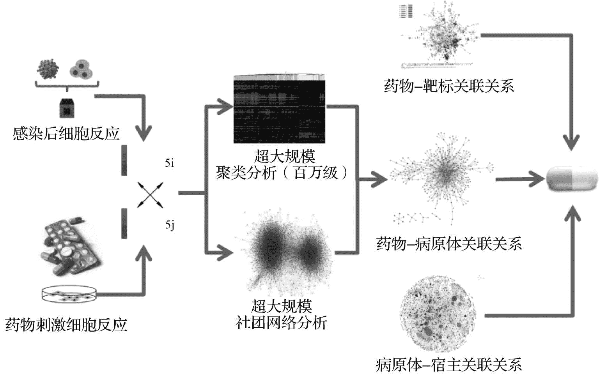

图 3.1　基于药物刺激和感染细胞反应数据发现抗感染药物的总体框架

本章聚焦图 3.1 核心中段——**细胞反应大数据深度挖掘**。现有表达谱分析工具虽不乏佳作，但普遍存在两类“致命伤”：

**伤一：算法缺乏生物学解释权，结果“似是而非”**
*   **LINCS Canvas Browser**：可视化友好，支持 30+ GeneSet 富集与层次聚类。**硬伤**：仅用余弦/皮尔逊距离做层次聚类，指标无权威性、算法简陋低效，结果难映射真实生物学机制。
*   **L1000CDS2**：擅长小分子-表达谱正逆向关系预测及靶标推断。**硬伤**：核心度量仍是重叠率/余弦相似性，分析手段浅薄，生物学洞察力受限。

**伤二：算力底座薄弱，海量数据“跑不动”**
*   **GSEA 算法**虽能解决“伤一”的权威性问题，但现有实现（R 语言 GSEA-P-R、Python SAM-GS、MATLAB 工具）皆受限于脚本语言性能天花板，且未引入并行加速，直面海量数据即“卡死”。
*   **MapReduce 尝试**未避开多轮迭代 I/O 先天缺陷，性能收益微薄。
*   **团队破局路径**：直指 GSEA 核心流程，以算法重构+并行化双轮驱动，打造高性能分析利器。

### 3.2 海量基因表达谱快速查询：paraGSEA 的算法重构之路

#### 3.2.1 GSEA 工具：表达谱分析的“金标准”

`GSEA`（基因集富集分析）源自麻省理工与哈佛大学联合建立的 `Broad` 研究所，专为全基因组表达谱芯片数据量身打造。其核心逻辑是：引入预定义基因集（源自功能注释或既往实验），依据基因在两类样本中的差异表达程度进行排序，进而检验特定基因集是否显著聚集于排序榜单的两端。区别于单基因分析，`GSEA` 聚焦基因集层面的协同变化，能捕捉微弱但具生物学意义的表达波动，从而输出更可靠的结论。

作为领域内的经典算法，`GSEA` 影响力极大，原始论文引用超 2.3 万次（`Google Scholar`，2020 年底统计），软件下载量破 10 万。至 2019 年 5 月，其已迭代至 3.0 版本，界面如下所示。

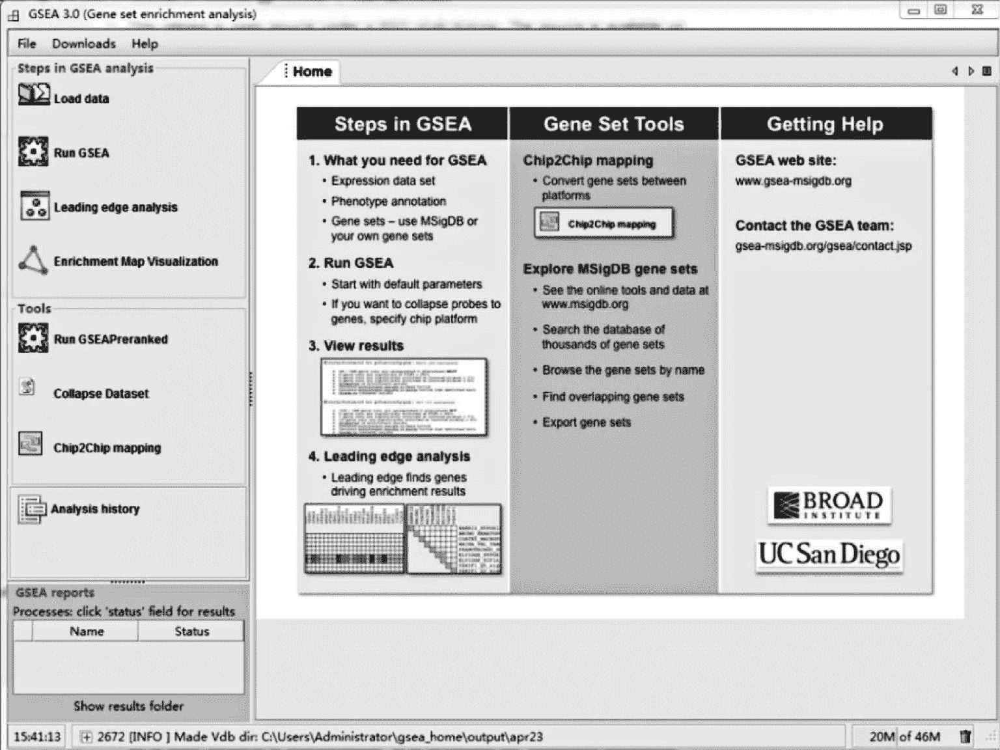

图 3.2 `GSEA` 3.0 的软件界面

`GSEA` 算法流程主要包含三大核心环节：

**（1）富集分数 `ES`（`Enrichment Score`）计算**  
采用 `Kolmogorov-Smirnov` 统计量，量化某基因集在基因排序列表首尾聚集的程度——即目标基因集 `S` 在全基因列表 `L` 头部与尾部的分布偏离度。计算流程详见示意图。

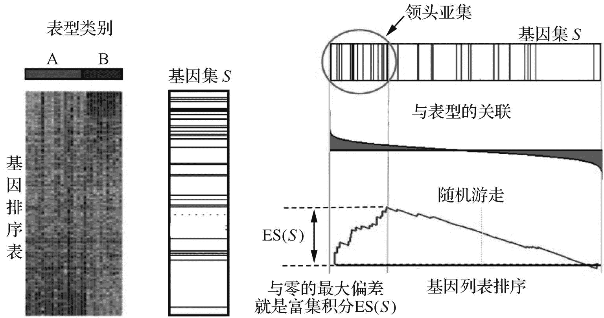

图 3.3 富集分数 `ES` 的计算流程

**（2）显著性水平估算**  
通过表型置换检验获取 `ES` 的经验 `P` 值。具体操作是打乱样本标签，重复计算数千次置换后的 `ES` 以构建零分布，再据此推导观测值的显著性。此法保留了基因间的相互作用网络，较基因置换法更贴近真实生物过程。

**（3）多重假设检验校正**  
针对全基因集数据库评估，引入归一化富集分数 `NES` 消除基因集规模差异，并应用 `FDR`（假阳性发现率）控制，输出经校正的统计指标。

尽管 `GSEA` 是表达谱分析的利器，但其复杂的计算流程导致现有工具难以满足高速需求，且缺乏并行优化，面对海量数据时耗时过长。因此，对 `GSEA` 实施深度并行加速刻不容缓。

#### 3.2.2 海量基因表达谱极速查询算法

##### 3.2.2.1 原始数据格式解析与预处理

实验数据源自 `LINCS` 项目，现托管于 `GEO` 数据库，本文核心引用两份免费数据集：

1.  `https://exl.ptpress.cn:8442/ex/l/f34e0fa1`
2.  `https://exl.ptpress.cn:8442/ex/l/34aaaf0e`

`LINCS` 涵盖多种实验条件下的表达谱，常以 `.gct` 或 `.gctx`（`HDF5` 格式）存储。得益于开源工具 `1ktools`，我们无需深究底层结构，只需掌握如何解析目标谱并转存为计算友好格式即可。

数据字段速览（见下图）：

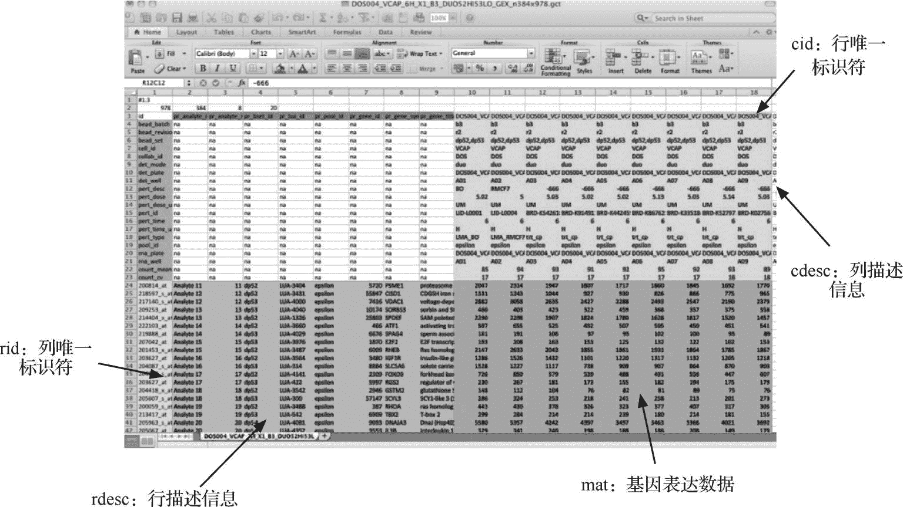

图 3.4 `LINCS` 原始表达谱数据文件格式示例

除左上角保留区外，**每列代表一个样本**（唯一标识 `rid`），**每行对应一种基因**（唯一标识 `cid`）。左下 `rdesc` 为基因属性描述，本文不涉及；右上 `cdesc` 记录样本处理条件（细胞系、干扰素、分组类型、处理时间、浓度），这是溯源生物性状、辅助找药的关键元数据。右下区域则为核心计算输入——基因表达量矩阵。

解析工具选用 `GitHub` 开源的 `1ktools`（`https://exl.ptpress.cn:8442/ex/l/0d93da78`，2020 年 10 月仍在维护），支持 `R`/`Java`/`MATLAB`/`Python`。本书基于 `MATLAB` 版 `parse_gctx.m`，按属性过滤载入数据，再经脚本转存为算法专用格式。

**预处理关键优化：**
- **排序前置**：在解析阶段直接完成表达谱排序，生成文件供复用，避免重复计算开销。
- **并行解析**：针对 `MATLAB` 单线程短板，利用多核服务器并行处理，实现近线性加速，秒级合并输出一致性文件。
- **生成 `Reference`**：同步产出参考文件集，为后续极速查询奠基。

##### 3.2.2.2 索引构建与三元组建模

富集分计算首步需获取“命中向量”——即查询基因集在目标排序谱中的位置分布。朴素遍历复杂度为 `O(mn)`（`m` 为基因集长度，`n` 为谱长）。`paraGSEA` 通过**一次扫描建立基因位置索引数组**，将复杂度压降至 `O(m+n)`，且无额外空间负担。

为彻底消除重复建索引的冗余，数据加载阶段即为每个表达谱预建索引，并用**三元组**替代原始排序谱存储：
1.  上调基因集（截取排序谱头部指定长度）
2.  下调基因集（截取尾部指定长度）
3.  索引数组（下标与值置换，支持 `O(1)` 定位基因原始排名）

此举将冗余操作压缩至预处理阶段，为并行计算扫清障碍。构建流程见图示。

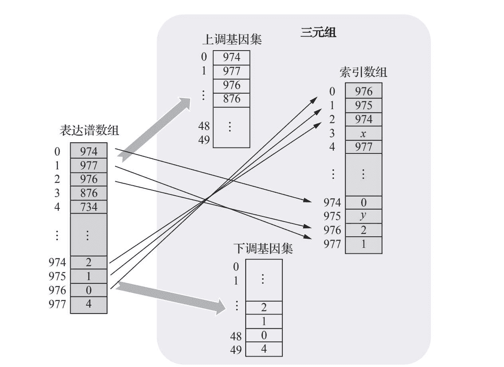

图 3.5 由原始表达谱建立三元组的操作过程

##### 3.2.2.3 消除前缀求和：ES 计算的降维打击

标准 `ES` 计算需对命中向量及其补集做前缀累加（`O(n)`），寻找绝对差值峰值。但观察发现，**峰值仅出现在命中位点邻域**。据此，算法仅对排序后的命中位点逐一考察，配合边界保护与峰值唯一性判定（绝对值最大者为准），将复杂度大幅降至 `O(log₂m + m)`（含位点排序开销）。鉴于实际场景中 `n ≫ m`，大规模重复计算下性能提升极为可观。标准流程与优化逻辑对比见图。

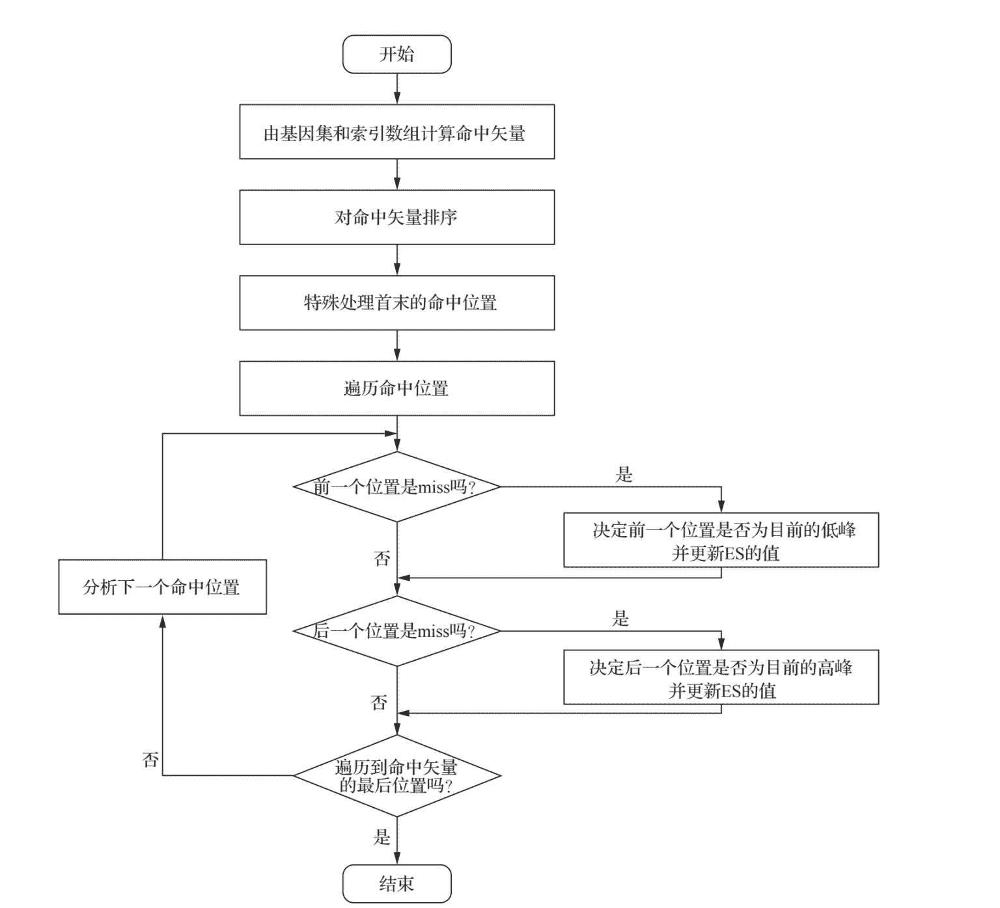

图 3.6 消除前缀求和后的富集积分计算标准流程

```
1: Input: profile, geneset //输入
2: Output: es //输出
3: Variables: siglen, len
4: Containers: isgs, index
5: siglen←length of geneset
6: len←length of profile
7: for gene g in profile do
8:   index[profile[g]]←g 
9: end for
10:for gene g in geneset do
11:  isgs[g]←index[geneset[g]]
12: end for
13:sort isgs ascendingly
14:for gene g in geneset do
15:  if g is the first gene in geneset then
16:     if isgs[g] is not the first gene in profile then
17:        if prev gene before g reach max absolute value of current es then
18:           es←-isgs[g]/(1-siglen)
19:        end if
20:      end if
21:    if the gene after g is not isgs[g+1] and g reach max absolute value of 
current es then
22:      es←(g+1)/siglen-(isgs[g]-g)/(len-siglen)
23:    end if
24:  end if
```

##### 3.2.2.4 全局富集积分池（`GESPool`）：以空间换时间，破解置换瓶颈

`GSEA` 显著性检验要求上千次表型置换重排，计算量成百倍激增。深入分析置换本质：实质是对固定长度基因集在特定谱下的命中向量打乱。既然命中数固定，**何不预先全局打乱一次，多次复用？**

**策略核心：**
1.  初始化源谱 `S_Profile`，全局随机置乱 **10,000 次**，每次计 `ES` 填充 `GESPool`。
2.  待测谱计算真实 `ES` 后，从池中随机抽 **1,000 个** `ES` 组合零分布，推导 `P` 值与 `NES`。

**复杂度对比：**
- 原算法：`O(1000 × l)`（`l` 为待测谱数量，百万量级）
- 新算法：`O(10,000 + l)` —— 前项固定微小，后项线性增长，优势压倒性。

**实验验证：** 取前 1000 个谱，对比原算法与优化算法的 `ES`、`NES`、`P` 值散点分布（以原算法为纵轴，优化为横轴）。结果显示：`ES` 点全落于 `y=x` 线上（精度零损失）；`NES` 与 `P` 值点紧贴对角线，离散度与原算法自对比一致（仅因随机性引入，策略本身无偏）。详见实验图谱。

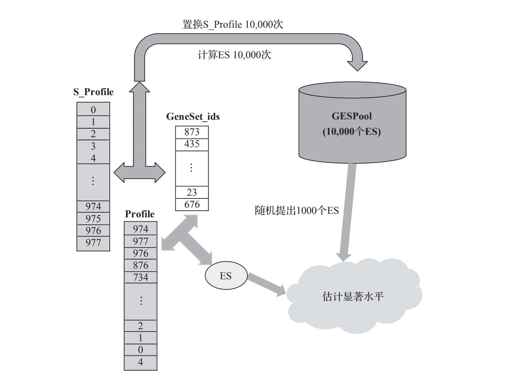

图 3.7 全局重排和随机抽取策略示意图

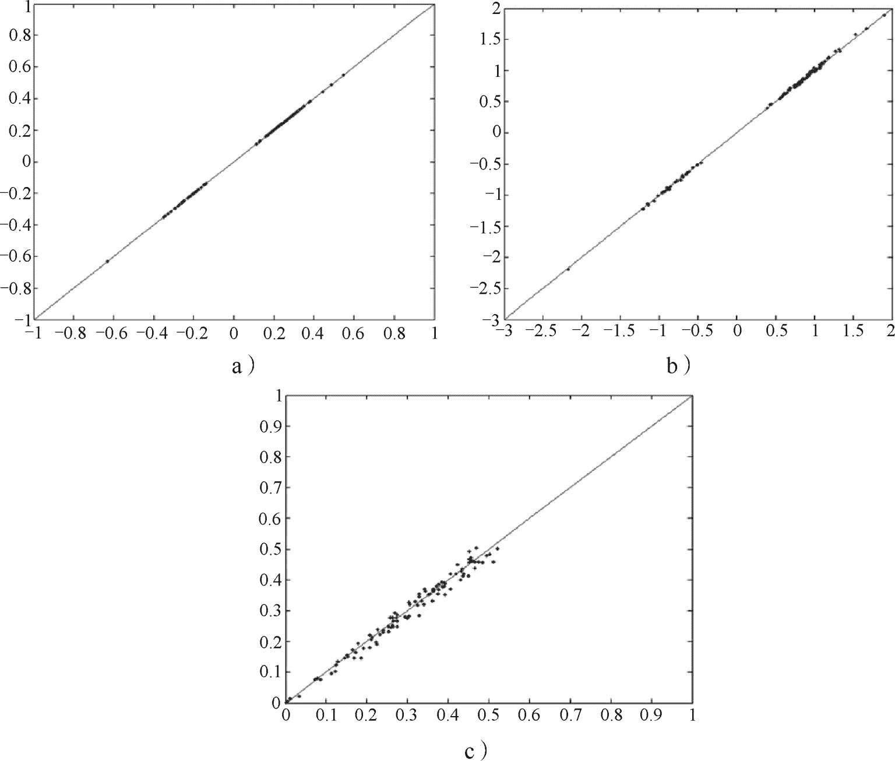

图 3.8 优化策略误差分析与验证的实验结果  
a）`ES`对比 b）`NES`对比 c）`P`值对比

##### 3.2.2.5 参考文件集与二级索引：查询反馈的“极速通道”

预处理落盘除排序谱与 `cid` 外，必须输出**参考文件集（`Reference`）**支撑后续高效检索，含三大子文件：
- **`GeneList`**：全数据集基因符号（`Gene Symbol`），按原始谱顺序排列，供基因名→编号映射。
- **`Sample Condition`**：每谱一行，记录 5 大核心属性（细胞系、干扰素、分组、时间、浓度）。
- **`Rowbyte Offset`**：`Sample Condition` 每行的字节偏移量，构建**二级索引**核心。

**查询数据通路（见图）：**

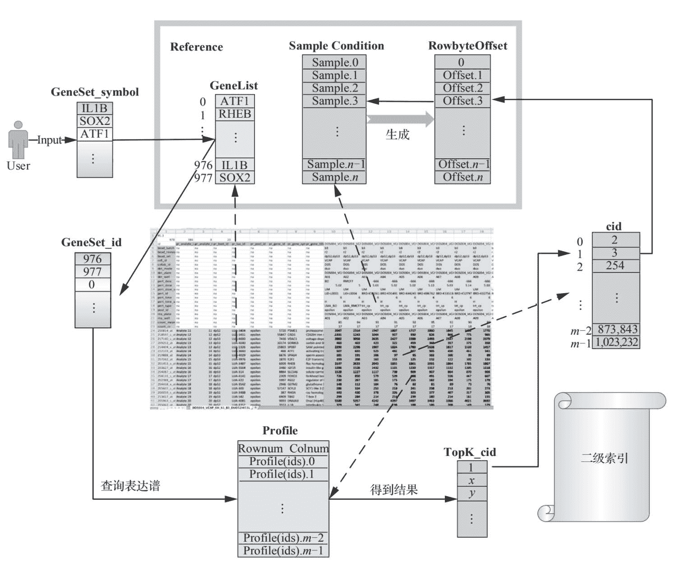

图 3.9 快速查询过程的数据通路

1.  用户输入 `GeneSet` → 查 `GeneList` 得基因编号文件。
2.  编号文件入库比对 → 优化 `GSEA` 计算 → 输出 Top-K 相关谱 `cid`。
3.  **二级索引极速取证**：
    - 一级：`cid` 直接定位样本编号（数组下标 `O(1)`）。
    - 二级：读 `Rowbyte Offset` 获取偏移量 → 直接寻址 `Sample Condition` 读取描述行，**无需全表载入内存、无需逐行遍历**。

此设计在微增存储成本下，实现查询反馈的毫秒级响应与极低内存占用，完美契合工程落地需求。

##### 3.2.2.6 并行查询加速

#### 3.2.3 性能大比拼：paraGSEA 有多强？

本节将从“单核算法优势”与“并行扩展能力”两个维度，实测作者团队开发的 `paraGSEA` 快速查找工具的真实水平。

测试平台选用“天河二号”超级计算机，节点详细配置见表 3.1，整机拥有 16,000 个计算节点与 12.4PB 并行存储。

表 3.1　“天河二号”超级计算机的计算节点配置

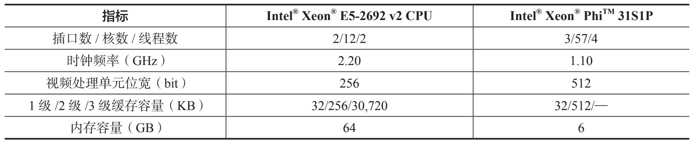

实验数据采用 `LINCS Phase I (GSE92742)`，涵盖 15 种人体典型细胞在 5000 余种小分子化合物干预下产生的 1,319,138 个转录组表达谱，每谱含 978 个标志基因表达量，可反推全基因组表达图谱。

##### 1. 单核对决：碾压级优势从何而来？

为凸显算法层面的提升，对比实验选取 `GSEA-P-R.1.0`、`PYGSA`、`GSEA2` 三款经典单核工具。`paraGSEA` 同样仅启单核参战。考虑到老牌工具耗时极长，实验分别抽取 1000、10,000、50,000、100,000 四个规模梯度的表达谱子集测试。图 3.10 展示仅计算 ES 环节的耗时，剥离了全局富集积分池（`GESPool`）影响，纯看基础优化效果；图 3.11 则是含显著性分析的全流程对决。

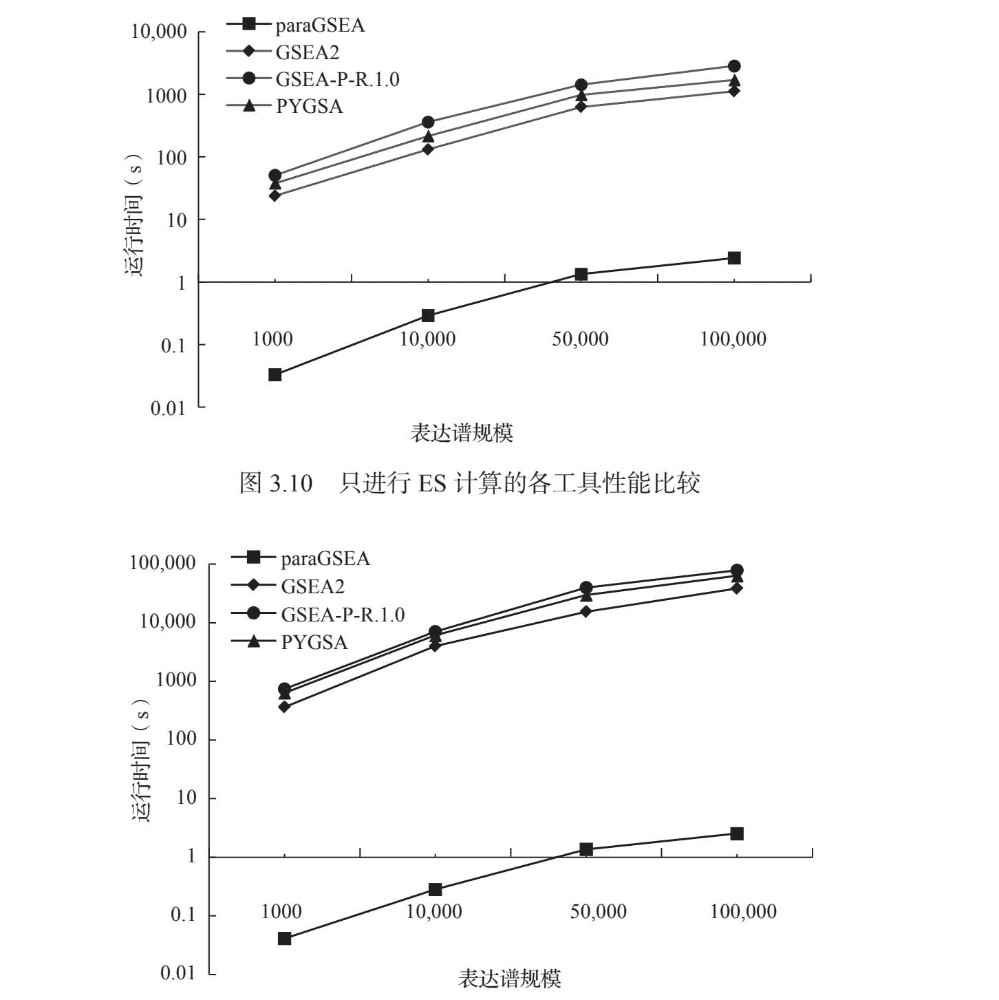

图 3.11　完成显著性分析过程后的各工具性能比较

图 3.10 显而易见，`paraGSEA` 单核版甩开对手至少两个数量级，且数据量越大、优势越明显。根本原因在于：优化策略将 ES 计算的总体时间复杂度从 `O(m×n)` 直接降至 `O(m+n)`。

看图 3.11，全流程跑完，`paraGSEA` 领先幅度扩大到三个数量级以上。关键在于 `GESPool`：它让显著性分析几乎零额外开销；反观对手，上千次置乱操作让耗时指数级飙升。这一代差同样随规模增长而持续放大。

##### 2. 节点内多线程：拟线性加速

单节点 24 核满载，跑通全量 `LINCS Phase I` 数据集的完整 GSEA 流程。从 1 核到 24 核，`OpenMP` 多线程并行呈现近乎理想的线性加速曲线，详见下图。

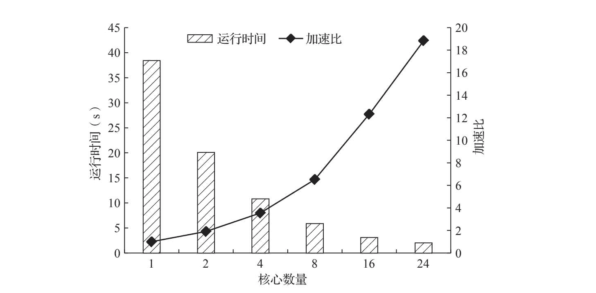

图 3.12　并行化查询的加速效果

##### 3. 跨节点扩展：别贪核数多

启用 `MPI + OpenMP` 双层并行，单节点 24 核全开，最多扩至 10 节点测试可扩展性。

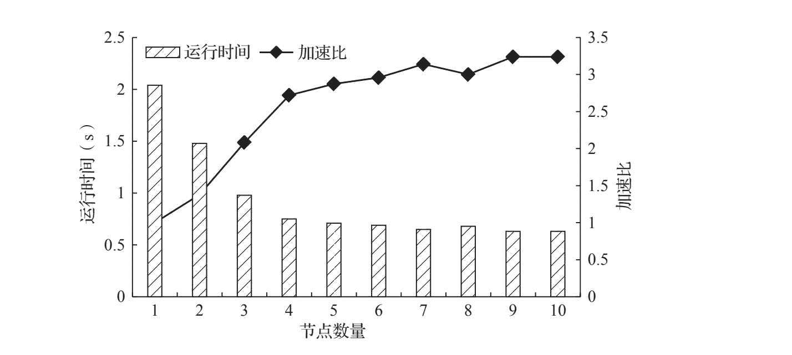

图 3.13　可扩展性实验结果

图 3.13 显示：多节点扩展后加速比偏离线性，超过 5 节点耗时不降反增、甚至波动。根因直白——数据集规模根本撑不起这么大并行度。核数越多，进程线程间的调度通信开销越重，反拖后腿。

---

### 3.3 海量表达谱并行比对与聚类：解锁药物发现新范式

实验获取的转录组数据均为严格控制变量后的产物：细胞系、干扰素类型、作用时长、药物浓度……每个条件对应一张表达谱，记录全基因表达量。面对海量库，拿患者谱图逐个比对，本质是算两两间的 ES 值。ES 值极大暗示强正相关，对应条件可能是致病因；极小则强负相关，对应条件或为治疗良方。

`CMap`（Connectivity Map）正是基于此逻辑的大数据找药项目。前提是：相关性指标够权威（如 GSEA）、表达谱库够全（如 LINCS）、**算得够快**。于是，超算分布式并行加速刻不容缓。

#### 3.3.1 CMap：药物-基因-疾病的连接图谱

`CMap` 由 Broad 研究所构建，以关联图形式存储药物、基因、疾病三方特征表达谱，揭示深层联系（见图 3.14）。

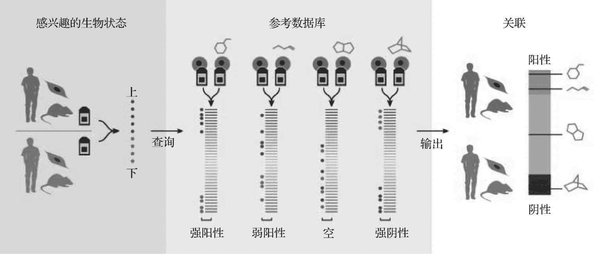

图 3.14　`CMap`项目分析过程

流程是：用科学指标衡量患者谱与库内谱关联度，快速扫描锁定负相关最强者，其对应药物与条件即为候选疗法。同理，两两比对构建相似度矩阵再聚类，还能挖掘表达谱潜在规律，解密药物作用机制。

痛点在于：`CMap` 给思路、给数据，没给高效计算工具。本节接下来介绍作者团队针对并行比对、并行聚类开发的硬核算法。

#### 3.3.2 基因表达谱并行比对：三步走通高性能

核心涵盖：去冗余、分数据、跨节点扩展。

##### 3.3.2.1 比对去冗：三元组（Triple）立大功

3.2 节已提预排序+三元组减冗余，比对场景下收益更显著。图 3.15 解析策略。

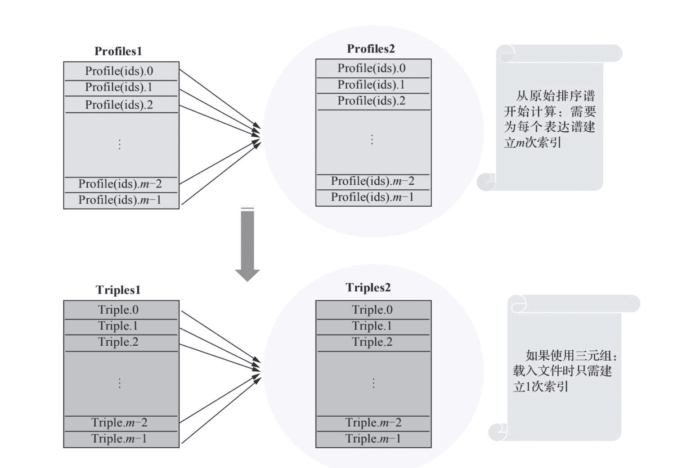

图 3.15　利用三元组进行比对去冗的策略

两集合两两比对，集合 1 每谱需扫集合 2 全谱。若无三元组、每次从原始排序谱起步，集合 1 第 2 谱扫描时，集合 2 所有谱的索引都要重建一遍。若两集合各 `m` 条，冗余索引近 `m²` 次。三元组让每谱仅建一次索引，效率质变。

##### 3.3.2.2 数据划分：内存换通信，负载均衡零开销

输入是两文件，划分即分文件，目标：各进程持谱数均衡。

*   **文件 1**：按进程数均分，误差 ≤1 条，整除则完美均分。
*   **文件 2**：若也均分，进程 0 拿不到进程 1 的文件 2 数据，跨进程比对非得大通信不可，性能崩盘。

**对策**：内存允许时，**每个进程全量持有文件 2**。牺牲空间，换取**全程零通信**，极致保障算力输出。进程内再用 `OpenMP` 多线程分摊文件 2 任务，共享内存天然高效。

##### 3.3.2.3 跨节点扩展：Allgather 巧读文件

进程读文件 1 各自分片即可。文件 2 咋办？

*   策略 A：各进程各读全量——无通信，但读文件串行、无并行读加速。
*   策略 B：一进程读完再 `p2p` 分发——等读文件 + 再通信，双重慢。

**实招**：**各进程并行读文件 2 部分片段 → `MPI_Allgather` 全局聚合 → 人手一份全量数据**。读文件阶段并行化，通信用高效集合操作。`MPI_Allgather` 成熟高效，甚至不均分数据也能自行实现变体，性能杠杠的。

#### 3.3.3 基因表达谱并行聚类：KMedoids 并行化实战

比对出 ES 矩阵后，聚类挖掘潜在模式。先铺垫基础，再讲串行 `KMedoids`，重头戏是并行版。

##### 3.3.3.1 聚类速览：五大流派，各有所长

无监督学习核心：按内在相似性分群，类内聚、类间离。主流五类：

| 类别 | 代表算法 | 优点 | 短板 |
| :--- | :--- | :--- | :--- |
| **基于距离** | `KMeans`、`KMedoids` | 速度快、适合球形簇 | `KMeans` 怕噪声；`KMedoids` 用实有样本点做中心，抗噪强 |
| **层次聚类** | `Agglomerative`、`BRICH` | 不预设类数、可主观切分 | 计算量大、效率低 |
| **基于密度** | `DBSCAN` | 发现任意形状簇 | 计算重、慢 |
| **基于模型** | GMM、神经网络 | 可解释、较快 | 敏感初始化、需指定类数、不适非凸分布 |
| **谱聚类** | 拉普拉斯矩阵特征分解 | 任意形状、图切分视角 | 计算特征向量重 |

`KMedoids` 是 `KMeans` 改良版：迭代后中心点必从现有样本中选（使簇更紧凑），有效规避噪声导致的“畸变”。

##### 3.3.3.2 串行 KMedoids：为并行而生的选择

选 `KMedoids` 做表达谱聚类，权衡三点：**高效、好并行、不生成新样本点**。

`KMeans` 经典但噪声敏感。`KMedoids` 每轮在簇内选“平均距离最近点”作新中心，**中心始终是老样本**，意味着**相似度矩阵 (ES矩阵) 无需重算**——这要是每轮迭代都重算 ES，并行再好也扛不住开销。

**标准流程**：
1. 随机选 `k` 点为初始中心；
2. 全点按相似度归入最近中心对应簇；
3. 各簇内找“平均距离最小点”更新中心；
4. 中心不变则收敛，否则回步骤 2。

缺陷依旧：随机初始化导致结果不稳定。`KMedoids++` 优化思路——**初始中心互相离得越远越好**。首个随机，后续每轮选“离已有中心最近距离最远”的点。

**单次迭代复杂度粗估**（设 `n` 点、`k` 中心）：
*   初始化中心：`O(k²n)`（每点遍历现有中心找最近，再选最远，重复 `k` 次）；随机初始化则极低。
*   划分簇 + 找新中心：`O(kn)`（遍历中心归簇 + 簇内算平均距离选中心）。
*   **瓶颈在找新中心**；初始化一次性开销，迭代多时可忽略。

##### 3.3.3.3 KMedoids 并行聚类：MPI+OpenMP 双层落地

并行化核心：基于比得出的 ES 矩阵，**进程级 (MPI) 管行、线程级 (OpenMP) 管行内细分**。

图 3.16 示意单次迭代并行流程，关键细节如下：

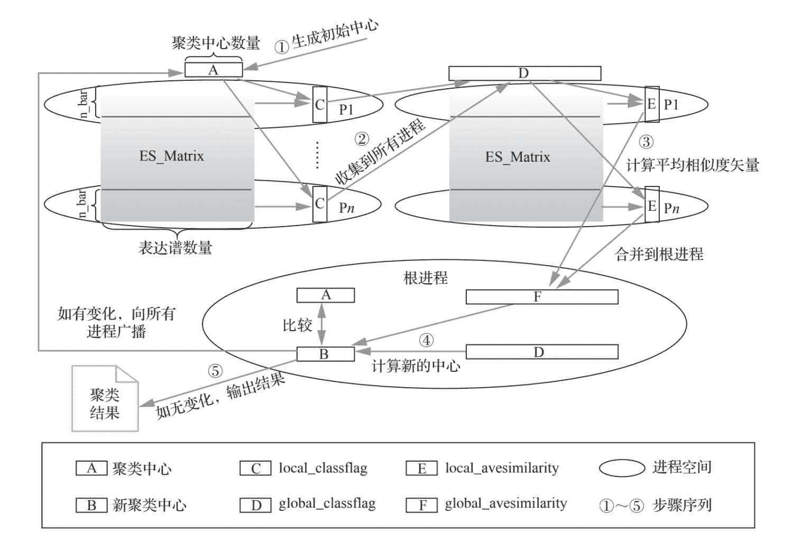

图 3.16　`KMedoids`聚类算法单次迭代并行化示意图

1.  **数据分发**：各进程按 `rank` 读取对应 ES 矩阵行分片（与前序计算 ES 写文件时分片一致），每行代表一谱对所有谱的距离向量。
2.  **本地类标记**：各进程维护长度 `n` 的 `local_classflag`（全局类标记矢量的局部段），并记录自己管理行的 `global_rank` 起始编号（按总谱数与进程数推算，同划分逻辑）。
3.  **初始化中心**：全局同步随机生成 `k` 个不重复索引（0~`n-1`）作为初始中心。
4.  **划分簇 (OpenMP 并行)**：进程内多线程并行处理各自行——算该行到 `k` 个中心的距离，取最小归簇，更新 `local_classflag` 对应位。
5.  **全局同步类标记**：`MPI_Allgather` 收集所有 `local_classflag` 拼成全局 `classflag`，广播至全进程。
6.  **寻找新中心 (OpenMP 并行)**：
    *   进程内多线程并行：遍历本地各行，若该行属于某簇，累加其到同簇其他点的距离（读取 ES 矩阵行数据 + 查 `classflag` 判断同簇）。
    *   簇内求平均距离，选最小者为候选新中心。
    *   **跨进程归约**：`MPI_Allreduce` (MIN) 比较各进程候选中心的平均距离，全局选出每簇真·新中心索引。
7.  **收敛判断**：全进程对比新旧中心索引（`MPI_Allreduce` 逻辑或），全同则终止，否则循环回步骤 4。

如此设计，**通信仅集中在类标记广播与新中心归约两步**，计算彻底下沉到本地线程，**通信量极小、无负载倾斜**，完美契合超算架构。

#### 3.3.4 性能大考：从单核到万核的实战检验

本节将从比对各阶段耗时剖析、I/O 策略对比、超大规模可扩展性、聚类收敛与并行效能、以及聚类结果可靠性五个维度，对 `paraGSEA` 的比对与聚类模块进行全方位实测。

测试环境涵盖单台高性能服务器与 “天河二号” 超算平台。服务器配备 8 颗 Intel® Xeon® E7-8850 (2.3GHz, 12核) 处理器，共 96 核心，1TB 内存，运行 CentOS 6.5。“天河二号” 计算节点详细配置见表 3.1。实验数据均采用 `LINCS` Phase I (`GSE92742`) 数据集。

##### 1. 表达谱比对各阶段的性能开销剖析

为量化各阶段耗时占比，我们从原始数据中抽取 2 万条表达谱进行实验。未采用全量数据是因为该实验旨在观察相对性能分布，适度计算量即可見真章，全量跑通虽准但耗资源、费时长，性价比不高。实验中节点核数配置灵活，最大规模达 20 个节点，完成 20,000×20,000 次 `ES` 计算。数据载入与划分阶段分别测试了无通信 (`nocom`)、点对点 (`p2p`) 与集合通信 (`cocom`) 三种策略，结果见图 3.17。

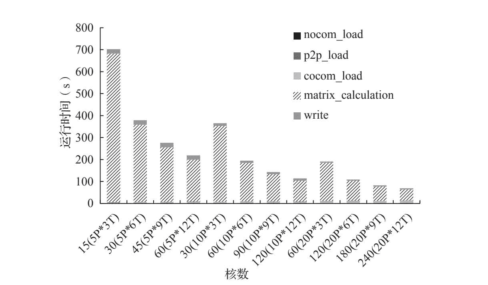

图 3.17　比对各阶段的时间开销

图中横坐标括号内 “P” 前数字代表进程数，“T” 前数字为线程数；括号外为总核心数。显而易见，数据载入与结果写出的开销远低于核心比对计算 `ES` 的过程，侧面印证了并行 I/O 策略的高效性。此外，无论进程线程如何搭配，只要总核心数固定，`ES` 计算耗时基本持平，说明并行策略极其稳健，总能充分榨干算力完成任务。

##### 2. I/O 操作性能深度对比

将上述实验中的数据载入与结果写出环节单独抽离，直观对比 I/O 性能，见图 3.18。

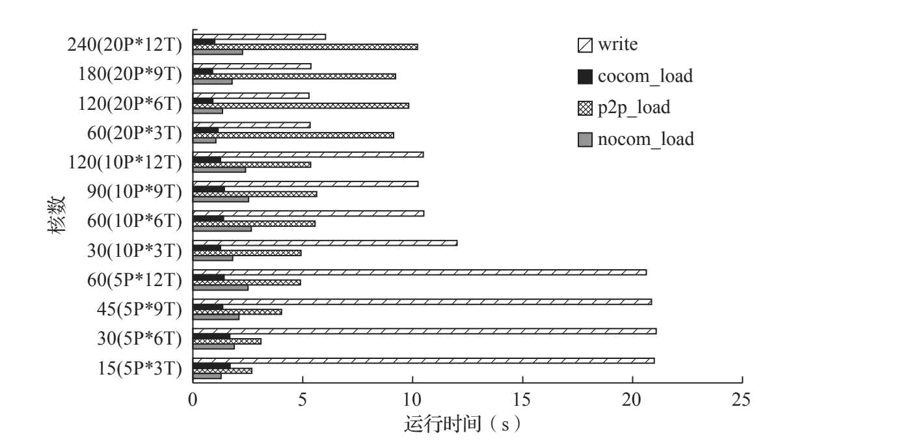

图 3.18　I/O 开销比较

清晰可见，三种数据划分策略中，集合通信 (`cocom`) 的耗时始终最低，是首选的数据载入方案。同时，进程数固定时，结果写出耗时恒定，这与结果矩阵按行按进程输出的机制一致。据此，在算力资源给定的前提下，适当增加启动进程数可有效压缩输出时间，从而加速整体流程。

##### 3. 超大规模表达谱比对：性能与可扩展性实证

针对比对核心流程，分别在服务器与 “天河二号” 上开展可扩展性实测，均使用 `LINCS` Phase I 全量数据。服务器端测试 1~96 核；超算端选取 5%~100% 共 7 个规模梯度的数据集，每节点满载 24 核，最大调度 1000 节点 (24,000 核)。结果见图 3.19、3.20。

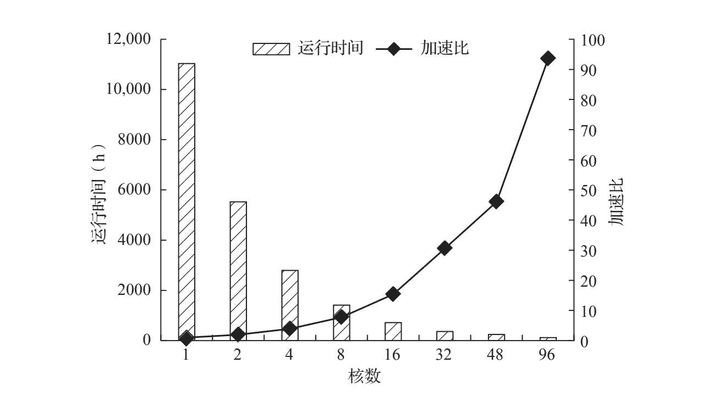

图 3.19　高性能服务器并行化加速实验结果

实测显示，96 核服务器处理全量超大规模比对仅耗时 110 余小时，而经典 `GSEA` 工具单核至少需一年以上。算法呈现近线性加速特性：核数翻倍，耗时近乎减半，并行策略高效性不言而喻。

特别说明：8 核以下数据为推算所得而非实测。因小核数完成全量任务动辄数月，为呈现完整曲线，采用小规模实测耗时乘以规模放大比例推算得出。

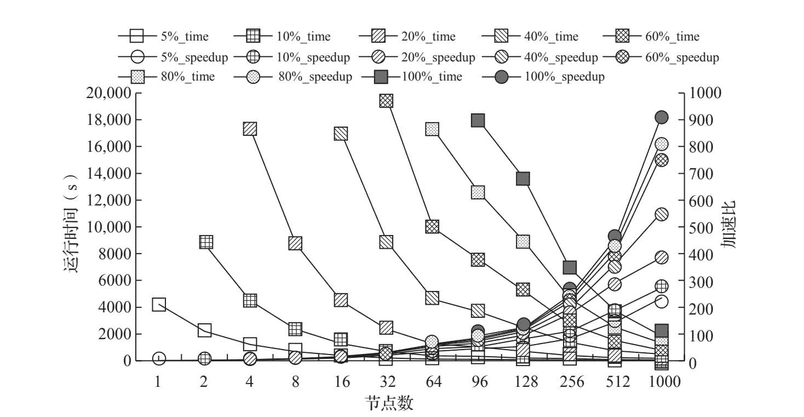

图 3.20　“天河二号”超级计算机比对过程可扩展性实验结果

如图 3.20 所示，借助 1000 节点 “天河二号”，`paraGSEA` 同样斩获拟线性加速比，并在 1 小时内攻克全数据集 1,319,138×1,319,138 次超大规模比对。

注意图中 32 节点以下部分数据缺失，并非耗时过长，而是 `ES` 结果矩阵过大，超出节点内存总和导致溢出。估算需近百节点内存才能容纳全量比对结果。

##### 4. 聚类算法：收敛速度与并行可扩展性双丰收

考虑到全量聚类耗时巨大，收敛与扩展性验证分别抽取 2 万、5 万规模数据集进行。

设定最终类簇数 10、20、40、80、160、320 六档，启动 60 核测试收敛性，结果为多次实验平均值，见图 3.21、3.22。

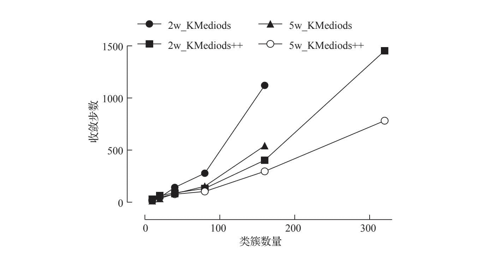

图 3.21　聚类算法收敛步数实验结果

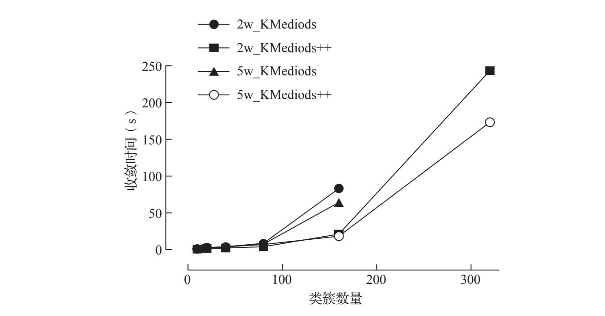

图 3.22　聚类算法收敛时间实验结果

图表揭示：`KMedoids++` 得益于初始中心优化，收敛性显著优于 `KMedoids`。同时，类簇数越多迭代越慢；数据量越大反而收敛越快，充分证明 `KMedoids` 体系极擅长大规模聚类任务。

注：图 3.22 未含 320 类簇下 `KMedoids` 结果，因其迭代次数激增会严重压缩其他曲线对比空间，故略去不表。

并行扩展性方面，固定 40 类簇，核心数取 5、10、20、40、80 五档，以 5 核为基准计算并行效率，见图 3.23。

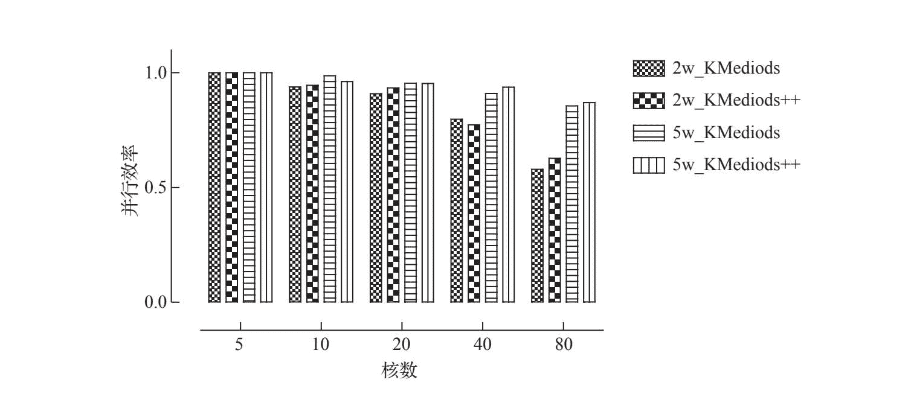

图 3.23　聚类算法并行效率实验结果

`KMedoids++` 并行效率同样领先，归功于优化的初始化流程。数据规模越大，并行效率维持越好，再次佐证该算法大规模适用性强。

##### 5. 聚类结果可靠性：实战案例见真章

从 `LINCS` Phase I 中筛选威罗非尼 (`Vemurafenib`) 处理 24 小时后的转录组表达谱 (254 个)，运行 `paraGSEA` 并与经典 `GSEA2` 结果对标。以 `GSEA2` 为纵轴、`paraGSEA` 为横轴绘制散点图，若高度一致则点应贴近斜率为 1 的对角线。`ES`、`NES`、`P` 值三指标对比见图 3.24~3.26。

`ES` 指标双工具完全一致，确证正确性；`NES` 与 `P` 值因置换检验的随机性存在微小偏差，属不可避免波动，不影响结论可靠性。

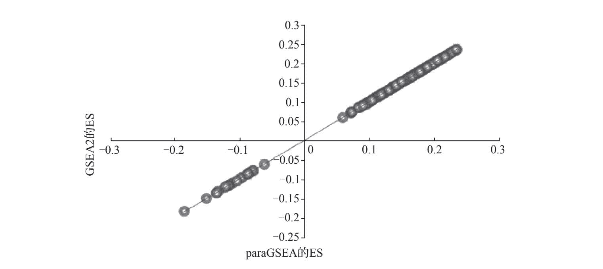

图 3.24　算例分析富集积分 `ES` 比较

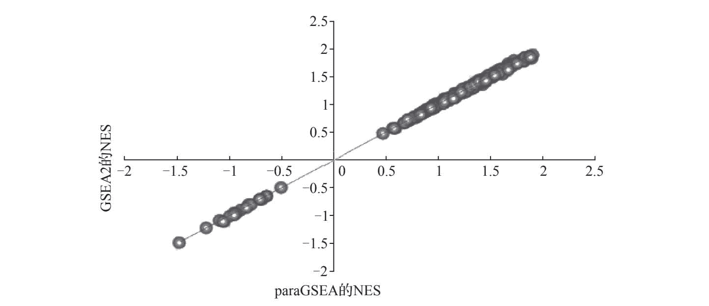

图 3.25　算例分析标准富集积分 `NES` 比较

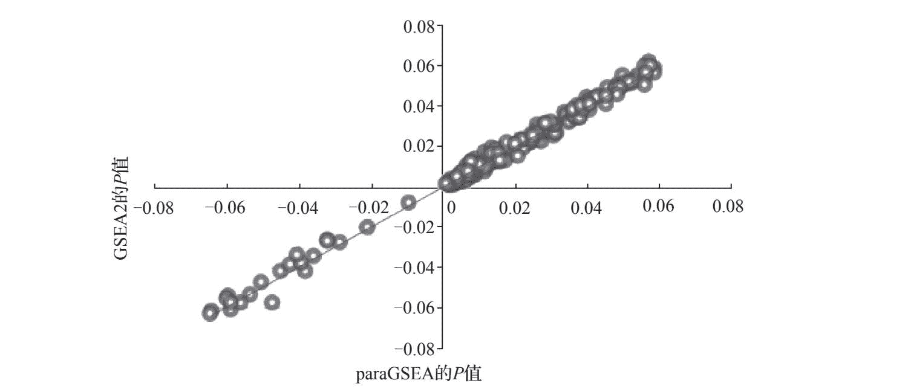

图 3.26　算例分析 `P` 值比较

进一步聚类分析：这 254 谱仅细胞系类型不同，其余条件受控，期望聚类能按细胞系归类。最终聚类结果见图 3.27。

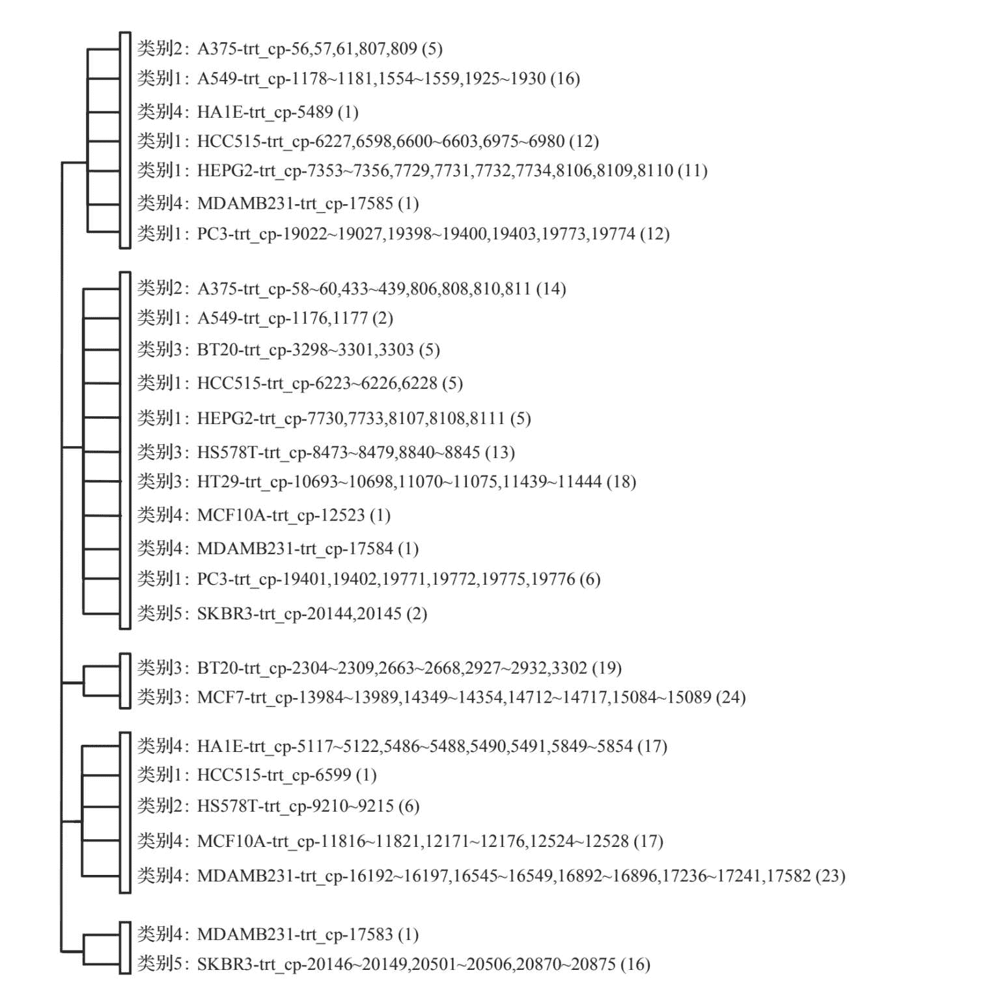

图 3.27　254 个表达谱的最终聚类结果

将已知 254 样本按细胞系分为 5 类 (图中括号内为样本量)，引入 `Kappa` 系数量化一致性 (系数 1 为完全一致，越小差异越大)。计算得 `Kappa` = 0.787 (`P`<1.0×10⁻⁵)，表明实际聚类与预期高度吻合，显著性极强，充分彰显工具高可用性与结果可靠性。

### 3.4 章节小结

本章聚焦海量基因表达谱分析，结合 “天河二号” CPU-MIC 异构架构，设计实现了两大多节点协同并行工具，核心突破有二：

1.  **`GSEA` 算法重构**：通过预排序、三元组构建、索引机制、消除前缀和、全局积分池等创新，将算法复杂度从 `O(mn)` 降至 `O(m+n)`，实现海量并行查询。单核即比经典工具快两个数量级，多核下仍保持拟线性加速。
2.  **`paraGSEA` 比对与聚类套件**：基于 `CMap` 思想深度优化 `GSEA`，在 “天河二号” 1000 节点上 1 小时完成全量比对；配合基于 `KMedoids` 的并行聚类，实验验证其优异收敛性。以威罗非尼干扰组为例，`Kappa` 系数 0.787 (`P`<1.0×10⁻⁵) 有力背书精度与可用性。

针对不足及前沿趋势，未来可深耕两方向：
1.  **解耦 `1ktools` 依赖**：现流程强依赖该工具且解析后无法回溯原始数据，集成自研解析模块将大幅提升工程落地便利性。
2.  **拓展聚类范式**：`KMedoids`虽健壮但属无监督距离法，基于密度、基于模型的并行化聚类在生物场景下的适配性值得深入探索。

## 第 4 章 功能性前噬菌体预测：从挖掘到数据库构建

噬菌体，即感染细菌、真菌、藻类、放线菌或螺旋体等微生物的病毒总称，因部分能裂解宿主而得名。其研究价值跨越基础生物学 (遗传、复制、转录、翻译模型)、基因工程工具、细菌分型鉴定，至噬菌体疗法 (裂解致病菌降低感染风险)。随着抗生素耐药性加剧，噬菌体疗法重燃生物医学热点。

高通量测序爆发催生微生物基因组数据指数级增长，海量原始数据中蕴藏大量噬菌体基因组信息待挖掘。噬菌体种类数量远超细菌，其全基因组序列是认知与应用的基石。

噬菌体分裂解性与溶原性。裂解性在细菌内增殖并直接裂解杀菌；溶原性能介导基因水平转移，深度影响致病性。然而，溶原性噬菌体发现长期依赖实验诱导或人工生信推断，效率低下；现有自动化工具仅能预测前噬菌体位置，无法判定功能性、更无法提取完整溶原性噬菌体全序列。

针对上述痛点，作者团队联合军事医学科学院，研发出自动化、高精度的功能性前噬菌体预测算法 `LysoPhD`[^31]。该算法多轮复用原始测序数据，可从细菌基因组精准预测功能性前噬菌体并提取对应溶原性噬菌体全序列。团队进一步完成多线程并行优化，大幅提升大数据吞吐；并设计从 `NCBI-SRA` 批量下载细菌 `MiSeq` 数据的方法，采用多进程大规模分析，汇总构建溶原性噬菌体数据库。

本章四大板块：前噬菌体背景知识、`LysoPhD` 算法原理、并行化实现与数据库构建、总结。核心贡献三点：

1.  **`LysoPhD` 算法创生**：现有手段多依赖拼接 `contig` 连接图人工找环，灵敏度低、主观重、难自动化；现存自动化工具仅定位前噬菌体，不能判功能性、不出全序。`LysoPhD` 实现基于高通量数据的功能性前噬菌体全自动预测与全序提取。
2.  **并行化加速引擎**：串行 `LysoPhD` 处理 800MB 常规数据超 3 小时，制约大规模分析。团队剖析热点瓶颈，前噬菌体预测层面多线程并行化 `contig` 操作，功能性验证层面多线程并行化候选对象处理。
3.  **溶原性噬菌体数据库构建**：因预测难度大，领域缺乏系统数据库。团队基于并行 `LysoPhD` 提出构建范式：自研脚本自动抓取 `NCBI-SRA` 海量细菌测序数据，两级并行分析——一级多进程并发多样本，二级单样本内多线程跑 `LysoPhD`。

### 4.1 前噬菌体预测综述

#### 4.1.1 噬菌体与功能性前噬菌体

噬菌体是以细菌、真菌等原核生物为宿主的病毒。1915 年英国弗德里克·特沃特首现踪迹，1917 年加拿大费利克斯·德赫雷尔独立重现并命名为 `bacteriophage` (简称 `phage`)[32]。

### 回溯与新生：噬菌体疗法的百年沉浮与耐药危机下的破局

噬菌体自问世之初便展现出治疗细菌感染的惊人疗效，早期战果颇丰：1921年，迈森与布吕诺格首尝试用其攻克金黄色葡萄球菌皮肤感染；上世纪40年代，美法企业已实现商业化量产，靶向葡萄球菌、链球菌、大肠杆菌等致病菌，覆盖呼吸道、化脓性皮肤黏膜及耳乳突感染等多个领域；二战战场上，苏联更凭借噬菌体挽回无数将士性命。然而，受限于当时对生物学特性的浅薄认知、实验设计的疏漏及语言壁垒，这些宝贵经验未能传至西方，导致噬菌体疗法长期被主流学界边缘化。随后抗生素工业化浪潮来袭，药物种类爆发式增长，噬菌体逐渐退出大众视野，仅波兰、格鲁吉亚等国坚守研究阵地。

转折点随超级细菌现身而至——`NDM-1`超级耐药菌与德国致命大肠杆菌的出现，暴露了抗生素研发速度远落后于细菌耐药进化的残酷现实。科学界被迫重燃寻找“抗生素替代品”的希望，国际共识逐渐聚焦于“个性化噬菌体疗法”攻克多重耐药感染。噬菌体结构简、基因少，天然适配基因工程与分子生物学载体：1952年赫耳西与蔡斯借`T2`噬菌体锤定DNA遗传地位，前者因此斩获1969年诺奖；`T4`噬菌体衍生出的DNA连接酶至今仍是分子实验标配，各类工程化载体更是层出不穷。

依据细胞内复制模式与生物学特性，噬菌体分裂解型与溶原型两大阵营。裂解型在菌体内疯狂复制并裂解宿主；溶原型虽在诱导剂或紫外线刺激下也能裂解，但常态下将基因组嵌入菌染色体，随宿主复制遗传，形成稳定的寄生共生关系，宿主由此晋升为“溶原性细菌”。获取途径上，裂解型易从环境分离，溶原型因隐匿于基因组，多需实验诱导，导致其研究相对滞后。

嵌入菌染色体的噬菌体称作“前噬菌体”。得益于测序与注释技术飞跃，科学家发现前噬菌体普遍存在：已测序细菌中近67%携带前噬菌体，部分菌株甚至高达22%基因组由其构成。大量证据证明前噬菌体深度介入宿主生命周期与进化轨迹，透析细菌基因组，绕不开前噬菌体这关。

按序列完整性与激活潜能，前噬菌体分为缺陷型与功能性两类。缺陷型因基因缺失或功能退化，虽残留噬菌体基因却无法启动裂解周期，目前鉴定出的多属此类，如`E.coli K-12`的`Rac`元件，进化中已丢失约63%原始序列。功能性前噬菌体即溶原型噬菌体整合后的形态，保留完整激活机制，拥有裂解与溶原双重生命剧本。遭遇DNA损伤等应激信号，即可剥离基因组、环化复制、释放子代。

功能性前噬菌体能整合基因组并随宿主遗传，赋予了溶原型噬菌体驱动基因水平转移、重塑致病性的“魔力”：霍乱毒素基因`ctxAB`源自丝状噬菌体`CTXΦ`，可将无毒菌株转化为杀手；白喉毒素、肠出血性大肠杆菌（`EHEC`）的志贺毒素`Stx`，均由溶原噬菌体编码并介导传递。

#### 4.1.2 预测困局：前噬菌体与功能性前噬菌体的识别挑战

##### 4.1.2.1 前噬菌体预测：技术与标准的双重阻碍

为洞察宿主毒力与耐药成因，精准挖掘染色体上的前噬菌体、尤其是功能性类型至关重要。但溶原噬菌体基因组极易变异，研究积累薄弱，加之现有技术短板，使得从海量基因组中精准“挖”出隐匿序列、判定功能性、划定精准边界、提取全长溶原噬菌体基因组，成为一项充满主观色彩的硬骨头。

**1. 技术层面的拦路虎**
首当其冲是数据库缺位：前噬菌体序列未入`NCBI`噬菌体专库，科研人员只能碎片化检索文献或依赖`GenBank`注释。统一鉴定标准缺失，加上前噬菌体形态多样（可诱导功能型、大幅改造的类前噬菌体元件等），算法识别难度指数级上升。截至成书，`NCBI`噬菌体基因组收录稀少，无法提供充足特征信息辅助预测。更棘手者，部分前噬菌体以质粒形式潜伏，进一步干扰鉴定。从庞大染色体中精准切出前噬菌体边界，仍是待解难题。

**2. 鉴定标准的“失真”陷阱**
虽可借助`GC`含量、密码子偏好性等宿主差异特征辅助判断，但并非金标准。例如密码子偏好性难将前噬菌体与其他水平转移片段区分。噬菌体特有的高保守功能蛋白（整合、裂解、复制相关）常作标志物，却也非绝对可靠：整合酶并非噬菌体专属，毒力岛、质粒等非噬菌体元件亦常携带。这些基因虽是重要线索，却难以构成存在性铁证。

虽阻碍重重，仍有客观规律可循：噬菌体基因组常按功能聚类为界限分明的“基因簇”，聚类算法识别此类簇群，可为预测提供较稳健抓手。

##### 4.1.2.2 功能性前噬菌体预测：实验与算法的博弈

当前溶原噬菌体（即功能性前噬菌体）鉴定主要靠诱导实验与软件预测双轨并行。

**1. 诱导实验：高成本、低通量、窄视野**
原理同`SOS`修复机制：正常状态下噬菌体DNA嵌入菌染色体；施以丝裂霉素C等化学诱导剂或紫外线物理诱导，触发剥离、环化、释放子代；经离心分离上清核酸、高通量测序获全基因组序列。缺陷显而易见：耗时耗力耗资，不可自动化；仅能针对手头实体菌株逐一诱导，无法利用公共数据库海量测序数据直接预测，研究广度受严重限制。

**2. 程序预测：止步于“前噬菌体”，难触“功能性”与“全序”**
前噬菌体预测是前提。主流工具（如`PHAST`）思路多为：建噬菌体蛋白库注释宿主DNA，基因聚簇区视为候选区；或搜索整合酶基因，估算上下游约一前噬菌体长度区域，再寻`attL`/`attR`整合位点精定边界。蛋白库完备度、聚类判断准度、整合位点界定精度，直接决定鉴定上限。

然这些工具多止步于前噬菌体粗略定位与计数，**无法判定功能性、无法提取对应溶原噬菌体精确全序、边界模糊**。

**转机现于NGS数据细节**：分析细菌二代测序（`NGS`）数据时，发现部分样本中功能性噬菌体已自发剥离、环化复制。推测系提核酸时极少数功能性前噬菌体因`SOS`反应误入裂解周期。这种“部分激活”留下的测序痕迹，成了研究整合态溶原噬菌体的绝佳素材。

接下来将介绍作者团队基于大数据视角的破局尝试：挖掘海量公共细菌测序数据，构建高精度预测功能性前噬菌体并提取精确溶原噬菌体全序的算法体系。

### 4.2 功能性前噬菌体预测算法：`LysoPhD`

现有工具均基于组装后基因组预测，组装本质是信息压缩，导致病毒基因组末端信息、功能性噬菌体环化复制信号等关键证据丢失。实测数据分析显示，部分样本确实存在溶原噬菌体剥离宿主、自主环化扩增的信号，推测因样本制备过程触发`SOS`响应。这些“被激活”的原始测序读段，保留了整合态溶原噬菌体最直接的物理证据。

有鉴于此，作者团队直指二代测序原始数据，融合组装基因组与原始读段，打造一套高效、自动化的功能性前噬菌体预测利器——`LysoPhD`，填补该领域工具空白。

#### 4.2.1 `LysoPhD` 全流程架构设计

`LysoPhD` 核心流程三部曲（见 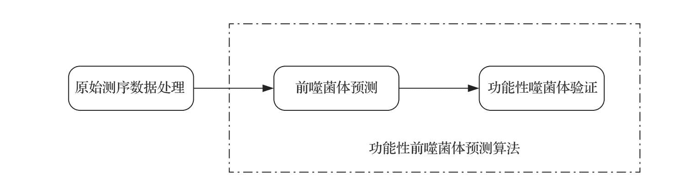 图 4.1）：原始数据净化 → 前噬菌体候选挖掘 → 功能性实锤验证。


图 4.1　`LysoPhD`的基本步骤

**1. 原始测序数据净化：两步走策略**
*   **质控过滤**：测序存在误差，碱基质量值（`Q-value`）反映置信度。低质值拖垮拼接质量，必须切除低质读段。
*   **接头清洗**：测序人工加接头，残留干扰拼接，需彻底过滤。
净化后得高质纯净数据，送入拼接工具生成细菌基因组大片段（`contig`）。

**2. 前噬菌体候选区挖掘**
拿到 `contig` 后，首要任务广撒网：挖掘尽可能多、宽的潜在前噬菌体区域作候选池，覆盖真实功能性区域，再进阶筛选功能性、定精准边界、提全序。

**3. 功能性实锤验证：捕捉“环化”指纹**
利用功能性前噬菌体核心特征：常态整合，但约10%会自发剥离、环化、游离。整合态下连接宿主的左右末端，环化后便首尾相连。双端测序（`Paired-end reads`）中的跨界读对，会精准记录这一“首尾相连”信号。`LysoPhD` “二次利用”原始数据，挖掘此环化证据，作为功能性判定铁证。

`LysoPhD` 软件工程化流程详见 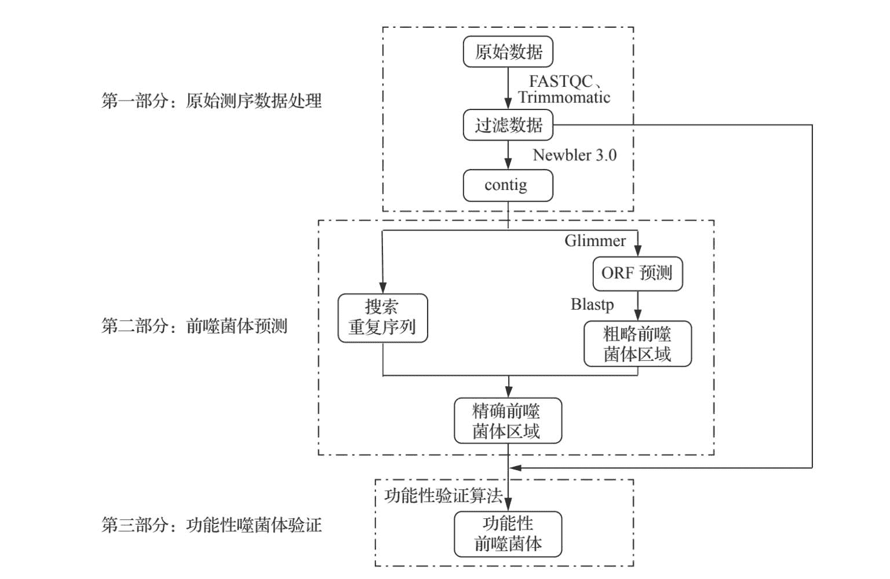 图 4.2。
*   **模块一·数据净化**：集成 `FASTQC` 评估与 `Trimmomatic` 修剪，构建自动化质控流水线。净化数据经 `Newbler3.0` 组装得 `contig`。
*   **模块二·分级预测**：粗略预测锁定噬菌体基因簇与功能基因；精确预测在粗略区内搜寻短正向重复序列，截取重复间序列定精准边界。
*   **模块三·功能性筛选与全序重建**：取精确区域首末两端，在原始读段中搜寻跨越两端的配对 `reads`，筛选功能性前噬菌体；引入一致性延伸算法连接首末，还原完整溶原噬菌体基因组全序。


图 4.2　`LysoPhD`软件的流程设计

#### 4.2.2 智能化数据质控流水线：破解“未知接头”困局

质控核心：滤低质、去接头。`Trimmomatic` 性能强劲，多线程高速，内置接头库精准切除 `Illumina` 平台接头，支持单/双端模式。但内置库固定，遇新型接头需人工预知并手动添加——分析公共数据库下载数据时，接头信息常未知，新型接头极易漏网，毁拼接质量。

作者团队自研**动态智能识别接头的质控流水线**，破解此痛点。
逻辑锚点：接头为人工合成短序列，大量残留于 `reads` 末端，重复率极高。识别高频短序列即锁定接头，`FASTQC` 可胜任。

`FASTQC` 基于 `Java`，`Linux` 命令行跑多线程质控，秒出 `HTML` 可视化报告。报告分类详见 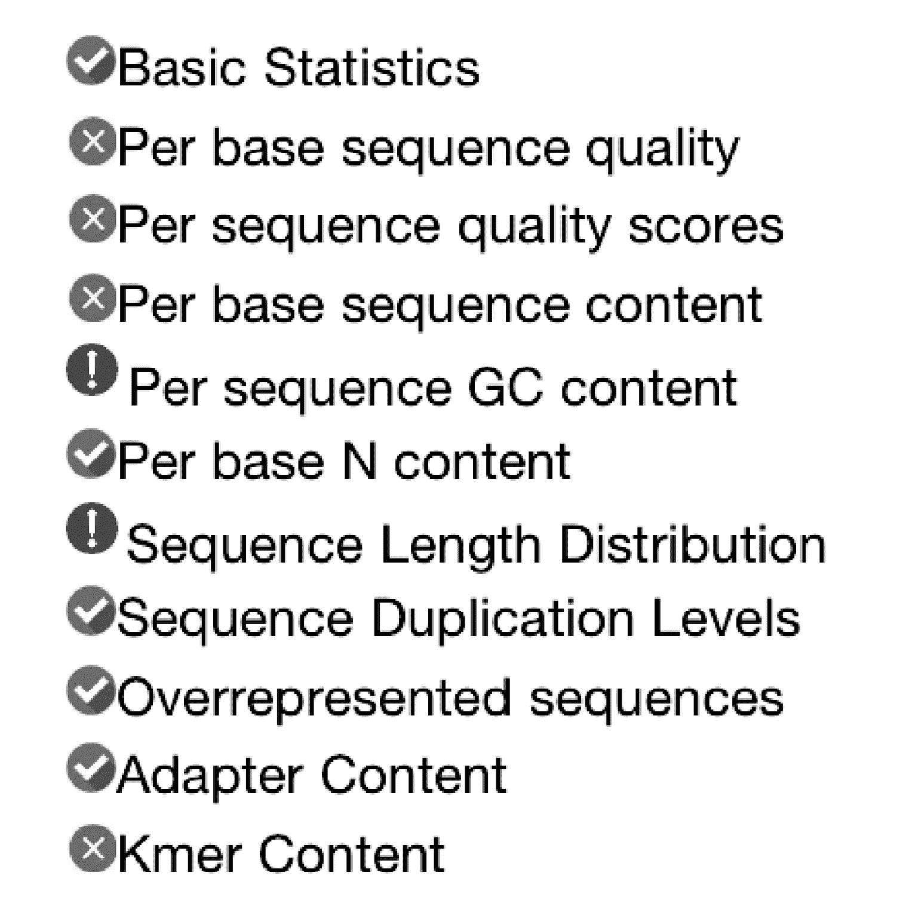 图 4.3。**“过表达序列”模块**专监测异常高频序列，阈值 0.1% 即报警，高频候选多为接头污染。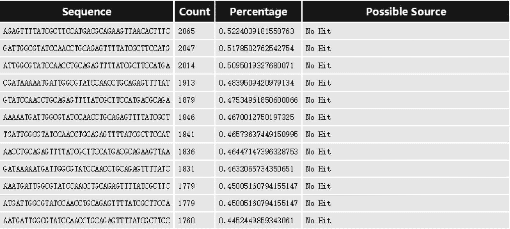 图 4.4 示例中高频短序列极大概率为接头。


图 4.3　`FASTQC`的质量报告分类


图 4.4　Overrepresented sequences 结果报告示例

流水线以 `Python` 脚本串联 `FASTQC` 与 `Trimmomatic`（见  图 4.5）：脚本解析 `FASTQC` 报告，自动提取高频序列注入 `Trimmomatic` 接头库，驱动其精准切除原始数据接头。随后 `LysoPhD` 调用 `Newbler3.0` 拼接净化数据，产出 `contig` 集合。


图 4.5　质控流水线的质控过程

#### 4.2.3 前噬菌体范围粗略预测：广撒网，不漏网

在 `contig` 上搜捕功能性前噬菌体，先得铺开候选区。策略：找尽可能多、宽的潜在区域，保真阳性覆盖率，再靠整合位点收窄至精确边界。

##### 4.2.3.1 类噬菌体基因预测：蛋白层面的“保守性”优势

`Newbler` 产出 `contig` 后，直接拿 `contig` 比对噬菌体核酸库？仅适用高相似已知型，对新型变异前噬菌体失效。**蛋白序列保守性远高于核酸**，引入噬菌体蛋白库比对，方能兼顾新型前噬菌体预测。

# LysoPhD揭秘：从零构建溶原性噬菌体挖掘全流程

搭建一套靠谱的溶原性噬菌体预测工具，第一步得备齐“弹药”——也就是噬菌体蛋白序列库。虽然 NCBI 的 `nr` 数据库公认全，但它不区分溶原性与裂解性噬菌体。于是，团队直接下载 `nr.gz` 全量数据，利用分类 ID 与 `gi` 号的映射关系，筛选出所有噬菌体蛋白，自建了一个专用数据库。

拼接得到的 `contig` 是 DNA 序列，直接拿去比对不行，得先找基因。团队选用了细菌基因预测的主流工具 `Glimmer v3.02`，自动化完成 `contig` 上的 CDS 预测，再按原核生物通用的 11 号密码子表翻译成氨基酸序列。

有了蛋白序列，就用 `blastp` 去撞自建的噬菌体库。命中的 CDS 被标记为“类噬菌体基因”。前噬菌体在基因组上表现为这类基因的聚簇，关键难题在于：如何判断这些基因聚得够紧、够多，值得当作候选区？密度聚类算法 `DBSCAN` 正是解决此问题的利器。

## 核心算法：DBSCAN如何精准圈定“疑似前噬菌体”

`DBSCAN` 是基于密度聚类的经典算法，区别于划分或层次法，它把簇定义为“密度相连样本点的最大集合”，天然适合发现任意形状的稠密区域。

它有几个核心概念：
*   **Ε邻域**：以某点为圆心、Ε为半径的圆内区域。
*   **核心对象**：Ε邻域内样本数 ≥ `n` 的点。
*   **直接密度可达**：点 `x` 在核心对象 `y` 的 Ε邻域内。
*   **密度可达**：一串点链式“直接密度可达”，关系不具对称性。
*   **密度相连**：存在一点 `z`，使 `x`、`y` 均从 `z` 密度可达，这是对称关系。

算法流程直观高效：随机取未访问点 `y`，若其 Ε邻域点数 ≥ `n`，建新簇 `Q`，将邻域点入候选集 `W`；遍历 `W` 中未处理点，若其邻域也够密，扩展 `W`，并纳入 `Q`；直到 `W` 为空，再找下一个未访问点，直至全部分簇或标记为噪声。

```
1: Input: 数据对象集合 W, 半径 E，密度阈值 M
2: Output: 聚类 R
3: DBSCAN(D,E,M)
4: Begin
5: Init R←0
6: for each unvisited point y in W do
7: mark y as visited
8: N←getNeighbours(p,E)
9: if sizeOf(N)<M then
10:mark y as Noise
11:else
12:R←next cluster
13:ExpandCluster(y,N,R,E,M)
14:end if
15:end for
16:End
```

`ExpandCluster` 扩展簇的细节如下：

```
1: ExpandCluster(y,N,R,E,M)
2: add y to cluster R
3: for each point y’ in N do
4: mark y’ as visited
5: N’←getNeighbours (y’, E)
6: if sizeOf(N’) >= M then
7: N←N+N’
8: end if
9: if y’ is not member of any cluster
10: add y’ to cluster R
11: end if
12: end for
13: End ExpandCluster
```

在本场景下，样本点即“类噬菌体基因”，目标是找出密度相连的最大基因集。关键在于两个参数的实义映射：
*   **半径 `E`**：对应同一前噬菌体内基因间的最大允许距离。经验设为 **6 个 ORF 距离**。
*   **最小点数 `n`**：对应可靠前噬菌体所需的最小基因数。设为 **6**（因前噬菌体通常编码超 5 种蛋白，且 `ProphageDB` 评估支持）。

实测表明，`E` 在适度范围内变动不影响灵敏度。

除了聚类，溶原性噬菌体特有的功能蛋白（末端酶、衣壳、尾纤维、溶菌酶、穴蛋白）也是强证据。于是引入**全基因组滑动窗口**，专门扫描这些功能域，作为补充判据。

聚类中心或功能蛋白位置为锚点，向上下游各延伸 45,000bp，截取总长 90,000bp 作为**粗略前噬菌体区域**（真实前噬菌体多在 45kb 左右，90kb 足够覆盖）。若两锚点区域重叠，直接合并。

## 定边界：用 att 位点把前噬菌体“切”出来

`attL` 与 `attR` 是前噬菌体整合于细菌基因组两端的成对短正向重复序列（14~50bp），是天然的精确边界标记。

在粗略区域内，搜索所有符合长度要求的成对短正向重复序列，两序列间的片段即为**精确前噬菌体候选区**。

搜索原理采用**双窗口差分迭代**：
1.  外层循环改变两窗口间距 `e`（即重复序列跨度）。
2.  内层循环让窗口滑动，逐碱基比对，记录相同片段。

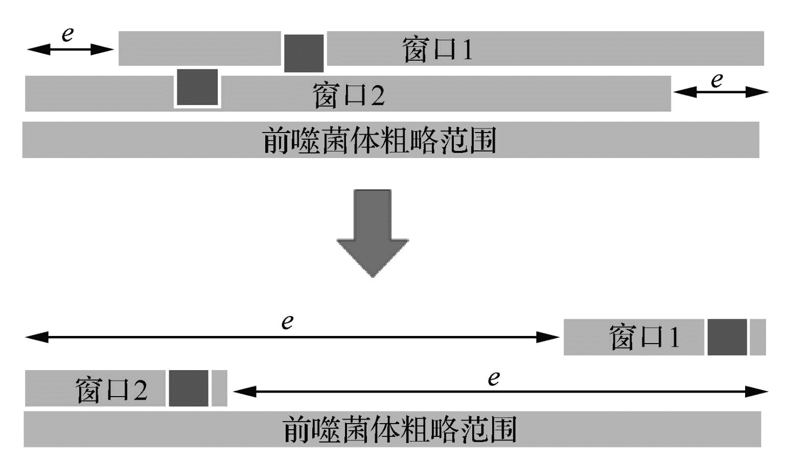

> 图 4.6　搜索成对短正向重复序列的原理

## 查功能：双端测序数据里的“环化证据”

功能性前噬菌体能被诱导环化。自然诱导虽低（~1%），但会导致测序数据中出现跨越 `attL`、`attR` 连接两端的 `reads`。

预测出精确候选区后，截取上游末端 1000bp 为 `A`，下游末端 1000bp 为 `B`（匹配常规测序片段长度 1~2kb）。

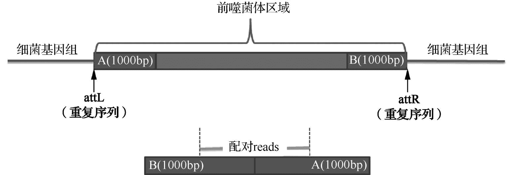

> 图 4.7　精确前噬菌体范围上的功能性分析

利用双端测序特性：将所有配对 `reads` 同时比对 `A`、`B` 区域。若存在一对 `reads` 分别落在 `A`、`B` 上且符合插入片段大小，说明该前噬菌体已在细胞内激活环化，确认为**功能性前噬菌体**。

## 补全序列：末端延伸算法还原完整噬菌体基因组

鉴定出功能性前噬菌体后，获取其对应的**完整溶原性噬菌体基因组序列**至关重要。

难点在于：`attL`/`attR` 一个来自噬菌体，一个来自宿主，且整合时可能伴随碱基缺失/突变，直接拼接首尾易出错。

`LysoPhD` 采用**“二次利用原始测序数据”的末端延伸策略**：
1.  **彻底切除**：同时移除两端重复序列，再额外切掉两端各 50bp，确保整合位点干扰全无。
2.  **共识延伸**：从下游末端取 20bp 序列为“钩子”，在原始 `reads` 中全局搜索匹配片段，多序列比对生成**一致性序列**（参数越严，序列越短越可靠；越宽，越长但噪声大）。
3.  **桥接判断**：新序列前端必与原末端 20bp 重合，实现延伸。检查延伸段是否包含上游末端起始序列——若含，两端桥接成功；否则，以新末端为起点继续延伸。

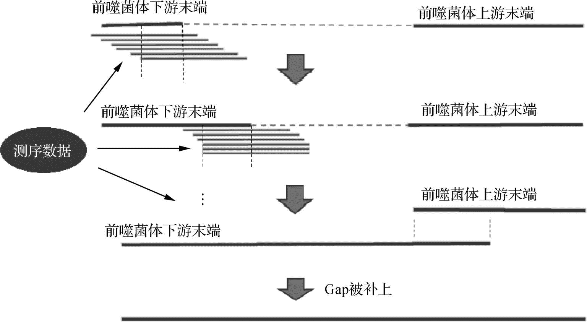
> 图 4.8　基于一致性的功能性前噬菌体末端延伸算法

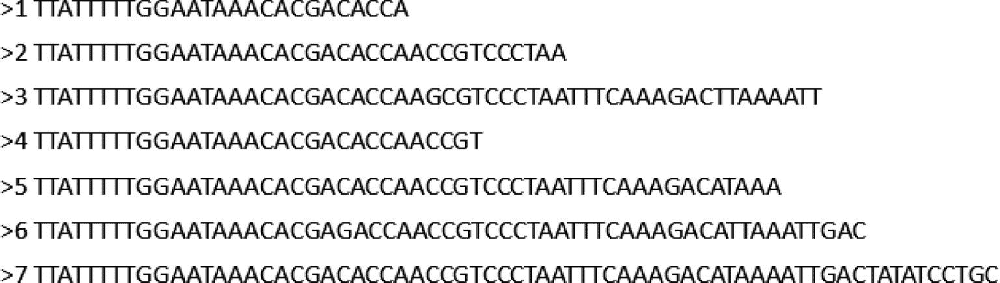
> 图 4.9　末端延伸算法示例

软件流程用 `Perl + Bioperl` 实现，主循环驱动延伸，设置**最大延伸长度**作为死循环保护。中断时，将延伸段拼接至下游末端，去除与上游重叠部分，最终输出完整溶原性噬菌体基因组。

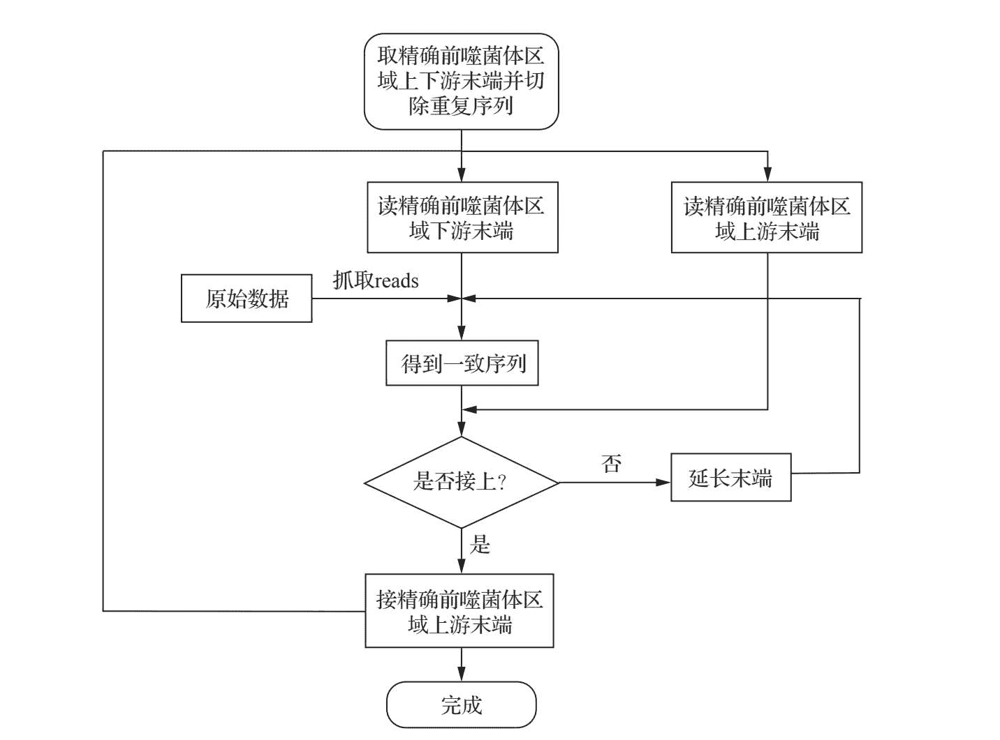
> 图 4.10　末端延伸法的软件流程

至此，`LysoPhD` 核心流程闭环。

## 实战验证：72株临床菌株的考卷成绩单

素材来自东南沿海足部溃烂患者分离的 72 株细菌（2013 年采样，2014 年 `MiSeq` 测序），数据统计见表 4.1。

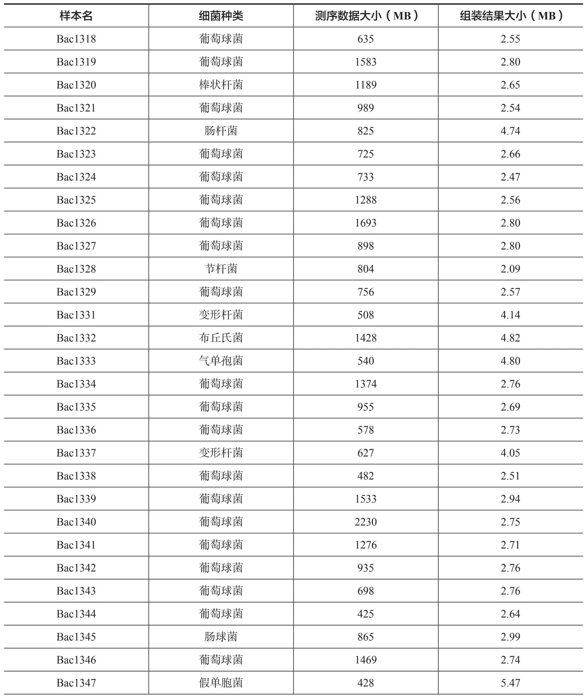
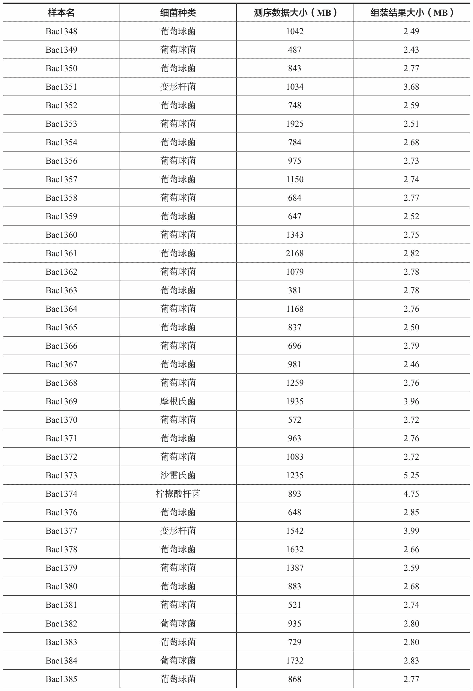
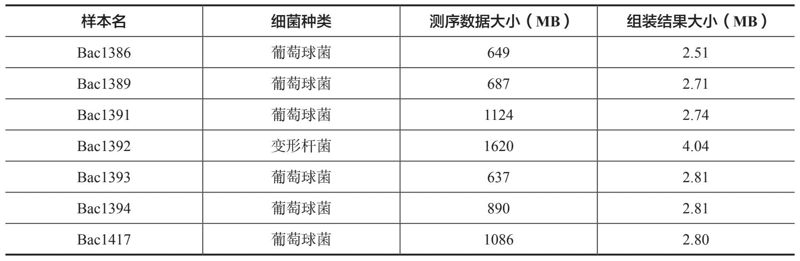

高性能服务器配置见表 4.2。

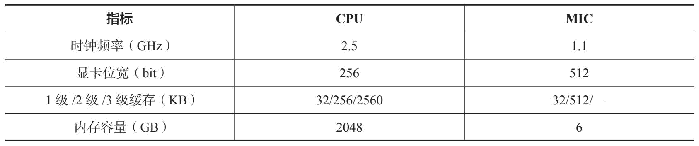

流程：质控 → `Newbler3.0` 拼接 → `LysoPhD` 分析。

**结果亮眼**：
*   72 株中 11 株检出激活前噬菌体（**阳性率 15.28%**）。
*   共得 14 个功能性前噬菌体。
*   `Bac1369` 单株独占 3 个，证明**单菌株可携带多个活性前噬菌体**。

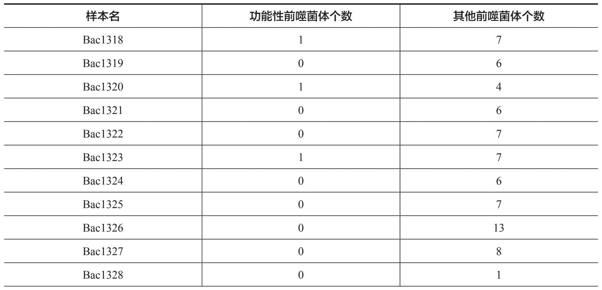
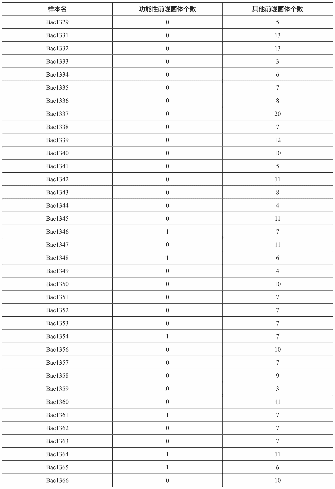
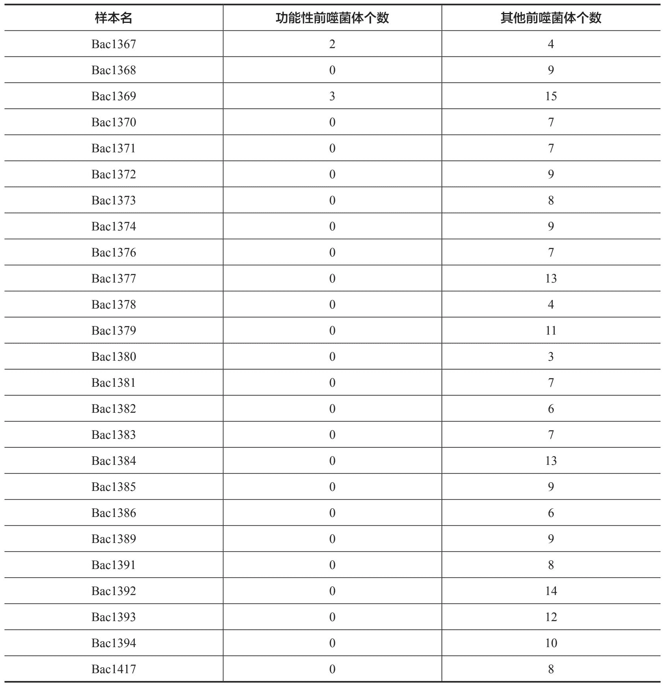

**湿实验背书**：用丝裂霉素 C 诱导 72 株菌，测序组装诱导出的噬菌体。
*   `LysoPhD` 发现的 13 个溶原性菌株中，**11 株诱导成功**，序列与位置**完全一致**。
*   2 株未验证（均为 `Bac1369` 的另外两个前噬菌体），推测因**同一基因组内多前噬菌体竞争抑制**，被第 3 个“抢跑”诱导了。
*   `LysoPhD` 阴性菌株，实验均未诱导出噬菌体。

**综合准确率约 85%**，充分证明工具在预测功能性前噬菌体及还原全序列上的可靠性。

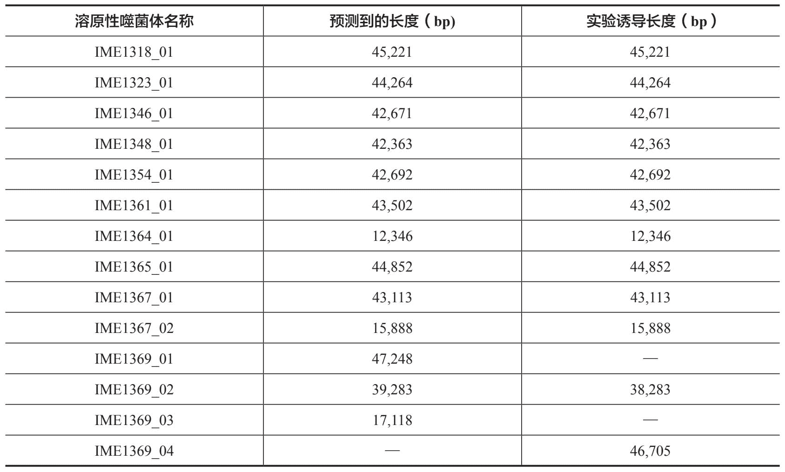

## 加速引擎：多线程并行让分析跑得飞快

溶原性噬菌体研究起步晚，公共数据库缺失，科研人员只能靠人工注释、`GenBank` 检索，效率极低。自动化流程虽能批量处理公共/自产数据并建库，但**串行版处理 500MB 数据需 3 小时**（预测 25 分钟，功能性分析 2.5 小时），成为大数据吞吐的瓶颈。并行优化势在必行。

### 预测阶段并行：Contig 级别的天然解耦

前噬菌体预测阶段，`LysoPhD` 对拼接结果的**每个 `contig` 独立搜索粗略/精确区域**，`contig` 间**零数据依赖**。这天然构成了**任务级并行**场景：直接派发多线程，每线程接管一个 `contig`，即可线性加速。

### 多线程并行架构设计与性能跃升

我们采用 Perl 语言开发，引入其原生 `threads` 模块实现多线程调度。线程池容量设定为 20，主进程通过 `while` 循环持续轮询线程状态：一旦检测到某线程任务结束，即刻回收资源并分派下一个 `contig` 任务；待任务队列清空后，主进程转入阻塞等待，直至所有残余线程收尾完毕。

#### 前噬菌体功能解析的并行化策略

前噬菌体预测阶段输出海量精准区间序列，形成候选集合。后续功能分析需将全量原始测序数据加载入内存建库，再将每个候选区间两端与配对 reads 逐一比对。由于区间间比对相互独立、无数据依赖，天然适合并行处理。但若一次性驻留全量测序数据，既拖慢启动速度，又严重挤占内存，制约多样本批量吞吐。并行化不仅让多区间共享同一比对库同步作业，更能加速内存释放，大幅提升批处理效能。

据此，我们配置 50 线程池：处理队列中的每个区间独占一线程执行 reads 比对，其余区间排队候命。调度逻辑同前——`while` 循环监听，完成即回收分派，队列空则主进程收尾等待。

#### 多线程优化实测数据

选取 800 MB（中等规模）细菌测序数据基准测试，结果见图 4.11。前噬菌体预测环节，串行耗时 25 分钟，并行化后压缩至 3 分钟，加速比 8.3×；功能性分析环节，串行 120 分钟降至 17 分钟，加速比 7×。LysoPhD 整体流程（预测 + 溶原性噬菌体全序提取）综合加速比达 7.25×。

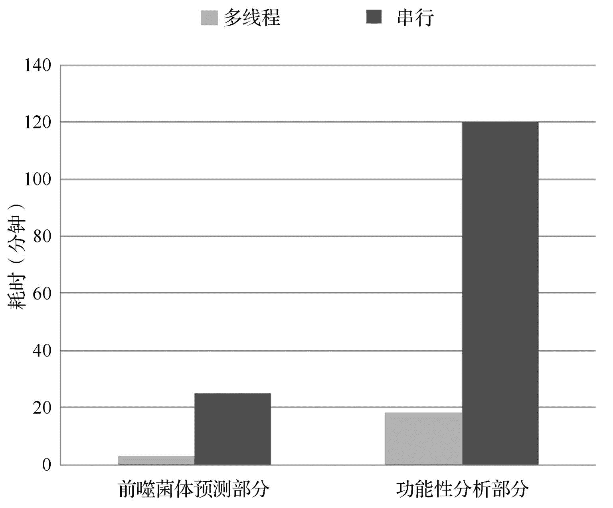

图 4.11　多线程并行优化效果

### 溶原性噬菌体数据库规模化构建

自产数据稀缺，而 NCBI 等公共库收录 10 万组以上 MiSeq 细菌测序数据。批量下载并行分析这些数据，可大规模挖掘功能性前噬菌体及对应全序列，快速沉淀数据库资产。

#### 细菌测序数据批量下载管线

SRA 为 NCBI 存储二代测序数据的核心库，涵盖 Illumina、IonTorrent 等主流平台，除原始序列外亦存比对信息。数据层级自上而下为：Study（研究课题）→ Experiment（实验设计）→ Sample（样品信息）→ Run（测序结果集）。前缀编码规则：ERP/SRP=Study，SRS=Sample，SRX=Experiment，SRR=Run。

下载流程四步走：
1. **精准检索**：SRA 内按“（菌名）AND "菌名"[orgn:txid 分类号] AND miseq”语法搜索。例：大肠杆菌可命中 40,337 组数据。
2. **获取元数据**：导出 RunInfo 表，含 Run 编号、SRAStudy 编号及存储路径等关键字段。
3. **构造 FTP 链接**：遵循 NCBI 目录规范 `sra/sra-instant/reads/ByStudy/sra/SRP/SRP+Study前三位/完整Study编号/Run编号/Run编号.sra` 拼接地址。
4. **自动化拉取**：Perl 解析 RunInfo 批量生成链接列表，Linux 下用 `Wget -i 列表文件` 后台断点续传下载。Wget 支持 HTTP/FTP、递归镜像、忽略挂起信号，极适合无人值守大批量作业。

```
(escherichia coli)AND "escherichia coli"[orgn: txid562] AND miseq
```

#### 多进程批量分析吞吐

单菌种数据就绪后，高性能服务器以 30 进程并发跑 LysoPhD：每进程独占一组测序数据，任务完成即从队列取次组数据填补。该模式下单服务器日处理量约 700 组。迄今团队已从 NCBI-SRA 拉取约 20 TB（4 万组）数据，挖掘功能性前噬菌体及溶原性噬菌体全序近 2,000 条。

### 本章小结

本章展示团队在前噬菌体大数据挖掘的算法与工程实践：LysoPhD 多轮复用原始测序数据，实现功能性前噬菌体预测与溶原性噬菌体全序提取；配套多进程批量分析管线，支撑溶原性噬菌体数据库规模化建设。

**待攻克痛点**：
- **灵敏度瓶颈**：现算法基于单 contig 预测，实况中前噬菌体常因拼接破碎跨多 contig，需智能定位跨 contig 分布并重组后再预测。
- **三代测序适配**：当前聚焦 MiSeq 等二代双端数据，三代测序崛起要求算法通用性升级。
- **算力与并行度续攀升**：更强并行策略与算力平台将进一步压缩建库周期，产出更庞大数据库。

---

## 第 5 章 超高通量药物虚拟筛选平台

罗氏数据显示：新药从实验室到上市平均耗时 12 年、投入 70 亿元、动员 400 研究员、历经 6500 次实验。药物设计分双轨：基于配体（LBDD）与基于结构（SBDD）。LBDD 借量化构效/药效团模型，从已知药物结构-活性关系推演新分子活性；SBDD 依托受体大分子（蛋白/核酸）三维结构，分子模拟构建小分子-受体复合物，预测相互作用，反向设计互补新分子。

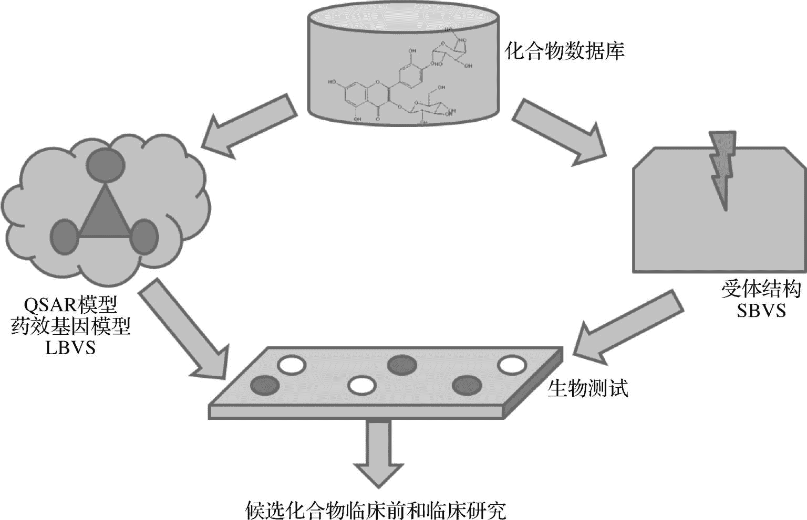

图 5.1　药物虚拟筛选流程

虚拟筛选以分子对接为核心，针对靶标结构在化合物库中模拟筛选高结合亲和力小分子，预测生理活性。面对突发传染病，能否极速锁定候选药物至关重要。全球已知结构药物分子约 3500 万，单机筛选单靶标需十余年，即便“天河二号”跑现有高通量流程仍需数十天——必须构建超高通量平台应对埃博拉、MERS、SARS 等暴发疫情。

团队联合中科院上海药物所，基于通用对接软件 `D³DOCKxb`，深度并行优化其核心热点——拉玛特遗传算法（LGA）：
1. **CPU 多核并行版**：重构算法与数据结构，实现 LGA 迭代并行化，推出通用高精度并行对接软件；
2. **CPU-MIC 异构协同版**：针对 Intel MIC 架构，offload 模式下融合并行域合并、内存复用、热点矢量化等技术，榨干协处理器加速潜能；
3. **“天河二号”超大规模平台 `mD³DOCKxb`**：内置高效通信引擎（动态任务划分负载均衡 + 梯度休眠通信/I/O 冲突消解），单日完成全球 3500 万分子全筛，为暴发性疫病药物研发按下“快进键”。

---

### 5.1 药物虚拟筛选全景扫描

#### 5.1.1 核心逻辑与时代挑战

虚拟筛选旨在从海量分子中筛出高结合亲和力候选，大幅压缩实验筛选集合，降本增效。90 年代超算兴起催生大规模应用，集群与云计算再推波助澜。

80 年代 Irwin D.Kuntz 等奠基分子对接，开发首款软件 `Dock`，后衍生出 `FlexX`、`AutoDock`、`GOLD`、`GAsDock` 等流派。基于对接的虚拟筛选标准化为四步（图 5.2）：
1. **3D 分子库构建**：文献 2D 结构 → 原子类型/键归属 → 3D 生成与优化；
2. **受体预处理**：电荷/质子化分析 → 结合位点定位 → 能量网格构建；
3. **分子对接核心**：打分函数指导 → 结合能计算 → 结合模式/强度判定；
4. **湿实验验证**：候选化合物进生物活性测试。

原子坐标与电荷分布刻画精度直接决定对接可靠性，对接环节是全链路核心。

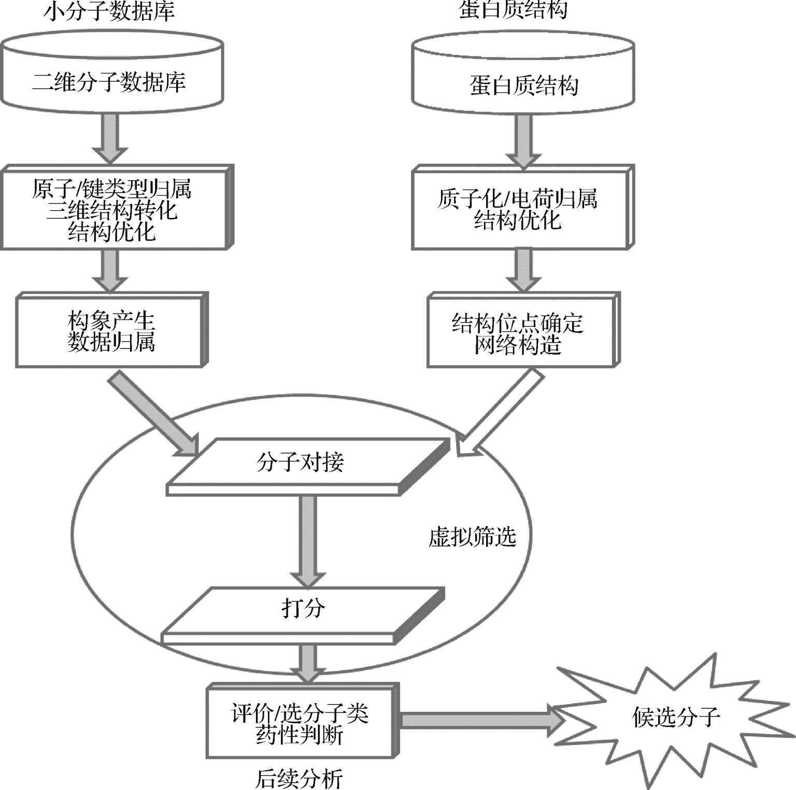

图 5.2　基于分子对接的虚拟筛选方法流程

结构生物学爆发带来双重挑战：已知药物分子达 3500 万，单分子文件 ~20 MB，总量 ~700 TB（数十亿小文件），文件系统承压；计算端，普通工作站筛单靶标需十余年，百万亿次超算仍需 1 月——疫情暴发时窗根本等不起。亟需更高效平台，在极短窗口内跑完全库对接，抢占先机。

#### 5.1.2 D³DOCKxb：卤键感知的差异化利器

`D³DOCKxb` 由上海药物所基于 `AutoDock` 二次开发，植入两大自主卤键打分函数——知识库型 `XBPMF` 与量化型 `XBScoreQM`，填补主流软件无法有效处理卤键体系的空白。

三大打分函数协同工作（图 5.3）：实线箭头为 `AutoDock` 经典流程，虚线/点画线分别为 `XBPMF`/`XBScore(QM)` 专属流程。前置阶段：`XBPMF` 需 `OpenBabel`/`Pybel` 转换原子类型；因打分机制差异，`AutoDock` 的 GPF/DPF 参数文件须转译为两新函数可识别格式。

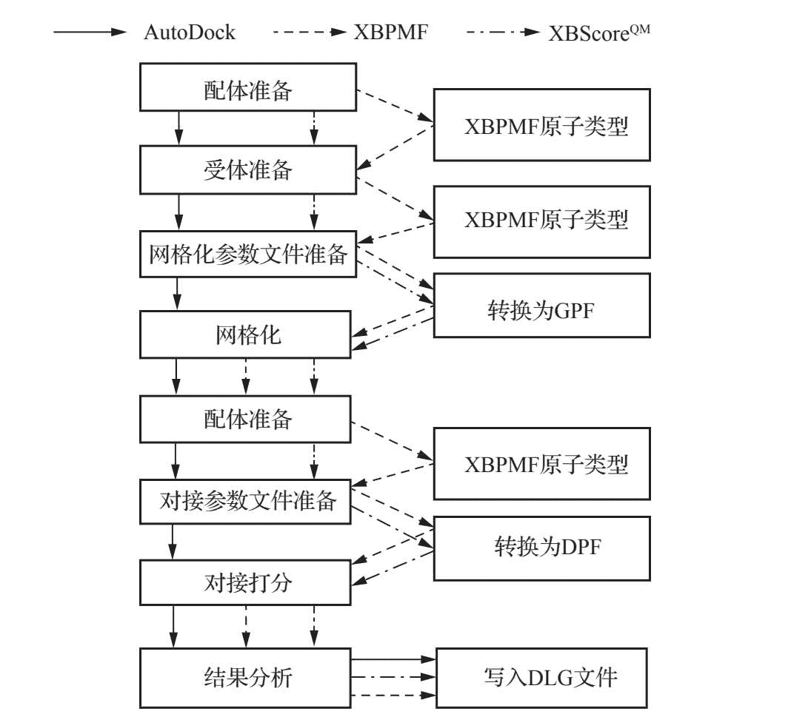

图 5.3　`D³DOCKxb`中 3 种打分函数引导的对接流程

对接核心采用 LGA 多轮迭代搜索最优结合构象。LGA = GA（遗传算法）+ LS（局部搜索），引入 `Solis_Wets` 类局部优化，通过分子内原子旋转、位置翻转等操作跳出局部最优陷阱（图 5.4）。

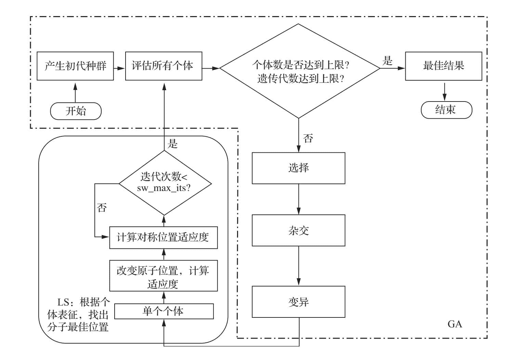

图 5.4　`LGA`的形成过程

GA 原理：种群编码潜在解 → 染色体决定性状 → 适应度评价 → 交叉变异产生新解。分子对接中，小分子/蛋白特性、对应关系、状态变量经编码，能量函数算结合能作适应度，择优留存。但 GA 易陷局部最优；LGA 融合 LS，以原子级精细搜索补足全局探索短板，显著提升收敛质量与速度。

### 5.2 多核 CPU 架构下药物虚拟筛选的并行加速实践

本节聚焦于 D³DOCKxb 在多核 CPU 环境下的并行优化路径。我们将先剖析程序执行流程与性能热点，从算法层面评估并行潜力，继而详述多线程技术的落地细节——涵盖算法重构、数据结构调整、打分函数封装、I/O 缓冲机制、线程绑定策略以及首次写回算法替代 `copyin` 等关键技术，最后通过多维度实测验证优化成效。

#### 5.2.1 D³DOCKxb 程序剖析

##### 5.2.1.1 执行流程拆解

透过图 5.5 可窥见 D³DOCKxb 的全貌：这是一个参数驱动型应用。启动初期，程序解析 `DPF` 配置，确立随机种子以备种群初始化，继而加载原子类型、蛋白质结构、打分函数参数及 `fld`/`map` 等评分数据，随后读入小分子信息。进入算法配置阶段，先设定全局搜索（GA）与局部搜索（LS）参数，最终步入 LGA 迭代循环，计算结束后落盘结果。值得注意的是，贯穿始终的读写操作是其显著特征。

图中 LGA 迭代模块当之无愧是计算核心（热点），其耗时高度依赖 GA 与 LS 的参数设定，关键变量包括子代数量（`num_evals`）、进化代数（`num_generations`）、种群规模（`pop_size`）及独立运行次数（`nruns`）。

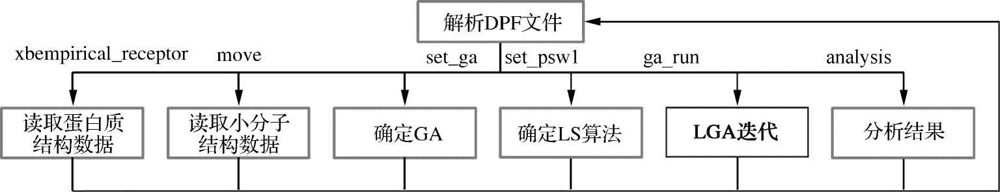

图 5.5　D³DOCKxb 程序执行流程图

##### 5.2.1.2 热点定位与剖析

借助 `gprof` 剖析工具，表 5.1 清楚记录了各函数耗时分布。`L_call_glss` 函数（即 LGA 迭代入口）独占 95.5% 以上的总运行时间，优化靶心锁定在此。

深入 LGA 内部：LS 算法形态多样，GA 涵盖子代生成、交叉、变异、适应度评估等环节。单次迭代开销随参数放大而增长，总耗时还需乘以迭代轮数。我们的优化主轴是将 LGA 的多轮迭代在线程间并行化，并对内部热点函数实施针对性加速。

表 5.1　D³DOCKxb 函数耗时统计表


续表


#### 5.2.2 多核 CPU 版 D³DOCKxb 设计与落地

厘清流程与热点后，优化方向明确。本节详述设计实现，涵盖内存管理、I/O 重构、数据依赖消除及多线程调度四大支柱，最终达成 LGA 迭代的高效多线程并行。

##### 5.2.2.1 内存管理重构：攻克栈溢出

引入 OpenMP 并行前，必须解决运行期段错误。罪魁祸首是两大打分函数 `XBPMF` 与 `XBScoreQM` 依赖的巨型矩阵及其配套函数，这些对象长驱直入栈空间，导致栈溢出（>1.625 GB），详见表 5.2。

表 5.2　打分函数依赖矩阵及内存占用统计


对策是面向对象封装：构建两个类分别托管矩阵及操作，改用堆上动态分配（见图 5.6）。此举不仅根治溢出，更显著提升代码可读性与扩展性。

初始化时，按参数选型打分函数（如 `XBScoreQM`），读取参数与 `vdw`/`es`/`desolvation` 文件填充三大矩阵；计算期直接读取矩阵值参与运算，极少产生新的内存申请/释放动作。


图 5.6　打分函数封装类设计示意

##### 5.2.2.2 I/O 重构：以缓冲换效率

文件读写优化分前期“读”与全程“写”两条线。

**读侧痛点**：启动期需吞吐数十个小文件，虽总量不大，但逐行读取触发数千次系统调用，白白耗费周期。  
**写侧痛点**：输出分散在运行全过程，非集中于尾部。高频小块写入不仅慢，更因多线程竞争/干扰导致并行困难、日志错乱。

**破局方案**：  
- **读优化**：为每文件建立专属缓冲区，一次性 `read` 全量内容入内存，再就地解析，将数千次 I/O 折叠为数十次。  
- **写优化**：引入双缓冲体系（图 5.7）。`Se_Buffer` 服务串行区；`Pa_Buffer` 为二维字符数组，首维映射线程 ID（`NUM_THREADS`），次维为大容量缓冲区。热点并行区内，线程 `i` 独享 `Pa_Buffer[i]`，落盘时再统一刷盘，实现“零干扰、批量写”。


图 5.7　并行区写缓冲机制示意

##### 5.2.2.3 数据依赖消除：并行化的关键拦路虎

逻辑上各 LGA 迭代互不相关，但代码层面暗藏大量循环间复用变量、线程间共享的静态/全局变量。LGA 涉及代码超 2 万行，人工逐行排查工程量巨大，核心难点在于**精准定位**依赖点而非单纯消除。

优化路径如图 5.8 所示：  
1. **清单建立**：梳理跨迭代复用对象——打分器（`evaluate`）、全局搜索器（`global_search`）、局部搜索器（`local_search`）、坐标数组（`crd`、`crdpdb`）等。  
2. **分类私有化**：  
   - 普通局部变量 → `#pragma omp parallel private`  
   - 静态/全局变量 → `#pragma omp parallel threadprivate`  
   - 指针对象 → 将 `malloc`/`new` 放入并行域内部，确保每线程独享实例  
   - 通用替代法：声明 `VarArray[NUM_THREADS]`，线程 `tID` 访问 `VarArray[tID]`，规避复杂指针管理。


图 5.8　数据依赖消除技术路线图

##### 5.2.2.4 多线程调度深度优化

**线程绑定策略**：将线程钉死物理核，杜绝迁移与负载倾斜。两大流派：  
- *集中式*：多线程挤单核，适合重共享数据场景；  
- *分散式*：均匀铺开各核，适合重内存访问场景。  

LGA 阶段各线程持私有 `evaluate` 对象，数据共享极少，内存访问强度大，故采用**分散式绑定**。通过 `KMP_AFFINITY=granularity=fine,scatter` 一键生效。

**栈大小与 `copyin` 替代**：  
OpenMP 线程栈默认偏小，设置 `OMP_STACKSIZE=16MB` 扩容。但 `copyin` 子句需拷贝大量矩阵，频发 `segment fault`。为增强鲁棒性，我们设计**首次写回算法**替代之。

*原始 `copyin` 伪代码*  
```
1.#pragma omp parallel for copyin(Var ……)
2.  for i = 0 to nruns-1
3.    …
4.  end for
```

*首次写回算法伪代码*  
```
1.int count=0
2.#pragma omp private(count)
3.VarTemp //与变量 Var 相同
4.Copy(VarTemp,Var)
5.#pragma omp parallel for
6.    for i=0 to nruns-1
7.      if(count==0)
8.          Copy(Var,VarTemp)
9.      end if
10.         …
11.   end for
```

核心逻辑：并行域前，主线程将 `Var` 拷贝至镜像 `VarTemp`；并行域内，各线程首次触达时，将 `VarTemp` 回写自有 `Var`。以空间换时间、以延迟初始化规避批量拷贝开销与故障。

#### 5.2.3 性能评估体系

从内存/I/O 基建收益、多核加速比与并行效率、对接精度保真三个维度量化成果。

##### 5.2.3.1 实验环境与基线

测试平台：国家超算广州中心 “天河二号” 单计算节点（配置详表 3.1，共 16k 节点、12.4 PB 并行存储）。  
基线程序：不支持多线程的串行版 D³DOCKxb。  
测试矩阵：  
- 内存/I/O 优化效果 → 单核、非多线程版测试  
- 加速比/效率 → 单节点多线程测试  
- 精度对比 → 并行版 vs 串行版对接结果  

测试体系：典型 6std 蛋白受体（方法具通用性），LGA 参数详表 5.3。

表 5.3　DPF 关键 LGA 参数设定


##### 5.2.3.2 内存与 I/O 优化实测

取 Zinc Bank 三分子（`ZINC00001370_{0,1,2}`）对接 6std，`case1` 参数，统计栈用量。图 5.9 直观对比：封装后栈占用骤降，段错误彻底消失。


图 5.9　内存优化前后栈空间对比

切换 `case1`/`case2` 参数实测耗时（图 5.10）：I/O 重构带来 ~4% 整体提速，源于系统调用中断大幅减少。总内存微增，系缓冲区额外开销。


图 5.10　I/O 优化加速效果统计

##### 5.2.3.3 多核加速与超线程探针

**单路 12 核强扩展性**（图 5.11，纵轴对数坐标）：多线程版呈现**近线性加速**，并行效率极高。


图 5.11　单路 12 核加速比曲线（对数坐标）

**超线程效能**（图 5.12）：单核双线程并非免费午餐。16 线程处达 12× 加速，但继续增线程反而回落，揭示该应用计算密集、内存带宽敏感，超线程争抢资源得不偿失。


图 5.12　单路 12 核超线程加速比表现

**双路 24 核线程绑定对比**（图 5.13）：开启 `scatter` 绑定后，“线程-核” 拓扑对齐，加速比显著超越无绑定基线，验证绑定策略有效性。


图 5.13　双路 24 核绑定与否加速比对比

##### 5.2.3.4 对接精度保真验证

性能不能以精度为代价。随机抽取 10 小分子，串行与并行版分别对接 6std，统计 RMSD 与结合能差异（表 5.4）。最大差值分别 < 0.14 Å 与 1.54 kcal/mol，均值 < 0.026 Å 与 0.87 kcal/mol，数值极微，确证多线程版**数值正确性可靠**。

表 5.4　并行版与串行版 RMSD 及结合能差异统计


注：① 1 kcal = 4.1868 kJ。

---

### 5.3 CPU-MIC 异构协同：药物虚拟筛选的下一级加速

本节转向 “天河二号” 的 Intel MIC 协处理器，构建 CPU-MIC 协同并行框架 mD³DOCKxb。沿用 5.2 节程序特征与热点认知，先完成 MIC 移植（模式抉择、编译器适配、结构调优），再设计实现异构协同高效并行算法，最后小规模验证 mD³DOCKxb 性能。

#### 5.3.1 基于 MIC 协处理器的 D³DOCKxb 移植

多线程 CPU 版稳定后，迈入 MIC 移植。本节先辨析 `offload` 与 `native` 两大运行模式，结合程序特质定型 `offload`；继而依托 `icpc` 编译器特性重构代码结构；最后深挖并行域合并、MIC 端内存复用、面向 512-bit SIMD 的矢量化三大落地技术。

##### 5.3.1.1 MIC 协处理器硬件画像

“天河二号” 采用 Intel Xeon Phi（MIC 架构）作加速卡。单卡 ≥ 57 核 @ ~1.1 GHz，核心 4 硬件线程，配 512-bit 向量单元 (VPU)，片上存储 ≥ 6 GB，双精度峰值 > 1 TFLOPS。关键优势：x86 兼容指令集，移植门槛远低于 GPU，简易代码重编译即可运行。两大主流编程模式：

1. **`native` 模式**：CPU/MIC 各跑完整程序镜像，通过网络协作，适合测试及小规模计算密集型任务。  
2. **`offload` 模式**：CPU 托管主流程，将热点内核 “卸载” 至 MIC 执行，算毕回收结果继续跑，实现异构分工。


图 5.14　MIC 硬件架构示意（源自 Intel 官网）

##### 5.3.1.2 运行模式抉择：为何 `offload` 胜出

5.2 节显示：D³DOCKxb 启动期需读取 ~20 MB 数据（蛋白/配体结构、DPF 参数），以 ~20 个碎片小文件形态存在（几 KB–几 MB），见图 5.15。


图 5.15　启动期输入数据文件分布

`native` 模式痛点：  
- 需预分发程序与全量数据至每张 MIC 卡。分子筛选涉海量配体，静态划分数据极易撑爆 MIC 板载内存（≤ 6–8 GB）。  
- 串行 I/O 密集段（仅单核）跑在 MIC 低频核上（1.1 GHz、弱分支预测），性能劣于 CPU 高频大核。

`offload` 模式优势：  
- **CPU 负责擅长的事**：串行 I/O、参数解析、调度分发。  
- **MIC 负责擅长的事**：LGA 迭代等高吞吐浮点内核。  
实测对比亦确认 `offload` 综合吞吐更优，故敲定此模式。

##### 5.3.1.3 编译器特性适配与代码结构调优

# mD³DOCKxb在异构MIC架构上的深度优化与协同加速实战

将分子对接程序D³DOCKxb迁移至Intel MIC（多集成核）平台时，团队直面编译工具链不成熟、数据搬运开销大、显存管理低效及SIMD单元利用率不足等核心难题。通过代码语义重构、通信模式重设、内存驻留机制及指令级并行挖掘等组合拳，最终实现单张加速卡算力对标12核CPU，并构建起高效的CPU-MIC协同计算框架。

### 5.3.1 单卡深度优化：攻克编译与运行时瓶颈

#### 编译工具链兼容性改造
Intel面向MIC的`icpc`编译器对C++高级特性支持尚显不足，类模板、纯虚接口等机制均未就绪。D³DOCKxb作为C/C++混合工程，其遗传算法核心——个体、种群、GA调度器及各类局部搜索器——大量依赖模板继承体系与纯虚函数多态。

针对性地实施**“扁平化重构”**：拆解原本基于模板的继承层级，将泛化接口具象化为独立类，并在各叶子类中显式实现原父类定义的纯虚方法，从而在不改变算法语义的前提下绕过编译器短板。

```
int recep_natom;
       Real(*recep_crdpdb)[SPACE];
       char(*recep_atomtypes)[MAX_LEN_AUTOGRID_TYPE + 1];
       char(*xbligand_atomtypes)[MAX_LEN_AUTOGRID_TYPE + 1];
Real(*xbpmf_1d_pw_parms)[XBPMF_AT_NUM][XBPMF_SHELL_NUM];
Real(*xbpmf_2d_hb_pw_parms)[XBPMF_AT_NUM][XBPMF_SHELL_NUM][XBPMF_BIN_NUM];
Real(*xbpmf_2d_xb_pw_parms)[XBPMF_AT_NUM][XBPMF_SHELL_NUM][XBPMF_BIN_NUM];
MapType(*xbpmf_1d_map)[MAX_GRID_PTS][MAX_GRID_PTS][XBPMF_AT_NUM];
MapType(*xbpmf_hb_map)[MAX_GRID_PTS][MAX_GRID_PTS][XBPMF_AT_NUM];
       int recep_acceptor_natom;
       Real(*recep_acceptor_crdpdb)[NTRN];
       char(*recep_acceptor_atomtype)[MAX_LEN_AUTOGRID_TYPE + 1];
```

#### 跨设备数据传输的“序列化-反序列化”方案
`icpc`限制`offload`指令直接传递含指针成员的对象。针对适应度评估器`evaluate`等关键数据结构中的指针字段，设计了一套**打包-传输-解包**机制：
1.  **主机侧打包**：将对象内指针指向的有效载荷按字节序列平铺写入连续缓冲区。
2.  **整块下发**：利用`offload`将该缓冲区一次性卸载至加速卡显存。
3.  **设备侧解包**：加速卡侧预置同构对象实例，从缓冲区按序读取数据回填成员，完成对象状态的跨设备复刻。

#### 并行区域融合：单任务单次卸载策略
原生Offload模式下，D³DOCKxb的8个并行区段将触发8次主机-设备交互，通信延迟成为性能杀手。基于“单任务单卸载”原则，实施**区域融合重组**：将分散在各并行域的指令（如文件解析、参数初始化）改为“仅记录不执行”，统一汇聚至唯一的`offload`代码段批量处理，将交互次数压缩至1次，大幅削减同步开销。

#### 显存驻留复用：消除重复分配惩罚
实测表明，加速卡申请1GB显存耗时约6秒。单次任务虽无复用价值，但单进程流式处理多任务时潜力巨大。引入**计数器驱动的显存生命周期管理**：
*   **首任务**：`alloc_if(1) free_if(0)` —— 分配并锁定显存。
*   **后续任务**：`alloc_if(0) free_if(0)` —— 直接复用已驻留内存，彻底规避反复申请/释放的性能损耗。

```
1．count=1
2．Var[L1][L2]
3．#define ALLOC alloc_if(1) free_if(0)
4．#define USE alloc_if(0) free_if(0)
5．while More Jobs
6． if count==1
7． #pragma offload target(mic:mic_no) in(Var:length(L1*L2) ALLOC)
8． {……}
9． else
10． #pragma offload target(mic:mic_no) in(Var:length(L1*L2) USE)
11． {……}
12． end if
13． count++
14．end while
```

#### 面向512-bit SIMD的向量化深度挖掘
加速卡核心集成512位向量处理单元（VPU），单周期可吞吐16个单精度浮点数。聚焦`evaluate`初始化、`population::set_eob`等细粒度并行热点，通过`#pragma simd`显式引导向量化。核心耗时入口`eval`由`torsion`、`transform`、`trilinterp`、`eintcal`四部分构成，后两者占比超八成。


逐个击破前两大函数的向量化障碍：
*   **`torsion`维度对齐修正**：原`crd`坐标矩阵形状为2048×3，次维度非向量长度倍数导致无法向量化。将其扩展为2048×4（填充冗余列），实现完美内存对齐与向量化。

```
crd[mvatm][X] = (double)crdtemp[X] + d[X] + k[X][X] + d[Y] * k[X][Y] + d[Z] * k[X][Z];
crd[mvatm][Y] = (double)crdtemp[Y] + d[X] + k[Y][X] + d[Y] * k[Y][Y] + d[Z] * k[Y][Z];
crd[mvatm][Z] = (double)crdtemp[Z] + d[X] + k[Z][X] + d[Y] * k[Z][Y] + d[Z] * k[Z][Z]
``` ```
crd[mvatm][X] = (double)crdtemp[X] + d[X] + k[X][X] + d[Y] * k[Y][X] + d[Z] * k[Z][X];
crd[mvatm][Y] = (double)crdtemp[Y] + d[X] + k[X][Y] + d[Y] * k[Y][Y] + d[Z] * k[Z][Y];
crd[mvatm][Z] = (double)crdtemp[Z] + d[X] + k[X][Z] + d[Y] * k[Y][Z] + d[Z] * k[Z][Z];
crd[mvatm][S] = (double)crdtemp[S] + d[X] + k[X][S] + d[Y] * k[Y][S] + d[Z] * k[Z][S]
```

*   **`transform`读写依赖消除**：主循环存在循环携带依赖冲突。通过**循环分发与矩阵转置**变换，打破数据依赖链，释放SIMD潜能。

```
for (a = 0; a < natom; a++) {
temp.x = ((double)tcoord[a][X])*r11 + ((double)tcoord[a][Y])*r21 + ((double)
tcoord[a][Z])*r31 + T.x;
      temp.y = ((double)tcoord[a][X])*r12 + ((double)tcoord[a][Y])*r22 + ((double)
tcoord[a][Z])*r32 + T.y;
      temp.z = ((double)tcoord[a][X])*r13 + ((double)tcoord[a][Y])*r23 + ((double)
tcoord[a][Z])*r33 + T.z;
      tcoord[a][X] = tmp.x;
      tcoord[a][Y] = tmp.y;
      tcoord[a][Z] = tmp.z;
}
``` ```
for (a=0; a<natom; a++)
{
tmp[a][X] = ((double)tcoord[a][X])*r11 + ((double)tcoord[a][Y])*r21 + ((double)
tcoord[a][Z])*r31 + T.x;
tmp[a][Y] = ((double)tcoord[a][X])*r12 + ((double)tcoord[a][Y])*r22 + ((double)
tcoord[a][Z])*r32 + T.y;
tmp[a][Z] = ((double)tcoord[a][X])*r13 + ((double)tcoord[a][Y])*r23 + ((double)
tcoord[a][Z])*r33 + T.z;
tmp[a][S] = ((double)tcoord[a][X])*r13 + ((double)tcoord[a][Y])*r23 + ((double)
tcoord[a][Z])*r33 + T.z;
} 
for (a=0; a<natom; a++)
{
tcoord[a][X] = tmp[a][X];
tcoord[a][Y] = tmp[a][Y];
tcoord[a][Z] = tmp[a][Z];
tcoord[a][S] = tmp[a][S];
}
```

*注：`trilinterp`与`eintcal`因核心循环包含不可预测的条件分支，向量化难度极大，暂保留标量执行路径。*

---

### 5.3.2 CPU-MIC异构协同：从理论探索到落地部署

异构协同分为**单任务协作**与**多任务并发**两大范式。经分析，单任务协作虽理论诱人，但受限于LGA迭代并行度（典型值≤200）远低于硬件线程池规模（单卡≥112线程），导致主机侧无足够计算量填补等待，不适配分子对接负载特征。

#### 基于任务级并行的多进程协同方案
利用多分子对接任务间天然的**数据独立性**，采用**进程级核心绑定隔离**策略：
*   **节点拓扑感知部署**：单节点配置3张加速卡、24核主机，启动4个MPI进程。
*   **非对称核心分配**：
    *   驱动加速卡的3个进程，各绑定**1个主机核心**（仅负责串行I/O与控制流调度，无需多线程）。
    *   纯主机计算进程独占剩余**21个核心**发挥吞吐优势。
*   **参数化亲和性映射**：通过`--cpu_bind=mask_cpu:0x000001,0x000002,0x000004,0xfffff8`精准锁定核心亲和性，消除资源争用与缓存抖动。

 

---

### 5.3.3 实证性能评估：量化优化红利

实验平台为“天河二号”超算（1.6万节点，12.4PB并行存储），基线为单线程D³DOCKxb，测试体系采用典型`6std`受体及ZINC化合物库。

#### 卸载模式 vs 原生模式：模式抉择
| 维度 | Offload卸载模式 | Native原生模式 |
| :--- | :--- | :--- |
| **I/O开销** | **极低**（数据随代码隐式下发） | **高**（~10s显式文件加载） |
| **核心计算** | 持平 | 持平 |
| **综合效能** | **胜出** | 落后 |

 

*结论：得益于零拷贝特性，卸载模式绕过了原生模式繁琐的文件落盘与加载环节，更适配频繁启动的短任务流。*

#### 单卡优化收益与规模扩展性
1.  **代码层面优化红利**：改进版`Op_D3`较原始版`NOp_D3`单任务提速**~30%**。
    
2.  **问题规模强扩展性**（`num_evals` 50K→500K）：提速倍数随计算量增大趋稳于**12倍**。I/O占比下降使计算效率主导总耗时。
     
3.  **任务并发弱扩展性**（`nruns` 递增）：提速倍数呈**近似线性攀升**，验证任务级并行扩展性优异。
     
4.  **算力对标基准**：优化后单张加速卡算力 **≈ 12核主机CPU**（Case3场景），实现了异构算力的有效对等。

---

### 核心方法论总结
本实践证明，面对工具链生态不成熟的异构架构，**“语义等价的代码重构 + 通信最小化的数据流设计 + 硬件感知的资源调度”**三位一体的优化范式，能将硬件劣势转化为算力优势。mD³DOCKxb在“天河二号”上的成功部署，为分子对接等非规则并行应用在异构超算上的高效迁移提供了可复用的工程范本。


图 5.23　优化后`MIC`卡版本程序与 12 核`CPU`的加速效果对比

##### 5.3.3.4 CPU-MIC 协同单节点加速实测

为验证基于任务独立的`CPU-MIC`协同方案在单节点上的加速潜力，我们搭建了专用调度驱动：将小分子名称汇总至任务文件`task`，单节点启动 4 个进程，各进程动态领取任务。

实验从`Zinc Bank`下载 100 个小分子数据，随机抽取 20、40、60、80 份为测试集。选用用例`case3`，先跑串行基准记录耗时，再切协同版对接，据此核算加速比。结果见图 5.24，单节点加速比轻松突破 50 倍大关。


图 5.24　基于任务独立的`CPU-MIC`协同方案的单节点加速比

### 5.4 “天河二号”上的大规模高通量虚拟筛选平台：mD³DOCKxb

本节深度剖析基于`CPU-MIC`异构协同的高通量虚拟筛选软件`mD³DOCKxb`的设计与落地。内容涵盖：高通量筛选面临的核心挑战、异构协同算法架构、性能实测评估，以及埃博拉病毒药物筛选的实战应用。

#### 5.4.1 核心挑战：I/O 与通信的“双重奏”

超算算力飞跃，核心规模从 2008 年 DOVIS2 的 256 核跃升至 2014 年 Launcher 在 Stampede 上的 65,536 核；硬件架构也从纯 CPU 进化至 CPU-GPU 异构、云平台。规模效应放大了两大通病：**I/O 瓶颈**与**通信风暴**。`mD³DOCKxb`直面这两座大山，具体拆解如下。

##### 5.4.1.1 I/O 三重奏

1.  **存储海量**：已知药物分子超 3500 万，数据量逼近 700TB。
2.  **小文件爆发**：单任务需读数十个 KB~MB 级小文件，亿级任务对应数十亿小文件，文件系统如何支撑成关键。
3.  **瞬时洪峰**：超算 I/O 带宽有上限，瞬时并发冲高即拖垮效率，甚至拖崩整机。

##### 5.4.1.2 通信拥堵

高通量场景下，瞬时通信量极易塞满管道。`Launcher`虽砍掉通信靠静态划分换高效率，但适用面窄（仅限任务完全独立的场景）。基因组装、分子动力学等强耦合任务离不开通信。拥堵诱因包括：带宽撑爆、进程过多导致同步/原子操作开销飙升，均会拖慢程序。

#### 5.4.2 算法架构：分级调度 + 梯度错峰 + 极致 I/O 优化

##### 5.4.2.1 总览：两阶段、多层控

`mD³DOCKxb`架构见图 5.25。海量任务分两阶段推进：
- **阶段一·单主控轮转分发**：用户定比例（如 5%、10%），主控按轮转法将任务按作业号模组长数分发给组长，组长再按“先到先得”分给组员。
- **阶段二·多组长动态索取**：主控降级为 1 组组长，各组长“能者多劳”主动向任务池领任务，分发给组员并广播剩余任务首位置，直至清空任务池。


图 5.25　`mD³DOCKxb`的总体架构

##### 5.4.2.2 分段处理与多层控制：动态均衡的基石

为实现动态划分、负载均衡，设计了分阶段分层控：
- **阶段一（三层）**：`N`进程中前`n`个为控制进程（0号总控，1~`n-1`组长），其余计算。总控按`job_id % n`轮转分发，组长内部先到先得，覆盖前 5% 任务。
- **阶段二（两层）**：总控退役为组长，各组长领任务、分任务、报进度，协作收尾。

##### 5.4.2.3 进程梯度休眠：I/O 与通信的“流水线”指挥棒

为缓解压力、实现异步，引入梯度休眠：进程按编号 `P` 休眠 `P * t` 秒（`G`为梯度，`t`为基础时长）。用户可按集群带宽调参。此举将并发 I/O/通信拉开成流水线，避开洪峰。

##### 5.4.2.4 文件操作三板斧

1.  **数据复用**：同一蛋白对接多配体时，蛋白结构、能量网格、打分函数（`vdw`/`es`/`desolv`）固定不变，仅加载一次，大幅降单任务 I/O。
2.  **绝对路径替链接**：链接文件虚增小文件数、增索引开销，改用绝对路径直达实体。
3.  **禁用 `chdir`**：海量子目录下切目录易致系统崩溃。删除所有 `chdir`，主函数 `slave_main()` 入参加目录，读文件统一用“目录+文件名”绝对路径。

##### 5.4.2.5 通信引擎可扩展性深度解析

1.  **负载均衡**：任务耗时差异大，静态划分必失衡。组内“先到先得”、组间“能者多劳”，双轨动态划分落地均衡。
2.  **多层控必要性**：初期若仅两层，组长易抓同任务重复算。三层+轮转避重；二期组长领任务广播首位置，配合收尾。
3.  **流水线 I/O 与通信**：梯度休眠错峰。例：单任务 I/O 20MB，梯度 5000，梯度内 I/O 总量 100GB ≈ “天河二号” I/O 带宽；设休眠 10s，瞬时峰值 10GB/s 远低上限。图 5.26 示意：首梯度进 I/O，次梯度进通信，层层错开。参数如`{10000,10}`、`{10000,5}`可按实测带宽调优。


图 5.26　流水线式 I/O 和通信

#### 5.4.3 实战性能大考

测试平台：“天河二号”（配置见表 5.8），蛋白`6std`。考察维度：单层主从极限、梯度休眠引擎优势、强/弱扩展性、I/O 通信延迟、数值精度。


##### 5.4.3.1 单层主从极限：6 万核效率跌至 14%

实现单层版`sD³DOCKxb`，测 30万/60万/90万作业。图 5.27 显示：1万核效率>80%，6万核效率暴跌至 14%。Profile 定位瓶颈：I/O 时间涨 18 倍，通信延迟达 1 小时。


图 5.27　不同作业量下并行效率

##### 5.4.3.2 梯度休眠引擎（V2）完胜无休眠版（V1）

对比 V1（无休眠）与 V2（有休眠），节点 2000/4000/6000，每节点 4 进程（1进程21核CPU+3进程对3张MIC卡），单节点 6.65 任务/分。表 5.9 与图 5.28 证实：
- 6000节点上 V2 性能是 V1 的 3~4 倍，并行效率 84.74%；
- V2 效率虽随节点增微降（启动/结束开销、延迟占比升），但总耗时仍在降；
- 梯度休眠同时击穿 I/O 与通信双瓶颈。


表 5.9　通信引擎优越性的测试结果


图 5.28　两种通信引擎的并行效率对比

##### 5.4.3.3 强/弱扩展性：弱扩展更稳健

- **强扩展**：固定 30万任务，节点 500→8000 测表 5.10。
- **弱扩展**：节点 4000/6000/8000 对应任务 40万/60万/80万（节点×100），测表 5.11。
图 5.29 显示两者表现优异，弱扩展更优——总运行时间随规模不降，延迟占比不升，效率自然更稳。


表 5.10　`mD³DOCKxb`强可扩展性的测试结果


表 5.11　`mD³DOCKxb`弱可扩展性的测试结果


图 5.29　强、弱可扩展性的并行效率对比

##### 5.4.3.4 I/O 与通信延迟：规模扩大，延迟微增

Profile 抽取 4000/6000/8000 节点下 `MAP`/`LIG` 读取延迟、`MPI` 收发延迟（表 5.12）。增幅极小，印证引擎成功规避 I/O 堵塞与通信拥塞。


表 5.12　I/O 和通信延迟的测试结果

##### 5.4.3.5 数值精度：并行结果可信

1000 组蛋白-配体对比串行版`D³DOCKxb`与并行版`mD³DOCKxb`。表 5.13：RMSD 最大差 <0.23，结合能最大差 <3.78，均值差分别 <0.037 与 <1.83。结论：并行不失精度。


表 5.13　RMSD 和结合能的差值

注：①1kcal=4.1868kJ。

#### 5.4.4 实战：埃博拉病毒 VP35 虚拟筛选 4200 万分子

埃博拉病毒（`EBOV`）致死率高达 90%，2014 年西非大爆发超 1.7 万病例、6128 死。无有效疫苗。病毒蛋白 35（`VP35`）主导 mRNA 合成、负链 RNA 复制，其干扰素抑制结构域突变致病毒衰减，抑制 `VP35`-核蛋白互作能显著降低细胞层面复制率——锁定 `VP35` 成靶点。

##### 5.4.4.1 目标：全库筛选 + 20% 冗余

覆盖地球已知化合物，预留每日新增量，总任务 **4200 万**。

##### 5.4.4.2 对接准备：复用 + 绝对路径 + 目录分桶

蛋白/网格数据复用；配体结构、DPF 参数各异需读取。针对“天河二号”单目录海量小文件易崩特性：4200 万小目录分桶，每 100 万一组；代码层面禁 `chdir()`，DPF 改绝对路径引用蛋白/网格文件。

##### 5.4.4.3 结果收集：8000 节点，1 天跑完

8000 节点不间断跑，每轮 100 万分子，**1 天清完 4200 万**。后以脚本 `CollectDlg` 按序归档每 100 万结果。

##### 5.4.4.4 三引擎 PK：从 35 天到 20 小时

图 5.30 直观对比：
1.  **纯 MPI 单层主从**：最优 1.2 万核、效率 80% → **35 天**。
2.  **多级并行 + 单层 MPI**：上限 6000 节点 → **14 天**。
3.  **`mD³DOCKxb` 最优版**：**≈ 20 小时**。


图 5.30　3 种通信引擎所需时间
a）扩展性对比 b）消耗的时间

##### 5.4.4.5 后续进展：3 候选先导化合物

数据交中科院上海药物所聚类，筛出 ~100 优分子，按最低结合能选 3 个（表 5.14）。图 5.31 展示其与 `VP35` 互作模式。能否成药，待体外活性测试、临床验证。


表 5.14　3 种对接良好的药物小分子的 Zinc 编号、RMSD 值及结合能

注：①1kcal=4.1868kJ。


图 5.31　3 种药物小分子与`VP35`间的相互作用
a）`ZINC03870993_0` b）`ZINC12503234_0` c）`ZINC12502437_0`

### 5.5 总结

# 核心突破：D³DOCKxb在天河二号上的极致加速之路

我们以关键药物虚拟筛选工具`D³DOCKxb`为切入点，按层层深入的思路，先后攻克了多核并行、CPU-MIC异构协同及超大规模筛选平台构建三大核心任务，具体进展如下。

**一、 重塑内核：共享内存下的高效并行LGA算法**
我们对`D³DOCKxb`的算法逻辑与数据结构进行了彻底重构。通过引入打分函数封装机制、以缓冲区替代传统I/O操作、实施线程绑定策略，并针对`copyin`原语采用写回替换方案，成功将`LGA`迭代过程并行化，最终落地了基于共享内存的高效并行`LGA`算法，算力效率实现质变。实测数据显示，在“天河二号”单节点（24核CPU）环境下，加速比呈现近乎完美的线性增长。

**二、 异构协同：释放MIC协处理器的澎湃动力**
完成`D³DOCKxb`向MIC协处理器的移植后，我们通过并行域合并、内存复用等手段，重点对热点函数计算实施矢量化改造，大幅压缩了CPU/MIC交互开销、内存管理耗时及核心计算时长，充分榨干了MIC的加速潜能，单张MIC卡加速比达12~18倍。进而构建了CPU-MIC异构协同分子对接算法。实测证明，在单节点（24核CPU+3张MIC卡）配置下，协同版`D³DOCKxb`加速比轻松突破50倍大关。

**三、 通信引擎：万级节点下的高可扩展性基石**
自研高效通信引擎底层依托`MPI`技术，借助多层控制架构与任务分段处理机制，攻克了动态任务划分与负载均衡难题；辅以梯度休眠策略，有效化解瞬时I/O风暴与通信拥塞。该引擎为程序的超强扩展性奠定了基石。天河二号实测表明，节点规模跨度从500扩展至8000（含196,000 CPU核心+1,368,000 MIC核心）时，并行效率始终稳守84%以上门槛，8000节点满载时效率仍达84.7%。依托此平台，我们仅用20小时便完成了4200万真实药物小分子与埃博拉病毒VP35蛋白的对接筛选。

---

# 展望未来：优化方向与技术演进

针对现阶段不足，结合分子对接与高性能计算前沿趋势，团队将聚焦以下方向深耕：

**1. 核心函数矢量化攻坚：直面`trilinterp`与`eintcal`的“硬骨头”**
针对遗传算法核心模块，特别是`trilinterp`、`eintcal`等关键函数的优化迫在眉睫。受限于关键循环中大量不可预测的分支判断，这两大函数尚未实现矢量化。未来将致力于对这些复杂逻辑进行更透彻的“解剖”，探索全矢量化或部分矢量化路径，在MIC架构上榨取更高性能增益。

**2. 通信引擎的“通用化”进阶：从专用走向通用**
超大规模虚拟筛选呈现典型特征：任务相互独立、无需全局同步、数据量巨大、瞬时I/O通信密集。我们现有的引擎已精准适配这些特性。下一步，拟将引擎架构向上层抽象，剥离业务强耦合，打造具备更广泛适用性的通用高性能通信中间件，赋能更多同类高通量计算场景。

---

# 第三篇　生物医药大数据的智能分析

本篇聚焦机器学习（尤其是深度学习）在生物医药海量数据中的实战应用。第6章夯实理论基石，第7至9章通过实战案例深度解析。

## 第6章　智能分析基石：从传统ML到深度学习的跨越

生物医药领域已全面步入大数据纪元，高通量测序、医学影像等海量数据为解码生命奥秘提供了前所未有的素材。数据规模尚小时，SVM、决策树等传统机器学习模型尚能胜任精准预测与分类；但面对体量巨大、类型繁杂、价值密度低、产生速度快、时效性强的“五大特征”典型大数据，传统手法往往力不从心。近年来，深度学习凭借自动特征提取、模型表达力强等独特优势，迅速占据生物医药大数据分�析的C位。本章梳理机器学习脉络，为后续案例铺路：先回顾传统范式，再深度剖析深度学习在行业的应用现状与通用方法论，助读者构建扎实的理论认知框架。

### 6.1　传统机器学习技术：经典范式的边界

机器学习作为计算机科学基石学科，文献汗牛充栋，此处仅作核心逻辑速览。其核心在于让机器（计算机）从数据中自主学习模式。基于数学规则与统计假设，目标是挖掘特征间统计关联以构建预测模型，输出涵盖二分类、多分类、回归等多种形式。简而言之，以基因组注释为例，算法从已知基因组学习启动子、GC含量、密码子偏好等特征，再预测新基因组的功能布局。

标准工作流包含三步：数据预处理、模型训练（确定数学公式与统计假设）、新数据推理。输入数据由特征（基因/蛋白/代谢物定量等，原始或变换后）与标签（预测目标）组成，亦可处理无标签场景。方法选择取决于数据标注状态：无标签用PCA、层次聚类等无监督手法；有标签用监督学习做回归或分类。模型验证后，可引入新数据迭代优化，驱动生物学假设发现。

训练本质是寻找最优参数集实现特征到标签的精准映射。通过参数估计、性能评估、纠错、迭代的闭环，直至误差函数收敛无法再优。最优参数锁定后，模型即可服务新数据。训练数据量级与质量是成败关键。

主流分为无监督与监督两派。无监督面对无标签数据，仅从特征模式学习（如PCA、层次聚类），旨在按相似性聚类并发现内在群簇数。尽管传统ML在生物医药有建树，但在大数据集处理、精度天花板上始终受限，直到深度学习横空出世，才推开通往新高度的大门。

### 6.2　深度学习在生物医药大数据中的实战版图

相较传统ML，深度学习架构更深、参数更多、更贪婪于数据。但回报丰厚：若数据充沛、调优得当，其从原始数据自动提特征的能力与预测精度均实现降维打击。其核心动机是构建模拟人脑认知的深层神经网络。

溯源可追溯至1943年MCP模型，后经感知器、1974年反向传播算法奠基，至2006年Hinton破解梯度消失难题，深度学习才真正迎来爆发期。三大驱动力不可或缺：大数据时代提供复杂燃料、GPU算力突破训练瓶颈、巨头入局持续迭代理论与架构。

深度学习在图像、语音、NLP上的大捷有目共睹。同步地，基因组/转录组/蛋白组数据指数级爆发，ENCODE、GEO等公共库持续供血。深度学习在此展现双重价值：一、以极低时空成本替代耗时耗力的湿实验（X射线、NMR等），在同等甚至更高精度下生成数据；二、擅长处理分散、高维、复杂的生信数据，补齐传统ML短板。2000年以来，深度学习赋能生命科学已成主流趋势。以下从组学、影像、信号、药研四大战场综述进展。

#### 6.2.1　组学研究：解码生命序列的密钥

基因组、转录组、蛋白组数据随二代测序井喷，深度学习成为分析主力。

*   **基因组学**：功能单元预测（复制起点、TF结合位点、TSS、增强子、缺失变异）、基因表达量/功能预测、调控网络建模、疾病/表观组关联分析均有斩获。
*   **转录组学**：RNA结构解析（RBP结合位点、可变剪接、RNA分型）。如Zhang S团队(2015)用DBN融合序列/二级/三级结构预测RBP结合位点，较GraphProt错率降22%。疾病关联方面，Ibrahim等(2014)用miRNA训练DBN分癌型，F1指标超均值6%-10%。
*   **蛋白质组学**：结构预测（二/三级结构、模型质量、接触图）、功能注释（如Tavanaei等用CNN输入三级结构预测功能，准确率87.6%）、PPI预测、亚细胞定位等广泛落地。

#### 6.2.2　生物医学影像：医生的“火眼金睛”

MRI、CT、PET、病理切片等临床影像海量堆积，人工逐帧阅片效率低、易疲劳、模糊片易漏诊。深度学习成最优解。

*   **疾病异常分类**为主战场：癌症、阿尔茨海默、精神分裂症等。模型能捕捉常态与病态影像的微妙差异，实现早筛早治，挽救生命。
*   **显微/亚细胞结构识别**：常规显微图像噪大、模糊，人眼易误判。海量标注样本训练下，深度模型能精准分类显微图像，推动细胞学、神经科学进阶。
*   **骨折/微损伤检测**：X光是骨折金标准，但发际线骨裂极易漏诊。深度学习以像素级特征打破分辨率限制，捕捉细微差异，显著提升诊断准确率。

#### 6.2.3　生物医学信号处理：从噪声中提取真知

EEG、ECoG、ECG、EMG、EOG等生理电信号是研究对象。主攻向为脑电异常分类辅助诊断。但生物信号普遍信噪比低、干扰重，欲求突破仍待更先进的采集与特征工程支撑。现行流程常将原始信号先分解为小波/频域分量，或引入归一化衰减、峰值变化等预处理增强鲁棒性，再送入深度网络。

#### 6.2.4　药物研发：AI重塑“双十法则”新药开发

新药研发历经靶点确立、先导筛选、先导优化、临床试验，周期长（10年+）、投入大（均均30亿美元）、失败率高，为行业顽疾。报告显示，深度学习可将成功率从12%提至14%，为行业省下百亿美金。头部药企纷纷布局AI，主攻早期发现与临床阶段：高通量筛选、靶点挖掘、ADMET预测、老药新用。

**1. 化合物高通量筛选：从万中选一到算力筛选**
传统实验筛选万级分子耗时耗力。硅谷Atomwise的`AtomNet`平台为典范：基于深度学习的虚拟发现引擎，大数据训练后能识别氢键、芳香性等关键化学基团，解析构效关系（SAR），定位药化核心骨架，加速新药发现与风险评估。

**2. 发掘药物靶点：精准定靶的智能引擎**
新药研发核心在靶点。Exscientia与GSK合作即为标杆：其AI平台从每轮设计数据中持续学习，机制拟人但效率远超人脑，在平衡药效、选择性、PK属性上更擅长，时间成本仅为传统法1/4，为10个疾病靶点开发创新小分子。

**3. 预测ADMET：早期“避坑”指南**
ADMET（吸收、分布、代谢、排泄、毒性）是药物成药性关键。传统依赖体外实验+计算模拟。晶泰科技等引入DNN高效提取结构特征，动态配置晶型，全景预测小分子所有可能晶型，大幅压缩晶型筛选周期，精准锁定最优形态，降本增效。

**4. 发掘新适应症：老药新用的捷径**
利用深度学习匹配临床药物与新适应症，可绕过动物实验与I期安全性试验。经典案例：沙利度胺从麻风病药转战多发性骨髓瘤，凭借积累的安全性数据跳过I期，2006年FDA获批。Bloomberg估算该路径耗资4-8千万美元，而从零开发新药均耗30亿美元，性价比碾压级优势。

### 6.3　常用深度学习模型与框架速览

深度学习模型百花齐放，生物医药大数据处理中最高频的三大架构为：深度神经网络（DNN）、卷积神经网络（CNN）、循环神经网络（RNN）。

#### 6.3.1　三大核心模型深度解析

##### 6.3.1.1　深度神经网络（DNN）：全连接的基石力量
广义上DNN涵盖CNN/RNN等，但此处特指由多层感知机（MLP）、自编码器（AE）、受限玻尔兹曼机（RBM）等堆叠而成的全连接深层网络。以下拆解构成DNN的基础模块：

# 深度学习核心组件与生物大数据实战指南

多层感知机（MLP）堪称深度学习领域最基础的“积木”。除输入输出层外，其核心在于中间堆叠的多个隐藏层。通过海量训练数据的反复打磨，MLP 能自动调整神经元间的连接权重，最终在输入与输出间建立精准映射。这一过程依赖经典的反向传播算法，本质上属于监督学习范畴。因此，当手头拥有大量带标签的高质量数据时，MLP 是分类与预测任务的首选利器。得益于架构直观、原理透彻，它也是生物信息学初学者踏入深度学习大门的最佳敲门砖。

自动编码器则是另一大常驻组件。其标志性结构呈“沙漏状”：先压缩编码，再解码重建。它擅长利用贪心分层预训练实现**无监督学习**。在生物大数据场景下，训练好的自动编码器常被用作降维工具或特征提取器。其无需标签的特性极具价值——毕竟生物医药领域海量数据难以获取人工标注。除基础款外，稀疏、降噪、收缩等改良版本层出不穷，性能各有千秋。


图 6.1　构建 DNN 的基础模块

a) 基础 MLP 架构 b) 基础自动编码器架构 c) RBM 结构 d) 基于 RBM 堆叠的 DBN 模型

受限玻尔兹曼机（RBM）源自玻尔兹曼机，因“禁止同层神经元互连”而得名“受限”。其神经元输出非 0 即 1，呈二进制状态。RBM 由可见层与隐藏层构成，训练多采用对比散度等无监督算法。在生物大数据实战中，RBM 有两大核心用法：一是作为特征编码器，配合监督学习完成分类/回归（如构建 DBN）；二是为 BP 神经网络提供权重与偏置的初始化参数，缓解随机初始化带来的收敛难题。

接下来重点剖析 2006 年以来生物领域最火的深度架构——深度信念网络（DBN），帮你串联起上述组件的宏观协作逻辑。

## 6.3 深度学习模型全景扫描

DBN 本质是多层 RBM 的垂直堆叠。训练分两阶段：第一阶段**逐层无监督预训练**（实线箭头方向），让每层 RBM 学会特征表达；第二阶段**引入标签微调全网**（虚线箭头方向），通过反向传播精调参数。长期以来，DBN 在蛋白质残基接触预测、RNA 结合位点识别等经典难题上战功赫赫。

既然 RBM 可堆叠成 DBN，MLP 与自动编码器同理可行。实战中更不拘一格：同类堆叠、异类混搭皆可。例如，先用多层自动编码器做深度特征抽取，再接 MLP 做末端拟合分类，组成“编码器+分类器”混合架构，效果往往超越单一模型。

宏观来看，DNN 是深度学习最通用的“通用底座”，CNN 与 RNN 可视为其针对特定数据结构的“特化变种”。正是这种泛用性，使 DNN 几乎能适配所有生物大数据挑战。

### 6.3.1.2 卷积神经网络（CNN）：空间特征捕手

1989 年，杨立昆首创 CNN。如今它在语音、视觉、NLP 等领域大放异彩，生物医药同样受益匪浅——基因表达预测、蛋白分类、基因结构注释均有亮眼战绩。

典型 CNN 由**卷积层**（特征提取）、**池化层**（降维去噪）与**全连接层**（分类决策）串联而成。卷积核在输入上滑动，通过加权求和捕获局部模式；池化层则以最大池化（保纹理）或平均池化（保背景）压缩特征图，大幅削减参数量与过拟合风险。


图 6.2　典型 CNN 架构示意


图 6.3　卷积与池化操作原理

a) 卷积滑窗机制 b) 最大池化 c) 平均池化

相较传统手工特征工程，CNN 自带**空间结构建模能力**，且极少依赖繁琐预处理。生物序列易编码为二维矩阵（如 one-hot 矩阵），天然契合 CNN 输入格式。实证表明，CNN 在蛋白结合位点鉴定、增强子预测等序列结构任务上表现卓越。更强的是其**迁移学习**潜力：标注数据稀缺时，可直接复用他域预训练模型作初始化，事半功倍。

### 6.3.1.3 循环神经网络（RNN）：序列记忆大师

20 世纪 80 年代末诞生的 RNN，凭借循环结构天然适配时序数据。近年在 NLP、语音、视觉均有斩获，组学研究中广泛用于外显子/内含子边界划分、RNA 序列偏好预测等。

简版 RNN 含隐藏状态 H[t]、输出 O[t] 及三组权重：U（输入→隐藏）、W（隐藏→隐藏，承载记忆）、V（隐藏→输出）。隐藏层作为“记忆控制器”，让历史信息流向当下。


图 6.4　简易 RNN 结构图

当前生物医药最主流的两大 RNN 变体是 **LSTM** 与 **GRU**，专治长距离依赖梯度消散。得益于强时间记忆，RNN 完美契合生物序列的上下文依赖特性——核苷酸、氨基酸序列皆存在强位置相关性。RNN 能自动学习元素间关联、提取全局序列特征，在生物大数据中地位不可动摇。

---

**关键提醒**：
1. **技术迭代极快**，切莫固守这三大基础模型，需持续跟进 SOTA 架构；
2. **模型非互斥**，CNN+RNN、CNN+Attention 等混合架构往往能产生 1+1>2 的化学反应。

### 6.3.2 四大主流深度学习框架横评

无算力工程背景的科研人员，从零造轮子不现实。幸好巨头开源框架成熟，上手仅需数天。以下梳理四大栈核心优势：

#### 1. TensorFlow：工业级全能选手
高阶 API 友好，编译速度碾压 Theano。除 CNN/RNN 标配外，原生支持深度强化学习、科学计算（如 PDE 求解），生态最完善，产业界落地首选。

#### 2. Caffe：视觉领域的“配置即代码”派
纯配置文件定义网络，零代码搭建，极速上手。C++ 核心配合 CUDA，训练 SOTA 模型与大规模数据速度极快。模块化设计利于新任务扩展，经典视觉任务仍活跃。

#### 3. Theano：符号计算鼻祖
2008 年蒙特利尔 Lisa Lab 出品。深度绑定 NumPy，`ndarray` 无缝切换，学习曲线平滑。数值稳定性极强（如精准计算微小 `log` 值），支持动态生成 C/CUDA 代码编译高性能机器码，虽停更但底层思想仍具参考价值。

#### 4. Keras：极简主义的“高层胶水”
Python 原生，高度模块化，底层可无缝切换 TensorFlow/Theano。同代码跑 CPU/GPU 无需改动，支持任意拓扑结构。性能损耗可忽略，核心价值在于**极大降低尝试新架构的工程成本**，科研快速验证神器。

---

## 6.4 生物大数据深度学习标准化作战流程

随组学深度学习爆发，形成一套通用方法论：**数据获取编码 → 预处理 → 模型训练 → 性能评估**。

### 6.4.1 数据获取与编码：从原始序列到张量

数据获取已非瓶颈，公共数据库（详见表 6.1）一键可得。但生物数据自带格式壁垒：FASTA、FASTQ、GFF2、BED 等专用格式，无法直喂网络。好在格式逻辑简单，配合 Python/R/Perl 脚本（学习成本低），极易解析提取核心信息。

常见模型输入形态：**测序数据**（DNA/RNA/蛋白）、**表达矩阵**、**生物图像**、**理化性质**、**接触图**（3D 结构距离矩阵）等。核心任务：**统一转为向量/矩阵/张量**。

针对最普遍的**序列数据**，三大主流编码方案：

1. **One-hot 独热编码**：通用性最强，核苷酸/氨基酸通吃。如 DNA 序列 ATGCT 编码为 4×L 稀疏矩阵，非目标位 0，目标位 1。
2. **PSSM 位置特异性评分矩阵**：含进化信息，每位给出 20 种氨基酸/4 种碱基出现概率。PSI-BLAST 可生成，信息密度远超 One-hot。
3. **PAM / BLOSUM 替换矩阵**：基于进化替换频率的相似性打分，主攻蛋白序列。BLOSUM 使用更广，BLAST 等工具内置支持。


表 6.1　高频生物信息学数据库清单


图 6.5　编码示意

a) One-hot 编码示例 b) PSSM 矩阵示例

非序列数据处理更直观：接触图、原位杂交/显微图像本身即矩阵；表达谱、理化性质本身为数值向量，拼接成矩阵即可。**编码质量直接决定模型上限**，务必投入精力打磨。

### 6.4.2 数据预处理：垃圾进，垃圾出

深度学习虽能自动特征学习，但**脏数据直接拖垮收敛**。生物大数据三板斧：**清洗、标准化、降维**。

#### 1. 数据清洗：在编码前完成
缺失值、异常值、噪声、重复样本是四大毒瘤。
- 缺失/异常：KNN 填补、回归插值、决策树推断；
- 噪声：聚类平滑、回归拟合、分箱离散化；
- 重复：相似度阈值去冗余。
工具推荐：**OpenRefine、DataKleenr** 等可视化清洗平台，避免造轮子。

#### 2. 标准化：把数据“按同一把尺子量”
缓解局部最优、加速收敛。编码后执行，两大主流：
- **Min-Max 归一化**：适用**非正态分布、无距离/协方差计算**场景（如图像像素）。映射至 [0,1] 区间。
  
- **Z-score 零均值标准化**：适用**正态分布、需保留分布形态、距离敏感**场景（如理化性质、表达谱）。**目前最通用**。
  

#### 3. 降维：破解“维度灾难”
组学数据动辄万维（表达谱 2k~20k），冗余噪声特征拖累精度与速度。虽 RBM/自编码器自带降维，但预降维常更高效。主流：**PCA（最常用）、LDA、LLE**。表达谱 PCA 降维已成标准动作。现成工具箱（scikit-learn 等）开箱即用。

### 6.4.3 模型训练：工程细节定成败

#### 硬件选型：GPU 是硬道理
参数量巨大、矩阵运算密集，CPU 串行吞吐力不足。GPU 千核并行加速训练数十倍，主流框架全面支持 CUDA/cuDNN。

#### 数据集切分：严防数据泄露
标准三分法：
- **训练集**（~70%）：参数学习；
- **验证集**：超参搜索、模型选择、早停监控；
- **测试集**：最终性能无偏估计。
比例可随样本量微调，**严禁测试集参与任何训练决策**。

#### 函数搭配：激活函数与损失函数的“CP”逻辑

| 任务类型 | 输出层激活 | 配套损失函数 |
| :--- | :--- | :--- |
| 回归 | Linear | MSE (均方误差) |
| 二分类 | Sigmoid / Tanh | Cross-Entropy (交叉熵) |
| 多分类 | Softmax | NLL (负对数似然) / Cross-Entropy |

**隐藏层激活选型**：
- **Sigmoid/Tanh**：易梯度消失/爆炸，**已淘汰**；
- **ReLU**：标配，收敛快，但易“神经元死亡”（恒输出 0）；
- **Maxout**：改良 ReLU 死神经元问题，代价是参数倍增。
按需取舍，ReLU 仍是首选基准。

#### 正则化组合拳：对抗过拟合
小样本/大模型/噪声数据必备 **Dropout**：训练时按概率随机“断掉”神经元，强制学习鲁棒特征。原理简洁、效果惊人。
**叠加策略**：Early Stopping（早停）、Weight Decay（L2 正则）、Data Augmentation（数据增强）**互不冲突，建议组合使用**，构筑多层防线。

## 第 6 章 尾声：超参数调优与模型评估全景

此外，深度学习模型涉及大量需手动把控的超参数——学习率、权重初始化策略等——这正是深度学习的一大挑战。我们梳理了常用的超参数配置建议，详见**表 6.2**。表中数值仅供参考，加粗项为常用基准。想练出高性能网络，往往离不开反复试验与经验积累。值得庆幸的是，诸如网格搜索、随机搜索、贝叶斯优化等自动调参手段，能在一定程度上缓解这份烦恼。

表 6.2　常用深度学习模型中一些常用的参数设置


### 6.4.4 模型评估：指标体系与实战要点

评估算法优劣，K 折交叉验证往往是迈出的关键第一步。以 10 折为例：将数据集均分 10 份，轮流以 9 份为训练集、1 份为测试集，完成 10 轮实验。每轮得出准确率（或误差率），取平均值作为泛化能力的估计。为追求更稳健的结果，通常会重复多轮（如 10 次 10 折），再求总平均，从而精准量化模型表现。

衡量模型性能的“尺子”不止一把。精度、F1 值等常用指标连同计算逻辑，我们汇总在**表 6.3**，方便随时查阅。

表 6.3　常用的性能评测指标及计算方法


续表


备注：①表中 `TP` 代表真正例，`FP` 为假正例，`TN` 为真负例，`FN` 为假负例，详细释义见第 9 章；

②`MAE`、`MSE` 计算式中，`N` 为样本总量，`y[i]` 为第 i 个样本的真实标签，[i] 为对应预测值。

此外，**训练速度**也是模型评估的核心维度。即便精度再高，若推理缓慢如蜗牛，落地也无从谈起，切不可忽视。

### 6.5 章末小结与后续展望

本章系统梳理了深度学习在组学、医学影像、生物信号、药物研发四大生物医药核心领域的落地案例，过了一遍主流模型与框架，并提炼了用深度学习攻克生物大数据问题的**通用标准化流程**。

后续第 7~9 章将通过实战案例深入拆解：
*   **第 7 章**聚焦辅助诊疗，用传统机器学习破解肿瘤表达谱分类；
*   **第 8、9 章**转战基因序列分析，探索深度学习的前沿打法。

期望这些实战能帮你建立“生物医药大数据智能分析”的完整认知，未来面对自家业务场景与数据特点，能游刃有余地在传统机器学习与深度学习间切换，跑出更精准的结果。

## 第 7 章 字典学习实战：攻克肿瘤基因表达谱分类难关

肿瘤，人类健康的“头号杀手”。种类繁多，同一癌种下又细分诸多亚型，治疗方案却大相径庭。**精准、快速定型，关乎生死**。用基因表达谱分型，自动化程度高、速度快、省资源，成了当下研究的顶流赛道。但痛点明显：传统机器学习准普遍不高，急需更贴切的算法。

本章重点复盘作者团队在**基于字典学习的肿瘤基因表达谱分类**上的三大核心创新[69]：

1.  **判别投影字典学习**：针对传统字典只顾重构、不顾辨别的短板，引入投影矩阵拉大类间距离，以重构误差判类，精度大增。
2.  **集成学习强化字典**：单个分类器太弱？随机抽取基因训练一批弱分类器，投票表决，准确率显著跃升。
3.  **专用特征选择法**：针对高维噪声数据，双准则筛关键基因、取交集，用更少特征换更高精度。

### 7.1 肿瘤基因表达谱分类：认知基石

#### 7.1.1 肿瘤本质与基因表达谱解码

医学研究早已证实：**肿瘤本质是基因病**。物理、化学、生物因素致使细胞基因层面失控，丧失凋亡调控，疯狂增生。根因在于基因突变——位点突变、缺失、甲基化异常……这些突变最终都投射在“基因表不表达、表达多少”上。**基因表达谱**，就是记录特定条件下基因表达种类与丰度的“档案”，自然藏着分型的关键线索。

数据源头多为**基因芯片**。实验样本、参考样本 mRNA 逆转录时分别打红绿荧光标记（`Cy5`/`Cy3`），混合杂交上芯片，洗脱扫描得荧光图，比值即表达量。经提取量化，变成常见公共数据格式。流程如下：


图 7.1　基因表达谱数据的提取过程

一张芯片可测成千上万基因，多样本拼成 `G×N` 矩阵 `M`（`G`基因数，`N`样本数，通常 `G >> N`）。行观基因跨状态表达，列览特定状态下全基因画像。挖透这矩阵，致癌基因、癌症分类全在掌握。

##### 7.1.1.1 数据画像：四大核心特征

1.  **规模巨大**：`GEO`、`ArrayExpress`、`SMD` 库存激增，单 `GEO` 就超 20 万样本，数据洪流滚滚。
2.  **高维小样本**：基因动辄几千上万（维度极高），样本却少得可怜（几十上百）。如 `9_Tumors`：60 样本对 5726 特征。这“维数灾难”导致算力暴涨、准确率暴跌。

表 7.1　基因表达谱数据高维小样本样例


3.  **冗余噪声满天飞**：真正管分类的基因寥寥无几，大多是冗余；制备过程还混进噪声、异常值。不清洗直接上？干扰大、算力浪费。
4.  **类别严重失衡**：多类别数据集最坑，样本比例能差到 23:1。传统算法遇此情形性能直线下滑，解决失衡也是硬骨头。

表 7.2　基因表达谱数据分布不均衡样例


##### 7.1.1.2 数据处理：从清洗到筛选

**1. 预处理：擦亮原始数据**
芯片实验易出错，缺失、异常值不处理，分类全完蛋。
*   **缺失值填补**：少量用 0 或均值顶上；多了得靠 KNN、非负矩阵分解、贝叶斯等高级算法按周边信息预测，按需选。
*   **异常值清洗**：偏离分布太远的点没生物学意义，按阈值剔除或修正。
*   **数据变换**：对数转换（底 2/e/10）让数据贴合正态分布，满足算法假设；再标准化（均值 0、方差 1）或归一化，统一度量衡，方便算距离、做 PCA 降维。

对数转换示例：设 `R[i]=t[i]/c[i]`（`t[i]`实验强度，`c[i]`参考强度），以 2 为底转换后：


常用标准化公式（`u`均值，`σ`标准差），处理后均值 0、标准差 1：


**2. 特征选择：从海里捞针**
高维、小样、噪声大，原始数据直喂分类器？慢且烂。得先降维。特征提取（如 PCA）虽能压维度，但怕噪声、且提取出的特征无生物学意义、解释不了致病基因。**特征选择**成主流：用统计学挑对分类有用的基因子集，既提速又提准、还能解释。

按与分类器耦合度分三派：**过滤法、包裹法、嵌入法**。后两者虽精但计算太重、泛化差、锁死特定分类器。咱们主攻**过滤法**。几个经典套路：

*   **信噪比（FSC）法**：算每基因 FSC 值，排序取前 `p` 个。
*   **T 检验法**：量两类均值差异显著性。T 统计量绝对值越大，区分度越高，取前 `p` 个。
*   **样本距离法**：最直观。类间距离大、类内距离小的基因最能分类。按 Score 降序取前 `p` 个。

#### 7.1.2 分类算法：决胜核心引擎

分类器选得好坏，直接定生死。团队核心发力点就在这。常见对手有 **SVM、KNN、稀疏表示分类 (SRC)**，简要过招分析：

##### 7.1.2.1 支持向量机 (SVM)

1995 年 Cortes & Vapnik 提出，20 年常青树，擅长小样本、非线性。核心思路：**核函数映射高维 -> 找最优超平面 -> 最大化间隔**。

二分类画个图：能分开的线无数条，贴着样本的线泛化差。**最优超平面 = 离最近样本距离最远的那条**，这距离叫“间隔”，最大化它！数学上转化为带约束的凸优化，拉格朗日对偶求解。

超平面方程、间隔推导、支持向量定义……公式推导见下：


实战常用核函数：线性、多项式、RBF、Sigmoid。基因表达谱分类里，**线性核**用得最多。


图 7.2　支持向量机的最优超平面

##### 7.1.2.2 K 近邻算法 (KNN)

# 7.1 核心分类技术溯源与演进

## 7.1.2.2 K-近邻算法：惰性学习的经典范式

K-近邻（KNN）算法源于1968年Cover等学者的奠基性工作，隶属于惰性学习范畴，其理论体系成熟且构思简练，堪称分类技术中的基石。核心逻辑直观：若待判别样本周邻的K个最近邻居中，过半数隶属同一类别，则判定该样本亦属于该类。关键前提在于，参与表决的邻近样本必须持有准确无误的类别标签。实操流程上，先以欧氏、曼哈顿或马氏距离度量相似度，随后按距离升序排列，取前K个最近邻，少数服从多数，完成归类。


**图 7.3　KNN分类算法原理示意**

## 7.1.2.3 稀疏表达分类（SRC）：从线性重构到残差决策

假设肿瘤基因表达画像训练集记为 $A=[A_1, A_2, ..., A_c] \in \mathbb{R}^{d \times n}$，涵盖 $c$ 个类别，基因维度 $d$，总样本量 $n$。给定测试样本 $y \in \mathbb{R}^d$，首要任务是利用 $A$ 对 $y$ 实施稀疏线性表达：


此处 $v$ 为稀疏系数向量。$L_0$ 范数 $\|v\|_0$ 的最小化意在让非零元素数量尽可能稀少。但 $L_0$ 优化属 NP-hard 问题。庆幸的是，针对欠定方程组，$L_1$ 范数最小解往往等同于最稀疏解，从而将问题转化为凸优化：


若允许噪声存在，目标函数引入重构偏差与稀疏度的权衡机制：


首项 $\|y - Av\|_2^2$ 表征拟合优度，次项约束稀疏性，$\lambda$ 平衡二者。求解常采用 MP、OMP 等贪婪追踪算法。

获得稀疏系数 $v$ 后，按类别分段计算重构残差以决策：


其中 $_i$ 为 $v$ 中对应子字典 $A_i$ 的系数片段 。残差最小者即为预测类别：


---

## 7.2 面向基因表达画像的判别投影字典学习分类

### 7.2.1 字典学习分类范式：从“用数做典”到“学典用典”

SRC 原理简明、鲁棒性强，天然契合基因表达画像这类“高维小样本”数据，在分类与人脸识别等领域斩获佳绩。但其直接以原始训练样本充当字典，存在两大短板：一是原始数据冗余噪声众多，削弱线性表达能力，拉低分类上限；二是随着数据量激增，测试阶段编码计算量暴涨，难以满足快速分类需求。

**字典学习**应运而生。它不直接用样本，而是从数据中提炼一组核心原子构成字典 $D$。这组原子表达能力更强、存储体量更小、编码速度更快。典型流程见图 7.4：


**图 7.4　典型字典学习流程**

数学建模为联合优化字典 $D$ 与稀疏系数 $X$：


首项保证 $DX$ 精准还原训练集 $A$，次项施加 $L_1$ 稀疏约束，$\lambda$ 调节强度。经典求解器包括 MOD、ILS-DLA、K-SVD 等，优化思路统一为“固 D 更新 X，固 X 更新 D”的交替迭代（见图 7.5）：


**图 7.5　字典训练交替迭代示意**

初始化 $D$（随机或 PCA），循环：固定 $D$ 求解 $X$（LASSO 问题）→ 固定 $X$ 逐原子更新 $D$（凸 QP 问题）→ 直至收敛或达最大迭代数。

**分类策略主要有两条路径**：
*   **路径一**：全局学一本字典 $D$ + 系数矩阵 $X$，测试样本编码后喂入 SVM 等分类器。缺点：未利用字典自身的判别信息，效果一般。
*   **路径二（主流）**：**各类单独学子字典 $D_i$，拼接成结构化字典 $D=[D_1,...,D_c]$**。测试样本在 $D$ 上稀疏编码，按各子字典重构偏差判类。此法充分利用标签监督，成为标准范式。

---

### 7.2.2 判别投影字典学习（DPDL）：为基因数据“量身定制”

既有研究（Yang et al. 2011, Feng et al. 2013）引入 Fisher 判别、联合降维等手段提升字典判别力，在人脸库上大放异彩。但**肿瘤基因表达画像**特有的**高噪声、小样本、极度类别不平衡**特性，让这些面向图像的方法“水土不服”。

针对此痛点，作者团队提出 **DPDL（Discriminant Projection Dictionary Learning）**。其创新点双管齐下：
1.  **结构化判别字典**：训练类别子字典 $D_i$，强化同类表达、抑制异类干扰。
2.  **判别投影矩阵 $P$**：同步学习投影 $P$，将样本映射至类间距离拉大、更易分离的低维空间。

#### 7.2.2.1 DPDL 模型架构

设训练集 $A \in \mathbb{R}^{d \times n}$，$c$ 类，$d$ 基因数。引入投影矩阵 $P \in \mathbb{R}^{p \times d}$ 映射至 $p$ 维空间；字典 $D=[D_1,...,D_c] \in \mathbb{R}^{p \times m}$，$D_i$ 对应 $A_i$；系数 $X=[X_1,...,X_c] \in \mathbb{R}^{m \times n}$。统一目标函数：


**核心项解析：判别保真项 $r(D,X,P)$** —— 见图 7.6 直观理解：


其中 $X^i_i$ 为 $X_i$ 中对应 $D_i$ 的系数块，$X^j_i (j \neq i)$ 对应 $D_j$ 的系数块。三项子目标分工明确：
1.  $\|PA_i - DX_i\|_F^2$ 最小：**全局还原**，整体字典把投影后每类样本都还原好。
2.  $\|PA_i - D_i X^i_i\|_F^2$ 最小：**同类增强**，专属子字典 $D_i$ 对自家样本 $A_i$ 表现极强。
3.  $\sum_{j \neq i} \|D_j X^j_i\|_F^2$ 最小：**异类抑制**，其他子字典对 $A_i$ 的贡献趋近于零。


**图 7.6　DPDL模型原理架构图**

**稀疏约束项**：$\lambda \|X\|_1$，常规操作，$\lambda$ 调节稀疏度。

**判别投影项**：$-\gamma_1 \|PA_t\|_F^2 - \gamma_2 \|PA_b\|_F^2$ —— 这是 $P$ 的“训练指令”。
*   $A_t = A - M$（去总均值），$A_b = [M_1-M, ..., M_c-M]$（类均值偏差）。
*   最大化 $\|PA_t\|_F^2$：**样本发散**，投影后所有样本远离全局中心。
*   最大化 $\|PA_b\|_F^2$：**类间分离**，投影后各类均值向量互相远离。
*   合力打造一个**拉大类间距**的投影矩阵 $P$。$\gamma_1, \gamma_2$ 需实验调参。

---

#### 7.2.2.2 DPDL 优化策略：分而治之，交替迭代

目标函数含 $D, X, P$ 三变量，非凸难解。**交替优化**破局：每次固定两个，求解剩余一个（此时变临时凸问题）。

**初始化**：$D$ 用随机数，$P$ 用训练集 PCA 变换矩阵。

**Step 1：逐类更新稀疏系数 $X$**
固 $D, P$，分类别求 $X_i$（其余 $X_j$ 冻结）。子问题退化为标准稀疏编码：


采用**投影迭代法**逐个击破，最后拼回完整 $X$。

**Step 2：逐类更新字典 $D$**
固 $P, X$，同样分类别轮流更新 $D_i$：


本质是逐列解凸 QP 问题。

**Step 3：整体更新投影矩阵 $P$**
固 $D, X$，$P$ 作为整体更新（非逐类）。为简化计算，将判别保真项简化为全局形式：


代入总目标函数化简得：


利用正交性 $PP^T=I$，展开重构偏差项；设散度矩阵 $S_t = A_t A_t^T, S_b = A_b A_b^T$，投影项化为迹形式。最终目标函数重写为：


进一步推导，$\|PA-DX\|^2_F$ 可表示为：


式中，$\phi(P)=(A-P^T DX)(A-P^T DX)^T$。目标函数后两项设 $S_t, S_b$，得 $\|PA_t\|^2_F=tr(PS_t P^T)$ 等。进一步写为：


**求解器**：梯度下降求局部最优。第 $h-1$ 轮特征值分解：


取 $U$ 前 $p$ 个主特征向量更新 $P$。为稳定引入步长控制参数 $c$，小步快跑：


完整优化流程见表 7.3。

**表 7.3　DPDL模型优化流程表**


---

#### 7.2.2.3 分类决策：双重证据融合

训练完成得三大件：字典 $D$、系数 $X$、投影 $P$。新样本 $y$ 到来：
1.  **投影**：$y' = Py$ 映射到判别空间。
2.  **编码**：用 $D$ 对 $y'$ 稀疏编码得 $u$。
3.  **判类**：融合**重构偏差**与**系数空间距离**：


$error_i = \|y' - D_i u\|_2^2 + \omega \|u - M_i\|_2^2$。
$M_i$ 为第 $i$ 类训练系数均值向量，$\omega$ 权重实验设为 0.5。综合得分最小的类别胜出。

---

### 7.2.3 实战验证：6大公共肿瘤数据集测评

为验证有效性，从 GEMS 数据库精选 6 个公共肿瘤数据集（2个二分类 + 4个多分类），详情见表 7.4。

**表 7.4　6个公共肿瘤数据集统计信息**


**参数调优**：采用 5折交叉检验逐数据集调参（$\lambda, P$ 维度等）。以 `Brain_Tumor1` 为例分析迭代轮数影响：
*   理论上轮数越多字典越优，准确率越高。
*   但边际效应递减：重构偏差随迭代收敛趋平（见图 7.7），过犹不及只增算力无增益。


**图 7.7　重构偏差随迭代轮数收敛曲线**

### 关键超参数的设定与基准实验分析

经过反复试验，我们将迭代轮次锁定在 10 次，该设置在其他数据集上同样表现稳健。控制稀疏编码向量稀疏度的正则化参数 `λ` 同样至关重要。以 `Brain_Tumor1` 数据集为例，实验表明当 `λ` 取 0.05 时，分类精度达到峰值（见下图）。不过，不同数据集对应的最优 `λ` 值各异，实际应用中需针对具体数据微调。此外，基于经验值，我们在计算投影矩阵 `P` 时，将迭代次数设为 10，`λ` 设为 1，迭代步长 `c` 固定为 0.005。


图 7.8　`Brain_Tumor1`数据集上分类准确率随参数`λ`的变化

为确保评估的可靠性，我们采用 10 折交叉验证：将训练样本随机均分为 10 份，轮流选取 9 份训练、1 份测试，循环 10 次后取平均值作为最终精度。为进一步消除随机波动，文中报告的均为 30 次重复 10 折交叉验证的平均结果。

为全面衡量模型性能，我们引入 `SVM`、`KNN`、`SRC` 等经典分类器作为基线，所有算法在 6 个数据集上的平均准确率汇总于下表。


表 7.5　不同数据集上不同算法的分类准确率

表中 `Linear SVM` 与 `Kernel SVM` 代表两类主流 SVM 实现（源自 Cortes 等人）；`KNN` 调用 MATLAB 内置分类器；`SRC` 基于 Xiyi Hang 与 Fangxiang Wu 等人的工作，代表原始稀疏表示分类；`MSRC` 来自 Chunhou Zheng 等人的研究，是典型的字典学习稀疏分类器。结果显示：基于稀疏表示原理的分类器在基因表达谱数据上普遍优于传统方法，验证了该范式的适用性。尤为关键的是，我们提出的 `DPDL` 算法在大多数数据集上均夺得最高准确率，即便在表现相对较弱的 `Colon` 数据集上，其性能也逼近 `MSRC` 的最优值，充分证明了该算法的有效性与提升空间。

然而，`DPDL` 仍存在明显短板：
1.  **超参数过多**：严重依赖先验经验人工调参，耗时费力，设置不当易陷入局部最优，大幅拖累精度。
2.  **计算复杂度高**：更新投影矩阵 `P` 涉及特征值分解，复杂度达 `O(n³)`。面对基因表达谱常见的万维特征，单次训练动辄数小时。以 `Brain_Tumor1` 为例（80% 样本训练），`DPDL` 训练耗时远超 `SRC` 与 `MSRC`，瓶颈集中在求解 `P`，这与初衷“快速分类”背道而驰（详见下表）。
3.  **精度仍有上升空间**：面对低质量、小样本数据集（如 `9_Tumors`），因难以学到有效特征，各算法均表现乏力，离工程落地尚远。

## 表 7.6　Brain_Tumor1 数据集上不同算法的训练时间


### 7.3 融合集成学习的字典学习分类新范式

#### 7.3.1 集成学习核心机制

集成学习非单一算法，而是通过整合多个弱学习器协同决策的策略。对于分类任务，恰当的融合策略往往能将弱分类器提升为强分类器。弱分类器的构建有两条路径：
*   **同质集成**：所有弱分类器同构（如全为决策树或神经网络），应用最广，典型代表为 `CART` 决策树与神经网络。
*   **异质集成**：混合不同类型分类器（如 `SVM` + `Bayes` + `KNN`），再经融合策略决策。

按弱分类器间依赖关系，同质集成又分两派：
1.  **强依赖（串行）**：后续分类器依赖前序反馈，代表算法 `Boosting`。其核心是根据误差动态调整样本权重，聚焦难分样本，串行训练 `T` 个分类器再加权融合（流程见下图）。
2.  **无依赖（并行）**：分类器独立训练，可并行加速，代表算法 `Bagging` 与随机森林。`Bagging` 通过有放回自助采样构建差异化训练集，训练多个独立弱分类器后融合（思想示意见下图）。


图 7.9　`Boosting`算法的整体过程


图 7.10　`Bagging`算法思想

分类融合策略以投票法为主：
*   **相对多数决**：少数服从多数，得票最多者胜出。
*   **绝对多数决**：需得票过半数，否则拒绝判决。
*   **加权投票**：按分类器权重加权累计，总分最高者为最终类别。

#### 7.3.2 融合集成思想的字典学习算法（EDL）

##### 7.3.2.1 精简字典学习模型与优化

`DPDL` 虽精度领先，但参数繁杂、调试困难、计算量大。若直接套用集成策略训练多个 `DPDL`，算力消耗将难以承受。为此，团队提出**简化字典学习**算法，旨在实现**调参简易、计算轻量、精度在线**的平衡。

**模型构建**：
给定训练集 `A = [A₁, ..., A_c]`（`c` 为类别数），需学习字典 `D = [D₁, ..., D_c]` 及稀疏编码 `X = [X₁, ..., X_c]`。目标函数包含两部分：


第一部分 `r(D,X)` 展开后包含三项核心约束：


*   `‖Aᵢ - DXᵢ‖²_F`：保证全局字典对各类样本的低误差线性表达能力。
*   `‖Aᵢ - DᵢXᵢⁱ‖²_F`：强制类内子字典 `Dᵢ` 对同类样本 `Aᵢ` 低误差重构（如图 7.11b）。
*   `∑_{j≠i} ‖DⱼXᵢʲ‖²_F`：压制异类子字典 `Dⱼ` 对 `Aᵢ` 的表达能力，增强判别性（如图 7.11c）。


图 7.11　字典对样本的重构过程

第二部分 `λ‖X‖₁` 施加稀疏约束，`λ` 由经验确定。

**交替优化策略**：
目标函数含 `D`、`X` 两变量，联合求解困难，但固定其一即为凸问题。故采用交替迭代：
1.  **固定 `D` 更新 `X`**：按类别逐类求解，利用投影迭代法计算各 `Xᵢ` 后合并。


2.  **固定 `X` 更新 `D`**：同样按类别更新子字典 `Dᵢ`，期间其余子字典固定，字典原子逐个更新后合并。


完整优化流程汇总如下：


表 7.7　`SDL`模型计算和优化过程

训练完成后，获取字典 `D` 与编码 `X`。分类阶段沿用 7.2 节准则：综合类内子字典重构误差与稀疏编码向量 `α` 到各类均值编码 `Mᵢ` 的距离判决：


其中 `errorᵢ = ‖y - Dᵢα‖²₂ + ω‖α - Mᵢ‖²₂`，`ω` 设为 0.5。

##### 7.3.2.2 引入 Bagging 机制的集成字典学习

当前集成学习多聚焦决策树/神经网络，字典学习与集成的结合尚属空白。我们尝试构建**简易且高精**的集成字典分类器。

在 `Boosting` 与 `Bagging` 中，前者串行依赖强、难并行、耗时长；后者并行独立、易加速。故选择 `Bagging` 思想融合。

但标准 `Bagging` 对**样本**采样，基因表达数据样本量极小（类别仅几样本），再采样会导致弱分类器因数据不足而过弱，集成增益有限。

**转换视角：对“特征（基因）”采样。**
基因表达数据高维（数千基因），仅部分为关键特征。我们随机抽取部分基因训练弱分类器，只要子集含关键基因即可有效分类。理论推演：若 5 个弱分类器准确率均 0.8，简单多数投票下，集成准确率可达 **0.942**（0.205 + 0.410 + 0.328），远超单模型。

**具体流程**：
从 `M` 个基因中随机无放回抽取 `m` 个构建子集，训练 `SDL` 弱分类器，重复 `n` 次，最终按投票决策（流程框图见下）。


图 7.12　结合集成学习的字典学习算法总体框图

训练时**不采样样本**，仅采样基因（行）。每个弱分类器仅使用对应行的基因子集训练字典，并对测试样本对应基因子集推理。`n` 个独立分类器投票，得票最多类别为最终结果。

#### 7.3.3 实验性能全面评测

沿用 7.2 节 6 个公共肿瘤数据集（二分类：`Colon`、`Prostate_Tumor`；多分类：`Brain_Tumor1`、`Lung Cancer`、`9_Tumors`、`11_Tumors`）。

核心参数包括：稀疏系数 `λ`、字典迭代上限 `η`、特征基因数 `m`、弱分类器数 `n`。逐个确定：

1.  **稀疏系数 `λ`**：参考文献 [83] 及 7.2 节经验，稀疏项对分类影响次要，为简化流程，**全数据集统一固定 `λ = 0.05`**。
2.  **迭代次数 `η`**：7.2 节万维数据 10 轮即收敛，本实验降维后 `η = 10` 绰绰有余，**统一固定 `η = 10`**。
3.  **特征基因数 `m`**：`m` 越大信息越全，单模型越强，但过大导致弱分类器相关性高、泛化性差、集成增益消失。采用 **5 折交叉验证** 搜索最优 `m`。以 `Brain_Tumor1` 为例（100 个弱分类器），`m` 变化对集成精度影响如下图。


### 7.3 集成模型关键参数的确定与性能验证

**特征基因数量 `m` 的最优取值**

观察图 7.13 可知，在 `Brain_Tumor1` 数据集上，模型分类精度随特征基因数 `m` 的增加呈现“先升后降”趋势。当选取约一半基因（2960 个）时，集成模型性能达峰。据此，该数据集下 `m` 设定为总基因数的 1/2。同理，经过同类实验筛选，`Colon`、`Prostate_Tumor`、`Lung Cancer`、`9_Tumors` 与 `11_Tumors` 五个数据集的 `m` 值分别确定为基因总数的 2/3、1/4、1/3、1/4 及 1/3。


**弱分类器数量 `n` 的权衡策略**

理论上弱分类器越多，投票越公正、结果越精准，但计算开销与时间成本随之飙升。实验发现，当 `n` 达到一定阈值后，精度提升趋于平缓。以 `Brain_Tumor1` 为例，设 `n=50` 时性能已趋稳定，其变化曲线见图 7.14。


**基分类器 `SDL` 的单模性能剖析**

为验证 `SDL` 模型分类潜力，我们先按 7.2 节流程测试单个 `SDL` 分类器，并与 `DPDL` 对标（详见表 7.8）。


数据显示：虽在 `Prostate_Tumor`、`Brain_Tumor1` 等集合上 `SDL` 精度略逊于 `DPDL`，但差距微乎其微，且均显著优于 `SRC`、`MSRC` 等经典基线。更关键的是算力优势——`SDL` 计算量极小，训练数百弱分类器耗时仍不及单个 `DPDL`。实测 `Brain_Tumor1` 上，50 个 `SDL` 弱分类器训练仅需 410 秒，而单个 `DPDL` 耗时 1845 秒。综合精度与效率，`SDL` 是集成框架下的理想弱分类器人选。

**集成模型整体实战表现**

采用上述确定的 `m`、`n` 及 `SDL` 基分类器，在多公开数据集上评测集成模型，并与未集成的稀疏表示分类器横向对比，结果见图 7.15。


图示揭示：单一弱分类器均值精度平平，但经集成投票后精度大幅跃升，甚至超越单体 `SDL` 最优表现，佐证了“集成学习 + 字典学习”范式的实用价值。

进一步，我们提取前序实验中表现最好的单分类器与集成分类器对垒（表 7.9），结果显示：全数据集上集成版本全胜，尤其在原基线精度较低的集合上，增益最为显著。


综上，本节集成策略虽原理朴素，实效卓著，且迁移性强，易移植至其他分类器或同类任务中增强性能。

---

### 7.4 基于随机序列与样本距离的基因表达谱特征筛选

**背景与动机**

提升肿瘤分类精度，不仅靠优化分类器，更要从源头把控数据质量。基因表达谱制备易混入实验噪声，误导分类决策；且高维数据中仅少数基因与分类强相关，海量冗余基因不仅拖累性能，更激增计算负担。特征选择旨在统计学指导下剥离噪声与冗余，提炼核心基因子集，兼顾精度与速度。

主流范式分裹套法、嵌入法、过滤法。前两者虽能选出极小子集且精度高，但高维下计算昂贵，工程落地困难；过滤法虽快且适应性强，但现有研究常因精度不足受诟病。为破局，本节提出一套融合“随机序列度量 + 样本类间距离”的筛选流程：预处理去噪 → 归一化 → 双机制联合筛选 → 交集输出核心子集。实验证明：该法筛选极快，且子集分类判别力强。

---

#### 7.4.1 数据预处理：去噪与归一化

实测数据常含异常值、缺失值。实验采用 GEMS 网站的 `9_Tumors`、`Brain_Tumor1`、`Prostate_Tumor` 三公开集，虽经人工整理、对数转换，仍存噪声。以 `Prostate_Tumor` 为例（两类，50/52 样本），同类同基因表达本应聚集，实验误差会导致个别样本偢离（图 7.16）。


**异常值修正规则**：遍历每基因，分别处理正/负表达值。若最大值 > 次大值 2 倍 且 > 正值均值 4 倍，判定为噪声，替换为正值均值；负值同理（最小值过小则替换为负值均值）。全基因遍历两轮后，显性噪声基本清除。

**归一化**：采用 0-1 线性映射，将各基因在同一样本内的表达值投影至 (0,1) 区间：


式中 `X′` 为归一化值，`X` 为原值，`max`/`min` 为该样本全基因表达极值。

---

#### 7.4.2 双维度特征选择机制

##### 7.4.2.1 基于样本类间/类内距离的筛选（扩展至多类）

核心思想：好基因应使同类样本紧聚、异类样本分离。训练集 `A` 含 `c` 类，`A[i]` 为第 `i` 类子集，`M[i]` 为其均值向量。对每一类单独筛选区分度高的基因，最终取并集去重。

以第 1 类为例，基因 `i` 得分 `Score = D_b / D_w`：


- `D_w`（类内距离）：第 1 类样本在该基因下表达值的离散度（如方差衍生量）。
- `D_b`（类间距离）：第 1 类均值与**最近邻类别**均值的差值（最易混淆类）。若 5 类均值为 `[76,-30,100,90,230]`，第 4 类最近，`D_b = |76-90| = 14`。

得分越大，区分度越高。按降序取前 `j` 个基因。各类同理操作，并集去重得最终 `j` 关键基因。

##### 7.4.2.2 基于随机序列有序性的筛选

生物学假设：强相关基因在同类样本中表达模式相似。若将全样本按该基因表达值排序，同类样本应呈“近邻聚集”态（有序），否则呈随机分布。

图 7.17 直观对比：基因 2 排序后同类样本紧挨，有序性远强于基因 1，故判别力更强。


**量化指标**：多分类下沿用“逐类筛选 + 并集”策略。假设 3 类各 3 样本，某基因排序后第 1 类样本位序为 `X[1] = [2,4,7]`，则得分 `Score = (4-2) + (7-4) = 5`（相邻位序差值之和）。**得分越低，同类越紧凑，价值越高**。各类取前 `k` 低分基因，并集去重得最终 `k` 关键基因。


##### 7.4.2.3 双机制融合：取交集提纯

单一机制易漏选或误入冗余。优质基因应同时满足：“同类表达相似（随机序列有序）”与“异类表达差异大（距离分离大）”。故**取两方法筛选结果的交集**作为最终特征集（图 7.19）。交集规模更小，意味着冗余更少、分类更快、生物学解释性更强。


---

#### 7.4.3 实证评估：碾压基线，秒级完成

实验对比对象：信噪比法（SNR）、T 检验法。分类器统一用 7.3 节 `SDL`。三数据集上随基因数变化的精度曲线见图 7.20~7.22。


曲线显示：本法在三集上全程领跑，且**以更少基因达更高精度**。表 7.10 记录各法最优精度及对应基因数。


交集策略不仅提纯数据、提升精度，更进一步压缩致病基因搜索空间，为临床靶点挖掘提供线索。且全流程秒级完成，工程落地性极强。

---

### 7.5 章节小结与展望

本章三大贡献：
1. **判别投影字典学习 (`DPDL`)**：多公开集上精度超原版字典学习、`SRC`、`SVM` 等，但特征矩阵特征分解耗时，效率待优。
2. **集成字典学习 (`Ensemble-SDL`)**：引入弱分类器投票机制，以 `SDL` 为基学习器，大幅降算力，精度反超强基线，但串行训练多弱分类器仍耗时，并行化是自然优化方向。
3. **双维度特征筛选**：过滤法框架下融合距离与随机序列，快、准、轻，但参数调试自动化程度不足，后续可引入自适应搜索机制。

---

## 第 8 章 基于深度学习的 RNA 编辑位点识别

**核心语境**

RNA 编辑是转录后罕见修饰，通过碱基插入/缺失/替换使成熟 RNA 偏离 DNA 模板，是中心法则重要补充。它重塑 mRNA 亚细胞定位、调控异染色质基因沉默、重塑非编码 RNA 互作网络。现有识别手段严重依赖先验知识与基因组注释，流程繁琐、精度受限、泛化乏力；高通量测序数据爆发更倒逼算法升级。本章记录团队探索：**用深度学习（双向 LSTM + ResNetd）直接识别编辑位点，免除人工过滤，跨细胞系泛化性强**。先铺垫基础知识，再详述金标集构建与模型创新。

### 8.1 RNA 编辑识别综述

#### 8.1.1 RNA 编辑机制解析

RNA 编辑指 RNA 聚合酶转录后，细胞对 RNA 分子特定核苷酸实施离散修饰的分子生物学过程。区别于剪接、加帽、加尾等常规加工，它是稀有的转录后修饰，通过碱基插入、缺失、替换让成熟 RNA 与模板 DNA 序列错位。功能层面，它不仅影响 mRNA 亚细胞定位，还调控异染色质基因沉默，是基因表达多样性的关键来源。

# 8.1 RNA 编辑：从发现到识别的困局与破局

RNA 编辑现象最早于锥体虫中被捕捉^(\[96\])，随后科学家在哺乳动物中揭示了 C-to-U 编辑模式，该机制能诱导提前终止密码子生成短蛋白变体^(\[97\])。研究深入后发现，C-to-U 编辑虽对植物生长至关重要，却主要集中于线粒体且数量稀少^(\[98\])。相比之下，高等生物中普遍存在的 A-to-I 编辑数量庞大，尤以人类为甚。其本质是腺苷酸（`A`）在 `ADAR` 酶催化下脱氨生成次黄嘌呤核苷酸（`I`）^(\[99\])。此类编辑高度聚集于 `Alu` 重复序列^(\[100,101\])，非重复区虽有分布但数量极少，且多定位于神经系统^(\[102,103\])。A-to-I 编辑的具体过程见下图。


图 8.1　A-to-I 形式的 RNA 编辑过程

RNA 编辑并非“无用之功”，其生物学意义深远：它既能修改编码序列导致基因“重编码”^(\[104\])，产出多态蛋白，也能重塑非编码 RNA 与靶基因的互作网络^(\[105\])。实验证实，干预编辑酶表达可致神经系统紊乱^(\[106\])甚至小鼠胚胎致死^(\[107\])。临床上，编辑水平异常（即编辑分子占比偏离）与癌症、神经退行性病变、代谢紊乱、病毒感染及自身免疫病（如麻疹病毒感染、星形细胞瘤、ALS、黑色素瘤、肝癌、阿尔茨海默病、AGS 等）高度相关。因此，精准鉴定编辑位点极具现实与社会价值。

## 8.1.2 识别难题：数据爆发下的“找针”游戏

高通量测序让全基因组、全转录组视角成为可能，海量多组学数据本应助力编辑研究，却因测序深度与生物学重复带来的计算压力，反成拦路虎。RNA 编辑属稀有转录后修饰，早期受限于实验手段，研究多停留在个例层面，对 `ADAR` 酶的全景生物学功能仍知之甚少，极度依赖研究者的深厚生物学直觉。

更棘手的是数据特性：编辑位点多隐匿于非编码区^(\[108,109\])，且绝大多数扎根 `Alu` 重复序列^(\[110\])；编辑水平更呈显著个体、组织、物种特异性。现有算法虽层出不穷，却共通着“工程臃肿、精度不足、泛化乏力”三大短板——必须借助 `Alu` 序列、基因组复制、假基因等先验注释进行繁琐手工过滤，结果往往真阳性低、假阳性高，跨细胞系、跨物种便“水土不服”。

回顾领域里程碑：2012 年 Bach Jae Hoon 团队^(\[111\])利用 `RNA-Seq` 从头鉴定出 U87MG 细胞系约万余 DNA-RNA 差异位点，多为 A-to-I 编辑；2013 年 Jin Billy Li 团队^(\[112\])推出 `Separate/Pool Method`，摆脱 DNA 数据依赖；2015 年 Xinshu Xiao 团队^(\[108\])在《Nature Methods》发表 `GIREMI`，用互信息与广义线性模型实现单样本、低深度下的精准鉴定。虽有建树，但对先验知识的强依赖、流程繁复、人为干扰大、泛化受限等痛点始终未解。

针对上述瓶颈，作者团队引入深度学习框架 `TensorFlow`，旨在从大样本训练集中自动挖掘编辑位点的本质特征与内在规律，实现免手工过滤的精准识别与分类。

### 8.2 打造“金标准”：基于 ENCODE 的高质量数据集构建

#### 8.2.1 ENCODE 计划：解码基因组“暗物质”

因缺乏公共基准集，构建金标集成首务。数据源锁定 `ENCODE`（DNA 元件百科全书）计划^(\[113-115\])——这一由 NHGRI 牵头的全球联盟项目，旨在绘制人类基因组功能元件全景图。人类约 2 万蛋白编码基因仅占基因组 1.5%，ENCODE 致力于阐明剩余 99% “垃圾 DNA” 的调控逻辑（启动子、增强子、染色质状态、组蛋白修饰等）^(\[116\])，为疾病机制解析与药物开发奠基。

计划分四期推进：从试点确立高通量流程，到技术攻关新方法，再到生产期覆盖 99% 基因组，四期聚焦功能表征与综合分析。检测手段涵盖 RNA 测序、比较基因组学、生信预测、人工筛选，以及 DNase 超敏、DNA 甲基化、ChIP-Seq（组蛋白/转录因子/染色质调节因子/RNA 结合蛋白）等。得益于测序技术跃迁，ENCODE 已开放 213 细胞系、166 组织、46 类高通量数据（含 ChIP-Seq、RNA-Seq、DNase-Seq 等），详见官网及下图。


图 8.2　`ENCODE` 计划数据概览

#### 8.2.2 金标集设计：三算法交叉验证，六维标签精细化

我们遴选 ENCODE 中 32 个代表性细胞系的 `RNA-Seq` 数据，采用 `BWA+GATK` 流程处理：`BWA` 比对 reads 至参考基因组，`GATK` 呼叫变异集合。针对变异集，并行运行 `Separate method`、`Pool method`、`GIREMI` 三大算法，**取三者交集**定为该细胞系高可信 RNA 编辑位点（标签 `RNA`）；以 `dbSNP` 注释位点为 SNP 集（标签 `SNP`）；其余归为 `Others`。

考虑到编辑位点高度富集于 `Alu` 区，进一步按基因组区域拆分 `Alu` 与 `nonAlu`，最终形成 **六大类别**：`nonAlu RNA`、`nonAlu SNP`、`nonAlu Others`、`Alu RNA`、`Alu SNP`、`Alu Others`。各细胞系类别统计详见表 8.1，构建流程见图 8.3。


图 8.3　基于 `ENCODE` 计划的 RNA 编辑位点金标集构建流程

表 8.1　基于 `ENCODE` 计划的 RNA 编辑位点金标集中每个细胞系中各类别的数量


续表


#### 8.2.3 样本集划分与原始序列编码：还原最本质的特征

为保障模型学习核心规律而非过拟合特定背景，我们挑选 **11 个差异最大**（不同来源、状态）的细胞系组训练集，剩余 21 个作测试集（详见表 8.2、8.3）。

表 8.2　训练集细胞系类别信息


表 8.3 测试集细胞系类别信息


特征工程上，**摒弃一切人工设计特征，直取原始 `ATCG` 序列**。为无损保留信息且兼顾容错，采用 **4 位独热编码**：`A`→(1,0,0,0)，`T`→(0,1,0,0)，`C`→(0,0,1,0)，`G`→(0,0,0,1)。输入窗口取变异位点及上下游各 112 碱基，共 **225 bp**，编码后得 **900 维（225×4）特征向量**，作为深度模型输入。

### 8.3 rnnRed：双向 LSTM 驱动的编辑位点精准识别器

本节详述基于双向 `LSTM` 的 `rnnRed` 算法架构、训练及评估，均基于 8.2 节数据集。

#### 8.3.1 双向 LSTM：破解长依赖与上下文感知的双重利器

普通 `RNN` 虽利用时序记忆，却陷“长期依赖”泥沼——远距离上下文关联难捕捉。`LSTM`^(\[117\]) 引入 **遗忘门、输入门、输出门** 三大门控，实现信息的选择性读写与长程记忆，大幅超越标准 `RNN`。单元结构见图 8.4。


图 8.4　`LSTM` 单元结构示意图

但 `LSTM` 仍是单向传播。生物序列中，当前位点常受**双向上下文**共同制约。双向 `RNN` 叠加前向、后向两个独立 `RNN`，拼接输出，兼顾历史与未来信息（图 8.5）。将其循环体替换为 `LSTM`，即得双向 `LSTM`，完美契合序列建模需求。


图 8.5　双向 `RNN` 结构示意图

#### 8.3.2 rnnRed 模型：从架构搭建到训练实战

双向 `LSTM` 兼具长依赖建模与双向上下文融合能力。我们将 225 碱基视为 225 个时间步，4 位编码为每步输入，双向传播自动提取特征，直面 `GATK` 输出的复杂变异集，省却繁琐手工过滤。

##### 8.3.2.1 网络架构：五层深度流水线

`rnnRed` 模型（图 8.6）包含：
1.  **输入层**：225 时间步 × 4 维独热码。
2.  **双向 LSTM 层**：对称前向/后向 LSTM 并行计算，各步输出拼接，取**最后一步**融合特征。
3.  **全连接层**：映射至分类空间。
4.  **Softmax 层**：输出 6 维概率分布（对应 6 类标签），和为 1。
5.  **输出层**：最终预测类别。


图 8.6　`rnnRed` 算法的网络模型结构

##### 8.3.2.2 训练策略：交叉熵驱动的多类别优化

针对 6 分类任务，选用 **交叉熵损失函数**，度量预测分布与真实标签分布差异，配合 Softmax 输出，驱动模型收敛。

##### 8.3.2.2 核心训练机制与超参数配置

模型参数的优化迭代依赖于反向传播（BP）机制与梯度下降策略的协同作用：前者负责将误差信号逐层回传，指导全网参数同步更新；后者聚焦单一参数的最优求解。训练目标锁定在最小化交叉熵损失，驱动网络在训练集上逼近理论极小值。

优化器选用自适应矩估计算法（ADAM）。该算法引入一阶动量与二阶动量机制，为每个参数定制自适应步长，有效抑制了梯度剧烈波动导致的训练震荡，确保参数更新平稳收敛。本实验采用固定初始学习率配合ADAM，依据损失函数反馈与模型实时状态动态调控学习节奏。

针对深层网络易违背独立同分布（i.i.d.）假设的痛点——底层参数变动引发上层输入分布漂移——引入层标准化（Layer Normalization, LN）。LN基于单层神经元群的统计特性（均值、方差）实施归一化，摆脱了批次维度的依赖，天然适配循环神经网络（RNN）场景，同时省却批次统计量存储开销，显著加速收敛进程并隐式正则化参数。本工作将LN嵌入双向LSTM主干，以压缩整体训练周期。

为对抗过拟合风险，部署Dropout正则化策略。遵循RNN领域惯例，仅在层间循环路径施加随机失活，避免时序维度信息破碎，增强模型鲁棒性。

考虑到单细胞系内部划分训练/验证集易因关键样本遗漏导致评估偏差，采用10折交叉验证：将数据均分10份，轮流留作验证集，其余9份训练，循环10轮。此举保证全量数据均参与验证，消除单次划分的偶然性。

鉴于阳性样本（nonAlu/Alu RNA）稀缺，与阴性样本（nonAlu/Alu SNP）呈数量级差距，直接建模易陷入“全判负类”的准确率陷阱。预处理上，先执行均匀混洗确保各折阳性比例一致；再通过有放回重采样（上采样增阳、下采样减阴）将类别比压缩至同一数量级，缓解极端不平衡。

评价指标弃用准确率（Accuracy），改采AUC（ROC曲线下面积）。AUC衡量模型将随机阳性样本排序于阴性样本之前的概率，取值[0,1]，数值越大分离度越强。该指标对类别倾斜不敏感，能客观反映识别真伪。

此外，引入指数滑动平均（Exponential Moving Average, EMA）机制维护参数影子副本。训练中影子变量跟踪参数移动轨迹，最终输出EMA模型而非末轮参数，该策略平滑了优化路径终端波动，提升未知数据泛化上限。

实验选取32细胞系中11个构建训练池（详见表8.2），借助GPU算力实施训练。首轮并行挑选3细胞系跑交叉验证筛选超参，随后融合3系全量数据复训得种子模型；继而引入剩余8系数据跨域微调，最终定型于11系表现最优的rnnRed模型。核心超参数配置汇总如下：

表 8.4　rnnRed网络模型训练超参数配置表


##### 8.3.2.3 rnnRed算法性能全维度评测

本节从工程落地复杂度、鉴别精度、跨域泛化性三大维度，对双向LSTM驱动的RNA编辑位点识别算法rnnRed进行系统复盘。

实验环境部署于国家超算长沙中心PCIe GPU集群（8×NVIDIA® Tesla® P100），框架锁定TensorFlow 1.4。评测语料源自8.2节ENCODE金标准数据集（32细胞系），除11训练系外，剩余21系作为盲测集验证跨域适应力。

###### 1. 工程落地复杂度解析

rnnRed依托深度表征学习，直接从原始碱基序列（ATCG四字母编码）自动挖掘编辑位点本质特征，彻底摒弃组蛋白、转录因子等外部先验特征，亦无需手工构造k-mers等衍生特征。研发端仅需完成4维One-hot编码，即可享受深层网络自动完成特征抽象与提炼，极大压缩特征工程人力成本。

更关键的是，rnnRed单模型同步解决RNA编辑位点与SNP位点双识别任务，免去针对SNP的额外流程设计。对比Separate Method、Pool Method、GIREMI等强依赖Alu重复序列、基因组复制、假基因等公共注释库的传统流程，rnnRed绕过繁杂手工过滤环节，工程实现复杂度大幅降维。

###### 2. 鉴别精度实证

分别在11训练系与21盲测系上开展评测。rnnRed单系AUC均破95%，训练集与测试集宏平均AUC分别达95.93%与95.82%，确证其在32系上的稳健高性能。详细单系数值见表8.5、8.6。

表 8.5　rnnRed算法在训练集细胞系上的AUC详情


表 8.6　rnnRed算法在未知测试集细胞系上的AUC详情


续表


为对标传统注释依赖型方法，引入具独立湿实验验证数据的HPC-PL细胞系（野型vs基因敲除对照）。从GATK输出的43,892候选变异位点中，rnnRed预测1,584编辑位点，其中86例有实验定论：80真阳（TP），6假阳（FP），阳性预测值（PPV）93.02%。同条件下，Separate Method筛得1,635位点（83 TP, 3 FP, PPV 96.51%）；GIREMI筛得1,612位点（82 TP, 4 FP, PPV 95.34%）。

三者在独立实验集上的对标（表8.7）显示，rnnRed性能与依赖海量先验知识的传统方法极其接近。这反向证明：深度学习已自主捕获编辑位点核心决定性特征，无需外部注释辅助即可达同等水平，确立了算法可靠性。

表 8.7　rnnRed与传统过滤方法独立实验性能对标


###### 3. 跨细胞系泛化性考察

全量32系（11训+21测）联测结果一致：单系AUC全超95%，宏平均维持95.93%/95.82%。此表明rnnRed具备卓越跨系适应性，能覆盖不同细胞系、基因组坐标、功能状态下的编辑事件识别。

反观现存算法：Separate/Pool/GIREMI均硬依赖Alu、复制子、假基因等注释资源，注释匮乏系适用性受限；GIREMI更强依赖SNP信息，缺失即失效。相比之下，rnnRed零注释、纯序列自学习范式，展现显著泛化优势。

### 8.4 基于ResNet的RNA编辑位点识别算法cnnRed

本节系统阐述基于残差网络的RNA编辑位点识别算法cnnRed的设计与实现，涵盖ResNet理论基石、模型架构构建、训练策略及性能评估。

#### 8.4.1 残差网络核心原理

ResNet通过残差学习破解深层CNN“加深即伤”难题：常规CNN加深至饱和后，训练/测试误差双升（非过拟合）。理论上，若浅层已达极限，叠加恒等映射层不应劣化性能。ResNet引入恒等短路（Shortcut/Skip Connection），将输入$x$跨层直传，将学习目标从拟合完整映射$H(x)$转为拟合残差$F(x)=H(x)-x$。

如图8.7，残差单元通过恒等映射保护底层特征完整流通，短路结构大幅降低优化目标复杂度，从根源缓解梯度消散，使超深网络训练成为可能。


图 8.7　ResNet残差学习单元拓扑结构

#### 8.4.2 cnnRed模型架构、训练与评估

数据预处理将225碱基×4维编码重塑为15×15×4“伪图像”张量（空间15×15，通道4）。借助CNN图像建模优势，驱动残差网络自动学习编辑位点核心模式，从GATK混杂变异集中精准分拣目标位点，同步规避先验注释依赖的手工过滤链路。

##### 8.4.2.1 网络架构搭建

cnnRed架构（图8.8左）包含：输入层、4阶卷积块（各接残差模块）、全局池化全连接层、Softmax分类头、输出层。残差模块采用全预激活设计（图8.8右）：BN→ReLU→Conv×2，保持分辨率与通道数不变。

维度演进路径：输入15×15×4 → Conv1 13×13×32 → ResBlock1 → Conv2 11×11×64 → ResBlock2 → Conv3 9×9×128 → ResBlock3 → Conv4 7×7×256 → ResBlock4 → Global Pooling FC → Softmax(6维概率分布，和为1) → 输出。6维对应6类标签概率。


图 8.8　cnnRed网络模型架构示意图

##### 8.4.2.2 训练策略详解

针对6分类任务，损失函数选用交叉熵，配合Softmax输出的概率向量度量预测分布与真实分布差异。

参数优化沿用BP+梯度下降双引擎：梯度下降主导单参数最优，BP协调全网梯度流向，核心准则为最小化训练集交叉熵损失，驱动模型收敛。

### 8.4.2.2 训练策略与参数配置

#### 优化器选择：动量法加速收敛
采用动量（`Momentum`）优化器驱动反向传播更新权重。该机制引入历史梯度累积项，使参数迭代沿持续下降方向加速，震荡方向抑制。若当前梯度与过往趋势一致，更新步幅放大；反之则收缩，有效平滑优化路径。

#### 学习率调度：指数衰减策略
针对学习率设定难题，引入指数衰减机制。初期设定较大步长快速逼近优解区域；随训练推进，步长按指数曲线下降，保障后期精细搜索稳定性。动量法配合衰减学习率，显著提升模型收敛速度与平稳度。

#### 批归一化（`BN`）缓解内部协变量偏移
为使各层输入分布接近独立同分布，引入批标准化（`Batch Normalization`，`BN`）。该技术利用批次统计量归一化神经元输出，将激活值约束于合理区间，兼具加速收敛与正则化双重效果。实施前需充分打乱训练数据，确保各批次分布具代表性。本工作在残差网络中嵌入`BN`层，大幅压缩训练周期。

#### L2 正则化抑制过拟合
在交叉熵损失中加入 L2 范数惩罚项，约束权重规模，防止模型过度拟合训练噪声，增强鲁棒性。

#### 实验设置复现
沿用 8.3.2.2 节数据与策略。`cnnRed` 网络超参详见下表。

表 8.8 `cnnRed` 算法网络模型训练过程中的参数设置


##### 8.4.2.3 性能评估：多维度实测 `cnnRed` 实力

本节从工程复杂度、识别精度、跨域泛化三维度，全方位考核基于 `ResNet` 的 `RNA` 编辑位点识别算法 `cnnRed`。

**实验平台与数据划分**
测试于国家超算长沙中心 `GPU` 集群（8×`NVIDIA® Tesla® P100`），框架 `Tensorflow1.4`。数据源自 `ENCODE` 计划 32 细胞系金标集：11 系用于模型拟合，其余 21 系作为盲测集，模拟未知场景。

###### 1. 工程复杂度：端到端极简范式
`cnnRed` 直接以原始序列为入口，借助残差网络自动捕获核心模式，完全省去组蛋白、转录因子等人工特征工程。这种数据驱动的建模方式，将系统构建难度降至最低。

###### 2. 识别精度：稳健破 96% 阈值
模型于 11 训练系与 21 测试系均表现优异，单系 ROC 曲线下面积（`AUC`）全超 96%。宏观看，训练集均值 96.74%，测试集均值 96.65%，两者极其接近，无过拟合迹象（详表 8.9、8.10、续表）。


**实战对标：直面传统过滤基线**
引入具独立实验佐证的 `HPC-PL` 细胞系，从 `GATK` 产出的 43,892 变异候选中筛选真编辑位点，三路方法同台竞技：

| 方法 | 候选位点数 | 实验证真阳 | 实验证假阳 | **精确率 (PPV)** |
| :--- | :---: | :---: | :---: | :---: |
| **cnnRed (本文)** | 1,608 | **81** | 5 | **94.18%** |
| Separate Method | 1,635 | 83 | 3 | 96.51% |
| GIREMI | 1,612 | 82 | 4 | 95.34% |

对比可见（表 8.11），纯深度学习的 `cnnRed` 与依赖先验注释的传统流程性能近乎持平。这证实了网络确实从序列中习得了编辑位点的内在判别规则，可靠性获实证背书。


###### 3. 跨域泛化：细胞系间零样本迁移
无论参训 11 系还是全新 21 系，单系 `AUC` 均超 96%，平均分别为 96.74% 与 96.65%。该结果确证了算法跨细胞类型、基因组位置及表达状态的强泛化属性，具备通用识别潜力。

---

### 8.5 章节综述：深度学习破解 `RNA` 编辑识别难题

本章先后提出 **rnnRed (双向 LSTM)** 与 **cnnRed (ResNet)** 两大算法，核心贡献三点：

1.  **基准数据奠基**：依托 `ENCODE` 32 系 `RNA-Seq` 数据，构建首个大规模 `RNA` 编辑位点金标集，为后续建模奠定数据基石。
2.  **rnnRed 先锋探索**：双向循环架构双向建模序列上下文，训练/测试集平均 `AUC` 达 95.93%/95.82%，展现跨系泛化潜力。
3.  **cnnRed 性能封顶**：残差卷积网络深度挖掘局部模式，训练/测试集平均 `AUC` 进一步跃升至 **96.74%/96.65%**，泛化性能更稳健。

**未来展望**：
*   **扩充金标规模**：纳入更多细胞系，建立行业级参考数据库。
*   **跨物种验证**：受限于现有数据，跨物种泛化待多数据积累后攻克。

---

## 第 9 章 增强子识别：`BiLSTM-E` 引领全基因组预测新范式

生物信息学长期聚焦 `DNA` 分子层面：结构解析是基石，功能元件挖掘是热点。非编码区占基因组 98% 版图，藏海量调控元件，近成研究主战场。本章聚焦核心角色——**增强子**，推出全基因组级识别器 **`BiLSTM-E`**。

### 9.1 增强子识别：为何传统路径走不通？

**增强子 = 基因表达的“远程遥控器”**。顺式作用，具远距离、无方向、细胞特异性三大特质，深度调控靶基因转录频率，牵涉性状分化、进化、疾病（如癌症）全进程。

**识别三大拦路虎**：
1.  **无共识序列**：缺统一序列模式，规则难定。
2.  **超远距作用**：跨度大、位置不固定，定位难。
3.  **强上下文依赖**：组织/细胞高度特异，泛化难。

**传统路径受阻**：
*   **湿实验**：组合爆炸，高成本、低通量。
*   **浅层机器学习**：重度依赖人工特征工程（先验知识），挖掘未知机制乏力，性能遇顶。

**破局契机**：海量基因组大数据 + 深度学习自动表征学习 = 发现隐匿模式、免人工造特征、全基因组规模预测。


### 9.2 `BiLSTM-E`：为增强子定制的深度架构

#### 架构设计：为何选择双向 LSTM？
碱基间相互作用是否遵循马尔科夫假设？**未知风险**。
单向循环网络预设单向依赖，若失真则误导。双向 LSTM (`BiLSTM`) 同步建模前向历史与后向语境，三大门控（输入/遗忘/输出）与单元状态自适应学习依赖方向：**实为单向则反向门趋零；实为双向则双向参数激活**。这种“兜底”鲁棒性，完美契合增强子序列的不确定依赖结构。

**数据喂养策略**：
全长序列切分为等长片段 $\leftrightarrow$ 对应时序步；片段长度 $\leftrightarrow$ 输入特征维；堆叠多层 `BiLSTM`，逐层递减隐藏单元数 $\rightarrow$ 压缩出低维高纯度表征向量。

**`BiLSTM-E` 全景蓝图 (图 9.2)**：
*   **底座双层**：双向 LSTM，深度提取时序动态特征。
*   **中枢层**：全连接层 (FC)，打通特征维度交互，提纯高阶表达。
*   **入口端**：二分类任务，`DNA` 串经编码转张量输入。
*   **出口端**：2 神经元 + `Sigmoid` 映射，输出 (阳性概率, 阴性概率)，取大者定类别。


#### 推理管线：从序列到标签的自动化闭环

1.  **序列数字化**：字符串 (`ATCG`) $\rightarrow$ 数值张量，满足张量运算需求。
2.  **架构搭建与超参搜索**：初始化拓扑 $\rightarrow$ 多轮迭代调参 (层数、隐藏单元、激活映射、步长等) $\rightarrow$ 监控损失收敛曲线，确保模型可优化。
3.  **BP 算法驱动训练**：
    *   核心：误差逆传播 + 梯度下降 + 链式求导。
    *   目标：极小化均方误差 (`MSE`) 或交叉熵。
    *   更新法则：$W \leftarrow W - \eta \cdot \nabla_W Loss$ ($\eta$ 为步长)。


历经反复迭代，`BiLSTM-E` 将预测偏差压至极致，最终获得一款能在全基因组尺度、免人工特征、超越主流基线的增强子识别利器。

# BiLSTM-E架构设计与性能验证全纪录

## 网络权重迭代机制与时序反向传播详解

各层级参数优化遵循统一范式：通过持续循环修正权重，直至损失函数收敛至容许阈值。本架构引入双向长短期记忆单元，针对其沿时间轴展开的递归拓扑，采用时序反向传播算法（BPTT）完成训练。BPTT的计算逻辑与标准反向传播同源，但在LSTM单元内，门控矩阵参数在所有时序步长间实现共享。

以遗忘门为例，其权重矩阵定义为 $W_f=[W_{fh},W_{fx}]$，其余门控结构保持一致。基于全微分法则，任意时刻 $p$ 的误差项可推导为：


进而得到 $W_{fh}$ 的梯度计算表达式：


其他参数的求导形式与此类似。拟合完成后，固化最优参数配置，导入测试样本进行前向推理，通过对比预测输出与真实标注、统计准确率等指标，验证系统在增强子识别任务上的实用性。

BiLSTM-E的端到端工作流包含三大核心阶段：原始字符序列数值化编码；模型拟合与架构超参联合调优，确保损失函数收敛；最终模型定型后的测试评估。


## 模型优化策略：分布校正与自适应学习率

实现基于TensorFlow框架，利用其高阶API封装复杂计算图，极大提升了开发调试效率。为解决深层网络拟合中的内部协变量偏移问题，引入批标准化机制。随着前向传播与参数迭代，隐层输入分布会发生漂移，批标准化强制将各层输入拉回 $\mathcal{N}(0,1)$ 标准正态分布：


这一操作将激活函数输入值锚定在敏感区间（如Sigmoid的线性区），有效缓解梯度消失，放大梯度幅度，使模型对微小输入变化更敏感，从而显著加快参数更新步伐与收敛速度。

针对传统梯度下降学习率难调、易震荡或陷入停滞的痛点，引入Adam自适应优化器。该算法基于梯度一阶矩（动量）与二阶矩（自适应学习率）估计，为每个参数定制独立学习率，动态平衡收敛速度与稳定性，保障模型高效学习。

## 9.3 增强子序列数据预处理管线

### 数据源构建：双权威数据库互补

训练语料的规模与质量决定模型性能上限。核心数据源来自FANTOM5联盟（功能性哺乳动物基因组注释），该计划基于CAGE技术测序海量RNA样本，系统绘制人类调控元件图谱。研究证实细胞表型转变初始激活发生于增强子区域，FANTOM5收录65,423条人类及44,459条小鼠增强子片段，构成本文训练语料基石。

测试语料选用VISTA增强子浏览器数据。该数据库由劳伦斯伯克利实验室建立，收录经湿实验严格验证的958个人类及615条小鼠增强子。虽样本量较小，但高置信度标签使其成为评估模型泛化性能的“金标准”。

### 序列数值化：定长归一与稀疏编码

预处理流程包含长度归一化与字符向量化两步：


**定长处理**：统计显示超80%片段短于1000bp，均值1078bp。统一截断/填充至1000bp——不足补`N`（表示碱基缺失），超长首尾对称裁剪，以适配双向LSTM固定时间步（50步）与输入维度（80bp/步）要求。

**One-Hot编码**：将碱基映射为4维稀疏向量：`A(1,0,0,0)`、`T(0,1,0,0)`、`C(0,0,1,0)`、`G(0,0,0,1)`、填充符`N(0,0,0,0)`。最终单条片段编码为 $1000 \times 4$ 二值矩阵。标签端：增强子`(1,0)`，非增强子`(0,1)`。

## 9.4 模型拟合实战

### 9.4.1 训练语料构造与算力环境

**正负样本生成**：以FANTOM5人类增强子（65,423条）为正例，同染色体非增强子/非启动子区域随机采样等长片段为负例，正负比1:10，得719,653条序列。序列比对SPS得分约-1.47，确证样本间低相似度、高多样性。

**数据切分**：充足样本量支持留出法三分——训练集686,653条、验证集11,000条（用于超参搜索与早停）、测试集22,000条。

**算力平台**：6×NVIDIA Tesla P100 GPU集群，全流程加速拟合推理。

### 9.4.2 关键超参数确认

模型学习本质是损失驱动的参数自适应调整；结构参数（层数、隐层维度、激活函数）与超参数（学习率、Batch Size等）则需人工网格搜索。大量实验锁定BiLSTM-E最优配置：


*注：输入序列4000bp（经编码展平后维度）切分为50个时间步，每步80维向量喂入首层BiLSTM。* 该配置保证模型可收敛、可学习、可泛化。

## 9.5 模型预测性能全维度评估

### 9.5.1 四大测试集设计：多维度压力测试

为全面画像模型能力，构建四大测试集：
1. **留出法内部测试集**（22k样本）：验证拟合能力与训练效果。
2. **VISTA人类实验验证集**：核心指标，测试真实生物学场景下的预测精度。
3. **VISTA全量严格集**：含表观证据支持但湿实验证伪的负例，最严苛的鲁棒性考验。
4. **FANTOM5小鼠跨物种集**：考察跨物种泛化性（人鼠基因组>90%同源），为后续湿实验验证铺路。

均在P100集群上运行。

### 9.5.2 评价指标体系：多角度量化性能

针对二分类任务，选用五大核心指标构建立体评价框架：
- **准确率（Accuracy）**：整体正确分类比例。

- **查准率（Precision）**：预测为正例中真正例占比。

- **查全率（Recall）**：真正例被成功召回比例。

- **F1分数**：P与R调和均值，平衡精召矛盾。

- **ROC-AUC**：基于排序思想的阈值无关度量，TPR对FPR曲下面积。

- **灵敏度/特异度**：即TPR与TNR，临床/生物学常用语义。


### 9.5.3 实战对比：BiLSTM-E vs SOTA基线

对标两大经典基线：
- **DEEP**：监督学习代表，基于VISTA训练的强基线。
- **ChromHMM**：非监督学习代表，性能优异的多马尔可夫模型。

在四大测试集上，BiLSTM-E在**准确率、F1、灵敏度、特异度**四大核心指标上全面超越DEEP与ChromHMM，确立了新的SOTA性能。

详细对比数据见下表：

| 测试集 | 对应数据表 |
| :--- | :--- |
| 测试集1 (留出法内部) |  |
| 测试集2 (VISTA人类验证) |  |
| 测试集3 (VISTA全量严格) |  |
| 测试集4 (小鼠跨物种) |  |

实验结果有力证明了BiLSTM-E在增强子序列识别任务中的卓越有效性与鲁棒性。

### 9.6 总结与展望

图 9.5 至图 9.8 直观呈现了 `BiLSTM-E`、`DEEP` 与 `ChromHMM` 三个模型在四组独立测试数据上的 ROC 曲线走势。统计显示，`BiLSTM-E` 的 AUC 数值全线突破 92% 阈值，性能显著超越另外两种对比算法。

一系列对照实验确凿证明，`BiLSTM-E` 在增强子序列预测任务中占据优势；尤以小鼠增强子预测实验为证，该模型展现出了跨物种的推广潜力。


图 9.5　测试集 1 上 3 种模型的`ROC`


图 9.6　测试集 2 上 3 种模型的`ROC`


图 9.7　测试集 3 上 3 种模型的`ROC`


图 9.8　测试集 4 上 3 种模型的`ROC`

本章核心贡献在于构建了 `BiLSTM-E`——一种深度学习驱动的增强子识别网络。该网络能直接从人类增强子序列中自主捕捉潜在序列模式。经反复调整网络拓扑与训练参数，模型成功实现收敛，掌握了精准识别增强子特征的能力。训练完成后，借助四个测试集的全方位考核，精确率、F1 值及 AUC 等核心指标均确立了其相较于现有识别手段的显著优势。

不过，研究仍存提升空间，主要集中在以下三个方向：

**（1）训练效率亟待突破。** 深层神经网络涉及海量参数迭代与大规模数据吞吐，计算开销巨大。后续需探索新型优化策略与加速技术，推动收敛提速，大幅压降算力与时间成本。

**（2）实验室验证闭环待补齐。** 受限于条件，现阶段验证仅依托已注释的全基因组增强子数据集，缺乏对“模型判正但标注为负”样本的湿实验活性追证。未来应尝试对未知 DNA 序列开展盲测预测，再经湿实验确证，以更严谨地界定模型精度与泛化边界。

**（3）理论体系需持续迭代。** 深度学习领域新架构层出不穷，理论储备必须跟进。不仅要善于筛选适配新模型以解生物难题，更应结合生物学任务本质，针对性研发生物专用算法模型，实现“以题带模、模题互促”。

## 参考文献

\[1\]骆建新，郑崛村，马用信，等.人类基因组计划与后基因组时代\[J\].中国生物工程杂志，2003,23(11):87-94.

\[2\]CONSORTIUM T E P.The ENCODE(ENCyclopedia of DNA Elements)Project\[J\].Science,2004,306(5696):636-640.

\[3\]曹丹.基于肿瘤基因表达谱数据的分类算法研究\[D\].长沙：湖南大学，2015.

\[4\]王波，吕筠，李立明.生物医学大数据：现状与展望\[J\].中华流行病学杂志，2014.

\[5\]KEMENA C,NOTREDAME C.Upcoming Challenges for Multiple Sequence Alignment Methods in the High-Throughput Era\[J\].Bioinformatics,2009,25(19):2455.

\[6\]解增言，林俊华，谭军，等.DNA 测序技术的发展历史与最新进展\[J\].生物技术通报，2010(8):64-70.

\[7\]SCHUSTER S C.Next-generation Sequencing Transforms Today’s Biology\[J\].Nature Methods,2008,5(1):16.

\[8\]张丁予，章婷曦，王国祥.第二代测序技术的发展及应用\[J\].环境科学与技术，2016(9):96102.

\[9\]张武生，薛巍.MPI 并行程序设计实例教程\[M\].北京：清华大学出版社，2009.

\[10\]陈国良，吴俊敏.并行计算机体系结构\[M\].北京：高等教育出版社，2002.

\[11\]彭绍亮，方林，任间，等.天河超级计算机上的生物医药大数据研究\[J\].中国计算机学会通讯，2016.

\[12\]王涛.“天河二号”超级计算机\[J\].科学，2013(4):52-52.

\[13\]RICHARDS W G.Innovation:Virtual Screening Using Grid Computing:the Screensaver Project\[J\].Nature Reviews Drug Discovery,2002:551-555.

\[14\]DEAN J,GHEMAWAT S.MapReduce:Simplified Data Processing on Large Clusters\[J\].Communications of the ACM,2008,51(1):107-113.

\[15\]DAGUM L,MENON R.OpenMP:An Industry-Standard API for Shared-Memory Programming\[J\].IEEE Computational Science & Engineering,1998,5(1):46-55.

\[16\]GROPP W,LUSK E,DOSS N,et al.A High-Performance,Portable Implementation of the Mpi Message Passing Interface Standard\[J\].Parallel Computing,1996,22(6):789-789.

\[17\]杨顺云.基于海量表达谱分析的快速药物发现算法并行优化与实现\[D\].北京：国防科技大学，2017.

\[18\]BARRETT T,TROUP D B,WILHITE S E,et al.NCBI GEO:Archive for Functional Genomics Data Sets\[J\].Nucleic Acids Research,2013,41(Database issue):D991.

# 参考文献

[19]PARKINSON H,KAPUSHESKY M,SHOJATALAB M,et al.ArrayExpress—一个公共的微阵列实验和基因表达谱数据库[J].核酸研究,2007,35(Database issue):747-750.

[20]WON S J,WU H C,LIN K T,et al.利用 L1000 基因表达谱和集成网络细胞特征签名数据库发现木脂素 Justicidin A 的分子机制[J].功能性食品杂志,2015,16:81-93.

[21]DUAN Q,FLYNN C,NIEPEL M,et al.LINCS Canvas Browser：查询、浏览和探究 LINCS L1000 基因表达特征的交互式网络应用[J].核酸研究,2014,42(Web Server issue):449-460.

[22]DUAN Q,REID S P,CLARK N R,et al.L1000CDS2：LINCS L1000 特征方向签名搜索引擎[J].npj 系统生物学与应用,2016,2:16015-16026.

[23]MOOTHA V K,LINDGREN C M,ERIKSSON K F,et al.参与氧化磷酸化的 PGC-1 Alpha 反应基因在人类糖尿病中协同下调[J].自然遗传学,2003,34(3):267-273.

[24]DINU I,POTTER J D,MUELLER T,et al.通过 SAM-GS 改进微阵列数据的基因集分析[J].BMC 生物信息学,2007,8(1):1-13.

[25]CARRO M S,WEI K L,ALVAREZ M J,et al.脑肿瘤间质转化的转录网络[J].自然,2010,463(7279):318-325.

[26]MACQUEEN J B.多元观测分类和分析的一些方法[C]//第五届伯克利数学统计与概率研讨会论文集.加州大学出版社,1967:281-297.

[27]PARK H S,JUN C H.K-medoids 聚类的简单快速算法[J].应用专家系统,2009,36(2):3336-3341.

[28]DAY W H E,EDELSBRUNNER H.聚类层次聚类方法的有效算法[J].分类学报,1984,1(1):7-24.

[29]ZHANG T,RAMAKRISHNAN R,LIVNY M.BIRCH：一种用于超大型数据库的高效数据聚类方法[C]//ACM SIGMOD 国际数据管理会议.ACM,1996:103-114.

[30]ESTER,MARTIN,KRIEGEL,et al.一种用于在含噪声的大型空间数据库中发现簇的基于密度的算法[C]//第二届国际知识发现与数据挖掘会议论文集,1996:226-231.

[31]谢湘成.基于 NGS 数据的功能性前噬菌体预测算法研究[D].北京：国防科技大学，2018.

[32]范华昊，童贻刚.2011 年第一届牛津国际噬菌体大会介绍[J].生物工程学报，2012,28(3):368-375.

[33]PAYNE ROBERT J H,JANSEN V A A.噬菌体疗法：自我复制药物的特殊动力学[J].临床药理学与治疗学,2000,68(3):225230.

[34]DUCKWORTH D H,GULIG P A.噬菌体：细菌感染的潜在治疗方法[J].生物药物临床免疫治疗生物制药与基因治疗,2002,16(1):57-62.

[35]CARLTON R M.噬菌体疗法：过去的历史和未来前景[J].免疫学与实验治疗学档案,1999,47(5):267-274.

[36]MIEDZYBRODZKI R,BORYSOWSKI J,WEBERDABROWSKA B,et al.噬菌体疗法的临床方面[J].病毒研究进展,2012,83:73-121.

[37]Hershey A D,Chase M.噬菌体生长中病毒蛋白和核酸的独立功能[J].普通生理学杂志,2017,36(1):39-56.

[38]LEHNMAN I R.DNA 连接酶：结构、机制和功能[J].科学,1974,186(4166):790-797.

[39]CANCHAYA C,FOURNOUS G,BRÜSSOW H.前噬菌体对细菌染色体的影響[J].分子微生物学,2010,53(1):9-18.

[40]CASJENS S.前噬菌体与细菌基因组学：我们迄今学到了什么？（综述）[J].分子微生物学,2010,49(2):277-300.

[41]BLATTNER F R,BLOCH C A,PERNA N T,et al.大肠杆菌 K-12 完整基因组序列[J].科学,1997,277(5331):1453-1462.

[42]BARKSDALE L,ARDEN S B.持续性噬菌体感染、溶原性和噬菌体转化[J].微生物学年度评论,1974,28(28):265-99.

[43]DUERKOP B A,PALMER K L,HORSBURGH M J.肠球菌噬菌体和基因组防御[M]//肠球菌：从共生菌到耐药感染的主要原因.PubMed,2011.

[44]WALDOR M K,MEKALANOS J J.编码霍乱毒素的丝状噬菌体的溶原性转化[J].科学,1996,272(5270):1910-1914.

[45]HAMELIN K,BRUANT G,EL-SHAARAWI A,et al.圣克莱尔河和底特律河地区不同水生生态系统中大肠杆菌分离株中毒力基因和抗菌耐药基因的发生[J].分析化学学报,1986,186(2):349-350.

[46]EDGAR R,DOMRACHEV M,LASH A E.基因表达综合数据库：NCBI 基因表达和杂交阵列数据存储库[J].核酸研究,2002,30(1):207-210.

[47]王家驯，朱素娟，戈宝榛，等.检测噬菌体 DNA 法鉴别细菌的溶原性[J].微生物学报，1985(3):66-70.

[48]范成鹏，方呈祥，张珞珍，等.测定λ原噬菌体诱导频率的新方法[J].病毒学报,2002,17(4):367-370.

[49]ZHOU Y,LIANG Y,LYNCH K H,et al.PHAST：一种快速噬菌体搜索工具[J].核酸研究,2011,39(Web Server issue):347-352.

[50]BENSON D A,KARSCHMIZRACHI I,CLARK K,et al.GenBank[J].核酸研究,2007,24(1):1.

[51]KIM S,LANDY A.Lambda Int 蛋白在两个远端染色体位点 attL 和 attR 之间连接高阶复合物[J].科学,1992,256(5054):198-203.

[52]张丁予，章婷曦，王国祥.第二代测序技术的发展及应用[J].环境科学与技术，2016(9):96102.

[53]程乾.基于 CPU-MIC 协同的高通量药物虚拟筛选关键算法并行技术研究[D].北京：国防科技大学，2015.

[54]RICHARDS W G.使用网格计算的虚拟筛选：Screensaver 项目[J].自然药物发现评论,2002,1:551-555.

[55]KUNTZ I D,BLANEY J M,OATLEY S J,et al.大分子配体相互作用的几何方法[J].分子生物学杂志,1982,161:269-288.

[56]IRWIN J J,STERLING T,Mysinger M M,ZINC：发现生物化学的免费工具[J].化学信息与建模杂志,2012,52(7):1757-1768.

[57]YANG Z,LIU Y,CHEN Z,et al.蛋白质-配体相互作用的基于量子力学的卤键评分函数[J].分子建模杂志,2015,21:2681.

[58]O’BOYLE N M,MORLEY C,HUTCHISON G R.Pybel：OpenBabel 化学信息学工具包的 Python 包装器[J].化学中心杂志,2008,2:5.

[59]MORRIS G M,GOODSELL D S,HALLIDAY R S,et al.使用拉马克遗传算法和经验结合自由能函数的自动对接[J].计算化学杂志,1998,19(14):1639-1662.

[60]ELHADJ I B,MARIE C L,TOM F,et al.几内亚科纳克里埃博拉病毒病患者的临床表现[J].新英格兰医学杂志,2014.

[61]CS B,MS L,DW L,et al.体外衍生的小分子结合丝状病毒 VP35 蛋白并抑制其聚合酶辅因子活性[J].分子生物学杂志,2014,426(10):2045-2058.

[62]MITCHELL T M.机器学习[M].纽约：麦格劳-希尔,2003.

[63]KASSAMBARA A.R 集群分析实用指南：无监督机器学习[M].Sthda,2017.

[64]ZENG T,LI R,MUKKAMALA R,et al.用于注释小鼠大脑基因表达模式的深度卷积神经网络[J].BMC 生物信息学,2015,16(1):147.

[65]MANAVALAN B,LEE J.SVMQA：基于支持向量机的蛋白质单模型质量评估[J].生物信息学,2017,33(16):2496-2503.

[66]NGUYEN S P,SHANG Y,XU D.DL-PRO：一种用于蛋白质模型质量评估的新型深度学习方法[C]//2014 国际神经网络联合会议.IEEE,2014:2071-2078.

[67]LECUN Y,BENGIO Y,HINTON G.深度学习[J].自然,2015,521(7553):436-444.

[68]GAO M,BAGCI U,LU L,et al.通过深度卷积神经网络对间质性肺疾病的 CT 衰减模式进行整体分类[J].生物力学与生物医学工程计算方法：成像与可视化,2018,6(1):1-6.

[69]张志强.基于字典学习的肿瘤基因表达谱分类[D].北京：国防科技大学，2018.

[70]OBA S,SATO M,TAKEMASA I,et al.基因表达谱数据的贝叶斯缺失值估计方法[J].生物信息学,2003,19(16):2088-2096.

[71]CORTES C,VAPNIK V.支持向量网络[J].机器学习,1995,20(3):273297.

# 参考文献

## 英文文献

[72] DONOHO D L.对于大多数大型欠定线性方程组，最小的 l1-范数解也是最稀疏的解[J].Communications on Pure and Applied Mathematics:A Journal Issued by the Courant Institute of Mathematical Sciences,2006,59(6):797-829.

[73] YANG M,ZHANG L,YANG J,et al.基于稀疏表示的人脸识别的元脸学习[C]//2010 IEEE International Conference on Image Processing.IEEE,2010:1601-1604.

[74] RAMIREZ I,SPRECHMANN P,SAPIRO G.通过具有结构化不相干性和共享特征的字典学习进行分类与聚类[C]//2010 IEEE Computer Society Conference on Computer Vision and Pattern Recognition.IEEE,2010:3501-3508.

[75] ZHANG Q,LI B.人脸识别中用于字典学习的判别性 K-SVD[C]//2010 IEEE Computer Society Conference on Computer Vision and Pattern Recognition.IEEE,2010:2691-2698.

## 核心文献速览

**稀疏表示与字典学习奠基之作**

[76] 2011年，Jiang、Lin与Davis在CVPR大会上提出了一种融合标签信息的K-SVD算法，旨在学习具备判别力的稀疏编码字典。

[77] Gao、Tsang与Chia于2012年在IEEE TPAMI上系统阐述了拉普拉斯稀疏编码及其超图扩展形式，并探讨了相关应用场景。

[78] Yang、Zhang、Feng等人在2011年ICCV会议中引入Fisher判别准则，构建了面向稀疏表示的判别性字典学习框架。

[79] Feng、Yang、Zhang等学者2013年在Pattern Recognition刊发成果，实现了人脸识别任务中判别性降维与字典学习的联合优化。

[80] Rosasco、Verri、Santoro等人早于2009年便提出了基于迭代投影的结构化稀疏正则化求解路径。

**生物信息学与基因表达分析的经典探索**

[81] Hang与Wu于2009年在Journal of Biomedicine and Biotechnology上应用稀疏表示模型解决基因表达数据肿瘤分类难题。

[82] Zheng、Zhang、Ng等人2011年在IEEE/ACM TCBB刊文，创新性地利用元样本构建稀疏表示分类器用于肿瘤分型。

[83] Zhang、Yang、Feng等人2012年通过arXiv预印本（arXiv:1204.2358）发布了基于协作表示的人脸识别分类新范式。

[84] Li、Weinberg、Darden等学者2001年在Bioinformatics上深入剖析了GA/KNN基因选择法在样本分类中的参数敏感性特征。

[85] John、Kohavi与Pfleger在1994年Machine Learning会议论文集中系统论述了无关特征对子集选择问题的干扰机制。

[86] Ding与Peng 2005年在Journal of Bioinformatics and Computational Biology提出最小冗余最大相关（mRMR）准则，用于微阵列基因表达数据的特征筛选。

[87] Guyon、Weston、Barnhill等人2002年在Machine Learning期刊证实了支持向量机递归特征消除（SVM-RFE）在癌症分类基因筛选中的有效性。

[88] Golub、Slonim、Tamayo等人1999年发表于Science的里程碑式工作，首次利用基因表达监测实现癌症的分子分类、类别发现与预测。

[89] Yang与Yang 2006年在BMC Bioinformatics改进了基于错误发现率（FDR）的微阵列基因选择统计流程。

[90] Arfin、Long、Ito等人2000年在J. Biological Chemistry揭示了大肠杆菌K12全局表达谱中整合宿主因子的调控作用。

[91] Nishimura、Abe、Ishikawa等学者2003年在Genome Informatics引入主成分分析（PCA）实现基因表达数据的可视化解读。

[92] 黄德尚与郑春华2006年在Bioinformatics融合独立成分分析（ICA）与惩罚判别方法，提升肿瘤分类精度。

[93] Kong、Vanderburg、Gunshin等人2008年在Biotechniques综述了独立成分分析在微阵列基因表达数据挖掘中的应用进展。

## 国内博士学位论文精选

[94] 郭润鑫（2018），国防科技大学博士学位论文，聚焦深度学习驱动的RNA编辑位点识别算法构建。

[119] 董懂（2018），国防科技大学博士学位论文，探讨基于深度学习的增强子识别算法体系。

[120] 刘峰（2016），军事医学科学院博士学位论文，研究深度学习在基因组功能元件识别与注释中的应用。

## 进化生物学与基因组功能元件前沿

[121] Stern与Orgogozo 2008年在Evolution期刊探讨“进化的位点”，质疑遗传进化的可预测边界。

[122] Wray 2007年在Nature Reviews Genetics阐述顺式调控突变在进化进程中的核心地位。

[123] Carroll 2008年在Cell刊文，确立Evo-Devo视角下形态进化的遗传理论新框架。

[124] FANTOM联盟与RIKEN团队2014年在Nature发布哺乳动物启动子水平表达图谱，绘制转录起始全景图。

[125] Visel、Minovitsky与Dubchak 2007年在Nucleic Acids Research构建VISTA增强子浏览器，收录组织特异性人类增强子数据。

[126] Graves 2012年在Springer专著中系统梳理长短期记忆（LSTM）网络架构与原理。

[127] Mazumdar与Harley 2008年在IEEE Transactions on Industrial Electronics验证了基于BPTT训练的RNN在非线性负载谐波电流估计中的效能。

[128] Kleftogiannis、Kalnis与Bajic 2015年在Nucleic Acids Research开发DEEP框架，提供通用的增强子预测计算平台。