# AI短视频全链路实操指南

## 书籍定位
本书聚焦于如何利用各类智能工具完成短视频的策划、生产与账号包装，让创作者能够更快产出优质内容。全文共十章。第一章梳理选题思路及大模型工具的使用逻辑；第二、三章结合当前主流智能产品，讲解脚本和文案的高效生成路径；第四至第八章分别围绕拍摄素材、生成素材、成片制作、智能剪辑、字幕音效等环节，演示智能化赋能的具体做法；第九、十章以真实案例为依托，介绍账号运营的基本原理以及借助智能工具进行包装、引流和变现的方法。案例丰富、操作性强，适合电商从业者、自媒体创作者、新媒体运营人员参考，能够为工作与学习提供助力。

## 写在开头
当下，人工智能已从科幻概念走向日常应用。它正重塑内容生产方式，也不断激发新的创作灵感。随着产品迭代加快，既提升了执行效率，也为创意拓展提供了更多可能。

## 整体脉络
第一章先帮助读者建立短视频选题逻辑与大语言模型工具的整体认知，无论是新手还是有经验者，都能在其中形成结合框架。第二、三章聚焦脚本与文案，拆解各产品的差异化优势，并配以大量场景示例，便于理解工具在创作流程中的嵌入方式。第四至第八章从不同场景出发，结合案例说明智能产品在素材生成、制作、剪辑等环节的落地方法。第九、十章讲解账号运营的基础知识与智能产品在账号包装、引流营销中的运用，对希望扩大工具使用范围、提升转化效率的读者具有参考价值。

## 核心亮点
- 覆盖14款智能产品，对热门工具做系统解读
梳理了 DeepSeek、文心一言、Midjourney、海螺AI、可灵等国内外常用产品，各自功能强劲、特性突出，可满足不同创作需求。

### ·全流程覆盖，兼顾多元需求
内容横跨短视频制作的多个领域，结合多种智能产品，从选题策划、脚本文案、拍摄剪辑到账号包装运营进行全盘讲解，帮助读者一次性掌握全流程与工具体系。

### ·51个实战案例，加速掌握技巧
通过大量实战案例呈现智能产品在短视频领域的应用思路与方法，让读者直观看到工具在实际制作中的工作流程与效果。

### ·配套教学视频，助力快速上手
本书附带教学视频，对操作步骤进行演示，确保读者能够迅速入门、熟练使用，全面进入智能创作时代。

## 适合人群
本书面向所有对智能产品感兴趣的读者，无论零基础还是已有经验，都能找到有用信息。对专业人士而言，可作为参考并激发思考；对普通读者而言，则是一扇了解新知的窗口，帮助探索未知、享受学习过程。在挑战与机遇并存的时代，希望本书能成为陪伴成长的伙伴，共同开拓更广阔空间。

## 特别提示
需注意的是，本书问答模块中的示例回答多由智能产品自动生成，因篇幅与可读性考虑，编者对部分内容做了精简或改写。对于流程简单且步骤重复的案例，仅展示结果，未做细致步骤说明。此外，智能生成内容难免存在疏漏，使用时请读者自行甄别核实。

特此说明。

白鹤龙

2025年6月

# 第1章
# 选题策略：洞察用户痛点打磨主题

选题本质是为短视频确定内容边界与表达意图，好的选题是优质作品的前提。成片前创作者需要先做选题，锁定能触动用户痛点的主题，以提升观看吸引力。

## 1.1 掌握选题基本要素
短视频的选题相当于为创作选定赛道，赛道决定项目形式、辅助手段与最终结果。选题决定后续一系列工作，先发优势往往来自选题。创作者有必要了解方向、原则、准则及注意事项。

### 1.1.1 选题方向
确定方向相当于为创作设定指针，帮助明确内容定位，从而实现精准策划。方向可概括为三类：需求型、热点型、搜集型。

- **需求型**：聚焦用户需求或痛点并给出解决方案，吸引观看。
- **热点型**：抓住公众热议话题，与创作者灵感结合，借势获取曝光。
- **搜集型**：汇总解决某类问题所需的信息，如学生考证时间、职场人PPT模板网站、父母小升初择校介绍等。

可参考表1-1的14类题材。

# 表1-1

| 题材类型 | 细分领域 |
| --- | --- |
| 剧情类 | 搞笑情节、街坊邻里相处、甜蜜爱情、幸福生活、朋友相处等 |
| 娱乐类 | 舞蹈表演、歌唱展示、明星艺人相关等 |
| 影视类 | 影视改编、影视混剪、综艺剪辑、电影解说、影评、影视推荐等 |
| 生活类 | 情感、美食、穿搭、美妆、母婴、育儿、养生等 |
| 知识类 | 技术流、独特手艺、知识分享等 |
| 文化类 | 书法、美术、国学、哲学、历史、“二次元”等 |
| 商业类 | 技能分享、测评等 |
| 资讯类 | 各行业资讯、时事热点等 |
| 三农类 | 与农民、农村、农业相关的产品或服务推荐等 |
| 科技类 | 科技产品分析、科技实验展示、科学术语讲解、科技创新等 |
| 军事类 | 军事新闻、军事解说、军事历史等 |
| 游戏类 | 网络游戏、竞技游戏、创意游戏解说或分享等 |
| 宠物类 | 宠物日常、宠物表演等 |
| 体育类 | 体育赛事剪辑、体育新闻、体育解说等 |

前四类占据内容主体，也是入门较易的方向。无明确方向者可从中挑选感兴趣的类型入手。

### 1.1.2 选题原则
把握原则可减少试错，加快创作启动。需遵循用户优先、提供价值、与定位一致三个要点。

#### 1. 用户优先
筛选时应坚持满足用户需求为前提。要明确用户偏好与痛点。例如有创作者以面条沥水不掉面小技巧为内容，帮助不常下厨的新手，如图1-1所示。

#### 2. 提供价值
选题必须具备实用性或启发性，让观众有所收获。即使是搞笑内容，也提供放松娱乐的价值，如图1-2所示。

#### 3. 与定位一致
内容需与账号定位一致。例如创作者将账号定位为美食分享，如图1-3所示，题材就应聚焦生活类美食领域，以保持垂直度，提升关注。

### 1.1.3 选题准则
大多数创作者发布短片为获取收益，常见目标是经济收益。在确定方向与原则后，还可按以下三条准则细化。

#### 1. 以内容确定目标受众
确定题材后需明确面向人群，类似文学创作中的隐含读者。要回答作品主要给谁看。例如题材为苏州人文景观与本地特色分享，如图1-4所示，目标受众即计划赴苏州旅行体验江南风情的人群。

#### 2. 确定运营目标
持续输出优质内容的核心动力是达成运营目标。不同题材目标不同，如剧情类多以传递情感价值获取关注；生活类多以分享知识建立信任，如图1-5所示，进而带来流量。

#### 3. 题材贴近大众生活
想快速获取流量可选择贴近大众生活的主题。情感类内容最受关注，友情、亲情、爱情相关作品易引发共鸣，情感短剧在平台的受欢迎即证明。例如设计祖孙三代在家交流的情节，如图1-6所示，可提升关注与流量。

### 1.1.4 注意事项
在遵循原则与准则进行策划时，需避开常见雷区，相关要点如图1-7所示。

### 1.1.5 建立题材库
为保持持续输出，可建立个人题材库，常用类型有常规题材库、热门题材库、活动题材库，如图1-8所示。例如中秋节来临前，提前策划与节日相关的作品内容进行庆祝，如图1-9所示。

提示
常规、热门、活动三类题材库可基本满足需求，但实践中需融入个人创作风格，以保证内容的独特性与创意。

## 1.2 专题策划
确定题材后可进一步做专题策划。专题可提升账号垂直度，也便于产出相关内容留住用户。主要有三种方式：针对网络热现象、原生内容、可预见重大事件。

### 1.2.1 热门现象
观众对热门现象类短片接受度高。例如春节期间相亲话题热度高，可制作系列专题，如图1-10所示。

### 1.2.2 原生内容
还可基于平台原生话题整合创作。技能学习类属于原生话题，可整合假期书单、月度书单、评分书单等专题，如图1-11所示；也可做一人食专题、轻食指南等，如图1-12所示。

### 1.2.3 可预见的重大事件
国庆、双十一、春节、中秋等可提前策划，如图1-13所示。创作时需注意内容与账号定位相关，避免盲目追热点破坏垂直度。

## 1.3 大语言模型类产品的使用方法
创作过程中，大模型类产品可辅助题材筛选，提升精准度与用户契合度。以下介绍基本用法与题材应用。

### 1.3.1 大语言模型类产品的基本用法
本节介绍使用智能产品时需掌握的基础操作与技巧，使输出更符合需求。

#### 1. 指令
多数大模型提供输入框，输入内容即为指令。优秀指令应包含图1-14所示要素。需求越具体，回答越准确。

参考信息：任务所需的背景材料、数据、上下文等。
动作：产品需要完成的操作，如撰写、总结、回答等。
目标：生成内容的类型，如答案、方案、文本、图表等。
要求：对格式、语言风格等细节的限定。

清晰具体的指令更易获得理想结果，模糊提问应避免，如“写一首山和树林的诗”“下面的题帮我讲一下”等。优化后如“请以唐代诗人身份，面对黄山云海，依据已有唐诗，创作一首抒发不得志之感的七言绝句，严格符合格律”，如图1-15所示。另例“请以高中数学教师身份，依据《高中数学必修一》，逐步讲解集合相关问题并给出步骤与知识点”，如图1-16所示。

### 1.3.2 如何使用大语言模型类产品策划题材
熟悉基本用法后，下面说明如何借助智能产品撰写三类题材。

#### 1. 用智能产品撰写需求型题材
指令模板：你是一位短片博主，赛道为【输入赛道】，希望吸引【输入用户】人群，请你列举30个常见需求或问题，便于后续创作。

示例提问：你是一位短片博主，赛道为【财会知识科普】，希望吸引【财务岗位】人群，请你列举30个常见需求或问题，便于后续创作。

智能生成回答如下。

Q

你是一位短片博主，赛道为【财会知识科普】，希望吸引【财务岗位】人群，请你列举30个常见需求或问题，以方便后续进行短片创作

A

以下内容将帮助你策划并创作出既有教育意义又具吸引力的内容：

- 1. 基础会计原理是什么？
- 2. 如何理解财务报表（资产负债表、利润表、现金流量表）？
- 3. 会计分录的编制方法有哪些？
- 4. 增值税与消费税的区别及计算方式。
- 5. 企业所得税的申报流程与注意事项。
- 6. 会计软件（如金蝶、用友）的基础操作教程。
- 7. 如何进行有效的成本控制与分析？
- 8. 财务报表分析的关键指标有哪些？
- 9. 初学者如何快速掌握会计实操技巧？
- 10. 会计准则的变更对财务工作的影响。
- 11. 个人所得税的计算与申报指南。
- 12. 如何识别并防范财务舞弊？
- 13. 财务预算的制定与执行管理。
- 14. ERP系统在企业财务管理中的应用。
- 15. 会计证书（CPA、CMA）备考策略与资料推荐。
- 16. 现金管理与资金流转优化技巧。
- 17. 非财务经理的财务知识必修课。
- 18. 财务报表中的常见陷阱与解读技巧。
- 19. 税务筹划的合法途径与案例分析。
- 20. 中小企业常见的财务问题及解决方案。
- 21. 如何利用Excel进行高效财务数据处理？
- 22. 审计流程与财务报表审计的重点。
- 23. 会计职业道德与职业发展规划。
- 24. 跨境电商企业的财务合规挑战与对策。
- 25. 财务分析在投资决策中的应用。
- 26. 新会计准则下收入确认的变化。
- 27. 如何提升财务分析与报告的质量？
- 28. 应收账款管理与催收技巧。
- 29. 财务数字化转型的趋势与策略。
- 30. 如何高效准备年终财务决算与审计？

# 财会赛道选题实操拆解

从基础记账到高阶财务管控，从税务筹划到财务数智化转型，覆盖面足够宽就能匹配不同阶段财务从业者的学习诉求。把这些问题的解答拆成短视频形态，就能搭建起体系完整、纵深够用的财会知识矩阵，助力涨粉与留存。

##### 需求类选题如何挖掘

- 用户画像拆解：把目标人群的年龄段、岗位类型、性别、收入带、工作节奏等维度先梳理清楚。20岁和40岁的职场关注点不一样，月入三千和月入三万在意的问题也不同。画像越精准，可延伸的选题空间越大。
- 网络检索：依托搜索引擎围绕赛道、目标人群、关键词做检索，挖掘可落地的短内容点。
- 评论区深挖：翻看同类内容的评论，从真实反馈里提炼未被满足的需求。

做需求类策划时可以先脑暴一轮。以宝妈为例，她可能关心：
- 学用品性价比采购思路
- 儿童营养餐搭配方案
- 孩子情绪沟通技巧

带着这些种子点去检索，就能裂变出更多细分支题。

#### 2. 用大模型生成热点型选题

指令模板：你是一名【输入赛道】创作者，想吸引【输入用户】，最近【输入热点】事件引发广泛讨论，事件概况是【输入热点概要】。请结合事件，为我列出30个切入角度。

使用范例：你是一名【财会知识科普】创作者，想吸引【财会从业者】，事件是长期匿名捐助的好心人身份被公益工作人员无意曝光，大家对其敬佩不已。请结合该事件，列出30个角度。

大模型给出的参考方向如下。

Q

你是一名【财会知识科普】创作者，想吸引【财会从业者】，事件是长期匿名捐助的好心人身份被公益工作人员无意曝光，大家对其敬佩不已。请结合该事件，列出30个角度

A

结合匿名捐助事件与财会科普定位，以下是面向财会人群的30个角度，既传递正能量又融入专业知识。

- 1. 个人匿名捐款的个税抵扣规则与实操要点
- 2. 公益机构如何入账大额匿名款项的记账方法
- 3. 匿名场景下透明度与隐私保护的平衡难题
- 4. 财务体系内管理匿名捐赠的账户与流程设计
- 5. 大额匿名款对公益机构现金流的推动作用
- 6. 企业捐赠和个人捐赠在税会处理上的区别
- 7. 慈善捐赠的长期财务规划思路
- 8. 匿名捐赠动机对财务管理的启示
- 9. 公益组织审计中匿名资金的核查方式
- 10. 捐赠资金的稳健运用与保值增值策略
- 11. 财务人个人慈善捐赠的财务建议
- 12. 如何在日常工作中融入慈善理念
- 13. 匿名捐赠的税务合规要点
- 14. 公益捐赠会计案例：匿名款在报表中的呈现
- 15. 捐助人隐私与财务信息披露的权衡
- 16. 大额捐赠对公益机构财务结构的改变
- 17. 提升财务团队慈善认知与参与度的做法
- 18. 捐赠资金使用追踪与反馈机制
- 19. 由个人案例延伸讨论企业捐赠的财务回报
- 20. 财务透明度如何增强捐赠者信任
- 21. 捐赠资金合规使用与风险管控要点
- 22. 鼓励财务团队发起或参与慈善倡议
- 23. 匿名捐赠的特殊会计处理技巧
- 24. 量化捐赠对社会的财务效益评估
- 25. 哪些财务激励能促进更多人匿名捐赠
- 26. 财会人员在慈善领域的领导力培养
- 27. 捐赠资金在教育医疗环保等多领域的投向
- 28. 透明度与捐赠参与度的关系分析
- 29. 匿名捐赠对公益机构长期财务健康的作用
- 30. 财会人推动社会公益的责任与担当

这些角度围绕匿名捐赠事件，探讨财会人的角色、责任及相关管理知识，同时传递善意。

如何捕捉热点型主题

- 抖音热榜：平台自带榜单可实时追踪当下热议事件。
- 自媒体热搜：微博热搜、知乎热搜等是常用渠道，微博使用最广。
- 榜单网站：今日热榜、百度热搜、新浪热榜、即时热榜等。

话术参考：最近×××很火/很“出圈”/大家都在讨论。把这类话术与大模型结合，能快速获取热点主题。

#### 3. 用大模型搭建搜集型主题

指令模板：你是一名【输入赛道】创作者，想吸引【输入用户】人群，请列出30个适合合集汇总或攻略测评类的主题，只需搜集整理信息即可完成。

使用范例：你是一名【财会知识科普】创作者，想吸引【财会从业者】人群，请列出40个合集汇总类或攻略/测评类主题，仅需信息搜集即可策划。

大模型给出的参考如下。

Q

你是一名【财会知识科普】创作者，想吸引【财会从业者】人群，请列出40个合集汇总类或攻略/测评类的主题，仅需通过搜集相关信息即可完成短视频选题策划

A

##### 合集汇总类

1. 主流财会软件盘点：功能、价格、易用性对比
2. 热门财会证书考试指南：CPA、CMA等考点、备考策略与资源汇总
3. 财务报表分析常用方法与工具集合
4. 个人与企业所得税筹划技巧合集
5. 企业成本管控实用方法及案例整理
6. 财会岗位面试常见问题与回答技巧
7. 会计实操要点合集：分录、报表编制等
8. 财务管理领域书籍推荐清单
9. 财务分析报告模板库与撰写要点
10. 财会人员职业发展路径与晋升要求梳理

##### 攻略/测评类

1. Excel在财会工作中的实战应用攻略
2. 财会软件实际操作效率对比测评
3. CPA、CMA备考高效方法与资源分享
4. 税务筹划成败案例解析与经验总结
5. 不同成本控制手段效果与适用性评估
6. 财会软件成本效益对比分析
7. 财务报表解读方法的准确性测评
8. 在线会计课程质量横评
9. 预算软件、现金流工具等功能性价比对比
10. 财会实习经历访谈分享
11. 税务软件申报筹划功能测评
12. 财务数据分析工具能力横向比较
13. 财务报表审计流程详解与注意事项
14. 财务风险管理策略效果评估
15. 会计职业道德规范解读与意义
16. 企业财务数字化转型攻略与步骤
17. 财务报表舞弊识别技巧分享
18. 财会从业者个人理财与规划建议
19. 财会人员技能提升的关键路径
20. 跨境企业财务处理攻略与风险提示
21. 提升财会工作效率的方法与工具
22. 财务团队管理经验分享
23. 财务数据可视化技巧与决策支撑
24. 财会岗位面试着装礼仪指南
25. 财会岗位薪酬水平与市场趋势分析
26. 财会人员工作生活平衡策略
27. 应对加班与压力的管理技巧
28. 财会岗位远程办公操作指南
29. 财会学习与发展资源汇总：网站、论坛、社群
30. 财会岗位创新实践案例分享

这些主题覆盖软件、证书、报表分析、税务、成本控制、面试晋升等多个维度，通过信息整理即可产出实用内容。

##### 怎么做出搜集型主题

- 合集汇总：将多来源的信息、资源或数据集中呈现，给用户一站式信息集合。例如目的地汇总、上班穿搭汇总、文案汇总。
- 排行榜类：针对特定领域提供排名推荐，例如美食榜、办公提效工具榜。
- 攻略/测评：为特定场景提供使用指南或对比评测，例如空气炸锅测评、外套测评。

## 提示

主题策划时记住一句话：为用户而做，而非为自己而做。

### 1.3.3 如何使用大语言模型类AI工具裂变热点型选题

创作者灵感并非随时在线，灵感枯竭是常态。下面以考研内容为例，说明如何用DeepSeek把一个主题裂变出多角度。

常见考研主题有：
- 考研如何选专业
- 上岸经验分享
- 备考时间节点梳理
- 政治备考方法
- 数学备考方法
- 英语备考方法
- 专业课备考方法

#### 1. 关键词拓展法

关键词是主题的核心。先在抖音搜索“研究生”，看关联推荐。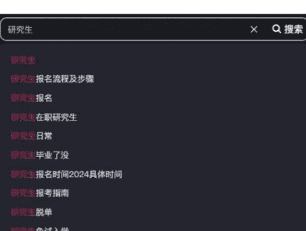

图1-18

也能通过微信读书、听书平台找相关书籍，一本书就是主题来源。例如在平台搜索“考研英语”。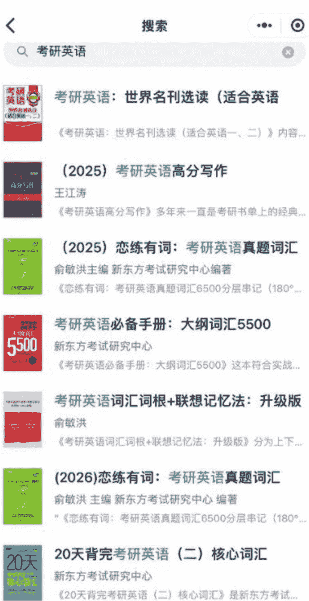

图1-19

以核心关键词提问DeepSeek即可生成新主题。例如：请以“考研英语必备”为关键词分析，给出20个短内容主题。

获得的回答如下。

Q

请以“考研英语必备”为关键词进行分析，为我提供20个相关的短视频选题

A

围绕“考研英语必备”，以下是20个有价值的短内容主题。

1. 最新考研英语大纲重点变化解读
2. 考研英语词汇高效记忆技巧
3. 阅读理解高分解题策略
4. 完形填空解题步骤与常见陷阱
5. 翻译技巧精讲与准确度提升
6. 写作模板与范文结构分析
7. 历年真题深度解析与考点规律
8. 听力训练对语感的辅助作用
9. 长难句快速解析与阅读提速
10. 考试时间分配技巧
11. 真题模拟测试与查漏补缺
12. 高频词汇串讲与例句记忆
13. 阅读理解实战演练与解析
14. 写作高分词汇积累
15. 冲刺阶段复习计划制定
16. 错题本使用方法
17. 备考心态调整技巧
18. 备考资料精选推荐
19. 辅导班选择建议与注意事项
20. 常见备考误区及规避方法

如果需要更多，可继续追问补充。

获得的回答如下。

Q

请继续补充，以帮助考研学子更有效地备考

A

再补充20个不重复的主题建议。

1. 考研英语同义词替换提升作文档次
2. 真实考场环境模拟测试
3. 阅读细节信息定位技巧
4. 笔记建立与使用方法
5. 作文分段技巧
6. 段落过渡句使用方法
7. 词汇联想记忆法
8. 主旨大意把握技巧
9. 通过选项预测文章内容的技巧
10. 语法陷阱识别与规避
11. 作文高分句型积累
12. 语境记忆法记单词
13. 指代关系解析技巧
14. 同义替换识别技巧
15. 同义词辨析练习
16. 作文高级表达积累
17. 词根词缀构词法解析
18. 逻辑推理题解题步骤
19. 信息整合提速技巧
20. 备考压力管理方法

这些主题覆盖词汇、语法、阅读、写作及心态，帮助考生全面提升。

#### 2. 热门短视频拓展法

要善于借鉴。找同领域热门博主，拆解其爆款主题作为学习样本。

以宠物短内容为例，热门主题包括：
- 动画片没骗人！猫咪就是这样跑
- 我家猫“偷感”很重，小眼睛转来转去想找陪玩
- 鸡胸肉喂猫15天后续
- 新手养猫必看！猫咪驱虫那些事
- 猫语十级翻译，12种常见叫声解析

在模仿的基础上发现新痛点并创新，可用DeepSeek加速模仿主题。

例如提问：
Q

请参考这几个主题，模仿创作10个同类型的热门短内容主题。
动画片真的没有骗人！猫咪就是这样跑的。
我的小猫“偷感”好重啊，小眼睛转来转去只是想让妈妈陪它玩。
老猫为了不吃药都练成太极拳了！
猫语十级翻译，12种猫咪常见叫声解析。

A

1. 狗狗也有八卦！揭秘它们“聊天”时的微妙动作
2. 兔子跳跃的秘密，原来是这样表达快乐
3. 喵星人隐藏技能：看猫咪如何用尾巴“说话”
4. 鹦鹉遇上DJ：宠物鸟模仿人类跳舞节奏感绝了
5. 宠物界瑜伽大师？金毛展现惊人平衡与柔韧
6. 喵皇傲娇日常：猫咪蹭人原来是在宣示主权
7. 狗狗也有情绪！解读不同摇尾方式的情绪密码
8. 仓鼠健身房日常：小家伙在滚轮上狂奔
9. 宠物界魔术师？猫咪凭空消失又突然出现
10. 狗狗社交礼仪课：如何正确打招呼避免冲突

#### 3. 连载式拓展法

当在某一垂直领域已形成创作手感并验证过爆款模型时，可以把同一主题做成系列化连载，把一个经过验证的大方向拆分成多条关联短片分批推送。

举例来说，聚焦在PPT技巧上，可以在平台上持续更新“PPT自学打卡计划”，每天推出一集。

采用这种连载思路，能减少选题和制作的损耗，同时增强观众粘性，培养定时回访的观看习惯。

#### 4. 选题拓展法

一旦某个主题曾带来过爆款，就可以用DeepSeek对其进行二次拆解。

通用提问模版：你是一位短视频【输入赛道】创作者，准备做一条短视频，主题是【输入选题】，请围绕该主题延展出30个细分子选题。

按此模版可提问：你是一位短视频【财会知识科普】创作者，准备做一条短视频，主题是【财会基础知识大全】，请围绕该主题延展出30个细分子选题。

AI给出的示例如下。

Q

你是一位短视频【财会知识科普】博主，准备创作一条短视频，选题为【财会基础知识大全】，请你基于该选题，延伸拓展出30个细分新选题

A

作为深耕财会知识科普的短视频创作者，围绕【财会基础知识大全】这一大主题，可以延展出下面30个细分方向，覆盖财会全链路，也能匹配不同观众的学习诉求。

1. 会计基础认知：阐明会计的定义、主要职能与现实价值。
2. 会计要素解析：拆解资产、负债、所有者权益、收入、费用、利润六要素。
3. 会计等式与运用：介绍等式构成及在实操中的作用。
4. 科目体系与建账规则：说明科目分类标准和账户设立规范。
5. 复式记账原理：讲解复式记账的逻辑与操作流程。
6. 会计凭证填写要点：展示各类凭证样式与填制注意事项。
7. 账簿种类与登记规范：介绍不同账簿的功能与登记方法。
8. 财务报表编制入门：讲解资产负债表、利润表、现金流量表的编制思路。
9. 财务分析基础：介绍常见分析方法、步骤与目的。
10. 成本控制思路：探讨成本管控的概念、手段与作用。
11. 预算管理流程：解析预算的编制、执行与监督技巧。
12. 税务常识总览：介绍税制框架、主要税种与筹划原则。
13. 增值税实务处理：详解增值税的账务处理方法和技巧。
14. 企业所得税核算：说明企业所得税的计算与会计处理流程。
15. 会计政策选定与变更：探讨选择依据、变更影响与披露要求。
16. 会计估计与差错更正：介绍估计的合理性判断与差错调整分录。
17. 现金流管理：讲解现金流的重要性、预测方法与管理策略。
18. 内控与风险管理：说明内部控制构成要素与风险防范思路。
19. 审计基础知识：解析审计的概念、类型与工作流程。
20. 会计信息化与ERP：探讨信息化的价值与ERP系统的应用。
21. 职业道德与合规要求：介绍会计职业规范及相关法规。
22. 报表分析案例：通过真实案例演示报表分析的落地应用。
23. 小微企业实务操作：结合小微特点给出实用的账务处理建议。
24. 跨国企业会计难题：讨论跨国经营中的会计挑战及应对方案。
25. 会计软件操作指南：介绍常用软件的使用方法与技巧。
26. 职业发展规划：为从业者提供成长方向与路径建议。
27. 继续教育的重要性：强调持续学习必要性及渠道。
28. 会计与金融市场的关系：解析会计信息对市场的影响。
29. 会计前沿动态：介绍领域最新理论与实践进展。
30. 会计与人工智能融合：探讨AI在会计领域的应用前景与挑战。

借助这种拆解方式，可构建专属的选题灵感树，如图1-20所示。

##### 考研博主选题

###### 原有选题

- 考研专业选择方法
- 考研上岸心得分享
- 考研备考时间节点汇总
- 考研政治备考策略
- 考研数学备考策略
- 考研英语备考策略
- 考研专业课备考策略

###### 关键词拓展法

- 考研选专业纠结如何解决
- 考研选专业参考网站
- 考研选专业推荐APP
- 考研选专业咨询渠道
- 考研选专业还是选院校
- 考研英语高分写作技巧
- 考研英语写作常用句式
- 考研英语5000词速记方法

###### 热门短视频拓展法

- 考研人有哪些减压方式
- 考研各科老师点评含避雷
- 考研复试有哪些忌语
- 如何快速攻克生词难句
- 一个笨办法让管理类联考综合能力考到186分

###### 连载式拓展法

- 考研打卡 Day1
- 考研每日Vlog记录
- 在职考研日记 Day1

图1-20

# 第2章 脚本策划：打造热门短视频的秘诀

很多人觉得短视频比长视频更有吸引力，画面精致、配乐舒服、节奏利落，很容易让人看得停不下来。

短视频脚本和电影剧本的思路相近，既能明确叙事走向，也能提升拍摄效率和成片质量，还能为后期剪辑提供依据。

## 2.1 脚本的基础知识

优秀的短片背后通常都有扎实的脚本。脚本相当于整条内容的骨架，对情节推进起决定性作用。因此创作者要先写好脚本，保证内容更专业。

### 2.1.1 脚本的定义

脚本是拍摄前的整体规划文档，用来提前统筹拍摄全流程的各项安排，包含拍摄时间、设备选择、背景场景、拍摄对象及拍摄手法等。表2-1所示为一份简化的短视频脚本模板。

表2-1

| 镜号 | 景别 | 运镜 | 画面 | 附加设备 | 备注 |

| :--- | :--- | :--- | :--- | :--- | :--- |

| 1 | 远景 | 固定镜头 | 在天桥上俯拍城市中的车流 | 手持广角镜头 | |

| 2 | 全景 | 跟随运镜 | 拍摄主角从天桥上走过的画面 | 手持稳定器 | 慢镜头 |

| 3 | 近景 | 上升运镜 | 从人物手部拍到头部 | 手持拍摄 | |

| 4 | 特写 | 固定镜头 | 人物脸上露出开心的表情 | 三脚架 | |

| 5 | 中景 | 跟随运镜 | 拍摄人物走下天桥楼梯的画面 | 手持稳定器 | |

| 6 | 全景 | 固定镜头 | 拍摄人物与朋友见面问候的场景 | 三脚架 | |

| 7 | 近景 | 固定镜头 | 拍摄两人手牵手的温馨画面 | 三脚架 | 后期背景虚化 |

| 8 | 远景 | 固定镜头 | 拍摄两人走向街道远处的画面 | 三脚架 | 欢快的背景音乐 |

制作环节中，摄影、演员、道具、化妆、剪辑等各个岗位都需按脚本执行。若缺少脚本，很容易出现场景不匹配、道具准备不足、人员不到位等情况，造成返工，浪费时间与成本，也难以达到预期效果。

### 2.1.2 脚本的作用

脚本主要用于规范创作人员的行动，提升协作效率并优化成片质量。脚本的作用如图2-1所示。

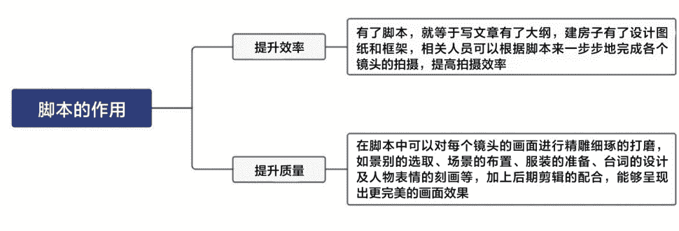

图2-1

### 2.1.3 脚本的类型

短视频虽然时长有限，但只要脚本设计细致，镜头画面安排合理，就更容易获得推荐。短视频脚本一般分为分镜头脚本、拍摄提纲和文学脚本三类，如图2-2所示。

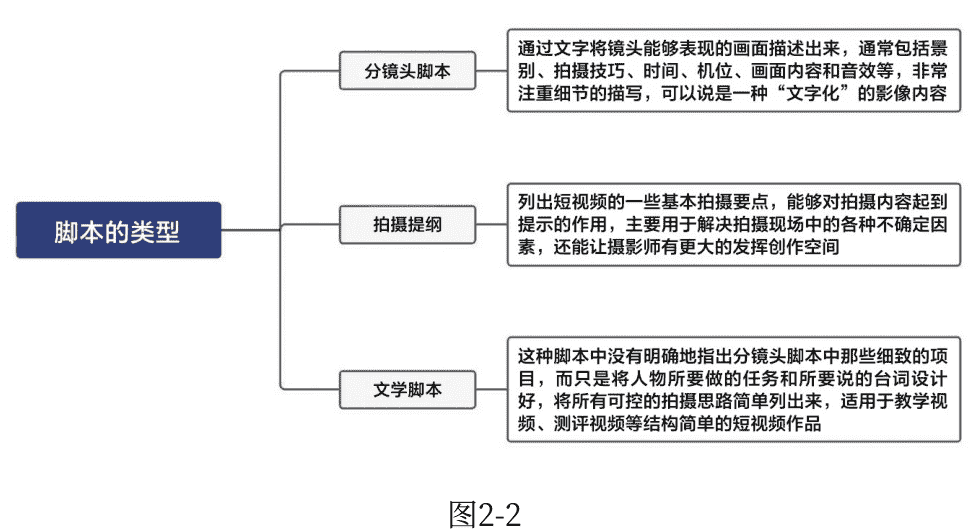

图2-2

分镜头脚本多用于剧情类视频，拍摄提纲适合访谈或资讯类视频，文学脚本则适用于结构简单的视频。

### 2.1.4 脚本的基本要素

写脚本时要对每一个镜头做精细设计。一份短视频脚本包含六大要素：景别、内容、台词、时长、运镜、道具。具体说明如下。

- **景别**：分镜时需明确选用何种景别。共有远景、全景、中景、近景、特写五种，不同景别功能各异，如远景常用于展示故事发生的环境，如图2-3所示。合理交替可增强艺术感染力。
- **内容**：指视频希望传达的核心信息，可拆分为多个小片段，分配到不同镜头与场景中呈现。
- **台词**：影片中人物的语言表达，用于传递信息、刻画人物、突出主题。台词应简洁，避免过长导致观众疲惫。
- **时长**：需预估各镜头的时长并标记剧情转折点，便于后期快速剪辑突出重点。
- **运镜**：可掌握推、拉、摇、移、升等基本手法，拍摄时灵活组合，使画面更丰富。
- **道具**：作为场景的点缀，如图2-4所示，可起到画龙点睛的作用。使用不宜过多，以免喧宾夺主。

▲图2-3

▲图2-4

### 2.1.5 脚本的编写技巧

编写脚本要做到化繁为简，同时保证内容饱满完整。常见技巧如下。

- **搭建框架**：先梳理主题、故事线、人物关系、场景选址等基本纲要。
- **明确主题**：弄清视频要表达的内涵与思想，以主题为核心构建细纲。
- **设置角色**：确定影片中出现的人物及其分工与任务。
- **选择场景**：挑选与主题契合的拍摄地点及所需道具并记录在脚本中。例如拍摄聚餐场景可选择餐厅，如图2-5所示。
- **设计情节**：规划剧情发展节奏，调动观众情绪。
- **运用影调**：不同情绪可通过不同影调强化氛围，如伤感画面可搭配冷色调，如图2-6所示。

▲图2-5

▲图2-6

- **背景音乐**：除影调外，音乐也能营造氛围。例如搞笑类视频可加入笑声音效。

## 2.2 使用大语言模型类AI工具生成短视频脚本

掌握脚本基础后，可借助前文提到的类大语言模型AI工具生成创意脚本，提升内容吸引力。

### 2.2.1 文学脚本的编写

文学脚本是将故事或内容概述转化为视觉表达的形式。强调用镜头语言叙事，包含场景、角色、对白、动作等元素。相比分镜头脚本更概括，适合教学、知识分享等结构简单的视频。

创作流程一般为明确主题、提供基础信息、生成大纲、撰写对白与细节、迭代修改、最终确认。下面以DeepSeek为例说明文学脚本的编写方法。

- **明确脚本主题**：先确定主题方向，如科幻、浪漫、悬疑、冒险等。建议挑选熟悉的领域，有助于AI理解需求并辅助创作。可先将创意提供给DeepSeek，请其给出主题建议并提供初步大纲。
- **提供基础信息**：确定主题后，输入场景、背景及人物设定。场景可设定为“未来的太空殖民地”或“大雾弥漫的伦敦夜晚”；人物设定需包括性格、外貌、动机及关系，如“艾斯比是一位内向且富有想象力的年轻作家”。
- **生成大纲**：与DeepSeek探讨故事走向，生成大纲。可选用三幕结构或多线情节，按需调整。加入冲突与转折点可增强吸引力。
- **创作对话和细节**：让DeepSeek为角色生成符合人设的对白。先描述角色情绪与意图，再与AI协作打磨自然流畅的表达。AI还能补充场景描写、情感表达及环境细节。
- **迭代修改**：初稿完成后需反复修改。可要求调整语气、补充细节或修改情节，通过多次交互打磨至理想状态。
- **最终确认**：通读全文，检查故事连贯、人物行为一致、对白自然流畅。确认后可请AI格式化为适合拍摄的文档。

借助DeepSeek能快速获得灵感并生成可用文学脚本，大幅提升效率。过去创作需要大量时间与灵感，现在AI可大幅降低门槛。

**指令**

以“爱情与时间”为主题创作一个短视频文学脚本，根据前面的步骤流程，在输入框中输入“请帮我写一个关于爱情与时间的短视频脚本，背景设定在未来，主角是一名时间旅行者。主角艾伦是一个能够穿越时间的年轻人，他爱上了一个只能在过去遇见的女子。请为这个故事生成一个大纲，包含主要情节和转折点，并为艾伦和女子的初次相遇写一段对话，他们在时空之间短暂相遇，却互相吸引。”并发送。

AI生成的回复如下。

**Q**

请帮我写一个关于爱情与时间的短视频脚本，背景设定在未来，主角是一名时间旅行者。主角艾伦是一个能够穿越时间的年轻人，他爱上了一个只能在过去遇见的女子。请为这个故事生成一个大纲，包含主要情节和转折点，并为艾伦和女子的初次相遇写一段对话，他们在时空之间短暂相遇，却互相吸引。

**A**

短视频脚本大纲：《时光之恋》

背景设定：

未来世界，时间旅行技术已经存在，但被严格控制。主角艾伦是一名时间旅行者，他能够穿梭不同的时间节点执行任务。一次意外中，他遇见了一名只能存在于过去的女子——莉亚。两人相遇的时间短暂，但情感强烈。艾伦开始不断穿越回她的时空，与她相处，然而，他逐渐意识到时间法则可能会让他们永远无法在同一时间长久停留。

主要情节：

艾伦的任务：艾伦作为时间旅行者，执行修复历史的小任务。在一次回到20世纪的任务中，他偶然遇见了莉亚，她是那个时代的普通女子。两人相遇的瞬间电光石火般吸引。

不断回去：艾伦无法忘记莉亚，他开始一次次冒险返回她的时间段。每次见面都是短暂的，但他们的感情在几次见面中迅速升温。

时间的警告：随着艾伦的不断穿越，时间开始出现异常的波动。他的上级警告他不能干预过去的生命轨迹，然而，艾伦越来越难以割舍与莉亚的情感。

不可逆的转折：艾伦的每次穿越使得莉亚所在的时间开始出现混乱，历史的轨迹发生偏移。艾伦意识到，他们的爱情本身可能是破坏时间平衡的关键。

最终选择：艾伦必须做出决定——要么继续穿越时间，最终导致莉亚的消失；要么放手，让莉亚回归她原本的时间，自己独自面对永恒的孤独。

初次相遇对话：

场景设定：艾伦穿越到20世纪的一个繁忙街头。偶然间，他与莉亚在一家古旧的书店门口相遇。

[艾伦四处张望，发现自己穿越到任务地点。他转身时，不小心撞到了正在翻阅书籍的莉亚。]

艾伦（微微惊讶，迅速道歉）：“抱歉，我没看路。你……没事吧？”

莉亚（微笑，手捧书本，轻轻摇头）：“没关系，我常常沉浸在这些书里，忘记了周围的世界。”

[艾伦看着她，眼神中透出不解与惊讶，像是被她某种难以言喻的气质吸引。]

艾伦（若有所思）：“你喜欢这些……古老的故事？”

莉亚（点头，轻轻抚摸着书的封面）：“它们像是一扇扇通往另一个世界的门。虽然我无法穿越时间，但阅读让我感觉自己仿佛也可以在不同的时代行走。”

[艾伦的心微微一颤，仿佛她不经意间说出了他的秘密。]

艾伦（低声自语，眼神温柔）：“或许……你已经做到了。”

莉亚（好奇地抬头看他）：“什么？”

艾伦（笑着摇头，掩饰着内心的波动）：“没什么，只是……你有一种令人难以忘怀的感觉，像是……我在哪里见过你。”

[两人对视的瞬间，仿佛时间停滞了。尽管他们素未谋面，但彼此心中都有一种熟悉的共鸣。]

莉亚（轻声笑道）：“也许我们曾在某本书里相遇过。”

[艾伦笑而不语，心中却隐隐知道，他们的相遇远非偶然。]

这一段对话既透露了艾伦的身份，同时暗示了莉亚和艾伦的命运交织在时间的长河中，为接下来的情感发展埋下伏笔。

### 2.2.2 分镜头脚本的编写

与文学脚本和拍摄提纲相比，分镜头脚本更为细化。面对镜头较多的视频，往往选择分镜头脚本。

分镜头脚本是用文字逐个描述视频中每个镜头的画面与细节，形成相当于制作说明书的文档。

一份优秀的分镜头脚本不仅包含完整故事，还需把情节转化为镜头语言。每个镜头应包含镜号、拍摄场景、景别、时长、画面内容、人物台词、背景音等信息。分镜头脚本示例如表2-2所示。

表2-2

| 镜号 | 拍摄场景 | 景别 | 镜头时长 | 画面内容 | 人物台词 | 背景音 |

| :--- | :--- | :--- | :--- | :--- | :--- | :--- |

| 1 | 城市街道 | 远景 | 5秒 | 繁忙的街道 | “这里就是一切的开始……” | 城市背景音 |

| 2 | 主角家 | 中景 | 7秒 | 主角在厨房做饭 | “今晚给他一个惊喜。” | 锅铲声，油烟机运行声音 |

| 3 | 餐厅 | 近景 | 10秒 | 主角和丈夫面对面坐着 | “尝尝这个，我新学的。” | 餐具碰撞声 |

| 4 | 卧室 | 特写 | 5秒 | 主角躺在床上，望着天花板 | “为什么，我们之间会变成这样？” | 轻柔的钢琴 |

| 5 | 公园 | 全景 | 12秒 | 主角在公园里散步，思考 | “我需要找到答案。” | 鸟鸣声，微风声 |

| 6 | …… | …… | …… | …… | …… | …… |

**DeepSeek 分镜头脚本实战指南：从验证到成片**

想让 DeepSeek 写出能直接用的分镜头，先确认模型是否真的明白这个东西。最直接的方法就是在对话框里抛一个基础问题，看看它的理解是否到位。

**Q**
分镜头脚本到底是什么？

**A**
分镜头脚本是影视与短视频筹备阶段把剧本视觉化的执行蓝图。它把导演和编剧的想法拆成一镜一镜的画面说明，通过文字配合图形让摄制组清楚每场要拍什么、怎么拍。通常在开机前完成，能大幅降低现场沟通成本。

常见构成要素大致如下。
- **镜头编号**：为每场戏里的每个镜头编号，便于按顺序拍摄和剪辑。
- **画面说明**：写清人物、动作、环境、道具等信息，让画面感具体可读。
- **景别**：决定拍摄范围。
  - 全景，呈现整体空间或人物完整动作。
  - 中景，取半身，突出主要互动。
  - 特写，聚焦面部或关键物件，放大情绪与细节。
- **拍摄角度**：机位高低与位置，如俯拍、仰拍、侧拍，用来暗示情绪。
- **镜头运动**：记录镜头移动方式，如推近、拉远、摇移、跟随。
- **对白与声效**：在对应镜头下标注台词或需加入的声音，配合画面。
- **时长预估**：给出每镜的大约时间，方便把控节奏。
- **视觉参考**：草图、样图或文字化的构图提示，帮助统一画面风格。

核心价值主要体现在这几方面。
- **创意可视化**：把文字剧本转成画面语言，让导演、摄影有共同的视觉默契。
- **提升效率**：提前把镜头想透，现场少临时改动，节省工时。
- **拍摄指引**：像一份拍摄清单，减少遗漏和执行偏差。
- **跨部门对齐**：让导演、摄影、剪辑、美术对风格保持一致。

示范片段如下。

| 镜号 | 镜头语言 | 镜头类型 | 镜头角度 | 镜头运动 | 对白/音效 | 时长 |
| :--- | :--- | :--- | :--- | :--- | :--- | :--- |
| 1 | 艾伦立于巴黎河畔桥头，暮色中埃菲尔塔遥望可见 | 全景 | 正面 | 缓慢推近 | 无台词，轻柔背景乐 | 5秒 |
| 2 | 艾伦低头看怀表，神情略显犹豫 | 特写 | 俯拍 | 静止 | “我该怎么做？” 低语 | 3秒 |

落地上，导演、摄影与美术会对照这份资料落实构图、灯光与表演。

给模型设定明确人设，输出会更贴合需求。例如提示“你现在是一名美食探店博主，要为一家百年老面馆写分镜头脚本，参考当下短视频爆款手法，开头5秒抓眼球，中段设置反转，结尾留惊喜，文案偏情绪表达。输出表格包含镜号、景别、画面描述、对话台词、背景音乐，台词要写清动作神态，音乐要给出具体曲目。” 模型返回如下。

**Q**
你现在是一名美食探店博主，要为一家百年老面馆写分镜头脚本，参考当下短视频爆款手法，开头5秒抓眼球，中段设置反转，结尾留惊喜，文案偏情绪表达。输出表格包含镜号、景别、画面描述、对话台词、背景音乐，台词要写清动作神态，音乐要给出具体曲目。

**A**

| 镜号 | 景别 | 画面描述 | 对话台词 | 背景音乐 |
| :--- | :--- | :--- | :--- | :--- |
| 1 | 特写 | 镜头骤然推近，热气腾腾的面碗占据画面，酱汁滴落，蒸汽弥漫，香气扑面 | [旁白]惊叹语气：“这一碗面，裹着百年的记忆与传承！” | *Nuvole Bianche* by Ludovico Einaudi，节奏舒缓，营造情绪 |
| 2 | 全景 | 面馆外景，斑驳的老招牌，人流穿梭，时光感强烈 | [旁白]：“一座城市的味道，既是味觉也是文化。” | 轻柔复古音色渐入 |
| 3 | 中景 | 店内，傅师傅娴熟拉面，手势干净利落，木桌见证岁月 | 傅师傅笑着：“这碗面做了几十年，味儿一直没变。”眼神里是对手艺的骄傲 | *City of Stars* by Ryan Gosling and Emma Stone，温暖复古 |
| 4 | 特写 | 慢动作拉面成形，师傅凝神的面部被放大 | [旁白]温柔敬佩：“看似简单的一碗面，藏着匠人的心血。” | 音乐延续，故事感增强 |
| 5 | 中景 | 博主品尝，先是一愣，随后笑意扩散，眼中满是兴奋 | 博主停顿：“哇，层次比想象里更丰富。”表情从惊讶到满足 | 节奏加快，转为轻快 |
(续表)

### 2.2.3 分镜头脚本编写实例

只看概念容易上手，实操常会卡壳，这时借助 AI 生成再优化就很有效。接下来用一个减肥题材案例演示完整流程。

需求是写约1500字、围绕多次减肥最终成功的主题，包含情节、对话与情绪递进，以达到打动观众的效果。

向 DeepSeek 下达指令如下。

# Q

任务：创作约1500字的分镜头脚本，主题是屡次减肥失败最终成功，突出情绪变化与观看共鸣。

要求：
1. 明确标注情节、情绪与对话，方便演员和摄影理解。
2. 情感表达流畅细腻，让观众产生代入感。
3. 内容积极向上，不涉及违规。
4. 提交前校对，确保连贯准确。

# A

片名：《减肥之路》。
主题：讲述主人公屡败屡战，最终靠坚定意志与方法调整成功减重，激励观众坚持健康与自信。

场景1：起点——失败开端。
镜头：全景。
地点：卧室夜晚，柔光下餐桌堆满外卖盒。
情节：主人公坐在床边啃薯条看电视，桌上外卖显示多次尝试后放弃的挣扎。
情绪：疲惫、失望，对自我失控感到无奈。
对话：
> （内心独白）：“为什么总是坚持不下来？每次都说明天会好，结果晚上就被欲望打败。”

场景2：觉醒。
镜头：中景。
地点：清晨对镜，穿运动装。
情节：深呼吸、握拳，眼神坚定，准备开启新计划。
情绪：决心、希望，对此次充满信心。
对话：
> （主人公）：“这次一定要坚持，不再半途而废。”

场景3：初期挑战。
镜头：特写。
地点：健身房跑步机前。
情节：剧烈喘息、汗水滑落，体力不支开始怀疑。
情绪：疲惫、动摇。
对话：
> （内心独白）：“太累了，我真的能行吗？每次都是这样撑不住……”

场景4：中途退缩。
镜头：全景。
地点：家中餐桌。
情节：面前零食甜点，垂头丧气伸手拿蛋糕吃下。
情绪：无力、自责。
对话：
> （叹气）：“又失败了，我真的改不了自己吗？”

场景5：自我反思。
镜头：近景。
地点：卧室夜晚，手机微光映脸。
情节：刷减肥视频与成功案例，眼神从迷茫到专注。
情绪：思索、重燃希望。
对话：
> （内心独白）：“也许我太急了，别人也不是一蹴而就。得找到适合自己的节奏。”

场景6：重新出发。
镜头：全景。
地点：清晨公园跑道。
情节：天刚亮，轻快慢跑，呼吸平稳带笑。
情绪：积极、享受过程。
对话：
> （内心独白）：“一步步来，不逼太紧。坚持比速度重要。”

场景7：饮食调整。
镜头：中景。
地点：厨房，阳光洒入。
情节：精心准备健康餐，新鲜蔬果与瘦肉。
情绪：自律、满足。
对话：
> （内心独白）：“每一天都是新开始，为了更健康更自信。”

场景8：持续坚持。
镜头：多镜头剪辑。
地点：健身房、公园、家中。
情节：运动与饮食坚持，身形逐步改善，笑容更灿烂。
情绪：坚持、成就感。
对话：
> （内心独白）：“减脂不是短期战役，是长期自我管理。”

场景9：最终成功。
镜头：全景到特写。
地点：户外山顶俯瞰城市。
情节：合身衣物，神采飞扬，深呼吸享受时刻。
情绪：自信、喜悦。
对话：
> （内心独白）：“做到了。跌跌撞撞让我学会自爱，真正的胜利是掌控自己。”

场景10：结尾——向前看。
镜头：远景。
地点：山顶夕阳。
情节：面向远方，目光坚定。
情绪：希望、憧憬。
对话：
> （内心独白）：“减重成功只是起点，未来继续追求更好的自己。”

结尾字幕：
> “每一次失败都是垫脚石，坚持下去，你会遇见最好的自己。”

备注：本脚本以情绪递进为主线，通过生活化场景引发共鸣。

框架有了但细节不足，继续指令“内容偏简单，请丰富情绪和对话，并为人物命名”。

模型基于前文输出进阶版。

**Q**
内容偏简单，请丰富情绪和对话，并为人物命名。

**A**
片名：《减肥之路》。
主人公：林菲。

场景1：失败开端。
镜头：全景。
地点：卧室夜晚，光线昏暗，桌上外卖盒与被丢弃的健身卡。
情节：蜷在沙发啃炸鸡，眼神呆滞，薯条吃完愣住后长叹。
情绪：失落、无力，陷入恶性循环。
对话：
（林菲低沉自语）：“又失败了……我怎么连自己都管不住？”

场景2：决心。
镜头：中景。
地点：卧室清晨，阳光透帘。
情节：脱下宽松睡衣凝视身体，摸腹部皱眉后走向瑜伽垫。
情绪：坚定，对现状不满。
对话：
（对镜）：“这次必须成功，不管多难。”
（内心）：“路不会轻松，但我受够了。”

场景3：初期挑战。
镜头：特写。
地点：健身房跑步机。
情节：气喘吁吁，步伐沉重，看见他人轻松训练更焦虑。
情绪：疲惫、自我怀疑。
对话：
（咬牙）：“不能放弃，林菲，不能再放弃……”
（内心）：“为什么我总是这么弱？”

场景4：中途退缩。
镜头：全景。
地点：家中，沙发旁蛋糕盒。
情节：手指悬空犹豫，最终吃下，眼角泛泪。
情绪：内疚、自责。
对话：
（自嘲）：“你看，你还是忍不住……”
（泪眼）：“我真的这么没用吗？”

场景5：自我反思。
镜头：近景。
地点：卧室深夜，手机光映脸。
情节：刷成功案例，眼神从失落转沉思。
情绪：觉醒。
对话：
（喃喃）：“他们也失败过，也许我走太快了。”
（内心）：“期望太苛刻，应该慢慢来。”

场景6：重新开始。
镜头：全景。
地点：公园清晨。
情节：简洁运动装慢跑，呼吸均匀带笑。
情绪：平静、轻松。
对话：
（自语）：“今天轻松点也没事，重要的是在继续。”

场景7：饮食调整。
镜头：中景。
地点：厨房，温暖阳光。
情节：切菜看健康食谱，动作从容。
情绪：满足、自律。
对话：
（笑道）：“原来健康食物也可以这么好吃。”

场景8：持续努力。
镜头：多场景剪辑。
情节：力量训练、公园跑步、居家备餐，皆带着笑容。
情绪：坚持、认可自我。
对话：
（内心）：“慢慢来，每天的坚持就是胜利。”

场景9：最终成功。
镜头：全景到特写。
地点：山顶，微风拂发。
情节：合身运动装，深呼吸，眼神自豪。
情绪：自信、骄傲。
对话：
（微笑）：“我做到了，不只是减肥，更是对自己的掌控。”

对脚本再润色，要求以表格呈现，最终结果如表2-3所示。

**表2-3**

| 场景 | 镜号 | 景别 | 画面内容 | 台词 | 背景音乐 | 时长 |
|---|---|---|---|---|---|---|
| 卧室夜晚 | 1 | 全景 | 林菲蜷在沙发啃炸鸡，餐桌堆满外卖盒，神色沮丧 | 林菲低声自语：“又搞砸了……我怎么就是管不住自己？” | 低沉抒情配乐 | 3秒 |
| 卧室清晨 | 2 | 中景 | 林菲对镜凝视，决心满满准备开启新计划 | 林菲对镜说：“这一次我必须成功，不管有多难。” | 鸟鸣、微风声 | 3秒 |
| 健身房 | 3 | 特写 | 林菲在跑步机上气喘吁吁，内心摇摆 | 林菲咬牙低语：“不能放弃，林菲，你不能再放弃……” |  | 5秒 |
| 家中 | 4 | 全景 | 林菲拿起蛋糕犹豫后吃下，眼角泛泪 | 林菲轻声自嘲：“你看，你还是忍不住……你就是做不到。” | 电视背景音 | 3秒 |
| 卧室深夜 | 5 | 近景 | 林菲看减肥成功视频反思，眼神聚焦 | 林菲轻声说：“也许我走得太快，忘了脚踏实地。” | 视频背景音 | 5秒 |
| 公园清晨 | 6 | 全景 | 林菲轻松慢跑享受过程，不再急于求成 | 林菲对自己说：“没关系，今天轻松点也没事，重要的是在继续。” | 轻松配乐 | 4秒 |

| 厨房清晨 | 7 | 中景 | 林菲把自制营养餐摆好，脸上带着满足的笑意 | 林菲笑着说：“原来健康的食物也可以这么好吃。” | 轻松的音乐 | 3秒 |
| 健身房/公园/家中 | 8 | 多机位剪辑 | 林菲长期坚持运动与健康饮食，身体与心态都在悄然变化 | 林菲内心独白：“慢慢来，一切都在变好。我不再害怕失败。” | 轻快的音乐 | 5秒 |
| 山顶日出 | 9 | 全景推特写 | 林菲立在山顶俯瞰城市，心中满是自豪与成就感 | 林菲微笑着自言自语：“我做到了……不仅是减肥，更是对自己的掌控。” | 有节奏感的音乐 | 3秒 |

其实很多人都没意识到脚本也可以交给AI来做。直接让模型抛出一版初稿是常见做法，另一种更稳妥的思路是先把相关资料喂给模型做归纳提炼，再在此基础上做二次创作，这样出来的脚本更扎实、也更对味。

## 2.3 用即创做短视频脚本

即创是抖音官方推出的一站式电商智能创作平台，包含视频创作、图文创作、直播创作三大板块。借助人工智能能力，可以大幅压缩短视频制作和直播的人力时间成本，全方位覆盖短视频创作者的需求。

### 2.3.1 初识即创平台

即创深度打通抖音电商生态，集成了智能策划、内容制作、数据分析等多种工具与功能，帮助用户轻松实现内容创新、商品展示优化，并精准触达目标受众。平台以用户需求为导向，用智能化手段简化流程、降低门槛，让创作者快速上手，高效产出高质量的电商内容。

在浏览器搜索框输入“即创”进行检索，搜索结果如图2-7所示。

点开搜索结果进入登录页，如图2-8所示。

登录后加入组织即可进入即创首页，如图2-9所示。

### 2.3.2 脚本生成功能

视频创作模块提供了脚本自动撰写能力。鼠标移到首页的“AI视频”，展开菜单后点击“AI视频脚本”，如图2-10所示。

进入的脚本生成页如图2-11所示。页面可选择产品大类，并填写商品资料、投放场景、核心卖点、文案风格、优惠活动、适用人群、用户痛点、使用场景以及字数要求等参数。

信息填写完毕后点击“立即生成”，即可得到剧本，生成结果如图2-12所示。

脚本生成后系统会自动识别内容并打上标签，点击标签就能定位到对应段落，如图2-13所示。

生成的剧本可以保存到脚本库，也能直接编辑或复制使用，甚至借助快速成片功能结合数字人完成成片，操作十分便捷。

### 2.3.3 脚本裂变功能

当已有脚本质量不错，想继续产出同类型素材时，可以使用即创的脚本裂变功能，提升工作效率。

在脚本生成页点击“脚本裂变”按钮，即可切换到裂变页，如图2-14所示。在此页面输入参考剧本、商品资料和核心卖点后点击“立即生成”，平台会对原稿进行裂变，产出新脚本。

裂变不仅适用于同类商品的文案扩散，也能跨品类复用。输入参考剧本、商品资料和卖点后点击“立即生成”即可开始裂变，如图2-15所示。

# 第3章 文案策划：巧用AI爆款文案批量生产

文案要能清晰准确地传递信息，涵盖产品特性、服务内容、品牌理念等，帮助目标受众了解短视频的核心。对初入门的创作者来说，写文案并不轻松，如今可以借助AI来完成。

## 3.1 AI文案的基础知识

文案是用文字呈现既定创意策略的载体。本节主要介绍智能文案的概念、生成原理及特点，帮助读者建立基础，为后续学习打好地基。

### 3.1.1 AI文案的概念

AI文案是基于人工智能技术生成的营销或宣传文本，强大的模型可以帮助用户把想法快速转化为文字。用户只需输入关键词或句子，就能得到基本符合预期的文案，既专业又高效。

以DeepSeek为例，提问“你了解短视频吗？”，得到的回复如图3-1所示。

是的，我对短视频有一定的了解。短视频是近年来在互联网上迅速崛起的一种内容形式，通常指时长在几秒到几分钟之间、适合移动端快速浏览和传播的视频内容。以下是关于短视频的一些关键点：

#### 1. 短视频的核心特点

- **短平快**：内容精简，节奏紧凑，能在短时间内抓住用户注意力。
- **高传播性**：依赖社交平台（如抖音、快手、TikTok）和算法推荐，容易形成“病毒式传播”。
- **创作门槛低**：用户可用手机拍摄、剪辑，借助模板和特效工具快速制作。
- **互动性强**：点赞、评论、转发、合拍等功能增强用户参与感。

#### 2. 主流短视频平台

- **国内**：抖音、快手、微信视频号。
- **海外**：TikTok（抖音国际版）、YouTube Shorts、Instagram Reels、Snapchat Spotlight。

#### 3. 短视频常见内容类型

- **娱乐搞笑**：段子、模仿、幽默剧情。
- **生活分享**：Vlog、美食、旅行、日常记录。
- **知识科普**：干货分享、技能教学（如“1分钟学Excel”）。
- **电商带货**：直播切片、产品测评、种草推荐。
- **垂直领域**：美妆、健身、科技、宠物等细分内容。

#### 4. 短视频的底层逻辑

- **算法驱动**：平台通过用户行为（停留时长、互动等）推荐内容。
- **注意力经济**：争夺用户碎片化时间，内容需在3秒内吸引眼球。
- **去中心化**：普通人可能因爆款视频一夜走红，降低成名门槛。

图3-1

在实际工作中，优质文案能让产品获得更好营销与宣传，扩大目标市场。文案创作需要丰富的写作技巧和经验，对许多写作者来说有一定难度，这时AI工具能很好地解决这些难题。

### 3.1.2 AI文案的生成原理

在数字化时代，内容创作已成为各行各业的必备能力。面对海量信息和快节奏环境，创作效率常成为瓶颈。此时AI工具应运而生，以高效精准的特点成为提升效率的新选择。

智能文案生成基于自然语言处理与机器学习等技术，通过分析大量语料库，学习语言规则和语义逻辑，进而生成符合要求的文本。目前该技术已广泛应用于广告、媒体、电商等领域，帮助企业快速生成营销文案、新闻报道和产品描述等。一般流程如下。

- **数据收集**：工具需要大量文本数据，来源可为网站、社交媒体等，国内常用微博等，如图3-2所示。
图3-2
- **文本预处理**：对输入文本进行分词、标注、句法分析等，以便更好地理解结构和意义。
- **模型训练**：通常使用机器学习算法训练模型，如神经网络、随机森林等，训练后模型可预测给定文本的下一个词或句子。
- **文本生成**：训练完成后，工具可依据用户需求生成文本，通常先将输入转为向量表示再输入模型以生成后续词句。
- **文本优化**：生成文本需进一步优化以保证质量，可采用A/B测试等方法评估和改进。

### 3.1.3 AI文案的特点

工具可根据不同需求调节语气和情感，让文案更贴合品牌调性和目标人群。同时，AI文案支持创作过程中的多次修改和反复调整，让创作者快速尝试各种创意，大幅提升内容制作效率。

- **自动生成**：无需人工撰写，节省时间和人力。
- **高效率**：生成速度快，可在短时间内批量产出可用文本，适合需要大量营销文案的企业。
- **个性化定制**：可依据用户数据分析偏好，按不同受众和营销目的定制内容。
- **持续改进**：可依据数据分析和A/B测试结果不断优化，提升转化率。
- **风格一致**：同一模型生成的文案通常具有稳定的语言风格和格式。
- **机器学习能力强**：部分工具可基于以往文案数据和反馈进行优化，生成质量更高的内容。
- **创造性需审校**：自动化特性突出，创造性和创新性仍需人工把关，以确保质量。

## 3.2 常用的AI文案生成工具

了解概念后，本节介绍几款常用工具，帮助熟悉使用方法。

### 3.2.1 文心一言

前面已介绍过使用方法，用户只需在输入框输入需求并发送，模型即可生成回复，如图3-3所示。

假设现在你是一名新媒体运营工作人员，请为我撰写一份庆祝儿童节的短视频文案，这份文案要能够引起受众共鸣，使用更温馨、给人治愈感的语气，提供5个示例。

思考和行动过程 ▼

以下是5个庆祝儿童节的短视频文案示例，以温馨、治愈的语气撰写，旨在引起受众共鸣。

示例一：
【标题】重温童心，快乐儿童节
【文案】
在这个特别的日子里，让我们一起回到那个无忧无虑的童年。记得小时候，我们追逐风筝，在夏日午后追逐蝉鸣，每一声欢笑都记录着纯真与快乐。儿童节快乐！愿每个孩子都能拥有一个美好的童年，每个成年人的心中，都保留一份童真。

示例二：
【标题】童年的梦，永不褪色
【文案】
儿童节到了，你是否还记得那些儿时的梦想？想当科学家，探索宇宙的奥秘；想成为画家，用色彩装点世界。今天，让我们再次点燃那份纯真的梦想，不忘初心，勇敢追梦。愿每个孩子的梦想都能照进现实，儿童节快乐！

示例三：
【标题】童趣时光，温馨回忆
【文案】
童年的回忆里，总有那么几个温暖的瞬间：和小伙伴们在操场上奔跑嬉戏，一起分享那些简单而美好的快乐。儿童节，是回忆，也是新的开始。愿我们都能保持一颗童心，感受生活中的每一份纯真与喜悦。儿童节快乐，愿快乐与你同行！

示例四：
【标题】快乐儿童节，童心永驻
【文案】
童年是一段无法忘怀的时光，它充满了欢笑与泪水，也承载着我们最初的梦想。在这个儿童节，让我们放下成人的包袱，找回那份久违的童心。无论岁月如何流转，愿我们都能保持一颗纯净的童心，快乐每一天。儿童节快乐！

示例五：
【标题】童趣盎然，快乐无边
【文案】
今天是儿童节，是属于每一个孩子的节日，也是属于我们每个人内心深处的那份童真。让我们放下烦恼，重拾儿时的欢乐，用童真的心去感受这个世界的美好。愿每个孩子都能在阳光下自由奔跑，愿每个成年人的心中都保留一份童年的纯真。儿童节快乐，愿快乐与你同在！

重新生成
图3-3

### 3.2.2 DeepSeek

DeepSeek的使用方式与文心一言类似，输入需求后模型会据此生成回复。此外，R1深度思考模式可拆解复杂问题，更充分理解用户需求，用户可查看思考过程，如图3-4所示。

图3-4

> **提示**
>
> 文心一言与DeepSeek的使用方法大同小异，前面已介绍过，此处仅作简述。

### 3.2.3 剪映

剪映提供智能文案功能，可直接在剪映内生成文案，无需另行导入，更加便捷。

启动剪映专业版，新建项目后新建一段文本素材，选中后点击“智能文案”按钮，如图3-5所示。

图3-5

此时会弹出智能文案对话框，并按常用类型对主题进行分类，如图3-6所示。

图3-6

### 3.2.4 腾讯智影

为满足创作需求，腾讯智影提供AI创作功能，降低文案创作门槛，帮助用户快速生成文案。

在搜索引擎中进入腾讯智影官网，点击“立即体验”，如图3-7所示。

图3-7

会弹出登录框，如图3-8所示。支持微信登录、手机号登录、QQ登录和账号密码登录，用户可自行选择。

图3-8

登录后进入“创作空间”页面，在“智能小工具”模块点击“文章转视频”，如图3-9所示。

图3-9

进入页面后，在“请帮我写一篇文章，主题是”下方输入主题，点击右侧“AI创作”即可开始生成，如图3-10所示。

图3-10

> **提示**
>
> “文章转视频”使用了腾讯视频素材，需申请授权，第一年可免费使用，后续及部分功能需开通会员。

### 3.2.5 一帧秒创

在一帧秒创中，可先用“AI帮写”功能生成文案，再据此生成视频。

在搜索引擎搜索“一帧秒创”并进入官网，点击“立即创作”，如图3-11所示。

图3-11

登录页如图3-12所示，提供手机登录、微信扫码登录和微博登录三种方式。

图3-12

登录后进入首页，点击“AI帮写”按钮，如图3-13所示。

图3-13

进入“AI帮写”页，可选择合适的文案类型进行操作，如图3-14所示。

图3-14

选好类型后在输入框填写文案主题，如图3-15所示，点击“立即生成”即可得到文案。

图3-15

> **提示**
>
> 非会员每日有3次免费试用额度，点击“生成文案”会消耗额度，下方“文案补充”“文本润色”“文案精简”“取标题”也会消耗额度。

## 3.3 生成5种不同的短视频文案

掌握工具使用方法后，本节以DeepSeek为例介绍如何生成五类不同的短视频文案，创作出更具吸引力的内容。

### 3.3.1 生成互动体验类短视频文案

互动体验类文案用于描述、引导和激发受众参与互动，主要目的是吸引注意力并促进参与。使用DeepSeek生成此类文案，需要输入具体需求和关键词引导，具体步骤如下。

在输入框输入“提供互动体验类短视频文案示例”，确认模型是否理解该类文案，发送后模型回复如下。可以看出，给出了可引导互动的文案。

以下是五个互动体验类短视频文案示例，旨在通过有趣互动环节鼓励观众参与并分享体验。

#### 示例 1
文案：“你还记得童年最难忘的游戏吗？在评论区和我们分享你的回忆，看看谁的游戏最经典！”
标签：#童年回忆 #经典游戏 #互动体验

#### 示例 2
文案：“你更喜欢咖啡还是茶？投票告诉我们，看看哪个阵营更强大！”
标签：#咖啡vs茶 #你站哪边 #趣味互动

#### 示例 3
文案：“三秒内想到一个让你微笑的瞬间，写在评论区，一起分享这份温暖！”
标签：#美好瞬间 #治愈时刻 #分享快乐

#### 示例 4
文案：“用一个词形容你的2024年，在评论区见证你的未来！”
标签：#2024关键词 #新年愿望 #未来展望

#### 示例 5
文案：“打开手机相册的第10张照片，看看它有什么故事？在评论区与我们分享吧！”
标签：#相册故事 #生活片段 #互动分享

这些文案通过提问、投票和分享故事等形式引导观众互动，提升参与度。

在输入框输入具体需求，如“用互动体验类文案写法，为宣传新开业咖啡店提供一篇完整短视频文案，字数150至300字”，得到的回复如下。

以下是一篇宣传新开业咖啡店的互动体验类短视频文案，字数控制在150至300字之间。

（镜头切换）
【画面1】阳光洒在咖啡店窗台，新鲜烘焙的咖啡豆在机器中翻滚，散发诱人香气。
【字幕】“你最喜欢哪种咖啡香味？在评论区告诉我们，让我们猜猜你是哪种咖啡控！”
（音乐渐强，轻松愉悦背景音乐）
【画面2】店员手工拉花，镜头特写展示精美拉花艺术。
【字幕】“快来挑战！上传你的咖啡拉花作品，赢取本店特别礼物！”
【画面3】顾客在温馨环境中品尝咖啡，书架上的图书可随意拿取。
【字幕】“我们创造了一个属于你的‘第三空间’。在这里，咖啡不只是饮品，更是一种生活方式。”
（音乐柔和过渡）
【画面4】咖啡店外景，门口排满顾客，大家脸上洋溢笑容。
【字幕】“快来体验我们特别准备的新店开业惊喜！关注我们，了解更多活动详情。”
（音乐进入高潮，结束）
【结尾】“喜欢哪款咖啡？下次来店里试试吧！参与互动赢取免费咖啡券！”
标签：#新店开业 #咖啡控必打卡 #互动赢好礼

该文案通过提问、挑战和礼品互动吸引观众关注并参与，同时传达咖啡店温馨精致的氛围，增强品牌亲和力。

获得文案后，可对语言风格、内容结构等进行优化，并引导模型生成与主题契合的分镜头脚本。

### 3.3.2 生成情节叙事类短视频文案

情节叙事类文案是以讲故事形式描述短视频内容的文字。这类文案通常用于配合镜头语言呈现现实生活或反衬映射现实，以讲故事的方式吸引观众。

剧情叙事类短视频的内核是情感共鸣，多以亲情、爱情、友情等生活化情境切入。当前在各大平台走红的剧情内容，大多是创作者自编的爱情小故事，再以分镜形式呈现出来。

借助 DeepSeek 产出这类脚本的常见做法是先写故事再转分镜，具体流程如下。

（1）先让模型虚构一个小故事。比如在输入框写“帮我写一个男女主在复古场所偶遇的小片段，要有新颖设定、一句对话和内心活动，控制在200字内”，模型会返回类似内容。

故事梗概：

在一间老式黑胶唱片铺，男主杰森正翻找一张稀有的爵士唱片。抬头间，他看见女主艾丽站在对面书架前，手里拿着同一张唱片。视线相撞的瞬间，时间仿佛被按下了暂停。

交流部分。

杰森：“看来我们的音乐喜好很合拍。”

艾丽笑着回应：“也许这就是注定的相遇。”

内心活动：

杰森心里泛起久违的悸动：好久没有这样心跳的人了，她的眼神既怀念过去，也期待未来。

艾丽轻轻摩挲唱片：这张碟承载着记忆，而他似乎也在我心里留下了印记。

两人相视而笑，都读懂了彼此的共振。

（2）再把故事拆成分镜头。输入“把上面这个故事改写成表格版分镜脚本，列出镜号、景别、画面说明、对白及动作细节、背景音乐”，得到结果如下。

| 镜号 | 景别 | 画面说明 | 对白及动作 | 背景音乐 |
| :--- | :--- | :--- | :--- | :--- |
| 1 | 特写 | 指尖划过复古唱片封套，镜头慢慢上推露出专注的神情 | 无 | 轻柔爵士 Autumn Leaves 淡入，音量逐渐加大 |
| 2 | 中景 | 男主抬头，被对面书架前的女主吸引，她手里拿着同款唱片，两人目光交汇，店内灯光柔和洒落 | 无 | 音乐延续，营造温馨怀旧氛围 |
| 3 | 近景 | 男主轻笑走近，语气温和：“看来我们对音乐的品位很相似。” | 男主微笑目光温柔：“看来我们对音乐的品位很相似。” | 音乐稍降，为对话留空间 |
| 4 | 特写 | 女主微微一笑，眼里带好奇与惊喜：“或许，这就是命运的安排吧。” 低头看唱片后再望向男主 | 女主微笑语气轻柔：“或许，这就是命运的安排吧。” | 音乐缓缓回升，伴随交流 |
| 5 | 中景 | 两人对视，空气里透着温暖又带点紧张的氛围 | 无 | 音乐推向高潮，Autumn Leaves 旋律萦绕，强化情绪 |
| 6 | 特写 | 男主内心独白，眼神里透出久违的悸动：“这是多久以来，第一次有一个人让我如此着迷……” | 无 | 音乐继续，略带感伤的段落加深内心感受 |

### 3.3.3 用 DeepSeek 搭建干货分享类口播脚本
干货类文案的价值在于把知识点或实用技巧搬进视频，帮助观众解决问题。表现形式可以是图文或口播，下面以口播为例说明思路。

先做能力确认，例如发送“给一个完整的口播短视频脚本文案示例”，得到如下参考。

标题：“每天进步一点点，这就是成功的秘密”

画面提示。

开场：清晨暖阳透过窗帘落在床上，手机闹钟响起。

中段：主角起床开始工作，镜头切换展示他在不同场景的坚持与努力。

收尾：夜晚，主角坐在书桌前微笑，回望一天。

文案：

(开场)

> “早上好！新的一天到啦，你今天的目标是什么？”

(中段)

> “你有没有发现，每天微小的前进，积少成多，会带来意想不到的变化？生活里的小事常打乱节奏，甚至让人怀疑方向。其实成功不是一步到位，而是无数个小坚持堆起来的。”

(镜头切换，呈现主角在办公桌前专注工作的画面.)

> “哪怕只是一小步，也在靠近梦想。那些曾经觉得很难的事，回头看你已经跨过去了。”

(镜头切换到主角锻炼，体现不懈精神.)

> “你需要做的，就是每天比前一天的自己好一点，哪怕进步很小。”

(收尾)

> “持续为目标付出，总有一天你会站在成功的门口。加油吧，你比想象中更强。”

结尾字幕：

> “每天进步一点点，这就是成功的秘密。”

标签：#励志 #坚持不懈 #生活态度 #成功之路

背景音乐：轻松愉快的旋律随文案起伏渐强，结尾转为平缓温馨。

这份脚本用生活细节传递积极态度，鼓励观众为目标坚持。

给模型设定专家身份，输入“你是一名收纳师，请用口播短视频脚本文案的方式分享专业收纳技巧”，得到如下示例。

标题：“如何让你的家瞬间变得整洁有序：收纳师的专业技巧”

画面提示。

开场：凌乱的房间，镜头缓慢推进展示混乱。

中段：收纳师开始整理，镜头呈现不同技巧与步骤。

收尾：房间变得整洁，主角露出满意笑容。

文案：

（开场）

> “家里总是乱糟糟？别担心，今天我教你几个简单收纳技巧，让家瞬间整洁有序！”

（中段）

> “首先记住黄金法则：分区收纳、分类整理。把相似物品放在一起，比如文具、杂志集中在一个区域，能有效减少找东西的时间。”

（镜头切换，展示收纳盒和标签使用。）

> “第二个技巧，使用收纳盒加标签。给每件物品找个‘家’并贴标签，既能快速取用，也让空间更整洁。”

（展示悬挂式收纳，节省地面空间。）

> “接下来善用垂直空间。墙面、门背后别浪费，悬挂式收纳能省下大量地面面积，还能一目了然。”

（展示衣物有效收纳，避免皱褶。）

> “还有个小妙招：衣物收纳。可以试试竖立折叠法，这样每件衣服都能看见，也能防皱保持整齐。”

（收尾）

> “掌握这些简单方法，保持整洁其实不难。整理完你会感觉生活更有条理，心情也更舒畅。试试看吧！”

结尾字幕：

> “想要了解更多收纳技巧，别忘了关注我哦！”

标签：#收纳技巧 #整理有序 #家居生活 #收纳师推荐

背景音乐：轻快清新的旋律随节奏推进，结尾转为温馨舒缓。

可见 DeepSeek 能按要求生成符合需求的干货口播脚本，并给出拍摄画面参考，实用性较强。

### 3.3.4 DeepSeek 制作影视解说类短视频文案的方法
影视解说类文案是用幽默简洁、概括性强的语言对电影电视剧等进行简介，快速传递剧情。下面介绍生成方法。

为确认模型理解，输入“影视解说类短视频文案是什么”，得到回复如下。

影视解说类短视频文案是对影视作品进行解析和点评的文字脚本。文案一般包含剧情概述、人物分析、主题解读、关键情节讲解以及创作者个人见解，目的是帮助观众深入理解作品或激发观影兴趣。

主要特点如下。

- 简洁明了：用短小有力的语言在有限时间内概括影片核心，吸引注意。
- 剧情梗概：介绍基本情节，但不全剧透，选择性呈现关键节点吊起好奇。
- 人物分析：解析主要角色的动机、性格和成长，帮助理解剧情。
- 主题解读：探讨核心主题和象征意义，分享对深层内容的看法。
- 互动性强：引导观众在评论区讨论，提升互动。
- 情感共鸣：通过语气和情感表达，让观众与影片产生共鸣。

示例如下。

影片：某部经典励志电影

文案：

（开头）

> “这是一部能点燃斗志的电影，一个关于永不放弃的故事。”

（中段）

> “故事讲的是一个普通人在经历各种挫折时，如何一步步克服困难最终实现梦想。主角从最初的迷茫无助，到最后的坚定成功，成长之路充满挑战与感动。”

> “尤其在高潮部分，主角在关键时刻做出的那个决定，让所有观众为之震撼。那一刻，你能感受到他从未放弃的信念支撑着他走完全程。”

（结尾）

> “如果你也曾在生活中感到迷茫，这部电影一定会带来勇气与希望。一起在评论区分享你最喜欢的励志电影吧！”

标签：#影视解说 #励志电影 #永不放弃 #经典影片

这类文案用简短有力的叙述快速带观众进入影片核心，既提供观影指南，也激发兴趣和共鸣。

让模型生成正式文案，输入“提供影视解说类短视频文案，主题为简要概括《音乐之声》的情节，要用吸引人幽默的语言概括，字数在400字以内”，得到回复如下。

影视解说类短视频文案：《音乐之声》

> “今天聊一部经典到爆的电影——《音乐之声》。这部片子不仅是童年回忆，更是能让你跟着哼歌忘记烦恼的魔力电影！”

镜头切换

> “故事发生在奥地利的修女院。女主角玛丽亚简直是修女界的异类，不爱安静爱唱歌，连祈祷时都在哼调。修女长们受不了，把她派到冯·特拉普上校家当七个孩子的家庭教师。”

镜头切换，搞笑特写

> “冯·特拉普上校可不是普通老爸，他是军官，把孩子训练得比士兵还严。家里没笑声没音乐，像个训练营。但玛丽亚一来，情况立刻变了！她不仅教孩子唱歌，还带他们翻山越岭，欢声笑语满天飞！”

镜头切换

> “孩子们从小士兵变成小歌手，家庭氛围逐渐融化了上校的铁血心肠。你能猜到接下来吗？对，玛丽亚与上校擦出爱的火花，一家人幸福地在音乐里找到了新的生活方式。”

搞笑特写

> “别以为这只是音乐喜剧，背后还有大背景——纳粹即将入侵奥地利！在动荡时刻，音乐成了他们逃避现实、寻找希望的方式。”

结尾总结

> “《音乐之声》不只是音乐与爱的故事，它教会我们在黑暗中寻找光明，在逆境中歌唱人生。这部经典不看绝对亏大！”

标签：#影视解说 #音乐之声 #经典电影 #欢乐与感动

这段文案用幽默语言把核心情节讲得生动，同时引发对深层主题的思考。

### 3.3.5 借助 DeepSeek 生成情感共鸣类短视频文案
情感共鸣类文案旨在描述情感视频内容并引发受众共鸣，通常以图文呈现，标题文案是关键。下面介绍操作方法。

在输入框输入需求：“情感共鸣类短视频文案指描述情感类视频内容且能引起受众共鸣的文字。提供5个情感共鸣类短视频文案示例”，得到回复如下。

以下是五个情感共鸣类短视频文案示例，突出温馨治愈感，能引发共鸣。

1. 关于亲情：

> “有些爱不需要说出口。小时候你总问：‘妈妈，为什么……？’长大后才明白，她的每句叮嘱都是为你铺路。”

标签：#母爱 #默默守护 #成长感悟

2. 关于友情：

> “最好的朋友不需时时在身边。但你知道，无论何时回头，他总在那里。”

标签：#友情岁月 #永不褪色 #默契

3. 关于爱情：

> “爱不是轰轰烈烈的誓言，而是平淡日子里的陪伴。牵手走过的岁月，才是爱情最动人的诗篇。”

标签：#平凡爱情 #细水长流 #陪伴最暖

4. 关于成长：

> “小时候以为成长是一瞬间，长大后才发现它藏在每一个不被注意的小细节里。”

标签：#成长历程 #细碎时光 #慢慢成熟

5. 关于人生：

> “生活有时很难，但总会有那么一刻，温暖阳光透过云层照进来。那一刻你知道，一切都会好起来。”

标签：#生活感悟 #温暖时刻 #希望

这些文案短小精悍，用生活点滴引发共鸣，适合温情类内容创作。

矫正语言风格，输入“用更温馨治愈的语气，字数控制在20字以内，再加tag”，得到如下文案。

以下是五个温馨治愈的短视频文案，每条控制在20字以内并附标签：

1. “爱是每一次温暖的拥抱，陪伴是最长情的告白。”

标签：#亲情 #温暖

2. “最美的风景往往在身边，与你共度的每一天。”

标签：#友情 #美好时光

3. “真爱如茶，细水长流，温暖你的每一个瞬间。”

标签：#爱情 #细水长流

4. “在每一次成长中，都有温暖的记忆相伴。”

标签：#成长 #记忆

5. “生活的美好藏在每一个微笑和温暖中。”

标签：#生活 #温暖时刻

这些文案传递温馨治愈感，适合短视频使用。

再生成正式文案，输入“用上述风格，提供主题为高考加油的励志文案，要积极向上振奋人心”，得到回复如下。

以下是五个关于高考加油的积极向上文案，每条控制在20字以内并附标签：

> “坚持就是胜利，梦想在前方，未来由你掌握！”

标签：#高考加油 #梦想

> “书山有路勤为径，学海无涯苦作舟，勇敢前行！”

标签：#学习 #奋斗

> “相信自己，你的努力终将开花结果！”

标签：#自信 #努力

> “每一份付出都是铺路石，成功就在眼前！”

标签：#奋斗 #高考

> “把每一天都当成最后一搏，决胜高考！”

标签：#高考冲刺 #加油

这些文案用积极语气激励考生，传递奋发向上的正能量，适合高考相关短视频。

# 第4章 手机拍摄也能出大片
随着智能手机不断升级，拍摄功能也日益完善。如今手机逐渐取代传统相机，成为很多人记录生活、拍摄影片的首选。

本章将介绍手机自带拍摄功能，并说明各项参数设置及特色功能。

## 4.1 认识短视频拍摄器材
手机拍摄能力明显增强，许多过去需专业相机才能完成的工作，现在一部手机即可搞定。传统相机体积大、外出不便，购置成本高，让不少摄影爱好者望而却步；而轻巧小巧、功能强大的智能手机，能让大众以平和细腻的态度观察和记录生活。

### 4.1.1 如何挑选拍摄用手机
市面手机品牌众多，功能各异，如何在预算和需求之间挑到合适的拍摄手机？一般可从以下五方面综合考量。

#### 1. 摄像头性能
摄像头直接影响素材质量。选机时要注意，高像素不等于更好画质，但会影响细节捕捉。选择大尺寸传感器和高像素的机型，如图4-1所示，可在弱光环境下拍出更清晰画面，减少噪点。

图4-1

光圈数值越小意味着进光量越大，弱光表现越好。自动对焦与跟拍功能也很关键，能快速锁定运动物体，避免模糊。

#### 2. 视频录制功能
大多数旗舰机都支持4K甚至8K视频录制，高帧率如60帧/秒或120帧/秒可让画面更流畅，适合慢动作。光学防抖OIS和电子防抖EIS在手持拍摄时非常重要，能有效减少抖动，尤其在运动场景下保持稳定。

#### 3. 软件与编辑支持
手机自带的专业模式或电影模式可让用户手动调节曝光、快门、感光度等参数，适合有一定经验的用户，通过调整可拍出不同质感素材。挑选时应查看是否支持HDR、高动态范围、杜比视界等技术，有这些加持画面表现更佳。若支持，商品宣传页会说明，如图4-2所示。

图4-2

#### 4. 电池续航与存储空间
短视频拍摄往往需要长时间作业，续航能力至关重要。选电池容量大且支持快充的机型，可降低电量耗尽导致中断的风险，如图4-3所示。4K和高帧率视频文件体积很大，选择内置存储合适的机型也很重要。

图4-3

#### 5. 设计与手感
手机设计和手感影响拍摄体验。选择轻便、握感好的机型，有利于长时间手持拍摄。也可考虑带防水功能的机型，户外拍摄更安心。

### 4.1.2 拍摄辅助设备
手机拍摄之所以普及，最主要原因是便利。几乎人人都有手机，出门自带，看到美景拿起就拍，拍完即发，高效出片率高。但若想提升效果、拓展创作可能，仍需要一些辅助设备。

#### 1. 三脚架

拿天桥街景来举例，连续手持手机拍五分钟，绝大多数人既撑不住手臂也会被画面抖动困扰。要画面更稳、更耐拍，最省事的做法是把手机固定在脚架上，三脚架的样貌如图4-4所示。

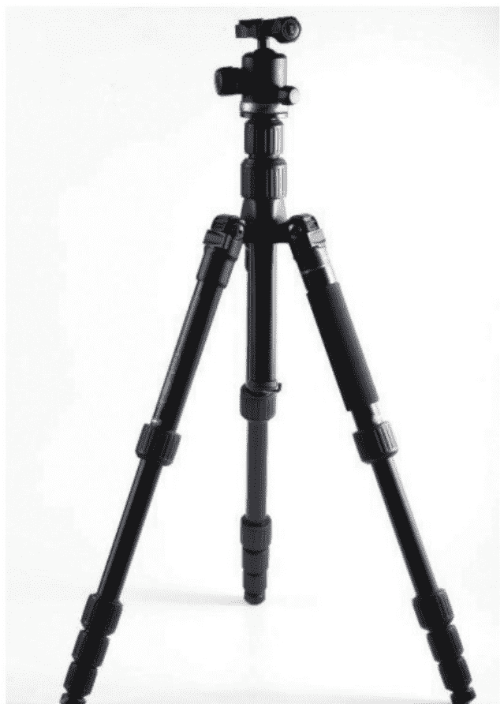

图4-4

脚架的核心价值就是稳定。做延时摄影、近距离慢镜头这类需要长时间连拍的题材，没有它基本做不到。

另外，脚架还能让构图更准。面对复杂场景想用特定构图去突出主体，手持时既晃又会因为物体移动而跑位，成像质量很容易被拉低。把机身架稳后双手就解放了，微调机位和构图都更从容。

用脚架还能更好地把控景深，景深指画面里清晰的范围，如图4-5所示。深色区域为清晰区，浅色区域为虚化区。常见说法分为大景深清晰范围宽和小景深清晰范围窄两种。

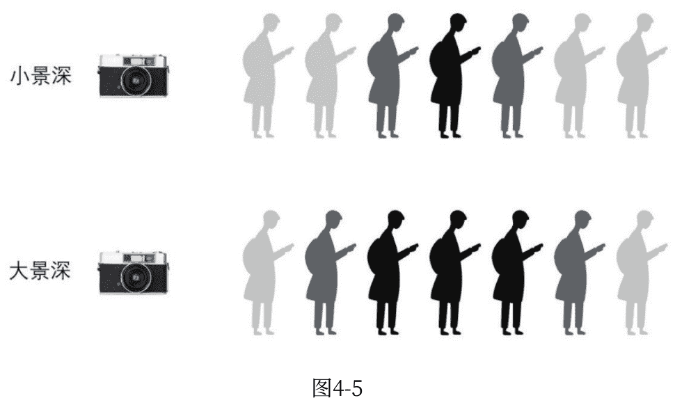

手机贴近物体拍摄，理论上可以压出小景深。但手持时对焦容易偏，抖动也会让近处细节糊掉。把手机锁在脚架上，晃动被压制，景深的呈现自然就更可控。

#### 2. 稳定器

手机已能满足大部分日常拍摄，随着短视频兴起，对电影感的需求在提升，手机外设也随之发展。稳定器是这些年最火的品类之一，如图4-6所示，品牌选择非常多。用上它，拍摄思路会更开阔，移动拍摄的灵活度也大幅提升。

稳定器轻巧好带，上手门槛低，已经成为短视频创作者的标配。它为什么能稳住画面？关键是内部的三轴结构，拍摄时重心一旦偏移，稳定器会按算法即时调整姿态，让设备始终保持平稳。于是边走边拍、边跑边拍，画面依然保持很高的稳定感。

图4-6

#### 3. 外接镜头

手机影像能力在进化，从单摄到多摄，厂商在镜头群上投入很大，部分机型还专门配了视频镜头。

市面上外接镜头种类丰富，广角、微距、长焦是常用款，还有鱼眼这种特殊视角。体积很小，直接卡在手机镜头前就能工作，如图4-7所示，和手机本身算力无关。单摄多摄都能用，多摄手机拍摄时通常只启用一个镜头，只要外接镜头对准当前工作的那个镜头即可正常使用。

图4-7

### 4.1.3 灯光设备

光线不足或想用布光营造氛围时，就需要灯光设备来配合。

#### 1. 补光灯

环境偏暗时，补光灯能提供额外光源，让画面更通透；布光得当还能塑造独特质感。形式多样，有能夹在手机上的便携补光灯，如图4-8所示；也有放支架上的环形灯，如图4-9所示，后者调节角度更方便。

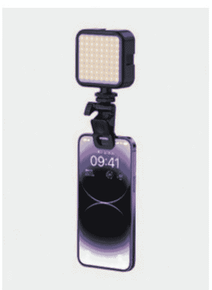

▲图4-8

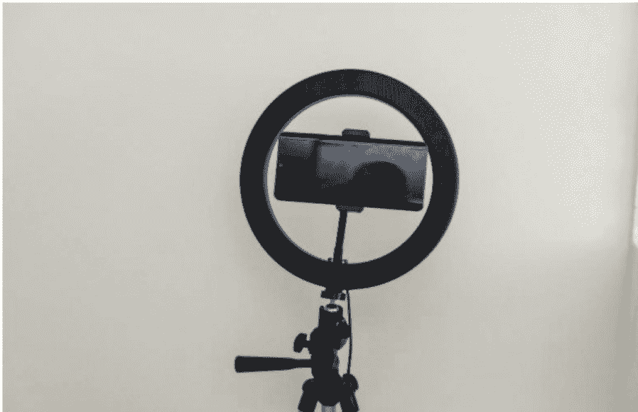

▲图4-9

还有可调色温的灯具，比如RGB全彩棒灯，如图4-10所示，能改变光色来营造不同氛围。主流补光灯多用LED发光二极管，光线稳定、寿命长、节能环保，性价比突出。

图4-10

#### 2. 反光板

反光板也是常见的补光手段，如图4-11所示。原理是靠反射光补光，光质柔和，能提升亮度又不会产生过重阴影或生硬感，轻便适合户外。

五合一

轻松出片

高光射率，五种不同面料，根据不同场景选择

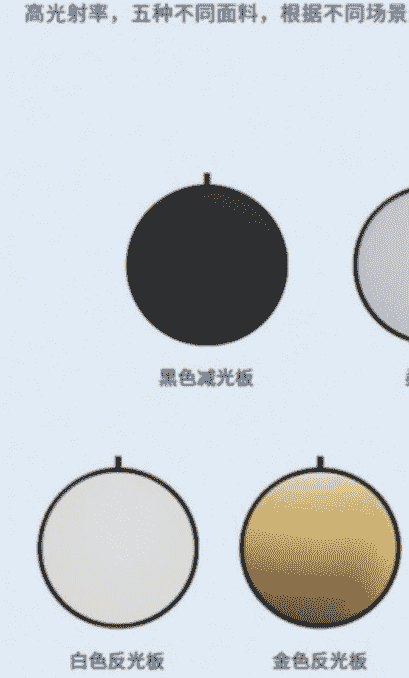

图4-11

反光板分硬板和软板。

硬反光板是抛光的高反银色或金色平面，室外反光效果极强，但造价偏高。日常更常用软反光板，表面不平整，有时会带不规则纹理，光线照上会产生漫反射，把光源柔化扩散，人像补光特别合适。软板还有多种色彩，不同颜色效果和适用场景也不一样，需要根据实际挑选。

摆放时要设计好位置，既能起到补光作用又不能入镜造成穿帮。做升降镜头等特殊运动时，这个细节更要注意。

### 4.1.4 录音设备

画面之外，声音也是视频表达的重要部分。视频音频大致分两类，后期配音和同期声。后期配音是先拍画面再配音；同期声是边拍边录，保留现场真实的声音，更自然更能传达情绪，也与画面同步，能节省后期时间。但现场收音对环境和设备要求高，对表演要求也更高，制作时需要取舍。

手机自带麦克风的收音范围和质量有限，容易被环境音干扰，在某些场景下表现不佳。找不到安静环境或对音质要求高时，就需要外接录音设备来辅助。

#### 1. 线控耳机

带麦克风的线控耳机是成本最低也最方便的选择，如图4-12所示。但它本质是听音设备，用来录音时收音范围受限，音质一般。需要长期录制的话，建议换更专业的工具。

图4-12

#### 2. 外接指向性麦克风

外接指向麦克风是常用收音设备，具有指向性，能决定对不同方向声音的接收强弱。用它可以减少其他声源干扰，调节声音干湿，还能调整频率响应来处理近讲效应。

这类麦克风大致分为全指向、心形指向、超心形指向和双指向即8字指向，如图4-13所示。

可以把麦克风周围想象成360°空间，0°为正前方，是拾音最灵敏的位置。空间由若干同心圆构成，相邻层级灵敏度相差5dB。分贝是对两个值做对数比较的单位。以心形指向为例，标称后方抑制25dB，就是0°和180°拾音效果的对比。声压每升高6dB相当于信号翻倍，升高20dB相当于10倍。心形指向典型后方抑制约20dB，意味着前方音源灵敏度是后方的10倍。想收前方声音，心形指向很合适。

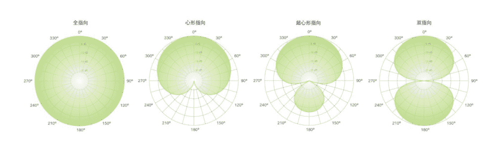

图4-13

手机拍摄时通常选用单指向，包括心形和超心形，这类麦克风对前方声音收音更好，其他方向声音被削弱，收音更集中，人声更突出，环境噪音被压低，在嘈杂或恶劣天气下录音更可靠。常见单指向麦克风如图4-14所示。

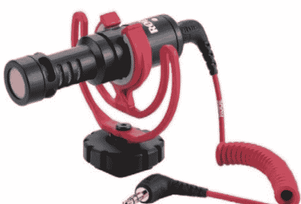

图4-14

心形和超心形的差异主要在收音范围。心形适合录歌唱类视频；超心形对周边环境抑制更强，适合访谈场景。

选购时要看商品详情页的参数说明，按需求挑选。现在很多麦克风的指向和收音范围可调，更灵活。如果拿不准怎么选，全指向麦克风如图4-15所示是个稳妥的入门选择。

图4-15

另外，大多数外接指向麦克风仍使用3.5mm接口，和主流Type-C、Lightning接口不匹配，配一个接口转换器就能在不同手机上继续使用。

#### 3. 无线领夹麦克风

相比外接指向麦克风，无线领夹麦克风能解放双手，不用手持，发言者的状态更自然，如图4-16所示。它体积小巧，夹在领口不易被发现，既能保证音质又减少出戏感。轻盈便携，适合外出使用，拍旅行Vlog时是不错的选择。

图4-16

### 提示

后期可以用软件做降噪，但能消除的噪音有限，前期收音更关键。降低拍摄时噪声干扰可以从两方面入手：一是从场地入手，选择安静隔音好的环境，室内可在墙面或地面贴隔音棉，如图4-17所示。隔音棉能隔音吸音，有效过滤环境噪音。

图4-17

### 提示

二是从设备入手，选择适合场景的麦克风。如果效果仍不理想，还可以为麦克风套上防风罩或降噪网，分别如图4-18和图4-19所示，也能有效降低环境噪音影响。

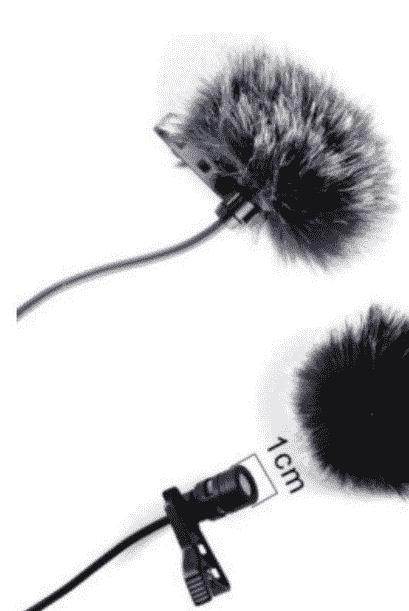

▲图4-18

▲图4-19

### 4.2 手机拍摄设置

拍摄时给设备设置合适的参数，能提升成片效率和成像质量，同时减少后期工作量。下面介绍手机拍摄时需要注意的关键参数和设置方法。

### 4.2.1 如何设置视频分辨率

把视频画面放大，能看到由大量小方块构成的像素，像素是视频和图片的基本单元。图4-20和图4-21是某1080p视频截图及其放大5倍的局部，可以明显看到像素方块。

▲图4-20

▲图4-21

视频分辨率指单位尺寸内图像的精密度，即单位面积有多少像素。分辨率越高像素越多，画面越清晰细节越丰富；分辨率越低画面越模糊。

常见分辨率有720p、1080p、4K等，720p是高清的最低标准，也称标清高清。720p指1280×720像素的视频，p代表逐行扫描，表示水平1280像素，垂直720像素。

为了保证画面清晰，拍摄前最好提前设置分辨率。下面以荣耀手机为例演示，其他机型可参考操作。

01 打开相机，点击右上角“设置”按钮，如图4-22所示，进入设置界面。

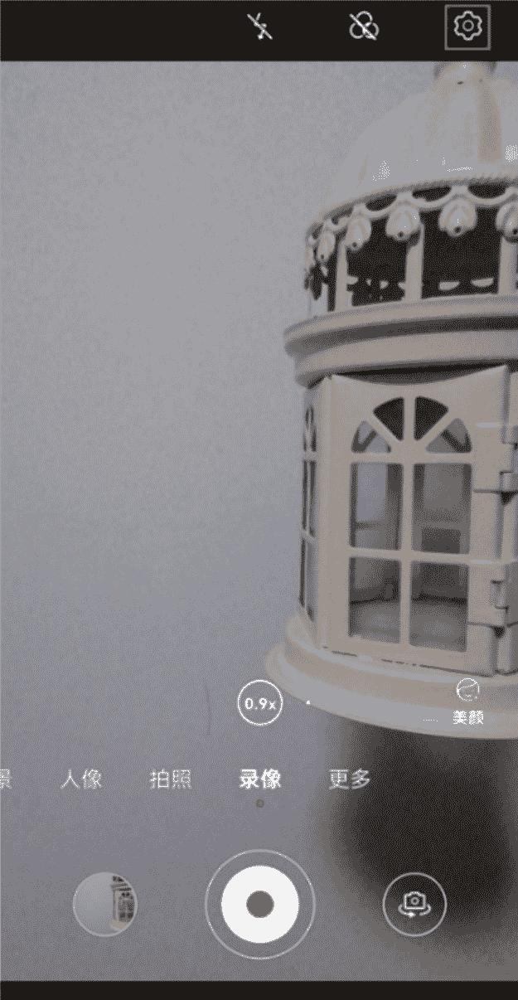

图4-22

02 在设置界面中点击“视频分辨率”，如图4-23所示。

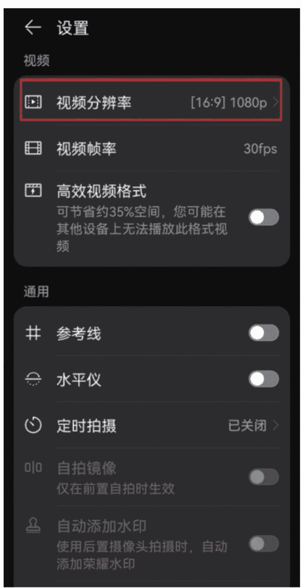

图4-23

03 在“视频分辨率”列表中选择最高分辨率1080p，如图4-24所示。

# 设置

视频

- 视频分辨率 [16:9] 1080p

- 视频帧率 30fps

- 高效视频格式 可节省约35%空间，您可能在其他设备上无法播放此格式视频

# 视频分辨率

- [19.2:9] 1080p

- [16:9] 1080p

- [21:9] 720p

- [16:9] 720p (推荐)

美肤仅在720p下可用。

60fps高帧率下不支持广角拍摄。

60fps高帧率下不支持滤镜。

取消

图4-24

### 4.2.2 如何正确对焦

对焦也叫聚焦，是通过改变物距像距让被摄物体成像清晰的过程。对焦决定主体是否清晰，焦点落在何处，何处就清晰。

拍摄时若发现主体模糊背景清晰，很可能是对焦不准，如图4-25所示。另外镜头距离主体过近，超出设备自动对焦范围，也会导致对焦失败。准确选定焦点是保证主体清晰的基础。

图4-25

一般打开手机镜头就能自动对焦，但手机对焦不如专业相机灵活，需要手动指定对焦位置。拍摄界面轻触屏幕会出现对焦框，把对焦框对准主体就能实现对焦，如图4-26所示。

锁定焦点就是在视频拍摄过程中把焦点固定在画面某处，保证主体对焦稳定。操作方法是拍摄前长按需要对焦的位置，手机会自动锁定该焦点，如图4-27所示，轻点其他位置即可解除锁定。想固定画面，可用此方法锁定焦点拍摄。

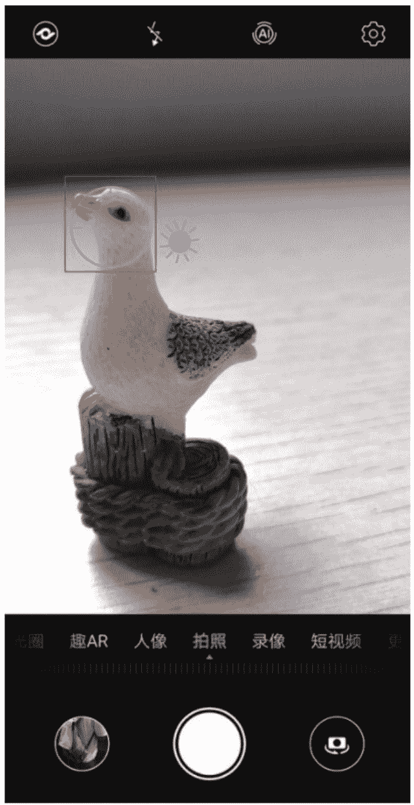

▲图4-26

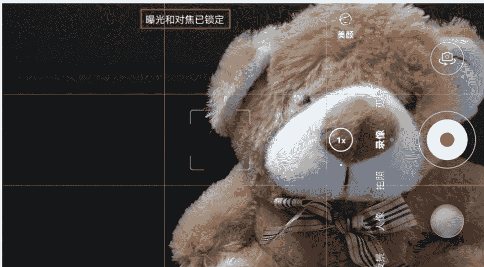

▲图4-27

### 4.2.3 如何合理设置曝光

曝光简单的说就是画面亮度。拍摄时会出现曝光过度、欠曝光和合适曝光三种情况，如图4-28至图4-30所示。拍摄者需要根据场景和需求适当调整曝光，获得最佳画面。

▲图4-28

▲图4-29

▲图4-30

手机拍摄时通常会自动根据环境调整曝光，但为避免一段视频中画面忽亮忽暗，最好锁定曝光。

锁定曝光的方法和锁定焦点类似，轻触屏幕会出现曝光调节点，如图4-31所示。向上拖动增加曝光，向下拖动降低曝光。

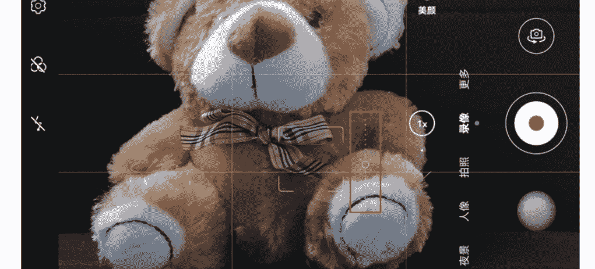

图4-31

### 4.2.4 如何进行慢动作拍摄

慢动作也叫升格拍摄，就是放慢画面播放速度，视频帧率一般在120帧每秒以上。120帧每秒拍摄的慢动作，播放时长是实际拍摄时长的4倍。

例如用30帧每秒拍2秒水滴下落，换成120帧每秒拍摄，得到的就是时长8秒的视频，如图4-32所示。

图4-32

慢动作帧率高，记录画面更流畅，可以捕捉快速发生的瞬间，详细展现精彩画面。能拍到水花四溅、动物奔跑如图4-33所示、鸡蛋破裂等瞬间，为视频增添看点。

图4-33

一般4倍、8倍慢动作适合人物运动、风吹树叶等较慢场景；32倍、64倍等更高倍数更适合落叶如图4-34所示、流水等快速运动物体。

图4-34

此外，慢动作模式还能在很大程度上消除运镜时的抖动，拍出更平稳顺滑的画面。

### 提示

慢动作画面偏暗，对光线要求高，帧率越高光线需求越大，只有光线充足才能拍出曝光合适、播放流畅的画面。另外慢动作需要机身稳定才能保证画面连贯，可借助稳定器拍摄。

慢动作拍摄操作简单，下面以物体落水瞬间为例说明步骤。

把装了三分之二水的透明水缸放在背景墙或背景布前，水缸下方放一块白色板，水缸正上方固定一个光源，条件允许可布置更多光源，如图4-35所示。

在背景前放置用三脚架固定好的手机。

打开相机选择慢动作模式，把焦点框对准水面，曝光调至最低，倍速调至16倍及以上，若手机不支持16倍则选择最高倍数，如图4-36所示。

▲图4-35

▲图4-36

部分机型在慢动作模式里不显示倍数，而是直接提供帧率可选，这时把录制帧率调到120fps及以上，或直接选用机型支持的最高慢动作帧率即可，如图4-37和图4-38所示。

# 相机核心设置

相机核心设置

- 保存地理位置信息
- 相机声音
- 防误触模式
  - 靠距离传感器来避免手机在口袋里被挤压或布料摩擦导致误拍
- 保留相机模式
  - 记住上一次使用的模式，比如“手动”或“录像”，而不是每次都回到“拍照”
- 街拍模式
  - 屏幕息屏时，长按音量下键就能直接拍摄
- 自拍镜像

| 慢动作画质 |
| --- |
| 720p,120fps |
| 1080p,120fps |
| 720p,240fps |

▲图4-37

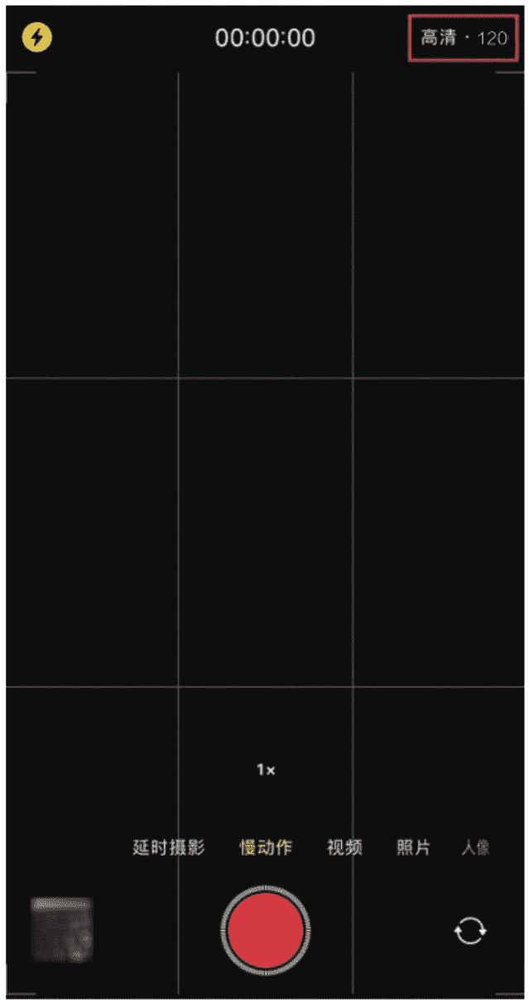

▲图4-38

想拍物体落水慢动作，先把物件放在离水面一定高度处，按下快门，让它垂直坠入水缸即可。

落水瞬间的慢动作效果如图4-39和图4-40所示，两张图都是在黄色背景前拍摄柠檬片入水慢动作视频的截图。

▲图4-39

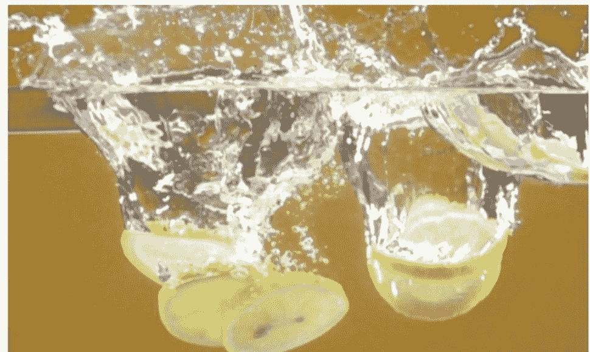

▲图4-40

### 4.2.5 延时画面拍摄技巧

在手机相机里切到“延时摄影”就能开始录制，成片会呈现加速的延时效果。延时多用于光线在变或物体位置在变的场景。

延时本质是间隔取帧，把数十分钟甚至数小时压缩到几秒钟播放，和慢动作正好相反。比如拍摄速度设为正常速度的1/15，录1分钟素材，最终止于4秒左右。

常见可用的延时场景有车水马龙，如图4-41所示、日出日落、光影推移、云层变化、植物生长等。

常见的延时摄影场景推荐拍摄速度如表4-1所示。

表4-1

| 适用场景 | 街景 | 云朵 | 日出日落 | 夜晚 | 植物生长 |
| :--- | :--- | :--- | :--- | :--- | :--- |
| 拍摄速度 | 4×～30× | 60×～90× | 120×～150× | 300×～600× | 900×～1800× |

提示

这里的拍摄速度指每拍摄30秒得到1秒播放这样的比例，即“30×”等于每隔30秒抓一帧合成1秒播放。数值越大，最终视频越短、播放越快。

不同时长变化的场景要用不同的间隔。场景跨度越长，间隔也应越长。人来车往、城市风光这类场景，间隔5~8秒比较合适；日出日落、白天转夜晚这类场景，间隔15~20秒比较合适；花朵开放、植物生长则需要15~20分钟的间隔。

延时拍摄耗时，建议全程固定机位，最好上三脚架，避免抖动。

变化极细微的场景，用固定机位拍出来和常规视频差别不大，不建议盲目尝试。若想表现微弱变化，可改用移动延时，通过改变机位来制造动感，如图4-42和图4-43所示。

▲图4-42

▲图4-43

移动延时时也建议用稳定器，减少抖动，让角度变化均匀，提升成片质量。

当前手机普遍配备广角、超广角、长焦三颗镜头，可满足不同需求。广角视野较广，超广角更广，长焦适合远距离取景。

下面以OPPO为例说明手机延时通用的操作流程。

先找好机位，拍室外街景时把设备放在高处效果更好。

打开飞行模式，关闭铃声和震动，避免来电中断录制或震动影响画面。

打开相机进入“延时摄影”模式，如图4-44所示。

点上方按钮选择合适的拍摄速度，如图4-45所示。

▲图4-44

▲图4-45

提示

部分机型不支持调节延时摄影的拍摄速度和时长，可换设备或用专业App。

点“设置”打开参考线和水平仪，如图4-46所示。用三脚架或稳定器固定手机，防止移动。锁定对焦和曝光，避免画面忽明忽暗或闪屏。

图4-46

点“录制”开始拍摄，如图4-47所示。

图4-47

提示

AMOLED屏幕长时间显示相机画面易出现烙印。建议这类手机把亮度调低，拍摄中定期下拉菜单刷新屏幕，防止残影。

## 4.3 视频取景和构图技巧

短视频同个场景也能因构图不同而呈现不同味道。合理构图能让画面更有张力。

### 4.3.1 五大景别详解

景别指取景框里画面的范围大小，由镜头与被摄物距离和焦段共同决定。一般分为远景、全景、中景、近景、特写5种，如图4-48所示。

景别是创作构思的重要环节。景别越大环境越完整，景别越小细节越突出。合理选用景别能大幅提升表达力。

#### 1. 远景

远景用来表现空间感，画面范围大，多用于呈现环境全貌，如图4-49所示。若出现人物，人物占比很小。需要交代人物处境、故事场景时常选用远景。

大尺度场景自带冲击力，远景除了交代环境还能渲染情绪、营造氛围，图4-50中奔跑的马群与飞扬雪尘就呈现出恢宏气势。

▲图4-49

▲图4-50

#### 2. 全景

全景以人物为核心，人物全身都在画面内，环境起衬托作用。与远景相比，全景更能体现人与环境的关系，如图4-51所示。也被称为交代镜头，能同时呈现场景、体态、样貌、穿搭、动作，让观众快速建立整体认知。

图4-51

提示

拍人物全景时要给头顶留出空间，否则画面会显得压抑，如图4-52所示。

图4-52

#### 3. 中景

中景通常从人物头顶拍到膝盖左右，如图4-53所示。交互性强，是叙事常用景别。

人物对话、互动或需要情感交流时，中景能兼顾动作与表情，帮助观众跟上节奏、理解关系，如图4-54所示。

▲图4-53

▲图4-54

#### 4. 近景

近景一般包含人物头部到胸部以上，如图4-55所示。

和中景相似，近景也多用于叙事，但画面更集中，人物与观众距离更近，面部表情更清晰，更容易引发情绪共鸣。常用于访谈、独白及互动性强的视频，如图4-56所示。

▲图4-55

▲图4-56

#### 5. 特写

特写聚焦细节，起到强调作用。人物特写多为肩部或颈部到头顶范围，拍其他物体则突出需要强调的局部。特写能细致呈现内心情感，如图4-57所示。

特写里主体几乎占据整帧，信息更单一，观众注意力被迫集中，常用来强调动作或暗示信息，如图4-58所示。

▲图4-57

▲图4-58

提示

不同景别组合使用，能赋予画面不同叙事含义，带来不同感受。

### 4.3.2 拍摄角度选择指南

拍摄角度是画面造型语言之一，能表现位置关系并传达信息。水平方向有正面、侧面、背面；垂直方向有平视、仰视、俯视、顶视，如图4-59、图4-60所示。

背面角度

侧面角度

正面角度

▲图4-59

▲图4-60

#### 1. 正面角度

正面拍摄多用于介绍性镜头，风格平实，能真实呈现面貌，如图4-61所示。适用于采访、报道，也适合远距离拍摄建筑全貌，如图4-62所示。

镜头正对人物时，观众视线与人物视线交汇，产生对话感，亲切且参与感强，因此多数Vlog和理论课视频采用正面拍摄。

▲图4-61

▲图4-62

#### 2. 侧面角度

镜头位于被摄物侧面，观众与人物的心理距离被拉开，互动感减弱。侧面常用于表现对话、谈判、争吵等关系，增强叙事性，如图4-63所示。

拍摄运动时，侧面能完整展现动作轨迹和运动方向，如图4-64所示。

▲图4-63

▲图4-64

#### 3. 背面角度

从背后拍摄看不到神情，只能呈现肢体语言，心理距离更远。常用来表现思索、观察，配合场景可营造神秘、孤独等氛围，如图4-65所示。

图4-65

#### 4. 平视角度

镜头与被摄物眼睛在同一水平线，是日常视角，如图4-66所示。画面平稳、透视正常，相对客观，情绪色彩较少。

#### 5. 仰视角度

镜头低于被摄物向上拍，人物在视觉上变高，像从蚂蚁视角看人类，如图4-67所示。多用来表现英雄气概或建筑的恢宏。

▲图4-66

▲图4-67

仰拍人物会带来压迫感，同时凸显勇气；拍建筑可能产生尖锐眩晕感。图4-68所示哥特式建筑仰拍后更具向上张力。仰拍争论场景还能增强紧张感。

图4-68

#### 6. 俯视角度

镜头在被摄物上方，适合展示环境，有向远眺望的感觉，如图4-69所示。拍大场景时常用。

人物在俯视下显得矮小，如图4-70所示，常用来表现弱势、彷徨不安，或对卑劣人物的轻视。

▲图4-69

▲图4-70

#### 7. 顶视角度

顶视是俯视的极端，镜头几乎垂直于被摄物正上方。航拍中常见，如图4-71所示。人们平时少见这种视角，易产生强烈冲击和记忆点。

图4-71

### 4.3.3 构图要点与方法

同场景不同构图效果各异。合理构图能让画面更有魅力。

#### 1. 构图要素

基本要素包括画框、主体、陪体、前景、背景，位置和占比影响观感。

##### 画框

拍摄时手机屏幕即是画框，如图4-72所示。画框范围有限，需要对画面进行取舍。如图4-73和图4-74所示，同一物体可通过不同取舍获得不同影像。

图4-72

▲图4-73

▲图4-74

提示

视频拍摄最好统一竖拍或横拍，便于后期剪辑。对同一场景可多拍几条素材，后期筛选。

##### 主体

主体是画面表达的核心，也是构图支点。其他元素围绕它展开。叙事视频的主体多为主人公，如图4-75所示；旅游宣传主体可能是建筑；广告主体多为产品。

图4-75

##### 陪体

陪体存在感弱于主体，却能补充信息、暗示情节，如图4-76所示护照、机票和指示牌暗示即将出游。

陪体也可与主体对比，衬托特征，如图4-77所示小人影让大树更显巨大。

图4-76

图4-77

拍摄时要注意陪体与主体或场景适配，避免突兀喧宾夺主。

##### 前景

前景位于镜头与主体之间，能塑造空间感，多用于装饰点缀，如图4-78所示的竹叶。还能平衡画面、美化构图。

图4-78

##### 背景

背景离镜头较远，多在主体后方，也称后景。用于交代场所环境，有时烘托意境、表达情感。图4-79中女子为主体，远处高楼霓虹交代地点，也反衬出她的孤单。

图4-79

#### 2. 画面的构图方法

构图是对主体、陪体等元素的搭配与设计。善于利用光线、色彩、线条能大幅提升表现力。

##### 中心构图

把主体放在画面正中央，如图4-80所示。简单易用，适合主体单一、内容简洁的画面，能保持平衡并集中视线。

图4-80

##### 三分线构图

用两条线把画面上下或左右三等分。拍摄时可借助自然轮廓线如海平面、山脉、天际线来布局。

画面重心在上三分之一为上三分构图，下三分之一为下三分构图，常用于海景天空，使画面层次更透气，如图4-81所示。

图4-81

左右三分原理相同，画面空旷时使用能显得透气且突出主体，如图4-82所示。

图4-82

三分构图应用广泛，并衍生出多种变体。

##### 九宫格构图

又称“井”字构图，横竖各两条线把画面九等分，形成四个接近黄金分割的交点，是视觉趣味中心，如图4-83所示。把主体放在交点上效果更好，人像常把眼睛放在交点上，如图4-84所示。

▲图4-83

▲图4-84

##### 对角线构图

利用画面中的视觉引导线作对角线，主体多位于对角线上。光束、色块、影调都可作为引导线。

斜线不稳定，增强动感，登山攀岩等运动画面常用。对角线还能延伸空间感，如图4-85、图4-86所示。

▲图4-85

▲图4-86

##### 对称式构图

拍摄人文景观时，特别是面对线条工整的建筑，对称布局是最常用的视觉语言之一。这种构图让画面显得整齐利落、左右均衡，很容易烘托出庄严肃穆的氛围。

除了顺着建筑本身的几何线条去做对称，还可以借助水面、玻璃等反射面来制造镜像。如图4-87所示，拱桥的实体与水面倒影拼合成一个完整的圆形，给人意外的惊喜感。

图4-87

##### 框中框构图法
在画面里再套一个自然的框架，就是框中框的思路。窗框、门廊、隧道口这些自带边框的物件都是好帮手。框里套框会让空间层次更丰富，就像图4-88那样，给人一种院落深远、层层递进的观感。

用这种方式还能主动构建视角，引导眼神走向，带来别样的观看体验。

图4-88

## 4.4 光影与色彩掌控指南
看电影时让人印象深刻的，往往是光影和色彩带来的情绪感。这两点在拍摄中同样关键，它们始终服务于故事。光影让画面有了生命力，色彩让画面有了层次和感情，正是这两者的配合让短视频更具内涵。

### 4.4.1 光线的基础认知
光线决定了质感和细节呈现。强度和方向不同，成片效果也完全不同，所以掌握光线的规律很重要。

#### 1. 光线强弱差异
根据强弱大致可分为强光、柔光、弱光三类。

- **强光（硬光）**：正午阳光多属此类。硬光下极易过曝，人物发丝、面部、白色衣物容易丢细节。拍摄时要适当降低手机曝光，并锁定曝光防止画面跳动，这样能得到明暗对比强烈的有质感画面，如图4-89所示。
- **柔光**：最适合日常创作的光线。画面既不会过亮也不会过暗，主体细节保留完整，如图4-90所示。想拍人像可选择上午或下午，清晨和日落前是拍柔光的好窗口，避免一天中最硬和最暗的时段。

▲图4-89

▲图4-90

- **弱光**：手机感光元件有限，暗光环境下细节表现力不足，不建议用来拍需要细节的作品。若想拍夜景，可在天色未全黑时拍摄，或借助手机补光灯、闪光灯和环境光补足，如图4-91所示。

图4-91

> **提示**
> 
> 光线不足时可以尝试剪影。一面白墙或公交站台的白色广告牌都很适合拍人剪影。拍摄水边时也能利用水面反射来补光。

#### 2. 光线方向差异
按方向可分为顺光、侧光、逆光、顶光。

- **顺光**：光源与机位在同一侧且高度相近，被摄物处于顺光，如图4-92所示。优点是画面均匀通透，主体和场景清晰可见，如图4-93所示。缺点是立体感弱、显得扁平。

▲图4-92

▲图4-93

- **侧光**：光源在机位侧面，如图4-94所示。明暗分界明显，能很好地表现头发、皮肤的质感，如图4-95所示。过渡不够细腻，硬朗有冲击力。
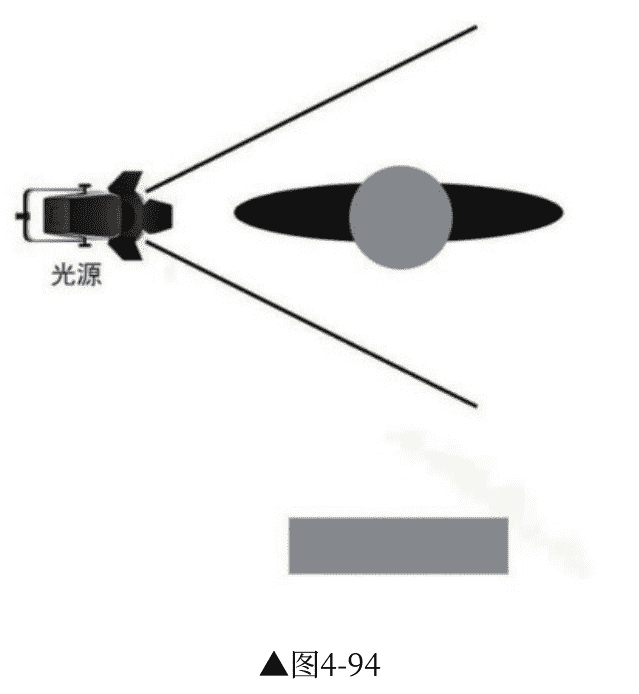

▲图4-94

▲图4-95

- **逆光**：光源在机位正对面，被摄物背光，如图4-96所示。主体面部细节会丢失，但轮廓清晰，适合拍剪影和营造神秘感，如图4-97所示。拍摄时注意光影平衡，必要时加辅助光补面。

▲图4-96

▲图4-97

- **顶光**：光线自上而下投射，如图4-98所示。眼窝、鼻下、下颌会形成深阴影，如图4-99所示。多用于造型出场，也常用来表现疲惫、悲伤、失落的情绪。
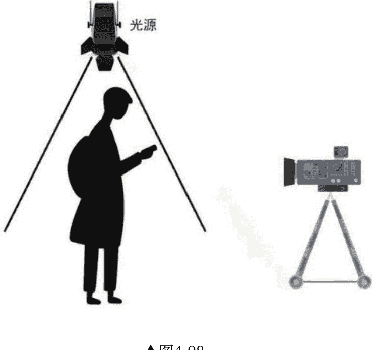

▲图4-98

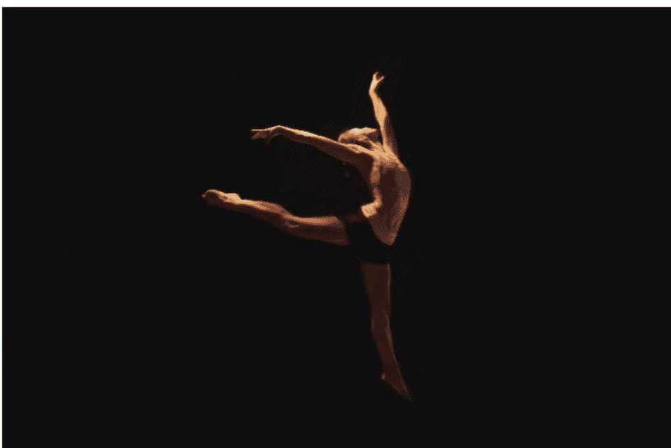

▲图4-99

### 4.4.2 色彩的情绪表达
色彩是影响观感心理的重要手段，色温会随天气时间变化。创作者可根据主题调整白平衡或搭建场景。

#### 1. 冷调营造清冷氛围
青、蓝、紫属冷色。拍摄时可在相机里调低白平衡数值，让画面偏冷。清晨拍摄用冷调会更通透干净，如图4-100所示。

图4-100

冷调使用要克制，傍晚场景若用冷调会削弱环境氛围，效果不佳。

#### 2. 暖调传递温暖感
暖调以红、黄、橙为主，花朵、落日等自然元素自带暖意。拍摄暖调素材可通过白平衡调节，也可选择暖色场景并在后期提升饱和度，如图4-101所示。

图4-101

#### 3. 黑白怀旧叙事
黑白画面把世界简化为明暗两极，多为后期调色完成。它适合表现回忆、压抑、神秘的情绪，如图4-102所示。

图4-102

要做出好黑白，构思是关键，可用对比、呼应、平衡来组织画面。并非所有题材都适合黑白，若想出水墨感，可选择大面积云雾或雪地场景，按“计白当黑”与留白思路调色，如图4-103所示。

图4-103

> **提示**
> 
> 环境杂乱时转成黑白能去掉多余色彩，让画面更干净利落。

### 4.4.3 实战用光技巧
拍风光更要挑对时机和光线。

#### 1. 日出日落黄金段
日出日落前后光线柔和，天边的霞光层次丰富、云彩色彩饱满，如图4-104所示。

图4-104

拍摄需提前到达，架好机位等待光线变化。

#### 2. 轮廓光塑造形体
当主体与背景色调相近时，轮廓光能清晰勾勒边缘，还能在四周形成金色光晕，像给主体镶了光环，如图4-105所示。

图4-105

#### 3. 逆光剪影增强层次
剪影利用强烈的明暗对比让画面更有质感，如图4-106所示。可让主体挡住光源拍轮廓，人跑动时把手机贴近地面，会得到若隐若现的动感剪影。

图4-106

#### 4. 光影点缀氛围
树荫、山谷、建筑产生的阴影都是天然点缀。山间云影增强层次，阳光洒在沙丘上形成柔美纹理，关键是多观察多练习。

图4-107

## 4.5 短视频运镜技巧
运镜即镜头运动，是短视频视觉冲击力的来源。

### 4.5.1 推镜头
被摄物不动，镜头由远及近推进，如图4-108所示。画面逐渐放大细节，有强调作用。推进速度快会带来冲击感，常用于快速带观众进入剧情，如图4-109和图4-110所示。

图4-108

▲图4-109

▲图4-110

### 4.5.2 拉镜头
与推镜头相反，由近向远后退，如图4-111所示。可从局部切到整体，观察全局。快速后拉能表现人物疏离、不信任或抽离场景，如图4-112和图4-113所示。

图4-111

▲图4-112

▲图4-113

### 4.5.3 摇镜头
机位固定，镜头转动拍摄。常与其他手法结合，如图4-114所示。结合景别和景深变化能提升戏剧张力，也可暗示时间地点情感变化。摇动过程能自然引导视线。

图4-114

### 4.5.4 移镜头
摄像机在水平、垂直或三维空间移动改变视角和构图，如图4-115所示。能制造动态感，增强参与感，如图4-116所示。
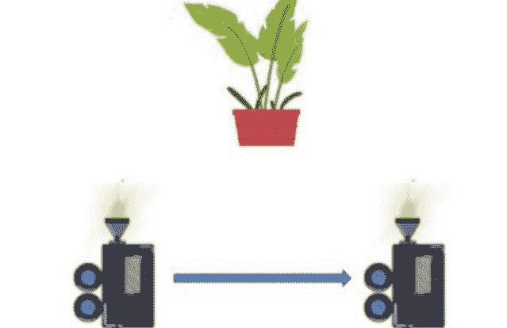

图4-115

图4-116

常见方式有平移、升降、旋转、变焦、三维移动等。移镜头侧重表现人与物、物与物间的空间关系，视觉效果与摇镜头不同。摇镜头机位不动角度变，适合近景；移镜头机位动形成跟随感，更具情绪氛围。

### 4.5.5 升降镜头
摄像机上下运动，如图4-117所示。有垂直、斜向、不规则多种变化形式，配合俯仰角度可获得丰富视角。
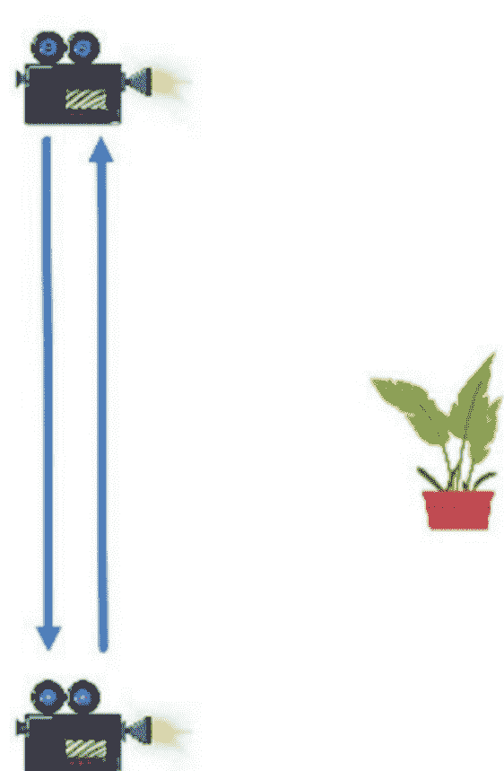

图4-117

### 4.5.6 旋转镜头
摄像机沿光轴旋转或环绕拍摄，如图4-118所示。容易产生眩晕感，常用于营造特殊氛围。可用稳定器快速旋转，或原地转动做反向环绕，低角度环绕可突出主体高大感。
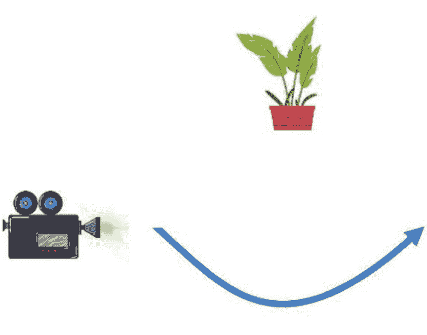

### 4.5.7 固定镜头
机位、光轴、焦距全程不变，被摄物可动可静。固定镜头能呈现事物发展规律，展示细节和环境，把控节奏。其半封闭边框适合制造悬念。

> **提示**
> 
> 固定镜头视点单一、构图变化少、难表现复杂环境，通常需要与其他镜头配合使用。

# 第5章 素材生成：AI工具快速生成各种素材
除了实拍，也可以用AI平台生成素材。本章介绍AI绘画基础与常用工具。

## 5.1 AI绘画的基础知识
AI绘画是借助人工智能技术生成艺术作品，技术涵盖计算机视觉、深度学习、生成对抗网络等，可产出多种风格作品，如图5-1所示。

图5-1

> **提示**
> 
> 与传统绘画不同，AI绘画依赖计算机技术，能大幅提升效率、降低成本，更重要的是增强创造性和开放性，推动艺术发展。

### 5.1.1 AI绘画的技术特点
AI绘画具备快速、高效、自动化的特性。依托人工智能算法对图像进行处理，可实现风格融合与变换，提升创作体验。其特点主要体现在以下几个方面。

**AI绘画技术拆解**

- **原创图像合成**：借助生成对抗网络、变分自编码器 VAE 等模型，能够在没有任何草稿的情况下直接生成全新画面，实现从无到有的视觉创作。
- **风格迁移**：通过卷积神经网络 CNN 等手段，把源图的视觉语言转换到另一种艺术体系，达成多种风格的融合与重塑，图5-2呈现写实表现，图5-3呈现动漫表现。

▲图5-2

▲图5-3

- **自动上色**：利用图像分割、色彩填充等流程，可为线稿或黑白素材自动添加色彩与纹理，实现自适应着色。
- **画质提升**：运用超分辨率重建、降噪等技术，能够大幅提高图像清晰度与细节，让作品更逼真精细。

### 提示

超分辨率指通过软硬件手段提升图像分辨率的技术，本质是以多张低分辨率输入重建高分辨率输出。降噪则是清除图像噪点，获得更干净的视觉效果。

- **学习范式**：结合有监督学习与无监督学习等方法，对艺术作品进行分类、识别、重构、优化等操作，可实现对作品的深度理解。

### 提示

有监督学习即有教师训练，使用已知类别样本调整分类器参数以达到预期性能。无监督学习则在类别未标注的情况下，解决模式识别等任务。

### 5.1.2 AI绘画的应用领域

近年来 AI 绘画关注度持续提升，应用范围不断扩大，覆盖游戏、影视动画、设计广告、数字艺术等。既可以产出素描、水彩、油画、立体艺术等多种形式，也能在创作流程中辅助创作者更快更准确地表达创意。

#### 1. 游戏开发领域

AI绘画能够帮助游戏团队快速产出所需美术资源，如角色、场景、环境等图像。以 AI 生成的场景为例可见图5-4。

团队通常先用生成对抗网络等技术快速得到角色草图，再借助传统工具进行细化。

图5-4

#### 2. 电影和动画领域

在影视动画制作中，AI绘画的应用愈发广泛，可迅速生成场景、辅助角色设计，并参与特效与后期制作。以 AI 生成的场景为例如图5-5，有助于团队更清晰地规划镜头与布局。

AI 生成的角色如图5-6所示，有助于更直观理解角色并精准塑造形象。

▲图5-5

▲图5-6

#### 3. 设计和广告领域

在设计广告场景，AI绘画能提升效率与质量，丰富内容形式，增强产品设计的创造力与展示力，并带来更智能高效的交互体验。设计师与广告人员可用其快速生成平面物料，如广告图、海报、宣传图等。AI 生成的香水广告图如图5-7所示。

AI 还可用于生成虚拟产品的样图，如图5-8所示，在设计阶段助力更好地呈现与推敲。

▲图5-7

#### 4. 数字艺术领域

目前 AI绘画已成为数字艺术的重要表达方式，艺术家借助其特性创作出独具特色的数字作品，如图5-9所示。AI 的发展推动了数字艺术的创新与普及。

## 5.2 AI绘画与AI视频的常见工具与平台

当前 AI绘画与视频创作工具众多，用户可按需求挑选。本节介绍若干典型平台。

### 5.2.1 即梦AI

即梦AI由剪映官方推出，是一个可依据文案或图片生成精彩内容的智能创作平台，如图5-10所示。平台提供智能画布、多图AI融合、创意社区等功能，助力影像创作。

图5-10

即梦AI 能根据用户输入生成精美的图像素材，大幅提升工作效率。

### 5.2.2 文心一格

文心一格由百度飞桨推出，是面向艺术与创意辅助的 AI 平台，依托深度学习技术帮助用户快速产出高质量图像与艺术作品，提升创作效率。适合艺术家、设计师、广告从业者等高频创作人群。可用功能包括：

- **自动画像**：上传一张图片后，可将其转为不同艺术风格，支持二次元、漫画、插画、像素艺术等多种画面风格。
- **智能生成**：输入创意描述与风格，平台自动学习并生成对应图像与作品。
- **创作优化**：基于用户想法对已有图像进行分析与改进。

文心一格的 AI 创作页面如图5-11所示。

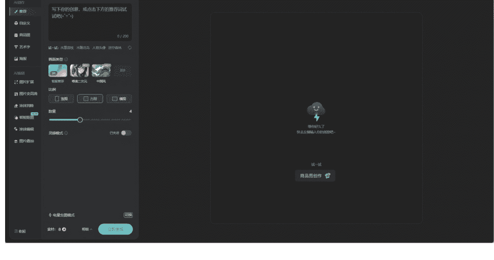

图5-11

### 5.2.3 Midjourney

Midjourney是一款基于人工智能的绘图工具，可帮助艺术家与设计师高效创作。内置多种指令，用户发送关键词与指令即可通过 AI 生成对应图片。其使用界面如图5-12所示。

图5-12

Midjourney 具备智能绘图能力，可自动推荐颜色、纹理、图案等元素，方便用户创作精美画作，并能快速生成多样化视觉效果。

### 5.2.4 AI作画

AI作画是百度 AI 开放平台推出的图片创作工具，如图5-13所示，支持基于文本输入生成不限风格的图像。用户只需输入指令，AI 即可按语义生成作品。

图5-13

### 5.2.5 无界版图

无界版图是一个数字版权在线交易平台，借助区块链技术在确权、拍卖等方面发力，整合全球优质艺术资源，为创作者提供版权登记、保护、使用、拍卖等一站式服务。平台中的作品拍卖信息如图5-14所示。

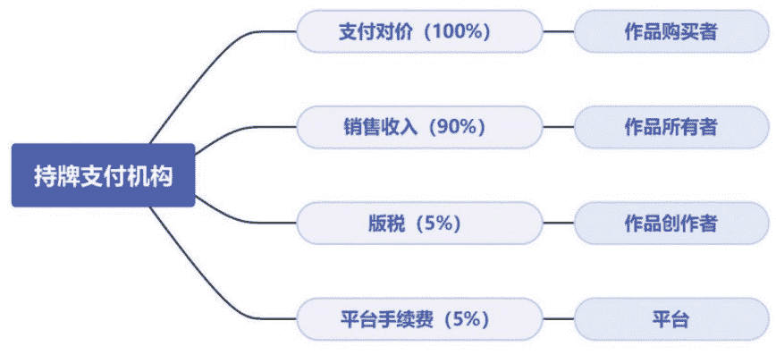

图5-14

平台具备强大的 AI 创作功能，用户可选择二次元模型、通用模型或色彩模型，输入画面描述词并设定尺寸与分辨率生成画作。无界版图的首页如图5-15所示。

图5-15

### 5.2.6 造梦日记

造梦日记是一个基于 AI 算法生成高质量图像的平台，用户可输入文字描述、实物描述、场景描述、诗歌、歌词等“梦中画面”，平台即可生成对应图像。其首页如图5-16所示。

图5-16

### 5.2.7 可灵

可灵 Kling 由快手大模型团队开发的视频生成大模型，视频创作能力突出。

与常规工具不同，可灵得益于高效训练基础设施与推理优化，可生成长达 2 分钟、30 帧/秒的视频。采用 3D 时空联合注意力机制与自研架构，结合缩放定律，能更好建模复杂时空运动，生成运动幅度较大的内容，并模拟真实物理规律。基于文本-视频语义理解与 Diffusion Transformer 架构，可灵能将丰富想象转化为具体画面，构建现实中不存在的场景。

可灵的首页如图5-17所示。

图5-17

登录快手账号后可进入创作界面，如图5-18所示。截至撰写时，可灵提供可灵 1.0 与可灵 1.5 两个模型，用户可按需选择。

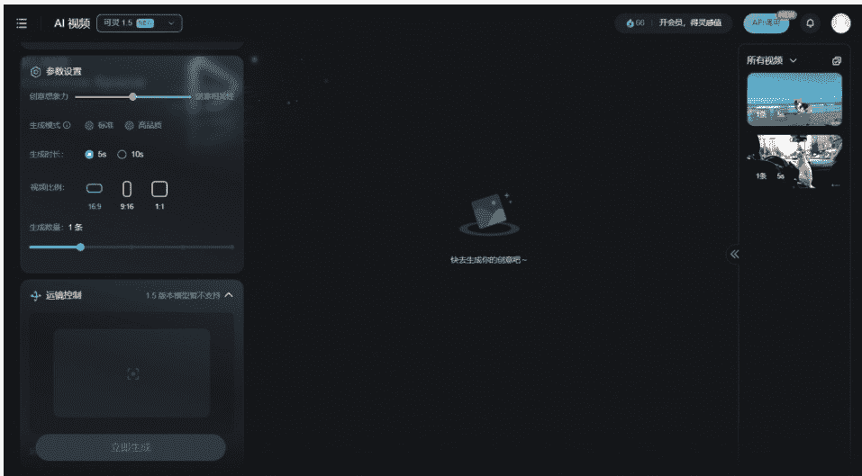

图5-18

### 5.2.8 海螺AI

海螺 AI 可将文本转化为惊艳视频。进入首页如图5-19所示，登录后在输入框输入想法，点击“生成”即可实现文字转视频。

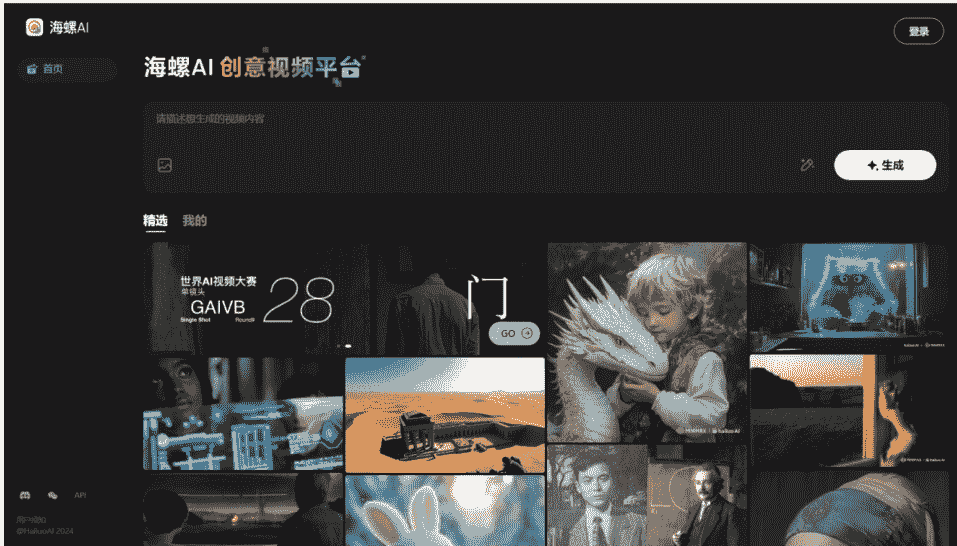

图5-19

## 5.3 即梦AI的使用方法

即梦 AI 是一个 AI 创作平台，能激发灵感，提升绘画与视频创作体验。具备图片转视频、文本转视频等多种能力，本节介绍使用方法。

### 5.3.1 基础用法

在搜索引擎搜索“即梦”，结果如图5-20所示。

图5-20

进入即梦 AI 首页如图5-21所示，点击所需功能模块即可进入对应界面。

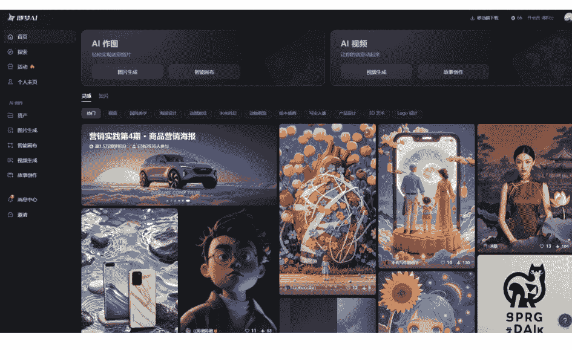

图5-21

### 5.3.2 图片转视频

图片转视频功能可识别导入图片，并结合提示词生成视频。

在首页点选“AI 视频”模块中的“视频生成”按钮，如图5-22所示。

图5-22

进入视频生成界面如图5-23所示。左侧为设置栏，默认显示图片转视频参数，用户可在此调节选项以获得更好画面效果。

图5-23

导入图片并设置参数后，点击设置栏底部的“生成视频”按钮，如图5-24所示，即可开始生成。

图5-24

### 5.3.3 文本转视频

除了图片转视频，即梦 AI 还支持文本转视频。切换设置栏至“文本转视频”模块，如图5-25所示，输入提示词后点击“生成视频”即可。

图5-25

### 5.3.4 首尾帧制作“穿越”视频

图片转视频模块提供首尾帧功能，用户导入首尾帧图片后，系统会自动生成过渡视频。

本例选用城市与古建筑素材，强烈反差更易体现穿越感。导入首尾帧并调节配置，如图5-26所示。

生成后可在平台预览，如图5-27所示，可多次调整参数优化效果。

▲图5-26

▲图5-27

### 提示

使用首尾帧时需保证首帧与尾帧画面比例一致，否则无法导入。

### 5.3.5 首尾帧制作“逆生长”视频

首尾帧功能还可用于制作逆生长视频。导入首帧与尾帧图片并调节配置，如图5-28所示。

### 5.3.6 智能画布制作创意Logo

即梦 AI 的“AI 作图”模块中的“智能画布”可上传图片生成新图，也可直接用文字生成并即时调整。

首页点选“智能画布”按钮，如图5-30所示，进入画布界面。

选择“文生图”选项，输入提示词，点击“生成图片”即可生成 Logo，如图5-31所示。

## 5.4 文心一格的使用方法

文心一格源于百度在自然语言处理、图像识别等领域的积累与海量数据支持，推动 AI 技术在多领域的落地。

用户可用其快速生成高质量画作，支持自定义提示词、画面类型、图像比例、数量等，即使提示词相同，每次生成的作品也各具特色。

### 5.4.1 基础用法

使用“推荐” AI 绘画模式，只需提供提示词即可自动生成画作。

进入文心一格首页登录后，点击“立即创作”进入 AI 创作界面，输入提示词，点击“立即生成”，如图5-32所示。

片刻后即可得到与提示词相关的作品，效果如图5-33所示。

### 5.4.2 选择画面类型

文心一格提供多种画面类型，如“智能推荐”“唯美二次元”“中国风”“艺术创想”“插画”“明亮插画”等。

在“AI 创作”界面点击“画面类型”区的“更多”按钮可查看更多选项，如图5-34所示。

选择“唯美二次元”，输入提示词后点击“立即生成”，如图5-35所示。

生成的作品效果如图5-36所示。

### 提示

“唯美二次元”画面色彩丰富、线条细腻柔和，呈现梦幻浪漫氛围，多用于动漫、游戏、插画领域。

### 5.4.3 设置比例与数量

除画面类型外，还可设置图像比例“竖图”“方图”“横图”及数量，最多 9 张。

在创作界面输入提示词后，将比例设为“竖图”，数量设为 2，如图5-37所示。

点击“立即生成”后可得到两幅作品，效果如图5-38、图5-39所示。

### 5.4.4 自定义模式

“自定义”模式允许设置更多提示词，使结果更贴合需求。

进入创作界面打开“自定义”选项卡，输入提示词，设置“选择 AI 画师”为“具象”，尺寸为 1:1、1024×1024，如图5-40所示。

继续设置画面风格为“水彩画”，修饰词为“丁达尔效应”“明亮”，如图5-41所示。

点击“立即生成”即可得到定制作品，效果如图5-42所示。

### 5.4.5 上传参考图以图生图

“上传参考图”功能可上传任意图片，用文字描述修改点后实现以图生图。

在“自定义”选项卡输入提示词后，点击“上传参考图”下的“上传”按钮，如图5-43所示。

在打开对话框中选择目标参考图，如图5-44所示，点击“打开”完成上传。

上传后设置“影响比重”为 6、“数量”为 1，如图5-45所示，影响比重可调节参考图对结果的影响程度。

点击“立即生成”即可基于参考图生成作品，效果如图5-46所示。

### 5.4.6 图片叠加混合生图

“图片叠加”功能可将两张素材图叠加生成新图，新图兼具双方特征。

在创作界面打开“图片叠加”选项卡，点击“选择图片”按钮，如图5-47所示。

在弹出的对话框中点击“上传本地照片”，选择基础图与叠加图，叠加图示例如图5-48所示。

上传完成后点击“确定”，如图5-49所示。

调整参数并输入提示词后，点击“立即生成”，如图5-50所示。

生成的图片效果如图5-51、图5-52所示。

# 第6章 视频制作技巧：AI助力快速成片

剪映由抖音官方推出，是一款操作简便、功能全面的剪辑软件，深受用户喜爱。随着 AI 功能不断加入，剪映可帮助用户快速成片。本章介绍剪映的使用方法。

## 6.1 剪映 App 与专业版入门

剪映 App 用于手机，剪映专业版用于电脑。下面介绍下载与安装方法。

### 6.1.1 下载并安装剪映

剪映全流程上手：从下载到AI智能出片

2019年5月，抖音旗下推出的这款剪辑工具正式上线，标志性图标展示于图6-1。产品集合了全套剪辑能力、丰富音视频素材库以及滤镜、特效、贴纸等视觉元素。移动端与桌面端获取路径不同，下面分情况说明。

#### 1. 安卓手机版安装
01 打开桌面应用商店，在搜索栏输入“剪映”，如图6-2所示。
02 定位到对应程序后点“安装”，如图6-3所示。完成后桌面会出现图标，如图6-4所示。

### 提示
各家安卓系统的安装界面大同小异，细节可能略有差别，以上仅作参考，请以实际设备为准。

#### 2. iOS手机版安装
01 桌面打开“App Store”，如图6-5所示。进入后切换搜索页，如图6-6所示，在搜索框填入“剪映”，如图6-7所示。
02 找到应用后可直接点击旁边的“获取”下载，如图6-8所示；也可先进入详情页再点击“获取”，如图6-9所示。安装完成后图标会出现在桌面，如图6-10所示。

#### 3. 电脑专业版
正式进行电脑后期前，先对该版本做个了解，下面介绍概况、下载与安装以及界面认识。

电脑版是移动端之后推出的桌面剪辑软件。相比手机版，界面更宽阔、布局更符合大屏操作，更适合进阶创作，可输出更高质量的成片。官方宣传界面见图6-11。

### 提示
当前提供macOS与Windows两个系统，后文统一称专业版。

下载与安装较为简便，以Windows为例。

01 在浏览器打开搜索引擎，输入“剪映专业版”检索，如图6-12所示。
02 进入官网首页，点击“立即下载”，如图6-13所示。

### 6.1.2 工作界面概览

#### 1. 手机版界面
移动端设计简洁直观，每个功能键下方都有文字提示。下面分主界面与编辑界面说明。

##### 主界面
启动后首先看到主页面，如图6-16所示。

底部导航的“剪辑”“剪同款”“草稿”“我的”可切换使用，具体如下。

- **剪辑**：收纳创作工具、辅助工具及草稿箱。
- **剪同款**：提供大量模板，可按分类套用，也可搜索挑选。
- **草稿**：存放已同步云端的剪辑、脚本、图文等，也可查看加入的云空间小组。
- **我的**：展示个人资料及收藏的模板。

##### 编辑界面
在主界面点击“开始创作”进入素材选择，选定后点“添加”进入编辑页，如图6-17所示。页面由预览区、时间轴与底部工具栏构成。

- **预览区**：实时显示当前时间线画面，所有操作效果需在此确认。图6-17左下角00:00/00:03表示当前进度与总时长3秒。底部提供播放、撤销、恢复、全屏等控制。
- **时间轴**：后期主要操作区，包含轨道、时间线与刻度。裁剪或添加效果时需三者配合精确定位。
- **工具栏**：集中了几乎所有功能，未选轨道时显示一级菜单，点击展开二级。选中轨道后工具栏会切换为对应专项。

进入编辑页后底部工具栏功能如图6-18所示。

主要功能：
- **剪辑 ✂️**：分割、变速、动画等基础编辑。
- **音频 🎵**：处理音轨，可调用内置曲库获取音乐音效。
- **文本 📝**：添加描述文字，支持多种样式、字体与模板，可识别字幕歌词并AI配音。
- **贴纸 😊**：大量贴纸素材，提升画面趣味。
- **画中画 🖼️**：额外轨道，用于多画面合成。
- **特效 ✨**：多类特效模板，一键应用。
- **字幕 📜**：语音识别生成字幕，支持双语，可智能划重点并标记无效片段。
- **模板 📋**：创作者上传模板，便于快速成片。
- **滤镜 🎨**：多类型滤镜，匹配场景提升质感。
- **比例**：常见视频比例选择。
- **数字人**：加入逼真数字人，模拟真人出镜。
- **背景**：设置画布颜色、样式与模糊。
- **调节**：调节画面基础参数，优化细节。

#### 2. 专业版界面
手机版与电脑版运行平台不同，版式有差异，但核心功能一致。电脑版依托大屏，呈现更直观的编辑效果。图6-19与图6-20为对比展示。

双击桌面图标，点击“开始创作”进入工作界面。操作逻辑与手机版基本相同，因屏幕更大布局不同，熟悉手机版后能快速上手。

专业版界面如图6-21所示，主要包含工具栏、素材区、预览区、素材调节区、常用操作区与时间轴，时间轴面积最大，是剪辑核心。

各区说明：
- **工具栏**：含“媒体”“音频”“文本”“贴纸”“特效”“转场”“滤镜”“调节”“素材包”九个入口。点“媒体”可从本地或素材库导入素材到素材区。
- **素材区**：点击工具栏相应按钮后，对应资源会展示于此。
- **预览区**：随时查看效果，右下角“全屏”可全屏预览，“比例”可调整画面比例。
- **素材调节区**：选中时间轴某轨道后，会显示该轨道参数面板。视频、音频、文字轨道选中时面板会变化，如图6-22所示。
- **常用操作区**：可快速分割、删除、定格、倒放、镜像、旋转、裁剪。误操作点“撤销”可回退；点“选择”可切换鼠标为选择或分割模式，选分割后点击轨道即可分割。
- **时间轴**：包含轨道、时间线、时间刻度，因界面宽阔可同时显示多条轨道，如图6-23所示。

> **提示**
> 手机版素材需从相册选取，相册相当于素材区。电脑版没有统一素材文件夹，故单独设计素材区。首次使用需将素材全部导入素材区，后续拖拽至时间轴即可。

### 6.1.3 手机版实操案例
结合前文，用手机版制作氛围短片，步骤如下。

01 打开程序，导入名为“黄昏”的视频，如图6-24所示。
02 点底部工具栏“文本”📝进入二级菜单，点击“新建文本”🅰，如图6-25所示。输入“白露|秋意渐浓”作字幕，调整字体并在预览区定位，如图6-26所示。
03 选中字幕，调整时长与视频一致，如图6-28所示。
04 返回工具栏，将时间线移至起点，点击“滤镜”，如图6-29所示。选择“风景”分类下的“绿妍”，强度设为75，如图6-30所示。
05 返回工具栏，点击“特效”，进入二级菜单点“画面特效”，如图6-31所示。在搜索框输入“柔光”，挑选合适特效并设强度40，如图6-32所示，再把特效时长调至与视频一致。
06 返回工具栏，点击“音频”🎵进入二级选项，点击“音乐”🎵，如图6-33所示。进入音乐库在纯音乐分类挑选背景音乐，如图6-34所示。
07 选中背景音乐，将时间线移至视频结尾，点击“分割”📎，如图6-35所示。删除多余片段，使音频时长与视频一致，如图6-36所示。
08 预览最终效果，如图6-37所示。

### 6.1.4 专业版实操案例
结合前文，用电脑版制作氛围短片，步骤如下。

01 启动程序，新建草稿后导入名为“芦苇”的视频，如图6-38所示。
02 点击工具栏“文本”TI切换到文本模块，在时间轴添加字幕。选中字幕，调整内容、字体、字号与样式，如图6-39所示。
03 选中时间轴字幕，在预览区右侧素材调节区点击“动画”，为字幕添加“溶解”入场效果，如图6-40所示。
04 参考上一步，为字幕添加“溶解”出场效果，如图6-41所示。
05 选中时间轴视频素材，在素材调节区切换到“调节”，适当调整参数优化画面，如图6-42所示。
06 点击工具栏“音频”🎵切换到音频模块，在音乐素材库纯音乐分类找到合适背景音乐并加入时间轴，如图6-43所示。
07 将时间线移到00:00:00:42，选中音频素材，点击常用操作区“向左裁剪”按钮，裁掉前面空白片段，如图6-44所示。调整音频位置，使起点与视频对齐。
08 将时间线移到视频结尾，选中音频素材，点击常用操作区“向右裁剪”按钮，裁掉多余片段，如图6-45所示。
09 预览视频效果，如图6-46所示。

> **提示**
> 手机版与电脑版操作大部分相同，学会其一即可快速迁移。

## 6.2 手机版智能出片功能

程序内置多项实用功能，可帮助快速获得理想效果。本节介绍智能化出片功能的使用方法。

### 6.2.1 “剪同款”制作
平台提供多种模板，替换素材即可快速成片，具体做法如下。

01 打开程序，点击“我的”，在“喜欢”选项卡挑选合适模板，如图6-47所示。
图6-47
02 点选模板进入详情页，点击右下角“剪同款”按钮，如图6-48所示。
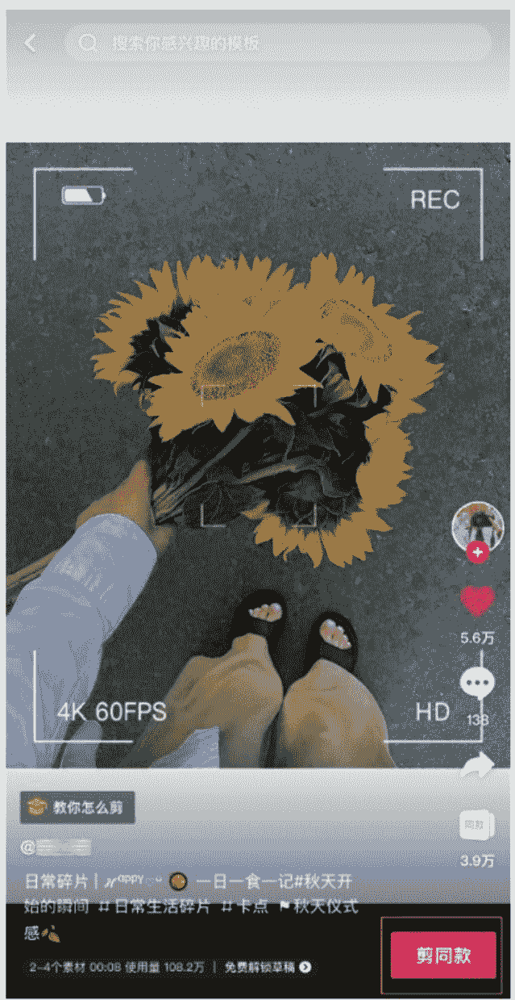
图6-48
03 导入图片素材完成替换，如图6-49所示。
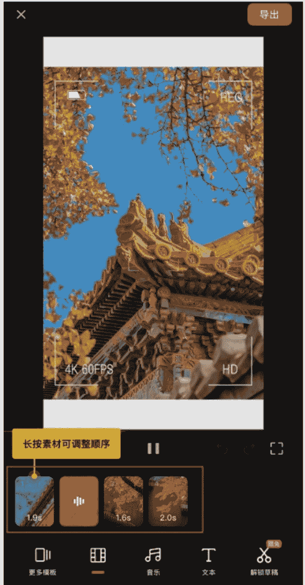
图6-49
04 预览画面效果，如图6-50所示。

图6-50

### 提示
使用“剪同款”时仅能调整素材、背景音乐和字幕内容，若需更多参数调整则需付费解锁草稿。

### 6.2.2 “一键成片”制作
“一键成片”可自动识别导入素材并匹配模板。

01 打开程序，点击主界面“一键成片”按钮📷，如图6-51所示。
❤️ 开通会员
- 一键成片
- 图文成片
- 图片编辑
- 视频翻译
- 展开

### 试试看！
- 功能 | AI音乐大揭秘
- AI生成带货爆款
- 剪映满意度有
### 本地草稿
- 剪辑 0
- 模板 0
- 图文 0
- 脚本 0
- 回收站 3
模板草稿会自动保存在这里，快去使用模板吧~
图6-51
02 导入素材后系统会自动识别并匹配，匹配完成如图6-52所示。若不满意可底部选其他模板。
编辑
导出

00:04
00:10
收藏
推荐
夏日☀️
卡点
高级感
简单

“有幸相遇...”
#无滑雪不...”
“没有很快...”
无能为力的...”
Good luck...”
小意
灵犀
Sunny
小薇
张一二
图6-52
03 预览视频效果，如图6-53所示。

图6-53

### 6.2.3 “图文成片”制作
“图文成片”可根据关键词或导入图片抓取素材并自动生成视频。

01 打开程序，主界面点击“图文成片”按钮📷，如图6-54所示。
开通会员
一键成片
图文成片
图片编辑
视频翻译
展开
开始创作
试试看！
功能 | AI音乐大揭秘
一键10条爆款带货视频
AI生成带货爆款
剪映满意度有
本地草稿
剪映云
管理
剪辑 0
模板 0
图文 0
脚本 0
回收站 3
模板草稿会自动保存在这里，快去使用模板吧~
剪同款
草稿
我的
图6-54
02 进入“图文成片”界面，可选择预设，也支持自定义输入文案，如图6-55所示。
### 图文成片
自由编辑文案
### 智能写文案 Beta
- 情感关系
- 励志鸡汤
- 美食教程
- 美食推荐
- 营销广告
- 家居分享
- 旅行感悟
- 旅行攻略
- 生活记录
- 自定义主题
图6-55
03 选择“旅行感悟”进入文案编辑，输入旅行地点、话题并选择视频时长后，点击“生成文案”，如图6-56所示。
### 旅行感悟
旅行地点 *
大理
话题
大理的风景真美
视频时长
- 不限时长
- 1分钟左右
- 1-3分钟
- 3分钟以上
生成文案
图6-56
04 系统会生成3份文案供挑选，也可在生成后修改。选定文案后点击“生成视频”，如图6-57所示。
### 确认文案
文案结果 1/3
大理的风景真美！
来到大理，我才发现，原来这里的天空是那么的蓝，白云是那么的白，阳光是那么的温暖。这里的湖水清澈见底，仿佛是一块巨大的翡翠，让人流连忘返。
洱海边的风铃随风飘动，发出悦耳的声音，仿佛在诉说着古老的故事。远处的苍山云雾缭绕，如同仙境一般，让人惊叹大自然的鬼斧神工。
走在古城的青石板路上，感受着历史的沉淀，仿佛能听到那些古老故事的回响。这里的每一块石头，每一座建筑，都透露出浓厚的文化气息。
大理的风景真的太美了，让我陶醉其中，流连忘返。下次有机会，我还想再来这里。
智能生成的内容仅供参考，不代表平台立场
图6-57
05 弹出菜单后可按需选择成片方式，如图6-58所示。
### 确认文案
文案结果 1/3
### 大理的风景真美！
来到大理，我才发现，原来这里的天空是那么的蓝，白云是那么的白，阳光是那么的温暖。这里的湖水清澈见底，仿佛是一块巨大的翡翠，让人流连忘返。
洱海边的风铃随风飘动，发出悦耳的声音，仿佛在诉说着古老的故事。远处的苍山云雾缭绕，如同仙境一般，让人惊叹大自然的鬼斧神工。

漫步青石铺就的古城巷道，历史的厚重感随风而来，仿佛能听见往昔故事在耳边低语。每块石板、每一栋老屋都散发着浓郁的文化气息。

大理的景致令人痴迷，呆在这里就不想离开。假若还有缘分，下一次一定会再来。

智能生成的内容仅供参考，不代表平台立场

### 如何选择成片方式
- **智能推荐素材**
  系统会依据文案自动筛选适配的视频与图片
- **本地素材上传**
  可以自行导入个人的视频或照片
- **智能搭配表情包**
  根据文案语气匹配网感十足的表情

图6-58

06 完成视频生成后会自动进入编辑界面，具体可参考图6-59。

导入剪辑

导出

大理的风景真美！

00:00 / 00:52

00:00

00:02

00:04

设置封面

大理的风景...

来到大理 我才发现

My Treasure

主题效果一键套用

主题模板

风格套图

画面

文本

音色

自主录音

图6-59

### 6.2.4 视频翻译快速上手
制作视频时若需多语种字幕，人工翻译再添加会花费不少时间。剪映的视频翻译功能能够迅速完成语言转换，节省创作时长。

01 在手机剪映主界面点击“视频翻译”入口 🌐，如图6-60所示。

开通会员

- 一键成片

- 图文成片

- 图片编辑

- 视频翻译

- 展开

开始创作

### 试试看！

- 功能 | AI音乐大揭秘

- 一键10条爆款带货视频

- 剪映满意度有

### 本地草稿

- 剪辑 0

- 模板 0

- 图文 0

- 脚本 0

- 回收站 8

剪辑草稿会自动保存在这里，快去创作作品吧~

图6-60

02 选择待翻译的视频素材，点击“确认”后进入翻译页面，如图6-61所示。

### 视频翻译

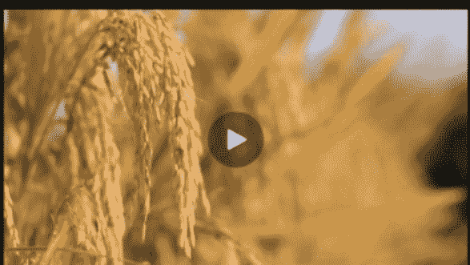

原始语言

中文

翻译语言

英语

💎 可试用，试用后开通SVIP并消耗积分使用 >

应用

ⓘ 仅可对本人视频翻译。您承诺提供的素材内容为您本人所有或已获得合法授权，并遵守《剪映音视频翻译功能使用规范》

图6-61

## 提示
使用视频翻译功能需要先开通会员。

### 6.2.5 营销成片批量出片
推广创作时往往需要大量素材，虽然流程简便但重复操作较多。剪映的营销成片功能可迅速批量生成各类推广视频。

01 打开手机剪映，展开创作工具栏，点击“营销成片”，如图6-62所示。

开通会员

- 一键成片

- 图文成片

- 图片编辑

- 视频翻译

- 收起

- AI 作图

- 营销成片

- AI 商品图

- 拍摄

- 创作脚本

- 录屏

- 提词器

- 美颜

- 超清画质

- AI 特效

- 一起拍

- 智能抠图

- 超清图片

长按拖动可调整顺序

### 试试看！

本地草稿

剪映云

管理

- 剪同款

- 草稿

- 我的

图6-62

02 进入营销推广视频界面，如图6-63所示，可上传素材并借助 AI 写文案功能生成符合需求的文案。

### 营销推广视频

### AI 帮你快速生成营销广告

添加素材 *

### 视频文案

AI 写文案 Beta

输入或提取文案

商品名称 *

例如：口红

商品卖点

例如：简约设计，滋润质地

展开更多 ∨

生成视频

图6-63

## 6.3 剪映专业版的AI成片能力
如今众多剪辑软件都配备了强大的智能功能，让素材处理更高效。本节聚焦专业版的智能成片能力。

### 6.3.1 模板快速成片
专业版内置大量模板，相较移动端预览更直观。

01 启动专业版，点击左侧“模板”，如图6-64所示，切换至模板页。模板已分类，便于查找，如图6-65所示。

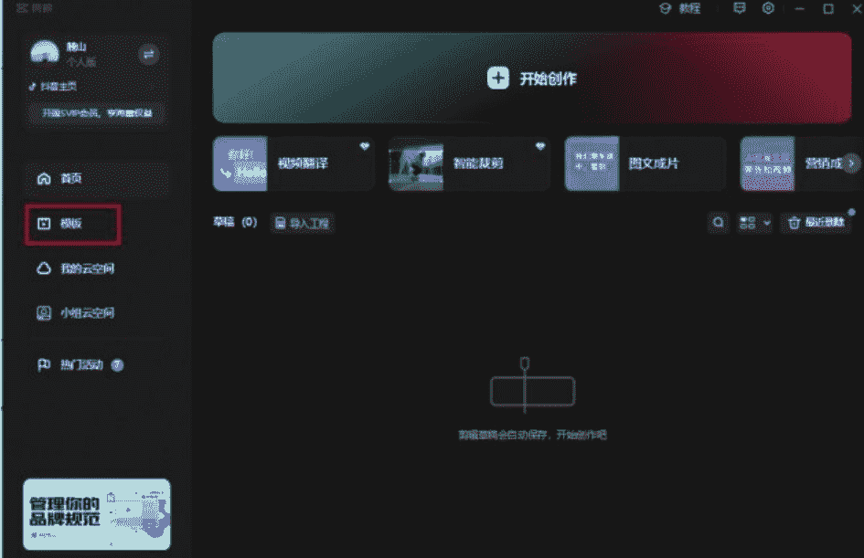

▲图6-64

▲图6-65

02 将鼠标移至模板上即可预览效果并查看详情，如图6-66所示。点击“使用模板”即可应用。

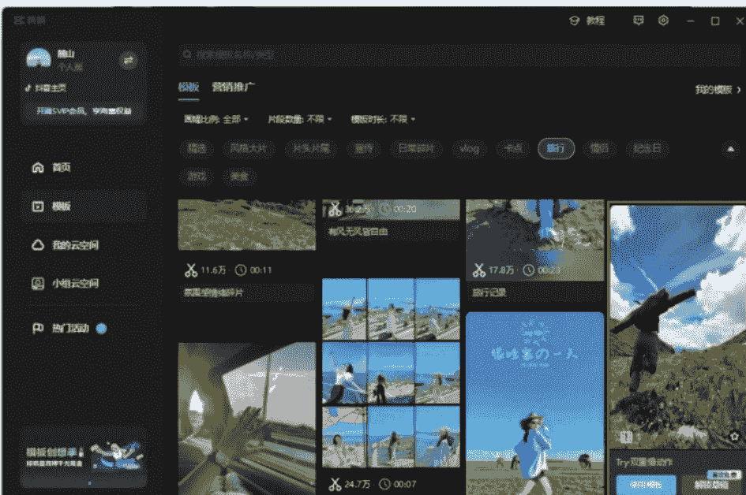

图6-66

03 编辑窗口自动打开，导入素材后拖入替换区即可完成替换，如图6-67所示。

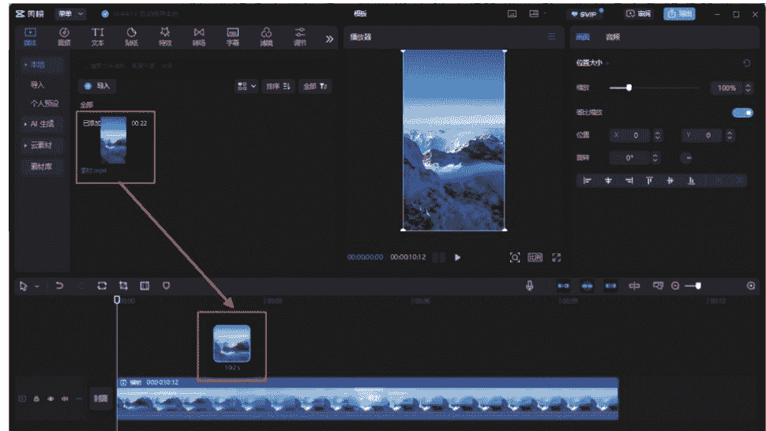

图6-67

04 预览画面效果，如图6-68所示。

图6-68

### 6.3.2 导入外部工程
专业版支持导入 Premiere Pro 和 Final Cut 工程，也可导入剪映草稿继续编辑。

01 启动专业版，点击右上角“设置” ⚙，展开菜单，如图6-69所示。

图6-69

02 选择“全局设置”，打开设置面板，开启“导入工程”选项，如图6-70所示，点击“确定”。

图6-70

03 首页会出现“导入工程”按钮，如图6-71所示，点击后可选择已下载的工程文件导入。

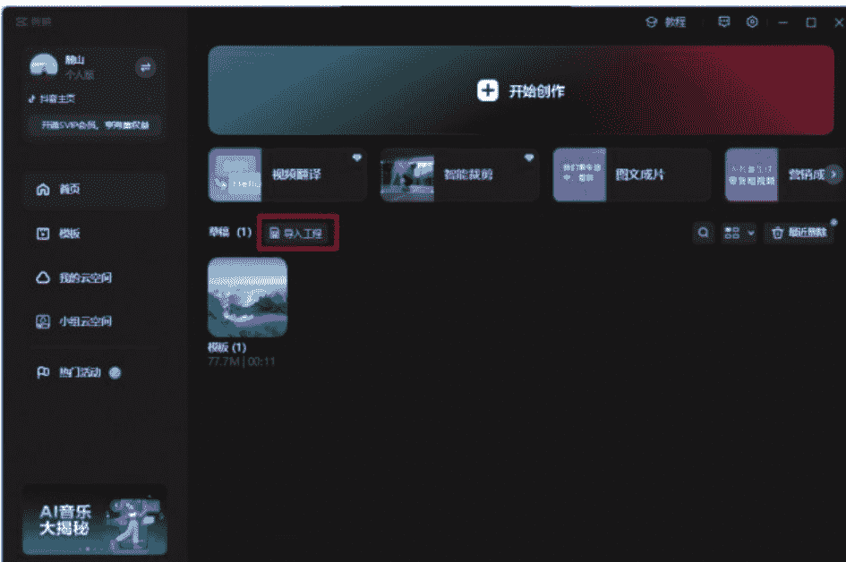

图6-71

### 6.3.3 图文成片制作
专业版同样支持图文成片功能制作视频。

01 启动专业版，在首页点击“图文成片”，如图6-72所示。

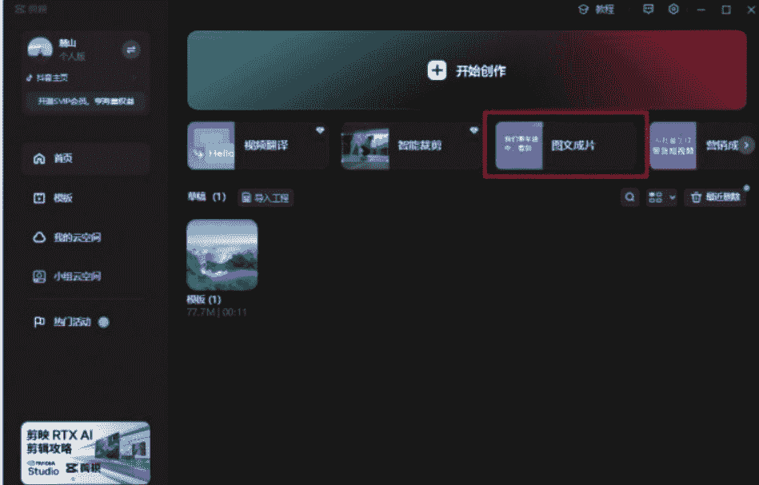

图6-72

02 弹出图文成片对话框，如图6-73所示，可选择视频类型、填写主题与事件描述、设定时长后生成文案，右侧显示生成进度。

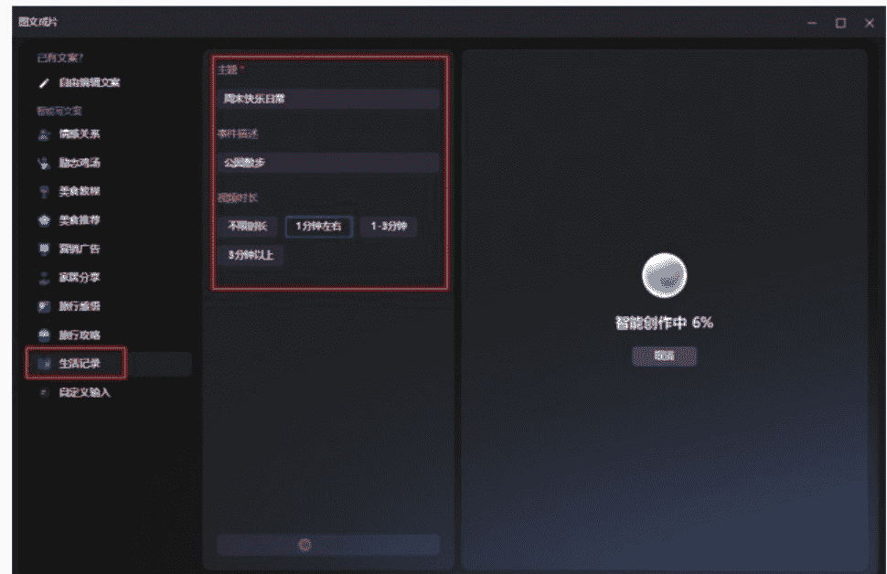

图6-73

03 文案生成后可试听并挑选合适的字幕配音音色，如图6-74所示。

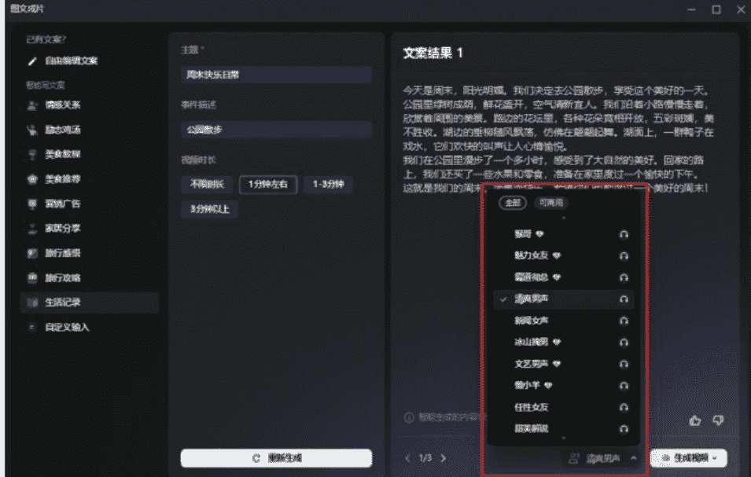

图6-74

04 点击右下角“生成视频”，可选择成片方式，如图6-75所示。

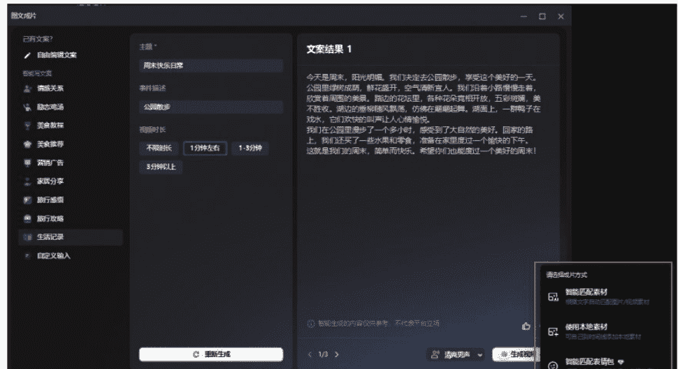

图6-75

05 自动打开编辑界面。若采用智能匹配素材模式，软件会自动添加字幕、背景音乐和视频素材，如图6-76所示。

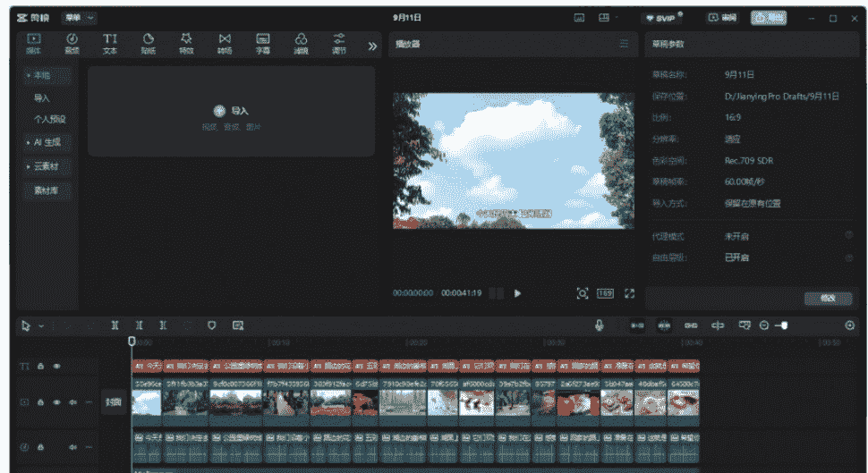

图6-76

### 6.3.4 专业版视频翻译
专业版也能使用视频翻译生成外语视频，且可在保留原声的前提下合成新的外语配音。

01 启动专业版，在首页点击“视频翻译”，如图6-77所示。

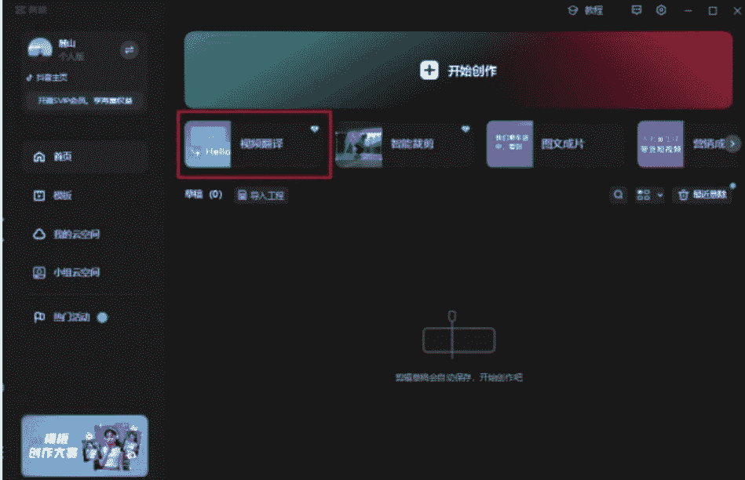

图6-77

02 在打开的对话框中上传视频素材并设置翻译语言，如图6-78所示。

### 视频翻译

点击上传或拖拽本人素材

上传的视频时长需控制在5s到300s内

每人每天的单人视频，如果通过

原始语言

中文

翻译语言

中文

- 中文

- 英语

- 西班牙语

- 印尼语

- 日语

- 德语

图6-78

# 第7章

## AI剪辑：视频素材高效处理
除快速成片外，剪映还提供丰富的智能剪辑功能，大幅提升剪辑效率。本章介绍专业版的智能剪辑能力。

## 7.1 智能转换视频尺寸
不同观看设备需要不同比例视频。智能裁剪可自动转换尺寸，提升效率。

### 7.1.1 横版转竖版
智能裁剪操作简便，导入素材后选择比例即可自动完成。

01 启动专业版，点击“智能裁剪”，如图7-1所示。打开对话框，如图7-2所示。

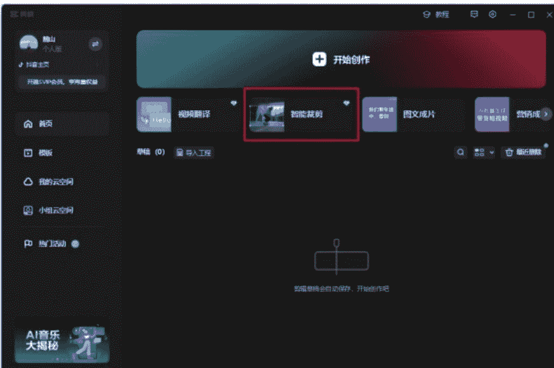

▲图7-1

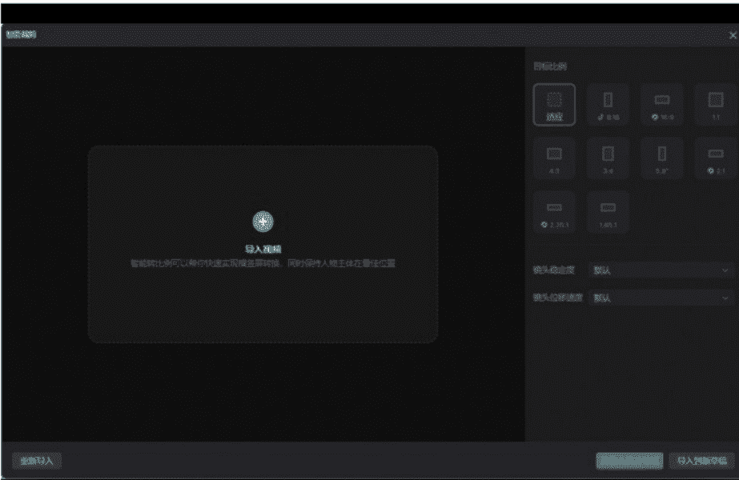

▲图7-2

02 挑选合适的裁剪比例，如图7-3所示，左侧可预览裁剪效果。

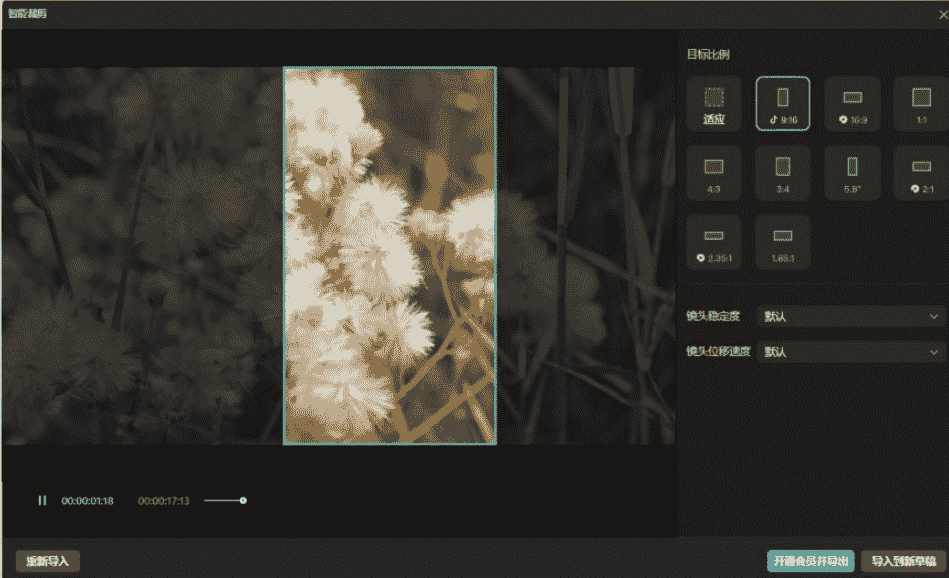

图7-3

03 预览画面效果，如图7-4所示。

图7-4

### 7.1.2 竖版转横版
竖转横的操作与横转竖类似，导入素材后调整比例即可。

01 启动专业版，点击“智能裁剪”，在对话框中导入素材并选择合适比例，如图7-5所示。

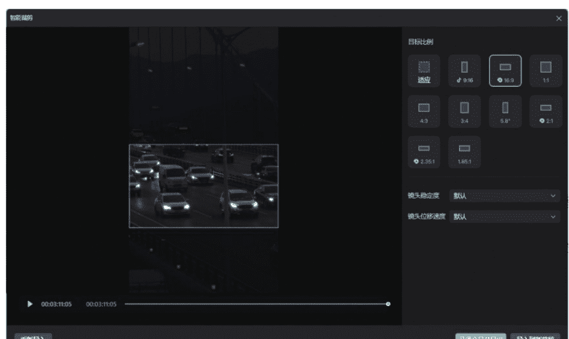

图7-5

02 导出视频并预览画面，如图7-6所示。

图7-6

## 7.2 AI优化视频素材
专业版具备完整的视频编辑能力，并提供众多智能功能助力创作。

### 7.2.1 超清画质拯救废片
超清画质可提升画面清晰度，让观感更好，操作简便。

01 启动专业版，导入素材到时间轴，如图7-7所示。

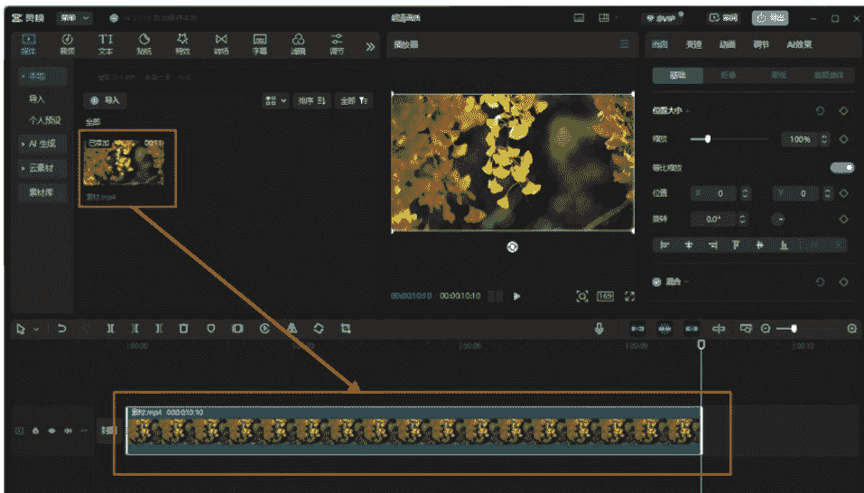

图7-7

02 选中时间轴素材，在右侧调整区勾选“超清画质”，并选择清晰度，如图7-8所示，预览区上方会提示进度。

图7-8

03 预览前后对比，效果如图7-9和图7-10所示。

▲图7-9

▲图7-10

### 7.2.2 智能调色一键完成
调色费时，使用智能调色可快速优化色彩。

01 启动专业版，导入素材到时间轴，如图7-11所示。

图7-11

02 选中素材，在调整区点击“调节”，切换到调节栏，勾选“智能调色”，如图7-12所示，可调节强度改变色彩。

图7-12

03 预览前后对比，效果如图7-13和图7-14所示。

▲图7-13

▲图7-14

### 7.2.3 智能抠图制作绿幕素材
绿幕素材常用于特效。智能抠图可轻松生成各类绿幕素材。

01 启动专业版，导入素材到时间轴，如图7-15所示。

图7-15

02 选中素材，在调整区点击“抠像”，切换到抠像栏，勾选“智能抠像”，如图7-16所示。

图7-16

03 点击“基础”，切换到基础栏，勾选“背景填充”，将背景色设为绿色，如图7-17所示。

图7-17

04 预览画面效果，如图7-18所示。

图7-18

### 7.2.4 智能打光营造人工光影
智能打光可模拟摄影补光灯，让画面更完美。

01 启动专业版，导入素材到时间轴，如图7-19所示。

图7-19

02 选中素材，在调整区勾选“智能打光”，选择光线效果，并在预览区调整光源位置，如图7-20所示。

图7-20

03 提供多种光效预设，可在“氛围彩光”“创意光效”中挑选，如图7-21所示。

图7-21

04 以“氛围暖光”为例，预览打光前后对比，如图7-22和图7-23所示，画面色调更暖，观感更温馨。

▲图7-22

▲图7-23

提示
智能打光时可添加多个光源，模拟组合打光的光影。

## 7.3 其他智能剪辑功能
剪映的智能剪辑功能持续丰富，本节介绍其他常用功能。

### 7.3.1 AI特效
AI特效可识别画面并自动添加特效，创造独特效果。

01 启动专业版，导入素材到时间轴，如图7-24所示。

图7-24

02 选中素材，将时间线移至00:00:09:55，点击常用功能区“向右裁剪”裁掉多余片段，如图7-25所示。

图7-25

03 在调整区点击“AI效果”，切换到AI效果栏，勾选“AI特效”。可选择效果并输入关键词控制画面，如图7-26所示。

图7-26

提示
AI特效仅支持10秒以内的素材，生成的效果为静态，需开通会员消耗积分。

### 7.3.2 添加AI数字人
制作口播视频时，数字人功能可加入逼真AI数字人并匹配字幕语音。

01 启动专业版，导入素材到时间轴，如图7-27所示。

图7-27

02 在工具栏点击“数字人”，切换到数字人栏，如图7-28所示。

03 可在数字人栏选择形象、音色、景别和背景，如图7-29所示。

▲图7-28

▲图7-29

04 输入文案并选定形象，点击“添加数字人”，即可生成数字人与字幕，如图7-30所示。

图7-30

05 可在预览区调整数字人与字幕位置，也可在调整区修改参数，如图7-31所示。

06 预览画面效果，如图7-32所示。

▲图7-31

▲图7-32

### 7.3.3 镜头追踪功能
镜头追踪可智能跟随锁定物体，模拟跟随拍摄效果。

01 启动专业版，导入素材到时间轴，如图7-33所示。

图7-33

02 将时间线移至00:00:02:13，在调整区勾选“镜头追踪”，可选择跟踪位置，如图7-34所示。

图7-34

03 选定跟踪目标后点击“开始”，再点击“应用效果”将效果应用到素材，也可在调整区修改参数，如图7-35所示。

图7-35

04 预览画面效果，如图7-36所示。

图7-36

### 7.3.4 智能镜头分割
长素材手动分割耗时，智能镜头分割可快速完成。

01 启动专业版，导入素材到时间轴，如图7-37所示。

图7-37

02 选中时间轴素材，右键选择“智能镜头分割”命令，如图7-38所示。

图7-38

03 软件会自动识别画面并分割，如图7-39所示。

图7-39

提示
分割后可查看片段，按脚本插入空镜等片段，组合成完整视频。

### 7.3.5 智能运镜
节奏感强的视频配合运镜更出彩，智能运镜可模拟运镜效果。

01 启动专业版，导入素材到时间轴，如图7-40所示。

图7-40

02 选中素材，在调整区勾选“智能运镜”，选择合适的运镜效果并调整参数，如图7-41所示。

图7-41

03 增加背景音乐可提升表现力。切换到剪映音乐库，在“动感”分类挑选合适的音乐并添加到时间轴，如图7-42所示。

图7-42

04 将时间线移至视频结尾，选中音频素材，点击“向右裁剪”裁掉多余部分，使音频时长与视频一致，如图7-43所示。

图7-43

05 预览效果可看出画面从平稳变为贴合音乐节奏，更具动感，如图7-44和图7-45所示。

▲图7-44

▲图7-45

### 7.3.6 AI补帧功能
对变速导致帧率下降或追求更流畅画面的情况，可使用AI补帧提升素材帧率。

01 启动剪映专业版，把一段视频拖入时间轴进行编辑。
02 在时间轴中选中该片段，打开素材调整区勾选“AI补帧”。可根据设备性能和素材需求自行设定目标帧率，确认后软件会实时显示补帧进度。

提示
日常视频多为30帧/秒，实际使用建议上限控制在60帧/秒左右，部分平台对上传帧率也有60帧的限制。

### 7.3.7 智能剪口播快速清理瑕疵
一条口播视频不能出现卡顿、重复等不自然的片段，而实拍很难做到完美，剪映的智能剪口播可以快速把这些问题剪掉。

01 打开剪映专业版，将口播原片导入时间轴。
02 选中时间轴上的素材，在常用功能区点击“智能剪口播”按钮，弹出分析窗口提示正在处理素材。
03 分析完成后，左侧会展开编辑面板，系统已自动剔除重复部分并做标记。
04 在编辑框中点选文案，软件会同步高亮对应的视频段落，此时可直接修改文字来调整画面内容。
05 若要去除停顿，点击编辑框上方“标记无效片段”，软件会自动识别并标注无效时段。
06 在编辑框中按下“删除”，即可一次性清除标记的无效片段。

# 第8章 字幕与音效的AI化批量处理
剪映把AI能力与字幕、音效深度结合，可以自动完成识别、生成与美化，大幅提升剪辑效率。本章以剪映专业版为例介绍相关玩法。

## 8.1 AI音频生成与美化
剪映专业版的音频模块接入AI，让配音、降噪、风格化更简单便捷。

### 8.1.1 文本转语音快速配音
想快速给视频配音，可以用文本朗读功能把文字一键转成语音，还能挑选不同风格的音色。

01 打开剪映专业版，在工具栏点“文本”，切到文本模块，为时间轴添加一段字幕素材。
02 选中时间轴的字幕素材，在预览区右侧的调整区修改文字内容。
03 点击调整区的“朗读”，挑选合适的音色后点“开始朗读”，完成文字到语音的转换。
04 生成完成后，时间轴会出现一段与字幕内容对应的音频。

提示
使用文本朗读前，如后续可能改动字幕，建议勾选“朗读跟随文本更新”，这样修改字幕时音频会同步更新。

### 8.1.2 克隆音色实现个性配音
文本朗读的音色选择有限，若想更逼真的配音效果，可用克隆音色功能。

01 打开剪映专业版，点工具栏“文本”，进入文本模块，在时间轴添加一段字幕素材。
02 选中字幕素材，点击“朗读”，再点“点击克隆”。
03 在弹出的克隆音色对话框中阅读风险说明和使用技巧，同意用户协议后方可继续。
04 点“去录制”进入录制界面，按提示朗读指定文本，长按录制按钮即可，系统会自动分析并生成克隆音色。

### 8.1.3 声音效果打造机器人声线
对已录好的声音不满意时，可用声音效果进行风格化处理。

01 启动剪映专业版，把含有真人声音的素材导入时间轴。
02 选中时间轴素材，右键选择“分离音频”。时间轴会多出一轨独立的音频。

### 8.1.4 人声美化提升音质
设备录音常伴有混响、齿音、喷麦等问题，人声美化可以降噪并增强音质。

01 启动剪映专业版，导入一段含人声的音频到时间轴。
02 选中音频素材，在素材调整区勾选“人声美化”，可自行调节美化强度，软件会提示处理进度。

### 8.1.5 人声分离去除背景乐
在带背景音乐的环境中录音时，可用类型人声分离功能把人声和背景分离。

01 启动剪映专业版，将素材导入时间轴。
02 选中音频素材，在素材调整区勾选“人声分离”，可选择保留背景声或保留人声。

### 8.1.6 节拍标记快速制作卡点相册
剪映能自动标记音频节拍，制作卡点相册无需手动逐点定位。

01 启动剪映专业版，把图片素材拖入时间轴。
02 切到剪映音乐库，在纯音乐分类挑选背景音乐并添加到时间轴。
03 选中音频素材，点击常用功能区“添加音乐节拍标记”，选择“踩节拍Ⅰ”为音频打上节拍点。
04 按节拍点将每段素材时长调整至约00:00:03:36，并对齐节拍。
05 将时间线移至图片结束位置，选中音频点“向右裁剪”，把多余片段裁掉，使音频时长与图片一致。
06 点工具栏“转场”，进入转场模块，在“叠化”分类挑选“画笔擦除”，在素材调整区点“应用全部”，将转场效果应用到所有衔接处。
07 点工具栏“文本”，进入文本模块，在文字模板库“简约”分类挑选合适模板并加入时间轴，卡点相册完成。

### 8.1.7 场景音营造留声机氛围
场景音可模拟不同环境下的录音状态，为背景音乐增添特色。

01 启动剪映专业版，在音乐库挑选背景音乐并加入时间轴。
02 选中音频素材，在素材调整区点“声音效果”，切换到声音效果栏，选择“留声机”，可在此调节效果强度。

### 8.1.8 声音成曲生成嘻哈音乐
声音成曲功能基于AI，把普通音频转成带音乐感的曲目。

01 启动剪映专业版，导入一段音频素材到时间轴。
02 选中音频，在素材调整区点“声音效果”，进入声音效果栏，点击“声音成曲”，在列表中挑选合适的成曲风格。
03 该功能仅支持1分钟以内的素材，先裁剪音频后再选择“嘻哈”效果，预览区上方会显示生成进度。

## 8.2 AI字幕生成能力
剪映的AI不仅用于音频，字幕相关的自动化功能也很丰富。

### 8.2.1 智能文案一键生成字幕
智能文案可自动撰写并拆分文案，适配素材。

01 启动剪映专业版，导入素材到时间轴。
02 点工具栏“文本”，进入文本模块，为时间轴添加一段字幕素材。
03 选中字幕素材，点击素材调整区的“智能文案”。
04 弹出智能文案对话框，可输入主题和补充需求以获取更符合预期的文案。
05 点对话框右下角“继续”开始生成。
06 系统会给出3个文案供选择，选定后点“确认”。
07 软件会自动拆分文案，也可手动编辑后点“添加到时间线”。
08 文案被拆分并自动部署到时间轴。

### 8.2.2 识别字幕批量添加
识别字幕功能可批量生成字幕，提升效率。

01 启动剪映专业版，导入口播素材并加入时间轴。
02 点工具栏“文本”，进入文本模块，点击“智能字幕”，选中视频素材开启识别字幕。
03 时间轴会自动添加对应字幕，可进一步调整样式。

### 8.2.3 识别歌词制作KTV字幕
剪映可高精度识别歌词，快速制作KTV效果。

01 启动剪映专业版，导入素材到时间轴。
02 打开音乐库，添加一段背景音乐到时间轴。
03 选中视频素材，在素材调整区调整变速倍数。
04 选中音频素材，点工具栏“文本”进入文本模块，点击“识别歌词”再点“开始识别”。
05 时间轴会出现生成的字幕素材。
06 选中全部字幕，调整字号。
07 调整字幕预设样式，选中字幕点“动画”，进入动画栏为所有字幕添加“卡拉OK”入场动画，并把动画时长与字幕时长保持一致，KTV字幕完成。

### 8.2.4 文字模板快速制作标题
文字模板能迅速做出吸睛标题。

01 启动剪映专业版，导入素材到时间轴。
02 点工具栏“文本”，进入文本模块，点击“文字模板”，在选项栏挑选合适效果并加入时间轴。
03 在素材调整区可修改文字内容、字体、颜色等，也可点文本后的下拉菜单单独调整。模板自带动画，少量修改即可快速做出好看标题。

### 8.2.5 AI生成制作专属水印
AI生成可制作独特的文字水印，防止搬运。

01 打开剪映专业版，点工具栏“文本”，进入文本模块，点击“AI生成”切换到AI生成栏。
02 输入文字和效果描述，点“立即生成”。
03 生成效果后可要求重新生成，也可编辑描述词让结果更贴合需求。

# 第9章 账号包装精准吸粉
进入短视频平台前，先为账号和内容做定位，再按定位策划拍摄，才能形成鲜明风格。

## 9.1 如何进行账号定位
账号定位是确定做哪类短视频、吸引哪类粉丝、提供什么价值。定位要多维思考，不能只顾自身目标或营销。

短视频账号定位的核心：一个账号只聚焦一个垂直细分领域，只服务一类人群，只输出一种内容。

### 9.1.1 厘清定位的关键问题
定位理论创始人杰克·特劳特曾说：定位就是让企业和产品与众不同，形成核心竞争力。对受众而言就是建立鲜明品牌。

定位包含三个核心问题：你是谁？你要做什么？你和别人有什么区别？
针对短视频账号，这三个问题需要进一步展开，如图所示。

以抖音为例，平台用户数以亿计，日更视频超百万，如何被看见？关键在定位。定位决定涨粉速度、变现难度和内容布局。

### 9.1.2 进行账号定位的理由
把账号定位放首位，能让后续运营更顺畅。图示列出了将定位前置的五个理由。

### 9.1.3 给账号打上精准标签
标签是平台给账号分类的依据，会把内容推荐给对该类作品感兴趣的人，提升创作积极性和观看体验。

举例：平台有100人，50人喜欢旅行。未打标签时内容随机分发，点赞率约50%，系统会判定质量不高。打上“旅行”标签后，内容精准推给那50人，互动提升后获得更多推荐。

做好定位才能在粉丝心智中留下特定印象。以下是账号定位技巧，如图所示。

提示
以抖音为例，作品连续获得系统8次推荐后，会获得新标签，获得更持久的流量扶持。

### 9.1.4 账号定位的基本流程
很多人分不清目的是涨粉还是变现。涨粉可快但变现弱，先明确目的：引流涨粉、品牌推广、IP打造、带货变现等，再定位。

#### 1. 分析行业数据
进入行业前先找头部账号，研究做法。可借助蝉妈妈、新抖、飞瓜数据等工具，了解最新信息、热点、热销品和创作方向。图9-4为蝉妈妈首页，可帮助发现有价值内容与商品。
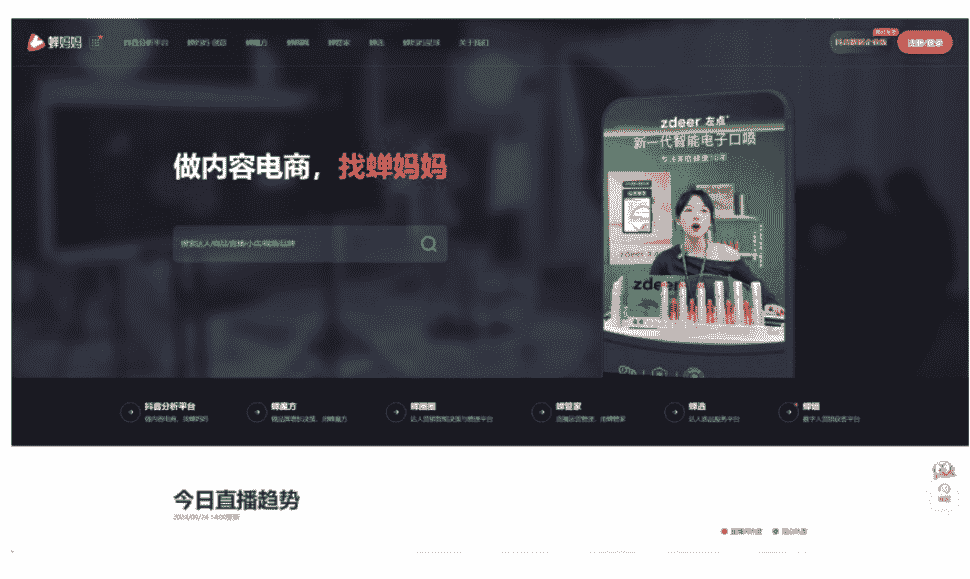

#### 2. 分析自身属性
头部账号粉丝量大，运营者多有好形象、才艺或技能，普通人难复制。需从自身条件出发，找擅长领域，保证质量与更新频率。

#### 3. 分析同类账号
深入拆解同类账号的选题、脚本、标题、运镜、景别、构图、拍摄与剪辑，学习优点并寻找差异化空间，寻求超越。

### 9.1.5 短视频账号定位的基本方法
账号定位为运营指方向，内容创作定基调。可从三个角度入手：自身专长定位、观众需求定位、内容稀缺度定位，如图9-5所示。
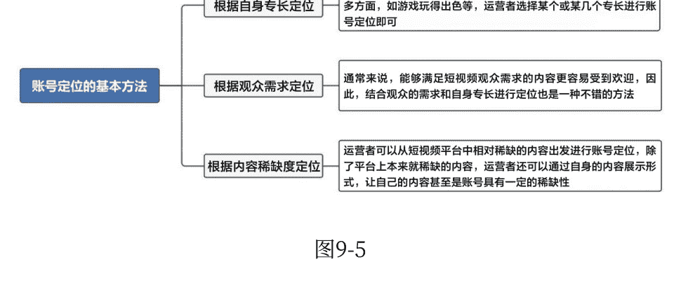

## 9.2 如何进行内容定位
短视频运营本质是内容运营，优质内容带来精准粉丝与平台流量。内容决定定位、目标人群和变现能力。

### 9.2.1 用内容吸引精准人群
不能只模仿热门视频，要找到能带来精准人群的内容，这就是内容定位要点。内容不仅决定定位，也决定变现。

做内容定位时要思考核心问题：精准人群有哪些痛点？

#### 1. 什么是痛点
痛点是观众的核心需求，是运营者必须解决的问题。可通过调研、场景化描述来挖掘，并帮助观众解决。

#### 2. 挖掘痛点有什么作用
找到目标人群痛点，对运营者有两方面价值，如图9-6所示。

打造爆款的前提是先弄清受众真正想看什么，本质上就是锁定目标人群的痛点并围绕其创作。

### 9.2.2 捕捉观众的关注焦点
观众通常对自己匮乏的方面更敏感。创作者顺着这种关注倾向来生产素材，更容易获得青睐。若只顾硬广，很快会引起反感。

一支视频打动人心的黄金窗口往往只有数秒，抓住关键才能更快见效，这一规律适用于各行各业，如图9-7所示。

图9-7

### 9.2.3 结合自身优势进行内容输出
平台发布作品门槛很低，但要做出有价值且被认可的内容难度不小。现今内容同质化加剧，参与者激增，如何选题和提升价值成为关键，下面给出思路。

#### 1. 挑选合适的呈现形态
在行业内积累经验并沉淀优质素材后，就可对外输出。
擅长笔头的可写文案，嗓音条件好的可做音频，镜头感强的可真人出镜。选对表达方式，有助于在较短周期内成为细分赛道的领跑者。

#### 2. 持续输出有价值的内容
具体建议如下。

- 先明确内容定位，聚焦垂直细分赛道深耕。
- 保持每日高质量创作，并确保节奏不中断。
- 将发布置于创作之前，及时把作品推上平台。

只做不发，再好的素材也无人见，难以产生影响。总之要结合自身特长来生产并分发，最关键的是长期不断发声。只有坚持持续输出，才有机会建立行业地位，成为领域内的信息权威。

### 9.2.4 短视频的内容定位评判标准
短视频本质上服务于观众，要被关注，内容必须满足需求。为此定位需符合一定标准，如图9-8所示。

### 9.2.5 短视频的内容定位操作原则
平台上的大多数热门作品都是提前策划的，定位是出圈的重要前提，内容应始终围绕主线，避免方向偏移。

规划定位时需注意以下规则。

- **选题保持新颖。** 尽量选择独特的视角，建立自己的选题库和标准化工作流程，既能提升创作效率，也能激发用户持续追看的欲望。例如，多收集热点入库，结合热点创作。
- **叙事要有波澜。** 短视频通常需要在15秒内讲清信息，整体很紧凑，但仍要在情节上设置起伏，才能抓住眼球。
- **内容须具价值。** 无论哪类内容，都要让观众觉得时间值得。比如搞笑类要带来欢乐，美食类要让人产生食欲或实践冲动。
- **情感呈现对比。** 内容可源于生活，用简单手法展现真实情感，并加入情感对比，更容易打动人、带动情绪。
- **时长节奏可控。** 需要合理安排节奏。抖音默认拍摄时长为15秒，这个长度最受欢迎。少于7秒容易不被推荐，长于30秒用户很难看完。

> **提示**
>
> 设计台词时，要力求引发情感共鸣，让观众愿意信任你。

## 9.3 账号信息设置策略
平台创作者众多，如何在同类号中脱颖而出、快速被记住？一个有效手段是通过信息设置，给号打上独特的个人标签。

### 9.3.1 号名称设计的技巧
昵称要有辨识度，最好与定位相关，基本原则如下。

- 好记：名称不宜过长，一般保持在三到五个字，辨识度高的名字更容易被记住。
- 好懂：名称可与创作领域相关，或体现身份价值，避免生僻字，通俗易懂更容易被接受。图9-9所示为抖音平台上名为×××油画的号，从名字即可看出该创作者发布的内容都与油画有关。

图9-9

- 易传播：号名应具有一定意义，且易于传播，能留下深刻印象，有助于提升曝光。

值得注意的是，号名也可以体现出创作者的形象，包括姓名、年龄、身高等基本信息，以及企业、职位和成就等背景信息。

### 9.3.2 号头像设置要点
创作者的头像也需有特点，必须展现自己最美的一面，或企业良好形象。领域不同，头像侧重点也不同。好的头像辨识度更高，能让观众更容易记住。

图9-10所示为抖音上某摄影号的头像，可以看到头像为一个剪影，并且手持摄像机，点明了该号的定位。

图9-10

设置头像时，还需掌握一些基本技巧，具体如下。

- 画面一定要清晰。
- 个人号可使用自己的肖像作为头像，能让大家快速记住你的容貌。
- 企业号可使用主营产品作为头像，或用企业名称、Logo等作为头像。图9-11所示为小米官方旗舰店的抖音账户，便是使用企业Logo作为头像。

图9-11

### 9.3.3 号简介撰写要点
短视频号的简介通常应简洁明了，主要原则是“描述账号+引导关注”，基本设置技巧如下。

- 前半句描述账号的特点或功能，后半句引导关注。
- 明确地告诉观众自己的创作领域。

> **提示**
>
> 账号简介是用来告诉观众你的账号是做什么的，只需提取一两个重点内容放在里面即可，并且注意不要有生僻字。

## 9.4 借助AI工具提升账号质感
随着科技进步，各种AI工具不断出现，使用它们能大幅提升工作效率，本节介绍如何用AI工具快速包装账号，帮助打造适合自己的个人账号。

### 9.4.1 用AI生成个人简介
号简介的核心作用是回答一个问题：“用户为什么要关注你？”简介最多只有100字，使用AI工具能高效利用这100字展示账号特色。

可以把100字拆解成3个更细的问题来帮助识别价值，具体如下。

- 你是谁？
- 你在哪方面有经验？
- 你的经验可以为我带来什么？

每个人阶段不同，都可据此提炼出一份简介模板，如表9-1所示。

表9-1

| 序号 | 简介要点 | 示例 |
| :--- | :--- | :--- |
| 1 | 你是谁 有什么特点 | 30岁以上的职场妈妈 业余时间读书写作，自我提升 |
| 2 | 账号会做哪些内容 | 好书分享、成长经验、计划复盘、 家庭育儿 |
| 3 | 具有个人特色的座右铭（非必需） | 读书，世界就在眼前； 不读书，眼前就是世界 |

有了模板后，就可以用AI工具创作合适的账号简介，选择分享给平台用户的内容。

**Q**

假设你现在是一位拥有十万粉丝的抖音读书博主，可以设置怎样的账号简介？请用四字短语的形式呈现，并撰写20个。

**A**

作为拥有十万粉丝的抖音读书博主，可以在设置账号简介时参考以下20个四字短语形式的内容。

- 书海泛舟
- 阅读启航
- 字里行间
- 思维碰撞
- 经典共赏
- 知识盛宴
- 书香四溢
- 好书推荐
- 人生感悟
- 思想火花
- 心灵旅程
……（此处省略部分回答）

找不到有特色的座右铭怎么办？仍然可以交给AI。

**Q**

关于读书的重要性，可以给我5个名人所说的金句，便于作为我账号简介中的座右铭吗？每句话不要超过25个字。

**A**

当然可以，以下是关于读书重要性的5个名人金句，适合作为您抖音账号简介中的座右铭。

- 书籍是人类进步的阶梯。——高尔基
- 读书使人充实，讨论使人机智。——培根
- 一个家庭没有书籍，等于一间房子没有窗户。——约翰逊
- 读书破万卷，下笔如有神。——杜甫
- 不读书的人，思想就会停止。——狄德罗

这些名人金句既体现了读书的重要性，又富有哲理，能够很好地展现一个读书博主的品位和理念。此外，AI可以快速地帮助大家吸收学到的知识，提高学以致用的能力，不用担心自己因为缺乏知识储备而难以运营账号。

### 9.4.2 用AI生成背景图
账号的背景图是“天然的广告位”，如图9-12所示，这也是可以再次向用户传达信息的地方。

图9-12

选择一个好的背景图有3个原则，具体介绍如下。

#### 1. 权威证明
背景图可以是账号简介中权威信息的相关证明，例如出过的书、取得的证书、与名人的授权合影，进一步证明个人信息的真实性。

#### 2. 体现定位
除了通过人物头像体现账号定位，可以继续使用符合账号定位风格的图片作为背景图。

#### 3. 突出利益
如果有明确可以提供给用户的利益，可以把背景图变成广告墙，引导用户关注。

例如，使用AI工具生成背景图中需要使用的文案，再进行排版设计能够快速产出背景图。

**Q**

假设你现在是一位抖音上的读书博主，你账号中的内容是图书推荐，现在需要制作背景图广告墙，请为我撰写一句话广告墙文案，不超过20字，并提供5种内容不同的文案。

**A**

每天一本好书，开启智慧生活！

书籍照亮心灵，让阅读点亮每一天！

与你分享书中宝藏，探索不一样的世界！

跟随好书的脚步，感受文字的力量！

一本书一个世界，带你领略无限精彩！

# 第10章 引流营销：吸引大众观看，提升播放量
流量是短视频运营的核心竞争力，因此引流成了短视频运营的关键手段。运营者可以通过设置好的短视频标题、短视频封面和评论区互动等方式来获得更多流量，从而让自己的短视频内容被更多的人看到和关注。

## 10.1 算法机制
要想成为短视频平台上的“头部大V”，运营者首先要想办法让自己的账号或内容获得更多的流量。当然，前提是需要脚踏实地做好视频内容。

运营者可使用一些运营技巧来提高短视频的流量和账号的关注度，而平台的算法机制是不容忽视的重要元素。目前大部分短视频平台采用的都是去中心化的流量分配逻辑，本节将以抖音平台为例，介绍短视频的算法机制，帮助运营者明晰算法机制，并“顺势而为”。

### 10.1.1 认识算法机制
算法机制相当于一套评判规则，这个规则适用于平台上的所有用户。用户在平台上的所有行为都会被记录，平台会将这些记录上传至服务器进行分析，将用户分为优质用户、流失用户和潜在用户等类型。

例如，某位运营者在平台上发布了一条短视频，此时算法机制会考量这条短视频的各项数据指标，来判断其内容的优劣。如果算法机制判断该短视频内容是优质的，则会继续在平台上对其进行推荐，让用户在推荐中能够“刷”到该条短视频，如图10-1所示，否则将不会提供流量扶持。

图10-1

如果运营者想知道抖音平台当下的流行趋势是什么，以及平台最喜欢推荐哪种类型的视频，可以注册一个新的抖音账号，然后记录推荐的前30条短视频内容，将每条短视频都完整地看完，因为算法机制无法判断新账号运营者喜好，因此会给运营者推荐当前平台上最受欢迎的短视频，由此运营者便可以从中得知热门内容。

运营者可以根据平台的算法机制来调整自己的内容细节，让自己的内容最大化地迎合平台的算法机制，从而获得更多流量。

### 10.1.2 抖音的算法机制
抖音官方平台通过智能化的算法机制来分析运营者发布的内容和用户行为，如点赞、评论、转发和关注等，进而了解每个人的兴趣，并给内容和账号打上对应的标签，以此为用户推荐其可能感兴趣的内容。

在这种算法机制下，好的短视频内容能够获得用户的关注，也就是获得精准的流量；而用户则可以看到自己想要看到的内容，从而持续在这个平台上停留；平台则获得了更多的高频用户，可以说是“一举三得”。

运营者发布到抖音平台上的短视频内容需要经过层层审核才能被大众看到，其背后的算法逻辑主要分为3个部分，如图10-2所示。

### 10.1.3 抖音算法机制的实质
抖音短视频的算法机制实质上是一种“流量赛马”机制，也可以看成一种漏斗模型，如图10-3所示。

图10-3

运营者发布内容后，抖音平台会将同一时间发布的所有视频放到一个池子里，给予一定的基础流量，然后根据这些流量的反馈情况进行筛选，选出数据较好的内容，再将其放到下一个流量池中，而数据差的内容将不再被系统推荐。

也就是说，在抖音平台上，视频内容之间的竞争与赛马一样，通过算法机制统计出数据较差的内容，并将其淘汰。图10-4所示为流量赛马机制的相关流程。

图10-4

### 10.1.4 明晰流量池的作用
在抖音平台上，运营者不管有多少粉丝，发布的内容质量优质与否，作品都会进入到流量池。当然，运营者的作品是否能够进入下一个流量池，关键在于其在上一个流量池中的表现。

总的来说，抖音的流量池可以分为低级、中级和高级3类，平台会依据运营者的账号权重和内容的受欢迎程度来分配流量池。也就是说账号权重越高，发布的内容会越受用户欢迎，得到的曝光量也会越多。

因此，运营者一定要把握住冷启动流量池，让自己的内容在这个流量池中获得较好的表现。通常情况下，平台评判内容在流量池中的表现主要参考点赞量、关注量、评论量、转发量和完播率这几个指标，如图10-5所示。

图10-5

运营者发布短视频后，可以通过自己的私域流量或者付费流量来提高账号的关注量，以及短视频的点赞量、评论量、转发量和完播率等指标的数据。

也就是说，运营者的账号是否能够做起来，这几个指标是关键因素。如果某个运营者连续7天发布的短视频都没有人点赞，甚至很多人看到封面后就直接划走了，那么算法系统就会判定该账号为低级号，给予的流量就会非常少。

如果某个运营者连续7天发布的短视频播放量都维持在200～300次，则算法机制会判定该账号为最低权重号，并将其发布的内容分配到低级流量池中。若该账号发布的内容持续30天播放量仍然没有突破，则同样会被系统判定为低级号。

反之，如果某个运营者连续7天发布的短视频播放量都超过1000次，则算法机制会判定该账号为中级号或者高级号，这样的账号发布的内容很容易成为热门视频。

总之，运营者明晰了抖音的算法机制后，即可有针对性地运营账号，让账号权重更高，从而为视频带来更多的流量。

## 提示

另外，停留时长也是评判内容是否能成为热门视频的关键指标，用户在某条短视频播放界面停留的时间越长，抖音的算法机制则会自动认为用户对这条短视频越有浓厚的兴趣，进而将该条短视频推荐给更多用户。

### 10.1.5 叠加推荐机制
在抖音平台为短视频提供了第一波流量之后，算法机制会根据这波流量的反馈数据来判断内容的优劣。如果某条短视频的内容被判定为优质，则会给该内容叠加分发多波流量，反之则不会再继续分发流量了。

因此，抖音采用的是一种叠加推荐机制。一般情况下，运营者发布作品后的一个小时内，如果短视频的播放量超过5000次，点赞超过10%，评论超过10条，算法机制会马上给予下一次推荐。图10-6所示为叠加推荐机制的基本流程。

图10-6

运营者还需要注意的是，千万不要为走捷径而去“刷流量”，平台对这种违规操作是明令禁止的，并会根据情况的严重程度相应地给予审核不通过、删除违规内容、内容不推荐、后台警示、限制上传视频、永久封禁、报警等处理。

## 提示

许多人可能会遇到这种情况，就是自己拍摄的原创内容没有火，但是别人翻拍的作品却火了，这其中很大的一个原因就是受到账号权重大小的影响。

账号权重就是账号的优质程度，也就是运营者的账号在平台心目中的位置。账号权重会影响内容的曝光量，低权重的账号发布的内容很难被用户看见，而高权重的账号发布的内容则会更容易被平台推荐。

## 10.2 短视频标题
人们常说：“标题决定了80%的流量。”虽然这句话的来源和准确性不可考，但由其流传之广可知标题的重要性。

### 10.2.1 认识短视频标题制作要点
在撰写短视频标题时，需要了解一定的制作要点，如不虚张声势、不冗长繁重、善用“吸睛”词汇等，详细介绍如下。

#### 1. 不虚张声势
短视频标题是短视频的“窗户”，短视频用户如果能从这扇“窗户”中看到短视频的大致内容，就说明这一短视频标题是合格的。换句话说，就是标题要体现出短视频内容的主题。

虽然标题就是要起到吸引短视频用户的作用，但如果用户被某一标题吸引，查看内容时却发现标题和内容联系得不紧密，或者完全没有联系，就会降低短视频用户的信任度，而短视频的点赞量和转发量也将被拉低。

因此，短视频创作者在撰写短视频标题时切勿“挂羊头卖狗肉”，而应该尽可能地让标题与内容紧密关联，如图10-7所示。

图10-7

#### 2. 不冗长繁重
标题的好坏直接决定了短视频点击率、完播率的高低，因此短视频创作者在撰写标题时，一定要重点突出、简洁明了，字数不宜过多，最好能够朗朗上口，这样才能让观众在短时间内清楚地知道想要表达的是什么。

写短视频标题时，字数最好精简、要点前置，别让结构变得臃肿。用户刷到简短有力的标题时，阅读负担小，看起来顺眼，也更容易停留。

图10-8里那条抖音标题，寥寥数语就把视频核心点明了，信息浓缩、重点分明，自然更抓人。

图10-8

#### 3. 借吸睛词点亮标题

标题堪称视频的门面，承担着概括内容、点明主旨、甚至暗示背景的功能。好坏直接决定播放和互动数据。

想靠标题把人留住，就要让标题有亮点。给标题加分是有方法的，适当植入能勾起好奇的用词，就能提升吸引力，如图10-9所示。

图10-9

### 10.2.2 标题撰写实用技巧

一个出色的标题能让用户愿意看完，从而带来流量。所以标题很关键，掌握原则和手法才能稳定产出优质标题。

#### 1. 标题创作的三大原则

下面是三个常用原则，依此创作更容易获取流量。

- **换位原则。**
定标题别只想着自己想表达什么，得先换位成观众。换成用户身份思考：想找答案时会搜哪些词？按这个思路写，标题才更贴近搜索习惯，能精准命中人群。比如先把相关关键词上搜索引擎，观察头部标题的共性，再借鉴到自己的标题里。

- **新颖原则。**
标题要新颖才有点击欲。想让形式不落俗套，可以尝试几种常见手法，如图10-10所示。

图10-10

- **关键词组合原则。**
高流量标题多是多词组合。单关键词覆盖面窄，比如只放“面膜”，只能被搜“面膜”的人看到；若同时带上“面膜”“变美”“年轻”等词，就能匹配到更多不同搜索入口，曝光面自然扩大。

#### 2. 善用词根扩大覆盖

标题要想抓住目标人群，关键在关键词，而关键词背后是词根。词根是词语的核心构成，组合方式不同含义也不同。比如“十分钟教你快速学会手机摄影”，核心词是“手机摄影”，拆出来“手机”“摄影”就是词根。基于词根还能延伸出“摄影技术”“手机拍照”等变体。因为多数人习惯用词根搜索，标题里包含匹配词根，就更容易被系统推荐。

#### 3. 让主旨一眼明了

“题好一半文”，标题到位视频就成功一半。衡量标题的核心标准之一就是能否体现主旨。若用户第一眼看不懂视频想说什么，播放率会很低。所以写标题要紧扣内容，把核心点亮。可以从脚本里提炼一两个关键词作标题，也可把视频想传递的价值直接写进标题。

### 10.2.3 AI辅助写标题的方法

假设其他因素都相同，单纯看标题，下面的四条美食分享你会点哪一个？

- 当然要记录一下呀，又不是天天做饭。
- 已瘦5斤！想告诉全世界这个菜谱！
- 每天都有在好好吃饭噢。
- 打工人菜谱，成本5元就能搞定的家常菜。

不知道你选了哪条？

标题角度不同，效果差异很大。下面介绍6种常见的包装思路。

#### 1. 对号入座式——标题要与用户相关

在标题里直接点名目标人群，让用户立刻判断内容是否与自己有关。示例如下。

- 为什么都市女性把运动健身当作救命稻草？
- 已生，告知没生的姐妹，待产包这些就够了！
- 手机摄影，新手如何在下雨天随手拍大片？

先梳理你的受众是谁、平时怎么称呼他们，确定后再把标签放进标题，精准度会更高。

## 提示

写标题时要避免歧视或贬低他人，不要用负面词汇或人身攻击，也不要用敏感称呼，避免触及政治、宗教、种族等话题。

#### 2. 数字量化式——用数字让结果更清晰

用具体数字呈现明确结果，能让价值一目了然。示例如下。

- 8条秋冬内搭分享！今日份OOTD。
- 坚持养发第828天，我能申请成为你养发的动力吗？
- 用7天搞定100个基础单词！

数字具象化目标，让用户能提前脑补成果，产生向往。

## 提示

数字要贴合内容，比如健身类可放时间和效果数据。数字要真实可信，别夸大失实。

#### 3. 强烈对比式——突出差异引发好奇

把内容和另一事物对照，放大优势和特点，提升点击。一般句式有“×× vs ××”“比××更…”“××前后对比”等。示例如下。

- 刚出的某款电车与其他品牌新出的电车对比。
- 工作前后对比。
- 比刷题还有用的影片，文理科知识全都有。

## 提示

对比双方差距要足够大才有冲击力，否则吸引力不足。比如“已瘦1.8斤，减肥前后对比”就很难让人产生好奇。

#### 4. 权威借势式——借助背书增强可信度

用权威人物、机构或媒体背书，提升观点可信度。常见句式：“××专家推荐”“××机构报告显示”“××媒体报道”等。示例如下。

- TED每日精读，停止与别人比较。

## 提示

引用的权威需公信力强，观点方法最好经过验证。

#### 5. 场景提问式——用画面感引发代入

描写具体情境并抛问题，让用户联想到自己，进而想点开。常见句式：“当你遇到××时，你会怎么做？”“面对××，你是A还是B？”示例如下。

- 当你的挚爱突然离世，该如何应对？
- 当代打工人的现状，你有这些行为吗？

## 提示

问题要贴近大众生活，别太陌生或复杂，用口语化的表达保持亲切。

#### 6. “损失规避”式——用担忧驱动点击

从用户担忧或紧迫感切入，害怕失去后果而点击。常见句式：“千万别××，否则××”“想避免××？立刻停止××”。

## 提示

这种方式易涨量，但要避免制造恐慌或误导，信息需真实，不能夸大。

有了以上6种方式，就可以使用AI工具辅助生成合适的短视频标题了。

## 指令模板

假设你现在是一位经验丰富的抖音【输入赛道】博主，为了吸引【输入用户】人群，准备创作一条短视频，选题为【输入选题】。

请给予选题，提供10个吸睛标题，可参考以下方式。

对号入座式，明确指向某一类用户人群。

数字美化式，使用或强调具体数据。

强烈对比式，呈现某个事物或人物的强烈对比，展示差异。

场景提问式，描述具体场景，让用户产生代入感。

“恐惧警告”式，激发用户的担忧、恐惧情绪。

AI生成的回答如图10-11所示。

1. “传统色爱好者必看！古代中国十大绝美颜色揭秘！”
（对号入座式，针对传统色爱好者）

2. “60秒带你看懂唐宋名媛最爱的5种传统色！”
（数字美化式，强调具体数量）

3. “你知道吗？古人眼中的‘白色’和今天完全不同！”
（强烈对比式，展示差异）

4. “如果你穿越回古代，哪种颜色代表你的身份？”
（场景提问式，引发代入感）

5. “90%的人不知道的秘密：古代的‘青色’究竟有多神秘？”
（“恐惧警告”式，激发好奇心）

6. “你以为古代只有红黑黄？那是你没见过这些‘稀世’颜色！”
（强烈对比式，打破常规认知）

7. “为什么古人偏爱‘玄色’？看完你就懂了！”
（场景提问式，勾起兴趣）

8. “超越现代色卡！古代十大绝美颜色惊艳你的眼！”
（数字美化式，突出数量）

9. “你真的懂中国传统色吗？70%的答案都被误解了！”
（“恐惧警告”式，制造认知差异）

10. “古代中国色彩密码：你知道‘绛紫’代表什么吗？”
（场景提问式，引发探索欲）

图10-11

## 10.3 短视频封面设计要点

很多人做封面花太多时间在美观上，最后封面与内容脱节，难以抓住观众眼球，反而拉低观看量。

### 10.3.1 封面制作的五种技巧

好的封面要能传达信息、易于理解、促使用户点击。下面介绍五种常见做法。

#### 1. 无字冲击感图片

无字冲击图对创作者要求较高，一张图就能把信息讲清楚，放大情绪，让人眼前一亮，如图10-12所示。

#### 2. 文字描述+纯底色

找不到好图时，就用文字为主、纯色背景衬托，如图10-13所示。

▲图10-12

▲图10-13

这类封面的关键是把重点信息放大，文字可直接用标题或关键词。

#### 3. 文字描述+单张图片

想兼顾直观与趣味，可放一张主图配上几个关键词，如图10-14所示。

图10-14

每个人审美不同，“文字+单图”适合摄影有底子但不想让画面喧宾夺主的创作者。若不确定单图能否留人，就选一张相关主题的图片叠加吸睛文字，文字与图片要信息一致。

例如做家常菜笔记，可放一道菜的照片，配上“超简单家常菜”字样，一眼就知道内容。

#### 4. 多图拼接

封面单调？试试多图拼接，如图10-15所示。

图10-15

选几张相关联的图片拼合，整体就能说明主题。图片可以是同一主题的不同角度，或系列步骤。风格要统一，保持画面和谐，用户一眼能get内容。

#### 5. 文字描述+多图拼接

“文字+多图拼接”制作难度稍高，但容易出爆款。

它融合了两者的优点，如图10-16所示。如时尚穿搭视频，可拼接多张不同风格的穿搭图，再配上“春季必备搭配”文字，文字与图互补信息更丰富。

图10-16

### 10.3.2 AI工具助力封面制作

下面介绍几款可快速出图的AI工具。

#### 1. 寻找符合要求的图片

- **通义万象：** 阿里推出的AI绘画平台，输入描述即可生成原创图片，支持风格迁移，提升个性。
- **无界AI：** 几秒内生成精美画作，按主题风格输入即可。
- **文心一格：** 百度AI艺术平台，关键词即可生成多种创意图，方便挑选。

三者都支持文本生成图，如输入“小猫”就能得到猫咪图。图10-17即文心一格生成的小猫。

#### 2. 套用封面模板

- **稿定设计：** 支持AI作图，上传素材后自动生成精美封面。
- **美图秀秀：** 模板素材丰富，一键美化并带AI设计功能。
- **创客贴：** 模板素材多，跨平台使用方便。
- **可画：** 界面友好，适合快速出图。
- **黄油相机：** 主打图片编辑，滤镜贴纸丰富，让封面更有趣。

稿定设计平台的模板如图10-18所示。

▲图10-17

▲图10-18

这些平台提供大量模板，涵盖花字、抠图、排版等常见需求，可按习惯挑选。

使用封面模板的技巧如下。

- **选对模板：** 按视频主题选模板。
- **调好尺寸：** 确保比例符合平台规范，避免裁剪拉伸，如抖音常用9:16。
- **加个性文字：** 用独特字体和色彩突出重点，新手建议不超过三种颜色，保持清爽。
- **善用抠图：** 把人物或产品抠出来放在醒目背景，提升冲击力，形成记忆点。
- **预览检查：** 发布前预览封面，确认元素协调无误。

## 10.4 了解变现的相关内容

运营者还可通过技巧提升粉丝关注度，借助社交互动加深关系、提高信息流动，从而实现变现。

### 10.4.1 构建私域流量池

《连线》杂志创始人凯文·凯利提出“一千铁杆粉丝理论”：只要有1000个无论你做什么都愿付费的铁杆粉丝，就能养活自己。这强调了粉丝信任的重要性。

如今个人品牌不再是名人专利，任何人都能凭独特性吸粉，用有价值内容实现粉丝经济变现。

私域流量打破了传统交易逻辑，不再是一锤子买卖。运营者可借助私域平台吸粉、沉淀目标人群，并转化为铁杆粉丝，形成数据资产。

信任越深，存量可带增量，流量也能沉淀为“留量”，即私域池里有深度互动的用户。粉丝代表流量，铁杆粉丝代表留量。

## 提示

提示：私域流量相对公域流量，“私”指个人、私人，与公开的公域相反；“域”指范围大小；“流量”指人流、访问量等数量。

构建私域流量池可以采取以下几种方法。

- **拓展线下好友：** 从线下加好友，也是宣传渠道。
- **用“鱼塘理论”：** 把用户比作鱼，聚集地就是鱼塘。可通过微信群、豆瓣小组等社群，找到与内容相关的人群转化为粉丝。
- **发展群内好友：** 进入精准群后，可添加成员为好友，逐步构建私域池。

加了好友后别冷落，要保持互动交流。交流核心是真诚，以交朋友心态相处。

### 10.4.2 流量裂变实现增值

有一定粉丝后运营账号不难，难的是如何把粉丝聚起来提升流量。可创建群聊，比如抖音群，把粉丝集中起来作为联系入口，推送新品、活动、福利等，增强粘性。

老粉丝是主要流量来源，要重点维护并裂变。具体措施如图10-19所示。

可在页面加上裂变红包插件，用户参与活动抽红包的同时获得裂变奖励，能有效激发参与和分享，扩大传播。

### 10.4.3 个人IP实现变现

引流可积累私域，但非长久之计。需同步打造个人IP，结合私域和IP实现稳定变现。

具体来说，短视频运营者打造个人IP有以下几个步骤。

#### 1. 定位个人IP

IP定位相当于产品定位，用来告诉粉丝能带来什么价值。定位要清晰，内容垂直，同时用创意开辟新赛道。定位包含三方面：

- **明确IP类型：** 打造个人IP主要有三种类型，如图10-20所示。

**锁定人群，从数据出发**

做私域和个人IP的结合，首要工作就是想清楚为谁创造内容。先弄明白平台来的是哪类人、他们的行为习惯有什么特点，再据此进行人群划分。整个判断过程可以拆成三步走：

① 收集数据。借助短视频平台后台给到的原生数据，去拆解受众的属性与行为，比如年龄段、性别、收入水平、地域分布等，先对自己的粉丝盘有一个大致轮廓。

② 打标签。拿到基础数据后，结合他们的偏好进行二次分析，给不同用户贴上特征标签并归类，通过标签看见他们的真实需求。

③ 做画像。从众多属性里提炼出典型特征，构建出可感知的虚拟角色，也就是平台上的用户分群模型，为后续细分运营打底。

人群底盘清晰后，就能在短视频里有意识地埋入受众爱搜爱看的关键词，提高被检索和被喜爱的概率，从而推动个人IP的成长。

在人群画像明确的基础上，就能围绕喜好塑造个人IP的斜杠人设。让内容人格既多元又统一，技巧可参考图10-21。

#### 2. 打造个人IP产品

个人IP的内容品牌和纯自媒体的打法不一样。自媒体往往走单点路线，聚焦一个爆款产品；个人IP更讲生态，需要一整套产品矩阵来承接私域转化。

对短视频而言，相当于为自己搭建一个内容品牌矩阵，用图文、影音等多种形式传递IP的文化调性和价值卖点，抓住注意力把流量沉淀到私域，快速实现变现闭环。

#### 3. 个人IP变现

变现的本质是持续输出有价值的内容，积累足够私域流量与影响力。比如平台开放的付费视频、付费课程，就能直接带来收入。

另外，还可以承接商业合作，以有偿方式为品牌或企业做信息传播、参与公关、促销、广告等活动，帮助提升产品销量与品牌形象，获取代言或代销收益。

### 10.4.4 稳固粉丝的方法

稳定的粉丝是收益的基础，运营思路要始终围绕粉丝展开。具体可从以下几个角度操作。

#### 1. 以满足用户需求出发

要想留住人，必须先解决痛点。先和用户聊起来，了解他们真正卡在什么问题上，再据此推荐产品或定制内容，始终站在用户视角思考。被信任后，转化成粉丝才自然。

#### 2. 多互动以增强用户黏性

黏性来自持续的陪伴感。要主动提升存在感，尤其是关心核心粉丝。评论区及时回复是最直接的尊重方式。互动细节要注意图10-22的要点。

#### 3. 以真挚情感打动粉丝

千篇一律的硬广容易让人反感。在广告里加入吸睛元素，触达率会大幅提升。最容易打动人的永远是情感。情感营销正是把情绪融入传播，满足用户对精神认同和心理共鸣的需求，让冰冷的交易变得有温度。

所以做内容时，要抓住用户对情感的诉求，不必一定是大爱叙事，任何能打动人心的表达都有机会触达不同人群。

#### 4. 跟踪用户的方法

无论内容类型如何，都要保持持续跟进，让用户感受到诚意。有效跟进可以从三点入手：

- **换一种方式被记住**：大多数人习惯评论区或私信互动，可以尝试手写一封信交流。纸质文字更有温度，也更显用心。
- **选对沟通话题**：每一次触达都需要一个合适的切口。涉及到产品推荐时，别直接硬介绍，可以先写一个与产品相关的故事脚本拍摄出来，软性植入使用场景，接受度会更高。
- **把握跟进节奏**：太频繁会让人厌烦，太久又会失联。一般以2～3周为一个周期比较合适。比如在固定更新2～3条视频的空档，发一次宠粉福利，既保持存在感又不显营销。

提示
跟进时要克制营销欲望。核心是帮助用户解答产品或服务疑问、了解需求并创造价值，而不是一味推销。

#### 5. 多平台引流拓展用户

现在可发短视频的平台很多，抖音、B站、小红书、快手等都可以同时运营，多账号布局能扩大触达面，挖掘更多潜在粉丝。图10-23和图10-24就是多平台引流的案例，这位创作者同时在抖音和小红书运营，并在两个平台都积累了大量粉丝。

240.5万 获赞 218 关注 19.5万 粉丝

- 🌟90后钢琴教师，爱好古典/爵士/流行，作品不定期更新

- 🌟求谱（有偿，均为五线谱）：[已隐藏]

- 🌟网Yi☁ / Q音 / 视Pin号 / 小红📕：[已隐藏]

- 🌟个人钢琴工作室坐标武汉江夏&汉口，欢迎私信咨询

- 🌟私信仅回复音乐相关问题，如回复不及时还请见谅

- 🌟不玩任何交友软件，请勿上当受骗🚫

- 🌟随缘记录可遇不可求的冷门好听小众音乐，欢迎私信投稿一起发掘～（最好是高级感爆棚的那种😉）

- 小号 @[已隐藏]

♂ 124岁 IP：湖北 武汉音乐学院

- 📦 商品橱窗

  10件好物

- 💬 他的群聊

  1个群聊

- 已关注 ▼

- 私信

- 作品 ▼

- 音乐

- 橱窗

- 收藏

- 🎵 iwamizu日本爵士合集

- 🎵 怪诞美学

- 🎵 恐怖悬疑惊悚BG

▲图10-23

小红书号：**[已隐藏]**

IP属地：湖北

- ⭐90后钢琴教师，爱好古典 / 爵士 / 流行，作品不定期更新

- ⭐工作室坐标武汉江夏&汉口

- ⭐抖🎵 / 网易☁️ / 视P号：**[已隐藏]**

- ⭐求谱（有偿，均为五线谱）：**[已隐藏]**

- ♍处女座

- 湖北武汉

- 音乐博主

- 演奏者

- 武汉音乐学院

**10** 关注

**2842** 粉丝

**3.6万** 获赞与收藏

笔记

- 怪诞美学

- Cool China

- Jazz

- iwamizu 日本爵士

「当李斯特的钟变成餐厅的传菜铃 🍷」

「微醺爱丽丝，优雅永不过时 🍷」

❤️ 63

❤️ 141

▲图10-24

#### 6. 鼓励用户提出建议进行反馈

持续优化内容需要听见用户的声音，形成自己的特色。建议的价值在于指明真正需求和不足。处理建议时建议遵守三原则：

- **主动邀请建议**：鼓励用户说出不满意或可改进之处，明确表示会重视，并可对优质建议给予奖励。
- **认真对待建议**：收到反馈后要如实记录并表达重视，深入分析问题成因，制定可执行的改进方案，避免敷衍。
- **快速落地反馈**：收集后不行动就没有意义。及时总结、迅速执行，让用户在最短时间内看到改变，才能提升信任与好感。

微信扫描二维码关注公众号后，输入验证码：43219，得到资源获取帮助

**微信订阅号：szysptpress**