# 用 AI 决胜信息学奥赛（C++编程基础）

# **内容简介**

本书是一本零基础学习信息学奥赛知识的指南，涵盖系统的 C++基础知识，同时介绍将人工智能（AI）深度融入学习全流程的方法，帮助零基础学习者借助 AI 工具提高学习效率、提升学习效果，解决传统学习模式中的各类问题，包括概念理解、代码调试、思路训练等。

全书分为 3 篇。认识篇聚焦信息学奥赛的认知基础，梳理其起源、CCF NOI 赛事体系及科学的学习路径，为入门奠定坚实的认知基础。能力篇是本书的核心，详细讲解与 AI 工具交互的提示词的设计方法、优质要素、实用模板及常用 AI 工具的使用技巧，形成完整的学习链路赋能方案。实战篇系统讲解 C++的核心知识，涵盖二进制、数据类型、流程控制、函数、数组、指针与结构体等内容，配备了提示词模板和测试题。

本书主要面向学习信息学奥赛知识的中小学生，同时可作为家长辅导孩子的参考用书及编程教师的教学资料。

# **推荐序**

当 AI 技术以前所未有的速度融入科研与教育领域时，学习方式的深刻变革已然发生。计算机科学始终秉持“思维为先，工具为用”的理念，而 AI 技术的崛起正为这一核心思想提供了全新的实践载体。在技术浪潮中，如何引导青少年把握核心能力、不迷失于工具的表象，成为所有教育工作者面临的重要命题。

作为教育和科研工作者，我们既要善用 AI 工具提升效率，也要警惕因 AI 工具滥用而导致的思考惰性。我的经验始终告诉我：AI 工具并非替代思考的答案机器，而是拓展认知边界的智能伙伴。当下，部分学习者陷入工具依赖，忽视了计算思维的核心——逻辑推理与问题拆解。本书的核心价值，正是引导读者建立“以我为主，AI 工具为辅”的认知体系，培养理解技术边界、驾驭工具、实现人机协同的核心素养。

本书最让我印象深刻的地方是，它对 AI 工具保持了审慎且辩证的态度。它既未一味鼓吹 AI 工具的优势，也未劝导学生盲目依赖 AI 工具生成答案，而是通过清晰界定 AI 工具的应用边界与适用场景，引导学生借助 AI 工具主动构建知识与能力。在信息繁杂的当下，这种理性的认知尤为可贵，亦是当代学生亟须的思维指引。

尤其值得一提的是，书中对提示词技术的系统讲解，极大地凸显了实用性。提示词是大模型与人交互的基础，其精准度本质上是清晰思考、精准表达能力的直接外化，这与编程的核心思维异曲同工。本书通过拆解要素、阐释逻辑并提供实用模板，帮助学习者掌握精准指令的构建方法，使其能更清晰地控制 AI 工具的能力边界。这种能力是面向未来的核心素养，具有强大的迁移价值。

我衷心希望同学们在学习本书的 AI 理念与使用方法时，能够主动思考、举一反三，不仅要将其扎实应用于编程学习，而且要尝试将 AI 方法与工具迁移到其他学科，真正让 AI 工具成为学习与研究路上的得力助手。

在计算机科学的发展进程中，工具迭代从未停歇，但培养优秀思考者的教育目标始终不变。AI 工具并非要削弱思维的价值，而是要助力我们摆脱烦琐事务，更专注于创造性探索。愿每位读者都能以本书为阶、以 AI 工具为翼，练就驾驭技术的核心能力，成为技术的主人而非奴隶。

汪云海

中国人民大学信息学院教授

# **前言**

在信息学奥赛成为培养青少年信息素养核心载体的时代背景下，越来越多的中小学生将目光投向这一兼具挑战性与成长性的领域。然而，信息学奥赛知识的学习之路往往存在着认知模糊、工具缺乏、起步门槛高等多重阻碍，许多学习者在入门阶段便陷入迷茫——我自己的孩子也不例外。

在工作中，我曾是高中计算机老师，也曾是专业的互联网开发工程师，而在家中我是两个小学生的爸爸。和千万个家长一样，我也希望孩子能在人工智能（AI）飞速发展的当下，具备良好的信息意识与数字能力，从容应对未来的时代挑战。我具有“家长”、“教师”与“专业程序员”的多重身份，自然而然地承担起辅导孩子学习编程的任务。在实践中，我发现，当下青少年学习编程的模式几乎多年未更新，时间花得多，学习进度慢，效率低且难以满足 AI 时代对能力的需求。

能否将主流的 AI 工具与编程学习融合，打造一套高效、贴合时代趋势的学习方案？带着这个念头，我开始将 AI 工具融入孩子学习信息学奥赛知识的场景中，反复实践、打磨，最终探索出一套可落地、高效率的用 AI 工具辅助学习信息学奥赛知识的方法，并将其编写成书，旨在为零基础及入门阶段的学习者提供一套系统的、高效的且贴合时代发展趋势的学习指南。

本书按照“认知—能力—实践”的递进逻辑，分为 3 篇，既确保知识传递的系统性，也强调学习方法的科学性。

认知篇聚焦认知启蒙与路径规划，为学习者奠定认知基础。第一章从信息学奥赛的起源发展切入，介绍 CCF NOI 赛事体系，帮助读者建立清晰的赛事认知。第二章聚焦规划指引，适配学习路径，同时融入实战经验与避坑指南，旨在消除信息差，让学习者从起步阶段就建立科学认知，避免走弯路。

能力篇是本书的核心内容。第三章介绍 AI 工具给学习信息学奥赛知识带来了什么变化。第四章聚焦与 AI 工具交互的提示词（Prompt），讲解优质提示词要素及结构化提示词。第五章提供了实用的提示词模板，覆盖了各学习阶段所需的模板。第六章介绍常用的 AI 编程工具在学习信息学奥赛知识中的应用。第七章介绍以学习信息学奥赛知识为核心的新模式，形成了完整的信息学奥赛链路指南。

实战篇系统讲解 C++知识。第八章到第十三章介绍二进制、数据类型、流程控制、函数、数组、指针与结构体等核心知识，第十四章介绍数据结构与基础算法。此篇的每章均附有提示词模板和案例，便于读者利用 AI 工具进行学习和探索。

本书中包含大量提示词模板和案例。为了方便使用，我们专门搭建了本书的配套网站（可关注微信公众号“信赛圈”，并回复“AI”获取网址），以支持读者在线复制或下载。

本书的撰写与审核凝聚了多方力量，我曾是北京市海淀区某高中的信息技术教师，拥有扎实的教育理论和教学功底，还曾在字节跳动、腾讯、百度公司担任技术研发工程师，并多次担任互联网行业技术大会的专题出品人和讲师，拥有较强的综合技术实力。本书的主审人汪知是海淀区高中信息技术学科带头人、科技教研组组长、高级教师，曾参与编写多本学科教材，多次指导学生比赛并获奖。她结合多年的教育教学实践，对全书内容进行了严格把关，确保知识体系的合理性与教学适用性。

AI 技术与教学方法在持续迭代更新，加之作者能力有限，书中难免存在疏漏与不足之处，恳请广大读者、教育同人及行业专家不吝赐教，提出宝贵的意见与建议。

我们衷心希望，本书能够成为读者在信息学奥赛之路上的良师益友——帮助读者夯实 C++基础知识，学会运用 AI 工具赋能自主学习，培养信息素养与计算思维。愿每一位心怀热爱的学习者，都能在本书的陪伴下，在信息学的世界里坚定前行，在挑战中收获成长，最终实现自己的目标与梦想。

王俊杰

2025 年 12 月

**认识篇**[亲爱的读者，你是不是听说过“信息学奥赛”“信奥赛”这些词，却总把它们和编程补习班、计算机考试、升学加分相关联？你是不是想知道从三年级开始学会不会太早、在六年级才接触会不会太晚、学了之后能参加什么比赛、比赛获奖有什么用？本篇就是为你准备的信息学奥林匹克竞赛（简称信息学奥赛）入门导航，咱们聊一聊最基础的问题：信息学奥赛是什么、包含哪些比赛、适合什么阶段参加，以及信息学奥赛的学习规划建议。]

**第一章** **初识信息学奥赛**

**1.1** **信息学奥赛的起源与发展**

信息学奥赛与数学、物理、生物、化学奥赛共同构成全球基础学科拔尖人才选拔的核心体系。这五项奥赛均以从国内培养选拔到国际竞技的完整赛事链条为支撑，成为各国布局未来科技人才战略的关键环节。

不同的是，信息学奥赛以编程与算法为基础，聚焦于用计算机解决复杂问题的核心能力。这种能力恰恰是数字时代破解技术难题、推动产业革新的核心能力。信息学作为数字文明的基础语言，其启蒙教育必须前置到青少年成长关键期，唯有从小夯实思维根基，才能为未来科技突破储备源源不断的创新力量。

**1.1.1** **国际起源：全球青少年的“编程世界杯”**

20 世纪 80 年代，个人计算机浪潮席卷全球，信息科学对未来社会的重塑作用逐渐凸显。人们开始意识到，信息科学知识与应用能力应被尽快纳入学生的知识结构中，成为跨世纪人才迈向信息社会的“入场券”。

1987 年，Sendov 教授在联合国教科文组织（UNESCO）第 24 届全体会议上正式提出举办国际信息学奥赛（IOI）的倡议。这一倡议不仅为全球热爱编程的青少年搭建了交流平台，还承载着推动信息学普及、培育未来科技人才的重要使命。1989 年，首届 IOI 正式举办，共有 13 个国家的 46 名选手参赛。作为 IOI 创始国之一，中国从赛事举办之初便深度参与这一全球赛事。

2000 年，第 12 届 IOI 由中国主办，赛事落地北京。此次承办经历不仅奠定了中国在 IOI 体系中的重要地位，还推动了中国信息学奥赛体系与国际标准深度接轨，为后续本土赛事体系的完善积累了宝贵经验。如今，IOI 已从最初的小型赛事升级为衡量国家信息技术后备力量的核心平台，影响力持续扩大。

它不仅是一个竞技赛事，还是全球科技人才的孵化器。每一次赛事的交流与比拼，都潜移默化地影响着未来全球科技发展的整体格局。中国选手在 IOI 舞台上持续亮眼的表现，正是我国信息学人才培养体系与国家科技发展战略深度契合的有力证明。

**1.1.2** **国内发展：从高级赛事到全民普及的过程**

在 IOI 的舞台上，中国始终是公认的信息学奥赛强国，成绩尤为亮眼：中国累计获得的 IOI 金牌数量长期位居全球首位，在 2021 年、2022 年、2025 年 3 届赛事中均取得优异成绩，其中在 2021 年、2025 年两次实现全员夺金。

这些成绩不仅是选手个人努力的结果，还印证了中国从小学起步的阶梯式培养体系的前瞻性。中国参赛选手、领队及教练多次受到党和国家领导人的接见与赞扬，这既是对中国信息学奥赛成果的肯定，也是对国家科技人才培养的激励。

国内的信息学奥赛，正是支撑中国在 IOI 舞台持续领跑的基石，从最初为 IOI 选拔后备力量到完善本土体系，逐步走向全民可参与的普及化发展，最终形成了层次分明的体系化赛事，走进了千万个中小学生的成长世界。

**1.萌芽与奠基（1984—1999 年）**

1984 年，中国计算机学会（China Computer Federation，CCF）创办了全国青少年计算机程序设计竞赛，这便是全国青少年信息学奥林匹克竞赛（National Olympiad in Informatics，NOI）的前身。

1990 年，该赛事正式更名为 NOI，确立了国内最高级别信息学赛事的定位。作为 NOI 基础选拔层的全国青少年奥林匹克联赛（National Olympiad in Informatics in Provinces，NOIP）随后于 1993 年正式设立，成为连接校园与国赛的关键纽带。在 2000 年之前，信息学奥赛还专属于高中生，仅有 NOIP 一个主要赛事。这个阶段的竞赛虽规模有限，但像一粒种子，为后来的爆发埋下伏笔。

**2.破冰与成长（2000—2018 年）**

2000—2018 年，NOIP 推出普及组，首次将初中生纳入赛场，但此时仍属少数精英的竞技场。与此同时，信息学奥赛的人才筛选价值已逐渐凸显：清华大学、北京大学等顶尖高校开始将 NOIP 奖项作为自主招生的重要参考，每年通过竞赛渠道选拔的计算机拔尖人才占比持续上升。竞赛不仅是技术比拼，还成为人才选拔机制的重要组成部分，为高校输送了通过编程能力筛选的潜力股。

**3.爆发与深耕（2019 年至今）**

2019 年，CCF 推出 CSP-J/S（非专业级软件能力认证，Certified Software Professional Junior/Senior，CSP-J 为入门级，CSP-S 为提高级）。这是面向计算机非专业人士的算法与编程能力评估认证。

2021 年更基础的“敲门砖”来了，CCF 推出了编程能力等级认证（Grade Examination of Software Programming，GESP）。它将编程能力从入门到高阶一共划分为 8 个层级，是面向青少年计算机与编程学习者的学业能力的考级认证。这说明信息学的启蒙已早至小学阶段。

**4.星光闪耀：竞赛背后的人才战略**

信息学奥赛的赛道上已走出无数影响行业发展的顶尖人才。2025 年的数据显示，70%的“强基计划”试点高校将信息学奥赛成绩作为选拔招生的依据之一。C9 联盟成员的计算机、人工智能、集成电路、信息安全等专业的特招和保送录取要求 NOI 决赛二等奖以上，某些顶尖大学更将特招门槛提至一等奖。

信息学奥赛的参与者从 1984 年的数千名发展为 2024 年的数十万名，信息学奥赛早已从战略萌芽成长为支撑国家计算机、人工智能等科技发展的人才森林。

**1.2** **信息学奥赛介绍**

在 CCF 的专业设计与统筹运营下，国内信息学奥赛已形成一套从入门到高阶的全链路赛事体系，整体发展持续向好。从赛事标准的科学制定、报名流程的清晰规范，到成绩认证的行业权威度，这套体系都经过了长期实践打磨。这些比赛已成为助力青少年提升信息素养的载体。

选对比赛，就像征服不同高度的山峰——在不同的阶段，需要匹配难度合适的赛事。我们对最核心的赛事按从启蒙到国际巅峰的顺序讲解（如图 1-1 所示），找到现阶段最适合的那一个，厘清通关指南。

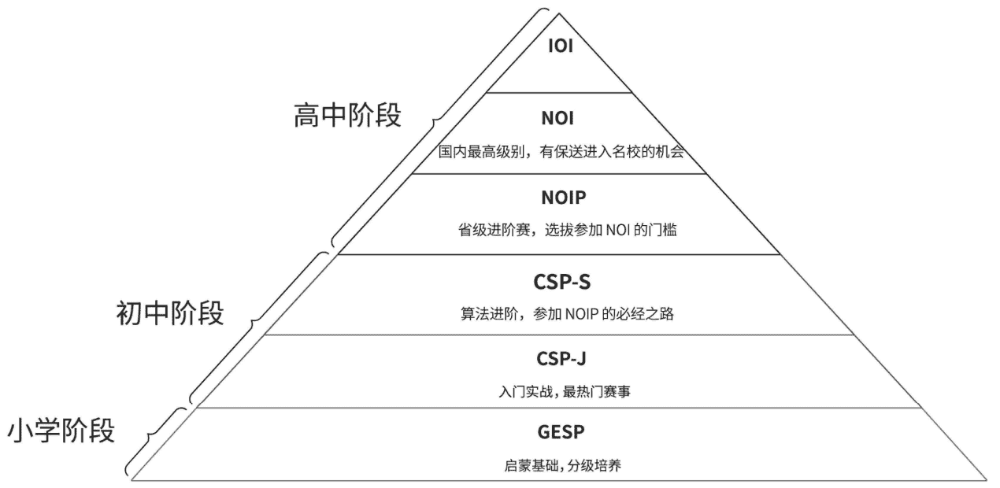

图 1-1

**1.2.1** **从启蒙到国际巅峰的赛事阶梯**

**1.编程能力考级：GESP**

GESP 由 CCF 发起并主办。GESP 致力于提升青少年计算机及编程教育水平，推动这一领域教育的普及与推广。该认证覆盖中小学所有学段，符合条件的青少年均可参与。

GESP 包含图形化编程认证、Python 编程认证和 C++编程认证，重点检验学生对编程知识的掌握程度和操作技能。通过设定不同等级的考试目标，GESP 考查学生从设计简单程序到设计复杂程序的编程能力，为后续专业化编程学习筑牢基础。其中图形化编程（Scratch）认证设 1～4 级，Python 编程认证与 C++编程认证则设 1～8 级。GESP 的本质是面向中小学所有学段的编程分级能力认证，类似于编程基础能力考级，从入门开始一步步打牢基础。

如果小学低年级学生想从“玩”编程开始培养兴趣，那么 GESP 将是第一站。如果小学高年级学生已经学习了 C++语言（简称 C++），但还没达到参加 CSP 的报名年龄要求，那么可以从参加 GESP 开始，不断检验自己的学习成果。 

开赛频次：每年 4 次。

考试时间：3 月、6 月、9 月、12 月。

报名时间：1 月、4 月、7 月、10 月开放报名。

适合年龄：面向所有中小学生，无年龄限制。

参赛语言：Scratch（1～4 级）、Python（1～8 级）、C++（1～8 级）。

主要考点：分为 1～8 级，从基础入门到算法实现逐步进阶，对每个级别的要求可参考官网的大纲。

**2.第一个关卡：CSP**-**J/S**

CSP-J/S 开始于 2019 年，是由 CCF 主导开展的、面向计算机非专业人士的算法与编程能力评估认证。该认证在同一时间、不同地点，由 CCF 授权的省级认证单位负责组织，实行全国统一大纲、统一考题。

CSP-J（Junior，入门级）和 CSP-S（Senior，提高级）为两个不同难度的级别，核心内容均围绕算法与编程展开。该认证分两轮进行。第一轮认证侧重考查通用的计算机科学知识，采用笔试形式；第二轮认证聚焦程序设计，要求考生上机完成程序编写和调试。只有第一轮认证成绩优异者才可进入第二轮认证。在第二轮认证结束后，CCF 会依据 CSP-J/S 各组别的认证成绩及划定的分数线，颁发相应的认证证书。同时，CCF 规定被认证者可单独或同时参加 CSP-J/S。

2025 年 2 月，CCF 规定参加 CSP-J/S 以上级别赛事者需满 12 周岁。如果已经有了良好的 C++编程基础，就可以在符合年龄要求后参加 CSP-J/S，这也是后续参加更高阶比赛的敲门砖，堪称最热门的信息学入门赛。

要重点说明的是，CSP-J/S 是 NOI 系列赛事的起点，CSP-S 的成绩也是后续参加 NOIP、APIO（Asia-Pacific Informatics Olympiad，亚洲与太平洋地区信息学奥赛）、NOI 冬令营（Winter Training Campus）等的基础。 

开赛频次：CSP-J、CSP-S 都为每年 1 次。

考试时间：第一轮认证在 9 月，第二轮认证在 11 月。

报名时间：第一轮认证的报名从 6 月开始到 9 月结束，第二轮认证的报名在第一轮认证成绩公布之后。

适合年龄：12 岁以上。

参赛语言：C++14。

主要考点：基础语法、编程能力、数据结构和简单算法。

**3.真正的省级奥赛：NOIP**

NOIP 自 1995 年起举办至今，是每年由 CCF 统筹组织，在同一时间段内以省为单位开展的全国性竞赛活动。

NOIP 选手在报名时需要经过学校老师确认，以学籍所在学校为单位报名。NOIP 有初赛与复赛两个阶段，参加复赛的资格由各省依据初赛成绩确定。

NOIP 也是信息学奥赛选手通往 NOI 的必经之路，难度与考查范围均比 CSP-J/S 高出一个档次。因此，不同省份在 NOIP 报名环节也对选手设置了一定的门槛，如要求选手需参加过 CSP-S 第二轮认证。在资格筛选阶段，各学校也会优先考虑 CSP-S 成绩优异的选手，最终确定参加 NOIP 的资格。 

开赛频次：每年 1 次。

考试时间：11 月。

报名时间：9—10 月。

适合年级：初中、高中。

参赛语言：C++14。

主要考点：数据结构、进阶算法、时间和空间复杂度、综合解题能力。

**4.国内最高级别赛事：NOI**

NOI 每年举办一次，于同一时间、同一地点开展。

各省（含自治区、直辖市）均以单位形式组队参赛，既记录个人成绩，也统计团体总分。参赛选手将从 NOIP 省级获奖选手中择优选拔产生，进而组建信息学奥赛省队，代表本省参加全国竞赛。

作为高中生，若能凭借 NOIP 奖项获得 NOI 省队资格，就等于登上了国内中学生信息学奥赛的最高舞台。有些知名高校的保送名额也是从 NOI 获奖者中产生的。 

开赛频次：每年 1 次。

考试时间：7 月。

报名要求：通过 NOIP 省级选拔。

适合年级：高中。

参赛语言：C++14。

主要考点：复杂数据结构、高级算法、算法优化能力、综合解题能力。

**5.全球巅峰对决：IOI**

IOI 是一项每年举办一次的国际赛事。CCF 会依据上一年的 NOI 结果选拔参赛选手，组成 IOI 中国代表队参赛。赢得 IOI 金牌是信息学奥赛选手的终极目标。

**1.2.2** **核心赛事的关键特征**

为了帮你更直观地了解和对比各项比赛，我们把各项赛事的关键信息整理成表 1-1。

表 1-1

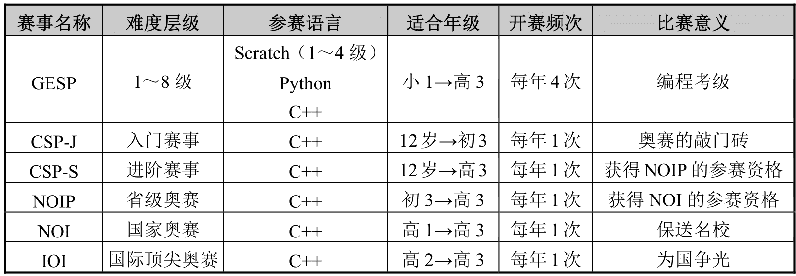

信息学奥赛不断发展，赛事体系、参赛要求可能也会出现变化，建议你关注和了解信息学奥赛的最新信息。一是在全国青少年信息学奥赛的官方网站上获取权威政策与赛事通知；二是通过信息学奥赛领域的第三方信息平台，如“信赛圈”微信公众号，获取赛事动态解读和参赛信息。

**1.2.3** **我怎么参加？怎么选择合适的比赛**

越来越多的学生希望通过信息学奥赛的途径，提升信息素养和数字技能，或走科技特长生的赛道。要怎么做才能搭上这趟列车？

你可能会问：学编程最合适的时间是什么呢？先纠正一种错误认知：信息学奥赛不是只有高中生才能参与，而是分级适配的。目前的体系已经给不同年龄的学生都铺好了路。在每个阶段都有不同的学习方法，根据自身阶段和能力选择合适的路径才是最重要的。

小学低年级学生若要培养兴趣，则可以从图形化编程开始学习 Scratch，接触一些简单的逻辑思维，在比赛方面可以对应 GESP 的 1～4 级；小学高年级学生可以直接学习 C++，参加 GESP 的 C++考级，在 12 岁之后试着挑战 CSP-J。初中生需要获得 CSP-J/S 的证书，为后续争取 NOIP 的参赛资格打基础。高中生需要依次参加 NOIP、NOI、IOI。

举例来说，有位学生从四年级开始学 C++，在六年级获得 GESP 5 级证书，在初一获得 CSP-J 一等奖，在初二获得 CSP-S 二等奖，在高中获得 NOIP 奖项后进入 NOI 省队，获得全国赛奖项，最后保送北京某大学。他的路径正是用 GESP 打基础、参加 CSP-J/S 练实战、在 NOIP 省赛晋级、在 NOI 全国赛突围。

你可能还会问：编程会不会很难学？是否一定要先学图形化编程再学文本编程？低年级的学生直接学习 C++确实存在一定的门槛，可以从趣味编程培养兴趣开始，先学图形化编程，但这并不意味着图形化编程就是文本编程的基础，高年级的学生无论是学习和理解能力，还是数学基础都上了一个台阶，直接学习 C++完全没有问题。

另外，选择学习途径和方法是非常关键的，若选对了，则可以轻松地迈过信息学奥赛的门槛，逐级学习，层层进步，一旦选错，花费金钱是小事，虚度时间、错过最佳学习时机，就会产生严重的后果。比如，有些学习方法过分强调趣味性、游戏性，忽略了严肃的基础知识教学，学编程却不学基础知识、不练算法，学生在上了很多课后连 CSP-J 的基础题都做不出来，浪费了时间和宝贵的学习机会。更多误区和避坑经验将在第二章详述。

**1.3** **参加信息学奥赛的意义与价值**

参加信息学奥赛到底值不值？你可能会问：花时间学编程、参加比赛能获奖吗？对升学有帮助吗？这些的确都是很现实的问题。我更想说的是，参加信息学奥赛的长期收益：信息素养与实践能力，是一辈子都用得上的真正财富，这才是参加比赛获得的终身大奖。

**1.3.1** **核心收获：建立底层信息素养**

信息素养是指个体在数字化时代具备的获取、处理、分析、创造信息，并运用信息解决实际问题、应对复杂挑战的综合能力，是当今社会不可或缺的底层能力。在信息爆炸与技术快速迭代的当下，信息素养的重要性尤为凸显。

在个人能力方面，它能帮助我们理解技术背后的逻辑，更好地融入数字化生活，在海量信息中辨别真伪、理性决策。在学习中整合知识、规划事务，面对未知问题，都需要系统化和信息化的思维与行动框架。

在职业发展方面，从基础的办公软件操作到复杂的数据分析，从日常工作到创新项目，信息素养都是提升效率、突破瓶颈的关键支撑，更是适应人工智能、大数据等新兴领域的基础通行证。

**1.逻辑思维：逻辑严谨，理性思考**

编程是逻辑思维的实践场，培养的是主动设计逻辑、驾驭逻辑的思维能力，让我们时时刻刻保持理性思考。从基础判断、选择到多层的循环嵌套与递归，每一行代码都体现严谨的逻辑。通过编程形成的思维能力，可广泛迁移至生活与学习中。

在制订学习计划时，我们能像构建程序流程图一样，先确定核心目标，再将其拆解为每周复习进度、每日做题量等具体的逻辑模块；在应对复杂问题时，我们能像搭建逻辑积木般，先明确各模块的功能，再规划模块间的嵌套与组合方式，最终构建稳固的逻辑结构。

**2.实践能力：拆解问题，落地想法**

有了好的想法，能否很好地实践是成功的关键。实践能力的核心在于将复杂问题拆解为具体的执行步骤，按流程一步步执行，最后将想法转化为现实。

在组织跨校学术论坛时，组织者需要将整体工作拆解为确定主题方向、联络院校、搭建报名系统、协调嘉宾、组织演讲、汇报成果等流程环节；在参与大学生创新创业项目时，项目成员需要将落地过程拆解为市场调研、竞品分析、产品原型设计、技术开发、商业模式验证、融资路演准备等关键步骤。

信息学奥赛中的解题过程，就是将复杂问题化繁为简、分步实现的过程，将解题算法拆解为功能清晰的模块，再用代码实现这些模块，最终将模块组成完整的解题过程，训练的正是将复杂问题简化为执行步骤的核心能力，支撑我们应对更复杂的挑战。

**3.抗挫折能力：细心严谨，不怕试错**

没学过编程的人也知道，编程中有个特别“磨人”的环节，那就是调试代码。这个环节能很好地锻炼人的细心和抗挫折能力。当程序运行后出现错误时，要一步步排查问题，要检查变量有没有被正确初始化、有没有拼写错误、条件判断有没有写反、对循环条件的判断是否合理、有没有考虑特殊情况等。

编程训练的是一种不遗漏任何潜在漏洞的严谨思维，一种面对问题时耐心试错、细致排查的品质，为应对各类挑战打下坚实基础，养成遇到问题和挫折迎难而上的品格。

**1.3.2** **附加福利：为升学添助力**

参加信息学奥赛还有一个明确的好处。你可能听过一些案例，有些学生因为获得了 CSP-J/S、NOIP 奖项，在升学过程中受到名校青睐。某些群里曾传出这样的信息：

某省某市的学生在初中阶段获得 CSP-J 或 CSP-S 的省级二等奖以上奖项，就有机会进入重点高中的信息学特长班，甚至能直接获得提前录取的资格。

如果学生在高中阶段获得 NOIP 的奖项，那么在“强基计划”选拔招生时会更有优势。清华大学、北京大学等顶尖高校的强基项目，会优先考虑信息学特长生。如果学生获得 NOI 奖牌，那么更有机会直接保送国内的顶尖高校。

每个省、每个市、每个学校的情况可能都不相同，在获奖后能够受到一些学校的认可助力升学，本质是把编程学好、把解决问题的能力提升之后的附带奖励与自然回报。就好比坚持跑步健身，在运动会上获奖是自然的收获，而不是为了获奖才去跑步。

信息学奥赛融合了计算机、数学等多个学科，在竞争激烈的比赛中获奖，对我们的学习成果也是一种肯定——知识和能力都已经达到一定的水平，更是学习能力优秀的证明。

同时，也必须提醒：这并不是为了升学才去学编程的理由。要是只抱着为了获奖才学的心态，如硬背比赛题目、只刷固定题型的题，反而会丢掉学编程的本质，最后可能变成只会写特定题目的“机器”，而成不了能解决新问题的思考者。

**1.3.3** **长期价值：衔接未来学习**

人生本就是持续的终身学习，从在校园里学习新知识，到在职场中应对新领域、新技术、新业务带来的能力迁移和变化，我们始终要面对从零学起、快速学习的挑战。

编程已渗透到各行各业，从人工智能训练、大数据分析，到智能家居研发、生物医药建模，未来几乎所有领域的深度探索都离不开编程思维的支撑。

然而，对于学生而言，学习编程对未来的核心价值远不止掌握一门编程技术，更在于掌握未来的底层学习工具，提前构建适配未来学习的能力框架。借助这套能力框架，学生在面对未来的未知领域时可少走弯路，可通过广泛的编程应用场景快速找到突破口，形成从被动接受到主动钻研的快速适应能力。

首先，编程是承载数字化思维的基础认知工具，可降低未来学习多个学科的知识的门槛。

随着科技对教育场景的深度渗透，未来学习不再局限于纯纸质化的知识记忆，在中学阶段可能需要用数字化工具拆解数理难题，在大学阶段可能需要用编程处理研究数据，进行实验数据的统计分析。这些都依赖用逻辑拆解问题、用数字验证结论的数字化思维，而编程正是这种思维的具象化载体。

“读、写、算”是现在的基础学习能力，编程逻辑将成为未来同等重要的认知工具。提前学习编程，相当于提前掌握这门未来学习语言，后续在遇到需数字化工具辅助的学习场景时，无须额外投入时间补充工具使用技能，可直接聚焦于知识本质，效率自然更高。

其次，编程是跨学科学习的底层工具，可打通不同学科的逻辑壁垒。

掌握编程，相当于为一些跨学科研究培养了基础能力，走好了解决问题的前半程，后续在深入学习具体的学科知识时会更高效、更省力。学科交叉融合已成为学习与研究的核心趋势，而编程正是串联起不同领域的关键。

金融量化交易需通过编程调取股票、期货市场的历史交易数据，计算技术指标，编写自动交易策略并回测其历史收益，以此快速验证策略的可行性；生物信息学需借助编程处理基因序列，运用算法进行序列对比，筛选物种间的同源基因片段，为进化关系研究提供技术支撑；地理信息系统（GIS）需加载行政边界、人口统计等矢量数据，通过编程实现缓冲区分析与图层叠加，生成区域人口密度热力图，直观呈现人口的空间分布规律；即便是文科专业的论文研究，也可通过编程抓取社交媒体平台的数据，运用分词、情感分析算法提炼公众舆论倾向，为研究结论提供数据佐证。编程已成为这些跨学科领域的底层工具，成为解决不同学科问题的工具。

最后，编程培养的动态适应能力，是应对 AI 时代知识迭代的关键。

AI 技术飞速发展，在未来的学习与工作场景中使用 AI 工具将成为常态。但 AI 工具是按逻辑执行指令的，若使用者缺乏编程逻辑基础，则可能仅能调用 AI 工具的基础功能，在需要调整参数时束手无策。具备编程基础者则可快速理解 AI 工具的逻辑原理，如通过调整代码参数优化 AI 工具的分析结果，甚至依据需求搭建自己的 AI 工具。

更重要的是，在 AI 时代，知识的更新速度将进一步加快，如新的 AI 应用场景、数字化应用场景持续出现。在编程学习中快速学习新知识、新框架的过程，可帮助养成主动适应变化的习惯，从而在未来面对 AI 相关的新工具、新知识时不会因陌生而畏惧，反而能快速拆解学习目标、探索使用方法。这种动态适应能力，正是 AI 时代长期学习最核心的竞争力。

说到底，编程衔接未来学习，就是提前储备适配未来的核心能力。它无法让学习者当下便预知未来的变化，却能使其具备在未来快速习得新知识、熟练运用新工具的能力。这才是编程赋予长期学习的核心价值。

参加信息学奥赛就像种一棵树。

比赛获奖是早期开的花，好看，既是看得见的认可，也在升学路上多一份底气。在学习编程的过程中构建逻辑思维、问题拆解思维、数字化思维等信息素养，才是这棵树扎在土里的根。它现在看不见摸不着，却在未来默默发力。

种树不是埋下种子就一劳永逸了！选什么土、浇多少水、在什么时候修剪枝丫、怎么防治病虫害，每一步都需要清晰的规划，不然即使种子再好，树也可能长得东倒西歪。你可能会问，这棵信息学奥赛之树该怎么种才能让花开得好、根扎得深？

第二章正是培育这棵树的具体方案。我们先梳理学习路径，再分享经验和避坑指南，最后推荐适当的学习方式，让你在信息学奥赛的路上走得快，更走得稳。

**第二章 参加信息学奥赛的学习规划**

在介绍了信息学奥赛的赛事体系、了解了学习的核心意义后，你的心中一定满怀对信息学奥赛的期待了吧！与此同时，你也难免会迷茫：真正着手学习，却不知该从何处入手，更担心走了弯路，浪费时间与机会。

本章将为你破解落地难题，制定学习规划，梳理学习中常见的陷阱并给出规避建议，也会比较一些主流的学习途径和方式。

无论你是处于小学阶段，希望以启蒙为目标筑牢编程兴趣与逻辑基础，还是已步入初中，怀揣冲奖的目标为后续发展积蓄力量，都能在这里找到与自身阶段高度适配的行动指南，让信息学奥赛之路多一份确定性，少一份波折。

**2.1 学习路径通览**

首先，我们要知道，CCF 的赛事体系是分层清晰、定位精准的。各级赛事并非孤立存在，而是层层递进、各有侧重。面向中小学生的 GESP，聚焦基础能力的普及与评估；夯实基础的 CSP-J/S，侧重检验软件能力的核心素养，是进阶省级奥赛的关键门槛；NOIP 面向省级优秀选手，是冲刺更高舞台的必经之路；NOI 则是全国顶尖选手的竞技平台。每项赛事的设计都精准匹配了不同学习阶段的能力需求，在什么阶段学什么、参加什么比赛是比较清晰和明确的。

所以，信息学奥赛的晋级并非一蹴而就，而是阶梯式的成长，就好比攀登山峰，或打游戏通关一样。你需要根据自己当前的学习基础与目标，选择对应阶段的赛事作为方向，既要符合 CCF 赛事的设计逻辑，也要让学习更聚焦，避免因目标错位而浪费精力。

我们基于这套成熟的赛事阶梯，将学习路径细化为 4 个核心阶段（如图 2-1 所示）。在每个阶段都有明确的目标、学习内容和对应赛事，让你每一步都有清晰的方向，少走弯路，高效学习。

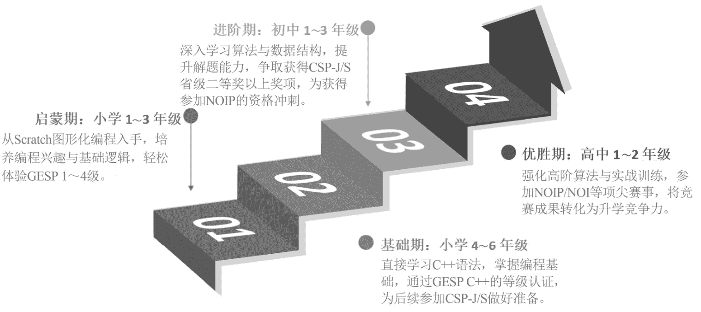

图 2-1

**2.1.1 启蒙期——培养兴趣**

如果你还是小学低年级学生，那么完成复杂、抽象的任务可能对你来说比较难。这个阶段其实更适合学习游戏化、具象化的内容，图形化编程刚好契合这一特点。

Scratch 图形化编程像搭积木、拼玩具，不需要高年级的数学知识，通过完成简单的任务，就能初步理解“如果……就……”“重复做……”这类简单的因果、循环关系，可以把编程和“玩”关联起来，自然就能建立兴趣。对应的 GESP 1～4 级侧重流程体验，通过该认证能获得初步的成就感。建议学习频率为每周一两次，既不会占用过多的时间，也能保持对编程的新鲜感，避免过度学习导致兴趣衰减。

**2.1.2 基础期——学 C++编程，打好编程基础**

如果你已经进入小学高年级，那么抽象思维能力和注意力集中的持续时间比低年级有显著增加，这时完全能够接受 C++基础知识。

通过小学数学的四则运算、应用题训练，你具有了“计算 1 到 100 的和”“判断质数”等解题逻辑，同时已经掌握了整除等概念，这满足了学习 C++语言基础的需求，为理解枚举法、递推法等简单算法思想打下了基础。

在这个阶段，建议直接学习 C++基础知识，通过 GESP C++的等级认证，打下良好的 C++编程基础，既为 12 岁之后参加 CSP-J/S 做准备，也为了以后把学习精力更早地聚焦到算法思维的培养上。建议学习频率为每周 1～3 次，能平衡逐渐增加的课内任务，不会造成过重的负担。

**2.1.3 进阶期——冲击 CSP-J/S 省奖，为升高中助力**

如果你是初中生，那么抽象逻辑思维和多层问题推导能力已显著成熟，足以支撑动态规划、图论这类需要嵌套逻辑的算法学习，不会因思维深度不足而卡壳。你在课内已掌握了代数方程、函数基础和几何逻辑，能快速关联背包问题中的变量关系、最短路径的数学模型，为算法理解提供了知识锚点，也能借助课内对逻辑顺序、分类存储的认知快速理解树的遍历、栈和队列等数据结构。

即便在小学阶段未接触过 C++，初中生凭借自身认知能力的提升，学起来也会相对轻松，不会感到费力。如果你在小学阶段已掌握了 C++语法，就无须再浪费时间在基础部分，可以采用“巩固基础→突破提升”的学习策略，直接聚焦算法核心思路，把重点放在有针对性地补全算法漏洞、提升解题准确率上，争取获得 CSP-J/S 省级二等奖以上奖项，为后续获得参加 NOIP 的资格做准备。

建议每天做 1 道题、每周进行 1 次集中训练或模拟赛，并养成每月复盘错题的习惯。这样的节奏符合初中生的课后时间安排，既能保持编程手感，又不会挤压课内学习或休息时间。

**2.1.4 优胜期——冲击顶尖赛事，增加升学优势**

如果你是高中信息学奥赛选手，那么这时抽象逻辑思维、复杂问题拆解与深度优化能力已达到顶峰，足以应对各种算法难题，在课内已掌握了函数、导数及离散数学基础，能快速理解高效算法背后的数学原理。

经过从小学到初中的系统学习，以及依托前期积累的赛事经验，你不仅掌握了 C++基础知识，还积累了丰富的算法经验，无须再处理基础问题，可把重点聚焦在提升训练难度、优化代码效率、契合顶尖赛事的核心需求上。

此时，你正处于升学关键期，强基计划、升学保送等是明确的目标。在 NOIP、NOI 等高级别赛事中获奖能增加升学优势，让努力直接转化为升学竞争力。建议每天至少刷题 1 小时、每周进行 1～2 次集中训练或模拟赛，参加一些赛前集训营，增加训练强度，提高针对性。这样的节奏符合高中生的时间安排，也与高中生更强的抗压能力相匹配。

**2.2 学习经验与避坑指南**

你在为参加信息学奥赛做准备时，可曾有过这样的困惑？明明规划了学习路径，也按部就班地学习，可不知不觉就掉“坑”里了，花了不少时间学习，却总在关键环节卡壳，也可能满心期待地投入，最后却发现方向偏了，没得到想要的结果。为什么会这样呢？难道真的是信息学奥赛太难？还是你忽略了一些看不见的关键因素。

如何才能避开那些容易踩的“坑”，让每一份努力都有效，不用再为走弯路而后悔？我们用下面的内容把这些困惑捋清楚，分享一些经验，帮你避开那些阻碍进步的隐性障碍。

**2.2.1 打字能力是隐性的编程基础**

很多学生在刚开始学编程时都会有个想法：对于打字，多练练自然就快了，没必要特意练标准指法。这种想法特别常见，毕竟他们更想把精力放在怎么写代码、怎么解题上，觉得练指法是小事。可恰恰是这个容易被忽略的小事，在后期可能会悄悄地拖慢进度。

有些高年级学生明明已经把 C++基础语法摸透了，思路也很清晰，可一到实际写代码，就因为长期用“二指禅”“三指禅”敲键盘，手指总在键盘上“找键”。想输入“int”，却按错成“itn”；要输入“while”，却漏了中间的“h”，只能删了重新输入。本来顺畅的思路，总被打错字打断，越急越错，越错越慌，特别影响状态。

这会形成一个挺烦人的循环：打字慢就想赶进度，一赶进度就容易输错，输错了又要花时间删改，最后不仅学习半小时能完成的代码拖了一小时，效率特别低，而且在比赛时更吃亏——明明想出了绝佳的解题方法，却因为打字速度跟不上，眼睁睁看着时间一点点减少，最后代码没写完，只能不甘心地交卷，多可惜啊！

要想解决这个问题一点都不难，不用花太多时间：每天抽 10～15 分钟练一练标准指法，如记键位，刻意练习输入“void”“float”“while”这些常用的 C++关键字。你坚持一两周就能明显感觉到变化，不用再盯着键盘找键，手指会自然地落到正确的位置上。在写代码时，你也能更专注在解题思路上，不用再被打字打断。这样就可以在学编程、参加比赛时，少一些被打字拖后腿的困扰，多一些从容。

**2.2.2 数学基础是核心支撑**

一些学生经历过这种挫败：明明 C++的循环、函数都能写对，可拿到题目一看，要么读不懂题干里的数学逻辑，要么有了代码能力却没有解题思路——就像手里握着笔，却不知道要写什么，最后明明代码没有报错，结果却不对，那种会写代码却做不对题的无力感，真的特别打击信心。

在刚接触信息学奥赛时，你可能会陷入一个误区：觉得学编程就是学 C++，只要把语法背熟、代码写熟，就能搞定比赛，毕竟写代码、调试程序看起来才是学编程，但你会慢慢地发现奥赛根本绕不开数学。

信息学奥赛的题目，本质上都是用编程的工具解决数学问题。比如，遇到计算圆的面积，得先记得圆的面积公式。又如，遇到判断质数，要懂整除的逻辑。再如，遇到难一点的最短路径题，还得用几何和图论的思路去建模。这些题看起来是考编程，其实每一步都在考对数学知识的理解。为了让数学成为帮手而非阻碍，我们的建议如下。

**1.分阶段打牢数学基础**

在小学时，先把四则运算、简单的逻辑推理、质数、合数这些基础知识吃透，这是信息学奥赛的地基；到了初中，再慢慢学方程、几何，接触因数分解、排列组合这些稍微难一点的内容。这些都是信息学奥赛里常考的知识点，循序渐进地学就不会觉得难。

**2.学 C++别太早也别太晚**

建议小学四、五年级再开始学 C++编程，这时你已经有了初步的数学思维，能看懂判断一个数是不是偶数、算长方形面积这些题目，不会出现学了代码却看不懂题目的脱节情况，也会有效地避免失去信心、失去兴趣，也更有成就感。

**3.数学弱就针对性补，别硬扛**

如果发现数学拖了编程的后腿，也不用急着赶编程进度，不如先补补数学。毕竟脱离数学思维的代码，就像没了方向的船，开得再熟练也到不了终点，不如花点时间把基础补好，后续学起来会更顺畅。

**2.2.3 建议从一开始就学 C++**

从前面的介绍中了解到 C++是贯穿整个信息学奥赛体系的编程语言，而且 CSP-J/S 以上高阶赛事均仅认可 C++。无论最初入门学习的是哪种编程语言，只要后续准备参加信息学奥赛，最终都需要转向 C++。

编程的核心本质，始终是用计算机的逻辑和方法解决问题。无论是 Python、C++，还是 Java、Golang 等其他编程语言，都只是将人类逻辑翻译为计算机可理解指令的工具——恰似不同的“计算机方言”，虽表达方式各异，传递的逻辑内核却完全相同。实际上，若先学其他语言再学 C++，反而需额外花费时间适应新的语法规则与表达习惯，相当于为自己增添了不必要的学习成本。

这就如同日常生活中用汉语表述“今天吃苹果”与用英语书写“Eat apples today”，核心语义完全一致。但如果你只会汉语“今天吃苹果”，要将其转换成英语时，就必须学会对应的英文单词，理解英语语法，这个学习和转换的过程是无法避免的。

为了更好地说明，我们以信息学奥赛习题中常见的“判断一个数是否为质数”为例，就能更清楚地看到这种逻辑的一致性。

用 Python 的写法是：

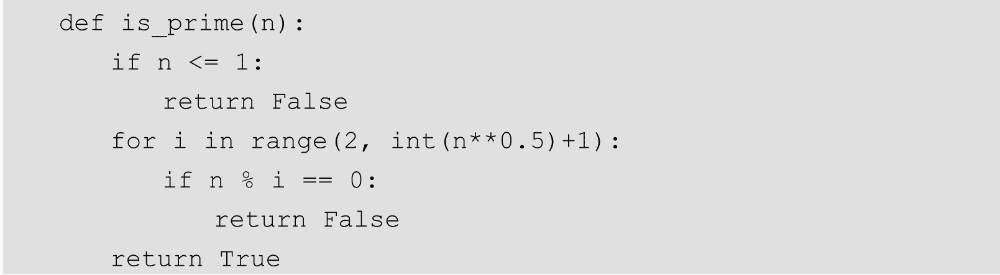

用 C++的写法是：

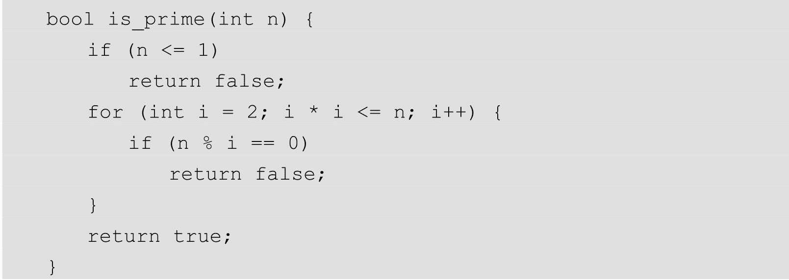

这两段代码是否看起来非常相似，但在表述上有所不同？它们的核心逻辑都是，先看 n 有没有超过 1，再检查 2 到根号 n 之间的因数。从 Python 版本到 C++版本，就是换一种语法和格式重新表达同样的逻辑。

在竞赛算法解题的层面，先学一种语言再过渡到另一种语言，会增加记忆的成本，还可能造成混淆出错，完全是没必要的绕路。只要参加信息学奥赛，就绕不开 C++，不如早早地就把 C++的编程基础打牢。

**2.2.4 常见误区与避坑指南**

**1.别盲目追捧“兴趣导向”与“快乐学习”**

有些学生在编程入门时，一看到能快速做出动画小游戏、特效网页就特别心动。毕竟能马上看到成果，既贴合兴趣，又能收获成就感，这种看得见的进步谁不期待呢？这种快速做出作品的课程往往是引导你走“逐步模仿”的路子：老师怎么拖曳角色移动模块，你就跟着拖曳；老师写一段固定代码，你就照着抄。

你最后做出了作品，打开一看，有动画、能互动，看似“学得挺好”，可真要追问角色为什么按这条路径移动？这段代码是怎么让功能“跑”起来的？你可能答不上来。即使下次遇到一点变化，如让角色走得慢些，给网页加个功能，你也可能没有头绪。原来之前的“会做”，只是抄出来的，而不是真的学会了。

所以，在入门时别盲目追捧“兴趣导向”与“快乐学习”，不要急于做出酷炫的作品，而应该注重打好基础。编程的核心是自己拆解问题、想办法的能力。兴趣不是靠模仿凑出作品的新鲜感，而应该是搞懂逻辑后，能自己解决问题的踏实感。如果只靠模仿，那么既没学到真本事，又容易养成等着别人给步骤、不愿自己想的习惯。

**2.进度别太慢，避免浪费时间**

你在刚开始接触编程时，可能心里多少会有些打鼓，总觉得编程是技术活，肯定不容易学，生怕学不会、跟不上。其实有的培训班正是抓住了这种心理，夸张宣扬“编程超级难，得慢慢学，要多上课才能扎实掌握”，采用非常慢的学习进度。

比如，原本一节课的内容被拆分为几节课，或者教材本身就很零散。又如，每节课仅讲解一点点知识，硬生生地把原本体系化的内容拆成了一些“碎片化”课程。

原本平均半年左右就能学完的基础，被拖到一年甚至更久。投入了几十节课的时间和费用，眼看着一天天过去，成长却很缓慢。这种马拉松式的学习节奏，不仅没让你感到进步，而且浪费了时间和机会，看不到自己的提升也会让你逐渐丧失信心。

编程学习从来不是时间越长越好，而是要跟着适配自己能力的节奏走，用更少的时间掌握更多有用的知识和能力才是关键。

**3.别急于求成，要打好基础**

有些学生学完 C++基础语法，就忍不住想走捷径，觉得参加竞赛集训营，说不定就能获得 CSP-J 奖项。这种急着出成果的心情特别能被理解，毕竟谁都想少花时间、快点看到学习的回报，总觉得集训营里讲的都是干货，跟着学肯定能提分。

可真到了集训现场，问题就暴露出来了：面对一些基础算法题，别人能快速拆解题干、梳理思路，你却盯着题目半天没头绪，只能被动听老师念答案、记步骤。等到集训结束后，你不仅没学会独立解题，还因为全程跟不上进度感到挫败，对编程的热情都淡了几分。

编程解题能力就像盖房子一样，得先把基础语法、基础练习等“地基”打牢。短期的赛前集训主要提升解题技巧，补不上底层基础短板。所以，你不用着急，放平心态，先打牢基础再稳步进阶，节奏更稳。

**4.避免信心不足与好高骛远的心态**

在规划编程学习时，学生特别容易掉进两个心态误区：要么信心不足，总怕自己没基础学不懂，老琢磨万一跟不上怎么办；要么信心太足，觉得编程没多难，随便学学就能上手。这两种心态可能都会导致走弯路。例如： 

我上四年级了，想学编程，纠结要不要从图形化编程起步。

四年级学生已具备了理解代码符号的认知能力，此时再学拖曳式的图形化编程，不仅没必要，还会错过向文本编程过渡的黄金期，不如直接从 C++的基础语法和简单逻辑题入手，能更快建立编程思维。 

我是小学低年级学生，入门 C++后越学越吃力。

为了尽早抢占先机，有的学生在一、二年级就开始学 C++编程。但此阶段对抽象的变量定义、分支和循环、数组等概念根本理解不了，打字也有问题，在上课时只能被动记步骤，课后做题毫无头绪，不仅学不到真东西，还会因为总学不会而产生挫败感，甚至抵触编程。 

我学 C++已经一个月了，刷一刷 CSP-S 真题。

还有人觉得学编程就是为了获奖，接触 C++没多久就去刷 CSP-S 真题，结果无从下手，越刷越蒙，原本的热情也慢慢被磨灭，最后连学习信心都没了。学习编程一定要匹配认知水平和当前基础。四年级学生学 C++不算早，一、二年级学生学 C++不适合，刚学一个月刷竞赛题确实太急。

**2.3 学习方式和途径**

有些学生一开始就容易“绕远”，要么没摸清自己的能力到底有什么，要么没选对跟自己适配的学习方式，白白浪费了时间和精力。毕竟每个人的自律程度都不一样、知识基础都有差异、能投入的时间也都不同，只有贴合自身实际选择最合适的方式，才能避免走别人的路，耗自己的力，让每一份投入都落在点子上。

怎么才能让参加信息学奥赛的冲劲不白费，让努力更有效果？关键就在于选择学习方式和途径。选对了就能事半功倍，而选择学习方式和途径不能只凭感觉，需要结合自身的学习目标、基础水平与时间安排综合考量。

学习方式和途径没有绝对的好与坏，只有相对更合适自己的。下面将分析目前主流的 3 种学习方式——自学、传统培训（线下）、线上课程（线上），对比 3 种方式的特点、优势、更适合谁、要注意什么，给你作为参考。

**2.3.1 自学**

说到自学，优秀的学生可能会给自己打气：我既自律又有基础，应该能行。但他实际学下来才发现并不轻松，自学更适合少数能力超常的计算机天才！

因为自学的门槛远不止“自律+有基础”这么低，还必须有很强的逻辑拆解能力和自主解决问题能力，而且更重要的是，信息学奥赛拼的不光是“啃”书本学知识，知识点关联扩展和备赛经验也很重要，这两点往往得靠专业教师指引。

从我身边选手的案例来看，真能靠自学稳稳推进、最后达到竞赛水平的学生，占比极少。这些成功的选手，除了自身具有超强的学习能力、逻辑能力和自主学习能力，大多借助了身边的一些资源，如前辈或有经验的选手分享并解答自学过程中的问题。

怎么判断自己是否适合自学呢？下面给出自学编程的几个参考条件，你可以根据自身情况评估一下。如果每一条都符合，那么可以尝试自学。

**1.小学五年级以上，具有 C++基础编程能力，学习能力和理解能力优秀**

（1）扎实掌握 C++基础知识，可以熟练地使用循环、函数、数组、指针、结构体。

（2）当遇到代码报错时，能看懂报错信息，可以自己找到问题出现的原因并修正。

（3）能独立理解基础数据结构与算法，如能写出汉诺塔的完整实现代码。

**2.善于利用互联网平台获取信息和解决问题**

（1）能独立获取赛事相关信息。能主动查询 CSP-J/S 最新消息、考试和大纲动态，可以从官方竞赛平台、权威信息学奥赛社区等渠道获取真题及其解析。

（2）能借助工具解决问题。当遇到算法思路卡壳或代码调试问题时，能通过 AI 工具梳理思路、分析报错日志、发现问题所在并独立完成修正。

**3.有很强的学习规划与执行能力**

（1）能制订合理的学习计划，明确每日/每周/每月的学习目标，管理自身学习进度。

（2）能定期总结学习成果，复盘薄弱知识点并调整后续计划，形成学习闭环。

**2.3.2 传统培训**

传统培训是指以线下固定课堂为核心的教学模式，依托实体教学场地，采用教师面对面授课、学习者集中到场学习的形式，是不少学生考虑的学习方式。传统培训对两类人尤其适用：一类是在学校或生活圈附近就有高质量线下信息学奥赛教学资源的学生；另一类是自主专注力较弱，需要外部环境约束（如课堂纪律、教师监督）才能保持学习节奏的学生。

**1.传统培训的优势**

传统培训的优势体现在场景体验与人际互动方面。

（1）集体学习氛围强化专注度。线下课堂有固定的场地与纪律约束。这种环境能减少学习时的分心和干扰，对自主专注力较弱的学习者而言，更容易进入深度学习状态。

（2）固定节奏提升学习驱动力。传统培训多有明确的课表安排，搭配教师的课堂监督与课后作业要求，更容易形成定时学习的惯性，学习节奏也会更加稳定。

（3）同伴互动补充学习资源。线下课堂提供了交流的机会，学生在课下可与同学讨论问题，一起拆解模拟题的步骤，分享学习心得，互相借鉴。这种同辈互助是线上学习较难完全替代的。

**2.选择传统培训的建议**

培训机构之间的差异很大，课程质量、教师资源、教学能力方面参差不齐。有的综合水平较高，培养出了优秀的信息学奥赛选手；有的与优质机构相比，在某些维度上还存在需提升的地方。如何挑选适合自己的培训机构呢？你在选择时可以关注以下几个方面。

（1）教师资质。要了解一下授课教师的教学资质，如是否持有计算机教师资格证或 CCF 颁发的证书，跟着有教学资质的教师学才有效果和保障。

（2）班级规模。要优先选择小班教学。小班的教师更能关注到每个学生的听课状态，小班的课后答疑时间充足，大班更易出现学生没学会而教师不知道的情况。

（3）课程试听。建议先试听一两节课，在课上重点感受教师的教学风格，在课后关注是否有合理的作业和答疑渠道，也可以判断是否喜欢教师的讲授风格。

**2.3.3 线上课程**

线上课程是指依托互联网开展的远程教学方式。借助直播软件或录播平台，教师远程授课，学生居家、异地线上学习，同时搭配在线答疑和练习平台，提升了学习的灵活性。因此，线上课程也逐步成为学习信息学奥赛知识的主流方式之一。

**1.线上课程的优势**

线上课程的优势可从以下 3 个方面体现。

（1）打破地域限制，共享优质资源。无论你身处何处，通过线上课程都能接触到优质的信息学奥赛资源，包括优质的课程体系、资深的教练、优秀的教学工具平台等。

（2）支持个性化进度，适配不同基础。线上课程允许灵活调整学习内容和节奏。每个人的学习进度都可以根据自身的学习情况和时间投入灵活安排。

（3）综合成本更可控，减轻负担。线上课程的费用相对更低，性价比更高。对时间紧张的中小学生来说，线上课程更友好，他们无须花时间通勤，节省下来的时间可用于刷题、复盘或休息、锻炼。

**2.如何选择线上课程**

线上课程的特性导致了课程的品质和服务参差不齐。有一些优秀的平台在课程设计、教师资质、教学方面水平较高，在服务方面也投入了较多资源。也有一些平台在各方面都相对较差。你在选择时可以关注以下几个方面。

（1）授课教师。在线上学习，更要关注教师的教学资质，是否持有计算机教师资格证或 CCF 颁发的证书，跟着有教学资质的教师学才有效果和保障。

（2）教材或教学用书。课程的配套教材最好是正式出版的图书，而非机构自行印刷的内部资料。正式出版的图书经过专业出版审查，内容的体系化、完整性和质量都比内部资料更有保障。

（3）视频质量。视频是线上课程的核心，你要重点观察授课视频的拍摄场景是否正式，而非临时的录制环境，同时要确认视频清晰度、播放流畅度、是否有杂音等，避免影响上课效果。

（4）试听课程。建议先试听几节课，通过试听来判断是否适合自己，如教师的表达特点、讲述逻辑，以及是否喜欢该教师的授课风格。

（5）体验课后答疑。实际进行体验和试用课后答疑，要体验能否解决学习中的各类问题，还要关注答疑的反馈速度，避免因问题堆积影响学习进度。

**2.4 新理念：开始利用 AI 能力**

在介绍了自学、传统培训、线上课程这 3 种经典的学习方式后，不难发现，无论是哪种方式，都受限于课程质量、资源分配、个性化适配、即时反馈效率等问题。

随着 AI 技术的成熟，尤其是以大模型为核心的 AI 技术爆发式发展，正在彻底打破传统学习的边界，深刻影响着在线教育，更催生了一套颠覆传统的学习新理念。这一新理念的核心在于，AI 工具不再是被动响应的工具，而是能主动适配学习需求的协同伙伴——它能感知学习者的基础差异，解决传统学习中即时性与个性化不足的问题。

技术的发展为学习信息学奥赛知识带来了全新的理念。这种新理念已不再局限于换个场景上课的表面改变，而是从学习的底层逻辑出发，打破了过去诸多的限制——为学习信息学奥赛知识提供从知识点理解、代码实践到错题复盘的全链路支持。

AI 技术也将成为学习信息学奥赛知识的新支点，重构从知识获取到能力落地的全流程。对于学习者来说，这些变化并非遥不可及的未来趋势，而是当下就能真切感受到的学习新可能。

AI 技术为学习信息学奥赛知识打开了一扇新大门——门槛更低、效率更高，还能贴合每个人的学习节奏。能不能掌握用 AI 工具学习信息学奥赛知识的方法，很可能会成为未来学习者之间拉开差距的关键。

该如何合理地利用 AI 工具才能让其真的成为学习信息学奥赛知识时的靠谱帮手，而不是躺在收藏夹里“吃灰”的闲置工具？

这正是后续内容的核心。我们会用接下来的几章讲述 AI 技术给信息学奥赛知识的学习带来了哪些变化，深入具体场景，给你能直接用的指南。一方面，我们把 AI 工具辅助学习信息学奥赛知识的方法讲透，重点拆解提示词工程，针对不同的学习场景，如拆解算法、调试代码、分析真题写出精准的提示词，让 AI 工具给出的回复满足需求；另一方面，我们也会介绍市面上主流的 AI 编程工具，让你能快速找到最适合自己的 AI 搭档。

从现在开始，我们用 AI 工具学习信息学奥赛知识吧！

**能力篇**[在介绍了信息学奥赛知识的学习规划之后，一个问题或许已经悄然浮现：在 AI 技术重塑教育形态的今天，我们究竟该如何构建起一套利用 AI 工具学习信息学奥赛知识的全新模式？这不仅仅是简单地将 AI 工具视为一种回答问题的工具，更重要的是如何让 AI 工具真正成为参加信息学奥赛路上的精准赋能者，而非一个让人产生依赖、替代独立思考的“拐杖”。我们认为，利用 AI 工具的学习方式并非要完全取代之前的学习方式，而是要让 AI 工具成为这些方式的赋能者：既可以是随叫随到的辅导老师，也可以是课后答疑的助教，还可以是备赛教练。这种“AI 工具+传统学习方式”的组合，正是我们所倡导的新范式的核心。我们写本书的目标，就是希望能够借助 AI 工具的力量，帮助每一位学生从那些机械重复、耗时费力的任务中解放出来，真正实现用最少的时间，学得更快，学得更好！]

**第三章** **以 AI 工具为支点，重构学习范式**

**3.1 AI 技术对我们的影响**

**3.1.1 迅猛发展的 AI 技术**

AI 技术爆发式发展的核心动力源于大模型的持续突破。

2017 年，Transformer 架构诞生。它通过注意力机制打破了传统模型处理长文本的瓶颈，为大规模语言学习奠定了基础。2020 年，GPT-3 以 1750 亿个参数的规模展现出惊人的文本生成能力，让世界看到了大模型的潜力。2022 年，ChatGPT-3.5 的推出标志着对话式大模型的成熟，其理解上下文、完成复杂指令的能力，彻底打破了公众对大模型的认知边界。2025 年 8 月，GPT-5 发布，其各项能力都提升到前所未有的高度。

国产大模型的发展势头同样强劲，依托极具竞争力的技术研发，形成了贴合中文场景的大模型生态。字节跳动的豆包大模型以多模态交互为核心，DeepSeek 依托开源模式构建生态，百度的文心一言与腾讯元宝也各具特色。

这些优秀的国产大模型正深度支撑国内教育、金融、能源、制造、终端交互等多个关键行业的 AI 应用落地，覆盖多个核心业务环节，推动各领域流程优化、效率提升与技术升级，展现了国产大模型的强大技术能力，以及各行业 AI 应用的广阔前景。

**3.1.2 AI 技术对教育和学习的重塑**

AI 技术已在各个行业引发深层次变革。在制造业中，智能视觉检测系统凭借 99.9%的准确率替代人工质检，将缺陷识别效率提升 10 倍以上；金融业通过 AI 风控模型实时分析交易数据，欺诈识别响应时间从小时级压缩至秒级；在医疗领域，多模态 AI 工具能快速解读医学影像，辅助医生提升诊断准确率，尤其在基层医疗机构填补了专家资源缺口。

这种重塑性的变革逻辑，同样深刻影响着教育领域。教育行业的特殊性在于其核心对象是“人”，AI 技术的应用并未取代教育的本质，而是通过技术赋能实现了教育价值的放大和效率的提升。这种影响已渗透到教育的资源供给、教学模式、评估体系等各个层面。利用 AI 技术赋能的教育教学活动在能力、效率和体验方面均获得显著提升。

**1.在能力方面，依托海量训练数据与迭代优化，构建全方位知识与技能支撑**

AI 技术在教育能力层面的核心价值，源于其庞大的知识库和极强的推理能力。一方面，依托海量训练数据，AI 工具可覆盖从基础教育到高等教育的多学科知识体系，相当于一个全天候的知识解答助手，能快速响应各类知识查询需求，填补传统学习中知识获取滞后的缺口；另一方面，其在逻辑推理、数学运算与代码生成等领域的能力持续提升，当前的主流大模型已达到较高的水平，让 AI 技术可精准适配不同学段的学习需求，有针对性地提供知识与技能支撑。

**2.在效率方面，加速全链条环节革新**

AI 技术赋能教育，传承了互联网教育打破时空限制的优势，并进一步在效率环节实现突破。在知识传递环节，AI 工具彻底打破时间与空间的约束，学生无须依赖固定课堂与特定时段，可随时随地获取标准化的知识内容。这提升了知识传递的效率，扩大了知识的覆盖范围。在备课与教学设计环节，AI 工具可快速整合教学资源、生成教学方案，将教师的备课时间从数小时压缩至几十分钟，显著降低了备课成本。在学情诊断环节，AI 工具可通过即时练习反馈快速定位知识盲区，将诊断周期从月级、周级缩短至天级，甚至小时级。在资源匹配环节，AI 工具可自动筛选适配学习者水平的资料与习题，避免传统海量资源筛选低效的问题，提升资源利用效率。

**3.在体验方面，以数据驱动个性化，打造专属的学习体验**

AI 技术重构教育体验的关键在于数据驱动的个性化与无疲劳的耐心陪伴。AI 工具可基于学习者的历史学习数据，如答题正确率、学习时长、知识点掌握情况，动态调整学习内容的难度、节奏与形式，实现千人千面的个性化辅导。针对知识薄弱的学生，AI 工具可自动增加基础练习；针对学有余力的学生，AI 工具可主动推送拓展内容，避免一刀切的同质化体验。另外，AI 工具具备无情绪、无疲劳的特性，在答疑辅导中可保持耐心，无论学生重复提问多少次、提问难度如何，AI 工具均能以一致的态度进行解答，彻底解决传统学习中学生不敢问、不好意思反复问的痛点，为学生打造更轻松、更包容的学习体验。

在 AI 技术推动教育多维度变革的背景下，编程学习作为数字时代核心技能培养的重要领域，其学习模式也正经历显著重塑，而要更清晰地把握 AI 技术带来的改变，我们不妨先梳理传统编程学习中存在的具体痛点与难点。

**3.2 为什么学习编程那么难呢**

提到学编程，有些学生会觉得很难。明明投入了大量的时间和精力，但是效果往往达不到预期。特别是随着信息学奥赛的普及度提升，编程学习者数量大幅增加，对优质课程体系、优秀指导教师、课程答疑体验、练习平台能力的需求增速远超过供给增速。通过对目前市场上编程教育的研究，我们发现，传统学习模式与信息学奥赛的实际需求之间存在 3 个痛点，这也是诞生用 AI 工具学编程这个新理念的现实动因。

**3.2.1 优质编程教育资源稀缺**

“会编程”和“会编程教学”是完全不同的两码事。编程门槛灵活，只要有兴趣，哪怕没有专业背景，也能通过看书或看视频自学，逐步掌握写代码的能力，自己能操作就行，而编程教师，要有扎实的编程知识和能力，还要具备合格教师的资质和专业素养。国家对教师资质有严格的准入和认证管理，教师要经过严谨的培养流程，学习教育学、心理学、教育技术等师范课程。这些知识能为科学的教学方案设计提供支撑。教师需要精心设计和不断优化在什么时候讲授，在什么时候提问，在什么时候使用案例。

优质编程教师的培育与供给，需要大量投入和长期积累，系统化的优质课程的研发也需要投入大量资源。优质编程教育资源的增加速度具有天然的慢属性。这种供需增速的失衡，直接导致大量学习者难以接触到好的编程教育资源，从而形成了想学无门的困境，最终错过了学习的时机，限制了学习的效果。

在有的机构中，虽然教师是“编程大牛”，但是缺乏专业的教学功底，甚至连教案也不会写，自己很牛，但是“讲不出来”，在上课时采用“跟练式”教学，让学生跟着教师一步步实现操作。从表面结果看，学生确实能做出当前题目，但本质上只是被动复制操作流程，既未真正理解题目背后的知识点关联逻辑，也未建立属于自己的解题思维框架。在这种模式下，学生对知识的掌握停留在“操作记忆”层面，对背后的知识点、逻辑掌握松散，更谈不上扩展与运用。

**3.2.2 标准化教学模式与学习者个性化需求的矛盾**

标准化教学的核心逻辑是统一效率，即通过固定的进度安排、统一的内容设置，实现大规模教学覆盖，但这种模式忽略了学习者的个体差异。

学习者的基础水平、学习节奏与核心痛点各不相同。有的人入门编程早、数学基础扎实，有的人刚接触编程、数学功底薄弱，有的人理解抽象概念速度快，有的人需要更多的时间消化知识，有的人弱在算法推导环节，有的人卡在代码调试步骤。

标准化教学难以兼顾这些差异，既容易让基础薄弱者跟不上进度，又可能让基础扎实者陷入重复学习，最终无法满足个性化的学习效果提升需求。

有的机构为了追求招生规模，常将不同年级、不同基础的学生集中在同一个班进行教学。面对这样的班，教师只能放弃个体差异，按所谓的“班级平均水平”设计教学进度与内容。这直接导致以下两类问题出现。

对低年级或刚接触编程的学生而言，入门的节奏比较慢。教师按照平均水平讲解，他们很难跟上进度，还可能会因为持续跟不上进度自信心受到打击，甚至产生“我学不会编程”的错觉，最终知“难”而退。

相反，对于高年级、有基础或者理解能力本身就很强的学生而言，在大班学习的过程中，他们不得不跟着全班的进度等待，浪费了大量的时间，学习效率很低，学习效果也不好。

**3.2.3 知识和能力之间的矛盾**

为什么很多学生上课听懂了，也理解了，看到题目之后对解题方法和算法也有清晰的思路，但是写代码总是无法得到正确的答案？

信息学奥赛要求的不是能在纸上复述算法，而是必须能独立写出可运行的代码。听懂理论和写出能运行的代码之间，始终隔着“调试代码、解决 Bug”这道绕不开的关卡。只有在真正动手写代码时，问题才会集中出现：可能漏写条件导致程序死循环，可能未初始化变量引发错误，可能少写分号、括号不匹配导致编译失败。

这种知识和能力之间的断层频繁出现：学生看似上完了课，理论知识也学会了，但始终没学会独立调试代码解决程序里的 Bug，而这正是听懂和会写的本质区别。也正是这个老大难问题，让学生陷入在课上都懂而在课下写不出的窘境，难以形成真正的代码能力。

要知道 Bug 是编程中的常态，必须掌握独立定位问题的能力，如通过输出日志找到报错的位置，顺着原有思路修改代码，把错误转化为经验。只有通过不断写代码、调试代码、解决 Bug 的训练，才能最终把理论转化为动手能力。

有的机构虽设置了编程训练（如课后作业、课堂实操），但配套的答疑支撑完全跟不上，从而让学生最终陷入“懂却不会写”的困境。学生在写代码卡壳时，要么只能在微信群里留言等待，当老师回复时已过去几小时，不仅忘了当时的思考逻辑，连继续调试的耐心都没了，要么老师回复得极其简略，只说“这里逻辑错了”或直接给出正确代码，既不解释“为什么会出现这个 Bug”，也不教“下次怎么自己排查同类问题”。学生虽然能照着改对当前代码，却没形成“排错思维”，当下次写新代码遇到“数组越界”“逻辑漏洞”时，还是会卡在原地，只能再次等待别人帮忙。

**3.3 AI 技术为学习信息学奥赛知识赋能**

在编程学习这类对实操性、即时性要求很高的领域，传统方式的局限性在技术浪潮中愈发明显，学习方式的迭代也因此成为顺应时代发展的必然趋势。AI 工具可以降低学习门槛，帮助学习者更轻松地掌握核心知识。AI 工具还可以提升学习效率，精准消除学习中的痛点，让学习者用更少的时间学习更多的内容。

**3.3.1 海量信息整合与逻辑推理能力**

AI 工具的海量信息整合与逻辑推理能力可以理解为其信息储备与推理机制的深度协同。海量信息整合并非零散地堆砌，而是对互联网全域文本（包括书籍、论文、对话、文档等）进行大规模学习后形成结构化知识网络。从基础概念到复杂理论，从事实陈述到逻辑关系，这些信息经过清洗、关联与抽象，形成了一个覆盖多领域的超级知识库，为大模型提供了理解和回应的素材基础。

大模型的逻辑推理能力依托 Transformer 等神经网络架构的注意力机制实现：大模型能像人类理解语言那样，精准捕捉文字间的因果、递进、对比等语义关联关系，并通过预训练，预测下一个词，补全逻辑链等，学习通用的语言规律与思维范式。这种能力不是对信息的机械复述，而是基于知识网络中的关联，对已知信息进行拆解、组合、推导，最终实现从“是什么”到“为什么”“怎么办”的延伸，本质是对人类语言逻辑与认知规律的模拟和复用。

没看懂上面两段内容也没关系，说得简单一些，AI 工具在训练的过程中，已经将分散的知识整理成系统的知识库——AI 工具已经学习并将其存在了自己的“大脑”里。这个“大脑”既掌握了知识细节，还懂得对这些知识的熟练运用。

回到编程和信息学奥赛领域，大模型在训练过程中就已完成了对这个领域中很多专业数据的学习。这些数据几乎涵盖从基础语法到竞赛实战的全维度内容：既包括 C++语言标准中的语法和概念，也包括计算机算法理论的各类专业书籍，还涉及信息学奥赛领域的各类信息，如近十年信息学奥赛真题的解题思路、竞赛教练和选手的经验分享等。这些知识并非孤立存储，而是通过大模型训练形成了知识点、原理、应用、易错点等的关联知识图谱。

比如，当学习者询问 AI 工具，C++中为什么要区分引用和指针时，AI 工具不仅会给出概念解释，还会整合多源知识展开系统讲解：先从语法基础切入，对比两者的定义规则，再关联内存原理，接着结合代码举例说明在什么时候用指针，在什么时候用引用，并关联真题中因混淆两者导致的失分案例。在整个过程中，AI 工具将语法书、内存原理、竞赛经验、真题案例串联成完整逻辑，让学习者不仅知其然，更知其所以然。

再如，当面对如何用二分法解决信息学奥赛中的最大化最小值问题这一典型竞赛题时，AI 工具的信息整合能力更有优势。它会先从基础算法出发，讲解二分法的核心逻辑，再关联数学模型，说明这类问题的共性，接着结合具体真题，同时延伸到同类问题的变种。这种讲解不再是单一题目的解法，而是将算法原理、数学模型、真题应用、同类拓展整合为问题类型—核心算法—实现技巧—变式迁移的知识体系，帮助学习者触类旁通，避免陷入做一道会一道，换题就卡壳的困境。

**3.3.2 优秀的代码理解和生成能力**

AI 工具在辅助学习信息学奥赛知识时，有一个核心优势尤为突出：它极其擅长读代码、写代码、改代码。形成这一优势的关键在于，大模型通过海量规范代码的训练，从训练的数据中习得了编程语言的底层规律。这些用于训练的代码不仅覆盖了编程语法，还包括通用的编程逻辑（如分支循环的嵌套规则等），以及编程中各种算法和场景的实现（如排序算法、文件读写等）。

大模型通过将代码转化为可计算的向量，结合自注意力机制捕捉上下文关联（如变量的定义与跨行使用），最终形成对代码含义的类理解能力，既能识别一段代码的逻辑和功能，也能判断代码是否符合规范，还能模仿规范模式生成新代码。这种能力并非基于预设规则，而是对海量代码中统计规律的复用，让 AI 工具能像资深的程序员一样处理代码。

基于上述原理，AI 工具的代码理解和生成能力已通过大量专业工具落地。AI 工具已成为程序开发领域的标配助手：在生成代码方面，AI 工具能够根据程序员的需求或输入的问题生成对应的代码片段、完整函数甚至复杂模块。最先进的 Vibe Coding 技术甚至可以通过提示词生成整个应用程序。在修改代码时，AI 工具不仅能处理基础的语法错误，如 C++中缺少分号或括号不匹配，还能检查出程序的逻辑问题和潜在风险，如循环条件中的边界判断错误、变量未初始化导致的运行时异常，甚至能识别出冗余代码或性能瓶颈并给出优化方向。

这些能力已被行业级工具充分验证：GitHub Copilot 作为主流 IDE（Integrated Development Environment，集成开发环境）（如 VS Code）的插件，能实时根据上下文补全代码，甚至生成完整函数实现，支持数十种编程语言，被全球数百万个开发者日常使用；Cursor 编辑器则深度集成 AI 工具调用能力，不仅能逐行解释代码逻辑，还能一键重构冗余代码，让读懂并优化老代码的效率提升数倍；国内字节跳动的 TRAE 聚焦开发者场景，对中文需求的理解更精准。这些工具的普及，直接证明 AI 工具的代码理解和生成能力已足够成熟，能深度融入编程全流程。

AI 工具对代码的理解和生成能力，经过训练和优化，就可以应用在编程学习中。在初学者读不懂代码时，AI 工具能即时生成逐行解释，厘清变量关系和逻辑链路；在遇到程序报错时，AI 工具能快速指出问题并给出修改示例，避免学生卡在基础错误的调试上；在学生想练习特定算法时，AI 工具可先生成参考代码，或者给出按步骤的实现引导，帮助学生理解和学习算法知识。

在学习和备赛刷题的过程中，AI 工具的优势也比较明显。它能精准判断学生提交的代码是不是题目的正确解法，并检查时间复杂度、空间复杂度是否符合要求；若代码运行出错，它不仅能有针对性地指出具体问题（是语法层面的括号遗漏、变量类型不匹配，还是逻辑层面的边界条件缺失、递归终止条件错误，抑或是算法设计上的思路偏差），而且能结合错误类型深挖学生未掌握的知识点，进而发现学生的薄弱环节。

这种从学习知识点到发现并修正代码错误，再到发现知识漏洞的精准衔接，能帮助学生在刷题中既解决当下问题，又补上核心短板，提升学习效率和体验。

**3.3.3 强大的角色适应能力**

通过专门的训练，结合优质教学场景的训练数据对大模型进行精调（训练数据包含竞赛教练的授课视频文本、解题思路拆解案例、学生错误归因记录等），可让 AI 工具模拟专业教师的教学逻辑，使其掌握从引导到启发的教学流程。通过一些提示词的指令设定，AI 工具能快速适应角色变换，化身为经验丰富的编程教师，根据学习者的水平调整教学深度。

若为 AI 工具指定用户为中小学 C++基础学习者，它就能将复杂的编程语言中的难点或者核心算法讲得清晰易懂，即便刚接触编程的学生，也能轻松理解。

当学习者反馈听不懂内存地址这个知识点时，AI 工具可能会以教师的视角，考虑学生的学习阶段，用生活化的案例类比讲解，如从快递单号、门牌号等生活场景切入——快递单号能唯一标识包裹，门牌号能唯一标识房间，用这样贴近生活的类比替代生硬的专业术语，降低理解门槛；若学习者仍未理解，它还能切换到代码实操视角，通过定义指针变量→打印指针地址→修改指针指向的分步演示，直观辅助学习者感知概念本质。在整个过程中，AI 工具能通过分析学习者的提问内容（如学习者提到还是不明白指针怎么指向数组），精准判断其理解卡点，再动态调整讲解逻辑与内容深浅，直到学习者建立清晰的认知锚点，而非机械重复同一套解释。

若为 AI 工具指定用户为参加 NOIP 的选手，AI 工具则会自动切换到竞赛进阶模式，不仅能聚焦动态规划、图论、数论等 NOIP 高频难点模块，结合历年真题拆解算法优化思路，还能针对选手常犯的边界条件处理、时间复杂度控制等问题，提供针对性的调试建议，甚至能优先展示多种解法的对比分析，帮助选手建立最优解思维。当遇到复杂题型时，AI 工具还能模拟竞赛教练的引导式提问，逐步启发选手自主梳理解题框架，而非直接给出完整代码。

**3.3.4 即时反馈的答疑能力**

对于参加信息学奥赛的学习者来说，很多问题往往出现在非常规时段：可能是周末自己梳理算法时卡在某个逻辑节点，也可能是晚上调试代码时突然遇到报错。人总会累，教师也需要休息，很难随时响应这些突发的学习需求。

AI 工具作为计算机程序，能以全年无休的状态持续运行，完全不受时间与精力的限制，既能覆盖深夜、周末这些非教学时段，也能在学习者产生疑问的第一时间给出回应，避免学习者因漫长的等待而中断思路、打乱好不容易进入的学习节奏。

AI 工具也不存在情绪变化问题和工作状态的波动，即便学习者反复咨询同一个基础知识点，或多次梳理同一类问题的逻辑，它也能始终保持耐心与清晰的表述，不会因学习者重复提问而降低解答质量，为学习者营造出无须顾虑、敢于提问的无压力环境。

AI 工具答疑的最强大之处在于它能把答疑变成教学的延伸，真正了解学习者卡壳的原因。依托海量的知识储备、严谨的逻辑推理能力与灵活的角色模拟能力，使用 AI 工具答疑不只是简单给答案或判断对错。当学习者提出问题时，它会像经验丰富的教练一样，先通过问题场景识别与关键词匹配，精准找到卡壳的核心：是基础概念没吃透导致思路走偏，还是写代码时忽略了细节引发报错，抑或是推导算法逻辑时卡在了关键步骤。

它还会进一步关联学习者可能存在的薄弱环节，用举一反三的方式拓展讲解，不只是解决当下的问题，更会延伸同类知识点的用法、常见的“坑”及如何避开，帮学习者从根源上弄懂，形成完整的知识逻辑链，真正实现解决一个问题，掌握一类知识的效果，让每一次答疑都成为巩固基础、强化能力的助力。

**3.4 独立思考，避免陷入依赖 AI 工具的误区**

3.3 节探讨了 AI 技术带来的各种新变化。这并不意味着在学习过程中万事都要用 AI 工具，你更需要在合理的地方发挥它的价值。

在传统学习帮你搭好知识框架后，AI 工具能快速整合内容，不用你再在海量资料里翻找。当你调试代码反复出错、归纳题型耗时长时，AI 工具也能给出精准反馈，帮你少走弯路。采用传统模式打基础，再用 AI 工具提高效率的搭配，能让你在学习时少一些焦虑，多一些底气。

你还需要特别关注 AI 技术在带来便利的同时，也可能带来一些影响，要警惕过度依赖 AI 工具可能弱化独立思考能力。你一定要记得让 AI 工具成为传统学习的搭档，既借它提高效率，又能保持独立思考的习惯。

**3.4.1 利用 AI 工具辅助学习，避免过度依赖是首要原则**

AI 工具的真正价值是帮你推进学习过程，而不是直接给你现成的学习结果。要是光靠 AI 工具输出完整代码、直接给出解题答案，看起来是快速完成了训练任务，省了不少工夫，但是会错过那些能帮你提升能力的关键环节。比如，在推导算法时那种卡壳又慢慢厘清思路的过程，恰恰是让知识扎实的必经之路。又如，在调试代码时的试错经验，能让你以后对问题更敏感。再如，在拆解题目时的思考更是培养解题能力的基础。这些思路和能力的构建，才是从懂理论到会写代码的关键跨越，一旦省掉这些，你的学习效果就会差很多。

你一定要明白，编程学习的成果从来不是做了多少道练习题，而是真正掌握逻辑思维、算法设计、代码实现这些核心能力。当 AI 工具每次给答案时，你直接用，看起来很轻松，其实已经偏离了学习的本质，不仅学不到真本事，而且到了考场上也没底气，毕竟在比赛时可没有 AI 工具帮忙，只有把自己的能力练扎实才靠得住。

**3.4.2 以独立思考为主，以 AI 工具为辅**

在编程遇到问题时，你不妨试一试先自己琢磨，如果实在不行再使用 AI 工具。你可以先试着拆解一下需求，从学过的知识点里捋一捋解题思路，接着推导算法逻辑。哪怕中间卡壳了，也先别急着使用 AI 工具，拿一张草稿纸画一画思路或者写几行简单的代码，尽全力自己突破。当实在没方向，确实思考不出来时，你再使用 AI 工具帮忙，而且一定要写清楚要的是提示，而不是现成的答案。

比如，你可以问一问 AI 工具在处理这道题的边界条件时，一般会考虑哪些情况，还可以问一问 AI 工具为什么优先考虑这些情况，背后的逻辑是什么。你要根据 AI 工具的思考来看自己没想到的地方，这样才能让 AI 工具辅助自己独立思考，而不能被动接受结果。

**3.4.3 学习 AI 工具的思考过程**

要做到这一点，与怎么设计提示词很有关系。如果你使用 AI 工具理解算法思路，就可以这么对 AI 工具提问。 

分 3 步拆一拆最短路径问题的 Dijkstra 算法思路，说一说每一步的核心逻辑和为什么这么设计，不用直接给代码。

要是想使用 AI 工具调试代码，可以这么对 AI 工具提问。 

我的代码在遍历数组时报错了，请先分析一下可能导致这个错误的 3 类常见原因，再说一说怎么一步步排查。

用这种既明确又具体的提示词，能让 AI 工具给出更有用的内容。更重要的是，你在想该怎么问的时候，其实已经在梳理自己到底需要什么帮助、想知道什么了。这也是一次独立思考的锻炼。

由此可见，怎么才能更好地对 AI 工具提问是很重要的。第四章将进入用 AI 工具学习信息学奥赛知识的关键环节——如何写好提示词，只有通过合理的提示词，才能确保 AI 工具是帮你提升能力的工具，而不会成为代替你思考、让你变懒的拐杖。

**第四章** **提示词（Prompt）：与 AI 工具交互的金钥匙**

小贴士：

在阅读本章内容时，你可以准备好自己熟悉的 AI 工具，如豆包和 DeepSeek，当看到“ Prompt”标识时进行实际的效果体验。为了方便输入，获取电子版 Prompt 的方法参见 5.3 节。

**4.1** **认识 Prompt**

**4.1.1** **重新认识 Prompt**

Prompt 本质上是一种注入式指令，是与 AI 工具交互的起点，能触发 AI 工具回应、引导对话方向并影响最终输出，也能通过预设思路的引导，指挥 AI 工具思考问题、输出内容，其核心目的在于凭借精确的指令或问题，让 AI 工具生成更符合使用者预期的内容。

在这个 AI 工具越来越普及的时代，你对豆包、DeepSeek、元宝这些名字可能并不陌生，或许每天都会打开它们，问问怎么构思今天的作文、怎么解数学作业中的难题，把编程时遇到的报错代码复制过去求助，或者让它们帮忙整理一下这周的英语单词。

简单来说，Prompt 就是给 AI 工具输入的文本指令，就是平时问 AI 工具的那些问题，目的是告诉 AI 工具想要什么，引导它生成你需要的内容，是与 AI 工具沟通的桥梁。

简单的 Prompt 可以像一句随口的提问，如学生常问： 

C++中数组下标为什么从 0 开始。

也可以复杂到像一份详细任务清单，比如： [Prompt 请帮我设计一个信息学奥赛中二分查找算法的学习方案。具体要求：1.用生活场景类比二分查找原理。2.包含 C++代码实现。3.设计两道练习题，适合中小学生理解。]

那么，AI 工具是怎么读懂 Prompt 的呢？这个原理和过程很复杂，不是本书要讲的重点。可以试着简单理解一下，就像你在与同学讨论问题时，需要先听清对方的需求：在输入 Prompt 后，AI 工具会先拆解文字，了解关键词，如二分查找、生活场景类比、C++代码、中小学生，理解真正的意图。然后，它会调用自己学过的知识，如算法原理、C++语法、中小学生认知特点，结合上下文，如上述案例中的图书馆找书场景，按照规定的形式组织内容。最后，它把整理好的内容回复给你。

举个你可能更熟悉的例子：假设正在调试一段 C++代码，卡了半小时没找出问题，于是打开豆包输入以下 Prompt。 [Prompt 帮我看一看这段代码为什么在运行时会崩溃？]

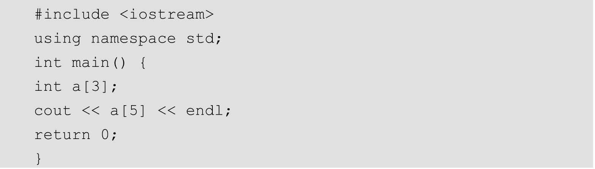

此时，AI 工具会先分析运行时崩溃、代码片段这些信息，然后调用它对 C++数组越界的知识，告诉你数组 a 的大小为 3，下标最大是 2，访问 a［5］属于越界访问，导致内存错误。正是因为 Prompt 包含了具体代码和问题现象，AI 工具才能快速定位问题——这就是我们今天要聊的 Prompt。Prompt 在与 AI 工具交互中起到核心作用：你说得越清楚，AI 工具就帮得越到位。

**4.1.2** **编写 Prompt 是 AI 时代的核心能力**

可能有的学生会说：“不就是输入一段话吗？随便写一写不行吗？”

不知道你有没有过这样的体验：有时候 AI 工具好像没太明白你的意思，如你问 AI 工具怎么学好 C++，它可能给出一大段理论知识，让你看得云里雾里，或者你问 AI 工具怎么提升编程能力，得到的回复泛泛而谈，根本不知道从哪里下手。有时候它们又特别懂你，连你没说出口的小细节它都考虑了。其中的差别就藏在输入的那段 Prompt 里。

编写 Prompt，不是会与不会的问题，而是能不能让 AI 工具真正为你所用的关键。尤其对学习信息学奥赛知识的学生来说，无论是对 C++基础知识的学习，还是在刷题、复习、备赛的过程中，优质的 Prompt 往往能让学习效率翻倍。它的价值主要体现在以下 3 个方面。

**1.提升效率：少做无用功，省出更多时间**

你有没有过这样的经历：用 AI 工具整理语文笔记，只输入： 

整理课文《背影》的知识点。

结果 AI 工具把课文主旨、作者生平、段落大意全堆在一起，你还得自己筛选，但如果你换成以下的 Prompt。 [Prompt 帮我整理《背影》的 3 个核心知识点：按父亲言行细节→情感表达→写作手法整理。每个知识点都配备 1 个课文原句例子，重点标注细节描写相关内容。]

AI 工具生成的笔记直接就能用，省去了你反复修改的时间。

这就是写好 Prompt 的效率魔法：精准的指令能让 AI 工具一次做对，避免让它生成不需要的内容，节省大量返工时间。在学习信息学奥赛知识时，想让 AI 工具生成动态规划的练习题，如果只输入： 

出几道动态规划编程题。

那么 AI 工具很可能回复大学难度或者程序员面试的题目，但如果输入： [Prompt 出 2 道适合信息学奥赛练习的线性 DP 题，要求包含题目描述、输入/输出样例和解题思路提示。]

那么 AI 工具生成的题目就能直接加入你的练习计划，你不用再花时间筛选或调整难度。对于学生来说，时间才是最宝贵的，而好的 Prompt 就像给 AI 工具装了导航，让它直奔需求终点。

**2.实现个性化定制：让 AI 工具成为专属学习助手**

每个人的学习节奏和需求都不一样。同样是学一元二次方程，有的学生需要先补习因式分解的基础，有的学生则想挑战含参数的方程讨论；同样是练编程，小学生可能需要用积木块比喻代码逻辑，而信息学奥赛选手则需要深入分析算法复杂度。AI 工具本身是通用的，但好的 Prompt 能让它变得更专属，让 AI 工具生成量身定制的内容。

比如，同样是让 AI 工具讲解信息学奥赛中关于循环的问题。

如果是小学生，想通过生活中的例子理解 for 循环机制，那么可以这样写 Prompt。 [Prompt 请你用生活化的例子告诉我 for 循环的执行机制，不用写代码，要用小学生也能听懂的话。]

如果是信息学奥赛选手，那么可能需要用 AI 工具进行一些算法的分析和讲解，可以这样写 Prompt。 [Prompt 分析模拟退火算法中温度参数的循环调整逻辑，用伪代码表示温度从初始温度 T0 下降到最终温度 Tf 的过程（T=T0*0.95^k，k 为迭代次数），并说明循环终止条件的设计对算法结果的影响。]

不同的 Prompt 就像给 AI 工具传递了不同的剧本，让它根据你的身份和目标调整输出内容。这正是写好 Prompt 的魅力：让 AI 工具更懂你的想法，生成真正适合你的内容。

**3.拓展应用边界：让 AI 工具成为探索新知识的脚手架**

随着能力的提升，AI 工具早已不只是答题机器。从梳理历史事件时间线到辅助调试编程代码，从设计科学小实验方案到分析信息学奥赛真题趋势……几乎在学习的每个环节，都能看到 AI 工具的适用场景。但要让 AI 工具在这些场景中真正发挥作用，写好 Prompt 是前提，这样才能撬动 AI 工具的潜力，让它从简单工具变成探索新知识的脚手架。

比如，在 C++学习中，你学完了多个基础知识点，感觉它们零散不成体系时，就可以用 Prompt 让 AI 工具帮你梳理它们之间的内在联系，进行结构化的整合。你可以这样问。 [Prompt 帮我用表格的方式对比一下 C++中的数组、字符串、指针，讲解它们之间的转换关系。]

这样的 Prompt 能引导 AI 工具生成一张条理清晰的分析表格，帮你理解不同的知识点并非孤立存在的，而是相互关联、共同解决问题的，从而在后续编写程序时，能更自然地将这些知识融会贯通。

再如，你正在学习 C++函数参数的传递方式，可这样编写 Prompt。 [Prompt 请对比讲解 C++中值传递和引用传递的区别，包含定义说明、内存分配差异、对实参的影响 3 个维度，并用代码示例分别演示这两种传递方式的效果，重点标注引用传递时形参前的“＆”符号的作用。]

在编程或竞赛中，Prompt 还能帮你突破瓶颈。比如，你卡在图论中的最短路径算法上，不知道从哪里开始学，可以输入以下 Prompt。 [Prompt 我刚学完图的存储、邻接矩阵和邻接表，想入门最短路径算法，请帮我设计一个 3 步学习计划：第一步，推荐 1 个适合初学者的算法，用城市间修路的例子讲解原理。第二步，给出一段简化的 C++代码，只保留核心逻辑，注释关键步骤。第三步，出 1 道入门级练习题。]

通过类似的 Prompt，AI 工具就像一位编程教练一样，能引导你逐步深入学习，而不是直接丢一本厚厚的算法手册给你。

对于学生来说，未来的学习不仅是学知识，还是学会如何利用工具高效学知识。编写 Prompt 是 AI 时代的核心能力，能将 AI 工具从被动的回答者转变为主动的合作者，助你在探索未知时走得更稳、更远。

总的来说，Prompt 虽然只是一段文字，却藏着与 AI 工具沟通的密码。在这个 AI 工具越来越普及的时代，学会好好与 AI 工具沟通，用清晰、具体的 Prompt 给 AI 工具下达指令，不仅能节省时间、定制专属内容，还能借助 AI 工具的力量，发现更多学习的可能性。当下一次与 AI 工具对话时，你不妨多花一分钟想一想：“我有没有把我的需求说清楚？”你或许会发现 AI 工具突然懂你了。

**4.2** **构建优质 Prompt**

怎样才算优质 Prompt？下面通过几个案例（如使用 AI 工具解决中小学生学习和生活中的常见问题）来看一下好用的 Prompt 的标准是什么，以及如何优化 Prompt。

**1.标准一：目标具体，明确要做什么** 

帮我写一篇五年级课外阅读分享发言稿。

修改建议：要做的事情不能模糊、宽泛，应该说明具体的任务类型、使用场景和受众，修改后的 Prompt 如下。 [Prompt 帮我写一篇小学五年级语文课外阅读分享的发言稿，受众是同班同学，核心是分享《少年中国说》这本书，时长为 3～5 分钟，内容需要包括时代背景、作者的创作目的及全书的中心思想。]

**2.标准二：结构清晰** 

帮我设计一个三年级主题班会方案。

修改建议：用分层逻辑组织需求，明确核心任务和相关要求（如时间和形式），修改后的 Prompt 如下。 [Prompt 帮我设计小学三年级“交通安全主题班会”方案，需包含 3 个部分：1.流程（20 分钟，3 项内容：看安全视频、3 个学生分享过马路的注意事项、班长总结）。2.准备物品（视频、3 张安全标语卡片）。3.班会目标（让学生知道红灯停、绿灯行，不横穿马路）。]

**3.标准三：信息完整，细节足够具体** 

帮我改一下这道数学应用题。

修改建议：提供任务细节信息。修改后的 Prompt 如下。 [Prompt 帮我修改七年级数学应用题的解题过程：1.题目：商店将进价为 120 元的商品按标价的 8 折出售，仍可获利 10%，该商品的标价是多少元？2.原题解错为：“120×10%+120=132，132÷80%=165”。3.指出解题出错的点是什么，具体是哪一步的问题。4.给出正确的解题步骤和每步说明，需要标注易错点，格式按“分步算式、每步说明”两列呈现。5.从数学老师的视角进行做错题目的归因分析，如出现错误可能与哪些知识点没掌握有关，并总结几点后续的提升建议。]

**4.标准四：风格与格式明确** 

帮我写一个“探究植物光合作用”的科学实验报告。

修改建议：明确写作风格（如文体类型、语言要求），并指定输出的固定模块和格式规范，修改后的 Prompt 如下。 [Prompt 帮我写初中八年级“探究植物光合作用需要光”的科学实验报告，需满足：1.写作风格采用说明文文体，语言正式、书面化。2.用词准确，全程不用口语化表达和网络词语，表述严谨（如不用“大概”“约”等模糊表达）。3.输出格式：全文 600 字左右，必须包含 6 个固定模块，每个模块单独成段且标注标题。1）实验名称（居中）。2）实验目的（说明探究核心）。3）实验器材（分点列出：实验选用植物，实验用具为黑纸片、酒精等）。4）实验步骤（用 1.、2.、3.序号分点，每一步写清楚操作动作）。5）实验现象（描述遮光与未遮光部分的颜色差异）。6）实验结论（明确光合作用与光的关系）。]

从上面的例子中可以看出，优质的 Prompt 设计有一些明确的核心原则，能帮 AI 工具准确理解并满足需求。首先，任务目标必须具体、明确，要避免模糊、宽泛的表述，需要清晰界定任务的适用场景、面向人群、核心内容，以及时长、字数、主题等关键约束条件，不让 AI 工具猜测意图。其次，结构应清晰，可通过分点、编号或模块划分等方式组织需求，让任务要求一目了然，帮助 AI 工具更有条理地按步骤执行。再次，提供的信息要完整，必须包含完成任务所需的背景资料与关键数据，确保 AI 工具拥有足够的信息支撑，才能生成准确且符合需求的结果。最后，风格和格式明确也是重要标准，确保 AI 工具的输出不会天马行空，确保输出的内容风格和格式符合预期，确保输出质量可控。

反观低效的 Prompt，大多存在需求模糊的问题，既没有明确的任务边界，也缺乏可验证的结果标准。这类 Prompt 往往只给出笼统的任务方向，却没有补充关键的细节要求，导致 AI 工具无法准确把握核心需求。最终生成的结果很可能与预期偏差较大，不仅需要反复沟通调整，还会增加时间成本与信息修正的难度。因此，设计 Prompt 时遵循“目标具体、结构清晰、信息完整、风格与格式明确”的原则，才是确保 AI 工具输出符合预期结果的有效方法。关于具体怎么做，可参考以下方法。

**4.2.1** **指令清晰、明确**

我们在编写 Prompt 时，指令清晰、明确就像为航船设定了精准的航向。试想一下，如果我们给出的指令模糊不清，AI 工具就只能靠猜测，很难准确把握我们的真实意图，最终的输出结果自然容易偏离我们的预期。

比如，在学习编程的初期，如果老师布置作业时只简单地说“写一个程序”，作为初学者的你可能会感到茫然无措：这个程序要实现什么功能呢？是用 C++还是用其他语言？有没有特定的数据输入和输出要求？如果将 Prompt 明确如下，那么无论是交给 AI 工具还是要求学生完成，对方都能清楚地知道需要完成的具体任务，生成更满足需求的代码。 [Prompt 使用 C++编写一个程序，实现从键盘输入两个整数，计算并输出它们的和、差、积、商。程序需要包含必要的输入提示信息，并对除数为零的情况进行简单的错误提示。]

同理，在信息学奥赛中，如果题目描述不清晰，选手们就无法准确理解题意，更别说写出正确的代码了。

在编写 Prompt 时，我们要尽可能详细地阐述任务要求，把那些可能产生歧义的地方都考虑到，确保 AI 工具能够准确理解并高效执行我们的指令，就像我们在解数学题时，清晰的已知条件是得出正确答案的第一步。

**4.2.2** **设定角色身份**

为 AI 工具设定特定的角色身份，就像为它穿上合适的专业外衣，仿佛在与一位懂行的专家对话，能让它的回答更具专业领域属性。不同的角色会有不同的知识视角和表达特点，使 AI 工具不再仅仅是冷冰冰的信息输出工具，而是能满足你的具体需求的贴心助手。

比如，当在学习 C++时遇到了与指针相关的难题，你直接询问“什么是指针”，AI 工具可能会用大学计算机课程的表述方式来回应。它大概率会给出“指针是存储内存地址的变量”这类专业定义，并搭配“内存单元”“地址值”等枯燥术语，这会让初学者难以理解。如果在提问时明确让 AI 工具扮演中学信息科技教师，情况就可能完全不同。 [Prompt 你是一位 C++编程教师，语法基础扎实，代码能力优秀，教学经验丰富，讲述知识通俗易懂，熟悉中小学生的认知规律，善于使用生活类比解释概念，传授知识逻辑层次清晰，擅长鼓励和引导学生。]

它会主动降低知识门槛，用更贴近中学生认知的方式进行讲解，可能会把电脑内存比作一排带门牌号的储物柜，每个储物柜里都存放着数据。指针就像一张记录着门牌号的小纸条，你拿着它就能快速找到对应的储物柜，还能查看或修改里面的内容。这种具象化的解释，显然比单纯的理论定义更容易理解。

再举个例子，在做动态规划类题目时，如果直接询问 AI 工具动态规划的解题方法，AI 工具可能会给出偏理论的回答，大概率会先解释动态规划的核心思想，再罗列状态定义、转移方程等关键步骤，内容较为抽象且枯燥难懂，难以对学习产生实质性帮助。但如果明确设定 AI 工具为有多年竞赛辅导经验的教练，其回复就会更贴合备考需求。 [Prompt 你是一位信息学奥赛教练，熟悉 C++基础与算法知识，熟悉 GESP、CSP、NOIP 的大纲，熟悉竞赛题型，解题能力优秀，讲解细心细致、步骤清晰、逻辑严谨，注重对学生解题思路和独立性的培养，能通过题目的考点及学生的解题过程发现学生的知识盲区，擅长归纳总结和举一反三。]

它不会只讲理论，而是会结合最长上升子序列、0-1 背包问题等经典例题，从竞赛题的解题思路拆解开始，带你一步步推导状态转移方程，再细化代码实现的每个细节，甚至还会主动提醒你做这类题目容易踩的“坑”，帮助你提前规避边界条件处理的错误。

通过为 AI 工具设定清晰的角色，你相当于给它明确了专业领域属性，让它知道该用什么语气、从什么角度、运用哪些知识点来回应。这不仅能让它的回答更贴合实际需求，还能让整个交流过程更顺畅、更高效，就像真的在与一位懂行的专家交流一样。

**4.2.3** **提供充分的背景信息**

提供充分的背景信息，是让 AI 工具回答得准确的关键一步。AI 工具的知识储备虽然庞大，但它无法主动判断你的身份、能力边界或具体场景——如果缺少这些信息，它给出的回答很可能是通用但不适用的，要么过于深奥让你看不懂，要么过于基础帮不上忙。

就像 4.1.2 节提到的循环示例，效果会因背景信息的差异天差地别。如果你只简单地提出问题，那么 AI 工具可能会默认你有一定的基础，直接讲解 for 循环嵌套、while 循环优化，甚至涉及迭代器这类进阶用法，还会举遍历复杂数组等例子。但这些内容对刚学完变量定义、简单输出的初学者来说，无异于天书，不仅让他们无法理解，还可能打击他们学习的信心。这时就需要补充详细的背景信息，比如： [Prompt 我是小学五年级学生，刚接触 C++半个月，只学过 int、cout 基础语法，还没弄懂数组和函数，现在作业里需要用循环计算 1 到 100 的和。我希望例子里只有最基础的代码，还要有注释，别用复杂概念。]

这样一来，情况就完全不同了！AI 工具会立刻调整回复内容：先用重复做一件事的生活类比解释循环的本质，再写一段只有 include 头文件、main 函数、for 循环、变量累加的极简代码，给每一行都加注释，最后还会提醒用 cout 输出 sum。这样的回答，既贴合你的知识范围，又能直接解决你的问题，你完全不用再花时间过滤不适用的内容。

这些背景信息就像给 AI 工具递了一把精准定位的尺子。它能帮 AI 工具明确回答的难度，把握尺度不能超纲，如内容重点聚焦哪些环节、呈现方式适合你的学习阶段。

**4.2.4** **细节充分、具体**

平时在与 AI 工具聊天时，你是不是总遇到这种情况？你问 A，它答 B；你想要具体的结果，它却给出很多泛泛而谈的内容。然后，你需要一句一句地回复、补充、修正，经过几轮对话才能得到想要的回复。出现这种情况，多半是因为你的 Prompt 没把关键细节说清楚。

给 AI 工具输入 Prompt，除了要讲清楚角色、背景、任务，还必须把细节明确到具体要怎么做、想要什么样的结果，尤其是涉及内容范围、回答逻辑、输出格式方面。只有把这些细节描述清楚，才能避免答非所问，直接生成真正需要的内容，既不会漏掉关键信息，也不会输出过多无关内容。

比如，在刷题时，你给 AI 工具输入“帮我解这道 C++编程题”，但没说清具体需求。AI 工具很可能直接输出完整的代码，从输入处理到输出结果一应俱全，甚至还优化了时间复杂度。但你真正想要的可能是对解题思路的引导，如怎么确定是用贪心算法还是用动态规划算法、从题目中的哪个核心条件开始入手，而不是直接要答案，毕竟直接抄代码完全没法提升解题能力。这时，你就要把细节说清楚，比如： [Prompt 我现在要解这道编程竞赛题，题目是“从给定数组中选 k 个元素使和最大且不重复”。要求：1.不要直接给出完整代码。2.特别重要：你不要把所有的步骤都告诉我，你告诉我第一步的一点提示即可。3.提示内容可以是用什么算法或者第一步的思路。4.如果我没有思路，让你继续提示，你可以一步一步往下给我提示。]

AI 工具就会按需求不直接给出答案，而是一步步引导你梳理思路，让你自己动手解题，这才能真正帮到你。

再如，在调试代码时，你把报错的 C++代码发给 AI 工具，只说“帮我看一看这段代码错在哪里”。AI 工具可能会指出“这里的变量未初始化”“循环条件少了等号”，然后给出修正后的代码。但你不仅想知道错在哪里、怎么改，还想弄清楚“为什么会犯这个错误”“对应的知识点是什么”——毕竟下次不想再踩同样的“坑”。这时，你就要补充细节，比如： [Prompt 帮我分析这段 C++代码的错误：｛C++代码片段｝要求：1.指出具体的错误位置和错误类型。2.修正错误并写出完整代码，可以把错误代码和正确代码做一次对比。3.重点解释这个错误对应的知识点，说明我没掌握哪个知识点才导致这个错误。4.举 1 个类似的错误案例，帮我巩固这个知识点。]

这些细节要求就像给 AI 工具画好了答题框架：在内容方面，明确要求包含错误定位、代码对比、知识点解析、同类案例；在逻辑方面，遵循发现问题、解决问题、深挖根源、巩固提升的学习方法。在 Prompt 中，只有把这些细节描述清楚，AI 工具才能精准踩中需求点。

**4.2.5** **规定输出格式**

在用 AI 工具的时候，你肯定期待它给的回复直接就能用，不用再花功夫调整。如果你提前和它明确输出格式和规范，就能避免这些麻烦，让 AI 工具回答的内容格式符合要求，贴合使用场景。这里所说的并非指文件或数据格式，而是要清晰告知 AI 工具以什么样的内容组织形式输出内容，如要输出哪些内容项、每项内容使用什么标题，以及内容的大致长度。这样 AI 工具才会按照你的要求回答，你后续整理和利用 AI 工具的回答内容也会更简单。

比如，在学习 C++的过程中，你需要在每节课的课后整理一下学习笔记，那么可以提前告知 AI 工具每节课的笔记需包含固定格式和内容，如你的学习笔记是下面的格式。

· “学习目标”。

· “主要内容”。

· “关注难点”。

· “易错点”。

· “学习总结”。

你需要让 AI 工具在生成每节课的笔记时，严格按这 5 个标题组织内容。这样，每节课的学习笔记才能保持内容格式一致，有利于以后复习。这时，你就需要补充输出格式。 [Prompt 请以 C++初学者的视角，为“C++基础”课程中的××××生成学习笔记。课程的内容是：｛列出课程的主要内容或者课程的具体链接｝学习笔记需要按照以下格式整理。1.学习目标：明确本节课的学习目的。2.主要内容：分几点总结本节课的核心知识，每点配几行关键代码。3.关注难点：列出课中难度较高的概念，用通俗的语言解释。4.易错点：列举 3 个错误案例，为每个案例附修正后的代码。5.学习总结：用几句话串起本节课的内容逻辑和知识脉络。所有内容控制在 400 字内，语言简单、易懂。]

简单来说，提前与 AI 工具约定好输出的内容格式、标题、子标题等，才能让信息更有条理、更易阅读，才能让 AI 工具的回答精准匹配你的所想所求。

**4.2.6** **使用示例引导**

在与 AI 工具交互的时候，如果你需要它按照特定的风格、结构或者逻辑完成任务，那么直接给它一个示例往往比反复描述更省心。这种用例子说话的方式，能帮 AI 工具快速理解你想要的感觉，尤其适合需要模仿特定模式，如仿写作文、分析问题、总结内容。

例如，语文作文仿写。如果让 AI 工具用托物言志的手法，写一篇以《竹》为题的短文，那么只说用托物言志的手法写竹子可能不够具体。这时，你需要给 AI 工具一个具体的示例。 [Prompt 请参考下面以梅为主题的托物言志短文，写一篇同样风格的以《竹》为题的短文。示例短文：《梅》寒冬腊月，别家花木早已褪尽芳华，墙角的梅却顶着风雪抽出嫩芽。它的枝不算粗壮，花瓣也不似桃李那般娇艳，可风愈烈，它的香愈清；雪愈厚，它的骨愈挺。这不正是那些在困境中坚守本心的人吗？不与春争艳，独在寒中绽，以一身傲骨，写尽生命的倔强。]

有了这样的示例，AI 工具就会模仿“描物→咏志→喻人”的结构，以及借物喻人的细腻笔触，写出更符合你预期的文字。在编程学习中，示例引导并不常用，但也有一些适用的场景，如让 AI 工具仿照已有的代码注释给其他代码添加类似的注释。这时，你就可以先给出一段示例。 [Prompt 请参考以下示例中 C++代码的注释风格，为给定的代码添加同样风格的注释。###]  [示例开始//]  [功能：对整数数组进行选择排序//]  [适用场景：数据量较小的场景//]  [参数：//]  [arr［］：待排序的整数数组（输入/输出参数，用排序后的结果直接修改原数组）//]  [n：数组元素个数（需满足 n≥1，否则无意义）//]  [核心步骤解析：//]  [1.外层循环控制轮次：共需 n-1 轮（最后一个元素无须再比较）//]  [2.每轮找出未排序部分的最小值下标//]  [3.将最小值与未排序部分的第一个元素交换//]  [4.重复上述步骤，直至所有元素排序完成###]  [代码示例结束需要添加注释的 C++代码为：]

 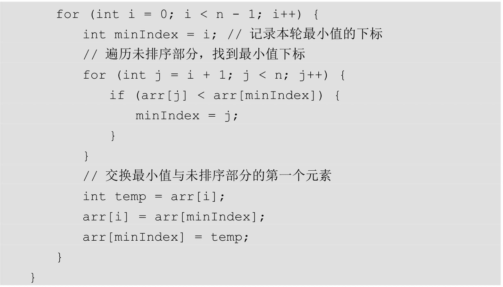 

有了这段示例，AI 工具就会模仿原有代码的“功能、适用场景、参数、核心步骤解析”的结构，给其他代码添加同样细致的注释，让代码风格保持一致，提升可读性和可维护性。

示例引导的优势在于定框架，但也要注意：示例就像给 AI 工具画了一个圈，它的思路很容易局限在圈内。想让 AI 工具写一篇关于坚持的议论文，如果先给 AI 工具一个运动员训练的示例，AI 工具可能就会反复围绕体育话题展开描述，而忽略科研、艺术等其他领域的素材。

因此，在编程学习中，我们建议尽量少用示例引导 AI 工具，毕竟解决问题的思路本就该灵活多样，用示例框定反而会限制算法创新。

总之，当需要 AI 工具照葫芦画瓢（如仿写风格、统一格式）时，示例引导能让效率翻倍，当需要 AI 工具发散思考（如提供多种解题思路、优化算法）时，你不如直接说清核心需求，给它更自由的发挥空间。

**4.3** **学会结构化 Prompt**

前面已经介绍了编写优质 Prompt 的核心标准和方法，在实际使用中，尤其在面对学习中的重复任务（代码讲解、错误调试、作业辅导）时，零散的 Prompt 很容易遗漏关键信息。结构化 Prompt 能提高与 AI 工具交互的效率，并沉淀为可复用的框架，让 AI 工具每次的回复都稳定可用，从而大幅降低重复沟通的成本。

**4.3.1** **What：什么是结构化 Prompt**

结构化 Prompt 的核心就是“结构化”。结构化 Prompt 具体是指将完成任务所需的 Prompt 内容信息，按照一定的逻辑划分成多个 Prompt 段落，并形成的具有逻辑结构的 Prompt。

结构化 Prompt 也是提示词工程（Prompt Engineering）的基础。提示词工程是一个复杂的话题，本书不做讨论，有兴趣的读者可以自行深入了解。对于本书读者来说，更重要的是如何利用好结构化 Prompt 的优势，提升与 AI 工具交互的效率和体验。

提示词工程是一门较新的学科，主要关注 Prompt 的开发与优化，助力用户将大模型应用于各类场景及研究领域。它并非仅局限于 Prompt 的设计与优化，也包含了与大模型交互的各种技能，还能提升大模型处理问答、算术推理等复杂任务的能力。其核心目的是提高大模型的安全性与综合能力，通过借助专业领域知识、结合外部工具等方式为大模型赋能，同时作为一个更广泛的概念，它包含 Prompt 的设计、优化、实验与迭代等多个环节，属于一套系统化的工程实践。

简单理解，结构化 Prompt 就是用分段和分层级的格式，把 4.2 节中提到的构建优质的 Prompt 时的各个关键要素信息一起呈现出来。下面通过一个例子，用对比的方式了解一下结构化 Prompt 和非结构化 Prompt 的区别。

非结构化 Prompt 看起来像一段话。 [Prompt 我要写一篇题为《我的周末》的作文，老师让写 300 字左右。我周六上午去公园看到了樱花，周日帮妈妈扫了地、洗了碗，感觉挺有意思，你帮我组织一下语言吧。]

结构化 Prompt 看起来像一个任务说明单。 [Prompt#]  [角色你是一名小学五年级学生，正在完成语文老师布置的作文。#]  [背景周六上午去了公园，看到了樱花。周日没出门，在家中帮妈妈做家务。#]  [任务写一篇题为《我的周末》的短文。#]  [要求 1.包含周六、周日两天的活动。2.在开头简单介绍周末的整体安排，在结尾总结这个周末的收获。3.对看樱花要有细节描写，对做家务要突出我和家长的感受。#]  [格式文体为记叙文。篇幅为 300 字左右。]

这个结构化 Prompt 的任务说明就明确得多，用“角色、背景、任务、要求、格式”几个模块，清晰地描述了需要 AI 工具做什么、怎么做、标准是什么。

**4.3.2** **Why：为什么要编写结构化 Prompt**

有一个现象你可能遇到过：在每次使用 AI 工具时，它的回复往往不够稳定，时好时坏，你需要通过多轮对话，不断补充背景与相关信息，最后才能得到想要的答案。

这是因为 AI 工具如果得不到足够的信息，或者对任务有不理解的地方，它就会自行“脑补”一些信息，而这种“脑补”基于大模型内部的推理和感知，是充满随机的幻想。若补充的信息与你的本意存在偏差，则回复的结果不太可用，我们需要通过多轮对话进行沟通和修正。

AI 工具是否好用，在很大程度上取决于它能否通过一次交互就回复出你想要的答案。若 AI 工具的回复不稳定，你就需要发起多轮对话与它沟通，这个过程也挺折磨人。这些时间本可以用于学习知识和练习。有的人每次都能得到想要的答案，有的人经常反复沟通，这没准就是在应用 AI 工具的能力上拉开差距的开始。

结构化 Prompt 就是让 AI 工具精准理解任务、精准回复的关键。与非结构化 Prompt 相比，结构化 Prompt 具有以下优势。

**1.信息充分**

非结构化 Prompt 相当于一篇小短文，一般是按照语言表述习惯编写的，难免会有信息遗漏。结构化 Prompt 作为“任务单”，一般都设计了固定的模块和格式，编写的过程就像填写调查问卷，填完后信息就充足了。

**2.精准理解**

对信息的理解不仅需要信息量，还与信息的逻辑结构（信息之间的联系）相关。非结构化 Prompt 是一段独立的文字。要理解它就好比做阅读理解题，需要从一大堆文本中分析出哪些是关键信息、哪些是辅助信息、谁和谁是从属关系的、谁和谁是并列关系的。结构化 Prompt 天生带有逻辑结构和层级关系，模块清晰、主次分明。无论是 AI 工具，还是编写结构化 Prompt 的人，理解结构化 Prompt 都比理解非结构化 Prompt 更容易。

结构化 Prompt 能一次性将核心需求、背景信息、输出要求等表达清楚，为 AI 工具提供了充足且准确、易于理解的信息。正确地使用结构化 Prompt 能最大限度地限制工具的幻想空间，确保每次输出都能符合预期。

结构化 Prompt 不仅能让 AI 工具变得更好用，而且编写起来也有明显的优点，在体验和效率方面都有提升。

**3.减少多轮对话**

这点已经讲过，如果 AI 工具的回复更加稳定、可用，就无须通过多轮对话进行沟通。你与 AI 工具沟通的时间就减少了，可以把时间腾出来用到更合理的地方。

**4.降低思考和编写成本**

好用的 Prompt 需要包含大量的信息和细节，如果你每次都从零开始构思，那么不仅要重复梳理信息，还容易遗漏，既浪费时间又影响效果。结构化 Prompt 的框架相当于提前搭建好的“表单”模块，你不用重复构思，在编写时只需根据需求填充信息，即可生成高质量的 Prompt，省去了反复琢磨的麻烦，还能确保信息完整，降低了思考和编写成本。

**5.便于复用和分享**

在学习的过程中存在许多重复执行动作和重复场景，如 C++语法梳理、算法思路拆解等。针对这些固定场景，你可以将编写并调试好的 Prompt 作为模板保存，逐步形成一套贴合自身学习习惯的 Prompt 模板库。当下次遇到同类需求时，你直接调用模板即可，无须重新设计。这些经过实践验证的优秀的 Prompt 模板，还能共享给其他学生，帮助他们共同提升 AI 工具的使用效率，让好的学习方法可以发挥更大的作用。

**4.3.3** **How：如何编写结构化 Prompt**

第一步，设计模块结构。

编写结构化 Prompt，首先得有一个精心设计的模块结构。

以本书的主题“用 AI 决胜信息学奥赛”为例，我们首先要设计出给 AI 工具传递信息的顶层结构。在梳理了学习信息学奥赛知识的大部分使用场景，结合构建优质 Prompt 的标准后，我们设计了以下模块作为本书通用的结构化 Prompt 的核心模块。

·角色设定

明确 AI 工具需扮演的角色（如教师、助教、教练，以及他们的工作定位）、表达方面的特点。

·任务目标

说明要完成的具体事项，用核心任务描述需完成的内容等。

·背景信息

提供与任务相关的大背景（如用户身份、知识基础、场景限制等），可采用分点列举的方式，让 AI 工具快速了解关键背景。

·输出要求

规定结果的形式、结构、风格（如分步骤说明、呈现形式、语言风格），需清晰标注输出内容的规范和格式要求，并逐条说明具体标准。

·约束条件

明确需避免出现的内容（如超纲知识、特定表述等），可用“注意”“禁止”等提示语引出，确保 AI 工具的输出不偏离需求。

在设计完核心模块后，还需进一步设计核心模块下有哪些具体内容及层级结构。因此，需要将核心模块作为一级模块，将其内容拆分为二级模块，将二级模块拆分为三级模块等，并使用一些标记（如#、##、###）来划分段落和层级。用“#”标记一级模块，用“##”标记一级模块下的二级模块，通过这种方式区分核心模块与它们的子项，让模块结构看起来像目录一样直观。

（1）一级模块。

将“角色设定”“任务目标”“背景信息”“输出要求”“约束条件”作为一级模块，每个一级模块都用“#”作为标题开头，形成“# 角色设定”“# 任务目标”“# 背景信息”“# 输出要求”“# 约束条件”，每个一级模块都单独成段。

（2）二级模块。

在每个一级模块下，都将其对应的核心信息拆分为二级子项，用“##”作为标题开头，如“# 角色设定”下有“## 专业领域”“## 表达特点”、“# 任务目标”下有“## 核心任务”“## 任务描述”等二级子项，其余模块同理。

在 Markdown 格式中，“#”代表一级标题，用于标注文档的核心大主题，“##”代表二级标题，用于细化一级标题下的具体内容。大模型能读懂这种格式，是因为它在训练时学习了海量包含该格式的文本，从而记住了“#”和“##”对应的层级关系规则，就像人能识别书本里不同层级的章节标题一样。

至此，我们就设计出了以下的模块结构，并以此结构作为通用的 Prompt 模板，在后续的章节中使用——后续 Prompt 均以此模板为基准进行编写。 [Prompt 空白模板#]  [角色设定##]  [专业领域##]  [表达特点#]  [任务目标##]  [核心任务##]  [任务描述#]  [背景信息##]  [用户画像##]  [适用场景#]  [输出要求##]  [内容结构##]  [格式规范##]  [语言风格#]  [约束条件##]  [禁止内容##]  [补充规则]

第二步，整理模板中需要的信息并填写。

在有了标准的模块结构模板之后，编写结构化 Prompt 就不是难事了。

首先，在内容方面应按照模板中的模块来整理关键信息。我们以一个 C++学习场景为例，如希望 AI 工具扮演 C++教学老师，讲解一下“函数参数传递”这个知识点。根据这个场景任务，一些关键的信息已整理为表 4-1。

表 4-1

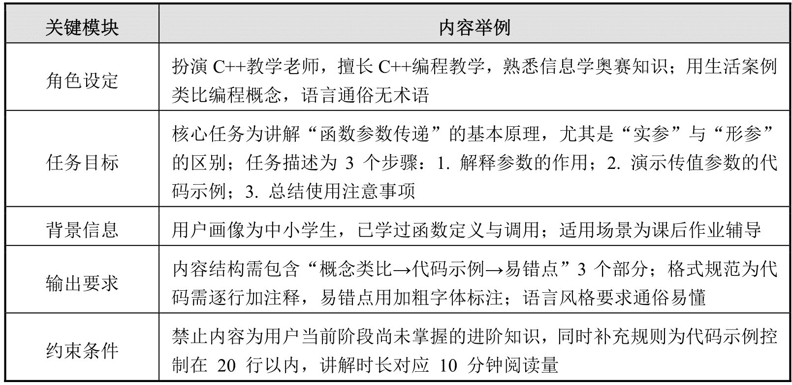

在信息整理完成后，把相关的信息填写到通用 Prompt 模板的对应位置即可。填写后，我们得到了以下的结构化 Prompt。 [Prompt#]  [角色设定##]  [专业领域 C++教学老师，擅长 C++编程教学，熟悉信息学奥赛知识。##]  [表达特点用生活案例类比编程概念，语言通俗无术语。#]  [任务目标##]  [核心任务讲解“函数参数传递”的基本原理，尤其是“实参”与“形参”的区别。##]  [任务描述 1.解释参数的作用。2.演示传值参数的代码示例。3.总结使用注意事项。#]  [背景信息##]  [用户画像中小学生，已学过函数定义与调用。##]  [适用场景课后作业辅导。#]  [输出要求##]  [内容结构包含“概念类比→代码示例→易错点”3 个部分。##]  [格式规范代码需逐行加注释，易错点用加粗字体标注。##]  [语言风格做到通俗易懂，以用户能够理解的方式讲述。#]  [约束条件##]  [禁止内容不要涉及用户当前阶段尚未掌握的进阶知识，如指针、面向对象、模板。##]  [补充规则代码示例控制在 20 行以内，讲解时长对应 10 分钟阅读量。]

你可以在自己熟悉的 AI 应用（如豆包和 DeepSeek）中，试着用上面的结构化 Prompt 进行一次体验。相信你已经感受到结构化 Prompt 的神奇之处，它能显著提高 AI 工具回复的精准度，不用多轮沟通，也能获得完全满足需求的回复。

第三步：建立自己的 Prompt 模板库。

结构化 Prompt 很好用，但它很长，包括了很多细节内容，要从零编写这样的 Prompt 需要投入不少时间和精力。所以，当编写并验证了好用的结构化 Prompt 后，你千万别用完就删了，一定要把它们保存下来，在下次遇到相同的学习场景时，直接调取并稍微修改就能使用，可节省大量重复构思的时间。

例如，已经有一个 Prompt 能根据 C++代码和系统报错，让 AI 工具帮忙分析报错原因与修复方法。今后再遇到代码报错时，直接复制这个模板，替换其中的 C++代码和系统报错两部分内容就行，无须重新设计 Prompt 框架。

你还可以将编写好的 Prompt 按学习场景分类保存，如在电脑中新建一个名为“信息学奥赛 Prompt 模板库”的文件夹，在其内部再细分基础语法讲解、代码调试、作业辅导、算法入门等子文件夹，在每个子文件夹中存放对应的 Prompt 模板。保存 Prompt 模板的文件格式可灵活选择，可以用 Word 文档，也可以用 TXT 纯文本文件，只要方便后续随时调取即可。

在学习信息学奥赛知识的过程中，你会遇到很多需要与 AI 工具交互的场景，从基础语法疑问解答、代码调试排错，到信息学奥赛题思路拆解、算法优化建议、作业难点突破、模拟竞赛复盘，在每类场景中都需要适配好用的结构化 Prompt 才能让 AI 工具精准响应需求。

在学习信息学奥赛知识的过程中会遇到很多场景，如果都从零开始编写 Prompt，那么不仅会耗费大量的时间和精力，还可能因为对 Prompt 编写不熟练导致编写的 Prompt 无法满足学习需求。因此，接下来我们会为你提供一些实用的 Prompt 模板。

第五章侧重知识体系构建，参考 NOI 考试大纲的知识框架，按从入门到备赛需经历的不同阶段提供 Prompt 示例，分为 C++基础知识学习阶段、数据结构学习阶段、算法学习阶段、刷题备赛阶段。

第六章聚焦 AI 编程工具的使用，更强调 Prompt 的实操，提供的 Prompt 涵盖的主要场景有基础学习、代码改错、解题辅导、强化复习、算法演示、思路引导。

你可以参考和使用。

**第五章** **实用的 Prompt**

小贴士：

在阅读本章内容时，你可以准备好自己熟悉的 AI 工具，如豆包和 DeepSeek，当看到“ Prompt”标识时进行实际的效果体验。为了方便输入，获取电子版 Prompt 的方法参见 5.3 节。

通过前面的内容，你已经掌握了如何编写好用的 Prompt。这些内容为你借助 AI 工具学习 C++打下了基础。为了更快地将这些理论落地，真正用 AI 工具提升学习效率，本章针对具体的学习场景，整理了一系列现成的 Prompt 模板，供你参考和使用。

首先将聚焦第四章设计的通用 Prompt 模板，编写角色设定、任务目标、背景信息、输出要求、约束条件这 5 个核心模块，为你提供可复用的基本框架。在后续遇到各种学习场景时，你都能基于这个模板快速编写和扩展。

然后会提供各学习阶段的 Prompt 示例，从 C++基础知识学习阶段、数据结构学习阶段、算法学习阶段到刷题备赛阶段，确保在不同的学习阶段，你都能找到可以参考的案例。

最后一节会介绍本书 Prompt 模板的获取方式。希望通过本章，你能更高效地借助 AI 工具学习 C++，将其变成提升学习效率的实用工具。

**5.1** **通用 Prompt 模板**

第四章设计的通用 Prompt 模板是本书用 AI 工具学习信息学奥赛知识的基本框架。该模板涵盖了学习信息学奥赛知识的共性需求和场景，建议你直接使用。如何填写模板中的模块也有一定的技巧。你需要根据自己的学习目标、知识背景、学习进度来编写适当的内容，设定实际的适用场景。下面进行具体介绍。

**5.1.1** **角色设定**

一般而言，角色设定的核心是明确两点：一是角色的专业领域，确保角色具备对应的专业能力；二是角色的表达特点，需适配不同用户的接受度，让 AI 工具的回复更满足要求。要避免因角色设定模糊导致 AI 工具的输出角度偏移。聚焦到用 AI 工具学习信息学奥赛知识，角色设定应包括以下内容。

**1.专业领域**

角色的专业身份可以是教师、教练、助教。角色的专业能力要包括基础语法学习、代码调试、解题思路指导等，可覆盖主要的教学场景。同时，角色还需要具备信息学奥赛的专业领域知识，如了解比赛规则、熟悉常见的考点和题型等。这样的角色设定才能符合信息学奥赛专业领域的要求。

**2.表达特点**

表达特点应适配不同阶段的学习方式：对于基础学习需要通俗讲解，对于进阶选手需要结合赛事场景，对于代码调试场景则需要直接聚焦问题，确保 AI 工具输出的语言风格能匹配你的学习状态。

以下是角色设定模块的示例，你可以视情况选用或者扩展。

# 角色设定

## 专业领域

例 1：你是一位 C++编程教师，语法基础扎实，代码能力优秀，教学经验丰富。

例 2：你是一位答疑辅导助教，熟悉 C++代码标准，具有问题快速定位能力，辅导学生的经验丰富。

例 3：你是一位数据结构和算法讲师，数据结构和算法知识扎实，熟悉各种数据结构和算法的应用场景与 C++代码实现，教学经验丰富。

例 4：你是一位信息学奥赛教练，熟悉 C++基础知识和算法知识，熟悉 GESP、CSP、NOIP 的大纲，熟悉竞赛题型，解题能力优秀。

## 表达特点

例 1：讲述知识通俗易懂，熟悉中小学生的认知规律，善于使用生活类比来解释抽象的概念，传授知识逻辑层次清晰，擅长鼓励和引导学生。

例 2：你在回答问题时细心、细致，结合信息学奥赛考点，能以问题解决过程为导向，从多个维度分析问题的表现和根因，擅长知识拓展关联。

例 3：讲述知识逻辑严谨，熟悉中小学生的认知规律，能够把抽象的问题用简单的方式描述清楚，擅长概念结合应用场景。

例 4：讲解细心、细致、步骤清晰、逻辑严谨，注重对学生解题思路和独立性的培养，能通过题目的考点及学生的解题过程发现学生的知识盲区，擅长归纳总结和举一反三。

**5.1.2** **任务目标**

任务目标是 Prompt 的核心模块，AI 工具输出的内容是否满足需求的关键就取决于这一部分的设计。这部分也是后续切换不同的学习场景时，你需要重点调整的内容。

任务目标的关键是明确具体的核心任务，确保 AI 工具清楚要做什么，再进一步将核心任务分解和细化，避免因任务模糊导致输出泛泛而谈。聚焦到用 AI 工具学习信息学奥赛知识，任务目标应包括以下内容。

**1.核心任务**

核心任务可以描述学习中的实际问题，要有明确的目标和具体内容，如知识点讲解、例题分析、代码调试等，要避免表述模糊而导致 AI 工具输出的内容不能解决实际问题。

**2.任务描述**

任务描述的编写思路是把问题和核心任务分解与细化，如将大任务拆解为可操作的步骤，或者提出更细致的要求。若任务描述不清晰，则 AI 工具易遗漏关键环节。可以通过文字叙述，也可以用序号划分步骤，确保覆盖任务的各种细节。

以下是任务目标模块的参考案例，你可以根据自己的需求调整内容。

# 任务目标

## 核心任务

例 1：讲解 C++数组的初始化方法，包括静态初始化、动态初始化的差异与适用场景。

例 2：分析信息学奥赛真题的解题思路，明确题目需求与代码实现的对应关系，题目内容是……

例 3：指导排查 C++代码中的逻辑错误，代码内容是……

## 任务描述

例 1：讲解数组初始化。1.说明数组初始化的核心目的；2.分别演示静态初始化与动态初始化代码；3.对比两种方法的使用注意事项。

例 2：分析解题思路。1.拆解题目中的关键条件；2.梳理解题的核心步骤；3.对应步骤设计解题的代码实现流程；4.分步骤讲解代码实现。

例 3：指导代码调试。1.明确当前代码的预期功能；2.逐行排查与预期不符的逻辑；3.给出修改方案并验证；4.总结同类错误的排查方法。

**5.1.3** **背景信息**

一般而言，应给 AI 工具提供更多的背景信息。这是让 AI 工具精准匹配需求范围的关键。在背景信息中需清晰描述两个方面的内容：一是用户画像，告诉 AI 工具受众是谁、有什么特点；二是适用场景，告诉 AI 工具当前任务或问题发生的具体环境，利于 AI 工具更好地理解任务或问题，避免 AI 工具输出超出实际场景的内容。聚焦到用 AI 工具学习信息学奥赛知识，背景信息应包括以下内容。

**1.用户画像**

用户画像可以描述具体的学习人群，如小学高年级学生、初中生，以及是零基础、刚入门的学生还是进阶选手，能让 AI 工具通过明确的受众指定，大概判断其知识盲区与学习重点，避免输出过难或过简单的内容，确保回复的针对性。

**2.适用场景**

适用场景可以描述当前的学习场景。应考虑不同适用场景的差异，明确场景能避免 AI 工具输出超出需求范围的内容，如课前预习强调理解、课后答疑注重解决问题，确保更贴合实际的适用场景。

以下是背景信息模块的示例，你可以视情况选用或者扩展。

# 背景信息

## 用户画像

例 1：刚接触 C++，已掌握变量定义与基本输入/输出，尚未系统学习数组相关知识。

例 2：学完了 C++基础语法，计划开始信息学奥赛入门训练，对例题的解题流程不熟悉。

例 3：熟悉 C++基础语法，能独立编写简单的循环代码，但遇到逻辑错误时难以自主排查。

## 适用场景

例 1：课后巩固知识点，需配合少量练习帮助理解。

例 2：信息学奥赛入门阶段的基础题训练。

例 3：针对代码中的错误给出修改提示，引导学生自己修改。

**5.1.4** **输出要求**

输出要求是规范 AI 工具输出内容的关键要求，包括以下 3 个方面：一是内容结构，明确内容逻辑和框架，确保内容输出覆盖全面；二是格式规范，明确指出需要什么内容形式；三是语言风格，要匹配用户的阅读习惯和接受度。聚焦到用 AI 工具学习信息学奥赛知识，输出要求应包括以下内容。

**1.内容结构**

内容结构的编写应遵循备战信息学奥赛的学习方法和规律，无论是知识点讲解、例题分析还是调试指导，都按从概念、示例到扩展，或从发现问题到解决问题的逻辑。内容结构清晰可让 AI 工具输出的内容更具逻辑性，方便你阅读和学习，快速形成完整的知识体系或解决方案认知。

**2.格式规范**

格式规范的编写主要考虑编程教学经常采用的表现格式。例如，逐行注释帮助理解代码细节，划分步骤便于跟随操作，重点高亮显示方便定位关键信息。格式规范可让 AI 工具输出的内容更清晰易读，避免因格式混乱导致理解困难。

**3.语言风格**

语言风格的编写主要考虑学习者的阅读习惯，具体因人而异。对于年龄较小的学生，可指定更加亲切的风格，如口语化、适当增加语气词来增加亲和感；对于高年级的学生，可指定简洁、干练的风格，提高阅读和理解速度。

以下是输出要求模块的示例，你可以视情况选用或者扩展。

# 输出要求

## 内容结构

例 1：知识点讲解类。概念定义→代码示例→适用场景→常见问题。

例 2：信息学奥赛例题分析类。题目拆解→解题思路分析→代码实现→代码解释。

例 3：代码调试指导类。问题定位→错误原因→修改方案→验证结果。

## 格式规范

例 1：代码部分需逐行添加注释，标注关键步骤的作用。

例 2：解题步骤或排查思路需用序号清晰划分，便于跟随操作。

例 3：对于重点内容需有学习目标、难点理解、易错点提示。

## 语言风格

例 1：语言亲切，适合低年级学生阅读，可适当口语化和用语气词。

例 2：语言干练，表述精准，言简意赅地表达核心思路和逻辑，不拖沓。

**5.1.5** **约束条件**

约束条件的作用是划定 AI 工具回复的边界，避免输出的内容过于发散或超纲：一是明确禁止内容，规定不允许涉及哪些内容；二是设定补充规则，控制代码长度、信息量或问题聚焦度，防止信息过载，让 AI 工具输出的内容更贴合当前的学习目标。聚焦到用 AI 工具学习信息学奥赛知识，约束条件应包括以下内容。

**1.禁止内容**

禁止内容的设计核心是避免信息干扰与认知混乱，考虑到你在特定学习阶段的知识接受能力，AI 工具输出的内容不能涉及超纲知识（如进阶算法、非标准语法）。明确禁止超纲内容，能防止 AI 工具输出超出理解范围的信息，避免增加学习负担。同时，结合信息学奥赛考试要求，禁止内容超纲，可以确保 AI 工具提供的代码与指导能直接服务于赛事备考，避免误导。

**2.补充规则**

补充规则的设计基于提升学习效率与专注度。控制代码长度与信息量能避免内容过于冗长，适合碎片化学习或集中精力解决单一问题；聚焦单一问题、限制修改方案数量，能防止 AI 工具输出分散注意力的内容，帮助你集中精力解决当前问题，避免因信息过载导致效率下降。

以下是约束条件模块的示例，你可以视情况选用或者扩展。

# 约束条件

## 禁止内容

例 1：不要涉及当前学习阶段未覆盖的进阶知识（如指针、模板等）。

例 2：不要涉及空间复杂度和时间复杂度的优化。

例 3：以信息学奥赛知识学习为背景，不要涉及软件开发和工程等其他领域。

## 补充规则

例 1：代码符合 C++14 标准，不要涉及其他编程语言。

例 2：代码示例控制在 30 行以内，讲解内容对应 15 分钟内可理解的信息量。

例 3：聚焦单一问题，不过度延伸讲解其他错误类型，修改方案不超过两种。

**5.1.6** **创建自己的模板**

为了更灵活地适配学习需求，你可以根据实际的学习场景，直接在空白模板内补充内容，快速编写属于自己的 Prompt，无须重复梳理结构逻辑。

同时，我们提供了更便捷的在线生成和编辑 Prompt 的工具，你通过微信公众号“信赛圈”，可以获取相关的在线工具。只需按提示填写对应的内容，系统就能自动生成规范的结构化 Prompt，进一步降低使用模板和编写 Prompt 的复杂度，更加简单、便捷。

**5.2** **各学习阶段的 Prompt 示例**

以下为参考 NOI 大纲的知识框架，按从入门到备赛需经历的不同阶段编写的 Prompt 示例，具体分为 C++基础知识学习、数据结构学习、算法学习、刷题备赛 4 个阶段。

**5.2.1** **Prompt 示例：C++基础知识学习阶段**

C++基础知识学习阶段的学习目标是从零建立编程认知，学习重点集中在变量、数据类型的基础概念，循环、条件语句等基础语法规则，以及输入/输出等简单逻辑的代码实现。在此阶段，学生多为零基础或刚接触编程，对抽象语法概念缺乏直观理解，容易出现分号遗漏、括号不匹配等语法细节问题，也难以将自然语言描述的需求转化为代码步骤。

在教学上需用生活类比解释抽象语法，分步拆解代码流程，避免堆砌专业术语。基于这些特点，编写该阶段的 Prompt 需侧重通俗化转化与步骤化引导：用日常场景类比语法概念，将代码编写拆解为可操作的小步骤，明确禁止引入面向对象、模板等超纲内容，同时要求输出简单的代码示例与逐行注释，帮助学生逐步建立语法认知与基础编程逻辑。

**1.语法概念理解**

本示例适用于 C++入门学习的语法概念理解场景，其主要用途是帮助学生精准地理解变量、条件语句、循环、函数等核心语法概念。

示例的任务目标：讲解 C++变量与数据类型的概念、区别及适用场景。根据此任务的特点来设定其他各个模块的要素。

（1）角色设定。C++编程教师，熟悉编程，有教学经验，了解中小学生。

（2）背景信息。刚学习 C++的学生进行课前预习。

（3）输出要求。需要按照“生活类比→概念解释→代码演示→总结区别”的内容结构输出，并且给代码添加注释，对关键信息还要进行加粗提示。

（4）约束条件。不要涉及没学过的知识，篇幅不能太长。 [Prompt#]  [角色设定##]  [专业领域你是一位 C++编程教师，语法基础扎实，代码能力优秀，教学经验丰富。##]  [表达特点讲述知识通俗易懂，熟悉中小学生的认知规律，善于使用生活类比来解释抽象概念，传授知识逻辑层次清晰，擅长鼓励和引导学生。#]  [任务目标##]  [核心任务讲解 C++变量与数据类型的概念、区别及适用场景。##]  [任务描述 1.用生活化案例类比变量与数据类型的关系。2.分别解释变量类型的用途和特点。3.编写简单代码演示每种类型的定义与使用。#]  [背景信息##]  [用户画像刚接触 C++，无任何语法基础。##]  [适用场景课前预习。#]  [输出要求##]  [内容结构生活类比→概念解释→代码演示→总结区别。##]  [格式规范对代码需逐行添加注释。对关键概念用加粗标注。用表格的方式对比。#]  [约束条件##]  [禁止内容不要涉及变量赋值以外的操作，如指针、函数等。##]  [补充规则每段代码不超过 5 行，总讲解内容不超过 400 字。可在 15 分钟内完成阅读和理解。]

**2.代码编写练习**

本示例适用于 C++入门学习的代码编写练习场景，其主要用途是针对编程练习题拆解清晰的解题步骤，并提供解题的 C++代码示例。

示例的任务目标：给出题目“根据用户的身高（厘米）和体重（千克），计算并输出 BMI。BMI 计算公式：BMI=体重÷（身高÷100）[2]”的代码实现。根据此任务的特点来设定其他各个模块的要素。

（1）角色设定。C++编程教师，熟悉编程，有教学经验，了解中小学生。

（2）背景信息。刚学习 C++的学生进行课后复习。

（3）输出要求。按照“需求分析→概念讲解→分步实现→完整代码→总结”的内容结构输出，并且给代码添加注释。

（4）约束条件。不要涉及没学过的知识，篇幅不能太长，符合 C++14 标准。 [Prompt#]  [角色设定##]  [专业领域你是一位 C++编程教师，语法基础扎实，代码能力优秀，教学经验丰富。##]  [表达特点讲述知识通俗易懂，熟悉中小学生的认知规律，善于使用生活类比来解释抽象概念，传授知识逻辑层次清晰，擅长鼓励和引导学生。#]  [任务目标##]  [核心任务给出题目的代码示例，题目为：根据用户的身高（厘米）和体重（千克），计算并输出 BMI。BMI]  [计算公式：BMI=体重÷（身高÷100）][2][##]  [任务描述 1.讲解程序结构（包含头文件、main 函数）。2.讲解需获取用户输入，程序输出。3.给出代码示例和注释。4.进行知识点总结。#]  [背景信息##]  [用户画像已学过 cout 输出和 int、string 类型，未独立写过含输入的代码。##]  [适用场景课后练习，用户需能跟随指导自主完成。#]  [输出要求##]  [内容结构需求分析→概念讲解→分步实现→完整代码→总结。##]  [格式规范每个步骤单独输出一段内容，建议分点描述具体内容。#]  [约束条件##]  [禁止内容不使用 cin 以外的输入方式，不引入函数、类等进阶结构。##]  [补充规则代码不超过 15 行。代码符合 C++14 标准。]

**3.代码错误排查**

本示例适用于 C++入门学习的代码错误排查场景，其主要用途是当编写的代码错误或无法自行解决问题时，提供精准的错误定位、原因分析及修正建议，给出常见的语法错误与逻辑漏洞的排查方法。

示例的任务目标：针对实现题目“计算 1～100 累加和”的代码中的错误进行答疑。根据此任务的特点来设定其他各个模块的要素。

（1）角色设定。C++答疑辅导助教，能快速解决问题，有辅导学生的经验。

（2）背景信息。学生刚入门 C++，学到了 for 循环。

（3）输出要求。按照“定位错误→分析原因→修改验证→总结”的内容结构输出。

（4）约束条件。不要引入复杂的调试工具和方法，仅针对当前错误，不要扩展。 [Prompt#]  [角色设定##]  [专业领域你是一位答疑辅导助教，熟悉 C++代码标准，具有快速、精准定位问题的能力，辅导学生的经验丰富。##]  [表达特点你在回答问题时细心、细致，讲解步骤清晰，能从多个维度分析问题的表现和根因，擅长知识拓展关联。#]  [任务目标##]  [核心任务排查“计算 1～100 累加和”代码中的错误，并指导修改。代码如下：##]  [任务描述先指出代码中的错误位置，再解释“为什么错”，最后给出“怎么改”，语言要直白不绕弯。1.逐行查看代码，定位错误位置。2.分别解释代码中每个错误所带来的影响。3.给出修改方案并验证结果。#]  [背景信息##]  [用户画像刚入门 C++，学到了 for 循环。##]  [适用场景作业改错。#]  [输出要求##]  [内容结构定位错误→分析原因→修改验证→总结。##]  [格式规范每个步骤单独输出一段内容，建议分点描述具体内容。#]  [约束条件##]  [禁止内容不引入调试工具（如断点调试）。##]  [补充规则仅针对当前代码中的错误，不扩展其他错误类型。]

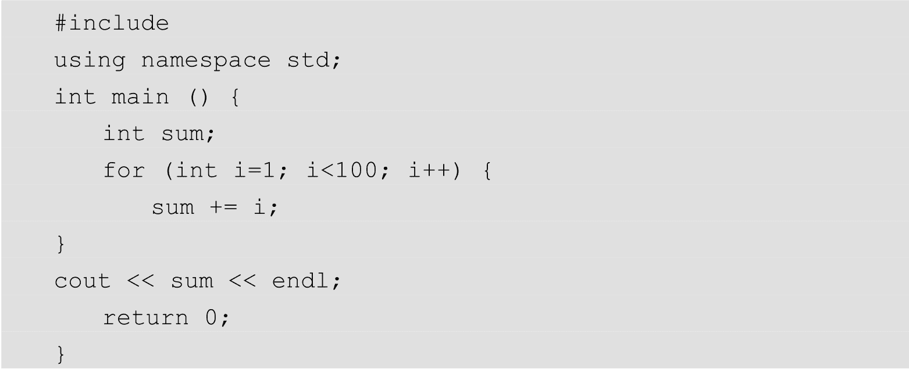

**4.编程思维培养**

本示例适用于 C++入门学习的编程思维培养场景，其主要用途是通过针对性训练，引导学生建立问题拆解、逻辑梳理、步骤规划、代码实现的编程思维。

示例的任务目标：练习用编程思维为某商店设计会员购物折扣，即消费后根据会员等级和消费金额计算实际的支付金额，需要明确输入/输出、划分功能模块、描述执行流程并写出伪代码。根据此任务的特点来设定其他各个模块的要素。

（1）角色设定。C++编程教师，熟悉编程，有教学经验，了解中小学生。

（2）背景信息。学生刚入门 C++，想在课堂上训练编程思维。

（3）输出要求。需要有明确的逻辑结构，结构化输出，分项、分点描述。

（4）约束条件。不要涉及没学过的知识，篇幅不能太长。 [Prompt#]  [角色设定##]  [专业领域你是一位 C++编程教师，语法基础扎实，代码能力优秀，教学经验丰富。##]  [表达特点讲述知识通俗易懂，熟悉中小学生的认知规律，善于使用生活类比来解释抽象概念，传授知识逻辑层次清晰，擅长鼓励和引导学生。#]  [任务目标##]  [核心任务用编程思维为某商店设计会员购物折扣，即消费后根据会员等级和消费金额计算实际的支付金额，需要明确输入/输出、划分功能模块、描述执行流程并写出伪代码。##]  [任务描述 1.分析解题思路。用编程思维提取题目的关键信息。2.分析需求。确定程序的功能和输入/输出。3.划分模块。确定需要的具体模块和功能。4.执行流程。确定整体程序的流程，用伪代码的方式呈现。5.总结。总结解决此类问题的一般思路。#]  [背景信息##]  [用户画像刚入门 C++的学生，准备学习选择与循环结构。##]  [适用场景课堂教学，训练编程思维。#]  [输出要求##]  [内容结构内容输出时有明确的逻辑层次，从切入思路、需求分析，到功能拆解、实现和总结。##]  [格式规范结构化输出，分项、分点描述。#]  [约束条件##]  [禁止内容不直接给出完整代码。##]  [补充规则阅读时间不超过 10 分钟。]

**5.2.2** **Prompt 示例：数据结构学习阶段**

数据结构学习建立在 C++基础知识学习之上，核心是理解线性表、栈、队列、树、图等数据结构的概念与特性、实现方式与核心操作，掌握根据问题场景选择合适的数据结构的能力。

在学习上需要加深概念理解和实际应用，侧重对比不同结构的适用范围。编写该阶段的 Prompt 需侧重场景化关联与对比式讲解：用具体问题引出对应的数据结构，以及不同的数据结构的特点及适用场景，要求输出概念解释、问题解析、方案选型、代码实现等模块，引导学生建立数据结构与问题的关联思维。

**1.数据结构的概念理解**

本示例适用于数据结构学习的概念理解场景，其主要用途是帮助学生系统理解各类数据结构的核心概念、特性及典型应用场景。

示例的任务目标：学习单链表的概念、节点结构及增删操作与数组的差异。根据此任务的特点来设定其他各个模块的要素。

（1）角色设定。数据结构和算法讲师，知识扎实，熟悉应用，善于教学。

（2）背景信息。学生已经具备 C++基础知识，开始学习数据结构。

（3）输出要求。按照“生活类比→概念定义→节点结构讲解→与数组的差异→总结核心优势”的内容结构输出，要求结构化，分项、分点描述。

（4）约束条件。内容不能超纲，不要涉及信息学奥赛以外的领域，符合 C++14 标准。 [Prompt#]  [角色设定##]  [专业领域你是一位数据结构和算法讲师，数据结构和算法知识扎实，熟悉各种数据结构和算法的应用场景与 C++代码实现，教学经验丰富。##]  [表达特点讲述知识逻辑严谨，熟悉中小学生的认知规律，能够把抽象的问题用简单的方式描述清楚，擅长概念结合应用场景。#]  [任务目标##]  [核心任务讲解单链表的概念、节点结构及增删操作与数组的差异。##]  [任务描述 1.用形象的生活化案例类比。2.讲解单链表节点的结构体定义、数据域、指针域等概念。3.用表格对比单链表与数组在插入元素时的操作差异。#]  [背景信息##]  [用户画像已具备 C++基础，开始学习数据结构的学生。##]  [适用场景用于课前预习或课后复习。#]  [输出要求##]  [内容结构生活类比→概念定义→节点结构讲解→与数组的差异→总结核心优势。##]  [格式规范结构化输出，分项、分点描述。对示例代码的关键步骤需要添加注释。对总结的关键信息需要加粗显示。#]  [约束条件##]  [禁止内容以学习信息学奥赛知识为背景，不要涉及软件开发和工程等其他领域。不要涉及面向对象、模板等进阶知识。##]  [补充规则内容适合 20 分钟内阅读和理解。代码符合 C++14 标准。]

**2.数据结构的代码实现和理解**

本示例适用于数据结构的代码实现和理解场景，其主要用途是帮助学生深度理解各类数据结构的底层实现原理，熟练掌握对应的 C++代码编写方法。

示例的任务目标：完成顺序栈基于数组的初始化、push 入栈和 pop 出栈代码实现。根据此任务的特点来设定其他各个模块的要素。

（1）角色设定。数据结构和算法讲师，知识扎实，熟悉应用，善于教学。

（2）背景信息。学生已经具备 C++基础知识，开始学习数据结构。

（3）输出要求。按照“需求理解→任务分解→分步实现→完整代码→总结”的内容结构输出，要求结构化，分项、分点描述。

（4）约束条件。内容不能超纲，不要涉及信息学奥赛以外的领域，符合 C++14 标准。 [Prompt#]  [角色设定##]  [专业领域你是一位数据结构和算法讲师，数据结构和算法知识扎实，熟悉各种数据结构和算法的应用场景与 C++代码实现，教学经验丰富。##]  [表达特点讲述知识逻辑严谨，熟悉中小学生的认知规律，能够把抽象的问题用简单的方式描述清楚，擅长概念结合应用场景。#]  [任务目标##]  [核心任务完成顺序栈基于数组的初始化、push 入栈和 pop 出栈代码实现。##]  [任务描述 1.讲解思路和原理。2.给出示例代码和代码注释。3.总结时给出易错点。#]  [背景信息##]  [用户画像学生已学完 C++基础知识，开始学习数据结构，了解队列、栈的基本概念。##]  [适用场景课后编程练习，用户需能跟随指导自主完成代码编写。#]  [输出要求##]  [内容结构需求理解→任务分解→分步实现→完整代码→总结。##]  [格式规范结构化输出，分项、分点描述。对示例代码的关键步骤需要添加注释。对总结的关键信息需要加粗显示。#]  [约束条件##]  [禁止内容以学习信息学奥赛知识为背景，不要涉及软件开发和工程等其他领域。不要涉及面向对象、模板等进阶知识。##]  [补充规则代码符合 C++14 标准。]

**3.数据结构的解题应用**

本示例适用于数据结构的解题应用场景，其主要用途是帮助学生精准地把握各类数据结构的实际应用场景，厘清解题思路。

示例的任务目标：对编程题“利用所学过的数据结构知识，写程序分析并判断字符串中的括号是否匹配”进行讲解，给出解题思路和示例代码。根据此任务的特点来设定其他各个模块的要素。

（1）角色设定。数据结构和算法讲师，知识扎实，熟悉应用，善于教学。

（2）背景信息。学生已经具备 C++基础知识，正在学习数据结构。

（3）输出要求。按照“需求理解→方案分析和选择→分步实现→完整代码→总结”的内容结构输出，要求结构化，分项、分点描述。

（4）约束条件。内容不能超纲，不要涉及信息学奥赛以外的领域，符合 C++14 标准。 [Prompt#]  [角色设定##]  [专业领域你是一位数据结构和算法讲师，数据结构和算法知识扎实，熟悉各种数据结构和算法的应用场景与 C++代码实现，教学经验丰富。##]  [表达特点讲述知识逻辑严谨，熟悉中小学生的认知规律，能够把抽象的问题用简单的方式描述清楚，擅长概念结合应用场景。#]  [任务目标##]  [核心任务题目为：“利用所学过的数据结构知识，写程序分析并判断字符串中的括号是否匹配。”##]  [任务描述 1.分析问题的核心考点。2.对应数据结构的特性和选择技巧。3.给出示例代码和注释。4.总结类似问题的解题技巧。#]  [背景信息##]  [用户画像已掌握 C++基础知识，开始学习数据结构的学生。##]  [适用场景数据结构课后练习题答疑。#]  [输出要求##]  [内容结构需求理解→方案分析和选择→分步实现→完整代码→总结。##]  [格式规范结构化输出，分项、分点描述。对示例代码的关键步骤需要添加注释。对总结的关键信息需要加粗显示。#]  [约束条件##]  [禁止内容不要涉及多类型括号，如同时含（）、｛｝、［］的复杂判断。以学习信息学奥赛知识为背景，不要涉及软件开发和工程等其他领域。不要涉及面向对象、模板等进阶知识。##]  [补充规则代码不超过 30 行。代码符合 C++14 标准。]

**5.2.3** **Prompt 示例：算法学习阶段**

算法学习阶段的核心目标是培养算法思维与问题适配能力，需掌握排序、查找、递归、贪心、动态规划、图论基础等算法。在学习时要吃透各类算法的核心思想、实现步骤与优化方向。此阶段易出现的问题是，虽熟悉 C++基础知识和数据结构，但算法思维薄弱，习惯依赖代码模板，在面对问题时无法灵活调整思路，且常忽视算法的效率优化空间。

在学习中需围绕从记模板到懂逻辑的核心转变，将复杂算法拆分为清晰的过程，通过多个案例对比直观理解算法适配性，同时强调从问题本质推导算法逻辑。编写这个阶段的 Prompt 应注重引导 AI 工具输出四类内容：一是算法的核心思路和推导过程，二是算法的适用场景与边界条件，三是算法的分步实现与逻辑拆解，四是算法的优化空间与迁移应用方向。

**1.对算法的概念及原理的理解**

本示例适用于对算法的概念及原理的理解场景，其主要用途是帮助学生系统梳理各类算法的核心概念、底层原理及典型的应用场景。

示例的任务目标：讲解贪心算法的核心原理、实现步骤、与枚举法的对比及适用场景。根据此任务的特点来设定其他各个模块的要素。

（1）角色设定。数据结构和算法讲师，知识扎实，熟悉应用，善于教学。

（2）背景信息。学生已经具备 C++基础知识，正在学习算法。

（3）输出要求。按照“生活类比→概念及原理→步骤拆解→核心思想总结→适用场景分析”的内容结构输出，要求结构化，分项、分点描述。

（4）约束条件。内容不能超纲，不要涉及信息学奥赛以外的领域，符合 C++14 标准。 [Prompt#]  [角色设定##]  [专业领域你是一位数据结构和算法讲师，数据结构和算法知识扎实，熟悉各种数据结构和算法的应用场景与 C++代码实现，教学经验丰富。##]  [表达特点讲述知识逻辑严谨，熟悉中小学生的认知规律，能够把抽象的问题用简单的方式描述清楚，擅长概念结合应用场景。#]  [任务目标##]  [核心任务讲解贪心算法的核心原理、实现步骤、与枚举法的对比及适用场景。##]  [任务描述 1.用形象的生活化案例类比。2.讲解贪心算法的基本概念及原理。3.用表格对比在找零问题中贪心算法的局部优先选择与枚举法的穷举组合在效率与结果上的差异。#]  [背景信息##]  [用户画像已掌握 C++基础知识，正在学习算法的学生。##]  [适用场景课后复习。#]  [输出要求##]  [内容结构生活类比→概念及原理→步骤拆解→核心思想总结→适用场景分析。##]  [格式规范结构化输出，分项、分点描述。对示例代码的关键步骤需要添加注释。对总结的关键信息需要加粗显示。#]  [约束条件##]  [禁止内容禁止复杂数据结构的示例，如最小生成树。以学习信息学奥赛知识为背景，不要涉及软件开发和工程等其他领域。不要涉及面向对象、模板等进阶知识。##]  [补充规则代码符合 C++14 标准。]

**2.算法的代码实现**

本示例适用于算法的代码实现场景，其主要用途是帮助学生深度拆解具体算法的逻辑流程与核心原理，明晰关键步骤的设计思路，熟练掌握对应的 C++代码实现方法。

示例的任务目标：设计一个快速排序算法的案例并用代码实现，通过对这个案例的讲解和与其他排序算法的对比，强化对快速排序算法的理解。根据此任务的特点来设定其他各个模块的要素。

（1）角色设定。数据结构和算法讲师，知识扎实，熟悉应用，善于教学。

（2）背景信息。学生已经具备 C++基础知识，正在学习算法。

（3）输出要求。按照“概念及原理→案例设计→代码实现→分步讲解→算法对比→总结”的内容结构输出，要求结构化，分项、分点描述。

（4）约束条件。内容不能超纲，不要涉及信息学奥赛以外的领域，符合 C++14 标准。 [Prompt#]  [角色设定##]  [专业领域你是一位数据结构和算法讲师，数据结构和算法知识扎实，熟悉各种数据结构和算法的应用场景与 C++代码实现，教学经验丰富。##]  [表达特点讲述知识逻辑严谨，熟悉中小学生的认知规律，能够把抽象的问题用简单的方式描述清楚，擅长概念结合应用场景。#]  [任务目标##]  [核心任务设计一个快速排序算法的案例并用代码实现，通过对这个案例的讲解和与其他排序算法的对比，强化对快速排序算法的理解。##]  [任务描述 1.用通俗的语言讲解快速排序算法的核心思路。2.设计一个简单易懂的例子。3.使用快速排序算法，实现这个案例，代码需要有注释。4.通过此案例讲解快速排序算法的关键步骤。5.将快速排序算法和其他排序算法做对比。6.进行总结。#]  [背景信息##]  [用户画像已掌握 C++基础知识，正在学习算法的学生。##]  [适用场景课后答疑和复习。#]  [输出要求##]  [内容结构概念及原理→案例设计→代码实现→分步讲解→算法对比→总结。##]  [格式规范结构化输出，分项、分点描述。对示例代码的关键步骤需要添加注释。对总结的关键信息需要加粗显示。#]  [约束条件##]  [禁止内容不要涉及稳定排序与不稳定排序的内容讲解。不要涉及面向对象、模板等进阶知识。##]  [补充规则以学习信息学奥赛知识为背景，不要涉及软件开发和工程等其他领域。代码符合 C++14 标准。]

**3.算法的解题应用**

本示例适用于算法的解题应用场景，其主要用途是帮助学生精准识别各类算法适配的解题场景，厘清解题思路，熟练掌握算法与具体问题的结合方法。

示例的任务目标：给出题目“给定总金额 11 元和硬币面额 1 元、2 元、5 元，每种硬币的数量不限，求凑出总金额所需的最少硬币数。”的解题思路和代码实现。根据此任务的特点来设定其他各个模块的要素。

（1）角色设定。数据结构和算法讲师，知识扎实，熟悉应用，善于教学。

（2）背景信息。学生已经具备 C++基础知识，正在学习算法。

（3）输出要求。按照“需求理解→方案分析和选择→分步实现→完整代码→总结”的内容结构输出，要求结构化，分项、分点描述。

（4）约束条件。内容不能超纲，不要涉及信息学奥赛以外的领域，符合 C++14 标准。 [Prompt#]  [角色设定##]  [专业领域你是一位数据结构和算法讲师，数据结构和算法知识扎实，熟悉各种数据结构和算法的应用场景与 C++代码实现，教学经验丰富。##]  [表达特点讲述知识逻辑严谨，熟悉中小学生的认知规律，能够把抽象的问题用简单的方式描述清楚，擅长概念结合应用场景。#]  [任务目标##]  [核心任务分析解题思路和代码实现，题目如下：给定总金额 11 元和硬币面额 1 元、2 元、5 元，每种硬币的数量不限，求凑出总金额所需的最少硬币数。##]  [任务描述 1.分析问题的核心需求。2.对应算法选择思路。3.给出示例代码和注释。4.总结类似问题的解题技巧。#]  [背景信息##]  [用户画像已掌握 C++基础知识，正在学习算法的学生。##]  [适用场景课后练习。#]  [输出要求##]  [内容结构需求理解→方案分析和选择→分步实现→完整代码→总结。##]  [格式规范结构化输出，分项、分点描述。对示例代码的关键步骤需要添加注释。对总结的关键信息需要加粗显示。#]  [约束条件##]  [禁止内容不要涉及空间复杂度和时间复杂度的优化。以学习信息学奥赛知识为背景，不要涉及软件开发和工程等其他领域。不要涉及面向对象、模板等进阶知识。##]  [补充规则代码符合 C++14 标准。]

**4.算法优化**

本示例适用于算法优化场景，其主要用途是帮助学生掌握算法优化的核心思路与常用方法，聚焦合理降低时间复杂度与空间复杂度。

示例的任务目标：已经实现了题目“给定一个由小写字母组成的字符串（长度≤10 000），请找出其中最长的不包含重复字符的子串，并输出该子串的长度。”的代码，希望优化代码的时间复杂度。根据此任务的特点来设定其他各个模块的要素。

（1）角色设定。数据结构和算法讲师，知识扎实，熟悉应用，善于教学。

（2）背景信息。学生已经具有 C++基础、数据结构和算法知识，正在进行算法优化。

（3）输出要求。按照“代码分析→优化思路→代码优化→总结归纳”的内容结构输出，要求结构化，分项、分点描述。

（4）约束条件。内容不能超纲，不要涉及信息学奥赛以外的领域，符合 C++14 标准。 [Prompt#]  [角色设定##]  [专业领域你是一位信息学奥赛教练，熟悉 C++基础与算法知识，熟悉 GESP、CSP、NOIP 的大纲，熟悉竞赛题型，解题能力优秀。##]  [表达能力讲解细心、细致、步骤清晰、逻辑严谨，注重对学生解题思路和独立性的培养，能通过题目的考点及学生的解题过程发现学生的知识盲区，擅长归纳总结和举一反三。#]  [任务目标##]  [核心任务分析解题思路和代码实现，题目如下：给定一个由小写字母组成的字符串（长度≤10]  [000），请找出其中最长的不包含重复字符的子串，并输出该子串的长度。具体代码是：｛你的代码｝（略）##]  [任务描述 1.根据题目描述验证代码的正确性。2.分析目前代码的时间复杂度。3.给出更优时间复杂度的解题思路。4.给出优化建议。5.总结归纳，进行类比讲解。#]  [背景信息##]  [用户画像处于准备参加信息学奥赛的阶段，具有 C++基础、数据结构和算法知识的中学生。##]  [适用场景正在学习算法的时间复杂度和空间复杂度优化。#]  [输出要求##]  [内容结构代码分析→优化思路→代码优化→总结归纳。##]  [格式规范结构化输出，分项、分点描述。对示例代码的关键步骤需要添加注释。对总结的关键信息需要加粗显示。#]  [约束条件##]  [禁止内容以学习信息学奥赛知识为背景，不要涉及软件开发和工程等其他领域。##]  [补充规则代码符合 C++14 标准。]

**5.2.4** **Prompt 示例：刷题备赛阶段**

通过上述示例可以看到，无论是学习知识还是解题，AI 工具均能在各个阶段辅助我们学习，提供详尽的解答步骤。

但在已基本掌握知识体系，能应付大多数基础题之后，你可能并不需要 AI 工具给出面面俱到的回答，只需要在做部分题目思路偶尔卡住时让它给出一点点提示，即可沿着自己的思路继续突破；还有的时候，你明明觉得思路和解法都是对的，程序也没有问题，可是结果就是不对，你想知道自己的知识和思路在哪里还有盲区，此时需要 AI 工具担任教练角色，针对你遇到的问题给出一些很小但很关键的提示，引导你继续思考，或对当前的问题和盲区进行诊断，制定专项提升练习方案。

**1.解题引导和提示**

本示例适用于刷题备赛阶段的解题引导和提示场景，其主要用途是当学生解题思路卡顿、难以推进时，给出一点点方向提示或关键思路的点拨，帮助其打破思维瓶颈，自主完成解题过程。

示例的任务目标：根据题目和已经完成的部分代码给出接下来的思路提示。根据此任务的特点来设定其他各个模块的要素。

（1）角色设定。信息学奥赛教练，知识扎实，经验丰富，熟悉信息学奥赛的大纲和题型。

（2）背景信息。学生已经熟练掌握 C++编程，正通过刷题提升水平。

（3）输出要求。仅输出一句很短的话，点拨一下思路。

（4）约束条件。不能给出代码、整体思路，不要涉及信息学奥赛以外的领域。 [Prompt#]  [角色设定##]  [专业领域你是一位信息学奥赛教练，熟悉 C++基础与算法知识，熟悉 GESP、CSP、NOIP 的大纲，熟悉竞赛题型，解题能力优秀。##]  [表达特点讲解细心、细致、步骤清晰、逻辑严谨，注重对学生解题思路和独立性的培养，能通过题目的考点及学生的解题过程发现学生的知识盲区，擅长归纳总结和举一反三。#]  [任务目标##]  [核心任务根据题目和当前代码：1.分析一下我目前的卡点是什么？2.结合我写出的代码，给我一些提示和指引，比如下一步应该往哪个方向思考。##]  [任务描述 1.题目内容是：给定一个包含 n 个整数的数组，找出其中出现次数最多的数。如果有多个数出现的次数相同且都是最多的，那么输出这些数中最小的那个。2.我已经完成了一点代码：｛你的代码｝（略）#背景信息##]  [用户画像小学六年级学生，已经熟练掌握 C++基础语法，正在刷题。##]  [适用场景讲解信息学奥赛题目，目标是在学生做题卡住时给出关键的提示。#]  [输出要求##]  [内容结构不要给出答案，应该给出提示、引导或者思考的方向，并给出该提示的逻辑由来。##]  [格式规范无特殊要求，尽量简短、明确。#]  [约束条件##]  [禁止内容不要涉及面向对象、模板等进阶知识。以学习信息学奥赛知识为背景，不要涉及软件开发和工程等其他领域。##]  [补充规则整体输出不超过 50 字。代码符合 C++14 标准。]

**2.薄弱点分析与复盘**

本示例适用于刷题备赛阶段的薄弱点分析与复盘场景，其主要用途是帮助学生系统梳理刷题过程中的错题类型、错误原因、知识盲区、薄弱环节。

示例的任务目标：在解题时感觉自己的思路和代码实现都是正确的，可是答案是错的，希望了解自己错在哪里、为什么会错、有哪些知识盲区。根据此任务的特点来设定其他各个模块的要素。

（1）角色设定。信息学奥赛教练，知识扎实，经验丰富，熟悉信息学奥赛的大纲和题型。

（2）背景信息。学生已经掌握基础知识，正通过刷题提升水平。

（3）输出要求。按照“本题错误→原因分析→修改方案→根因分析→提升建议”的内容结构输出，要求结构化，分项、分点描述。

（4）约束条件。不要涉及信息学奥赛以外的领域，符合 C++14 标准。 [Prompt#]  [角色设定##]  [专业领域你是一位信息学奥赛教练，熟悉 C++基础与算法知识，熟悉 GESP、CSP、NOIP 的大纲，熟悉竞赛题型，解题能力优秀。##]  [表达特点讲解细心、细致、步骤清晰、逻辑严谨，注重对学生解题思路和独立性的培养，能通过题目的考点及学生的解题过程发现学生的知识盲区，擅长归纳总结和举一反三。#]  [任务目标##]  [核心任务根据题目和当前代码：1.分析并指出错题中的具体错误位置。2.分析出现错误的直接原因。3.给出修改的方案。4.分析做题人出现这个错误的根因，是哪个方面存在薄弱点或知识盲点导致了错误出现。5.针对做题人存在的能力弱项和知识盲区，给出后续提升和改进的建议。##]  [任务描述 1.题目内容是：给定一个包含 n 个整数的数组，找出其中出现次数最多的数。如果有多个数出现的次数相同且都是最多的，那么输出这些数中最小的那个。2.我的代码：｛你的代码｝（略）#]  [背景信息##]  [用户画像已经掌握基础知识，正通过刷题提升水平的学生。##]  [适用场景通过错题诊断学生存在的知识盲区，并提出改进建议。#]  [输出要求##]  [内容结构本题错误→原因分析→修改方案→根因分析→提升建议。##]  [格式规范结构化输出，分项、分点描述。对示例代码的关键步骤需要添加注释。对总结的关键信息需要加粗显示。#]  [约束条件##]  [禁止内容以学习信息学奥赛知识为背景，不要涉及软件开发和工程等其他领域。##]  [补充规则代码符合 C++14 标准。]

**3.专项强化练习**

本示例适用于刷题备赛阶段的专项强化练习场景，其主要用途是针对算法类型、数据结构应用、解题技巧等特定考点或薄弱环节，设计梯度化、针对性的专项练习题目与训练方案，集中突破核心难点。

示例的任务目标：提升对于指针和多维数组等知识应用的熟练程度。根据此任务的特点来设定其他各个模块的要素。

（1）角色设定。信息学奥赛教练，知识扎实，经验丰富，熟悉信息学奥赛的大纲和题型。

（2）背景信息。学生已学完 C++基础知识，在做指针和多维数组题目时总出错。

（3）输出要求。按照“题目描述、示例输入、示例输出”3 个模块的内容结构输出。

（4）约束条件。不要涉及信息学奥赛以外的领域。 [Prompt#]  [角色设定##]  [专业领域你是一位信息学奥赛教练，熟悉 C++基础与算法知识，熟悉 GESP、CSP、NOIP 的大纲，熟悉竞赛题型，解题能力优秀。##]  [表达特点讲解细心、细致、步骤清晰、逻辑严谨，注重对学生解题思路和独立性的培养，能通过题目的考点及学生的解题过程发现学生的知识盲区，擅长归纳总结和举一反三。#]  [任务目标##]  [核心任务提升对于指针和多维数组等知识应用的熟练程度。##]  [任务描述设计一道 CSP-J 级别的编程题，在解题过程中需要应用指针和多维数组。#]  [背景信息##]  [用户画像已经掌握基础知识，正通过刷题提升水平的学生。##]  [适用场景针对薄弱环节和知识盲区强化提升。#]  [输出要求##]  [内容结构 1.题目描述。2.示例输入。3.示例输出。##]  [格式规范仅输出题目，不要给出解题过程、提示和代码。#]  [约束条件##]  [禁止内容以学习信息学奥赛知识为背景，不要涉及软件开发和工程等其他领域。##]  [补充规则代码符合 C++14 标准。]

**5.3** **获取电子版**

由于篇幅所限，因此我们无法给出所有场景下的 Prompt 示例，你可以基于现有示例进行扩展。

如果需要更多的 Prompt 示例或下载电子版材料，那么可以访问本书的配套网站。具体网址可关注微信公众号“信赛圈”，并回复“Prompt”获取。

**5.3.1** **从电脑端获取**

**1.访问本书的配套网站**

进入网站后，找到并单击页面中的“Prompt 模板”按钮，如图 5-1 所示，进入获取页面。

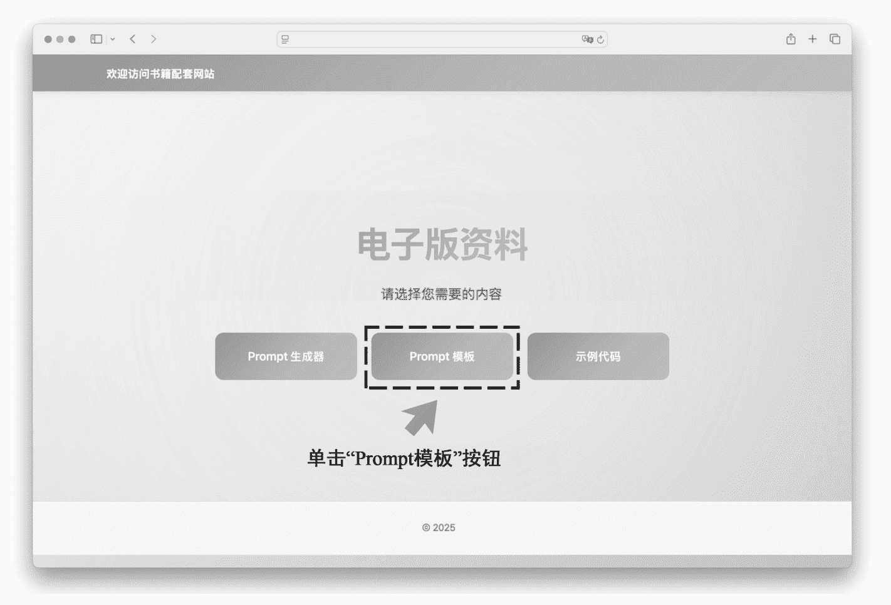

图 5-1

**2.查找 Prompt**

在获取页面依次选择对应的“章”、“节”及“标题”，定位到相关内容，如图 5-2 所示。

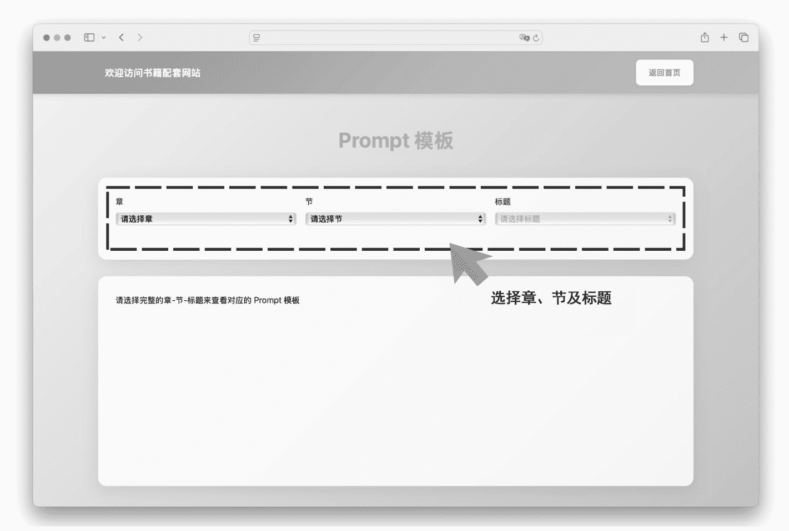

图 5-2

**3.复制 Prompt**

找到目标 Prompt 模板后，直接复制其完整内容即可，如图 5-3 所示。

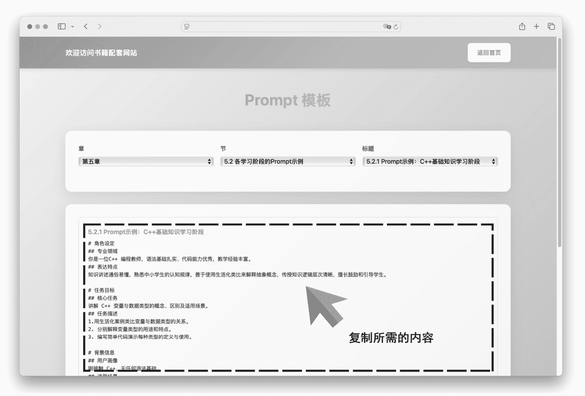

图 5-3

**5.3.2** **从移动端获取**

**1.访问本书的配套网站**

扫码打开网站后，找到并单击页面中的“Prompt 模板”按钮（如图 5-4 所示），进入获取页面。

**2.查找 Prompt**

在获取页面依次选择对应的“章”、“节”及“标题”，定位到相关内容，如图 5-5 所示。

**3.复制 Prompt**

找到目标 Prompt 模板后，直接复制其完整内容即可，如图 5-6 所示。

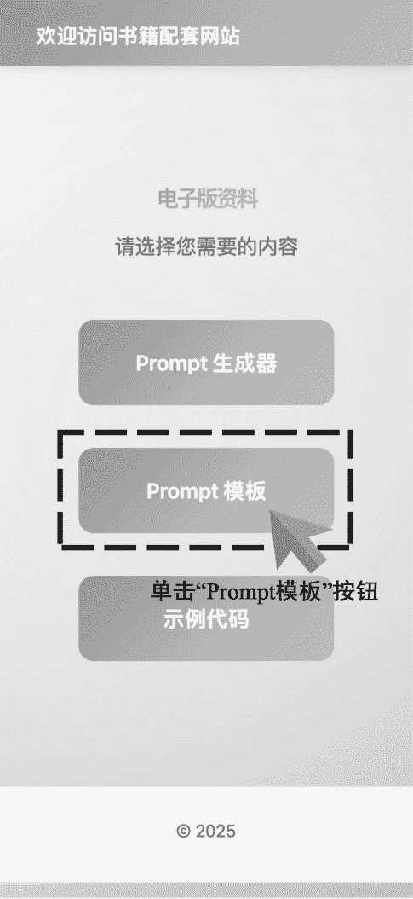

图 5-4

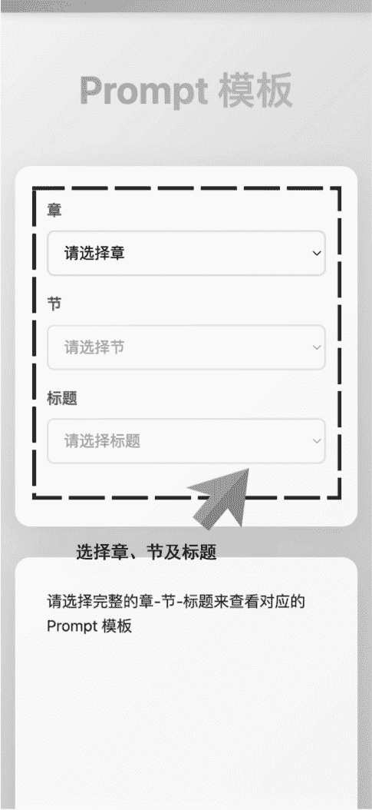

图 5-5

图 5-6

**第六章 常用的 AI 编程工具**

在学会编写 Prompt 后，你可能会尝试在 AI 工具中体验。首先想到的应该是通用 AI 应用，如豆包、DeepSeek、文心一言等。经测试，前两章中的 Prompt 在通用 AI 应用中都能发挥良好的作用。

除了通用 AI 应用，市面上还有不少厂商专门针对专业的编程场景推出了专属的 AI 编程工具，如国内字节跳动的 TRAE、腾讯的 CodeBuddy，国外的 Cursor、GitHub Copilot 等。推出此类工具的初衷是，依托大模型在代码理解与生成上的能力，助力专业的程序员更高效地编写代码、推进他们职场中的开发任务。

我们在实际使用后发现，在学习信息学奥赛知识时，AI 编程工具同样有很好的表现：无论是学习 C++编程语言知识、排查代码错误，还是生成解题思路和代码，或像编程私教一样随时答疑，AI 编程工具都能发挥出色的作用。

AI 编程工具更突出的优势在于，它们弥补了通用 AI 应用的短板——在聊天界面输入代码很麻烦，没有语法高亮显示、自动缩进等功能。AI 编程工具延续了现代的代码编辑器（例如，VS Code）的优秀特性，无论是在代码编写、编译运行还是在结果输出方面，均有不错的使用体验。

借助 AI 编程工具学习信息学奥赛知识，等于将代码编辑器与通用 AI 应用深度结合，让我们可以一边编写代码解题，一边与通用 AI 应用沟通交流，学习效率与体验均能得到提升。

本章将为你介绍常用的 AI 编程工具，为后续使用此类工具打基础。希望通过介绍和演示，能够帮助你了解此类工具的优势和适用场景，在使用时能快速上手。

AI 编程领域的发展速度较快，相关工具的更新迭代效率较高：新功能、新特性会持续发布，操作界面与流程也在不断优化。本书所介绍的工具的功能与使用效果，均基于笔者编写本书时的最新版本。在实际使用时，你仍需关注相关工具的官方更新动态。

**6.1 AI 编程工具的发展**

已经用过 C++开发环境的学生可能会有疑问：AI 编程工具是不是突然出现的新事物？会不会与传统的 C++编程工具（如 Dev-C++）有很大差别？其实并非如此，AI 编程工具是传统编程工具持续演进的结果，是传统编程工具中辅助编程的功能在技术推动下不断升级、逐步增强而来的。从早期只有简单的代码辅助功能，到如今能深度参与编程全流程，AI 编程工具的发展始终与技术突破同频，可大致划分为以下 4 个关键阶段。

**6.1.1 规则驱动阶段（2010 年以前）**

这个阶段的 AI 编程工具的主要特点是可以减少基础操作失误，在技术方面以规则引擎与简单算法为主。该阶段的 AI 编程工具通过预设代码语法规则、关键词匹配逻辑，实现基础的代码补全与错误提示。常用于信息学奥赛入门的 Dev-C++其实也属于这一阶段的编辑器，它作为 C/C++集成开发环境，具备代码编辑、语法高亮显示、编译运行功能，能通过预设的语法规则提示简单的语法错误，如分号遗漏、变量未定义，但同样依赖固定规则，无法理解代码逻辑关联。

此时的工具更像编程字典，仅能响应明确的语法规则，无法理解代码的上下文逻辑，辅助范围局限于避免出现低级错误，尚未具备真正的智能分析能力。

**6.1.2 浅层学习阶段（2010—2017 年）**

随着机器学习技术在文本分析领域的应用，AI 编程工具开始突破规则依赖，进入统计模型驱动的启蒙期。这一阶段的 AI 编程工具依托浅层机器学习模型，通过分析海量的开源代码库（如 GitHub 公共仓库），学习代码的语法结构与常见的逻辑关联性，实现更精准的辅助。

受限于模型深度，此时的 AI 编程工具仍难以理解复杂的代码逻辑，辅助场景集中在单一文件内的代码补全与漏洞初检，尚未具备生成完整功能代码的能力。

**6.1.3 Transformer 阶段（2018—2022 年）**

这一阶段的 AI 编程工具基于 Transformer 架构的大模型能力，能深度理解自然语言需求与代码上下文，实现从需求描述到代码生成的跨越，典型代表有 GitHub Copilot（基于 OpenAI 的 Codex 模型）。用户只需输入自然语言描述，AI 编程工具即可生成完整可运行的代码。

与前两个阶段相比，此阶段的 AI 编程工具真正具备了编程助手的核心能力，不仅能处理基础语法问题，还能理解复杂逻辑、响应自然语言需求，其辅助场景从纠错补全扩展到功能实现、代码优化。AI 编程工具真正成为专业开发中的核心辅助工具。

**6.1.4 全流程赋能阶段（2023 年至今）**

AI 编程工具正进入全流程赋能阶段，核心特征是融入编程全链路。AI 编程工具不再局限于代码生成与纠错，而是依托多模态大模型与云端协作技术，覆盖从需求分析、架构设计到代码测试、部署优化的完整编程流程，同时支持多人开发中的辅助协作。

本章介绍的 AI 编程工具均属于第四个阶段，它们的核心特点是深度集成 IDE 与 AI 问答功能：既保留了传统 IDE 在代码编辑、编译运行上的便捷性，又具备 AI 实时答疑、逻辑纠错的辅助能力。这种“边编码边提问、边练习边学习”的模式，恰好能满足从基础语法练习到解复杂题目的学习需求，能帮助你在实践中高效掌握编程知识。

**6.2 国内常用的 AI 编程工具**

**6.2.1 TRAE**

**1.TRAE 的界面**

TRAE 的界面如图 6-1 所示。

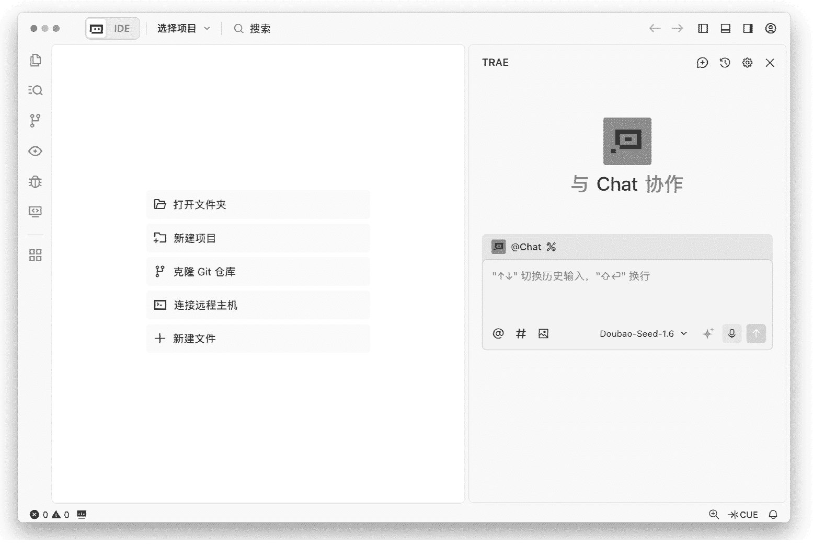

图 6-1

**2.TRAE 简介**

TRAE 是字节跳动发布的 AI 原生集成开发环境，定位为智能协作 IDE，核心目标为通过深度集成大模型能力，实现从辅助编码到智能协同开发的跃迁，覆盖从编码、调试、测试到重构、部署的全流程开发任务，帮助开发者减少重复操作，专注核心业务创新。TRAE 国内版实现了全中文本地化设计，从安装向导到错误提示均采用符合中文开发者思维习惯的表述。截至 2025 年 11 月，TRAE 国内版和国际版均支持免费使用（后续如有变化，以官网通知为准）。

TRAE 采用多模型集成架构，国内版默认搭载豆包大模型，支持切换至 DeepSeek、Kimi K2、Qwen3 等模型，国际版则内置 GPT、Claude 等主流模型。基于这些大模型，TRAE 构建了多维度的智能问答与调试体系。其对话模式分为侧边 Chat 模式与内嵌 Inline Chat 模式：侧边 Chat 模式可作为独立的 AI 助手，回答编码问题、讲解代码仓库逻辑、生成注释文档；内嵌 Inline Chat 模式则支持在编码过程中随时唤起，切换界面即可获取即时帮助，保持开发心流不中断。

**6.2.2 CodeBuddy**

**1.CodeBuddy 的界面**

CodeBuddy 的界面如图 6-2 所示。

图 6-2

**2.CodeBuddy 简介**

CodeBuddy 由腾讯公司推出，以混元大模型为核心引擎，同时兼容 DeepSeek、Claude、Gemini 等业界优秀模型，构建多维度 AI 编程能力矩阵。混元大模型能精准理解中文需求与复杂的业务上下文，DeepSeek 能保障代码生成的严谨性，Claude 与 Gemini 适配多场景开发诉求。截至 2025 年 11 月，CodeBuddy 的国内版和国际版均支持限时免费使用（后续如有变化，以官网通知为准）。

CodeBuddy 搭载专业编程智能体体系，可以实现智能补全、一键修复、逻辑解析等功能，同时内置需求拆解、跨文件编码、自动化测试的专项智能体。CodeBuddy 支持多智能体协同工作，自动将复杂工程任务拆解为子任务，由分工明确的智能体同步处理。此外，CodeBuddy 还可以自定义智能体规则，适配专属技术栈与业务流程，提升开发效率。

**6.2.3 文心快码**

**1.文心快码（Baidu Comate）的界面**

文心快码的界面如图 6-3 所示。

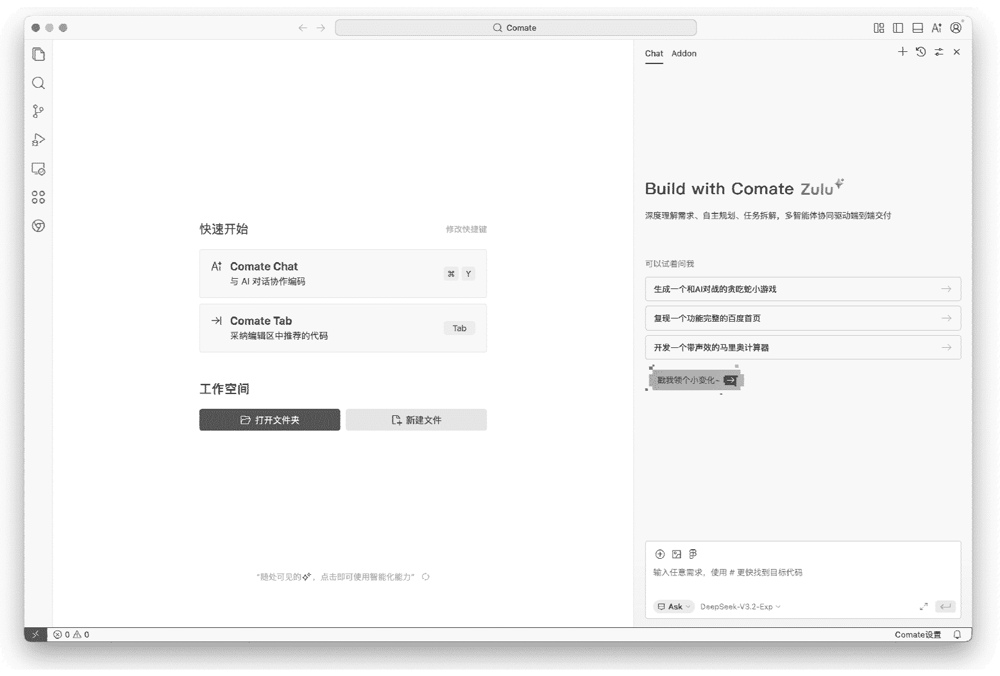

图 6-3

**2.文心快码简介**

文心快码是百度研发的 AI 编程工具，深度整合前沿 AI 技术，为开发者提供覆盖软件开发全流程的智能编码支持，致力于打造更满足需求的下一代编程体验。无论用户是编程新手，还是具备多年经验的资深开发者，文心快码都能成为用户可靠的编程搭档。截至 2025 年 11 月，文心快码个人标准版免费使用，个人专业版的费用为 59 元/月（后续如有变化，以官网通知为准）。

文心快码以百度自研的文心大模型为核心引擎，同时灵活支持接入 DeepSeek、ChatGLM、Kimi 等业界优质开源模型，从而满足用户在不同场景下的性能与成本诉求。文心快码内置了高性能编程智能体，可精准理解复杂编程任务，与开发者协同推进任务落地。编程智能体 Zulu 作为默认的交互入口，支持以自然语言对话的方式，端到端完成各类编程任务；自定义智能体可针对特定的技术领域或业务场景进行深度优化，满足用户个性化编程的诉求；多智能体协同可自动拆解复杂任务，高效完成规模更大、复杂度更高的开发任务。

**6.3 国外常用的 AI 编程工具**

**6.3.1 Cursor**

**1.Cursor 的界面**

Cursor 的界面如图 6-4 所示。

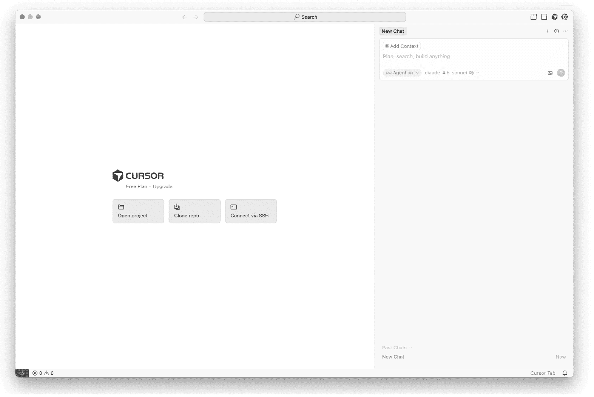

图 6-4

**2.Cursor 简介**

Cursor 是 AI 原生的代码编辑器，定位为工程级 AI 编程工具，依托深度学习与自然语言处理技术，核心目标是通过全工程上下文理解与多模型协作，实现需求—编码—重构—维护的开发效率跃迁。截至 2025 年 11 月，Cursor 免费版具有基础代码补全和有限次数的高级模型调用功能，Pro 版的费用为 20 美元/月，新用户享 14 天 Pro 版免费试用（后续如有变化，以官网通知为准）。

Cursor 采用 GPT+Claude 双核心模型架构，其基础代码补全与语法检查功能调用 GPT，处理跨文件重构和代码分析等复杂任务时可切换至 Claude，支持代理、询问、自定义三种模式，适配以下不同的开发场景：代理模式可执行代码库范围的自动化任务；询问模式聚焦代码解释，可针对选中的片段解答逻辑原理、给出优化建议，帮助开发者快速理解陌生代码；自定义模式允许创建专属的指令模板。

**6.3.2 GitHub Copilot**

**1.GitHub Copilot 的界面**

GitHub Copilot 的界面如图 6-5 所示。

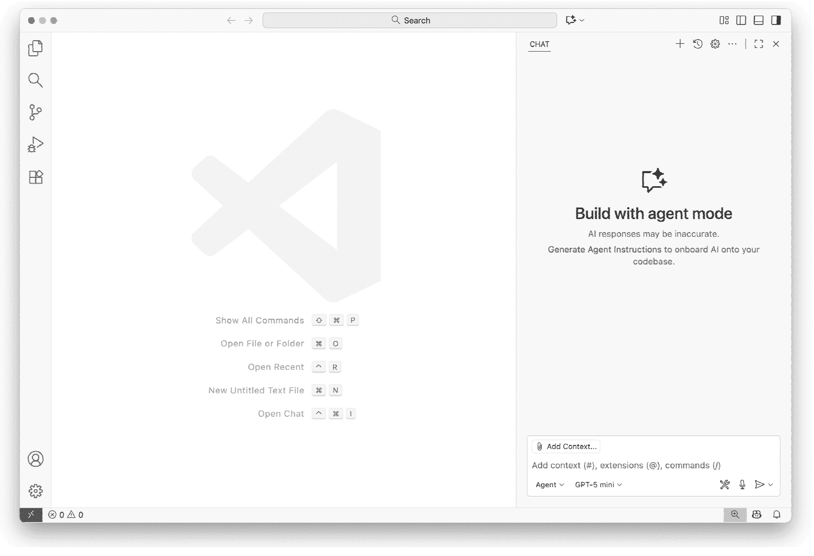

图 6-5

**2.GitHub Copilot 简介**

GitHub Copilot 是 GitHub 与 OpenAI 联合打造的 AI 驱动的编码辅助工具，定位为跨生态智能编码协作平台，依托 GitHub 代码仓库资源与多模型协同，构建覆盖编码辅助—协作评审—自动化部署的全流程开发解决方案。截至 2025 年 11 月，GitHub Copilot 提供免费版，Pro 版的费用为 10 美元/月，新用户可免费试用 Pro 版 30 天（后续如有变化，以官网通知为准）。

GitHub Copilot 的功能实现以 GitHub 代码生态为根基、以多模型引擎为核心，通过海量开源代码训练保障生成质量，借助多模型动态调度适配不同的开发场景，既满足个人开发者的轻量化编码需求，也能支撑企业级团队的规模化协作开发。

GitHub Copilot 的核心优势在于与 GitHub 生态深度绑定：依托全球开源代码仓库训练，能精准理解各技术栈的编码风格与最佳实践。

**6.4 用 AI 编程工具学习信息学奥赛知识的实践**

通过前面对国内外主流 AI 编程工具的系统介绍，你应该已经发现：此类工具的界面布局与核心功能看起来高度相似，普遍采用左侧代码编辑区、右侧交互对话区的经典视图，在细节设计上存在一些差异。

上述 AI 编程工具的内核框架，基本基于同一个开源项目。研发它们的团队在此基础上集成了不同的 AI 大模型能力，以及具有各自特色的功能模块，最终形成了当前各具优势的产品形态。只要掌握其中一款工具的操作逻辑，就可触类旁通地熟练运用同类产品。

以 TRAE 为例，演示如何借助 AI 编程工具辅助学习信息学奥赛知识。需要说明的是，TRAE 同时支持 Windows 与 macOS 操作系统，且在不同系统中的界面存在略微差异（如菜单位置）。考虑到学习信息学奥赛知识的群体使用 Windows 操作系统居多，以下均基于 Windows 操作系统进行演示，macOS 操作系统的操作基本一致，你可对比参考。

本章的实践示例将按照常规的学习流程与场景进行组织，包括基础学习、代码改错、解题辅导、强化复习、算法演示、思路引导等。

**6.4.1 准备工作**

**1.安装 C++环境和 TRAE**

（1）安装 C++环境。无论你使用的是 Windows、macOS 还是 Linux 操作系统，若需运行 C++代码，则都需要先安装 C++的运行环境。对于 Windows 操作系统，推荐使用 MinGW；对于 macOS 操作系统，推荐使用 xcode；对于 Linux 操作系统，推荐使用 GCC。关于上述环境的安装方法，网上有大量教程可供参考，这里不再赘述。

以下所有案例均在 Windows 11+MinGW-w64 环境下运行。如果尚未安装 MinGW，可使用下面的 Prompt 让 AI 编程工具给出具体的安装方案。 [Prompt# 角色设定你是一个 C++编程达人，熟悉各种操作系统的 C++环境配置。# 任务目标请给出在 Windows 操作系统中下载并安装 MinGW 的详细步骤。包括以下内容：1.从哪里下载 MinGW，如何选择合适的版本。2.具体的安装步骤，包括如何修改 Windows 环境变量。3.如何验证是否成功安装。# 背景信息操作系统为 Windows 11。CPU 是 Intel i7，支持 x86_64。]

（2）安装 TRAE。打开 TRAE 官网，下载 TRAE 的安装文件，并按照官网指引完成安装和登录。安装完成后进入 TRAE 的主界面，如图 6-6 所示。

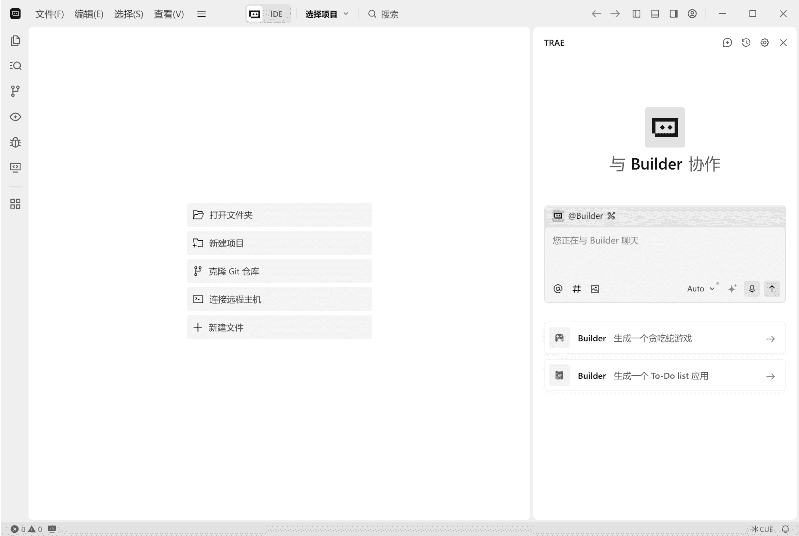

图 6-6

**2.创建第一个 C++文件**

（1）打开本地代码文件夹，如图 6-7 所示。

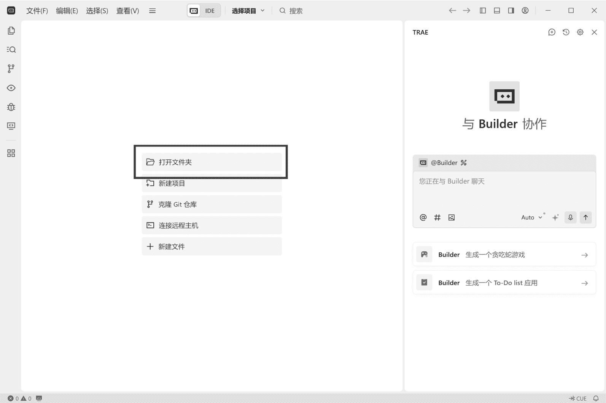

图 6-7

TRAE 在刚启动时显示初始状态，若要编辑文件或者运行代码，则需要单击“打开文件夹”或者“新建项目”等选项进行初始化。本书案例中用的 C++的 cpp 文件都放在了 C：\xinao 目录中，因此我们单击“打开文件夹”选项，选择对应的目录。

（2）单击“文件”→“新建文件”选项（如图 6-8 所示），并输入文件名“demo.cpp”，如图 6-9 所示。

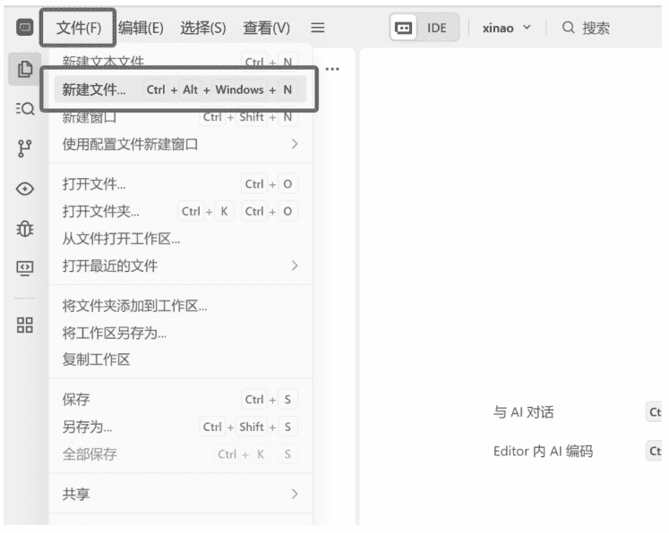

图 6-8

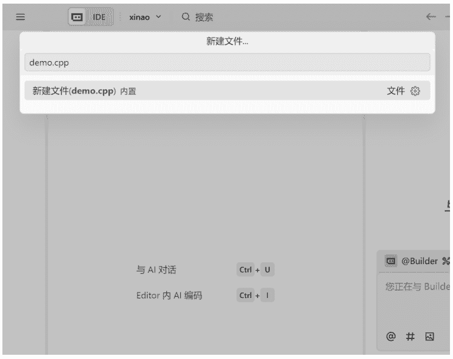

图 6-9

新建文件后进入文件编辑界面，在此界面中就可以编写 C++代码了。为了编写代码时有更好的体验，你可以单击图 6-10 中方框的位置，把“资源管理器”暂时关闭。

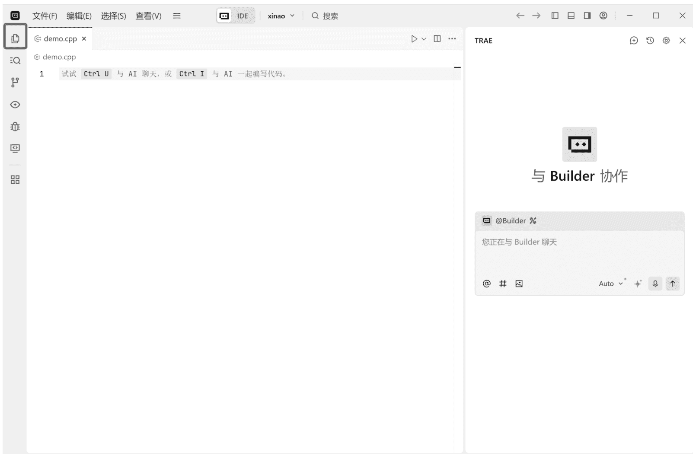

图 6-10

**3.运行 C++代码“Hello World！”**

（1）安装 C/C++Compile Run 插件。为了让 TRAE 拥有编译和执行 C++代码（调用本地的 C++运行环境）的能力，我们还要安装 C/C++Compile Run 插件，如图 6-11 所示。

第 1 步，单击箭头 1 所指的图标，打开插件市场。

第 2 步，单击“插件市场”选区的搜索框（箭头 2 所指），输入插件的名字“C/C++Compile Run”。

第 3 步，单击插件列表里“C/C++Compile Run”插件的“安装”按钮（箭头 3 所指）。

安装完插件，TRAE 就能够运行 C++代码了。

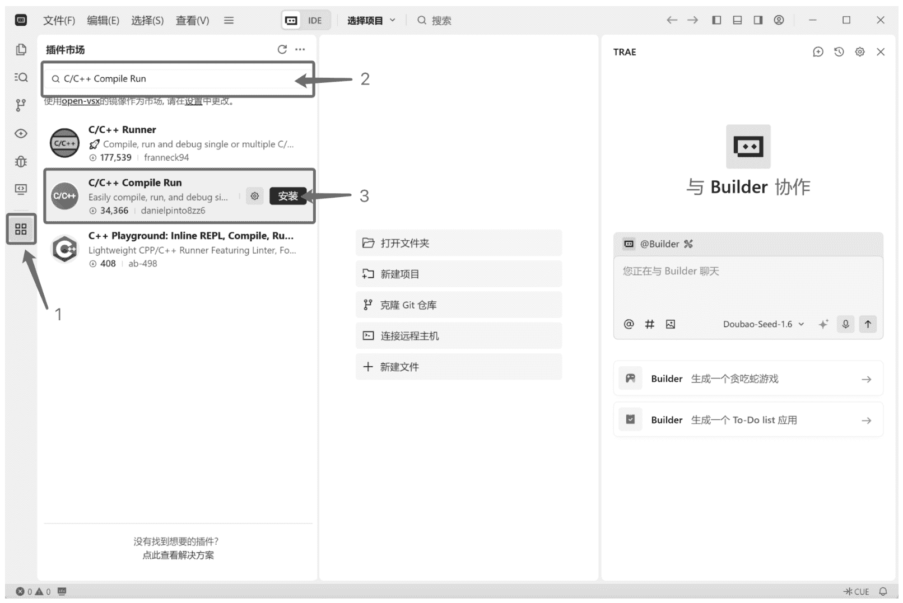

图 6-11

（2）编写“Hello World！”代码。在代码编辑区输入 C++代码。我们以“Hello World！”代码为例，如图 6-12 所示。

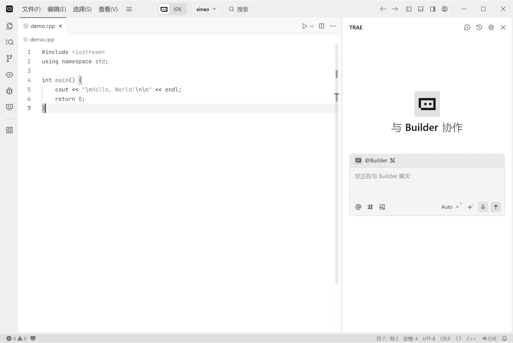

图 6-12

（3）运行“Hello World！”代码。若要编译和运行写好的代码，则需要单击代码编辑区右上角的三角形按钮，并选择“C/C++：Compile ＆ Run”选项，编译并运行当前的 C++文件代码，如图 6-13 所示。

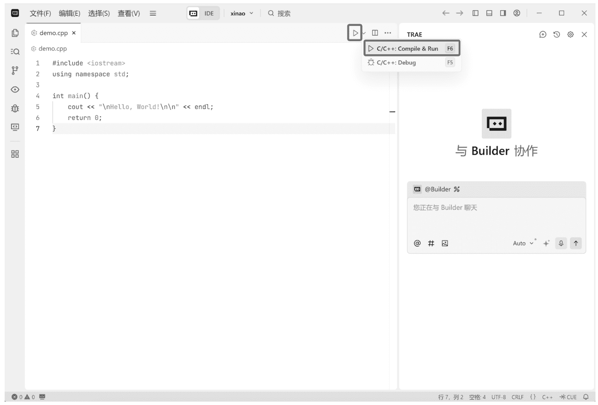

图 6-13

运行代码后即可看到如图 6-14 所示的运行结果。可以看到，在代码编辑区的下方，弹出了一个“终端”区域，在这个区域里可以看到 TRAE 已经执行了 Compile 和 Run 指令，对 demo.cpp 文件进行了正确编译和运行。

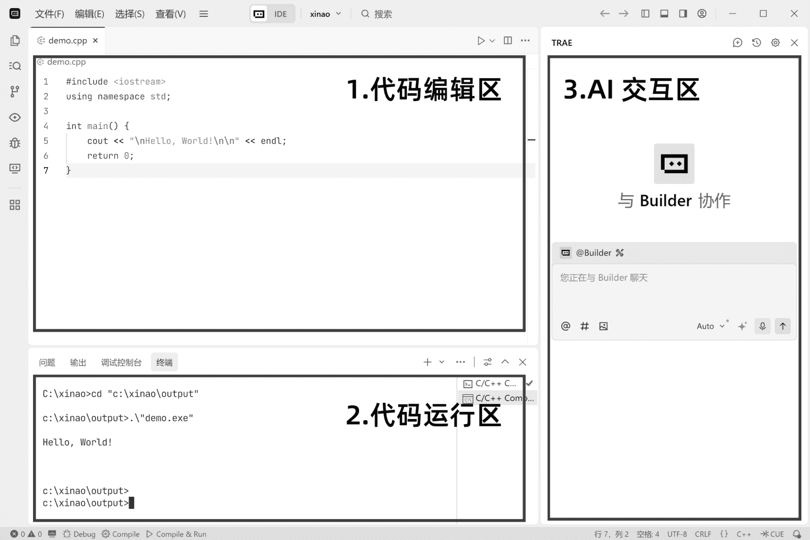

图 6-14

下面正式介绍一下 TRAE 的常用工作区域。

（1）代码编辑区。在这里可以进行代码编辑。AI 编程工具提供的代码编辑建议及生成的代码都会在该区域直接呈现。

（2）代码运行区。这里是代码执行、输入/输出、系统信息打印的区域，包括命令行操作、程序输入/输出、系统报错信息等。

（3）AI 交互区。这里是与 AI 编程工具交互的区域，输入 Prompt 和 AI 编程工具输出的结果都会在这个区域里。

**6.4.2 AI 编程工具的 Chat 模式和 Builder 模式**

在学习与 AI 编程工具交互之前，先了解一下几个 AI 编程工具的工作模式。不知道你是否已经注意到，在刚打开 TRAE 的时候，TRAE 的工作区有明显的“与 Builder 协作”的文字提示，这表示当前的 AI 编程工具在 Builder 模式下工作，如图 6-15 所示。单击 Prompt 输入框的左上角，可以切换 AI 编程工具的工作模式，如图 6-16 所示。

图 6-15

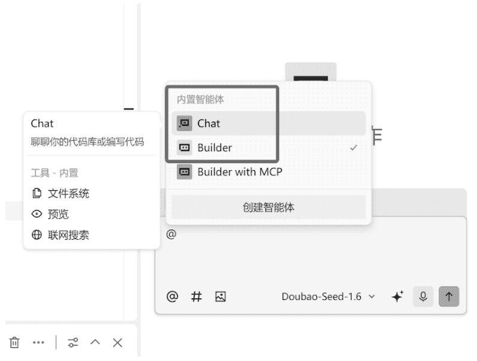

图 6-16

**1.Chat 模式（聊天模式）**

在此模式下，AI 编程工具仅针对你的问题提供文字解答，不会主动操作代码编辑区。该过程和老师进行远程语音沟通类似，老师仅通过语言讲解内容，无法直接在你的编辑器中演示代码修改操作。

**2.Builder 模式（构建模式）**

在此模式下，AI 编程工具除了回答问题，还会对代码编辑区的内容提供修改建议。该过程类似于编程私教现场辅导，AI 编程工具会直接在代码编辑区中呈现代码的修改方案。需特别说明的是，若 AI 编程工具建议修改原有的代码，此时并不会直接覆盖，而是会询问你：“瞧，我把你的代码改成这样了，你是否接受？”只有在你核对完 AI 编程工具生成的代码并选择“接受”后，AI 编程工具写的代码才会真正替换原有代码。

后续案例采用 Builder 模式，主要是为了讲解和展示 AI 编程工具的功能与实际的使用效果。

在实际学习信息学奥赛知识的过程中，我们更推荐使用 Chat 模式。 

重要提示

建议学习信息学奥赛知识的过程中，优先选择 AI 编程工具的 Chat 模式。

Chat 模式只回答问题而不会修改代码，也就是把修改代码的思考过程和修改动作交给你完成，更利于你编写代码，提高动手能力。建议在使用 Chat 模式无法解决问题，卡壳严重，需要 AI 编程工具直接给出示例，或协助生成代码时使用 Builder 模式。

**6.4.3 AI 学习实战：基础学习**

**1.智能体的模式（Chat/Builder 模式）选择**

选择 Builder 模式。

**2.实战场景举例**

讲解 C++中指针与引用的基础概念，并帮助理解两者的本质区别。

**3.根据实战场景编写 Prompt** [Prompt# 角色设定## 专业领域你是一位 C++编程教师，语法基础扎实，代码能力优秀，教学经验丰富。## 表达特点讲述知识通俗易懂，熟悉中小学生的认知规律，善于使用生活类比来解释抽象概念，传授知识逻辑层次清晰，擅长鼓励和引导学生。# 任务目标## 核心任务讲解 C++中指针与引用的基础概念，帮助理解两者的本质区别。## 任务描述用生活案例分别类比指针、引用的作用。编写代码示例，分别演示指针、引用的基本使用。总结两者的关键区别。# 背景信息## 用户画像小学四年级学生，已入门 C++，已掌握变量定义、分支循环、函数调用。## 适用场景课前预习。# 输出要求## 内容结构必须包含“生活类比”“代码示例”“总结”3 个部分，顺序不可调整。## 格式规范结构化输出，分项、分点描述。对示例代码的关键步骤需要添加注释。对总结的关键信息需要加粗显示。## 语言风格避免出现抽象概念和术语，可以适当口语化表达。# 约束条件## 禁止内容不要涉及面向对象、模板等进阶知识。以学习信息学奥赛知识为背景，不要涉及软件开发和工程等其他领域。## 补充规则代码符合 C++14 标准。总结不超过 100 字。]

**4.执行效果**

输入上述 Prompt，并将其提交给 AI 编程工具，如图 6-17 所示。

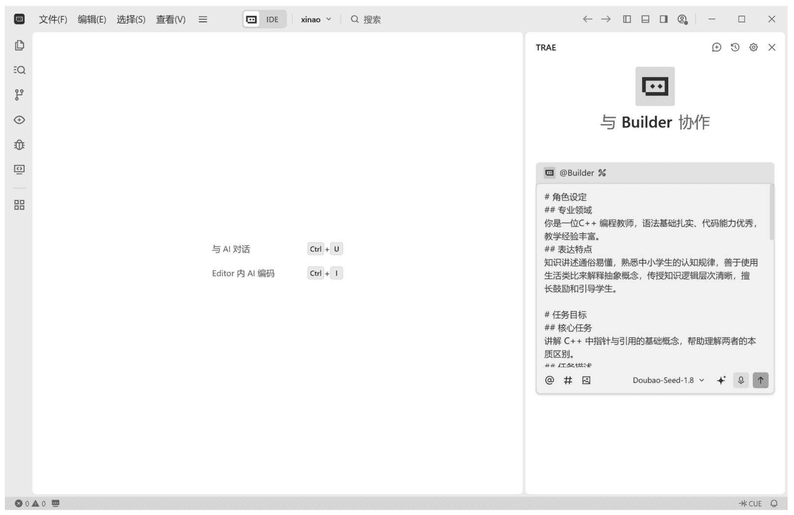

图 6-17

AI 编程工具根据 Prompt 的要求，整理出 Markdown 文本格式的学习资料，如图 6-18 所示。

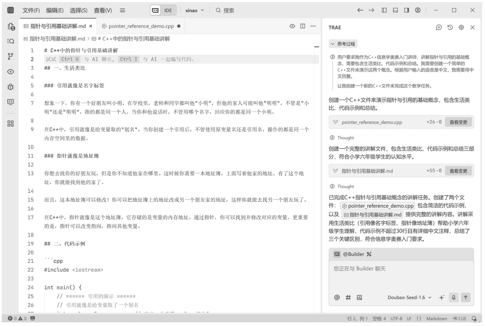

图 6-18

AI 编程工具根据 Prompt 的要求，新建了 pointer_reference_demo.cpp 文件，并在其中生成了带有注释的代码示例，如图 6-19 所示。

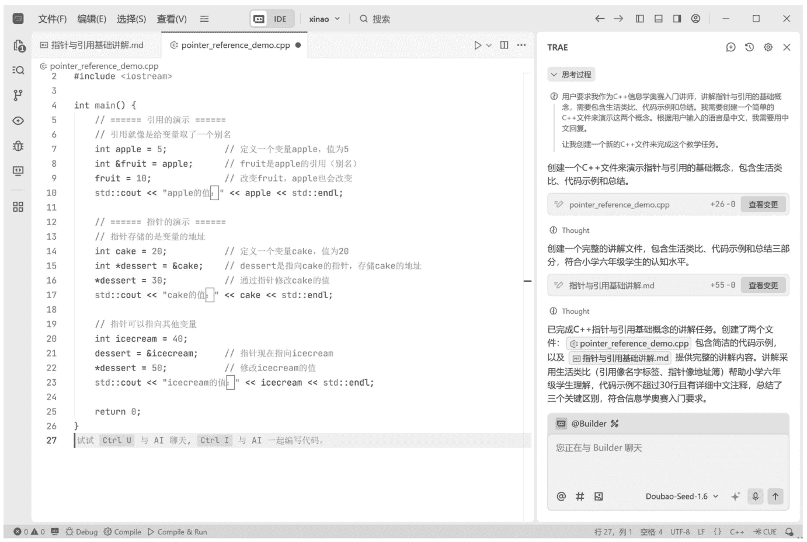

图 6-19

**6.4.4 AI 学习实战：代码改错**

为了演示代码改错功能，我们故意输入了一段错误的代码，并切换到 Chat 模式，如图 6-20 所示。

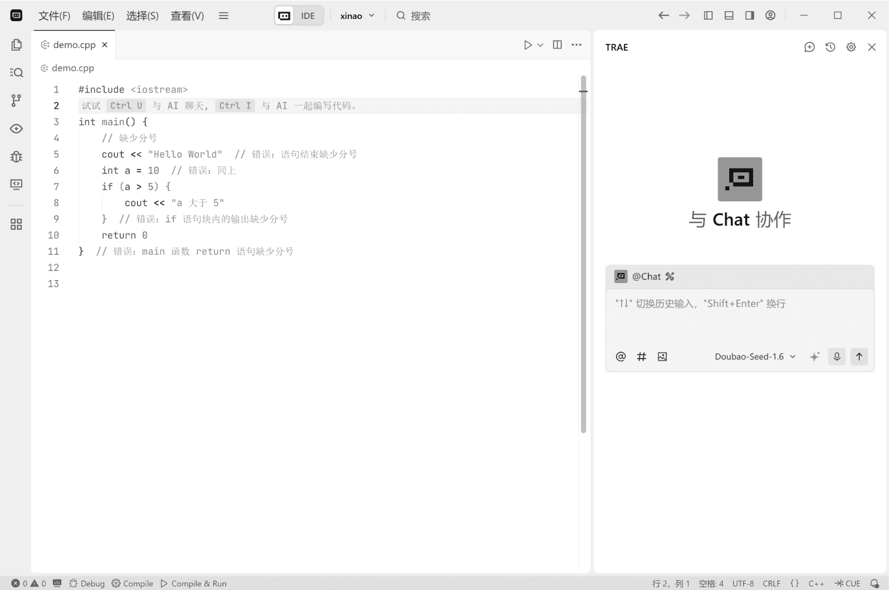

图 6-20

因为代码中含有语法错误，所以在执行编译和运行命令后，立即报错，代码运行区出现了红色背景高亮显示，同时输出了很多错误信息。

注意，此时在代码运行区错误信息的右上方有一个“添加到对话”按钮，如图 6-21 所示。

在单击这个按钮之后，TRAE 就会把我们编译出错的全部信息打包为 Prompt 的一部分输入 AI 交互区的对话框里。同时，我们输入简单的 Prompt“这段代码运行时报错，告诉我哪里错了”，提交给 TRAE。此时，代码运行区的报错信息、程序源代码，都会作为 Prompt 的一部分，打包发给 TRAE 进行分析，如图 6-22 所示。

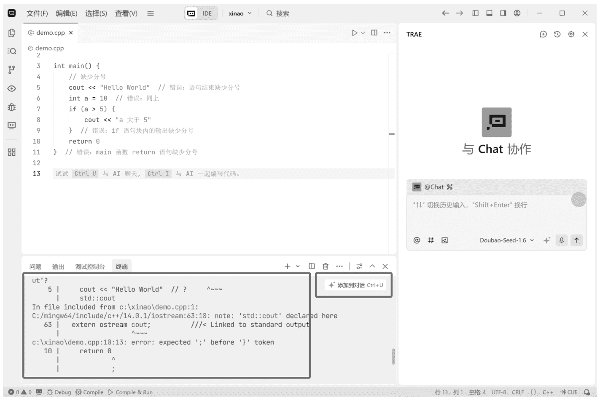

图 6-21

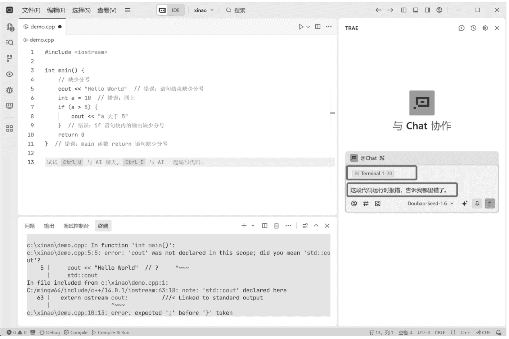

图 6-22

然后，TRAE 根据 Prompt，结合代码及代码运行区的编译错误信息，进行综合分析，正确地识别出了当前代码中存在的问题，并且给出了修复方案建议。TRAE 的思考过程和给出的答案分别如图 6-23 和图 6-24 所示。

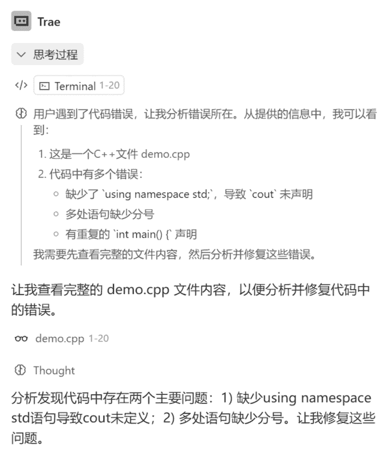

图 6-23

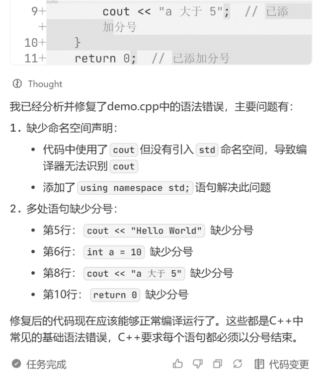

图 6-24

如果我们切换到 Builder 模式下，情况会怎么样呢？

在 Builder 模式中，TRAE 不仅会回答问题，还会直接给出代码的修改建议。如图 6-25 所示，TRAE 在代码编辑区给出了详细的代码修改建议：原有的代码会用红色背景高亮显示，而 TRAE 修改后的代码将在原有代码的下方用绿色背景高亮显示。

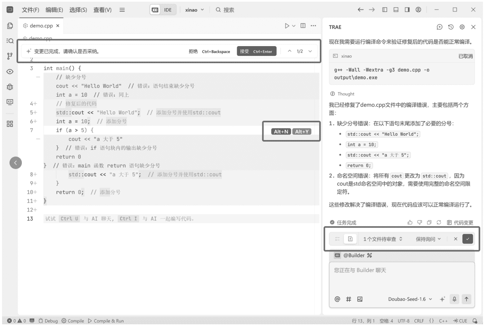

图 6-25

此时，我们需要进行决策，是否接受 TRAE 对代码的修改建议。

如果可接受 TRAE 对文件的全部修改，那么单击代码编辑区上方的“接受”按钮或者 AI 交互区输入框上方对应文件的“✓”按钮。

如果可接受 TRAE 修改的一部分内容，而不可接受另一部分内容，则需要在代码编辑区对 TRAE 给出的修改建议逐条确认。代码编辑区有红色的“Alt+N”和绿色的“Alt+Y”两个按钮。

点击红色按钮，红色背景高亮显示的原有代码将被保留，即拒绝接受 TRAE 本次对代码的修改建议。

点击绿色按钮，绿色背景高亮显示的 TRAE 修改后的代码将被保留，即同意接受 TRAE 本次对代码的修改建议。

我们选择全部接受 TRAE 修改的代码，再次编译和运行，程序运行正常并输出了正确的结果，如图 6-26 所示。

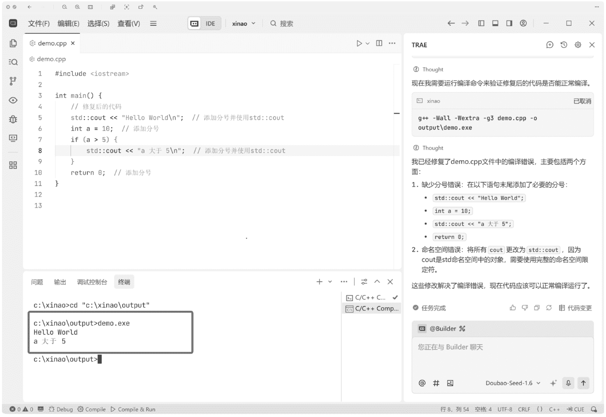

图 6-26

讲到这里，TRAE 的安装、文件创建、代码编写、代码执行，以及与 TRAE 交互的基础操作就全部介绍完了。

接下来，我们将通过一些实战案例进行演示，让 TRAE 成为你在学习信息学奥赛知识过程中的好帮手。

**6.4.5 AI 学习实战：解题辅导**

**1.智能体的模式（Chat/Builder 模式）选择**

选择 Builder 模式。

**2.实战场景举例**

解题练习，有明确的题目和参考答案代码，但学生还是无法理解参考答案代码中的关键步骤，需要教师或教练讲解。

题目描述：

回文串是指从左到右读和从右到左读完全相同的字符串（忽略大小写差异）。例如，“ABCBA”“level”都是回文串，而“ABC”“hello”不是回文串。

请你编写一个程序，输入一个仅包含英文字母的字符串，使用递归的方法判断该字符串是否为回文串。如果是回文串，输出“YES”，否则输出“NO”。

**3.根据实战场景编写 Prompt** [Prompt# 角色设定## 专业领域你是一位 C++编程教师，语法基础扎实，代码能力优秀，教学经验丰富。## 表达特点讲述知识通俗易懂，熟悉中小学生的认知规律，善于使用生活类比来解释抽象概念，传授知识逻辑层次清晰，擅长鼓励和引导学生。# 任务目标## 核心任务 1.题目内容是：回文串是指从左到右读和从右到左读完全相同的字符串（忽略大小写差异）。例如，“ABCBA”“level”都是回文串，而“ABC”“hello”不是回文串。请你编写一个程序，输入一个仅包含英文字母的字符串，使用递归的方法判断该字符串是否为回文串。如果是回文串，输出“YES”，否则输出“NO”。2.代码在当前文件中。## 任务描述根据题目和当前文件中的代码：（1）讲解解题思路。（2）分析代码中的关键步骤，直接修改当前代码并添加注释。#背景信息## 用户画像小学六年级学生，已熟练掌握 C++基础语法，准备学习基础算法。## 适用场景信息学奥赛的题目讲解，目标是让学生在解题时学会找到关键步骤。# 输出要求## 内容结构包含“题目考点分析→解题步骤拆分→给已有代码增加逐行注释→总结”4 个部分。## 格式规范结构化输出，分项、分点描述。对示例代码的关键步骤需要添加注释。对总结的关键信息需要加粗显示。# 约束条件## 禁止内容不要涉及面向对象、模板等进阶知识。以学习信息学奥赛知识为背景，不要涉及软件开发和工程等其他领域。## 补充规则代码符合 C++14 标准。总结不超过 200 字。]

**4.执行效果**

新建 demo2.cpp 文件，把看不懂的代码粘贴到该文件中。输入上述 Prompt，把题目也放到 Prompt 中一起提交给 TRAE，如图 6-27 所示。

TRAE 根据题目、参考答案代码，整理解题思路要点，并通过代码修改建议的方式，对题目的参考答案代码进行了添加注释的操作，如图 6-28 所示。

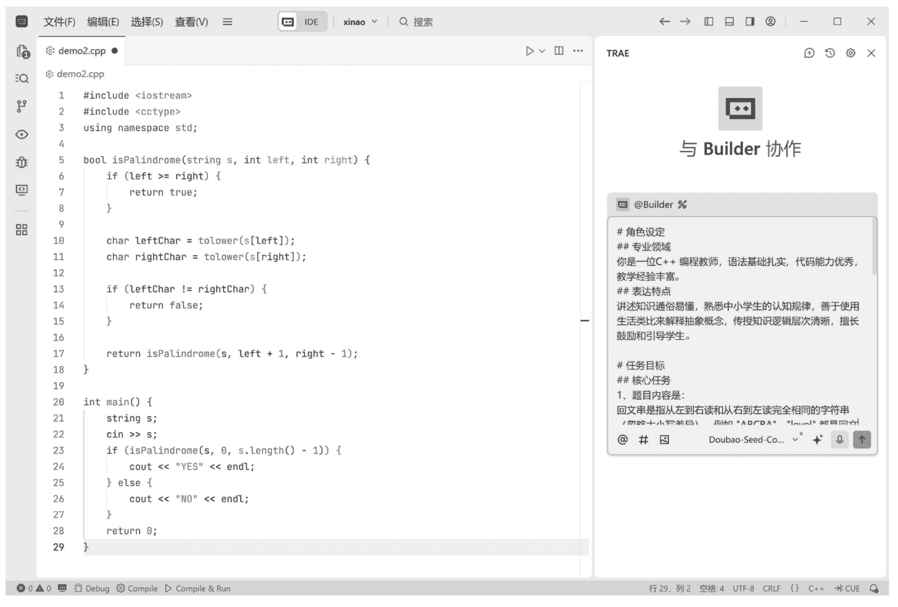

图 6-27

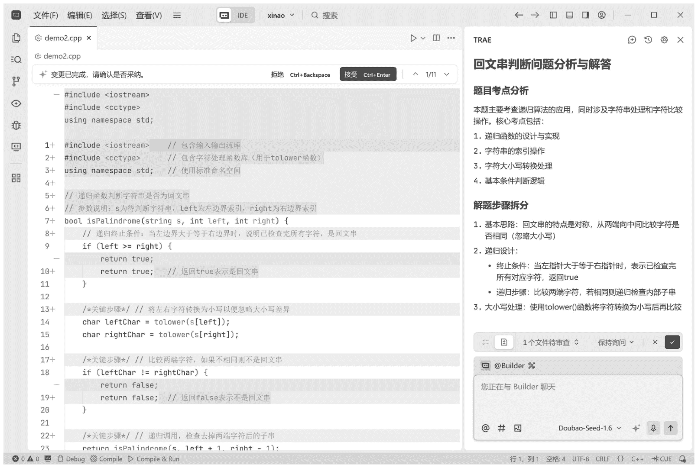

图 6-28

我们单击“接受”按钮后，代码就更新为添加注释之后的版本。我们可以一边阅读代码，一边对照 TRAE 回复的题目考点分析和解题步骤拆分进行学习，如图 6-29 所示。

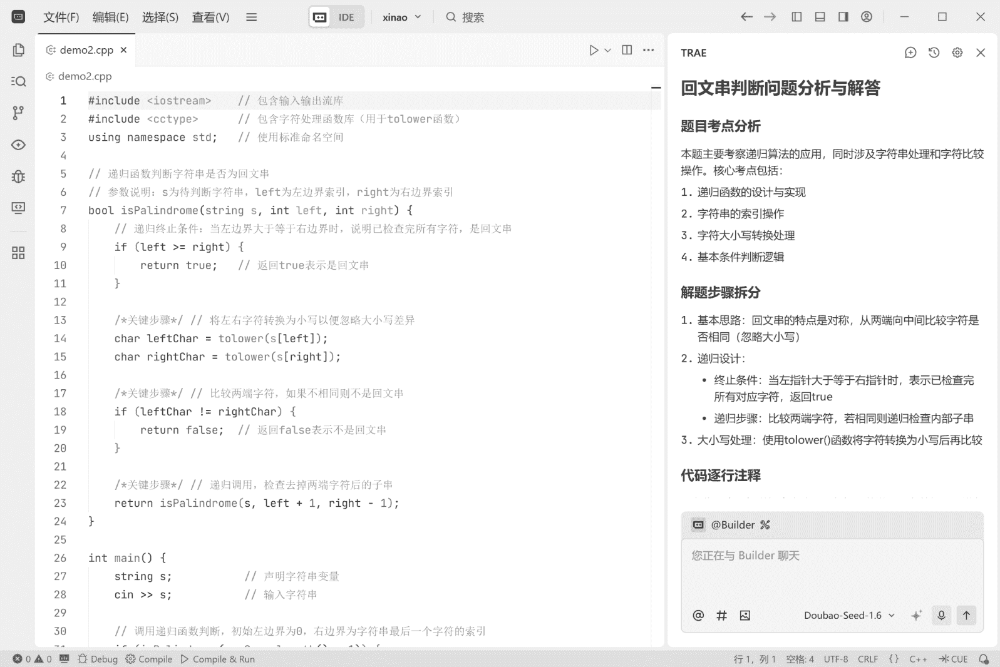

图 6-29

**6.4.6 AI 学习实战：强化复习**

**1.智能体的模式（Chat/Builder 模式）选择**

选择 Builder 模式。

**2.实战场景举例**

复习数据结构中“栈”的原理和代码基本实现。

**3.根据实战场景编写 Prompt** [Prompt# 角色设定## 专业领域你是一位数据结构和算法讲师，数据结构和算法知识扎实，熟悉各种数据结构和算法的应用场景与 C++代码实现，教学经验丰富。## 表达特点讲述知识逻辑严谨，熟悉中小学生的认知规律，能够把抽象的问题用简单的方式描述清楚，擅长概念结合应用场景。# 任务目标## 核心任务复习数据结构中“栈”的原理和代码基本实现。## 任务描述用两个生活案例进行举例。编写示例代码 stack_demo.cpp，用注释讲解“栈”的常用操作。总结学习“栈”时的几个误区。#背景信息## 用户画像小学六年级学生，已熟练掌握 C++基础语法，正在学习数据结构。## 适用场景学生准备参加信息学奥赛，需要掌握数据结构知识，目标是理解并可以运用。# 输出要求## 内容结构内容结构完整，包括但不限于基本概念、生活类比、应用场景、代码示例、常见误区等部分，可根据讲解内容适当增加或调整。## 格式规范结构化输出，分项、分点描述。对示例代码的关键步骤需要添加注释。对总结的关键信息需要加粗显示。## 约束条件## 禁止内容不要涉及面向对象、模板等进阶知识。以学习信息学奥赛知识为背景，不要涉及软件开发和工程等其他领域。## 补充规则代码符合 C++14 标准。总结不超过 200 字。]

**4.执行效果**

输入上述 Prompt，并将其提交给 TRAE。

TRAE 思考结束后，创建了一个面向小学六年级学生的“栈”概念讲解程序——stack_demo.cpp。在这个程序里不仅实现了“栈”数据结构的基础代码，同时通过生活化的例子，还演示了“栈”的用法，如图 6-30 所示。

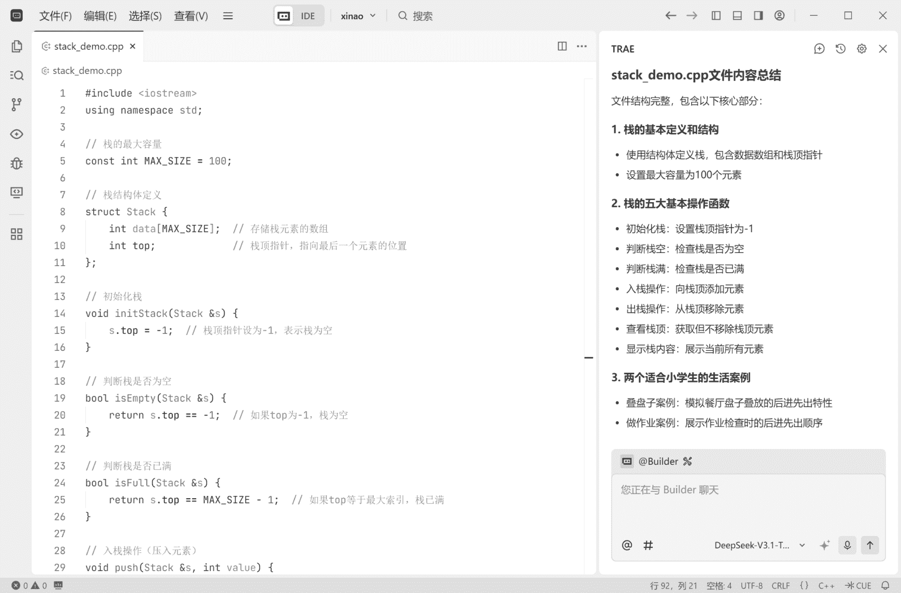

图 6-30

当我们编译和运行 stack_demo.cpp 这个程序时，对于“栈”的讲解和演示，会通过程序运行结果的方式展现，是不是很酷？这样，我们就可以更加深入地理解“栈”，后续还可以通过修改这段代码，继续演示和学习“栈”的原理与使用，如图 6-31 所示。

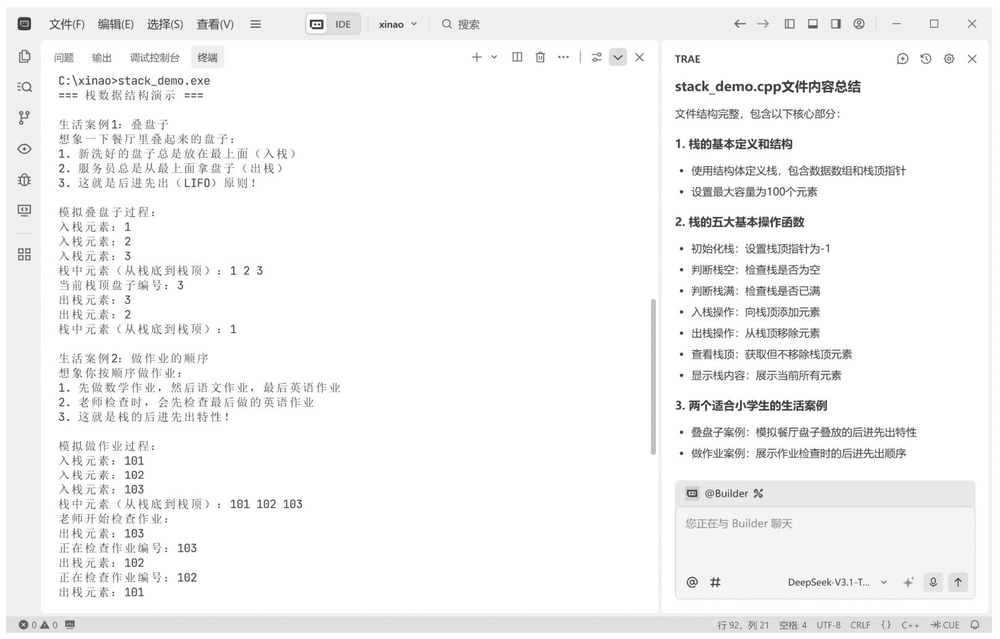

图 6-31

**6.4.7 AI 学习实战：算法演示**

**1.智能体的模式（Chat/Builder 模式）选择**

选择 Builder 模式。

**2.实战场景举例**

掌握冒泡排序算法的含义、过程和代码实现。

**3.根据实战场景编写 Prompt** [Prompt# 角色设定## 专业领域你是一位数据结构和算法讲师，数据结构和算法知识扎实，熟悉各种数据结构和算法的应用场景与 C++代码实现，教学经验丰富。## 表达特点讲述知识逻辑严谨，熟悉中小学生的认知规律，能够把抽象的问题用简单的方式描述清楚，擅长概念结合应用场景。# 任务目标## 核心任务掌握冒泡排序算法的含义、过程和代码实现。## 任务描述 1.讲解冒泡排序算法。2.给出冒泡排序算法的代码示例，并添加注释。3.用程序输出的方式，展示冒泡排序的全过程，并给每一步都配上讲解。#背景信息## 用户画像小学六年级学生，已熟练掌握 C++基础语法和数据结构，正在学习初级算法知识。## 适用场景学生准备参加信息学奥赛，需要掌握初级算法知识，目标是理解并可以运用。# 输出要求## 内容结构内容结构完整，包括但不限于基本概念、应用场景、代码示例、常见误区等部分，可根据讲解内容适当增加或调整。## 格式规范结构化输出，分项、分点描述。对示例代码的关键步骤需要添加注释。对总结的关键信息需要加粗显示。## 约束条件## 禁止内容不要涉及面向对象、模板等进阶知识。以学习信息学奥赛知识为背景，不要涉及软件开发和工程等其他领域。## 补充规则代码符合 C++14 标准。总结不超过 200 字。]

**4.执行效果**

输入上述 Prompt，将其提交给 TRAE。

由于冒泡排序算法的学习难度更大，因此 TRAE 在思考结束后，一共生成了 3 个讲解冒牌排序算法的 C++程序，如图 6-32 所示。

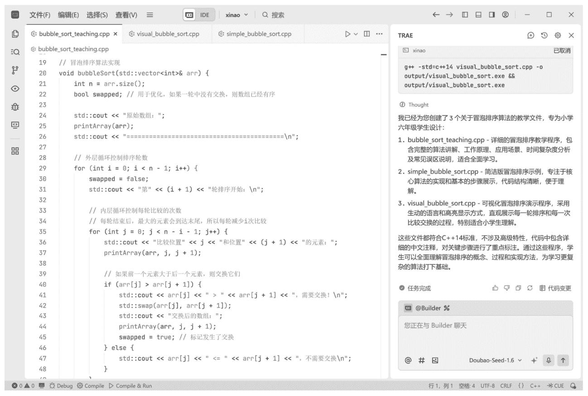

图 6-32

（1）bubble_sort_teaching.cpp。详细的冒泡排序教学程序，包含完整的算法讲解、工作原理、应用场景、时间复杂度分析及常见误区说明，适合全面学习，运行效果如图 6-33 所示。

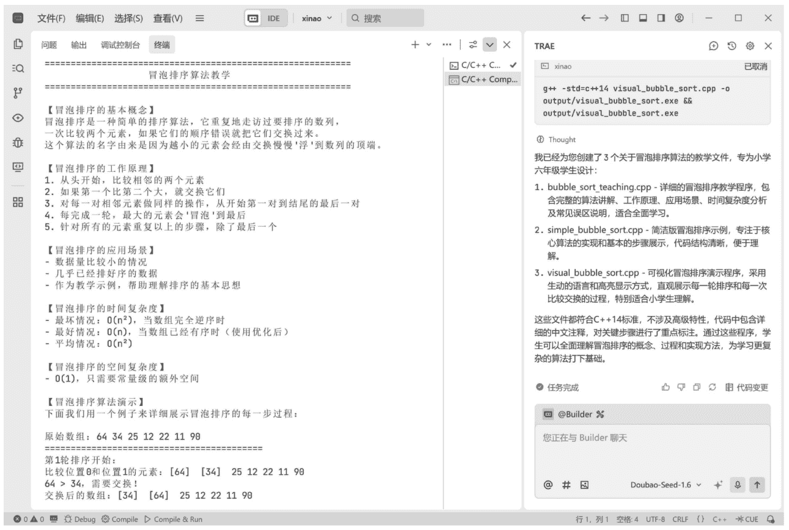

图 6-33

（2）simple_bubble_sort.cpp。简洁版冒泡排序示例，专注于核心算法的实现和基本的步骤展示，代码结构清晰，便于理解，运行效果如图 6-34 所示。

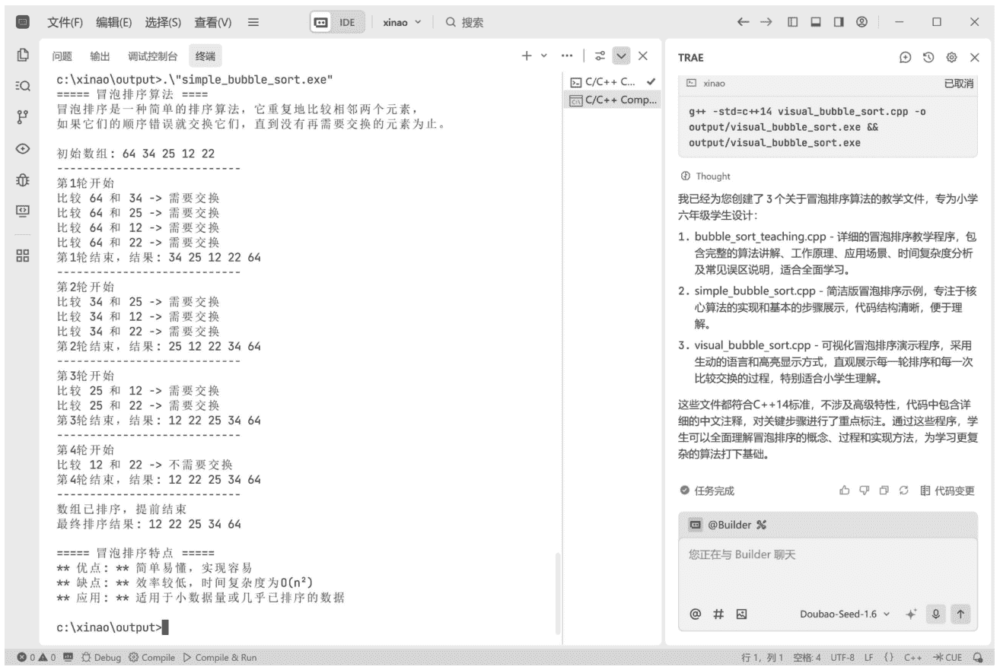

图 6-34

（3）visual_bubble_sort.cpp。可视化冒泡排序演示程序，采用生动的语言和高亮显示方式，直观展示每一轮排序和每一次比较交换的过程，特别适合中小学生理解，运行效果如图 6-35 所示。

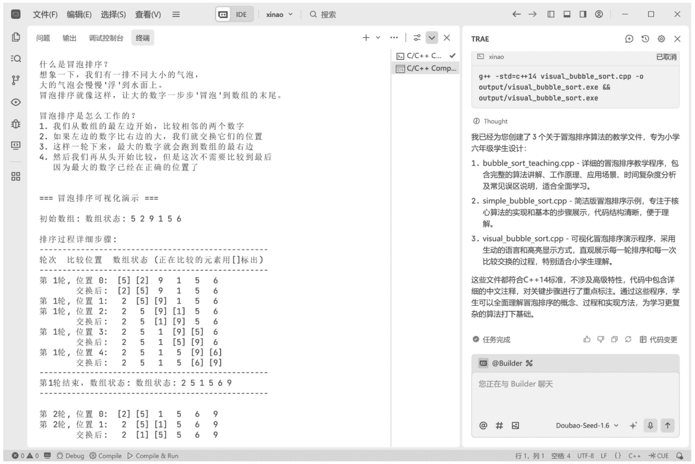

图 6-35

这 3 个程序由浅入深，实现了冒泡排序算法的基本原理和代码示例，可以让你快速地理解和学习冒泡排序算法。你后续还可以通过修改代码，继续演示和练习冒泡排序算法的应用。

通过上述几个案例，我们发现，AI 编程工具不仅能力强大，还会按照我们的 Prompt 要求提供专属的学习支持和辅助。

但有的时候，我们并不需要 AI 编程工具为我们考虑得面面俱到，只需要在学习的过程中稍加点拨和提示。下面介绍的案例就是为这种场景准备的。

**6.4.8 AI 学习实战：思路引导**

**1.智能体的模式（Chat/Builder 模式）选择**

选择 Chat 模式。

**2.实战场景举例**

在解题过程中没有思路，或者只有部分思路，无法往下进行。希望 AI 工具给出下一步的解题思路或者提示。

题目描述：

给定一个包含 n 个整数的数组，找出其中出现次数最多的数。如果有多个数出现的次数相同且都是最多的，那么输出这些数中最小的那个。

**3.根据实战场景编写 Prompt** [Prompt# 角色设定## 专业领域你是一位 C++编程教师，语法基础扎实，代码能力优秀，教学经验丰富。## 表达特点讲述知识通俗易懂，熟悉中小学生的认知规律，善于使用生活类比来解释抽象概念，传授知识逻辑层次清晰，擅长鼓励和引导学生。# 任务目标## 核心任务题目内容是：给定一个包含 n 个整数的数组，找出其中出现次数最多的数。如果有多个数出现的次数相同且都是最多的，那么输出这些数中最小的那个。## 任务描述根据题目和当前文件中的代码：1.分析一下我目前的卡点是什么？2.结合我写的代码，给我一些提示和指引，如下一步应该往哪个方面思考。#背景信息## 用户画像小学六年级学生，已熟练掌握 C++基础语法，正在刷题。## 适用场景信息学奥赛的题目讲解，目标是在学生做题卡壳的时候，给出关键的提示。# 输出要求## 内容结构不要给出答案，应该给出提示、引导或者思考的方向，并给出该提示、引导或者思考方向的逻辑由来。比如，关联题目的点，代码中已经实现的结构等。## 格式规范无特殊要求，尽量简短、明确。## 语言风格语言干练、表述精准、言简意赅地表达核心思路和逻辑，不拖沓。## 约束条件## 禁止内容不要涉及面向对象、模板等进阶知识。以学习信息学奥赛知识为背景，不要涉及软件开发和工程等其他领域。## 补充规则整体回复不超过 50 字。]

**4.执行效果**

新建 demo3.cpp 文件，先按照自己的思路试着解题，能写多少就写多少。最好在写代码的同时写清楚代码注释，既可以让你自己不断整理思路，也可以让 TRAE 通过注释更加了解你的思考过程。然后，输入上述 Prompt，把题目放在 Prompt 中一起提交，如图 6-36 所示。

此时，TRAE 换了一个风格，没有了之前案例中事无巨细的讲解，只会给你一个大概方向的引导提示，如图 6-37 所示。

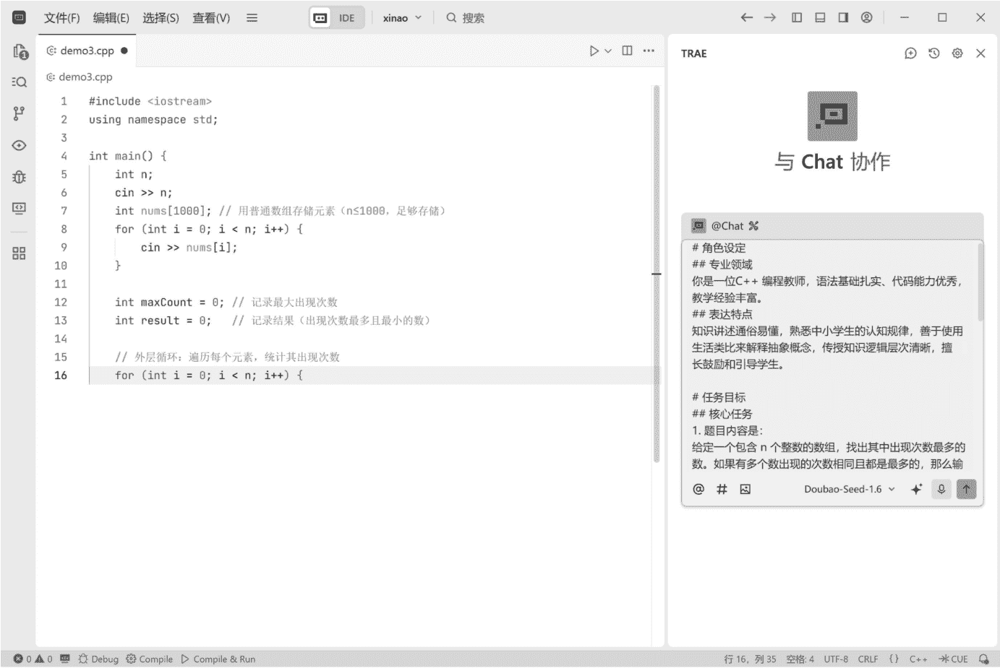

图 6-36

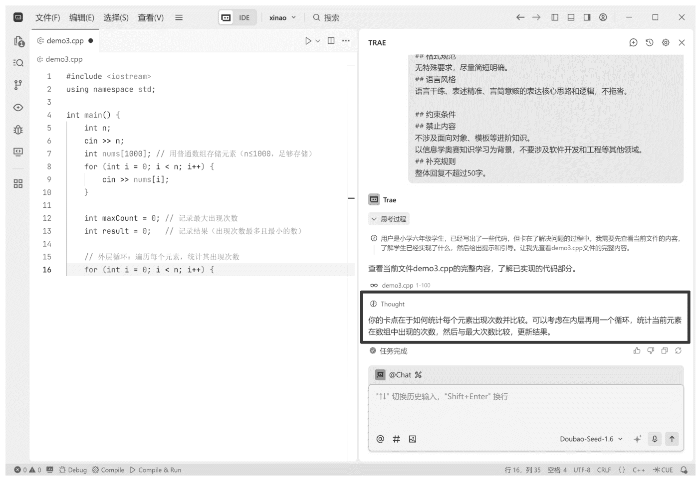

图 6-37

这样的引导和提示风格，既能帮你突破解题时的卡壳，又不会直接替你完成整道题目、剥夺你的独立思考。在遇到问题时，你可以重复这种“一边写一边问”的流程，直到自己完全理解为止。

**第七章** **构建用 AI 工具学习信息学奥赛知识的新模式**

我们已经掌握了用 AI 工具学习信息学奥赛知识的基础操作，包括如何编写好用的 Prompt、如何安装和使用 AI 工具。相信你也有了一些亲身体会。

如果用得好，那么 AI 工具在你的学习中确实能起到降低门槛、提升效率的辅助作用，像编程私教一样能提供优秀的针对性辅导。同时，你也能感受到，要想把 AI 工具用好，过程并不顺畅。比如，想要理想的 AI 工具反馈效果，就需要编写内容精细、结构合理、篇幅较长的 Prompt 或者额外安装、配置专业的 AI 工具，若想达成课程+代码+答疑+刷题+AI 工具互动的体验，则少不了一番折腾。

那么是否有一种模式能让学习者只享受 AI 工具带来的学习优势，同时操作又极其简单，不用关注大量的 Prompt 编写、工具搭建、知识联动，把时间和精力都投入知识学习和代码实操呢？

在此，我们介绍一种将 AI 工具深度应用于学习信息学奥赛知识的新模式。作为此模式在国内较早的实践者，我们将以 lelecode 平台为案例进行介绍。这种新模式的变化，不再以 AI 工具为核心，而是以学习过程中“学、练、刷、测”的闭环流程为核心，让 AI 工具主动嵌入每个学习环节，而非作为独立工具存在。希望能给你一些新思路，也希望能为信息学奥赛知识的教育、教学活动提供一些经验参考。

**7.1** **如何把 AI 工具用得更好**

当前基于通用 AI 应用或 AI 编程工具的信息学奥赛学习模式，虽能满足日常学习的基础需求，但在适配信息学奥赛专属场景、使用便利程度上仍有明显的优化空间。

这类工具拼接式的学习模式，并不是专门针对体系化的信息学奥赛知识和学习节奏而设计的，更没有循序渐进、环环相扣的逻辑联系；另外，使用者需要在各种工具之间切换，从而出现了学习工具和资料分散在不同平台上的情况，增加了操作与查找难度，难以形成统一的学习方法和资料沉淀，导致需要不断地花时间去做一些重复的基础工作。针对此学习模式的问题，有以下 3 个可以优化的方面。

**1.提升 AI 工具的交互效率**

我们知道若想让 AI 工具输出理想的答案，就需要对 Prompt 进行细致的编写，包括任务描述的精准度、背景信息的详尽度、输出格式的规范性，以及对各类限制条件的周全考虑，这使得好用的 Prompt 整体篇幅较长。即便我们提供了可复用的 Prompt 模板供你修改，修改过程也需占用较多时间。能否在使用 AI 工具时少写 Prompt，甚至不写 Prompt，是提升 AI 工具交互效率的关键。

**2.优化代码编写体验与易用性**

通用 AI 应用在代码输入环节的体验不友好，输入框很小，不是为了输入代码设计的，难以支撑长时间、大量的代码输入，几乎没有 C++编译、运行调试的功能，很难做到一边写代码，一边问问题。

AI 编程工具在代码编写、调试、智能体交互方面的体验很好，但也存在一些易用性问题。比如，编译和运行 C++代码要用户自行安装 C++运行环境，设置电脑系统环境变量并安装额外的插件，而且它们内置了较多支持专业程序员开发工作的功能，如版本控制、云部署等。这些功能对学习信息学奥赛知识来说不仅用不到，还可能造成干扰。

**3.强化与课程教材、真题的关联**

学习信息学奥赛知识有明确的目标导向，一般需要经过“知识学习—代码练习和调试—答疑改错—刷题”的循序渐进流程，各环节无缝衔接，并且这个流程需要在基础知识、数据结构、算法的学习中反复执行。

当前，AI 工具多以 AI 能力为核心进行设计，与信息学奥赛的知识体系、系统化学习方法的关联度都比较弱。更优的用 AI 工具辅助学习信息学奥赛知识的实施路径应该是，以学习信息学奥赛知识的需求和流程为核心，将 AI 能力深度融入信息学奥赛知识输入、实践练习、反馈优化、赛事备战的固有学习流程中，让 AI 工具服务于体系化学习信息学奥赛知识的模式。

**7.2** **以学习信息学奥赛知识为核心的新模式**

新模式的核心，是以体系化学习信息学奥赛知识的过程为主线，从基础能力到工具再到使用体验的全流程优化，让 AI 工具深度融入学习信息学奥赛知识的每个环节，既保留传统学习的体系化优势，又通过 AI 工具精准支撑提升效率与连贯性，最终形成体系完整、体验流畅、成果可沉淀的学习信息学奥赛知识的新模式。实现这个模式有以下 3 个方面的考虑。

**7.2.1** **以信息学奥赛知识为本——专用定制**

与通用 AI 应用的什么都能回答相比，用于学习信息学奥赛知识的 AI 工具应该专精于信息学奥赛知识教学和辅导的垂直领域。

同时，AI 工具应和信息学奥赛知识的教学活动进行深层次打通与整合，不能仅在界面“硬生生”地嵌入教学平台，表面看似教学平台拥有了 AI 功能，实际还是“各干各的”，没有在数据和操作层面打通。

要想实现这个目标，就需要构建底层能力和工具落地的双重支撑体系：基础能力是 AI 工具辅助学习信息学奥赛知识的核心前提，决定了 AI 能力的专业度与精准度；工具实现是基础能力的落地载体，决定了 AI 功能的可操作性与融入度。两者相辅相成。

**1.基础能力**

以学习信息学奥赛知识为本的 AI 工具，应基于信息学奥赛的知识和学习场景进行模型训练与精调，训练数据应包括本领域的特定内容和知识（比如，专门为信息学奥赛编写的书籍、C++教程、算法与数据结构课程、历年真题与赛事规则等）。以学习信息学奥赛知识为本的 AI 工具也应将教师积累的教学经验、易错点总结、学情分析等实践智慧纳入训练素材或知识库，深度理解本领域的知识、学习规律和教学逻辑。

同时，我们还需要专门屏蔽 AI 工具在学习信息学奥赛知识以外的技能，避免其回复内容发散到其他编程技术领域，如软件的开发和工程领域，抑或沦为娱乐和聊天的工具。

**2.工具实现**

以学习信息学奥赛知识为本的 AI 工具开发，应嵌入学习信息学奥赛知识的全流程，如应嵌入现有教学平台的课程学习、训练实践、模拟测评、答疑指导等模块。具体而言，课程学习模块要增加 AI 导学和总结功能、训练实践模块要整合 AI 代码辅助能力、模拟测评模块要融入 AI 错题分析等功能、答疑指导模块要强化 AI 精准解答能力，并采用风格布局一致的界面和操作逻辑，把 AI 功能悄无声息地融入日常的学习中。

**7.2.2** **以学生为本——个性化、简单化**

在构建用于学习信息学奥赛知识的 AI 能力时，应聚焦于使用人群——就像为每个学生配备一位“AI 编程私教”，要完全掌握学生的具体情况：学习基础、当前进度、薄弱环节等，可提供针对性的辅导。同时，功能设计要简单易用，不应让学生在“怎么与 AI 工具交互”上花费过多精力，只需专注于自己的学习目标，把时间花在学习和练习上。

**1.学生数据联动：实现个性化**

以学生为本的 AI 能力，应考虑到学生之间的差异，做到因材施教。AI 能力应与学生上课模块、编程练习模块实现数据联动，实现学生学习进度、练习记录、错题档案等信息的实时同步。

在学生对新知识提问的时候，AI 工具应实时了解当前学生的知识储备和学习阶段等，将其作为背景；在答疑环节，AI 工具应掌握学生之前的易错点和知识薄弱环节，将其作为思考回答内容的依据。每个学生问的问题都因其情况不同，会得到不同的回复和辅导，从而真正实现个性化，做到“千人千面”。

**2.简化 Prompt：简单、易用**

以学生为本的 AI 工具，应简单、易用，提升交互的便利性。比如，应尽可能让学生少写或者不写 Prompt，Prompt 中的任务目标、背景信息、输出要求、约束条件等应由系统自动生成。教学模块或代码模块与 AI 模块应在同一界面，无须学生使用时在不同界面“跳来跳去”，造成混乱。所有界面的风格和操作逻辑都应该保持一致，降低学习成本和误操作的可能性。

**7.2.3** **以能力培养为本——防止 AI 工具依赖**

我们都明白一个道理：无论把 AI 能力用得多熟练，只要参加实际比赛时无法独立解题，就都是不行的。用 AI 工具学习信息学奥赛知识，要以能力培养为本，尤其在 AI 能力与信息学奥赛知识的教学平台、日常练习活动深度结合后，更要注意防止滥用和依赖。要通过特定机制进行防护，把培养自主动手能力放在第一位。

**1.监督体系：预防过度滥用**

以能力培养为本的 AI 功能，需要有明确的限制和引导机制，避免成为编程中的“拐杖”。可以在 AI 工具训练时植入对应的机制，优先只给解题思路或关键提示；若学生短时间内频繁调用 AI 工具则会收到提醒，让其先自己解决问题；学生在一定的时间内使用 AI 功能超出一定的次数后应暂时被限制使用；在必要的场景（如模拟测试）应设置全局 AI 功能关闭模式。同时，应屏蔽 AI 工具的非信息学奥赛相关知识和技能，避免其沦为娱乐工具。

**2.学习报表：掌握学习动态**

在以能力培养为本的用 AI 工具辅助学习的过程中，学生需要及时关注自己对 AI 工具的使用情况。在学习数据统计表中，除了学习时间、做题量、题目通过数量等传统维度，应增设 AI 功能使用时长模块。学生与教师均可直观掌握 AI 功能的使用时长及其在总学习时长中的占比，便于精准评估学生对 AI 功能的使用程度，及时识别是否存在过度依赖的现象。

**7.3** **以学习信息学奥赛知识为核心的新模式实战**

用 AI 工具学习信息学奥赛知识的新模式本质是让 AI 工具从技术导向的工具转变为以服务学习信息学奥赛知识为中心的基础设施，既保留传统体系化学习扎实筑基、循序渐进的优势，又通过 AI 能力的精准嵌入，让学习信息学奥赛知识的每个环节都更高效、更连贯，最终形成体系完整、体验流畅、成果可沉淀的新的学习模式。

lelecode 是国内较早将大模型、智能体等 AI 能力用于 C++编程和信息学奥赛知识学习的平台之一。其设计理念和实现效果，与本书倡导的主题思想和方法有较多共通且契合之处。为了让你更加直观地理解该模式的内涵，体验该模式的落地效果，下面以 lelecode 平台为案例进行一些讲解和演示，旨在为用 AI 工具助力信息学奥赛知识学习提供一些参考借鉴和实战经验。以信息学奥赛知识初学者在学习过程中最常用到的课程学习、解题思路引导、代码分析、代码改错和在线答疑场景为例。

**7.3.1** **示例：课程学习场景**

AI 功能与学习平台进行整合，平时隐藏以免打扰用户。学生在需要 AI 工具辅助时，单击 AI 智能体图标后在当前页面会弹出 AI 工具，如图 7-1 所示。

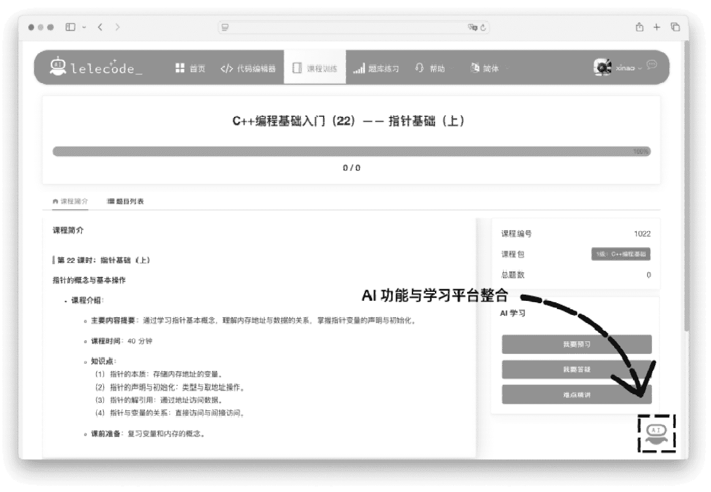

图 7-1

与课程数据打通，AI 工具能读取学生正在学习的课程内容，如图 7-2 所示。

针对信息学奥赛知识，AI 工具会考虑使用群体的知识接受和理解程度，使用适当的内容和语气进行回复，还会生成新的问题，引导学生继续学习当前课程的知识点，如图 7-3 所示。

图 7-2

图 7-3

**7.3.2** **示例：解题思路引导场景**

与当前的题目、当前的学习进度数据打通，AI 工具能读取学生的相关学习情况，如图 7-4 所示。

图 7-4

回答符合当前学习阶段的解题思路。比如，学生正在学习指针，但尚未接触递归算法，AI 工具根据学生的知识掌握情况，给出基于指针实现的解题思路，如图 7-5 所示。

给出符合当前学习阶段的代码参考示例。比如，学生正在学习指针，但尚未接触递归算法，AI 工具根据用户的知识掌握情况，给出基于指针和循环实现的参考代码，并进行了注释，如图 7-6 所示。

图 7-5

图 7-6

**7.3.3** **示例：代码分析场景**

AI 功能在编码时默认隐藏，不打扰学生自主编码的思路。学生在需要 AI 工具辅助时，单击 AI 智能体图标后在当前页面会弹出 AI 工具，如图 7-7 所示。

图 7-7

AI 功能与学生当前的学习进度、当前的题目、当前的代码实时联动，学生只需简单描述自己的问题，如图 7-8 所示。

图 7-8

AI 工具不代替学生写代码，也不给出修改后的全部代码作为答案，仅仅指出关键问题并给出建议，确保学生有自己的思考和修改过程，同时回复学生出错的原因和思考方面的误区，帮助学生补齐知识短板，如图 7-9 所示。

图 7-9

**7.3.4** **示例：代码报错调试**

当代码报错时，AI 功能与学生的代码、编译报错信息实时联动，学生无须输入任何内容，如图 7-10 所示。

图 7-10

结合代码和报错信息，AI 工具分析出现错误的原因，并给出修改建议，在回复时仅给出错误部分，不会帮助学生修改全部代码，确保学生有自己的思考和修改过程，如图 7-11 所示。

图 7-11

**7.3.5** **示例：在线答疑场景**

AI 工具通过读取学生的学习情况、编程练习情况，进行各种指导和答疑，如图 7-12 所示。

图 7-12

上面仅列举了一小部分学习信息学奥赛知识常见的场景，供你参考。考虑到篇幅有限，就不一一列举更多的场景，期待你在今后的学习和实践中，不断探索并发掘出更多用 AI 工具学习信息学奥赛知识的最佳实践。

**7.4** **对比几种利用 AI 工具学习信息学奥赛知识的方案及选择建议**

**7.4.1** **通用 AI 应用方案：豆包/DeepSeek+Dev-C++**

通用 AI 应用方案，是指在学习过程中采用独立的 C++开发工具（如 Dev-C++）完成代码编写与执行，在遇到问题时通过与通用 AI 应用（如豆包、DeepSeek 等）交互，获取知识点讲解、答疑解惑与思路引导的学习方案。

（1）使用成本：免费。完全免费使用。

（2）安装上手难度：较低。Dev-C++的安装流程简单，豆包、DeepSeek 提供网页版，无须安装，随时使用。

（3）信息学奥赛针对性：较低。Dev-C++为通用的 C++开发环境，通用 AI 应用的知识广泛，未针对信息学奥赛专门优化，特别是要通过 Prompt 控制模型的输出范围。

（4）对用户 AI 能力的要求：高。对 Prompt 编写精准度要求较高，用户需明确描述角色、任务、需求背景、输出格式等，否则 AI 工具易输出超纲或软件开发领域的内容。

（5）方便程度：一般。Dev-C++、豆包或 DeepSeek 在单独使用时体验都很好，但结合在一起使用，需要在客户端、网页之间频繁切换。两者数据不互通，需要频繁复制、粘贴。

（6）代码编辑体验：较好。Dev-C++提供专业的通用 C++编辑功能，但有一些功能在基础阶段用不到，可能会造成一些干扰。

（7）代码执行体验：一般。仅能提供编译成功/失败、运行结果正确/错误等系统级别的基础信息。

（8）支持服务体验：差。当遇到问题时需要自己解决，如求助老师、朋友或互联网。

**7.4.2** **AI 编程工具方案：TRAE、GitHub** **Copilot**

AI 编程工具方案，是指利用 TRAE、GitHub Copilot 等 AI IDE 的学习方案。该方案以现代开发编辑器（VS Code）为基础进行 C++程序代码编写，通过 IDE 自身集成或插件形式调用 AI 编程工具，实现知识点答疑、代码错误分析、代码优化修改等辅助功能。

VS Code 也是 NOI 科学委员规定的信息学奥赛（CSP-J/S 以上级别）的标准比赛环境 NOI Linux 2.0 版的自带文本编辑器软件之一。（来源：NOI 官网）

（1）使用成本：TRAE 目前免费、GitHub Copilot 提供免费体验版本。

（2）安装上手难度：较高。用户需要安装本地 C++运行环境，包括安装 MinGW、配置环境变量等，编辑器执行 C++需要安装插件。

（3）信息学奥赛针对性：低。此类编辑器主要服务于企业开发场景，未针对信息学奥赛进行定制和优化。

（4）对用户 AI 能力的要求：高。对 Prompt 编写精准度要求较高，用户需明确描述角色、任务、需求背景、输出格式等，否则 AI 编程工具容易进入软件开发领域的背景设定，输出与学习信息学奥赛知识阶段无关的内容。

（5）方便程度：高。在同一个界面使用代码编辑器和 AI 编程工具，无须来回切换界面。AI 编程工具和代码编辑器的互动性强，能够直接给出代码修改建议或修改代码。

（6）代码编辑体验：较好。基于现代开发编辑器，界面简洁，功能强大，但是很多功能在基础学习阶段用不到，可能会造成一些干扰。

（7）代码执行体验：较好。依赖 C++环境执行代码，需要懂一些命令行知识。AI 编程工具能自动关联编译失败和运行错误信息。

（8）支持服务体验：较差。需要自行解决或向技术社区提问，但社区更服务于专业开发，一般不会解答与学习信息学奥赛知识相关的问题。

**7.4.3** **AI 学习平台方案：lelecode**

该方案使用基于 AI 技术的信息学奥赛知识平台（如 lelecode）进行学习，无须改变学习习惯，即可在课程预习、知识讲解、课后答疑、代码辅导、错误分析等各个环节使用 AI 能力。

（1）使用成本：收费。不单独提供服务，仅为付费课程学员提供。

（2）安装上手难度：低。代码编辑器和 AI 工具都为网页版，无须安装任何本地软件，即可随时学习和使用。

（3）信息学奥赛针对性：高。专门服务于信息学奥赛领域的平台，本身就有课程、在线题库、模拟赛等功能，在各个环节增加了 AI 功能，并且 AI 知识库和智能体专门针对学习信息学奥赛知识进行优化。

（4）对用户 AI 能力的要求：低。用户无须关注，系统根据用户的学习情况自动生成 Prompt，并专门针对信息学奥赛场景定制优化，不会超纲或涉及其他领域。

（5）方便程度：高。在同一个界面使用代码编辑器和 AI 工具，无须来回切换。AI 工具和学习平台实时联动，能够无缝结合当前的课程学习、代码、学习进度进行交互。

（6）代码编辑体验：较好。极简的网页版编辑器，专门为信息学奥赛定制，移除了非必需功能，避免了学习过程中的干扰，同时保持了关键字高亮显示等功能。

（7）代码执行体验：好。远程执行，无须本地环境。当运行错误时直接与 AI 工具联动。

（8）支持服务体验：好。可向服务提供方咨询解答。

**7.4.4** **综合选择建议**

这 3 种方案的对比见表 7-1。

表 7-1

方案的选择并不是绝对的，要根据实际需求情况，综合选择最适合自己的方案：是否看重使用成本；是否关注对信息学奥赛的针对性；是否有比较强的动手能力来应付软件安装和环境变量配置；是否愿意花精力编写 Prompt；当遇到使用问题时，是更倾向于自行解决，还是希望获得专业人士的协助。这些因素都将影响你的最终选择。

如果你已具备扎实的 C++基础知识，学习能力较强，拥有自己熟悉的代码编辑环境，在学习时很少会遇到问题，在偶尔遇到问题时希望借助 AI 工具获取解题思路，那么通用 AI 应用方案可能更适合你，无须你改变使用习惯，而且没有使用成本。

若你已学习信息学奥赛知识很长时间，获得过一些奖项，是进阶的信息学奥赛选手，明确知道自己的提升与攻坚方向，每日、每周需进行大量刷题训练，那么专业的 AI 编程工具方案应该会更适合你。它的功能与设计更贴合专业代码编辑体验，安装步骤与环境配置对你而言也不在话下。

若你是信息学奥赛“小白”，刚刚开始学习，或者已经学完 C++基础知识，正准备体系化刷题实战，备战初级赛事（如 GESP、CSP-J/S），那么 AI 学习平台方案对你而言更有优势。该方案对信息学奥赛的针对性高，获取支持的途径便捷，你不用分心去研究 Prompt 编写和解决环境配置问题，可以把时间都放在知识学习和代码练习上。

以上就是能力篇的全部内容。在你熟悉了编写 Prompt 的技巧，掌握了借助 AI 编程工具提升学习信息学奥赛知识效率的实用技能后，就到了真正运用的时刻。实战篇将从能力掌握转向能力运用。为了兼顾大多数初学者的启蒙和学习诉求，实战篇会以信息学奥赛最基础的 C++基础知识为载体，介绍学习信息学奥赛知识的入门过程。

期待你能把能力篇中学到的方法与工具进行落地运用，快速且扎实地掌握 C++编程基础，即通过书中的教程系统地学好 C++基础知识，同时运用已掌握的 AI 能力提升学习的效率和效果。在学习完实战篇后，你就正式踏上了信息学奥赛的征途，为后续参加 GESP 和 CSP-J/S 筑牢了能力根基。

**实战篇**[从第八章起我们将正式开始学习 C++编程基础知识。你不用担心，无论你此前是否有编程基础，都能跟上节奏。为了方便理解知识，在每一节的开头我都会讲述一个场景小故事，希望以此为切入点，通过对生活化场景的描述来类比 C++中的概念和原理。为了理解起来更简单，我们选择“乐乐超市”为故事的背景。随着“乐乐超市”开业，C++学习之旅正式起航了！为了方便你利用 AI 工具学习信息学奥赛知识，从第八章开始在每一章的开头都设计了可用于该章内容学习的 Prompt 模板。在学习的过程中，当需要 AI 工具辅助学习时，你可以以该模板为基础，填充“AI 学习实战”的知识预习、复习回顾和进阶拓展中的 Prompt，也可以根据自己的需要填充 Prompt 模板中相应的“##核心任务”和“##任务描述”，让 AI 工具辅助整个学习过程。]

**第八章 认识 C++和二进制**

[Prompt 模板# 角色设定## 专业领域你是一位 C++编程教师，语法基础扎实，代码能力优秀，教学经验丰富。## 表达特点讲述知识通俗易懂，熟悉中小学生的认知规律，善于使用生活类比来解释抽象概念，传授知识逻辑层次清晰，擅长鼓励和引导学生。# 任务目标## 核心任务（请将每节“AI 学习实战”里的 Prompt 填充到这里）。## 任务描述（请将每节“AI 学习实战”里的 Prompt 填充到这里）。# 背景信息## 用户画像中小学生和 C++初学者，对编程完全不了解，需要从零开始构建知识体系，尚未学习其他知识。## 适用场景目前正在学习“C++介绍、C++编程环境、实现第一个 C++程序‘Hello，World！’、二进制”。课前预习、课后复习答疑、自主学习。# 输出要求## 内容结构内容结构应包括但不限于生活类比、概念讲解、总结 3 个模块，可根据具体的知识适当增加模块内容。## 格式规范结构化输出，分项、分点描述。对示例代码的关键步骤需要添加注释。对总结的关键信息需要加粗显示。## 语言风格避免使用抽象概念和术语，可以适当使用口语化表达，核心要准确。# 约束条件## 禁止内容以学习信息学奥赛知识为背景，不要涉及软件开发和工程等其他领域。代码示例不得包含自定义函数调用，只用 main 函数实现代码。## 补充规则回答时应只考虑已经学过和正在学的知识，避免出现尚未学习的知识。代码符合 C++14 标准。]

**8.1 C++介绍**

**8.1.1 小故事**

乐乐超市开业啦！每天都有很多顾客来购物，商品进出库、销售数据记录等事情很多。超市经理小乐需要记录和处理一些信息与数据，如每天卖了多少商品、需要进多少货、有多少收入等。随着超市规模变大、商品种类变多，手动记录太麻烦啦！小乐老出错，一会儿算错销售额，一会儿记错库存数量，把超市管理弄得乱糟糟的。

小乐要是会编程就好啦，给平时要处理的问题写一个程序，就像有了一个超级助手，以后在处理相同的问题时都可以调用这个程序，既简单又方便。

可是超市的商品、账单、日常管理，要怎么与编程联系起来呢？小乐决定在学习 C++时，每遇到一个概念，就将其与超市里的具体场景关联起来。这样既容易理解 C++的抽象概念，也解决了超市的大问题！

**8.1.2 了解 C++**

**1.C++的起源与发展**

C++是在 C 语言的基础上发展而来的。20 世纪 70 年代，C 语言诞生。它以简洁、高效的特点在计算机领域得到了广泛应用。到了 20 世纪 80 年代，为了满足面向对象编程的需求，Bjarne Stroustrup 在 C 语言的基础上添加了类和对象等概念，从而创造了 C++。随着时间的推移，C++不断发展和完善，出现了多个标准版本，如 C++98、C++11、C++14 等，每个版本都增加了新的特性和功能。

NOI 科学委员会对 NOI 系列活动（包括 CSP-J/S 在内）中编程语言的使用做了如下说明：C++程序编译默认的采用语言标准为 C++14。（信息来源：NOI 官网）

**2.C++的特点**

（1）高效，编译执行速度快，内存占用低，适配高性能场景需求。

（2）支持面向对象编程，通过类、继承、多态等特性实现代码封装与复用。

（3）保持兼容性，兼容 C 语言语法，可直接调用 C 语言代码及库文件。

（4）具备灵活性与功能性，支持指针、模板等特性，兼顾底层操作与泛型编程能力。

（5）拥有丰富的标准库，提供数据结构、算法、输入/输出等基础组件，降低了开发成本。

**3.C++的应用领域**

（1）操作系统。操作系统的核心任务之一是对计算机硬件资源进行高效管理。C++具备强大的底层操作能力，能够直接与硬件交互，精确控制硬件资源，实现对内存、处理器、输入/输出设备等的高效管理。因此，C++成为开发操作系统的理想选择，Windows、Linux 等操作系统的部分核心代码就是用 C++编写的。

（2）应用软件。C++在各类桌面及专业应用软件中应用广泛。这类软件往往需要兼顾复杂功能实现与流畅运行体验，C++的高效性能、跨平台兼容性及灵活的功能扩展能力使其成为优选语言。例如，办公场景中的 Microsoft Office、WPS Office 套件核心的文本排版、数据计算模块，专业设计领域的 Adobe 系列软件、AutoCAD 等，复杂的图形渲染与数据处理逻辑均依赖 C++开发。C++强大的底层控制与资源优化能力，能确保软件在处理大规模数据或进行复杂操作时，依然保持稳定、高效的运行状态。

（3）嵌入式系统。在各类终端设备中 C++发挥着重要作用。嵌入式系统通常具有严格的资源限制和实时性要求，C++的高效性能和内存控制能力使其成为优选语言。例如，日常使用的智能门锁，需快速响应指纹识别、密码输入等操作，精准验证身份并控制锁具开关。又如，自动驾驶汽车的视觉感知系统，通过 C++驱动硬件快速分析摄像头捕获的海量图像数据，实时识别行人、车辆等目标。使用 C++进行开发，能够保证设备在有限的资源下，稳定、精准地完成既定任务，适配日常高频使用场景。

（4）尖端科技领域。C++是众多前沿高科技的底层核心支撑语言，凭借极致的执行效率、精准的内存控制和强大的硬件交互能力，适配新科技对高性能与稳定性的严苛要求。中国国家航天局、美国国家航空航天局（NASA）和欧洲航天局（ESA）的航天器中都有使用 C++开发的软件，如卫星的操作系统、卫星姿态控制系统等。

（5）游戏开发。C++以其高效性，成为游戏开发领域的主流语言，能很好地满足游戏对高性能的严苛要求。市面上众多大型游戏均采用 C++开发。在游戏开发中，C++可直接控制硬件，有效管理内存，保证游戏的流畅度和稳定性。例如，采用 C++可以开发一个简单的购物模拟游戏，玩家能在游戏里体验挑选商品、结算付款等购物流程，而 C++的高性能确保游戏运行不卡顿。

**8.1.3 AI 学习实战** 

在本章的通用 Prompt 模板中填入下列任务或问题，继续使用你的 AI 工具进行学习、答疑和练习。

**1.知识预习** [Prompt## 核心任务我正准备学习 C++的起源与发展、C++的特点、C++的应用领域相关知识，请回答下面的问题，让我提前了解相关内容，做好学习前的铺垫和知识预习。## 任务描述什么是 C++？它是在什么背景下被创造出来的？生活中哪些常见的产品（软件、游戏、设备）可能是用 C++开发的？]

**2.复习回顾** [Prompt## 核心任务我正在学习 C++的起源与发展、C++的特点、C++的应用领域相关知识，请回答下面的问题，并对其中的重难点进行总结，帮我回顾和复习所学的知识。## 任务描述 C++的主要特点有哪些？C++与 C 语言有什么关系？C++适合开发哪些类型的程序？C++有哪些实际的应用场景？]

**3.进阶拓展** [Prompt## 核心任务我已经学习完 C++的起源与发展、C++的特点、C++的应用领域相关知识，请回答下面的问题，让我获得更加深入的了解和认识，拓展所学知识的深度和广度。## 任务描述在不同的应用场景（如游戏开发、系统编程）中，C++的核心优势分别体现在哪里？对比 Java、Python 等热门语言，C++在性能、适用场景上有哪些独特竞争力？对比 C 语言，C++新增的特性（如面向对象相关）在实际开发中能解决什么具体问题？]

**8.1.4 AI 模拟练习** 

题目编号 8-1，关注微信公众号“信赛圈”，回复“AI”获取本节配套的模拟练习题和答案。

**8.2 C++编程环境**

**8.2.1 小故事**

在超市开业前，小乐已经准备好了一套记账的家伙：一张大桌子用来整理单据，一个计算器用来算总价，几个不同的账本分别用来记进货、销售和库存，还有支笔随时用来记录。这些东西凑在一起，就成了他处理超市账务的工作环境。

C++编程环境其实和这差不多：电脑就像那张桌子，提供了操作的空间；编译器就像计算器，能把写好的代码“算”成电脑能懂的指令；代码编辑器就像不同的账本，专门用来整齐地写下一行行代码；最后，程序运行的过程，就像小乐拿着记好的账本来核对实际库存——所有工具配合起来，才能让代码把程序顺畅地运转起来。

**8.2.2 安装 C++编程环境**

**1.认识 C++编程环境**

计算机仅能理解特定格式与规则的代码，而编程环境的关键作用就在于将编写的代码转换为计算机可理解的指令。可以说，编程环境是连接程序员与计算机的桥梁，是实现代码价值的必要条件。

C++编程环境由代码编辑器和编译器组成。

（1）代码编辑器。代码编辑器是程序员编写、查看和修改 C++代码的工具，提供了文本代码的编辑环境，通常具备语法高亮显示、代码自动补全、缩进提示、语法错误实时标记等功能。常见的 C++代码编辑器有 Visual Studio Code、Vim 等。

（2）编译器。编译器的核心作用是把 C++代码转换为计算机能够识别和执行的机器语言。常见的 C++编译器有 GCC（GNU Compiler Collection，GNU 编译器集合）、Clang、MSVC（Microsoft Visual C++）等。

程序员通过代码编辑器编写 C++代码，再由编译器将其转换为计算机可识别的指令，从而完成 C++代码的执行过程。

另外，集成开发环境（IDE）是一种集成了代码编辑器、编译器、调试器等多种工具的综合性软件。它为开发者提供了统一的操作界面，可以更加方便地完成代码的编写、编译、调试等一系列操作。例如，Dev-C++、Code：：Blocks 等。下面以适合初学的 Dev-C++为例，给出 Dev-C++的搭建流程。

**2.C++编程环境搭建**

1）Windows 系统

Dev-C++是 Windows 系统下的一个适合初学者使用的轻量级 C 语言/C++IDE，是一款免费软件。Dev-C++使用 MinGW-w64/TDM-GCC 编译器，提供语法高亮显示，有完善的调试功能，适合在教学中供 C 语言/C++初学者使用。

安装步骤如下。

（1）下载 Dev-C++。

（2）下载完成后，双击并运行安装程序，一直单击“下一步”按钮。

（3）在安装完成后进入软件界面，如图 8-1 所示。

图 8-1

在首次启动后，你需要先熟悉一下主界面，方便后续学习与使用。主界面主要包括以下几个部分。

（1）菜单栏。文件、编辑、搜索等所有操作按钮都在菜单栏上。

（2）工具栏。工具栏中有常用功能的快捷按钮，如新建、打开、编译、运行等。

（3）项目管理区。项目管理区用于管理你的项目和文件。

（4）代码编辑区。代码编辑区是编写代码的主要区域。

（5）编译器输出/调试信息区。编译和调试时的信息会显示在这里，非常重要。

2）macOS 系统

（1）安装 xcode 命令行工具。打开 Terminal 终端，输入以下命令：

在命令执行后，会弹出如图 8-2 所示的对话框，单击“安装”按钮。

图 8-2

按照提示安装 xcode 命令行工具。其中包含了 Clang 编译器，这是 macOS 系统下常用的 C++编译器。安装完成后通过 clang 命令测试是否安装成功。

（2）安装 Visual Studio Code。从 Visual Studio Code 官方网站下载安装包并安装，安装 C++相关扩展插件后就可以进行 C++编程。

Visual Studio Code（简称 VS Code）是微软公司发布的跨平台源代码编辑器。

3）Linux 系统

GCC 是由自由软件基金会主导开发的开源编译器套件，现已成为类 UNIX 系统的标准编译工具。

（1）安装 GCC。多数 Linux 版本自带 GCC。可以通过 g++--version 命令判断是否已经安装。

如果命令正确执行，则说明 GCC 已经安装。如果尚未安装，则需要自行安装，每个 Linux 版本的安装方法都有所不同，可通过 AI 工具咨询具体的安装步骤。 [Prompt# 角色设定你是一个 Linux 系统工程师，熟悉各个 Linux 版本的命令行工具。# 任务目标我需要在自己的 Linux 系统中安装 GCC（用于编译 C 语言/C++程序），但不清楚具体的安装步骤。## 任务要求提供分步骤安装流程，包含执行的具体命令及简短的作用说明。给出安装完成后验证 GCC 是否成功安装的命令。# 背景信息我是 Linux 系统新手，请你给出按步骤的指导。我的 Linux 版本是：填写我的 Linux 版本。]

（2）安装 Visual Studio Code 或其他编辑器。可从 Visual Studio Code 官方网站下载适用于 Linux 系统的安装包并安装，安装 C++扩展后就能使用。也能使用 Linux 系统自带的编辑器（如 Vim、Emacs 等）编写 C++代码。

**3.简单代码测试**

以下是一个简单的 C++程序，用于测试编程环境是否搭建成功。以 Windows 系统为例，打开已经安装好的 Dev-C++。

第一步，单击“File”（文件）→“New”（新建）→“Source File”（源代码）选项，或者直接使用快捷键“Ctrl+N”，创建一个空白的编辑页面，如图 8-3 所示。

图 8-3

第二步，编写代码。在代码编辑区输入以下 C++代码：

第三步，保存文件。单击“File”→“Save”（保存）按钮，或者使用快捷键“Ctrl+S”。我们需要选择一个合适的文件来存放代码，并为文件起一个英文名字，如“hello.cpp”。

第四步，编译与运行。

（1）编译。单击“Execute”（运行） ^(¹)→“Compile”（编译）选项（或按 F9 键）。

（2）运行。单击“Execute”→“Run”（运行）选项（或按 F10 键）。

（3）除了上述操作，还可以直接单击“Execute”→“Compile ＆ Run”（编译与运行）选项（或按 F11 键）。这个操作会先编译，如果编译成功，就立即运行程序。

如果能正确输出“Hello World！”，说明我们的编程环境搭建成功，如图 8-4 所示。

图 8-4

**8.2.3 AI 学习实战** 

在本章的通用 Prompt 模板中填入下列任务或问题，继续使用你的 AI 工具进行学习、答疑和练习。

**1.知识预习** [Prompt## 核心任务我正在准备学习认识 C++编程环境、搭建 C++编程环境、测试简单代码相关知识，请回答下面的问题，让我提前了解相关内容，做好学习前的铺垫和知识预习。## 任务描述什么是 IDE？怎么才能把 C++程序运行起来？]

**2.复习回顾** [Prompt## 核心任务我正在学习认识 C++编程环境、搭建 C++编程环境、测试简单代码相关知识，请回答下面的问题，并对其中的重难点进行总结，帮我回顾和复习所学的知识。## 任务描述常用的 C++IDE 有哪些？各有什么优缺点？如何在 Windows 系统中安装和配置 Visual Studio？什么是编译器？它在 C++程序运行中起什么作用？]

**3.进阶拓展** [Prompt## 核心任务我已经学习完认识 C++编程环境、搭建 C++编程环境、测试简单代码相关知识，请回答下面的问题，让我获得更加深入的了解和认识，拓展所学知识的深度和广度。## 任务描述编程环境中的“编译器”和“解释器”有什么区别？请介绍 C++程序编译和运行的具体过程。]

**8.2.4 AI 模拟练习** 

题目编号 8-2，关注微信公众号“信赛圈”，回复“AI”获取本节配套的模拟练习题和答案。

**8.3 实现第一个 C++程序“Hello，World！”**

**8.3.1 小故事**

乐乐超市的门口有一块电子屏幕，电子屏幕上需要显示“欢迎光临乐乐超市”来迎接每一位顾客。想象一下，小乐可能这样操作：先单击电子屏幕的“设置”按钮，输入“欢迎光临乐乐超市”，最后单击“确认”按钮。电子屏幕立马就亮了，显示出设置好的欢迎语，顾客一进门就能看见。

写第一个 C++程序“Hello，World！”和设置电子屏幕差不多，都有固定的操作流程，结果都是把一段文字输出到屏幕上。我们在 C++编程环境中按照格式把代码写好，运行，电脑屏幕就会输出“Hello，World！”了。

为什么第一个 C++程序要写“Hello，World！”？

1972 年，贝尔实验室的丹尼斯·里奇和布莱恩·柯林汉在设计 C 语言时，为了给入门教材《C 程序设计语言》找个简单的例子，选择了“Hello，World！”——不用复杂逻辑，只要让电脑输出这行字，就能帮读者快速掌握“写代码→输出结果”的流程。这个小例子就此流传开。

后来不管是 C++、Java 还是 Python，几乎所有编程语言的入门教程的第一个程序都是“Hello，World！”。一是它足够简单，新手能快速得到结果；二是能验证编程环境没问题。

写“Hello，World！”成了新手学习编程的入门仪式，你一看这行代码就知道：“嚯！又有人开始学编程啦。”

**8.3.2 动手试一试**

**1.“Hello，World！”程序的代码**

下面是经典的“Hello，World！”程序的代码：

其逐行解释如下：

其作用是把 iostream 标准库引入我们的代码中。有了它，我们才能在程序里进行输入/输出操作。后面章节会详细介绍，现在照着这样写就对啦。

“//”后面的是单行注释内容，用于解释代码的功能，相当于程序的批注，为了方便人类阅读代码，不会影响程序的功能。但如果格式写错，那么会报错。

其作用是使用 std 命名空间，让该命名空间内的标识符可以直接使用。

这也是代码注释，中间包裹的所有内容均为注释。具体的代码注释格式和使用方法，将在本节第 3 点中进行介绍。

main 函数是 C++程序的入口，每个 C++程序都必须有一个 main 函数。程序在运行时会首先调用 main 函数，然后从 main 函数开始执行。

“（）”（括号）表示 main 函数可以接受参数，但在这个简单的例子中，我们没有传递任何参数，所以括号内为空。“｛”（左花括号）表示 main 函数体的开始，函数体中包含了函数要执行的具体代码。

其作用是把“Hello，World！”通过 cout 输出到屏幕上。

cout 是输出流对象，用于向标准输出设备（通常是屏幕）输出数据。“＜＜”是插入运算符，用于将数据插入输出流中。在这个例子中，我们将“Hello World！”插入 cout 输出流中就相当于输出到屏幕上。endl 是一个操纵符，它的作用是输出一个换行符。“；”（分号）是 C++语句的结束符，表示一条语句结束。

当 main 函数执行到 return 语句时，代表函数执行结束。在 C++中，main 函数返回 0 通常表示程序正常结束，没有出现错误或异常情况。

“｝”（右花括号）表示 main 函数体结束。通过以上解释，我们可以看到这个简单的 C++程序虽然短小，但包含了很多重要的概念，如头文件的包含、函数的定义、输入/输出流的使用等。这些概念是学习 C++编程的基础，我们将在后续的学习中不断深入介绍和扩展使用。现在只用记住以下最简单的程序模板。

 

**2.执行流程**

“Hello，World！”程序从编写到最终运行，要经历多个阶段，每个阶段都有特定的任务。

（1）预处理阶段。编译器首先处理“#include＜iostream＞”预处理指令。预处理是在正式编译代码之前进行的操作，会把＜iostream＞头文件的内容插入当前的代码文件中。＜iostream＞头文件包含了输入/输出流的定义，像 cout 和 endl 等对象和操作符的声明就在这个头文件里。通过包含该头文件，程序就能使用这些输入/输出功能了。

（2）编译阶段。编译器对代码进行全面的语法检查和语义分析，将 C++代码翻译成汇编语言代码。在这个过程中，编译器会严格检查代码是否符合 C++的语法规则，如 main 函数的定义是否正确，cout 的使用是否规范等。如果代码存在语法错误，编译器就会给出相应的错误信息，提示开发者进行修改。只有通过语法检查的代码才能继续进行后续的处理。

（3）汇编阶段。汇编器将编译阶段生成的汇编语言代码转换为机器语言代码，生成目标文件。机器语言代码是计算机能够直接执行的二进制代码，目标文件包含了程序的机器指令和数据，但还不能直接运行。

（4）链接阶段。链接器将目标文件与所需的库文件进行链接，生成可执行文件。对于“Hello，World！”程序，需要链接标准输入/输出库，因为程序中使用了 cout 进行输出操作，这些功能是由标准库提供的。链接过程会将目标文件和库文件中的代码与数据合并在一起，形成一个完整的可执行文件（hello.exe）。

（5）运行阶段。操作系统加载可执行文件，从 main 函数开始执行程序。首先执行“cout＜＜＂Hello，World！＂＜＜endl；”语句，将“Hello，World！”输出到控制台，然后执行“return 0；”语句，程序正常结束。操作系统会根据 main 函数的返回值来判断程序的执行状态，返回 0 表示程序成功执行完毕。

可以看到，“//”后面的内容，以及被“/*”和“*/”括起来的内容，并没有参与程序的运行。这部分内容就是接下来要介绍的代码注释。

**3.代码注释**

“//”和“//”都是 C++中的注释符号，用于在代码中添加说明文字。编译器会忽略注释内容，不影响程序执行，其核心作用是提高代码可读性。

（1）单行注释：//。

语法：以“//”开头，后面跟注释内容，仅对当前行有效。

特点：简洁灵活，适合简短说明（如解释单个变量、语句功能）。

使用场景：注释单行代码、标注临时说明，或快速注释某行代码进行调试。

举例：

（2）多行注释：/**/。

语法：以“/*”开头，以“*/”结尾，中间包裹的所有内容均为注释，可跨多行。

特点：支持多行文本，适合详细说明，也可注释单行。

注意事项：不能嵌套使用，即注释内部不能再包含“/*”或“*/”。

举例：

（3）两者的核心区别（见表 8-1）。

表 8-1

**4.语句终止符**

“；”（分号）是 C++中明确的语句终止符，用于标记一个语句结束，是编译器识别语句边界的关键符号。其存在使编译器能够清晰区分不同语句的逻辑范围，确保代码结构被正确解析。所有独立语句，包括变量声明、表达式执行、控制流中的执行体等，都必须以分号结尾。例如：

若缺失分号，则编译器会因无法识别语句结束位置而报错，导致程序无法通过编译。

从语法规则上来看，分号支持在同一行书写多个语句，只需逐个分隔即可。编译器会依据分号依次解析语句，在逻辑上与分行书写等效。

尽管语法允许单行多语句，但不推荐这种写法。多个语句挤在一行会破坏代码的层次感，降低可读性，增加后期维护和调试的难度，尤其在语句较长或逻辑复杂时。建议在初学 C++的时候就养成一行仅书写一个语句的习惯，并通过换行和缩进明确清晰的代码结构。

**8.3.3 AI 学习实战** 

在本章的通用 Prompt 模板中填入下列任务或问题，继续使用你的 AI 工具进行学习、答疑和练习。

**1.知识预习** [Prompt## 核心任务我正在准备学习“Hello，World！”程序的执行流程、代码注释、语句终止符（；）相关知识，请回答下面的问题，让我提前了解相关内容，做好学习前的铺垫和知识预习。## 任务描述什么是“Hello，World！”程序？]

**2.复习回顾** [Prompt## 核心任务我正在学习“Hello，World！”程序的执行流程、代码注释、语句终止符（；）相关知识，请回答下面的问题，并对其中的重难点进行总结，帮我回顾和复习所学的知识。## 任务描述“Hello，World！”程序的代码结构由哪几个部分组成？“cout＜＜＂Hello，World！＂＜＜endl；”中的“＜＜”和 endl 分别表示什么？如何在屏幕上输出“Hello，World！”之外的其他内容？编写“Hello，World！”程序时最容易犯哪些语法错误？]

**3.进阶拓展** [Prompt## 核心任务我已经学习完“Hello，World！”程序的执行流程、代码注释、语句终止符（；）相关知识，请回答下面的问题，让我获得更加深入的了解和认识，拓展所学知识的深度和广度。## 任务描述代码中的“#include＜iostream＞”有什么作用？详解“Hello，World！”程序从代码到输出的整个过程。]

**8.3.4 AI 模拟练习** 

题目编号 8-3，关注微信公众号“信赛圈”，回复“AI”获取本节配套的模拟练习题和答案。

**8.4 二进制**

**8.4.1 初识进制世界**

**1.进制的基本概念**

进制是一种计数规则——用固定数量的数码表示数，每满基数就进一位。

（1）十进制。用 0～9 共 10 个数码表示数，满 10 进 1，如 9+1=10、19+1=20。

（2）二进制。用 0 和 1 两个数码表示数，满 2 进 1，如 1+1=10、10+1=11、11+1=100。

（3）八进制。用 0～7 共 8 个数码表示数，满 8 进 1，如 7+1=10、17+1=20。

（4）十六进制。用 0～9 及 A～F 共 16 个数码（其中 A～F 代表十进制的 10～15）表示数，满 16 进 1，如 9+1=A、D+1=F、F+1=10。

4 种常用进制的对比见表 8-2。

表 8-2

为了更好理解，我们将十进制的 1～16 对应的二进制数、八进制数、十六进制数列在表 8-3 中。

表 8-3

续表

生活中的进制实例如下。

（1）十进制。买 3 支 5 元的笔，总价是 5×3=15（元）。

（2）二进制。教室里灯的状态可用 1 表示亮，用 0 表示灭。

（3）十六进制。网页中的颜色代码，如“#FF5733”代表橙色；十六进制每两位代表一种颜色强度（红、绿、蓝），范围从最弱的 00 到最强的 FF。

**2.二进制的意义**

计算机的核心硬件 CPU 含有几亿到几百亿个晶体管。晶体管本质上是一种能快速开关的电子元件：加电时导通（高电平），断电时截止（低电平）。这两种稳定且易于区分的物理状态，刚好能对应“1”和“0”两个数。

计算机的存储介质磁盘（以机械硬盘为例）的工作原理也体现了对二进制的依赖。其盘片表面覆盖着可被磁化的磁性材料，这些材料的微小区域能被磁头磁化出两种相反的磁极状态。这两种稳定的磁极状态恰好对应二进制的“1”和“0”。当磁盘存储数据时，磁头通过改变这些区域的磁极状态，将信息编码为一串 0 和 1 的序列；当磁盘读取数据时，磁头再识别不同的磁极状态，还原出对应的二进制数。

（1）计算机的母语。二进制是计算机处理和存储数据的基础。不懂二进制，就无法卖进计算机世界的大门。

（2）编程的基础。位运算、数据类型范围等核心概念，均以进制为基础。跳过进制学高阶知识，如同没学四则运算就解代数题。

（3）数字生活与技术的联系。文件大小（1KB=1024 字节）、网络速率（100Mbps≈12.5MB/s）等日常技术名词，本质上都与进制有关。不懂进制，就无法理解这些现象的底层逻辑。

**8.4.2 bit 和 Byte**

**1.bit（位，比特）**

作为计算机中信息表示的最小单位，bit 对应二进制数中的一位，其值只能是 0 或 1，用于描述单个二进制状态，是构成所有数字信息的基础单元。

**2.Byte（字节）**

作为计算机中最基本的存储与处理单位：1 Byte 等价于 8 bit。

所以，1 Byte 能够表示 2[8]（即 256）种状态，常用于数据容量（如文件大小、内存空间），也是存储单个英文字符的标准单位。

常见的数据类型的存储举例见表 8-4。

表 8-4

**8.4.3 二进制基础**

**1.位运算**

位运算直接操作二进制位，是计算机最高效的运算，速度比四则运算快得多。

计算机的运算都由 CPU 里的算术逻辑单元（ALU）完成。ALU 用逻辑门，位运算直接用基础逻辑门（与、或、异或门），每一位独立计算，一步到位，而四则运算要用逻辑门拼出复杂结构，如加法需要进位，减法需要借位，步骤多、等待时间长。

（1）常见的位运算规则见表 8-5。

表 8-5

（2）位运算的性质如下。

①交换律。a＆b=b＆a、a^b=b^a。

②自反性。a^a=0（任何数异或自己都是 0）、a⁰=a（任何数异或 0 不变）。

**2.算术运算**

1）加法

（1）规则。从右到左相加，满 2 进 1。

（2）示例。101（5）+11（3）。

此例中：

第 1 位：1+1=10，写 0 进 1。

第 2 位：0+1+1（进位）=10，写 0 进 1。

最后加进位得 1000。

2）减法

（1）规则。从右到左减，不够减时向左借 1（借 1 当 2）。

（2）示例。100（4）-1（1）。

在此例中，第 0 位 0-1 不够，向第 1 位借 1 变成 2-1=1。第 1 位被借走 1 后向第 2 位借 1，最终得 011。

3）乘法

（1）规则。0 乘任何数都得 0（如 0×0=0，0×1=0）。1 乘任何数都得原数（如 1×0=0，1×1=1）。多位数相乘时，与十进制类似，用乘数的每一位依次乘以被乘数，再将结果错位相加。

（2）示例：101（5）×11（3）。

**8.4.4 进制转换技巧**

**1.二进制数**↔︎**十进制数**

1）二进制数转十进制数

（1）规则。按权展开求和，这里的“权”指每一位二进制数对应的 2 的幂次。

（2）具体步骤。从二进制数的最低位开始计数，第 1 位的权值是 2[0]，第 2 位的权值是 2[1]，第 3 位的权值是 2[2]……以此类推，每往左一位，权值就乘以 2。转换时，只需将每一位的数字（0 或 1）与对应的权值相乘，再将所有结果相加，即可得到十进制数。

（3）示例。

①二进制数 101 转十进制数。

从右往左数每一位的“数字×权值”：

第 1 位：1×2[0]=1×1=1。

第 2 位：0×2[1]=0×2=0。

第 3 位：1×2[2]=1×4=4。

求和：1+0+4=5→二进制数 101=十进制数 5。

②二进制数 1101 转十进制数。

从右往左数：

第 1 位：1×2[0]=1。

第 2 位：0×2[1]=0。

第 3 位：1×2[2]=4。

第 4 位：1×2[3]=8。

求和：1+0+4+8=13→二进制数 1101=十进制数 13。

2）十进制数转二进制数（整数部分）

（1）规则。整数部分和小数部分的计算方式不同，两部分加起来即为最终结果。整数部分的核心是除 2 取余，逆序排列。

（2）具体步骤。将十进制整数不断除以 2，记录每一步的余数，直到商为 0。最后，将余数从最后一个到第一个依次排列，就是对应的二进制数。

（3）示例。

①十进制数 5 转二进制数。

a.5÷2=2，余 1。

b.2÷2=1，余 0。

c.1÷2=0，余 1。

逆序余数：1→0→1→二进制数 101。

②十进制数 13 转二进制数。

a.13÷2=6，余 1。

b.6÷2=3，余 0。

c.3÷2=1，余 1。

d.1÷2=0，余 1。

逆序余数：1→1→0→1→二进制数 1101。

3）十进制数转二进制数（小数部分）

（1）规则。小数部分和整数部分的计算方式不同，两部分加起来即为最终结果。与整数部分不同，小数部分的核心是乘 2 取整，顺序排列。

（2）具体步骤。十进制小数不断乘以 2，取每一步的整数部分（0 或 1），直到小数部分为 0 或达到需要的精度。最后，将整数部分从第一个到最后一个依次排列，就是对应的二进制小数。

（3）示例。

①十进制数 0.625 转二进制数。

a.0.625×2=1.25，取整 1，剩余小数 0.25。

b.0.25×2=0.5，取整 0，剩余小数 0.5。

c.0.5×2=1.0，取整 1，剩余小数 0。

顺序排列：1→0→1→二进制数 0.101。

②十进制数 0.375 转二进制数。

a.0.375×2=0.75，取整 0，剩余小数 0.75。

b.0.75×2=1.5，取整 1，剩余小数 0.5。

c.0.5×2=1.0，取整 1，剩余小数 0。

顺序排列：0→1→1→二进制数 0.011。

**2.八进制数/十六进制数**↔︎**二进制数**

1）八进制数转二进制数

（1）规则。1 位八进制数转 3 位二进制数，不足 3 位前面补 0。

（2）具体步骤。将八进制数的每一位数字转换为对应的 3 位二进制数，再连起来就是二进制数。

（3）示例。

①八进制数 37 转二进制数。

a.3→011。

b.7→111。

连起来：011111→二进制数 11111，前面的 0 可省略。

②八进制数 54 转二进制数。

a.5→101。

b.4→100。

连起来：101100→二进制数 101100。

2）二进制数转八进制数

（1）规则。3 位二进制数转 1 位八进制数，从右往左分组，不足 3 位前面补 0。

（2）具体步骤。将二进制数从右往左每 3 位分一组，每组转换为对应的八进制数，再连起来就是八进制数。

（3）示例。

①二进制数 110101 转八进制数。

a.从右往左分组：110（第 2 组）、101（第 1 组）。

b.101→5，110→6。

连起来：65→八进制数 65。

②二进制数 101011 转八进制数。

a.分组：101（第 2 组）、011（第 1 组）。

b.011→3，101→5。

连起来：53→八进制数 53。

3）十六进制数转二进制数

（1）规则。1 位十六进制数转 4 位二进制数，不足 4 位前面补 0。十六进制数 0～9 对应十进制数 0～9，A～F 对应十进制数 10～15（A=10，B=11，…，F=15）。

（2）具体步骤。将十六进制数的每一位数字都转换为对应的 4 位二进制数，再连起来就是二进制数。

（3）示例。

①十六进制数 3A 转二进制数。

a.3→0011。

b.A（10）→1010。

连起来：00111010→二进制数 111010，前面的 0 可省略。

②十六进制数 B5 转二进制数。

a.B（11）→1011。

b.5→0101。

连起来：10110101→二进制数 10110101。

4）二进制数转十六进制数

（1）规则。4 位二进制数转 1 位十六进制数（从右往左分组，不足 4 位前面补 0）。

（2）具体步骤。将二进制数从右往左每 4 位分一组，每组转换为对应的十六进制数，再连起来就是十六进制数。

（3）示例。

①二进制数 1011101 转十六进制数。

a.从右往左分组：0101（补 1 个 0，第 2 组）、1101（第 1 组）。

b.0101→5，1101→D（13）。

连起来：5D→十六进制数 5D。

②二进制数 111010 转十六进制数。

a.从右往左分组：0011（补 2 个 0，第 2 组）、1010（第 1 组）。

b.0011→3，1010→A。

连起来：3A→十六进制数 3A。

**3.八进制数/十六进制数**↔︎**十进制数**

1）八进制数转十进制数

（1）规则。按权展开求和，类似于二进制数的权值是 2 的幂次，八进制数的权值是 8 的幂次。从最低位开始，第 1 位的权值是 8[0]，第 2 位的权值是 8[1]……

（2）示例。

①八进制数 12 转十进制数。

第 1 位：2×8[0]=2×1=2。

第 2 位：1×8[1]=1×8=8。

求和：2+8=10→十进制数 10。

②八进制数 23 转十进制数。

第 1 位：3×8[0]=3×1=3。

第 2 位：2×8[1]=2×8=16。

求和：3+16=19→十进制数 19。

2）十进制数转八进制数

（1）规则。除 8 取余，逆序排列，类似于十进制数转二进制整数。

（2）示例。

①十进制数 31 转八进制数。

a.31÷8=3，余 7。

b.3÷8=0，余 3。

逆序余数：31→八进制数 37。

②十进制数 19 转八进制数。

a.19÷8=2，余 3。

b.2÷8=0，余 2。

逆序余数：2→3→八进制数 23。

3）十六进制数转十进制数

（1）规则。按权展开求和，类似于二进制数的权值是 2 的幂次，十六进制数的权值是 16 的幂次。从最低位开始，第 1 位的权值是 16[0]，第 2 位的权值是 16[1]……

（2）示例。

①十六进制数 1A 转十进制数。

a.第 1 位：A（10）×16[0]=10×1=10。

b.第 2 位：1×16[1]=1×16=16。

求和：10+16=26→十进制数 26。

②十六进制数 2F 转十进制数。

a.第 1 位：F（15）×16[0]=15×1=15。

b.第 2 位：2×16[1]=2×16=32。

求和：15+32=47→十进制数 47。

4）十进制数转十六进制数

（1）规则。核心是除 16 取余，逆序排列。

（2）示例。

①十进制数 58 转十六进制数。

a.58÷16=3，余 10。

b.3÷16=0，余 3。

逆序余数：3A→十六进制数 3A。

②十进制数 47 转十六进制数。

a.47÷16=2，余 15。

b.2÷16=0，余 2。

逆序余数：2→F→十六进制数 2F。

**8.4.5 C++常用进制表示法**

**1.各进制的前缀**

（1）十进制（Decimal）无特殊前缀，直接用数码 0～9 表示。

（2）二进制（Binary）的前缀为 0b 或 0B，数码仅包含 0 和 1。

（3）八进制（Octal）的前缀为数字 0，数码仅包含 0～7。

（4）十六进制（Hexadecimal）的前缀为 0x 或 0X，数码包含 0～9、A～F 或 a～f，大小写通用。

**2.常用进制表示法（表 8-6）**

表 8-6

续表

**8.4.6 AI 学习实战** 

在本章的通用 Prompt 模板中填入下列任务或问题，继续使用你的 AI 工具进行学习、答疑和练习。

**1.知识预习** [Prompt## 核心任务我正在准备学习二进制、十进制、八进制、十六进制相关知识，请回答下面的问题，让我提前了解相关内容，做好学习前的铺垫和知识预习。## 任务描述计算机为什么使用二进制？二进制与十进制的区别是什么？什么是比特？什么是字节？]

**2.复习回顾** [Prompt## 核心任务我正在学习二进制、十进制、八进制、十六进制相关知识，请回答下面的问题，并对其中的重难点进行总结，帮我回顾和复习所学的知识。## 任务描述二进制的“位”（bit）和“字节”（byte）有什么关系？8 位二进制数能表示的最大十进制数是多少？二进制数与八进制数、十六进制数如何相互转换？计算机中不同的数据类型占多少存储空间？如何将十进制数 15 转换为二进制数？如何将二进制数 1010 转换为十进制数？]

**3.进阶拓展** [Prompt## 核心任务我已经学习完二进制、十进制、八进制、十六进制相关知识，请回答下面的问题，让我获得更加深入的了解和认识，拓展所学知识的深度和广度。## 任务描述一个汉字在计算机中占多少存储空间？举例说明二进制在计算机存储中的应用。]

**8.4.7 AI 模拟练习** 

题目编号 8-4，关注微信公众号“信赛圈”，回复“AI”获取本节配套的模拟练习题和答案。

**第九章** **基础数据与运算操作**

[Prompt 模板#] [角色设定##] [专业领域你是一位 C++编程教师，语法基础扎实，代码能力优秀，教学经验丰富。##] [表达特点讲述知识通俗易懂，熟悉中小学生的认知规律，善于使用生活类比来解释抽象概念，传授知识逻辑层次清晰，擅长鼓励和引导学生。#] [任务目标##] [核心任务（请将每节“AI 学习实战”里的 Prompt 填充到这里）。##] [任务描述（请将每节“AI 学习实战”里的 Prompt 填充到这里）。#] [背景信息##] [用户画像中小学生和 C++初学者，对编程完全不了解，从零开始学习。##] [适用场景已经学完“C++介绍、C++编程环境、二进制”，尚未学习其他知识。目前正在学习的内容是 C++数据类型与变量、运算符与表达式、输入与输出。课前预习、课后复习答疑、自主学习。#] [输出要求##] [内容结构内容结构应包括但不限于概念讲解、代码示例、总结 3 个模块，可根据具体的知识适当增加模块内容。##] [格式规范结构化输出，分项、分点描述。对示例代码的关键步骤需要添加注释。对总结的关键信息需要加粗显示。##] [语言风格避免使用抽象概念和术语，可以适当使用口语化表达，核心要准确。#] [约束条件##] [禁止内容以学习信息学奥赛知识为背景，不要涉及软件开发和工程等其他领域。不要涉及 C++函数、指针、面向对象、模板等进阶知识。代码示例不得包含自定义函数调用，只用 main 函数实现代码。##] [补充规则回答时应只考虑已经学过和正在学的知识，避免出现尚未学习的知识。代码符合 C++14 标准。]

**9.1** **数据类型与变量**

**9.1.1** **小故事**

小乐每天都要处理乐乐超市里的各类信息，如商品价格、库存数量和折扣力度。在整理这些信息时他发现，不同的信息有不同的特点：商品数量是整数，如 10 瓶汽水；商品价格常带零头，如橘子汽水的价格为 3.5 元、桃子汽水的价格为 4.2 元；商品名称则是由多个字符组成的。

所以，小乐在记录这些信息时，会用不同的“数据类型”来区分，而且这些信息并不是固定不变的：当桃子汽水只剩 3 瓶时要补货，补完货就变成 100 瓶；橘子汽水的价格上个月还是 3.5 元，这个月就涨到了 3.8 元；就连商品名称也会偶尔调整，如“橘子汽水”升级成“橘汁汽水”。这种会变化的数据就是“变量”。

当然，也有始终不变的内容，如乐乐超市的金字招牌，不管商品怎么变，招牌永远不会改。这种一直固定的量就是“常量”。

**9.1.2** **知识精讲**

**1.了解数据类型与变量**

在编写程序时，我们需要存储和处理各种不同类型的数据。就像在乐乐超市中，商品的价格可能是小数，库存数量是整数，商品名称是由字符构成的等。数据类型可以帮助我们区分不同类型的数据，合理地使用内存空间。变量则是用来存储这些数据的容器。通过变量，我们可以方便地对数据进行操作和管理。

**2.基本数据类型**

C++提供了丰富的基本数据类型来存储不同种类的数据。选择合适的数据类型对于程序的正确性和内存效率至关重要。

C++中常见的基本数据类型及其取值范围见表 9-1。

表 9-1

（1）整数类型。在编程中，经常会遇到需要处理整数的情况。整数类型可以准确地存储这些整数，避免数据的误差。其优势在于占用内存相对较小，处理速度快。在 C++中，常见的整数类型有 int、short、long 等。

选择合理的数据类型对程序至关重要，并非范围越大越好。程序运行依赖大量变量，若盲目选用超出需求的类型，会造成内存浪费。当冗余变量累积到一定数量时，不仅增加内存占用，还可能降低运行效率，尤其在资源受限或处理大规模数据的场景中，可能引发性能问题。准确地选择数据类型能以最小内存开销满足需求，平衡内存利用与运行效率，保障程序稳定、高效。

（2）浮点类型。在实际生活中，也有很多数据是小数。浮点类型可以用来表示小数，满足使用小数的需求。常见的浮点类型有 float 和 double 两种。

注意：float 类型的字面量必须加 f 或 F 后缀（如 3.14f、0.5F），否则编译器会默认将带小数点的数值视为 double 类型。double 类型的字面量无须后缀（如 3.14、100.0），直接写数值即可，编译器默认按 double 类型处理；若想显式强调，则可加后缀 l 或 L（如 3.14L），但实际中很少使用。

这样设计的原因是，double 是更常用的浮点类型，精度更高，默认采用 double 类型可减少精度损失风险，而 float 类型需显式标注以明确“有意使用较低精度”。

（3）字符类型。字符类型是一种用于存储单个字符的基本数据类型，通常使用 char 来声明字符型变量。在计算机中，字符一般包括字母（A～Z、a～z）、数字（0～9）、标点符号（！、？等）、特殊符号（@、#、￥、%等）、转义字符（\n、\t 等）。

在 C++中，用单引号将单个字符括起来表示字符类型，单引号内只能有一个字符。'A'表示字符 A，'5'表示字符 5。注意这里的'5'是字符，而非整数类型数值 5。其主要区分在于是否用“''”括起来，“''”（空格字符）也是合法的字符。

（4）布尔类型。布尔类型只有两个值，true（真）和 false（假），常用于表示逻辑判断的结果。

（5）unsigned（无符号）关键字。unsigned 可修饰整数类型或字符类型的变量，只能存非负数（0 及以上），不用符号位存正负，用于存年龄、商品数量、考试分数等绝对不会出现负数的场景。其写法为 unsigned int（可简写为 unsigned）、unsigned short、unsigned char。int 和 unsigned int 的取值对比如下。

①int。-21 亿～21 亿（4 字节，1 位存符号）。

②unsigned int。0～42 亿（4 字节，全存数值，是 int 正数范围的 2 倍）。

**3.变量的声明、初始化和赋值**

1）什么是变量

变量是程序运行时用于存储可变数据的、具有唯一标识符的内存区域。该标识符被称为变量名，程序员使用变量名可以快速操作这个存储区域。在创建变量时，要使用变量声明语句，程序在运行时会为变量分配内存空间。

2）声明变量

（1）目的。声明变量的目的是“向编译器打招呼”，告诉编译器：“我要使用一个变量了！它的名字是 x，它里面将来会存放 int 类型的数据。请为它分配好所需的内存空间。”

（2）作用。确保程序在使用变量前，编译器已经知道它的存在和类型，从而可以进行类型检查，避免错误。

（3）方式及示例。

3）变量名的使用规则

变量名是 C++标识符的一种，专门用于标识变量。使用变量名时需遵循以下规则。

（1）组成字符。变量名可由字母（大小写字母 a～z、A～Z）、数字（0～9）和下画线（_）组成，但不能以数字开头。例如，count、_value、num123 是合法的，123var 是非法的。

（2）大小写敏感。C++对大小写敏感，因此若变量名的大小写不同，则它们会被视为不同的变量。例如，age 和 Age 是两个独立的变量。

（3）关键字禁用。不能使用 C++的关键字（保留字）作为变量名。例如，int、if、for、class 等关键字不可用作变量名。C++14 新增的关键字如 decltype（auto）、generic 等也在此列。

（4）特殊字符限制。不允许使用空格、标点符号（如！、@、#、$等）或运算符（如+、-、*等）作为变量名的组成部分。例如，my var（含空格）、var@123（含特殊字符）均为非法的。

4）初始化变量

（1）初始化的意思是“在声明变量的同时给它一个初始值”（注意：此时内存空间已分配，并且变量具有明确的初始值）。

（2）在变量创建的那一刻就赋予它一个明确的、合理的值。这是一个非常好的编程习惯，可以避免因使用未赋值变量而导致的不可预知的错误。

5）赋值操作

（1）赋值操作可以对变量直接进行初始化。

（2）赋值操作也可以在变量声明后，通过赋值语句给变量赋值，即“改变一个已存在变量的值”。

**4.数据类型转换**

在 C++里，不同的数据类型能够相互转换，主要分为显式转换和隐式转换两种类型。

1）显式转换

当需要明确地进行数据类型转换时，程序员可以使用显式转换，也就是强制类型转换。这是程序员主动向编译器请求进行的类型转换，与隐式转换由编译器自动执行不同。

C++中常见的强制类型转换有以下两种格式。

（1）C 语言风格强制转换（兼容 C 语言）。

（2）类似于函数格式的强制转换（C++特有）。

显式转换不会修改原变量的值，而是基于原变量的值创建一个新的变量，因此转换后会按照新变量的数据类型精度要求，对新变量的值进行相应调整。

在类型转换中，“从小到大”，如从 char 类型到 int 类型、从 float 类型到 double 类型属于安全转换，因目标类型范围更大，能完整容纳原类型的值，不会丢失数据或精度。

“从大到小”，如从 int 类型到 char 类型、从 double 类型到 float 类型属于风险转换，目标类型范围更小，可能因原值超出目标范围而导致数据截断、精度丢失，如小数被截断、大整数溢出。所以，从小到大转换依赖类型兼容性自动适配，可以放心转换，而从大到小转换则需要特别注意，需主动控制以规避数据风险。

2）隐式转换

隐式转换，也被称为自动类型转换。隐式转换是编译器自动完成的类型转换，无须开发者显式声明，通常发生在类型兼容且转换安全的场景。只要程序需要一种数据类型，但提供的是不同的数据类型，编译器就会自动执行隐式转换。例如：

 

由于 bool 类型只占 1 个字节，所以任何数据类型向 bool 类型的隐式转换通常都是安全的。涉及 bool 类型的隐式转换的规则如下。

（1）若原类型值为 0 或空（如 0、0.0、空指针 nullptr），转换为 false。

（2）若原类型值为非 0（如 5、3.14、非空指针），转换为 true。

尤其要注意此处的 0 指的是数字 0，或者 ASCII 值 0（'\0'），而不是指字符'0'，'0'转换的 ASCII 值为 48，而非 0。下面给出一些 bool 类型的隐式转换示例。

当转换可能导致数据丢失、精度下降或逻辑歧义时，编译器会拒绝隐式转换并报错（或发出警告，取决于编译器的严格程度）。隐式转换的本质是编译器为简化代码提供的便捷功能，其设计初衷是基于程序兼容性，在类型兼容、无数据丢失风险的场景下自动触发。

在学习编程时，不建议把隐式转换当成可依赖的特性随意使用。隐式转换的触发逻辑隐蔽，容易在混合类型运算与范围不匹配的场景中埋下数据截断、精度丢失或逻辑歧义的隐患，且问题排查难度较大。

因此，建议学习者尽量减少隐式转换的使用，优先采用显式转换，通过明确标注转换意图，让代码逻辑更清晰，同时主动规避潜在的安全风险，养成严谨、安全的编程习惯。

**5.常量**

在 C++中，常量是指程序运行过程中值不能被修改的量，与变量（值可动态修改）形成鲜明对比。const 关键字是定义常量的核心工具，它通过限制数据的可修改性，增强代码的安全性、可读性和编译器优化。

1）为什么需要常量

（1）安全性。防止程序中意外修改关键数据（如数组大小、固定参数等），减少 Bug。

（2）可读性。通过有意义的常量名，如 PI 替代 3.14，让代码意图更清晰。

（3）编译器优化。const 常量的值在编译阶段可知，编译器可能对其进行优化。

2）常量与变量的核心区别

（1）变量。声明时无须额外关键字（如“int a；”），其值可在程序中通过赋值语句多次修改（如“a=5；”“a=10；”）。

（2）常量。值在定义时确定后不可更改，必须通过 const 关键字或字面量形式（如 100、3.14）声明，强行修改会导致编译错误。

3）const 关键字的用法

const 关键字是定义常量的方式。在实际编程中，对于程序运行过程中固定不变的值（如数学常数、配置参数等），应优先使用 const 定义为常量，而非直接使用字面量或普通变量。常见用法如下。

（1）定义 const 常量。声明时必须初始化，且后续无法修改其值：

若尝试修改“MAX_SIZE=200；”，则编译器会直接报错，避免误操作导致的数据异常。

（2）const 与基本数据类型结合。可修饰任意基本类型（int、double、char 等），语法上 const 可放在类型前或后：

4）特殊常量

（1）NaN。英文 Not a Number 的缩写，是浮点类型的特殊值常量，用于表示“非数字”状态的固定值，如无效数学运算的结果。

（2）NUL。通常代表 ASCII 值为 0 的字符常量，等价于'\0'，用于标记 C 风格字符串的结束。

**6.字面量**

在了解了数据类型、变量、常量后，我们需要了解一下字面量的概念。在 C++编程中字面量（Literal）是直接表示具体值的符号，无须通过变量、表达式计算，编译器可直接识别其类型和数值是程序中固定不变的数据本身。

1）核心特征

（1）直接呈现数据原值，无须依赖其他代码推导。

（2）类型由语法形式或后缀明确（如 3.14 是 double 类型的，3.14f 是 float 类型的）。

（3）在程序运行中不可修改。

2）常见类型及示例

（1）整数字面量。表示整数，支持十进制、八进制（前缀为 0）、十六进制（前缀为 0x/0X）。示例：100（十进制数，int 类型）、0144（八进制数，等价于十进制数 100）、0x64（十六进制数，等价于十进制数 100）、100L（long 类型）。

（2）浮点数字面量。表示小数或科学计数法数值，默认是 double 类型的，f/F 后缀指定为 float 类型。示例：3.14（double 类型）、3.14f（float 类型）、1.23e5（科学计数法，等价于 123000.0）。

（3）字符字面量。单个字符，用单引号包裹，本质是对应 ASCII 值。示例：'A'（字符 A，ASCII 值 65）、'0'（字符 0，ASCII 值 48）、'\n'（转义字符，换行）。

（4）字符串字面量。多个字符组成的序列，用双引号包裹，本质是字符数组（末尾隐含\0 结束符）。示例：＂hello＂、＂C++＂、＂123＂。

（5）布尔字面量。仅两个值，true（逻辑真）和 false（逻辑假），对应 bool 类型。

（6）指针字面量。nullptr（C++11 引入），表示空指针，用于初始化指针变量。

**7.ASCII 编码**

ASCII（American Standard Code for Information Interchange），即美国信息交换标准代码。它使用 7 位二进制数（一种仅由 0 和 1 两个数字组成的计数系统）来表示一个字符，总共可以表示 128 个不同的字符，编码范围是从 0 到 127，基本涵盖了上述列举的字符。ASCII 编码为计算机提供了统一的标准来表示文本字符，使不同设备和系统能通过数字形式一致地识别和处理英文字母、数字及常用符号。

以如下代码为例，大写字母'A'对应的 ASCII 值是 65，计算机会将这个整数 65 以 01000001 的形式存储在为变量 a 分配的 1 字节的内存空间中。当需要读取或显示这个字符时，计算机再将存储的二进制数转换回对应的字符'A'。

1）常见字符的 ASCII 值

（1）字母的 ASCII 值（见表 9-2）。

表 9-2

（2）数字的 ASCII 值（见表 9-3）。

表 9-3

注意：这里的数字是指数字字符，如'1'、'5'、'0'和数字 1、5、0 不是同一个概念。

（3）标点符号的 ASCII 值（见表 9-4）。

表 9-4

2）控制字符和转义字符

除了以上常见的字符，还有一些看不见的控制字符，如键盘上的 Esc 键、Enter 键，或文档中的换行、缩进（Tab）也是用 ASCII 值表示的，在 ASCII 值表中位于 0～31 的范围，见表 9-5。

表 9-5

转义字符是一种特殊的字符序列，以反斜杠“\”开头，用来表示那些无法直接输入或具有特殊含义的字符（如控制字符、引号等）。它能让编译器或解释器将后续字符视为普通字符，而非语法符号。除了控制字符使用的转义字符，还有一些必须记住的转义字符：

（1）“\＂”表示双引号（避免被解析为字符串结束符）。

（2）“\'”表示单引号。

（3）“\\”表示反斜杠本身。

**9.1.3** **AI 学习实战** 

在本章的通用 Prompt 模板中填入下列任务或问题，继续使用你的 AI 工具进行学习、答疑和练习。

**1.知识预习** [Prompt##]  [核心任务我正在准备学习 C++中的基本数据类型、变量的声明、初始化和赋值、数据类型转换、常量相关知识，请回答下面的问题，让我提前了解相关内容，做好学习前的铺垫和知识预习。##]  [任务描述编程中为什么需要对数据进行分类？变量在程序中扮演什么角色？解释 C++中数据类型的作用，以及为什么需要不同的数据类型。]

**2.复习回顾** [Prompt##]  [核心任务我正在学习 C++中的基本数据类型、变量的声明、初始化和赋值、数据类型转换、常量相关知识，请回答下面的问题，并对其中的重难点进行总结，帮我回顾和复习所学的知识。##]  [任务描述列举 C++中的基本数据类型，并说明它们的内存大小和取值范围有什么区别。变量和常量有什么区别？声明变量时需要包含哪些要素？什么是“变量初始化”？未初始化的变量可能会导致什么问题？请解释“类型转换”的概念，C++中有哪些转换方式？]

**3.进阶拓展** [Prompt##]  [核心任务我已经学习完 C++中的基本数据类型、变量的声明、初始化和赋值、数据类型转换、常量相关知识，请回答下面的问题，让我获得更加深入的了解和认识，拓展所学知识的深度和广度。##]  [任务描述变量的“作用域”指什么？全局变量和局部变量在作用域上有什么区别？变量从定义到赋值，中间发生了什么？解释一下底层原理。请列举使用变量和数据类型时常见的易错点。]

**9.1.4** **AI 模拟练习** 

题目编号 9-1，关注微信公众号“信赛圈”，回复“AI”获取本节配套的模拟练习题和答案。

**9.2** **运算符与表达式**

**9.2.1** **小故事**

小乐在学校的数学成绩可好了。不管是各种基础的数学计算，还是复杂的应用题，他都能轻松搞定。用这样的数学功底来处理乐乐超市的日常经营计算，对他来说简直是小菜一碟。那么，小乐该怎么用 C++来表达这些熟练的计算呢？下面让我们一起学习数学运算符和表达式在 C++中如何表示。

**9.2.2** **知识精讲**

**1.C++运算符介绍**

在 C++中，运算符可根据参与运算的操作数个数（即“目数”）划分为 3 大类，分别为单目运算符、双目运算符和三目运算符。

1）单目运算符

单目运算符仅需一个操作数即可完成运算，运算逻辑围绕单个操作数的属性（如正负、地址）或状态（如自增、自减）展开。其语法形式通常为“运算符+操作数”或“操作数+运算符”，运算结果由单一操作数的取值决定。典型示例如下：

（1）算术相关。正号“+”（如+5）、负号“-”（如“-3.14”）。

（2）自增、自减。前置自增“++”（如++i）、后置自减“--”（如“j--”）。

（3）取地址与解引用。取地址“＆”（如“＆a”）、解引用“*”（如“*p”）。

（4）逻辑非。“！”（如“！flag”，对 bool 类型取反）。

（5）类型转换。“（类型）”（如（int）3.14，C 语言风格强制转换）。

2）双目运算符

双目运算符需要两个操作数参与运算，是 C++中最常用的运算符类别，运算逻辑基于两个操作数的相互作用（如算术运算、比较判断、逻辑组合等）。其语法形式为“左操作数+运算符+右操作数”，两个操作数需满足运算符的类型兼容性要求。典型示例如下：

（1）算术运算。+（加法）、-（减法）、*（乘法）、/（除法）、%（取余）。

（2）关系运算。==（等于）、！=（不等于）、＞（大于）、＜（小于）、＞=（大于或等于）、＜=（小于或等于）。

（3）逻辑运算。＆＆（逻辑与）、||（逻辑或）。

（4）赋值运算。=（简单赋值）、+=（加后赋值）、*=（乘后赋值）等复合赋值运算符。

（5）位运算。＆（按位与）、|（按位或）、^（按位异或）、＜＜（左移）、＞＞（右移）。

3）三目运算符

三目运算符（又称条件运算符）是 C++中唯一需要 3 个操作数的运算符，运算逻辑为根据条件判断结果，选择两个表达式中的一个执行。其语法形式如下：

其核心作用是通过简洁语法实现二分支选择，等价于简单的 if-else 语句。典型示例如下：

C++中常见的运算符按照功能分类，可以分为算术运算符、赋值运算符、关系运算符（比较运算符）、逻辑运算符、位运算符等。下面将会对各类运算符及其用法进行详解分析，见表 9-6。

表 9-6

续表

**2.算术运算符**

顾名思义，算术运算符的主要作用是算术运算。C++中的算术运算符包括加法运算符（+）、减法运算符（-）、乘法运算符（*）、除法运算符（/）、取模运算符（%），以及自增、自减运算符（++、--）。

1）加法运算符（+）

加法运算符用于计算两个数的和。在 C++中，它可以用于整数、浮点数等不同数据类型的运算。

2）减法运算符（-）

减法运算符用于计算两个数的差值，同样适用于整数和浮点数。

3）乘法运算符（*）

乘法运算符用于计算两个数的乘积。已知商品的单价 price 和购买的数量 count，通过 price * count 得到总金额 total。

4）除法运算符（/）

除法运算符用于计算两个数的商。需要注意的是，当两个整数相除时，结果会舍去小数部分。比如，总价为 total，商品数量为 count，通过 total/count 就能得到平均单价。

5）取模运算符（%）

取模运算符用于计算两个整数相除的余数。

6）自增、自减运算符（++、--）

自增运算符和自减运算符是分别用于对变量进行“加 1”或“减 1”操作的单目运算符，其核心功能是简化变量的增量或减量操作。

自增、自减运算符与操作数的位置关系及运算时机不同，有两种形式。

（1）前置形式。运算符位于操作数左侧（如++i、--i）。先修改操作数的值（加 1 或减 1），再将修改后的值作为整个表达式的结果。

（2）后置形式。运算符位于操作数右侧（如 i++、--i）。先将操作数的当前值作为整个表达式的结果，再修改操作数的值（加 1 或减 1）。

设变量 i 的初始值为 5，分别对前置形式和后置形式的运算过程及结果分析如下。

（1）前置自增（++i）。

（2）后置自增（i++）。

（3）前置自减（--i）与后置自减（i--）的逻辑类似。

使用自增、自减运算符时请注意以下事项。

（1）操作数限制。++和--的操作数必须是可修改的左值（如变量），不能是字面量或表达式［如 5++、（a+b）--均为语法错误］。

（2）表达式副作用。若在同一表达式中多次对同一变量使用++或--（如 i+++++i），则可能导致运算顺序不确定（因 C++标准未明确规定子表达式的求值顺序），引发未定义行为，应避免此类用法。

（3）可读性优先。虽然++和--可简化代码，但是过度嵌套可能降低可读性，得不偿失，需根据场景合理使用。

**3.赋值运算符**

在 C++中，赋值运算符包括基本赋值运算符（=）和复合赋值运算符（+=、-=、*=、/=、%=）。后者是一种便捷的语法，它们将基本的算术运算和赋值操作结合在一起。

1）基本赋值运算符（=）

基本赋值运算符用于将右侧的值赋给左侧的变量。右侧的值可以是字面量或者表达式。其语法如下：

（1）左侧必须是一个可修改的变量。

（2）右侧可以是字面量、常量、变量或任何有效的表达式。

（3）赋值操作会覆盖变量原先的值。

（4）赋值运算符的优先级较低，通常会在其他运算符之后执行。

2）加法复合赋值运算符（+=）

加法复合赋值运算符用于将右侧表达式的值加到左侧变量上，并将结果赋值给左侧变量。其语法如下：

这等价于：

下面给出示例代码及解释：

在这个例子中，a+=10 相当于先计算 a+10，再把计算完的结果通过“=”赋值给 a。

3）减法复合赋值运算符（-=）

减法复合赋值运算符用于从左侧变量中减去右侧表达式的值，并将结果赋值给左侧变量。其语法如下：

这等价于：

下面给出示例代码及解释：

在这个例子中，a-=10 相当于先计算 a-10，再把计算完的结果通过“=”赋值给 a。

4）乘法复合赋值运算符（*=）

乘法复合赋值运算符用于将左侧变量乘以右侧表达式的值，并将结果赋值给左侧变量。其语法如下：

这等价于：

下面给出示例代码及解释：

在这个例子中，a*=10 相当于先计算 a*10，再把计算完的结果通过“=”赋值给 a。

5）除法复合赋值运算符（/=）

除法复合赋值运算符用于将左侧变量除以右侧表达式的值，并将结果赋值给左侧变量。其语法如下：

这等价于：

下面给出示例代码及解释：

在这个例子中，a/=10 相当于先计算 a/10，再把计算完的结果通过“=”赋值给 a。

6）取模复合赋值运算符（%=）

取模复合赋值运算符用于将左侧变量对右侧表达式取模，并将结果赋值给左侧变量。其语法如下：

这等价于：

下面给出示例代码及解释：

在这个例子中，a%=7 相当于先计算 a%7，再把计算完的结果通过“=”赋值给 a。

**4.关系运算符**

有些书籍中也称关系运算符为比较运算符，主要用于比较两个值的大小关系，并且会返回一个布尔值（true 或 false）。这些关系运算符在实际编程中非常实用，尤其是在条件判断语句里，能够帮助程序根据不同的比较结果执行不同的操作。以下是常见的关系运算符的介绍。

1）等于运算符（==）

等于运算符用于判断两个值是否相等，若相等，则返回 true，否则返回 false。

对于初学者而言，有时候会把“=”（赋值）和“==”（等于）搞混。表 9-7 通过对比的方式讲解两者的区别。

表 9-7

2）不等于运算符（！=）

不等于运算符用于判断两个值是否不相等，若不相等，则返回 true，否则返回 false。

3）大于运算符（＞）

大于运算符用于判断左侧的值是否大于右侧的值，若大于，则返回 true，否则返回 false。

4）小于运算符（＜）

小于运算符用于判断左侧的值是否小于右侧的值，若小于，则返回 true，否则返回 false。

5）大于或等于运算符（＞=）

大于或等于运算符用于判断左侧的值是否大于或等于右侧的值，若满足条件，则返回 true，否则返回 false。

6）小于或等于运算符（＜=）

小于或等于运算符用于判断左侧的值是否小于或等于右侧的值，若满足条件，则返回 true，否则返回 false。

7）字符串的比较运算

在 C++中，当涉及字符的比较操作时，实际上也是基于字符对应的 ASCII 值来进行比较的。所以，比较两个字符的大小本质上就是比较它们的 ASCII 值的大小。

**5.逻辑运算符**

1）逻辑与（＆＆）

表示两个条件都为真时结果才为真，表 9-8 为真值表。

表 9-8

对于初学者而言，有时候会把＆＆（逻辑与）和＆（按位与）搞混。表 9-9 通过对比的方式讲解两者的区别。

表 9-9

2）逻辑或（||）

表示两个条件中至少有一个为真时结果为真，表 9-10 为真值表。

表 9-10

3）短路求值特性

（1）逻辑运算符（＆＆、||）的一种特性。当表达式的结果可以通过部分计算确定时，就不再计算剩余部分。

（2）对于逻辑与（＆＆）运算，当左侧表达式的结果为 false 时，无论右侧表达式的结果如何，整个表达式的结果都一定为 false，因此不再计算右侧表达式。

（3）对于逻辑或（||）运算，当左侧表达式的结果为 true 时，无论右侧表达式的结果如何，整个表达式的结果都一定为 true，因此不再计算右侧表达式。

4）逻辑非（！）

用于取反操作，表 9-11 为真值表。

表 9-11

**6.其他运算符**

1）位运算符

位运算符用于对二进制位进行操作，包括按位与（＆）、按位或（|）、按位异或（^）、按位取反（～）、左移（＜＜）和右移（＞＞）。其运算法则见表 9-12。

表 9-12

2）指针运算符（*，＆）

用于指针的相关操作，将在第十三章具体介绍。

3）sizeof 运算符

用于计算某个变量或某个类型的变量、字符串、数组、表达式占用的内存空间大小，是内存管理的常用工具。

 

4）逗号运算符（，）

运算顺序为从左到右依次执行每个子表达式，最终结果为最后一个子表达式的值。

**7.表达式**

1）表达式的概念

在 C++中，表达式是由运算符、操作数（如常量、变量、函数调用等）按照语法规则组合而成的式子，用于计算并产生一个结果。简单来说，表达式的核心作用是求值，就像数学中的算式，如“1+2”“a×b+c”，但 C++的表达式能处理更丰富的操作，如逻辑判断、位移运算等。

2）表达式的特点

（1）必有结果。任何表达式最终都会计算出一个值（如数值、逻辑值、地址等）。

（2）由操作数+运算符构成。操作数可以是字面量、常量、变量、函数返回值等；运算符包括算术运算符、关系运算符、逻辑运算符等。

（3）可嵌套组合。简单表达式可通过运算符组合成复杂表达式。例如，（a+b）*c-10 是由 a+b、*c、-10 嵌套组成的表达式。

（4）常见示例。

算术表达式：x/2+3、（a%b）*5（“%”为取余）。

关系表达式：score＞=60、name！=＂abc＂（判断是否不相等）。

逻辑表达式：（age＞18）＆＆（height＜180）（“＆＆”表示“并且”）。

赋值表达式：sum=a+b（结果为赋值后 sum 的值）。

表达式是 C++中进行数据处理、逻辑判断的基础，几乎所有计算和操作都依赖表达式实现。

3）运算符的优先级和结合性

（1）运算符的优先级。运算符的优先级是指当多个不同类型的运算符出现在同一个表达式中时，运算执行的先后顺序。优先级越高的运算符，越先被计算，类似于数学中“先乘除后加减”的规则。例如，在 a+b*c 中乘法（*）的优先级高于加法（+），因此先计算 b*c，再用结果与 a 相加。

（2）运算符的结合性。当多个相同优先级的运算符连续出现时，结合性决定运算的执行方向（从左到右或从右到左），用于明确无括号时的计算顺序。例如，在 a=b=c 中，赋值运算符（=）的结合性为“右→左”，因此先计算 b=c，再将结果赋给 a，而在 a-b-c 中，减法（-）的结合性为“左→右”，因此先计算 a-b，再用结果减 c。

（3）运算符的优先级与结合性见表 9-13。优先级的数字越小，优先级越高。

表 9-13

**9.2.3** **AI 学习实战** 

在本章的通用 Prompt 模板中填入下列任务或问题，继续使用你的 AI 工具进行学习、答疑和练习。

**1.知识预习** [Prompt##]  [核心任务我正在准备学习 C++表达式、C++常用运算符、表达式的优先级和结合性知识，请回答下面的问题，让我提前了解相关内容，做好学习前的铺垫和知识预习。##]  [任务描述编程中的运算符和数学中的运算符有什么联系和区别？有哪些是 C++编程中特有的？]

**2.复习回顾** [Prompt##]  [核心任务我正在学习 C++表达式、C++常用运算符、表达式的优先级和结合性知识，请回答下面的问题，并对其中的重难点进行总结，帮我回顾和复习所学的知识。##]  [任务描述请梳理算术运算符的使用规则，除法（/）在整数和浮点数运算中有何区别。什么是“自增++”和“自减--”运算符？++i 和 i++有什么区别？关系运算符（如＞、＜、==、！=）的作用是什么？它们的运算结果是什么类型的值？逻辑运算符（＆＆、||、！）的运算规则是什么？什么是“短路求值”？请举例说明。赋值运算符和复合赋值运算符的使用场景是什么？复合赋值运算符有什么优势？请解释“条件运算符（？：）”的语法和作用，并举例说明它的使用场景。]

**3.进阶拓展** [Prompt##]  [核心任务我已经学习完 C++表达式、C++常用运算符、表达式的优先级和结合性知识，请回答下面的问题，让我获得更加深入的了解和认识，拓展所学知识的深度和广度。##]  [任务描述请列举使用各类运算符时常见的易错点。]

**9.2.4** **AI 模拟练习** 

题目编号 9-2，关注微信公众号“信赛圈”，回复“AI”获取本节配套的模拟练习题和答案。

**9.3** **输入与输出**

**9.3.1** **小故事**

在超市里，收银员就像一个程序。顾客说：“要 2 瓶橘汁汽水和 1 袋薯片”，这是收银员接收的输入信息，就像程序从外部获取数据。等收银员算好账，告诉顾客“一共 17.6 元”，这便是输出——如同程序把处理结果反馈出来。

输入和输出是理解计算机程序的关键：就像收银员不能凭空算账，程序也要先有输入的信息才能工作；程序处理完信息后，总要像收银员报价格那样给出输出信息，否则再复杂的处理也没意义。每个程序，本质上都是在做接收输入信息、处理后给出输出信息这件事。

**9.3.2** **知识精讲**

**1.标准输出流 cout**

1）概念和语法

cout（全称为 character output）是 C++中用于标准输出的对象，与标准输出设备（通常是显示器）关联。使用＜＜运算符将数据插入输出流中，实现数据的输出。＜＜运算符可以连续使用，用于输出多个数据项。具体语法为：

2）代码示例

 

3）执行流程

当执行 cout 输出语句时，程序会将数据按照其数据类型转换为字符序列，然后将这些字符序列发送到标准输出设备进行显示。endl 是输出操纵符（不是换行符本身），作用如下。

（1）插入一个换行符'\n'。

（2）强制刷新输出缓冲区（让内容立刻显示在屏幕上）。

4）格式化控制

可结合＜iomanip＞头文件中的控制符（如 setw、fixed、setprecision 等）控制输出格式，如宽度、精度、对齐方式。例如，setprecision 用于设置输出的精度，setw 用于设置输出的宽度，left 和 right 用于设置对齐方式。

（1）fixed。将浮点数强制转换为定点格式输出，确保小数位有效。

（2）setprecision（n）。配合 fixed 使用，用于精确控制浮点数输出的小数位数（n 位）。例如，setprecision（2）即为小数点后保留 2 位小数。

（3）setw（w）。为下一个输出项预设一个宽度为 w 字符的字段，默认右对齐，内容不足时以空格填充。例如，setw（8）即为设置下一个输出字段的宽度为 8 个字符。

 

**2.标准输入流 cin**

1）概念和语法

cin（全称为“character input”）是 C++中用于标准输入的对象，与标准输入设备（通常是键盘）关联。使用＞＞运算符从输入流中提取数据，并将其存储到变量中。＞＞运算符可以连续使用，用于输入多个数据。具体语法为：

2）代码示例

3）执行流程

当执行 cin 输入语句时，程序会等待用户从键盘输入数据。用户输入数据后按下回车键，程序将输入的数据按照指定的数据类型进行解析，并存储到相应的变量中。如果输入的数据类型与变量的数据类型不匹配，输入流会进入错误状态。

cin 可以读取不同数据类型的数据，包括整数、浮点数、字符等。例如：

4）状态判断

cin 包含状态标志，如是否读取成功，可通过 cin.fail（）等方法判断输入是否有效（如输入非数字给整数变量时会失败）。相关的操作还包括：

（1）cin.fail（）。检查输入操作是否失败（例如，类型不匹配、超出数据范围）。

（2）cin.clear（）。清除错误状态，使后续输入操作能够正常进行。

（3）cin.ignore（）。从输入缓冲区中丢弃指定数量的字符，常用于清空无效数据或换行符。

5）使用 cout 和 cin 的注意事项

（1）命名空间。cout 和 cin 属于 std 命名空间，使用前需通过“using namespace std；”引入，或显式添加前缀“std：：（如 std：：cout）”。

（2）头文件依赖。必须包含＜iostream＞头文件才能使用 cout 和 cin。

（3）缓冲机制。cout 输出通常有缓冲区，endl 或程序结束时会刷新缓冲区；cin 读取时会等待用户输入完成（按回车键）后再处理。

**3.使用 getline 读取整行**

1）为什么要使用 getline

当使用 cin 读取字符串时，遇到空格、制表符或换行符会停止读取。在 C++中，getline 是用于读取字符串的函数，主要功能是从输入流中读取一整行数据（包括空格），直到遇到换行符（\n）为止，并将读取的内容存储到字符串变量中。它定义在＜string＞头文件中，是处理带空格输入的常用工具。

getline（cin，str）读取则是从当前位置开始，直到遇到换行符（\n）的所有字符（包括空格），然后将这些字符存入字符串中，并丢弃遇到的换行符。

 

可能的运行结果为：

2）cin 和 getline 的对比

cin 和 getline 的对比见表 9-14。

表 9-14

**9.3.3** **AI 学习实战** 

在本章的通用 Prompt 模板中填入下列任务或问题，继续使用你的 AI 工具进行学习、答疑和练习。

**1.知识预习** [Prompt##]  [核心任务我正在准备学习标准输出流 cout、标准输入流 cin、使用 getline 读取整行相关知识，请回答下面的问题，让我提前了解相关内容，做好学习前的铺垫和知识预习。##]  [任务描述程序是如何与外界进行交互的？如何理解 C++的流？]

**2.复习回顾** [Prompt##]  [核心任务我正在学习标准输出流 cout、标准输入流 cin、使用 getline 读取整行相关知识，请回答下面的问题，并对其中的重难点进行总结，帮我回顾和复习所学的知识。##]  [任务描述 C++中实现输入/输出需要包含哪个头文件？cin 和 cout 分别代表什么？使用 cin 进行输入时如何读取不同类型的数据？使用 cin 输入多个数据时，如何处理空格和换行符？它们会被默认忽略吗？cout 输出时，如何使用控制符格式化输出结果？]

**3.进阶拓展** [Prompt##]  [核心任务我已经学习完标准输出流 cout、标准输入流 cin、使用 getline 读取整行相关知识，请回答下面的问题，让我获得更加深入的了解和认识，拓展所学知识的深度和广度。##]  [任务描述 C++程序除了标准输出，还有哪些输入/输出？对比 cin/cout 和 scanf/printf，它们的优缺点是什么？输入/输出时可能遇到的常见易错点有哪些？]

**9.3.4** **AI 模拟练习** 

题目编号 9-3，关注微信公众号“信赛圈”，回复“AI”获取本节配套的模拟练习题和答案。

**第十章 分支和循环**

[Prompt 模板# 角色设定## 专业领域你是一位 C++编程教师，语法基础扎实，代码能力优秀，教学经验丰富。## 表达特点讲述知识通俗易懂，熟悉中小学生的认知规律，善于使用生活类比来解释抽象概念，传授知识逻辑层次清晰，擅长鼓励和引导学生。# 任务目标## 核心任务（请将每节“AI 学习实战”里的 Prompt 填充到这里）。## 任务描述（请将每节“AI 学习实战”里的 Prompt 填充到这里）。# 背景信息## 用户画像中小学生和 C++初学者，刚开始入门 C++。## 适用场景已经学完二进制、基础数据与运算操作。目前正在学习的内容是 C++条件语句、循环语句，尚未学习其他知识。课前预习、课后复习答疑、自主学习。# 输出要求## 内容结构内容结构应包括但不限于概念讲解、代码示例、总结 3 个模块，可根据具体的知识适当增加模块内容。## 格式规范结构化输出，分项、分点描述。对示例代码的关键步骤需要添加注释。对总结的关键信息需要加粗显示。## 语言风格避免使用抽象概念和术语，可以适当使用口语化表达，核心要准确。# 约束条件## 禁止内容以学习信息学奥赛知识为背景，不要涉及软件开发和工程等其他领域。不要涉及 C++函数、指针、面向对象、模板等进阶知识。代码示例不得包含自定义函数调用，只用 main 函数实现代码。## 补充规则回答时应只考虑已经学过和正在学的知识，避免出现尚未学习的知识。代码符合 C++14 标准。]

**10.1 分支结构：if-else 语句**

**10.1.1 小故事**

乐乐超市近期推出促销活动：若顾客的购物总价超过 200 元，则可享受 9 折优惠；若购买的商品数量达到 5 件以上，还能获赠小礼品。某天一位顾客购买了多件商品，收银员小乐在结账时遇到了难题：他需要同时判断总价是否超过 200 元、商品数量是否达到 5 件，稍有疏忽就可能算错金额——算少了超市会亏损，算多了顾客会不满。

这时，C++中的条件语句就能发挥关键作用！通过 if 语句和 if-else 语句，就可以分情况进行计算，根据顾客的具体情况，精准计算折扣。你一定想知道如何用这两种条件语句帮小乐解决收银难题。

**10.1.2 知识精讲**

**1.if 语句（单分支结构）**

1）语法讲解

单分支 if 语句的语法结构如下：

其中，条件表达式是一个布尔表达式，其值为 true 或 false。条件表达式可以由关系运算符（如＞、＜、==、！=、＞=、＜=）、逻辑运算符（如＆＆、||、！）和变量、常量组合而成。例如：

（1）x＞10。判断变量 x 是否大于 10。

（2）（x＞10）＆＆（y＜20）。判断 x 是否大于 10 并且 y 是否小于 20。

（3）！（x==5）或 x！=5。判断 x 是否不等于 5。

当执行的代码由多个语句构成时，我们必须将这些句子括在一对花括号（｛｝）内。当执行的代码只有一个语句时，可以省略花括号。形如：

条件表达式就是用代码写的“判断问题”，它的答案只有 true 或 false。例如：

（1）totalPrice＞200→“总价超过 200 元了吗？”

（2）age＞=18→“年龄满 18 岁了吗？”

（3）num%2==0→“这个数是偶数吗？”

2）执行流程

首先计算条件表达式的值，如果值为 true，则执行花括号内的代码；如果值为 false，则直接跳过该代码块，执行 if 语句后面的代码，如图 10-1 所示。

图 10-1

目前，很多游戏和社交媒体平台都有年龄限制，比如 18 岁以上才能注册。我们来编写一个年龄验证程序：

3）代码示例

 

（1）age＞=18 是一个条件表达式，它会判断 age 是否大于或等于 18。

（2）由于 16＜18，即条件不成立（false），因此程序会跳过 if 语句继续执行。

（3）最终输出：“年龄验证完成！”。

把“int age=16；”改成“int age=20；”，看看运行结果有什么变化？

**2.if-else 语句（双分支结构）**

1）语法讲解

if-else 语句的语法结构如下：

2）执行流程

执行 if-else 语句时，首先计算条件表达式的值：

（1）如果条件表达式的值为 true，则执行 if 后面花括号内代码块 1 中的代码，执行完后跳过 else 部分的代码，继续执行 if-else 语句后面的代码。

（2）如果条件表达式的值为 false，则跳过 if 部分的代码，执行 else 后面花括号内代码块 2 中的代码，执行完后继续执行 if-else 语句后面的代码，如图 10-2 所示。

图 10-2

3）代码示例

判断一个数是奇数还是偶数：

 

（1）程序先获取用户输入的一个整数。

（2）使用 if-else 语句进行判断，通过取模运算符（%）判断该数除以 2 的余数是否为 0。如果余数为 0，说明该数是偶数，执行 if 代码块中的代码。否则，执行 else 代码块中的代码，输出该数是奇数的信息。

4）if 语句与 if-else 语句的区别

if 语句与 if-else 语句的区别见表 10-1。

表 10-1

简单来说，if 是“单分支判断”，if-else 是“双分支判断”。我们根据是否需要处理“条件不成立”的情况来进行选择即可。

**10.1.3 AI 学习实战** 

在本章的通用 Prompt 模板中填入下列任务或问题，继续使用你的 AI 工具进行学习、答疑和练习。

**1.知识预习** [Prompt## 核心任务我正在准备学习 if 语句（单分支结构）、if-else 语句（双分支结构）相关知识，请回答下面的问题，让我提前了解相关内容，做好学习前的铺垫和知识预习。## 任务描述了解什么是条件判断，在编程中为何需要根据不同的条件执行不同的操作。]

**2.复习回顾** [Prompt## 核心任务我正在学习 if 语句（单分支结构）、if-else 语句（双分支结构）相关知识，请回答下面的问题，并对其中的重难点进行总结，帮我回顾和复习所学的知识。## 任务描述 if 语句的基本语法是什么？执行流程是怎样的？if-else 语句和单独的 if 语句有什么区别？适合什么场景？布尔变量赋值时，除了直接写 true/false，还能通过什么方式获得值？判断“x 大于 5 且小于 10”的条件，应该怎么写布尔表达式？if 语句后面的条件表达式是否必须用括号括起来？为什么？]

**3.进阶拓展** [Prompt## 核心任务我已经学习完 if 语句（单分支结构）、if-else 语句（双分支结构）相关知识，请回答下面的问题，让我获得更加深入的了解和认识，拓展所学知识的深度和广度。## 任务描述举例说明 if-else 语句常见的易错点。]

**10.1.4 AI 模拟练习** 

题目编号 10-1，关注微信公众号“信赛圈”，回复“AI”获取本节配套的模拟练习题和答案。

**10.2 分支结构：else if 语句**

**10.2.1 小故事**

乐乐超市的优惠促销方案更新啦！为了给老顾客更多优惠，乐乐超市办起了会员卡。在优惠方案的设计上有了多重规则，既要考虑会员等级，又要考虑金额满减。普通会员购物满 200 元享 9 折优惠，黄金会员购物满 300 元享 8 折优惠，钻石会员购物满 500 元享 7 折优惠。若商品处于促销期，还会叠加额外优惠。

这就要考虑比较复杂的情况。某天一位钻石会员购买了促销商品，其优惠计算需要同时考虑会员等级、消费金额及促销活动。此时，简单的单条件判断已很难处理这种复杂逻辑。嵌套条件与 else if 语句就像“逻辑导航图”，能帮我们梳理多层规则。接下来，我们将通过本例，学习如何用它们解决这类复杂的逻辑判断问题。

**10.2.2 知识精讲**

**1.嵌套 if 语句**

在实际编程中，我们经常会遇到需要进行多层条件判断的情况。这就需要在一个条件判断的基础上再进行另一个条件判断，嵌套 if 语句可以很好地满足这种需求。它可以让我们根据不同的情况进行更细致的逻辑判断，使程序能够处理复杂的业务规则。

1）语法讲解

嵌套 if 语句就是在一个 if 语句的代码块中再嵌套一个或多个 if 语句。其基本语法结构如下：

2）执行流程

计算最外层 if 语句的条件表达式的值。

（1）如果值为 true，则进入该 if 语句的代码块。在这个代码块中，再计算内层 if 语句的条件表达式的值。若内层条件表达式的值也为 true，则执行内层 if 语句的代码块中的代码；若内层条件表达式的值为 false，则跳过内层代码块。

（2）如果最外层条件表达式的值为 false，则直接跳过整个嵌套的 if 语句。

3）代码示例

（1）程序开始→声明变量并初始化。

（2）输出：原始金额：400 元。

（3）外层 if 语句判断：memberLevel=='D'→条件为 true。

（4）进入外层 if 语句的代码块，即内层 if 语句。

（5）内层 if 语句判断：totalAmount＞=500→条件为 false。

（6）跳过内层 if 语句的代码块，执行 else 代码块中的代码。

（7）输出：金额不足 500 元，无法享受钻石折扣。

（8）跳出外层 if 语句的代码块。

（9）输出：最终金额：400 元。

（10）程序结束。

**2.else if 语句**

当需要进行多个条件判断，并且这些条件是互斥的，即只需要满足其中一个条件时执行相应的操作，使用 else if 语句是一种高效的方法。在乐乐超市的优惠政策判断中，顾客只能属于一种会员等级，对应的优惠政策也是唯一的，使用 else if 语句可以清晰地处理这种多路分支的情况，避免使用过多的嵌套 if 语句，使代码更加简洁和易读。

1）语法讲解

else if 语句的语法结构如下：

2）执行流程

计算第一个 if 语句的条件表达式的值。

（1）如果为 true，则执行该 if 语句的代码块中的代码，然后跳过整个 else if 语句。

（2）如果为 false，则计算第一个 else if 语句的条件表达式的值，以此类推。

（3）如果所有的条件表达式的值都为 false，并且存在 else 语句，则执行 else 语句的代码块中的代码。

在编写 else if 语句时，必须按照条件严格程度从高到低的顺序排列，否则会出现逻辑错误。例如，下面这段错误代码中，当成绩为 95 分时，第一个条件“成绩＞=60”已经满足，程序输出“及格”，根本不会检查后面的条件“成绩＞=90”。

（4）正确写法应该是：严格条件在前，相对宽松条件次之。

3）嵌套 if 语句与 else if 语句的对比（见表 10-2）

表 10-2

（1）嵌套 if 语句。它是在一个 if（或 else）语句的代码块内部再包含 if 语句，形成多层判断结构，只有外层条件满足时，才会执行内层的判断，适用于多条件之间存在依赖关系的场景（即后续判断需要基于前面判断的结果）。

 

（2）else if 语句是多个 if 条件依次并列，每个 if 语句前用 else 语句连接，形成一条判断链。程序会从第一个条件开始依次检查，只要有一个条件满足就执行对应的分支并跳出整条链，不再判断剩余条件。else if 语句适用于多个条件之间互斥的场景（只需要满足其中一个条件）。

**3.条件语句优化**

1）避免过度嵌套

过度嵌套会使代码的逻辑变得复杂，难以理解和维护。可以使用 else if 语句来替代部分嵌套。例如：

 

2）合理使用布尔变量

使用布尔变量可以使条件表达式更加清晰易懂。先将复杂的条件计算结果存储在布尔变量中，然后在条件判断中使用这些变量。例如，在判断商品是否同时满足促销和库存充足的条件时：

**10.2.3 AI 学习实战** 

在本章的通用 Prompt 模板中填入下列任务或问题，继续使用你的 AI 工具进行学习、答疑和练习。

**1.知识预习** [Prompt## 核心任务我正在准备学习嵌套 if 语句、else if 语句、条件语句优化相关知识，请回答下面的问题，让我提前了解相关内容，做好学习前的铺垫和知识预习。## 任务描述什么是嵌套 if 语句？在什么场景下需要用到它？]

**2.复习回顾** [Prompt## 核心任务我正在学习嵌套 if 语句、else if 语句、条件语句优化相关知识，请回答下面的问题，并对其中的重难点进行总结，帮我回顾和复习所学的知识。## 任务描述 else if 语句的语法是什么？else if 语句和多个独立 if 语句相比有什么优势？当多个条件有优先级时，是用 else if 语句还是用嵌套 if 语句更合适？为什么？当写 else if 语句时，条件的顺序会影响结果吗？请举例说明。]

**3.进阶拓展** [Prompt## 核心任务我已经学习完嵌套 if 语句、else if 语句、条件语句优化相关知识，请回答下面的问题，让我获得更加深入的了解和认识，拓展所学知识的深度和广度。## 任务描述在嵌套 if 语句中，else 语句会和哪个 if 语句配对？有什么规则可以避免配对错误？过度使用嵌套 if 语句会导致什么问题？如何优化？]

**10.2.4 AI 模拟练习** 

题目编号 10-2，关注微信公众号“信赛圈”，回复“AI”获取本节配套的模拟练习题和答案。

**10.3 分支结构：switch 语句**

**10.3.1 小故事**

乐乐超市这周又推出了新的促销活动：周一到周五是普通折扣日，会员在周六可以获得双倍积分，超市在周日则有满减活动。在每天结账时，收银员小乐都需要先确认当天是星期几，然后才能准确应用对应的促销规则。

小乐尝试用之前学过的 if-else 语句来实现这个逻辑，结果代码写得又长又容易出错。今天我们要介绍的 switch 语句就能帮上忙！它就像一个分类选择器，能根据星期几快速匹配对应的促销规则，让代码变得简洁、清晰，还能减少错误。在什么场景下，switch 语句会比 if-else 语句更适用呢？

**10.3.2 知识精讲**

**1.了解 switch 语句**

在编程中，当需要根据一个变量的不同等值情况进行多路分支处理时，使用 if-else 语句会使代码变得冗长和复杂。例如，在乐乐超市根据星期几来确定促销规则的场景中，如果使用 if-else 语句，就需要写多个条件判断语句，代码的可读性较差。而 switch 语句专门用于处理等值条件下的多路分支问题，它的语法结构清晰，能够提高特定场景下的编程效率，使代码更加简洁和易于维护。

**2.switch 语句的语法结构**

1）语法讲解

switch 语句的基本语法结构如下：

 

（1）表达式的值必须是整数类型（如 int、char 等）或枚举类型的。

（2）case 标签后面的常量表达式必须是常量，且值必须唯一。

（3）break 语句用于终止 switch 语句的执行，防止出现 case 穿透。

（4）default 分支是可选的，用于处理未匹配的情况。

2）执行流程

switch 语句的执行流程如下（如图 10-3 所示）。

图 10-3

（1）计算 switch 语句后面表达式的值。

（2）将该值与各个 case 标签后的常量表达式进行比较。

（3）如果找到匹配的 case 标签，则从该 case 标签开始执行代码块中的代码，直到遇到 break 语句或 switch 语句结束。

（4）如果没有找到匹配的 case 标签，且存在 default 分支，则执行 default 分支的代码块中的代码。

3）代码示例

乐乐超市根据星期几确定促销规则的代码如下：

以乐乐超市的促销规则为例，当 day 为 1～5 时会输出“今天是普通促销日。”，当 day 为 6 时会输出“今天是双倍积分促销日。”，当 day 为 7 时会输出“今天是满减促销日。”，当 day 为其他值时会输出“输入的日期无效。”。

当 day=3 时，执行流程如下。

（1）进入 switch（day）：day 的值为 3。

（2）比较 case 标签。

▪ case 1：不匹配（3≠1）。

▪ case 2：不匹配（3≠2）。

▪ case 3：匹配成功（3=3）。

（3）case 穿透效应。

▪ case 3 后面没有 break 语句。

▪ 程序会继续向下执行后续所有 case 的代码。

▪ 穿过 case 4、case 5，直到遇到 case 5 后面的 break 语句。

（4）执行输出。

▪ 在 case 5 的代码块中执行“cout＜＜＂今天是普通促销日。＂”。

▪ 遇到 break 语句，跳出整个 switch 语句。

**3.break 语句详解**

1）核心作用

break 语句在 switch 语句中起着至关重要的作用。它用于终止 switch 语句的执行，并跳出整个 switch 语句，防止出现 case 穿透现象。

case 穿透是指当一个 case 分支的代码执行完后，如果没有 break 语句，程序会继续执行下一个 case 分支的代码，直到遇到 break 语句或 switch 语句结束。

2）代码示例

下面是一个出现 case 穿透的例子：

 

在这个例子中，由于 case 2 后面没有 break 语句，因此当 num 的值为 2 时，会输出“这是情况 2。”“这是情况 3。”“这是默认情况。”，出现了 case 穿透现象。

正确的写法是应该在每个 case 分支后面加上 break 语句：

**4.default 分支详解**

1）核心作用

default 分支用于处理 switch 表达式的值与所有 case 标签都不匹配的情况。它就像一个兜底的处理方式，确保程序在遇到未预期的输入时也能有相应的处理。

例如，在乐乐超市根据星期几确定促销规则的代码中，如果用户输入的日期不在 1～7 的范围内，就会执行 default 分支的代码，输出“错误：输入的日期无效！”。default 分支可以放在 switch 语句的任何位置，但通常习惯放在最后。

2）代码示例

default 语句可以放在任意位置（如 case 1 与 case 2 之间），但不影响后续 case 标签的匹配。

**5.switch 语句与 if-else 语句对比**

1）适用场景存在差异

（1）switch 语句适用于等值条件下的多路分支处理，当需要根据一个变量的不同固定值进行不同处理时，使用 switch 语句可以使代码更简洁、更易读。例如，根据月份的不同输出每个月的天数（不考虑闰年），可以使用 switch 语句。

（2）if-else 语句适用于更复杂的条件判断，不仅可以处理等值条件，还可以处理范围条件、逻辑组合条件等。例如，判断一个数是否在某个区间内，或者判断多个条件的逻辑组合，使用 if-else 语句更为合适。

2）选择策略

当条件判断是基于一个变量的不同等值情况，且等值情况较多时，优先选择 switch 语句。当条件判断涉及范围、逻辑组合等复杂情况时，使用 if-else 语句。在实际编程中，也可以根据具体情况将 switch 语句和 if-else 语句结合使用。

**10.3.3 AI 学习实战** 

在本章的通用 Prompt 模板中填入下列任务或问题，继续使用你的 AI 工具进行学习、答疑和练习。

**1.知识预习** [Prompt## 核心任务我正在准备学习 switch 语句、break 语句详解、default 分支详解、switch 语句与 if-else 语句对比相关知识，请回答下面的问题，让我提前了解相关内容，做好学习前的铺垫和知识预习。## 任务描述生活中有哪些用到多路分支判断的场景？]

**2.复习回顾** [Prompt## 核心任务我正在学习 switch 语句、break 语句详解、default 分支详解、switch 语句与 if-else 语句对比相关知识，请回答下面的问题，并对其中的重难点进行总结，帮我回顾和复习所学的知识。## 任务描述 switch 语句和 if-else 语句分别适合什么场景？什么时候用 switch 语句更高效？default 分支必须放在所有 case 标签之后吗？它的作用是什么？break 关键字在 switch 语句中有什么作用？如果忘记写会发生什么？什么情况下的 switch 语句可以不写 break 关键字？switch 语句的语法结构包含哪些部分？case 标签后面必须跟什么类型的值？]

**3.进阶拓展** [Prompt## 核心任务我已经学习完 switch 语句、break 语句详解、default 分支详解、switch 语句与 if-else 语句对比相关知识，请回答下面的问题，让我获得更加深入的了解和认识，拓展所学知识的深度和广度。## 任务描述是否可以有些 case 标签有 break 关键字，而有些 case 标签没有 break 关键字？列举具体的应用场景。举例说明 switch 语句常见的易错点。]

**10.3.4 AI 模拟练习** 

题目编号 10-3，关注微信公众号“信赛圈”，回复“AI”获取本节配套的模拟练习题和答案。

**10.4 循环结构：while 循环**

**10.4.1 小故事**

小乐在每天打烊前都要做一件事：清点每个货架的货品数量。超市里的货架不少，他得在每个货架前仔细数清剩余货量并将其记下来，直到把所有货架都清点完毕。这种把相同或类似的事重复做多次的过程，就叫“循环”。循环总有结束的时候，就像小乐清点完最后一个货架，这项工作就结束了。你不妨想一想，乐乐超市里还有哪些工作是需要重复做的呢？

**10.4.2 知识精讲**

**1.了解 while 循环**

在编程中，我们经常会遇到需要重复执行某些操作的情况。while 循环可以根据设定的条件，重复执行一段代码，直到条件不满足为止。它可以让我们避免编写大量重复的代码，提高编程效率，使代码更加简洁和易读。

**2.while 循环的语法结构**

1）语法讲解

while 循环是一种在满足特定条件时重复执行代码块中代码的控制结构。其基本语法结构如下：

其中，循环条件是一个布尔表达式，其结果为 true 或 false。当循环条件的值为 true 时，执行循环中的代码；当循环条件的值为 false 时，终止循环，继续执行 while 循环后面的代码。

2）执行流程

计算循环条件的值。

（1）如果为 true，则进入循环执行代码。执行完循环后，再次计算循环条件的值。若仍然为 true，则继续执行循环，这个过程会不断重复。

（2）如果为 false，则跳出循环，执行 while 循环后面的代码，如图 10-4 所示。

图 10-4

下面给出 while 循环的简单代码示例：

 

在这个例子中，程序首先计算循环条件 count＜5 的值，若为 true，则执行循环中的代码，输出当前计数并将 count 加 1；执行完循环后，再次计算循环条件的值，若仍为 true，则继续执行循环，直到循环条件为 false。下面给出循环状态变化表及执行流程图，如图 10-5 所示。

图 10-5

**3.while 循环的条件控制**

1）通过循环变量控制

循环变量是在 while 循环中用于控制循环次数或状态的变量。在进入 while 循环之前，需要对循环变量进行初始化，为其赋予一个初始值。循环变量决定了循环的起点和后续行为。在上面的例子中，count 就是循环变量，初始值为 0。

在循环中需要对循环变量进行更新，使其逐渐接近循环终止条件。如果不更新循环变量，循环条件的值可能永远为 true，导致无限循环。循环变量的更新多是将算术运算和赋值操作合并在一起的。常见的循环变量更新有递增更新及递减更新两种。

（1）递增更新。在上述例子中，count++就是对循环变量 count 进行更新，每次循环将 count 的值加 1。也可以实现步长大于 1 的递增，例如：

（2）递减更新。下面给出倒计时的例子，说明递减更新的用法。

另外，循环变量可以从任意值开始，其自增或自减的步长也可以不为 1。例如，通过下面的代码输出 100 以内所有 7 的倍数。循环变量的初始值和变化步长均为 7。

 

2）通过其他方式控制

循环条件除了使用对循环变量进行关系判断的表达式，任何字面量、变量、表达式只要值可以转换为 bool 类型的，均可作为控制 while 循环条件的方式。例如：

以上代码将密码是否正确设置为循环条件，只要用户输入的密码不正确，循环就会一直执行，直到用户输入正确的密码“123456”为止。

**4.避免死循环**

死循环是指程序中的循环结构因条件始终成立而无法终止的现象，会导致程序持续占用资源，最终可能引发无响应或崩溃。在 while 循环中，死循环的常见成因及规避方法如下。

1）常见的死循环发生情况

（1）若 while 的循环条件是永真表达式（如 while（true）），且循环内未通过 break 等语句设置终止条件，循环将无限执行。示例：

（2）循环变量使用错误。若循环结束条件依赖该循环变量控制，一旦出现循环变量未更新（如漏写 i++），或更新逻辑错误（如 i++写成了 i--），就会出现循环变量永远无法满足循环结束条件的情况。示例：

（3）循环条件设计错误。例如，循环条件中的边界值设置不合理，导致条件始终满足。示例：

2）如何避免死循环

（1）明确循环终止条件。确保 while 循环的条件表达式在合理范围内可变为 false，或在循环内通过 break 语句明确终止逻辑（尤其使用 while（true）时）。

（2）正确更新循环变量。检查循环变量的更新语句（如 i++、i-=2）是否存在遗漏，确保其变化方向与终止条件一致。

添加边界检查对循环变量设置安全上限（如最大迭代次数），即使逻辑出错，也能通过检查强制退出，如下面的代码：

 

此循环通过明确的终止条件（i＜=5）、正确的变量更新（i++）及安全边界检查，有效避免了死循环风险。

**10.4.3 AI 学习实战** 

在本章的通用 Prompt 模板中填入下列任务或问题，继续使用你的 AI 工具进行学习、答疑和练习。

**1.知识预习** [Prompt## 核心任务我正在准备学习 while 循环语句知识，包括语法、条件控制、死循环的含义及避免，请回答下面的问题，让我提前了解相关内容，做好学习前的铺垫和知识预习。## 任务描述什么是程序的循环结构？编程中为什么需要有循环结构？]

**2.复习回顾** [Prompt## 核心任务我正在学习 while 循环语句知识，包括语法、条件控制、死循环的含义及避免，请回答下面的问题，并对其中的重难点进行总结，帮我回顾和复习所学的知识。## 任务描述 while 循环的基本语法是什么？执行流程是怎样的？循环变量的初始化应该放在 while 循环的哪里？如果忘记初始化会有什么问题？while 循环中，循环条件的边界值（如“＞=”和“＞”）对结果有什么影响？请出一道信息学奥赛常见的编程练习题，主要考查 while 循环知识点。]

**3.进阶拓展** [Prompt## 核心任务我已经学习完 while 循环语句知识，包括语法、条件控制、死循环的含义及避免，请回答下面的问题，让我获得更加深入的了解和认识，拓展所学知识的深度和广度。## 任务描述 while 循环的底层实现机制是怎样的？举例说明 while 循环语句的常见易错点。]

**10.4.4 AI 模拟练习** 

题目编号 10-4，关注微信公众号“信赛圈”，回复“AI”获取本节配套的模拟练习题和答案。

**10.5 循环结构：do-while 循环和 for 循环**

**10.5.1 小故事**

乐乐超市平常需要重复做的工作还有不少，如给附近的顾客送货时，要先看一看有没有订单（订单数量＞0），有订单就安排送货，送完一单再查看是否还有下一单，直到所有订单都送完。有些重复工作是固定次数的，如小乐给超市员工订工作餐，每天要订 3 次。

有意思的是，在送货时每个顾客的要求都不同：有人让放在家门口，有人指定放在快递驿站，还有人要亲自签收。你发现了吗？就像这些收货要求一样，在每次重复做事时，总会有些信息只在这一次管用。这次送完，这个顾客的要求绝不会跑到下个顾客的订单里去，说明收货方式这个关键信息的作用只能限于这一次循环任务，它仅在这轮的循环任务中有效，过了这轮就失效了。理解了这些，你就明白了什么是循环中变量的“生命周期”和“作用域”。

**10.5.2 知识精讲**

**1.do-while 循环**

在编程实践中，部分情况要求先执行一次操作，再依据条件判定是否继续进行后续操作。do-while 循环恰好能满足此类需求，确保循环至少执行一次。

1）语法讲解

do-while 循环的基本语法结构如下：

循环条件的后面需要有分号。

2）执行流程

（1）执行循环体中的代码。

（2）计算循环条件的值。若循环条件的值为 true，则再次执行循环。若循环条件的值为 false，则终止循环，接着执行 do-while 循环后面的代码，如图 10-6 所示。

图 10-6

可以看到，无论是否满足循环条件，do-while 循环都必定会执行一次，这也是其与 while 循环的本质区别。

3）代码示例

利用 do-while 循环模拟用户输入密码验证，直到输入正确为止。

 

**2.for 循环**

for 循环的本质是一种结构化的循环语句。它通过将初始化、判断循环条件、更新表达式 3 个核心操作整合在同一个语法结构中，实现对循环过程的精准控制，更强调循环的次数确定性和流程规范性。因此，在明确知道循环的次数场景下，for 循环提供了一种简洁、清晰的方式来控制循环。

1）语法讲解

for 循环的基本语法结构如下：

初始化表达式用于初始化循环变量，循环条件同样是一个布尔表达式，用于判断是否继续执行循环，更新表达式用于更新循环变量的值。

2）执行流程

（1）执行初始化表达式，对循环变量进行初始化。

（2）计算循环条件的值。若为 true，则进入循环执行代码。若为 false，则跳出循环，执行 for 循环后面的代码。

（3）执行完循环后，执行更新表达式，更新循环变量的值。

（4）再次计算循环条件的值，重复上述过程，直到循环条件的值为 false，如图 10-7 所示。

图 10-7

for 循环的 3 个部分能交换顺序吗？答案是：绝对不行！for 循环的执行顺序是固定的。

（1）执行初始化（int i=0）。

（2）判断循环条件（i＜5）。

（3）条件满足就执行循环。

（4）执行更新表达式（i++）。

3）代码示例

（1）循环变量由小变大：打印 1～10 的整数。

（2）循环变量由大到小：计算 10～1 的累加和。

 

（3）步长不为 1：打印 1～20 的所有奇数。

4）省略 for 循环的表达式

for 循环的语法形式为 for（表达式 1；表达式 2；表达式 3），其中 3 个表达式均可省略（但分号“；”必须保留）。

（1）省略表达式 1（初始化）。使用场景是循环变量在外部初始化，适合循环变量需在循环外复用的情况。

 

（2）省略表达式 2（循环条件）。使用场景是条件判断在循环内通过 break 关键字实现，适合循环次数不确定的场景（需手动控制终止，否则会出现死循环）。

（3）省略表达式 3（迭代更新）。使用场景是循环变量在循环内更新，适合更新逻辑复杂（如非固定步长）的情况。

（4）省略表达式 1 和表达式 3。使用场景是外部初始化变量，内部更新变量，适合变量更新逻辑依赖循环执行结果的情况。

（5）省略全部 3 个表达式。使用场景是完全在循环内控制初始化、条件和更新，需配合 break 关键字避免出现死循环（极少用，适合特殊逻辑）。

**3.3 种循环结构的对比**

1）特点对比（见表 10-3）

（1）while 循环。先判断循环条件，再决定是否执行循环，适用于不确定循环次数，只知道循环终止条件的场景。

（2）do-while 循环。先执行循环，再判断循环条件，保证循环至少执行一次，适用于需要先执行一次操作，再根据条件决定是否继续执行的场景。

（3）for 循环。语法简洁，循环控制更方便，适用于循环次数已知的场景。

表 10-3

2）选择策略

（1）当循环次数已知时，优先选择 for 循环，它的语法紧凑，能使代码更简洁、更易读。

（2）当不确定循环次数，只知道循环终止条件时，使用 while 循环，更符合“当……时继续循环”的语义。

（3）当必须至少执行一次，且依赖第一次执行结果时，使用 do-while 循环。

**4.循环中的变量作用域**

1）什么是变量作用域

变量作用域是指变量在程序中可以被访问的范围。在 C++中，变量的作用域通常由其定义的位置决定。在循环中，变量的作用域也遵循这个规则。

2）不同位置定义的变量作用域

（1）在循环内部定义的变量，其作用域仅限于循环内部。也就是说，只有在循环内部才能访问和使用这个变量，一旦离开循环，该变量就超出了作用域，无法再被访问。

temp 变量的生命周期如下。

①出生：每次循环开始执行“int temp=i * 2；”时诞生。

②活动：只能在当前的“｛”和“｝”花括号范围内使用。

③死亡：每次循环结束时“死亡”，内存被释放。

（2）在循环外部定义的变量，其作用域可以延伸到循环内部和循环后面的代码。在循环外部定义的变量，在循环内部可以被访问和修改，循环结束后，在循环后面的代码中同样可以继续使用该变量。

sum 变量的生命周期如下。

①出生：在循环开始前就诞生了。

②活动：在整个 main 函数中都可以使用。

③死亡：直到 main 函数结束才“死亡”。

**10.5.3 AI 学习实战** 

在本章的通用 Prompt 模板中填入下列任务或问题，继续使用你的 AI 工具进行学习、答疑和练习。

**1.知识预习** [Prompt## 核心任务我正在准备学习 do-while 循环、for 循环、3 种循环结构的对比、循环中的变量作用域相关知识，请回答下面的问题，让我提前了解相关内容，做好学习前的铺垫和知识预习。## 任务描述对比 while 循环、do-while 循环、for 循环，为什么要有多种循环的写法，分别适合什么场景？]

**2.复习回顾** [Prompt## 核心任务我正在学习 do-while 循环、for 循环、3 种循环结构的对比、循环中的变量作用域相关知识，请回答下面的问题，并对其中的重难点进行总结，帮我回顾和复习所学的知识。## 任务描述 do-while 循环和 while 循环的主要区别是什么？适合什么场景？for 循环中的 3 个表达式（初始化表达式、循环条件、更新表达式）是否可以省略？省略后会有什么影响？如何理解循环变量作用域和生命周期？能否将 while 循环改写成 for 循环？改写时需要注意什么？请出一道信息学奥赛的常见编程练习题，主要考查 for 循环知识点。]

**3.进阶拓展** [Prompt## 核心任务我已经学习完 do-while 循环、for 循环、3 种循环结构的对比、循环中的变量作用域相关知识，请回答下面的问题，让我获得更加深入的了解和认识，拓展所学知识的深度和广度。## 任务描述举例说明 for 循环语句的常见易错点。]

**10.5.4 AI 模拟练习** 

题目编号 10-5，关注微信公众号“信赛圈”，回复“AI”获取本节配套的模拟练习题和答案。

**10.6 循环结构：循环的嵌套和跳出**

**10.6.1 小故事**

在乐乐超市的经营过程中，不仅有很多需要重复做的事，还常常出现“重复里套着重复”的情况。比如，在农产品区，小乐给顾客购买的蔬菜和水果称重时，要依次为排队的每个顾客服务，这是第一层循环，而在服务每个顾客时，又要给他们手里的每样蔬菜和水果挨个称重、打标签，这就是嵌套在里面的第二层循环。

再如，给货架补货：小乐需要按顺序逐个给货架补货，这是第一层循环；在给单个货架补货时，又要检查货架的每一层，再依次为每层补货，这便是第二层循环。还有批发商送货时的验货流程：送来 3 大箱商品，小乐要逐个拆开箱子检查，这是第一层循环；在拆开每个箱子后，又要依次检查箱内每件商品的型号和保质期，这就是第二层循环。

不过，循环也不是一定要从头做到尾的。比如，小乐在验货时，若发现一件商品破损且污染了整箱商品，就无须继续检查箱内的其他商品，可直接跳出当前这个箱子的检查循环，将整箱退回；如果只是某件商品的标签有问题，就跳过这件商品，继续检查下一件。

**10.6.2 知识精讲**

**1.嵌套循环的执行流程**

1）了解嵌套循环

在实际编程里，处理多维数据（如二维数组、矩阵）是常见需求。以乐乐超市为例，货架的商品布局呈现为二维结构，每个货架有若干排，每排又有若干个商品位置。使用嵌套循环，就能逐行逐列地对每个商品进行操作，如统计商品数量、更新商品信息等，使编程实现更高效、更便捷。

2）嵌套循环的语法结构

嵌套循环是指在一个循环内部再嵌套另一个或多个循环。常见的嵌套循环结构有 for 循环嵌套、while 循环嵌套等。下面以 for 循环嵌套为例，其语法结构如下：

3）执行流程

外层循环每执行一次，内层循环都会完整地执行一遍。例如：

在上述示例中，外层循环变量 i 从 0 递增到 4，每次 i 变化时，内层循环变量 j 都会从 0 递增到 2，完整地执行一遍内层循环。具体来说，当 i=0 时，j 依次取 0、1、2；当 i=1 时，j 又依次取 0、1、2，以此类推。

4）代码示例

在屏幕上打印以下由“*”组成的直角三角形（“*”的数量逐行递增，共 5 行）。

外层循环：变量 i 表示当前行数，从 1 开始递增到 5（i＜=5），对应 5 行输出。

内层循环：变量 j 控制每行打印的“*”个数，从 1 递增到当前行数 i（j＜=i），实现“第 i 行打印 i 个*”的效果。

换行逻辑：内层循环结束后，通过 cout＜＜endl 换行，进入下一行的打印。

**2.break 语句和 continue 语句的作用域与应用**

1）break 语句

break 语句用于终止当前所在的循环，跳出循环，执行循环后面的代码。在嵌套循环中，break 语句只会终止它所在的那一层循环。示例代码如下：

 

2）continue 语句

continue 语句用于跳过当前循环中剩余的代码，直接进入下一次循环。在嵌套循环中，continue 语句只会影响它所在的那一层循环。示例代码如下：

**3.循环效率优化的技巧**

1）提前终止循环

在循环执行的过程中，若在某一时刻已经满足特定条件，使得后续的循环操作变得多余，此时就可以提前终止循环，从而节省不必要的计算资源，提升程序的执行效率。

在上述代码中，当 i 等于 5 时，found 被标记为 true，并使用 break 语句提前终止了循环。这样可以避免继续执行后续不必要的循环，提高了程序的执行效率。

2）减少重复计算

在循环中，常常会出现一些重复的计算操作。如果能将这些重复计算的结果提前保存起来，在后续需要使用时直接调用保存的值，就可以避免重复计算，从而提升循环的执行效率。例如，在一个循环中多次使用某个数的平方值。如果每次都重新计算这个平方值，那么会增加不必要的计算开销。我们可以先计算出这个数的平方值并将其保存起来，在循环中直接使用保存的结果。

 

在这段代码中，我们先计算出 num 的平方值并将其存储在变量 square 中。在后续的循环里，直接使用 square 进行计算，避免了每次循环都重新计算 num*num，减少了重复计算，提高了程序的执行效率。

**10.6.3 AI 学习实战** 

在本章的通用 Prompt 模板中填入下列任务或问题，继续使用你的 AI 工具进行学习、答疑和练习。

**1.知识预习** [Prompt## 核心任务我正在准备学习嵌套循环的执行流程、break 语句和 continue 语句的作用域与应用、循环效率优化技巧相关知识，请回答下面的问题，让我提前了解相关内容，做好学习前的铺垫和知识预习。## 任务描述如何理解多层循环嵌套？举生活中的例子说明其对编程有什么意义。]

**2.复习回顾** [Prompt## 核心任务我正在学习嵌套循环的执行流程、break 语句和 continue 语句的作用域与应用、循环效率优化的技巧相关知识，请回答下面的问题，并对其中的重难点进行总结，帮我回顾和复习所学的知识。## 任务描述举例说明 break 语句和 continue 语句的区别。嵌套循环的执行流程是怎样的？外层循环执行一次，内层循环执行几次？break 语句和 continue 语句在嵌套循环中，是会跳出所有循环还是仅跳出当前循环？请出一道信息学奥赛常见的编程练习题，且解题需要用到多层循环。如果循环中需要频繁计算同一个值，如何通过减少重复计算优化效率？]

**3.进阶拓展** [Prompt## 核心任务我已经学习完嵌套循环的执行流程、break 语句和 continue 语句的作用域与应用、循环效率优化技巧相关知识，请回答下面的问题，让我获得更加深入的了解和认识，拓展所学知识的深度和广度。## 任务描述如何用 for 循环实现 while 循环功能？举例说明嵌套循环的常见易错点。]

**10.6.4 AI 模拟练习** 

题目编号 10-6，关注微信公众号“信赛圈”，回复“AI”获取本节配套的模拟练习题和答案。

**第十一章 函数**

[Prompt 模板# 角色设定## 专业领域你是一位 C++编程教师，语法基础扎实，代码能力优秀，教学经验丰富。## 表达特点讲述知识通俗易懂，熟悉中小学生的认知规律，善于使用生活类比来解释抽象概念，传授知识逻辑层次清晰，擅长鼓励和引导学生。# 任务目标## 核心任务（请将每节“AI 学习实战”里的 Prompt 填充到这里）。## 任务描述（请将每节“AI 学习实战”里的 Prompt 填充到这里）。# 背景信息## 用户画像中小学生和 C++初学者，已经能编写简单的分支和循环代码。## 适用场景已经学完二进制、C++数据类型与运算操作、C++分支和循环。目前正在学习的内容是 C++函数，尚未学习其他知识。课前预习、课后复习答疑、自主学习。# 输出要求## 内容结构内容结构应包括但不限于基本概念讲解、应用场景、代码示例、常见误区模块，可根据具体的知识适当增加模块内容。## 格式规范结构化输出，分项、分点描述。对示例代码的关键步骤需要添加注释。对总结的关键信息需要加粗显示。## 语言风格避免使用抽象概念和术语，可以适当使用口语化表达，核心要准确。# 约束条件## 禁止内容以学习信息学奥赛知识为背景，不要涉及软件开发和工程等其他领域。不要涉及 C++指针、面向对象、模板等进阶知识。## 补充规则回答时应只考虑已经学过和正在学的知识，避免出现尚未学习的知识。代码符合 C++14 标准。]

**11.1 函数基础：定义、调用过程和返回值**

**11.1.1 小故事**

乐乐超市在日常营业中常会遇到一套固定的流程和规则，如第十章讲到的打折促销活动——你会发现，在每位顾客结账时都要走一遍这样的计算流程：首先算出所有商品的原价总和，然后根据促销规则算出实付价，最后把原价、实付价一起展示给顾客，让他清晰地知道自己省了多少钱。

这就是一套标准的结账计算流程。在编程中，我们可以把这套流程打包成一个独立的函数。后续不管超市是调整打折力度，还是更新促销体系（如新增“满减叠加折扣”规则），都不用修改所有与结账相关的操作，只需要修改这个函数内部的计算逻辑，所有订单的结账环节就都会自动按新规则生效，既省心又不会出错。

**11.1.2 知识精讲**

**1.函数的作用与优势**

1）了解函数

在编程中，我们经常会遇到需要重复执行相同或相似任务的情况，如果每次都编写相同的代码，就会导致代码冗长、难以维护。函数可以将这些重复的代码封装起来，实现代码的复用。同时，函数还可以实现代码的分工，将不同的功能封装在不同的函数中，使代码结构更加清晰，便于团队协作开发。

2）函数的作用：代码复用

通过函数，我们可以将一段代码封装起来，在需要的地方多次调用。例如，计算两个数的和的函数：

在这个例子中，add 函数被多次调用，实现了代码的复用。

3）函数的作用：代码分工

函数可以将不同的功能封装在不同的模块中，每个模块都负责一个特定的任务。例如，在乐乐超市的管理系统中，可以将商品管理、库存管理、销售管理等功能分别封装成不同的函数，每个函数都由不同的开发人员负责，从而提高开发效率和代码的可维护性。

**2.函数的定义与声明**

1）函数的定义

函数的定义包括函数名、返回值类型、参数列表、函数体和 return 语句。语法结构如下：

（1）函数名。需遵循标识符命名规则，应具有描述性，能清晰地表达函数的功能。

（2）返回值类型。函数的数据类型是函数的返回值类型（通常有 int、double、char、bool 等，void 表示函数不返回任何值）。例如，函数 returnFive 的返回类型为 int，意味着主调函数会得到一个 int 类型的数据；函数 printHi 的返回类型为 void，表示不会向主调函数返回值。

（3）参数列表。用于向函数传递数据。参数可以是不同的类型，如整数、浮点数、字符等。在函数定义和声明中，需要指定参数的类型和名称。在函数调用时，需要按照参数列表中的顺序和类型传递相应的参数。这里引入形参（形式参数）与实参（实际参数）的概念，形参是函数定义时的参数，它只是一个占位符，没有实际的值，而实参是函数调用时传递给函数的实际值。

（4）函数体。函数体是包裹在函数定义中的一对大括号“｛｝”内部的代码块。它实现了该函数的核心功能逻辑，是函数被调用时实际运行的代码部分。

（5）return 语句。return 语句用于终止当前函数的执行流程，将计算结果返回给函数调用者。返回值必须与函数声明的返回类型兼容，void 类型的函数可以省略 return 语句或用“return；”提前退出。

例如，定义一个计算商品总价的函数：

totalPrice 是函数名，double 是返回值类型，（double price，int count）是参数列表，函数体中实现了计算商品总价的功能，并通过 return 语句返回计算结果。

2）函数名规则

函数名的字符只能由以下 3 类组成。

（1）字母：大小写字母（a～z、A～Z）。C++11 以后的版本也支持 Unicode 字符（如中文、希腊字母等，但不推荐，易导致跨平台问题）。

（2）数字：0～9。不能以数字开头。

（3）下画线：_。不能以下画线开头且后跟大写字母（如“_Value”），这类命名可能与标准库的内部标识符冲突（属于未定义行为）。

同时，函数名不能是 C++的关键字（如 int、class、for）或保留字（如 alignas、constexpr），也不能是标准库已占用的标识符（如 printf、vector，虽然语法允许，但是会导致命名冲突）。另外，C++对大小写敏感，因此若函数名的大小写不同，则它们会被视为不同的函数。例如，getAge（）和 GetAge（）是两个独立的函数，调用时需严格匹配大小写。

3）函数声明

函数声明是为了告诉编译器函数的存在，包含函数名、返回值类型和参数列表，但不包含函数体。语法结构如下：

函数声明通常放在头文件或源文件的开头。例如：

重要：如果函数的定义写在 main 函数的后面，那么必须先声明。不然，当编译器编译到 main 函数时，会因为从没听说过这个函数而报错——就像你想吃朋友做的蛋糕，却压根不知道他会做这回事，自然没法让他动手做。

函数声明与定义的区别如下。

（1）声明。只跟编译器打招呼，告诉它有个叫 add 的函数，能接收什么类型的参数、返回什么结果，不用讲具体怎么实现。就像朋友对你说他会做蛋糕，只告诉你他有这个技能，没说具体要放多少面粉、烤多久。比如，“int add（int x，int y）；”只明确了函数名、参数类型和返回值，没有函数体。

（2）定义。不仅告诉编译器函数的基本信息，还会详细说明函数到底怎么干活，是完整的实现过程。就像朋友给你完整的蛋糕食谱，从准备食材、搅拌面糊到烤箱烤制，每一步都写得明明白白。比如，“int add（int x，int y）｛return x+y；｝”用花括号包裹的内容就是具体的计算逻辑。

4）函数的形参和实参

（1）形参。形参是函数声明或定义时，括号内指定的参数名称和数据类型，仅作为函数接收外部数据的“占位符”，不占用实际内存，仅在函数体内有效。

（2）实参（实际参数）。实参是调用函数时，传递给函数的具体数据（可以是常量、变量、表达式等），会为其分配实际内存，用于为形参赋值，完成函数的实际运算。

形参就像快递柜的带有编号的格子，只是提前规定好用来接收物品的大小、形状属性——有的能放大件包裹，有的只能放薄薄的文件，本身没有实际物品；实参则是你放进快递柜的具体包裹——是真正要传递的东西，会放入指定编号的格子里。

比如，函数定义：

x 和 y 是形参，相当于约定了两个接收整型量的位置。调用函数时，add（3，5）中的 3 和 5 是实参，是真正传递给函数的具体数字，会分别赋值给形参 x 和 y 完成计算。

**3.函数的调用与执行流程**

1）函数的调用

函数的调用是指在程序中使用函数的过程。具体形式为：

（1）函数名。必须与被调函数声明/定义中的函数名完全一致（区分大小写）。

（2）实参列表。由零个或多个实参组成，参数间用逗号分隔；实参的类型、数量、顺序需与函数声明/定义中的形参列表一一匹配（允许自动类型转换的情况除外）。

（3）返回值。若函数有返回值，则可通过赋值语句接收（如“result=函数名（实参列表）；”），或直接作为表达式的一部分使用。

例如：

在上述代码中，add 函数接收两个 int 类型的参数 a 和 b，并返回它们的和。在 main 函数里调用 add（3，5）时，程序会将 3 和 5 作为实参传递给 add 函数，进而得到计算结果。

2）函数的执行流程

当程序执行到函数调用语句时，会把当前的执行位置保存下来。这就好比在看书时，我们会夹一个书签，标记当前看到的位置，以便之后能接着看。在程序中，保存执行位置是为了在函数执行完后能准确回到调用点继续执行。

函数调用后，程序控制权会转移到被调用的函数中，开始执行函数体中的代码，依据传入的参数进行相应的计算或者操作。在执行过程中，若遇到 return 语句，则函数会立即停止执行，并返回 return 后面的值（如果有返回值）。

函数执行完毕后，程序控制权会返回到调用函数的地方，并继续执行后续代码。这就如同回到了夹书签的位置，接着看后面的内容一样。程序继续执行调用函数之后的代码。

另外，C++中支持函数的嵌套调用，即在一个函数的函数体中可对其他函数进行调用。在被调用的函数内部，还可进一步调用其他函数，以此形成多层嵌套调用的执行流程。

图 11-1 展示了 main 函数执行过程中调用 funcA 函数，在 funcA 函数执行过程中继续调用 funcB 函数，并依次返回计算结果的过程。

图 11-1

**4.函数的返回值**

1）函数有返回值

函数的返回值用于将函数的计算结果传递给调用者，并将程序流程从被调函数转向主调函数。在函数调用和返回值处理过程中，需要确保返回值类型和接收返回值的变量类型匹配。如果类型不匹配，那么可能会导致数据丢失或编译错误。

2）函数没有返回值

当一个函数没有返回值时，函数中可以没有 return 语句，直接利用函数体的右花括号“｝”，作为没有返回值的函数的返回。也可以有 return 语句但 return 语句后面没有表达式。这时函数没有返回值，只是把流程转向主调函数。另外，没有返回值的函数必须声明为 void 类型的。

**11.1.3 AI 学习实战** 

在本章的通用 Prompt 模板中填入下列任务或问题，继续使用你的 AI 工具进行学习、答疑和练习。

**1.知识预习** [Prompt## 核心任务我正在准备学习函数的作用与优势、函数的定义与声明、函数的调用与执行流程、函数的返回值相关知识，请回答下面的问题，让我提前了解相关内容，做好学习前的铺垫和知识预习。## 任务描述编程里的函数和数学里的函数是一回事吗？有什么区别和联系？列举学习函数需要的知识铺垫。]

**2.复习回顾** [Prompt## 核心任务我正在学习函数的作用与优势、函数的定义与声明、函数的调用与执行流程、函数的返回值相关知识，请回答下面的问题，并对其中的重难点进行总结，帮我回顾和复习所学的知识。## 任务描述解释函数的作用，为什么说它能提高代码复用性？举例说明如何通过函数将一个复杂任务描述成多个模块，体现代码分工的优势。函数定义的语法结构包括哪些部分？函数返回值的类型必须与定义时声明的类型一致吗？不一致会有什么问题？没有返回值的函数应该用什么关键字声明？]

**3.进阶拓展** [Prompt## 核心任务我已经学习完函数的作用与优势、函数的定义与声明、函数的调用与执行流程、函数的返回值相关知识，请回答下面的问题，让我获得更加深入的了解和认识，拓展所学知识的深度和广度。## 任务描述为什么 main 函数的类型是 int？深入讲解 C++函数执行的底层原理。举例说明函数定义和参数方面的常见易错点。]

**11.1.4 AI 模拟练习** 

题目编号 11-1，关注微信公众号“信赛圈”，回复“AI”获取本节配套的模拟练习题和答案。

**11.2 函数基础：参数与局部变量**

**11.2.1 小故事**

乐乐超市的固定操作和处理流程都打包成函数后，我们会发现一些有意思的事情。

我们把“给蔬果称重”这个固定的操作定义为一个函数，并在函数体中用一个变量来表示当前称重商品的重量。在给一袋苹果称重的过程中，重量数值只能在计算这袋苹果的价格时使用，打印完苹果的价格标签就可以清除了。再给橘子称重的时候，重量数值就变为橘子的重量。这种只在本次函数执行过程中生效的变量，就是函数的“局部变量”。

超市里的商品经常要修改价格，有时只需要修改准备结账的几个商品的结账价格，如针对超市员工的 8 折内部价、某些临期商品的 5 折处理价，只需要在结账的时候修改，并不需要修改原价；还有的时候要修改商品原价，如乐乐超市因房租上涨，要对所有商品涨价 5%，这时所有商品都要跟着涨价了。

同样是修改价格，第一种情况相当于我们在结账函数中，把价格复制了一份，修改的时候仅影响当前的几个待结账的商品，而第二种情况相当于在价格设置函数中，我们要修改所有商品价签及在系统中的传递。我们称第一种方式为值传递，相当于把价格复制了一份，无论怎么修改都不会影响原本的价格。我们称第二种方式为引用传递，相当于把原价直接塞到函数里，任何改动都会影响原价。

**11.2.2 知识精讲**

**1.值传递**

1）了解值传递

在函数调用时，我们需要将数据从主调函数（如 main）传递到被调函数（如自定义函数）。值传递是一种常见的参数传递方式，可以保证被调函数对参数的修改不会影响主调函数中的原始数据，增强了数据的安全性。

函数调用在使用值传递时，会将实参的值复制一份给形参。被调函数中对形参的修改，只会影响这个复制的值，而不会影响原始的实参。

2）值传递的原理

3）代码示例

 

上述代码的执行结果如下。

· 函数内部修改后的值：20

· 原始值：10

· 调用函数后原始值：10

在这个例子中，original 是实参，num 是形参。调用 changeValue 函数时，original 的值 10 被复制给 num。在函数内部对 num 进行修改，不会影响 original 的值。也就是说，值传递不会改变原始变量的值，因为函数操作的是变量的副本。

4）执行流程

（1）复制参数值。当程序执行到函数调用语句时，会将实参的值复制一份给形参。

（2）执行函数操作。被调函数使用复制后的形参进行计算和操作。在这个过程中，函数完全基于形参的值进行处理，不会涉及实参。

（3）销毁形参。函数执行完毕后，形参所占用的内存空间会被释放，也就是形参被销毁，而实参的值自始至终都没有发生改变，保持着最初的值。

5）常见的用法

值传递适用于不需要修改原始数据的场景，如计算某个值的函数、查找元素的函数等。在乐乐超市中，计算商品总价的函数可以使用值传递，避免修改商品的单价和数量。

 

**2.引用传递**

1）了解引用传递

在某些情况下，我们可能需要在函数内部修改原始数据，或者避免大量数据的复制，以提高程序的效率。引用传递可以直接操作原始数据，高效地实现数据共享。

2）引用传递的原理

引用传递是 C++中一种强大且重要的参数传递机制，与值传递有着显著的区别。在引用传递中，实际传递给函数的是实参的引用（别名）。这意味着形参和实参指向同一个内存地址。因此，在被调函数中对形参进行的任何修改，都会直接影响实参。

3）代码示例

上述代码的执行结果如下。

· 函数内部修改后的值：20

· 原始值：10

· 调用函数后原始值：20

4）代码详解

（1）函数定义。在 changeValueByReference 函数的定义中，参数 int＆ num 表明 num 是一个引用类型的参数。这里的“＆”符号是引用声明符，它告诉编译器 num 是传入的实参的一个别名，而不是一个新的独立变量。

（2）函数调用。在 main 函数中，当调用 changeValueByReference（original）函数时，original 的引用被传递给了 num。这意味着 num 和 original 实际上指向了同一个内存地址，它们代表的是同一个数据。

（3）修改操作。在 changeValueByReference 函数内部，执行“num=num * 2；”语句时，由于 num 和 original 指向同一个内存地址，对 num 的修改就等同于对 original 的修改。所以，当函数内部输出 num 的值时，显示的是修改后的值，而在 main 函数中再次输出 original 的值时，也会得到修改后的值。

5）执行流程

（1）调用函数时，将实参的引用传递给形参。

（2）被调函数通过引用直接操作实参。

（3）函数执行完毕，实参的值已被修改。

6）常见的用法

引用传递适用于需要修改原始数据或避免数据复制的场景，如排序函数、批量修改数据的函数等。在乐乐超市的管理系统中，当需要更新商品的库存数量时，可以使用引用传递来确保函数内部对库存数量的修改能够直接反映到原始的库存数量上。

 

在这个例子中，updateStock 函数接收一个引用类型的参数 stock，它是 currentStock 的引用。当函数内部执行“stock-=1；”时，currentStock 的值也会相应地减少。这样，就可以方便地在函数内部更新库存数量，而不需要返回一个新的值来更新原始库存数量。

虽然引用传递提供了方便的数据修改方式，但在使用时也需要谨慎。因为对引用参数的修改会直接影响原始数据，可能会导致意外的结果。所以，在使用引用传递时，应该明确函数的意图，确保修改操作是符合程序逻辑的。同时，要注意避免在不需要修改原始数据的情况下使用引用传递，以免造成数据的不必要修改。

7）值传递与引用传递的区别（见表 11-1）

表 11-1

**3.局部变量的生命周期**

在函数内部合理地使用局部变量，能够方便地存储临时数据，让函数的逻辑更加清晰和高效。然而，如果对局部变量的生命周期缺乏了解，就可能会引发一系列严重的问题。例如，可能会出现内存泄漏的情况，即程序占用了不必要的内存空间却无法释放。又如，程序使用了已经销毁的变量，访问了无效的内存地址，从而导致程序崩溃或者产生不可预期的结果。

1）局部变量的定义和生命周期

局部变量是在函数内部定义的变量，它的生命周期从变量定义开始，到函数执行结束时结束。当函数执行完毕时，局部变量所占用的内存会被释放。也就是说，块内局部变量的生命周期到“所在的最小块”结束（如 if、for、while 块），而不是到整个函数结束。

在上述代码中，localVar 是 testFunction 函数内部的局部变量。当 testFunction 函数执行时，localVar 被创建并初始化为 10，在函数内部可以正常使用该变量。但在函数执行结束后，localVar 所占用的内存被释放，此时如果尝试在 main 函数中访问它，就会引发错误。

2）局部变量的存储机制

局部变量通常存储在栈上（栈是一种后进先出的内存管理结构，由编译器自动管理，可用于存储函数的局部变量）。当函数被调用时，栈会为局部变量分配内存空间；当函数返回时，栈会自动释放这些内存空间。这种自动存储管理机制极大地避免了手动管理内存所带来的复杂性和潜在风险。

3）局部变量的常见用法

局部变量主要用于存储函数内部的临时数据，如中间计算结果、循环计数器等。在乐乐超市的库存管理函数中，可能会使用局部变量来存储商品的临时库存数量、计算过程中的中间结果等。

**11.2.3 AI 学习实战** 

在本章的通用 Prompt 模板中填入下列任务或问题，继续使用你的 AI 工具进行学习、答疑和练习。

**1.知识预习** [Prompt## 核心任务我正在准备学习值传递、引用传递、局部变量的生命周期相关知识，请回答下面的问题，让我提前了解相关内容，做好学习前的铺垫和知识预习。## 任务描述列举一下学习函数和参数需要关注的重点与难点。如何理解函数的实参和形参？它们对于编程有什么意义？]

**2.复习回顾** [Prompt## 核心任务我正在学习值传递、引用传递、局部变量的生命周期相关知识，请回答下面的问题，并对其中的重难点进行总结，帮我回顾和复习所学的知识。## 任务描述给函数传递参数有几种方法？各有什么不同？局部变量的生命周期是什么？函数执行结束后局部变量会被如何处理？对比局部变量和全局变量，两者的适用场景有什么不同？当局部变量和全局变量同名时，函数内部会优先使用哪个？为什么？引用传递与值传递有什么不同？两者的适用场景是什么？]

**3.进阶拓展** [Prompt## 核心任务我已经学习完值传递、引用传递、局部变量的生命周期相关知识，请回答下面的问题，让我获得更加深入的了解和认识，拓展所学知识的深度和广度。## 任务描述深入讲解函数传参的底层工作机制和原理。举例说明引用传递、值传递、局部变量方面的常见易错点。]

**11.2.4 AI 模拟练习** 

题目编号 11-2，关注微信公众号“信赛圈”，回复“AI”获取本节配套的模拟练习题和答案。

**11.3 常用的库函数应用**

**11.3.1 小故事**

乐乐超市想加卖早餐，可小乐既不会揉面做包子，也没时间熬豆浆，从头开始做根本忙不过来。后来，他找到一家早餐代加工服务商，每天晚上把超市现成的原材料（如面粉、黄豆、肉馅）按用量打包好发给对方，再说清楚要求用这些原材料做 50 个猪肉包、30 杯无糖豆浆。服务商收到原材料和要求后，会按标准流程做好早餐，第二天一早准时将其送回超市。小乐不用碰锅铲，直接把做好的早餐摆上柜台就能卖。

这就像 C++中的库函数，我们要处理数据时，不用自己写复杂代码，只要把原材料也就是要处理的数字、字符串传给库函数，再说明需求（如用这个数字算平方根、把这两个字符串拼起来），就能得到结果。小乐靠代加工服务省掉了烹饪的麻烦，程序员靠库函数省掉了写基础代码的时间。

**11.3.2 知识精讲**

**1.头文件**

1）什么是头文件

头文件是程序设计中用于声明函数、变量、宏定义及类型等信息的文件，通常以.h 为扩展名，通过#include 指令引入源文件，使编译器能识别程序中使用的外部函数、类型等，实现代码的模块化和复用。在使用库函数时，我们需要将相应的头文件引入我们的程序中，否则编译器无法找到这些库函数的定义。

2）常见的头文件

（1）stdio.h 提供标准输入/输出及文件操作函数，如 printf、scanf、fopen 等。

（2）math.h 提供数学运算函数，如 sqrt、pow、sin 等。

（3）string.h 提供字符串处理函数，如 strlen、strcpy、strcmp 等。

（4）stdlib.h 提供内存管理、随机数生成、类型转换等工具函数，如 malloc、rand、atoi 等。

3）引入头文件的方法

#include 是 C++中的预处理指令，用于将指定的头文件包含到当前的源文件中。其作用是告诉编译器在哪里可以找到这些库函数的声明和定义。正确引入库函数可以确保程序能够正常编译和运行。

我们需要根据使用的库来引入相应的头文件。引入标准库头文件的方法是，使用尖括号“＜＞”表示从系统指定的标准库目录中查找头文件。例如：

引入自定义头文件的方法是，使用双引号（＂＂）表示从当前源文件所在的目录中查找头文件。例如：

**2.标准输入/输出库函数**

1）了解标准输入/输出库函数

cout 和 cin 使用起来很方便，但在某些情况下，printf 和 scanf 等 C 语言的标准输入/输出库函数可能更加灵活和高效。例如，在需要格式化输出时，printf 可以更精确地控制输出的格式。又如，在处理大量数据输入时，canf 会更快。

2）printf 函数

该函数主要用于格式化输出数据。其语法结构为：

格式控制字符串由普通字符和格式说明符组成。普通字符会原样输出，而格式说明符用于指定输出项的输出格式。常见的格式说明符有%d（用于输出整数）、%f（用于输出浮点数）、%c（用于输出字符）、%s（用于输出字符串）等。以下是一个示例代码：

在这个例子中，“商品的价格是：%d 元\n”是格式控制字符串，price 是输出项。“%d”会被 price 的值替换，最终的输出结果为“商品的价格是：20 元”。

3）scanf 函数

此函数用于从标准输入设备（通常是键盘）中按照指定的格式读取数据，并将读取到的数据存储到对应的变量中。其语法结构为：

格式控制字符串指定了输入数据的格式，地址列表则是变量的地址。通过取地址符“＆”可以获取变量的地址。以下是一个示例代码：

在这个例子中，“%d”是格式控制字符串，“＆price”是地址列表。程序会等待用户输入一个整数，然后将这个整数存储到 price 变量中。

4）格式控制字符串（见表 11-2）

表 11-2

续表

5）printf 函数和 scanf 函数的对比（见表 11-3）

表 11-3

**3.数学库函数**

我们经常会遇到各种数学计算，如开方、幂运算、三角函数计算等。如果每次都自己编写代码来实现这些计算，不仅效率低，而且容易出错。

1）math.h

math.h 是 C++中用于数学计算的标准库。它提供了许多常用的数学函数，包括开方、幂运算、三角函数、对数函数等，使用这些函数可以大大提高编程效率。

2）math.h 库中的常用函数（见表 11-4）

表 11-4

续表

数学库函数的参数和返回值多为 double 类型的，如需处理 float 或 long double 类型的，可使用对应版本，如 sqrtf 对应 float 类型的，sqrtl 对应 long double 类型的。

三角函数的参数需采用弧度制，若输入角度，则需先通过π/180 转换，如 sin（angle * M_PI/180），M_PI 为 math.h 中定义的π常量。

**4.字符串处理库函数**

字符串处理是常见的操作，如计算字符串的长度、复制字符串、比较字符串等。如果每次都自己编写代码来实现这些操作，不仅逻辑复杂，而且效率比较低。

1）string.h

string.h 是 C++中用于字符串处理的标准库。该库中提供了一系列的字符串处理函数，包括求字符串长度、复制字符串、比较字符串、拼接字符串函数等，使用这些函数可以方便地完成字符串的各种操作。

2）string.h 库中的常用函数（见表 11-5）

表 11-5

续表

**11.3.3 AI 学习实战** 

在本章的通用 Prompt 模板中填入下列任务或问题，继续使用你的 AI 工具进行学习、答疑和练习。

**1.知识预习** [Prompt## 核心任务我正在准备学习头文件、标准输入/输出库函数、数学库函数、字符串处理库函数相关知识，请回答下面的问题，让我提前了解相关内容，做好学习前的铺垫和知识预习。## 任务描述学习 C++库函数需要有哪些前置的知识铺垫？]

**2.复习回顾** [Prompt## 核心任务我正在学习头文件、标准输入/输出库函数、数学库函数、字符串处理库函数相关知识，请回答下面的问题，并对其中的重难点进行总结，帮我回顾和复习所学的知识。## 任务描述使用数学库函数（如 sqrt、pow）前需要包含什么头文件？有哪些与数学计算相关的库函数？请举例说明它们的参数要求和返回值类型。有哪些与字符串处理相关的库函数？请举例说明它们的参数要求和返回值类型。strlen 函数和 sizeof 运算符在计算字符串长度时有什么区别？请举例说明。]

**3.进阶拓展** [Prompt## 核心任务我已经学习完头文件、标准输入/输出库函数、数学库函数、字符串处理库函数相关知识，请回答下面的问题，让我获得更加深入的了解和认识，拓展所学知识的深度和广度。## 任务描述#include 引入对应的头文件的底层原理是什么？分别举例说明数学库函数、字符串处理库函数、输入/输出库函数常见的易错点。]

**11.3.4 AI 模拟练习** 

题目编号 11-3，关注微信公众号“信赛圈”，回复“AI”获取本节配套的模拟练习题和答案。

**11.4 函数进阶：递归函数**

**11.4.1 小故事**

小乐在盘库存时，遇到一批特别的饼干——最外层是大木箱，大木箱里面装着几个纸箱，每个纸箱里面可能装着更小的纸箱，拆完这些嵌套包装的纸箱就会看到几个小塑料盒。小塑料盒里面没有其他包装了，里面放着大大小小不同形状的饼干。小乐要清点一个大木箱里总共装了多少盒饼干，应该怎么做呢？

小乐发现清点的过程有点类似，每次都是拆开一个纸箱，如果拆开后发现里面还有纸箱，就再依次拆开纸箱，如果里面是饼干，就清点饼干的数量，并加到 sum 变量中。所以，从最外层大木箱开始，如果里面是纸箱，就把里面的纸箱当作相同的“问题”，用同样的思路继续统计。就这样层层向内推进，直到遇到没有嵌套的纸箱，就能算出饼干的总数量。这种“自己调用自己解决问题”的方法，在编程中被称为递归。

**11.4.2 知识精讲**

**1.递归函数的概念**

1）了解递归函数

递归是化繁为简的艺术，将复杂问题分解为相似的子问题，通过解决子问题来解决原问题。递归策略只需少量的程序就可描述出解题过程所需要的多次重复计算，大大地减少了程序的代码量。递归的能力在于用有限的语句来定义对象的无限集合。

在编程中，有些问题具有自相似的特性，即问题可以分解为规模更小但结构相同的子问题。递归函数提供了一种简洁而自然的方式来解决这类问题。它可以将复杂的问题逐步简化，使代码更加清晰和易于理解。

2）递归函数的定义

递归就是一个函数在它的函数体内调用自身。执行递归函数将反复调用自身，每调用一次就进入新的一层。递归函数必须有结束条件。

当执行到递归函数的调用语句时，程序会暂停当前函数的执行，将控制权转移到被调用的递归函数。被调用的递归函数又会再次调用自身，如此反复，形成一个递归调用的过程。这个过程会一直持续，直到满足终止条件。

当满足终止条件时，递归调用会逐层返回。也就是说，最内层的递归函数执行完毕后，会将控制权返回给上一层的递归函数，上一层的递归函数接着完成剩余的操作，再将控制权返回给更上一层，以此类推，直到回到最初调用递归函数的地方，继续执行后续的代码。

3）递归函数的执行流程

**2.递归函数的基本结构**

1）终止条件的重要性

终止条件是递归函数的关键，决定了递归调用何时停止。如果没有终止条件，递归函数就会无限次调用自身，最终导致程序崩溃。这是因为每次递归调用都会在栈上分配一定的内存空间来保存函数的局部变量和调用信息。无限次递归会使栈空间不断被占用，最终导致栈溢出。

2）递推关系的作用

递推关系描述了如何将原问题分解为规模更小的子问题。通过递推关系，递归函数可以不断地将问题简化，直到达到终止条件。

在计算阶乘的例子中，递推关系是 n！=n*（n-1）！，也就是说，要计算 n 的阶乘，可以先计算 n-1 的阶乘，然后再乘以 n。这样就把计算 n 的阶乘的问题，转化为计算 n-1 的阶乘的问题，问题的规模变小了，但结构是一样的。

3）代码示例

阶乘是一个经典的递归应用场景。阶乘的定义为 n！=n*（n-1）*（n-2）*…*1，其中 0！=1。递归函数可以很方便地实现阶乘的计算。代码如下：

 

（1）main 函数。程序启动后进入 main 函数，定义 num 为 5，result 用于存储阶乘结果。

（2）调用 factorial 函数。执行 factorial（num），将 5 传递给 factorial 函数的 n。

（3）递归调用过程。首次进入 factorial 函数，n=5，不满足终止条件，调用 factorial（4）。接着，n=4，不满足终止条件，调用 factorial（3）。然后，n=3，不满足终止条件，调用 factorial（2）。再接着，n=2，不满足终止条件，调用 factorial（1）。当 n=1 时，满足终止条件，返回 1。

（4）递归返回过程。factorial（1）返回 1，factorial（2）计算 2*1=2 并返回。factorial（2）返回 2，factorial（3）计算 3*2=6 并返回。factorial（3）返回 6，factorial（4）计算 4*6=24 并返回。factorial（4）返回 24，factorial（5）计算 5*24=120 并返回。

（5）回到 main 函数。factorial（5）的返回值 120 赋给 result，输出“5 的阶乘是：120”。

**3.递归函数的应用场景**

递归函数是编程中解决特定类型问题的强大工具，主要应用于处理自相似结构的问题。以下场景中经常使用递归函数。

（1）树形结构。文件系统、组织架构、分类目录。

（2）嵌套结构。JSON/XML 数据、数学表达式、图形结构。

（3）分治算法。快速排序、归并排序、汉诺塔。

**11.4.3 AI 学习实战** 

在本章的通用 Prompt 模板中填入下列任务或问题，继续使用你的 AI 工具进行学习、答疑和练习。

**1.知识预习** [Prompt## 核心任务我正在准备学习递归函数的概念、递归函数的基本结构、递归函数的应用场景相关知识，请回答下面的问题，让我提前了解相关内容，做好学习前的铺垫和知识预习。## 任务描述如何理解什么是递归？现实生活中有哪些递归的例子？递归对编程有什么意义？]

**2.复习回顾** [Prompt## 核心任务我正在学习递归函数的概念、递归函数的基本结构、递归函数的应用场景相关知识，请回答下面的问题，并对其中的重难点进行总结，帮我回顾和复习所学的知识。## 任务描述递归和循环都能解决重复计算问题，它们的适用场景有什么不同？请举例说明一个适合用递归解决的问题，并简述其递归思路。请出一道信息学奥赛常见的编程练习题，主要考查递归函数的使用。]

**3.进阶拓展** [Prompt## 核心任务我已经学习完递归函数的概念、递归函数的基本结构、递归函数的应用场景相关知识，请回答下面的问题，让我获得更加深入的了解和认识，拓展所学知识的深度和广度。## 任务描述深入讲解递归函数的底层实现原理（函数调用栈）。举例说明使用递归函数时常见的易错点。]

**11.4.4 AI 模拟练习** 

题目编号 11-4，关注微信公众号“信赛圈”，回复“AI”获取本节配套的模拟练习题和答案。

**11.5 函数进阶：默认参数、函数重载和内联函数**

**11.5.1 小故事**

为了响应环保号召，乐乐超市默认不给顾客提供塑料袋，除非顾客主动提出需要塑料袋。这种“默认不提供塑料袋”的设定，就像函数里预先设定好的默认参数，只要没收到顾客新的需求，就遵守这个默认规则。

其实店员的打包逻辑特别简单：平时不用每次都问顾客要不要塑料袋，按默认规则操作就好，既节省了沟通时间，又符合环保要求。如果顾客主动提出需要塑料袋，店员再灵活调整。这和函数默认参数的作用一模一样，预先设定好常用的规则，不用每次调用函数都重复说明，在遇到特殊情况时再传入新参数调整，既高效又灵活。

**11.5.2 知识精讲**

**1.函数的默认参数**

1）了解默认参数

在函数调用场景中，部分参数的值在多数情况下是固定不变的。若每次调用函数都要显式传递这些固定值，则会使代码变得冗余，降低代码的简洁性与可读性。默认参数的出现则很好地解决了这一问题，它能为函数的某些参数提供默认值。当调用函数时，如果没有提供这些参数的值，就会自动使用默认值，从而大大简化函数调用过程。

以乐乐超市处理订单为例，大部分商品可能不需要额外包装，也不需要加急配送。若每次处理订单时都要明确说明是否需要包装、是否加急配送，则操作烦琐且易出错。此时，默认参数就像超市的默认服务，能让小乐处理订单更轻松，只需关注必要信息，使用默认服务设置即可。

2）默认参数的语法

在函数定义时，可以为参数指定默认值。语法如下：

3）示例代码

 

在这个示例中，processOrder 函数的 needPacking 参数和 isUrgent 参数都设置了默认值。当调用 processOrder（5）时，needPacking 参数和 isUrgent 参数会使用默认值 false，而当调用 processOrder（3，true，true）时，则会使用传递的参数值。

4）执行流程

当调用带有默认参数的函数时，编译器会先检查调用时提供的参数数量。若提供的参数数量少于函数定义中的参数数量，则编译器会按照从左到右的顺序依次将提供的参数赋值给对应的参数，剩下未提供值的参数则使用默认值。

例如，在上述 processOrder 函数调用中，processOrder（5）只提供了一个参数，编译器会将 5 赋值给 quantity，needPacking 和 isUrgent 使用默认值 false。

5）默认参数的顺序规则

默认参数使用从右到左的赋值顺序是为了保证函数调用时参数传递的一致性和可预测性。如果可以随意设置默认参数，就会导致函数调用时参数的传递变得混乱，编译器难以确定哪些参数使用默认值，从而增加对代码的理解难度和出错概率。

在设置默认参数时，必须从最右边的参数开始依次设置默认值，不能跳过某个参数。例如：

在 validFunction 函数中，从右到左依次为 c 和 b 设置默认值，调用时可以只传递 a 的值，而 invalidFunction 函数跳过了 b 为 c 设置默认值，会导致编译错误。因此在设置默认参数时，要仔细检查参数的顺序，确保从最右边的参数开始依次设置默认值。

**2.函数重载**

在编程中，有时需要实现功能相似但处理的数据类型或参数数量不同的函数。若为每个函数都取不同的名称，则会使代码变得冗长和难以记忆，降低代码的可读性和可维护性。函数重载允许我们使用相同的函数名来定义多个函数，只要它们的参数列表不同，这样可以提高代码的可读性和可维护性。

1）函数重载的概念

函数重载是指在同一个作用域内，可以定义多个同名函数，其核心要求是这些函数的参数列表必须存在差异——具体而言，参数的类型、数量或顺序中至少有一项不同即可。例如，add（int a，int b）与 add（int a，int b，int c）因参数数量不同可构成重载，add（int a，double b）与 add（double a，int b）因参数顺序不同也可构成重载。编译器会根据调用时提供的实际参数，自动匹配并选择合适的函数执行。这种机制常用于处理不同数据类型或参数数量的相似操作，如数学运算、数据处理等场景。

2）示例代码

在这个示例中，add 函数被重载了 3 次，分别处理两个整数相加、两个双精度浮点数相加和 3 个整数相加的情况。编译器会根据调用时传递的参数类型和数量来选择合适的函数。

3）函数重载解析过程

在使用函数重载时，当调用一个重载函数时，编译器需要根据调用时提供的参数来选择合适的函数。了解函数重载解析过程可以帮助我们理解编译器的选择规则，避免出现调用错误，确保程序能够正确调用所需的函数。函数重载解析的步骤如下。

（1）精确匹配。编译器会先查找参数类型和数量完全匹配的函数，如果找到，就调用该函数。

（2）类型转换匹配。如果没有精确匹配的函数，编译器就会尝试进行类型转换，查找可以通过类型转换匹配的函数。但类型转换的优先级是有限的，编译器会选择最“接近”的匹配。

（3）错误处理。如果经过类型转换后仍然没有找到合适的函数，或者有多个函数都可以通过类型转换匹配，编译器就会报错。

**3.内联函数**

在程序中，函数调用会带来一定的开销，包括保存和恢复寄存器、传递参数、跳转到函数地址等操作。对于一些简单而频繁调用的函数，这些开销可能会影响程序的性能。内联函数提供了一种优化方式，它可以减少函数调用的开销，提高程序的执行效率。

1）内联函数的定义

内联函数是指在函数定义前加上 inline 关键字的函数。编译器会尝试将内联函数的代码直接嵌入调用它的地方，而不是进行常规的函数调用。例如：

注意：inline 是给编译器的建议，而不是命令——如果函数太长（如超过 10 行）、是递归函数，编译器就会拒绝内联（因为嵌入会导致代码膨胀）。

2）内联函数的优缺点

（1）优点。减少函数调用的开销，提高程序的执行效率。代码更加简洁，避免了函数调用的跳转和参数传递等操作。

（2）缺点。内联函数适用于简单而短小的函数，对于复杂的函数使用，内联会导致代码膨胀，降低程序性能，增加程序的内存占用。而且，inline 只是对编译器的建议，编译器不一定会真正将函数内联。

**11.5.3 AI 学习实战** 

在本章的通用 Prompt 模板中填入下列任务或问题，继续使用你的 AI 工具进行学习、答疑和练习。

**1.知识预习** [Prompt## 核心任务我正在准备学习默认参数的设置、函数重载的实现和解析过程、内联函数相关知识，请回答下面的问题，让我提前了解相关内容，做好学习前的铺垫和知识预习。## 任务描述结合现实生活中的例子，如何理解函数重载？重载对于编程的意义是什么？]

**2.复习回顾** [Prompt## 核心任务我正在学习默认参数的设置、函数重载的实现和解析过程、内联函数相关知识，请回答下面的问题，并对其中的重难点进行总结，帮我回顾和复习所学的知识。## 任务描述如何使用函数的默认参数？请举例说明。内联函数的作用是什么？什么样的函数适合声明为内联函数？如何理解函数重载的本质？在什么场景下需要进行函数重载？设计重载函数 add 分别实现两个整数或两个浮点数，或一个整数与一个浮点数相加。函数重载和默认参数都能提高函数的灵活性，它们的适用场景有什么不同？]

**3.进阶拓展** [Prompt## 核心任务我已经学习完默认参数的设置、函数重载的实现和解析过程、内联函数相关知识，请回答下面的问题，让我获得更加深入的了解和认识，拓展所学知识的深度和广度。## 任务描述 C++实现函数重载的机制是什么？编译器如何区分同名的重载函数？其底层工作原理是什么？]

**11.5.4 AI 模拟练习** 

题目编号 11-5，关注微信公众号“信赛圈”，回复“AI”获取本节配套的模拟练习题和答案。

**第十二章** **数组与字符串**

[Prompt 模板#] [角色设定##] [专业领域你是一位 C++编程教师，语法基础扎实，代码能力优秀，教学经验丰富。##] [表达特点讲述知识通俗易懂，熟悉中小学生的认知规律，善于使用生活类比来解释抽象概念，传授知识逻辑层次清晰，擅长鼓励和引导学生。#] [任务目标##] [核心任务（请将每节“AI 学习实战”里的 Prompt 填充到这里）。##] [任务描述（请将每节“AI 学习实战”里的 Prompt 填充到这里）。#] [背景信息##] [用户画像中小学生和 C++初学者，已经入门，能写出简单代码。##] [适用场景已经学完 C++基础数据与运算操作、分支和循环、函数。目前正在学习的内容是 C++数组和字符串，尚未学习其他知识。课前预习、课后复习答疑、自主学习。#] [输出要求##] [内容结构内容结构应包括但不限于基本概念讲解、应用场景、代码示例、常见误区模块，可根据具体的知识适当增加模块内容。##] [格式规范结构化输出，分项、分点描述。对示例代码的关键步骤需要添加注释。对总结的关键信息需要加粗显示。##] [语言风格表达逻辑严谨，用语准确，切入知识点的核心。#] [约束条件##] [禁止内容以学习信息学奥赛知识为背景，不要涉及软件开发和工程等其他领域。不要涉及 C++指针、面向对象、模板等进阶知识。##] [补充规则回答时应只考虑已经学过和正在学的知识，避免出现尚未学习的知识。代码符合 C++14 标准。]

**12.1** **数组定义和基本操作**

**12.1.1** **小故事**

乐乐超市的饮料货架上的商品以前摆得毫无章法，哪里有空放哪里，货架上乱糟糟的，顾客想找某款饮料特别费劲。小乐想了个办法：他把饮料货架划分成一个个连续的固定格子，每个格子专门摆放一种饮料。在下次补货时，他只需按对应位置把饮料放进格子里，货架就立刻变得整齐美观。顾客找饮料、店员取货都方便多了。

在 C++中，这种连续排列、大小固定且用于存放同类数据的“格子”就是数组。就像饮料货架的格子专门放同类型的饮料，数组的格子（称为元素）专门放同类型的数据（如全是整数或字符）。用顺序编号就能快速找到对应的格子里的数据。

**12.1.2** **知识精讲**

**1.数组的基本概念**

1）了解数组

在编程中，我们经常需要处理大量相同类型的数据。如果使用单个变量来存储这些数据，代码就会变得冗长且难以管理。数组提供了一种有效的方式来批量存储和处理这些数据。它将相同类型的数据存储在连续的内存空间中，通过一个统一的名称和下标来访问每个元素，大大提高了代码的可读性和可维护性。

2）不使用数组引发的问题

下面的代码演示了不使用数组时处理多个相关数据的局限性。其一是需要为每个商品价格单独定义变量且相关数据（价格）被分散存储，无逻辑关联；其二是批量操作麻烦，计算总价时需要手动列出每个变量；其三是扩展性差，如果商品数量增加了，就需要修改多处代码。

3）使用数组的优势

使用数组则很好地解决了上述问题，让数据处理变得批量化、系统化、自动化，大大减少了代码量，降低了维护难度！

 

**2.数组的定义与初始化**

1）数组的定义

数组是一组具有相同数据类型的元素的集合。这些元素在内存中占据连续的存储单元。例如，一个整数数组可以存储多个整数，每个整数在数组中都有唯一的位置，通过下标来标识：

数组名的命名规则与变量名的命名规则一致。常量表达式表示数组元素的个数，可以是常量和符号常量，但不能是变量。例如：

2）数组的存储结构

数组在内存中是连续存储的，每个元素都占用相同大小的内存空间。一个包含 5 个整数的数组，每个整数都占用 4 字节的内存空间，那么这个数组在内存中就会连续占用 20 字节的空间。这种连续存储的方式使得对数组元素的访问更加高效，通过数组首地址和元素下标就可以快速计算出元素的实际内存地址。例如，a［10］的内存存储结构如图 12-1 所示。

图 12-1

根据定义，a 数组的所有元素都是整型变量。数组共有 10 个元素，在内存中这 10 个数组元素共占 10 个连续的存储单元。最小的下标为 0，最大的下标为 9（注意：a［10］不属于该数组的空间范围）。

数组在内存中是连续存储的，每个元素都占一节“车厢”，大小由数据类型决定（如 int 类型的数据占 4 字节）。例如，int a［5］占 5 节“车厢”，共 20 字节（5×4）。找到第一个元素（a［0］），就能顺着它找到后面的所有元素！

3）数组的静态初始化

**完全初始化：**在定义数组时，直接为数组元素赋初值。例如：

下面给出一个实例，说明数组的初始化及元素的使用。

int 表示数组存储的是整数类型的数据。arr 是数组的名称。［5］表示数组的大小，即可以存储 5 个整数。

“=｛10，20，30，40，50｝”是为每个元素赋初始值，值列表用大括号“｛｝”包裹，值之间用逗号分隔。在数组初始化完成后，其各个元素的索引和值的对应关系如图 12-2 所示。

图 12-2

注意：初始化值的数量不能超过数组大小。

**部分初始化：**可以只对数组的部分元素进行初始化，未初始化的元素会被自动赋值为 0。例如：

另外，C++还支持自动推导数组大小的写法，例如：

数组的静态初始化方式见表 12-1。

4）数组的动态赋值

除了静态初始化，数组也可以动态赋值。动态赋值是在定义数组后，在程序运行时为数组的单个或多个元素赋值的操作。静态初始化和动态赋值见表 12-2。

表 12-2

可以使用循环结构在程序运行时为数组元素赋值。例如：

**3.数组元素的访问**

1）下标操作

数组元素通过下标来访问，下标从 0 开始。例如，对于数组 arr，arr［0］表示数组的第一个元素，arr［1］表示数组的第二个元素，以此类推。示例代码：

 

C++只能逐个引用数组元素，而不能一次引用整个数组。例如：

2）边界检查的重要性

数组的下标必须在合法范围内，即从 0 到数组长度减 1。如果下标越界，就会导致未定义行为（如图 12-3 所示），可能会访问到其他内存区域的数据，从而引发程序崩溃或产生错误结果。例如：

图 12-3

**4.数组的遍历**

1）遍历数组的意义

在实际编程中，我们经常需要对数组中的所有元素进行统一处理，如求和、求平均值、查找最大值等。通过遍历数组，可以依次访问数组中的每个元素，实现对数组元素的批量处理。

2）使用 for 循环遍历数组

3）使用 while 循环遍历数组

**5.数组排序**

数组中的元素类型相同且连续存储，规格统一且按顺序排列，这为排序提供了基础。数组中的元素类型一致，使元素之间可直接比较大小。数组元素连续存储便于通过索引访问和调整位置。冒泡排序与选择排序正是利用这种特性，通过比较和交换元素位置，使数组元素按预设规则有序排列。下面具体介绍这两种排序的基本思想。

1）冒泡排序

冒泡排序是一种简单、直观的排序算法，它的原理容易理解，适合初学者学习排序算法的基本思想。通过学习冒泡排序，我们可以掌握比较和交换元素的基本操作，为学习更复杂的排序算法打下基础。

冒泡排序的原理如下：冒泡排序的基本思想是重复地走访要排序的数列，一次比较两个元素，如果它们的顺序错误就把它们交换过来。走访数列的工作重复地进行直到没有再需要交换的元素，也就是说该数列已经排序完成。

示例代码如下：

 

2）选择排序

选择排序是对冒泡排序的一种优化，通过减少不必要的交换次数来提高排序效率。在处理大规模数据时，选择排序比冒泡排序更高效。

选择排序的原理如下：选择排序的基本思想是每一次都先从待排序的数据元素中选出最小（或最大）的一个元素，存放在序列的起始位置，再从剩余未排序元素中继续寻找最小（大）元素，将其存放在已排序序列的末尾。以此类推，直到全部待排序的数据元素排完。

示例代码如下：

 

**12.1.3** **AI 学习实战** 

在本章的通用 Prompt 模板中填入下列任务或问题，继续使用你的 AI 工具进行学习、答疑和练习。

**1.知识预习** [Prompt##]  [核心任务我正在准备学习数组的基本概念、数组的定义与初始化、数组元素的访问、数组的遍历、数组排序相关知识，请回答下面的问题，让我提前了解相关内容，做好学习前的铺垫和知识预习。##]  [任务描述列举一下学习数组时需要关注的重点和难点。数组对编程的意义是什么？]

**2.复习回顾** [Prompt##]  [核心任务我正在学习数组的基本概念、数组的定义与初始化、数组元素的访问、数组的遍历、数组排序相关知识，请回答下面的问题，并对其中的重难点进行总结，帮我回顾和复习所学的知识。##]  [任务描述数组的静态初始化和动态赋值有什么区别？能否举例说明？访问数组元素时为什么要注意边界检查？下标越界会导致什么问题？定义数组时，数组长度可以是变量吗？为什么？数组初始化时，如果只给部分元素赋值，剩余元素会被赋予什么默认值？]

**3.进阶拓展** [Prompt##]  [核心任务我已经学习完数组的基本概念、数组的定义与初始化、数组元素的访问、数组的遍历、数组排序相关知识，请回答下面的问题，让我获得更加深入的了解和认识，拓展所学知识的深度和广度。##]  [任务描述数组从定义到赋值的过程中到底都发生了什么？讲解一下底层的原理和过程。]

**12.1.4** **AI 模拟练习** 

题目编号 12-1，关注微信公众号“信赛圈”，回复“AI”获取本节配套的模拟练习题和答案。

**12.2** **二维数组**

**12.2.1** **小故事**

小乐发现给超市货架划分固定格子的方式很便利，在给格子编号时，注意到每一排的格子数量都是相同的。于是，他从上到下依次给每一排都编了一个“排号”，然后在每一排中，从左侧开始给格子都编了一个“格子号”。这样一来，只需通过“排号”和“格子号”两个维度就能精准定位任意一个格子，如 3 排 5 格，使效率大大提高了。

生活中类似的二维定位场景随处可见：围棋棋盘上的棋子需通过横路、纵路确定位置，Excel 表格的单元格依赖行号和列号定位，地球上的任意地点则由经度和纬度标记。

在 C++中，这种通过两个维度组织数据的结构就是二维数组。它的本质是由两个规格相同的一维数组（将每个数组都当成一个整体元素）顺序组合而成。就像货架上的一排是一维数组，把每排都当成一个元素。多个排从上到下顺序组合，就构成了二维数组货架。

**12.2.2** **知识精讲**

**1.二维数组的概念**

1）了解二维数组

在实际编程中，我们经常会遇到需要处理表格型数据的情况。一维数组只能处理线性的数据，无法很好地表示表格型数据。二维数组提供了一种有效的方式来存储和管理表格型数据。它将数据按照行和列的结构进行排列，使得数据的组织和处理更加清晰、方便。

2）二维数组的定义

二维数组可以被看作由多个一维数组组成的数组，有两个维度：行和列。可以将其想象成一个表格，每一行代表一个一维数组，每一列代表一维数组中的一个元素。例如，一个 3 行 4 列的二维数组可以存储 3 个数组，每个数组有 4 个数据。

 

**2.二维数组的定义与初始化**

1）直接初始化

在定义二维数组时，可以直接为数组元素赋初值。语法如下：

示例代码：

其数组结构如图 12-4 所示。

图 12-4

2）部分初始化

可以只对二维数组的部分元素进行初始化，未初始化的元素会被自动赋值为 0。例如：

其数组结构如图 12-5 所示。

图 12-5

**3.二维数组元素的访问**

1）双重下标操作的原理

二维数组的元素通过双重下标来访问，第一个下标表示行，第二个下标表示列。例如，对于二维数组 arr，arr［i］［j］表示第 i 行第 j 列的元素。示例代码：

2）双重下标的范围

行下标和列下标都从 0 开始，行下标的范围是从 0 到行数减 1，列下标的范围是从 0 到列数减 1。如果下标越界，就会导致未定义行为，可能会访问到其他内存区域的数据，从而引发程序崩溃或产生错误结果。例如：

**4.二维数组的遍历**

1）遍历二维数组的意义

在实际编程中，我们经常需要对二维数组中的所有元素进行统一处理，如求和、查找最大值等。通过遍历二维数组，可以依次访问数组中的每个元素，实现对二维数组元素的批量处理。

2）使用双重 for 循环遍历二维数组

外层循环控制行的遍历，内层循环控制列的遍历。外层循环每执行一次，内层循环都会完整地执行一遍，从而访问完一行的所有元素。然后，外层循环进入下一次迭代，访问下一行的元素，直到遍历完整个二维数组。运行结果为：

 

**12.2.3** **AI 学习实战** 

在本章的通用 Prompt 模板中填入下列任务或问题，继续使用你的 AI 工具进行学习、答疑和练习。

**1.知识预习** [Prompt##]  [核心任务我正在准备学习二维数组的概念、二维数组的定义与初始化、二维数组元素的访问、二维数组的遍历相关知识，请回答下面的问题，让我提前了解相关内容，做好学习前的铺垫和知识预习。##]  [任务描述结合生活中的例子讲解什么是二维数组。列举一下学习二维数组需要关注的重点和难点。]

**2.复习回顾** [Prompt##]  [核心任务我正在学习二维数组的概念、二维数组的定义与初始化、二维数组元素的访问、二维数组的遍历相关知识，请回答下面的问题，并对其中的重难点进行总结，帮我回顾和复习所学的知识。##]  [任务描述二维数组静态初始化时，要注意什么问题？请举例说明。如何遍历访问二维数组中的元素？访问二维数组元素时双重下标 a［i］［j］中 i 和 j 分别代表什么？i 或 j 越界会有什么后果？对比一维数组和二维数组在内存中占据空间大小的计算方法？请出一道信息学奥赛常见的编程练习题，考查二维数组的使用。]

**3.进阶拓展** [Prompt##]  [核心任务我已经学习完二维数组的概念、二维数组的定义与初始化、二维数组元素的访问、二维数组的遍历相关知识，请回答下面的问题，让我获得更加深入的了解和认识，拓展所学知识的深度和广度。##]  [任务描述举例说明使用二维数组时常见的易错点。]

**12.2.4** **AI 模拟练习** 

题目编号 12-2，关注微信公众号“信赛圈”，回复“AI”获取本节配套的模拟练习题和答案。

**12.3** **数组的函数操作**

**12.3.1** **小故事**

小乐把饮料货架划分成固定格子后，感觉特别便利：在补货时能快速找到对应的位置摆放，在盘点时也能按格子逐一核对、不遗漏，顾客在选饮料时能清晰地看到各类饮品。这些操作看似不同，其实都是针对同一个有序的货架格子集合来进行的——就像 C++中把数组作为参数传递给函数，不管是“补货”“查找”，还是“盘点”对应的函数，都能直接操作同一个数组，不用重复创建新的数据集，既高效又便捷。

更实用的是，这种有序的格子结构还能帮顾客快速选到心仪的饮料。比如，按价格从低到高摆放，顾客一眼就能找到对应价格的饮料。调整数组中元素（对应货架上的饮料）的顺序，就能让数据或商品按需求排列，让后续选购更高效。

**12.3.2** **知识精讲**

**1.数组作为函数参数**

1）将数组作为函数参数的意义

在编程中，当需要对数组进行复杂的操作时，我们如果将数组的操作代码都写在主函数中，就会使主函数变得冗长和复杂。将数组作为函数参数传递，可以将数组的操作封装在函数中，提高代码的可读性和可维护性。

2）传递数组首地址的原理

可以把数组想象成一长串连在一起的格子，每个格子里都放着数据。数组名就像这串格子最开头那个盒子的编号（在计算机里称为“地址”）。大部分时候提到数组名，其实说的就是第一个盒子的地址。

当把数组名传递给函数时，其实没把所有格子都搬过去，只是告诉了函数最开头那个格子的地址（编号）。函数知道了这个编号，再加上你告诉它总共有多少个格子（数组长度），就能顺着地址找到后面的一个个格子，访问里面的数据。

正因为函数和原来的数组用的是同一个地址（同一块内存），所以函数里改了某个格子的内容，原来的数组里那个格子的内容也会跟着变——毕竟它们指的是同一个地方。

 

执行流程详解。

步骤 1：程序启动，程序开始执行→进入 main（）函数。

步骤 2：数组创建与初始化。

此时的内存状态如图 12-6 所示。

图 12-6

步骤 3：函数调用。

当调用 showArray 函数时，将数组名和数组长度作为参数传递。此时，数组名 arr 指向数组首地址 0x1000，如图 12-7 所示。

图 12-7

步骤 4：函数执行。

循环过程见表 12-3。

表 12-3

（因为每个 int 类型的数据都占用 4 字节，所以地址每次+4）。

步骤 5：输出结果：10 20 30 40 50。

**2.数组长度的传递**

1）为什么要传递数组长度

由于数组名作为函数参数传递时，只传递了数组的首地址，函数并不知道数组的实际长度。如果不传递数组长度，函数在访问数组元素时就可能会越界，导致未定义行为。传递数组长度可以让函数知道数组的有效范围，避免越界访问。

2）传递数组长度的方法

在函数参数中增加一个整型参数，用于接收数组的长度。示例代码：

 

**3.二维数组作为函数参数**

当我们需要对二维数组进行复杂的操作时，与一维数组类似，将二维数组作为函数参数传递，可以使代码更加模块化和可复用。通过函数封装，可以将数组的操作逻辑与主程序分离，提高代码的可读性和可维护性。

1）二维数组的存储结构

二维数组在内存中是按行优先的顺序连续存储的。也就是说，先存储第一行的所有元素，再存储第二行的元素，以此类推。虽然在逻辑上我们将其看作一个表格，但在物理内存中它是连续的一段空间。

其在内存中的结构如图 12-8 所示。

图 12-8

基于二维数组占用连续存储空间的特性，可通过公式计算所有元素的内存地址：目标元素地址=数组起始地址+（元素行索引 i×数组列数+元素列索引 j）×单个元素占用的字节数。例如，元素 arr［1］［1］（第 2 行，第 2 列，值为 50），其内存地址=0x1000+（1×3+1）×4=0x1000+16=0x1010。

列数是计算元素内存地址的必要参数，编译器需知道列数才能计算元素的内存地址，因此传递时列数必须明确，行数可根据实际需求传递或省略。

2）列数必须显式指定

**12.3.3** **AI 学习实战** 

在本章的通用 Prompt 模板中填入下列任务或问题，继续使用你的 AI 工具进行学习、答疑和练习。

**1.知识预习** [Prompt##]  [核心任务我正在准备学习数组作为函数参数、数组长度的传递相关知识，请回答下面的问题，让我提前了解相关内容，做好学习前的铺垫和知识预习。##]  [任务描述在什么情况下需要把数组作为参数传递？列举一下学习数组作为函数参数传递过程中需要关注的重点和难点。]

**2.复习回顾** [Prompt##]  [核心任务我正在学习数组作为函数参数、数组长度的传递相关知识，请回答下面的问题，并对其中的重难点进行总结，帮我回顾和复习所学的知识。##]  [任务描述为什么数组作为函数参数时传递的是首地址？这对在函数内操作数组有什么影响？调用函数修改数组元素后，主函数中的数组会发生变化吗？为什么？当数组作为参数传入函数时，如何正确传递数组长度以避免越界访问？一维数组和二维数组作为函数参数传递时，参数的个数和含义有什么不同？请出一道信息学奥赛常见的编程练习题，考查一维数组的使用。]

**3.进阶拓展** [Prompt##]  [核心任务我已经学习完数组作为函数参数、数组长度的传递相关知识，请回答下面的问题，让我获得更加深入的了解和认识，拓展所学知识的深度和广度。##]  [任务描述数组作为函数参数时，为什么传递的是数组首地址而不是整个数组？举例说明使用数组相关的函数操作时常见的易错点。]

**12.3.4** **AI 模拟练习** 

题目编号 12-3，关注微信公众号“信赛圈”，回复“AI”获取本节配套的模拟练习题和答案。

**12.4** **多维数组的理解和应用**

**12.4.1** **小故事**

小乐发现用排号和格子号标记货架中格子位置的方法非常好用，于是准备在整个乐乐超市推广。由于超市由很多相同的货架组成，因此他把货架从近到远依次编号。这样一来，每个格子都有了货架号、排号、格子号 3 个维度，通过这 3 个维度就能对商品进行精准定位。

生活中类似的例子也不少。例如，定位魔方的每一个小方块都要明确它在第几层、第几行、第几列。再如，描述建筑物里某户人家的位置，需要说清单元号、楼层和房号——这些都是 3 个维度定位的场景，与三维数组的原理相通。

这种用 3 个维度表示数据的方法，在 C++中就是三维数组。它的本质是将多个规格相同的二维数组按顺序排列，每个二维数组都作为一个整体元素。

后来，乐乐超市的规模不断扩大，划分出了多个区域——食品饮料区、生活用品区、学习用品区、蔬菜生鲜区等。假设每个区域的货架数量和规格都一致，并且按照顺序给每个区域都编上了“分区号”。这时，要定位一个格子，就需要 4 个维度：区号、货架号、排号、格子号。

所以，理解了什么是三维数组后，四维数组的逻辑其实是一样的：把多个相同规格的低一维的三维数组作为整体元素，按顺序排列起来，就构成了四维数组。

这种通过更多维度（超过 3 个）组织数据的结构，就是多维数组。简单地说，每增加一个维度，就相当于把现有规格的数据再进行一次顺序排列，本质上都是数组套数组的层层嵌套，只是嵌套的层数不同而已。

**12.4.2** **知识精讲**

**1.理解多维数组**

多维数组是编程中非常重要且对于初学者而言比较难理解的概念。为了更易理解，我们结合校园场景再举一个直观的例子。

一个班有 40 名学生，给每位学生都分配唯一的学号，这就构成了一个长度为 40 的一维数组。要在这个班（一维数组）里找到王妞妞同学，只需“学号”这一个维度即可。

王妞妞→students［36］：学号 36

然后，把多个这样的班按顺序排列并编上班号，这时要找到王妞妞就需要“班号”和“学号”两个维度，这种一个年级包含多个班（一维数组）的结构就是二维数组。

王妞妞→students［7］［36］：班号 7，学号 36

再把多个年级按顺序排列并编上年级号，定位王妞妞就需要“年级号”“班号”“学号”3 个维度，这种一个学校包含多个年级（二维数组）的结构就是三维数组。

王妞妞→students［5］［7］［36］：年级号 5，班号 7，学号 36

假如要进行更大范围的学籍管理，将东城区的所有小学按首字母拼音排序，并编上学校号，那么找到王妞妞就需要 4 个维度：“学校号”“年级号”“班号”“学号”。像这样一个学区包含多个学校（三维数组）的结构就是四维数组。

王妞妞→students［16］［5］［7］［36］：学校号 16，年级号 5，班号 5，学号 36

理解多维数组的核心逻辑很简单：每升高一个维度，就把低一维的数组看作一个整体元素，再将这些元素按顺序排列，形成新的数组。维度越多，定位元素所需的信息就越具体，本质上都是“数组套数组”的层层嵌套。

**2.三维数组的定义**

在实际应用中，有些数据需要用三维以上的数组来表示。例如，在游戏开发中，三维数组可以用来表示三维空间中的位置；在科学计算中，多维数组可以用来表示高维数据。通过学习多维数组，我们可以处理更复杂的数据结构和空间表示。我们以三维数组为例，介绍多维数组的使用方法。

三维数组可以被理解为二维数组的数组，其定义需指定 3 个维度的大小，分别对应层、行、列，语法为：

示例：定义一个 2 层、3 行、2 列的 int 型三维数组（共 2×3×2=12 个元素）：

**3.三维数组的赋值**

1）初始化列表赋值

三维数组可在定义时完成初始化赋值，方法是直接按“层→行→列”的层级嵌套赋值：

2）逐个元素赋值

三维数组还可以在定义后通过索引赋值：

**4.三维数组的遍历**

1）三维数组的遍历方法

通过三重循环遍历，外层控制“层”，中层控制“行”，内层控制“列”：

 

上述代码的输出结果为：

三维数组的维度顺序（层、行、列）决定了内存存储结构，遍历需严格遵循“外层到内层”的维度顺序，确保每个元素都被正确访问。对于 N 维数组，需使用 N 重循环遍历，每层循环的终止条件都对应该维度的大小。

2）多维数组的存储方式

多维数组在内存中也是按顺序连续存储的。以三维数组为例，先存储第一个二维数组的所有元素，再存储第二个二维数组的元素，以此类推。以三维数组为例：

其内存布局顺序如图 12-9 所示。

图 12-9

**12.4.3** **AI 学习实战** 

在本章的通用 Prompt 模板中填入下列任务或问题，继续使用你的 AI 工具进行学习、答疑和练习。

**1.知识预习** [Prompt##]  [核心任务我正在准备学习多维数组知识，请回答下面的问题，让我提前了解相关内容，做好学习前的铺垫和知识预习。##]  [任务描述请用通俗易懂的语言讲解什么是多维数组，生活中有哪些例子？]

**2.复习回顾** [Prompt##]  [核心任务我正在学习多维数组知识，请回答下面的问题，并对其中的重难点进行总结，帮我回顾和复习所学的知识。##]  [任务描述如何遍历多维数组中的元素？请出一道信息学奥赛常见的编程练习题，考查多维数组的使用。]

**3.进阶拓展** [Prompt##]  [核心任务我已经学习完多维数组知识，请回答下面的问题，让我获得更加深入的了解和认识，拓展所学知识的深度和广度。##]  [任务描述多维数组的维度增加时，对内存的要求和访问复杂度会如何变化？多维数组在内存中的结构是什么样的？举例说明使用多维数组时常见的易错点。]

**12.4.4** **AI 模拟练习** 

题目编号 12-4，关注微信公众号“信赛圈”，回复“AI”获取本节配套的模拟练习题和答案。

**12.5** **字符串：C 风格字符串**

**12.5.1** **小故事**

在乐乐超市里，小乐每天既要处理各类数据，还得和各种各样的字符打交道。商品的名称、送货的地址、供应商的联系方式等，本质上都是由一个个字符组成的文本信息。这种由多个字符按顺序组合而成的文本，在 C++编程里被专门定义为“字符串”，是处理文本信息的核心数据形式。

很多时候，我们需要对这些字符串进行处理。比如，超市门口的广告语，得把打折活动的说明、具体的折扣力度、参与折扣的商品名称等多个分散的字符串拼接起来，形成完整且有吸引力的有效信息，让顾客一眼就能看到关键内容。

**12.5.2** **知识精讲**

**1.C 风格字符串的定义**

1）了解 C 风格字符串

在编程中，我们经常需要处理文本数据，如商品名称、用户输入的信息等。C 风格字符串提供了一种简单而有效的方式来存储和操作文本。以'\0'作为字符串的结束标志，使得我们可以方便地确定字符串的长度和边界，避免了普通字符数组在处理文本时的不确定性。

2）C 风格字符串的定义

C 风格字符串是在 C++中，使用字符数组来表示字符串的一种特定方法或约定。它的两个基本特征如下。

（1）字符数组。字符串的内容被连续存储在一个字符数组中。

（2）空终止符。字符串的结尾必须由一个特殊的字符——空字符——来标记。这个空字符的 ASCII 值为 0，在代码中通常写作'\0'。

正因为以'\0'结尾，所以 C 风格字符串也常被称为“以空字符结尾的字符串”。

例如：

在这个例子中，str 是一个 C 风格字符串。虽然我们只显式地写了“Hello”，但是编译器会自动在末尾添加'\0'。

3）与普通字符数组的区别

普通字符数组只是一系列字符的集合，没有明确的结束标志。C 风格字符串通过'\0'来标识字符串的结束。这使得在处理字符串时更加方便和安全。例如：

注意：在该例子中，普通字符数组 charArray 包含 5 个字符：H、e、l、l、o，而 C 风格字符串 cString 使用双引号初始化时，编译器会自动在末尾添加空终止符'\0'，所以实际内存内容为 H、e、l、l、o、\0，也就是说，数组大小是 6 而不是 5。两者在内存中的区别如图 12-10 所示。

图 12-10

4）C 风格字符串的常用判断方法（见表 12-4）

表 12-4

**2.C 风格字符串的初始化与输入/输出**

1）初始化

可以使用字符串字面量直接初始化 C 风格字符串：

也可以逐个字符初始化并手动添加'\0'，例如：

 

2）使用 scanf 函数输入字符串

scanf 函数可以用于从标准输入读取字符串。示例代码如下：

3）使用 printf 函数输出字符串

printf 函数可以方便地输出 C 风格字符串。示例代码如下：

**3.C 风格字符串的基本操作**

＜cstring＞是 C++标准库中用于处理 C 风格字符串（即字符数组）的重要头文件，包含了一系列字符串操作函数，如复制（strcpy）、拼接（strcat）、比较（strcmp）、计算长度（strlen）等。这些函数均以字符数组（char［］）为操作对象，使用时需确保目标数组有足够空间以避免越界。

1）如何计算字符串长度

计算字符串长度的方法是遍历字符数组，直到遇到'\0'为止。示例代码如下：

运行过程：

上述方法主要是为了理解字符串的存储和处理方式，对于计算字符串长度这种编程中经常用到的操作，C++已经内置了标准的 strlen 函数。

2）字符串长度计算：strlen 函数

strlen 函数是 C 标准库提供的用于计算字符串长度的函数。示例代码如下：

3）字符串复制：strcpy 函数

可以使用 strcpy 函数将一个字符串复制到另一个字符串中。示例代码如下：

4）字符串连接：strcat 函数

strcat 函数可以将一个字符串连接到另一个字符串的末尾。示例代码如下：

5）字符串比较：strcmp 函数

strcmp 函数用于比较两个字符串的关系，本质是从两个字符串的第一个字符开始，按依次向后的顺序逐个对比对应位置字符的 ASCII 值，直到遇到不同的字符，或字符串结束符'\0'为止。若返回值为 0，则表示两个字符串的每个字符都完全相等；若返回值不为 0，则该返回值为两个字符串从首字符开始遍历后，首次出现的不同位置上，第一个字符串字符的 ASCII 值与第二个字符串对应位置字符的 ASCII 值的差值。若返回值小于 0，则表示第一个字符串在首个不同位置上的字符的 ASCII 值小于第二个字符串对应位置字符的 ASCII 值；若返回值大于 0 则相反。示例代码如下：

 

**12.5.3** **AI 学习实战** 

在本章的通用 Prompt 模板中填入下列任务或问题，继续使用你的 AI 工具进行学习、答疑和练习。

**1.知识预习** [Prompt##]  [核心任务我正在准备学习 C 风格字符串的定义、C 风格字符串的初始化与输入/输出、C 风格字符串的基本操作相关知识，请回答下面的问题，让我提前了解相关内容，做好学习前的铺垫和知识预习。##]  [任务描述列举一下学习 C 风格字符串需要关注的重点和难点。]

**2.复习回顾** [Prompt##]  [核心任务我正在学习 C 风格字符串的定义、C 风格字符串的初始化与输入/输出、C 风格字符串的基本操作相关知识，请回答下面的问题，并对其中的重难点进行总结，帮我回顾和复习所学的知识。##]  [任务描述 C 风格字符串为什么必须以'\0'结尾？如果没有'\0'会对字符串操作产生什么影响？初始化字符数组时，“char]  [str［］=＂abc＂；”和“char]  [str［］=｛'a'，'b'，'c'｝；”有什么区别？用 scanf 函数输入字符串时，需要注意哪些问题？比较两个 C 风格字符串时，为什么不能直接用“==”运算符？应该使用哪个函数？使用字符串复制函数 strcpy 和连接函数 strcat 时需要注意什么？]

**3.进阶拓展** [Prompt##]  [核心任务我已经学习完 C 风格字符串的定义、C 风格字符串的初始化与输入/输出、C 风格字符串的基本操作相关知识，请回答下面的问题，让我获得更加深入的了解和认识，拓展所学知识的深度和广度。##]  [任务描述 C 风格的字符串是否能用于存储中文？举例说明使用 C 风格字符串常见的易错点。]

**12.5.4** **AI 模拟练习** 

题目编号 12-5，关注微信公众号“信赛圈”，回复“AI”获取本节配套的模拟练习题和答案。

**12.6** **字符串：string 的使用**

**12.6.1** **小故事**

小乐在学会 C 风格字符串的操作后，已经能处理超市里大部分字符文本相关工作，如商品名称录入、送货地址整理等。但他发现，这种基于字符数组的操作需要逐个处理字符，不仅效率不高，还得时刻留意数组长度、避免越界等限制，稍不注意就会出错。有没有一种更便捷的方式，能像操作普通变量一样简洁地处理字符串，而不用纠结这些烦琐的细节呢？

后来，小乐了解到 C++标准库中有一个 string 类，是 C++中专门用于处理字符串的。它封装了字符串的操作细节，无须手动管理存储空间和处理字符数组的限制，可像普通变量一样直接进行赋值、拼接、比较等操作，简化了字符串处理过程。对于小乐而言，这意味着处理超市中的商品名称、地址等文本信息时，效率大幅提升，减少了因字符数组操作不当导致的错误。

**12.6.2** **知识精讲**

**1.string 类的引入**

1）了解 string 类

在 C 语言中，使用 C 风格字符串处理文本数据需要手动管理内存，操作相对复杂，容易出错。而 C++的 string 类是 C++标准库提供的一种更高级、更方便的字符串处理方式。它封装了字符串的操作，自动管理内存，避免了许多手动管理内存的问题，大大提高了开发效率。

2）string 类的优势

String 类提供了丰富的内置函数和运算符重载，使得字符串的操作更加直观和方便。例如，可以直接使用“+”运算符进行字符串连接，使用“==”运算符进行字符串比较。同时，string 类会自动处理内存的分配和释放，减少了内存泄漏的风险。

3）与 C 风格字符串的对比

C 风格字符串是基于字符数组的，以'\0'结尾，需要手动管理内存。而 string 类是一个对象，隐藏了内存管理的细节，使用起来更加安全和方便。例如，在计算长度时，C 风格字符串需要使用 strlen 函数，而 string 类需要使用 length（）方法，在复制或连接字符串时，C 风格字符串需要使用 strcpy 和 strcat 等函数，而 string 类可以直接使用赋值运算符、“+”运算符或 append（），详细对比见表 12-5。

表 12-5

**2.string 对象的创建与初始化**

1）string 变量定义

在 C++中定义 string 变量的基本格式如下：

 

注意：必须包含头文件＜string＞。变量名要符合 C++的命名规则（字母、数字、下画线，不能以数字开头）。因为 string 属于 std 命名空间，所以必须加前缀（除非用“using namespace std；”声明，但不推荐在头文件中使用）。

2）使用字符串字面量初始化

可以直接使用字符串字面量来初始化 string 对象。示例代码如下：

3）使用另一个 string 对象初始化

可以使用一个已有的 string 对象来初始化另一个 string 对象。示例代码如下：

4）使用字符数组初始化

可以使用 C 风格字符串（字符数组）来初始化 string 对象。示例代码如下：

5）使用多个字符初始化

可以使用多个相同的字符来初始化 string 对象。示例代码如下：

**3.string 对象的基本操作**

1）赋值操作

可以使用赋值运算符“=”对 string 对象进行赋值。示例代码如下：

2）连接操作

可以使用“+”运算符进行 string 对象的连接。示例代码如下：

也可以使用“+=”运算符将一个 string 对象追加到另一个 string 对象的末尾。示例代码如下：

3）比较操作

可以使用关系运算符（如==、！=、＜、＞等）对 string 对象进行比较。示例代码如下：

 

此外，string 对象还支持“！=”“＜”“＞”“＜=”“＞=”等关系运算符，均是基于字符的 ASCII 值进行逐字符比较的！

**4.string 对象与 C 风格字符串的转换**

1）string 对象转换为 C 风格字符串

可以使用 c_str（）函数将 string 对象转换为 C 风格字符串。示例代码如下：

需要注意的是，c_str（）函数返回的是一个指向常量字符数组的指针（详见第十三章），不能修改该字符数组的内容。

2）C 风格字符串转换为 string 对象

可以直接使用 C 风格字符串来初始化 string 对象，或者使用赋值运算符将 C 风格字符串赋值给 string 对象。示例代码如下：

 

**12.6.3** **AI 学习实战** 

在本章的通用 Prompt 模板中填入下列任务或问题，继续使用你的 AI 工具进行学习、答疑和练习。

**1.知识预习** [Prompt##]  [核心任务我正在准备学习 string 对象的创建与初始化、string 对象的基本操作、string 对象与 C 风格字符串的转换相关知识，请回答下面的问题，让我提前了解相关内容，做好学习前的铺垫和知识预习。##]  [任务描述学习 string 类需要哪些知识铺垫？]

**2.复习回顾** [Prompt##]  [核心任务我正在学习 string 对象的创建与初始化、string 对象的基本操作、string 对象与 C 风格字符串的转换相关知识，请回答下面的问题，并对其中的重难点进行总结，帮我回顾和复习所学的知识。##]  [任务描述 string 类与 C 风格字符串相比，有何不同？string 对象有哪些常用的初始化方式？能否直接用 C 风格字符串初始化 string 对象？string 类的赋值、连接、比较操作与 C 风格字符串的对应函数 strcpy、strcat、strcmp 有什么区别？使用 string 类时，是否需要手动管理字符串的内存空间？为什么？string 类的 size（）和 length（）方法有什么关系？]

**3.进阶拓展** [Prompt##]  [核心任务我已经学习完 string 对象的创建与初始化、string 对象的基本操作、string 对象与 C 风格字符串的转换相关知识，请回答下面的问题，让我获得更加深入的了解和认识，拓展所学知识的深度和广度。##]  [任务描述举例说明使用 string 类常见的易错点。]

**12.6.4** **AI 模拟练习** 

题目编号 12-6，关注微信公众号“信赛圈”，回复“AI”获取本节配套的模拟练习题和答案。

**第十三章** **指针、结构体与文件操作**

[Prompt 模板#] [角色设定##] [专业领域你是一位 C++编程教师，语法基础扎实，代码能力优秀，教学经验丰富。##] [表达特点讲述知识通俗易懂，熟悉中小学生的认知规律，善于使用生活类比来解释抽象概念，传授知识逻辑层次清晰，擅长鼓励和引导学生。#] [任务目标##] [核心任务（请将每节“AI 学习实战”里的 Prompt 填充到这里）。##] [任务描述（请将每节“AI 学习实战”里的 Prompt 填充到这里）。#] [背景信息##] [用户画像中小学生，已经入门 C++，能编写简单代码。##] [适用场景已经学完 C++基础数据与运算操作、分支和循环、函数、数组与字符串。目前正在学习的内容是 C++指针、结构体与文件操作，尚未学习其他知识。课前预习、课后复习答疑、自主学习。#] [输出要求##] [内容结构内容结构应包括但不限于基本概念讲解、应用场景、代码示例、常见误区模块，可根据具体的知识适当增加模块内容。##] [格式规范结构化输出，分项、分点描述。对示例代码的关键步骤需要添加注释。对总结的关键信息需要加粗显示。##] [语言风格表达严谨，用语准确，切入知识点的核心。#] [约束条件##] [禁止内容以学习信息学奥赛知识为背景，不要涉及软件开发和工程等其他领域。不要涉及 C++面向对象、模板等进阶知识。##] [补充规则回答时应只考虑已经学过和正在学的知识，避免出现尚未学习的知识。代码符合 C++14 标准。]

**13.1** **指针定义与基本操作**

**13.1.1** **小故事**

乐乐超市中的很多操作，都是围绕货架上的位置和商品的对应关系来进行的，需要根据货架上的位置来找商品，或者根据商品来找货架上的位置。

比如，顾客会说“饮料区第一个货架上第二排的商品是怎么卖的？”“门口促销区的食品给我来一些”。又如，店长会告诉营业员“下班前记得检查一下食品区第一个货架上的临期商品，把它们全部下架”。这些都是针对货架上具体位置的操作。要先找到货架上的位置，再对该位置存放的商品进行操作。反过来也一样，如果有顾客问：“最新款的盲盒在哪里？”小乐需要立刻告知：“在娱乐用品区三号货架上的第二排”，这就需要通过商品查出具体存放的位置。

为了解决这些问题，小乐必须先把货架上的位置信息和商品对应起来。

在现实生活中，我们常会遇到这样的情况：有些位置、空间是固定的，里面承载的内容（数据）却时常变化。比如，超市货架上的位置和编号是固定的，但摆放的商品会更换。再如，酒店里每个房间的位置和编号是固定的，入住的客人不断变动。

计算机的内存也如此，一台计算机的内存空间就是由一系列有固定编号的存储单元组成的，而内存中存储的数据是在不断变化的。

对于这些固定的位置，我们通常会用编号的方式来管理，酒店的房间号、超市货架的编号都是固定不变的标识。计算机内存中这些固定位置的编号，就叫“地址”。

**13.1.2** **知识精讲**

**1.指针和地址**

在编程中，有时需要直接操作内存，如动态分配内存或在函数间共享数据。指针提供了直接访问内存地址的途径，使程序更灵活、更高效。就像小乐通过货架上的位置快速找到商品一样，指针能让我们快速定位和操作数据。

1）指针的本质

指针是一种特殊变量，存储的不是数据本身，而是数据在内存中的地址。例如，一个整数变量在内存中有特定的存储位置，指针可以保存这个位置的编号（地址）。

2）内存地址

内存地址是计算机内存中每个存储单元的唯一标识，由二进制数构成，常用十六进制数表示，用于精准定位内存中数据的存储位置，是计算机读写数据的核心定位依据。

内存地址就像酒店里每个房间的房间号。酒店的房间是固定的物理空间，每个房间号对应唯一的房间；内存中的存储单元就是一个个固定的数据房间，内存地址就是这些数据房间的专属编号。计算机要读取或存储数据时，只要知道对应的房间号也就是内存地址，就能直接找到目标数据房间，就像客人凭房间号找到自己的入住房间、工作人员按房间号配送物品一样精准和高效。

不同的计算机系统有不同的内存空间限制，其中 32 位计算机的内存地址是用 8 位十六进制数表示的，范围从 0x00000000 到 0xFFFFFFFF，对应十进制数的 0 到 4294967295，理论上支持最大 4GB 的内存空间。而 64 位计算机的内存地址是用 16 位十六进制数表示的，范围从 0x0000000000000000 到 0xFFFFFFFFFFFFFFFF，理论上支持的内存空间远超 32 位计算机系统，能满足更大规模数据存储和复杂程序运行的需求。

为了便于理解和阅读，本书中的案例将采用 4 位十六进制数简化表示内存地址，如 0x0100、0x2A3F、0xFFFF 等，既保留了内存地址的十六进制数标识特征，又降低了认知负担，更聚焦核心逻辑的讲解。

**2.指针的声明与初始化**

1）指针声明

指针声明需指定其指向的数据类型，语法为：

其中，“*”表示这是一个指针变量，变量名即为定义的指针变量名，数据类型则表示该指针变量所指向的变量的数据类型。例如：

另外，以下也是正确的指针声明方式：

在该语法中，“*”表示指针类型，即声明变量的类型是一个指针类型。例如：

这两种语法在程序编译和运行时具有等价效果。为了便于理解，本书在强调指针变量的场景中使用“数据类型*指针变量名”的形式，如在变量声明时，而在强调指针类型的场景中使用“数据类型*函数名”、“数据类型*参数名”的形式，如在声明函数返回值类型、函数参数值类型时。

2）指针的初始化

指针声明后要初始化，否则其值不确定。可使用取地址运算符“＆”获取变量地址并赋值给指针。

也可以通过使用赋值语句的方法进行初始化，即先声明指针后初始化。

3）不同类型指针的区别

不同类型指针存储不同类型数据的地址，指针类型决定了解引用时如何解释内存区域，如“char *”指针每次访问 1 字节，“int *”指针通常访问 4 字节。

指针相关操作符见表 13-1。

表 13-1

**3.解引用和取地址**

1）解引用

解引用就是使用解引用运算符“*”通过指针存储的内存地址，访问该地址对应的存储单元中的数据。

这就像客人在超市说：“要饮料区三号货架上第二排的饮料”，小乐根据这个位置编号，取出了货架上对应的橘子汽水；这也像酒店退房时，521 号房间的客人退房，前台服务员通过房间号，找到对应的客人王先生——这种从编号（地址）到获取编号对应空间里的具体内容（数据）的过程，就是解引用。

解引用的语法为：

2）取地址

取地址就是使用取地址运算符“＆”获取变量在内存中的唯一地址，运算结果为该变量的存储位置标识。

这就像在超市里，客人要买橘子汽水，小乐要知道从饮料区三号货架上第二排取货；这也像王先生在酒店吃早餐，需要登记“521”的房间号。这种给具体内容获取其所属的空间编号的过程，就是取地址。

取地址的语法为：

3）示例代码

执行步骤分析：

定义整型变量 num 并赋值为 10，假设变量 num 存储在地址为 0x011C 的内存空间里。变量名、内存空间地址、内存空间里存的值的对应关系如图 13-1 所示。

图 13-1

＆num：取变量 num 的内存地址为 0x011C。

int *ptr：声明一个指向整数的指针变量 ptr，假设变量 ptr 存储在地址为 0x0124 的内存空间里，并将 0x011C 赋值给指针 ptr。变量名、内存空间地址、内存空间里存的值的对应关系如图 13-2 所示。

图 13-2

从 ptr 中读取地址 0x011C（也就是 num 变量的地址）。

根据 0x011C 地址找到对应的内存位置，读取该位置存储的整数值 10，如图 13-3 所示。

图 13-3

4）深入理解

为了加深对解引用和取地址操作的理解，表 13-2 罗列了针对变量 num、ptr 分别进行“*解引用”“＆取地址”，或两者组合操作的各种情况及结果。

表 13-2

5）重要规律总结

在指针相关的操作中，若看到“＆”这个符号，则后面跟的一定是变量名（或可寻址的对象）。“＆取地址”操作就是把这个变量名的地址取出来。

若看到“*”这个符号（除了指针声明中的“*”），则后面跟的一定是内存地址（或值为内存地址的表达式）。“*解引用”操作就是把这个地址空间中存储的对应值给取出来，特殊情况下的这个值可能也是另一个内存地址，可以再通过“*”继续从内存地址中取值。

6）解引用的注意事项

（1）解引用修改的是指针指向的原变量的值。对指针解引用后赋值本质是修改指针所指向的内存空间中的数据，会直接改变原变量的值。若需保护原数据不被修改，则应使用 const 指针。

（2）必须确保指针指向有效的内存地址。在解引用前，指针必须指向已分配且合法的内存，如已定义的变量、动态分配的内存、数组元素等。禁止解引用野指针或空指针，否则会导致程序崩溃。

（3）避免解引用指向已释放内存的指针。若指针指向的内存已被释放，则该指针成为悬垂指针，解引用会访问无效内存，操作结果不可控。

（4）区分解引用与指针声明中的“*”。指针声明时的“*”仅表示该变量是指针类型的，不表示解引用；只有在声明之外的语境中，“*”才是解引用运算符。

**13.1.3** **AI 学习实战** 

在本章的通用 Prompt 模板中填入下列任务或问题，继续使用你的 AI 工具进行学习、答疑和练习。

**1.知识预习** [Prompt##]  [核心任务我正在准备学习指针和地址、指针的声明与初始化、解引用和取地址相关知识，请回答下面的问题，让我提前了解相关内容，做好学习前的铺垫和知识预习。##]  [任务描述列举学习指针需要的知识铺垫。列举一下学习指针需要关注的重点和难点。说明指针在 C++编程中的意义。]

**2.复习回顾** [Prompt##]  [核心任务我正在学习指针和地址、指针的声明与初始化、解引用和取地址相关知识，请回答下面的问题，并对其中的重难点进行总结，帮我回顾和复习所学的知识。##]  [任务描述什么是指针？什么是内存地址？指针声明时为什么必须指定数据类型？不指定数据类型会有什么问题？如何通过取地址操作符“＆”初始化指针变量？请举例说明。指针解引用操作符“*”的作用是什么？使用时需要注意什么？如果指针未初始化就进行解引用操作，会导致什么问题？]

**3.进阶拓展** [Prompt##]  [核心任务我已经学习完指针和地址、指针的声明与初始化、解引用和取地址相关知识，请回答下面的问题，让我获得更加深入的了解和认识，拓展所学知识的深度和广度。##]  [任务描述在什么时候使用指针？在什么时候使用变量名？使用指针随意地修改一块内存空间，将发生什么？]

**13.1.4** **AI 模拟练习** 

题目编号 13-1，关注微信公众号“信赛圈”，回复“AI”获取本节配套的模拟练习题和答案。

**13.2** **指针算术与操作数组**

**13.2.1** **小故事**

乐乐超市要给货架升级了——每个放商品的格子上方都要装一盏小 LED 灯，既方便顾客看清商品细节，也为超市增加了光线照明氛围。之前给货架编号时，我们用数组的方式能精准定位到每一格：先找对应货架，再找货架上的排，最后确定具体的格子，像数组的多层索引那样一步步锁定位置。

不过，现在装灯还有种更灵活的办法：因为所有格子的宽度都是固定的，所以只要找到货架第一个格子的位置，之后不用反复确认“第几层、第几排”，只需顺着这个起始位置，按固定宽度依次移动，每移动一次就装一盏灯。这样既能保证每盏灯对准格子，又可以通过连续的地址偏移高效地完成整个货架的装灯工作。毕竟数组在内存中本就是连续存储的，就像货架上的格子一个个紧挨着排开，用指针顺着地址走，自然能逐个访问到每一个格子。

**13.2.2** **知识精讲**

**1.数组名作为指针**

在处理数组时，指针可以提供更灵活和更高效的访问方式。数组名在大多数情况下会隐式转换为数组首元素的地址，这使得我们可以直接使用指针的方式来操作数组，简化代码并提高性能。

1）数组名作为指针的原理

在 C++中，数组名在表达式中通常会被隐式转换为指向数组首元素的指针。例如：

这里的 arr 被隐式转换为指向 arr［0］的指针，因此可以将其赋值给指针变量 ptr。

2）数组名与普通指针的区别与联系

数组名作为指针和普通指针有相似之处，都可以用于访问内存中的数据。但数组名是一个常量指针，它的值不能被修改，而普通指针可以指向不同的内存地址。例如：

**2.指针算术**

指针算术包括指针的加法和减法操作。当对指针进行加法或减法运算时，指针会根据所指向的数据类型的大小进行偏移。例如，对于一个指向 int 类型的指针，每次加 1 会使指针向后移动 sizeof（int）字节。

1）指针加法与减法

指针加法用于访问数组中后续的元素，减法用于访问前面的元素。示例代码如下：

当上述代码执行到“ptr=ptr+2；”时，具体原理如图 13-4 所示。

图 13-4

2）偏移量计算与元素访问

通过指针算术运算计算偏移量，可以方便地访问数组中的任意元素。例如，要访问数组的第 n 个元素，可以使用 arr+n 或 ptr+n（ptr 指向数组首元素）的方式。示例代码如下：

**3.指针遍历数组**

1）指针遍历数组的原理

在 C++中，数组名在很多情况下会隐式转换为指向首元素的指针。指针遍历数组是通过指针的算术运算，依次访问数组中的每个元素。与使用下标遍历数组相比，指针遍历可以减少数组下标计算的开销，提高访问效率。

2）指针遍历数组的实现示例代码如下：

 

3）与下标遍历的比较

下标遍历使用数组的下标来访问元素，代码更直观，但每次访问都需要进行下标计算。指针遍历直接通过指针的移动来访问元素，避免了下标计算，在性能上可能更优。例如：

**4.数组与指针的区别**

（1）本质：一个存数据，另一个存地址。

数组是连续的数据容器，在定义时就确定了元素个数，内存里直接存对应类型的数据，像一排固定格子，每个格子装具体数值。

指针是存地址的变量，本身不存数据，只存某个内存地址，像一张写着格子位置的纸条，纸条上的地址能随时擦掉重写。

（2）占用的内存空间大小：数组的大小由元素类型和个数决定，指针的大小固定。

数组的大小等于单个元素的大小乘以元素的个数，定义后就不变了，想多装一个元素也不行。

指针的大小和指向的数据无关，通常在 32 位计算机系统中占 4 字节存储空间（对应 32 位地址总线），在 64 位计算机系统中占 8 字节存储空间（对应 64 位地址总线）。它只需要存一个地址，不管这个地址指向的是单个数据还是整个数组。

（3）数组名与指针变量：数组名是固定地址，指针是可变地址。

数组名代表数组首元素的地址，但它是常量，不能改。比如，arr++是错误的，不能把这排格子整体挪位置。

指针变量是变量，存的地址可以改。比如，ptr 指向数组首地址后，ptr++会让指针指向数组下一个元素的地址，这正是指针遍历数组的原理。

（4）访问数据的方式：索引与解引用。

数组访问用索引，编译器会自动计算地址，首地址加索引乘以元素类型大小，直接定位到对应元素，简单直接。

指针访问用解引用，先通过指针拿到地址，再去这个地址取数据。遍历数组时，ptr++让指针移向下一个元素地址，再解引用就能访问下一个值。

（5）关键提醒：别混淆数组名和指针。

数组名是固定地址，不能赋值，如“int arr［5］；”“int*p；arr=p；”是错的。

指针是可变地址变量，可以指向数组首地址，如“p=arr；”，但指针本身不是数组。

**13.2.3** **AI 学习实战** 

在本章的通用 Prompt 模板中填入下列任务或问题，继续使用你的 AI 工具进行学习、答疑和练习。

**1.知识预习** [Prompt##]  [核心任务我正在准备学习数组名作为指针、指针算术、指针遍历数组、数组与指针的区别相关知识，请回答下面的问题，让我提前了解相关内容，做好学习前的铺垫和知识预习。##]  [任务描述指针算术运算在 C++编程中有何意义？]

**2.复习回顾** [Prompt##]  [核心任务我正在学习数组名作为指针、指针算术、指针遍历数组、数组与指针的区别相关知识，请回答下面的问题，并对其中的重难点进行总结，帮我回顾和复习所学的知识。##]  [任务描述指针算术运算的偏移量是如何计算的？与数组下标的访问方式有什么关系？如何用指针遍历数组？与下标遍历相比，指针遍历的优势是什么？指针和数组在内存分配方式上有什么联系和区别？数组名作为函数参数时，为什么会退化为指针？这对函数内操作数组有什么影响？]

**3.进阶拓展** [Prompt##]  [核心任务我已经学习完数组名作为指针、指针算术、指针遍历数组、数组与指针的区别相关知识，请回答下面的问题，让我获得更加深入的了解和认识，拓展所学知识的深度和广度。##]  [任务描述为什么数组名可以被隐式转换为指向首元素的指针？底层原理是什么？举例说明使用指针定义、“*/＆”操作符、指针遍历数组方面常见的易错点。]

**13.2.4** **AI 模拟练习** 

题目编号 13-2，关注微信公众号“信赛圈”，回复“AI”获取本节配套的模拟练习题和答案。

**13.3** **指针与函数**

**13.3.1** **小故事**

乐乐超市用货架编号来打理日常生意，确实方便不少。比如，超市请了专业保洁员张阿姨，专门负责每天给商品做清洁。小乐对张阿姨交代工作时，不用细说具体要擦哪样东西，只需要说明具体要清洁的货架编号。张阿姨找到对应的货架后，不管上面摆的是零食、日用品还是其他商品，都能直接动手清洁。清洁商品就像一个特定的函数，我们每次把商品的“地址”（货架编号）传递进去，张阿姨都能顺着地址，找到要清洁的商品（数据）并完成清洁工作。

顾客来店里问有没有新鲜哈密瓜，小乐也不用亲自带路，只需要告诉顾客哈密瓜在水果区第一个货架上的第二排，顾客顺着货架编号就能自己找到。查找商品也可以被理解为一个特定的函数，它每次返回的不是具体的商品，而是商品存放的地址（货架编号）。

乐乐超市专门制定了节日促销规则，每逢传统佳节，对应的特色商品就会打折销售。在元宵节元宵打八折、在端午节粽子打七折、在中秋节月饼打九折。这些打折活动的模式一致，但细节上有所区别。所以，小乐提前设计了一系列专属的节日打折活动（函数）。到了相应的节日，只要顾客参加打折活动，小乐就只需使用对应节日的打折函数即可。这就像节日促销是一个函数指针，在不同的节日会指向不同的打折函数。

**13.3.2** **知识精讲**

**1.指针作为函数参数**

在 C++中，函数参数传递有值传递和引用传递两种方式。值传递会复制参数的值，函数内部对参数的修改不会影响原变量，而引用传递可以直接操作原变量，避免了数据的复制，提高了效率。指针作为函数参数可以实现引用传递的效果，让函数能够直接修改调用者的数据。

1）使用方法

指针作为函数参数的语法为：

例如：

2）示例代码

关键步骤解析如下。

假设 num 的内存地址为 0x03FD，当执行到“func（＆num）；”时，＆num 对变量 num 取地址，得到 0x03FD。将改地址值传递给 func 函数的 ptr 参数，此时 ptr 保存了 num 的内存地址 0x03FD。当执行到“*ptr=20；”时，*ptr 对指针变量 ptr 进行解引用和赋值，因此将内存地址 0x03FD 中存储的值改为 20。

**2.指针作为函数返回值**

在某些情况下，函数需要返回一个动态分配的内存块，或者返回一个指向已有数据的指针。指针作为函数返回值可以实现这些功能，为动态管理内存提供了基础。

1）使用方法

指针作为函数返回值的语法为：

例如：

2）示例代码

 

**3.函数指针**

函数指针允许我们将函数作为参数传递给其他函数，实现更灵活的编程。

1）使用方法

函数指针是指向函数的指针变量，存储的是函数的入口地址。函数指针的声明语法为：

例如：

2）示例代码

**13.3.3** **AI 学习实战** 

在本章的通用 Prompt 模板中填入下列任务或问题，继续使用你的 AI 工具进行学习、答疑和练习。

**1.知识预习** [Prompt##]  [核心任务我正在准备学习指针作为函数参数、指针作为函数返回值、函数指针相关知识，请回答下面的问题，让我提前了解相关内容，做好学习前的铺垫和知识预习。##]  [任务描述指针作为函数参数时，与值传递、引用传递的区别和联系是什么？]

**2.复习回顾** [Prompt##]  [核心任务我正在学习指针作为函数参数、指针作为函数返回值、函数指针相关知识，请回答下面的问题，并对其中的重难点进行总结，帮我回顾和复习所学的知识。##]  [任务描述如何通过指针参数让函数修改外部变量的值？请举一个具体例子并附上代码和注释。如何理解指针作为函数返回值？为什么不能返回局部变量的地址？如何理解函数指针？它的声明格式是什么？它的使用场景是什么？如何理解函数指针作为函数的返回值？有哪些适用场景？]

**3.进阶拓展** [Prompt##]  [核心任务我已经学习完指针作为函数参数、指针作为函数返回值、函数指针相关知识，请回答下面的问题，让我获得更加深入的了解和认识，拓展所学知识的深度和广度。##]  [任务描述函数指针的底层实现原理是什么？]

**13.3.4** **AI 模拟练习** 

题目编号 13-3，关注微信公众号“信赛圈”，回复“AI”获取本节配套的模拟练习题和答案。

**13.4** **内存管理和复杂指针**

**13.4.1** **小故事**

乐乐超市的货架和商品并非一成不变的，会根据实际需求临时调整。比如，夏天来临，冰激凌、雪糕的销量大涨，小乐就租了两台冰柜摆在超市空地；等夏天过去，冰激凌售罄，小乐再归还冰柜。春节将至，他又在空地上专门增设了年货专用销售货架，等过完年再撤掉。这种按需申请、用完归还的灵活管理空间的方式，就类似于 C++中的动态分配内存，程序根据需求申请内存，在不用时及时释放，避免了空间浪费。

**13.4.2** **知识精讲**

**1.动态分配内存**

在编程中，有时我们在编译时无法确定需要多少内存空间来存储数据。动态分配内存可以让我们在程序运行时根据实际需求分配内存，提高内存的使用效率。

1）new 操作符的语法

new 操作符用于在堆上分配内存。其语法有两种：

分配单个对象：

分配数组：

2）delete 操作符的语法

delete 操作符用于释放 new 操作符分配的内存。其语法也有两种：

释放单个对象：

释放数组：

3）示例代码

当使用 new 操作符时，系统会在堆上分配指定大小的内存，并返回该内存的首地址。当使用 delete 操作符时，系统会释放该内存，使其可以被再次分配。

**2.内存泄漏的原因和预防内存泄漏的方法**

1）内存泄漏的原因

内存泄漏会导致程序占用的内存不断增加，最终可能耗尽系统的可用内存，使程序崩溃或系统运行缓慢。内存泄漏通常是由于忘记释放 new 操作符分配的内存，或者在程序中丢失了指向已分配内存的指针。例如：

2）预防内存泄漏的方法

及时使用 delete 或 delete［］释放 new 操作符分配的内存，以及确保在程序的所有可能执行路径上都能释放内存。

**3.指针数组**

1）指针数组的定义和初始化

指针数组可以存储多个指针，方便管理多个对象或数组。指针数组的定义语法为：

2）示例代码

 

其中，变量的取值和地址为：

price1→10（地址：0x1000）。

price2→20（地址：0x1004）。

price3→30（地址：0x1008）。

指针数组 priceArray 各元素的地址和取值为：

priceArray［0］→0x1000 |→10。

priceArray［1］→0x1004 |→20。

priceArray［2］→0x1008 |→30。

**4.二级指针**

1）二级指针的定义

二级指针是指向指针的指针，存储的是另一个指针变量的内存地址，通过两次解引用可访问最终指向的数据。它可以用于处理更复杂的数据结构，如二维数组、链表的链表等。二级指针的定义语法为：

2）示例代码

 

pptr 是二级指针，指向一级指针 ptr（存储 ptr 的地址）。第一次解引用“*pptr”得到 ptr 的值（即 num 的地址），第二次解引用“**pptr”得到 num 的值。

**13.4.3** **AI 学习实战** 

在本章的通用 Prompt 模板中填入下列任务或问题，继续使用你的 AI 工具进行学习、答疑和练习。

**1.知识预习** [Prompt##]  [核心任务我正在准备学习动态分配内存、内存泄漏的原因和预防内存泄漏的方法、指针数组、二级指针相关知识，请回答下面的问题，让我提前了解相关内容，做好学习前的铺垫和知识预习。##]  [任务描述动态分配内存对于编程的意义是什么？]

**2.复习回顾** [Prompt##]  [核心任务我正在学习动态分配内存、内存泄漏的原因和预防内存泄漏的方法、指针数组、二级指针相关知识，请回答下面的问题，并对其中的重难点进行总结，帮我回顾和复习所学的知识。##]  [任务描述 new 和 delete 操作符的作用与用法是什么？当动态分配内存时，如果 new 操作失败会发生什么？如何处理这种情况？什么是内存泄漏？如何在程序中检查和预防内存泄漏？指针数组和数组指针有什么区别？]

**3.进阶拓展** [Prompt##]  [核心任务我已经学习完动态分配内存、内存泄漏的原因和预防内存泄漏的方法、指针数组、二级指针相关知识，请回答下面的问题，让我获得更加深入的了解和认识，拓展所学知识的深度和广度。##]  [任务描述二级指针的作用是什么？在什么情况下需要使用二级指针？内存溢出和内存泄漏的区别与联系是什么？举例说明内存泄漏、二级指针方面常见的易错点。]

**13.4.4** **AI 模拟练习** 

题目编号 13-4，关注微信公众号“信赛圈”，回复“AI”获取本节配套的模拟练习题和答案。

**13.5** **结构体定义和基本操作**

**13.5.1** **小故事**

以前，小乐在管理商品时，是把商品相关信息分开记录的：用一个笔记本记商品名，用另一个笔记本记价格，还用其他几个笔记本分别记录产地、生产日期等，找全一件商品的信息得翻几个笔记本，特别麻烦。后来，他想了个好办法：给每个商品都做一张信息卡，在卡片上集中记录所有相关信息，如在橘子汽水的卡片上会写“商品名：橘子汽水、价格：3 元、产地：北京”等。

这张商品信息卡就对应 C++里的结构体——它能把不同类型的数据，像字符串类型的商品名、整数类型的价格、字符串类型的产地全部打包整合在一起，形成一个统一的整体。这样一来，关联数据就能被统一管理，不用再零散记录，查找和维护都方便多了。

**13.5.2** **知识精讲**

**1.结构体的概念**

1）了解结构体

在实际编程中，我们经常需要处理一组相关联但类型不同的数据。例如，在乐乐超市里，一个商品的信息可能包括名称（字符串类型）、价格（浮点数类型）和库存数量（字符串类型）。如果使用单独的变量来存储这些信息，就会使代码变得复杂且难以管理。结构体可以将这些不同类型的数据组合成一个整体，方便我们对这些相关数据进行统一处理。

2）结构体的核心概念

结构体是一种用户自定义的数据类型，可以包含多个不同类型的数据成员。这些成员在内存中是连续存储的，就像一个容器，把相关的数据装在一起。

**2.结构体的定义与声明**

1）结构体定义的语法

结构体定义的语法为：

例如，我们可以定义一个表示商品的结构体：

在这个结构体中，Product 是结构体的名称，name、price 和 origin 是结构体的成员变量，分别表示商品的名称、价格和产地。

再如，定义一个表示学生信息的结构体：

2）结构体的声明

结构体的声明可以在函数内部或外部进行。在函数外部声明的结构体可以被整个程序使用，而在函数内部声明的结构体只能在该函数内部使用。例如：

3）结构体的成员变量

结构体的成员变量可以是任意数据类型的，包括基本数据类型（如 int、float、char 等）的和其他自定义的数据类型的。成员变量的顺序和类型可以根据实际需求进行设计。例如：

**3.结构体变量的创建与初始化**

1）结构体变量的创建

创建结构体变量的语法为：

例如：

在 C++中，struct 关键字在创建变量时可以省略：

2）结构体变量的初始化

（1）逐个成员变量初始化。可以在创建结构体变量时，对成员变量逐个进行赋值。例如：

 

（2）使用初始化列表进行初始化。可以在创建结构体变量时，使用初始化列表一次性对所有成员变量进行赋值。例如：

**4.结构体成员变量的访问**

1）点操作符的语法

使用点操作符（.）是访问结构体成员变量的主要方式。通过它，我们可以方便地对结构体中的每个成员变量都进行读取和修改操作，实现对结构体数据的灵活处理。使用点操作符访问结构体成员变量的语法为：结构体变量名.成员变量名。例如：

2）执行流程

当使用点操作符访问结构体成员变量时，程序会根据结构体变量的地址和成员变量在结构体中的偏移量，找到该成员变量的内存位置，然后进行读取或修改操作。

**13.5.3** **AI 学习实战** 

在本章的通用 Prompt 模板中填入下列任务或问题，继续使用你的 AI 工具进行学习、答疑和练习。

**1.知识预习** [Prompt##]  [核心任务我正在准备学习结构体的概念、结构体的定义与声明、结构体变量的创建与初始化、结构体成员变量的访问相关知识，请回答下面的问题，让我提前了解相关内容，做好学习前的铺垫和知识预习。##]  [任务描述结构体与基本数据类型的本质区别是什么？它解决了什么问题？列举一下学习结构体需要关注的重点和难点。]

**2.复习回顾** [Prompt##]  [核心任务我正在学习结构体的概念、结构体的定义与声明、结构体变量的创建与初始化、结构体成员变量的访问相关知识，请回答下面的问题，并对其中的重难点进行总结，帮我回顾和复习所学的知识。##]  [任务描述结构体变量的初始化方式有哪些？如何访问结构体成员变量？如果结构体成员变量是指针类型的，那么在访问时需要注意什么？结构体成员变量可以是另一个结构体吗？举例说明。结构体是否可以包含自身类型的成员变量？为什么？]

**3.进阶拓展** [Prompt##]  [核心任务我已经学习完结构体的概念、结构体的定义与声明、结构体变量的创建与初始化、结构体成员变量的访问相关知识，请回答下面的问题，让我获得更加深入的了解和认识，拓展所学知识的深度和广度。##]  [任务描述结构体变量在内存中是如何存储的？什么是内存对齐？]

**13.5.4** **AI 模拟练习** 

题目编号 13-5，关注微信公众号“信赛圈”，回复“AI”获取本节配套的模拟练习题和答案。

**13.6** **结构体数组和结构体指针**

**13.6.1** **小故事**

通过前面的学习，我们知道，结构体本质上是用户自定义的复合数据类型。小乐根据超市商品的类别，定义了不同的结构体，如饮料结构体、方便面结构体、火腿肠结构体，这些结构体各自包含对应商品的核心属性。

在有了这些结构体后，管理同类别商品就方便多了。以饮料为例，不管容量、品牌、口味有何不同，都能通过同一个饮料结构体类型来存放相关信息，无须为每种饮料都单独定义数据类型。而且，只要商品类型相同，就可以将它们存入同一个结构体数组，实现多件同类别商品信息的统一管理。比如，乐乐超市推出品类专属促销活动——购买 3 瓶以上饮料打 9 折，结账时只需统计用户购物车里“饮料类结构体数组”的元素个数，就能快速判断是否符合打折标准，无须逐一核对商品类型，既高效又便捷。

当然，与普通变量一样，结构体变量也有自己的内存地址，同样可以使用对应类型的结构体指针。比如，用户想买一瓶饮料，可能是橘子汽水，也可能是桃子汽水，结构体指针本质上就是通过结构体变量的地址，指向不同的具体商品数据。

**13.6.2** **知识精讲**

**1.结构体数组的定义与初始化**

1）了解结构体数组

在实际编程中，我们经常需要处理多个具有相同结构的数据。在乐乐超市中，要管理多个商品的信息，如果使用单个结构体变量来存储每个商品的信息，就会使代码变得冗长且难以维护。结构体数组可以将多个结构体对象存储在一起，方便我们对这些数据进行批量处理。

2）结构体数组定义的语法

结构体数组定义的语法为：“结构体类型 数组名［数组大小］；”。例如，定义一个存储学生信息的结构体数组：

 

3）结构体数组的初始化

（1）逐个成员初始化：可以对结构体数组中每个元素的成员逐个进行初始化。例如：

 

（2）使用初始化列表初始化：可以使用初始化列表一次性对结构体数组进行初始化。例如：

 

**2.结构体数组的遍历**

1）遍历结构体数组的方法

遍历结构体数组可以对批量的结构体数据进行统一处理，如计算所有学生的平均成绩、找出库存不足的商品等。通过遍历，我们可以高效地访问和操作结构体数组中的每个元素，通常使用循环来遍历结构体数组。

2）代码示例

遍历上面定义的商品结构体数组并输出商品信息：

 

**3.结构体指针的使用**

1）了解结构体指针

结构体指针可以提高访问结构体成员变量的效率，特别是在处理大量结构体数据时。通过指针，我们可以避免频繁地复制结构体对象，减少内存开销。同时，结构体指针还可以用于动态分配内存，实现更灵活的数据管理。

2）结构体指针的声明与初始化

结构体指针的声明语法为：“结构体类型*指针名；”。在初始化时，将结构体变量的地址赋给指针。下面以学生结构体为例，给出结构体指针的声明与初始化方法。例如：

3）通过结构体指针访问成员变量

可以使用箭头运算符（-＞）通过结构体指针访问成员变量。例如：

**4.结构体作为函数参数**

在将结构体作为函数参数传递时，选择合适的传递方式可以影响程序的性能和数据的安全性。值传递会复制整个结构体对象，可能会消耗较多的内存和时间；地址传递则通过传递结构体的地址，避免了数据的复制，提高了效率，但可能会修改原结构体的数据。

1）值传递

值传递会将结构体对象的副本传递给函数，函数内部对副本的修改不会影响原结构体对象。例如：

2）地址传递

地址传递会将结构体对象的地址传递给函数，函数内部可以通过指针直接修改原结构体对象。例如：

 

与值传递的区别在于：调用“modifyStudent（＆s）；”时，传递 s 的地址给指针参数 s，即 modifyStudent 函数内通过指针修改：

3）值传递与地址传递的区别（见表 13-3）

表 13-3

续表

**13.6.3** **AI 学习实战** 

在本章的通用 Prompt 模板中填入下列任务或问题，继续使用你的 AI 工具进行学习、答疑和练习。

**1.知识预习** [Prompt##]  [核心任务我正在准备学习结构体数组的定义与初始化、结构体数组的遍历、结构体指针的使用、结构体作为函数参数相关知识，请回答下面的问题，让我提前了解相关内容，做好学习前的铺垫和知识预习。##]  [任务描述结构体数组在编程中的意义是什么？什么是结构体数组？如何定义和初始化结构体数组？]

**2.复习回顾** [Prompt##]  [核心任务我正在学习结构体数组的定义与初始化、结构体数组的遍历、结构体指针的使用、结构体作为函数参数相关知识，请回答下面的问题，并对其中的重难点进行总结，帮我回顾和复习所学的知识。##]  [任务描述如何用循环遍历结构体数组，并输出每个结构体的成员值？结构体指针的声明格式是什么？如何通过结构体指针访问成员？结构体作为函数参数时，值传递和地址传递有什么区别？分别适合什么场景？请出一道信息学奥赛常见的编程练习题，考查结构体的使用。]

**3.进阶拓展** [Prompt##]  [核心任务我已经学习完结构体数组的定义与初始化、结构体数组的遍历、结构体指针的使用、结构体作为函数参数相关知识，请回答下面的问题，让我获得更加深入的了解和认识，拓展所学知识的深度和广度。##]  [任务描述结构体数组和指针数组在存储数据时的区别是什么？分别适用于什么场景？结构体数组在内存中的存储结构是什么？举例说明使用结构体时常见的易错点。]

**13.6.4** **AI 模拟练习** 

题目编号 13-6，关注微信公众号“信赛圈”，回复“AI”获取本节配套的模拟练习题和答案。

**13.7** **操作文件流**

**13.7.1** **小故事**

对于文件，你肯定不陌生。无论是在信息科技课上接触的 WPS 文档和电子表格，还是在日常生活中拍摄的图片、视频，这些内容都是以文件的形式存储在计算机中的。

在乐乐超市的日常经营中，也有不少关键信息需要存储到计算机中，如销售账目、每日销售记录，以及各类进货的收货单等。小乐需要把数据以文件的形式存储在计算机的硬盘里。

在 C++中，我们可以以编程的方式对这些存储信息的文件进行读取和写入操作，方便后续查阅和使用。

**13.7.2** **知识精讲**

**1.文件流的概念**

1）了解文件流

在编程中，我们常常需要将程序中的数据保存到外部文件中，或者从外部文件中读取数据到程序中。文件流就像一条连接程序和文件的通道。数据可以通过这个通道在程序和文件之间流动。通过学习文件流，我们可以方便地实现程序与外部存储设备的交互，实现数据的持久化存储。

2）文件流的概念

文件流是一种抽象的概念，表示数据在程序和文件之间的传输过程。在 C++中，使用 fstream 类来处理文件流。fstream 类有 3 种类型：ifstream 用于从文件中读取数据（输入文件流），ofstream 用于向文件中写入数据（输出文件流），fstream 既可以读取也可以写入数据。

**2.文件的打开与关闭**

在对文件进行读写操作之前，必须打开文件，就像要从箱子里拿东西或者往箱子里放东西，得先把箱子打开一样。打开文件时，程序会与文件建立连接，为后续的数据读写操作做好准备。在完成文件操作后，需要关闭文件，这可以释放系统资源，避免数据丢失或文件损坏。

1）文件的打开

文件操作之前，使用 open 方法打开文件。例如：

 

文件打开模式有多种，常见的有以下几种。

ios：：out：以输出模式打开文件，若文件不存在则创建，若文件存在则清空原有内容。

ios：：in：以输入模式打开文件，用于读取文件内容。

ios：：app：以追加模式打开文件，新写入的数据会追加到文件末尾。

2）文件的关闭

文件操作结束后，使用 close 方法关闭文件。例如：

**3.文本文件的读取**

从文本文件中读取数据可以让程序获取之前保存的信息，进行进一步的处理和分析。在文件打开后，可使用“＞＞”操作符读取数据。“＞＞”操作符原本用于标准输入流（如 cin），在文件流中也能使用。示例代码如下：

在这个示例中，我们从文件 data.txt 中依次读取整数、字符串和浮点数，并将它们输出到控制台。需要注意的是，“＞＞”操作符在读取字符串时会以空格或换行符作为分隔符。

**4.文本文件的写入**

将程序中的数据保存到文本文件中，可以实现数据的持久化存储，方便后续查看和使用。在文件打开后，可使用“＜＜”操作符读取数据。“＜＜”操作符原本用于标准输出流（如 cout），在文件流中同样可以使用。示例代码如下：

 

在这个示例中，我们将整数、字符串和浮点数依次写入文件 data.txt 中。endl 用于换行，使文件内容更易读。

**13.7.3** **AI 学习实战** 

在本章的通用 Prompt 模板中填入下列任务或问题，继续使用你的 AI 工具进行学习、答疑和练习。

**1.知识预习** [Prompt##]  [核心任务我正在准备学习文件流的概念、文件的打开与关闭、文本文件的写入、文本文件的读取相关知识，请回答下面的问题，让我提前了解相关内容，做好学习前的铺垫和知识预习。##]  [任务描述列举学习 C++文件操作需要的知识。]

**2.复习回顾** [Prompt##]  [核心任务我正在学习文件流的概念、文件的打开与关闭、文本文件的写入、文本文件的读取相关知识，请回答下面的问题，并对其中的重难点进行总结，帮我回顾和复习所学的知识。##]  [任务描述什么是文件流？C++中如何实现文本文件的读写操作？使用 fstream 类打开文件时，需要指定哪些参数？常用的打开模式有哪些？如何通过“＜＜”操作符向文本文件中写入数据？写入后为什么需要关闭文件？用“＞＞”操作符读取文本文件时，数据是如何被分割的？可能会遇到什么读取问题？打开文件后，如何检查文件是否成功打开？如果打开失败，可能的原因有哪些？]

**3.进阶拓展** [Prompt##]  [核心任务我已经学习完文件流的概念、文件的打开与关闭、文本文件的写入、文本文件的读取相关知识，请回答下面的问题，让我获得更加深入的了解和认识，拓展所学知识的深度和广度。##]  [任务描述两个 C++程序能否同时读写同一个文件？会发生什么？举例说明文本文件操作时常见的易错点。]

**13.7.4** **AI 模拟练习** 

题目编号 13-7，关注微信公众号“信赛圈”，回复“AI”获取本节配套的模拟练习题和答案。

**13.8** **操作二进制文件**

**13.8.1** **小故事**

在计算机中，文件按存储形式主要分为文本文件和二进制文件，两者最核心的区别就是数据的存储方式不同。

文本文件存储的是人类能直接看懂的字符，如文字、数字、标点符号。它会把原始数据转换成对应的字符编码后再保存。这种文件不用借助特殊工具，打开就能直接读取内容，直观易懂。二进制文件是直接把数据在计算机内存里的原始形态保存下来，不用经过任何字符编码转换。它不是为人类直接阅读设计的，打开后通常会显示一堆乱码，但计算机能精准识别里面的内容。

之所以会常用二进制文件，是因为它有不少实用的好处。首先是存储效率更高，因为不用额外的编码转换，相同的数据保存成二进制文件，体积会比文本文件小很多，能节省存储空间。其次是读写速度更快，程序不用在数据和字符编码之间来回转换，直接就能把数据写入文件或读取到内存，这在处理大量数据时优势特别明显。再次是能完整保存复杂数据，不管是之前提到的结构体，还是数组这类组合式的数据，二进制文件都能保留它们的原始结构，不会出现数据格式丢失或出错的情况，这是文本文件很难做到的。

**13.8.2** **知识精讲**

**1.二进制文件的读写**

在某些情况下，文本文件存储数据会有一些局限性，如存储效率低、数据精度丢失等。二进制文件可以直接将数据以二进制形式存储，避免了这些问题，并且读写速度更快。例如，乐乐超市在存储大量的商品详细信息时，使用二进制文件可以节省存储空间，提高读写效率。

1）二进制文件的写入：write 函数

write 函数是 ostream 类的成员函数，用于向二进制文件写入数据。其语法为：“ostream＆ write（const char* buffer，streamsize count）；”。

buffer 是指向要写入数据的缓冲区的指针，count 是要写入的字节数。示例代码如下：

 

在这个示例中，我们将一个 Product 结构体对象以二进制形式写入文件 products.bin 中。需要注意以下几点。

（1）二进制文件模式。ios：：binary 确保以二进制格式读写，避免文本转换。

（2）reinterpret_cast。进行指针类型转换，将“Product*”转换为“const char*”以供文件写入。

（3）sizeof 运算符。获取结构体在内存中的实际大小（字节数）。

（4）write 方法。将内存中的二进制数据直接写入文件。

（5）文件操作流程。打开→写入→关闭，确保资源正确释放。

2）二进制文件的读取：read 函数

read 函数是 istream 类的成员函数，用于从二进制文件中读取数据。其语法为：“istream＆ read（char* buffer，streamsize count）；”。示例代码如下：

 

在这个示例中，我们从二进制文件 products.bin 中读取一个 Product 结构体对象，并将其信息输出到控制台。

**2.文件状态检查**

1）文件状态检查的必要性

在进行文件操作时，可能会出现各种错误，如文件打开失败、读写错误等。通过检查文件状态，我们可以及时发现这些问题，并采取相应的处理措施，避免程序出现未定义行为。

2）文件状态标志

fstream 类提供了以下几个成员函数来检查文件状态。

（1）good（）。如果文件流状态正常，则返回 true，否则返回 false。

（2）eof（）。如果文件指针到达文件末尾，则返回 true。

（3）fail（）。如果发生非致命错误，如读取格式错误，则返回 true。

（4）bad（）。如果发生致命错误，如文件损坏，则返回 true。

good（）成员函数的示例代码如下：

 

**3.文件操作的错误处理**

1）错误处理的必要性

文件操作中可能会遇到各种异常情况，如文件不存在、磁盘空间不足等。如果不进行错误处理，程序就可能会崩溃或产生不可预期的结果。合理的错误处理可以提高程序的健壮性和可靠性。

2）错误处理的方法

可以使用条件判断结合文件状态检查来进行错误处理。示例代码如下：

 

在这个示例中，我们首先检查文件是否成功打开，如果失败则输出错误信息并退出程序。然后，在读取文件时，我们检查是否发生错误，如果发生错误则输出错误信息并关闭文件。

**13.8.3** **AI 学习实战** 

在本章的通用 Prompt 模板中填入下列任务或问题，继续使用你的 AI 工具进行学习、答疑和练习。

**1.知识预习** [Prompt##]  [核心任务我正在准备学习二进制文件的读写、文件状态检查、文件操作的错误处理相关知识，请回答下面的问题，让我提前了解相关内容，做好学习前的铺垫和知识预习。##]  [任务描述二进制文件和文本文件有什么区别？分别适合在什么情况下使用？]

**2.复习回顾** [Prompt##]  [核心任务我正在学习二进制文件的读写、文件状态检查、文件操作的错误处理相关知识，请回答下面的问题，并对其中的重难点进行总结，帮我回顾和复习所学的知识。##]  [任务描述如何用 write 和 read 函数读写二进制文件？它们的参数分别是什么？文件定位函数 seekg 和 seekp 的区别是什么？如何将文件指针移动到文件开头/末尾？文件操作中常见的错误有哪些？如何进行基本的错误处理？什么是文件状态标志？有哪些应用场景？用二进制模式写入结构体数据时，需要注意什么？如何读取并还原结构体对象？]

**3.进阶拓展** [Prompt##]  [核心任务我已经学习完二进制文件的读写、文件状态检查、文件操作的错误处理相关知识，请回答下面的问题，让我获得更加深入的了解和认识，拓展所学知识的深度和广度。##]  [任务描述什么是二进制文件的定位和随机读写？底层原理是什么？举例说明二进制文件操作时常见的易错点。]

**13.8.4** **AI 模拟练习** 

题目编号 13-8，关注微信公众号“信赛圈”，回复“AI”获取本节配套的模拟练习题和答案。

**第十四章 初探数据结构和算法**

[Prompt 模板# 角色设定## 专业领域你是一位数据结构和算法讲师，具有扎实的数据结构和算法知识，熟悉各种数据结构和算法的应用场景与 C++代码实现，教学经验丰富。## 表达特点讲述知识逻辑严谨，熟悉中小学生的认知规律，能够把抽象的问题用简单的方式描述清楚，擅长概念结合应用场景。# 任务目标## 核心任务（请将每节“AI 学习实战”的 Prompt 填充到这里）。## 任务描述（请将每节“AI 学习实战”的 Prompt 填充到这里）。# 背景信息## 用户画像初中生，已掌握 C++语法知识，接下来准备系统地学习数据结构和算法。## 适用场景自主探索学习。# 输出要求## 内容结构内容结构应包括但不限于基本概念讲解、应用场景、代码示例、常见误区等模块，可根据讲解内容适当地增加或调整。## 格式规范结构化输出，分项、分点描述。对示例代码的关键步骤需要添加注释。对总结的关键信息需要加粗显示。## 语言风格使用标准的技术术语，并在首次出现时用类比或白话解释其核心思想。避免口语化模糊表达，需要严谨，切入知识点本质。# 约束条件## 禁止内容以学习信息学奥赛知识为背景，不要涉及软件开发和工程等其他领域。不要涉及 C++面向对象、模板等进阶知识。## 补充规则代码符合 C++14 标准。]

经过前几章的学习，相信你已经对 C++编程基础有所认知。在掌握 C++编程能力后，数据结构与算法将成为后续核心的学习内容。

第十四章将对常用的数据结构与算法进行概念介绍，不进行深度讲解，旨在帮助读者建立初步认知，为后续学习提供方向指引。对数据结构和算法感兴趣的读者，也可使用 AI 工具开展自主学习。

**14.1 认识数据结构**

**14.1.1 数据结构的定义**

在计算机科学领域，数据结构被定义为数据组织、管理与存储的规范化格式。其本质是由一组存在一种或多种特定关联关系的数据元素构成的集合体。实践表明，科学合理地选取数据结构，能够显著优化程序的运行效率或存储资源利用率，且数据结构与高效检索算法、索引技术之间存在密切的关联性。

数据结构的研究核心聚焦于数据的逻辑结构、存储结构及其二者间的内在关联。

简单来说，数据结构就好比数据的“收纳方式”，是给数据搭好“组织框架”，让数据的存储更规整、调用更高效。

**14.1.2 数据结构的分类**

数据结构可以从两个角度进行分类，分别是逻辑结构和存储结构。

**1.逻辑结构**

逻辑结构描述的是数据元素之间的逻辑关系，就好比人与人之间存在着各种关系，如朋友关系、亲属关系等。逻辑结构主要分为线性结构和非线性结构。

1）线性结构

线性结构的逻辑关系简单，元素排列呈线性序列，可按顺序依次访问且无分支或嵌套关系，除首尾元素外每个元素均有且仅有一个直接前驱和一个直接后继。

常见的线性结构如下。

（1）数组。数组是一种连续存储的数据结构，在内存中占用一段连续的存储空间。数组的优点是可以通过下标快速访问元素；其缺点是插入和删除元素的效率较低，因为需要移动大量元素。

（2）链表。链表是一种非连续存储的数据结构，由一系列节点组成，每个节点都包含数据和指向下一个节点的指针。链表的优点是插入和删除元素的效率较高；其缺点是访问元素的效率较低，需要从头节点开始遍历。

（3）栈。栈是一种特殊的线性结构，遵循后进先出（LIFO）原则，就像一摞盘子，最后放上去的盘子最先被拿走。它的操作主要有入栈（压入元素）和出栈（弹出元素）。栈常用于函数调用、表达式求值等场景。例如，在编程语言的函数调用过程中，函数的调用和返回就利用了栈结构，新调用的函数会被压入栈顶，函数执行完后从栈顶弹出。

（4）队列。队列也是一种特殊的线性结构，遵循先进先出（FIFO）原则，如同排队买票，先到的人先买票。队列有入队（添加元素到队尾）和出队（从队头移除元素）操作，常用于任务调度、消息传递等场景。比如，操作系统中的作业调度，先进入系统的作业先被处理。

（5）字符串。字符串可以被看作字符的线性序列，是一种特殊的数组，通常以字符数组的形式存储。它主要用于表示文本信息。字符串的常见操作包括查找子串、替换字符、拼接等。例如，在文本编辑器中，对输入的文字内容进行编辑处理，本质上就是对字符串的操作。

2）非线性结构

非线性结构的特征是，数据元素间存在“一对多”或“多对多”的复杂关联，逻辑上不是有序线性序列的，可存在分支、嵌套或网状关系。

常见的非线性结构如下。

（1）树。树是一种层次结构的数据结构，由节点和边组成，有一个根节点，每个节点都可以有零个或多个子节点。树结构常用于表示层次关系，如文件系统的目录结构。

（2）图。图是一种更复杂的非线性结构，由顶点和边组成，顶点之间的关系可以是任意的。例如，在超市中，不同区域之间的连接关系可以用图来表示。图的应用场景很广泛，如社交网络、地图导航等。

（3）集合。集合是一种无序且元素唯一的数据结构，集合中的元素没有特定的顺序，并且每个元素都只出现一次。就像一个装有不同颜色球的盒子，球之间没有顺序，且每种颜色的球只有一个。集合主要用于去重和判断元素是否存在等操作。例如，英语课本上每个学期的单词表，都是一个单词集合。

**2.存储结构**

存储结构决定数据在计算机内存中的存放形式，影响数据的访问和操作效率，主要分为以下两类。

1）顺序存储结构

顺序存储结构将数据元素存储于连续的存储单元，元素的逻辑顺序与物理存储顺序一致，如同书架上按编号依次排列的图书。例如：

（1）体育场里连续编号的座位，每个座位（数据元素）都占据固定且连续的空间，座位号按顺序排列，顺着编号就能找到对应的座位，无间隔或空缺。

（2）酒店里连续编号的房间，分布在同一楼层的连续区域，门牌号按顺序递增，物理位置固定且无间隔，顺着编号就能找到目标房间。

2）链式存储结构

链式存储结构将数据元素存储于不同的存储单元，每个元素都包含数据和指向下一个元素的指针。例如：

（1）某路公交车，每站的物理位置都不同，可通过每一站指向下一站，最终形成该路公交车的运行线路。

（2）快递公司在城市级布局核心站点，每个核心大站分别指向其辐射范围内不同区域的子站点，形成中心化链式的物流站点网络。

**14.1.3 AI 学习实战** 

在本章的通用 Prompt 模板中填入下列任务或问题，继续使用你的 AI 工具进行学习、答疑和练习。 [Prompt## 核心任务请回答下面的问题，帮助我更好地理解数据结构和算法知识。## 任务描述请整理一份由浅入深的数据结构的学习规划。请用简单通俗的语言解释什么是数据结构。数据结构根据逻辑结构可以分为哪几类？请各举一个生活中的例子。为什么学习编程需要了解数据结构？数据结构中的逻辑结构和存储结构有什么区别？]

**14.2 链表、栈、队列初探**

**14.2.1 链表**

**1.了解链表**

在实际编程中，数组的大小是固定的。当需要动态增加或减少数据时，数组就显得不够灵活。链表可以动态地分配内存，无须事先知道数据量，可以根据需要添加或删除节点，添加或删除操作效率高，非常适合处理数据量不确定的情况。

**2.链表的概念**

链表是一种线性表，由一系列节点组成，每个节点都包含数据和指向下一个节点的指针。它是一种物理存储单元上非连续、非顺序的存储结构，数据元素的逻辑顺序是通过链表中的指针链接次序实现的。链表分为单链表、双链表和循环链表等。链表的组成要素如下。

（1）节点。节点是链表的基本单位，包含数据域和指针域。

（2）头指针。头指针指向链表的第一个节点。

（3）尾节点。尾节点是链表的最后一个节点，其指针域为 nullptr。

节点、头指针、尾节点的指向关系如图 14-1 所示。

图 14-1

1）链表的定义

单链表是最常用的链表类型，其结构简单，每个节点仅需一个指针指向后继节点。

结构说明如下。

（1）int data。存储节点的实际数据（示例中是 int 类型的数据，可根据需要替换为 char、string 等其他类型的数据）。

（2）ListNode*next。指针，指向下一个节点的内存地址。

（3）nullptr：空指针，表示链表结束。

2）单链表的声明与初始化

创建空链表：

创建单个节点的链表：

创建多个节点的链表：

其中，“-＞”是成员访问运算符，专门用于通过指针访问对象的成员。

**3.链表和数组的区别**

数组是连续固定内存的“整齐座位”，随机访问快但增删需挪动元素；链表是动态非连续的“串珍珠链”，增删灵活但访问需逐个遍历。数组适用于频繁查数据的场景，链表适用于频繁增删数据的场景。

**14.2.2 栈**

**1.了解栈**

栈在很多场景中都有重要的应用，如函数调用、表达式求值等。它的后进先出特性可以帮助我们解决一些具有嵌套结构的问题。

**2.栈的概念**

栈是一种特殊的线性表，遵循后进先出（LIFO）的原则。栈有两个主要操作：入栈（push，如图 14-2 所示）和出栈（pop，如图 14-3 所示）。入栈是将元素添加到栈顶，出栈是从栈顶移除元素。栈只允许在栈顶进行插入和删除操作，另一端称为栈底。

后进先出（LIFO）原则：最后一个被添加进栈的元素，将是第一个被移除的元素。

图 14-2

图 14-3

栈的“栈底”固定，“栈顶”随入栈/出栈动态变化——就像叠盘子，最下面的盘子是栈底，最后放的盘子是栈顶。

**3.栈与链表的区别**

栈是一种抽象的数据类型，强调后进先出的操作原则；链表是一种具体的数据结构，用于存储和组织数据。栈可以使用链表来实现，也可以使用数组来实现。

**14.2.3 队列**

**1.了解队列**

队列在很多场景中都有广泛的应用，如任务调度、消息传递等。它的先进先出特性可以保证数据的处理顺序和输入顺序一致。

**2.队列的概念**

队列是一种特殊的线性表，遵循先进先出（FIFO）的原则。队列有两个主要操作：入队（enqueue）和出队（dequeue）。入队是将元素添加到队列尾部，出队是从队列头部移除元素。队列允许在两端进行操作，即在队尾执行入队操作，在队头执行出队操作，如图 14-4 所示。

先进先出（FIFO）原则：最先被添加进队列的元素，将是最先被移除的元素。

图 14-4

队列的“队头”是第一个入队的元素，“队尾”是最后一个入队的元素——就像排队打饭，先到的在队头先打饭。

**3.队列与栈的区别**

队列遵循先进先出（FIFO）原则，先进入队列的元素先出队；栈遵循后进先出（LIFO）原则，最后进入栈的元素先出栈。它们的应用场景有所不同，队列适用于需要按顺序处理数据的场景，栈适用于处理具有嵌套结构的问题。

**14.2.4 AI 学习实战** 

在本章的通用 Prompt 模板中填入下列任务或问题，继续使用你的 AI 工具进行学习、答疑和练习。 [Prompt## 核心任务请回答下面的问题，帮助我更好地理解数据结构和算法知识。## 任务描述如何理解什么是线性表？它的主要特点是什么？请对比数组和链表的存储方式及优缺点。举例说明队列在哪些生活场景中会用到，在哪些编程场景中会遇到？举例说明栈在哪些生活场景中会用到，在哪些编程场景中会遇到？栈和队列的区别是什么？能否用栈实现队列的功能？举例说明使用线性表（链表、栈、队列）时常见的易错点。]

**14.3 树与图初探**

**14.3.1 树**

**1.了解树**

树结构在很多场景中都非常有用，可以很好地表示层次关系。在文件系统中，文件夹和文件的组织就是一种树结构。通过树，我们可以高效地管理和查找文件。在编程中，树结构可以用于优化算法，提高程序的效率。

**2.树的概念**

树是一种非线性的数据结构，由节点和边组成。它有一个根节点，除了根节点，每个节点都有一个父节点，并且可以有零个或多个子节点，如图 14-5 所示。树中不存在循环路径。

（1）节点。树中的每个元素都称为节点。

（2）边。连接节点的线称为边。

（3）根节点。根节点是树中唯一没有父节点的节点。

（4）子节点（或称孩子节点）。子节点是一个节点的直接后继节点。

（5）叶子节点。叶子节点是没有子节点的节点。

（6）高度。高度是从根节点到最远叶子节点的最长路径上的边数。在图 14-5 中树的高度为 2。

（7）深度。深度是某个节点到根节点的节点数量。根节点的深度为 0。在图 14-5 中①的深度为 0，②、③、④的深度为 1，⑤、⑥、⑦、⑧的深度为 2。

图 14-5

**3.常见的树类型**

（1）二叉树。二叉树是每个节点最多有两个子节点的树，左子节点必须在右子节点之前插入，子节点也可以为空。

（2）二叉搜索树。二叉搜索树是一种常用的数据结构，是一棵二叉树，其中每个节点都包含一个可比较的键（key）和一个对应的值（value）。对于每个节点，它的左子树中的所有键都小于该节点的键，而右子树中的所有键都大于该节点的键。这个特性使得查找、插入和删除操作都可以在较短的时间内完成。

**4.树的存储结构**

1）双亲表示法

双亲表示法通过一个数组来存储树的节点，每个节点都包含自身数据及其唯一双亲节点在数组中的索引。

这种表示方法的优点是可以很方便地找到一个节点的唯一双亲节点，缺点是要查找一个节点的子节点时，需要遍历整个数组，查看哪些节点的双亲节点索引值等于该节点在数组中的索引值。

2）孩子表示法

孩子表示法为每个节点都设置一个链表，用于存储该节点的所有子节点。其优点是可以很方便地找到一个节点的所有子节点，只需遍历该节点对应的孩子链表即可。其缺点是查找一个节点的双亲节点比较困难，需要遍历所有节点的孩子链表，查看是否有指向该节点的子节点，时间复杂度较高。

**14.3.2 图**

**1.了解图**

图结构可以表示各种复杂的关系，如社交网络中人与人之间的关系、地图中地点之间的连接关系等。通过图结构，我们可以解决很多实际问题，如最短路径问题、连通性问题等。

**2.图的概念**

图是由顶点（节点）和边组成的非线性数据结构。图 14-6 中的边可以是有方向的（有向图），也可以是无方向的（无向图）。

图 14-6

图的常见术语如下。

（1）顶点。顶点是图中的基本元素，也称为节点。

（2）边。边是连接两个顶点的线，表示它们之间的关系。

（3）有向图。有向图的边具有方向性，如图 14-6 中的 V1→V4 表示从 V1 到 V4 的关系。

（4）无向图。无向图的边没有方向性，如图 14-6 中的 V1—V2 表示 V1 和 V2 相互关联。

（5）度。一个顶点的度是指与该顶点相连的边的数量。在有向图中，度进一步分为入度（指向该顶点的边的数量）和出度（从该顶点出发的边的数量）。

**3.图的表示方法**

（1）邻接矩阵。用一个二维数组来表示图，数组的行和列分别对应图的顶点。如果顶点 i 和顶点 j 之间有边，则 matrix［i］［j］为 1（或边的权重），否则为 0。

（2）邻接表。用一个数组来存储每个顶点的邻接顶点列表。每个顶点对应一个链表，链表中存储与该顶点相邻的顶点。邻接表的结构如图 14-7 所示。

图 14-7

**14.3.3 树与图的应用场景**

**1.树的应用场景**

（1）文件系统。电脑中的文件夹与文件以树结构组织，根文件夹为“树根”（根节点），子文件夹为“树枝”（分枝节点），文件为“树叶”（叶子节点），层级清晰，方便快速定位、管理各类文件。

（2）企业组织架构。企业组织架构是典型的树结构，CEO 为根节点，各部门总监为一级子节点，部门员工为终端节点，层级分明，便于管理指令传达和职责划分。

（3）网站导航菜单。网站的导航体系多采用树结构，首页为根节点，一级页面、二级页面构成各层次节点，用户可方便地按层级找到目标内容。

**2.图的应用场景**

（1）社交网络。可用图表示用户间的关系，如好友关系、关注关系等，节点为用户，边为关系类型。

（2）地图导航。地图中的地点作为节点、道路作为边构建图，借助图算法（如 Dijkstra 算法）快速查找最短路径。

（3）电路设计。以图为模型表征电路中的元件（节点）与连接线路（边），辅助分析电路导通性、负载分配等性能。

（4）知识图谱。例如，学术领域知识图谱，将论文、作者、关键词、期刊作为节点，用边表示“作者发表论文”“论文包含关键词”“论文发表于期刊”等关联，可快速检索某作者的研究方向、相关领域的核心文献等信息。

**14.3.4 AI 学习实战** 

在本章的通用 Prompt 模板中填入下列任务或问题，继续使用你的 AI 工具进行学习、答疑和练习。 [Prompt## 核心任务请回答下面的问题，帮助我更好地理解数据结构和算法知识。## 任务描述如何用生活中的例子来理解树、图数据结构？树和图的主要区别是什么？树的“深度”和“高度”如何计算？二叉树和普通树有什么区别？为什么二叉树更常用？二叉树的“前序遍历”“中序遍历”“后序遍历”的访问顺序分别是什么？组成图的基本要素是什么？请举例说明“有向图”和“无向图”的区别。请举例说明使用树和图时常见的易错点。]

**14.4 哈希表与集合初探**

**14.4.1 哈希表**

**1.了解哈希表**

在处理大量数据时，传统的查找方法（如线性查找）效率较低。哈希表可以将查找时间复杂度降低到接近 O（1），大大提高了数据处理的效率。

**2.哈希表的概念**

哈希表，也称为散列表，是一种根据键（Key）直接访问内存存储位置的数据结构。它通过哈希函数将键映射到一个固定大小的数组索引上，这个数组就是哈希表的存储区域。

**3.哈希函数**

哈希函数是哈希表的核心，它的作用是将键转换为数组的索引。常见的哈希函数有除法哈希法、乘法哈希法等。一个好的哈希函数应该具备以下特点。

（1）均匀性。能够将键均匀地映射到数组的各个位置，减少哈希冲突的发生。

（2）高效性。计算速度快，不会成为哈希表操作的瓶颈。

（3）确定性。对于相同的键，哈希函数应该返回相同的索引。

**4.哈希冲突及处理方法**

哈希冲突是指不同的键通过哈希函数映射到了相同的数组索引上。常见的哈希冲突处理方法如下。

（1）开放寻址法（数组）。当发生冲突时，通过一定的规则（如线性探测、二次探测）在数组中寻找下一个可用的位置。

（2）链地址法（链表）。在每个数组位置上都维护一个链表，当发生冲突时，将冲突的元素插入对应的链表中。

**14.4.2 集合**

**1.了解集合**

集合是一种不允许有重复元素的逻辑结构，可以进行交、并、差等运算。在解决很多实际问题时，如数据去重、元素查找等，集合都有广泛的应用。

**2.集合的概念**

集合是由一组唯一的元素组成的数据结构。集合中的元素没有特定的顺序，并且每个元素都只出现一次。

**3.集合与哈希表的关系**

集合可以使用哈希表作为存储结构来实现。在哈希表中，键就是集合中的元素，值可以是一个占位符（如布尔值 true）。通过哈希表的快速查找特性，集合可以高效地进行插入、查找和删除操作。

**14.4.3 AI 学习实战** 

在本章的通用 Prompt 模板中填入下列任务或问题，继续使用你的 AI 工具进行学习、答疑和练习。 [Prompt## 核心任务请回答下面的问题，帮助我更好地理解数据结构和算法知识。## 任务描述如何理解哈希表？它的核心作用是什么？哈希函数的作用是什么？一个“好的哈希函数”应具备哪些特点？如何理解哈希冲突？哈希冲突是如何产生的？常见的解决哈希冲突的方法有哪些？集合（Set）的特点是什么？它和哈希表有什么关系？什么时候适合用集合存储数据？举例说明使用哈希表和集合时常见的易错点。]

**14.5 算法初探**

**14.5.1 枚举算法和递推算法**

**1.了解枚举算法思想**

在解决很多问题时，我们无法直接找到问题的解，但可以确定问题的解的可能范围。枚举算法通过遍历这个范围内的所有可能情况，逐一检查是否满足问题的解的判定条件，条件满足的情况即为问题的解。它是一种简单、直接的算法思想，适用于问题规模较小的情况。

**2.了解递推算法思想**

递推算法适用于问题的解可以由前面的解逐步推导出来的情况。通过建立递推关系，我们可以利用已知的初始条件，逐步计算出后续的解，避免了重复计算，提高了算法的效率。

**3.枚举算法与递推算法的比较**

（1）枚举算法和递推算法都是解决问题的基础算法思想，在解决某些问题时可以结合使用。例如，在解决一些递推问题时，可能需要枚举一些参数来确定递推的起始条件或递推关系。

（2）枚举算法是通过遍历所有可能的情况来寻找解，不依赖于之前的计算结果；递推算法则是根据已知的初始条件和递推关系，逐步计算出后续的解，每一步的结果都依赖于上一步。

**14.5.2 排序算法**

**1.冒泡排序**

冒泡排序是一种简单的比较排序算法，重复地遍历要排序的数列，一次比较两个元素，如果它们的顺序错误就把它们交换过来。这个算法名字的由来是因为越小的元素越会经由交换慢慢“浮”到数列的前端，就像气泡一样向上冒。冒泡排序算法的特点如下。

（1）稳定。冒泡排序是稳定的排序算法，即相等元素在排序后顺序不变。

（2）原地排序。只需要常数级别的额外空间。

（3）自适应。可以检测到输入数组是否已经排序完成。

**2.选择排序**

选择排序是一种简单、直观的比较排序算法。它的工作原理是，首先在未排序序列中找到最小（或最大）元素，将其存放到排序序列的起始位置，再从剩余未排序元素中继续寻找最小（或最大）元素，然后将其放到已排序序列的末尾。选择排序算法的特点如下。

（1）不稳定。选择排序是不稳定的排序算法，即相等元素在排序后顺序可能改变。

（2）原地排序。只需要常数级别的额外空间。

（3）交换次数少。最多进行 n-1 次交换。

**3.插入排序**

插入排序是一种简单、直观的比较排序算法，它的工作原理类似于我们整理扑克牌的过程。对于未排序的元素，在已排序序列中从后向前扫描，找到相应位置并插入。插入排序算法的特点如下。

（1）稳定。插入排序是稳定的排序算法。

（2）原地排序。只需要常数级别的额外空间。

（3）自适应。对部分有序的元素效率很高。

**4.各排序算法的比较**

（1）基本思想比较见表 14-1。

表 14-1

（2）特性比较见表 14-2。

表 14-2

（3）优缺点比较见表 14-3。

表 14-3

这 3 种算法都适合小规模数据排序。对于大数据量，应该选择更高效的算法，如快速排序、归并排序等，这里不展开赘述。

**14.5.3 查找算法**

**1.顺序查找**

顺序查找是最基础、最简单的查找算法，也称为线性查找。它不要求数据有序，从数组的第一个元素开始，逐个与目标元素进行比较，直到找到目标元素或遍历完整个数组。顺序查找的适用场景如下。

（1）数据量很小。

（2）数据经常变动，无法维持有序。

（3）只需要偶尔查找一次。

**2.二分查找**

二分查找的效率比顺序查找高得多。它要求数据必须是有序的，通过不断地将查找区间缩小一半，快速定位目标元素。

其算法原理是将数组分成两个部分，比较中间元素与目标元素的大小，如果中间元素等于目标元素，则查找成功，如果中间元素大于目标元素，则在左半部分继续查找，如果中间元素小于目标元素，则在右半部分继续查找。二分查找的适用场景如下。

（1）数据量较大。

（2）数据基本为静态的，不经常修改。

（3）需要频繁进行查找操作。

（4）对查找性能有较高要求。

**3.两种查找算法的区别（见表 14-4）**

表 14-4

续表

**14.5.4 AI 学习实战** 

在本章的通用 Prompt 模板中填入下列任务或问题，继续使用你的 AI 工具进行学习、答疑和练习。 [Prompt## 核心任务请回答下面的问题，帮助我更好地理解数据结构和算法知识。## 任务描述如何理解枚举算法？它的适用场景和局限性是什么？试举几个用枚举算法解决的数学问题。如何理解递推算法的核心思想？它与递归有什么区别？试举几个用递推算法解决的数学问题。在学习排序和查找算法时，为什么要关注“时间复杂度”和“空间复杂度”？如何理解冒泡排序的核心思想？它的时间复杂度是多少？选择排序和插入排序的区别是什么？哪种算法的效率更高？快速排序比冒泡排序快的原因是什么？顺序查找和二分查找的区别是什么？二分查找的前提条件是什么？顺序查找（线性查找）和二分查找的适用场景分别是什么？]

* * *

1.  1.  C++汉化版页面中“Execute”被翻译成“运行”。↩︎