# AI赋能信奥 C++ 入门全攻略

# **内容简介**

本书为没有任何编程经验的读者准备，把信息学竞赛必需的 C++ 主干知识与人工智能辅助学习的思路打通。借助大模型助手，刚入门的学习者可以明显提速、提高学习成效，并缓解传统自学常碰到的困难，例如概念理解不清、程序难以排错、解题思路受阻等。

全书分为三大部分。认识篇聚焦认知搭建，梳理赛事来历、CCF NOI 体系与科学的入门路径，帮助新手建立清晰的认知框架。能力篇是重点所在，围绕如何高效配合智能助手，讲解提示词的构建逻辑、优质标准、常用模板以及主流编程类 AI 工具的操作要点，串成完整的能力赋能链。实战篇回归语言本身，系统讲解二进制、数据类型、流程控制、函数、数组、指针与结构体等知识点，每章都配提示词模板与练习题。

本书主要面向准备接触信息学竞赛的中小学生，也可作为家长辅导和编程教师授课的参考资料。

# **推荐序**

当人工智能以惊人速度渗透到科研与教育时，学习方式的变革已经发生。计算机学科一直强调思维先行、工具随后，AI 的出现为这一原则提供了新的落地方式。在技术浪潮里，如何让青少年守住核心能力、不被工具表象带偏，是教育工作者的共同命题。

身为教育与科研从业者，我既享受 AI 带来的效率提升，也警惕过度依赖引发的思维惰性。我的观点是，AI 不是替代思考的答案机，而是拓展认知边界的智能搭档。如今部分学习者陷入工具依赖，忽略了计算思维的内核——逻辑推演与问题拆解。本书的价值在于引导读者形成“人为主导、工具为辅”的认知结构，培养判断技术边界、驾驭工具与人机协同的核心素养。

最认同的是书中对 AI 的审慎辩证。既不过度夸大，也不鼓励直接套用生成结果，而是通过划定适用边界与使用场景，引导学生主动借助 AI 构建知识与能力。在信息纷杂的当下，这种理性认知格外宝贵。

特别值得点赞的是提示词部分的系统阐述。提示词是人与大模型沟通的基础，其精准度本质上是清晰思考与精准表达能力的体现，与编程思维高度同构。本书通过要素拆解、逻辑阐释与现成模板，帮助学习者掌握构建精准指令的方法，从而更好掌控 AI 的能力边界。这种能力具备面向未来的迁移价值。

真心希望同学们在掌握 AI 理念与方法的同时保持主动思考与举一反三，不仅扎实用在编程学习上，也能迁移到其他学科，让 AI 真正成为学习研究路上的好帮手。

工具迭代永不停止，培养优秀思考者的教育目标始终不变。AI 不是削弱思维，而是帮助我们摆脱重复性劳动，更专注于创造性探索。愿读者以本书为阶、以智能助手为翼，练就驾驭技术的能力，成为技术的主人而非被动使用者。

汪云海

中国人民大学信息学院教授

# **前言**

信息学竞赛正逐渐成为青少年信息素养培养的重要抓手，投身其中的中小学生越来越多。然而入门路上常伴认知模糊、资源匮乏、起步门槛高的问题，很多人刚上手就感到迷茫，我的孩子也不例外。

我曾任高中计算机教师，也在互联网公司做过研发工程师，在家我是两个小学生的父亲。像很多家长一样，我希望孩子在 AI 高速发展的时代具备良好的信息意识与数字化能力。兼具家长、教师与专业程序员三重身份，我自然承担起辅导编程的任务。实践中发现，青少年学编程的模式多年未变，花费时间多、进度慢、效率低，已难以匹配新时代的能力需求。

能否把主流人工智能技术与编程学习结合，打造一套高效且顺应时代的方案？带着这个疑问，我把智能助手引入孩子学习信息学竞赛知识的场景，反复试验打磨，最终形成一套可落地的辅助方法，并汇编成书，供零基础及入门阶段的学习者使用。

本书遵循“认知—能力—实践”的递进逻辑，共分三篇，既保证知识的系统性，也强调方法的科学性。

认识篇承担启蒙与路径规划职能。第一章从信息学竞赛的起源切入，介绍 CCF NOI 赛事体系，帮助读者建立清晰的赛事认知。第二章聚焦学习规划，结合实战经验与避坑提示，消除信息差，避免走弯路。

能力篇为本书核心。第三章阐述人工智能给信息学竞赛学习带来的变化。第四章聚焦与智能助手交互的提示词，讲解优质提示词的要素与结构化方法。第五章提供覆盖各阶段的实用提示词模板。第六章介绍常用编程类 AI 助手在学习中的应用。第七章总结以信息学竞赛为核心的新型学习模式，形成完整链路指南。

实战篇系统讲解 C++知识。第八章至第十三章涵盖二进制、数据类型、流程控制、函数、数组、指针与结构体等核心内容，第十四章介绍数据结构与基础算法。每章均配有提示词模板与案例，便于借助人工智能进行学习与探索。

本书收录大量提示词模板与案例。为方便使用，我们搭建了配套网站，可关注微信公众号“信赛圈”，回复“AI”获取网址，在线复制或下载。

本书写作与审校凝聚多方力量。我曾任北京市海淀区某高中信息技术教师，拥有扎实的教育理论与教学经验，后在字节跳动、腾讯、百度担任技术研发工程师，并多次担任行业技术大会专题出品人与讲师。本书主审人汪知是海淀区高中信息技术学科带头人、科技教研组组长、高级教师，参与编写多本学科教材，多次指导学生竞赛获奖。她以多年教学实践为依托，对全书内容进行严格把关，确保体系合理与教学适用。

人工智能技术与教学方法持续迭代，因作者水平有限，书中难免存在疏漏，恳请读者、教育同仁与业界专家批评指正。

我们真诚希望本书能成为读者信息学竞赛之路上的良师益友，帮助夯实 C++基础，学会用人工智能赋能自主学习，培养信息素养与计算思维。愿心怀热爱的学习者，在本书陪伴下坚定前行，在挑战中收获成长，实现目标与梦想。

王俊杰

2025 年 12 月

**认识篇**[你是否听说过信息学竞赛、信奥赛，却总是把它和编程补课、计算机考试或升学加分划等号？你是否想弄清三年级起步是否太早、六年级入手是否太晚、学成后能参加哪些比赛、获奖有什么意义？本篇为你准备的信息学奥林匹克竞赛入门导航，我们聊聊最基础的问题：信息学竞赛是什么、有哪些比赛、适合哪个阶段参与，以及如何进行学习规划。]

**第一章 初识信息学奥赛**

**1.1 信息学奥赛的起源与发展**

信息学奥赛与数学、物理、生物、化学奥赛共同构成全球基础学科拔尖人才选拔的核心体系。五项赛事均依托从国内选拔到国际竞技的完整链条，成为各国布局未来科技人才的重要抓手。

不同之处在于，信息学奥赛以编程与算法为基础，聚焦用计算机解决复杂问题的核心能力，这正是数字时代突破技术难题、推动产业创新的关键能力。信息学作为数字文明的基础语言，其启蒙必须前移至青少年成长的关键期，只有从小夯实思维根基，才能为未来科技突破储备创新力量。

**1.1.1 国际起源：全球青少年的“编程世界杯”**

20 世纪 80 年代，个人计算机浪潮席卷全球，信息科学对社会重塑的作用日益显现，人们开始意识到信息科学素养应成为跨世纪人才进入信息社会的通行证。

1987 年，Sendov 教授在联合国教科文组织第 24 届全体会议上正式提出举办国际信息学奥赛的倡议。该倡议为全球热爱编程的青少年搭建交流平台，也承载普及信息学、培养未来科技人才的使命。1989 年首届 IOI 举办，共有 13 国 46 名选手参赛。中国作为创始国之一，自始深度参与。

2000 年第 12 届 IOI 在北京举办。此次承办不仅巩固了中国在 IOI 体系中的地位，也推动国内赛事与国际标准深度接轨，为本土体系完善积累经验。如今 IOI 已成长为衡量国家信息技术后备力量的核心平台，影响力持续扩大。它不仅是竞技场，也是全球科技人才的孵化器。中国选手在 IOI 持续亮眼的表现，印证了我国信息学人才培养与国家科技战略的高度契合。

**1.1.2 国内发展：从精英赛事到全民普及的轨迹**

在 IOI 舞台上，中国长期位居信息学奥赛第一梯队。累计金牌数稳居全球前列，2021、2022、2025 三届表现优异，其中 2021、2025 两届实现全员夺金。这些成绩既是选手努力的结果，也体现了中国从小学起步的阶梯式培养体系的前瞻性。中国参赛选手、领队与教练多次获党和国家领导人接见与勉励。

国内信息学奥赛正是支撑 IOI 持续领跑的基石，从为国际选拔后备力量到完善本土体系，逐步走向普及化，最终形成层次分明的体系，走进千万中小学生成长历程。

**1.**萌芽与奠基（1984—1999 年）

1984 年，中国计算机学会创办全国青少年计算机程序设计竞赛，这是全国青少年信息学奥林匹克竞赛的前身。1990 年赛事正式更名为 NOI，确立国内最高级别定位。1993 年全国青少年奥林匹克联赛 NOIP 设立，成为连接校园与国赛的关键桥梁。2000 年前信息学奥赛仅面向高中生，NOIP 是唯一主赛。规模虽小，却为后续爆发埋下种子。

**2.**破冰与成长（2000—2018 年）

2000 至 2018 年间，NOIP 推出普及组，首次将初中生纳入赛场，仍属少数精英竞技场。随着人才筛选价值凸显，清华大学、北京大学等顶尖高校开始将 NOIP 奖项纳入自主招生参考，通过竞赛渠道选拔计算机拔尖人才的比例持续上升。竞赛既是技术比拼，也成为人才选拔机制的重要环节。

**3.**爆发与深耕（2019 年至今）

2019 年，CCF 推出 CSP-J/S，面向非专业人士的算法与编程能力认证。2021 年更基础的“敲门砖”出现，CCF 发布编程能力等级认证 GESP，将编程能力划分为 8 个层级，面向青少年计算机与编程学习者进行学业能力考级，说明信息学启蒙已下沉至小学阶段。

**4.**星光闪耀：竞赛背后的人才战略

信息学赛道已涌现大量影响行业发展的顶尖人才。2025 年数据显示，70% 的“强基计划”试点高校将信息学奥赛成绩作为招生依据之一。C9 联盟成员计算机、人工智能、集成电路、信息安全等专业的特招与保送要求 NOI 决赛二等奖以上，部分顶尖高校门槛提至一等奖。

参与者从 1984 年数千人发展至 2024 年数十万人，信息学奥赛已从战略萌芽成长为支撑国家计算机、人工智能等科技发展的人才森林。

**1.2 信息学奥赛介绍**

在 CCF 专业设计与统筹下，国内信息学奥赛已形成从入门到高阶的全链路体系，发展持续向好。从标准制定、报名流程到成绩认证权威度，体系均经长期打磨，已成为助力青少年提升信息素养的重要载体。

选对比赛如同攀登不同高度的山峰，不同阶段需匹配合适难度的赛事。我们按从启蒙到国际巅峰的顺序梳理核心赛事，找到现阶段最合适的目标并厘清通关路径。

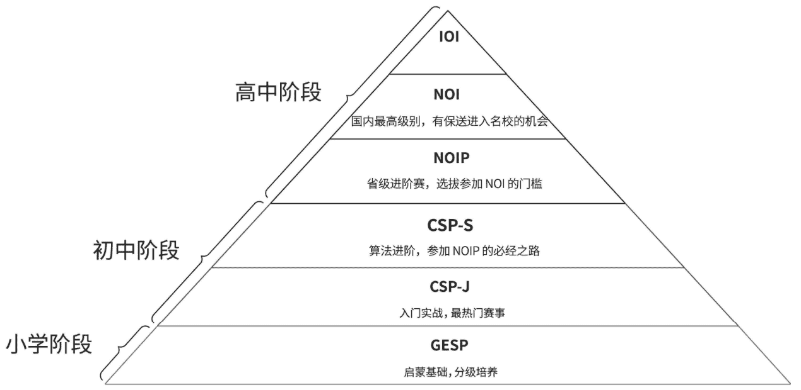

图 1-1

**1.2.1 从启蒙到国际巅峰的赛事阶梯**

**1.**编程能力考级：GESP

GESP 由 CCF 发起并主办，旨在提升青少年计算机及编程教育水平，推动普及推广。认证覆盖中小学各学段，符合条件的青少年均可参与。

GESP 包含图形化编程认证、Python 编程认证和 C++编程认证，重点检验学生对编程知识的掌握与操作技能。通过分级目标考查从设计简单程序到复杂程序的能力，为专业化编程学习奠基。其中图形化编程 Scratch 设 1 至 4 级，Python 与 C++设 1 至 8 级。GESP 本质上是面向中小学的编程分级能力认证，类似编程基础考级，从入门逐步夯实基础。

若小学低年级学生想从“玩中学”培养兴趣，GESP 是第一站。若小学高年级已学习 C++但尚未达到 CSP 报名年龄，可从 GESP 起步，不断检验学习成果。 

开赛频次：每年 4 次。

考试时间：3 月、6 月、9 月、12 月。

报名时间：1 月、4 月、7 月、10 月开放报名。

适合年龄：面向所有中小学生，无年龄限制。

参赛语言：Scratch（1～4 级）、Python（1～8 级）、C++（1～8 级）。

主要考点：分为 1～8 级，从基础入门到算法实现逐步进阶，具体要求可参考官网大纲。

**2.**第一个关卡：CSP-J/S

CSP-J/S 起于 2019 年，由 CCF 主导开展的面向计算机非专业人士的算法与编程能力评估认证。认证在同一时间、不同地点由 CCF 授权省级单位组织，实行全国统一大纲、统一考题。

CSP-J 为入门级，CSP-S 为提高级，核心均围绕算法与编程。该认证分两轮进行。第一轮侧重通用计算机科学知识，采用笔试形式；第二轮聚焦程序设计，要求上机完成编写与调试。只有第一轮成绩优异者方可进入第二轮。结束后 CCF 依据成绩及分数线颁发认证证书。CCF 规定可单独或同时参加 CSP-J/S。

2025 年 2 月，CCF 规定参加 CSP-J/S 以上级别赛事者需满 12 周岁。若已有良好 C++基础且符合年龄，可参加 CSP-J/S，这也是通往更高阶比赛的敲门砖，堪称最热门的信息学入门赛。

需要强调的是，CSP-J/S 是 NOI 系列赛事起点，CSP-S 成绩也是后续参加 NOIP、APIO、NOI 冬令营等的基础。 

开赛频次：CSP-J、CSP-S 都为每年 1 次。

考试时间：第一轮认证在 9 月，第二轮认证在 11 月。

报名时间：第一轮认证报名从 6 月开始至 9 月结束，第二轮报名在第一轮成绩公布后。

适合年龄：12 岁以上。

参赛语言：C++14。

主要考点：基础语法、编程能力、数据结构和简单算法。

**3.**真正的省级奥赛：NOIP

NOIP 自 1995 年起举办，是每年由 CCF 统筹组织、在同一时间段内以省为单位开展的全国性竞赛。

选手报名需经学校老师确认，以学籍所在学校为单位。NOIP 有初赛与复赛，复赛资格由各省依据初赛成绩确定。

NOIP 也是通往 NOI 的必经之路，难度与考查范围均高于 CSP-J/S。因此部分省份对报名设置门槛，如要求参加过 CSP-S 第二轮认证。学校在资格筛选时也优先考虑 CSP-S 成绩优异者。 

开赛频次：每年 1 次。

考试时间：11 月。

报名时间：9—10 月。

适合年级：初中、高中。

参赛语言：C++14。

主要考点：数据结构、进阶算法、时间和空间复杂度、综合解题能力。

**4.**国内最高级别赛事：NOI

NOI 每年举办一次，于同一时间、同一地点开展。

各省以单位形式组队参赛，既记录个人成绩，也统计团体总分。选手从 NOIP 省级获奖者中择优选拔，组建信息学奥赛省队代表本省参赛。

若高中生凭 NOIP 奖项获得 NOI 省队资格，即登上国内中学生信息学奥赛最高舞台，部分知名高校保送名额也从 NOI 获奖者中产生。 

开赛频次：每年 1 次。

考试时间：7 月。

报名要求：通过 NOIP 省级选拔。

适合年级：高中。

比赛用语：C++14。
考核要点：复杂数据结构设计、高阶算法运用、代码效能优化、综合解题素养。

**5. 全球高峰对决 IOI**
IOI 为一年一度的世界级信息学对抗赛。CCF 会依据前一年 NOI 的成绩遴选成员，组建中国代表队参赛。对大多数信息学选手而言，斩获 IOI 金牌是终极目标。

**1.2.2 赛事核心特征**
为了便于横向比较，我们把各大赛的关键信息归纳为表 1-1。

表 1-1

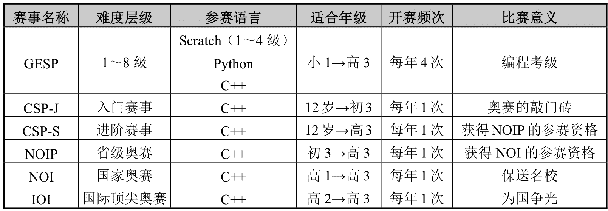

信息学体系一直在演进，规则与报名条件也会随之调整，建议持续关注最新动态。权威政策与通知可通过全国青少年信息学奥林匹克官方网站查询；赛事解读与动态信息也可以关注“信赛圈”微信公众号等第三方平台。

**1.2.3 如何切入与选择赛项**
越来越多同学希望借助信息学提升数字素养，走科技特长路线。该怎么上车？

有人会问编程的最佳起步年龄。先纠正一个常见误区：信息学并非高中生的专属，而是按年龄分层的完整体系。不同阶段都有匹配入口，关键是结合自身基础与目标来定路线。

小学低段以点燃兴趣为主，可先从 Scratch 图形化入手，感受基础逻辑与因果关系，对应 GESP 1～4 级；小学高段可直接接触 C++，参与 GESP C++ 等级考核，12 岁后尝试 CSP-J。初中阶段需取得 CSP-J/S 证书，为 NOIP 参赛资格铺路。高中阶段则依次经历 NOIP、NOI、IOI。

举例而言，有位同学四年级开始学 C++，六年级拿到 GESP 5 级，初一获 CSP-J 一等奖，初二获 CSP-S 二等奖，高中凭借 NOIP 成绩入选 NOI 省队并在全国赛获奖，最终保送北京某高校。他的轨迹是 GESP 奠基、CSP-J/S 练实战、NOIP 省赛突围、NOI 全国赛突破。

还会有人问编程是否很难，是否必须先图形化再转文本。低龄直接上 C++ 门槛确实偏高，可先用趣味编程培养兴趣，从图形化起步。但图形化并非文本编程的必经之路，高年级同学的学习能力与数学基础已足够直接承接 C++。

路径选择很关键。选对了，门槛好过，可逐级攀升；选错了，花钱事小，耽误时间错过黄金期代价更大。部分课程过度强调趣味与游戏，忽视扎实的基础与算法训练，学很久仍无法完成 CSP-J 基础题，机会就被消耗。具体误区与避坑将在第二章展开。

**1.3 参与信息学奥赛的意义与价值**
投入时间参赛，是否划算？能否获奖？对升学是否有帮助？这些都是现实考量。更长远看，信息学带来的数字素养与动手实践能力，才是一辈子受用的核心资产。

**1.3.1 核心收获：夯实底层数字素养**
数字素养指在数字化环境下获取、处理、分析、创造信息，并用信息解决实际问题、应对复杂挑战的综合能力，是当今社会的底层能力。

对个人而言，它帮助理解技术原理，更好融入数字生活，在信息洪流中辨别真伪、做出理性判断；在学习中实现知识整合与事务规划；在面对未知时拥有系统化思维与行动框架。

对职业而言，从办公软件到数据分析，从日常执行到创新项目，数字素养都是提升效率、突破瓶颈的关键，也是进入人工智能、大数据等新领域的通行证。

**1.逻辑思维：严谨理性，保持在线**
编程是逻辑思维的实操场，训练主动构建逻辑并掌控逻辑的能力，保持理性在线。从基础判断、分支选择到多层循环嵌套与递归，每行代码都体现严谨。形成的思维可迁移到生活学习。

制定学习计划时，像画程序流程图，先锁定核心目标，再拆解为周复习进度、日刷题量的逻辑模块；面对复杂问题时，像搭逻辑积木，先明确各模块功能，再设计嵌套组合，最终形成稳固结构。

**2.实践能力：拆解问题，落地想法**
好想法能否实现，取决于实践。核心在于把复杂问题拆成可执行步骤，按序推进，把想法变成现实。

组织跨校学术论坛，需要拆解为定主题、联络高校、搭建报名系统、协调嘉宾、安排演讲、总结汇报等环节；参与大学生创新创业项目，要拆解为市场调研、竞品分析、原型设计、技术开发、商业模式验证、融资路演准备等关键步骤。

信奥解题的过程，就是化繁为简、分步实现的过程，把算法拆成功能清晰的模块并用代码实现，再组合成完整解法，这正是应对更复杂挑战的核心能力。

**3.抗挫折能力：细致严谨，敢试错**
编程最磨人的环节是调试。它能训练细心与抗挫能力。程序出错时，需要逐层排查：变量是否初始化、是否拼写错误、条件是否写反、循环边界是否合理、特殊情况是否覆盖。

这种训练培养不出漏任何漏洞的严谨思维，就是面对问题时耐心试错、细致排查的品质，为各方面挑战奠定基础。

**1.3.2 额外收益：助力升学**
获奖确实能在升学中带来优势。常见案例是：初中阶段获得 CSP-J 或 CSP-S 省级二等奖及以上，有机会进入重点高中的信息学特长班，甚至获得提前录取资格。

高中阶段取得 NOIP 奖项，在强基计划选拔中更具竞争力，清华、北大等顶尖高校的强基项目会优先关注信息学特长生。获得 NOI 奖牌，则更有机会直通国内顶尖高校保送。

各省市学校政策不同，获奖带来的认可本质上是把能力学扎实后的自然回报，类似坚持健身后在运动会上获奖，而不是为了奖牌而健身。

同时要提醒：若只为升学而学，硬背真题、刷固定题型，会丢掉编程本质，最终沦为只能写特定题目的工具人，而非解决新问题的思考者。

**1.3.3 长期价值：对接未来学习**
学习是终身的，从校园到职场，持续面对从零学起、快速上手的挑战。

编程已渗透各行各业，从 AI 训练、大数据分析到智能家居研发、生物医药建模，未来几乎所有领域的深度探索都离不开编程思维。

对学生而言，价值不止于掌握一门语言，更在于掌握未来的底层学习工具，提前搭建适配未来的能力框架，让面对未知领域时少走弯路，从被动接受转向主动钻研。

首先，编程是数字化思维的基础认知工具，降低学习门槛。随着教育场景数字化，中学阶段可能需要用数字工具拆解数理难题，大学阶段可能需要编程处理研究数据、做统计分析，这依赖逻辑拆解与数字验证的思维，而编程正是其具象化载体。“读、写、算”是当下基础，编程逻辑将成为未来同等重要的认知工具。提前掌握，等于提前掌握未来学习语言。

其次，编程是跨学科学习的底层工具，打通逻辑壁垒。金融量化交易需编程调取历史数据、计算指标、编写回测策略；生物信息学需编程处理基因序列、进行序列比对；GIS 需编程做缓冲区分析、图层叠加生成热力图；文科研究也可编程抓取社交媒体数据做分词与情感分析。编程已成为跨学科的底层语言。

最后，编程培养动态适应能力，应对人工智能时代知识迭代。人工智能工具普及后，缺乏逻辑基础的人只能调用基础功能，参数调整时无从下手。有编程基础者能快速理解原理、优化参数、甚至搭建自己的工具。编程学习中养成的快速学习新框架的习惯，正是人工智能时代最核心的竞争力。

信息学奥赛像种树。比赛获奖是早期的花，看得见且提气；学习中构建的逻辑思维、问题拆解、数字化思维才是扎在土里的根，未来才会持续发力。

种树需要规划土壤、水量、修剪与病虫害防治。每一步都需清晰规划，否则种子再好也易长歪。你可能会问，这棵信息学奥赛之树如何种得花开好、根扎深？第二章正是培育方案，先梳理路径，再分享经验与避坑，最后推荐学习方式，让你在路上走得更快更稳。

**第二章 参加信息学奥赛的学习规划**
了解了赛事体系与意义后，期待感会上升，随之而来的迷茫也常在：从何入手？会不会走弯路浪费机会？

本章帮你落地，制定规划，梳理常见陷阱并给出规避建议，比较主流学习方式。无论是小学启蒙筑牢兴趣，还是初中冲奖积蓄势能，都能找到适配的行动指南，让路径更确定、波折更少。

**2.1 学习路径总览**
CCF 赛事体系分层清晰、定位明确，各级赛事相互衔接。GESP 面向中小学生，聚焦基础普及与评估；CSP-J/S 夯实基础，检验软件核心素养，是进入省级奥赛的关键门槛；NOIP 面向省级优秀选手，是冲击更高舞台的必经之路；NOI 则是全国顶尖选手的竞技平台。各赛事精准匹配不同阶段的能力需求。

晋级不是一蹴而就，而是阶梯式成长。我们据此把学习路径细化为 4 个核心阶段，如图 2-1。

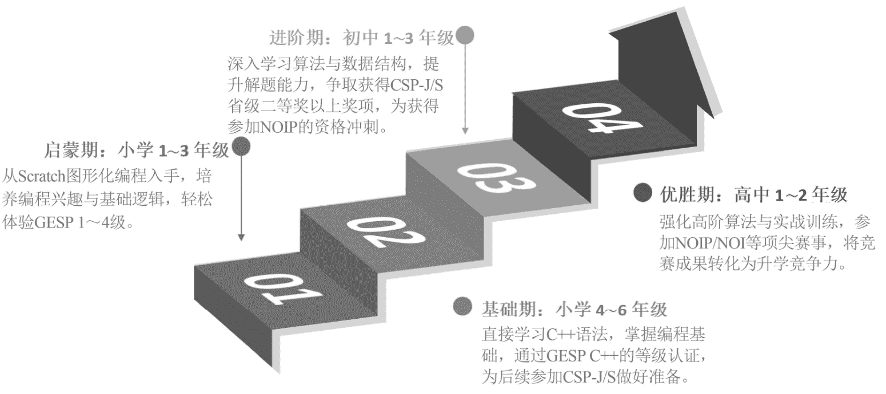

图 2-1

**2.1.1 启蒙期——点燃兴趣**
小学低年级学生处理复杂抽象任务难度较大，更适合游戏化、具象化内容。Scratch 如搭积木拼玩具，不依赖高年级数学，通过简单任务理解“如果…就…”、“重复做…”等因果与循环，建立“编程=玩”的联想。

对应 GESP 1～4 级侧重流程体验，可获得初步成就感。建议每周学习 1-2 次，保持新鲜感，避免过度学习导致兴趣衰减。

**2.1.2 基础期——掌握 C++ 打牢根基**
小学高年级抽象思维与注意力持续时间显著提升，已能接受 C++ 基础。小学数学的四则运算与应用题训练提供了计算与逻辑基础，已掌握整除等概念，为理解枚举、递推等简单算法打下基础。

建议直接学习 C++ 基础，通过 GESP C++ 等级认证夯实编程基础，为 12 岁后参加 CSP-J/S 做准备，更早聚焦算法思维培养。建议每周学习 1-3 次，平衡课内负担。

**2.1.3 进阶期——冲击 CSP-J/S 省级奖励，推动高中衔接**
初中生抽象逻辑与多层推导能力成熟，可支撑动态规划、图论等嵌套逻辑学习。课内已掌握代数方程、函数基础与几何逻辑，能关联背包问题、路径模型，并借助对逻辑顺序、分类存储的认知快速理解树遍历、栈队列等结构。

即便小学未接触 C++，初中生认知提升后学习也相对轻松。若小学已掌握语法，无需重复基础，可采用“巩固基础→突破提升”策略，聚焦算法核心思路，补齐漏洞、提升准确率，争取 CSP-J/S 省级二等奖及以上，为 NOIP 资格做准备。

建议每天做 1 题、每周 1 次集中训练或模拟赛，每月复盘错题。节奏匹配初中生课后时间，保持手感不挤压学业与休息。

**2.1.4 优胜期——冲刺顶尖赛事，提升升学竞争力**
高中阶段抽象逻辑、复杂拆解与深度优化能力达到顶峰，可应对各类算法难题。课内已掌握函数、导数与离散数学基础，能快速理解高效算法的数学原理。

经过系统学习与赛事积累，已掌握 C++ 语法与算法经验，无需纠结基础，应聚焦提升训练难度、优化代码效率，契合 NOIP、NOI 等顶尖赛事需求。

此时正处升学关键期，强基计划、保送等目标明确，高级别赛事获奖可直接转化为竞争力。建议每天刷题至少 1 小时、每周 1-2 次集中训练或模拟赛，适当参加赛前集训营，提升针对性。节奏匹配高中生抗压能力。

**2.2 学习经验与避坑指南**
规划清楚也可能在执行中掉坑，花时间却卡在关键环节，或方向偏离结果不理想。为什么会这样？并不是奥赛太难，而是忽略了隐性关键因素。

**2.2.1 输入速度是常被忽视的编程底座**
很多初学者认为打字多练自然快，无需练标准指法，把精力放在写代码与解题上。事实上，这个被忽略的小事后期会悄悄拖慢进度。

部分高年级学生语法已熟练、思路清晰，但长期使用“二指禅”“三指禅”，手指总在键盘上找键。输入 int 却打出 itn，输入 while 却漏掉 h，只能删改重输。思路被打断，越急越错，效率骤降。半小时能完成的代码拖到一小时，比赛时更吃亏——思路已出，却因输入跟不上错失时间，最后代码没写完只能交卷。

打字卡顿会把解题节奏带偏，其实提升门槛很低。每天固定十分钟到十五分钟做键位定位练习，把规范指法练成肌肉记忆，并有意识地多敲 void、float、while 这类常用的 C++ 关键字。坚持十天到半个月左右，低头找键的习惯就会消失，十指能自动找到正确位置。输入顺畅之后，思路不会再被打字打断，写代码、备赛时心态更稳，不会被键盘拖住。

**2.2.2 数学基础是核心支撑**

不少同学都遇到过这样的挫败：C++ 的循环、函数都能写对，一拿到题目就读不懂题面里的数学关系，要么有编码能力却没有解题思路，就像手里拿着笔却不知道写什么，程序能跑却输出错误，这种会写代码却做不对题的无力感极易打击信心。

刚接触信息学奥赛时，容易把学编程等同于学 C++，觉得语法背熟、代码写熟就能拿奖，毕竟写代码、调程序看起来最像编程。但走着走着就会发现竞赛绕不开数学。

奥赛题本质是用程序手段解决数学问题。算圆面积要先用对面积公式，判断质数要懂整除原理，处理最短路径还得借助几何和图论建模。表面考编程，实则在检验数学理解。为了让数学成为助力，我们建议如下。

**1.分阶段打牢数学基础**
小学阶段先把四则运算、基础逻辑推理、质数合数等根基性知识吃透，这是竞赛的地基；到了初中再逐步接触方程、几何，以及因数分解、排列组合等难度更高的内容。这些都是常考点，循序渐进学习不会觉得吃力。

**2.学 C++别太早也别太晚**
建议小学四五年级再开始学 C++。这个阶段孩子已有初步的数学思维，能看懂判断一个数是不是偶数、求长方形面积之类的题目，不会出现代码学会了题看不懂的脱节，也能避免因挫败失去兴趣，成就感更强。

**3.数学弱就针对性补，别硬扛**
如果发现数学拖了编程后腿，不必硬赶进度，不如先补数学。脱离数学思维的代码就像没航向的船，再熟练也到不了终点，花点时间把基础补好，后续会顺很多。

**2.2.3 建议从一开始就学 C++**

从前文可知，C++贯穿整个信息学奥赛体系，CSP-J/S 及以上的高阶赛事只认可 C++。无论起步时用的是哪种语言，最终都要转向 C++。

编程的本质是用计算机逻辑解决问题。Python、C++、Java 等只是把人类逻辑翻译成机器指令的不同方言，内核逻辑一致。若先学别的语言再转 C++，就得额外适应新的语法和表达习惯，相当于给自己增加学习成本。

就像用中文说“今天吃苹果”，用英语写“Eat apples today”，语义完全一样。但只会中文表达的人要转成英文，就必须学新单词和语法，这个转换成本无法避免。

以奥赛常见题“判断一个数是否为质数”为例，逻辑的一致性就很清晰。

用 Python 的写法是：
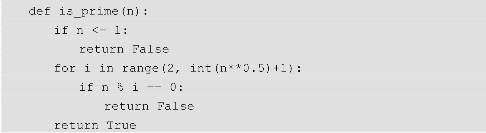
用 C++的写法是：
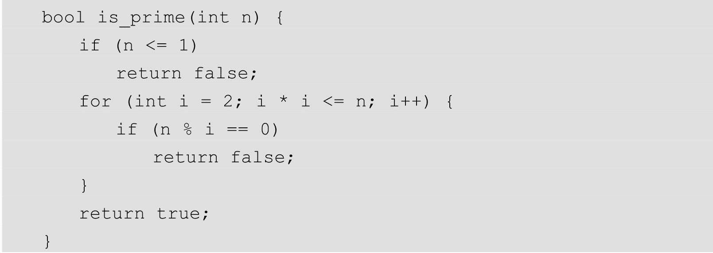

两段代码的表述不同，但思路高度相似，都是先判断 n 是否大于 1，再检查 2 到根号 n 之间的因数。从 Python 到 C++ 只是换一种语法格式表达同样的逻辑。

在算法层面先学一门再换一门会增加记忆负担，还容易混淆出错，纯属绕路。既然竞赛绕不开 C++，不如一开始就把 C++基础打牢。

**2.2.4 常见误区与避坑指南**

**1.别盲目追捧“兴趣导向”与“快乐学习”**
有些入门课主打动画小游戏、特效网页，成果可见，很有吸引力。这类课程多靠逐步模仿：老师拖拽模块就跟着拖，老师写固定代码就照抄。做出来能动能互动，看似学会了，问角色为何按这条路径走、代码如何驱动功能却说不上来。稍作变化就无从下手，原来只是抄出来的会做。

入门时别急着做酷炫作品，要打好基础。编程核心是自己拆解问题、找方法的能力。兴趣不应建立在模仿的新鲜感上，而应来自搞懂逻辑后独立解决问题的安全感。只靠模仿既学不到真本事，还容易养成等步骤、不愿思考的习惯。

**2.进度别太慢，避免浪费时间**
刚开始学编程会觉得技术门槛高，担心跟不上。有些培训就利用这种心理宣称“编程很难、必须慢学、多上课”，把一节课的内容拆成几节，教材零散，每节只讲一点，把体系化的内容切成碎片。

原本半年能完成的基础被拖到一年甚至更久，花了几十节课和费用，成长却很慢。这种马拉松节奏不仅看不到进步，还会逐渐丧失信心。学习不是时间越长越好，而是要匹配能力节奏，用更少时间掌握更有用的知识。

**3.别急于求成，要打好基础**
学完 C++基础语法就想走捷径，觉得参加集训营就能拿 CSP-J 奖项。集训现场往往暴露短板：基础算法题别人能快速拆解题干，你却盯着题目发呆，只能被动记老师的步骤。集训结束没学会独立解题，反而因跟不上而挫败。

解题能力像盖房子，先把语法、基础练习这块地基打牢。短期集训只能提升技巧，补不上底层短板。先夯实基础再稳步进阶，节奏更稳。

**4.避免信心不足和好高骛远的心态**
规划学习时容易掉进两个极端：要么信心不足总怕跟不上，要么信心过足觉得随便学学就行，都可能走弯路。例如：

我上四年级了，想学编程，纠结要不要从图形化编程起步。
四年级已有理解代码符号的认知能力，再学拖拽式图形化不仅多余，还会错过向文本编程过渡的黄金期，直接从 C++基础语法和简单逻辑题入手，能更快建立编程思维。
我是小学低年级学生，入门 C++后越学越吃力。
为了抢跑，有孩子一二年级就学 C++。这个阶段对抽象的变量、分支循环、数组等概念理解不了，打字也有困难，上课只能背步骤，课后无头绪，不仅学不到东西，还会因总学不会产生排斥。
我学 C++已经一个月了，刷一刷 CSP-S 真题。
刚接触 C++就去刷 CSP-S，真题无从下手，热情被磨灭，连信心都没了。学习必须匹配认知水平和已有基础。四年级学 C++不算早，一二年级学 C++不合适，学一个月就刷竞赛题明显太急。

**2.3 学习方式和途径**

很多同学一开始就绕远，要么没摸清自身能力，要么没选对适配方式，白白浪费时间精力。每个人自律程度、基础、能投入的时间都不同，只有贴合实际的选择才有效。

选对学习方式能事半功倍，选择不能凭感觉，要结合目标、基础和时间综合考量。没有绝对的好坏，只有更合适的。主流有自学、传统线下培训、线上课程三种。

**2.3.1 自学**

不少人会给自己打气说自律有基础就能行，但自学门槛远不止自律，还需要很强的逻辑拆解和自主解决问题的能力，且竞赛需要知识关联扩展和备赛经验，往往依赖专业老师指引。

身边能靠自学稳步推进到竞赛水平的极少，多半有前辈或有经验选手的帮助。判断是否适合自学，可参考以下条件，全部符合再尝试。

**1.小学五年级以上，已有 C++基础，学习理解能力优秀**
扎实掌握循环、函数、数组、指针、结构体，能看懂报错信息并自行定位修正，能独立理解基础数据结构与算法，例如能完整写出汉诺塔实现。

**2.会利用互联网获取信息和解决问题**
能主动查询 CSP-J/S 最新消息、大纲动态，从官方平台和权威社区获取真题解析。遇到思路卡壳或调试问题时，能借助智能助手梳理思路、分析日志并独立修正。

**3.学习规划与执行力强**
能制定日周月计划，管理进度，定期复盘薄弱点并调整，形成学习闭环。

**2.3.2 传统培训**

指以线下固定课堂为核心的教学模式。适合身边有优质线下资源，或自主专注力较弱、需要课堂纪律和教师监督的学生。

**1.传统培训的优势**
集体学习氛围强化专注度，固定场地和纪律能减少分心。固定课表和作业要求形成稳定学习惯性。同伴互动可一起拆题、分享心得，这是线上较难完全替代的。

**2.选择传统培训的建议**
机构差异很大，可关注教师资质，是否持有计算机教师资格证或 CCF 证书；优先小班，教师才能关注到每个人，答疑也更充分；先试听一两节课，感受教学风格和课后作业答疑是否合理。

**2.3.3 线上课程**

依托互联网的远程教学，直播或录播搭配在线答疑练习，灵活性更高，已成主流方式之一。

**1.线上课程的优势**
打破地域限制，共享优质课程体系和资深教练。支持个性化进度，按自身情况灵活安排。费用相对更低，省去通勤时间，可用于刷题复盘。

**2.如何选择线上课程**
关注授课教师资质，是否持有相关证书；教材最好是正式出版图书，体系更完整；视频拍摄是否正式，清晰度、流畅度、杂音是否影响体验；先试听判断表达和逻辑是否喜欢；体验课后答疑的解决力和反馈速度，避免问题堆积。

**2.4 新理念：开始利用 AI 能力**

自学、线下、线上三种经典方式都受限于课程质量、资源分配、个性化适配和即时反馈效率。

随着大模型技术爆发式发展，人工智能正打破传统学习边界，成为在线教育的深刻变量。新理念的核心是智能助手不再只是被动答疑工具，而是能主动适配学习需求的协同伙伴，能感知基础差异，解决即时性和个性化不足的问题。

技术发展为信息学奥赛学习带来全链路支持，从知识点理解到代码实践再到错题复盘。人工智能将成为重构知识获取到能力落地全流程的新支点，这些变化已是当下可感知的学习新可能。

门槛更低、效率更高、更贴合个人节奏，能否掌握用人工智能学习信息学奥赛的方法，正在成为拉开差距的关键。

如何让智能助手真正成为靠谱帮手而非收藏夹里的“吃灰”工具，是接下来要讲的核心。我们会拆解提示词工程，针对拆解算法、调试代码、分析真题给出可直接用的提示词，并介绍主流人工智能编程工具，帮助快速找到最适合的搭档。

从现在开始用人工智能学习信息学奥赛知识吧！

**能力篇**[在介绍了信息学奥赛知识的学习规划之后，一个问题或许已经悄然浮现：在人工智能技术重塑教育形态的今天，我们究竟该如何构建起一套利用智能助手学习信息学奥赛知识的全新模式？这不仅仅是简单地将智能助手视为一种回答问题的工具，更重要的是如何让智能助手真正成为参加信息学奥赛路上的精准赋能者，而非一个让人产生依赖、替代独立思考的“拐杖”。我们认为，利用智能助手的学习方式并非要完全取代之前的学习方式，而是要让智能助手成为这些方式的赋能者：既可以是随叫随到的辅导老师，也可以是课后答疑的助教，还可以是备赛教练。这种“智能助手+传统学习方式”的组合，正是我们所倡导的新范式的核心。我们写本书的目标，就是希望能够借助智能助手的力量，帮助每一位学生从那些机械重复、耗时费力的任务中解放出来，真正实现用最少的时间，学得更快，学得更好！]

**第三章 以 AI 工具为支点，重构学习范式**

**3.1 AI 技术对我们的影响**

**3.1.1 迅猛发展的 AI 技术**

人工智能爆发式发展的核心动力来自大模型的持续突破。

2017 年 Transformer 架构诞生，注意力机制突破了传统模型处理长文本的瓶颈，为大规模语言学习奠基。2020 年 GPT-3 以 1750 亿参数展现惊人文本生成能力，让世界看到大模型的潜力。2022 年 ChatGPT-3.5 推出，对话式大模型走向成熟，理解上下文和完成复杂指令的能力彻底改变公众认知。2025 年 8 月 GPT-5 发布，各项能力提升到前所未有的高度。

国产大模型的发展步伐十分迅猛，凭借硬核的技术研发实力，已经在中文应用场景里形成了自己的生态圈。字节跳动的豆包以多模态互动见长，DeepSeek 依靠开源策略构建社区生态，百度的文心一言和腾讯的元宝各有侧重。

这些本土大模型正深度嵌入教育、金融、能源、制造、终端交互等关键行业，覆盖核心业务环节，推动流程再造、效率跃升和技术升级，充分展现了国产模型的工程能力以及行业智能化落地的广阔空间。

**3.1.2 AI 重塑教育学习的全景**

AI 对各行业的改造已经进入深水区。制造业里，智能视觉检测以 99.9% 的准确率替代人工质检，缺陷识别效率提升十倍以上；金融业借助 AI 风控模型对交易数据实时研判，欺诈识别时延由小时级压至秒级；医疗场景中，多模态 AI 能快速解析医学影像，辅助诊断精准度提升，尤其在基层缓解专家短缺。

同样的重塑逻辑深刻影响教育。教育的本质对象是人，AI 并未取代教育，而是通过赋能放大教育价值、提升运行效率。影响已渗透到资源供给、教学方式、评价体系等多个层面，能力、效率、体验皆获明显改善。

**1.在能力层面，依托海量数据与持续迭代形成全域知识技能支撑**

AI 在教育能力上的核心优势，来自庞大的知识储备和较强的推理水平。一方面基于海量训练语料，工具可以横跨基础教育到高等教育的各类学科，像一位全年无休的知识助手，迅速响应各类求解需求，补上传统学习中获取滞后的短板；另一方面在逻辑推理、数学运算、代码生成等方向持续进阶，主流模型已达较高水准，能够精准匹配不同学段需求，提供有针对性的知识与技能支持。

**2.在效率层面，加速全链路革新**

AI 继承了在线教育打破时空壁垒的优势，并在效率上再突破。知识传递上，时间空间的限制被打破，学习者不必依赖固定教室和时段，随时随地获取标准化内容，覆盖面随之扩大。备课与教学设计上，AI 可快速整合素材、生成方案，将教师数小时的备课压缩到十几分钟，备课成本显著下降。学情诊断上，通过即时练习反馈迅速定位薄弱点，诊断周期从月、周级缩短至天级乃至小时级。资源匹配上，AI 能自动筛选适配水平的资料与习题，避免在海量资源中低效检索，提升利用效率。

**3.在体验层面，以数据驱动个性化，打造专属陪伴**

AI 重构体验的关键是数据驱动的个性化与无疲劳陪伴。工具可依据答题正确率、学习时长、知识点掌握情况等历史数据，动态调节难度、节奏和形式，实现千人千面的辅导。对基础薄弱者自动增加巩固练习，对学有余力者主动推送拓展内容，避免同质化。AI 没有情绪和疲劳，解答时始终耐心，学生重复提问多少次、难度多高都能获得一致回应，解决了不敢问、不愿反复问的痛点，让学习更轻松包容。

在 AI 推动教育多维变革的背景下，编程作为数字时代的核心素养，其学习形态也在重塑。为更清晰把握变化，需先梳理传统编程学习中的现实痛点。

**3.2 编程学习难在何处**

提到学编程，不少学生会觉得吃力。投入时间精力不少，收获却事与愿违。伴随信息学奥赛热度提升，学习者数量暴涨，对优质课程、好老师、答疑体验、练习平台的需求增速远超供给。通过对市场的调研，传统模式与竞赛需求存在三大痛点，也成为 AI 学编程出现的前提。

**3.2.1 好老师好课程为何难寻**

“会写代码”和“会教代码”是两回事。编程门槛灵活，有兴趣的人可自学入门，能独立操作即可；而编程教师需扎实的专业功底加合格的教学素养。国家对教师准入有严格认证，需系统学习教育学、心理学、教育技术等师范课程，为科学教学设计提供支撑。

优质教师的培养与优质课程研发都需要大量投入和长期积累，供给天然慢于需求。失衡导致大量学习者接触不到好资源，错过时机，效果受限。

有的机构教师是技术大牛，却缺乏教学功底，甚至不会写教案，自己很强却“讲不出来”，课堂采用跟练式教学，学生照着步骤做出题目，却未理解知识点关联与解题思维框架，掌握停留在操作记忆，对原理与迁移无能为力。

**3.2.2 一刀切教学与个性化需求的冲突**

标准化教学追求统一效率，用固定进度与统一内容实现规模化，却忽视个体差异。

学习者的基础、节奏、卡点各不相同。有人早接触编程数学扎实，有人刚入门基础薄弱，有人抽象概念理解快，有人需要更长时间消化，有人弱在算法推导，有人卡在代码调试。标准化难以兼顾，易让基础弱者掉队，让基础强者重复啃。

部分机构为扩招，把不同年级、不同基础的学生混班。教师只能按班级平均水平设计进度，导致低年级或新手跟不上、信心受挫甚至退学；高年级或理解力强者被迫等待，时间浪费、效率低下。

**3.2.3 会听懂不等于会写代码**

为何很多学生课堂上都能听懂，思路也清晰，拿到题目却写不出正确答案？

信息学奥赛考核的是能独立写出可运行的代码，而非纸上复述算法。听懂与写出之间隔着绕不开的调试关卡。真正动手时问题集中爆发：漏条件导致死循环，未初始化变量引发错误，少分号、括号不匹配导致编译失败。

这造成知识与能力断层：课程上完、理论学会，却不会独立排错，陷入课堂懂、课下不会的怪圈。

Bug 本就是编程常态，必须掌握独立定位能力，通过日志定位报错、顺着思路修改代码，把错误转化为经验。只有持续写码、调码、排错训练，理论才能转为动手能力。

有的机构虽有训练作业，但答疑支撑不足，学生卡壳只能在群里留言等数小时，思路早已冷却。要么老师回复简略“这里逻辑错了”或直接给答案，不讲成因也不教排错方法。学生只能照改，却形不成排错思维，下次遇到数组越界、逻辑漏洞仍需求助。

**3.3 AI 助力信息学奥赛备赛**

对实操性、即时性要求高的编程学习，传统方式的局限愈发明显，学习方式迭代成为必然。AI 可降低门槛、提升效率、精准消解痛点。

**3.3.1 信息整合与推理能力**

AI 的海量整合与逻辑推理是信息储备和推理机制的协同。整合并非堆砌，而是对互联网全域文本进行大规模学习后形成结构化知识网络，从基础概念到复杂理论、事实到逻辑关系，经过清洗、关联、抽象，成为覆盖多领域的超级知识库。

推理依托 Transformer 的注意力机制，能捕捉因果、递进、对比等语义关联，通过预训练学习语言规律与思维范式，实现从“是什么”到“为什么”“怎么办”的延伸。

通俗说，训练过程已把分散知识整理成系统化知识库并存入“大脑”，既知细节也懂运用。

在编程与信息学领域，模型已学习从基础语法到竞赛实战的全维度数据：C++ 语法规范、算法理论专著、近十年真题思路、教练与选手经验分享等，并形成知识点、原理、应用、易错点的关联图谱。

例如问及 C++ 为何区分引用与指针，AI 会系统展开：从语法定义对比入手，关联内存原理，结合代码示例说明使用场景，并联结真题中混淆导致的失分案例，将语法书、原理、竞赛经验串成完整逻辑。

再如二分法求最大化最小值这类典型竞赛题，AI 会先讲核心逻辑，再关联数学模型，结合具体真题并延伸变种，形成“问题类型—核心算法—实现技巧—变式迁移”的知识体系，避免“一题会一道即卡”。

**3.3.2 代码读懂写对改优能力**

AI 辅助奥赛学习的核心优势是读码、写码、改码。模型通过海量规范代码训练，习得了语言底层规律：语法、分支循环嵌套规则、排序、文件读写等通用实现。

代码被转为向量，自注意力捕获上下文关联，如变量定义与跨行使用，形成类理解能力，能识别逻辑功能、判断规范性、模仿模式生成新代码，是统计规律的复用而非规则套用。

这些能力已落地为行业工具：GitHub Copilot 作为主流 IDE 插件实时补全代码、生成函数，支持数十种语言，被数百万开发者日常使用；Cursor 编辑器深度集成 AI 调用，可逐行解释、重构冗余代码；字节跳动 TRAE 在中文需求理解上更精准。

在学习中，初学者读不懂代码时可获即时逐行解释，报错时可快速定位并给出修改示例，避免卡在基础错误。练习特定算法时，可先生成参考代码或分步引导。刷题时能判断提交是否正确，检查时间空间复杂度，出错时指出语法、边界、递归终止、设计偏差等具体问题，并深挖背后的薄弱知识点，形成知识点—错误修正—短板补齐的闭环。

**3.3.3 角色扮演与教学适配**

通过精调竞赛教练授课视频文本、解题拆解案例、学生错误归因记录等优质教学数据，AI 可模拟专业教师逻辑，掌握引导到启发的教学流程。借助提示词设定，角色可快速切换，按学习者水平调整深度。

对中小学 C++ 初学者，AI 能把难点讲清易懂。学生反馈不懂内存地址时，可先用快递单号、门牌号等生活类比降低门槛，若仍不理解则切换到代码实操视角，通过定义指针、打印地址、修改指向的分步演示直观感知概念本质，并据提问判断卡点动态调优。

对 NOIP 选手，AI 自动进入竞赛进阶模式，聚焦动态规划、图论、数论等高频模块，结合历年真题拆解优化思路，针对边界处理、复杂度控制等常见失误给出调试建议，甚至对比多种解法，帮助建立最优解思维。遇到复杂题型时，还能模拟教练式提问，层层启发学生自主梳理解题框架，而非直接给码。

**3.3.4 7×24小时即时答疑**

奥赛学习者的疑问多在非常规时段：周末梳理算法卡在逻辑，晚间调试遇到报错。教师需休息，难以随时响应。

AI 程序全年无休，不受时间精力限制，能覆盖深夜周末，第一时间回应，避免思路中断。

AI 无情绪波动，反复问同一个基础问题仍保持耐心清晰的表达，营造敢问无压力的环境。

最大价值在于把答疑延伸为教学。依托知识储备、推理能力和角色模拟，答疑不只是给答案。AI 会先识别问题场景与关键词，精准定位卡点：是概念不清导致思路偏，还是细节疏忽引发报错，或算法推导卡在关键步骤。再关联薄弱环节，用举一反三拓展同类知识点、常见坑及规避方法，实现“解一题、通一类”，让每次提问都成为巩固与强化的契机。

**3.4 防过度依赖，保持独立思考**

AI 带来的变化不等于学习全程都要依赖工具。传统学习先搭好知识框架，AI 再快速整合资料，避免在海量信息中翻找；调试反复出错、归纳题型耗时时，AI 提供精准反馈，减少弯路。传统打基础、AI 提效率的组合，能让学习更有底气。

同时需警惕过度依赖削弱独立思考。AI 应作为传统学习的搭档，借其提效的同时保持独立思考习惯，避免把思考外包给模型。

**3.4.1 让AI打助攻，别让它代打**

AI真正的意义是把学习推得更顺，而不是直接把成品递到手里。只习惯让它给出整段程序或标准答案，看似把任务完成得快、省了力，实则把最能长本事的环节一起丢了。推导算法时卡住、反复梳理直到思路通畅的那段体验，是让知识扎根的关键；调试时通过试错积累的敏感，会让以后更快定位问题；拆解题目时不断自问，是解题能力形成的根基。这些思考的累积，才是从懂概念到能实现的能力跃迁。一旦跳过，学习效果会大幅打折。

要明白，编程学习的成果不是做题的数量，而是逻辑、设计与实现等核心素养是否掌握。每次直接拿答案用，看似轻松，实则偏离了学习的本质，不仅学不到真本事，到了没有辅助的考场和竞赛现场就会没底气。只有把能力练成自己的，才靠得住。

**3.4.2 先自己冲，再让AI补位**

碰到难题时，先给自己一段时间独立琢磨。把需求拆开，结合已学知识梳理可能的思路，再尝试推演算法走向。即使卡住也别急着求助，先在草稿纸上画流程、写几行伪代码，尽量靠自己突破。实在没有方向、思考到瓶颈时再请AI帮忙，而且要明确索要思路提示，而不是现成成品。

比如可以问AI在处理边界情况时通常会关注哪些情形，为什么会优先考虑它们，背后的判断逻辑是什么。把自己的思考与AI的讲解对照，把没覆盖到的点补齐，这样AI才是辅助独立思考的工具，而不是被动接受结果的替代品。

**3.4.3 学会看AI是怎么想的**

做到上面两点，很大程度上取决于提问方式。若想用AI理解算法思路，可以这样问。 
分 3 步拆一拆最短路径问题的 Dijkstra 算法思路，说一说每一步的核心逻辑和为什么这么设计，不用直接给代码。
若想让AI帮忙排查程序，可以这样问。 
我的代码在遍历数组时报错了，请先分析一下可能导致这个错误的 3 类常见原因，再说一说怎么一步步排查。
这种指向明确、要求具体的提问，能让AI给出更有价值的内容。更关键的是，组织问题本身就是梳理需求、明确目标的训练，也是独立思考的练习。

由此可见，提问的好坏直接决定AI能否真正助益提升。下一章将聚焦信息学奥赛学习中的关键环节——如何写好提示词，只有指令合理，AI才会成为提升能力的帮手，而不是让人变懒的拐杖。

**第四章 提示词 Prompt：与 AI 沟通的钥匙** 

小贴士：
阅读本章时，建议先准备常用的智能模型，如豆包和 DeepSeek。看到“ Prompt”标识时可实操感受效果。电子版 Prompt 的获取方式见 5.3 节。

**4.1 认识 Prompt**

**4.1.1 Prompt 的本质**

Prompt本质上是一种注入式指令，是开启与AI交互的入口。它能触发回应、引导对话走向、影响最终输出，也能通过预设思考框架指挥模型如何分析、如何组织内容。核心目的就是用精准的指令或问题，让模型生成更贴合预期的结果。

在这个AI已成日常的时代，豆包、DeepSeek、元宝这些名字并不陌生。每天可能会用它们构思作文、解数学难题、把报错程序丢进去求助、整理单词。简单说，Prompt就是输入给模型的话术，也就是你平时问它的那些问题，用来告诉它想要什么、引导它输出什么，是沟通的桥梁。

Prompt的尺度差异很大。最简单的像随口一问，如学生常问： 
C++中数组下标为什么从 0 开始。
复杂的则像一份任务清单，比如： [Prompt 请帮我设计一个信息学奥赛中二分查找算法的学习方案。具体要求：1.用生活场景类比二分查找原理。2.包含 C++代码实现。3.设计两道练习题，适合中小学生理解。]

模型是如何读懂Prompt的？原理很复杂，粗略理解就像和同学讨论：先听清需求。输入后，模型会拆解文字、抓取关键词如二分查找、生活场景类比、C++代码、中小学生，理解真实意图，再调取相关知识，结合上下文组织输出，最后返回结果。

举个熟悉的例子：调试C++程序卡了半小时，打开豆包输入以下Prompt。 [Prompt 帮我看一看这段代码为什么在运行时会崩溃？] 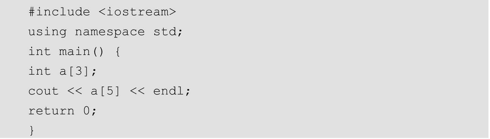
模型会先识别“运行时崩溃、代码片段”这些信息，调用对C++数组越界的认知，指出数组a的大小为3，下标最大是2，访问a［5］越界导致内存错误。正因为Prompt包含了具体现象和代码，模型才能快速定位问题。这就是Prompt在交互中的核心作用：描述越清晰，协助就越到位。

**4.1.2 写好 Prompt 是新时代的核心能力**

有人会说，不就是输入一段话吗，随便写不行吗？其实不是。体验过就会发现：同样的需求，模型有时答非所问，给出一大段理论看得云里雾里，有时又精准命中，连没说出口的细节都考虑到了。差别就藏在输入的Prompt里。

对信息学奥赛学习者而言，无论是掌握C++基础、刷题复习还是备赛，高质量的Prompt能让效率翻倍。价值主要体现在三方面。

1.提升效率：少走弯路，省下时间
比如整理语文笔记，只输入： 
整理课文《背影》的知识点。
模型会把主旨、作者生平、段落大意全堆出来，需要你再筛选。若换成： [Prompt 帮我整理《背影》的 3 个核心知识点：按父亲言行细节→情感表达→写作手法整理。每个知识点都配备 1 个课文原句例子，重点标注细节描写相关内容。]
生成的笔记就能直接用，省去反复修改。
在奥赛学习中，让模型出动态规划练习题，若只说： 
出几道动态规划编程题。
很可能得到大学难度或面试题。若输入： [Prompt 出 2 道适合信息学奥赛练习的线性 DP 题，要求包含题目描述、输入/输出样例和解题思路提示。]
题目就能直接进入练习计划，无需再调难度。好Prompt就像导航，让模型直奔目标。

2.实现个性化定制：打造专属学习助手
学习节奏各不相同。学一元二次方程，有人要补因式分解基础，有人想挑战含参讨论；练编程，小学生需要积木比喻，竞赛选手需要复杂度分析。模型通用，Prompt专属。
比如讲解循环：
小学生： [Prompt 请你用生活化的例子告诉我 for 循环的执行机制，不用写代码，要用小学生也能听懂的话。]
竞赛选手： [Prompt 分析模拟退火算法中温度参数的循环调整逻辑，用伪代码表示温度从初始温度 T0 下降到最终温度 Tf 的过程（T=T0*0.95^k，k 为迭代次数），并说明循环终止条件的设计对算法结果的影响。]
不同的Prompt给模型不同剧本，让输出更贴合身份与目标。

3.拓展应用边界：成为探索新知的脚手架
模型不再只是答题机器，可梳理时间线、辅助调试、设计实验、分析真题趋势。要发挥这些作用，Prompt是前提，能把工具变成探索知识的支架。
比如C++知识点零散时，可问： [Prompt 帮我用表格的方式对比一下 C++中的数组、字符串、指针，讲解它们之间的转换关系。]
会得到结构化表格，帮助融会贯通。
再如函数参数传递： [Prompt 请对比讲解 C++中值传递和引用传递的区别，包含定义说明、内存分配差异、对实参的影响 3 个维度，并用代码示例分别演示这两种传递方式的效果，重点标注引用传递时形参前的“＆”符号的作用。]
卡在最短路径时，可输入： [Prompt 我刚学完图的存储、邻接矩阵和邻接表，想入门最短路径算法，请帮我设计一个 3 步学习计划：第一步，推荐 1 个适合初学者的算法，用城市间修路的例子讲解原理。第二步，给出一段简化的 C++代码，只保留核心逻辑，注释关键步骤。第三步，出 1 道入门级练习题。]
模型就像教练，引导你逐步深入，而不是直接丢手册。

总之，Prompt只是段文字，却藏着沟通密码。学会清晰、具体地下指令，能省时、定制内容、打开新可能。下次对话前花一分钟自问：需求说清楚了吗？模型往往会因此“懂你”。

**4.2 如何构建优质 Prompt**

什么是优质Prompt？通过几个生活学习场景来看标准与优化方法。

1.标准一：目标具体，明确要做什么 
帮我写一篇五年级课外阅读分享发言稿。
修改建议：任务不能模糊，需说明类型、场景、受众。修改后： [Prompt 帮我写一篇小学五年级语文课外阅读分享的发言稿，受众是同班同学，核心是分享《少年中国说》这本书，时长为 3～5 分钟，内容需要包括时代背景、作者的创作目的及全书的中心思想。]

2.标准二：结构清晰 
帮我设计一个三年级主题班会方案。
修改建议：用分层逻辑组织需求，明确任务与要求。修改后： [Prompt 帮我设计小学三年级“交通安全主题班会”方案，需包含 3 个部分：1.流程（20 分钟，3 项内容：看安全视频、3 个学生分享过马路的注意事项、班长总结）。2.准备物品（视频、3 张安全标语卡片）。3.班会目标（让学生知道红灯停、绿灯行，不横穿马路）。]

3.标准三：信息完整，细节足够具体 
帮我改一下这道数学应用题。
修改建议：补充任务细节。修改后： [Prompt 帮我修改七年级数学应用题的解题过程：1.题目：商店将进价为 120 元的商品按标价的 8 折出售，仍可获利 10%，该商品的标价是多少元？2.原题解错为：“120×10%+120=132，132÷80%=165”。3.指出解题出错的点是什么，具体是哪一步的问题。4.给出正确的解题步骤和每步说明，需要标注易错点，格式按“分步算式、每步说明”两列呈现。5.从数学老师的视角进行做错题目的归因分析，如出现错误可能与哪些知识点没掌握有关，并总结几点后续的提升建议。]

4.标准四：风格与格式明确 
帮我写一个“探究植物光合作用”的科学实验报告。
修改建议：明确文体、语言要求与输出模块。修改后： [Prompt 帮我写初中八年级“探究植物光合作用需要光”的科学实验报告，需满足：1.写作风格采用说明文文体，语言正式、书面化。2.用词准确，全程不用口语化表达和网络词语，表述严谨（如不用“大概”“约”等模糊表达）。3.输出格式：全文 600 字左右，必须包含 6 个固定模块，每个模块单独成段且标注标题。1）实验名称（居中）。2）实验目的（说明探究核心）。3）实验器材（分点列出：实验选用植物，实验用具为黑纸片、酒精等）。4）实验步骤（用 1.、2.、3.序号分点，每一步写清楚操作动作）。5）实验现象（描述遮光与未遮光部分的颜色差异）。6）实验结论（明确光合作用与光的关系）。]

从案例可见，优质Prompt有四个核心原则：任务目标具体明确，避免模糊宽泛，需界定场景、人群、核心内容、时长字数等约束；结构清晰，用分点编号组织需求；信息完整，提供背景与关键数据；风格格式明确，确保输出可控。低效Prompt多因需求模糊、细节缺失，导致输出偏差、反复修改。遵循“目标具体、结构清晰、信息完整、风格格式明确”才能让模型稳定达标。

**4.2.1 先把指令讲清楚**

写Prompt时，指令的清晰度就像给船定航向。模糊的说法会让模型靠猜测，输出自然偏离预期。

让 AI 真正读懂你的意图，从把话说清楚开始

刚入门编程时，老师随口一句“写个程序”，新手立刻懵掉：要完成什么功能？用哪门语言实现？输入输出有哪些约定？描述越模糊，模型生成的片段越跑偏，学生交上去的作业也越容易出错。把需求摊开讲明白，无论是丢给模型还是让同学自己做，都能更快进入状态，产出更贴合预期的结果。[Prompt 使用 C++编写一个程序，实现从键盘输入两个整数，计算并输出它们的和、差、积、商。程序需要包含必要的输入提示信息，并对除数为零的情况进行简单的错误提示。]

信息学竞赛同理。题面写得含糊，选手连题意都抓不住，更别说写出能通过的代码。Prompt 本质上就是任务说明书，越具体歧义越少，就像做数学题，前置条件越清晰，答案越稳。

**4.2.2 给 AI 一张专业名片**

给模型套一个明确的职业身份，等于换一套思维框架。身份不同，看问题的角度、措辞和知识切面都会变，回应也更对味。

学习 C++ 时碰到指针，若直接问“指针是什么”，得到的往往是教科书式的定义，配上一堆专业名词，初学者基本看不懂。若明确让它扮演中学信息科技老师，情况就完全不一样了。[Prompt 你是一位 C++编程教师，语法基础扎实，代码能力优秀，教学经验丰富，讲述知识通俗易懂，熟悉中小学生的认知规律，善于使用生活类比解释概念，传授知识逻辑层次清晰，擅长鼓励和引导学生。]

它会主动降维，用学生能接受的方式来讲。内存可以想象成一排带门牌的储物柜，指针就像一张写着门牌的便签，拿着它就能快速找到对应柜子，查看或改动里面的内容。这种具象化的说法，比干巴巴的定义更容易吸收。

再看动态规划。直接问解题套路，AI 容易先堆理论、状态定义、转移方程，抽象又枯燥。若把角色定为有多年竞赛带队经验的教练，答案就会更贴合备考。[Prompt 你是一位信息学奥赛教练，熟悉 C++基础与算法知识，熟悉 GESP、CSP、NOIP 的大纲，熟悉竞赛题型，解题能力优秀，讲解细心细致、步骤清晰、逻辑严谨，注重对学生解题思路和独立性的培养，能通过题目的考点及学生的解题过程发现学生的知识盲区，擅长归纳总结和举一反三。]

它不会只讲原理，而是结合最长上升子序列、0-1 背包等经典例题，从竞赛解题思路拆解入手，逐步推到状态转移，再细化到代码实现的关键点，还会提醒这类题常见的边界坑。身份明确后，模型才知道该用什么高度、视角和知识点来回应。

**4.2.3 先报备背景再提问**

模型知识面很广，但不会主动猜你的身份、能力边界或使用场景。缺少背景，它只能给通用答案，要么太深看不懂，要么太浅没用。

以循环求和为例。只问“怎么用循环算 1 到 100 的和”，它可能默认你有经验，直接讲 for 嵌套、while 优化甚至迭代器，还举遍历复杂数组的例子。对刚学会变量定义和 cout 的新手来说，等于天书。补充具体背景后，画面立刻清晰：[Prompt 我是小学五年级学生，刚接触 C++半个月，只学过 int、cout 基础语法，还没弄懂数组和函数，现在作业里需要用循环计算 1 到 100 的和。我希望例子里只有最基础的代码，还要有注释，别用复杂概念。]

这时它会先用做重复动作的生活化比喻解释循环本质，再给出仅包含头文件、main、for、累加变量的极简片段，每行加注释，最后提醒输出 sum。难度、重点和表达方式都对路，无需再过滤。

背景信息就像一把定位尺，帮助模型把握难度和切入点。

**4.2.4 把要做什么说到点上**

提问含糊，回复就容易答非所问。你问 A 它回 B，需要反复追问修正，效率很低。除角色背景外，任务怎么做、想要什么结果形态、范围、逻辑顺序、输出形式，都要讲透。

刷题时只说“帮我解这道 C++ 题”，大概率会直接甩完整代码并优化。若你真正想要的是思路引导，就必须把限制说清：[Prompt 我现在要解这道编程竞赛题，题目是“从给定数组中选 k 个元素使和最大且不重复”。要求：1.不要直接给出完整代码。2.特别重要：你不要把所有的步骤都告诉我，你告诉我第一步的一点提示即可。3.提示内容可以是用什么算法或者第一步的思路。4.如果我没有思路，让你继续提示，你可以一步一步往下给我提示。]

明确后，它只给第一步提示，配合你逐步推进，真正起到训练作用。

调试代码也一样，只说“帮我看看错在哪”，它可能只指“变量未初始化”。想要深度复盘，需要框住细节：[Prompt 帮我分析这段 C++代码的错误：｛C++代码片段｝要求：1.指出具体的错误位置和错误类型。2.修正错误并写出完整代码，可以把错误代码和正确代码做一次对比。3.重点解释这个错误对应的知识点，说明我没掌握哪个知识点才导致这个错误。4.举 1 个类似的错误案例，帮我巩固这个知识点。]

回答就有清晰框架：定位问题、给出修复、深挖根因、举一反三。细节越具体，结果越精准。

**4.2.5 提前约定输出样子**

想直接拿来用，就要先说清怎么组织内容。不是指文件格式，而是指需要哪些内容项、用什么标题、分量大概多少。这样后续整理几乎零成本。

比如每节课后整理 C++ 学习笔记，可以约定固定五块：学习目标、主要内容、关注难点、易错点、学习总结，并要求每篇都用这五个标题统一呈现。提示词就可以是：[Prompt 请以 C++初学者的视角，为“C++基础”课程中的××××生成学习笔记。课程的内容是：｛列出课程的主要内容或者课程的具体链接｝学习笔记需要按照以下格式整理。1.学习目标：明确本节课的学习目的。2.主要内容：分几点总结本节课的核心知识，每点配几行关键代码。3.关注难点：列出课中难度较高的概念，用通俗的语言解释。4.易错点：列举 3 个错误案例，为每个案例附修正后的代码。5.学习总结：用几句话串起本节课的内容逻辑和知识脉络。所有内容控制在 400 字内，语言简单、易懂。]

提前约定标题和篇幅，输出统一、可检索，复习效率直接提升。

**4.2.6 用范例牵着走**

当需要特定风格或结构时，直接给一个样例比用文字描述更省事。模型模仿力强，示例能快速锁定语气和排布。

语文托物言志仿写，只说“写篇《竹》”不够具体。给它一篇以《梅》为主题的范文，结构和笔触就被框住了：[Prompt 请参考下面以梅为主题的托物言志短文，写一篇同样风格的以《竹》为题的短文。示例短文：《梅》寒冬腊月，别家花木早已褪尽芳华，墙角的梅却顶着风雪抽出嫩芽。它的枝不算粗壮，花瓣也不似桃李那般娇艳，可风愈烈，它的香愈清；雪愈厚，它的骨愈挺。这不正是那些在困境中坚守本心的人吗？不与春争艳，独在寒中绽，以一身傲骨，写尽生命的倔强。]

它会沿用“描物—咏志—喻人”的套路。

编程注释风格统一也适用。给出一段带功能、适用场景、参数、核心步骤解析的注释样例，让它照着给别的代码加注：[Prompt 请参考以下示例中 C++代码的注释风格，为给定的代码添加同样风格的注释。###]  [示例开始//]  [功能：对整数数组进行选择排序//]  [适用场景：数据量较小的场景//]  [参数：//]  [arr［］：待排序的整数数组（输入/输出参数，用排序后的结果直接修改原数组）//]  [n：数组元素个数（需满足 n≥1，否则无意义）//]  [核心步骤解析：//]  [1.外层循环控制轮次：共需 n-1 轮（最后一个元素无须再比较）//]  [2.每轮找出未排序部分的最小值下标//]  [3.将最小值与未排序部分的第一个元素交换//]  [4.重复上述步骤，直至所有元素排序完成###]  [代码示例结束需要添加注释的 C++代码为：]

 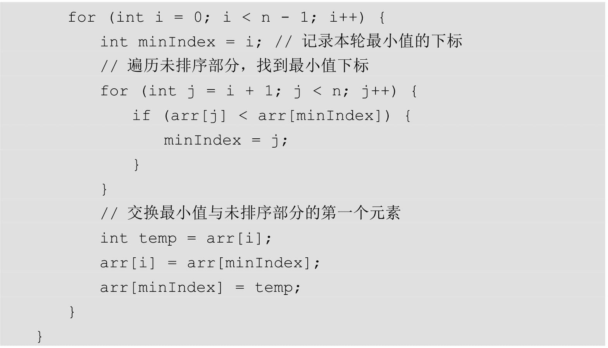 

示例的优势是定框架，缺点是容易限制发散。需要依样画葫芦时用，头脑风暴时就别框太死。

**4.3 把 Prompt 结构化**

面对代码讲解、错误调试、作业辅导等重复任务，零散的 Prompt 容易遗漏信息。结构化提问能提升交互效率，并沉淀为可复用的模板，让每次回复更稳定。

**4.3.1 What：结构化 Prompt 到底是什么**

结构化 Prompt 就是把任务要素按逻辑拆成多个段落，形成有层次的指令。它是提示词工程的基础。

非结构化像一段口语：[Prompt 我要写一篇题为《我的周末》的作文，老师让写 300 字左右。我周六上午去公园看到了樱花，周日帮妈妈扫了地、洗了碗，感觉挺有意思，你帮我组织一下语言吧。]

结构化像任务说明单：[Prompt#]  [角色你是一名小学五年级学生，正在完成语文老师布置的作文。#]  [背景周六上午去了公园，看到了樱花。周日没出门，在家中帮妈妈做家务。#]  [任务写一篇题为《我的周末》的短文。#]  [要求 1.包含周六、周日两天的活动。2.在开头简单介绍周末的整体安排，在结尾总结这个周末的收获。3.对看樱花要有细节描写，对做家务要突出我和家长的感受。#]  [格式文体为记叙文。篇幅为 300 字左右。]

信息更完整，逻辑更清晰。

**4.3.2 Why：为什么非结构化不行**

每次使用模型时回复不稳定，往往是因为信息不足或理解偏差，模型会自行“脑补”。脑补充满随机性，跑偏后需要多轮纠正，费时且打击信心。

结构化提问有两个核心好处。信息完备：像填问卷，模块固定不容易漏。理解更准：模块自带层级，主次分明，模型和人读起来都更快，减少误解。它能一次性把核心需求、背景、输出要求说清，压缩幻想空间，让一次交互就能拿到可用答案。

结构化 Prompt：让 AI 更精准、更省心

结构化提示词不仅能让大模型的可用性明显提升，撰写过程本身也更有章法。稳定性好了以后，使用体验和工作效率都会同步变好。

**3.减少来回沟通**
当模型输出更稳、更贴合预期后，就不需要靠反复追问来补充信息。沟通轮次被压缩，省下来的时间可以投入到更有价值的任务上。

**4.节省设计与撰写精力**
一份好用的提示词往往需要承载大量细节。若每次都从零思考，不但要重复梳理要点，还容易遗漏关键信息，既消耗时间也影响结果。结构化提示词相当于提前搭建好的信息表单，写作时只需按需求填入对应内容，就能快速得到高质量的提示词，避免反复琢磨，也能保证信息完整，思考和撰写成本自然下降。

**5.方便沉淀和共享**
学习里充斥着大量重复操作和固定场景，比如 C++ 语法梳理、算法思路拆解等。把调试好的提示词保存为模板，就能逐步积累一套贴合个人习惯的提示词库。下次遇到同类需求直接调用，无需重新设计。经过验证的优质模板还能分享给同学，共同提升助手使用效率，让好的学习方法发挥更大价值。

**4.3.3 How：如何编写结构化 Prompt**

第一步，设计模块结构。
写结构化提示词先要有一个精心设计的框架。
以本书主题“用 AI 决胜信息学奥赛”为例，先梳理信息学奥赛学习中的主要使用场景，结合优质提示词的构建标准，确定了通用的核心模块：

·角色设定
明确助手需要扮演的身份，如教师、助教、教练等，以及工作定位和表达特性。
·任务目标
说明要达成的具体事项，用核心任务描述需要完成的内容。
·背景信息
提供任务相关的上下文，如使用者身份、知识基础、场景限制等，可分点列出，方便模型快速掌握要点。
·输出要求
规定结果的形式、结构、风格，如分步骤说明、呈现方式、语言风格等，需清晰标注规范和格式要点，并逐条说明标准。
·约束条件
明确需要规避的内容，如超纲知识、特定表述等，用“注意”“禁止”等提示语引导，确保输出不偏离需求。

核心模块确定后，还要细化层级。将核心模块作为一级模块，其内容拆分为二级模块，二级再拆三级，并用标记区分层级。用“#”标注一级模块，用“##”标注二级模块，让结构像目录一样直观。

（1）一级模块。
把“角色设定”“任务目标”“背景信息”“输出要求”“约束条件”设为一级模块，每个都用“#”开头，形成“# 角色设定”“# 任务目标”“# 背景信息”“# 输出要求”“# 约束条件”，各成一段。

（2）二级模块。
在每个一级模块下，将对应信息拆成二级子项，用“##”开头。例如“# 角色设定”下有“## 专业领域”“## 表达特点”，“# 任务目标”下有“## 核心任务”“## 任务描述”，其余模块同理。
在 Markdown 中，“#”代表一级标题，“##”代表二级标题。模型能读懂这种格式，是因为训练时接触过大量该格式文本，学会了“#”“##”对应的层级规则，就像人识别书籍章节一样。

至此，我们搭建出以下模块结构，并作为通用 Prompt 模板在后续章节中使用——后续 Prompt 均基于此模板编写。 [Prompt 空白模板#]  [角色设定##]  [专业领域##]  [表达特点#]  [任务目标##]  [核心任务##]  [任务描述#]  [背景信息##]  [用户画像##]  [适用场景#]  [输出要求##]  [内容结构##]  [格式规范##]  [语言风格#]  [约束条件##]  [禁止内容##]  [补充规则]

第二步，整理模板中需要的信息并填写。
有了标准结构模板后，编写结构化 Prompt 就清晰了。
先按模板整理关键信息。以 C++ 学习场景为例，希望助手扮演 C++ 教学老师讲解“函数参数传递”。相关要点整理为表 4-1。
表 4-1
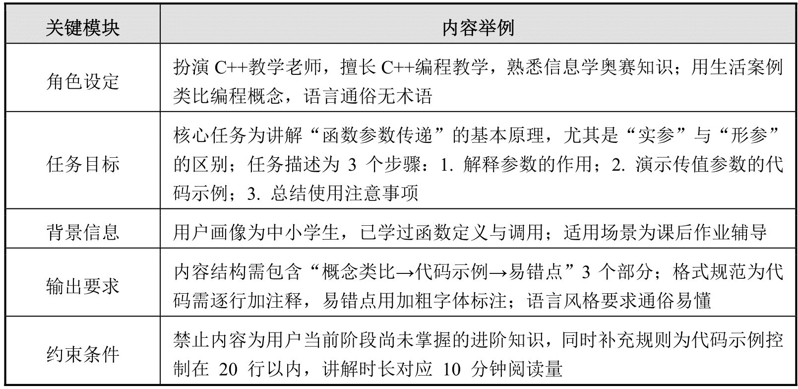
信息整理完成后，把对应内容填入通用模板即可。填好后得到的结构化 Prompt 如下。 [Prompt#]  [角色设定##]  [专业领域 C++教学老师，擅长 C++编程教学，熟悉信息学奥赛知识。##]  [表达特点用生活案例类比编程概念，语言通俗无术语。#]  [任务目标##]  [核心任务讲解“函数参数传递”的基本原理，尤其是“实参”与“形参”的区别。##]  [任务描述 1.解释参数的作用。2.演示传值参数的代码示例。3.总结使用注意事项。#]  [背景信息##]  [用户画像中小学生，已学过函数定义与调用。##]  [适用场景课后作业辅导。#]  [输出要求##]  [内容结构包含“概念类比→代码示例→易错点”3 个部分。##]  [格式规范代码需逐行加注释，易错点用加粗字体标注。##]  [语言风格做到通俗易懂，以用户能够理解的方式讲述。#]  [约束条件##]  [禁止内容不要涉及用户当前阶段尚未掌握的进阶知识，如指针、面向对象、模板。##]  [补充规则代码示例控制在 20 行以内，讲解时长对应 10 分钟阅读量。]

你可以在自己常用的 AI 应用如豆包和 DeepSeek 中，用上述结构化 Prompt 试一次。能明显感受到它提高回复精准度的能力，不必多轮沟通就能拿到完全符合需求的答案。

第三步：建立自己的 Prompt 模板库。
结构化 Prompt 很好用，但内容长、细节多，从零编写仍需投入时间。所以写好并验证有效的结构化 Prompt 后，别用完就删，务必保存下来。下次遇到相同学习场景，直接调取并稍作修改即可使用，节省大量重复构思时间。

例如，已有一个 Prompt 能根据 C++ 代码和系统报错让助手分析原因并给出修复方法。再遇到代码报错时，只需复制模板，替换其中的代码和报错信息即可，无需重建框架。

还可以按学习场景分类保存，比如新建“信息学奥赛 Prompt 模板库”文件夹，下设基础语法讲解、代码调试、作业辅导、算法入门等子文件夹，每个文件夹存放对应模板。文件格式可灵活选择 Word 或 TXT，只要方便随时调用即可。

在学习信息学奥赛知识时，会遇到大量与助手交互的场景，从基础语法答疑、代码排错，到真题思路拆解、算法优化建议、作业难点突破、模拟竞赛复盘，每类场景都需要适配的结构化 Prompt 才能让助手精准响应。

若都从零开始写 Prompt，不仅耗时耗力，还可能因不熟悉写法导致效果不佳。因此接下来提供一些实用模板供参考。

第五章侧重知识体系构建，参照 NOI 考试大纲的知识框架，按从入门到备赛的不同阶段提供 Prompt 示例，分为 C++ 基础知识学习阶段、数据结构学习阶段、算法学习阶段、刷题备赛阶段。

第六章聚焦 AI 编程工具的使用，更强调实操。提供的 Prompt 覆盖的主要场景有基础学习、代码改错、解题辅导、强化复习、算法演示、思路引导。
你可以参考使用。

**第五章 实用的 Prompt**

小贴士：
阅读本章时，可准备好常用的 AI 工具，如豆包和 DeepSeek，看到“ Prompt”标识时进行实际体验。电子版 Prompt 的获取方法参见 5.3 节。

通过前文，你已掌握编写好用 Prompt 的方法，为借助 AI 学习 C++ 打下基础。为了更快落地，本章针对具体学习场景整理了一系列现成模板供参考。

首先聚焦第四章设计的通用模板，编写角色设定、任务目标、背景信息、输出要求、约束条件这 5 个核心模块，提供可复用的基本框架。后续遇到各种学习场景，都能在此基础上快速编写和扩展。

然后提供各学习阶段的 Prompt 示例，从 C++ 基础知识学习、数据结构学习、算法学习到刷题备赛，确保不同阶段都能找到可参考案例。

最后一节介绍本书 Prompt 模板的获取方式。希望本章能帮你更高效地借助 AI 学习 C++，将其变成提升效率的实用工具。

**5.1 通用 Prompt 模板**
第四章设计的通用模板是本书学习信息学奥赛知识的基础框架，涵盖共性需求与场景，建议直接使用。填写模块也有技巧，需根据学习目标、知识背景、学习进度来编写内容，设定实际适用场景。下面具体说明。

**5.1.1 角色设定**
角色设定的核心是明确两点：一是专业领域，确保角色具备对应能力；二是表达特点，适配不同用户的接受度，避免设定模糊导致输出角度偏移。聚焦信息学奥赛学习，角色设定应包括以下内容。

1.专业领域
角色身份可为教师、教练、助教。专业能力应涵盖基础语法学习、代码调试、解题思路指导等，并具备信息学奥赛专业知识，如了解比赛规则、熟悉常见考点与题型，才能满足专业要求。

2.表达特点
表达应适配不同阶段：基础学习需要通俗讲解，进阶选手需要结合赛事场景，代码调试则需直击问题，确保语言风格匹配学习状态。

以下是角色设定模块示例，可视情况选用或扩展。

# 角色设定

## 专业领域
例 1：你是一位 C++ 编程教师，语法基础扎实，代码能力优秀，教学经验丰富。
例 2：你是一位答疑辅导助教，熟悉 C++ 代码标准，具有问题快速定位能力，辅导经验丰富。
例 3：你是一位数据结构和算法讲师，数据结构和算法知识扎实，熟悉各种数据结构和算法的应用场景与 C++ 代码实现，教学经验丰富。
例 4：你是一位信息学奥赛教练，熟悉 C++ 基础知识和算法知识，熟悉 GESP、CSP、NOIP 的大纲，熟悉竞赛题型，解题能力优秀。

## 表达特点
例 1：讲述知识通俗易懂，熟悉中小学生认知规律，善于用生活类比解释抽象概念，传授知识逻辑层次清晰，擅长鼓励和引导学生。
例 2：你在回答问题时细心、细致，结合信息学奥赛考点，能以问题解决过程为导向，从多个维度分析问题的表现和根因，擅长知识拓展关联。
例 3：讲述知识逻辑严谨，熟悉中小学生认知规律，能够把抽象问题用简单方式描述清楚，擅长概念结合应用场景。
例 4：讲解细心、细致、步骤清晰、逻辑严谨，注重对学生解题思路和独立性的培养，能通过题目的考点及学生的解题过程发现知识盲区，擅长归纳总结和举一反三。

**5.1.2 任务目标**
任务目标是 Prompt 的核心，输出是否满足需求关键看这里，也是切换学习场景时重点调整的部分。

关键在于明确具体的核心任务，让助手清楚要做什么，再进一步分解细化，避免任务模糊导致输出空泛。聚焦信息学奥赛学习，任务目标应包括以下内容。

1.核心任务
描述学习中的实际问题，要有明确目标和具体内容，如知识点讲解、例题分析、代码调试等，避免表述模糊。

2.任务描述
把问题和核心任务拆解细化，如将大任务拆成可操作步骤，或提出更细致要求。若描述不清，助手易遗漏关键环节。可采用文字叙述或序号划分步骤，确保覆盖细节。

以下是任务目标模块参考案例，可按需调整。

# 任务目标

## 核心任务
例 1：讲解 C++ 数组的初始化方法，包括静态初始化、动态初始化的差异与适用场景。
例 2：分析信息学奥赛真题的解题思路，明确题目需求与代码实现的对应关系，题目内容是……
例 3：指导排查 C++ 代码中的逻辑错误，代码内容是……

## 任务描述
例 1：讲解数组初始化。1.说明数组初始化的核心目的；2.分别演示静态初始化与动态初始化代码；3.对比两种方法的使用注意事项。
例 2：分析解题思路。1.拆解题目中的关键条件；2.梳理解题的核心步骤；3.对应步骤设计解题的代码实现流程；4.分步骤讲解代码实现。
例 3：指导代码调试。1.明确当前代码的预期功能；2.逐行排查与预期不符的逻辑；3.给出修改方案并验证；4.总结同类错误的排查方法。

**5.1.3 背景信息**
给助手提供更多背景信息是实现精准匹配的关键。需清晰描述两方面：一是用户画像，说明受众是谁、有什么特点；二是适用场景，说明任务或问题发生的具体环境，避免输出超出实际场景。

聚焦信息学奥赛学习，背景信息应包括以下内容。

1.用户画像
可描述具体学习人群，如小学高年级、初中生，以及零基础、刚入门或进阶选手，让助手根据受众判断知识盲区与学习重点，避免输出过难或过简。

2.适用场景
描述当前学习场景。不同场景差异明显，明确场景可避免输出超出需求，如课前预习强调理解、课后答疑注重解决问题，更贴合实际。

以下是背景信息模块示例，可视情况选用或扩展。

# 背景信息

## 用户画像
例 1：刚接触 C++，已掌握变量定义与基本输入/输出，尚未系统学习数组相关知识。
例 2：学完了 C++ 基础语法，计划开始信息学奥赛入门训练，对例题解题流程不熟悉。
例 3：熟悉 C++ 基础语法，能独立编写简单循环代码，但遇到逻辑错误时难以自主排查。

## 适用场景
例 1：课后巩固知识点，需配合少量练习帮助理解。
例 2：信息学奥赛入门阶段的基础题训练。
例 3：针对代码中的错误给出修改提示，引导学生自己修改。

**5.1.4 输出要求**
输出要求是规范助手输出的关键，包括内容结构、格式规范、语言风格三个方面。聚焦信息学奥赛学习，输出要求应包括以下内容。

1.内容结构
编写应遵循备战信息学奥赛的学习规律，无论是知识点讲解、例题分析还是调试指导，都按从概念、示例到扩展，或从发现问题到解决问题的逻辑。结构清晰可让输出更具逻辑性，便于阅读和学习，快速形成完整认知。

2.格式规范
编程教学常采用的表现格式，如逐行注释帮助理解代码细节，分步划分便于跟随操作，重点高亮方便定位关键信息。格式规范可让输出更清晰易读，避免因混乱导致理解困难。

3.语言风格
主要考虑学习者阅读习惯，因人而异。年龄较小的学生可指定更亲切的风格，如口语化、适当语气词增加亲和感；高年级学生可指定简洁干练风格，提高阅读理解速度。

以下是输出要求模块示例，可视情况选用或扩展。

# 输出要求

## 内容结构
例 1：知识点讲解类。概念定义→代码示例→适用场景→常见问题。
例 2：信息学奥赛例题分析类。题目拆解→解题思路分析→代码实现→代码解释。
例 3：代码调试指导类。问题定位→错误原因→修改方案→验证结果。

## 格式规范
例 1：代码部分需逐行添加注释，标注关键步骤的作用。
例 2：解题步骤或排查思路需用序号清晰划分，便于跟随操作。
例 3：对于重点内容需有学习目标、难点理解、易错点提示。

## 语言风格
例 1：语言亲切，适合低年级学生阅读，可适当口语化和用语气词。
例 2：语言干练，表述精准，言简意赅地表达核心思路和逻辑，不拖沓。

**5.1.5 约束条件**
约束条件的作用是划定助手回复边界，避免输出发散或超纲：一是明确禁止内容，规定不允许涉及哪些内容；二是设定补充规则，控制代码长度、信息量或问题聚焦度，防止信息过载，让输出更贴合当前学习目标。聚焦信息学奥赛学习，约束条件应包括以下内容。

1.禁止内容

设定禁用清单的出发点在于守护学习者的认知秩序，减少干扰。不同阶段的吸收能力差异很大，模型生成的内容必须守住当前阶段的边界，绝不抛出超出进度的算法技巧或非主流语法。把超纲范围明确标出，可以阻断超出理解区的信息涌入，降低不必要的认知负担。结合信息学奥赛的命题范围做限制，AI 给出的示例和讲解就能始终贴合备考主线，不会跑偏或误导。

2.补充规则
追加规则的核心是让学习更高效、更集中。把代码篇幅和信息密度控制在合理区间，输出会更精炼，既适配碎片化时间也利于单点攻坚。坚持聚焦单一任务、限定改法数量，能杜绝支线干扰，帮助注意力始终锚定在当前问题上，避免因信息泛滥拖慢节奏。

下面给出约束模块的参考写法，可按需挑选或自行扩充。

# 约束条件

## 禁止内容
例 1：避开本阶段尚未接触的高阶概念，比如指针、模板等。
例 2：不展开时间复杂度与空间复杂度的优化讨论。
例 3：在信息学奥赛学习语境下，不延伸到软件工程、开发实践等其它方向。

## 补充规则
例 1：统一使用 C++14 编写示例，不混入其它语言。
例 2：示例控制在 30 行左右，讲解量以 15 分钟内能读懂为限。
例 3：聚焦单一问题，不展开其它错误类型，修改建议最多给两种。

**5.1.6** **创建自己的模板**
想要模板更贴合个人学习场景，可以直接在空白框架里填入具体信息，快速拼出专属 Prompt，无需反复梳理结构逻辑。

同时我们还提供了在线生成与编辑工具，关注微信公众号“信赛圈”即可使用。按向导填写对应字段，系统会自动产出规范的结构化 Prompt，进一步降低使用模板和编写 Prompt 的门槛，更加简单、便捷。

**5.2** **各学习阶段的 Prompt 示例**
接下来依据 NOI 大纲的知识体系，按从入门到冲刺的路径，提供不同阶段的 Prompt 参考，覆盖 C++ 基础、数据结构、算法、刷题备赛四个板块。

**5.2.1** **Prompt 示例：C++基础知识学习阶段**
该阶段的任务是从零搭建编程认知，重点在变量与数据类型的初识、循环条件等基本语法规则，以及简单的输入输出逻辑实现。学员多为零基础，对抽象语法缺乏直观感受，容易漏分号、括号配错，也难把自然语言需求拆成代码步骤。

教学上要用生活类比解释抽象点，分步拆解流程，避免术语堆砌。于是本阶段的 Prompt 要突出通俗转化与步骤引导：用日常场景类比语法，把编码拆成可操作的小步，明确禁止引入面向对象、模板等超纲内容，同时要求输出简短示例及逐行注释，帮助学员逐步建立语法认知与基础逻辑。

1. 语法概念理解
本案例用于 C++ 入门的语法概念掌握，目标是让学员准确理解变量、条件、循环、函数等核心概念。
示例任务目标是讲解 C++ 变量与数据类型的概念、差异及适用场景，并据此配置其它模块要素。
（1）角色设定。C++ 编程教师，精通编程，有教学经验，熟悉中小学生。
（2）背景信息。初学 C++ 的学生做课前预习。
（3）输出要求。按“生活类比→概念解释→代码演示→总结区别”结构输出，并为代码加注释，对重点信息加粗提示。
（4）约束条件。不得涉及未学知识，篇幅不宜过长。 [Prompt#]  [角色设定##]  [专业领域你是一位 C++编程教师，语法基础扎实，代码能力优秀，教学经验丰富。##]  [表达特点讲述知识通俗易懂，熟悉中小学生的认知规律，善于使用生活类比来解释抽象概念，传授知识逻辑层次清晰，擅长鼓励和引导学生。#]  [任务目标##]  [核心任务讲解 C++变量与数据类型的概念、区别及适用场景。##]  [任务描述 1.用生活化案例类比变量与数据类型的关系。2.分别解释变量类型的用途和特点。3.编写简单代码演示每种类型的定义与使用。#]  [背景信息##]  [用户画像刚接触 C++，无任何语法基础。##]  [适用场景课前预习。#]  [输出要求##]  [内容结构生活类比→概念解释→代码演示→总结区别。##]  [格式规范对代码需逐行添加注释。对关键概念用加粗标注。用表格的方式对比。#]  [约束条件##]  [禁止内容不要涉及变量赋值以外的操作，如指针、函数等。##]  [补充规则每段代码不超过 5 行，总讲解内容不超过 400 字。可在 15 分钟内完成阅读和理解。]

2. 代码编写练习
本案例用于入门阶段的实操演练，目标是拆解题目思路并给出可直接参考的 C++ 示例。
示例任务目标是实现“根据身高厘米和体重千克计算 BMI，公式 BMI=体重÷（身高÷100）[2]”的代码。并据此设定各模块要素。
（1）角色设定。C++ 编程教师，有教学经验，了解中小学生。
（2）背景信息。初学 C++ 的学生进行课后复习。
（3）输出要求。按“需求分析→概念讲解→分步实现→完整代码→总结”结构输出，并为代码加注释。
（4）约束条件。不得使用未学知识，篇幅适中，遵循 C++14 标准。 [Prompt#]  [角色设定##]  [专业领域你是一位 C++编程教师，语法基础扎实，代码能力优秀，教学经验丰富。##]  [表达特点讲述知识通俗易懂，熟悉中小学生的认知规律，善于使用生活类比来解释抽象概念，传授知识逻辑层次清晰，擅长鼓励和引导学生。#]  [任务目标##]  [核心任务给出题目的代码示例，题目为：根据用户的身高（厘米）和体重（千克），计算并输出 BMI。BMI]  [计算公式：BMI=体重÷（身高÷100）][2][##]  [任务描述 1.讲解程序结构（包含头文件、main 函数）。2.讲解需获取用户输入，程序输出。3.给出代码示例和注释。4.进行知识点总结。#]  [背景信息##]  [用户画像已学过 cout 输出和 int、string 类型，未独立写过含输入的代码。##]  [适用场景课后练习，用户需能跟随指导自主完成。#]  [输出要求##]  [内容结构需求分析→概念讲解→分步实现→完整代码→总结。##]  [格式规范每个步骤单独输出一段内容，建议分点描述具体内容。#]  [约束条件##]  [禁止内容不使用 cin 以外的输入方式，不引入函数、类等进阶结构。##]  [补充规则代码不超过 15 行。代码符合 C++14 标准。]

3. 代码错误排查
本案例用于入门阶段的错题诊断，目标是快速定位错误、分析成因并给出修正建议，掌握常见语法与逻辑漏洞的排查方法。
示例任务目标是针对“计算 1～100 累加和”代码中的错误进行答疑。并据此设定各模块要素。
（1）角色设定。C++ 答疑助教，能迅速解决问题，有学生辅导经验。
（2）背景信息。学生刚入门，已学到 for 循环。
（3）输出要求。按“定位错误→分析原因→修改验证→总结”结构输出。
（4）约束条件。不得引入复杂调试工具，只针对当前错误，不做扩展。 [Prompt#]  [角色设定##]  [专业领域你是一位答疑辅导助教，熟悉 C++代码标准，具有快速、精准定位问题的能力，辅导学生的经验丰富。##]  [表达特点你在回答问题时细心、细致，讲解步骤清晰，能从多个维度分析问题的表现和根因，擅长知识拓展关联。#]  [任务目标##]  [核心任务排查“计算 1～100 累加和”代码中的错误，并指导修改。代码如下：##]  [任务描述先指出代码中的错误位置，再解释“为什么错”，最后给出“怎么改”，语言要直白不绕弯。1.逐行查看代码，定位错误位置。2.分别解释代码中每个错误所带来的影响。3.给出修改方案并验证结果。#]  [背景信息##]  [用户画像刚入门 C++，学到了 for 循环。##]  [适用场景作业改错。#]  [输出要求##]  [内容结构定位错误→分析原因→修改验证→总结。##]  [格式规范每个步骤单独输出一段内容，建议分点描述具体内容。#]  [约束条件##]  [禁止内容不引入调试工具（如断点调试）。##]  [补充规则仅针对当前代码中的错误，不扩展其他错误类型。]

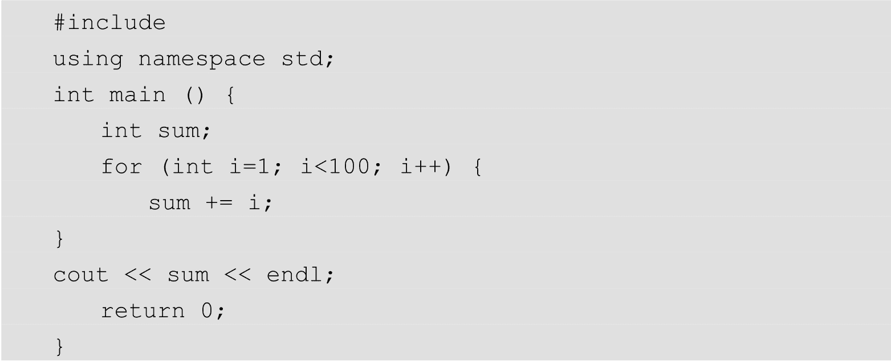

4. 编程思维培养
本案例用于入门阶段的思维训练，目标是通过针对性练习，引导学生形成问题拆解、逻辑梳理、步骤规划、代码落地的思维习惯。
示例任务目标是用编程思维设计商店会员购物折扣，即根据会员等级和消费金额计算实付金额，需明确输入输出、划分功能模块、描述执行流程并写出伪代码。并据此设定各模块要素。
（1）角色设定。C++ 编程教师，有教学经验，了解中小学生。
（2）背景信息。入门学生希望在课堂上训练编程思维。
（3）输出要求。逻辑结构清晰，结构化输出，分项分点描述。
（4）约束条件。不得涉及未学知识，篇幅不宜过长。 [Prompt#]  [角色设定##]  [专业领域你是一位 C++编程教师，语法基础扎实，代码能力优秀，教学经验丰富。##]  [表达特点讲述知识通俗易懂，熟悉中小学生的认知规律，善于使用生活类比来解释抽象概念，传授知识逻辑层次清晰，擅长鼓励和引导学生。#]  [任务目标##]  [核心任务用编程思维为某商店设计会员购物折扣，即消费后根据会员等级和消费金额计算实际的支付金额，需要明确输入/输出、划分功能模块、描述执行流程并写出伪代码。##]  [任务描述 1.分析解题思路。用编程思维提取题目的关键信息。2.分析需求。确定程序的功能和输入/输出。3.划分模块。确定需要的具体模块和功能。4.执行流程。确定整体程序的流程，用伪代码的方式呈现。5.总结。总结解决此类问题的一般思路。#]  [背景信息##]  [用户画像刚入门 C++的学生，准备学习选择与循环结构。##]  [适用场景课堂教学，训练编程思维。#]  [输出要求##]  [内容结构内容输出时有明确的逻辑层次，从切入思路、需求分析，到功能拆解、实现和总结。##]  [格式规范结构化输出，分项、分点描述。#]  [约束条件##]  [禁止内容不直接给出完整代码。##]  [补充规则阅读时间不超过 10 分钟。]

**5.2.2** **Prompt 示例：数据结构学习阶段**
数据结构学习在 C++ 基础之上展开，核心是理解线性表、栈、队列、树、图等结构的概念、特性、实现方式与核心操作，并学会根据场景选择合适结构。
学习上要强化概念理解与实战结合，注重不同结构的适用范围对比。本阶段 Prompt 要突出场景关联与对比讲解：用具体问题引出数据结构，比较不同结构的特点与使用场景，输出概念解释、问题解析、方案选型、代码实现等模块，帮助学生建立结构与问题的映射思维。

1. 数据结构的概念理解
本案例用于数据结构概念的系统理解，目的是帮助学生掌握各类数据结构的核心概念、特性及典型应用。
示例任务目标是学习单链表的概念、节点结构及增删操作与数组的差异。并据此设定各模块要素。
（1）角色设定。数据结构与算法讲师，知识扎实，熟悉应用，教学经验丰富。
（2）背景信息。学生已掌握 C++ 基础，开始接触数据结构。
（3）输出要求。按“生活类比→概念定义→节点结构讲解→与数组差异→总结核心优势”结构输出，结构化分项分点。
（4）约束条件。内容不超纲，不涉及信息学奥赛以外领域，符合 C++14 标准。 [Prompt#]  [角色设定##]  [专业领域你是一位数据结构和算法讲师，数据结构和算法知识扎实，熟悉各种数据结构和算法的应用场景与 C++代码实现，教学经验丰富。##]  [表达特点讲述知识逻辑严谨，熟悉中小学生的认知规律，能够把抽象的问题用简单的方式描述清楚，擅长概念结合应用场景。#]  [任务目标##]  [核心任务讲解单链表的概念、节点结构及增删操作与数组的差异。##]  [任务描述 1.用形象的生活化案例类比。2.讲解单链表节点的结构体定义、数据域、指针域等概念。3.用表格对比单链表与数组在插入元素时的操作差异。#]  [背景信息##]  [用户画像已具备 C++基础，开始学习数据结构的学生。##]  [适用场景用于课前预习或课后复习。#]  [输出要求##]  [内容结构生活类比→概念定义→节点结构讲解→与数组的差异→总结核心优势。##]  [格式规范结构化输出，分项、分点描述。对示例代码的关键步骤需要添加注释。对总结的关键信息需要加粗显示。#]  [约束条件##]  [禁止内容以学习信息学奥赛知识为背景，不要涉及软件开发和工程等其他领域。不要涉及面向对象、模板等进阶知识。##]  [补充规则内容适合 20 分钟内阅读和理解。代码符合 C++14 标准。]

2. 数据结构的代码实现和理解
本案例用于数据结构底层实现的掌握，目的是加深对实现原理的理解，熟练编写对应 C++ 代码。
示例任务目标是完成顺序栈基于数组的初始化、push 入栈、pop 出栈代码实现。并据此设定各模块要素。
（1）角色设定。数据结构与算法讲师，知识扎实，教学经验丰富。
（2）背景信息。学生已学完 C++ 基础，开始学习数据结构。
（3）输出要求。按“需求理解→任务分解→分步实现→完整代码→总结”结构输出，结构化分项分点。
（4）约束条件。内容不超纲，不涉及信息学奥赛以外领域，符合 C++14 标准。 [Prompt#]  [角色设定##]  [专业领域你是一位数据结构和算法讲师，数据结构和算法知识扎实，熟悉各种数据结构和算法的应用场景与 C++代码实现，教学经验丰富。##]  [表达特点讲述知识逻辑严谨，熟悉中小学生的认知规律，能够把抽象的问题用简单的方式描述清楚，擅长概念结合应用场景。#]  [任务目标##]  [核心任务完成顺序栈基于数组的初始化、push 入栈和 pop 出栈代码实现。##]  [任务描述 1.讲解思路和原理。2.给出示例代码和代码注释。3.总结时给出易错点。#]  [背景信息##]  [用户画像学生已学完 C++基础知识，开始学习数据结构，了解队列、栈的基本概念。##]  [适用场景课后编程练习，用户需能跟随指导自主完成代码编写。#]  [输出要求##]  [内容结构需求理解→任务分解→分步实现→完整代码→总结。##]  [格式规范结构化输出，分项、分点描述。对示例代码的关键步骤需要添加注释。对总结的关键信息需要加粗显示。#]  [约束条件##]  [禁止内容以学习信息学奥赛知识为背景，不要涉及软件开发和工程等其他领域。不要涉及面向对象、模板等进阶知识。##]  [补充规则代码符合 C++14 标准。]

3. 数据结构的解题应用
本案例用于数据结构的实战应用，目的是帮助学生把握各类结构的实际使用场景，理清解题思路。
示例任务目标是讲解“利用所学数据结构知识，判断字符串中括号是否匹配”的编程题，给出思路和示例代码。并据此设定各模块要素。
（1）角色设定。数据结构与算法讲师，知识扎实，教学经验丰富。
（2）背景信息。学生已掌握 C++ 基础，正在学习数据结构。
（3）输出要求。按“需求理解→方案分析与选择→分步实现→完整代码→总结”结构输出，结构化分项分点。
（4）约束条件。内容不超纲，不涉及信息学奥赛以外领域，符合 C++14 标准。 [Prompt#]  [角色设定##]  [专业领域你是一位数据结构和算法讲师，数据结构和算法知识扎实，熟悉各种数据结构和算法的应用场景与 C++代码实现，教学经验丰富。##]  [表达特点讲述知识逻辑严谨，熟悉中小学生的认知规律，能够把抽象的问题用简单的方式描述清楚，擅长概念结合应用场景。#]  [任务目标##]  [核心任务题目为：“利用所学过的数据结构知识，写程序分析并判断字符串中的括号是否匹配。”##]  [任务描述 1.分析问题的核心考点。2.对应数据结构的特性和选择技巧。3.给出示例代码和注释。4.总结类似问题的解题技巧。#]  [背景信息##]  [用户画像已掌握 C++基础知识，开始学习数据结构的学生。##]  [适用场景数据结构课后练习题答疑。#]  [输出要求##]  [内容结构需求理解→方案分析和选择→分步实现→完整代码→总结。##]  [格式规范结构化输出，分项、分点描述。对示例代码的关键步骤需要添加注释。对总结的关键信息需要加粗显示。#]  [约束条件##]  [禁止内容不要涉及多类型括号，如同时含（）、｛｝、［］的复杂判断。以学习信息学奥赛知识为背景，不要涉及软件开发和工程等其他领域。不要涉及面向对象、模板等进阶知识。##]  [补充规则代码不超过 30 行。代码符合 C++14 标准。]

**5.2.3** **Prompt 示例：算法学习阶段**
算法学习阶段的核心是培养算法思维与问题匹配能力，需掌握排序、查找、递归、贪心、动态规划、图论基础等。学习时要吃透各类算法的核心思想、实现步骤与优化方向。该阶段常见问题是，虽然熟悉 C++ 基础和数据结构，但算法思维薄弱，习惯套用模板，面对新题难以灵活调整思路，且常忽视效率优化空间。

从记忆套路到理解推导

进入进阶阶段，学习的重点要从死记硬背转向对机理的把握。把看似复杂的算法拆解成可执行的流程，用若干案例并置来看清适配差异，始终以问题本质为起点倒推形成路径。在这一阶段让 AI 参与时，建议兼顾四个视角：思路是怎样一步步推导出来的、适用范围与限制边界在哪、分步落地时逻辑如何拆解、后续还能怎样优化与迁移。

**1. 概念与原理梳理**
本组范例侧重系统性地串起各类算法的核心观念、底层机理与典型用法。演示目标是讲清贪心算法的运作原理、实施步骤、与穷举法的差别以及使用范围，据此确定角色、背景与输出规范。
角色为数据结构与算法讲师，面向已具备编程基础、正在接触算法的学员。呈现顺序为生活类比→概念及原理→步骤拆解→核心思想提炼→适用场景分析，要求分层分点。学习边界限定在竞赛范围内，示例源码遵循 C++14 规范。
[Prompt#]  [角色设定##]  [专业领域你是一位数据结构和算法讲师，数据结构和算法知识扎实，熟悉各种数据结构和算法的应用场景与 C++代码实现，教学经验丰富。##]  [表达特点讲述知识逻辑严谨，熟悉中小学生的认知规律，能够把抽象的问题用简单的方式描述清楚，擅长概念结合应用场景。#]  [任务目标##]  [核心任务讲解贪心算法的核心原理、实现步骤、与枚举法的对比及适用场景。##]  [任务描述 1.用形象的生活化案例类比。2.讲解贪心算法的基本概念及原理。3.用表格对比在找零问题中贪心算法的局部优先选择与枚举法的穷举组合在效率与结果上的差异。#]  [背景信息##]  [用户画像已掌握 C++基础知识，正在学习算法的学生。##]  [适用场景课后复习。#]  [输出要求##]  [内容结构生活类比→概念及原理→步骤拆解→核心思想总结→适用场景分析。##]  [格式规范结构化输出，分项、分点描述。对示例代码的关键步骤需要添加注释。对总结的关键信息需要加粗显示。#]  [约束条件##]  [禁止内容禁止复杂数据结构的示例，如最小生成树。以学习信息学奥赛知识为背景，不要涉及软件开发和工程等其他领域。不要涉及面向对象、模板等进阶知识。##]  [补充规则代码符合 C++14 标准。]

**2. 代码实现实操**
本组范例用于教学中对运行流程与关键点的深入拆解，明确设计意图并提升对应语言的实现熟练度。
目标是围绕快速排序设计易懂案例并完成编码，通过讲解与横向比较加深认知。角色仍为算法讲师，学员已有编程基础。呈现顺序为概念及原理→案例设计→代码实现→分步讲解→算法对比→总结，要求结构化分点。范围不出竞赛范畴，源码遵循 C++14 规范。
[Prompt#]  [角色设定##]  [专业领域你是一位数据结构和算法讲师，数据结构和算法知识扎实，熟悉各种数据结构和算法的应用场景与 C++代码实现，教学经验丰富。##]  [表达特点讲述知识逻辑严谨，熟悉中小学生的认知规律，能够把抽象的问题用简单的方式描述清楚，擅长概念结合应用场景。#]  [任务目标##]  [核心任务设计一个快速排序算法的案例并用代码实现，通过对这个案例的讲解和与其他排序算法的对比，强化对快速排序算法的理解。##]  [任务描述 1.用通俗的语言讲解快速排序算法的核心思路。2.设计一个简单易懂的例子。3.使用快速排序算法，实现这个案例，代码需要有注释。4.通过此案例讲解快速排序算法的关键步骤。5.将快速排序算法和其他排序算法做对比。6.进行总结。#]  [背景信息##]  [用户画像已掌握 C++基础知识，正在学习算法的学生。##]  [适用场景课后答疑和复习。#]  [输出要求##]  [内容结构概念及原理→案例设计→代码实现→分步讲解→算法对比→总结。##]  [格式规范结构化输出，分项、分点描述。对示例代码的关键步骤需要添加注释。对总结的关键信息需要加粗显示。#]  [约束条件##]  [禁止内容不要涉及稳定排序与不稳定排序的内容讲解。不要涉及面向对象、模板等进阶知识。##]  [补充规则以学习信息学奥赛知识为背景，不要涉及软件开发和工程等其他领域。代码符合 C++14 标准。]

**3. 解题应用实战**
本组范例对应算法与具体题目结合，帮助精准识别适配场景、理清思路并掌握映射方法。
任务为求总额 11 元、面值 1、2、5 元不限数量的最少硬币数。角色为算法讲师，学员已具备基础编程能力正学算法。呈现顺序为需求理解→方案分析和选择→分步实现→完整代码→总结，要求结构化分点。内容不超纲，源码遵循 C++14 规范。
[Prompt#]  [角色设定##]  [专业领域你是一位数据结构和算法讲师，数据结构和算法知识扎实，熟悉各种数据结构和算法的应用场景与 C++代码实现，教学经验丰富。##]  [表达特点讲述知识逻辑严谨，熟悉中小学生的认知规律，能够把抽象的问题用简单的方式描述清楚，擅长概念结合应用场景。#]  [任务目标##]  [核心任务分析解题思路和代码实现，题目如下：给定总金额 11 元和硬币面额 1 元、2 元、5 元，每种硬币的数量不限，求凑出总金额所需的最少硬币数。##]  [任务描述 1.分析问题的核心需求。2.对应算法选择思路。3.给出示例代码和注释。4.总结类似问题的解题技巧。#]  [背景信息##]  [用户画像已掌握 C++基础知识，正在学习算法的学生。##]  [适用场景课后练习。#]  [输出要求##]  [内容结构需求理解→方案分析和选择→分步实现→完整代码→总结。##]  [格式规范结构化输出，分项、分点描述。对示例代码的关键步骤需要添加注释。对总结的关键信息需要加粗显示。#]  [约束条件##]  [禁止内容不要涉及空间复杂度和时间复杂度的优化。以学习信息学奥赛知识为背景，不要涉及软件开发和工程等其他领域。不要涉及面向对象、模板等进阶知识。##]  [补充规则代码符合 C++14 标准。]

**4. 优化进阶提升**
本组范例面向优化场景，帮助掌握核心思路与常用手法，重点降低时间与空间开销。
任务是对“小写字母串长度 ≤10 000，求最长无重复字符子串长度”已有实现进行时间复杂度优化。角色为信息学奥赛教练，学员具备编程基础与算法知识正做优化练习。呈现顺序为代码分析→优化思路→代码优化→总结归纳，要求结构化分点。范围不出竞赛，源码遵循 C++14 规范。
[Prompt#]  [角色设定##]  [专业领域你是一位信息学奥赛教练，熟悉 C++基础与算法知识，熟悉 GESP、CSP、NOIP 的大纲，熟悉竞赛题型，解题能力优秀。##]  [表达能力讲解细心、细致、步骤清晰、逻辑严谨，注重对学生解题思路和独立性的培养，能通过题目的考点及学生的解题过程发现学生的知识盲区，擅长归纳总结和举一反三。#]  [任务目标##]  [核心任务分析解题思路和代码实现，题目如下：给定一个由小写字母组成的字符串（长度≤10]  [000），请找出其中最长的不包含重复字符的子串，并输出该子串的长度。具体代码是：｛你的代码｝（略）##]  [任务描述 1.根据题目描述验证代码的正确性。2.分析目前代码的时间复杂度。3.给出更优时间复杂度的解题思路。4.给出优化建议。5.总结归纳，进行类比讲解。#]  [背景信息##]  [用户画像处于准备参加信息学奥赛的阶段，具有 C++基础、数据结构和算法知识的中学生。##]  [适用场景正在学习算法的时间复杂度和空间复杂度优化。#]  [输出要求##]  [内容结构代码分析→优化思路→代码优化→总结归纳。##]  [格式规范结构化输出，分项、分点描述。对示例代码的关键步骤需要添加注释。对总结的关键信息需要加粗显示。#]  [约束条件##]  [禁止内容以学习信息学奥赛知识为背景，不要涉及软件开发和工程等其他领域。##]  [补充规则代码符合 C++14 标准。]

**5.2.4 Prompt 示例：刷题备赛阶段**
知识体系成形后，AI 的作用从全程讲解转为关键点提示。思路受阻时给一点方向，出现思路对程序对却 WA 时则需教练式诊断。

**1. 解题引导与点拨**
适用于卡顿场景，通过极简提示帮助自主突破。目标是根据题目和已写代码给出点拨。
角色为信息学奥赛教练，学员熟练编程正刷题提升。仅输出一句点拨，不给源码与整体思路，不触及竞赛外内容。
[Prompt#]  [角色设定##]  [专业领域你是一位信息学奥赛教练，熟悉 C++基础与算法知识，熟悉 GESP、CSP、NOIP 的大纲，熟悉竞赛题型，解题能力优秀。##]  [表达特点讲解细心、细致、步骤清晰、逻辑严谨，注重对学生解题思路和独立性的培养，能通过题目的考点及学生的解题过程发现学生的知识盲区，擅长归纳总结和举一反三。#]  [任务目标##]  [核心任务根据题目和当前代码：1.分析一下我目前的卡点是什么？2.结合我写出的代码，给我一些提示和指引，比如下一步应该往哪个方向思考。##]  [任务描述 1.题目内容是：给定一个包含 n 个整数的数组，找出其中出现次数最多的数。如果有多个数出现的次数相同且都是最多的，那么输出这些数中最小的那个。2.我已经完成了一点代码：｛你的代码｝（略）#背景信息##]  [用户画像小学六年级学生，已经熟练掌握 C++基础语法，正在刷题。##]  [适用场景讲解信息学奥赛题目，目标是在学生做题卡住时给出关键的提示。#]  [输出要求##]  [内容结构不要给出答案，应该给出提示、引导或者思考的方向，并给出该提示的逻辑由来。##]  [格式规范无特殊要求，尽量简短、明确。#]  [约束条件##]  [禁止内容不要涉及面向对象、模板等进阶知识。以学习信息学奥赛知识为背景，不要涉及软件开发和工程等其他领域。##]  [补充规则整体输出不超过 50 字。代码符合 C++14 标准。]

**2. 薄弱点复盘**
适用于自认正确却答案错误的情况，帮助梳理错题类型、根源与盲区。
目标是定位错误并给出改进建议。角色为信息学奥赛教练，学员已掌握基础正刷题。呈现顺序为本题错误→原因分析→修改方案→根因分析→提升建议，要求结构化分点。不触及竞赛外内容，源码遵循 C++14 规范。
[Prompt#]  [角色设定##]  [专业领域你是一位信息学奥赛教练，熟悉 C++基础与算法知识，熟悉 GESP、CSP、NOIP 的大纲，熟悉竞赛题型，解题能力优秀。##]  [表达特点讲解细心、细致、步骤清晰、逻辑严谨，注重对学生解题思路和独立性的培养，能通过题目的考点及学生的解题过程发现学生的知识盲区，擅长归纳总结和举一反三。#]  [任务目标##]  [核心任务根据题目和当前代码：1.分析并指出错题中的具体错误位置。2.分析出现错误的直接原因。3.给出修改的方案。4.分析做题人出现这个错误的根因，是哪个方面存在薄弱点或知识盲点导致了错误出现。5.针对做题人存在的能力弱项和知识盲区，给出后续提升和改进的建议。##]  [任务描述 1.题目内容是：给定一个包含 n 个整数的数组，找出其中出现次数最多的数。如果有多个数出现的次数相同且都是最多的，那么输出这些数中最小的那个。2.我的代码：｛你的代码｝（略）#]  [背景信息##]  [用户画像已经掌握基础知识，正通过刷题提升水平的学生。##]  [适用场景通过错题诊断学生存在的知识盲区，并提出改进建议。#]  [输出要求##]  [内容结构本题错误→原因分析→修改方案→根因分析→提升建议。##]  [格式规范结构化输出，分项、分点描述。对示例代码的关键步骤需要添加注释。对总结的关键信息需要加粗显示。#]  [约束条件##]  [禁止内容以学习信息学奥赛知识为背景，不要涉及软件开发和工程等其他领域。##]  [补充规则代码符合 C++14 标准。]

**3. 专项强化训练**
用于针对薄弱点设计梯度化练习，集中突破难点。
目标是提升指针与多维数组应用熟练度。角色为信息学奥赛教练，学员已学完编程基础在该类题易错。按题目描述、示例输入、示例输出三模块输出，不触及竞赛外内容。
[Prompt#]  [角色设定##]  [专业领域你是一位信息学奥赛教练，熟悉 C++基础与算法知识，熟悉 GESP、CSP、NOIP 的大纲，熟悉竞赛题型，解题能力优秀。##]  [表达特点讲解细心、细致、步骤清晰、逻辑严谨，注重对学生解题思路和独立性的培养，能通过题目的考点及学生的解题过程发现学生的知识盲区，擅长归纳总结和举一反三。#]  [任务目标##]  [核心任务提升对于指针和多维数组等知识应用的熟练程度。##]  [任务描述设计一道 CSP-J 级别的编程题，在解题过程中需要应用指针和多维数组。#]  [背景信息##]  [用户画像已经掌握基础知识，正通过刷题提升水平的学生。##]  [适用场景针对薄弱环节和知识盲区强化提升。#]  [输出要求##]  [内容结构 1.题目描述。2.示例输入。3.示例输出。##]  [格式规范仅输出题目，不要给出解题过程、提示和代码。#]  [约束条件##]  [禁止内容以学习信息学奥赛知识为背景，不要涉及软件开发和工程等其他领域。##]  [补充规则代码符合 C++14 标准。]

**5.3 获取电子版**
篇幅所限无法展示全部场景，可基于现有示例扩展。需更多模板可访问配套网站，关注微信公众号“信赛圈”并回复“Prompt”获取。

**5.3.1 从电脑端获取**
1. 访问配套网站
进入网站后，找到并单击页面中的“Prompt 模板”按钮，如图 5-1 所示，进入获取页面。
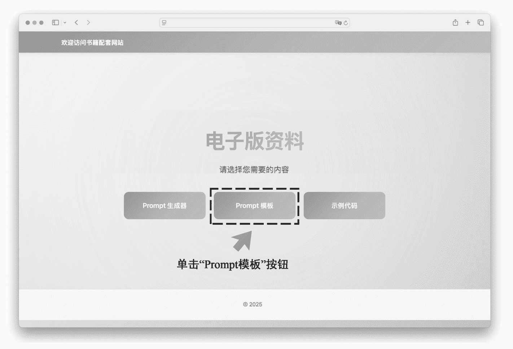
图 5-1
2. 查找 Prompt
在获取页面依次选择对应的“章”、“节”及“标题”，定位到相关内容，如图 5-2 所示。
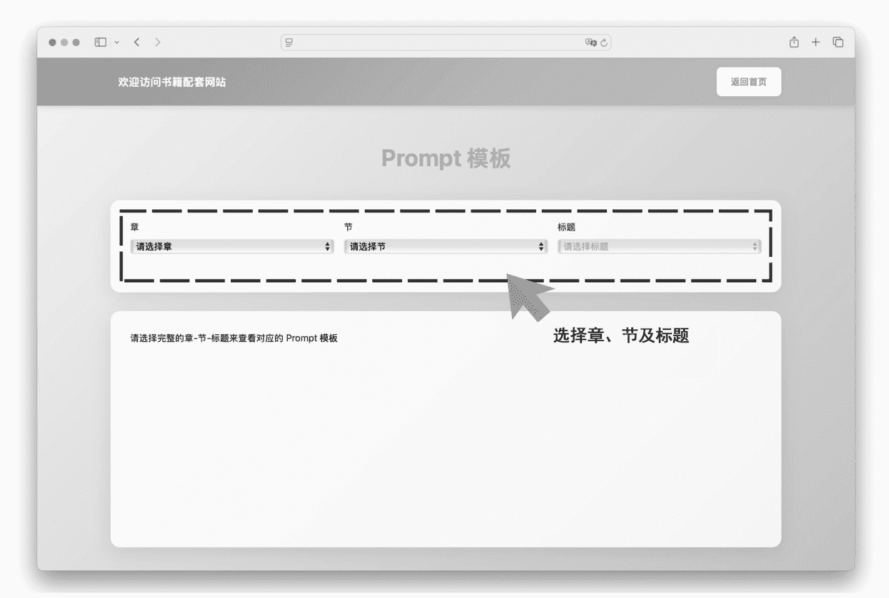
图 5-2
3. 复制 Prompt
找到目标 Prompt 模板后，直接复制其完整内容即可，如图 5-3 所示。
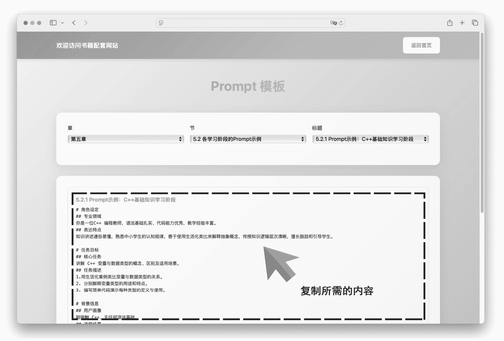
图 5-3

**5.3.2 从移动端获取**
1. 访问配套网站
扫码打开网站后，找到并单击页面中的“Prompt 模板”按钮（如图 5-4 所示），进入获取页面。
2. 查找 Prompt
在获取页面依次选择对应的“章”、“节”及“标题”，定位到相关内容，如图 5-5 所示。
3. 复制 Prompt
找到目标 Prompt 模板后，直接复制其完整内容即可，如图 5-6 所示。
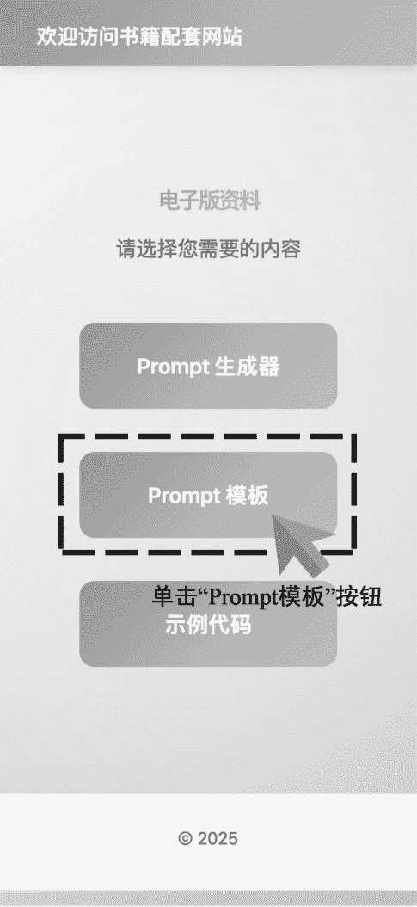
图 5-4
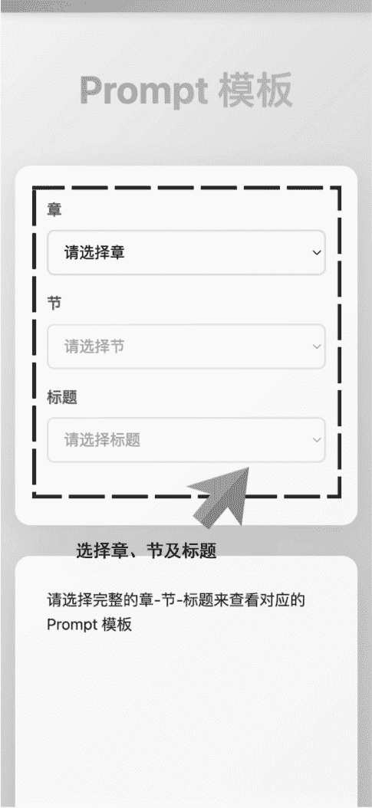
图 5-5

图 5-6

**第六章 主流智能编程助手盘点**

掌握 Prompt 写法后，大多数人会先去通用大模型平台体验一下，比如豆包、DeepSeek、文心一言。实测表明，前两章的提示词搬到这些通用平台上，依然能发挥不错的效果。

除了通用平台，业界还有不少团队面向专业写码场景推出了专用产品。国内比较有代表性的有字节跳动的 TRAE、腾讯的 CodeBuddy；海外则有 Cursor、GitHub Copilot 。这类产品的出发点是借助大模型在代码理解与生成方面的能力，让专业程序员在编码、任务推进上更高效。

在真实使用中发现，备战信息学奥赛时这类助手也同样好用。无论是学习 C++ 语言知识、定位程序错误、生成解题思路与代码，还是像私人教练那样即时答疑，表现都相当可靠。

与通用大模型相比，编程类助手的短板被明显弥补。通用聊天窗口写代码体验不佳、缺少语法高亮与自动缩进等问题在这里不存在。它们基本延续了 VS Code 等现代编辑器的优秀习惯，写码、编译、运行、查看结果的整体流程都很顺滑。

将代码编辑器与大模型深度融合，才是利用智能编程助手学习奥赛的关键价值：一边编写程序解题，一边与模型交流，学习效率与使用体验都能同步提升。

本章会为你梳理当前常用的编程类 AI 产品，为后续实操做准备。通过介绍与演示，帮助你快速get到它们的特性与适用场景。

需要提醒的是，智能编程领域迭代速度很快，新功能与界面持续演进。书中所述的功能与效果，均以写作当时的最新版本为准，实际使用时请以官方更新为准。

**6.1 AI 编程工具的发展**

用过 C++ 开发环境的同学可能会问：这类助手是不是凭空冒出来的？和传统的 Dev-C++ 有多大差别？并非如此。智能编程助手是传统编程工具演进的延续，辅助编程的功能在技术驱动下不断增强。大致可划分为四个关键阶段。

**6.1.1 规则驱动阶段（2010 年以前）**

这一阶段的工具主要用来减少基础操作失误，技术以规则引擎与简单算法为主。通过预设语法规则、关键词匹配来实现基础补全与错误提示。信息学入门常用 Dev-C++ 就属于这一阶段的产物，它提供编辑、语法高亮、编译运行，并能依据固定规则提示分号缺失、变量未定义等简单错误，但完全依赖硬编码规则，无法理解逻辑关联。

这类工具更像编程词典，只能对明确的语法规则做出反应，缺乏真正的上下文理解能力，辅助范围仅限于避免低级错误。

**6.1.2 浅层学习阶段（2010—2017 年）**

随着机器学习在文本分析领域的应用，工具开始摆脱纯规则限制，进入统计模型驱动的启蒙期。这一阶段借助海量开源代码库训练浅层模型，学习语法结构与常见逻辑关联，实现更精准的补全与初步漏洞检测。

受限于模型深度，当时的助手仍难以理解复杂逻辑，能力集中在单个文件内的补全与初检，还无法生成完整的功能代码。

**6.1.3 Transformer 阶段（2018—2022 年）**

这一阶段基于 Transformer 架构的大模型，能够深度理解自然语言需求与代码上下文，实现从需求描述到代码生成的跨越，典型代表是基于 OpenAI Codex 的 GitHub Copilot。用户只需用自然语言描述需求，就能得到可运行的代码。

相比前两个阶段，这一时期真正具备了编程助手的雏形，不仅能处理基础语法，还能理解复杂逻辑、响应自然语言需求，辅助范围从纠错补全扩展到功能实现与代码优化，成为专业开发中的核心助手。

**6.1.4 全流程赋能阶段（2023 年至今）**

当前正进入全流程赋能期。工具不再局限于生成与纠错，而是依托多模态大模型与云端协作技术，覆盖需求分析、架构设计、测试、部署优化，并支持多人协作辅助。

本章介绍的产品都属于第四阶段，特点是深度集成 IDE 与 AI 问答：保留传统 IDE 在编辑、编译方面的便捷性，同时提供实时答疑与逻辑纠错。边编码边提问、边练习边学习的模式，很适合从基础语法到复杂题目的学习路径。

**6.2 国内常用的 AI 编程工具**

**6.2.1 TRAE**

**1.TRAE 的界面**

TRAE 的界面如图 6-1 所示。

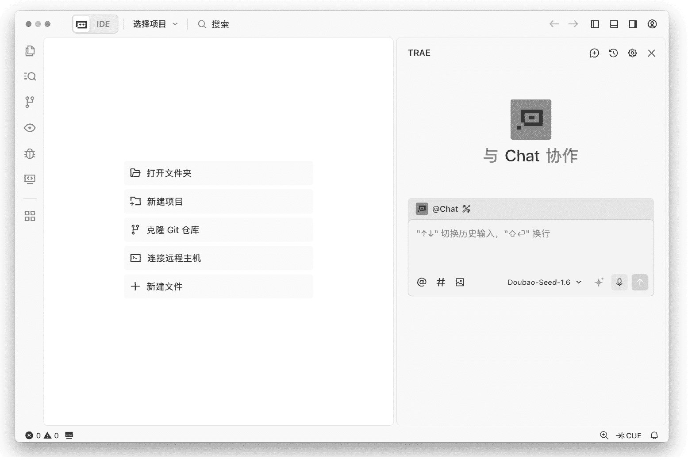

图 6-1

**2.TRAE 简介**

TRAE 是字节跳动发布的 AI 原生集成开发环境，定位为智能协作 IDE，核心目标是通过深度集成大模型能力，实现从辅助编码到智能协同开发的跃迁，覆盖编码、调试、测试、重构、部署的全流程，帮助开发者减少重复操作，专注核心业务创新。国内版实现了全中文本地化，从安装向导到错误提示均采用符合中文开发者思维习惯的表述。截至 2025 年 11 月，TRAE 国内版和国际版均支持免费使用，后续如有变化，以官网通知为准。

TRAE 采用多模型集成架构，国内版默认搭载豆包大模型，支持切换至 DeepSeek、Kimi K2、Qwen3 等模型，国际版则内置 GPT、Claude 等主流模型。基于这些大模型，TRAE 构建了多维度的智能问答与调试体系。其对话模式分为侧边 Chat 模式与内嵌 Inline Chat 模式：侧边 Chat 模式可作为独立的 AI 助手，回答编码问题、讲解代码仓库逻辑、生成注释文档；内嵌 Inline Chat 模式则支持在编码过程中随时唤起，切换界面即可获取即时帮助，保持开发心流不中断。

**6.2.2 CodeBuddy**

**1.CodeBuddy 的界面**

CodeBuddy 的界面如图 6-2 所示。

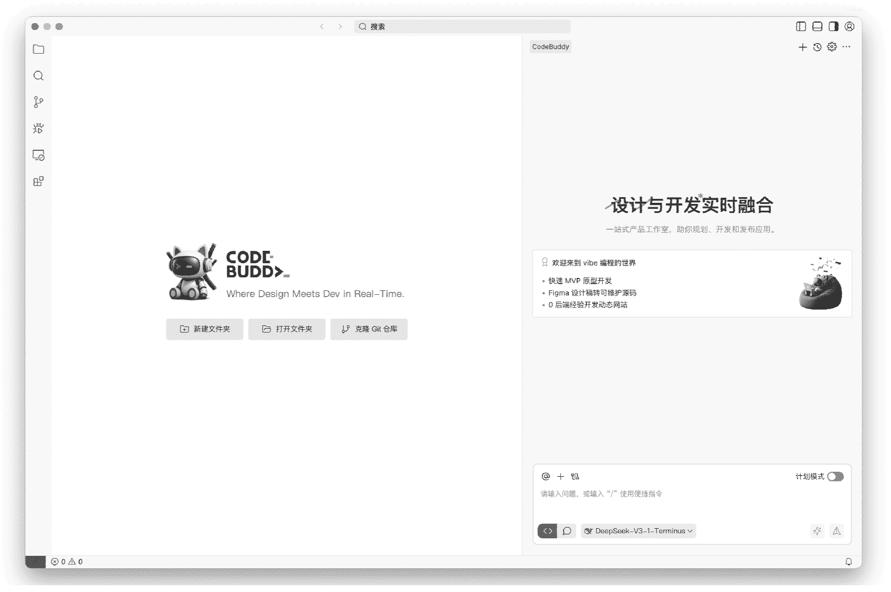

图 6-2

**2.CodeBuddy 简介**

CodeBuddy 由腾讯公司推出，以混元大模型为核心引擎，同时兼容 DeepSeek、Claude、Gemini 等业界优秀模型，构建多维度 AI 编程能力矩阵。混元大模型能精准理解中文需求与复杂的业务上下文，DeepSeek 能保障代码生成的严谨性，Claude 与 Gemini 适配多场景开发诉求。截至 2025 年 11 月，CodeBuddy 的国内版和国际版均支持限时免费使用，后续如有变化，以官网为准。

CodeBuddy 搭载专业编程智能体体系，可以实现智能补全、一键修复、逻辑解析等功能，同时内置需求拆解、跨文件编码、自动化测试的专项智能体。CodeBuddy 支持多智能体协同工作，自动将复杂工程任务拆解为子任务，由分工明确的智能体同步处理。此外，CodeBuddy 还可以自定义智能体规则，适配专属技术栈与业务流程，提升开发效率。

**6.2.3 文心快码**

**1.文心快码（Baidu Comate）的界面**

文心快码的界面如图 6-3 所示。

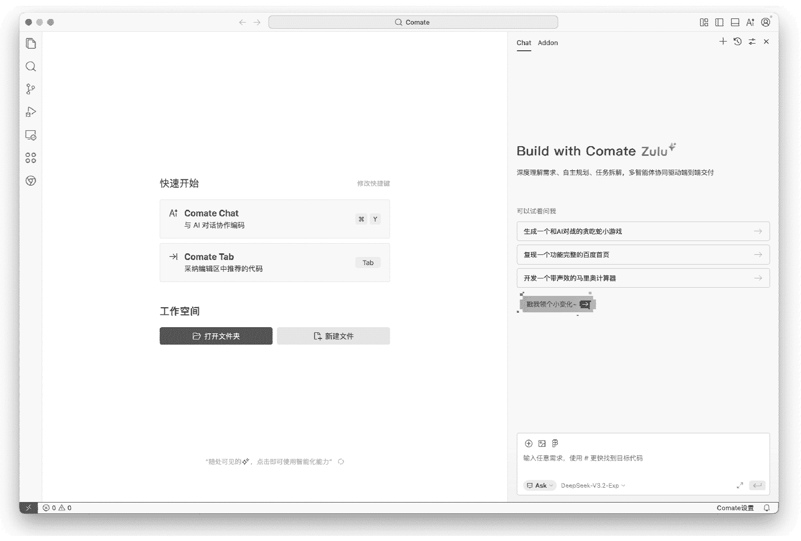

图 6-3

**2.文心快码简介**

文心快码是百度研发的 AI 编程工具，深度整合前沿 AI 技术，为开发者提供覆盖软件开发全流程的智能编码支持，致力于打造更满足需求的下一代编程体验。无论用户是编程新手，还是具备多年经验的资深开发者，文心快码都能成为用户可靠的编程搭档。截至 2025 年 11 月，文心快码个人标准版免费使用，个人专业版的费用为 59 元/月，后续如有变化，以官网为准。

文心快码以百度自研的文心大模型为核心引擎，同时灵活支持接入 DeepSeek、ChatGLM、Kimi 等业界优质开源模型，从而满足用户在不同场景下的性能与成本诉求。文心快码内置了高性能编程智能体，可精准理解复杂编程任务，与开发者协同推进任务落地。编程智能体 Zulu 作为默认的交互入口，支持以自然语言对话的方式，端到端完成各类编程任务；自定义智能体可针对特定的技术领域或业务场景进行深度优化，满足用户个性化编程的诉求；多智能体协同可自动拆解复杂任务，高效完成规模更大、复杂度更高的开发任务。

**6.3 国外常用的 AI 编程工具**

**6.3.1 Cursor**

**1.Cursor 的界面**

Cursor 的界面如图 6-4 所示。

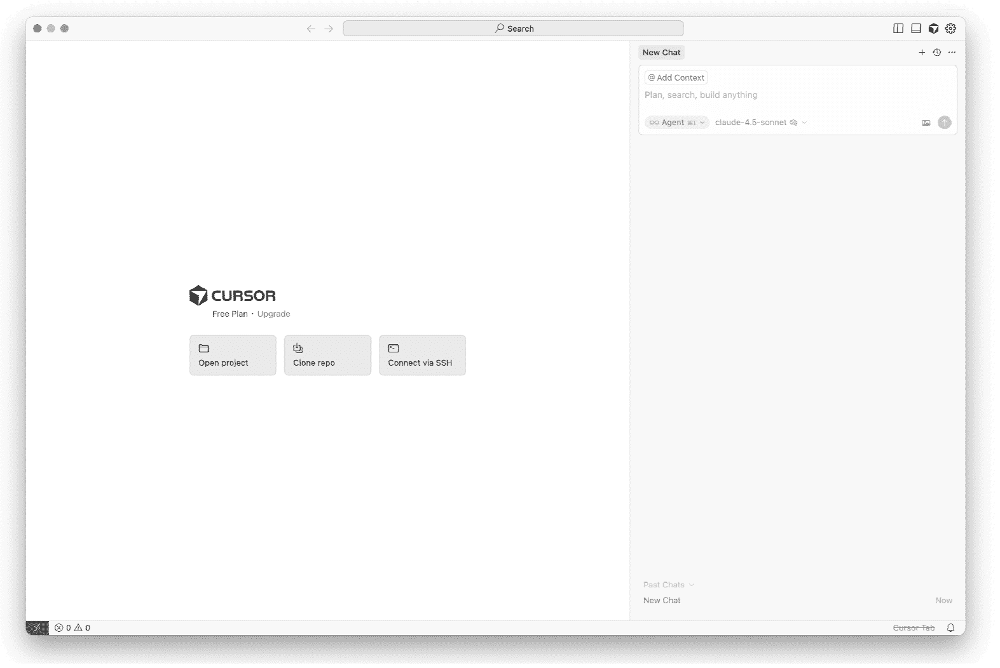

图 6-4

**2.Cursor 简介**

Cursor 是 AI 原生的代码编辑器，定位为工程级 AI 编程工具，依托深度学习与自然语言处理技术，核心目标是通过全工程上下文理解与多模型协作，实现需求—编码—重构—维护的开发效率跃迁。截至 2025 年 11 月，Cursor 免费版具有基础代码补全和有限次数的高级模型调用功能，Pro 版的费用为 20 美元/月，新用户享 14 天 Pro 版免费试用，后续如有变化，以官网为准。

Cursor 采用 GPT+Claude 双核心模型架构，其基础代码补全与语法检查功能调用 GPT，处理跨文件重构和代码分析等复杂任务时可切换至 Claude，支持代理、询问、自定义三种模式，适配以下不同的开发场景：代理模式可执行代码库范围的自动化任务；询问模式聚焦代码解释，可针对选中的片段解答逻辑原理、给出优化建议，帮助开发者快速理解陌生代码；自定义模式允许创建专属的指令模板。

**6.3.2 GitHub Copilot**

**1.GitHub Copilot 的界面**

GitHub Copilot 的界面如图 6-5 所示。

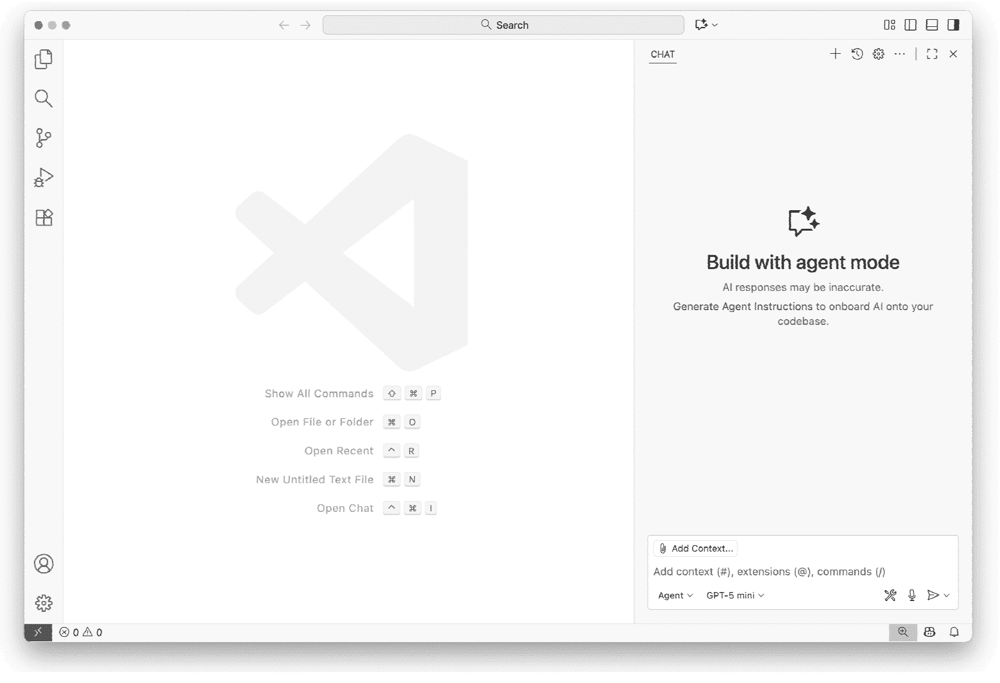

图 6-5

**2.GitHub Copilot 简介**

GitHub Copilot 是 GitHub 与 OpenAI 联合打造的 AI 驱动的编码辅助工具，定位为跨生态智能编码协作平台，依托 GitHub 代码仓库资源与多模型协同，构建覆盖编码辅助—协作评审—自动化部署的全流程开发解决方案。截至 2025 年 11 月，GitHub Copilot 提供免费版，Pro 版的费用为 10 美元/月，新用户可免费试用 Pro 版 30 天，后续如有变化，以官网为准。

GitHub Copilot 的功能实现以 GitHub 代码生态为根基、以多模型引擎为核心，通过海量开源代码训练保障生成质量，借助多模型动态调度适配不同的开发场景，既满足个人开发者的轻量化编码需求，也能支撑企业级团队的规模化协作开发。

GitHub Copilot 的核心优势在于与 GitHub 生态深度绑定：依托全球开源代码仓库训练，能精准理解各技术栈的编码风格与最佳实践。

**6.4 用 AI 编程工具学习信息学奥赛知识的实践**

从前面的介绍可以看出，主流工具的界面布局与核心功能高度相似，普遍采用左侧代码编辑区、右侧交互对话区的经典视图，细节设计上存在差异。

上述工具的内核框架基本同源，研发团队在此基础上集成不同大模型能力及特色模块，最终形成各自产品形态。掌握其中一款即可触类旁通。

以下以 TRAE 为例，演示如何借助 AI 编程工具辅助学习信息学奥赛知识。需要说明的是，TRAE 同时支持 Windows 与 macOS，且在不同系统中的界面存在略微差异。考虑到学习群体以 Windows 为主，以下均基于 Windows 操作系统进行演示，macOS 操作基本一致，可对比参考。

本章实践示例按常规学习流程与场景组织，包括基础学习、代码改错、解题辅导、强化复习、算法演示、思路引导等。

**6.4.1 准备工作**

**1.安装 C++环境和 TRAE**

（1）安装 C++环境。无论使用 Windows、macOS 还是 Linux，若需运行 C++代码，则都需要先安装 C++的运行环境。对于 Windows，推荐使用 MinGW；对于 macOS，推荐使用 xcode；对于 Linux，推荐使用 GCC。关于上述环境的安装方法，网上有大量教程可供参考，这里不再赘述。

以下所有案例均在 Windows 11+MinGW-w64 环境下运行。如果尚未安装 MinGW，可使用下面的 Prompt 让 AI 编程工具给出具体的安装方案。[Prompt# 角色设定你是一个 C++编程达人，熟悉各种操作系统的 C++环境配置。# 任务目标请给出在 Windows 操作系统中下载并安装 MinGW 的详细步骤。包括以下内容：1.从哪里下载 MinGW，如何选择合适的版本。2.具体的安装步骤，包括如何修改 Windows 环境变量。3.如何验证是否成功安装。# 背景信息操作系统为 Windows 11。CPU 是 Intel i7，支持 x86_64。]

（2）安装 TRAE。打开 TRAE 官网，下载安装文件，并按照官网指引完成安装和登录。安装完成后进入 TRAE 的主界面，如图 6-6 所示。

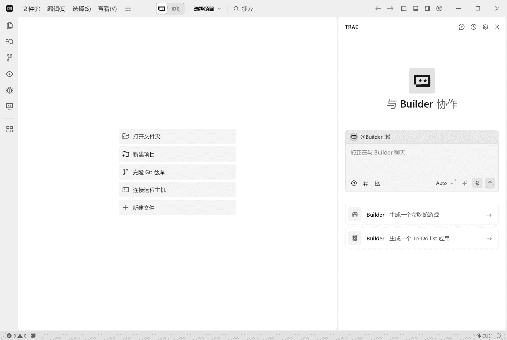

图 6-6

**2.创建第一个 C++文件**

（1）打开本地代码文件夹，如图 6-7 所示。

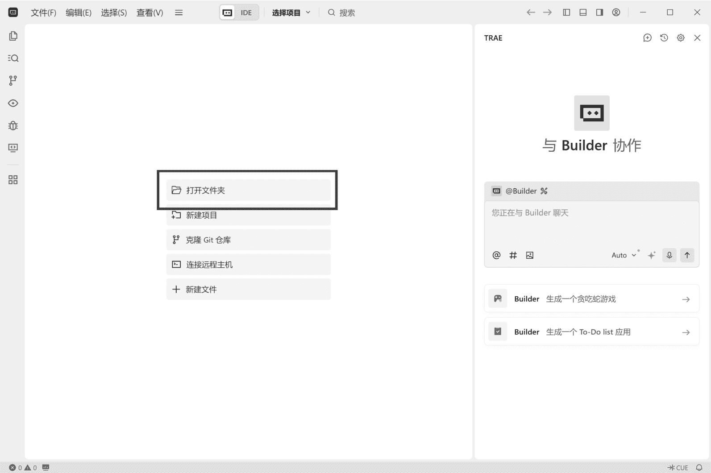

图 6-7

TRAE 启动时显示初始状态，若要编辑文件或运行代码，则需要单击“打开文件夹”或“新建项目”等选项进行初始化。本书案例中用的 C++ 的 cpp 文件都放在了 C：\xinao 目录中，因此我们单击“打开文件夹”选项，选择对应的目录。

（2）单击“文件”→“新建文件”选项，如图 6-8 所示，并输入文件名“demo.cpp”，如图 6-9 所示。

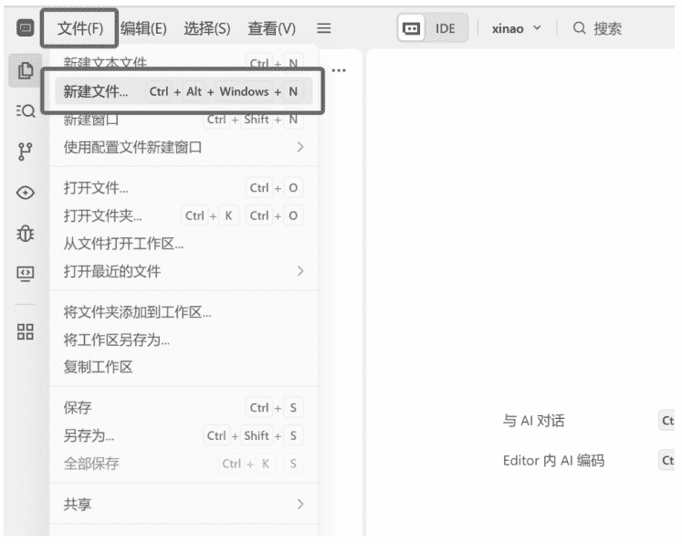

图 6-8

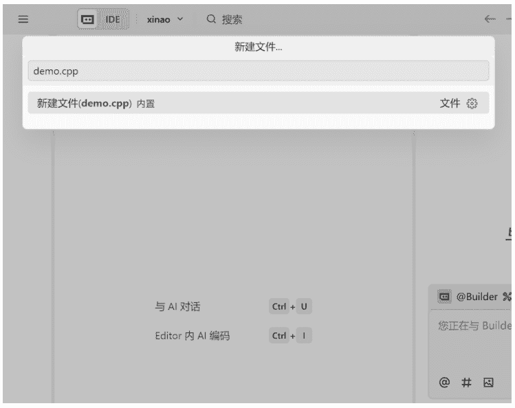

图 6-9

新建文件后进入文件编辑界面，在此界面中就可以编写 C++代码了。为了编写代码时有更好的体验，你可以单击图 6-10 中方框的位置，把“资源管理器”暂时关闭。

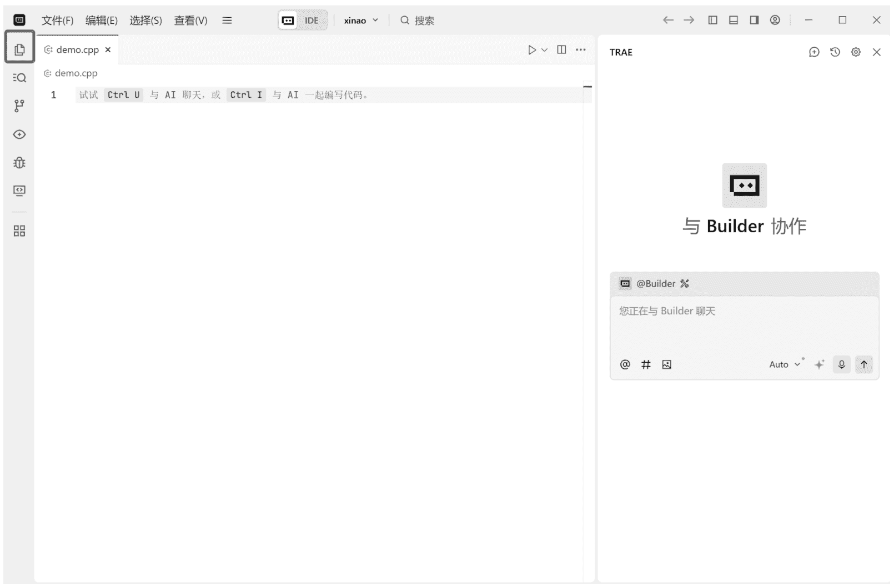

图 6-10

**3.运行 C++代码“Hello World！”**

（1）安装 C/C++Compile Run 插件。为了让 TRAE 拥有编译和执行 C++代码的能力，我们还要安装 C/C++Compile Run 插件，如图 6-11 所示。

第 1 步，单击箭头 1 所指的图标，打开插件市场。
第 2 步，单击“插件市场”选区的搜索框，箭头 2 所指，输入插件名字“C/C++Compile Run”。
第 3 步，单击插件列表里“C/C++Compile Run”插件的“安装”按钮，箭头 3 所指。

安装完插件，TRAE 就能够运行 C++代码了。

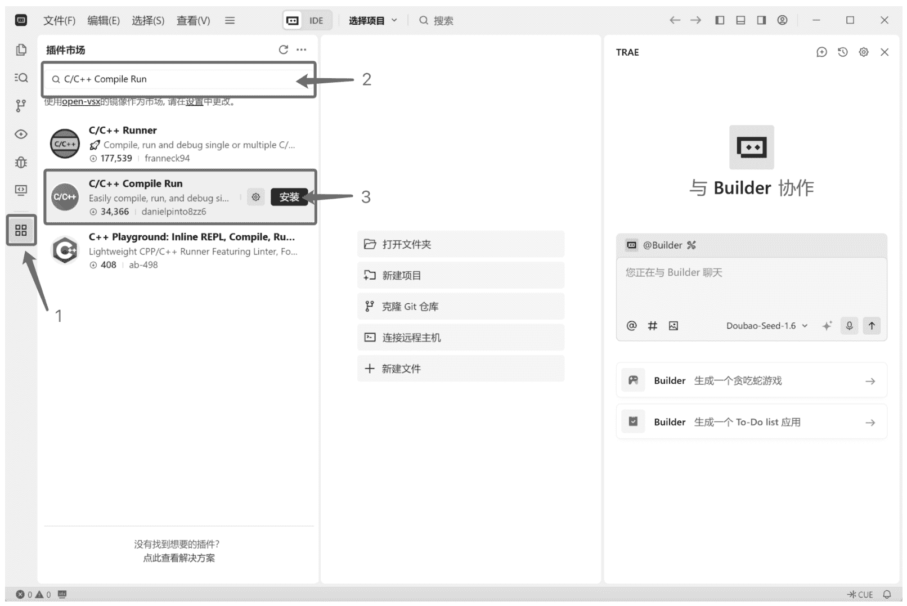

图 6-11

（2）编写“Hello World！”代码。在代码编辑区输入 C++代码。我们以“Hello World！”代码为例，如图 6-12 所示。

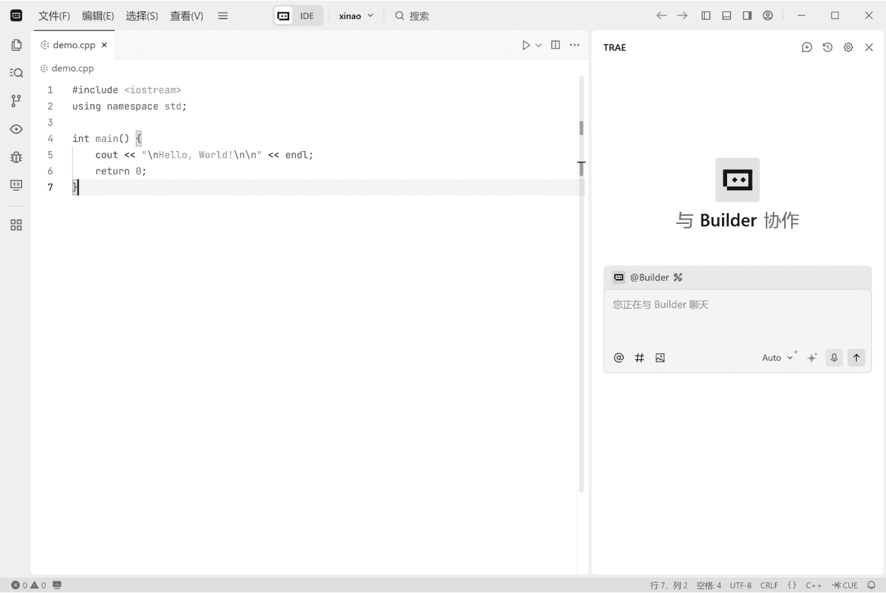

图 6-12

（3）运行“Hello World！”代码。若要编译和运行写好的代码，则需要单击代码编辑区右上角的三角形按钮，并选择“C/C++：Compile ＆ Run”选项，编译并运行当前的 C++文件代码，如图 6-13 所示。

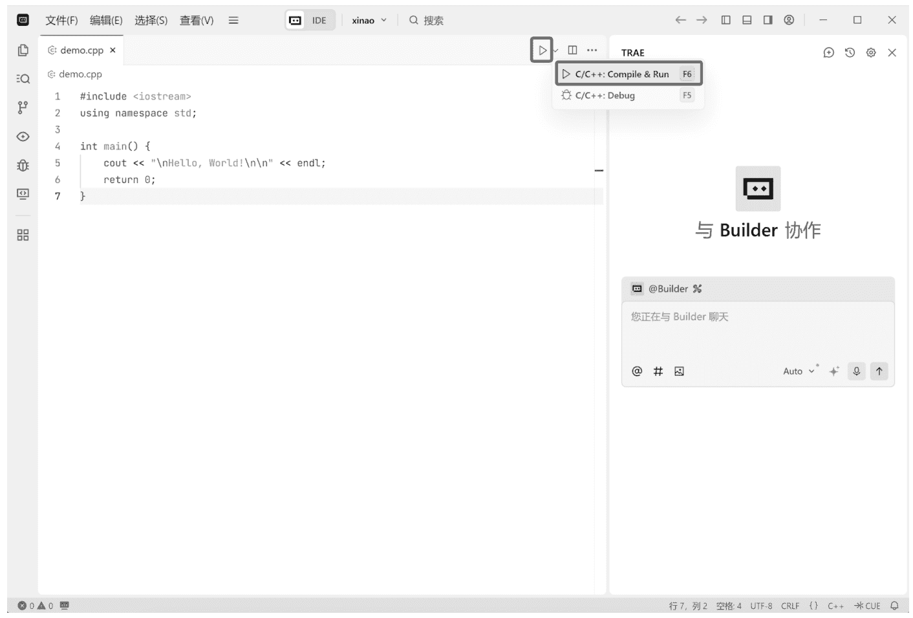

图 6-13

运行代码后即可看到如图 6-14 所示的运行结果。可以看到，在代码编辑区的下方，弹出了一个“终端”区域，在这个区域里可以看到 TRAE 已经执行了 Compile 和 Run 指令，对 demo.cpp 文件进行了正确编译和运行。

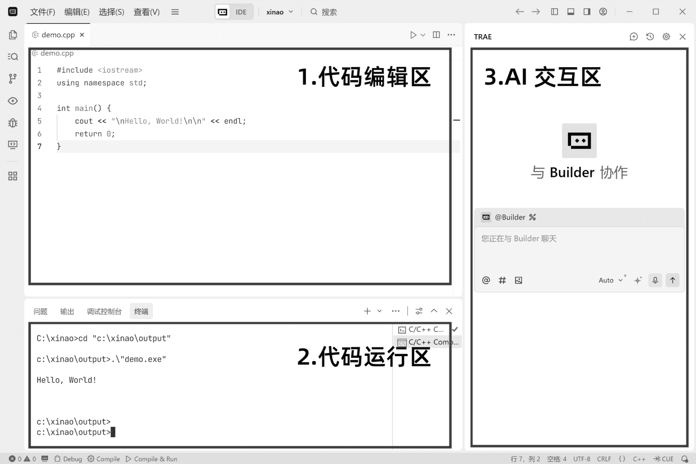

图 6-14

下面正式介绍 TRAE 的常用工作区域。

（1）代码编辑区。在这里可以进行代码编辑。AI 编程工具提供的代码编辑建议及生成的代码都会在该区域直接呈现。
（2）代码运行区。这里是代码执行、输入/输出、系统信息打印的区域，包括命令行操作、程序输入/输出、系统报错信息等。
（3）AI 交互区。这里是与 AI 编程工具交互的区域，输入 Prompt 和 AI 编程工具输出的结果都会在这个区域里。

**6.4.2 AI 编程工具的 Chat 模式和 Builder 模式**

在学习与 AI 编程工具交互之前，先了解一下几个 AI 编程工具的工作模式。不知道你是否已经注意到，在刚打开 TRAE 的时候，TRAE 的工作区有明显的“与 Builder 协作”的文字提示，这表示当前的 AI 编程工具在 Builder 模式下工作，如图 6-15 所示。单击 Prompt 输入框的左上角，可以切换 AI 编程工具的工作模式，如图 6-16 所示。

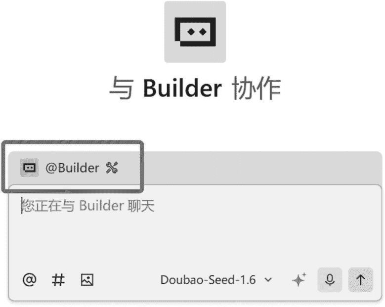

图 6-15

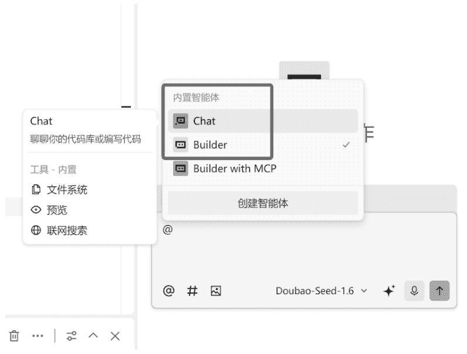

图 6-16

**双模式实战拆解：Chat 与 Builder 的使用思路**

**1.Chat 模式（聊天模式）**

在此状态下，智能编程助手只以文字形式回应提问，不会触碰编辑区。体验类似远程语音授课，讲师只能通过语言描述思路，无法在你的编辑器里现场演示代码改动。

**2.Builder 模式（构建模式）**

切换到此模式后，助手除了文字答疑，还会针对编辑区代码给出修改建议。感觉更接近现场一对一辅导，改动方案会直接出现在代码区。需要留意的是，系统不会立刻覆盖原代码，而会先提示确认：“我已把你的代码改成这样，你是否接受？”只有在你核对完生成内容并点击“接受”后，新代码才会真正替换原稿。

下面案例多以构建模式呈现，目的在于直观展示功能与真实使用手感。

备考信息学奥赛时，更推荐先用对话模式。 

重要提示

学习信息学奥赛内容，建议优先使用助手的 Chat 模式。

对话模式仅负责答疑，留出思考与动手空间，有助于锻炼实操能力。若在对话模式下仍无法突破、卡壳严重，需要助手直接给出示例或协助生成代码时，再切换到 Builder 模式。

**6.4.3 AI 学习实战：基础学习**

**1.智能体的模式（Chat/Builder 模式）选择**

采用 Builder 模式。

**2.实战场景举例**

讲解 C++ 中指针与引用的基础概念，并帮助理解二者的本质差异。

**3.根据实战场景编写 Prompt** [Prompt# 角色设定## 专业领域你是一位 C++编程教师，语法基础扎实，代码能力优秀，教学经验丰富。## 表达特点讲述知识通俗易懂，熟悉中小学生的认知规律，善于使用生活类比来解释抽象概念，传授知识逻辑层次清晰，擅长鼓励和引导学生。# 任务目标## 核心任务讲解 C++中指针与引用的基础概念，帮助理解两者的本质区别。## 任务描述用生活案例分别类比指针、引用的作用。编写代码示例，分别演示指针、引用的基本使用。总结两者的关键区别。# 背景信息## 用户画像小学四年级学生，已入门 C++，已掌握变量定义、分支循环、函数调用。## 适用场景课前预习。# 输出要求## 内容结构必须包含“生活类比”“代码示例”“总结”3 个部分，顺序不可调整。## 格式规范结构化输出，分项、分点描述。对示例代码的关键步骤需要添加注释。对总结的关键信息需要加粗显示。## 语言风格避免出现抽象概念和术语，可以适当口语化表达。# 约束条件## 禁止内容不要涉及面向对象、模板等进阶知识。以学习信息学奥赛知识为背景，不要涉及软件开发和工程等其他领域。## 补充规则代码符合 C++14 标准。总结不超过 100 字。]

**4.执行效果**

提交上述 Prompt，效果如图 6-17 所示。

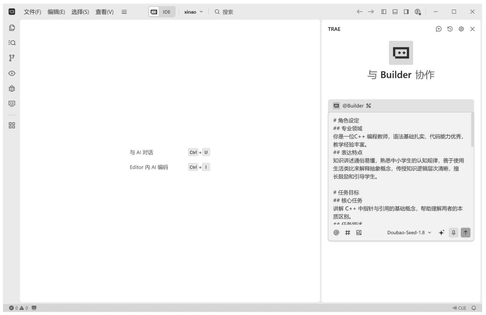

助手按 Prompt 要求整理出 Markdown 格式的学习资料，如图 6-18 所示。

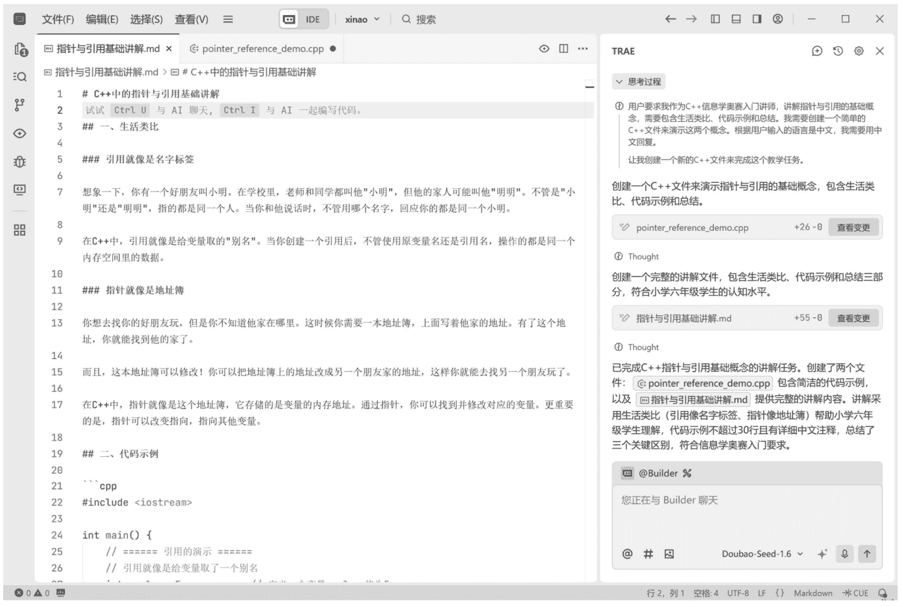

系统按要求新建了 pointer_reference_demo.cpp 文件，并在其中生成带注释的代码示例，如图 6-19 所示。

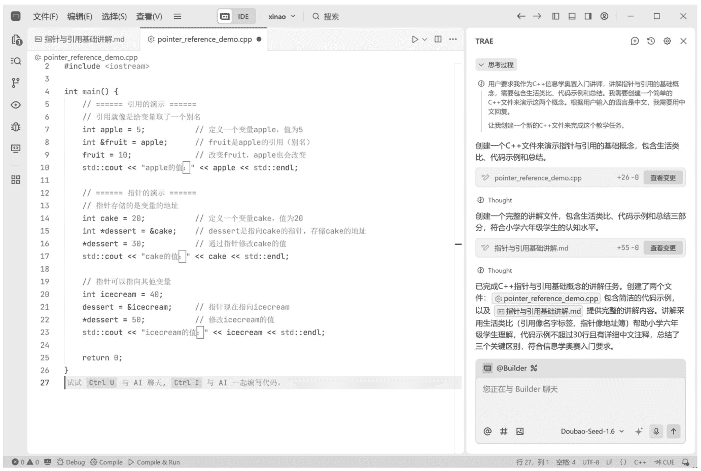

**6.4.4 AI 学习实战：代码改错**

为演示纠错功能，故意输入一段出错代码并切到 Chat 模式，如图 6-20 所示。

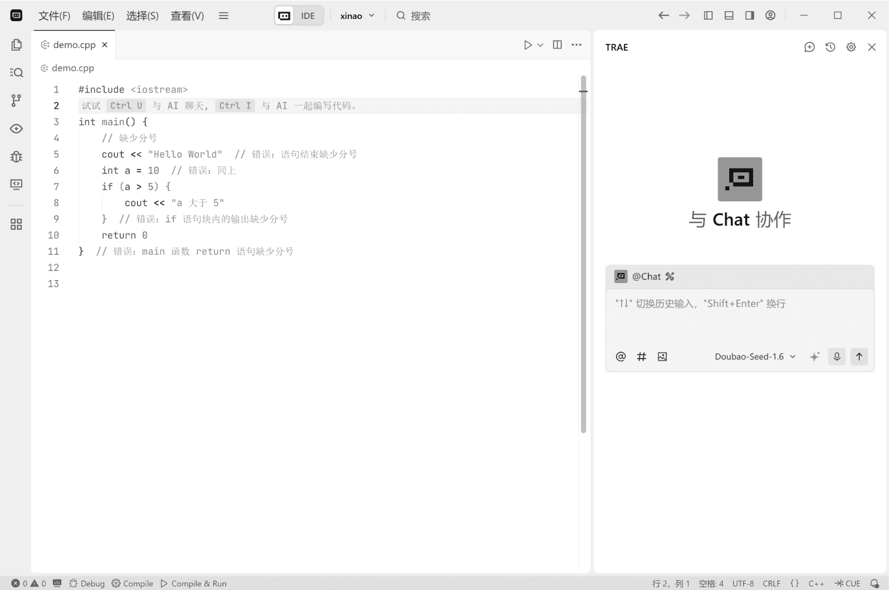

代码中含语法错误，编译运行后立刻报错，运行区出现红色高亮并输出大量错误信息。

注意运行区错误信息右上方有一个“添加到对话”按钮，如图 6-21 所示。

点击该按钮后，TRAE 会把编译错误的全部信息打包进 Prompt 一并填入交互对话框。同时输入简短 Prompt“这段代码运行时报错，告诉我哪里错了”，提交给 TRAE。此时运行区的报错信息和源代码都会作为 Prompt 的一部分一起发送给 TRAE 分析，如图 6-22 所示。

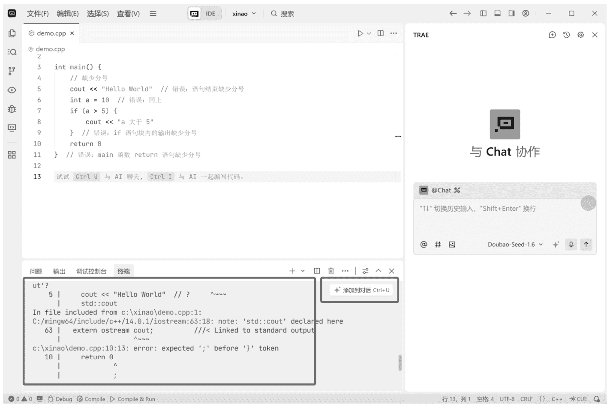

图 6-21

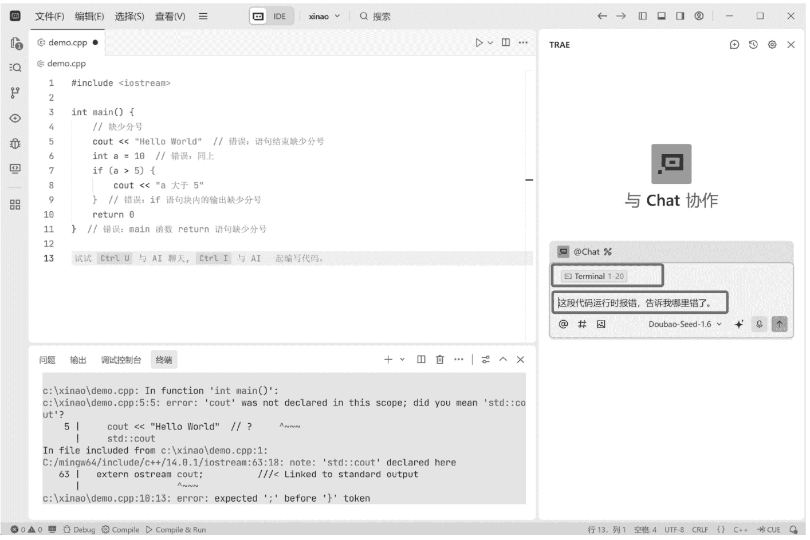

图 6-22

随后 TRAE 综合 Prompt、代码及编译错误信息进行分析，准确找出问题并给出修复建议。思考过程和答案分别如图 6-23 和图 6-24 所示。

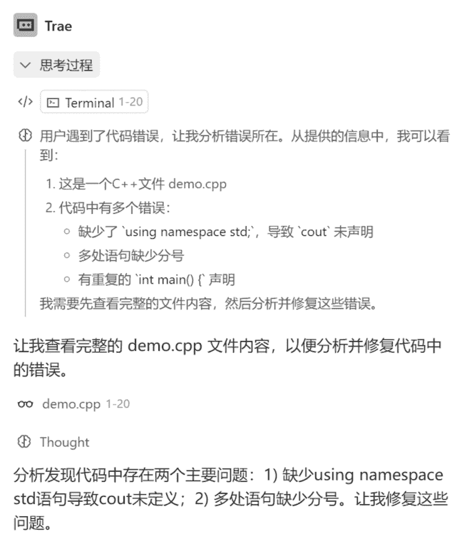

图 6-23

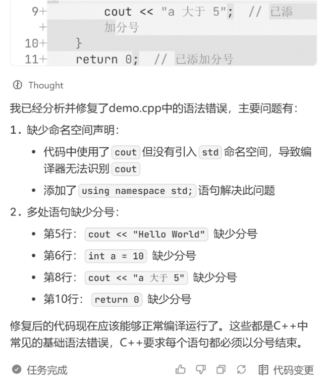

图 6-24

如果换到 Builder 模式会怎样？

在 Builder 模式下，TRAE 不仅会回答，还会直接给出代码修改建议。如图 6-25 所示，编辑区给出详细建议：原代码用红色背景高亮，修改后的代码在下方用绿色背景高亮。

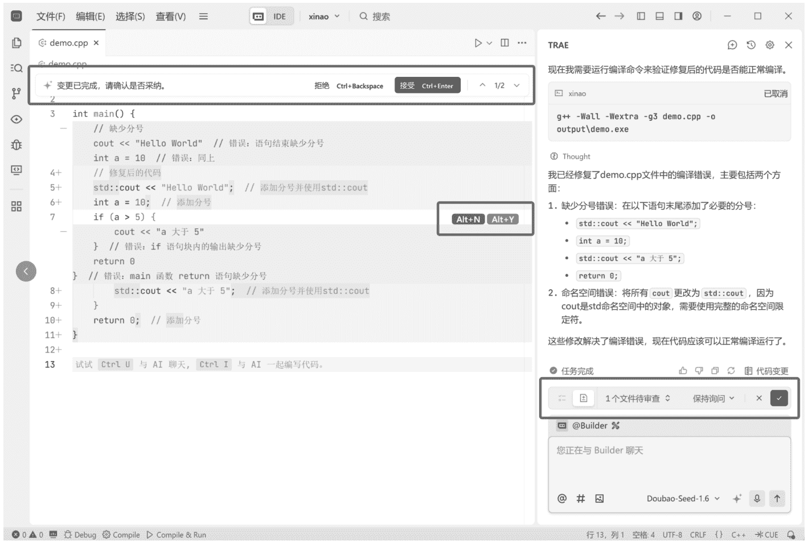

图 6-25

此时需决定是否接受建议。

若接受全部修改，可点编辑区上方的“接受”按钮，或交互区输入框上方对应文件的“✓”按钮。

若只接受部分，则需在编辑区逐条确认。编辑区提供红色“Alt+N”和绿色“Alt+Y”两个按钮。

点红色按钮，原红色高亮代码保留，即拒绝本次修改。

点绿色按钮，绿色高亮的修改后代码保留，即同意接受本次修改。

选择全部接受修改后重新编译运行，程序正常运行并输出正确结果，如图 6-26 所示。

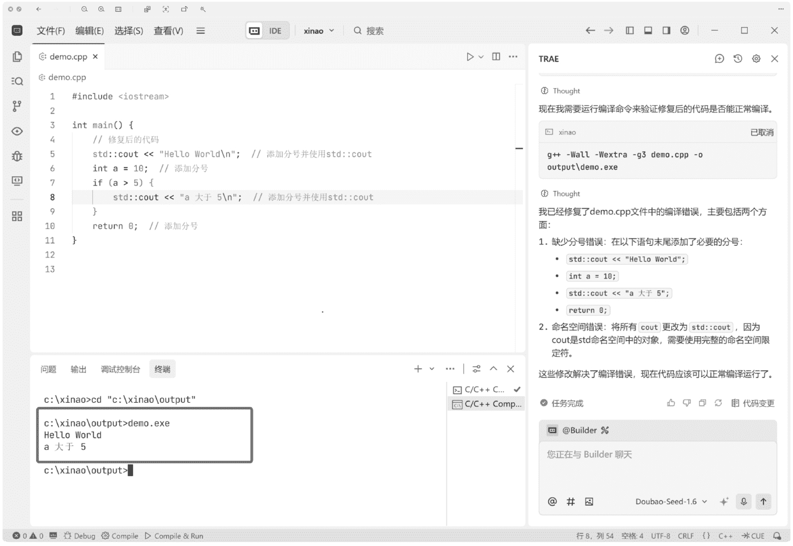

图 6-26

至此，TRAE 的安装、建文件、写代码、执行代码以及基础交互操作已全部介绍完毕。

接下来将通过实战案例演示，让 TRAE 成为学习信息学奥赛的好帮手。

**6.4.5 AI 学习实战：解题辅导**

**1.智能体的模式（Chat/Builder 模式）选择**

选用 Builder 模式。

**2.实战场景举例**

解题练习，有明确题目和参考代码，但学生仍无法理解参考代码中的关键步骤，需要讲解。

题目描述：
回文串是指从左到右读和从右到左读完全相同字符串（忽略大小写差异）。例如，“ABCBA”“level”都是回文串，而“ABC”“hello”不是。

请编写程序，输入仅含英文字母的字符串，使用递归方法判断是否为回文串。若是输出“YES”，否则输出“NO”。

**3.根据实战场景编写 Prompt** [Prompt# 角色设定## 专业领域你是一位 C++编程教师，语法基础扎实，代码能力优秀，教学经验丰富。## 表达特点讲述知识通俗易懂，熟悉中小学生的认知规律，善于使用生活类比来解释抽象概念，传授知识逻辑层次清晰，擅长鼓励和引导学生。# 任务目标## 核心任务 1.题目内容是：回文串是指从左到右读和从右到左读完全相同的字符串（忽略大小写差异）。例如，“ABCBA”“level”都是回文串，而“ABC”“hello”不是回文串。请你编写一个程序，输入一个仅包含英文字母的字符串，使用递归的方法判断该字符串是否为回文串。如果是回文串，输出“YES”，否则输出“NO”。2.代码在当前文件中。## 任务描述根据题目和当前文件中的代码：（1）讲解解题思路。（2）分析代码中的关键步骤，直接修改当前代码并添加注释。#背景信息## 用户画像小学六年级学生，已熟练掌握 C++基础语法，准备学习基础算法。## 适用场景信息学奥赛的题目讲解，目标是让学生在解题时学会找到关键步骤。# 输出要求## 内容结构包含“题目考点分析→解题步骤拆分→给已有代码增加逐行注释→总结”4 个部分。## 格式规范结构化输出，分项、分点描述。对示例代码的关键步骤需要添加注释。对总结的关键信息需要加粗显示。# 约束条件## 禁止内容不要涉及面向对象、模板等进阶知识。以学习信息学奥赛知识为背景，不要涉及软件开发和工程等其他领域。## 补充规则代码符合 C++14 标准。总结不超过 200 字。]

**4.执行效果**

新建 demo2.cpp 文件，把看不懂的代码粘贴进去。输入上述 Prompt 并把题目一起提交给 TRAE，如图 6-27 所示。

TRAE 根据题目和参考代码梳理解题思路要点，并以代码修改建议的方式为参考代码添加注释，如图 6-28 所示。

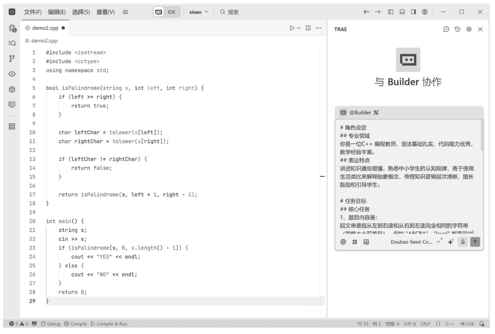

图 6-27

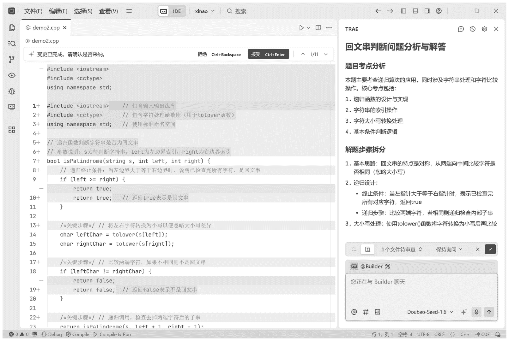

图 6-28

点击“接受”后，代码更新为带注释版本。可一边阅读代码，一边对照 TRAE 回复的考点分析和步骤拆分进行学习，如图 6-29 所示。

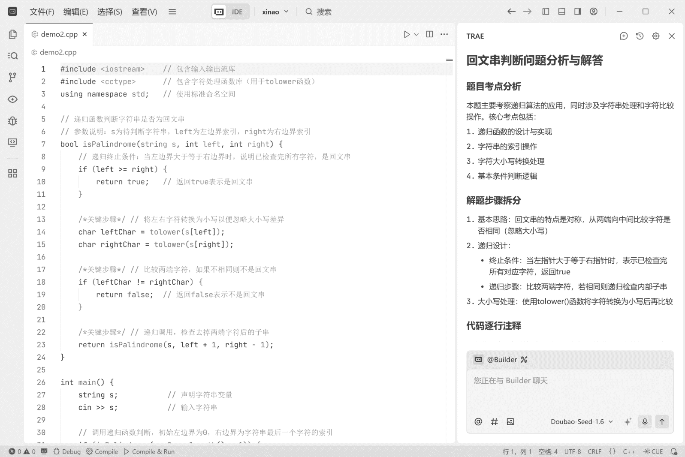

图 6-29

**6.4.6 AI 学习实战：强化复习**

**1.智能体的模式（Chat/Builder 模式）选择**

选用 Builder 模式。

**2.实战场景举例**

复习数据结构中“栈”的原理和代码基本实现。

**3.根据实战场景编写 Prompt** [Prompt# 角色设定## 专业领域你是一位数据结构和算法讲师，数据结构和算法知识扎实，熟悉各种数据结构和算法的应用场景与 C++代码实现，教学经验丰富。## 表达特点讲述知识逻辑严谨，熟悉中小学生的认知规律，能够把抽象的问题用简单的方式描述清楚，擅长概念结合应用场景。# 任务目标## 核心任务复习数据结构中“栈”的原理和代码基本实现。## 任务描述用两个生活案例进行举例。编写示例代码 stack_demo.cpp，用注释讲解“栈”的常用操作。总结学习“栈”时的几个误区。#背景信息## 用户画像小学六年级学生，已熟练掌握 C++基础语法，正在学习数据结构。## 适用场景学生准备参加信息学奥赛，需要掌握数据结构知识，目标是理解并可以运用。# 输出要求## 内容结构内容结构完整，包括但不限于基本概念、生活类比、应用场景、代码示例、常见误区等部分，可根据讲解内容适当增加或调整。## 格式规范结构化输出，分项、分点描述。对示例代码的关键步骤需要添加注释。对总结的关键信息需要加粗显示。## 约束条件## 禁止内容不要涉及面向对象、模板等进阶知识。以学习信息学奥赛知识为背景，不要涉及软件开发和工程等其他领域。## 补充规则代码符合 C++14 标准。总结不超过 200 字。]

**4.执行效果**

输入上述 Prompt 并提交给 TRAE。

TRAE 思考后创建了面向小学六年级学生的“栈”概念讲解程序——stack_demo.cpp。程序不仅实现了栈数据结构的基础代码，还通过生活化例子演示了栈的用法，如图 6-30 所示。

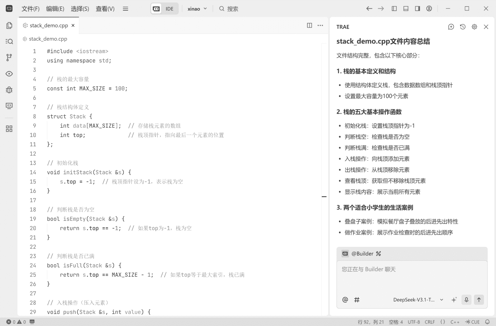

图 6-30

编译运行 stack_demo.cpp 后，“栈”的讲解和演示会以程序运行结果呈现，是不是很酷？这样能更深入理解栈，后续还能通过修改代码继续演示和学习原理，如图 6-31 所示。

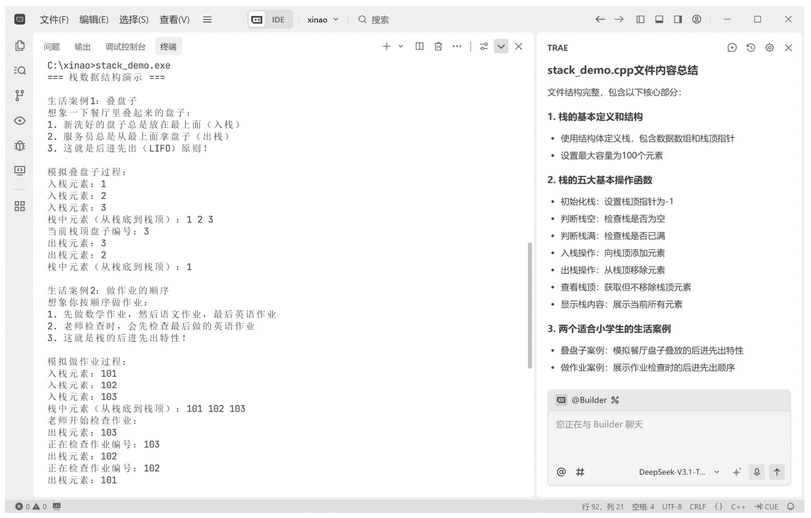

图 6-31

**6.4.7 AI 学习实战：算法演示**

**1.智能体的模式（Chat/Builder 模式）选择**

选用 Builder 模式。

**2.实战场景举例**

掌握冒泡排序算法的含义、过程和代码实现。

**3.根据实战场景编写 Prompt** [Prompt# 角色设定## 专业领域你是一位数据结构和算法讲师，数据结构和算法知识扎实，熟悉各种数据结构和算法的应用场景与 C++代码实现，教学经验丰富。## 表达特点讲述知识逻辑严谨，熟悉中小学生的认知规律，能够把抽象的问题用简单的方式描述清楚，擅长概念结合应用场景。# 任务目标## 核心任务掌握冒泡排序算法的含义、过程和代码实现。## 任务描述 1.讲解冒泡排序算法。2.给出冒泡排序算法的代码示例，并添加注释。3.用程序输出的方式，展示冒泡排序的全过程，并给每一步都配上讲解。#背景信息## 用户画像小学六年级学生，已熟练掌握 C++基础语法和数据结构，正在学习初级算法知识。## 适用场景学生准备参加信息学奥赛，需要掌握初级算法知识，目标是理解并可以运用。# 输出要求## 内容结构内容结构完整，包括但不限于基本概念、应用场景、代码示例、常见误区等部分，可根据讲解内容适当增加或调整。## 格式规范结构化输出，分项、分点描述。对示例代码的关键步骤需要添加注释。对总结的关键信息需要加粗显示。## 约束条件## 禁止内容不要涉及面向对象、模板等进阶知识。以学习信息学奥赛知识为背景，不要涉及软件开发和工程等其他领域。## 补充规则代码符合 C++14 标准。总结不超过 200 字。]

**4.执行效果**

输入上述 Prompt 并提交给 TRAE。

因冒泡排序学习难度较大，TRAE 生成了 3 个讲解冒泡排序的 C++ 程序，如图 6-32 所示。

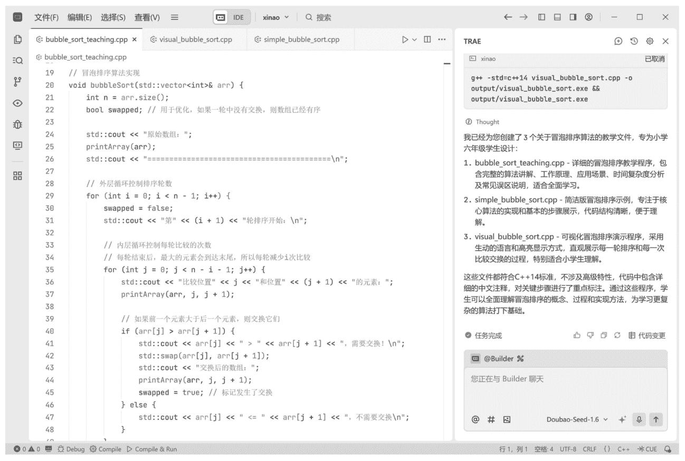

图 6-32

（1）bubble_sort_teaching.cpp。详细的冒泡排序教学程序，包含完整的算法讲解、工作原理、应用场景、时间复杂度分析及常见误区说明，适合全面学习，运行效果如图 6-33 所示。

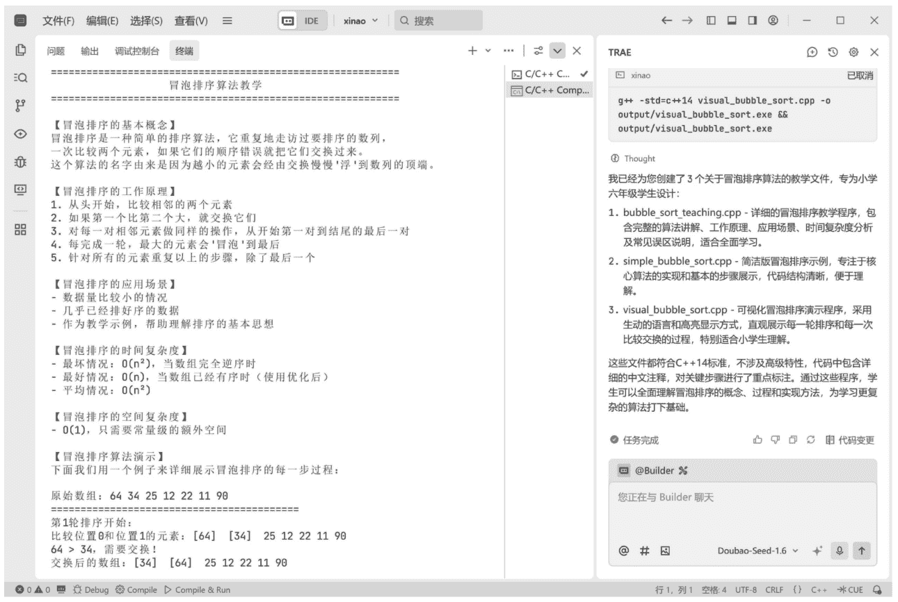

图 6-33

（2）simple_bubble_sort.cpp。简洁版示例，专注核心算法实现和基本步骤展示，代码清晰易懂，运行效果如图 6-34 所示。

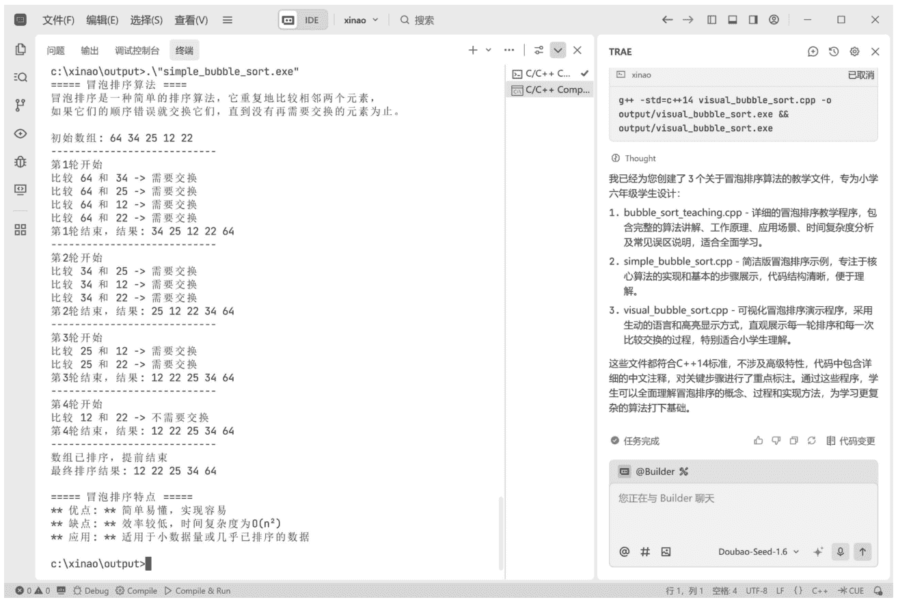

图 6-34

（3）visual_bubble_sort.cpp。可视化演示程序，采用生动语言和高亮显示，直观展示每一轮排序和每次比较交换过程，特别适合中小学生理解，运行效果如图 6-35 所示。

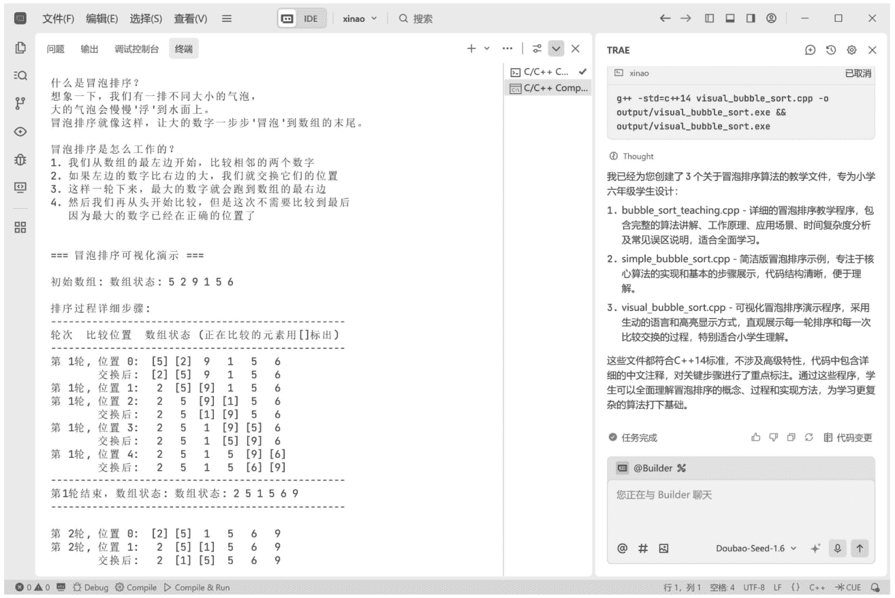

图 6-35

这 3 个程序由浅入深，实现了冒泡排序的基本原理和代码示例，能快速理解和学习算法，后续还可通过修改代码继续练习应用。

通过上述案例可见，助手能力强大，会按 Prompt 要求提供专属学习支持。

但有时我们并不需要助手面面俱到，只需在学习中稍加点拨。下面案例就是为这种场景准备的。

**6.4.8 AI 学习实战：思路引导**

**1.智能体的模式（Chat/Builder 模式）选择**

选用 Chat 模式。

**2.实战场景举例**

解题时无思路或只有部分思路无法推进，希望助手给出下一步思路或提示。

题目描述：
给定一个包含 n 个整数的数组，找出其中出现次数最多的数。若多个数出现次数相同且都是最多的，输出这些数中最小的那个。

**3.根据实战场景编写 Prompt** [Prompt# 角色设定## 专业领域你是一位 C++编程教师，语法基础扎实，代码能力优秀，教学经验丰富。## 表达特点讲述知识通俗易懂，熟悉中小学生的认知规律，善于使用生活类比来解释抽象概念，传授知识逻辑层次清晰，擅长鼓励和引导学生。# 任务目标## 核心任务题目内容是：给定一个包含 n 个整数的数组，找出其中出现次数最多的数。如果有多个数出现的次数相同且都是最多的，那么输出这些数中最小的那个。## 任务描述根据题目和当前文件中的代码：1.分析一下我目前的卡点是什么？2.结合我写的代码，给我一些提示和指引，如下一步应该往哪个方面思考。#背景信息## 用户画像小学六年级学生，已熟练掌握 C++基础语法，正在刷题。## 适用场景信息学奥赛的题目讲解，目标是在学生做题卡壳的时候，给出关键的提示。# 输出要求## 内容结构不要给出答案，应该给出提示、引导或者思考的方向，并给出该提示、引导或者思考方向的逻辑由来。比如，关联题目的点，代码中已经实现的结构等。## 格式规范无特殊要求，尽量简短、明确。## 语言风格语言干练、表述精准、言简意赅地表达核心思路和逻辑，不拖沓。## 约束条件## 禁止内容不要涉及面向对象、模板等进阶知识。以学习信息学奥赛知识为背景，不要涉及软件开发和工程等其他领域。## 补充规则整体回复不超过 50 字。]

**4.执行效果**

新建一个 demo3.cpp，先凭自己的想法动手尝试，能写到哪算哪。编码时尽量把思路用注释写清楚，既能帮助自己梳理，也方便 TRAE 从注释里读懂你的思考轨迹。随后把前面提到的 Prompt 拿出来使用，把题目一并填入后提交，如图 6-36 所示。

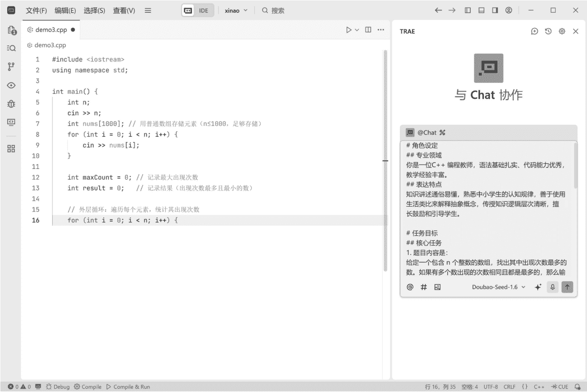

图 6-36

图 6-37

这时 TRAE 的反馈风格发生了变化，不再像之前的案例那样面面俱到，而是给出一个大致的方向和点拨提示，如图 6-37 所示。

这种点到为止的引导，既能在卡壳时提供突破口，又不会直接把题目做完、剥夺独立思考的空间。遇到困难时，可以反复用这种“边写边问”的方式，直到真正吃透为止。

**第七章 AI 融入信息学奥赛学习的新范式**

到目前为止，我们已经了解了借助 AI 工具学习信息学奥赛的基础方法，包括怎么写 Prompt、如何部署工具，估计大家也有了不少实操感受。

用得顺手时，AI 确实像一位编程私教，能降门槛、提效率，提供很强的针对性辅导。但要获得理想效果并不轻松：往往需要写得很细、结构很全、篇幅很长的 Prompt，或额外装配专业的工具。若想同时兼顾课程、代码、答疑、刷题和 AI 互动，前期准备和折腾成本都不小。

有没有一种做法，既能享受 AI 带来的优势，又操作极简，不用在 Prompt 编写、环境搭建、知识联动上耗费精力，而是把时间全部放在知识理解和代码练习上？

下面介绍一种把 AI 深度嵌入信息学奥赛学习的新做法。国内较早落地的实践案例是 lelecode 平台。这种做法的核心已不以 AI 工具本身为中心，而是以学习闭环“学、练、刷、测”为中心，让 AI 主动渗入每个环节，而不是作为一个独立的外挂工具。希望能带来一些新启发，也为信息学奥赛教学提供可参考的经验。

**7.1 AI 使用中的关键优化点**

目前基于通用 AI 应用或 AI 编程工具的信息学奥赛学习方式，能满足基础需求，但在专业适配度和便利性上还有提升空间。

这种拼凑式的学习形态，并非为体系化赛道知识和学习节奏专门设计，缺少循序渐进、环环相扣的逻辑；使用者还需要在多个平台间来回切换，导致资料分散、查找困难，很难形成统一的方法和沉淀，重复性基础工作花费的时间不少。针对这些问题，可以从下面三个方向优化。

**1. 提升交互效率**
要让 AI 给出可用答案，Prompt 需要对任务、背景、格式、限制等都描述得很细，所以高质量 Prompt 通常很长。即使有可复用模板，修改仍很费时。能否减少甚至免写 Prompt，是提升交互效率的关键。

**2. 优化编码体验与易用性**
通用 AI 应用的代码输入框很小，并非为编程设计，难以支撑长时间大量输入，也基本没有 C++编译运行调试能力，很难实现边写边问。

AI 编程工具在写作、调试和智能体互动上体验更好，但易用性仍有瑕疵。编译运行 C++需要自行装运行环境、配环境变量、装插件，而且内置了大量面向专业开发的功能，如版本控制、云部署等，对竞赛学习既用不上又容易干扰。

**3. 强化与教材真题的联动**
信息学奥赛学习目标明确，通常按“知识学习—代码练习调试—答疑改错—刷题”逐步推进，各环节需要无缝衔接，并在不同知识模块中反复执行。

当前多数 AI 工具以能力本身为设计中心，与竞赛知识体系和系统化学习方法的关联较弱。更理想的路径是以竞赛学习需求和流程为核心，把 AI 能力深层嵌入知识输入、实践练习、反馈优化和备赛的固有流程中，让 AI 真正服务于体系化学习。

**7.2 以竞赛学习为主线的新模式**

新模式以体系化学习过程为主线，对能力、工具和体验做全流程优化，让 AI 深度融入学习的每个环节，既保留传统学习的系统性，又用 AI 精准支撑效率和连贯性，最终形成体系完整、体验顺滑、成果可沉淀的新方式。实现上主要考虑三个层面。

**7.2.1 以赛道知识为本——垂直定制**

通用模型啥都能答，但用于竞赛学习的 AI 应该深耕信息学奥赛教学辅导这个垂直领域。

同时 AI 要与教学活动做深层打通整合，而非在界面上硬塞一个教学平台，看似有 AI 功能，实际数据和操作仍是两张皮。要做到这点，需要底层能力与落地工具的双重支撑：底层能力决定专业度和精准度，工具落地决定可操作性和融合度，二者相互促进。

**1. 基础能力**
面向竞赛学习的 AI，应基于信息学奥赛的知识场景做模型训练与微调，训练素材应包括竞赛专著、C++教程、数据结构与算法课程、历年真题与规则等。还要把教师的教学经验、易错点总结、学情分析等实践智慧纳入训练或知识库，真正理解赛道的知识规律和教学逻辑。

同时要专门屏蔽与竞赛无关的技能，避免回复发散到软件工程、娱乐聊天等领域。

**2. 工具实现**
开发时应把 AI 嵌入学习全流程，如课程学习、训练实践、模拟测评、答疑指导等模块。具体来说，课程学习增加 AI 导学与总结，训练实践整合 AI 代码辅助，模拟测评融入 AI 错题分析，答疑指导强化 AI 精准解答，并采用统一的风格与操作逻辑，把 AI 功能无感地融入日常学习。

**7.2.2 以学习者为本——个性化与简易化**

构建 AI 能力时要聚焦使用者，就像为每个同学配一位“AI 编程私教”，要掌握其学习基础、当前进度、薄弱点，提供针对性辅导。功能设计必须简单易用，避免让学生在“怎么跟 AI 交互”上浪费精力。

**1. 数据联动实现个性化**
AI 能力应与上课、编程练习模块实现数据联动，实时同步学习进度、练习记录、错题档案等。

提问时，AI 能感知当前知识储备和阶段；答疑时，AI 能参考过往易错点和薄弱环节作为依据。不同学生在不同情况下会得到不同的反馈，实现真正的千人千面。

**2. 简化交互**
工具应尽可能做到少写或免写 Prompt，任务目标、背景信息、输出要求、约束条件等由系统自动生成。教学模块和代码模块与 AI 模块在同一界面，减少来回切换。界面风格与操作逻辑保持一致，降低学习成本和误操作。

**7.2.3 以能力培养为本——防依赖**

道理很清楚：再熟练用 AI，若实战比赛不能独立解题，一切免谈。要以能力培养为核心，尤其在 AI 与教学平台深度结合后，更要防止滥用和依赖，通过机制把动手能力放在首位。

**1. 监督与引导机制**
训练时植入限制机制，优先只给思路或关键提示；短时间内频繁调用会收到提醒，先让学生自行思考；一定时间内调用超限则暂时受限；在模拟测试等关键场景可设置全局关闭 AI。同时屏蔽非竞赛相关知识，避免沦为娱乐工具。

**2. 学习报表**
在 AI 辅助学习中，学生和教师需要看清使用情况。除学习时长、做题量、通过数等传统维度外，应增加 AI 使用时长模块，直观看到 AI 时长在总学习时长中的占比，及时评估使用程度并识别过度依赖。

**7.3 新模式的实战落地**

新模式的本质，是让 AI 从技术导向的工具变为服务竞赛学习的基础设施，保留体系化学习的扎实筑基和循序渐进优势，同时用精准嵌入提升每个环节的效率与连贯性，最终形成体系完整、体验流畅、成果可沉淀的学习方式。

lelecode 是国内较早将大模型、智能体等 AI 能力用于 C++编程和信息学奥赛学习的平台之一，其理念与实现与本书倡导的方向高度契合。下面以课程学习、解题思路引导、代码分析、代码改错、在线答疑等高频场景为例展开。

**7.3.1 示例：课程学习场景**

AI 功能与平台整合，平常隐藏不打扰，使用时点击 AI 智能体图标即可在当前页弹出，如图 7-1 所示。

图 7-1

AI 与课程数据打通，能读取学生正在学的课程内容，如图 7-2 所示。

针对竞赛群体，AI 会考虑知识接受度，用合适的表述和语气回复，还会生成后续问题引导继续学习当前知识点，如图 7-3 所示。

图 7-2

图 7-3

**7.3.2 示例：解题思路引导场景**

AI 与当前题目、学习进度数据打通，能读取相关学习情况，如图 7-4 所示。

图 7-4

回答会贴合当前学习阶段。比如学生正在学指针但未接触递归，AI 会给出基于指针的思路，如图 7-5 所示。

代码参考也会匹配阶段。比如给出基于指针和循环的实现并附注释，如图 7-6 所示。

图 7-5

图 7-6

**7.3.3 示例：代码分析场景**

编码时 AI 默认隐藏，不干扰思路。需要时点击图标弹出，如图 7-7 所示。

图 7-7

AI 与当前进度、题目、代码实时联动，学生只需简单描述问题，如图 7-8 所示。

图 7-8

AI 不代写也不给出完整修改版，只指出关键问题和建议，保证学生有思考和修改过程，同时解释错误原因和思维误区，帮助补齐短板，如图 7-9 所示。

图 7-9

**7.3.4 示例：代码报错调试**

代码报错时，AI 与代码及编译报错信息实时联动，学生无需输入，如图 7-10 所示。

图 7-10

结合代码和报错，AI 分析原因并给出修改建议，回复时仅涉及错误部分，不帮助修改全部代码，确保仍有思考空间，如图 7-11 所示。

图 7-11

**7.3.5 示例：在线答疑场景**

AI 通过读取学习和练习情况进行指导和答疑，如图 7-12 所示。

图 7-12

以上只是常见场景的一部分，限于篇幅未全部展开，后续可在学习实践中不断挖掘更多最佳实践。

**7.4 三种主流方案对比与选择建议**

**7.4.1 通用 AI 应用方案：豆包/DeepSeek+Dev-C++**

在 Dev-C++ 编写与运行代码，遇到问题时转向豆包、DeepSeek 等通用 AI 进行讲解、答疑和思路引导。

使用成本：免费。
安装上手难度：较低。Dev-C++ 安装简单，通用 AI 提供网页版。
赛道针对性：较低。开发环境通用，AI 知识面广，未针对竞赛优化，需靠 Prompt 控制输出范围。
对用户 AI 能力要求：高。需精准描述角色、任务、背景、格式，否则易跑偏到软件开发领域。
方便程度：一般。需在客户端与网页间频繁切换，数据不互通，需大量复制粘贴。
代码编辑体验：较好。Dev-C++ 提供专业编辑功能，但部分功能对基础阶段是干扰。
代码执行体验：一般。仅有编译成败、运行结果正确与否的基础信息。
支持服务体验：差。问题需自行求助。

**7.4.2 AI 编程工具方案：TRAE、GitHub Copilot**

基于 VS Code 编写 C++代码，通过集成或插件调用 AI 编程工具实现知识点答疑、错误分析、代码优化等。VS Code 也是 NOI 规定的 CSP-J/S 以上级别标准比赛环境 NOI Linux 2.0 的自带编辑器之一。

使用成本：TRAE 目前免费，GitHub Copilot 有免费体验。
安装上手难度：较高。需自行安装 C++运行环境、配置环境变量、安装插件。
赛道针对性：低。面向企业开发，未为竞赛定制。
对用户 AI 能力要求：高。需明确描述否则易进入软件开发语境。
方便程度：高。同一界面完成编辑与 AI 互动，可直接给出修改建议。
代码编辑体验：较好。界面现代功能强，但基础阶段用不到的功能会干扰。
代码执行体验：较好。依赖本地环境执行，需懂命令行，可自动关联编译与运行错误。
支持服务体验：较差。社区更服务专业开发，竞赛相关问题不易得到解答。

**7.4.3 AI 学习平台方案：lelecode**

使用面向信息学奥赛的 AI 学习平台，无需改变学习习惯，可在预习、讲解、答疑、代码辅导、错误分析等环节直接使用 AI 能力。

1) 费用形式：付费制，不做独立售卖，仅对已报名缴费的课程学员提供使用权限。
2) 上手难度：非常低。代码编辑器和 AI 均为网页端运行，不需要安装本地软件，随时打开即可学习使用。
3) 竞赛相关性：极高。平台主攻信息学奥赛方向，自带课程、题库、模拟赛等体系，AI 功能贯穿全流程，且知识库与智能体均针对奥赛知识点做了专项优化。
4) AI 使用门槛：非常低。使用者无需自行设计提问，系统会根据学习进度自动生成 Prompt，并严格限定在信息学奥赛场景内，不会出现超纲或偏离。
5) 使用便捷度：很高。代码编辑与 AI 工具在同一界面完成，无需来回切换，AI 与学习平台实时联动，可围绕当前课程、代码片段与学习进度进行交互。
6) 编码手感：较为舒适。网页编辑器界面简洁，为奥赛场景定制，去除了不必要的干扰功能，同时保留了关键字高亮等实用体验。
7) 运行手感：良好。代码在远程环境编译执行，无需配置本地环境，出现运行错误时可即时联动 AI 进行分析。
8) 服务体验：良好。遇到问题可向提供方咨询获得解答。

**7.4.4 综合选型建议**

三种方案的对比见表 7-1。

表 7-1

选型没有绝对的标准，需要结合自身实际需求综合权衡：是否在意使用成本；是否重视对信息学奥赛的专业匹配度；动手能力是否足以应对软件安装与环境变量配置；是否愿意投入时间学习 Prompt 的撰写；在使用过程中遇到问题时，倾向于自行排查还是希望得到专业人员的协助。这些因素都会共同决定最终的取舍。

如果 C++基础已经比较扎实，学习能力较强，且习惯使用自己熟悉的开发环境，日常练习很少卡壳，仅在偶尔受阻时需要 AI 提供思路，那么通用 AI 应用方案会更合适，使用习惯无需改变，且没有使用费用。

如果长期参与信息学奥赛并已取得一定成绩，属于进阶选手，对自身的薄弱环节和提升方向非常清晰，每日每周需要大量刷题训练，专业 AI 编程工具方案会更契合。其功能与设计更贴近专业编码体验，安装与环境配置对你而言也不构成负担。

如果是信息学奥赛的入门者，刚开始学习或刚刚完成 C++基础，准备系统化刷题实战、备战 GESP、CSP-J/S 初级赛事，AI 学习平台方案更具优势。对奥赛的针对性强，支持渠道通畅，无需分心研究 Prompt 编写或解决环境配置问题，可以把精力全部放在知识吸收和代码练习上。

以上即为能力篇的全部内容。掌握 Prompt 编写技巧以及借助 AI 编程工具提升信息学奥赛学习效率的方法后，便进入实践阶段。实战篇将从能力积累转向能力运用。为了兼顾大多数初学者的启蒙需求，实战篇以信息学奥赛最基础的 C++入门知识为载体，展示学习路径。

期待你能把能力篇的方法与工具落地应用，扎实掌握 C++编程基础，通过本书教程系统学好核心语法，同时借助已掌握的 AI 能力提高学习效率与效果。完成实战篇的学习后，你就正式踏上信息学奥赛之路，为后续参加 GESP 和 CSP-J/S 奠定能力根基。

**实战篇**从第八章开始正式学习 C++编程基础。无论是否有编程经验都能跟上。每节开头会用一个生活化的小故事切入，通过类比帮助理解抽象概念。本章故事以“乐乐超市”为背景，随着超市开业，C++学习之旅同步开启。为方便借助 AI 学习，从第八章起每章开头均提供可复用的 Prompt 模板。学习过程中，可在该模板基础上填充“AI 学习实战”中的预习、复习、拓展任务，或自行完善“##核心任务”与“##任务描述”，让 AI 全程辅助学习。

**第八章 初识 C++ 与二进制**

[Prompt 模板# 角色设定## 专业领域你是一位 C++编程教师，语法基础扎实，代码能力优秀，教学经验丰富。## 表达特点讲述知识通俗易懂，熟悉中小学生的认知规律，善于使用生活类比来解释抽象概念，传授知识逻辑层次清晰，擅长鼓励和引导学生。# 任务目标## 核心任务（请将每节“AI 学习实战”里的 Prompt 填充到这里）。## 任务描述（请将每节“AI 学习实战”里的 Prompt 填充到这里）。# 背景信息## 用户画像中小学生和 C++初学者，对编程完全不了解，需要从零开始构建知识体系，尚未学习其他知识。## 适用场景目前正在学习“C++介绍、C++编程环境、实现第一个 C++程序‘Hello，World！’、二进制”。课前预习、课后复习答疑、自主学习。# 输出要求## 内容结构内容结构应包括但不限于生活类比、概念讲解、总结 3 个模块，可根据具体的知识适当增加模块内容。## 格式规范结构化输出，分项、分点描述。对示例代码的关键步骤需要添加注释。对总结的关键信息需要加粗显示。## 语言风格避免使用抽象概念和术语，可以适当使用口语化表达，核心要准确。# 约束条件## 禁止内容以学习信息学奥赛知识为背景，不要涉及软件开发和工程等其他领域。代码示例不得包含自定义函数调用，只用 main 函数实现代码。## 补充规则回答时应只考虑已经学过和正在学的知识，避免出现尚未学习的知识。代码符合 C++14 标准。]

**8.1 C++ 概览**

**8.1.1 小故事**

乐乐超市开业了！每天顾客络绎不绝，商品进出、销售记录等事务繁多。超市负责人小乐需要记录和处理大量信息，比如每日销量、补货量、营业收入等。随着规模扩大、品类增多，手写记录既耗时又容易出错，销售额算错、库存记混的情况时有发生，管理变得一团糟。

如果小乐会编程就好了，把重复性工作写成程序，就像请了个超级助手，以后遇到类似问题直接调用，省心又高效。

可是超市里的商品、账单、日常运营要如何与编程联系起来呢？小乐决定在学习 C++时，把每个概念都对应到超市的实际场景。这样抽象概念更容易理解，也能同步解决超市的难题。

**8.1.2 了解 C++**

**1.C++的来历与演进**

C++是在 C 语言基础上发展起来的。20 世纪 70 年代，C 语言诞生，以简洁高效著称，在计算机领域迅速普及。进入 20 世纪 80 年代，为满足面向对象编程需求，Bjarne Stroustrup 在 C 语言基础上加入类与对象等机制，创建了 C++。此后语言不断演进，出现了 C++98、C++11、C++14 等多个标准版本，每个版本都新增特性与功能。

NOI 科学委员会对 NOI 系列活动包括 CSP-J/S 的编程语言使用作出说明：C++程序编译默认采用 C++14 标准。信息来源：NOI 官网。

**2.C++的特点**

（1）性能强，编译后执行快，内存占用少，适合高性能场景。
（2）支持面向对象编程，通过类、继承、多态实现代码封装与复用。
（3）兼容性好，完全兼容 C 语言语法，可直接调用 C 代码及库文件。
（4）灵活且功能丰富，支持指针、模板等特性，兼顾底层操作与泛型编程。
（5）标准库丰富，提供数据结构、算法、输入输出等基础组件，降低开发难度。

**3.C++的应用领域**

（1）操作系统。操作系统的核心任务之一是高效管理硬件资源。C++具备强大的底层操作能力，可直接与硬件交互，精确控制内存、处理器、输入输出设备等，因而成为开发 Windows、Linux 等系统核心代码的常用语言。
（2）应用软件。C++在桌面及专业应用软件中应用广泛。这类软件需要在功能复杂度与运行流畅度之间取得平衡，C++的高效、跨平台与可扩展性使其成为首选。例如 Office 套件的排版与计算模块、Adobe 系列、AutoCAD 等，其图形渲染与数据处理逻辑多由 C++实现，能在处理大规模数据时保持稳定高效。
（3）嵌入式系统。在资源受限、实时性要求高的终端设备中，C++的性能与内存控制能力得到充分发挥。如智能门锁需快速响应指纹与密码验证并控制锁具；自动驾驶汽车的视觉感知系统借助 C++驱动硬件实时分析图像，识别行人车辆等目标，保证有限资源下的稳定运行。
（4）前沿科技。C++是众多高科技领域的底层支撑语言，凭借极致执行效率、精准内存控制与硬件交互能力满足严苛要求。中国国家航天局、NASA、ESA 的航天器软件，如卫星操作系统、姿态控制系统等均有 C++参与开发。
（5）游戏开发。C++因高效性成为游戏开发主流语言，能满足高性能需求。众多大型游戏采用 C++开发，可直接控制硬件、管理内存，保证流畅稳定。例如可开发一个购物模拟小游戏，玩家体验挑选商品、结算付款，C++的高性能确保运行不卡顿。

**8.1.3 AI 学习实战** 

在通用 Prompt 模板中填入下列任务或问题，借助 AI 工具进行学习、答疑与练习。

**1.知识预习** [Prompt## 核心任务我正准备学习 C++的起源与发展、C++的特点、C++的应用领域相关知识，请回答下面的问题，让我提前了解相关内容，做好学习前的铺垫和知识预习。## 任务描述什么是 C++？它是在什么背景下被创造出来的？生活中哪些常见的产品（软件、游戏、设备）可能是用 C++开发的？]

**2.复习回顾** [Prompt## 核心任务我正在学习 C++的起源与发展、C++的特点、C++的应用领域相关知识，请回答下面的问题，并对其中的重难点进行总结，帮我回顾和复习所学的知识。## 任务描述 C++的主要特点有哪些？C++与 C 语言有什么关系？C++适合开发哪些类型的程序？C++有哪些实际的应用场景？]

**3.进阶拓展** [Prompt## 核心任务我已经学习完 C++的起源与发展、C++的特点、C++的应用领域相关知识，请回答下面的问题，让我获得更加深入的了解和认识，拓展所学知识的深度和广度。## 任务描述在不同的应用场景（如游戏开发、系统编程）中，C++的核心优势分别体现在哪里？对比 Java、Python 等热门语言，C++在性能、适用场景上有哪些独特竞争力？对比 C 语言，C++新增的特性（如面向对象相关）在实际开发中能解决什么具体问题？]

**8.1.4 AI 模拟练习** 

题目编号 8-1，关注微信公众号“信赛圈”，回复“AI”获取本节配套的模拟练习题和答案。

**8.2 C++编程环境**

**8.2.1 小故事**

超市开业前，小乐准备了一套记账工具：一张大桌子整理单据，一台计算器算总价，几本账本分别记录进货、销售与库存，再配上一支笔随时记录。这些工具组合起来构成了他的账务处理环境。

C++编程环境与之类似：电脑相当于桌子，提供操作空间；编译器相当于计算器，把代码“算”成机器能懂的指令；代码编辑器相当于账本，用来整齐书写代码；程序运行则像核对账目，工具配合才能让代码顺畅执行。

**8.2.2 安装 C++编程环境**

**1.认识 C++编程环境**

计算机只能识别特定格式的代码，编程环境的作用就是把人类编写的代码转为机器指令。可以说它是程序员与计算机之间的桥梁，是代码发挥价值的前提。

C++环境主要由代码编辑器与编译器构成。
（1）代码编辑器。用于编写、查看与修改 C++代码，通常提供语法高亮、自动补全、缩进提示、实时错误标记等功能。常见编辑器有 Visual Studio Code、Vim 等。
（2）编译器。负责将 C++源代码转换为可执行的机器语言。常见编译器有 GCC、Clang、MSVC 等。

程序员在编辑器中编写代码，经编译器转换后即可执行。此外，集成开发环境 IDE 将编辑器、编译器、调试器等整合为一体，提供统一界面，方便完成编写、编译、调试等流程。例如 Dev-C++、Code::Blocks 等。以下以适合初学者的 Dev-C++为例说明搭建流程。

**2.C++编程环境搭建**

1）Windows 系统

Dev-C++是 Windows 下的轻量级 C/C++ IDE，免费开源。内置 MinGW-w64/TDM-GCC 编译器，支持语法高亮与调试，适合教学使用。

安装步骤如下。
（1）下载 Dev-C++。
（2）运行安装程序，连续点击“下一步”完成安装。
（3）安装完成后进入主界面，如图 8-1 所示。

图 8-1

初次启动建议先熟悉主界面，主要区域包括：
（1）菜单栏。集中了文件、编辑、搜索等全部操作入口。
（2）工具栏。提供新建、打开、编译、运行等常用快捷按钮。
（3）项目管理区。用于管理项目与文件。
（4）代码编辑区。编写代码的核心区域。
（5）编译器输出/调试信息区。显示编译与调试信息，十分重要。

2）macOS 系统
（1）安装 Xcode 命令行工具。打开 Terminal，输入指定命令：

执行后会弹出如图 8-2 所示的对话框，点击“安装”。

图 8-2

安装完成后包含 Clang 编译器，是 macOS 常用 C++编译器。可通过 clang 命令验证安装是否成功。

（2）安装 Visual Studio Code。从官网下载安装包并安装，装入 C++扩展后即可进行 C++开发。

Visual Studio Code 是微软发布的跨平台源代码编辑器。

3）Linux 系统

GCC 由自由软件基金会开发，是类 UNIX 系统的标准编译套件。
（1）安装 GCC。多数发行版已预装，可用 g++ --version 命令检查。

若命令执行成功说明已安装；若未安装需自行按发行版说明安装，可通过 AI 工具咨询具体步骤。 [Prompt# 角色设定你是一个 Linux 系统工程师，熟悉各个 Linux 版本的命令行工具。# 任务目标我需要在自己的 Linux 系统中安装 GCC（用于编译 C 语言/C++程序），但不清楚具体的安装步骤。## 任务要求提供分步骤安装流程，包含执行的具体命令及简短的作用说明。给出安装完成后验证 GCC 是否成功安装的命令。# 背景信息我是 Linux 系统新手，请你给出按步骤的指导。我的 Linux 版本是：填写我的 Linux 版本。]

（2）安装 Visual Studio Code 或其他编辑器。可从官网下载 Linux 安装包并安装 C++扩展，也可使用系统自带编辑器如 Vim、Emacs 等编写代码。

**3.简单代码测试**

以下为简单 C++程序，用于验证环境是否搭建成功。以 Windows 系统为例，打开已安装的 Dev-C++。

第一步，点击“File”→“New”→“Source File”，或使用快捷键 Ctrl+N，新建空白编辑页，如图 8-3 所示。

图 8-3

第二步，在代码编辑区输入以下 C++代码：

第三步，存盘完成。通过 File 菜单调出 Save 指令完成存盘，或直接使用 Ctrl+S 组合键。保存时挑选合适的目录，并为源文件取一个全英文的名字，例如 hello.cpp。

第四步，编译与执行。

（1）编译。打开 Execute 下拉列表选择 Compile，亦可按 F9 启动编译。
（2）执行。点选 Execute 列表中的 Run，或按 F10 运行程序。
（3）快捷方式。直接使用 Execute→Compile ＆ Run，或按 F11，系统会先编译，成功后立即运行。

若输出窗口正确呈现“Hello World！”，说明开发环境配置无误，见图 8-4 所示。

图 8-4

**8.2.3 AI 学习实战** 

参照本章通用的 Prompt 模板，将下列任务或问题填入，继续借助你的 AI 工具进行预习、答疑与练习。

**1.知识预习** [Prompt## 核心任务我正在准备学习认识 C++编程环境、搭建 C++编程环境、测试简单代码相关知识，请回答下面的问题，让我提前了解相关内容，做好学习前的铺垫和知识预习。## 任务描述什么是 IDE？怎么才能把 C++程序运行起来？]

**2.复习回顾** [Prompt## 核心任务我正在学习认识 C++编程环境、搭建 C++编程环境、测试简单代码相关知识，请回答下面的问题，并对其中的重难点进行总结，帮我回顾和复习所学的知识。## 任务描述常用的 C++IDE 有哪些？各有什么优缺点？如何在 Windows 系统中安装和配置 Visual Studio？什么是编译器？它在 C++程序运行中起什么作用？]

**3.进阶拓展** [Prompt## 核心任务我已经学习完认识 C++编程环境、搭建 C++编程环境、测试简单代码相关知识，请回答下面的问题，让我获得更加深入的了解和认识，拓展所学知识的深度和广度。## 任务描述编程环境中的“编译器”和“解释器”有什么区别？请介绍 C++程序编译和运行的具体过程。]

**8.2.4 AI 模拟练习** 

题号 8-2，关注微信公众号“信赛圈”，回复“AI”即可获取本节对应的模拟练习题及参考答案。

**8.3 实现第一个 C++程序“Hello，World！”**

**8.3.1 小故事**

乐乐超市门口的电子屏，开门时要滚动显示“欢迎光临乐乐超市”。操作很直观：先点“设置”，输入文字“欢迎光临乐乐超市”，再按“确认”，屏幕立刻亮起并展示设定好的欢迎语。

编写首个 C++ 程序“Hello，World！”与此类似，都按固定流程把一段文字送到屏幕上。在集成环境中按规范写好代码并运行，电脑屏幕就会出现“Hello，World！”。

为何入门程序都选用“Hello，World！”？

1972 年，贝尔实验室的丹尼斯·里奇与布莱恩·柯林汉在编写《C 程序设计语言》时，需要一个极简示例，便选了“Hello，World！”。它不涉及复杂逻辑，只负责输出一行字符，就能让读者快速体会“编写代码→得到结果”的完整闭环。该示例由此流传。

此后 C++、Java、Python 等语言的入门教程几乎都以“Hello，World！”起步。一方面它足够简洁，初学者能立刻看到反馈；另一方面可用来校验环境是否正常。写出“Hello，World！”几乎成为程序员的入门仪式，见到这行输出就知道有人开始学习编程了。

**8.3.2 动手试一试**

**1.“Hello，World！”程序的代码**

下面是经典的“Hello，World！”程序：

逐行对照说明如下：

该指令把 iostream 标准库引入当前文件。借助该库才能使用输入输出相关功能，后续章节会详细讲解，当前只需照写。

双斜杠“//”之后的内容属于单行注释，用于人类阅读，不参与运行。但若写法错误，编译会报错。

此句打开 std 命名空间的可见范围，使命名空间内的标识符可直接使用，无需每次添加前缀。

这里同样是注释，内容被“/*”与“*/”包围。具体的注释规范将在本节第 3 部分介绍。

main 是 C++ 程序的入口点，每个可执行程序都必须包含它。运行开始时会先调用 main。

圆括号“（）”表示函数可接收参数，本例无需参数故为空。左花括号“｛”标志函数体的开始，内部放置实际执行的代码。

该语句利用 cout 把“Hello，World！”发送到标准输出设备，通常为屏幕。

cout 为标准输出流对象，“＜＜”为插入操作符，用来把数据送入流。endl 为换行操纵符，会输出换行。分号“；”用于结束一条语句。

执行到 return 时函数结束。main 返回 0 的惯例表示程序正常收尾，未出现错误。

右花括号“｝”标志 main 函数体结束。看似简短的程序已涵盖头文件引入、函数定义、流操作等基础概念，后续会逐步展开。现阶段只需记住最简模板即可。

 

**2.执行流程**

从编写到看到输出，程序需要经历多个明确阶段。

（1）预处理阶段。编译器先处理“#include＜iostream＞”。预处理会把＜iostream＞头文件里的声明全部拷贝进当前源文件，该头文件定义了 cout、endl 等对象，使得后续代码可用输入输出。

（2）编译阶段。编译器检查语法与语义，把 C++ 源代码转为汇编代码。会核查 main 的写法、cout 用法是否合规，有误会给出提示。只有通过检查的代码才能进入下一步。

（3）汇编阶段。汇编器把汇编代码翻译成机器码，生成目标文件。目标文件是二进制指令与数据的集合，还不能直接运行。

（4）链接阶段。链接器把目标文件与所需库文件合并，生成可执行文件，如 hello.exe。因为使用了 cout，需要链接标准输入输出库，链接完成后才形成完整程序。

（5）运行阶段。操作系统载入可执行文件，从 main 开始执行。先输出“Hello，World！”并换行，然后执行 return 0，程序结束。返回值 0 告知系统程序成功完成。

可以看出，“//”后的内容以及“/* … */”包裹的内容都不参与执行，它们属于代码注释。

**3.代码注释**

“//”与“/* */”是 C++ 的两种注释形式，编译器会忽略它们，主要作用是提升可读性。

（1）单行注释：//。

写法是以“//”开头，后接说明文字，仅作用于本行。
特点简洁，适合对变量或语句做简短说明。
常用场景：临时屏蔽一行、标注调试信息、解释单行作用。
示例：

（2）多行注释：/* */。

写法是以“/*”起止，以“*/”结束，中间可跨多行。
特点可写较长说明，也可注释单行。
注意：不支持嵌套，注释内部不能再出现“/*”或“*/”。
示例：

（3）两者差异见表 8-1。

表 8-1

**4.语句终止符**

分号“；”是 C++ 语句的结束标志，编译器依靠它区分语句边界。变量声明、表达式、控制结构中的执行体等，都必须以分号结尾。例如：

若缺少分号，编译器无法判定语句何时结束，会报错，程序也就编译不过。

语法上允许一行写多条语句，用分号分隔，效果等同于分行。编译器按分号依次解析。

尽管可行，但不建议在一行塞多条语句，会降低可读性，增加维护与调试难度。初学时最好养成“一行一句”、配合换行缩进的习惯，让结构更清晰。

**8.3.3 AI 学习实战** 

继续使用本章通用 Prompt 模板，把下列问题填入，借助 AI 工具开展预习、答疑与练习。

**1.知识预习** [Prompt## 核心任务我正在准备学习“Hello，World！”程序的执行流程、代码注释、语句终止符（；）相关知识，请回答下面的问题，让我提前了解相关内容，做好学习前的铺垫和知识预习。## 任务描述什么是“Hello，World！”程序？]

**2.复习回顾** [Prompt## 核心任务我正在学习“Hello，World！”程序的执行流程、代码注释、语句终止符（；）相关知识，请回答下面的问题，并对其中的重难点进行总结，帮我回顾和复习所学的知识。## 任务描述“Hello，World！”程序的代码结构由哪几个部分组成？“cout＜＜＂Hello，World！＂＜＜endl；”中的“＜＜”和 endl 分别表示什么？如何在屏幕上输出“Hello，World！”之外的其他内容？编写“Hello，World！”程序时最容易犯哪些语法错误？]

**3.进阶拓展** [Prompt## 核心任务我已经学习完“Hello，World！”程序的执行流程、代码注释、语句终止符（；）相关知识，请回答下面的问题，让我获得更加深入的了解和认识，拓展所学知识的深度和广度。## 任务描述代码中的“#include＜iostream＞”有什么作用？详解“Hello，World！”程序从代码到输出的整个过程。]

**8.3.4 AI 模拟练习** 

题号 8-3，关注微信公众号“信赛圈”，回复“AI”即可获取本节配套的模拟练习题和答案。

**8.4 二进制**

**8.4.1 初识进制世界**

**1.进制的基本概念**

进制是计数规则，用固定数量的数码表示数值，满基数进位。

（1）十进制。用 0 到 9 共十个数码，满十进一，如 9+1=10。
（2）二进制。用 0、1 两个数码，满二进一，如 1+1=10。
（3）八进制。用 0 到 7 八个数码，满八进一，如 7+1=10。
（4）十六进制。用 0 到 9 及 A 到 F 共十六个数码，A~F 代表十到十五，满十六进一，如 F+1=10。

四种常用进制对比见表 8-2。

表 8-2

为便于理解，表 8-3 列出十进制 1 到 16 对应的二进制、八进制、十六进制。

表 8-3

续表

生活中的例子：

（1）十进制。购置 3 支单价 5 元的钢笔，总价 5×3=15 元。
（2）二进制。教室灯 1 表示亮，0 表示灭。
（3）十六进制。网页颜色码“#FF5733”表示橙色，每两位十六进制数对应红绿蓝的强度，范围 00 到 FF。

**2.二进制的意义**

CPU 内部由数亿到数百亿个晶体管构成，晶体管可导通或截止，对应高电平和低电平，正好映射 1 和 0。硬盘盘片表面有可磁化的微区，磁头可写入两种相反磁极，也对应 1 和 0，读取时还原为二进制序列。

（1）计算机的母语。二进制是处理和存储数据的根本，不懂它就难以进入计算机世界。
（2）编程的基础。位运算、数据类型范围等概念都以进制为根基，跳过进制学习高阶内容如同没学四则运算就解方程。
（3）数字生活的联系。文件大小 1KB=1024 字节、网速 100Mbps≈12.5MB/s 等，都与进制相关。

**8.4.2 bit 和 Byte**

**1.bit 位**

bit 是信息表示的最小单位，对应二进制的一位，只能取 0 或 1，是所有数字信息的基础。

**2.Byte 字节**

Byte 是基本的存储与处理单位，1 Byte = 8 bit。可表示 2^8=256 种状态，常用于文件大小、内存容量，也是存储一个英文字符的标准单位。

常见数据类型存储示例见表 8-4。

表 8-4

**8.4.3 二进制基础**

**1.位运算**

位运算直接操作二进制位，速度极快。CPU 的算术逻辑单元 ALU 用逻辑门实现，位运算只需基础逻辑门逐位处理，而四则运算需要进位借位等复杂结构。

（1）常见位运算规则见表 8-5。

表 8-5

（2）性质：
①交换律。a＆b=b＆a，a^b=b^a。
②自反性。a^a=0，a^0=a。

**2.算术运算**

1）加法
（1）规则。逢二进一，从低位向高位计算。
（2）例。101（5）+11（3）。

第 0 位：1+1=10，写 0 进 1。
第 1 位：0+1+1=10，写 0 进 1。
最后进位得 1000。

2）减法
（1）规则。遇不足则向高位借一当二。
（2）例。100（4）-1（1）。

第 0 位 0-1 不足，向第 1 位借 1 变为 2-1=1；第 1 位被借后需继续借位，最终结果为 011。

3）乘法

乘法基底：0 与任何数相乘结果恒为 0，例如 0×0=0、0×1=0；1 与任何数相乘结果保持原样，例如 1×0=0、1×1=1。多位数相乘的思路与十进制相同，先以乘数的每一位去乘被乘数，再把各次积错位相加。

演示：101（5）×11（3）。

**8.4.4 进制互换速查**

**1. 二进制 与 十进制 的互转**

1）由二进制得到十进制

（1）要点。每位的值等于该位数字乘以对应 2 的幂次，再把全部结果相加。

（2）做法。把最低位当作第 1 位，对应 2⁰，向左递进，第 2 位对应 2¹、第 3 位对应 2²……计算时先把位上数字与对应幂次相乘，再求总和。

（3）演示。

① 101 转十进制。

从右往左：

最低位 1×2⁰=1×1=1。

第 2 位 0×2¹=0×2=0。

第 3 位 1×2²=1×4=4。

求和 1+0+4=5 → 101 = 5。

② 1101 转十进制。

最低位 1×2⁰=1。

第 2 位 0×2¹=0。

第 3 位 1×2²=4。

第 4 位 1×2³=8。

求和 1+0+4+8=13 → 1101 = 13。

2）十进制整数转二进制

（1）要点。整数与小数分开处理。整数部分的核心是反复除以 2 取余，再把余数倒序排列。

（2）做法。把十进制整数不断除以 2 记录余数，直到商为 0，最后把余数从后往前排列。

（3）演示。

① 5 转二进制。

a.5÷2=2 余 1。

b.2÷2=1 余 0。

c.1÷2=0 余 1。

倒序 1 0 1 → 101。

② 13 转二进制。

a.13÷2=6 余 1。

b.6÷2=3 余 0。

c.3÷2=1 余 1。

d.1÷2=0 余 1。

倒序 1 1 0 1 → 1101。

3）十进制小数转二进制

（1）要点。小数部分采用乘以 2 取整，顺序保留。整数与小数合起来才是完整结果。

（2）做法。把十进制小数反复乘以 2，取整数部分 0 或 1，直到小数归零或达到所需精度，按出现顺序排列。

（3）演示。

① 0.625 转二进制。

a.0.625×2=1.25 取整 1 余 0.25。

b.0.25×2=0.5 取整 0 余 0.5。

c.0.5×2=1.0 取整 1 余 0。

顺序 1 0 1 → 0.101。

② 0.375 转二进制。

a.0.375×2=0.75 取整 0 余 0.75。

b.0.75×2=1.5 取整 1 余 0.5。

c.0.5×2=1.0 取整 1 余 0。

顺序 0 1 1 → 0.011。

**2. 八进制/十六进制 与 二进制 的互转**

1）八进制转二进制

（1）要点。1 位八进制对应 3 位二进制，不足时左侧补 0。

（2）做法。把八进制每一位换成对应的 3 位二进制后拼接。

（3）演示。

① 37 转二进制。

a.3 → 011。

b.7 → 111。

拼接 011111，去掉前导 0 得 11111。

② 54 转二进制。

a.5 → 101。

b.4 → 100。

拼接 101100。

2）二进制转八进制

（1）要点。3 位二进制对应 1 位八进制，从右往左分组，不足时左侧补 0。

（2）做法。右起每 3 位一组换算后再连起来。

（3）演示。

① 110101 转八进制。

分组 110、101 → 101=5，110=6 → 65。

② 101011 转八进制。

分组 101、011 → 011=3，101=5 → 53。

3）十六进制转二进制

（1）要点。1 位十六进制对应 4 位二进制，不足时左侧补 0。0-9 对应 0-9，A-F 对应 10-15。

（2）做法。每位十六进制换成 4 位二进制后拼接。

（3）演示。

① 3A 转二进制。

a.3 → 0011。

b.A=10 → 1010。

拼接 00111010，去前导 0 得 111010。

② B5 转二进制。

a.B=11 → 1011。

b.5 → 0101。

拼接 10110101。

4）二进制转十六进制

（1）要点。4 位二进制对应 1 位十六进制，从右往左分组，不足时左侧补 0。

（2）做法。右起每 4 位一组换算后拼接。

（3）演示。

① 1011101 转十六进制。

分组 0101、1101 → 0101=5，1101=D → 5D。

② 111010 转十六进制。

分组 0011、1010 → 0011=3，1010=A → 3A。

**3. 八进制/十六进制 与 十进制 的互转**

1）八进制转十进制

（1）要点。逐位加权求和，权值为 8 的幂，低位起 8⁰、8¹……

（2）演示。

① 12 转十进制。

低位 2×8⁰=2。

高位 1×8¹=8。

合计 10。

② 23 转十进制。

低位 3×8⁰=3。

高位 2×8¹=16。

合计 19。

2）十进制转八进制

（1）要点。连除 8 取余再倒序，与二进制整数转换思路类似。

（2）演示。

① 31 转八进制。

a.31÷8=3 余 7。

b.3÷8=0 余 3。

倒序 37。

② 19 转八进制。

a.19÷8=2 余 3。

b.2÷8=0 余 2。

倒序 23。

3）十六进制转十进制

（1）要点。逐位加权求和，权值为 16 的幂，低位起 16⁰、16¹……

（2）演示。

① 1A 转十进制。

低位 A=10×16⁰=10。

高位 1×16¹=16。

合计 26。

② 2F 转十进制。

低位 F=15×16⁰=15。

高位 2×16¹=32。

合计 47。

4）十进制转十六进制

（1）要点。连除 16 取余再倒序。

（2）演示。

① 58 转十六进制。

a.58÷16=3 余 10。

b.3÷16=0 余 3。

倒序 3A。

② 47 转十六进制。

a.47÷16=2 余 15。

b.2÷16=0 余 2。

倒序 2F。

**8.4.5 C++ 常用进制写法**

**1. 各进制的前缀**

（1）十进制无前缀，直接用 0-9。

（2）二进制前缀 0b 或 0B，仅含 0、1。

（3）八进制前缀 0，仅含 0-7。

（4）十六进制前缀 0x 或 0X，数码含 0-9、A-F，大小写均可。

**2. 常用写法对照 表 8-6**

表 8-6

续表

**8.4.6 AI 学习实战** 

把下方任务填入通用 Prompt 模板，继续用 AI 工具练习。

**1. 知识预习** [Prompt## 核心任务我正在准备学习二进制、十进制、八进制、十六进制相关知识，请回答下面的问题，让我提前了解相关内容，做好学习前的铺垫和知识预习。## 任务描述计算机为什么使用二进制？二进制与十进制的区别是什么？什么是比特？什么是字节？]

**2. 复习回顾** [Prompt## 核心任务我正在学习二进制、十进制、八进制、十六进制相关知识，请回答下面的问题，并对其中的重难点进行总结，帮我回顾和复习所学的知识。## 任务描述二进制的“位”（bit）和“字节”（byte）有什么关系？8 位二进制数能表示的最大十进制数是多少？二进制数与八进制数、十六进制数如何相互转换？计算机中不同的数据类型占多少存储空间？如何将十进制数 15 转换为二进制数？如何将二进制数 1010 转换为十进制数？]

**3. 进阶拓展** [Prompt## 核心任务我已经学习完二进制、十进制、八进制、十六进制相关知识，请回答下面的问题，让我获得更加深入的了解和认识，拓展所学知识的深度和广度。## 任务描述一个汉字在计算机中占多少存储空间？举例说明二进制在计算机存储中的应用。]

**8.4.7 AI 模拟练习** 

题号 8-4，关注微信公众号“信赛圈”，回复“AI”获取本节配套练习题与答案。

**第九章 基础数据与运算操作**

[Prompt 模板#] [角色设定##] [专业领域你是一位 C++编程教师，语法基础扎实，代码能力优秀，教学经验丰富。##] [表达特点讲述知识通俗易懂，熟悉中小学生的认知规律，善于使用生活类比来解释抽象概念，传授知识逻辑层次清晰，擅长鼓励和引导学生。#] [任务目标##] [核心任务（请将每节“AI 学习实战”里的 Prompt 填充到这里）。##] [任务描述（请将每节“AI 学习实战”里的 Prompt 填充到这里）。#] [背景信息##] [用户画像中小学生和 C++初学者，对编程完全不了解，从零开始学习。##] [适用场景已经学完“C++介绍、C++编程环境、二进制”，尚未学习其他知识。目前正在学习的内容是 C++数据类型与变量、运算符与表达式、输入与输出。课前预习、课后复习答疑、自主学习。#] [输出要求##] [内容结构内容结构应包括但不限于概念讲解、代码示例、总结 3 个模块，可根据具体的知识适当增加模块内容。##] [格式规范结构化输出，分项、分点描述。对示例代码的关键步骤需要添加注释。对总结的关键信息需要加粗显示。##] [语言风格避免使用抽象概念和术语，可以适当使用口语化表达，核心要准确。#] [约束条件##] [禁止内容以学习信息学奥赛知识为背景，不要涉及软件开发和工程等其他领域。不要涉及 C++函数、指针、面向对象、模板等进阶知识。代码示例不得包含自定义函数调用，只用 main 函数实现代码。##] [补充规则回答时应只考虑已经学过和正在学的知识，避免出现尚未学习的知识。代码符合 C++14 标准。]

**9.1 数据类型与变量**

**9.1.1 小故事**

小乐每天要整理乐乐超市的信息：价格、库存、折扣。他发现不同信息性质不同：库存是整数，如 10 瓶汽水；价格带小数，如橘子汽水 3.5 元、桃子汽水 4.2 元；商品名是若干字符组合。

因此他用不同“数据类型”记录，而且这些信息会变：桃子汽水剩 3 瓶需补货，补完成 100 瓶；橘子汽水上月 3.5 元本月 3.8 元；名称也会调整，如“橘子汽水”改成“橘汁汽水”。会变化的数据称为“变量”。

也有恒定不变的内容，如超市金字招牌，商品怎么变招牌永不变。这种固定量称为“常量”。

**9.1.2 知识精讲**

**1. 认识数据类型与变量**

写程序时要保存处理各种数据。超市里价格是小数，库存是整数，名称是字符。数据类型帮助区分种类，合理占用内存。变量是存放数据的容器，便于操作。

**2. 基本数据类型**

C++ 提供丰富的基础类型，选对类型对正确性和内存效率很重要。

常见基本类型及范围见表 9-1。

表 9-1

（1）整数类型。编程常需处理整数，整数类型可精确保存且占用少、速度快。常见有 int、short、long。

选型要适度，非越大越好。若变量多而盲目用大类型会浪费内存，累积后影响运行效率，尤其资源受限或大数据场景。精准选型可在最小开销下满足需求，兼顾内存与速度。

（2）浮点类型。生活中有小数，浮点类型用于表示小数，常见 float 与 double。

注意：float 字面量须加 f 或 F 后缀，如 3.14f、0.5F，否则编译器视作 double。double 字面量无需后缀，如 3.14、100.0，默认即为 double；也可加 L 强调，但少用。设计原因在于 double 更常用且精度更高，默认用 double 可降低精度损失风险，float 需显式标注表明有意使用低精度。

（3）字符类型。用于存放单个字符，通常用 char 声明。字符包括字母、数字、标点、特殊符号、转义字符等。

C++ 用单引号括起单个字符。'A' 表示字符 A，'5' 表示字符 5，注意这是字符而非数值 5。区别在是否用 '' 括起，' ' 空格也是合法字符。

（4）布尔类型。只有 true 与 false 两个值，多用于逻辑判断结果。

（5）unsigned 无符号关键字。可修饰整数或字符类型，只能存非负数，用于年龄、数量、分数等不会为负的场景。写法有 unsigned int 可简写为 unsigned、unsigned short、unsigned char。int 与 unsigned int 对比如下。

① int。-21亿~21亿，4 字节，1 位存符号。

② unsigned int。0~42亿，4 字节，全部存数值，正数范围约为 int 的两倍。

**3. 变量声明、初始化与赋值**

1）何为变量

变量是程序运行期间存放可变数据的、带唯一标识符的内存区。标识符即变量名，通过它操作内存。创建时用声明语句，运行时分配空间。

2）声明变量

（1）目的。声明相当于向编译器报备：我要用一个变量，名字是 x，类型是 int，请分配对应内存。

C++ 变量与运算符核心速读

（2）意义。 在使用前先让编译器确认该符号已声明且类型明确, 编译期即可完成类型核验, 提前拦截错误。
（3）实现方式与示例。

3）命名约定

用于指代变量的符号属于 C++ 标识符体系, 使用时需遵守如下约定:
（1）可使用字符。 只能由英文字母、数字、下划线组成, 且首位不可为数字。例如 count、_value、num123 合法, 123var 非法。
（2）大小写区分。 C++ 区分大小写, age 与 Age 会被视作两个不同实体。
（3）保留字禁止。 保留字不可作为名称使用, 如 int、if、for、class 等, C++14 新增的 decltype、generic 等亦在禁止之列。
（4）特殊字符限制。 空格、标点、运算符等均不可出现在名称中, 例如 my var、var@123 均为非法写法。

4）初值设定
（1）定义。 声明的同时给出初始值, 此时存储空间已分配且拥有明确初值。
（2）价值。 创建瞬间即赋予合理起点是良好习惯, 能避免使用未赋初值导致的不可预期行为。

5）赋值操作
（1）赋值可直接作为初始化手段, 在声明时即完成赋值的动作。

（2）声明之后亦可通过赋值语句修改已有对象的当前值, 即对已存在对象重新赋值。

**4. 类型转换**
C++ 允许不同类型间相互转换, 主要分为显式转换与隐式转换。
1）显式转换
需要明确转换意图时, 可使用强制类型转换, 这是由开发者主动要求编译器执行的, 与编译器自动执行的隐式不同。
C++ 中常见的强制转换写法有两种。
（1）兼容 C 语言的风格。

（2）C++ 特有的函数式风格。

显式转换不会改变原对象本身, 而是基于原值生成临时新值, 并按目标类型的精度规则调整。

转换方向决定安全性。由范围小到范围大, 如 char 到 int、float 到 double, 属于安全方向, 目标能完整容纳源值, 不会丢失信息。由范围大到范围小, 如 int 到 char、double 到 float, 属于风险方向, 可能出现截断或溢出。因此由小到大相对可靠, 由大到小需谨慎把控。
2）隐式转换
又称自动转换, 由编译器在类型兼容且相对安全时自动完成, 无需开发者显式声明。例如程序需要某种类型却提供了另一种类型时, 编译器会介入。
 
bool 仅占 1 字节, 向 bool 的隐式转换通常较安全, 规则如下。
（1）源值为 0 或空, 如 0、0.0、空指针 nullptr, 转为 false。
（2）源值为非 0, 如 5、3.14、非空指针, 转为 true。
这里的 0 指数值零或空字符 '\0', 而不是字符 '0', 后者的 ASCII 码为 48。示例略。

当转换可能导致信息丢失、精度下降或逻辑模糊时, 编译器会报错或给出警告。隐式转换只是编译器提供的便利, 触发条件隐蔽, 容易在混合运算中埋下截断、精度丢失或歧义风险, 排查成本较高。
因此不建议随意依赖隐式转换, 优先使用显式转换明确意图, 提升可读性并规避风险, 养成严谨习惯。

**5. 常量**
常量是指运行期间取值不可改变的量, 与可变的变量形成对比。const 是定义常量的核心手段, 能提升安全性、可读性与优化空间。
1）引入常量的意义
（1）安全。 防止关键数据如数组长度、固定参数被意外修改, 减少缺陷。
（2）可读。 用有意义的名称如 PI 代替 3.14, 使意图更清晰。
（3）优化。 const 的值常在编译期已知, 编译器可据此优化。
2）常量与变量的差别
（1）变量。 直接声明即可, 如 int a；值可随时通过赋值修改, 如 a=5；a=10；
（2）常量。 定义后不可更改, 需用 const 或字面量声明, 强行修改会编译报错。
3）const 的用法
const 用来声明不可变数据, 面对运行期固定不变的值如数学常数、配置项时优先使用 const。常见写法如下。
（1）定义 const 常量。 声明时必须初始化, 后续不可更改:

若后续尝试 MAX_SIZE=200；编译器会直接报错, 防止误操作。
（2）与基础类型结合。 const 可修饰 int、double、char 等, 语法上 const 可前置也可后置:

4）特殊常量
（1）NaN。 Not a Number 的缩写, 表示浮点运算中非法结果的特殊值。
（2）NUL。 ASCII 值为 0 的字符常量, 等价于 '\0', 用于 C 风格字符串的结束标记。

**6. 字面量**
在掌握类型、变量、常量后, 需要了解字面量的概念。字面量是直接写出的固定值, 无需经变量或表达式计算, 编译器可直接识别其类型与数值。
1）核心特征
（1）直接呈现原始数据, 无需推导。
（2）类型由语法形式或后缀决定, 如 3.14 为 double, 3.14f 为 float。
（3）运行期不可修改。
2）常见类型及示例
（1）整数字面量。 支持十进制、八进制、十六进制。示例: 100、0144、0x64、100L。
（2）浮点数字面量。 默认 double, f/F 后缀指定为 float。示例: 3.14、3.14f、1.23e5。
（3）字符字面量。 单引号包裹, 本质为 ASCII 值。示例: 'A'、'0'、'\n'。
（4）字符串字面量。 双引号包裹, 本质为字符数组末尾隐含 '\0'。示例: "hello"、"C++"。
（5）布尔字面量。 true 与 false。
（6）指针字面量。 nullptr 表示空指针。

**7. ASCII 编码**
ASCII 即美国信息交换标准码, 使用 7 位二进制表示字符, 共 128 个, 范围 0~127, 实现了文本在不同设备间的一致表示。
例如字符 'A' 的 ASCII 为 65, 存储为二进制 01000001, 读取时再转换回字符。

1）常见字符的 ASCII 值
（1）字母的 ASCII 值（见表 9-2）。
表 9-2

（2）数字的 ASCII 值（见表 9-3）。
表 9-3

注意, 这里指字符 '1', 而非数值 1。
（3）标点符号的 ASCII 值（见表 9-4）。
表 9-4

2）控制字符与转义字符
除可见字符外, 还有不可见的控制字符, 如 Esc、Enter、换行、Tab 等, ASCII 编码位于 0~31, 见表 9-5。
表 9-5

转义字符以反斜杠 \ 开头, 用于表示无法直接输入或具特殊含义的字符。常用转义有:
（1）\" 表示双引号, 避免被解析为字符串结束符。
（2）\' 表示单引号。
（3）\\ 表示反斜杠本身。

**9.1.3** **AI 学习实战** 
在本章通用 Prompt 模板中填入任务或问题, 继续用 AI 工具进行学习、答疑和练习。
**1.知识预习** [Prompt##]  [核心任务我正在准备学习 C++中的基本数据类型、变量的声明、初始化和赋值、数据类型转换、常量相关知识，请回答下面的问题，让我提前了解相关内容，做好学习前的铺垫和知识预习。##]  [任务描述编程中为什么需要对数据进行分类？变量在程序中扮演什么角色？解释 C++中数据类型的作用，以及为什么需要不同的数据类型。]
**2.复习回顾** [Prompt##]  [核心任务我正在学习 C++中的基本数据类型、变量的声明、初始化和赋值、数据类型转换、常量相关知识，请回答下面的问题，并对其中的重难点进行总结，帮我回顾和复习所学的知识。##]  [任务描述列举 C++中的基本数据类型，并说明它们的内存大小和取值范围有什么区别。变量和常量有什么区别？声明变量时需要包含哪些要素？什么是“变量初始化”？未初始化的变量可能会导致什么问题？请解释“类型转换”的概念，C++中有哪些转换方式？]
**3.进阶拓展** [Prompt##]  [核心任务我已经学习完 C++中的基本数据类型、变量的声明、初始化和赋值、数据类型转换、常量相关知识，请回答下面的问题，让我获得更加深入的了解和认识，拓展所学知识的深度和广度。##]  [任务描述变量的“作用域”指什么？全局变量和局部变量在作用域上有什么区别？变量从定义到赋值，中间发生了什么？解释一下底层原理。请列举使用变量和数据类型时常见的易错点。]

**9.1.4** **AI 模拟练习** 
题目编号 9-1，关注微信公众号“信赛圈”，回复“AI”获取本节配套的模拟练习题和答案。

**9.2** **运算符与表达式**
**9.2.1** **小故事**
小乐数学功底扎实, 从基础计算到复杂应用题都能轻松应对。用这份功底处理超市日常核算也得心应手。那么这些熟练的计算该如何在 C++ 中表达？接下来学习运算符与表达式的写法。
**9.2.2** **知识精讲**
**1.C++运算符介绍**
C++ 运算符按操作数个数可分为单目、双目和三目三类。
1）单目运算符
仅需一个操作数, 语法多为运算符+操作数或操作数+运算符。典型有:
（1）算术相关。正号 +、负号 -。
（2）自增自减。前置 ++、后置 --。
（3）取地址与解引用。&、*。
（4）逻辑非。!。
（5）类型转换。（类型）。
2）双目运算符
需要两个操作数, 形式为左操作数 运算符 右操作数。典型有:
（1）算术。+ - * / %。
（2）关系。== != > < >= <=。
（3）逻辑。&& ||。
（4）赋值。= += *= 等。
（5）位运算。& | ^ << >>。
3）三目运算符
C++ 唯一的三操作数运算符, 形式如下:

其作用是用简洁语法实现二分支选择, 等价于简单 if-else。示例:

常见运算符按功能分类见表 9-6。
表 9-6

续表

**2.算术运算符**
算术运算符用于数值计算, 包括 + - * / % 以及 ++ --。
1）加法运算符 + 用于求和。

2）减法运算符 - 用于求差。

3）乘法运算符 * 用于求积。如单价 price 与数量 count, price * count 得总价。

4）除法运算符 / 用于求商。整数相除会舍弃小数。如 total / count 求平均单价。

5）取模运算符 % 用于求余数。

6）自增自减运算符 ++ -- 用于对象加 1 或减 1, 简化增量操作。

自增自减，符号位置决定取值时机

C++ 里 ++ 与 -- 共有两种使用习惯，差别在运算符与变量的相对位置，以及数值何时发生改变。

运算符写在变量左侧的写法，比如 ++i、--i。执行顺序是先把变量本身做加一或减一，再把更新之后的结果作为整个表达式的返回值。

运算符写在变量右侧的写法，比如 i++、i--。执行顺序是先把变量当时的原值拿来作为表达式的返回值，随后再对变量完成加一或减一的更新。

以变量 i 起始为 5 为例，先改后取 与 先取后改 的具体表现如下。

++i 这种提前修改的情形。

i++ 这种延后修改的情形。

--i 与 i-- 的行为与自增对称，只是方向相反。

使用 ++、-- 时的几个提醒

++、-- 只能作用于可被修改的左值，真正可以改写的变量才行。字面量或临时计算结果不能放在这里，例如 5++、(a+b)-- 这类写法会编译失败。

同一条表达式里对同一个变量多次使用 ++ 或 --，例如 i+++++i，会让子表达式的求值顺序变得不明确，C++ 标准并未给出确定顺序，会进入未定义状态，请尽量避免。

++、-- 能让代码更简洁，但过度堆叠会增加阅读成本，最好根据实际场景权衡。

**3.赋值运算符**

C++ 的赋值分为普通的 = 与复合形式 +=、-=、*=、/=、%=。复合形式把算术与赋值合并为一步。

1）基础赋值 =

= 的作用是把右侧算出的值写入左侧指定的变量。右侧可以是常量、变量或任意合法表达式。写法如下：

要点
左侧必须是可以被赋值的变量。
右侧可以是字面量、常量、变量或其它合法表达式。
赋值会覆盖变量原有内容。
赋值运算符优先级偏低，通常在其它运算符之后参与运算。

2）加法复合赋值 +=

把右侧表达式的值加到左侧变量上，并把结果写回左侧。写法如下：

等价表达为：

示例：

该语句的实际含义是先算出左侧加右侧的和，再把和赋回左侧。

3）减法复合赋值 -=

从左侧变量减去右侧表达式的值，结果写回左侧。写法如下：

等价表达为：

示例：

本质上先做左侧减右侧，再把差值放回左侧。

4）乘法复合赋值 *=

用左侧变量乘以右侧表达式的值，乘积写回左侧。写法如下：

等价表达为：

示例：

先计算乘法，再把结果赋回。

5）除法复合赋值 /=

用左侧变量除以右侧表达式的值，商写回左侧。写法如下：

等价表达为：

示例：

先求商，再赋值回去。

6）取模复合赋值 %=

用左侧变量对右侧表达式取余，余数写回左侧。写法如下：

等价表达为：

示例：

先求余，再把余数赋回。

**4.关系运算符**

也称比较运算符，用于判断两个值的大小关系，返回布尔值，在条件判断里使用频繁。

1）等于运算符 ==

判断两侧是否相等，相等返回 true，否则 false。

初学者常把 = 与 == 混淆，两者区别见表 9-7。
表 9-7

2）不等于运算符 !=

判断两侧是否不等，不等返回 true。

3）大于运算符 >

判断左侧是否大于右侧，大于返回 true。

4）小于运算符 <

判断左侧是否小于右侧，小于返回 true。

5）大于或等于运算符 >=

判断左侧是否大于或等于右侧，满足返回 true。

6）小于或等于运算符 <=

判断左侧是否小于或等于右侧，满足返回 true。

7）字符比较
C++ 中字符比较实际是比较对应的 ASCII 码大小。

**5.逻辑运算符**

1）逻辑与 &&

两侧都为真时整体才为真，真值表见表 9-8。
表 9-8

&& 与按位与 & 容易混淆，差异见表 9-9。
表 9-9

2）逻辑或 ||

两侧至少一边为真时整体为真，真值表见表 9-10。
表 9-10

3）短路求值特性

逻辑运算符具有短路特性，表达式的结果一旦能确定，后续部分不再计算。
&& 中，若左侧为 false，整体必为 false，右侧不求值。
|| 中，若左侧为 true，整体必为 true，右侧不求值。

4）逻辑非 !

用于取反，真值表见表 9-11。
表 9-11

**6.其他运算符**

1）位运算符

用于对二进制位操作，包括按位与 &、按位或 |、按位异或 ^、按位取反 ~、左移 <<、右移 >>。运算法则见表 9-12。
表 9-12

2）指针运算符 *，&

与指针相关，第十三章详细展开。

3）sizeof 运算符

计算变量、类型、字符串、数组或表达式占用的内存字节数，是内存管理常用工具。
 

4）逗号运算符 ，

从左到右依次求值，最后一个子表达式的值作为整体结果。

**7.表达式**

1）表达式的概念

C++ 表达式由运算符与操作数按语法规则组合，用来计算并产生结果。操作数可以是常量、变量、函数调用等，运算符涵盖算术、关系、逻辑、位移等，核心是求值。

2）表达式的特征

必有结果。任何表达式都会得到数值、逻辑值或地址等。
由操作数与运算符构成。
可嵌套组合，简单表达式能构成复杂表达式，例如 (a+b)*c-10。
常见例子。
算术表达式：x/2+3、(a%b)*5。
关系表达式：score>=60、name!="abc"。
逻辑表达式：(age>18)&&(height<180)。
赋值表达式：sum=a+b，其值是赋值后 sum 的值。

表达式是数据处理与逻辑判断的基础。

3）运算符的优先级和结合性

优先级决定不同运算符的执行先后，类似数学先乘除后加减。例如 a+b*c 先算 b*c。
结合性决定相同优先级运算符的运算方向。赋值 = 为右结合，先算 b=c 再赋给 a；减法 - 为左结合，先算 a-b 再减 c。
优先级与结合性详见表 9-13，数字越小优先级越高。
表 9-13

**9.2.3 AI 学习实战** 

在通用 Prompt 模板中填入下列任务或问题，继续使用你的 AI 工具进行学习、答疑和练习。

**1.知识预习** [Prompt##]  [核心任务我正在准备学习 C++表达式、C++常用运算符、表达式的优先级和结合性知识，请回答下面的问题，让我提前了解相关内容，做好学习前的铺垫和知识预习。##]  [任务描述编程中的运算符和数学中的运算符有什么联系和区别？有哪些是 C++编程中特有的？]

**2.复习回顾** [Prompt##]  [核心任务我正在学习 C++表达式、C++常用运算符、表达式的优先级和结合性知识，请回答下面的问题，并对其中的重难点进行总结，帮我回顾和复习所学的知识。##]  [任务描述请梳理算术运算符的使用规则，除法（/）在整数和浮点数运算中有何区别。什么是“自增++”和“自减--”运算符？++i 和 i++有什么区别？关系运算符（如＞、＜、==、！=）的作用是什么？它们的运算结果是什么类型的值？逻辑运算符（＆＆、||、！）的运算规则是什么？什么是“短路求值”？请举例说明。赋值运算符和复合赋值运算符的使用场景是什么？复合赋值运算符有什么优势？请解释“条件运算符（？：）”的语法和作用，并举例说明它的使用场景。]

**3.进阶拓展** [Prompt##]  [核心任务我已经学习完 C++表达式、C++常用运算符、表达式的优先级和结合性知识，请回答下面的问题，让我获得更加深入的了解和认识，拓展所学知识的深度和广度。##]  [任务描述请列举使用各类运算符时常见的易错点。]

**9.2.4 AI 模拟练习** 

题目编号 9-2，关注微信公众号“信赛圈”，回复“AI”获取本节配套的模拟练习题和答案。

**9.3 输入与输出**

**9.3.1 小故事**

超市收银员就像程序。顾客说“要 2 瓶橘汁汽水和 1 袋薯片”，这是输入；收银员算完说“一共 17.6 元”，这是输出。程序也一样，先接收信息、处理、再给出结果，否则再复杂也没意义。

**9.3.2 知识精讲**

**1.标准输出流 cout**

1）概念和语法
cout 即 character output，与标准输出设备关联。用 << 把数据写入输出流，可连续输出多项。语法如下：

2）代码示例
 

3）执行流程
执行 cout 时，数据按类型转为字符序列后送到显示设备。endl 是输出操纵符，插入换行符 '\n' 并强制刷新缓冲区，使内容立刻显示。

4）格式化控制
配合 <iomanip> 中的 setw、fixed、setprecision 等控制宽度、精度、对齐。

fixed 让浮点数以定点形式输出。
setprecision(n) 配合 fixed 控制小数位数。
setw(w) 为下一个输出项预留 w 个字符宽度，默认右对齐，不足补空格。
 

**2.标准输入流 cin**

1）概念和语法
cin 即 character input，与标准输入设备关联。用 >> 从输入流提取数据到变量，可连续读取多项。语法如下：

2）代码示例

3）执行流程
执行 cin 时程序等待键盘输入，回车后按目标类型解析并存入变量。类型不匹配会使输入流进入错误状态。可读整数、浮点、字符等。

4）状态判断
cin 提供状态标志，可用 cin.fail() 判断读取是否失败；cin.clear() 清除错误状态；cin.ignore() 丢弃缓冲区指定字符，常用于清理换行或无效数据。

5）使用 cout 和 cin 的注意事项

标准流核心要点

命名空间的处理方式。标准输出对象 cout 与标准输入对象 cin 都划归 std 命名空间，若想省去前缀可以直接在文件开头写一次 using namespace std; 完成整体导入，也可以在每次调用时写成完整限定形式 std::cout、std::cin。

必须引入的头文件。想用标准输入输出，源码顶部一定要包含 <iostream>，否则编译器无法找到对应声明。

缓存与等待特性。cout 的内容先进入输出缓冲区，必须碰到 endl 或程序正常结束才会刷新到屏幕；cin 在读取数据时会出现阻塞，等待用户输入完毕并按下回车后才继续执行。

**3. 用 getline 一次读入整行**

1）为何要用到 getline
用 cin >> 读取字符串时会遇到空格、制表符或换行就终止，无法得到完整的句子。getline 是 C++ 提供的行读取函数，能从当前位置一直读到换行符 \n 为止，行内空格会被保留而换行符会被丢弃。它的声明放在 <string> 头文件里，是处理带空格输入的常用方法。

getline(cin, str) 会把当前位置到下一个换行符之间的所有字符，包含空格，一起写入 str，并把换行符消费掉。

 

可能的运行结果为：

2）cin 和 getline 的差异
cin 与 getline 的差别见表 9-14。

表 9-14

**9.3.3** **AI 学习实战** 

在本章的通用 Prompt 模板中填入下列任务或问题，继续使用你的 AI 工具进行学习、答疑和练习。

**1.知识预习** [Prompt##]  [核心任务我正在准备学习标准输出流 cout、标准输入流 cin、使用 getline 读取整行相关知识，请回答下面的问题，让我提前了解相关内容，做好学习前的铺垫和知识预习。##]  [任务描述程序是如何与外界进行交互的？如何理解 C++的流？]

**2.复习回顾** [Prompt##]  [核心任务我正在学习标准输出流 cout、标准输入流 cin、使用 getline 读取整行相关知识，请回答下面的问题，并对其中的重难点进行总结，帮我回顾和复习所学的知识。##]  [任务描述 C++中实现输入/输出需要包含哪个头文件？cin 和 cout 分别代表什么？使用 cin 进行输入时如何读取不同类型的数据？使用 cin 输入多个数据时，如何处理空格和换行符？它们会被默认忽略吗？cout 输出时，如何使用控制符格式化输出结果？]

**3.进阶拓展** [Prompt##]  [核心任务我已经学习完标准输出流 cout、标准输入流 cin、使用 getline 读取整行相关知识，请回答下面的问题，让我获得更加深入的了解和认识，拓展所学知识的深度和广度。##]  [任务描述 C++程序除了标准输出，还有哪些输入/输出？对比 cin/cout 和 scanf/printf，它们的优缺点是什么？输入/输出时可能遇到的常见易错点有哪些？]

**9.3.4** **AI 模拟练习** 

题目编号 9-3，关注微信公众号“信赛圈”，回复“AI”获取本节配套的模拟练习题和答案。

**第十章 分支和循环**

[Prompt 模板# 角色设定## 专业领域你是一位 C++编程教师，语法基础扎实，代码能力优秀，教学经验丰富。## 表达特点讲述知识通俗易懂，熟悉中小学生的认知规律，善于使用生活类比来解释抽象概念，传授知识逻辑层次清晰，擅长鼓励和引导学生。# 任务目标## 核心任务（请将每节“AI 学习实战”里的 Prompt 填充到这里）。## 任务描述（请将每节“AI 学习实战”里的 Prompt 填充到这里）。# 背景信息## 用户画像中小学生和 C++初学者，刚开始入门 C++。## 适用场景已经学完二进制、基础数据与运算操作。目前正在学习的内容是 C++条件语句、循环语句，尚未学习其他知识。课前预习、课后复习答疑、自主学习。# 输出要求## 内容结构内容结构应包括但不限于概念讲解、代码示例、总结 3 个模块，可根据具体的知识适当增加模块内容。## 格式规范结构化输出，分项、分点描述。对示例代码的关键步骤需要添加注释。对总结的关键信息需要加粗显示。## 语言风格避免使用抽象概念和术语，可以适当使用口语化表达，核心要准确。# 约束条件## 禁止内容以学习信息学奥赛知识为背景，不要涉及软件开发和工程等其他领域。不要涉及 C++函数、指针、面向对象、模板等进阶知识。代码示例不得包含自定义函数调用，只用 main 函数实现代码。## 补充规则回答时应只考虑已经学过和正在学的知识，避免出现尚未学习的知识。代码符合 C++14 标准。]

**10.1 分支结构：if-else 语句**

**10.1.1 小故事**

乐乐超市最近推出促销：总价超过 200 元可打 9 折，购买 5 件及以上还能获赠小礼品。某天顾客一次买了不少商品，收银员小乐在结账时犯了难：既要看总价是否过 200，又要看件数是否到 5，判断稍有疏忽就会算错，算少了超市亏钱，算多了顾客不满。

这时 C++ 的条件语句就能帮忙。借助 if 与 if-else 可以分情况计算，根据顾客实际情况给出准确折扣。你一定想知道这两种条件结构如何帮小乐解决问题。

**10.1.2 知识精讲**

**1.if 语句（单分支结构）**

1）语法讲解

单分支 if 的写法如下：

条件部分是一个布尔表达式，结果只有 true 或 false。它可以用关系运算符 >、<、==、!=、>=、<=，逻辑运算符 &&、||、! 以及变量、常量组合。例如：

（1）x > 10。判断 x 是否大于 10。
（2）(x > 10) && (y < 20)。判断 x 大于 10 且 y 小于 20。
（3）!(x == 5) 或 x != 5。判断 x 不等于 5。

若执行体有多条语句，需用一对花括号 {} 括起来；只有一条语句时可以省略花括号，形如：

条件表达式本质上是用代码写的问题，答案只有真假。例如：
（1）totalPrice > 200 → “总价超过 200 元了吗？”
（2）age >= 18 → “年龄是否满 18 岁？”
（3）num % 2 == 0 → “这个数是偶数吗？”

2）执行流程

先计算条件表达式的值，若为 true 则进入花括号执行其中的代码，若为 false 则跳过该块，继续执行 if 之后的代码，如图 10-1 所示。

图 10-1

很多游戏和社交平台都有年龄限制，比如 18 岁以上才能注册。下面用一个年龄验证程序演示：

3）代码示例

 

（1）age >= 18 是一个条件表达式，用来判断 age 是否大于等于 18。
（2）因为 16 < 18，条件不成立即 false，程序会跳过 if 体继续往下走。
（3）最终输出：“年龄验证完成！”。

把 int age = 16; 改成 int age = 20;，运行结果会有什么变化？

**2.if-else 语句（双分支结构）**

1）语法讲解

if-else 的写法如下：

2）执行流程

先计算条件表达式：
（1）若为 true，执行 if 后花括号内的代码块 1，执行完后跳过 else 部分，继续后续代码。
（2）若为 false，跳过 if 部分，执行 else 后花括号内的代码块 2，执行完后继续后续代码，如图 10-2 所示。

图 10-2

3）代码示例

判断一个数是奇数还是偶数：

 

（1）程序先让用户输入一个整数。
（2）用 if-else 判断，通过取模运算符 % 看该数除以 2 的余数是否为 0。余数为 0 说明是偶数，执行 if 块；否则执行 else 块输出奇数信息。

4）if 语句与 if-else 语句的区别

二者的区别见表 10-1。

表 10-1

简而言之，if 是单分支判断，if-else 是双分支判断。是否需要处理条件不成立的情况，决定选用哪一种。

**10.1.3 AI 学习实战** 

在本章的通用 Prompt 模板中填入下列任务或问题，继续使用你的 AI 工具进行学习、答疑和练习。

**1.知识预习** [Prompt## 核心任务我正在准备学习 if 语句（单分支结构）、if-else 语句（双分支结构）相关知识，请回答下面的问题，让我提前了解相关内容，做好学习前的铺垫和知识预习。## 任务描述了解什么是条件判断，在编程中为何需要根据不同的条件执行不同的操作。]

**2.复习回顾** [Prompt## 核心任务我正在学习 if 语句（单分支结构）、if-else 语句（双分支结构）相关知识，请回答下面的问题，并对其中的重难点进行总结，帮我回顾和复习所学的知识。## 任务描述 if 语句的基本语法是什么？执行流程是怎样的？if-else 语句和单独的 if 语句有什么区别？适合什么场景？布尔变量赋值时，除了直接写 true/false，还能通过什么方式获得值？判断“x 大于 5 且小于 10”的条件，应该怎么写布尔表达式？if 语句后面的条件表达式是否必须用括号括起来？为什么？]

**3.进阶拓展** [Prompt## 核心任务我已经学习完 if 语句（单分支结构）、if-else 语句（双分支结构）相关知识，请回答下面的问题，让我获得更加深入的了解和认识，拓展所学知识的深度和广度。## 任务描述举例说明 if-else 语句常见的易错点。]

**10.1.4 AI 模拟练习** 

题目编号 10-1，关注微信公众号“信赛圈”，回复“AI”获取本节配套的模拟练习题和答案。

**10.2 分支结构：else if 语句**

**10.2.1 小故事**

乐乐超市的会员优惠方案再次升级。普通会员满 200 元打 9 折，黄金会员满 300 元打 8 折，钻石会员满 500 元打 7 折。若商品正逢促销期，还会叠加额外优惠。

某天一位钻石会员购买了促销商品，折扣计算需要同时考虑会员等级、消费金额和促销活动。单靠一个条件判断已不够用。嵌套条件与 else if 就像“逻辑导航图”，能把多层规则理清。接下来我们就学习如何用它们解决这类复杂判断。

**10.2.2 知识精讲**

**1.嵌套 if 语句**

编程中常遇到需要多层判断的情况，在一个判断成立后再做另一个判断，嵌套 if 正好满足这种需求，能让程序处理更细致的业务规则。

1）语法讲解

嵌套 if 就是在某个 if 的代码块里再写 if，基本结构如下：

2）执行流程

先算最外层的条件：
（1）若为 true，进入该块，再算内层 if 的条件，内层为 true 就执行其代码块，为 false 就跳过。
（2）若最外层为 false，整个嵌套 if 直接跳过。

3）代码示例

（1）程序开始→声明变量并初始化。
（2）输出：原始金额：400 元。
（3）外层判断：memberLevel == 'D' → 为 true。
（4）进入外层块，即内层 if。
（5）内层判断：totalAmount >= 500 → 为 false。
（6）跳过内层块，执行 else 块。
（7）输出：金额不足 500 元，无法享受钻石折扣。
（8）跳出外层块。
（9）输出：最终金额：400 元。
（10）程序结束。

**2.else if 语句**

当需要检查多个互斥条件，只要满足其中一个就执行对应操作时，用 else if 最清晰。在超市会员优惠里，顾客只能属于一种等级，对应优惠唯一，用 else if 能避免过多嵌套，代码更简洁易读。

1）语法讲解

else if 的结构如下：

2）执行流程

先算第一个 if 的条件：
（1）若为 true，执行该块，然后跳出整个 else if 链。
（2）若为 false，继续算下一个 else if 的条件，如此类推。
（3）若所有条件都为 false 且存在 else，就执行 else 块。

编写时要把条件从严格到宽松依次排列，否则会出现逻辑错误。例如成绩 95 分时，若先写“成绩 >= 60”，程序会直接输出“及格”而不会检查后面的“成绩 >= 90”。

正确写法应把严格条件放前面，宽松条件放后面：

3）嵌套 if 语句与 else if 语句的对比（见表 10-2）

表 10-2

（1）嵌套 if。在一个 if 或 else 块内部再包含 if，形成多层结构，只有外层成立才会检查内层，适用于后续判断依赖前面结果的场景。

 

（2）else if 是多个条件依次并列，用 else 连接成判断链。程序从第一个条件开始依次检查，一旦命中就执行对应分支并退出整条链。适用于多个条件互斥、只需命中其一的场景。

**3.条件语句优化**

1）避免过度嵌套

过度嵌套会让逻辑复杂难维护，可用 else if 替换部分嵌套。例如：

 

2）合理使用布尔变量

先把复杂条件计算的结果存到布尔变量里，再在判断中使用，表达式更清晰。例如判断商品是否同时满足促销和库存充足：

**10.2.3 AI 学习实战** 

在本章的通用 Prompt 模板中填入下列任务或问题，继续使用你的 AI 工具进行学习、答疑和练习。

**1.知识预习** [Prompt## 核心任务我正在准备学习嵌套 if 语句、else if 语句、条件语句优化相关知识，请回答下面的问题，让我提前了解相关内容，做好学习前的铺垫和知识预习。## 任务描述什么是嵌套 if 语句？在什么场景下需要用到它？]

**2. 知识盘点** [Prompt## 核心任务我正在学习嵌套 if 语句、else if 语句、条件语句优化相关知识，请回答下面的问题，并对其中的重难点进行总结，帮我回顾和复习所学的知识。## 任务描述 else if 语句的语法是什么？else if 语句和多个独立 if 语句相比有什么优势？当多个条件有优先级时，是用 else if 语句还是用嵌套 if 语句更合适？为什么？当写 else if 语句时，条件的顺序会影响结果吗？请举例说明。]

**3. 深度探究** [Prompt## 核心任务我已经学习完嵌套 if 语句、else if 语句、条件语句优化相关知识，请回答下面的问题，让我获得更加深入的了解和认识，拓展所学知识的深度和广度。## 任务描述在嵌套 if 语句中，else 语句会和哪个 if 语句配对？有什么规则可以避免配对错误？过度使用嵌套 if 语句会导致什么问题？如何优化？]

**10.2.4 AI 实操测试** 

题目编号 10-2，关注微信公众号“信赛圈”，回复“AI”获取本节配套的模拟练习题和答案。

**10.3 分支结构：switch 结构**

**10.3.1 情景导入**

乐乐超市本周期上新了促销套餐，周一到周五为常规折扣，周六会员积分翻倍，周日做满减。结账时小乐必须先确认星期，才能套用对应的规则。先前用 if-else 搭的逻辑代码很长也易出错。switch 就像一个分流器，能按星期迅速定位到对应的优惠，让实现更紧凑、更清晰、更稳健。相较 if-else，switch 在哪些情形下更占优？

**10.3.2 重点剖析**

**1.switch 的定位**

当程序要依据同一个变量的不同相等取值走不同分支时，堆砌 if-else 会使结构臃肿。以星期定优惠为例，用 if-else 需要写一系列条件判断，可读性下降。switch 专注等值多路分流，写法更简练，后续维护成本更低。

**2.switch 的语法构成**

1）语法要点
标准写法示例如下：
 

要点：
（1）switch 后面的表达式结果一般为整型、字符型或枚举型。
（2）case 后面的标记值必须是不可变的字面量，且互不重复。
（3）break 命令用来立刻离开当前结构，避免贯穿执行。
（4）default 是可选的，用来承接未命中的情况。

2）运行顺序

图 10-3
（1）先求出 switch 后表达式的值。
（2）将该值与各个 case 标记逐一比对。
（3）命中后从该标记起执行代码，直到遇到 break 或结构结束。
（4）若全部不匹配且存在 default，则进入 default 的代码。

3）编程范例
乐乐超市按星期判断优惠的片段如下：

day 为 1～5 输出“今天是普通促销日。”，day 为 6 输出“今天是双倍积分促销日。”，day 为 7 输出“今天是满减促销日。”，其他值输出“输入的日期无效。”。

以 day=3 为例：
（1）进入 switch(day)，值为 3。
（2）逐项比对，case 1、2 不符，case 3 命中。
（3）贯穿说明：若 case 3 后无 break，会继续向下执行后续标记，直至碰到 break。
（4）最终在 case 5 块输出“今天是普通促销日。”，随后 break 退出。

**3.break 命令详解**

1）核心功能
break 在 switch 中负责立即跳出整个结构，防止贯穿。缺少 break 时，程序会顺着执行下一个 case，直到遇到 break 或结构结束。

2）演示片段
下面展示贯穿现象：
 

num 为 2 时，因 case 2 后无 break，会先后输出“这是情况 2。”“这是情况 3。”“这是默认情况。”。规范写法是在每个 case 后加上 break：

**4.默认通道详解**

1）核心功能
default 用来处理与所有 case 都不匹配的输入，起兜底作用。例如商场例子中日期不在 1～7 范围会走 default。default 可放在结构内任意位置，习惯放末尾。

2）演示片段

default 的位置不影响匹配，可置于 case 之间。

**5.switch 与 if-else 对比**

1）适用差异
（1）switch 适合单一变量的等值多分支，分支多时更清晰，如按月份输出天数。
（2）if-else 更灵活，可处理区间、逻辑组合等复杂判断，如范围或多条件组合。

2）选用建议
当判断基于同一变量的多个固定值且分支较多时优先 switch；涉及区间或复合逻辑时用 if-else。实践中两者也可结合使用。

**10.3.3 AI 实战练习** 

在通用 Prompt 模板中填入以下任务，继续使用 AI 工具进行学习与答疑。

**1.预习准备** [Prompt## 核心任务我正在准备学习 switch 语句、break 语句详解、default 分支详解、switch 语句与 if-else 语句对比相关知识，请回答下面的问题，让我提前了解相关内容，做好学习前的铺垫和知识预习。## 任务描述生活中有哪些用到多路分支判断的场景？]

**2. 知识盘点** [Prompt## 核心任务我正在学习 switch 语句、break 语句详解、default 分支详解、switch 语句与 if-else 语句对比相关知识，请回答下面的问题，并对其中的重难点进行总结，帮我回顾和复习所学的知识。## 任务描述 switch 语句和 if-else 语句分别适合什么场景？什么时候用 switch 语句更高效？default 分支必须放在所有 case 标签之后吗？它的作用是什么？break 关键字在 switch 语句中有什么作用？如果忘记写会发生什么？什么情况下的 switch 语句可以不写 break 关键字？switch 语句的语法结构包含哪些部分？case 标签后面必须跟什么类型的值？]

**3. 深度探究** [Prompt## 核心任务我已经学习完 switch 语句、break 语句详解、default 分支详解、switch 语句与 if-else 语句对比相关知识，请回答下面的问题，让我获得更加深入的了解和认识，拓展所学知识的深度和广度。## 任务描述是否可以有些 case 标签有 break 关键字，而有些 case 标签没有 break 关键字？列举具体的应用场景。举例说明 switch 语句常见的易错点。]

**10.3.4 AI 实操测试** 

题目编号 10-3，关注微信公众号“信赛圈”，回复“AI”获取本节配套的模拟练习题和答案。

**10.4 循环结构：while 回环**

**10.4.1 情景导入**

小乐打烊前要清点各货架存货，货架很多，需逐个核对并记录，直至全部完成。把同一类操作重复执行直到结束，就是循环。循环总有终止点，如清点完最后一个货架任务结束。乐乐超市还有哪些工作需要重复进行？

**10.4.2 重点剖析**

**1.while 的定位**

编程中常需重复执行某段逻辑。while 可在条件成立时反复执行代码块，直至条件不成立，避免大量重复代码，提高效率并提升可读性。

**2.while 的语法构成**

1）语法要点
基本形式为：

循环条件为布尔表达式。值为 true 时进入循环体，值为 false 时直接进入后续代码。

2）运行顺序
先计算条件：
（1）为 true，则执行循环体，结束后再次判断，循环往复。
（2）为 false，则退出循环，执行 while 后面的语句，如图 10-4 所示。

示例片段：
 

程序先判断 count<5，成立则输出并自增，重复直至条件不成立。状态变化如图 10-5。

图 10-5

**3.while 的条件控制**

1）借助控制变量
控制变量用于管理次数，进入前需初始化。循环体内必须更新，否则可能永真。

示例中 count 初值为 0：

更新方式有递增与递减：
（1）递增，如 count++，步长可大于 1：

（2）递减，倒计时示例：

控制变量起点与步长可自定义，如输出 100 以内 7 的倍数：
 

2）其他控制方式
循环条件可以是任意可转布尔的表达式，如密码校验：

只要输入密码不是“123456”，循环持续，直到输入正确才退出。

**4.避免死循环**

死循环指条件恒真导致程序无法退出，会占用资源甚至崩溃。常见原因与规避方法：

1）常见成因
（1）永真条件且内部无退出，如 while(true) 未配合 break：

（2）控制变量未更新或更新方向错误，导致无法满足退出条件：

（3）条件边界设计不当，导致始终成立：

2）规避方法
（1）明确终止条件，确保条件可在合理范围内变为 false，或在循环内用 break 显式退出，尤其使用 while(true) 时。
（2）检查控制变量更新，增减方向须与终止条件一致。
（3）增加安全边界，如最大迭代次数，示例：
 

该循环通过清晰终止条件、正确变量更新及安全检查，有效防止死循环。

**10.4.3 AI 实战练习** 

在通用 Prompt 模板中填入下列问题，继续使用 AI 工具学习答疑。

**1.预习准备** [Prompt## 核心任务我正在准备学习 while 循环语句知识，包括语法、条件控制、死循环的含义及避免，请回答下面的问题，让我提前了解相关内容，做好学习前的铺垫和知识预习。## 任务描述什么是程序的循环结构？编程中为什么需要有循环结构？]

**2. 知识盘点** [Prompt## 核心任务我正在学习 while 循环语句知识，包括语法、条件控制、死循环的含义及避免，请回答下面的问题，并对其中的重难点进行总结，帮我回顾和复习所学的知识。## 任务描述 while 循环的基本语法是什么？执行流程是怎样的？循环变量的初始化应该放在 while 循环的哪里？如果忘记初始化会有什么问题？while 循环中，循环条件的边界值（如“＞=”和“＞”）对结果有什么影响？请出一道信息学奥赛常见的编程练习题，主要考查 while 循环知识点。]

**3. 深度探究** [Prompt## 核心任务我已经学习完 while 循环语句知识，包括语法、条件控制、死循环的含义及避免，请回答下面的问题，让我获得更加深入的了解和认识，拓展所学知识的深度和广度。## 任务描述 while 循环的底层实现机制是怎样的？举例说明 while 循环语句的常见易错点。]

**10.4.4 AI 实操测试** 

题目编号 10-4，关注微信公众号“信赛圈”，回复“AI”获取本节配套的模拟练习题和答案。

**10.5 do-while 循环与 for 循环精讲**

**10.5.1 场景引入**

小乐便利店里，重复性事务非常多。外送流程就要反复核查派单表，只要表上还有未完成单就安排车辆，送完一趟再回头看是否还有待派，直至清单全部清空。员工餐订购则属于固定频次，每天基本要点三次。

更微妙的是每位顾客的收货偏好都不一样：有人要放门口，有人指定驿站自取，还有人必须当面签收。你注意到没有？正如这些偏好一样，循环里产生的一次性信息只在本轮有效。本轮的签收方式不会自动带到下一笔订单，这说明该信息的作用边界被严格限定在当前迭代之内，轮次结束即失效。理解到这点，就能明白循环内部临时变量的存活期与可见范围。

**10.5.2 知识精讲**

**1.do-while 循环**

编程中有些需求要先执行一次再根据结果决定是否继续，do-while 就是为这种先做后判的场景准备的，能保证循环块至少运行一遍。

1）语法说明

do-while 的标准写法如下：

条件行尾要加分号。

2）运行路径

（1）先执行循环块里的代码。
（2）再计算循环条件。若结果为 true 则继续，否则退出并执行 do-while 之后的代码，如图 10-6 所示。

图 10-6
无论条件是否成立，do-while 至少执行一次，这正是它与 while 的根本差异。

3）代码演示

用 do-while 模拟密码校验，直到输入正确为止。
 

**2.for 循环**

for 把初始化、条件判断、更新三件事收进同一套语法，更突出循环次数可控与流程规范。在循环次数明确时，写法更紧凑清晰。

1）语法说明

for 的标准写法如下：

初始化负责赋初值给控制变量，条件是布尔式，更新负责在每次迭代后改变变量。

2）运行路径

（1）先执行初始化表达式。
（2）判断条件，为 true 则进入循环体，为 false 则直接跳过。
（3）循环体结束后执行更新表达式。
（4）再次判断条件，重复，直至条件不成立，如图 10-7 所示。

图 10-7
三部分的执行顺序不可调换。
（1）初始化 int i=0。
（2）判断 i＜5。
（3）条件成立执行体。
（4）执行更新 i++。

3）代码演示

（1）变量递增：打印 1～10。

（2）变量递减：求 10～1 的累加和。
 
（3）步长非 1：打印 1～20 之间所有奇数。

4）for 表达式的省略

for（表达式1；表达式2；表达式3）三项均可省略，分号必须保留。

（1）省略表达式1。控制变量可在外部先赋初值，适合循环外复用。
 
（2）省略表达式2。条件判断放到循环体内用 break 控制，适合次数不确定的情形，否则易死循环。

（3）省略表达式3。更新逻辑写在循环体内，适合步长不固定的情形。

（4）省略表达式1 和表达式3。外部赋初值，内部自行更新，适合更新依赖执行结果。

（5）省略全部三项。完全在循环体内管理初始化、条件与更新，需配合 break 防止死循环，使用较少。

**3.三种循环形式的对比**

1）特征对比（见表 10-3）

（1）while 循环。先判断后进入，适合次数不确定、只知道结束条件的情况。
（2）do-while 循环。先进入后判断，保证至少一次，适合必须先执行一次再根据结果决定是否继续的情况。
（3）for 循环。语法简洁，控制方便，适合次数已知的情形。

表 10-3

2）选用思路

（1）次数已知时优先 for，代码更紧凑易读。
（2）次数未知仅知终止条件时用 while，语义更贴合“当…时继续”。
（3）必须至少跑一次且依赖首次结果时选用 do-while。

**4.循环内部的变量可见范围**

1）什么是变量作用域

变量作用域指变量在程序中可被访问的范围。C++ 里作用域由定义位置决定，循环内的变量同样遵循此规则。

2）不同定义位置的可见范围

（1）在循环内部定义的变量，可见范围仅限该循环内部。离开大括号后无法再引用。

temp 的存活过程：
① 诞生：每次执行 int temp=i * 2 时产生。
② 活跃：只能在当前一对大括号内使用。
③ 消亡：本轮结束时销毁，内存释放。
（2）在循环外部定义的变量，可见范围覆盖循环内部及之后的代码。循环内可读写，循环后仍可继续使用。

sum 的存活过程：
① 诞生：在循环开始前已存在。
② 活跃：在整个 main 函数内均可使用。
③ 消亡：main 函数结束时销毁。

**10.5.3 AI 实战练习** 

把下面任务填入本章通用 Prompt 模板，继续借助 AI 工具进行预习、答疑与练习。

**1.知识预习** [Prompt## 核心任务我正在准备学习 do-while 循环、for 循环、3 种循环结构的对比、循环中的变量作用域相关知识，请回答下面的问题，让我提前了解相关内容，做好学习前的铺垫和知识预习。## 任务描述对比 while 循环、do-while 循环、for 循环，为什么要有多种循环的写法，分别适合什么场景？]

**2.复习回顾** [Prompt## 核心任务我正在学习 do-while 循环、for 循环、3 种循环结构的对比、循环中的变量作用域相关知识，请回答下面的问题，并对其中的重难点进行总结，帮我回顾和复习所学的知识。## 任务描述 do-while 循环和 while 循环的主要区别是什么？适合什么场景？for 循环中的 3 个表达式（初始化表达式、循环条件、更新表达式）是否可以省略？省略后会有什么影响？如何理解循环变量作用域和生命周期？能否将 while 循环改写成 for 循环？改写时需要注意什么？请出一道信息学奥赛的常见编程练习题，主要考查 for 循环知识点。]

**3.进阶拓展** [Prompt## 核心任务我已经学习完 do-while 循环、for 循环、3 种循环结构的对比、循环中的变量作用域相关知识，请回答下面的问题，让我获得更加深入的了解和认识，拓展所学知识的深度和广度。## 任务描述举例说明 for 循环语句的常见易错点。]

**10.5.4 AI 模拟练习** 

题目编号 10-5，关注微信公众号“信赛圈”，回复“AI”获取本节配套的模拟练习题和答案。

**10.6 嵌套循环与跳出技巧**

**10.6.1 场景引入**

小乐便利店日常里，重复任务常出现层层套的情况。比如农产品区，要为排队的每位客人称重，这是外层循环，而为每位客人称量手里的每样蔬果则是内层循环。

同理，补货时按货架顺序逐个操作是外层，单个货架内逐层检查再补货是内层；验货时逐箱拆检是外层，箱内逐件核对型号与保质期是内层。

循环不必跑完全程。验货发现整箱受损污染时，可直接跳出当前箱的检查循环将整箱退回；若仅某件标签有误，则跳过该件继续检查下一件。

**10.6.2 知识精讲**

**1.嵌套循环的执行流程**

1）认识嵌套循环

处理多维数据是常见需求，如货架二维布局。嵌套循环可逐行逐列遍历每个位置，实现统计或更新。

2）嵌套循环的语法结构

在一个循环内部再套入另一个循环即为嵌套。以 for 嵌套为例，结构如下：

3）执行路径

外层每执行一次，内层会完整执行一遍。例如：

外层 i 从 0 递增到 4，每次 i 变化时内层 j 都会从 0 递增到 2 完整跑完。i=0 时 j 取 0、1、2；i=1 时 j 再次取 0、1、2，以此类推。

4）代码演示

屏幕打印由“*”组成的直角三角形，共 5 行，行内星号逐行递增。

外层 i 控制行数 1～5，内层 j 控制每行星号个数 1～i，内层结束后换行进入下一行。

**2.break 语句和 continue 语句的作用域与应用**

1）break 语句

break 用于终止当前所在循环，跳到循环之后执行。嵌套中仅终止其所在层。
示例代码如下：
 

2）continue 语句

continue 用于跳过本次循环剩余语句，直接进入下一次迭代。嵌套中仅影响所在层。
示例代码如下：

**3.循环效率优化的技巧**

1）提前终止循环

循环中途已满足特定条件，后续迭代不再必要时，可提前退出以节省资源。

代码中 i 等于 5 时将 found 置为 true 并用 break 退出，避免无谓后续迭代。

2）减少重复计算

循环内若多次使用同一计算结果，可先算一次保存，后续直接引用。
 
先计算 num 的平方存入 square，后续循环直接使用该值，避免重复乘法，提升效率。

**10.6.3 AI 实战练习** 

把下列问题代入本章通用 Prompt 模板，继续使用 AI 工具进行预习、答疑与练习。

**1.知识预习** [Prompt## 核心任务我正在准备学习嵌套循环的执行流程、break 语句和 continue 语句的作用域与应用、循环效率优化技巧相关知识，请回答下面的问题，让我提前了解相关内容，做好学习前的铺垫和知识预习。## 任务描述如何理解多层循环嵌套？举生活中的例子说明其对编程有什么意义。]

**2.复习回顾** [Prompt## 核心任务我正在学习嵌套循环的执行流程、break 语句和 continue 语句的作用域与应用、循环效率优化的技巧相关知识，请回答下面的问题，并对其中的重难点进行总结，帮我回顾和复习所学的知识。## 任务描述举例说明 break 语句和 continue 语句的区别。嵌套循环的执行流程是怎样的？外层循环执行一次，内层循环执行几次？break 语句和 continue 语句在嵌套循环中，是会跳出所有循环还是仅跳出当前循环？请出一道信息学奥赛常见的编程练习题，且解题需要用到多层循环。如果循环中需要频繁计算同一个值，如何通过减少重复计算优化效率？]

**3.进阶拓展** [Prompt## 核心任务我已经学习完嵌套循环的执行流程、break 语句和 continue 语句的作用域与应用、循环效率优化技巧相关知识，请回答下面的问题，让我获得更加深入的了解和认识，拓展所学知识的深度和广度。## 任务描述如何用 for 循环实现 while 循环功能？举例说明嵌套循环的常见易错点。]

**10.6.4 AI 模拟练习** 

题目编号 10-6，关注微信公众号“信赛圈”，回复“AI”获取本节配套的模拟练习题和答案。

**第十一章 函数**

[Prompt 模板# 角色设定## 专业领域你是一位 C++编程教师，语法基础扎实，代码能力优秀，教学经验丰富。## 表达特点讲述知识通俗易懂，熟悉中小学生的认知规律，善于使用生活类比来解释抽象概念，传授知识逻辑层次清晰，擅长鼓励和引导学生。# 任务目标## 核心任务（请将每节“AI 学习实战”里的 Prompt 填充到这里）。## 任务描述（请将每节“AI 学习实战”里的 Prompt 填充到这里）。# 背景信息## 用户画像中小学生和 C++初学者，已经能编写简单的分支和循环代码。## 适用场景已经学完二进制、C++数据类型与运算操作、C++分支和循环。目前正在学习的内容是 C++函数，尚未学习其他知识。课前预习、课后复习答疑、自主学习。# 输出要求## 内容结构内容结构应包括但不限于基本概念讲解、应用场景、代码示例、常见误区模块，可根据具体的知识适当增加模块内容。## 格式规范结构化输出，分项、分点描述。对示例代码的关键步骤需要添加注释。对总结的关键信息需要加粗显示。## 语言风格避免使用抽象概念和术语，可以适当使用口语化表达，核心要准确。# 约束条件## 禁止内容以学习信息学奥赛知识为背景，不要涉及软件开发和工程等其他领域。不要涉及 C++指针、面向对象、模板等进阶知识。## 补充规则回答时应只考虑已经学过和正在学的知识，避免出现尚未学习的知识。代码符合 C++14 标准。]

**11.1 函数入门：写法、调用与结果交回**

**11.1.1 小场景**
乐乐店收银时基本沿用同一套结算流程。以第十章的折扣为例，每位顾客结账都要先算商品原价合计，再按当期优惠算出应付金额，最后把原价与应付一并呈现，顾客即可直观看到节省额度。

把这套结算流程收进独立单元，日后折扣力度调整或新增“满减叠加折扣”这类规则时，无需改动所有依赖结算的处所，只在该单元内部更新计算逻辑，所有订单便自动按新规则运行，省心且不易出错。

**11.1.2 要点解析**

**1. 引入单元的价值**

1）认识单元
编程中常出现需反复执行的相似任务，重复书写会让程序臃肿难维护。把重复片段收纳到独立单元，需要时直接唤用，实现重复利用。单元也能把不同职责拆开，各自放在独立块里，结构更清晰，配合更顺手。

2）重复利用
把一段逻辑封装后可在多处复用。求两数之和的情形：

此例中 add 被多次唤用，避免了重复书写加法。

3）职责拆分
不同功能置于不同单元，各司其职。以乐乐店管理系统为例，商品信息、库存信息、销售信息可分别做成不同单元，由不同同学负责，效率与可维护性都会提升。

**2. 写法与声明**

1）写法
写法包含名称、返回数据类型、参数表、内部实现和 return。基本形式：

（1）名称。要符合标识符规则，最好一眼能看出用途。
（2）返回数据类型。决定交回的数据种类，常见 int、double、char、bool，void 表示不交回。
（3）参数表。用以接收外部数据。定义时写形参，唤用时传实参，二者对应。
（4）内部实现。用 {} 包裹的具体内容，唤用时真正执行的代码段。
（5）return。用以结束执行并把结果交回。返回类型必须匹配，void 可省略或写空 return。

举例算商品总价：

totalPrice 是名称，double 是返回类型，参数为 price 和 count，内部计算后通过 return 交出结果。

2）命名注意
名称只能由字母、数字、下划线构成，不允许以数字起头，也不能以下划线加大写起头，避免与库冲突。不允许使用关键字如 int、class、for。C++ 区分大小写，getAge 与 GetAge 是两个不同单元。

3）声明的作用
声明只告诉编译器该单元存在，包含名、返回类型、参数表，不写实现。形式：

常见放在文件头部。例如：

若实现写在 main 之后，必须先声明，否则编译器会报错，就像不知道朋友会做什么就让他动手一样。

声明与实现的差异：
声明只是报备签名，说明能收什么、回什么，不展开实现。实现则给出完整内容，包含具体逻辑。

4）形参与实参
形参是定义时括号里的占位符，单元内部使用。实参是唤用时传进去的真实数据。
形参好比快递柜格子，先定好规格，里面空着；实参是实际包裹，放进去才生效。
例如：

x、y 是形参，唤用 add(3,5) 时 3、5 作为实参赋值给它们。

**3. 唤用与执行**

1）唤用形式

名称必须完全一致，实参数量类型顺序要与形参匹配，结果可赋给变量或直接参与运算。
例如：

add 接收两个 int 并返回和，main 唤用 add(3,5) 得到结果。

2）执行过程
到唤用语句时，程序先记住当前位置，类似书签，然后跳转到单元内部执行。遇到 return 立即结束并带回结果，控制权回到唤用点继续往下。C++ 支持嵌套唤用，一个单元里可以再唤用别的单元，形成链条。

图 11-1 展示了 main 唤用 funcA，funcA 再唤用 funcB 并逐层返回的情况。

**4. 结果交回**

1）有结果
结果把计算值传回唤用方，类型最好匹配，否则可能丢失或编译错误。

2）无结果
没有结果时可以用右大括号结束，也可以用空 return 提前退出。此类单元必须声明为 void。

**11.1.3 AI 学习实战** 

把通用 Prompt 模板里的任务填入，继续用 AI 工具学习、答疑、练习。

**1. 知识预习** [Prompt## 核心任务我正在准备学习函数的作用与优势、函数的定义与声明、函数的调用与执行流程、函数的返回值相关知识，请回答下面的问题，让我提前了解相关内容，做好学习前的铺垫和知识预习。## 任务描述编程里的函数和数学里的函数是一回事吗？有什么区别和联系？列举学习函数需要的知识铺垫。]

**2. 复习回顾** [Prompt## 核心任务我正在学习函数的作用与优势、函数的定义与声明、函数的调用与执行流程、函数的返回值相关知识，请回答下面的问题，并对其中的重难点进行总结，帮我回顾和复习所学的知识。## 任务描述解释函数的作用，为什么说它能提高代码复用性？举例说明如何通过函数将一个复杂任务描述成多个模块，体现代码分工的优势。函数定义的语法结构包括哪些部分？函数返回值的类型必须与定义时声明的类型一致吗？不一致会有什么问题？没有返回值的函数应该用什么关键字声明？]

**3. 进阶拓展** [Prompt## 核心任务我已经学习完函数的作用与优势、函数的定义与声明、函数的调用与执行流程、函数的返回值相关知识，请回答下面的问题，让我获得更加深入的了解和认识，拓展所学知识的深度和广度。## 任务描述为什么 main 函数的类型是 int？深入讲解 C++函数执行的底层原理。举例说明函数定义和参数方面的常见易错点。]

**11.1.4 AI 模拟练习** 

题目编号 11-1，关注微信公众号“信赛圈”，回复“AI”获取本节配套的模拟练习题和答案。

**11.2 函数入门：参数传递与局部变量**

**11.2.1 小场景**
把乐乐店的固定操作都做成单元后，会出现一些有趣现象。把“给蔬果称重”做成单元，单元内部用一个变量记录本次称重值。给苹果称重时变量存苹果的重量，打印完标签后变量生命周期结束；给橘子称重时变量又变成橘子的重量。这种只在本次唤用期间存在的变量就是局部变量。

价格的修改也有两种情况。一种是临时调整，如员工内部价 8 折、临期商品 5 折，只影响本次结账，不改原价；另一种是全局调整，如房租上涨导致所有商品涨价 5%，需要改系统里的所有价签。前者把价格复制一份在单元里改，改完不影响原价，叫值传递；后者把原价直接交给单元，修改会反映到原价，叫引用传递。

**11.2.2 要点解析**

**1. 值传递**

1）基本概念
唤用时把主调单元的数据传给被调单元。值传递会把实参的值复制一份给形参，被调单元改动形参不影响主调单元的原始数据，安全性更好。

2）工作方式

3）示例代码
 

运行结果：
· 单元内修改后的值：20
· 原始值：10
· 唤用后原始值：10
original 是实参，num 是形参。唤用时 10 被复制给 num，内部修改 num 不影响 original。

4）执行步骤
复制参数值 → 单元内使用副本计算 → 单元结束形参被销毁，实参保持不变。

5）典型场景
不需要改动原始数据的场景，如计算总价、查找元素等。乐乐店算商品总价可用值传递，避免改动单价和数量。
 

**2. 引用传递**

1）基本概念
有时需要直接修改原始数据或避免大数据复制，引用传递可以直接操作原数据，提升效率。

2）工作方式
引用传递把实参的别名传给形参，二者指向同一内存地址，被调单元对形参的修改会直接影响实参。

3）示例代码

运行结果：
· 单元内修改后的值：20
· 原始值：10
· 唤用后原始值：20

4）解析
单元定义中 int& num 表示 num 是引用。唤用时 original 的引用传给 num，二者同址。内部 num=num*2 等同于修改 original，唤用后原值被改变。

5）执行流程
唤用时传递引用 → 单元内直接操作实参 → 结束时实参已被修改。

6）常见用法

引用传递多用于函数需要直接改动原数据或想避免拷贝开销的场合，例如排序、批量修改等。以乐乐超市库存管理为例，采用引用传递后，函数内部对库存数量的改动会立刻映射到外部变量上。
 

示例里 updateStock 的形参 stock 本质上是 currentStock 的别名。语句 stock -= 1 执行时，currentStock 也同步减少。借助这种关联，函数内部即可完成库存更新，无需再通过返回值把结果写回调用方。

引用传递虽然让改写更便捷，却要谨慎对待。因为引用参数的任何变动都会直接作用于源数据，容易带来非预期的后果。所以使用时要把函数目的想清楚，保证修改符合整体逻辑；当不需要改动原始数据时，最好不使用引用传递，以防引入无谓的副作用。

7）值传递与引用传递的区别（见表 11-1）

表 11-1

**3.局部变量的生命周期**

在函数内部恰当地使用局部变量，可以存放临时中间值，让逻辑更清晰、效率更高。但若对生存期认识不清，很容易出现问题，比如内存泄漏占用无法回收的空间，或访问已被销毁的变量导致程序崩溃和异常行为。

1）局部变量的定义和生命周期

局部变量在函数内部声明，其存活时间从声明处开始，到所属作用域结束。函数结束时占用的内存会自动释放。特别要注意块级局部变量的寿命以最小代码块为界，例如 if、for、while 块结束即失效，而不是等到整个函数返回。

上例中 localVar 是 testFunction 内部的局部变量。函数运行期间它被创建并初始化为 10，在函数体内可正常使用。一旦函数退出，其内存即被回收，若在 main 中再次访问就会报错。

2）局部变量的存储机制

局部变量通常放在栈区，栈遵循后进先出原则，由编译器自动管理。函数被调用时栈会为其分配空间，函数返回时空间自动归还。这种自动化管理极大降低了手动管理内存带来的复杂性和风险。

3）局部变量的常见用法

局部变量主要用于保存函数执行期间的临时信息，如中间计算结果、循环计数器等。在乐乐超市库存管理函数中，常使用局部变量暂存商品的临时库存量、计算过程中的中间数据等。

**11.2.3 AI 学习实战** 

建议套用本章通用 Prompt 模板，把下面列出的任务或问题填入，继续借助 AI 工具展开学习、答疑与练习。

**1.知识预习** [Prompt## 核心任务我正在准备学习值传递、引用传递、局部变量的生命周期相关知识，请回答下面的问题，让我提前了解相关内容，做好学习前的铺垫和知识预习。## 任务描述列举一下学习函数和参数需要关注的重点与难点。如何理解函数的实参和形参？它们对于编程有什么意义？]

**2.复习回顾** [Prompt## 核心任务我正在学习值传递、引用传递、局部变量的生命周期相关知识，请回答下面的问题，并对其中的重难点进行总结，帮我回顾和复习所学的知识。## 任务描述给函数传递参数有几种方法？各有什么不同？局部变量的生命周期是什么？函数执行结束后局部变量会被如何处理？对比局部变量和全局变量，两者的适用场景有什么不同？当局部变量和全局变量同名时，函数内部会优先使用哪个？为什么？引用传递与值传递有什么不同？两者的适用场景是什么？]

**3.进阶拓展** [Prompt## 核心任务我已经学习完值传递、引用传递、局部变量的生命周期相关知识，请回答下面的问题，让我获得更加深入的了解和认识，拓展所学知识的深度和广度。## 任务描述深入讲解函数传参的底层工作机制和原理。举例说明引用传递、值传递、局部变量方面的常见易错点。]

**11.2.4 AI 模拟练习** 

练习编号 11-2，关注微信公众号“信赛圈”，回复“AI”即可获取本节配套的模拟题与参考答案。

**11.3 常用的库函数应用**

**11.3.1 小故事**

乐乐超市想新增早餐品类，但小乐既不会做包子也没有时间熬豆浆，自行制作负担太重。于是他与一家早餐代加工商合作，每天把面粉、黄豆、肉馅等原料按用量打包寄出，并明确要求制作 50 个猪肉包和 30 杯无糖豆浆。代工厂收到原料与需求后按标准流程加工，第二天一早送回。小乐不用下厨，直接上架销售即可。

这与 C++ 中的库函数很相似。处理数据时不必自己写繁琐代码，只要把待处理的数字、字符串等交给库函数，并说明需求，如求平方根或拼接字符串，就能得到结果。代加工省去烹饪环节，库函数则节省了编写底层代码的时间。

**11.3.2 知识精讲**

**1.头文件**

1）什么是头文件

头文件用于声明函数、变量、宏定义和类型等信息，通常以 .h 为后缀，通过 #include 引入源文件，使编译器能够识别程序中使用的外部函数与类型，实现代码模块化和复用。使用库函数时必须先引入对应头文件，否则编译器找不到定义。

2）常见的头文件

（1）stdio.h 提供标准输入/输出及文件操作函数，如 printf、scanf、fopen 等。
（2）math.h 提供数学运算函数，如 sqrt、pow、sin 等。
（3）string.h 提供字符串处理函数，如 strlen、strcpy、strcmp 等。
（4）stdlib.h 提供内存管理、随机数生成、类型转换等工具函数，如 malloc、rand、atoi 等。

3）引入头文件的方法

#include 是 C++ 的预处理指令，用于把指定头文件包含到当前源文件中，告诉编译器去哪里查找库函数的声明与定义。正确引入可保证程序顺利编译运行。

依据使用的库引入相应头文件。引入标准库头文件时，使用尖括号“<>”表示从系统标准库目录查找。例如：

引入自定义头文件时，使用双引号“""”表示从当前源文件所在目录查找。例如：

**2.标准输入/输出库函数**

1）了解标准输入/输出库函数

cout 和 cin 使用便捷，但在部分场景下，C 语言的 printf 和 scanf 更灵活高效。例如格式化输出时 printf 对格式控制更精细；处理大量输入时 scanf 速度更优。

2）printf 函数

该函数用于按格式输出数据。语法结构为：

格式控制串由普通字符和格式说明符构成，普通字符原样输出，格式说明符决定输出格式。常用说明符有 %d 输出整数、%f 输出浮点数、%c 输出字符、%s 输出字符串等。示例代码：

示例中，“商品的价格是：%d 元\n”为格式控制串，price 为输出项。%d 会被 price 的值替换，最终输出“商品的价格是：20 元”。

3）scanf 函数

该函数按指定格式从标准输入读取数据并存入对应变量。语法结构为：

格式控制串定义输入格式，地址列表给出变量地址，通过取地址符 & 获取地址。示例代码：

示例中，“%d”是格式控制串，“&price”是地址列表。程序等待用户输入一个整数，然后将该整数存入 price 变量。

4）格式控制字符串（见表 11-2）

表 11-2

续表

5）printf 函数和 scanf 函数的对比（见表 11-3）

表 11-3

**3.数学库函数**

遇到开方、幂运算、三角函数等计算时，若每次手写实现效率低且易出错。

1）math.h

math.h 是 C++ 数学计算标准库，提供开方、幂运算、三角函数、对数等常用函数，能显著提升编程效率。

2）math.h 库中的常用函数（见表 11-4）

表 11-4

续表

数学库函数的参数与返回值多为 double，若需处理 float 或 long double，可使用对应版本，如 sqrtf 对 float，sqrtl 对 long double。

三角函数参数需用弧度，若输入角度需先转换，如 sin(angle * M_PI/180)，M_PI 为 math.h 中定义的 π 常量。

**4.字符串处理库函数**

字符串长度计算、复制、比较等操作很常见，手写代码逻辑复杂且效率低。

1）string.h

string.h 是 C++ 字符串处理标准库，提供求长度、复制、比较、拼接等函数，便于完成各类字符串操作。

2）string.h 库中的常用函数（见表 11-5）

表 11-5

续表

**11.3.3 AI 学习实战** 

请使用本章通用的 Prompt 模板，将下列任务或问题填入，继续借助你的 AI 工具展开学习、答疑与练习。

**1.知识预习** [Prompt## 核心任务我正在准备学习头文件、标准输入/输出库函数、数学库函数、字符串处理库函数相关知识，请回答下面的问题，让我提前了解相关内容，做好学习前的铺垫和知识预习。## 任务描述学习 C++库函数需要有哪些前置的知识铺垫？]

**2.复习回顾** [Prompt## 核心任务我正在学习头文件、标准输入/输出库函数、数学库函数、字符串处理库函数相关知识，请回答下面的问题，并对其中的重难点进行总结，帮我回顾和复习所学的知识。## 任务描述使用数学库函数（如 sqrt、pow）前需要包含什么头文件？有哪些与数学计算相关的库函数？请举例说明它们的参数要求和返回值类型。有哪些与字符串处理相关的库函数？请举例说明它们的参数要求和返回值类型。strlen 函数和 sizeof 运算符在计算字符串长度时有什么区别？请举例说明。]

**3.进阶拓展** [Prompt## 核心任务我已经学习完头文件、标准输入/输出库函数、数学库函数、字符串处理库函数相关知识，请回答下面的问题，让我获得更加深入的了解和认识，拓展所学知识的深度和广度。## 任务描述#include 引入对应的头文件的底层原理是什么？分别举例说明数学库函数、字符串处理库函数、输入/输出库函数常见的易错点。]

**11.3.4 AI 模拟练习** 

题目编号 11-3，关注微信公众号“信赛圈”，回复“AI”获取本节配套的模拟练习题和答案。

**11.4 函数进阶：递归函数**

**11.4.1 小故事**

小乐盘点时遇到一批嵌套包装的饼干，最外层是木箱，里面放几只纸箱，纸箱内可能再装纸箱，最内层才是装饼干的小塑料盒。要统计一个木箱共多少盒饼干该如何操作？

他发现拆箱过程具有相似性：打开一个纸箱，若里面仍是纸箱就继续拆，若是饼干盒就计入总数。于是从最外层开始，遇到纸箱就把其视作相同的问题递归处理，直到遇到最内层无嵌套的盒子，最终得到总数。这种“函数调用自身逐步求解”的方式就是递归。

**11.4.2 知识精讲**

**1.递归函数的概念**

1）了解递归函数

递归是化繁为简的技巧，把复杂问题拆成结构相同的子问题，通过解决子问题来解决原问题。少量代码即可描述多次重复计算，大幅减少代码量。递归适用于具有自相似特征的问题，能让代码更清晰易懂。

2）递归函数的定义

递归即函数在其内部调用自身。每次调用进入新层次，必须设置结束条件。

执行到递归调用语句时，当前函数暂停，将控制权交给被调用的递归函数。被调用函数再次调用自身，形成递归调用链，直至满足终止条件。

满足终止条件后，递归开始逐层返回，最内层执行完后把控制权交回上一层，上一层继续完成剩余工作，层层回溯直到初始调用点，后续代码得以执行。

3）递归函数的执行流程

**2.递归函数的基本结构**

1）终止条件的重要性

终止条件是递归成败的关键，决定何时停止。若无终止条件，函数会无限自调用，最终导致程序崩溃。因为每次调用都会在栈上分配内存保存局部变量和调用信息，无限递归会耗尽栈空间导致栈溢出。

2）递推关系的作用

递推关系描述了原问题如何分解为规模更小的子问题，让递归不断简化问题直至达到终止条件。

以阶乘为例，递推关系为 n! = n * (n-1)!，计算 n 的阶乘即可转化为计算 n-1 的阶乘，问题规模缩小但结构相同。

3）代码示例

阶乘是递归经典案例，定义 n! = n*(n-1)*...*1，0! =1。递归实现简洁。代码如下：
 

（1）main 函数。程序从 main 开始，设 num 为 5，result 用于保存阶乘结果。
（2）调用 factorial。执行 factorial(num)，把 5 传入参数 n。
（3）递归调用过程。首次进入 factorial，n=5，不满足终止条件，调用 factorial(4)。随后 n=4 调用 factorial(3)，n=3 调用 factorial(2)，n=2 调用 factorial(1)。当 n=1 时满足终止条件，返回 1。
（4）递归返回过程。factorial(1) 返回 1，factorial(2) 计算 2*1=2 并返回；factorial(3) 计算 3*2=6 并返回；factorial(4) 计算 4*6=24 并返回；factorial(5) 计算 5*24=120 并返回。
（5）回到 main 函数。factorial(5) 的返回值 120 赋给 result，输出“5 的阶乘是：120”。

**3.递归函数的应用场景**

递归函数是处理自相似结构问题的有力工具，常见于以下场景。

（1）树形结构。文件系统、组织架构、分类目录。
（2）嵌套结构。JSON/XML 数据、数学表达式、图形结构。
（3）分治算法。快速排序、归并排序、汉诺塔。

**11.4.3 递归实战派** 

本节已给出通用 Prompt 框架，把下方三类具体任务替换进去，就能借助智能助手完成预习、答疑与针对性练习。

**1.知识预习** [Prompt## 核心任务我正在准备学习递归函数的概念、递归函数的基本结构、递归函数的应用场景相关知识，请回答下面的问题，让我提前了解相关内容，做好学习前的铺垫和知识预习。## 任务描述如何理解什么是递归？现实生活中有哪些递归的例子？递归对编程有什么意义？]

**2.复习回顾** [Prompt## 核心任务我正在学习递归函数的概念、递归函数的基本结构、递归函数的应用场景相关知识，请回答下面的问题，并对其中的重难点进行总结，帮我回顾和复习所学的知识。## 任务描述递归和循环都能解决重复计算问题，它们的适用场景有什么不同？请举例说明一个适合用递归解决的问题，并简述其递归思路。请出一道信息学奥赛常见的编程练习题，主要考查递归函数的使用。]

**3.进阶拓展** [Prompt## 核心任务我已经学习完递归函数的概念、递归函数的基本结构、递归函数的应用场景相关知识，请回答下面的问题，让我获得更加深入的了解和认识，拓展所学知识的深度和广度。## 任务描述深入讲解递归函数的底层实现原理（函数调用栈）。举例说明使用递归函数时常见的易错点。]

**11.4.4 AI 模拟练习** 

练习编号 11-4，关注微信公众号“信赛圈”，发送“AI”即可领取本节配套的模拟题及参考解析。

**11.5 函数进阶：默认参数、函数重载和内联函数**

**11.5.1 小故事**

响应环保倡议，乐乐超市改成不主动提供塑料袋，只有顾客明确提出才提供。店员无需每次都询问，遵循既定默认即可，沟通更高效，也更环保。若有特殊需求再灵活调整。

这与函数的缺省参数思路一致：先约定常用情形的默认值，调用时不必重复说明，遇到特例再传入新值覆盖，既省事又灵活。

**11.5.2 知识精讲**

**1.函数的默认参数**

1）认识缺省值

调用时某些形参在多数情形下取值固定，重复显式传递会让代码臃肿、难读。缺省参数机制为这些形参提供预设值，未传时自动使用，调用更干净。

以乐乐超市收银为例，大多数订单不需要包装也不需要加急。若每次都要明确填写，操作繁琐易错。缺省设置相当于商店的默认服务，只需关注关键信息，其余沿用既定配置。

2）语法形式

在声明时可为形参赋初值，写法如下：

3）示例代码

 

processOrder 中 needPacking 与 isUrgent 均设有初始值 false。调用 processOrder（5）时两者自动取 false；调用 processOrder（3，true，true）时则采用传入值。

4）调用流程

编译器先统计实际传入参数数，按从左到右的顺序匹配形参，未提供的尾部形参使用预设值。

例如 processOrder（5）仅给出 quantity，编译器把 5 绑定到 quantity，needPacking 与 isUrgent 保持默认值 false。

5）顺序约定

为保证传递可预期，缺省值必须从右向左连续指定，不能跳过中间形参，否则编译器无法判断归属。

规范示例：

validFunction 从右到左为 c、b 设了默认值，可只传 a；invalidFunction 跳过 b 直接为 c 设值会编译失败。设置时务必核查形参顺序。

**2.函数重载**

编码时常需实现功能相近但参数类型或个数不同的版本。若为每个版本起名不同，代码会臃肿难记。重载允许同一作用域内用同一名字定义多个实现，只要参数列表不同即可，提升统一性。

1）重载概念

同一作用域定义多个同名函数，核心要求参数列表存在差异：类型、个数或顺序至少一项不同。例如 add（int a，int b）与 add（int a，int b，int c）因个数不同可构成重载，add（int a，double b）与 add（double a，int b）因顺序不同也可构成重载。编译器依调用时的实际参数自动匹配合适版本。

2）示例代码

示例中 add 被重载三次，分别处理两 int 相加、两 double 相加、三个 int 相加。编译器依据参数类型与个数选择对应实现。

3）解析步骤

调用时编译器按以下顺序选择：

（1）精确匹配。优先查找类型与个数完全一致的版本，找到即调用。
（2）隐式转换匹配。若无精确匹配，尝试类型转换，选择最接近的版本。
（3）错误处理。若转换后仍无合适版本，或存在多版本均可转换，编译器报错。

**3.内联函数**

函数调用本身有开销，包括寄存器保存、参数传递、跳转等。对简短且高频的函数，这些开销会累积影响性能。内联提供一种优化思路，让编译器尝试把函数体直接展开到调用位置，减少调用成本。

1）内联定义

在函数定义前加上 inline 关键字即声明为内联，编译器会尽量将代码嵌入调用处，而非进行常规调用。例如：

注意：inline 仅为编译器的建议而非强制，若函数过长或含递归等，编译器可能拒绝内联以避免代码膨胀。

2）优缺点

（1）优点。减少调用开销，提升执行效率；代码路径更直接。
（2）缺点。若用于复杂或较大的函数，会导致代码膨胀，增加内存占用。是否真正内联由编译器决定。

**11.5.3 AI 学习实战** 

请套用本章通用 Prompt 模板，将下方任务填入，继续利用 AI 工具进行学习、答疑与练习。

**1.知识预习** [Prompt## 核心任务我正在准备学习默认参数的设置、函数重载的实现和解析过程、内联函数相关知识，请回答下面的问题，让我提前了解相关内容，做好学习前的铺垫和知识预习。## 任务描述结合现实生活中的例子，如何理解函数重载？重载对于编程的意义是什么？]

**2.复习回顾** [Prompt## 核心任务我正在学习默认参数的设置、函数重载的实现和解析过程、内联函数相关知识，请回答下面的问题，并对其中的重难点进行总结，帮我回顾和复习所学的知识。## 任务描述如何使用函数的默认参数？请举例说明。内联函数的作用是什么？什么样的函数适合声明为内联函数？如何理解函数重载的本质？在什么场景下需要进行函数重载？设计重载函数 add 分别实现两个整数或两个浮点数，或一个整数与一个浮点数相加。函数重载和默认参数都能提高函数的灵活性，它们的适用场景有什么不同？]

**3.进阶拓展** [Prompt## 核心任务我已经学习完默认参数的设置、函数重载的实现和解析过程、内联函数相关知识，请回答下面的问题，让我获得更加深入的了解和认识，拓展所学知识的深度和广度。## 任务描述 C++实现函数重载的机制是什么？编译器如何区分同名的重载函数？其底层工作原理是什么？]

**11.5.4 AI 模拟练习** 

题号 11-5，关注微信公众号“信赛圈”，回复“AI”即可领取本节配套模拟题与答案。

**第十二章 数组与字符串**

[Prompt 模板#] [角色设定##] [专业领域你是一位 C++编程教师，语法基础扎实，代码能力优秀，教学经验丰富。##] [表达特点讲述知识通俗易懂，熟悉中小学生的认知规律，善于使用生活类比来解释抽象概念，传授知识逻辑层次清晰，擅长鼓励和引导学生。#] [任务目标##] [核心任务（请将每节“AI 学习实战”里的 Prompt 填充到这里）。##] [任务描述（请将每节“AI 学习实战”里的 Prompt 填充到这里）。#] [背景信息##] [用户画像中小学生和 C++初学者，已经入门，能写出简单代码。##] [适用场景已经学完 C++基础数据与运算操作、分支和循环、函数。目前正在学习的内容是 C++数组和字符串，尚未学习其他知识。课前预习、课后复习答疑、自主学习。#] [输出要求##] [内容结构内容结构应包括但不限于基本概念讲解、应用场景、代码示例、常见误区模块，可根据具体的知识适当增加模块内容。##] [格式规范结构化输出，分项、分点描述。对示例代码的关键步骤需要添加注释。对总结的关键信息需要加粗显示。##] [语言风格表达逻辑严谨，用语准确，切入知识点的核心。#] [约束条件##] [禁止内容以学习信息学奥赛知识为背景，不要涉及软件开发和工程等其他领域。不要涉及 C++指针、面向对象、模板等进阶知识。##] [补充规则回答时应只考虑已经学过和正在学的知识，避免出现尚未学习的知识。代码符合 C++14 标准。]

**12.1 数组定义和基本操作**

**12.1.1 小故事**

乐乐百货饮料区过去摆设随意，空位即放，导致顾客寻找困难。后来把货架划分为连续固定格位，每种饮品固定存放。补货时按位放置，货架立刻整齐，取货与寻找都更顺畅。

C++中用于存放同类数据的连续固定格子即为数组。就像饮料格位只放同类饮品，数组的每个单元只容纳同类型数据，通过顺序编号即可快速定位。

**12.1.2 知识精讲**

**1.数组的基本概念**

1）认识数组

处理大量同类型数据时，若仅用单个变量存储，代码会冗长难以维护。数组把同类数据集中存放在连续内存，通过统一名称加下标访问各元素，显著提升代码清晰度与可维护性。

2）不使用数组的局限

如下代码展示了不用数组时的不足：需为每个商品价格单独定义变量，数据分散无关联；批量操作困难，计算总价需手动列出每个变量；扩展性差，商品增多时需修改多处代码。

3）使用数组的好处

数组使数据处理实现批量化、系统化、自动化，减少代码量，降低维护难度。

 

**2.数组的定义与初始化**

1）数组的定义

数组是一组同类型元素的集合，元素在内存中连续存放。例如整数数组可保存多个整数，每个元素拥有唯一位置，通过下标标识：

数组名命名规则与变量名一致。元素个数用常量表达式表示，可为常量或符号常量，不能为变量。例如：

2）存储结构

数组在内存中连续排列，每个元素占用相同大小空间。一个含 5 个 int 的数组，每个 int 占 4 字节，共占 20 字节。找到首元素即可顺藤摸瓜找到后续元素。例如 a［10］的内存示意如图 12-1。

图 12-1

a 数组共 10 个元素，占 10 个连续单元，下标 0~9，a［10］已超出范围。

数组像一节节车厢，大小由数据类型决定。int a［5］占 5 节车厢，共 20 字节。找到 a［0］就能顺着找到后面的元素。

3）静态初始化

**完全初始化：**定义时直接为元素赋初值。例如：

实例说明初始化及使用。

int 表示元素为整数，arr 为数组名，［5］表示容量为 5。=｛10，20，30，40，50｝为各元素赋初值，花括号包裹，逗号分隔。初始化后索引与值的对应如图 12-2。

图 12-2

注意初值个数不能超过数组大小。

**部分初始化：**只初始化部分元素，未赋值的元素自动为 0。例如：

C++也支持自动推导大小的写法，例如：

静态初始化方式见表 12-1。

4）动态赋值

除静态初始化外，还可在定义后运行时为单个或多个元素赋值。静态初始化与动态赋值对比见表 12-2。

表 12-2

可用循环在运行时为元素赋值。例如：

**3.数组元素的访问**

1）下标操作

通过下标访问元素，下标从 0 起。例如 arr［0］为首元素，arr［1］为第二元素。示例代码：

 

只能逐个引用元素，不能一次性引用整个数组。例如：

2）边界检查的重要性

下标必须在 0 到长度-1 之间，越界会导致未定义行为，可能访问到其他内存导致崩溃或错误结果。例如：

图 12-3

**4.数组的遍历**

1）遍历数组的意义

数组操作与多维进阶笔记

写代码时经常会碰到要对同一组数据做统一处理的场景，比如求总和、算平均、找最大最小值。只要按顺序把每个位置的值取出来逐个处理，就能实现批量加工的效果。

2）for 语句遍历数组

3）while 语句遍历数组

**5.数组排序**
数组里的数据类型统一且在内存里紧挨着存放，结构规律，这就为排序提供了天然条件。类型一致可以直接比较大小，连续存放也便于通过下标移动位置。冒泡排序和选择排序正是利用这个特点，反复比较并交换位置，让元素按预设规则变得有序。下面分别说明做法。

1）冒泡排序
冒泡排序思路非常直观，适合入门。学它能掌握比较与交换的基本操作，为后续更复杂的排序打基础。

基本思路是反复扫描待排序列，相邻两项依次对比，若顺序不对就交换。一次扫描会让较大元素逐步向后漂浮，反复进行直到整轮扫描都不再需要交换，序列即完成排序。

示例代码如下：
 

2）选择排序
选择排序可以看作是对冒泡的一种改进，减少了不必要的交换，数据量大时效率更好。

基本思路是每一轮从未排好部分里挑出最小或最大的元素，放到已排区的前端或后端，再在剩下的部分继续挑选。如此循环直至全部到位。

示例代码如下：
 

**12.1.3** **AI 学习实战** 
把下列任务填入本章通用 Prompt 模板，继续借助 AI 工具自学、解惑和练习。

**1.知识预习** [Prompt##]  [核心任务我正在准备学习数组的基本概念、数组的定义与初始化、数组元素的访问、数组的遍历、数组排序相关知识，请回答下面的问题，让我提前了解相关内容，做好学习前的铺垫和知识预习。##]  [任务描述列举一下学习数组时需要关注的重点和难点。数组对编程的意义是什么？]

**2.复习回顾** [Prompt##]  [核心任务我正在学习数组的基本概念、数组的定义与初始化、数组元素的访问、数组的遍历、数组排序相关知识，请回答下面的问题，并对其中的重难点进行总结，帮我回顾和复习所学的知识。##]  [任务描述数组的静态初始化和动态赋值有什么区别？能否举例说明？访问数组元素时为什么要注意边界检查？下标越界会导致什么问题？定义数组时，数组长度可以是变量吗？为什么？数组初始化时，如果只给部分元素赋值，剩余元素会被赋予什么默认值？]

**3.进阶拓展** [Prompt##]  [核心任务我已经学习完数组的基本概念、数组的定义与初始化、数组元素的访问、数组的遍历、数组排序相关知识，请回答下面的问题，让我获得更加深入的了解和认识，拓展所学知识的深度和广度。##]  [任务描述数组从定义到赋值的过程中到底都发生了什么？讲解一下底层的原理和过程。]

**12.1.4** **AI 模拟练习** 
题号 12-1，关注微信公众号“信赛圈”，回复“AI”领取本节配套练习与参考答案。

**12.2** **二维数组**

**12.2.1** **小故事**
小乐把超市货架划分成固定格子后觉得很方便，给每一排标上序号，再给每排里面的格子单独编号，就能用“排号+格号”快速锁定任意一个格子，比如 3 排 5 格，找货效率明显提升。

生活中类似的双坐标定位到处都是：围棋靠横路纵路定点，Excel 靠行列定单元格，经纬度能定位地球上的任意位置。

在 C++ 里，这种用两个方向组织数据的结构就是二维数组。它的本质是把多个规格相同的一维数组当作整体元素依次拼接。就好比每排货架是一维数组，把各排从上到下拼接就形成了二维货架。

**12.2.2** **知识精讲**

**1.二维数组的概念**
1）认识二维数组
编程中常会遇到表格型数据，一维数组只能表达线性序列，很难很好地描述表格。二维数组以行列的方式组织数据，能更清晰地存储和管理表格信息。

2）二维数组的定义方式
二维数组可以看作由多个一维数组构成的集合，有行和列两个方向。可类比表格，每一行是一组数据，每一列是该组里的一个位置。例如 3 行 4 列的结构可以容纳 3 组各含 4 个元素的序列。

 

**2.二维数组的定义与初始化**
1）直接赋初值
定义时可以一次性给出元素初值，语法如下：

示例代码：

其结构如图 12-4 所示。

图 12-4
2）部分赋初值
可以只对部分位置赋值，未指定的位置会自动置零。例如：

其结构如图 12-5 所示。

图 12-5

**3.二维数组元素的访问**
1）双下标访问原理
元素通过两个下标定位，第一个代表行，第二个代表列。例如数组 arr，arr［i］［j］表示第 i 行第 j 列。示例代码：

2）下标取值范围
行列下标均从 0 开始，行下标范围 0 到行数-1，列下标范围 0 到列数-1。越界会产生未定义行为，可能读到非法内存，导致崩溃或错误结果。例如：

**4.二维数组的遍历**
1）遍历的意义
实际开发中常需对二维数组整体处理，如求和、找最大值。遍历可以依次访问每个元素，实现批量操作。

2）双重 for 语句遍历示例

外层控制行，内层控制列。外层每走一次，内层会完整走完一行，再进入下一行，直至遍历结束。运行结果为：
 

**12.2.3** **AI 学习实战** 
把下列任务填入通用 Prompt 模板，继续用 AI 工具学习答疑练习。

**1.知识预习** [Prompt##]  [核心任务我正在准备学习二维数组的概念、二维数组的定义与初始化、二维数组元素的访问、二维数组的遍历相关知识，请回答下面的问题，让我提前了解相关内容，做好学习前的铺垫和知识预习。##]  [任务描述结合生活中的例子讲解什么是二维数组。列举一下学习二维数组需要关注的重点和难点。]

**2.复习回顾** [Prompt##]  [核心任务我正在学习二维数组的概念、二维数组的定义与初始化、二维数组元素的访问、二维数组的遍历相关知识，请回答下面的问题，并对其中的重难点进行总结，帮我回顾和复习所学的知识。##]  [任务描述二维数组静态初始化时，要注意什么问题？请举例说明。如何遍历访问二维数组中的元素？访问二维数组元素时双重下标 a［i］［j］中 i 和 j 分别代表什么？i 或 j 越界会有什么后果？对比一维数组和二维数组在内存中占据空间大小的计算方法？请出一道信息学奥赛常见的编程练习题，考查二维数组的使用。]

**3.进阶拓展** [Prompt##]  [核心任务我已经学习完二维数组的概念、二维数组的定义与初始化、二维数组元素的访问、二维数组的遍历相关知识，请回答下面的问题，让我获得更加深入的了解和认识，拓展所学知识的深度和广度。##]  [任务描述举例说明使用二维数组时常见的易错点。]

**12.2.4** **AI 模拟练习** 
题目编号 12-2，关注微信公众号“信赛圈”，回复“AI”获取本节配套模拟练习与答案。

**12.3** **数组的函数操作**

**12.3.1** **小故事**
小乐把饮料货架划成格子后操作很顺畅：补货能快速定位，盘点能逐格核对不遗漏，顾客也能清晰挑选。表面看操作不同，本质都是对同一组有序格子集合的处理，就像把数组交给函数，无论展示、查找或修改，都直接作用于同一块数据，避免重复创建，效率更高。

**12.3.2** **知识精讲**

**1.数组作为函数参数**
1）作为参数的意义
处理数组时若把所有代码都写在主函数，会显得臃肿。将操作封装到函数中，可提升可读性和可维护性。

2）传递首地址的原理
可以把数组想象成一串相连的格子，数组名相当于首格的编号即地址。把数组名传给函数，实际只传递首地址，结合长度即可依次访问后续格子。因为使用的是同一块内存，函数内修改会反映到原数组。

 
执行流程详解。
步骤 1：程序启动，进入 main 开始执行。
步骤 2：数组创建与初始化。

此时内存状态如图 12-6 所示。

图 12-6
步骤 3：函数调用。

调用 showArray 时把数组名和长度一起传递。此时数组名 arr 指向首地址 0x1000，如图 12-7 所示。

图 12-7
步骤 4：函数执行。

循环过程见表 12-3。

（int 占 4 字节，地址每次递增 4）
步骤 5：输出结果：10 20 30 40 50。

**2.数组长度的传递**
1）为何要传递长度
数组名只传递首地址，函数本身不知实际大小。不传递长度访问时易越界，产生未定义行为。传递长度可让函数明确有效范围，避免越界。

2）传递方式
在函数参数中增加整型参数接收长度。示例代码：
 

**3.二维数组作为函数参数**
对二维数组做复杂操作时，也可作为参数传递，使代码更模块化、可复用。

1）存储结构
二维数组在内存中按行优先连续存放，先放第一行再放第二行。逻辑上像表格，物理上是一段连续空间。

其在内存中的结构如图 12-8 所示。

图 12-8
基于连续存储，元素地址可按公式计算：目标地址 = 起始地址 + (行索引 i × 列数 + 列索引 j) × 元素字节数。例如 arr［1］［1］值为 50，地址 = 0x1000 + (1×3+1)×4 = 0x1010。计算地址需要列数，编译器必须知道列数才能定位元素，因此列数必须明确，行数可按需传递。

2）列数必须显式给出

**12.3.3** **AI 学习实战** 
把下面任务填入通用 Prompt 模板，继续用 AI 工具学习答疑练习。

**1.知识预习** [Prompt##]  [核心任务我正在准备学习数组作为函数参数、数组长度的传递相关知识，请回答下面的问题，让我提前了解相关内容，做好学习前的铺垫和知识预习。##]  [任务描述在什么情况下需要把数组作为参数传递？列举一下学习数组作为函数参数传递过程中需要关注的重点和难点。]

**2.复习回顾** [Prompt##]  [核心任务我正在学习数组作为函数参数、数组长度的传递相关知识，请回答下面的问题，并对其中的重难点进行总结，帮我回顾和复习所学的知识。##]  [任务描述为什么数组作为函数参数时传递的是首地址？这对在函数内操作数组有什么影响？调用函数修改数组元素后，主函数中的数组会发生变化吗？为什么？当数组作为参数传入函数时，如何正确传递数组长度以避免越界访问？一维数组和二维数组作为函数参数传递时，参数的个数和含义有什么不同？请出一道信息学奥赛常见的编程练习题，考查一维数组的使用。]

**3.进阶拓展** [Prompt##]  [核心任务我已经学习完数组作为函数参数、数组长度的传递相关知识，请回答下面的问题，让我获得更加深入的了解和认识，拓展所学知识的深度和广度。##]  [任务描述数组作为函数参数时，为什么传递的是数组首地址而不是整个数组？举例说明使用数组相关的函数操作时常见的易错点。]

**12.3.4** **AI 模拟练习** 
题目编号 12-3，关注微信公众号“信赛圈”，回复“AI”获取本节配套模拟练习与答案。

**12.4** **多维数组的理解和应用**

**12.4.1** **小故事**
小乐准备把货架编号法推广到全超市。超市由多个相同货架组成，他给货架依次编号。于是每个格子有了货架号、排号、格子号三个维度，定位更精准。

生活中也有类似场景：魔方每个小块需定位层、行、列；楼内住户位置需单元号、楼层、房号。这些都是三维定位思路，与三维数组原理相通。

在 C++ 中，这就是三维数组，本质是把多个规格相同的二维数组按顺序排列，每个二维数组作为一个整体元素。

随着门店体量不断攀升，乐乐超市内部被划分为食品饮料、生活日用、学习用品、果蔬生鲜等多个功能区。假定各区的货架套数与布局完全一致，并按先后顺序为每个区分配分区编码。此时要锁定一个具体格位，就必须给出四个坐标：分区编码、货架编号、排位编号、格位编号。

弄清楚三维表的构造思路后，四维表的推演方式与之类似：把若干套规格相同的三维表视作基本单元，按顺序串联起来，就形成了四维表。

凡是借助三个及以上维度来组织数据的结构，都可归为多维数组。简言之，每多增加一个维度，就相当于对已有的数据再做一次有序的排列，本质上仍是数组套数组的层层嵌套，只是层次深度不同。

**12.4.2** **知识精讲**

**1.理解多维数组**

多维数组是程序设计里很关键却也较难理解的概念。下面借助校园场景来直观拆解。

一个班级共40名同学，为每位同学分配独一无二的学籍号，就构成了一个长度为40的一维数组。要在该班级里找到张雨同学，只需要学籍号这一个下标即可。

张雨→students［36］：学籍号36

把多个班级按顺序排开并赋予班号，定位时就需要班号与学籍号两个下标，这种一个年级下辖多个班级的组织形式就是二维数组。

张雨→students［7］［36］：班号7，学籍号36

再把多个年级按顺序排开并编号，定位就需要年级号、班号、学籍号三个下标，这种一个学校包含多个年级的组织形式就是三维数组。

张雨→students［5］［7］［36］：年级号5，班号7，学籍号36

若要扩大到学区层面，将东城区全部小学按拼音首字母排序并给出校号，那么要找到张雨就需要四个下标：校号、年级号、班号、学籍号。像这样一个学区包含多个学校的三维数组集合就构成了四维数组。

张雨→students［16］［5］［7］［36］：学校号16，年级号5，班号7，学籍号36

把握多维数组的关键在于：每提升一个维度，就把上一层数组当作整体元素，再把这些整体按顺序组成新数组。维度越多，定位所需的定位信息越细，本质仍是“数组套数组”的递进嵌套。

**2.三维数组的定义**

实际开发中，部分数据必须借助三维及以上数组来表达。例如游戏里用三维数组表达空间坐标，科学计算里用多维数组承载高维数据。掌握多维数组有助于处理更复杂的数据结构与空间映射。下面以三维数组为例说明用法。

三维数组可以看作二维数组的集合，声明时需要给出三个维度的大小，分别对应层、行、列，语法形式为：

示例：声明一个2层、3行、2列的int型三维数组，共2×3×2=12个元素：

**3.三维数组的赋值**

1）初始化列表赋值

三维数组在声明的同时可以直接完成初始化，按“层→行→列”的层级嵌套填写：

2）逐个元素赋值

三维数组声明后也可以通过下标逐一写入：

**4.三维数组的遍历**

1）三维数组的遍历方法

借助三重循环完成遍历，外层管理“层”，中层管理“行”，内层管理“列”：

 

上述代码的输出结果为：

三维数组的维度顺序——层、行、列——决定了内存的布局方式，遍历必须严格遵循由外向内的维度顺序，以确保每个单元都被正确访问。对于N维数组，需要使用N重循环遍历，每层循环的终止条件都对应该维度的大小。

2）多维数组的存储方式

多维数组在内存中是顺序连续存放的。以三维数组为例，先存放第一个二维数组的所有单元，再存放第二个二维数组的单元，以此类推。以三维数组为例：

其内存布局顺序如图12-9所示。

图12-9

**12.4.3** **AI 学习实战** 

在本章的通用Prompt模板中填入下列任务或问题，继续使用你的AI工具进行学习、答疑和练习。

**1.知识预习** [Prompt##]  [核心任务我正在准备学习多维数组知识，请回答下面的问题，让我提前了解相关内容，做好学习前的铺垫和知识预习。##]  [任务描述请用通俗易懂的语言讲解什么是多维数组，生活中有哪些例子？]

**2.复习回顾** [Prompt##]  [核心任务我正在学习多维数组知识，请回答下面的问题，并对其中的重难点进行总结，帮我回顾和复习所学的知识。##]  [任务描述如何遍历多维数组中的元素？请出一道信息学奥赛常见的编程练习题，考查多维数组的使用。]

**3.进阶拓展** [Prompt##]  [核心任务我已经学习完多维数组知识，请回答下面的问题，让我获得更加深入的了解和认识，拓展所学知识的深度和广度。##]  [任务描述多维数组的维度增加时，对内存的要求和访问复杂度会如何变化？多维数组在内存中的结构是什么样的？举例说明使用多维数组时常见的易错点。]

**12.4.4** **AI 模拟练习** 

题目编号12-4，关注微信公众号“信赛圈”，回复“AI”获取本节配套的模拟练习题和答案。

**12.5** **字符串：C风格字符串**

**12.5.1** **小故事**

在乐乐超市里，小乐每日既要处理各类数据，也要接触大量字符信息。商品名、配送地址、供货商联系方式，本质都是由若干字符按顺序构成的文本。这种有序字符组合在C++里被定义为“字符串”，是处理文本的核心数据形态。

很多时候需要对字符串做加工。比如超市门口的广告语，要把促销说明、折扣幅度、参与商品名称等分散的信息拼接成一条完整且有吸引力的文案，让顾客一眼抓住重点。

**12.5.2** **知识精讲**

**1.C风格字符串的定义**

1）认识C风格字符串

编程中经常要处理文本数据，如商品名称、用户输入的信息等。C风格字符串提供了一种简洁有效的存储与操作方式。以'\0'作为结束标志，可以方便地确定字符串的长度与边界，避免普通字符数组处理文本时的不确定性。

2）C风格字符串的定义

C风格字符串是在C++中，使用字符数组来表示字符串的一种特定方法或约定。它的两个基本特征如下。

（1）字符数组。字符串内容被连续存放在一个字符数组中。

（2）空终止符。字符串结尾必须由一个特殊字符——空字符——标记。该空字符的ASCII值为0，在代码中通常写作'\0'。

正因为以'\0'结尾，所以C风格字符串也常被称为“以空字符结尾的字符串”。

例如：

在这个例子中，str是一个C风格字符串。虽然我们只显式写了“Hello”，但是编译器会自动在末尾加上'\0'。

3）与普通字符数组的区别

普通字符数组只是一串字符的集合，没有明确的结束标志。C风格字符串通过'\0'来标识结束。这使得在处理字符串时更加方便和安全。例如：

注意：在该例子中，普通字符数组charArray包含5个字符：H、e、l、l、o，而C风格字符串cString使用双引号初始化时，编译器会自动在末尾添加空终止符'\0'，所以实际内存内容为H、e、l、l、o、\0，也就是说，数组大小是6而不是5。两者在内存中的区别如图12-10所示。

图12-10

4）C风格字符串的常用判断方法（见表12-4）

表12-4

**2.C风格字符串的初始化与输入/输出**

1）初始化

可以使用字符串字面量直接初始化C风格字符串：

也可以逐个字符初始化并手动添加'\0'，例如：

 

2）使用scanf函数输入字符串

scanf函数可以用于从标准输入读取字符串。示例代码如下：

3）使用printf函数输出字符串

printf函数可以方便地输出C风格字符串。示例代码如下：

**3.C风格字符串的基本操作**

<cstring>是C++标准库中用于处理C风格字符串（即字符数组）的重要头文件，包含了一系列字符串操作函数，如复制（strcpy）、拼接（strcat）、比较（strcmp）、计算长度（strlen）等。这些函数均以字符数组（char[]）为操作对象，使用时需确保目标数组有足够空间以避免越界。

1）如何计算字符串长度

计算字符串长度的方法是遍历字符数组，直到遇到'\0'为止。示例代码如下：

运行过程：

上述方法主要是为了理解字符串的存储和处理方式，对于计算字符串长度这种编程中经常用到的操作，C++已经内置了标准的strlen函数。

2）字符串长度计算：strlen函数

strlen函数是C标准库提供的用于计算字符串长度的函数。示例代码如下：

3）字符串复制：strcpy函数

可以使用strcpy函数将一个字符串复制到另一个字符串中。示例代码如下：

4）字符串连接：strcat函数

strcat函数可以将一个字符串连接到另一个字符串的末尾。示例代码如下：

5）字符串比较：strcmp函数

strcmp函数用于比较两个字符串的关系，本质是从两个字符串的第一个字符开始，按依次向后的顺序逐个对比对应位置字符的ASCII值，直到遇到不同的字符，或字符串结束符'\0'为止。若返回值为0，则表示两个字符串的每个字符都完全相等；若返回值不为0，则该返回值为两个字符串从首字符开始遍历后，首次出现的不同位置上，第一个字符串字符的ASCII值与第二个字符串对应位置字符的ASCII值的差值。若返回值小于0，则表示第一个字符串在首个不同位置上的字符的ASCII值小于第二个字符串对应位置字符的ASCII值；若返回值大于0则相反。示例代码如下：

 

**12.5.3** **AI 学习实战** 

在本章的通用Prompt模板中填入下列任务或问题，继续使用你的AI工具进行学习、答疑和练习。

**1.知识预习** [Prompt##]  [核心任务我正在准备学习C风格字符串的定义、C风格字符串的初始化与输入/输出、C风格字符串的基本操作相关知识，请回答下面的问题，让我提前了解相关内容，做好学习前的铺垫和知识预习。##]  [任务描述列举一下学习C风格字符串需要关注的重点和难点。]

**2.复习回顾** [Prompt##]  [核心任务我正在学习C风格字符串的定义、C风格字符串的初始化与输入/输出、C风格字符串的基本操作相关知识，请回答下面的问题，并对其中的重难点进行总结，帮我回顾和复习所学的知识。##]  [任务描述C风格字符串为什么必须以'\0'结尾？如果没有'\0'会对字符串操作产生什么影响？初始化字符数组时，“char]  [str［］=＂abc＂；”和“char]  [str［］=｛'a'，'b'，'c'｝；”有什么区别？用scanf函数输入字符串时，需要注意哪些问题？比较两个C风格字符串时，为什么不能直接用“==”运算符？应该使用哪个函数？使用字符串复制函数strcpy和连接函数strcat时需要注意什么？]

**3.进阶拓展** [Prompt##]  [核心任务我已经学习完C风格字符串的定义、C风格字符串的初始化与输入/输出、C风格字符串的基本操作相关知识，请回答下面的问题，让我获得更加深入的了解和认识，拓展所学知识的深度和广度。##]  [任务描述C风格的字符串是否能用于存储中文？举例说明使用C风格字符串常见的易错点。]

**12.5.4** **AI 模拟练习** 

题目编号12-5，关注微信公众号“信赛圈”，回复“AI”获取本节配套的模拟练习题和答案。

**12.6** **字符串：string的使用**

**12.6.1** **小故事**

小乐在学会C风格字符串的操作后，已经能处理超市里大部分字符文本相关工作，如商品名称录入、送货地址整理等。但他发现，这种基于字符数组的操作需要逐个处理字符，不仅效率不高，还得时刻留意数组长度、避免越界等限制，稍不注意就会出错。有没有一种更便捷的方式，能像操作普通变量一样简洁地处理字符串，而不用纠结这些繁琐的细节呢？

后来，小乐了解到C++标准库中有一个string类，是C++中专门用于处理字符串的。它封装了字符串的操作细节，无须手动管理存储空间和处理字符数组的限制，可像普通变量一样直接进行赋值、拼接、比较等操作，简化了字符串处理过程。对于小乐而言，这意味着处理超市中的商品名称、地址等文本信息时，效率大幅提升，减少了因字符数组操作不当导致的错误。

**12.6.2** **知识精讲**

**1.string类的引入**

1）了解string类

在C语言中，使用C风格字符串处理文本数据需要手动管理内存，操作相对复杂，容易出错。而C++的string类是C++标准库提供的一种更高级、更方便的字符串处理方式。它封装了字符串的操作，自动管理内存，避免了许多手动管理内存的问题，大大提高了开发效率。

2）string类的优势

String类提供了丰富的内置函数和运算符重载，使得字符串的操作更加直观和方便。例如，可以直接使用“+”运算符进行字符串连接，使用“==”运算符进行字符串比较。同时，string类会自动处理内存的分配和释放，减少了内存泄漏的风险。

3）与C风格字符串的对比

C风格字符串是基于字符数组的，以'\0'结尾，需要手动管理内存。而string类是一个对象，隐藏了内存管理的细节，使用起来更加安全和方便。例如，在计算长度时，C风格字符串需要使用strlen函数，而string类需要使用length（）方法，在复制或连接字符串时，C风格字符串需要使用strcpy和strcat等函数，而string类可以直接使用赋值运算符、“+”运算符或append（），详细对比见表12-5。

表12-5

**2.string对象的创建与初始化**

1）string变量定义

在C++中定义string变量的基本格式如下：

 

注意：必须包含头文件<string>。变量名要符合C++的命名规则（字母、数字、下画线，不能以数字开头）。因为string属于std命名空间，所以必须加前缀（除非用“using namespace std；”声明，但不推荐在头文件中使用）。

2）使用字符串字面量初始化

可以直接使用字符串字面量来初始化string对象。示例代码如下：

3）使用另一个string对象初始化

可以使用一个已有的string对象来初始化另一个string对象。示例代码如下：

4）使用字符数组初始化

可以使用C风格字符串（字符数组）来初始化string对象。示例代码如下：

5）使用多个字符初始化

可以使用多个相同的字符来初始化string对象。示例代码如下：

**3. string 对象的常用操作**

1）赋值
为 string 变量重新赋内容时，直接使用等号即可。示例如下：

2）拼接
借助 + 运算符可以把两个 string 合成新的字符串。示例如下：

若想在原串末尾追加内容，使用 += 更简洁。示例如下：

3）比较
关系运算符 ==、!=、<、> 都能直接用于 string 的大小判定。示例如下：
 
其余关系符 <=、>= 也同样可用，比较依据是字符的 ASCII 码逐位对比。

**4. string 与 C 风格字符串的互相转换**

1）string 转为 C 风格
调用 c_str() 方法即可获得对应的 C 风格字符指针。示例如下：

需注意 c_str() 返回的是指向常量的字符数组指针，该内存不允许改写，具体可参考第十三章。

2）C 风格转为 string
可以用 C 风格字符串直接初始化 string 对象，也能用赋值运算符把 C 风格字符串赋给已有对象。示例如下：
 

**12.6.3** **AI 学习实战** 

把下方任务或问题填入本章通用 Prompt 模板，继续借助 AI 工具开展学习、答疑与练习。

**1.知识预习** [Prompt##]  [核心任务我正在准备学习 string 对象的创建与初始化、string 对象的基本操作、string 对象与 C 风格字符串的转换相关知识，请回答下面的问题，让我提前了解相关内容，做好学习前的铺垫和知识预习。##]  [任务描述学习 string 类需要哪些知识铺垫？]

**2.复习回顾** [Prompt##]  [核心任务我正在学习 string 对象的创建与初始化、string 对象的基本操作、string 对象与 C 风格字符串的转换相关知识，请回答下面的问题，并对其中的重难点进行总结，帮我回顾和复习所学的知识。##]  [任务描述 string 类与 C 风格字符串相比，有何不同？string 对象有哪些常用的初始化方式？能否直接用 C 风格字符串初始化 string 对象？string 类的赋值、连接、比较操作与 C 风格字符串的对应函数 strcpy、strcat、strcmp 有什么区别？使用 string 类时，是否需要手动管理字符串的内存空间？为什么？string 类的 size（）和 length（）方法有什么关系？]

**3.进阶拓展** [Prompt##]  [核心任务我已经学习完 string 对象的创建与初始化、string 对象的基本操作、string 对象与 C 风格字符串的转换相关知识，请回答下面的问题，让我获得更加深入的了解和认识，拓展所学知识的深度和广度。##]  [任务描述举例说明使用 string 类常见的易错点。]

**12.6.4** **AI 模拟练习** 

题目编号 12-6，关注微信公众号“信赛圈”，回复“AI”获取本节配套的模拟练习题和答案。

**第十三章** **指针、结构体与文件操作**

[Prompt 模板#] [角色设定##] [专业领域你是一位 C++编程教师，语法基础扎实，代码能力优秀，教学经验丰富。##] [表达特点讲述知识通俗易懂，熟悉中小学生的认知规律，善于使用生活类比来解释抽象概念，传授知识逻辑层次清晰，擅长鼓励和引导学生。#] [任务目标##] [核心任务（请将每节“AI 学习实战”里的 Prompt 填充到这里）。##] [任务描述（请将每节“AI 学习实战”里的 Prompt 填充到这里）。#] [背景信息##] [用户画像中小学生，已经入门 C++，能编写简单代码。##] [适用场景已经学完 C++基础数据与运算操作、分支和循环、函数、数组与字符串。目前正在学习的内容是 C++指针、结构体与文件操作，尚未学习其他知识。课前预习、课后复习答疑、自主学习。#] [输出要求##] [内容结构内容结构应包括但不限于基本概念讲解、应用场景、代码示例、常见误区模块，可根据具体的知识适当增加模块内容。##] [格式规范结构化输出，分项、分点描述。对示例代码的关键步骤需要添加注释。对总结的关键信息需要加粗显示。##] [语言风格表达严谨，用语准确，切入知识点的核心。#] [约束条件##] [禁止内容以学习信息学奥赛知识为背景，不要涉及软件开发和工程等其他领域。不要涉及 C++面向对象、模板等进阶知识。##] [补充规则回答时应只考虑已经学过和正在学的知识，避免出现尚未学习的知识。代码符合 C++14 标准。]

**13.1** **指针定义与核心操作**

**13.1.1** **小故事**

乐乐超市的许多工作都围绕货位与商品的对应关系展开，要么按位置找商品，要么按商品找位置。

顾客会问“饮料区第一架第二层的商品价格如何”，或者“门口促销的零食给我一些”。店长也会提醒“下班前检查食品区第一架的临期商品并全部下架”。这些都需要先确定位置再操作。反过来，询问“新款盲盒在哪里”，就需要把商品映射到具体的货位。

因此必须先把货位信息与商品建立关联。

现实中不少场景的位置固定而内容会变化，比如超市货架编号不变，摆放的商品会更换；酒店房间号不变，入住客人会轮换。

计算机内存也是如此，内存由编号固定的存储单元构成，内部数据却在不断更新。

对于这些固定位置，我们习惯用编号来管理，如房间号、货架号。内存中固定位置的编号就叫做地址。

**13.1.2** **知识精讲**

**1.指针和地址**

编程中遇到需要直接操作内存的情形，比如动态申请内存或在函数间共享数据时，指针提供了访问内存地址的途径，让程序更灵活高效。就像凭货位快速找到商品一样，指针能够迅速定位数据。

1）指针的本质
指针属于一种特殊变量，保存的不是数据本身，而是数据在内存中的地址编号。例如一个整型变量占据某块内存，指针可以保存该块的编号。

2）内存地址
内存地址是每个存储单元的唯一标识，通常以十六进制呈现，用来精确指出数据的存放位置，是读写数据的核心依据。

内存地址相当于酒店房间号。房间是固定的物理空间，房间号唯一对应一个房间；内存单元就是一个个数据房间，地址就是房间的专属编号。知道编号就能直接读写。

32 位系统地址用 8 位十六进制表示，范围 0x00000000~0xFFFFFFFF，约 4GB。64 位系统用 16 位十六进制表示，范围 0x0000000000000000~0xFFFFFFFFFFFFFFFF，可寻址空间更大。

本书案例采用 4 位十六进制简化表示地址，如 0x0100、0x2A3F、0xFFFF，便于聚焦核心逻辑。

**2.指针的声明与初始化**

1）指针声明
声明指针需要指明指向的类型，语法为：

“*”表示这是一个指针变量，变量名是其名称，类型表示指针所指对象的类型。例如：

以下写法同样正确：

此时“*”表示指针类型。例如：

两种写法编译运行效果等价。强调变量时采用“类型*名字”形式，强调类型时采用“类型*函数名/参数名”形式。

2）指针初始化
声明后指针必须初始化，否则值不确定。可用取地址运算符 & 获取变量地址赋给指针。

也可先声明再单独赋值：

3）不同类型指针的区别
不同类型指针存放不同类型数据的地址，类型决定了解引用时如何解读内存，如 char* 每次访问 1 字节，int* 通常访问 4 字节。

指针相关操作符见表 13-1。
表 13-1

**3.解引用和取地址**

1）解引用
使用解引用运算符 * 通过指针保存的地址访问该单元的数据。
就像说“要饮料区三号架第二排的饮料”，按编号取出橘子汽水；酒店退房时按房间号找到客人——从编号到内容的获取即是解引用。
语法：

2）取地址
使用取地址运算符 & 获取变量在内存中的唯一地址，结果是该变量的存储位置标识。
就像买橘子汽水需要知道饮料区三号架第二排的位置；酒店登记房间号 521——为内容找编号的过程即是取地址。
语法：

3）示例代码

执行步骤分析：

定义整型变量 num 并赋值为 10，假设存储在地址 0x011C。变量名、地址、值的对应关系如图 13-1。

图 13-1

&num：取 num 地址为 0x011C。
int *ptr：声明指向整数的指针，假设存储在 0x0124，并把 0x011C 赋给 ptr。对应关系如图 13-2。

图 13-2

从 ptr 读取地址 0x011C，即 num 的地址。
按 0x011C 定位内存，读取整数值 10，如图 13-3。

图 13-3

4）深入理解
表 13-2 列出对变量 num、ptr 进行 * 解引用、& 取地址及组合操作的结果。
表 13-2

5）重要规律总结
见到 & 后面一定是变量名或可寻址对象，& 就是取出地址。
见到 *（声明之外）后面一定是地址或值为地址的表达式，* 就是取出该地址里的数据，该数据有时也是地址，可继续取值。

6）解引用注意事项
（1）解引用会修改指针指向的原变量值。对指针解引用后赋值本质是改写指针所指内存中的数据，会直接改变原变量。若需保护原数据应使用 const 指针。

（2）必须保证指针指向有效内存。解引用前指针必须指向已分配合法的内存，如已定义的变量、动态分配内存、数组元素等。禁止解引用野指针或空指针，否则程序会崩溃。

（3）避免解引用已释放内存的指针。若内存已被释放，指针成为悬垂指针，解引用结果不可控。

（4）区分声明中的 * 与解引用运算符。声明时的 * 仅表示指针类型，声明之外 * 才表示解引用。

**13.1.3** **AI 学习实战** 

把下方任务或问题填入本章通用 Prompt 模板，继续借助 AI 工具进行学习、答疑与练习。

**1.知识预习** [Prompt##]  [核心任务我正在准备学习指针和地址、指针的声明与初始化、解引用和取地址相关知识，请回答下面的问题，让我提前了解相关内容，做好学习前的铺垫和知识预习。##]  [任务描述列举学习指针需要的知识铺垫。列举一下学习指针需要关注的重点和难点。说明指针在 C++编程中的意义。]

**2.复习回顾** [Prompt##]  [核心任务我正在学习指针和地址、指针的声明与初始化、解引用和取地址相关知识，请回答下面的问题，并对其中的重难点进行总结，帮我回顾和复习所学的知识。##]  [任务描述什么是指针？什么是内存地址？指针声明时为什么必须指定数据类型？不指定数据类型会有什么问题？如何通过取地址操作符“＆”初始化指针变量？请举例说明。指针解引用操作符“*”的作用是什么？使用时需要注意什么？如果指针未初始化就进行解引用操作，会导致什么问题？]

**3.进阶拓展** [Prompt##]  [核心任务我已经学习完指针和地址、指针的声明与初始化、解引用和取地址相关知识，请回答下面的问题，让我获得更加深入的了解和认识，拓展所学知识的深度和广度。##]  [任务描述在什么时候使用指针？在什么时候使用变量名？使用指针随意地修改一块内存空间，将发生什么？]

**13.1.4** **AI 模拟练习** 

题目编号 13-1，关注微信公众号“信赛圈”，回复“AI”获取本节配套的模拟练习题和答案。

**13.2** **指针算术与数组操作**

**13.2.1** **小故事**

乐乐超市要为货架升级，每个格子上方装一盏小 LED 灯，既方便看清商品也营造氛围。过去用数组编号即可精确定位：先找货架，再找排，最后锁定格子，像多层索引逐步定位。

现在装灯有更灵活的方法：格子宽度固定，找到第一个格子的位置后，按固定宽度依次移动即可逐个装灯。这样既能对准每个格子，又能借助连续地址偏移高效完成整排。

因为数组在内存中是连续存放的，就像货架格子紧挨着排列，用指针顺着地址走就能逐个访问。

**13.2.2** **知识精讲**

**1.数组名作为指针**

指针视角切入数组，访问手段会更灵活，效率也更容易提升。多数表达式里，数组的记号会自动退化为首元素的地址，于是就可以用指针的思路去操纵整段连续内存，写法更简洁，运行更快。

1）数组记号为什么能充当指针
在 C++ 规则里，数组记号一旦进入表达式，就会暗中变成指向首元素的指针。举例：

这里的 arr 在使用时相当于指向 arr［0］的指针，所以能直接赋给指针变量 ptr。

2）数组记号与手工指针的相同与不同
经隐式转换后的指针和显式声明的指针都能定位内存读取，这点相近。不同在于，数组记号代表的指针是常量，其指向不可改，而普通指针可以随时指向别的地址。例如：

**2.指针的加减运算**

指针的加减属于指针运算。运算时步长遵循所指类型长度，例如指向 int 的指针每次自增 1，实际向后移动 sizeof（int）个字节。

1）指针加法与减法
加法常用来读取后续元素，减法用来回溯前面元素。参考代码：

当执行到“ptr=ptr+2；”时，位移关系如图 13-4 所示。

图 13-4

2）偏移量计算与元素定位
通过指针运算得到偏移，就能直接定位数组的任意位置。要取第 n 个元素，可写成 arr+n 或 ptr+n，其中 ptr 指向开头。示例：

**3.用指针顺序访问数组**

1）扫描的原理
C++ 中数组记号在多数场景会隐式转为首元素指针。指针扫描依赖指针的算术移动，依次访问每个元素。相较下标访问，它省去重复的下标换算，开销更小。

2）实现示例代码如下：
 

3）与下标访问的对比
下标法直观，每次访问都要计算地址。指针法靠指针本身位移取数，去掉重复计算，速度通常更优。对比示例：

**4.数组和指针的差异**
（1）本质：保存数据 vs 保存地址。
数组是大小固定的连续容器，定义时元素个数确定，内存里直接存放同类型的值，像一排固定的格子。指针是保存地址的变量，本身不存放数据，像一张写着位置的纸条，纸条上的地址可以重写。
（2）占用空间：数组大小随类型与个数决定，指针大小恒定。
数组所占字节为单元素大小乘以元素个数，定义后不可变。指针大小与指向内容无关，32 位平台一般 4 字节，64 位平台一般 8 字节，只负责存一个地址。
（3）记号与变量：前者地址固定，后者可变。
数组名表示首元素地址，但它是常量，不能改。arr++ 是错误的。指针变量保存的地址可以改，ptr++ 会让它指向下一个元素的地址，这正是扫描数组的原理。
（4）访问方式：下标 vs 解引用。
数组用下标，编译器自动计算首地址加下标乘元素大小，直接定位。指针用解引用，先通过指针得到地址，再取值。遍历时 ptr++ 移动到下一地址，再解引用即可。
（5）关键提醒：不要混淆数组名与指针。
数组名是固定地址，不能赋值，如“int arr［5］；”“int*p；arr=p；”是错的。指针是可变地址变量，可以令“p=arr；”，但指针本身不是数组。

**13.2.3 AI 实操演练** 
请在通用 Prompt 模板里填入下列任务或问题，继续用你的 AI 工具进行学习、答疑和练习。

**1.知识预习** [Prompt##]  [核心任务我正在准备学习数组名作为指针、指针算术、指针遍历数组、数组与指针的区别相关知识，请回答下面的问题，让我提前了解相关内容，做好学习前的铺垫和知识预习。##]  [任务描述指针算术运算在 C++编程中有何意义？]

**2.复习回顾** [Prompt##]  [核心任务我正在学习数组名作为指针、指针算术、指针遍历数组、数组与指针的区别相关知识，请回答下面的问题，并对其中的重难点进行总结，帮我回顾和复习所学的知识。##]  [任务描述指针算术运算的偏移量是如何计算的？与数组下标的访问方式有什么关系？如何用指针遍历数组？与下标遍历相比，指针遍历的优势是什么？指针和数组在内存分配方式上有什么联系和区别？数组名作为函数参数时，为什么会退化为指针？这对函数内操作数组有什么影响？]

**3.进阶拓展** [Prompt##]  [核心任务我已经学习完数组名作为指针、指针算术、指针遍历数组、数组与指针的区别相关知识，请回答下面的问题，让我获得更加深入的了解和认识，拓展所学知识的深度和广度。##]  [任务描述为什么数组名可以被隐式转换为指向首元素的指针？底层原理是什么？举例说明使用指针定义、“*/＆”操作符、指针遍历数组方面常见的易错点。]

**13.2.4 AI 模拟练习** 
题目编号 13-2，关注微信公众号“信赛圈”，回复“AI”获取本节配套的模拟练习题和答案。

**13.3 指针与函数**

**13.3.1 小故事**
乐乐超市借助货架编号管理日常生意，效率提升不少。比如超市聘请保洁员张阿姨负责每日清洁，小乐交代工作时无需描述具体商品，只需给出货架编号。张阿姨按编号找到货架，无论摆放零食还是日用品都能直接清洁。清洁商品可类比为函数，每次把商品的“地址”即货架编号传入，就能定位并完成操作。
顾客询问是否还有新鲜哈密瓜，小乐也不用亲自带路，只需告知水果区第一货架第二排，顾客顺着编号即可自取。查找商品也可视为函数，返回的不是商品本身，而是存放位置的编号。
超市另设节日促销机制，元宵节元宵八折、端午节粽子七折、中秋节月饼九折。模式相同细节不同，小乐提前准备了一套节日折扣函数。到了相应节日，只需调用对应折扣函数即可。这就像一个函数指针，在不同节日指向不同的折扣实现。

**13.3.2 知识精讲**

**1.指针作函数形参**
C++ 函数参数传递有值传递和引用传递。值传递会复制一份，函数内修改不影响原变量；引用传递可直接操作原数据，避免复制开销。把指针作为参数，就能达到类似引用的效果，让函数修改调用方的数据。

1）使用方法
指针作参数的写法为：

例如：

2）示例代码

关键步骤解析如下。
假设 num 的内存地址为 0x03FD，执行到 func（＆num）；时，＆num 取出地址 0x03FD 传给形参 ptr，ptr 保存该地址。执行到 *ptr=20；时，对 ptr 解引用并赋值，于是 0x03FD 处的值被改成 20。

**2.指针作函数返回值**
某些场景下函数需要返回一块动态内存，或返回已有数据的地址。指针作返回值就能实现，为动态管理内存提供基础。

1）使用方法
指针作返回值的写法为：

例如：

2）示例代码
 

**3.函数指针**
函数指针让我们能把函数本身作为参数传递，编程更灵活。

1）使用方法
函数指针是存放函数入口地址的变量，声明语法为：

例如：

2）示例代码

**13.3.3 AI 实操演练** 
在本章的通用 Prompt 模板中填入下列任务或问题，继续使用你的 AI 工具进行学习、答疑和练习。

**1.知识预习** [Prompt##]  [核心任务我正在准备学习指针作为函数参数、指针作为函数返回值、函数指针相关知识，请回答下面的问题，让我提前了解相关内容，做好学习前的铺垫和知识预习。##]  [任务描述指针作为函数参数时，与值传递、引用传递的区别和联系是什么？]

**2.复习回顾** [Prompt##]  [核心任务我正在学习指针作为函数参数、指针作为函数返回值、函数指针相关知识，请回答下面的问题，并对其中的重难点进行总结，帮我回顾和复习所学的知识。##]  [任务描述如何通过指针参数让函数修改外部变量的值？请举一个具体例子并附上代码和注释。如何理解指针作为函数返回值？为什么不能返回局部变量的地址？如何理解函数指针？它的声明格式是什么？它的使用场景是什么？如何理解函数指针作为函数的返回值？有哪些适用场景？]

**3.进阶拓展** [Prompt##]  [核心任务我已经学习完指针作为函数参数、指针作为函数返回值、函数指针相关知识，请回答下面的问题，让我获得更加深入的了解和认识，拓展所学知识的深度和广度。##]  [任务描述函数指针的底层实现原理是什么？]

**13.3.4 AI 模拟练习** 
题目编号 13-3，关注微信公众号“信赛圈”，回复“AI”获取本节配套的模拟练习题和答案。

**13.4 内存管理与复杂指针**

**13.4.1 小故事**
乐乐超市的货架和商品并非固定不变，会按需求临时调整。夏天冰激凌销量上涨，小乐临时租两台冰柜放在空地；季节过去就归还。临近春节，又在空地增设年货临时货架，年后撤掉。这种按需申请、用完归还的管理方式，就像 C++ 的动态内存分配，程序按需申请堆上空间，用完及时释放，避免浪费。

**13.4.2 知识精讲**

**1.运行时申请内存**
编译期无法确定所需空间时，运行期动态分配能提升使用效率。

1）new 操作符的语法
new 用于在堆上分配内存，语法有两种：
分配单个对象：

分配数组：

2）delete 操作符的语法
delete 用于释放 new 分配的内存，语法也有两种：
释放单个对象：

释放数组：

3）示例代码

使用 new 时系统在堆上分配指定大小内存并返回首地址；使用 delete 时系统回收该内存供复用。

**2.内存泄漏成因与防范**
1）成因
忘记释放 new 分配的内存，或丢失指向该内存的指针，会导致占用持续增长，最终耗尽资源使程序崩溃。例如：

2）防范方法
及时用 delete 或 delete［］释放 new 申请的内存，并在所有执行路径上确保释放。

**3.指针数组**
1）定义与初始化
指针数组能保存多个指针，便于管理对象或数组。定义语法为：

2）示例代码
 
其中变量取值与地址为：
price1→10（地址：0x1000）。
price2→20（地址：0x1004）。
price3→30（地址：0x1008）。
指针数组 priceArray 各元素地址与取值：
priceArray［0］→0x1000 |→10。
priceArray［1］→0x1004 |→20。
priceArray［2］→0x1008 |→30。

**4.二级指针**
1）定义
二级指针指向指针，保存另一个指针变量的地址，经两次解引用可达最终数据，常用于二维数组、链表等复杂结构。定义语法为：

2）示例代码
 
pptr 是二级指针，指向一级指针 ptr。*pptr 得到 ptr 的值即 num 的地址，**pptr 得到 num 的值。

**13.4.3 AI 实操演练** 
在本章的通用 Prompt 模板中填入下列任务或问题，继续使用你的 AI 工具进行学习、答疑和练习。

**1.知识预习** [Prompt##]  [核心任务我正在准备学习动态分配内存、内存泄漏的原因和预防内存泄漏的方法、指针数组、二级指针相关知识，请回答下面的问题，让我提前了解相关内容，做好学习前的铺垫和知识预习。##]  [任务描述动态分配内存对于编程的意义是什么？]

**2.复习回顾** [Prompt##]  [核心任务我正在学习动态分配内存、内存泄漏的原因和预防内存泄漏的方法、指针数组、二级指针相关知识，请回答下面的问题，并对其中的重难点进行总结，帮我回顾和复习所学的知识。##]  [任务描述 new 和 delete 操作符的作用与用法是什么？当动态分配内存时，如果 new 操作失败会发生什么？如何处理这种情况？什么是内存泄漏？如何在程序中检查和预防内存泄漏？指针数组和数组指针有什么区别？]

**3.进阶拓展** [Prompt##]  [核心任务我已经学习完动态分配内存、内存泄漏的原因和预防内存泄漏的方法、指针数组、二级指针相关知识，请回答下面的问题，让我获得更加深入的了解和认识，拓展所学知识的深度和广度。##]  [任务描述二级指针的作用是什么？在什么情况下需要使用二级指针？内存溢出和内存泄漏的区别与联系是什么？举例说明内存泄漏、二级指针方面常见的易错点。]

**13.4.4 AI 模拟练习** 
题目编号 13-4，关注微信公众号“信赛圈”，回复“AI”获取本节配套的模拟练习题和答案。

**13.5 结构体定义和基本操作**

**13.5.1 小故事**

早些年小乐处理货品资料的方式比较分散，品名记在一本笔记里，单价记在另一本，来源地、生产日期等又摊到几本不同的册子上。要凑齐一件货物的完整档案得翻好几本，效率很低。后来他改为集中做法，为每件货物制作一张资料卡，把全部字段写在同一张卡面上。比如橘子汽水的卡片上会同时列出品名、单价、来源地等。

这种集中记录的思路与 C++ 里的结构体设计理念相通。它能把字符串类型的名称、数值类型的单价、字符串类型的来源地等多类数据打包成一个整体，实现统一收纳。数据不再零散，检索与维护都更为省心。

**13.5.2** **知识精讲**

**1.结构体的概念**

1）了解结构体
实际开发中经常要同时处理一组相关但类型不同的字段。以某小店为例，单件货物需要记录名称、单价、库存量，名称是字符串，单价是浮点数，库存量是整数。若用分散的变量保存，代码会显得凌乱且难维护。结构体提供了一种把这些异构数据绑定成整体的机制，便于统一操作。

2）结构体的核心概念
结构体是一种用户自定义的类型，可以容纳多项不同类型的成员。这些成员在内存中依次排列，好比一个容器把相关信息聚在一起。

**2.结构体的定义与声明**

1）结构体定义的语法
结构体定义的语法为：

例如，我们可以定义一个表示货品的结构体：

此处 Product 为类型名，name、price 和 origin 为成员，分别对应名称、单价与来源地。

再如，定义一个表示学生信息的结构体：

2）结构体的声明
结构体的声明可以在函数内部或外部进行。在函数外部声明的类型可被整个程序使用，而在函数内部声明的类型只能在该函数内部使用。例如：

3）结构体的成员变量
结构体的成员变量可以是任意数据类型的，包括基本数据类型如 int、float、char 等的和其他自定义的数据类型的。成员的顺序和类型可以根据实际需求进行设计。例如：

**3.结构体变量的创建与初始化**

1）结构体变量的创建
创建结构体变量的语法为：

例如：

在 C++中，struct 关键字在创建变量时可以省略：

2）结构体变量的初始化
（1）逐个成员变量初始化。可以在创建结构体变量时，对成员变量逐个进行赋值。例如：
 

（2）使用初始化列表进行初始化。可以在创建结构体变量时，使用初始化列表一次性对所有成员变量进行赋值。例如：

**4.结构体成员变量的访问**

1）点操作符的语法
使用点操作符（.）是访问结构体成员变量的主要方式。通过它，我们可以方便地对结构体中的每个成员变量都进行读取和修改操作，实现对结构体数据的灵活处理。使用点操作符访问结构体成员变量的语法为：结构体变量名.成员变量名。例如：

2）执行流程
当使用点操作符访问结构体成员变量时，程序会根据结构体变量的地址和成员变量在结构体中的偏移量，找到该成员变量的内存位置，然后进行读取或修改操作。

**13.5.3** **AI 学习实战** 

在本章的通用 Prompt 模板中填入下列任务或问题，继续使用你的 AI 工具进行学习、答疑和练习。

**1.知识预习** [Prompt##]  [核心任务我正在准备学习结构体的概念、结构体的定义与声明、结构体变量的创建与初始化、结构体成员变量的访问相关知识，请回答下面的问题，让我提前了解相关内容，做好学习前的铺垫和知识预习。##]  [任务描述结构体与基本数据类型的本质区别是什么？它解决了什么问题？列举一下学习结构体需要关注的重点和难点。]

**2.复习回顾** [Prompt##]  [核心任务我正在学习结构体的概念、结构体的定义与声明、结构体变量的创建与初始化、结构体成员变量的访问相关知识，请回答下面的问题，并对其中的重难点进行总结，帮我回顾和复习所学的知识。##]  [任务描述结构体变量的初始化方式有哪些？如何访问结构体成员变量？如果结构体成员变量是指针类型的，那么在访问时需要注意什么？结构体成员变量可以是另一个结构体吗？举例说明。结构体是否可以包含自身类型的成员变量？为什么？]

**3.进阶拓展** [Prompt##]  [核心任务我已经学习完结构体的概念、结构体的定义与声明、结构体变量的创建与初始化、结构体成员变量的访问相关知识，请回答下面的问题，让我获得更加深入的了解和认识，拓展所学知识的深度和广度。##]  [任务描述结构体变量在内存中是如何存储的？什么是内存对齐？]

**13.5.4** **AI 模拟练习** 

题目编号 13-5，关注微信公众号“信赛圈”，回复“AI”获取本节配套的模拟练习题和答案。

**13.6** **结构体数组和结构体指针**

**13.6.1** **小故事**

前文已提到结构体本质上是用户自定义的复合数据类型。小乐按照店内货品的类别，定义了不同的结构体，如饮料结构体、方便面结构体、火腿肠结构体，这些结构体各自包含对应货品的核心属性。

在有了这些结构体后，管理同类别货品就方便多了。以饮料为例，不管容量、品牌、口味有何不同，都能通过同一个饮料结构体类型来存放相关信息，无须为每种饮料都单独定义数据类型。而且，只要货品类型相同，就可以将它们存入同一个结构体数组，实现多件同类别货品信息的统一管理。比如，乐乐超市推出品类专属促销活动——购买 3 瓶以上饮料打 9 折，结账时只需统计用户购物车里“饮料类结构体数组”的元素个数，就能快速判断是否符合打折标准，无须逐一核对货品类型，既高效又便捷。

当然，与普通变量一样，结构体变量也有自己的内存地址，同样可以使用对应类型的结构体指针。比如，用户想买一瓶饮料，可能是橘子汽水，也可能是桃子汽水，结构体指针本质上就是通过结构体变量的地址，指向不同的具体货品数据。

**13.6.2** **知识精讲**

**1.结构体数组的定义与初始化**

1）了解结构体数组
在实际编程中，我们经常需要处理多个具有相同结构的数据。在乐乐超市中，要管理多个货品的信息，如果使用单个结构体变量来存储每个货品的信息，就会使代码变得冗长且难以维护。结构体数组可以将多个结构体对象存储在一起，方便我们对这些数据进行批量处理。

2）结构体数组定义的语法
结构体数组定义的语法为：“结构体类型 数组名［数组大小］；”。例如，定义一个存储学生信息的结构体数组：
 

3）结构体数组的初始化
（1）逐个成员初始化：可以对结构体数组中每个元素的成员逐个进行初始化。例如：
 

（2）使用初始化列表初始化：可以使用初始化列表一次性对结构体数组进行初始化。例如：
 

**2.结构体数组的遍历**

1）遍历结构体数组的方法
遍历结构体数组可以对批量的结构体数据进行统一处理，如计算所有学生的平均成绩、找出库存不足的货品等。通过遍历，我们可以高效地访问和操作结构体数组中的每个元素，通常使用循环来遍历结构体数组。

2）代码示例
遍历上面定义的货品结构体数组并输出货品信息：
 

**3.结构体指针的使用**

1）了解结构体指针
结构体指针可以提高访问结构体成员变量的效率，特别是在处理大量结构体数据时。通过指针，我们可以避免频繁地复制结构体对象，减少内存开销。同时，结构体指针还可以用于动态分配内存，实现更灵活的数据管理。

2）结构体指针的声明与初始化
结构体指针的声明语法为：“结构体类型*指针名；”。在初始化时，将结构体变量的地址赋给指针。下面以学生结构体为例，给出结构体指针的声明与初始化方法。例如：

3）通过结构体指针访问成员变量
可以使用箭头运算符（-＞）通过结构体指针访问成员变量。例如：

**4.结构体作为函数参数**

在将结构体作为函数参数传递时，选择合适的传递方式可以影响程序的性能和数据的安全性。值传递会复制整个结构体对象，可能会消耗较多的内存和时间；地址传递则通过传递结构体的地址，避免了数据的复制，提高了效率，但可能会修改原结构体的数据。

1）值传递
值传递会将结构体对象的副本传递给函数，函数内部对副本的修改不会影响原结构体对象。例如：

2）地址传递
地址传递会将结构体对象的地址传递给函数，函数内部可以通过指针直接修改原结构体对象。例如：
 

与值传递的区别在于：调用“modifyStudent（＆s）；”时，传递 s 的地址给指针参数 s，即 modifyStudent 函数内通过指针修改：

3）值传递与地址传递的区别（见表 13-3）
表 13-3

续表

**13.6.3** **AI 学习实战** 

在本章的通用 Prompt 模板中填入下列任务或问题，继续使用你的 AI 工具进行学习、答疑和练习。

**1.知识预习** [Prompt##]  [核心任务我正在准备学习结构体数组的定义与初始化、结构体数组的遍历、结构体指针的使用、结构体作为函数参数相关知识，请回答下面的问题，让我提前了解相关内容，做好学习前的铺垫和知识预习。##]  [任务描述结构体数组在编程中的意义是什么？什么是结构体数组？如何定义和初始化结构体数组？]

**2.复习回顾** [Prompt##]  [核心任务我正在学习结构体数组的定义与初始化、结构体数组的遍历、结构体指针的使用、结构体作为函数参数相关知识，请回答下面的问题，并对其中的重难点进行总结，帮我回顾和复习所学的知识。##]  [任务描述如何用循环遍历结构体数组，并输出每个结构体的成员值？结构体指针的声明格式是什么？如何通过结构体指针访问成员？结构体作为函数参数时，值传递和地址传递有什么区别？分别适合什么场景？请出一道信息学奥赛常见的编程练习题，考查结构体的使用。]

**3.进阶拓展** [Prompt##]  [核心任务我已经学习完结构体数组的定义与初始化、结构体数组的遍历、结构体指针的使用、结构体作为函数参数相关知识，请回答下面的问题，让我获得更加深入的了解和认识，拓展所学知识的深度和广度。##]  [任务描述结构体数组和指针数组在存储数据时的区别是什么？分别适用于什么场景？结构体数组在内存中的存储结构是什么？举例说明使用结构体时常见的易错点。]

**13.6.4** **AI 模拟练习** 

题目编号 13-6，关注微信公众号“信赛圈”，回复“AI”获取本节配套的模拟练习题和答案。

**13.7** **操作文件流**

**13.7.1** **小故事**

对于文件，你肯定不陌生。无论是在信息科技课上接触的 WPS 文档和电子表格，还是在日常生活中拍摄的图片、视频，这些内容都是以文件的形式存储在计算机中的。

在乐乐超市的日常经营中，也有不少关键信息需要存储到计算机中，如销售账目、每日销售记录，以及各类进货的收货单等。小乐需要把数据以文件的形式存储在计算机的硬盘里。

在 C++中，我们可以以编程的方式对这些存储信息的文件进行读取和写入操作，方便后续查阅和使用。

**13.7.2** **知识精讲**

**1.文件流的概念**

1）了解文件流
在编程中，我们常常需要将程序中的数据保存到外部文件中，或者从外部文件中读取数据到程序中。文件流就像一条连接程序和文件的通道。数据可以通过这个通道在程序和文件之间流动。通过学习文件流，我们可以方便地实现程序与外部存储设备的交互，实现数据的持久化存储。

2）文件流的概念
文件流是一种抽象的概念，表示数据在程序和文件之间的传输过程。在 C++中，使用 fstream 类来处理文件流。fstream 类有 3 种类型：ifstream 用于从文件中读取数据（输入文件流），ofstream 用于向文件中写入数据（输出文件流），fstream 既可以读取也可以写入数据。

**2.文件的打开与关闭**

在对文件进行读写操作之前，必须打开文件，就像要从箱子里拿东西或者往箱子里放东西，得先把箱子打开一样。打开文件时，程序会与文件建立连接，为后续的数据读写操作做好准备。在完成文件操作后，需要关闭文件，这可以释放系统资源，避免数据丢失或文件损坏。

1）文件的打开
文件操作之前，使用 open 方法打开文件。例如：
 

文件打开模式有多种，常见的有以下几种。

ios：：out：以输出模式打开文件，若文件不存在则创建，若文件存在则清空原有内容。

ios：：in：以输入模式打开文件，用于读取文件内容。

ios：：app：以追加模式打开文件，新写入的数据会追加到文件末尾。

2）文件的关闭
文件操作结束后，使用 close 方法关闭文件。例如：

**3.文本文件的读取**

从文本文件中读取数据可以让程序获取之前保存的信息，进行进一步的处理和分析。在文件打开后，可使用“＞＞”操作符读取数据。“＞＞”操作符原本用于标准输入流（如 cin），在文件流中也能使用。示例代码如下：

在这个示例中，我们从文件 data.txt 中依次读取整数、字符串和浮点数，并将它们输出到控制台。需要注意的是，“＞＞”操作符在读取字符串时会以空格或换行符作为分隔符。

**4.文本文件的写入**

将程序中的数据保存到文本文件中，可以实现数据的持久化存储，方便后续查看和使用。在文件打开后，可使用“＜＜”操作符读取数据。“＜＜”操作符原本用于标准输出流（如 cout），在文件流中同样可以使用。示例代码如下：
 

在这个示例中，我们将整数、字符串和浮点数依次写入文件 data.txt 中。endl 用于换行，使文件内容更易读。

**13.7.3** **AI 学习实战** 

在本章的通用 Prompt 模板中填入下列任务或问题，继续使用你的 AI 工具进行学习、答疑和练习。

**1.知识预习** [Prompt##]  [核心任务我正在准备学习文件流的概念、文件的打开与关闭、文本文件的写入、文本文件的读取相关知识，请回答下面的问题，让我提前了解相关内容，做好学习前的铺垫和知识预习。##]  [任务描述列举学习 C++文件操作需要的知识。]

**2.复习回顾** [Prompt##] [核心任务我正在学习文件流的概念、文件的打开与关闭、文本文件的写入、文本文件的读取相关知识，请回答下面的问题，并对其中的重难点进行总结，帮我回顾和复习所学的知识。##] [任务描述什么是文件流？C++中如何实现文本文件的读写操作？使用 fstream 类打开文件时，需要指定哪些参数？常用的打开模式有哪些？如何通过“＜＜”操作符向文本文件中写入数据？写入后为什么需要关闭文件？用“＞＞”操作符读取文本文件时，数据是如何被分割的？可能会遇到什么读取问题？打开文件后，如何检查文件是否成功打开？如果打开失败，可能的原因有哪些？]

**3.进阶拓展** [Prompt##] [核心任务我已经学习完文件流的概念、文件的打开与关闭、文本文件的写入、文本文件的读取相关知识，请回答下面的问题，让我获得更加深入的了解和认识，拓展所学知识的深度和广度。##] [任务描述两个 C++程序能否同时读写同一个文件？会发生什么？举例说明文本文件操作时常见的易错点。]

**13.7.4** **AI 模拟演练** 

题目编号 13-7，关注微信公众号“信赛圈”，回复“AI”获取本节配套的模拟练习题和答案。

**13.8** **二进制文件处理概览**

**13.8.1** **认识背景**

从保存形态来看，磁盘上的文件大致可分为人类可直接阅读的字符类文件与机器直接使用的字节类文件。核心差异在于内容呈现方式。字符类文件会先把信息转成字符编码再落盘，双击即可阅读，体验直观。字节类文件则把内存中的原始字节原封不动写下，未经编码，裸打开多为乱码，但程序解析非常精准。

工程中偏好字节类文件主要有三点：占用更省，省去编码转换同等信息体积更小；速度更快，读写无需反复编解码；结构完整，能完整保留结构体、数组等复杂形态，字符方式难以做到。

**13.8.2** **要点精讲**

**1.字节流的读写**

相较字符流，纯字符存储在空间与精度上存在不足。直接以字节形态保存可规避转换损耗，效率也更高。以连锁超市商品批量归档为例，用字节文件更省空间且更快。

1）写入：write 接口

write 是 ostream 的成员，用来把一段内存写入字节文件。声明形式为：ostream＆ write（const char* buffer，streamsize count）；

buffer 指向待写缓冲的首地址，count 代表字节长度。示例代码如下：

 

此处把一个 Product 结构以字节形式存入 products.bin。需注意：

（1）必须带上 ios：：binary，保证按字节处理，避免换行符被转换。
（2）指针需转换，通过 reinterpret_cast 把 Product* 转成 const char* 适配接口。
（3）sizeof 用来计算结构在内存中的实际字节数。
（4）write 会把内存字节流原样写入。
（5）流程要完整：打开、写入、关闭，资源及时释放。

2）读取：read 接口

read 是 istream 的成员，用来从字节文件中取出数据。声明形式为：istream＆ read（char* buffer，streamsize count）；示例代码如下：

 

示例从 products.bin 中读回一个 Product 并输出各字段。

**2.状态核查**

1）核查必要性

操作过程中可能出现打开未成功、读写异常等。及时核查状态可以尽早发现问题，避免程序进入未定义行为。

2）常用标志

fstream 提供了几个查询接口：

（1）good（）。整体状态正常返回 true。
（2）eof（）。读写位置到达尾部返回 true。
（3）fail（）。出现非致命错误如格式不匹配返回 true。
（4）bad（）。出现致命错误如设备损坏返回 true。

good（）使用示例：

 

**3.异常处理**

1）必要性

实际使用会遇到文件不存在、磁盘写满等情况。不处理会导致崩溃或结果异常，合理的容错能提升健壮性。

2）处理思路

结合条件判断与状态查询做保护。示例代码如下：

 

先判断是否打开成功，失败则提示并退出；读取阶段再检查状态，异常时输出信息并关闭句柄。

**13.8.3** **AI 学习实战** 

在本章的通用 Prompt 模板中填入下列任务或问题，继续使用你的 AI 工具进行学习、答疑和练习。

**1.知识预习** [Prompt##] [核心任务我正在准备学习二进制文件的读写、文件状态检查、文件操作的错误处理相关知识，请回答下面的问题，让我提前了解相关内容，做好学习前的铺垫和知识预习。##] [任务描述二进制文件和文本文件有什么区别？分别适合在什么情况下使用？]

**2.复习回顾** [Prompt##] [核心任务我正在学习二进制文件的读写、文件状态检查、文件操作的错误处理相关知识，请回答下面的问题，并对其中的重难点进行总结，帮我回顾和复习所学的知识。##] [任务描述如何用 write 和 read 函数读写二进制文件？它们的参数分别是什么？文件定位函数 seekg 和 seekp 的区别是什么？如何将文件指针移动到文件开头/末尾？文件操作中常见的错误有哪些？如何进行基本的错误处理？什么是文件状态标志？有哪些应用场景？用二进制模式写入结构体数据时，需要注意什么？如何读取并还原结构体对象？]

**3.进阶拓展** [Prompt##] [核心任务我已经学习完二进制文件的读写、文件状态检查、文件操作的错误处理相关知识，请回答下面的问题，让我获得更加深入的了解和认识，拓展所学知识的深度和广度。##] [任务描述什么是二进制文件的定位和随机读写？底层原理是什么？举例说明二进制文件操作时常见的易错点。]

**13.8.4** **AI 模拟演练** 

题目编号 13-8，关注微信公众号“信赛圈”，回复“AI”获取本节配套的模拟练习题和答案。

**第十四章** **数据结构与算法入门**

[Prompt 模板# 角色设定## 专业领域你是一位数据结构和算法讲师，具有扎实的数据结构和算法知识，熟悉各种数据结构和算法的应用场景与 C++代码实现，教学经验丰富。## 表达特点讲述知识逻辑严谨，熟悉中小学生的认知规律，能够把抽象的问题用简单的方式描述清楚，擅长概念结合应用场景。# 任务目标## 核心任务（请将每节“AI 学习实战”的 Prompt 填充到这里）。## 任务描述（请将每节“AI 学习实战”的 Prompt 填充到这里）。# 背景信息## 用户画像初中生，已掌握 C++语法知识，接下来准备系统地学习数据结构和算法。## 适用场景自主探索学习。# 输出要求## 内容结构内容结构应包括但不限于基本概念讲解、应用场景、代码示例、常见误区等模块，可根据讲解内容适当地增加或调整。## 格式规范结构化输出，分项、分点描述。对示例代码的关键步骤需要添加注释。对总结的关键信息需要加粗显示。## 语言风格使用标准的技术术语，并在首次出现时用类比或白话解释其核心思想。避免口语化模糊表达，需要严谨，切入知识点本质。# 约束条件## 禁止内容以学习信息学奥赛知识为背景，不要涉及软件开发和工程等其他领域。不要涉及 C++面向对象、模板等进阶知识。## 补充规则代码符合 C++14 标准。]

前几章已奠定 C++ 语法基础，数据结构与算法成为后续核心。本章仅做概念性铺垫，帮助建立初步认知，为后续深入学习指方向。感兴趣的同学可借助 AI 工具自主探索。

**14.1** **数据结构认知**

**14.1.1** **定义**

在计算机科学里，数据结构被描述为数据组织、管理和存储的规范化形式。实质上是一组数据元素按某种关联关系构成的集合。实践表明，选择合适的数据结构能显著提升运行效率或存储利用率，且与检索、索引技术密切相关。

研究重点落在逻辑结构、物理存储结构以及二者关系。通俗讲，数据结构就是给数据做收纳，为数据搭好框架，让存储更有序、访问更顺畅。

**14.1.2** **划分**

可以从逻辑和存储两个维度划分。

**1.逻辑结构**

逻辑结构刻画元素间的抽象联系，类似现实中的朋友、亲属关系。分为线性与非线性。

1）线性结构

元素排成一条序列，可顺序访问，除首尾每个元素只有一个前驱和一个后继。

常见类型：

（1）数组。内存连续，可下标快速定位，插入删除成本高需搬移。
（2）链表。存储不连续，由节点串起，每个节点含数据与下一节点指针，增删快遍历慢。
（3）栈。后进先出 LIFO，像一摞盘子，最后放的先取。操作有入栈与出栈，常用于函数调用与表达式求值。
（4）队列。先进先出 FIFO，像排队买票，先来先服务。操作有入队与出队，常用于任务调度和消息传递。
（5）字符串。可视作字符序列的特殊数组，用字符数组保存，用于文本处理，常见操作有子串查找、字符替换、拼接等。

2）非线性结构

元素间存在一对多或多对多的复杂联系，呈现分支、嵌套或网状。

常见类型：

（1）树。层次结构，由节点与边构成，有根节点，每个节点可有多子节点，常用于表示层级如文件目录。
（2）图。由顶点与边构成，顶点关系任意，如商场区域连通、社交网络、地图导航。
（3）集合。元素无序且唯一，如装不同颜色球的盒子，每种颜色仅一次。主要用于去重与存在性判断，如单词表。

**2.存储结构**

存储结构决定数据在内存中的物理布局，影响访问效率，分顺序与链式。

1）顺序存储

元素存放在连续单元，逻辑顺序与物理顺序一致，如书架按编号排列的图书。

（1）体育场连续编号座位，各座位占据固定连续空间，按编号可直接找到。
（2）酒店连续编号房间，位于同一楼层连续区域，门牌递增，位置固定。

2）链式存储

元素分散存放，每个元素包含数据与指向后继的指针。

（1）公交线路，各站物理位置不同，通过指针串联成线路。
（2）快递网络，核心站点指向辐射子站点，形成链式站点网络。

**14.1.3** **AI 学习实战** 

请在通用 Prompt 模板中填入下列任务或问题，继续用 AI 工具学习、答疑与练习。 [Prompt## 核心任务请回答下面的问题，帮助我更好地理解数据结构和算法知识。## 任务描述请整理一份由浅入深的数据结构的学习规划。请用简单通俗的语言解释什么是数据结构。数据结构根据逻辑结构可以分为哪几类？请各举一个生活中的例子。为什么学习编程需要了解数据结构？数据结构中的逻辑结构和存储结构有什么区别？]

**14.2** **链表、栈、队列初探**

**14.2.1** **链表**

**1.认识链表**

数组长度固定，扩容不灵活。链表可动态申请内存，无需事先知道规模，按需增删节点，增删效率高，适合数据规模不确定的场景。

**2.概念**

链表是线性表，由一系列节点组成，每个节点含数据域与指针域。物理上不连续，逻辑顺序由指针链接实现。分为单链表、双链表、循环链表等。基本要素：

（1）节点。基本单元，含数据域与指针域。
（2）头指针。指向首节点。
（3）尾节点。末尾节点，其指针为空。

节点、头指针、尾节点的指向关系如图 14-1 所示。

图 14-1

1）链表定义

单链表最常用，每个节点仅一个指针指向后继。

说明：

（1）int data。存放节点数据，类型可按需替换。
（2）ListNode* next。指针，指向后继节点地址。
（3）nullptr。空指针，表示链表结束。

2）声明与初始化

创建空链表：

创建单个节点的链表：

创建多个节点的链表：

其中 “->” 用于通过指针访问成员。

**3.链表与数组的差异**

数组是连续固定内存的整齐座位，随机访问快但增删需搬移元素；链表是动态非连续的串珠链，增删灵活但访问需逐个遍历。数组适合频繁查询，链表适合频繁增删。

**14.2.2** **栈**

**1.认识栈**

栈在函数调用、表达式求值等场景中应用广泛，其后进先出特性可解决嵌套结构问题。

**2.概念**

栈是特殊线性表，遵循后进先出 LIFO 原则。两个主要操作：入栈 push 如图 14-2 所示，出栈 pop 如图 14-3 所示。入栈把元素添至栈顶，出栈从栈顶移除。仅允许在栈顶进行插入删除，另一端为栈底。

后进先出原则：最后进入的元素最先离开。

图 14-2

图 14-3

栈底的位置始终固定不变，栈顶则会随着入栈和出栈操作而上下变动。可以把栈想象成一摞盘子，最底下的那只盘子就是栈底，最后放上去的那只就是栈顶。

**3.栈与链表的区别**
栈是一种抽象的数据类型，其核心是后进先出的访问规则；链表是具体的存储组织方式，用来保存和串联数据。实现一个栈时，既可以借助链表，也可以基于数组。

**14.2.3 队列**

**1.了解队列**
队列在任务调度、消息分发等场景里非常常见。它的先入先出特性保证了处理顺序与进入顺序保持一致。

**2.队列的概念**
队列是一种特殊的线性表，遵循先进先出 FIFO 的原则。主要操作有入队 enqueue，向队尾添加元素，和出队 dequeue，从队头移除元素。操作只能在两端进行，新增在队尾，取出在队头，如图 14-4 所示。

先进先出意味着最早进入的元素最先离开。

图 14-4

队列中队头是首个进入的元素，队尾是最后进入的元素，就像排队打饭，先到的人站在前面先打饭。

**3.队列与栈的区别**
队列遵循先进先出，先进先出；栈遵循后进先出，后进先出。两者适用的场景不同，队列适合需要保持顺序处理的场合，栈更适合处理具有嵌套或回溯特性的问题。

**14.2.4 AI 学习实战** 

将下面这些题目填入本章通用的 Prompt 模板，继续使用 AI 工具进行学习、答疑与练习。 [Prompt## 核心任务请回答下面的问题，帮助我更好地理解数据结构和算法知识。## 任务描述如何理解什么是线性表？它的主要特点是什么？请对比数组和链表的存储方式及优缺点。举例说明队列在哪些生活场景中会用到，在哪些编程场景中会遇到？举例说明栈在哪些生活场景中会用到，在哪些编程场景中会遇到？栈和队列的区别是什么？能否用栈实现队列的功能？举例说明使用线性表（链表、栈、队列）时常见的易错点。]

**14.3 树与图初探**

**14.3.1 树**

**1.了解树**
树结构用来表达层次关系，在文件系统里文件夹与文件的组织就是典型的树状结构，通过树可以高效地管理和检索。编程中树也能提升算法效率。

**2.树的概念**
树是非线性结构，由节点和边构成。有唯一根节点，除根外每个节点都有一个父节点，且可拥有零个或多个子节点，如图 14-5 所示。树内没有环路。

（1）节点。树的基本单元。
（2）边。连接节点的线。
（3）根节点。树中唯一没有父节点的节点。
（4）子节点，也称孩子节点。某节点的直接后继。
（5）叶子节点。没有子节点的节点。
（6）高度。从根到最远叶子路径上的边数。图 14-5 中高度为 2。
（7）深度。节点到根的节点数，根深度为 0。图 14-5 中①深度为 0，②③④深度为 1，⑤⑥⑦⑧深度为 2。

图 14-5

**3.常见的树类型**

（1）二叉树。每个节点最多有两个子节点的树，通常约定左子在右子之前，子节点可为空。
（2）二叉搜索树。一种二叉树，每个节点包含可比较的键 key 与对应的值 value。左子树所有键小于节点键，右子树所有键大于节点键，便于快速查找、插入和删除。

**4.树的存储结构**

1）双亲表示法
用数组保存树节点，每个节点记录自身数据及其父节点在数组中的下标。优点是找父节点方便；缺点是找子节点需遍历整个数组，判断哪些节点的父下标等于当前下标。
2）孩子表示法
为每个节点设置一个链表保存其所有子节点。优点是找子节点方便，直接遍历孩子链表；缺点是找父节点困难，需遍历所有节点的孩子链表，时间开销大。

**14.3.2 图**

**1.了解图**
图结构可以描述复杂的关联关系，如社交网络中人与人的关系、地图中地点的连通关系等。借助图可以解决最短路径、连通性等实际问题。

**2.图的概念**
图由顶点和边组成的非线性结构。图 14-6 中的边可以是有向也可以是无向。

图 14-6

常见术语：
（1）顶点。也称节点，是图的基本元素。
（2）边。连接两个顶点，表示关系。
（3）有向图。边具有方向，如图 14-6 中 V1→V4 表示从 V1 到 V4 的关系。
（4）无向图。边没有方向，如图 14-6 中 V1—V2 表示相互关联。
（5）度。顶点相连边的数量。有向图中度分为入度和出度。

**3.图的表示方法**

（1）邻接矩阵。用二维数组表示图，行列对应顶点。若 i 与 j 有边，则 matrix［i］［j］为 1 或权重，否则为 0。

（2）邻接表。用数组存储每个顶点的邻接顶点列表，每个顶点对应一个链表保存相邻顶点。结构如图 14-7 所示。

图 14-7

**14.3.3 树与图的应用场景**

**1.树的应用场景**

（1）文件系统。电脑中文件夹与文件以树形组织，根文件夹为树根，子文件夹为分支节点，文件为叶子节点，层级清晰，便于定位管理。
（2）企业组织架构。CEO 为根节点，各部门总监为一级子节点，员工为末端节点，层级分明，便于指令传达和职责划分。
（3）网站导航菜单。网站导航多采用树形结构，首页为根，一级、二级页面构成各层节点，用户可按层级查找目标内容。

**2.图的应用场景**

（1）社交网络。用图表示用户间关系，节点为用户，边为关系类型，如好友、关注。
（2）地图导航。地点为节点，道路为边，借助图算法如 Dijkstra 可快速求最短路径。
（3）电路设计。以图建模电路元件节点与连线，辅助分析导通性、负载分配等性能。
（4）知识图谱。例如学术领域知识图谱，将论文、作者、关键词、期刊作为节点，边表示“作者发表论文”“论文包含关键词”“论文发表于期刊”等关联，可快速检索研究方向和核心文献。

**14.3.4 AI 学习实战** 

把下面这些问题填入本章通用 Prompt 模板，继续用 AI 工具学习、答疑和练习。 [Prompt## 核心任务请回答下面的问题，帮助我更好地理解数据结构和算法知识。## 任务描述如何用生活中的例子来理解树、图数据结构？树和图的主要区别是什么？树的“深度”和“高度”如何计算？二叉树和普通树有什么区别？为什么二叉树更常用？二叉树的“前序遍历”“中序遍历”“后序遍历”的访问顺序分别是什么？组成图的基本要素是什么？请举例说明“有向图”和“无向图”的区别。请举例说明使用树和图时常见的易错点。]

**14.4 哈希表与集合初探**

**14.4.1 哈希表**

**1.了解哈希表**
处理海量数据时，传统查找如线性查找效率低。哈希表能把查找时间降到接近 O（1），大幅提升效率。

**2.哈希表的概念**
哈希表，也称散列表，是一种根据键直接访问存储位置的结构。它通过哈希函数把键映射到固定大小数组的索引，该数组即存储区。

**3.哈希函数**
哈希函数是核心，负责把键转为数组下标。常见有除法、乘法等。一个好的哈希函数应具备：
（1）均匀性。能把键均匀散布，减少冲突。
（2）高效性。计算速度快，不成为瓶颈。
（3）确定性。相同键返回相同下标。

**4.哈希冲突及处理方法**
哈希冲突指不同键映射到同一下标。常见处理：
（1）开放寻址法。当冲突时，按规则如线性探测、二次探测在数组中寻找下一个可用位置。
（2）链地址法。每个数组位置维护一个链表，冲突元素插入对应链表。

**14.4.2 集合**

**1.了解集合**
集合是不允许重复元素的逻辑结构，可进行交、并、差等运算。在去重、查找等场景应用广泛。

**2.集合的概念**
集合是由一组唯一元素组成的结构，元素无序且唯一。

**3.集合与哈希表的关系**
集合可用哈希表实现，键即集合元素，值可为占位符如 true。借助哈希表的快速查找，集合的增删查都很高效。

**14.4.3 AI 学习实战** 

把下面这些问题填入本章通用 Prompt 模板，继续用 AI 工具学习、答疑和练习。 [Prompt## 核心任务请回答下面的问题，帮助我更好地理解数据结构和算法知识。## 任务描述如何理解哈希表？它的核心作用是什么？哈希函数的作用是什么？一个“好的哈希函数”应具备哪些特点？如何理解哈希冲突？哈希冲突是如何产生的？常见的解决哈希冲突的方法有哪些？集合（Set）的特点是什么？它和哈希表有什么关系？什么时候适合用集合存储数据？举例说明使用哈希表和集合时常见的易错点。]

**14.5 算法初探**

**14.5.1 枚举算法和递推算法**

**1.了解枚举算法思想**
有些问题无法直接求解，但可确定解的可能范围。枚举算法遍历范围内的所有可能情况，逐一检验是否满足判定条件，满足者即为解。思路简单直接，适合规模小的问题。

**2.了解递推算法思想**
递推适用于解可由前序解逐步推导的情况。建立递推关系，利用已知初始条件逐步计算，避免重复，提高效率。

**3.枚举算法与递推算法的比较**

（1）两者都是基础思想，某些问题可结合使用。
（2）枚举通过遍历所有可能寻找解，不依赖历史计算；递推每一步都依赖上一步结果。

**14.5.2 排序算法**

**1.冒泡排序**
冒泡排序是简单的比较排序，反复遍历数列，比较相邻两元素，顺序错误就交换。名称来源于小元素像气泡一样慢慢上浮。特点：稳定、原地排序、自适应。

**2.选择排序**
选择排序简单直观。先在未排序序列中找到最小或最大元素，放至已排序序列起始，再从剩余未排序元素中继续寻找。特点：不稳定、原地排序、交换次数少。

**3.插入排序**
插入排序类似整理扑克牌，对未排序元素在已排序序列中从后向前找到合适位置插入。特点：稳定、原地排序、对部分有序数据效率高。

**4.各排序算法的比较**

（1）基本思想见表 14-1。

表 14-1

（2）特性比较见表 14-2。

表 14-2

（3）优缺点比较见表 14-3。

表 14-3

这三种算法适合小规模数据排序，大数据量建议使用快速排序、归并排序等。

**14.5.3 查找算法**

**1.顺序查找**
顺序查找是最基础的线性查找，不要求数据有序，从数组首元素开始逐个比较，找到目标或遍历完为止。适用场景：数据量小、数据经常变化、偶尔查找。

**2.二分查找**
二分查找效率更高，要求数据有序，通过不断缩小查找区间一半快速定位目标。原理是比较中间元素与目标，大于则在左半继续，小于则在右半继续。适用场景：数据量大、基本静态、频繁查找、性能要求高。

**3.两种查找算法的区别见表 14-4**

表 14-4

续表

**14.5.4 AI 学习实战** 

把下面这些问题填入本章通用 Prompt 模板，继续用 AI 工具学习、答疑和练习。 [Prompt## 核心任务请回答下面的问题，帮助我更好地理解数据结构和算法知识。## 任务描述如何理解枚举算法？它的适用场景和局限性是什么？试举几个用枚举算法解决的数学问题。如何理解递推算法的核心思想？它与递归有什么区别？试举几个用递推算法解决的数学问题。在学习排序和查找算法时，为什么要关注“时间复杂度”和“空间复杂度”？如何理解冒泡排序的核心思想？它的时间复杂度是多少？选择排序和插入排序的区别是什么？哪种算法的效率更高？快速排序比冒泡排序快的原因是什么？顺序查找和二分查找的区别是什么？二分查找的前提条件是什么？顺序查找（线性查找）和二分查找的适用场景分别是什么？]

* * *

1. 1. C++汉化版页面中“Execute”被翻译成“运行”。↩︎