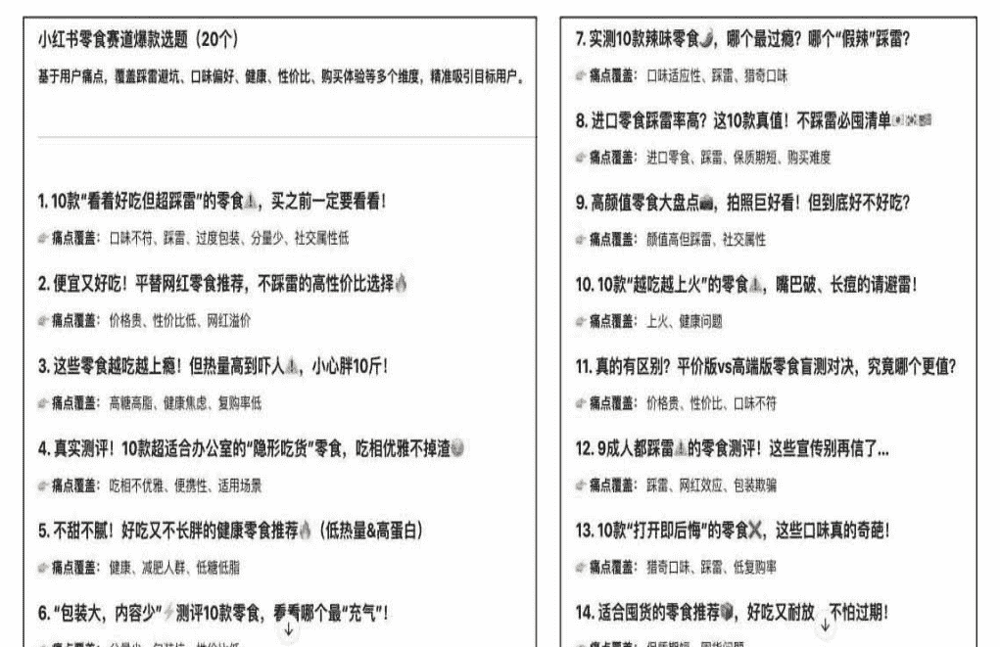
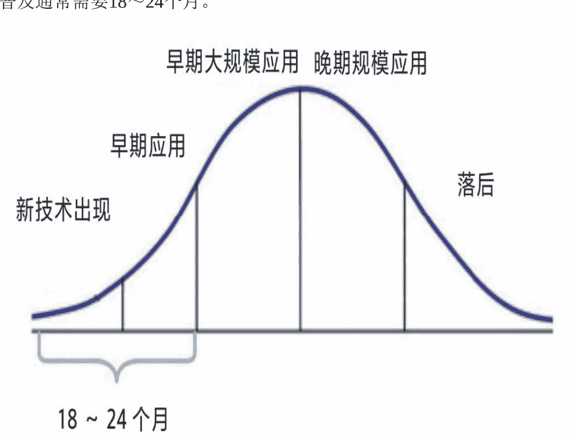
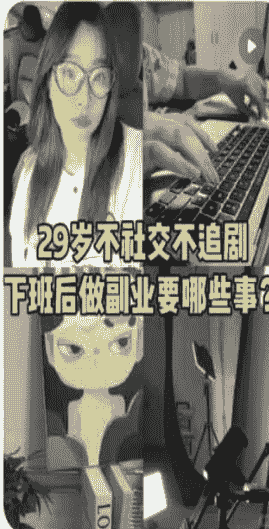
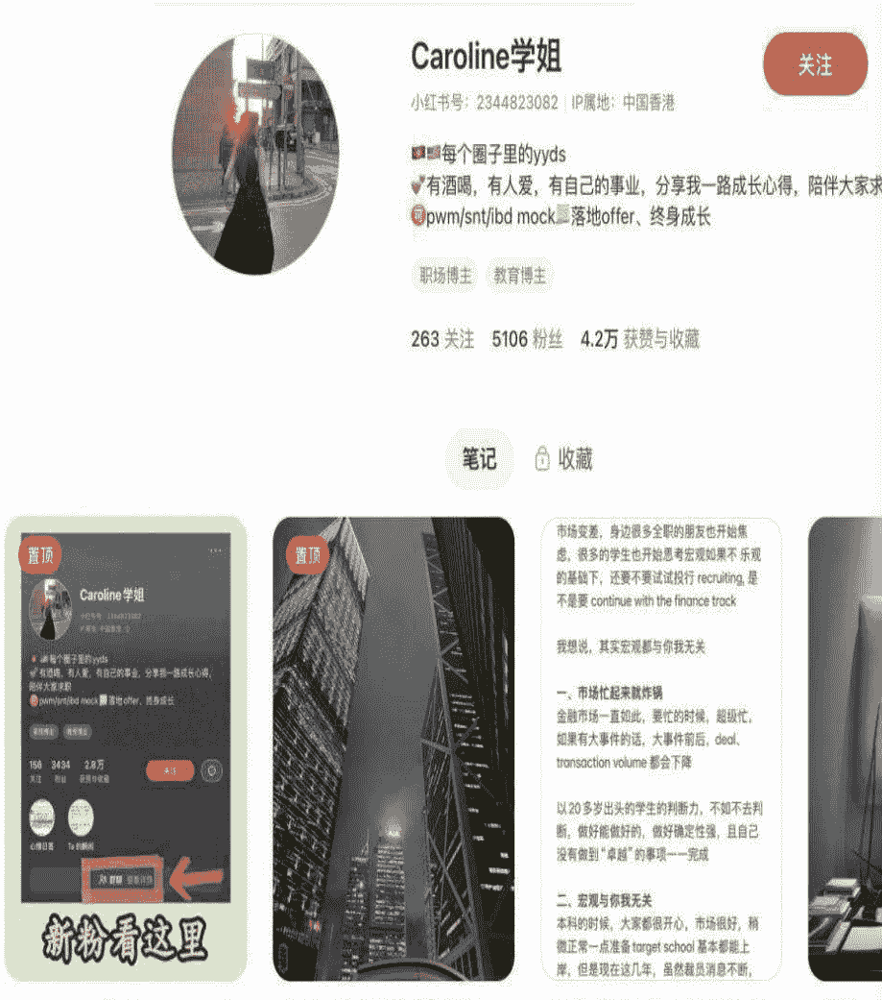
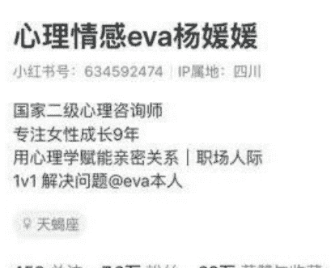
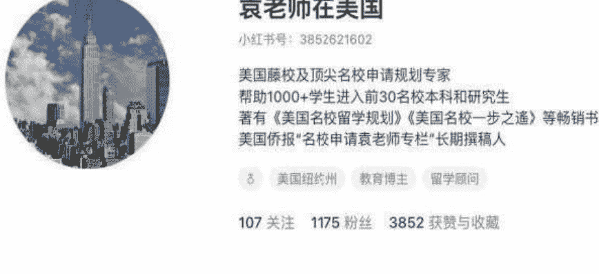
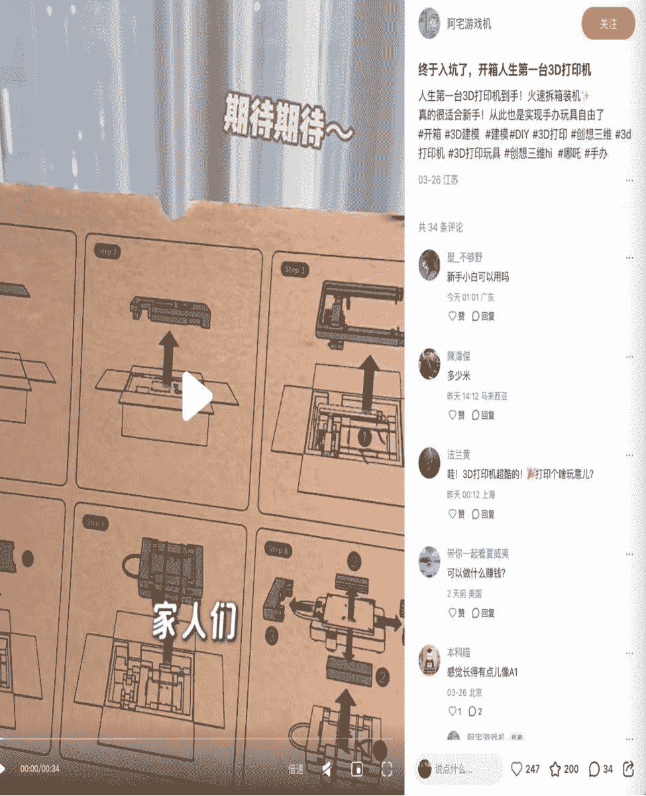
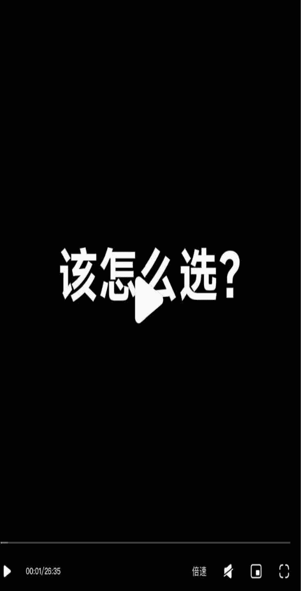
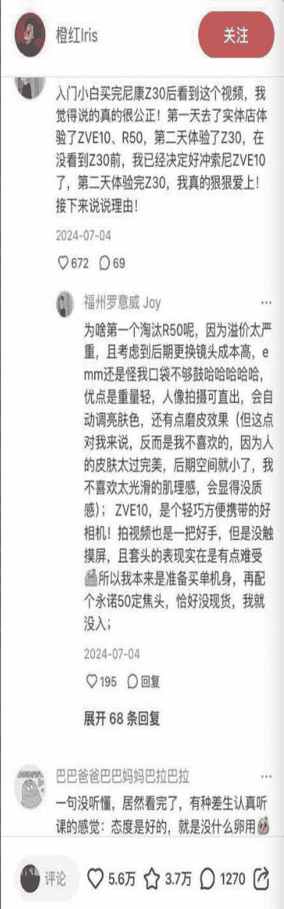
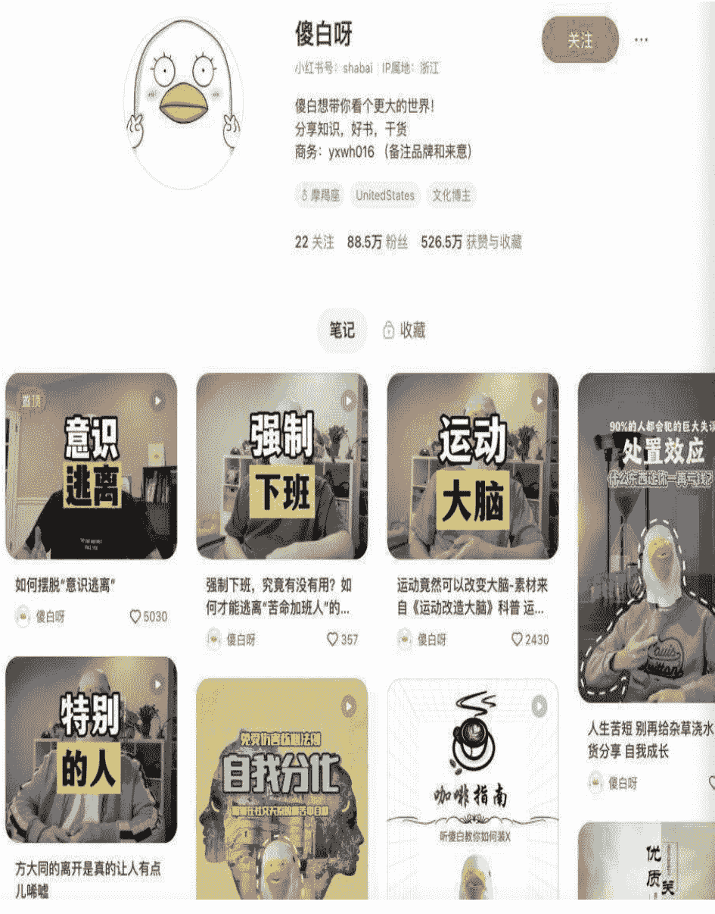

# 小红书内容增长：用AI搭建日更爆款体系

# 内容提要

当大部分人还在为修图与反复润色文案熬夜时，已经有一批创作者把小红书日更十篇可传播笔记变成常态。本书整理人工智能与小红书结合的实操路径，帮助你建立可复制的内容生产体系。

全书共五章。第1章拆解当下环境，解释旧方法为何难以突围，以及智能工具如何改写竞争规则。第2章聚焦生产环节，从常用智能工具、提示词库到标题设计与高转化文案原则，给出可直接落地的创作方法。第3章汇总多元变现，覆盖种草带货、知识付费、个人IP变现，并配以智能加持的策略与优化思路。第4章进入运营与数据分析，说明如何借助智能挖掘小众蓝海、破解冷启动、提升搜索曝光。第5章为进阶内容，涉及跨平台协同、内容迁移、快速启动与专业知识体系搭建，把单号扩展为完整矩阵。全书以作者及学员的一手案例为主，偏重实操，少空谈。

适合新手创作者、陷入产能瓶颈的万粉博主、电商与品牌运营、知识付费从业者、传统行业转型者及MCN操盘手阅读，也可作高校相关专业的参考。

# 自序

## AI时代的小而美创业

2019年起，我持续帮助普通人做线上IP创业。截至目前，学员累计变现已突破八千万。但客户长期有几类痛点：

> “我只有自己一个人，根本忙不过来！”
> “团队扩大开销压不住，团队精简活又干不完，不知道怎么选！”
> “市场看不清，自己琢磨，即使有支持也觉得精力不够！”

2022年那个寒冷的冬夜，我窝在沙发上看着刚上线的ChatGPT，心跳很快。两年后，我在智能辅助下完成了47个不同项目。内容生产、产品设计、市场分析、用户运营，效率提升只能用翻天覆地形容。

过去写一篇四千字的专业稿要花一整天，现在同等质量两小时搞定。以前新品调研要一周，现在24小时能完成八成。就像身边多了几位不知疲倦的助手，随时待命不抱怨。

> “这么神奇的工具会不会很难操作？”
> “是不是必须懂编程才能用好？”
> “普通人能做出这么厉害的东西吗？”

类似疑问很多。现实是智能创业门槛比想象低。我没有编程背景，大学学会计金融，博士阶段学法律，创业从跨境电商起步。那段日子历历在目：凌晨研究海外趋势、挑品挑到眼睛发酸、文案逐字斟酌，一天只能填几张表。调研、整理，每一步都耗时间也不一定准。现在智能已经彻底改写规则。

## 为什么说AI是小而美创业的利器

第一，创作门槛被拉低。过去高质量内容需要专业知识、写作功底和大量时间。如今智能可协助选题拆解、内容生成、视觉设计，让普通人也能产出接近专业水准的成果。

第二，效率明显跃升。有学员从每周两篇笔记提升到稳定周更八篇，质量反而更高。更短时间覆盖更广方向，可测试更多变现模式。

第三，数据更好读。以前后台数据复杂难懂，现在智能能解读趋势、提炼洞察、指导策略调整，让决策摆脱主观感觉。

## 为何选小红书作为AI创业主战场

小红书兼具社区温度与电商转化。相较抖音、B站，其算法更偏爱普通人的真实分享，也更扶持新人，竞争更公平。

如果你因资源有限放弃过梦想，因技能不足被卡住，因时间紧张犹豫不决，人工智能给了你重启的机会。小红书作为最适合普通人的平台，与智能结合形成全新窗口。

过去一年，我见证太多逆袭：一位全职妈妈用智能加持打造家庭收纳号，半年涨粉三万，月入两万；一位写作者借助智能做心理咨询服务，客单从零拉到四万；一位退休教师用智能搭建教育账号矩阵，开启退而不休的新篇。他们都不是科技精英，有的还是数字移民，却用智能这把钥匙打开了小红书宝库。

智能发展太快，很多人担忧失业。其实这是机会。我们不再是传统个体户，而是升级为创意导演：定愿景、定策略、定调性，智能负责高效执行。导演不必扛摄像机，我们也不必执着于亲手写下每个字，核心价值在于独特视角、真实经历和创意洞察，这些智能无法复制。

借助智能，我们已完成很多过去不可行的项目。别人一年总结的经验，你一周就能掌握。我常靠智能学习与创作，并已签约超百位专注智能领域的博主，为自己赋能。作为长期主义者，我相信当下选择将在未来三到五年开花结果。

如果你有理想，想抓住这波红利，就去做吧。未来属于既能熟练运用智能工具，又能保持独特风格的创作者。不是智能创作对原创，而是融合创造更好的内容。

愿本书成为你实现梦想的助力。

# 第1章 小红书与AI结合的价值

## 1.1 行业瓶颈与新机会：传统打法为何失效

团队新人小雨2024年底辞职去做小红书，满怀期待。“第一周我熬了三天通宵，写了七篇穿搭笔记，封面还找摄影师拍的。结果最高一篇只有93次浏览，12个赞……”她苦笑，“我妈说不如去菜市场发传单。”

后来她加入我们，明白了问题所在。可智能出现后，老办法再一次失效，必须革新。

2024年底小红书月活破三亿，创作者超三千万，已是供大于求的内容红海。自2023年起算法三次大改，每次都像给创作者加紧箍咒。

2023年初：内容质量评分升级。老钱说：“以前随手拍张火锅照配一句‘太香了’就有赞，现在发这种等于自杀。算法更看重原创性、完整性和实用性，图片、色香味、人设都要到位。”同质内容被严厉压制。

2023年中：互动质量权重上调。点赞多评论少的笔记曝光远低于评论活跃的笔记。平台要黏性和互动。

2024年初：个性化推荐深化。算法从推什么转向推给谁。小众内容也能精准触达几万人，转化率高。智能时代关键词优化会更进一步，第4、5章详述。

结果如何？统计约1500名学员反馈，2024年新手首月平均浏览量较2022年跌超50%。很多人连续发30天，单篇平均不足百次浏览。

若仍用2022的思路，就像骑自行车上F1赛道，不仅跟不上，还看不到尾灯。这正是流量焦虑的根源。对零经验新手而言更严峻。

生态正经历“流量大饥荒”，但有人悄悄种出丰收麦田。

### 1.1.1 分化明显：借助AI的产出者与手工派的数据对比

面对饥荒，可能以为我说用智能就能起飞。事实相反，平台在压制明显智能生成内容，但智能加持的内容更丰富全面，引发深度互动，正是算法偏爱的信号。

对1500名学员的粗略统计，整体浏览下滑，但少数创作者逆势上升，共同点是都不同程度借助智能协同生产。

表1-1 然冉·星华IP学苑内部统计

| 产出方式 | 2023 年平均浏览量 | 2024 年平均浏览量 | 变化率 |
| :--- | :--- | :--- | :--- |
| 手工派 | 1560 次/篇 | 870 次/篇 | -44% |
| AI赋能派 | 1620 次/篇 | 2580 次/篇 | +59% |

在新手中差距更明显。零经验创作者借助智能协同，首月点赞、收藏与变现速度，远超纯手工方式，内部数据约高出3倍。

不靠智能的普通人难以同时兼顾速度、质量与成本。现在是学习潮，没做智能就一定会被淘汰。

### 1.1.2 内容饱和度：一个让人窒息的行业现状

可怕的不是创作者多，而是优质内容井喷。个人、品牌、MCN、传统媒体都在抢流量。

第三方统计：

- 美妆2024日均新增约21.3万篇，较2022增127%
- 穿搭2024日均新增约18.7万篇，较2022增118%
- 美食2024日均新增约15.2万篇，较2022增93%

一位美妆学员熬夜写Nars唇釉测评，想7点首发。6:30刷新，已有37篇同款笔记，多为带色卡、唇形特写的硬核测评。

即便熬出神仙测评，也会被瞬间淹没。仅靠勤奋已不够。无专业背景、无突出外形、无特殊资源，靠体力战很难突围，除非有别的“武器”。

小红书创作已从随手分享进化为全方位军备竞赛：专业团队入场、高质量图文与数据分析成标配、单篇爆款准备时间从2小时增至5.7小时。

普通人没机会了吗？传统运营机会在收窄，但困境里藏着新机遇，这正是本书要讲的重点。

### 1.1.3 AI：重塑创作规则的高效工具

传统创作者还在绞尽脑汁时，智能已悄然改写规则。

2024年上半年起我们将智能植入所有IP项目。对比如下表：

表1-2 使用AI前后的创作效率变化

| 对比维度 | 纯手工操作 | AI协作 |
| :--- | :--- | :--- |
| 内容构思时间 | 90 分钟 | 15 分钟 |
| 文案撰写时间 | 120 分钟 | 25 分钟 |
| 日均产出量 | 1 ~ 2篇 | 5 ~ 7篇 |
| 平均浏览量 | 2300 | 6700 |

更神奇的是，AI不只更快，还更好。以前写“×个方法教你”，现在能轻松扩展到8-10种，每种配不同场景案例。

AI既是高效执行者，也是永不疲倦的创意伙伴。

高级玩家已在做算法逆向工程。

内容多样性优化。传统10篇测评结构雷同。用AI可设计8种结构，每种触发不同互动。相同主题多样化后，停留时长平均增42%，评论率提76%。这正是算法喜欢的信号。

精准用户洞察。AI能分析海量数据找出真实痛点。做美食内容，传统只看好不好吃，AI挖掘出用户更关心减脂适配、含糖量、防腐剂等细分点。一篇健康零食笔记，通过16维用户洞察，转发率是过往3倍多。因为精准击中痛点（见图1-1）。



互动质量提升。AI可预判用户提问，在内容中埋伏笔，引导深度讨论而非“求链接”。评论区从“谢谢分享”变为思考讨论，对算法是强信号。

平台也意识到AI创作的兴起，正在调整识别纯AI生成内容，但这反而催生“AI+人工”混合模式，既保留效率又融入人性。平台并不排斥优质内容，无论如何产生。

### 1.1.4 价值感：AI创作的核心竞争力

刷小红书常有吃棉花糖感，看似很多却没收获，也怕看到“买它！买它！买它！”的笔记。它们只为走量，卖点单一。

内容过剩时代，用户渴望真正有价值的内容。

比如介绍300元面霜。过去可能只写“补水、保湿、滋润”。借助AI，可分析8种主要成分对不同肤质的作用机制，对比市面上5款同价位配比优劣，还能按年龄段推荐使用方法（见图1-2）。

# 「然冉精华」面霜的8种主要成分及其作用机制

1. 透明质酸钠 (Hyaluronic Acid)
   - 作用机制：强效保湿剂，能够吸收自身重量数倍的水分，保持皮肤水润。
   - 适用肤质：所有肤质，尤其适合干性和缺水性肌肤。
2. 烟酰胺 (Niacinamide)
   - 作用机制：美白淡斑，改善皮肤屏障功能，提升肌肤弹性。
   - 适用肤质：所有肤质，特别是色素沉着或肤色不均者。
3. 维生素E (Vitamin E)
   - 作用机制：抗氧化，保护皮肤免受自由基损伤，延缓衰老。
   - 适用肤质：所有肤质，尤其是成熟肌肤。
4. 神经酰胺 (Ceramide)
   - 作用机制：修复皮肤屏障，保湿锁水，增强皮肤抵抗力。
   - 适用肤质：干性、敏感性和受损肌肤。
5. 甘草酸二钾 (Dipotassium Glycyrrhizate)
   - 作用机制：抗炎舒缓，减少皮肤敏感和红肿。
   - 适用肤质：敏感性和易发炎症的肌肤。
6. 角鲨烷 (Squalane)
   - 作用机制：保湿滋润，增强皮肤柔软度，不油腻。
   - 适用肤质：所有肤质，特别是干性和敏感性肌肤。
7. 积雪草提取物 (Centella Asiatica Extract)
   - 作用机制：促进伤口愈合，抗炎抗氧化，提升皮肤弹性。
   - 适用肤质：敏感性、痘痘肌和需要修复的肌肤。

# 同价位5款面霜的成分对比

1. 产品A：清润保湿面霜
   - 主要成分：透明质酸钠、甘油、泛醇。
   - 优点：保湿效果显著，质地轻盈。
   - 缺点：缺乏抗氧化和抗衰老成分。
2. 产品B：焕彩亮肤面霜
   - 主要成分：烟酰胺、维生素C、熊果苷。
   - 优点：美白提亮肤色效果佳。
   - 缺点：可能引起敏感，保湿性一般。
3. 产品C：多效修护面霜

图1-2 以“然冉面霜”为题，用AI生成的结果

AI最擅长从海量信息中提炼核心价值并适配受众。这正是传统创作者难企及的：

知识深度：整合专业知识点，如同随身顾问团队。
信息广度：融合多角度观点，一篇笔记覆盖多类需求。
表达精准：按目标用户调整语言，新手能懂，专业人士也认可。

我们做测评，以前最多5-6个维度，现在AI加持可覆盖12-15个专业维度，并给出个性化建议。

多数创作者仍守旧，这为拥抱AI的先行者创造弯道超车机会。

### 1.1.5 先发优势：黄金窗口期或仅剩12～18个月

根据技术采用曲线（见图1-3），颠覆性技术从早期到普及通常需18-24个月。



目前AI在小红书创作中的应用处于早期，这意味着：

- 现在起步，你将领先95%的创作者；
- 累积的经验与数据将成为未来竞争的无形资产；

## 1.2 小红书平台：普通人的“掘金地”

我在一次线下课中提到：“小红书像个奇怪的江湖，表面最火的是大V和明星，真正赚钱的往往是你从未听说过的普通人。”

小红书：素人也能起盘的平台

上一回讲到创作者之间的竞争很扎手，不少人会怀疑自己是否还有插脚的空间。先给结论：机会不仅在，而且比直觉里更松。与多数内容生态相比，这家社区对非专业人士更友好，完全可以成为可落地的变现土壤。

### 1.2.1 为什么它更适合普通人淘金

在众多内容阵地里，该社区正被越来越多非专业人士视为变现效率较高的地方，主要体现在三个维度上。

（1）付费知识的入口变宽，从权威讲解转向同行复盘

做求职陪跑的创作者BinGo逛职场曾坦言，抖音上他没有颜值和才艺加持，专业解读也拼不过包装精良的网红。但在小红书，用过来人视角复盘求职经历，转发量非常可观。因为他不是以机构或行业权威的身份出现，而是以留学过来人的口吻交流。靠这种方式把流量导入私域后，成交人数已突破五百，客单价在学员中名列前茅（见图1-4）。

图1-4 小红书博主“BinGo逛职场”

用户更愿意听处境相近的同行者说话，而非高高在上的专家。数据显示，同等条件下，经验复盘类内容的互动表现比纯教学类高出46%，这正是素人创作者的优势所在。

越垂直的知识，越容易获得溢价。例如“普通职场人际训练营”可能只能卖199元，而“医院护士职场人际相处训练营”却能定价999元，受众更窄但转化率和客单价更高。

创作者包子妈妈吕吕从泛母婴分享起步，后来聚焦全职妈妈的付费产品，垂类赛道的定价明显高于泛泛的做小红书课（见图1-5）。

图1-5 小红书博主“包子妈妈吕吕”

平台的魅力在于真实感和代入感。用户不要求你有多权威，他们需要能理解困境、会共情的人。大多数人要的不是理论上的最优解，而是可落地的次优解。素人把自己的试错成本摊开来讲，花了多少钱、花了多久、踩了哪些坑，反而更具说服力。

想做Python付费，在这里更容易吃香的是零基础学Python自动化办公的实录，手把手记录学习时长、难点和真实应用场景，比七天精通Python更受欢迎。

（2）分发更看重匹配而非权重

平台并不看重账号权重，而是做精准匹配。曾有学员在微博、B站深耕三年，粉丝始终破不了万。转到小红书首月，一篇关于胶片相机的笔记就爆发了，新增粉丝五千多，发文时账号才百来粉，系统依然把内容推给对该话题感兴趣的人。

不同于粉丝量决定曝光的生态，这里算法更看重内容质量与用户匹配度。数据显示，超过65%的曝光来自非关注关系。即便零粉丝，只要内容够优质，也能获得大量展现。

这种伯乐式的机制，不看出身看才华，对从零起步的素人很友好。

（3）变现路径不单一，不必靠大号也能盈利

很多人认为没大号就赚不到钱，在这里并不成立。我们一个做小众香水测评的客户，账号仅八千粉，月收入稳定过万，靠的就是精准种草和达人佣金。

变现方式远比想象丰富。

- 橱窗带货：门槛低，普通人可开通。
- 达人佣金：推广商品拿5%～30%分成。
- 知识付费：电子书、课程、咨询服务。
- 账号接单：提供翻译、设计等服务。
- 品牌合作：更看重垂直度和精准度，而非单纯粉丝数。

最大的误区是觉得只有大V才有价值。我们见过太多月入过万的小号创作者，他们只是找到了适合自己的变现路径。

### 1.2.2 平台调性的关键密码

想做起来，必须读懂调性。很多跨平台创作者翻车，就是没适应这种独特性。

（1）种草氛围与消费心理

这里的种草氛围比微博、抖音更浓，又比拼多多、淘宝更生活化。用户来这里不仅买东西，更是来找生活方式的。

数据显示，用户在下单前平均会浏览7.2篇相关笔记，远高于其它平台。这说明笔记的价值不仅是直接带货，更在于影响决策。

头部创作者擅长在实用建议与理想生活之间找平衡，既给可执行的方案，又描绘美好的向往。

（2）女性主导的社区文化

女性用户约占70%，主流年龄段集中在25～35岁，这塑造了独特的沟通风格。

- 共情优于说教：爆款常以“我也曾经……”开头。
- 细节决定好感：女性用户对细节敏感度更高。
- 情感连接为王：有温度的内容比纯干货更受欢迎。

很多男性创作者失败，就是习惯了展示专业而非分享感受。人工智能正好能帮助调整表达，让内容更贴合平台语感。

（3）真实与理想的矛盾平衡

平台同时满足了用户对真实和理想的双重渴望。一方面，76%的用户表示更信任素颜测评；另一方面，精致的摆拍和构图仍是高赞关键。

理解这种矛盾是做爆款的核心。最成功的笔记，通常是在真实体验基础上，辅以美学表达。

### 1.2.3 未被充分开发的机会

竞争虽激烈，但仍有大量没被充分挖掘的空间，尤其结合智能工具后机会更近。

（1）跨界内容的蓝海

更大的机会往往不在新赛道，而在跨界。比如健身×职场、育儿×理财、美食×心理学（见图1-6）。相比单一内容，跨界更有差异性和价值。

分析显示，跨界笔记的平均浏览量比单一笔记高86%，因为它满足多维需求，同时竞争更小。

智能工具擅长整合跨领域知识。比如健身达人可用它把健身知识结合办公室场景，做成办公室五分钟减脂训练这种差异化内容（见图1-7）。

图1-6 小红书上“育儿+理财”的跨界爆款内容

图1-7 关于“办公室健身”的爆款笔记

（2）人设加专业带来的差异化突围

近一年来，冒头的新人大多走人设加专业的组合。单纯干货难出圈，有独特人设加持专业内容，突围更快。比如前索尼工程师讲数码、两娃辣妈营养师做育儿餐谱，信任感和差异感都很强（见图1-8）。

智能工具可从两方面助力：挖掘并放大个人经历中的独特人设点，提供专业知识与内容生产支持。

我们辅导的前银行职员小吕本想做理财号，竞争太激烈。经智能分析，她00后理财女孩加前银行柜员的人设组合有记忆点。借助智能辅助内容生产半年后，她新增粉丝七万，月收入稳定两万加。

图1-8 具有交叉人设“育儿+理财+科技”的蘑菇妈妈

（3）本地化内容的潜力

平台正从全国走向本地，这是被忽视的趋势。现在算法更倾向推送同城内容。

数据显示，本地相关内容的留存率比普通内容高37%，更容易沉淀稳定粉丝。比如成都咖啡爱好者，不必卷全国测评，做成都咖啡地图反而更容易出圈，竞争小且易差异化。智能工具可帮助整合本地信息，做成更完整的本地指南（见图1-9）。

图1-9 小红书上对“成都咖啡”的搜索结果

### 1.2.4 普通人借助智能工具的制胜思路

读懂调性和机会后，该怎么突围？

（1）找到个人特质与市场需求的交集

每个人都有独特性，关键是找到它与市场需求的交集。别去模仿，问自己：我有什么是别人没有的？

简单路径：

- 列出三个身份标签，如二胎妈妈、前银行职员、瑜伽教练；
- 列出三个兴趣领域，如低碳生活、职场穿搭、亲子教育；
- 组合尝试，找到差异化角度。

智能工具可帮你评估每种组合在平台上的竞争度和潜在受众，锁定既有个人特色又有市场需求的点。

按此思路，直接向DeepSeek发起询问即可（见图1-10）。智能工具的输出参考（见图1-11）。

图1-10 按照提示向DeepSeek提问

图1-11 DeepSeek输出内容

（2）做精准适配，而非通用创作

多数人把智能工具当通用写作助手，高手是用它做精准适配，按平台、按受众定制。

我们常用工作流：

- 先用智能工具分析目标受众语言习惯和关注点；
- 再用它调整风格，匹配平台调性；
- 最后加入个人经历和情绪，提升真实感。

比如秋季穿搭指南，通用版很平庸，适配后会变成适合通勤族的秋季叠穿技巧，身高158cm亲测不显矮，更具针对性（见图1-12）。

图1-12 DeepSeek对回答的思考过程

（3）从内容生产者转向社群运营者

平台正在从内容平台变成社群平台。活跃评论区的账号，粉丝留存率和变现效率都更高，这正是智能工具与素人的最佳分工：智能工具负责高效生产，你负责互动和情感连接。

普通人可做到：

- 用智能工具生成内容框架和知识点；
- 亲自回复每条有价值评论；
- 定期做线上互动活动，提升黏性。

我们一个家庭主妇客户，无专业背景，用智能工具辅助写家庭收纳内容，自己专注粉丝互动，现在已有五万人的活跃社群，月收入过万。

## 1.3 成功案例解析：如何用“AI+小红书”实现月入过万元

变现不是大V的专利。找准赛道，借助智能工具，普通人一样能实现收入跃升。下面解析三类可复制路径。

### 1.3.1 案例一：应用测评的隐形掘金机会

我们团队很早就切入应用测评。这个赛道不需要露脸，粉丝少也能接广告，成本几乎为零，是素人做副业的理想起点。

该领域主要输出工具性内容（见图1-13），与智能工具匹配度极高。我们学员的最佳记录是15个粉丝时就接到广告，甲方也偏爱这种起步号：曝光够、价格合适、做得用心。

应用测评的特点：

- 受众广泛：人人都用应用；
- 低门槛高回报：只需指出痛点与解法；
- 广告主充足：互联网公司营销预算稳定；
- 矩阵效应强：可覆盖多个细分领域；
- 更新快：持续提供素材。

爆款测评会直击痛点，不是罗列功能，而是说清楚能解决什么问题。比如不说这是一个记账应用，而是说总忘钱花哪了，这个应用帮你轻松控预算。同时用大量截图、录屏展示真实使用场景，并加入个人使用建议，如适合上班族，学生党可能用不上。

系列化内容也易收藏，如效率工具合集、设计师必备应用。

变现方式主要有四种：推广付费应用分成、接受官方测评委托、运营多细分账号扩大合作、把优质资源整合成付费专栏。

智能工具出现后，即使缺乏全面使用经验，也能快速提升专业度和效率。比如让智能工具基于多篇笔记提炼框架，再在此基础上修改，事半功倍。

成功要素：

- 垂直细分：聚焦效率工具、设计软件、财务管理等；
- 用户视角：以解决问题为主；
- 矩阵思维：多账号互导；
- 智能辅助高频输出：保持稳定更新。

应用测评是一个被低估的黄金区，门槛极低，可批量化操作，也能借助智能工具实现专业化和规模化。

图1-13 小红书上做App测评的账号及其内容示例

### 1.3.2 案例二：电商带货的智能选品与文案革新

阿粒是我们的学员，曾在互联网公司工作。几年后她感到工作压力过大，转做自由职业。她梳理了自己的起点：

- 时间被严格切割；
- 资金有限，无法大量囤货；
- 不确定选什么品；
- 内容缺乏吸引力和转化力；
- 不懂平台算法和流量规则。

尝试好物分享、美食等方向后，她选择知识付费。两个月后第一篇点赞超两千的爆款笔记出来，她引流超一千人到私域，成交百人以上，客单价三千多元，此时粉丝仅两千多（见图1-14）。


### 阿粒创业日记

小红书号：kikiko | IP属地：上海

- 📍小镇女孩靠自己定居上海

- 💰汽车大厂5年工程师

- 🌸vlog | 自媒体经验 | 副业 | 女性成长

- 📮504394271@qq.com

♀ 中国

291 关注 2356 粉丝 1.5万 获赞与收藏

笔记 🔒 收藏




新手博主🔥必备6个免费自媒体工具！

40首谁用谁🔥的爆款背景音乐！我找了好久🎵

29岁下班时间做副业，要做哪些事？

搞钱姐妹阿粒 ❤️ 1807

搞钱姐妹阿粒 ❤️ 3873

搞钱姐妹阿粒 ❤️ 18

### 图1-14 阿粒当时的小红书账号

趁热打铁，我们帮她做了发售。变现做到五十万时，她感到吃力，也并非专业知识付费老师。于是她从2024年起系统学习智能工具，转向电商带货。借助智能工具，日更三篇以上成为可能。她总结了电商带货的现状：

- 市场规模大：小红书是种草决策首选，抖音带货更全，她先从抖音挑战；
- 转化路径清晰：内容—信任—购买闭环完整；
- 佣金体系成熟：橱窗、联盟、私域多渠道变现；
- 长尾效应明显：优质内容持续产生佣金；
- 智能辅助空间大：选品、文案、投放全链路可优化。

她的路径分三阶段：

第一阶段，智能工具实现精准选品。她用智能工具分析平台热销数据找潜在爆款，建立利润率、转化难度、市场容量的评分模型，预测生命周期避开饱和品类，还能分析同类推广饱和度找蓝海。以前十个品中一个转化，现在能稳定命中五个。

第二阶段，智能工具提升文案质量。她让智能工具拆解高转化文案结构，按产品特性生成框架，补充成分、原理等专业知识，加入对比实验和数据增强说服力，并融入用户痛点和场景叙事。内容专业度和真实感提升后，转化率提高近三倍。

第三阶段，全链路优化与矩阵扩展。她搭建测评号加个人号加垂直号的账号矩阵，分工转化，形成流量闭环，并设计公域到私域的话术，建立社群运营和复购机制，提升客户终身价值。

在监测与优化层面，阿粒构建了一套贯穿内容投放、用户点击到成交闭环的数据追踪，依靠模型解析转化漏斗中的堵点，反复打磨内容策略与商品挑选。

系统化运作约三个月后，带货成绩开始显现。

- 内容表现：平均收藏率稳定在15%左右，单条笔记最高推动超过200笔成交。
- 收入规模：月流水维持在2万至5万元区间，对于起步者而言已属不错。
  - 平台佣金：1万–2.5万元，来自抖音橱窗与电商联盟。
  - 品牌合作：1万–1.5万元，以测评与种草内容为主。
  - 私域成交：0.2万–0.5万元，包含知识付费与个人微信交易。

回顾从新手到成熟线上创业者的历程，阿粒总结：“带货最核心的是信任、专业和效率。有了智能辅助，我这个普通人也能迅速补齐产品专业知识，产出高质量内容，在激烈赛道里找到自己的位置。对不想坐班、对成为大V没把握却想做事的人，这条路相当理想。”

### 1.3.3 案例3：车模跨界，借助智能创作实现百万级转型

客户张土土年过三十，曾长期在各大车展与品牌活动里担任模特。随着年龄增长，她越来越觉得这条路难以为继。

“模特是青春饭，过了巅峰期机会变少。站几个小时很累，还要一直笑。我想用外貌优势做点别的，让收入更稳定一些。”这是她在2022年咨询时的首个问题。

2022年初，她决定试水美妆博主。起步条件不差：有一定粉丝基础，多为过往模特时期积累的熟人；颜值突出，镜头感自然；化妆技巧也算熟练，多年配合化妆师让她学到不少。

她先在抖音做美妆内容，靠颜值加成和基础化妆技能，粉丝增长很快，不到一年突破50万（见图1-15）。


### 图1-15 张土土的第一个抖音账号

好景不长，很快触到天花板。“前期涨粉快，后期就停滞了。美妆赛道竞争太激烈，专业化妆师和彩妆达人的专业度远在我之上。”张土土说，“更关键的是，我对美妆的热情并不像想象中高，每天研究口红色号、粉底质地，很提不起劲。内容越做越勉强，粉丝也能感觉出来。”

到2022年底，账号粉丝增长几乎停滞，互动率大幅下滑，接到的商单也越来越少。她陷入迷茫：“我不适合做自媒体吗？要不要放弃回模特？可回去又能撑多久呢？”

转机出现在一次创作者训练营。交流中发现她对汽车颇有研究，多年汽车模特经历让她参加过众多新车发布会，对车型性能、内饰与设计理念都有自己的认知。

我问她：“有没有考虑过做汽车内容？”

她表示没底气。在她看来汽车是男性主导的领域，要做好必须懂专业术语，能分析发动机、变速箱、底盘，文案负担很重。她虽有一定常识，但自认是外行。

于是我们介绍了智能辅助创作的可能性，以及模型如何帮助创作者突破知识与表达的瓶颈。她起初将信将疑，但在模型生成一段关于新车型的点评脚本并融入她模特视角后，她被惊到（见图1-16）。

### 豪华智能天花板？深度测评问界 M9，这几点你一定要知道！🚗🔥

最近，华为深度赋能的问界 M9 成为了市场上的大热门，官方称之为“1000 万以内最强 SUV”！但它真的有这么神吗？作为汽车博主，我深度体验了一番，今天就和大家聊聊它到底值不值得买！

### 🚀 外观 & 空间：真的“大”吗？

- ✅ 气场拉满！ M9 采用华为家族最新设计，前脸科幻感十足，线条硬朗，开在路上辨识度很高，妥妥的商务级 SUV。

- ✅ 空间到底如何？

  - 车长超 5.2 米，轴距 3110mm，比理想 L9 还大一点，属于“真全尺寸 SUV”！

  - 第二排、第三排舒适性出乎意料！我 180cm 坐第三排，头部空间还有 1 拳，腿部不顶前排，长途也不会太难受。

  - 后备箱空间实测：当第三排立起时，还是能放 2-3 个登机箱，比一般 6/7 座 SUV 要强。

- ✅ 适合谁？ 家庭用车绝对没问题！但如果你要接待客户，M9 的座椅舒适性也够档次。

### ⚡ 续航 & 动力：纯电 VS 增程，怎么选？

M9 提供 纯电版 和 增程版，两种动力组合：

- ◆ 增程版（CLTC 续航 1362km，纯电 175km）

  - 日常市区纯电开，高速用油，不焦虑！

  - 增程器声音控制不错，车内很安静，尤其是低速时几乎听不到启动声。

  - 但高速油耗在 7-8L 左右，比理想 L9 还是稍微高一点。

- ◆ 纯电版（续航 630km）

  - 800V 超充加持，实测 15 分钟能补能 400km，基本不太焦虑。

  - 但如果你是长途自驾党，还是得考虑补能环境。

- 💡 怎么选？

  - 如果日常城市通勤+偶尔短途自驾 → 选纯电版，更经济。

  - 如果长途、高速用车多 → 选增程版，不用担心充电问题。

### 图1-16 AI生成的问界M9介绍脚本

“脚本里的专业术语把握得刚刚好，不会堆砌让人听不懂，也不会太少显得不专业。更关键的是加入了女性视角对内饰舒适度、储物空间实用性的点评，这是市面上大多数汽车测评所缺失的。”张土土兴奋地说。

进一步分析市场后我们发现，汽车领域存在明显空白：以女性视角切入的专业测评。多数汽车自媒体由男性主导，聚焦动力、操控与性能，很少兼顾女性车主更在意的舒适性、安全感、储物设计和用车经济性。

“这不就是你的专属蓝海吗？你既懂车，又有模特出身的形象优势，再叠加智能创作辅助，完全可以打造‘美女懂车’的差异化标签。”就这样，张土土决定重开账号转战汽车赛道，智能工具成为她蜕变的助推器。一年后，到2024年底，她的新号粉丝已达百万（见图1-17）。


### 图1-17 张土土用一年时间做出来的新号

新号定位为“模特职业眼光看汽车”，主打女性视角的专业测评与购车建议。起步阶段她仍遇到创作难题。

她的流程被重塑为：先亲自体验新车并记录主观感受，再将零散笔记输入模型，由模型整理成结构清晰的脚本，补充专业术语与技术解析，同时保留她的个人语气与视角。

模型还会根据车型特性给出拍摄提示。测评豪华车时提醒多关注用料、做工与隔音；家用紧凑型则建议侧重空间利用率与油耗；电动车则提示测试充电便利性与续航真实表现。

有了这些提示，每次测评都有明确抓手，不会遗漏重点。在呈现层面，模型也提供很大帮助。依据平台算法和用户偏好，模型会推荐合适的内容结构和叙事方式，比如“先展示外观亮点，再聊驾驶感受，最后给出人群建议”的流程，或“对比法—悬念法—反转法”等不同表达套路，让内容既专业又有趣。

借助智能加持，她的内容保留了个人特色，同时具备了专业深度。粉丝增长迅猛，仅用8个月就突破100万，并迈入外界眼中的“年入百万元”梯队。

### 1.3.4 成功背后是什么

我们服务过上千学员，社群规模已上万人，每个人赛道不同，路径各异。但透过这三位普通人的成长轨迹，能提炼出一些共同规律。

第一，赛道匹配度决定上限。要找到与自身背景、能力、资源相契合的领域，通过差异化定位避开红海。更应关注用户痛点强度，而非单纯看市场体量，优先选择变现路径清晰的方向。热门不等于适合，匹配度最高的那一个才最优。

第二，智能工具是普通人的能力放大器。无论是快速补齐专业知识、提升内容质效与生产效率，还是做数据驱动的选品与趋势判断，或实现全流程的系统化管理与优化，智能工具都能大幅提效。正如阿粒所说：“有了模型，我这个新人也能做出专业水准的内容，以前想都不敢想。”

第三，系统化思维比单点爆破更重要。优秀创作者善于搭建多层次内容矩阵，设计从低价到高价的产品线，形成从获客到转化的闭环，并持续用数据迭代策略。不要只追逐单条爆款，而要构建完整的内容与产品体系，才能实现稳定收入。

第四，专业度仍是核心竞争力。在垂直领域深耕，提供真正解决问题的专业内容与服务，沉淀结构化的知识体系并持续更新，这些是赢得信任的关键。在信息过载的当下，真正有深度的见解比以往任何时候都更稀缺。

我最认可的一句话是：技术进步不是让非凡者更非凡，而是让平凡者有机会做非凡的事。智能工具与小红书的结合正是给了普通人这样的机会。

小红书依托社区文化、内容调性和变现机制，为普通人提供了比其他平台更多可能性。而智能技术的落地进一步降低了专业门槛，让普通人也能产出高质量内容。

最让人震撼的是，团队对5000个小红书账号的分析显示，使用智能辅助创作的账号，粉丝达到1万平均只需3.2个月，传统创作者平均需要8.7个月。变现效率差距更大，前者每千粉丝月收入是后者的2.4倍。

# 第2章 AI赋能内容创作

## 2.1 创作者必备的AI工具箱

在介绍工具前，需要先统一认知。

不少人容易走极端：要么排斥智能工具，认为会让创作失真；要么过度依赖工具，幻想一键出爆款。真实情况介于两者之间：模型是强力的助手，创作方向仍由人把握。

智能工具更像放大镜与显微镜，能放大创造力，揭示更多可能性，但不会替代创意与洞察。厘清这点，才能正确使用工具。

### 2.1.1 小红书创作的4大核心环节

构建合理工具箱，首先要理解小红书内容创作的四个核心环节：选题规划、内容创作、视觉设计、数据分析。针对不同环节需要不同类型的智能工具。

以下按创作流程介绍11款值得学习的智能创作工具，并附功能、使用场景与建议，助你快速找到合适的助手。

（1）选题规划阶段的智能助手

**豆包**

特点：可直接链接抖音数据库进行热点分析。

对新手友好度：★★★★★

该工具被许多博主称为“选题神器”，能实时监测平台热点话题、热搜词与爆款趋势，帮助抓住热点的同时避开红海。豆包的训练数据多来自字节跳动，根植于抖音用户反馈，在自媒体领域保持实时响应。


图2-1 豆包

例如今年3月，我们让豆包预测母婴类爆款方向，结合季节与大数据，它给出了回应。

结合抖音近期数据及母婴行业动态，接下来一个月内，这些母婴好物选题在抖音上易出圈。宝妈宝爸们快收藏，灵感来了。

### 春日出行必备母婴好物盘点

天气转暖，带娃出游增多。轻便型婴儿车突出一键收车、可登机；便携式儿童餐椅强调易携带、户外稳定；儿童防晒帽从防晒指数、透气材质、可爱造型测评，满足春日出行刚需，播放量与互动有望走高。

### 换季敏感肌宝宝护理攻略

春季宝宝皮肤敏感高发期。分享宝宝专用温和洁面乳、保湿面霜、修复精华等好物，详细介绍神经酰胺、植物甾醇等舒缓成分的功效，为新手父母提供可操作方案，易获关注。

### 图2-2 豆包的回答

最实用的功能有三点。

- »热点预测：可预判未来3至7天可能升温的话题。
- »竞争度分析：评估选题的竞争激烈程度。
- »热点日历：展示各领域周期性热点，如节假日、纪念日等。

豆包能省去大量找灵感的时间。例如它会提示“夏日防晒”将有热度，但“身体防晒”比“面部防晒”竞争低约50%，便于有针对性规划。初学者可先从每周热点报告入手，让豆包挑选中等竞争度的题目，避开过度卷的领域。

**有伴AI**

特点：基于大模型的创意发散工具。

对新手友好度：★★★★☆

与直接给结果的豆包不同，有伴AI更擅长头脑风暴，围绕一个基础想法快速展开多种可能性。

不同于全能型豆包，有伴AI专为小红书优化，可自动采集分析小红书热门笔记，帮助生成适配新内容（见图2-3）。网站完全基于小红书做优化，只要给出方向，就能自动抓取爆款文案并植入人设与内容标签。

## 快写红薯通AI

特点：复制笔记链接，一秒提取小红书笔记方案，直接改写爆款笔记文案。

对新手友好度：★★★☆☆

这是一款提炼精华的工具，能从众多选题中筛选出最符合个人特质、最具价值的方向（见图2-4）。

我最推荐“一键转写”功能，输入视频笔记链接即可提取原文案并按相似结构生成新文案。但新手易产生依赖，务必注意改写。起步阶段可侧重个人匹配度，选择可长期输出的领域；经验积累后再关注潜力评分与变现路径。

## （2）内容创作阶段的智能助手

### 多种草AI

特点：小红书专属文案生成与优化工具。

对新手友好度：★★★★★

该工具专为小红书调性定制，能把普通文案调整得更具小红书风格，如更强的情感共鸣与个性化表达。

多种草AI含小红书敏感词检测，适合新手规避限流风险。同时提供测评、攻略、分享等结构模板。虽然生成内容略显模型味，但开头部分具有代表性，能有效解决“开头难”。

推荐用法：先理清思路，在各框架点位填入真实观点与经历，再用润色功能调整语气，使内容更贴合小红书。

### DeepSeek

特点：综合模型，整体全面，尤其擅长文案。

对新手友好度：★★★☆☆

这是让普通人写出专家级内容的工具。相比国内多数模型，它在文字处理上更智能，我认为远超豆包。对中文理解优秀，能提供各领域专业知识点、概念解释与最新研究（见图2-6）。

例如写护肤品测评时，可用DeepSeek补充成分功效的科学解释，让测评兼具个人体验与专业依据。

不过DeepSeek对提示词要求较高，泛泛提问只能得到宽泛答案。另外要避免过度堆砌术语，关键是把专业知识转化为读者价值，保持“70%个人经验+30%专业知识”的黄金比例。

最实用的功能包括：

- 知识点补充：按主题自动补齐相关专业知识。
- 术语解释：将专业词汇转化为通俗表达。
- 研究数据库：提供各领域研究数据与统计信息。

### 小红书文案助手

特点：增强内容对小红书的适配性，提升情感连接与共鸣。

对新手友好度：★★★★☆

该工具专注提升情感温度，帮助文字触动读者神经，建立更深连接（见图2-7）。

只需列出文案要点，就能生成完整框架。在可创作小红书文案的工具中，我认为其语气最贴合平台，剩下需要填充故事与共鸣点。毕竟即便是干货，用户更爱分享而非说教。

例如做育儿笔记，工具会给出框架，但仍需加入“这个方法让我第一次感受到做妈妈的成就感”这类情感表达。模型只是强力助理，切勿被助理主导。也可以把真实情感与经历输入，让它帮助找到更易共鸣的表达方式。切忌过度煽情或夸张用词，真实最重要。

### Kimi

特点：全能型模型，不止于2023年数据，支持联网查询，且擅长长文本处理。

对新手友好度：★★★★☆

Kimi推出“小红书爆款生成器”等平台化功能，可按小红书特点生成带Emoji、分段的内容。对把握不好“网感”的新手，起步阶段很有帮助（见图2-8）。

## （3）视觉设计阶段的智能助手

### 即梦+可灵

特点：文生图加图生视频，适用于无需出镜的视频片段制作。

对新手友好度：★★★★☆

这两款工具可根据文字描述生成高质量图像，也可根据风格偏好调整。还能用生成的虚拟形象做口播（即梦出图后交可灵生成对口型视频）。

做中长视频时，若需空镜丰富内容，也可用即梦生成适配文案的图片，再用可灵使其动起来。例如视频中提到“20年前的老上海茶馆”，无实拍素材时就用它生成复古场景图。这些素材与真人拍摄混合使用，更能保持真实感（见图2-9、图2-10）。

核心在于学习编写详细的图像描述，包括场景、光线、风格等。模型可辅助大量工作，但并非所有结果都能直接使用。

### ChatTTS

特点：输入文本，生成音频。

对新手友好度：★★★★★

在我接触过的自动音频工具中，ChatTTS最好用（见图2-11）。在官网输入文本即可生成自然语音文件，效果接近真人。不少智能客服已接入该语音系统，提升咨询体验。

批量起号不用自己配音，合成声就能顶上

做多条视频不想亲自录音，直接用合成语音就行。ChatTTS支持多语种输出，中文的拟真度很高，对想做海外分发的创作者相当友好。

## （4）数据分析阶段的AI助手

### 巨量算数
特点：可以纵深拆解内容表现与用户反馈。

对新手的友好度：★★★☆☆

巨量算数是当前规模很大的内容数据池（见图2-12）。打开算数指数，输入准备做的选题关键词，就能看到热度走势。打开关联分析，会看到围绕该词的延伸话题和当下热词，帮助挖掘既有流量又有潜力的选题方向。例如输入“健身”，会关联出“健身穿搭”“健身饮食”等相关主题。也可横向比对不同内容的各项核心指标。

新手使用建议：

- 先从基础指标看起，判断哪类内容更受欢迎；
- 积累一定数据量后，再去探究细节因素；
- 每发布十篇左右做一次系统复盘，及时调整创作方向。

### 2.1.2 AI工具使用的注意事项
不管搭配哪几套工具，都要记住这些原则。

- 定位是辅助而非替代。智能工具补不上个人创意和经验，最打动人的洞察与真实体验仍需自己提供。
- 保持稳定。频繁换工具换风格会打乱节奏，建立一套固定的工作流更重要。
- 投入时间学习。每款产品都有值得深挖的高级用法，掌握后效率明显提升。
- 尊重原创和隐私。避免侵犯他人知识产权，不要上传敏感个人信息，所有输入都可能进入模型训练库。

账号起步期，一两款核心产品就够用。随着运营成熟，再逐步叠加新工具即可。
另外，指令的质量直接决定AI输出的天花板。无论使用哪款AI，高质量的指令都是释放价值的关键。我的公众号“然冉创业说”整理了一批可复制的指令模板，具体使用时需要补充细节。2.2节会专门讲如何写出优质的AI指令。复制模板不如吃透背后的逻辑和方法，这样才能按需改造，真正掌握创作主动权。

## 2.2 AI提示词宝库：如何写出优质的提示词
如果你只会让AI“帮我写篇老北京炸酱面测评”，得到的很可能是下面这种内容（见图2-13）。

### 【炸酱面体验笔记 | 胡同老店一碗酱香，馋到我半辈子】
正文整体堆砌感官描写，酱料、手工面、菜码、面汤都被用很重的形容词包装，最后作者用“做作”两个字收尾。这样的文案可读性不高，专业度不足。

掌握了指令的核心逻辑，用同一套工具也能产出读者认可的专业内容。这本质上是学会与一个需要明确指示的天才助手高效沟通。

先理解AI怎么“思考”。可以把它想象成一位聪明的协作者：

- 知识面广但缺上下文。储备庞大，却不了解你的具体场景。
- 需要清晰的目标与边界。指令模糊时会自行假设。
- 不会主动追问。人类助手会追问不清的部分，AI只能基于现有信息硬做。
- 对措辞极其敏感。细微差异可能导致完全不同的结果。

AI更像意图解读器，表达越清晰具体，理解越准确。成功的指令就是成功的沟通，要明确传达做什么、怎么做。

### 2.2.1 优质提示词的5层结构
大量高效指令的拆解显示，它们普遍包含五层结构，像搭塔一样层层支撑。

#### （1）明确目标与身份
回答“你是谁”和“要什么”两个问题。
例如：作为专业食品测评师，请为新上市的零食产品撰写一篇专业测评。
“专业食品测评师”定义角色视角，“新上市的零食产品”点明主题，“创作一篇专业测评”明确任务与形式。单独加入专业角色，就能明显提升输出的专业度。

#### （2）提供上下文与背景
为AI补充任务环境信息。
目标读者是25~35岁的年轻白领，关注健康但时间有限。
产品特点是低糖、高蛋白、即食，价格带中高端。
加上受众与产品背景，内容针对性会显著增强。

#### （3）指定输出结构和格式
告诉AI期望的呈现方式。
测评需包含：
- 吸睛标题 15~20字；
- 产品基本信息 50字内；
- 5个测评维度 各约100字；
- 推荐总结 含适合与不适合人群。
结构清晰后，信息组织与获取效率都会提升。

#### （4）设定语气和风格
定义表达方式与情绪基调。
语气要专业又亲切，避免过度术语，用简洁有力的短句。
风格保持客观公正，带点个人见解，适当加入感官描写与细节，增强真实感。
明确风格后，个性化与情感共鸣都会大幅提高。

#### （5）约束与优化指令
做质量控制与优化方向。
确保内容基于事实非主观臆断；
避免过度营销修饰词；
缺点要客观真实，不能敷衍；
最终文本兼顾专业深度与通俗易懂。
加入约束后，专业可信度明显提升。

### 2.2.2 场景化提示词分类

#### （1）内容创作类提示词
适用场景：文章、测评、脚本等原创内容。
核心策略：给出明确框架与风格指引。
最佳结构：明确类型与主题、定义受众与场景、提供详细结构、指定风格语气、增加差异化要求。
效果对比：
基础提示：写一篇关于智能手表的测评
优化提示：作为科技测评专家，请为小红书口播视频撰写Apple Watch 9的专业测评，读者为30~45岁商务人士，关注健康监测与工作效率。需包含开场背景、外观设计、核心功能、续航实测、性价比对比、适用人群建议。语气专业平易，用第一人称，穿插真实体验，避免堆砌术语且有数据支撑，需客观指出不足并给出使用场景建议。
优化后内容聚焦“私人全科医生”卖点与“商务人士”人群，专业度与实用性显著提升。

#### （2）数据分析类提示词
适用场景：解读数据、找趋势、做决策建议。
核心策略：厘清分析目标与决策需求。
最佳结构：定义对象与数据范围、明确关键问题、指定分析维度与方法、要求可操作洞察、设定结论可信度。
效果对比：
基础提示：分析我上个月的小红书表现（上传后台截图）
优化提示：请以内容数据分析师身份，对近30天小红书表现做深入分析（附截图）。概况：10篇内容，平均浏览3500，互动率2.7%，最高1.2万最低800。请对比不同类型表现，总结高表现内容的发布时间、标题特征、结构共性，梳理用户互动热点，指出优化机会。重点解答标题点击率、内容长度与停留时间的关联、哪些话题互动最强。请给出3~5条可执行优化建议、下阶段策略方向、2个可立即做的A/B测试，并在不确定处明确标注相关性与因果性区别。
优化后报告在深度与可操作性上提升明显。

#### （3）视觉创意类提示词
适用场景：封面、排版、图像创意。
核心策略：提供明确视觉元素与美学指引。
最佳结构：定义目标用途、明确主题表达、指定风格色彩与构图、给出参考灵感、设定技术约束。
效果对比：
基础提示：设计一个美食小红书封面
优化提示：为“家常川菜红烧牛肉”食谱设计小红书封面方案，受众25~35岁年轻新手，追求简单仪式感。风格为清新日系美食，色调暖红棕+奶油白，呈现高级但亲民感，构图简洁。主体为红烧牛肉特写，配1~2件简约道具，点缀少量绿蔬。标题位置预留“20分钟学会川式红烧牛肉”。参考Namiko Chen风格但更现代。技术要求竖屏9:16，小图可辨识，标题占画面约四分之一，浅景深突出主体。请给2~3个构图概念并说明优劣。
完善关键词后点击率提升约65%，整体美感评分提升约70%。

方案一：中心环绕式构图
主体为45°俯视的红棕色牛肉堆叠于白瓷盘中央，酱汁流淌形成光泽轨迹，左侧露出木勺柄，背景上香料投下投影，盘边点缀青花椒，左上斜插带水珠香菜。标题竖排于右侧空白区。优势聚焦强，适合教学类首图。

方案二：对角线构图
哑光黑砂锅倾斜30°，后期强化蒸汽，左下露铸铁锅柄，右上放陶酱油瓶，锅沿搭月桂叶，背景虚化葱白。标题横铺下部。优势营造“刚出锅”临场感，适合人设种草。

### 2.2.3 实战技巧：超越公式的个性化提示词

#### （1）迭代式提示词策略
不要追求一次完美，多轮打磨更高效。
第一轮请基于初始想法给3个方向；
第二轮选择方向再展开大纲；
第三轮强化特定部分深度。
迭代比一步到位效果更好。

#### （2）对比型提示词技巧
明确“要什么不要什么”。
需要专业但友好的语气，避免过度正式或学术化；希望包含具体数据支持，不要包含未经验证的笼统说法。
对比指令能显著提升精准度。

#### （3）示例驱动提示词方法
用例子代替抽象描述。
希望风格类似：[优质片段]；而不是：[反面片段]。
示例引导比文字描述更准确。

#### （4）角色扮演提示词增强
让AI承接特定专业身份。
请以著名美食评论家视角，用其典型表达与评价标准分析菜品。
角色扮演可大幅提升专业度与风格一致性。

#### （5）工作流程提示词模式
引导AI按步骤思考。
请按以下流程分析：识别核心问题及原因；评估方案优缺点；给出最佳实施步骤；预测障碍及应对策略。
流程化能提升系统性与可操作性。

### 2.2.4 自定义提示词的高级改写技巧

#### （1）“解构-重构”技巧
借鉴优秀提示词，先拆后组。
解构阶段识别目标定义、角色设定、结构指导、风格要求、约束条件；
替换阶段保留框架，换成自己的需求；
增强阶段加入个性化元素，强化领域专业要求。

跨领域迁移是提效的高频手段。先拆解成熟范式的内在逻辑，保留其骨架，再把主体内容替换成自己的赛道，比从零搭建要快得多。比如把美食测评的拆解维度搬到美妆品类评估，直接就能复用思路。

#### （2）渐进式加码思路
从最简指令起步，逐步叠加个性化要素。

- 起步层：用简洁明了的核心指令开局。
- 加配层：在此基础上补入受众画像和使用场景。
- 规范层：再加入结构化要求与质量标准。
- 风格层：融入个人独特的表达习惯和偏好。
- 顶配层：最后叠加差异化与竞争优势要素。

可以按内容复杂度准备不同层级的模板，日常分享用起步层，重要的商务合作用顶配层，既省时又能守住关键质量。

#### （3）赛道专属增强
为专业赛道定制指令增强包。

- 美妆赛道：补充肤质考量、成分拆解维度、使用场景细分。
- 美食赛道：强化感官描写、食材特性、适配人群划分。
- 财经赛道：增加数据支撑要求、风险评估视角、时效性考量。
- 教育培训赛道：加入学习路径设计、知识点串联、理解检验环节。

通用模板像底料，赛道增强才是决定风味的关键香料，为每个赛道准备一套即插即用的增强包效果最好。

### 2.2.5 模型更偏好的沟通方式
用模型本质是请一个聪明的助手干活，想要高质量产出，就要站在模型角度思考哪些指令更容易被高质量响应。通过大量实测，模型对以下几类提问者更友好。

#### （1）“清晰但留白”的提问者
喜欢原因：目标明确帮助模型快速聚焦，保留创作空间则能发挥其优势。
应用做法：
- 说清要做什么、为谁做；
- 给出大致框架和关键要求；
- 避免过度具体的微观管控；
- 保留一定创意与表达自由度。

平衡示例：
请创作一篇关于入门瑜伽的指南，目标读者是25～35岁的办公室白领。内容需包含基础姿势介绍、健康获益、起步建议。标题要切中用户痛点。风格轻松友好且专业可信，篇幅约1500字。
示例输出的标题为《从僵硬到优雅：办公室久坐族的15分钟自救瑜伽指南》，并围绕颈椎肩背腰椎报警信号与5个可在工位练习的黄金动作展开。

#### （2）“补足背景信息”的提问者
喜欢原因：背景越丰富，模型越能把握需求和合适的表达方式。
应用做法：
- 简述目标受众的特质与需求；
- 说明内容的使用场景与目的；
- 提供必要的行业或专业背景；
- 分享自己的立场或观点。

背景丰富的示例：
我做面向零基础的烘焙教程，受众是25～40岁对手工美食感兴趣的城市女性。风格是把专业技术拆成直观步骤，强调不用专业工具也能做出专业品质。请基于此背景创作一篇简易提拉米苏教程……
优化后输出标题《零失败免烤提拉米苏｜没有电动打蛋器也能做的意式浪漫》，并以破除工具迷思、菜市场材料清单等结构呈现。

#### （3）“使用行业黑话”的提问者
喜欢原因：行内词汇信息密度高，能帮助模型精准定位输出目标。
应用做法：
- 用行业标准表述描述需求；
- 指定必须包含的关键概念；
- 明确专业标准与参考框架；
- 区分专业层次与普及程度。

术语示例：
请为中级摄影爱好者写一篇光圈优先模式Av/A模式教程，需涵盖光圈与景深关系、曝光补偿应用、适用场景分析，使用专业词汇并做简明解释，参考尼康摄影学院风格，设计实践练习。
优化后输出标题《掌握视觉叙事：尼康摄影学院风格Av模式深度指南》，并从Av模式核心原理、景深控制法则等技术维度展开。

技术本质是通过控制光圈开口让相机自动匹配快门达成曝光平衡。
操作界面解析以Z6II为例说明。
景深三角模型：
```
光圈系数(f/2.8) × 对焦距离(1m) × 传感器尺寸(全画幅) = 清晰范围
```
图2-19 模型产出的示例

#### （4）“分步拆解推理”的提问者
喜欢原因：结构化的推理路径能让输出更有条理、更全面。
应用做法：
- 将复杂任务拆解为连续步骤；
- 指定各步骤侧重点与目标；
- 设置逻辑检查点与质量标准；
- 要求在结论前多角度考量。

示例指令：
请分析该商业创意的可行性，按以下步骤思考：
- 先评估市场需求与目标用户规模；
- 再分析竞争格局与差异化空间；
- 接着考量所需资源与潜在障碍；
- 再评估盈利模式与回报周期；
- 最后给出综合风险评估与决策建议。
每个步骤请正反两面分析，避免确认偏差。

#### （5）“复盘反馈循环”的提问者
喜欢原因：具体反馈能让模型更精准调整方向，多轮迭代得到更优结果。
应用做法：
- 给出具体而非泛泛的反馈；
- 点明需保留的优点与改进点；
- 在多轮交互中逐步完善需求；
- 尝试不同表述，寻找最佳沟通方式。

高效反馈示例：
这篇结构整体不错，但需调整：
- 开头偏学术，需要更亲切生活化的表达；
- 第二部分三个优点很好，请补充具体案例；
- 结尾行动呼吁太直接，需更柔和引导；
- 保持专业但降低正式程度；
- 请保留关于研究数据的部分，很有说服力。

### 2.2.6 精通指令设计需要持续练习
指令应用不是简单输入几句说明，而是一项需不断练习的专业能力。掌握它就像拥有一支训练有素的团队，能大幅提升创作效率与质量。
本质上是有效沟通的艺术。很多人误以为有了模型就能放手，实际上模型对用户专业性要求更高，否则难以判断输出是否正确、是否造假。模型是跨行业的工具，不是万能的。用户需要领域经验与技术功底支撑，再配合模型才能产生超出预期的效果。
指令要求清晰表达需求、准确描述目标并提供足够上下文与指引。通过结构与技巧的积累，你会形成自己的指令库与个人风格，不仅提升输出质量，也让创作流程更高效。在XHS的激烈竞争中，指令能力会成为关键优势。
最好的指令来自实践与迭代，不断尝试、记录、优化，你会发现模型能创造的可能性远超想象。

## 2.3 标题打磨：让点击率显著提升
信息过载时代，优质内容若包装不当容易被淹没。标题与开头是第一印象，决定点击、停留与互动。基于1万篇笔记内容的分析，标题与开场白质量对最终表现的影响远超内容本身。
本节探讨如何用模型打造爆款标题，实现点击与互动的大幅提升。

### 2.3.1 XHS爆款标题的九大核心要素
对2023-2024年1000篇爆款标题分析后提炼出九点。

#### （1）强情绪词汇
能直接触发好奇、惊讶、共鸣等情绪的词语。
传统标题：“7种实用的收纳方法”。
情绪增强版：“惊呆！7种收纳方法让我家空间瞬间增大一倍”。
常用词包括正面情绪如惊艳、震撼、超赞；负面转正面如救命、踩坑、崩溃；惊讶类如意外、万万没想到；稀缺类如绝版、内部资料。

#### （2）数字清单结构
数字给出明确预期并暗示结构。
传统标题：“护肤品使用的正确顺序”。
数字增强版：“99%的人都错了！护肤品正确使用的5步法则”。
奇数通常效果更好，3、5、7、9更易用，小数字暗示简单，大数字暗示全面。

#### （3）痛点直击式提问
点出目标用户正在面对的问题。
传统标题：“低成本厨房改造指南”。
痛点增强版：“厨房又小又乱？这9个平价改造让你爱上做饭”。
可用直接提问或共情式表达。

#### （4）反直觉亮点
挑战既有认知制造好奇。
传统标题：“简单有效的减脂方法”。
反常识增强版：“瘦了30斤却从没吃过水煮菜！这才是减脂秘密”。
常用“原来…才是”、“99%的人都做错”等结构。

#### （5）即时收益承诺
明确用户能获得的具体价值。
传统标题：“学习提升记忆力的方法”。
收益增强版：“记忆力翻倍！这3个小技巧立刻见效”。
可用时间指标、努力指标、效果指标表达。

#### （6）亲测案例背书
真实体验提升可信度。
传统标题：“抗初老面霜推荐”。
经验增强版：“亲测3个月，这5款抗初老面霜效果惊人”。
常用“亲测/实测”“使用×时间后”等开头。

#### （7）稀缺独家暗示
制造信息不对称感。
传统标题：“巴黎旅游景点推荐”。
神秘感增强版：“巴黎旅行99%的游客都错过的8个绝美地点”。
可用“内部资料”“×%人不知道”等暗示。

#### （8）受众精准标注
精准定位增强专属感。
传统标题：“有效的面试技巧分享”。
定位增强版：“应届生必看！HR角度分享的8个面试加分技巧”。
可用身份标签、场景标签、需求标签、问题标签。

#### （9）表情符号策略
Emoji增强视觉吸引力与情感表达。
传统标题：“新手如何开始投资基金”。
Emoji增强版：“💰小白理财特辑|1000元开始基金投资入门攻略”。
原则：相关性、克制性2～4个、位置性放在重点词前后。

### 2.3.2 模型标题工程：从普通到爆款的转化流程

#### （1）构建基础信息矩阵
提示词模板：
我计划创作一篇关于［主题］的笔记内容。
核心内容：［简要概述］
目标受众：［受众描述］
内容独特特点：［差异点］
期望传达的情绪：［如惊喜、实用感等］
请生成信息矩阵：核心价值点3～5条、受众痛点2～3条、差异化角度2～3条、情绪触发词5～7个、数字化要素。

#### （2）生成多维度标题方案
提示词模板：
基于信息矩阵，为我设计15个笔记风格标题，分为问题解决型、意外发现型、个人经验型、清单指南型、情绪共鸣型各3个。每个标题含情绪词、2～4个emoji、明确受众或价值承诺、差异化元素，并评估预期点击率1～10分。

#### （3）A/B分组对比优化
提示词模板：
我选了以下3～5个标题进行分组对比：
[粘贴你选择的3～5个标题]
请为每个生成优化版，重点增强情绪触发、提高具体性、加强独特价值、优化emoji，并分析优缺点与点击率预测。

#### （4）搭配高转化率开场白
提示词模板：
为我最终选定的标题设计3个80～100字开场白：共情型、故事型、悬念型，均与标题承诺一致，前30字抓住痛点或价值，自然引入正文并含过渡句。

### 2.3.3 六个爆款标题与开场白案例
为更具体展示上述原则的应用，下面将分析六个不同领域的爆款标题与开场白案例。

#### （1）美妆领域
常规用语：“夏季适合油皮的防晒霜推荐”
改写后用语：“油皮夏日救星💦｜显白不假白不油的5支百元内防晒✨”

开场示例：
> “一到夏天，偏油肤质的女生就陷入防晒两难：要么涂完像刷了粉，要么一会儿就泛油。今年我实测了27支产品，最后锁定这5支性价比很高的选择，全部百元以内，最便宜59元，手感却接近三百多的专柜线……”

要点提炼：
- 人群指向非常明确，锁定易出油肤质；
- 痛点直接点出：不假白、不闷油；
- 价格反差明显，强调预算友好；
- 用5支具象化选择；
- 背书来自27支的筛选量；
- 用平价对比专柜建立期待感。

#### （2）职场技能领域
常规用语：“提高工作效率的方法”
改写后用语：“震惊！4小时搞定全天工作 ✅”
封面文案：“内卷职场里4个看起来偷懒的加速术”

开场示例：
> “是不是总觉得自己很拼，工作却永远做不完？别怀疑勤奋，关键在方法。以前的我也是加班常客，后来意外摸到4个像偷懒却加速的用法，效率直接翻倍……”

要点提炼：
- 用强情绪词抓注意力；
- 反常识设定，偷懒反而提速；
- 数字清晰，4个方法；
- 前后对比，从加班常客到高效；
- 开头提问拉共鸣；
- 以个人蜕变增强信任。
效果反馈：采用此写法后，学员作品的观看完成与点击表现均上涨超300%。

#### （3）家居领域
常规用语：“小户型收纳解决方案”
改写后用语：“35㎡小窝变身豪宅感🏠6个免拆改造绝招”

开场示例：
> “租了两年35㎡，起初的杂乱让我想过搬家。后来找到一套免开墙、免打孔的收纳思路，小空间被重新激活。朋友来时惊讶：‘这是你家吗？’连房东都看呆了……”

要点提炼：
- 前后落差强烈，蜗居到豪宅感；
- 数字具体，35㎡、6个招数；
- 效果可感知，收纳提升、空间感变大；
- 加入第三方反应提升可信；
- 以两年租住的转变做铺垫；
- 场景描写细，代入感强。
效果反馈：视频点击表现提升186%，收藏表现提升320%。

#### （4）理财领域
常规用语：“适合新手的基金投资指南”
改写后用语：“小白逆袭！月入五千，一年存下十万💰”
封面文案：“3个超简单的攒钱办法，连我家猫都会”

开场示例：
> “工资一到账就空，想存钱却总坚持不住……这是大多数年轻人的困扰。一年前我也是月光，现在用上3条傻瓜式存钱规则，12个月存款从不到五千到十万，操作轻松到宠物都能模仿。”

要点提炼：
- 反差强烈，小白月入五千存十万；
- 简易承诺，超简单、连宠物都会；
- 数字明确，3个方法、一年十万；
- 开头直戳月光、坚持不住的焦虑；
- 以月光到储蓄达人的个人历程作证。
效果反馈：点击表现提升276%。

#### （5）健康领域
常规用语：“改善睡眠质量的方法”
改写后用语：“失眠六年终于睡好🌙4个深度睡眠技巧”

开场示例：
> “又一个翻来覆去的夜晚？你试过数羊、热奶、助眠App，还是睡不着？作为曾靠安眠药度日的失眠者，我试过56种手段后，医生都没提的这4个调整，才让我摆脱六年失眠……”

要点提炼：
- 以个人经历切入，失眠六年终解脱；
- 制造神秘感，连医生都未提及；
- 效果描述强烈，称改变一切；
- 数字具象，4个技巧、尝试56种；
- 开头提问建立共鸣；
- 大量失败尝试增强可信。
效果反馈：同类写法让点击表现提升240%，完整阅读提升180%。

#### （6）育儿领域
常规用语：“培养孩子专注力的游戏”
改写后用语：“3岁娃专注力飙升❤️幼师妈妈的7个秘诀”

开场示例：
> “‘妈妈我只玩五分钟手机’，结果半小时过去了仍在刷。这样的场景是不是每天上演？身为幼师兼两个娃的妈妈，我很清楚专注对成长的重要性。通过7个融入生活的微游戏，我的3岁儿子现在能安静读书30分钟，不再吵着要手机……”

要点提炼：
- 成果具体，专注飙升、能安静读书30分钟；
- 身份背书，幼师妈妈；
- 数字明确，7个秘诀；
- 直击“五分钟变半小时”的日常痛点；
- 以真实家庭场景开场；
- 前后行为对比证明效果。
效果反馈：视频点击表现提升230%，收藏表现提升290%。

看完以上拆解，爆款标题并非随机，而是可复制的组合。情绪触发、价值明确、视角独特、定位精准，四点合力效果最好。配合人工智能协作提效，更易做出有吸引力的标题。

## 2.4 人工智能助力爆款文案创作实操指南
除了标题和开头，整篇文案质量同样影响互动与转化。无论手写还是模型协作，爆款本质不变：打动人。本节先讲底层逻辑，再讲如何用人工智能让执行更快更准。

### 2.4.1 爆款文案创作的基础法则：情绪永远是主轴
#### （1）三层夹心模型：层次清晰更好读
好文案像结构完整的三明治，每层都有功能。短视频时代的爆款框架其实已公开。

传统三层写法：
- 顶层面包：共鸣点，通常是问题或小故事；
- 中间夹心：干货核心，价值在此；
- 底层面包：收尾总结，告诉读者下一步做什么。

减肥主题示例：
连续三年夏天疯狂节食，结果没瘦还伤胃…（共鸣）
后来找到一种不挨饿的减脂法，3个月掉15斤且不反弹！（价值）
下面把完整做法分享给你，一起告别无效节食！（引导）
结构简洁：先拉近距离，再给方案，最后推行动。无需术语，懂用户即可。

#### （2）叙事连接原则：用故事拉近距离
人天生爱听故事。从篝火到小红书，本质未变。故事能快速建立连接，抓住注意力。

经典叙事线：
- 主角设定，最好和读者像；
- 困境描写，痛点具象化；
- 转折出现，方法或产品登场；
- 展示结果，给出希望。

护肤示例：
> 去年冬天脸干到脱皮，什么都不管用。同事偷偷安利一支面霜，当时还怀疑价格太亲民…用了3天，‘鳞片’没了，摸着滑滑的，男朋友都说我变好看了！
比干巴巴说“很好用”更有感染力，效果具体了，产品也有温度。

#### （3）可信度累积原则：让说服更扎实
信息爆炸时代，用户很谨慎。光说好用没人信，得拿证据。

常见证据类型：
- 数据：用了28天，含水量提升37%；
- 对比：前后照片，直观看痘印淡了；
- 专业：皮肤科医生推荐的做法；
- 社会认同：3000多位姐妹用这个方法脱单。
证据种类越多越难反驳。一篇优质文案至少要有2-3种不同证据。

#### （4）精准共情原则：说到心坎里
精准戳中痛点才能高转化。要让读者感觉“这人太懂我了”。

表达方式：
- 具体场景：熬夜赶工，第二天黑眼圈吓人；
- 读者口吻：我护肤那么勤快，为啥皮肤还是差？
- 隐藏焦虑：你不是怕变老，是怕被看出来变老。
描述越具体，共鸣越强。大家都以为自己烦恼独一无二，看到别人一样就会松口气，然后想看解法。

#### （5）下一步指引原则：给出行动方向
好文案要带着读者走下一步，不然白写了。

引导方式：
- 简单明确：点链接领7天试用；
- 紧迫感：限时特惠，23:59截止；
- 降门槛：不满意随时退，零风险试。
引导要顺势，别硬喊买买买。要像故事的自然结局，让人觉得“对，我就该做这个”。

### 2.4.2 人工智能如何配合落地
#### （1）用人工智能搭三层夹心骨架
提示词模板：
请帮我写一个三层夹心结构的文案。
主题：[你的产品/话题]
受众：[读者画像]
要求：
- 顶层：写一个能共鸣的开头，可问题可场景可小故事；
- 中间：展示核心价值，至少3个关键好处；
- 底层：自然引导下一步行动，语气亲切不硬广。
拿到框架后一定要自己改口吻，别直接用，否则模型味很重。
对比：模型原版很生硬，个人化改写加入熬夜加班、镜子吓死、用了3瓶等细节后，立刻有血有肉。

#### （2）借助人工智能搭叙事框架
提示词：
请按以下信息搭一个简短叙事框架。
产品/方法：[ ]；用户痛点：[ ]；期望结果：[ ]
框架需含：相似主角、具体困境、转折点、正面变化。
只给骨架，我来填细节。
骨架+个人细节=高代入感。

#### （3）用人工智能整理多元证据
提示词：
请为[产品/方法]整理多种有说服力的证据框架。
主要功效：[ ]
请提供：数据型、对比型、专业背书型、社会认同型各角度。
我会补真实数据。
人工智能给角度，你给真实数据。虚假数据会毁信誉，前后对比照、真实测量值、医生原话、真实好评才是关键。

#### （4）人工智能帮你层层拆痛点
提示词：
请分析目标人群的痛点层次。
人群：[ ]；产品：[ ]
请拆：表层痛点、中层困扰、深层恐惧/渴望，各给2-3个场景化描述。
人工智能帮你梳理，你用自己的话重写。比如暗沉→妆难看→怕显老被淘汰。

#### （5）人工智能生成自然的行动引导
提示词：
请为内容写3种风格的行动引导。
产品：[ ]；前文价值：[ ]
风格：友好邀请型、问题解决型、限时机会型。
每种都要承接前文，不生硬。
最后用个人风格润色，例如把“试试这款精华”改成“我已经安利给5个同事都回购了，评论区报肤质我给你参考用量”。

### 2.4.3 让人工智能文案更有“人味”的优化手感
- 先模型后人工：模型只当初稿；
- 个人化改写：加入口头禅、真实经历；
- 情绪加注：关键处加“啊”“真的”“天呐”；
- 结构打散：别让段落太完美，制造自然不规则感；
- 持续更新提示词：随风格进化。

真实对比：
模型版：精华含3%烟酰胺，能改善肤色不均。早晚用，28天见效。
人工优化后：姐妹们这瓶救命了！3%烟酰胺，我用了半个月熬夜暗沉被赶跑了，还不刺激。用法超简单，2-3滴拍匀就行，我第一次挤半管浪费了哈哈。我已空瓶3次，值得！主页有前后对比。

核心没变：结构清晰、叙事真实、证据充足、痛点精准、引导自然。人工智能提高效率，人注入灵魂。最好的文案不是最完美的，是最有共鸣的。

## 2.5 如何避免人工智能内容“机器味”
有学员抱怨，用了人工智能后评论说“又是模型生成的，语气都一样，取关了”。工具普及后，同质化和模板化越来越严重。小红书数据显示，2024年可识别约65%的模型辅助内容，其中超70%有模板化和机器口吻问题。用户已能直观辨别“模型味”，且非常排斥。

本节讲怎么在提效的同时保持原创和个人风格，让人工智能产出带人味的内容。

### 2.5.1 “机器味”从哪来：人工智能内容的三大通病

# AI味到底是怎么长出来的

想把文章里的机器感去掉，先得弄清楚这种感觉的来源。我拆解过上千篇由AI产出的稿子，发现让人读起来不舒服的机器人味，大致会集中在三个方向。

#### （1）结构过于规整和可预测

纯AI写的稿子往往骨架太工整，缺少人写东西时的自然起伏。常见表现：

- 段落长短几乎一模一样。
- 每个板块都用差不多的衔接词来过渡。
- 各论点铺开的篇幅差不多，主次不分。
- 整体框架一眼就能对上网上的通用模板。

说白了，AI像个过度完美的机器人管家，把每个角落都擦得一尘不染，反而没有生活气。人手写的稿子哪怕有小瑕疵，也更有温度。

#### （2）语言风格中性且缺乏个性

AI偏爱中立客观的表达，个人色彩很淡。就算硬加一点语气词，也透着不对劲，像一件没有任何设计的基础白T，穿着没问题，就是没风格。典型表现：

- 用词偏正式，像教科书摘抄。
- 没有作者惯用的口头禅或说话习惯。
- 情绪表达很程式化，感受不到真诚。
- 爱用“可能”“或许”“在一定程度上”这类模糊修饰。

#### （3）过度完美而缺乏真实感

AI生成的文本追求面面俱到，却忘了人写东西会有取舍和限制。常见情况：

- 信息堆得很满，什么都想讲。
- 论证四平八稳，没有明显倾向。
- 缺少真实案例和可感知的细节。
- 看不到只有作者本人才有的私货洞见。

其实日常说话写字本就不讲究语法严谨，正是这些不完美拼成了个人的表达风格。

### 2.5.2 高原创度AI内容的7个实用技巧

搞清楚机器味的根源后，就能针对性地调整。我们在实操里总结出七个比较管用的方法。

#### （1）个人经历注入法

把自己的真实经历、踩过的坑和第一感受塞进AI搭好的框架里。

①实施方法
- 在开头、转折、结尾这些关键位安插个人小故事。
- 挑只有自己经历过的场景和细节来写。
- 写出当时的真实情绪和思考过程。
- 带上时间、地点等锚点，提升可信度。

②示例提示词
请在我的AI生成内容中标出3～5个适合植入个人经历的点位，并给出植入建议。
> ［AI生成的原始内容］
每个点位请给出：插入位置、适合的经历类型、如何自然衔接、如何收回主线。

个人故事是最抗同质化的差异化。经验、心得和感悟是别人抄不走的，也最容易戳中读者。自媒体归根结底在卖情绪。

#### （2）结构打散重组法

打破AI那种完美对称的结构，制造符合人脑的轻微不均衡。

①实施方法
- 故意让段落长短不一。
- 打破直线叙事，前后适当跳跃。
- 去掉部分生硬的过渡句。
- 把重点观点放大，次要内容压缩。

②示例提示词
请帮我把下面内容的AI痕迹打散，让结构更像人写。
> ［AI生成的原始内容］
需要：调整段落长度；改写模板化过渡；建议合并拆分；指出该强调和该简化的点。

完美结构反而是AI的标志。我用AI时常做减法，强化自己的判断。其实自媒体卖的就是观点。大家记住“她讲得很好”，这个“好”来自鲜明的态度，而不是干货堆砌。

#### （3）将语言个性化

给AI的中性语言加上自己的说话指纹。

①实施方法
- 梳理并固定自己的语言模式和标志表达。
- 建立个人常用词和句式库。
- 用自己的口头禅替换AI的标准句。
- 加入符合自己的幽默或修辞习惯。

②示例提示词
请分析我下面5篇历史内容，提炼我的语言特征。
［5篇历史内容链接/文本］
请识别：常用标志词、句式节奏、惯用修辞和语气、幽默情感表达方式。
然后把这些特征应用到下面这篇AI生成内容中。
［AI生成的原始内容］

每个人都有语言指纹。我曾花两周梳理出自己15个高频表达。现在每篇AI稿都会二次加工。AI会自己学习，关键是学会调教它。

#### （4）观点极化与立场明确

把AI的平衡感打破，注入清晰的个人立场。

①实施方法
- 先明确自己在该话题上的真实态度。
- 在核心论点上给出更鲜明的判断。
- 用带态度的形容词和评价词。
- 对流行说法提出质疑或反对。

②示例提示词
请帮我在下面内容中加入更鲜明的个人立场。
> ［AI生成的原始内容］
我的立场倾向：[简述]
请提供：可立场的关键点、更有态度的评价、措辞调整建议、基于立场的个人建议。

读者关注你，是因为独特的观点，而不是不痛不痒的介绍。你可以先设前提：内容必须加入我对产品的真实直接评价，哪怕得罪品牌。这种真实AI学不来。

#### （5）细节具象化处理

把抽象描述换成可感知的细节，提升沉浸感。

①实施方法
- 找出文本里的概括性表达。
- 换成视觉、听觉、触觉等感官描写。
- 补充具体时间、地点、人物。
- 用比喻把概念连接到读者熟悉的体验。

②示例提示词
请找出下面内容里需要具象化的抽象表述。
> ［AI生成的原始内容］
针对每处请给出：具象的感官描述、可添加的生活细节、可能的比喻、与日常经验的连接方式。

细节建立信任。不是说“牛排很美味”，而是写“刀切下去肉汁溢出，第一口鲜嫩多汁，香气在口腔久留”。这种画面感很难凭空编造，也更容易被信任。

#### （6）弱点与局限坦承法

主动暴露方法的边界和自己的不足，更显真诚。

①实施方法
- 诚实说明建议的适用范围和限制。
- 坦白自己尝试过但失败的做法。
- 分享还在探索不确定的领域。
- 邀请读者补充更好做法。

②示例提示词
请帮我在下面内容里找到可以坦诚局限和不确定性的位置。
> ［AI生成的原始内容］
针对这些位置：补充适用条件和限制、插入个人未完全成功经历、提出尚在思考的问题、设计互动邀请。

完美无缺会让人怀疑。比如健身建议可以说“对我有效，但膝伤者需调整”“我试过5种，2种不理想”。这种不完美反而增加可信度。

#### （7）风格一致性检验

保证AI辅助稿与你的整体调性一致，避免突兀。

①实施方法
- 建个人风格指南喂给AI学习。
- 形成表达自检清单。
- 让开头结尾最显个人风格。
- 定期复盘保持一致。

②示例提示词
请根据我下面3～5篇历史内容，生成一份个人风格一致性检查表。
> ［3～5篇历史内容］
检查表应含：标志性开场收尾、常用互动提问模式、观点表达结构、语气情感特征、修辞词汇偏好。
再用它评估下面新稿的风格一致性。
> ［AI生成的新内容］

风格一致是读者忠诚的基础。我自己有一份25项的核对清单，涵盖语气词、瑕疵词、弱点表达，确保AI输出后仍像是我写的。

### 2.5.3 案例分析：AI内容的人性化改造

#### AI生成的初稿：5种提高工作效率的方法

提升工作效率是职场人的共同诉求。本文介绍5种科学方法来帮助你提高效率。

第一，番茄工作法是一种流行的时间管理技巧。建议工作25分钟休息5分钟，可帮助保持专注并避免疲劳。

第二，任务分类很重要。可使用艾森豪威尔矩阵把任务分为重要且紧急、重要不紧急、紧急不重要、既不紧急也不重要四类。

第三，减少多任务处理。研究显示多任务会降低生产力，因为大脑切换任务需要额外认知资源。

第四，利用高效时段。每个人都有生产力高峰期，识别并用其处理复杂任务很重要。

第五，使用合适的工具和应用能显著提升效率。市面上有许多任务管理和生产力应用可选。

结论是综合运用这些方法，你可以显著提升效率、降低压力、取得更好成果。

这篇稿子AI痕迹明显：结构整齐、语言平淡、无案例细节、大量模糊词、作者感缺失。

#### 应用7大技巧后的改造版本

周一早上我瘫在椅子上看着待办清单，像被压路机碾过——连续三周工作到半夜仍赶不完。“我是不是天生效率低？”我有点绝望。

后来亲测了几个方法后状态才扭转过来，老板甚至以为我请了助理。

（1）番茄工作法确实有效，但我做了减法
标准版25分钟对我这种注意力像金鱼的人太难。我的版本先从15分钟开始，稳定一周再加到20，最后25。第一次能15分钟不碰手机，那种小确幸感很强。现在能稳定专注一小时。

（2）任务分类我翻车过无数次 🤦
搞过各种四象限，结果分类花的时间比干活还多。现在只分“明天必须死”和“本周必须完成”两类，粗暴但好用。

多任务是我最难改的毛病。写这篇时邮箱响了三次，我忍住了。研究说切换会浪费40%效率，我的体感是至少20分钟才能回神。

我的高效时段是9:00-11:00。以前这段时间全用来回邮件和开会，现在我会“消失”，处理最需要创造力的工作。

效率工具很多，但最适合你的才是最好的。我试过十几款，最后回到笔记本加提醒事项。简单就是效率。

这些方法对我管用，不代表对所有人都适用。好奇你有什么独特的小技巧？评论区聊聊。

#### 改造效果分析

- 个人经历注入法：加入了挣扎和亲测过程。
- 结构打散重组法：段落不均，标题更突出。
- 语言个性化：口语化表达和口头禅出现。
- 观点极化与立场明确：对方法有偏好和质疑。

### 2.5.4 AI内容原创度的进阶策略

#### （1）创建个人化提示词模板

为不同内容类型建含个人风格的提示词模板，从源头提升原创度。

请基于我的风格特点，创建一个个人化AI提示词模板。
我的风格特点：
- [列出3～5个写作风格特点]
- [列出2～3个常用表达方式]
- [列出喜欢的结构特点]
请为[内容类型]创建模板，包含：如何在提示中嵌入风格要求、AI生成部分、留空给我的经验部分、保持语言风格的指导。

个人化模板等于给AI打标签。我要求学员至少备3个模板，后续修改量会大幅下降。

#### （2）差异化角度策略

刻意选与主流不同的切入点。

请对［主题］分析当前主流内容常见角度：
- 列出5～7个常见切入点；
- 分析饱和度与竞争度；
- 基于我的背景提出3～5个差异化角度；
- 评估新鲜度和可行性。

差异化是防同质化的关键。比如大家写“巴厘岛10大景点”，我会写“摄影师眼中被低估的5个角落”。AI容易走常规，角度必须人来定。

#### （3）内容批量风格迁移

把个人风格批量迁移到多篇AI稿上。

请分析我3篇最成功的内容，提取“风格指纹”：
- 词汇句式特征；
- 结构节奏模式；
- 修辞幽默风格；
- 观点表达方式。
然后把这些特征应用到下面AI生成的内容中。
[AI生成的内容]

这样先批量生成10篇基础稿，再统一做风格二次创作，效率与个性兼顾。

#### （4）“逆向工程”你的爆款内容

拆解自己的爆款，提炼成功要素。

请分析我过去最好的3篇内容：
- 共同的结构特点；
- 读者互动最集中的部分；
- 独特表达和吸引点；
- 情感共鸣点。
然后生成一份爆款元素检查表用于新内容评估。

每个创作者都有爆款密码。我自己的爆款多采用“个人失败—学习过程—意外发现—实用建议”的讲故事线，用AI创作时也会强制包含该框架。

### 2.5.5 避免AI内容被识别的建议

#### （1）小红书平台AI检测机制解析

平台主要关注：
- 语言模式识别：标准化表达和重复句式。
- 内容一致性评估：与历史风格是否吻合。
- 时间行为分析：发布是否批量规律。
- 互动质量评估：评论区互动是否自然多样。

检测针对低质批量内容而非AI本身。有价值、有个性、有真实互动的稿子，即使AI辅助也很少被针对。

#### （2）规避AI标记的具体策略

- 错开发布时间，避免规律批量。
- 保持账号调性和领域连贯。
- 在新内容里自然回溯历史经历。
- 积极回复评论，培养真实社区互动。
- 搭配个人实拍图和统一视觉风格。

同类AI辅助内容，配个人实拍的几乎不被标记，配AI图或网图则更容易被识别。说明平台是综合判断。

#### （3）内容身份认证：“三三法则”

每篇稿子至少包含三类身份元素：
- 个人独有经历：只有你知道的具体事件或感受。
- 时间地域印记：特定时间、地点、环境描写。
- 关系网络证明：与真实人物的互动。

#### ①个人独有经历的植入技巧

- 特定细节法：不说“我去过巴黎”，而说“埃菲尔铁塔下街头艺术家用粉笔画我，他左右手同时作画”。
- 失败反思法：分享踩坑经历，如“第一次做煎饼，面糊流到灶台上，猫都被溅到躲了三天”。
- 时间锚定法：把经历锚定在具体节点，如“2021年居家期间开始研究护肤”。

把这些放在开头和关键转折，每篇2～3处即可，关键要真实生动。

#### ②时间地域印记的自然嵌入

时间地域不仅增加真实感，也能引发共鸣。可通过具体场景、城市天气、节假日氛围等自然带入，让读者感觉这件事真的发生在某个时间和地点。

让笔记读起来像生活切片

想让文字更有真人感，首先要把外在环境自然嵌进叙述里。季节感是很好的入口，比如北京入秋后空气变得干，某款补水霜在这个时节用起来特别顺手，而南方湿度大的女生可能更想选质地更轻的款式。

地域细节要挑只有本地人才懂的小指向，比如我住在五环以外，每天往返通勤要两小时，这款便携底妆就在地铁里救过几次急。

时事可以轻轻点一下，不要硬凑，比如上周电影节刚结束，我就穿那套裙子去了首映场。

关键是把时间地点当成背景布，藏在描述里，而不是生硬地插广告。

#### ③真实社交关系的小证明

关系背书能让读者觉得内容来自真实生活，常用做法有：

对话再现法。简短复原你和家人朋友的交流，比如我妈看到我用这个做法做的红烧肉，惊讶地说你终于不只会煮泡面了。

反馈引用法。把分享后收到的真实回应写出来，比如我把这个投资心得放到群里，已经有三个闺蜜跟着操作赚到钱。

角色对比法。用不同人对同一产品的反应做对照，比如我老公觉得这款洗发水味道太冲，我女儿却用得很上瘾。

带一点小冲突或不完美的反馈，反而更难伪造，也更可信。

#### ④“三三法则”的整合应用案例

下面用护肤测评来演示三种身份认证如何融合。

未使用“三三法则”的写法：
这款烟酰胺精华质地清淡，吸收很快，用后皮肤更透亮，痘印有淡化，性价比不错，建议试试。

使用“三三法则”后的写法：
上个月北京连续高温冲到四十度，我这种混和偏油的肤质直接失控，额头油得能照出倒影。老公看见我洗完脸十分钟又满脸油光，调侃说你这是在脸上煎鸡蛋吗，这就是关系层面的印证。

我抱着试试的心态买了这款烟酰胺精华。说实话，前三天没什么起色，我差点又要放弃，这是今年第五个踩雷的精华了，属于个人的独有经历。但坚持到第七天，发现T区出油的速度明显变慢了，即便在早高峰地铁的闷热环境里也能撑半小时不反光，时间地域印记自然带出。

最明显的改变是前额旧痘印变浅了，连平时对我护肤成果基本无感的闺蜜小李，上周聚餐时主动问我最近在用什么，关系证明再次出现。只是我下巴比较敏感，用完会有轻微刺感，必须立刻补水才舒服，这个不完美让描述更真实。

差别很明显。改写后时间地域、关系网络、个人经历三类元素被自然缝合，内容更立体，也更难被简单复制。读者能感受到是一个真人用真体感在分享。

### 2.5.6 AI内容创作流程：人类智慧的结合

掌握提原创度的技巧后，下面这套分工流程在实操中很有效，能发挥AI的效率，同时守住独特性。

#### （1）定义个人风格蓝图
在大量使用AI前，先把自己的表达拆清楚。
你平时的口头禅和常用说法，你偏爱的叙事节奏，你独有的观点与价值观，你开玩笑的方式。
把这些整理成一份个人风格指南，作为后续所有提示词的底座。

#### （2）建立标准的工作流
用分层创作明确分工。
AI负责层：基础调研、搭建框架、生成初稿、事实核对。
人工负责层：选题决策、植入个人经历、提出关键观点、风格校准。
混合协作层：修改完善、变换表达、补充细节。
这样既利用了AI的速度，也保留了内容的个人印记。

#### （3）建立个人素材库
持续积累并更新三类素材：
经历素材库：有趣经历、失败教训、意外发现。
观点素材库：你对常见话题的独特看法。
表达素材库：你常用的说法与修辞习惯。
写作时从库里抽元素喂给模型，模型就能更接近你的原创性。

# 第3章 AI赋能变现：让收入倍增的策略

## 3.1 变现路径：不同阶段账号的商业模式

> “我天天发笔记，粉丝也不少，但为什么钱包还是空的？”
> ——每一个努力创作却没能变现的小红书创作者

设想一下，你连续三个月稳定更新，关注从0涨到3000，每篇笔记上百赞，评论区也有互动，可钱包厚度却和三个月前一样。

常见的变现困局大概有这些。
方向混乱：大家都说能赚钱，可带货、接单、开课到底选哪个？
盲目尝试：听说带货好，就找了一堆产品推广，结果一单没卖出去。
不敢报价：品牌来谈合作，不知道该要多少钱，怕高了吓跑对方，低了亏自己。
时机错误：刚起步就急着赚钱，结果粉丝流失过半，现在既没粉丝又没收入。
收入单一：好不容易接了一单，一个月只有这一单，现金流不稳定。

学员小D在达到可以带货的基本要求后迫不及待开始带货，结果三个月只卖出五件，佣金加起来还不够一顿火锅。后来她发现粉丝大多是来学做菜的学生，消费能力有限，而她推广的厨具动辄几百元，与这个群体根本不匹配。

所以你在变现时到底卡在哪？传说中的低粉高变现到底怎么实现？

### 3.1.1 变现第一步：找到你的“钱途”

先弄清账号处在哪个阶段，每个阶段适用的商业模式完全不同。

#### （1）萌芽期（0～3000个粉丝）：不同于你想象的变现起点
这个时期具有以下典型特征：
关注量少，但增长有潜力；
互动率可能不错；
内容风格和定位还在摸索。

错误尝试：急着开店、接烂商单、随意带货。这个阶段是调性培养期，如果粉丝对你失望，账号可能就此终结。

最佳路径：在内容里自然提及某些产品但不带链接，观察评论区反应。或者在评论区多提问，邀请粉丝参与内容方向的决策，提升黏性。
我自己就会时不时提问“你觉得我应该分享哪些方面”，最高一次收到600多条真实需求反馈，后续内容更精准，粉丝黏性也更高。

#### （2）成长期（3000～20000个粉丝）：初尝变现甜头的黄金时期
这个时期具有以下典型特征：
有一定的粉丝基础；
内容风格逐渐稳定；
与粉丝建立了初步的信任关系。

最佳变现路径如下。
低价值测试：推出小型低价数字产品如电子书、指南。
定向带货：基于粉丝的明确需求推荐相关产品。
小型商务合作：接受小品牌的软性推广，确保与内容高度相关。
技能服务：提供与内容相关的一对一服务。

定向推广会比盲目接商单更稳定，也更保信任。我一直建议创作者爱惜羽毛，不要为了小额商单伤害IP的长期收益。

下面这位拥有5000多个粉丝的小红书博主已经推出了自己的服务，有了精准客户（见图3-1）。


#### （3）稳定期（2万～10万个粉丝）：多元变现的最佳时机
这个时期具有以下典型特征：
拥有稳定的粉丝群体和互动；
内容质量和特色已经形成；
行业内小有名气。

最佳变现路径如下。
个人产品：推出系统化的付费内容或服务（课程、社群）。
定制商单：与品牌深度合作，按自己的风格创作。
系统带货：建立完整的产品推荐体系，形成持续收入。
IP授权：将你的内容或形象授权给相关品牌使用。

这个阶段属于爆发增长期，内容调性和根基已经奠定，你的课程产品一般都能卖到几百元甚至几千元的客单价。

下面这位拥有7万多个粉丝的小红书博主就有了稳定的变现渠道，其推广产品的变现力比接广告要高很多（见图3-2）。


#### （4）爆发期（粉丝数量在10万个以上）：系统化商业模型的构建
这个时期具有以下典型特征：
拥有大量粉丝和较高知名度；
内容影响力和转化能力强；
有明确的个人品牌定位。

最佳变现路径如下。
品牌化运作：将个人IP升级为品牌，推出自有产品线。
高端合作：与大品牌建立长期战略合作关系。
多元业务：“线上+线下”“内容+产品+服务”的综合变现。
构建团队：从个人创作者升级为内容创业公司。

转型示例：美妆博主琳琳从拥有20万粉丝的个人账号，发展为拥有自己彩妆品牌的创业公司。她的变现方式从最初的接单赚佣金，变成了粉丝买她自己的产品，年收入从不稳定的十几万元变成了稳定的百万元级别。

### 3.1.2 用AI找专属变现路径的3步法

常遇到的状况是：看到别人赚钱自己不会操作；自己预期的产品卖不出去；产品想不出来。下面这套方法能帮你找到最适合自己的钱途。

#### （1）账号体检——了解你的真实变现潜力
使用以下提示词，AI就能帮助你诊断账号状况。
AI助手，我想了解我小红书账号的变现潜力。
我的情况如下。
- 关注数：［填写你的粉丝数］
- 内容领域：［美妆/旅游/职场等］
- 平均互动率：［点赞数÷浏览数］
- 粉丝特征：［年龄/性别/兴趣等你了解的信息］
- 目前尝试过的变现方式和效果：［简单描述］
请分析以下问题。
- 我的账号处于哪个发展阶段？
- 我现在的变现方式是否合适？
- 基于我的情况，最适合我的2～3种变现方式是什么？
- 给我一个循序渐进的变现计划。

不确定粉丝画像时，可以先发起投票或在评论区提问，了解基本情况。把这些内容输入AI，你会获得惊喜。

很多人以为有了AI就万事无忧，但实际上AI依然是需要学习的，给AI的数据也是需要经过处理的。用AI更需要你动脑子。

#### （2）变现匹配——找到最适合你的“钱途”
不同类型的内容适合不同的变现方式，你可以用AI帮助自己做精准匹配。
基于我的账号分析，请帮助我详细评估以下变现方式的适合度（1～10分）：
- 品牌合作/商务单子；
- 内容付费（课程/社群/咨询）；
- 电商带货；
- 个人IP产品；
- 知识付费；
- 技能服务。
对每种方式，请告诉我：
- 为什么适合/不适合我？
- 如果选择这条路，我需要做哪些准备？
- 预计多久能看到明显的收入？
- 成功案例和可能的“坑”。

#### （3）行动计划——从0到1的实操指南
知道了适合自己的变现方式，接下来就是具体怎么做。
我决定尝试［你选择的变现方式］，请给我一个详细的30天行动计划。
- 第1～10天：需要做什么准备工作？
- 第11～20天：如何测试市场反应？
- 第21～30天：如何优化和扩大效果？
- 需要用到哪些工具/平台？
- 如何评估成效？
- 有什么常见错误需要避免？
一般来说，AI给出的建议为参考，能让你在一开始减少决策内耗，但可能并不符合你的真实情况。所以，最重要的还是主动思考：你能提供什么产品？你愿意提供什么？
在大多数情况下，能做到比做到最好更重要。

### 3.1.3 高客单价知识付费的成功要素

想要卖高客单价的产品或服务，但担心粉丝不愿意掏钱？不知道怎样让产品更有价值？做好高客单的本质在这里。

#### （1）解决刚需，而非一般需求
刚需是人们必须解决的问题，不解决就会带来明显痛苦或损失，人们愿意优先投入金钱解决，甚至不太在乎价格。

一般需求则是生活可以改善但不解决也没关系的事情。

高价产品想卖出去，必须同时满足以下三点：
小众：面向特定人群，减少直接竞争；
刚需：解决不可回避的问题；
精细需求：解决得比通用方案更精准、更深入。

在美业，有一个服务叫“特殊肤质医疗级护肤方案”，我有20多位做美业的客户和学员找到我都是为了主推这个业务。高客单价是每个疗程可达5000～20000元，至少需要连续3个疗程。受众是严重敏感肌或特应性皮炎患者，小众；他们的皮肤问题影响日常生活和社交，必须解决，刚需；他们要的不是普通护肤品，而是针对特定皮肤状况的专业方案，精细需求。

再看留学行业，新东方帮助学生申请学校的服务费在每人2万～5万元。高端留学的客单价每个项目可达5万～15万元，受众是冲刺世界前20名校的学生，小众，录取对他们来说直接影响未来十年的发展，刚需，并且这种申请不是通用申请指导，而是针对特定学校、专业的深度申请策略，精细需求。

学员袁老师（见图3-3）在小红书上已经引流了几十个有高端留学需求的客户。对于这类需求，对方需要的重点是结果，看你能不能解决问题。

图3-3 学员袁老师的小红书账号

高客单价产品要解决的是“不得不解决且普通方案解决不了”的问题，这样客户才愿意花大价钱购买你的专业服务或产品。2024年我们成交了一个150万元的知识付费合作项目，重点其实并不是收了多少钱，而是客户为什么愿意付款。

他们有一支非常专业的团队，拥有极其宝贵的行业知识，却苦于不知如何将这些专业知识转化为可持续的商业模式。这对他们来说是一个必须解决的问题，关系到团队的长期生存和发展。

市面上有很多通用的知识付费课程和顾问服务，但没有一个能满足他们特殊行业的独特需求。我们不仅提供了知识付费的方法论，更为他们量身定制了完整的商业模式转型方案，从内容架构、产品设计到营销策略，全方位解决了他们的痛点。

#### （2）设置合理的阶梯价格策略
阶梯价格策略就是为同一类产品或服务设置不同价格档次，让客户在多个选择中做决定，而不是在买与不买之间做决定。

三级定价法是最常见且有效的阶梯价格策略，通常包括以下方面。
低价选项：入门级，基础功能，吸引对价格敏感的客户。
中价选项：最佳性价比，通常是你真正想卖的主打产品。
高价选项：豪华版，更多高级功能，提供价格锚点，让人觉得中间价格的真便宜。

心理学原理：有了对比，中间价位显得更加合理，大多数人会选择标准款。

假设你正在销售一个写作课程，现在有以下几个选择。
基础版：998元，包含基础写作课程视频和简单指导。
专业版：2998元，包含基础课程+实战训练+社群互动+每周点评。
VIP版：9998元，包含专业版全部内容+一对一指导+项目孵化。

在这个例子中，专业版是你真正想卖的产品。基础版价格也不低，会让人觉得专业版加价了，但量更大，而VIP版则是为了让专业版看起来很值。

所以，在销售知识付费和服务类产品时：
低价产品可以设计得刚好不够用，激发客户升级的欲望；
中间产品要有足够的实用价值和情感价值；
高价产品要体现稀缺性和个性化，比如一对一服务、定制方案等。

阶梯价格策略的核心不是让客户选择最贵的那个，而是引导他们选择你真正想卖的那个产品。

#### （3）解决特定群体具体的高价值问题
高价值问题通常具有以下3个特点。
影响重大：直接关系到客户的收入、健康、事业发展或核心痛点。
解决困难：客户自己难以解决，需要专业知识或系统方法。
有时间性：问题解决有明确的周期和可见的结果。

案例1：创业者的营收问题。
问题：企业营收遇到瓶颈，增长停滞。
高价值体现：每个月可能损失数十万元甚至数百万元的收入机会。
解决周期：3～6个月系统咨询和实施。
服务定价：15万～30万元。

案例2：职场人士的职业晋升。
问题：职场瓶颈，想突破当前薪资天花板。
高价值体现：晋升后每年可增加10万～30万元收入，长期累积价值巨大。
解决周期：6个月体系化职业提升课程+实战项目。
服务定价：1万～3万元。

案例3：创作者的粉丝变现。
问题：有粉丝，但不知如何有效变现。

价值锚定与种草闭环：高客单内容变现实操

打造可持续的收入模型，需要把内容规划和变现路径串联起来，通常90天左右可以跑通。服务报价集中在3万至10万之间，相当于项目成型后1到2个月的收益回本。

当客户能用明确的数字和时间感知到可交付的结果时，付费意愿会明显提升。比如“三个月内销售额提升30%”“半年内搭建年入百万元的个人IP”。这类表述需要数据清晰、周期确定，且客户能直观体会变化。

高客单成交的关键在于让对方把费用看作投入而非消耗，且是回报可期的投入。一旦认知转变，价格敏感度会显著下降。

### 3.1.4 变现难以突破的四个典型原因
线上流量相关项目做了八年后，创作者卡在变现的共性大致可归为四类。

#### （1）信任未建立就求成交
典型表现是账号初期就铺满带货链接，观众产生排斥，人设还没站稳就坍塌。

我的判断一直是，博主因接广告被骂，根因在博主自己。观众很难改变，那就调整自己的内容节奏。

我们在内容配比上长期执行3:6:1的黄金配比：三成用于建立专业感，六成用于解决真实问题，一成才涉及带货或服务。短期营销动作减少，但长期好感沉淀，粉丝粘性更强，生命周期也更持久。

我个人从幕后操盘走到台前做IP的四年里，看到大量知识付费KOL陨落，我们能相对稳住的关键，是用长视频筑起内容护城河。相关拆解在5.1.2节有展开。

#### （2）受众与变现方向错配
常见情形是给学生群体推高价产品，或给中年群体推潮流单品。

有学员曾想售卖定价8000元以上的情感课程，内容却是“如何吸引男生注意”“分手后如何疗伤”，关注者几乎都是大学生。虽然互动和涨粉都不错，变现却极差。大学生支付能力有限，即便关注情感话题也难以承担费用。这就如同在沙漠里卖雨伞，再好的产品也找不到买家。

规避办法是先确定变现方向，再反推内容。想卖高客单情感课程，就要吸引有经济基础的职场人群，选题可以是“职场里如何建立高效人脉”“忙碌中如何维护高质量婚姻”等。很多人早期只盯热度和涨粉，忽视粉丝未来的购买力和支付意愿。起号期也能借助智能模型做粉丝画像分析，明确实际消费能力和偏好。

记住一条法则：内容吸引来的是谁，谁就可能是你的真实客户。不管想卖什么，先确保内容正在触达愿意为之付费的人群，而不是堆积一堆只会点赞的“僵尸粉”。

#### （3）价值传达模糊
吸引到粉丝后就急着发“我开课啦”“新品上线啦”，却没有讲清楚产品解决什么具体问题、带来什么实际变化。粉丝划过时会想“这跟我有什么关系”。

就像朋友突然说“我卖保险”，却不说明能帮你解决什么，不会有人买单。我称这种行为为自嗨，自己觉得价值很明显，用户并不买账。

学员李老师在小红书分享育儿内容积累了2万粉丝，推出399元的“科学育儿课”却只有不到10人成交。她当时只介绍了课程有8节、包含哪些模块，却没说明能解决家长的哪些具体困扰，学完孩子会怎样变化，也没解释为何要花399元而不是看免费内容。

我们帮她重塑价值锚点。

改动前：科学育儿课，8节课全面讲解育儿知识。
改动后：针对2到5岁孩子叛逆期的育儿焦虑，提供7天见效的温和沟通法，已帮助500多个家庭实现不吼不叫也能让孩子主动配合，妈妈减半心力。

同样内容，价格提到599元，一周卖出80份，收入是原来的12倍。

清晰的问题+具体的解法+可视的结果=付费意愿。

推广前自问三点：产品解决了用户的什么痛点？购买后能获得什么改变？为什么选我而不是别人？只有用户明白“为什么要付费”，钱包才会打开。价值不清，再多粉丝也难变现。

#### （4）缺少可复制的系统
很多人把变现当成运气，笔记爆了、品牌主动找来就觉得赚了，却不确定下一次什么时候到来。这种“等好运”的模式，把生意变成赌博。

类比种地，不按农时施肥灌溉，只靠天上下雨，偶尔丰收就沾沾自喜，却无法预测下一次收成。常见表现包括：发布靠灵感、没规律；商业合作靠品牌主动；带货选品随机无测试；没有自己的产品服务体系。

解决核心是成交闭环。它不是单一技巧，而是一条设计好的引导路径，把粉丝从关注、信任带到自愿付费。

关键在于打通公域到私域的转化。公域内容相当于店面装潢和招牌菜，要足够抓人，关键不在标题多吸睛，而在是否解决真痛点。好的内容应让读者看完后觉得“这个人真懂我”，而不是“这个人真厉害”。

内容结尾需要一个自然的后续，像电影彩蛋。比如下一句：“我把详细步骤整理成指南，需要的朋友评论‘需要’”。这个小钩子转化往往很可观。

把粉丝导到私域时，需要足够吸引力与信任。不要说“想了解更多加我微信”，而是“我整理了一份××清单，加微信免费领取”。人们加你不是因为你多好，而是能得到什么。给予先于索取。

还有很多人成交全靠缘分，引流全靠能不能看到后台信息，这已不算线上生意，更像是闹着玩。

任何系统都需要持续优化。我常用“园丁思维”来形容：播种、浇水、修剪、施肥，循环往复，让成交系统越长越壮。

## 3.2 种草带货优化：用AI提升转化率的推荐体系
“为什么有些博主随手放个链接就能卖爆，我精心拍摄的种草笔记却无人问津？”
——不少小红书创作者带货转化率长期低于1%的困惑

有没有这样的经历？花一整天拍产品、写文案、配图，满怀期待发布后却零销量、零佣金，甚至互动寥寥。

小红书里有成千上万的产品分享创作者，很多人从种草起步。除知识付费外，种草也是主要变现方式。

对照一下你的带货困境中了几个：

- 链接一堆，成交为零：发了10篇笔记挂了20个链接，一单没出。
- 价格纠结：不知选高价高佣还是平价爆款，两头不讨好。
- 真诚推荐被骂广告：自己掏钱买的好物，反被质疑收钱。
- 从众选品：看到别人带就跟风，市场早已饱和。
- 数据好看，转化难看：互动率高，却买不动。

很多人把种草重点放在产品本身，真相是商品本身仅是露出部分。

带货失败的关键在于忽略了三大问题：价值证明——为什么要买？紧迫感——为什么现在买？信任建立——为什么要从你这里买？

比如两位美妆博主同时推荐300元精华液。A博主直接放链接写“很好用推荐入手”，卖出2瓶；B博主展示使用一个月肤质变化，解释成分原理，并给出三种肤质的使用建议，卖出200瓶。

### 3.2.1 AI辅助种草的四个核心环节
#### （1）智能选品：找到真正适配粉丝的商品
盲目跟风是带货失败的第一步，借助模型可以筛选更合适的品。

##### ①粉丝与产品匹配度分析
可用提示如下：

请分析我的粉丝特征与该产品的匹配度。
我的粉丝画像：
- 年龄/性别分布： [填写]
- 消费能力： [填写]
- 主要关注内容： [填写]
- 常见互动问题： [填写]
目标产品：
- 产品名称与价格： [填写]
- 目标用户群： [填写]
- 主要卖点： [填写]
- 市场竞品情况： [填写]
请评估：
- 匹配度评分（1～10分）；
- 最可能购买的粉丝子群体；
- 最可能打动粉丝的3个卖点；
- 可能的购买障碍；
- 提升匹配度的建议。

##### ②智能比较选品法
面对多个同类产品难以抉择时，模型可做理性对比。

请对比以下2～3个同类产品，分析哪个更适合我的粉丝。
- 产品A： [描述]
- 产品B： [描述]
- 产品C： [描述]
我的粉丝特点： [描述]
请从以下维度分析：
- 性价比对比；
- 与粉丝的契合度；
- 推广难度；
- 佣金收益；
- 长期复购可能性；
- 最终推荐与理由。

#### （2）信任建立：从可疑广告到真诚分享
选对品后，关键是建立信任，避免被贴“硬广”标签。

##### ①真实体验铺垫
请帮助我设计一个真实可信的产品体验分享框架。
产品：[产品名称]
我的真实感受：[简述真实体验]
请提供：
- 如何自然引入产品而不像广告的开场；
- 应该分享的3～5个使用细节以增强真实感；
- 如何诚实点出产品缺点以建立信任；
- 可融入的个人小故事以增加共鸣；
- 如何区分适合与不适合的人群以显客观。

##### ②对比测试可信度
请设计一个有说服力的产品对比测试。
目标产品：[产品名称]
竞品：[竞品名称]
我想证明的优势： [优势点]
请提供：
- 3～5个客观公正的测试维度；
- 每个测试的具体方法（可拍照记录）；
- 如何避免主观偏见；
- 适合的结果呈现方式；
- 如何处理目标产品的劣势项。

#### （3）内容结构：从随意发布到转化漏斗
很多创作者结构松散，模型可帮助搭建完整漏斗。

##### ①四段式种草结构
请帮助我设计一个高转化率的种草内容结构。
产品： [产品名称]
目标群体： [目标用户]
主要卖点： [核心优势]
请按四段式设计：
- 开场痛点如何引发共鸣；
- 产品介绍如何自然过渡；
- 使用证明哪些证据最有说服力；
- 行动指引如何无压力引导购买。

##### ②转化率优化诊断
请分析我的这篇带货内容，找出转化率低的原因。
[贴上你的种草内容]
请诊断：
- 痛点描述是否足够强烈；
- 产品与痛点的关联是否紧密；
- 使用证明是否具体可信；
- 购买引导是否自然流畅；
- 可能的购买阻碍是什么；
- 三个最需要优化的点。

#### （4）视觉呈现：从平淡展示到欲望触发
在视觉平台，呈现方式直接影响购买欲。

##### ①欲望触发画面设计
请帮助我设计能触发购买欲望的产品视觉呈现方案。
产品：[产品名称]
目标受众：[目标群体]
我的拍摄条件：[可用设备、场景等]
请提供：
- 封面图最佳呈现方式（构图、色调、文字）；
- 3～5个最具说服力的展示角度；
- 如何展示使用效果/前后对比；
- 哪些细节特写最能打动人；
- 如何自然融入使用场景。

##### ②行动引导视觉优化
请设计能增强购买行动的视觉引导元素。
产品： [产品名称]
内容形式： [图文/视频]
现有问题： [购买链接点击率低]
请提供：
- 购买链接的最佳呈现位置和方式；
- 如何用视觉元素引导注意力；
- 哪些视觉提示能增加紧迫感；
- 如何在视觉上化解常见购买顾虑；
- 适合的视觉行动号召设计。

### 3.2.2 种草失败的五个致命错误
#### （1）堆砌卖点，而非讲故事
常见于罗列参数和官方宣传语，缺乏个人使用故事，显得假。推销刀具，与其写“德国不锈钢，硬度58HRC”，不如说“切了一整天菜刀依旧锋利，婆婆都来借”。

可用模型把卖点转为故事：
请帮助我将以下产品卖点转化为个人使用故事。
［产品卖点］
要求：
- 以日常场景开篇；
- 融入使用小细节；
- 加入真实情感反应；
- 以解决问题结果收尾。

（2）只推荐，不解决实际问题
只说“买什么”，不说“怎么用”，用户得不到价值。

请帮助我设计一个小红书文案，围绕产品解决的实际问题展开，以用户痛点为出发点。
［产品名称］
请提供：
- 用户使用这类产品的3个常见问题；
- 每个问题的详细解决方法；
- 如何在解决问题的过程中自然融入产品；
- 解决前后的对比效果展示方式。

（3）缺乏真实的使用证据
开箱视频曾很火，但开箱即结束，没有使用过程和效果证明，数据很快下滑。内容里要加入真实使用感受。

请帮助我设计这款产品的真实使用证据展示。
［产品名称和类型］
请提供：
- 需要记录的使用时间节点；
- 哪些前后对比最有说服力；
- 应该展示的使用细节特写；
- 如何用数据量化使用效果；
- 记录使用过程中的意外发现。

（4）忽视粉丝的实际痛点
推荐自己觉得好的产品，而非粉丝真正关心的，这是典型的自嗨。可从爆款笔记评论区挖掘真实想法。



图3-4 小红书爆款笔记下面的真实评论都是用户的真实想法

把评论交给模型做系统化分析：
请分析我的粉丝评论，找出与这款产品相关的潜在痛点。
［粘贴一些粉丝评论］
［产品信息］
请帮助分析：
- 提取评论中最常提到的3～5个痛点；
- 这款产品能解决哪些痛点；
- 如何在内容中直接回应这些痛点；
- 针对每个痛点的最佳表达方式。

（5）销售感过强
频繁使用“抓紧下单”“速来”等营销词汇，用户会越来越反感。用模型做自然引导改写。

请帮助我改写以下带有强销售感的文案，使其更自然。
［原文案］
要求：
- 移除所有紧迫感词汇；
- 用个人使用体验替代促销语；
- 转为“如果你正好需要”的条件式表达；
- 加入“适合的人/不适合的人”的客观说明；
- 用提问而非命令引导行动。

### 3.2.3 超高转化的产品文案公式
#### （1）PSPAS五段式高转化文案
核心结构：Problem问题 → Solution解决方案 → Proof证明 → Action行动 → Scarcity稀缺性

如同一部好电影，先展示困境，再给出方法，证明有效，引导行动，最后提示机会有限。

以妈妈解决孩子挑食为例：

第一段 Problem。
每到吃饭就头疼？孩子见蔬菜就摇头，挑食让你焦虑又无奈，担心影响健康发育？我懂这种感受，因为我的孩子曾经也是这样……

第二段 Solution。
经过两年研究和100多个家庭实践，我开发了“趣味营养餐”方法，通过特殊食材搭配和有趣呈现让孩子主动爱上蔬菜。不靠强迫也不用哄骗，而是改变孩子对食物的认知……

第三段 Proof。
张女士的儿子小明曾不碰胡萝卜，使用方法两周后主动要求吃蔬菜沙拉。李女士说：“以前餐桌是战场，现在吃饭成了全家最轻松的时光。”93%的家庭在1个月内饮食习惯明显改善……

第四段 Action。
我把方法整理成“21天改变挑食习惯”课程，含30多个食谱、15节视频课和专属社群指导。点击下方链接立即加入，一起轻松解决挑食问题……

第五段 Scarcity。
为保证服务质量，本期仅限50个家庭。首批加入可获价值399元一对一饮食咨询，已有35个名额被预订，请抓住最后机会……

整体要像朋友间真诚对话，而非硬销售。掌握原理后可用模型先生成框架，再人工润色。

请使用PSPAS五段式结构，为以下产品创建高转化文案。
产品： [产品名称]
目标受众： [受众描述]
核心卖点： [主要优势]
请按以下结构创建文案。
- Problem：描述目标受众的痛点问题。
- Solution：介绍产品如何解决这个问题。

- Proof：用数据、案例和真实反馈来证明效果。
- Action：顺着阅读节奏给出下一步行动提示。
- Scarcity：制造合理可信的稀缺或时间压力。

#### （2）BAB（Before-After-Bridge）公式

基本骨架如下。

Before（过去的困境）→ After（使用后的理想状态）→ Bridge（连接两者的路径）

这是我个人使用频率最高的结构之一。原因在于它契合了人类渴望摆脱当下困境、迈向更好生活的本能。它卖的不是功能清单，而是一次完整的转变体验。相较于 PSPAS 的五段写法，BAB 更精简，适配从朋友圈短句、小红书标题到长篇销售页的各种长度。

框架简单，落地需要讲究。

##### ① Before部分的“黄金法则”

要用受众自己的语气复原当下的处境，用内心独白的方式呈现。细节越细，共鸣越深。不要写“你可能在育儿上很吃力”，而要写“当你已经第三次复述同一句话，孩子仍像没听见那样发呆时，那种被忽视的无力感几乎压得你喘不过气”。

##### ② After部分的关键

不仅要写结果，更要写情绪与生活场景的变化。比如不止“减重10斤”，而是“能轻松穿进两年前的小牛仔裤，朋友投来惊讶的目光，自信心明显回来了”，让读者自行脑补“我也想要那种感觉”。

##### ③ Bridge部分的制胜点

给出清晰可信的过渡方案，同时解除疑虑。例如，“沿着我总结的五步方法，即便你过去试过很多减重方式都失败了，也能在42天内看到可感知的改变”。信息越具体，可信度越高。

可以先让AI搭框架。

请使用BAB公式为这款产品创建种草文案。

产品： [产品名称]

受众痛点： [痛点描述]

产品效果： [效果描述]

请按以下结构创建文案。

- **Before**: 生动描写使用前的烦躁与感受。
- **After**: 呈现使用后的理想体验与状态。
- **Bridge**: 解释这款产品如何把人从Before带到After。

使用BAB时要记住：人们买的不是功能本身，而是功能带来的新生活方式。AI能帮忙搭骨架，生活化的细节与情绪仍需要创作者填充。

#### （3）PAS（Problem-Agitate-Solve）公式

基本骨架如下。

Problem（指出问题）→ Agitate（放大痛点情绪）→ Solution（提供解决方案）

乍看与BAB相近，关键差异在中间的放大环节，像在伤口上轻轻按一下，让问题更迫切、更难忍，从而产生强行动力。

> 有位学员曾问我：“我的产品明明不错，为什么客户总犹豫？”

很简单：痛苦感不够强。当痛苦超过改变成本，人才会行动。PAS正是通过放大痛苦，打破舒适区，制造行动的必要性。

三个步骤如下。

第一步，Problem（指出问题）。

要精准锁定目标人群的核心痛点，具体而不是泛泛。

我带过一位做社交恐惧咨询的学员，她原来的开场是“你是否有社交障碍”，太宽泛。

改写后：“当大家在聚会里有说有笑时，你是否觉得喉咙发紧、词穷，随后找借口躲进洗手间，只希望这一切快点结束？”

区别显而易见，第二种表述让有同样困扰的人立刻产生“说的就是我”的共鸣。

第二步，Agitate（放大痛点情绪）。

这是PAS的核心。需要加深情感冲击，并延伸不解决的后果。

沿用上例，放大可以这样写：

这种状态可能已经在拖累职业发展——错失展示才华的机会，看着能力不如自己的人升职加薪。更糟的是，它也在侵蚀个人生活，让你错过结识合适对象的可能。随着时间推移，问题只会恶化，可能最终走向深度孤独与职业停滞。每拖延一天，理想生活就离你远一步……

这段文字同时点出即时影响与长期代价，从工作到情感再到心理健康，全方位放大代价，像把小伤口放到显微镜下让人无法忽视。

第三步，Solution（提供解决方案）。

在前两步情绪被充分激活后，提供明确、可行的解法——你的产品或服务。

关键是方案必须与前面描述的问题和痛点直接对应，看起来简单易行、效果可期。例如：

我打造的“社交自信重塑系统”专门针对这类社交恐惧，通过3个简单步骤帮助你摆脱社交焦虑。已有超过500人借助此方法，在30天内从社交恐惧者变成自信交流的人。最棒的是，这套方法不需要你改变性格，也不需要掌握复杂的话术，只需按系统一步步执行，你就能在下次聚会中感受到前所未有的从容……

转化和购买欲就这样被自然建立。PAS很适合高客单产品或服务，因为这类决策需要更强的情感驱动。也适合解决痛点明确的品类，如减肥、情感、教育、职场等，目标人群处于“知道问题但未行动”阶段，这时需要一脚踹醒。

理解原理后，也可以用AI辅助搭建文案框架。示例提示词如下。

请使用PAS公式为以下产品创建情感共鸣文案。

产品： [产品名称]

目标用户痛点： [痛点]

产品解决方案： [解决方案]

请按照以下结构创建文案。

- **Problem:** 简洁直接地指出问题。
- **Agitate:** 深入描述这个问题带来的负面情绪和影响。
- **Solve:** 展示产品如何完美解决这个问题。

其实，这些公式不仅是销售工具，更是一种深度沟通方式，让你更能打动客户。

## 3.3 个人IP塑造：AI辅助人设打造，让粉丝买单

> “为什么有些创作者随便发点内容都有铁粉追捧，而我辛辛苦苦做精品内容，却没人愿意为我付费？”

——众多苦于变现的小红书创作者

在小红书平台上，我们经常看到这样的现象：有些创作者发布的内容并不算精品，却有大量铁粉愿意购买推荐；而另一些创作者内容专业度高、制作精良，却难以把粉丝转化为付费用户。差距的核心在于前者打造了强大的个人品牌，后者只是内容生产者。

大多数人面临以下困境。

- 身份模糊：粉丝不清楚你到底是谁，专长在哪。
- 留存差：看完就走，难以形成记忆。
- 难以溢价：粉丝对内容感兴趣，不愿为推荐买单。
- 替代性强：一旦出现类似内容的创作者，粉丝立刻流失。
- 变现有限：粉丝数增长，收入并不同步。

那么，如何定制个人IP，或借助AI完成形象定位与打造呢？

### 3.3.1 个人IP的4个层次

在深入策略前，要先明确一个关键事实：个人IP有清晰的层级划分，不同层级的变现能力相差10倍以上。

（1）内容生产者（最低价值）

第一层是内容生产者，其特征为：

- 以内容为中心，自身存在感弱；
- 粉丝关注的是“内容是什么”，而不是“你是谁”；
- 粉丝黏性低，忠诚度低；
- 必须持续产出高质量内容才能留住粉丝。

其变现困境如下：

- 只能通过内容本身变现（流量分成、基础广告等）；
- 议价能力弱，容易被替代；
- 工作量与收入成正比，收入上限低。

典型表现：粉丝评论基本是针对内容，如“这个内容真不错”，而不是针对博主本人（见图3-5）。所以，内容生产者要想吸引更多粉丝关注，就要靠高质量的内容。





图3-5 内容生产者的评论区示例

（2）领域专家（中等价值）

第二层是领域专家，其特征为：

- 在特定领域建立了一定的权威；
- 粉丝认可你的专业判断；
- 有了初步的个人辨识度；
- 粉丝开始记住你的名字或账号。

其变现方式如下：

- 提供知识付费和专业服务；
- 推荐相关产品；
- 商务合作。

转变标志：粉丝评论从“这个内容真不错”变成“××博主推荐的都很靠谱”。

（3）意见领袖（高价值）

第三层是意见领袖，其特征为：

- 细分领域的思想引领者；
- 粉丝不仅认可你的专业，还认同你的价值观；
- 有稳定的铁粉群体；
- 已形成清晰的个人标签和风格。

其变现优势如下：

- 高客单服务和产品易于售卖；
- 粉丝愿意为你的推荐买单；
- 品牌合作溢价明显；
- 可以打造个人产品线。

转变标志：粉丝会主动为你辩护，认同感和归属感强。

（4）生活方式偶像（最高价值）

第四层是生活方式偶像，其特征为：

- 粉丝不只关注你的专业领域，还向往你的生活方式；
- 你已成为粉丝的身份认同和生活态度象征；
- 超高粉丝忠诚度和追随度；
- 跨领域影响力。

其变现价值如下：

- 可以跨领域带货和合作；
- 个人品牌价值极高；
- 可以推出品牌和产品线；
- 收入与工作量脱钩。

巅峰标志：粉丝会说“我想成为像你一样的人”，并以此为荣。

我们可以使用以下提示词让AI帮助你分析当前的IP定位。

请分析我目前的个人IP处于哪个层级。

我的内容领域：[领域]

粉丝数量：[数量]

互动特征：[描述粉丝互动情况]

评论区常见表达：[列举一些典型评论]

变现情况：［简述］

请评估以下方面：

- 我当前处于哪个IP层级（内容生产者/领域专家/意见领袖/生活方式偶像）；
- 判断依据是什么；
- 我距离下一层级还缺少什么关键要素；
- 提升建议和可行路径。

### 3.3.2 AI辅助IP打造的5大核心策略

内容生产者是被内容定义的，人们记住的是作品，而非创作者本身。一旦有人创作出类似或更好的内容，粉丝就会迅速流失。个人IP则是定义内容的，人们首先记住的是创作者的身份、价值观和特质，内容是这些特质的载体。即使内容偶尔不尽如人意，粉丝仍会保持忠诚。可以说，成功的个人IP是所有创作者都梦寐以求的。那么，如何从内容生产者升级为拥有强大个人IP的创作者呢？

（1）差异化人设定位，找到独特价值点

最致命的错误是成为“大众脸”创作者，没有明确的差异化定位。就如同大海中的一滴水，再努力也难以被人记住。差异化人设并不是要你戴上一副面具演戏，而是找到独特的生活视角、专业背景或个性特质，并将它放大成为自己的核心标签。

AI也可以帮助你发现独特的价值点，差异化人设AI设计提示词如下。

请帮助我设计差异化的小红书人设定位。

我的基本情况如下。

- 内容领域：［领域］
- 个人背景：［背景］
- 性格特点：［特点］
- 专业优势：［优势］
- 兴趣爱好：［爱好］

市场现状如下。

- 这个领域的主流创作者类型：［描述］
- 目前市场空白或不足：［描述］

请帮助我提供以下内容：

- 设计3～5个差异化人设方向；
- 分析每个方向的优劣势和发展潜力；
- 每个人设的核心标签和表达方式；
- 如何在不做作的情况下强化这个人设；
- 最适合我的建议方向及理由。

差异化不是创造一个假人设，而是找到你真实特质中最有辨识度的部分并放大。

（2）一致性形象构建，让粉丝记住你

许多创作者的风格飘忽不定，导致粉丝无法形成清晰的印象。但一个成功的IP，个人形象是很鲜明的。想象一下，当粉丝在快速划动手机屏幕时，有没有可能在看到你的内容的一瞬间，不需要看名字就能立刻断定“这是你”？这就是一致性形象构建。

在当下信息爆炸的时代，人类大脑已经进化出一种防御机制：只记住那些反复出现、具有一致性模式的信息。就像我们能在一眼看到可口可乐的红色瓶身时立刻辨认出这个品牌，粉丝也需要通过一致的视觉和内容信号记住你。

一致的视觉风格就像你的“视觉签名”，能让粉丝在无数内容中迅速识别出你。例如，“大V”鹤老师拍视频多年，从来不换衣服，一直都是一顶帽子和一件蓝衬衫，非常有记忆点，看一眼就知道是他。

关于视觉系统的搭建，主要有以下几点需要注意。

色彩系统：选择2～3个代表个人品牌的核心色彩，并在各种视觉材料中一致使用。我让自己的一位学员（职场成长导师）选择了深蓝色（专业）和温暖的橙色（成长）作为个人IP的核心色彩，并在所有内容中保持这种配色。

构图模式：建立独特的构图习惯。例如，有些博主总是使用俯拍和45度侧拍的组合展示每道菜品，这成了他的视觉标志。

滤镜风格：选择一种与人设相符的滤镜风格并坚持使用。专业商务类内容可以选择清晰自然的滤镜，生活类内容可以选择温暖复古的滤镜，但关键是保持一致。

你可以创建一个个人视觉风格指南，记录自己的核心色彩（RGB值）、构图习惯、滤镜参数等，确保每次创作都能保持一致的视觉风格。如果需要，AI可以帮助你建立一致性形象，其提示词如下。

请帮助我设计一致性的个人IP形象系统。

我的人设定位：[人设]

目标受众：[受众]

内容领域：[领域]

请提供以下内容：

- 视觉识别系统（穿搭风格、色彩搭配、场景设置）；
- 语言表达体系（适合我的语气、特色用语、沟通方式）；
- 内容呈现风格（排版、图文比例、设计元素）。

#### （3）情感连接建立，让粉丝喜欢你

差异化定位让粉丝认识你，一致性形象让粉丝记住你，而情感连接则是让粉丝真正喜欢你的关键。内容可以被模仿，但情感连接是无法复制的护城河。

AI可以帮助你设计情感连接策略，其提示词如下。

请帮助我设计与粉丝建立情感连接的策略。

我的人设：[人设]

目标粉丝特征：[特征]

目前互动情况：[情况]

请提供以下内容：

- 适合我的真实自我展示方式；
- 如何在专业内容中融入个人故事和情感；
- 与粉丝共鸣的情感触点设计；
- 社区归属感营造方法；
- 价值观传递的自然方式；
- 粉丝互动深化策略。

情感连接必须基于真实的情感，过度表演的情感只会适得其反。分享真实的脆弱和成长比展示完美更能建立连接。

#### （4）价值观输出，让粉丝认同你

如果说差异化定位让粉丝认识你，一致性形象让粉丝记住你，情感连接让粉丝喜欢你，那么价值观输出则是让粉丝深度认同你的关键一步，这也是将普通粉丝转化为“铁粉”和“自来水”的分水岭。

原因很简单：人们可能因为内容实用而关注你，但他们会因为认同你的价值观而追随你。当粉丝认同你的价值观时，你对他们的影响已经从“我觉得这个人的内容有用”升级为“我觉得这个人的思考方式值得学习”，这是一种质的飞跃。

有效的价值观输出不是表达人人都认同的观点，如“努力工作很重要”，而是表达你独特的、可能有一定争议但真实反映你信念的观点。如果你遇到困难，AI可以帮助你提炼和表达核心价值观，其提示词如下。

请帮助我提炼和表达个人IP的核心价值观。

我的真实信念：[描述你的真实信念]

我的人生经历：[关键经历]

我想传递的核心理念：[理念]

请帮助我提供以下内容：

- 提炼3～5个核心价值观点；
- 如何用简洁有力的方式表达这些观点；
- 将这些价值观自然融入内容的方法；
- 每个价值观对应的实际行动和示范；
- 可能引起共鸣的表达方式。

选择那些你真正相信且市场上少有人强调的价值观，即使有点争议也没关系。大众认同的观点虽然安全，但难以形成鲜明的标签。

#### （5）IP变现通路设计，让认同转化为付费

我们的最终目标是将IP影响力转化为商业价值。IP变现通路，简单地说就是一条引导粉丝从免费看内容到愿意付费的道路。想象一下，这就像一家餐厅的设计，你不会一进门就看到收银台，而是先闻到香味，看到美食，坐下来，感受氛围，然后才自然而然地点餐付费。

这条通路的核心原理是循序渐进，人们很难从不付钱直接跳到付大钱，但可以从小额消费慢慢增加投入。就像你不会第一次见面就向别人借1万元，但可能会先借10元，证明自己会还钱，下次再借100元。

一个有效的IP变现通路包含3个关键环节：入口产品（让粉丝尝试小额付费）、核心产品（主要收入来源）和高端产品（提升客单价）。这就像商场中“1元试吃”“主推商品”与“限量版”的关系。

设计变现通路最快的方法：先找到粉丝最痛的问题，设计一个低价值的“尝鲜产品”（通常50～200元），解决一个小痛点；接着提供中等价位的“核心产品”（500～2000元），系统解决问题；最后为深度需求用户提供“高端定制”（3000元以上）。关键是确保每一步都提供超出价格的价值，让购买变得理所当然。

当然，你也可以让AI辅助设计最适合自己的IP变现路径，其提示词如下。

请基于我的IP定位设计最佳变现通路。

我的IP定位： [定位]

粉丝特征： [特征]

粉丝需求： [需求]

我的专业能力： [能力]

请提供以下内容：

- 最适合我IP特质的3～5种变现方式；
- 每种方式的优劣势分析；
- 阶梯式变现路径设计（从低门槛到高客单价）；
- 如何在变现过程中强化而非消耗IP价值；
- 具体落地的首个变现产品或服务设计。

最强大的IP变现不是“利用IP卖产品”，而是“将IP本身作为产品”，让粉丝付费获得更深度的你。

### 3.3.3 6大IP塑造的常见误区及AI修正方法

在IP塑造过程中，创作者常常陷入一些误区，影响IP建设效果。AI可以帮助识别和纠正这些问题。所以，我们也可以不定期地用AI评估自己的人设，看哪里出了问题。

#### （1）刻意追求人设，无法得到粉丝的信任

我看到很多IP是为博眼球而创造完全虚假的人设，与真实自我严重脱节。即使短期获得了一些流量，也难以长期维持，人设容易崩塌，失去粉丝的信任。

作为创作者，我们一般很难把控自己的人设是不是过于刻意、是否虚假，以及符不符合逻辑。所以，我们可以用AI辅助自己修正，这样也有利于我们后期调整内容。

AI修正参考提示词如下。

请帮助我评估我的人设是否过于刻意。

我的真实情况：［描述］

我目前的人设：［描述］

请分析以下几点：

- 这个人设与真实自我的契合度；
- 潜在的不一致点和风险；
- 如何在保持真实的同时强化特色；
- 更自然的人设表达建议。

我们的人设是基于对自己的强化，不可能完全虚构。在这方面，AI可以作为一个“第三方”帮助我们规划人设是否合适。

#### （2）频繁变换，观众记不住你

有一些IP频繁更换定位和风格，导致粉丝无法形成清晰的印象。起因可能是数据不稳定，却发现越换越没数据……这样直接导致IP的识别度低，粉丝难以形成稳定的认知，品牌价值难以累积。

我们经常说，所有的内容和观点都要保持一致性。但有时候，我们会忘记以前发过的内容。因此，我们也可以用AI检测内容的一致性。

请评估我的内容风格一致性。

过去的内容风格：［描述］

计划的调整方向：［描述］

调整原因：［原因］

请提供以下内容：

- 风格变化的程度评估；
- 核心识别元素是否保持一致；

- 在保持整体连贯的前提下找到突破点
- 优化节奏把控，让衔接更自然

#### （3）过度追求完美，拉开与观众的距离
不少创作者只敢晒出完美的一面，不敢触碰失误和不足。事实是，无懈可击的人设看起来反而很假。迪丽热巴保留“胖迪”的标签，就是因为过于完美容易让人产生隔阂，保留一点小缺憾更容易拉近关系。

做个人品牌亦是如此。适度呈现挣扎、犯错和成长的真实过程，更能赢得信任。现在全网充斥着精修的“完美生活”，你的真实缺点反而显得珍贵。

可以借助智能工具来检验人设的可信度，参考提问框架如下。

请帮助我设计如何真实展示自己的不完美。

我的专业领域：[领域]

我真实经历的挫折：[描述]

我的顾虑：[顾虑]

请提供以下内容：

- 如何分享挫折，同时不损害专业形象；
- 将缺点转化为人格魅力的方法；
- 真实自我展示与专业定位的平衡点；
- 适合我分享的真实故事角度。

#### （4）为了赚钱，过度商业化
很多账号起量后，在品牌建立初期就频繁带货和付费推广，很快就会让粉丝感到困惑，刚刚建立的信任瞬间瓦解。

有人会问：“那怎么赚钱？不能接广告卖产品了吗？”

不是不能。关键在于用前文提到的“内容配比”来平衡价值与商业。比如我自己的视频，5条里会安排2条讲商业认知、2条输出干货、1条讲故事或观点。每条视频结尾做软性营销，需要案例时自然带入学员案例，这种隐形营销就实现了。

平衡做好后，即使粉丝知道你在营销也愿意继续看。我很早就用ChatGPT来校验账号的内容平衡情况。

请帮助我设计平衡内容价值与商业化的策略。

我的IP阶段： [阶段]

当前商业化程度： [描述]

内容与商业比例： [比例]

请提供以下内容：

- 基于我当前IP阶段的合理商业化程度；
- 如何在商业内容中继续强化价值；
- 理想的价值内容与商业内容比例；
- 自然过渡到商业内容的方法；
- 商业内容中保持信任的策略。

#### （5）过度模仿，导致观众记不住你
我们经常提到“找对标账号”“对标选题”，但模仿过头直接照搬头部博主的人设和内容，就会失去原创性。说白了，只能成为别人的山寨版，很难长久。

这在起号期很难避免，这时你自己也可能不明确差异在哪。所以可以借助人工智能来分析IP的独特性。

请分析我的内容与市场的独特性差距。

我的内容特点： [描述]

主流同行特点： [描述]

我的独特背景： [背景]

请提供以下内容：

- 我的内容与主流的相似度评估；
- 可能被视为模仿的元素；
- 基于我的背景可发展的差异化方向；
- 如何借鉴而不是抄袭的方法；
- 强化独特视角的具体建议。

#### （6）盲目创新，形不成风格
有些IP为了创新而创新，不断尝试新形式和新风格。结果用户越来越糊涂，IP也形不成稳定风格。

因此即便起步，也要对IP做系统规划和优化，下一步策略可以借助人工智能进行系统优化。

请帮助我设计系统化的IP优化策略。

我的核心内容： [内容]

目前效果良好的部分： [部分]

遇到的主要问题： [问题]

请提供以下内容：

- 如何系统评估现有内容的效果；
- 应该加强的核心优势环节；
- 需要补强的短板环节；
- 基于数据的迭代优化方法；
- 在保持一致性的同时实现创新的策略。

### 3.3.4 IP变现的三大核心路径
个人品牌建立后，如何把商业价值最大化？

#### （1）内容付费：将IP本身变成产品
内容付费是把知识、经验和见解直接变现的路径，本质上是“卖你所知”。当粉丝认可你的专业价值时，他们愿意为获取更系统、更深入的知识付费。就像你可能愿意花钱买一本自己喜欢的作家的书，而不只是看他的免费内容。

只要你有技能或专业知识，都可以走这条路。育儿博主、理财顾问、职场成长导师……都特别适合运用这种变现方式。你可以从简单的电子书、音频课（99～199元）到系统课程（1000～3000元），再到高端训练营或定制指导（5000元以上），形成完整的知识付费阶梯。

变现形式如下：

- 线上课程和专栏；
- 付费社群和会员制；
- 专业指导和咨询服务；
- 电子书和指南。

如果你依然不知道自己适合什么产品，也可以用AI辅助产品设计，参考提示词如下。

请基于我的IP设计内容付费产品。

我的IP定位：［定位］

专业优势：［优势］

粉丝痛点：［痛点］

目前免费内容：［概述］

请提供以下内容：

- 3～5个适合我的付费产品方向；
- 每个产品的核心价值和差异点；
- 免费内容与付费内容的合理边界；
- 产品阶梯设计（从低门槛到高客单价）；
- 独特卖点和溢价理由。

内容付费的核心在于提供免费内容无法覆盖的系统性和深度，同时要有明确可见的学习成果和应用方法。你的付费内容必须解决“怎么做”的问题，而不只是讲“是什么”和“为什么”的问题。

#### （2）个人产品：打造专属IP产品线
打造个人产品就是将你的专业、审美或方法论转化为实体或数字产品，实现“卖你的创造”。因为当粉丝认同你的价值观和品位时，他们会期待拥有与你相关的产品，这些产品是你个人IP的价值延伸和具象化表达。

这类变现方式适合有独特风格的创作者，特别是在时尚、美妆、生活方式、美食等领域有独特见解的IP。产品类别包罗万象，从数字产品（如模板、工具包，售价通常在几十元到几百元）到实体产品（如图书、生活用品，价格从几十元到几百元不等），再到品牌授权合作（与成熟品牌联名，按销售分成或一次性授权费）。

变现形式如下：

- 自有品牌产品；
- 定制服务包；
- 限量版周边；
- 实体或虚拟产物。

如果你对自己的IP能衍生的产品有初步概念，也可以用AI辅助规划产品线，参考提示词如下。

请帮助我规划基于IP的个人产品线。

我的IP核心价值：［价值］

粉丝核心需求：［需求］

我的专业领域：［领域］

资源与条件：［资源］

请提供以下内容：

- 最适合我IP的3～5个产品方向；
- 如何在产品中融入IP核心元素；
- 从概念到上市的关键步骤；
- 产品差异化竞争优势；
- 营销策略与IP联动方案。

IP产品的核心价值在于它们承载了你的理念和方法，而不仅是功能。你的产品必须有明确的差异化优势，能够解决特定问题，并且与你的IP定位高度一致。最好的IP产品不只是被购买，更会被粉丝主动分享和推荐，成为你IP的实物载体和传播媒介。

#### （3）社群服务：深度连接核心粉丝
社群服务是将有共同需求和兴趣的粉丝聚集在一起，创造互动价值和归属感，实现“卖你的圈子”。

人们不仅需要知识，还需要支持、陪伴和归属感。好的社群提供的不只是内容，更是同伴支持和持续成长的环境。就像健身不只是知道健身方法，加入健身俱乐部更容易坚持，因为有同伴激励和教练指导。

社群变现适合能持续提供价值且有一定社群运营能力的创作者，特别是那些粉丝群体需要长期支持和互助的领域，如健身、育儿、成长类方向。

变现形式如下：

- 付费会员社群；
- 实践型训练营；
- 私密分享小组；
- 深度互动服务。

AI社群设计的参考提示词如下。

请设计基于我IP的付费社群服务。

我的IP价值主张：［价值］

粉丝核心痛点：［痛点］

我能提供的独特资源：［资源］

目标社群规模：［规模］

请提供以下内容：

- 社群核心价值主张；
- 会员权益与服务内容设计；
- 合理的定价策略和升级路径；
- 社群运营与互动机制；
- 长期黏性与复购机制。

优质社群的价值在于创造难以在其他地方获得的“共创体验”和“同伴动力”。你需要精心设计互动机制，培养核心成员，持续输出有价值的内容，同时保持社群的活跃度和凝聚力。记住，社群的最终产品是“改变”和“归属感”，而不仅是内容。

这3种变现路径并不互斥，可以一起运用。最成功的IP往往会同时运用多种路径，也就是我们所说的“不要把鸡蛋放在一个篮子里”。选择哪种路径作为主要发力点，取决于你的专业特长、粉丝特点和个人资源。但无论选择哪种路径，核心原则都是一致的——提供真正的价值，保持与IP定位的一致性，以及建立长期可持续的商业模式。

如果你想通过小红书做“一人公司”，甚至成长为“超级个体”，那么优质内容是基础，AI是工具，而个人IP才是真正的目的地。当你的思维从“生产者思维”转变为“IP思维”，不仅是在创作内容，更是在打造一个独特的个人品牌，这才是实现长期稳定变现的关键。

# 第4章 AI驱动的小红书运营与数据分析

## 4.1 账号定位与内容规划：AI辅助找准小众蓝海

> “我浪费了整整6个月时间，在错误的赛道上拼命奔跑。感觉就像在跑步机上狂奔，累得半死，却原地踏步。”

——多位想做小红书却遇到卡点的创作者

我经常接到咨询，其中很多学员表示：“每天绞尽脑汁创作内容，但粉丝量和互动量增长缓慢，就像对着一个无底洞不停地扔石头，听不到任何回声。”这可能是大部分人在小红书上都经历过的摸索阶段，包括我自己。我刚入行时也曾每天发布内容，却收获寥寥无几的点赞。那种对着手机屏幕说话却无人回应的感觉，就像在荒岛上用瓶子往大海里扔求救信。

还有很多人在做账号时发现，即使一开始变现了，后面却越来越困难。这是因为账号定位和内容规划的质量，往往决定了你未来发展的上限。很多创作者一头扎进日常创作，却忽略了最关键的战略问题。

- 除了跟风和模仿别人之外，我到底应该做什么内容？
- 除了“所有人”这种不靠谱的答案之外，我的目标受众是谁？
- 在没有被“大V”们瓜分完的那一小块地盘里，我如何在竞争激烈的环境中找到属于自己的空间？

定位即定江山。接下来，我将带你探索定位的方法，还有怎么利用AI技术精准定位你的账号和系统规划你的内容，帮助你避开血海腥风的红海竞争，找到适合自己的蓝海。毕竟，在鲨鱼出没的地方争食，你很可能不是捕食者，而是盘中餐。

### 4.1.1 为什么大多数账号定位会失败
在讨论解决方案前，我们要先理解为什么大多数小红书创作者在账号定位上会遇到困难。根据我们的经验，失败的定位通常有以下几个典型症状。

#### （1）跟风热门
“我看到美妆博主涨粉快，就急急忙忙转型做美妆，结果发现竞争太激烈了，自己又没有专业背景，只能成为众多美妆博主里的‘小透明’。”这是一位学员在刚开始找我们咨询时说的，当时她自己摸索做账号已经快一年了，但一直没有结果。

这是最常见的错误。热门意味着已经有大量的优质创作者和内容，新人很难脱颖而出。根据我们学员的经验，在已经非常饱和的领域（如美妆、宠物、美食），新账号的粉丝数量达到1万个的平均时间是18个月，而在细分蓝海领域，这个时间可以短至3个月。

我们有学员在2022年初看到宠物账号火爆，立刻把自家猫咪打造成内容主角。结果发现同样的撸猫、猫咪日常内容，别人有几十万个赞，自己却只有几十个。找到我们以后，当他把内容调整为“上班族猫咪的独居生活解决方案”，聚焦帮助工作忙碌的“铲屎官”解决猫咪独处问题，才找到自己的蓝海，短短2个月增加粉丝2万个。

#### （2）身份不匹配
“我尝试过分享高端旅行内容，因为看起来很有格调。但我自己其实是普通上班族，总觉得内容不够真实，粉丝也感受不到共鸣。而且，有时候评论区还说我在乱立人设，我都不知道怎么回复。”这也是来自一位学员的真实叙述。

当创作者的真实身份、经验和资源与所选定位存在明显落差时，内容的真实性和持续性都会受到挑战。数据显示，“人设崩塌”是小红书账号衰落的第二大原因，仅次于“更新频率下降”。

#### （3）定位过于宽泛
很多人找到我，跟我说想做生活方式博主，包含美食、旅行、穿搭、护肤等各个方面，结果粉丝画像极其分散，互动率低，难以形成个人特色。就像一家既卖牛肉面又卖寿司，还提供比萨和烤鸭的餐厅，最后谁都不想来。

定位过于宽泛会导致内容缺乏深度和连贯性，难以建立专业性，也难以在算法推荐中形成明确的标签。试想，如果一个App包揽社交、购物、游戏、工作及学习等所有功能，但每个功能都只是一般水平，你会选择它吗？显然，大多数用户只会选择在每个领域最专业的App。小红书账号也是如此，与其“样样通，样样松”，不如“一专多精”。

#### （4）差异性缺失
很多人也按照网上描述的“拆解爆款”，观察了很多博主的内容，然后按照类似的模式创作，但发现自己的内容总是淹没在同质化内容的海洋中。

缺乏明确的差异性是大多数账号的通病。当你的内容与现有创作者的内容高度相似时，用户没有关注你的理由，平台算法也难以识别你的独特价值。想象你走进一个有30家奶茶店的商场，其中29家都卖珍珠奶茶、水果茶和芝士茶，而第30家专注于低糖健康茶饮并提供详细的卡路里计算，甚至还有适合糖尿病患者的特制版本！作为消费者，你更可能记住哪一家？小红书内容也是如此，与众不同才能被记住。

#### （5）能力与热情不匹配
很多人选择一个领域，是因为觉得这个领域的变现能力强。但如果你对这个领域没有太大的兴趣，在创作上很快就会感到疲惫和枯竭。当定位仅基于市场机会而忽略个人兴趣和长期投入能力时，你是没办法一直创作下去的。

我们有一位学员因为看到某个领域的变现能力强，硬着头皮做了3个月的相关内容。结果不仅内容质量一般，而且自己也痛苦不堪。后来，他转向自己真正热爱的领域，不仅创作过程轻松愉快，内容质量也大幅提升，而且带来了更好的商业回报。所以，请牢记“以热情为基础的专业，往往比以专业为基础的热情更持久”这句话。

### 4.1.2 AI辅助账号定位的科学方法
了解了常见误区后，我们探讨如何利用AI进行科学的账号定位。以下是一个经过验证的4步法。

#### （1）盘点个人资源与优势
账号定位的起点不是市场机会，而是创作者自身。你需要客观评估自己的独特资源和优势，这是差异化的基础。

我们可以使用AI全面地盘点个人资源，其提示词模板如下。

请帮助我进行内容创作者资源盘点，全面评估我可用于小红书创作的个人资源和优势。

我的背景信息如下。

- 职业经历：［你的职业背景］
- 教育背景：［你的教育经历］
- 专业技能：［你掌握的专业技能］
- 兴趣爱好：［你长期投入的兴趣］
- 性格特点：［你的性格优势］
- 人生经历：［你的独特经历］
- 社交资源：［你的人脉和资源］

请分析以下要点：

- 我最具差异性的3～5个个人特质或资源；
- 这些特质如何转化为内容创作优势；
- 我最适合深入发展的3个领域；
- 每个领域中我可以提供的独特视角；
- 潜在的个人IP塑造方向建议。

这一步的核心是发掘真实且难以复制的个人特质和资源，这些将成为你未来定位的根基。就像挖掘自己的“超能力”，可能你一直觉得某个特质很普通，但在特定领域却是稀缺资源。

#### （2）探索市场机会与蓝海
在了解自身优势后，需要将视角转向市场，寻找需求与竞争的最佳平衡点。这就像淘金，与其去人挤人的大河道，不如找一条小溪流，虽然规模小点，但至少不会被别人抢走所有机会。

我们可以利用AI进行市场机会分析和蓝海识别，其提示词模板如下。

请帮助我针对小红书平台进行市场机会分析，寻找潜在的蓝海机会。

我的潜在领域：[基于上一步分析的2～3个方向]

我的目标：找到需求高但竞争较低的细分赛道。

请提供以下内容。

- 对每个潜在领域的细分方向分析（至少5个细分方向）。
- 每个细分方向的估计：
  - 市场需求度（1～10分）；
  - 竞争激烈度（1～10分）；
  - 内容饱和度（1～10分）；
  - 变现潜力（1～10分）。
- 识别3～5个具有蓝海特性的细分方向。
- 分析这些方向的用户痛点和未满足需求。
- 评估这些方向与我个人背景和资源的匹配度。

这一步的核心是找到需求与竞争的最佳平衡点，避开红海，聚焦蓝海机会。简单地说，就是找到那些“需求大但竞争小”的香饽饽细分市场。

从商业角度看，最成功的企业往往不是进入最大的市场，而是开创或主导一个小而精确的市场，等建立品牌后才逐步扩大范围。例如，特斯拉最初不是直接与大型汽车制造商竞争，而是专注于高端电动跑车这个小众市场。其实，做小红书也是这样的。

#### （3）设计差异化定位
找到潜在方向后，你需要设计具体的差异化定位，打造自己的独特市场位置。这就像给自己贴上一个独特的标签，让人一眼就能认出你。我们可以利用AI进行差异化定位构建和测试，其提示词模板如下。

请基于我的个人优势和市场机会设计3～5个差异化定位方案。

我的个人优势：[前面分析的核心优势]

目标细分市场：[选定的细分方向，越具体越好]

对每个定位方案，请提供以下内容：

- 核心定位表述（20字以内的明确定位，要简洁）；
- 目标受众画像（人口特征、需求痛点、价值观，越详细越好）；
- 独特价值主张（与其他创作者的关键区别，为什么是你，而不是别人）；
- 内容风格和调性建议（是正经学术派，还是幽默风格）；
- 可能的个人标签和关键词（让人一想到这个领域就想到你）；
- 定位验证方法（如何测试这个定位的市场接受度）；
- 潜在风险和应对策略（提前预警可能的“坑”）。

最后，请对这些方案进行综合评分和推荐排序。记住，要差异化，不要大众化，不要给我“美妆博主”这种已经泛滥的定位。

你的定位就是自己在小红书上的个人招牌。招牌太普通，吸引不了别人注意；太夸张，又会缺乏真实性。最好的招牌应该能准确反映你的特色，同时满足特定客户群体的需求。就像一家餐厅可能定位为“忙碌上班族的15分钟健康午餐”，既反映了餐厅的特色，又满足了特定人群的需求。但如果这家餐厅只是卖炒菜，就会变得毫无特色。

#### （4）定位测试与迭代优化（又名“试错再试错”）
定位不是一蹴而就的，需要通过市场测试和数据反馈不断优化。就像找对象，很少有人第一次相亲就能遇到真爱，都需要不断试错。

我们可以利用AI设计定位测试方案和优化策略，其提示词模板如下。

请为我的账号定位设计一个测试和优化方案。

我的初步定位：[选定的差异化定位，目前还是假设，需要验证]

预期目标：验证定位的有效性，并进行必要的调整。

请提供以下内容。

- 3组不同类型的测试内容（每组3～5个内容）。
  - 内容主题和角度建议。
  - 预期测试的定位要素。
  - 成功指标和期望值。
- 数据分析框架。
  - 需要关注的关键指标（不是粉丝数那么简单）。
  - 各指标的优先级和判断标准。
  - 交叉分析方法建议。
- 定位优化路径。
  - 可能的调整方向和边界。
  - 渐进式调整的步骤建议。
  - 核心不变要素与可调整要素。
- 10个关键提问帮助我评估定位的有效性（问得越狠越好）。

这一步的核心是通过实际内容测试市场反应，收集数据，持续优化定位。要知道，定位是一个动态优化的过程，而不是一锤定音的决定。

定位校准的现实案例
我们带过的一位学员最初把赛道定在在职人群的健康饮食指南，上线后数据却指向简烹和省时两类话题的互动明显更好。经建议把方向收窄为极简厨间：给职场人的十五分钟营养快手菜，并在该大方向上让智能工具做更细的选题拆解，最终才站稳细分位。

起初她以为受众要的是健康，后来才明白大家要的是时间。工作结束后没人愿意再花一小时做饭，即便更营养也难以接受。正因这层认知被修正，内容才完成根本转向。

### 4.1.3 借助AI实现创意持续供给
账号方向确定后，紧接着的问题是如何让产出系统化，避免出现今天发什么的卡壳。你有过这种焦虑吗？下面这套做法能缓解。

#### （1）主线栏目规划
主线栏目就是围绕核心主题搭建三到七条主刊，形成清晰骨架，保证覆盖目标人群的全部需求。

可以让智能工具来设计框架，参考提问方式如下。

请基于我的账号定位，帮我设计一套主线栏目方案。

请输出：
- 推荐四到六个核心主线
  - 每个主线的定义与范围
  - 主线如何对应目标人群的需求
  - 主线间的逻辑关系及配比建议
- 每个主线下的子类型三到五个
  - 具体形式：图文、视频或表格
  - 预期情绪与用户获得感
  - 适合的更新频率与发布时间
- 主线内容的整体配比
  - 各主线占比
  - 基础向与进阶向的比例
  - 干货与趣味的平衡

我们的号就曾用智能工具生成过科学理论、实战案例、工具测评、常见误区、答疑专栏五大主线，既有深度也有广度，可满足不同层级用户。

#### （2）内容网格规划
内容网格是用两个维度排选题，横轴是表现形式，纵轴是主题方向，确保覆盖面广且有层次。可以用AI定制个性化网格，提问示例：

请为我做一个完整的内容网格。

账号定位：［已定的定位］
主线栏目：［已定的主线］

横轴为内容形式，纵轴为内容主题，请为每个格子推荐至少三种形式如教程、测评、清单等，并结合四到六个主题方向给出具体选题示例，至少十五条。

如果说主线是房子的柱子，网格就是设计图，标明每个房间的功能与装修风格。有了它就不用每次从零思考，今天发五分钟懒人早餐、明天发厨房收纳技巧、后天发平价替代测评，直接查表执行，效率会高很多。

#### （3）季度排程表
排程表能把创作从战术拉到战略，提前对齐平台热点与用户需求。大方向不变的前提下，细节可随时微调。AI建框架的提问可参考：

请帮我规划未来三个月的发布排期。

账号信息：
- 定位：［简洁定位］
- 主线：［主线列表］
- 频率：［计划频率］
- 时间段：［如6-8月］

请提供：
- 月度主题
  - 每月一到两个核心主题
  - 与季节、节日、热点的结合点
  - 主题的递进安排
- 周计划
  - 每周主题和形式
  - 各主线的分布
  - 高精力与低精力内容的搭配
- 关键节点策略
  - 节假日专题建议
  - 平台活动的应对
  - 系列策划思路
- 具体标题与简介
  - 按周罗列
  - 预期目标和关键点
  - 内容间的联动建议

排程表相当于种植计划，不能想到什么种什么，而是按季节与收获期安排。像二月种土豆、三月播玉米、五月收小麦一样有节奏。提前布局才能应景又连贯。

我曾指导一位瞄准小红书开学季的学员，提前两个月用AI规划了大学生宿舍改造系列，含购物清单、收纳技巧、装饰灵感和室友相处。提前准备让内容更稳，系列互动很高，还带来多个品牌合作。临时赶工根本做不到。

#### （4）爆款雏形搭建
常规内容保基本盘，爆款负责拉抬数据。可以用AI拆解并构建模型，提问如下：

请基于我的账号定位，设计三到五个潜在爆款雏形。

目标：高传播和高互动。
对每个雏形请给出：
- 核心概念与差异化角度
  - 标题方向和吸睛点
  - 与日常内容的区分
  - 预期引发的情绪反应
- 详细结构
  - 开场抓注意力策略
  - 主体亮点组织
  - 结尾引导互动
- 视觉建议
  - 封面关键元素
  - 视觉节奏和重点
  - 差异化视觉标识
- 传播策略
  - 病毒传播点
  - 评论区互动设计
  - 跨平台可能性

爆款像餐厅的招牌菜，日常菜稳定营收，招牌菜带来声量。没人会为普通青菜豆腐专程跑一趟，但会为米其林主厨特制松露焗龙虾买单。定期做设计好的爆款是账号快速增长的关键。

我们曾用AI帮学员分析领域爆款规律，设计了三十天极简挑战雏形，从选题、叙事到视觉都做了规划。该系列成为她的首个爆款，单篇最高十二万次浏览。爆款不是运气，而是可复制的设计。她现在每个季度都会做一个大型系列做增长引擎，效果很稳定。

### 4.1.4 账号定位与内容规划的五大进阶打法
掌握基础后，可用以下五项进阶策略提升定位与规划。

#### （1）多层定位法
传统定位偏一维，多层定位是把领域、受众、方法论、价值观组合起来，形成更精准且难复制的位置。AI辅助思路：

请帮我设计多层定位策略。

基础信息：
- 领域兴趣：［兴趣］
- 专业背景：［背景］
- 人格特质：［特质］
- 个人经历：［经历］

请输出：
- 三到五个组合方案
  - 维度一：领域/主题
  - 维度二：受众/需求
  - 维度三：方法论/风格
  - 维度四：独特视角/价值观
- 每个组合的表述
  - 简明版二十字内
  - 扩展版约五十字
  - 个人介绍示例约一百字
- 传达策略
  - 视觉表达建议
  - 内容结构体现
  - 互动模式设计

#### （2）竞品差异图
通过系统分析竞品，找到被忽视的市场空间。提问：

请对［目标领域］做差异化矩阵分析。

请分析：
- 头部创作者至少五个的定位
  - 受众和诉求
  - 风格和形式
  - 独特卖点
  - 互动和社区特点
- 构建二维差异化矩阵
  - 选两个关键维度如专业性与亲和力
  - 映射主要竞品
  - 识别白空间
  - 评估潜力和竞争强度
- 推荐三个差异化定位
  - 矩阵位置
  - 核心差异点
  - 与个人资源的匹配度
  - 发展和竞争建议

#### （3）用户路径内容图
从用户决策路径出发，覆盖全阶段价值。提问：

请为［领域］设计基于用户旅程的内容地图。

基础信息：
- 我的定位：［定位］
- 目标用户：［受众］
- 核心价值：［价值］

请创建：
- 旅程分析
  - 五到七个关键阶段
  - 各阶段问题和痛点
  - 情绪状态和信息需求
  - 决策障碍
- 阶段性内容规划
  - 每阶段二到三种内容类型
  - 价值主张和解决方案
  - 适合形式
  - 成功指标
- 引导策略
  - 内容间衔接
  - 推进路径设计
  - 长期关系互动
  - 回流机制

#### （4）季节节奏排期
按季节、节日和平台活动做前瞻性排期，提升时效和参与度。提问：

请为我的账号定位设计未来一年的季节性节奏。

请提供：
- 年度主题规划
  - 季度核心主题
  - 与季节的结合点
  - 主题递进关系
  - 年度主线和故事弧
- 节假日和热点至少十二个节点
  - 机会分析
  - 预热、高潮、延续策略
  - 差异化切入点
  - 平台活动联动
- 平衡策略
  - 常规与季节内容的比例
  - 形式与风格的季节调整
  - 需求变化预测
  - 库存内容与即时创作平衡

#### （5）内容沉淀策略
把内容当长期资产，提升长尾价值和复用潜力。提问：

请为我设计内容沉淀方案。

账号信息：
- 定位：［定位］
- 领域：［方向］
- 目标：最大化长期价值

请提供：
- 模块化设计
  - 核心知识模块分类
  - 可复用单元设计
  - 模块组合引用策略
  - 渐进深化路径
- 升级与再利用
  - 经典内容更新机制
  - 单篇多形式转化
  - 系列合集与精选
  - 时效内容长尾价值提取
- 价值最大化
  - 免费到付费转化路径
  - 商业化模式建议
  - IP授权与衍生品可能性
  - 资产管理与评估体系

### 4.1.5 小众赛道的三大基石
方法归方法，核心仍是独特性、有效性和真实性的交叉。

#### （1）独特性
独特性是难以模仿的差异化优势，且是设计出来的。比如长期手里拿个玩偶对话，玩偶就成了IP的一部分。傻白呀作为成长博主，记忆点不在于内容，而在于鸭子头套和银魂伊丽莎白头像。



图4-1 博主傻白呀的小红书账号

文案不难，IP的关键是能不能让人记住。被当成朋友一样听你说话，流量自然会来。就像朋友分享日常也觉得有趣。

思考点：
- 定位里有哪些对手抄不走的？
- 能提供什么独特视角或方法论？
- 内容有哪些标志性特征？

最好的定位往往从独特经历和禀赋里自然长出来，医生和健身教练做健康科普，角度和价值完全不同。

#### （2）有效性
有效性是真正解决用户痛点，而不是自以为的需求。

有学员是英语老师，想做教家长辅导孩子英语的知识付费。我告诉她市场不大，因为家长真正要的是甩手，而不是再给自己加负担。朋友随口一问不代表真实购买需求。商业价值要的是足够痛的痛点。

思考点：
- 痛点是否足够强烈？
- 受众规模和活跃度如何？
- 解决方案的价值有多大？

独特性没有需求支撑只是自嗨，成功定位既是创作者表达也是市场需要。

#### （3）真实性
真实性是定位与身份、能力、资源相符，能长期坚持。

思考点：
- 定位是否匹配真实身份？
- 能否持续产出相关优质内容？
- 是否真心热爱并理解这个领域？

很多账号昙花一现就是定位不真实，长期扮演一个和自我差距大的角色，难以持久也难建立情感连接。

可以用AI评估定位选择，提问：请基于独特、有效、真实原则评估我的定位选项，列出二到三个候选，并针对每个做独特性分析、市场独特性评分、差异化要素、模仿难度和防御策略、可持续性等评估。

### 4.2 用AI化解冷启动困境：从零到首批粉丝的实操
发了十篇笔记，互动加起来不到五十人次，像在对空气说话。
笔记做了那么多，怎么就是没流量？
是不是被限流了？

我太懂这种感受。我的第一篇笔记精心拍摄反复修改，最后只有两个赞，其中一个是我妈。那感觉像办派对摆好食物放好音乐，结果只有送外卖的小哥进来问走错门没。

几乎所有创作者都经历零粉丝、零互动、零曝光的冷启动。小红书数据显示约七成新手在坚持十篇后放弃，而能突破的账号平均需要十五到二十篇。

好消息是AI提供了系统性工具。本节拆解如何用AI从零开始积累首批铁粉。

### 4.2.1 冷启动困境的原因：算法逻辑拆解
先理解困境背后的算法。

小红书分发大致是三级火箭：
- 初始曝光池：新内容先给五十到三百次左右的小范围曝光，靠互动数据判断质量，像试菜期。
- 二级推荐池：表现好的进入更大范围推荐，像从后厨到前台。
- 广泛分发池：持续优异才有机会爆，像调到总店当主厨。

算法更看重互动率而非绝对互动量。十次曝光五次互动的笔记，比一千次曝光二十次互动的更有机会被推。平台看重的是看的人有多喜欢你。

新手主要面临四个挑战。

#### （1）初始互动不足
零粉丝时自然互动难，内容跨不过初始门槛。就像开了餐厅没人知道。没有点赞评论，算法就判定没人喜欢，曝光更少，形成恶性循环。

#### （2）算法信任缺失
新号没有历史数据，算法对质量和稳定性没信心。像零经验求职，HR会多看两眼但不会给机会。

#### （3）缺乏差异化
初期内容多为模仿，难以脱颖而出。你的健身视频和其他上万条没区别，凭什么被记住？一篇夏日防晒指南扔进三万篇同类里，就是一滴墨进大海。

#### （4）创作周期过长
兼职创作者精力有限，单篇要五到八小时，一周最多两篇。算法偏爱高产户，你单人搬砖，对面是工程队。

我们学员里成功的冷启动案例，几乎都不是靠纯内容质量，而是系统性策略，尤其是巧妙增加初期互动的方法。光埋头干不够，要聪明干。像打游戏，组队比单挑强。

### 4.2.2 借助AI破解冷启动的四阶段策略
了解问题后，按阶段解决。成功的冷启动可分为四个关键阶段。

#### （1）快速建立账号基础（1～5篇内容）

# 四步起号法：从0到搜索长尾

账号刚起步时最重要的是让平台先认清人设与内容调性。就像第一次见面，先把你的定位、风格、能提供什么价值讲清楚，系统才能判断要把你推给谁，用户也才愿意持续追更。

起步阶段可以用智能助手快速搭出基础内容组，降低试错成本。常用的提问方式是：

请结合我的个人定位，帮我规划一套5篇起步的基础内容组。个人定位：[你的账号定位]、内容方向：[你的内容领域]、受众画像：[你的目标读者]。交付需求包括：
- 5篇互补的详细规划：每篇主题主线与切入视角、类型多元化如教程、经验分享、清单类、难易与深度的递进、互相引流的联动方式；
- 单篇结构设计：吸睛的开场手法、主体内容的组织框架、自然的互动引导、视觉呈现建议；
- 发布建议：合适的发布时间与更新频率、发布的先后顺序与逻辑、每篇的预期目标与衡量指标。

实操里，一个刚做家居改造的新人按这个思路，让模型生成入门改造指南、预算管控技巧、小户型案例拆解、常用工具介绍、新手避坑指南五篇。不同视角覆盖同一专业，形成体系而不是散点，七天内系统就给他打上“家居改造博主”的标签，后续笔记的起量明显变好。

另一个做职业培训的新人，借助模型把基础知识、常见疑问、工具推荐、案例拆解、趋势解读五个维度一起铺开。原本需两周的规划，当晚就完成，定位被快速理解，读者也获得完整价值。

落地要点：
- 五篇要形成闭环，别把同一件事重复五次；
- 每篇都要有明确的解决问题价值，实用性优先；
- 创作节奏要快，理想是5到7天内全部发出；
- 视觉风格保持统一，强化个人识别度。

#### （2）触发初始互动（6～10篇内容）

基础打完后，第二阶段要做的是点燃第一批互动，像新店开业把首批客人请进门。此时评论、收藏的数据比阅读更关键。

互动内容也可交由模型来设计，表达需求大致是：

账号目前处于起步阶段，已有5篇基础内容。请基于个人定位：[你的账号定位]，互动目标是提升评论和收藏率，设计5篇高互动潜力的框架。需要包含：
- 5个创意点子：互动触发点分析、情绪共鸣与价值冲突设计、预期互动类型、与受众痛点的连接策略；
- 互动引导设计：3到5个自然植入的提问、情境化的分享邀请、评论互动游戏或挑战、引导收藏的价值暗示；
- 互动培养策略：回复话术与延伸建议、首批评论者的激励方式、互动数据的收集与分析、根据反馈调整内容方向。

我曾用“读者问题征集”方式，在一篇创业经历笔记末尾问：“你觉得创业最难的是哪一块？评论区告诉我，下期我来具体拆解。”一条简单提问带来23条真实评论，是过去平均的5倍，更重要的是，这些评论直接提供接下来三个月的灵感。

落地要点：
- 选情绪共鸣强或痛点清晰的内容；
- 标题和开场多用问句，营造对话感；
- 互动引导区要显眼但自然；
- 每条评论都要及时回复，培养互动氛围。

#### （3）建立算法信任（11～15篇内容）

有了初步互动，接下来要让系统相信你能稳定输出。好比试用期转正，需要持续稳定地证明价值。此时数据反馈要开始指导创作。

可以用模型做分析型提问：

请分析我现有的表现数据，并给出优化建议。数据如下：> [前10篇标题及浏览量、互动量等]

输出需要：
- 数据分析与洞察：最好与最差内容的对比、互动模式与用户兴趣点、内容类型与表现关系、可优化的机会；
- 下阶段优化策略：基于数据的5个主题建议、标题与开场优化指导、结构与互动改进、发布时间与频率调整；
- 系统信任建立策略：一致性与差异化的平衡、账号互动行为规范、可能被偏好的因素、提升权重关键指标。

真实案例是，我发现创业感悟类分享的互动比普通分享高出3倍以上，且晚上9点到10点发布的笔记表现最好。推测是因为用户此时情绪低落，想看共鸣内容增强信心。把发布时间统一调整后，笔记的浏览量明显提升。

另一次模型分析显示，操作步骤类内容的互动是纯理论讲解的2倍。于是调整内容比例后，粉丝数和变现增速都明显加快。有趣的是，周日晚上8点发布效果特别好，后来才明白创业者这时在为周一做准备，对决策型内容需求高。

落地要点：
- 保持稳定可预测的更新频率；
- 深挖高互动内容的共性并复制；
- 对表现不佳的内容及时修正；
- 维持内容质量与互动率的稳定。

#### （4）突破增长瓶颈（16～20篇内容）

进入后期，目标是制造一个高光时刻，实现粉丝与互动的质变。相当于从配角走到主角，需要一篇能炸场的作品。常规做法是大量找对标挑爆款，现在可以让模型先给方案做参考。

提问方式可以是：

账号已有15篇内容，互动基础初步建立。个人定位：[你的账号定位]，目标是创造突破性增长。请设计一个潜在爆款内容的完整方案。包括：
- 爆款创意设计：3个潜在爆款点子、差异化优势与爆点分析、市场需求与时机评估、执行难度与资源需求；
- 选定创意的执行方案：详细大纲与结构、标题优化与测试策略、视觉规划与创意、发布时机与预热建议；
- 推广与扩散策略：站内站外推广、首批互动准备与社群动员、互动高峰期的运营、热度延续与转化设计。

落地要点：
- 把资源集中在1到2篇潜力作品上，别平均用力；
- 选话题性强或情绪触发力强的主题；
- 发布前做好充分预热；
- 发布后24到48小时是关键互动窗口，需重点运营。

### 4.2.3 6大高互动内容模型：借助智能突破起步期

除了四阶段打法，这六类内容在起步期尤其好用。

#### （1）疑问解答型内容

直接回应核心疑问的内容，互动往往翻倍。模型辅助思路：请帮我挖掘［我的领域］中受众的核心疑问。受众画像：［你的目标受众］，内容方向：［你的内容领域］。

需要20个高搜索量核心疑问：具体表述与变体、背后的痛点与情绪、搜索意图与解决方向、竞争度与回答空间。精选5个最匹配的问题：与定位匹配度、回答难度、互动与传播潜力、差异化回答角度。为每个问题设计回答框架：开场设计、核心解答逻辑、配图建议、互动引导。

我曾搜索“创业”发现很多人问“想辞职创业，没项目怎么办”。针对这个疑问写了一篇给出5种解决方案的笔记，收藏率很高，成为起步的转折点，至今仍在持续带来新粉丝。

#### （2）对比揭秘型内容

鲜明对比和内幕揭露最容易激发好奇。模型可协助设计对比揭秘框架。内容方向：[你的内容领域]，对比主题：[你想对比的事物/观点]。

需要对比框架设计：最具冲突的3到5个维度、每个维度的具体点与数据、视觉化表格或图表、公平客观的评价标准。内幕揭秘元素：3到5个鲜为人知的行业内幕、常见认知误区与真相对照、可信来源、规避争议的策略。内容叙述策略：3到5个吸睛标题选项、悬念设置与信息递进、立场与客观的平衡、引导读者参与对比讨论。

#### （3）个人突破型内容

真实经历带来的情感共鸣最强。模型可帮助把经历转化为共鸣内容。我的经历概述：[简述你的经历或突破]，受众画像：[你的目标受众]，价值传递：[你希望传递的核心价值]。

叙事结构设计：冲突式开场、戏剧化叙述框架、转折点强化、结局升华。共鸣点强化：5到8个情感触发点、普遍性与独特性的平衡、读者情绪反应预判、避免过度自说和说教。价值转化：从个人经验提炼通用启示、实用建议与行动指南、增强代入感、互动引导与经验交流。

我曾发一篇“如果你还在迷茫……这几个方法来创业”，坦诚分享创业初期的糟心事和改善过程。评论区大量共鸣，大家分享相似经历。真实的脆弱与成长，比完美教程更打动人。

#### （4）工具资源型内容

实用工具合集的收藏率很高。模型帮助创建高价值资源包。受众画像：［你的目标受众］，核心需求：［受众的核心需求］，资源类型：［工具/模板/资源列表等］。

资源筛选与分类：12到15个高价值资源、分类逻辑、核心价值提炼、完整性与互补性。呈现框架：每个资源的介绍结构、实用建议与使用场景、对比分析与推荐逻辑、视觉信息设计。价值强化：价值量化表达、稀缺性与独特性强调、明确收藏价值、引导读者补充讨论。

#### （5）避坑指南型内容

规避风险的需求永远存在。模型可协助搭建避坑框架。受众画像：［你的目标受众］，常见问题：［该领域的常见误区］。

系统性避坑框架：8到10个严重误区、具体表现与危害、成因与心理分析、分类逻辑。解决方案设计：具体解决策略、专业知识点解释、实操步骤与注意事项、案例或反面教材。内容强化：警示性标题、视觉化误区表现、个人教训融入、互动式避坑分享引导。

#### （6）热点解读型内容

借势热点要做得有品位。模型结合热点与专业。热点事件：［当前热点事件/话题］，我的领域：［我的专业领域］，结合角度：［预期的结合方向］。

结合点分析：3到5个自然结合角度、新颖性与差异化、受众兴趣点、避免生硬的策略。框架设计：热点简明介绍与切入、专业解读逻辑、观点与客观的平衡、结论与延伸思考。借势策略：最佳发布时机、话题与标签建议、讨论引导与互动、敏感风险边界控制。

## 4.3 智能辅助SEO：提升笔记搜索曝光的5个关键技巧

我有一篇叫“赚钱野路子”的笔记，浏览量远超精做的内容，后来发现90%流量来自搜索。由此开始系统做小红书SEO后，搜索流量占比提升到60%，单篇最高搜索量超20万次。

小红书曝光来自首页推荐和搜索两大来源。相比不可预测的推荐，搜索流量有长尾和稳定性的优势，一篇优化好的笔记能持续数月甚至数年获曝。平台日搜索量超3亿次，精准意图使其成为被低估的金矿。但多数创作者只盯推荐，忽略了更可控的SEO。

### 4.3.1 小红书搜索算法解析：理解才能精准优化

#### （1）关键词匹配度——算法的“第一印象”

搜索首先看内容与查询词的匹配度，包括精确匹配和语义匹配。好比相亲，基本条件不符，后面再好也没机会。

关键词匹配不只是字面重合。小红书具备语义理解能力，“减肥食谱”和“瘦身餐单”意图相近，相关内容会同时获得曝光。曾有一篇客厅收纳技巧的笔记，同时在“客厅整理方法”“客厅杂物收纳”等多个词下排名，这就是语义匹配的结果。

#### （2）内容质量信号——算法的“实质评判”

算法会通过完整性、专业度、原创性等信号评估质量。外表匹配只是第一步，内在价值决定长久。

平台更看重实质价值而非表面数据。同等条件下，步骤详细、解释清晰的内容更容易获得高排名。租房改造系列里，包含测量、设计、采购到实施完整流程的笔记长期占据相关搜索前列，而仅展示结果的笔记表现平平。

#### （3）用户行为数据——算法的“群众投票”

点击率、完读率、收藏率等行为直接影响排名。好比餐厅口碑，真实顾客的评价更有说服力。

搜索结果页的点击是最强质量信号。当一篇笔记在搜索中获得高点击和高完读后，排名通常会在1到2周内明显上升。

#### （4）账号权重与历史表现

创作者的平台权重和历史表现会影响新内容起步。历史信用好的账号更容易获得信任。

持续在特定领域输出高质量内容的账号会被偏爱。我在创业领域发布30多篇笔记后，新内容通常2到3天就能获得不错的搜索排名，起步时则需要2到3周。

优化前要规避常见误区。

## （1）关键词堆砌越多越好

很多人以为把关键词填满就能上排名。过度堆砌不仅无效，还会被判定为低质而降权。

真相是算法已很智能，更看重语义匹配和自然度。做过对比实验，自然融入关键词的笔记搜索表现远好于刻意堆砌的。关键词像调味料，适量提味，过量则破坏口感。

## （2）互动数据决定搜索排名

互动表现好，并不等于搜索排名高

不少创作者把点赞、评论当成搜索排序的决定因素，实际上推荐分发会参考互动，但检索结果更看重内容与搜索意图的契合度以及信息本身的质量。有很多笔记在搜索列表里长期靠前，互动数据却很普通。我自己写过一篇关于线上创业的笔记，点赞不到一百，却在搜索“小红书创业”时常年排前三，每天都有稳定搜索进站，关键在于它直接解决了搜索者的具体问题。

## （3）SEO与推荐算法优化冲突

创作群体里常见一种担忧：做搜索优化会牺牲推荐流量。

真相：成熟的搜索打法不会拉低推荐，反而在提升内容价值的同时带动双向增长。我曾把“创业野路子”这篇笔记按搜索逻辑做了升级，搜索端进站明显提升，推荐曝光也随之上扬。原因很简单，优化的本质是把内容质量和用户体验做扎实，两种分发都能受益。

## （4）一次优化，永久有效

部分创作者把SEO当成一次性工程。

真相：检索规则持续迭代，竞争内容也在更新，搜索策略需要定期维护和升级。我曾有一篇长期稳在前排的笔记，半年后忽然下滑，拆解后发现是出现了更新更全的竞品。补充完善后排名又回来了。SEO是一场马拉松，不是百米冲刺。

最常见的误区是把SEO等同于堆词。当前检索系统追求的是用户体验最优解，有价值的内容才是核心。

### 4.3.2 AI辅助SEO策略的5个关键技巧

厘清检索逻辑后，下面讲如何借助AI提升小红书的搜索可见度。

#### （1）AI辅助关键词研究与选择

高效的词挖掘是搜索优化的起点，AI能快速定位高价值的目标词。就像淘金，先要知道金子大概在哪。其AI助力思路如下。

请为我的［内容主题］进行全面的小红书关键词研究。

内容主题：［你的具体主题］

创作目标：［信息分享、种草带货、品牌推广等］

请提供以下内容。

- ◆核心关键词分析。

  - 主题相关的15～20个核心搜索词。

  - 每个关键词的搜索意图分析。

  - 预估搜索量级（高/中/低）。

  - 竞争难度评估（1～10）。

- 长尾关键词挖掘。

  - 30～40个相关长尾关键词。

  - 按子主题/意图分类。

  - 特别标注低竞争、高价值的机会点。

  - 问句式和需求式关键词分析。

- 关键词优先级建议。

  - 综合考虑搜索量、竞争度、相关性的优先排序。

  - 内容创作时的关键词组合策略。

  - 首批测试的关键词推荐。

  - 不同创作阶段的关键词策略建议。

关键词布局是SEO的基础。我们先梳理用户常搜的词，再让内容与之自然关联，系统就能识别出强相关性。用户检索时，内容就更容易被召回。例如一篇情感内容里多次出现“分手”，且收藏点赞不差，在分手相关搜索中就更容易靠前。我发现“宠物赛道怎么做”这类细分词搜索量不及“小红书起号”，但竞争小很多，更容易拿下标。AI还能挖掘大量问句长尾词，这类词转化率高，因为提问者需求明确。

AI梳理的关键词图谱显示，用户搜索习惯高度问句化，比如“新手化妆从哪里开始学”。围绕这类问句做优化后，我的一篇入门教程在三个相关搜索词上进入前三，带来持续稳定流量，转化也不低，因为找答案的人更急需解决。

实操要点如下。

- 聚焦2～3个主要关键词和5～8个相关长尾词。

- 考虑搜索意图，而不是简单的词频。

- 优先选择竞争较低但相关性高的长尾词。

- 定期更新关键词库以跟踪趋势变化。

#### （2）AI生成“SEO友好”的标题

标题是搜索优化的第一道关卡，直接影响关键词匹配度和点击率。一个好标题应该既迎合算法，也吸引用户点击。其AI辅助方法如下。

请为我的内容设计10个基于SEO的小红书标题。

主要关键词：［你的目标关键词］

内容主题：［内容的核心主题和亮点］

次要关键词：［相关长尾关键词］

请提供以下内容。

- 10个标题选项，每个都：

  - 精确包含主要关键词；

  - 自然融入1～2个次要关键词；

  - 控制在20字以内；

  - 包含吸引点击的情感触发词。

- 对每个标题进行分析。

  - SEO友好度评分（1～10）。

  - 点击吸引力评分（1～10）。

  - 关键词覆盖情况。

  - 独特卖点和差异化元素。

- ◆标题测试建议。

  - A/B测试组合建议。

  - 不同标题风格的转化预测。

  - 避免关键词拥堵的问题。

  - 移动设备显示优化建议。

实操要点如下。

- ■确保主关键词尽量靠前出现。

- ■标题风格既要满足搜索优化，又要吸引点击。

- ■在保持自然的同时覆盖多个相关关键词。

- ■考虑使用“关键词A|关键词B”的分隔结构。

#### （3）AI优化内容结构与格式

内容结构直接影响用户体验和停留时间，进而影响搜索排名。好的结构就像一本好书的章节安排，让读者既能轻松阅读，又能获取所需信息。其AI辅助方法如下。

请为我的［主题内容］设计一个搜索友好的内容结构。

主题：［你的内容主题］

目标关键词：［主要关键词和长尾词］

内容类型：［教程、测评、清单、分享等］

请提供以下内容。

- ◆整体结构框架。

  - 引人入胜且包含关键词的开场。

  - 内容主体的清晰分段和层次。

  - 小标题系统和过渡设计。

  - 有效的总结和结尾设计。

- ◆SEO元素布局建议。

  - 关键词自然分布策略。

  - 小标题中的关键词安排。

  - 重点段落和强调部分设计。

  - 视觉元素与文本的优化配合。

- ◆用户体验优化。

  - 提升完读率的结构技巧。

  - 降低跳出率的内容“钩子”。

  - 移动端阅读体验优化。

小红书上清晰的结构比堆砌关键词更重要。把一篇“创业避雷”的笔记从长段落改为“短段落+清晰小标题+要点列表”后，完读率提高了35%。

用AI帮助设计的“核心问题—分步解答—常见疑问”三段式结构后，搜索排名随之上升。最重要的是，这种结构让用户能快速定位到自己关心的部分，大大提升了内容的实用性。现在我的每篇笔记都遵循这个基本结构，只在具体细节上调整，既保证了用户体验的一致性，也提高了我的创作效率。

实操要点如下。

- 用引人入胜的开场白留住读者。

- 善用小标题和分段，增强可读性。

- 关键词应自然融入内容，尤其是开头段落。

- 内容结构要符合移动端阅读习惯。

#### （4）AI生成长尾问答内容

针对性回答用户问题的内容在搜索中表现特别优异。这很好理解，用户搜索的很多内容本身就是问题形式，直接回答这些问题自然容易获得匹配。其AI辅助方法如下。

请基于以下问题设计一个全面的问答式内容。

主问题：[用户经常搜索的问题]

相关问题：[3～5个相关延伸问题]

我的专业背景：[你的相关经验/知识]

请提供以下内容。

- ◆主问题的深度解答。

  - 清晰直接的核心答案。

  - 分步骤或分要点的详细解释。

  - 原理分析和背景知识补充。

  - 实用示例和应用场景。

- ◆相关问题的简明回答。

  - 每个延伸问题的简洁解答。

  - 与主问题的关联说明。

  - 差异点和特殊情况分析。

  - 进一步探索的引导。

- 增强搜索发现的元素。

  - 巧妙融入其他长尾关键词的段落。

  - FAQ形式的额外问答部分。

  - 专业词汇解释和知识点拓展。

  - 用户可能提出的疑问预答。

我发现以问题为标题的内容的搜索表现特别好。“创业怎么更省钱”这篇问答式笔记虽然粉丝互动一般，但连续6个月稳定带来每天200多人次的搜索流量，累计已超过4万人次浏览。最有趣的是，通过分析用户从这篇笔记的跳转行为，我发现了更多相关问题，这些都成了我后续内容的选题。由此可见，问答内容就像撒网捕鱼，能持续不断地带来精准流量。

实操要点如下。

- 使用完整问句作为标题或小标题。

- 在开头直接给出明确答案。

- 提供深度解释和拓展信息，增加权威性。

- 预测并回答相关问题，增加内容的完整性。

#### （5）AI辅助专业术语与权威性增强

适当使用专业术语可以增强内容的专业度和权威性，提升搜索排名。这就像医生给出诊断意见时，使用专业术语可以让患者产生信任感。其AI辅助方法如下。

请帮助我在保持可读性的前提下提升内容的专业权威度。

内容领域：[你的内容领域]

目标受众：[你的目标读者]

当前内容：[你的原始内容]

请提供以下内容。

- ◆专业术语增强。

  - 识别可添加的关键专业术语。

  - 每个术语的通俗解释和使用示例。

  - 术语密度和放置建议。

  - 避免过度专业化的平衡策略。

- ◆权威性元素添加。

  - 可引用的研究数据或权威观点。

  - 专业原理和机制的解释段落。

  - 建立具有专业可信度的表达方式。

  - 个人经验与专业知识的结合点。

- ◆内容校正与优化。

  - 专业准确性检查和修正。

  - 逻辑性和连贯性增强。

  - 语言表达的专业化调整。

  - 在专业和通俗之间的最佳平衡。

我发现适度增加专业术语和权威性元素对搜索排名有明显的提升。例如，我们的学员在一篇关于室内植物养护的内容中加入“光合作用”“透气性基质”等术语并配以简明解释，以及引用一些园艺研究数据，搜索排名提升了7位。我的经验是保持95%的内容通俗易懂、5%的专业术语和权威性元素，可以显著提升内容的可信度和专业性。

AI在帮助我们保持内容通俗易懂的同时，增加了合适的专业深度，这种平衡对搜索表现非常有利。最重要的是，这些专业知识点通常会出现在用户的延伸搜索中，为我带来了额外的搜索流量。现在我们对每篇内容都会特意添加2～3个专业术语并做详细解释，既提升了权威性，又增加了内容的教育价值。

实操要点如下。

- 确保专业术语使用准确且有解释；

- 添加数据支持和研究引用，增强权威性；

- 结合个人经验与专业知识，提升可信度；

- 保持专业性与可读性的平衡。

## 4.4 AI视频：创作者的IP加速器

“我明明有很多干货想分享，但一想到要拍视频就头大！”这是我经常听到的创作者心声。在做内容方面，视频已成为最有力的武器。但对许多创作者来说，制作高质量视频却是一场持久战——耗时、耗力、耗神。AI视频技术将成为创作者的秘密武器，让创作者以更低的成本获得更高的回报。

传统视频创作面临的困境远比想象中严重。

- （1）时间黑洞

  据调查，一个时长3～5分钟的短视频，普通创作者平均需要花4～8小时完成。其中，脚本准备花1～2小时，拍摄准备和实际拍摄花2～3小时，后期剪辑和调整花1～3小时。这还不包括反复修改的时间。

- （2）多重技能要求

  一个人要身兼数职——编剧、演员、导演、剪辑师……每一项都有学习曲线。我们有一位学员是育儿博主，她告诉我：“我明明是育儿专家，却要花大量时间学习构图、灯光、音效这些与我的专业无关的技能。”

- （3）表达障碍

  不是所有专业人士都擅长口头表达。我们的学员李教授是金融领域的权威，但他坦言：“我在课堂上能滔滔不绝地讲3小时，但一面对摄像机我就结巴，需要无数次重来。”

- （4）设备与环境限制

  理想的拍摄需要良好的设备和环境。这种客观因素让很多创作者的更新频率极不稳定。

- （5）持续创作压力

  小红书和抖音的算法都偏好高频率更新的账号。调研显示，保持每周3～4次视频更新的账号，其互动率和粉丝增长速度比每周更新1次的账号高出约2.7倍。这种高频创作节奏让许多优质创作者不堪重负。

最讽刺的是，那些最有价值的专业知识往往被埋没，因为专家们无法跨越视频制作的技术门槛。学员陈医生告诉我：“我有很多实用的健康知识想分享，但光是学习视频制作就让我望而却步，最终只能写文字，影响力大打折扣。”

AI视频技术恰恰能解决这些痛点，让创作者回归内容本身，而不是被技术细节所困扰。

### 4.4.1 AI视频脚本：5大类型全方位模板

不同类型的视频需要不同的脚本结构。对刚起步的创作者来说，写视频脚本是难上加难。除了前面几章讲解的文案写作方法以外，我们整理了5种非常实用的视频类型及其对应的脚本模板。

#### （1）知识干货型脚本模板

这类视频适合分享专业知识、解析概念或教授技能，在小红书上尤其受欢迎。

请为我创作一个知识干货型视频脚本，主题是［具体主题］。

目标受众：［受众特征］

视频长度：3～5分钟。

风格要求：专业可信，但不生硬；通俗易懂。

请提供以下内容。

- ◆开场引子（10～15秒）。

  - 以问题或统计数据开场，点明痛点。

  - 建立专业可信度（我的资格/经验）。

  - 承诺视频价值（看完将获得什么）。

- 主体内容（分3～5个清晰知识点）。

  - 每个知识点需要有概念解释、具体示例、实用建议。

  - 每个点之间有明确的过渡语。

  - 在关键处添加“干货提示”标记，便于视频中添加文字要点。

- 总结与行动指南。

  - 简洁复述主要观点。

  - 提供可立即执行的行动建议。

  - 设计互动问题，提高评论率。

- 标题建议（5个选项，包含高点击关键词）。

- 文案亮点（视频中可强调的3～5个金句）。

- 封面文案建议（2～3个选项）。

额外要求：

- 适当加入生活化比喻，帮助理解复杂概念；

- 语言要简洁有力，避免废话和填充词；

- 标注情感和语调变化建议。

#### （2）问题解决型脚本模板

这类视频直接解决特定问题，转化率通常较高。这种视频就像救生圈，被精准抛给正在“溺水”的观众。

请帮助我创作一个解决［具体问题］的视频脚本。

目标受众：正在困扰于这个问题的［受众特征］。

视频长度：2～4分钟。

风格定位：权威，但亲切，像专业朋友给建议。

请提供以下内容。

- ◆共情开场（15秒）。

  - 描述问题场景，引起共鸣。

  - 点明常见误区或尝试过的无效方法。

  - 建立紧迫感（不解决会怎样）。

- ◆解决方案呈现（按步骤或方法）。

  - 方案概述（总体思路）。

  - 详细步骤（每步的具体操作）。

  - 可能遇到的阻碍及应对办法。

  - 预期效果及时间周期。

- ◆验证与佐证。

  - 个人经验分享或客户案例。

  - 相关数据或研究支持。

  - 适用条件和注意事项。

- ◆结语与行动引导。

  - 总结关键步骤。

  - 鼓励立即行动。

  - 留下延伸问题或分享邀请。

- ◆标题选项（至少5个，高转化率风格）。

- ◆关键帧文案（视频中需要强调的文字）。

- ◆互动引导问题（提高评论率）。

注意事项：

- ◆解决方案要具体可行，避免空洞建议；

- ◆加入时间节点提示；

- ◆语言要鼓舞人心，但不夸大效果。

#### （3）个人故事或经验分享型脚本模板

这类视频通过讲述个人经历建立情感连接，增强真实感和用户的信任度。

请为我创作一个个人经验分享型视频脚本，主题是［我在……方面的经历/心得］。

目标：通过真实故事传递价值，建立情感连接。

视频长度：3～6分钟。

风格：真诚、情感化、有起伏。

请提供以下内容。

- ◆故事化开场（20秒）。

  - 以关键时刻或转折点开始。

  - 设置悬念或问题。

  - 点明这个经历带来的改变。

- ◆经历主体（按时间或关键节点组织）。

  - 起因（为什么会有这段经历）。

  - 过程（经历了什么，感受如何）。

  - 转折点（什么改变了我的认知/行动）。

  - 结果（最终获得的成果/领悟）。

- ◆价值提炼（从故事中提取的启示）。

  - 我学到的3个关键教训。

  - 这些教训如何应用到观众生活中。

  - 可能面临的挑战和应对建议。

- ◆共鸣结尾。

  - 回扣开头。

  - 提出思考问题。

  - 鼓励分享类似经历。

- ◆情感点标注（视频中需要情感强调的时刻）。

- ◆标题建议（情感共鸣型，5个选项）。

- ◆评论互动话题（2～3个能引发讨论的问题）。

特别要求：

- ◆加入具体细节和感官描述，增强临场感；

- ◆标注语调变化和停顿时刻；

- ◆保持真实，包括失败和挣扎的部分；

- ◆平衡个人故事与普遍价值。

#### （4）产品测评或种草型脚本模板

这类视频适合产品推荐、测评和使用体验分享类内容，带货效果好。

请创作一个 [产品名称] 的测评/种草视频脚本。

产品类型：[具体类别]

目标受众：[潜在购买者特征]

视频长度：4～6分钟。

测评角度：[专业测评、普通用户体验、性价比分析等]

请提供以下内容。

- ◆吸引开场（15秒）。

  - 产品的核心卖点或解决的主要问题。

  - 使用前后对比或惊喜点。

  - 为什么选择测评这款产品。

- ◆产品介绍。

  - 基本信息（品牌、价格、定位等）。

  - 外观和包装展示要点。

  - 规格和特色功能。

- ◆实际使用体验（分场景或功能点）。

  - 每个场景或功能的表现评价。

  - 使用感受和实际效果。

  - 与同类产品的对比优势。

#### （5）生活方式或Vlog型脚本模板

这类轻松自然的视频展现生活方式可以让用户产生亲近感，适合培养粉丝黏性。

请创作一个［生活方式或日常］类Vlog视频脚本，主题是［具体场景］。

风格定位：轻松自然，有生活质感。

视频长度：3～7分钟。

氛围要求：［温馨、治愈、积极向上、慢生活等］

请提供以下内容。

- ◆场景导入（10～15秒）。

  - ●环境氛围描述（时间、地点、心情）。

  - ●今天想分享的主题或活动。

  - ●简短的个人状态分享。

- ◆主体内容（按时间顺序或场景组织）。

  - ●每个场景的情绪和感受描述。

  - ●需要展示的细节和画面。

  - ●背景音乐风格建议。

  - ●旁白或自然对话内容。

- ◆生活思考或分享。

  - ●今天的收获或感悟。

  - ●与观众的共鸣点。

  - ●小技巧或建议分享。

- ◆自然结尾。

  - ●总结今天的感受。

  - ●下次内容预告或日常问候。

  - ●温和的互动邀请。

- ◆标题建议（生活感十足的5个选项）。

- ◆适合的背景音乐风格建议。

- ◆值得强调的生活细节或美学元素。

- ◆评论区互动话题。

特殊要求：

- 保持自然流畅，避免做作；

- 加入小惊喜或生活趣事；

- 平衡展示理想生活和真实状态；

- 注重情绪流动和节奏变化。

### 4.4.2 AI视频剪辑：从素材到成片的自动化工作流

AI视频剪辑正在彻底改变创作流程，将原本需要专业技能的剪辑过程变得简单高效。我们可以参照完整的AI剪辑工作流，学习AI如何从素材到成片全程辅助制作视频。

视频剪辑效率提升的四步实操路径

第一阶段 素材导入与智能解析
- 常用软件举例：剪映专业版、Runway 等，具体界面可参考图4-2。
- 使用逻辑：把原始片段导入后，系统会自行解读画面，拆分出人物、场景与动作信息。
- 拍摄建议：现场光线尽量保持稳定，有助于模型更准确地抓取画面要素。

第二阶段 粗剪自动化
模型会据识别结果自动剔除重复镜头、虚化画面和冗长停顿。粗剪环节通常能压缩四到六成的耗时，素材体量越大优势越明显。举例来说，一段三十分钟的拍摄，经过自动粗剪后往往只剩八分钟左右，且关键动作都被保留。

第三阶段 精修与转场智能化
平台能够依据内容找准自然的切点完成精修，并在场景切换处匹配合适的转场。不少学员反馈，模型生成的转场比手工添加更顺滑，见图4-3。

第四阶段 字幕生成与风格调优
当前主流字幕模型的识别精度已超过95%，中文表现同样可靠。剪映的智能功能还能按视频调性推荐字幕样式与排位，中英文皆可。涉及专业术语较多的素材，提前提供术语表能进一步提升准确度。

智能视频能力正在重塑创作规则。它像微波炉之于烹饪，并不会取代厨师，却让制作更省力。工具把创作者从技术细节中解放出来，聚焦在专业知识和个人洞察上。正如一位学员所说：“智能工具并没有削弱内容价值，反而让我可以用十倍效率输出专业观点，这不是偷懒，是真正的效率革命。”

在内容创业赛道，速度与持续性往往比极致完美更重要。借助智能视频能力，可以更快、更稳定地占领算法和用户心智，为受众持续创造价值。

# 第5章 AI变现与商业扩展

## 5.1 多平台联动：AI全渠道布局的流量放大策略

> “同样投入内容和精力，为何有人能拿到十倍曝光与收入？因为他们不是单打独斗，而是搭建了内容矩阵。” 
> —— 某头部 MCN 机构创始人

### 5.1.1 为什么你需要一个矩阵

内容矩阵是以同一 IP 或品牌为核心，在多平台布设多号形成的内容生态。各个号分工不同，却共同服务于品牌的整体流量与商业目标。就像漫威宇宙里钢铁侠、美国队长各有角色，共同构成庞大生态。矩阵也是靠多角色协同实现价值最大化。

号矩阵本质上是多个号互联成网，为同一品牌或 IP 导流。单一号存在明显瓶颈：

- 算法波动风险：平台规则一变，流量可能骤降；
- 受众覆盖局限：一个平台难以触达全部潜在用户；
- 商业化受限：不同变现需求需要不同定位；
- 增长瓶颈：粉丝积累到一定阶段增速放缓；
- 变现受限：部分变现形式与主号人设冲突。

小红书早期，一个号就能吃遍全场。如今竞争激烈、内容环境复杂，单号只能承载一种内容。非头部号容易显得单调，既想全发又会导致流量不稳。就像一家餐厅难以同时满足早餐、商务宴请和情侣约会的需求，单一号也难兼顾多种目标。

垂直领域天然有受众天花板。学员小张的婴儿辅食号粉丝到 10 万后明显停滞，接近细分上限。随后他再建孕期营养号和幼儿营养号，打破瓶颈，形成完整的婴幼儿成长营养矩阵。

矩阵的核心作用是抗风险。如同投资组合，分散布局可确保主号受冲击时整体仍稳定。

内容矩阵主要有四项优势：

- 流量联动放大：各平台、各号间相互导流，形成闭环；
- 风险分散：单个号出问题不影响整体收入；
- 受众全覆盖：不同平台触达不同人群，扩大品牌影响；
- 变现多元化：不同号承担不同变现方式，最大化收益。

我一直认为矩阵是 IP 战略的一部分，创作者不再是孤立的小溪，而是互通的河流网络。当各平台都有对应内容时，便会形成流量循环：小红书图文完成初步触达，视频号短视频加深认知，B 站长视频建立深度信任，公众号文章沉淀忠实粉丝。用户在任一平台发现 IP 后，会自然迁移到其他平台。

总之，单平台是线性增长，多平台矩阵是指数级增长，因为每个平台都在为彼此赋能。

### 5.1.2 内容矩阵的3大类型

根据目标与资源，矩阵主要有三种搭建模式。

#### （1）跨平台矩阵（同内容多平台分发）

核心特征：

- 按平台特性对内容做适应性调整后多平台发布；
- 各平台间形成引流闭环。

就像一道拿手菜，想让不同地区的人品尝。跨平台矩阵就是把内容微调后投放到小红书、视频号、B 站、公众号等。看图文的用户在小红书找到你，看短视频的用户在视频号关注你，需要细节的用户去 B 站看长视频，想系统学习的用户关注公众号。各平台像连锁分店，顾客在一处吃到美味后，会自然寻找其他门店。

#### （2）同平台多号矩阵（差异化定位）

核心特征：

- 在同一平台运营多个定位不同的号；
- 每个号内容与受众定位清晰；
- 号间互补不竞争。

如同商场里开多家店，甜品店、正餐店、饮品店各司其职，顾客不混淆反而更易选择。联合创始人 Matthew 在小红书做留学申诉 IP，就是靠矩阵打出品牌感，见图5-1、图5-2。学员“远行宠物”用多个号对冲风险，每个号粉丝不多但精准，合力形成品牌效应，见图5-3。

职能分工典型：主号负责粉丝积累与 IP 打造，机构号负责带货与商务合作，垂直号负责吸纳特定人群并导流至主号。

#### （3）全域内容矩阵（最完整布局）

核心特征：

- 跨平台且多号的完整覆盖；
- 搭建从种草到转化的完整链路；
- 实现公域+私域全覆盖。

类似大型餐饮集团，既有全国分店，又有高档餐厅、平价快餐、咖啡店等多种业态，满足不同场景需求。我们自己的案例也是变现跑赢诸多百万粉大 V 的关键。我们在小红书运营四个号：

- 个人主号“然冉说”，输出商业思维，建立专业差异；
- 女性成长号“然冉在路上”，分享认知与生活感悟，吸引泛流量；
- 海外变现号“Anni海外生意经”，聚焦海外创业机会；
- 机构号“安创·星华自媒体学苑”，塑造专业权威。

这种全域布局让影响力和收入远超单平台运营。当然资源投入更大，不适合起步就做。但一旦有号跑通，就应逐步向矩阵演进，时间越长复利越明显。

### 5.1.3 个人号与机构号：明确定位才能发挥最大价值

个人号像邻家大厨，亲切分享做菜心得与生活故事；机构号像正规餐厅，强调专业测评与标准化服务。

个人号以个人形象和生活为核心，像朋友聊天，分享经历、感受、观点，建立情感连接。它擅长制造亲近感与信任感，让粉丝感觉在与真实的人互动，见图5-4。

机构号更像专业团队，侧重客观信息与专业测评，呈现更权威、更系统的形象，适合需要树立专业高度或开展大规模商业合作的创作者，见图5-5。

两者差异不仅在是否出镜，更在于内容定位与价值主张。个人 IP 强调亲切感，机构 IP 强调专业感。

变现逻辑也不同：个人号卖的是经验，可通过个人 IP 付费课、基于情感共鸣的产品推荐、一对一咨询服务实现，核心是情感链接。机构号卖的是专业，用户更信赖机构发布的客观评价与数据报告，也愿意购买标准化的专业服务与教程，本质是购买机构能力。

例如做服装方向，可建两个号：个人号“xx的穿搭日记”分享经验干货；机构号“时尚测评研究所”做产品测评与带货。两者互补共振。

新手起步建议：从个人 IP 开始。如今机构号竞争激烈，用户已审美疲劳。自媒体本质是情感链接，没有足够经验就拼权威，基本难以成功。个人 IP 跑通后，再衍生专业机构号，抓住情绪即可快速起号。

### 5.1.4 如何用AI规划自己的第一个内容矩阵

资源有限时，也可循序渐进建立矩阵。最简模式是“1个主平台+1个辅助平台”或“1个主号+1个辅助号”。例如主号做个人 IP，副号做案例库；或主号做个人 IP，副号做测评。

起步可借助 AI 辅助规划，参考提示词：

请帮助我设计一个起步阶段的内容矩阵规划。

我的领域：[你的内容领域]

个人特点：[你的特点和优势]

可投入时间：[每周可投入的时间]

初步目标：[短期目标]

请提供以下内容。

- 适合我的主账号定位和平台；
- 1～2个辅助号/平台的建议；
- 各账号的差异化定位；
- 内容分配和资源配比建议；
- 账号间的联动机制设计；
- 3个月的阶段性发展目标。

构建矩阵的核心秘诀是内容复用，同一主题经调整后在多平台多号使用。小红书相对抖音更看重情感链接与价值感，对中视频也友好。

但需注意平台偏好差异：小红书火的内容在抖音未必火。抖音追求“快”“爽”，小红书节奏更慢，对 IP 认可度更高。很多小红书 IP 以“哈喽，我是××”开场，这种开头在抖音可能已被“黄金3秒”淘汰。

同样，小红书内容搬到 B 站也不一定奏效。B 站更看重沉浸感与价值，业内评价“不需要运营，全靠才华”。其实运营得当，B 站是知识付费最赚钱的平台之一，但更适合成熟创作者。

要把核心内容拆解为多形态以适配平台，也可借助 AI。参考提示词：

请帮助我将这个核心内容转换为多平台适用的不同形态。

原始内容：[粘贴你的内容]

目标平台：[列出目标平台，如小红书、抖音、公众号等]

请提供以下内容。

- 小红书图文版（标题+开场+结构建议）；
- 抖音短视频脚本（情节安排+分镜建议）；
- 公众号长文版（标题+结构+扩展点）；
- 视频号版本（重点呈现方式）；
- 每个版本的特色调整建议。

AI 生成的内容不可直接使用，但作为参考极具价值。

#### （1）横向拆分法：大主题拆分

一篇 B 站文案常达 8000~15000 字，逻辑完整，改成短视频时很难取舍。此时可用 AI 将大主题拆成多个小切入点，适配不同号定位。参考提示词：

请帮助我将这个主题拆分为适合不同账号的多个内容角度。

主题：［你的内容主题］+添加附件。

我的账号矩阵。

- 账号A定位：［描述］
- 账号B定位：［描述］
- 账号C定位：［描述］

请提供以下内容。

- 适合账号A的3个内容角度和标题建议；
- 适合账号B的3个内容角度和标题建议；
- 适合账号C的3个内容角度和标题建议；
- 如何在不同角度建立自然引流。

学员拆解主题“日本东京之旅”为例：

- 个人主号：“东京7天深度游，治愈了我的职场倦怠” 个人体验视角；
- 攻略机构号：“东京自由行交通攻略：只需这3条线” 实用信息视角；
- 美食垂直号：“东京必吃10家米其林：体验均价不超100元” 美食专题视角。

一次旅行即可产出面向不同受众的多条内容。

#### （2）纵向延展法：浅入深出的梯度

创作者常陷入不知道内容深浅的困境，尤其在领域已达专家水平时，更难判断入门与进阶边界。例如在短视频里大讲私域底层逻辑，普通观众难以消化。放到公众号则适合深度阅读。因此在公域只讲泛话题，突出经验丰富与想法独特；专业内容放在公众号与朋友圈。内容放对位置才有价值，否则白费心力。

建议借助 AI 将主题按深度分层。参考提示词：

请帮助我将这个主题按深度层级进行纵向延展。

核心主题：[你的主题]

目标受众：[受众描述]

请按以下深度层级设计内容：

- 入门级内容（适合短视频、图文，吸引初步兴趣）；
- 进阶级内容（适合小红书、专业号，满足实操需求）；
- 专业级内容（适合公众号、付费内容，深度知识体系）；
- 每个层级的关键点和表现形式；
- 如何引导用户从浅层向深层转化。

以健身主题“间歇性训练”为例：

- 抖音号入门级：“3分钟了解什么是高效间歇训练” 概念普及；
- 小红书主号进阶级：“0基础也能做的5种间歇训练方案” 实操方案；
- 小红书专业号专业级：“间歇训练vs有氧训练，哪个更适合减脂？” 原理对比；
- 公众号与付费社群深度级：“个性化间歇训练方案定制指南” 系统方法。

通过纵向延展，可将用户从浅层平台逐步引导至深度平台，实现付费流程自动化。

## 5.2 跨平台特性调整：让内容在每个平台都发挥最大效力

同部电影在影院、电视、手机上的观感不同，内容亦然。不同平台有不同“口味”，直接搬运效果会打折。

如同家庭聚餐为不同家人准备食物：爷爷要清淡，孩子要甜，父亲要辣。同一顿饭需针对口味调整，火候把握不好就翻车。AI 出现前，创作者跨平台运营极为痛苦。如今可用 AI 生成矩阵搭建建议，再据此修改完善。

### 5.2.1 主流平台的算法偏好

#### （1）小红书的口味：真实、实用、有故事感

小红书像闺蜜下午茶聚会，用户渴望真实体验与实用建议。

喜欢：

- 高质量、自然精致的图片；
- 可立即应用的干货；
- 个人真实体验而非说教；
- 步骤清晰的内容。

标题常带疑问、数字与情感触发词，如“为什么皮肤总是缺水？3个方法让你告别干燥肌”。

#### （2）视频号和抖音的口味：快节奏、有冲击力

像街头表演，需几秒抓住路人。

喜欢：

- 开头3秒必须抓眼；
- 情绪起伏明显，忌平铺直叙；
- 画面冲击力强，节奏快；
- 有悬念与戏剧性，利于看完。

#### （3）公众号的口味：深度、系统、有思考价值

用户愿意思考深度内容，内容太浅会被划走。公众号适合做营销与用户粘性沉淀，但不能只做公众号，需作为公域引流后的漏斗延伸。

用户期待：

- 深度内容与完整知识体系；
- 有逻辑的论述而非碎片；
- 背景信息与理论支撑；
- 能引发思考的延伸话题。

AI 跨平台内容调整助手提示词参考：

请帮助我将以下内容根据目标平台特性进行优化调整。

原始内容：[内容概要]

来源平台：[原平台]

目标平台：[目标平台]

请提供以下内容：

- 针对目标平台的标题优化；
- 内容结构和重点的调整建议；
- 适合该平台的表达方式和语气；
- 需要增强或减弱的内容元素；
- 该平台特有的互动和传播设计。

### 5.2.2 同一内容在不同平台的“换装”实践

以理财博主分享“年轻人如何开始投资理财”为例。

#### （1）在小红书的呈现

标题：25岁月薪8000，我靠3步两年攒下10万。

内容结构：

- 开篇展示存款增长曲线截图及个人简短介绍；
- 用3~5张卡片式图片呈现“三步存钱法”；
- 每一步配具体行动与真实案例；
- 结尾放因有存款而享受的生活场景，如旅行照片；
- 互动提问：“你现在每月能存下多少？遇到的最大困难是什么？”

多渠道内容分发与矩阵增长实操手册

画面基调：选用精致视觉素材配合干净版式，关键数据以高对比配色做突出。

#### （2）短视频渠道的表达方式
以冲突句切入：月薪八千也能做理财？曾负债三万，如今年年稳存十万，只靠三招……
节奏安排：
- 首十秒快速交代个人转变；
- 五秒用强烈的前后对比体现效果；
- 三十秒拆解三步方法，每步搭配具象生活场景演示；
- 收尾十秒展示真实结果并提前回应质疑；
- 落尾互动：“这三步里你觉哪一步最难落地？评论区聊聊。”

画面处理：剪辑节奏快，数字变化用动态动画，背景音乐随情绪起伏。

#### （3）公众号的表达方式
标题：从零到十万：普通年轻人可复制的科学理财入门

内容延展：
- 引子点出年轻人理财的必要性与常见误区；
- 补充理财底层逻辑与行为心理解读；
- 对三步法做深度展开，每步配理论依据与多个案例；
- 给出不同收入区间与风险偏好的适配方案；
- 说明长期坚持的做法与可能遇到的阻力；
- 提供延伸阅读与进阶建议。

深度加持：引入权威数据与研究引用，搭建完整思考框架。

同一话题“年轻人如何开始投资理财”，在不同渠道的呈现面貌完全不同。小红书偏重个人真实经历与可操作步骤，视频号偏重情绪共鸣与视觉冲击力，公众号则提供体系知识与深度洞察。

有了AI，输入合适的指令即可大幅提速。

实操要点：
- 别只做搬运：新手易犯误区。各渠道都有自己的表达习惯，简单迁移效果很差。
- 保留核心价值，调整表达形式：同一价值用不同语言表述，表达需符合本地文化。
- 研究头部账号：看本渠道头部如何处理内容，他们已验证最合适的打法。
- 建立转化流程：设计从核心素材到各渠道版本的标准路径，每次都能高效适配。

好内容像一道菜，要按食客口味微调。掌握各渠道偏好，矩阵才能真正放大影响力与变现力。

### 5.2.3 矩阵流量闭环搭建
设想你开了多家店，若顾客只在一家消费就离开，营收会受限。若能设计一条自然路径，让顾客逛完一家想去另一家，总营收就会提升。这就是矩阵流量闭环的核心思路。

单一号的触达都有天花板。比如小红书号或许只能触达十万精准用户。通过闭环可以做到：
- 让受众在多个号间流动，提升总接触时长；
- 把分散用户汇聚到核心变现阵地；
- 引导用户从浅层内容走向专业内容；
- 形成留存漏斗，减少流失。

像商场动线设计一样，把人从一层引到二层再到三层，最大化消费。

跨号导流主要有显性导流与隐性导流两种。显性是直接发出邀请，隐性是在聊天中自然提及“我们家咖啡机超好用”，激发好奇后顺势邀请。

#### （1）显性导流，直接但需技巧
就是把其他号直接告知受众。例如：“完整教程在我的B站：×××，来看看。”

技巧：
- 时机要准：在受众兴趣最强时引导，如教程进行到一半或效果惊艳后；
- 明确给价值：说明去其他号能获得什么独特收获，而不是空喊关注；
- 制造稀缺感：比如“完整版太长放在B站，里面有更细的步骤”。

我们曾在视频里直接说“我们有专门服务海外华人创业的小红书号”，并展示号引流。同时也会说“我每天在朋友圈分享心得”，引导加微信进入私域。

#### （2）隐性导流，更优雅易接受
不直接点名号，通过内容线索间接引导，如电影彩蛋，让真粉自己去找。

技巧：
- 素材钩子：A号埋悬念，B号揭晓；
- 关键词引导：提示搜索“关键词+博主名”获取更多；
- 系列拆分：把系列内容分散到不同号，自然形成引导；
- 花絮补充：主号发正式内容，副号分享创作过程。

我常说：“这个模式背后的商业原理我研究了两个月，太复杂说不完，有同类情况欢迎来聊。”既体现专业，也让意向客户主动找来。

想要更多导流话术，可让AI辅助设计，参考提示如下。
请为从 [来源渠道/号] 到 [目标渠道/号] 设计导流策略。
素材类型：[描述]
目标渠道/号定位：[描述]
渠道规则考量：[描述]
用户关系阶段：[初期/中期/深度]
请给出：
- 3个显性方案及适用场景；
- 3个隐性方案及执行方法；
- 素材中自然植入导流点的办法；
- 提升转化的激励设计；
- 可能风险及规避方式。

素材钩子是闭环里的伏笔，像预告片让人想追后续。
- 悬念钩子：A号出谜题，B号揭答案；
- 深度钩子：主号给概览，专业号做深度；
- 工具钩子：主号点出需求，工具号给方案；
- 案例库钩子：主号讲方法论，案例号展示实效。

设计要点：
- 钩子要自然，别硬说“想知道更多关注另一个号”；
- 利用好奇心制造信息缺口；
- 确保另一号素材能兑现期待，否则会失信；
- 定期复盘哪类钩子更有效；
- 跨号保持风格与质量一致。

例如：“线上创业不是靠运气，有方法可循。这个框架我分析了五十多个成功案例，最喜欢的是心理赛道的一位博主，通过调整用户定位三个月利润提升237%。时间关系今天就到这里，我把完整分析和实操整理成指南，有需要可以找我。我是然然，下期见。”
有效因为：信息缺口明确、暗示有实用价值、点名目标赛道、用具体数字建立信任。

不会设计钩子也能用AI辅助，参考提示：
请帮我设计一组素材钩子，把用户从［主号］导向［次号］。
主要主题：［描述］
主号渠道：［渠道］
次号渠道：［渠道］
导流目标：［目标］
请提供：
- 3种不同类型钩子设计；
- 在主号素材中自然植入方式；
- 次号如何呼应并满足期待；
- 循环导流机制；
- 具体标题与核心构思示例。

### 5.2.4 矩阵运营常见误区与规避
搭建矩阵时容易掉进几个坑。

#### （1）素材同质化陷阱
多号运营最易出现素材重叠，受众看到大同小异的东西。
学员小李的美妆主号与护肤副号重叠度达90%，受众在评论区指认重复，导致双号流失。
对策：
- 为每个号划清边界，如主号讲使用体验，副号拆解成分；
- 同一主题不同角度切入，如减肥一方讲运动一方讲饮食；
- 定期自查重叠度，保持差异。

AI差异化助手提示参考：
请梳理我的号矩阵的同质化问题。
号A素材：[描述]
号B素材：[描述]
号C素材：[描述]
请分析：重叠度评估、用户视角差异不足点、每个号可强化的独特价值、差异化定位调整建议、如何在保持品牌一致下强化差异。

#### （2）精力分散陷阱
一口气开太多号，精力不够，质量全降。学员阿明同时做七个号，三月后除主号外其余停更或质量下滑：“像在七个战场作战，顾不过来。”
对策：
- 用“1+1”起步：一个主力号加一个辅助号；
- 资源分配：主号70%，辅助号30%；
- 计划更新：主号每周3-4更，辅助号1-2更；
- 主号稳定到约一万粉再考虑扩展。
对个人创作者，2-3个活跃号更现实，宁做精不做散。

#### （3）渠道规则风险
各渠道规则不同，违规易限流或封号。如抖音2022年曾明令禁止同IP矩阵号，小红书随后跟进，后改为打击多次发布完全重复素材。部分渠道也不允许提及其他平台名，如小红书视频出现抖音Logo易被限流，引流微信监管更严。
规避：
- 持续了解渠道最新规则；
- 用隐性引导代替直接导流，如“完整版在主页简介可找到”；
- 用素材钩子，一个渠道埋问题另一个解答；
- 把其他号信息放在个人资料区。

#### （4）定位模糊陷阱
定位不清受众会迷惑，不知道号能提供什么价值。
对策：
- 给每个号写清“一句话定位”；
- 视觉风格与素材结构保持一致；
- 发文前自问是否符合定位；
- 看受众反馈调整。
定位如同品牌承诺，越清晰受众越精准。
可让AI检测定位清晰度，提示参考：
请评估我的号定位是否清晰并给出优化建议。
号名：[名称]
当前定位：[描述]
近10篇主题：[列出]
目标受众：[描述]
请分析：清晰度评分1-10、素材与定位的一致性、用户可能混淆点、一句话更清晰定位、提升建议。

矩阵不是一蹴而就，需要时间、耐心和持续优化。AI可成为有力工具，帮助系统化打造协同增效的生态。

### 5.3 60分钟新手启动指南
“我想做小红书，但总是犹豫，不知从何开始……再准备准备吧。”
——无数永远没启动的创作者

### 5.3.1 启动延迟的三大心理卡点
打开小红书看到精致笔记和海量点赞，心里嘀咕“我不行，还要准备……”这种永远准备不开始的状态困住九成新人。下面拆解三大障碍。

#### （1）完美主义陷阱：总觉得还不够好
典型表现：
- “先买个更好的相机再说。”
- “等我把知识学系统了再发。”
- “别人的排版这么美，我再研究下。”
真相：小红书99%的成功创作者都是从不完美开始的。现在排版精美的号，第一篇往往粗糙不堪。
我自己的第一篇只有12个字和两张模糊自拍，得了3个赞。若追求完美，我可能永远不开始。
突破：设定“够用标准”而非“完美标准”。第一篇目标是完成，不是完美。第100篇一定比第一篇好，前提是有第一篇。

#### （2）信息过载：学得越多越不敢开始
表现：收藏几十篇教程、加入多个交流群、反复研究算法、最后被信息淹没。
真相：过度研究增加心理负担。算法技巧只有在实践中才能真正掌握。
一位MCN负责人说：“我见过太多研究型创作者，技巧全懂却从未发第一篇。行动派起步会犯错，但进步快。”
突破：用20/80法则，只学最基础的20%知识如基本排版和构图，然后立刻实践。

#### （3）身份认同障碍：不敢自称创作者
想法：“我只是普通人，有什么资格分享”“专业人士才能做内容”“万一被质疑怎么办”
真相：小红书本质是普通人分享生活经验，真实的普通人视角互动率往往高于专家视角。
突破：从分享者而非教导者开始。分享亲身经历、踩坑与解法，这种真实体验正是小红书核心价值。

最好的克服方式是行动。给自己60分钟，从零发布第一篇笔记。
- 前15分钟：完成号基础设置；
- 中间30分钟：写一篇简单笔记；
- 最后15分钟：检查发布并调整心态。
新号第一篇平均获赞3个，评论约1条。不要期待一鸣惊人，专注建立习惯。

### 5.3.2 极简执行流程
放下复杂理论，下面是可执行的60分钟流程。

#### （1）前15分钟：定位与基础搭建
①极简定位公式（5分钟）
我是［身份/背景］＋分享［专长/兴趣］＋帮助［目标受众］解决［具体问题/需求］
示例：
- 我是园艺爱好者，分享阳台种植技巧，帮助城市上班族打造绿色空间。
- 我是二孩妈妈，分享育儿实用方法，帮助新手父母省时省力。
填完即可，后续可调。

②基础号设置（10分钟）
关注必要项：
- 头像清晰简洁；
- 昵称含关键词；
- 签名1-2句表达定位；
- 完成实名认证。
极简原则：号是持续优化过程，别在一开始耗太多时间。

#### （2）中间30分钟：首篇制作
①选素材类型（5分钟）
新手首选：
- 实用干货型：步骤清晰的操作指南；
- 个人体验型：真实使用心得或经历；
- 问题解决型：针对特定困扰给方案。
选一个最有把握的，别碰高难度创意或专业分析。

②极简创作流程（20分钟）
标题公式：数字/问句＋核心关键词＋情感触发/独特角度
示例：
- “3个新手也能做的家常菜，同事都以为我是厨师”
- “我的盆栽总养不活？园艺师告诉我关键”
结构：开场2-3句点明主题与价值；主体3-5个要点，每点配图简述；结尾总结并做简单互动引导。
配图：自然光、背景简洁、内容清晰，4-9张。
提示：第一篇目标是完成而非完美。20分钟做成基本合格，远比花几天追求完美更有价值。

③AI辅助快速生成（替代方案）
提示参考：
请帮我创建一篇小红书笔记框架。
主题：[你的主题]
我的身份/背景：[简单描述]
目标受众：[目标读者]
核心价值：[想表达的价值]
请给出：2-3个标题选项、开场白2-3句、3-5个核心点、结尾与互动引导、4-6张配图拍摄建议。

#### （3）最后15分钟：发布与心态调整
发布前5分钟自检：避免大量外链和二维码，不用销售感强的用语如“买它”，图片无水印无敏感内容，标题不全大写也不堆砌标点。

新手期不必把发布时间抠得太死，选到相对合适的窗口就能用。实践里工作日上午10:00-11:00、下午15:00-16:00、晚上20:00-22:00，这几个时段的曝光和互动相对稳。

更关键的是先花8分钟做心态校准。第一篇笔记拿到10~20个赞，已经算合格的开局。

真正能走下去的作者，从不靠单篇爆款翻盘，而是靠持续复盘和规律输出慢慢堆量。有内容总比干等强，不完美的首篇也远好过一直卡在准备阶段。

放下顾虑，按这套简易流程动起来。60分钟后，你的身份会从“想做小红书”变成“已经在做”的创作者。

### 5.3.3 起步期用 AI 降低创作门槛

起步阶段，合理调用智能工具能明显削减时间成本和心理压力，也更容易养成持续更新的节奏。

不知道写什么时，可以用下面这组提问去找灵感。

基于我的账号定位，输出10个新手可执行的选题方向。
我的账号定位：[简述你的定位]
目标读者：［目标受众］
我的知识/经验领域：［你的专长］
要求如下。
- 选题要简单易落接地气；
- 每个选题配1个标题建议和3~5个内容要点；
- 按操作难度从低到高排列；
- 特别标出互动率最容易拉高的2~3个选题。

新手常见卡点的智能化解法如下。

针对“不知如何起笔”的问题，可以用下面参考提示。

我想围绕［主题］写小红书笔记，但起步困难。请帮我：
- 给出3种不同语气的开场白；
- 列出该主题的5个可切入角度；
- 建议整体内容结构；
- 推荐2~3个容易引发共鸣的生活化经历分享点。

针对“不会拍图和修图”的问题，可以用下面参考提示。

我想为［内容主题］配小红书配图，但拍摄薄弱。请提供：
- 新手可操作的3~5个简易拍摄场景；
- 用手机拍出清晰照片的5个实用小技巧；
- 最基础的构图与光线建议；
- 用免费工具做基础处理的思路。

针对“内容太单薄没素材”的问题，可以用下面参考提示。

我的［主题］笔记篇幅不够，需要扩充。请帮我：
- 延伸3个可深挖的方向；
- 提供5条相关实操小建议；
- 设计2个与主题相关的个人故事切口；
- 推荐3个可自然衔接的相关知识点。

### 5.3.4 三种经过市场验证的矩阵搭建思路

矩阵怎么起步，直接决定IP的成败。太多创业者一口气开很多号，结果精力分散，不如先把一个号做透。下面归纳三类典型结构。

#### （1）个人创业者的“1+2”精简矩阵
这个打法适合单人创业或小团队，资源有限但想放大影响力时最合适，也常被叫做创始人IP模式。

构成如下。
- 1个核心个人IP号；
- 2个功能号，通常是1个吸量号+1个专业/转化号。

精力分配上，核心号约占60%，每个功能号约占20%。这样核心号能保持高质量高频更新，每周3~4篇，功能号低频但保持质量，每周1~2篇。

比如，林教授（化名）拥有10年美国高校工作经验的留学顾问，他的精简矩阵包含3个号。
- 核心IP号“林教授留学笔记”，输出留学观察与个人判断，建立专业信任。
- 引流号“林教授名校干货站”，高频输出申请技巧和政策解读，吸量。
- 转化号“林教授藤校offer故事”，集中展示成功案例和学员反馈，提升转化。

该结构让他的月均咨询量从最初的5~8位提升到30~40位，单客咨询费也从5000元涨到8000元，定位更清晰。

形象设计师陈小姐（化名）的案例类似。
- 核心IP号“陈设计师的形象日记”，输出观点和理念。
- 流量号“陈设计师穿搭指南”，发布快速实用的穿搭方法。
- 转化号“陈设计师形象蜕变录”，展示前后对比案例。

两个案例都保留了IP姓名，再配上不同定位，更容易被记住。

#### （2）已有品牌基础的矩阵协同模式
适合已有一定品牌影响力的中小企业或机构，能同时呈现专业度和人情味。

构成如下。
- 1个官方品牌号，负责权威背书；
- 1个创始人或核心成员个人IP号，负责情感连接；
- 2~3个垂直内容号，覆盖不同细分市场。

比如，润途留学创始人Matthew的品牌矩阵。
- 官方品牌号“润途留学申诉组”，日常交流互动，增强可信度。
- 创始人IP号“Matthew留学申诉”，分享见解与行业内幕，定期真人出镜。
- 垂直号一“润途留学申诉案例组”，专注申诉流程讲解。
- 垂直号二“润途留学生申诉”，面向商科申请者输出专业内容。

即便单个账号粉丝不高，整体组合让润途在留学申诉这个高价值小众赛道成为权威。据Matthew反馈，该矩阵每月带来约50个高质量咨询，平均客单价1万元以上。

#### （3）资源充足的生态型矩阵布局
适合资源充足、需要规模化获客的成熟企业。

构成如下。
- 1个品牌主号，传递价值观与理念；
- 多个内容矩阵号，覆盖用户决策全流程；
- 1~2个社区互动号，促使用户参与与共创；
- 必要的竞品监测号，用于市场洞察。

比如，线上教育机构“学知”在小红书搭建了12个账号的生态矩阵，覆盖考研、考公、留学、职场提升。每月带来3000多条精准线索，并按决策旅程分号运营。
- 顶部漏斗号：分享通用学习法和热门考试信息。
- 中部漏斗号：针对特定考试或专业的深度内容。
- 底部漏斗号：展示学员案例和学习历程。
- 社区互动号：组织答疑和学习挑战。

总体原则是宁精勿滥，确保每个账号都有资源做高质量产出。初期可从“1+2”开始，随着资源增长再逐步升级到更复杂的架构。

## 5.4 用 AI 搭建专业框架，从入门到领域 KOL

内容创作里有个残酷事实：零散知识点撑不起影响力。只有建成系统化的专业框架，才能从普通创作者跃迁为领域 KOL。

### 5.4.1 为什么多数人卡在半桶水阶段

普通创作者普遍遇到：
- 内容碎片化，缺乏体系；
- 知识深度不够，答不了深层次问题；
- 观点站不住脚，容易被专业人士质疑；
- 同质化严重，缺少差异化。

有位学员做护肤，笔记已发50多篇，却始终停留在“这款好用/不好用”的层面。粉丝问成分原理或特殊肤质建议时，她答不上来，互动和信任感一直上不去。

成功IP的核心是体系化思维。付费买的不是单条信息，而是你整套解决问题的框架。无论知识付费还是咨询，本质都是从你的专业体系里抽出来。

MBTI就是一个性格分析体系，可涵盖亲情、友情、爱情。乐嘉的性格色彩课程也是套体系，他用颜色解释性格。IP想在赛道站稳，也必须有一套能持续解答问题的体系。

我自创的高客单价变现体系就是例子，帮助各行业把产品卖出高价，这也是我的标签和差异化。

#### （1）体系化的三个实际价值
体系化不仅显得专业，更带来实际竞争优势。

首先是个人护城河。能解决复杂问题、给出深度观点、产出独特内容，这种优势不是靠刷量能复制的，还能让创作更高效。

其次是权威感塑造。多角度分析、用术语精准表达、引用理论支撑，内容自然有说服力。体系本身也会成为IP标签。

最重要的是变现起点。以理财为例，有体系的张老师掌握系统投资理论和实操，能给不同阶段粉丝个性化建议，他的课程定价是同类的3~5倍，转化率更高。深度比广度更值钱。

#### （2）从零散知识到专业体系的四个阶段

##### ①知识点收集期
掌握基础概念和术语，了解常见问题和解决方案，能做初步信息分享。大多数人卡在这里，只能讲“是什么”“怎么做”。

##### ②逻辑框架构建期
开始建立知识点关联，形成分类和层级，能做系统性分析，不再只推荐，而是能解释“为什么”和“适合谁”。

##### ③方法论形成期
质变阶段，形成独特的解决问题方法，建立完整理论与实践框架，能提供个性化建议，并创造自己的概念和术语。

##### ④原创见解创新期
最高阶段，能提出新观点、新模型，引领讨论。不再是传递者，而是创造者。

正常IP需要1~2年走完这4步，借助AI可压缩到3~6个月。

### 5.4.2 AI 助力构建知识体系的三步法

做新领域时，最大的卡点是专业度不足，导致输出中断，粉丝问深了答不上，变现也受阻。过去要查大量资料才能有点收获，现在借助AI可以在短时间内积累知识。

#### （1）搭建领域知识图谱
快速掌握领域全景，建立关联，明确需要延伸的方向。图谱能梳理核心概念、层级和逻辑。

例如做商业博主，AI可列出核心概念及实例。情绪管理领域的图谱可将零散概念整合为“情绪识别→成因→应对策略→长期构建”，并标记70多个关键点。图谱既是学习地图，也是创作导航。

AI知识图谱生成提示词如下。

请帮助我构建［特定领域］的知识图谱。
我想专注的具体方向：［描述你的细分领域］
我当前的知识水平：［描述你的基础］
我的目标受众：［描述你的目标读者］
请提供以下内容：
- 这个领域的核心知识板块（5~7个主要模块）；
- 每个模块下的关键知识点（每个模块8~12个）；
- 知识点之间的逻辑关联和层级关系；
- 学习路径建议（从基础到高级的进阶顺序）；
- 这个领域最核心的10个专业术语及其精确定义。

#### （2）深化专业度与积累案例库
“内容网上都能搜到，有什么价值？”“大V侃侃而谈，我只能说皮毛。”这是创作者常见痛点。

一位做投资理财的学员，起初只讲省钱技巧和基金推荐，评论区被质疑没价值。后来他深挖价值投资，钻研历史理论、关键指标、不同市场策略、常见陷阱等。

他写了篇《市场恐慌时，价值投资者应该做什么》，分析恐慌特征、价值低估判断、案例剖析，反响极大。内容从“是什么”深入到“为什么”和“怎么做”，才有了真正价值。

扩充深度的AI提示词如下。

请帮助我深入探索［特定知识点］的专业深度。
基础概念：［知识点基本定义］
我已知的信息：［你已经了解的内容］
需要深化的方向：［你想深入了解的方面］
请提供以下内容：
- 这个概念的学术定义和理论基础；
- 3~5个相关的进阶概念及其关联性；
- 该领域最新的研究发现或趋势（近1~2年）；
- 应用该概念的5个具体实例或案例；
- 达到专家级理解需要掌握的细微差别和边界条件；
- 可能面临的3~5个专业质疑及如何应对。

构建案例库的AI提示词如下。

请帮助我为［特定概念/方法］构建实用案例库。
核心概念/方法：［描述］
应用场景：［适用情境］
目标受众：［受众特征］
请生成以下内容：
- 10个不同场景下应用该概念/方法的具体案例；
- 每个案例包含背景、问题、应用过程和结果；
- 案例的难度梯度（从基础示例到复杂应用）；
- 每个案例中的关键注意点和成功因素；
- 如何将这些案例用于内容创作的建议。

这一步让创作者从“会讲”升级到“懂透”，粉丝能获得真正收获。

#### （3）开发个人方法论与独特框架
“干货很多但和别人太像”“粉丝记住了知识却不记得我”“没有独特卖点卖不了课”。这是瓶颈期典型表现。

如果你有一套专属的解决思路，一切都会不同。

一位早教学员打造了“SPEAK早教法”，用于激发3岁儿童全脑潜能。Sense感官激活、Play游戏引导、Express表达培养、Adapt适应训练、Kinship关系建立，核心是把发展融入生活习惯，尊重规律甚至让孩子引导家长。她的品牌和卖点都在这套体系里。

AI辅助开发个人方法论的提示词如下。

请帮助我开发关于［特定领域］的个人方法论。
我的专业积累：［你的经验和见解］
现有方法的不足：［当前方法的局限］
我的独特视角：［你的差异化角度］
请协助我解决以下问题：
- 提炼出一个独特的解决问题的框架（3~7步）；
- 为这个方法论创建一个有辨识度的名称；
- 设计3~5个核心概念或术语及其定义；
- 这个方法论解决问题的具体步骤和流程；
- 如何将这个方法论可视化为一个清晰模型；
- 证明这个方法论有效的案例和论据。

个人方法论是差异化和高价值变现的基础。市场已从量转质，没有体系的碎片正在被系统化专业内容取代。乐嘉的性格色彩、张德芬的“遇见更好的自己”都是典型。借助三步法，几个月内即可从普通博主转向专业创作者。

### 5.4.3 把通用知识变成个人专属标签

是否发现，自己研究的知识很扎实，内容也够干货，但粉丝只记得知识点，不记得你是谁。更糟的是，变现时粉丝更愿意付费给标签鲜明但理论稍弱的博主。

问题在于你是搬运工而非创造者。知识个性化是将通用知识转化为个人标签的关键。

学员小林做护肤，知识扎实却毫无辨识度，付费内容无人问津。她结合调理敏感肌的经历，创造“温柔护肤法”，把护肤重组为“舒缓—强化—平衡—保护”四步循环，并用“角质层像城墙，精华液是修复队”来类比。粉丝开始称她为“温柔护肤法创始人林小美”。她推出的“敏感肌温柔护肤21天训练营”定价899元，24小时卖出300个名额。

知识个性化有三层。

第一，知识解读，用自己的语言和经历诠释已有知识。
- 普通：维生素C具有抗氧化功效。
- 个性化：维生素C像皮肤的守卫队，专门抵御自由基破坏者。

第二，知识重组，以新视角整合知识点。
- 普通：分别讲成分功效。
- 重组：创建“肌肤营养素周期表”，按功效和使用时机分类。

第三，知识创新，提出原创概念和方法论。
- 普通：讲解传统护肤步骤。
- 创新：创造“3R肌肤修复系统”Reset-Rebuild-Reinforce。

不知道如何个性化时，可用AI尝试。

请帮助我将［通用知识］转化为个人特色内容。
通用知识点：［知识点描述］
我的背景和经历：［个人背景］
我的内容风格：［风格描述］
请提供以下内容：
- 如何用我的个人经历诠释这个知识点；
- 3~5个能体现我个性的类比或比喻；
- 将这个知识改造为独特框架的方法；
- 可以创造的专属术语或概念；
- 如何在保持专业性的同时突出个人特色。

# 把个人经验变成可售卖的价值阶梯

学员张老师做的是理财，他把市面上常见的资产配置概念做了自己的再创作，叫做“三桶四格”模型。整个方法来自他自身从欠债二十万到身家破百万的真实路径。因为有了个人化的框架，内容辨识度立刻拉开，后来带动了一千多位学员报名，完成了从分享到商业化的闭环。

很多人觉得这很复杂，其实核心都来自于你已有的专业底座，只是换了包装的颗粒度和呈现方式，来匹配不同用户的认知与付费意愿。

在搭建个人的内容变现组合时，可以从四个角度去推演。

- 认知层次：从科普向大众铺开，到给核心用户提供深度洞察。
- 载体丰富：文字、播客、短视频、工具表、1对1服务等多种形态并存。
- 定价递进：从免费获客、尝鲜价、体系价到高价定制逐步抬升。
- 交付方式：从可规模化复制的数字资源，到需要人工投入的定制服务。

举例来说，一个以“现金流运转模型”为卖点的理财账号，可以这样排布产品线。

- 零门槛启航：小红书连载的“七天现金流觉醒”互动打卡，配合公众号沉淀。
- 工具包：九十九元的“现金流自由工作表”电子表格。
- 系统课：一千九百八十元的“三十天现金流重塑营”线上训练，每期一百五十人。
- 私教计划：八千八百元的“现金流倍增VIP”一对一，每月服务十人。
- 企业服务：现金流管理咨询项目制，五万到十万元每次。

IP的终点不是做一个单品，而是做一个生态。用户按需求和预算自由选择，你也能把单个用户的生命周期价值充分挖掘。

需要AI帮忙起草方案，可以用下面这组提问框架。

请帮助我设计基于［知识体系］的个人内容变现阶梯。

我的知识领域：［领域］

目标受众群体：［受众］

现有内容资产：［描述已有内容］

请规划以下内容：

- 从免费到高端的完整产品序列；
- 各层级形态与核心交付价值；
- 产品间的衔接与转化路径；
- 现有素材如何拆解重组为商品；
- 差异化竞争点；
- 分阶段落地计划与优先级。

### 5.4.4 专业知识体系构建案例

不同赛道的搭建方式不同，但底层逻辑一致。下面拆解三条典型路径。

#### （1）美妆护肤领域的科学体系构建

林小美化名，原是商场化妆品导购。早期小红书只会说“这款霜好用、那款精华不建议”。很快陷入同质化，被问到成分原理和肤质适配就答不上，甚至粉丝使用后过敏，她只能回“因人而异”，信任感很弱。

转折点是她聚焦“敏感肌护理”这个细分。她自学皮肤学，从组织结构到敏感成因再到成分机制系统补课，读了三本皮肤科教材，加入成分研讨社群，并向皮肤科医生请教。吃力但坚持下来后，认知产生质变。

她总结出自己的“SAFER敏感肌护理体系”。

- 扫描 Scan：教会用户自评皮肤现状。
- 规避 Avoid：识别并远离个人专属刺激源。
- 修护 Fix：做针对性的屏障修复。
- 强化 Enhance：提升整体耐受能力。
- 维持 Routine：可长期执行的日常护理方案。

这套方法并非全新理论，而是把专业知识翻译成普通人可操作的流程。内容从单纯推荐变成系统化解决方案。

她还借助AI梳理成分库，建了“敏感肌成分风险评估模型”，能按敏感类型给出个性化建议。

结果明显。粉丝从泛买化妆品的年轻女性，变成真正有困扰的人；变现从薄利带货升级为“敏感肌定制护理方案”咨询，收费从一百九十八元涨到九百八十元，每月稳定服务二十到三十位；三家主攻敏感肌的品牌主动找上门，单次合作过万。月收入从一万跃升到三十多万，且不受平台波动影响。

在美妆赛道，用皮肤学打底的体系，比堆体验更有壁垒。

#### （2）投资理财领域的体系化专业升级

王小明化名，曾是银行柜员，业余研究投资。小红书早期发“某基金推荐”“信用卡这样用更划算”，起初涨粉不错很快瓶颈。大量同质内容、专业度被质疑，付费咨询无人买单。

他决定从知识点升级为知识体系。开始从宏观经济、资产配置、风险控制多维度学习，追问“为什么有效、在什么条件下有效”。三个月画出一张金融知识图谱，把理念、工具、策略整合成整体，并学习量化分析，用数据评估效果与风险收益比。

随后他形成了个人投资决策系统。

- 价值判断：如何识别低估资产。
- 资金分配：按人生阶段与风险偏好配置。
- 周期调整：随年龄与目标动态调整策略。
- 收入结构：打造多来源现金流。
- 安全垫：建立资产保护机制。

同时用AI搭建“个人财务健康评估模型”，输入基础财务数据即可输出分析和个性化建议，服务效率大幅提升。

他的输出从“买这个基金”变为“基于你的情况的完整财务方案”。付费专栏和线上课月收入稳定五万元左右，“年度财务规划”咨询定价四千八百元持续供不应求。

“以前只是告诉别人买什么，现在能帮他们制定完整财务战略。这种价值不可替代，客户也愿意为之付费。”

金融知识不稀缺，稀缺的是系统化思维和个性化应用能力。

#### （3）健康饮食领域的科学知识架构

小红化名，全职妈妈，为产后恢复研究饮食。早期分享低卡早餐、增肌餐食谱，粉丝不断追问“为什么这个食材助减脂”“为什么这样搭配更健康”。她只能给通用答案，专业度受质疑。

她开始系统学习营养学，从营养素、食物成分、消化原理到能量代谢全面补课，发现很多饮食“常识”并不科学。

她研读营养学期刊和临床研究，并在自己身上做饮食实验，记录不同模式对身体的影响。

最终形成“META饮食平衡系统”。

- 测量 Measure：了解个人代谢特点与营养需求。
- 清除 Eliminate：识别并剔除问题食物。
- 定制 Tailor：设计符合个人需求的膳食方案。
- 适应 Adapt：引导身体逐步适应新模式。

内容从“好看的食谱”变为“解决特定问题的饮食方案”。她推出八百九十九元的“二十八天代谢重启营”线上课，八十二人报名；提供三千二百元的“个人定制饮食方案”服务，每月稳定接待五到八位客户。

这三位学员都没有专业学历，都靠自学加实践建立了专业体系。敏感肌护理、个人财务规划、个性化饮食指导，都是大赛道里的细分切口。转型时，过去积累的经验都能成为助力。这些案例不是“一夜暴富”的故事，而是普通人可复制的成长路径。

无论哪个领域，建立系统化的专业框架，都能完成从“会一点”到“真专业”的跃迁，从而在内容和变现上实现质变。关键在于找准方向、系统学习、沉淀个人方法论，让知识成为品牌和核心竞争力。

### 5.4.5 终极启示：知识体系是创作者的最强护城河

几年前我做内容时收到过一句刺痛的评论：“又是从网上抄来的，没有价值，取关。”我反复思考，为什么有些创作者随手发内容就能获得成千上万点赞，而我精心整理的材料却无人问津？为什么有人能开出几千元的咨询和课程，而我的免费内容连领取的人都没有？

后来一个朋友点醒我：“你很努力，但内容很零散。有系统就会不一样。”

这句话改变了路径。我开始构建自己的知识体系，从底层原理到实操方法，从典型案例到常见误区，一步步搭建专业框架。半年后，我不再焦虑“今天写什么”，完整的体系像地图，指引下一步方向。

粉丝反馈也完全不同了。

“终于有人把这个领域讲清楚了，收藏了！”
“你的内容太有价值了，比那些随便说说的深刻太多。”
“我愿意付费听你讲更多，什么时候开课？”

第一个付费社群上线三天，一百八十八个名额全部售罄。那时我才明白，真正的变现不是靠流量热度，而是靠体系化的专业价值和由此建立的信任。

回头看，知识体系是创作者最难被复制的核心竞争力。信息爆炸时代，单个知识点遍地都是，能把知识点串联成体系、沉淀为方法论的人很少。这也是为什么同样内容，有人收获十倍认可和回报。

昙花一现的博主靠热点和流量，基业长青的大V都拥有独特的知识体系和方法论。刘润的5W2H分析法、樊登的读书提炼术、李笑来的学习方法论，都是对已有知识的重组和系统化，从而构筑护城河。

我在上千名创作者中观察到，实现百万年收入的人无一例外完成了从分享者到体系构建者的转变：先构建知识体系，再打造方法论，最后形成IP变现。

如果当初没有这段顿悟，我可能还在为一篇爆文焦虑，为零星的带货佣金挣扎，而不是拥有稳定的课程体系、咨询业务和收入。

无论处于哪个阶段，请记住：建立知识体系是从普通到卓越的捷径。它让内容更有深度和系统性，让粉丝获得真正的改变，让你摆脱算法波动，建立自己的护城河和变现体系。

你卖的不是知识点，而是一套解决问题的系统方法。当你拥有它，你就拥有了信息时代最珍贵的资产——独特价值。

这是领域大V的捷径，也是实现个人长期价值的根本。

如果你正为创作和变现困惑，不妨问自己：我是在输出零散知识点，还是在构建完整知识体系？答案会指向突破的方向。

期待你也能凭借自己独特的知识体系，完成从量变到质变的飞跃。它可能比你想象的更近。