# AI变现实战手册

# 作者简介
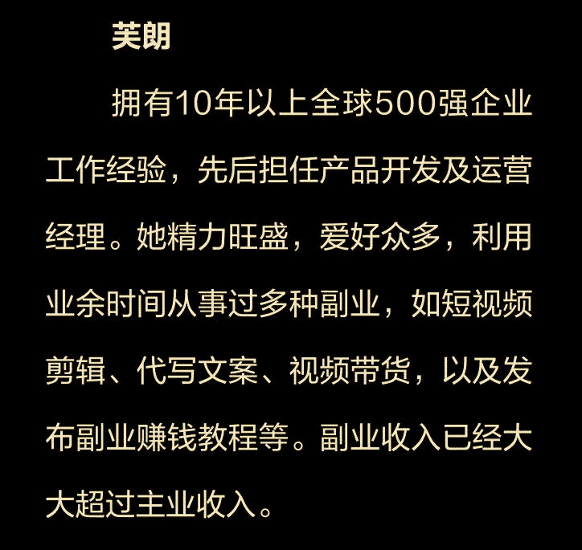

# 序言
AI赋能，普通人也能抓住智能时代的赚钱机会

2016年，围棋圈的一场人机对决让AI真正被大众记住。韩国世界冠军李世石在比赛中不敌AlphaGo，随后柯洁在乌镇峰会上也败给了“阿尔法狗”。彼时大多数人觉得AI很遥远。

转折出现在2022年。OpenAI推出的ChatGPT上线5天注册用户就突破100万，AI从实验室走向日常。AI，即Artificial Intelligence人工智能，用计算机模拟人类智能的核心技术。随着迭代，能力从文本问答扩展到文生图、图生视频、文生视频，甚至在DeepSeek出现后，还具备了类人脑的深度思考。

如今Midjourney、即梦、豆包、Kimi等产品纷纷涌现，市场百花齐放。语音助手、搜索摘要、甚至收到的营销短信，背后都有AI的身影。它正悄然重塑生活和工作，也为有准备的人打开一条新赛道。

在AI普及前，写作、绘画、剪辑、编程等技能多被专业人士垄断，普通人只能望而却步。现在门槛被大幅拉低，人人都可以借助工具实现弯道超车。

2024年12月20日，“人工智能”被评为汉语盘点2024年度国际词。AI正在以全新方式改变赚钱逻辑，既是挑战也是机遇。

本书目标是让普通人快速学会AI变现。全书分六大篇章，覆盖理论与实操，确保零基础也能上手。阅读本书不需要编程能力，不需要艺术天赋，也不必是专业写手，更无需大额投入。需要的只是一颗愿意学习、敢于尝试的心。愿它助你在智能浪潮中乘势而上，开启成长与突破。

# 第一章 用AI写作，轻松打造爆款内容

## 1.1 平台盘点指南，挑到适合自己的写作助手
AI写作工具让内容生产更快更稳，选对工具才是变现关键。好比种地，过去靠锄头辛苦劳作，现在拖拉机效率倍增。但AI工具种类繁多，怎么挑？下面梳理几个大众可用的代表。

1 ChatGPT
ChatGPT由OpenAI推出，是AI聊天机器人的鼻祖。
优点：复杂问题理解、代码编写、创意写作、逻辑推理能力被广泛认可，回答常有惊喜。生态成熟，教程、插件、应用丰富，可玩性强。
缺点：国内使用门槛高，需科学上网和境外手机号。中文本土化理解稍弱，对中国文化、俗语、细腻情感的把握不如本土模型地道。

2 Kimi
Kimi由月之暗面打造，以强大文本输出能力快速走红，上下文理解突出，是全能型助手。如图1-1所示。
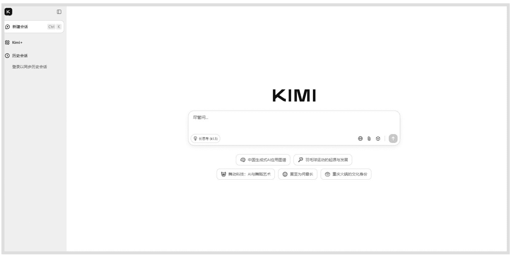
图1-1 Kimi页面
优点：超长记忆，可处理几十万字的小说、报告、网页，擅长总结翻译问答，适合深度写作。
缺点：功能偏聚焦，优势在于长文本，对简单问答或几百字短文案的发挥反而不明显。

3 豆包
字节跳动出品的AI助手，深度接入抖音生态，在短视频文案创作上表现突出，脚本撰写、广告优化都很在线。如图1-2所示。
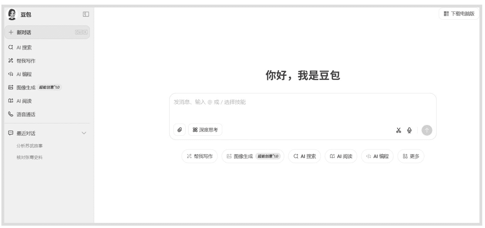
图1-2 豆包页面
优点：界面简洁像微信聊天，操作门槛低。适配短视频和社交平台，风格贴合，营销文案优化能力强，手机端响应快，适合轻量写作。
缺点：内容深度不足，适合快消型内容，不适合深度分析。上下文记忆弱，长文章写作吃力。

4 DeepSeek
由深度求索公司自研的国产生态大模型，发布后热度极高，主打精准写作，擅长营销与知识型内容。如图1-3所示。

图1-3 DeepSeek页面
优点：写作扎实，营销和知识类内容拿手，回答直白少套话，适合深度写作、行业报告、长文。支持改写、润色、摘要提炼。
缺点：不擅长短平快的社交媒体内容，长篇小说创作支持一般，需要用户先有清晰思路。

5 文心一言
百度出品，结合搜索数据，偏向SEO优化、网站文案、广告营销场景。如图1-4所示。
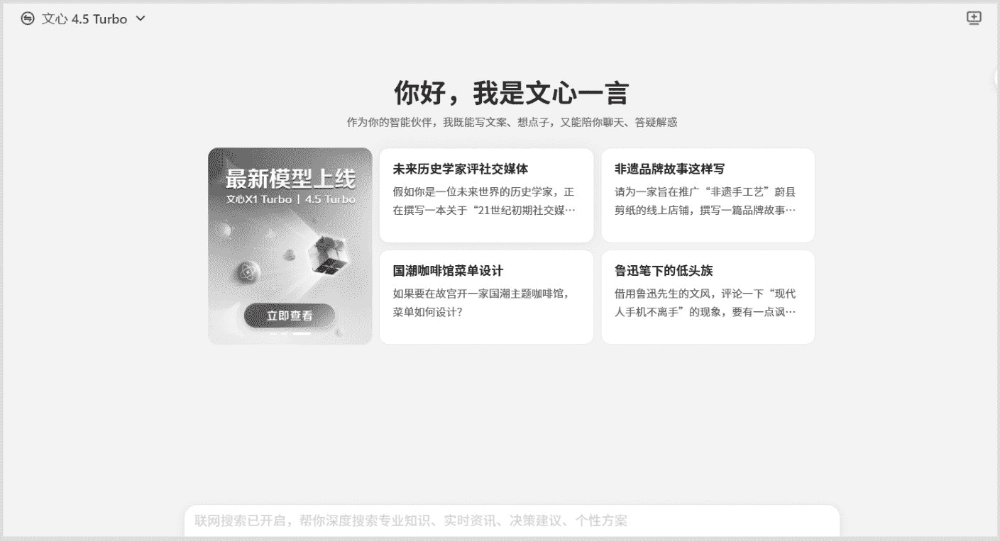
图1-4 文心一言页面
优点：在百度生态下生成内容易收录，适合推广类文章。
缺点：依赖百度体系，脱离生态价值有限。创意写作偏保守，风格中规中矩，虚构类创作局限明显。

总体看，ChatGPT适合创意与逻辑，Kimi擅长长文处理，豆包做短视频文案顺手，DeepSeek写专业报告靠谱，文心一言服务百度生态更友好。没有完美工具，核心是先明确创作场景，是写故事、做报告还是发社媒，再挑顺手的工具。工具越智能，用的人越关键。

## 1.2 吃透生成原理，提示词决定输出质量
看到各类AI的强大功能，很容易觉得一键就能搞定所有文字。实际上，用好AI的第一步是学会用提示词指挥它。

先要明白，AI没有思想和情感。它的输出不是“想”出来的，而是基于海量文本学会的搭配规律。简单说，它记住了哪些词常跟哪些词出现，掌握了邮件格式、小红书语气等模式。然后在你输入指令后，按照概率预测下一个最合适的字，累积成段落。

因此我们需要用明确指令引导它的概率指向。比如输入“请用文言文描述”，它就会倾向使用之乎者也。

掌握底层逻辑后，实战更有底气。

1套用固定公式提问
入门阶段可用万能公式：谁+做什么+侧重点+避免什么。
例如：“请为老年人写一段纸巾广告，突出价格便宜且不含荧光剂，避免使用专业术语。”

2模拟角色提问
不同身份说话风格不同。给AI设定角色，输出会更精准。
例如：“你是一位资深数学老师，请以此身份为二元一次方程组设计一份教案。”

3给AI举例参考
让AI照葫芦画瓢效果很好。想要现代诗风格的梅花诗，可先提供几首参考样式，再要求模仿风格重写。

好的提示词就像路线图，标注越细，抵达越准。把模糊想法转化成AI能理解的指令，工具就从黑盒变成高效助手。多试几次，需求说清讲细，结果会越来越贴合预期。

## 1.3 AI拆书变现，读书也能产生现金流
当下打工人节奏快，很少有人能静下心读完一本书，知识焦虑却与日俱增。拆书稿应运而生，用AI提炼书本精华，整理成读者能直接消费的内容形式，结合工作场景转化为可操作知识点，再发布平台获取收益。

比如把《金字塔原理》浓缩成10分钟音频或3000字文章，直接告诉核心逻辑和使用方法。

利用AI可以大幅压缩整理时间，但要先搞清变现模式。

1拆解经典与热门书籍
变现方式：向听书平台、播客投稿拿稿费；通过自媒体运营获取流量分成或广告；带货相关书籍。
操作示例，定位AI为“读书稿件撰写人”或“专业书评人”。以听书稿为例可提问：
“你是一名读书稿撰写人，请拆解《红楼梦》：分析角色时融合心理学与读者视角；梳理文章结构，提炼中心论点；每段不超过200字，语言平实；最后摘录金句并注释好词。”

可根据甲方要求或自身理解微调指令。

2拆解网络小说
通过AI系统分析创作要素如剧情节奏、语言用词、流行趋势实现商业化。主流盈利有三类：自媒体运营变现，靠平台流量分成或广告；小说推荐引流，精准导读吸引付费；知识付费服务，为创作者提供结构优化、爽点设计等指导。可单点也可组合。

示例提问：
“请分析该小说第1-5章节奏，归纳结构公式，统计铺垫、冲突描写、伏笔的字数，总结每隔多少字出现一个高潮或反转。”

拆书的核心不是看懂，而是把知识变成可用之物。方法得当，一本书可拆成多种形式投放短视频、公众号变现。

常见分发渠道：
公众号长文：适合深度解析、思维导图、金句合集，结合个人理解建立专业形象。适合自媒体运营者、知识付费从业者。
短视频干货：抖音、小红书等平台，提炼一句话抓点、金句或反常识概念，用几十秒讲清是什么、有什么用、怎么用，配图字幕快速传播引流私域。适合教育博主、营销从业者。
知识卡片/图文：金句海报+封面+200字摘要，或AI生成的思维导图，视觉化呈现，易收藏传播。适合知识博主、社媒运营。
直播/社群分享：围绕主题做直播拆解，共读讨论；付费社群每日摘要，用问答提升互动。适合知识主播、社群运营、教育从业者。
主题课程/训练营：把同主题经典书结合经验做成系统小课，价值感高。适合教育从业者、课程设计师、内容创业者。

形式取决于目标用户和效果，关键是用AI把书“嚼碎”，变成用户能直接受益的内容。

## 1.4 零基础也能做，AI起名服务轻松接单
很多人觉得写作门槛高，也许不适合自己。那就试试更接地气的赛道——AI起名。孩子出生，父母都希望名字好听有寓意，很多人愿意花钱请大师。现在用AI就能高效完成。

不需要国学大咖，只需明确需求：姓氏、出生日期、期望风格或寓意等，AI可在短时间内生成几十个备选，并附解释和出处。

操作流程：
先通过问卷收集客户信息：①姓氏 ②性别 ③出生年月日及时辰 ④父母期望如快乐、聪明、勇敢 ⑤风格如简洁、诗意、大气 ⑥忌讳字 ⑦其他特殊需求。

拿到信息后在熟悉的AI工具中输入指令。以文心一言为例：
“你现在是精通中华文化和姓名学的起名专家。请为姓‘李’的男宝宝起名，他出生于2025年5月20日上午10点。父母希望寓意聪明、健康、有担当，风格大气沉稳，宜出自经典古籍但不生僻。结合生辰八字提供15个双字名，包含拼音、各字含义、名字出处。避免使用‘伟、强、刚’。”
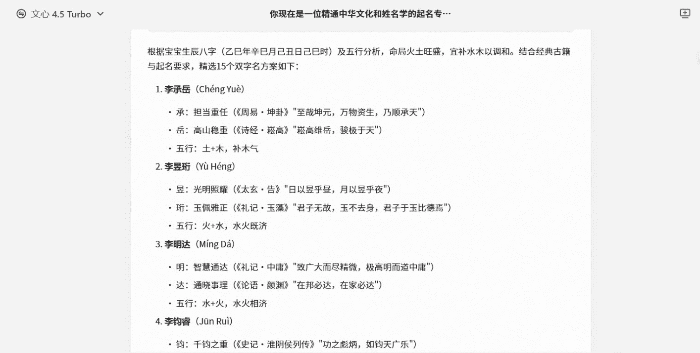
图1-6 文心一言生成内容

不满意可多刷新，多拿备选后人工筛选，剔除歧义、不易读或不符合需求的名字。AI偶尔会出错，需核查出处和含义是否准确。最后润色整理3-5个优选，配上精美卡片交付客户选择。

获客可从问答平台入手，在知乎、百度知道等相关问题下提供名字建议，也可开直播间现场起名。口碑起来后订单自然增加。

## 1.5 小红书种草风口，AI写评价变现
2025年年初，一则消息刷屏：外国人开始玩小红书了。日活量持续攀升，平台成为新顶流。流量即商机，大量品牌将预算投向小红书。怎么抓住这个社交App的风向，用AI实现变现？

流量变现的常见思路，多数人会先想到直播带货或接广告，这类路径确实能赚钱，但投入门槛高、周期长，看似个人账号背后往往是团队在运转，普通人想分一杯羹并不容易。

真正可操作的缝隙在中小品牌身上。并非所有商家都舍得砸大额广告或请头部主播，预算有限的素人友好型品牌更看重性价比，这正是个人创作者的切入点。

最容易卡住的是文字表达。拍照拍视频很方便，写出几百字有说服力的种草却很吃力。这时借助智能写作帮忙会大幅降维，它像一个随身资料库，能快速归纳大量优质内容，几步操作就拿到可用初稿。

如何用工具写出客户认可的种草评价
先锁定可合作的品牌方，拿到试用品亲测，弄清品牌想突出的卖点，再结合真实体感进入创作。举例：试用护手霜，品牌希望体现滋润、清新香气和亲民价位。

直接把要求丢给工具，结果通常平平。要写得像人话，需要先给足原料。除了自身感受，可先让工具做信息收集，例如指令：请梳理网络上关于该款护手霜的用户反馈，提取与滋润度、香气相关的高频词。

素材齐备后再整体喂入：现在你是一名正在使用该品牌护手霜的消费者，实际使用下来滋润不黏腻、味道淡雅舒服，参考刚才汇总的用户反馈，写一篇约500字的体验文，读者主要是学生等消费能力一般的群体，语气要朴实自然，避开夸张华丽的词。

按此流程多半能拿到可用稿。工具也会出错，可以多跑几轮指令，或按之前学过的方法重新引导，多生成几版后把亮点片段拼起来优化。熟练后产出效率提升明显，能快速做多篇内容发布到小红书并挂上商品链接获取佣金。

1.6 微博全员任务，积少成多
刷微博时常看到有人发品牌活动或广告，并非无偿发布，背后是平台的任务奖励。部分品牌或官方会上线“微博全员任务”。

全员任务就是品牌方或微博官方发布的简易任务，比如发一条带产品测评的微博，或参与某部热剧的话题讨论。按要求发布并通过审核后，就能拿到几毛到几块的奖励。单看金额很小，但一天完成十几个、二十个，积少成多也能抵一顿饭钱。而且任务门槛普遍不高，有工具帮忙几秒钟就能完成写稿。

1 找任务
打开微博 App 点“我”，进入“创作中心”，就能看到全员任务专区，点进去查看具体要求。如图 1-7 和 1-8 所示。

 图 1-7  微博 App “我”页面

图 1-8　微博　App 创作者中心

要发什么类型内容，是晒使用体验还是参与话题，需要包含哪些关键词，是否要带指定话题，图片数量、字数限制等，这些都要看清楚，因为后面需要把这些要求完整转述给工具，描述越清晰，输出越准确。

2 用工具产出内容
假设某个任务要求写一条关于“某品牌酸奶”的微博，要突出“好喝又健康”，必须带话题“#每日一杯健康酸奶#”，并 @ 该品牌官方微博。

可以这样提示：请帮我写一条微博，主题是某品牌酸奶，突出好喝又健康，用普通用户的口吻，约100字，务必包含话题 #每日一杯健康酸奶#，末尾 @ 某品牌官方账号。

工具会很快给出文字，但需要再精修。工具写的有时候不够自然，或遗漏要求。可以调整叙述顺序，加点个人感受，比如把“该酸奶含有益生菌”改成“每天下午茶喝它，肠胃真的轻松多了”，这样更容易通过审核，也更像真人。

修改满意后复制到微博，核对无误再发布。平台审核通过后，活动结束后金额会自动发放到你的微博钱包。

1.7 百家号借力智能工具，阅读变现
网上文章、新闻的作者如何赚钱？除了记者编辑，还有大量普通用户在内容平台发布作品，靠阅读量和平台激励变现。和微博任务类似，这类模式的核心逻辑是流量等于收入。阅读的人越多，收益越高。以百家号为例说明如何借助工具获益。

开通流量收益需要满足：实名认证、绑定银行卡、粉丝达到100个。基础条件不难，持续更新很快就能达标。

1 找热门主题
发内容首先要确定写什么。可以用工具分析当前热门话题、关键词和用户兴趣，帮你找到有潜力的方向。比如问：请分析最近百家号上20到40岁人群的热门话题，筛选出有持续讨论趋势的主题。

2 生成内容框架
工具可能会给出职场就业、健康养生、消费生活方式、婚恋家庭等方向。结合自身兴趣选择细分赛道继续细化。

比如选健康养生，可以让工具帮助搭框架：请生成一篇面向年轻人的健康养生文章，可以从养生方式如运动饮食，和心理健康如如何判断压力程度及缓解方法等方面展开。工具会按要求生成初稿。

3 配图优化
在百家号编辑后台整合文本时，可同步用AI绘图工具生成配图，例如：生成矢量风格插画，表现都市白领利用午休做办公室瑜伽的场景。图文结合能提升阅读完成率。

借助工具从找方向、定选题到出草稿和配图，效率明显提升。关键不是完全依赖工具代写，而是把它当助手处理基础工作。真正需要投入的是用自己的判断筛选优化工具输出，坚持发布符合平台要求和读者口味的优质文章。粉丝积累起来，阅读量上去，收益自然随之增长。核心是用工具提效，用坚持和用心换流量，让写作也能带来实在回报。

1.8 公众号做爆款，从选题到标题全流程
微信公众号每天发数百万篇文章，能破10万+的凤毛麟角。与偏重时效和流量的百家号不同，公众号更看重逻辑深度、观点新颖和信息价值，这正是工具能发挥作用的地方。

1 用工具锁定选题
传统找选题像盲人摸象：刷热搜、看同行、凭经验猜，结果慢半拍或太冷门。现在工具能像雷达扫描全网热点，预测趋势。比如想写职场类，可以问 DeepSeek：根据最近一周数据，找出职场领域讨论度高但挖掘不足的3个选题，结合微博、知乎、小红书的热门关键词。

可能得到“35岁职场逃生计划”“2025年AI可能取代的10种岗位”“反向背调公司攻略”等方向。

2 工具辅助创作
找到题只是开始，写作才是挑战。一篇好文需要严密逻辑、吸引眼球的观点和可靠数据。以往要人工收集，现在让工具联网搜索就能得到完整脉络。例如想写年轻人存钱话题，可以问：请为‘年轻人为什么存不下钱’撰写5个不同角度的三级大纲，要求包含数据案例和反转观点。

可能获得隐性消费陷阱、工资涨幅与物价对比、社交媒体催生的“假精致”等多角度内容。因为公众号内容偏深，需要根据工具给出的框架收集更多材料“投喂”给工具并反复人工打磨。

3 工具生成标题
以前琢磨标题常绞尽脑汁，有时灵光一现有时自我怀疑。工具能在短时间内产出大量备选，不必苦等灵感，从数十个标题里挑选或融合优点。

工具能驾驭多种创作手法。比如写办公室人际关系，DeepSeek可快速给出“同事帮我点了一周外卖后，我明白了一个职场潜规则”“从工位陈设看同事性格的秘密”等风格各异的方案。

借助工具从选题到内容的一条龙辅助，能节省大量创作成本，海量创作优中选优，让爆款不再稀罕。

1.9 影评结构拆解，打造影评人设
喜欢看电影吗？新片上映后想跟朋友吐槽剧情或夸演员？把观影感受写下来发网上就是影评。在人人都是自媒体的时代，影评是热门赛道，无论豆瓣深度解析还是抖音影评号都能吸粉。

但对大多数新人来说，从零做出高质量影评并不容易。面对银幕画面，许多人有感受却难转化为条理清晰、观点独到的文字，工具可以帮忙。

1 分析优质影评
先找一篇高质量专业影评，也可以用自己的初稿观后感作为输入。优质影评通常包含影片基本信息、核心情节概述、主题与情感表达。把全文或关键段落发给工具分析。

输入：请帮我分析这篇影评，提取它的结构，包括核心论点、角色分析、导演手法等。

参考提示词改写后，会得到清晰拆解：核心观点、角色解读、技术分析、情感与主题等。

2 适配不同平台
拿到分析框架后，要根据平台调整重点。

如果是抖音等短视频平台，文案要更短、更有趣、有话题性。可以指令：请把这篇影评改写成适合3分钟短视频的短评，突出一个最具争议或最有趣的观点，语言轻松活泼。

如果是小红书等偏情绪表达的平台，可偏重风格轻松和个人体验，例如：请把这则影评改写成小红书风格，加入个人观影感受，比如“我哭傻了”“全场震惊”这类情绪表达。

保持风格一致，持续在同一个或几个平台发布影评，慢慢积累粉丝，就能形成“电影博主”或“影评人”人设，靠流量和影响力获得收益。

1.10 剧本杀创作，从构思到对白加速
这几年剧本杀和角色扮演桌游很火，年轻人聚会喜欢玩，因为能放下手机面对面交流，参与感和沉浸感强。

尤其是剧本杀，线下实体店火爆，线上平台如“百变大侦探”“我是谜”也很畅销，从而催生大量剧本交易。自己设计一套剧本杀如何？

很多人有想法，但剧本复杂度极高，要构思完整故事、埋线索设动机、写角色剧本、安排游戏环节、设计结局，工程量巨大且需逻辑严密。工具能分担重担，分三步上手。

1 选题和策划
先搞清玩家喜欢什么。可以问：请分析当前剧本杀线上App内流行的类型有哪些？哪些主题更受欢迎？

根据市场反馈和个人爱好锁定主题，再让工具生成基础大纲：你是一名剧本杀写手，请写一个非常催泪的情感本大纲，故事发生在现代社会，共6个角色，男女都要有。

2 角色与情节设计
有了方向就设计角色和故事线。借助工具生成有深度的角色背景和个性。比如想写温柔女主角，可说：帮我生成一个女主角，职业是老师，表面乐观但内心藏着一段无法释怀的感情。工具会补充职业细节、说话语气让角色更立体。

再让工具绘制完整情节线索图，包括开端、发展、高潮、结局。可要求提供不同结局：生成一个好结局，男女主解开误会重新在一起。还要生成一个坏结局，女主角追求自己的幸福，不再被过去束缚。玩家体验不同走向，可玩性更高。

3 对话与互动设计
角色和剧情确定后人工整体修整。由于剧本杀涉及大量互动，可让工具帮忙写对话或游戏环节。比如需要一场“多年后重逢的争吵戏”，直接告诉工具：帮我设计一段对话和互动，角色甲和角色乙曾分手，现在见面要体现遗憾和不甘。

工具会按角色性格生成符合人设的对话，内向者半句留半句，急性子直接爆发，省去琢磨台词的时间。

先用工具抓热点定主题，再细化角色和剧情框架，最后生成具体对话场景，像开了创作加速器。新手也能快速写出专业剧本。关键要把工具生成内容与自己的想法结合，加点个人经历或独特设定，剧本才有灵魂。

# 第二章 AI 辅助绘画，有审美就能当“艺术家”

2.1 AI 作画变现，把画作变成现金
凌晨三点，城市已沉睡，设计师小林的工作台前灯还亮着。她在Midjourney输入框敲下精心打磨的第37版关键词组合，回车后几十秒，屏幕出现一幅融合未来科技与东方水墨韵味的城市景观，光影流转细节惊人。小林愣了一下，这样的作品过去需要她花一个月心血，如今工具瞬间呈现。

这不是科幻，是当下创作者的真实写照。当一键出图成为现实，自然会问：这些瞬间生成的画能带来实际收益吗？很多人尝试过，直接卖图利润微薄。

在几乎人人都能借助工具创作的时代，工具不再稀缺，稀缺的是驾驭工具、挖掘深层价值的能力。观察市场，更具潜力和可持续性的变现路径主要有两种。

1 提示词买卖
提示词是在平台生成画作的指令。听起来简单，但同款工具不同人操作效果差异很大，关键在提示词。

能稳定生成高质量特定风格图的提示词需要研究和测试，很多人懒得研究或不会，但又想要好图，于是去买现成提示词。花时间研究整理出高质量、针对特定场景的提示词打包售卖，就是一门生意。

为什么有人买提示词而不是买成品画？买画是成品，买提示词后可以自己创作，成就感不同，且价格相对便宜。

2 AI 作画定制
无论技术如何发展，人们对独特专属的需求不会消失。AI作画普及后，降低了门槛，让更多人产生“我也想要点不一样”的想法。

需求人群很广：想把萌娃变成Q版头像或挂画的家长；想把宠物做成拟人肖像的铲屎官；想要情侣头像或纪念插画的情侣；想要定制游戏角色的玩家；想要具象化笔下人物的作者。小微企业和创业者也需要独特且成本可控的头像、Logo设计，注意版权风险并明确告知客户，社交媒体配图、宣传海报或店铺装饰画等。

AI定制服务的核心优势是速度和效率。相比传统手绘，AI能快速生成多个方案供客户挑选，交付周期短，成本可控，主要投入是时间和提示词技巧。开展定制需明确服务范围和边界，建立高效沟通流程精准捕捉需求，用AI生成初稿，结合审美和经验筛选最佳方案供客户挑选，再按反馈针对性优化或做简单后期处理。

你的价值核心在于筛选、引导和必要的精加工，而非完全依赖一键出图。定价可按复杂度、用途、修改次数灵活制定。交付后更聪明的做法是用这些独特设计开发实物周边，开辟第二收入曲线。可在淘宝、拼多多或微店售卖印有作品的手机壳、帆布袋、T恤、挂画等，也可尝试闲鱼；线下参加创意市集或夜市摆摊，实物展示更易打动人；或与咖啡馆、书店合作寄售。做周边需注意选品适合印刷且需求大，找到靠谱供应链如一件代发是关键，同时注重实物展示和营销，讲好设计背后的故事。

AI作画给了我们把创意变成图片，再把图片变成收入的机会。未来已来，最先赚钱的是教别人用这项技术的人，也是驾驭它的人。

2.2 主流出图工具对比，Midjourney与豆包
上一节讲了变现方式，不少人跃跃欲试。但一搜“AI绘画”，平台众多：Midjourney、GPT-4o、豆包……让人眼花。到底用哪个？没有标准答案，就像问汽车和摩托车哪个好，要看自身需求偏好。接下来扒一扒热门工具的优劣。

1 Midjourney(MJ)

AI绘图工具怎么挑，才不踩坑

Midjourney 在很多人心里的定位就是 AI 绘画的天花板，艺术味道浓郁，很受艺术家、插画师和设计师青睐。它跑在 Discord 上，用起来门槛不低，可画面出来基本都让人眼前一亮。如图 2-1 所示。

图 2-1　Midjourney 主界面

优点：风格覆盖面广，艺术感足，对充满想象力、艺术范儿的画面、赛博朋克、奇幻题材拿手，成品质量高。迭代速度快，每次更新都带新玩法，社区里的 Prompt 案例多，上手有参考。

缺点：费用不低，必须付费订阅。指令和社群交流多以英文为主，对不习惯英文操作的人不太友好。

2 GPT-4o

本质上是 ChatGPT 的进阶版，开通付费后就能直接出图，指令理解能力明显增强。

优点：文字和图像可以一起生成，很适合做漫画、小剧场类内容。画面的表现力接近 Midjourney，且风格连贯性好。

缺点：注册门槛和 ChatGPT 一样，同样需要订阅才能用。

3 豆包

前面提到过豆包这个平台，除了写文，它也能直接画图。

优点：免费开放，中文指令理解很到位，操作简单，新手也能快速出图。

缺点：用得多会发现风格越来越同质化，艺术张力不够，复杂精细的图不太Hold住。

选工具说到底是选一条实现创意的路径，以及你愿意付出的综合成本，钱、时间、学习精力都要算进去。别纠结谁绝对更强，先问自己三件事：我想用来干嘛？我能投入多少？我最看重画面极致、精准可控、操作便捷还是成本。那答案自然就出来了。

AI 绘画更新很快，今天的王者明天可能就被后来者追上。关键不是押注某个工具一直称王，而是弄清它们的特性，挑一个真正服务你创作目标的。

## 2.3 如何用 AI 精准生成符合需求的画作

知道了 AI 绘画能变现，也认识了几款常用工具，接下来要解决的是怎么让 AI 听懂你脑子里的画面。核心仍然在提问上，就像去饭店点菜，说“随便来点”大概率只得到一份青菜；如果你说“宫保鸡丁，鸡肉滑嫩，花生要脆，微辣不要葱”，厨师才能按你的意思做。

在绘画里，这份“咒语”就叫提示词。下面用三步把控生成质量。

1 建立明确的目标

AI 没有读心术，只能按你给的描述去理解。第一步是把需求理清。

(1)用途：先像接单前确认客户需求一样，明确这张图是用来做什么的。商业插画、个人头像、手机壁纸，目标不同，方向就不同。

(2)主体：想画什么，要说具体。不是“一个人”，而是“穿红裙的女人”。主体之外还要配场景和动作，比如她在海边度假，还是在卧室里看书。

(3)风格：前两者是通用信息，风格才是让画面脱颖而出的关键。可以指定艺术流派、画风，甚至点名艺术家，比如印象派或毕加索风格。

2 输入 Prompt

绘画提示词一般由多个关键词用逗号串起来，像搭积木。不是堆字越多越好，而是按逻辑顺序给出关键信息。

推荐顺序是“主角—动作/场景—风格氛围”。例如想画日漫风格的可爱柴犬，可以这样写：“一只可爱的柴犬，穿小马甲，坐在铺满秋叶的公园长椅上，日式动画风格，色彩鲜艳，光线柔和，高清细节。”以豆包 AI 为例，如图 2-2 所示。

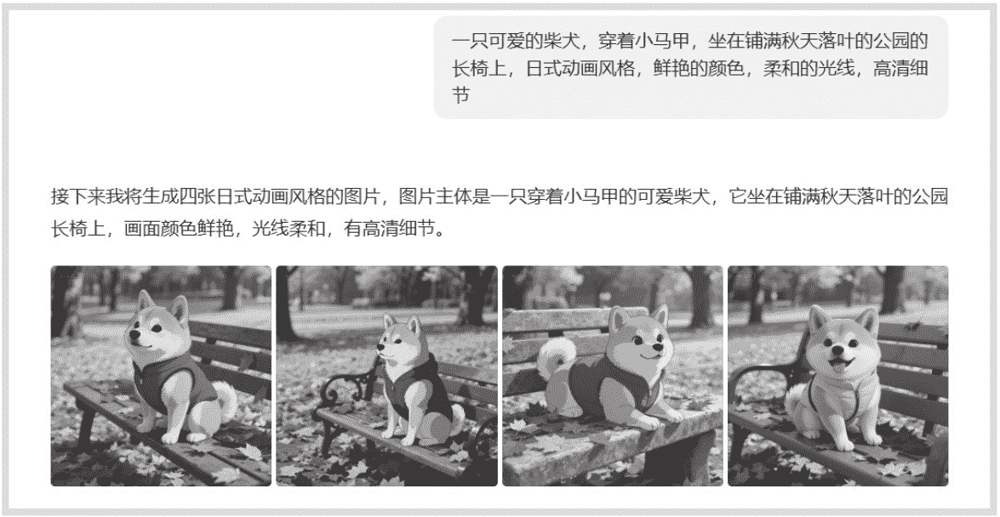

图 2-2　豆包生成画作

3 迭代+参考图完善细节

一次成图很少。可以用两种办法补位。

(1)迭代优化：小范围改词。比如人物表情不对，想微笑却得到大笑，就替换表情关键词，逐步微调。

(2)利用好参考图：参考图既能激发灵感，也能提升效率。多数平台支持上传图片，AI 会以此为蓝本结合关键词生成相似画面。

当你学会把模糊想象拆成 AI 能理解的元素、关系和风格指令，并根据反馈精细调整时，AI 就从黑箱变成了可控的创意伙伴。多练沟通，你就能把心里的画面稳定投射到画布上。

## 2.4 AI 修复老照片，精准变现

家里是否还留着爷爷奶奶年轻时的合影、父母结婚的老照片、小时候模糊的“黑历史”。照片会泛黄，但记忆很值钱。

很多人愿意为让老照片变清晰、变彩而付费，这就是一门有温度的生意。现在有很多在线工具或手机 App，上传就能自动处理。下面以 360 智图为例。

1 把照片变成电子版

纸质照片先用手机拍，选光线好、画面方正、无阴影的环境，尽量拍清楚。有扫描仪更好，效果更平整。

2 上传照片修复

在 360 智图“老照片变清晰”功能里上传，等待处理。如图 2-3 所示。

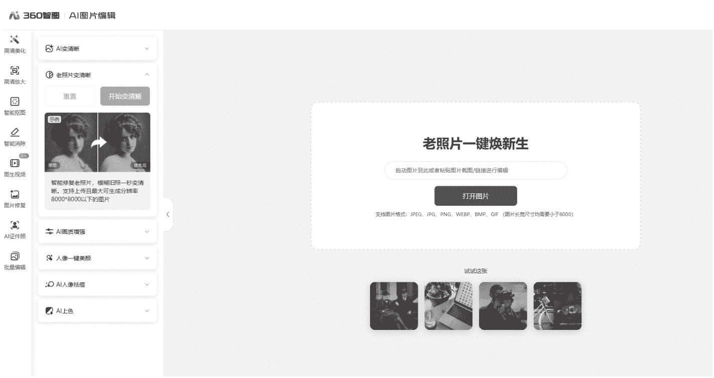

图 2-3　360 智图老照片变清晰功能界面

如果效果不理想，可以换个工具再试，或用修图软件微调亮度对比度。

先用自己的老照片练手，再把前后对比发到小红书等平台接单。配上“别让记忆随时间褪色”“爷爷年轻时原来这么帅”等文案，带上老照片修复、记忆、家庭、情怀、AI修复等话题，引导私信联系。还能提供增值服务：冲印装裱、制作电子相册或短视频，进一步提升收益。

这份工作能赚钱，也很有意义。在随手拍照的时代，稀缺的老照片更珍贵。理解照片背后的故事，用技术细心修复，你得到的不仅是酬劳，还有重拾时光的满足感。

## 2.5 用四维彩超图像，输出宝宝未来长相

准爸妈对肚子里宝宝的好奇心很重，很想提前“看见”宝宝长啥样。AI 现在能把四维彩超里模糊的面部轮廓，模拟成一张未来某个时期的清晰照片。

科学上这只是合理推测，受遗传环境影响很大，AI 并非真正预测。服务前必须告知客户：这是基于彩超图的模拟纪念，非真实长相，避免预期落差。

以 MJ 为例的操作思路：

1 图片收集

向客户索要怀孕约 24 周、面部轮廓清晰、无遮挡的高质量彩超图。原图质量是模拟精度的基础。

2 输入指令

①上传图像并获取链接：把彩超图发到 MJ 对话框，右键复制图片地址，AI 才能据此演化。

②理解参数逻辑：MJ 的“--iw”代表 image weight，控制图片参考权重。数值 0-10 越大图片影响越大，比如--iw 2、--iw 5。

③组合关键词指令：

[彩超图链接] 3d newborn chinese, baby photography, four months old, cute baby style --iw 5.

含义是：以这张彩超为基础，生成一个 3D 立体的中国宝宝新生儿摄影，约四个月大，可爱风格，图片中等程度参与生成。

3 精修

AI 结果不一定完全满意，可用 Photoshop 等工具调整五官比例、肤色等细节。

客户很明确：准父母及家人。可在妈妈群、育儿群投放，也在母婴社区推广。#宝宝未来长相#话题热度高，对比图配合“只需一张四维彩超图，AI 还原宝宝未来萌样”类文案，容易吸单。

## 2.6 个性化头像接单，轻松月入上千元

社交头像是线上名片，一个小图就能传递个性和情绪。大家厌倦了原图和网红图，定制化的专属头像因此走红。它不是真人写真，而是把想法或照片转成独一无二的头像。

小刘是插画师，业余研究 AI 工具。用 DeepSeek 分析用户留言后，他锁定了三个需求方向：

(1)虚拟主播人设，如二次元主播形象；
(2)企业数字员工，大中小企业需要低成本 IP；
(3)纪念性头像，如宠物拟人、真人转漫画。

他在小红书开店，分三档：

(1)19.9 元基础定制：线稿+上色；
(2)199 元升级定制：加专属背景和特定元素；
(3)699 元高级定制：多风格可选，提供全套三视图及 VI 延展。

前三个月共接 32 单，基础 20 单、升级 10 单、高级 2 单，收入近 2 万元。

小刘的成功离不开审美和 AI 效率，更关键的是他分层满足了差异化表达：便宜款满足尝鲜，高价款为个人 IP 或企业提供系统视觉。用户买的不是图片，而是“专属视觉身份”的满足感和社交认同。

启示是：做头像变现，技术是手段，核心是需求洞察、服务设计和价值传递。AI 降了门槛，却替代不了你理解“为什么需要这张头像”。要明确目标用户是谁、核心诉求是什么、怎样匹配不同预算。清晰定位、分层定价，并说明每档能带来什么独特价值，才能有效转化。

即使不是专业插画师，也可用豆包、即梦等国产易用工具起步。把 AI 当加速器而非替代品，沉下心学习风格特点、提示词引导，并培养解读需求、设计产品和沟通价值的能力。当你能把“想要不一样的头像”变成具体且代表身份的视觉符号，就抓住了生意核心。

## 2.7 AI 批量生成壁纸，如何上架变现

根据工信部 2023 年监测，中国城镇用户日均手机屏幕触发约 64 次。壁纸每天被看见几十次，已像手机壳一样成为个性配件。年轻人求新求变，壁纸更新频率高，非常适合 AI 批量绘制。

1 输入 Prompt

万能模板：“××风格手机壁纸，以××为主题，竖版 9:16，高清，简约，适合锁屏。”

举例：极简主义几何图形，蓝色渐变背景；梵高星空风格；二次元可爱猫咪，粉色系。

2 壁纸优化

用 PS 等工具微调色调、去瑕疵，并裁切适配主流尺寸，如 1080×2340、1170×2532、1284×2778。做成样机预览图，让买家直观看效果。

3 上架平台

可试 Wallpaper 等平台或手机品牌壁纸中心，但竞争激烈。建议在小红书、抖音等社交账号展示，开通店铺直接售卖。

4 营销思路

做节日限定折扣，在微博、知乎等知识平台发预览图和教程，例如“一分钟教会制作热门××风格壁纸”，吸粉引流。

技术是基础，更重要的是捕捉情绪美学和个性表达趋势。Prompt 库要覆盖治愈、专注、活力、怀旧等情绪和审美；呈现要让用户感受到“装上手机后的情绪氛围”；营销要紧扣用户此刻想表达的心境和身份认同。

## 2.8 每逢年节红包热，AI 辅助红包封面创作

中国人重视节日氛围，发红包收红包成了仪式感。微信红包封面的个性化需求随之爆发，尤其是过年、情人节，独特封面成了“秀”的道具。

1 明确红包封面的尺寸

微信红包封面标准 957×1278 像素，可增加封面挂件和气泡挂件。

2 提前追热点

红包封面时效强，需提前 1-2 个月生成素材。春节可做龙、灯笼、福字、年夜饭元素；中秋做月亮、玉兔、月饼、嫦娥等。多做不同风格构图，并配上祝福语。

3 上架平台

通过微信红包封面平台提交，审核通过后上架。通常需要完成企业认证的公众号或视频号，或粉丝达 100 的个人视频号/公众号。如图 2-4 所示。

图 2-4　微信红包封面平台“定制封面”页面

借助 AI 工具去做一张让人想点开的红包封面，现在的难度已经小了很多。关键点在于提前做规划，把工具的能力吃透。跟着流程走，先用 AI 赶出几张贴合节日调性的设计稿，再把平台那点小门槛处理好，就能搭上节日流量，把创意落到实实在在的收入上。越早动手可选的范围越大、机会也越多。下一个节日高峰还没到手，趁现在用 AI 画几张有辨识度的封面试试，说不定就开启了一条小而稳的副业了。

## 2.9 零基础也能上架表情包？微信表情商店变现手记
现在年轻人聊微信，表情包基本是标配。有时候一张表情顶得上好几句话，能把情绪表达得更到位。我们常用的包，有自带的、有朋友转来的，还有在微信表情商店里下载的。

商店里的表情包形态各异，有萌趣的、有搞怪的，绝大多数其实都是普通人自己做出来上传的。如果你的包被大家喜欢，通过赞赏就能收到打赏，热度高的作者甚至能靠持续更新做到稳定收入。

下面以 GPT-4o 为例，拆解一下制作思路。

假设你手头有一只可爱的小猫，想把它做成一套表情包。可以先把猫的照片传上去，让 GPT-4o 把它转成动漫风格，这样基础形象出来后，后续做各种表情延展会更顺手。接着上传九张微信里常用的经典表情，输入指令：“分别拆解这九个表情的情绪、动作、文字和主题，用上一休生成的动漫小猫角色重新演绎，合成一个九宫格，保持猫咪形象统一。”

对动作或神情不满意就多跑几轮，再挑出最顺眼的几张加文字，拼成一套。微信的表情包一般至少要 8 张。

做好素材后就去微信表情开放平台。注册账号后按要求上传：表情大图 8 到 24 张，规格 240px×240px，动态图不超过 500KB，静态图不超过 500KB；表情封面图 240px×240px；详情页横幅 750px×400px；聊天面板图标 50px×50px。

图片传完还要填包名、适用场景等信息，提交后等审核。审核通过并开通赞赏，就能收到用户打赏。哪怕第一套没火也没关系，多换主题、多试风格。建议时常逛逛表情商店的热榜，结合节日、流行语调整方向，持续输出总会有被看见的那一款。别忘了对照最新开放平台规则确认尺寸和格式，确保合规。

动手是第一步，坚持是第二步。没有美术功底也没关系，靠 GPT-4o 这类 AI 工具加一点点创意和耐心，完全能做出一套属于自己的表情包并上架。核心是用好工具辅助创意，按平台要求准备好物料，并保持不断尝试的热情。现在就打开 AI 试着把想法变表情吧，下一个被追捧的作者可能就是你。

## 2.10 手机修图加AI，普通照秒变艺术大片
是不是经常刷到那种让人眼前一亮的图？博主拿一张日常随拍，一P就成了电影海报质感。别急着打开 PS，直接把图丢给 AI，速度和效果往往更趁手。

1 基础准备
选图很重要，最好挑人像清晰、光线不算差的照片，主体突出，AI 识别起来更稳。接下来做基础修饰，像美图秀秀、醒图这类软件里都有 AI 美颜、AI 塑形功能，按自己或客户的需求微调脸型身材即可。

2 AI 风格化变艺术大片
需求不复杂的话，直接用美图秀秀的 AI 绘画或同类风格化 App，上传处理好的照片，选油画、赛博朋克、漫画等风格，一键就能生成。

图 2-5　AI 风格化 App 

图 2-6　AI 绘画

想更可控更独特，就去图生图的 AI 绘画平台，上传人像并用文字描述想要的风格和氛围，让 AI 产出艺术图。

3 人工微调和完善
AI 生成图不一定完美，头发、手指、衣服边缘或背景融合处常有瑕疵。先统一调好整体色彩、亮度、对比度，再把细节擦干净，让人物和背景更融合，艺术感才会出来。

怎么变现？就是卖 “AI 艺术写真定制”“AI 照片风格化” 服务。卖点很直白：不懂 PS 也能出大片、照片秒变某某风格。抓住了大家爱美、爱分享、要个性的心理，AI 降低了门槛，普通人也能做出专业级视觉作品，接单就能为客户提供变美的体验并赚取收入。

AI 修图工具彻底改写了照片处理的游戏规则，不再是专业人士的独门手艺，而变成直观好用的表达方式。看着一张平淡的生活照在 AI “画笔” 下拥有电影海报质感，那种惊喜和可能性会让人上瘾。这不仅是便利，更是赋能，让每个人都能碰触艺术创作的边界。

提供 AI 艺术写真定制，本质是把客户体验升级。用最低门槛帮客户把照片从“记录日常”变成“表达态度”，这份转身的价值就是变现点。

## 2.11 文字设计卡住？让AI给你十个灵感方案
做设计最头疼的往往不是排版修图，而是苦想上面的字怎么写才有感觉。客户一句“你自由发挥”，人就瞬间失联。这时 AI 就像自带灵感 Buff 的搭子，拍拍你肩膀说“交给我”。

想要奶萌感？AI 能生成奶油体，Q 弹软糯；要酷劲？金属质感加渐变闪光，一键搞定。复古、日系、赛博朋克都能精准匹配，还能按海报内容自动调风格，顺手把品牌 Logo 美化一下。别再对着空白画布发呆，打开 AI 脑子里立刻蹦出十个“我可以”。

以 GPT-4o 为例，两步走：

1 确定风格
客户的需求常很模糊，比如“想要点神秘感的字体”。先让 AI 生成多种样式拿去沟通，效率会高很多。

2 输入提示词
风格定了后把参考字体图上传，提示词可写：“请参考此图的字体设计风格，生成‘×××’文字，相似度达到 90% 左右。”

另外，GPT-4o 这类海外工具在中文字体细节、书法韵味、本地审美上的精准度，有时不如即梦 AI、通义万相、意间 AI 等国内工具。对中文细节要求高或想更接地气时，建议配合使用，汉字结构和文化意蕴的还原会更到位。

变现方式不止放进海报。节假日的文字素材包，比如“五一快乐”“国庆七天乐”组合，打包卖给中小商家或自媒体也很香；也能接企业专属文字 Logo 的单。

很多人初用 AI 会担心被取代。真正用过一段后会发现，AI 不是来抢创意灵魂的，而是解放生产力、放大创意。AI 扛下了重复探索和基础风格工作，把时间留给理解客户深层需求、把控整体调性与情感、做最终审美判断和细节打磨，以及构思真正打动人的核心概念。工具是催化剂，设计师的智慧、审美与策略才是不可替代的核心。

## 2.12 一句话就能出海报？即梦AI实战拆解
逛街刷朋友圈，各种海报随处可见：超市“买一送一”、餐馆“特色菜推荐”、培训班“招生报名”、社区活动通知。优秀海报的共性是图片好看、文字醒目、排版清晰，一眼就能看懂主题。以前做海报是设计师的活儿，需要复杂软件，外包成本也高。即梦 AI 把门槛拉平了，零基础也能做出有辨识度的海报。

最简单的方式：进网站挑个喜欢的风格模板，一键生成。即梦内置海量模板库，简约、日系、国潮、复古都能切换，还能按描述智能配图、排版、配色。输入“科技感、蓝色调、商务发布会”，它就不会给粉红泡泡和可爱字体，而是走冷感高级路线，堪称懂你的设计搭子。

进阶玩法是把需求“说”出来，例如：“帮我生成一张促销海报，主题夏日冰激凌大减价，画面要清凉，有融化冰激凌和海滩背景，大字写‘夏日冰爽价’，小字‘全场八折，限时三天’，风格活泼吸睛。” 即梦就能自动完成构图、文案植入和排版。

图 2-7　即梦 AI　图片生成页面

不只是设计师能用，PPT 封面、社群推文、朋友圈配图都能几分钟搞定。对小店老板、自由职业者、自媒体来说，这解决的就是想做设计却没时间的问题。需要精修还能下载 PSD 源文件二次修改。

AI 时代，设计不再需要精通软件也不必熬到深夜，一句话就能拿到成品。熟练后可接单变现，小商家、个体户、社区、学校的需求一直都在。AI 生成快、成本低，对预算有限的客户很有吸引力。

当“一句话”就能得到信息清晰、视觉吸睛的海报时，创造力被解放了。这种低门槛高效率的工具为个人打开了新可能：把创意快速变现。技术会迭代，但让复杂技术服务于人本真表达，让创作像说话一样自然的趋势，已然到来。工具在手，创意自由。

## 2.13 AI联手PS，设计效率的助推器
AI 可以直接生成图快速变现，但若要更精细、更个性化，或把多个元素拼合，光靠 AI 生成往往不够。Photoshop 是很多专业设计师的“数字瑞士军刀”，功能强大可高度定制。但 PS 学习曲线陡峭，工具、菜单、快捷键很多，从抠图到调色都要花大量时间，普通人一打开就懵。

AI 的加入降低了学习成本，也提升了设计师效率。过去抠图调色得花一整天，现在把 AI 和传统软件结合，工作流明显优化。

AI 能帮上忙的点：

1 生成基础素材
做海报背景几秒钟就能出几十种风格，挑一张用。想加现实中不存在的元素，长翅膀的猫、会微笑的苹果，AI 都能即时生成。用作原材料导入 PS 调色、缩放、定位，比从零画或到处找素材快得多。

2 快速完成重复或复杂操作
头发丝抠图过去很痛苦，现在 AI 一键抠图精准得多。照片里的电线杆、瑕疵，用美图秀秀的 AI 消除笔涂一下就能自然去掉，比 PS 图章修补快。PS 最新版也内置了生成式填充，框选天空输入“晚霞”就能替换；横版照片想变竖版，空白处用生成式扩展自动补全，融合很自然。

AI 和 PS 不是替代，而是分工。AI 干费时费力的前期生成和粗加工，PS 做精修。即使非专业设计师也能用 AI 生成加 PS 基础精修快速交付，拓宽变现渠道。

# 第三章 用AI做视频，打开新变现通道

## 3.1 AI视频赚不到钱？问题出在方法上
AI 生成视频技术已相当成熟，但有人用后觉得画面僵硬不自然，或发出去没人看，就认为赚不到钱。如果有同感，很可能是方法没找对。核心逻辑和 AI 绘画类似：用 AI 高效生产内容，再放到能产生价值的渠道。

最直接的变现是接单做视频或售卖视频素材，按定制收费做点小生意。更持久的是流量变现，把作品发到短视频平台靠播放量分成。以抖音为例，做历史小知识、生活妙招、科技资讯、健康养生等知识科普，用 AI 生成短片段配文字音乐，达到平台分成条件后即可获益。

粉丝积累起来后还可做广告植入，品牌会主动找合作，比如科普视频里嵌入智能学习设备。电商带货同样有潜力，用 AI 生成产品展示视频全方位呈现优势。家居博主曾用 AI 视频展示收纳神器并挂链接，月销突破十万。

## 3.2 主流AI短视频工具盘点，选对更高效
想靠 AI 做视频赚钱，工具怎么选？市面产品众多，有全能型有专精型。工具像厨房电器，各有用途，关键看想做什么菜。

1 剪映
全民级的剪辑工具，手机电脑通用。加入 AI 后从剪刀手变成智能助手。优点是国民度高、界面熟、零门槛。支持图文成片，输入文字自动匹配片段、图片并配 AI 语音，快速生成带字幕草稿。缺点是收费项增多，更偏 AI 辅助剪辑而非完全凭空生成，需自行提供大部分素材。

2 可灵 AI
快手出品，国产。强项是画面真实感好、物理规律准，生成时长相对更长。优点是可出 1080P/30fps，高峰值可达 2 分钟，讲内容更充分；光影重力模拟好画面稳。缺点是成本高，免费用户需排队额度有限，复杂场景人物动作可能不稳。

3 即梦 AI
字节跳动出品，图生视频能力强。优点是生成速度快，中文提示词理解好，支持首尾帧控制，便于做连贯画面。缺点是复杂场景细节易出现瑕疵，人脸生成偶有变形。

4 通义万相
阿里旗下，图文视频皆可。优点是免费额度足，每日签到送点数；视频自带背景音乐，省去后期配音效。对画面理解较强。缺点功能偏基础，高级特效和编辑能力有限。

5 海螺 AI
MiniMax 旗下，好评度高。优点画面稳定，运镜模板可选，三维表现好。缺点对二维插画动画效果弱，免费使用排队时间长。

## 3.3 文生视频与图生视频：AI 视频生成原理剖析

AI视频到底是怎么“画”出来的？

想搞懂AI生成视频，先得明白视频是什么。电影、电视剧，甚至小时候翻页的纸质绘本，底层的逻辑都一样：大量略有差异的静态画面，以极快的速度连续播放，视觉上就产生了运动感。

所以AI做视频，本质上是在“绘制”一组连续变动的画面，再把它们按顺序播放。AI的厉害之处在于它能读懂你的意图，并学会让画面动起来。

搞清楚这个原理后，文生视频和图生视频就好理解了。

1 文字变视频：把描述变成画面

以即梦AI为例，先点开首页的视频生成入口，如图 3-1 所示。

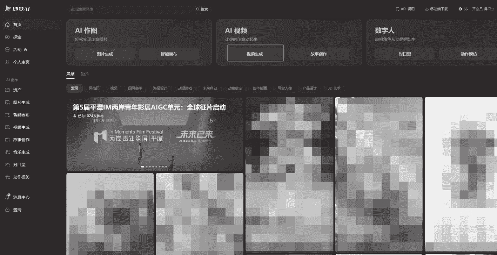

图 3-1　即梦 AI 主界面

输入一句描述，比如“秋天午后，金黄落叶铺满街道，一个女孩抱着书本踩着落叶慢慢走向远处的咖啡店”，模型就能把文字转化成一段有氛围的视频，这就是文生视频的魅力。

收到指令后，AI会像语言专家一样先拆解文字，提取关键信息：季节是秋天午后，场景是落叶街道，人物是抱书的女孩，动作是走向咖啡店。这些信息相当于施工蓝图，指引后续创作。

随后AI会先生成首帧，勾勒出街道与咖啡店的轮廓，为女孩搭配合适的服装与发型，再给整体画面加上秋日暖调。为了让运动更真实，AI会“借鉴”真实世界规律：学习人行走时手臂的自然摆幅，观察风吹落叶的轨迹，研究不同时段的光影变化。把这些细节融入每一帧后连贯播放，一段有质感的视频就诞生了。如图 3-2 所示。

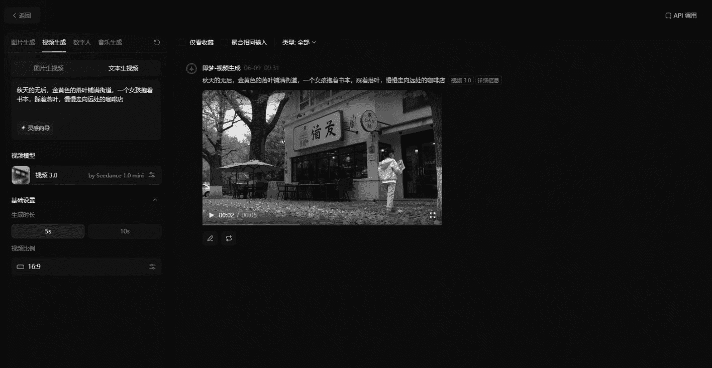

图 3-2　即梦 AI“文生视频”功能页面

2 图片动起来：让照片学会呼吸

手机相册里定格的瞬间，在图生视频加持下能变成小故事。比如上传一张樱花下猫咪打哈欠的照片，AI就能让猫咪伸懒腰，让花瓣随风飘落，画面立刻活了。

开始时，AI像侦探一样解析画面，识别猫咪姿态、樱花数量、光线方向等元素。接着它会“脑补”后续可能发生的情节：从半眯的眼神推测猫咪会慢慢闭眼小憩，看到飘落花瓣就设计出旋转落地轨迹。

这里用的是大量经验值，来自模型学习过的海量真实视频。它知道猫咪伸懒腰时背部会先拱起，也明白微风下花瓣飘落的速度与方向有一定规律。通过预测物体运动趋势，把单张照片延展成多帧序列，就像给照片施了时间魔法。如图 3-3 所示。

图 3-3　即梦 AI“图生视频”功能页面

现在AI视频还显得有点假、时长有限，并不奇怪。让画面动起来不难，难的是让画面合理地持续很久，物体不会变形消失，人物动作表情保持时空连贯，这方面模型仍在进步。

即便如此，目前生成的片段已经足够用于变现：当素材、灵感来源，或用于对连贯性要求不高的短视频，都完全够用。

3.4 老照片焕新：AI让回忆动起来

老照片承载的是珍贵记忆，照片里的人可能已离世或远在他乡，静态画面总让人遗憾。如今用图生视频技术，就能让泛黄照片里的亲人眨眼、微笑、回应你，科技的温情感很动人。

退伍老兵李爷爷珍藏着一张年轻时与战友的合影，军装英姿里透着岁月痕迹，他常感慨如果当年能拍视频就好了。孙子小宇在抖音看到AI修复老照片并生成视频的教程后，学着为这张合影赋予新生命。

先用AI把照片修复清晰，再分析人物姿态表情，为照片里的人添加眨眼、微笑等细微动作，甚至让背景红旗随风飘动。播放给李爷爷看时，老人激动得热泪盈眶。

照着这个思路，也可以把服务做成生意。很多人珍藏老照片，因破损或静态而遗憾。若花几十元就能让亲人“活”过来，需求很明确。

实操分两步。

1 明确需求
和客户深入沟通，了解期望的动作：眨眼、微笑还是挥手，背景元素是否要动，比如旗帜飘动、树叶摇曳，以及想要的氛围是活泼、怀旧还是庄重。同时摸清照片破损情况：褪色、划痕、折痕、缺失等，都会增加复原难度。

2 AI制作
照片若有破损、模糊、黑白，建议先修复，后续动态效果会更好。上传图片后按需求生成动态效果，写不好提示词可以先让文本AI帮忙，比如对豆包说“我需要让画面里两个人握手、冲镜头微笑，请帮我写提示词”。把生成的描述粘贴到视频平台即可。

以即梦AI为例，选“想象”模块，上传照片，填入提示词、比例和时长，点击照片生成即可，操作并不复杂。

3.5 萌宠开口：AI让宠物会说话

刷短视频时常能看到这种搞笑内容：小狗在吐槽铲屎官，嘴型与配音完美同步，仿佛真的在说话。这正是AI对口型技术，把宠物视频与语音精准匹配。

需求来自庞大的养宠人群。谁不想让自家毛孩子成为网红？会说话的宠物既有炫耀价值，也更具新奇感，容易在平台获得关注。宠物商家如犬舍、宠物食品店，也需要这类有趣内容做宣传。

举例说，有只叫布丁的猫咪，可以这样运营。

用剪映即可完成。先拍摄布丁不同神态动作的照片或短视频，如伸懒腰、吃东西。打开剪映，开始创作，上传素材后，使用对口型工具，选择可爱声线，把文案转为语音并配到对应画面，就能得到特效视频。如图 3-4 和图 3-5 所示。

图 3-4　剪映“剪辑”功能界面

  图 3-5  剪映“Ai 对口型”功能界面

若视频反响不错，可做成系列。随着人气上涨，宠物食品、用品品牌会主动寻求合作，接广告，用幽默配音呈现猫猫的日常，或用趣味剧情展示智能玩具，都能变现。

3.6 用AI批量产出童话故事片

现在家长普遍喜欢给孩子看动画、听故事，画面精美配音生动的童话视频往往很吸睛。这背后是一个供给不足的市场：多数家长没时间原创，也没有绘画能力，需要现成的好内容。

过去做童话视频需要脚本、画师、配音、剪辑，耗时耗力成本高。如今AI与童话结合，可以实现批量生产。

1 准备故事
让AI总结经典童话梗概，如白雪公主、灰姑娘、小红帽，也能要求生成新故事，例如“总结《白雪公主》核心情节，写给3~5岁幼儿的童话，500字左右，体现刷牙重要性”。

2 改编文案
把故事整理成文字稿，太长用AI压缩到适合3~5分钟短视频的长度。语言要口语化，避免小朋友难懂的词。

3 生成画面
拆解关键场景，如“小红帽探望外婆”“遇到大灰狼”。用AI绘图工具生成插画，例如“穿红斗篷的小女孩提篮子走在森林小路，卡通暖色调”“穿外婆衣服的大灰狼躺床上戴老花镜，背景有药瓶，卡通风格”。

4 生成配音
用文字转语音工具把文案转成音频，选温暖音色，语速放慢。

5 合成视频
把文案、插画、配音用剪辑工具组合，加入文字、配乐，微调时长和转场，一个故事视频就完成了。

把动画制作拆成AI可高效完成的几个环节，有耐心找故事、学会工具并持续发布，就能在儿童内容赛道积累流量，获得稳定收入。

3.7 网文推文视频：剧情越离谱流量越猛

短视频里常见这类内容：动漫风格画面，夸张饱满的配音朗读文字——“我一个农村女孩嫁给霸道总裁，本以为是幸福结局，没想到婚礼当天让他给白月光顶罪……”“系统让我选奖励，我选了十个亿，结果钱要花光才能获得，于是开启疯狂败家人生……”

这就是网文推文视频，把小说里最抓马、最上头的情节抽出来做成视频，引导观众点击阅读。

画面不必精致，甚至有点粗糙也没关系，核心在于文案与配音的冲突感，离谱的反转让人想追下去。

为啥能赚钱？网文体量庞大，夸张剧情自带钩子；推文对画面要求低，AI生成快、风格多变，能提供大量视觉素材；平台算法也偏爱冲突反转内容，越“癫”越容易推。

变现路径成熟，市面上有专门的小说推文平台，加入后获取推广链接，观众通过视频点击阅读付费就能拿佣金。

操作很简单：先从小说里挑最吸睛、最具反转的片段，通常是开头或高潮，写成视频文案；再根据文案生成画面，例如提示“拍摄一段氛围紧张的打斗，荒原背景乌云翻滚闪电划破夜空，主角黑衣眼神坚毅声线清冷，神兽庞大面目狰狞声如洪钟，过程中加入滑稽表情和夸张反应”；最后把AI视频导入剪映，用AI配音配文案，加字幕音乐发布即可。

3.8 一键卡点剪辑：AI搞定爆款节奏

在短视频平台，卡点视频自带流量密码，强节奏与酷炫画面能迅速抓住眼球。过去需要手动筛素材、调节奏，现在AI自动剪辑让制作变成傻瓜操作。

音乐节奏分析：导入背景音乐后，AI识别节奏并标记重拍，生成可视化节奏图谱。
素材匹配节奏：导入素材后，AI依据节奏智能匹配到对应节点。
添加转场特效：AI根据主题和音乐自动配置转场，如电子音乐配霓虹故障，快节奏用粒子消散转场，保证衔接流畅有冲击。
生成完整视频：整合素材与转场输出成片，可在剪映里手动微调卡点位置和转场效果。

目标客户分三类：一是零基础创作者，尤其是做才艺、变装、情侣日常等需要节奏感的博主；二是中小商家，用酷炫卡点视频做产品活动宣传；三是普通用户，想用照片视频做家庭纪念、聚会、旅游的卡点相册。

找到人群就能接单，可在抖音快手展示作品，也可主动联系舞室、健身房等商家，提供有吸引力的卡点宣传片。

3.9 AI做影视解说：快速吸粉拿收益

影视解说在短视频平台一直是流量高地。对经典老片深度剖析，对新剧做尝鲜，都能吸引大量停留。

价值在于：没时间看剧的人能快速了解剧情，看过的人能找到共鸣，没看过的人会被勾起兴趣，因此流量大，也容易接影视推广。

制作需要四类工具：AI聊天机器人如豆包、文心一言、Kimi、ChatGPT用来生成解说文案；文字转语音工具，剪映自带即可，注意别选生硬机器人音；视频剪辑软件合成音视频字幕；影视剧素材，注意版权，最好用官方预告，AI生成补充部分也要避免侵权。

以《肖申克的救赎》为例：先用AI或他人解说快速了解剧情梗概；让AI写文案，指令如“用通俗易懂的语言概括该片前三分之一剧情亮点和主要冲突，写成500字口语化短视频解说”；AI初稿后需人工润色，尤其开头钩子要抓人；最后在剪辑软件中组合。保持账号文案和风格统一，才能积累粉丝。

除了流量分成和广告，还能推荐影视周边、原著小说带货，赚取佣金。

3.10 零出镜数字人：打造百万粉丝IP

出镜拍摄曾是拉近距离的传统方式，如今AI数字人让零出镜也能做大IP。无需演员、无时空限制，虚拟形象凭创意内容在平台快速崛起。

AI数字人是用计算机图形与人工智能创造的虚拟人物，可高度拟真，也可二次元卡通。喂入文字或音频，它就能像真人一样张嘴说话。

变现方式同真人：流量分成、广告、带货。

打造流程：

1 确定IP定位和内容方向
想清楚数字人扮演什么角色，如科普大咖、家居好物推荐官，定位清晰更容易吸粉。

2 确定数字人形象
要克隆真人需拍摄3~5分钟正视高清视频上传训练；也可选用平台自带2.5D/3D模板，如蝉镜、腾讯智影、HeyGen，调整服装发型等细节。

3 生成视频内容
用文案生成工具如DeepSeek写口播稿并优化；用场景生成工具如即梦AI生成场景图视频备用。

4 视频制作
登录数字人定制工具如蝉镜，用提示词创建形象，进入创建视频功能，如图 3-6 所示，选好数字人、复制文案、挑选配音试听调整后生成视频，如图 3-7 所示。

   图 3-6  蝉镜 数字人视频界面

 图 3-7  蝉镜 数字人制作功能视频界面

5 后期优化
生成好的素材先导进剪映之类的剪辑软件，给视频加上字幕提升可读性，配上背景音乐和音效来营造氛围，按平台要求调一下画幅比例，视需要添加贴纸和特效，最后选好封面导出成片。

如果你擅长内容却不愿亲自出镜，AI数字人做短视频会很合适。它用技术把真人拍摄和复杂制作的门槛降下来，让你也能在短视频平台运营一个虚拟IP，积累流量并实现变现。

# 第四章 AI 提效办公，让工作更省力

## 4.1 摆脱低效，AI 让效率翻倍
前面我们聊过借助AI的创作力来变现，比如自动写文案、做图像、剪视频。AI的价值并不止于创作，它更像一位高效的办公助手，能帮你把日常工作提速，在绩效考核里脱颖而出，本质上也在帮你赚钱。

想想过去的工作方式，大多靠堆人力堆时间。写报告要字斟句酌，找资料要大范围检索，开会还要把细节事无巨细地记录下来，费时费力。

有了AI工具后，局面完全不同。整理数据、会议记录、PPT制作，都能找到简单易用的AI方案，效率显著提升，腾出的时间就可用来聚焦真正体现专业能力的事务。

具体能在哪些环节提效？

1 可自动化的重复性工作
格式化的周报月报最爱占用碎片时间。可以在DeepSeek或Kimi上用简短指令搭一个通用模板，后续只要填入工作内容，就能得到一份信息丰富、质量过关的报告。

不想自己写指令也没关系，豆包这类产品自带大量现成模板，直接调用即可，操作很省心。

类似年会主持稿这种框架固定、流程相似的文书，每年变动有限。可以把往年的稿件丢给Kimi，再补充新要求，它就能快速生成新稿，省时省力。

2 文案创意类的工作
大项目或内部活动都离不开策划和文案，往往要花大量时间搜集信息、发散创意。这时可以用AI的深度思考和联网检索能力，快速进行归纳整理，给出多角度的灵感参考。

做PPT时常被模板和梳理困住，可以用AI组合拳：先让DeepSeek生成内容大纲并填充信息，再把结果导入WPS AI，用智能排版优化版面，就能快速得到美观实用且可随时修改的文件。如图 4-1 和 4-2 所示。

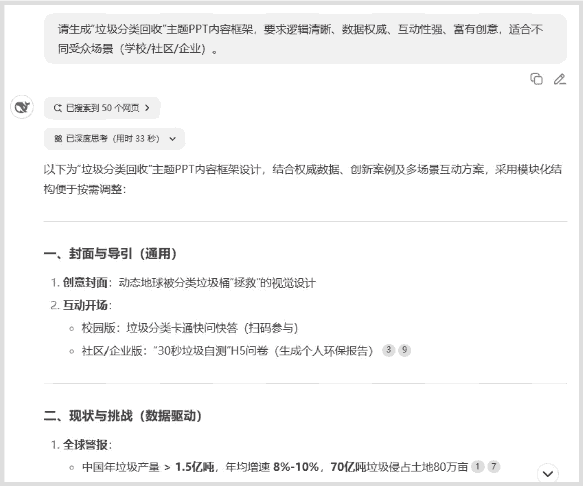

图 4-1　用 DeepSeek 为项目生成内容框架

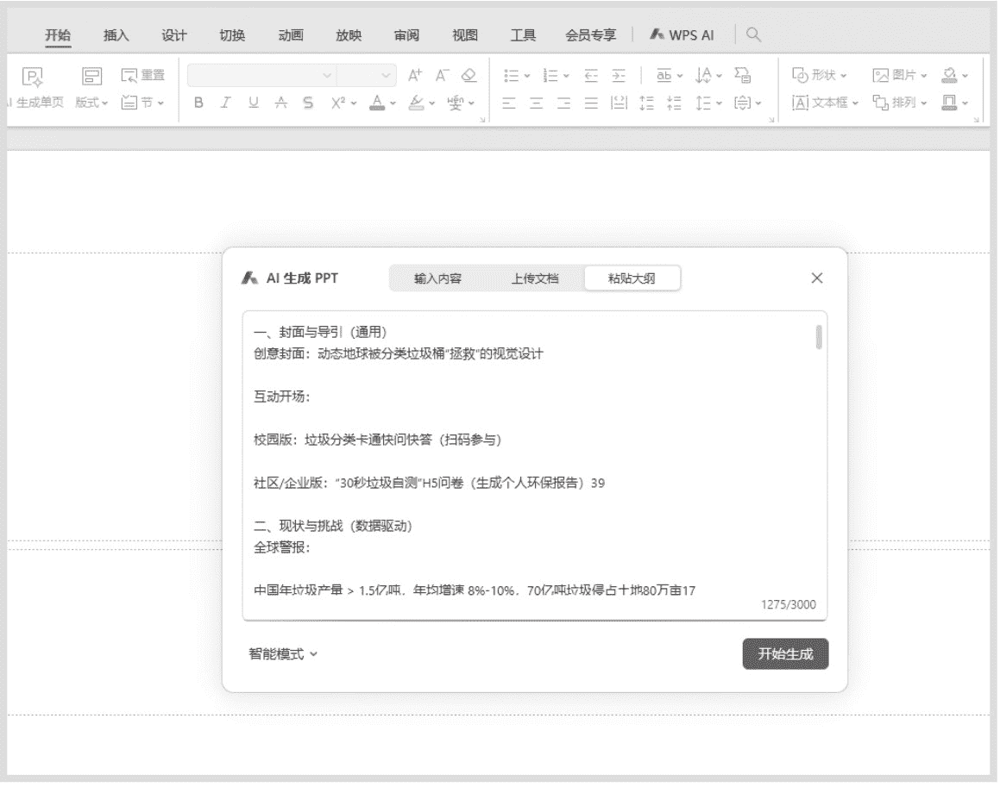

图 4-2　用 WPS　AI 生成 PPT

3 分析总结类的工作
会议纪要向来耗时。无论是手写还是先录音再整理，都容易遗漏要点。现在可以用“讯飞听见”这类AI语音识别工具实时把发言转成文字，再用Kimi、豆包提炼要点和待办，就能形成精准详实的纪要，甚至生成思维导图。

数据处理也是痛点。像销售数据堆积如山，靠Excel手算图表易出错。现在只要把原始数据上传到DeepSeek附件，并说明分析维度，就能迅速拿到一份分析报告。

AI的玩法不止单一使用，也可以1+1+1组合发挥各自长处，甚至接入插件，让高效工作更容易实现。

把重复、耗时、枯燥的基础活交给AI，省下的精力用来思考、决策、学习新技能或发展副业。AI承担底层工作，你才拥有支配时间的自由。

## 4.2 工作场景下提示词如何优化
有了AI助手，很容易想把所有工作都交给它。但实际使用中，有时惊艳有时却答非所问、难以直接用。这和给新同事布置任务一样，说得含糊结果就偏差，说清楚做什么、做到什么程度、给谁用，结果才会满意。

和AI沟通同理，清晰准确的指令才能让它干得好。在工作场景里信息要求更严谨，可以用更结构化的方式写提示词，下面是四个常用结构。

1 背景+需求+条件
市场调研任务：“我是一名互联网公司产品运营，负责一款新社交App，急需做用户满意度调研，预算有限、周期仅两周，请制定一份低成本线上调研方案，包含渠道选择、问卷要点、样本量确定等。”

2 角色+任务+要求+例子
财务分析工作：“作为资深财务分析师，对一家大型制造企业年度财报进行深度剖析，要求从盈利、偿债、运营能力多维度展开，用杜邦分析法等专业方法，像四大会计师事务所报告那样，最后输出条理清晰、数据详实的分析报告。”

3 做什么+什么用+达到什么效果+担心什么问题
项目策划阶段：“我要为新客户制定品牌推广方案，目的是提升品牌知名度、突出市场竞争，期望方案能把握趋势、创新营销，提供可执行策略，不过担心对目标受众需求把握不准导致脱节。”

4 需求+担心+反向验证
文案撰写时：“我需要写一篇产品推广文案，担心吸引力不足打不动潜在客户，请找出5篇竞品优秀文案，分析其标题、情感共鸣点、利益诉求等关键要素，并据此给出优化建议。”如图 4-3 所示。

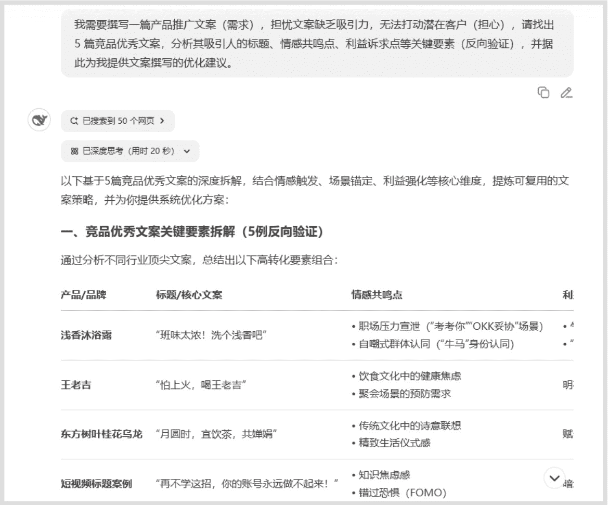

图 4-3　用 AI 撰写产品推广文案

## 4.3 导入职位JD，简历精准匹配
刷招聘信息时常感叹找工作难，特别是换工作时简历投递最头疼。自己觉得写得很用心，却石沉大海。原因往往是简历不够“对口”。

现在招人，尤其是大公司热门岗，HR看一份简历可能十几秒，主要看简历内容与招聘要求JD的关键词匹配度。经历和技能对不上或没突出重点，就容易被筛掉。

一份简历投所有岗位不可行，手动逐份修改又太耗时间。这时AI就能当“简历优化师”，以DeepSeek为例：

1 提取JD关键词
锁定岗位后把职位描述复制给AI，指令示例：“我正在找[职位名称]工作，请根据以下职位描述提取关键硬技能词及软技能词。描述：[粘贴]”。AI会快速梳理出技能要求，为优化锚定方向。

2 量化工作成果
拿到关键词后，把简历中需优化的经历分段发给DeepSeek，让它结合岗位关键词量化描述，突出成果，让数字说话，更贴合需求。

3 结构二次优化
调整后的简历上传附件，让AI提出结构优化建议，进一步凸显逻辑重点。注意AI也可能出错，需人工核查。

简历通过后就是面试，可以让AI基于简历预设面试官可能提问的问题，并给出针对性回复，提前做好准备。

## 4.4 行业调研不用跑，AI联网全搞定
行业调研常被信息繁杂、质量参差、时效性差困扰，整合分析更是难题。现在很多AI支持联网搜索，能基于知识库实时抓取最新信息。下面以DeepSeek为例演示流程。

1 明确目标，精准提问
提问质量决定答案质量。
错误示范：“帮我查电商行业情况。”太宽泛。
正确示范：“帮我查2025年电商行业整体发展趋势，提供最新数据并总结，保证真实，并在最后附上每条信息来源。”
如此AI才会去检索最新报告新闻并提炼趋势。

2 梳理核心问题
可先列出：行业规模多大、主要竞争对手是谁、用户需求如何变化、技术发展到哪一步。若无方向，可先让AI给出调研常见维度。

3 要求解释并配案例
对复杂概念要求通俗解释并配最新案例，如：“请用通俗语言解释区块链技术，并举例说明其在金融领域的应用。”

注意：AI回答可能基于旧数据推测，务必开启联网搜索并强调真实性。可设定引用规则，如限制引用2024年××报告，或限定政府官网权威信息。

## 4.5 告别手抄纪要，AI总结又快又清
整理会议纪要一直是职场痛点。手写慢、字迹乱、易丢要点，手动整理更是费时，尤其长会讨论梳理要点极其繁琐。

AI可把录音转文字、智能分析内容、自动提取要点并生成待办清单，流程大幅简化。

以腾讯会议为例，能自动总结核心要点、提取关键信息，便于后续跟进。讯飞听见凭借高精度语音识别，支持多语种和方言，准确转写并提供编辑导出功能，满足多样化需求。

操作要点：
先登录创建或加入会议；
进入会议后开启实时转录，逐人发言实时转文字，支持中英双语；
会后导出转写内容，腾讯会议会自动整理出主题、参会人员、沟通内容、行动项目等，检查无误后即可发送。如图 4-4 所示。

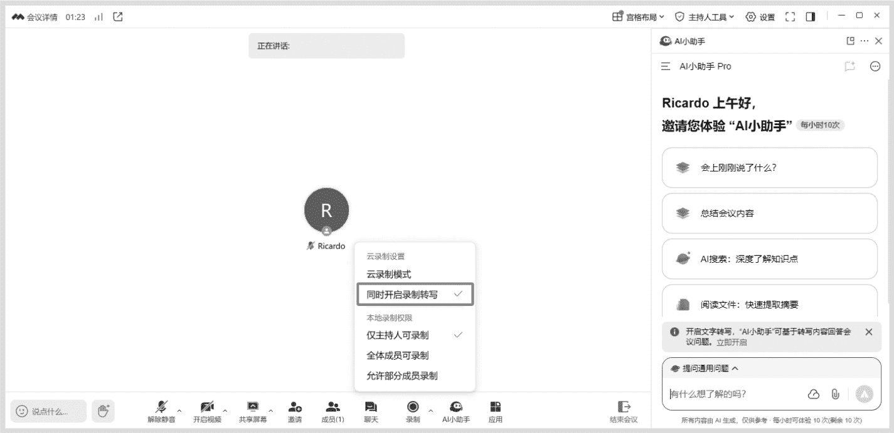

图 4-4　用腾讯会议整理会议纪要

合理使用AI能让纪要整理从头疼变高效，把更多精力投向核心任务，提升竞争力。

## 4.6 日周月报写不动？交给AI搞定
日报周报月报常态化，有时内容雷同写不出新意，有时任务繁多抓不住重点。AI通过海量数据了解多种汇报形式，即使重复工作也能变换表达；对冗杂信息梳理也很拿手，输入原始内容即可生成结构清晰的报告。

两种场景的处理方式：

1 工作内容重复
可说：“我每天寄十份快递，请给我写5天的工作日报，每天描述不同。”如图 4-5 所示。

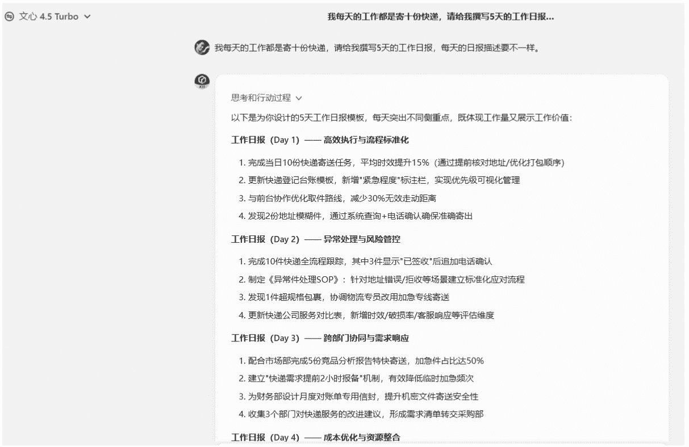

图 4-5　用 AI 撰写工作日报

2 工作内容太多
先整理信息再下指令：“请根据以下内容生成一份工作周报。本周主要工作：[填写]；工作难点：[填写]；解决方案：[填写]；下周计划：[填写]。要求语言简洁、突出成果和价值、适当用数据支撑、篇幅控制在800字以内。”

这样AI能精准理解需求，输出逻辑清晰的报告。提示词不擅长者，也可直接用AI自带模板填写即可快速生成合格报告。

## 4.7 翻译太生硬？AI让表达更地道
传统翻译软件常有“机翻感”：生硬、不流畅、不顾中文表达习惯。而AI翻译会先理解语义，结合上下文和文化差异，输出更自然的译文，但也有技巧。

以翻译英文商业新闻稿为例，直接说“把这段英文翻成中文”结果意思对但死板。

先说明风格用途：是正式商务报告还是日常口语。
再设定背景：“你是一名精通简体中文的专业译者，曾参与《经济学人》中文版翻译，擅长新闻时事。现在请把这段英文新闻译成中文，保持杂志中文版风格。”
给出规则：准确传达事实与背景，专有名词保留并加空格。
可用分步法：先直译保证信息不丢，再意译润色让句子流畅。
对专业术语提前提供资料或示例，AI翻译会更准确。

## 4.8 策划灵感枯竭？AI多方案任选
策划人常陷入翻案例刷平台却同质化的困境。AI作为24小时待命助手，一分钟可生成十多个创意方向，并结合全网最新趋势，是很好的灵感伙伴。

让AI高效产出创意的方法：

先植入“创意种子”。把项目资料和过往案例整理成文档，开头写：“以下是项目资料和案例，请按此调性生成创意。”再进行拓展，如：“针对Z世代奶茶品牌快闪店，提供20个主题，要求结合元宇宙、怀旧风、环保等方向。”

激发创造力可加限制：“避免毛绒、卡通等常规元素，需给出3个颠覆性方向。”或强制联想：“把奶茶快闪店与××[公司要求方向]结合。”

最后在AI给出的选项中进行玩法组合再创新。

用模型做创意组合试验是条捷径，把看似不沾边的元素硬凑在一起，让它给出若干互动玩法设想。比如把“电子宠物”纳进“环保杯”的场景，再让它延展几个变体，很快就能冒出“电子宠物养苔藓杯”之类的点子。

另一种打法是跨界迁移，想想如果把某个行业的活动形式搬到另一个赛道，该怎么改造成熟。连续跑几轮头脑风暴，积累的提案很快能达到几十套，风格各异。

不确定哪个更靠谱时，可以追问：“请按传播力、落地难度、新意三个维度给每条打分并排序”，筛选效率会明显提升。

做出真正能打的点子，核心在试错的耐心，多数优质方案往往出现在第 23 到 45 个之后。广告大师詹姆斯·韦伯·扬说过，创意本质是旧元素的重新组合。如今模型正是打破固有搭配惯性的好伙伴，配合得当，可能性几乎没有天花板。

## 4.9 演讲稿快速生成，风格随需切换

上台发言的场合很多：年会致辞、项目汇报、主题分享，甚至婚礼祝酒。对不少人来说，紧张只是其一，写稿才更折磨人。好稿子要把要点讲清，还要有清晰的逻辑、层次，以及人情味和感染力。

要写出既有信息量又有温度的文本，过去需要大量构思、遣词和反复修改。现在借助智能工具，难度大幅下降。只要微调指令，就能拿到多种风格的初稿，把更多时间留给精修。

以“团队合作”为例。

面向企业高层和优秀员工做汇报，指令要突出专业与严谨。可以这样说：“我需要一篇用于企业年会的演讲稿，主题是团队合作，重点写团队过去一年如何紧密协作、攻克项目难关、实现业务增长目标。要用翔实数据和典型案例支撑观点，体现团队对公司发展的核心贡献。”模型便会按此要求产出。

换到校园社团，受众是充满活力的学生，指令就要活泼些。可以说：“我需要一篇适合校园社团活动的演讲稿，主题是团队合作，用学生熟悉的校园元素，比如社团里的趣味瞬间、互助的温暖小故事，来说明团队合作的重要性，语言要轻松生动、有感染力，能吸引同学们积极参与。”生成的内容会更贴合轻松愉快的校园气氛。

如果对象是合作伙伴和潜在客户，指令则侧重价值与商业意义。可以说：“我需要一篇用于商务洽谈的演讲稿，主题是团队合作，结合当前市场热点和行业趋势，重点讲团队在创新合作模式、资源整合、风险应对方面的能力，突出与我们合作能带来的发展空间和回报。”产出会更符合商务场景。

借助模型写稿，能大幅提升备稿效率。短时间内就能得到结构完整、重点突出的初稿。掌握了这项能力，竞聘答辩、公开演讲都能更从容，职场表现力自然上一个台阶。

## 4.10 用模型做 PPT，排版加速还能接单

PPT 早已成为职场标配，如今对它的要求越来越高，版式、配色、动画都卷得很凶，有些内容繁多的演示，光是梳理思路就要花好几个小时。好在有智能工具加持，短时间内做出高质量演示已不算难事。你不需要成为设计高手，也不用学习配色技巧。只要善用一个工具，比如豆包，就能做出实用又好看的演示，甚至熟练后还能拿来接单。

具体怎么来？

先确定整体框架。打开豆包网页版的对话窗口，描述项目背景和需求，让它生成大纲和内容骨架。可以这样说：“我需要做一个‘2025 年年终表彰大会’PPT，面向全体员工，希望突出员工成绩和贡献，本次表彰奖项分为最佳进步奖、销售冠军奖，每个奖项都有 5 人，请据此生成大纲及内容框架。”

豆包会迅速给出完整的大纲和框架，帮你快速抓住核心，也能直接当底稿填充内容，省去大量构思时间。如图 4-6 所示。

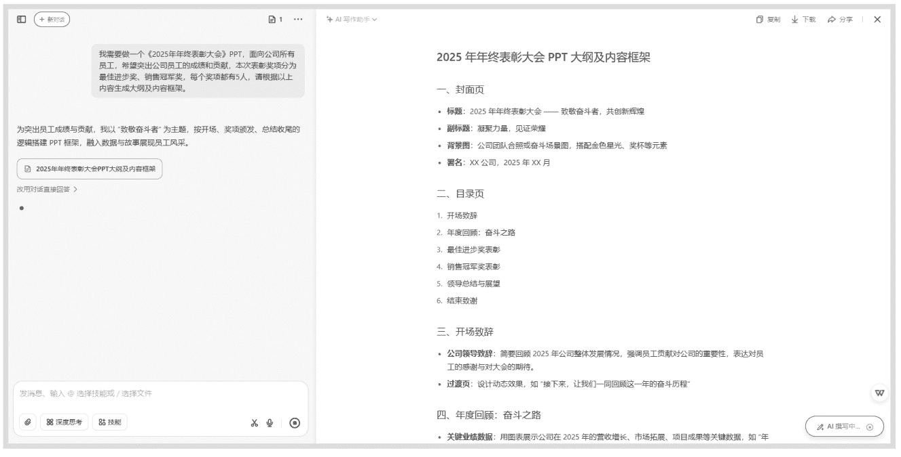

图 4-6　用 AI 生成 PPT 大纲框架

确认内容没问题后，就能点进豆包里的 AI PPT 功能，这是内置的在线生成工具。选好合适的颜色和风格模板，把前面生成的内容导入即可。整个过程像智能助手全程代劳，效率倍增，PPT 很快就成型。如图 4-7 和 4-8 所示。

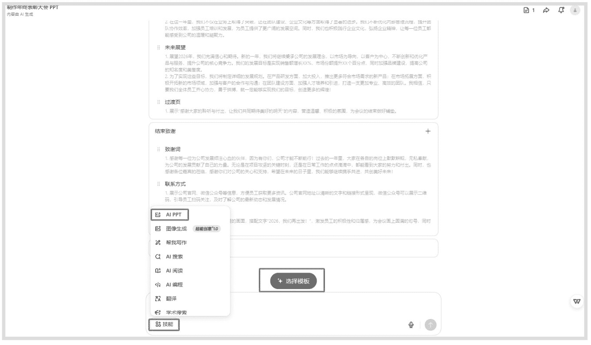

图 4-7　豆包里的 AI　PPT 功能

图 4-8　用 AI 生成 PPT

需要注意的是，模型生成的内容有时与模板匹配度不够，仍需手动微调才能达到最佳效果。

除了豆包，WPS AI、Kimi 等工具也能做 PPT，逻辑大同小异：先整理内容框架，再适配设计版式。

模型加 PPT 是实用且需求广泛的办公提效利器。它把排版这个最琐碎的环节变得高效，让非设计专业的你也能做出专业水准的演示。学会智能辅助设计，就能轻松接单，为有需求的人提供服务，获得可观收入。

# 第五章 AI 赋能数据与编程，入门也很简单

## 5.1 数据变现：普通人也能靠智能工具做分析赚钱

“数据”听起来很高深，像是大公司和程序员的专属。做生意要看数据，运营要分析数据，连刷短视频背后都有平台在分析。普通人听到数据分析，第一反应往往是复杂公式、看不懂的图表、需要编程的软件，觉得遥不可及。

其实别被名字吓到，核心很简单：从一堆杂乱的信息里找出有用的规律和线索，用这些规律做更聪明的决定，或发现别人没注意到的机会，这就是赚钱的入口。

过去挖掘数据金矿需要专业工具和技能，现在智能模型的爆发彻底改写规则。它就像装在手机里的懂数据、会分析、还会讲人话的超级助手，让“说人话就能分析数据”成为现实。

比如，你开小店，把上个月的销售 Excel 表直接丢给助手，问：“帮我看看卖得最好的三样是什么？周末和工作日有什么差别？”几秒钟后，答案和简单的趋势图就出来了。

又比如在超市理货，用手机拍下货架照片，模型能识别商品并提醒：“第三排最右边那个牌子的酱油快卖完了，需要补货。”想知道水电费为什么涨了，语音问一句：“帮我对比一下家里这两个月和上两个月的水电费。”模型马上生成对比图，甚至分析可能原因。

数据分析的门槛已经被智能工具打破。不需要数学天才或编程高手，只要会描述问题、会提问，模型就能处理复杂的脏活累活，把有价值的信息提炼出来，用你能懂的方式呈现。

普通人如何用这把“智能铲子”挖到真金白银？逻辑就是：用模型发现数据价值，再把价值变成收益。

1 变身微型“数据顾问”
熟练运用智能分析工具后，可以为身边的小商家、个体户提供简单实用的洞察。比如帮水果店分析近期畅销品种和客流高峰时段；帮网店朋友看哪些商品评价好但销量低，或从客户评价里提炼出顾客最在意的点。你不需要做极专业的报告，只要提供他们看不到、却对经营有直接帮助的信息，就有价值，能收取合理费用。

2 抓住平台数据红利
很多平台本身就有丰富的数据工具，结合模型解读能力能玩得更溜。比如帮内容创作者分析哪类视频/笔记流量好、粉丝活跃时间；帮小电商优化商品标题和关键词，利用模型分析搜索热词和竞品。你用平台数据加智能工具找到优化点，就能帮客户提升效果，这就是你的服务价值。

数据不是谁的专利，模型让它变成埋在每个人身边的金矿。学会和智能数据助手配合，你就能比别人更快挖到属于自己的那桶金。

## 5.2 零基础也能写代码：把模型当成编程翻译

杭州一位宝妈小李，用 ChatGPT 写出了人生第一段真正有用的代码——一个自动整理孩子班级成绩单的 Python 小程序。她不懂英文，也没学过编程，只是靠在抖音上学到的基础提示方法就完成了开发。

类似案例并不少见。淘宝上的自动回复插件、小红书博主用的爆款笔记分析工具，背后很可能就是像小李这样的普通人借助智能编程工具创造的成果。

这个时代，能清晰表达需求、懂得与模型对话的人，正在重新定义谁能写代码。模型不是要消灭编程，而是彻底革新了写代码的方式。对非专业人士来说，它就像一个理解力超强的“编程翻译官”，把人类意图桥接到机器指令。

新手如何有效使用这个“翻译官”？关键在提示词，即如何沟通。

你需要教一个很聪明但完全不了解你背景的助手完成任务，模糊指令只会让它困惑。编程模型也是如此。你说“帮我写个小游戏”，它无从下手；但你清晰说明：“请帮我写一段 Python 代码：自动读取名为‘销售数据.xlsx’的 Excel 表格，找出‘销售额’列大于 1000 元的订单行，计算这些行的总销售额并打印结果。”模型就能精准理解。这里要交代清楚目标、输入来源、处理逻辑和输出形式，指令越具体，代码越贴合需求。

拿到代码后，理解它也是挑战。这时让模型同时提供“中文说明书”——代码注释。在需求里加上“请务必在代码里添加中文注释，解释每一步的作用”。

例如：“帮我写一段代码合并两个 Excel 表格，表 1 是订单号加金额，表 2 是订单号加客户名，输出新表包含订单金额和客户名，请务必添加中文注释解释每一步。”模型生成的内容就会在关键步骤旁加上中文说明，让你大致看懂逻辑流程。如果想深究某处，也可以在指令里点名要求解释。这些注释就像旁白解说，大大降低理解门槛。如图 5-1 所示。

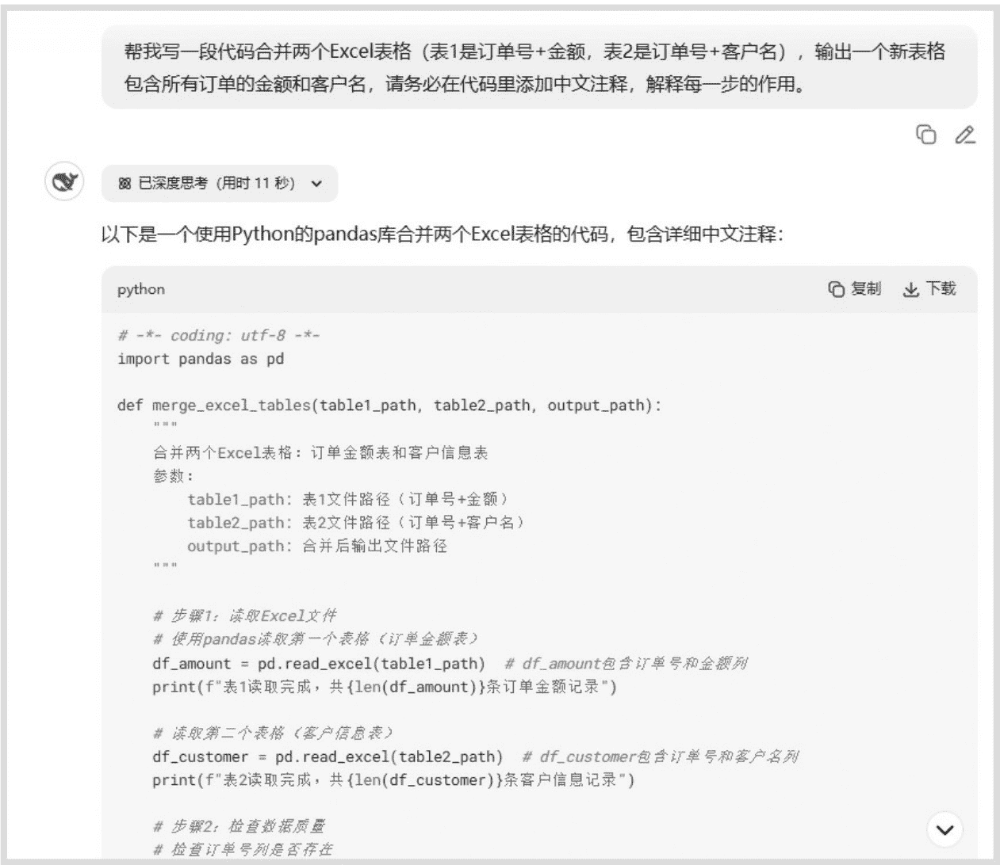

图 5-1　用 AI 生成代码及注释

“零基础也能写代码”不是口号，而是智能技术带来的现实。只要有需求，敢用工具并花一点时间理解生成的代码，就能打开编程世界的大门，用代码解决问题，甚至获得收益。

## 5.3 主流智能编程助手优缺点对比

借助模型，即使没有编程基础，也能让电脑帮你完成编程任务。这种把大白话变成代码的工具，就是智能辅助编程工具。

大致分两类。一类是装在程序员电脑里的“智能助手”，集成在代码编辑器或 IDE 中，比如 GitHub Copilot，能自动补全代码、纠错、推荐下一行，主要服务已有编程经验的人，门槛较高。另一类是可以聊天的大白话生成代码的机器人，像前面提到的，这才最适合小白入门，无需安装复杂软件，会打字提问即可。

这里重点说第二类聊天式模型编程助手的特点。

1 文心一言
优点：背靠百度，中文理解能力强，用中文描述需求很友好。功能全面，编程是重要组成部分，在处理中文文件名、生成中文文本处理代码等方面有优势。
缺点：在非常前沿技术或小众语言上，可能不及国际领先产品。

2 Kimi
优点：以超长文本处理见长，在编程中很有用，比如分析很长的代码、阅读代码文档、处理大段报错信息。它在理解代码逻辑和解释代码方面表现不错。
缺点：直接生成代码的速度和多样性不是核心卖点，更像“代码理解和辅助调试专家”。

3 ChatGPT
优点：全球公认的代码生成能力强，能生成多种语言片段、解释复杂代码、辅助调试。知识库更新快，对新库新框架了解多，付费版支持联网获取最新信息。
缺点：免费版能力受限，高级功能需付费。中文语境下的理解和生成可能不如国内产品贴近。

4 Claude
优点：逻辑推理和长文本处理能力强，能处理长代码。在理解复杂需求、生成结构清晰代码、解释逻辑方面表现好，涉及安全道德问题时更谨慎。
缺点：代码生成的创造性或对特定框架的灵活性可能不如 ChatGPT。

5 Gemini
优点：背靠谷歌信息库和技术能力，生成代码时结合最新技术信息有潜力，可与 Colab 等在线编程环境联动。
缺点：不同语言和代码类型的生成稳定性不够。

6 DeepSeek
优点：逻辑严谨，注释清晰，代码结构工整，默认带中文注释，零基础用户也能看懂核心逻辑。可处理完整项目代码库，适合分析复杂报错或重构旧项目。
缺点：推理速度偏慢，面对非常规需求时方案偏保守，灵活性不高。

工具各有千秋，差异体现在速度、创新性和特定场景能力上，但共同指向一个核心：编程不再是少数人的专利。善用智能助手，关键在于清晰表达需求、理解输出并保持判断力，就能把技术潜力转化为个人能力。

## 5.4 想把程序上线？这些环节模型帮不了你

模型能把大白话翻译成代码，让零基础也能体验编程。你可能会想：那以后想做个软件或小工具，让模型写代码不就行了？其实光靠写代码，就像只会用绘图工具，离做出能上线、可用的 App 或网站还有不少步骤。

模型生成的代码不是魔法，需要在特定环境里运行。就像播放视频需要解码器，打开 Word 需要 Office，代码也需要执行环境。运行没问题后，还要考虑怎么让别人看到，涉及域名、服务器、程序打包等环节。

1 申请域名操作流程
(1)选择并注册域名
①选择域名：简短易记且避免侵权，不要用“微信”等商标词。
②查询可用性：通过阿里云、腾讯云等平台输入域名查询是否可注册。
③注册购买：域名未被注册即可购买，填写所有者信息并支付，不同后缀价格不同。如图 5-2 所示。
(2)域名实名认证
个人用户需上传身份证正反面，完成手机号、邮箱验证，审核一般 1~3 个工作日。
(3)域名解析与绑定服务器
①进入域名管理后台：在阿里云/腾讯云控制台找到域名解析功能。
②生效验证：添加解析记录后等待 DNS 生效。
(4)ICP 备案（仅限国内服务器）
通过云服务商提交备案申请，填写主体信息、网站用途并上传材料，如阿里云备案系统。填个人信息、上传认证材料，审核通过后网站底部会展示备案号。

图 5-2　申请域名操作

2 程序打包与提交审核流程
想做 App，就要了解打包和审核流程。以 iOS App Store 为例：
(1)打包准备
工具：用 Xcode 生成 .ipa 文件。
配置要求：创建 App ID，如 com.company.Appname。
生成发布证书和描述文件。
(2)提交审核材料
登录 App Store Connect，创建新应用，填写名称、分类、关键词、描述等元数据。上传构建版本，通过 Xcode 上传 .ipa。
(3)提交审核材料
必填内容：应用截图，6.1 英寸和 6.7 英寸各一组；隐私政策链接，需托管在已备案域名；测试账号和密码，若应用需登录。

按此流程可系统化完成域名申请、程序打包及审核上线。不同平台规则会动态调整，建议以官方文档为准。

## 5.5 Excel 函数头疼？交给智能工具来解

在工作或生活中，Excel 表格的使用频率非常高。记账、管理客户信息、统计销售数据、做各种汇总表，很多场景都离不开它。

Excel 功能很强大，但一碰到函数就容易让人却步。函数本质上是内置的速算指令，可以完成运算、统计、匹配、判断等工作，比如求一列数字的总和、找出最大值。对新手而言，这些表达式的写法很绕，通常要查很多教程才能上手。

AI 已经成熟，即便没有专业背景也能借助智能助手快速掌握函数用法。用自己的话描述目标即可，助手会解读意图，推荐合适的函数，甚至直接给出可用表达式。

有了 AI 加持，以前让人头疼的函数变得好处理。不必死记硬背，只要把目标告诉它就能独立完成。在表格场景里，AI 主要能做这几件事：

自动撰写表达式：用日常说法描述目标，助手直接给出可用的写法，例如“把 A 栏和 B 栏对比，把重复行标记出来”。

报错诊断：把出错的表达式粘贴过去，让它分析原因，例如“为什么返回 #N/A”。

流程简化：针对复杂任务给出更简洁的组合写法，例如“如何用一条表达式完成多条件汇总”。

洞察建议：结合数据特征推荐可视化形式或统计方法。

下面通过两个例子看看口语如何变为表达式。

1 用 AI 生成基础表达式

场景：需要从“2023-12-25”这类日期格式里取出月份数字。

给助手的话可以写成：“A 栏是 2023-12-25 这样的日期，怎么在 B 栏把月份数字取出来？给我三种写法。”如图 5-3 所示。

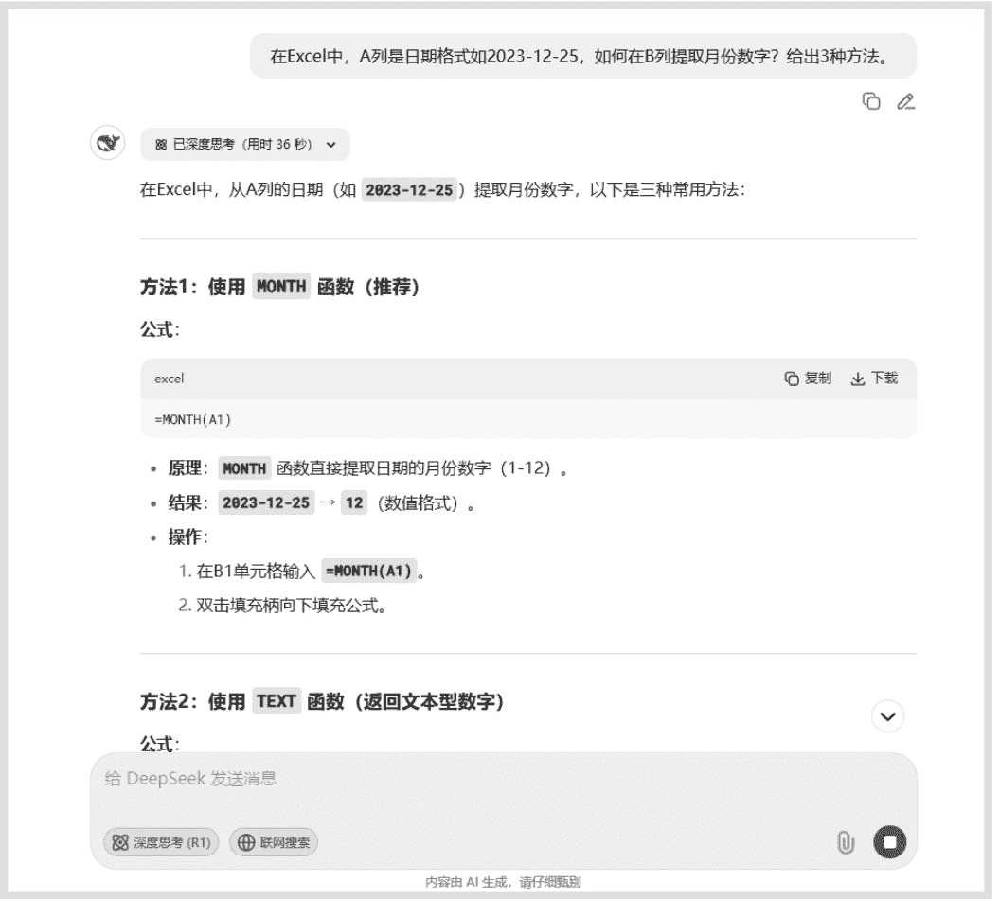

图 5-3　AI 生成基础函数公式示例

2 借助 CHATExcel

上面例子比较简单，下面提升难度。CHATExcel 能把口语化提问与智能分析结合，实现自动化出报告。整体流程是开账号、导入数据文档，站点支持 Excel 与 CSV，然后用普通问句提问。常见的提问方式有：

基础分析
“算一下 2023 年各季度的销售额平均值。”
“把库存低于 100 的产品标出来并标红。”

复杂分析
“以姓名为横轴，画出高三（一）班女生的成绩折线图。”如图 5-4 所示。
“根据过去 12 个月的数据，预测下个月的成本走势。”

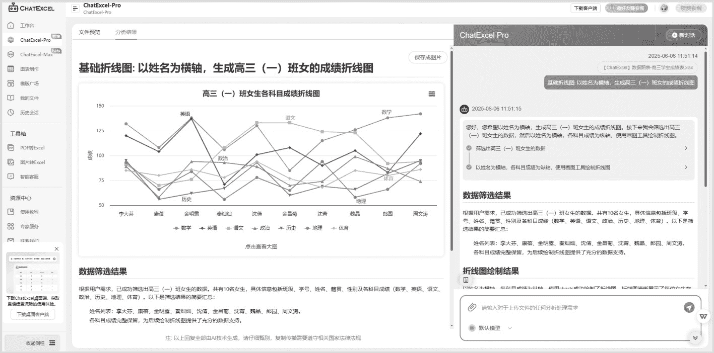

图 5-4　用 CHATExcel 生成图表

模糊指令优化
如果助手没完全理解，可以补充细节，比如“按月份细分”或“去掉测试数据”。

处理完后可以再调优，最后直接使用。一旦 AI 变成你的数据助手，就不会再被复杂表达式挡住，能更快调用 Excel 的计算能力处理数据。掌握后不仅自己能高效处理表格，还能帮别人、创造额外收入。

## 5.6 SQL 代码速成：换关键词即用

工作中经常需要从公司大数据仓里抽数，比如“找出昨天买了××商品的所有客户”。想做数据分析，就得会 SQL，也就是结构化查询语言。

数据库像一个巨大的智能仓库，SQL 就是与它对话的专用语言。你用 SQL 告诉仓库要去哪个表、要什么数据、条件是什么。SQL 有自己的语法，比如 SELECT 是选取，FROM 对应来源表，WHERE 用来筛选。对非程序员来说，组合这些命令容易出错，写错就取不出数据。

对熟练者重复写查询也很枯燥。借助 AI 用模板化方式产出 SQL，就能快速应用到实务。

下面演示一个不会 SQL 的人如何用口语化描述让 AI 生成查询指令。

1 明确想从数据库里拿什么
先想清楚要哪些信息、满足什么条件、怎么呈现。可以从以下角度梳理：
查询内容：需要哪些字段，比如客户名称、商品、购买时间。
数据来源：在哪张表，比如销售记录表、客户信息表。
筛选条件：比如购买时间在某天后、商品类别是电子产品、所在地是上海。
排序规则：按购买时间从新到旧等。
统计需求：要总数、平均值、最大最小值，还是明细列表。
分组方式：按商品算销售额，还是按客户统计购买次数。

想清楚后，还要对数据库里有哪些表、每张表有哪些列有个基本概念，这是给 AI 下指令的基础。

2 打开智能助手描述需求和表结构
打开任意 AI 聊天机器人，把需求、表名、列名清晰告诉它。示例指令：
“请你扮演一位精通 SQL 的数据专家，帮我写一条查询语句。”
“我要查 sales_records 表。”
“该表有列：customer_name（客户名）、product_name（商品名）、sale_amount（销售额）、sale_date（销售日期）。”
“我想找出销售额大于 1000 元的记录，只显示客户名、商品名和销售额这三列。”
“请给出对应的 SQL。”

学会后变现也很直接，最简单的是提供数据查询服务。很多人需要抽数却不会写 SQL，你可以用 AI 的能力承接需求。另外还能做 SQL 教学辅助，推出“AI 带你写 SQL”的付费课程。

## 5.7 多表联动难？AI 来拼接

是否遇到过这种事：手上有两张表，一张是客户信息表，含客户 ID、姓名、联系方式；另一张是订单记录表，含订单 ID、客户 ID、商品、金额。现在想知道“昨天消费最高的客户是谁，联系方式是什么”。

这需要把两张表关联起来。只看订单表没有联系方式，只看客户表没有金额，必须通过共同的客户 ID 把数据联合起来，才能得到答案。

多表联合在工作中很常见，比如销售数据加客户信息、产品信息加库存、员工信息加项目参与等。以前要在 Excel 里用 VLOOKUP、INDEX+MATCH 一个个匹配，公式复杂又易错，表越多越麻烦。

现在 AI 就像数据拼接师和智能分析师。以 CHATExcel 为例，导入 Excel 后它会自动识别表头、数据类型，并根据共同字段建立关联。你可以直接用大白话提问：“把客户信息表和订单记录表连起来，找出订单金额最高的前 3 个客户，列出姓名和电话，以表格输出。”

AI 会理解需求，从关联后的数据里筛选出结果并以新表格呈现。如图 5-5 所示。

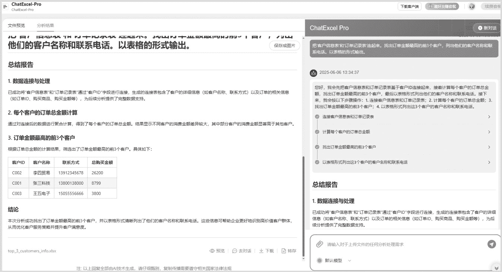

图 5-5　用 CHATExcel 处理多表数据

## 5.8 一键出图：复杂图表交给 AI

做报告、汇报、写文章时，图表非常重要。一个好的图表能快速抓住注意力，让数据意图一目了然。

看各地区销售额对比，用柱状图；
看用户数随时间变化，用折线图；
看总成本各部分的占比，用饼图。

过去这些图都要手动筛选数据、调整样式，数据复杂或想要不常见类型时特别费劲，往往要么放弃，要么花大量时间做出丑图。

随着 AI 发展，数据可视化变得高效。以智谱清言的数据分析模块为例，操作流程如下：

准备符合要求的文件，格式为 Excel 或 CSV，去掉冗余列和重复数据，上传后用自然语言下指令。例如：“生成 2023—2024 年各季度销售额对比柱状图，按产品类别分组并标注增长率。”“画出华东地区用户 24 小时活跃热力图。”

AI 会自动识别关键字段，调用趋势预测、聚类等算法进行分析，生成初步图表。用户可以更换呈现方式，比如柱状图、折线图，或调整配色让图表更美观。

图表完成后，还可让 AI 辅助洞察，输入“分析销售额下降原因”，工具会自动检测异常时段，结合库存、客流量等字段生成归因报告。

掌握这项能力后，普通人也能把枯燥数据变成直观有说服力的图表，既能提升展示效果，也能把数据可视化需求变成新的赚钱机会。

## 5.9 无代码做小游戏

提到做游戏，很多人会想到大型开发团队，觉得必须会编程、美术、策划。确实以前门槛很高。

现在 AI 加上低代码平台让小游戏变得可行。这里的小游戏指规则简单、画面不复杂、可在网页或小程序快速打开的类型，比如连连看、消消乐。

借助 AI 和低代码，你不需要从零写代码，通过拖拽、填配置、写文字描述就能做出可玩的游戏。以贪吃蛇为例：

1 明确游戏需求和规则
想清楚游戏区域大小、有无边界、蛇初始长度、移动速度、食物样式、得分规则、结束条件等，也可以请 AI 给建议。

2 用 AI 生成游戏素材
按需求让 AI 设计素材和文案，例如：“设计几款可爱的贪吃蛇图片”“设计苹果、香蕉等食物图片”“做一个像素风格的背景图”“写一段贪吃蛇规则说明”。

3 选择低代码平台搭建界面
注册账号新建项目，用可视化编辑器画出游戏区，拖入蛇、食物、分数显示组件，把 AI 生成的图片上传到素材库并应用。

4 配置游戏逻辑
利用平台的逻辑组件设置规则：蛇的移动与方向键联动；食物随机生成；碰撞检测，蛇头碰到食物则加分、变长、刷新食物；碰到边界或自身则游戏结束；计分变量每次吃食物累加；设置开始按钮和结束提示。

5 测试、优化和完善
自己和朋友反复测试，调整细节后发布。

# 第六章　AI+知识付费，打造自动化赚钱体系

## 6.1 知识付费还有戏吗？AI 提升变现效率

近几年知识付费持续火热，各类平台出现系统化课程和专栏。信息过载时代，用户更愿意为体系化知识付费，虽然内容海量，但优质系统内容依然稀缺。

需求多样：上班族想提升职场技能，家长想学育儿方法，学生想找学习资源提升成绩或学课外技能。

常见变现方式：

1 在线课程
把知识整理成课程售卖，如外语、技术、投资等。平台有网易云课堂、腾讯课堂等。ChatGPT 可快速生成大纲，AI 视频编辑工具可自动剪辑素材，缩短制作周期。

2 电子书
在微信读书、知乎、掌阅等平台售卖专业书、小说等。可用豆包、DeepSeek 等工具先生成初稿，再人工润色，省时省力。

3 付费社群
用户付费进入社群获取专属内容，如新东方考研社群。新东方采用多维架构、即时响应，社群里还能接入智能客服自动回答常见问题，减轻人工压力。

4 平台直播
现场授课，免费观看、付费深度学习。借助 AI 可做直播内容策划和观众互动分析，提升效果和转化。

5 创作打赏
用 AI 制作作品发布，读者觉得好会打赏。通过分析用户偏好推送合适内容，提升打赏概率。

## 6.2 在线课程常见形态

在线课程是知识付费的主流形态，不同形式适合不同内容和学习习惯。

1 视频录播课程
提前录好上传到平台，学员随时观看、可控进度、可反复回放。适合标准化内容，但缺乏实时互动。代表平台网易云课堂、B 站。

2 视频直播课程
固定时间在线授课，学员可提问互动，氛围接近线下，但时间不灵活。常见平台腾讯课堂、Zoom、钉钉直播。

3 音频课程
适合通勤、运动等碎片场景，方便携带，但无法展示图片图表。代表平台喜马拉雅、蜻蜓 FM、荔枝 FM。

4 图文课程
用文字、图片、图表讲解，适合理论、概念类内容，便于深入思考，但抽象概念缺少讲解易难懂。常见于知乎 Live、得到、微信公众号专栏。

5 社群式课程
学员进入微信群、QQ 群交流，老师定期答疑并组织讨论，适合需要交流的场景。典型平台知识星球、小鹅通社群。

6 微课/短视频课程

微课一般控制在5到15分钟的长度，只围绕一个知识点展开。这种短平快的形态非常契合碎片化学习。抖音上的知识创作者、视频号创作者都爱做这类内容，而抖音、快手、小红书等平台也让微课与短视频课程更容易被扩散。

## 6.3 学会用AI就能卖课，知识付费的入口在这里

前面梳理了这么多AI的用武之地：写文案、画画、做视频、办公提效、处理数据、编程开发……能力看上去确实很强，也能解决不少现实问题，甚至能直接变现。听到各种AI赚钱的案例，很多人都想跟上。但面对琳琅满目的工具、晦涩的概念、不会提问、不会操作，多数人还是卡在起步阶段，不知道从何学起。

这恰恰就是知识付费的沃土。用户需求非常清晰：我想学会用AI工具解决我的问题，或靠它赚钱。

而你如果已经通过自学实操掌握了用AI解决某个问题的完整路径，整理成课程就能打开变现通道。

具体怎么走：

1 明确主题
先确定一个核心主题，比如这次我们选“5天玩转DeepSeek”实战训练营。这门课面向谁？是AI感兴趣的新手、职场人还是学生？不同人群的侧重点会不一样。最后要定一个可交付的目标，例如让零基础的小白在5天内学会用DeepSeek做文案、做数据分析、生成PPT。

2 用AI搭框架
主题、受众、目标确定后，就可以用DeepSeek来搭建大纲。可以这样问它：“请帮我搭一个‘5天玩转DeepSeek’的课程大纲，要涵盖写文案、数据分析、生成PPT等实操，学员是零基础新手。”

它会快速给出一个雏形，例如：
第1天：零基础入门，5分钟上手DeepSeek，了解平台与应用场景。
第2天：文案创作与优化，学职场刚需技巧，实现立竿见影的提效。
第3天：数据处理与分析，掌握用DeepSeek做初步数据分析的方法。
第4天：AI生成PPT全流程，结合相关工具产出高质量演示稿。
第5天：实战案例与总结，通过真实案例复盘加深印象。

3 填充内容，做成课程
拿到大纲后微调，再让DeepSeek细化方案，比如：“基于上面大纲，给一份面向职场打工人、教新手小白入门DeepSeek的具体课案，要求通俗易懂，技能常用。”如图 6-1 所示。

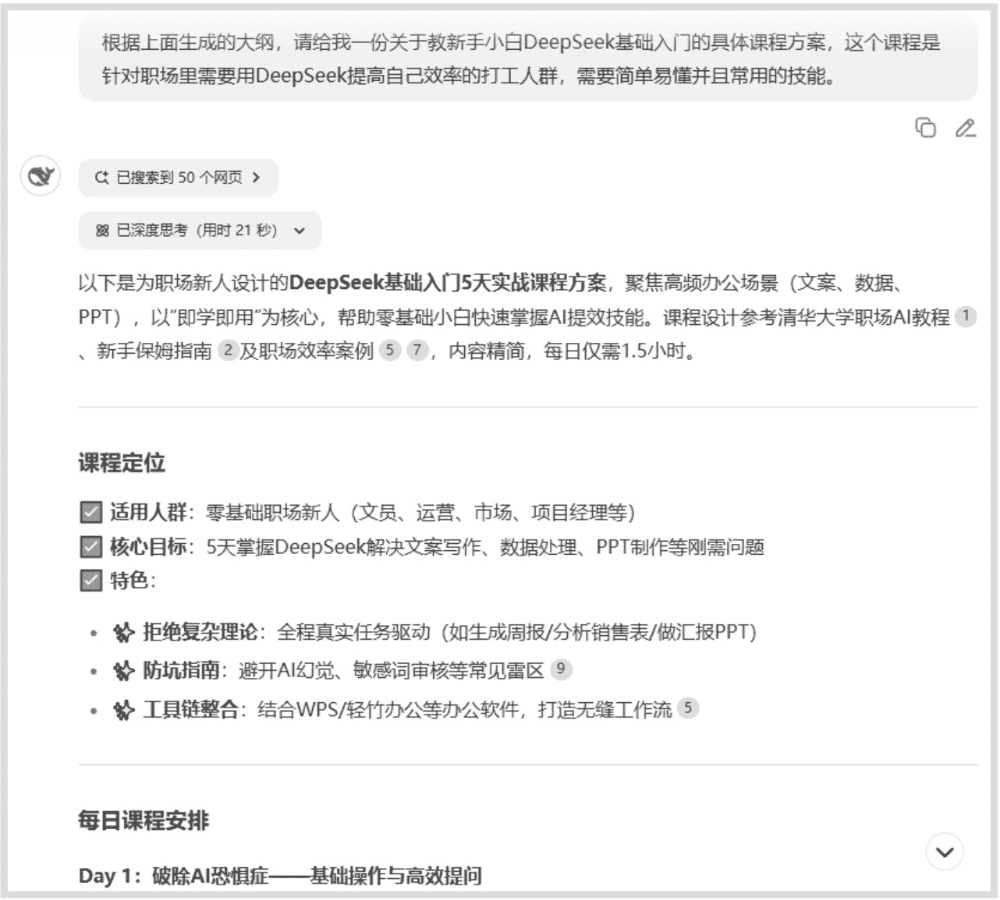

图 6-1　用 DeepSeek 生成课程方案

接着参考前面提到的线上课形式加工。如果做视频录播，可以用AI视频工具生成讲解片段，或自行录屏讲解，再用剪辑工具加字幕特效。若想做图文课，也能让DeepSeek输出每节课的文字稿，整理成教程，再用豆包设计PPT或海报提升质感。音频课不建议选用，缺少画面和文字对新手不够友好。

4 选平台，上线售卖
课程完成后需要一个售卖渠道。视频录播可放在网易云课堂、腾讯课堂；图文课适合知乎、小红书；几分钟短视频可投放到抖音、快手、B站。

定价要合理，像“5天玩转DeepSeek”定39元比较亲民。先放部分免费试看章节吊胃口，再引导购买完整版或更高价产品。同时在微信、微博、小红书等社交媒体持续发布预告和干货，吸引潜在学员。

## 6.4 拆解爆款课，用AI快速提炼大纲

看到这里你可能也想做课，却不知怎么下手，怕结构混乱、遗漏重点。听一门课再自己总结既费时又零散。

直接用AI拆解优秀课程，几分钟就能抽象出清晰的大纲。

1 锁定目标课
先找到想借鉴的课程。比如想做“高效时间管理”，就去B站、网易云课堂、小红书搜相关热门课，看评分和学员评价，挑高分口碑好的几门研究开场、讲知识点、收尾的方式。

2 用AI提炼核心
把课程的文字稿、字幕或简介复制进DeepSeek，提问：“这是一门时间管理课，帮我总结核心内容。”AI会像助理一样归纳出：时间管理的重要性、常见误区、高效方法、实战案例与工具推荐等要点。

3 让AI生成课程
基于要点让DeepSeek出稿：“根据上述核心内容，生成一篇‘高效时间管理’的文字稿。”

生成的结构可能是：
第一章讲时间管理的基础认知，为什么要学；
第二章讲常见误区，比如拖延、分不清轻重缓急；
第三章讲实用方法，如番茄工作法、四象限法则；
第四章讲案例与工具推荐。

需要视频脚本的话，直接要求：“写一份时间管理基础知识的视频脚本，包含基础认知、误区、方法、案例与工具，并给出画面设计。”它会输出讲解内容和画面，比如讲重要性时，先展示混乱的工作状态，再呈现学习后井然有序的对比。

核心就是找准目标课、提炼要点、生成大纲、优化结构，再产出内容。

## 6.5 找准赛道，以AI为军师打造个人IP

总见有人靠知识付费月入过万，自己心动却无从起步。可以先和AI聊聊自己的背景，比如：“我大学学市场营销，毕业后做过电商运营和活动策划，我的优势是什么？”AI会总结出数据分析、文案写作、活动组织等能力。

学历不是壁垒，可以换个角度聊兴趣。“我平时喜欢做饭，拿手菜有西红柿炒鸡蛋、糖醋里脊、胡萝卜玉米汤，怎么变现？”AI会给出建议：开美食博客、做线上课、做社交媒体博主、私房菜或外卖等。

明确擅长后，要找用户痛点。关键是在你擅长的领域里抓住最让人头疼的问题。问AI：“饮食方面现在网上哪些话题热？”它可能会指出“过劳肥”、想吃健康餐却没时间的问题，于是“快速做出健康餐”就能成为付费方向。

人群要精准：都市白领、健身人群、大学生，定位越准变现越快。

主题确定后就开始做内容。比如让AI写一篇“5分钟搞定健康餐”的文章，要求食材便宜、做法简单。如图 6-2 所示。发布到小红书、抖音后要坚持持续输出，积累流量和粉丝。

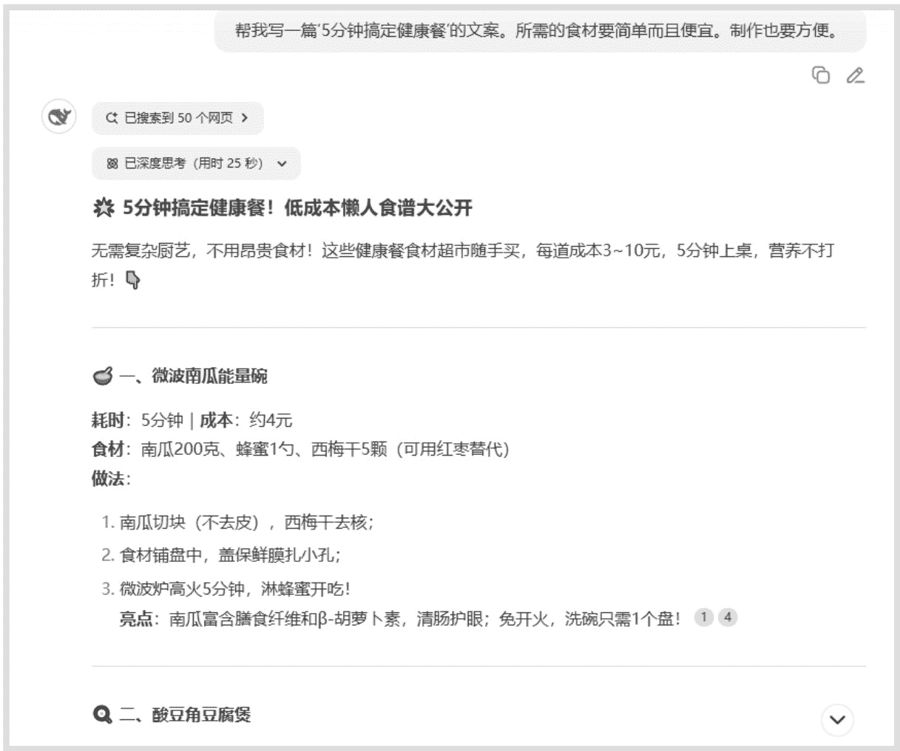

图 6-2　用 AI 生成有吸引力的文章

积累一定粉丝后开始设计变现产品。问AI：“如何设计一个9.9元的健康餐食谱，面向办公室上班族？”它会建议“鸡胸肉蔬菜卷饼加简易水果沙拉教学课”。后期可用AI不断生成针对不同人群的高价方案。

## 6.6 AI一键出课件，低成本做线上课

线上课做起来费时费力，用AI就能大幅降本提效。

1 锁定主题和方向
先想清楚要教什么，例如“10分钟搞定！零基础营养健康餐（厨房小白版）”。主题要实用、让人有购买欲，目标是教会学员基础营养知识和动手能力。

2 设计内容
让AI帮忙细化。你可以在AI软件里输入详细需求：“我是一名营养健康师，想做一份PPT教新手小白快速做出营养健康餐，请从基础营养知识、食材选择原则、简单食谱、基础烹饪技巧、均衡一日三餐搭配、健康饮食习惯培养、动手实操体验等方面给出大纲和内容框架。”AI会快速输出完整的结构和要点。

3 生成PPT模板
把生成的内容复制到Kimi等工具，底部有一键生成PPT按钮。点击后选择喜欢的模板，AI会自动把文字填入制作专属课件。如图 6-3 和图 6-4 所示。

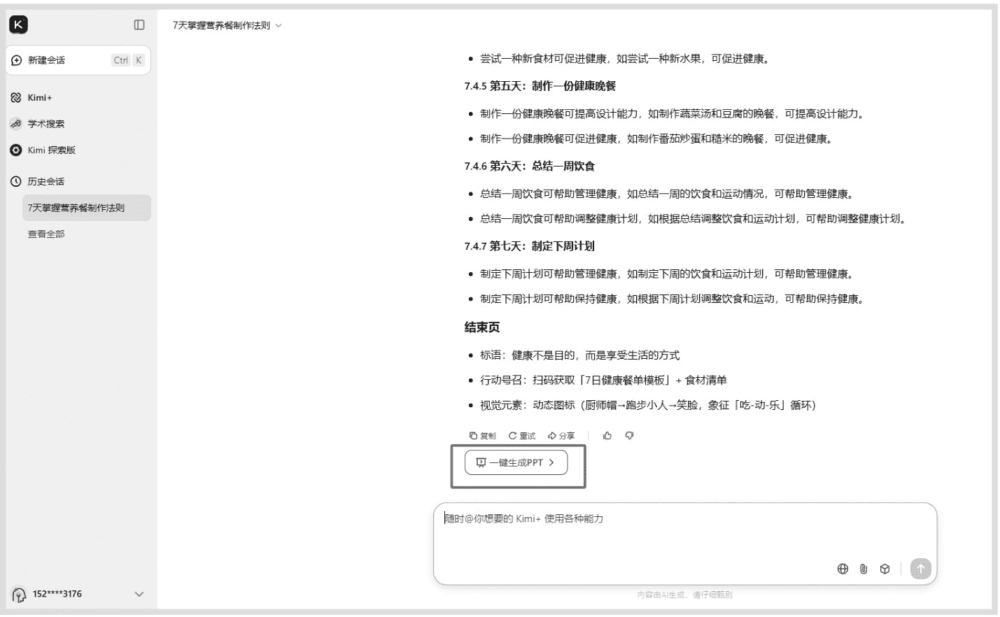

图 6-3　用 Kimi 生成 PPT

图 6-4　Kimi 的 PPT 模板界面

4 个性化打磨
AI的框架已经可用，再根据教学风格替换配图、加入动画，让演示更生动。也可以让AI生成文字讲义要点，配合PPT使用，学员体验更好。

## 6.7 图文加视频，AI助力全平台推广

课程做好了，核心问题是让人看见、愿意买单。推广方式要匹配不同平台和用户习惯。

1 图文宣传
适合不爱刷视频的人，发小红书、公众号、朋友圈都能直接传达卖点。可以让AI写文案：“写一条朋友圈推广‘10分钟搞定！零基础营养健康餐（厨房小白版）’的文案。”得到不同风格的文案后挑选使用，例如：

“10分钟逆袭厨房|零翻车营养餐公式：
蛋白质碳水纤维一键配齐，洗碗只费1个锅！
手残党狂喜！10分钟组装减脂餐。
不开火的懒人备餐，喂饱自己只需一首歌时间。”

需要海报就用Canva或豆包AI设计。输入要求：“生成一张‘10分钟搞定！零基础营养健康餐（厨房小白版）’海报，主色薄荷绿加奶油白，点缀芥末黄文字，上部分食品视觉下部分步骤图解。”即可批量出图。如图 6-5 所示。

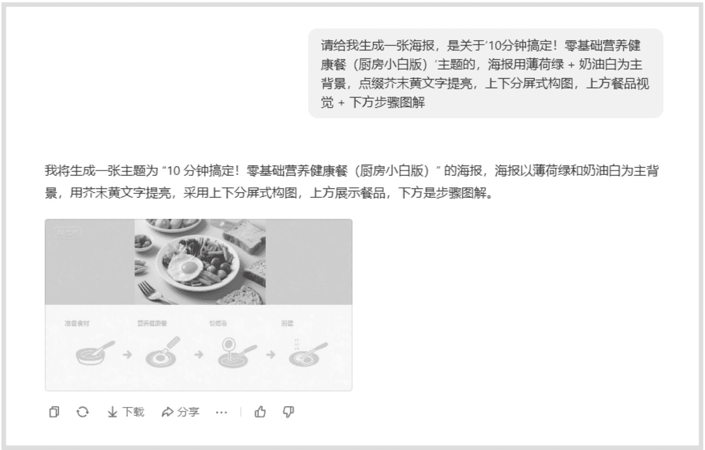

图 6-5　用 AI 生成海报

2 视频宣传
短视频更具吸引力。可以拍“巧用电饭锅，一锅出餐”教程，不确定拍摄方式时让AI生成分镜脚本：“我想拍一个‘巧用电饭锅，一锅出餐’教程，请给我拍摄脚本。”

拍摄完成后，用AI视频编辑工具自动剪辑、加字幕和特效，甚至根据情绪分析匹配背景音乐。AI能极大提高曝光率和销售效率，把你从重复营销中解放出来。

## 6.8 自动发货与AI客服，让销售更省心

推广后需要高效成交和服务。可以把发货和客服交给自动化工具。

1 自动发货：像网购一样省心
学员付款后系统自动完成：秒发课程链接到短信或邮箱；防漏发错发，支持一键重发；课程含视频和PDF时自动打包一次性发送。

2 AI客服：24小时在线答疑
把常见问答整理成表格导入工具，AI就能学习后自动处理：
售前推销：判断是否适合零基础、介绍课程内容、提供优惠和试听链接；
售中服务：付款后自动通知发货，提供学习步骤图文指南；
售后支持：链接打不开、观看时长、开发票等问题直接给答案，解决不了再转人工。

好处是成交更快、深夜也能发货，你只需关注特殊问题。

常用工具：
1 小鹅通：支持抖音、快手短信自动发货，支付后10秒内送达链接，适合短视频引流。
2 千聊：微信生态小程序自动发货，可同步学习进度到公众号，适合私域运营。
3 阿里云智能对话机器人：内置教育行业知识库，接入通义千问大模型，支持多轮复杂对话和个性化学习方案。
4 企微助手：企业微信内自动回复与资料推送，支持加好友自动发试听课，适合长期客户沉淀。

自动发货加AI客服相当于请了个不休息的员工，专注内容创作即可。

## 6.9 复刻爆款模式，批量打造课程矩阵

有了首批付费学员后，往往会想：这个赛道还能讲什么？能否把成功的方法复制到其它课上？

成功的知识付费很少只卖一门课，而是围绕主题或个人IP形成课程矩阵，覆盖更多需求、提升客单价、实现规模化变现。

从零开始做每门新课都需要设计大纲、写文案、做课件、录视频，效率受限。做出第一个成功课程后，如何以更省时省力的方式批量产出更多付费课程？我们先看看传统做课的痛点。

录一门课要拍三小时，后期剪三天，几乎把人耗空；需求靠蒙，用户买不买全凭运气，课上架后吃灰；想做品类扩充，又要招讲师组建拍摄，费用一下子冲高。学会用 AI 拆解、复用，是一条更现实的突围路：把已经跑通的知识拆成可复用的单元，按爆款结构让 AI 大量拼装出新课。

1 AI 快速锁定人群痛点
手里有一门已经卖爆的《10 分钟减脂餐课》，就能以它为母版向外衍生。比如《上班族备菜攻略》《学生宿舍简易料理》这类分支。先让 AI 回答“不同人群在健康饮食上各自卡在哪里”，它会给出打工人备菜占用时间、学生厨具受限、宝妈孩子挑食等具体卡点，直接整理成一份精准的选题清单，效率远高于人工调研。

2 AI 兼任策划与批量剪辑
搞清人群痛点后，用“爆款标题逻辑+目标用户痛点”作为指令，让 AI 批量生成大纲。举例：以《10 分钟减脂餐课》为基础，要求做一个面向大学生的电煮锅版本，AI 就能给出类似“宿舍电煮锅自救餐单：6 元吃饱一日三餐”的课纲。再配合剪映的自动剪辑功能，就能把素材快速切分成系列片段，实现成片的批量产出。

3 AI 负责吸睛标题与转化文案
输入关键词，AI 能吐出一批抓眼球的标题，比如“打工人备菜狠招：周末 2 小时备好 5 天减脂餐，附 AI 菜谱工具”。文案上也好用套路切入：“你是不是也烦超市逛半小时，做饭花两小时？”先共鸣再推单，收尾用稀缺刺激：“前 100 名送《超全备餐表》，扫码领 →（带倒计时弹窗）”。

4 AI 接管分发与自动变现
学员学完后，AI 弹窗引导分享，并能自动识别截图行为即时推送资料包。深夜有人进课页面，AI 客服立刻响应、释放限时福利，24 小时在线承接转化，把学习行为接进购买。

这套玩法不等于完全甩手。体验类环节比如试吃演示，还是需要真人出镜；AI 生成的食谱食安逻辑也要人工复核，避免出现“酸奶配螃蟹”这种常识性翻车。

用 AI 做课不是当甩手掌柜，而是当爆款导演。AI 负责写、调度、跑龙套，你负责把控内容质量和变现设计。用户买单是为了解决问题，AI 的价值在于把同一个解决方案换上不同的包装，让更多人愿意付费。

# 内容简介
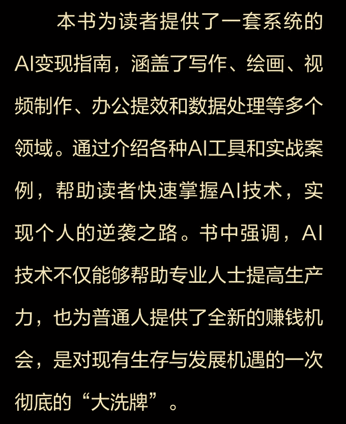