# ChatGPT 驱动软件测试实战

## 内容概览

本书以当下主流的大语言模型 ChatGPT 为依托，通过大量真实案例展示该模型在软件测试领域的提效路径。全书系统讲解如何借助 ChatGPT 完成需求规格说明书、测试计划、功能测试用例、自动化测试用例、接口测试用例、测试数据与性能测试用例的生成，并覆盖测试结果解读、CI 持续集成配合、测试总结报告撰写以及职业发展等方面的应用场景。

行文通俗，案例扎实，涉及功能测试、性能测试、接口测试、自动化测试等多条主线。阅读后，读者能够利用大模型提升测试效率与研发效率，并改善测试质量。本书适用于软件测试人员、项目管理者、研发人员及关注软件效能提升的相关从业者，也适合希望借助大模型增强工作能力的工程技术人员阅读。

◆ 编著 于涌 田璐 蓝葛亮 于跃

责任编辑 张涛

责任印制 王郁 焦志炜

◆ 人民邮电出版社发行 北京市丰台区成寿寺路 11 号

邮编 100164 电子邮箱 315@ptpress.com.cn

网址 https://www.ptpress.com.cn

大厂回族自治县聚鑫印刷有限责任公司印制

◆ 开本：800×1000 1/16

印张：18.5 2024 年 11 月第 1 版

字数：341 千字 2024 年 11 月河北第 1 次印刷

定价：79.80 元

读者服务热线：(010)81055410 印装质量热线：(010)81055316

反盗版热线：(010)81055315

广告经营许可证：京东市监广登字 20170147 号

## 前言

当下研发与测试正处在规模扩张、迭代加速、交付压力增大、任务堆叠的复杂环境中。研发与测试团队的挑战与日俱增，整体效能也面临更高要求。怎样科学提升团队产出，是测试团队必须直面的课题。

在此背景下，AI 与 AIGC 快速发展，尤其是 ChatGPT 在智能对话、代码编写等方向的出色表现，为测试工作打开了新的思路和工具箱。如何把 ChatGPT 融入软件测试，实现从自动化向智能化、数字化演进，本书给出了可落地的答案。全书围绕 ChatGPT 在测试全流程的应用展开，每章均经过精心设计，帮助读者掌握知识与操作。内容从需求规格说明书和测试计划的产出，到功能测试、自动化测试的深度使用，再到接口测试和性能测试的高效实施，每一步都体现了 AI 的实践价值。本书还探讨了 ChatGPT 在测试数据生成、结果研判、CI 流程中的创新用法，以及对职业成长的助力。此外，书中部分脚本与案例已整理为配套资料，读者可通过关注公众号“AI 智享空间”或在异步社区本书页面获取下载链接。

感谢家人朋友在写作期间给予的鼓励，也感谢编辑团队严谨细致的付出，正因如此本书得以完善。最后感谢读者的选择，无论是测试新人还是资深专家，都能从中获得启发。本书编辑联系邮箱为 zhangtao@ptpress.com.cn。

注：书中来自 ChatGPT 的输出均为机器自动生成，可能出现语法、标点或一致性上的小瑕疵，为保留完整性未做刻意修改，特此说明。

于涌

# 第1章 ChatGPT 生成需求规格说明书

### 1.1 ChatGPT 在需求分析中的定位

需求分析是软件开发的关键起点，为项目成功奠定基础。该阶段由产品经理牵头，把真实业务诉求转化为软件中的具体功能需求与非功能需求，涉及业务操作、数据存储与流转等多方面内容。所有需求最终汇聚到核心文档软件需求规约 SRS，即需求规格说明书。

需求规格说明书是项目团队的行动基准。开发人员依此开展架构设计、功能实现、性能优化与数据库设计；测试人员据此验收产品的功能与非功能特性。因此，它既是需求的详细载体，也是项目平稳推进的保障。

一份高质量的需求规格说明书通常应具备以下特征。

1）完整性：各项需求需描述详尽清晰，使开发团队能全面掌握实现要点。
2）正确性：需求描述必须准确无误，真实反映用户意图。
3）可行性：需求应在现有系统、环境与约束范围内可实现，建议在调研阶段由技术人员与需求分析人员共同评估。
4）必要性：只记录用户真正需要的标准，避免无效需求。

#### 1.1.1 ChatGPT 的自动文本生成能力

ChatGPT 以强大的自动撰写能力著称，能产出高质量内容。在需求分析阶段，这一能力尤为关键。使用该模型编写需求规格说明书，可明显提升效率与文档质量。

该模型可帮助团队生成清晰详尽的需求描述，无论是功能需求如系统应实现的功能与操作，还是非功能需求如性能指标、安全要求，亦或界面设计的具体说明，都能给出结构化、准确的文本。这节省了撰写时间，也保证了需求的全面性与系统性。

同时，自动生成能力有助于减少人为导致的需求不一致与模糊问题。借助其语言处理能力，ChatGPT 能产出表述清晰、逻辑严谨的文本，提升需求规格说明书的一致性与准确性，确保开发每一步都建立在可靠的需求之上。

总体而言，文本生成能力可优化编写流程并提高质量，对项目成功至关重要。

#### 1.1.2 ChatGPT 的信息抽取与分析能力

ChatGPT 在信息抽取与分析方面表现突出。需求分析阶段需要从多元来源捕捉并整理需求信息，这一能力正好契合。

首先，ChatGPT 能从海量复杂数据中快速精准抽取关键信息。无论需求来自用户、干系人、市场调研报告还是团队成员，都能有效提炼核心点，避免重要需求遗漏。

其次，ChatGPT 擅长分析需求间的关联，可识别依赖关系与冲突点，帮助团队更好地管理与优化需求。这对于把握项目整体结构及各模块的互动关系很有价值。

因此，抽取与分析能力不仅提升需求分析效率与质量，也为开发决策提供有力支持。

#### 1.1.3 ChatGPT 对协作与沟通的助力

需求分析阶段，团队内部的有效沟通是项目顺利的关键。ChatGPT 不仅是工具，更是连通产品、开发、测试团队的桥梁。

一方面，ChatGPT 可帮助生成会议纪要、讨论总结及需求变更通知，确保成员及时获取一致信息，明确各自职责与文档变化。

另一方面，它可作为自动问答助手，回应团队或干系人的常见疑问，提升沟通效率，降低重复查询成本。例如成员对某需求细节有疑惑时，ChatGPT 可迅速提供相关说明，减少不必要的会议。

这些功能使沟通更高效、透明，让团队把更多精力投入核心分析与开发。

综上，ChatGPT 在需求分析中的协作沟通支持可提升工作效率，增强信息共享，为项目成功打下基础。

### 1.2 ChatGPT 生成需求规格说明书的内容与方法

本节结合理论与案例，深入探讨 ChatGPT 在生成需求规格说明书方面的具体内容与实现方式。

#### 1.2.1 生成需求规格说明书的相关内容

ChatGPT 的自动文本生成是其最突出能力，在软件开发中备受关注。依托对大量数据的理解与归纳，它在编写需求规格说明书时能发挥重要作用。

在功能需求方面，团队可输入项目背景、用户诉求与系统功能概念，由 ChatGPT 生成详尽的功能需求描述，帮助团队对功能边界达成一致认知。

在性能需求方面，ChatGPT 可依据预期指标与用户期望，生成具体的性能需求描述，包括并发用户数、响应时间、吞吐量、可扩展性等，并协助规划性能测试、负载测试、压力测试等类别，确保性能全面评估。

在安全需求方面，ChatGPT 可协助定义数据保密性、完整性、可用性要求，并提供防范 SQL 注入、跨站脚本攻击等威胁的策略，提升系统安全性。

在界面设计方面，ChatGPT 可根据设计要求与用户体验目标，生成具体的界面需求描述，涵盖布局、配色、字体、交互元素与用户流程，确保界面美观且易用。

在用例生成方面，ChatGPT 能力尤为强劲，可自动创建系统响应外部请求的各类场景，包含标准流程、异常处理、交互多样性与系统集成等复杂情况，帮助开发与干系人全面理解系统需求。

将 ChatGPT 应用于上述环节，既能提升需求规格说明书的质量，也能增强团队共识，兼具先进性与实用性。

#### 1.2.2 生成需求规格说明书的方法

明确 ChatGPT 可用于生成需求规格说明书后，可按以下步骤操作。

1）登录 ChatGPT 平台，输入涵盖项目背景、预期功能、目标用户等基本信息的提示词。
2）结合项目细节如用户体验、非功能需求等，与 ChatGPT 多轮交互，生成初稿。产品人员再按公司规范整理，形成正式文档。
3）项目团队对文档进行审阅、检查与评审，确保满足全部需求，保证正确性与完整性。
4）收集反馈后，产品人员对文档进行修改与更新，形成最终版，作为团队共同遵循的标准。

使用 ChatGPT 可显著提高生成效率，减少手工撰写时间，降低遗漏关键信息的风险。虽然具体方法会因项目而异，但它通常是快速生成文档、减少错误、保持团队理解一致的有效手段。

使用时建议遵循以下原则。

1）信息明确：输入应尽可能详尽清晰，包含项目上下文、用户需求、功能与非功能需求等。
2）人工校核：即使生成质量较高，仍需团队人工审查与修订，确保正确完整。
3）多次迭代：初稿通常需团队共同迭代完善，以满足项目特定要求。
4）适当培训：团队成员需了解如何高效使用工具并认识其局限性。

遵循这些步骤与原则，ChatGPT 可成为需求规格说明书编写的有力助手，为项目效率与质量提供保障。

### 1.3 提示词决定输出质量

在 1.2.2 节中提到“提示词”。在 AI 与自然语言处理领域，用户提交给 ChatGPT 的文本即为提示词，其质量直接影响模型对需求的理解与生成效果。

要让 ChatGPT 准确理解意图并输出高质量内容，选择合适的提示词至关重要。如同日常交流需要清晰表达，提示词是与模型沟通的桥梁，其好坏决定理解深度与输出的相关性与准确性。

#### 1.3.1 何谓优质提示词

优质提示词能引导模型产出更准确、更有用的内容，避免模糊或无关输出。常见特点如下。

1）明确简洁：清晰表达问题或需求，避免冗长含糊。
示例：请简要定义人工智能。
2）具体且带上下文：提供背景信息帮助模型理解。
示例：我想了解人工智能如何学习并模仿人类智能。
3）明确回答形式：指明期望解释、定义、示例等。
示例：请举例说明如何自动生成功能测试用例。
4）逐步引导：对复杂问题分步提问以提高准确性。
示例：先解释等价类划分方法，再应用到测试设计中。
5）使用直接提问：陈述句改为问句更易明确需求。
示例：TPS 在性能测试中起什么作用？
6）避免歧义：选用无二义性词汇。
示例：请解释计算机科学中“网络”的含义。
7）提供背景：必要时补充相关上下文。
示例：比较机器学习中的监督学习与无监督学习区别。
8）请求示例：明确要求举例。
示例：给出机器学习在生活中的实际应用例子。
9）对比类比：帮助理解抽象概念。
示例：用类比解释神经网络的工作原理。
10）问题细化：将大问题拆分为多个小问题。
示例：先说明什么是 AI，再谈其应用领域。
11）指定角色：激发模型在特定角色下输出深度内容。
示例 1：你是一名科普作者，请用简单语言向小学生解释地球四季变化的原因。
示例 2：你是一名研究生，撰写关于 AI 在软件研发中应用的论文，请描述研究方法、实验结果及影响。

总之，优质提示词应明确简洁、具备上下文、要求清晰，并可按需逐步引导。

#### 1.3.2 提示工程框架

Elvis Saravia 提出的提示工程框架为编写清晰提示词提供了参考，包含四个要素：指令、背景信息、输入数据、输出指示。

- 指令 必填：明确告知模型需执行的任务，应简洁清晰。例如“请写一篇关于太阳系的文章，介绍行星、恒星、卫星等基本信息。”
- 背景信息 选填：提供额外背景帮助模型更好理解任务。如“文章面向学生，请使用简单语言。”
- 输入数据 选填：在任务需处理特定数据时提供，如待翻译句子。
- 输出指示 选填：说明期望的输出类型或格式，如指定编程语言 Python。

下面结合任务举例说明框架应用。

1）文章生成任务
- 指令：请写一篇关于 AI 的文章，重点介绍应用与未来发展。
- 背景信息：文章将在科技杂志发表，请使用专业术语并参考最新研究。
- 输入数据：无。

让 ChatGPT 产出可直接落地的需求文档：四要素框架

做内容或做产品时，很多人把 ChatGPT 当成万能替写，结果稿子经常跑偏。症结不在模型，而在任务拆解不清。Elvis Saravia 的提示工程给出一个可复用的结构：指令、背景、输入、输出要求，四项齐全，模型才不容易走样。下面先用三个典型场景看框架如何落地，再进入百度搜索需求规格说明书的迭代实战。

案例一：旅行手册翻译
任务指引是把一段英文改写成中文。背景说明文本出自旅游指南，表达要贴近行业常用说法。输入原文为 “Welcome to Beijing! Explore this ancient city and discover its rich history.”。产出要求强调结果必须是完整的中文句子，标点与语法都要正确。

案例二：新手代码生成
任务指引是为入门者写一段 Python 程序，求一组数字的平均值。背景提示面向初学者，代码要简洁易懂。输入素材是 [10, 20, 30, 40, 50]。产出要求给出可直接运行的完整脚本，并能打印平均值。

案例三：餐厅预订对话
任务指引是模拟一次餐厅预约的问答。背景是扮演预订助手，需要收集顾客姓名、预约日期、时间与人数等关键信息。输入为空。产出要求呈现完整的多轮对话，包含用户提问和助手回复，最终完成预约。

这三组例子说明，四要素能把任务框得很死，也是保证模型理解准确、结果可用的核心。

### 1.4 案例实操：用 ChatGPT 生成需求规格说明书

为了边学边用，这里以百度搜索项目为例演示规格说明书的生成。ChatGPT 不只能复述已有文档，给任意输入基本都会给出回应。

先用一个宽泛的说法：“你是一名优秀的产品经理，现在请你写一份基于百度搜索项目的需求规格说明书，谢谢。” 模型很快返回了一份《百度搜索改进项目——需求规格说明书》，但明显偏离预期。

#### ChatGPT 生成的完整的需求规格说明书

当创建一个基于百度搜索的需求规格说明书时，首先需要明确项目的目标、范围、功能需求以及用户体验等方面的细节。以下是一个简要的需求规格说明书示例，供您参考：

**百度搜索改进项目——需求规格说明书**

**1. 项目背景**

随着百度搜索引擎的用户数量不断增长，为了提供更好的搜索体验和更准确的搜索结果，我们计划进行一系列的改进。这些改进将涵盖搜索算法、用户界面、移动端支持以及可用性等方面。

**2. 项目目标**

本项目的主要目标是提高用户在百度搜索上的满意度，确保他们能够更快、更方便地找到所需的信息。具体目标包括如下。

- 提高搜索结果的准确性。

- 优化搜索算法以适应用户的搜索习惯。

- 提供更好的移动设备支持。

- 改进用户界面，使其更直观和易于导航。

**3. 功能需求**

**3.1 搜索算法改进**

- 优化搜索算法以提高搜索结果的相关性和准确性。

- 引入自然语言处理技术，使搜索更智能化。

- 实施实时搜索建议功能，帮助用户更快地找到他们想要的内容。

**3.2 移动设备支持**

- 确保百度搜索在各种移动设备上的兼容性和响应速度。

- 提供适用于移动设备的用户界面和交互设计。

- 支持语音搜索和手写输入。

**3.3 用户界面改进**

- 重新设计搜索结果页面，提高可读性和可操作性。

- 引入卡片式结果显示，以更清晰地呈现不同类型的信息。

- 提供高级搜索选项，允许用户更精确地过滤搜索结果。

**3.4 数据隐私与安全性**

- 采取措施确保用户搜索数据的隐私和安全。

- 遵守适用的法律法规，包括数据保护法律。

**4. 用户体验**

用户体验是本项目的核心，我们将不断测试和改进，以确保用户获得以下体验。

- 更快的搜索速度和实时搜索建议。

- 更相关的搜索结果。

- 简化的用户界面，易于导航。

- 适用于各种设备的一致性体验。

**5. 非功能需求**

除了上述功能需求，还有一些非功能需求需要考虑，包括如下。

- 性能：确保搜索引擎在高负载情况下依然能够提供快速的响应。

- 可扩展性：设计系统以支持未来的扩展和增强功能。

- 安全性：保护用户数据的隐私和安全。

- 可用性：确保搜索引擎易于使用，适用于不同的用户群体。

**6. 项目时间表**

以下是项目的初步时间表，具体的里程碑和时间表将在项目启动时确定。

- 需求分析和规划：2 周

- 设计和开发：12 周

- 测试和质量保证：4 周

- 上线和发布：2 周

- 持续改进和维护：长期

**7. 参与方**

本项目将涉及以下参与方。

## 8. 风险管理

在项目进行中，可能会涉及以下潜在风险。

- 技术挑战：搜索算法改进可能面临技术上的挑战。

- 用户接受度：用户可能需要一定时间来适应新的用户界面和功能。

- 数据隐私：需要遵守严格的数据隐私法规，以保护用户数据。

为了降低这些风险，我们将在项目计划中包括适当的风险管理策略。

这份需求规格说明书为项目的初步计划提供了一个框架。具体的细节和实施细节将在项目启动时与相关团队一起进一步讨论和确定。

这份产出有几处明显偏差：

1. 预期是基于现有百度搜索项目写规格说明书，而不是写改进计划。
2. 第三部分功能需求全围绕现有功能的优化，与本意不符。
3. 第五部分非功能需求描述很笼统，缺少可量化的性能指标和安全要求。
4. 缺少功能需求与非功能需求的用例说明。

按照 Saravia 框架重新组织提示：

- 任务指引：请生成一份完整的百度搜索项目的需求规格说明书。
- 背景设定：你是一名优秀的产品经理，基于目前百度搜索项目编写需求规格说明书。
- 原始素材：无。
- 产出规范：“要求：输出一份名称为‘百度搜索项目——需求规格说明书’的需求规格说明书，它在描述非功能需求，如系统性能要求和安全要求时要有明确的性能指标要求；用户界面的设计要有明确的布局、颜色方案、字体和交互元素要求。”

合并后为：请生成一份完整的百度搜索项目的需求规格说明书。你是一名优秀的产品经理，基于目前百度搜索项目编写需求规格说明书。要求：输出一份名为‘百度搜索项目——需求规格说明书’的需求规格说明书，它在描述非功能需求，如系统性能要求和安全要求时要有明确的性能指标要求；用户界面的设计要有明确的布局、颜色方案、字体和交互元素要求。

# 第 1 章 ChatGPT 生成需求规格说明书

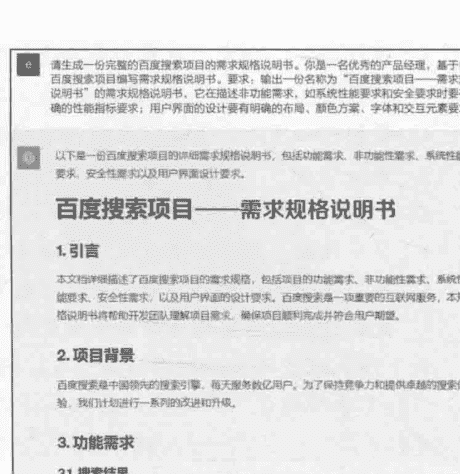
以下为 ChatGPT 生成的完整的百度搜索项目——需求规格说明书。

# ChatGPT 生成的完整的百度搜索项目——需求规格说明书

以下是一份百度搜索项目的详细需求规格说明书，包括功能需求、非功能性需求、系统性能要求、安全性需求以及用户界面设计要求。

百度搜索项目——需求规格说明书

## 1. 引言

本文档详细描述了百度搜索项目的需求规格，包括项目的功能需求、非功能性需求、系统性能要求、安全性需求，以及用户界面的设计要求。百度搜索是一项重要的互联网服务，本规格说明书将帮助开发团队理解项目需求，确保项目顺利完成并符合用户期望。

## 2. 项目背景

百度搜索是中国领先的搜索引擎，每天服务数亿用户。为了保持竞争力和提供卓越的搜索体验，我们计划进行一系列的改进和升级。

## 3. 功能需求

### 3.1 搜索结果

1. 关键字搜索：用户能够通过关键字搜索获得相关搜索结果。

2. 搜索排序：搜索结果必须按相关性排序，以提供最佳搜索结果。

3. 搜索建议：在用户输入搜索关键字时，应提供自动补全建议。

4. 图像搜索：提供图像搜索功能，让用户能够搜索图片内容。

5. 新闻搜索：用户可以搜索最新的新闻报道。

6. 视频搜索：提供视频搜索功能，包括过滤和排序选项。

### 3.2 用户体验

1. 响应时间：搜索结果应在 2 秒内加载完成。

2. 移动友好性：搜索页面必须在移动设备上提供出色的用户体验。

3. 个性化建议：根据用户的搜索历史和兴趣，提供个性化搜索建议。

4. 多语言支持：支持多种语言的搜索和搜索建议。

### 3.3 安全性

1. 防护机制：实施强大的防护机制，防止恶意软件和恶意网站在搜索结果中出现。

2. 隐私保护：严格保护用户隐私信息，不泄露用户搜索历史或个人信息。

## 4. 非功能性需求

### 4.1 系统性能要求

1. 搜索延迟：90%的搜索请求响应时间不得超过 2 秒。

2. 并发能力：系统应支持每秒处理至少 10 000 个并发搜索请求。

3. 可扩展性：系统必须能够在需要时水平扩展以满足不断增长的用户需求。

### 4.2 安全性需求

1. 数据加密：用户搜索数据必须以 AES-256 加密传输。

2. DDoS 防护：实施 DDoS 攻击防护机制，确保系统的可用性。

3. 安全审计：定期进行安全审计，确保系统不受安全漏洞威胁。

## 5. 用户界面设计要求

### 5.1 布局

1. 简洁布局：搜索页面应具有简单、直观的布局，将搜索框置于显眼位置。

2. 导航栏：页面顶部应包括清晰的导航栏，以使用户浏览其他百度服务。

3. 结果排列：搜索结果页应按照清晰的网格排列，每个结果之间应有适当的间距。

### 5.2 颜色方案

1. 白色背景：页面背景色应为白色，以确保清晰的对比度。

2. 蓝色主题：强调性颜色为蓝色，以保持品牌一致性。

### 5.3 字体

1. 清晰字体：使用易读的字体，确保搜索结果的文本清晰可见。

2. 字号一致：字体大小应保持一致，以提高页面的整体一致性。

### 5.4 交互元素

1. 响应式设计：页面应采用响应式设计，以适应不同设备和屏幕尺寸。

2. 点击区域：交互元素（如按钮）应具有足够的点击区域，以提高移动设备上的易用性。

## 6. 附录

### 6.1 术语定义

- 搜索结果页：用户提交搜索请求后看到的页面，显示相关搜索结果。

- 搜索建议：当用户输入搜索关键字时，系统提供的自动完成和相关搜索建议。

### 6.2 参考文献

百度搜索官方文档

该需求规格说明书旨在确保百度搜索项目的开发团队和相关利益相关者了解项目的详细需求，以便顺利推进项目并提供出色的搜索服务。各项需求和设计要求将在项目开发中得到遵循和实施。

这次产出基本贴合预期。若想更完整，还可加入风险管理、项目周期等内容。细看仍缺少用例部分。

接下来尝试让模型生成关键字搜索业务的用例。提示要素如下：

- 任务指引：请生成一份百度搜索项目的关键字搜索业务用例。
- 背景设定：你是一名优秀的产品经理，基于目前百度关键字搜索业务编写用例。
- 原始素材：无。
- 产出规范：输出用例，要求对用例进行编号，考虑用例的多种使用场景、扩展分支要有标识符号等。

合并后为：请生成一份百度搜索项目的关键字搜索业务用例。你是一名优秀的产品经理，基于目前百度关键字搜索业务编写用例。输出用例，要求对用例进行编号，考虑用例的多种使用场景、扩展分支要有标识符号等。

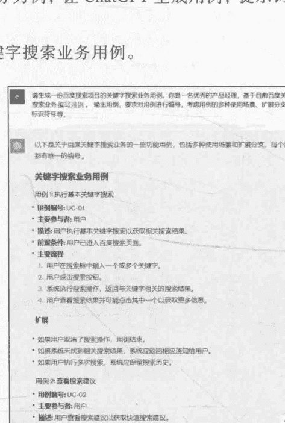
以下为 ChatGPT 生成的完整的关键字搜索业务用例。

# ChatGPT 生成的完整的关键字搜索业务用例

以下是关于百度关键字搜索业务的一些功能用例，包括多种使用场景和扩展分支，每个用例都有唯一的编号。

关键字搜索业务用例

用例 1：执行基本关键字搜索

用例编号：UC-01

主要参与者：用户

描述：用户执行基本关键字搜索以获取相关搜索结果。

前置条件：用户已进入百度搜索页面。

主要流程

1. 用户在搜索框中输入一个或多个关键字。

2. 用户点击搜索按钮。

3. 系统执行搜索操作，返回与关键字相关的搜索结果。

4. 用户查看搜索结果并可能点击其中一个以获取更多信息。

扩展

- 如果用户取消了搜索操作，用例结束。

- 如果系统未找到相关搜索结果，系统应返回相应通知给用户。

- 如果用户执行多次搜索，系统应保留搜索历史。

用例 2：查看搜索建议

用例编号：UC-02

主要参与者：用户

描述：用户查看搜索建议以获取快速搜索建议。

前置条件：用户已在搜索框中输入部分搜索关键字。

主要流程

1. 用户在搜索框中输入部分搜索关键字。

2. 系统自动显示搜索建议下拉列表。

3. 用户可以选择一个建议项或继续输入。

扩展

- 如果用户忽略建议，继续手动输入。

- 如果用户选择建议并点击，系统将执行相应搜索操作。

用例 3：高级搜索选项

用例编号：UC-03

主要参与者：用户

描述：用户使用高级搜索选项以过滤搜索结果。

前置条件：用户已执行基本关键字搜索并看到搜索结果页面。

主要流程

1. 用户执行基本关键字搜索。

2. 用户点击高级搜索选项按钮。

3. 用户选择特定的过滤条件（如时间、文件类型等）。

4. 系统重新执行搜索操作，根据选定的过滤条件返回搜索结果。

5. 用户查看过滤后的搜索结果。

扩展

- 如果用户取消了高级搜索操作，用例结束。

- 如果用户未选择任何过滤条件，系统将继续显示基本搜索结果。

- 这些用例涵盖了用户在百度关键字搜索业务中的常见交互，包括基本搜索、搜索建议和高级搜索选项。每个用例都考虑了多种使用场景和扩展分支，以确保系统满足用户的不同需求。

模型几秒就生成了可用用例，但扩展分支与主流程步骤没有对应关系。继续对话给出明确格式要求：扩展分支应写作“主要流程步骤编号+字母顺序+.+具体内容”。例如 UC-01 主流程第 3 步，扩展应写成“3a.如果系统未找到相关搜索结果，系统应返回相应通知给用户。”

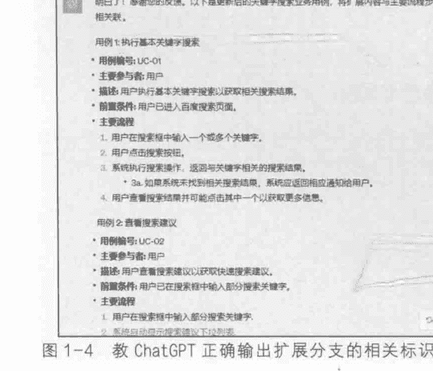

以下为 ChatGPT 生成的带有其他扩展分支的完整用例。

ChatGPT 生成的带有其他扩展分支的完整用例

非常抱歉，我理解了您的要求。以下是更新后的关键字搜索业务用例，包括主要流程和更多的扩展内容。

用例 1：执行基本关键字搜索

用例编号：UC-01

主要参与者：用户

描述：用户执行基本关键字搜索以获取相关搜索结果。

前置条件：用户已进入百度搜索页面。

主要流程

1. 用户在搜索框中输入一个或多个关键字。

2. 用户点击搜索按钮。

3. 系统执行搜索操作，返回与关键字相关的搜索结果。

4. 用户查看搜索结果并可能点击其中一个以获取更多信息。

扩展

3a. 如果系统未找到相关搜索结果，系统应返回相应通知给用户。

4a. 如果用户取消了搜索操作，用例结束。

4b. 如果用户执行多次搜索，系统应保留搜索历史。

用例 2：查看搜索建议

用例编号：UC-02

主要参与者：用户

描述：用户查看搜索建议以获取快速搜索建议。

前置条件：用户已在搜索框中输入部分搜索关键字。

主要流程

1. 用户在搜索框中输入部分搜索关键字。

2. 系统自动显示搜索建议下拉列表。

3. 用户可以选择一个建议项或继续输入。

扩展

3a. 如果用户忽略建议，继续手动输入。

3b. 如果用户选择建议并点击，系统将执行相应搜索操作。

3c. 如果系统未找到相关搜索建议，系统应返回相应通知给用户。

用例 3：高级搜索选项

用例编号：UC-03

主要参与者：用户

描述：用户使用高级搜索选项以过滤搜索结果。

前置条件：用户已执行基本关键字搜索并看到搜索结果页面。

主要流程

1. 用户执行基本关键字搜索。

2. 用户点击高级搜索选项按钮。

3. 用户选择特定的过滤条件（如时间、文件类型等）。

4. 系统重新执行搜索操作，根据选定的过滤条件返回搜索结果。

5. 用户查看过滤后的搜索结果。

扩展

3a. 如果用户取消了高级搜索操作，用例结束。

3b. 如果用户未选择任何过滤条件，系统将继续显示基本搜索结果。

4a. 如果系统未找到相关搜索结果，系统应返回相应通知给用户。

这些更新后的用例包括了更多扩展内容，以覆盖更多的使用场景和分支情况，以确保系统在不同情况下都能适当地响应用户的需求。希望这次的更新满足了您的要求。

前文已经演示了如何利用 ChatGPT 梳理我们重点关注的核心业务——关键词检索的使用场景。其他业务线的场景推导思路与此相近，这里不再展开。依托这种思路，ChatGPT 可以很好地配合需求规格说明书的撰写，上手快、产出令人称道。过去产品经理或需求设计师完成一份规格书往往要花数周甚至数月，借助 ChatGPT 后同等工作可以压缩到数天乃至数小时内完成。效率的跃升凸显了 AI 处理复杂事务的强劲潜力，也让需求分析与文档编写发生了根本性改变。

### 1.5 编程环境准备

#### 1.5.1 安装 Python 运行环境

可以通过 Python 官网获取所需安装包。浏览官网后进入下载入口，示意图见图 1-6。

本机为 64 位 Windows 11，故在页面中选择“Windows installer (64-bit)”链接，见图 1-7，获取适配 64 位 Windows 11 的 Python 3.11.5。

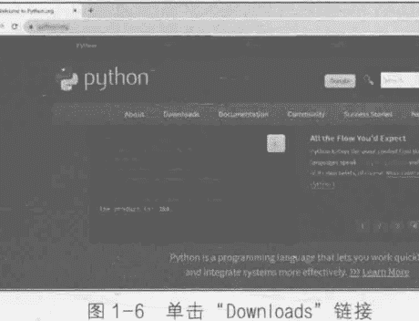

图 1-6 单击“Downloads”链接

操作系统的 Python 3.11.5。

下载完成后选中 python-3.11.5-amd64.exe，右键唤出菜单并选择“以管理员身份运行”，过程见图 1-8。

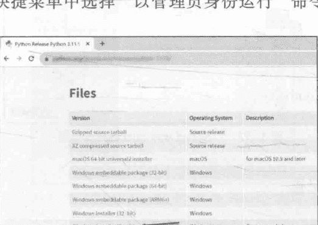


图 1-9 所示的安装窗口中，勾选“Use admin privileges when installing py.exe”与“Add python.exe to PATH”，随后点选“Customize installation”。

见图 1-10，在“Optional Features”窗口点击“Next”。

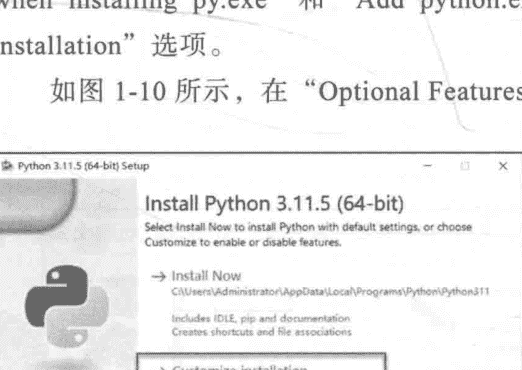

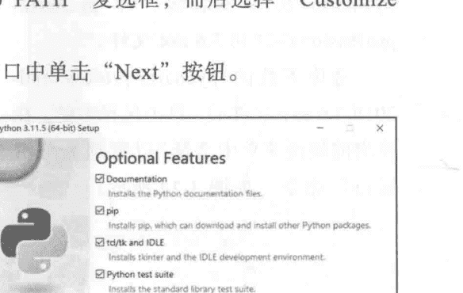

图 1-11 显示的“Advanced Options”中勾选“Install Python 3.11 for all users”，然后按下“Install”。

安装结束后，图 1-12 的“Setup was successful”窗口提示成功，点击“Close”关闭。

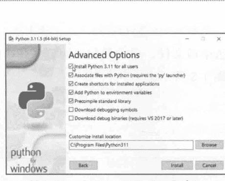


#### 1.5.2 Python IDE PyCharm 的安装与配置

基于使用感受，本文选用 PyCharm 2016。见图 1-13，点击“2016.3.6-Windows(exe)”链接获取安装包 pycharm-professional-2016.3.6.exe。

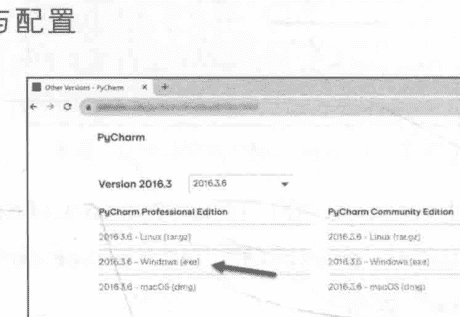

下载完成后右键 pycharm-professional-2016.3.6.exe，选择“以管理员身份运行”，如图 1-14。


如图 1-15 所示，在 “Welcome to PyCharm Setup” 窗口中单击 “Next” 按钮。

如图 1-16 所示，在 “Choose Install Location” 窗口中单击 “Next” 按钮。

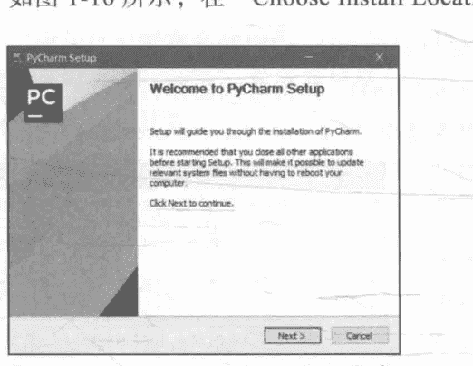


如图 1-17 所示，在 “Installation Options” 窗口中勾选 “64-bit launcher” 和 “.py” 复选框，单击 “Next” 按钮。

如图 1-18 所示，在 “Choose Start Menu Folder” 窗口中单击 “Install” 按钮。


如图 1-19 所示，在 “Completing PyCharm Setup” 窗口中单击 “Finish” 按钮。


#### 1.5.3 使用 PyCharm 完成第一个 Python 项目

本节演示借助 PyCharm 创建并运行首个 Python 项目的流程。

双击桌面快捷方式“JetBrains PyCharm 2016.3.3(64)”，弹出“Complete Installation”对话框，见图 1-20，选择“I do not have a previous version of PyCharm or I do not want to import my settings”，点“OK”。


进入“PyCharm License Activation”窗口，见图 1-21，可选“Activate”或“Evaluate for free”。若选“Activate”，则根据需要选择“JetBrains Account”、“Activation code”或“License server”，填入对应信息后点击“Activate”。

“PyCharm Initial Configuration”对话框，见图 1-22，按个人习惯调整，本文保持默认直接点“OK”。

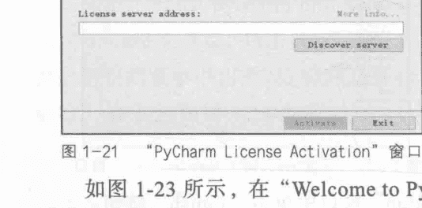


在“Welcome to PyCharm”窗口，见图 1-23，选择“Create New Project”新建项目。


“New Project”窗口，见图 1-24，选择“Pure Python”，在“Location”中设定保存位置为“C:\Users\yuy\PycharmProjects\”，项目名设为“FirstPrj”，解释器指向“C:\Program Files\Python311\Python.exe”。若存在多版本 Python，可点击“Interpreter”旁的图标从列表中切换。确认后点击“Create”创建。

弹出“Tip of the Day”对话框，见图 1-25，取消“Show Tips on Startup”，点击“Close”。

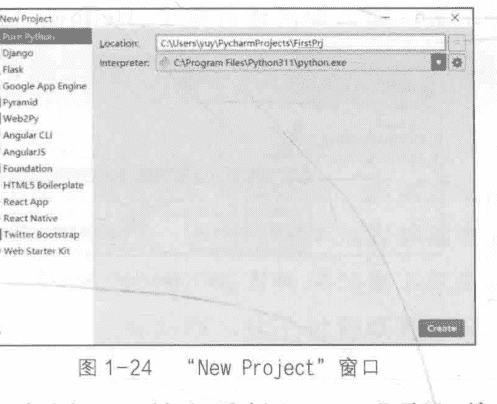


在项目区右键“FirstPrj”，见图 1-26，选择“New > Python File”新建 Python 文件。

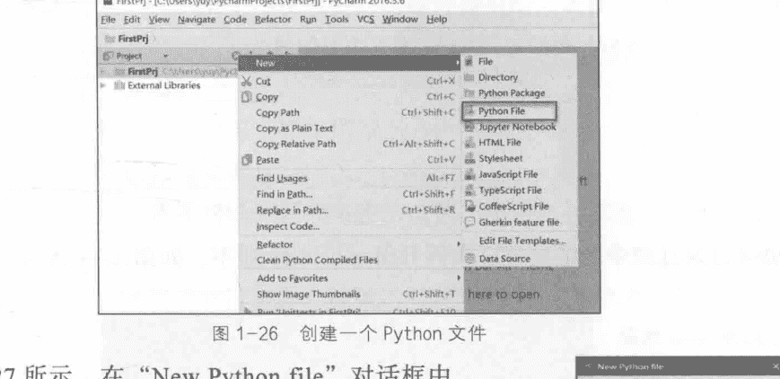

在“New Python file”对话框，见图 1-27，Name 填入“Helloworld”，点“OK”。


# 第 1 章 ChatGPT 助力需求规格说明书编写

在新建的 Helloworld.py 中输入如下脚本代码。

```
print('这是我的第一个脚本：')
print('Hello World.')
```

键入 print 时，PyCharm 会自动补全函数并提示参数，见图 1-28。


接下来查看脚本运行效果，Helloworld.py 如何执行？

通过 PyCharm 菜单选择“Run > Run > Helloworld”，如图 1-29。


见图 1-30，右侧文本区显示代码，下方为命令及输出，第一行为执行命令，其后为运行结果。


也可以在命令行窗口中运行 Helloworld.py，见图 1-31。


至此，Python 项目从创建到运行的完整流程已演示完毕，了解了吗？

# 第 2 章 ChatGPT 驱动测试计划生成

### 2.1 ChatGPT 在测试计划编写中的作用

测试计划是对测试全流程各项工作所做的可行性安排，涉及测试对象、覆盖范围、手段与排期。撰写测试计划是测试岗位的重要职责，它能把范围、任务、时间界定清楚，指导整体执行。然而编制需要大量需求资料支撑，并依赖作者经验判断，工作量大且结果可能不理想。

作为先进的预训练语言模型，ChatGPT 借助深度学习掌握了扎实的语言知识，能处理大量文本。在测试领域，它让测试计划自动生成成为现实。利用它可以加速编制、改善质量，还能实现快速迭代与修改，保持格式统一，有助于知识沉淀和重复利用。

具体作用概括如下：

- （1）加快编制效率
传统编制需要测试人员收集需求、背景等信息，再综合多因素确定范围与策略，费时且受经验左右。把资料喂给 ChatGPT 后，它能迅速解析并按模板输出初稿，减轻文档处理负担，使人员集中在策略层面。
- （2）增强整体质量
ChatGPT 训练于大量高质量计划文档，具备理解与生成能力。它可剖析需求、提炼核心功能，结合历史记录找出难点，据此生成贴合实际的范围、用例与排期。相比依赖个人的手工编制，模型生成的方案更全面合理。
- （3）支持快速迭代与变更
开发测试是迭代的，需求常变。若基于 ChatGPT 生成计划，需求更新后只需重新输入新资料，即可快速产出调整版。手工修改效率低且易出错，模型协助可大幅降低成本。
- （4）保持格式一致
多人协作时统一格式至关重要，混乱会影响质量与管理。ChatGPT 能根据给定模板生成符合规范的文档，确保各份计划风格统一，提升可读性与协作效率。
- （5）助力知识积累与复用
ChatGPT 可学习优秀计划的内容与格式，沉淀经验。在后续生成时能借鉴已有知识产出更高质量文本，同时团队可在此基础上总结最佳实践并持续优化模型。

总体来看，ChatGPT 为测试计划编制提供了新思路。但其输出仍需测试人员复核验证。结合专业人员审校与模型能力的人机协作，才能兼顾效率与准确，为团队创造更高价值，推动测试向更高效智能方向发展。

### 2.2 ChatGPT 自动化生成测试计划的步骤

前一节已阐述 ChatGPT 对测试计划编制的价值，下面介绍自动化生成的典型流程，通常可分为五步。

1）汇总需求资料：整理完整清晰的需求文档，特别是需求规格说明书，它是计划自动生成的基石。以电商网站为例，规格书需涵盖登录、搜索、购物车、支付等功能细节，以及吞吐量、响应时间等性能要求。完备的需求能帮助模型把握项目全貌，为精准生成奠定基础。
2）制定计划模板：模板应包含概述、范围、级别、方法、任务分工、排期等基本结构，并明确小节划分与格式规范。同步准备常用术语与表达，可引导模型产出符合专业风格的文本。
3）产出初稿：将需求资料与模板输入 ChatGPT，生成初稿。需不断优化输入内容与提问方式，通过多次交互逐步完善，直至初稿满足预期。例如结合电商规格书与模板即可得到电商测试计划初稿。
4）评审与修正：初稿必须由测试人员细致审阅，检查范围、策略、方法、分工是否合理且无遗漏错误。按需修改完善至符合项目要求，同时将反馈回传给模型以提升后续生成质量。
5）优化与落地：循环上述流程，直至计划达到预期质量。高质量自动生成的关键是准确的输入信息和高效的沟通。团队不应完全依赖模型，而应与之协作。模型擅长语言生成与文档分析，团队提供专业判断，两者互补才能取得最佳效果。

### 2.3 ChatGPT 与测试团队的协作

2.2 节已提到人机协同的重要性，团队该如何高效配合以提升效率与质量？

测试是一项系统性工程，高质量计划既依赖 AI 的智能，也依赖团队经验与创造力。不能把工作简单外包，而需建立协作机制。

建议从以下维度推进：

- 1）输入高质量训练素材。收集优秀历史计划与规范文档作为训练素材，提升模型在语言表达与结构理解上的能力。
- 2）及时反馈评估。收到模型输出后，团队需审阅并评估优劣，指出遗漏与错误，明确反馈供模型改进。
- 3）明确分工。策略设计、风险评估等复杂决策由人工完成；模型负责范围界定、用例草拟、工时估算等重复性工作。
- 4）迭代完善。不要直接采纳初稿，需多轮迭代修改，使方案逐步达到可落地标准。
- 5）优化交互方式。持续总结提示技巧与提问方法，减少歧义，提升沟通效率。
- 6）跟踪协作趋势。积极学习人机协同方法与工具，探索更优配合模式，最大化协作价值。

测试团队与 ChatGPT 的配合越顺手，模型产出测试方案的速度和质量就越可靠，未来很可能成为提升交付效率与质量水准的重要抓手。

### 2.4 ChatGPT 助力测试计划制定的实战案例

为了让读者更直观感受模型在方案编制环节的实际价值，下面用三类典型场景来说明其如何简化并优化流程。

#### 2.4.1 电商平台案例

电商竞争白热化之际，某创新型电商公司正在落地一套全新在线购物平台，目标是提升购物便捷度与使用体验。平台覆盖多样化商品浏览、智能购物车和安全支付等核心模块，强调个性化体验。面对行业压力和用户对稳定性的高标准，团队需要一份覆盖功能、界面与性能的综合方案。

具体协作路径如下。

- 1）梳理需求资料：团队汇总了需求规格说明书等全套材料，涵盖功能需求、非功能需求、界面设计、数据安全及系统安全要点。同时参考过往同类项目的测试经验和报告，帮助模型快速把握电商行业的评审规范与关键指标。
- 2）搭建方案模板：团队构建了一份覆盖用户体验、系统兼容、数据安全到负载压测的完整模板，兼顾全流程覆盖与平台操作逻辑、交互特征的精准映射。
- 3）产出初版方案：把需求材料与模板一并输入后，团队迅速拿到一份初稿，重点突出了商品浏览多样性、购物车智能化与高并发处理等测试要点，与平台特性相符。
- 4）复核并优化初稿：团队对初稿进行细致评审，聚焦购物车使用体验、支付安全与站点响应速度等关键点，确保每条测试都能贴合真实运营需求。
- 5）完善后落地执行：经反复评审与精细化修改，最终形成既全面又具针对性的方案。方案兼顾核心功能与体验诉求，同时兼顾稳定性与可扩展性，为平台长期发展奠定基础。

该案例表明，ChatGPT 在电商类网站方案辅助编制中具备强效能力。从资料汇总、模板搭建、初稿生成、复核修正到最终落地，协同模式明显提升了编制效率与方案质量。

#### 2.4.2 移动应用案例

数字化浪潮下，某头部移动应用公司正在研发一款面向 iOS 与 Android 的社交产品。社交类应用对流畅度要求极高，尤其跨硬件与跨系统的适配，团队需要一份精细全面的方案保证各设备体验一致。

协作流程如下。

- 1）需求资料汇总：首要工作是收集需求规格说明书等资料，详细说明功能、非功能、界面设计与系统安全细节。
- 2）模板搭建：团队设计了一份面向移动端的方案模板。鉴于机型与系统版本众多、性能差异大，模板特别强调不同设备与操作系统的兼容性，聚焦多平台适配、性能、界面与功能等核心领域，结构清晰、覆盖完整。
- 3）快速产出草案：把需求与模板输入后，团队迅速获得包含针对性测试要求与性能指标的初版方案，确保方案准确反映产品需求。
- 4）复核并修正：团队成员对草案展开细致评估，结合移动端适配测试，利用云测平台对约 600 款机型进行适配验证，确保覆盖所有关键点。
- 5）完善后应用：经过多次评审、讨论与修改，方案逐步完善。最终版本兼顾全面性与针对性，能够有效应对各类测试挑战，为产品的顺利研发与推广提供坚实质量保障，确保多平台体验统一卓越。

#### 2.4.3 自动驾驶系统案例

自动驾驶技术高速发展之际，某自动驾驶研究公司正在研发全新系统。该系统不仅承载技术创新期望，还需在复杂交通与多变天气下提供可靠安全体验，因而必须制定严格方案以验证不同场景下的安全性能。

协作流程如下。

- 1）需求资料汇总：团队首先全面收集需求材料，详述系统的功能、非功能、性能指标、安全标准以及在不同环境与场景下的操作要求。

#### 2.4.4 ChatGPT 生成测试计划的最佳实践

前述 2.4.1～2.4.3 的案例凸显了 ChatGPT 在电商、移动应用与自动驾驶等领域的应用成效，既加快了方案生成速度，也提升了完整度与质量。

下面以百度搜索项目为例，说明借助 ChatGPT 编制方案的操作要点。

1）需求资料收集：在使用 ChatGPT 编制方案时，建议延续需求规格说明书生成的对话，避免重复输入相同信息，同时可补充项目相关文档，帮助模型更全面把握背景。

2）模板准备：为模型提供优质方案范例供其参考是关键。本文中笔者输入某项目方案供学习，ChatGPT 回馈了要点与建议。随后询问是否已掌握编写方法，模型表示无法真正学习但可提供模板与建议。

3）草案生成：由于本会话已包含前期需求规格说明书与用例，无需再次输入。笔者采用 Elvis Saravia 的提示工程框架给出指令，ChatGPT 约十余秒即产出“百度搜索项目测试计划”初稿，严格遵循指令格式，并在功能与非功能范围中引用了需求规格内容。

下面展示模型产出的完整方案示例。

# 模型首次生成的百度搜索项目测试方案示例

百度搜索项目测试计划

## 1. 引言

### 1.1 编写目的

本方案的核心是厘清百度搜索项目的检验边界、方法策略与所需资源，用以保障交付质量与运行稳定，同时为测试团队提供执行依据。

### 1.2 项目背景

百度搜索是中国领先搜索引擎，日均服务数亿用户。为维护与提升服务质量，本次进行改进升级，特制定本计划以支撑项目顺利实施。

### 1.3 测试对象

测试对象为百度搜索项目，涵盖其功能、性能、安全性及相关文档交付物。

### 1.4 预期读者

项目组成员、测试团队、项目经理及相关利益相关者。

### 1.5 词汇表

- 百度搜索项目：百度搜索引擎改进升级项目。
- 测试对象：被测系统、模块或文档。
- 预期读者：计划的阅读对象。

## 2. 测试范围

### 2.1 功能测试范围

- 关键词搜索。
- 搜索排序。
- 搜索建议。
- 图像搜索。
- 新闻搜索。
- 视频搜索。

### 2.2 非功能测试范围

- 性能测试：搜索响应时间、并发能力、可扩展性。
- 安全性测试：数据加密、DDoS 防护、安全审计。

### 2.3 文档测试范围

- 百度搜索项目测试计划。
- 百度搜索项目测试设计文档。
- 百度搜索项目测试用例。
- 百度搜索项目测试报告。

## 3. 测试方式

### 3.1 功能测试策略

以手动黑盒为主，结合规范测试与随机测试，按需求编写设计与用例，并加入随机测试以提升全面性。使用边界值分析与等价类划分设计用例，采用错误推测法补充用例，检查逻辑覆盖并补充，准备有效、无效与边界数据。若涉及输入组合，则考虑因果图或决策表。

### 3.2 非功能测试策略

- 性能测试：借助 Apache JMeter 执行压力与负载验证，确认系统性能。
- 安全性测试：借助 IBM Security AppScan 开展渗透测试与安全审计。

### 3.3 文档测试策略

- 评审检查：确保文档准确完整。
- 变更追踪：维护版本控制。

## 4. 测试资源

### 4.1 人员配备

| 角色 | 人数 |
|---|---|
| 测试经理 | 1 |
| 测试工程师 | 3 |
| 硬件工程师 | 2 |
| 安全测试专家 | 1 |

### 4.2 硬件设备

- 服务器：用于性能与安全验证。
- 工作站：供测试团队使用。

### 4.3 测试工具

- 测试管理工具：Quality Center 用于测试管理、缺陷记录与跟踪。
- 性能测试工具：Apache JMeter。
- 安全性测试工具：IBM Security AppScan。

## 5. 测试进度

### 5.1 测试阶段与时间安排

| 测试阶段 | 时间安排 |
| --- | --- |
| 测试计划编制 | 2 周 |
| 测试设计 | 3 周 |
| 测试执行 | 6 周 |
| 测试报告 | 1 周 |

### 5.2 测试节点和关键时间

各阶段的进入与退出标准将在执行中明确，并根据实际情况动态调整。

## 6. 交付物

- 百度搜索项目测试计划。
- 百度搜索项目测试设计文档。
- 百度搜索项目测试用例。
- 百度搜索项目测试报告。

本计划为测试团队提供清晰框架，确保百度搜索项目得到全面测试，最终保障项目质量。

4）初稿评审与修正：生成初稿后需认真阅读与评审。初稿可能存在遗漏、表述不清或错误。以百度搜索方案为例，“3.1 功能测试策略”描述偏简略，“4.3 测试工具”未明确工具名称，“5. 测试进度”宜用表格呈现。笔者由此提出修正指令。

模型重新输出的“3.1 功能测试策略”内容更为详尽，参考了输入的策略要点。

“4.3 测试工具”与“5. 测试进度”部分也得到修正。

请详细描述策略，具体可参考以下内容。

(1) 以手动黑盒为主。鉴于项目时间紧张，功能测试以手动黑盒为主。
(2) 规范测试与随机测试结合。根据需求文档进行设计与用例的规范测试，同时加入随机测试，若发现缺陷则将其过程固化为用例完善集合。
(3) 采用工具进行测试管理。使用 QC 进行测试管理与缺陷跟踪。
(4) 黑盒测试参考准则。
1) 必须采用边界值分析法。
2) 必要时用等价类划分法补充用例。
3) 采用错误判断法追加用例。
4) 对照程序逻辑检查覆盖程度，不足则补充。
5) 测试数据应包含有效、无效、边界数据。
6) 输入条件组合时考虑因果图或决策表。
(5) 分工明确。开发负责单元测试，系统测试由专职测试人员负责计划、设计、执行与评估。
(6) 多人分组交叉测试。每个测试项至少两人参与。

测试工具需指明具体名称，测试进度宜采用便于查看的表格形式，修改后重新输出完整文档。

图 2-5 用于修正 3 个问题而输入的提示词

### 3.1 功能测试策略

功能测试将采用以下策略和方法。

- 主要以手工黑盒测试为主，鉴于项目时间紧张，手工测试效率较高。
- 结合正规测试和随机测试，根据项目文档编写测试设计和测试用例，同时加入随机测试，以确保全面性。
- 使用边界值分析法和等价类划分法来设计测试用例。
- 采用错误判断法，追加测试用例，确保捕捉更多缺陷。
- 检查测试用例的逻辑覆盖程度，补充更多测试用例，以确保充分覆盖。
- 准备有效数据、无效数据和边界数据，确保全面测试。
- 如果功能说明中包含输入条件的组合情况，考虑使用因果图或决策表法。

图 2-6 ChatGPT 重新生成的功能测试策略内容

### 4.3 测试工具

以下是所需的测试工具：

- 测试管理工具：使用 QC (Quality Center) 进行测试管理、缺陷记录和跟踪。
- 性能测试工具：使用 Apache JMeter 进行性能测试。
- 安全性测试工具：使用 IBM Security AppScan 进行渗透测试和安全审计。

### 5. 测试进度

#### 5.1 测试阶段与时间安排

以下是测试的不同阶段和时间安排：

| 测试阶段 | 时间安排 |
| :--- | :--- |
| 测试计划编制 | 2周 |
| 测试设计 | 3周 |
| 测试执行 | 6周 |
| 测试报告 | 1周 |

图 2-7 ChatGPT 重新输出的测试工具和测试进度部分的内容

下面展示模型修正后输出的完整方案。

# ChatGPT 输出的完整测试计划

百度搜索项目测试计划

## 1. 引言

### 1.1 编写目的

本计划主要用于规划与组织测试活动，确保百度搜索项目质量与稳定性，明确范围、策略与资源需求以指导团队。

### 1.2 项目背景

百度搜索是中国领先搜索引擎，为提升服务质量与竞争力，本项目进行改进升级，测试是成功实施的关键。

### 1.3 测试对象

包括百度搜索项目的功能、性能、安全性及相关文档交付物。

### 1.4 预期读者

项目团队、测试团队、项目经理及相关利益相关者。

### 1.5 词汇表

- 百度搜索项目：百度搜索引擎改进升级项目。
- 测试对象：被测试的系统、模块或文档。
- 预期读者：计划的预期阅读对象。

## 2. 测试范围

### 2.1 功能测试范围

- 关键词搜索。
- 搜索排序。
- 搜索建议。
- 图像搜索。
- 新闻搜索。
- 视频搜索。

### 2.2 非功能测试范围

- 性能测试：搜索响应时间、并发能力、可扩展性。
- 安全性测试：数据加密、DDoS 防护、安全审计。

### 2.3 文档测试范围

- 百度搜索项目测试计划。
- 百度搜索项目测试设计文档。
- 百度搜索项目测试用例。
- 百度搜索项目测试报告。

## 3. 测试方式

### 3.1 功能测试策略

功能测试将采用以下策略和方法。

- 主要以手工黑盒测试为主，鉴于项目时间紧张，手工测试效率较高。
- 结合正规测试和随机测试，根据项目文档编写测试设计和测试用例，同时加入随机测试，以确保全面性。
- 使用边界值分析法和等价类划分法来设计测试用例。
- 采用错误判断法，追加测试用例，确保捕捉更多缺陷。
- 检查测试用例的逻辑覆盖程度，补充更多测试用例，以确保充分覆盖。
- 准备有效数据、无效数据和边界数据，确保全面测试。
- 如果功能说明中包含输入条件的组合情况，考虑使用因果图或决策表法。

### 3.2 非功能测试策略

非功能测试策略包括以下策略和方法。

- 性能测试：使用 Apache JMeter 进行性能测试，包括压力测试和负载测试，以验证系统性能。
- 安全性测试：使用 IBM Security AppScan 进行渗透测试和安全审计，以确保系统安全性。

### 3.3 文档测试策略

文档测试将采用以下策略和方法。

- 评审检查：对测试文档进行审查和检查，以确保文档的准确性和完整性。

- 版本追踪：实时记录文档的变动情况，保证版本控制的准确性。

## 4. 测试资源

### 4.1 人员配置
以下是本次测试所需的人员构成及对应岗位。

| 角色 | 人数 |
|---|---|
| 测试经理 | 1 |
| 测试工程师 | 3 |
| 硬件工程师 | 2 |
| 安全测试专家 | 1 |

### 4.2 硬件设备
所需硬件清单如下：
- 服务器：支撑性能与安全方面的验证。
- 工作站：为测试团队提供日常操作环境。

### 4.3 测试工具
工具选型如下：
- 测试管理工具：采用 QC 管理用例、记录缺陷并追踪。
- 性能测试工具：采用 Apache JMeter 进行性能测试。
- 安全性测试工具：采用 IBM Security AppScan 执行渗透测试和安全审计。

## 5. 测试进度

### 5.1 测试阶段与时间安排
各阶段计划如下：

| 测试阶段 | 时间安排 |
| --- | --- |
| 测试计划编制 | 2 周 |
| 测试设计 | 3 周 |
| 测试执行 | 6 周 |
| 测试报告 | 1 周 |

### 5.2 测试节点和关键时间
每个阶段的准入与准出标准会明确设定，并结合项目实际情况灵活调整。

## 6. 交付物
本计划输出物如下：
- 百度搜索项目测试计划。
- 百度搜索项目测试设计文档。
- 百度搜索项目测试用例。
- 百度搜索项目测试报告。

该计划为团队提供了清晰的执行框架，帮助实现对百度搜索项目的全覆盖测试，保证最终质量。

5）持续优化测试计划：ChatGPT 初步生成的计划框架已涵盖引言到交付物等核心模块，但仍有提升空间。例如，未针对非功能测试给出具体策略方法，也缺少兼容性测试、接口测试等企业常见项。掌握提示词的修改技巧后，可按项目实际需求有针对性地补全各章节内容，该过程具有迭代特性，需要逐步完善。

实际使用中，反复打磨是常态。通过实操积累经验，熟练掌握合适的提示词写法，才能更好地掌控模型输出。掌握了这些技巧后，撰写和完善测试计划会更加顺畅。

# 第 3 章 用 ChatGPT 高效生成功能测试用例

### 3.1 ChatGPT 生成用例的核心优势
功能测试是保障软件质量的基础，所有系统都必须验证功能是否符合需求，而用例则是核心。手工编写用例耗时耗力，如何在短时间内高质量覆盖需求，是测试领域的长期难题。借助 ChatGPT，可实现用例的自动化生成，大幅提升编写效率。

传统方式下，用例大多由测试人员手工撰写，投入大、依赖个人经验，容易遗漏或冗余。ChatGPT 则提供了一种新思路：基于自然语言描述自动产出用例，减轻手工负担。

ChatGPT 在功能测试用例生成方面具有以下优势。

- （1）自动化提效
模型能显著提升生成自动化程度，减少繁琐的手工步骤，让用例产出更快，整体测试效率随之提升。
- （2）自然语言理解
模型能准确理解需求描述，直接生成易读的自然语言用例，降低人机沟通成本。
- （3）覆盖面更广
基于大规模数据训练，生成结果往往更全面，有助于发现边界和潜在问题，提升覆盖率与质量。

注：测试用例、测试用例脚本和测试用例代码这3个概念意义基本相同。

- （4）可迭代优化
生成结果可不断修正。结合执行反馈完善用例，质量逐步提升，前提是测试人员具备扎实的用例设计能力和经验，指导模型弥补不足。
- （5）节省人力
自动化生成减少人力投入，让测试人员把精力放在需求覆盖策略、执行和缺陷分析上。

为更直观展示优势，下面列举三类典型场景。

案例 1：电商平台
某电商项目中，团队用 ChatGPT 生成商品搜索功能的用例，快速覆盖了多种搜索条件与排序组合，提升了全面性，并提前发现了部分搜索结果不准确的问题。

案例 2：社交应用
某社交应用的测试团队借助 ChatGPT 生成个人资料编辑用例，涵盖修改、添加、删除等各类操作，实现对该模块的全面覆盖。

案例 3：医疗信息系统
某医疗信息系统供应商使用 ChatGPT 生成患者信息管理用例，覆盖录入、查询、修改等场景，帮助全面校验功能，确保满足行业合规要求。

ChatGPT 在功能测试用例生成方面具备强大能力，为软件测试带来新方法。凭借自动化提效、自然语言理解、覆盖面更广、可迭代优化以及节省人力等多重价值，ChatGPT 等大模型已成为现代测试的利器。需要注意的是，提示词的准确性直接影响输出质量。测试人员仍需持续积累知识，当覆盖不全时，需结合测试分类和专业经验进行扩展。此外，用例生成只是测试环节之一，执行与问题解决同样关键。当前模型可减轻负担但不能完全替代人，随着技术演进其作用将持续扩大，鼓励从业者深入研究并融入工作流程。

### 3.2 用 ChatGPT 自动生成用例的流程
3.1 节已介绍优势，接下来说明具体操作流程。
- 1）明确问题描述：首要任务是清晰描述测试对象并提供充足上下文，如产品版本、环境、用户角色等，以便模型理解背景，生成高相关性用例。
- 2）交互沟通：测试人员提交需求描述，模型据此生成初版用例。过程中需保持描述清晰，并适时追问澄清。

清晰描述有助于模型更好理解需求；适时追问能帮助确认理解偏差，及时反馈可提升生成准确度。
- 3）用例落地：模型输出通常为自然语言描述，需整理为可执行格式，统一包含用例编号、前置条件、操作步骤、预期结果。若提示设计不当可能导致覆盖不足，需要团队建立反馈机制及时调整。
- 4）评审与优化：生成后需组织内外评审，汇总意见迭代优化，保持用例与系统、需求的一致性。中小团队通常直接执行；大型企业可能将用例接入自研平台，自动生成自动化脚本，实现更高层次的提效。

使用 ChatGPT 生成用例可快速获得初稿并融入测试。初期可能出现覆盖不全等问题，原因多与提示词不准或经验不足有关。可通过培训、技术交流等方式提升团队能力。

### 3.3 实战案例解析

#### 3.3.1 电子商务平台案例
在一个大型电商平台项目中，测试人员面临功能多、人力少的挑战。决定采用 ChatGPT 生成功能测试用例。

- （1）问题描述
针对商品搜索功能，需验证不同搜索条件和排序选项下结果的准确性。
- （2）解决措施
测试人员与 ChatGPT 多轮对话，明确搜索条件和排序范围等上下文。模型在几分钟内生成了 45 条不同场景的搜索用例。按用例执行后共发现 12 个缺陷，其中 3 个严重、8 个一般、1 个轻微。
- （3）实施效果
用例生成效率大幅提升，45 条用例在常规情况下需一人一天完成。提前发现了错误排序和遗漏结果等问题，有助于研发及时修复。

#### 3.3.2 社交媒体应用案例
社交媒体应用的个人资料编辑功能数据量大，对功能与安全要求高。测试团队尝试用 ChatGPT 生成功能与安全用例。

- （1）问题描述
重点测试个人资料的修改、添加、删除，并兼顾界面展示与数据一致性及安全风险。
- （2）解决措施
提供问题描述后，模型快速输出 36 条功能与安全用例，覆盖界面展示、数据一致性、编辑操作以及 SQL 注入、XSS 攻击等。执行后发现 16 个缺陷，其中 8 个严重、5 个一般、3 个轻微。
- （3）实施效果
编写速度与质量均提升。团队此前缺乏注入攻击构造经验，模型提供了具体用例。同时发现编码能力弱的研发同事在资料模块存在数据未存储、字段不对应等严重问题，团队及时培训并整改。

#### 3.3.3 医疗信息系统案例
某医疗信息系统供应商用 ChatGPT 生成患者信息管理功能的测试用例，并借助模型快速生成测试数据与性能脚本。

- （1）问题描述
需验证患者信息录入、查询、修改功能，并评估核心业务的性能表现。
- （2）解决措施
提供背景后，模型生成功能与性能用例，并给出 SQL 生成百万级数据的语句及 JMeter 脚本辅助。
- （3）实施效果
数据准备与脚本开发时间节省约三分之二，整体测试周期从 20 天压缩至 10 天，功能与性能均得到全面验证。

#### 3.3.4 ChatGPT 生成测试用例的最佳实践
前述案例展示了模型在功能、安全、性能用例生成方面的价值。以百度搜索项目为例说明如何生成功能与安全用例。

具体操作步骤如下。
- 1）问题描述：测试人员定义需求，聚焦百度搜索项目的核心业务——关键词搜索。
- 2）ChatGPT 交互：提交问题描述后，模型迅速生成对应测试用例集。生成百度关键字搜索业务测试用例集的提示词及模型输出结果如图 3-1 所示。
- 3）测试用例生成：初版输出不符合规范格式。借助会话上下文，输入“你并没有按照测试用例的格式输出，请按照规范的测试用例格式输出相关用例。”提示词后，模型按规范输出。

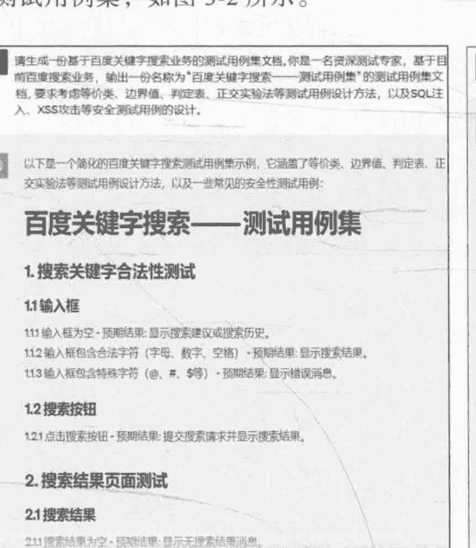
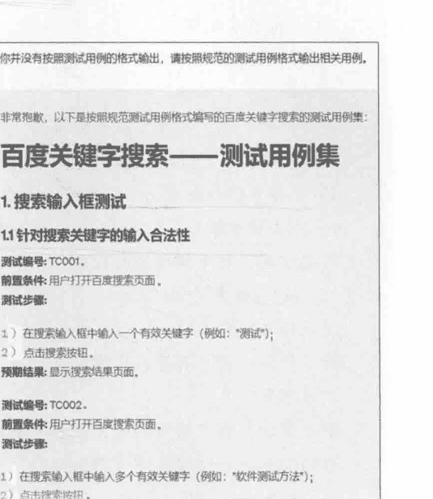

这次模型输出的用例集完全符合要求，如下所示。

> ChatGPT 按照规范格式输出的测试用例集

非常抱歉，以下是按照规范测试用例格式编写的百度关键字搜索的测试用例集：

百度关键词检索测试用例构建反思

本文围绕百度搜索关键词功能展开用例梳理，重点回顾了从初始草案到表格化、边界值补充、基于业务用例衍生，再到内部与外部评审修正的完整过程。

1. 查询区域相关验证
1.1 关键词输入合法性
TC001 验证单一合法词能否正常触发检索，打开首页后在查询区填入“测试”并提交，期望进入结果页。
TC002 验证多词组合检索，输入“软件测试方法”后提交，期望同样呈现结果页。
TC003 验证非法字符处理，输入“#$%^”后提交，期望系统返回错误提示。

1.2 联想建议相关
TC004 验证前缀输入是否触发联想，输入“测”后应弹出建议列表。
TC005 验证多词前缀场景，输入“软件测”后也应正常展示联想列表。

2. 结果页相关验证
2.1 结果展示
TC006 在合法词检索后核对页面，期望看到相关内容。
TC007 触发下一页切换，期望展示后续结果集。
TC008 触发上一页切换，期望回退到前一页内容。

2.2 结果排序
TC009 选择按相关度排序，期望结果依相关性排列。
TC010 选择按时间排序，期望结果依发布时间排列。

3. 安全相关验证
3.1 SQL 注入
TC011 在查询区填入恶意 SQL 语句“'; DROP TABLE Users --”，观察页面反应，期望被拦截并提示错误。
3.2 跨站脚本攻击
TC012 在查询区填入脚本“<script>alert('XSS Attack')</script>”，观察页面反应，期望被转义后以纯文本呈现。

以上仅为基础示例，实际规模与表述需随需求与业务场景调整，测试集合也应随功能演进持续完善。

表格化呈现会更直观。笔者让模型把上述内容整理成表格，输入提示“请以表格形式展示，谢谢。”后得到如图 3-3 的结果。

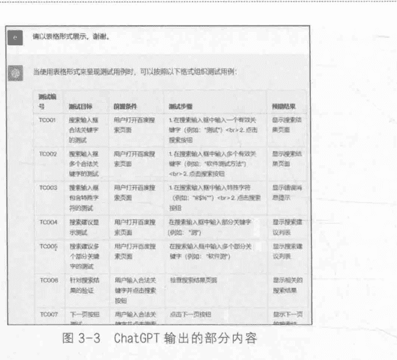
以下为 ChatGPT 生成的关于百度关键字搜索的测试用例集（以表格形式组织）。

| 测试编号 | 测试目标 | 前置条件 | 测试步骤 | 预期结果 |

|---|---|---|---|---|

| TC001 | 搜索输入框合法关键字的测试 | 用户打开百度搜索页面 | 1. 在搜索输入框中输入一个有效关键字（例如：“测试”）<br>2. 点击搜索按钮 | 显示搜索结果页面 |

| TC002 | 搜索输入框多个合法关键字的测试 | 用户打开百度搜索页面 | 1. 在搜索输入框中输入多个有效关键字（例如：“软件测试方法”）<br>2. 点击搜索按钮 | 显示搜索结果页面 |

| TC003 | 搜索输入框包含特殊字符的测试 | 用户打开百度搜索页面 | 1. 在搜索输入框中输入特殊字符（例如：“#$%^”）<br>2. 点击搜索按钮 | 显示错误消息提示 |

| TC004 | 搜索建议显示测试 | 用户打开百度搜索页面 | 在搜索输入框中输入部分关键字（例如：“测”） | 显示搜索建议列表 |

| TC005 | 搜索建议多个部分关键字的测试 | 用户打开百度搜索页面 | 在搜索输入框中输入多个部分关键字（例如：“软件测”） | 显示搜索建议列表 |

| TC006 | 针对搜索结果的验证 | 用户输入合法关键字并点击搜索按钮 | 检查搜索结果页面 | 显示相关的搜索结果 |

| TC007 | 下一页按钮测试 | 用户输入合法关键字并点击搜索按钮 | 点击下一页按钮 | 显示下一页的搜索结果 |

| TC008 | 上一页按钮测试 | 用户输入合法关键字并点击搜索按钮 | 点击上一页按钮 | 显示上一页的搜索结果 |

| TC009 | 按相关性排序测试 | 用户输入合法关键字并点击搜索按钮 | 选择按相关性排序 | 结果按相关性排序 |

| TC010 | 按时间排序测试 | 用户输入合法关键字并点击搜索按钮 | 选择按时间排序 | 结果按时间排序 |

| TC011 | SQL 注入攻击测试 | 用户在搜索输入框中输入恶意 SQL 查询（例如："'; DROP TABLE Users --"） | 检查搜索结果或页面行为 | 拒绝查询并显示错误消息 |

| TC012 | XSS 攻击测试 | 用户在搜索输入框中输入包含 XSS 脚本的关键字（例如："<script>alert('XSS Attack')</script>"） | 检查搜索结果或页面行为 | 过滤并显示普通文本 |

上述表格列出了一些百度关键字搜索的测试用例，按照测试编号、测试目标、前置条件、测试步骤和预期结果的格式组织。您可以根据需要扩展和修改测试用例，以适应具体的测试需求和场景。

看似整齐，但细看会发现问题。虽然要求用边界值设计法，但输出里并没有体现该方法的用例。由此可见不能全盘依赖模型生成，必须自行核验完整性和正确性，否则专业不足很容易被带偏。随后笔者补充提示“你好，在你给出的用例中并没有看到使用边界值用例设计方法的测试用例，请补充，谢谢。”模型补全了边界值相关的用例，如图 3-4 所示。


由图 3-4 可知 ChatGPT 补充了 6 个使用边界值用例设计方法的测试用例。

还记得第 1 章用 ChatGPT 产出的业务用例吗？其生成思路与场景法很接近，那是否可以直接把业务用例喂给模型，让它推导出对应的测试用例？笔者据此补了基于需求规格说明书业务用例的测试用例，模型给出的部分结果如图 3-5 所示。

第 3 章 ChatGPT 生成功能测试用例

图 3-5 ChatGPT 输出的部分基于需求规格说明书中的业务用例补充的测试用例

以下为 ChatGPT 输出的完整的基于需求规格说明书中的业务用例补充的测试用例。

| 测试编号 | 测试目标 | 前置条件 | 测试步骤 | 预期结果 |

| :--- | :--- | :--- | :--- | :--- |

| TC019 | 基本关键字搜索-有效输入 | 用户已进入百度搜索页面 | 1. 在搜索框中输入一个有效关键字（例如：“测试”）。<br>2. 点击搜索按钮 | 显示与关键字相关的搜索结果页面 |

| TC020 | 基本关键字搜索-多个有效输入 | 用户已进入百度搜索页面 | 1. 在搜索框中输入多个有效关键字（例如：“软件测试方法”）。<br>2. 点击搜索按钮 | 显示与多个关键字相关的搜索结果页面 |

| TC021 | 基本关键字搜索-无相关结果 | 用户已进入百度搜索页面 | 1. 在搜索框中输入一个关键字，但系统无法找到相关结果（例如：“未知关键字”）。<br>2. 点击搜索按钮 | 显示相应的通知给用户（例如：“未找到相关结果”） |

### 3.3 ChatGPT 在测试用例自动生成方面的应用案例

| 测试编号 | 测试目标 | 前置条件 | 测试步骤 | 预期结果 |

| :--- | :--- | :--- | :--- | :--- |

| TC022 | 基本关键字搜索-取消搜索 | 用户已进入百度搜索页面 | 1. 在搜索框中输入一个有效关键字（例如：“测试”）。<br>2. 在搜索操作执行前取消搜索操作 | 搜索操作被取消，用例结束 |

| TC023 | 基本关键字搜索-多次搜索 | 用户已进入百度搜索页面 | 1. 在搜索框中输入一个有效关键字（例如：“测试”）。<br>2. 点击搜索按钮。<br>3. 重复步骤 1 和 2 多次 | 搜索结果正确显示，搜索历史被保留 |

| TC024 | 基本关键字搜索-边界值测试 | 用户已进入百度搜索页面 | 1. 在搜索框中输入一个极小的关键字（例如：“a”）。<br>2. 点击搜索按钮 | 显示与关键字相关的搜索结果页面 |

| TC025 | 基本关键字搜索-边界值测试 | 用户已进入百度搜索页面 | 1. 在搜索框中输入一个极长的关键字（超出限制字符数，例如：“a” * 1000）。<br>2. 点击搜索按钮 | 显示错误消息提示 |

这些用例覆盖了业务用例 UC-01 的有效输入、无结果、取消、重复搜索以及边界值等多种情况，有助于校验功能是否符合规格。

模型依据 UC-01 补充后的用例在流程覆盖上更完整。

4）用例评审和改进：测试用例的评审是质量保障的关键。结合前面模型生成的功能和安全用例进行内部评审，团队发现以下问题。
- 部分步骤中混入了 <br> 这类 HTML 标签。
- 仅一步骤的用例仍带序号。
- 用例重复，例如 TC001 与 TC019 内容高度重合。
- 部分安全用例假设了数据库对象，如 TC011 的 Users 表，真实性需与开发确认。
- 输入框限制不清晰，例如关键字最大长度是否是 1000？是按英文字符计还是中英文统一？需与产品明确。

受篇幅限制，仅列出要点。团队据此修正问题并去重，形成面向百度关键词搜索业务的功能与安全用例集，如表 3-1 所示。

表 3-1 收敛后的功能与安全测试用例集经内部评审后保留了输入合法性、特殊字符、无结果、取消、多次搜索、边界值、联想建议、结果翻页、排序、SQL注入与 XSS 等核心场景，并在编号与表述上做了统一。

通常还应做外部评审。将用例集位置告知项目组成员，预留阅读时间，避免评审会上占用过多时间熟悉内容。项目团队评审会上提出以下意见。

1）针对 TC008、TC019 和 TC023，产品明确输入框最大字符数为 100，无论中英文或混合，前后端均需校验，超长时前端自动截取前 100 字。
2）针对 TC016，产品明确 SQL 注入语句需过滤并作为纯文本处理，后端确认 Users 表确实存在。
3）针对 TC023，产品明确搜索结果数量无上限。

限于篇幅，仅列出主要意见。测试人员据此调整，形成新的功能与安全用例集，如表 3-2 所示。

表 3-2 新版用例集在原有基础上修正了字符上限、注入处理方式与结果数量限制的描述，并完成了最终归并。

以下为百度搜索核心功能相关的测试点梳理，覆盖检索、建议、安全等关键场景。

| 用例编号 | 测试场景 | 前置状态 | 操作步骤 | 预期表现 |
| TC004 | 关键词无匹配检索 | 用户已打开百度搜索页 | 1. 在输入框填入系统无索引的词如“未知关键字”<br>2. 触发搜索 | 页面返回无结果提示，如“未找到相关结果” |
| TC005 | 取消检索操作 | 用户已打开百度搜索页 | 1. 在输入框输入有效词如“测试”<br>2. 在提交前主动撤回搜索 | 搜索未被执行，用例结束 |
| TC006 | 连续多次检索 | 用户已打开百度搜索页 | 1. 输入有效词如“测试”<br>2. 点击搜索<br>3. 重复1-2多次 | 结果正常展示且搜索历史得以保留 |
| TC007 | 极小长度关键词边界 | 用户已打开百度搜索页 | 1. 输入极短词如“a”<br>2. 点击搜索 | 展示与该词相关的结果页 |
| TC008 | 极长长度关键词边界 | 用户已打开百度搜索页 | 1. 输入超长串如“a”重复101次<br>2. 点击搜索 | 1. 输入框自动截取前100字符<br>2. 显示前100字符对应的结果页 |
| TC009 | 搜索建议触发 | 用户已打开百度搜索页 | 在输入框键入部分词如“测” | 弹出联想建议列表 |
| TC010 | 多段部分词建议 | 用户已打开百度搜索页 | 在输入框键入多段词如“软件测” | 弹出联想建议列表 |
| TC011 | 结果相关性校验 | 用户已输入合法词并提交 | 核对结果页 | 页面呈现相关结果 |
| TC012 | 下一页翻页 | 用户已输入合法词并提交 | 点击“下一页” | 展示下一页结果 |
| TC013 | 上一页翻页 | 用户已输入合法词并提交 | 点击“上一页” | 展示上一页结果 |
| TC014 | 相关性排序 | 用户已输入合法词并提交 | 选择按相关性排序 | 结果按相关性排列 |
| TC015 | 时间排序 | 用户已输入合法词并提交 | 选择按时间排序 | 结果按时间排列 |
| TC016 | SQL注入防御 | — | 在输入框输入恶意SQL如“' OR '1'='1” | 系统过滤并以普通文本展示 |
| TC017 | XSS注入防御 | — | 在输入框输入含脚本如“<script>alert('XSS Attack')</script>” | 系统过滤并以普通文本展示 |
| TC018 | 输入框最小边界 | 用户已打开百度搜索页 | 在输入框只输入一个空格 | 出现搜索建议或历史记录 |
| TC019 | 输入框最大边界 | 用户已打开百度搜索页 | 输入超限长串，如101个英文字母、汉字或混合 | 显示前100字符对应的结果页 |
| TC020 | 建议最小触发 | 用户已打开百度搜索页 | 在输入框输入单个字符如“a” | 弹出建议列表 |
| TC021 | 建议最大阈值 | 用户已打开百度搜索页 | 输入多字符如“abcde”，但未达到建议阈值 | 不弹出建议列表 |
| TC022 | 结果页最小有效性 | 用户已输入合法词并提交 | 检查结果页 | 展示相关结果 |
| TC023 | 结果页大数量处理 | 用户已输入合法词并提交 | 输入使结果数超限的词，如超过1000条 | 正常展示结果页 |

测试用例的复核与完善是贯穿全流程的动态任务。随需求演进与功能迭代，用例需要持续更新。这一过程要求测试人员具备高度的敏捷性，同时对业务逻辑和技术实现有深入把握，才能保持用例的有效覆盖。

### 3.4 ChatGPT 联合领域特定语言生成测试

领域特定语言是一种面向特定专业领域的定制化语言。它使用该领域的术语和约定语法，让非程序员也能表达领域问题，从而提升开发与测试的精准度与效率，也可让测试用例生成更精准且自动化。

#### 3.4.1 DSL 的核心特质

DSL 通常具备以下特征。
1）强领域指向：为特定行业量身打造，内置专业词汇与概念，方便撰写领域代码。
2）高自动化水平：提供自动化能力，助力快速生成符合领域规范的代码。
3）语法简洁：聚焦特定问题，语法比通用编程语言更简洁易懂。

#### 3.4.2 集成实现路径

将 ChatGPT 与 DSL 结合，可按以下流程高效产出测试用例。
首先明确 DSL，其需涵盖领域术语与功能描述及对应语法规则。
随后测试人员向 ChatGPT 提出需求并提供 DSL 上下文，ChatGPT 以自然语言生成测试描述。此交互确保用例符合领域要求。
接着把自然语言描述转译为 DSL 代码，包含步骤、预期及其他信息，实现了从自然语言到可执行代码的转化。
以下为百度搜索关键词测试用例生成的示例：

```
# 定义 DSL 测试用例
测试用例:百度搜索关键字

#设置搜索关键字
Step1: Set Search Keyword to ChatGPT
    - Action: Set the search keyword to ChatGPT
    - Expected: The search keyword is set to ChatGPT

#执行搜索
Step2: Perform Search
    - Action: Perform Search
```

## 验证搜索结果

Step3: Verify that search results contain relevant information ChatGPT

- Action: Verify that search results contain relevant information ChatGPT

- Expected: Search results contain relevant information ChatGPT

随后由专属的 DSL 解释器或测试平台执行代码，按步骤跑用例并记录结果。这是功能校验与测试自动化的核心环节。DSL 解释器的编写及与自动化框架的协作将在第 4 章展开，这里暂不详述。

执行结束后，测试人员分析结果并反馈开发团队，依据反馈迭代优化 DSL 代码，不断提升覆盖率与质量。

该集成方式带来多重价值：DSL 确保用例与领域需求高度一致，提升精确度；可自动生成用例，降低手工成本；保证用例一致性，减少人为失误；语法简洁提升编写效率；代码可复用，提升维护性。

总体而言，ChatGPT 与 DSL 的结合为测试用例生成提供了可行路径，提升了精确性、自动化水平、一致性与效率。通过定义领域 DSL 并结合 ChatGPT 的自然语言能力，可更好满足特定领域的测试需求。实际落地时需精心设计 DSL，使其契合领域。这一融合有望在多领域测试中发挥关键作用。

## 第 4 章 ChatGPT 生成自动化测试用例

### 4.1 ChatGPT 生成自动化测试用例的基本流程和原理

在自动化测试中，元素定位与业务流程梳理消耗大量时间，编写自动化脚本既关键又耗时。为提升效率并保证覆盖率，业界尝试借助自动化手段辅助设计。随着大模型发展，基于自然语言的自动化用例生成成为可能。

#### 4.1.1 生成流程拆解

ChatGPT 生成自动化测试用例可分为以下步骤。
1. 收集需求与系统文档。需先汇总需求说明、UI 原型、前端设计等，让模型充分理解被测系统。
2. 给出明确指令。告知模型需生成何种用例、覆盖哪些功能或场景，并指明编程语言与测试框架。指令越具体，输出质量越高。
3. 模型生成初始版本。结合文档与框架信息输出对应语言的首版自动化脚本。
4. 复核与修改。测试人员评审初稿，修正错误或不完善处，多轮迭代直至可用。
5. 抽取整理最终版本。根据测试策略筛选有效用例并分类，如冒烟集与大版本集。

依此流程可显著提升脚本生成效率，但仍需人工评审保证质量。

#### 4.1.2 工作原理解析

核心在于深度学习。ChatGPT 基于大规模 Transformer 神经网络，通过预训练掌握软件测试知识，如需求分析、用例设计、框架与编程语言等，使其具备类测试人员的认知。
自然语言理解是关键。模型可解析指令中的功能模块、场景与覆盖条件，借助 NLP 技术准确把握需求。
基于理解的知识推理，模型可扩展场景，如在仅给主路径时自动补全边界与异常用例，实现指令泛化。
随后模型以标准模板输出用例描述，包含输入、步骤、预期结果，可呈现为自然语言或指定语言代码。
若收到反馈，模型可通过迁移学习持续迭代优化输出。

总体而言，ChatGPT 能与测试人员高效协作批量产出高质量用例，降低成本并提升设计效率。

### 4.2 ChatGPT 与测试框架的整合

#### 4.2.1 与主流 UI 自动化框架对接

Web 与 App UI 测试常用 Selenium、Appium、Cypress 等，需编写脚本模拟操作。
整合时需关注以下内容。
准备脚本模板，包含初始化、控件定位、关键方法调用等通用代码。
例如 Selenium 模板可包含打开浏览器、访问页面、定位元素并点击的通用代码，如下所示。

```
Selenium 框架中的通用测试脚本模板示例

from selenium import webdriver
from selenium.webdriver.common.by import By

# 初始化浏览器
driver = webdriver.Chrome()

# 打开网页
driver.get("https://example.com")

# 定位元素并进行单击操作
element = driver.find_element(By.ID, "element_id")
element.click()
```

ChatGPT 输出的自然语言用例需转译为框架脚本。例如“点击用户名框，输入张三”需转为 Selenium 的 send_keys 调用，如下所示。

```
Selenium 的 send_keys 方法的调用代码示例

# 定位元素并进行单击操作
element = driver.find_element(By.ID, "User_Name")
element.send_keys('张三')
```

生成的脚本需调试验证执行是否正常。注意数据唯一性，如用户名不可重复；每个脚本至少含一个断言，如登录后校验标题。Selenium 断言示例如下所示。

```
......
action, expected = line.split(": Verify that search results ")
search_results = self.driver.find_elements(By.CSS_SELECTOR, ".t")
result_texts = [result.text for result in search_results]
if (expected.lower() in str(result_texts).lower()):
    print(f"'{case_name}' 测试通过.")
else:
    print(f"'{case_name}' 测试失败.")
```

#### 4.2.2 与接口测试工具联动

接口测试常用 JMeter、Postman、Python Requests 等。
以 JMeter 为例，需关注以下点。
将模型生成的接口用例解析出 URL、参数、头信息等，转换为 JMX 格式脚本。
例如 ChatGPT 生成的接口用例如下。

```
发送 POST 请求到 https://api.example.com/login,参数为{username: 'user', password: 'pass'},
预期响应码应为 200
```

以上内容可转化为 JMeter 接口测试脚本，如下所示。

```
<HTTPSamplerProxy guiclass="HttpTestSampleGui" testclass="HTTPSamplerProxy" testname="HTTP Request" enabled="true">
    <elementProp name="HTTPsampler.Arguments" elementType="Arguments" guiclass="HTTPArgumentsPanel" testclass="Arguments" testname="User Defined Variables" enabled="true">
        <collectionProp name="Arguments.arguments">
            <elementProp name="username" elementType="HTTPArgument">
                <stringProp name="Argument.name">username</stringProp>
                <stringProp name="Argument.value">user</stringProp>
                <stringProp name="Argument.metadata">=</stringProp>
            </elementProp>
            <elementProp name="password" elementType="HTTPArgument">
                <stringProp name="Argument.name">password</stringProp>
                <stringProp name="Argument.value">pass</stringProp>
                <stringProp name="Argument.metadata">=</stringProp>
            </elementProp>
        </collectionProp>
    </elementProp>
    <stringProp name="HTTPSampler.domain">https://api.example.com</stringProp>
    <stringProp name="HTTPSampler.port"></stringProp>
    <stringProp name="HTTPSampler.protocol"></stringProp>
    <stringProp name="HTTPSampler.contentEncoding"></stringProp>
    <stringProp name="HTTPSampler.path">/login</stringProp>
    <stringProp name="HTTPSampler.method">POST</stringProp>
    <boolProp name="HTTPSampler.follow_redirects">true</boolProp>
</HTTPSamplerProxy>
```
把接口调用所需的输入信息抽离出来，写成可复用的代码模板。这样同一套模板能适配多种情境，只需改动输入就能覆盖不同情况。借助框架自带的数据分离能力，把数据与逻辑拆开，就能用一份模板跑多批输入，既扩大检查范围，又减少重复书写。

本例采用 CSV Data Set Config 读取外部表格数据，再在 HTTP 请求里通过 ${变量} 占位符引用，${username} 对应账号，${password} 对应密令，具体写法见下方示例。

#### JMeter 参数外置实操

```
<JMeterTestPlan>
    <!--省略 Test Plan 和 Thread Group 配置 -->
    <hashTree>
        <CSVDataSet guiclass="TestBeanGUI" testclass="CSVDataSet" testname="CSV Data Set Config" enabled="true">
            <stringProp name="TestPlan.comments">Load CSV data for parameterization</stringProp>
            <stringProp name="filename">path/to/your/csv/data.csv</stringProp>
            <stringProp name="fileEncoding"></stringProp>
            <stringProp name="variableNames">username,password</stringProp>
            <stringProp name="delimiter">,</stringProp>
            <boolProp name="quotedData">true</boolProp>
            <boolProp name="recycle">false</boolProp>
            <boolProp name="stopThread">true</boolProp>
            <boolProp name="shareMode">shareMode.group</boolProp>
        </CSVDataSet>
        <hashTree/>
        <HTTPSamplerProxy guiclass="HttpTestSampleGui" testclass="HTTPSamplerProxy" testname="HTTP Request" enabled="true">
            <!-- 省略其他配置 -->
            <elementProp name="HTTPsampler.Arguments" elementType="Arguments" guiclass="HTTPArgumentsPanel" testclass="Arguments" testname="User Defined Variables" enabled="true">
                <collectionProp name="Arguments.arguments">
                    <elementProp name="username" elementType="HTTPArgument">
                        <stringProp name="Argument.name">username</stringProp>
                        <stringProp name="Argument.value">${username}</stringProp> <!-- 参数化引用 -->
                        <stringProp name="Argument.metadata">=</stringProp>
                    </elementProp>
                    <elementProp name="password" elementType="HTTPArgument">
                        <stringProp name="Argument.name">password</stringProp>
                        <stringProp name="Argument.value">${password}</stringProp> <!-- 参数化引用 -->
                        <stringProp name="Argument.metadata">=</stringProp>
                    </elementProp>
                </collectionProp>
            </elementProp>
        </HTTPSamplerProxy>
        <hashTree/>
    </hashTree>
</JMeterTestPlan>
```
依据期望输出的说明，挑选合适的校验手段写入模板，实现自动比对。比如调用框架内置的检查函数，核对返回体的关键文字、HTTP 状态、耗时是否达标。加入校验层后，每次运行都能自动对照预期，异常即刻显现，可靠性明显提升。

示例选用 JSON Assertion 组件完成返回结果的校验，具体见下方。

#### JMeter 校验实操

```
<JMeterTestPlan>
```
下一步是把接口模板接入持续集成 CI 或持续交付 CD 流水线。只要新版本推送到验证环境，流水线就会自动启动验证，确认改动符合要求，保障应用稳定。自动化运行让缺陷更早暴露、更快修复。详细落地方案见第 9 章，这里不再展开。

#### 4.2.3 ChatGPT 配合单元测试框架
在开发流程里，单元测试用于确认代码的最小单元——函数或方法是否按设计运行。不同语言的测试库很多，Java 侧常见 JUnit、TestNG，Python 侧常见 unittest、pytest。

ChatGPT 能与这些库协作，自动产出单元测试，大幅提升编写速度与代码质量。

举例验证加法函数，输入 2 和 3 期望输出 5，可让 ChatGPT 按 JUnit 规范生成对应的 Java 代码，示例见下方。

### JUnit 代码示例

```java
import org.junit.Test;
import static org.junit.Assert.assertEquals;

public class CalculatorTest {
    @Test
    public void testAddition() {
        Calculator calculator = new Calculator();
        int result = calculator.add(2, 3);
        assertEquals(5, result);
    }
}
```
Java 的 JUnit 与 Python 的 unittest 都能借助 ChatGPT 实现互转。把前面生成的 Java 版本改写为 Python 版本即可。

### JUnit 转 unittest 示例

```python
import unittest

# 导入需要测试的函数或类
from calculator import add

class TestCalculator(unittest.TestCase):
    def test_addition(self):
        # 测试计算器的加法函数
        result = add(2, 3)
        expected_result = 5
        self.assertEqual(result, expected_result)

if __name__ == '__main__':
    unittest.main()
```
### 4.3 ChatGPT 生成用例实测
为更直观地检验生成质量，这里选取一个真实业务做验证。

案例是一个 B2C 电商平台，包含登录、浏览商品、加入购物车、下单等流程。以登录流程为例观察生成情况。

参照 Elvis Saravia 的提示工程思路，向 ChatGPT 发出如下指令：“请自动生成针对某系统的用户登录功能的测试用例脚本。该系统是一个 B2C 电子商务网站，包含用户登录、浏览商品、加入商品至购物车、提交订单等功能。该系统需要支持用户账户登录验证，登录参数包括手机号和密码。正常情况下手机号和密码匹配则登录成功，否则给出错误提示。手机号格式需要限制为 11 位数字，密码长度为 6—12 位。请使用 Python 语言结合 Selenium 和 unittest 框架，包含不同的正常和异常场景，设计至少 5 个用例。”

ChatGPT 给出了 5 套基于 Selenium 搭配 unittest 的登录测试脚本，部分展示在图 4-1。

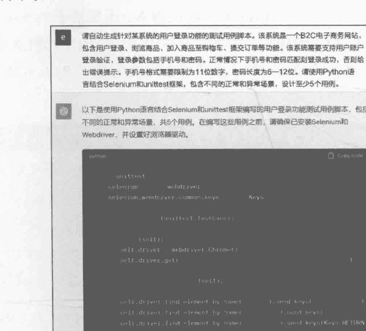
图 4-1 ChatGPT 输出的 5 套 Selenium 搭配 unittest 登录测试脚本节选

ChatGPT 输出的 5 套 Selenium 搭配 unittest 登录测试脚本如下所示。

> ChatGPT 输出的 5 套 Selenium 搭配 unittest 登录测试脚本

下面给出使用 Python 配合 Selenium 与 unittest 编写的登录测试脚本，涵盖正常与异常共 5 个场景。执行前请先安装 Selenium 与 WebDriver，并配置好浏览器驱动。

十秒内生成自动化测试脚本？ChatGPT 的实操体验

```python
import unittest
from selenium import webdriver
from selenium.webdriver.common.keys import Keys
class TestUserLogin(unittest.TestCase):
    def setUp(self):
        # 使用 Chrome 浏览器，需确保已安装 Chrome 浏览器和对应的驱动
        self.driver = webdriver.Chrome()
        # 替换为实际的登录页面 URL
        self.driver.get("https://your_b2c_eCommerce_website***/login")
    def test_successful_login(self):
        # 正常情况下，手机号和密码匹配，登录成功
        self.driver.find_element_by_name("phone").send_keys("13512345678")
        self.driver.find_element_by_name("password").send_keys("password123")
        self.driver.find_element_by_name("password").send_keys(Keys.RETURN)
        success_message = self.driver.find_element_by_id("success-message").text
        self.assertEqual(success_message, "Login successful")
    def test_invalid_phone_format(self):
        # 手机号格式不正确，登录失败并显示错误提示
        self.driver.find_element_by_name("phone").send_keys("12345")
        self.driver.find_element_by_name("password").send_keys("password123")
        self.driver.find_element_by_name("password").send_keys(Keys.RETURN)
        error_message = self.driver.find_element_by_id("error-message").text
        self.assertEqual(error_message, "Invalid phone format")
    def test_invalid_password_length(self):
        # 密码长度不在范围内，登录失败并显示错误提示
        self.driver.find_element_by_name("phone").send_keys("13512345678")
        self.driver.find_element_by_name("password").send_keys("pass")
        self.driver.find_element_by_name("password").send_keys(Keys.RETURN)
        error_message = self.driver.find_element_by_id("error-message").text
        self.assertEqual(error_message, "Password length should be 6-12 characters")
    def test_wrong_password(self):
        # 正常手机号但密码不匹配，登录失败并显示错误提示
        # 以"135"开头的 11 位数字
        self.driver.find_element_by_name("phone").send_keys("13512345678")
        self.driver.find_element_by_name("password").send_keys("wrongpassword")
        self.driver.find_element_by_name("password").send_keys(Keys.RETURN)
        error_message = self.driver.find_element_by_id("error-message").text
        self.assertEqual(error_message, "Incorrect password")
    def test_nonexistent_user(self):
        # 不存在的用户，登录失败并显示错误提示
        self.driver.find_element_by_name("phone").send_keys("99999999999")
        self.driver.find_element_by_name("password").send_keys("password123")
        self.driver.find_element_by_name("password").send_keys(Keys.RETURN)
        error_message = self.driver.find_element_by_id("error-message").text
        self.assertEqual(error_message, "User not found")
    def tearDown(self):
        self.driver.quit()
if __name__ == '__main__':
    unittest.main()
```
在前面的示例里，你要把占位链接 https://your_b2c_eCommerce_website***/login 换成自己项目的真实登录地址，并且根据页面结构选用合适的定位方式，比如 find_element_by_name、find_element_by_id 等，来模拟真实用户的操作流程。该脚本共准备了五条用例，覆盖登录成功、手机号格式错误、密码长度不符、密码不一致以及用户不存在这几种登录场景，后续完全可以按实际业务逻辑再做增删调整。

面对笔者的提示，ChatGPT 几乎十几秒内就吐出了基于 Selenium 配合 unittest 的五条测试脚本。不过 Selenium 较新版本已不再支持 find_element_by_name 和 find_element_by_id，这两个定位方法已被弃用，现在统一用 find_element 来完成单个元素定位。显然，上一步的脚本直接跑在最新 Selenium 环境下会报错。于是笔者再次让它把 find_element_by_name 和 find_element_by_id 全部换成 find_element 的写法，模型给出的部分结果如图 4-2。

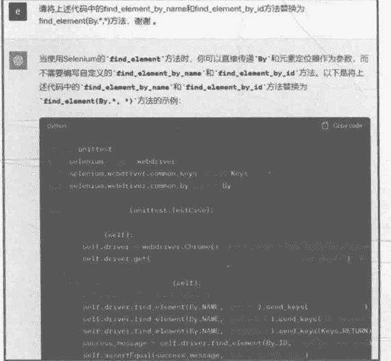
图 4-2 ChatGPT 输出的部分使用 find_element 方法的 Selenium 测试用例脚本

ChatGPT 给出的改写后脚本如下。

### 用 find_element 重写后的 Selenium 示例

使用 Selenium 的 `find_element` 时，可以直接把 `By` 和定位器一起传进去，不必再自己写 find_element_by_name、find_element_by_id 这类封装。下面是把原本代码中的旧定位方法替换为 `find_element(By.*, *)` 的示意：

```python
import unittest
from selenium import webdriver
from selenium.webdriver.common.keys import Keys
from selenium.webdriver.common.by import By

class TestUserLogin(unittest.TestCase):
    def setUp(self):
        # 使用 Chrome 浏览器，需确保已安装 Chrome 浏览器和对应的驱动
        self.driver = webdriver.Chrome()
        # 替换为实际的登录页面 URL
        self.driver.get("https://your_b2c_eCommerce_website***/login")

    def test_successful_login(self):
        # 正常情况下，手机号和密码匹配，登录成功
        # 以"135"开头的 11 位数字
        self.driver.find_element(By.NAME, "phone").send_keys("13512345678")
        self.driver.find_element(By.NAME, "password").send_keys("password123")
        self.driver.find_element(By.NAME, "password").send_keys(Keys.RETURN)
        success_message = self.driver.find_element(By.ID, "success-message").text
        self.assertEqual(success_message, "Login successful")

    def test_invalid_phone_format(self):
        # 手机号格式不正确，登录失败并显示错误提示
        self.driver.find_element(By.NAME, "phone").send_keys("12345")
        self.driver.find_element(By.NAME, "password").send_keys("password123")
        self.driver.find_element(By.NAME, "password").send_keys(Keys.RETURN)
        error_message = self.driver.find_element(By.ID, "error-message").text
        self.assertEqual(error_message, "Invalid phone format")

    def test_invalid_password_length(self):
        # 密码长度不在范围内，登录失败并显示错误提示
        # 以"135"开头的 11 位数字
        self.driver.find_element(By.NAME, "phone").send_keys("13512345678")
        self.driver.find_element(By.NAME, "password").send_keys("pass")
        self.driver.find_element(By.NAME, "password").send_keys(Keys.RETURN)
        error_message = self.driver.find_element(By.ID, "error-message").text
        self.assertEqual(error_message, "Password length should be 6-12 characters")

    def test_wrong_password(self):
        # 正常手机号但密码不匹配，登录失败并显示错误提示
        # 以"135"开头的 11 位数字
        self.driver.find_element(By.NAME, "phone").send_keys("13512345678")
        self.driver.find_element(By.NAME, "password").send_keys("wrongpassword")
        self.driver.find_element(By.NAME, "password").send_keys(Keys.RETURN)
        error_message = self.driver.find_element(By.ID, "error-message").text
        self.assertEqual(error_message, "Incorrect password")

    def test_nonexistent_user(self):
        # 不存在的用户，登录失败并显示错误提示
        self.driver.find_element(By.NAME, "phone").send_keys("99999999999")
        self.driver.find_element(By.NAME, "password").send_keys("password123")
        self.driver.find_element(By.NAME, "password").send_keys(Keys.RETURN)
        error_message = self.driver.find_element(By.ID, "error-message").text
        self.assertEqual(error_message, "User not found")

    def tearDown(self):
        self.driver.quit()

if __name__ == '__main__':
    unittest.main()
```
### 4.3 生成效果从哪几个维度看

从这个简易例子就能看出，ChatGPT 能够快速、自动地产出符合需求的自动化脚本，既有正常路径也有异常路径，能覆盖比较多的测试条件。描述本身是自然语言，但可以映射成对应测试框架的代码。落地时只要把网址、元素 ID 或 NAME 等信息换成实际值，脚本就可以直接运行，是不是挺省事？

可以从覆盖率、正确性、可维护性、自动化程度四个维度来简单打分。

1）覆盖率：这五条用例基本把用户登录的核心场景都包住了，正常登录和各种异常输入都有涉及，符合最初的需求范围。
2）正确性：生成的 Python unittest 结构完整，语法上没有问题，可直接执行。实际使用时仍要人工复核，有偏差及时修正。
3）可维护性：用例命名规范，代码层次清晰，可读性不错，后续维护成本较低。
4）自动化程度：把编写脚本的工作交给模型，相比手工 coding 节省了大量时间。

综合来看，ChatGPT 生成的自动化用例整体表现不错，明显提升了脚本编写效率，减轻了重复劳动。

另外也可以尝试 seldom 这类上手门槛低的测试框架。笔者随手问了一句“你了解 seldom 吗？”，模型给出的介绍如图 4-3 所示。

看得出它“知道”seldom，那能不能把之前 Selenium + unittest 的脚本转成 seldom 版呢？笔者给出对应指令后，ChatGPT 很快就把之前的脚本改写成了基于 seldom 的版本。可选框架很多，这里只是想说明，ChatGPT 就像一个知识库，能写诗写文章，也能写代码，还能把不同语言、不同框架的代码互相转换。主导权始终在人手里。

### 4.4 一个真实业务的落地案例

本节以百度关键词搜索功能为案例，看看 ChatGPT 如何参与自动化用例的生成。

#### 4.4.1 生成前的准备工作

1）收集需求文档和系统文档

在“3.3.4 ChatGPT 生成测试用例的最佳实践”一节里，ChatGPT 已经为百度关键词搜索业务产出了功能测试用例，如表 4-1 所示。

表 4-1 基于百度关键字搜索业务的功能测试用例

| 测试编号 | 测试目标 | 前置条件 | 测试步骤 | 预期结果 |
| :--- | :--- | :--- | :--- | :--- |
| TC001 | 搜索框输入合法关键词的验证 | 已打开百度搜索首页 | 1. 在搜索框中输入一个有效关键词，例如“测试”。<br>2. 点击搜索按钮 | 页面展示搜索结果 |

下面以百度搜索功能为例，展示如何先用自然语言写功能测试点，再借助 ChatGPT 快速产出基于 Selenium 与 unittest 的自动化脚本的完整过程。

| TC002 | 搜索框多关键词合法性验证 | 已打开百度搜索首页 | 1. 在搜索框内填入多个合规关键词，例如“软件测试方法”。<br>2. 触发搜索按钮 | 页面返回搜索结果 |
| TC003 | 搜索框输入特殊字符的校验 | 已打开百度搜索首页 | 1. 向搜索框输入特殊符号，例如“#$%^”。<br>2. 点击搜索按钮 | 弹出错误提示信息 |
| TC004 | 基础关键词搜索无匹配情况 | 已进入百度搜索页面 | 1. 输入一个语法上有效但系统无匹配的关键词，例如“未知关键字”。<br>2. 执行搜索 | 向用户展示“未找到相关结果”之类的通知 |
| TC005 | 基础关键词搜索取消操作 | 已进入百度搜索页面 | 1. 在搜索框中输入合法关键词，例如“测试”。<br>2. 在实际执行前撤销搜索行为 | 搜索被中断，用例结束 |
| TC006 | 基础关键词多次搜索 | 已进入百度搜索页面 | 1. 在搜索框中输入合法关键词，例如“测试”。<br>2. 点击搜索按钮。<br>3. 反复执行步骤 1-2 | 每次都能正确展示结果，且搜索历史得以保留 |
| TC007 | 基础关键词边界值最小长度 | 已进入百度搜索页面 | 1. 输入极短的关键词，例如“a”。<br>2. 点击搜索按钮 | 显示与该关键词相关的结果页 |
| TC008 | 基础关键词边界值最大长度 | 已进入百度搜索页面 | 1. 输入超长关键词，例如“a”重复 101 次。<br>2. 点击搜索按钮 | 1. 搜索框自动截取前 100 个字符。<br>2. 展示前 100 字符的搜索结果页 |
| TC009 | 搜索建议触发验证 | 打开百度搜索首页 | 在搜索框中输入部分关键词，例如“测” | 列表形式展示搜索建议 |
| TC010 | 搜索建议多部分关键词验证 | 打开百度搜索首页 | 在搜索框中输入多个部分关键词，例如“软件测” | 列表形式展示搜索建议 |
| ...... | ...... | ...... | ...... | ...... |

（2）给出清晰的生成指令
在 ChatGPT 中输入的提示要求模型按“测试编号 测试目标 前置条件 测试步骤 预期结果 TC001 搜索输入框合法关键字的测试 用户打开百度搜索页面 1. 在搜索输入框中输入一个有效关键字（例如‘测试’）。2. 单击搜索按钮 显示搜索结果页面。”的格式，产出基于 Selenium 和 unittest 的自动化脚本，并强调必须使用 find_element(By.*,*) 定位。ChatGPT 的返回结果如图 4-5。需说明的是，普通用户得到的只是纯文本，表格复制后格式会错乱，但模型仍能准确理解；Plus 用户可上传带格式的文件，效果会更理想。

（3）ChatGPT 产出初始版自动化用例
以 TC001 的自然语言用例生成的 Selenium + unittest 脚本来看，模型基本完整复现了 TC001 的逻辑。ChatGPT 输出的 TC001 自动化脚本如下所示。

```
ChatGPT 输出的 TC001 自动化测试用例脚本

以下是一个使用 Selenium 和 unittest 编写的测试用例脚本，根据你提供的测试内容生成。这个脚本模拟用户在百度搜索页面中输入合法关键字进行搜索的情景，并使用 `find_element(By.*,
```

`*")` 方法查找页面元素：

```
import unittest
from selenium import webdriver
from selenium.webdriver.common.by import By
class TestBaiduSearch(unittest.TestCase):
    def setUp(self):
        # 前置条件：用户打开百度搜索页面
        self.driver = webdriver.Chrome()
        self.driver.get("https://www.baidu.com")
    def test_search_valid_keyword(self):
        # 测试步骤：
        # 1. 在搜索输入框中输入一个有效关键字（例如："测试"）
        search_input = self.driver.find_element(By.ID, "kw")
        search_input.send_keys("测试")
        # 2. 点击搜索按钮
        search_button = self.driver.find_element(By.ID, "su")
        search_button.click()
        # 预期结果：显示搜索结果页面。
        self.assertIn("百度为您找到相关结果约", self.driver.page_source)
    def tearDown(self):
        self.driver.quit()
if __name__ == '__main__':
    unittest.main()
```

脚本中采用 find_element(By.ID, "kw") 定位搜索输入框，find_element(By.ID, "su") 定位搜索按钮，随后模拟在输入框中键入“测试”并点击按钮，最后用断言检查是否出现了相关结果页。这是一个简洁的示范，可根据实际页面结构进行扩展。

（4）评审与改进自动化用例
模型能够理解自然语言描述的前置条件，并把“用户打开百度搜索页面”的初始化代码放在 setUp 方法中，如下所示。

```
def setUp(self):
    # 前置条件：用户打开百度搜索页面
    self.driver = webdriver.Chrome()
    self.driver.get("https://www.baidu.com")
```

用例命名也较为规范，test_search_valid_keyword 一眼可看出是针对有效输入关键词的场景。测试步骤中的数据与 TC001 保持一致，如下所示。

```
def test_search_valid_keyword(self):
    # 测试步骤：
    # 1. 在搜索输入框中输入一个有效关键字（例如：“测试”）
    search_input = self.driver.find_element(By.ID, "kw")
    search_input.send_keys("测试")
    # 2. 点击搜索按钮
    search_button = self.driver.find_element(By.ID, "su")
    search_button.click()
```

经检查，ChatGPT 提供的脚本没有语法错误，百度地址正确，元素 ID 也完全匹配。如图 4-6 所示，百度搜索框的 ID 为“kw”、搜索按钮的 ID 为“su”。模型还贴心地加入了断言语句，如下所示。

```
# 预期结果：显示搜索结果页面。
self.assertIn("百度为您找到相关结果约", self.driver.page_source)
```

如图 4-7 所示，经实测，搜索成功后页面确实会出现“百度为您找到相关结果约……”的文字。

读者是否注意到其中的缺陷？实际使用 Selenium 的人会指出，这段代码缺少页面同步处理，脚本跑得过快时可能在页面未完全渲染就进行断言，导致失败。Selenium 提供强制等待、显式等待和隐式等待三种方式。这里以最简单的强制等待为例，搜索后强制休眠 2s。实际项目中可选用另外两种等待。加入等待后的 TC001 脚本如下所示。

```
import unittest
from selenium import webdriver
from selenium.webdriver.common.by import By
from time import sleep
class TestBaiduSearch(unittest.TestCase):
    def setUp(self):
        # 前置条件：用户打开百度搜索页面
        self.driver = webdriver.Chrome()
        self.driver.get("https://www.baidu.com")
    def test_search_valid_keyword(self):
        # 测试步骤：
        # 1. 在搜索输入框中输入一个有效关键字（例如："测试"）
        search_input = self.driver.find_element(By.ID, "kw")
        search_input.send_keys("测试")
        # 2. 点击搜索按钮
        search_button = self.driver.find_element(By.ID, "su")
        search_button.click()
        # 3. 加入 2s 等待时间
        sleep(2)
        # 预期结果：显示搜索结果页面。
        self.assertIn("百度为您找到相关结果约", self.driver.page_source)
    def tearDown(self):
        self.driver.quit()
if __name__ == '__main__':
    unittest.main()
```

至此，TC001 脚本的评审与修改工作完成。

（5）提炼与整理最终版自动化用例
实践中并非所有功能点都要自动化。自动化执行策略应结合需求与项目情况定制，常见考量包括：

- 挑选执行范围：优先把重复率高、稳定性要求高、回归频繁的用例自动化，性价比更高。
- 分层测试：单元测试、集成测试、端到端测试逐层覆盖。
- 冒烟测试：快速验证核心功能是否可用。
- 回归测试：代码变更后运行，以防旧功能受损，自动化回归是主要应用场景。
- 数据驱动：同一用例多组输入，提升覆盖面。
- 并行执行：利用工具并发运行，加快反馈。
- CI/CD 集成：每次提交后自动触发测试，及时发现问题。
- 工具选型：根据应用类型选择合适的框架。
- 持续维护：脚本需随应用变更同步更新。

为控制篇幅，本文仅把前三个功能用例转为 Selenium + unittest 脚本，如图 4-8 所示。

## 第 4 章 ChatGPT 生成自动化测试用例

笔者让 ChatGPT 将 TC001～TC003 三个功能用例转为自动化脚本，并要求在点击搜索按钮后等待 2s。ChatGPT 生成的三个脚本如下所示。

### ChatGPT 生成的自动化测试用例脚本

以下是依据提供的测试内容，用 Selenium 和 unittest 编写的自动化脚本。脚本模拟了三个场景，每次点击搜索按钮后均等待 2 秒，确保页面加载完成。定位均使用 `find_element(By.*, "*")` 方法：

```python
import unittest
import time
from selenium import webdriver
from selenium.webdriver.common.by import By

class TestBaiduSearch(unittest.TestCase):
    def setUp(self):
        # 前置条件：用户打开百度搜索页面
        self.driver = webdriver.Chrome()
        self.driver.get("https://www.baidu.com")

    def test_search_valid_keyword(self):
        # 测试步骤：
        # 1. 在搜索输入框中输入一个有效关键字（例如："测试"）
        search_input = self.driver.find_element(By.ID, "kw")
        search_input.send_keys("测试")
        # 2. 点击搜索按钮
        search_button = self.driver.find_element(By.ID, "su")
        search_button.click()
        # 3. 等待 2 秒
        time.sleep(2)
        # 预期结果：显示搜索结果页面。
        self.assertIn("百度为您找到相关结果约", self.driver.page_source)

    def test_search_multiple_valid_keywords(self):
        # 测试步骤：
        # 1. 在搜索输入框中输入多个有效关键字（例如："软件测试方法"）
        search_input = self.driver.find_element(By.ID, "kw")
        search_input.send_keys("软件测试方法")
        # 2. 点击搜索按钮
        search_button = self.driver.find_element(By.ID, "su")
        search_button.click()
        # 3. 等待 2 秒
        time.sleep(2)
        # 预期结果：显示搜索结果页面。
        self.assertIn("百度为您找到相关结果约", self.driver.page_source)

    def test_search_special_characters(self):
        # 测试步骤：
        # 1. 在搜索输入框中输入特殊字符（例如："#$%^"）
        search_input = self.driver.find_element(By.ID, "kw")
        search_input.send_keys("#$%^")
        # 2. 点击搜索按钮
        search_button = self.driver.find_element(By.ID, "su")
        search_button.click()
        # 3. 等待 2 秒
        time.sleep(2)
        # 预期结果：显示错误消息提示。
        error_message = self.driver.find_element(By.CLASS_NAME, "nors").text
        self.assertEqual(error_message, "抱歉，没有找到与 "#$%^" 相关的结果。")

    def tearDown(self):
        self.driver.quit()

if __name__ == '__main__':
    unittest.main()
```

脚本严格遵循了“点击后等待 2 秒以确保页面加载”的要求。如有其他需求可随时调整。

（6）测试执行
在 PyCharm 中运行上述脚本，可发现输入 “#$%^” 的用例出现失败信息，如图 4-9 所示。

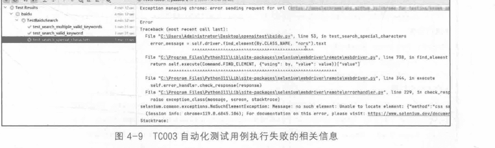

从图4-9的复盘来看，这次用例失败的核心就是预期提示元素根本没被触发。我亲自复现了一下，给搜索框输入“#$%^”，本该出现的“抱歉，没有找到与‘#$%^’相关的结果。”并没有弹出，系统反而正常返回了一批搜索结果，具体表现见图4-10。

问题定位后，第一步是把这个缺陷录入到缺陷管理平台里。判断根因时要看需求阶段是否考虑过特殊字符能否作为关键词。如果是前期需求遗漏，需要马上找产品经理对齐确认。确认结论有两种：一种是认可把这类字符当普通字符处理，那即可结案；另一种是不允许此类字符被检索，这时就要在前端做输入限制，或者在提交前把关键字转义处理，确保这类查询不会命中任何结果。


测试执行里经常会遇到设计评审时没聊到的细节，用例执行阶段才暴露出来，这往往就牵扯到需求变更。一旦变更得到团队评审通过，就要同步更新需求规格说明书。随之而来的功能测试用例和自动化脚本也要一起改动，保持用例和最新版本的一致。

#### 4.4.2 ChatGPT 联合 DSL 的实战落地

本书在“3.4 ChatGPT 与领域特定语言的集成”里已经讲过 DSL 的基本概念，下面用百度关键词搜索业务来演示如何借助 ChatGPT 编写 DSL 测试用例，具体样例如下。

```
# 定义 DSL 测试用例
测试用例：百度搜索关键字
#设置搜索关键字
Step1: Set Search Keyword to ChatGPT
    - Action: Set the search keyword to ChatGPT
    - Expected: The search keyword is set to ChatGPT
#执行搜索
Step2: Perform Search
    - Action: Perform Search
    - Expected: Search results are displayed
#验证搜索结果
Step3: Verify that search results contain relevant information ChatGPT
    - Action: Verify that search results contain relevant information ChatGPT
    - Expected: Search results contain relevant information ChatGPT
```

DSL 用例要跑起来主要有两条路：自己搭一个专用的 DSL 解释器，或者搭建一个更完善的运行管理平台；也可以让 ChatGPT 辅助，逐步补全运行所需的代码。

我这里借助 ChatGPT 实现了一个简易的 DSL 解释器，用来执行百度关键词搜索相关的 DSL 用例，相关实现代码如下。

### 为百度关键词搜索定制的 DSL 解释器实现

```python
import time
from selenium import webdriver
from selenium.webdriver.common.by import By
from selenium.webdriver.common.keys import Keys

class DSLInterpreter:
    def __init__(self, driver):
        self.driver = driver
        self.variables = {}

    def execute(self, dsl_code):
        dsl_lines = dsl_code.strip().split('\n')
        for line in dsl_lines:
            line = line.strip()
            if line.startswith("测试用例:"):
                case_name = line
            if line.startswith("Step1: Set Search Keyword to "):
                action, value = line.split(": ")[1].split(" to ")
                self.variables[action] = value
                self.driver.get("https://www.baidu.com")
                search_box = self.driver.find_element(By.NAME, "wd")
                search_box.send_keys(value)
            elif line.startswith("Step2: Perform Search"):
                action = "Perform Search"
                search_box.send_keys(Keys.RETURN)
                time.sleep(5)
            elif line.startswith("Step3: Verify that search results "
                "contain relevant information "):
                action, expected = line.split(": Verify that search "
                "results contain relevant information ")
                search_results = self.driver.find_elements(By.CSS_SELECTOR, ".t")
                result_texts = [result.text for result in search_results]
                if (expected.lower() in str(result_texts).lower()):
                    print(f"'{case_name}' 测试通过.")
                else:
                    print(f"'{case_name}' 测试失败.")

# 创建浏览器实例（使用 Chrome 浏览器）
driver = webdriver.Chrome()
# 创建 DSL 解释器实例，并传入浏览器实例
interpreter = DSLInterpreter(driver)
# 执行 DSL 测试用例
dsl_code = """
# 定义 DSL 测试用例
测试用例：百度搜索关键字
# 步骤 1：设置搜索关键字
Step1: Set Search Keyword to ChatGPT
    - Action: Set the search keyword to ChatGPT
    - Expected: The search keyword is set to ChatGPT
# 步骤 2：执行搜索
Step2: Perform Search
    - Action: Perform Search
    - Expected: Search results are displayed
# 步骤 3：验证搜索结果
Step3: Verify that search results contain relevant information ChatGPT
    - Action: Verify that search results contain relevant information ChatGPT
    - Expected: Search results contain relevant information ChatGPT"""
interpreter.execute(dsl_code)
# 关闭浏览器
driver.quit()
```

在 PyCharm 里新建 dsl.py，把代码粘进去直接运行，就能看到解释器正常工作，执行效果如图4-11。

使用中文编写 DSL 测试用例如图4-12，好处很明显。只要 DSL 语法规则确定并有了解释器，功能测试同学经过少量培训就能按规则写自动化用例，不必深入代码细节。

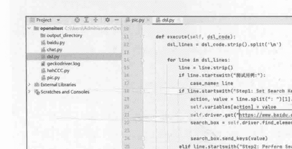

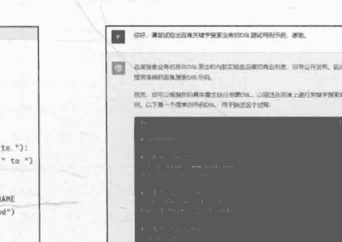

把自然语言丢给 ChatGPT，它可以自动转成 DSL 用例，再由解释器执行。这正是很多团队想做却很难做到的事，现在有了 ChatGPT 辅助就能比较顺畅地实现，对提升测试效率和质量意义很大，也适用于测试、开发、产品等多角色协作。

## 第 5 章 用 ChatGPT 批量生成接口测试用例

接口测试在开发全流程里起着承上启下的作用，用来校验模块间的交互是否可靠。比如协议消息被篡改时，系统能否正确应对，避免宕机或安全风险。

### 5.1 ChatGPT 在接口测试中的价值

接口测试是保障系统协同的关键。传统方式多靠测试人员经验手工编写，容易出现覆盖不足。ChatGPT 擅长理解和生成文本，是编写接口测试用例的好帮手。

#### 5.1.1 快速读懂需求和接口规范

把需求规格说明书和接口文档喂给 ChatGPT，它能提炼摘要、要点、疑问清单，帮助测试人员把握测试范围和重点。

以电商购物车接口为例，原文档篇幅很长。借助 ChatGPT 只需导入文档，就能迅速得到摘要并列出所有与购物车相关的功能点，让测试重点更清晰，也保证用例更全面。

#### 5.1.2 生成可复用的用例模板

ChatGPT 能协助产出包含输入数据、操作步骤、预期结果的用例模板。提供接口描述和测试目标后，它会自动给出基础结构。模板化后能加速编写，也保证风格统一。

比如社交媒体发帖接口，需要验证用户发布功能。描述完接口规范和目标后，ChatGPT 就能生成包含帖子内容、发布流程、预期结果的模板，测试人员只需填入具体值，无需从零搭建。

以电商购物车接口为例，ChatGPT 生成的接口文档样例如下所示。

```
ChatGPT 生成的接口文档
接口名称：add_to_cart
接口概述：该接口用于将指定商品添加到购物车。
请求方式：POST 请求
请求 URL：https://example.com/api/add_to_cart
参数列表：
• item_id（商品 ID）
参数描述：用于指定要添加到购物车的商品的唯一标识。
参数类型：整数
是否必填：是
• num（数量）
参数描述：指定要添加的商品数量。
参数类型：整数
是否必填：是
请求示例：
POST 请求 https://example.com/api/add_to_cart
请求体：
{
"item_id": 12345,
"num": 2
}
响应示例：
{
"status": 200,
"message": "添加商品到购物车成功",
"data": {
"cart_total_items": 5
}
}
响应字段说明：
status：标识业务是否成功的状态码。
- 200 表示请求成功，商品成功添加到购物车。
- 其他状态码可根据具体情况自行定义。
message：状态信息，对状态码的详细描述。
data：包含响应数据。
- cart_total_items：购物车中的总商品数量。
```

#### 5.1.3 全面覆盖边界条件

接口测试必须重视各种输入的边界。ChatGPT 可以帮助批量生成边界相关的用例。

购物车接口的商品数量输入就要兼顾正常和异常。异常场景可能包含小数点、字母、全角数字、中文、货币符号等特殊字符。不同数据库字段的数值范围也不同，例如 MySQL 的 SMALLINT 占 2 字节，取值范围是 -32768 到 32767。因此需要设计超过上限、低于下限、等于上下限、0 值等多种边界。

实践中，有些数值在 UI 层无法提交，但通过协议直连接口发送请求，如果后端未校验、数据库也未加约束，数据仍可能写入，造成存储异常等严重后果。

例如购物车单商品数量上限设为 9999，按边界值法设计得到的用例如下，ChatGPT 生成的边界用例如下所示。

```
ChatGPT 生成的边界值接口测试用例

用例编号：TC001
用例名称：添加数量为 0 的商品

输入参数：

item_id：123456
num：0

预期结果：

添加失败，提示数量不能为 0
......
用例编号：TC005
```

用例名称：添加超过库存的商品

输入参数：

item_id: 123456

num: 10000

预期结果：

添加失败，提示超过库存

#### 5.1.4 自动产出测试数据

手工造数是接口测试的痛点。ChatGPT 可以根据类型和范围要求生成大量测试数据组合，减轻人工负担。

以在线酒店预订的用户登录接口为例，需要用户名、密码、手机号、邮箱。ChatGPT 可以批量生成多条差异化数据，这里以生成 10000 条 user 表数据演示。向 ChatGPT 输入提示词后即可获得 Python 脚本，运行后得到 SQL 文件。ChatGPT 生成的部分 SQL 文件如图5-1 所示。

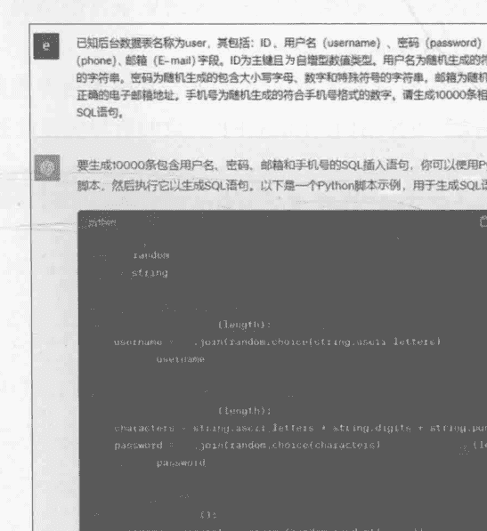

图 5-1 ChatGPT 生成的部分 SQL 文件

ChatGPT 生成的完整 SQL 文件如下所示。

## ChatGPT 生成的完整 SQL 文件

要生成 10000 条包含用户名、密码、邮箱和手机号的 SQL 插入语句，可以用 Python 写脚本批量生成。以下是一个示例脚本，用于生成对应的 SQL 语句：

```python
import random
import string

# 生成符合长度要求的随机用户名
def generate_username(length):
    username = ''.join(random.choice(string.ascii_letters) for _ in range(length))
    return username

# 生成包含大小写字母、数字和特殊符号的随机密码
def generate_password(length):
    characters = string.ascii_letters + string.digits + string.punctuation
    password = ''.join(random.choice(characters) for _ in range(length))
    return password

# 生成格式正确的随机邮箱地址
def generate_email():
    username = generate_username(random.randint(5, 10))
    domain = ''.join(random.choice(string.ascii_lowercase) for _ in range(5))
    extension = random.choice(['com', 'net', 'org'])
    email = f"{username}@{domain}.{extension}"
    return email

# 生成符合手机号格式的随机数字
def generate_phone_number():
    area_code = random.randint(100, 999)
    exchange = random.randint(100, 999)
    subscriber_number = random.randint(1000, 9999)
    phone_number = f"({area_code}) {exchange}-{subscriber_number}"
    return phone_number

# 生成 10000 条 SQL 插入语句
sql_statements = []
for _ in range(10000):
    username = generate_username(8)
    password = generate_password(12)
    email = generate_email()
    phone_number = generate_phone_number()
    # 构建插入语句
    sql = f"INSERT INTO user (username, password, Email, phone) VALUES ('{username}', '{password}', '{email}', '{phone_number}');"
    sql_statements.append(sql)

# 保存 SQL 语句到文件
with open("insert_data.sql", "w") as file:
    for statement in sql_statements:
        file.write(statement + "\n")
```

这段程序会自动产出 1 万条 INSERT 指令，把数据塞进叫做 user 的表里。参数可按实际使用的数据库引擎和业务场景自行调整，确保与已有表结构兼容。最终的输出会写入 insert_data.sql 文件中。

#### 5.1.5 用例迭代与维护

产品在不断演进，配套的测试集也必须同步跟进。ChatGPT 能在新规范、新需求落地时，帮测试同学把既有案例重新梳理，让测试资产始终对齐到最新版本。

以邮件客户端的发送功能为例，随着邮件格式标准和附件限制的调整，相关验证点需要同步修订。借助模型辅助，案例改写能够迅速完成，适配新规则的同时把人工维护负担压到最低。

#### 5.1.6 一键生成测试代码

面向 Postman、JMeter、pytest 等常见工具与框架，模型都能输出可直接运行的脚本。只要把接口要素与期望场景描述清楚，通常就能拿到可用代码。

就前面提到的购物车操作而言，模型产出的 JMeter 脚本片段如下。

```xml
<?xml version="1.0" encoding="UTF-8"?>
<jmeterTestPlan version="1.2" properties="5.0" jmeter="5.5">
  <hashTree>
    <TestPlan guiclass="TestPlanGui" testclass="TestPlan" testname="测试计划">
      <stringProp name="TestPlan.comments"></stringProp>
      <boolProp name="TestPlan.functional_mode">false</boolProp>
      <boolProp name="TestPlan.tearDown_on_shutdown">true</boolProp>
      <boolProp name="TestPlan.serialize_threadgroups">false</boolProp>
      <elementProp name="TestPlan.user_defined_variables" elementType="Arguments" guiclass="ArgumentsPanel" testclass="Arguments" testname="用户定义的变量" enabled="true">
        <collectionProp name="Arguments.arguments"/>
      </elementProp>
      <stringProp name="TestPlan.user_define_classpath"></stringProp>
    </TestPlan>
    <hashTree>
      <ThreadGroup guiclass="ThreadGroupGui" testclass="ThreadGroup" testname="线程组">
        <stringProp name="ThreadGroup.on_sample_error">continue</stringProp>
        <elementProp name="ThreadGroup.main_controller" elementType="LoopController" guiclass="LoopControlPanel" testclass="LoopController" testname="循环控制器" enabled="true">
          <boolProp name="LoopController.continue_forever">false</boolProp>
          <stringProp name="LoopController.loops">1</stringProp>
        </elementProp>
        <stringProp name="ThreadGroup.num_threads">1</stringProp>
        <stringProp name="ThreadGroup.ramp_time">1</stringProp>
        <boolProp name="ThreadGroup.scheduler">false</boolProp>
        <stringProp name="ThreadGroup.duration"></stringProp>
        <stringProp name="ThreadGroup.delay"></stringProp>
        <boolProp name="ThreadGroup.same_user_on_next_iteration">true</boolProp>
      </ThreadGroup>
      <hashTree>
        <HTTPSamplerProxy guiclass="HttpTestSampleGui" testclass="HTTPSamplerProxy" testname="HTTP 请求" enabled="true">
          <elementProp name="HTTPsampler.Arguments" elementType="Arguments" guiclass="HTTPArgumentsPanel" testclass="Arguments" testname="用户定义的变量" enabled="true">
            <collectionProp name="Arguments.arguments">
              <elementProp name="item_id" elementType="HTTPArgument">
                <boolProp name="HTTPArgument.always_encode">false</boolProp>
                <stringProp name="Argument.value">123456</stringProp>
                <stringProp name="Argument.metadata">=</stringProp>
                <boolProp name="HTTPArgument.use_equals">true</boolProp>
                <stringProp name="Argument.name">item_id</stringProp>
              </elementProp>
              <elementProp name="num" elementType="HTTPArgument">
                <boolProp name="HTTPArgument.always_encode">false</boolProp>
                <stringProp name="Argument.value">1</stringProp>
                <stringProp name="Argument.metadata">=</stringProp>
                <boolProp name="HTTPArgument.use_equals">true</boolProp>
                <stringProp name="Argument.name">num</stringProp>
              </elementProp>
            </collectionProp>
          </elementProp>
          <stringProp name="HTTPSampler.domain">www.example.com</stringProp>
          <stringProp name="HTTPSampler.port"></stringProp>
          <stringProp name="HTTPSampler.protocol">http</stringProp>
          <stringProp name="HTTPSampler.contentEncoding"></stringProp>
          <stringProp name="HTTPSampler.path">/cart/add</stringProp>
          <stringProp name="HTTPSampler.method">POST</stringProp>
          <boolProp name="HTTPSampler.follow_redirects">true</boolProp>
          <boolProp name="HTTPSampler.auto_redirects">false</boolProp>
          <boolProp name="HTTPSampler.use_keepalive">true</boolProp>
          <boolProp name="HTTPSampler.DO_MULTIPART_POST">false</boolProp>
          <stringProp name="HTTPSampler.embedded_url_re"></stringProp>
          <stringProp name="HTTPSampler.connect_timeout"></stringProp>
          <stringProp name="HTTPSampler.response_timeout"></stringProp>
        </HTTPSamplerProxy>
        <hashTree>
          <ResponseAssertion guiclass="AssertionGui" testclass="ResponseAssertion" testname="响应断言" enabled="true">
            <collectionProp name="Assertion.test_strings">
              <stringProp name="49586">200</stringProp>
            </collectionProp>
            <stringProp name="Assertion.custom_message"></stringProp>
            <stringProp name="Assertion.test_field">Assertion.response_code</stringProp>
            <boolProp name="Assertion.assume_success">false</boolProp>
            <intProp name="Assertion.test_type">8</intProp>
          </ResponseAssertion>
          <hashTree/>
        </hashTree>
      </hashTree>
    </hashTree>
  </hashTree>
</jmeterTestPlan>
```

#### 5.1.7 新旧接口自动比对

接口在版本迭代中发生变化时，对应的验证集也需要更新。ChatGPT 能对照新旧规范，自动给出修改建议。

比如购物车接口的变更，新旧说明如下。

| 新旧接口文档示例 |

| :--- |

| 原接口： |

| 接口:add_to_cart |

| 方法:POST |

| 参数:item_id, num |

| ...... |

| 新接口： |

| 接口:add_to_cart |

| 方法:POST |

| 参数:item_id, num, selected |

| ...... |

模型很快捕捉到新版多了一个 selected 字段，并给出如下改进思路。

> ChatGPT 给出的更新测试用例的建议

- 对比后发现新版在原有基础上新增了 selected 字段，原有案例需补充该字段的覆盖。
- selected 支持 0 或 1，用来标识是否被选中，需要新增逻辑分支的验证。
- 为保持向后兼容，仍需保留不传 selected 时的验证。

这样就不用人工逐项核对差异，能显著提升用例调整效率。

### 5.2 用例生成的标准流程

借助 ChatGPT 产出接口验证案例，通常会经历以下几个关键环节。

（1）收集接口资料
先整理接口名称、请求方式、入参、出参等信息，这是模型生成案例所依赖的基础素材。

这一步很关键，它为模型提供了背景，让模型理解接口的功能边界。也是人与模型协作的起点，确保模型能基于具体上下文进行创造性产出。研发侧通常会提供正式的接口文档，作为测试的主要依据。

（2）提交接口资料
把整理好的文档与需求输入模型，并明确说明期望生成的案例类型。

这是启动生成的核心动作。通过提供这些信息，测试同学可以传达验证方向与目标，清晰列出需要覆盖的功能点、边界条件、异常分支等。模型会据此生成对应的案例。

### 5.3 与主流测试工具协同

本节介绍 ChatGPT 如何与 Postman、JMeter 以及 Python Requests 库配合，提升接口验证效率。

#### 5.3.1 与 Postman 联动

Postman 凭借直观的图形化操作界面成为开发者常用的接口测试工具，可以很方便地搭建、管理和运行测试用例。借助 ChatGPT 的配合，能够自动完成 Postman 接口测试脚本的生成与执行。

下面展示一段由 ChatGPT 产出的 Postman 示例代码。

```
ChatGPT 生成的 Postman 示例代码片段
const postman = require('postman-request');
// ChatGPT 生成的接口测试用例
const testCase = {
    method: 'POST',
    endpoint: 'https://api.example.com/login',
    headers: { 'Content-Type': 'application/json' },
    body: { username: 'testuser', password: 'testpassword' },
    expectedResponse: { statusCode: 200, body: { success: true } },
};

// 创建 Postman 请求
postman.post(testCase.endpoint, { json: testCase.body, headers: testCase.headers },
(error, response, body) => {
    if (response.statusCode === testCase.expectedResponse.statusCode && body ===
testCase.expectedResponse.body) {
        console.log('Test case passed');
    } else {
        console.log('Test case failed');
    }
});
```

#### 5.3.2 ChatGPT 与 JMeter 的协作

JMeter 是兼顾性能压测和接口验证的利器。结合 ChatGPT 使用时，可以快速生成符合 JMX 规范的测试脚本文件，脚本既能直接运行，也方便后续手动调优以满足具体的接口测试需求。

下文即是 ChatGPT 输出的 JMX 格式样例。

```
<HTTPSamplerProxy guiclass="HttpTestSampleGui" testclass="HTTPSamplerProxy" testname="API Test" enabled="true">
    <elementProp name="HTTPsampler.Arguments" elementType="Arguments" guiclass="HTTPArguments Panel" testclass="HTTPArguments" testname="User Defined Variables" enabled="true">
        <collectionProp name="Arguments.arguments">
            <elementProp name="username" elementType="HTTPArgument">
                <boolProp name="HTTPArgument.always_encode">false</boolProp>
                <stringProp name="Argument.value">testuser</stringProp>
                <stringProp name="Argument.metadata">=</stringProp>
            </elementProp>
            <elementProp name="password" elementType="HTTPArgument">
                <boolProp name="HTTPArgument.always_encode">false</boolProp>
                <stringProp name="Argument.value">testpassword</stringProp>
                <stringProp name="Argument.metadata">=</stringProp>
            </elementProp>
        </collectionProp>
    </elementProp>
    <stringProp name="HTTPSampler.domain">api.example.com</stringProp>
    <stringProp name="HTTPSampler.path">/login</stringProp>
    <stringProp name="HTTPSampler.method">POST</stringProp>
    <boolProp name="HTTPSampler.follow_redirects">true</boolProp>
    <boolProp name="HTTPSampler.auto_redirects">false</boolProp>
    <boolProp name="HTTPSampler.use_keepalive">true</boolProp>
    <boolProp name="HTTPSampler.DO_MULTIPART_POST">false</boolProp>
    <stringProp name="HTTPSampler.embedded_url_re"></stringProp>
</HTTPSamplerProxy>
```

后续章节会以飞机订票系统为实例，演示 ChatGPT 如何生成用例并转为可执行脚本，具体细节暂不展开。

#### 5.3.3 ChatGPT 与 Python Requests 库的协作

Requests 是 Python 生态里最常用的 HTTP 请求库，支持快速发起请求并验证接口。配合 ChatGPT 可以自动化完成用例编写和测试运行。

下面给出一段基于 Requests 库的测试脚本示例，由 ChatGPT 生成。

```
import requests
# ChatGPT 生成的测试数据
test_data = {
    "username": "testuser",
    "password": "testpassword"
}
# 接口地址
url = "https://api.example.com/login"

# 发送 POST 请求
response = requests.post(url, json=test_data)
# 验证响应
expected_response = {
    "statusCode": 200,
    "body": {"success": True}
}
if response.status_code == expected_response["statusCode"] and response.json() ==
expected_response["body"]:
    print("Test case passed")
else:
    print("Test case failed")
```

### 5.4 接口测试和性能测试案例环境的搭建与启动

本部分将手把手说明飞机订票系统的部署与启动流程，该系统后续将被用作接口及性能测试的实操案例。

#### 5.4.1 文件的下载

关注公众号“AI 智享空间”，发送关键词“案例环境”即可获得下载地址。下载 WebTours.rar 并解压后，可看到图 5-2 的目录结构。


#### 5.4.2 案例系统的环境搭建

双击 strawberry-perl-5.10.1.0.msi 启动安装向导，界面如 图 5-3。

勾选同意许可协议“I accept the terms in the License Agreement”，点击“Install”。随后出现如图 5-4 的进度界面，点击“Finish”完成 Perl 的部署。

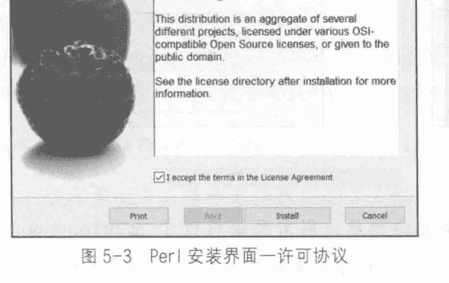

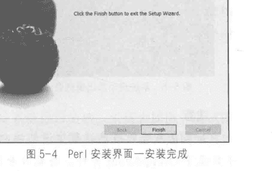

#### 5.4.3 系统的启动

打开 WebTours 目录，双击 StartServer.bat 即可唤起服务，效果如图 5-5 所示。

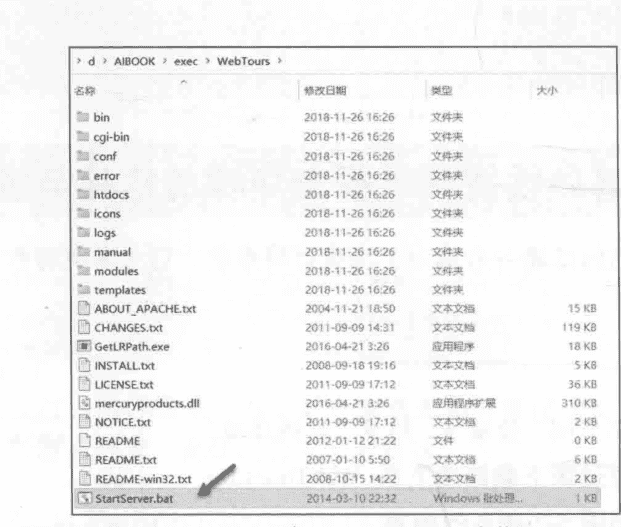

运行后会弹出如图 5-6 的命令行窗口，用 Ctrl+C 即可结束进程。

服务启动成功后，浏览器中输入 “http://IP地址:端口号/webtours” 访问，默认端口为 1080。本机部署时访问地址为 “http://127.0.0.1:1080/webtours”，主界面如图 5-7 所示。


### 注意

若部署时出现端口占用，可进入 WebTours\conf 目录修改 httpd.conf，将端口改为未被占用的值，示例如图 5-8 所示。


### 5.5 ChatGPT 生成接口文档的方法与实践

接口文档是开发与测试协同的关键纽带。本节将演示如何借助 ChatGPT 自动化产出飞机订票系统的用户接口文档。

#### 5.5.1 接口文档的重要性

接口文档相当于系统各部件之间的沟通桥梁，是项目落地的基石。它清晰定义了模块间的调用协议与数据格式，为架构设计提供依据。

一份质量良好的接口文档能带来多重价值。一方面，它推动组件解耦，提升模块独立性和复用性，在分布式复杂系统中尤为关键，为前后端等不同团队提供统一规范，保证理解一致、各自推进又能顺利集成。

另一方面，它是测试工作的依据。测试人员依托文档编写用例，校验输入输出的正确性，提升测试覆盖率，降低遗漏风险。

同时，统一的接口文档促进跨岗位协作，让研发、测试、产品等角色基于同一认知沟通，减少口头交接的歧义，加快学习曲线。

此外，随着自动化趋势增强，利用 ChatGPT 等工具自动生成接口文档，可大幅提升产出效率并保持文档与代码同步，确保信息实时准确，进一步提高研发测试效率。

#### 5.5.2 ChatGPT 生成接口文档的方法

不少公司已有规范的接口文档供研发测试参考，但也有企业缺失标准文档，导致开发、测试和维护都受阻。此时借助 ChatGPT 快速生成规范文档非常必要，整体流程可分为以下步骤。

第一步是输入清晰的关键信息，如接口名、参数列表及说明、请求响应示例等，为模型提供明确边界，确保输出准确可用。

第二步，基于上述信息，ChatGPT 生成包含接口概述、参数明细、请求响应示例的文档初稿，保证结构统一、易读易用。

第三步是对初稿进行迭代优化。用户可多轮对话补充细节，比如参数类型、取值范围、特定场景示例等，通过交互式修正提升文档的完整性和精准度。

在实际开发测试中，文档的准确与易读直接影响项目进度。借助 ChatGPT 自动生成，可节省人力时间，促进团队沟通，加速交付。

#### 5.5.3 ChatGPT 生成接口文档实践案例

接口文档的制作方式多样，手工编写、Swagger、Postman、Apiary 或 ChatGPT 自动生成均可。本文仅聚焦 ChatGPT 生成方式。

以飞机订票系统的用户注册功能为例，其注册页如图 5-9 所示。

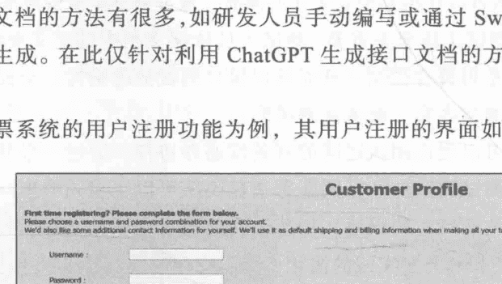

图 5-9 用户注册的界面

（1）提供关键信息

本案例输入的关键信息如下：

接口名称：用户注册接口。

接口描述：新用户注册接口，注册内容包括用户名、姓名、地址、邮编等。

请求地址：http://127.0.0.1:1080/cgi-bin/login.pl。

请求方式：POST。

请求体参数：

| 参数名 | 是否必填 | 描述 |

| :--- | :--- | :--- |

| username | 必填 | 用户名 |

| password | 必填 | 密码 |

| passwordConfirm | 必填 | 确认密码 |

| firstName | 选填 | 名字 |

| lastName | 选填 | 姓氏 |

| address1 | 选填 | 街道地址 |

| address2 | 选填 | 城市邮编 |

| register.x | 选填 | 注册 x 坐标 |

| register.y | 选填 | 注册 y 坐标 |

响应示例：HTML 格式页面，注册成功 显示 Thank you, <b>{username}</b>

（2）ChatGPT 生成接口文档初稿

输入上述信息后，即可让 ChatGPT 输出用户注册接口的初稿，示例如图 5-10 所示。


模型提供了两个版本供挑选，分别为 Response 1 和 Response 2，分别见图 5-11、图 5-12 所示。

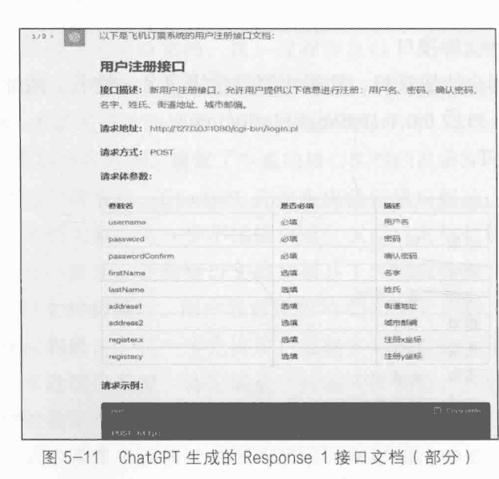

图 5-11 ChatGPT 生成的 Response 1 接口文档（部分）

以下内容为 ChatGPT 生成的 Response 1 接口文档。

### ChatGPT 生成的 Response 1 接口文档

以下是飞机订票系统的用户注册接口文档：

**用户注册接口**

接口描述：新用户注册接口，允许用户提供以下信息进行注册：用户名、密码、确认密码、名字、姓氏、街道地址、城市邮编。

请求地址： http://127.0.0.1:1080/cgi-bin/login.pl

请求方式： POST

请求体参数：

| 参数名 | 是否必填 | 描述 |

|---|---|---|

| username | 必填 | 用户名 |

| password | 必填 | 密码 |

| passwordConfirm | 必填 | 确认密码 |

| firstName | 选填 | 名字 |

| lastName | 选填 | 姓氏 |

| address1 | 选填 | 街道地址 |

| address2 | 选填 | 城市邮编 |

| register.x | 选填 | 注册 x 坐标 |

| register.y | 选填 | 注册 y 坐标 |

请求示例：

```
POST http://127.0.0.1:1080/cgi-bin/login.pl
Body:
{
    "username": "sample_user",
    "password": "password123",
    "passwordConfirm": "password123",
    "firstName": "John",
    "lastName": "Doe",
    "address1": "123 Main St",
    "address2": "City, Zip Code",
    "register.x": "100",
    "register.y": "200"
}
```

响应示例：

如果注册成功，服务器将返回一个 HTML 格式的页面，显示以下内容：

```
Thank you, <b>sample_user</b>
```

如果注册失败，服务器应该返回相应的错误信息，例如用户名已被占用或密码不匹配等信息。

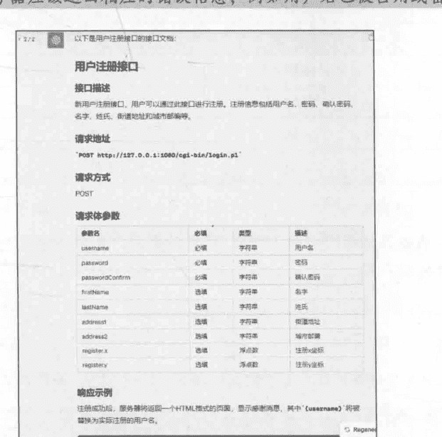

以下内容为 ChatGPT 生成的 Response 2 接口文档。

## ChatGPT 生成的 Response 2 接口文档

以下是用户注册接口的接口文档：

### 用户注册接口全貌

**接口功能说明**
面向新用户的注册入口，通过该接口完成账号创建。注册时需要提交的字段包括用户名、密码、确认密码，以及可选的名字、姓氏、街道地址、城市邮编等个人信息。

**调用地址**
POST http://127.0.0.1:1080/cgi-bin/login.pl

**请求方法**
POST

**请求体参数**
参数名 username 为必填，类型字符串，用来标识用户名；password 为必填，类型字符串，用作密码；passwordConfirm 为必填，类型字符串，用于校验密码是否一致。firstName、lastName、address1、address2 均为选填字符串，分别对应名字、姓氏、街道地址、城市邮编。register.x 与 register.y 为选填浮点数，记录注册时的坐标位置。

**响应示例**
注册成功后，服务端会返回一段 HTML 页面，页面中包含致谢文案，文案里的 `{username}` 会被替换成实际提交的用户名。

```
Thank you, <b>{username}</b>
```

**异常响应示例**
若注册过程出现问题，服务端可能返回对应的错误提示，例如用户名已被占用、两次输入的密码不一致等。

```
Registration failed. Please check your input and try again.
```

以上即为用户注册接口的文档片段，可据此进行功能设计与实现，整体来看是比较清晰的。

不难看出，两种生成思路都能把接口文档搭起来，但笔者更倾向于 Response 2 的表述，因为信息覆盖更完整、更周全。

如果想让团队阅读更方便，还可以让 ChatGPT 输出符合 OpenAPI 3.0 规范的版本，示例如图 5-13。


图 5-13 ChatGPT 生成的符合 OpenAPI 3.0 规范的接口文档（部分）

为什么要产出 OpenAPI 3.0 格式的文档呢？简单说，OpenAPI 3.0 即 OAS 3.0，专门用来描述 RESTful API，是 Swagger 2.0 的升级版。它能提供更丰富的规范与文档，便于开发者理解与调用。该规范以 JSON 或 YAML 呈现，可读可写性都很强，配合各类工具即可生成可视化文档，提升 API 的互操作性与跨团队协作效率。

下面是 ChatGPT 输出的 OpenAPI 3.0 规范的用户注册接口示例。

```
ChatGPT 生成的符合 OpenAPI 3.0 规范的接口文档

以下是用户注册接口的 OpenAPI 3.0.0 格式文档：

openapi: 3.0.0
info:
  title: 飞机订票系统
  description: 飞机订票系统用户注册接口文档
  version: 1.0.0
paths:
  /cgi-bin/login.pl:
    post:
      summary: 新用户注册接口
      description: 新用户注册接口，用户可以通过此接口进行注册。注册信息包括用户名、密码、确认密码、名字、姓氏、街道地址和城市邮编等。
      requestBody:
        required: true
        content:
          application/x-www-form-urlencoded:
            schema:
              type: object
              properties:
                username:
                  type: string
                  description: 用户名
                password:
                  type: string
                  description: 密码
                passwordConfirm:
                  type: string
                  description: 确认密码
                firstName:
                  type: string
                  description: 名字
                lastName:
                  type: string
                  description: 姓氏
                address1:
                  type: string
                  description: 街道地址
                address2:
                  type: string
                  description: 城市邮编
                register.x:
                  type: number
                  description: 注册 x 坐标
                register.y:
                  type: number
                  description: 注册 y 坐标
responses:
  '200':
    description: 注册成功
    content:
      text/html:
        schema:
          type: string
        example: 'Thank you, <b>{username}</b>'
  '400':
    description: 注册失败
    content:
      text/html:
        schema:
          type: string
        example: 'Registration failed. Please check your input and try again'
```

这是 OpenAPI 3.0.0 格式的用户注册接口文档，可直接用于 API 文档工具或生成可视化页面，便于查阅和理解。希望对你有帮助。

ChatGPT 很快就生成了飞机订票系统用户注册接口的 OpenAPI 3.0 YAML 文档，还说明了如何使用，十分贴心。将代码粘到 Swagger Editor 中即可正常渲染，如图 5-14 所示。

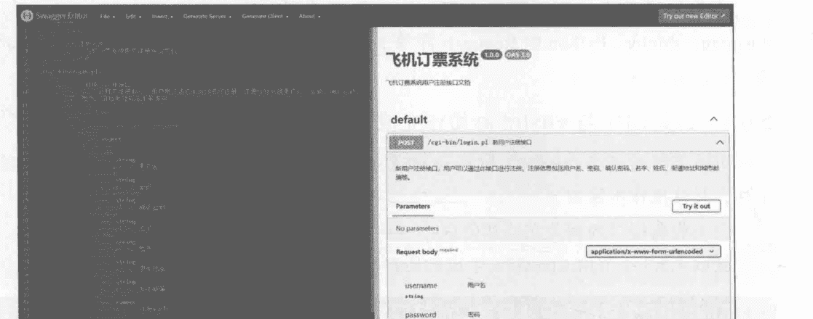

可以按照前文提及的方法继续为其他接口生成文档，这里不再展开。

无论采用何种语言或框架，产出符合 Swagger 或 OpenAPI 3.0 规范文档的关键在于选用合适的工具与注解来描述 API。

文档生成的过程并非重点，重点是生成的文档要准确无误、简明易懂，让相关人员能够快速理解。实际开发中，研发人员修改代码后，参数或返回值也可能变化，这时应当及时同步更新文档。

部分企业甚至没有接口文档，会给测试带来很大困扰。测试人员既要分析输入输出，又要补写文档，容易出现漏测。笔者建议文档的编写与维护由研发人员负责，尤其在 ChatGPT 辅助下效率更高。也有企业基于 OpenAI API 自研工具或平台，自动生成并发布接口文档，大幅提升研发和测试效率。

（3）多轮对话打磨优化
使用 ChatGPT 生成接口文档时往往难以一次成型，通常需要多轮对话来完善。可以根据实际情况调整提示词，补充数据类型、取值范围、示例输入等细节，从而获得更满意的结果。

### 5.6 ChatGPT 协同接口测试工具的实践指南
本节以飞机订票系统的用户注册接口测试为例，介绍 ChatGPT 如何与 Postman、JMeter、Python Requests 等主流工具配合，自动生成接口测试用例，提升测试效率。

#### 5.6.1 ChatGPT 联合 Postman 完成接口测试
下面以 Postman 协作完成用户注册接口测试为例，具体步骤如下。

（1）收集接口相关文档与信息
获取 5.5.3 小节由 ChatGPT 生成的用户注册接口文档，内容如下。

```
ChatGPT 生成的用户注册接口的接口文档
以下是用户注册接口的接口文档：
用户注册接口
接口描述
新用户注册接口，用户可以通过此接口进行注册。注册信息包括用户名、密码、确认密码、名字、姓氏、街道地址和城市邮编等。

请求地址
POST http://127.0.0.1:1080/cgi-bin/login.pl

请求方式
POST

请求体参数

| 参数名 | 必填 | 类型 | 描述 |
|---|---|---|---|
| username | 必填 | 字符串 | 用户名 |
| password | 必填 | 字符串 | 密码 |
| passwordConfirm | 必填 | 字符串 | 确认密码 |
| firstName | 选填 | 字符串 | 名字 |
| lastName | 选填 | 字符串 | 姓氏 |
| address1 | 选填 | 字符串 | 街道地址 |
| address2 | 选填 | 字符串 | 城市邮编 |
| register.x | 选填 | 浮点数 | 注册x坐标 |
| register.y | 选填 | 浮点数 | 注册y坐标 |

响应示例

注册成功后，服务器将返回一个 HTML 格式的页面，显示感谢消息，其中{username}将被替换为实际注册的用户名。

```

Thank you, <b>{username}</b>

```

错误响应示例

如果注册过程中发生错误，服务器可能返回相应的错误信息，如用户名已存在、密码不匹配等。

```

Registration failed. Please check your input and try again.

```

这是用户注册接口的接口文档，您可以使用这些信息来设计和实现相应的功能。希望这对您有所帮助！
```

（2）输入接口信息并提出需求
在 ChatGPT 中提交已收集的接口文档，并明确测试用例生成的诉求。例如希望覆盖正常注册和密码不匹配两种场景，并输出 Postman 测试脚本。因此输入的提示词如 Feedback。

需要强调两点。

- 务必明确要求输出 Postman 测试脚本，且符合 Collection v2.1 格式，否则生成的 JSON 可能无法导入。
- 在撰写“要求”部分时，可多次提及用例设计方法或具体考量，以引导生成质量。

（3）生成测试用例
ChatGPT 很快给出了满足要求的初版用例，即符合 Collection v2.1 格式的 Postman 脚本，如图 5-16 所示。

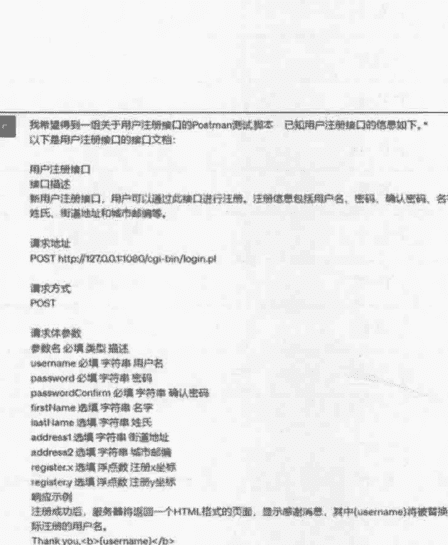


ChatGPT 生成的 Postman 测试用例脚本如下所示。

```
ChatGPT 生成的 Postman 测试用例脚本

以下是符合 Collection v2.1 格式要求的 Postman 测试用例脚本，覆盖了正常注册和密码不匹配两种情况的测试：

{
    "info": {
        "_postman_id": "09e63d0d-9a62-4c3b-8a2d-76f352a12312",
        "name": "用户注册接口测试",
        "description": "测试用户注册接口的正常和异常情况",
        "schema": "https://schema.getpostman.com/json/collection/v2.1.0/collection.json"
    },
    "item": [
        {
            "name": "正常注册",
            "request": {
                "method": "POST",
                "header": [],
                "body": {
                    "mode": "urlencoded",
                    "urlencoded": [
                        {
                            "key": "username",
                            "value": "testuser",
                            "type": "text"
                        },
                        {
                            "key": "password",
                            "value": "testpassword",
                            "type": "text"
                        },
                        {
                            "key": "passwordConfirm",
                            "value": "testpassword",
                            "type": "text"
                        },
                        {
                            "key": "firstName",
                            "value": "John",
                            "type": "text"
                        },
                        {
                            "key": "lastName",
                            "value": "Doe",
                            "type": "text"
                        },
                        {
                            "key": "address1",
                            "value": "123 Main St",
                            "type": "text"
                        },
                        {
                            "key": "address2",
                            "value": "98765",
                            "type": "text"
                        },
                        {
                            "key": "register.x",
                            "value": "1.23",
                            "type": "text"
                        },
                        {
                            "key": "register.y",
                            "value": "4.56",
                            "type": "text"
                        }
                    ]
                },
                "url": {
                    "raw": "http://127.0.0.1:1080/cgi-bin/login.pl",
                    "protocol": "http",
                    "host": [
                        "127",
                        "0",
                        "0",
                        "1"
                    ],
                    "port": "1080",
                    "path": [
                        "cgi-bin",
                        "login.pl"
                    ]
                }
            },
            "response": []
        },
        {
            "name": "密码不匹配",
            "request": {
                "method": "POST",
                "header": [],
                "body": {
                    "mode": "urlencoded",
                    "urlencoded": [
                        {
                            "key": "username",
```

这份 Postman 脚本可以直接导入客户端运行，用来检查用户注册接口在正常流程和异常流程下的表现，希望对你有所帮助！

翻看 ChatGPT 生成的脚本，可以看到它正好覆盖了注册成功和两次密码不一致这两种校验，完全符合我的预期，于是把整段代码拷贝下来保存到了 d:\AIBOOK\S_PM_WebTours.json。

## （4）接口测试用例评审

通常来说，刚拟好的接口用例都会先由测试团队内部过一遍，具体评审细节这里就不展开了。对本次 AI 生成的 Postman 脚本做评估，因为我只想验证注册正常和密码不匹配两种场景下接口能否正常工作，生成的脚本已经完全满足这一需求，暂时无需再做扩展。实际工作中要更灵活一些，先判断 ChatGPT 产出的脚本是否达到预期目标，再决定后续如何处理。

下面就是 S_PM_WebTours.json 中的脚本内容。
```json
{
    "info": {
        "_postman_id": "09e63d0d-9a62-4c3b-8a2d-76f352a12312",
        "name": "用户注册接口测试",
        "description": "测试用户注册接口的正常和异常情况",
        "schema": "https://schema.getpostman***/json/collection/v2.1.0/collection.json"
    },
    "item": [
        {
            "name": "正常注册",
            "request": {
                "method": "POST",
                "header": [],
                "body": {
                    "mode": "urlencoded",
                    "urlencoded": [
                        {
                            "key": "username",
                            "value": "testuser",
                            "type": "text"
                        },
                        {
                            "key": "password",
                            "value": "testpassword",
                            "type": "text"
                        },
                        {
                            "key": "passwordConfirm",
                            "value": "testpassword",
                            "type": "text"
                        },
                        {
                            "key": "firstName",
                            "value": "John",
                            "type": "text"
                        },
                        {
                            "key": "lastName",
                            "value": "Doe",
                            "type": "text"
                        },
                        {
                            "key": "address1",
                            "value": "123 Main St",
                            "type": "text"
                        },
                        {
                            "key": "address2",
                            "value": "98765",
                            "type": "text"
                        },
                        {
                            "key": "register.x",
                            "value": "1.23",
                            "type": "text"
                        },
                        {
                            "key": "register.y",
                            "value": "4.56",
                            "type": "text"
                        }
                    ]
                }
            },
            "url": {
                "raw": "http://127.0.0.1:1080/cgi-bin/login.pl",
                "protocol": "http",
                "host": [
                    "127",
                    "0",
                    "0",
                    "1"
                ],
                "port": "1080",
                "path": [
                    "cgi-bin",
                    "login.pl"
                ]
            },
            "response": []
        },
        {
            "name": "密码不匹配",
            "request": {
                "method": "POST",
                "header": [],
                "body": {
                    "mode": "urlencoded",
                    "urlencoded": [
                        {
                            "key": "username",
                            "value": "testuser",
                            "type": "text"
                        },
                        {
                            "key": "password",
                            "value": "testpassword",
                            "type": "text"
                        },
                        {
                            "key": "passwordConfirm",
                            "value": "mismatchedpassword",
                            "type": "text"
                        }
                    ]
                }
            },
            "url": {
                "raw": "http://127.0.0.1:1080/cgi-bin/login.pl",
                "protocol": "http",
                "host": [
                    "127",
                    "0",
                    "0",
                    "1"
                ],
                "port": "1080",
                "path": [
                    "cgi-bin",
                    "login.pl"
                ]
            },
            "response": []
        }
    ]
}
```

## （5）接口测试用例迭代与完善

如果后续想让用例更完善，可以沿用前文介绍的做法，继续让 ChatGPT 补充更多边界情况，比如关键词过长、包含特殊字符等测试。受篇幅限制，这部分暂不展开。此时的 S_PM_WebTours.json 就作为本阶段最终的 Postman 测试脚本使用。

接下来要验证的就是这份由 ChatGPT 生成的脚本是否能够顺利执行。


# 第 5 章 ChatGPT 驱动的接口测试生成

1）启动 Postman 后点开“Import”入口，参照图 5-17 的位置。

在弹出的导入面板里点“files”链接，随后在系统打开文件对话框中选中 S_PM_WebTours.json，点击确定，如图 5-18。

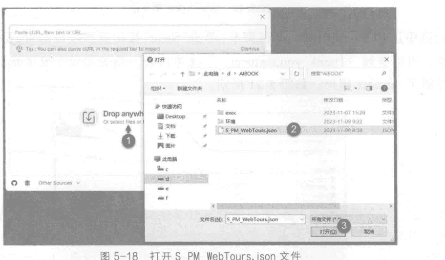

紧接着“My Workspace”里会自动出现一个名为“用户注册接口测试”的集合，集合下挂着两条接口用例，如图 5-19 所示。

# 第 5 章 用 AI 批量编写接口测试

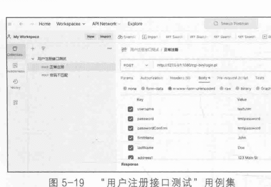

图 5-19 “用户注册接口测试”用例集

2）在执行 Postman 脚本前，先把飞机订票系统跑起来，见图 5-20。

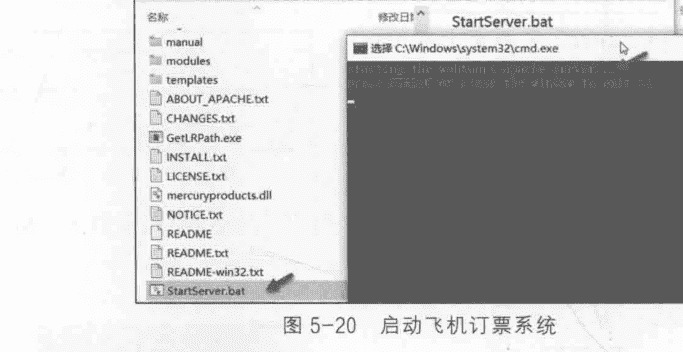

图 5-20 启动飞机订票系统

3）选中“正常注册接口测试”这条用例，点“Send”发出请求，切到“Preview”标签，就能看到“Thank you,testuser...”的返回内容，说明请求已成功送达且 testuser 已注册，如图 5-21。


图 5-21 执行正常注册接口测试用例

当然也可以直接跑整个集合。先点一下“用户注册接口测试”的名称，从下拉菜单里选“Run collection”，在运行界面点“Run 用户注册接口测试”按钮即可。

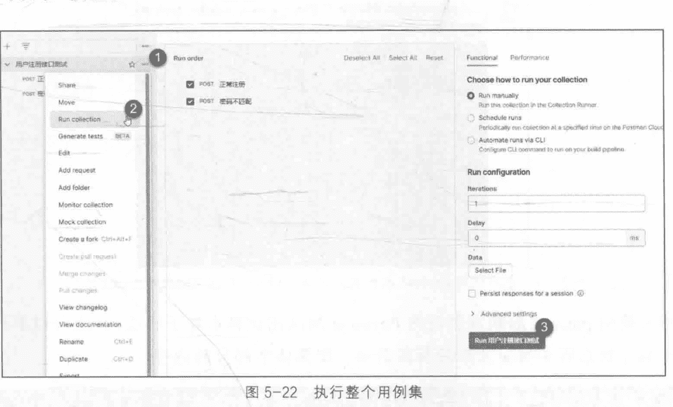

图 5-22 执行整个用例集

运行后的结果展示在图 5-23。

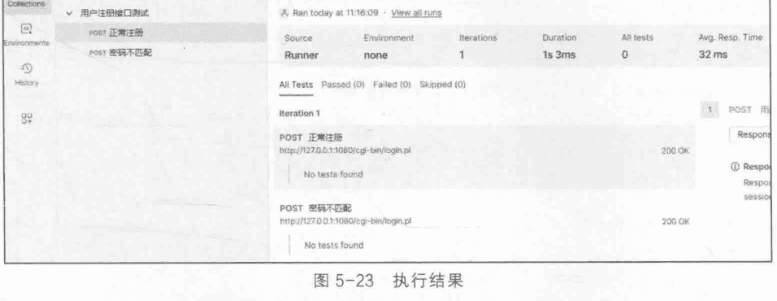

图 5-23 执行结果

如果你对 Postman 比较熟，会发现这里的用例还能再完善，比如增加响应校验。实际工作中光发请求不做断言是不够严谨的。因此可以让 ChatGPT 在脚本里补上响应状态码断言、响应文本断言等。本文通过提示词让 ChatGPT 在 Postman 脚本中加入基于 pm.test 的断言语句，展示见图 5-24。

# 第 5 章 ChatGPT 辅助的接口测试优化

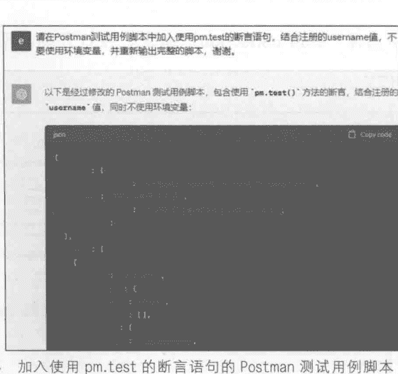

加入 pm.test 断言之后的 Postman 脚本示例如下，可见文中加粗部分已补充了状态码和返回文本的校验。

```json
{
    "info": {
        "_postman_id": "09e63d0d-9a62-4c3b-8a2d-76f352a12312",
        "name": "用户注册接口测试",
        "description": "测试用户注册接口的正常和异常情况",
        "schema": "https://schema.getpostman***/json/collection/v2.1.0/collection.json"
    },
    "item": [
        {
            "name": "正常注册",
            "request": {
                "method": "POST",
                "header": [],
                "body": {
                    "mode": "urlencoded",
                    "urlencoded": [
                        {
                            "key": "username",
                            "value": "testuser",
                            "type": "text"
                        },
                        {
                            "key": "password",
                            "value": "testpassword",
                            "type": "text"
                        },
                        {
                            "key": "passwordConfirm",
                            "value": "testpassword",
                            "type": "text"
                        },
                        {
                            "key": "firstName",
                            "value": "John",
                            "type": "text"
                        },
                        {
                            "key": "lastName",
                            "value": "Doe",
                            "type": "text"
                        },
                        {
                            "key": "address1",
                            "value": "123 Main St",
                            "type": "text"
                        },
                        {
                            "key": "address2",
                            "value": "98765",
                            "type": "text"
                        },
                        {
                            "key": "register.x",
                            "value": "1.23",
                            "type": "text"
                        },
                        {
                            "key": "register.y",
                            "value": "4.56",
                            "type": "text"
                        }
                    ]
                }
            },
            "url": {
                "raw": "http://127.0.0.1:1080/cgi-bin/login.pl",
                "protocol": "http",
                "host": [
                    "127",
                    "0",
                    "0",
                    "1"
                ],
                "port": "1080",
                "path": [
                    "cgi-bin",
                    "login.pl"
                ]
            },
            "response": [],
            "event": [
                {
                    "listen": "test",
                    "script": {
                        "exec": [
                            "pm.test(\"Status code is 200\", function () {",
                            "    pm.response.to.have.status(200);",
                            "});",
                            "pm.test(\"注册成功消息包含用户名\", function () {",
                            "    pm.expect(pm.response.text()).to.include(\"Thank you, <b>testuser</b>\");",
                            "});"
                        ],
                        "type": "text/javascript"
                    }
                }
            ]
        },
        {
            "name": "密码不匹配",
            "request": {
                "method": "POST",
                "header": [],
                "body": {
                    "mode": "urlencoded",
                    "urlencoded": [
                        {
                            "key": "username",
                            "value": "testuser",
                            "type": "text"
                        },
                        {
                            "key": "password",
                            "value": "testpassword",
                            "type": "text"
                        },
                        {
                            "key": "passwordConfirm",
                            "value": "mismatchedpassword",
                            "type": "text"
                        }
                    ]
                }
            },
            "url": {
                "raw": "http://127.0.0.1:1080/cgi-bin/login.pl",
                "protocol": "http",
                "host": [
                    "127",
                    "0",
                    "0",
                    "1"
                ],
                "port": "1080",
                "path": [
                    "cgi-bin",
                    "login.pl"
                ]
            },
            "response": [],
            "event": [
                {
                    "listen": "test",
                    "script": {
                        "exec": [
                            "pm.test(\"Status code is 400\", function () {",
                            "    pm.response.to.have.status(400);",
                            "});"
                        ],
                        "type": "text/javascript"
                    }
                }
            ]
        }
    ]
}
```

## 第 5 章 ChatGPT 生成接口测试的可行性验证

```javascript
pm.test("注册失败消息包含错误信息", function () {
    pm.expect(pm.response.text()).to.include("Registration failed. Please check your input and try again");
});
```

该脚本借助 pm.test() 方法，对正常注册和密码不一致两种场景的返回信息进行了校验。整体效果相当实用。

到此可以确认，ChatGPT 产出的 Postman 测试脚本是可以直接运行的。借助 ChatGPT 还能为脚本追加断言等增强项，让测试结果呈现更直观清晰。

#### 5.6.2 ChatGPT 与 JMeter 协作完成接口测试

下面演示如何借助 ChatGPT 和 JMeter 完成飞机订票系统用户注册接口的测试，具体流程如下。

1. 收集接口的相关文档和信息

    这部分在 5.6.1 小节已详细说明，这里不再重复。

2. 输入接口的相关文档和信息

    将整理好的接口文档喂给 ChatGPT，并明确要求生成覆盖主流程的测试用例，同时带上 View Results Tree 监听器，并直接输出符合 JMeter 5.4.1 的 JMX 格式脚本。使用的提示词见图 5-25。

3. 生成接口测试用例

    ChatGPT 给出的 JMX 格式 JMeter 脚本片段如图 5-26。

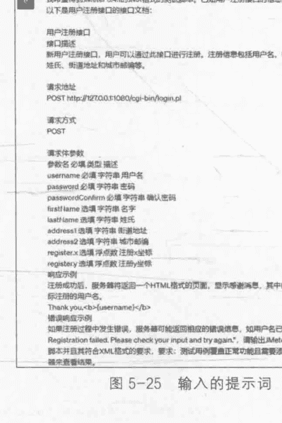

### 5.6 ChatGPT 与接口测试工具协作的最佳实践

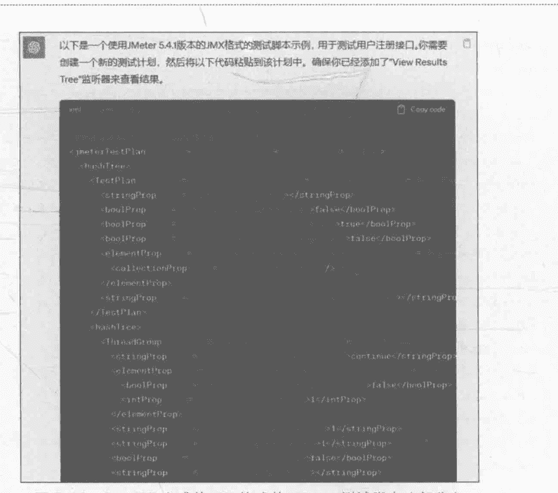

ChatGPT 生成的 JMX 格式的 JMeter 测试脚本如下所示。

### ChatGPT 生成的 JMX 格式的 JMeter 测试脚本示例

下面是一段基于 JMeter 5.4.1 的 JMX 示例，用来验证用户注册接口。新建一个测试计划，将下方代码粘贴进去，并确保添加了 “View Results Tree” 监听器以便查看执行结果。

```xml
<?xml version="1.0" encoding="UTF-8"?>
<jmeterTestPlan version="1.2" properties="5.0" jmeter="5.4.1">
  <hashTree>
    <TestPlan guiclass="TestPlanGui" testclass="TestPlan" testname="Test Plan" enabled="true">
      <stringProp name="TestPlan.comments"></stringProp>
      <boolProp name="TestPlan.functional_mode">false</boolProp>
      <boolProp name="TestPlan.tearDown_on_shutdown">true</boolProp>
      <boolProp name="TestPlan.serialize_threadgroups">false</boolProp>
      <elementProp name="TestPlan.user_define_classpath" elementType="Arguments" guiclass="ArgumentsPanel" testclass="Arguments" testname="User Defined Classpath" enabled="true">
        <collectionProp name="Arguments.arguments"/>
      </elementProp>
      <stringProp name="TestPlan.user_define_classpath_cookbook"></stringProp>
    </TestPlan>
    <hashTree>
      <ThreadGroup guiclass="ThreadGroupGui" testclass="ThreadGroup" testname="Thread Group" enabled="true">
        <stringProp name="ThreadGroup.on_sample_error">continue</stringProp>
        <elementProp name="ThreadGroup.main_controller" elementType="LoopController" guiclass="LoopControllerGui" testclass="LoopController" testname="Loop Controller" enabled="true">
          <boolProp name="LoopController.continue_forever">false</boolProp>
          <intProp name="LoopController.loops">1</intProp>
        </elementProp>
        <stringProp name="ThreadGroup.num_threads">1</stringProp>
        <stringProp name="ThreadGroup.ramp_time">1</stringProp>
        <boolProp name="ThreadGroup.scheduler">false</boolProp>
        <stringProp name="ThreadGroup.duration"></stringProp>
        <stringProp name="ThreadGroup.delay"></stringProp>
      </ThreadGroup>
      <hashTree>
        <HTTPSamplerProxy guiclass="HttpTestSampleGui" testclass="HTTPSamplerProxy" testname="User Registration" enabled="true">
          <elementProp name="HTTPsampler.Arguments" elementType="Arguments" guiclass="HTTPArgumentsPanel" testclass="Arguments" testname="User Registration" enabled="true">
            <collectionProp name="Arguments.arguments">
              <elementProp name="username" elementType="HTTPArgument">
                <boolProp name="HTTPArgument.always_encode">false</boolProp>
                <stringProp name="Argument.name">username</stringProp>
                <stringProp name="Argument.value">[your_username]</stringProp>
                <stringProp name="Argument.metadata">=</stringProp>
              </elementProp>
              <elementProp name="password" elementType="HTTPArgument">
                <boolProp name="HTTPArgument.always_encode">false</boolProp>
                <stringProp name="Argument.name">password</stringProp>
                <stringProp name="Argument.value">[your_password]</stringProp>
                <stringProp name="Argument.metadata">=</stringProp>
              </elementProp>
              <elementProp name="passwordConfirm" elementType="HTTPArgument">
                <boolProp name="HTTPArgument.always_encode">false</boolProp>
                <stringProp name="Argument.name">passwordConfirm</stringProp>
                <stringProp name="Argument.value">[your_password]</stringProp>
                <stringProp name="Argument.metadata">=</stringProp>
              </elementProp>
              <elementProp name="firstName" elementType="HTTPArgument">
                <boolProp name="HTTPArgument.always_encode">false</boolProp>
                <stringProp name="Argument.name">firstName</stringProp>
                <stringProp name="Argument.value">[your_first_name]</stringProp>
                <stringProp name="Argument.metadata">=</stringProp>
              </elementProp>
              <elementProp name="lastName" elementType="HTTPArgument">
                <boolProp name="HTTPArgument.always_encode">false</boolProp>
                <stringProp name="Argument.name">lastName</stringProp>
                <stringProp name="Argument.value">[your_last_name]</stringProp>
                <stringProp name="Argument.metadata">=</stringProp>
              </elementProp>
              <elementProp name="address1" elementType="HTTPArgument">
                <boolProp name="HTTPArgument.always_encode">false</boolProp>
                <stringProp name="Argument.name">address1</stringProp>
                <stringProp name="Argument.value">[your_address]</stringProp>
                <stringProp name="Argument.metadata">=</stringProp>
              </elementProp>
              <elementProp name="address2" elementType="HTTPArgument">
                <boolProp name="HTTPArgument.always_encode">false</boolProp>
                <stringProp name="Argument.name">address2</stringProp>
                <stringProp name="Argument.value">[your_city_zip]</stringProp>
                <stringProp name="Argument.metadata">=</stringProp>
              </elementProp>
              <elementProp name="register.x" elementType="HTTPArgument">
                <boolProp name="HTTPArgument.always_encode">false</boolProp>
                <stringProp name="Argument.name">register.x</stringProp>
                <stringProp name="Argument.value">0.0</stringProp>
                <stringProp name="Argument.metadata">=</stringProp>
              </elementProp>
              <elementProp name="register.y" elementType="HTTPArgument">
                <boolProp name="HTTPArgument.always_encode">false</boolProp>
                <stringProp name="Argument.name">register.y</stringProp>
                <stringProp name="Argument.value">0.0</stringProp>
                <stringProp name="Argument.metadata">=</stringProp>
              </elementProp>
            </collectionProp>
          </elementProp>
          <stringProp name="HTTPSampler.domain">127.0.0.1</stringProp>
          <stringProp name="HTTPSampler.port">1080</stringProp>
          <stringProp name="HTTPSampler.protocol">http</stringProp>
          <stringProp name="HTTPSampler.contentEncoding"></stringProp>
          <stringProp name="HTTPSampler.path">/cgi-bin/login.pl</stringProp>
          <stringProp name="HTTPSampler.method">POST</stringProp>
          <boolProp name="HTTPSampler.follow_redirects">true</boolProp>
          <boolProp name="HTTPSampler.auto_redirects">false</boolProp>
          <boolProp name="HTTPSampler.use_keepalive">true</boolProp>
          <boolProp name="HTTPSampler.DO_MULTIPART_POST">false</boolProp>
          <stringProp name="HTTPSampler.embedded_url_re"></stringProp>
          <stringProp name="HTTPSampler.connect_timeout"></stringProp>
          <stringProp name="HTTPSampler.response_timeout"></stringProp>
        </HTTPSamplerProxy>
        <hashTree>
          <ResultCollector guiclass="ViewResultsFullVisualizer" testclass="ResultCollector" testname="View Results Tree" enabled="true">
            <boolProp name="ResultCollector.error_logging">false</boolProp>
            <objProp>
              <name>saveConfig</name>
              <value class="SampleSaveConfiguration">
                <time>true</time>
                <latency>true</latency>
                <timestamp>true</timestamp>
                <success>true</success>
                <label>true</label>
                <code>true</code>
                <message>true</message>
                <threadName>true</threadName>
                <dataType>true</dataType>
                <encoding>false</encoding>
                <assertions>true</assertions>
                <subresults>true</subresults>
                <responseData>false</responseData>
                <samplerData>false</samplerData>
                <xml>false</xml>
                <fieldNames>true</fieldNames>
                <responseHeaders>false</responseHeaders>
                <requestHeaders>false</requestHeaders>
                <responseDataOnError>false</responseDataOnError>
                <saveAssertionResultsFailureMessage>true</saveAssertionResultsFailureMessage>
                <assertionsResultsToSave>0</assertionsResultsToSave>
                <bytes>true</bytes>
                <sentBytes>true</sentBytes>
                <url>true</url>
                <threadCounts>true</threadCounts>
                <sampleCount>true</sampleCount>
                <connectTime>true</connectTime>
              </value>
            </objProp>
            <stringProp name="filename"></stringProp>
          </ResultCollector>
          <hashTree/>
        </hashTree>
      </hashTree>
    </hashTree>
  </hashTree>
</jmeterTestPlan>
```

用 ChatGPT 快速生成 JMeter 脚本，这几个坑别踩

先把以下占位符换成你自己的真实信息再用：

- `[your_username]`: 登录时用的用户名
- `[your_password]`: 对应的登录密码
- `[your_first_name]`: 你的名字
- `[your_last_name]`: 你的姓氏
- `[your_address]`: 街道地址
- `[your_city_zip]`: 城市及邮编

替换完保存，随后就能把文件导入 JMeter，加载测试计划直接跑用户注册接口的验证。

### （4）接口测试用例评审

从 ChatGPT 直接生成的 JMX 格式 JMeter 脚本来看，目前只包含一次正常的用户注册请求。如果想让它的覆盖面接近之前 Postman 那版，既有正常注册也有密码不一致的异常场景，可以通过两种思路补齐。

方法 1：把已有的 Postman 测试用例脚本丢给 ChatGPT 让它先读懂，再把它转成 JMX 格式的 JMeter 脚本文件。

方法 2：直接在提示词里明确要求补充其他分支，比如密码不匹配、参数缺失等，让模型一次性生成包含多种情况的 JMX 文件。

具体怎么操作这里就不展开了，感兴趣可以自己动手试试。

另外也要注意，模型在输出结果的下方会额外提醒你先完成参数替换，提示内容基本如下：

先把以下占位符换成你自己的真实信息再用：

- `[your_username]`: 你的用户名
- `[your_password]`: 你的密码
- `[your_first_name]`: 你的名字
- `[your_last_name]`: 你的姓氏
- `[your_address]`: 你的街道地址
- `[your_city_zip]`: 你的城市邮编

文件妥当保存后，打开 JMeter 载入该计划即可执行用户注册接口的测试。

我这边已经把这些占位符都换成实际值，重新生成了一份可用的 JMeter 脚本，并存到 D:\AIBOOK\S_JM_Webtours.jmx。

（5）接口测试用例迭代与完善

实际使用中完全可以根据需要继续补充新的接口测试用例。限于篇幅，这里就不详细展开了。

最终版的 S_JM_Webtours.jmx 文件内容如下所示。

```
<?xml version="1.0" encoding="UTF-8"?>
<jmeterTestPlan version="1.2" properties="5.0" jmeter="5.4.1">
  <hashTree>
    <TestPlan guiclass="TestPlanGui" testclass="TestPlan" testname="Test Plan" enabled="true">
      <stringProp name="TestPlan.comments"></stringProp>
      <boolProp name="TestPlan.functional_mode">false</boolProp>
      <boolProp name="TestPlan.tearDown_on_shutdown">true</boolProp>
      <boolProp name="TestPlan.serialize_threadgroups">false</boolProp>
      <elementProp name="TestPlan.user_define_classpath" elementType="Arguments" guiclass="ArgumentsPanel" testclass="Arguments" testname="User Defined Classpath" enabled="true">
        <collectionProp name="Arguments.arguments"/>
      </elementProp>
      <stringProp name="TestPlan.user_define_classpath_cookbook"></stringProp>
    </TestPlan>
    <hashTree>
      <ThreadGroup guiclass="ThreadGroupGui" testclass="ThreadGroup" testname="Thread Group" enabled="true">
        <stringProp name="ThreadGroup.on_sample_error">continue</stringProp>
        <elementProp name="ThreadGroup.main_controller" elementType="LoopController" guiclass="LoopControllerGui" testclass="LoopController" testname="Loop Controller" enabled="true">
          <boolProp name="LoopController.continue_forever">false</boolProp>
          <intProp name="LoopController.loops">1</intProp>
        </elementProp>
        <stringProp name="ThreadGroup.num_threads">1</stringProp>
        <stringProp name="ThreadGroup.ramp_time">1</stringProp>
        <boolProp name="ThreadGroup.scheduler">false</boolProp>
        <stringProp name="ThreadGroup.duration"></stringProp>
        <stringProp name="ThreadGroup.delay"></stringProp>
      </ThreadGroup>
      <hashTree>
        <HTTPSamplerProxy guiclass="HttpTestSampleGui" testclass="HTTPSamplerProxy" testname="User Registration" enabled="true">
          <elementProp name="HTTPsampler.Arguments" elementType="Arguments" guiclass="HTTPArgumentsPanel" testclass="Arguments" testname="User Registration" enabled="true">
            <collectionProp name="Arguments.arguments">
              <elementProp name="username" elementType="HTTPArgument">
                <boolProp name="HTTPArgument.always_encode">false</boolProp>
                <stringProp name="Argument.name">username</stringProp>
                <stringProp name="Argument.value">tony2yy</stringProp>
                <stringProp name="Argument.metadata">=</stringProp>
              </elementProp>
              <elementProp name="password" elementType="HTTPArgument">
                <boolProp name="HTTPArgument.always_encode">false</boolProp>
                <stringProp name="Argument.name">password</stringProp>
                <stringProp name="Argument.value">123456</stringProp>
                <stringProp name="Argument.metadata">=</stringProp>
              </elementProp>
              <elementProp name="passwordConfirm" elementType="HTTPArgument">
                <boolProp name="HTTPArgument.always_encode">false</boolProp>
                <stringProp name="Argument.name">passwordConfirm</stringProp>
                <stringProp name="Argument.value">123456</stringProp>
                <stringProp name="Argument.metadata">=</stringProp>
              </elementProp>
              <elementProp name="firstName" elementType="HTTPArgument">
                <boolProp name="HTTPArgument.always_encode">false</boolProp>
                <stringProp name="Argument.name">firstName</stringProp>
                <stringProp name="Argument.value">yong</stringProp>
                <stringProp name="Argument.metadata">=</stringProp>
              </elementProp>
              <elementProp name="lastName" elementType="HTTPArgument">
                <boolProp name="HTTPArgument.always_encode">false</boolProp>
                <stringProp name="Argument.name">lastName</stringProp>
                <stringProp name="Argument.value">yu</stringProp>
                <stringProp name="Argument.metadata"></stringProp>
              </elementProp>
              <elementProp name="address1" elementType="HTTPArgument">
                <boolProp name="HTTPArgument.always_encode">false</boolProp>
                <stringProp name="Argument.name">address1</stringProp>
                <stringProp name="Argument.value">Peking</stringProp>
                <stringProp name="Argument.metadata"></stringProp>
              </elementProp>
              <elementProp name="address2" elementType="HTTPArgument">
                <boolProp name="HTTPArgument.always_encode">false</boolProp>
                <stringProp name="Argument.name">address2</stringProp>
                <stringProp name="Argument.value">100000</stringProp>
                <stringProp name="Argument.metadata"></stringProp>
              </elementProp>
              <elementProp name="register.x" elementType="HTTPArgument">
                <boolProp name="HTTPArgument.always_encode">false</boolProp>
                <stringProp name="Argument.name">register.x</stringProp>
                <stringProp name="Argument.value">0.0</stringProp>
                <stringProp name="Argument.metadata"></stringProp>
              </elementProp>
              <elementProp name="register.y" elementType="HTTPArgument">
                <boolProp name="HTTPArgument.always_encode">false</boolProp>
                <stringProp name="Argument.name">register.y</stringProp>
                <stringProp name="Argument.value">0.0</stringProp>
                <stringProp name="Argument.metadata"></stringProp>
              </elementProp>
            </collectionProp>
          </elementProp>
          <stringProp name="HTTPSampler.domain">127.0.0.1</stringProp>
          <stringProp name="HTTPSampler.port">1080</stringProp>
          <stringProp name="HTTPSampler.protocol">http</stringProp>
          <stringProp name="HTTPSampler.contentEncoding"></stringProp>
          <stringProp name="HTTPSampler.path">/cgi-bin/login.pl</stringProp>
          <stringProp name="HTTPSampler.method">POST</stringProp>
          <boolProp name="HTTPSampler.follow_redirects">true</boolProp>
          <boolProp name="HTTPSampler.auto_redirects">false</boolProp>
          <boolProp name="HTTPSampler.use_keepalive">true</boolProp>
          <boolProp name="HTTPSampler.DO_MULTIPART_POST">false</boolProp>
          <stringProp name="HTTPSampler.embedded_url_re"></stringProp>
          <stringProp name="HTTPSampler.connect_timeout"></stringProp>
          <stringProp name="HTTPSampler.response_timeout"></stringProp>
        </HTTPSamplerProxy>
        <hashTree>
          <ResultCollector guiclass="ViewResultsFullVisualizer" testclass="ResultCollector" testname="View Results Tree" enabled="true">
            <boolProp name="ResultCollector.error_logging">false</boolProp>
            <objProp name="ResultCollector.scope">all</objProp>
            <stringProp name="filename"></stringProp>
          </ResultCollector>
        </hashTree>
      </hashTree>
    </hashTree>
  </hashTree>
</jmeterTestPlan>
```

接下来就动手检验一下由 ChatGPT 生成的 JMeter JMX 脚本到底能不能正常跑起来。

1）用 JMeter 打开 S_JM_Webtours.jmx 文件，能看到在 Thread Group 线程组下面挂着一个名为 User Registration 的 HTTP 请求，再往下还有一个 View Results Tree 监听器，示意图在图 5-27。

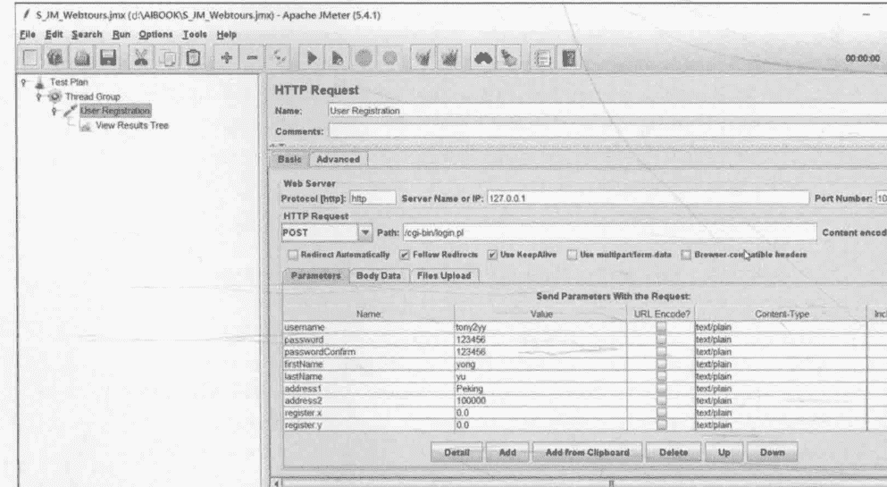

2）先把飞机订票系统启动起来。

3）执行 S_JM_Webtours.jmx，并在 View Results Tree 监听器里查看返回，响应正文里出现了 Thank you <b>tony2yy</b> 的提示，见图 5-28。

### 5.6 ChatGPT 配合测试工具的实用打法

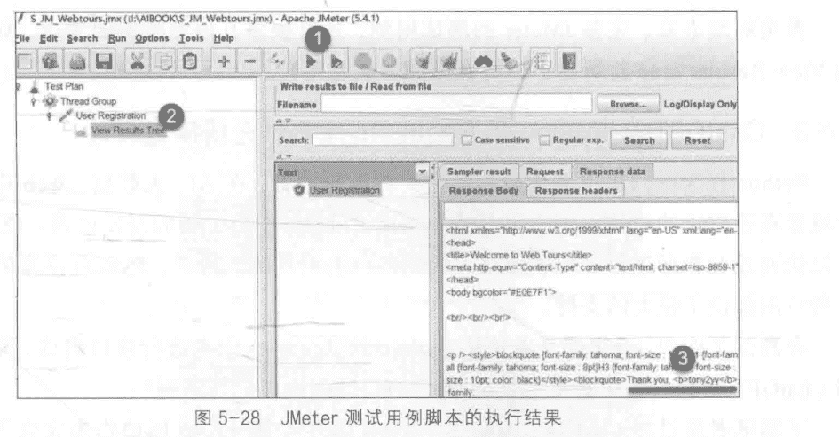

这个脚本能跑，但还不够完善，线程组里并没有加断言。可以继续和 ChatGPT 对话，请它教怎么补上断言。笔者发过去的问法是“你好，我想在 JMeter 中添加断言，请问该如何操作，谢谢。”，ChatGPT 给出的步骤整理在图 5-29。


图 5-29 的内容很具体，按着做新手也能快速上手添加断言。这说明 ChatGPT 的价值不止于生成用例和写脚本，还能当工具使用教程和答疑助手。

要让 JMeter 的用例更完整，后续还可以考虑增加更多监听器、做参数化等工作。

#### 5.6.3 ChatGPT 联手 Python Requests 做接口测试

Python 上手快、功能强，在 AI、大数据、Web 开发里应用很广。现在越来越多团队把 Python 作为主力开发语言，用它处理数据、建模、搭系统都很快，而且生态丰富。

在接口测试场景里，很多公司会用 Requests 库。怎么让 ChatGPT 帮忙生成基于 Python 的接口测试脚本呢？

下面以飞机订票系统的用户注册接口为例，演示 ChatGPT 与 Requests 的配合。

（1）收集接口的相关文档和信息
这部分在 5.6.1 已经讲得很细，这里不再重复。

（2）输入接口的相关文档和信息
笔者希望用 unittest 框架来生成代码，输入的提示词见图 5-30。


## （3）生成接口测试用例

ChatGPT 输出的使用 unittest 框架的测试脚本如图 5-31。

ChatGPT 生成的使用 unittest 测试框架的测试用例脚本，如下所示。

```
ChatGPT 生成的使用 unittest 测试框架的测试用例脚本

以下是一个使用 Python 的 `unittest` 测试框架和 `requests` 库的示例，用于测试用户注册接口。在这个示例中，我们还使用 `BSTestRunner` 库来生成运行报告。首先，你需要安装 `requests` 和 `BSTestRunner` 库，你可以使用以下命令来安装它们：

bash
pip install requests
pip install BSTestRunner


接下来，创建一个 Python 脚本，例如 `test_user_registration.py`，并将以下代码粘贴到脚本中：

python
import unittest
import requests
from BSTestRunner import BSTestRunner
class TestUserRegistration(unittest.TestCase):
    def setUp(self):
        # 设置基本的 URL
        self.base_url = "http://127.0.0.1:1080/cgi-bin/login.pl"
    def test_successful_registration(self):
        # 准备注册数据
        data = {
            "username": "testuser",
            "password": "testpassword",
            "passwordConfirm": "testpassword",
            "firstName": "John",
            "lastName": "Doe",
            "address1": "123 Main St",
            "address2": "City, 12345",
            "register.x": 0.0,
            "register.y": 0.0
        }
        # 发送 POST 请求
        response = requests.post(self.base_url, data=data)
        # 验证响应
        self.assertEqual(response.status_code, 200)
        self.assertIn("Thank you, <b>testuser</b>", response.text)
    def test_failed_registration(self):
        # 准备错误的注册数据
        data = {
            "username": "testuser",
            "password": "testpassword",
            "passwordConfirm": "wrongpassword",
            "firstName": "John",
            "lastName": "Doe",
            "address1": "123 Main St",
            "address2": "City, 12345",
            "register.x": 0.0,
            "register.y": 0.0
        }
        # 发送 POST 请求
        response = requests.post(self.base_url, data=data)
        # 验证响应
        self.assertEqual(response.status_code, 200)
        self.assertIn("Registration failed. Please check your input and "
        "try again.", response.text)
if __name__ == "__main__":
    # 指定测试报告的路径和文件名
    report_path = "./test_reports/"
    report_name = "user_registration_report.html"
    # 创建测试套件
    suite = unittest.TestLoader().loadTestsFromTestCase(TestUserRegistration)
    # 运行测试并生成报告
    with open(report_path + report_name, "wb") as report_file:
        runner = BSTestRunner(
            stream=report_file,
            title="User Registration Test Report",
            description="Test report for user registration functionality"
        )
        runner.run(suite)
```

示例里包含两个用例，一个测正常注册，一个测注册失败。测试报告会按指定路径生成，打开文件即可查看结果。

记得把 self.base_url 以及脚本里的用户名、密码等测试数据替换成真实接口信息。示例展示了如何用 unittest 配合 requests 编写用例并产出报告。

## （4）接口测试用例评审

从生成的脚本看，ChatGPT 不仅按要求写了 unittest 用例，还加上了生成报告的代码。

问题也随之出现。Postman 之前已经用 testuser 注册过，重复注册会失败，所以账号信息必须换掉。注册时两次密码不一致会返回什么，脚本里没有明确，需要先手动操作或开浏览器开发者工具确认实际返回。实际开发中 API 也常变动、遗漏，所以接口文档和脚本要持续维护。图 5-32 显示密码不一致时系统返回 Your password is invalid. Please re-enter it and it's confirmation. 的提示，因此断言部分需要替换成这段文本。

想让 ChatGPT 给出脚本的运行步骤吗？可以，生成的运行指引如图 5-33。

图 5-33 ChatGPT 生成的 Python 脚本运行的操作步骤

## （5）接口测试用例迭代与完善

根据需要可以继续补充用例，篇幅有限这里省略。

把重复参数替换后把脚本保存为 test_user_registration.py，文件内容如下。

```
python
import unittest
import requests
from BSTestRunner import BSTestRunner
class TestUserRegistration(unittest.TestCase):
    def setUp(self):
        # 设置基本的 URL
        self.base_url = "http://127.0.0.1:1080/cgi-bin/login.pl"
    def test_successful_registration(self):
        # 准备注册数据
        data = {
            "username": "yuuyu",
            "password": "123456",
            "passwordConfirm": "123456",
            "firstName": "John",
            "lastName": "Doe",
            "address1": "Peking",
            "address2": "City, 100000",
            "register.x": 0.0,
            "register.y": 0.0
        }
        # 发送 POST 请求
        response = requests.post(self.base_url, data=data)
        # 验证响应
        self.assertEqual(response.status_code, 200)
        self.assertIn("Thank you, <b>yuuyu</b>", response.text)
    def test_failed_registration(self):
        # 准备错误的注册数据
        data = {
            "username": "yuuyu1",
            "password": "testpassword",
            "passwordConfirm": "wrongpassword",
            "firstName": "John",
            "lastName": "Doe",
            "address1": "123 Main St",
            "address2": "City, 12345",
            "register.x": 0.0,
            "register.y": 0.0
        }
        # 发送 POST 请求
        response = requests.post(self.base_url, data=data)
        # 验证响应
        self.assertEqual(response.status_code, 200)
        self.assertIn("Your password is invalid. Please re-enter it and it's confirmation.", response.text)
if __name__ == "__main__":
    # 指定测试报告的路径和文件名
    report_path = "./test_reports/"
    report_name = "user_registration_report.html"
    # 创建测试套件
    suite = unittest.TestLoader().loadTestsFromTestCase(TestUserRegistration)
    # 运行测试并生成报告
    with open(report_path + report_name, "wb") as report_file:
        runner = BSTestRunner(
            stream=report_file,
            title="User Registration Test Report",
            description="Test report for user registration functionality"
        )
        runner.run(suite)
```

随后按图 5-31 的提示安装 Requests 和 BSTestRunner。在实际执行 pip install BSTestRunner 时会报错，如图 5-34。

不少人说 ChatGPT 会“胡说八道”。事实上 BSTestRunner 无法通过 pip 安装。解决办法是下载源码文件并拷贝到 Python 安装目录的 Lib 子目录下，资源包里提供了 BSTestRunner.py。

为什么会出现这种“幻想”？主要原因有：

- 1）过度相信输出的准确性。ChatGPT 是概率模型，回答可能带错、带偏见或无意义。
- 2）误以为它能真正理解语言、有意识。实际上它只是对海量训练数据的统计模拟，无法理解语义，训练数据本身就有对有错。
- 3）指望它完成复杂推理或创造性工作。它更适合基础问答、文本生成等有限场景。
- 4）把 ChatGPT 当专家。它的知识有滞后性，也无法保证回答质量。
- 5）认为能完全替代人。它仍有局限，需要人监督和指导。

总之，“幻想”源于误解和不切实际的期待。正确的做法是认识它的局限，把它当作辅助工具而非万能方案，避免过度依赖。

要正常生成报告，需要在测试脚本同级目录下新建 test_reports 子目录，如图 5-35。

通过命令行或 PyCharm 执行 test_user_registration.py，完成后 test_reports 目录下会生成 user_registration_report.html，该文件就是本次执行的测试报告，见图 5-36。

#### 5.6.4 ChatGPT 搭配其他测试框架

前面讲了几个工具，市面上还有很多可与 ChatGPT 协作的测试框架。接下来重点介绍目前较受关注的 HttpRunner 和 Seldom，并展示它们在自动生成接口测试脚本方面的表现。

HttpRunner 是一款基于 Python 与 YAML 的开源接口自动化测试框架，主打简洁、灵活、高效的测试体验。它让 RESTful 与 Web 接口的验证变得更体系化，也更易于协作。

HttpRunner 的核心能力主要体现在以下几个方面：

- 1. 数据驱动支持：用 YAML 描述用例，把测试数据和执行逻辑解耦，实现同一套逻辑多套数据覆盖。
- 2. 模块化架构：用例可以拆分为独立模块复用，脚本维护成本更低。
- 3. 协议覆盖全面：原生支持 HTTP/HTTPS，涵盖 GET、POST、PUT、DELETE 等常用方法，适配 RESTful 与 Web 服务。
- 4）验证手段丰富：内置断言、正则匹配、JSONPath 等多种校验方式，可对响应状态、字段、格式进行精细检查。
- 5）配置集中化：通过配置文件统一管理全局变量和环境信息，实现环境参数的集中管控。
- 6）多环境切换：可快速在不同测试环境间切换，提升测试适配性。
- 7）报告自动生成：执行结束后自动输出结构化测试报告，便于结果追溯与分析。
- 8）自动化集成：支持命令行执行，天然适配 CI/CD 流水线。

ChatGPT 与 HttpRunner 的配合非常顺滑。下面以用户注册接口为例，演示如何让 ChatGPT 直接产出可用的 HttpRunner 脚本及执行流程。如图 5-37 所示，笔者向 ChatGPT 提出生成用户注册接口 HttpRunner 脚本的需求。

ChatGPT 返回的用户注册接口 HttpRunner 脚本示例如图 5-38 所示。

ChatGPT 输出的完整的用户注册接口的 HttpRunner 脚本等相关内容，如下所示。

> ChatGPT 输出的完整的用户注册接口的 HttpRunner 脚本等相关内容

好的，以下是一个基于 HttpRunner 的用户注册接口测试脚本示例。首先确保环境已安装 HttpRunner，可用命令安装：

```
pip install httprunner
```

然后新建一个 Yaml 格式的测试文件，例如 `test_user_registration.yaml`，把以下内容写入：

```
config:
  name: User Registration Test

testcases:
- testcase: User Registration
  request:
    url: http://127.0.0.1:1080/cgi-bin/login.pl
    method: POST
    headers:
      Content-Type: application/x-www-form-urlencoded
    data:
      username: testuser
      password: testpassword
      passwordConfirm: testpassword
      firstName: John
      lastName: Doe
      address1: 123 Main St
      address2: City, 12345
      register.x: 0.0
      register.y: 0.0
  validate:
    - eq: ["status_code", 200]
    - contains: ["content.text", "Thank you, <b>testuser</b>"]
```

该脚本包含一个针对用户注册接口的测试用例。请求部分声明了接口地址、方法、请求头与请求体。校验部分则对响应码和响应内容的正确性进行断言。

随后在终端执行以下命令启动测试：

```
hrun test_user_registration.yaml
```

执行后终端会实时展示测试结果，通过则提示成功，失败则输出详细错误信息。

这就是 HttpRunner 编写与运行测试脚本的基本流程，记得把示例中的 URL 和数据替换为真实接口信息即可使用。

Seldom 是建立在 unittest 基础上的 Python Web 自动化测试框架，定位简单易用且扩展性强。它不仅覆盖 Web UI 与 App 自动化，还能延伸到接口层测试。

## 第 5 章 ChatGPT 一键生成接口测试用例

以下是 Seldom 框架的主要特性。

- 1）继承 unittest：沿用 unittest 的结构，测试脚本规范且易于维护。
- 2）上手门槛低：API 设计简洁直观，适合新手与资深测试人员快速使用。
- 3）Web 自动化为主：可驱动 Chrome、Firefox 等主流浏览器完成页面自动化。
- 4）数据驱动能力：支持以 Excel、CSV 等文件作为数据源，实现参数化测试。
- 5）断言灵活：提供多种断言方法，如 assertEqual、assertIn 等，校验更自由。
- 6）报告可视化：能自动生成包含用例结果、耗时等信息的测试报告。

ChatGPT 同样可以与 Seldom 协同工作。下面演示如何让 ChatGPT 按需求生成基于 Seldom 的脚本并给出执行步骤。如图 5-39 所示为向 ChatGPT 请求生成用户注册接口 Seldom 脚本的提示示例。

ChatGPT 返回的用户注册接口 Seldom 脚本示例如图 5-40 所示。

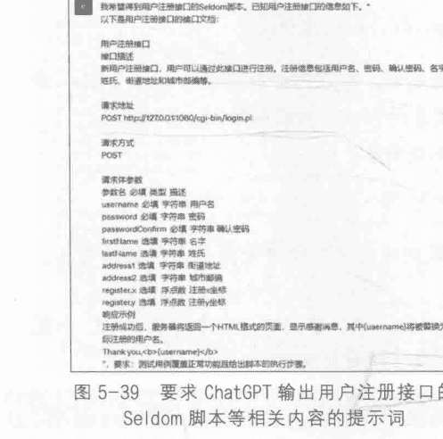


ChatGPT 输出的完整的用户注册接口的 Seldom 脚本等相关内容如下所示。

当然，以下是一个使用 seldom 编写的用户注册接口测试脚本示例。首先确认已安装 seldom，可用命令安装：

```
pip install seldom
```

然后新建一个 Python 脚本，例如 `test_user_registration.py`，写入以下代码：

```
import seldom

class UserRegistrationTest(seldom.TestCase):
    def test_successful_registration(self):
        """
        Test user registration with valid data.
        """
        url = "http://127.0.0.1:1080/cgi-bin/login.pl"
        data = {
            "username": "testuser",
            "password": "testpassword",
            "passwordConfirm": "testpassword",
            "firstName": "John",
            "lastName": "Doe",
            "address1": "123 Main St",
            "address2": "City, 12345",
            "register.x": 0.0,
            "register.y": 0.0
        }
        self.post(url, data)
        self.assertStatusCode(200)
        self.assertText("Thank you, <b>testuser</b>")
    def test_failed_registration(self):
        """
        Test user registration with invalid data.
        """
        url = "http://127.0.0.1:1080/cgi-bin/login.pl"
        data = {
            "username": "testuser",
            "password": "testpassword",
            "passwordConfirm": "wrongpassword",
            "firstName": "John",
            "lastName": "Doe",
            "address1": "123 Main St",
            "address2": "City, 12345",
            "register.x": 0.0,
            "register.y": 0.0
        }
        self.post(url, data)
        self.assertStatusCode(200)
        self.assertText("Registration failed. Please check your input and try again.")

if __name__ == "__main__":
    seldom.main()
```

脚本包含两条用例，一条验证正常注册流程，另一条验证注册失败场景。内部通过 self.post() 发起 POST 请求，再借助 self.assertStatusCode() 与 self.assertText() 对状态码和返回文本做校验。

在命令行中运行以下命令即可执行：

```
python test_user_registration.py
```

执行后终端会打印测试结果，成功会显示通过信息，失败会给出具体报错。

以上就是使用 seldom 编写与运行测试脚本的简要流程，记得将 URL 与测试数据替换为实际值即可。希望对你有帮助，有问题随时交流。

总体来看，ChatGPT 在接口自动化测试领域的应用潜力巨大，能够帮助团队更快产出用例与代码，节省人力与时间。其在用例设计、脚本生成方面的能力为接口自动化带来了新的思路，让测试人员更专注于质量保障本身。

## 第 6 章 ChatGPT 自动化生成测试数据

### 6.1 传统测试数据生成的痛点

软件测试是开发流程中的关键环节，测试用例与测试数据的设计准备往往耗时耗力。随着系统复杂度提升，纯手工准备数据已难以满足需求。传统手工生成数据的问题在于效率低、难以保证完整性和有效性。为此需要一种更智能的数据生成方式。ChatGPT 作为大模型驱动的自然语言生成技术，能够输出连贯、丰富且语义准确的文本。将它用于测试数据的自动生成，可以快速产出大量高质量数据，从根本上缓解传统方式的局限。

#### 6.1.1 ChatGPT 生成数据的核心优势

ChatGPT 用于测试数据生成的价值主要体现在：

- 1. 提升完整性与有效性：可依据场景描述和业务规则生成符合用例的数据，减少手工遗漏或错误。
- 2. 大幅缩短准备周期：批量自动生成可在短时间内获取海量数据，提高测试效率。
- 3. 降低人为偏差：生成数据覆盖面广，能触及多种场景与边界条件，避免主观偏差。
- 4. 动态可调整：通过微调生成规则，可实时获取适配新需求的数据。
- 5. 多语言支持：具备多语言生成能力，可同时产出不同语言版本的测试数据，满足国际化需求。
- 6）管理成本下降：生成的数据可直接导入测试管理或配置平台，减少人工整理工作量。

#### 6.1.2 使用要点与风险规避

要充分发挥 ChatGPT 生成测试数据的价值，需要注意：

- 1）训练数据质量要高：以准确标注的真实用户输入和业务场景数据作为基础，才能保证生成质量。
- 2）生成规则需明确：提前定义数据结构、字段取值范围和校验逻辑，指导模型准确输出。
- 3）持续迭代优化：对生成样本反复验证并标注，调整参数以提升准确性和实用性。
- 4）结合现有工具：把生成数据与测试框架、自动化工具结合，提升测试覆盖与效率。
- 5）保障安全合规：对含敏感信息的数据做好脱敏与合规处理，确保测试数据安全可控。

遵循以上要点，既能最大化 ChatGPT 的生成能力，也能确保测试过程合规可控。

#### 6.1.3 实战案例拆解

以下是利用 ChatGPT 生成测试数据的典型实践。

##### 1. 电商商品信息快速生成
在电商平台测试中，商品信息的真实性和完整性直接影响用户体验。测试团队需要快速生成大量逼真且覆盖面广的商品信息。

应用场景：生成具备特定卖点的手机商品信息测试数据。

操作步骤：
- 1）明确需求：要求生成主打 5000mAh 大容量电池的手机信息。
- 2）给出指令：向 ChatGPT 输入“生成包含 5000mAh 大容量电池卖点的手机标题和商品描述”。
- 3）获取数据：模型迅速产出相关内容，例如：
    - 标题：5000mAh 大容量电池，续航可达两天
    - 商品描述：本机配备 5000mAh 大电池，结合 AI 省电技术实现超长续航；支持 27W 快充，30 分钟可充至日常使用电量，解决出行续航焦虑。

结果分析：生成数据语义完整，精准命中电池续航与充电效率等关键点，为电商测试提供了高效的数据供给方式。

##### 2. 银行开户流程数据模拟
银行系统业务复杂、安全要求高，涉及开户、贷款审批、转账等流程，手工构造测试数据效率低且易遗漏。借助 ChatGPT 可自动生成覆盖全流程的数据集。

应用场景：个人开户业务流程测试。

业务流程包括：用户输入基本信息 → 系统校验证件与电话格式 → 用户选择开户地、银行与账户类型 → 系统推荐产品 → 用户确认 → 系统提交 → 系统反馈结果。

向 ChatGPT 提供上述流程描述后，可生成：
- 1）输入数据：多组姓名、身份证号、联系电话，保障多样性。
- 2）校验数据：模拟校验通过/不通过的各种结果，验证校验逻辑。
- 3）选择数据：组合不同开户地、银行、账户类型，检验系统处理能力。
- 4）输出数据：模拟开户成功或失败的返回，检验系统稳定性。

结果分析：方法可快速获得符合业务逻辑的海量数据，覆盖开户流程各环节，提升测试效率与全面性，也可扩展至更复杂的银行业务场景。

##### 3. 多语言国际化数据生成
面向多国家、多地区的软件产品，需要在不同语言和文化下验证功能。手工准备多语言测试数据成本高。ChatGPT 的多语言生成能力为国际化与本地化测试提供了高效工具，可快速产出多语言版本的测试数据，支撑全球化产品的质量验证。

软件国际化本质上是让产品能够在不同语言环境下正常运行，覆盖界面与输入的切换，同时还要兼容各式字符集，而不仅仅是做字面翻译。对应的国际化验证，重点看在多种语言设置下文本能否正确呈现与处理。软件本地化则更进一步，要求产品贴合特定国家或地区的文化习惯与法规细节，比如日期时间写法、货币符号、地址顺序等。本地化测试的价值在于确保用户感受到自然流畅的本地体验。

应用场景：借助 ChatGPT 批量生产多语言测试数据

操作步骤如下。

- 1）厘清测试范围：先列出需要覆盖的语言清单和目标国家或地区，再明确在每个语言/地区下要重点验证的功能点。
- 2）生成测试素材：向 ChatGPT 下达明确指令，让其产出目标语言的界面文案、模拟用户输入样例，或包含地区特征的数据，比如不同格式的日期时间、货币单位等。
- 3）检验与迭代：把生成的素材投入测试，检查国际化与本地化实现是否符合预期，根据结果回溯优化提示词，进一步提升数据的质量。

在各类国际化、本地化测试中，核心关注点通常包括。

- 1）界面文本：制作多语言版本的按钮、菜单等界面文案，确认在不同语言下均能正确显示、无错位或乱码。
- 2）提示信息：生成多语言提示文案，验证系统能否以用户所在语言准确反馈。
- 3）用户输入：模拟多语言环境下的输入行为，涵盖特殊字符与格式，检验输入处理的健壮性。
- 4）文化差异：构造体现文化差异的样本，例如英式与美式英语拼写差别、欧洲与美国日期格式差异等。

结果分析如下。

ChatGPT 的跨语言生成能力大幅降低了国际化、本地化测试数据的准备成本与复杂度。通过自动产出精准多样的数据，测试团队能更高效地评估产品在全球市场的适配度。

4. 性能测试数据生成实例

性能测试是衡量软件在高负载下处理速度、数据传输效率、网络请求响应等能力的关键环节。为了保证评估的准确与全面，需要大量贴近真实用户操作的数据。此时用 ChatGPT 来辅助生成性能测试数据，是一个高效的可行思路。

应用场景：在性能测试中常面临模拟真实操作轨迹、复现大规模并发访问、制造特定时段的热点冲击和流量峰值等难题。这些场景对数据量的规模和真实度都有较高要求。

操作步骤如下。

（1）ChatGPT 生成性能测试数据

借助 ChatGPT 可以产出以下几类数据。

- 模拟真实用户操作的性能测试数据：根据业务场景描述，生成贴合用户行为模式的操作记录，包括点击、表单提交、搜索等。
- 模拟大规模用户访问的性能测试数据：通过批量生成不同用户的操作轨迹，复现数千乃至数万用户同时在线的情形。
- 模拟热点访问和流量峰值：结合业务高峰特征，让模型针对节假日、促销等场景定制测试数据，模拟突发流量。

（2）集成性能测试工具

把 ChatGPT 生成的数据导入 JMeter、LoadRunner 等工具并完成配置，模拟多用户并发、流量高峰等不同工况。分析采集到的指标，定位性能瓶颈，如服务器响应迟缓、数据库查询延迟等。据此进行优化，包括数据库查询调优、服务器能力增强、代码执行效率提升等。

结果分析如下。

使用 ChatGPT 生成性能测试数据，可显著提升测试效率与覆盖面。不仅能提供海量多样的数据，还能帮助团队更全面地评估系统表现，及时发现并解决性能短板。

6.2 ChatGPT 在功能与性能测试数据生成中的实践

本节以具体的功能与性能测试案例，展示 ChatGPT 在测试数据生成方面的落地效果。

6.2.1 功能测试数据生成

传统的功能测试数据多靠人工编写，对业务理解要求高且耗时，难以跟上需求增速。ChatGPT 凭借强大的自然语言生成与快速产出能力，成为功能测试数据生成的理想助手。

ChatGPT 在功能测试数据生成上的优势体现为。

- 1）场景丰富性：依托业务规则与场景描述，生成贴近真实用户行为的多样化数据，提升覆盖率。
- 2）用户行为模拟：可模拟点击、输入、导航等多种交互，为功能验证提供逼真场景。
- 3）异常情形模拟：能产出错误输入、边界条件等异常数据的测试样本，检验系统容错与稳定性。
- 4）生成速度快：相较人工，极短时间内可产出大量测试数据，大幅提高效率。

下面介绍几个典型案例。

（1）在线购物网站功能测试案例

假设要测试电商站的用户注册、商品检索、购物车管理等功能。

使用 ChatGPT 输入“生成 100 条模拟用户注册的测试数据，包含不同用户名与密码强度”的指令，模型很快返回了多样化且接近真实的用户名和密码样本，如图 6-1 所示。

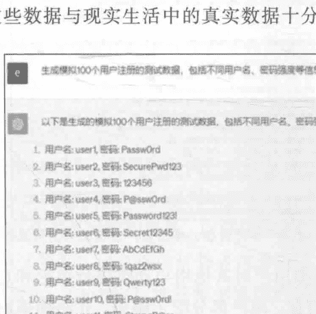

图 6-1 ChatGPT 生成的部分用户名和密码测试数据

再输入“生成模拟用户搜索电子商品的测试数据，覆盖手机、笔记本等品类”的指令，模型给出包含品牌、型号各异的搜索样本，如图 6-2 所示。


图 6-2 ChatGPT 生成的部分模拟用户搜索电子商品的测试数据

## 第 6 章 ChatGPT 生成测试数据

### （2）社交媒体平台功能测试案例

针对社交平台的发动态、评论、点赞等功能进行验证。在 ChatGPT 中输入“生成模拟用户发布动态的测试数据，包含文字、图片等多种类型”的提示，模型迅速产出文字与图片类动态样本，如图 6-3 所示。

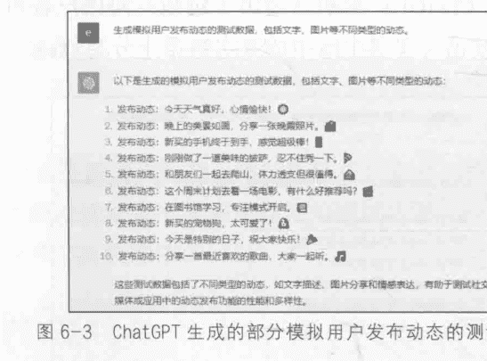

在 ChatGPT 中输入“模拟用户对他人动态进行评论和点赞的测试数据”的提示，模型为不同动态与用户分配编号，并明确点赞与评论关系及具体评论内容，如图 6-4 所示。结构清晰，便于直接使用。

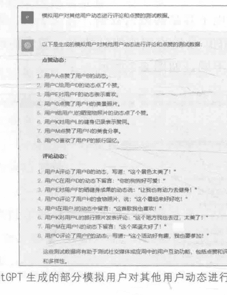

综合来看，ChatGPT 在功能测试数据生成中优势明显。首先是效率提升，能快速产出海量数据，人工难以企及。其次是多样性增强，基于丰富语境生成数据，覆盖更多使用场景。最后是真实度更高，贴近用户真实行为，使测试结果更可靠，更易暴露潜在问题。

总的说来，ChatGPT 应用于功能测试数据生成，不仅提高效率与覆盖范围，还让测试的复杂性更接近真实世界，有助于更精准地发现和解决问题。

6.2.2 性能测试数据生成

性能测试的核心是确保系统在不同负载下仍保持稳定与高效。测试数据的质量直接影响评估结果，需要真实模拟用户行为与使用场景。

ChatGPT 在性能测试数据生成上的优势包括。

- 1）模拟真实用户行为：根据场景描述生成贴近实际的请求、页面访问与交互数据，使性能测试更贴近现实。
- 2）大规模数据生成：在高并发场景下，模型可快速产出满足并发数、请求频率等需求的大规模数据。
- 3）特定场景模拟：可针对高峰访问、异常请求等特殊情况定制数据集，评估系统在极端条件下的表现。
- 4）动态调整生成规则：依据不同业务场景与用户行为灵活修改生成策略，提升测试的贴合度与准确性。

在性能测试中，模拟大量用户行为往往产生海量数据。为评估特定业务的并发量、每秒事务数以及不同数据规模下的性能，需要准备参数化数据与合适的测试环境。制造垫底数据、进行数据脱敏、从备份提取数据以及构建大规模数据集是常见任务。

##### （1）性能测试垫底数据案例

当数据库从 100 条记录增长到 100 万条时，相同业务操作的响应时间可能出现明显差异。随着基础数据量提升，系统性能往往下降。因此性能测试需覆盖不同数据量级，这就涉及垫底数据的准备。可选择对现有备份脱敏或全新生成，目的都是让测试更接近真实运行环境，为优化提供依据。

以电商网站为例，可创建用户、商品、订单等垫底数据。

此时可借助 ChatGPT 输出生成代码或操作步骤。图 6-5 所示为 ChatGPT 给出的用于生成垫底数据的 Python 代码。


准备垫底数据的操作步骤如下。

- 1）建立数据库连接，配置数据库名称等信息，MySQL 等数据库需补充用户名、密码、端口等。
- 2）构建 SQL 语句，使用数据生成工具如 Faker 生成相关垫底数据。
- 3）运行 Python 脚本，将数据写入数据库或导出为 SQL 文件后导入被测系统。

使用 Faker 库生成垫底数据的 Python 脚本示例如下所示。

```python
from faker import Faker
import sqlite3
fake = Faker()
conn = sqlite3.connect('test.db')
cursor = conn.cursor()
for _ in range(1000):
    username = fake.user_name()
    email = fake.email()
    cursor.execute("INSERT INTO users (username, email) VALUES (?, ?)", (username, email))
conn.commit()
conn.close()
```

##### （2）测试数据的脱敏案例

数据脱敏旨在通过隐藏或替换敏感信息来保护隐私，在涉及生产数据时尤为重要。ChatGPT 也可助力完成脱敏任务。

假设要测试医疗信息系统，需对患者姓名、住址、联系方式等进行脱敏。可借助数据生成工具或代码实现。图 6-6 所示为 ChatGPT 生成的用于数据脱敏的 Python 代码。

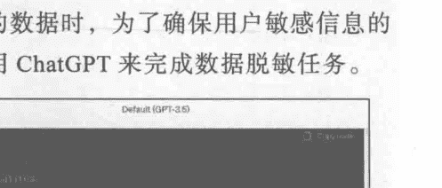

测试数据的脱敏操作步骤如下。

- 1）识别需要脱敏的字段，如姓名、住址、联系方式。
- 2）采用替代、散列、模糊化等脱敏算法处理。
- 3）更新测试库中的数据。

##### （3）基于数据库备份文件进行修改以获取测试数据案例

若已有历史数据与备份文件，可根据本次测试需求提取并修改后复用。

假设恢复备份后希望提取用户数据并做必要修改，再导出为 SQL 文件。图 6-7 所示为基于备份文件修改获取测试数据的示例。


基于数据库备份文件进行修改以获取测试数据的操作步骤如下。

- 1）恢复数据库备份文件。
- 2）提取所需数据并按需修改。
- 3）将修改后的数据导出为 SQL 文件。
- 4）把 SQL 文件导入被测系统的数据库。

```sql
-- 假设你的备份文件是 SQL 文件
-- 恢复数据库
mysql -u username -p dbname < backup.sql
-- 提取和修改数据
mysql -u username -p dbname -e "UPDATE users SET username = 'Modified Name' WHERE id = 1;"
-- 导出修改后的数据
mysqldump -u username -p dbname > modified_data.sql
```

##### （4）基于数据库表结构自动构建测试数据案例

在性能测试中，基于表结构自动构造大量测试数据是常见需求。ChatGPT 可根据提供的表结构与数据需求自动生成。

假设要测试社交媒体平台，需生成大量用户与帖子数据。ChatGPT 可据此自动构建。图 6-8 所示为基于表结构自动构建用户与帖子数据的 Python 代码示例。

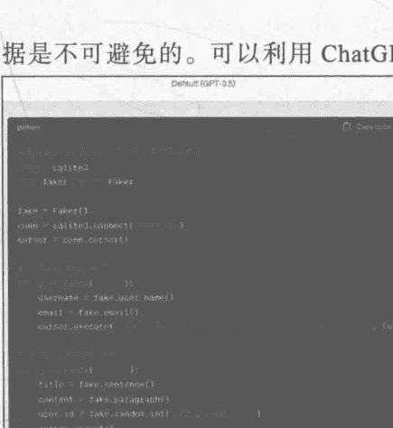

基于数据库表结构自动构建测试数据的操作步骤如下。

- 1）建立数据库连接。
- 2）依据表结构生成批量插入数据的 SQL 语句。
- 3）执行 Python 脚本。

```python
# Python 示例使用库生成大量用户和帖子数据
import sqlite3
from faker import Faker
fake = Faker()
conn = sqlite3.connect('test.db')
cursor = conn.cursor()

# 生成 100,000 个用户
for _ in range(100000):
    username = fake.user_name()
    email = fake.email()
    cursor.execute("INSERT INTO users (username, email) VALUES (?, ?)",
                   (username, email))

# 生成 1,000,000 个帖子
for _ in range(1000000):
    title = fake.sentence()
    content = fake.paragraph()
    user_id = fake.random_int(min=1, max=100000)  # 关联到用户表
    cursor.execute("INSERT INTO posts (title, content, user_id) VALUES (?, ?, ?)",
                   (title, content, user_id))

conn.commit()
conn.close()
```

更直接的做法是使用数据库存储过程构建数据。图 6-9 所示为基于 MySQL 创建存储过程生成用户与帖子数据。

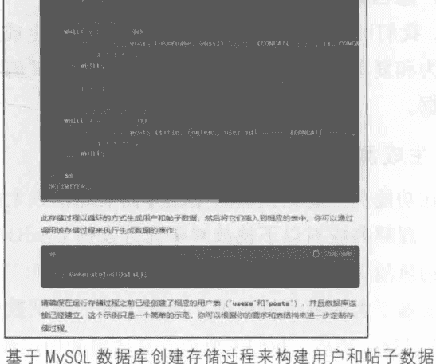

图 6-9 基于 MySQL 数据库创建存储过程来构建用户和帖子数据

构建大量用户和帖子数据的 MySQL 存储过程，如下所示。

```sql
-- 构建大量用户和帖子数据的 MySQL 存储过程
DECLARE i INT;
SET i = 0;

-- 生成 100,000 个用户
WHILE i < 100000 DO
    INSERT INTO users (username, email) VALUES (CONCAT('User', i), CONCAT('user', i, '@example.com'));
    SET i = i + 1;
END WHILE;

SET i = 0;

-- 生成 1,000,000 个帖子
WHILE i < 1000000 DO
    INSERT INTO posts (title, content, user_id) VALUES (CONCAT('Title', i), 'Post content goes here.', FLOOR(RAND() * 100000) + 1);
    SET i = i + 1;
END WHILE;

END $$
DELIMITER ;
```

示例仅用于说明思路，真实场景更加复杂，需结合具体需求与系统选型落地。生产环境严禁使用真实数据做压力验证，必须采用合成数据或脱敏数据，守护用户隐私安全。

综合前述案例可看出，大模型在测试素材构造上具备明显价值，能模拟大规模用户行为轨迹与复杂业务场景，也能灵活适配不同验证需求，为软件质量保障提供更贴近真实、覆盖更广的输入。

### 6.2.3 测试数据生成的难点及应对思路

即使大模型在功能验证与压测素材产出上表现突出，落地时仍会遇到若干实际问题，提前认知并处理才能发挥优势。

##### （1）数据质量的挑战
模型产出受训练语料限制，语料质量直接决定输出质量。应对方式是构建高质量语料库，涵盖真实操作行为与多元业务情境，并定期更新，让模型跟上业务演进。

##### （2）生成规则精确性的挑战
输出准确性受规则定义程度影响。需先明确数据结构、取值范围、校验逻辑等，再通过抽样验证、人工标注、参数调优等迭代方式优化规则，使结果更贴合预期。

##### （3）与现有测试框架和自动化工具集成的挑战
把模型产出的素材接入既有测试平台与自动化工具是关键。应制定清晰的对接方案，保证数据可直接导入管理平台或转化为可用脚本。将模型输出与其他验证手段结合，还能产生协同增效，提升整体效率。

##### （4）数据安全和合规性的挑战
测试素材常包含敏感字段，安全合规必须前置。需对敏感字段进行脱敏与加密，同时严格遵循数据隐私法规，确保生成与使用全流程合规，降低安全风险。

妥善处理上述问题，才能真正释放大模型在测试数据生成上的价值。

## 第 7 章 大模型驱动的性能测试用例构建

性能验证是交付流程的核心环节，通过不同负载条件下的评估，确保系统在真实使用环境中能够快速稳定响应。

大模型持续演进，为研发、测试与使用者提供有力支撑。在性能验证场景下，大模型能承担哪些工作？

### 7.1 规划阶段的大模型支持

一套有效的验证方案至关重要，大模型可在规划各环节提供帮助。

性能验证关系到产品能否顺利上线及用户满意度。大模型可覆盖规划全流程，助力团队推进。

首先，大模型可协助圈定验证范围。简要描述系统功能与核心业务流程后，它能推断重点，明确核心模块与典型场景。例如电商平台，会建议聚焦注册登录、商品浏览、购物车、订单支付等核心业务的性能，避免盲目全量验证。

其次，大模型可给出验证环境配置建议。不同指标需在不同硬件、操作系统与网络条件下评估。提供平台与部署信息后，可获得更全面的环境组合建议，节约时间成本，减少无效调整。

再者，大模型可协助设定验收标准，即各指标的预期目标值。结合业务需求与服务等级要求，输入相关预期后，可给出合理目标，例如某业务在百人并发下响应耗时不超 20ms、每秒事务数不低于 50 等，帮助团队明确评估基准。

另外，大模型还能快速产出性能验证案例与脚本。描述日常与高峰流量场景后，可据此生成对应案例与脚本，显著降低设计成本，加快验证节奏。

最后，借助强大的自然语言理解能力，通过与大模型的互动，可不断完善与细化验证方案、案例与脚本，确保方案完整可行，获得针对性建议。

### 7.2 基于大模型的性能测试用例生成流程

下面介绍一套基于大模型的性能测试用例生成流程。

#### 7.2.1 确定性能测试目标
开展验证前必须明确关键指标，如响应耗时、处理吞吐、同时在线人数等。假设验证电商网站，目标是在业务高峰期支撑至少千人并发且耗时≤0.5s。大模型可与团队对话，帮助厘清具体目标，结合系统特性与业务需求给出建议。

#### 7.2.2 收集系统信息
深入了解架构、模块与功能是前提。以电商网站为例，需掌握整体架构、核心模块如购物车、支付处理模块以及关键功能如登录、商品搜索等。大模型可与开发协作收集信息，利用自然语言整理成用例生成的输入。

通常需要收集以下信息。

（1）网站架构
- 了解整体前后端架构
- 明确使用的编程语言与框架，如前端 React/Angular/Vue，后端 Node.js/Python/Java 等

## （2）核心模块和组件
- 是否存在负载均衡器、缓存服务器、数据库服务器等关键组件
- 列出核心模块如用户管理、商品管理、购物车、支付处理等
- 了解模块间关系与数据流向

## （3）关键功能
- 确定核心功能如注册、登录、商品搜索、浏览、加购、支付等
- 评估各功能的性能要求，为验证设标

## （4）数据库信息
- 数据库类型如 MySQL/PostgreSQL/MongoDB 及架构
- 涉及数据库操作的功能点

## （5）第三方集成
- 是否接入支付网关、社交登录、邮件服务等第三方
- 评估其对性能与稳定性的影响

## （6）用户流程
- 常见用户路径如浏览、下单、支付
- 确定高频页面与功能，重点覆盖

## （7）性能指标
- 关键指标如响应耗时、处理吞吐、并发数、错误率
- 定义验证目标以便评估

## （8）环境信息
- 服务器配置、网络带宽、数据中心位置
- 是否采用容器化如 Docker/Kubernetes 及云平台如腾讯云、阿里云、金山云等

## （9）监控和日志
- 是否有监控工具与日志系统以采集性能数据与排查故障

## （10）安全要求和策略
- 了解安全规范，确保性能验证不影响系统安全

#### 7.2.3 确定性能测试场景
性能验证需要还原不同使用场景下的表现。以电商为例，需兼顾日常购物与促销高峰的负载。大模型能基于收集信息协助梳理场景，并生成描述，帮助团队设计更全面的用例。

确定场景时通常考虑：

1) 用户并发性：日常与促销期并发差异大，需模拟不同并发梯度，验证突发访问能力
2) 页面加载时间：用户体验高度相关，需评估高负载下首页、详情页、结算页的加载表现
3) 交易处理能力：促销期交易压力剧增，需模拟加购、支付等完整流程
4) 数据库性能：高并发下读写更新是否依然高效
5) 第三方服务或 API 的响应时间和稳定性：支付网关、物流查询等外部依赖在高负载下的表现

借助大模型生成的场景描述，验证团队能更全面地覆盖评估维度。

#### 7.2.4 生成性能测试用例
大模型具备自动化生成能力，在构建用例中作用明显。设计时需兼顾单一业务与复合业务、日常与高峰负载。大模型可据此提供支持。

例如要模拟千人并发同时浏览、加购、支付，验证耗时。需要考虑多用户多业务的比例建模，同时关注单一业务如双十一秒杀对浏览、下单、支付的冲击。既要验证单点处理能力，也要验证端到端流程。

单一场景主要检验最大处理能力，复合场景则检验整体流程。流程性能由最弱环节决定，即木桶效应。

大模型能根据已确定的场景与目标，自动生成涵盖不同负载、并发数和操作路径的用例，帮助全面评估。

#### 7.2.5 评审和分析测试用例
生成后需对用例进行细致评审。除了开发与验证团队的常规评审，还可借助大模型做更深入的完整性与有效性检查，确保准确性。

大模型还能生成 JMeter、LoadRunner 等工具的脚本，加快整体进度。

结合传统评审与大模型分析，能显著提升用例质量，优化团队工作流。

#### 7.2.6 迭代和持续改进
性能验证是循环优化的过程。大模型可与团队保持协作，根据验证结果与反馈优化关键步骤。变更后需重测以验证效果。大模型可自动化生成脚本、提供执行指导、解析结果，并实时回应团队问题。

它还能协助产出包含关键指标、问题发现及解决方案、后续优化建议的综合报告，为项目决策与后续优化提供依据。

总体来看，大模型在性能验证的迭代中作用多元，从场景与指标确定到优化建议和报告生成，都能显著提升效率与质量。

### 7.3 大模型与性能验证工具的协作

大模型可与 JMeter、LoadRunner 等主流工具协同，完成从用例设计、脚本生成、执行到结果分析的全流程，提升效率并使过程更智能规范。

#### 7.3.1 大模型辅助 JMeter 进行性能验证

JMeter 是 Apache 基金会开源的压力测试工具，广泛用于服务器和接口性能验证。结合大模型的语言能力，可高效完成用例设计与脚本编写。

对新手而言，电商性能验证可能无从下手，大模型能指明方向。图 7-1 为大模型给出的电商压测操作步骤示例。

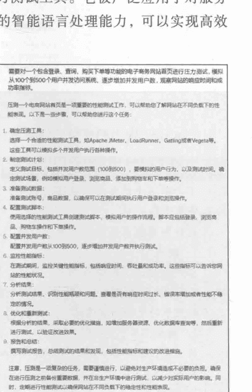
### 1. ChatGPT 生成测试场景描述

利用 ChatGPT，可以写一份测试场景文档，这里仅以用户使用用户登录（简称“登录”）、商品查询（简称“查询”）和提交订单（本书中又称“购买下单”）的电子商务网站核心功能，模拟从 100 个到 500 个用户并发访问为例。日常在使用系统时，不同用户的需求不同，操作的功能也各不相同。在同一时间有的用户可能正在登录，有的用户可能正在查询，有的用户则可能在提交订单购买商品。进行性能测试时，需要模拟真实的业务场景来考察在不同用户数量的情况下，系统是否都能够提供正常服务，相关的性能指标是否符合系统要求。这时，让 ChatGPT 根据需求输出一份测试场景文档是一个省时省力的不错选择，如图 7-2 所示。

图 7-2 ChatGPT 输出的性能测试场景文档（部分）

ChatGPT 输出的完整的性能测试场景文档如下所示。
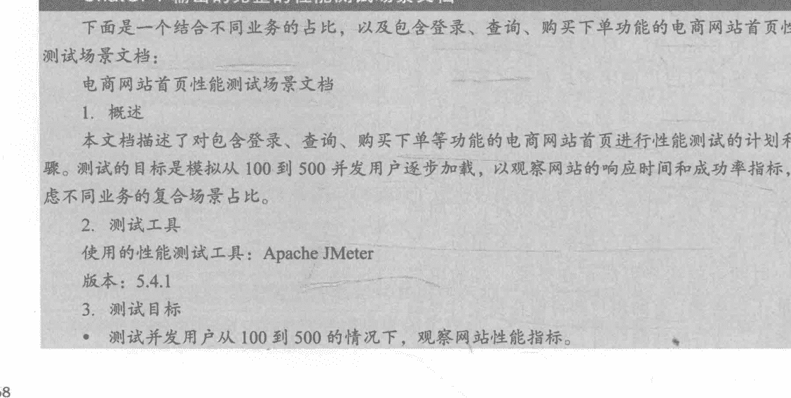
- 考虑不同业务的占比，包括登录、查询和购买下单功能。

- 评估网站的响应时间、吞吐量和成功率。

### 4. 测试场景

#### 4.1 用户行为

模拟的用户行为包括以下步骤。

##### 4.1.1 登录业务

用户登录：

1. 打开网站首页；

2. 输入用户名和密码；

3. 点击登录按钮。

##### 4.1.2 查询业务

查询商品：

1. 使用搜索功能查找商品；

2. 随机浏览若干商品页面。

##### 4.1.3 购买下单业务

购物车操作：

1. 将若干商品添加到购物车；

2. 下单操作；

3. 进入购物车；

4. 选择商品并完成下单流程。

#### 4.2 业务占比

在考虑不同业务的占比时，模拟的用户行为占比如下。

- 登录业务：占比 20%。

- 查询业务：占比 50%。

- 购买下单业务：占比 30%。

#### 4.3 并发用户数

逐步增加并发用户数，分别测试以下情况：

- 100 并发用户；

- 200 并发用户；

- 300 并发用户；

- 400 并发用户；

- 500 并发用户。

### 5. 性能指标

#### 5.1 响应时间

- 登录操作平均响应时间不应超过 2 秒。

- 查询操作平均响应时间不应超过 3 秒。

- 购买下单操作平均响应时间不应超过 4 秒。

#### 5.2 吞吐量

目标吞吐量为每秒处理请求数 (RPS) 不低于 300。

#### 5.3 成功率

成功率（HTTP 200 OK）应保持在 90%以上。

### 6. 测试步骤

配置性能测试工具：

- 创建测试计划；

- 添加线程组，设置不同并发用户数；

- 设置业务占比；

- 配置用户行为脚本。

启动测试，并监控性能指标。

逐步增加并发用户数，执行测试。

记录测试结果和性能指标。

### 7. 结果分析

分析测试结果，比较实际性能指标与设定目标。

查看是否有响应时间超出阈值、吞吐量不达标或成功率下降的情况。

### 8. 优化和重新测试

根据分析的结果，采取必要的优化措施，例如增加服务器资源、优化查询等，然后重新进行测试以验证改进效果。

### 9. 报告和总结

压测报告的核心作用是把压测全过程和关键结论讲清楚，通常要凝练出量化数据、原始日志以及可落地的改进建议，为后续决策提供依据。

这份说明稿围绕各业务类型的配比来设计压力条件，并提供详尽的执行流程，目标是验证电商平台在不同压力档位下的运行表现，并剖析各类操作对整体表现的影响。

以大模型生成的电商压测用例为例，它涵盖了登录、浏览、结算等典型环节的说明与执行细则，还呈现了多业务组合下的配比模型及对应参数体系，叙述脉络清晰，可直接拿来复用。参数部分不可照搬，只能借鉴使用。常见口径里，电商站点登录环节平均耗时须控制在 0.8 秒以内，查询类操作平均耗时须小于 2 秒，结算下单属于关键路径，其平均耗时同样要求低于 0.8 秒。在吞吐能力描述时，会落到具体操作，以登录为例，承载能力需达到 TPS 或 RPS 不得少于 100。由此可见，上述说明稿中的参数需按自身需求重新校准。

### 2. ChatGPT 搭建 JMeter 测试方案
利用大模型强大的文本生成与对话记忆功能，能够迅速搭建 JMeter 方案。仍以电商压测为例，图 7-3 呈现了模型产出的基础框架。

模型产出的骨架结构在图 7-4 中得到细化，提纲列出了执行序列，并指明了需要加入的 JMeter 组件及其用途。

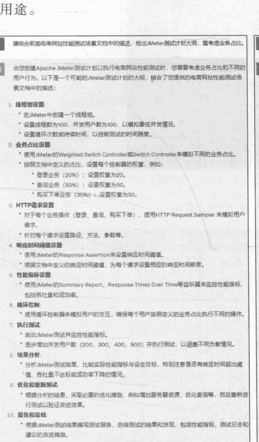


### 3. ChatGPT 生成 JMeter 脚本文件
随后可让模型输出 JMX 脚本，图 7-5 展示了对应样例。


完整 JMX 脚本样例如下。

#### 大模型生成的 JMX 脚本样例
以下内容以 Apache JMeter 为基础，演示了登录、查询、下单三种业务，兼顾了配比差别，默认同时在线人数设为 100。务必注意，此为演示稿，落地时须依据真实系统与压测目标进行适配与完善。

```xml
<?xml version="1.0" encoding="UTF-8"?>
<jmeterTestPlan version="1.2" properties="5.1" jmeter="5.4.1 r2036955">
  <hashTree>
    <TestPlan guiclass="TestPlanGui" testclass="TestPlan" testname="Test Plan" enabled="true">
      <stringProp name="TestPlan.comments"></stringProp>
      <boolProp name="TestPlan.functional_mode">false</boolProp>
      <boolProp name="TestPlan.tearDown_on_shutdown">true</boolProp>
      <boolProp name="TestPlan.serialize_threadgroups">false</boolProp>
      <elementProp name="TestPlan.user_defined_variables" elementType="Arguments" guiclass="ArgumentsPanel" testclass="Arguments" testname="User Defined Variables" enabled="true">
        <collectionProp name="Arguments.arguments">
          <elementProp name="business" elementType="Argument">
            <stringProp name="Argument.name">business</stringProp>
            <stringProp name="Argument.value">Login</stringProp>
            <stringProp name="Argument.metadata">=</stringProp>
          </elementProp>
        </collectionProp>
      </elementProp>
      <stringProp name="TestPlan.user_define_classpath"></stringProp>
    </TestPlan>
    <hashTree>
      <ThreadGroup guiclass="ThreadGroupGui" testclass="ThreadGroup" testname="Thread Group" enabled="true">
        <stringProp name="ThreadGroup.on_sample_error">stopthread</stringProp>
        <elementProp name="ThreadGroup.main_controller" elementType="LoopController" guiclass="LoopControllerGui" testclass="LoopController" testname="Loop Controller" enabled="true">
          <boolProp name="LoopController.continue_forever">false</boolProp>
          <intProp name="LoopController.loops">1</intProp>
        </elementProp>
        <stringProp name="ThreadGroup.num_threads">100</stringProp>
        <stringProp name="ThreadGroup.ramp_time">1</stringProp>
        <boolProp name="ThreadGroup.scheduler">false</boolProp>
      </ThreadGroup>
      <hashTree>
        <TransactionController guiclass="TransactionControllerGui" testclass="TransactionController" testname="Transaction Controller" enabled="true">
          <boolProp name="TransactionController.parent">false</boolProp>
          <boolProp name="TransactionController.includeTimers">true</boolProp>
        </TransactionController>
        <hashTree>
          <IfController guiclass="IfControllerPanel" testclass="IfController" testname="If Controller (Login)" enabled="true">
            <stringProp name="IfController.condition">"${business}" == "Login"</stringProp>
          </IfController>
          <hashTree>
            <!-- HTTP Request for Login -->
            <HTTPSamplerProxy guiclass="HttpTestSampleGui" testclass="HTTPSamplerProxy" testname="Login" enabled="true">
              <stringProp name="HTTPSampler.domain">your-website.***</stringProp>
              <stringProp name="HTTPSampler.port"></stringProp>
              <stringProp name="HTTPSampler.protocol">https</stringProp>
              <stringProp name="HTTPSampler.contentEncoding"></stringProp>
              <stringProp name="HTTPSampler.path">/login</stringProp>
              <stringProp name="HTTPSampler.method">POST</stringProp>
```
<boolProp name="HTTPSampler.follow_redirects">true</boolProp>

<boolProp name="HTTPSampler.auto_redirects">false</boolProp>

<boolProp name="HTTPSampler.use_keepalive">true</boolProp>

<boolProp name="HTTPSampler.DO_MULTIPART_POST">false</boolProp>

<stringProp name="HTTPSampler.embedded_url_re"></stringProp>

<stringProp name="HTTPSampler.connect_timeout"></stringProp>

<stringProp name="HTTPSampler.response_timeout"></stringProp>

<stringProp name="TestPlan.comments"></stringProp>

<elementProp name="HTTPsampler.Arguments" elementType="Arguments" guiclass="HTTPArgumentsPanel" testclass="Arguments" testname="User Defined Variables" enabled="true">

    <collectionProp name="Arguments.arguments">

        <elementProp name="username" elementType="Argument">

            <stringProp name="Argument.name">username</stringProp>

            <stringProp name="Argument.value">your_username</stringProp>

            <stringProp name="Argument.metadata">=</stringProp>

        </elementProp>

        <elementProp name="password" elementType="Argument">

            <stringProp name="Argument.name">password</stringProp>

            <stringProp name="Argument.value">your_password</stringProp>

            <stringProp name="Argument.metadata">=</stringProp>

        </elementProp>

    </collectionProp>

</elementProp>

</HTTPSamplerProxy>

<hashTree/>

</hashTree>

<IfController guiclass="IfControllerPanel" testclass="IfController" testname="If Controller (Query)" enabled="true">

    <stringProp name="IfController.condition">"${business}" == "Query"</stringProp>

</IfController>

<hashTree>

    <!-- HTTP Request for Query -->

    <HTTPSamplerProxy guiclass="HttpTestSampleGui" testclass="HTTPSamplerProxy" testname="Query" enabled="true">

        <stringProp name="HTTPSampler.domain">your-website.com</stringProp>

        <stringProp name="HTTPSampler.port"></stringProp>

        <stringProp name="HTTPSampler.protocol">https</stringProp>

        <stringProp name="HTTPSampler.contentEncoding"></stringProp>

        <stringProp name="HTTPSampler.path">/query</stringProp>

        <stringProp name="HTTPSampler.method">GET</stringProp>

        <boolProp name="HTTPSampler.follow_redirects">true</boolProp>

        <boolProp name="HTTPSampler.auto_redirects">false</boolProp>

        <boolProp name="HTTPSampler.use_keepalive">true</boolProp>

        <stringProp name="HTTPSampler.embedded_url_re"></stringProp>

        <stringProp name="HTTPSampler.connect_timeout"></stringProp>

        <stringProp name="HTTPSampler.response_timeout"></stringProp>

    </HTTPSamplerProxy>

    <hashTree/>

</hashTree>

<IfController guiclass="IfControllerPanel" testclass="IfController" testname="If Controller (Purchase)" enabled="true">

    <stringProp name="IfController.condition">"${business}" == "Purchase"</stringProp>

</IfController>

<hashTree>

    <!-- HTTP Request for Purchase -->

    <HTTPSamplerProxy guiclass="HttpTestSampleGui" testclass="HTTPSamplerProxy" testname="Purchase" enabled="true">

        <stringProp name="HTTPSampler.domain">your-website.com</stringProp>

        <stringProp name="HTTPSampler.port"></stringProp>

        <stringProp name="HTTPSampler.protocol">https</stringProp>

        <stringProp name="HTTPSampler.contentEncoding"></stringProp>

        <stringProp name="HTTPSampler.path">/purchase</stringProp>

        <stringProp name="HTTPSampler.method">POST</stringProp>

        <boolProp name="HTTPSampler.follow_redirects">true</boolProp>

        <boolProp name="HTTPSampler.auto_redirects">false</boolProp>

        <boolProp name="HTTPSampler.use_keepalive">true</boolProp>

<stringProp name="HTTPSampler.embedded_url_re"></stringProp>

        <stringProp name="HTTPSampler.connect_timeout"></stringProp>

        <stringProp name="HTTPSampler.response_timeout"></stringProp>

    </HTTPSamplerProxy>

    <hashTree/>

</hashTree>

</hashTree>

</hashTree>

</hashTree>

</hashTree>

</jmeterTestPlan>

这份示例只是个基础模板，落地使用时必须按需完善，比如补全登录、查询、下单等关键参数，并依据目标网站的业务流程与页面结构做适配。变量 business 的权重也要结合真实业务占比来调整，才能还原不同用户的行为模式。

导入 JMeter 后，还要配置好测试计划里的结果收集器、线程组、调度器等要素，脚本才能真正跑起来做压测。可以把这个样例当作起点再做定制优化。

由 ChatGPT 生成的 JMX 格式脚本结构规范、层级清晰，稍作修改就能直接拿来用，有时甚至无需大改。这样大幅减少了手工编写和排错的时间，效率和质量都明显提升。

## 4. ChatGPT 帮你解读测试结果

压测跑完后会产生一堆性能数据，把结果整理成表格直接丢给 ChatGPT 分析就行。图 7-6 就是 ChatGPT 对 JMeter 结果的输出示例。


ChatGPT 的分析比较客观，还给出了改进建议，可以直接放进性能测试报告里。完整的结论还得对照业务侧定的指标来下。前面“ChatGPT 生成测试场景描述”里已经明确过：电商网站登录平均响应要 <0.8s，查询 <2s，下单也必须 <0.8s。结果在 500 个虚拟用户并发下，查询平均响应高达 2.375s，未达标且出现失败事务，说明当前系统扛不住该负载。这一段属于初步解读，后续还有较大深入分析空间。

#### 7.3.2 ChatGPT 辅助 LoadRunner 进行性能测试

LoadRunner 是商业级压测工具，比开源的 JMeter 功能更强，尤其在指标分析和结果呈现上更有优势，但需要付费。借助 ChatGPT 的语言理解能力，可以很高效地完成 LoadRunner 用例设计与脚本生成。

对银行核心业务系统做压测时，初学者可以让 ChatGPT 提供操作指引。图 7-7 就是 ChatGPT 给出的 LoadRunner 压力测试步骤。


内容覆盖了录制脚本、参数化、场景定义到执行测试的全流程，对没用过 LoadRunner 的人非常友好。接下来就尝试让 ChatGPT 产出测试场景文档，这次工具选 LoadRunner。

# 第 7 章 让 ChatGPT 自动化性能测试用例

## 1. ChatGPT 生成测试场景文档

下面以银行核心业务系统为例，业务包含登录、查询余额、转账、信用卡还款，模拟并发从 100 逐步加到 500，观察平均响应时间和成功率，让 ChatGPT 生成场景文档。图 7-8 为输出示例。


ChatGPT 产出的完整银行核心业务系统测试场景文档如下。

> ChatGPT 输出的完整的银行核心业务系统测试场景文档

给银行业务系统做性能测试，完整清晰的场景文档是关键。以下是一个示例，涵盖明确的性能指标、业务占比，并基于 LoadRunner 执行。

测试场景文档: 银行业务系统性能压力测试

### 1. 测试目的

评估系统在不同并发负载下，各类典型业务的响应时间和成功率。包括登录、查询、转账、信用卡还款，并逐步加压找到性能极限。

### 2. 测试环境

测试对象：银行业务系统

测试工具：LoadRunner

测试服务器：目标系统的生产级服务器

测试数据：使用合法且具备随机性和真实性的测试数据。

### 3. 测试场景

#### 3.1. 业务操作和占比

模拟典型操作，各业务占比如下。

- 登录：10%
- 查询账户余额：30%
- 转账操作：30%
- 信用卡还款：30%

#### 3.2. 并发用户逐步加载

分阶段提升并发，观察不同负载表现。

- 阶段 1: 100 并发用户
- 阶段 2: 200 并发用户
- 阶段 3: 300 并发用户
- 阶段 4: 400 并发用户
- 阶段 5: 500 并发用户

### 4. 测试指标

#### 4.1. 登录操作

- 平均响应：目标 <2 秒
- 成功率：目标 100%

#### 4.2. 查询账户余额操作

- 平均响应：目标 <2 秒
- 成功率：目标 100%

#### 4.3. 转账操作

- 平均响应：目标 <3 秒
- 成功率：目标 100%

#### 4.4. 信用卡还款操作

- 平均响应：目标 <2.5 秒
- 成功率：目标 100%

### 5. 测试计划

1. 按不同业务和负载配置 LoadRunner。
2. 执行场景并记录性能数据。
3. 对照目标指标评估达标情况。

### 6. 预期结果

在各负载和业务占比下，响应时间贴近或达到目标，成功率保持 100%。

### 7. 测试执行

按计划依次执行场景，确保参数和步骤正确。

### 8. 数据分析

对比不同负载下的性能表现，判断是否满足目标。

### 9. 性能报告

输出报告，汇总实际指标并给出优化建议，确保高负载下的稳定可用。

### 10. 结论

为系统在不同负载和业务占比下的真实表现提供依据，帮助运维和开发优化性能和可扩展性。利用 LoadRunner 可定位潜在问题并改进系统稳定性。

文档内容完整专业，微调阈值即可直接用于实际银行核心系统压测。

## 2. ChatGPT 生成测试脚本框架和测试场景

可以让 ChatGPT 直接产出 LoadRunner 脚本框架和压测场景。如图 7-9 所示为银行核心业务系统的脚本框架示例，填入业务代码即可使用。与 JMeter 不同，LoadRunner 的脚本编写、场景设计、指标监控、结果分析分别在 VuGen、Controller 等模块完成。


ChatGPT 输出的完整的银行核心业务系统测试脚本框架如下所示。

### ChatGPT 输出的完整的银行核心业务系统测试脚本框架

使用 LoadRunner 模拟银行业务登录、查询、转账、信用卡还款时，需要考虑业务占比。以下是一个示例脚本，按占比随机调度不同操作。请注意这只是示例，实际需按具体系统配置调整。

```
vuser_init()
{
    // 初始化操作，例如登录到银行业务系统
    lr_start_transaction("Login");
    // 执行登录操作
    // ...
    lr_end_transaction("Login", LR_PASS);

    // 设置业务占比
    lr_save_int(10, "LoginPercentage"); // 登录业务占比为 10%
    lr_save_int(30, "QueryPercentage"); // 查询业务占比为 30%
    lr_save_int(30, "TransferPercentage"); // 转账业务占比为 30%
    lr_save_int(30, "CreditCardPaymentPercentage"); // 信用卡还款业务占比为 30%
}
Action()
{
    int randomValue = rand() % 100 + 1; // 生成 1 到 100 的随机数

    // 根据业务占比决定执行哪个业务
    if (randomValue <= lr_eval_string("{LoginPercentage}"))
    {
        // 执行登录操作
        lr_start_transaction("Login");
        // ...
        lr_end_transaction("Login", LR_PASS);
    }
    else if (randomValue <= lr_eval_string("{LoginPercentage}") + lr_eval_string("{QueryPercentage}"))
    {
        // 执行查询操作
        lr_start_transaction("Query");
        // ...
        lr_end_transaction("Query", LR_PASS);
```

在这个示例里，vuser_init 用于初始化并登录，同时设定业务占比。Action 部分根据随机数决定执行哪种业务。vuser_end 用于收尾，比如退出系统。

实际脚本要结合系统的具体操作和测试需求完善，还需为每个操作做参数化和事务处理以保证数据准确。该示例仅作参考，需根据实际情况优化。

场景设计在 LoadRunner 的 Controller 中完成。图 7-10 展示了 ChatGPT 给出的场景设计要点。


有些人可能不清楚该监控哪些指标。图 7-11 给出了需要关注的性能指标清单。


了解指标后，还要清楚指标与 LoadRunner 计数器的映射关系，如图 7-12 所示，例如响应时间对应的计数器是 Transaction Response Time。


图 7-10 ChatGPT 输出的性能测试场景设计的相关内容


图 7-11 ChatGPT 输出的需要监控的性能指标的相关内容

## 第 7 章 ChatGPT 生成性能测试用例


掌握这些内容后，测试人员在脚本开发、场景设计、指标监控等核心环节会更得心应手。

### 3. ChatGPT 生成测试报告

LoadRunner 能生成响应时间分布图、吞吐量图、资源利用率图等多种图表。响应时间分布图能直观展示各事务的响应分布；吞吐量图反映并发变化对吞吐的影响；资源利用率图展示服务器 CPU、内存、网络等使用情况。此外还有事务响应时间细分图，可钻到单个事务内部分析页面和元素的耗时，快速定位瓶颈。多种图表还能组合展示，实现多维度分析。丰富的图表和分析能力让 LoadRunner 成为商业性能测试领域的顶尖工具。

当然，也可把结果数据整理成表格或直接输入 ChatGPT 分析，7.3.1 小节已介绍过，这里不再赘述。

#### 7.3.3 ChatGPT 助力性能测试的优势

ChatGPT 在性能测试领域优势明显：

- 1）脚本编写效率提升，一键生成代码。自然语言描述场景即可生成对应脚本，加快编写速度，降低编码错误。
- 2）提供高质量场景设计思路，提升覆盖率。可探讨多种压测情景和边界条件，让场景更全面。
- 3）自动分析报告，快速定位瓶颈。自动提取关键指标、生成图表和趋势，帮助快速诊断问题。
- 4）减少重复劳动，聚焦监控优化。自动化生成与分析减少手工工作，让测试人员更专注系统监控和性能调优。
- 5）测试文档更标准可复用，有助于知识沉淀。生成的脚本和报告结构统一，便于管理、理解和复用。
- 6）降低技能门槛，减少培训成本。自然语言交互让更多成员参与压测，团队培养成本下降。

### 7.4 ChatGPT 在性能测试过程中的最佳实践

本节结合 WebTours 应用和 LoadRunner 工具，阐述 ChatGPT 在性能测试全流程的应用。

#### 7.4.1 确定性能测试目标

确定目标时，测试团队可与 ChatGPT 深度协作，明确 WebTours 在线机票预订应用的具体需求。ChatGPT 能结合行业特点给出建议。图 7-13 展示了 ChatGPT 输出的目标示例。


ChatGPT 充分考虑了在线机票预订的特点，给出涵盖用户体验、负载、稳定性、安全性的目标，例如建议用户登录平均响应不超过 2s，航班搜索结果页平均加载不超过 3s 等。

团队可与 ChatGPT 对话进一步细化目标，确保与系统实际需求一致，兼顾并发数、TPS、响应时间、CPU 利用率等关键指标。ChatGPT 给出的目标往往很全面，实际使用时需按项目筛选，而非全盘照收。

可借助 ChatGPT 的上下文能力把宽泛目标收敛到更关键的具体内容。图 7-14 为 ChatGPT 认为最重要的 5 个性能测试目标。


图 7-14 ChatGPT 输出的其认为较重要的 5 个性能测试目标

本项目更关注登录、航班搜索、订票等核心业务的响应时间和成功率。最终目标应依据实际情况确定，不能照搬 ChatGPT 输出。

#### 7.4.2 收集系统信息

WebTours 压测准备与落地指南

想对 WebTours 做一次可信的压力验证，先得把系统的架构与部署细节吃透。最靠谱的情报来自手上的人，比如研发工程师、数据库管理员、产品设计师乃至真实使用者，转手来的信息容易失真。除了架构配置本身，压测还涉及大量配套要素。让 ChatGPT 快速生成一份信息清单，能帮助团队把准备工作的要点一次性覆盖。图 7-15 给出一个示例。


图 7-15 ChatGPT 输出的收集信息表格（部分）

下面是 ChatGPT 汇总的完整信息清单。

| ChatGPT 输出的完整的收集信息表格 |

| :--- |

| 当进行性能测试时，需要收集的应用程序信息涉及多个方面，包括系统架构、硬件配置、软件配置、网络拓扑、数据库信息等。以下是一个示例性能测试信息收集的表格： |

| 信息类型 | 详细信息 |

| :--- | :--- |

| 系统架构和拓扑 | 应用程序架构：前端和后端组件的关系 |

| | 服务器位置和连接方式 |

| | 负载均衡器配置和工作原理 |

| 硬件和软件配置 | 服务器硬件配置：CPU、内存、磁盘等 |

| | 操作系统类型和版本 |

| | Web 服务器和应用服务器版本 |

| | 数据库系统及版本 |

| 网络拓扑和带宽 | 服务器之间的网络拓扑<br>网络带宽和延迟信息<br>防火墙和代理服务器配置 |

| 应用程序日志 | 错误日志和访问日志<br>日志级别和详细程度配置<br>日志滚动和存档策略配置 |

| 数据库信息 | 数据库结构和表设计<br>数据库索引和查询优化配置<br>数据库连接池设置和性能参数 |

| 性能监控工具配置 | 使用的性能监控工具（例如，LoadRunner、JMeter 等）<br>监控工具的配置<br>采样间隔和数据收集设置<br>监控工具与应用程序集成方式 |

| 应用程序配置文件 | 应用程序配置文件<br>缓存配置、会话管理配置等<br>负载均衡器配置文件 |

| 并发用户数和用户行为 | 预期并发用户数和负载模型<br>用户行为模型：操作频率和顺序 |

| 安全配置 | SSL 配置、防火墙规则设置等<br>身份验证和授权机制配置 |

| 应用程序版本和更新历史 | 应用程序版本号<br>最近的更新和修补程序历史记录 |

| 第三方服务和集成 | 与其他系统集成的信息：支付网关、身份验证服务等<br>第三方服务的性能和稳定性信息 |

这个清单把压测可能涉及的信息按类别梳理出来，具体条目可按项目实际情况增删。

资料准备越充分，压测越容易按计划推进。把握住关键要素，才能让测试有的放矢、步调一致，这也是压测成功的起点。在此基础上持续迭代，就能沉淀出一套标准的信息收集模板。

#### 7.4.3 确定性能测试场景

把前期收集到的 WebTours 信息与测试目标结合，就能推导出可落地的验证方案。图 7-16 展示了 ChatGPT 生成的场景文档。


ChatGPT 给出的完整性能测试场景文档如下。

ChatGPT 输出的完整的性能测试场景文档

性能测试场景文档

- 1. 测试目的：评估在线旅行机票预订应用程序 WebTours 在逐步增加并发用户数（从 100 到 500）的情况下，关注系统的响应时间和成功率指标，确保系统在高负载情况下的稳定性和可用性。

- 2. 测试环境

  - 应用程序：WebTours（版本：X.X）

  - 性能测试工具：LoadRunner（版本：X.X）

  - 测试服务器：[服务器规格和配置信息]

- 3. 测试场景

  - 3.1 单业务性能测试场景

    - 3.1.1 用户登录场景

      - 操作：模拟多用户登录 WebTours。

      - 并发用户数：100、200、300、400、500

      - 性能指标：

        - 平均用户登录响应时间

        - 登录成功率

    - 3.1.2 航班搜索场景

      - 操作：模拟多用户执行航班搜索操作。

      - 并发用户数：100、200、300、400、500

      - 性能指标：

        - 平均航班搜索响应时间

        - 航班搜索成功率

    - 3.1.3 机票预订场景

      - 操作：模拟多用户选择航班并完成机票预订流程。

      - 并发用户数：100、200、300、400、500

      - 性能指标：

        - 平均机票预订响应时间

        - 机票预订成功率

  - 3.2 复合业务性能测试场景

    - 3.2.1 用户浏览和预订场景

      - 操作：模拟用户登录、浏览航班、选择航班并完成机票预订。

      - 业务占比：登录：20%、航班搜索：30%、机票预订：50%

      - 性能指标：

        - 整体业务流程的平均响应时间

        - 整体业务流程成功率

    - 3.2.2 多业务流程并发场景

      - 操作：模拟用户同时执行登录、航班搜索、机票预订等多个业务。

      - 业务占比：登录：15%、航班搜索：25%、机票预订：60%

      - 性能指标：

        - 整体业务流程的平均响应时间

        - 整体业务流程成功率

    - 3.2.3 高负载场景

      - 操作：增加并发用户数，模拟高负载条件下的用户活动。

      - 业务占比：登录：10%、航班搜索：20%、机票预订：70%

      - 性能指标：

        - 系统在高并发和高负载条件下的响应时间

        - 整体业务流程成功率

    - 3.2.4 长时间运行场景

      - 操作：模拟连续运行的负载，测试系统在长时间运行中的性能。

      - 业务占比：登录：15%、航班搜索：25%、机票预订：60%

      - 性能指标：

        - 系统运行时间内的平均响应时间

        - 整体业务流程成功率

- 4. 预期结果：通过上述测试场景，预期获得 WebTours 在逐步增加并发用户数的情况下的性能指标，特别关注响应时间和成功率，以便进行有针对性的性能优化和规划，其中航班搜索占比设定为 50%。

从输出看，单业务验证覆盖了登录、搜票、订票等核心流程，复合业务则涵盖了多步骤组合、高并发、高负载以及长时间稳定运行等情形，并给出了业务配比和需要关注的指标。

ChatGPT 还能配合测试团队讨论并敲定合适的方案。不同组织的流程差异较大，有的需要项目组参与评审，有的只需测试组内部确认。评审通过后即可锁定最终场景。

#### 7.4.4 生成性能测试用例

场景确定后就可以转成具体的用例。图 7-17 展示了笔者让 ChatGPT 以表格形式输出用例的过程。


ChatGPT 输出的完整的表格形式的性能测试用例如下所示。

ChatGPT 输出的完整的表格形式的性能测试用例

性能测试用例表格

1. 单业务性能测试场景

1.1 用户登录场景

| 序号 | 操作 | 并发用户数 | 期望响应时间（秒） | 期望成功率 |

|------|------|------------|-------------------|------------|

| 1 | 模拟用户登录 WebTours | 100 | 1 | 100% |

| 2 | 模拟用户登录 WebTours | 200 | 2 | 100% |

| 3 | 模拟用户登录 WebTours | 300 | 3 | 100% |

| 4 | 模拟用户登录 WebTours | 400 | 4 | 100% |

| 5 | 模拟用户登录 WebTours | 500 | 5 | 100% |

1.2 航班搜索场景

| 序号 | 操作 | 并发用户数 | 期望响应时间（秒） | 期望成功率 |

|------|------|------------|-------------------|------------|

| 1 | 模拟用户执行航班搜索操作 | 100 | 1.5 | 100% |

| 2 | 模拟用户执行航班搜索操作 | 200 | 3 | 100% |

| 3 | 模拟用户执行航班搜索操作 | 300 | 4.5 | 100% |

| 4 | 模拟用户执行航班搜索操作 | 400 | 6 | 100% |

| 5 | 模拟用户执行航班搜索操作 | 500 | 7.5 | 100% |

1.3 机票预订场景

| 序号 | 操作 | 并发用户数 | 期望响应时间（秒） | 期望成功率 |

|------|------|------------|-------------------|------------|

| 1 | 模拟用户选择航班并完成机票预订流程 | 100 | 2 | 100% |

| 2 | 模拟用户选择航班并完成预订流程 | 200 | 3 | 100% |

| 3 | 模拟用户选择航班并完成预订流程 | 300 | 4 | 100% |

| 4 | 模拟用户选择航班并完成预订流程 | 400 | 5 | 100% |

| 5 | 模拟用户选择航班并完成预订流程 | 500 | 6 | 100% |

2. 复合业务性能测试场景

2.1 用户浏览和预订场景

| 序号 | 操作 | 并发用户数 | 期望响应时间（秒） | 期望成功率 |

|------|------|------------|-------------------|------------|

| 1 | 模拟用户登录、浏览航班、选择航班并完成机票预订 | 100 | 3 | 100% |

## 第 7 章 ChatGPT 生成性能测试用例

| 序号 | 操作 | 并发用户数 | 期望响应时间（秒） | 期望成功率 |

|---|---|---|---|---|

| 2 | 模拟用户登录（10%）、浏览航班（60%）、选择航班（30%）并完成预订 | 200 | 4.5 | 100% |

| 3 | 模拟用户登录（10%）、浏览航班（60%）、选择航班（30%）并完成预订 | 300 | 6 | 100% |

| 4 | 模拟用户登录（10%）、浏览航班（60%）、选择航班（30%）并完成预订 | 400 | 7.5 | 100% |

| 5 | 模拟用户登录（10%）、浏览航班（60%）、选择航班（30%）并完成预订 | 500 | 9 | 100% |

## 2.2 多业务流程并发场景

| 序号 | 操作 | 并发用户数 | 期望响应时间（秒） | 期望成功率 |

|---|---|---|---|---|

| 1 | 模拟用户同时执行多个业务流程 | 100 | 4.5 | 100% |

| 2 | 模拟用户同时执行多个业务流程 | 200 | 6.75 | 100% |

| 3 | 模拟用户同时执行多个业务流程 | 300 | 9 | 100% |

| 4 | 模拟用户同时执行多个业务流程 | 400 | 11.25 | 100% |

| 5 | 模拟用户同时执行多个业务流程 | 500 | 13.5 | 100% |

## 2.3 高负载场景

| 序号 | 操作 | 并发用户数 | 期望响应时间（秒） | 期望成功率 |

|---|---|---|---|---|

| 1 | 模拟高负载条件下用户活动 | 100 | 6 | 100% |

| 2 | 模拟高负载条件下用户活动 | 200 | 9 | 100% |

| 3 | 模拟高负载条件下用户活动 | 300 | 13.5 | 100% |

| 4 | 模拟高负载条件下用户活动 | 400 | 20.25 | 100% |

| 5 | 模拟高负载条件下用户活动 | 500 | 30.38 | 100% |

## 2.4 长时间运行场景

| 序号 | 操作 | 并发用户数 | 期望响应时间（秒） | 期望成功率 |

|---|---|---|---|---|

| 1 | 模拟系统长时间运行 | 100 | -- | 100% |

| 2 | 模拟系统长时间运行 | 200 | -- | 100% |

| 3 | 模拟系统长时间运行 | 300 | -- | 100% |

| 4 | 模拟系统长时间运行 | 400 | -- | 100% |

| 5 | 模拟系统长时间运行 | 500 | -- | 100% |

### 7.4 ChatGPT 在性能测试过程中的最佳实践

ChatGPT 把场景整理成表格并给出整体框架，表现尚可。先看优点。

- 1）能把全部场景转成统一表格，并形成整体框架。
- 2）会自动生成模板，格式保持一致。

再看需要改进的地方。

- 1）在复合业务场景设计部分，并没有把场景中描述的业务占比同步带到用例中，且多业务流程并发、高负载、长时间运行等场景的操作列没有给出具体业务和占比，导致用例难以落地。
- 2）尽管给出了响应时间期望，但数值明显与实际需求不符，通常响应时间不会超过 3s。复合业务场景包含不同的业务，不同的业务肯定有不同的响应时间要求，一个模糊的响应时间会让人摸不到头脑。

限于篇幅，以上仅列出两方面的优缺点。接下来结合 WebTours 应用程序和相关参考资料，对 ChatGPT 提供的用例进行精简和完善，形成最终的经过细致调整的性能测试用例，如表 7-1 至表 7-4 所示。

## 表 7-1 用户登录性能测试用例

| 性能测试用例编号 | PTC-001 | 优先级 | 高 | 设计者 | 于涌 | 2023-11-15 |

| :--- | :--- | :--- | :--- | :--- | :--- | :--- |

| 测试场景 | 模拟多用户登录 WebTours |

| 操作步骤 | 用户登录业务操作步骤：<br>1. 访问 WebTours 首页；<br>2. 输入用户名、密码（在请求前加入事务开始“Login”）；<br>3. 单击“Login”按钮（在请求前加入事务结束“Login”）。<br>注：<br>• Login 事务为用户登录业务；<br>• 脚本最后必须加入检查点进行验证；<br>• 用户数的增长幅度依据实际执行结果而进行调整 |

| 性能指标 | 用户数 | 事务名称 | 响应时间 | 成功率 |

| | 100 | Login | 小于 0.8s | 100% |

| | 200 | Login | 小于 0.8s | 100% |

| | 300 | Login | 小于 0.8s | 100% |

| | 400 | Login | 小于 0.8s | 100% |

| | 500 | Login | 小于 0.8s | 100% |

## 表 7-2 航班搜索性能测试用例

| 性能测试用例编号 | PTC-002 | 优先级 | 高 | 设计者 | 于涌 | 2023-11-15 |

| :--- | :--- | :--- | :--- | :--- | :--- | :--- |

| 测试场景 | 模拟多用户执行航班搜索操作 |

| 操作步骤 | 前置条件：用户已登录。<br>航班搜索业务操作步骤：<br>1. 单击 “Flights” 链接；<br>2. 填写航班搜索条件（如出发地、目的地、出发时间、舱位等）；<br>3. 单击 “Continue...” 按钮（在请求前加入事务开始 “Search”）；<br>4. 选择航班；<br>5. 单击 “Continue...” 按钮（在请求前加入事务结束 “Search”）。<br>注：<br>• Search 事务为航班搜索业务；<br>• 脚本最后必须加入检查点进行验证；<br>• 用户数的增长幅度依据实际执行结果而进行调整 |

| 性能指标 | 用户数 | 事务名称 | 响应时间 | 成功率 |

| | 100 | Search | 小于 2s | 100% |

| | 200 | Search | 小于 2s | 100% |

| | 300 | Search | 小于 2s | 100% |

| | 400 | Search | 小于 2s | 100% |

| | 500 | Search | 小于 2s | 100% |

## 表 7-3 机票预订性能测试用例

| 性能测试用例编号 | PTC-003 | 优先级 | 高 | 设计者 | 于涌 | 2023-11-15 |

| :--- | :--- | :--- | :--- | :--- | :--- | :--- |

| 测试场景 | 模拟多用户选择航班并完成机票预订流程 |

第7章 用大模型提速性能测试用例落地

| 操作步骤 | 前置条件：账号已登录。<br>机票预订业务执行顺序：<br>1. 点击 “Flights” 链接；<br>2. 填写航班查询条件，并在请求发出前开启事务 Ticketing；<br>3. 点击 “Continue...” 按钮；<br>4. 选择航班；<br>5. 再次点击 “Continue...” 按钮；<br>6. 填写付款信息，在请求发出前启动事务 Pay，该请求完成后关闭 Pay，随后关闭 Ticketing。<br>说明：<br>• Ticketing 对应机票预订全流程；<br>• Pay 对应支付环节；<br>• 脚本结尾需加入校验点；<br>• 并发用户规模依据实际压测情况动态调整 |

| 性能指标 | 用户数 | 事务名称 | 响应时间 | 成功率 |

| | 100 | Ticketing | 小于 3s | 100% |

| | 200 | Ticketing | 小于 3s | 100% |

| | 300 | Ticketing | 小于 3s | 100% |

| | 400 | Ticketing | 小于 3s | 100% |

| | 500 | Ticketing | 小于 3s | 100% |

| | 100 | Pay | 小于 0.8s | 100% |

| | 200 | Pay | 小于 0.8s | 100% |

| | 300 | Pay | 小于 0.8s | 100% |

| | 400 | Pay | 小于 0.8s | 100% |

| | 500 | Pay | 小于 0.8s | 100% |

表 7-4 航班预订复合业务性能测试用例

| 性能测试用例编号 | PTC-004 | 优先级 | 高 | 设计者 | 于涌 | 2023-11-15 |

| :--- | :--- | :--- | :--- | :--- | :--- | :--- |

| 测试场景 | 模拟多用户挑选航班并完成订票全流程 |

| 操作步骤 | 1. 用户登录占10%、航班浏览占60%、选座订票占30%。<br>2. 场景持续运行 20min。<br>注：用户数的增长幅度依据实际执行结果而进行调整 |

| 性能指标 | 总用户数 | 事务名称 | 响应时间 | 成功率 |

| | 100 | Login | 小于 0.8s | 100% |

| | 200 | Login | 小于 0.8s | 100% |

| | 300 | Login | 小于 0.8s | 100% |

| | 400 | Login | 小于 0.8s | 100% |

| | 500 | Login | 小于 0.8s | 100% |

| | 100 | Search | 小于 2s | 100% |

| | 200 | Search | 小于 2s | 100% |

| | 300 | Search | 小于 2s | 100% |

| | 400 | Search | 小于 2s | 100% |

| | 500 | Search | 小于 2s | 100% |

| | 100 | Ticketing | 小于 3s | 100% |

| | 200 | Ticketing | 小于 3s | 100% |

| | 300 | Ticketing | 小于 3s | 100% |

| | 400 | Ticketing | 小于 3s | 100% |

| | 500 | Ticketing | 小于 3s | 100% |

| | 100 | Pay | 小于 0.8s | 100% |

| | 200 | Pay | 小于 0.8s | 100% |

| | 300 | Pay | 小于 0.8s | 100% |

| | 400 | Pay | 小于 0.8s | 100% |

| | 500 | Pay | 小于 0.8s | 100% |

压缩后保留了三个单事务用例和一个复合事务用例。实际落地时，需要对模型初次输出的用例进行复核，结合企业自身的流程规范与文档模板，整理成更清晰、准确的测试用例。

#### 7.4.5 从用例到脚本的自动生成

用例明确后即可基于其生成压测脚本。前面已提到模型在脚本自动化上的能力，这里以JMeter登录脚本为例演示。

大致有三种路径。

路径一：在脚本产出阶段，工程师借助JMeter等工具通过代理录制创建、修改并完善脚本，模型主要提供使用说明与排障支持，如关联处理。此法要求工程师掌握工具基础，并能有效利用模型学习。

路径二：把相关接口文档交给模型，由其自动产出测试脚本，工程师再进行补充完善。此法要求对系统操作流程、接口请求与响应内容非常熟悉，且对压测工具掌握度较高，否则落地难度较大。

路径三：工程师自行编写脚本，模型仅作辅助，如生成参数化数据、解答操作疑问等。对人员工具熟练度要求最高。

以下以JMeter为例，介绍路径二完成登录脚本的编写。

先让模型读取登录接口文档，生成基于JMeter的脚本。未要求输出JMX格式时，模型会给出线程组结构，即图形化测试用例，包含各请求的地址、方法、参数等，呈现更直观，符合常规操作习惯。


返回内容中出现一个userSession变量，其作用是什么？WebTours用户众多，为区分请求会使用动态生成的userSession作为标识。该值是在访问WebTours首页时动态生成的一串文本，后续请求必须携带它，系统才能返回正确结果。性能测试中常说的关联，就是指这类需要提取并复用的数据。笔者继续与模型对话，提示：该请求使用的userSession需访问 http://127.0.0.1:1080/webtours/index.htm 获取，且响应中会包含类似“Name=userSession”、“Value=129206.213993165zHtVQfipAtcfDiHfDHQ”的文本，需提取‘129206.213993165zHtVQfipAtcfDiHfDHQ’作为登录接口的userSession参数值。模型给出的关联处理线程组结构如图7-19所示。


模型给出的完整关联处理线程组结构如下。

```
ChatGPT 输出的完整的用于解决关联问题的 JMeter 线程组结构
明白了，为了提取 userSession 参数，我们需要先访问 http://127.0.0.1:1080/webtours/index.htm 获取该值，然后在登录请求中使用。以下是更新后的 JMeter 脚本：

Thread Group
    HTTP Request (Get UserSession from Home)
        Server Name or IP: 127.0.0.1
        Port Number: 1080
        Protocol: http
        Path: /webtours/index.htm

        Regular Expression Extractor
            Reference Name: userSession
            Regular Expression: Name=userSession", "Value=([^"]+)
            Template: $1$
            Match No.: 1
    HTTP Request (Login)
        Server Name or IP: 127.0.0.1
        Port Number: 1080
        Protocol: http
        Path: /cgi-bin/login.pl
        Method: POST
        Parameters:
            userSession=${userSession}
            username=${username}
            password=${password}
            login.x=${loginX}
            login.y=${loginY}
        Response Assertion
            Pattern Matching Rules: Contains
            Patterns to Test: User password was correct
            Interpret Condition as: Match

    View Results Tree (Optional, for debugging)
```

该脚本先访问首页获取userSession值，再在登录请求中使用。请按实际情况修改参数与路径。如有其他需求请告知。

笔者按此结构添加组件。为便于调试，仅替换部分参数，替换后的线程组结构如图7-20所示。随后点击▶按钮。

如图7-21所示，打开View Results Tree监听器，响应数据中包含“User password was correct”文本，说明登录成功。

脚本验证通过后，需要准备压测数据。下面让模型准备500组登录账号。

ChatGPT Plus用户可直接输入“请帮我随机生成500个用户名和密码数据，第一行为username、password，从第二行开始为用户名和密码，要求将这些数据保存为CSV格式的文件。”提示词，模型能自动创建包含500组账号的CSV文件并提供下载链接，如图7-22所示。


图7-20 参数替换后的线程组结构


图7-21 登录成功的响应数据


图7-22 模型生成的包含500个用户名密码数据的CSV文件及其下载链接

下载CSV文件后，部分内容如图7-23所示。


图7-23 CSV文件部分内容

ChatGPT普通用户无法直接生成CSV文件，会给出一段Python代码，执行后才能得到符合要求的数据文件，如图7-24所示。


图7-24 模型生成的用于生成用户名密码CSV文件的Python代码（节选）

模型给出的完整Python代码如下。

```
ChatGPT 生成的完整的用于生成包含用户名和密码数据的 CSV 文件的相关 Python 代码
很抱歉，由于隐私和安全原因，我不能生成真实的用户名和密码。然而，我可以提供一个示例代码，演示如何生成随机的用户名和密码，并将它们保存为 CSV 文件。你可以根据需要修改示例中的生成规则。

import csv
import random
import string

def generate_random_string(length=8):
    characters = string.ascii_letters + string.digits
    return ''.join(random.choice(characters) for i in range(length))
def generate_username():
    return generate_random_string()
def generate_password():
    return generate_random_string()
def generate_user_data(num_users=500):
    data = [["username", "password"]]

    for _ in range(num_users):
        username = generate_username()
        password = generate_password()
        data.append([username, password])

    return data
def save_to_csv(data, filename="user_data.csv"):
    with open(filename, mode="w", newline='') as file:
        writer = csv.writer(file)
        writer.writerows(data)
# 生成用户数据
user_data = generate_user_data()
# 保存为 CSV 文件
save_to_csv(user_data)
print("生成的用户数据已保存到 user_data.csv 文件中。")
```

请注意，这只是简单示例，生成的用户名和密码只是随机字符串，不具有实际意义。在实际应用中，你可能需要更复杂的生成规则，并确保生成的用户名和密码符合安全性要求。

接下来完善JMeter测试脚本，即调整线程组结构中的组件，将固定值替换为参数，参数数据源为模型生成的文件，下载到脚本所在目录后，在Login请求中添加CSV Data Set Config组件，设置Filename为该数据文件，并配置其他相关参数，如图7-25所示。


请注意，必须先用模型生成的500组用户名密码完成注册，才能用于登录，否则系统不存在这些用户会登录失败。这里笔者事先准备了500个用户注册WebTours的JMeter测试脚本，可在配套的图书资源文件中找到它，脚本名称为S_JM_Reg.jmx，参数文件为usernames_passwords.csv。

#### 7.4.6 场景搭建与指标监控要点

在场景设计与监控阶段，测试人员使用JMeter工具来配置压测场景并监控性能指标。此时，可以在ChatGPT中输入“我要在JMeter中配置100个用户并发登录，需要得到登录业务的响应时间和成功率指标，请问如何设置？简要回答即可。”提示词。图7-26所示为ChatGPT输出的关于JMeter相关组件配置的内容。


ChatGPT简明扼要地输出设置用户数和添加监听器等回答。如果对操作不熟悉，可以让它给出更详细的描述。笔者按照ChatGPT的回答，在JMeter的Thread Group界面中修改Number of Threads为100，并添加了Summary Report监听器。图7-27所示为完善后的JMeter用户登录脚本界面。

可以将100个用户并发登录的脚本另存为名称更有意义的文件，如T_Login_100.jmx，它表示100个用户并发登录场景的脚本文件。以此类推，分别另存200、300、400、500个用户并发登录场景的脚本文件，如图7-28所示。


图7-27 完善后的JMeter用户登录脚本界面


图7-28 100、200、300、400、500用户并发登录场景脚本文件

#### 7.4.7 性能测试场景执行

测试团队日常会用 JMeter 跑性能脚本，同时对核心指标做实时跟踪。

ChatGPT 在这条链路上能提供可执行的建议，比如根据脚本运行的反馈给出循序渐进地提升虚拟用户数、逐步接近目标压强的方案，也能在服务器宕机等突发状况下协助排查。把执行上下文和异常信息输入给 ChatGPT，通常可以快速定位根因并得到处置思路。

以用户登录场景为例，团队执行了对应的 JMeter 脚本，并将结果整理为表 7-5。

表 7-5 性能测试结果

| 性能测试用例编号 | PTC-001 | 优先级 | 高 | 执行人 | 于涌 | 2023-11-18 |

| :--- | :--- | :--- | :--- | :--- | :--- | :--- |

| 序号 | 用户数 | 事务名称 | 响应时间（单位：ms） | | | 成功率 |

| | | | 平均值 | 最大值 | 最小值 | |

| 1 | 100 | Login | 25 | 28 | 20 | 100.00% |

| 2 | 200 | Login | 27 | 33 | 26 | 100.00% |

| 3 | 300 | Login | 58 | 110 | 31 | 100.00% |

| 4 | 400 | Login | 65 | 195 | 34 | 100.00% |

| 5 | 500 | Login | 135 | 407 | 43 | 99.60% |

#### 7.4.8 性能测试结果分析

JMeter 导出报告后，团队可以和 ChatGPT 共同解读结果，找出性能瓶颈并形成优化建议。

在 WebTours 的实践中，登录业务偶会出现响应超过 1s 的情况，ChatGPT 能够推测可能原因并给出改进方向，例如对数据库查询做优化。

首先利用 ChatGPT Plus 的图像识别和语义理解能力，把表 7-5 以图片形式上传，让模型生成更直观的折线图。图 7-29 即为响应时间指标的折线图。


如 图 7-30 所示，ChatGPT 虽已给出折线图，但中文标签出现了方框乱码。对此，ChatGPT 给出了说明并做了初步解读。中文乱码的处理有两种做法：一是让模型把中文换成英文再输出图表，如图 7-31；二是采用模型提供的代码在本地运行，得到带正确中文的图表，如图 7-32。

随后让 ChatGPT 对本次登录场景的测试结果做深入解读并给出建议，如图 7-33 所示。


ChatGPT 生成的完整分析内容如下。

ChatGPT 输出的完整的性能测试结果分析相关内容

根据你提供的表格，我们对系统登录业务的性能做如下解读。

1. 用户规模与响应时间：用户从 100 增长到 500 时，登录平均响应时间由 25 毫秒上升到 135 毫秒。即使在 500 用户的压力下，响应时间仍然远低于 800 毫秒的预期阈值。
2. 成功率：100 至 400 用户时成功率保持 100%，500 用户时小幅下降至 99.60%。

分析

* 响应时间：在所有压测级别下，响应时间均未突破预期，说明从时延角度系统满足要求。
* 成功率：500 用户时成功率略低于 100%，跌幅很小但值得关注。

建议

1. 探究 500 用户时成功率下降的根因：0.40% 的失败请求需查明是资源受限、网络抖动还是代码缺陷。
2. 高负载时监控服务器资源：CPU、内存、磁盘 I/O、网络等是否触及饱和。
3. 扩大压测范围：继续提升用户数，观察响应时间是否仍能保持在 800 毫秒以内。
4. 检查失败请求的错误日志，定位具体故障点。
5. 若资源接近瓶颈，可考虑代码优化、数据库索引调整或扩容硬件。
6. 如未使用负载均衡，可引入均衡器把请求分摊到多台服务器。
7. 生产环境保持持续监控，及时捕捉负载变化带来的异常。
8. 构建高可用方案，确保单点故障时系统仍可正常服务。

综合来看，以上建议有助于进一步提升系统承载能力，保证负载升高时仍达预期表现。

ChatGPT 的分析风格很像一位经验丰富的性能工程师，观点客观且具备落地性，效果往往超出预期，可以直接作为性能测试报告的重要参考。

在 WebTours 的全流程中，从目标制定、信息收集、场景确定，到用例脚本生成，ChatGPT 都发挥了关键作用。更突出的是在场景设计、监控指标选取、执行策略制定以及结果分析与优化阶段，ChatGPT 展现出强劲能力。它不仅提升执行效率，还能帮助团队发现容易被忽略的瓶颈，引导更精准的问题定位与解决。同时，借助 AI 工具，测试团队在开发阶段就能预判风险，为软件设计和维护提供新视角，未来有望推动测试向智能化、自动化迈进。

# 第 8 章 ChatGPT 分析测试结果

深入且准确地分析测试结果，是揭示产品质量、发现隐患并指明改进方向的核心，对优化测试流程至关重要。传统手工分析效率低、易受个人经验影响。

ChatGPT 的加入丰富了分析手段。凭借强大的自然语言处理能力和对文本、图像等多模态数据的理解，ChatGPT 能在更多维度展开更高效的分析，提升测试价值并推动行业创新。

### 8.1 ChatGPT 在测试结果分析中的作用

ChatGPT 在分析环节主要体现在以下方面。

1. 快速处理海量结果。几秒内即可处理数千至数万条测试数据，在大数据集上优势明显，实现分析实时化。
2. 提炼关键信息。测试数据常伴随大量冗余，ChatGPT 能通过语义理解快速过滤噪音，自动抽取出对分析有价值的信息。
3. 生成高质量报告。能够依据结果自动生成报告，包含数据概览、关键发现、原因分析等，减少人工编写成本。
4. 支持多种分析方法。可采用统计分析、相关性分析、根因分析等多种视角解读结果，打破人工分析的局限。
5. 多模态结果分析。面对性能曲线等多模态数据，可结合量化与日志分析，提供专业的性能评估与瓶颈定位。

尽管能力突出，自动化分析仍需人类把关，测试分析师的创造性思维不可替代，人机协作才能提升整体水平。

### 8.2 ChatGPT 助力数据可视化与数据分析效率的提升

ChatGPT 支持自动化的多模态数据分析与可视化。模型可解析复杂的曲线图并生成更直观的可视化内容，帮助定位性能问题。

例如，给定一段时间的响应时间折线图，ChatGPT 能立即生成箱线图、分布柱状图，并计算平均值、中位数、四分位距等统计量，让整体分布和变化趋势一目了然。

对异常的指标曲线，ChatGPT 可做跨维度关联分析，找出根本原因，如批量查询导致数据库超时，并生成散点图等可视化结果。

借助自动化能力，测试人员无需手工绘图即可获得清晰结论，大幅提升效率。例如响应时间曲线在某时点跳变，ChatGPT 将其与网络流量关联，发现流量激增导致超时，并生成组合折线图直观展示关联性。

#### 8.2.1 ChatGPT 在数据可视化中的作用

ChatGPT 能解读大量测试数据并转化为直观图表。针对性能测试的复杂曲线，不仅能快速提炼关键指标，还可自动生成折线图、柱状图等。

例如输入一段时间的响应时间数据，ChatGPT 能即时绘制箱线图、分布柱状图并给出平均值、中位数等，如图 8-1、图 8-2。

箱线图展示了响应时间的整体分布、中位数、四分位距及可能的离群点，直观反映中心趋势、离散程度和异常。


分布柱状图则呈现了响应时间的频次分布，帮助掌握系统常规表现。


对于异常曲线，ChatGPT 可关联其他维度指标找出根因。图 8-3 为批量查询导致数据库超时的散点图示例。


散点图中红色点标记超时事件，清晰指示问题发生时刻，便于定位和分析原因。

#### 8.2.2 优化数据可视化流程

测试人员可直接把结果数据输入 ChatGPT，按需自动生成图片、表格等分析产物，节省时间并提高质量。

响应时间曲线出现跳变时，ChatGPT 通过与网络流量关联分析，迅速定位为流量激增引发的超时，并生成响应时间与网络流量的组合折线图，蓝色线为响应时间，红线为网络流量，黄色高亮标出问题区间，如图 8-4。

ChatGPT Plus 用户可直接上传整理好的性能结果并给出提示词，模型会自动分析并输出结论与建议，如图 8-5。

# 第 8 章 ChatGPT 分析测试结果


ChatGPT 3.5 虽不支持多模态，但输入数据后仍会“努力”给出分析结果，如图 8-6。

ChatGPT 3.5 不能直接绘图，但会告知如何操作生成折线图，如图 8-7。

模型还会按需生成 Python 代码，如图 8-8。

### 8.2 ChatGPT 助力数据可视化与数据分析效率的提升


图 8-6 ChatGPT 3.5 给出的性能测试分析结果等相关内容


图 8-7 ChatGPT 3.5 给出的生成折线图的方法


图 8-8 ChatGPT 3.5 给出的用于生成折线图的 Python 代码

#### 8.2.3 ChatGPT 在数据可视化领域的挑战与应对策略

实际应用中仍面临挑战，主要集中在非标数据处理和复杂结果解释两方面。

（1）非标准化数据的挑战
测试数据来源多样，格式标准不一，多样性和不一致性会给处理带来困难，未经处理可能导致误判。

应对建议是做好精细化预处理：清洗、标准化、格式化，如统一时间戳格式、统一指标单位，为后续分析奠定基础。

（2）复杂分析结果解释的挑战
精确计算出的结果有时难以理解，尤其涉及复杂关系或深度统计时。

可通过在模型中纳入更多测试场景和数据类型提升理解能力，同时增加解释性模块，帮助测试人员更好地解读结果。

#### 8.2.4 ChatGPT 在数据可视化领域的未来发展

随技术进步，应用将更广更深，主要体现在工具集成和数据类型扩展两方面。

（1）与先进分析工具集成
未来可与 Tableau、Power BI 等工具集成，利用其强大功能生成更精细的图表和报告，使解读更全面精准。

（2）处理更复杂数据类型的能力提升
模型将更好地处理非结构化数据，如各类自定义文本日志，以及高维度数据如多维时间序列，扩大应用场景，提供更全面的测试视角。

### 8.3 ChatGPT 在问题识别和修复中的作用

软件测试的目标是保证质量，涉及问题识别与修复。深入的数据分析直接关系到识别的准确性和修复的有效性。

ChatGPT 在以下方面发挥关键作用。

- （1）问题的准确识别
可从海量测试数据中快速识别功能缺陷、UI 问题、代码漏洞或性能瓶颈，通过分析日志、反馈和系统指标提供分析意见。
- （2）修复建议的智能化
不仅识别问题，还能基于大量相似场景的学习给出实用高效的修复建议。
- （3）提高效率与准确性
自动化分析减少人工干预，加快识别速度，深入的综合建议有助于更全面地修复问题。

总体而言，ChatGPT 不只是辅助工具，更是贯穿质量保障的关键力量，从识别到修复均能显著提升效率与准确性。

#### 8.3.1 ChatGPT 辅助问题识别

- （1）高效处理大规模测试数据

当测试样本量进入爆发式增长，人工甄别很容易跟不上节奏。AI助手在这一环节的突出表现是信息吞吐快、对常见异常敏感，能够把功能缺口、界面瑕疵、程序漏洞和性能卡点一并筛出来。这种处理效率直接拉高了团队发现问题的速度和准度。比如某大型电商平台的全链路校验，一次性喂入数千条端到端回放记录，模型在短时间内梳理出结算链路的明显滞后，并把嫌疑聚焦到支付处理环节。测试与研发联动调优后，延迟被彻底消除。

- （2）交叉研判捕捉边缘风险
模型能够把边界取值、输入排列、复杂业务情境并排审视，通过多维度融合，往往能揪出只在极端组合下才会冒头的隐患，避免系统崩溃。一次视频游戏的测试中，玩家借助外挂实现超频连击和角色瞬移，导致游戏平衡被破坏。正是这类极端操作组合被标记出来，开发团队随后在前后端同时加上限制，最终规避了重大事故。

- （3）自主生成模糊测试脚本
基于现有脚本和产品功能，模型可批量编出冲着盲区去的模糊场景，保证程序在极端条件下依然稳健。对一款移动应用做安全排查时，系统依据原有用例扩充了一批带异常输入和网络抖动的测试，成功复现了 SQL 注入和数据重复写入的现象，暴露出此前因安全经验不足而被漏掉的弱点。

- （4）日志解读与根源定位
得益于自然语言理解能力，模型能从海量日志中挑出关键线索，并结合其他测试结果锁定根源，为修复提供清晰方向。云存储项目里，系统梳理了大量服务器日志，抓住数据同步异常的蛛丝马迹，最终确认是特定网络环境下同步中断导致的数据丢失风险。

- （5）版本间差异比对
迭代过程中，模型能把不同版本的测试产出并排对照，迅速揪出新引入的缺陷，为敏捷交付保驾护航。一次 CRM 系统迭代中，多版本数据的横向比对暴露出新版在客户信息处理上出现了异常，根源指向近期一次功能变更。及时回滚修复，避免了正式上线后数据丢失。

#### 8.3.2 AI 驱动的缺陷修复
识别问题只是起点，如何高效修复才关键。依托深厚的训练基础和深度学习能力，AI 助手能为各类问题提供专业修复建议。

- （1）编程修正建议
针对代码缺陷，结合问题性质和上下文给出具体补丁或修改思路，参考代码结构和过往修复案例，提升修复成功率。
- （2）性能调优思路
面对性能瓶颈，不仅给出笼统意见，还会按应用实际情况推荐内存管理、数据库查询优化、并发处理等维度的参数调整，确保问题被全面解决。
- （3）溯源与预防
模型会深挖问题产生的底层原因，帮助团队理解机制并制定预防策略，防止同类问题再次出现，对整体质量和稳定性至关重要。
- （4）方案对比决策
当存在多条可行路径时，模型会罗列备选方案并逐项评估利弊，辅助测试与开发团队做出高效可靠的决策。
- （5）修复后的验证方案
修复落地后，模型可给出回归测试、性能测试等后续检查清单，确保问题被真正解决且不引入新风险。

#### 8.3.3 现实限制与改进方向
AI 在问题识别与修复上潜力巨大，但局限性必须清醒认识，才能最大化价值。

- （1）人仍是核心
模型虽能加速数据筛查，却无法完全取代测试人员基于经验的直觉判断，尤其在需要深度理解业务逻辑和用户需求的复杂场景。应定位为强力辅助而非替代。
- （2）代码细节把握有限
涉及底层代码细节时，模型的判断深度往往不及资深开发，输出的建议必须经人工复核，确保技术可行且与整体设计和业务逻辑一致。
- （3）方案必须验证
团队应独立评估模型给出的修复效果，通过充分测试确认其不仅解决问题，也不会带来新风险，严谨的验证是保障质量和客户信任的关键。
- （4）保持独立思考
AI 能大幅提升效率，但测试人员仍需保持批判性思维，与人工团队紧密协作，共同解决复杂问题，才能实现质量的全面提升。

总体来看，AI 作为工具，只有与具备丰富专业知识和独立思考能力的测试人员协同，才能发挥最大潜力。人机协作既能弱化局限，也能显著提升测试效率与质量，形成互补增强的模式。

# 第 9 章 ChatGPT 让持续集成更顺畅

### 9.1 CI 为什么不可或缺
在现代软件开发里，持续集成已从可选项变为必选项。核心理念是让开发团队频繁把代码改动合并到主干，通过自动化构建和测试尽早暴露错误，从而在更高层面保障质量与稳定。

- 1）风险更小：频繁合并及时揪出错误，减少后期大规模返工的难度和成本，也减轻项目后期的压力。
- 2）质量更高：自动化检查覆盖面广，降低人为疏忽遗漏错误的可能，确保每段代码都经过严格检验。
- 3）交付更快：自动化构建和测试节省手工测试时间，让团队把精力集中在编码和新功能上。
- 4）协作更顺：频繁更新代码保持主干一致，减少集成冲突和沟通成本。
- 5）CI 与 CD：持续集成是持续交付的基础，加快新版本上线速度，形成更快反馈和迭代。

实施 CI 也面临挑战：
- 1）测试脚本编写与维护工作量大：需要大量用例并随项目持续更新。
- 2）失败调试耗时：自动化测试失败后定位修复往往费时，尤其在复杂系统。
- 3）覆盖率难确定和提升：难以确认代码覆盖情况，低覆盖率会留下隐藏缺陷。

CI 作为关键实践，提升了效率和质量，为持续改进和快速迭代奠定基础，也涉及团队文化和工作方式的转变。

### 9.2 CI/CD 流程中 AI 的实际价值
在软件工程实践中，CI/CD 是实现快速迭代和高效交付的核心。AI 的加入不仅提升自动化水平，也在多层面提高流程效率与质量。

#### 9.2.1 编写与调试测试代码的加速器
CI/CD 中编写测试代码耗时耗力，AI 能明显减轻负担：
- 1）快速生成 UI 测试框架：基于用户故事快速生成界面测试骨架，提升自动化程度并保证覆盖。
- 2）自动编写 API 测试代码：深入分析接口文档后自动生成接口测试代码，减少手工编码并提高精确度。
- 3）生成单元测试：针对代码变更自动生成对应单元测试，确保每次迭代都经过严格验证。
- 4）补充测试用例：智能补全缺失断言或异常处理，增强完整性和可靠性。
- 5）模拟数据生成：智能生成测试所需的模拟数据，支撑更全面真实的测试。

在测试调试环节优势同样明显：
- 1）分析失败日志：迅速解读测试失败日志，精准定位问题。
- 2）提供修复思路：针对定位问题给出具体修复思路，节省排错时间。
- 3）生成辅助调试代码：生成如输出语句等辅助调试代码，让问题更直观。
- 4）提供代码修改建议：在可行情况下直接给出测试代码的修改建议。

#### 9.2.2 降低调试成本
测试失败在 CI 中很常见，原因可能是代码、环境或用例不足。AI 可帮助降低调试成本：
- 1）快速确定失败根源：分析测试日志迅速判断失败原因。
- 2）为常见失败提供修复建议：基于历史数据给出代码、测试策略或环境配置层面的优化建议。
- 3）生成辅助调试代码：智能生成调试辅助代码，加快理解和解决。
- 4）分析潜在风险点：深入代码指出可能导致失败的片段。
- 5）直接调整测试代码：在问题简单明确时可直接修改测试代码。

如此可让测试人员把精力从手工分析日志转向策略优化，提升调试效率和 CI 流畅性。

#### 9.2.3 提升测试覆盖率
覆盖率是代码质量的关键指标，AI 能显著提升：
1）设计异常场景用例：依据代码逻辑设计针对异常场景的用例，增强鲁棒性。
2）生成分支覆盖用例：智能生成满足分支覆盖要求的用例，确保条件、循环、分支都被充分测试。
3）构建多样化测试场景：结合不同参数自动构建更多场景，提升深度和广度。
4）生成回归测试用例：针对重构或修改部分生成回归用例，保证现有功能稳定。
5）提供探索性测试思路：模拟用户行为给出新的探索方向，发现被忽视的问题。

#### 9.2.4 辅助测试环境配置
CI/CD 高效自动化依赖测试环境和基础设施，AI 可提供显著支持：
1）快速生成环境配置和部署脚本：按项目需求快速生成配置脚本，加快搭建并提高自动化程度。
2）智能创建模拟服务和虚拟环境：创建模拟数据库、API 等外部依赖，更真实地模拟条件。
3）自动化配置文件管理：按规则生成精确配置文件，降低人为错误。
4）分析日志并提供调试优化建议：分析环境相关日志给出针对性建议。
5）生成环境监控和管理文档：自动生成监控和管理文档，帮助团队更好维护环境。

#### 9.2.5 协同优化 CI/CD 流程
在流程管理与优化上，AI 可作为协作助手：
1）设计和优化流程步骤：分析需求和工作模式提出简化步骤、自动化任务的建议。
2）生成流程文档：自动生成覆盖每个步骤的详细文档，作培训材料和操作指南。
3）监控和统计分析：追踪流程关键指标如耗时、成功率并深入分析，支持调整。
4）收集和应用团队反馈：汇总成员反馈识别改进空间并给出调整建议。
5）作为协作助手：自动化分配任务、提醒截止日期、同步状态，提升协作效率。

### 9.3 AI 助力接口自动化测试
在快速迭代中接口测试至关重要。Postman 是主流 API 开发工具，配合 AI 的自然语言处理和代码编写能力，可让接口自动化构建和测试更高效。下面介绍如何结合 Newman 与 AI 实现接口测试自动化。

#### 9.3.1 AI 自动生成接口文档和测试脚本

# 上章要点：AI 一键产出测试资产

第五章系统介绍了如何借助 ChatGPT 批量生成接口测试用例，并快速产出 Postman、JMeter、requests、HttpRunner、Seldom 等多种工具的脚本。

图 9-1 给出了 AI 产出的接口说明文档，想看完整内容可参考第五章 5.5.3 小节《ChatGPT 生成接口文档实践案例》。


图 9-2 展示了 AI 撰写的 Postman 测试脚本，符合 Collection v2.1 规范。详细实现请见 5.6.1 小节《ChatGPT 与 Postman 协作完成接口测试》。


#### 9.3.2 准备 Postman 测试用例集
在 CI 流水线中调用 Newman 执行测试，Postman 的用例必须先导出成 Collection v2.1 标准的 JSON 脚本。

获取这类脚本主要有两条路线。

第一种路径：直接让 ChatGPT 撰写脚本。下方即为 AI 生成的符合 Collection v2.1 标准的脚本样本。

```json
{
    "info": {
        "_postman_id": "09e63d0d-9a62-4c3b-8a2d-76f352a12312",
        "name": "用户注册接口测试",
        "description": "测试用户注册接口的正常和异常情况"
    },
    "schema": "https://schema.getpostman.com/json/collection/v2.1.0/collection.json",
    "item": [
        {
            "name": "正常注册",
            "request": {
                "method": "POST",
                "header": [],
                "body": {
                    "mode": "urlencoded",
                    "urlencoded": [
                        {
                            "key": "username",
                            "value": "testuser",
                            "type": "text"
                        },
                        {
                            "key": "password",
                            "value": "testpassword",
                            "type": "text"
                        },
                        {
                            "key": "passwordConfirm",
                            "value": "testpassword",
                            "type": "text"
                        },
                        {
                            "key": "firstName",
                            "value": "John",
                            "type": "text"
                        },
                        {
                            "key": "lastName",
                            "value": "Doe",
                            "type": "text"
                        },
                        {
                            "key": "address1",
                            "value": "123 Main St",
                            "type": "text"
                        },
                        {
                            "key": "address2",
                            "value": "98765",
                            "type": "text"
                        },
                        {
                            "key": "register.x",
                            "value": "1.23",
                            "type": "text"
                        },
                        {
                            "key": "register.y",
                            "value": "4.56",
                            "type": "text"
                        }
                    ]
                },
                "url": {
                    "raw": "http://127.0.0.1:1080/cgi-bin/login.pl",
                    "protocol": "http",
                    "host": [
                        "127",
                        "0",
                        "0",
                        "1"
                    ],
                    "port": "1080",
                    "path": [
                        "cgi-bin",
                        "login.pl"
                    ]
                }
            },
            "response": []
        },
        {
            "name": "密码不匹配",
            "request": {
                "method": "POST",
                "header": [],
                "body": {
                    "mode": "urlencoded",
                    "urlencoded": [
                        {
                            "key": "username",
                            "value": "testuser",
                            "type": "text"
                        },
                        {
                            "key": "password",
                            "value": "testpassword",
                            "type": "text"
                        },
                        {
                            "key": "passwordConfirm",
                            "value": "mismatchedpassword",
                            "type": "text"
                        }
                    ]
                },
                "url": {
                    "raw": "http://127.0.0.1:1080/cgi-bin/login.pl",
                    "protocol": "http",
                    "host": [
                        "127",
                        "0",
                        "0",
                        "1"
                    ],
                    "port": "1080",
                    "path": [
                        "cgi-bin",
                        "login.pl"
                    ]
                }
            },
            "response": []
        }
    ]
}
```

第二种路径：若用例已在 Postman GUI 中搭建完成，需要导出为 Collection v2.1 格式，可点选目标集合，点击 … 按钮，从下拉菜单里选择 Export 操作，示例如图 9-3。

图 9-4 表明 Postman 默认导出类型就是 Collection v2.1，点击 Export 按钮后输入文件名即可完成导出，具体步骤省略。


若已配置环境变量，也要同步导出。导出流程见图 9-5：进入 Environments 标签，选中目标环境集合，选择 Export 指令，随后给出保存文件名即可。


#### 9.3.3 Newman 安装与配置
Newman 属于 Postman 提供的 CLI 工具，可用来执行并验证 Postman 集合。常规部署步骤如下。

首先确认本地已安装 Node.js 与 npm。Node.js 官网下载页见图 9-6，页面提供安装包，按提示完成安装即可，过程较为简单。


图 9-6 Node.js 官方网站的下载页面

随后打开终端，执行 npm install -g newman 完成安装。安装完毕后，运行 newman run -h 可查看参数帮助，如图 9-7。


图 9-7 查看 Newman 运行的相关参数帮助信息

为获得更完善的执行报告，建议额外安装 newman-reporter-html 与 newman-reporter-htmlextra 两个报告插件。分别执行 npm install -g newman-reporter-html 和 npm install -g newman-reporter-htmlextra 即可。

#### 9.3.4 ChatGPT 实现核心脚本
对于产品线较少的轻量级团队，若觉得搭建 Jenkins 成本过高，可借助 ChatGPT 实现定时触发 Postman 集合并分发报告的流程。下面以实战为例说明如何用 AI 编写核心逻辑。图 9-8 展示了笔者让 AI 完成的一个 Python 函数，输入包括邮件列表文件名、报告文件名、发送时点。函数会在指定时点向列表中的收件人发送附带报告的邮件。


AI 产出的完整邮件发送 Python 脚本及相关说明如下。

```python
import smtplib
from email.mime.multipart import MIMEMultipart
from email.mime.text import MIMEText
from email.mime.base import MIMEBase
from email import encoders
import datetime
import time

def send_report(email_list_filename, report_filename, send_time):
    """
    在指定时间向邮件列表中的地址发送带附件的邮件。

    参数:
    email_list_filename (str): 邮件列表文件名，文件中包含邮件地址。
    report_filename (str): 测试报告文件名，将作为邮件附件发送。
    send_time (str): 发送邮件的时间，格式为 "HH:MM" (24小时制)。
    """
    # 从文件中读取邮件地址列表
    with open(email_list_filename, 'r') as file:
        email_list = [email.strip() for email in file.readlines()]

    # 等待到指定时间
    current_time = datetime.datetime.now()
    target_time = datetime.datetime.strptime(send_time, '%H:%M').time()
    send_datetime = datetime.datetime.combine(current_time.date(), target_time)
    if current_time > send_datetime:
        send_datetime += datetime.timedelta(days=1)
    time.sleep((send_datetime - current_time).total_seconds())

    # 邮件服务器设置（根据实际情况替换以下信息）
    smtp_server = 'smtp.example.com'
    smtp_port = 587
    smtp_username = 'your_username@example.com'
    smtp_password = 'your_password'

    # 创建邮件
    msg = MIMEMultipart()
    msg['From'] = smtp_username
    msg['To'] = ', '.join(email_list)
    msg['Subject'] = '测试报告'
    # 添加邮件正文
    body = '这是自动发送的测试报告，请查收附件。'
    msg.attach(MIMEText(body, 'plain'))
    # 添加附件
    with open(report_filename, 'rb') as attachment:
        part = MIMEBase('application', 'octet-stream')
        part.set_payload(attachment.read())
```

示例里使用的 email_list.txt 作为收件地址清单，test_report.pdf 为本次待分发的测试报告，'15:30' 代表预设的投递时刻。实际落地时，这三项都需要换成自己的文件名和时间，并依据所用邮件服务商调整 SMTP 相关参数。

代码中 ChatGPT 已对可编辑的区间做了标注，后续可按实际情况修改邮件服务器配置或邮件正文等内容。

若想简化手工操作，可请 ChatGPT 额外输出一份批处理脚本，参考示意图见图 9-9 所示。


我参照本地环境新建了一个名为 run_commands.bat 的批处理，具体实现见图 9-10。

## 第 9 章 ChatGPT 助力持续集成


图 9-10 run_commands.bat 批处理文件的具体内容

随后在 d:\AIBOOK\WebTours 目录下准备了用于接收报告的邮件清单 email_list.txt，目前文件里存放了两条邮箱地址，详见图 9-11。

同时对 send_report.py 里的投递时刻等参数进行了调整，将时间改为即将到来的 13:56，并补全了清单与报告的绝对路径，调用方式为 send_report('D:\AIBOOK\WebTours\email_list.txt', 'D:\AIBOOK\WebTours\reporter.html', '13:56')。需要留意代码中 smtp_password 填写的是授权码而非登录密码，授权码通常需通过短信验证码获取，具体流程依各邮件服务商而定，这里不再展开。笔者的邮件服务器相关配置如图 9-12 所示。


图 9-11 email_list.txt 文件中的两个电子邮件地址


图 9-12 笔者的电子邮件服务器相关设置

#### 9.3.5 运行测试集并查看报告

配置完成后，双击 run_commands.bat 即可，待时间到达 13:56 系统会自动把测试报告推送到清单中的每个邮箱。收到的邮件正文为 ChatGPT 产出的“这是自动发送的测试报告，请查收附件。”，附件可直接用浏览器打开。接收到的邮件示例如图 9-13 所示。

邮件正文、主题等均可自行调整，这里不再赘述。

如图 9-14 所示，报告中包含了运行的总迭代次数 TOTAL ITERATIONS、总断言数 TOTAL ASSERTIONS、总失败测试数 TOTAL FAILED TESTS、总跳过测试数 TOTAL SKIPPED TESTS、文件信息 FILE INFORMATION，以及总运行时长 Total run duration、总接收数据量 Total data received、平均响应时间 Average response time 等指标。


图 9-13 接收到的测试报告


图 9-14 测试报告相关信息

如图 9-15 所示，Postman 共发出两条请求，正常注册请求执行成功以绿色标识，密码不匹配请求执行失败以红色标识。

## 第 9 章 ChatGPT 助力持续集成


图 9-15 测试报告

如图 9-16 所示，打开 Failed Tests 选项卡可查看失败详情，共计两次失败，均因断言未通过而标红。第一次失败期望 HTTP 状态码返回 400，实际返回 200。第二次失败期望响应信息包含 “Registration failed. Please check you...”，实际输出的是 “<!DOCTYPE html\n\tPUBLIC "-//W3C//DTD...”。


图 9-16 测试报告——Failed Tests

至此，未借助 Jenkins 等 CI 工具，仅依靠 ChatGPT 与 Newman 的配合，就完成了 Postman 接口测试集的自动执行，并以邮件列表形式将报告分发给相关人员，全程无需手工编码，充分体现了 ChatGPT 在接口测试自动化与持续集成方面的灵活潜力。

这个案例带来哪些思考？ChatGPT 能否为测试工作提供新思路？还有哪些创新实践值得探索和分享？不妨一起思考，把灵感转化为实践，共同推动接口测试自动化与 CI 的发展。

### 9.4 AI 增强的自动化测试实践

在快速迭代的软件研发中，自动化测试至关重要。Selenium 是一款主流的自动化测试框架，支持多种语言；Jenkins 则是常用的 CI 工具，可实现构建与测试自动化。下面介绍如何结合 Jenkins、Git、Selenium、unittest 与 ChatGPT 搭建自动化测试流程。

#### 9.4.1 持续集成的核心价值

持续集成在软件开发中被广泛采用，其核心目标是让开发者的新代码频繁且定期地与共享仓库中的现有代码合并。这种做法带来的好处主要体现在：

- 1）降低集成风险：CI 的主要优势在于能显著减少集成问题。通过频繁地将代码合并到主分支，团队可以及时发现并解决开发过程中可能出现的集成矛盾，避免问题在后期扩大。
- 2）提升代码质量：每次集成都会触发自动化测试与代码审查，确保新功能不会破坏已有代码库。持续的测试与审查让缺陷尽早暴露，代码库保持健康。
- 3）加快反馈循环：CI 能让开发者迅速获得最新代码的反馈，反馈来源包括自动化测试结果和同事评审。及时的反馈机制帮助团队快速调整策略，提升整体研发效率。

总体来看，CI 不仅是技术手段，更是推动项目高效推进的重要机制，通过降低集成风险、提升质量、加快反馈，为团队提供更可靠的工作环境。

#### 9.4.2 让 ChatGPT 产出测试脚本

前面已介绍如何用 ChatGPT 自动生成测试用例与脚本。下面表 9-1 为 ChatGPT 自动生成的针对百度关键词搜索业务的功能与安全测试用例集，详细内容可参考“3.3.4 ChatGPT 生成测试用例的最佳实践”。

## 表 9-1 基于百度关键字搜索业务的功能和安全测试用例集

| 测试编号 | 测试目标 | 前置条件 | 测试步骤 | 预期结果 |
| :--- | :--- | :--- | :--- | :--- |
| TC001 | 搜索输入框合法关键字的测试 | 用户打开百度搜索页面 | 1. 在搜索输入框中输入一个有效关键字（例如“测试”）。<br>2. 单击搜索按钮 | 显示搜索结果页面 |
| TC002 | 搜索输入框多个合法关键字的测试 | 用户打开百度搜索页面 | 1. 在搜索输入框中输入多个有效关键字（例如“软件测试方法”）。<br>2. 单击搜索按钮 | 显示搜索结果页面 |
| TC003 | 搜索输入框包含特殊字符的测试 | 用户打开百度搜索页面 | 1. 在搜索输入框中输入特殊字符（例如“#$%^”）。<br>2. 单击搜索按钮 | 显示错误消息提示 |
| TC004 | 基本关键字搜索-无相关结果 | 用户已进入百度搜索页面 | 1. 在搜索框中输入一个关键字（例如“未知关键字”），但系统无法找到相关结果。<br>2. 单击搜索按钮 | 显示相应的通知给用户（例如“未找到相关结果”） |
| TC005 | 基本关键字搜索-取消搜索 | 用户已进入百度搜索页面 | 1. 在搜索框中输入一个有效关键字（例如“测试”）。<br>2. 在搜索操作执行前取消搜索操作 | 搜索操作被取消，用例结束 |
| TC006 | 基本关键字搜索-多次搜索 | 用户已进入百度搜索页面 | 1. 在搜索框中输入一个有效关键字（例如“测试”）。<br>2. 单击搜索按钮。<br>3. 重复步骤 1 和 2 多次 | 搜索结果正确显示，搜索历史被保留 |
| TC007 | 基本关键字搜索-边界值测试 | 用户已进入百度搜索页面 | 1. 在搜索框中输入一个极小的关键字（例如：“a”）。<br>2. 单击搜索按钮 | 显示与关键字相关的搜索结果页面 |
| TC008 | 基本关键字搜索-边界值测试 | 用户已进入百度搜索页面 | 1. 在搜索框中输入一个极长的关键字（超出限制字符数，例如“a” × 101）。<br>2. 单击搜索按钮 | 1. 搜索框自动截取前 100 个字符。<br>2. 显示前 100 个字符的搜索结果页面 |
| TC009 | 搜索建议显示测试 | 用户打开百度搜索页面 | 在搜索输入框中输入部分关键字（例如“测”） | 显示搜索建议列表 |
| TC010 | 搜索建议多个部分关键字的测试 | 用户打开百度搜索页面 | 在搜索输入框中输入多个部分关键字（例如“软件测”） | 显示搜索建议列表 |
| TC011 | 针对搜索结果的验证 | 用户输入合法关键字并单击搜索按钮 | 检查搜索结果页面 | 显示相关的搜索结果 |

### 9.4 AI 增强的自动化测试实践

续表

| 测试编号 | 测试目标 | 前置条件 | 测试步骤 | 预期结果 |
|---|---|---|---|---|
| TC012 | 下一页按钮测试 | 用户输入合法关键字并单击搜索按钮 | 单击下一页按钮 | 显示下一页的搜索结果 |
| TC013 | 上一页按钮测试 | 用户输入合法关键字并单击搜索按钮 | 单击上一页按钮 | 显示上一页的搜索结果 |
| TC014 | 按相关性排序测试 | 用户输入合法关键字并单击搜索按钮 | 选择按相关性排序 | 结果按相关性排序 |
| TC015 | 按时间排序测试 | 用户输入合法关键字并单击搜索按钮 | 选择按时间排序 | 结果按时间排序 |
| TC016 | SQL 注入攻击测试 | 用户在搜索输入框中输入恶意 SQL 查询（例如“; DROP TABLE Users --”） | 检查搜索结果或页面行为 | 过滤并显示普通文本 |
| TC017 | XSS 攻击测试 | 用户在搜索输入框中输入包含 XSS 脚本的关键字（例如“<script>alert('XSS Attack')</script>”） | 检查搜索结果或页面行为 | 过滤并显示普通文本 |
| TC018 | 搜索输入框的最小边界值测试 | 用户打开百度搜索页面 | 在搜索输入框中输入一个空格 | 显示搜索建议或搜索历史 |
| TC019 | 搜索输入框的最大边界值测试 | 用户打开百度搜索页面 | 在搜索输入框中输入一个长字符串，超出限制字符数（例如，101 个英文字符、汉字字符或两者的混合） | 显示前 100 个字符的搜索结果页面 |
| TC020 | 搜索建议的最小边界值测试 | 用户打开百度搜索页面 | 在搜索输入框中输入一个字符（例如“a”） | 显示搜索建议列表 |
| TC021 | 搜索建议的最大边界值测试 | 用户打开百度搜索页面 | 在搜索输入框中输入多个字符（例如“abcde”），但不足以显示搜索建议 | 不显示搜索建议列表 |
| TC022 | 搜索结果的最小边界值测试 | 用户输入合法关键字并单击搜索按钮 | 检查搜索结果页面 | 显示相关的搜索结果 |
| TC023 | 搜索结果的最大边界值测试 | 用户输入合法关键字并单击搜索按钮 | 输入关键字，使得搜索结果数超过限制（例如，超过 1000 个结果） | 显示搜索结果页面 |

“4.4.1 ChatGPT 生成自动化测试用例的最佳实践”一节介绍了如何把功能用例直接转化为基于 Selenium 与 unittest 的 Python 脚本。部分 TC001～TC003 的脚本示例如图 9-17 所示。

## 第 9 章 ChatGPT 助力持续集成

> 请按照如下内容：

测试编号 测试目标 前置条件 测试步骤 预期结果

TC001 搜索输入框合法关键字的测试 用户打开百度搜索页面 1.在搜索输入框中输入一个有效关键字（例如“测试”），2.单击搜索按钮 显示搜索结果页面

TC002 搜索输入框多个合法关键字的测试 用户打开百度搜索页面 1.在搜索输入框中输入多个有效关键字（例如“软件测试方法”），2.单击搜索按钮 显示搜索结果页面

TC003 搜索输入框包含特殊字符的测试 用户打开百度搜索页面 1.在搜索输入框中输入特殊字符（例如“#$%^”），2.单击搜索按钮 显示错误消息提示“生成基于Selenium和unittest的自动化测试用例脚本，注意请使用find_element(By.*)方法，在每次单击搜索按钮后加入2s的等待时间。”

下面是依据上述用例用 Selenium 与 unittest 编写的自动化脚本示例，脚本覆盖了三个场景，并在每次点击搜索按钮后等待 2 秒以确保页面加载完成，元素定位采用 `find_element(By.*)` 方式：

```
python
import unittest
import time
from selenium import webdriver
from selenium.webdriver.common.by import By

class TestBaiduSearch(unittest.TestCase):
    def setUp(self):
        self.driver = webdriver.Chrome()
        self.driver.get("https://www.baidu.com")

    def test_search_valid_keyword(self):
        search_input = self.driver.find_element(By.ID, "kw")
        search_input.send_keys("测试")
```

图 9-17 部分 TC001～TC003 自动化测试脚本

完整的 TC001～TC003 自动化测试脚本如下所示。

```
python
import unittest
import time
from selenium import webdriver
from selenium.webdriver.common.by import By

class TestBaiduSearch(unittest.TestCase):
    def setUp(self):
        # 前置条件：用户打开百度搜索页面
        self.driver = webdriver.Chrome()
        self.driver.get("https://www.baidu.com")

    def test_search_valid_keyword(self):
        # 测试步骤：
        # 1. 在搜索输入框中输入一个有效关键字（例如：“测试”）
        search_input = self.driver.find_element(By.ID, "kw")
        search_input.send_keys("测试")
        # 2. 点击搜索按钮
        search_button = self.driver.find_element(By.ID, "su")
        search_button.click()
        # 3. 等待 2 秒
        time.sleep(2)
        # 预期结果：显示搜索结果页面。
        self.assertIn("百度为您找到相关结果约", self.driver.page_source)

    def test_search_multiple_valid_keywords(self):
        # 测试步骤：
        # 1. 在搜索输入框中输入多个有效关键字（例如："软件测试 方法"）
        search_input = self.driver.find_element(By.ID, "kw")
        search_input.send_keys("软件测试 方法")
        # 2. 点击搜索按钮
        search_button = self.driver.find_element(By.ID, "su")
        search_button.click()
        # 3. 等待 2 秒
        time.sleep(2)
        # 预期结果：显示搜索结果页面。
        self.assertIn("百度为您找到相关结果约", self.driver.page_source)

    def test_search_special_characters(self):
        # 测试步骤：
        # 1. 在搜索输入框中输入特殊字符（例如："#$%^"）
        search_input = self.driver.find_element(By.ID, "kw")
        search_input.send_keys("#$%^")
        # 2. 点击搜索按钮
        search_button = self.driver.find_element(By.ID, "su")
        search_button.click()
        # 3. 等待 2 秒
        time.sleep(2)
        # 预期结果：显示错误消息提示。
        error_message = self.driver.find_element(By.CLASS_NAME, "nors").text
        self.assertEqual(error_message, "抱歉，没有找到与 "#$%^" 相关的结果。")

    def tearDown(self):
        self.driver.quit()

if __name__ == '__main__':
    unittest.main()
```

偏好 pytest 或 TestNG 的同学，可以把现有的 unittest 实现改写为对应框架的写法，对应示例见图 9-18、图 9-19。

若希望更直观地浏览执行结果，可引入 HTMLTestRunner 生成网页报告。所需组件已放在作者资源包里，下载后放到 Python 安装目录的 Lib 即可使用。

## 第9章 ChatGPT 驱动持续集成

下面演示借助 ChatGPT 生成一份调用 HTMLTestRunner 的 Python 脚本，示意见图 9-20。

ChatGPT 返回的完整脚本说明如下所示。

> ChatGPT 输出的完整的使用 HTMLTestRunner 的 Python 脚本相关内容

可以。以下提供一个基于‘HTMLTestRunner’的 Python 脚本示例，脚本会独立运行指定目录内的测试用例，并输出 HTML 格式的测试报告。报告文件名每次固定为‘report.html’。

您可以将此脚本保存为‘run_tests.py’或任何您喜欢的文件名：

```python
import unittest
import HTMLTestRunner
import os

def main():
    # 测试用例的目录
    case_path = "./test_cases"

    # 测试报告的目录
    report_path = "./test_reports"
    if not os.path.exists(report_path):
        os.makedirs(report_path)

    # 测试报告文件名固定为 report.html
    report_file = os.path.join(report_path, "report.html")
    # 加载测试用例
    discover = unittest.defaultTestLoader.discover(case_path, pattern="test*.py")
    # 运行测试用例并生成报告
    with open(report_file, "wb") as report:
        runner = HTMLTestRunner.HTMLTestRunner(
            stream=report,
            title="测试报告",
            description="测试报告明细"
        )
        runner.run(discover)

if __name__ == "__main__":
    main()
```

使用要点

- 用例路径：case_path 指定存放用例的目录，默认值为 ./test_cases。
- 报告路径：report_path 指定报告写入的位置，若目录不存在脚本会自动创建。
- 报告文件名：固定为 report.html。
- 启动方式：保存后在命令行执行 python run_tests.py 即可运行。

请根据项目结构调整 case_path 与 report_path。脚本会自动扫描 case_path 下所有以 test 开头的 Python 文件并执行其中的用例。

把生成的代码粘贴到 run_tests.py 中，在同级目录新建子文件夹 tset_cases，并把报告标题与描述改成中文。图 9-21 展示了基于 unittest 的目录结构与源码概览。

#### 9.4.3 Git 准备步骤

作者已把基于 unittest 的百度搜索项目代码推送到 GitHub，仓库信息见图 9-22。读者可通过项目地址或资源文件获取 Git 的配置方式。

#### 9.4.4 Jenkins 配置流程

Jenkins 安装本身较为简单，这里仅说明配置要点，按下面步骤操作。

（1）插件与软件准备
插件：
- Startup Trigger
- HTML Publisher plugin
软件：
- Git 客户端
- Groovy

（2）Jenkins 项目配置
新建一个自由风格项目，见图 9-23。任务名称填 autotest，选择 Freestyle project，点击确定。

GitHub 关联配置见图 9-24。
新建一个用于登录 GitHub 的凭证，填写用户名与密码，见图 9-25。
见图 9-26，选择该凭证并指定分支。
触发器可自行选择，本文勾选 Poll SCM，实现每日定时或代码变更时触发，见图 9-27。
构建步骤是重点，本文添加了两步：先执行一条 Windows 批处理命令，再执行一条避免报告展示问题的 Groovy 命令，见图 9-28。
发布报告的设置见图 9-29。

图 9-29 发布测试报告的相关设置

若想在每次构建完成后收到邮件展示项目名、编号、状态、地址等信息，可进行邮件配置。Jenkins 提供大量系统变量可直接引用。注意邮件内容为 HTML，因此 Content Type 需设为 HTML(text/html)，Attachments 需指向报告存放路径，见图 9-30。

图 9-30 电子邮件的相关设置

需进入 Jenkins Location 页面设置 Jenkins URL 与系统管理员邮件地址，见图 9-31。本文安装时使用了 8888 端口，建议使用 IP 方式而非 localhost，以便局域网内访问。

此外还需设置默认收件人列表等，见图 9-32。

邮件验证时要注意，目前多数 SMTP 服务要求使用授权码而非邮箱密码。以 QQ 邮箱为例，文档说明端口为 465 或 587，开通 SMTP 后会获得授权码，图 9-33 中使用 SMTP 认证部分的密码即填授权码。

为确认邮件可用，需点击 Test configuration 按钮进行测试，见图 9-34。若收到测试邮件则配置正确。

为保证每次成功构建后都发送邮件，可勾选 Always，见图 9-35。

图 9-35 勾选 “Always” 复选框

#### 9.4.5 运行与报告展示

配置完成后点击 Build Now 链接启动构建，见图 9-36。

图 9-36 单击 “Build Now” 链接

构建结束后可点 HTML Report 查看报告。

见图 9-37，报告信息丰富，脚本出错时会以黄色高亮，点错误按钮可查看详情。

Jenkins 会按收件人列表逐一发送邮件，这里演示收发均用同一邮箱，实际使用请按实际情况填写。邮件内容见图 9-38。

图 9-37 测试报告相关信息

图 9-38 接收到的电子邮件内容

点构建历史链接可查看项目构建记录，见图 9-39。

图 9-39 单击“构建历史”链接

至此完成 ChatGPT、Jenkins、Git、Selenium 与 unittest 的集成实践，体现 AI 在自动化测试中的价值。ChatGPT 减少了脚本编写耗时并提升了准确性，Jenkins 自动执行 Selenium 用例并与 Git 结合实现持续集成，保证测试稳定可靠。

### 9.5 基于 AI 的持续集成之性能测试

#### 9.5.1 ChatGPT 自动生成性能测试脚本

前面已介绍如何用 ChatGPT 自动生成性能测试脚本。图 9-40 为 ChatGPT 自动生成的 WebTours 并发登录场景脚本，详细内容可参考“7.4 ChatGPT 在性能测试过程中的最佳实践”。

本文仅演示 500 个用户并发登录 WebTours 的场景。T_Login_500.jmx 文件内容如下。

```xml
<?xml version="1.0" encoding="UTF-8"?>
<jmeterTestPlan version="1.2" properties="5.0" jmeter="5.4.1">
  <hashTree>
    <TestPlan guiclass="TestPlanGui" testclass="TestPlan" testname="Test Plan" enabled="true">
      <stringProp name="TestPlan.comments"></stringProp>
      <boolProp name="TestPlan.functional_mode">false</boolProp>
      <boolProp name="TestPlan.tearDown_on_shutdown">true</boolProp>
      <boolProp name="TestPlan.serialize_threadgroups">false</boolProp>
      <elementProp name="TestPlan.user_defined_variables" elementType="Arguments" guiclass="ArgumentsPanel" testclass="Arguments" testname="User Defined Variables" enabled="true">
        <collectionProp name="Arguments.arguments"/>
      </elementProp>
      <stringProp name="TestPlan.user_define_classpath"></stringProp>
    </TestPlan>
    <hashTree>
      <ThreadGroup guiclass="ThreadGroupGui" testclass="ThreadGroup" testname="Thread Group" enabled="true">
        <stringProp name="ThreadGroup.on_sample_error">continue</stringProp>
        <elementProp name="ThreadGroup.main_controller" elementType="LoopController" guiclass="LoopControlPanel" testclass="LoopController" testname="Loop Controller" enabled="true">
          <boolProp name="LoopController.continue_forever">false</boolProp>
          <stringProp name="LoopController.loops">1</stringProp>
        </elementProp>
        <stringProp name="ThreadGroup.num_threads">500</stringProp>
        <stringProp name="ThreadGroup.ramp_time">1</stringProp>
        <boolProp name="ThreadGroup.scheduler">false</boolProp>
        <stringProp name="ThreadGroup.duration"></stringProp>
        <stringProp name="ThreadGroup.delay"></stringProp>
        <boolProp name="ThreadGroup.same_user_on_next_iteration">true</boolProp>
      </ThreadGroup>
      <hashTree>
        <HTTPSamplerProxy guiclass="HttpTestSampleGui" testclass="HTTPSamplerProxy" testname="HTTP Request (Get UserSession from Home)" enabled="true">
          <elementProp name="HTTPsampler.Arguments" elementType="Arguments" guiclass="HTTPArgumentsPanel" testclass="Arguments" testname="User Defined Variables" enabled="true">
            <collectionProp name="Arguments.arguments"/>
          </elementProp>
          <stringProp name="HTTPSampler.domain">127.0.0.1</stringProp>
          <stringProp name="HTTPSampler.port">1080</stringProp>
          <stringProp name="HTTPSampler.protocol">http</stringProp>
          <stringProp name="HTTPSampler.contentEncoding"></stringProp>
          <stringProp name="HTTPSampler.path">/webtours/index.htm</stringProp>
          <stringProp name="HTTPSampler.method">GET</stringProp>
          <boolProp name="HTTPSampler.follow_redirects">true</boolProp>
          <boolProp name="HTTPSampler.auto_redirects">false</boolProp>
          <boolProp name="HTTPSampler.use_keepalive">true</boolProp>
          <boolProp name="HTTPSampler.DO_MULTIPART_POST">false</boolProp>
          <stringProp name="HTTPSampler.embedded_url_re"></stringProp>
          <stringProp name="HTTPSampler.connect_timeout"></stringProp>
          <stringProp name="HTTPSampler.response_timeout"></stringProp>
        </HTTPSamplerProxy>
        <hashTree>
          <RegexExtractor guiclass="RegexExtractorGui" testclass="RegexExtractor" testname="Regular Expression Extractor" enabled="true">
            <stringProp name="RegexExtractor.useHeaders">false</stringProp>
            <stringProp name="RegexExtractor.refname">UserSession</stringProp>
            <stringProp name="RegexExtractor.regex">Name=userSession\&quot;, \&quot;Value=([^&quot;]+)</stringProp>
            <stringProp name="RegexExtractor.template">$1$</stringProp>
            <stringProp name="RegexExtractor.default"></stringProp>
            <stringProp name="RegexExtractor.match_number">1</stringProp>
          </RegexExtractor>
          <hashTree/>
        </hashTree>
        <HTTPSamplerProxy guiclass="HttpTestSampleGui" testclass="HTTPSamplerProxy" testname="HTTP Request (Login)" enabled="true">
          <elementProp name="HTTPsampler.Arguments" elementType="Arguments" guiclass="HTTPArgumentsPanel" testclass="Arguments" testname="User Defined Variables" enabled="true">
            <collectionProp name="Arguments.arguments">
              <elementProp name="userSession" elementType="HTTPArgument">
                <boolProp name="HTTPArgument.always_encode">false</boolProp>
                <stringProp name="Argument.value">${UserSession}</stringProp>
```

## 第 9 章 ChatGPT 赋能持续集成

```xml
<stringProp name="Argument.metadata"></stringProp>
<boolProp name="HTTPArgument.use_equals">true</boolProp>
<stringProp name="Argument.name">userSession</stringProp>
</elementProp>
<elementProp name="username" elementType="HTTPArgument">
  <boolProp name="HTTPArgument.always_encode">false</boolProp>
  <stringProp name="Argument.value">${username}</stringProp>
  <stringProp name="Argument.metadata"></stringProp>
  <boolProp name="HTTPArgument.use_equals">true</boolProp>
  <stringProp name="Argument.name">username</stringProp>
</elementProp>
<elementProp name="password" elementType="HTTPArgument">
  <boolProp name="HTTPArgument.always_encode">false</boolProp>
  <stringProp name="Argument.value">${password}</stringProp>
  <stringProp name="Argument.metadata"></stringProp>
  <boolProp name="HTTPArgument.use_equals">true</boolProp>
  <stringProp name="Argument.name">password</stringProp>
</elementProp>
<elementProp name="login.x" elementType="HTTPArgument">
  <boolProp name="HTTPArgument.always_encode">false</boolProp>
  <stringProp name="Argument.value">30</stringProp>
  <stringProp name="Argument.metadata"></stringProp>
  <boolProp name="HTTPArgument.use_equals">true</boolProp>
  <stringProp name="Argument.name">login.x</stringProp>
</elementProp>
<elementProp name="login.y" elementType="HTTPArgument">
  <boolProp name="HTTPArgument.always_encode">false</boolProp>
  <stringProp name="Argument.value">30</stringProp>
  <stringProp name="Argument.metadata"></stringProp>
  <boolProp name="HTTPArgument.use_equals">true</boolProp>
  <stringProp name="Argument.name">login.y</stringProp>
</elementProp>
</collectionProp>
</elementProp>
<stringProp name="HTTPSampler.domain">127.0.0.1</stringProp>
<stringProp name="HTTPSampler.port">1080</stringProp>
<stringProp name="HTTPSampler.protocol">http</stringProp>
<stringProp name="HTTPSampler.contentEncoding"></stringProp>
<stringProp name="HTTPSampler.path">/cgi-bin/login.pl</stringProp>
<stringProp name="HTTPSampler.method">POST</stringProp>
<boolProp name="HTTPSampler.follow_redirects">true</boolProp>
<boolProp name="HTTPSampler.auto_redirects">false</boolProp>
<boolProp name="HTTPSampler.use_keepalive">true</boolProp>
<boolProp name="HTTPSampler.DO_MULTIPART_POST">false</boolProp>
<stringProp name="HTTPSampler.embedded_url_re"></stringProp>
<stringProp name="HTTPSampler.connect_timeout"></stringProp>
<stringProp name="HTTPSampler.response_timeout"></stringProp>
</HTTPSamplerProxy>
<hashTree>
<ResponseAssertion guiclass="AssertionGui" testclass="ResponseAssertion" testname="Response Assertion" enabled="true">
    <collectionProp name="Assertion.test_strings">
        <stringProp name="-1002738365">User password was correct</stringProp>
    </collectionProp>
    <stringProp name="Assertion.custom_message"></stringProp>
    <stringProp name="Assertion.test_field">Assertion.response_data</stringProp>
    <boolProp name="Assertion.assume_success">false</boolProp>
    <intProp name="Assertion.test_type">2</intProp>
</ResponseAssertion>
<hashTree/>
<CSVDataSet guiclass="TestBeanGUI" testclass="CSVDataSet" testname="CSV Data Set Config" enabled="true">
    <stringProp name="delimiter">,</stringProp>
    <stringProp name="fileEncoding">UTF-8</stringProp>
    <stringProp name="filename">D:/AIBOOK/usernames_passwords.csv</stringProp>
    <boolProp name="ignoreFirstLine">true</boolProp>
    <boolProp name="quotedData">false</boolProp>
    <boolProp name="recycle">true</boolProp>
    <stringProp name="shareMode">shareMode.all</stringProp>
    <boolProp name="stopThread">false</boolProp>
    <stringProp name="variableNames">username, password</stringProp>
</CSVDataSet>
<hashTree/>
</hashTree>
<ResultCollector guiclass="ViewResultsFullVisualizer" testclass="ResultCollector" testname="View Results Tree" enabled="true">
    <boolProp name="ResultCollector.error_logging">false</boolProp>
    <objProp>
        <name>saveConfig</name>
        <value class="SampleSaveConfiguration">
            <time>true</time>
            <latency>true</latency>
            <timestamp>true</timestamp>
            <success>true</success>
            <label>true</label>
            <code>true</code>
            <message>true</message>
            <threadName>true</threadName>
            <dataType>true</dataType>
            <encoding>false</encoding>
            <assertions>true</assertions>
            <subresults>true</subresults>
            <responseData>true</responseData>
            <samplerData>true</samplerData>
            <xml>false</xml>
            <fieldNames>true</fieldNames>
            <responseHeaders>true</responseHeaders>
            <requestHeaders>true</requestHeaders>
            <responseDataOnError>false</responseDataOnError>
            <saveAssertionResultsFailureMessage>true</saveAssertionResultsFailureMessage>
            <assertionsResultsToSave>0</assertionsResultsToSave>
            <bytes>true</bytes>
            <sentBytes>true</sentBytes>
            <url>true</url>
            <fileName>true</fileName>
            <hostname>true</hostname>
            <threadCounts>true</threadCounts>
            <sampleCount>true</sampleCount>
            <idleTime>true</idleTime>
            <connectTime>true</connectTime>
        </value>
    </objProp>
    <stringProp name="filename"></stringProp>
</ResultCollector>
<hashTree/>
<ResultCollector guiclass="SummaryReport" testclass="ResultCollector" testname="Summary Report" enabled="true">
    <boolProp name="ResultCollector.error_logging">false</boolProp>
    <objProp>
        <name>saveConfig</name>
        <value class="SampleSaveConfiguration">
            <time>true</time>
            <latency>true</latency>
            <timestamp>true</timestamp>
            <success>true</success>
            <label>true</label>
            <code>true</code>
            <message>true</message>
            <threadName>true</threadName>
            <dataType>true</dataType>
            <encoding>false</encoding>
            <assertions>true</assertions>
            <subresults>true</subresults>
            <responseData>true</responseData>
            <samplerData>true</samplerData>
            <xml>false</xml>
            <fieldNames>true</fieldNames>
            <responseHeaders>true</responseHeaders>
            <requestHeaders>true</requestHeaders>
            <responseDataOnError>false</responseDataOnError>
            <saveAssertionResultsFailureMessage>true</saveAssertionResultsFailureMessage>
            <assertionsResultsToSave>0</assertionsResultsToSave>
            <bytes>true</bytes>
            <sentBytes>true</sentBytes>
            <url>true</url>
            <fileName>true</fileName>
            <hostname>true</hostname>
            <threadCounts>true</threadCounts>
            <sampleCount>true</sampleCount>
            <idleTime>true</idleTime>
            <connectTime>true</connectTime>
        </value>
    </objProp>
    <stringProp name="filename"></stringProp>
</ResultCollector>
<hashTree/>
</hashTree>
</hashTree>
</hashTree>
</hashTree>
</jmeterTestPlan>
```

### 9.5 AI 赋能 CI 性能测试实战

#### 9.5.2 源码托管准备

本文用到的 500 并发用户登录 WebTours 的 JMeter 脚本及配套数据，已推送到 GitHub，仓库概览如图 9-41 所示。对应代码可从文末提供的资源包中获取。


#### 9.5.3 JMeter 输出格式设置

进入 JMeter 安装目录下的 bin 文件夹，打开 user.properties，在文件末尾追加一行 `jmeter.save.saveservice.output_format=xml` 后保存，设置位置如图 9-42 所示。


#### 9.5.4 Jenkins 自动化搭建

按下面流程完成 Jenkins 的相关设置。

### 1）插件与工具部署

需要安装的插件有：
- Performance。

需要准备的软件有：
- JMeter。

### 2）任务创建与关联

新建一个自由风格的 Jenkins 任务，如图 9-43 所示。将任务名称填写为 “JmeterTest”，选择 “Freestyle project” 类型，点击 “确定” 按钮。


图 9-43 新建自由风格项目界面

GitHub 仓库的关联配置见图 9-44。


图 9-44 GitHub 仓库配置界面

在凭证处选用此前已创建的 GitHub 登录凭证，并指定对应的分支，如图 9-45 所示。


触发器可以根据实际需求灵活配置，本文示例选用了“Poll SCM”选项，让构建任务能够在代码仓库每日定时检查或源码发生变化时自动触发，如图 9-46 所示。


构建步骤的配置是关键环节。这里以一条 JMeter 命令为例：jmeter -jjmeter.save.saveservice.output_format=xml -n -t T_Login_500.jmx -l reporter.jtl，如图 9-47 所示。执行该命令后，JMeter 会按脚本运行并输出名为 reporter.jtl 的结果文件，格式为 XML。


为了让性能数据可视化，需要安装“Publish Performance test result report”插件，并在“Source data file (autodetects format)”处填入 reporter.jtl，如图 9-48 所示。可根据需要勾选对应选项，开启吞吐量、响应时间等指标的图表展示，如图 9-49 所示。


#### 9.5.5 运行测试和展示测试报告

配置完成后重新构建项目。构建成功后进入任务页面，点击“Performance Report”即可打开性能报告，如图 9-50 所示。报告中包含吞吐量、响应时间、错误率的变化曲线。


若想查看历史趋势，可点击“Performance Trend”，同样能看到吞吐量、响应时间、错误百分比的折线图，如图 9-51 所示。

## 第 9 章 ChatGPT 辅助 CI

图 9-51 单击 “Performance Trend”

#### 9.5.6 ChatGPT 帮您分析测试报告

除了呈现数据，ChatGPT 还能读取 JMeter 产生的 JTL 文件并输出结构化观点。下面给出一段调用 OpenAI API，对 JTL 报告进行解读并生成 HTML 意见的 Python 示例，供参考。

```python
import openai
import json

# 设置你的 OpenAI API 密钥
openai.api_key = 'your-api-key'
# 读取 JTL 文件
with open('your_test_result.jtl', 'r') as file:
    jtl_content = file.read()
# 创建请求内容
prompt = f"请帮我分析这个测试结果：{jtl_content}"
# 调用 GPT-4 API
response = openai.ChatCompletion.create(
    model="gpt-4",
    messages=[
        {"role": "system", "content": "You are a helpful assistant."},
        {"role": "user", "content": prompt}
    ]
)
# 获取 GPT-4 的分析结果
analysis = response['choices'][0]['message']['content']
# 生成 HTML 文件
html_content = f"<html><body><h1>ChatGPT 意见</h1><p>{analysis}</p></body></html>"
with open('ChatGPT_Opinion.html', 'w') as html_file:
    html_file.write(html_content)
```

实际落地时还需完成以下准备：

- 1）通过 pip 安装 OpenAI 客户端库。
- 2）将代码中的'your-api-key'替换为自己的 OpenAI API 密钥。
- 3）确认'your_test_result.jtl'指向正确的 JTL 文件路径。
- 4）必要时对 JTL 内容做预处理和清洗，帮助 GPT-4 更好理解。
- 5）注意大文件可能触及 API 请求体大小上限。

ChatGPT Plus 用户可以直接把 JTL 文件上传，让模型直接分析并给出建议。以本次 500 并发登录场景的执行结果为例，ChatGPT 的输出见图 9-52。

图 9-52 ChatGPT 给出的意见

如果默认样式不够美观，可以自行开发一个调用 OpenAI API 并应用 CSS 样式的小程序，提升阅读体验。

至此，ChatGPT、Jenkins、Git、JMeter 四者结合，形成了一套高效可行的性能测试持续集成实践。

## 第 10 章 ChatGPT 生成测试总结报告

### 10.1 ChatGPT 赋能敏捷测试总结报告智能生成

敏捷开发强调快速迭代，测试报告必须在时效性和实用性上同步提升。报告既要及时送达，又要给出可落地的改进建议，指导后续开发。配合敏捷节奏，报告应做减法，聚焦核心数据与关键问题，避免冗长描述。

报告的详略程度可按项目阶段与团队需求动态调整，详尽时便于深度分析，精简时便于快速决策。灵活适配团队需求是保持报告价值的关键。

在敏捷场景下，笔者建议这样用好 ChatGPT：

- 1. 测试数据收集：每日定时从功能、性能、接口等测试工具中拉取数据，保证新鲜。
- 2. 数据预处理：用脚本或工具把数据整理为 ChatGPT 可识别的格式，如标准 JSON 或 CSV。
- 3. 生成测试报告：将清洗后的数据喂给 ChatGPT，由其识别主要缺陷、性能瓶颈或界面问题，并给出关注代码区、优化措施、UI 改进等具体建议。
- 4. 测试报告的定期更新和发送：通过自动化流程每日定时推送报告给开发和项目经理，内容包括昨日完成情况、缺陷现状、主要风险等。
- 5. 反馈循环：不同角色对报告关注点不同，ChatGPT 可按角色定制输出。项目经理关注进度与风险，开发关注技术细节与修复建议。每日在站会上聚焦阻塞问题，开发据此修正代码。

把测试报告纳入 ChatGPT 知识库后，它既是团队的活字典，也成为提升总结效率和决策质量的得力助手。

### 10.2 ChatGPT 自动生成测试总结报告的流程

#### 10.2.1 数据收集与整合

高质量报告的基础是全面精准的数据采集，来源包括自动化结果、手工记录等多种反馈。以电商为例，需要的数据可能包括 API 响应耗时、后端稳定性等。采集后需统一格式，JSON 和 CSV 是常见选择，便于 ChatGPT 解析。

具体做法可以是：

- 1）自动化测试结果：登录、浏览、购物车等用例的通过/失败状态、耗时、错误日志等。原始格式需转换并转为 JSON 等标准格式。
- 2）手工测试记录：可用性、功能验证等信息多在表格中记录，导出为 CSV 后即可纳入流程。
- 3）性能测试数据：平均响应时间、TPS、CPU 占用等指标多来自监控工具或日志。提取关键数值后转为 CSV/JSON，形成性能概览。

多元化且标准化的采集，能为后续智能生成奠定基础。

#### 10.2.2 设计测试报告模板

模板设计要兼顾完整与易读。目标是覆盖所有关键信息，同时让各方都能快速理解。

通用模板通常包含：

- 1）测试概要：项目背景、版本、测试范围、环境等。例如 Web 系统的版本信息与测试环境。
- 2）执行情况：用例总数、通过率、失败率等。自动化场景可展示执行数量与成功失败比例。
- 3）结果摘要：缺陷密度、覆盖率等核心质量指标。
- 4）详细结果：每个用例的执行状态、失败原因、数据、预期与实际结果对比。失败用例需描述场景、问题点及截图。

规范模板确保报告全面、可读，为高效沟通提供支撑。

#### 10.2.3 定制化 ChatGPT

定制化旨在让模型贴合项目语言与风格。需提供一批样本报告，涵盖功能、性能、安全等类型，让模型学习项目术语与表达习惯。

同时调整模型参数，增强对特定测试数据的解析能力。如以 UI 测试为主，则强化相关参数处理，提升报告准确性和针对性。必要时控制输出长度，保证细节充分。

经过定向训练，ChatGPT 能更精准解读数据，输出符合项目需求的报告。

#### 10.2.4 自动化生成测试报告

在数据准备、模板设计、模型定制完成后，进入自动生成阶段。将整理好的用例执行、性能、安全等数据输入 ChatGPT，按预设模板自动撰写报告。模型自动提炼要点并组织结构，保证逻辑清晰、内容完备。

自动化可减少人工错误与遗漏，大幅压缩编写时间。

举例：移动应用项目在完成一轮功能、性能、安全测试后：

- 1）功能测试报告：输入注册、浏览、购买等模块结果，ChatGPT 生成模块细节与整体评估。
- 2）性能测试报告：输入响应时间、服务器负载等，生成关键指标与优化建议。
- 3）安全测试报告：输入漏洞扫描结果与严重程度，生成风险清单与修复建议。

这种方式兼顾速度与专业度。

#### 10.2.5 人工审查与调整

自动化虽高效，但人工复核不可少。团队需核查关键数据与结论是否准确，检查信息是否完整，结构是否合理，表达是否清晰。

复核中可能对术语、数据呈现方式、表述风格做微调，确保与项目文档保持一致。人机协同可兼顾效率与质量。

#### 10.2.6 持续反馈与优化

建立反馈闭环是持续改进的关键。定期收集测试、项目管理等角色对报告准确性、完整性、易读性的意见，分析共性问题。

据此优化模型配置与模板。例如对某类数据分析不足时，可引入“数据+图表”呈现，如性能报告加入火焰图、瀑布图，直观定位根因。

持续迭代能让报告始终贴合项目现状，满足多方需求，提升团队满意度。

### 10.3 ChatGPT 与自动化工具的集成

在高速迭代环境下，自动化测试是质量保障的核心。将 ChatGPT 嵌入自动化报告流程，可快速生成可读性强的测试报告，提升效率与可用性。

#### 10.3.1 集成的价值

集成带来的改变是显著的。过去测试后需花费数小时甚至数天整理数据与撰写报告，如今测试结果可实时转化为详细报告。

缩短测试到反馈的时间，使团队能快速调整策略并聚焦问题。同时释放测试人员精力，让其专注于用例设计与技术学习。

在敏捷团队中，自动化运行后报告可当日送达开发，帮助当日修复缺陷。大型企业夜间运行数百上千用例，借助 ChatGPT 可在次日即获得完整总结。例如金融项目对安全与功能要求极高，可定制模型确保核心问题不被忽略。

不同项目关注点不同，ChatGPT 可定制报告格式与内容。Web 应用侧重加载速度与响应时间，数据密集型应用侧重数据库性能与一致性。定制化报告为团队提供精准信息支持。

将大模型接入自动化测试链路，为质量文档的编写与管控提供了新思路，明显加快了交付节奏，帮助团队在研发推进中保持灵活性。随着测试策略持续迭代，模型与自动化工具的结合也在不断演进，以适配项目需求变化和新兴技术挑战。

#### 10.3.2 CI/CD 场景下大模型的实战

在持续集成与交付环境中，一旦代码库收到新提交，自动化测试会随即触发。具备模型能力的工具可在每次提交后自动产出并分发结果文档，确保成员第一时间获取最新结论并快速响应。以接口测评为例，图 10-1 展示了总请求量、失败用例数等核心数据，这些正是每次执行后重点关注的信息。是否能够让模型从文档中抽取数值并自动解读？

以 Newman 命令行工具生成的报表格式为例，其他框架如 pytest、unittest、JUnit 通常也会输出结构固定的 JSON 或 HTML 文档。用户可将文档上传到对话窗口，并要求模型从 SUMMARY ITEM 中提取 Requests、Prerequest Scripts、Test Scripts、Assertions、Skipped Tests 五项的 TOTAL 与 FAILED 数值，并整理为包含摘要项目、总数、失败数的三列表格。图 10-2 即为模型返回的表格，整理完数据后还附带说明，点击图中箭头链接可查看抽取逻辑。图 10-3 给出了对应提取逻辑的 Python 参考实现。多数企业的测试人员具备工具开发能力，拿到实现后即可调用 OpenAI 提供的接口获取数据，再格式化到网页或 Word 模板中推送给项目管理者，以上仅为示例，相信读者能延伸出更多玩法。

除此之外，还可让模型为本次接口测评撰写小结。图 10-4 所示的小结显示，模型像一位经验丰富的质量专家，总结准确到位。如需更贴合需求，可通过多轮对话持续优化。

另外，可把手工整理的数据上传让模型绘制折线图，如图 10-5 所示。图 10-6 为模型对该图表的解读。

#### 10.3.3 多项目并行下的定制化文档实践

多项目同时推进时，各项目的关注点与信息需求差异明显，个性化文档就显得尤为关键。大模型具备很强的灵活性和定制能力，可为不同项目产出量身定制的报表，下面是几个典型场景。

大型电商平台项目，文档需要突出支付系统、购物车、用户登录等模块的表现。可设计模板专门凸显这些功能在业务成功率、吞吐能力、响应时长等方面的验证结果，并纳入与用户体验直接相关的关键指标。

医疗健康类应用更看重用户隐私数据的安全。质量文档要聚焦安全验证结果，如认证、授权、数据加密环节的验证情况。模型可以生成详细的安全验证文档，涵盖各类安全用例的执行状态，以及对发现隐患的深入剖析。

物联网项目关注设备的稳定性、功耗以及与其他设备的互联性。借助模型，可设定模板强调设备长时间运行的表现，以及在不同网络条件下的连接稳定性验证结果，同时文档也可包含对失败用例的深度分析，帮助开发团队定位问题并优化产品。

金融服务软件项目则侧重交易处理能力与系统高可用性。模型能够生成包含事务吞吐量、系统响应时间、故障恢复时间等关键性能指标的文档。

从以上例子可见，模型不仅提升了文档生成的效率，还能保证内容与格式满足不同团队的特定需求。定制化文档让组织更高效地监控与改进软件。未来随着技术发展和需求变化，会涌现更多创新的集成方式，进一步提升测试效率，加速产品上市、提高质量与稳定性，最终提升客户满意度和市场竞争力。我们期待技术如何继续推动各行各业的快速发展。

# 第 11 章 大模型赋能职业成长

在大数据和 AI 快速演进的今天，持续学习、持续升级技能，是每个不想被淘汰的人必须做出的选择。

本章主要探讨大模型在技能进阶、职业规划和求职环节的实际用法。

在技能进阶上，大模型可辅助学习英语和软件测试等技能，提供实用的学习建议，还能进行英语口语对话练习，帮助提升英语水平。对软件测试而言，大模型能给出合理建议，快速生成技能进阶路线图，让学习方向更清晰，引导循序渐进。 

在职业规划上，大模型能根据个人需求和目标生成详尽的学习计划，为职业发展提供指引。

在求职过程中，大模型可自动生成高质量简历，还能模拟面试、预测面试官问题，甚至生成笔试题目并附参考答案，大幅优化求职体验。

### 11.1 技能提升实战案例

下面通过两个案例说明如何用大模型提升技能。

先以学好外语为例，具体演示操作流程。

打开对话网站会发现页面显示可能不同，这是因为笔者电脑安装了可语音输入的插件。如图 11-1 所示，页面底部出现了插件标识，读者可以先了解，后续会介绍安装方法。这里输入关注问题“请问如何学好一门外语，比如：英语。”，也可以点图标进行语音输入。

片刻后会出现图 11-2 所示的模型回复。

模型从制定合适学习计划、提升听说读写能力、口语练习、语法词汇学习、参加培训课程、多做练习和接触英语文化这 7 个方面给出建议。

很多学习外语的朋友都有体会：词汇语法掌握不错，但发音和交流仍不足，那能否让模型扮演外国朋友聊天？可以的，只需打开 Chrome 应用商店，如图 11-3 所示，安装名为 “Voice Control for ChatGPT” 的浏览器插件。

如图 11-4 所示，在搜索框输入 “voice” 回车后，商店会显示 “Voice Control for ChatGPT” 插件链接，点击进入详情页。

如图 11-5 所示，该插件已有 40 多万用户，点击 “添加至 Chrome” 即可安装。

安装完成后，Chrome 工具栏会出现对应图标，如图 11-6 所示。

在对话底部会出现 “Voice Control for ChatGPT” 插件，设置语言后即可对话。模型会以设定语言回复，这里练习英语，选择 “English(US)” 选项，如图 11-7 所示。

选择 “English(US)” 后点击图标，就能进行英文对话，如图 11-8 所示。可以看到回复语言为英语，仿佛与一位英语母语者交流。因为模型基于上下文对话，能及时纠正语法错误等。

可以向模型提问任何关心的问题，如如何学习 Selenium 或如何快速成为测试专家，它都能给出有用的建议，如图 11-9 和图 11-10 所示。

### 11.2 职业规划实战案例

AI 通过不断迭代和数据积累掌握更多知识，为人类提供更好服务。人类也需要不断学习掌握先进技术提升生产力，个人层面必须有清晰的职业规划并为之努力，才能成为时代佼佼者。

与时俱进、持续学习已是每个人的必修课，对 IT 从业者而言危机感更强。下面以功能测试人员转型为性能测试人员为例，让模型规划学习性能测试工具 LoadRunner 的路径，介绍其在职业规划中的作用。

在软件测试行业，测试人员只有不断规划学习路径、持续提升能力，才能适应行业发展。若长期只做功能验证而不拓展知识体系，长期发展将被淘汰。目前自动化验证、安全验证、性能验证或测试开发等岗位前景更广，要求也更高。以性能验证为例，它不仅要求掌握操作系统、数据库、HTTP/HTTPS、TCP、FTP 等协议知识，还需使用性能验证工具分析定位系统瓶颈并给出改进建议。是否感到压力很大？别担心，让模型帮忙制定学习计划。LoadRunner 作为工业级性能验证工具，被银行、保险等众多企业采用。下面就以学习 LoadRunner 为例，让模型生成学习计划，如图 11-11 所示。

图 11-11 模型给出的学习 LoadRunner 性能测试工具的学习计划的相关内容（部分）

模型给出的完整学习 LoadRunner 的学习计划要点概括如下：先掌握模拟不同用户行为、生成随机数据、处理动态参数；学习验证场景设计与执行，理解 Controller 的功能并创建验证场景；配置负载模型、虚拟用户数量与持续时间；监控与分析性能指标，进行结果分析与文档生成；深入高级功能，包括分布式验证与负载均衡、脚本增强如 JavaScript 自定义脚本、数据库性能、Web 服务、移动应用性能验证；结合实践项目与案例分析，识别瓶颈并提出优化建议；最后保持持续学习，参与社区交流，跟踪新版本更新。

按上述路线图逐步学习实践，将逐步掌握 LoadRunner 技能，成为有经验的性能验证工程师。学习过程中保持实践与思考，有助于加深理解与应用。祝学习顺利！

以上仅以 LoadRunner 学习计划为例介绍了使用方法，希望抛砖引玉。读者可按此方式输入自己关心的问题，让模型帮助解答。希望大家都能做好职业规划，设定目标，让自己越来越强大。

### 11.3 求职实战案例

大模型在求职上还能带来哪些惊喜？它表现同样出色，不仅能写简历、充当面试官，还能生成笔试试卷、感谢信等。

下面让模型协助撰写一份完善的测试总监求职简历，输出结果如图 11-12 所示。

模型输出的完整简历包含个人信息、职业目标、教育背景、专业技能、工作经历、项目经验、证书与奖项、参考人员、附加信息等板块，结构清晰、内容贴合，可根据个人实际情况修改完善。

模型的“本领”远不止于此，它还能充当面试官。图 11-13 和图 11-14 分别为让模型充当自动化测试专家和测试总监时提出的 5 个关注问题。

模型还可帮助生成笔试试卷。下面让它以测试总监身份生成 8 道笔试题目，用于招聘高级测试工程师，要求涵盖 PO 设计模式、有效 CI、性能瓶颈定位方法、SkyWalking 链路追踪等内容，并给出参考答案。输出结果如图 11-15 所示。

模型生成的完整试卷包含 PO 设计模式的基础概念与优势、重复元素处理方式、持续集成环境下自动化验证应遵循的原则等内容，并附参考答案，可直接用于招聘评估。

4. 问题：持续集成环境下，如何对自动化测试集进行有效管理与持续优化？
答案：建议定期梳理测试用例库，剔除重复或已失效的用例，合理调整执行顺序让关键用例优先运行，同时做好测试数据的统一维护与管控，并引入并行执行机制来压缩整体耗时。

**性能瓶颈排查思路**

5. 问题：Web 应用性能测试里，定位瓶颈的常用做法是怎样的？
答案：一套常见做法是借助性能监控平台持续采集核心指标，例如响应时长、CPU 占用和内存消耗，再结合慢查询日志、应用运行日志以及代码层面的剖析工具综合研判，从而锁定慢点所在。

6. 问题：排查数据库性能瓶颈时，哪些指标要重点关注？
答案：重点关注查询响应时长、数据库实例的 CPU 与内存负载、磁盘读写 I/O 情况、慢查询日志记录，以及锁等待时长等相关数据。

**SkyWalking 链路追踪解析**

7. 问题：SkyWalking 链路追踪主要解决分布式系统的哪些痛点？
答案：它主要用于厘清微服务间的调用关系，排查服务调用的延迟、失败以及整体性能瓶颈等情况，进而提升系统的可观测性和可靠性。

8. 问题：使用 SkyWalking 处理海量链路数据时应注意什么？
答案：可以采用抽样采集策略来降低数据规模，同时配合合理的数据存储方案和索引设计，以优化追踪数据的检索和分析效率。

这份测评旨在考察应聘者在 PO 设计模式、持续集成最佳实践、性能瓶颈定位方法、SkyWalking 链路追踪等核心领域的理论认知与实操经验。

## 第 11 章 ChatGPT 赋能职业成长
的概率。ChatGPT 输出的感谢信如图 11-16 所示。温馨提醒：别忘了替换“[……]”和“××”的内容。


图 11-16 ChatGPT 输出的感谢信

# ChatGPT 驱动的软件测试指南

## 书籍亮点

- 全书围绕需求分析、测试方案制定、功能验证、自动化测试、接口校验、性能压测等环节，演示 ChatGPT 的具体应用方式，帮助测试人员高效完成各类任务。
- 收录了电商平台、社交类应用等真实场景案例，通过落地实践让读者掌握用 ChatGPT 开展软件测试的实操技巧。
- 系统讲解如何利用 ChatGPT 自动生成测试用例与脚本，并将其嵌入 CI/CD 流水线，以提升测试效率和交付质量。

## Using ChatGPT for Software Testing

策划编辑：张涛

出版咨询：010-81055368

邮    箱：zhangtao@ptpress.com.cn

装帧设计：MXK

分类建议：计算机/人工智能

          计算机/软件工程

人民邮电出版社网址：www.ptpress.com.cn

