# ChatGPT 驱动销售增长

# **导读**

**阅读理由**

无论你是刚踏入销售的萌新，还是在赛道上深耕多年的老手，在面对错综复杂、瞬息万变的销售局面时，是否渴望有一个随时待命的专家为你提供即时而落地的专业建议？

本书正是为此而生。它系统梳理了销售各环节的常见场景，给出一整套可操作的流程，并附带大量实用工具与模板。你会发现，本书既涵盖销售的基础认知，也紧扣一线实操规范与最佳实践。核心在于，它详细阐释了如何借助大语言模型 ChatGPT 来重塑和优化你的销售工作。通过本书，你将学会把 ChatGPT 当作“私人销售教练”来使用，帮助你解决销售路上遇到的各类难题。

本书与 ChatGPT 将成为你职业生涯里不可或缺的多面手。无论是 2B 还是 2C 赛道，都能从中获得具体可用的建议与解法。简言之，阅读本书的意义在于，帮助你在销售领域实现更上一层楼。

**能带给你什么**

**透视行业共性挑战**：新手、资深销售乃至企业管理者，都能通过本书把握当下销售市场普遍存在的痛点与难题。

**掌握 ChatGPT 在销售全流程的应用**：深入探讨如何用 ChatGPT 优化销售环节，包括首次触达客户、挖掘需求、精准呈现产品或服务、化解异议以及客户跟进与关系维护。

**提升效率与业绩**：提供实用策略与方法，助力个人业绩和团队整体产出的提升。

**优化客户关系管理**：学会策略性沟通并善用 ChatGPT，更精准洞察客户需求，更高效维系客户关系，进而提高满意度与忠诚度。

**建立个人品牌**：指导你如何利用 ChatGPT 打造并推广个人品牌。

**积累实操经验、练习情景推演**：提供大量实战案例，教会你进行销售场景预演，把理论转化为可执行的动作。

**获取跨行业启发**：本书虽聚焦销售，但其中思路与方法对其他领域同样具备借鉴价值，拓展你的商业想象空间。

**增强综合竞争力**：企业决策者、销售从业者乃至对 AI 感兴趣的个人，都能在变化激烈、竞争白热化的市场中保持领先。

**本书特色**

**多维视角**：不仅从技术层面拆解 ChatGPT 在销售中的应用，也融合商业、心理与策略维度，帮助你系统理解其多面价值。

**案例充足**：几乎每章都配有来自不同行业与场景的真实案例，详细剖析问题、解法及执行过程中可能遇到的障碍与应对做法。

**建议可落地**：在扎实理论基础上，强调实用性，提供具体可行、步骤清晰的操作指引，助力理论向结果转化。

**阅读友好**：语言通俗、风格轻松，专业名词均配有解释与示例，便于快速理解与掌握。

**工具模板齐全、话术详实**：除理论与案例外，还深入实战，提供场景化销售脚本、工具模板与沟通话术，支持你在客户互动中更自信高效。

**适合人群**

**销售从业者**：无论是入行不久的新人，还是经验丰富的老将，都能获得实用信息与实战技巧，提升效率与成交效果。

**企业管理者**：创始人、销售负责人、市场营销总监或区域经理，可以更低成本获取有效方法论，提升整体业绩。对于有需求优化流程、提升团队绩效，或在资源受限下追求高绩效的管理者，本书价值尤高。

**培训师与内训师**：专业销售培训师或企业内训师，可借此获得更具针对性和实战性的授课素材，提升培训质量。

**个体创业者**：希望通过提升内容质量、打造个人品牌来增加商业价值的个体经营者，也能从中获得启发。

总体而言，本书深度解析 ChatGPT 在销售领域的广泛应用，并提供可立即上手的策略与技巧。希望它能成为 AI 时代的销售实战指南，为你和团队提供有价值的洞见与实操方法，全面提升销售表现。

# **第一章**

# **销售人群与组织面临的痛点与训练难题**

销售是企业运转的核心引擎。随着时代演进，销售领域持续发生变革。现代企业和销售人员必须在瞬息万变市场中不断自适应与创新。如今，AI 工具的崛起，尤其是 ChatGPT 这类模型，为工作提供了前所未有的支撑与可能性。

本章将系统梳理企业与销售人员面临的各类问题，并展望未来走向。只有深刻认识这些挑战，才能找到有效对策并借助新技术加以解决。每个挑战背后都藏着机会。诚邀你与我一起探索，发掘新可能，找到新的指引，助力达成更卓越的成绩。

## **1.1 销售困境：新手、资深者与专家级销售面临的不同难题**

销售被称作企业的生命线，职业本身充满挑战与复杂性。销售工作的关键性不因企业规模或行业地位而改变，它始终是收入的核心来源。然而随着市场环境加速变化、消费者需求愈发多元，销售人员承受的压力与挑战也在持续加大。

根据经验与能力水平，销售人群可大致分为三类，各自面临不同挑战。

### **1.1.1 入行销售新人面临的挑战**

缺乏经验的新人通常要面对以下七类难题。

**01. 产品知识薄弱、行业认知不足**

职业生涯起步阶段，新人首先要补齐产品知识短板并建立行业认知。他们需在短时间内吸收大量产品信息，理解卖点与短板，并掌握产品在市场中的定位。此外，还需了解行业发展趋势与竞品策略，这对学习与吸收能力提出很高要求。

**02. 自我能力受质疑**

新人既要承受工作压力，也要不断提升自身能力。他们需要持续评估并改进销售技能，包括丰富产品认知、提升沟通技巧、增强问题解决能力等。明确自身优势与短板，通过学习与实践实现补强。

**03. 需适应高强度节奏**

销售工作的一个显著特征是节奏快。新人必须迅速适应这种紧张的工作节奏，在压力下兼顾多项任务，并保持工作与生活的平衡，对时间管理与抗压能力要求极高。

**04. 客户沟通困难**

与客户交流时，新人常感到吃力。在解答疑问、提供建议或处理投诉环节，容易出现困惑与焦虑，需要通过持续学习与练习提升沟通与应变能力。

**05. 拓展市场与关系建立的压力**

新人还要面对开拓市场、建立客户关系的压力。他们需要主动挖掘潜在客户，建立并维护良好关系，同时在竞争中找准差异化优势，实现脱颖而出。

**06. 受拒后的挫败感**

被客户拒绝是销售常态。对于缺乏经验的新人，因技巧不足常在早期遭遇频繁拒绝，易产生挫败感，甚至怀疑自身是否适合这份工作。

**07. 自信心不足**

自信是销售的关键素质。初期因业绩未达标、对产品理解不够、担心他人评价、对拜访客户所属行业认知有限等原因，新人常出现自信心缺失。

### **1.1.2 长期从业的销售人员面临的挑战**

多年从业者同样面临多重挑战，主要集中在四个方面：打破思维固化、管理客户关系、应对市场变化、完成销售目标。

**01. 打破固化思维模式**

多年经验不等于全知全能。部分老销售习惯于既有方法，形成固定思维，对新市场变化敏感度不足，缺乏应对能力，进而不利于业绩提升。

**02. 管理客户关系**

资深销售通常要维护大量客户关系。如何保持良好互动、满足需求、解决问题、实现有效运营，是其重要挑战。需要优秀的人际交往、问题解决与谈判能力才能胜任。

**03. 应对市场变化**

市场永不停滞，新对手、新产品、新趋势与新需求不断涌现。能否敏锐捕捉信息并灵活调整策略，是长期从业者必须解决的问题。

**04. 达成销售目标**

无论新手还是老手，完成销售目标都是核心压力。有经验的销售不仅要完成个人指标，还要推动团队达成共目标，这要求卓越的销售技巧与协作能力。

### **1.1.3 专家级销售人员面临的挑战**

专家级销售在某一行业或产品领域具备深厚专业知识，能提供细致咨询。然而，即使专业造诣高深，销售环节仍会遭遇一系列困扰。

**01. 专业钻研与市场开拓的平衡**

专家型销售往往热衷投入大量时间进行产品研究与知识深化，希望以此更好地服务客户。但同时认为基础的市场开拓、与非专业人士沟通等工作会消耗宝贵精力。这种对专业追求与市场拓展之间的心理冲突，需要找到平衡点。

**02. 新市场开发难度大**

即便是专家，在寻找新客户或开拓新市场时也常受阻。原因包括开拓技能欠缺、对主动出击有所顾虑、过度聚焦存量客户等。他们更希望靠专业能力吸引客户主动上门，重新定位工作方式与创新开拓路径十分必要。

**03. 沟通有效性不足**

因专业知识深厚，他们在与客户交流时易使用晦涩或高度专业的术语，导致部分客户难以理解。需要学会用简洁清晰的语言把复杂概念与产品特性讲明白。

**04. 压力过载与自我怀疑**

对专业精进与完美的追求，易带来过度工作压力。面对目标未达成或新市场开发受阻时，容易产生焦虑与自我怀疑，需要建立健康的压力管理机制。

**05. 过强的优越感**

专业能力强者倾向与同水平人群深度交流，对专业水平较低或收入较低的潜在客户产生下意识抗拒。这种心态容易错失机会，需要保持开放与尊重的姿态对待每一位接触者。

**06. 人情味与专业性的权衡**

专家级销售需在保持专业度的同时注入更多情感元素，让销售过程更人性化、更具共鸣。因为销售不仅是交易，更是人际关系的建立与维护。过度偏重专业而忽视人情味，会削弱深度关系建立的机会。

## **1.2 培训难题：高成本、效果参差与人才流失**

企业在培养销售团队时常面临以下困境。

**01. 培训成本高昂**

无论是聘请外部讲师现场授课，还是内部专家带队，一次有效培训都需要投入大量时间、人力与资金。培训期间销售人员无法正常作业，还会产生隐性成本。

**02. 学习效果差异**

受个人学习能力、习惯与速度影响，即使资源投入充足，也难以保证每个成员收获一致，效果参差不齐。

**03. 销售人才流失**

在激烈竞争环境下，优秀销售往往成为挖角目标。经长期培养的员工一旦流失，企业不仅失去熟悉业务的人才，也意味着前期培训投入付诸东流。

面对上述问题，企业亟需更高效、更经济的人才提升方案。

当前 AI 技术的快速发展为此提供了新解法。以 OpenAI 开发的 ChatGPT 为代表的先进对话模型，可为销售人员提供实时建议与支持，协助解决各类销售难题与挑战。

相较传统培训，ChatGPT 的优势在于高度个性化。它能根据每个人的具体情况与需求给出针对性建议，这是传统模式难以实现的。

ChatGPT 的全天候在线特性也极大提升了灵活度。无论工作时段还是业余时间，身处何地都能即时求助。这种实时响应能力可在关键时刻提供及时指导，提升客户互动中的应变与反应速度。

综上，ChatGPT 能够为不同层级的销售人员提供定制化辅助，从新手到资深再到专家均可受益。借助智能化支持，企业能更有效地培养人才，提升整体销售能力，在市场竞争中保持优势。

技术既带来挑战，也打开新可能，助力我们在销售之路上更有底气、更有准备。第二章将具体探讨 ChatGPT 如何帮助销售人员提升业绩、化解上述挑战。让我们开启寻找解法的旅程。

# **第二章**

# **ChatGPT 为破解销售困境创造新机会**

在销售工作中，每个细节、每次对话、每个决策都像棋局中的一着，失误可能导致错失良机或失去优质客户。

为在竞争中胜出，我们持续探索新策略、新方法与新工具，以提升效率、加深客户连接并提高成交概率。在此背景下，ChatGPT 不仅是创新工具，更是突破传统局限、带来全新视野的力量。本章将深入剖析 ChatGPT 的运行原理、优势与局限，帮助你更精准地使用它以提升业务表现。

## **2.1 ChatGPT 运行原理**

ChatGPT 是 OpenAI 推出的 AI 模型，基于生成式预训练变换器 GPT 架构。其训练主要分为预训练与微调两个阶段。

预训练是构建模型语言“理解” ^(¹)能力的基石。这一阶段模型被输入海量互联网文本，如新闻、书籍等，数据量达数千亿词级。通过学习，模型掌握了词汇含义、语法结构、一词多义等复杂语言规律。训练目标是预测给定句子的下一个词，这一过程迫使模型习得语言的丰富性与复杂性。

微调则是更具针对性的阶段。模型在此接受对话与问答任务的专项训练，例如通过大量问答配对，学习理解问题并在对话中作出回应。

ChatGPT 具备连贯的多轮对话能力，不仅能回答单次问题，还能记忆对话历史，使交流更接近人与人之间的自然对话。

技术上，它基于 Transformer 架构，利用自注意力机制捕捉输入文本中的各类依赖关系。采用遮罩语言模型预训练方式，模型在预测下一个词时可同时参考前后文境，从而给出更贴切的答案。

总体而言，ChatGPT 依托大规模文本学习、文本理解以及任务微调，结合先进架构与算法，实现了接近人类的自然语言对话能力。

## **2.2 ChatGPT 的优势与局限**

ChatGPT 既有明显长处，也存在不足。全面了解其优劣，能帮助你更客观地使用这一智能助手。

### **2.2.1 ChatGPT 的优势**

**01. 大规模数据训练**

大规模数据训练是 ChatGPT 强大效能的核心。不仅体现在数据量的累积，更在于内容的广度与深度。广泛深入的学习使 ChatGPT 能够理解并适应多样化的销售场景，进行跨领域判断，提供更精准有效的响应与支持。其强大的应答与响应能力，背后正是覆盖多领域的海量数据训练。下文的示例将具体展示这一点。

电商平台若引入 ChatGPT 强化客服并重塑成交思路，效果会很明显。模型在海量网络文本上完成训练，接触过用户点评、商品评价、论坛讨论、社交动态等大量素材，因而对消费者的偏好与痛点形成较为全面的感知。

当访客进入站点并开启对话时，系统可以依据过往学习经验与对需求的把握，给出量身定制的推荐。比如访客曾买过笔记本并留下好评，ChatGPT 就会据此延伸出配件或新款机型的建议。

大体量的训练也让模型更擅长处理复杂的成交情境。面对规格、价格、促销等询问，ChatGPT 能迅速给出准确回应，因为训练过程使其掌握了信息处理的规律。在销售环节，它更像一位熟悉货品的专业顾问，而非仅会问答的工具。

总体来看，经过大规模训练后，ChatGPT 在销售场景里能更敏锐洞察需求、给出定制化建议并应对多变的情境，成为提升业绩与客户满意度的强力助手。

02. 多轮对话优势
相较于多数 AI 方案，ChatGPT 的连续对话能力是明显差异点。它不仅能记住上下文，还能在对话延续中给出更深入的指引与反馈，对销售辅导价值突出。

设想一名刚入行的销售新人，想找一套可落地的話术与策略。他与 ChatGPT 的交流如下。

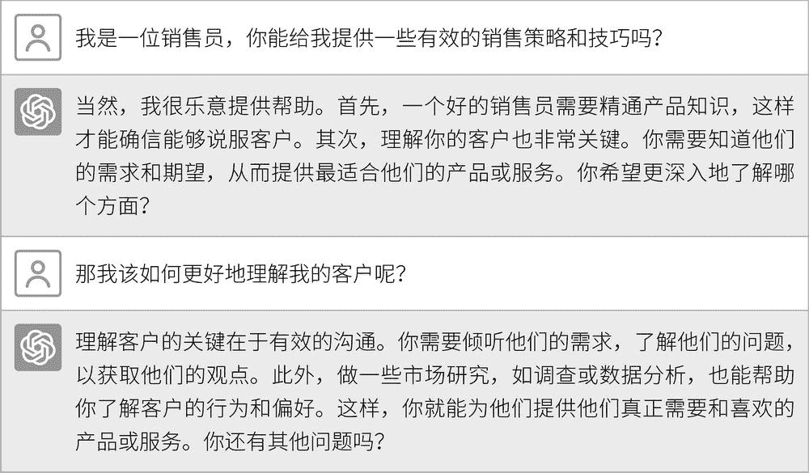

这段示例充分体现了模型在多轮交互中的表现。它能够基于前文生成关联性强、有意义的回复，为用户提供深度解答。

03. 自然语言表达优势
在理解与生成自然语言方面，ChatGPT 对销售工作尤其友好。它能帮助销售人员用清晰、准确、易懂的方式拆解复杂产品信息与技术细节。

比如客户对新推出的智能家居系统的兼容性与安全性存疑，问题本身带技术含量。这时销售可借助 ChatGPT 寻求通俗表达的建议。模型能给出描述兼容性与安全性的表述方式，也能详细说明这些特性如何带来便利与保障。既让销售回答更自信专业，也让客户更容易get到产品价值。

下面进入局限性部分。

### 2.2.2 ChatGPT 的局限性

01. 语境理解存在短板
需要承认的是，虽然语言生成已接近人类，但在语境把握上仍有不足。特定文化背景下的隐喻、带讽刺或情感复杂的表达，常让模型捉摸不准。

例如一名销售在练习时描述：“我要向注重可持续发展的客户推销一款环保新品，该怎么说？”要给出好建议，模型需要理解情境背后的背景知识，包括可持续发展、环保产品概念以及销售策略的调整。尽管预训练与微调阶段已学习到部分销售技巧，但在完全吃透这类特定情境的语言上仍有挑战。这凸显了语境理解的边界。

应对思路是让提问更具体、更明确。以该情境为例，可把问题拆成更小的明确提问。

例如你可以向 ChatGPT 提出下面这样 3 个问题。

问题细化后，模型会给出更实用、更精准的回复。虽然无法完全复现复杂销售情境的全部细节，但仍可基于训练所得知识与语言处理能力，对具体问题提供有效帮助。

关于提问技巧，本书第三章会展开说明。

02. 幻觉问题不容忽视
语言生成能力令人惊叹的同时，也要正视幻觉现象，即产出与事实不符的内容。

简单讲，幻觉就是在信息不足或仅依赖训练语料时，生成看似合理实则错误的内容。表面上自洽，落地使用却可能失准。

成因主要有：
· 训练数据影响：并非所有学习内容都准确，误导性数据会带来错误输出；
· 生成目标影响：首要目标是连贯自然，而非绝对准确；
· 数据时效与污染：训练截止 2023 年 4 月，部分信息已过时；联网后可能引入低质量网络数据，导致污染。

带来的风险：
· 信息误导：使用者可能误以为得到最新最准信息；
· 信任受损：频繁不准会削弱信任；
· 可靠性下降：数据污染会进一步降低输出质量。

对待方式是保持审慎，认识到回答未必完全准确，关键场景需人工核验，结合可靠数据源交叉验证。局限可控，优点仍可充分发挥。

03. 数据安全与伦理风险
模型训练依赖大量用户数据，数据安全与隐私保护成为重大挑战。同时，如何避免生成有害或误导信息，确保使用符合伦理，也是待解难题。

总体而言，ChatGPT 在自然语言处理上优势明显，但挑战并存。全面认知其能力边界，有助于在实践中权衡收益与风险。

## 2.3 ChatGPT 作为销售困境的突破口
销售工作中常面临产品理解难、需求识别难、服务响应难等问题。新手尤其难以灵活应变，而 ChatGPT 作为高级 AI 工具，能提供系统性解决方案。

01. 消化复杂产品信息
只有吃透产品，才能推得动、答得准。随着品类日益复杂，记住全部细节并即时应答变得困难。

ChatGPT 可批量接收产品资料，为客户提供详尽准确的反馈。销售可将其视作即时信息库，按需调取正确资料。

假设公司 W 专注太阳能板，型号众多、各有卖点。销售团队难以全部记住以准确介绍。

这时 ChatGPT 能派上用场。企业可把各型号详情喂给模型学习。需要线上介绍时可即时检索；线下拜访前，也可用模型进行销售预演，提升熟悉度与沟通能力。

例如客户问：“我要能抗极端气候的太阳能板，有推荐吗？”
销售可在 ChatGPT 中输入该问题，立刻得到详尽准确的回答，如下所示。

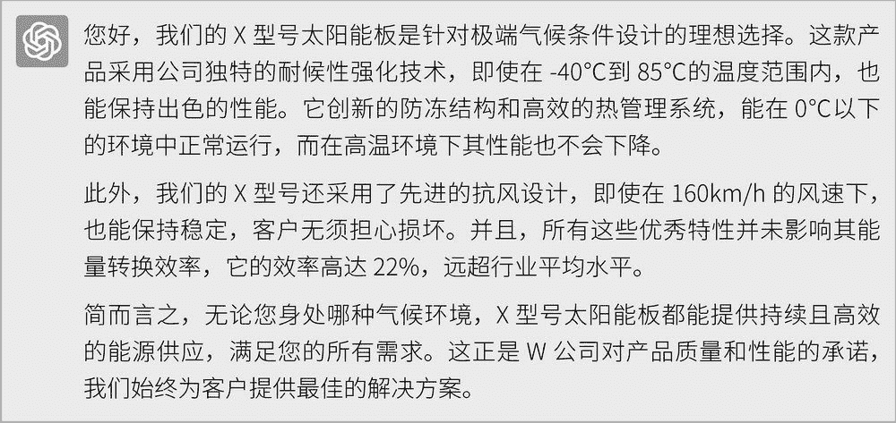

模型能系统阐述特性与卖点，给客户留下深刻印象。既增强回答时的信心，也提升购买意愿。借助它，W 公司能更高效管理复杂信息，提升效率并改善服务。

如此，销售避免遗漏关键信息或给出错误建议，也能在见客户前做好准备。客户则获得准确信息，加深理解并做出更明智决策。

02. 7×24小时客户支持
及时有效的服务是销售闭环的关键。ChatGPT 全天候在线，无论下单流程还是售后，都能快速回应各类咨询。相较人工客服，能在更短时间内处理更多问题，有效拉升满意度。

03. 实时反馈与指导
每个决策细节都影响结果。面对复杂局面时，销售常需即时专业建议。ChatGPT 如同随时待命的销售教练，可提供即时反馈与指引。只需在对话框提出问题，即可获得基于大数据与算法生成的专业答案，实时性对复杂情境处理至关重要。

04. 情景预演
销售需要通过练习成长，而真实客户并非安全的练习场。借助 ChatGPT 可模拟多种对话或进行情景预演，尝试不同策略与话术，提升技能而不影响真实客户关系。

05. 学习与职业成长
销售是持续学习的行业。与 ChatGPT 互动可从其知识库汲取经验，加深对需求的理解，增强价值呈现能力，提升应对反馈与异议的技巧，对职业发展很有帮助。

06. 个性化学习路径
不论新人还是资深者，每个人风格与短板不同。ChatGPT 能识别个人风格与优劣势，基于具体情况提供定制化建议，帮助补齐短板、提升效率。

综上，ChatGPT 在理解复杂信息、识别需求、提供即时服务等方面具备强大问题解决力，能帮助团队提升效率、服务质量与满意度，最终达成目标。

因此，它可以成为破解销售困境的有力武器，值得团队与个人深入了解并充分使用。

下一章将聚焦与 ChatGPT 互动的核心能力——如何提出有效问题以更好支持销售。

# 第三章

# 学会提问：激发 ChatGPT 最大价值

销售充满挑战，AI 工具带来了前所未有的可能性。前文已讨论挑战与机会，但充分利用并非易事。本章聚焦关键能力：如何向 ChatGPT 提出有效问题。

提问看似简单，在 AI 交互中却决定成败。它关系到能否真正挖掘功能、获得实用相关答案并应对销售情境。了解市场动向、调整策略时，提问方式往往起关键作用。

本章将探讨好问题的价值，如何通过恰当提问放大模型效用。也将介绍模型应对问题的底层逻辑，帮助理解其工作方式并避开常见误区。此外，还将讨论销售场景下的具体提问策略，包括洞察客户行为、把握市场趋势、制定针对性策略等。

## 3.1 好问题决定好答案
ChatGPT 是强力的 AI 助手，能帮助销售人员获取所需答案。学会精准提问至关重要，因为它直接影响信息准确性与相关性，进而影响需求理解与解决方案设计。

提问质量显著影响回答质量。模型擅长处理具体清晰的问题。若问题模糊，它可能抓不住真实意图，给出泛泛或偏离的答案。

为说明清晰的重要性，下面对比两个例子。

示例 1：宽泛的问题
提问：“如何提升销售业绩？”
分析：如此提问，模型通常基于训练语料给出通用建议，如“提升产品质量、优化策略、加强关系管理”。这些建议有一定普适性，但缺乏细节，难以直接落地。

示例 2：聚焦的问题
提问：“针对 2B 软件销售，如何在初次见面时有效识别客户需求？”
分析：问题具体且有指向，模型能聚焦 2B 软件销售场景并给出可操作的策略。明确“初次见面”与“识别需求”的目标，使回答更聚焦，会得到如提开放式问题、观察非语言线索、使用特定工具等具体行动指南，有助于提升效率。

小提醒：把宽泛问题收敛
示例 1 说明宽泛提问会削弱有效性。下面看如何改造。

改进后问题：“面向中小企业的 2B 软件销售团队，有哪些策略能有效提升该市场的销售业绩？”

改进后更具体，锁定客户群体与销售类型，使模型能给出更具针对性的建议。

可见，宽泛问题得到宽泛答案，具体明确的问题带来更有针对性与实用性的回应。提问时需多思考，确保问题尽可能明确、具体、有效。

## 3.2 了解 ChatGPT 的作答逻辑
ChatGPT 是强大工具，销售或其他专业人士都可借此获取信息、解决问题、提升效率。为充分利用，需理解其作答逻辑。了解模型如何处理输入、如何构建输出，有助于更好地交互。

需注意，ChatGPT 并非传统知识库，也无自我意识或独立情感。它通过海量文本训练，以自然方式生成语言。回答基于输入信息以及训练中学到的语言模式与知识结构，而非内在理解或感知。虽能提供信息丰富、格式多样的答案，但本质是算法对大规模数据进行模式识别与信息提取的结果，非个人经验或主观判断。

提问时，模型会依据问题及训练模式构造回答。因此答案不一定完全准确，也不唯一。目标是生成合理、符合语言模式的可能回答。理解这种基于模式的响应机制，对有效提问与解读结果很重要。可尝试不同表述或提供更多上下文以获得更具针对性的答案。

## 3.3 销售场景提问方法

### 3.3.1 先厘清销售目标
提问前明确目标，有助于从交流中获取有价值信息与建议，对精准定位策略、应对挑战至关重要。

01. 目标清晰的价值
与 ChatGPT 交流时，有明确目标可帮助更精准提问。目标可能涉及提升特定产品销量、扩大市场覆盖或提高服务质量。明确目标为提问提供方向，确保答案与实际需求密切相关。

02. 提问搭建流程
明确目标后，提问应围绕目标构建。关键步骤如下。

第 1 步：提供详细背景
有效提问需包含产品或服务、目标市场、客户群体的信息。这些背景帮助模型准确把握具体销售环境。

第 2 步：聚焦具体挑战
问题应直接关联面临的具体难题，如如何与初次见面客户建立信任、如何处理客户异议等。具体描述可让答案更具操作性。

第 3 步：多角度发问
围绕销售目标，可从市场趋势、客户反馈、竞争对手分析等不同角度提问，以获得更全面的见解与策略。

03. 提问示例
假设你负责销售智能家居设备，以下是不同方面的有效提问示例。

基于市场表现与产品特性提问
“我负责销售一款可通过移动应用控制的智能灯泡。虽然在自媒体上获得了一些好评，但普通消费者了解度不高。考虑到普通用户可能对智能家居的易用性与实用性有顾虑，我该如何调整营销策略，更有效地吸引该群体并提升知名度？”

基于客户反馈提问

精准提问，把AI变成销售好帮手

“我卖的智能家居系统在不同人群里的反馈差异很大。技术老手觉得高级功能很满意，新手却在安装和日常操作上感到困惑。面对这种情况，我该用什么策略或工具让安装操作更简单，又能把高级功能讲清楚？在演示时又该怎么调整，才能让不同技术水平的客户都看懂价值？”

“我主推的智能家居系统现在被几个低价竞品挤压。别人功能差不多但价格更低。我们在数据安全和隐私保护上更有优势。该怎么调整话术，才能让对价格敏感的客户也认可这些附加价值？”

这两组提问都很具体，直接点出用户痛点、竞争态势和期望结果。正是这种明确的表达方式，能让销售人员快速聚焦目标，从ChatGPT拿到可落地的策略和建议，从而提升成交效率、改善市场表现和客户满意度。

### **3.3.2 把握客户行为与市场动向**

销售中对客户行为和市场趋势的洞察至关重要。它决定了推销是否对症，也帮助提前预判变化、做出更稳妥的决策。下面介绍如何向ChatGPT提问，以及对应的技巧。

**01. 给出明确的时间边界**

问市场趋势时，时间越具体，答案越有用。

泛泛提问：“健身器械市场最近有什么新趋势？”
分析：时间模糊，得到的信息面太大，不够实操。

精准提问：“健身器械市场过去两年里，消费者在购买行为上有哪些明显变化？”
分析：限定了“过去两年”，回答会更聚焦、时效性更强，便于制定策略。

**02. 锁定特定市场或人群**

每个市场、每类人群的行为模式都不同，越聚焦答案越值钱。

泛泛提问：“大家现在喜欢穿什么衣服？”
分析：范围太宽，容易得到空泛结论。

精准提问：“在中国青少年群体里，目前最受欢迎的服装风格、面料和主打颜色分别是什么？”
分析：明确区域和人群，并拆分风格、面料、颜色，信息更细，策略更可执行。

**03. 聚焦具体的行为与习惯**

了解行为细节才能优化策略。

泛泛提问：“消费者怎么看待线上购物？”
分析：场景虽有，但缺产品类型和人群，洞察不够深。

精准提问：“在居家用品品类里，选择线上购买的消费者，最看重价格、品牌、评价还是其他因素？”
分析：锁定细分品类和购买渠道，得到的偏好要素更具体，有助于调整销售和营销重点。

**04. 用对比来找差异**

对比能揭示趋势变化。

泛泛提问：“智能手表的市场表现怎么样？”
分析：没有时间或参照物，结论会很笼统。

精准提问：“相比前一年，过去一年智能手表的销量和整体趋势发生了哪些变化？”
分析：以前后一年为参照，能拿到可比较的数据和判断依据。

### **3.3.3 获取特定市场的销售打法**

面对不同市场、产品和客户，挑战各不相同。学会向ChatGPT提问，能拿到更匹配的策略。

**01. 先交代背景**

提问前把情境说清楚，AI才能对症下药。

**02. 用开放式问题**

开放式提问能打开思路。例如“怎样更深刻理解目标客户群？”“有哪些新方式能提升产品吸引力？”能获得多元角度的建议。

**03. 提问要有针对性**

像跟老朋友聊天，把计划、难题和目标都说出来。告诉AI你想提高销量还是提升满意度，得到的建议会更实用。

案例 3-1 S女士的手工艺品店

S女士卖手工陶瓷和布艺品，想吸引20到40岁的女性，提升线上销量。

明确背景
S女士：“我经营手工艺品店，主营手工陶瓷和布艺，有什么推广建议吗？”

开放式提问
S女士：“怎么在社交媒体上提升店铺知名度？怎样吸引20到40岁的女性？”

有针对性提问
S女士：“我在XX平台投过广告效果一般，还有哪些更好的做法？”

ChatGPT给出的策略包括：

·故事化营销。呈现制作过程和背后的故事，突出手艺温度。
·组织互动活动。在社媒发起DIY挑战，鼓励用户晒作品。
·与本地艺术家合作。定期做线上直播，展示制作并带产品推广。
·提供特色礼品包装。让产品更适合送礼。
·提供会员俱乐部服务。给忠实客户专属折扣、早鸟权益或限定款。
·分享高质量产品照片。用高清专业的图突出细节与质感。

案例清晰展示了背景明确、开放提问、有针对性追问如何拿到适配特定市场的策略。这种思路在其他领域同样适用，能最大化ChatGPT的价值。

小提醒：给对话起个名字
每次和ChatGPT的对话都取个名字，比如“产品咨询”“客户反馈策略”，多任务时能快速定位，避免找不到或混淆，省时又高效。

## **3.4 用有效反馈让ChatGPT不断进步**

互动中及时反馈很重要，能帮助模型理解你的满意度并改进。

**01. 点出具体问题**
回答不合用时，指明哪里不准或不相关。比如“这回答太概括了，我需要更具体的步骤。”

**02. 给出改进方向**
除了指出问题，还要说怎么改。比如“请用更通俗的语言和例子解释。”

**03. 明确你的需求**
把期望说清楚。比如“我要的是针对XX问题的具体方案，不是泛泛建议。”

案例 3-2 寻求帮助的心理咨询师

V女士想找到向潜在客户推荐咨询服务的有效方法，发现客户常担心服务质量、方式和价格。

V女士向ChatGPT提问。

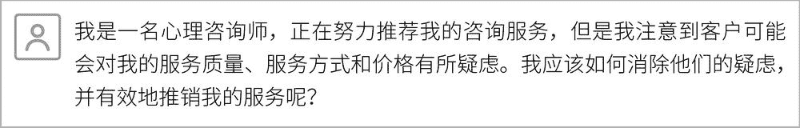

ChatGPT的回答。

V女士觉得太笼统，没有具体策略，于是反馈。

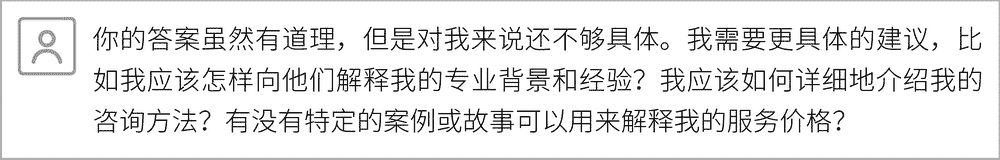

在明确反馈后，ChatGPT的回应更具体。

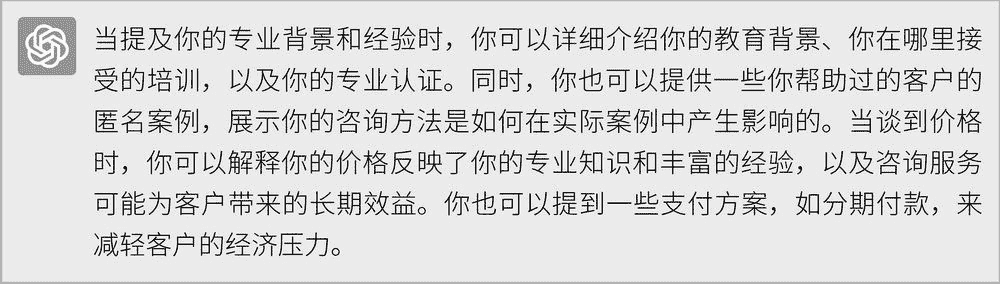

仍不满意，V女士继续要求。

最终ChatGPT给出更详细的答案。

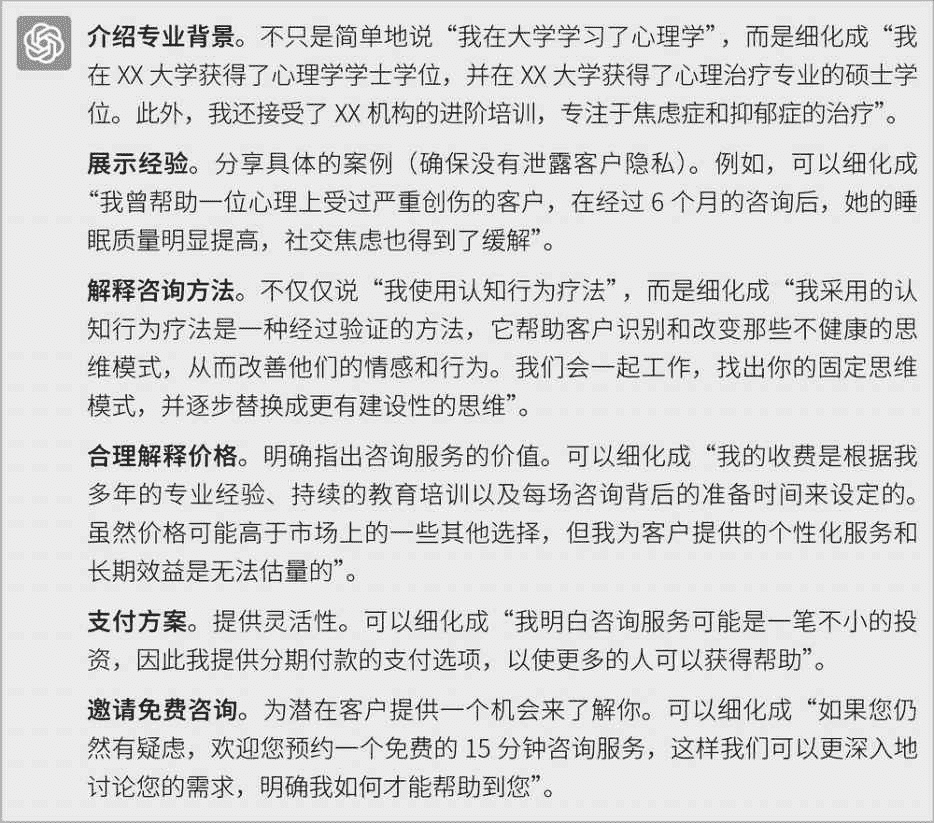

案例说明：有效反馈能让回答逐步更实用、更贴合需求。

小提醒：让ChatGPT给你鼓励
提问前透露情绪状态，比如“我有点困惑，不知道怎么办”“我对这个问题有点焦虑”。AI会结合情绪给予建议和支持，让你更有信心。

小提醒：别怕提问
放心提你真正关心的问题，不必担心太简单或太复杂。ChatGPT不会评价你，只会尽力给出答案。描述越细，答案越准。

## **3.5 避开常见的提问坑**

**01. 问题模糊或太宽泛**
AI靠文字理解，没有环境感知。“我该怎么办”没有上下文，基本得不到有效建议。

**02. 要求猜测或预测未来**
AI不能预测。问“明天客户会不会同意”这类问题，无法得到准确答案。

**03. 过度依赖或期望过高**
ChatGPT能提供基础建议，不能替代专业人士。涉及法律、医疗、重大投资决策时，需要专业人士把关。

避开这些坑，才能更好引导AI发挥价值。

小提醒：用真诚的态度交流
别只是为了测试AI而故意提极端或模糊的问题。真诚、具体地提问，才能体验到真正的价值，也更清楚它的优势与边界。

ChatGPT像个可以不断学习的小助手，学会正确提问，你们就能一起成长。本章讲了如何有效提问，下一章将聚焦销售准备的重要性，以及如何用ChatGPT做好准备。

# **第四章**

# **用ChatGPT完成销售准备**

销售不仅是建立信任和共鸣，更是策略、技能、产品与市场理解以及高效沟通的综合体现。在数字化时代，把ChatGPT纳入销售流程，能明显提升成功概率。

本章将介绍ChatGPT如何帮助销售准备，并通过案例展示其价值。

## **4.1 销售准备为什么关键**

**01. 准备工作的意义**

销售准备是全流程的核心。它像排练，每一个提问、回答、肢体细节都影响最终效果。对产品了如指掌、对客户需求有深度理解，会自然流露出自信，更容易赢得信任。准备充分还能提前预判异议，从容应对，提供有说服力的方案，让会谈更顺畅。

销售是一门艺术，准备是通往成功的必经之路。

**02. 销售准备的基本要素**

**（1）深入理解产品与服务知识**
不只是会背功能点，更要明白功能如何解决不同客户的具体问题。能清晰解答疑问，突出独特卖点，与竞品拉开差距。

**案例为证，专业感直接拉满**

除了核心理念的介绍，提前准备一批可落地的产品案例会让说服力倍增，尤其是能清晰展现产品如何回应特定客户需求的实例。用真实场景去拆解功能与优势，客户理解起来更顺，产生共鸣的概率也更高。

比如笔者 ^(²) 在拜访一家保险公司的负责人之前，专门整理了一本销售复盘案例手册。手册里详细列出了保险销售在实战中常遇到的卡点和真实困境，并配上了可直接使用的应对思路与话术示范。保险行业对专业素养和个人能力的门槛很高。通过呈现这些扎实、可验证的案例，笔者向对方传递了自己对业务的熟悉程度和对需求的理解深度。最终，对方对笔者的专业印象非常好，合作顺利敲定。这个经历说明，会面前在专业知识上的充分准备，能显著提升客户的满意度与签约意愿。

补充一点，保险公司本身通常已拥有成熟的销售培训体系，对外部讲师的专业度与备课质量要求极高。能在这种高标准环境里胜出，很大程度上靠的就是扎实的准备和对客户痛点的细致洞察。精心的案前工作既体现了对客户和业务的尊重，也彰显了专业素养和对细节的重视。赢得信任的同时，也为长期合作打下了坚实基础。

**（2）了解市场情况**

想把销售策略做准，就必须先摸清行业和目标市场的真实脉搏。这包括当前的主流趋势、客户的常态行为与偏好，以及可能影响市场的宏观经济变量等。市场认知越清晰，产品定位越准确，在客户面前展现的行业洞察也会更可信。

笔者曾准备拜访一家商场的招商负责人。为把握对方的实际经营压力与挑战，笔者花了一个月时间做了系统市场调研，重点围绕餐饮业态对顾客满意度的影响，以及服饰类门店如何提升服务水平和销售能力展开。这些研究带来了关键洞见，为会面准备提供了方向。

基于调研结论，笔者为商场量身定制了两本免费的销售服务案例手册，内容涵盖改善商场内在服务、提升销售技巧的方法，以及专业形象设计的附加价值。见面时，这些准备和实物资料让沟通非常顺畅。招商负责人高度认可笔者的专业度与用心程度，主动付费邀请笔者开展培训，并推荐了多位新客户。增值服务不仅推动了商场服务转化率和复购率的提升，也让笔者收获了信任与长期合作的可能。

这个案例传递的核心原则是：成功不在于回避拒绝，而在于用专业能力为客户创造价值。吃透客户的具体需求与面临的困难，给出具体可落地的解决方案，才能换来信任、尊重和长期合作。提前研判市场、充分准备既是提升销售效率的利器，也是构建稳固客户关系的核心策略。

**（3）深入了解客户背景以制定个性化解决方案**

要做精准定制，就必须深入研究客户的业务模式、发展历程和实际需求。通过了解其市场定位、运营方式、重点挑战以及具体诉求，就能真正摸到痛点。这种洞察让销售更具针对性，也更容易建立深度信任。倾听客户声音并匹配专属方案，既能提高成交效率，也为长期合作积蓄能量。

笔者曾服务一家家装行业头部企业。对方希望为各渠道销售负责人做集中培训，以冲刺年末业绩，并要求提供为期7天的课程方案与报价，同时有其他竞争对手参与角逐。

笔者没有直接提交标准化方案，而是主动提出先做一天的实地销售诊断，以便更准确把握企业的真实需求。这种主动而专业的姿态获得了认可，企业HR迅速安排笔者与各渠道负责人进行深度沟通。一天诊断中，笔者系统梳理了家装行业趋势与客户行为，并聚焦该企业的销售流程、团队结构和具体瓶颈。

在此基础上，笔者制定出一份既贴合市场走向又贴合企业现状的定制化培训方案。主动下沉、深入一线的态度展现了对企业特定挑战的关注，也迅速建立起可信赖的关系。最终，笔者的方案从众多竞争者中脱颖而出，不仅拿下了2023年底的培训项目，还延续到了新一年的系统课程。

这个案例证明，主动性与对市场的深刻理解至关重要。精准把握需求并提供个性化解法，能显著提升成交率并培育长期客户关系。

总的来看，销售准备的基本要素能有效提升专业水准，也为高效沟通奠定基础。对产品服务的深度理解、对客户背景的细致研究、对市场的全局把握，会让与客户的对话更自信、更有穿透力，从而大幅提高成交概率。

## **4.2 利用 ChatGPT 进行销售准备**

销售的本质不只是交付好产品，更是读懂并满足客户的真实期望。本节聚焦如何借助 ChatGPT 高效拆解客户信息、演练真实销售场景、预判风险与机会。掌握这套方法，就能把洞见快速转化为销售成果。

### **4.2.1 实战策略：如何使用 ChatGPT 进行有效的销售准备**

销售准备的关键在于对市场动向、客户需求与竞品打法的掌握。ChatGPT 能极大提升信息收集与策略制定的效率。下面是几套可直接上手的用法。

**01. 明确你的目标**

使用 ChatGPT 前，先把想搞清楚的问题界定清楚。目标明确才能提出精准问题，得到更有价值的答案。比如想提升某条产品线的销量，就要先锁定目标人群和细分市场。这样提问才能更聚焦，让 ChatGPT 帮你获取有关市场趋势、用户偏好的关键情报，进而支撑分析与策略制定。

假设你是一家健身器材公司的销售负责人，目标是拉动新款跑步机的销量，可以这样提问：

“目前居家健身的整体趋势如何？”

“用户选购家用跑步机时最看重哪些功能？”

“哪些人群更倾向于在家使用跑步机？”

“健身器材行业有哪些行之有效的推广打法？”

“怎样才能更有效地推动潜在客户下单购买我们的跑步机？”

通过这些问题，你能更清晰地描绘目标市场，并制定更具实操性的销售策略。

**02. 提前列出问题**

ChatGPT 反应很快，但会前先把问题清单理清，是确保准备全面系统的关键。这样能避免遗漏要点，让准备更高效、更具针对性。

比如要推一款企业级软件产品，可以提前准备：

“企业客户挑选软件时最看重的决策因素有哪些？”

“当前企业级软件市场的主要趋势是什么？”

“在销售这类产品时常见的阻力有哪些？”

“如何化解对价格敏感客户的顾虑？”

“面对多位决策者时，如何进行有效沟通？”

借助 ChatGPT 预演这些场景，能让你在真实对话中迅速回应客户疑问与需求。

**小提醒：如何有效地列出问题清单**

一套好的问题清单需要系统构建，以下是做法。

**（1）确定销售目标和需求**
先明确本次销售的核心目标，是提升某产品销量、进入新市场还是提高客户满意度。同时梳理需要获取的信息类型，如市场趋势、竞品分析、目标客户需求等。

**（2）研究和分析**
在列问题前先做基础功课，了解产品、目标市场和潜在客户。比对已有信息与信息缺口，明确 ChatGPT 需要补充的部分。

**（3）制定具体问题**
基于目标与研究结果，列出具体且可执行的提问。问题要够细、够针对，能直接帮助解决销售痛点或提高效率。

**（4）将问题分类**
按主题归类，如市场趋势、客户洞察、销售策略等，优先处理对成交影响最大的问题。

**（5）审视和调整问题**
复盘清单是否覆盖目标，必要时调整措辞与顺序，确保既全面又聚焦。

**03. 利用 ChatGPT 进行深入探讨**

用好 ChatGPT 不只是要答案，更要深度挖掘与应用。避免停留在初级信息上，要通过追问让输出更具层次，为策略提供多维视角。

**策略 1：构建深刻问题**

**示例**

**初级问题**：“哪些因素影响客户选择健身器材？”

**深刻问题**：“针对预算有限的家庭，我们的健身器材该如何突出性价比？”

**策略 2：结合情景分析**

**应用情景**：“如果客户担心产品操作复杂，我们该如何简化流程并清晰传达？”

**策略 3：探索销售障碍和寻求解决方案**

**探索销售障碍**：“在销售高端健身设备时，客户常提出哪些异议？”

**寻求解决方案**：“面对这些异议，我们可以提供哪些具体对策？”

通过这类追问，ChatGPT 能提供更立体、更实用的销售思路。

### **4.2.2 案例分析：利用 ChatGPT 进行客户拜访准备**

客户拜访是销售链条的关键环节，需要精准把握需求、建立信任并灵活应对挑战。下面以案例 4-1 说明如何用 ChatGPT 提升拜访成功率。

**案例 4-1 W 女士寻求 ChatGPT 的帮助**

W 女士是医疗设备公司的销售经理，与目标医院已有两次成功合作。此次她准备推广一款创新医疗影像设备，并在会前用 ChatGPT 做客户分析与准备。

**01. 了解客户需求**

W 女士：“我负责向已有两次合作的医院推销新型影像设备，之前合作医院对产品和服务很满意。现在该如何更深入地了解实际需求并拉近关系？”

**小提示：在向 ChatGPT 提问时，别忘记提供背景信息。**

ChatGPT：“可以从三方面入手。先安排一次产品培训或现场演示，听取反馈以捕捉真实需求；其次保持定期跟进，了解使用中的问题与需求变化；最后邀请客户参加公司活动或研讨会，加深互信与合作。”

**02. 建立信任**

W 女士：“如何与采购经理建立更深的信任？”

ChatGPT：“先回顾过往合作的成果与客户好评，为新提案加分；确保对新产品每个细节都了然于胸，能迅速解答疑问；同时展示对客户实际需求的理解，让对方感受到服务是量身定制的。”

**03. 提前预测问题**

W 女士：“基于既有合作，采购经理可能有哪些疑虑？”

ChatGPT：“他可能会关注新设备与现有产品的差异与优势、性能稳定性、价格，以及售后与技术支持。”

W 女士：“如果他提到想找其他供应商怎么办？”

ChatGPT：“先尊重其选择，不贬低对手。询问他对新设备期望的具体改进点，并据此突出自家优势，既显尊重又把话题拉回产品。”

W 女士：“如果客户说暂时没有采购计划，如何回应？”

ChatGPT：“先表示理解并探明原因，询问具体顾虑。可提供免费试用或现场演示，或安排技术研讨会让团队亲身体验优势，为后续跟进创造机会。”

ChatGPT 还给出了对话示范。

采购经理：“感谢介绍，但我们目前没有购买新设备的计划。”

W 女士：“我理解，能否分享一下主要考量？了解具体需求与疑虑后，我们能提供更有针对性的服务与方案。”

采购经理：“主要是预算限制，现用设备也在保修期。”

W 女士：“明白。关于预算，我们有分期与优惠政策。现有设备虽在保修期，但医疗技术迭代很快，新设备能带来更长远的价值与更高患者满意度。我们可安排免费试用或技术研讨会，让团队体验先进性，您看如何？”

**04. 产品对比**

W 女士：“如何突出我们相对竞品的优势？”

ChatGPT：“先列出技术或功能上的差异点，再结合客户需求说明这些差异的实际价值，最后用客户案例与成功故事增强说服力。可以这样表达：‘相比竞品，我们在图像清晰度、易用性及技术支持上更占优势。采用最新 XX 技术，能为医生提供更精准的诊断依据，且专业团队随时待命，确保使用无忧。’”

**05. 展示产品的长期价值**

W 女士：“客户更关注短期投入，我该如何呈现长期价值？”

ChatGPT：“强调技术先进性与生命周期，能在未来数年保持领先，减少更换频率；强调稳定性与低维护需求，降低长期运营成本；用长期合作客户的反馈佐证价值。”

模拟对话如下。

采购经理：“设备很感兴趣，但价格偏高，短期预算有限。”

W 女士：“完全理解。长远来看，这款设备技术领先，可在未来几年持续对标新品，避免频繁更换；运行稳定、维护少，能节省大笔运营成本。我们多家长期客户也证实，它在降低成本与提升服务质量方面回报显著。初期投入虽高，长期回报远超价格。”

**06. 定价策略**

W 女士：“产品价格较高，如何应对价格异议？”

ChatGPT：“从长期投资回报、稳定性、维护成本节约及增值服务切入，同时可根据预算提供优惠或分期方案。可以说：‘价格虽高，但长期效益可观，高级功能与稳定性意味着更少维护与升级成本。我们也提供灵活分期，让每一笔投入都物超所值。’”

**07. 持续维护客户关系**

W 女士：“成交后如何保持良好关系？”

ChatGPT：“确保交付、安装、培训与首次使用全程顺畅；之后定期跟进设备使用情况与满意度，每月或每季度邮件、电话回访；适时推送行业资讯、升级信息与使用技巧，体现专业关怀但避免过度打扰；定期邀请参与研讨会、产品演示或公司活动，巩固联系。”

W 女士：“后期邀请参加研讨会该怎么说？”

ChatGPT：“邀请是维系长期关系的好方式。建议：明确活动目的，是新品介绍、行业分享、产品培训还是关系建设；提前三周至一个月通知，方便客户安排；准备正式邀请函，电子或纸质均可，内容清晰交代时间、地点、主题，若有重量级嘉宾可重点提及；提供附加价值，...”

不妨先盘点还能为客户增添哪些额外价值，比如为到场者准备专属优惠、实用伴手礼，或是提供一对一的专家咨询。

·**个性化邀约**
尽量为每一位客户准备一份单独的邀请函，用细节表达你确实了解他的需求和处境。

·**提前提醒**
活动举办前七天左右再次致意，帮客户把行程牢牢记住，避免遗漏。

·**活动后回访**
会议结束后尽快联系参会者，请他们分享体验与建议，为后续优化积累素材。

归根结底，核心是让客户真切感受到你的关怀、专业与用心。这样既能提高到场率，也能稳固彼此的信任关系。

W 女士：“请告诉我具体如何邀约。请示范一下。”

ChatGPT：“**电话邀约**

您好，[客户姓名]，我是[名字]，来自[公司名称]。想跟您通报一下，我们将于[日期]举办[活动名称]，主要围绕[活动主题或有关活动的简短描述]展开。结合您过往的需求和我们之前的合作经历，我觉得这次内容对您会很有参考价值。您当天方便出席吗？我认为对下一步的合作会有启发。

**短信或微信邀约**

您好，[客户姓名]！[日期]我们在[地点]开展[活动名称]，聚焦[活动主题或有关活动的简短描述]。我推测您会有兴趣，欢迎您来。需要详细资料随时告诉我。

**邮件邀约**

主题：诚邀您出席[活动名称]

尊敬的[客户姓名]：

[公司名称]将于[日期]在[地点]举办[活动名称]。鉴于您在业内的作用以及我们长期以来的合作，我们特别邀请您参与。此次活动将涉及[活动主题或有关活动的简短描述]。

我们相信交流对双方都是有意义的。请于[截止日期]前回复邮件，以便为我们预留席位。

期待在现场与您相见！

[您的职位][您的名字]

[联系电话]”

**08. 客户反馈与改进**

W 女士：“如何充分利用客户反馈，为我们的产品和服务带来改进？”

ChatGPT：“首先要做到每次售后服务结束后都把客户的意见和建议记录下来。其次要定期把这些记录与技术团队和研发团队对接，把需求转化为具体的改进点或新功能。同时要让客户知道公司是如何根据他们的声音做出改变的，这样信任感会持续增强。

可以这样沟通：‘我们非常重视各位客户的反馈，这正是我们进步的动力。建议到手后，我们都会在内部讨论并评估如何在下个版本中落地。事实上，近期的几项功能就是源于贵院之前的意见。对您一直以来的宝贵建议再次感谢，请问这次还有哪些想法需要我们注意？’”

**09. 优化售后服务**

W 女士：“售后服务对于医疗设备的销售来说非常关键，我应该如何强调我们的售后服务优势？”

ChatGPT：“可以从三方面展开。一是突出技术团队的专业水平和响应速度，让客户确信使用中能得到及时支持；二是介绍维护与升级体系，确保设备长期保持最佳性能；三是用真实案例佐证售后实效，增强说服力。”

**10. 有效的结束语**

结束语在销售沟通里影响很大，一个好的收尾应兼顾以下几点。

·**致谢时间**：真诚感谢对方抽时间了解产品，体现尊重与专业。
·**再强调价值**：简短复述产品或服务的核心优势，加深记忆点。
·**留下联系方式**：确保客户知道有问题时如何找到你。
·**表达后续期待**：表示希望再交流，为下一次接触铺路。
·**保持积极礼貌**：无论结果如何，态度都应正面得体。

把以上要点融入 W 女士的场景，收尾会更专业。示例如下。

W 女士：“请问，在结束这次拜访时，我应该如何与对方道别，以留下良好的印象？”

ChatGPT：“今天非常感谢您拨冗了解我们的新医疗影像设备。我相信从长远看，它对贵院的价值会很大。后续如有任何疑问或需要补充资料，请随时联系我。期待下次再与您沟通、合作。祝您工作顺利，再见。”

通过案例 4-1，我们梳理了如何借助 ChatGPT 完成拜访前的销售准备：了解客户需求、建立信任、预判难题、持续维护关系等。掌握这些方法和示范，在实地拜访前能更充分准备，回应客户诉求，提升成交概率。

### **4.2.3 面对复杂情境的销售准备**

4.2.2 中案例 4-1 展示了常规销售准备的做法，适用于大多数场景。但在特殊或复杂的局面下，压力更大、不确定性更高，需要更丰富的信息、更精准的策略和更快的反应。ChatGPT 能在此时提供快速支持，协助找思路、定方案、做决策。

下面通过案例 4-2 看看 E 女士如何在紧急复杂情境下借助 ChatGPT 快速准备并成功应对。

**案例 4-2 E 女士的紧急谈判**

E 女士创办了一家知名企业，正面临一次紧急商业谈判——与一家大型酒店商讨合作并签署重要合同。她深知成败不仅在于产品服务品质，更在于是否真正理解酒店需求并建立深度连接。以下为 E 女士如何借助 ChatGPT 进行准备并优化沟通策略。

**背景信息**：E 女士经营高端门窗制造，善于洞察市场。近期她瞄准被动式节能房领域并计划拓展。某天获知当地知名酒店正计划引入被动房技术，本是绝佳机会。但酒店已与另一家公司进入谈判尾声，即将签约。

更令 E 女士意外的是，即将签约的那家公司使用的产品正是 E 女士供应的，但从未告知她合作计划。得知情况后，E 女士决定主动出击，联系酒店采购部门，邀请酒店总经理和采购经理到工厂参观。

在高层到访前，E 女士意识到谈判时间紧迫，需要做好充分准备。她希望 ChatGPT 提供具体可落地的建议，帮助应对潜在问题、提升成功率，展现专业素养并给出切实解决方案。

E 女士：“我是一位高端门窗制造领域的企业家。我刚刚了解到，当地一家知名酒店计划引入被动房技术。而酒店即将与另一家公司签约。有趣的是，即将与酒店签约的那家公司的产品正是我的公司提供的。虽然我们一直保持着业务关系，但对方并没有告知我其与酒店合作的计划。我希望能有机会邀请这家酒店的总经理和采购经理参观我公司的工厂，以争取一次合作机会。面对这次紧急谈判，你能否提供一些落地的具体建议，告诉我如何与酒店的总经理和采购经理进行有效的沟通，并获得他们的认可。同时，能否为我提供一些话术？”

ChatGPT：“针对这种紧急状况，建议如下，并附上可直接使用的沟通示例。

**建议 1：制定清晰策略**

与酒店总经理和采购经理交流前先明确策略，重点突出产品价值与差异化优势。

·**产品质量与性能**：强调品质和性能优势，让酒店在选型时看到最优解。
·**客户支持与售后服务**：突出支持团队和售后能力，确保使用过程无忧。
·**定制化方案**：如有可能，提供针对酒店需求的定制门窗解决方案。
·**成本效益**：给出有竞争力的价格，说明性价比。

**建议 2：准备谈判资料**

整理一份完整的提案，涵盖产品信息、价格、交付周期、售后服务等关键点，便于清晰传达。

**建议 3：预约会面**

先与总经理和采购经理约定见面时间，确保沟通顺畅。

**话术示范**

‘X 总、X 经理，你们好。非常感谢你们在百忙之中抽空来工厂参观。我知道此刻做出决定并不容易，尤其是在签约的关键节点。’

**展现专业与背景**

‘作为行业从业者，我对高端门窗制造有较深积累。虽然在被动房技术上我们是后来者，但对品质和工艺的要求始终严格。值得一提的是，即将与你们签约的那家公司所使用的部分核心产品，实际由我们提供，这也侧面证明了我们的可靠性和质量。’

**传递紧迫感与积极姿态**

‘我明白时间非常紧张，你们已走到签约前夕。正因如此，我更希望今天的交流和参观能为你们提供一个更具吸引力的备选。我们真诚希望建立长期合作，相信我们的产品与服务能为贵酒店带来独特价值，满足高标准要求。’

**直接询问核心关注点**

‘X 总、X 经理，想请教一下，这次合作中您最看重的是质量、价格、服务还是交付时间？了解重点后我们可以更有针对性地满足需求。’

**重视采购经理角色**

‘X 经理，您在这个项目中起着关键作用。任何疑虑或进一步需求，我和团队都会全力配合，确保给您满意的答复。’”

E 女士：“请解释这 5 条建议背后的原因，以便我在未来的其他情境中也能够借鉴和应用。”

ChatGPT：“当然，每条建议都有其行为和心理基础。

**正式致谢与表达感激**
理由：感谢是建立初始信任的信号。表达谢意让对方感受到尊重，降低心理防备，有助于后续展开有效对话。

**强调专业性与背景**
理由：商业谈判中展示资质与经验能提升可信度。对方更愿意听取领域专家的建议。

**强调紧迫性与积极态度**
理由：时间压力会激发‘不想错过’的心理，积极的姿态传递诚意，增强合作意愿。

**直接询问关键信息**
理由：直问能快速锁定对方真正关心的要素，避免无效信息浪费，也体现你对需求的关注。

**建立和维护与采购经理的关系**
理由：多方决策中，关键联系人影响很大。对采购经理的尊重能确保信息畅通，也为长期合作打基础。”

回顾案例 4-2，E 女士的成功做法包括：

·**把握时机**。行动迅速、决策果断，体现敏锐与执行力。
·**展示企业实力**。邀请高层参观工厂，既展示实力，也加深关系。
·**利用信息优势**。借助核心产品已供应给竞争对手的信息，增强谈判筹码。
·**建立深度互信**。通过参观建立信任，降低交易不确定性。
·**敬业不放弃**。即使形势不利仍保持积极专业，体现销售必备的韧性。

**小提醒：还可以向 ChatGPT 提供哪些背景信息**

提供详细背景能让 ChatGPT 的建议更精准。结合案例 4-2，可补充：

·**企业历程**。公司经营年限、行业成绩，如“过去 10 年为 30 多家知名建筑公司提供高品质门窗”。
·**技术研发情况**。拓展被动房业务前的调研、与专家的合作等准备工作。
·**客户反馈**。过往客户的评价或推荐案例。
·**企业文化和价值观**。如对客户承诺、品质追求、创新精神等。
·**成功案例**。具有代表性的项目，展示产品与服务优势。

借助这些信息，ChatGPT 能给出更有说服力的论点。

因此，向 ChatGPT 求助时建议提供：具体目标与期望结果、公司与个人背景、沟通对象及其需求关切、过往互动经验、时间限制与竞争态势等外部因素。这样能让建议更贴合实际，助力更充分的准备、更精准的预判和把握机会。

总之，销售不仅是交易，更是策略、洞察与信任的结合，而充分准备是关键。本章剖析了 ChatGPT 如何助力销售准备，并通过案例展示了拜访前准备与紧急谈判准备的实用价值。随着 AI 工具演进，销售各环节都能获得更强支持，应对各种挑战，把握每一次商机。

# 第五章

# 运用 ChatGPT 优化销售沟通

沟通是销售的桥梁，决定信息是否准确传递、信任是否建立、需求是否被挖掘、价值是否被呈现。提升沟通效果是销售人员持续追求的目标，ChatGPT 能成为高效沟通的得力助手。本章介绍如何借助 ChatGPT 优化销售沟通，从制定策略到初次接触、需求深挖、价值展示，均可获得支持。通过案例，你将切身体验沟通如何变得更顺畅、更精准、更高效。

下面，深入探讨如何充分利用 ChatGPT 提升销售沟通水平。

## 5.1 沟通策略

沟通策略决定了与客户的互动方式、信息传递效率和最终效果。好的策略帮助销售人员更懂客户、更精准表达、更好建立关系。本节介绍如何制定有效沟通策略并借助 ChatGPT 落地。

### 5.1.1 了解客户背景

了解客户背景是沟通的起点，也是有效沟通的基石。只有真正了解客户，才能推荐适配的产品或服务，并建立长期合作。

举例来说，你走进一家咖啡店，店员不仅礼貌欢迎，还能记得你常点的咖啡口味。若曾聊过天，他们会自然提起上次的对话，比如问你是否看了之前提到的新电影或新书。这种对喜好的记忆和对过往交流的自然回溯，既体现了对顾客的关注，也展现专业。这就是了解客户背景的力量，在尊重隐私的前提下提供更个性化的服务体验。

读懂客户背景，成交才顺畅

在销售里，先了解客户的经历、喜好和真实诉求，沟通就会顺很多。你也更容易从一个普通销售，变成客户信赖的合作伙伴。

既然客户背景这么重要，它到底能带来什么具体好处？

**01. 信任感从细节里长出来**

人更愿意跟信任的人交易。当你表现出对客户处境的理解和关心，关系会更牢固，也更容易被认可。

**02. 直奔主题，省时又显专业**

了解背景后可以直接对准核心，不绕弯子。既节省彼此时间，也传递出高效专业的形象。

**03. 需求没说出口，先一步准备**

基于背景就能预判客户可能想要什么，甚至在他还没明确表达前就准备好方案。这种超前服务印象很深。

**04. 避开雷区，沟通更安心**

价值观、文化习惯和个人偏好不同，敏感点也不同。提前了解能避免触碰禁忌，降低误会和冲突。

**05. 有底气，表达更笃定**

对客户越了解，自信就越足。说话更有分量，推荐产品时更有说服力。

**06. 精准定位，机会自然变多**

摸清痛点和需求，产品才能卡在对的位置，成交机会也就水涨船高。

**07. 个性化服务，让客户更满意更忠诚**

当下市场讲求定制化。了解背景后才能匹配期望，提供量身服务，提升满意度和复购意愿。

**08. 长期合作，从了解开始**

持续基于背景去服务，是建立长久合作关系的根基。

懂得这些重要性后，怎么用在实战？下面用一个真实案例来拆解，并看看 ChatGPT 如何帮助优化沟通。

**案例5-1 Z先生卖茶的故事**

Z先生是种茶人，拥有品质不错的茶山，茶被部分茶友认可。课程上他认识了心理咨询师D女士，D女士曾帮过他，他一直以茶回礼。

后来D女士想开个小茶室，便主动联系Z先生报喜并咨询进茶事宜。她坦诚茶室不大，要性价比高的茶，预算有限，太贵的不考虑。

Z先生先回了几个大拇指，隔了一会儿说早上上茶山，晚上再聊。当晚他直接发报价，也没追问具体需求和预算：

“第一，性价比滇红茶400元/公斤，10公斤起卖。此茶非我自种，是我代找把关品质。第二，普洱熟茶、生茶低于1000元/公斤我暂时提供不了，达不到品质要求。建议以滇红为主。”

D女士读后觉得Z先生没在意她的诉求，也不够重视这次合作，便在网上找了别的茶商。

**案例解析**

D女士对Z先生的茶本有兴趣，是明显潜在客户。但因Z先生没摸清真实需求和预算，也没在意她的感受，机会就丢了。问题出在哪？

**01. 回复态度显敷衍**

D女士兴奋分享开店计划，Z先生只回大拇指。在商务场景下，这很容易被解读为应付。一句“恭喜”或“好消息”更能让对方感到被尊重。

**02. 反馈不够及时**

D女士主动来聊，自然期待较快回应。延迟回复会让她觉得需求不被优先考虑，容易转向别的供应商。

**03. 没深挖真实需求**

客户提出需求后，Z先生直接给价，没问茶室定位、风格、具体预算。这种一刀切回复不符合实际，也让人觉得被忽视。

**04. 推介过于草率**

还没了解情况就直接给产品建议，显得轻率，客户会觉得你没真正理解她的处境。

**05. 没用好已有的信任**

两人已有信任基础，这是宝贵资产。沟通时却过于正式商业化，没带情感，错失深化关系的机会。

**06. 沟通少了人情味**

Z先生反复强调自己的原则，不赚差价、不做低价，而忽略了过往关系。这种公式化表达像变相拒绝。

**07. 推荐不合实际**

10公斤起订对初创小茶室负担过重。脱离客户实际的推荐会造成压力，甚至让对方尴尬。

在数字时代，ChatGPT能提供即时反馈和建议，优化沟通。假如Z先生先请ChatGPT给建议，对话会更不一样。

**Z先生与ChatGPT的对话**

沟通前，Z先生把D女士的职业、开店计划、过往互动和两人关系都详细输入，给ChatGPT充足上下文，才能得到更精准的建议。

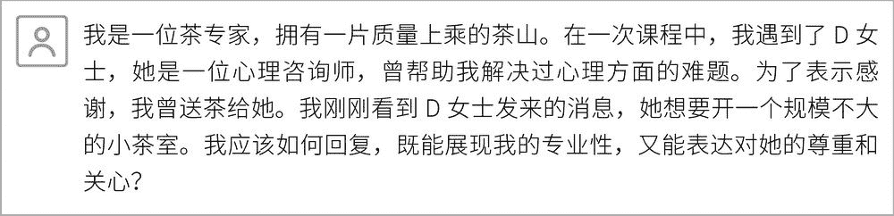

**解析**：这个提问把专业性和人际温度结合在了一起，正是商务沟通的双重需求。比如回复重要客户的咨询，既要体现专业，又要显出尊重。这样的提问能引导ChatGPT给出既传递信息又保持体贴的回应，对维护关系和展示专业度都很关键。

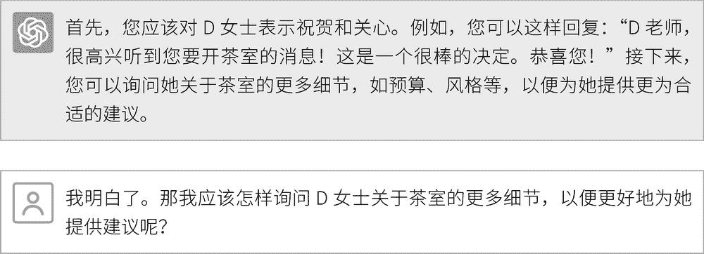

**解析**：这类问题能帮助准备对话策略。想跟客户谈新项目时，先问ChatGPT怎么提问、怎么引导，能拿到具体的话术和节奏建议。提前准备更有针对性的问题，就能更深入了解需求，给出更贴合的方案。

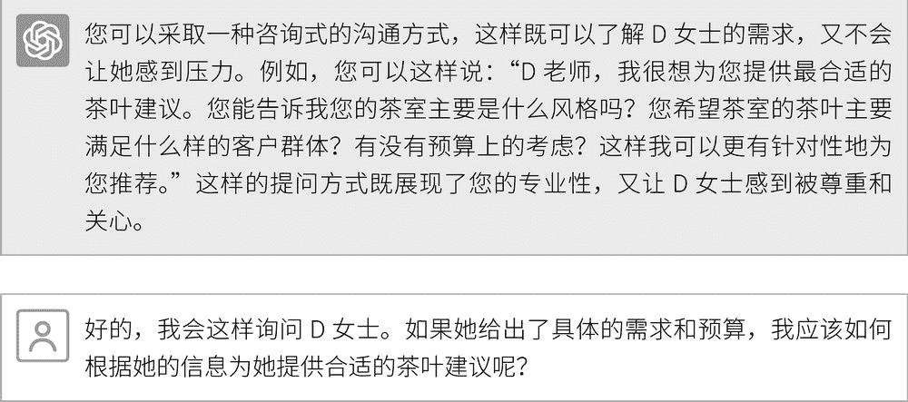

**解析**：Z先生希望基于客户的具体信息做定制化建议。这种提问很实用，把真实需求和预算喂给AI，能获得更精准的沟通策略和产品建议，提升沟通的针对性和成交率。

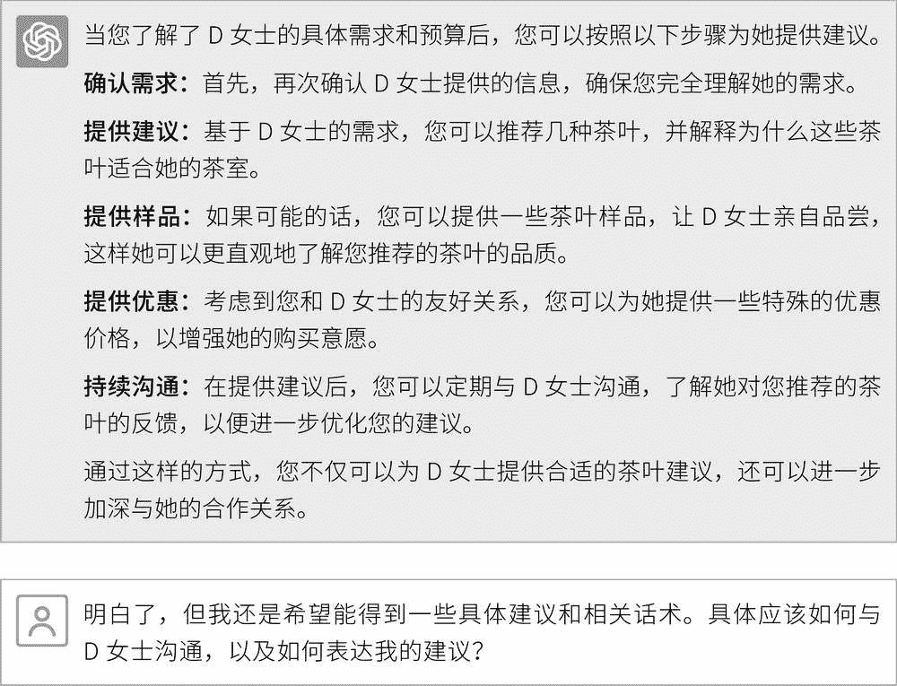

**解析**：这是在要具体可用的沟通话术和示例。实际工作中遇到需要精确表达的场景，直接要求ChatGPT提供模板或对话示例，能快速获得实用工具，让销售沟通更顺畅。

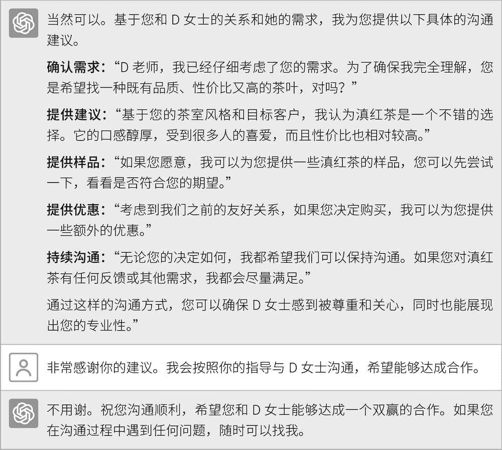

**小提醒：有效使用ChatGPT获取销售策略和销售建议**

**提供详细背景信息**

提问前尽量把客户画像、过往聊天记录、具体需求偏好等交待清楚。如Z先生那样描述D女士的职业、茶室类型、关系历史，上下文越丰富，答案越准。

**明确地表述问题**

把想解决的问题说清楚、说具体，避免模糊。目标越清晰，得到建议越落地。

**持续互动以优化建议**

拿到初步答案后继续追问、要解释或要话术示例，通过多轮对话不断细化。Z先生就是在初步建议后继续深挖具体沟通表达。

了解客户背景的重要性毋庸置疑。客户感受到被重视才会成为回头客，而Z先生的故事提醒我们：即便有信任基础，不去了解真实需求和背景，也会错失交易。

借助ChatGPT，销售能更快发现沟通盲点并获得即时指导。基于D女士背景的建议，既满足了她的需求，也稳固了关系。综合案例5-1，可以归纳出了解客户背景的5个关键作用：

· 建立信任与关系。了解背景是建立信任和长期互利的基石。
· 提高沟通效率与主动性。能更快切入主题、预判需求、主动提供解法。
· 避免冲突与提高自信。降低风险，增强沟通底气。
· 增加销售机会与提供个性化服务。定位更准，服务更贴心。
· 提高客户满意度与促成长期合作。用信息驱动服务，提升满意度和忠诚度。

销售本质是关系的建立。产品再好，若不了解客户背景和真实诉求，就很难产生连接。深入倾听、真正理解，才是每一次沟通有意义的前提。

**小提醒：为什么要采取咨询式的沟通方式**

当你在某个领域被视为专家时，咨询式沟通不仅是技巧，更是对客户的尊重。你掌握的不只是产品，还有行业洞察和客户需求判断力。能提供客户想要的，也能提供客户真正需要的。

**深入了解客户需求**

通过提问来确认需求，等于做一次微型调研，避免猜测，提供精准方案而非一刀切。

**建立信任与关系**

愿意倾听的人更受信任。提问体现尊重和关心，有助于加深关系和信任。

**避免压迫感**

硬推销容易让人有压力，咨询式沟通更柔和，让客户感觉是共同探讨。

**提高沟通效率**

问对问题，才能快准地找到痛点，给出有针对性的方案。

**展现专业性**

高质量的问题能体现专业度，让客户认可你的行业地位。

案例5-1中，若Z先生早点用咨询式提问去了解D女士的真实需求，建议会更贴合，成交概率和信任度都会更高。

### 5.1.2 设定沟通目标

高效的销售沟通不是随意的，每次交流都应有明确目标。目标导向让沟通更聚焦，也为复盘提供依据。

**01. 明确沟通目标**

沟通前先确定想达成的具体结果，例如让客户了解新品、消除疑虑、完成订单或建立长期合作。目标清晰才能聚焦内容。

具体的沟通目标可以是：

· 让客户了解新产品或新服务：传递特点、优势和适用场景。
· 解答客户疑问：针对疑虑给出解释，增强信任。
· 促成购买决策：突出价值，引导下一步行动。
· 收集客户反馈：为产品改进提供依据。

**02. 预测并准备应对可能的疑问**

客户大概率会问产品细节、合作条款等。提前准备答案，能显得更专业，也更快建立信任。

**03. 选择合适的沟通时机和沟通形式**

找客户相对从容的时间，选他习惯的方式。面对比电话、线上更能加深理解，若条件允许优先考虑。

设定好目标，才有针对性的沟通，才能推动销售进程。

**案例5-2 L女士的一次销售拜访**

L女士在健康食品公司做销售，要拜访一家大型健身中心经理，推产品进零售区。她意识到需要先研究客户并明确拜访目标。ChatGPT在目标设定上给了她策略性建议，帮助她更充分准备。

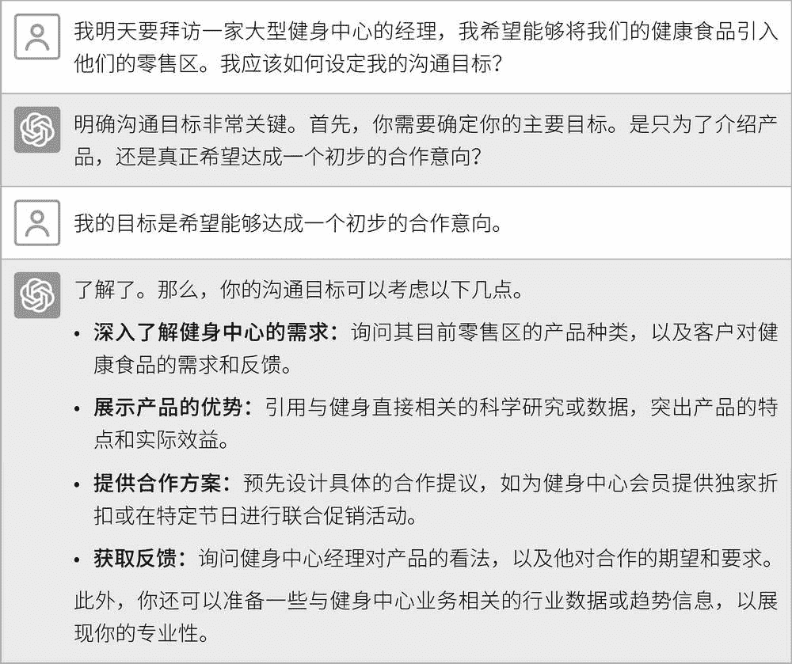

借助ChatGPT，L女士得到了有关沟通目标的策略性建议，有助于她为拜访做好充分准备。

### 5.1.3 调整沟通策略：常规情境与紧急情境

销售工作中既有从容准备的常规情境，也有需要即时反应的紧急情境。不同情境下沟通策略要灵活调整。

**01. 常规情境**

时间充足，可做深入准备。

· 深入研究：了解客户需求、期望和痛点。
· 明确目标：如建立信任、介绍新品或获取订单。
· 选择合适的沟通方式：面谈、电话或线上会议。

**案例5-3 K女士与潜在客户的初次接触**

K女士是软件公司销售，拿到市场部给的潜在客户名单，准备首次联系A先生。她向ChatGPT请教初次沟通的策略。

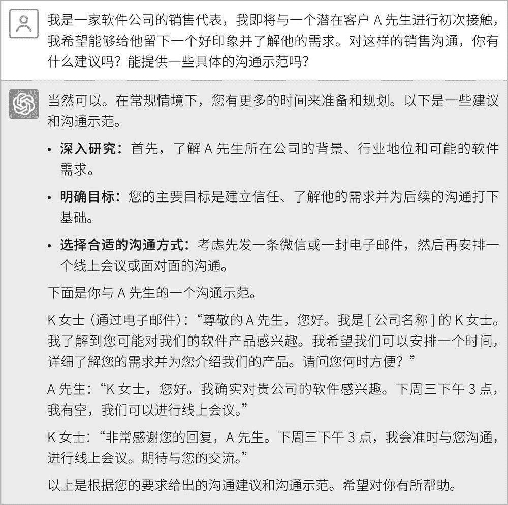

**02. 紧急情境**

通常没时间做深入准备。紧急情境下的沟通策略包括以下几点。

· **即时反馈**：客户有需求或遇到问题时，马上作出回应，体现你的专业水准和对客户的重视。
· **信息提炼**：在时间受限的情境下，把内容浓缩，优先传递最核心的要点。
· **争取缓冲**：当自己需要更多准备或思考空间时，可以礼貌地请客户改期沟通。

接下来，就用案例5-4来演示ChatGPT在紧急销售沟通中的具体用法。

**案例5-4｜M先生的加急订单**

M先生在某制造企业担任销售经理。周五下午，他收到一笔必须在下周一前交付的紧急订单。为确保履约，他得同时协调生产、物流以及客户三方。

面对这样的局面，M先生的主要沟通难点在于：怎样让生产部门调整排程配合加急需求，如何与物流部门对齐交付时间，又该怎么向客户同步订单进展。

为破解上述难题，借助ChatGPT获取沟通思路成为可选方案。

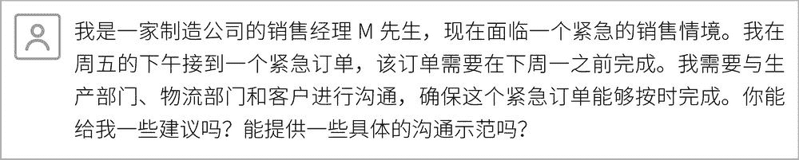

**解析**：M先生在提问时展现了良好的提问结构。他先点明了当前的具体情境——一笔必须快速处理的加急订单。再把需要配合的部门和最终目标——按时交付——交代清楚。最后他明确索要建议和示范话术，说明他想要可直接落地的方案。这种清晰、具象的提问方式让ChatGPT能给出更精准、更有操作性的回应。遇到类似的紧急或复杂场景，都可以参考这种提问逻辑。

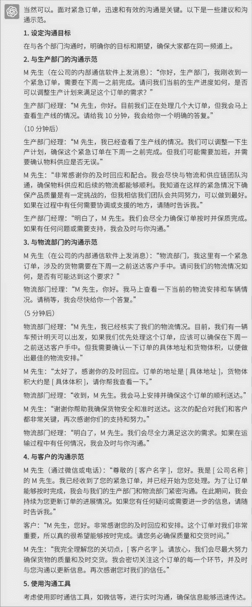

案例5-3和案例5-4说明了在不同销售场景下，用ChatGPT获取沟通策略和销售建议的可行性。K女士在常规场景下借助工具制定了首次接触潜在客户的沟通方案；M先生在紧急场景下获得了快速高效的应对思路。这体现了工具的通用价值。无论是日常还是应急，关键都在于根据实情调整沟通方式，保证沟通既有效又高效。任何时候都要保持与客户的真实连接，真正理解其诉求和预期，才能提升成交概率。

## **5.2 开场交流**

在销售里，每一次对话都是建立信任、表达关注、彰显专业的机会。在各类交互中，初期的友好寒暄是拉近距离的第一步，也至关重要。它能化解初见的尴尬，为后续深入沟通铺路。通过恰当的开场，我们更容易摸清客户侧重点，从而更精准地回应需求。

### **5.2.1 开场交流的重要性**

初次见面时的友好互动不容忽视，主要价值体现在：

·**拉近信任**：通过得体、专业的开场，能迅速让客户产生信任感。
·**摸清信息**：开场能初步获知客户背景、兴趣点、诉求，为后续对话定方向。
·**缓解紧张**：面对陌生客户，适度寒暄可降低拘谨感。
·**体现专业**：有针对性的开场语言，能塑造专业形象。

### **5.2.2 开场交流中的注意事项**

与不熟悉的潜在客户见面时，开场既是破冰的桥梁，也是展示关心与专业度的窗口。但在追求短时间内留下好印象时，开场并非易事。为让开场真正起到连接作用并获得好感，需注意以下要点。

**01. 避开过度私人的话题**

开场目的虽是建立关系，但不宜触及敏感私域。参考建议如下：

·**外貌与身体**
不要点评对方的外观变化，例如“头发白了”“看起来老了”“好像胖了”。此类说法易引起不适。
·**健康状况**
除非客户主动提及，否则不要追问健康细节，例如“听说你最近生病了，情况怎样”。
·**宗教与政治**
这两类议题通常敏感，若不确定对方兴趣，最好不谈。
·**家庭与私生活**
避免询问私人问题，例如“听说你和伴侣分手了，是真的吗？”

**02. 保持真实**

真实是关系维系的基础。开场时不要为刻意套近乎而说假话。虚假赞美很容易被察觉，会削弱信任。例如不喜欢对方新发型就不要说“很喜欢你的新发型”。保持真诚、关注真实连接，才能建立稳固的长期关系，也更容易树立可靠专业的形象。

**03. 控制自我介绍时长**

初次接触时，自我介绍宜简洁。先快速说明身份后，尽快转向客户相关话题，比如抛出开放式问题了解其关注点。过度自我陈述会让客户感觉你不够关注其需求，不利于关系建立。

**04. 控制开场时长**

开场很重要，但不宜占用过多时间。话题应简洁聚焦，例如轻度询问近期工作或生活状态即可，无需深挖细节。恰到好处的开场能让你通过对方的言行捕捉更多信号，为后续深入交流做准备。

**05. 尊重文化差异**

不同文化对话题禁忌不同。提前了解目标客户的文化背景，避免因无意冒犯导致误解，例如在某些文化中直接问年龄或婚姻状况被视为不礼貌。

为帮助理解如何进行开场，下文提供三个案例：案例5-5、案例5-6、案例5-7，分别展示ChatGPT对销售新手、有经验销售人员、拜访老客户时的开场建议。

**案例5-5 销售新手借助ChatGPT优化开场**

与潜在客户接触时，新手常感到紧张，不知如何开头。借助ChatGPT的提示，对话启动会更顺畅。

L先生是销售新人，即将与潜在客户M女士进行首次沟通。他对如何进行得体的开场感到不安，于是向ChatGPT请教开场建议。

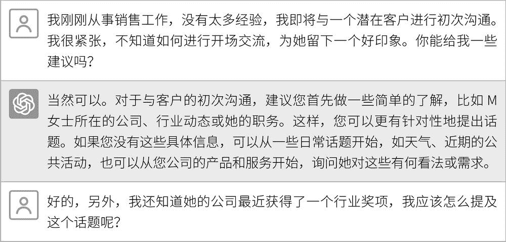

**解析**：L先生后续的提问很关键，涉及如何利用客户的特定信息来建立连接。他希望在开场中提及客户公司的成绩，以此表达兴趣和认可。这是有效策略，能营造友好氛围，体现他对客户业务的了解。通过此类提问，L先生可获得更具体的引入方式，既缓解新手焦虑，又提升专业感。提及客户成就往往是开启深度对话的好切入点。

案例5-5显示，即使是销售新手，也能通过有效开场与客户初步建立联系，为后续沟通打基础。借助ChatGPT可获得针对性话术，提升与客户的连接质量。

**案例5-6 资深销售以专业切入开场**

Q女士在健康产业深耕多年，即将拜访在该领域经验丰富的潜在客户A先生。她希望通过ChatGPT学习如何用专业知识引发客户兴趣。

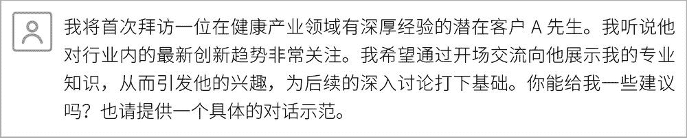

**解析**：Q女士的提问先详细描述了拜访情境，包括客户背景和关注点，为ChatGPT提供了充足上下文。再明确沟通目标——在开场展示专业以激发兴趣。最后她直接要求具体建议和示范话术。这种结构化提问让工具能给出更具针对性的实用回应。

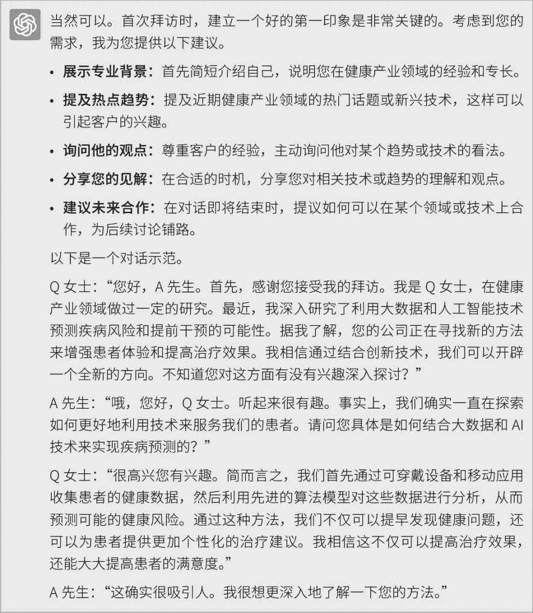

与客户初步交流时，应适时展现专业、聚焦客户具体需求并努力建立深度连接，这有助于推进后续沟通。

**小提醒：实战中的开场技巧**

从前面ChatGPT给出的示范中可见，Q女士采用了具体、专业且与客户利益相关的开场方式。这种方式的优势在于：

·**凸显专业**
展示领域深度和经验会更有说服力，也易建立信任。案例中Q女士强调了自己在健康产业的专业背景。
·**回应需求**
销售核心是解决问题。Q女士提出用大数据和AI提升患者体验的方案，直接对接A先生公司需求。
·**提供实证**
抽象信息吸引力弱，具体案例和数据更具说服力。Q女士描述了研究方法和实际应用，增强可信度。
·**制造共鸣**
找到共同关注点是建立关系的关键。Q女士触及A先生可能关心的议题，引发兴趣。
·**引导深入**
良好的开场能为后续深入探讨创造条件。

**案例5-7 用ChatGPT加深与老客户的开场交流**

N女士是销售经理，即将拜访已有合作的客户U先生。她希望进一步加深关系，为长期合作奠基，于是向ChatGPT寻求沟通建议。

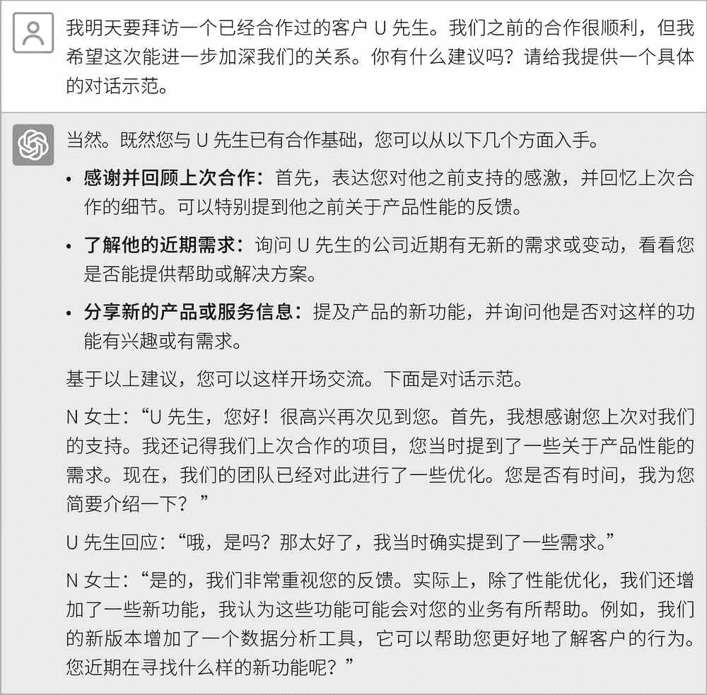

**小提醒：如何通过开场赢得老客户信任**

基于案例5-7的示范，下面拆解N女士的话术与策略。

**N女士的第一轮表达**

**（1）问候并表达见面喜悦**：“U先生，您好！很高兴再次见到您。”
**分析**：营造友好氛围，传递积极态度。热情问候有助于在老客户心中保持良好印象，是加深关系的起点。

**（2）表达感谢**：“首先，我想感谢您上次对我们的支持。”
**分析**：回顾过往合作并致谢，能唤起客户的合作记忆，体现珍视合作，有助于提升忠诚度。

**（3）提及上次合作细节**：“我还记得我们上次合作的项目，您当时提到了产品性能的需求。”
**分析**：体现对历史细节的关注，展现重视与专业，同时传递“您的反馈被认真对待”的信号，提升可靠感。

**（4）告知优化并邀请了解**：“团队已针对此做了优化，您方便的话我为您简要介绍一下吗？”
**分析**：展示对反馈的积极响应，体现持续改进。邀请了解为后续对话和合作创造机会，也体现尊重。

整体来看，N女士的表达连贯、自信，展现了对沟通节奏的掌控，有助于树立专业可靠的形象并推动销售进程。

**N女士的第二轮表达**

**（1）强调重视反馈**：“是的，我们非常重视您的反馈。”
**分析**：明确传递客户意见在决策中的分量，增强信任。

**（2）介绍新功能**：“除了性能优化，我们还增加了一些新功能，我认为对您的业务会有帮助。”
**分析**：先回应反馈，再自然引入新功能，关联到客户潜在新需求，是有效的价值增益策略。

**（3）举例说明**：“比如新版本加入了数据分析工具，可帮助您更好了解客户行为。”
**分析**：用具体功能案例关联客户实际业务，让价值可感知，提升说服力。

**（4）开放式邀请**：“您近期在寻找什么样新功能呢？”
**分析**：开放式提问鼓励客户表达当前需求，提供定制化服务的关键信息，增强参与感，为后续策略调整提供依据。

综上，N女士通过精准开场展现专业与洞察，有效强化信任，为长期合作和持续客户管理奠定基础。灵活运用这些策略，能显著提升建立并深化客户关系的能力。

## **5.3 需求挖掘**

在销售中，真正读懂客户核心需求是关键。只有精准把握，才能提供真正有价值的产品或服务。本节介绍如何识别核心需求及借助ChatGPT挖掘需求。

### **5.3.1 了解客户的核心需求**

把握核心需求是销售成功的基石，既关乎成交，也关乎满意度和长期合作。挖掘需求的建议如下：

**01. 做好前期调研**

正式接触前，应投入时间做功课，可从三个维度入手：

·**业务背景**：了解客户公司历史、主营业务、市场定位与商业模式。
·**行业动向**：研究行业近期趋势、技术进展与市场变化，预判其可能面临的挑战。
·**竞争态势**：梳理主要竞争对手的优劣势，找到自身产品或服务可突出的价值点。

掌握这些信息后，沟通会更自信，提问也更具针对性，便于深挖真实需求。

**02. 营造舒适的交流环境**

选择安静、不易打扰的场所交谈。环境舒适时，客户更愿意敞开心扉分享真实诉求，有助于更准确理解其期望，也利于拉近距离、建立信任。

**03. 采用咨询式沟通**

咨询式沟通强调了解而非单向推销。其有效前提是已建立基本信任。信任建立后，可更自由地围绕客户业务提出问题，探讨现状与未来期望，从而更深入地触达核心需求。

实战里可以先拿行业观察、市场动向或真实案例做切入，让对方先感受到专业底蕴和关心，再顺势转成顾问式的探询，把交流带向更深入、更具体的方向。诸如“最近一季度，哪些业务卡点最消耗精力？”、“接下来一年，您最想突破的核心目标是什么？”这类问题既能帮助你更快抓住真实意图，也能传递出被重视的感觉。

**04. 邀请对方回顾得失经历**

沟通中无论对方讲的是满意结果还是走过的弯路，都值得引导他回望过往项目的细节。这不仅是找痛点，更是在拉近关系、读懂真实诉求。

这么做的好处

·拉近距离：愿意谈成败时，对方会更真切地感受到你的共情与在意，被理解的体验会自然促成更亲近的连接。
·洞察需求：从过往经验里能更清晰地读出期望、限制和当前卡点，为后续方案提供依据。
·凸显专业：在回应对方故事时适时给出行业观点，会让对方感受到你的功底，进而提升信任。

如何打开话头

·开放式提问：比如“类似项目里，您认为进展最顺畅的部分是什么？”或“上一次未能达标，您觉得关键原因在哪？”更容易打开话匣子。
·传递善意：让对方明白探究细节的目的是更好地支持他，而不是挑刺或评判。

**05. 用情景模拟深化探讨**

直接问需求往往只能得到笼统答案，这时情景模拟就很有效。

·邀请对方自述场景：预设情境容易遗漏真实顾虑。更有效的做法是让对方自行描述实际遇到的问题或曾担心的情形。例如可以启发性地问：“在日常运营里，有没有哪些特殊状况或挑战让您印象很深？”或者“您觉得哪些场景可能影响业务流程或体验满意度？”这种开放提问能让你从叙述中更准确捕捉真实需求和痛点，从而给出更贴切的方案。
·互动式共探：鼓励对方沉浸在场景中，与他一起探讨可能的挑战和对策。这不仅能让你更深了解需求，也能帮助对方明确真正想要的支持。

用情景模拟，对方能暂时跳出日常运营，从新视角审视问题，更清晰地表达需求。

**06. 留意非语言沟通细节**

和对方交流时，除了听他说什么，更要留意没说出口的信号。

·肢体语言：双臂交叉、手指不停拨弄物品，往往暗示戒备或不自在；而身体微微前倾、双臂放松、手掌自然打开，则传递出好奇和愿意继续聊下去的信号。
·面部表情：笑容、点头、目光明亮通常代表认同和兴趣；眉头紧锁、视线游移、嘴角下沉则可能透露出困惑、质疑或不快。
·声调：声音上扬常说明对方被话题点燃了兴趣；语调平淡或压低则暗示关注度下降或有所保留。

观察这些非语言信号，能帮你更好理解对方真实感受和潜在需求，从而做出更有的放矢的回应。

**07. 保持耐心倾听**

交流时别急着插话或先下结论。留出空间，让对方把想法、顾虑和需求完整表达。真正的倾听不是为了抢下一个开口的机会，而是为了真正理解对方。在对方分享时，适时点头或简短回应，会让他感受到你全神贯注并理解其意思。

**08. 持续回访**

销售过程中，定期维护沟通至关重要。即便已初步了解需求，也不能中断联系。因为需求会随市场和业务变化而演进，保持节奏感的回访才能持续贴合。

**09. 用平实语言复述需求**

听完对方描述后，最稳妥的做法是用简洁易懂的话复述一遍，确保没有遗漏关键点。建议如下。

·简明扼要：不要长篇大论，用简短语言概括核心诉求。
·避开术语：尽量使用通俗表达，避开行业黑话，确保对方能完全明白。
·请对方确认：复述后询问是否有补充或更正，比如“我的理解是这样的，不知道有没有遗漏或误解的地方？”
·观察反馈：看对方反应，看是否认同，还是有疑虑或困惑。

复述需求有助于消除沟通障碍，也能增强对方信心，因为他知道你真正听进去了。

**10. 共同设计解法**

邀请对方共同参与方案设计。当对方投入时间精力，沉没成本会提升他对成果的关注。方案被视作双方共同作品时，归属感更强，更容易获得长期信任与支持。共创既能确保方案贴合实际，也更利于建立持久合作。

总之，挖掘真实需求需要深度交流、细致观察与持续跟进。只有这样，才能提供有价值的产品与服务，建立长久合作。

### **5.3.2 实战策略：借助 ChatGPT 深入挖掘需求**

下面用一个具体案例，演示如何借助 ChatGPT 深入挖掘客户需求。

**案例 5-8 S 先生借助 ChatGPT 挖掘对方对高端嵌入式烤箱的需求**

在高端家电销售里，深入了解需求是提供卓越服务的核心。下面呈现一个模拟对话，展示 S 先生如何在实际交流中运用 ChatGPT 的建议，挖掘潜在需求并给出更贴切的解决方案。

**场景设定**：一位潜在买家对 S 先生公司的高端嵌入式烤箱感兴趣，但尚未明确具体需求。

**S 先生与 ChatGPT 的对话**

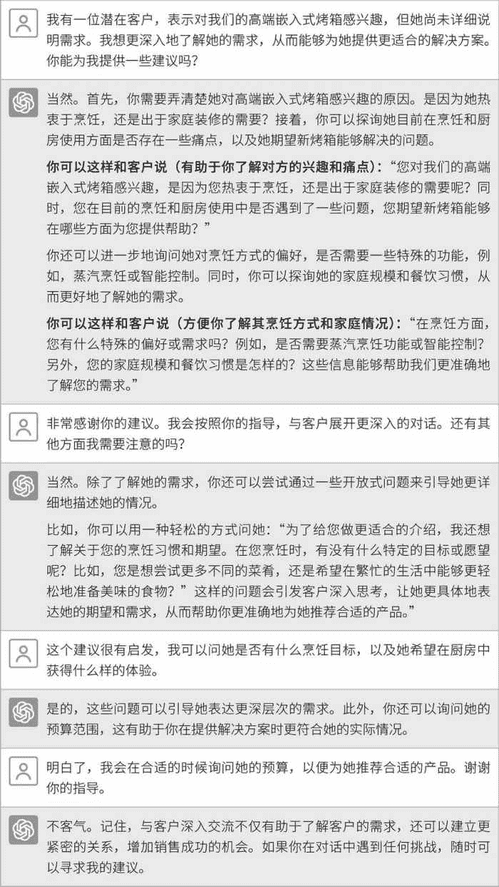

与 ChatGPT 的交流里，S 先生获得了一套更有效的人需求探询思路。核心做法包括多用开放式提问、厘清烹饪习惯、了解预算区间等。通过这些手段，可以更精准把握意图，增进互信，提升成交机会。

案例 5-8 的对话也带来一个经验：在与对方交流时，不仅要了解明确需求，还要努力挖掘潜在需求。只有这样，才能为对方提供真正有价值的解决方案，实现双赢。

案例 5-8 也体现了 ChatGPT 为销售带来的价值之一——它能根据具体场景和具体需求，为业务人员提供有针对性的建议和策略。

## **5.4 产品介绍**

产品介绍是销售的关键环节。这一环节不仅能呈现产品特点与优势，更是引起共鸣、解决问题的重要契机。通过一系列策略和技巧，你可以更好地展示优势、激发兴趣，最终实现销售。

在 5.3.2 节，案例 5-8 演示了如何用 ChatGPT 的建议深入了解需求。下面延续该案例，借用 ChatGPT 指导销售人员把获得的信息转化为有针对性的产品介绍。这样可以更精准解答疑问，提供与需求紧密相关的方案，从而实现更有效的销售。此类介绍不仅能更好满足具体需求，也有助于构建牢固的关系，促进长期合作。下面介绍做产品介绍时需要注意的要点，以及如何借助 ChatGPT 做好产品介绍。

**01. 个性化定制**

每个买家都有独特之处。介绍产品时，要把之前了解到的信息融入其中，向对方展示产品如何满足他的具体需求。比如案例 5-8 的高端嵌入式烤箱。如果对方担心厨房空间，就重点讲解产品的紧凑设计如何帮她节省空间。

以下是 ChatGPT 为 S 先生提供的沟通示范，展示了如何用清晰明了的语言向对方解释产品功能，更好沟通，提供个性化服务。

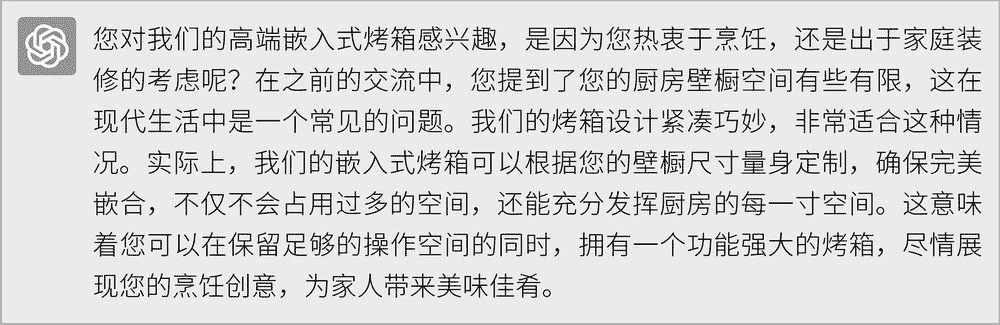

**02. 故事化表达**

用故事介绍产品更容易触动情感。讲述时可带入真实的用户体验故事，让描述更生动有趣，对方能直观感受到实际价值。更重要的是，故事能引发共鸣，让对方更轻松理解产品的独特之处。

以下是 ChatGPT 给出的示范，展示了如何在故事化表达中更好与对方沟通。

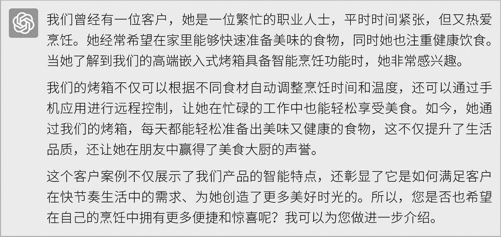

**小提醒：讲故事之前，确保对方的实际情况与故事背景相符**

使用故事化表达时，要记得先核对故事背景与对方实际情况是否吻合。这有助于引发共鸣，让对方更容易理解产品价值。所以讲故事前，要仔细考虑对方的背景、需求和偏好，以确保故事能与现实产生联系。例如，若潜在买家是拥有充足闲暇的家庭主妇，繁忙职业人士的故事就不合适。

若能为对方呈现适宜的故事，就能展现一个既真实又有说服力的情境，深刻触动情感。

**03. 重点突出**

知道对方关心什么，就突出那一点。比如案例 5-8 中，若对方在乎烹饪，就介绍产品的特色烹饪功能；若关心操作，就突出智能控制；若空间是问题，就强调如何帮助节省厨房空间。

**04. 解释相关术语**

并非每个人都懂复杂的技术术语或词汇，介绍产品时尽量用简单的话说明，确保对方明白你在说什么，这有助于他们真正看到产品的好处。

以下是 ChatGPT 给出的示范，展示了如何用通俗易懂的语言解释产品功能，从而更好与对方沟通。

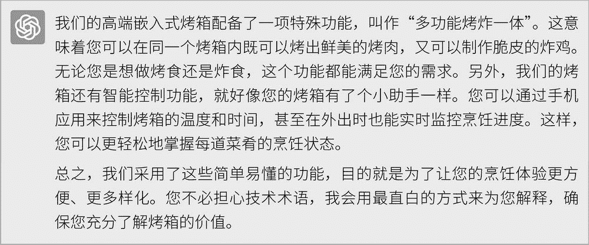

通过解释术语并使用通俗表达，你能让对方轻松理解产品功能与优势，提升兴趣与认同感。这种沟通方式能让对方感受到你的专业性，并对购买决定更笃定。

**05. 抓住对方的关注点**

交流时要提到对方曾说过的关注点，并说明产品如何满足。这样对方会感受到你真的在聆听，也真心想解决问题。

以下是 ChatGPT 给出的示范，展示了如何在产品介绍中抓住对方关注点。

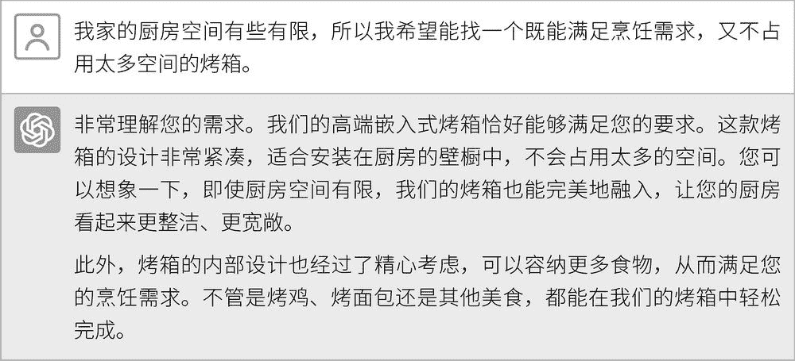

通过引用对方关注点并把产品优势与之联系，你能让对方感受到你真正理解需求并能提供方案。这种个性化沟通能提升满意度并增加成交机会。

**06. 说出真正的好处**

介绍产品时，不仅要告知功能，更要让对方明白这些功能对他意味着什么好处。换句话说，不仅说明产品能做什么，还要说明它解决了哪些真实问题。

以下是 ChatGPT 给出的示范，展示了如何在介绍高端嵌入式烤箱时强调实际优势和好处。

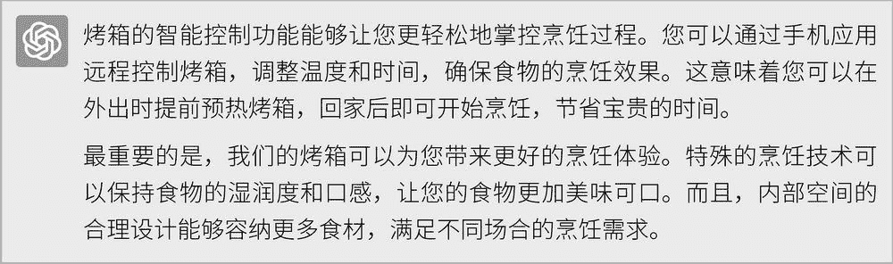

清晰说出真正好处，能让对方更好理解购买价值。此类有针对性的介绍能提高兴趣，为销售成功奠基。

**07. 与对方互动**

介绍产品时，不妨多互动。让对方主动提问，积极参与讨论。这样既能让对方更深入了解产品，你也能更清楚他们真正想要什么。

下面是 ChatGPT 给出的示范，展示了如何在互动式介绍中与对方互动，鼓励提问，以及如何灵活回应问题。

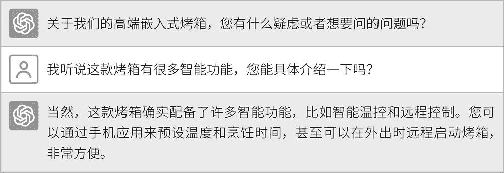

产品介绍过程中的有效互动至关重要。这种双向沟通不仅帮助对方更深入了解产品特点与价值，还能让我们更准确掌握真实需求和关注点。通过示范对话，可看到应如何鼓励对方提出问题并做出针对性回应，从而更好展示产品价值。

**08. 闭环总结**

完成产品介绍后，花一点时间总结很有帮助。做总结能确保双方对产品有清晰理解，也给对方机会提出其他想法或需求。这不仅能加深关系，还有助于发现商机、提高成交概率。

那么为什么闭环总结很重要？

·**确认需求。**通过闭环总结，你能了解对方是否对产品有清晰理解，确认真正需求并避免误解与信息缺失，确保介绍与需求相符。
·**促进参与感。**互动讨论让对方在总结环节有机会提问和参与，增强参与感，提升满意度。
·**发现潜在机会。**对方可能在总结时提出此前未考虑的问题或需求，为你提供发现潜在机会的时机，从而提供更全面的方案。
·**加强关系。**闭环总结有助于建立更紧密关系。通过持续互动，你能增强对方信任，为未来合作奠基。
·**提升成功率。**在总结中确认需求，能更精准定制方案，增加成功销售机会。

下面是 ChatGPT 给出的示范，展示了如何在闭环总结中巧妙将产品介绍与确认需求结合，以实现更有效的沟通。

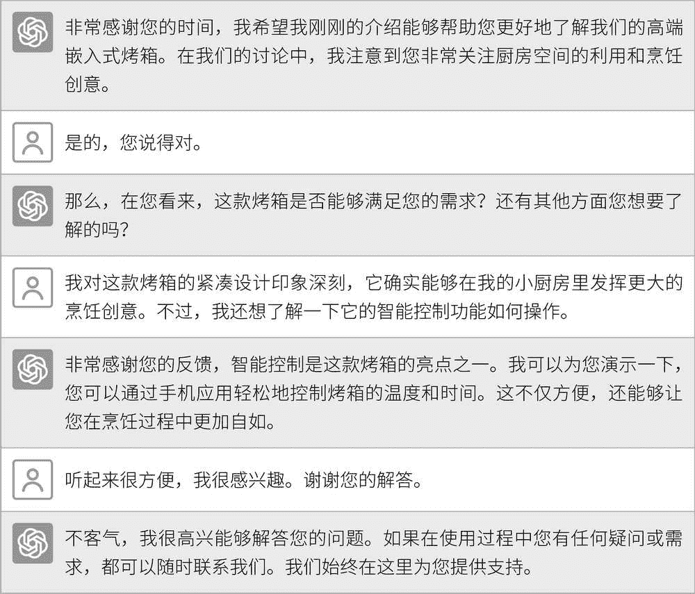

通过这个示范，可看到 ChatGPT 如何帮助我们在闭环总结中确认需求、解答疑问、强调产品特点，并做出后续支持承诺。此环节有助于提升满意度、增进信任，并为未来合作奠基。

把以上策略融入产品介绍，能更有效地沟通、展示价值、建立信任并最终达成销售目标。此外，持续关注需求并将其置于销售核心，是成功销售的关键。

## **5.5 ChatGPT 在销售沟通中的综合价值**

与 ChatGPT 深度融合后，你能充分感受到其在销售沟通中的综合价值。

·**智能引导。**借助 ChatGPT 的高质量建议，你可以与对方进行更深入沟通，更准确捕捉需求。
·**定制化内容。**根据每位买家特殊需求调整问题，让 ChatGPT 给出针对性建议，使沟通更真挚、更贴近对方。
·**实战示范。**ChatGPT 可提供对话示范，帮助理解如何在实际销售情境中应用建议、将理论转化为实战技巧。
·**提升满意度。**在满足需求前提下，结合 ChatGPT 指导，能进一步提升满意度，奠定长期合作基石。
·**提高成功率。**融合 ChatGPT 的智慧，你会更有信心满足各种需求，从而提高成功销售概率。

本章详细讨论了如何在销售过程中高效利用 ChatGPT 进行沟通，从而加强对对方了解，得到让对方满意的方案。通过案例分析，本章展示了如何巧妙结合传统销售技巧与 ChatGPT 智能建议，使你在实际销售沟通中表现更卓越。本书希望你在日常销售沟通中更活跃地利用这一现代工具，从而增强体验并提高销售成功率。唯有不断学习和实践，你才能持续优化销售技能，实现前所未有的高效率和良好沟通效果。

截至目前，我们已探讨如何设定沟通目标、进行开场交流、深入挖掘需求，以及进行有效产品介绍，但在实际销售沟通中，我们不可避免会遇到挑战。这些挑战可能包括如何处理异议、如何应对反馈，以及如何持续维护良好关系等。这些都是销售中的关键环节。接下来的第六章将深入探讨如何运用 ChatGPT 有效应对常见销售挑战。第六章将提供具体策略和案例，帮助你更好理解并应用策略技巧，让你在面对挑战时更从容，持续提高销售效率和满意度。

# **第六章**

# **运用 ChatGPT 处理客户异议和维护客户关系**

处理异议和维护关系是销售领域和客户服务领域中两个至关重要的议题。特别是在当今信息爆炸、竞争激烈的环境下，高效、准确地应对这两个问题，对于任何企业或个人来说，都有着不可或缺的战略价值。

本章将首先讨论如何处理异议，这是销售人员在与对方互动中经常会遇到的挑战。从基础理论到实用指南，再到由 ChatGPT 指导的真实案例，本章将为你提供一套全面且具体的解决方案。

接着，我们会讨论如何在维护关系方面发挥 ChatGPT 的潜能。同时，我们还会展示 ChatGPT 在实战中的表现，以便你直观地了解其价值和应用范围。

总之，本章旨在为你提供一整套关于处理异议和维护关系的现代化解决方案，帮助你在面对异议和维护关系时能够更加自信和从容。

## **6.1 处理客户异议**

在销售中，面对异议是常态。然而，处理这些异议并不仅仅是为了消除障碍、推动销售或保留对方；它也是一种机会，用以了解需求、改进产品或服务，甚至加深与对方的关系。

### **6.1.1 处理异议的 9 个关键策略**

本节将引领你掌握 9 个关键策略，帮助你更有效地处理异议。从准确理解对方的问题，到提出解决方案，再到后续的跟进和持续改进，本节将传授给你一套全面的策略。无论是销售新手还是经验丰富的业务专家，都将获得宝贵的洞见和实用的方法，能够更有效地处理异议，从而抓住更多的销售机会、提升满意度并与对方建立更深入的关系。

**01. 立即回应但不打断**

在对方提出异议或问题时，快速且清晰地表明你正在倾听，并理解他们的立场。重要的是，不要打断他们，只有这样你才能完全理解他们的需求和担忧。在处理异议的过程中，迅速但不妨碍对方表达的响应至关重要。这种做法体现在点头、保持眼神接触等肢体语言上，同时，还有以下几个关键作用和需要注意的方面。

**（1）建立信任**

在销售中，赢得对方的信任是至关重要的一步。要做到这一点，你首先需要让自己成为一个好的倾听者。当对方说话时，通过点头和保持眼神交流这种简单的肢体语言可以有效地传递出你对他们所说内容的关注和尊重。通过表现出你正在倾听并且理解对方所提出的异议或问题，你可以增强对方对你的信任感。这种信任是成功销售的基础，因为它帮助建立起一种良好的沟通环境，让对方更愿意与你分享他们的真实想法和需求。

**（2）识别销售机会**

在销售实战里，客户提出的每一个反对意见都藏着需求升级的线索。耐心倾听异议，就能捕捉到他们没说出口的期望和对产品服务的具体想法。这些信息是调整话术、搭建个性化方案的依据，也能让销售策略更有效、客户满意度更高。

**（3）善用沟通技巧引导对话**
对话中多用肯定表达和开放式提问来牵引节奏。比如可以说：“我明白您对价格比较在意，能方便分享一下您心里的大致预算区间吗？”这种问法既显示你在认真接纳对方观点，也能挖掘出更多有效信息，为后续给出匹配的建议创造条件。

**（4）以建设性姿态准备回应**
遇到异议时切忌防御或直接否定。提前做好准备，用积极建设的方式回应：补充更多产品信息、说明不同使用场景、提出灵活的支付方式。这样既体现对客户关注点的重视，也更容易找到双方都能接受的解决方案。

**常见示例**
**场景**：A 女士在某家居用品店担任销售顾问。客户说：“这款沙发的颜色和我家装修不太搭。”

**不当回应**
客户话还没说完，A 女士就打断道：“这款沙发在任何环境下都很受欢迎！”

**为什么这样回应不合适？**
·**不够尊重。** 打断会让客户感觉自己的观点被忽视。
·**停留在表面。** 没有深挖客户具体的审美偏好和顾虑点。

**有效的行动方针**
**（1）立即回应。** 客户刚提出异议，就用“明白您的考量”之类的话先接住情绪。
**（2）用开放式问题引导。** 如“关于这个点您能多聊一点吗？”“您希望沙发呈现什么风格的搭配？”来获取更多细节。
**（3）注意体态和面部表情。** 微笑、点头等非语言信号，强化“我在认真听”的氛围。

**正确的沟通示范**
**表达尊重。**
“是的，沙发颜色确实是关键的考虑因素。”

**用开放式问题引导。**
“请您详细描述一下您家的装修风格，我好更精准地为您推荐合适的款式。”

**非语言反馈。**
边听边点头微笑，让客户感受到专注。

通过上述做法，客户会觉得意见被听见被理解，我们也能拿到解决问题的关键信息，这对建立长期信任很有帮助。

02. 先读懂异议的本质
销售过程中客户会抛出各类反对意见，涉及功能、价格、服务等多个维度。客户表达之后，首要任务是确认自己是否真正get到问题的核心。唯有准确理解真实担忧，才能给出对症的回应，避免基于误判做方案，反而削弱专业度。

**常见示例**
**场景**：B 先生在电子产品店带客。客户说：“这款笔记本太重了，我没法每天背着上下班。”

**不当回应**
B 先生说：“嗯，但这款机器性能很强，重量是正常的！”

**为什么这样回应不合适？**
·**缺乏共情。** “重量正常”听起来敷衍，让客户觉得担忧被轻视。
·**情绪管理失当。** 即使是个人偏好，也应耐心回应。
·**抓不住重点。** 强调性能没有解决“太重、不好携带”的核心痛点。

**有效的行动方针**
**（1）用温和语气复述异议，表达理解和关心**
销售顾问：“我理解您的顾虑，您是觉得这款机型对日常通勤来说负担有点重，对吗？”

**（2）继续倾听并校准理解，以积极态度确认需求**
销售顾问：“确实，便携性对每天携带很重要。除了重量，您还关注性能或者续航吗？”

**（3）引导更合适的选项，展现专业与服务意识**
销售顾问：“基于您的需求，这款轻薄机型更符合携带习惯，性能也足够日常使用。”

这样回应既体现了对客户需求的理解，也用替代方案化解了问题，减少了情绪摩擦，提升信任感和成交效率。

03. 用共情让客户感受到被理解
在听清异议内容后，下一步是要让客户明确感受到你对他们困扰的理解与在乎。共情不只是复述问题，更是传递“我懂你的感受”的信号。即便不完全认同观点，也要先让客户感到被尊重。

**（1）建立信任**
共情是信任的起点。客户感受到被理解，更愿意接受你的建议。
·沟通中保持诚实透明，即使信息对销售不利也不回避。
·服务标准保持一致，让客户每次都能获得同样的体验。

**（2）沟通更高效**
共情能快速消除误会，直达问题的核心。
·用清晰简洁的语言，减少理解偏差。
·及时回应客户关切，体现你珍惜对方时间。

**（3）增强客户关系**
长期看，共情能提升忠诚度。客户更倾向于与能理解其需求的品牌持续合作。
·在服务中适当提供超出预期的价值。
·为每位客户提供个性化方案。

**常见示例**
**场景**：C 先生是手机运营商客服，客户说：“我觉得这个月租太贵了。”

**不当回应**
C 先生说：“不贵，我们比市面上其他运营商便宜多了！”

**为什么这样回应不合适？**
·**未体现共情。** 直接否定客户感受，降低信任。
·**缺少解决路径。** 没有给出具体建议，客户问题得不到解决。

**有效的行动方针**
**（1）展示共情与理解。** 先认可感受，例如“听起来您对月租偏高这件事不太满意，我理解这会影响整体体验”。
**（2）了解更多背景信息。** 询问理想费用和套餐使用情况，如“您心里的合理月租大概是多少？目前套餐里有哪些功能用得不多？”
**（3）明确下一步行动。** 告知后续举措，如“让我查一下是否有更合适的优惠或套餐调整方案”。

**正确的沟通示范**
“听起来您对月租费用偏高感到不满，我能理解这会影响满意度。您理想的月租范围大概是多少？之前套餐里有没有不需要的功能？我来帮您看看现在有哪些更合适的优惠方案。”

共情既传达了理解，也明确了行动，能有效提升信任与解决问题的可能性。

04. 给出定制化方案和备选
在建立信任的基础上，要针对客户疑虑提供具体可行的解决方案或替代选项。这一步直接决定需求能否被满足。关键是基于对需求的理解，提供个性化方案，如不同价位产品、分期付款、增值服务等，让客户感受到被重视，信任和满意度随之提升。

**常见示例**
**场景**：D 女士在电子产品零售店，客户对某款笔记本感兴趣，但担心价格高。

**不当回应**
D 女士说：“这款机器性能和品质都是顶级，价格自然会高些。”说完便站着等待客户反应，未提供其他方案。

**为什么这样回应不合适？**
·**未回应核心担忧。** 强调优点却回避了客户对价格的顾虑。
·**没有具体解决办法。** 只谈价值，没有给预算匹配的选项。
·**错失深挖机会。** 客户提价格疑虑正是了解需求、提供定制方案的好时机。

**有效的行动方针**
**（1）深入了解预算和需求。** 问“您希望的预算大概是多少？对笔记本哪些功能最看重？”
**（2）提供多元化产品选项。** 结合预算推荐不同价位机型，确保各选项满足核心需求。
**（3）介绍促销和付款方案。** 告知当前优惠、分期等灵活方式，降低支付压力。
**（4）强调性价比与长期价值。** 突出产品在耐用性和使用体验上的回报。

**正确的沟通示范**
**深入了解预算和需求。**
“我理解您对价格的关注。为了更精准推荐，能否告诉我您考虑的预算区间？以及您最看重的几项功能是什么？”

**提供多元化产品选项。**
“我明白了。根据您的预算，这有几款选择。入门款满足日常使用，性能款适合处理复杂任务。您最初看的那款虽然价格稍高，但性能和耐用性带来的长期性价比很高，算是一次值得的投资。”

**介绍促销活动和付款方案。**
“目前有促销可享更优惠价格，还提供分期付款，您看是否感兴趣？”

这样既识别核心需求，又提供选择，能提升满意度和成交率。

05. 跟进不止于成交
问题解决或成交后，后续跟进是维系长期关系的开始，也是确认客户真实感受的重要环节。

**常见示例**
**场景**：F 女士在家居店成功化解客户对沙发尺寸和颜色的疑虑。

**不当行为**
客户离店后，F 女士再无任何联系。

**为什么这样做会有损失？**
·**缺乏持续关注。** 解决了眼前问题，却没经营长期关系。
·**错失反馈。** 未能收集购买体验和产品质量的反馈。
·**降低复购可能。** 没有后续触达，客户下次需求时不容易想到你。

**有效的行动方针**
**（1）获得即时反馈。** 成交后询问：“您对我们提供的方案满意吗？还有哪些地方需要我们帮忙的？”及时调整服务。
**（2）提供附加帮助。**
·**分享专业知识。** “这款沙发很耐用，清洁也很方便，我给您演示一下保养方法，可以延长使用寿命。”
·**提供个性化建议。** “我注意到您家是现代简约风，这款沙发很搭，如果需要软装建议随时找我。”
·**预见性服务。** 提前提供维护手册或维修支持信息。
**（3）进行后续跟进。** 在客户给出肯定反馈后，一周或两周后回访，了解使用感受并提供额外帮助。

**正确的沟通示范**
**获得即时反馈。**
“我很高兴我们找到了符合您空间和风格的沙发，您对这个方案满意吗？”

**提供附加帮助。**
“关于沙发的安装和保养，有任何需要我们随时提供支持。”

**进行后续跟进。**
“我会一周后联系您，了解使用情况，看看是否还有可以协助的地方。期待再次交流。”

这样既确认问题已解决，也为长期关系埋下伏笔。

**小提醒：有关确认和跟进的细节**
若发现自己在回访上有所疏忽，应尽快补救。及时联系客户了解使用体验，按需提供支持和优惠，既能挽回关系，也能收集改进依据。

06. 把一次性交易变成长期关系
持续沟通和优化是维护客户忠诚度的核心。目标是持续感知客户需求变化，及时回应新反馈，预防问题复发。

**常见示例**
**场景**：G 先生是汽车维修店客服，解决了客户对维修质量的疑虑，后续却无回访。

**不当行为**
问题解决后长时间不沟通，不了解新需求和反馈。

**为什么这样做会有损失？**
·**失去改进机会。** 缺少客户反馈，服务难以优化。
·**客户流失风险。** 长期不联系会让客户感到被忽视。

**有效的行动方针**
**（1）设置回访时间表。** 根据业务特点制定定期回访计划。
**（2）收集反馈。** 回访时询问服务满意度及是否有新需求或问题。
**（3）定期回访。** 例如每季度通过问卷、电话或微信收集意见。

**正确的沟通示范**
**定期回访。**
“问题解决后一个月内，我们会联系您确认维修服务是否满意。”

**收集反馈。**
“车辆使用是否正常？我们很重视您的意见，有任何新问题或额外需求请随时告知，我们会全力协助。”

这种持续沟通能提前发现潜在不满，强化品牌形象，提升长期忠诚度。

**小提醒：持续关注客户**
若发现沟通跟进不足，可立即建立系统化回访和反馈收集机制，如用CRM或笔记追踪互动并设置提醒，确保定期触达，提升满意度和忠诚度。

07. 提前预判异议主动化解
在销售拜访中，系统化记录和跟踪客户异议，能帮助销售更精准地把握需求与疑虑，提前准备应对策略，避免临场措手不及。

**常见示例**
**场景**：H 先生是软件销售总监，常外出拜访客户，但没有系统记录客户反馈或异议。

**不当行为**
异议仅靠口头应付，未做记录和后续跟进。

**为什么这样做会有损失？**
·**数据缺失。** 无法全面了解客户真实需求和常见疑虑。
·**准备不足。** 缺乏对异议类型的提前梳理，回应时容易被动。

**有效的行动方针**

**(1) 用对的方式留存客户声音。**H 先生可以选用 CRM 平台，也可以沿用 Excel 表格或纸质笔记本，把每次拜访中客户提出的疑问、异议以及其他各类反馈都写下来。核心在于把每个问题、每条反馈和每项异议都登记完整，并标注异议类型，例如产品质量、价格等，同时记录具体情况。建立规范的记录习惯，既能让 H 先生全面把握客户需求，也能积累改进产品和服务的真实依据。

**(2) 整理数据并制定应对预案。**H 先生要定期对这些记录进行归纳和深度拆解，找出高频出现的问题和异议类别。基于分析结果提前设计好具体的回应方式和解决思路，这样在未来遇到同类情况时就能迅速调用清晰有效的处理方法。

坚持数据驱动的做法，有助于优化销售策略、提升服务品质，让客户体验更满意。

小提醒：在每次拜访结束后都记录关键信息
此前没有做系统化收集和分析，现在就开始。用 Excel 或笔记本建立档案，确保拜访结束后立即补全要点。数据收集整理后要定期复盘，根据结论做针对性调整或优化。靠这种手动但系统的操作，你既能处理现有异议，也能预判未来风险，让销售拜访更高效，自信心也随之增强。

08. 诚实透明是信任的底线
遇到暂时无法处理的异议，最有效的策略是用透明的说明和诚恳的态度沟通。这能体现专业度，是维护并强化客户信任的关键。

常见问题
·过度承诺：为缓解短期压力，部分销售会给出做不到的保证。
·信息模糊或沟通不透明：为避免尴尬，故意使用模棱两可的措辞，或不主动告知客户当前困难和阻碍，进而削弱信任感。

场景：I 先生是某软件公司的销售代表，客户提出一个特定功能需求，该功能需要两个月研发周期。

不当行为
·过度承诺。I 先生告诉客户：“这个功能很快就能上线，最多一周。”
·沟通不透明。功能交付被迫延期后，I 先生没有主动告知，而是等客户来追问。

为什么这样做会有损失？
损害信任。过度承诺加上不透明沟通，会让客户感觉被欺骗，长期伤害关系。
增加压力。客户信任流失的同时，研发团队也被迫在更短时间内完成更多任务，压力急剧上升。

小提醒：如果已经出现这种问题如何补救
出现过度承诺和沟通不透明后，I 先生可以这样修复：
·承认错误并道歉：“非常抱歉，之前的时间预估有误，这是我的失误。”
·重新设定期望：“实际开发大约需要两个月，我会每两周向您同步一次进展。”
·提供补偿或备选方案：“为弥补延误带来的影响，我们愿意提供额外的支持服务。”

这样做无法立刻恢复信任，但能给出积极信号，为关系重建奠定基础。

有效的行动方针
（1）进行明确的沟通。若问题暂无法解决，要直接告知客户原因和大致解决周期。
（2）提供备选方案。若有替代方案或临时补救措施，需主动说明利弊。
（3）管理期望值。用可量化指标如时间、成本来设定合理预期。
（4）定期更新。在问题解决全程保持沟通，汇报进展。

正确的沟通示范
进行明确的沟通。
“我明白这个功能对您很重要，但研发周期大约需要两个月，我们团队会全力推进。”

提供备选方案。
“在新功能上线前，您可以先用现有功能 XXX 过渡，它虽不完全匹配，但能覆盖大部分使用场景。”

管理期望值和定期更新。
“我会每两周与您沟通一次，让您及时了解开发进度。”

通过上述方式，I 先生既表达了对需求的重视，也以诚实透明的沟通夯实客户信任。

09. 把客户反馈视作成长养分
重视和理解客户反馈或异议，不仅是解决问题的起点，更是推动产品服务持续改进的机制。反馈来自真正使用者，具有不可替代的价值。

常见示例
场景：J 女士是某在线教育平台的销售顾问，客户反馈：“课程内容太难，我跟不上。”

不当回应
J 女士说：“我们的课程是按大多数学生的水平设计的，并不难，你是不是没认真学？”

为什么这样回应不合适？
·忽视个体差异。这种说法默认学习能力一致，忽略了不同节奏和困难，会让客户觉得自身问题被漠视。
·显露出责备心态。用“你是不是没有好好学”把责任推给客户，增加心理压力，降低满意度。
·未充分利用反馈。客户意见本是改进教学和服务的机会，这样的回应错失了优化内容和方法、提升整体质量的机会。
·破坏信任。回应传递出平台不关心个性化需求的信息，容易引发流失，并在社交渠道产生负面口碑。

有效的行动方针
（1）记录和整理。将所有异议和反馈完整记录并分类整理。
（2）定期复盘和分析。至少每季度做一次深度分析，挖掘普遍问题和趋势。
（3）进行跨部门沟通。将反馈共享给产品、市场、客服等部门，共同探讨改进方案。

正确的沟通示范
收到课程难度反馈后，J 女士可以这样回应：
充分认可反馈。
“非常感谢您的反馈，能否请您具体说说在哪些环节感觉吃力？”

提出具体解决方案。
“我们了解了您的情况，同时提供定制化学习计划和辅导服务，帮助您跟上进度。”

告知后续行动。
“我也会把您的意见转达给产品团队，推动未来内容优化。”

这样既解决了当下问题，也为公司持续改进提供价值。

通过上述 9 个关键策略和沟通示范，可以更有效地应对客户异议，推动销售、提升满意度，并在更深层面理解需求、建立稳固关系。

### 6.1.2 异议应对实操建议
面对现有或潜在客户的异议，如何回应得当？优秀销售不仅交付产品，更是理解、沟通与建立信任的过程。以下探讨几种具体应对方法和实操建议，帮助你直接回应当前异议，满足期望并强化关系。

01. 用开放提问探清真实需求
客户提出异议时，先识别其背后动机至关重要。回应前可借助开放式或探究性问题深入了解需求与担忧，好处如下：
·获取更多信息。提问能收集更详细的诉求，便于提供针对性方案。
·体现关注。提问传递出你关心客户问题，而非只想完成交易。
·减少误解。直接假设回应易出错，提问能确保双方对问题理解一致。

实际操作建议
·仔细倾听客户的反应。先听后答，注意语言与非语言信号，判断真实意图。
·使用开放式问题。鼓励客户展开描述，例如“您能具体描述一下对产品性能的顾虑吗？”“您对服务有哪些具体期望？”
·避免假设和推断。每个客户情况不同，保持开放心态了解具体背景。
·总结和确认。听完后概括要点并请客户确认，确保理解准确。
·提供个性化的回应。结合具体需求给出定制化建议，展现解决问题的意愿。

02. 突出产品服务的长期价值
当异议集中在价格等可量化因素时，展示长期价值尤为关键。可采取以下方法。

（1）先厘清异议的真正焦点
在销售中，确认异议核心点是指精准识别客户未明说或已表达的疑虑，并据此给出解释或方案。过程依赖倾听、理解与沟通，目的是通过解决具体问题推进销售。

客户异议往往反映不确定感或需求不清晰，有效处理既能展现对需求的理解，建立信任，也能凸显产品实际应用价值和长期优势，利于即时成交与长期关系。

案例 6-1 W 总采购管理软件系统前的顾虑
W 总考虑引入新管理软件提升效率，但担心系统复杂、员工难适应。

对话示例
W 总：“我们确实需要提升效率，但软件看起来很复杂，担心员工用不好。”
销售 S 先生：“我理解您的顾虑。引入新系统时，员工能否顺利上手很关键。您更担心适应能力，还是培训实施的时间成本？”
W 总：“都很重要，但最担心适应问题。”
S 先生：“明白了。让我演示一下界面，您会发现功能强大但用户体验友好，快捷操作能加速上手。此外我们提供定制化培训和全天候客户支持，帮助团队平稳过渡。”
W 总：“这样听着放心。但长期来看这笔投资值得吗？”
S 先生：“值得。我分享一个客户案例，引入后效率明显提升，第一年就节省了大量运营成本。系统会随业务增长优化，并提供定期更新，持续创造价值。我们可以安排演示或试用，让团队亲自体验。”
W 总：“有说服力。请安排详细演示，并了解培训支持细节。”

案例显示 S 先生先通过提问确认焦点，再用演示和培训方案消除顾虑，并以长期价值和客户案例增强信任，最后提供试用促成深入沟通。

（2）把价值与成本放在一起看
·总体拥有成本 Total Cost of Ownership，TCO 涵盖购买到长期运营维护的全部支出。
以打印机为例，某款初始价格较高，但墨盒耐用、维护少、寿命长。虽然前期投入大，全生命周期成本反而更低。
回应话术：“这款打印机首购价偏高，但维护和耗材成本很低。普通墨盒月换一次，这款可两倍时长，配合耐用性和低能耗，长期使用更划算。”

小提醒：向客户明确产品的长期价值
明确概念。让客户明白成本不仅是初始价格，还包括维护、运营等后续费用。
做出对比。用具体数字对比更有说服力。例如节能灯泡初始价是普通灯泡的两倍，但使用寿命长、耗电少，每年可节省 30% 费用。
简化计算。提供简易计算工具，让客户自行算出长期节省，效果更直观。

·价值提升
提高效率。产品帮助客户更快完成任务、减少重复工作，提升生产力。例如项目管理软件可优化任务分配，减少沟通成本。
增加营收。展示如何帮助客户吸引新客、提升销售额或拓展市场。例如广告代理公司可通过创意策略提升品牌曝光带来增量销售。
降低其他成本。产品使用可能降低人力、运输、能源等成本。例如智能能源管理方案可优化用电，降低运营支出。

03. 用成效数据说话
·定制化方案。深入理解痛点，提供个性化产品或服务。例如餐厅按客户饮食偏好定制菜单。
·使用数据和成功故事。用数据和真实案例展示效率提升、营收增长或成本降低，极具说服力。
·培训与支持。提供培训和售后支持，确保客户充分发挥产品价值。
·长期合作。与客户保持持续合作，动态关注需求，不断创造价值。

04. 利用演示应对客户异议

化解异议从准备开始的实操打法

要把质疑变成成交，最稳妥的办法是提前把演示材料和讲解内容都准备充分。第一步是吃透目标客群，搞清楚他们的痛点、顾虑以及过往的意见反馈。基于这些信息才能锁定演示重点，把故事讲得更贴合。产品或服务的每个细节都要做到心中有数，同时准备真实的使用案例和第三方评价作为支撑，这样说服力才会上来。

演示本身要兼顾准确性和吸引力。用上可视化素材和互动设计，比如现场问答、即时投票、邀请客户分享使用感受，能显著提升参与感和兴趣度。这不再是单向输出，而是让客户进入故事共同创作，加深认知与认同。

演练环节不可少。反复彩排能让你更熟练，同时培养根据现场反馈即时调整的能力。演示中要顺着客户的反应改变讲解顺序和节奏，遇到技术故障也能快速处置，保证流畅。

做到以上准备，就能在演示中化解疑虑、展现价值、提高成交率。这既是销售技巧，也是双赢的沟通方式，让客户感受到专业与诚意，更容易给出积极回应。

**05. 提供试用服务或优惠**

在合适情境下，给客户体验期或价格优惠，让其亲身感受价值，是消除顾虑的有效手段。可参考以下做法。

**（1）制定策略**：结合目标人群特征和产品属性，设计试用或优惠方案。例如推出 30 天免费体验，或首购折扣等。

**（2）充分沟通**：在展示完优势后，向客户说明体验或优惠政策，清楚解释使用条件、有效期限和获取路径。

**（3）持续跟进**：在体验期内保持定期沟通，收集反馈，及时解决使用问题，有助提升满意度并促进转化。

**06. 最后确认**

无论 2B 还是其他客户互动，最后确认都是关键。它不仅确认是否准备下单，更是再次复核需求、顾虑与担忧，确保方案真正解决问题。核心动作分三步。

**（1）总结讨论**：临近结束时回顾讨论要点，强调方案如何匹配需求，并提醒客户可选择体验或享受专属优惠。

**（2）提问确认**：直接询问客户在决策前是否还有未解问题或未消除疑虑，开放式提问有助于获取真实想法。也可直接确认是否愿意体验或购买。

**（3）安排下一步**：根据反馈制定后续计划，可安排二次会面深入沟通，或直接进入采购流程。

简单说，最后确认是确保客户充分理解并认可提案的收尾环节，也是锁定下一步行动的关键时刻。

通过以上方法，你不仅能清除客户疑惑，还能改变其对产品或服务价值的认知。这种认知转变会让其更愿意为长期收益付费。即使起初因价格等原因产生异议，也能被转化为推动交易的助力。

### **6.1.3 实战策略：利用 ChatGPT 处理客户异议**

本节继续深化异议处理，通过 9 个不同场景的实操案例（案例 6-2—案例 6-10），展示如何借助 ChatGPT 有效应对客户异议。销售中异议不可避免，处理得当是建立信任与转化的关键。以下案例有助于应对各类挑战并维护长期关系。

进入案例前请留意：

· 后续案例中，“提问”“追问”指 ChatGPT 帮助你向客户提出的问题，“回应”指 ChatGPT 帮助你处理异议时的答复。
· 本节中 ChatGPT 扮演顾问或教练角色，提供更有效的异议处理指导。
· 案例目的是让你了解如何将 ChatGPT 建议应用于真实销售场景，从而更高效消除疑虑、化解异议。
· “小提示”用于突出要点或提供额外建议。

**案例 6-2 应对 2B 销售中的价格异议**

**情境描述**

你负责销售企业级 CRM 系统，潜在客户为一家中型企业。沟通中客户对价格提出强烈异议：“系统功能确实强，但价格太高，我们预算有限。”

**ChatGPT 指导**

·**深入了解客户对价格的看法**

**提问**：“您觉得价格偏高主要是在跟哪些方面做对比？”

·**探究其他考量因素**

**追问**：“如果暂时不考虑价格，您认为系统能解决哪些业务需求？”

**小提示**：此问能摸清客户核心诉求，更精准呈现价值。

·**适时展示价值**

**回应**：“我理解预算对您很重要，但从自动化和数据分析来看，系统能帮助降低运营成本、提升效率。从长远看，这是一笔值得投入的投资。”

**小提示**：可配合真实案例或数据，增强说服力。

·**提供定制化方案**

**回应**：“我们支持分期付款，也能为您的预算量身定制方案。”

·**与竞品对比**

**回应**：“相比市场上其他选项，我们提供全方位数据安全保障和 7×24 小时客户支持。”

·**提供赠品或附加服务**

**回应**：“若您现在选择我们的 CRM，可额外赠送三个月技术支持。”

·**强调长期投资而非一次性交易**

**回应**：“购买系统不是单次交易，而是一项长期投资，未来会帮助公司节省成本并增加收入，从长期看回报很高。”

·**降低客户风险**

**回应**：“如果仍在犹豫，我们提供 30 天试用和全额退款政策，先试用确认匹配后再决定，能大幅降低风险。”

·**借助权威背书**

**回应**：“我们的 CRM 已被多家知名企业和行业专家采用并推荐。例如 XX 专家在近期文章中高度推荐了我们的产品。”

**案例 6-3 应对 2C 销售中的交货时长异议**

**情境描述**

你在一家家具店做销售，客户对推荐的沙发很感兴趣，但对交货时间不满：“我喜欢这款沙发，但要等三周，实在太久了。”

**ChatGPT 指导**

·**厘清真实需求**

**提问**：“具体来说，您希望的交货时间是多久？”

·**倾听后给出解决方案**

**回应**：“我听得出交货周期让您担心。如果属于特殊加急情况，我们可以尝试提前安排。”

**小提示**：充分倾听是找解决方案的第一步，在给出建议前先确认真实诉求，回应才更精准有效。

**案例 6-4 应对在线销售中有关产品品质的异议**

**情境描述**

你作为电商平台客服，客户对智能手表品质存疑：“我在其他平台看到这款手表，有评论说品质不好。”

**ChatGPT 指导**

·**厘清担忧点**

**提问**：“您能具体说明对品质有哪些担心吗？”

**小提示**：能更准确把握客户顾虑。

·**提供品质保障**

**回应**：“我们的智能手表均通过严格质量检测，提供一年保修，并支持 30 天无理由退货。”

**小提示**：当客户引用负面评价时，直接反驳或推卸责任会适得其反。更好的做法是直接说明产品优点和质量保障政策，如保修和退货，让客户获得清晰可信依据。

**案例 6-5 应对电话销售中的时间异议**

**情境描述**

你推广在线培训课程，潜在客户表示感兴趣却说：“我对课程很感兴趣，但现在真的没时间。”

**ChatGPT 指导**

·**判断异议真实性**

**提问**：“我理解时间很宝贵。如果时间不是问题，您会考虑参加吗？”

**小提示**：有助于判断“没时间”是真实障碍还是婉拒。

·**强调课程灵活性**

**回应**：“课程设计非常灵活，可按个人时间安排学习。每周投入数小时即可获得很有价值的专业知识和技能，无需固定时间表。”

·**提供试用建议**

**回应**：“如果您愿意，我可以安排短期试用，让您亲身体验课程的灵活性和效果，您看可以吗？”

**小提示**：“没时间”可能是表面理由，也可能是真实困难。关键是先确认真实性，再给出对策。尊重客户决定是必要的，但在面对面场景中，你有更多机会展示价值。可进一步探讨：“如果时间不是问题，您会考虑吗？”若答案肯定，就能切入课程灵活性与长期收益的讨论，帮助判断是真实障碍还是委婉拒绝。

**案例 6-6 应对房地产销售中有关区位异议**

**情境描述**

你作为售楼顾问推荐新建住宅项目，客户提出：“这个地方离我工作的地方太远了。”

**ChatGPT 指导**

·**了解关注点**

**提问**：“我知道您对通勤距离有考量。通常您能接受多长的通勤时间？”

**提问**：“除工作地点外，您觉得选址还应重视哪些因素，比如是否临近学校或商场？”

**小提示**：能获取更多需求信息，也让客户更愿意分享。

·**呈现多维度价值**

**回应**：“我明白通勤是重要因素。除了距离，该项目还有其他亮点，比如优质学区和丰富的社区配套。”

**回应**：“由于项目位于非核心区域，我们能提供比市中心更具竞争力的价格。”

·**提出具体行动建议**

**回应**：“如果您感兴趣，我可以安排您实地参观社区及周边设施，帮助您更全面评估是否符合需求。”

**小提示**：提问方式很关键，尤其涉及敏感信息时，用开放式或引导式问题减少心理阻力。“远”“近”是主观感受，需通过深入对话了解背后的具体需求和疑虑，才能针对性展示产品优势。

**案例 6-7 应对汽车销售中有关性能的异议**

**情境描述**

你向客户推荐 SUV，客户担忧油耗：“这款 SUV 油耗有点高。”

**ChatGPT 指导**

·**深入了解使用场景**

**提问**：“您平时主要在城市道路还是高速行驶？”

**提问**：“您每月大概行驶多少公里？”

**小提示**：有助于准确解释油耗影响因素，判断车型是否合适。

·**展示价值并提供可选方案**

**回应**：“我理解油耗是重要考量。虽然油耗相对较高，但该车在动力、安全性和空间表现非常出色，若您经常家庭出行或长途驾驶，这些优势更能满足需求。”

**回应（节能方案）**：“如果油耗是首要关注点，我们还有一款更节能的车型，市区百公里约 8 升，高速约 6 升。”

**回应（平衡方案）**：“节能车型在动力上稍逊，但在燃油效率和环保性能上优势明显。”

**回应（试驾方案）**：“如果方便，我可以安排两款车的试驾，您能直观感受性能差异，再根据实际需求选择。”

**小提示**：面对性能异议，最有效的方法是提供具体方案和选项，既体现对客户需求的理解，也给出全面解决方案。

**案例 6-8 应对高端餐饮销售中的价格异议**

**情境描述**

你作为高端餐厅销售经理，试图将企业客户从快餐或中端餐饮转向高端服务，客户说：“你们的价格比我们平时去的地方贵很多。”

·**理解预算考量**

**回应**：“我理解价格是选择餐饮服务的重要因素，我们的价格确实高于常规餐厅。”

·**了解活动背景**

**提问**：“您这次是否有特殊的工作或活动安排，比如商务会议或庆祝活动？”

**小提示**：能更针对性地展示餐厅优势。

·**适时展示价值**

**回应**：“如果有特殊活动，我们提供的不只是食物，还有一流的服务和环境，能让活动更成功难忘。”

·**提供定制化方案**

**回应**：“针对您的特定需求，我们可提供定制菜单和服务方案，高品质食材和全方位服务能确保宾客拥有美好体验。”

·**提供会员优惠并强调性价比**

**回应**：“办理会员卡可享受专属优惠和积分累积，长期来看在我们用餐其实更划算。”

**小提示**：处理价格异议时，可提供长期优惠或会员机制，体现对客户长期利益的关注，有助于提升忠诚度并转化为长期合作。

**案例 6-9 应对 IT 服务行业中的合同期限异议**

**情境描述**

你为 IT 解决方案提供商，正在洽谈一年期技术支持合同，客户表示：“一年合同太长，我们只想先试用几个月。”

**ChatGPT 指导**

·**了解客户顾虑**

**提问**：“您是担心服务可能不符合预期，还是有其他具体考虑？”

·**展示长期价值**

**回应**：“我完全理解您希望先试用的想法。我们的年合同经过精心设计，包含定期服务质量评估、7×24 客户支持和定制化解决方案，能在长期内帮助您节省成本并持续创造价值。同时，我们还提供一个月无风险试用，让您全面了解服务质量。”

**小提示**：处理合同期限异议时，需兼顾量化因素与长期价值，详细解释服务内容、技术保障及灵活性，同时提供试用或短期选项降低风险，既能回应问题，也能多维度展示服务价值，增强信任。

**案例 6-10 应对零售行业中有关产品价格和质量的异议**

**情境描述**

你在服装店销售，一位顾客看中高端品牌夹克，但因价格犹豫：“我很喜欢这件夹克，但价格有点高，不确定质量是否值这个价。”

**ChatGPT 指导**

·**肯定客户品味**

**回应**：“您很有眼光。这件夹克是我们的高端系列明星款，我理解价格是重要考量。”

·**了解具体顾虑**

**提问**：“您是担心耐穿性，还是有其他考虑，比如使用场景或搭配？”

·**突出材质与工艺**

**回应**：“夹克采用顶级意大利皮革，剪裁缝制精密，每道工序都经过严格质检，相当耐穿。”

·**强调适用性**

**回应**：“除了品质，它的设计也兼具实用性，既适合日常穿着，也能在商务会议或晚宴等场合使用。”

·**提供额外保障**

**回应**：“如果仍有顾虑，我们提供一个月内无条件退换服务，让您更安心试穿。”

**小提示**：处理高价产品异议时，需关注价值感知与风险保障的平衡。

**让客户认同价值，而不是纠结价格**

·**价值先行，用价值化解价格顾虑**：成交高客单商品时，核心在于把真实价值讲清楚，而不是围着价格打转。销售要先读懂客户对价格和品质的潜意识预期，因为无论是实物还是服务，高价往往对应着强劲表现、差异化优势、高效解决问题的能力，以及长期的使用回报。通过深度沟通摸清客户的支付能力和痛点，再具体说明产品如何解决他的难题、带来哪些可感知的收益，价值被看见了，价格的接受度自然提升。

·**价值多维展开**：除了主打功能之外，可以把品牌的口碑、独家设计、增值服务等附加利益点同步呈现，让客户感受到买到的不只是功能，还是一整套的体验。

·**带入情感连接**：购买行为很少是纯理性的。回应异议时加入情感触点更有效，比如讲品牌背后的故事、分享真实用户的体验片段、点明产品能带来怎样的状态改变。这些做法能拉近人货之间的距离，让客户对价值产生共鸣。

·**异议拆解，一对一回击**：客户的疑虑常常不止一条。需要把每一条单独拎出来，给出针对性的解释和方案，而不是笼统敷衍。

·**用机制降风险**：用退换保障、免费试用、分期付款等手段降低客户的心理门槛，让决策更安心、更愿意出手。

·**适时点燃紧迫感**：合理运用限时优惠、限量款等稀缺信号，能有效激发行动欲。关键在于把握时机，突出产品的稀有性和促销的特殊性，提升成交概率。

·**异议处理后要持续跟进**：化解一次异议不代表销售结束，持续跟进是维系长期关系、促成最终成交的重要环节。

·**用反馈不断迭代**：持续收集客户反馈和销售数据，总结规律、优化话术和策略，才能在复杂场景中保持竞争力。

掌握以上思路，能让你在各种销售情境中更有底气。要注意的是，不同客户、产品、市场环境各不相同，这里给出的案例只是起点，实操中需要灵活调整。好在 ChatGPT 能提供个性化的支持和方案。正因每个场景需求不同，后面的小提醒会指导你如何更精准地借助 ChatGPT 处理客户异议，这是对提问技巧的延伸。

**小提醒：和 ChatGPT 讨论异议处理时更有效的提问方式**

·**把异议场景描述细**：不仅说明异议出现的渠道，如电话、会议，还要补充公司规模、行业属性等细节，才能得到更贴合的对策。
·**呈现客户心态画像**：描述你判断出的客户心理状态，并补充其经济条件、文化背景、深层需求，解决方案会更全面。
·**说清目标与底线**：若有价格底线或不可让步点，明确告知，并说明理想结果，ChatGPT 的建议会更具指向性。
·**追问下一步动作**：拿到方案后，问如何把对话带入下一环节、如何跟进、如何维护处理后的关系。
·**要多视角答案**：针对同一异议，要求多个追问话术，或从心理学、服务补救等不同角度给出方法，评估不同做法的可能效果。
·**落地后收集反馈**：把建议应用到实战后，把数据或客户反馈再带回 ChatGPT 讨论，持续优化。
·**索要案例与最佳实践**：让它提供成功案例、失败教训或行业惯例作参考。
·**标注时效与紧急度**：如果异议处理有时间限制，务必在问题中说明。

用好这些细节，你能让 ChatGPT 帮助你应对更复杂、范围更广的客户异议，提升满意度，建立更稳固的信任关系。

## **6.2 维护客户关系**

维护关系是企业长期成功的基石。很多销售只盯着成交，忽略了关系经营。本节讲如何借助 ChatGPT 更好地做客户维护。

### **6.2.1 定期客户回访**

保持定期联系、做回访是提升满意度、促进复购的重要方式。可把客户的购买记录和反馈输入 ChatGPT，询问合适的回访策略，也能生成简洁专业的邮件或微信模板。

**示例**

**提问阶段**

可在 ChatGPT 中输入客户信息，例如：

·客户 A 三个月前买了一台高端咖啡机；
·客户 A 通过微信说产品很满意；
·客户 A 想了解更多咖啡豆信息。

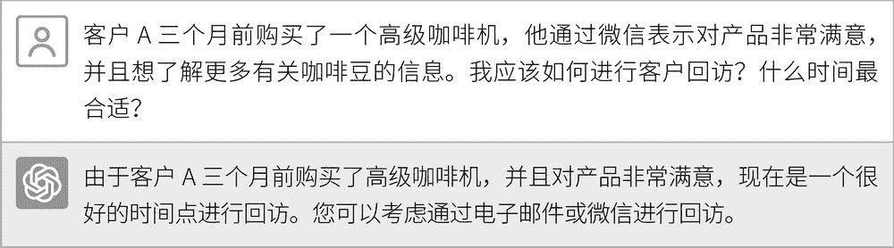

下面是一个由 ChatGPT 生成的回访电子邮件模板。

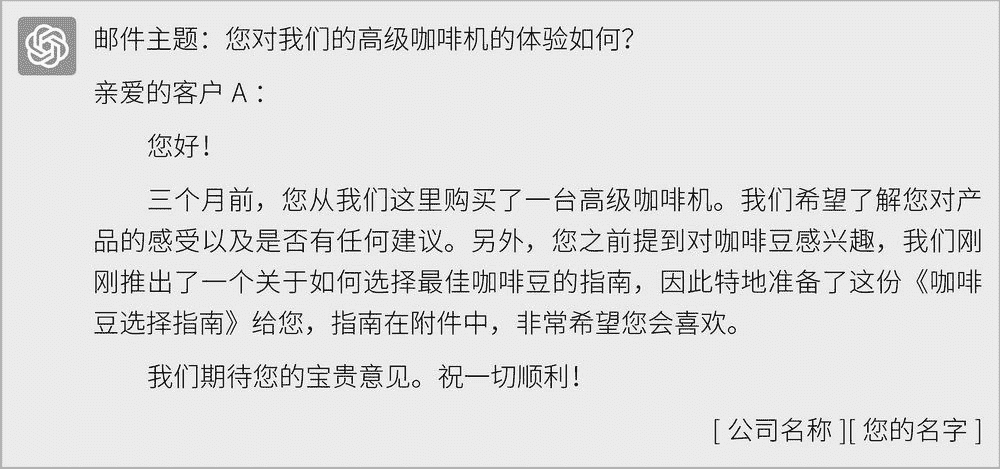

下面是一个由 ChatGPT 生成的微信回复模板。

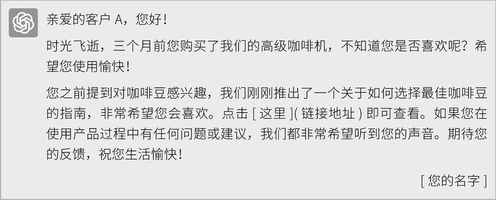

无论是邮件还是微信，借助 ChatGPT 都能实现更精准、更个性化的回访，巩固长期关系。

### **6.2.2 解决客户问题**

遇到投诉或棘手问题时容易手足无措，ChatGPT 能成为得力助手。

·**获取解决思路**。输入具体问题及你的理解，如“客户投诉产品 X 质量问题要求退款，我们政策通常不覆盖，该怎么办”。ChatGPT 会从多个角度给出方案，如协商退款、换货、补偿等。
·**评估风险与影响**。进一步问“如果退款，对利润和客户关系有何影响”，帮你权衡利弊。
·**模拟沟通**。确定方案后，用 ChatGPT 预演对话，如“如果我提出退款，客户可能怎么反应”，提前做好准备。
·**生成回复模板**。最后让它输出共情且专业的邮件或微信模板，直接可用或微调后发送。

通过这套流程，能多角度、个性化地解决问题，维护关系。

**案例 6-11 解决咖啡豆质量问题**

**情境描述**

你是一家咖啡店运营经理，重要客户通过微信投诉，刚买的咖啡豆味道与之前不同。

**运用 ChatGPT 解决问题**

·**获得解决方案**
输入“长期客户投诉咖啡豆味道不对，该如何应对”，ChatGPT 建议免费补发一批新豆邀请再试。
·**评估风险与影响**
追问“免费补发对成本和忠诚度有何影响”，得到短期有成本、长期利于忠诚度的判断。
·**模拟客户交流**
问“微信告知愿意免费更换，客户可能怎么反应”，提示多数客户会满意并增强信任。
·**生成回复模板**
让 ChatGPT 生成共情的微信回复模板，稍作调整即可发送。

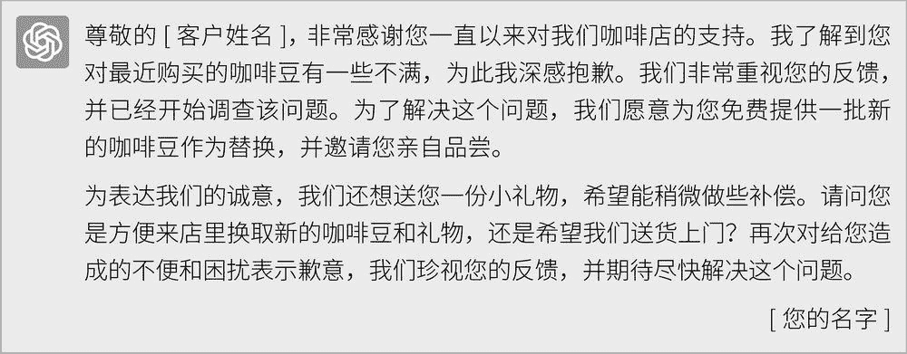

案例显示，ChatGPT 能快速给出针对性方案、预演反应，帮助更稳妥地维护长期关系。

### **6.2.3 在重要日子问候客户**

提供日期和客户信息后，ChatGPT 能生成个性化生日或节日祝福，拉近情感距离。

·**输入信息**：如客户生日、购买历史、喜好。
·**生成问候语**：询问如何写一份贴心的生日祝福。
·**优化问候方案**：若资源允许，可问更有创意的庆祝方式。
·**确认发送**：让 ChatGPT 生成完整祝福，通过微信或邮件发送，可附优惠券或礼物码。

**案例 6-12 为 Z 先生送上生日祝福**

客户 Z 先生快生日，喜欢拿铁。输入“张先生生日 9 月 15 日，偏爱拿铁”。询问如何送上特别祝福。

个性化问候体现对客户喜好的关注，有效增强情感连接。

### **6.2.4 提供个性化推荐**

对老客户推荐新品要基于历史购买、互动和新需求，不能盲推。精准推荐能提升满意度和忠诚度。

**案例 6-13 为老客户推荐高端摄影套装**

**情境描述**
摄影器材店客户 T 先生买过初、中级器材，获业余比赛奖项，近期微信咨询升级设备。

**运用 ChatGPT 推荐产品**

·**输入信息**
“管理者身份，客户 T 已购初中级器材且获奖，现询问高端设备推荐，应如何建议？”
·**使用 ChatGPT 生成推荐方案**

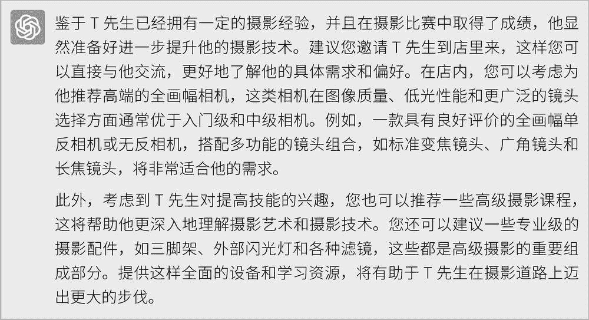

·**让 ChatGPT 生成微信回复模板**

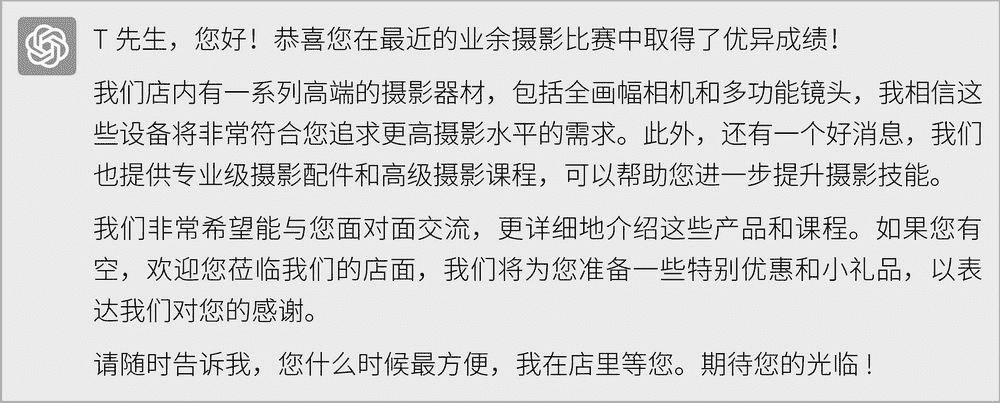

**小提示**：在即时通讯平台上，强行推销易适得其反。更好的做法是邀请客户到店深度沟通，现场讲解，让客户有体验和反馈，信任感和成交率都会更高。

### **6.2.5 加强持续沟通**

每次互动后，可问 ChatGPT 如何维护关系、是否需要调整沟通方式。

**案例 6-14 维护高端家庭音响系统的客户关系**

**情境描述**
音响店销售经理，客户 C 先生刚买高端家庭音响，并微信表示很满意。

**运用 ChatGPT 加强持续沟通**

·**输入互动记录**
“C 先生刚购买高端音响，对产品服务满意，并微信积极反馈。”
·**询问客户关系维护策略**

·**询问其他加强关系的方式**

·**询问个性化内容**

·**让 ChatGPT 生成沟通模板**

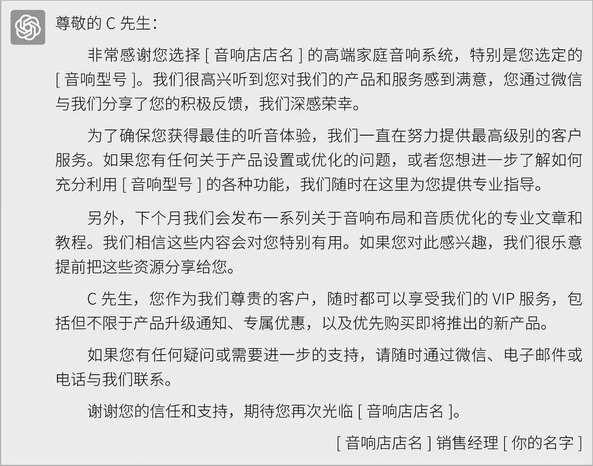

通过多角度、多渠道的沟通策略，能持续保持良好关系，提高忠诚度。

**小提醒：如何与不同沟通风格的客户互动**

多数人习惯正式专业沟通，但若客户偏好非正式口语化交流，也应随之调整。可在与 ChatGPT 沟通时指定语气，如幽默、严肃、技术性等。

**沟通示例**

客户：“嗨，你们的音响太棒了，我超级喜欢”
回应：“太棒了，真高兴你喜欢！”

**情境 1：客户对产品表示满意**
客户：“嗨，你们新推出的手机太酷了！”
ChatGPT：“谢谢你的夸奖！感谢你的喜欢。如果你有其他疑问或需要了解更多信息，可以随时问我哦！”

**情境 2：客户询问促销活动**
客户：“这周有优惠活动吗？”
ChatGPT：“当然，这周我们有特价优惠！你对哪个产品类别感兴趣呢？”

**情境 3：客户提供反馈**
客户：“在线服务很方便，但加载有些慢。”
ChatGPT：“感谢你的反馈！你能具体说说哪个部分加载慢吗？这样我们能更快地优化。”

**情境 4：客户完成购买**
客户：“我买了你们的跑鞋，等不及要试穿了！”
ChatGPT：“真棒！希望你在运动中能有更好的表现！”

**情境 5：客户询问产品库存**
客户：“那本新书还有货吗？”
ChatGPT：“是的，现在还有几本，需要我为你留一本吗？”

这些示例在专业与随意间取得平衡，让客户感受到被重视。

本章探讨了如何用 ChatGPT 处理异议并维护客户关系，从策略到实操，帮助你提供更好体验，稳固关系。

# **第七章**

# **运用 ChatGPT 进行销售情景预演**

市场节律越快，销售人越需要强适应力。本章聚焦如何借助 ChatGPT 做销售情景预演，让你在复杂局面里更从容，应对更精准，成交自然更顺。提前演练能让你少踩坑、更快上手，真实场面里更稳更准。

## **7.1 情景预演的底层价值**

当下竞争激烈、变化频繁，销售不能再靠直觉或旧经验硬扛。一处失误就可能丢单、掉目标。情景预演的意义就在于此：先在模拟里把仗打熟，再去实战。

**01. 零风险反复试错**
见客户前先在模拟环境里练手，完全无风险。你可以自由尝试不同话术、不同提问方式，提前预判可能出现的卡点，为各种销售场景做好全面准备，全程不用担心后果。

**02. 即时复盘加速成长**
预演能立刻给出反馈，帮你快速定位长处和短板，当场调整。这比等回款数据出来再反思要高效得多，成长曲线自然更陡。

**03. 团队协同更顺畅**
销售很少是单兵作战。预演可以还原真实团队配合场景，让你学会和同事、 leader、跨部门更有效沟通。既提升个人能力，也带动整体绩效。

**04. 客户洞察更精准**
好销售既懂产品也懂人。预演提供多元客户角色和情境，帮你理解不同人群的需求与期待，从而定制更合适的策略。

**05. 自信与抗压双提升**
面对挑战时，沉稳比技巧更重要。反复在轻松环境里演练，你会建立真实的信心，也学会在压力下保持冷静，应对突发状况。

总的来看，情景预演提供了一个低风险、高逼真度的训练场，从多个维度全面强化能力。对想在充满机会与挑战的销售赛道里突围的人和团队来说，这是不可忽略的利器。

## **7.2 ChatGPT 预演的四项核心优势**

销售场景越来越复杂，传统培训在还原真实对话、给出针对性反馈、解决复杂问题上存在明显短板。ChatGPT 预演正好补足这些缺口。

**01. 快速建立并强化信心**
在没有真实风险的环境里，你可以随意尝试各种策略。一次次顺利拿下预演中的难题，会带来真实的成就感，这种信心带入实战时，能让你与真客户沟通时更从容。

**02. 真正的安全训练空间**
真实客户面前试错，代价高，可能伤关系、丢机会。ChatGPT 创造了一个安全高效的练习场，你可以尽情探索新方法，不用担心负面结果。安全感会让你更愿意突破舒适区，面对难题也更有底气。

**03. 智能陪练与即时反馈**
ChatGPT 能边聊边点评，你可以立刻知道哪句话有效、哪段需要改进。反馈即时、学习闭环快，进步看得见。

**04. 私密的困境求解顾问**
实战中遇到棘手问题，问领导怕被质疑专业度。ChatGPT 就是一个不用担心尴尬的私密顾问，你可以把难题抛出来，探索不同解法和话术，带着方案回战场。

用 ChatGPT 预演，你不仅获得新视角，还能在零压力环境里反复打磨。遇到卡点时，不妨先演一遍，答案往往会超出预期。

现在明白了 ChatGPT 预演的价值，下面看它在具体拜访场景里的用法。

## **7.3 实操拆解：用 ChatGPT 预演销售拜访**

预演拜访能提前预判风险点，更深入理解客户疑虑，从而让拜访更顺、满意度更高。

**第 1 步：告知计划**
先告诉模型你要进入预演模式，而不是单纯的信息问答。
示范：
“我想做一次销售场景演练，模拟我与潜在客户的对话，请进入演练状态。”

**第 2 步：提供详细背景**
背景越清晰，预演越像真的。你需要给出让模型能还原场景的关键信息，包括但不限于：
客户类型是企业还是个人；客户所在的行业和具体职位；客户的性格特质和决策偏好；你销售的产品或服务类别；已知的需求或痛点；可能出现的异议或问题；你的角色定位；产品核心卖点与优势；当前销售阶段；过往接触历史；本次互动的目标；是否有时间限制。

示范：
“今天要拜访的是一位 IT 公司的营销经理，风格偏保守，对新事物接受慢。我推的是数字营销解决方案。对方公司在社交媒体运营上很吃力，可能会觉得价格偏高。我是业务经理，想帮他解决社媒营销问题。这是首次接触，目标是摸清需求和预算范围。”

细节越多，演练越贴近实战，也越有参考价值。

**小提醒：前期准备和分享背景信息很重要**
预演时细节是关键。信息越丰满，你越能准确应对真实反应。别怕麻烦，背景交代清楚再开始。直接丢一句“客户说贵怎么办”去问，缺乏上下文，得到的回应会失真，练习效果也会打折。高质量预演靠前期充分准备。

**第 3 步：启动预演**
背景准备好后，你扮演销售，ChatGPT 按设定扮演客户。从开场寒暄开始互动，根据反应实时调整。客户表现兴趣时，再展开产品亮点、优势及如何解决其具体问题。遇到异议时，融合背景信息、第六章讲的异议处理思路与自身经验去回应。目标是练习、优化，而非一次过关。

**第 4 步：实时调整和提供建议**
如果模型的回应不真实或偏离设定，可以不中断地纠偏。
1）指出不一致。如：“按这个背景，客户更可能先聊 ROI，而不是直接问功能。”
2）补充信息或纠正。如：“真实客户更在意长期成本节约，而非首付款。”
3）继续演练。补充后继续对话，让场景更逼真。
这一步既提升预演质量，也锻炼你在不确定情境下快速调整的能力。

**第 5 步：复盘**
演完别走，先复盘。
1）识别成功点：哪里建立了信任？哪个疑虑处理得好？哪个环节表现突出？思考如何复制。
2）找出改进点：产品介绍是否清晰？异议是否处理到位？列出问题并拟定解法。
3）获取外部反馈：把文字或录音分享给信任的同事或导师，听听第三方视角。
4）调整策略：据此修改开场、产品陈述结构、异议话术等。
5）再次预演：针对改进点再演一轮。
6）记录和总结：把观察、计划、待关注点写下来，下次拜访有清晰指引。

**小提醒：遇到问题，及时咨询 ChatGPT**
预演中卡住时，可直接向模型求助。
1）提问：如“客户抱怨价格高，我该怎么回？”
2）补充背景：如“他是中小企业主，很看重成本效益。”
3）获取并评估建议：阅读并判断可行性。
4）应用并继续演练：把建议用上，看效果。
5）记录并落地：有效的方法记下来，带入真实场景。
这是一个持续学习闭环，能帮你不断积累策略库。

本章梳理了 ChatGPT 预演的价值与落地步骤。它提供了一个安全、可复盘、可迭代的训练场，结合理论、经验与即时反馈，能让你更懂客户、更会准备、更能把问题解决在发生前。

# **第八章**
# **用 ChatGPT 写专业内容，打造个人品牌**

数字化渗透一切，自媒体竞争已成常态。专业知识与沟通能力很重要，但在内容时代，如何把专业传递给潜在客户、建立个人标签、实现差异化更关键。本章教你用 ChatGPT 撰写专业、有分量的文章，展示实力、建立信任，推动销售。

好的内容能在目标人群里提升知名度，提供解决方案，最后转化为业绩。更重要的是，它能塑造行业专家的形象，提升信任度。相比一次性推广，内容营销的长期收益更可观。无论新手还是老手，都能用这套方法提升文章质量与吸引力。

## **8.1 锚定专业赛道与目标人群**

写之前，先确定你在哪个细分领域有专家地位，或想建立专家地位。这决定话题选择、受众定位和互动方式。

### **8.1.1 找到你的专家标签**

可按以下步骤自检与定位：
1）自我评估：诚实盘点自己的知识与技能，问自己“我最懂什么？我能解决哪些具体痛点？”
2）市场调查：了解市场当前最需要或最稀缺的专业能力，通过问卷、社群、访谈收集需求。
3）竞品分析：观察同行或行业专家如何自媒体定位，尤其是活跃的标杆，分析其优劣，找差异化角度。
4）内部对话：请同事、上级或信任的朋友反馈，他们眼中的你的专业优势往往是被忽略的突破口。
5）定位：综合以上，提炼一个具体、可执行的定位。如售楼顾问不只是“房地产顾问”，而是“帮助都市年轻人买到首套房的置业专家”。
6）验证：先发一两篇高度聚焦的内容测试市场反馈，验证定位是否受欢迎。

定位清晰后，你才能更有针对性地选题、定价、推广，最终把专业转化为业绩。

### **8.1.2 深挖目标市场的真实需求**

确定定位后，要深入了解目标市场与潜在客户，这决定内容是否打得中。
1）用好现有数据：梳理销售与客户数据，总结高频购买人群的年龄、性别、职业、偏好特征。
2）市场调查：用问卷、社群、访谈等方式了解他们的痛点、关注问题、信息获取渠道。
3）社交媒体分析：浏览相关平台，看潜在客户在讨论什么、抱怨什么、点赞什么，找到互动切口。
4）竞争分析：研究对手的客户构成、产品优劣、打法，帮你更精准卡位。
5）创建买家人物：基于数据与洞察，构建一到两个理想客户画像，包含人口属性、需求、痛点、决策路径。这能帮助你预测需求、优化定位与营销。

**（6）精准对标用户需求**
先吃透目标市场和潜在客户在想什么，再去产出与其痛点、诉求高度贴合的内容。比如你的受众最在意“如何提升工作效率”，那就可以围绕这个主题产出《用 XX 工具提升效率的 5 个实操方法》这样的文章。

**（7）用反馈迭代策略**
内容发出几篇后别停下来，及时收集读者的真实反馈，并以此为依据修正选题和表达方式。

把对市场和客户的调研做系统化，你的内容会更有针对性，和客户的沟通也会更顺手。长期下来，自媒体文章就能有效展示专业度，沉淀个人品牌，并带动销售转化。

## 8.2 借 ChatGPT 打造内容力
销售里，信任感和关系维护往往决定成败，而个人品牌的塑造恰好是放大信任的杠杆。在塑造个人品牌时，品牌故事通常是核心载体，它能把你的形象、价值观和选择理由讲得更立体、更易被理解。

### 8.2.1 用ChatGPT 打磨吸睛品牌故事
下面以一个具体场景来说明操作路径。

假设你是一名 IT 咨询顾问，主攻为中小企业做数字化转型。参考步骤如下。

**步骤 1：定主题和目标**
先厘清想通过故事传递什么信息、希望达到什么效果。可以自问：我的擅长领域是什么？想凸显的个人特质是什么？读者是谁？他们看完后应该认识到我什么？

**步骤 2：准备素材**
故事需要真实支撑。提前整理背景资料和案例，才能让后续输出可信。准备方式可分两种情况。

·**经验较丰富者**
梳理专业积累、经历和成果，挑出与主题相关的关键点。
·**梳理经历。**回看职业轨迹、负责的职责、取得的成绩和服务过的客户，重点拎出与数字化转型相关的片段。
·**汇集成功案例。**挑选曾助力中小企业完成转型的项目，记录背景、痛点、你的方案和最终结果，案例是说服力的来源。
·**提炼专业认知。**汇总行业趋势、技术要点、最佳实践等，把专业深度融入故事。

·**新手或经验有限者**
经验少也能讲好故事。
·**突出价值观与初心。**说明为何对数字化转型感兴趣，动力和愿景是什么。
·**呈现学习成长线。**讲清初入行业时的状态，以及如何通过持续学习提升自己，容易引发共鸣。
·**分享小进展。**哪怕是微小成绩，也能体现努力和坚持。
·**嫁接其他领域经验。**思考过往经验与数字转型的关联点，增加故事层次。
·**体现协作能力。**有与他人合力解决问题的经历，就突出团队配合、沟通协调的能力。
·**坦诚挑战与突破。**分享遇到的困难及克服过程，展现韧性和适应力。

无论起点如何，以上方法都能让你的个人价值在故事里被看见，并与目标读者产生连接。

准备好素材后，就能进入下一步生成故事提纲。

**步骤 3：让 ChatGPT 生成故事提纲**
基于步骤 2 的资料，与 ChatGPT 交互生成概要。

**（1）一次性输入背景**
打开对话窗口，把专业背景和需求一次性写清，越具体越好。

·**经验丰富者示例**
输入：“我是一名资深 IT 咨询师，专注帮助中小企业数字化转型。以下是我的背景和专业经历：（粘贴步骤 2 的资料）。请据此帮我拟一个品牌故事提纲。”

·**新手示例**
输入：“我是一名初级 IT 从业者，擅长快速学习新技术，希望为中小企业解决技术问题。以下是我的背景信息：（粘贴资料）。请据此帮我拟一个品牌故事提纲。”

**（2）查看输出**
模型会给出一个包含以下要素的提纲：
·个人价值观：为何进入这个领域，目标是什么
·进入动机：触发点或关键人物
·学习成长：如何提升专业能力
·早期进展：可以分享的小成就
·专业经验与案例：过往的成果和解决方案

**（3）完善提纲**
在得到初版提纲后，可自行细化，或直接作为个人品牌资料的骨架。

**步骤 4：搭建故事框架**
在提纲基础上构建完整框架。

**（1）阅读提纲。**理解关键点和核心观点。
**（2）搭建主线。**围绕起源、专业经历、客户价值三个维度展开，加入情感细节：个人挑战、收获与教训，以及它们如何塑造价值观。内容整理到新文档。
**（3）填充细节。**为每个板块补充具体事例。
**（4）检查逻辑。**确保叙事顺畅、首尾呼应。

小提示：提纲的质量决定框架效率。若提纲已很完整，可在原有基础上微调，避免推倒重来，既省时又保证连贯。

**步骤 5：让 ChatGPT 扩写成文**
把框架交给 ChatGPT，指令它生成完整故事。

示例输入：“基于下面这个故事框架，帮我写一篇吸引人的个人品牌故事。（粘贴步骤 4 的框架）”

**步骤 6：润色优化**
拿到初稿后通读评估，调整用词和节奏。需要时可继续让模型优化，例如：“请把刚才的故事文案优化一下，语言更生动，情节更流畅，风格更轻松。”

**步骤 7：发布并收集反馈**
把成稿分享给可信的朋友、同事，收集意见用于打磨。反馈是让故事更有穿透力的关键。

以上流程能帮助你用 ChatGPT 产出真实、有温度、有吸引力的个人品牌故事。AI 在这里既是创意伙伴也是思路导师。

小提醒：为什么用 ChatGPT 构建品牌故事
很多人的顾虑是 AI 会让故事失去个性，实际上互动过程带来多重价值：

·**促进自我审视。**输入经历和目标的过程，本身就是一次厘清定位的梳理。
·**提供客观视角。**AI 的中立性能帮你跳出自我滤镜，让故事更客观可信。
·**辅助受众分析。**可尝试不同风格版本，判断哪种更能打动目标人群。
·**快速迭代。**多轮优化比传统写作更高效。
·**动态更新。**职业发展时可随时刷新故事，无需重头写。
·**获取反馈基础。**AI 初稿便于向他人征求意见。
·**成本友好。**比请专业写手或顾问更轻量，适合个人和中小企业。

ChatGPT 不只是文本生成器，更是品牌故事的共创工具。

### 8.2.2 结合 ChatGPT 写出体现专业度的文章
在文章里显现专业能力，是建立信任的核心。除主题相关外，可借助 ChatGPT 提升专业表达。

**01. 开头确立专业身份**
文章开头先说明你为什么有资格谈这个话题，可基于学历、从业经历或真实案例。若不确定如何表达，可让 ChatGPT 帮忙组织。

示范输入：“我在文章开头如何呈现我的专业资质？我的相关信息是……（教育背景、工作经历）。请据此生成一段有吸引力的开头。”

**02. 用术语但不晦涩**
适度使用行业术语可体现深度，使用后要配上通俗解释。若需解释某个术语，可问：“如何向普通读者解释[术语]？”

**03. 给出可落地的解决方案**
展示你如何解决具体问题，提供步骤式操作方法更有价值。构思时可输入：“根据我提供的信息，请用步骤方案解决[具体问题]。”

**04. 引用数据增强说服力**
引用权威行业数据或研究，能提升可信度。若已有资料，可让 ChatGPT 优化呈现方式：“请把下面这些数据和研究有机融入我的观点中。”

引用时需注意来源权威性和相关性，避免错误信息削弱专业度。

小提醒：深化洞察与数据运用
数据收集后可进一步：
·**解读洞察。**“请帮忙解读这些数据如何支撑我的观点。”
·**结构化呈现。**“请帮我把多项数据和研究成果整理成清晰的逻辑结构。”
·**可视化建议。**“如何用图表表现[某数据]？”ChatGPT 可给建议，但制图需借助专业工具。
·**规范引用。**“数据和研究信息的标准引用格式是什么？”

ChatGPT 提供框架，具体解读仍需结合你的专业判断。

**05. 讲自己的实践和案例**
用真实经验支撑观点，故事化案例更易共鸣。准备好素材后可指令：“请根据我提供的信息，以故事形式呈现我的经验或成功案例。”

**06. 设计清晰的结构**
专业文章需要引言-主体-结论的清晰逻辑。可让 ChatGPT 设计框架：“请为以下主题和要点设计一个清晰的文章结构。”

**07. 从专业角度回应常见问题**
选取行业内高频、易被误解的问题进行深度解读，体现解决问题能力。以 IT 咨询为例，中小企业数字化转型常见痛点有技术选型、规划、团队培训、数据安全等。可问 ChatGPT：“中小企业在数字化转型中常遇到哪些问题？对应的专业解法是什么？”获得选题和思路支撑。

**08. 将文章系列化**

# 打造系列专题的思路

把一个议题拆成连续的多篇输出，这样既能把内容挖深，也能让关注者保持回访。筹划这类连载时，ChatGPT 能帮忙开脑洞、把想法落地。想拿到靠谱的提示，关键是把背景交代清楚。例如可以这样描述：“我长期深耕[具体领域或主题]，准备就此推出十篇连载，请围绕[具体领域或主题]给出十个各不相同的题目清单。”模型会依据你给的细节产出更贴合的题目。若要把其中一篇展开成提纲，也能继续追问，让它列出核心议题和关键信息点。

善用模型在规划与写作上的支持，有助于更精准地锁定专业边界与读者需求。它给出的题目组合和内容骨架，通常更符合阅读习惯，也更贴近你的表达个性，让内容既能体现专业水准与价值，也能回应期待并引发共鸣。长期坚持下来，有助于在自媒体阵地积淀影响力，提升曝光与话语权。

### 8.2.3 用文字传递核心信念
稿件的价值不止于传递信息或解决难题，它还是个人或组织态度、立场的呈现窗口。对建立信任、维系长期关系而言，这种呈现尤为关键。可从下面几个方面入手。

**01. 先把核心主张厘清**
动笔前先自问：我的核心主张是什么？是诚信为先、以客户为先，还是承担社会责任、追求开拓创新？厘清之后，选题和落笔会更一致，也更容易把主张自然融入内容。

**02. 让选题呼应主张**
选题必须与主张紧密挂钩。以可持续发展为例，可围绕环境保护、节能减排、绿色生活、社会责任等角度展开，让主张与主题相互呼应。

**03. 多版本试探**
不确定哪种切入更受欢迎时，可先做多版本探索。例如让 ChatGPT 先出一篇《企业如何践行低碳》的观点文，再出一篇《个人怎样参与环保》的科普文。发布后对比反馈，就能判断哪种调性更贴合读者。

**04. 用案例说话**
案例是最有说服力的证据，能直观呈现主张如何在实践中落地。可先用 ChatGPT 搭出案例的框架，再自行补充数据与细节，说明在真实情境下立场是如何被展现的。这样内容更丰满，可信度也更高。

**05. 以坦诚沟通**
用透明、诚恳的姿态沟通问题，能凸显职业道德，提升组织信誉，尤其在面对挑战或负面情况时更显担当。ChatGPT 能协助把这种态度表达得更结构化、更清晰。比如公司因业务发展需要调整服务规定，需要向用户说明缘由与影响。可先提供事件背景、需求与目标，再请它协助撰写解释性文章。示范输入：“我需要一篇面向用户的说明稿，解释公司为何调整服务规定以及对用户的影响，请以正式、委婉、亲和且具说服力的口气撰写。”

将核心信念写进文字，是与读者建立深度关系的有效路径。借助模型让价值表达更精准，有助于在竞争中更突出，赢得尊重与信任。

自媒体既是挑战也是机会，持续投入并适时调整打法不可或缺。本章介绍的方法并非万能，却能提供一个清晰可操作的思路，帮助你更系统地迈向销售目标。

在品牌叙事塑造和高质量内容生产中，ChatGPT 是一个强有力的助手，能提升效率、激发共鸣、促进关系建立。但工具终究是辅助，真正的成效来自你对个人影响力打造的坚持与投入。所有建议的核心目的，都是让你于自媒体领域更自信、更有号召力。

# 写在最后

首先致谢你的关注与阅读。

最初是我的胞弟向我推荐了 ChatGPT，第一次尝试后我立刻意识到它在销售领域蕴含的巨大潜力，这本书也因此诞生。

我要由衷感谢我的母亲冯子芸，她一直是我坚实的后盾。她的爱与支持是我前行的动力，对她无私的付出与持续鼓励，我心怀感激。我的胞弟孙晴伟，不仅给了我启发，更是本书必不可少的合作者。他的智慧与创造力让内容更丰富、更有深度。同时，我还要感谢另一位重要合作者孙锦辰，她的专业方面的付出与精神支持让本书更加完整有力。此外，我的好友王振杰（白羽）对我的构想给予了充分肯定与支持，是我人生中必不可少的挚友。

如果《用 ChatGPT 提升销售业绩》为你带来新的启发，那么我的另外一本《如何找到更多客户：邦尼销售拓客手记》一定值得一读。那本书详细讨论销售拓客的各个环节，从首次会面的策略到在各种场合中挖掘潜在客户的技巧，并通过生动的实战范例帮助你把理论转化为行动，提升获客能力。

《如何找到更多客户：邦尼销售拓客手记》旨在解答拓客过程中遇到的具体问题。无论你想扩大顾客群体还是提升个人推销能力，这本书都能成为实用的工具包，帮你在市场开发中找准成功路径。

接下来，我还计划推出更多关于销售与客户关系治理的作品，你可以期待《如何了解客户需求》和《如何切入销售话题》。它们将详细剖析销售各环节，帮助你于不同场景下更好地理解顾客、满足需求，掌握强有力的销售与沟通技巧，并维系长期客户关系。

我真诚希望这些书籍，包括即将推出的新作，能成为你销售道路上的珍贵资源，助你不断前行、取得更多成功。

值得注意的是，截至 2023 年年末，除了 ChatGPT，国内已有多种先进大模型，例如科大讯飞的讯飞星火认知大模型、百度的文心一言、百川智能的百川大模型、字节跳动的云雀大模型、阿里云的通用千问、MiniMax 的 ABAB 大模型、商汤科技的日日新大模型、中国科学院自动化研究所的紫东太初大模型和智谱 AI 推出的 ChatGLM3 大模型。这些模型在销售领域都有广泛应用前景，建议你也去了解和尝试。

另外，我准备了一份专门的学习材料。你可在我的微信公众号“邦尼在月球”上领取一份约 1.2 万字的实用指南，标题是“如何进行自我介绍以留下深刻记忆的话术模板及使用手册”。这将是你销售拜访时的得力储备。

阅读过程中如有疑问、建议或振奋心得，欢迎通过本书共读微信群（扫描封底二维码进入）或电子邮件与我交流。你的每一次反馈都是我继续前行的最好激励。

最后，衷心感谢你的陪伴与支持，祝愿你于未来的销售历程中取得佳绩，收获更多辉煌。

孙慧（邦尼）

* * *

1. 1. 从根本上说，GPT 是一个基于统计学的预测系统，是对词语序列的概率相关性分布的建模；它通过大量数据训练，根据上文出现的语句频率，挑选一个匹配概率最高的答案。但是，它并不能像人类一样，真正理解给出的任务或交流中的语言。故本书中，在 ChatGPT 理解人类任务、理解语义等相关的语境中，“理解”一词均加了引号。——编者注↩︎

2. 1. 此处以及后面提及的笔者均指本书的作者之一孙慧。——编者注↩︎

3. 1. 在这一案例中，“系统”和“软件”为同一事物，均指销售人员 S 先生所销售的产品。——编者注↩︎