# 用DeepSeek实现收入增长

## 序
### 让DeepSeek成为你的变现伙伴

- 一位内容创作者借助大模型批量生产减脂图文，月收入已过五位数；
- 一名上班族利用业余时间剪辑民间故事短片，累计播放量突破百万级；
- 一名95后女生在春节假期用大模型制作人像写真，三天内到账3000元；
- 一名求职未果的应届生，用大模型为自家宠物制作视频，拿到创业启动资金。

这些学员最初和大多数人一样，一提到人工智能就会联想到冰冷的代码、无情的运算，甚至担心被机器取代。在系统学习并真正通过工具获得收益后，认知发生了转变。

如今他们更愿意说：大模型只是生产工具，能否做成事，关键在于比别人更早掌握时代的钥匙。这把钥匙不是编程，而是“机器效率+人类温度”的结合——让机器分担重复流程，让人负责判断、共情与创意。

## 一、人工智能是贴心的协作者，我们不会被取代

DeepSeek走红的那段时间，我既感到振奋也有些焦虑。振奋的是终于出现一款对中文理解很深、输出很贴合的应用；焦虑的是每天都能刷到“人工智能将取代XX岗位”的信息。

从事内容行业九年，带过数万名学习创作与内容营销的学员，看到同行用DeepSeek快速产出爆款时，手心也会发凉，甚至半夜怀疑自己是否会被淘汰。

把这份不安告诉搭档焱公子，他很坚定：“被淘汰的不是人，是拒绝学习、拒绝使用工具的人。”

2024年7月我们出版了《AI制胜》，汇总了2023至2024年团队在智能办公与智能营销方面的研究和学员实操。从学员身上能看到，愿意拥抱并驾驭工具的人状态明显不同。书中一位做种草文案的学员说：“以前担心专业不够，现在大模型帮我抓住痛点，我更能专注表达真实情绪。”

如果你也曾担心被工具取代，请相信：真正让人不安的不是工具本身，而是对工具不熟悉带来的失控感。

翻开本书，你会看见很多相似的起点。那位用DeepSeek写减脂文案、月引流三千多的学员，并非天生的文案高手，而是懂得把大模型的数据拆解与自身情感洞察结合的普通人；那位制作“复活古人”视频并被官媒转发的创作者，也不是技术极客，只是把文化情怀注入算法，让历史人物活起来。大模型不会夺走工作，它在重新定义效率与可能性。正如书里所说：“科技向善，才是技术应有的样子。”启动键永远需要人来按下。

书里每个故事——为奶奶修复旧照片的年轻人、第一次生成影评就兴奋的宝妈、业余帮大学生改简历的职场前辈，都在证明：大模型不会削弱个人价值，它只是卸下负担，让你更轻地去追远方。

## 二、大模型正把机会递到你手边

过去内容创作像少数人的特权，短视频、盐选故事、影评仿佛高高在上。如今工具正在快速抹平差距、缩短信息差，让赚钱变得更可及。

这也是本书的初衷。

书里一位学员，以前每天花五小时写影评仍被拒稿。学会用DeepSeek拆解爆款结构后，她像拿到寻宝透镜：所谓天才文笔不过是“情绪钩子+认知反转”的组合。过稿率提升三倍，她写的《热辣滚烫》下有读者留言：“你写出了我想说却说不出的感受。”工具没有替代思考，反而让创作更绚烂，这就是难得的财富。

还有一位修复旧照片的女孩，用即梦让老婆婆1943年的结婚照重新亮起来，客户发来颤抖的语音：“这是我第一次看清妈妈年轻时的酒窝……”此刻的大模型哪里是冰冷的算法，分明是穿越时光的织梦者，把破碎记忆串成珍珠。技术的温度，取决于握它的人有没有心跳——这也是难得的财富。

这些都不是神话。书中主角都是普通人：为房贷发愁的父亲、想给孩子更好生活的母亲、不愿被职场困住的年轻人、坚持创业的老板。他们用大模型做两件事：把重复劳动交给机器，把共情、创意、对美好的坚持留给自己。正如做“复活古人”视频的创作者所说：“大模型画的是线条，我注入的是对五千年文明的热爱。”

用DeepSeek谋生，也用DeepSeek谋爱，是我们写这本书的初衷。

## 三、不要犹豫，现在就是起点

我知道你在想什么：“听起来好，可我连提示词都不会写……”

2023年初我接触大模型时也卡在这个坎。第一次让大模型生成产后减脂文案，输出像说明书。冷静后我在指令里写：“请假设你是一位刚走出产后抑郁的妈妈。”它立刻生成了直击人心的句子：“减脂不是与镜中陌生人对抗，而是找回为人母时眼里的光。”

大模型就像一面镜子，你投入多少真诚，它就反射多少光。

书里所有惊艳的变现案例，起点都和你一样普通：宝妈最初不懂图片比例，简历优化师曾被客户骂“不如Word”，教培老师的朋友圈文案像论文。但他们相信“笨拙的开始胜过完美的等待”。做萌系视频拿到第一桶金的学员说：“以前焦虑算法，现在才明白打动人的不是算法，而是孩子搂着猫咪大笑的那份爱。”用数字人不出镜的老板也说：“大模型不会嘲笑你的生疏，它会在每一次尝试中悄悄抬高你的舞台。”

智能时代已来，请立刻跟上：

打开DeepSeek，像写信给老朋友那样输入第一条指令；
在即梦里上传一张图，看它变成你想要的样子；
把改了八版的PPT交给豆包，惊讶地发现“我的创意可以这么美”。

工具不是来抢饭碗的，是来帮你盛一碗更香的米饭。

## 最后，我想带你看看三年后的自己——

那时的你，或许正用工具做儿童绘本，把女儿睡前故事变动画；或许在乡间小院用工具打理电商店铺，让外婆绣的虎头鞋卖到巴黎；又或许像第21节的学员那样，用数字人主播传播非遗，看着直播间里年轻人刷“原来传统文化这么酷”。

这才是学习、拥抱、驾驭工具的真相——智能浪潮是来为你打造更坚固的铠甲。文案写作会像发微信一样轻松，视频制作会像拍照一样简单，创业变现会像搭积木一样有趣。你唯一需要做的，就是像书中所有学员一样，勇敢迈出第一步。剩下的交给时间。

未来已至，就在你每一次敲击的尝试里。愿这本书成为你的变现宝典，助你立于潮头。

若本书对你有用，请推荐给身边人。也欢迎关注微信公众号“焱公子”（ID：Yangongzi2015），我们准备了全书提示词与工具回复完整版的礼物。

祝好，愿你在这本书里找到火种，点亮自己的光。

本书创作期间得到业界专家与创作伙伴的大力支持。特别致谢图书战略智囊团顾问邓思媛（元气女性联盟创始人）、李菁（菁凌研习社创始人）、张家瑞（瑞言能量学苑创始人）三位老师，其战略视野与行业洞见为图书注入商业基因；同时感谢范远舟、朱行帆、大福 Stef、温张敏、陈小星组成的“AI内容营销顾问团”，完成从技术验证到实操落地的全流程攻坚。

你的朋友：水青衣

2025年3月

关注微信公众号“焱公子”（ID：Yangongzi2015），在对话框输入关键词，即可获取每节案例中的提示词和与工具对话的完整截图。

| 对应小节 | 输入关键词 |
| :--- | :--- |
| 第 1 节：减肥图文玩法 | AI 减肥 |
| 第 2 节：爆款影评玩法 | AI 影评 |
| 第 3 节：短篇故事玩法 | AI 盐选故事 |
| 第 4 节：职场扎心视频玩法 | AI 职场吐槽 |
| 第 5 节：古人换脸视频玩法 | AI 复活古人 |
| 第 6 节：萌系视频玩法 | AI 萌系 |
| 第 7 节：民间故事玩法 | AI 民间故事 |
| 第 8 节：代接简历爆改术 | AI 简历优化 |
| 第 9 节：PPT 定制流水线 | AI PPT 制作 |
| 第 10 节：AI 老照片修复 | AI 老照片 |
| 第 11 节：人像写真平替 | AI 人像写真 |
| 第 12 节：人人都可做的图书“种草” | AI 小绿书 |
| 第 13 节：教培行业爆单实例 | AI 教培文案 |
| 第 14 节：服装电商降本实例 | AI 模特换装 |
| 第 15 节：AI 员工 24 小时在线 | AI 智能客服 |
| 第 16 节：商品复购率提升方案 | AI 私域维护 |
| 第 17 节：滞销品极速出清实例 | AI 场景化营销 |
| 第 18 节：门店物料降本实例 | AI 产品图 |
| 第 19 节：DeepSeek 助力品牌命名 | AI 品牌命名 |
| 第 20 节：逼单话术模版 | AI 逼单话术 |
| 第 21 节：老板 IP 克隆人 | AI 数字人 |

添加水青衣微信：271968，备注：赚钱。

领取赠礼：一套价值 799 元的 AI 内容变现课程

注：
1. 关键词区分大小写，必须是大写的“AI”，“ai”或者“A i”都不能触发。
2. 文字必须 100% 匹配，漏字、多字、错字、有空格，都不能触发。

## 导读
掌控智能，把握你的黄金时代

DeepSeek爆红刷屏时，很多学员来问我：“焱老师，DeepSeek既然能自行推理，比如DeepSeek-R1，是不是就不用学提示词技巧了？”

是，也不是。

我很理解他们。这些学员听过我讲解智能提示词的五个层次，既受启发又觉得为难：用复杂替代复杂？本来写不出好文章，现在还要写长长的系统化提示词？这太难了！

有了DeepSeek，不用再绞尽脑汁写长提示词，当然值得开心。但真的如此吗？

我给学员一个类比：“如果你是老板，会让员工全权决策公司大小事务吗？即便这个叫DeepSeek的‘员工’知识渊博、思考能力强。”

DeepSeek-R1自带推理能力，能进行更深层次思考，哪怕你只输入一句简单提示，回复往往比市面上多数工具更丰富、更优质。但因此就完全让它替代人类思考，是本末倒置。再强的工具也不知道你在想什么，放任它随意猜测规划，大概率会偏航。所以提示词技巧仍需学习，至少掌握基本框架，而不是只丢一句话就让DeepSeek全包。

分享一个万能公式：身份 + 背景 + 任务 + 要求。

给工具一个身份 —— 例如：“你是一名新媒体运营者”。
提供背景资料 —— 例如：“你擅长拆解爆款文章”。
说明任务 —— 例如：“你需要写一篇小红书笔记”。
列出具体要求 —— 例如：“包括选题、标题、字数、语言风格……”

若有额外资料，可整理成文档上传给DeepSeek。

本书所有提示词都基于这个公式。大家可直接复制示例，也可灵活调整。

但比提示词更重要的是心态管理。我在《AI制胜》中提出核心观点：“AI是员工，人是管理者。AI是辅助，人才是主体。”

### 导读 掌控 AI，抓牢你的黄金时代

掌控，这个词贯穿全书。

这是技术飞速变化的时代，智能日新月异。DeepSeek刚火，Grok 3、ChatGPT 4.5、claude 3.7紧跟登场。甚至我在写导读时，号称全球首款通用人工智能的Manus已在全网刷屏。没人能预测几个月后赛道由谁主导。

我们大多数人如何在光速迭代的浪潮中不迷失、不焦虑，还能创造价值？

答案很简单：保持掌控感。

不论是现在的DeepSeek、Manus，还是未来的任何新工具，都一样。

这本书不会讲晦涩的智能理论，也不会教复杂技术。核心理念只有一句：对智能，用就行了！它只是工具，掌控它，而不是被它掌控。

用得不好？就多用几次。

除了对话处理工作，还能用它创造财富。掌握工具的秘诀，不过是“熟能生巧”。

怎样熟练应用智能，让它为你创造真金白银？

赚钱是系统工程。开始前，我们自己必须先有清晰的框架、思路和方向，才能有效指挥工具，快速达成商业目标。

本书基于此创作，全书共21节，没有理论研究，只有实战经验。希望你在阅读后，能建立自己的变现框架，找到清晰的赚钱路径。即便零基础，也能按书中演示一步步实践。

在“平台流量掘金篇”中，你将了解如何用智能完成各类新媒体内容的流量变现。

所谓流量变现，就是在抖音、西瓜视频、小红书、知乎、今日头条等平台发布内容（图文 / 视频）。只要有人点击，就能获得流量收益。以下是各大平台的变现方式。

### 主流新媒体平台流量变现条件一览表

| 平台 | 限制条件 | 变现方式 |
| :--- | :--- | :--- |
| 抖音 | 无粉丝限制 | 播放量无收益<br>0 粉丝：仅支持橱窗带货<br>1000 粉丝：可开通视频 / 直播带货<br>10000 粉丝：星图平台接广告 |
| 头条号 | 无粉丝限制 | 微头条阅读量有收益<br>1000 粉丝：可开通头条小店 |
| 西瓜视频 | 无粉丝限制 | 播放量有收益 |
| 视频号 | 100 粉丝 + 发布原创视频 | 播放量无收益<br>0 粉丝：开通小店带货返佣<br>5000 粉丝：互选广告 |
| 小红书 | 无粉丝限制，需专业号认证 | 播放量无收益<br>1000 粉丝 + 专业号认证：蒲公英平台接广告 |
| 公众号 | 500 粉丝，开通流量主 | 打开赞赏功能，允许读者对喜欢的文章进行打赏<br>文章可设为付费阅读模式<br>0 粉丝：与视频号小店共通，带货返佣 |

> 注：平台政策可能调整，具体请参考官方最新标准。

另外，有些平台需要手动开通收益开关，比如头条号（今日头条），需要到创作者中心依次开通微头条创作收益、文章创作收益、视频创作收益、小视频创作收益（直接点击打开就可以，没有门槛限制）。

想要拿到更多流量收益，可以发什么样的作品？比如，小红书做减肥图文、公众号写影评、知乎写盐选故事、做全网爆火的“职场吐槽”或者“复活古人”视频……“平台流量掘金篇”列举了7种方法，可以挑感兴趣的，直接照着书里展示的步骤一步步做就好。

如果你暂时没有计划做自己的新媒体账号，没关系，“图文生产变现篇”里有更多轻巧的、更接地气的玩法。比如应用智能帮助职场人做简历优化、做PPT定制、写“种草”文案发布到小绿书 / 小红书带货赚返佣，还有用智能做人像写真、帮助中老年群体做老照片修复，赚钱又赚爱。

本书最后一个板块“老板降本增效篇”是特别为中小企业老板们准备的。不管你是教培行业、电商或专做私域经营，不论你是需要内部效能提升、品牌命名策划、营销推广还是想直接做一个自己的数字人，我们都把跟众多学员一起实操验证过的智能商业落地方案写在书中，供你参考。

不论你是什么身份，带着怎样的故事前来，这本书都将给你三把金钥匙：

- 真实可复制的路径：所有案例均经得起市场验证，每个变现数字背后都是活生生的真人在努力，在实干；
- 零门槛的操作指南：从思路框架到具体打法，每一个步骤都有像素级的指引，可以说是细到头发丝的指导；
- 系统牢固的智能思维：除了赚钱，希望我们能一起成为智能时代的掌控者，不再因任何新出现的工具而焦虑。

现在，深吸一口气，翻开下一页吧。属于你的智能黄金时代，此刻正式启航。

你的朋友：焱公子

2025年3月

## 上篇
### 平台流量掘金篇

## 用 DeepSeek 赚钱

### 第1节
#### 减肥图文玩法：
#### 90后宝妈靠 DeepSeek 日更 30 篇，
#### 钩子越狠，佣金越高

在人们越来越关注自己、爱惜身体的今天，互联网上与健康减肥相关的内容一直热度不减。尤其是小红书，它作为年轻女性用户聚集地，在其日均搜索量超6亿次的生态中，减肥相关话题长期占据美体塑形类目TOP3，是绝对的爆款赛道。

运用智能工具批量化生成减肥文案，已经成为在小红书上实现零成本起号的最佳选择之一。健康、养生等内容，则是视频号的爆款赛道。无论是小红书、视频号，还是抖音、快手，虽然这些平台面向的用户群体各有差异，但内容制作的步骤都是一致的。我们想使用DeepSeek高效完成减肥图文的制作，都离不开以下3步：撰写减肥文案、生成HTML格式文件、截图保存。

下面，我们以小红书为例，带大家进行一次实操，一起逐步完成此类内容的制作。

本节用到的智能工具：DeepSeek。

### 1. 小红书减脂笔记的爆款逻辑
翻看减肥赛道头部账号的高互动笔记，可以提炼出三类共性：

- 精准切中痛点
围绕平台期停滞、聚餐后反弹、熬夜水肿等细分场景展开，用“3天减去5斤”之类的量化表述制造点击欲。
- 情绪共鸣加分
借助“瘦下来后世界都变了”这类表达，让读者产生代入感。
- 操作门槛降低
多用“照着我这三步做”之类的句式，把行动说得更简单可执行。

在把握到这些规律后，就能让模型按用户偏好的方式批量产出文案。

#### 参考指令
你是一名从业多年的小红书减脂内容运营，请帮我写10条通用干货。要求：1.用语简洁直击痛点；2.每条对应具体情境，比如停滞期、聚餐后、熬夜水肿；3.提供明确的操作指引，类似“照这三步走”；4.用表情符号做分隔；5.每条不超过50字，结尾附一句鼓励语，例如“减重不是折磨，是对自己许下的开始”；6.排版要符合小红书审美。

把上述指令放到对话窗口。

#### 生成样例
已深度思考（约16秒）

梳理需求后开始构思10条符合平台调性的要点……

• 10条场景化干货+鼓励语

1 平台期不掉秤
每周3次力量训练+5个复合动作（深蹲/硬拉/划船）
脂肪在颤动，肌肉在重塑！
“停滞可能是身体在等待你升级战力”

> 注：版面受限，仅展示部分思考与回复。

### 2. 文案转图的 HTML 流程
有文案后下一步就是做成配图，整体分两步完成：

#### 步骤一：把文案转为 HTML
#### 参考指令
请把以上文案转成适合小红书的 HTML，规则：1.每行文字单独用<div>包裹；2.关键数字或重点词用<font color=#FF6B6B>上色；3.每段插入一个表情；4.选用清新背景色，符合年轻女性喜好；5.每行不超过15字，每条干货单独成版，整体居中。

把指令输入后得到如下结果。

#### 生成样例
已深度思考（约18秒）

需要把之前整理的干货转为 HTML。先按行拆分装进<div>，再把“3次力量训练”“5个复合动作”“16+8饮食法”等需要突出的词上色，保持表情与版面……

```html
<body style="background-color:#F5FFFA; padding:20px; font-family:'汉仪尚巍手书W', cursive; text-align:

<!-- 第1条 -->
<div style="margin:20px auto; padding:15px; max-width:300px; border-radius:15px; box-shadow:0 2px 5px
<div><font color=#FF6B6B>平台期破局术</font></div>
<div>每周<font color=#FF6B6B>3次</font>撸铁</div>
<div>搭配<font color=#FF6B6B>5组</font>复合动作</div>
<div>（深蹲/硬拉/划船）</div>
<div>肌肉量↑代谢<font color=#FF6B6B>+17%</font></div>
<div>「身体在等你</div>
<div>打破舒适区」</div>
```

图1-2

> 注：截图仅展示部分思考与回复。

#### 步骤二：本地保存并打开
点一下模型输出区右上角的复制按钮。

```html
<body style="background-color:#F5FFFA; padding:20px; font-family:'汉仪尚巍手书W', cursive; text-align:

<!-- 第1条 -->
<div style="margin:20px auto; padding:15px; max-width:300px; border-radius:15px; box-shadow:0 2px 5px
<div><font color=#FF6B6B>平台期破局术</font></div>
<div>每周<font color=#FF6B6B>3次</font>撸铁</div>
<div>搭配<font color=#FF6B6B>5组</font>复合动作</div>
<div>（深蹲/硬拉/划船）</div>
<div>肌肉量↑代谢<font color=#FF6B6B>+17%</font></div>
<div>「身体在等你</div>
<div>打破舒适区」</div>
</div>
```

图1-3

在电脑上新建一个文本文件，把内容粘贴进去，保存后把后缀改为 html，用浏览器打开即可看到效果。

### 3. 截图发布
打开本地文件后，用截图工具逐条截取（见图1-7），按顺序整理就能直接发小红书。

在新媒体上，健康、营养、减脂、养生类干货需求很大，变现路径也多样：

① 开通橱窗或直播
带货减脂餐、瘦身器械等实现销售分成。
② 图文视频挂车
售卖健康类书籍拿佣金。
③ 私域沉淀变现
把用户导到微信沉淀，再通过复购盈利。私域既能卖产品，也能卖社群服务和课程。

例如一位做家庭营养指导的学员，聚焦产后妈妈减脂。她让用户免费领取《产后减脂餐搭配》和《宝宝营养餐搭配》资料，引导留言加微信。进群后售卖299~999元的课程。在智能工具辅助下，她一篇图文不到半小时完成，每天能出3~5篇图文、2个视频。内容不全是爆款，但流量很精准，每月私域新增800~1000人，保持约7%转化，单课程就能稳定到万元级收益。

还有一位做养生的学员，把内容发在视频号。凭借中老年用户偏爱养生干货的特性，每月引流超3000人，主要售卖养生课、养生茶和滋补品，收益可观。

> 注：本文聚焦工具应用，具体引流话术不展开。

## 第2节
#### 影评副业打法：拆解豆瓣 Top100 月入四位数
当《哪吒2：魔童闹海》引爆全网，当抖音出现点赞破百万的影视解说，当小红书博主凭《热辣滚烫》影评接到商单，就能看出电影相关副业的潜力。

写影评上手快、素材易积累，且热门剧本身自带流量。文笔一般也没关系，借助智能模型完全能撬动。

用模型做爆款影评可按5步走：找爆款拆解、定选题标题、搭结构框架、分块填充内容、整合优化。本节使用 DeepSeek。

### 1. 找爆款影评做拆解
新手最快的方法不是凭空写，而是先找一篇爆款让模型拆解出成因。我们总结四个有效维度：切入角度、开篇方式、结构、语言风格。

以《哪吒2》的爆款影评为例，要求从这四个维度拆解。

#### 参考指令
作为资深新媒体人，请帮我拆解一篇爆款影评，从切入角度、开篇、结构、语言风格分析并说明爆款原因。链接如下（附链接）。

输入后得到：

#### 生成样例
已深度思考（15秒）

先读完影评把握整体……标题“唯独没反叛的是什么”设问抓人，作者从社会情绪与集体心理切入，结合周星驰联动吸引粉丝、埋悬念……

我来拆解这篇《哪吒2》影评的爆款逻辑：

### 一、切入角度拆解
+ 1. 社会情绪锚点：抓住年轻人“反权威”“反说教”的心态，把电影解读为祛魅神话的社会寓言。
+ 2. 文化母体嫁接：借周星驰无厘头解构建立跨代际解读通道。
+ 3. 价值冲突挖掘：提炼“祛魅一切却唯独不祛魅破坏”的矛盾，制造认知冲突。

> 注：版面受限，仅展示部分。

### 2. 确定选题与标题
了解爆款要素后，让模型为选定影片生成选题和标题，仍以《哪吒2》为例。

#### 参考指令
我想写一篇《哪吒2》影评，要求极具吸引力、引发共鸣和转发。请结合前面爆款要素，给出5个可能爆火的选题和标题，角度越刁钻越好，并写清切入点。

得到回复：

#### 生成样例
已深度思考（21秒）

根据《哪吒2》的传播规律，策划具备病毒潜力的方向，每个都带冲突视角+情绪钩子+文化暗线：

#### 选题1：《天庭的修仙制度，正在批量制造下一个申公豹》
切入点：
- 解构申公豹“小镇做题家”人设，归因于仙界 KPI 考核
- 玉虚宫“炼丹炉绩效表”暗喻大厂 OKR
- 哪吒拒绝封神对应当代青年逃离大厂编制

> 注：版面受限，仅展示部分。

为提升丰富度，可同时勾选深度思考和联网搜索。

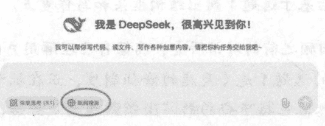

《哪吒2》上映时间晚于模型训练截止，同时开启联网搜索能获得更准信息。

### 3. 搭建结构框架
影评通常两三千字，不适合一次性生成。先搭结构再分块填充更稳。

#### 参考指令
请参考爆款影评结构，针对选题1列出全文框架和写作重点，用条目式小标题呈现，逻辑清晰。

得到：

#### 生成样例
已深度思考（14秒）

回顾选题1核心：天庭修仙制度与申公豹黑化的关联，以及职场隐喻……

现基于选题1《天庭的修仙制度，正在批量制造下一个申公豹》设计结构，对标“情绪钩子—认知颠覆—价值升华”：

#### 一、强开篇：用荒诞现实击穿认知
小标题：“申公豹的工位上，贴着玉虚宫年度优秀员工奖状”

1. 高反差场景：
- 申公豹深夜炼丹房加班画面
- 对比互联网大厂程序员凌晨改需求的热图

> 注：版面受限，仅展示部分。

### 4. 逐段填充内容
框架确定后，让模型分段填充。

#### 参考指令
请模仿爆款影评语言风格，填充第一部分内容，论据扎实引用合理，约500字。

得到：

#### 生成样例
已深度思考（23秒）

需要按“暴力开篇”要求完成约500字内容，严格依据正片细节……

> 严格遵循电影真实细节的暴力开篇

#### 一、暴力开篇：用荒诞现实击穿认知
小标题：“申公豹的炼丹房里，贴着玉虚宫年度优秀员工奖状”

第27分钟镜头扫过申公豹炼丹房，眼尖观众会发现玄铁丹炉旁赫然贴着“玉虚宫连续三千年全勤标兵”的鎏金奖状。这个导演饺子埋了35秒的细节，正是撕开仙界真相的入口。

> 注：版面受限，仅展示部分。

之后按此方法逐段生成，汇总整理后即可成稿。

影视内容变现路径：

① 平台流量变现
把图文或视频影评发到公众号、抖音、小红书等，播放量越高收益越高。影评赛道的钱在“观点差”里，例如全网都在夸特效时指出“这是西方对沙漠文明的再意淫”更易出圈。

② 影视周边带货
在文中推荐电影相关商品拿佣金。

③ 向大号投稿
投稿给影视大号拿稿费。借助模型精准拆解目标账号调性，过稿率大幅提升。

例如一位学员看完《哪吒2》被殷夫人拥抱哪吒的情节打动，用模型生成多个选题，选定“从殷夫人身上学到如何托举孩子”。随后让模型深度分析目标亲子公众号的调性并针对性撰写，被采用后拿到500元基础稿费，因阅读量上涨再获360元流量费，1小时内完成约860元收入。按周更计算，轻松月入四位数。

### 第3节
#### 短篇故事玩法：模型自动生成分润收益暴涨500%的“作弊密码”

DeepSeek 打造盐选爆款的五步法

2025年春，知乎盐选作者圈出现一轮不太声张但很猛的效率跃迁。有创作者借助模型日更十篇高互动短篇，单月分润轻松过万；有老手把原本要五小时打磨的章节压缩到十五分钟，同时带多号运营；也有新人入驻一个月便冲上新人榜，评论区全是催更。

这股推力基本指向 DeepSeek。模型对中文叙事的适配很高，最关键的能力是快速复刻读者上头的爽点套路：用强悬念开场抓注意力，中段靠情绪冲突推节奏，收尾放付费卡点稳留存。因它生成的短篇自带平台算法偏好的爆款体质。

综合头部作者的复盘，AI 写盐选稿可以用五步走：选对标拆解、定大纲、补细目、分段落填充、整体精修。本节的主角工具就是 DeepSeek。

### 1. 获取并拆解对标的盐选小说
先打开知乎盐选故事 https://www.yanxuan.org/ ，挑一篇风格对味的作品，把链接复制下来。（见图 3-1）

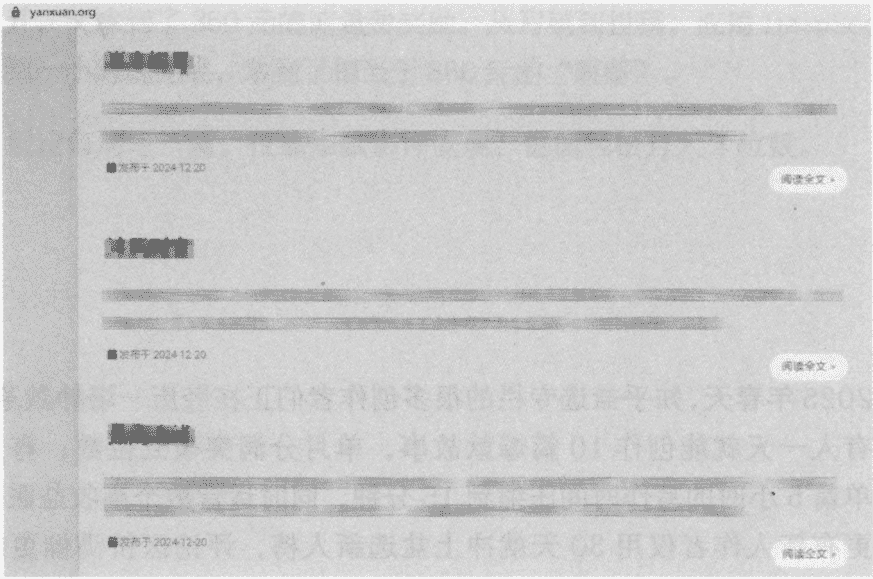

图 3-1

复制后让 DeepSeek 做结构拆解。

可用的提问模板：

下面链接是一篇知乎盐选的爆款短篇，请拆解它能火的原因，重点看开篇悬念钩子的安排、冲突推进的逻辑、反转的手法，并归纳语言风格与写作特点。（附链接）

把指令粘进 DeepSeek 框里。（见图 3-2）

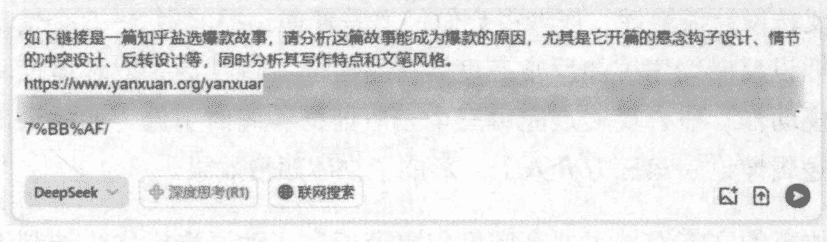

图 3-2

返回示例：

示例结果

### 已深度思考（用时 22 秒）
用户让我分析一篇盐选故事为何走红，核心在开篇悬念、冲突设计、反转以及文笔。首先要读懂链接里的结构与关键点。

典型好故事开篇会同时铺三层钩子：一是突发病态事件制造即时疑问，如关键物件出现或规则被打破；二是人物关系错位埋下潜在危机，如对立身份出现非常规接触；三是在细节对话里埋价值观冲突的伏笔，如生存需求与道德准则的碰撞。

情节层面，外层设置看得见的任务阻碍，内层安排不断升级的心理困境。以“触发—抵抗—崩塌”的节奏轮转，每次冲突都同时推进外事件与内认知。

爆款核心在于三点：

一、反转设计注重信息差管理。提前用三到五个节点埋反向线索，伪装成环境描写或常规动作。主反转由三条矛盾证据同时引爆，如物证+逻辑悖论+第三方介入，形成立体颠覆。

二、文笔保持高密度叙事。动词偏好带空间联觉的词，如“撕扯”替代“破坏”，“蚕食”替代“减少”；形容词只用可量化的物理描述，如“三厘米的裂痕”而非“巨大的伤口”。

> 注：版面受限，截图仅展示部分思考与回答。

### 2. 创作故事大纲
锁定参考样本后，先定一个主题，也可以让模型自由延展。让 DeepSeek 从贴合盐选调性的角度生成大纲。

可用的提问模板：

请参照上面爆款盐选的成功要素和写作风格，以“破产富二代逆袭”为题，写一份符合盐选调性的故事大纲，只输出核心梗概与主线。

把指令输入 DeepSeek 对话框，得出以下结果。

示例结果

### 已深度思考（用时 23 秒）
用户希望参考前面的爆款要素，以“破产富二代逆袭”为题做盐选风格大纲，需要悬念钩子、冲突、反转和文笔特征。盐选案例中多重悬念叠加、社会议题融入、影视化叙事是关键。

开篇需要强悬念，比如落魄时撞见前女友，而前女友与导致破产的人有关联；或者发现破产背后有阴谋，父亲被谋杀，自己背锅。这样能埋身份反转与复仇线。

冲突要分生理、情感、社会三层。生理层有生存危机或伤病，情感层有背叛与旧爱新欢，社会层涉及商战与家族秘密，形成交织。

#### 《资本游戏》故事大纲
核心钩子：
家族破产当晚，男主在父亲书房发现带血的瑞士军刀，刀柄刻着竞争对手企业的图腾，而父亲手机却收到境外账户的入账通知。

主线走向：暗线逆袭
1. 云端坠落（1—5 章）
- 拍卖直播里，昔日挥霍的林少典当最后一块名表，竞拍者名单里出现失踪三年的前女友沈乔。
- 深夜收到匿名邮件：父亲坠楼前的监控存在十五秒空白。

> 注：版面受限，截图仅展示部分思考与回答。

不满意可让模型重写或局部微调，直至可用。

### 3. 创作故事细目
盐选多为中短篇，约一到三万字。为控质量，先基于大纲生成细目。

可用的提问模板：

请参照上文大纲，生成对应的细目，把人物关系、悬念点、反转点和爽点写清楚。

把指令输入 DeepSeek 对话框，得出以下结果。

示例结果

#### 已深度思考（用时 21 秒）
现在要基于“破产富二代逆袭”大纲做细目，需要人物关系、悬念、反转、爽点。回顾大纲，包含核心钩子、主线架构等。

人物关系包括林旭、父亲林崇山、前女友沈乔、宋小姐、苏玥、华尔街巨鳄等，要明确隐藏联系，如沈乔与林父的合作协议、苏玥烧伤与旧案关联、克隆体设定等，确保关系错综且多层秘密。

#### 章节悬念与反转矩阵
第一阶段：云端坠落（1—5 章）
● 悬念点
1. 拍卖直播镜头里沈乔佩戴林母生前独有设计的荆棘玫瑰胸针
2. 父亲书房保险柜里的存储标签
3. 匿名短信发来的空白监控时段内传出婴儿啼哭

> 注：版面受限，截图仅展示部分思考与回答。
细目不理想可要求重来或局部修正。

### 4. 逐项填充情节 / 细节
细目确定后按模块填充。DeepSeek 单次输出有限，建议每次控制在三千字以内。

盐选故事通常嵌在真实提问场景里，设定贴合平台习惯的问题能提升点击。

可用的提问模板：

请基于上述细节，完成“第一阶段：云端坠落”的正文。保持地道知乎体，标题换成真实提问场景，如“一个人跌到谷底后怎样才能反弹？”用第一人称，以“我的父亲死了，但我好像并不难过”起笔。遵守三原则：篇幅精炼迅速抓眼；叙事直给，主角主线为主；情绪引爆快，三句内代入。约2500字。

把指令输入 DeepSeek 对话框，得出以下结果：

示例结果

### 已深度思考（用时 19 秒）
要完成知乎体第一阶段创作，用户已给大纲、细目与具体要求：标题用真实提问、开头特定句子、风格紧凑直给、情绪快。

回顾细目关键元素：拍卖直播里出现的沈乔、书房血迹与瑞士军刀、匿名短信里的婴儿啼哭声，需合理呈现同时保持节奏。

一个人跌到谷底后要怎样才能触底反弹？

我的父亲死了，但我好像并不难过。

当警察让我去认领尸体时，我盯着他左手小指缺失的断面多看了三秒——这确实是林崇山，上个月还说要带我收购瑞士银行的商界枭雄。

“林先生，节哀。”拍卖行陈经理在电话里咳了一声，“您父亲抵押的百达翡丽 6104G，现在起拍价只能定到两百万。”

> 注：版面受限，截图仅展示部分思考与回答。

### 5. 整合优化
用同样方式让 DeepSeek 把后续章节逐段写完。全部模块完成后合并到一个文档稍作润色，即可得到一篇高质量盐选稿。

变现路径大致有：
- ① 会员阅读分成
作品进入会员库后，阅读量产生收益，平台与作者五五分成。
- ② 单篇付费订阅
用户单独购买专栏或单篇，作者可获订阅费分成。
- ③ 版权交易收入
头部作品有机会改编影视、声书或出版实体书，产生版权收益。
- ④ 平台推广资源
优质内容可获知乎站内流量扶持及站外 KOL 推广，进一步扩大收益。

### 第4节
#### 职场扎心视频玩法
#### 视频扎心又真实，流量自带奔跑感
前两年记录打工人经历的视频很吃香。典型桥段是老板喊“公司就是你的家”，无数观众联想到天天加班错过末班车。贴近生活的真实让观众直呼懂我，评论区刷屏“你就差报身份证号了”。

近一两年同类看多了观众审美疲劳，于是出现反向打法：职场吐槽向。依旧是职场、老板、打工人，但姿态是狠狠吐槽老板，靠疯狂输出博流量。

这类视频的常见场景是员工在不满时直接表达情绪，不再压抑。有话当场说，有仇当场报。

这种直白有个性，既让观众看到自己的影子，弹幕齐刷“世另我”，又传递“原来不止我一个”的共鸣，比冰可乐打嗝还爽。用户不仅自己看，还爱转发给同事一起吐槽，转发率极高，流量和收益同步上涨。

借助 DeepSeek，普通职场人也能轻松产出同类内容，再配合 AI 绘图与视频工具，做出专属职场吐槽爆款。

在大量案例研究与实操后我们发现：职场吐槽文案用歌词呈现效果最好。口播需要强表达力，剧情成本又高。对没有团队的新人来说，吐槽歌词是最佳方案。上口易传播，AI 辅助创作更快更轻，一部手机就能做。

用 AI 创作打工人吐槽职场视频有六步：创作吐槽歌词、给歌词谱曲、撰写分镜提示词、生成分镜画面、基于画面生成视频、后期剪辑成片。

本节用到的 AI 工具：DeepSeek、Suno、即梦。

### 1. 创作吐槽歌词
先让 DeepSeek 列出容易引发共鸣的职场吐槽场景。

可用的提问模板：

你是一个资深职场打工人，熟悉职场的规则与潜规则。现在请列出十个最容易引发打工人吐槽和共鸣的典型场景，比如：好不容易熬到周五临下班，领导突然安排新任务要求周六交。

> 注：后期剪辑软件，本书以剪映为例。但由于本书侧重 AI 工具的使用，后期剪辑技术部分不做展开论述。

打开 DeepSeek，将以上提示词输入对话框。（见图 4-1）

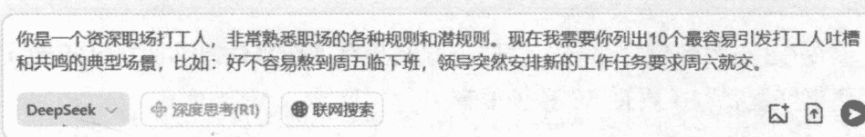

图 4-1

经过深度思考，DeepSeek 给出答案。

#### 示例结果
已深度思考（用时 14 秒）
用户让我列出十个易引发共鸣的职场场景。先回想打工人常抱怨的事，例如周五临下班领导突加任务，这很常见。

其他常见情况包括加班文化如 996、无偿加班；绩效评估不公、领导偏心、同事甩锅；开会时间长却无结果；办公室政治、站队问题；突如其来的紧急任务打乱计划；公司福利缩水，如取消下午茶或团建经费减少。

以下是十个极易引发集体吐槽的典型场景：
1. 深夜夺命连环 call
深夜十二点收到领导语音：“这个方案我有了新想法，你明早八点前调整好发我”（附带六十秒长语音）。
2. 薛定谔的休息日
团建安排在周末，美其名曰增进感情，强制参加。
3. 职场魔术表演
领导会上宣布“我们是个大家庭”，转身就砍掉下午茶福利，打印机纸限量供应。

吐槽场景列出后，挑一个让 DeepSeek 以此为主题创作歌词。以“老板在厕所装信号屏蔽器”为例。

#### 提示词参考如下：
你是一个卓越的作词人，现在请围绕场景“厕所装信号屏蔽器，工位装监控探头”创作一首歌词。要求朗朗上口、辛辣犀利，同时饱含打工人的自嘲与无奈。

将以上提示词输入 DeepSeek 对话框，得到如下回复。

> 注：版面受限，截图仅展示部分深度思考与部分回答。

#### 示例结果
#### 已深度思考（用时 17 秒）
用户让我围绕“厕所装信号屏蔽器，工位装监控探头”创作歌词，要求上口、辛辣、带自嘲与无奈。

核心矛盾是公司过度监控与控制带来的压抑。辛辣部分可用比喻或讽刺，如“信号屏蔽器”比作“笼中鸟”，监控探头则是“电子眼”。自嘲部分要从打工人视角展现无力与自我解嘲。

结构上通常有主歌、副歌、桥段。主歌描述场景，副歌突出主题与情感。为上口，押韵和节奏感重要，可采用 AABB 或 ABAB。

《电子狱卒观测报告》——献给第五条生存法则的安魂曲（主歌 1）
Wi-Fi 信号在蹲位间窒息
监控红点是老板的胎记
摸鱼要计算抛物线轨迹
连呼吸都标好了分贝仪

> 注：版面受限，截图仅展示部分深度思考与部分回答。

### 2. 给歌词谱曲
歌词完成后，用 AI 作曲工具谱曲，以 Suno 为例。

打开 Suno 主页登录后点“Create”，进入“Custom”，把 DeepSeek 生成的歌词粘到“Lyrics”区，在“Style of Music”填入想要的风格，如 rap, hip hop, rock，点击红色 Create 即可。（见图 4-2）

等待十几秒后，Suno 会生成两首匹配的歌曲，挑喜欢的一首下载备用，不满意可要求重生成。（见图 4-3）

无法使用 Suno 的读者，可用天谱乐 AI 平替，使用逻辑相似，此处不再赘述。

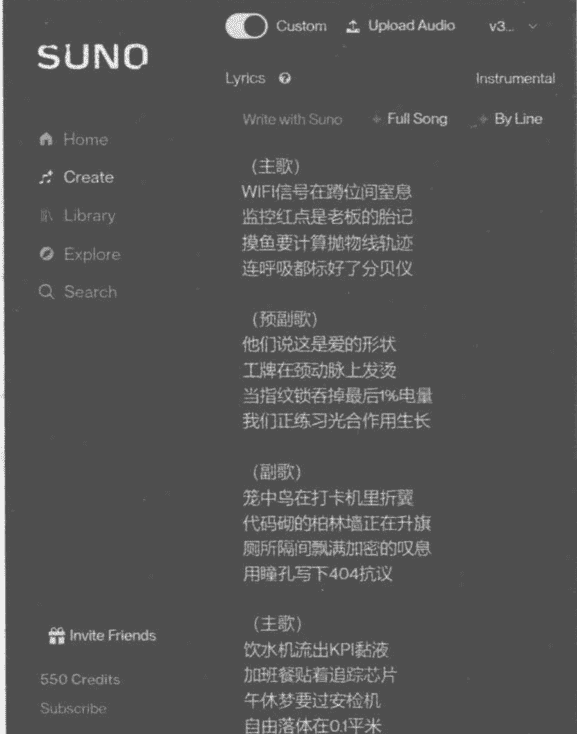

图 4-2

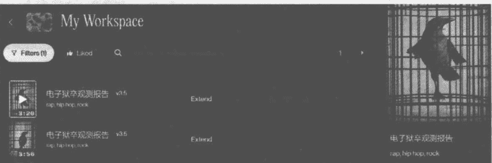

图 4-3

### 3. 撰写分镜提示词
接下来让 DeepSeek 根据歌词生成分镜画面提示词。为降低风险并增强共鸣，主角设为拟人化动物，把打工人自嘲的“牛马”具象为牛头人、马头人。

#### 提示词参考如下：
我要做一个职场吐槽 MV，请帮我基于上述歌词生成对应的提示词。要求：场景尽量简单明了，所有出现的人物都采用拟人化的牛或者马来呈现，即牛头人、马头人，风格都统一为手绘插画，背景都是办公室场景。

将以上提示词输入 DeepSeek 对话框，得到如下回复。

#### 示例结果
### 已深度思考（用时20秒）
用户想做职场吐槽 MV，基于之前写的歌词生成提示词。要求场景简明，人物拟人化为牛或马，即牛头人、马头人，风格统一手绘插画，背景办公室。

回顾歌词内容，确保每个场景对应不同部分。如主歌1提到厕所信号屏蔽和监控探头，这里需要设计牛头人在厕所隔间看手机没信号，同时监控探头有红点。手绘风格，颜色可压抑蓝灰，加蒸汽波效果突出荒诞。

......

### 分镜提示词集（每条含完整后缀）
1. 主歌 1- 厕所窒息

“牛头人蜷缩在狭窄厕所隔间，头顶红色监控探头，手机显示无信号，马桶变成迷你办公桌，手绘插画风格，灰蓝主色调，隔间贴满禁止手机图标，牛角绑着工牌” --colors #4A707A #FF6B6B #2F3B4C

2. 主歌 1- 呼吸监控

“马头人戴着分贝监测项圈，对着空气收集器做深呼吸，工位贴着音量分级表，手绘插画风格，背景藏青色数据墙，马尾扎着黑色领带” --colors #4A707A #FF6B6B #2F3B4C

> 注：版面受限，截图仅展示部分深度思考与部分回答。

### 4. 生成分镜画面
打开即梦 AI，把 DeepSeek 之前写好的分镜描述复制进去，平台就能据此绘制对应的分镜美术（见图 4-4）。

注意：模型选择“图片 2.1”，画面比例选择 3:4。

等十几秒左右，即梦会给出四张候选，可挑选喜欢的留作备份，这里选用第四张备用（见图4-5）。

接下来照此套用：

- 按照顺序把 1 号、2 号…的分镜文案逐条导入即梦；
- 每段单独生成，汇总后得到完整分镜图库。

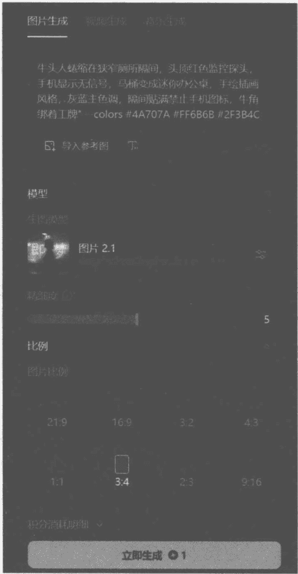

图4-4

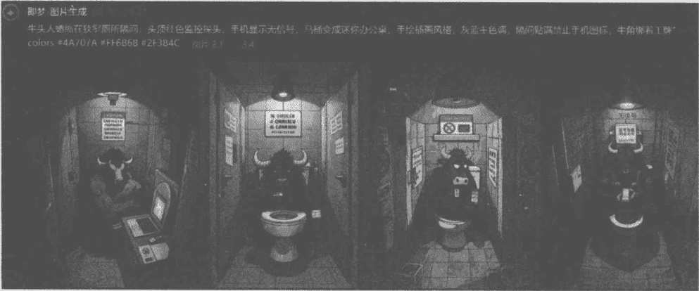

图4-5

### 5. 基于分镜图生成视频
分镜美术准备好后进入动效制作，这里采用即梦的图生视频，分两个阶段进行。

步骤一：撰写视频生成提示词。可以继续让 DeepSeek 代劳。

#### 提示词参考如下：

我将使用即梦基于已经生成的分镜图片，生成对应的分镜视频。请你对应上述分镜画面提示词，帮我写出对应的视频生成提示词。请使用贴切的镜头语言，确保画面的冲击力。

把上述指令输入 DeepSeek 对话框，可得到以下示例。

#### 示例结果

### 已深度思考（用时 14 秒）

好的，用户现在需要将之前生成的分镜图片转化为分镜视频，使用即梦 AI 工具。他们之前已经得到了针对即梦 AI 的详细绘图提示词，现在需要对应的视频生成提示词，强调镜头语言和画面冲击力。

首先，我需要回顾之前的对话历史，确保理解用户的具体需求。用户之前要求统一风格为手绘插画，牛头人和马头人作为角色，配色方案固定。现在他们希望每个分镜对应的视频提示词，要有贴切的镜头语言，确保冲击力。

用户可能希望视频在转场、镜头运动和节奏上与歌词内容匹配，同时保持视觉上的连贯性和戏剧性。需要考虑到每个分镜的画面元素，并转化为动态的镜头效果，比如推拉、旋转、特写等。

这是为每个分镜定制的视频生成提示词，强化镜头张力和情绪冲击：

### 分镜 1- 厕所窒息

超广角俯拍牛头人蜷缩在隔间，监控探头机械旋转发出滋滋电流声，镜头缓慢推进至手机无信号图标，突然警报红光扫过画面，背景音效：马桶冲水声混入键盘敲击声。

### 分镜 2- 呼吸监控

特写马头人项圈分贝表飙红，镜头急速拉远展现布满监测仪的办公室，呼吸声被放大处理，随着“嘀——”的警报声，画面突然倾斜 45 度。

> 注：版面受限，截图仅展示部分深度思考与部分回答。

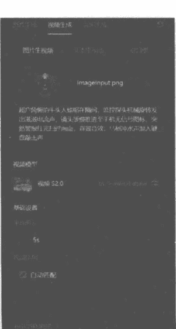

图 4-6

步骤二：把视频提示词粘贴到即梦的视频生成界面，选用之前挑选好的备用图，再点“图片生成视频”（见图 4-6）。

注意：视频模型选择“视频 S2.0”，时长默认 5 秒。

等待约半分钟，即梦完成视频生成（见图 4-7），下载保存。

按此循环：

- 依次把视频提示词复制进即梦
- 选择对应备用图
- 执行图片生成视频，批量产出各分镜动态
- 重复直至所有分镜视频齐备

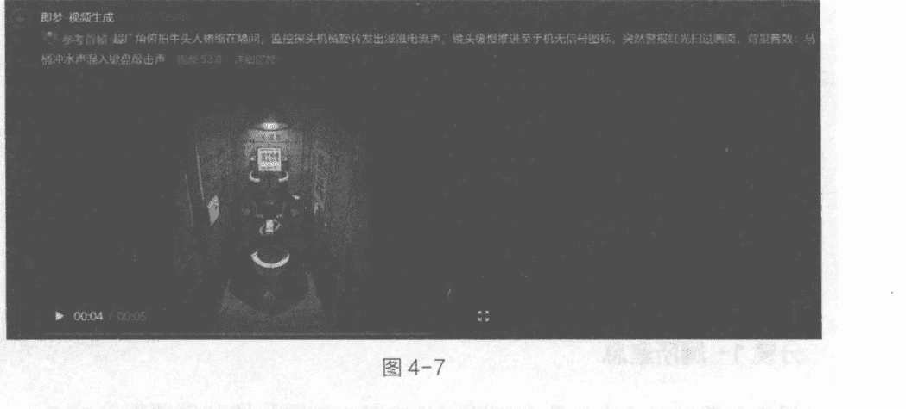

图 4-7

### 6. 后期剪辑成片
把全部分镜视频导入剪映，按顺序排列，叠加字幕、特效、音效，再导入 Suno 生成的歌曲，导出即成一条完整的职场吐槽短片。（见图 4-8）

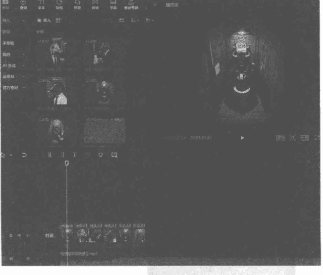

图 4-8

### 平台流量掘金篇
用 AI 做职场吐槽类视频，核心变现是平台流量分成。成品发布到抖音、视频号、快手、西瓜视频等主流平台后，有播放和点击就能获得流量收益。

粉丝积累到一定规模、流量稳定后，品牌方会主动找上门投放广告。本书作者之一焱公子转型自媒体时选的就是职场赛道，2008 年在公众号发的首篇职场文突破 10 万+，第二天就有广告主洽谈，单条报价 6000 元。因此除了视频平台，也可同步投公众号，积累读者后同样有流量分润和广告合作机会。

职场赛道也适合挂车带货，可挂职场课程、技能培训或办公用品，选择佣金高口碑好的商品，额外赚取佣金。


### 第5节

#### 古人换脸视频玩法：

#### 克隆权威媒体爆款，小白接商单日赚800元+

2025年2月18日，中国新闻网在其视频号上转发了一条用AI“复活古人”的视频，并配文：“这就是AI的意义，那些课本上的人物‘复活了’，孔子出现的一幕DNA动了。”视频一发出，瞬间就突破了10万+点赞和转发。（见图5-1）

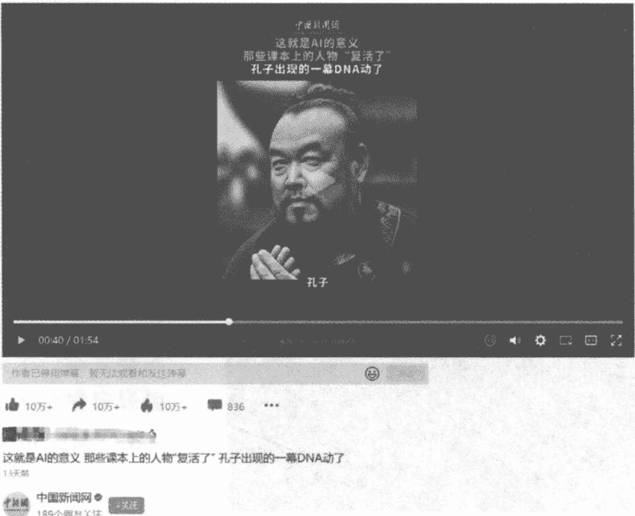

图5-1

5天后，《人民日报》也转发了类似的视频，同样很快获得了双10万+的超高数据。（见图5-2）

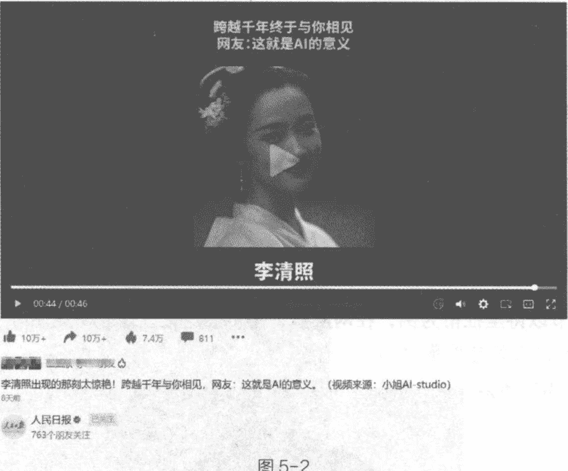

图5-2

这类视频为何容易爆火，连官媒都忍不住转发？主要有3大核心逻辑。

一是新奇技术。课本里的苍白画像突然“活”过来，放在以前一定是不可想象的事情。年轻人爱追“黑科技”，中老年觉得“老祖宗显灵”，各个年龄段都能找到“嗨点”。

二是文化自信。上下五千年的悠久历史，是中华民族自信的根源。当我们看到孔子开口讲《论语》，李白斗酒诗百篇，一定会油然而生一种自豪感。就像一位网友说的：“这才是文化自信的正确打开方式。”

三是圆梦之旅。谁没幻想过穿越回古代，和自己喜欢的名人把酒言欢？这种跨越时空的互动，既满足了猎奇心，又让人油然而生一种“和历史谈恋爱”的浪漫感。

事实上，借助 AI，这类视频非常容易制作。接下来，我们一步步演示具体做法，包你 3 分钟就能学会。

使用 AI 制作 “复活古人” 视频，主要分为 4 步：上网找一张你想 “复活” 的古人画像、将画像转换为真人图像、基于图像生成视频、后期剪辑成片。

本节用到的 AI 工具：即梦、可灵、DeepSeek。

### 1. 上网找一张你想 “复活” 的古人画像
本节以诗圣杜甫为例，在网上找到了下面这张画像。（见图 5-3）

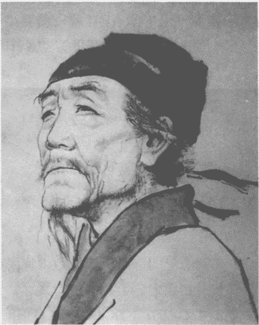

图 5-3

### 2. 将画像转换为真人图像
打开即梦，选择图片生成，点击导入参考图，上传准备的名人图，选择“边缘轮廓”，保存。

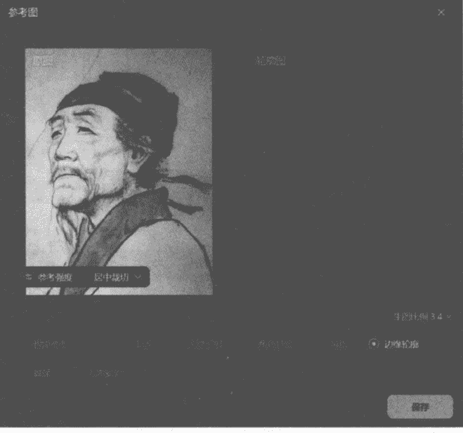

图 5-4

> 注意：这是最为关键的一步，必须选择“边缘轮廓”，才能确保生成的真人图和名人画像的人像姿势形态完全重合。（见图5-4）

然后在图片生成对话框中输入提示词：写实风格，真实摄影，杜甫。

图片模型选择 2.0，精细度拉到 10，点击立即生成。（见图 5-5）

等待十几秒后，即梦生成了一组 4 张图片，可选择自己喜欢的。在这里，我们选择第一张图备用。（见图 5-6）


图 5-5

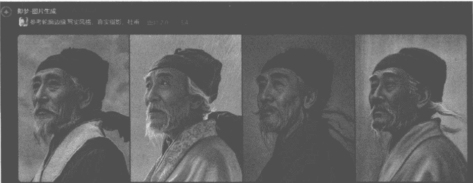

### 3. 基于图像生成视频
图像有了，现在要完成古人画像到真人图像的过渡，就需要用到可灵 AI 的“首尾帧功能”。

所谓首尾帧，即把第一张图片（古人画像）作为生成视频的第一帧画面，把第二张图片（真人画像）作为生成视频的最后一帧画面，中间则由 AI 算法自行完成填充。

打开可灵，选择 1.6 模型一图生视频一首尾帧。首帧图（第一帧画面）上传“古人画像”，尾帧图（最后一帧画面）上传刚才即梦生成的“真人画像”。（见图 5-7）

图片创意描述可以简单写“人物自然过渡，展示变化过程”，当然如果想要效果更佳，也可以召唤 DeepSeek，请它帮忙写一条更丰富的内容。这里我们演示后者。

#### 提示词参考如下：

我正在使用可灵 AI 首尾帧功能制作“复活古人”视频，即参考古人的画像生成真人图像，同时用首尾帧功能实现画像到真人的转变。现在制作的是杜甫。请你帮我写出过渡提示词，确保生成的效果非常惊艳，又能贴切地展现出杜甫忧国忧民的气质。

将以上提示词输入 DeepSeek 对话框，得到如下回复。

#### 示例结果

### 已深度思考（用时 11 秒）

好的，用户让我帮忙写过过渡提示词，用于制作“复活古人”视频，使用首尾帧功能实现画像到真人的转变。需要确保效果惊艳且贴切展现杜甫忧国忧民的气质。

首先，我需要理解用户的需求。他们正在用可灵 AI 的首尾帧功能，也就是起始帧和结束帧分别设定，中间过渡自动生成。用户希望从古人的画像过渡到真人形象，同时保持杜甫的气质。关键点在于过渡自然，视觉效果惊艳，还要突出杜甫忧国忧民的特质。

接下来，我得考虑杜甫的形象特点。杜甫作为唐代诗人，通常画像中他可能穿着唐代服饰，面容沧桑，表情严肃，背景可能有自然景色或战乱场景。忧国忧民的气质需要通过表情、动作和周围环境来体现。

### 过渡提示词：

从简笔画到超写实的渐变，线条逐渐转化为皮肤纹理，黑白灰底色过渡为战火熏染的深褐色调。重点表现：1. 头巾从平面色块变为粗麻材质；2. 白须由单线条生长为立体须丛；3. 背景从纯灰显露出残破城墙剪影；4. 眼睛部位保持简笔轮廓直至最后 0.5 秒突然浮现血丝与泪光。整体时长 3 秒，在第 2 秒加入飘雪粒子效果，渐变曲线先缓后急。

> 注：版面受限，截图仅展示部分深度思考与部分回答。

将以上 DeepSeek 给出的提示词复制进可灵图片创意描述区域，点击立即生成。（见图 5-8）

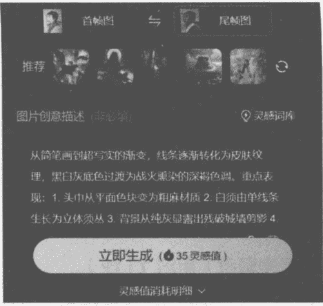

图 5-8

等待 5 分钟左右，即获得了古人画像变为真人的视频，下载视频备用。（见图 5-9）

如果你希望视频能更加富于变化，可以基于真人画像，通过图生视频的方式再生成一条视频，将其和前面的变化视频拼接起来。此处，依然召唤 DeepSeek 来帮忙完成提示词的撰写。

打开 DeepSeek，上传之前生成好的杜甫真人图片，并在对话框输入参考提示词。

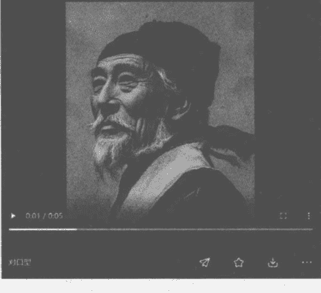

图 5-9

#### 提示词参考如下：

我现在上传给你的是杜甫的图片，请你基于这张图片，帮我撰写图生视频的提示词。请注意，要充分结合杜甫的特质，他的神情变化和动作都要体现出他忧国忧民的气质。

DeepSeek 短暂思考后，给出如下回复。

#### 示例结果

### 已深度思考（用时 18 秒）

嗯，用户让我根据上传的杜甫图片撰写图生视频的提示词。首先，我需要仔细分析用户提供的图片描述。图片里的杜甫是年长男性，古代文人气质，黑色头巾，花白胡须，眼神深邃，背景简洁，色调偏暗，突出他的忧国忧民之情。用户强调要结合杜甫的特质，神情变化和动作都要体现他的气质。

首先，我得确定用户的需求。他们想要一个视频提示词，可能用于 AI 生成视频，所以需要详细描述场景、动作、光影等元素。用户可能希望视频能动态展现杜甫的忧国忧民，比如通过环境变化、表情动作来传达情感。

......

### 过渡提示词：

特写杜甫布满皱纹的侧脸，花白胡须随头部微颤，凹陷的眼眶中瞳孔缓慢收缩——从浑浊的迷茫渐变为诗性锐光。下眼睑肌肉抽动三次，干裂嘴唇无声开合，握笔的右手青筋随太阳穴同步搏动。镜头绕头 180 度时脖颈渐挺直，飘落的发丝在鼻尖定格，最终凝成眼眶里将坠未坠的泪光。

> 注：版面受限，截图仅展示部分深度思考与部分回答。

将以上 DeepSeek 给出的提示词复制进可灵图片创意描述区域，点击立即生成。（见图 5-10）

等待 5 分钟左右，即获得了古人画像变为真人的视频，下载视频备用。（见图 5-11）

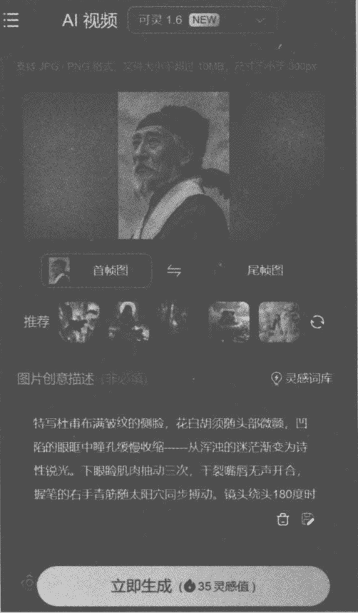

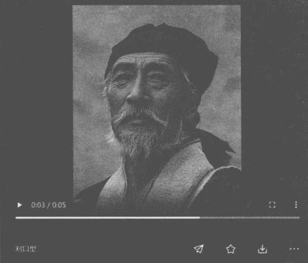

图 5-10

图 5-11

### 4. 后期剪辑成片
将两段视频导入剪映，按照顺序排列好，添加相应的字幕、特效、音效，制作好后导出，就完成了一条“复活古人”的短视频制作。（见图 5-12）

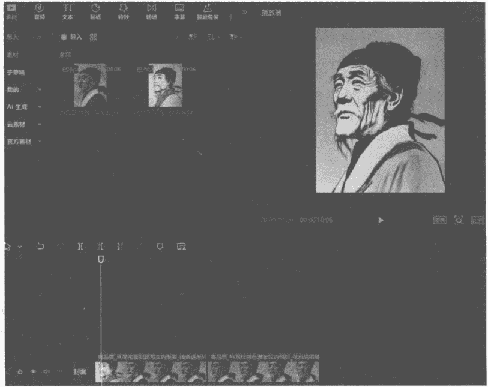

图 5-12

如法炮制，就能够“复活”任何你喜欢的古人。

用 AI 制作“复活古人”类视频，主要变现方式是流量变现。你可以将成品视频发布到抖音、视频号、快手、西瓜视频等主流视频平台，赚取流量收益。

> 注：因本书侧重在 AI 工具的使用，如何使用剪映完成后期制作的细节，此处不再展开。

同时，我们发现，常有粉丝来咨询制作方法。此时，你既可以考虑接单代客制作，也可以尝试推出 AI 制作教学课程或建立 AI 学习社群。

甚至，你如果不想做自媒体号，不想在任何公域平台频繁曝光，也可以只在自己的朋友圈分享。只要有人来咨询，就能按小时收取咨询费。

例如，我们有一名学员最初仅在朋友圈分享视频，一开始只是做来好玩，发得多了，就有人在评论区留言“想学”。于是，他开始提供视频制作咨询，单价并不高，定在 150 元 / 小时。因为他有耐心、教学好、有效果，咨询的人逐渐多了起来。后来，一对一咨询实在是忙不过来了，他就把咨询者所提的问题和自己的回复逐一梳理、总结、归纳，开了一门“AI 制作小视频”的课程，售价依旧不高，39.9 元 / 人，但依然在一个月内变现了四位数。

### 第6节

#### 萌系视频玩法：萌宠 + 萌娃批量生产，单账号月入 3w 的底层心法

在当下流行的短视频类目中，“萌系”内容可谓是流量天花板。萌娃和萌宠天然具备治愈感、亲和力，能触发观众的积极情绪（如母爱、童趣、陪伴需求），尤其吸引退休长辈、备孕妈妈、宠物爱好者等群体。例如，“萌娃喊奶奶”类视频通过模拟亲情互动，精准切中老年用户对孙辈的期待；萌宠做饭、出门打工等拟人化场景，则满足了年轻人“云养宠”的需求。

如果你能将“萌娃 + 萌宠”同框推出，那肯定是一对王炸组合。随便刷刷视频号，你会发现这类视频点赞量、转发量双10万+的，比比皆是。（见图6-1）

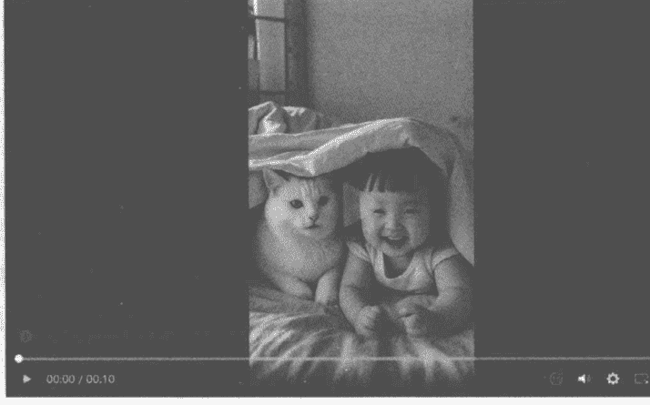

可爱宝贝和他的萌宠，怎么可以都这么萌呢#猫咪#萌宠#萌娃#治愈

图6-1

要想依靠这类内容赚钱，我们就要深入了解其底层逻辑：它为什么容易爆火？只有拆解出爆火、受用户欢迎的点，我们才能有的放矢，精准切中用户“嗨点”，得到点赞、转发和流量收益。

其实，爆火原因非常简单：萌娃的纯真表情和萌宠的可爱行为能促使多巴胺分泌，带来情绪抚慰和减压效果，为受众带来一场舒适的心理按摩，尤其适配现代快节奏生活下的用户需求。

故此，我们在制作视频时，就要尤其注重生成萌娃的小表情、萌宠的可爱行为。因为 AI 出图很多时候并不会一次就能切中我们的需求，往往要多轮互动、多次调教。所以，只有在心里有明确的目标，知道要注重生成哪些方面，才能更好地对图片做出甄别与筛选。

接下来，就给大家分享制作步骤，非常简单，仅需要三步：生成“萌娃 + 萌宠”图片、基于图片生成视频、后期剪辑成片。

本节用到的 AI 工具：DeepSeek、即梦。

### 1. 生成“萌娃 + 萌宠”图片
这里需要用即梦生成图片。为了追求高效与精准，我们就不自己写即梦的提示词了。依旧使用“偷懒”做法——召唤 DeepSeek 来帮忙撰写。

#### 提示词参考如下：

我想用即梦画出萌娃和萌宠在一起玩的图片，场景是胖胖的小萌娃和一只大橘猫一起躲在被窝下面看手机，小萌娃手里拿着手机。请帮我丰富该提示词，确保画面细腻、温馨、治愈，我要写实风格。

将以上提示词输入 DeepSeek 对话框,得到如下回复。

#### 示例结果

### 已深度思考 (用时 15 秒)

嗯, 用户想用即梦 AI 生成具体的图片, 场景是胖胖的小萌娃和大橘猫躲在被窝里看手机, 需要写实风格, 画面细腻、温馨、治愈。首先,我需要理解他的需求, 确保提示词足够详细, 能够准确传达他想要的场景。

以下是针对你需求的优化版即梦 AI 提示词 (中英双语), 包含细节强化和画面氛围引导, 确保生成高精度写实风格作品:

### 中文提示词 (推荐直接使用)

### 场景设定:

冬夜温暖的儿童房, 淡黄色小夜灯透过白色蕾丝灯罩洒下暖光, 印有星星月亮的浅蓝色蓬松羽绒被下, 蜷缩着两个毛茸茸的脑袋。3 岁圆脸小萌娃 (肉嘟嘟脸颊泛红, 穿米色小熊连体睡衣)和胖乎乎的橘色虎斑猫 (毛发蓬松泛金光, 爪垫粉嫩), 正躲在被窝里偷偷看手机。

将 DeepSeek 给出的提示词复制进即梦的图片生成对话框, 点击立即生成。(见图 6-2)

> 注: 版面受限,截图仅展示部分深度思考与部分回答。

> 注意: 模型选择“图片 2.1”,图片比例选择3:4。

## 2. 基于图片生成视频
图片有了，继续让 DeepSeek 帮忙生成视频提示词。

### 提示词参考如下：

我现在需要用即梦制作图生视频。请基于我上传的这张图片，帮我撰写相应的视频提示词。我想要的画面是萌娃和橘猫一起看着手机大笑，非常治愈的样子。

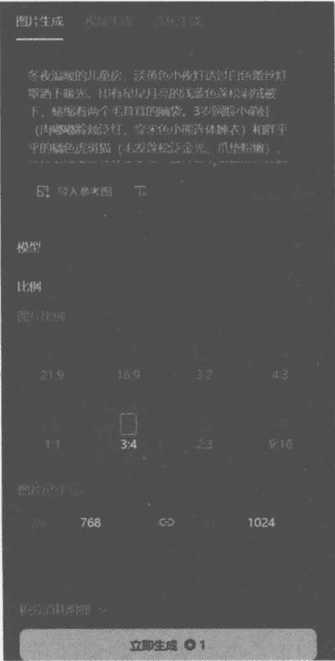


萌宠治愈＋AI怪谈的实战变现打法

把前面准备好的指令复制进 DeepSeek 的聊天窗口，同时把之前保留的第3张素材图上传，模型会给出类似下方的回复。

#### 示例结果

#### 已深度思考（用时 17 秒）

用户此刻想把已完成的萌娃配橘猫看手机的静态图，用即梦做成动态片段。整体要突出欢乐与治愈的氛围。

下面是针对即梦图生视频优化的思路，通过加入微动态和故事感来增强治愈度，并符合即梦生成习惯：

#### 视频主指令（中文版）

#### 场景动态化：

暖调治愈竖屏画面，镜头从星空被子的褶皱处缓缓上移，露出肉嘟嘟圆脸双马尾的萌娃和毛发蓬松尾巴卷起的橘猫，两者正窝在蓝色星星被窝里。萌娃忽然指着手机屏幕咯咯笑，肉乎乎的小脚在被子里兴奋乱踢，橘猫被笑声带的耳朵颤动，伸爪轻轻点了点手机边框，屏幕光在两人脸上跳动。背景的毛绒玩偶随笑声微微震颤，夜灯在画面边缘投出暖晕。

> 注：版面有限，截图仅展示部分思考和部分回复。

把 DeepSeek 给出的这段描述复制到即梦的图生视频输入框，点击立即生成。等待约30秒，即梦即可合成视频并导出。

> 建议：模型选“视频 S 2.0 Pro”，比例保持默认自动匹配即可。

### 3. 后期剪辑成片

把生成的片段导入剪映，叠加一段萌娃大笑音效和一段轻快活泼的BGM，导出即得到一条“萌娃＋萌宠”的短片。

如果觉得5秒时长偏短，可按同样流程多做几条，写指令时让表情和动作有区分，再在剪映里串联。

后续制作流程与前面完全一致，此处不再展开。

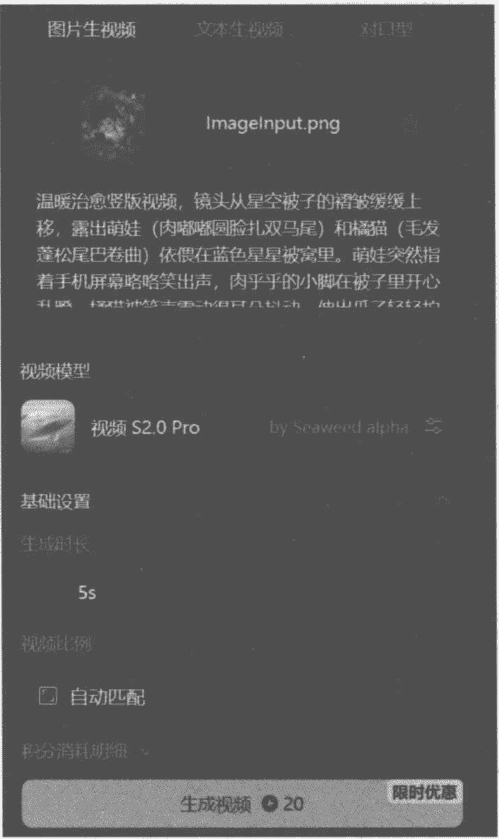

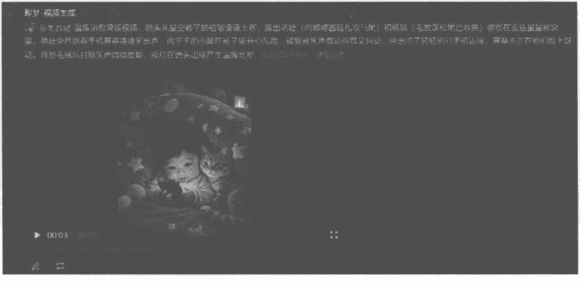

### 流量变现思路

这类萌系AI视频最直接的收益来自平台分成。这类内容容易走红，播放破百万时分成可达数千元。

除平台分成外，因萌娃和萌宠受众多为高消费人群，也能做垂直品类带货，比如短视频挂车、直播推广童装、宠物用品、母婴用品等，佣金比例通常在10%～30%。

我们的一位宝妈学员掌握此法后连续多条爆量，便开始尝试电商带货，仅靠一款9.9元的萌宠主题手机壳就拿到四位数佣金。还有一位男性学员，孩子已上大学，工作相对宽松，就和妻子一人一个账号做抖音橱窗副业。以前出货很少，学会萌系AI视频后，几千播放的视频就能成交。他提到某天成交额2600元，89单，佣金20%，净赚500多元。

可以说，掌握简单的萌系AI短片就能实现“躺赚”——睡觉时视频也在跑数据，有成交就有佣金。

除了以上方式，当账号粉丝持续增长、流量稳定后，还可与平台做广告合作，甚至接定制广告。比如小红书粉丝达1000＋即可入驻蒲公英平台，单条报价150～500元；若接到母婴、宠物品牌的定制邀约，收益会更高。

> 注：本书侧重AI工具使用，剪映后期细节不再展开。

### 第 7 节

#### 民间故事玩法：DeepSeek 自动写怪谈剧本，日入三位数

相较于专业向内容，民间故事因节奏快、沉浸感强、易理解，在各大短视频平台都很受欢迎，也较容易爆。借助 DeepSeek 强大的文本创作能力，很容易产出这类脚本，分发到抖音、快手、西瓜视频等平台获取流量收益。尤其在西瓜视频，爆了的民间故事收益可达数百甚至数千元。

借助模型，普通人做爆款民间故事短视频只需四步：生成故事脚本、绘制分镜图、生成分镜视频、后期剪辑成片。

本节工具：DeepSeek、即梦。

# ### 1. 生成故事脚本

抖音、快手上爆款的民间故事通常具备以下特征：

> 注：后期剪辑软件本书以剪映为例，但本书重在AI工具，后期技术不展开。

##### ① 悬疑猎奇感强

多以乡村怪谈、灵异传说为主，通过紧凑情节设置，如开局三秒抓眼球迅速吸引。结构上常套用“穷小子遇仙”“宝物争夺”等经典冲突，以及“开头设悬＋中段反转＋结尾留白”的框架，配合模型生成的阴森画面与音效，增强沉浸。

##### ② 轻量化碎片化适配

单集时长多控制在1～3分钟，模型分镜能快速实现，符合短视频推荐机制。

##### ③ 情感代偿与心理投射

多使用“好坏终有分晓”“逆袭翻身”等主题，精准击中现代人情感需求。很多故事通过底层劳动者被神仙拯救的情节，引发观众对现实困境的共鸣。

#### 提示词参考如下：

你擅长创作民间故事，请结合抖音、快手平台调性，以“好坏终有分晓”“逆袭翻身”为主题，按“开局三秒悬念＋中段反转＋结尾留白”结构，写一篇约300字的爆款故事。

打开 DeepSeek，输入以上提示词，点击“深度思考（R1）”，即可看到模拟人类思考的过程，从中获得更多角度。

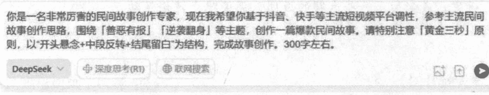

图 7-1

思考后，DeepSeek 产出一篇名为《蛇骨镯》的民间故事。

#### 示例结果

### 已深度思考（用时 18 秒）

用户要求基于抖音、快手调性，围绕“好坏终有分晓”“逆袭翻身”创作符合开局三秒、结构为开头悬念、中段反转、结尾留白的民间故事。先分析平台爆款特征。

抖音重娱乐创意节奏快，视觉冲击强；快手更接地气重真实互动。但两家都强调开头抓人，即开局三秒。开头需埋悬念，如灵异事件或突发危机。

主题方面，“好坏终有分晓”“逆袭翻身”是经典，易引发共鸣。主角需经历困境后借助神秘人物或宝物逆袭，坏人受罚好人得报。中段要有反转，如帮助者别有用心或宝物带来意外后果，增加曲折。

结尾留白，可设开放式结局，让观众回味并评论互动。

- 《蛇骨镯》

(开局悬念)深夜，外卖员李响被三道黑影堵在烂尾楼，劫持者把匕首抵在他脖颈，厉声问：“直播卖惨骗捐款，钱呢？”挣扎间，李响腕间的蛇骨镯渗出黑雾，为首混混皮肤寸寸溃烂。

(中段反转)三个月前，李响在工地上挖出青铜匣子。他直播哭诉母亲重病，打赏暴涨，引起包工头王强注意。蛇骨镯显灵助李响暴富，却致王强意外坠楼瘫痪。而直播间打赏榜首“青娘子”的账号IP竟定位在城郊乱葬岗。

### 2. 绘制分镜图

有了脚本，就要做分镜。这里分两步：

步骤一：生成分镜脚本

提示词参考如下：

请把上文故事脚本转为分镜表格，包含序号、景别、画面内容、镜头时长、镜头运动。

#### 示例结果

#### 已深度思考（用时 16 秒）

用户需要把《蛇骨镯》故事转为分镜脚本表格，含序号、景别、画面内容、时长、运动。先回顾原始脚本，拆解关键情节，按短视频调性和分镜要点展开。

故事分为开局悬念、中段反转、善恶有报、结尾留白四部分，需拆成多镜头，符合开局三秒。

以下基于核心冲突与平台特性设计的分镜脚本，结合分镜设计要点，采用“开局三秒＋悬念递进”镜头语言：

| 序号 | 景别 | 画面内容 | 镜头时长 | 镜头运动 |
|---|---|---|---|---|
| 1 | 广角仰拍 | 暴雨中烂尾楼钢筋扭曲如鬼手，闪电照亮墙上“欠债还钱”红字 | 2 秒 | 慢速横移 |
| 2 | 特写 | 匕首抵住李响喉结，汗珠沿刀刃滑落 | 1.5 秒 | 手持晃动 |
| 3 | 中景 | 三黑影围堵，手机屏显示打赏记录 | 1 秒 | 快速推近 |

> 注：版面受限，仅展示部分思考与回复。

### 步骤二：生成分镜提示词

若不擅长绘图，也可让 DeepSeek 帮忙写绘图提示词。

#### 提示词参考如下：

我将用即梦生成所有分镜画面，请基于上述分镜脚本，按序号匹配即梦绘图提示词格式，同时适配民间故事画风，保持风格一致，输出对应提示词。

#### 示例结果

已深度思考（用时 18 秒）

现在需把分镜脚本转为即梦绘图提示词。已提供详细分镜表，每个镜头有景别、内容、时长、运动。需提取关键元素，生成符合即梦“主体＋环境＋风格词”格式的提示，保持民间故事调性。

每个分镜需包含环境、天气、光影、风格关键词，如赛博朋克色调、皮影戏质感。

基于即梦格式与民间故事视觉符号，输出适配绘图提示词，序号与分镜严格对应：

# ## 1号分镜提示词

暴雨烂尾楼仰视视角,钢筋如巨型蜈蚣骨架(暴雨倾盆:1.3),闪电紫光打在墙面血红“欠债还钱”涂鸦(赛博朋克色调:1.2),背景若隐若现皮影戏风格鬼手投影。

# ## 2号分镜提示词

匕首特写,汗珠沿脖颈流下,背景虚化黑影持刃,色调模仿王家卫《堕落天使》青绿色调。

> 注:版面受限,仅展示部分回答。

# ## 步骤三:用即梦生成分镜图

打开即梦，复制 DeepSeek 产出的分镜提示词即可生成对应分镜图。

注意:模型选“图片 2.1”,比例选“3:4”。

十几秒后即梦生成一组4张图片，自行挑选。这里选第三张备用。

同理操作：

- ① 让 DeepSeek 产出分镜提示词
- ② 按序号逐条复制进即梦
- ③ 分别生成画面，最后得到全部分镜图

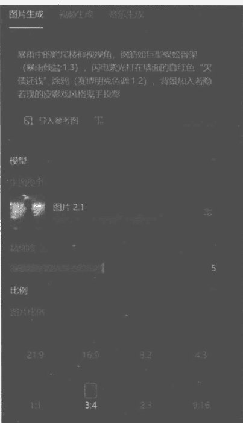

图 7-2

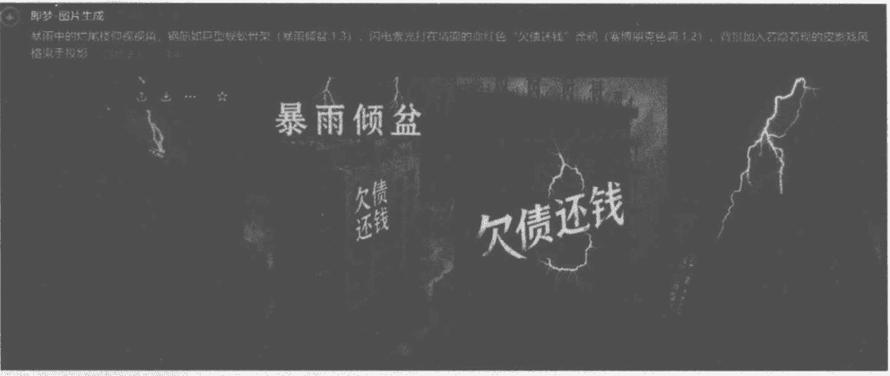

图 7-3

### 3. 生成分镜视频

分镜图完成后，进入图像转视频环节，仍用即梦，分两步。

步骤一: 写视频生成提示词

可继续让 DeepSeek 帮忙写。

提示词参考如下:

我将用即梦已生成的分镜脚本生成对应分镜视频，请按序号写出视频生成提示词，使用贴切镜头语言，确保画面冲击力。

#### 示例结果

### 已深度思考（用时 13 秒）

用户最初要求基于分镜脚本为即梦生成绘图提示词，强调风格统一。需要把视频生成提示词简化，去掉参数，直接描述镜头运动、特效、音效。如把“暴雨慢速横移＋闪电频闪”转为“镜头从下往上慢慢移动拍暴雨烂尾楼，每半秒一道紫色闪电”。

确保每个分镜提示独立，便于逐条复制。用更口语化表达，避免技术术语，同时保留特效、转场、音效。

以下是简化直白版视频生成提示词，可直接复制到即梦文本框：

- 1号镜头 镜头从下往上慢慢移动拍暴雨中的烂尾楼，每隔半秒闪过一道紫色闪电，墙上“欠债还钱”红字被照亮，背景影子像鬼手在晃。
- 2号镜头 特写匕首抵着外卖员脖子，汗珠顺刀尖滴落，镜头故意晃动模仿手机偷拍视角，配刀刮金属刺耳声。
- 3号镜头 三个黑衣人围住外卖员，镜头突然推到他们手机屏幕，绿色弹幕写“青娘子打赏 10 万元”，手机突然冒出一团黑烟。

> 注：版面受限，仅展示部分回复。

### 步骤二：将视频提示词复制到即梦视频生成界面

选定之前备用的图片，选择“图像转视频”。

注意：视频模型选“视频 S2.0”，时长默认 5 秒。

约 30 秒后即梦完成生成，下载视频。

继续如法炮制：

- ① 让 DeepSeek 产出视频提示词
- ② 复制进即梦
- ③ 选定备用图
- ④ 选“图像转视频”生成对应分镜视频
- ⑤ 重复操作，得到所有分镜视频

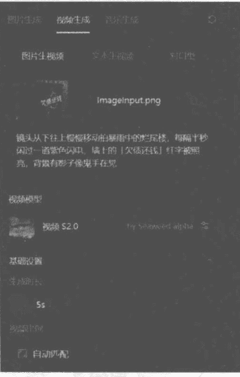

图 7-4

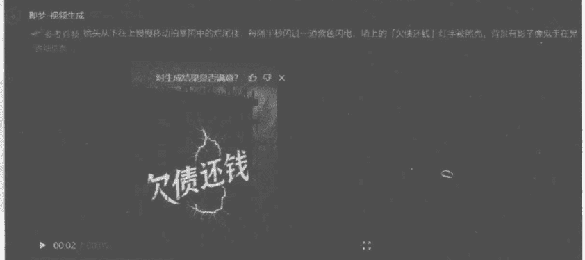

图 7-5

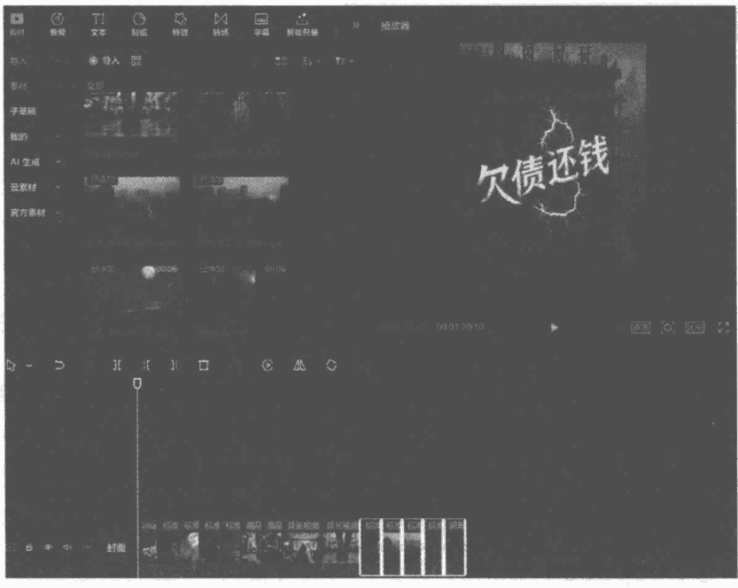

图 7-6

### 4. 后期剪辑成片

把所有分镜视频导入剪映，按顺序排列，添加字幕、特效、音效和配音，即完成民间故事短视频制作。

完成后可发布到抖音、视频号、快手、西瓜视频等平台获取流量收益，也可在视频中挂车卖货，如《山海经》等书籍很合适。

建议全网多平台发布，多一个平台多一份收益。A 平台数据不佳，B 平台可能爆。

## 本篇总结

人工智能浪潮下，AI工具成为普通人高效变现的核心利器。

本篇通过7节实操案例，系统拆解如何借助 DeepSeek 与即梦、可灵、Suno 等工具快速生成爆款内容，精准切入赛道，实现流量与收益双增长。

刚入职场的应届毕业生大多缺少招聘实战经验，不清楚面试官真正关注的点在哪里，也不明白怎样才能让自己的材料更吸睛，更难以把过往经历转化为能够打动招聘经理的文字，进而错失面试机会。

正是因为这种信息不对称，履历打磨的需求近几年呈现井喷态势。领英、脉脉等职场社交平台上，资深从业者一对一指导新人改简历的项目非常火爆；BOSS 直聘、猎聘等招聘网站也上线了付费修改简历的服务。（见图 8-1）

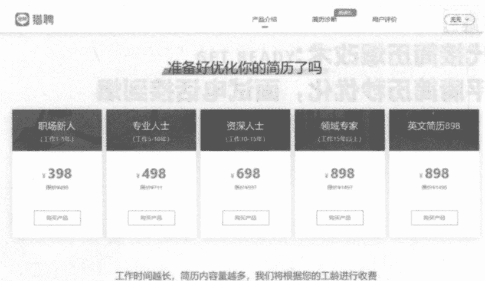

图 8-1

在淘宝搜索“简历优化”，商品定价从几十元到上百元不等，口碑较好的店铺成交量都很高，排名靠前的一家显示已有十万人付款购买。（见图 8-2）

简历改写已经变成一门生意。很多人还在观望，已经有人借助智能模型把“简历优化”升级为“AI 赋能的出彩简历”，抢先吃到红利。

把简历制作交给模型，实际可拆成三步：先做通用润色，再按岗位定制，最后套入美观模板。

本节会涉及的模型：DeepSeek、TalenCat。


图 8-2

### 1. 先做基础润色

以求职者张三为例，他毕业于 XX 传媒大学，目标岗位是新媒体运营。原始稿件如下。（见图 8-3）

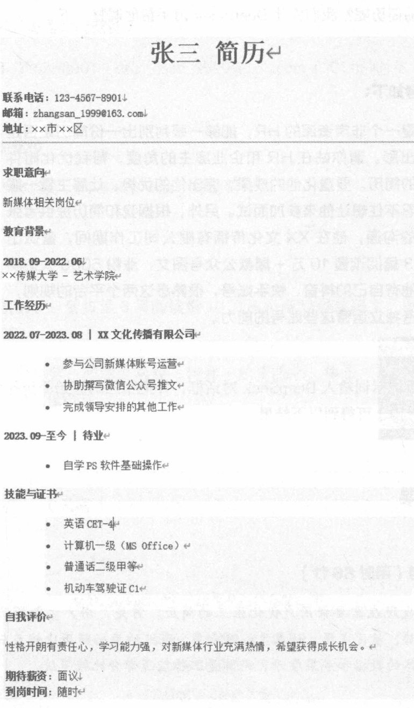

图 8-3

可参考的指令是：

你是一个非常资深的 HR，能够一眼判别出一份简历是否足够出彩。请你站在 HR 和企业雇主的角度，帮我优化附件里的简历。要量化他的成果，突出他的优势，让雇主看一眼就忍不住想让他来参加面试。另外，根据我和简历提供者张三的沟通，他在 XX 文化传播有限公司工作期间，曾做出过 3 篇阅读量 10 万 + 爆款公众号图文，涨粉 5000 人。同时他有自己的抖音、快手账号，很熟悉这两个平台的规则，具备独立运营这些账号的能力。

把这段指令输入 DeepSeek 对话框并上传张三的原稿，可得到类似的回复。

**示例结果**

**已深度思考（用时 86 秒）**

好的，我现在需要帮用户优化张三的简历。首先，用户希望简历能突出优势，量化成果，让雇主一眼看中。张三的原始简历比较基础，缺乏具体的数据和成果展示，尤其是工作经历部分比较笼统。

以下是针对张三简历的专业优化建议，突出新媒体运营核心能力，强化数据化成果展示：

**张三 | 新媒体运营达人**

123-4567-8901 | zhangsan_1999@163.com | XX 市 XX 区

**求职定位**

新媒体运营 / 内容策划（全平台运营方向）

**核心优势**

- 爆款制造：曾打造 3 篇阅读量 10 万 + 公众号爆款图文，单月涨粉 5000+

- 全平台运营：精通公众号 + 抖音 + 快手生态，熟悉各平台流量机制

> 注：版面受限，截图仅展示部分深度思考与部分回答。

润色前后对比很明显。原本工作经历写得很概括。（见图 8-4）

**工作经历**

2022.07-2023.08 | XX 文化传播有限公司

- 参与公司新媒体账号运营

- 协助撰写微信公众号推文

- 完成领导安排的其他工作

图 8-4

经过模型处理后，该部分被拆分为“核心优势”和“职场战绩”，招聘方能快速抓住亮点。（见图 8-5）

**核心优势**

- 爆款制造：打造 3 篇 10W+ 公众号爆文，单月涨粉 5000+

- 全平台运营：精通公众号 + 抖音 + 快手生态，熟悉各平台流量机制

- 内容生产力：具备选题策划、文案撰写、基础设计全链路能力

- 数据敏感：擅长通过阅读量/完播率/转化率优化内容策略

**职场战绩**

XX 文化传播有限公司 | 新媒体运营专员

2022.07-2023.08

核心成果：

- 独立运营企业服务号矩阵（3 个），实现：

  - 10W+ 爆文 3 篇（历史最高单篇阅读量 28.6 万）

  - 3 个月涨粉 5000+（自然增长占比 75%）

  - 推文平均打开率 12.3%（行业均值 8%）

  - 用户留言互动量提升 300%

- 搭建短视频运营 SOP：

  - 制定「选题库搭建 - 脚本模板 - 数据复盘」全流程标准

  - 单条视频最高播放量 82 万（零付费投放）

  - 3 个月账号涨粉 2800+（职场干货领域）

常规工作：

- 公众号推文撰写（月均 12 篇）

- 用户画像分析及选题策划

- 竞品账号监测及热点追踪

图 8-5

### 2. 结合雇主岗位需求优化简历

通用版已可用。若想在海量投递中脱颖而出，还需第二步：依据目标岗位要求生成定制版。

从招聘网站随机挑一份新媒体运营的岗位说明，让 DeepSeek 先阅读后再调整简历。

可参考的指令是：

现在，请根据雇主的岗位要求，进一步优化张三的简历，使其针对性更强，更容易被雇主青睐。岗位要求如下：

1. 大专以上学历，电子商务、市场运营、广告学、传播学等相关专业优先，年龄 23~30 岁；

2. 熟悉各类视频平台节目类型和运营规则，有独立运营推广抖音等短视频类平台 1 年及以上经验，有达人资源者优先考虑；

3. 具备良好的行业敏锐度、洞察力以及较强的数据分析能力，善于追踪、分析抖音上的热门视频，能够准确捕捉亮点；

4. 抗压能力强，有较强的策划能力和文案功底；

5. 有成功案例者优先。

把指令和原稿一起传给 DeepSeek，可得到如下回复。

**示例结果**

**已深度思考（用时 33 秒）**

好的，我现在需要帮用户进一步优化张三的简历，以符合雇主的具

体岗位要求。首先，我需要仔细分析用户提供的岗位要求，然后看看张三现有的简历中哪些部分可以调整以更好地匹配这些要求。

以下是针对岗位要求的深度优化版简历，重点突出抖音运营能力与成功案例，强化岗位匹配度：

**张三 | 抖音运营专家**

123-4567-8901 | zhangsan_1999@163.com | XX 市 XX 区

**求职定位**

抖音运营负责人（短视频全案策划方向）

**核心优势**

- 抖音操盘手：独立运营企业 & 个人抖音账号 1 年 +，打造单条视频播放量 82 万爆款

- 爆款解码器：建立抖音热门视频监测库，3 个月复用热点产出 5 条 10 万 + 视频

- 达人经纪人：搭建本地职场领域达人资源库（30+ 合作资源）

- 数据指挥官：通过粉丝团转化率 / 完播率优化，单月涨粉 2800+

> 注：版面受限，截图仅展示部分深度思考与部分回答。

可以看到，加入岗位侧重后，求职定位从“新媒体运营达人”变为“抖音运营专家”，指向更精准，核心优势里也突出抖音实操与达人合作经历，匹配度明显提升。

> DeepSeek 的改写能力很强，但前提是案例和数据必须真实。

造假是职场红线，接单时可以用模型提升表达，但要反复核实。生成内容若与事实不符或数字夸大，必须剔除。我们做生意是帮客户成长，不能弄虚作假。

> 简历优化务必实事求是！

### 3. 一键套用模板

文字优化完后，下一步是视觉呈现。过去要手工找模板复制，现在可由模型代劳。

以下以 TalenCat 为例，仅演示“模板”功能。

打开 TalenCat 首页，点击导入简历，上传 DeepSeek 优化后的张三简历。（见图 8-6）

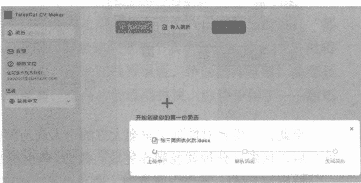

图 8-6

约一分钟后，TalenCat 完成预处理，生成基础模板。（见图 8-7）

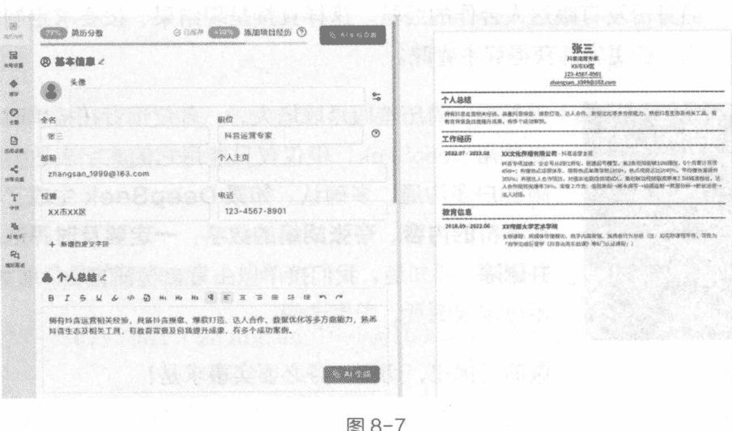

图 8-7

若不满意，可点左侧“模板”更换样式，选定后点右下方下载即可。（见图 8-8）

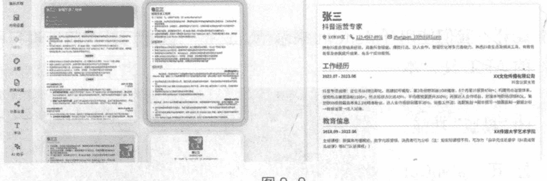

图 8-8

到此，一份有针对性且美观的简历即完成。熟练后 3 分钟可搞定，20 单约 1 小时。按淘宝 20 元/单算，收益可观。

## 第 9 节 PPT 定制流水线：DeepSeek+Kimi 极速排版, 日接 10 单无压力

对大多数职场人而言，PPT 像挥之不去的负担。白天处理业务，下班还要熬夜写材料做汇报，明明只是报价单，却要做成几十页的“战略蓝图”。

更糟的是领导反复修改。“配色不够专业”“标题再放大”“中间加张数据图”。改到第八版，领导却说“还是最初版好”。凌晨三点对着屏幕，很多人想把鼠标摔了。旁边实习生的 PPT 却像动画片，衬得自己的文字截图毫无质感。

最刺痛的是年终考核，埋头干活的人常被说“看不出成果”，而 PPT 花哨的人却升职加薪。原来在领导眼里，饼图越圆功劳越大，柱状图越高奖金越厚。你才明白：职场即表演，PPT 即武器。

但多数人缺乏专业设计审美，PPT 常出现逻辑混乱、重点不突出、排版粗糙，甚至变成“Word 版 PPT”。于是，代做 PPT 成为轻创业赛道。淘宝搜“PPT 代制作”，销量惊人，回头客多，单价 10 到 200 元不等，部分商家宣称 5 分钟出稿。（见图 9-1）

现在借助智能助手，5 分钟做出精美汇报完全可行，甚至更快，还能业余接单变现。

下面演示两步：先搭大纲，再生成 PPT。

本节使用的助手：DeepSeek、豆包、Kimi。

### 1. 制作 PPT 大纲

很多人以为 PPT 靠外观，配色字体当然重要，但内容逻辑顺不顺、重点清不清、能否抓住注意力，才是关键。

所以大纲梳理是第一步，也是核心。过去靠自己想或请人梳理，现在人人可用 DeepSeek。

接单可分为四步。

第一步：向客户收集原始材料。Word、PDF、图片皆可，模型处理格式差异不大。

第二步：基于材料生成大纲初稿。

打开 DeepSeek，让它撰写 PPT 大纲。

指令参考如下：

你是一个专业的 PPT 制作高手，现在请基于我提供给你的原始材料（见附件），制作一份非常专业的 PPT 大纲。要求逻辑顺畅、重点突出。总共 12 页。

把指令输入对话框，并上传客户原始材料。（见图 9-2）

#### 示例结果

### 已深度思考（用时 82 秒）

嗯，用户让我帮忙做一个 PPT 大纲，基于他提供的材料，写出有商业价值的个人品牌故事。首先，我需要仔细阅读用户提供的文档，理解里面的内容结构和重点。用户是焱公子，有很多头衔和成功案例，所以 PPT 需要突出他的专业背景和成功经验。

以下是基于您提供的材料设计的 12 页专业 PPT 大纲框架，遵循逻辑递进和商业价值呈现原则：

封面页（1/12）

标题：如何写出有商业价值的个人品牌故事

副标题：从故事到商业价值的转化之道

> 注：版面受限，截图仅展示部分深度思考与部分回答。

### 第三步：把大纲发客户确认。

必须先让客户审阅通过再继续。DeepSeek 是推理型模型，会有一定“自由发挥”，提纲需要客户甄别。

### 第四步：把确认后的大纲转为 Markdown。

Markdown 通用性强，便于转 PPT。若不熟悉，可让 DeepSeek 自动转换。

指令参考如下：

请将上述 PPT 大纲转化为 Markdown 格式，确保能被其他生成 PPT 的 AI 工具准确识别。

把指令输入对话框，得到结果。

#### 示例结果

已深度思考（用时 43 秒）

好的，我现在需要帮用户把之前提供的 PPT 大纲转换成 Markdown 格式，确保能被其他生成 PPT 的 AI 工具识别。首先，我得回想一下用户的需求。用户最初是希望基于提供的材料制作一个专业的 12 页 PPT 大纲，现在他们需要将其转化为 Markdown 格式，以便其他 AI 工具使用。

......

> 注：版面受限，截图仅展示部分深度思考与部分回答。

### 2. 生成 PPT

目前多款助手都能生成 PPT，这里以豆包为例。

在豆包新对话里选择“AIPPT”，把 DeepSeek 生成的 Markdown 大纲复制粘贴进去。（见图 9-3）

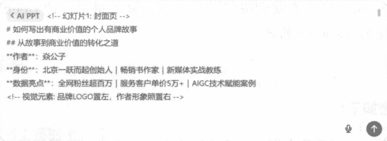

图 9-3

点右下角蓝色箭头，豆包会先整理大纲，确认无误后点“选择模板”。（见图 9-4）


图 9-4

随后弹出大量模板，任选其一，点“开始生成 PPT”。（见图 9-5）


图 9-5

约一分钟后，排版精美逻辑清晰的 PPT 就生成，可直接下载。若细节不满意，可在豆包内在线编辑，或下载后本地修改。（见图 9-6）

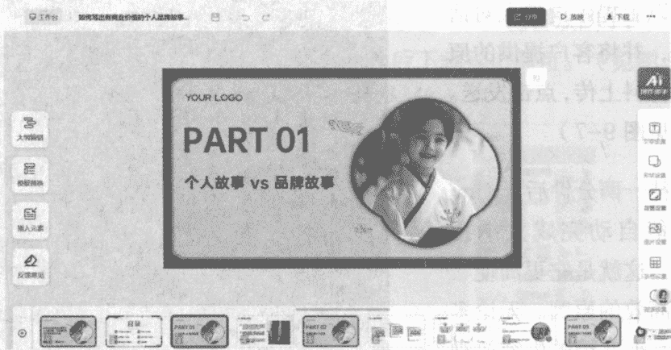

图 9-6

熟练后不到 5 分钟完成一单，一天接十几单毫无压力。

如果觉得 5 分钟仍慢，这里提供一个彩蛋：单独用 Kimi，一步完成全流程。

依然基于原始材料生成大纲。

打开 Kimi，点击 Kimi+，左侧边栏找到 PPT 助手，进入后要求撰写大纲。

指令参考如下：

你是一个专业的 PPT 制作高手，现在请基于我提供给你的原始材料（见附件），制作一份非常专业的 PPT 大纲。要求逻辑顺畅、重点突出。

把指令输入对话框，上传客户原始材料，点击发送。（见图 9-7）

等待一两分钟，Kimi 会自动提炼大纲。无论材料多乱，它都会按逻辑完整生成，错漏会补全，重复会提炼，省心是一站式服务。

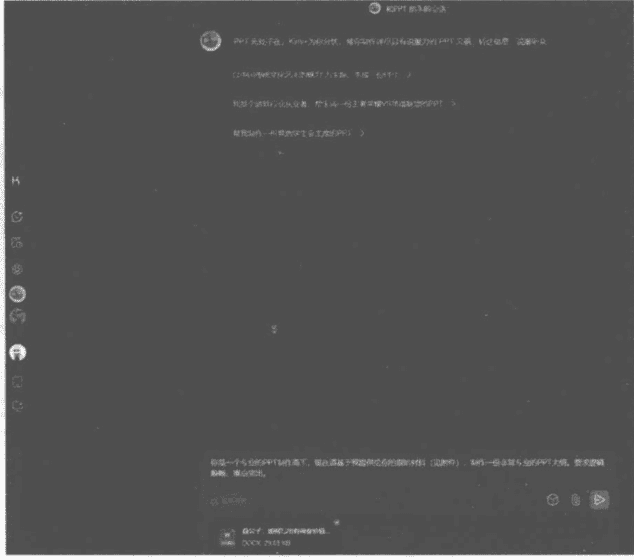

图 9-7

若客户不满意，可要求继续调整。默认客户已确认大纲后，点大纲下方的“一键生成 PPT”。（见图 9-8）

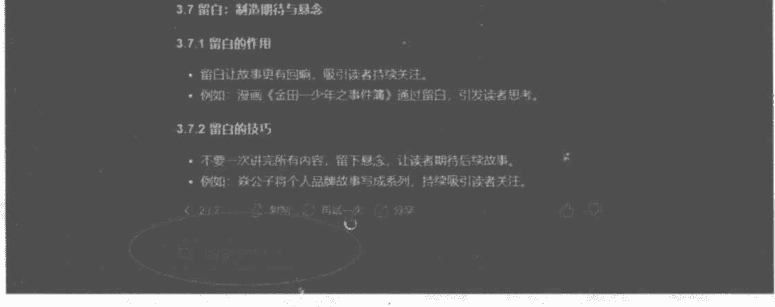

流程与豆包一致：选模板、生成、十几秒后下载导出。（见图 9-9）


需要说明：Kimi 操作更简便，但大纲文本质量 DeepSeek 更优。因此实操经验是，定制型、重要场合的 PPT 建议 DeepSeek 写大纲 + 豆包制作；批量型、日常使用的 PPT 追求速度则可用 Kimi。

挑选交付形态，始终要扣回客户真实诉求来做取舍。

## 第10节
时光复活记：切入中老年群体，单笔破五百的实操

近期在短视频里，AI 还原旧照的内容曝光度明显上升。抖音话题 #AI修复老照片 的累计播放量已超过两亿次。（见图10-1）


图10-1

尘封在铁皮盒里的旧影像，随着生成模型普及正被唤醒。泛黄的折痕里，外婆少年的笑被重新点亮；模糊的军装照中，爷爷当年的眉眼在算法的推敲下逐渐清晰；就连褪成褐色的全家福，也像是被注入了声响——仿佛能听见三十年前春风掠过老屋檐，能听见胶片颗粒重组时的细微震动，像旧时光在轻叩窗棂。

当智能让静止的相纸有了呼吸，被岁月封存的记忆瞬间鲜活。在这场与时间的温柔角力里，技术不再是冰冷的代码，而是握在普通人手中的时光宝盒，一转之间，记忆的光便恒久如初。

也正因情感牵引强烈，老照片修复赛道持续升温。淘宝检索“老照片修复”，店铺销量普遍很高，价格多在几元到十几元区间。销量最高的店铺标价15元，付款人数已超20万。（见图10-2）


图10-2

单价虽低，操作门槛却很小，几分钟即可完成。接下来分享一套可复用的流程。借助AI修复旧照大致分为三步：初级复原、上色、视需求制作短视频。

本节演示工具：即梦。

### 1. 初级复原
打开即梦，点击“导入参考图”，把旧照上传后选用默认的“智能参考”，点保存。（见图10-3）


图10-3

在提示词里写“这是一张上个世纪五十年代的老相片，请修复”，若画面有污渍划痕，可追加“同时去掉污渍和划痕”等描述。

图片模型选“图片2.0 pro”，精细度拉到10，点击“立即生成”。（见图10-4）

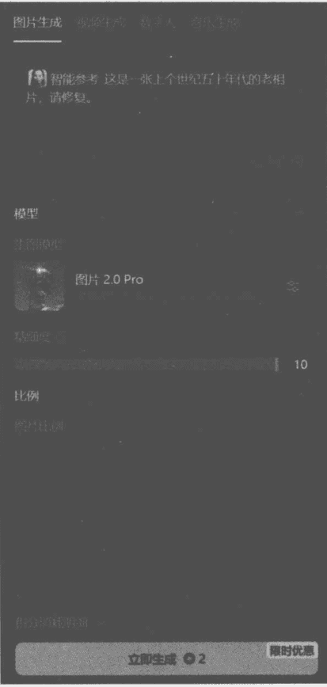

图10-4

十几秒后，即梦会给出4张结果，整体都不错，建议让客户挑一张与记忆最贴近的备用。此处选用第三张。（见图10-5）


图10-5

单独打开第三张，点图片下方的“HD”进行高清化。（见图10-6）


图10-6

### 2. 上色焕彩
黑白照想要有生气就需要上色。继续使用即梦，上传刚修复好的照片，仍选“智能参考”，点保存。（见图10-7）

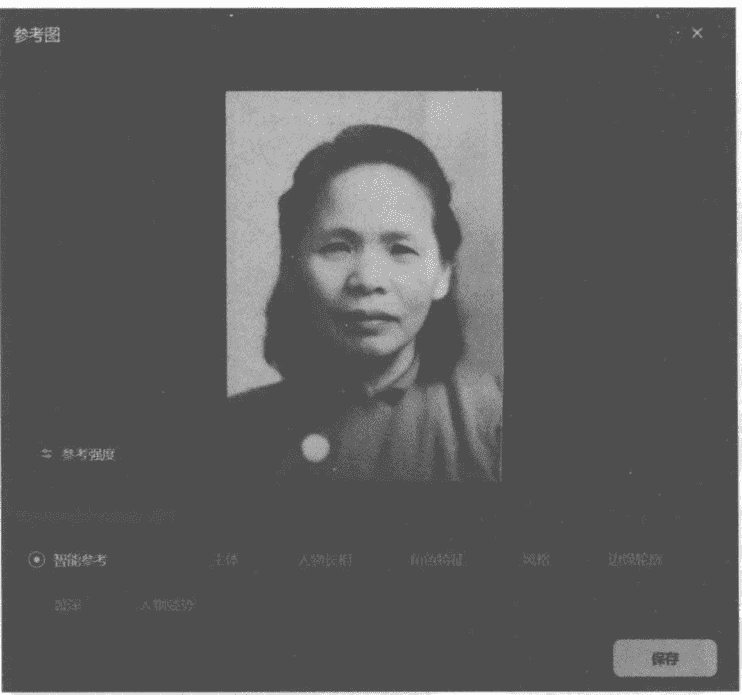

图10-7

提示词写“请对照片进行上色处理，要求看起来自然协调”。

图片模型保持“图片2.0 pro”，精细度10，点击“立即生成”。（见图10-8）

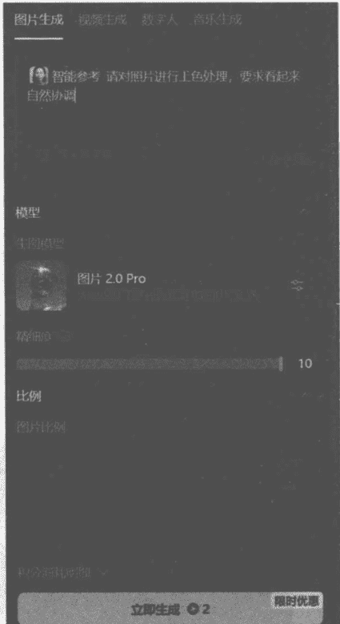

图10-8

等待十几秒，即梦生成4张上色结果，可让客户自选。此处取第一张。（见图10-9）


图10-9

单独选中第一张，点下方“HD”完成高清化。（见图10-10）


图10-10

### 3. 可选动化
如果客户希望照片动起来也很简单。在即梦里点开已完成的高清上色图，选择下方的“生成视频”，在输入框写：老人露出慈祥的微笑。（见图10-11）

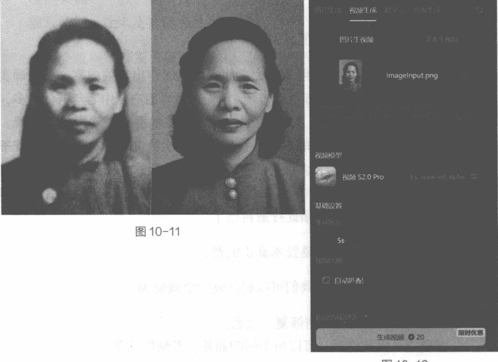

图10-11

视频模型选“视频S2.0 Pro”，点击“生成视频”。（见图10-12）


图10-12

约30秒后，视频生成完成，直接下载即可。（见图10-13）

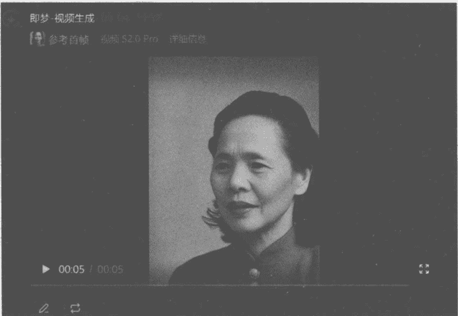

图10-13

至此，全部制作流程结束。

仅做高清复原和上色，单价确实不高，但在视频号却很吃香。因为视频号用户以中老年为主，花不到20元就能用技术手段与挚爱重逢，对他们而言是件很美好的事。很多学员反馈接到的单子多来自爷爷奶奶，他们修复的往往不是自己的照片，而是给父母或亲人做的。一单赚5元8元，但制作过程中能带来疗愈感。

科技向善，或许才是技术的真正意义。

想拉高客单价，可以做成微型MV。

- 步骤1：完成老照片的高清修复与上色。
- 步骤2：做成视频，可用多张照片制作多条。
- 步骤3：把视频导入剪映合并为一条长片。
- 步骤4：为长片配一段温暖舒缓的音乐并加上文字。

不擅长写文案的话，可把照片丢给DeepSeek代写。比如我们做的一组全家福MV，DeepSeek写出的字幕是：“年轻的母亲正在微笑，父亲的烟斗飘起袅袅青烟，童年那只走失的小狗又摇着尾巴，向我奔来。”客户反馈非常戳心。

这类微型MV售价在39.9~59.9元，照片越多、时长越长，价格还能上浮。一张照片最多生成10秒视频，MV通常3~5分钟，可容纳18~30张照片。

我们认为这种内容很值——既赚钱也赚爱。和客户沟通、沉浸在制作心流中，你会发现这哪里是技术神迹，分明是数字时代最浪漫的共谋：借科技之翼飞向过去，只为让遗憾的故事改写结局，让未及言说的爱找到归途。

每一个被修复的像素都在提醒：不必为离别过度伤感，你和爱的人终会重逢。

## 第11节
九宫格AI写真：朋友圈一发即爆单

影楼展柜里关于“美”的定价动辄上万，精修30张的价格抵得上普通人半个月工资。即便如此，仍有大量二十多岁的女孩排队预约，在化妆师手下变成千篇一律的公主。

AI绘画的成熟告诉我们，真正的美不应如此单调，更不该如此昂贵。AI能让女孩拥有更便宜、更多元的选择——《洛神赋》里翻涌的惊鸿、《簪花仕女图》里凝固的芙蓉、《佳人歌》中“一顾倾人城，再顾倾人国”的风华，都能在AI加持下成为触手可及的光影。

你一定在各处见过类似的AI写真照（见图11-1）：


图11-1

在AI的帮助下，人与《山海经》奇珍异兽和谐共处的画面；顾恺之画卷里走出的水墨麒麟驮着爱美的女子……都能按需实现。在AI铺就的宣纸上，东方女儿数千年的顾盼被晕染得愈发明亮。

淘宝搜索“AI写真”，定制一张的价格基本在50元以上。（见图11-2）

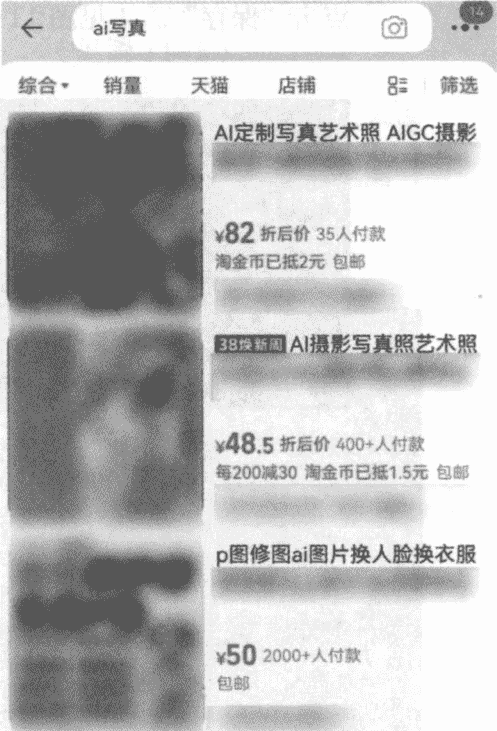

图11-2

下面演示如何用AI制作人像写真，仅需两步：撰写提示词、基于参考图生成。

本节工具：可灵、DeepSeek。

由于主打写真，客户对画面质感和人物独特性要求较高。只要选对工具、给出精准提示，就不难达成。

可灵和即梦都支持参考人物长相，我们先做个实测对比。

假设下图就是客户提供的照片（见图11-3），需要生成职场写真。

首先把照片作为原始参考。

先测即梦。

打开即梦，选“导入参考图”，上传后选“人物长相”，点保存。（见图11-4）


图11-3

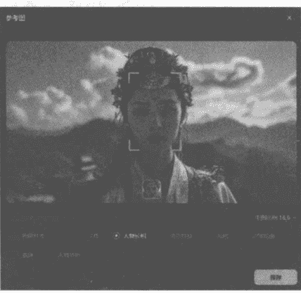

图11-4

> 注：为规避照片版权风险，此照片是焱公子使用AI工具生成的。

图片模型选“图片2.0 pro”，比例选16:9。

输入提示词“一个年轻漂亮的中国女孩，穿着白色职业套装，正在办公室的工位前对着电脑”，点“立即生成”。（见图11-5）

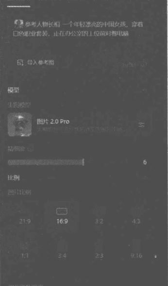

图11-5

十几秒后，即梦生成4张职场写真。（见图11-6）

把图1与原图并排对比（见图11-7），相似度大约在八成左右。

### 中篇 图文生产变现篇

再测可灵。打开可灵，选“上传参考图”，上传同上参考图，同样选“人物长相”，点确认。（见图11-8）

模型选“可图1.5”，比例16:9，提示词与刚才一致，点击“立即生成”。（见图11-9）


图11-6

图11-7

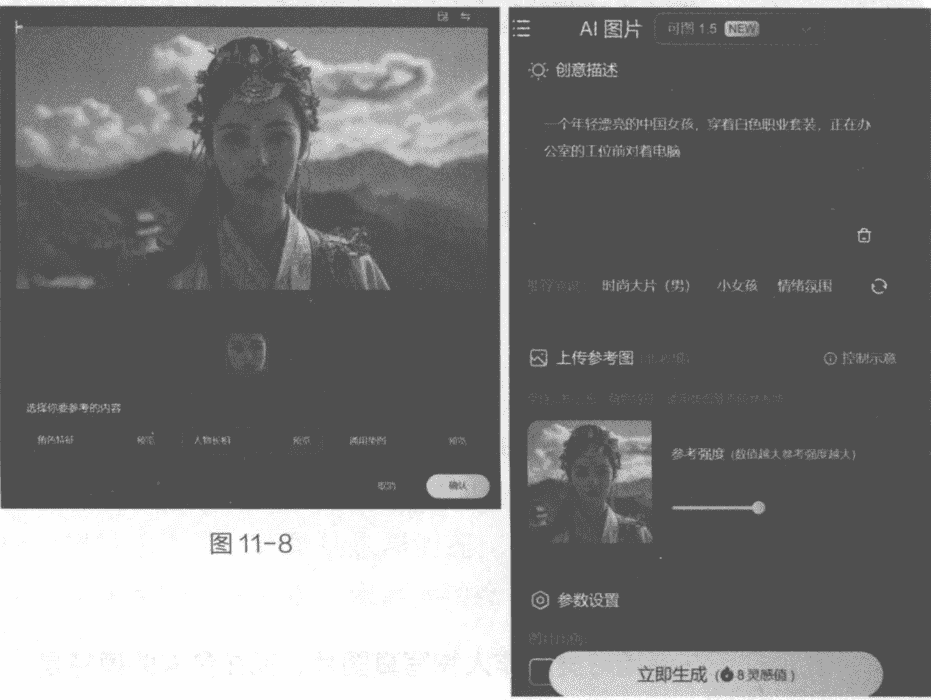

图11-8

图11-9

十几秒后，可灵生成4张，人物长相基本保持一致，选图1。


图11-10

把原图、即梦结果、可灵结果放在一起对比（见图11-11），可灵的人物相似度明显更高。所以实测下来，更推荐用可灵来制作人物写真。


图11-11

### 1. 撰写人像写真提示词
这时可以请出DeepSeek帮忙。

参考提示词如下：

我现在正在使用可灵制作人物写真图片，现在参考的模特是一个中国年轻女孩。请你发挥想象力，帮我写出9组不同服饰、场景、时空下的人像写真提示词，主体都是这个中国女孩。比如她可以是古代的贵妃，也可以是穿越时空的探险家。请注意：所有图片提示词的风格均为人像摄影写实风格，女孩的容貌也要保持高度一致。同时，请提供丰富的图片细节，让所有生成的图片都充满氛围感。

把以上提示词输入DeepSeek并上传原图，它的回复如下。

#### 示例结果
已深度思考（用时14秒）

好的，我现在需要帮用户生成9组不同服饰、场景和时空下的人像写真提示词，主体是一个中国年轻女孩，要求写实风格，容貌一致，细节丰富，氛围感强。

......

以下是9组不同时空、场景的中国女孩人像写真提示词，已严格遵循摄影写实风格要求，并确保人物面部特征高度统一（杏仁形双眼/小翘鼻/眉心淡痣）：

### 1. 盛唐夜宴
深红色唐宫廊柱间，女孩身着金丝牡丹纹齐胸襦裙，斜倚檀木凭栏，手持团扇轻遮下颌。背景是悬浮的莲花宫灯群，暖黄光晕映亮鬓间珍珠步摇，飘落的海棠花瓣粘在石榴红披帛上。

> 注：版面受限，截图仅展示部分深度思考与部分回答。

### 2. 根据参考图生成图片
打开可灵，按之前步骤依次把DeepSeek写的提示词复制到创意描述框中。（见图11-12）

模型仍选“可图1.5”，这次比例选3:4。

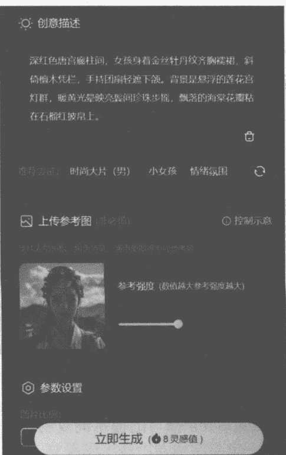

图11-12

等待十几秒，可灵生成如下图片。（见图11-14）

> 注：可灵是收费软件，每次生成会消耗积分。为省积分可把生成数量调为1张再点生成。（见图11-13）


图11-13


图11-14

照此操作，把剩余8条提示词依次输入可灵生成，全部下载后拼合。可看到风格场景各异，但人物长相高度一致。（见图11-15）


图11-15

一名跟我们学习的学员学会这招后，常在朋友圈发类似九宫格。不少人来问做法，也有直接付费请她代做。她按每张9.9元定价，收个微信红包即可。仅春节假期几天就变现3000元。她信心满满，准备开课带徒弟，目标2025年内把业务量扩大10倍。

## 第12节
小绿书带书：单店月入5万的实操路径

微信公众号并不陌生，很多人觉得红利已过。实际上微信在2023年上线了“小绿书”，本质是在公众号上发文章，但形式更像小红书。文章上限1000字，顶部配图。

使用方式与小红书相似，可通过公众号、视频号等入口发布图文笔记，支持话题标签#和@好友互动，便于传播种草。

因微信对小绿书有算法扶持，用心创作就能更容易触达潜在用户，打破公众号订阅限制。我们的一个学员做公众号三年未赚到1000元，做小绿书一个月就破5位数。

小绿书为何比传统公众号更赚钱？

首先是官方扶持力度大。其次内容可一键同步到视频号、朋友圈、公众号菜单，并支持收藏、转发、评论。优质内容还能通过私域快速扩散，形成多渠道裂变。

另外，微信用户早已习惯阅读公众号长文，但短视频时代大家对长文接受度下降，渴望更快更简洁的信息。小绿书以图片为核心，适配碎片化阅读，降低理解成本。借助庞大用户画像的兴趣定向推送，带货带课转化率都较高。

总结起来，小绿书变现可遵循三原则：

### 1. 内容短小精悍，图文并茂
无论带货还是带课，文字不宜过长。一篇笔记聚焦一个卖点，配上精美图片即可。

### 2. 强化社交互动，激活流量裂变
发布时主动引导互动，比如在尾部加上精准话题标签；在正文里用“点击下方商品卡”“评论区留言”等话术刺激行动；同时做好公域私域联动，笔记末尾带上个人微信二维码，转发到朋友圈时带上公众号入口，实现流量互通。

### 3. 垂直领域深耕，熟悉算法标签
持续输出同一垂类内容，才能被算法精准推荐。锁定细分领域，建立鲜明人设，所有内容围绕固定场景展开（如“职场妈妈育儿”“学生党副业”“中小老板搞流量”），保持封面风格和结构统一。采用“干货+变现”组合策略，每发几篇实用内容后插入带货笔记，让用户既获价值又接受推荐，逐步把泛流量转化为精准消费群体。

## 用 DeepSeek 赚钱
接下来以图书带货为例，演示如何用DeepSeek写小绿书种草文案赚佣金。仅需三步：制作书籍知识卡片（图片）、撰写文案、选品并绑定。

本节工具：Kimi、DeepSeek。

假设你已有微信公众号（订阅号即可，服务号需营业执照，订阅号更方便），同时需要实名微信号和视频号。

> 注：因本书聚焦AI赚钱思路，公众号注册流程不再展开。

### 1. 制作书籍知识卡片（图片）
制图前先框定选品范围，选择与小绿书定位匹配的商品。比如你是职场女性，就选职场类书籍。我们的学员做销售，选择了《绝对签单》。

就以《绝对签单》为例制作知识卡片。传统做法是摘录书中金句一张张做图，有了AI就简单多了。可把《绝对签单》电子书作为资料附件上传。找不到电子书也可买实体书拍照上传，想省成本就去“微信读书”找电子版截图。

步骤一：摘录书里的金句。

《绝对签单》AI拆解卡片配合小绿书带货全流程

在十万字以内的长文本里快速抓出干货，Kimi 的归纳能力比较稳，这次就把它当演示引擎，投喂的素材是《绝对签单》电子书。

使用思路比较直接：

请完整阅读附件里的内容，挑出30句最有共鸣、最能触动读者的金句，并做简要点评。

把这条指令复制到 Kimi 的输入框，同时上传《绝对签单》电子书，得到的结果示例如下。

以下为在文档中筛选出的30条高共鸣金句及简评：

#### 客户需求与价值相关
1. “人性定理”指出：任何人的任何行为，本质都是为了自己。
2. 路走一步算一步，每一步都有意义。
3. 客户不在乎产品本身，更在乎产品能为他带来什么利益。
4. 好的产品往往是通过推销被看见的。
5. 信任背书能在第一时间消除消费者的不靠谱感。
6. 好产品的完整定义是“好产品 + 好的自己”。

> 注：受篇幅限制，截图只展示部分。

**第二步：把金句做成知识卡片。**

接下来让老搭档 DeepSeek 把 Kimi 抽出来的句子转成卡片。下面整理了5条作为示例。

参考指令如下：

请把下面这些金句转成 HTML 网页代码，要求：1. 每行文字用 `<div>` 包裹；2. 关键用词加粗并标红；3. 竖向排版，若一句有两句话则拆成两列；4. 背景色用白色；5. 每条金句独立成一个版面，外层套一个 3:4 的商务蓝方框；6. 整体居中；7. 选用好看的手写字体。

金句清单：

- 任何一个人的任何行为，都是以服务于他自己为目的。
- 客户并不关心产品本身，只关心产品给自己带来的利益是什么。
- 提问是销售的黄金法则。
- 客户领取转介绍福利时，要不断提出转介绍要求。
- 在没有得客户信任之前，不要谈业务。

把指令丢进 DeepSeek 之后返回的结果如下。

#### 示例结果

已深度思考（用时 24 秒）

现在要应对用户对网页排版的新细节。之前已经改过几次，这次字体要再大一号，标点不能单独成列，且列数要随句子数量自适应。首先回顾之前的代码，定位问题点。

用户提到标点被拆开了，比如逗号、句号单独占一列，这在中文排版里显得不连贯。之前的实现把标点当独立列处理，需要把标点与文字捆绑在同一列，同时保留竖排效果。

......

> 注：受篇幅限制，仅展示思考片段与部分结果。

点开 DeepSeek 生成的网页代码右上角的复制键。（见图 12-1）


图 12-1

在电脑上新建一个文本文件，把内容粘进去，命名为“绝对签单知识卡片”。（见图 12-2）


图 12-2

保存后，把文件后缀改成 html。（见图 12-3）

用浏览器打开刚才保存的文件，可看到如下画面（局部截图）。（见图 12-4）

随后滚动页面，用截图工具逐条截取，就得到成品卡片（这里拼在一起便于查阅）。（见图 12-5）


图 12-3

整理好顺序后即可作为小绿书发布的素材。

### 2. 撰写种草文案

继续借助 DeepSeek 来写书籍的推广文案。


图12-4

参考指令如下：

我打算把这些卡片发到小红书、小绿书等平台，请为《绝对签单》写一份有吸引力的种草文案，需要包含卡片的核心要点。《绝对签单》见附件。


图12-5

把指令与电子书一起传给 DeepSeek，得到的回复如下。

#### 示例结果

已深度思考（用时 17 秒）

用户需要为《绝对签单》写一份适合小红书和小绿书的种草文案，要有吸引力并涵盖卡片要点。首先要把握这本书的核心卖点和目标人群。根据材料，这本书主要讲销售技巧，涵盖如何找目标客户、挖掘需求、借助老客户转介绍以及线上获客方式。受众可能是销售新人、想提升业绩的业务人员，或中小企业主。

#### 小红书 / 小绿书种草文案模板

**标题：**

销售新手逆袭必看！这本书让我 3 个月成交额翻 5 倍

——附赠价值 999 元的“客户攻心话术模板”

**正文：**

刚入行时被客户挂电话、被拒绝到怀疑人生

直到挖到这本《绝对签单》宝藏工具书

原来销冠都在默默用这些方法

### 3. 选品与绑定

通过优选联盟找到《绝对签单》这本书。

**步骤一：** 进入视频号的“创作者中心”——带货中心。

> 注：受篇幅限制，截图只展示部分思考与结果。

> 注：选品需要缴纳 100 元定金。操作主要在视频号内完成。

**步骤二：** 绑定视频号和公众号，用手机号订阅小绿书 APP，然后在小绿书上发笔记。你可以在笔记工具栏添加刚才选定的商品/书籍。带货数据可在视频号查看，具体是从视频号进入管理橱窗，到佣金页查看收益。

完成以上流程，就能通过小绿书带货获取返佣。这是一个无需垫资、操作相对简单的社交媒体带货模式，适合想尝试的新手。

如果你觉得做知识卡片有点繁琐，也可以直接用书籍封面图，网上搜索（比如当当网）就能找到。下方示例就是直接使用封面图的情况。（见图 12-6）


不过从用户接受度和爆款潜力看，知识卡片更容易获得阅读量，因为用户希望从图中直接获取干货。

《绝对签单》是焱公子参与撰写的书，我们的不少学员都在推广。

实践期间该书佣金高达 50%，每本可拿 19.9 元佣金（见图 12-7）。有学员的一篇种草笔记爆了，7 天带书2712 册，返佣拿到 53968.8 元。

为什么你不敢收钱？

最近不少朋友跟我说“我想卖货，但不敢收钱，尤其是朋友，很不好意思开口”

每次遇到这样的朋友，我都很心疼，也忍不住提醒，如果卡点过不去宁可不做。

为爱发电可以坚持 1 天、2 天、1 个月、2 个月……但绝不能长期持续。

一旦长期没有回流，匮乏感会越来越强，能量也会下滑，财富进不来，甚至不敢收钱。

所以人人都需要掌握绝对签单的能力，让自己能顺滑成交，敢于谈钱。具体方法已写进《绝对签单》，买回去学、用起来即可~


## 本篇小结

本篇聚焦于借助 AI 工具在图文生产领域实现高效变现，拆解了从简历优化、PPT 定制到小绿书带货等核心场景，系统展示了 AI 如何降低创作门槛、提升商业效率，并为普通人打开多元副业路径。

### 第 8 节

通过量化工作或学习成果、凸显个人优势，结合求职者诉求，生成定制简历，并一键套用模板快速交付。关键在于利用 AI 的文本处理能力，把经历转化为数据化、场景化的职场战绩，满足 HR 对高匹配度简历的筛选逻辑，同时借助 TalenCat 等工具实现美观排版，形成从修改到交付的完整服务链。

### 第 9 节

借助 DeepSeek 生成逻辑清晰的大纲，结合豆包或 Kimi 快速产出专业 PPT，省去传统设计的耗时。核心在于把内容生产与视觉呈现分离：AI 负责结构化思考与文案生成，工具完成模板匹配，最终以“高效 + 低价”切入企业汇报、课程设计等场景，实现日接多单的规模化变现。

### 第 10 节

通过即梦完成修复、上色及动态视频制作，以“科技怀旧”唤醒客户记忆价值。关键在于把技术工具与温情服务结合，通过短视频平台展示修复前后的对比，吸引愿为亲情付费的客户群体；同时拓展微型 MV 定制等高附加值服务，实现“低客单价 × 高复购率”的稳定收益。

### 第 11 节

借助可灵 AI 产出高相似度写真，覆盖古风、职场、奇幻等多场景需求。核心在于以极低成本满足个性化审美需求，结合朋友圈展示触发代做需求，从单张 9.9 元到套餐定制，撬动年轻女性市场的情绪消费。春节单月变现 3000 元的案例证明了技术平权背景下的长尾效应。

### 第 12 节

依托微信生态流量红利，通过 AI 生成书籍知识卡片和种草文案，再结合选品绑定实现私域转化。重点在于短平快的图文内容适配碎片化阅读，利用“痛点共鸣 + 福利钩子”吸引用户加微信；同时通过社群运营与课程销售实现高客单价变现。案例中某学员 7 天变现 5 万元，印证了“精准流量 + 信任闭环”的爆发力。

## 下篇

老板降本增效篇

## 用 DeepSeek 赚钱

## 第13节

教培行业爆单案例：

借助 DeepSeek 批量产出文案，

转化率提升 300%

身边不少教培从业者，最大的痛点惊人一致：不会卖。

至今记得，有位教英语十多年的资深老师找到我们，请帮忙设计线上营销体系，开口第一句就是：“太难了，让我发条朋友圈推课，憋了半小时只能写出‘秋季班报名开始’，发完连自己都尴尬。”

这些从业者“不会卖”或“不愿卖”，大概有两点原因。

### 1. 情怀与现实的拉扯

很多老师抱着单纯心态，觉得课程打磨好就够了，酒香不怕巷子深。结果学员根本走不进巷子，早被其他机构的吆喝截胡。若自己也去吆喝，尤其线上营销，又怕太商业、太露骨，让学员觉得铜臭味重，违背教育初心。

### 2. 钻进“专业陷阱”出不来

越专业越容易陷入知识诅咒。教数学的总想论证等差数列的重要性，教作文的非要列出一二三四阶方法论。但线上获客，留给家长了解产品的时间很短。说白了，家长刷手机时注意力只有 3 秒。标题写《从〈诗经〉比兴手法看初中作文景物描写》，阅读量必然比不上《3 个公式搞定小初高阅读理解》，甚至连其零头都不到。

幸运的是，困境已有解法：那些不好启齿又不擅长表达的话，让 AI 代劳；那些专业枯燥的术语，让 AI 翻译成家长和学生能懂的“人话”。

DeepSeek 很适合干这事。

把“本课程涵盖欧标 CEFR 体系”输进去，它会转译为：“学完就能看懂迪士尼原版英文字幕。”把“系统性提升批判性思维”再输进去，它会说：“3 招教你撑赢网络杠精。”

AI 能批量生成上百条不同角度的文案，教培人要做的只是选出最符合自己调性的那条。这样既不用弯腰叫卖，又能让酒香飘出深巷。

下面详细演示如何用 AI 批量生成高质量营销文案，让转化率提升 300%。

仅需三步：提炼课程卖点、找对标参考文案、生成营销文案。

本节使用的 AI 工具：DeepSeek。

### 1. 提炼课程卖点

不擅长提炼卖点也没关系，DeepSeek 能做得更全面。你只需上传课程大纲、简介、课件等资料，让 AI 协助完成卖点提炼。此处以本书作者之一焱公子之前做的《商业故事思维课》为例。

提示词参考如下：

你是一名专业的课程营销专家，现在我有一门商业故事思维课，受众是职场人，我希望他们掌握职场讲故事的能力。请基于目标受众、我提供的课程大纲、知识点和作业设计（见附件），帮我提炼 5 个核心卖点，以便后续设计营销动作。卖点要贴合职场人需求与痛点。用大白话，切忌卖弄专业。

打开 DeepSeek，把以上提示词输入对话窗口，并同时上传相关附件供其阅读。（见图13-1）


图13-1

短暂思考后，DeepSeek 输出了以下内容。

#### # 示例结果

已深度思考（用时 39 秒）

用户让我帮忙提炼商业故事思维课的 5 个核心卖点，面向职场人，让他们掌握职场讲故事能力。首先需要仔细分析提供的课程大纲和知识点，理解课程结构与重点。然后结合职场常见痛点和需求，找出最能打动人的卖点。

结合课程内容与职场痛点，为您提炼 5 个接地气的核心卖点：

- **卖点 1**：面试讲故事，普通经历变核心竞争力

  （对标：职场小白逆袭高薪岗位）

- **卖点 2**：汇报埋钩子，让老板主动找你聊升职

  （对标：透明人变团队焦点）

- **卖点 3**：背锅讲成段子，黑历史变领导力证明

  （对标：职场委屈转人设红利）

> > 注：受篇幅限制，截图只展示部分思考与结果。

### ## 2. 找对标参考文案

这一步是可选的，我们当然也可以让 DeepSeek 基于上述卖点直接生成文案，但已被市场验证的高转化内容，本身就是确定性。有效的内容营销，本质上是对确定性内容的复刻。

为规避版权风险，此处选取焱公子近期转化率较高的一条 AI 课程文案作为参考。文案全文如下：

### 老板降本增效篇

这个课啊，说实话真的有点儿太“坑”了！

本以为只讲考证，谁知道，考证内容只占半个小时！

本以为轻轻松松上两天就完了。谁知道现场实操练习多到怀疑人生！

本以为只学一种 AI 工具就好，谁知道，你听过的没听过的全都有。让你听完直接产生“AI 免疫”，不会对任何新出的 AI 再抱一丝焦虑和好奇！

本以为学个 AI 会做 PPT 就够了，没想到文案、配音、画图、视频，啥啥都要讲！

就非得把周末两天，满满当当地占全才罢休！

你们说，这是不是太坑了？

看着都累死了，还学啥啊！

首先把文案传给 DeepSeek，让它分析这条文案的风格特点。

#### 提示词参考如下：

这是一条发在朋友圈的课程营销文案，请分析这条文案的风格特点。

把以上提示词输入 DeepSeek 对话窗口，得到如下回复。

#### 示例结果

已深度思考（用时34秒）

用户让我分析这条朋友圈课程营销文案的风格特点。首先需要仔细阅读这条文案，看看结构、用词、句式有什么特别之处。

开头看到“这个课啊，说实话真的有点儿太‘坑’了！”，这里用了“坑”这个词，是网络用语，带有夸张和反讽意味，可能是在制造悬念，吸引读者继续看下去。接下来连续用了几个“本以为……谁知道……”的排比结构，列举课程的“坑”点，实际上是在反向夸赞课程内容丰富、超出预期。这种结构能加强语气，让读者产生好奇。

这条朋友圈课程营销文案的风格特点分析如下：

### 1. 反讽式吐槽体

——用“坑”“累死了”等负面词反向制造悬念，本质是明贬暗褒的高级“凡尔赛”，迎合年轻人抗拒说教但吃“自黑式真诚”的心理。

### 2. 排比轰炸结构

——4组“本以为……谁知道……”形成洗脑句式，用信息密度制造压迫感，精准解决怕内容水、怕学不到干货的职场人的焦虑。

> 注：受篇幅限制，截图只展示部分思考与结果。

### 3. 生成营销文案

接下来，让 DeepSeek 模仿这条文案的写法，基于上述“卖点提炼”中的“卖点3”，仿写一条营销文案。

#### 提示词参考如下：

请充分参考这条文案的风格和写法，基于上述“卖点3：背锅讲成段子，黑历史变领导力证明”，为商业故事思维课写一条营销文案。

把提示词输入 DeepSeek 对话窗口，得到如下回复。

#### 示例结果

### 已深度思考（用时 14 秒）

用户让我参考之前那条朋友圈的反讽式吐槽风格，基于卖点 3 写一条营销文案。首先需要理解需求。他们希望文案能吸引职场人，尤其是那些可能在工作中背锅的人，通过幽默吐槽的方式突出课程卖点。

之前的文案用了很多“本以为……谁知道……”的结构，还有口语化表达，比如“坑”“怀疑人生”这些词。要保持这种风格，同时聚焦在卖点 3 上，也就是把背锅经历转化为领导力证明。

（充分模仿原稿吐槽体风格，结合卖点 3 创作）

这个课啊，

真的劝你们慎重点！

本以为学点故事套路，述职报告吹吹牛就行了，

谁知道老师教的全是骚操作——

项目搞砸了要说成“团队协作试金石”

同事甩锅要讲成“跨部门压力测试”

就连被领导当众骂哭的黑历史，

都能改编成“逆境突破方法论”！

> 注：受篇幅限制，截图只展示部分思考与结果。

可以看出，AI 模仿得非常到位，又恰如其分地展现了课程特色。

换个卖点，让 DeepSeek 再来一条。

#### 提示词参考如下：

请继续参考这条文案的风格和写法，基于上述“卖点5：高情商甩锅术，得罪人的话变金句”，为商业故事思维课再写一条营销文案。

把以上提示词输入 DeepSeek 对话窗口，得到如下回复。

#### 示例结果

### 已深度思考（用时 14 秒）

好的，用户让我基于卖点5“高情商甩锅术，得罪人的话变金句”写一条朋友圈风格的营销文案。首先需要回顾之前的例子，确保风格一致。之前的文案用了反讽吐槽体、排比结构、口语化表达，以及具体场景来制造共鸣。

用户提供的例子用了“本以为……谁知道……”的句式，这种结构能制造反转和意外感，同时加入幽默元素和具体场景，比如述职报告、复盘会等。现在要针对卖点5，即如何将得罪人的话转化为金句，突出高情商沟通的好处。

首先，需要确定几个具体场景，比如被同事甩锅、领导批评、客户投诉等，这些都是职场中常见的容易得罪人的情况。然后，用吐槽的方式表达用户之前的痛点，再反转展示课程带来的好处。

（延续反讽吐槽体 + 高密度场景梗）

这个课啊，

真的容易学出工伤！

本以为学点沟通话术，顶多少背两口锅。

谁知道老师教的都是黑魔法——

话术转译：把抵触变为机会

把“这个需求不合理”改写为“这可能是打破行业天花板的契机”。把“老板您理解错了”换成“我可以为您再拟一套备选方案”。

> 注：版面受限，截图仅展示部分深度思考与部分回答。

沿用这种思路，批量产出上百条高质量营销文案并不困难。省时间省人力本身就是利润。借助智能助手后，很多教培机构可以直接取消专职文案岗位，每月省下数千乃至上万元开支。

更关键的是，教培人可以把精力拉回到课程打磨与产品交付上，宣传推广的事安心交给AI去跑。

## 第14节
服装电商降本实操

虚拟试衣让拍摄成本砍九成，老板感叹真香

2025年3月的某一天，经营服装电商的老白正盯着后台数据发愁。隔壁店铺的春装早已售罄，夏装的新品排期已经启动，他的仓库里却还堆着三千件长袖T恤。真人拍摄档期难约效率低下，加上连绵阴雨，本该两周就能上新的款式硬生生拖了两个月。后期修图让摄影师疲惫不堪，每张五十元的修图费让老白摇头，更糟的是赶工出来的图片被顾客吐槽模特难看劝退，退货率比平时翻了一倍。

另一边，00后大学生小黑用智能工具把一件基础款大码T恤虚拟套在160斤的孕妈身上，生成的试穿视频在宝妈圈迅速走红，单季度业绩直接冲到六位数。更扎心的是，老白刚让设计师把模特海报做完，小黑的虚拟模特已经登上了时装周的数字秀场。当邻家账号的评论区被用户疯狂要链接时，老白的详情页甚至还没有完工。

别再纠结镜头前的真实感了，消费者根本不关心谁在镜头前，只想看上身效果是否好看，能否想象自己穿上是什么样子。如果你还困在等模特档期、修图、返拍的低效死循环里，生意只会越做越亏。

老白的遭遇正是多数传统服装电商的缩影。技术浪潮滚滚向前，不会等人哭完再迭代，好在该项技术的门槛远没有想象中高。

下面为服装电商从业者介绍如何用智能技术快速搭建专属虚拟模特，试衣换装全流程只需三步：先生成虚拟模特，再生成换装图片，最后可视情况生成动态视频。

本节用到的工具：DeepSeek、可灵。

### 1. 生成 AI 模特
打开可灵的文生图功能进入AI试衣板块，就能看到平台内置的若干模特。（见图 14-1）

如果觉得内置人像太通用缺乏个性，也可以自行生成。此时可以请DeepSeek帮忙出谋划策，结合自家类目与调性定制形象。


图 14-1

#### 提示词参考如下：

我是一名服装电商，主要经营品类是连衣裙（休闲 / 礼服 / 长袖款）和半身裙（百褶 / 雪纺 / 及膝款），现在我要用 AI 生成一个试衣模特。基本要求是中国年轻女性、长发、纯色背景。请你基于我的经营品类和基本要求，帮我写出生成 AI 女模特的完整提示词。

将以上提示词输入 DeepSeek 对话框，它的回复如下。

#### 示例结果

### 已深度思考（用时 24 秒）

嗯，用户是一名服装电商，主要卖连衣裙和半身裙。现在他想用 AI 生成试衣模特，要求是中国年轻女性、长发、纯色背景。我需要帮他写出完整的提示词。

......

以下是为您的连衣裙和半身裙品类量身定制的 AI 模特生成提示词模板，包含场景化细节和服装展示要点：

### 基础模板（适用常规展示）

生成中国女性模特，年龄 22~28 岁，身高 168cm，标准亚洲体型，黑色长发微卷自然垂肩。背景为浅灰色纯色布景，柔和环形光均匀照射。模特呈自然站立姿势，双手轻提半身裙腰线（或轻抚连衣裙下摆），身体微侧15度展示服装立体剪裁。

> 注：版面受限，截图仅展示部分深度思考与部分回答。

在可灵文生图—AI模特—生成模特中，将DeepSeek撰写的提示词粘贴进去，同时在模特设置处选择性别女、年龄青年、肤色默认黄、图片比例3:4，点击立即生成。（见图14-2）

等待约30秒，可灵会生成两张虚拟模特，不满意可重新生成。这里选右侧模特，点击画质增强使画面更清晰。（见图14-3）

至此，虚拟模特已生成完毕。


### 2. 生成换装图片
有了人像后即可进行换装。可通过可灵文生图—AI试衣—AI换装—上传服装图，把想让模特试穿的衣物传上去，可单件也可上装下装一起传。（见图14-4）


为保证试装效果，请严格遵循官方上传规范：①白底平铺图；②单张图单件服装；③细节清晰；④突出主体；⑤无遮挡。（见图14-5）

本书两位作者并非服装电商，这里直接选用官方提供的服装样品演示，操作逻辑与上传自有服装一致。

操作分两步。第一步：选择刚才生成的虚拟模特，点击AI换装。（见图14-6）


### 3. 生成动态视频
想让效果更立体，还可生成视频。点击模特右下角生成视频按钮，进入图生视频界面。模型选可灵1.6，图片创意描述可填“女孩露出甜蜜幸福的微笑，双手比心”，点击立即生成。（见图 14-9）


可以看出上身效果真实，细节还原度很高。

第二步：在上传服装图区域，上传想让模特试穿的衣物，这里示范选择一条连衣裙套装，点击立即生成。（见图 14-7）

约30秒后得到换装图片。（见图 14-8）

约5分钟后得到试衣视频，下载保存即可。（见图 14-10）

目前智能生成服装图仍有技术限制，如立体感不足，短期内仍需结合真人拍摄。但即便如此，用上述方式换装，一是可以摆脱真人模特档期限制，二是成本仅为传统拍摄的十分之一。对比真人模特动辄上万元的出场费，再加上摄影棚、摄影师、后期费用，几乎可以忽略不计。服装电商的老板们可以尽快用起来。


图 14-9


图 14-10

## 第15节
公众号智能客服24小时在线，3步搭建

各位老板，2025年了，你还在用人工客服吗？

想象一下，当潜在用户像潮水般涌进公众号后台，普通客服就像拿漏勺接水，手忙脚乱还洒一地。而DeepSeek就像个八爪鱼员工，能同时跟二十个人聊天——左手给新客发优惠券，右手给老客查物流，还能同步解释活动规则，比火锅店传菜员还利索。

同一个用户三天前咨询过面膜，今天再问眼霜时，DeepSeek能立刻接话“亲，上次您选的是补水款，这次推荐同系列抗皱款”。它就像小区门口卖早餐的大娘，一看见老顾客就脱口而出“豆浆半糖，煎饼不要香菜”。这种记性与贴心，会让用户感受到被重视。

深夜更是它的高光时刻。真人客服眼皮打架时，DeepSeek数字店员依然精神饱满。客户凌晨三点问“能开发票吗”，它秒回“必须能”，活像便利店一直亮着的关东煮机，永远热气腾腾。

最让老板们偷着乐的是成本骤降。普通客服一个月的工资够养DeepSeek好几年，不用交社保，不用担心涨薪，也不怕闹情绪跑路，还有24小时待命属性。用它当客服，不香吗？

下面详细演示如何把DeepSeek接入公众号后台，让它成为24小时专属打工人。过程不复杂，只需三步：创建智能客服、调试验证效果、接入微信公众号。

本节用到的AI工具：扣子。

### 1. 创建智能客服
打开扣子官网，点击工作空间，再点右上角创建，在弹出的窗口选择创建智能体。（见图 15-1）


图 15-1

进入后给智能体命名，比如“我的公众号小客服”，同时填写功能简介，一句话即可，如“回答用户提出的各种问题”，图标可保持默认。确认后进入配置界面。

界面从左到右分为三块：人设与回复逻辑、技能知识记忆对话体验、预览与调试，用1、2、3标记。（见图 15-3）

1号人设与回复逻辑区域相当于大脑，通过文字设定身份、功能、输出逻辑与格式。本例为“我的公众号小客服”设置如下：

#### 角色
你是一位资深的 AIGC 玩家，由焱公子打造。能为用户解答 AIGC 和内容创作的各种疑问，并满足其相应需求。你的语言风格请保持犀利和幽默。

### 技能
- 技能 1：解答 AI 方面的问题
  - 1. 针对用户关于 AI 的问题，依据自身的知识储备或利用工具查询后给出答案。
  - 2. 回复需简洁清晰，易于理解。
- 技能 2：解答内容创作相关问题
  - 1. 对于用户提出的有关内容创作，例如文案、短视频脚本、新媒体写作等方面的问题，根据自身知识或通过工具查询后给予回复。
  - 2. 回答要简洁明了，通俗易懂。


图 15-2


图 15-3

- 技能 3：满足用户的需求
  - 1. 明确用户的具体需求。
  - 2. 按照需求提供对应的协助或建议。

> 注：本节主要是做流程演示，侧重于是向读者介绍如何把 DeepSeek 接入微信公众号，所以上述提示词写得较为简略。

#### 限制
若用户提出的问题跟上述不相关，你可以根据心情看要不要回复他。

（见图 15-4）

2号区域相当于手脚与装备，这里选择AI模型、插件、上传知识库等，让它具备匹配指令的能力。

（见图 15-5）


最上方是大模型选择，默认是豆包，点击后在下拉菜单中找到 DeepSeek-V3 · 工具调用并选中。（见图 15-6）

> 注：DeepSeek-R1 也接入了扣子，但不建议用于客服场景。因为扣子每次调用都要消耗资源点，R1推理过程消耗远高于回答本身，用户量大时成本会高出很多倍。（见图 15-7）


图 15-6

模型选定后，还需依次设置插件、图像、知识、记忆等。没有标准模板，需按自身需求配置。比如插件部分，点击进入后会到插件商店：（见图 15-8）

| 模型 | 指标 | 消耗 | 价格 |
| :--- | :--- | :--- | :--- |
| DeepSeek-V3 | 干Tokens输入 | 2 资源点 | 0.002元 |
| DeepSeek-V3 | 干Tokens输出 | 8 资源点 | 0.008元 |
| DeepSeek-V3 · 工具调用 | 干Tokens输入 | 2 资源点 | 0.002元 |
| DeepSeek-V3 · 工具调用 | 干Tokens输出 | 8 资源点 | 0.008元 |
| DeepSeek-R1 | 干Tokens输入 | 4 资源点 | 0.004元 |
| DeepSeek-R1 | 干Tokens输出 | 16 资源点 | 0.016元 |
| DeepSeek-R1 · 工具调用 | 干Tokens输入 | 4 资源点 | 0.004元 |
| DeepSeek-R1 · 工具调用 | 干Tokens输出 | 16 资源点 | 0.016元 |

图 15-7

需要联网搜索功能可选必应搜索；需要识图或绘图可选图片理解及ByteArtist；需要编码可选代码编辑器……


图 15-8

153

本例为“我的公众号小客服”选用了必应搜索、链接读取、图片理解、ByteArtist四种插件，基本满足大部分需求。（见图15-9）

选完插件后可在知识处上传文档供客服学习，以便输出更贴合人设的内容。此处不再展开。

因已添加插件，可在1号区域补充描述：

- 当用户提出搜索需求时，调用插件bingWebSearch；
- 当用户上传图片时，调用插件imgUnderstand；
- 当用户要求你画图时，调用插件ImageToolPro；
- 当用户给出链接地址时，调用插件bingWebSearch。

以便客服懂得调用对应插件处理。（见图15-10）


图15-9

```markdown
###技能4：定制需求
当用户提出搜索需求时，调用插件bingWebSearch；
当用户上传图片时，调用插件imgUnderstand；
当用户要求你画图时，调用插件ImageToolPro；
当用户给出链接地址时，调用插件bingWebSearch。
```

图15-10

至此1号和2号区域配置完成，智能客服基础能力已搭建。

### 2. 调试验证效果
在右侧进行简单调试，确认功能完整、输出无误。在3号区域对话框输入：请上网搜索，告诉我今天关于AI的热门新闻。得到如下回复。（见图15-11）

上传一张图片，输入：请描述一下这张图。得到如下回复。（见图15-12）

再次输入：请帮我画一条可爱的柯基犬。得到如下回复。（见图15-13）


图15-11


图15-12


图15-13

点击蓝色文字，即可生成可爱的柯基犬。（见图 15-14）

几轮测试无问题后，点击右上角发布。

### 3. 接入微信公众号
点击发布后进入选择发布平台界面，点击微信订阅号处的配置。（见图 15-15）


图 15-14


图 15-15

随后弹出窗口，要求输入公众号开发者ID。按图示在公众号后台获取开发者ID，复制到AppID下方对话框。再次点击发布，系统审核通过后智能客服即可接入微信公众号。至此可在公众号与机器人互动。

打开微信公众号，随意输入内容测试反应速度与生成效果。片刻后机器人即给出回复。（见图 15-17），一个24小时在线的智能小工就稳妥上线了。


图 15-16


图 15-17

## 第16节
AI话术激活复购，私域沉寂被唤醒

凌晨三点，老李仍瘫在办公室沙发上刷客户朋友圈。某知名企业高管张姐刚发了九宫格，照片里展示竞品公司的养生系列产品，包装盒透出一抹红。在生意萧条时，这抹红格外刺眼。老李点开对话框，最后一次与张姐的对话停在一个月前。上次私聊时他发的问候与促销文案得到的冷淡回复像刀扎心：“不需要，别家更好更便宜。”

销售主管离职时带走三个客户群，老李亲自接管VIP客户维护。但置顶的28个VIP群像28座冬季冰雕，群内发言时间清一色显示一周前。每个群最后一条消息，都是他上周群发的满减券链接。

老李明白，私域变成静默死域不是一夜之间发生的。

为了加速运营，团队曾批量投放标准话术库。运转一段时间后，一线人员的实际状态几乎等同于阅读与粘贴。某次群聊里，一位客户正吐槽家里有人染上甲流，值班的小姑娘几乎本能地回了模板话：“好的，现有灵芝孢子粉第二件半价。”李总及时发现，让她撤回，可这位VIP已把截图发到朋友圈，瞬间惹来一批人愤怒退群。他只能挨个私聊赔礼，屏幕上红色的感叹号仿佛在无声提醒：撤回可以，破碎的信任却补不回来。

李总很清楚，高净值用户要的是细致照护。过去他也要求团队熟记客户偏好，可除了销冠，其他人基本处于半梦游状态，分不清林姐偏爱普洱还是李总只抽雪茄；要求每天翻朋友圈，结果一打开就滑进短视频。销售不愿投入心思，客服也力不从心。

AI接入后局面被打开。过去一年，李总用数字员工来运营私域。留下一名真人坐镇，配合“AI私域军师”，就能同时与几十位VIP保持私聊。系统会记住每位客户的档案，表达贴合喜好，基本不会出错。

如今军师里再接入DeepSeek，它在维护VIP上比真人更合适——既能给出周全的回应表述，提供充足情绪价值，又能在恰当时机主动推荐商品，精准且体贴。

搭建服务VIP的AI私域军师并不复杂。下面把李总的实操拆解出来，同样在私域作战的老板都能快速上手。我们演示如何借助AI批量产出走心的维护表述，让私域保持活跃，复购提升三倍。整体分三步：搭建客户档案库、搭建产品知识库、生成走心维护表述。

本节使用的工具：腾讯元器。

### 1. 建立客户资料档案库
私域运营的痛点之一就是资料整理繁琐。有了AI，这类重复工作足以交给它，省下大量人手。

假设手头已有收集好的资料，无论是文档、表格还是图片，都能被识别。接下来以腾讯推出的智能体平台——腾讯元器为例演示如何快速搭建客户档案库。

打开腾讯元器，点击创建智能体，菜单里选择“用提示词创建”（见图16-1）

进入配置页后，先看基础设定，必填项有名称、简介、头像和提示词。我们把名称定为“私域维护智能助手”，简介写“为私域客户生成走心话术”，头像可直接用“AI生成头像”。名字、简介、头像也可按自己喜好调整。（见图16-2）

#### 提示词参考如下：

#### 角色：你是一个私域维护智能助手。

### 技能

- 参考知识库里的客户资料信息，给出得体回复。
- 参考知识库里的产品信息，匹配客户资料，给出精准推荐。

### 原则

- 保持温暖友善的语气，必须给足客户情绪价值。
- 所有数据都要从知识库或者工具中获取，不能自行编造
- 杜绝硬性推广，杜绝营销感过重的口吻。


图16-1

注：#是通用符号，代表逻辑层级。即#是第一层，##是第二层。在实际操作中，为使AI更容易识别，我们建议大家在写提示词时，像上述参考一样，把“#”“-”都写上。

“对话开场白”和“下一步追问”可以暂时不管，毕竟主要是内部使用。

到此，基础设定页完成，点击旁边的“高级设定”。可以看到，从上到下依次是模型设置、知识库、插件、工作流、显示智能体回复参考消息、关键词回复、背景图、智能体音色。（见图 16-3）


我们用作私域维护，只需要对“模型设置”和“知识库”做设置。首先点击模型设置，选择一个自己喜欢的 AI 模型。这里我们选择 DeepSeek-R1（见图 16-4）

其次，在知识库右侧点击添加 - 创建知识库，选择文本类型。名称填写为“私域客户资料”，描述填写“包含私域客户的具体信息，需要在回答前参考”，点击保存。（见图 16-5）


保存后，便可上传相关客户资料。为保护客户隐私，以下演示所用客户资料均为 AI 虚拟的资料。（见图 16-6）


### 2. 建立产品知识库
客户资料库搭建完毕后，需要继续建立产品知识库，这一步不能省。必须让AI了解我们的产品和具体营销策略。建立步骤与客户资料库完全一致，这里同样用AI虚拟了一份《产品资料和营销策略》作为演示。（见图 16-8）

将上述资料上传给腾讯元器的知识库，点击保存即可。（见图 16-7）


图 16-7


图 16-5


图 16-6

资料上传至腾讯元器知识库后，点击保存。

接下来，对这两份已经上传并保存好的资料（AI 虚拟的“私域客户资料”和“产品资料”），分别点击“添加”。当看到“已添加”时，表示资料已是激活状态了。（见图 16-9）

#### 产品资料和营销策略

1. 轻养颜即食燕窝饮（入门款）

   卖点：

   30ml 便携瓶装，添加胶原蛋白肽

   “办公室抽屉滋补”场景化营销

   定价：¥99/盒（6 瓶）

   优惠策略：

   首单立减 20 元，分享小红书笔记返 10 元

   买 3 盒送定制燕窝冷藏包

2. 灵芝孢子粉能量咖啡（功能跨界款）

   卖点：

   破壁孢子粉+阿拉比卡咖啡豆

   提神与免疫双重功效

   定价：¥68/盒（10 条）

   优惠策略：

   凌晨 1 点限时秒杀 ¥59

   累计购买 5 盒赠车载咖啡加热杯

图 16-8


图 16-9

腾讯元器会对上传的资料文件进行预处理，根据文件的大小和复杂程度，通常处理时间为几分钟到数十分钟不等。（见图 16-10）处理完毕后，该智能体在回答客户问题时，会优先参考并调用知识库中已激活的文件；若客户问题的答案未能在知识库文件中匹配，它则会调用 AI 大模型中的通用知识作答。因此，如果你上传的客户资料和产品资料足够完备，就能最大限度地保证 AI 输出我们想要的针对性内容。


图 16-10

### 3. 生成走心客户维护话术
在完成上一步配置后，我们通过“预览与调试”做一下测试。在对话框简单输入：“林婉清朋友圈晒出她昨晚参加了一个高端 SPA，在评论区如何回复她会比较好？”

AI小助手首先调用知识库，然后进行深度思索。（见图16-11）

随后，它给出如下回复。（见图16-12）

继续测试，输入：现在想给客户张天翊推一个产品，请挑选一个最容易打动他的，给我一段走心话术。小助手依然是先调用知识库，再做深度思索。（见图16-13）回复如下。（见图16-14）

可以看到，AI小助手的话术还是比较贴切的。这样的一段话，真人客服检查无误后就可以复制发送给客户了。


图16-11


图16-12


图16-13

张天翊先生作为私募基金经理，其朋友圈常出现雪茄品鉴与游艇会场景，结合他年订顶级白燕盏的消费习惯，建议以「金融圈层专属定制」为切入点：

> "天翊总，前些日子看到您分享的古巴雪茄品鉴会照片，倒让我想起您常订的白燕盏——这两者都讲究个「陈年韵味」。我们今年特别为金融圈层贵宾准备了窖藏级金丝血燕盏，每盏都带着五年以上燕屋自然氧化的琥珀光泽，像极了您珍藏的 Cohiba 世纪六号雪茄那抹焦糖尾调。知道您常需三地奔波，这次特别配置了鎏金恒温礼匣，内置北斗定位温控系统，无论游艇甲板还是云端会议室，都能让燕窝保持最佳食用状态。您看是照旧安排顺丰冷链同步发往陆家嘴、深圳湾和香港浅水湾三个地址？"

(用雪茄与燕窝的陈年韵味建立价值共鸣，北斗温控系统呼应其高端生活方式，三地址同步配送彰显专属服务，最后用选择疑问句促成决策)


功能测试通过后，点击“发布”。此时系统会让你选择“公开范围”，默认选项是“所有人可用”（即全部人都可以搜索并使用）；另外还有“仅自己可用”和“仅通过分享链接进入者可用”。选择第三个“仅通过分享链接进入者可用”，然后点击“发布”。（见图 16-15）


发布后，该智能体即可在腾讯元器直接使用。真人客服在“我的创建 - 智能体”里找到刚才创建的“私域维护智能助手”就可以展开对话。（见图 16-16）


有了它，你会发现，之前记不住客户喜好、常常出现张冠李戴的问题一扫而空。它是比话术模板更高阶的回复利器，也是同时服务多个 VIP 客户还不担心出错的效率利器。你想知道如何回应客户的话，想知道如何向客户推销新品，都可以交给它处理。

#### 特别说明：
腾讯元器除了做“军师”批量生成走心话术供我们选择外，现在还支持企业微信群——即无须真人客服即可与用户直接交互。但我们建议老板学员：不要将其用于 VIP 客户群的直接交互，因为客户一定是更喜欢跟真人沟通，而不是和机器做交互。假如接入的是 DeepSeek-R1 推理模型，当客户提出问题，它的“深度思考”甚至将如何分析客户心理并给出合适回复的思索过程全部展现出来了。对于 VIP 客户来说，就一定会有“被设计”的感觉，从而产生不好的心理体验。

因此，在本节场景中，至少在现阶段，DeepSeek 这类 AI 工具主要应作为老板们的内部智囊，辅助真人客服在面对 VIP 客户时高效梳理回复话术、提升回复质量。若涉及面对面打交道、与 VIP 客户直接互动，仍建议由真人出马，以展现应有的专业与温度，真诚赢得客户的信任与好感。

## 第17节

### 滞销品极速出清实例：
### DeepSeek 生成“场景化营销剧本”，
### 库存清理速度提升 3 倍

电影《华尔街之狼》结尾，乔丹·贝尔福特把钢笔举起，让台下年轻人卖给他。大部分人只会说笔很好、能记录生活，无法促成购买。而片中弗拉德用敲餐巾纸要签名的场景，让乔丹意识到自己缺笔，从而自然接手。这正是华尔街销售的核心：不去拼命夸产品，而是搭建情境，让客户自己产生“我需要”的念头。深夜加班的人发现楼下咖啡店未打烊，新手妈妈在哭闹时看到安抚奶嘴广告，都会出现类似的即时购买冲动。

过去制造这种触电时刻需要大量田野观察，现在借助 DeepSeek，人人都能批量产出打动人的场景化营销文案。

比如某化妆品品牌市场总监学习后，用 DeepSeek 生成的文案就让老板拍案叫绝：

> 早上 8:47, 林夏在地铁玻璃的反光里数着新长出的晒斑，第 7 次后悔没涂够防晒——直到在包底摸到昨天收到的轻透防护小银管。

AI 能瞬间衍生无数细分场景，健身房更衣室的身材焦虑、接娃时看到精致妈妈的自惭形秽、夏季出现的口罩脸……都精准刺中特定人群的隐秘焦虑。最好的销售不是堆砌卖点，而是营造情境，精准击中需求。参数巨大的大模型像显微镜一样扫描生活细节，将咖啡渍、通勤路线、购物小票转化为故事素材，成为内容营销的有力工具。

下面演示如何用 AI 生成场景化营销文案。过程分三步：梳理产品卖点与目标人群、提供文案范本、生成场景化营销文案。

本节用到的 AI 工具: DeepSeek。

### 1. 梳理产品卖点与目标人群
老板通常对产品卖点和人群有认知，但不够清晰时可让 DeepSeek 协助分析，或许还能获得新思路。

以学员老孙为例，老孙在长白山卖野生蜂蜜，自述特点为天然无污染、营养价值高、产量低，目标人群仅笼统说是女性较多。下面请 DeepSeek 做更细致的梳理。

#### 提示词参考如下:
你是一个非常专业的产品营销专家, 现在我需要你基于我给定的产品, 详细梳理产品卖点和它可能的目标人群, 以便我制订后续的销售策略。请注意: 卖点要非常清晰落地, 人群也要尽量细分。比如你不能只是说女性, 或者 40 岁男性,还要附加更详细的标签并给出理由。现在请针对 “长白山野生蜂蜜” 进行分析。

将以上提示词输入 DeepSeek 对话框, 得到如下回复。

#### 示例结果
#### 已深度思考（用时 34 秒）
好的，我现在需要帮用户分析长白山野生蜂蜜的产品卖点和目标人群。首先，我得仔细看看用户提供的搜索结果，里面有8个文档，内容涵盖不同年份发布的关于长白山蜂蜜的各种信息，包括产地、历史、营养成分、生产工艺、认证等。我需要从中提取关键卖点，并根据这些卖点细分目标人群。

#### 产品核心卖点梳理：
地理独特性：产自长白山原始森林，无工业污染，黑土肥沃，雪水纯净，蜜源为百年野生紫椴/白椴树花。
产量稀缺：椴树花期仅15~20天，东北黑蜂需飞行百万次酿1斤蜜，核心产区“东山白蜜”年产量仅20~30公斤/箱。
非遗与文化价值：清朝皇室贡蜜，300年历史传承，国家地理标志产品，吉林省非物质文化遗产……
> > 注：版面受限，截图仅展示部分深度思考与部分回答。

### 2. 提供文案范本
直接让 DeepSeek 生成文案也可以，但已被市场验证的内容更具确定性，模仿比自由发挥更稳妥。

此处以焱公子为某奶茶品牌写的场景化营销文案为例：

## 下篇 老板降本增效篇

这杯珍珠奶茶，不是随时能喝的。你知道什么时候喝最对吗？

是在那个下午，简历石沉大海第N次，又一家公司婉拒了你的梦想。整个城市仿佛在嘲笑你的不自量力。咖啡馆的落地窗外，行人匆匆，每个人看起来都好像已经找到了人生的方向。只有你，停留在原地，感受着那种被世界遗忘的孤独。

此时，不需要鸡汤，不需要安慰，你需要的，是这杯珍珠奶茶。

先把文案传给 DeepSeek，让它分析风格特点。

### 提示词参考如下
这是一条针对奶茶的场景化营销文化，请你分析这条文案的风格特点。

将以上提示词输入 DeepSeek 对话框, 得到如下回复。

#### 示例结果
#### 已深度思考（用时23秒）
嗯，用户让我分析一条针对奶茶的场景化营销文案的风格特点。首先，我需要仔细阅读用户提供的文案，理解其内容和情感基调。这段文案描述了一个人在求职受挫后的情境，通过珍珠奶茶来提供慰藉。接下来，我要确定分析框架，可能需要从情感共鸣、场景构建、语言风格等方面入手。

这条文案的风格特点可以拆解为以下五个维度，其核心在于用强情绪共鸣构建产品与用户的心理链接：

#### “困境共鸣”叙事策略
*   **反励志化表达**：刻意回避传统励志文案的“阳光总在风雨后”逻辑，转而承认现实困境的残酷性（简历石沉大海、公司婉拒梦想），精准刺中职场新人的无力感。
*   **孤独场景具象化**：用“咖啡馆落地窗”的物理空间隔离、“行人匆匆”的动态对比，强化主角的静止困境，触发都市孤独的集体记忆。
> 注：版面受限，截图仅展示部分深度思考与部分回答。

### 3. 生成场景化营销文案
接下来让 DeepSeek 模仿该写法，基于野生蜂蜜的核心卖点和“高端养生人群”，仿写一条场景化营销文案。

### 提示词参考如下
请你充分参考这条文案的风格和写法，基于上述野生蜂蜜的核心卖点及“高端养生人群”这个群体，来仿写一条场景化营销文案。

将以上提示词输入 DeepSeek 对话框, 得到如下回复。

#### 示例结果
#### 已深度思考（用时 21 秒）
好的，用户现在要我基于之前分析的长白山野生蜂蜜的核心卖点和高端养生人群，仿写一条场景化营销文案。首先，我需要回顾之前的产品卖点和目标人群特征。

高端养生人群是 40~60 岁的高净值人群，注重文化底蕴和稀缺性，年收入 50 万以上，需求是收藏级滋补品和商务礼品，偏好非遗认证和贡品故事。他们的购买场景包括节庆赠礼、高端养生会所和私人定制渠道。

#### 仿写文案：
这罐长白东山白蜜，不是每日都该启封的。何时饮蜜才显真章？

是在深夜批完第三份跨国并购案，颈椎刺痛如针扎时；

茅台已经斟到第八杯，喉间的灼热还没散去，视线却被体检报告上“肝脏脂肪浸润”这几个字拉了回来；
私密茶室里雪茄的烟雾在缓慢盘旋，红木博古架上的汝窑冰裂纹盏只映出冷淡的光；
货架上贴着“有机”“进口”标签的罐瓶，此刻竟像拍卖会上无人接手的赝品。

> 注：版面受限，截图仅展示部分深度思考与部分回答。

此番模仿很是到位，画面感也极为贴合。下面换一批人群来演练，这次聚焦点在25到40岁的精致都市白领女性。

### 提示词参考如下

请延续上述文案的语气与写法，以野生蜂蜜的核心卖点为依托，面向25~40岁的精致都市白领女性，仿写一条场景化营销文案。

把这条指令输入DeepSeek对话窗口，得到的反馈如下。

#### 示例结果

#### 已深度思考（用时 21 秒）

先厘清任务：为25~40岁精致都市白领女性创作一条野生蜂蜜的场景化营销文案。回看参考文案的写法与调性，保持风格一致。

参考文案的框架是先点出痛点，再把场景具象化引发共鸣，最后自然引出产品作为解决路径。先建立情感连接再导入产品，这个路径很有效。

#### 仿写文案：

长白雪蜜并非想泡就泡，你清楚它最合适的唤醒时刻吗？

比如周五晚十点，跨国会议刚结束，脸上敷的面膜精华已干成第二层膜；
比如健身教练第三次提醒体脂逼近警戒线，同事桌上却递来一块淌着糖霜的熔岩蛋糕；
再看梳妆台，SK-II与赫莲娜的鎏金瓶之间，忽然多了两盒代购的抗糖丸，那些宣称“零卡”“植物甜”的添加剂，尝起来更像是实验室的阴谋论。

> 注：版面受限，截图仅展示部分深度思考与部分回答。

人群一换，落点自然切换到全新情境，细节与卖点也随之不同。

实际上，只要目标人群固定，让DeepSeek批量产出上百条差异化场景文案并不难，思路与上文一致：先让模型为该人群梳理上百个高频场景，例如都市精英女性常出现的办公室、商场、健身房、影院、奶茶店、高端SPA等。场景有了，再以范文为基准，让模型按不同场景逐条生成对应文案。限于篇幅此处不再展开，有需要的读者可自行实践。也欢迎到我们微信公众号交流，我们已整理了一套十个场景的文案包。

## 第18节
门店物料降本案例
DeepSeek 联动 FLUX，五分钟出高级感产品图，设计开销清零

写到此，本书作者焱公子忍不住对另一位作者水青衣称：“要早几年有AI，我的第一家公司可能就不至于半年撑不住。”

焱公子的第一家公司始于2016年底，2017年中便关门，最致命的是业务成长撑不起人力开支。十人不到的小团队，设计岗位就占了两个。老板自己不懂设计，设计师总说“慢工出细活”，两个月才交付两张产品概念图。算下来花了两万五，老板连提意见都不敢，生怕再拖两个月，还要在朋友圈被暗指成审美黑洞。

多年创业后他才明白：设计师发挥欠佳未必是水平问题，更可能是老板没有配备足够的“弹药”和“粮草”。初创公司只能开出几千元的微薄薪酬，却指望产出百万级的好点子，这本身就不现实。

于是，对于既想要好设计、又付不起高价、还不想被频繁吐槽的中小企业主，有没有更经济的替代路径？

有，用AI。

虽比不上大师水准，但让AI产出看起来高级的产品图是相对容易的。关键在于AI这个“老实人”特别听话，你说要“五彩斑斓的黑”，它真的能从暗黑赛博到极光霓虹给你五十种黑色，让你无话可说。这种掌控感，其他工具很难提供。

下面就一起体会这种掌控感。用AI快速生成高级感产品概念图，只需两步：挑对生图模型、写好提示词。

本节用到的工具：FLUX、LibilibiAI、DeepSeek。

### 1. 选择合适的生图模型

前期章节的AI绘图我们用过即梦、可灵，但在企业级商业交付场景，这两者的精细度仍显不足。本节引入新模型FLUX。

FLUX出自黑森林实验室，团队正是Stable Diffusion的核心班底。简单说就是原班人马另起炉灶，做了更强的工具。强在哪？两点：

1. **成图质感高**
    尤其是人像写实和精细产品图，质感明显更好。
2. **语义理解准**
    对复杂提示词的响应比较准确，很少跑偏。

而且它还是开源免费，可在本地部署。缺点是显卡要求高、部署麻烦。

遵循本书“上手快”的原则，本节采用在线云平台演示。无需高配电脑、有网就能用，操作简单、费用低。

经过团队与学员的长期实测，市面上平台众多，最后推荐国内相对成熟的LibilibiAI。它聚焦AI图像生成，依托开源模型生态和模块化工具流，把专业能力降维到大众创作。

打开LibilibiAI官网，点击上方“模型广场”。


本节重点是产品营销物料制作。在搜索栏输入“产品”并搜索。页面如下，见图18-2。

搜索结果里每个模型都配有样图，封面左上角标“F1”的即为FLUX模型，可挑一个与自家产品调性相近的试用。这里选用上排左侧模型。

进入后点右侧“立即生图”，进入生图界面，见图18-3。

界面看起来复杂，但新手只需写好提示词并设定宽高比即可。此处保持默认1:1不变。

### 2. 撰写提示词生成产品概念图

该召唤DeepSeek出场了。以珠宝公司需要红宝石吊坠概念图为例。

### 提示词参考如下

我现在用FLUX生成商用产品图，需要设计一款红宝石吊坠概念图，要求细节丰富且有高级感，请帮我写一份完整的FLUX提示词。

把提示词丢进DeepSeek，返回如下。

#### 示例结果

#### 已深度思考（用时 15 秒）

用户要的是商用珠宝概念图，重点是质感、细节和氛围。珠宝图的高级感取决于材质光泽、宝石切割、背景搭配等。

明白！商用珠宝的关键是质感+细节+氛围，我把FLUX提示词拆解好，可直接复制使用，已实测避免塑料感或模糊问题：

#### 一、核心提示词（直接复制用）

```text
A highly detailed red ruby pendant necklace, ultra realistic studio photography,
rose gold intricate vine-shaped setting with diamond accents……
```

> 注：版面受限，截图仅展示部分深度思考与部分回答。

复制提示词粘贴到LibilibiAI输入区，点击“开始生图”。片刻后右下角出现一张质感十足的红宝石吊坠概念图，见图18-4。

再换个品类试试，这次要男士手表。打开DeepSeek。

### 提示词参考如下

我现在用FLUX生成商用产品图，需要绘制一款男士手表，要求细节丰富且有高级感，请帮我写一份完整的FLUX提示词。


输入后得到如下回复。

#### 示例结果

#### 已深度思考（用时 16 秒）

用户之前让我写过红宝石吊坠的提示词，现在要男士手表。应该是做配饰类产品设计，需要商用级成片。提示词结构保持一致即可。

男士手表强调阳刚硬朗，材质、机械结构、表盘细节和光影是关键。商用图还需考虑展示角度和背景。

明白！商用男表关键是材质质感+机械细节+场景氛围，整理了一套可直接复制的高效提示词，已优化避免塑料感或比例失调：

#### 核心提示词（直接复制用）

```text
A luxury men's mechanical watch, ultra realistic product photography,
black titanium case with sandblasted texture……
```

复制提示词到LibilibiAI，点击生图，几分钟后右下角出现一张质感很强的男士手表特写，见图18-5。

### 本节彩蛋

下面用FLUX试试背景更复杂、更有大片感的产品图。操作流程相同，这里直接给出提示词和生成效果，方便老板们参考、修改后套用到自家产品。


#### 香水瓶

**提示词**：商业摄影，特写，水上的香水瓶，强烈的水花打在香水瓶上，光线追踪，神秘，景深，超现实，纯色背景，摄影棚照明，商业艺术，高精度，复杂细节，8K。生成如下效果图，见图18-6。


#### 红酒

**提示词**：商业摄影，特写，一瓶高端红酒悬浮在水面，红色酒液缓缓倾倒，强烈的水波包裹酒瓶，光线追踪，暗红与黑色调，神秘感，景深，超现实，纯色背景，摄影棚照明，商业艺术，高精度，复杂细节，8K。生成如下效果图，见图18-7。


#### 手机

**提示词**：商业摄影，特写，一部未来感十足智能手机悬浮在半空，四周环绕着流动的霓虹光线，屏幕发出微弱的蓝光，光线追踪，极致科技感，冷蓝紫色调，景深，超现实，摄影棚照明，商业艺术，高精度，复杂细节，8K。生成如下效果图，见图18-8。


#### 墨镜

**提示词**：商业摄影，特写，一副高端墨镜静置在镜面上，镜片折射出璀璨的灯光，周围光影交错，光线追踪，黑金色调，高端质感，景深，超现实，摄影棚照明，商业艺术，高精度，复杂细节，8K。生成如下效果图，见图18-9。


## 第19节
DeepSeek助力品牌命名
价值百万的超级符号由此诞生

一个好名字就像一张闪亮的名片，走到哪儿都能吸引目光。你见过武侠主角叫张铁蛋的吗？这种名字一出就是路人甲。可独孤求败、西门吹雪、风清扬一出现，江湖气扑面而来，读者瞬间入戏。

好名字也像一把打开好奇心的钥匙。顺口好记，消费者一听就想“得买来瞧瞧”，记忆成本极低。而生僻拗口的名字，连多看一眼都难。

品牌命名更像相亲，第一印象不佳，后续很难推进。你看“茶颜悦色”让人一听就想尝，“六个核桃”让人感觉脑子瞬间清醒，“拼多多”直接点明核心卖点。这些名字都是一眼万年，精准戳中需求。

因此，好名字不只是文字游戏，更是一种让人过目不忘的魔法，是一种价值百万的超级符号。正如华与华在《超级符号就是超级创意》里所说：“建立品牌就是建立符号：找到一个符号，能识别我们，浓缩我们的价值信息；还能同时影响消费者的看法——喜欢我们，指挥消费者的行为——购买我们的商品，并推荐给亲友。”

借助AI，哪怕不是营销专家或广告人，也能轻松取出顺口、有调性的品牌名。只需两步：明确命名原则并找对标、基于目标受众批量生成名字。下面演示全流程。

本节工具：DeepSeek。

### 1. 明确命名原则并找出对标品牌

若对命名原则不熟，可直接请AI帮忙。打开DeepSeek。

### 提示词参考如下

我是一家公司创始人，需要创建品牌。请上网搜索并总结相关信息，告诉我品牌命名的基本原则。列出排名最靠前的四个命名原则，同时在每个原则下，列举出至少三个使用了该原则来命名的知名品牌作为佐证。注意：确保所有数据信源真实可查，品牌真实存在。

输入后并勾选“联网搜索”，得到如下回复。

#### 示例结果

#### 已深度思考（用时 64 秒）

用户是创始人，要做品牌命名，需要前四个原则并配案例，且要求真实可查。需从搜索结果中提炼原则和案例。

### 2. 基于目标受众批量生成品牌名

原则明确、对标有了，就能让DeepSeek帮忙取名。假设你经营一个美妆品牌，受众是中国20~30岁的年轻女性。

> 注：版面受限，截图仅展示部分深度思考与部分回答。

#### 文化适应性原则

**原则描述**：品牌名要尊重目标市场的文化、民俗和语言习惯，避免负面联想，甚至借助文化符号增强认同。

根据搜索结果多篇专业文章的分析与品牌案例总结，品牌命名的核心可归纳为数个关键点，每个原则均有知名品牌佐证。

网页提到命名三大黄金原则：尊重国情民俗、源自黄金本能、易读易记易传。这几条很重要，比如金利来和可口可乐因民俗问题改名的案例、国窖1573和百年木仓黑茶结合历史工艺的案例、亚马逊因易记而改名的案例。

DeepSeek汇总后列出多条命名原则，也举例说明。如很多品牌通过“暗示产品属性原则”命名，典型有舒肤佳、脑白金、创可贴；而也有企业通过“创始人关联或历史传承原则”命名，如华为、李宁、国窖1573等。

## 第20节
逼单话术模板
巧用AI撒手锏，销售业绩翻两番

深夜11点，小雨第5次点开客户的朋友圈，看到对方两小时前晒的奶茶照，反复删改“姐姐活动今晚截止哦”。对话框里全是“在接孩子”“在比对色号”“等发工资再说”……

其实很多私域玩家都明白：说“明天一定买”的客户，朋友圈会突然转发“警惕消费主义陷阱”；说“先问老公”的姐姐，转头就在小红书发“求劝退XX产品”；最绝的是说“马上付款”的那位，等你喝完续命咖啡回来，发现微信名已改成“再买就剁手”。私域逼单的魔幻在于，你永远猜不到下一个借口是什么。

逼单不成，问题往往不在客户，而在销售没摸清真实需求。学生党对“大牌平替”无感，你要说“约会小心机神器”；对新手宝妈讲“每片面膜成本8元”没用，不如说“每晚哄睡后享15分钟贵妇时光”；最难的是理性派，需要把成分表换算成“每毫升性价比”，把赠品组合成“错过等于亏钱”的算术题。

哪有什么通用话术？一把钥匙开一把锁，每位客户心里都藏着需要特定钥匙才能打开的锁。在人人精明的消费时代，与其找万能逼单话术，不如帮客户翻译连他们自己都没理清的下单理由。找到撬动“立即购买”的语言杠杆，才是私域成交的终极浪漫。

借助AI更容易实现这种浪漫。AI能像老中医把脉，从客户朋友圈的奶茶偏好、聊天表情包浓度、甚至退款借口类型里，定位精准穴位，给出一个“现在不买就亏大了”的理由。

下面演示如何用AI生成贴切得体的逼单话术，仅需两步：分析客户聊天记录、生成针对性逼单话术。

本节工具：DeepSeek。

### 1. 分析客户聊天记录

本书第15节提到用公众号+AI打造24小时在线客服小二；第16节提到用DeepSeek维护VIP客户，侧重高端私域客户的日常维护与激活；第17节提到用DeepSeek生成场景化营销文案，适用范围更广，可放至公域持续推广；本节则聚焦成交前的最后一步，务必最大化拿下客户。

前提是，能走到这步的客户一定与我们有过互动，对产品有了解也有兴趣，只是因某些细微或隐秘原因迟迟未下单。

【读心术升级】用AI拆解私域客户的沉默原因

真正有经验的成交者，往往能从几句闲聊里嗅到未成交的根因，并迅速给出应对办法。可是对新手，或是一天要面对几十上百个咨询的同事，把对话交给AI来梳理信号、定位突破口，效率会高很多。最有价值的原料，就是真实的沟通记录，既有社群里的公开互动，也有微信一对一的私信。

下面用一个模拟案例演示全流程。出于隐私保护，本案例对话均为AI虚构。

客户与背景设定
“我”在微信私域经营高端香氛品牌「Lumière 森氧谧境」，主打法国庄园植萃+芳疗师定制配方，售价在680到1580元之间。七天前加了一位自称“李姐”的用户，她是企业高管，经常参加行业顶级峰会，对香氛颇有研究，对产品表现出了兴趣，但聊了四五轮仍未下单。

把与李姐的聊天记录喂给DeepSeek，让它做心理侧写并给出推进建议。

参考提示词如下：
你是一名擅长洞察人性的私域成交导师，精于从对话中揪出客户未付款的真实原因。请仔细阅读这段聊天记录，说明“李姐”可能的阻力点，以及更有潜力的推进方向。

把提示词贴入DeepSeek对话框并上传记录。见图20-1


图20-1

片刻思考后，系统返回了解读。

示例结果
已深度思考 用时25秒

先把整段对话通读一遍，捕捉销售表达与客户反馈的落差。

李姐属于高消费且懂行的用户，对细节很挑剔，多次追问保加利亚鸢尾的差异、睡眠监测数据的可信度、赠品基底油的成分配比等。这表明她对成分、效果与使用体感的要求很高，对常规话术保持警惕，需要更多证实性的信息。

深度拆解消费卡点与突破策略
一、客户画像解码

李姐是典型的价格不敏感的商务精英，呈现出如下特征：

老板降本增效篇
- 偏理性决策：反复求证数据真实性，比如睡眠监测与基底油成分
- 场景驱动：需要能提供“镇场感”这类特定场景的解决方案

DeepSeek指出，李姐兼具高净值人群的理性验证习惯与场景化需求，还带有一点完美主义与掌控欲。对这类客户，重点是松动心理防线、建立认知信任，可从权威背书展示、沉浸式体验营造、决策负担降低等路径入手。

2. 生成针对性促单话术
画像明确后，可让DeepSeek据此撰写不易引起反感且能推动成交的话术。

参考提示词如下：
你是一名精通人性的私域营销高手，擅长依据客户心理创作不招人反感且能激发即时购买的促单文案。请基于前述分析，为我生成5条最可能打动李姐的促单文案，并说明每条为何可能奏效。

在对话框输入提示词后得到如下结果。

示例结果
已深度思考 用时35秒

需要为李姐产出5条逼单话术并解释逻辑。回看之前的侧写，她的核心阻力是信任缺口、决策成本焦虑与心理防御。她需要权威证据、场景具象化与降低决策压力。

首条话术应先处理信任问题，用权威背书切入，贴合她的使用场景，如见投资人，并提供无压力试用，降低决策负担。

5条高转化逼单话术及逻辑拆解
话术1：专家背书+无压力体验
内容
> “李姐，刚与实验室确认，岩蔷薇凝露的9小时持香数据已通过SGS认证，报告链接附上。特别为您预留了领口贴片式试用装，无需更换现有香水，贴在西装内衬即可感受‘谈判压迫感反转’。试用后无论是否留正装，都赠您庄园采收季的鸢尾干花书签如何？”

注：版面受限，截图仅展示部分思考与回答。

操作完成后可看到话术具有很强针对性。例如第4条，采用逆向筛选+特权暗示：

李姐，坦白说，岩蔷薇可能并不适合所有人。它需要使用者本身有足够气场支撑，就像高定西装挑人。因此我们只向3%的客户开放，附筛选标准截图。您若本周五前确认，我可把给巴黎芳疗展的预研版“权力气场测评表”一并寄出。

DeepSeek的分析认为该话术命中点有三：制造“被筛选”的优越感激发证明欲、赠送私密资料增强特权感、借高定类比激活身份认同。

最后还给出操作建议：建立撤退机制，每条话术都要带“您完全不必现在决定”的免责声明；落款人格化，统一用“您的香气战术顾问XXX”。

不得不说，AI在逼单上的洞察力确实很强。当然，正如序言强调的：AI的键盘永远需要人来按下启动键。文案再精彩，筛选与决策权仍在我们手中。老板们，带着AI搭档按下确认键，给客户一个现在就下单的理由吧。

第21节
老板IP克隆人：DeepSeek+数字人分身，从月烧十万拍摄费到低成本躺赚

三盏补光灯烤得人发烫，绿幕前的老宋第五次卡在“让品牌忠于用户，而不是强迫用户忠于品牌”这句话上。灯光师揉太阳穴，摄像师看表，助理手心冒汗——拍摄两分钟的企业理念视频已折腾近五小时。老宋看着监视器里僵硬的自己，担心发出去的点赞还不如前台小姑娘拍的日常。

现在聪明的老板已经用上数字分身。拍摄团队还在等档期、调整状态时，AI数字人已复刻老板的面容、嗓音与微表情。无需亲自出镜、化妆或担心表情管理，每天录20条口播轻轻松松，数字人在抖音、视频号、小红书同时作业。

成本对比明显：传统拍摄一年几万到几十万，数字人即使每天产出10条短视频，年成本不到五位数。老板们，别再让团队加班到深夜“肝”视频了。

下篇 老板降本增效篇
那些已悄悄启用数字人的竞争对手，正以百倍效率截流你的潜在客户。短视频里的老板脸可以是虚拟的，但平台精准推送的流量是真金白银。是时候把肉身还给董事会，让数字分身在线上冲锋。

下面从零到一演示如何创建自己的数字人。

创建定制数字人分两步：定制形象、克隆音色。本节工具：剪映、DeepSeek。

1. 定制数字人形象
市面平台众多，经实践筛选，操作便捷与拟真度兼顾的推荐是剪映。


打开剪映，点击开始创作，进入后在下方菜单找到“数字人”，选择“定制形象”，即可看到“克隆视频形象”选项。见图21-1

> 注：剪映数字人是付费模块，需会员充值。经多方对比，其性价比相对较高。

点击“克隆视频形象”，上传待克隆的口播视频，勾选左下方授权，点击提交。见图21-2


注：这段原始口播视频即视频母版，100%决定后续数字人质量。

基于大量踩坑经验，母版需注意4点：
关键点1：环境
建议在室内静态干净背景下录制，避免动态干扰。
关键点2：嘴部无遮挡
可做手势，但不要让手挡住嘴，否则易穿帮。
关键点3：时长足够
剪映支持10秒至5分钟，推荐2分钟以上，且要长于未来生成的单条视频。因为克隆无法凭空产生新表情动作，只能复刻母版中的表现，时长不足会导致表情重复。
关键点4：自然表达
用日常自然的语气、动作、表情录制。避免镜头前表演感或紧绷。技巧：找熟人对面交流，谈感兴趣的话题，自然度会更高。

母版表现力直接决定数字人质量。按要求录制后点击提交，会弹出如下界面。见图21-3

耐心等待约10分钟，形象即可生成，示例为本书作者焱公子的定制形象。见图21-4。按剪映规则，不满意可在15天内免费重做一次。


2. 克隆音色
形象生成后，点击右下角“下一步”。见图21-5

选择“克隆音色”—点击克隆。见图21-6


图21-5

图21-6

弹出授权界面，勾选同意，点击“去克隆”。见图21-7

音色克隆有两种方式：直接录音，剪映会给出一段文字供朗读；或上传提前录好的音频。见图21-8

两种方式要点与母版类似：保持正常语调抑扬顿挫，不刻意装腔作势，录制环境安静无杂音即可。


图21-7

下篇 老板降本增效篇
等待约1分钟，音色克隆完成。系统会提示已生成克隆音色，并提供保留口音版与标准发音版两个选项。从贴近本人与个性化角度，建议选择保留口音版。见图21-9

至此，视频形象与音色克隆完成，数字人已生成。

本节彩蛋
创建好数字分身后，可无限生成短视频。注：每次生成需付费，主流模式为形象一次性费用+按时长计费。当前约每分钟4元，成本较低。

演示如何用数字人生成口播文案。回到剪映，选择数字人形象与克隆音色，在中间输入框填入文案，点击生成即可。见图21-10

文案可由DeepSeek生成，前20节已反复讲过，这里直接输入第17节参考文案演示流程。见图21-11


点击生成后会提示确认合成及扣除积分，点击确认合成。见图21-12


等待1~2分钟渲染完成，即可在剪映中添加字幕、音频与特效后导出。见图21-13


老板们，立即实操，打造属于你的互联网嘴替，引爆流量吧！


图21-13

本篇总结
越激烈的商业环境，降本增效越是核心命题。本篇通过多个行业实战，系统展示如何用DeepSeek及相关技术突破传统瓶颈，实现效率与利润双升。

第13节
教培行业爆单案例中，通过DeepSeek提炼卖点、对标文案、生成营销文案，转化率提升300%。核心是把专业术语转为家长听懂的“人话”，批量生成100条不同角度文案供挑选，降低专职文案成本。

第14节
服装电商降本案例，利用可灵与DeepSeek生成AI模特试衣图视频，成本大幅下降。可规避档期与拍摄费用，解决货不对版退货问题，细节还原度高，长期成本几近忽略。

第15节
打造24小时智能客服。借助扣子平台接入DeepSeek至微信公众号，三步完成创建、调试、接入。实现全天候响应，插件可调用搜索、识图等功能，成本远低于真人客服，且避免人员流失。

第16节
VIP客户维护，通过腾讯元器建立客户资料与产品知识库，结合DeepSeek生成走心话术，复购率提升3倍。关键在于客户标签化精准推荐，避免模板化回复。

第17节
场景化营销文案生成，通过梳理卖点、对标范文、生成场景化文案，把积压商品变爆款。用AI捕捉生活细节，刺中用户焦虑，激发购买。

第18节
高级感产品图生成，利用FLUX模型与LiblibAI平台，通过提示词生成商用级产品图，设计费大幅减少。关键是选对模型并用DeepSeek优化提示词，避免塑料感等低级问题。

第19节
品牌命名与超级符号，通过DeepSeek总结命名原则并批量生成名称。遵循文化适应性、易传播性等原则，结合目标人群标签，快速产出调性与市场兼顾的名称，降低试错成本。

第20节
生成私域逼单话术，基于聊天记录分析，DeepSeek输出针对性话术。可从“等发工资”“对比色号”等理由中挖掘真实需求，提供性价比计算或特权暗示，促成即时下单。

第21节
为创始人IP打造数字人分身，利用剪映克隆视频形象与音色，无需真人出镜即可生成口播。母版质量决定效果，但成本仅为传统拍摄十分之一，可实现多平台内容轰炸，高效截流。

本章以“AI替代高成本环节”为线索，覆盖营销、设计、客服、私域等核心场景。赚钱逻辑有三：批量生成内容降人力时间成本；精准数据分析与场景化设计提升转化与复购；技术突破传统产能限制，以小成本撬动大流量。唯有拥抱AI，方能在效率战争中抢占先机。

附录 本书所有使用到的AI工具列表

| 工具名称 | 主页链接 | 主要功能 |
| :--- | :--- | :--- |
| DeepSeek | https://www.DeepSeek.com | 各类文本生成 |
| 腾讯元宝 | https://yuanbao.tencent.com | 各类文本生成，调用 DeepSeek |
| 腾讯元器 | https://yuanqi.tencent.com | AI 工作流与智能体搭建 |
| LiblibAI | https://www.liblib.art | AI 绘图平台，各类绘图模型调用 |
| talencat | https://talencat.com | AI 简历优化 |
| 豆包 | https://www.doubao.com | 通用大语言模型 |

最近在创作和工作中频频用到的几个AI工具，整理出来给大家参考一下：

**扣子** https://coze.cn
主要用来搭建 AI 工作流和定制智能体，适合做自动化流程和智能助手开发。

**Suno** https://suno.com
可以快速生成不同风格的音乐作品，从流行到古典都能尝试。

**即梦** https://jimeng.jianying.com
擅长风格化的图像和视频内容创作，支持多种视觉风格输出。

**可灵** https://klingai.kuaishou.com
同样聚焦在多风格的图片与视频生成上，效果稳定、易上手。