# 用 AI 战胜市场：大模型赋能投资进阶实战

# **前言**

全球格局的碎片化、人口结构的老龄化与市场情绪的避险化，这“三化”趋势正交织成一股颠覆过往投资逻辑的强大潜流。金融世界，这个原本就极其复杂的系统，如今变得更加盘根错节。

以大语言模型（LLM）为代表的人工智能（AI）技术，如同一道划破长夜的闪电，为整个资管行业带来了革命性的曙光。这并非一个由机器主宰的冰冷时代，而是一个人与机器智慧高度协同、共生共荣的新纪元。AI 不再是那个令人焦虑的“职业对手”，而是转身成了我们身边最强大、最不知疲倦的“投资助手”。它正以惊人的效率和绝对的客观性，帮助投资者穿透信息的迷雾，实现前所未有的“投研平权”——那些过去只有顶尖机构才能拥有的复杂投研能力，如今正以前所未有的方式，向每一位有志于驾驭新工具的投资者敞开大门。

本书的撰写，正是为了系统性地阐述这一正在发生的、深刻的范式革命。我们旨在厘清 AI 在投资分析范式演进中的定位，展示其如何从一个辅助工具，进化为贯穿投资全流程的智能伙伴，最终赋能每一位投资者，构建属于自己的、适应新时代的投资体系。我们将深入探讨从传统的经验驱动，到当前基于大语言模型的人机交互推理，这一系列变革将如何重塑我们的投资实践。

为了引领读者构建一个完整且自洽的认知体系，本书围绕一个清晰的逻辑框架展开，旨在带领读者循序渐进，从奠定基础到高级应用，从构建进攻策略到部署风险防御，最终形成一个全面而立体的 AI 投资赋能视图。

首先，我们将共同奠定“人机协同”的认知基石。在这一框架的起点，我们将深入剖析这场投资革命的本质，厘清 AI 在其中扮演的核心角色，使其不再仅仅是一个被动的工具，而是成为一个能够与投资者思想同频共振的智能伙伴。

其次，在坚实的认知基础上，框架将转向实践应用层面，聚焦于如何运用 AI 锻造“进攻利器”。我们将系统性地展示，如何借助 AI 的强大算力把握宏观经济的脉络与市场的关键时机；同时，又如何下沉到微观层面，在浩如烟海的数据中挖掘出具备颠覆性潜力的优质资产，回答何时投资与投向何处这两大根本问题。

然后，一个成熟的投资体系必然是进攻与防御的统一体。因此，我们的框架将不可或缺地涵盖风险管理这一核心环节，同步构建 AI 驱动的“防御盾牌”。我们将详细论述 AI 如何扮演“天眼”的角色，以前所未有的广度和深度，扫描并识别潜在的投资“雷区”，无论是宏观的系统性风险，还是微观的企业“猫腻”，从而帮助投资者构建更具韧性的投资组合。

最终，所有环节将汇聚成一个完整的、个性化的投资决策闭环。本书框架的终极目标，是帮助每一位读者将上述能力整合，形成一套将个人战略智慧与 AI 战术执行力完美结合的动态投资系统，共同应对市场的复杂与不确定。

本书并非艰深的技术手册，而是一本面向所有实践者的思想与工具指南。我们相信，AI 的真正价值，在于将我们从烦琐的数据处理中解放出来，让我们能更专注于战略思考、逻辑推理和对人性的洞察——这些恰恰是投资中最核心且无法被机器取代的部分。

我们正站在一个新时代的入口。拥抱变化，学习与 AI 同行，将不再是一种选择，而是未来每一位成功投资者的必备素养。希望本书能成为你探索这个新时代的忠实伙伴和得力助手。让我们一同开启这场激动人心的旅程，驾驭 AI 的力量，在不确定的市场中，寻找属于我们自己的确定性。

本书的顺利出版要感谢机械工业出版社的编辑老师不厌其烦地提供交流反馈和耐心指导。在书稿撰写过程中，多位同事和朋友针对书稿内容进行头脑风暴、实验测试并给予帮助和支持，他们是郭兰滨、孟克、彭雅、朱韵霏、江浩民、张潇戈、李厚霖、邹昕煜、王雯倩、马浩轩、叶萤等，在此一并感谢！

值得注意的是，文中出现的投资指数、公司股票、资管产品、价格点位等仅作为复盘案例梳理，并不作为读者在阅读时的投资推荐依据。让我们一同翻开这本《用 AI 战胜市场：大模型赋能投资进阶实战》，在 AI 投资的浪潮里探索前行，开启属于你的进阶投资之旅。

# **第一章** **最强助理** **AI 赋能全过程投资**

## **1.1** **流程革新：AI 打造投资实践智能驾驶舱**

在传统投资场景中，普通投资者常面临“信息过载难筛选、专业分析门槛高、决策时机难把握”的困境，从标的选择、市场研判到资产配置，每一步都需耗费投资者大量时间精力，且易受投资者自身经验不足、情绪波动的影响。而 AI 工具的出现，正像为投资过程配备了“智能导航系统”，它能贯穿从策略生成到风险控制的全流程，让复杂的投资决策变得更高效、更理性。本部分将通过四个典型实战案例，具体拆解 AI 如何为普通投资者打造“投资实践智能驾驶舱”，从标的筛选、股债交易、情绪判断到宏观配置，全方位革新投资流程。

通过案例，我们将展示 AI 如何帮助普通投资者提升分析效率与决策质量，推动投资流程向更高效方向演进。学习案例 1-1 是借助投资 Agent 构建满足特定约束条件的选股策略，将投资标的“缩圈”至符合自身偏好的候选池。无须掌握高深编程技巧，仅靠人机交互便可高效生成策略、筛选标的、回测净值。学习案例 1-2 是以简单数据变量为基础，利用大模型来测算股债性价比并提示买入和卖出时间窗口，通过大模型确立股债比价的合理区间、历史走势、买入和卖出时点来使交易落地。学习案例 1-3 是基于成交额、换手率、融资融券余额、融资买入额、融资偿还额、谷歌搜索指数等日频市场数据，让 AI 生成市场情绪指数并提示买卖时点，帮助投资者在“情绪市”中识别潜在的入场与离场信号。学习案例 1-4 展示了 AI 如何帮助投资者识别宏观经济环境的变化，灵活调整战术资产配置策略，从而提升收益并降低风险。

**1.1.1** **一句话指数：巧用 Agent 将简单描述转为定量策略**

以往复杂的量化金工模型可以构造投资组合并取得战胜市场的成果，这无疑需要高深的技术门槛。而投资 Agent 有多种实战型应用，在 AI 的加持下，即便我们没有高超的编程技巧，也可以采用人机交互对话的形式来编制简单的投资指数，看在满足一定流动性、估值、盈利等条件的约束下，哪些行业和公司最符合我们的投资偏好，完成对所投资公司的“缩圈”，减少我们筛选的过程。

直接让 AI 选股很困难，且其回答的幻觉率较高，适合 AI 的定位是减少工作量和遍历个股的复杂烦琐环节，帮助我们从众多股票中选取符合自己投资审美的标的。

**学习案例 1-1** **Alice** **Agent“一句话指数”完成选股到回测全流程**

万得的 Alice Agent 中的“一句话指数”和股票行情分析与报告生成专家可以用来做策略形成、标的落实、净值回测的工作流。其界面如图 1-1 所示。

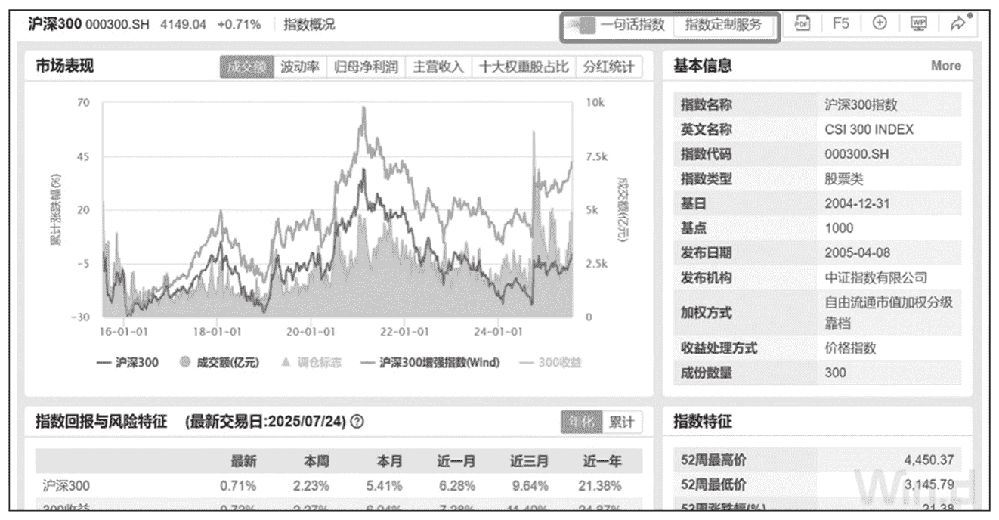

图 1-1 万得 Alice Agent“一句话指数”界面

资料来源：Alice Agent。

比如按照典型价值投资范式来界定投资指数编制标准即选股策略，我们可以通过大白话来让 Alice Agent 帮我们在 5,000 多只股票中选出估值低、盈利稳定的大市值股票。我们可以向 Alice Agent 提问：“假设你是一位金融工程研究员，请按照如下三个标准编制指数：①选择万得全 A 指数中市值最大的 100 家公司作为编制基准；②剔除最近 3 个会计年度内每期利润均为负数的上市公司；③剔除市净率（PB）估值在 1.7 倍以上的上市公司。”

Alice Agent 给出的初步的编制方案如表 1-1 所示。

**表 1-1** **万得全 A 高市值低 PB 指数编制方案**

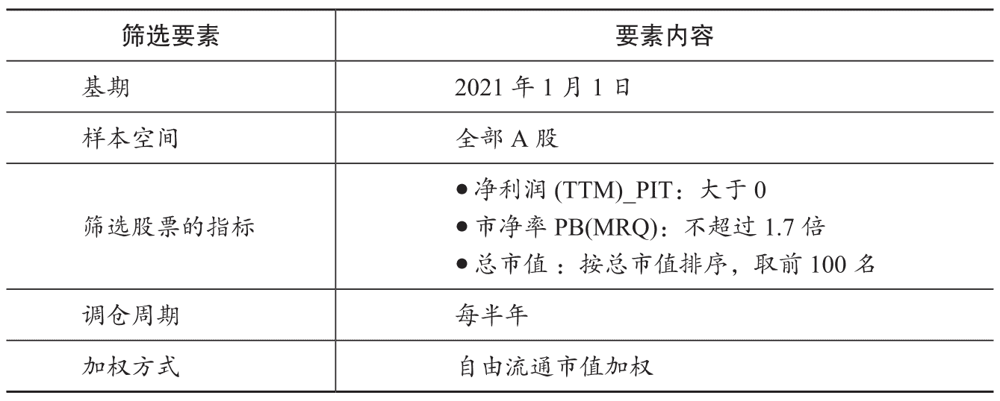

资料来源：Alice Agent。

在 Alice Agent 给出初步的编制方案后，点击“立即创建指数”，即运行量化选股回测，在导出的结果中可以调阅选股逻辑，并且修改相应参数，操作界面如图 1-2 所示。

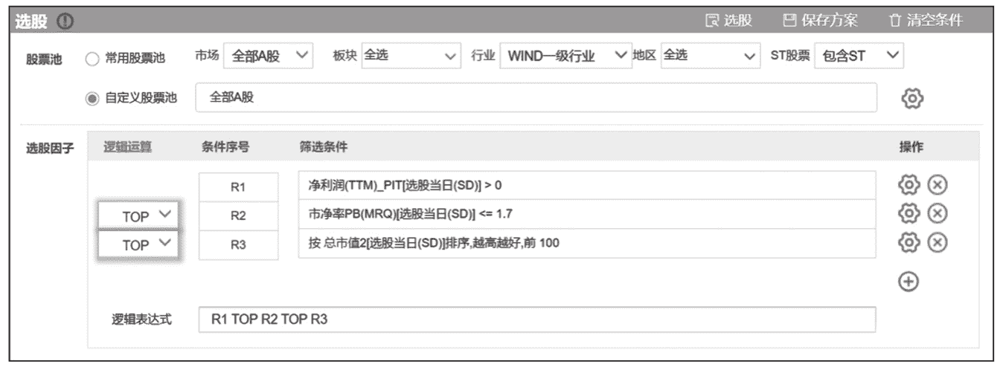

图 1-2 选股逻辑及参数修改界面

资料来源：Alice Agent。

Alice Agent 通过“一句话指数”功能，输出的策略回测结果如表 1-2 所示。

**表 1-2** **Alice** **Agent“一句话指数”策略回测结果**

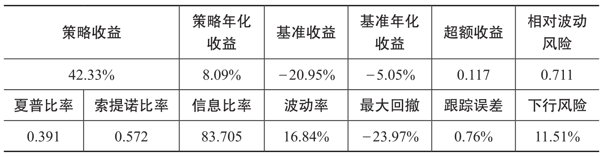

资料来源：Alice Agent。

Alice Agent 的运行结果如图 1-3 和图 1-4 所示。该策略自 2021 年以来累计收益达到了 42.33%，年化收益率达到了 8.09%，跑赢基准收益，也证明了景气好、估值低、市值高这类价值投资范式在 A 股市场中的有效性。

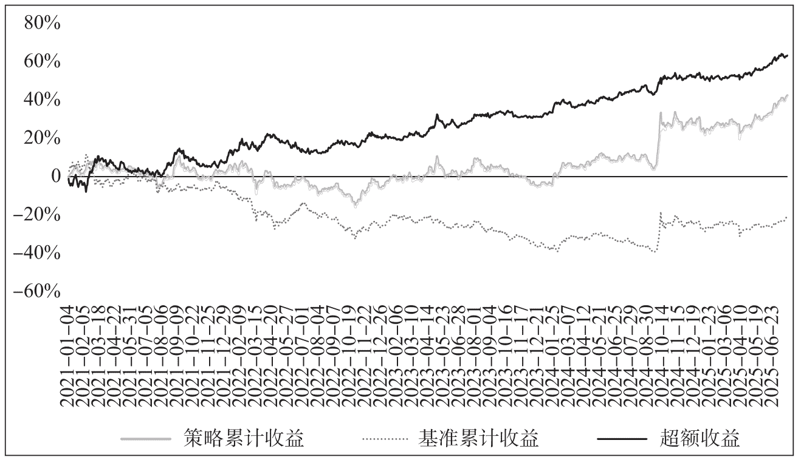

图 1-3 策略和基准的累计收益

资料来源：Alice Agent。

Alice Agent 有时也存在理解不到位的情况，可以在后台修改参数“补救”，或者以完备的提问方式进行“预防”。系统默认的调仓周期是每半年，开始时间是 2021 年 1 月 1 日，业绩基准可以选择沪深 300、上证综指、万得全 A 等一系列宽基指数，上述内容均可以进行修改调整：在生成后的选股界面中进行选择，或者在编制“一句话指数”向 Alice Agent 提问时即予以说明。通过 Alice Agent 生成的投资组合跑赢了作为核心资产的沪深 300 指数（该指数同期年化为−6.75%），我们将该组合命名为“低估值+正盈利+大市值投资组合”。

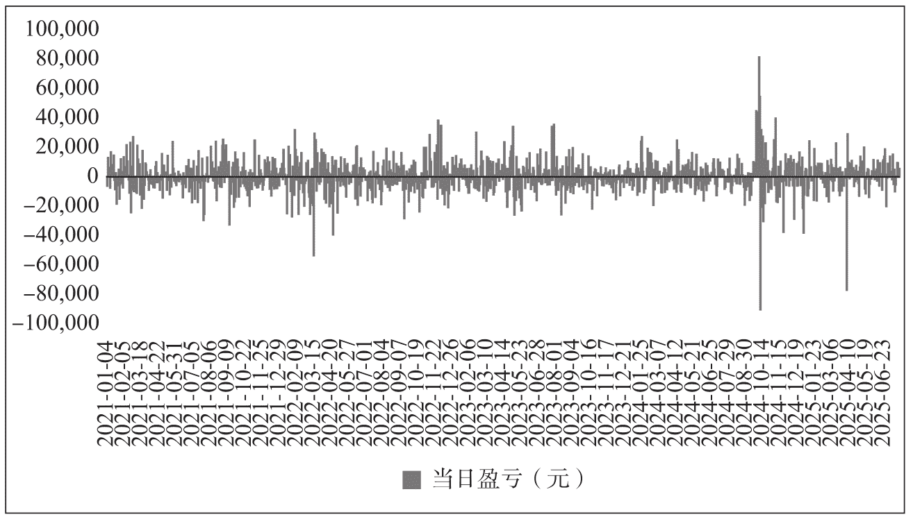

图 1-4 策略的每日盈亏

资料来源：Alice Agent。

最终我们可以在 Alice Agent 构建策略的界面看到选股结果（落实到具体个股标的）、月历效应（历年各月涨跌幅）、持仓分析（历史动态演绎变化）、行业分布（行业权重）等情况，以便我们进行投资实战复刻和复盘归因。以行业分布为例，如图 1-5 所示，最终选择出的符合“低估值、正盈利、大市值”的个股主要集中在金融行业（65.71%），其次是工业（15.15%）。

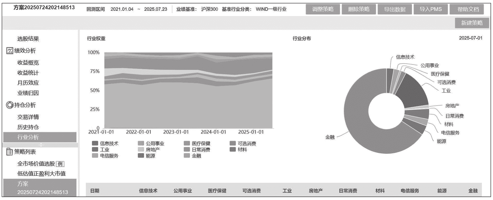

图 1-5 “一句话指数”A 股运行策略结果的行业权重和行业分布情况

资料来源：Alice Agent。

**1.1.2** **大模型测算股债性价比并提示买入和卖出时间窗口**

市场通常习惯用股债性价比[如“沪深 300 指数盈利收益率（E/P）−10 年期国债收益率”或“股息率−10 年期国债收益率”]，即通过量化股市和债市的相对吸引力来提示买卖时点：当该差值显著高于或低于历史均值，表明股票相对债券极端便宜或昂贵，发出买入或卖出信号。其优势在于逻辑简明、数据易获取、跨资产比较直观，可规避单看估值或利率产生的误判；不足在于均值回归无时限，可能长期偏离，且忽略盈利增速、风险偏好、政策变化等非利差因素，在流动性极端或结构性行情中易失效。对相关指标的观测和跟踪并不是一件简单的事情，我们通过大模型予以实现实时跟踪分析。

**学习案例 1-2** **Manus 测算股债性价比**

在资产配置决策中，精准衡量股债性价比对投资者至关重要。Manus 凭借强大的数据处理与分析能力，能够精准测算股债性价比。Manus 会持续追踪各类宏观经济数据、市场动态以及政策变化，实时更新股债性价比数据。在市场环境复杂多变的当下，Manus 这一功能帮助投资者快速掌握股债市场相对投资价值，为合理配置资产提供有力支撑。

我们可以按如下示例向 Manus 提问：“知识背景：股债性价比源于美联储估值模型（Fed Model），是美联储发布的一种估值方法，该指标一般通过股票市场指数盈利收益率与 10 年期国债收益率的差值来表示。以看股做债的思路，当该指标跌破历史 3 年（750 个交易日）的均值−2 倍标准差时提示股票较债券配置价值更高（买入时点），反之超过 3 年均值+2 倍标准差时则意味着股票较债券的配置价值较低（卖出时点）。假设你是一位投资分析师，请以输入的底层表格（包括 10 年期国债到期收益率和全 A 指数市盈率）为基础，按照上面的知识背景计算日度频率的股债性价比指标并做折线图，同时以圆点形式在图片中标注出历史指标走势及对应的买入和卖出时点。”

Manus 经过思考和推演后可以迅速给出思路并输出我们想要的结果，其思考过程如下。

好的，我将根据你提供的底层数据，计算股债性价比指标，并绘制折线图，同时在图中标注买入和卖出时点。我将按照下列计划进行工作：①读取和分析底层数据；②计算股债性价比指标；③识别买入卖出时点；④绘制可视化图表；⑤交付结果。

其输出的股债性价比（ERP）历史走势及买卖时点结果如图 1-6 所示。

我们发现由于市场惯性所在，触发历史均值±N 倍标准差在发生后，还会在这一触发信号的区间内停留一段时间多次触发信号，这是因为 A 股市场具有趋势或者说是动量的特征。因此大模型识别到的是“一片”而非“一个”提示买卖的信号，而这类连续跟踪信号的处理很容易“在恐惧时抛售、在贪婪中追高”，出现连跌即卖的高抛低吸式操作。所以，在这里我们可以明确向 Manus 提需求，是要编制可操作的策略而非单纯“无脑连续提示”。

比如我们在上述提问中加上：“最终根据买点和卖点来进行测试并模拟历史净值，卖点设置为 3 成股票仓位+7 成在手现金仓位（这 7 成仓位不生息），反之买点则设置为 7 成股票仓位+3 成在手现金仓位（这 3 成仓位不生息）。”

从效果来看这次提示的买入和卖出点位就相对单一，首次触发后在未来一段时间内都没有再给出相应密集频繁的噪声式提示。如果 3 年时间较长，产业结构脉络和市场箱体震荡格局出现变化，或者 2 倍标准差在历史一段区间内不容易触及造成模型提示过于“钝感”，我们在提问环节可以通过改变历史追溯时间以及标准差前倍数（1 倍、1.5 倍、2 倍）来进行灵活应对。图 1-7 和图 1-8 就展示了按照给定模拟策略约束，2 倍标准差和 1.5 倍标准差下的全 A 股债性价比测试结果。

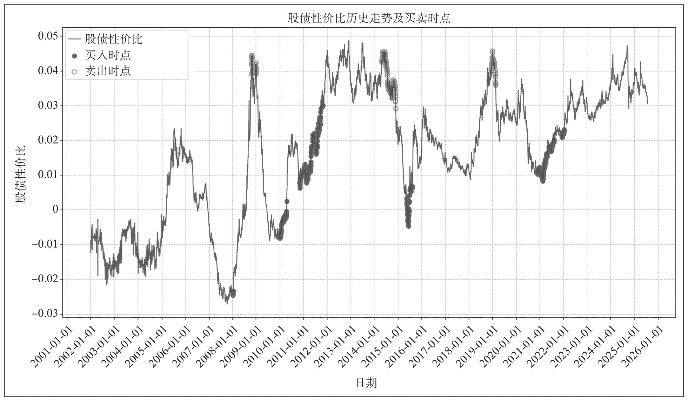

图 1-6 股债性价比历史走势及买卖时点

资料来源：Manus。

**1.1.3** **情绪市指标构建**

在政策面和基本面之外，投资者情绪常常是影响短期市场波动的重要因素，尤其在消息密集或趋势不明朗的阶段更突出。以往对情绪的判断依赖于资深交易员的经验与直觉，没有标准化指标。如今，AI 可以帮助我们从碎片化信息中提取出交易情绪，给出可操作的提示，将这一“感性”领域引入“理性”分析的范畴。

**学习案例 1-3** **Manus 生成市场情绪指数并提示买卖点**

我们在 Manus 中提问：“假设你是一位 A 股市场投资者，想根据市场情绪判断投资时点。这个 Excel 表格中搜集了 2025 年 1 月 2 日至 7 月 22 日，A 股每个交易日的成交额、换手率、融资融券余额、融资买入额、融券偿还额、谷歌搜索指数。请根据这些日频市场数据，生成市场情绪指数（0～100 打分），并提示买点和卖点。同时，生成按照日期、当日评分、买点或卖点提示（若没有倾向则为空白）排成三列的综合表格。”向 Manus 提供的部分日频市场数据如表 1-3 所示。

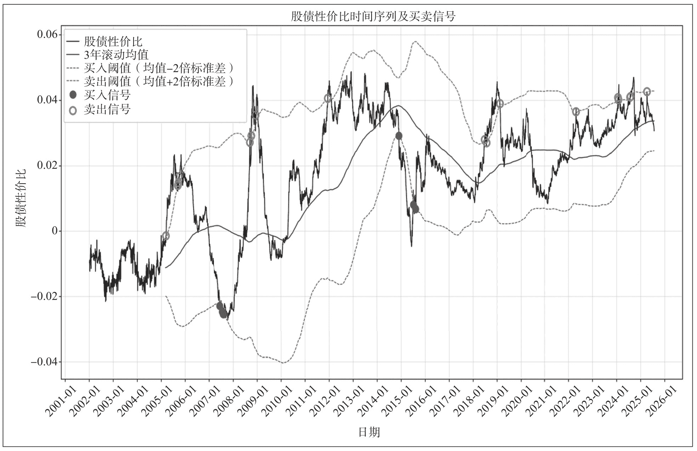

图 1-7 2 倍标准差下的全 A 股债性价比测试

资料来源：Manus。

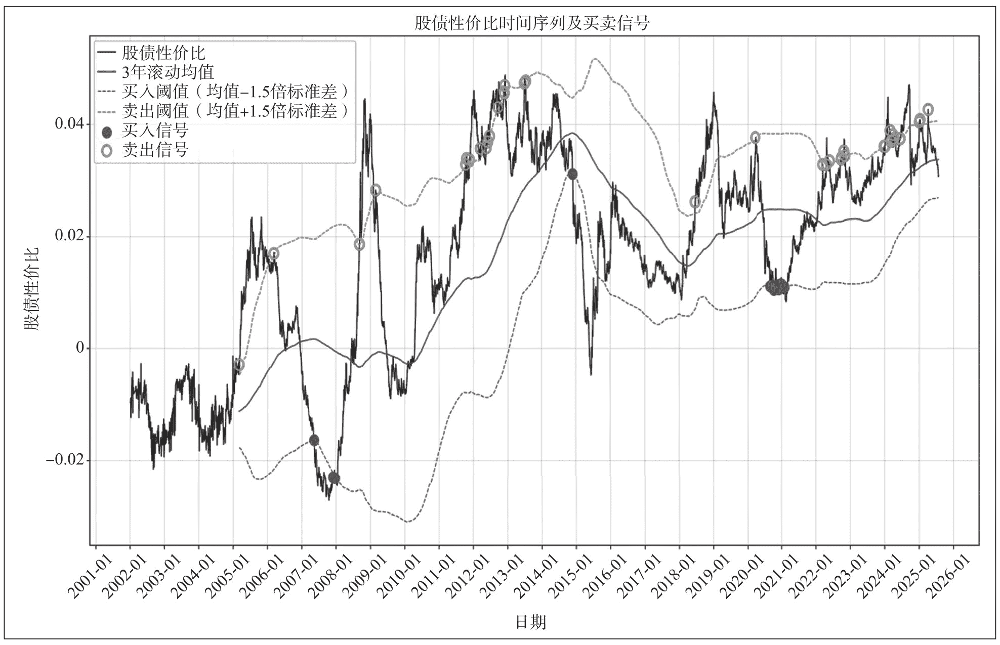

图 1-8 1.5 倍标准差下的全 A 股债性价比测试

资料来源：Manus。

**表 1-3** **向 Manus 提供的日频市场数据（部分）**

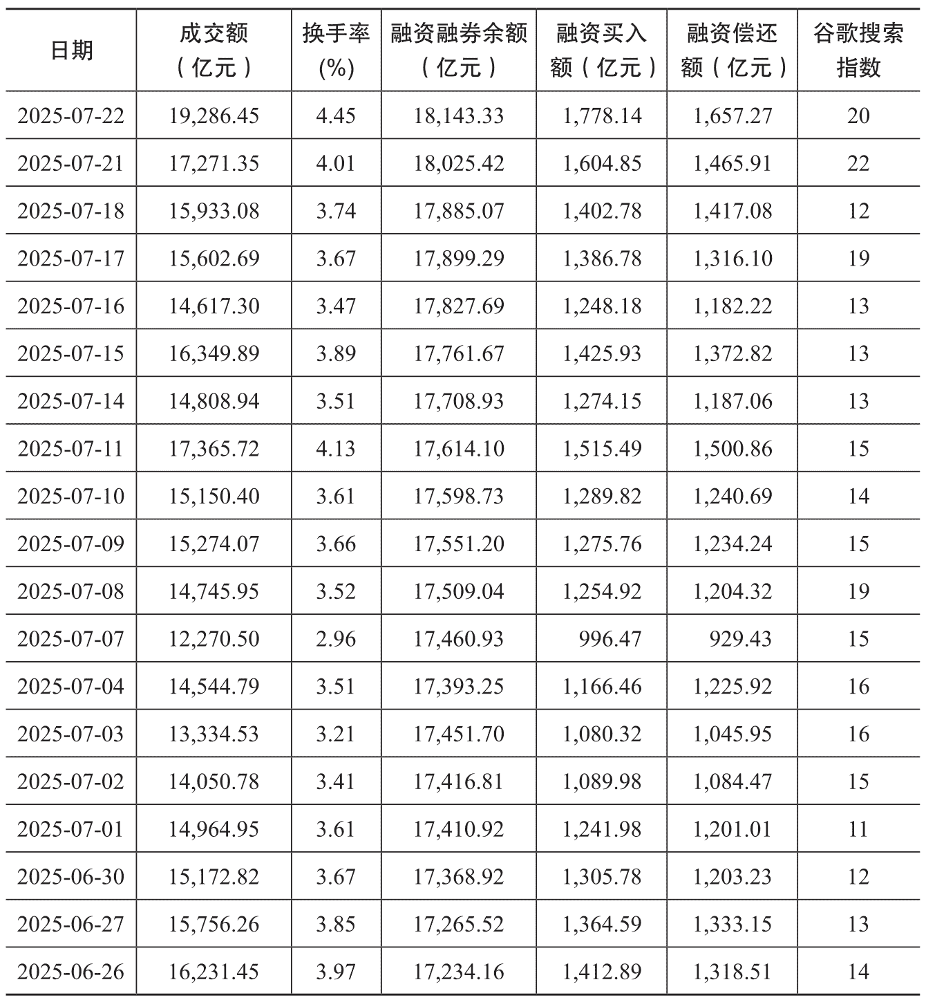

资料来源：作者整理。

Manus 的思考过程如下。

我将按照下列计划进行工作：①数据读取和分析；②市场情绪指数计算；③买卖点判断和表格生成；④结果交付。在我工作的过程中，你可以随时打断我，告诉我新的信息或者调整计划。

Manus 给出的部分评分和买卖点提示如表 1-4 所示。

**表 1-4** **Manus 给出的评分和买卖点提示（部分）**

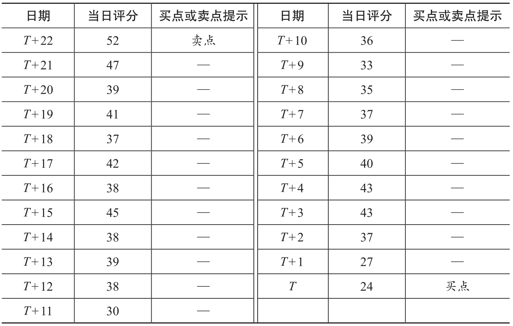

资料来源：Manus。

进一步地，我们要求 Manus“解释你的市场情绪指数的评分思路、买点和卖点的判断依据，并生成市场情绪指数的时间趋势图”。Manus 的回答如下。

本报告中的市场情绪指数旨在量化 A 股市场的整体情绪，范围为 0～100 分。市场情绪指数的计算基于以下五个关键日频市场数据指标：①成交额（亿元）：市场活跃度的直接体现。成交额越大，通常表明市场参与度越高，资金交投越活跃，情绪越积极。②换手率（%）：衡量股票流通性的指标。高换手率意味着股票交易频繁，市场关注度高，可能伴随情绪的升温……

市场情绪指数的计算步骤如下。①数据归一化：首先……②权重分配与加权平均：在数据归一化之后，我们对各个指标进行加权平均。在本模型中，为了简化和初步评估，我们为每个指标分配了相等的权重（0.2）。需要注意的是，融资偿还额与市场情绪呈负相关，因此在计算时，我们将其归一化后的值进行反向处理（即 1−融资偿还额归一化值），使其对市场情绪指数的贡献变为正向。

买点和卖点的判断依据如下。①买点提示：当市场情绪指数低于或等于 25 分时，系统会提示“买点”。这表明……②卖点提示：当市场情绪指数高于或等于 50 分时，系统会提示“卖点”。这表明……

需要强调的是，这些买卖点提示是基于历史数据和情绪指标进行的量化分析，仅作为投资决策的参考。实际投资中，还需结合宏观经济形势、行业基本面、公司财务状况以及个人风险偏好等多种因素进行综合判断。市场情绪指数并非万能指标，它反映的是市场参与者的集体心理状态，而市场走势受多种复杂因素影响。

最后，Manus 画出市场情绪指数趋势图（见图 1-9），标记了买卖阈值并做出描述和分析。

相应分析如下。

1.主要阶段划分

初期低迷阶段（1 月初至 2 月初）：该图显示，在时间序列的起始阶段，市场情绪指数处于相对较低的水平，最低点位于买点阈值线（25 分）下。这表明年初市场情绪相对谨慎，投资者信心不足，可能受到了去年年末资金面紧张、业绩预期不明朗等因素的影响。

快速冲高与回调阶段（2 月初至 4 月初）：2 月初指数自低位快速拉升，2 月中下旬一度突破 60 分后明显回调，虽然 3 月初市场情绪指数重启升势，但之后又快速回落，至 4 月 1 日左右降至 25 分以下。

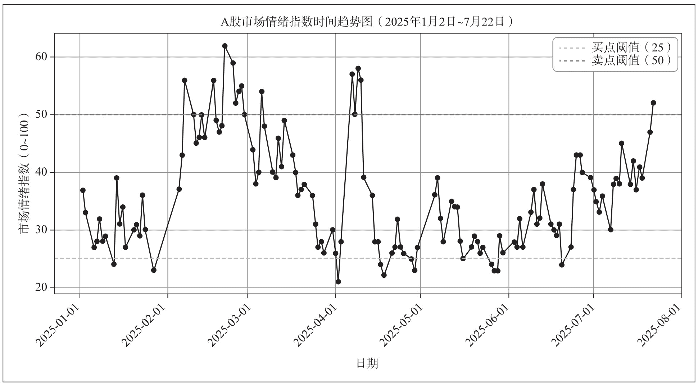

图 1-9 Manus 画出的市场情绪指数趋势图

资料来源：Manus。

冲高回落与区间整理阶段（4 月初至 4 月中旬）：指数在 4 月上旬陡升后快速回落，仅短暂维持在 50 分以上，后降至 25 分以下。

区间震荡阶段（4 月中旬至 6 月下旬）：在此阶段，市场情绪指数大致在 25 分到 40 分区间震荡，个别时点降至 25 分以下。

震荡回升阶段（6 月下旬至 7 月下旬）：6 月下旬起市场情绪指数开始反弹，7 月开始整体呈现震荡上升态势，至 7 月下旬回升至 50 分以上。

2.买卖点信号分析

买点信号：1 月下旬，市场情绪指数触及或接近 25 分的买点阈值线，为投资者提供了潜在的买入机会信号。在 6 月中下旬，市场情绪指数再次接近买点阈值，可能预示着出现新的投资机会。

卖点信号：2 月下旬，市场情绪指数达到峰值（突破 60 分）时，卖出信号最为强烈。4 月上旬，市场情绪指数突破 50 分，但仅在 4 月上旬初维持阈值之上数日，为短期卖出信号。

3.市场情绪周期性特征

该图清晰地展现了 A 股市场情绪的周期性变化规律：①情绪底部，通常伴随着悲观预期和低迷交投，为逆向投资提供机会；②情绪修复，随着基本面改善或政策利好，情绪快速回暖；③情绪高涨，市场信心充足，交投活跃，但需警惕过度乐观；④情绪回归，高位震荡后逐步回调，为下一轮周期做准备。

4.投资启示

逆向思维：在市场情绪指数接近买点阈值时保持关注，可能存在超跌反弹机会。

风险控制：当市场情绪指数超过卖点阈值并在高位徘徊时，应考虑适当减仓。

周期把握：市场情绪具有明显的周期性，投资者应结合市场情绪周期进行资产的配置调整。

综合判断：市场情绪指数仅为参考指标之一，实际投资决策还需结合基本面、技术面等多维度进行分析。

**1.1.4** **战术资产配置：用 AI 读懂宏观经济**

资产配置可分为战略资产配置和战术资产配置。战略资产配置是根据投资者的长期风险偏好和财务目标，确定各类资产的长期基准权重。战术资产配置则是在战略资产配置基础上，根据市场短期波动进行主动调整，以捕捉超额收益。战略资产配置代表投资组合的理念，往往规定了不同类别资产的投资比例；战术资产配置代表投资组合的落地，包括从大类资产到落地品种选择以及短期的一些基准权重调整。可以形象地说，战略资产配置代表了投资中的“仰望星空”，而战术资产配置代表了“脚踏实地”，既能保证投资中的纪律性，又能在短期波动中抓住超额机会。

在长期配置中，应以战略资产配置为核心，实现与战术资产配置的动态平衡。战略资产配置应作为投资决策的“锚”，确保投资组合的长期方向与投资者的风险承受能力匹配，同时采用战术资产配置作为动态微调工具，在战术窗口内捕捉机会或防御风险，但不改变长期配置逻辑。

影响战术资产配置的有宏观、市场和技术因素。宏观因素包括经济增长（总体活动、投资、消费、贸易），通货膨胀[CPI（居民消费价格指数）、PPI（生产价格指数）]，政策（货币政策、财政政策）；市场因素包括基本面（股票、国债、信用债、汇率、商品），估值（历史估值、跨资产估值）；技术因素包括趋势（动量、均值回归、市场情绪），资金流向（再平衡资金流向、海外资金流向、监管要求变化）。

下面通过一个具体案例，展示 AI 如何帮助投资者适应经济环境的变化，灵活调整资产配置，从而提升收益并降低风险。

**学习案例 1-4** **DeepSeek 识别宏观经济状态并辅助投资者进行资产配置**

在此案例中，我们利用 DeepSeek 识别当前的宏观经济状态，并据此做出合适的投资决策。整个流程分为三步。

第一步：识别市场状态。我们从美国经济数据库中提取大量宏观数据，比如就业、通胀、产出等指标。然后通过 DeepSeek 对数据进行归类，把经济划分成几种典型状态，比如增长、放缓、衰退等。

第二步：预测资产表现。识别出经济状态后，DeepSeek 进一步判断每种状态下，不同类型资产（股票、债券等）可能的收益和波动。用历史数据+当前环境预估未来趋势。

第三步：制定投资组合。有了预测结果后，DeepSeek 会根据每种资产的风险和潜在收益，提出投资组合建议，比如“多投股票、少配债券”，或者“保守一点，现金为主”。我们对这些策略做了回测（在历史数据中模拟操作），看看是否有效。

结果表明，这种通过 DeepSeek“识别+预测+配置”构成的组合能显著提高收益与稳定性，“只做多头”策略比含有空头的策略效果更佳。不同模型生成的策略表现有明显区别，当模型选择恰当时，能充分挖掘信息价值，夏普比率（年化收益与风险的综合衡量指标）能达到 1.505，最大回撤也较小，说明能在市场动荡时很好地保护资金。

整个框架分为两个主要阶段：信号识别和信号应用。

首先是宏观状态（Regime）识别（信号识别）。这个阶段的目标是让模型能“看懂当前宏观经济处于什么环境中”，把复杂的宏观数据转化成可识别的经济状态标签。然后是资产收益与波动率预测以及资产配置与回测（信号应用）。这个阶段的目标是根据当前经济状态，预测未来各类资产的收益和风险（波动率），并据此进行资产配置。

这套流程的逻辑可以简化为一句话：先判断现在市场处于什么状态，再据此决定该投什么、投多少。信号识别是基础，信号应用是落地，这也是 DeepSeek 赋能战术资产配置的关键所在。具体各阶段、各步骤及相关操作细节等如表 1-5 所示。

**表 1-5** **内容与技术解构**

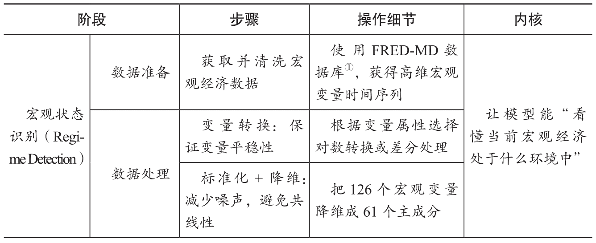

（续）

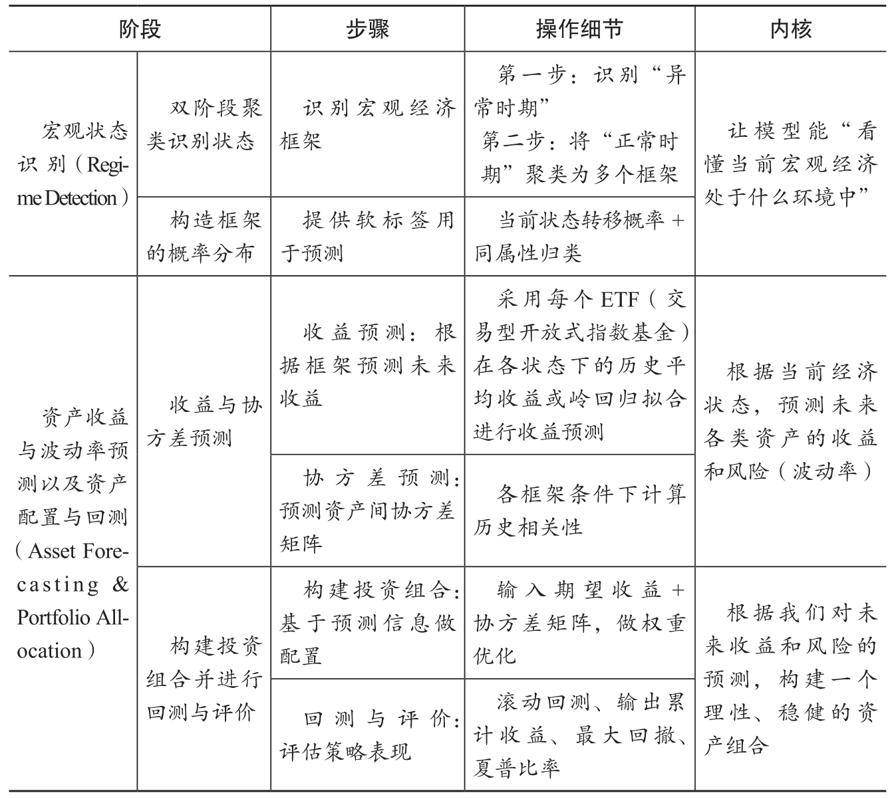

①圣路易斯联储构造的涵盖众多经济指标的数据库，网址为 https://fred.stlouisfed.org/。

资料来源：作者整理。

下面我们分阶段、分步骤进行详细介绍。

1.宏观状态识别

步骤 1 为数据准备。我们使用了权威且开放的 FRED-MD 数据库，里面收录了上百个关键经济指标，从就业、生产到物价水平一应俱全，其基本信息如表 1-6 所示。这些数据都按月更新，能帮助 DeepSeek 全面感知经济运行状况。在使用前，我们还对每组数据做了必要的预处理，比如对数转换、差分处理等，目的是剔除趋势和噪声，让信息更清晰、更稳定。

**表 1-6** **FRED-MD 数据库基本信息**

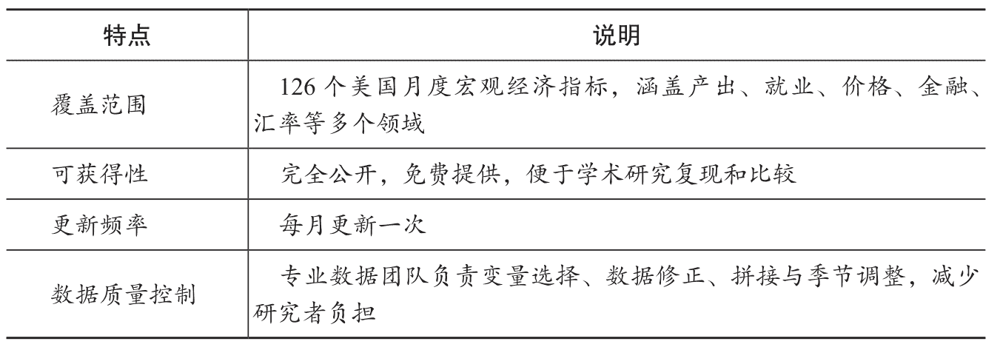

资料来源：作者整理。

步骤 2 为数据处理，包括变量转换和标准化+降维。由于不同经济指标的量纲不同，比如有的以百分比计，有的按美元表示，必须先统一“语言”，才能让 DeepSeek 理解。于是，所有数据都被标准化到了同一尺度。接下来，由于指标数量过多，为了避免重复和冗余，还要用数学方法把这些变量浓缩成 61 个综合指标，这 61 个综合指标涵盖了 126 个宏观经济指标的绝大部分信息，大幅降低了计算复杂度。

步骤 3 为双阶段聚类识别状态。在进行正式分类之前，DeepSeek 先做了一个“清场动作”——识别出那些处于极端状态的时期，比如金融危机、疫情冲击等。这些时候的经济数据会整体性偏离常态，因此被单独分出来，形成一个“异常状态”类别。这样做的目的是避免它们干扰后续对正常经济周期的分析。

剔除极端时期后，DeepSeek 开始对“正常月份”进行归类，尝试找出其中的规律。比如某些月份的经济特征类似，可以归为“扩张期”；而另一些则更像“滞胀期”或“温和下行期”。这个过程类似于看图归类，但使用的是数学上的相似性判断（比如看各指标走势的方向是否一致），从而将宏观状态分为几个具有代表性的市场状态，表 1-7 对 Regime 类别标签进行了说明。

**表 1-7** **Regime 类别标签说明**

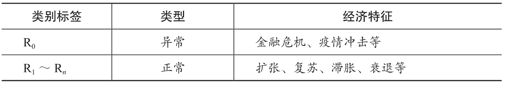

资料来源：作者整理。

步骤 4 为构造框架的概率分布，建立“模糊状态”的概率判断。现实中的经济状态，并不是泾渭分明的。有时候市场看上去像在扩张，但又隐约透着通胀的苗头。这种“边界模糊”的情况，在传统聚类方法中很难准确表达——它只会强行把某个月归到某一类，完全忽略了“像也不像”的中间地带。

为了解决这个问题，我们对传统分类方法做了“软化处理”——让模型不是做出一个单一判断，而是给出一组概率分布：比如某个月份，模型会说“有 60%可能处于扩张期、30%可能处于通胀期，还有 10%类似滞胀”。这种方式更贴近真实世界的复杂性。我们对识别出的“异常状态”（比如金融危机期）做了特别处理，避免它“稀释”掉对其他状态的判断力。最终输出的形式，像为每个月份贴上一个“多标签”的诊断结果。

为验证方法的有效性，我们对比了“输出平滑概率分布”（软化处理，承认状态模糊性）与“尖锐区分状态”（传统硬分类，非黑即白）两种模式的结果，借助两张状态转移概率矩阵图分析 Regime 的转变，如图 1-10 所示，其中 Regime 的划分如表 1-8 所示。

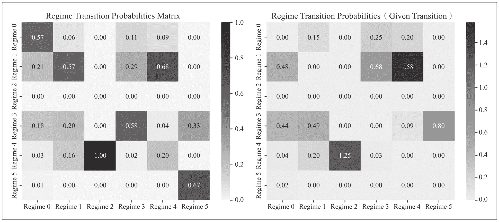

图 1-10 Regime 的转变

资料来源：作者绘制。

**表 1-8** **Regime 的划分**

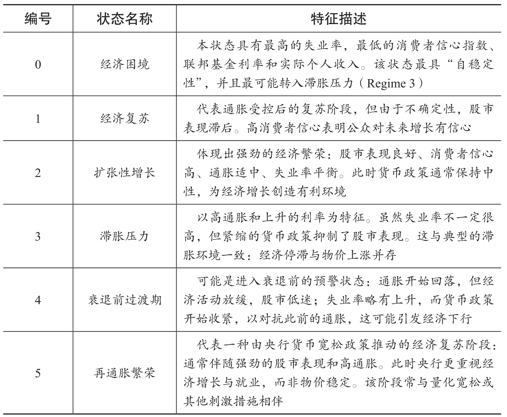

资料来源：作者整理。

Regime 的转变图（图 1-10）中左侧 Regime Transition Probabilities Matrix（经济状态转移概率图）的横轴与纵轴均代表经济状态（Regime 0～Regime 5），矩阵中的数值是从当前行状态转移到对应列状态的概率。对角线数值反映经济状态维持不变的概率。数值越高，说明经济状态“惯性越强”，即一旦进入某状态，持续保持该状态的可能性就越大。比如左侧的 Regime 0 行 Regime 0 列的数值为 0.57，意味着当前处于经济困境（Regime 0）时，下一期仍维持经济困境的概率达 57%，体现出较强的状态延续惯性。右侧 Regime Transition Probabilities（条件转移概率图）是对左侧的调整，剔除“下一期状态与当前状态相同”的情况（即排除左侧对角线数据），重新计算状态转移概率，聚焦呈现经济状态确实发生转移时，具体转向各状态的概率分布。例如，若左侧中 Regime 1（经济复苏）转移到自身（维持状态）的概率是 57%，那么剩下 43%是它转移到其他状态的概率总和。右侧会基于这 43%的转移情况，重新分配概率，让我们清晰地看到，当经济复苏状态发生改变时，分别转向 Regime 0（经济困境）、Regime 2（扩张性增长）、Regime 3（滞胀压力）等其他状态的概率详情。需注意的是，图右侧中的数值并非 0～1 区间的绝对概率，而是状态发生转移时各方向的相对强度系数，数值越大代表该转移方向的倾向性越强。

对比发现，无论采用哪种分类模式，左侧对角线数值普遍较高，说明大多数月份的经济状态具有显著“惯性”——当前处于某经济状态时，下一期大概率延续该状态。这种“惯性规律”对预判经济走势、制定资产配置策略意义重大，比如当识别出当前为“扩张性增长（Regime 2）”且惯性强时，投资者可更坚定地维持股票等风险资产的配置比例。

同时，右侧的存在进一步完善了我们对经济状态转移的认知。结合左侧“状态惯性强”和右侧“转移方向有规律”，我们能更全面地把握经济状态变化逻辑，例如，当处于 Regime 1（经济复苏）时，依据左侧可知其惯性强（57%的概率维持复苏），但通过右侧能知晓，一旦复苏状态改变，最有可能转向 Regime 3（滞胀压力），这提示投资者可提前配置抗通胀资产（如黄金、大宗商品），以应对潜在的滞胀风险。

2.资产收益与波动率预测以及资产配置与回测

步骤 1 为收益与协方差预测。DeepSeek 在判断出经济状态后，接下来要回答一个关键问题：在这种状态下，哪些资产更值得买？哪些该回避？整个预测框架分为两步：第一步是预测市场状态变化；第二步是基于不同模型，预测各类资产的表现。这里用到了以下三种不同的预测模型。

初级模型（Naive）：最简单也最直观。它回顾历史中类似的市场状态，看当时各类资产的平均收益、波动和夏普比率（风险调整后收益），用这些作为对未来的预期。

岭回归模型（Ridge）：利用经济指标作为输入因子，在每种市场状态下分别训练预测模型。这种方法可以从宏观数据中挖掘更深层的线索，输出相对平滑稳定的预测结果。

资产配置模型（Black-Litterman）：融合“市场平均观点”与“投资者判断”的经典模型。DeepSeek 首先将历史数据视为市场的“先验”，然后再根据识别出的市场状态调整这些预期，从而生成更符合当前局势的“后验收益”预估。

三类模型各有侧重，但最终每种模型都会给出一个预期收益和风险（波动率）的预测结果，作为构建投资组合的输入依据。这一步，相当于为资产配置“画好地图”，明确不同状态下的机会与风险分布。

我们通过 DeepSeek 完成了对未来收益、波动率、夏普比率的预测，现在看看这些预测能否转化为更优的投资回报，也即步骤 2——构建投资组合并进行回测与评价。我们选择了一篮子主流 ETF，覆盖股票、债券等主要资产类别，用 2000 年到 2022 年的数据进行了回测。具体来说，我们对比了两种配置方式的表现：①结构化策略组，使用 DeepSeek 识别出的 Regime 来指导投资组合配置；②对照组，用随机生成的状态标签盲猜配置，模拟无宏观识别辅助的决策。

结果非常清晰——使用 DeepSeek 判断的组合，在收益表现上显著优于对照组。几个关键指标都得到了验证：夏普比率明显更高，代表单位风险带来的回报提升了。正收益的月份更多，说明赚钱频率更稳。最大回撤没有明显增加，说明提升收益的同时并没有带来更大风险。这一对比说明：市场状态识别不是“自嗨”，而是具有实际投资价值的有效工具，只有看懂宏观环境，才能选对资产、拿住收益。

回测中，我们还测试了多种细分策略，不同策略的逻辑与表现差异如表 1-9 所示。我们还发现只做多头策略效果最优，如图 1-11 所示，“只做多头”曲线持续领先。

**表 1-9** **策略展示**

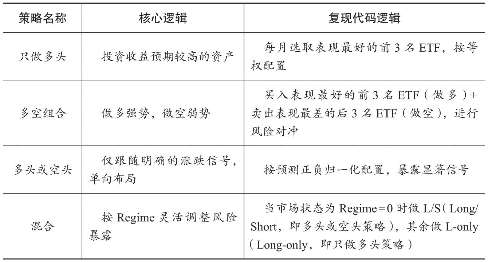

资料来源：作者整理。

如图 1-12 所示，不同模型生成的策略表现也有明显区别，对比 6 类模型[对应图例分别为等权（EW）、标普 500（SPY）、初级模型（Naive）、均值方差优化（MVO）、Black-Litterman（BL）、岭回归（Ridge）]的累计对数收益（2001～2020 年），且要求所有策略波动率≤10%，可以看到模型价值能够碾压被动策略，证明了“宏观经济状态识别+模型优化”在提升收益中的关键作用。

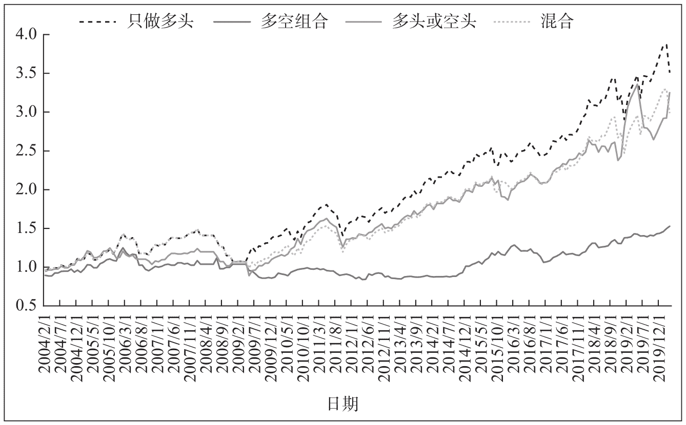

图 1-11 初级模型预测各策略累计收益对比（滚动 48 个月）

资料来源：DeepSeek。

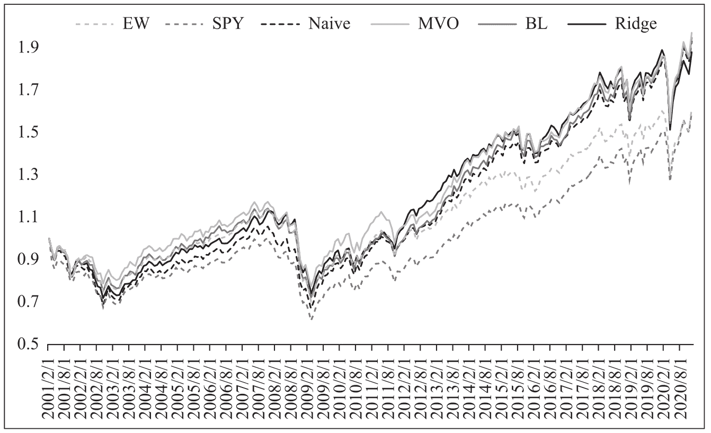

图 1-12 不同模型的累计对数收益（波动率≤10%）

资料来源：DeepSeek。

通过以上案例可以清晰看出，宏观经济状态是非常重要的投资信息来源，不仅能提升认知维度，还能直接优化资产配置效果。具体有如下三点关键结论。

（1）宏观状态识别是信息含量极高的工具。相比那些只看价格走势的策略，这种以宏观数据为基础的 AI 方法，更能捕捉经济的结构性变化，能在复杂的宏观变量中识别出典型的经济状态，赋予市场判断更多“上下文”。

（2）市场状态预测可以直接转化为资产配置建议。通过预测市场未来处于哪种宏观状态，可以构建出各类资产在该状态下的预期收益和风险。这种“条件视角”让投资决策更具针对性。即使在简单模型下，只要状态划分不是随机的，策略表现就显著优于盲投。

（3）“非复杂模型+数据驱动的 Regime”+“简单有效的配置方案”，是实现兼具优质回报、高稳定性与落地高效性策略的核心路径。当结构清晰的状态识别遇上简洁实用的资产配置方法，策略就能表现出超越传统的稳定性和回报。这说明不必追求复杂的模型，策略的关键在于信息有价值、路径够清晰。

总的来说，善用大模型可以提高投资胜率，AI+战术配置应被系统性地纳入投资框架。对于将 AI 应用于实战的投资者而言，这类“信号识别+策略落地”的闭环，提供了一个非常实用的战术型配置方向。

## **1.2** **复利投研：AI 知识库成为投资最强辅助**

在 AI+投研的具体应用中，知识库是极具实用性的存在。将 AI 知识库接入投资研究流程，相当于为每位研究员配备了一位 7×24 小时在线的“首席数据官”。具体而言，其核心价值体现在四个方面：首先，将宏观、行业、公司、舆情、专利、供应链等异构数据全部向量化入库，形成可实时检索的“活文档”，打破数据孤岛并保持信息鲜活性；其次，支持通过自然语言提问秒级调取所需信息，例如“找出过去五年毛利率持续提升且近三个月出现供应链负面新闻的消费电子公司”，系统能直接返回完整证据链，省去人工筛选的烦琐；再次，借助知识图谱功能自动补全产业链节点与事件因果关系，提示潜在的二阶风险或机会，比如从某上游原材料涨价信号延伸至下游企业的成本传导路径；最后，可将策略规则编写为可执行代码嵌入知识库，实现信号触发即自动推送，推动研究员的工作从重复的信息搬运升级为基于 AI 证据链的决策判断，最终提升投资胜率与研究效率。

在此，我们通过两个学习案例进行具体说明：一是 AI 如何搭建黄金投资知识库并反哺投资决策；二是如何将资本周期系列研究应用于 A 股与美股的投资比较，以及具体选股财务指标的落地实践。这些案例印证了 AI 能让存量投研信息的积累实现“陡峭化学习”，并以复利效应推动投研能力向指数级成长提速。

**学习案例 1-5** **腾讯 ima 搭建投资前沿阵地**

本案例介绍如何使用腾讯 ima 搭建自己的投资前沿阵地。在投资研究中，研报、新闻、专业书籍等素材往往分散杂乱，调取时耗时费力，难以快速为投资决策提供支撑；同时，过往积累的投资经验若未进行系统整理，则我们也容易因遗忘导致重复踩坑。而借助腾讯 ima，我们能将这些分散的投资素材与经验进行系统化梳理，打造一个可随时调取、“经验随叫随到”的个人投资信息库，为投资决策筑牢前沿阵地。要利用腾讯 ima 整理和堆积投资素材，以便随时调取并满足投资需求，我们可以遵循以下步骤。

第一，明确我们的知识库将服务于具体需求。例如，我们可能希望它能帮助我们快速获取历史上的投资案例、政策解读、市场趋势等信息。根据这些需求，为知识库设定一个清晰的目标和定位。

第二，资料搜集与筛选。对历史上积攒的研报、新闻、专业投资书籍等素材进行搜集和筛选。确保只保留高质量、有参考价值的内容。在筛选过程中，可以关注以下几个方面：①信息的准确性和权威性，确保所选资料来自可靠来源，避免出现误导性信息；②内容的时效性和相关性，选择与我们当前投资需求紧密相关且时效性较强的资料；③信息的结构化程度，优先考虑那些已经结构化或易于结构化的资料，以便后续进行整理和检索。

第三，进行资料整理与分类。将筛选后的资料按照一定逻辑进行分类和整理。例如，我们可以根据投资领域（如股票、债券、房地产等）、投资策略（如价值投资、成长投资等）或时间顺序进行分类。在分类过程中，可以利用腾讯 ima 的标签功能，为每份资料打上相应的标签，以便后续进行快速检索。

第四，利用 AI 功能优化知识库。腾讯 ima 提供了智能搜索、自动摘要、多模态检索等 AI 功能，这些功能可以大大提高知识库的使用效率。例如，我们可以利用智能搜索功能，通过自然语言提问快速定位所需信息；利用自动摘要功能，快速提取关键信息；利用多模态检索功能，实现跨格式、跨语言的智能检索。

第五，持续更新与维护。投资市场不断变化，新的研报、新闻和书籍不断涌现。因此，我们需要定期更新和维护我们的知识库，确保它始终包含最新、最准确的信息。在更新过程中，可以关注行业动态、政策变化以及新的投资理念和方法，及时将这些信息纳入知识库。

第六，设置权限与分享。为了保护我们的投资素材和知识产权，我们可以在腾讯 ima 中设置相应的权限。例如，我们可以设置只有特定用户或团队成员才能访问和编辑某些敏感信息。同时，我们也可以选择将部分或全部知识库内容分享给其他人或团队，以便实现更广泛的协作和知识共享。通过以上步骤，我们可以利用腾讯 ima 有效地整理和堆积投资素材，方便随时调取并满足投资需求。

通过上述步骤搭建的腾讯 ima 投资知识库，不仅解决了素材分散、调取困难的问题，更能与 AI 大模型形成协同，弥补大模型上下文长度有限的缺陷，让投资决策既有“实时素材支撑”，又有“历史经验兜底”。接下来，我们通过对比实验，具体看搭建个人投资知识库前后，AI 处理投资信息的效果差异。

1.投资知识库整合：效果对比

理解大模型的机制与缺陷，通过“适时总结上下文”或“搭建个人知识库”的方式延长大模型的记忆力。以 DeepSeek 为例（见表 1-10），官方文档公布的上下文长度为 64k token，大约是 10 万个中文字符，这表明了它在多轮问答中的最大记忆力，当上下文超过 64k token 的限制时，AI 就会丧失沟通交流的能力。

**表 1-10** **DeepSeek 模型可理解的上下文长度**

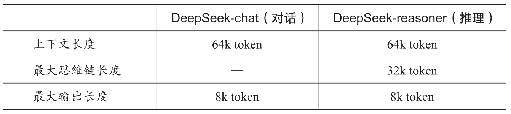

资料来源：DeepSeek。

为了解决这个问题，一方面，可以让 AI 在问答的过程中自动整理前文，去除无用信息，形成高度凝练的要点以节约上下文空间。另一方面，“个人知识库”的搭建能通过更系统的逻辑突破记忆限制，其核心流程可结合图 1-13 与 Embedding（向量化）技术的关键作用展开理解：首先，借助 Embedding 技术识别用户输入的信息，将其转化为向量；其次，基于用户输入信息转化的向量与个人知识库中所有文档（即“长期记忆”）的向量之间的语义相似度，从知识库中提取相匹配的“长期记忆”；然后，将用户输入信息转化的向量与提取的相似“长期记忆”的向量一同输入大语言模型（Large Language Model，LLM），LLM 会结合这些精准关联的知识向量理解问题背景；最后，LLM 基于上述输入生成定制化答案，同时，此次交互的有效信息会被整理为统一格式，更新到个人知识库中，成为后续问答可检索的“长期记忆”。

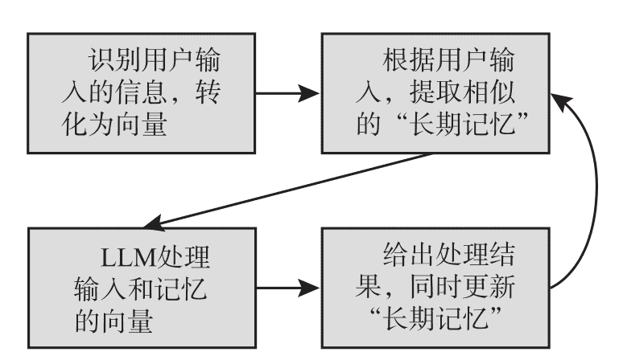

图 1-13 “个人知识库”搭建示意图

资料来源：作者绘制。

本质上讲，个人知识库并未真正“延长”大模型的原生记忆力，而是通过 Embedding 精准检索相关记忆的前序步骤，让大模型能在自身有限的上下文空间内，结合知识库中最相关的内容，生成更贴合个体需求的定制化答案。

以我们所撰写的黄金系列报告为例，我们可以通过对知识库的轻量化语言形式转化、图片转译和标签添加（日期、标题、报告关键词），使得知识库的知识密度增加，但所占空间变小。

在知识库的相关操作中，我们对 Markdown 格式的转化更有利于大语言模型读取回应。按步骤来看，首先，知识库设立时的 Embedding 切片决定了知识库召回的效率。当录入最终版 Markdown 文件作为知识库时，其文档层次严格按照“日期—标签—报告名—内容”划分，且图片内容均已转译为可召回的文本，图片本身也可通过 Markdown 文件引用的本地图片文件夹进行索引，供用户溯源查看，Markdown 文件的知识库切片示意图如图 1-14 所示。相较而言，录入 PDF 文件作为知识库文档时，受限于其本身对于文本、图表各模块的定义，知识库的划分和读取结构性不强，召回时难以通过增量信息补充对应，而且从图 1-15 中能看到，PDF 文件的原始文档预览区域常出现加载缓慢、长时间转圈甚至空白的情况，这正是直接上传 PDF 文件的缺点之一——不仅分段文档中的图片会增加知识库的占用空间，还难以在问答中有效召回，进一步影响信息调取效率。

其次，在知识库问答中，文档质量的差异更直观地体现了出来。在 PDF 文件的知识库中，由于大部分图表以图片形式输出，因此知识库召回时难以检索到相关信息，回答时难以定位到具体数字。而 Markdown 文件的知识库中，因为图表内容进行了 AI 转译，相关数字可以精准定位。在演示文档中，当大模型识别图片有误时，AI 甚至可以通过前后文的矛盾定位，提醒用户查阅文档及图片。

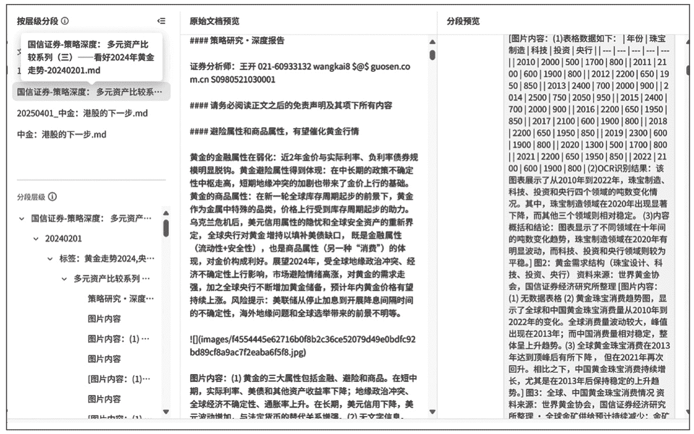

图 1-14 Markdown 文件的知识库切片示意图

资料来源：腾讯 ima。

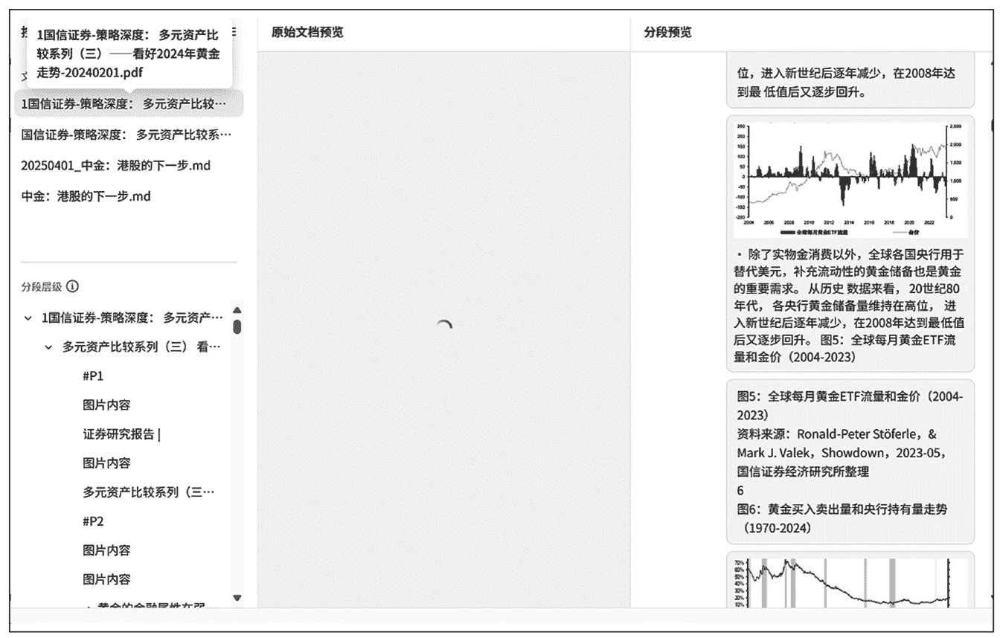

图 1-15 PDF 文件的知识库切片示意图

资料来源：腾讯 ima。

如果我们想获得每个经济体的黄金储备情况，并且使用大模型的推理能力进行点评和解读，只需向知识库提出具体问题。大模型会基于库内的历史文档资料生成对应回答，并落地为包含数据、点评与解读的具体分析结果，给出同一年份可比的美国、德国、法国、意大利和中国的黄金储备，以及全球各国配置黄金的趋势（央行增持）和动因（分散美元资产风险）、边际变化（近几年加速）、时间节点（2008 年金融危机）。这是基于历史文档资料库的专业分析，不涵盖未来预测和联网信息，因此从根源上杜绝了“AI 幻觉”产生的可能性。同时，答案也指引提示图标单位和文本中存在误差，供投资人参考。事后核查发现，这一误差的成因在于：各国数据对比时，部分国家黄金储备数据披露时间较晚，导致数据对齐存在时间滞后的问题（滞后一年）；而在单独描述当年各国最新数据时，直接采用了该国最新披露的数据，两者因时间基准不一致产生了偏差。这种处理方式在最大限度上保证了我们获得的投资数据的精准度和可比性，帮我们主动筛选出可能出现的错误靶点，再有针对性地复核修正。

2.投资知识库搭建：从 PDF 到 Markdown

投资知识库搭建的核心环节，是将投研报告从 PDF 格式转化为更适配 AI 检索与分析的 Markdown 格式，这一过程需经过四个紧密衔接的步骤，依托 AI 技术实现文件结构化、信息增值与检索效率升级。

首先，从研报平台下载目标 PDF 报告时，为每篇报告创建独立子文件夹（如按“日期—报告主题”命名），确保原始文件及附属资料可溯源。完成下载后，将所有 PDF 文件迁移至统一总文件夹，为批量处理建立入口。

其次，进入核心转换环节，通过 MinerU 工具将 PDF 转译为 Markdown 文件：工具会调用百度 Paddle OCR 技术识别文本与表格，自动转化为 Markdown 语法；同时提取 PDF 中的图片，集中保存至与 Markdown 文件同名的 image 文件夹（如“报告名 _image”），并在 Markdown 文本中生成本地图片引用链接，既压缩了文件体积，又保留了图片溯源路径。

再次，转换完成后，先为 Markdown 文件添加基础标签，包括报告日期、标题等元数据，再对文件结构进行优化，分两步展开：第一步，保持报告原始标题与核心框架，仅做基础整理，确保信息完整、逻辑连贯；第二步，将原有标题降级为子标题，补充时间戳明确时间节点，同时借助 AI 转译图片内容，提炼为文本嵌入 Markdown 文件，突出图表结论。

最后，依托 DeepSeek V3 模型完成智能化升级：AI 深度读取 Markdown 文件内容，自动提取“EV（企业价值）/EBITDA（息税折旧摊销前利润）估值”“现金流主导”等核心关键词并添加标签，将复杂研报抽象为易懂的投资理念，实现从“原始内容整理”到“结构化优化”，再到“智能标签检索”的进阶——让研究员既能快速定位关键信息，又能通过标签体系关联产业链逻辑，真正将投研报告转化为可复用、可推理的知识资产。

整个流程中，PDF 转 Markdown 不仅是格式转换，更是通过 AI 技术（OCR 识别、图片转译、关键词生成）重构信息结构：从零散的 PDF 文件，到结构化、标签化、可检索的知识库，让投研知识摆脱“存储载体限制”，成为能被大语言模型理解、调用的“活知识”，为投资决策提供高效、精准的智能支持。

3.投资知识库工程进阶

为了实现上述步骤的逻辑，并构建出适合知识库输入的文本格式，需要按以下步骤执行操作。

第一步是在研报平台下载 PDF 文件，在此不再赘述；第二步是将 PDF 文件从单独保存的文件夹汇总到一起。前文围绕 PDF 转 Markdown 的基础流程，梳理了从文件归集到标签生成的核心步骤，此处将聚焦工程化落地的实操细节，说明如何通过技术优化与结构设计，让知识库真正适配智能检索与投研决策，实现从“流程跑通”到“高效可用”的跨越。

首先是文件归集与工具适配：延续基础流程的“单篇建子文件夹、汇总至总目录”逻辑，但在格式转换工具的选择上，需根据场景灵活调整——若处理未公开研报等敏感文件，且本地算力充足（如 4070Laptop 平台），可部署 MinerU 本地版完成转换，尽管单文件处理耗时 3～5 分钟，但能保障数据安全；若对保密性要求较低、追求效率，则直接调用 MinerU 云平台，依托集群算力将单文件处理压缩至秒级，大幅提升整体流程速度。

在此基础上，结构化标题体系的设计成为 AI 高效检索的关键。不同于基础流程的“自然分层”，工程进阶中强制规范标题层级，这种设计让 AI 在检索时，可通过“时间戳→报告标题→细分内容”的层级逻辑，最大概率覆盖相似主题，实现知识的体系化调用。

针对 PDF 中图片的处理，传统模式效率低且无法被 AI 理解，工程化实践中则通过并行算法重构转译流程：同时处理不超过 20 张图片，既利用多核算力加速转译，又将 API（应用程序接口）流量控制在限额内；转译后，图片内容被拆解为“表格数据+OCR 识别结果+内容概括和结论”（见图 1-16），使图片从“知识库孤岛”变为“可检索、可推理的文本信息”，直接服务于投研分析。

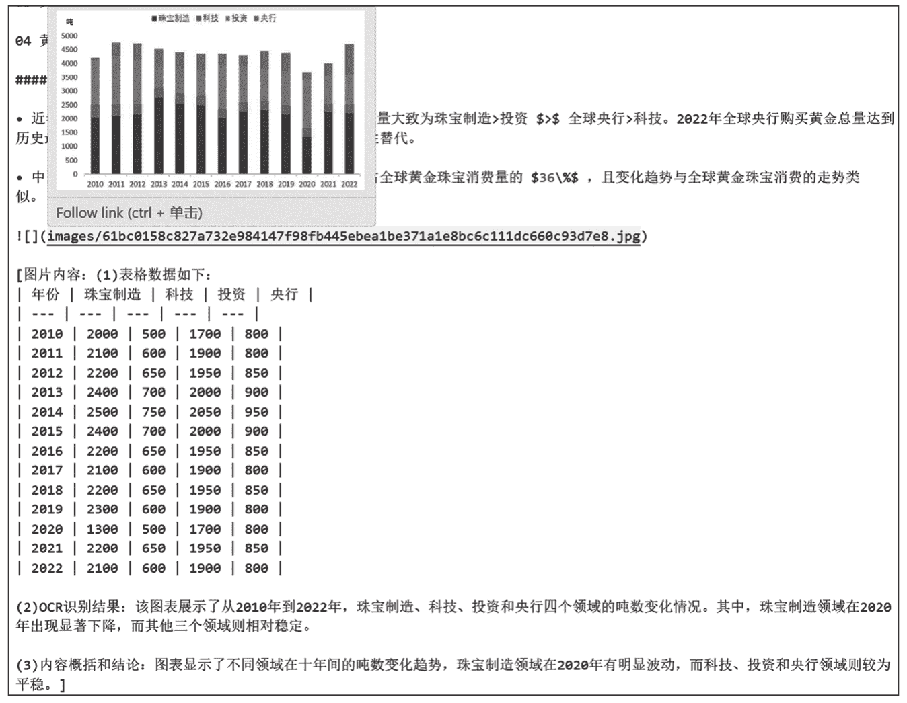

图 1-16 AI 图片转译的效果示例

资料来源：腾讯 ima。

**学习案例 1-6** **腾讯 ima 指导资本周期原理的投资实践**

除了借助知识库归纳总结历史积累的投资素材、数据库外，还可以从各类投资框架中抽象核心逻辑、对比关键要素。过去数年间我们仔细研读马拉松资本的资本周期理论，并将其用于 A 股和美股的大势研判、行业比较和量化选股。我们在此将历史研究报告全部上传于知识库，对资本周期投资原理的大部头专著和投资框架进行实时检索、深度思考和结论输出。

第一种提问：“上述内容是资本周期的系列框架文章，你是一位证券分析师，请总结出该公司在使用资本账户和资本周期回报的理论时，所选用的具体指标，如资本性支出、投资回报率、现金流回报率等，做个具体列表和采用指数的说明。”并追加补充：“这几个指标对长期股价来讲都是正向、负向的影响，还是存在一定阈值（如低于的话是正向影响，超出的话是负向影响）？请结合具体定义或者案例予以说明，最终列成表格形式进行呈现。”

腾讯 ima 给出的资本周期框架核心选股指标列表如图 1-17 所示。

这些指标对长期股价的影响并非简单的正向或负向，而是取决于具体的数值和公司的具体情况。例如，高资本性支出若能带来高回报，则对股价有正向影响；若未能带来相应回报，则对股价有负向影响。因此，投资者需要综合考虑这些指标的具体数值和公司的经营状况，才能做出准确的判断。

第二种提问：“请结合资本周期理论和企业生命周期（分成五个阶段）来论述企业的发展历程，包括市值、盈利情况、市场集中度指数、资本性支出等指标的变迁。请将上述内容总结成表格形式，最后用一段话加以概括，并比较中美企业实践差异。”

腾讯 ima 将资本周期框架概括在表 1-11 中。

腾讯 ima 给出的概括如下。

企业生命周期的五个阶段反映了公司在不同发展阶段的特点和面临的挑战。初创期和成长期的公司通常面临高不确定性和高风险，但增长潜力巨大；成熟期的公司市场饱和，增长放缓，但盈利稳定；衰退期的公司面临收入和利润下降的压力；夕阳期的公司逐渐退出市场。中美两国企业在生命周期的各个阶段表现出不同的特点，美国企业在成熟期和衰退期的集中度较高，资本性开支相对较低，而中国企业在成长期和成熟期的市值和盈利增长较快，资本性开支较高。

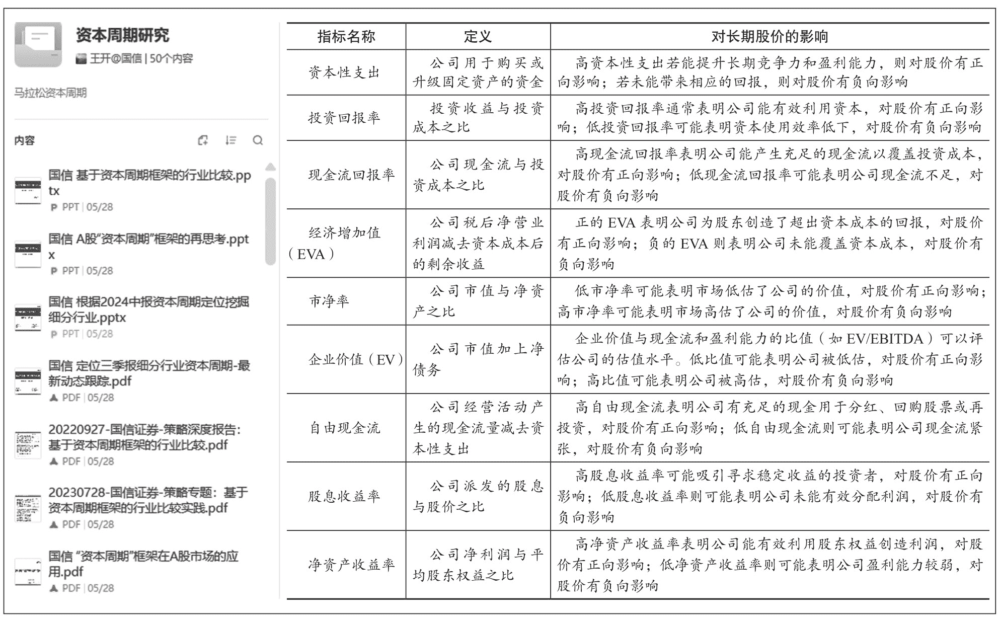

图 1-17 腾讯 ima 给出的资本周期框架核心选股指标列表

资料来源：腾讯 ima。

**表 1-11** **腾讯 ima 概括资本周期框架**

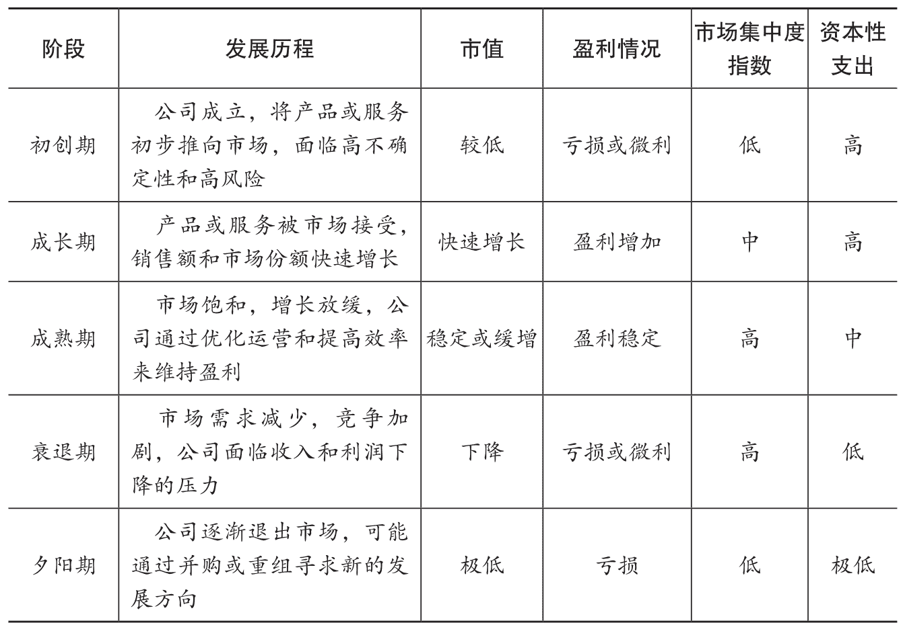

资料来源：腾讯 ima。

第三种提问：“请基于中美企业对比的视角，结合企业生命周期理论来论述企业的发展历程，包括盈利能力和资本性开支等的变迁，以及相应历程的投资机会。”

腾讯 ima 总结的企业生命周期历程中美企业对比规律如表 1-12 所示。

腾讯 ima 在学习既有内容的基础上，最终给出如下总结。值得注意的是，表 1-12 及下述总结对企业生命周期采用三阶段划分（成长期、成熟期、衰退期），是在表 1-11 五阶段框架基础上的简化处理。主要是因为，在中美市场对比分析中，初创期和夕阳期的跨市场差异相对有限，而成长期、成熟期、衰退期在盈利模式、资本开支逻辑、市场集中度等方面的中美企业特征差异更显著，因此聚焦这三个核心阶段以突出对比重点。

**表 1-12** **腾讯 ima 总结的企业生命周期历程中美企业对比规律**

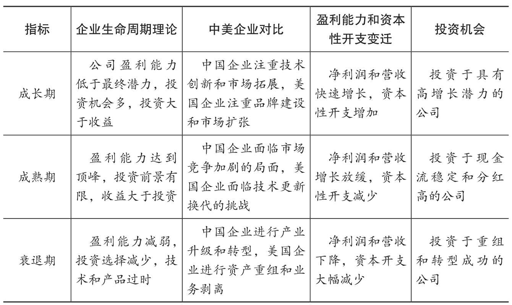

资料来源：腾讯 ima。

企业生命周期理论将企业的发展分为成长期、成熟期和衰退期。在成长期，企业盈利能力较低但投资机会多，适合投资于具有高增长潜力的公司。成熟期企业盈利能力达到顶峰，投资前景有限，适合投资于现金流稳定和分红高的公司。衰退期企业盈利能力减弱，投资选择减少，适合投资于重组和转型成功的公司。中美企业在不同生命周期阶段的表现有所不同，中国企业更注重技术创新和市场拓展，而美国企业更注重品牌建设和市场扩张。

上述第二种提问和第三种提问看似接近，实则可以匹配不同场景的需求，实现“从认知到决策”的分层支撑，前者通过全阶段、多指标框架帮助新手建立企业周期系统认知，侧重“生命周期五个阶段”，后者聚焦核心指标与中美股票市场差异为资深者提供实战决策依据，侧重“中美企业对比”，避免信息过载或不足。

在知识库的搭建过程中，我们善用大模型，通过将 PDF 研报批量转化为结构化的知识库，不仅把过往零碎的研究成果整合成可检索、可推理、可迭代的“个人智库”，还能借助大模型的持续学习能力，让知识库随着新报告、新数据实时更新，形成“越用越聪明”的闭环。更可贵的是，这套轻量化、标签化的体系天然支持云端共享与多人协作——投资者可以一键把自己的智库切片分享给朋友和同事，团队则能把各自的研究模块拼装成更大、更全的“团队智库”，在复盘、调研、路演等场景中实现秒级调用，彻底告别“重复造轮子”。

**第二章 慧眼识金 AI 算力加成把握时机****[2][.][1]**

## ** 大势研判：利用 AI 工具完美看图画线**

在技术分析领域，波浪理论一直是投资者判断行情节奏和市场拐点的重要工具。对于 A 股、沪金期货等波动性较强的资产，准确把握浪形分布和趋势变化能帮助投资者优化仓位和把握决策时点。然而，传统的人工标注方式既耗时又主观，难以在实时市场中发挥作用。随着大模型和自然语言处理技术的发展，AI 工具为波浪识别和择时提供了新的思路：通过结构化文字和数据输入，AI 不仅能快速完成波浪划分和目标价测算，还能在多个情境下提供统一的分析框架。

本章将围绕三款国产 AI 工具（秘塔 AI 搜索、通义千问、腾讯 ima），结合上证指数和沪金期货两个案例，展示 AI 在波浪识别中的实战效果，并通过对比表格和总结分析它们在速率、准确度及适用场景上的异同，进一步探讨 AI 辅助技术分析在投资中的应用潜力。

波浪理论以五浪推动和三浪调整描述市场价格循环，但市场实际走势往往错综复杂，手工标注浪形既主观又耗时。AI 工具在文本分析、数据处理和逻辑推理方面的优势，为克服这一难题提供了新路径。本节采用“先结构化数据再分析”的策略：先将行情图表转化为具体日期、时间和价格区间，再在同一提示中交代情景/身份、分析维度（层次/颗粒度）、时间/范围、输出格式和研究方法等六大要素，将结构化数据输入 AI 模型。这样既能降低多模态识图的幻觉风险，又能保证推理链完整、结果可复现。

秘塔 AI 搜索、通义千问和腾讯 ima 在波浪识别准确度、分析速度、优缺点和适用场景方面各有侧重。表 2-1 概述了它们的差异。

**表 2-1 AI 工具波浪识别准确度、分析速度、优缺点与适用场景对比**

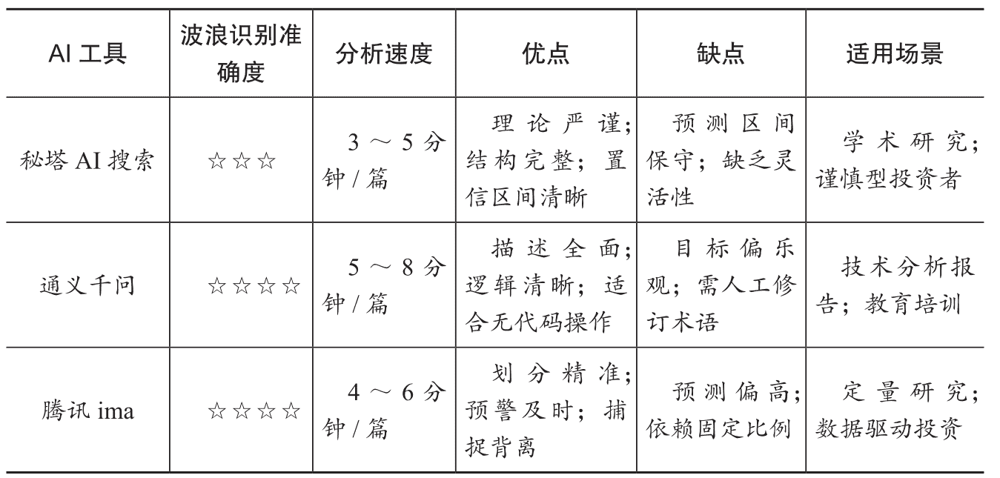

资料来源：作者整理。

在接下来的内容中，我们将借助上述工具，深入探讨如何以极简的“三步法”，高效完成波浪自动识别，清晰捕捉中期趋势的演变规律，并配合具体案例与宏观大势分析，真正实现 AI 技术对波浪理论的落地应用，帮助投资者轻松迈过“看得见却用不好”的门槛，让波浪理论从复杂的图表变成实实在在的盈利工具。

**学习案例 2-1 上证指数 30 分钟行情：AI 波浪识别实战案例**

尽管 AI 工具已显著提升了投研效率，但在实践中，我们依然需要理性看待当前大模型的能力局限。大模型虽然在文本处理、资料整合方面表现卓越，但在多模态任务（尤其是对行情截图识别和趋势判断）以及投资决策支持场景中，其识别精度与稳定性仍不尽如人意。根据公开评测与实际使用情况，这些模型在此类任务中的幻觉率仍高达约 10%。为了验证 AI 模型在波浪识别中的最佳输入方式，我们对当前的三种主流方法——纯图片输入、纯文字数据输入、文字与图片结合输入，进行了全面的实测对比。我们分别使用秘塔 AI 搜索、通义千问和腾讯 ima 这三款主流国产大模型，统一输入相同的行情样本进行测试，并记录各模型在准确性、速度、可解释性方面的具体表现。通过表 2-2 的对比分析，我们能更直观地发现哪种输入方式在实际波浪识别任务中表现最优，为投资实战提供有力的参考依据。

**表 2-2 AI 工具输入方式、优缺点与综合表现对比**

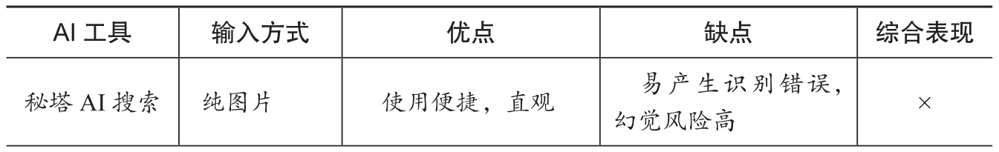

（续）

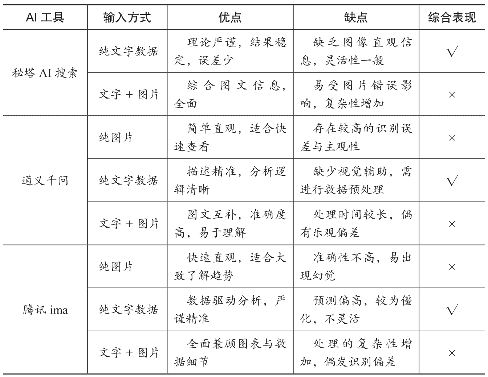

资料来源：作者整理。

经过仔细地实测对比与分析，我们发现，纯文字数据输入的方式，在波浪识别任务中表现整体最佳。这种方法不仅准确性较高、误差最小，而且分析过程稳定可靠，能有效规避单纯图片输入易出现的幻觉风险，也避免了多模态（文字+图片）模式中图片识别错误所带来的不确定性与复杂性。因此，在实际投资决策与技术分析场景中，推荐优先采用纯文字数据输入的方式，以实现快速、高效且稳健的波浪识别与择时判断。我们推荐采用更为稳妥的方式，即将行情图表转换为结构化文字（例如具体日期、时间、价格区间），通过文字模式的 AI 分析，规避多模态识图任务中的幻觉风险。

下面以 2024 年 9 月至 11 月的上证指数 30 分钟行情为例，通过将结构化文字输入 AI 工具进行波浪识别与趋势判断。

这部分市场数据分析的复现，需登录通达信官方数据门户，如图 2-1 所示，在页面左侧点击“下载中心”，选择“通达信证券分析系统（免费版）”并安装。安装完成后启动软件，默认连接公共行情服务器即可自动同步 A 股日线、分钟线乃至逐笔成交（Tick）数据；至此，所有原始价格与成交量信息已完整保存在本地，可随时导出 CSV 或直接被模型调用，为后续波浪识别与量价研究提供精准的数据源。

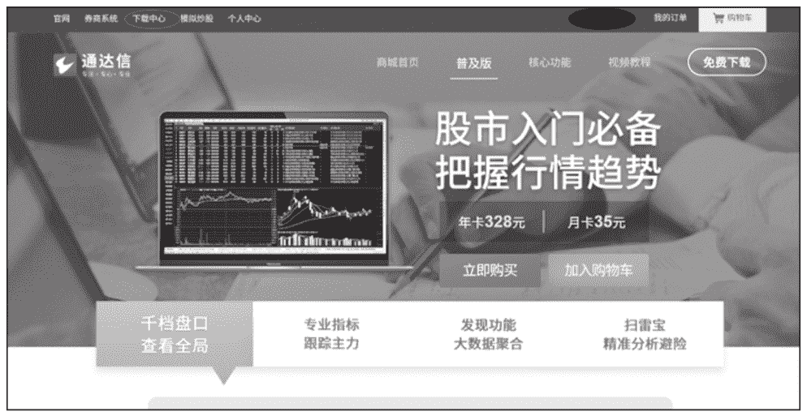

图 2-1 通达信官网首页及下载入口界面

资料来源：通达信官网。

在通达信“行情数据下载→券商每日数据”页面中，日线与 TIC（美国国际资本）数据已经按日期整齐排布，只需在浏览器中框选整张表格后按 Ctrl+C（或点击鼠标右键，选择“复制”）即可将所有链接与字段一次性复制为纯文本。由于大模型本质上擅长处理结构化文字，把这段未经压缩的日期—文件名—下载地址直接粘贴到对话窗口，模型便能立即提取出所需的行情文件列表并进一步解析；相比逐个下载或解析二进制文件，这种“一键复制—文本喂模”的方式既节省时间，又最大限度地降低了多模态识图带来的幻觉风险，使后续的波浪识别和量价分析更加高效、可靠。上证指数区间行情数据示例表如表 2-3 所示。

**表 2-3 上证指数区间行情数据示例表**

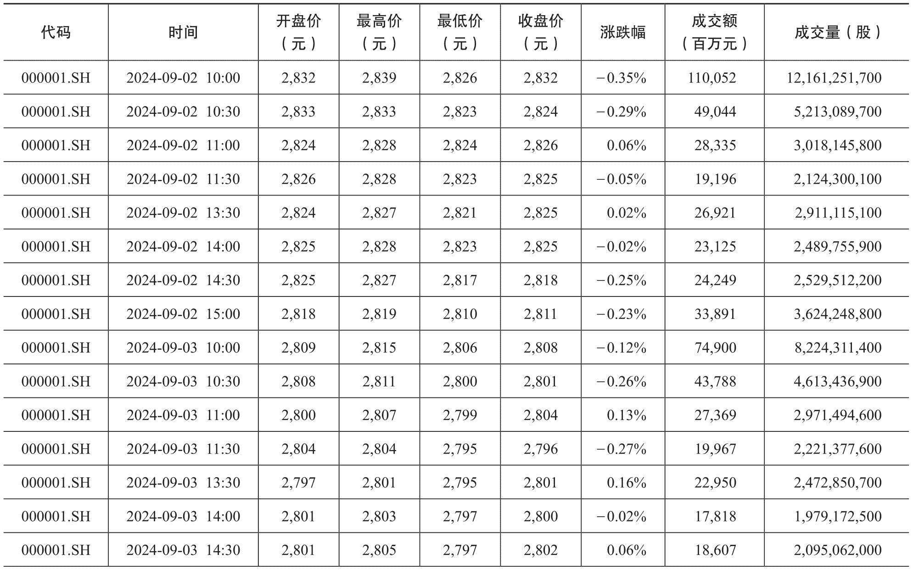

（续）

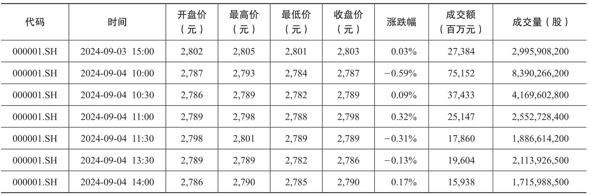

资料来源：通达信官网。

在实际撰写 AI 提示词时，需要一次性在同一段里同时交代六大要素：①情景/身份（你是券商量化分析师，需在例会上汇报上证 30 分钟浪形）；②分析层次/颗粒度（宏观、中观、微观并辅以乐观、中性、悲观三视角）；③时间/范围（仅分析 2024-09-02 10:00 至 2024-11-29 15:00 的 30 分钟行情，不得引用其他区段）；④输出格式（限 600 字，先给结论后拆解，并附 Markdown 文件）；⑤研究方法（遵守波浪理论“浪 3 不最短，浪 4 不侵浪 1”，用成交量背离与分步法计算目标价，并给出公式或行号）；⑥重视程度/资源投入（要求提供完整的推理链，并给出 70%和 90%置信区间）。然后，在“数据粘贴”处把全表格的 30 分钟行情一键复制到提示词末尾。这样，大模型可直接读取原始数据，避免上传文件或外链带来的格式损耗，同时显著降低幻觉率并输出可直接用于技术分析的高质量的波段分析。

下面我们分别展示秘塔 AI 搜索、通义千问和腾讯 ima 这三款主流国产大模型的具体输出结果。

1.秘塔 AI 搜索实现技术分析

采用秘塔 AI 搜索作为智能研究助手：模型先自动拆解“时间校验—浪形划分—量价背离—目标价估算—置信区间”等子任务，再链式调用数据库逐步推理，最终生成“先结论、后推理、附 Markdown 表”的 600 字报告。整个流程直接读取作者粘贴的 30 分钟原始行情，严格遵循“浪 3 不最短，浪 4 不侵浪 1”等波浪铁律，并在 70%和 90%置信水平下给出可重复检验的目标价区间。相较于传统手工分析，AI 不仅显著降低了数据搬运与格式损耗，更通过可追溯的推理链减少幻觉风险，为量化写作提供了“一键成稿、随时复现”的新范式。上证指数阶段性波浪结构如图 2-2 所示。

秘塔 AI 搜索最终回答部分示例如下。

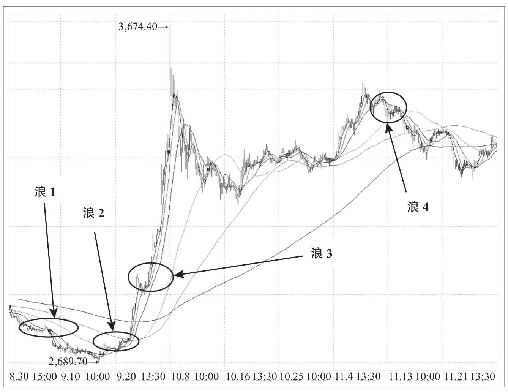

图 2-2 上证指数阶段性波浪结构示意图 1

注：仅展示上证指数阶段性波浪结构（至浪 4 阶段），浪 5 的形成需结合后续行情进一步分析。

资料来源：秘塔 AI 搜索。

根据提供的上证指数 30 分钟 K 线数据（2024-09-02 10:00 至 2024-11-29 15:00），结合波浪理论、成交量背离及分步法目标价计算，现汇报浪形分析如下。

核心观点：上证指数处于浪 4 末期的震荡整理阶段，短期面临回调风险（浪 4），中期目标 3,210 点（90%置信区间）。宏观政策托底（乐观），但微观量能背离（悲观）暗示调整需求，中观结构需守稳 3,080 点支撑。

目标价测算（分步法）如下。

b 区域选取：浪 2 调整区（2024-10-15 至 2024-10-18），取日内量能最大收盘价。

3,268+3,216+3,228+3,164+3,261=16,137

b 区域均价=16,137÷5=3,227.4

目标公式：*c*=b 区域均价×2−浪 1 起点

浪 5 目标价（取整）=3,227×2−2,690=3,764

置信区间（标准差*σ*=32）计算如下。

70%置信区间：3,227±1.04*σ*→[3,194,3,261]

90%置信区间：3,227±1.65*σ*→[3,174,3,281]

置信区间（Confidence Interval）计算说明：计算 95%置信区间时，上限（Upper Limit）=均值+1.96×标准差；下限（Lower Limit）=均值−1.96×标准差。若需计算 90%置信区间，将 1.96 替换为 1.65；若需计算 99%置信区间，将 1.96 替换为 2.58 即可。

AI 拆解与量价背离分析示例如图 2-3 所示。其运用正态分布与置信区间的统计学原理，辅助开展拆解与量价背离分析。图 2-3 所示公式中， 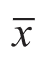是样本均值，*z*为置信水平对应值， 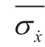是样本均值标准误差。通过判断价格、成交量的波动区间是否出现显著错位（如价格突破某置信区间但成交量未同步），来识别量价背离信号。

秘塔 AI 搜索从乐观、中性、悲观三个视角进行了展望，如表 2-4 所示。

**表 2-4 三视角展望**

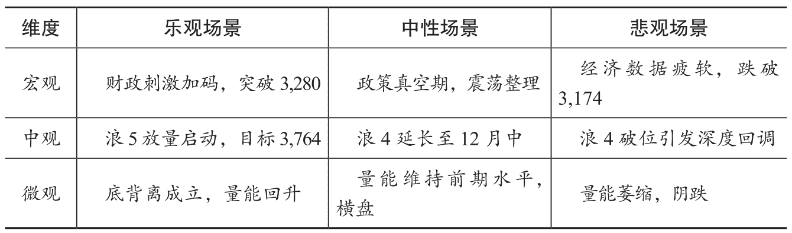

资料来源：秘塔 AI 搜索。

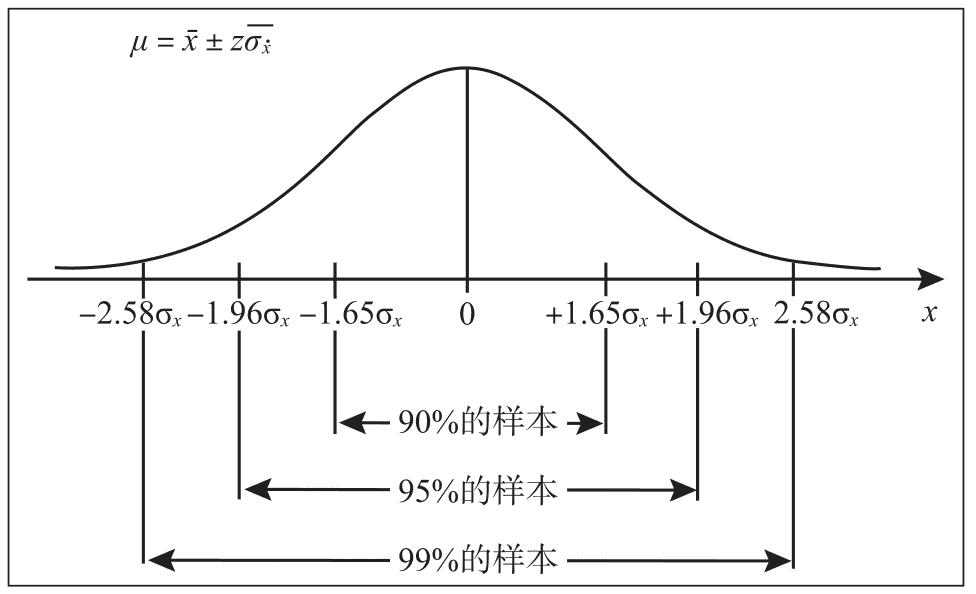

图 2-3 AI 拆解与量价背离分析示例

注：全书中出现的大模型点位预测仅为当时的情景展示，不作为读者当前投资推荐依据。

资料来源：秘塔 AI 搜索。

秘塔 AI 搜索还对关键节点进行了示例说明。

短期：浪 4 未结束，3,227 以下分批布局。

中期：突破 3,329 加仓。目标 3,487（乐观情形上沿 3,764）。

风险：若浪 4 收盘破 3,150，浪形失效需重新计数。

关键节点示例如表 2-5 所示。

**表 2-5 关键节点示例**

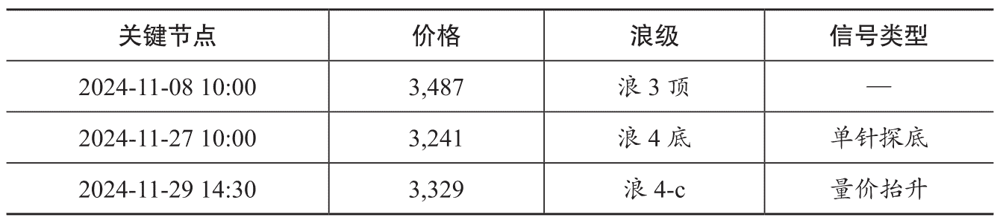

资料来源：秘塔 AI 搜索。

2.通义千问实现技术分析

此处上证指数阶段性波浪结构如图 2-4 所示。通义千问在 30 分钟级别对上证指数完成了从数据抓取、波浪计数到目标价推导的一站式生成，证明大模型已能在无代码环境下复刻传统技术分析流程：其优点是逻辑链条清晰，能自动套用“五浪+扩散三角”模板并给出 70%和 90%置信区间，文本结构亦符合投研分析的分节规范；难点在于仍夹杂“加仓、减仓”类操作口吻，对扩散三角形的测幅与成交量佐证也偏重经验参数，需人工后期用定量检验和风险披露加以修订。总体来看，通义千问可为波浪研究分析提供近乎可直接引用的“初稿级”素材参考，但距离投资中实践落地仍少不了人工把关术语的中立性与统计分析严谨性。

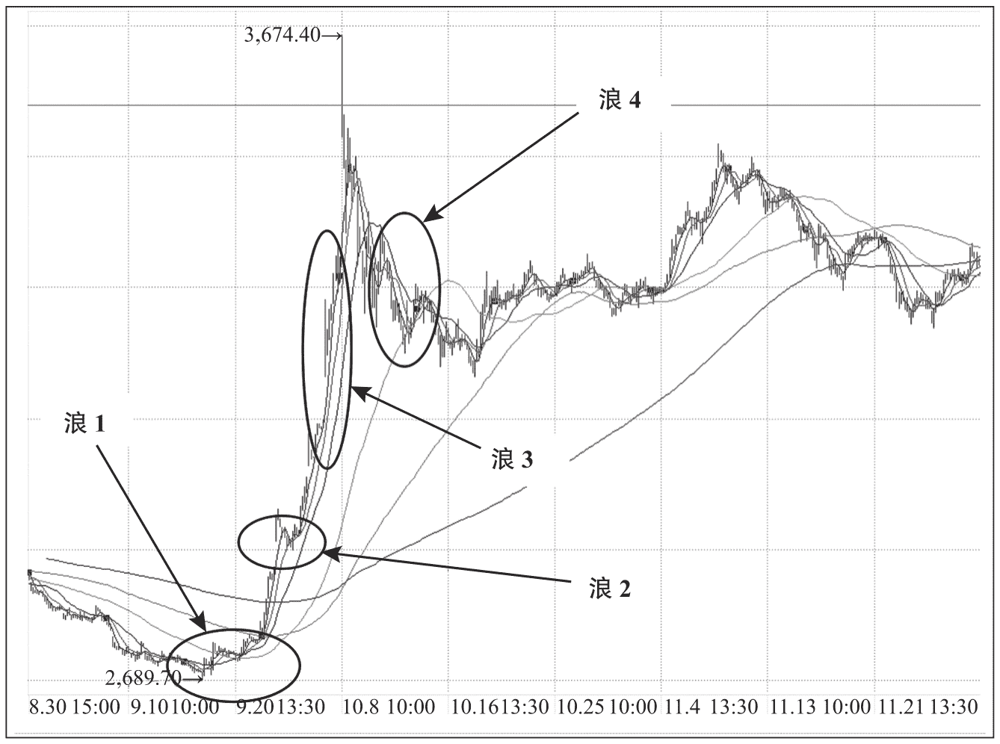

图 2-4 上证指数阶段性波浪结构示意图 2

注：仅展示上证指数阶段性波浪结构（至浪 4 阶段），浪 5 的形成需结合后续行情进一步分析。

资料来源：通义千问。

通义千问关于上证指数 30 分钟级别波浪分析与目标价预测的具体回答如下。

上证指数在 2024 年 9 月 2 日至 11 月 29 日期间，形成了完整的 30 分钟级别推动浪和调整浪（扩散三角形结构），当前处于调整浪结束后的反弹初期。推动浪从 2,689 点上延至 3,336 点，随后在 10 月 8 日高点 3,674 点开始震荡调整，最终于 11 月 27 日在 3,227 点形成调整浪底。基于波浪理论规则和成交量背离分析，预计未来 30 分钟级别反弹的第一目标位为 3,500 点（70%置信区间），第二目标位为 3,950 点（90%置信区间）。

整体波浪结构分析：上证指数在 2024 年 9 月 2 日至 11 月 29 日 30 分钟级别走势中，先行了推动浪和调整浪结构。推动浪阶段（9 月 2 日至 10 月 8 日）呈现明显的三浪上涨结构，其中：浪 1（2,689→3,125 点）为初始上涨，涨幅 436 点；浪 2（3,125→3,065 点）为调整回撤；浪 3（3,065→3,674 点）为最大推动浪，涨幅 609 点。推动浪整体变动幅度为 985 点（2,689→3,674 点），约为浪 1 涨幅（436 点）的 2.26 倍，浪形比例基本符合波浪理论常见规律。

调整浪阶段（10 月 8 日至 11 月 29 日）呈现“扩散三角形形态”，包含 A、B、C、D、E 五个子浪：浪 A（3,674→3,515 点）为下跌浪；浪 B（3,515→3,625 点）为反弹浪；浪 C（3,625→3,448 点）为下跌浪；浪 D（3,448→3,494 点）为反弹浪；浪 E（3,494→3,227 点）为下跌浪。各子浪波幅逐级扩大，且后端波段振幅均小于前段振幅的 0.618 倍，符合扩散三角形修正形态准则。3,227 点低于前低点 3,448 点但未破坏形态，仍属有效调整底部。

关键转折点与成交量背离验证：通过分析 30 分钟级别 K 线和成交量数据，可以确认几个关键转折点和顶背离现象。10 月 8 日的高点 3,674 点是典型的顶背离区域，当日成交量创历史新高（3.45 万亿元），但随后指数下跌而成交量未持续放大，符合“价格新高但量能未持续突破”的顶背离特征：这一背离现象预示短期调整的开始。

11 月 27 日的低点 3,227 点则是明显的底背离区域：尽管指数创新低，但成交量已萎缩至前期高点的 60%左右，随后出现量价反弹，形成“价格创新低但量能递减→反弹”的底背离特征。结合扩散三角形调整结构，这一低点被视为调整终点，也是新一轮反弹的起点。

从成交量趋势来看，11 月沪深两市成交量较 10 月分别下降 22.2%（沪市）和 2.9%（深市），与调整阶段运行周期吻合；而 10 月 8 日的“天量”与 11 月 29 日的“缩量”形成鲜明对比，进一步验证了波浪结构的转换。成交量变化与价格波动的背离逻辑，为波浪理论分析提供了重要的技术佐证。

支撑压力位确认：根据波浪理论和扩散三角形的形态分析，上证指数在 2024 年 9 月 2 日至 11 月 29 日期间的支撑压力位可以明确，如表 2-6 所示。

**表 2-6 AI 拆解与量价背离分析示例 1**

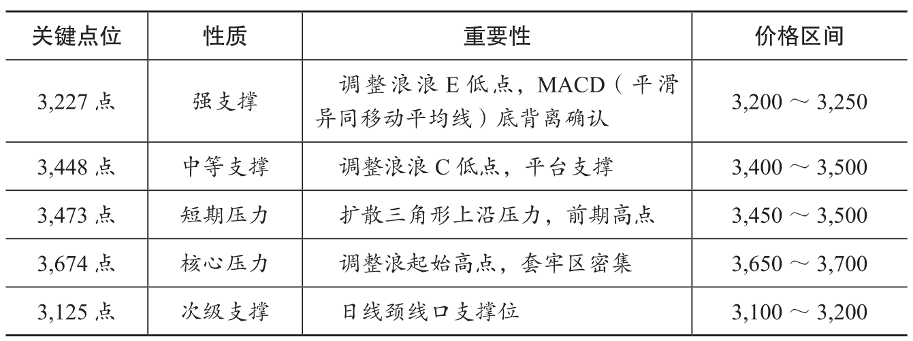

资料来源：通义千问。

3,227 点作为调整浪浪 E 的低点，是当前最可靠的支撑位，也是 30 分钟级别 MACD 底背离确认点，接近 200 周均线（3,245 点），具有较强操作意义；3,473 点是扩散三角形形态的上沿压力，为前期高点区域，预计将成为反弹后的第一重阻力；3,674 点则是调整浪的起始高点与波段最高点，作为长期压力位，突破该位需更大的成交量配合。

目标价预测与置信区间：基于波浪理论的黄金分割比例法则及调整浪结构特征，结合成交量背离验证结果，上证指数 30 分钟级别的反弹的目标价预测如下。基准情形（第一目标位）：3,500 点，对应区间 3,470～3,530 点。乐观情形（第二目标位）：3,950 点，对应区间 3,920～3,980 点。

目标价计算：核心计算逻辑是，反弹目标价的测算参考了调整浪结构的特征，其基准为自波段高点 3,674 点至调整低点 3,227 点的区间，结合黄金分割比例（波浪理论中最具实操性的比例体系）得出。其中，参考波幅=3,674−3,227=447（点）；对于黄金分割比例选择，依据反弹确定性分级，基准情形对应保守型比例 0.618（常见反弹半程目标），乐观情形按要求采用强势延伸比例 1.618（推动浪或强势反弹典型倍数）。

第一目标价（基准情形）计算公式：第一目标价=调整浪浪 E 低点+调整浪波幅×0.618。计算过程：3,227+447×0.618≈3,227+276=3,503（点）（取整为 3,500 点）。第二目标价（乐观情形）计算公式：第二目标价=调整浪浪 E 低点+调整浪波幅×1.618。计算过程：3,227+447×1.618≈3,227+723=3,950（点），1.618 是波浪理论中“强势延伸浪”的核心比例，该目标位突破前期推动浪高点 3,674 点，需对应成交量显著放大（如恢复至 10 月 8 日“天量”的 80%以上），符合“量价配合突破核心压力”的技术要求。

结论与操作建议：综合分析表明，上证指数在 2024 年 9 月 2 日至 11 月 29 日期间完成了 30 分钟级别的波浪结构，当前正处于调整浪结束后的反弹初期。这一反弹的第一目标位为 3,500 点，第二目标位为 3,950 点（乐观情形）。

操作建议：短期可关注 3,500 点附近的压力位，若成交量配合良好，可适当加仓；若指数突破 3,500 点，可继续持有并观察 3,950 点附近的第二目标位；在反弹过程中，若出现成交量萎缩或 MACD 顶背离信号，应考虑部分减仓；长期投资者可保持中等仓位，等待更大级别波浪的形成。

3.腾讯 ima 实现技术分析

此处上证指数阶段性波浪结构如图 2-5 所示。腾讯 ima 在此次上证指数 30 分钟级别浪形分析（2024 年 9 月 2 日至 11 月 29 日）中，表现出了较强的波浪理论识别与应用能力。尤其在浪形划分与关键节点识别方面，其分析精准、规则严谨，明确指出当前正处于驱动浪（浪 3）主升阶段，并精确给出目标价区间（基准情形：3,760 点附近。乐观情形：3,700～4,500 点）。值得肯定的是，该 AI 还准确捕捉到近期价量背离的信号，提示短期内回调风险上升，展示出较好的市场敏感性与预警能力。然而，这种基于标准公式（如 1.618 倍浪 1 波幅）推算出的目标价在复杂市场环境中可能略显僵化，尚未充分体现 AI 在灵活性方面的潜在优势。整体而言，腾讯 ima 此次分析清晰合理，但未来如能加入更多基本面环境或市场情绪变化因素，或将进一步提升分析的现实参考价值。

腾讯 ima 的具体回答如下。

**上证指数 30 分钟级别浪形分析（2024-09-02～2024-11-29）**

结论：当前处于浪 3 主升阶段，目标区间为 3,760 点附近（基准情形）和 3,700～4,500 点（乐观情形），需警惕浪 4 回调风险。关键支撑位 3,152 点（浪 2 底部），若跌破则浪形失效。

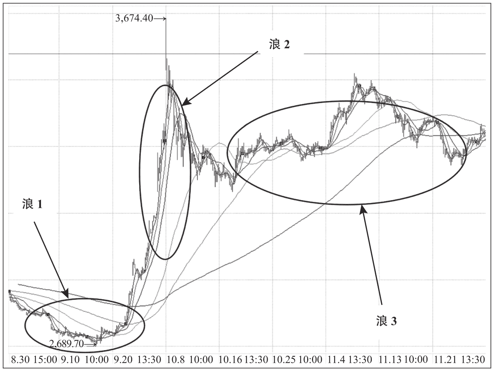

图 2-5 上证指数阶段性波浪结构示意图 3

资料来源：腾讯 ima。

浪形拆解与验证如下。

（1）浪 1（驱动浪）。时间：2024-09-18～2024-10-08，历时 10 个交易日。涨幅：36.6%（2,690→3,674 点），30 分钟成交额峰值 5,185 亿元（2024-10-08）。特征：子浪结构清晰，浪 3 子浪成交额显著放大。

（2）浪 2（调整浪）。时间：2024-10-08～2024-10-18，历时 9 个交易日，回撤 14.2%（3,674→3,152 点）。基本符合斐波那契回吐 38.2%（14.2%/36.6%），低点 3,152 点未跌破浪 1 起点 2,690 点，满足波浪理论“浪 2 不低于浪 1 起点”的铁律。

（3）浪 3（主升浪）。当前阶段：2024-11-29 仍在突破浪 1 高点过程中。

目标价计算：基础位为浪 3≥浪 2 低点+0.618×浪 1 波幅=3,152+（3,674−2,690）×0.618≈3,760 点（悲观情形）。扩展目标：若浪 3=浪 2 低点+1.618×浪 1 波幅，则 3,152+（3,674−2,690）×1.618≈4,744 点，因此上看 3,700～4,500 点（乐观情形，预留市场波动空间）。

背离信号：价格—量能背离，指数创新高而成交额递减（−15%），需警惕短期回调。AI 拆解与量价背离分析示例如表 2-7 所示。

**表 2-7 AI 拆解与量价背离分析示例 2**

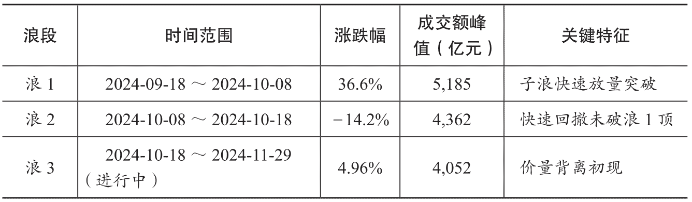

注：成交额峰值为 30 分钟级别，相邻两浪中前浪截止、后浪起始在同一天。

资料来源：腾讯 ima。

操作建议如下。

乐观情景：持有至 4,000 点，止损 3,152 点。

中性情景：部分止盈于 3,700 点，观察浪 4 形态。

悲观情景：若跌破 3,152 点，确认浪形失效，转为防御策略。

通过对秘塔 AI 搜索、通义千问和腾讯 ima 三种不同 AI 系统的分析结果进行横向对比，可以看出在对上证指数 30 分钟级别浪形结构的判断上，三种 AI 系统展现出明显的差异，回答结果也不同。从底层逻辑来看，波浪理论本身存在“浪形主观划分空间”，不同模型对浪形起点/终点界定“子浪结构识别规则”的算法设计有差异。各个 AI 也展现出不同的优劣。秘塔 AI 搜索体现出严谨的分析过程，注重数据和步骤的严格拆解，体现了清晰的逻辑链条和严密的理论基础，但其过于保守的中期目标设定，使预测略显保守而缺乏实战适应性；通义千问则强调全面、详尽的浪形描述和成交量背离分析，提供了清晰的技术面佐证，但其目标预测偏于乐观，部分区间较实际行情略高，理论推导严谨却稍显脱离实际；腾讯 ima 表现为对波浪理论的应用精度较高，数据验证及目标推导过程细致，但目标价推算过度依赖“标准公式”，对宏观政策冲击、市场情绪博弈等复杂市场环境的适应性不足，灵活性欠缺。

**学习案例 2-2 沪金期货 30 分钟行情：AI 波浪识别实战案例**

在完成了对上证指数 30 分钟行情的 AI 波浪识别实战案例后，我们进一步将视线投向更为多元的投资标的，尝试将同样的方法体系应用于商品期货市场。与股指市场相比，期货市场的波动节奏更为鲜明、趋势性更强，而 2025 年 3 月 1 日至 5 月 1 日的沪金期货走势尤其引人瞩目——该阶段沪金价格整体涨幅显著，结构清晰，典型的趋势推动浪形态为我们提供了绝佳的验证 AI 工具识别波浪结构精准度的案例。通过选取这样一段行情，我们既能清晰检验不同 AI 工具在强趋势环境下的表现差异，又能进一步展示 AI 数浪方法在多品种、多市场环境下的广泛适用性和实战价值。

在实际针对沪金期货 2025 年 3 月 1 日至 5 月 1 日这段 30 分钟级别的行情走势进行 AI 提示词撰写时，我们依旧需要同时明确六个关键要素：①身份/情景（你是一名期货量化分析师，需在月度投研会上汇报沪金期货 30 分钟级别波浪结构）；②分析层次和颗粒度（宏观、中观、微观三个视角，分别采用乐观、中性和悲观假设）；③时间/范围（仅限 2025 年 3 月 1 日 10:00 至 2025 年 5 月 1 日 15:00 期间的 30 分钟行情数据，不允许引用其他时间区间的数据）；④输出格式（限 600 字，先给结论，再拆解分析过程，并以 Markdown 表格呈现关键数据）；⑤研究方法（严格遵守波浪理论“浪 3 不最短，浪 4 不侵浪 1”两大铁律，并结合成交量背离及分步法计算目标价，同时给出计算公式或行号）；⑥重视程度/资源投入（要求提供完整的推理逻辑链条与 70%和 90%的目标价置信区间）。同时，在提示词末尾的“数据粘贴”处将对应时段沪金期货的 30 分钟原始行情数据一次性粘贴。这种方法能使大模型直接读取原始数据，避免外部上传或链接造成的数据损耗，大幅降低分析幻觉风险，输出结果也能直接用于后续书籍编写及专业投研场景的高质量汇报。

下面我们分别展示秘塔 AI 搜索和通义千问这两款主流国产大模型的具体输出结果。

1.秘塔 AI 搜索对沪金期货的分析

此处沪金期货阶段性波浪结构如图 2-6 所示。基于秘塔 AI 搜索对 2025 年 3 月 1 日至 5 月 1 日沪金期货 30 分钟级别走势的波浪结构分析，该时段内行情处于明显的五浪上升结构末端，浪形划分严格遵循波浪理论铁律“浪 3 不最短，浪 4 不侵浪 1”。AI 模型精准识别了宏观环境中地缘冲突和美联储降息预期对黄金价格的利多支撑，明确指出中观持仓结构的变化与微观量价背离现象，提示短期调整风险；目标价格中枢定在 760～790 元/克，基准情形为 790～810 元/克，乐观情形为 810～900 元/克，整体分析结果稳健且逻辑清晰，适合作为量化投资决策的重要参考依据。

秘塔 AI 搜索输出的《沪金期货 30 分钟波浪结构分析报告（2025-03-01～2025-05-01）》如下。

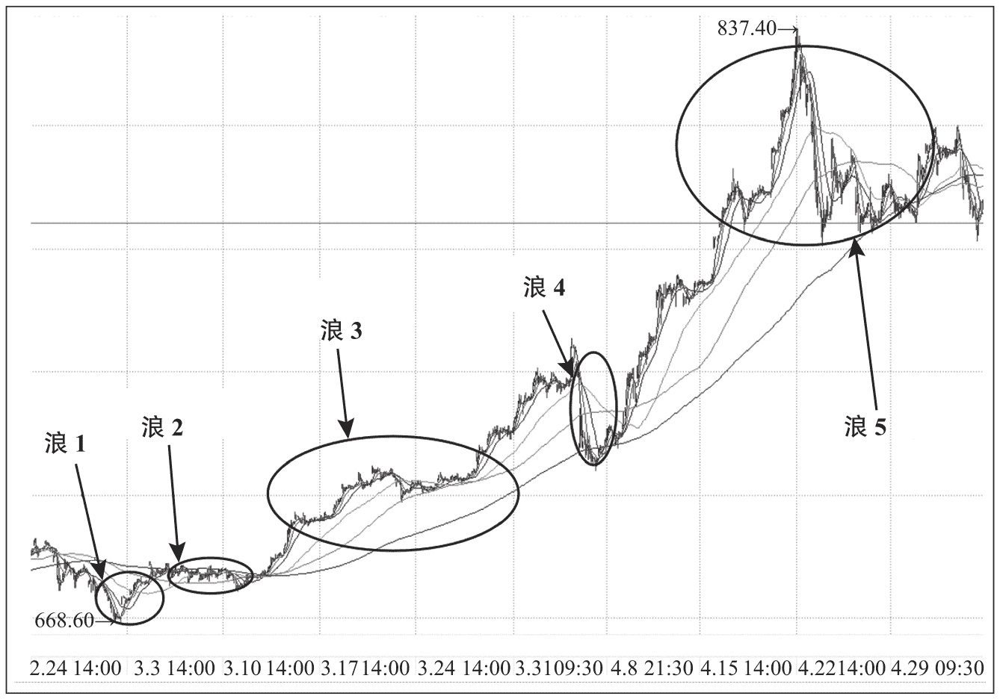

图 2-6 沪金期货阶段性波浪结构示意图 1

资料来源：秘塔 AI 搜索。

核心结论：沪金期货主力合约在观察期内完成驱动浪的主涨结构，浪 4 回调未跌浪 1 顶部，当前处于完整主涨段后的 ABC 段中，目标价中枢为 770～790 元/克，基准情形为 790～810 元/克，乐观情形为 810～830 元/克。

（1）分析框架与规则如下。

波浪理论铁律：浪 3 不最短，浪 3 波幅（65.18 元）＞浪 1（16.64 元）；浪 4 不侵浪 1：浪 4 低点 711.4 元＞浪 1 顶 685.24 元（未跌破，符合波浪理论铁律）。

数据范围：2025 年 3 月 1 日 10:00 至 2025 年 5 月 1 日 15:00 期间的 30 分钟行情数据（浪 5 需结合后续行情延伸）。

浪 5 最小目标=浪 4 终点+0.618×浪 1 波幅（16.64 元）；浪 5 中性目标=浪 4 终点+1.618×浪 1 波幅+浪 3 波幅；浪 5 乐观目标=浪 4 终点+3.236×浪 1 波幅+1.618×浪 3 波幅。

波浪结构拆解（30 分钟级别）如表 2-8 所示。

**表 2-8 波浪结构拆解（30 分钟级别）**

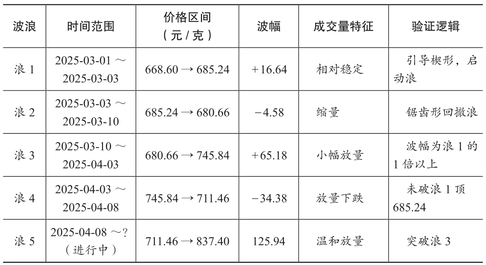

资料来源：秘塔 AI 搜索。

（2）关键验证如下。

浪 3 的上涨波幅为 65.18 元，浪 1 的上涨波幅为 16.64 元，浪 3 的波幅大于浪 1 的波幅；浪 5 的波幅小于前文浪 5 目标的最乐观情况，这符合波浪理论“驱动浪中浪 3 一般不是最短浪”的规律（即驱动浪包含浪 1、浪 3、浪 5，三者中浪 3 的波幅不应是最小的）。

浪 4 低点 711.46 元＞浪 1 顶 685.24 元，未侵浪 1，符合规则。

成交量背离：2025-04-03 浪 3 终点放量，但价格冲高至 745.84 元后动能减弱，随后进入浪 4 调整，形成价格创新高但量能后续萎缩的顶部背离特征。

AI 拆解与量价背离分析如表 2-9 所示。

**表 2-9 AI 拆解与量价背离分析示例 3**

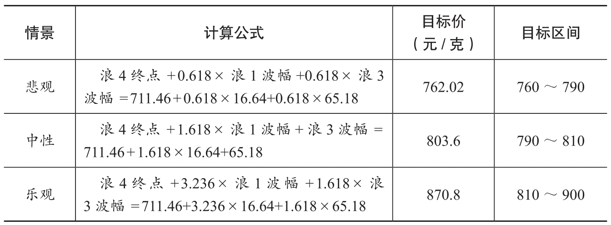

注：计算中，波幅取绝对值。浪 1 波幅绝对值=13.1，浪 2 波幅绝对值=4.58。

资料来源：秘塔 AI 搜索。

表 2-10 展示了多视角分析中的宏观视角（供需基本面）分析情况。

**表 2-10 宏观视角（供需基本面）**

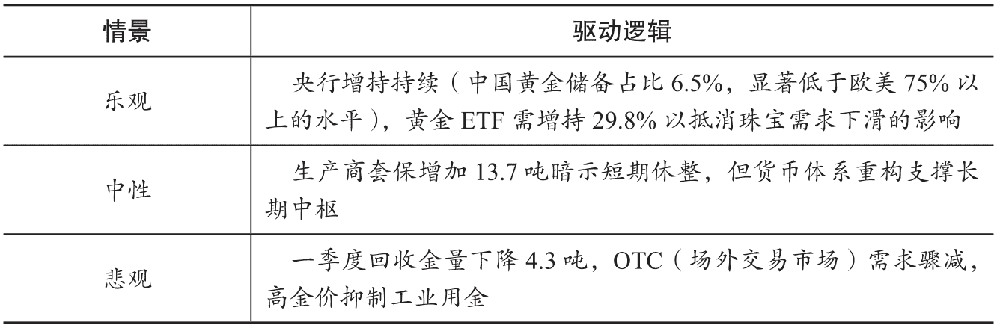

资料来源：秘塔 AI 搜索。

（3）中观视角（持仓结构）方面如下。

4 月多头主导：净多持仓 48,430 手，增仓 7,763 手。

5 月多头撤退（基于模型对后续行情的预测）：主力前 20 席位或减仓 4,679 手，部分机构或减仓超 1,600 手。

情绪传导：悲观预期向乐观传导较弱，易引发羊群效应。

（4）微观视角（30 分钟指标共振）方面如下。

均线系统：160M 均线（769.54 元）支撑有效，启动后放量或突破 80M 线（模型对后续关键节点的预测）。

MACD 背离：MACD 柱状图未创新低，底背离确认反弹。

最佳介入点：14:00 量能达到前日 3～5 倍且波幅＜2%（对后续关键节点的预测：2025-05-30 14:00 成交量或骤增）。

（5）结论与策略如下。

浪 5 目标价中枢：778～801 元/克，优先观察 770.14 元（浪 4 终点）支撑。

做多时机：30 分钟图放量突破 786 元且 MACD 金叉。

风险提示：若跌破 160M 均线（769.54 元），需重新数浪。

2.通义千问对沪金期货的分析

此处沪金期货阶段性波浪结构如图 2-7 所示。基于通义千问的分析，沪金期货 2025 年 3 月 1 日至 5 月 1 日期间，30 分钟级别波浪呈现明显的“推动浪”+“调整浪”结构。目前行情正处于推动浪结束后的短期调整阶段。从技术面看，浪 3 展现了典型的延伸浪特征，浪 4 则以扩散三角形进行调整并符合“浪 4 不侵浪 1”的核心波浪规则。根据黄金分割比例与浪形特征测算，基准情形目标位于 737 元/克附近，乐观情形上看 851 元/克附近，突破前高阻力需要明显的量能配合。从成交量的角度来看，近期行情已出现明显的底背离信号，反弹动能正在增强，但需关注后续量价配合，以确认行情能否进一步打开上涨空间。整体而言，目前技术信号指示投资者可保持谨慎乐观，适度关注反弹行情的持续性和目标位的有效突破情况。

通义千问关于沪金期货 30 分钟级别波浪的分析如下。

结论：沪金期货在 2025 年 3 月 1 日至 5 月 1 日期间，30 分钟级别波浪呈现“推动浪+调整浪”结构，当前处于调整浪结束后的反弹初期。基准情形目标价为 737 元/克（回调验证目标），乐观情形目标价为 851 元/克（突破延伸目标），两类目标均需以成交量放大作为确认条件。

图 2-7 沪金期货阶段性波浪结构示意图 2

资料来源：通义千问。

（1）宏观视角（趋势判断）如下。

3 月驱动因素：避险需求升温（俄乌冲突、中东地缘风险）+美联储降息预期升温（通胀放缓）+央行购金潮（中国、印度、俄罗斯等持续增持）。

价格表现：沪金主力合约自 3 月 1 日 672.14 元/克涨至 3 月 31 日 730 元/克，涨幅 8.6%。

4～5 月驱动因素：4 月回调，美债收益率高企，美元走强；5 月反弹，地缘风险溢价，经济衰退预期。

价格表现：4 月最低回落至 701.0 元/克，5 月反弹至 790.74 元/克。

（2）中观视角（波浪结构验证）如下。

1）推动浪（浪 1、浪 3、浪 5）如下。

浪 1（2025-03-01～2025-03-05）：涨幅 2.4%（672.14→688.22）。

浪 3（2025-03-12～2025-04-03）：涨幅 9.6%（680.66→745.84）。

浪 5（2025-04-08～2025-05-01）：涨幅 11.1%（711.46→790.40），波幅为浪 1 的 4.6 倍，且末端出现量价顶背离信号。

2）调整浪如下。

浪 2（2025-03-05～2025-03-12）：下跌至 680.66 元，回撤 1.1%，回撤比例 0.461。

浪 4（2025-04-03～2025-04-08）：下跌至 711.46 元，回撤 4.6%，量能先收缩后温和放大。

（3）微观视角（成交量背离与目标价计算）如下。

1）成交量信号如下。

浪 3 末端：745.84 元/克处出现顶背离（成交量与价格反向，预示浪 3 结束，即将进入浪 4 调整）。

浪 4 末端：711.46 元/克处出现底背离（成交量与价格反向，预示浪 4 调整结束，反弹动能增强，浪 5 即将启动）。

2）目标价分步计算如下。

浪 1 波幅：688.22（浪 1 高点）−672.14（浪 1 起点）=16.08 元。

浪 3 波幅：745.84（浪 3 高点）−680.66（浪 3 起点）=65.18 元。

浪 4 低点：711.46 元。浪 3 高点：745.84 元。

基准情形（浪 5 中性目标）：浪 4 低点+浪 1 波幅×1.618=711.46+16.08×1.618≈737 元/克。

乐观情形（浪 5 乐观目标，突破浪 3 高点后）：浪 3 高点+浪 3 波幅×1.618=745.84+65.18×1.618≈851 元/克。

关键数据总结在表 2-11 中。

（4）推理链完整性与精度说明如下。

波浪结构验证：浪 3 涨幅是浪 1 的 4 倍（2.4%→9.6%），符合“浪 3 不最短”原则；浪 4 低点 711.46 元/克＞浪 1 起点 672.14 元/克，符合“浪 4 不侵浪 1”规则。

**表 2-11 关键数据表**

资料来源：通义千问。

情形假设依据：基准情形是基于黄金分割比例 0.618 和扩散三角形收敛；乐观情形假设突破前高压力位，且需配合成交量放大。

## **2.2 拐点寻锚：AI 精准寻找买点和亮点**

在上一节中，我们详细展示了如何利用秘塔 AI 搜索、通义千问和腾讯 ima 等国产 AI 工具，对上证指数和沪金期货进行精准的波浪识别与择时分析。这些工具不仅在降低分析的主观性和提升效率上表现突出，还能帮助投资者清晰地理解市场的短中期趋势。然而，技术分析从来不是孤立的行为，市场行情背后始终有宏观经济和政策环境的强力驱动。因此，单纯依靠技术信号做决策，往往会忽视重要的外部因素，导致决策效果大打折扣。为进一步提高分析的准确性与可靠性，我们必须结合 AI 工具对当前宏观大势进行系统性的梳理与研判。

具体而言，我们需要针对当前的宏观环境提出明确的问题，充分发挥 AI 工具在快速搜集、整合和分析海量宏观数据方面的优势，以便更全面地把握行情驱动因素。这些问题可以包括但不限于：当前全球及国内经济的主要风险点在哪里？各大央行的货币政策如何演变？近期关键宏观指标如通胀、就业和 PMI（采购经理指数）的走势对市场有何影响？地缘政治事件、政策出台或经济数据公布前后，市场情绪会有哪些变化？接下来，我们将利用 AI 工具围绕这些核心问题展开详细的宏观大势研判。

**学习案例 2-3 利用 AI 展开宏观大势研判**

为了更高效地借助 AI 工具分析当前的宏观大势，在撰写针对近期市场环境的 AI 提示词时，我们同样需要明确以下六个关键要素：①身份/情景（你是一名资深宏观策略分析师，需在月度投研会上汇报当前全球及国内宏观经济环境）；②分析层次和颗粒度（分别从全球宏观、国内政策和微观市场情绪三个视角，以乐观、中性和悲观三种假设情景进行分析）；③时间/范围（仅限 2025 年 4 月 1 日至 7 月 17 日的最新宏观数据与经济事件，不允许引用其他时间段信息）；④输出格式（限 600 字，首先给出清晰的市场影响结论，再以 Markdown 表格呈现关键宏观指标与事件）；⑤研究方法（结合经济指标如 PMI、通胀、就业数据以及重要央行的政策声明进行分析，给出明确的指标或政策依据）；⑥重视程度/资源投入（要求提供完整的逻辑推演过程，并明确给出宏观环境对市场走势影响的 70%和 90%概率情景）。随后，我们在提示词的末尾一次性粘贴 2025 年 4 月 1 日至 7 月 17 日期间最新的宏观经济数据和事件列表，使 AI 模型直接读取一手信息，有效降低数据误读风险，产出高质量、可直接用于实际投资决策和投研汇报的分析内容。

下面我们分别展示秘塔 AI 搜索、通义千问和腾讯 ima 这三款主流国产大模型的具体输出结果。

1.秘塔 AI 搜索对宏观大势的分析

秘塔 AI 搜索输出的市场影响结论如下。

基于 2025 年 4 月 1 日至 7 月 17 日的最新宏观数据与经济事件，全球宏观经济环境呈现“弱复苏中隐现分化风险”的特征。从全球宏观、国内政策及微观市场情绪三视角分析，当前环境对市场走势的基准影响为：70%概率下（中性情景主导），全球股市温和上行（MSCI 全球指数上升 3%～5%），债市收益率区间震荡；90%概率下，市场波动率（VIX 指数）升至 20～25 区间，新兴市场资产承压风险加剧。以下是分视角逻辑推演。

（1）全球宏观视角如下。

1）乐观情景（概率 20%）：若贸易摩擦缓和（如关税未升级），叠加美国 ISM（供应管理协会）制造业 PMI 持续高于 50（4 月 50.3）、欧元区通胀降温（3 月 CPI 2.4%），全球增长预期修复，推动风险资产上涨。具体数据可参考表 2-12 中各国 PMI、CPI 等指标的表现。

**表 2-12 AI 宏观情境分析**

（续）

资料来源：秘塔 AI 搜索。

2）中性情景（概率 60%）：经济数据分化——美国 GDP（国内生产总值）增速放缓（第一季度约 1%），但就业市场稳健[JOLTS（职位空缺和劳动力流动调查）职位空缺维持高位]；欧元区降息 25bp（4 月）部分对冲衰退压力。大宗商品[BDI（波罗的海干散货指数）1,559 点]需求疲软抑制上行空间。

3）悲观情景（概率 20%）：若贸易摩擦升级（如美国潜在高额关税）引发供应链中断，叠加全球 PMI 回落（欧元区 3 月制造业 PMI 终值 47.1），衰退风险触发避险资产上涨。

与全球宏观视角相关的详细信息如表 2-13 所示。

**表 2-13 全球宏观指标与事件**

（续）

资料来源：秘塔 AI 搜索。

（2）国内政策视角如下。

1）乐观情景（概率 30%）：财政支出高增长（1～4 月政府性基金支出增长 17.7%，4 月增长 44.7%）与货币宽松[5 月降准降息，DR007（银行间存款类机构以利率债为质押的 7 天期回购利率）降至 1.84%]协同发力，基建投资加速拉动 GDP 达 5.5%；政策目标与财政支持规模可参考表 2-14 和表 2-15。

**表 2-14 经济目标：政策要点**

（续）

资料来源：秘塔 AI 搜索。

**表 2-15 AI 国内宏观情境分析**

资料来源：秘塔 AI 搜索。

2）中性情景（概率 50%）：政策效果滞后——专项债发行加速（2025 年规模 4.4 万亿元）但地产疲软，M2 增速受外部不确定性（中美关税谈判）制约，经济温和复苏至 5.0%～5.2%，国内政策指标与事件如表 2-16 所示。

**表 2-16 国内政策指标与事件**

（续）

资料来源：秘塔 AI 搜索。

3）悲观情景（概率 20%）：若海外需求骤降（如欧元区衰退），叠加财政空间受限（赤字率 4%），政策传导失效导致增长失速。

（3）微观市场情绪视角如下。

1）乐观情景（概率 25%）：消费者信心改善（5 月美国谘商会消费者信心指数升至 98；6 月中国消费者总体信心指数为 127.84）提振消费与股市，具体信心指标如表 2-17 所示。

**表 2-17 微观市场情绪指标**

资料来源：秘塔 AI 搜索。

2）中性情景（概率 55%）：情绪分化——美国信心波动（6 月美国谘商会消费者信心指数骤降至 93），但欧洲企业信心持稳（欧洲企业信心指数为 93.1）；中国青年消费者（20～34 岁）预期信心指数为 107.0，支撑内需。

3）悲观情景（概率 20%）：全球信心恶化蔓延（5 月泰国消费者信心指数为 54.2，创 27 个月新低），抑制企业资本开支与股市估值。

综合影响推演：当前数据指向中性情景为主（全球政策托底但增长乏力），70%概率下市场受益于流动性宽松（美联储暂停加息，中国降准）；90%概率涵盖悲观风险（贸易摩擦或通胀反弹），需警惕新兴市场货币贬值及成长股回调，各情景概率与市场影响如表 2-18 所示。

**表 2-18 情景概率与市场影响**

资料来源：秘塔 AI 搜索。

综合秘塔 AI 搜索基于 2025 年 4 月 1 日至 7 月 17 日最新宏观数据与市场情绪的全面分析，当前全球经济环境呈现“弱复苏中隐现分化风险”的特征。全球层面，美国经济延续缓慢扩张，制造业 PMI 重回扩张区间（50.3），但欧洲制造业持续萎缩，货币政策出现明显分化，美联储维持利率并放缓缩表，欧洲央行降息以抵御通缩风险。国内层面，中国积极推动逆周期调节政策，财政扩张显著提速（政府性基金支出 4 月增速达 44.7%），央行实施降准降息降低融资成本。微观市场情绪方面，美国和欧洲消费者信心指数波动较大，中国整体消费信心趋稳但青年消费群体预期仍谨慎，反映出需求端复苏基础不牢固。

整体来看，市场处于以中性情景（70%概率）为主导的状态，预计全球股市温和上行，涨幅约 3%～5%，债市收益率或维持区间震荡。与此同时，悲观情景的风险不可忽视（叠加后概率 90%），一旦贸易摩擦或通胀压力再度升级，新兴市场资产将面临明显的调整压力。投资策略上建议投资者保持适度防御性布局，关注黄金等避险资产的配置机会，同时密切跟踪中美贸易谈判与政策落地的实际效果，以应对潜在的市场波动风险。

2.通义千问对宏观大势的分析

通义千问输出的市场影响结论如下所示。

全球宏观环境呈现“低增长+高不确定性”特征，国内经济韧性凸显但结构性压力犹存。70%概率情景为“市场震荡偏弱”，90%概率情景为“政策驱动下的阶段性反弹”。

分视角来分析，分析结果如表 2-19、表 2-20 和表 2-21 所示。

**表 2-19 全球宏观视角**

（续）

资料来源：通义千问。

**表 2-20 国内政策视角**

资料来源：通义千问。

**表 2-21 微观市场情绪视角**

资料来源：通义千问。

情景概率与决策建议：70%概率（震荡偏弱），全球增长放缓+国内政策托底，黄金、美元指数双向波动，A 股依赖政策节奏；20%概率（政策驱动阶段性反弹），基建提速+消费刺激政策落地，短期提振风险资产，但需关注地产链；10%概率（政策失效+外部冲击），财政收支矛盾导致政策传导受阻，叠加欧元区衰退或贸易摩擦升级，触发全球避险潮。

关键政策依据：美联储 6 月会议纪要暗示 7 月降息（沃勒、鲍曼鸽派表态）；中国 5 月重要会议明确“超常规逆周期调节”；世界银行 6 月全球经济增长预测下调。

综合通义千问对 2025 年 4 月 1 日至 7 月 17 日宏观环境的分析，全球经济呈现“低增长、高不确定性”态势，主要经济体增长持续放缓，美国降息预期升温，贸易摩擦扰动市场情绪，避险资产（黄金）阶段性受益。国内则积极推行“超常规逆周期调节”政策，财政扩张加码、货币政策宽松，基建投资成为稳增长主力，但房地产投资持续下行，消费复苏温和，整体经济结构性压力仍未有效缓解。微观市场情绪震荡偏弱，短期市场表现高度依赖政策节奏与外部环境变化。整体来看，“市场震荡偏弱”的情景概率较高（70%），阶段性政策驱动反弹的情景亦不可忽视（20%），需持续关注政策实际落地效果与外部风险演化，以防范“政策失效+外部冲击”带来的悲观情景（10%）。

3.腾讯 ima 对宏观大势的分析

腾讯 ima 输出的《全球及国内宏观经济环境分析报告（2025-04-01～2025-07-17）》如下。

核心结论：在 2025 年 4 月 1 日至 7 月 17 日期间，全球宏观环境呈现出“政策分化与风险上行并存”的特征：在 70%概率的主情景中，美联储被广泛预期将在 6 月降息 25 个基点，欧洲央行也会同步释放宽松信号；与此同时，美国 6 月 CPI 已滑落至 3.2%，失业率维持在 4.1%左右的温和区间，全球 PMI 连续三个月处于扩张线上方，原油商业库存同步下行 5%，显示外需仍具韧性。在该基线场景下，全球经济虽放缓但未现衰退，美元在降息预期下弱化，人民币贬值压力缓和，A 股与全球风险资产整体维持震荡格局，而黄金受汇率与避险属性支撑有望延续结构性行情。若基本面和流动性边际更趋友好，20%概率的乐观情景将在科技板块业绩超预期、外资单月净流入 A 股逾 500 亿元的带动下发酵，上证指数有机会向 3,500 点上方突破；相对地，10%概率的悲观情景聚焦于特朗普重新升级关税并伴随美联储鹰派逆转：一旦美国能源价格反弹将 CPI 推高至 4%，美联储或被迫暂停降息甚至重启加息，离岸人民币或跌破 7.5，VIX 指数跳升至 30 以上，全球资金避险情绪迅速升温，A 股与美股同步承压，黄金多头则迎来避险溢价，但需要警惕净多头回落与流动性冲击交织所带来的剧烈波动。

国内方面，政策组合拳强调“货币托底+财政靠前+产业精准扶持”。在乐观假设下，第三季度增发 1 万亿元特别国债直接对冲需求缺口，地产销售环比恢复正增长，社融增速有望回升至 9.5%；在中性情景中，定向降准与地方专项债提前发行释放的流动性逐步显效，基建投资增速稳定在 7%，制造业投资保持 5%的韧性，但房地产投资仍以−15%的波幅磨底，消费回暖更多依托于政府促消费专项贷款等工具；若悲观情景实现，地方政府债务风险可能显性化，社融增速跌落至 8%以下，货币当局将以降准 1%叠加 MLF（中期借贷便利）利率下调 25bp 应对，但宽松边际效力或被风险偏好骤降所抵消。

微观层面，市场情绪在三种场景下呈现显著分化：科技板块受算力与半导体景气度驱动，在乐观情景下中报业绩同比或超 20%，红利资金则短线获利回吐而转向科技成长；如果市场仅延续震荡，红利与科技轮动共存，上证指数波动区间维持在 3,300～3,500 点；而在地缘冲突升级的悲观场景中，外资单月净流出或超过 1,000 亿元，防御型资产如黄金与公用事业将跑赢大市。

关键高频数据显示，中国制造业 PMI 在 4～6 月分别录得 50.8、51.2 与 50.5，美国核心 PCE（个人消费支出）较快回落至 2.6%，欧元区失业率顺势降至 6.2%，就业市场改善助力经济稳定。逻辑链最终验证表明，美联储点阵图暗示年内两次降息、国内黄金终端消费季调后增长 8%以及 VIX 指数升破 25 后黄金与权益相关性转负的统计显著性（*p*＜0.01），均强化了上述结论的可靠性。

综合腾讯 ima 在 2025 年 4 月 1 日至 7 月 17 日期间对全球及国内宏观经济环境的分析，市场呈现出显著的“政策分化+风险上行”特征。在全球层面，美联储与欧洲央行货币政策走势出现分歧，美联储年内降息预期增强，而欧洲宽松力度边际增加，全球通胀温和回落但贸易风险仍存。国内经济延续弱复苏格局，货币政策继续结构性宽松，财政政策前置发力托底经济，但地产市场回暖受限。在市场情绪方面，以沪金期货为代表的避险资产受到明显青睐，结构性机会凸显，但需关注短期超买信号和交易热度下降的压力。

整体来看，市场以中性情景为主导（概率 70%），预计权益市场将维持震荡走势，大宗商品尤其是黄金仍具备结构性上行空间（沪金目标价 820 元/克）。然而，极端情景下（叠加后概率 90%）的风险不容忽视，美联储政策的反复与地缘政治冲突可能诱发流动性压力，货币贬值压力增大，权益和债券市场存在“股债双杀”风险。投资组合建议强化避险配置，关注黄金 ETF 及国债期货等防御性资产的布局机会，同时严密监控 VIX 指数波动以预判市场风险情绪变化。

综合来看，本章选取的秘塔 AI 搜索、通义千问、腾讯 ima 三款国产 AI 工具各具特色。整体而言，AI 工具能够快速处理大量结构化数据、较为准确地识别标准波浪结构、自动生成清晰的逻辑推理链和目标区间，大幅提高投资决策效率，显著降低人工主观性和分析过程的幻觉风险。

具体到差异化表现上，秘塔 AI 搜索在理论的严谨性和逻辑链的完整性上具有显著优势，但预测区间相对保守，适合学术研究和谨慎型投资者；通义千问分析全面、逻辑清晰，但存在目标偏乐观、细节术语需人工修订的问题，更适合辅助技术分析报告的撰写；腾讯 ima 在波浪结构划分和趋势捕捉精准度上优势明显，数据驱动分析严谨、预警及时，但依赖固定比例，适合定量化投资研究场景。各 AI 工具优缺点与适用场景对比情况总结在表 2-22 中。

**表 2-22 各 AI 工具优缺点与适用场景对比**

资料来源：作者整理。

总的来说，AI 工具虽已在波浪识别与宏观研判领域展现出显著优势，但仍存在自身局限性，尚不能完全取代人类经验与判断。在实际应用中，投资者应结合自身需求和风格特点，合理选择和组合使用不同工具，充分发挥 AI 的客观性与人类分析的灵活性，从而实现更稳健、高效的投资决策。为了更好地使用 AI 工具，大家可记住如下口诀：AI 数浪择时新，宏观策略入佳境。秘塔稳健逻辑精，通义清晰报告明，腾讯 ima 精准预警灵。

**学习案例 2-4 进阶案例：自建市场拐点研判定制化利器**

大盘择时，即判断市场的整体走向，是投资决策中的关键环节，我们常从宏观、资金、情绪、技术、海外五大维度进行判断。例如，宏观维度涵盖 CPI、PPI 等通胀指标，M1、M2 等货币供应水平指标，以及 PMI 等经济景气度指标，这些指标反映了宏观经济运行的整体态势；资金维度包含融资融券数据、新成立基金份额等，用于衡量市场资金的流入流出情况；情绪维度通过市场热度、行业分歧度等指标捕捉投资者心理；技术维度引入 DMI（动向指数）N 日涨幅、N 日乖离率等指标，用于判断股指的趋势强弱；海外维度则聚焦中美利差、人民币兑美元汇率等指标，考量国际资本流动对 A 股市场的影响。

不借助工具而仅以人力去判断市场的整体走向是相对困难的。一方面，所有的指标与大势都并非单一的线性关系，在观测不同的指标时，往往会对大势得出不同的判断；另一方面，若结合历史数据观测，那么所依赖的数据将是海量的。

AI 工具的出现为这个难题提供了新解法。与简单的问答有所不同，我们在以 AI 为投研工具时，应尽可能减少过程的黑箱，通过上传可信的数据和完整的投研框架，引导 AI 生成更具可信度的结论，并且能对结论进行归因。

因此，我们整理出了以下步骤来指导如何使用 AI 工具解答大盘走势研判的问题。而在实际应用时，可以根据不同需求调整问答方式，也可以根据所用 AI 工具单次问答的记忆长度来调整上传的数据维度和数据量。

步骤 1：收集关键数据

择时策略好比天气预报，我们需要多种气象数据（如温度、湿度、风速）才能做出准确判断。在投资中，这些“气象数据”就是我们所说的“因子”或“指标”。此处，我们将从五个维度收集相对重要的 10 个指标，详细操作过程如下。

**建立 Excel 表格：**创建一个 Excel 文件，第一列为日期（例如“2025-07-01”），后续每一列对应一个指标（如“CPI 同比”“PMI”“融资融券余额”等）。

**统一频率：**大部分宏观指标是月度或季度的，而市场数据是日度的。为简单起见，可以将非日度的数据向后原值填充，处理为日度数据。

步骤 2：整理数据

收集好数据后，会发现一个问题：CPI 的单位是“%”，而融资融券余额的单位是“亿元”，数值非常大。这些不同单位、不同量级的数据无法直接比较和加总。这就像将身高和体重直接相加，没有意义。因此，我们需要对数据进行“标准化”，把所有指标都转换到一个统一的“打分”区间（例如−1～1），让它们可以被公平地比较。这里我们介绍一种在 Excel 中极易操作的标准化方法：Z-score 标准化与方向二值化。

（1）Z-score 标准化（给每个指标打出相对位置分）：计算 Z-score 的目的是看一个数据在它的历史数据中处于什么位置（是远高于平均水平，还是远低于平均水平）。Excel 中有现成的公式可以帮我们完成。在 Excel 中假设 A 列为日期，某一列指标数据在 B 列（例如从 B2 到 B100），下面进行如下操作。

**计算平均值：**在空白单元格（例如 C1）输入公式“=AVERAGE(B2:B100)”，如图 2-8 所示。

图 2-8 用 Excel 计算 Z-score 之计算平均值

资料来源：作者绘制。

**计算标准差：**在另一个空白单元格（例如 C2）输入公式“=STDEV.S(B2:B100)”，如图 2-9 所示，此方式适用于样本数据，更符合我们的场景。

图 2-9 用 Excel 计算 Z-score 之计算标准差

资料来源：作者绘制。

**计算 Z-score：**在 D2 单元格输入公式“=(B2-$C$1)/$C$2”，如图 2-10 所示。这里的“$”符号是“绝对引用”，确保下拉填充公式时，平均值和标准差的单元格位置不变。

图 2-10 用 Excel 计算 Z-score

资料来源：作者绘制。

**批量计算：**用鼠标点击 D2 单元格右下角的小黑点，向下拖动，即可为 A 列所有数据计算出 Z-score 值，如图 2-11 所示。

对收集的每一个指标，都重复以上步骤，得到它们各自的 Z-score 序列。

图 2-11 用 Excel 计算 Z-score 之批量计算

资料来源：作者绘制。

（2）方向二值化（将分数转化为“好/坏”信号）：Z-score 可正可负，为了让信号更清晰，我们可以将其简化为三个方向，即利好（+1）、利空（−1）、中性（0）。

假设 D 列是刚计算好的 Z-score 值。

**判断方向：**在 E2 单元格输入公式“=IF(D2＞0,1,IF(D2＜0,−1,0))”。这个公式的意思是：如果 Z-score 大于 0（高于平均水平），则记为+1（通常是利好信号）；如果小于 0，则记为−1（通常是利空信号）；如果等于 0，则记为 0。操作如图 2-12 所示。

图 2-12 用 Excel 对指标进行方向二值化

资料来源：作者绘制。

**批量判断：**同样，向下拖动 E2 单元格的填充柄，即可得到所有数据的方向信号。

经过这两步，原始的数据就变成了一张所有指标得分都在[-1,1]区间的标准化数据表。将这张处理好的表格保存为 CSV 格式，方便上传给 AI。

步骤 3：上传数据并获取择时信号

现在，我们万事俱备，可以请出 AI 这个军师了，这个案例中我们使用 DeepSeek，从一个最简单的“基准策略”开始，然后升级到更智能的“AI 增强策略”。这一步中，我们只需改变 Prompt，即向 AI 输入的指令或问题，通过调整指令的详细度、逻辑框架或目标导向，引导 AI 输出更贴合需求的分析结果或策略建议，就能达到增强的效果。

下面介绍两种获取择时信号的策略。

**策略一：基准策略（“傻瓜式”加总）**

这是最基础的策略，即将我们处理好的所有指标的得分（+1,-1,0）直接相加，得出一个综合得分。

可以向 DeepSeek 按以下方式提问：“这是我处理好的 A 股市场多维度择时指标表，时间从××××年××月到××××年××月。请你帮我完成以下任务：对于每个月份，将所有指标的得分（在-1 和 1 之间）进行简单加总，得到一个‘综合得分’。根据这个‘综合得分’，生成择时信号，如果得分大于 0，信号为‘建仓’；如果得分小于等于 0，信号为‘空仓’。请以表格形式返回结果，包含‘日期’‘综合得分’和‘择时信号’三列。”

DeepSeek 会迅速计算并返回我们需要的择时信号表格。这个策略的优点是简单，但缺点是它给每个指标的“投票权”都是一样的，不够智能。

**策略二：AI 动态策略（智能加权）**

此步骤才是 AI 的真正价值所在。在市场的不同阶段，不同指标的重要性是不同的。例如，通胀高企时，“宏观”维度的 CPI 就特别重要；而在市场恐慌时，“情绪”维度的指标可能更具参考价值。AI 增强策略就是让 DeepSeek 自动判断当前处于什么市场环境，并给更重要的指标分配更高的权重。

可以向 DeepSeek 按以下方式提问：“你现在是一位顶级的量化策略分析师。这是我上传的 A 股市场多维度择时指标表。请你完成以下更智能的分析。

市场周期划分：根据我提供的历史数据，请分析并告诉我，从××××年至今，市场大致经历了哪几个阶段（例如疫情冲击期、政策宽松期、通胀紧缩期、结构调整期等），并说明你划分的依据。

指标绩效归因：简单告诉我，在上述不同阶段，哪些维度的指标（宏观、资金、情绪、技术、海外）表现得更有效。

动态权重配置与择时信号：基于你对当前市场周期的判断，请动态地为不同指标分配权重，并计算出最新的‘AI 综合得分’。根据这个得分，给出最终的择时建议（例如强烈看多、谨慎看多、中性观察、谨慎看空、强烈看空），并用一两句话解释你为什么这么建议，主要是因为哪些指标的权重被调高了。”

这个提问模板，虽然文字更长，但完全是自然语言。它引导 DeepSeek 完成了从周期划分，到指标归因，再到动态赋权这一系列复杂的思考过程。

DeepSeek 根据指标数据进行宏观经济周期划分以及分周期动态赋权示例如表 2-23 和表 2-24 所示。

**表 2-23 DeepSeek 根据指标数据进行宏观经济周期划分**

资料来源：DeepSeek。

**表 2-24 DeepSeek 根据指标数据进行分周期动态赋权**

（续）

资料来源：DeepSeek。

步骤 4（可选）：构建更灵敏的宏观领先指标

以代表通胀水平的 CPI 和 PPI 为例，官方的 CPI 数据和 PPI 数据是月度公布的，存在一定的滞后性。等到数据发布时，市场可能已经发生了变化。为了让我们的策略更灵敏，我们可以利用一些每天、每周更新的高频数据，来提前预测通胀的走向。图 2-13 展示了简化后的通胀领先指标构成。

图 2-13 简化后的通胀领先指标构成

资料来源：作者绘制。

具体操作如下。

首先，**选择高频领先指标**。我们可以选取一些日常生活中能感受到的且数据更新频繁的商品价格作为 CPI 和 PPI 的代理指标。例如：农产品（全国猪肉平均批发价、重点监测的蔬菜水果平均批发价）或工业品和能源（螺纹钢期货价格、动力煤期货价格、布伦特原油期货价格）等。

其次，**在 Excel 中合成“高频通胀因子”**。我们可以用加权平均这个极其简化的方法，在 Excel 中进行合成：首先收集数据，在 Excel 中新建一个 Sheet，列出日期以及上述几种高频指标的每日价格；其次将数据标准化，同样对这些高频数据进行 Z-score 标准化处理，让它们处于同一量纲，我们这里以合成 CPI 领先因子为例；最后加权合成，假设我们认为猪肉平均批发价、蔬菜平均批发价、水果平均批发价对 CPI 的影响权重分别是 60%、30%、10%（这个权重可以根据理解主观设定，也可以通过向 AI 工具进行简单提问获得）。在新的单元格中，使用 SUMPRODUCT 公式来计算加权得分。操作示例如下。

公式模板为“=SUMPRODUCT（数据区域，权重区域）”。

假设 E2:G2 是三种高频指标标准化后的得分，可以在 H1:J1 单元格写入权重 0.6,0.3,0.1。那么在 K2 单元格输入公式“=SUMPRODUCT(E2:G2,$H$1:$J$1)”，即可得到当天的“高频通胀因子”得分，亦即“领先指标”，操作如图 2-14 所示。

整合：将计算出的“高频通胀因子”序列，添加到整合了宏观经济周期划分（表 2-23）和分周期动态赋权（表 2-24）的表中即可。

最终由 DeepSeek 指导高频数据权重所构成的 CPI 领先指标拟合情况以及 PPI 领先指标拟合情况分别如图 2-15 和图 2-16 所示。

最后，**带着领先指标再次向 AI 提问**。上传包含“高频通胀因子”等的最新数据表作为大模型分析和回复的附件依据后，可以这样向 DeepSeek 提问：“这是我更新后的择时数据表。我在里面新增了一列‘高频通胀因子’，它是由猪肉、蔬菜和工业品等的日度价格合成的，用来更灵敏地预测通胀。请你在执行上一轮的‘AI 动态策略’分析时，特别关注并提高这个‘高频通胀因子’的权重，因为它可能领先于官方 CPI 数据。请重新给我最新的择时建议和理由。”

图 2-14 用 Excel 合成“领先指标”

资料来源：作者绘制。

图 2-15 由 DeepSeek 指导高频数据权重所构成的 CPI 领先指标拟合情况

资料来源：DeepSeek。

图 2-16 由 DeepSeek 指导高频数据权重所构成的 PPI 领先指标拟合情况

资料来源：DeepSeek。

通过这样的提问，可以将自己的研究洞察（高频数据）融入 AI 的决策框架中，让策略变得更加强大和个性化。图 2-17 展示了由 DeepSeek 动态赋权的大盘择时策略与沪深 300 净值对比情况。

图 2-17 由 DeepSeek 动态赋权的大盘择时策略与沪深 300 净值对比

资料来源：DeepSeek。

**学习案例 2-5 进阶案例：利用 AI 辨明行业轮动**

在行业轮动的投资中，我们通过观察行业的景气度、趋势和拥挤度这“三把尺子”，可以有效地捕捉机会。

第一把尺子——景气度，是用来衡量一个行业赚钱能力和成长速度的指标。最基础的，我们看三个指标：营业收入增速、净利润增速和净资产收益率（ROE）。这就像看一家餐厅，看它流水涨得快不快（营收）、纯利润多不多（净利）、投入的本钱回报高不高（ROE）。

第二把尺子——趋势，衡量的是一个行业的股价在过去一段时间里，是否表现出持续、稳定上涨的势头。光生意好还不够，还得有资金愿意持续买入，形成“上涨的惯性”。衡量趋势的指标有很多，我们这里用某个行业相对行业等权指数的信息比率举例，跳过计算的原理，直观地去理解这个指标，当它较高，说明这个行业在过去一段时间不仅涨得好，而且波动风险控制得也不错，上涨势头“又稳又猛”。

第三把尺子——拥挤度，用来衡量一个行业是否被过度关注、交易是否过于火爆。当所有人都冲进一个地方时，往往意味着风险在积聚。我们看三个指标：换手率（交易有多频繁）、波动率（股价上下跳动有多剧烈）和 Beta 值（跟大盘的关联性有多强）。这三者越高，通常意味着市场情绪越狂热，拥挤度越高，潜在的回调风险也越大。

这“三把尺子”之间的动态关系，可以通过图 2-18 反映出来。

在实际应用中，我们人工的做法可能会是设定一个死板的规矩，比如“景气度排名前 30%的行业就是好行业”。但市场是活的，牛市和熊市的标准显然不同。而且，这三把尺子之间存在复杂的联动关系，比如，景气度提升几个月后，趋势才会跟上，传统方法很难捕捉。

图 2-18 景气度、趋势、拥挤度的动态关系

资料来源：作者绘制。

当我们使用 AI 工具来增强这个策略时，我们希望它能根据市场的环境（牛熊市）动态调整判断“好”与“坏”的门槛，发现景气度、趋势、拥挤度之间隐藏的传导链，提前布局，当发现一个行业趋势虽好但已“过度拥挤”时，会自动拉响警报，帮助规避风险。我们可以通过以下步骤来构建和优化行业轮动策略。具体而言，我们将从数据收集、整理入手，进而进行动态阈值设定与智能打分，再到因子交互分析与风险控制，最终完成结果汇总与解读，为投资者提供清晰、有效的行业轮动策略建议。

步骤 1：收集关键数据

**建立 Excel 表格：**创建一个 Excel 文件，按照表 2-25 所示，填写好每一列的标题，并按照表头填充相应的数据。

**表 2-25 行业轮动数据收集的表头格式**

资料来源：作者绘制。

**统一频率：**部分财务指标是季度的，而市场数据是日度的。为简单起见，可以将非日度的数据向后原值填充，处理为日度数据。

步骤 2：整理数据

我们可参考大盘择时策略中的方法，对每一个行业中的每一个指标进行按行业分组的 Z-score 标准化工作，这里不需要进行方向二值化，因为我们最终在三个维度想获得的不只是变动的方向。这里便不再赘述手动标准化的细节。接下来我们介绍一种用 AI 工具整理数据的方法，当然，这一步会损耗 AI 工具单次对话的记忆额度，但在数据长度有限的情况下，这种方法对最终的输出影响较小。

我们可以按如下方式提问：“请你扮演一位顶尖的量化金融分析师。我已经上传了一份名为‘行业轮动数据表’的文件，其中包含了多个行业在不同时间点的景气度、趋势和拥挤度相关指标。你的第一个任务如下。

首先，理解数据：请确认你已成功读取数据，并告诉我数据的起止日期、包含的行业总数。

其次，数据标准化：为了在不同时间和指标间进行公平比较，请对每一个原始指标（营收增速、利润增速等共 6 个指标）进行按行业分组的 Z-Score 标准化处理。你不需要向我展示具体的计算过程，只需在内存中完成这一步，并告诉我‘数据标准化已完成’即可。

最后，构建三大维度：请根据以下规则，将标准化后的指标归类为‘景气度’‘趋势’‘拥挤度’这三个核心维度。

景气度=营收增速+利润增速+净资产收益率；趋势=信息比率；拥挤度=换手率+波动率。请先完成以上任务，然后等待我的下一步指令。”

步骤 3：动态阈值与智能打分

这是策略的精髓之一。我们要引导 AI 放弃“固定分数线”，学会使用“动态分数线”来判断一个行业在当前市场环境下是否足够优秀。这里我们将根据“36 个月滚动窗口”和“近期数据权重更高”的基本思路进行扩展。

我们可以按如下方式提问：“现在进入核心分析环节。请基于你已标准化的数据，执行以下高级任务。

首先，设定动态标准（动态分位数）：请不要使用固定的阈值（例如‘排名前 30%’）。你需要为‘景气度’‘趋势’‘拥挤度’这三个维度，建立一个动态的、随市场变化的评判体系。具体要求是：在为任何一个时间点的数据进行打分时，你的‘优秀’标准应该参考其过去 36 个月的历史数据分布来决定。并且，越靠近当前时间的数据，对这个‘优秀’标准的影响应该越大（这在专业上叫作‘时间衰减’，你可以用 0.95 的衰减系数来实现这个思想，但无须向我解释细节）。

其次，维度打分：基于上述的动态标准，请为最新的那个数据日期，给每个行业的‘景气度’‘趋势’‘拥挤度’三个维度分别打分。评分标准如下。

景气度评分（0～100 分）：越高越好。如果一个行业的景气度远超它自己过去 3 年的动态标准，就给高分。

趋势评分（0～100 分）：越高越好。逻辑同上。

拥挤度评分（0～100 分）：越低越好。如果一个行业的拥挤度远低于它的动态标准，说明交易很‘冷静’，给高分；反之，如果非常‘拥挤’，则给低分。

最后，请向我展示一张表格，包含‘行业名称’‘景气度评分’‘趋势评分’‘拥挤度评分’，然后等待我的下一步指令。”

步骤 4：因子交互与风险控制

这是我们策略的另一个重要增强环节。我们要让 AI 去挖掘三把尺子之间的“隐藏关系”，并建立一个“风险刹车”机制，这也是策略区别于人为设定简单规则的强大之处。

我们可以按如下方式提问：“你给出的这张打分表非常清晰。现在，我们要进行最后也是最智能的一步分析：因子交互与风险控制。请综合你上一步得到的三个维度评分，完成以下任务。

首先，分析隐藏的传导链：深入分析景气度、趋势、拥挤度之间的联动关系。例如，是不是某些行业的景气度提升后，其趋势评分也大概率会在 1～2 个季度后提升？请洞察这些模式。

其次，建立风险门控机制：在计算最终总分时，加入一个智能的‘风险刹车’。你可以参考以下的具体规则并进行拓展：当一个行业的‘趋势评分’很高，但同时它的‘拥挤度评分’却很低（意味着拥挤度指标本身很高）时，这可能是一个危险信号（交易过热）。在这种情况下，请自动、显著地调低这个行业的最终吸引力。反之，如果一个行业‘趋势评分’很高，且‘拥挤度评分’也很高（意味着不拥挤），则这是一个非常健康的信号，可以给予加分。

最后，计算最终综合得分：结合三个维度的评分，并应用上述的‘风险门控机制’，为每个行业计算一个最终的‘综合吸引力评分’（0～100 分）。请不要向我解释你是如何进行交互分析和控制的，直接把最终结果给我就好。”

步骤 5：结果汇总与解读

完成上述步骤，我们最终让 AI 以最清晰、最易于理解的方式，向我们呈现最终的投资建议。在这一步中，我们可根据需要，在 Prompt 中调整 AI 输出的维度。

我们可以按如下方式提问：“请根据你刚刚计算出的‘综合吸引力评分’，并基于‘三标尺’行业分析框架，为我生成最终的行业轮动策略建议。

请以一个清晰的表格形式展示，表格应包含：季度、‘三标尺’框架核心分析维度、配置结果。

现在，请输出这份最终的建议清单。”

DeepSeek 根据“三标尺”行业分析框架输出的行业配置结果如表 2-26 所示。

**表 2-26 DeepSeek 根据“三标尺”行业分析框架输出的行业配置结果**

（续）

资料来源：DeepSeek。

从长期跟踪结果来看，AI 构建的行业轮动模型优势显著。如图 2-19 所示，对比“平均等量买入各行业”的基准模型，AI 模型在分散化配置不同行业以对冲风险的基础上，通过精准提高特定行业集中度，为投资组合赋予了更强弹性，实现了大幅跑赢行业等权策略的效果。

图 2-19 由 DeepSeek 增强的行业轮动策略净值与行业等权指数净值对比

资料来源：DeepSeek。

**第三章 多元投资 AI 打破投资边界增厚收益****[3][.][1]**

## ** 固定收益：AI 加持稳固债券投资收益**

在投资标的中，债券类资产因其波动较小、收益相对稳定，一直被视为“压舱石”般的存在，但这并不意味着债券投资就简单易行。事实上，债券价格的波动常常受利率、流动性、政策预期等多重因素影响，特别是在收益率曲线的变化上，隐藏着丰富的交易机会与潜在风险。过去，投资者依赖经济数据、政策解读和经验判断来理解债券市场的运行逻辑；而现在，AI 正在重新定义这条路径。AI 不仅可以更快地处理信息，更可以通过“类比+推理”的方式，从历史中寻找规律，在现实中给出前瞻性的判断。

本节将聚焦于 AI 在固定收益领域，特别是在收益率曲线交易中的实际应用。我们将带你一步步理解：AI 如何学习历史数据、识别关键变量之间的关系，并将这些洞察转化为可操作的债券投资策略。

**学习案例 3-1 DeepSeek 实现曲线交易策略**

在固定收益投资中，收益率曲线交易是投资者经常采用的一种策略。简单来说，就是投资者通过判断不同期限债券之间利差的扩大或收窄趋势，决定债券投资或债券基金的买入与卖出方向。但如何准确地判断利差的走势呢？这正是 AI 技术发挥作用的地方。我们将 AI 辅助的收益率曲线交易分为三个步骤。

步骤 1：历史对照关系（从历史学起）

首先，让 AI 回到过去，学习历史收益率曲线的形态与对应时期的底层数据，深入挖掘市场的内在联系。底层数据是当时经济和市场环境的关键指标，例如国信高频宏观扩散指数（包含全国水泥价格指数、新建商品房销售面积、建材综合指数等）、国信货币政策力度指数（包含 7 天逆回购、MLF 等央行资金投放数据）、商务部农副产品价格指数（包含蔬菜、水果、粮食、蛋类、肉类价格等）、股债收益差（包含 10 年国债收益率、沪深 300 股息率等）、流通领域生产资料价格（包含黑色金属、化工产品、有色金属、煤炭、原油等）。AI 在学习这些历史底层数据后，可以理解收益率曲线过去是如何随经济环境而变化的，从而为后续判断收益率曲线走向奠定坚实的基础。

步骤 2：学习判断（给出前瞻判断）

在熟悉历史规律之后，引入 AI 大模型（比如 DeepSeek），结合历史经验与最近市场趋势进行综合判断。我们需要给 AI 明确指令（即 Prompt），让它分析历史上类似情况以及近期的数据走势，从而判断未来收益率曲线是“走阔”（利差扩大）还是“收窄”（利差缩小）。这个过程中，AI 能够快速清晰地捕捉市场给出的关键信号，预测收益率曲线未来的变化趋势。

步骤 3：多空方向（确定投资方向）

AI 给出明确判断后，我们投资的决策便随之产生：若判断未来收益率曲线变得更陡峭（利差扩大），则可进行“多短债、空长债”的投资布局；若判断收益率曲线趋于平坦（利差收窄），则考虑“空短债、多长债”。

图 3-1 总结了整体的技术路线图。

首先，AI 通过历史学习掌握收益率曲线变化背后的逻辑。投资者或许担心 AI 的判断过程是个“黑箱”，看不到具体原理。为此，我们通过结构化的数据挖掘，让 AI 变成了一个“透明”的分析工具——AI 不仅能找出单个指标与收益率曲线之间的关系，更能识别多个指标之间联动的市场逻辑。

**单一指标规律：**例如短期利率（如银行间市场 7 天回购利率 Shibor）上升、政策收紧（央行提高逆回购利率）或流动性收缩（央行减少净投放资金）时，通常意味着收益率曲线会趋于平坦（利差收窄）；反过来，短期利率下降、政策放宽、流动性增加时，则更容易出现利差扩大、曲线走阔的现象。

**多指标联动：**AI 还能捕捉“政策—市场”之间的共振效应。比如，当短期利率上升（Shibor 上涨）伴随央行资金净投放减少（资金流动性降低）时，两者共同强化“资金成本上升、流动性变紧”的市场氛围，收益率曲线往往趋于收窄；反之曲线倾向于走阔。

通过这样的方式，AI 不仅能更加精准地把握市场信号，更能帮助投资者清晰地理解收益率曲线的变化原因，从而更有信心地进行投资决策。DeepSeek 给出的单一指标学习挖掘结果和组合指标学习挖掘结果分别如表 3-1 和表 3-2 所示。

图 3-1 技术路线图

资料来源：作者绘制。

**表 3-1 单一指标学习挖掘结果**

资料来源：DeepSeek。

**表 3-2 组合指标学习挖掘结果**

资料来源：DeepSeek。

在实现黑箱透明化的过程中，DeepSeek 基于对大量历史时间序列数据的量化分析，找到影响收益率曲线变化的经济原因，并展现出清晰的结构化分析能力。其构建了一套严谨的收益率曲线形态的判断规则，包括：①核心逻辑（前面提到的单一指标和组合指标信号）；②拐点判断（政策周期、季节性规律等导致的走阔或收窄的拐点信号）；③典型场景识别（利差走阔、收窄的经典场景，特殊冲突场景）。

无论收益率曲线是“收窄”还是“走阔”，AI 都能够准确捕捉经济指标之间的互动关系，并设定触发阈值，识别出市场反复出现的典型场景和高频拐点信号。这种“数据学习→规律发现→策略制定”三位一体的机制，让 AI 的决策逻辑不仅高度贴合市场现实，也更具有解释力和前瞻性，为投资者提供了可靠且清晰的收益率曲线预测框架。DeepSeek 的具体回答示例如下。

核心逻辑总结如下。

单一指标信号：Shibor↑→收窄概率↑；净投放↓→收窄概率↑；逆回购利率上调→强收窄信号。

组合指标信号如下。

收窄组合：Shibor↑+净投放↓。

走阔组合：Shibor↓+净投放↑。

矛盾信号时：参考近期 5 日曲线趋势。

周期与拐点信号如下。

1.长期周期性特征

政策周期主导：宽松周期（如 2020 年、2024 年）曲线持续陡峭化（走阔）；紧缩周期（如 2017 年、2022 年）曲线趋势性平坦化（收窄）。

季节性规律：季末/年末较大概率出现短期走阔（流动性投放增加）；春节后较大概率收窄（资金回笼）。

2.关键拐点信号

（1）走阔拐点信号如下。

强信号：“单日净投放＞800 亿元”+“Shibor 单日降幅＞5bp”。

案例：2024 年 9 月（净投放 430 亿元+Shibor 降 11bp）。

次级信号：连续 3 日净投放＞300 亿元。

案例：2019 年 1 月（连续 5 日净投放）。

（2）收窄拐点信号如下。

强信号：逆回购利率上调+“Shibor 跳升＞8bp”。

案例：2017 年 2 月（“逆回购↑10bp”+“Shibor↑23bp”）。

次级信号：净投放转负且持续 3 日。

案例：2022 年 11 月（净投放−268 亿元，即当期净回笼 268 亿元，持续 5 日）。

典型场景和触发条件如下。

1.利差走阔场景

（1）央行宽松操作。

触发条件：“净投放＞500 亿元”+“Shibor 周环比下降＞10bp”。

典型案例：2017 年 1 月，净投放 579 亿元，Shibor 周环比下降 15bp。

（2）市场利率先行下行。

触发条件：“Shibor 月均值下降＞5bp”+逆回购利率不变。

典型案例：

2019 年 6 月，Shibor 下降 22bp（政策利率不变）。

2022 年 9 月，Shibor 下降 14bp（政策利率不变）。

2.利差收窄场景

（1）政策主动收紧。

触发条件：逆回购利率上调+净投放减少。

典型案例：

2017 年 2 月，“逆回购↑10bp”+“净投放−142 亿元”（即当期净回笼 142 亿元）。

2022 年 3 月，“逆回购↑4.3bp”+“净投放−174 亿元”（即当期净回笼 174 亿元）。

（2）资金面持续紧张。

触发条件：Shibor 连续两周上升+“净投放＜100 亿元”。

典型案例：

2018 年 6 月，“Shibor↑9bp”+净投放 25 亿元。

2023 年 2 月，“Shibor↑17bp”+“净投放−170 亿元”（即净回笼 170 亿元）。

3.特殊冲突场景

量价背离判断逻辑：优先考虑政策信号。

案例：

2017 年 9 月（净投放 700 亿元但 Shibor↑→最终收窄）。

2024 年 8 月（净投放 138 亿元但 Shibor↓→最终收窄）。

在充分掌握市场历史规律之后，下一步是让 AI 将学到的经验用于当前市场的研判。我们通过与 AI 进行精准有效的互动，引导它做出对于实际市场的判断。这种互动主要包括两个方面。

**寻找历史相似期：**让 AI 关注过去 5 个交易日的市场数据，要求它从自身历史记忆中找出最为相似的历史时刻。AI 结合当时的市场情况，判断收益率曲线是“走阔”还是“收窄”，从而为当下的投资决策提供参考依据。

**判断趋势延续性：**此外，AI 还会判断短期趋势，即通过分析过去 10 个交易日收益率曲线变化，判断当前趋势是否能延续，并给出对收益率曲线未来变化的前瞻判断。

我们给 AI 输入这样的指令：“请学习历史上五类因子和曲线形态之间的关系，前面已经人为总结了结果。学习后我希望你根据未来的因子来预测未来的收益率曲线形态。预测的逻辑是：①找到历史上和当前货币相关数据类似的时期；②参考近期的收益率曲线形态，综合历史与近期表现，给出收益率曲线形态概率。

我希望我们的互动流程如下：第一步，读取输入的近 5 个日期曲线形态和因子具体值；第二步，根据历史数据，挖掘不同拐点趋势、数值水平的因子数据，找到和当前日期类似的时期；第三步，根据历史，给出收益率曲线形态，为了保证你输出的结果是正确的，我将给你最近一个月的曲线形态数据；第四步，输出结论，结论输出范式如下。

走阔概率××%，收窄概率××%，原因概括（2～5 句话）：结合历史数据（需说明与当前货币因子相似的历史时期及曲线走势）与近期曲线形态（需说明近 10 个交易日曲线变化趋势），阐述支撑上述概率的核心逻辑。”

随后我们和 DeepSeek 开始互动。提问：“按照当前情况，请给出特定范式的结论，根据历史数据和近期窄/阔给出结论，你只需给出第四步。”

上述互动逻辑总结在图 3-2 中。

图 3-2 AI 对收益率曲线的学习和判断逻辑

资料来源：作者绘制。

以 2025 年 1 月 2 日为例，DeepSeek 在分析当前市场环境时指出：短端利率波动明显，出现了量价背离的现象，这与 2024 年 12 月 20 日的历史情境高度相似，属于检索到的“相似时期”（历史回溯）。DeepSeek 也综合考虑了近期收益率曲线的走势形态，指出走阔情形在近 10 个交易日中占据主导。此外，DeepSeek 注意到近期市场存在大额资金回笼的现象，同时伴随一定的宽松政策预期（近期趋势）。在这样的背景下，其最终给出的判断结论是收益率曲线未来“走阔”的概率更高。DeepSeek 输出的结果如下。

2025-01-02 结果是：走阔概率 65%，收窄概率 35%，原因如下。

历史数据来看，当前 Shibor 波动较大（1.533→1.966）且净投放剧烈变化（269.5 亿元→ −2,738 亿元），类似 2024 年 12 月的量价背离场景（如 12 月 20 日）。

近期曲线形态显示走阔占优（12 月 24～27 日连续 4 日走阔），且 1 月 2 日大额净回笼（−2,738 亿元）通常伴随后续宽松预期。

逆回购利率维持 1.5%低位，符合宽松周期特征，历史类似时期（如 2020 年 3 月）走阔概率更高。

2025-01-02 后第 1 天结果是：走阔概率 70%，收窄概率 30%。

2025-01-02 后第 2 天结果是：走阔概率 60%，收窄概率 40%。

2025-01-02 后第 3 天结果是：走阔概率 55%，收窄概率 45%。

2025-01-02 后第 4 天结果是：走阔概率 50%，收窄概率 50%。

2025-01-02 后第 5 天结果是：走阔概率 45%，收窄概率 55%。

2025-01-02 分析完成。

最后，用 DeepSeek 的胜率作为判断依据，来检测预测结果。具体而言，我们选取 2024 年 9 月到 2025 年 2 月的样本数据，开展了针对 10 年期与 2 年期利差走势的回测实验。

首先我们对每个交易日进行人为的事后判断，判断当日之后一段时间内，10 年期与 2 年期利差走势是“走阔”还是“收窄”，将其作为“真实答案”。随后，我们让 DeepSeek 在不使用未来信息的前提下，基于其对历史数据的学习能力以及对近期趋势的识别能力，进行事前预测，判断利差在未来的走势方向。在回测评价中，若 DeepSeek 的预测结果与我们的事后判断一致，则认为其“预测成功”；反之，则视为“预测失败”。

我们发现，DeepSeek 在学习“历史数据”+“近期趋势”后，对当日的预测胜率可达 75.24%，对未来 1～3 天的预测胜率也均在 70%以上。DeepSeek 对未来的预测胜率会随着时间窗的拉长而衰减，但对未来一周的预测胜率也能够达到 62.74%。从图 3-3 中可以看到 DeepSeek 的预测成功情况。

图 3-3 DeepSeek 预测胜率

资料来源：DeepSeek。

在理解了原理和步骤后，我们通过预测本周的利差曲线来做一个实战应用。选取 DeepSeek 模型，基于 2025 年某期关键高频利率与流动性数据进行分析，其对利差曲线“走阔/收窄概率”的动态预测结果显示：当期利差曲线收窄概率显著上升。结合本周已有的三个交易日日度数据进行验证，实际趋势与 DeepSeek 预测的“利差收窄概率上升”方向一致。在当时，DeepSeek 对未来一周的预判明确指向“收窄概率较大”，具体回答示例如下。

2025-××-××结果是：走阔概率 35%，收窄概率 65%。

原因如下。

历史数据来看：当前组合呈现 Shibor 007↓（1.856→1.745，注：Shibor 007 即上海银行间同业拆放利率的 7 天期品种，对应前文“银行间市场 7 天期短期利率”）+净投放剧烈波动（1,205 亿元→−346 亿元），类似 2024 年 8 月（净投放 138 亿元但 Shibor↓）和 2017 年 9 月（净投放 700 亿元但 Shibor↑）的量价背离场景，历史中此类矛盾信号出现后收窄概率更高（约 60%）。

近期曲线形态：近 5 日出现单日净投放−3,460 亿元（即当期净回笼 3,460 亿元）的极端回笼，且 3 月 19～24 日 Shibor 持续下降但净投放由正转负，与 2025-××-××至 2025-××-××的收窄形态（净投放−43 亿元→−877 亿元）高度相似。

政策信号：逆回购利率维持 1.5%低位，但大规模净回笼（净投放为−3,460 亿元）更接近紧缩操作，强化收窄预期 ^(¹)。

测试日后第 1 天结果是：走阔概率 40%，收窄概率 60%。

测试日后第 2 天结果是：走阔概率 45%，收窄概率 55%。

测试日后第 3 天结果是：走阔概率 50%，收窄概率 50%。

测试日后第 4 天结果是：走阔概率 55%，收窄概率 45%。

测试日后第 5 天结果是：走阔概率 60%，收窄概率 40%。

DeepSeek 对一段时间内长短端国债到期收益率走势的推演如图 3-4 所示。

图 3-4 DeepSeek 对一段时间内长短端国债到期收益率走势的推演

资料来源：DeepSeek。

DeepSeek 基于历史数据及市场特征等因素，对不同期限的收益率给出了未来一段时间内的预测区间。这表明，DeepSeek 预测可作为一种辅助工具，用于提升分析效率，并作为方向判断的概率支持。DeepSeek 对未来一周债券收益率的预测结果（见表 3-3 和表 3-4）以及相关分析如下所示。

**表 3-3 预测结果呈现 1**

资料来源：DeepSeek。

关键逻辑如下。

短端承压：3 月 28 日 Shibor 升至 1.936%（月内+19bp），1 年期收益率可能滞后于资金成本上升。长端防御：10 年期与 1 年期利差压缩至 49bp（低于历史中位数 60bp），配置盘入场支撑长端。曲线形态：预计收益率曲线进一步平坦化，5 年期与 10 年期利差或收窄至 25～28bp。

风险提示：若 3 月 PMI 超预期回升，10 年期收益率可能突破 2.05%阻力位。

**表 3-4 预测结果呈现 2**

资料来源：DeepSeek。

预测依据如下。

短端（2 年期）：跟随 Shibor 滞后调整，预计每日+1bp（3 月 28 日收盘 1.656,2%）；4 月 1 日季初效应可能缓解上行压力。

长端（10 年期）：从技术面看，当前 10 年期国债收益率为 2.025,1%，已接近 2.00%这一关键心理位——该位置对配置盘（如银行、保险等长期资金）吸引力较强，配置盘的入场需求会对收益率形成支撑，避免其大幅下行；从期限利差看，当前 10 年期与 1 年期期限利差为 49bp，后续目标区间为压缩至 30bp 左右。

**学习案例 3-2 DeepSeek 辅助债券投资**

下面我们通过一个综合案例进一步体会 AI 在辅助债券投资方面的作用。我们的目的是利用 DeepSeek 对债券到期收益率走势进行预测，通过对历史数据的建模与分析，重点分析长期和短期收益率之间的差异（收窄、走阔），预测当日及未来一周的收益率曲线可能走势。呈现的结果包括：①每日的指示信号，指示每日走阔或收窄，大模型历史验证的准确性相对较高；②未来 5 个交易日的信号，短期预测准确性尚可；③到期收益率的推演，需要谨慎使用，博弈单边利率走向难度明显高于两端利率交易的曲线平陡状态。具体各环节如下所示。

1.整理历史数据

对于投喂素材，我们收集了宏观经济、货币政策与流动性、债市供求、情绪面与相对价值和高频基本面五大类数据。对于非日度更新的部分数据（如 CPI 同比），使用前值进行补充。对于被解释变量，我们提取了 6 个关键期限的国债收益率数据（1 年、2 年、5 年、7 年、10 年、30 年），构建出完整的收益率曲线，并进一步计算了代表长短端利差的“10 年期减 2 年期”利差，同时进行了指数移动平均处理和平滑后差分，用以判断收益率曲线的变化趋势（走阔、收窄或持平）。最后对噪声进行识别与修正，以提高后续模型标签的稳定性和解释性。具体指标体系如表 3-5 所示。

**表 3-5 指标体系（对期限结构有潜在影响的因素）**

（续）

资料来源：DeepSeek。

2.把历史数据投喂给 AI，挖掘内部逻辑关系

在将 AI 应用于债券投资时，我们用到的不是传统那种“喂数据、反复训练”的模型，而是一种更智能、更灵活的方式——它不需要提前示范，也可以在没有样本的情况下进行类比、推理并做出判断。这种新一代大模型具备以下四个关键优势。

其一，可以理解变量之间的复杂关系。不同于传统金融模型依赖固定的因果结构，这类 AI 模型通过内部的注意力机制能自动捕捉市场中各类因素之间潜在的非线性关系。这种机制特别适用于金融市场这种多因素交织、变动迅速的环境。

其二，泛化能力强，不怕数据不全。在实际操作中，投资者经常会遇到数据缺失、更新不及时等问题。大模型不会因此“卡壳”，它能容忍数据不完美，在信息不完整的情况下仍能保持较强的判断能力。

其三，不依赖复杂的特征构造。在传统建模中，研究者需要手动添加很多“调味料”，比如变量的交互项、平滑项等。但大模型有“自动理解数据”的能力，能直接从原始数据中提炼出有价值的信息，极大提升了建模效率。

其四，支持自然语言与数字混合输入。这一点尤其值得关注：未来这类模型可以不仅看“数字”，还能理解政策表述、新闻评论甚至市场情绪，做到结构化与非结构化信息的融合判断，这是传统金融工程模型难以企及的能力。

3.给 AI 喂入日高频数据，让其推断曲线形态，训练后应用

最后会展现三个结果：一是单日曲线走势；二是未来一周曲线走势；三是长短端参考利率。输出的部分结果示例如下。

2024-10-23 结果是：走阔概率 30%，收窄概率 70%，2 年期到期收益率（短端收益率）约 1.55%，10 年期到期收益率（长端收益率）约 2.14%。原因如下。

历史数据：当前 Shibor 利率低于 5 日/20 日均值（标准化为负），且大宗商品主成分负值加深，与 2024 年 9 月流动性宽松时期相似，当时收益率曲线持续收窄。

近期形态：近 5 日短债净买入显著增加（127 亿～170 亿元），反映机构风险偏好回升，且股市反弹（上证涨 0.2%～2.9%）强化收窄趋势。

政策环境：M2 增速稳定+社融高增，流动性宽松预期支撑长端收益率下行，而短端受汇率压力（USD-CNH 7.13～7.14）制约降幅有限，利差收窄的概率更高。

2024-10-23 后第 1 天结果是：走阔概率 35%，收窄概率 65%，2 年期到期收益率约 1.56%，10 年期到期收益率约 2.13%。

2024-10-23 后第 2 天结果是：走阔概率 40%，收窄概率 60%，2 年期到期收益率约 1.57%，10 年期到期收益率约 2.12%。

2024-10-23 后第 3 天结果是：走阔概率 45%，收窄概率 55%，2 年期到期收益率约 1.58%，10 年期到期收益率约 2.11%。

2024-10-23 后第 4 天结果是：走阔概率 50%，收窄概率 50%，2 年期到期收益率约 1.59%，10 年期到期收益率约 2.10%。

2024-10-23 后第 5 天结果是：走阔概率 55%，收窄概率 45%，2 年期到期收益率约 1.60%，10 年期到期收益率约 2.09%。

2024-10-23 分析完成。

用国债到期收益率（YTM）对预测结果进行回测，发现 AI 对收益率的预测效果（拟合度）随时间窗的拉长而削弱。整体而言，对 10 年期国债收益率的预测效果比对 2 年期国债的预测效果更好，对于 10 年期国债，预测*T*至*T*+2 收益率的拟合优度均达到 90%以上；对于 2 年期国债，只有*T*收益率的拟合优度大于 90%。具体各期拟合优度如图 3-5 所示。

图 3-5 DeepSeek 对 2 年期和 10 年期国债收益率的拟合优度

资料来源：DeepSeek。

需要注意的是，有几个重要因素会影响预测结果。

其一，调仓频率。我们让 AI 基于“历史数据”和“近期趋势”逐日给出曲线形态的分析判断结果。但事实上，我们并非每日调仓。如果每日根据 AI 的分析结果进行多空操作，那么理论上胜率在 63.6%左右。如果半个月、一个月进行一次操作，那么我们可以加入人为主观判断，提高胜率。例如，AI 给出的结果是“平”“平”“平”“陡”“陡”“陡”“陡”……“陡”，“陡”的概率更大，而人类分析师认为长债仍有下跌空间（长债融资规模增加，供给压力抬升可能压制长债价格，“股债跷跷板效应”下资金持续从债市流向股市，进一步加剧长债调整压力），且“熊陡”概率更大——这里的“熊陡”是收益率曲线的一种特殊形态，指债券市场整体走弱（债券价格下跌、收益率整体上升）的同时，长期利率上升幅度大于短期利率，最终导致曲线斜率扩大，比如 1 年期国债利率从 2.0%升至 2.2%（涨幅为 0.2 个百分点），而 10 年期国债利率从 3.0%升至 3.6%（涨幅为 0.6 个百分点），长端涨幅是短端的 3 倍，曲线陡峭化特征明显。基于“AI+HI（Human Intelligence，人类分析师）”的策略融合，既能依托 AI 高效捕捉高频数据中的趋势信号，避免人类对短期波动的误判；又能通过人类分析师对宏观变量的深度解读，修正 AI 对复杂场景的判断偏差。因此在半个月或一个月一次的低频操作中，这种融合策略反而能避开高频操作的噪声干扰，实现更高的实际胜率。

其二，预测体系的指标设定。在我们的案例中，AI 的分析需要根据五种因素（即宏观经济、货币政策与流动性、债市供求、情绪面与相对价值、高频基本面）的具体数值，去历史中匹配寻找出现类似数值的时期。而这五种因素对债券收益率的预测准确性取决于预测体系的指标设定。当前我们主要使用技术手段对指标进行外推，也可以让分析师根据经验进行设定，以提高这些关键因素预测的准确性。

其三，影响因素的选择。当前选择的五种影响债券收益率的因素（包括量价指标、ERP 指标、价格指标等）能否较好地判断收益率的曲线形态，也是值得思考的问题。事实上，不同期限利率的影响因素存在显著差异，短端利率因对资金面变化更敏感，往往具备简单直接的判断逻辑，且波动幅度较大、趋势信号更易捕捉。例如，可将 Shibor 007 作为短端利率的核心观测指标——当 Shibor 007 快速上行时，意味着市场短期资金成本上升，通常带动短端利率同步走高，进而压缩长短端利差，使收益率曲线趋于平坦（平）；当 Shibor 007 下行时，短期资金面宽松，短端利率随之回落，长短端利差扩大，收益率曲线更易呈现陡峭化（陡）。这种“针对不同期限利率匹配专属影响因素”的思路，也为优化五大核心因素的细分指标提供了方向。

学习案例 3-1 和学习案例 3-2 展示了 AI 在固定收益领域的落地能力，尤其是在收益率曲线交易中的实际应用价值。通过 DeepSeek 大模型的“历史回溯+近期趋势”双轨训练机制，我们不仅构建出一个可预测利差方向的模型，更验证了 AI 对市场节奏的理解能力。它既能回顾历史，识别与当前市场环境相似的时点，又能结合最新数据做出趋势判断。

从数据学习到策略生成，AI 正在成为债券投资的得力助手。未来，随着大模型的进一步演进，这类工具将在更多细分策略中释放潜力，帮助投资者更有信心地应对复杂的利率周期与市场变化。而 AI 在固定收益领域的应用，并非仅停留在从零构建新模型上，更能通过对历史经典策略的深度解构与适配，让曾经的投资智慧在当下市场焕发新生，接下来，我们通过另一个案例来体悟这一点。

**学习案例 3-3 DeepSeek 复刻所罗门兄弟的债券策略**

在投资的世界里，股票市场总是吸引着最多的目光，但债券市场，这个规模更为庞大、逻辑更为深邃的领域，同样诞生过传奇。华尔街曾经的王者——所罗门兄弟（Salomon Brothers），就是以其在债券交易中神乎其技的判断力和执行力而闻名。他们对利率的精妙解读、对信用风险的精准拿捏，是无数交易员心中的“圣经”。然而，这些策略复杂深奥，涉及大量的数学模型和宏观经济分析，对于普通投资者来说，债券投资的门槛似乎比股票投资的门槛更高，“所罗门宝藏”也仿佛是债券投资领域遥不可及的传说。

但 AI 的出现，让这门失落的投资技艺得以重现。以 DeepSeek 为代表的强大模型能够通过深度学习，系统地解构所罗门兄弟的投资框架，并将其在当下的市场环境中进行复刻和实践。它不是简单的模仿，而是深层次的理解与再创造，让普通投资者也能一窥债券世界的奥秘，运用顶级的策略来为自己的资产保驾护航。

要理解所罗门的策略，首先要了解债券市场的两大主角：利率债和信用债。利率债，通常指由国家发行的债券（如国债），其信用风险极低，价格主要受市场利率变动的影响，是资产配置的“压舱石”。信用债，则是由企业发行的债券，除了受利率影响外，还包含着企业的信用风险，即企业可能无法按时还钱，因此它会提供比同期限国债更高的收益作为补偿。

所罗门兄弟的智慧，核心就在于如何在这两类债券之间进行取舍，以及在每一类债券内部做出最优的选择。AI 通过学习其策略精髓，将其总结为清晰的三要素分析框架。当投资国债这类利率债时，不能仅看票面利息，所罗门兄弟更关心三个核心要素，即预期收益率与资本利得、久期影响和凸度价值；当投资风险更高的信用债时，所罗门兄弟的关注点则转移到另外三个要素上，即信用利差、流动性溢价与违约概率。

AI 将这复杂的分析框架，构建成了一个强大的决策系统。它就像一位全知全能的基金经理，通过特定的路径，持续分析各种宏观和市场数据，最终做出在利率债和信用债之间进行切换的核心决策。AI 解构“所罗门宝藏”得出的投资心法和策略流程分别总结在表 3-6 和图 3-6 中。

**表 3-6 AI 解构“所罗门宝藏”：两大类债券的投资心法**

资料来源：作者整理。

图 3-6 所罗门兄弟债券收益率曲线交易策略的 AI 复刻

资料来源：Salomon Brothers Inc.（1995）。

从图 3-6 我们可以清晰地看到 AI 的整个决策流程。它接收我们的指令，整合来自所罗门兄弟的历史智慧与当下的市场数据（如同期限利率债收益、信用利差、未来指引等），通过内置的分类器进行智能分析，最终在“利率债总回报”和“信用债总回报”之间做出权衡，实现动态的资产配置。债券投资是一场关于未来的博弈，而 AI 正是一位出色的预言家和策略师。解构了理论框架后，AI 的真正价值在于如何将其付诸实践——这种实践并非单一环节的输出，而是通过多角色分工形成闭环，具体可参考表 3-7。

**表 3-7 AI 的实战演练：从预测到配置**

资料来源：作者整理。

表 3-7 清晰划分了 AI 在实战中的四大核心角色，从宏观层面的收益率曲线预测，到中观的债券组合策略设计，再到跨周期的全天候配置与本土化适配，每个角色都有明确的任务目标、执行路径与提示词规范——这种结构化分工，也正是 AI 能将复杂策略落地的关键，接下来我们便按“预测—配置—本土化”的逻辑，拆解 AI 实战的具体步骤。

1.智能预测收益率曲线，优化债券组合

债券投资的“圣杯”，在于对未来收益率曲线形态的精准预测。所谓收益率曲线，是指将不同期限国债收益率连接而形成的曲线，其形态变化蕴含着未来经济与利率走势的关键信息，例如曲线陡峭化（短端利率低于长端利率），往往预示经济向好预期升温；若曲线趋平甚至倒挂（短端利率高于长端利率），则常成为经济衰退的预警信号。

AI 通过学习历史利率数据、宏观经济周期特征，能智能预测收益率曲线未来的演绎方向——是更陡（熊陡/牛陡）还是更平（熊平/牛平），并据此在两种经典利率债策略中进行选择：一是子弹型策略（Bullet Strategy），即将资金集中投资于某一中等期限债券，通过锁定期限捕捉稳定收益，适合收益率曲线趋平的环境；二是哑铃型策略（Barbell Strategy），即将资金分散投资于短期与长期债券、放弃中期品种，通过短端流动性与长端收益性的平衡，适配收益率曲线陡峭化的场景。

2.穿越经济周期的债券全天候配置

顶级的投资策略，必然是能够穿越牛熊，适应不同经济周期的。所罗门兄弟的策略精髓，正是在于其对宏观经济周期的深刻理解。AI 将此总结为一个清晰的“四象限”模型，根据“增长”和“通胀”两个维度，将经济划分为复苏、过热、滞胀、衰退四个阶段，并为每个阶段提供最优的资产配置方案。

图 3-7 堪称“AI 所罗门”策略的集大成之作：我们基于 AI 回溯的历史市场场景，设计了债券定制版“美林时钟”（关于美林时钟的具体逻辑与应用，我们将在第四章进行详细介绍），模拟结果涵盖不同期限、信用评级债券的配置比例，为投资者应对不同经济周期提供了清晰的“航海图”。

图 3-7 经济周期四象限债券配置“航海图”

资料来源：作者绘制。

而 AI 将这一“航海图”转化为可执行的具体方案的过程可通过 DeepSeek 的回复进一步拆解——表 3-8 呈现的便是 DeepSeek 针对策略落地的详细回复内容，从核心预测因子构建到数据建模、动态调整与风险控制，完整展现了 AI 将理论框架转化为实操方案的思考过程；这一过程的有效性，也通过收益率得到验证——图 3-8 中清晰对比了“AI 利率和信用债组合”与“纯利率债组合”的收益率表现，直观体现出策略的实际价值。

**表 3-8 AI 回复内容**

资料来源：DeepSeek。

图 3-8 AI 复刻所罗门兄弟的收益率表现

注：AI 利率和信用切换是利率和信用债的组合表现，利率切换是利率债组合表现。

资料来源：DeepSeek，万得。

3.海外成熟策略的本土化应用

当然，即便是在华尔街长期制胜、大放异彩的策略，也不能生搬硬套到中国市场，否则很容易水土不服。AI 的强大之处还在于其适应能力。它在复刻所罗门策略的基础上，会结合中国债券市场的特性，例如影响中国长短期利率的核心因素（如央行公开市场操作、MLF 利率、宏观经济数据等），对模型进行本土化调整，从而构建出真正适用于 A 股投资者的债券策略。

对于投资者来说，“AI 复现所罗门投资”策略的意义是革命性的。它将债券投资从一门少数人掌握的“玄学”，变成了一套普通人也可以理解和使用的科学方法。我们不再需要去苦读宏观经济报告，也不再需要去猜测央行的心思。AI 可以成为我们的“首席债券投资官”，帮助我们在复杂的利率世界中运筹帷幄，根据不同的经济环境，动态调整债券组合，让我们在追求稳健收益的道路上，也能拥有世界顶级的智慧加持。

## **3.2 创新前沿：AI 提速 ESG 与可持续投资**

ESG 作为“非财务指标”，可以从诸多维度特别是避险角度给投资带来正向收益。ESG 报告把治理结构、碳排强度、劳工政策等非标准化、难以量化的长期风险转化为可比较、可定价的投资信号，却在数量爆炸式增长后形成“信息过载”——全球一年披露文件已超十万份、字数以亿计，传统人力无法穷举比对。唯有大语言模型才能在海量文本中瞬时抽取关键指标、识别漂绿措辞、量化情绪倾向，将非结构化的 ESG 信息沉淀为可回测、可交易的阿尔法超额，从而让 ESG 真正从价值观转向收益驱动。

**学习案例 3-4 AI 助力 ESG 评级报告结构化分析与关键信息提取**

为了让 AI 精准提炼 ESG 报告的核心内容、辅助用户开展后续决策，我们选取国内某地产企业（A 公司）的 ESG 评级报告作为分析样本，将其以附件形式上传至不同 AI 模型，并搭配针对性提示词输入，以此研究不同 AI 在国内地产企业 ESG 评级报告分析中的实际应用效果。设计的提示词是：“你是专业 ESG 分析师。请阅读用户上传的 ESG 评级报告 PDF，输出一份结构化中文分析报告，格式如下所示。

请严格遵循以下结构和要求：输出格式要求为，全文采用连续五段自然语言分析，每段开头配套生成动态表格，文字部分仅用于归因、对比和机制解释，禁止重复表格中的数据。

五段结构如下。

**第一段：整体画像。**

表格名称：核心议题快照。

表头包含：关键议题、当前评级、行业位置、三年趋势、数据锚点。

提取全部 ESG 积分卡中的议题，结合 ESG 评级历史、同行基准描述行业位置与得分变动。

在文字段中说明评级字母、行业归属、三大维度权重（E/S/G），总结结构性优势与短板，并指出近三年最显著的趋势变化（如治理评分上升）。

**第二段：环境维度全景。**

表格名称：环境议题追踪。

表头包含：环境议题、得分情况、纵向演变、行业对标。

数据来源为深入分析、溢出表、同行基准测试中绿色建筑或其他环境议题的评分与管理实践。

文字分析中突出‘实际管理较好但信息披露缺失’等常见矛盾，说明行业对比地位、信息缺口形成的评分限制等。

**第三段：社会维度纵深。**

表格名称：社会议题追踪。

表头包含：社会议题、得分情况、纵向演变、行业对标、事件关联波动。

提取健康与安全、产品质量等议题在评分、事故事件、制度变更方面的内容。

在文字中说明社会维度的‘事件冲击+制度不完善’的双重机制，并突出制度应对不足时的评分压制逻辑。

**第四段：治理维度精析。**

表格名称：治理穿透表。

表头包含：治理要素、扣分细节、制度拐点、行业位置。

必须覆盖公司治理、企业行为、薪酬治理、所有权结构、会计透明度五项内容。

引用公司治理概述，深入分析附录中的‘评分加减点’和行业分位情况。

在文字中说明哪些治理机制结构性缺失、哪些改革已对评分产生正面拉动。

**第五段：归因与展望。**

表格 1 名称：争议事件表（五要素：时间、地点、行为、数值影响、后果状态）。

表格 2 名称：四维诊断表（持续优势、边际改善、刚性限制、可优化项）。

在文字中总结本次评级稳定/变化的主因，是‘结构性稳定’还是‘议题对冲’。

分析绿色建筑/治理改革等正面议题如何对冲负面议题（如员工安全、商业道德等评分拖累）。

技术要求如下：表格行数由报告中实际议题数量自动决定，不可压缩省略；所有评分请标明数值（如 6.4 分）、趋势请量化（如+0.2 分），行业位置必须使用定量分位（如前 10%、全球 71%等）；所有内容需根据 PDF 原文生成，不要预设行业结论。”

我们通过对 DeepSeek、ChatGPT、Kimi 和豆包投喂同样的问题和素材，审视结论并进行多个维度对比。此处列出 DeepSeek 和 ChatGPT 的具体读取和分析过程。

1.DeepSeek 的读取和分析结果

在整体画像分析中，DeepSeek 准确识别了该公司关键议题中领先和落后的方面；在环境维度全景方面，DeepSeek 优势识别精准，但忽略披露压制效应。DeepSeek 准确识别了该公司在绿色建筑管理上的优势（管理分 7.0vs 行业均分 4.2），并指出其通过绿色租赁等实践接近行业最佳水平。然而，它未能穿透原始报告中的关键矛盾——图表显示绩效分仅 6.0（显著低于实践分 7.9），而文字明确说明“未量化认证比例”导致这一披露缺口直接压制了评分突破潜力（对比同行某公司 6.3 分），暴露了大模型的局限，即擅长提取文字结论，但对图表隐含的评分逻辑（如“管理−绩效分差”）解析不足，用户难以据此制定披露优化策略。

在社会维度纵深方面，DeepSeek 事件归因明确，制度漏洞挖掘不足。DeepSeek 正确关联了健康安全低分（1.9 分）与 2023 年 2 起死亡事故，并指出 97%业务属高风险领域。但它忽略了原始报告的制度性缺陷——安全政策未覆盖承包商（文字描述），且未设定伤害减少目标（对比行业最佳实践）。这导致其分析停留在事件表面，未揭示管理分 4.3 低于行业均分 7.0 的结构性原因，削弱了改进建议的针对性。

在治理维度精析中，DeepSeek 标志事件抓取强，政策缺陷归因浅。DeepSeek 精准提取了治理改善事件（移除“审计委员会过度任职”标志+0.5 分），但对核心短板企业行为（2.9 分）的归因流于表面。原始报告中详细列出了四项扣分，但 DeepSeek 仅概括为“缺乏详细政策”，未拆解具体失分点。用户无法从中定位反腐体系优化的优先级。

在归因与展望方面，DeepSeek 整理得出了 BBB 评级的稳定缘由、需突破的刚性限制以及可优化的方面。

针对上述各方面 DeepSeek 的具体回答示例如下。

**整体画像分析。**该公司 ESG 评级为 BBB 级，归属房地产开发与多元化活动行业（全球同业 38 家）。环境（28%）、社会（33%）、治理（39%）权重凸显治理主导性：绿色建筑实践领先（得分 6.4/行业均分 4.4），但健康安全与商业伦理严重拖累（1.9 分/行业均分 4.0；商业伦理全球后 6%）。近三年最显著趋势是治理评分从 4.8 升至 5.0 分（2024～2025 年），主因审计委员会过度任职等标志移除，核心数据如表 3-9 所示。

**表 3-9 DeepSeek 输出的核心议题快照**

资料来源：DeepSeek。

**环境维度方面。**环境维度单一议题绿色建筑实践得分 6.4 分（行业前 39%）。纵向看，2022 年 9 月发行人验证反馈推动管理分+0.3 分。但实际管理优势被信息披露缺口压制：报告虽提及绿色认证[如 ISO（国际标准化组织）9001]和绿色租赁，却未披露建筑认证资产比例。行业对标显示，虽领先同业（如同行某公司 6.3 分），信息披露不足阻碍评分突破前 25%。核心数据如表 3-10 所示。

**表 3-10 DeepSeek 输出的环境议题追踪**

资料来源：DeepSeek。

**社会维度方面。**社会维度呈现事件冲击与制度缺陷双重压制：健康安全得分仅 1.9 分（行业后 16%），主因 97%业务属高风险领域，且 2023 年发生 2 起员工死亡事故。虽集团有安全政策，但培训覆盖不足（仅部分供应商）且未设伤害减少目标，导致管理分 4.3 低于行业均分 3.5。产品质量虽达 6.8 分（行业前 24%），但因住宅开发保修成本风险，实践分从 6.9 降至 6.5 分。制度上，员工安全培训未覆盖承包商，放大事件对评分的负面影响。核心数据如表 3-11 所示。

**表 3-11 DeepSeek 输出的社会议题追踪**

资料来源：DeepSeek。

**治理维度方面。**治理评分 5.0 分反映结构性缺失与部分改善并存：企业行为（2.9 分）因缺乏详细反腐败政策及供应商审计持续拖累；所有权结构因个别地方政府持股 27.2%触发“政府干预”扣分。正面变化来自公司治理，2024 年 11 月移除“审计委员会过度任职”标志，推动评分+0.5 分；2025 年 2 月移除“CEO 股权政策”标志再+0.2 分。但会计透明度因与某会计师事务所合作 24 年未轮换，仍低于行业水平。核心数据如表 3-12 所示。

**表 3-12 DeepSeek 输出的治理穿透表**

资料来源：DeepSeek。

**归因与展望方面。**BBB 评级稳定源于议题对冲机制：绿色建筑实践（6.4 分）与产品质量（6.8 分）优势部分抵消健康安全（1.9 分）及商业伦理（2.8 分）短板。治理改善（如审计委员会改革+0.6 分）对冲了融资困难事件（−0.3 分）。展望需突破刚性限制：个别地方政府控股限制股东权利（如无薪酬话语权），反腐败政策缺失使商业伦理持续承压。可优化项包括扩展安全培训至承包商、量化披露绿色建筑比例，可释放环境管理实际优势。其中争议事件表和四维诊断表分别如表 3-13 和表 3-14 所示。

**表 3-13 DeepSeek 输出的争议事件表**

资料来源：DeepSeek。

**表 3-14 DeepSeek 输出的四维诊断表**

资料来源：DeepSeek。

综上所述，DeepSeek 在分析 ESG 评级报告应用中输出的结果结构清晰但其图表解析能力不足。

2.ChatGPT 的读取和分析结果

首先，ChatGPT 生成了该公司 ESG 报告的概要。

该公司当前 ESG 评级为 BBB 级，行业归属为房地产开发与多元化活动。三大维度权重分别为环境 28%、社会 33%、治理 39%。在五个核心议题中，绿色建筑实践得分领先，治理结构改善略有成效，产品安全稳定；健康安全评分持续偏低，企业行为因治理制度缺陷处于行业末端。治理维度自 2021 年起逐年改善，总体评分稳定在 5.2 分水平，显示公司在治理结构和绿色建筑管理方面具备一定韧性，但道德治理与员工安全构成中长期风险拖拽。

在整体画像分析中，ChatGPT 精准指出了“实践分 7.9 与绩效分 6.0”差异的根源。

在环境维度全景方面，ChatGPT 量化矛盾，定位披露瓶颈。ChatGPT 实现了量化该公司绿色建筑“实践分 7.9vs 绩效分 6.0”落差的模型，并精准定位根源：未披露认证比例导致的透明度瓶颈。其进一步指出，这一矛盾抑制了评分突破行业前 25%的可能性（对比同行某公司 6.3 分），为用户提供明确的披露优化靶点。

在社会维度纵深方面，ChatGPT 关联行业特性，揭示刚性限制。ChatGPT 独创性关联房地产“高劳务密度”特性与健康安全风险，指出“暴露评分 9.4 分”的行业结构性成因。同时揭露制度漏洞：安全培训未覆盖承包商，导致事故冲击（2023 年死亡 2 人）被放大。用户由此理解安全投入的行业特殊性。

在治理维度精析方面，ChatGPT 不仅拆解了扣分项，而且关联了股权缺陷。ChatGPT 深度拆解企业行为扣分项：政策笼统（−0.7 分）、无供应商审计（−0.7 分）、员工培训缺位（−1.0 分），并关联个别地方政府持股 27.2%触发的“腐败暴露−4.0 分”。这种“政策—股权”双重归因，清晰揭示了治理改善的天花板，远超其他模型的表面描述；针对各方面，ChatGPT 的具体回答示例如下。

整体画像分析，核心数据如表 3-15 所示。

**表 3-15 ChatGPT 输出的核心议题快照**

资料来源：ChatGPT。

**环境维度方面。**该公司在环境维度仅纳入“绿色建筑实践”议题。尽管公司实施绿色租赁机制，绿色认证项目实践得分高达 7.9，管理流程评分高达 7.0，但由于未量化披露绿色资产比例或绿色建筑占比，因此透明度被扣分，抑制其获得更高评级。这种“表现强但披露弱”的矛盾构成典型评分壁垒。对比同行，公司该议题得分进入第一梯队并稳居行业前列，绿色战略已形成竞争力。纵向来看评分近三年仅+0.2 分，显示披露不足对评分瓶颈形成刚性抑制。核心数据如表 3-16 所示。

**表 3-16 ChatGPT 输出的环境议题追踪**

资料来源：ChatGPT。

**社会维度方面。**社会维度内部失衡，产品安全表现优异，而健康安全则构成核心风险。健康安全议题 2023 年出现两起致死事故，管理评分仅 4.3，风险暴露评分高达 9.4，拉低整体得分。三年内虽评分提升 0.5，仍远低于行业中值。公司未在报告中展示系统性培训改进或事故预防机制，反映该议题制度建设薄弱。产品质量议题得益于 ISO 体系覆盖，行业对比略优，未报告重大事件，形成相对稳定支撑项。核心数据如表 3-17 所示。

**表 3-17 ChatGPT 输出的社会议题追踪**

资料来源：ChatGPT。

**治理维度方面。**公司治理结构整体稳定性较强，但受制于核心董事会结构缺陷和企业行为缺失。公司审计委员会虽独立，但缺乏财务专家；董事长非独立，股权结构未明晰表达投票权安排，形成治理不透明传导路径。企业行为因无反腐机制和员工培训大幅扣分，腐败暴露评估极高。薪酬治理改革虽已启动，引入 ESG 绩效挂钩政策，但未形成评分实质突破。公司虽在董事会结构上明显优于本土同行，但在会计、道德体系及透明度方面仍存制度拐点风险。核心数据如表 3-18 所示。

**表 3-18 ChatGPT 输出的治理穿透表**

（续）

资料来源：ChatGPT。

**归因与展望方面。**2024 年公司因流动性压力与银行协商债务延期，并于年内披露罕见亏损，致使评级机构将其治理维度标记为“融资困难”。尽管市场信用波动，公司在绿色建筑方面保持三年持续领先，治理维度受薪酬制度改革与董事结构优化拉动实现边际改善。然而，房地产行业高密度劳务结构使员工安全控制成为长期刚性制约。可控短板集中在企业行为治理方面，公司未覆盖反腐培训与道德审计，极易引发次级供应链风险溢出。本轮评级稳定的主因在于绿色建筑与治理议题合力贡献+0.4 分，有效对冲健康安全议题的负面影响，形成结构平衡对冲体系。其中争议事件表和四维诊断表分别如表 3-19 和表 3-20 所示。

**表 3-19 ChatGPT 输出的争议事件表**

（续）

资料来源：ChatGPT。

**表 3-20 ChatGPT 输出的四维诊断表**

资料来源：ChatGPT。

综上所述，ChatGPT 在 ESG 评级报告分析中的应用表现突出，不仅系统归因能力领先，行业语境穿透性强，还能帮助用户更精炼、准确地提炼报告核心内容。

下面结合不同 AI 模型在各维度的具体解析表现做进一步对比，可更清晰地看到 DeepSeek、Kimi、豆包与 ChatGPT 在 ESG 报告拆解中的差异化优势与局限。其中，E（环境）维度综合分析表如表 3-21 所示。

**表 3-21 E（环境）维度综合分析表**

（续）

资料来源：DeepSeek，Kimi，豆包，ChatGPT。

根据测试结果，DeepSeek 与 Kimi 均聚焦绿色建筑管理优势（7.0 分），但对信息披露缺口的压制效应分析不足；豆包仅横向对比得分，未深入剖析绩效分（6.0 分）与实践分的落差原因；而 ChatGPT 精准指出“实践分 7.9 与绩效分 6.0”的分歧根源，清晰揭示了披露不透明对评分的刚性抑制作用。

S（社会）维度综合分析表如表 3-22 所示。

**表 3-22 S（社会）维度综合分析表**

（续）

资料来源：DeepSeek，Kimi，豆包，ChatGPT。

据表 3-22 可见，国内 AI 工具对健康安全议题的分析多集中于事件描述（如 2 起死亡事故），但对制度性缺陷（如培训未覆盖承包商、未设定伤害减少目标）的归因深度不足；ChatGPT 则不仅量化“暴露评分 9.4 分”，还关联房地产行业高劳务密度的结构性风险，充分体现出系统性归因能力。

G（治理）维度综合分析表如表 3-23 所示。

**表 3-23 G（治理）维度综合分析表**

（续）

资料来源：DeepSeek，Kimi，豆包，ChatGPT。

据表 3-23 可得，国内 AI 对企业行为短板（2.9 分）的分析多流于表面，未深入政策缺失细节（如无供应商审计机制、员工培训覆盖不足）；ChatGPT 则结构化拆解扣分项——①反腐政策笼统（−0.7 分），②无定期审计（−0.7 分），③员工培训缺位（−1.0 分），展现出对制度缺陷的精准定位能力。

拖累项深度归因总结对比以及 AI 工具在 ESG 报告解析能力方面的综合比较分别如表 3-24 和表 3-25 所示。

**表 3-24 拖累项深度归因表**

资料来源：DeepSeek，Kimi，豆包，ChatGPT。

**表 3-25 AI 工具表现综述（基于 ESG 报告解析能力对比）**

资料来源：DeepSeek，Kimi，豆包，ChatGPT。

综合上述各维度对比可得出：DeepSeek 适合快速获取 ESG 议题的核心骨架；豆包适合初步了解企业 ESG 表现的优劣项；Kimi 适合跟踪 ESG 指标的历史变化趋势；而 ChatGPT 是少数能给出行动指导（如“完善承包商培训体系”）的模型，助力 ESG 报告解读实现“减厚增质”。

**第四章 时空交互 AI 锻造本地化主被动投资利器****[4][.][1]**

## ** 主动投资：AI 打造本地化“美林投资时钟”**

想象一下，你是一位即将扬帆远航的船长：面对未知的大海，你会选择仅凭感觉贸然出发，还是先仔细研究海图、收听最新天气预报，摸清风向与洋流的规律？大多数人都会选择后者。毕竟大海从来不是一成不变的——时而风平浪静，时而狂风巨浪。毫无准备的航行，与其说是勇敢，不如说是鲁莽。

投资，恰似一场长期的航海。金融市场这片“海洋”，同样有着自己的“天气变化”与“季节更迭”：经济的繁荣、衰退、复苏与滞胀，如同春夏秋冬般周而复始。若在经济的“寒冬”里，满仓持有只适合“盛夏”生长的资产，则最终的亏损几乎是必然结果。

那么，我们普通投资者，是否也能拥有一份投资世界的“专属天气预报”？答案是肯定的。在投资领域，就有这样一个经典且重要的工具，被专业人士奉为圭臬——它就是大名鼎鼎的“美林投资时钟”（Merrill Lynch Investment Clock）。它仿佛一本投资世界的“农历”，清晰地指引我们：在经济的每一个“季节”里，该选择何种“种子”（投资品种）播种，又能对“收成”（回报）抱有怎样的期待，从而最大程度提升投资收益。

但问题也随之而来：这份诞生于西方市场的经典“农历”，能否完全适配古老而充满活力的中国经济？在全球化深入推进、技术飞速发展的当下，我们又能否让这份“投资天气预报”变得更精准、更智能、更贴合中国投资者的需求？

这正是本节要探讨的核心。我们将从“美林投资时钟”这一最基础、也最重要的投资概念切入，带你理解专业投资者如何“看天吃饭”；随后，我们将共同见证一个激动人心的融合——当历经时间检验的古老投资智慧，遇上日新月异的尖端人工智能，会碰撞出怎样颠覆性的投资新可能？

**4.1.1 基础篇：看懂经济的“春夏秋冬”**

在学习如何让 AI 帮我们投资之前，我们必须先掌握一个基本功：理解经济的周期性波动，也就是了解经济的“春夏秋冬”。“美林投资时钟”正是描述这一规律的最佳工具。请不要被“美林”这个名字吓到，它的原理非常直观，就像我们理解四季更替一样简单。这个理论模型将经济周期分为了四个阶段，每个阶段都对应着表现最好的大类资产。

1.经济的春天：“复苏”期

天气特征：冬去春来，万物复苏。经济刚刚走出低谷，像小树苗一样开始重新生长，但整体还不算“热”，所以物价（通货膨胀率）还处于低位。

投资策略：这是播种“希望”的季节。企业盈利开始改善，但借钱的成本（利率）还不高，这对公司的发展极为有利。因此，股票市场往往会率先迎来暖春，股票成为这个阶段表现最好的资产。

2.经济的夏天：“过热”期

天气特征：烈日炎炎，热浪滚滚。经济增长非常迅猛，工厂开足马力生产，人人都在消费，经济一片繁荣。但过度的繁荣导致了物价飞涨（通货膨胀率高企）。为了给经济“降温”，国家往往会开始加息。

投资策略：此时，投资股票的风险开始加大，因为借贷成本上升会侵蚀企业利润。什么东西最喜欢通胀呢？答案是大宗商品。比如石油、煤炭、铜、铁等工业原材料，它们的价格会随着通胀水涨船高，成为夏季里的“明星资产”。

3.经济的秋天：“滞胀”期

天气特征：秋风萧瑟，寒意渐浓。经济增长的速度明显放缓甚至停滞，但夏天遗留的“热气”还没散去，物价（通货膨胀率）依然居高不下。这是最令人难受的阶段，人们的工资不怎么涨，东西却越来越贵。

投资策略：这是一个收获寥寥、需要“节衣缩食”的季节。企业盈利下滑，股票市场表现疲软；高通胀又让债券的吸引力不足。此时，最好的策略是持有现金，等待更好的时机。正所谓“现金为王”，保住本金就是胜利。

4.经济的冬天：“衰退”期

天气特征：天寒地冻，百业凋敝。经济活动收缩，企业盈利下降，失业率上升。为了刺激经济，国家开始大幅降息。同时，由于消费和生产活动减少，物价（通货膨胀率）也开始回落。

投资策略：在寒冬里，我们需要寻找最安全的“避风港”。由于国家不断降息，新发行的债券利息越来越低，这反而使得以前发行的高息债券变得炙手可热。因此，债券是冬天里最温暖的“棉袄”，表现通常好于其他所有资产。

理解了上述这四个阶段，你就掌握了资产配置最核心的逻辑。这就像知道了“春种、夏长、秋收、冬藏”的自然法则。

当然，现实世界的经济运行远比这个模型复杂。真正的专业投资者，不会只看“美林投资时钟”这一块仪表盘。他们会像经验丰富的机长一样，同时监控着许多块仪表，比如“货币信用框架”（看企业借贷的意愿）、“财政政策框架”（看国家是在花钱还是在省钱）、“信贷库存框架”（看银行放贷的意愿）等。

在过去，即便是顶尖的分析师，也只能依靠自己的经验，给这些复杂的“仪表盘”分配一个大致的权重，然后得出一个综合判断。这就像一个老中医，通过“望、闻、问、切”来诊断病情，经验固然宝贵，但难免有主观和模糊的成分。那么，有没有一种方法，能让这个诊断过程变得更客观、更精确、更智能呢？

你可能会问：前面讲的经济周期逻辑听起来很有道理，但是作为普通人，怎么可能像专业分析师那样搜集数据、划分周期呢？在过去，这确实是普通人难以逾越的鸿沟；但如今，AI 投资助手的出现，彻底改变了这一局面。

我们先来快速建立一个共识，投资分析中的周期可以简单分为三种。

长周期（6 年以上）：像一艘巨轮的航向，由科技革命和产业变迁主导。看懂它，我们就能抓住时代的主线。

中周期（3～5 年）：像大海的潮汐，由企业的设备投资和产能扩张及收缩驱动。把握它，我们能识别几年的经济景气与萧条。

短周期（1～2 年）：像海面的波浪，由企业的库存变化决定。读懂它，我们能进行战术性的资产配置，规避风险。

现在，最关键的问题是：我们如何让 AI 帮我们把这三个周期的分析一键搞定？下面通过 Manus 投资分析助手的案例，拆解具体操作流程。

**学习案例 4-1 Manus 洞察市场的“天气”：三层周期，一键看透**

想象一下，你现在面对一个名为“Manus”的 AI 投资分析助手。你不需要懂编程，也不需要是经济学博士，你只需要做两件事：提出一个清晰的问题，并提供相关的数据。

步骤 1：下达明确的指令与“投喂”数据

我们可参考专业分析逻辑，向 Manus 下达高度浓缩的指令，同时上传关键数据文件。核心指令可概括为：“你是一位投资分析专家，现有一份关于周期轮动的数据文件。请你识别出这个周期的历史脉络、分析每个阶段的驱动因素，并对当前所处的位置进行判断，最后给出对未来的展望与资产配置建议。”不同周期的具体任务要求、核心输入文件与输出要求，可参考表 4-1。

**表 4-1 三层周期的提示词汇总**

资料来源：作者整理。

步骤 2：Manus 自主分析与报告生成

除了网页上的各种经济周期解释梳理文档外，还需从公开数据库平台获取历史数据并投喂 Manus。做好准备工作并下达指令后，奇迹发生了，AI 助手会像一个经验丰富的分析团队，立刻开始系统性地工作。从 Manus 的反馈中可以看到，它清晰地列出了清晰递进式的工作计划：数据读取和初步分析、周期识别和划分、历史资料和背景信息搜集、数据可视化和周期分析、综合分析和报告撰写、结果交付。Manus 会严格按照这个计划执行，我们无须关心它中间复杂的计算和分析过程。经过片刻等待，它会直接为我们生成独立的、图文并茂的分析报告。

步骤 3：解读 Manus 的分析成果

现在，我们来看一下 AI 最终交付的核心成果，结合补充的科技周期、产能周期与库存周期数据，Manus 最终交付的核心成果如下。

**美国科技周期（长周期）分析：**

1925～1945 年：工业与能源主导的大萧条与二战时期。1946～1970 年：信息技术萌芽、金融与医疗保健崛起的战后繁荣期。1971～1990 年：通信、金融、消费品崛起，制造业转型的石油危机时期。1991～2000 年：信息技术飙升的互联网兴起时期。2001～2010 年：能源短暂回潮与金融危机后的数字化转型期。2011～2024 年：信息技术再次引领市场的移动互联与平台经济时代。通过分析美股百年行业市值数据，将长周期划分为如下（见图 4-1）六大阶段。

Manus 清晰勾勒出“工业→金融/消费→信息技术”的百年产业变迁主线，为我们理解当前“科技引领”的时代定位提供了坚实的历史坐标。

图 4-1 Manus 对科技周期行业变迁作图

资料来源：Manus。

**中国工业产能周期（中周期）分析：**

在国内过去时间里捕获了两轮基钦周期的完整经验，如图 4-2 所示。周期一（2015 年 9 月～2020 年 3 月）在上升期受供给侧结构性改革和《中国制造 2025》驱动，下降期受全球经济不确定性和疫情冲击影响。周期二（2020 年 3 月～2024 年 3 月）的上升期受 V 形反弹、新基建政策和强劲出口驱动；下降期受房地产调整、PPI 通胀疲软等因素影响。

Manus 基于历史周期数据（平均周期长度约 8.5 年，上升阶段约 3.5 年）推断，下一轮产能周期高点可能出现在 2027 年 12 月左右，当前周期的尾声预计在 2028 年 6 月前后。

图 4-2 Manus 对产能周期的回溯

资料来源：Manus。

**中国库存周期数据（短周期）：**

与美林投资时钟逻辑类似，Manus 将中国库存周期划分为四大阶段（见图 4-3）：主动补库存（对应经济繁荣）、被动补库存（对应经济衰退）、主动去库存（对应经济萧条）、被动去库存（对应经济复苏），具备约 3 年的基钦周期属性。

Manus 精准定位了当时的库存周期阶段，并结合“复苏阶段易出现反复震荡”的规律，给出具体配置建议：月度股票仓位微降，优先配置公用事业、必需消费品等防御性行业及价值股；固收领域增加配置比例，重点关注利率债与高等级信用债；同时可适当布局黄金等避险资产。

看到这里，你是否感受到了 AI 的强大？过去需要一个团队花费数周时间才能完成的“长—中—短”三层周期分析，现在，我们只需要提出一个清晰的指令，AI 就能在几分钟内为我们生成一份逻辑严密、数据翔实、结论明确的专业报告，这正是我们学习现代投资方法的关键所在。我们不必再纠结于繁杂的中间过程，而是应该学会如何提出正确的问题，并解读 AI 提供的分析结果，从而做出更科学的决策。现在，你已经掌握了如何借助 AI 对单个周期进行分析。接下来，我们将更进一步，学习如何将多个短周期分析框架整合起来，构建一个更加强大和精细化的决策系统，也就是我们即将深入探讨的“五合一”短周期模型。

**4.1.2 进阶篇：当老智慧遇上新大脑**

接下来，我们将深入探索人工智能如何让古老的“投资时钟”突破传统局限，实现效能升级。

图 4-3 AI 对库存周期的回溯

资料来源：Manus。

我们前面提到，投资机构会综合运用美林投资时钟、货币信用“风火轮”等多个分析框架来判断市场的方向。但在 AI 出现之前，他们通常采用一种简单粗暴的方法——“等权重”配置。这是什么意思呢？

在判断市场方向时，如前文提及，投资机构通常会综合运用五个核心分析框架——这五个框架如同指引航行的“五大罗盘”，分别是美林投资时钟框架、货币信用框架、财政政策框架、信贷库存框架与周期叠加框架。但在 AI 出现之前，机构对这五个框架的运用存在明显局限：大多采用“等权重”配置法，即无论市场环境如何变化，都给每个框架同等的参考权重，再综合得出结论。

打个比方，若组建一个“天气预报专家团”，五位专家分别对应“五大罗盘”：A 专家只看卫星云图（对应“美林投资时钟框架”）、B 专家只监测气压（对应“货币信用框架”）、C 专家只测量风速（对应“财政政策框架”）、D 专家只分析湿度（对应“信贷库存框架”）、E 专家只看历史同期天气（对应“周期叠加框架”）。

“等权重”方法，就是在任何情况下，都给这五位专家同样的话语权，每人 20%，然后把他们的意见综合一下，得出最终结论。这种方法在大部分时间里可能还行，但它的弊端也显而易见。假如台风马上就要来了，此时监测“风速”和“气压”专家的意见是不是应该比负责“历史同期天气”的专家更重要？如果遇上百年一遇的大旱，那么“湿度”专家的意见是不是应该拥有“一票否决权”？

传统方法无法做到这种动态调整，它就像一个刻板的机器人，不能理解在不同的环境下，不同信息的重要性是天差地别的。这导致它的预测胜率并不理想。例如，DeepSeek 优化前的等权重模型，其判断股市和债市谁强谁弱的胜率只有 38.52%，这几乎和抛硬币差不多了。

**学习案例 4-2 DeepSeek 优化投资时钟分析**

现在，想象一下，你请来了一位拥有“超级大脑”的气象学家，它就是我们今天的主角——AI 模型。它不是要取代那五位专家，而是要成为他们的“总指挥”，让整个团队的智慧发挥出最佳效能。它是怎么做到的呢？过程主要分为三个阶段，我们可以参考下面的流程图（见图 4-4）来理解。此处，我们借助 DeepSeek 模型，进行实战案例演示分析，让 AI 成为投资分析的“超级大脑”。

要让 DeepSeek 精准分析投资周期，需按“静态学习→动态纠偏→实战推演”三步推进。我们先通过表 4-2 明确各步骤的任务定位与提示词设计，再结合真实数据与案例展开说明。注意，输入时需同步上传提取好的相关指标数据。

**表 4-2 AI 提示词示例**

（续）

（续）

资料来源：作者整理。

下面对每个步骤进行展开说明。

步骤 1：饱读诗书，理解规则（静态学习）

首先，这位 AI 总指挥要做的，是把五位专家的所有“教科书”和“理论手册”全部学习一遍，系统学习投资分析的底层逻辑。我们将五大核心框架（美林投资时钟框架、货币信用框架、财政政策框架、信贷库存框架、周期叠加框架）的理论规则，整理成结构化语料（见表 4-3）并输入 DeepSeek。它会像一个绝顶聪明的学生，快速阅读并理解这些理论知识。比如，它会学到“经济复苏期，股票表现好”“货币宽松，利好债市”等，为后续投资分析打下理论基础。

图 4-4 AI 的优化路径

资料来源：DeepSeek。

**表 4-3 五大核心框架语料**

（续）

资料来源：作者整理。

步骤 2：复盘棋局，洞察天机（动态纠偏）

这是最关键、也是最体现 DeepSeek 大模型在投资分析中“智能”的一步。仅仅懂得理论是不够的，真正的智慧来自实践和复盘。AI 总指挥会调取过去几十年中国市场的海量历史数据，包括经济增长率、通胀、利率、信贷、股价、债价等，以“事后诸葛亮”的视角复盘每一个历史节点。例如复盘 2018 年市场：它会先指出“按传统等权重模型，五大框架综合判断应看涨股票，但实际股市表现低迷”，再通过数据运算发现核心矛盾——“2018 年货币信用框架的重要性被严重低估，其权重应从 20%提升至 50%，而美林投资时钟框架因适配性低，权重需降至 5%”。

大模型通过日复一日地复盘着过去几十年的每一场投资实战，从每一次预测失误中汲取教训并迭代进步。AI 不断地动态调整五个框架在不同历史时期的权重，学习在不同的经济环境下，应该更侧重听取哪一类框架的意见。这个过程就是动态纠偏，AI 不再是一个墨守规则、刻舟求剑的“书呆子”，而是成了一个洞悉市场真实脉络、充满实践智慧的“投资大师”。

步骤 3：实战推演，输出策略（实战推演）

当这位 AI 大师“出山”后（本案例中即为当 DeepSeek 完成理论学习与权重训练后），它的工作就变得高效而精准了。此处，我们只需要把对未来的经济预测数据（如下一季度的工业增加值同比，通胀率预测值）输入给 DeepSeek，它就会结合第二步中的“动态权重”经验，给出一个逻辑严密的综合判断。

它可能会输出这样的结果。

根据当前预测的宏观指标，市场即将进入“复苏”初期。在此环境下，“美林投资时钟”和“信贷库存框架”的权重最高，综合判断，未来 3～6 个月，股市的表现将大概率强于债市。表 4-4 呈现了对不同时间维度的预测结果解读，清晰展现了分析逻辑与结论。

**表 4-4 DeepSeek 预测结果解读**

（续）

资料来源：DeepSeek。

DeepSeek 的优化效果十分显著。在接入了 DeepSeek 进行优化后，其“打分指示的股债强弱”模型的胜率，从 38.52%一举跃升至 60%左右。这是一个从“基本靠猜”到“具有显著参考价值”的质变。

从图 4-5 中可直观看到优化前后的差异：优化前，模型预测曲线与市场真实走势频繁“反向”，贴合度极低；优化后，两者贴合度显著提升，大部分时间能同步波动。这便是 DeepSeek 的价值——用严谨的数据运算与动态权重逻辑，拨开市场迷雾，让投资时钟的指引更精准，也让我们离“理性预判市场”更近一步。

图 4-5 打分指示的股债强弱（AI 调整后）

资料来源：DeepSeek。

**4.1.3 AI 投资时钟的未来展望**

读到这里，你可能会问：“这个听起来很厉害，但和我有什么关系呢？我又不是专业投资公司，没有买算力卡、搭建好的 AI 模型。”这是一个非常好的问题。我们了解这些，并非是为了自己去从零搭建一个复杂的 AI 系统，而是为了学习一种更先进、更科学的投资思维方式，并学会利用这些顶尖机构的研究成果，来指导我们自己的投资，而上述场景完全可以通过联网的 DeepSeek 网页版大模型等实现。借助这些工具，我们能直观触摸到 AI 投资分析的逻辑脉络，接下来我们就一起拆解 AI 是如何像精密导航般，一步步推导投资决策的。

1.AI 的“逻辑链条”是如何工作的

AI 的赋能可以看作市场上顶级的“导航系统”。它不仅告诉我们可能的方向，更重要的是，它清晰地展示了得出这个方向的全过程和逻辑链条。这与依赖直觉或小道消息的“猜测”有着本质的区别。一个完整的 AI 展望，其生成过程通常遵循一个严谨的、环环相扣的逻辑链。

（1）输入“目的地坐标”（宏观经济预测）。

一切的起点，是对未来关键经济指标的预测。比如，分析师团队会预测未来一年每个季度的经济增速（工业增加值）、物价水平（PPI）、信贷情况等。这些数据就构成了 AI 进行推演的基础，如同我们在导航系统中输入的目的地。

（2）启动“动态导航引擎”（AI 的周期定位）。

当 AI 接收到这些未来经济的“坐标”后，它会立刻启动它的核心“大脑”。基于在海量历史数据中学习到的动态权重经验，AI 会判断：“在这样一个‘经济增长向上、通胀温和’的未来场景中，我应该最倚重‘美林投资时钟’的指引，还是更应该关注‘信贷库存框架’的变化？”它会给不同的分析框架分配最适合当下情景的权重，然后综合计算出一个“经济周期定位”的结论。比如，它可能会判定，输入的经济指标组合，在历史上最符合“复苏”周期的特征。

（3）规划“最优路径”（大类资产配置）。

一旦确定了经济所处的“季节”（例如“复苏期”），后续的策略就变得有章可循。AI 会依据框架的内置逻辑进行推导：“既然判断为‘复苏’，那么根据历史规律和投资时钟理论，股票的胜率通常会高于债券。”这并非凭空猜测，而是一个基于周期定位的逻辑推论。

（4）细化“路况提示”（风格与行业选择）。

更精密的 AI 系统不会止步于此。它会进一步在数据库中检索和分析：“在历史上所有被定义为‘复苏’的阶段里，股票市场内部呈现出什么样的结构性特征？是‘大盘股’表现更好还是‘小盘股’？是‘金融’和‘周期’等与经济关联紧密的板块领涨，还是‘科技’与‘消费’更受青睐？”

通过这样层层递进的分析，AI 最终输出的，不是一个简单的涨跌判断，而是一份完整的、多层次的战略蓝图。它清晰地展示了“因为预测未来经济会如何（输入），所以判断市场处于何种周期（定位），因此认为哪类资产更有优势（配置），在这类资产中又有哪些细分领域值得重点关注（风格）”的完整思考过程。

这套体系的真正价值，不在于某一次预测的“精准”，而在于它提供了一套可回溯、可检验、可持续优化的科学决策框架。这让我们在面对市场的风云变幻时，能做到有理有据、进退有章，这才是我们普通投资者最应该学习和借鉴的核心。

2.这仅仅是开始：AI 在投资领域的无限可能

更令人兴奋的是，目前我们所看到的，还只是 AI 在投资领域应用的冰山一角。报告的最后也展望了未来的改进方向，那简直就像是科幻电影里的场景：①更强大的 AI 模型，目前使用的 AI 模型（如 DeepSeek-V3）已经很强大，但更先进的模型（如 DeepSeek-R1）拥有更强的推理能力，未来或许能洞察到更深层次的逻辑；②AI 自动预测宏观数据，现在很多宏观数据的预测还需要分析师人工完成，未来可以训练 AI，让它根据更海量、更高频的数据（比如电网耗电量、港口集装箱吞吐量）自动推算经济指标，实现真正的“高频”预测；③超越数字的洞察力，未来的 AI，分析的将不仅仅是财务报表和经济数据，它可以实时分析全球所有的新闻报道、社交媒体上的情绪、行业报告里的关键词，甚至通过解读卫星图像（比如一个地区的停车场车辆密度、夜晚的灯光亮度）来判断经济的景气度；④个性化的投资顾问，终极形态下，AI 可以成为我们每个人的“专属投资军师”，它了解你的风险偏好、财务状况和投资目标，结合它对宏观市场的“全知”判断，为你量身打造一套完全动态、实时调整的投资策略。

我们必须明白，AI 的目标不是要成为一个 100%准确的推演工具，没有任何模型可以永远预测市场。AI 真正的价值在于，它是一个不知疲倦、绝对理性的“超级助理”。它能处理人类大脑无法企及的海量信息，帮助我们克服贪婪、恐惧等情绪化偏见，并且通过持续学习，不断进化。

现在，让我们回到本节开头的那个问题。作为一名渴望在投资海洋中安稳航行的船长，我们该怎么做？通过本节的学习，相信你已经有了答案：首先，我们需要掌握基础的“航海图”——理解“投资时钟”所揭示的经济周期与资产轮动规律。这是我们进行主动投资、做出宏观判断的根基，是“道”的层面。其次，我们要认识到传统工具的局限性，并积极拥抱新时代的“高科技罗盘”——人工智能。AI 通过深度学习和动态纠偏，能将传统的投资框架提升到全新的高度，这是“术”的层面。最后，对于我们普通投资者而言，这意味着一种思维的转变。过去投资人可能习惯追逐市场的短期热点。而未来，更科学的投资方式，是建立在对宏观经济周期的理解之上，并参考由 AI 等先进工具赋能的专业研究成果，做出更长远、更理性的决策。当我们学会了看懂经济的“春夏秋冬”，又拥有了 AI 这个强大的“天气预报”系统，那么我们的投资航程必将更加从容。

**4.2 穿越牛熊：AI 实现长期制胜的投资策略****[4][.][2][.][1]**

** 投资的“圣杯”？：让你睡得着觉的“全天候策略”**

读完前面的章节，你可能已经对投资有了一点感觉，但内心深处或许还有一个最大的困惑挥之不去：“我到底应该买什么？什么时候买？什么时候卖？”

这个问题既困扰着华尔街的传奇大佬，也不放过每一位普通投资者。我们都害怕，在市场高点兴冲冲地冲进去，却在市场暴跌时惊慌失措地逃出来，辛苦赚来的钱就这样付诸东流。我们也都梦想着，能拥有一种“省心”的投资方法，不管市场是涨是跌，是“牛”是“熊”，都能稳稳地赚钱，让我们晚上能睡个踏踏实实的好觉。

这听起来像是天方夜谭吗？在过去或许是，但今天，随着科技的发展，特别是人工智能的崛起，这个梦想正变得前所未有地触手可及。这一节，我们就来聊聊一种被誉为“懒人投资福音”的策略——全天候策略，以及 AI 是如何将这一策略升级，打造出能真正帮我们“穿越牛熊”的投资组合的。

让我们先从一个简单的问题开始：如果你有一笔钱，打算投资股票、债券和黄金这三样东西，你会怎么分配资金？最直接的想法可能是“平均分配”，比如 33%的钱买股票，33%的钱买债券，剩下的买黄金。这看起来很公平，对吗？但这种“资金上的公平”，在“风险”的世界里，却可能极度不公平。

不妨做个更形象的类比：股票就像一辆 F1 赛车，爆发力强、冲刺速度快，能带来强烈的收益快感，但它底盘低、容错率低，稍遇操作失误或路况变化，就可能面临“翻车”的风险；债券更像一辆家用轿车，动力平稳、安全配置完善，虽然难有“加速超车”的惊喜，却能稳稳当当把你载向目标；而黄金则像一辆灵活的自行车，平时在“常规道路”（比如经济平稳期）里显得有些“慢半拍”，但到了特定的“崎岖小路”（比如恶性通货膨胀、地缘冲突加剧时），反而能凭借灵活的转向和低依赖度，成为规避风险的好选择。

若是按照“平均花钱”的思路，则应给这三样“交通工具”投入同等资金。但它们背后的风险权重却天差地别——F1 赛车的事故概率（风险系数），显然远高于家用轿车和自行车。最终你会发现，整个投资组合的波动、颠簸，甚至大部分潜在的亏损风险，几乎都来自那辆“花钱一样多、风险却翻倍”的 F1 赛车，也就是股票。这样一来，看似公平的资金分配，反而让风险承担变得极度失衡。

有没有更聪明的办法呢？当然有。华尔街最顶尖的投资机构之一桥水基金就提出了一种革命性的想法，这种想法后来演变成了著名的“全天候策略”。它的核心思想，一句话就能说明白：不要在资产上平均用力，而要在风险上平均用力。

这该如何理解？桥水基金认为，影响我们投资收益的，无非就四种宏观经济环境（可以想象成一年四季的“天气”）。①经济增长比预期好（春天）：经济繁荣，大家都有钱赚，股票市场欣欣向荣。②通货膨胀比预期高（夏天）：钱越来越不值钱，物价飞涨，黄金、大宗商品等能保值的东西会发光。③通货膨胀比预期低（秋天）：物价稳定甚至下跌，现金为王，债券的表现也不错。④经济增长比预期差（冬天）：经济衰退，大家捂紧口袋，债券和黄金等避险资产更受欢迎。

“全天候策略”就像是组建了一个“天气应对委员会”。它不再问“我该花多少钱买股票”，而是问“我该配置多少‘春季风险’‘夏季风险’‘秋季风险’和‘冬季风险’”。它的答案是：每种风险都配置 25%的比例。

通过精密的计算，它把股票、不同期限的债券、黄金、大宗商品等资产巧妙地组合在一起，使得无论未来出现上述四种经济天气中的哪一种，我们的投资组合里总有一部分资产能表现良好，从而对冲掉表现不佳的资产带来的损失。这就好像投资组合里永远有一把伞、一件防晒服、一件毛衣和一件风衣，无论出门遇到什么天气，我们都游刃有余。借助图 4-6，我们可以了解“风险平价”的逻辑。

那么，什么是风险平价（Risk Parity）？“风险平价”是“全天候策略”背后的专业术语。它的目标就是让投资组合里的每一种资产类别（比如股票、债券）对组合的总体风险贡献是相等的。这是一种旨在实现深度风险分散的投资方法。

这种策略的魅力在于放弃了去“预测”未来。它坦然承认：“我不知道未来经济会怎样，但我可以为所有可能性做好准备。”这种“不预测”的智慧，恰恰是它能够穿越牛熊、实现长期稳健增长的秘诀。对于我们普通投资者来说，这意味着一种纪律和内心的平静。

“全天候策略”听起来已经非常完美了，不是吗？它确实是传统资产配置思想的一次巨大飞跃。但是，在实际操作中，这种由固定规则驱动的传统模型，就像一个有点耿直的机器人，存在一些难以克服的“痛点”。

1.痛点一：僵化的“后视镜”——固定回溯窗口的陷阱

传统的风险平价模型在计算一项资产（比如股票）的风险有多大时，需要参考它过去一段时间的历史表现。这个“一段时间”就是“回溯窗口”。通常，模型会设定一个固定的窗口，比如“过去 3 年”或“过去 5 年”。

问题就出在这个“固定”上。市场是不断变化的，有时风平浪静，有时波涛汹涌。试想一下，如果模型的回溯窗口是 3 年，而恰好这 3 年市场非常平稳，模型就会根据这些平静的数据，得出一个结论：“股票的风险并不大嘛！”于是它可能会建议我们买入更多的股票。可万一此时一场金融风暴正在酝酿，这个基于“过去”的判断就会让我们在“未来”遭受重创。比如 2025 上半年如果忽视了 2018 年贸易摩擦的经验、下半年忽视了 2016 年供给侧结构性改革的经验，回溯的时间太短会因缺乏历史参考而对投资策略造成误判。而回溯时间太长也容易忽视产业机构变迁等问题，就像站在 2014 年回溯前 20 年，数据会显示“周期品在经济上行期表现最优”；可截至 2020 年，大消费板块已凭借稳定增长“后来居上”，成为市场主线；再往后看，高成长科技板块在历史数据中的权重又持续提升，成为新的核心赛道。若始终用“长周期历史数据”指导当下，无异于用过去的产业逻辑，套现在的市场结构，自然会与现实脱节，只有“点招抽取”类似的经济、政策、情绪环境才能“精准映射”到当前来参考。

图 4-6 桥水思维重构“风险平价”

资料来源：桥水基金。

反过来，如果市场刚刚经历了一场剧烈的股票波动，模型看到过去 3 年的数据全是颠簸，它又会变得过度保守，让我们远离股票，从而可能错过接下来市场复苏的巨大机会。这种只能盯着固定长度“后视镜”开车的方式，让传统模型在应对市场风格的快速切换时，显得非常迟钝和笨拙。作为总量分析师，日常路演中经常被客户问到的问题就是“今年市场像哪一年”，过去，这类问题的答案多依赖于资深从业者的“经验感知”，主观性强、缺乏标准；而 AI 的价值正在于此——它能提供“定量标准化”的反馈，通过数据维度的精准匹配，把“像哪一年”的判断从“主观体感”变成“客观锚定”，这正是对传统模型缺陷的关键补位。

2.痛点二：平均的“大锅饭”——固定风险权重的缺陷

传统模型的核心是“风险均摊”，给每种经济情景（或者说资产）分配相同的风险权重。这在大多数时候是稳妥的，但也牺牲了灵活性。这就像一个足球教练，不管对手是强是弱，阵型是进攻还是防守，他永远只用一套固定的“4-4-2”阵型。虽然这套阵型很均衡，不容易大败，但也难以根据场上形势抓住战机、取得大胜。

在投资中也是如此。当所有的宏观经济数据（比如 GDP、企业利润、信贷扩张）都清晰地指向经济即将进入一个强劲的复苏周期时，一个聪明的投资者可能会想：“我是否应该稍微增加一点对‘经济增长’这个情景的风险配置呢？”传统的风险平价模型会回答：“不行，规则就是规则，必须保持平均。”这种“大锅饭”式的平均主义，会错失很多提升收益的潜力。

3.痛点三：“理论”与“现实”的鸿沟——从指数到 ETF 的惊险一跃

风险平价策略给我们的，是一个理论上的配置方案，比如“配置 20%的美国股票，15%的德国股票……”。但在现实中，我们不能直接购买“美国股票”这个概念，而必须去购买一个具体的投资产品，最常见的就是 ETF（交易型开放式指数基金）。

传统的模型只告诉我们“该买什么类型的资产”，却没法帮我们从市场上琳琅满目的 ETF 中，挑出那个管理最好、费用最低、风险最小的“优等生”。这一步，需要投资者自己去完成，而这对于普通人来说，无疑是一个巨大的挑战。

正是因为这三个痛点的存在，使得传统的风险平价策略虽然足够稳，但很多时候收益率却不尽如人意，难以满足投资者的期待。那么，有没有办法让这个“耿直机器人”变得更聪明、更灵活呢？答案是给它装上一个 AI 的“超级大脑”。

**学习案例 4-3 AI 给风险平价策略“全面升级”**

当 AI 技术被引入到风险平价策略中，它就像一位顶级的投资大师，开始对那个“耿直的机器人”进行全方位的升级改造。我们以 DeepSeek 为工具，看 AI 如何从风险精调、周期适配、选品落地三个维度，给风险平价策略“全面升级”。图 4-7 展示了用 DeepSeek 赋能“全天候策略”的逻辑链条，其中技术指标板块包含 RSI（相对强弱指标）、MACD（指数平滑异同移动平均线）、KDJ（随机指标）、BOLL（布林带）、WR（威廉指标）、VOL（成交量指标）等工具，分别通过股价涨跌幅度、均线收敛发散、真实波幅、标准差区间、反向超买卖衡量及交易活跃度，辅助投资者判断市场多空力量、趋势反转、超买超卖区间与行情突破信号等。

1.AI 第一次升级：从“固定记忆”到“适应性记忆”，学会审时度势

AI 做的第一个升级，是修复传统模型那块“僵化的后视镜”。它不再使用固定的回溯窗口，而是学会了根据市场环境来动态调整自己的“记忆长度”。

图 4-7 DeepSeek 赋能“全天候策略”

资料来源：DeepSeek。

AI 的逻辑很清晰。

（1）当市场处于剧烈动荡期（比如 2020 年初全球疫情暴发）时，历史的参考价值会迅速下降，“过去”无法指导“现在”。此时，AI 会自动缩短回溯窗口（例如从 3 年缩短到 360 天），让自己变得更敏锐，能更快地响应市场的剧变，就像一个舵手在风暴中紧盯眼前的每一个浪头。

（2）当市场处于平稳运行期时，AI 则会拉长回溯窗口，用更长时段的数据来做决策，以过滤掉日常的“噪声”干扰，避免对一些无关紧要的小波动做出过度反应，保持策略的稳定性，就像一个经验丰富的船长在开阔水域参考长期的海图来航行。

这种“审时度势”的能力，让 AI 增强的风险平价策略兼具了“灵活性”和“稳定性”，在不同的市场阶段总能采用最合适的分析视角，大大提升了决策的质量。

2.AI 第二次升级：从“风险均摊”到“风险精调”，拥有洞察周期的智慧

AI 做的升级优化，就是打破“平均主义”。它不再满足于简单地将风险等分为四份，而是要根据当前的市场环境，对风险的权重进行动态的、精细的微调。

AI 是如何获得这种“洞察力”的呢？它会像“永不疲倦的分析师”，实时抓取三类核心数据。

其一，宏观经济指标：工业增加值、M1 和 M2（货币供应量）、社会融资规模……这些枯燥的数字在 AI 眼中，都是判断经济体温的脉搏。

其二，资本市场指标：信用利差、期限利差、债市情绪指数……这些是衡量市场“恐慌”与“贪婪”的仪表盘。

其三，分析师观点与舆情：AI 还能“阅读”成千上万份分析师的研究报告，抓取财经新闻热点和网络舆情，来感受最前沿的市场观点。

在各指标上，对于 AI 工具运用的相关提示，我们分别总结在表 4-5、表 4-6 和表 4-7 中。

**表 4-5 AI 工具运用提示：宏观经济指标**

资料来源：作者整理。

**表 4-6 AI 工具运用提示：资本市场指标**

资料来源：作者整理。

**表 4-7 AI 工具运用提示：分析师观点与舆情**

注：需要同步开启联网搜索。

资料来源：作者整理。

基于对这些信息的深度学习和理解，AI 能够形成对当前经济周期的判断。比如，在经济“复苏”的初期，AI 可能会判断市场的风险偏好正在提升，于是它会巧妙地给股票这类风险资产增加一点点风险权重，同时减少债券等避险资产的权重。而在经济“过热”阶段，当它嗅到政策可能收紧的风险时，又会反向操作，提前降低风险敞口。AI 工具在风险权重动态调整方面的运用提示如表 4-8 所示。

**表 4-8 AI 工具运用提示：风险权重动态调整**

注：在进行宏观指标和资本市场指标分析后，在同一个窗口提问，这样 AI 可以合理利用上下文信息。

资料来源：作者整理。

这种调整不是凭感觉的豪赌，而是一种类似“智能贝塔”（Smart Beta）的策略。它让投资组合在保持“全天候”稳健性的基础上，多了一分“顺势而为”的智慧，从而在不显著增加风险的前提下，有效捕捉周期性机会，提升整体收益。

3.AI 第三次升级：从“理论买家”到“精明买手”，实现从指数到 ETF 的完美落地

这是 AI 带来的最贴近我们实际操作的升级。AI 不仅仅满足于告诉我们一个理论上的资产配置比例，它还要亲自下场，帮我们完成“购物”这最关键的一步——从市场上挑选出最优质的 ETF 产品。

AI 变身为一个极其精明的“专业买手”。当它接到“购买跟踪沪深 300 指数的 ETF”这个指令后，它会立刻对市场上所有相关的 ETF 进行一次严格的“尽职调查”。它会考察：①传统指标，跟踪误差是不是足够小？管理费率是不是足够低？流动性是不是足够好（买卖方便）？②前瞻判断，这只 ETF 的规模有多大（规模太小容易被操控）？历史上的溢价率波动情况如何（有没有被爆炒的黑历史）？它的持有人结构是分散还是集中？

AI 工具在 ETF 产品筛选与评估方面的运用提示如表 4-9 所示。

**表 4-9 AI 工具运用提示：ETF 产品筛选与评估**

资料来源：作者整理。

通过这一系列苛刻的筛选，AI 最终会给出一个具体的、可执行的 ETF 代码。它不仅帮我们实现了从“想买”到“买到”的跨越，更重要的是，它帮我们买到了“最好的”那一个，从源头上规避了我们普通投资者可能踩中的各种“坑”。

经过这三次核心升级，风险平价这个经典的投资策略，在 AI 的赋能下脱胎换骨。它不再是一个“耿直”的机器人，而是一个拥有了“超级大脑”、既有原则又有灵活性、既懂理论又能实战的“投资大师”。

此外，我们还可借助工具对其进行更精细的验证与落地。如表 4-10 所示，输入策略的资产配置比例、调仓规则等参数，让 AI 模拟历史表现，从年化收益、最大回撤等维度，验证优化策略是否真的更适配市场；也可通过如表 4-11 所示的方式，结合自身风险偏好，让 AI 量身定制涵盖股、债、商品的完整配置方案，打通从策略优化到个性化落地的全流程。

**表 4-10 AI 工具运用提示：投资组合回测分析**

资料来源：作者整理。

**表 4-11 AI 工具运用提示：全天候投资策略构建**

（续）

资料来源：作者整理。

我们在传统风险平价策略基础上，用 AI 优化形成 Smartβ策略。进一步做纵向对比：当 AI 优化的 Smart β策略，叠加大模型“选基金”能力（即 AI 优化 3），相比传统风险平价策略优势更突出。从图 4-8 能直观看到：随着 AI 优化 1（调整回溯周期）、AI 优化 2（调整风险权重）、AI 优化 3（通过大模型筛选同一指数绑定的优质单一基金）逐步叠加，策略年化收益率从传统风险平价的 3.85%，一路提升至 5.29%，净值曲线更陡峭、夏普比率更高。这背后的关键逻辑是：AI 既在“纵向”升级策略（动态适配周期、精准调控风险），又在“横向”优化选品（筛出优质 ETF/基金），双向发力让组合年化收益与风险收益比（夏普比率）显著提升。

在投资的世界里，最大的敌人往往是我们自己摇摆不定的情绪。而以 AI 赋能的风险平价策略为核心的投资组合，能凭借机器的理性与高效，帮我们克服追涨杀跌、过度保守等人性弱点，成为坚持长期主义的强大工具。在 AI 时代，这类曾是少数顶级对冲基金“秘密武器”的顶尖策略，正逐步“飞入寻常百姓家”，让普通投资者也能享受到专业、智能的资产配置服务。

图 4-8 AI 对风险平价收益率的改善

注：AI 优化 1 指 AI 第一次升级，即对回溯周期的调整；AI 优化 2 指 AI 第二次升级，即对风险权重的调整，AI 优化 3 指第三次升级，即通过大模型来选择同一指数绑定的单一基金。

资料来源：DeepSeek。

**4.2.2 AI 在 A 股市场复现巴菲特和“木头姐”投资策略**

海外投资大师们的智慧结晶和亮眼业绩随着时间长河流逝而不朽，AI 能否将这些看似抽象的投资理念，转化为可操作、可学习的本土化投资策略呢？这并非简单的模仿，而是 AI 通过其强大的学习、理解和分析能力，对大师思想进行深度解构和重构的过程。

**学习案例 4-4 DeepSeek 深度解构 BRK 和 ARK 的价值投资策略**

1.复刻巴菲特（BRK）价值投资：让“护城河”理念落地 A 股

沃伦·巴菲特领导的伯克希尔-哈撒韦公司（以下简称 BRK），是价值投资的代名词。其核心理念是寻找拥有强大“护城河”、内在价值被低估的优秀公司并长期持有。对普通投资者而言，像巴菲特般深入研究公司、评估内在价值、识别“护城河”并长期坚持，难度极大。而 AI 正在改变这一现状——DeepSeek 通过学习 BRK 历年股东信、巴菲特访谈记录及持仓信息，系统解构巴菲特价值投资体系，包括对“长期复利”的理解、对“安全边际”的要求、对“护城河资产”的追求，将抽象理念转化为可量化指标与可操作步骤。巴菲特策略从宏观到微观的逻辑框架如图 4-9 所示。

为让策略更贴合 A 股，我们构建了“巴菲特选股逻辑在 A 股的映射体系”（见表 4-12）：从盈利能力（ROE、毛利率与净利率等）、估值水平（PE、PB）、现金流与分红（自由现金流、股息率）、成长能力（净利润增长率）、债务与运营效率（资产负债率、资产周转率）多维度，把巴菲特理念拆解为具体指标。

AI 在复刻 BRK 价值投资策略时，主要通过“商业模式+财务指标”的体系进行选股，旨在识别出 A 股市场中那些符合巴菲特投资哲学的好公司。商业模式维度更加侧重于定性分析，即理解一家公司的商业本质和其“护城河”的强度。借助表 4-13 的提示词，AI 通过学习大量的公司简介、主营业务构成、行业报告等非结构化数据，来判断一家公司的商业模式是否具有可持续的竞争优势。

图 4-9 巴菲特投资策略概括图

资料来源：作者绘制。

**表 4-12 巴菲特选股逻辑在 A 股的映射**

资料来源：作者整理。

**表 4-13 商业模式选股的提示词总结**

（续）

资料来源：作者整理。

财务指标环节则更侧重于定量分析，即通过对公司财务报表的深入分析，来评估其内在价值和安全边际。借助表 4-14 的提示词，AI 会学习巴菲特对 ROE（净资产收益率）、现金流、估值等财务指标的偏好，并构建多维度打分模型。

**表 4-14 财务指标选股的提示词总结**

（续）

资料来源：作者整理。

回测结果显示：基于商业模式与财务指标选股的“AI+BRK”策略，展现出战胜大盘的能力，如图 4-10 所示，可见 DeepSeek 复现巴菲特思路的净值曲线，长期跑赢沪深 300。这表明巴菲特价值投资理念，在 A 股市场仍具强大生命力。且 AI 还能模拟巴菲特在不同宏观周期的仓位管理，如经济下行增加现金储备、市场低迷时逆向投资，有效控风险、提收益。

图 4-10 AI 复刻 BRK 组合净值表现

资料来源：DeepSeek。

2.复刻“木头姐”（ARK）成长投资：捕捉颠覆性创新机遇

如果说巴菲特代表投资“价值”一极，那么凯西·伍德（Cathie Wood）和她领导的方舟投资（ARK Invest，以下简称 ARK）则代表了投资风格另一极的“成长”——凯西·伍德因英文名“Cathie Wood”中“Wood”直译是“木头”，且其投资风格果敢、对颠覆性创新赛道的判断极具个人标识度，被全球投资者亲切称为“木头姐”。

“木头姐”带领的 ARK 专注“颠覆性创新”领域，投资可能改变世界的科技公司（如人工智能、区块链等），风格激进、追求高成长但伴随高波动。对普通投资者而言，识别真正颠覆性创新并承受波动难度大，而 AI 再次发挥关键作用——DeepSeek 学习 ARK 历年报告、凯西·伍德访谈及基金持仓数据，重构 A 股成长投资体系（AI+ARK 体系），与 BRK“自上而下”（先看宏观再看个股）不同，ARK 更聚焦个股“颠覆性潜力”，推崇“自下而上”（先看个股再看行业），就展现了其从创新赛道到个股筛选的逻辑，如图 4-11 所示。

AI 模拟 ARK 成长投资策略时，旨在识别那些具有真正颠覆性创新潜力的公司，即使它们目前可能尚未盈利，但未来增长空间巨大。AI 会从多个维度对公司进行打分，包括“颠覆性潜力得分”“创新驱动成长得分”和“内在价值得分”，如表 4-15 所示，通过提示词让 AI 化身“创新识别专家”，评估公司研发投入、技术壁垒；作为“成长驱动分析师”，分析运营利润率、自由现金流；担任“未来价值评估师”，预测公司未来价值。最终筛选出符合“极致成长风格”的股票。

图 4-11 ARK“木头姐”颠覆性创新投资思路

资料来源：作者绘制。

**表 4-15 财务指标选股的提示词总结**

资料来源：作者整理。

回测数据验证了策略有效性，如图 4-12 所示，可见 AI 模拟 ARK 组合的净值曲线，弹性显著高于沪深 300。无论是“木头姐”的“极致成长风格”，还是巴菲特的“成长景气组合”，都表现出明显的超额收益。这说明 AI 能通过其强大的数据处理和模型构建能力，在海量信息中筛选出那些具有真正成长潜力的公司，并根据市场情况动态调整投资组合。通过大模型对“木头姐”和巴菲特投资策略的 A 股市场本土化“时空交互”式落地可以发现，无论是“成长性”的“木头姐”思路还是“价值型”的巴菲特思路在 A 股都能稳步跑赢基准，前者弹性高且波动大，后者更为稳健。

图 4-12 AI 复刻 ARK 组合净值表现

资料来源：DeepSeek。

经历了上述跨时空领域的投资理念对话，我们可以发现，AI 不仅能够学习和模拟投资大师的策略，更重要的是，它正在开启一个全新的时代——一个投资理念可以被“永久”传承的时代。这对于普通投资者而言，可以将不同投资风格和流派的投资理念贯彻和赋能到本土市场，实现投资实战的事半功倍。

**第五章** **天眼排雷** **AI 一键识别投资猫腻避坑扫雷****[5][.][1]**

## **智观八方：AI 如虎添翼识别海外风险**

在全球市场瞬息万变的今天，投资不再是单纯押注趋势的游戏，而是一场对不确定性的博弈。宏观政策风向、地缘政治波动、企业应对策略……任何不确定性都可能引起资产价格波动。个人投资者往往因信息壁垒和能力有限，难以准确识别和应对这些风险。随着 AI 的发展，风险识别正变得更及时、精细且可量化。AI 正逐步将机构级的“风控视角”带到个人投资者的桌面。本节将通过两个案例来展示 AI 如何帮助个人投资者获得“专业投资级”的决策能力。

第一个案例分析美国总统特朗普上任后通过白宫和社交媒体发布的内容，AI 能够识别其情绪变化，并量化成直观的可视化指标；第二个案例聚焦 A 股市场，利用 AI 对上市公司应对美国所谓的关税政策所发布的公告进行结构化文本提取学习，帮助投资者理解不同行业的风险与应对策略。这些看似高深的工作，现在可以借助 AI，轻松完成——个人投资者正迎来属于自己的“量化时代”。

**学习案例 5-1** **AI 分析特朗普多渠道发布的声明**

特朗普自 2025 年 1 月二度就任美国总统以来，其政策表态与舆论发声，成为影响市场预期的关键变量。我们通过白宫官方渠道、社交媒体（推特）双维度数据，结合 AI 工具量化分析，拆解其政策逻辑与情绪传导路径。

截至 5 月 12 日，白宫总统行动栏目共发布了 237 项声明，如图 5-1 所示，涉及多个板块。其中，联邦政府（48 项）、经济（41 项）和其他（69 项）是发文数量最多的板块，显示出其对政府效率和经济问题的重点关注。气候与能源（21 项）、移民（13 项）、教育（12 项）和国家安全（11 项）也是高频主题，反映了其在能源独立、边境安全和教育改革上的政策倾向。

从发布节奏来看，特朗普上任首日（2025 年 1 月 20 日）集中发布了 40 余项声明，展现出强烈的政策启动势头。随后，其发文频率趋于平稳，但 3 月至 4 月期间仍有多次单日高发（如 4 月 9 日 13 项、4 月 23 日 10 项），如图 5-2 所示，或与特定政策推进或舆论回应有关。整体上，其政策发布呈现出“初期爆发+阶段性密集”的特点，内容紧扣“美国优先”，涵盖经济保护主义、公共事务精简和所谓的“国家安全强化”等方向。

图 5-1 特朗普第二任期以来发布的公告领域

资料来源：WhiteHouse.gov's Presidential Actions，CNN。

图 5-2 特朗普第二任期以来发布的公告进展

资料来源：WhiteHouse.gov's Presidential Actions，CNN。

为精准捕捉特朗普的表态对市场的影响，我们引入 DeepSeek、Kimi、豆包三大模型，量化特朗普情绪对市场的影响。结合大模型的使用，本案例将特朗普的表态量化为市场情绪信号。

首先通过联网检索功能获取特朗普在过去数年间的表态，并将其量化为具体得分。此处运用 DeepSeek、Kimi、豆包三个工具，在相同问题机制之下，对特朗普在 2016 年以来的公开表态进行总结，将发言转化为情绪得分。虽不同模型抓取的关键时点与评分存在差异，但是整体趋势和美国经济政策不确定性指数大体贴近，实现“模糊正确”的情绪映射。2025 年年初特朗普二次上任后，三大模型给的风险评分和美国经济政策不确定指数均出现走高，验证了 AI 情绪量化的有效性。

以 DeepSeek 为例，其给出的评分场景和情绪值得分如表 5-1 所示，从减税基建（2016 年）的乐观（情绪值 90），到贸易冲突（2018～2019 年）的担忧（情绪值 60→40），再到疫情应对迟缓（2020 年，情绪值 20）、二次胜选后的政策预期（2024～2025 年，情绪值 75→70→50……），AI 清晰呈现出特朗普表态的情绪波动，以及对市场预期的影响逻辑。

**表 5-1** **DeepSeek 给出的评分场景和情绪值得分**

（续）

资料来源：DeepSeek。

图 5-3 展示了 DeepSeek、Kimi、豆包三大模型基于过往特朗普发言测算出的情绪值对比情况。

图 5-3：三个大模型基于过往特朗普发言测算出的情绪值对比

资料来源：DeepSeek，Kimi，豆包。

除了美国白宫官方发布的特朗普信息外，第二个信息源角度则是特朗普发布的推特。我们根据 2016 年年初到 2020 年（特朗普第一任期）内发布的 17,394 条推特，按照特朗普推特的发布词条的语义情感色彩、点赞量、转发量进行汇总以构建“特朗普交易情绪指数”，整体打分的方法论流程如下。

第一步是**数据预处理**：首先对数据中的日期列进行格式转换，将无法解析的日期标记为缺失值并过滤掉无效日期数据，确保后续分析基于有效的时间范围（2016 年 1 月 1 日之后）。同时，对转发列进行清洗，将其转换成数值类型以便进行统计计算。

第二步是**主题分类与情感分析**：运用自定义函数对推文内容进行主题分类，识别出如“选举”“经济”“外交”等不同主题，有助于了解推文关注的领域。通过常用的 Python 文本情感分析工具 TextBlob 库来对推文内容进行情感分析，量化每条推文的情感倾向，得到情感得分，该得分反映了推文内容的积极或消极程度。

第三步是**月度统计与综合打分**：按年月对数据进行分组，计算每月的平均点赞数、平均转发数和平均情感得分。在综合打分环节，根据预先设定的权重（点赞权重 0.4、转发权重 0.4、情感得分权重 0.2），结合各项指标的标准化值计算每个月的最终得分。这种权重分配方式认为点赞数和转发数在衡量推文关注度上具有相似的重要性，而情感得分作为辅助因素，反映推文整体情感态度对市场氛围的影响。最终得分在 0～100 之间，用于表示每个月市场的风险和友好程度。评分依据则基于每月各项指标的具体数值，清晰展示得分的计算基础。

针对相同的情绪指数构建任务，我们换用 Manus 工具来学习并搭建“特朗普交易情绪指数”，并跟踪最近一轮总统大选周期及第二任期动态。相比传统流程，无须先手动汇总特朗普推特、整理成 Excel 表格，直接通过三步完成。

第一步是**收集文本和数据**。我们先通过技术手段，把特朗普从 2016 年开始在推特上发的所有内容都收集起来。不光是文字，每条推文有多少人点赞、多少人转发这些信息也一并抓取，因为这些数据能反映推文的“热度”。

第二步是**判断情绪给予打分**。收集好原始推文后，我们用一个叫 VADER 的智能工具来分析每条推文的文字，判断这条推文表达的情绪是积极的、消极的还是中性的，并给出一个具体的分数。同时，我们考虑到点赞和转发越多的推文影响越大，所以会结合这些“热度”数据给情绪分数加权，让热门推文的观点在总指数里占更大比重。

第三步是**月度汇总看趋势**。我们把每个月所有推文的加权情绪得分平均一下，就得到了这个月的特朗普交易情绪指数。如果特朗普交易情绪指数是正的，说明这个月特朗普的推文整体偏乐观；如果特朗普交易情绪指数是负的，说明推文整体就偏悲观。特朗普交易情绪指数的绝对值越大，说明这种乐观或悲观的程度越强。这样一个月一个月连起来，就形成了一个反映情绪变化趋势的历史序列。

从 2024 年 8 月以来，借助 Manus 编制的特朗普交易情绪指数呈现出先扬后抑再转负的趋势，如图 5-4 所示，8 月指数为 0.29，略显积极，随后逐月攀升，在 10 月和 11 月分别达到 1.59 和 2.03，显示出较为强烈的乐观情绪，这一阶段的推文数量也相对较高，特别是 10 月有 220 条。进入 12 月，特朗普交易情绪指数飙升至 4.85 的年度高点，但值得注意的是当月推文数量骤降至 12 条，这可能意味着少数几条高度积极或高影响力的推文拉高了平均值。进入 2025 年后，特朗普交易情绪指数从高位回落，1 月至 3 月虽仍保持正值（分别为 1.80、0.79、1.06），但已不如前期乐观，且推文数量持续偏低。至 2025 年 4 月，特朗普交易情绪指数首次转为负值（−0.38），并在 5 月进一步下降至−0.94，表明市场情绪转为悲观。

图 5-4 Manus 生成的特朗普交易情绪指数趋势图

资料来源：Manus。

上述特朗普交易情绪指数走势变化可能与多个因素相关：2024 年下半年正值美国大选临近的关键时期，情绪指数的上扬可能反映了特朗普在竞选期间的积极宣传和动员；而年底的指数高峰可能与特定事件或策略性发言有关。2025 年初特朗普交易情绪指数的回落及后续转负，则可能受到选举后美国格局变化、政策调整预期或对特定事件的负面反应等因素影响，同时推文数量的波动也反映了其在不同阶段公众沟通策略的调整。

**学习案例 5-2** **DeepSeek 分析 A 股上市公司应对关税的举措**

面对全球产业链的重构，海外贸易单边主义再次升温。2025 年 4 月，美国提出对非美市场产品加征所谓“对等关税”，引发市场广泛关注。中国商务部迅速回应，表示“谈，大门敞开；打，奉陪到底”，立场鲜明有力。与此同时，A 股上市公司也纷纷做出回应。仅 4 月上旬，就有数十家企业在公告、互动平台或媒体采访中，围绕出口订单、海外市场布局、成本传导等方面，介绍了自身的应对措施。这些信息分散在不同平台和行业之中，对于普通投资者来说，全面梳理并理解背后的行业趋势，并非易事。

我们尝试借助 AI 工具对这些公司的回应进行结构分析，提取不同企业、行业面对关税挑战的具体做法。通过这一过程展示 AI 如何帮助个人投资者从碎片化信息中提炼出有价值的判断依据，从而更科学地进行行业配置与风险管理。在此案例中，我们选用 DeepSeek 来进行具体分析说明。

我们在 DeepSeek 中提问：“假设你是一位统计人员，现在针对上市公司发布的应对关税的企业公告的数据进行分析处理。发布关税相关声明公告的上市公司共同的关注焦点是什么？统一的关键词是什么？不同行业各自有什么举措？请予以分析，同时注意言简意赅，归纳到位。”

DeepSeek 关于共同关注焦点的回答示例如下。

①影响评估：多数公司评估关税对自身经营的直接影响较小，强调业务占比低或客户承担关税成本。②应对策略：全球化布局（如东南亚建厂）、客户协商[FOB（Free On Board，离岸价）贸易模式]、国产化替代、多元化市场拓展。③风险管控：密切关注政策动态，强调供应链稳定性。统一关键词为：“影响有限”（高频出现）、“全球化布局”“客户承担关税”“供应链稳定”“国产化替代”。总结：企业普遍采取“规避+转嫁+替代”策略，核心是通过全球化布局和客户协商降低直接影响，同时依赖技术或市场优势增强抗风险能力。行业差异主要体现在供应链调整重点上（如电子业海外建厂、化工业豁免申请）。

我们根据关键词的统计，将相关企业应对美国所谓“对等关税”的举措概括为“内外并举、全球分散化布局”。图 5-5 是关键词统计结果。

从图 5-5 中可见，转移产能（28 家）、国产替代（22 家）是应对关税的主流手段，体现供应链的韧性建设；承担关税（25 家）反映了企业灵活运用贸易条款；技术升级（15 家）、加速研发（8 家）凸显创新突围的长期逻辑；拓展内需（14 家）、优化结构（18 家）强化国内市场“压舱石”作用；政策响应（5 家）则体现企业对“双循环”“专精特新”等国家战略支持的期待。

为进一步明确行业侧重点以及应对举措的差异，我们向 DeepSeek 提问：“假设你是一位投资分析人员，请将上述总结的不同行业的应对举措浓缩凝练成一段文字，包含每个行业的侧重点及其共性策略。要求言简意赅、表达清晰、通俗易懂。”

DeepSeek 的回答示例如下。

各行业应对关税的侧重点各有不同：电子设备制造和电气机械行业主要通过海外（如东南亚）建厂和客户承担关税（FOB 模式）来规避影响；化工和橡胶塑料行业更依赖豁免申请和新兴市场拓展；汽车和医药行业分别采取降低对美依赖和本地化生产策略；专用设备制造业凭借技术壁垒和国产替代增强韧性；纺织、食品等传统行业则侧重市场多元化和供应链调整。共性策略包括全球化布局、客户协商转嫁成本以及强化技术或市场优势，整体以“规避+转嫁+替代”为核心逻辑应对关税冲击。

表 5-2 展示了不同行业的主要举措。

图 5-5 相关企业回应美国所谓“对等关税”时所涉及举措的关键词和典型行业应用场景

资料来源：DeepSeek。

**表 5-2** **DeepSeek 对不同行业的主要举措进行分析**

资料来源：DeepSeek。

根据 DeepSeek 遍历上市公司公开声明后的结果，风险相对更为集中的领域主要包括：对美出口依赖高但附加值低的传统制造类消费板块；缺乏品牌和技术壁垒的代工型出口企业；同时具备高负债、内需疲软特征的某些非必需消费行业。AI 工具帮助我们从海量信息中快速识别出这些结构性趋势，对于个人投资者而言，不仅节省了时间，更提升了选股与配置的方向感。

## **5.2** **风险识别：AI 如何避免“踩雷”劣质资产**

《中国注册会计师审计准则第 1141 号——财务报表审计中与舞弊相关的责任》将财务舞弊定义为与财务报表审计相关的故意错报，包括编制虚假财务报告导致的错报和侵占资产导致的错报。在信息化和智能化快速发展的背景下，财务舞弊行为日趋复杂与隐蔽，传统基于人工经验的审计和识别手段面临巨大挑战。人工智能技术，尤其是近年来迅速发展的大模型技术，正为财务舞弊识别提供新的技术路径和高效工具。由于财务舞弊被监管机构识别的样本往往较少且存在较强滞后性，现实中未被定义为“财务舞弊”的公司，也有可能存在“财务舞弊”，因此本节主要讨论 AI 帮助事前识别财务舞弊，即借助 AI 大模型来实现事前防控。

总结来看，当前关于人工智能在财务舞弊识别与审计领域应用的探讨，主要聚焦在以下五大方向。

其一，数据融合与审计数据库扩展。AI 大模型通过对文本、图像、音频等非结构化数据的处理，打破了传统依赖结构化财务报表的限制。审计人员可借助大模型分析会议纪要、舆情数据、合同文本、监控图像、发票与银行流水等，实现对企业经营活动全流程的数据感知与分析，极大拓展了审计数据库的维度与广度。

其二，多源变量识别与舞弊信号提取。AI 能自动从财务与非财务数据中识别高风险变量（如关联交易频次、股权集中度、现金流异常），还能结合治理结构、行业背景与内控缺陷等非财务因素，构建识别舞弊的综合变量体系。

其三，AI 嵌入建模与生成。基于逻辑回归、XGBoost、神经网络等机器学习方法，AI 能构建具备高准确度和自我学习能力的财务造假预测模型，实现对舞弊行为的早期识别与智能预警。例如“天健财判+DeepSeek”系统已实现通过对舞弊企业的智能打标来提升审计效率。

其四，生成式 AI 辅助决策与文书撰写。AI 可以对特定审计事项提供判断推理路径，辅助审计人员进行决策解释、文书草拟与复核质控。在实务中，“审前准备—现场核查—报告生成”的全流程均可接入 AI 智能体辅助。

其五，“人机互动”驱动识别迭代优化。随着大模型的认知推理与多轮对话能力日益增强，审计人员可通过自然语言与 AI 系统实时互动，提出疑问、调用相关数据、请求解释逻辑，AI 则提供证据支持、变量解读与规则建议。

**5.2.1** **AI 赋能财务舞弊勘测产品**

在资本市场中，上市公司财务造假行为严重损害投资者利益，扰乱市场秩序。随着 AI 技术的发展，越来越多的第三方公司推出 AI 诊股系统，宣称能助力投资者甄别财务造假。本测评旨在评估不同 AI 工具，包括国内主流大模型和其他相关大众金融平台内置的 AI 系统，在识别上市公司财务造假方面的能力、优势与局限，为投资者提供参考。

某大型会计师事务所建立了案例、造假类别及手法标准化归纳、模型配置和可解释性专家模型评分闭环体系。其中，根据财政部、中国证监会及注册会计协会等监管机构发布的多项监管要求，结合国内外公认的财务舞弊风险识别理论，平台独创性地开发了动机、手段、科目和（治理）行为的财务舞弊风险分析模型架构（见图 5-6），并采用层次化模型结构实现量化结果的归因解释性，助力用户高效准确地做出决策并采取行动。

图 5-6 财务舞弊风险分析模型架构

资料来源：中国注册会计师协会。

图 5-7 所示的审计共享平台是一个综合性财税管理平台，融合了“大智移云”等新一代信息技术和深厚的行业经验，旨在为各类会计师事务所及企业提供高效、智能、精准的财税服务。

我们对成熟度较高的财务数据甄别平台进行梳理汇总，该类平台用于自动化识别、提取和分析财务报表数据，降低人工录入错误，通过高精度的内容坐标还原，辅助后续生成式 AI 分析的溯源工作。我们对代表性 AI 辅助财务甄别平台的测评和对比如表 5-3 所示。

图 5-7 审计共享平台产品功能

资料来源：中国注册会计师协会。

**表 5-3** **AI 辅助财务甄别平台的总结对比**

资料来源：各平台官网，中国注册会计师协会。

**5.2.2** **依据常见 AI 大模型测评财务造假风险**

国内知名的各类通用大模型拥有各自显著的优势和适用的场景，在识别财务造假风险上有更广阔的落地场景。DeepSeek 擅长深度逻辑推理与复杂任务处理，是监管合规性的审查专家；豆包响应迅速，实时热点追踪能力较强，具备数据整合能力，擅长跨平台数据爬虫与对比报表明细；腾讯元宝具备多模态融合，拥有腾讯生态支持，适用于全产业链风控；智谱清言知识联想能力强，结构化写作能力强，能够完成学术级场景分析；Kimi 擅长处理超长上下文与理解复杂文档结构，适合企业用于多格式文档深度解析和跨部门信息共享。各模型的核心优势和适用场景总结在表 5-4 中。

**表 5-4** **国内知名大模型核心优势和适用场景**

资料来源：作者整理。

在现代 AI 科技不断应用发展的时代趋势下，一些大众金融平台也推出了其专用于财务分析的内置 AI 系统，如通义点金、问财 HithinkGPT、Reportify、高灯财务助手和酷影 AI 顾问，在甄别公司财务造假方面具有各自的优势与特点。通义点金凭借其强大的 AI 大模型的能力，在理解和分析非结构化文本方面优势显著，能够深入解读财报附注，自动提炼潜在风险点，并尝试用自然语言解释疑点；问财 HithinkGPT 具备强大的实时金融数据库，擅长运用预设或自定义的财务指标公式、量化模型并进行自动化计算、监控与预警；Reportify 的核心专长在于结构化解析复杂的财务报表，准确提取资产负债表、利润表、现金流量表以及附注中的详细科目数据；高灯财务助手的核心优势在于对接税务相关数据和票据合规性验证，进行交易的真实性核查和税务风险识别；酷影 AI 顾问的核心专长在于识别和结构化提取各种票据、凭证、文档上的视觉信息，通过图像分析技术，辅助识别图像真伪。各大众金融平台内置财务分析 AI 系统优势与特点总结在表 5-5 中，此外如表 5-6 所示，各类工具可以互相组合从而适用于各种造假类型。

**表 5-5** **各大众金融平台内置财务分析 AI 系统优势与特点**

资料来源：作者整理。

**表 5-6** **各类造假类型适用的工具组合**

资料来源：作者整理。

目前，针对各大模型在通用领域的表现，市场上已有不少完善且全面的测评。不过，对于这些大模型在金融、教育等垂直领域的效能，行业内尚未形成统一结论。

为全面评估主流 AI 大模型在财务造假识别中的实际效能，本次测评采用“横向对比”的设计。篇幅所限，书中仅以××科技作为统一案例，通过 DeepSeek、Kimi、豆包三大模型在相同维度下的表现，横向对比不同模型的识别能力差异。

**学习案例 5-3** **多模型横向对比测评：以××科技为例**

选取 2025 年 7 月停牌的××科技作为测评案例（该公司 2022～2023 年存在虚增收入、违规确认收入等财务造假行为），基于其 2021～2023 年的财务数据，从财务数据异常分析、同行业对比分析、非财务信息比对分析三个维度，分别测试 DeepSeek、Kimi、豆包的识别能力。通过对比模型对收入虚增、资产减值异常、现金流与利润背离等关键造假信号的捕捉能力、逻辑推理的完整性及归因的准确性，呈现不同模型在财务造假识别中的优势与局限。

在测评维度及提示词方面：聚焦财务造假识别领域，本测评设计了一系列问题，从财务数据异常分析、同行业对比分析、非财务信息比对分析三个维度对国内三大主流大模型（DeepSeek、Kimi、豆包）进行测评，分析不同模型的优势与问题。

（1）财务数据异常分析。财务数据异常分析是识别财务造假的基础步骤，通过观测数据波动和指标逻辑关系的合理性，可以初步检验数据可信度，并为后续调查提供线索。

提示词：“假设你是一名精通财务分析的专家，请检查公司财务报表中的关键指标，分析可能存在的财务操纵迹象，要求逻辑清晰、重点明确，且表述简明易懂。”

（2）同行业对比分析。同行业对比分析能评估公司财务数据的相对合理性，排除行业共性因素的影响，更精准地定位异常数据。若其关键指标（如毛利率、负债率、营收增长率）显著偏离行业均值，则需进一步分析原因。

提示词：“假设你是一名精通财务分析的专家，对比目标公司与其他同行业上市公司的财务数据，分析可能存在的异常及是否存在财务操纵迹象，要求结构清晰、逻辑严谨，且表述简明易懂。”

（3）非财务信息比对分析。非财务信息（如管理层讨论、重大事项披露）与财务数据的交叉验证能发现潜在矛盾。此类分析弥补了纯数据分析的局限，通过文本与数据的逻辑一致性判断财务信息的真实性，逻辑清晰且语言简明易懂。

提示词：“假设你是一名精通财务分析的专家，请将年报中的文字描述（如管理层讨论、重大事项披露等）与财务数据进行对照，重点关注两者不一致的情况，分析可能存在的财务操纵迹象，要求逻辑清晰、语言简洁。”

在测评过程及结果方面：测评选取 2025 年 7 月停牌的××科技作为用于测评的目标公司，该公司 2022 年虚增收入 7.78 亿元，其中虚假短信业务虚增收入 5.5 亿元，用总额法代替规定的净额法记账，虚增营收 2.28 亿元。2023 年虚增收入 19.27 亿元，其中违规提前确认收入 2.07 亿元，虚假代充值业务虚增收入 17.2 亿元。考虑到该公司未披露 2024 年年报，测评选用 2021～2023 年相关数据。接下来我们运用三大主流大模型分别测评，测评过程中开启深度思考，关闭联网搜索。

1.DeepSeek 测评过程及结果

**财务数据异常分析方面：**在主流大模型中，DeepSeek 以“深度求索”的特征为众人所知。此处从财务数据异常分析维度探究 DeepSeek 识别财务造假的能力。运用 DeepSeek 进行财务数据异常分析的输入环节流程如下：打开 DeepSeek，上传企业的资产负债表、利润表、现金流量表，输入提示词“假设你是一名精通财务分析的专家，请检查公司财务报表中的关键指标，分析可能存在的财务操纵迹象，要求逻辑清晰、重点明确，且表述简明易懂”，打开深度思考（R1），关闭联网搜索。

目标公司目标区间内的资产负债表、利润表、现金流量表等相关数据采用结构化数据表格的形式进行上传。DeepSeek 思考用时 39 秒，其在思考过程中对数据进行了较全面的分析和比对，指出了潜在的财务操纵迹象，具体包括收入增长与现金流不匹配、资产减值异常、经营现金流异常波动、存货突增等风险。最终 DeepSeek 财务数据异常分析的输出内容如下。

（1）收入确认问题：收入增长与现金流不匹配。

迹象描述：营业收入与销售商品收到的现金严重脱节，尤其在 2022 年和 2023 年，这可能暗示收入提前确认或虚构销售。

2022 年：营业收入 17.46 亿元，但销售商品收到的现金仅 10.96 亿元，现金回收率（销售现金/收入）仅 63%，远低于健康水平（通常应＞80%）。同时，应收账款从 2021 年年报的 14.38 亿元飙升至 2022 年年报的 21.94 亿元（增长 53%），表明其收入未转化为现金，可能通过放宽信用政策虚增收入。

2023 年：营业收入 21.88 亿元，销售商品收到的现金为 31.26 亿元，现金回收率 143%（异常高）。结合应收账款从 2022 年年报的 21.94 亿元降至 2023 年年报的 10.85 亿元（下降 51%），这可能冲销了往年虚增的应收款或通过回收旧账“修饰”现金流。

操纵风险：这种“先虚增后冲销”模式常见于收入操纵，目的是平滑业绩或掩盖前期问题。2024 年收入（前三季度平均约 10 亿元）和应收款（11.28 亿元）稳定，但现金回收率回归正常，暗示 2023 年调整可能人为。

（2）资产减值异常：疑似“洗大澡”。

迹象描述：2023 年年报出现巨额资产减值和信用减值损失（总计约 12.5 亿元），直接导致净利润亏损 12.1 亿元，这可能是一次性“洗大澡”，为未来盈利铺路。

减值细节：资产减值损失 6.46 亿元，信用减值损失 6.04 亿元。其中，商誉从 2022 年年报的 7.63 亿元骤降至 2023 年年报的 1.18 亿元（减值 6.45 亿元，占大头），应收账款减值也显著（信用减值损失 6.04 亿元）。

异常点：减值集中在 2023 年，而前期减值较小（如 2022 年信用减值损失仅 0.59 亿元）。存货在 2023 年突然出现（从无到 9.38 亿元），但未同步计提充分减值（2023 年存货减值未单独列出），可能掩盖库存积压问题。

操纵风险：“洗大澡”常见于管理层更迭或业绩压力下，通过集中计提减值压低当年利润，使未来年份容易实现增长。2024 年净利润恢复正数（前三季度平均 0.07 亿元），但持续性存疑。

（3）现金流与利润脱节：经营现金流异常波动。

迹象描述：净利润与经营活动现金流净额长期不匹配，尤其 2022～2023 年，暗示利润质量低下或费用操纵。

2022 年：净利润 1.74 亿元，但经营活动现金流净额−7.22 亿元（严重负值）。差异主因经营性应收项目增加 16.59 亿元（见现金流量表补充），印证了应收账款膨胀问题。

2023 年：净利润−12.1 亿元（亏损），但经营活动现金流净额+3.41 亿元（正值）。这主要由非现金支出驱动（如上述 12.5 亿元减值），而非核心运营改善。剔除减值后，实际经营仍疲软。

对比健康标准：优质企业净利润与经营现金流应大体一致。该公司脱节明显，2020～2024 年相关系数低。

操纵风险：现金流负值期（如 2022 年）可能隐藏费用资本化或延迟付款；正值期（如 2023 年）依赖非现金调整，而非销售回款。

（4）资产和负债异常：存货突增与流动性风险。

存货问题：2023 年以前存货几乎为 0，但 2023 年突增至 9.38 亿元，2024 年第三季度维持 9.19 亿元。结合 2023 年收入下降（同比−20%），高库存可能表示销售不畅或过时风险。但 2023 年仅计提少量减值，可能低估损失，操纵资产价值。

流动性风险：货币资金从 2021 年年报的 6.46 亿元降至 2024 年第三季度的 0.17 亿元，而短期借款维持在 2 亿元左右。2024 年第三季度现金覆盖率（货币资金/短期借款）仅 9%（健康应＞100%），显示支付能力危机。这可能迫使公司延迟付款（应付账款 2023 年年报 13.38 亿元，较高）或依赖筹资（如 2024 年借款增加）。

（5）其他应收款异常：2024 年第一季度其他应收款达 3.76 亿元（同比激增），可能关联方资金占用或隐藏费用。

综合来看，该分析对财务异象识别覆盖全面，逻辑链条较为完整，成功串联起关键异常点。

在收入确认方面，逻辑完整性高，准确识别了收入与现金流的异常脱节，并推测可能存在收入提前确认或虚构销售，这与实际造假手段（虚假短信业务、总额法虚增收入、虚假代充值业务）吻合。在资产减值异常方面，逻辑链条较为完整，指出 2023 年集中计提 12.5 亿元减值的嫌疑，但仅质疑“存货积压”，未明确关联到虚构资产，属于主动造假而非经营风险。在现金流与利润脱节方面，精准匹配了虚增收入的典型特征（如 2022 年应收款膨胀、2023 年非现金调整），与造假手段（虚假业务无真实现金流）一致，对“核心运营疲软”的判断到位。

总体来说，DeepSeek 模型识别的核心造假迹象覆盖全面，逻辑链条较为完整，但由于数据颗粒度不足，尚未推测出异常现象本质，整体表现较好。后续需要补充对关联方交易和会计政策滥用的挖掘，进而准确识别该公司财务造假的本质。在语言风格方面，DeepSeek 采用结构化的语言和严谨的数据表达，增强信息密度和论证的条理性，带来较好的阅读体验。

**同行业对比分析方面：**此处从同行业对比分析维度勘测 DeepSeek 识别财务造假的能力，相关数据（目标公司及十个同行业公司的财务比率、财务数据）采用结构化数据表格的形式进行输入。运用 DeepSeek 进行同行业对比分析的输入环节流程如下：打开 DeepSeek，上传财务比率比较表、财务数据比较表，输入提示词“假设你是一名精通财务分析的专家，对比目标公司与其他同行业上市公司的财务数据，分析可能存在的异常及是否存在财务操纵迹象，要求结构清晰、逻辑严谨，且表述简明易懂”，打开深度思考（R1），关闭联网搜索。

DeepSeek 的思考过程指出了潜在的财务操纵迹象，具体包括盈利能力下跌、资产质量与周转效率恶化、现金流与利润背离等。最终 DeepSeek 同行业对比分析的输出内容如下。

（1）盈利能力断崖式下跌（核心异常）方面。

ROE（净资产收益率）：2021 年（15.10%）＞行业中位值（5.64%），但 2023 年骤降至−66.58%（行业中位值：−9.03%），跌幅远超同行。

销售净利率：2021 年（18.76%）显著高于行业中位值（1.53%），2023 年暴跌至−55.28%（行业中位值：−2.37%）。

毛利率异常波动：毛利率从 2021 年的 34.15%（行业中位值：16.16%）降至 2023 年的 2.72%（行业中位值：11.98%），但同期营收增长 25.34%（行业中位值：3.56%）。

矛盾点：营收增长而毛利率崩塌，可能通过虚增收入或转移成本操纵利润。

（2）资产质量与周转效率恶化方面。

应收账款周转率：2023 年仅 1.33 次（行业中位值：3.57 次），回款能力远低于行业，或存在收入确认激进行为（如提前确认应收款）。

资产负债率飙升：从 2021 年的 36.50%升至 2023 年的 64.27%（行业中位值：43.31%），但流动比率从 1.66 降至 1.20（行业中位值：1.32），短期偿债压力增大。

（3）现金流与利润背离（危险信号）方面。

净利润与经营性现金流脱节：2023 年归母净利润−12.10 亿元，但经营性净现金流+3.41 亿元（2022 年为−7.22 亿元）。

行业规律：亏损公司经营性现金流通常为负（如同行业公司 9 亏损 6.84 亿元，现金流−7.01 亿元）。

异常点：巨额亏损下现金流突然转正，可能通过关联方资金往来或延迟付款粉饰现金流。

（4）其他异常指标方面。

存货周转率畸低：2023 年仅 2.27 次（行业中位值：25.20 次），存货积压风险高，但未计提充分减值（对比同行业公司 5 存货周转率异常但毛利率稳定）。

每股收益（EPS）暴跌：从 2021 年的 1.91 元降至 2023 年的−7.46 元（行业中位值：−0.02 元），跌幅异常。

综合来说，DeepSeek 对财务异常现象识别覆盖全面，逻辑条理清晰，相比之下，现象归因准确性有待提高。例如，分析准确捕捉了 ROE、销售净利率和毛利率与同行业相比的异常波动，并推测“虚增收入或转移成本操纵利润”，这与实际造假手段吻合；分析指出 2023 年现金流转正源于“非现金调整”（如减值冲回），与监管认定的“通过关联方资金循环粉饰”一致；但在分析资产周转率异常与资产负债率飙升方面未深入关联造假链条。

2.Kimi 测评过程及结果

**财务数据异常分析方面：**Kimi 作为由月之暗面推出的一系列大型语言模型，兼顾性能与效率，以长文本解读能力著称。此处从财务数据异常分析维度勘测 Kimi 识别财务造假的能力。运用 Kimi 进行财务数据异常分析的输入环节流程如下：打开 Kimi，上传企业资产负债表、利润表、现金流量表，输入提示词“假设你是一名精通财务分析的专家，请检查公司财务报表中的关键指标，分析可能存在的财务操纵迹象，要求逻辑清晰、重点明确，且表述简明易懂”，打开长思考，关闭联网搜索，关闭深度研究。

相关数据采用结构化数据表格的形式进行上传。Kimi 深度思考后对数据进行了较全面的分析和比对，指出了在收入确认方面、成本费用方面、资产减值方面、关联交易方面、现金流量方面可能存在的财务操纵现象。最终 Kimi 财务数据异常分析的输出内容如下。

（1）收入确认方面。

收入季节性波动异常：公司的营业收入在不同季度之间存在较大波动，如 2023 年三季报营业收入较中报大幅增长，但在年报中又出现下降，若这种波动与公司的实际业务季节性规律不符，可能存在提前或推迟确认收入的情况。

与同行业收入增长趋势不一致：若公司所处行业的整体市场环境在 2024 年有较好的发展趋势，但公司的营业收入却出现下滑或增长缓慢，且无法用合理的因素解释，则需警惕是否存在操纵收入的可能。

（2）成本费用方面。

成本与收入匹配异常：查看利润表中的营业成本与营业收入的变动趋势，若发现成本的变动幅度与收入的变动幅度长期不匹配，如收入增长但成本下降，且公司无法提供合理的成本控制解释，则可能存在少计成本、多计收入等操纵利润的情况。

期间费用异常：公司的销售费用、管理费用和财务费用在各期存在一定波动，若某些期间费用突然大幅下降，尤其是在与业务规模和经营情况不符的情况下，则可能暗示存在费用资本化、推迟确认费用等操纵行为。

（3）资产减值方面。

资产减值准备计提不充分或不及时：根据利润表中的资产减值损失项目，2024 年中报资产减值损失为负值，即存在转回资产减值准备的情况，需关注公司是否在前期对资产减值准备计提不足，而在后期业绩压力较大时通过转回减值准备来增加利润。

商誉减值的随意性：从资产负债表中的商誉数据来看，2024 年第一季度和中报商誉较前期大幅下降，可能涉及商誉减值，需分析公司进行商誉减值测试的时点、方法和依据是否合理，是否存在通过随意调整商誉减值金额来操纵利润的情况。

（4）关联交易方面。

异常关联交易：需关注公司与关联方之间的交易往来，若存在频繁的大额关联交易，且交易价格明显偏离市场价格，则可能通过关联交易转移利润、调节财务状况等。

（5）现金流量方面。

现金流与利润不匹配：如前文所述，2024 年第一季度和中报公司净利润仍有一定规模，但经营活动现金流量净额却较低甚至为负，这可能表明公司存在大量应收账款无法及时收回，或者存在虚构利润等情况，将非现金项目计入利润表从而虚增利润。

综合来看，该模型较好地覆盖了公司的财务异常点，推断逻辑链条完整，但在进行异常现象归因时体现出单一性，例如模型推测公司少计成本，但公司实际通过虚增应付账款和未抵消内部交易调节利润，手段更隐蔽。同时，将 Kimi 模型的语言风格与 DeepSeek 模型进行对比可发现，Kimi 的分析较为平铺直叙，文字风格更加自然生活，而 DeepSeek 的解析信息密度高，用词更加结构化。

**同行业对比分析方面：**此处从同行业对比分析维度勘测 Kimi 识别财务造假的能力，相关数据（目标公司及十个同行业公司的财务比率、财务数据）采用结构化数据表格的形式进行上传。运用 Kimi 进行同行业对比分析的输入环节流程如下：打开 Kimi，上传财务比率比较表、财务数据比较表，输入提示词“假设你是一名精通财务分析的专家，对比目标公司与其他同行业上市公司的财务数据，分析可能存在的异常及是否存在财务操纵迹象，要求结构清晰、逻辑严谨，且表述简明易懂”，打开长思考，关闭联网搜索，关闭深度研究。

Kimi 经过分析后发现，目标公司在盈利能力、偿债能力和营运能力等方面与同行业公司相比存在一定差异，但仅凭目前的财务比率和基本财务数据对比，无法直接判断目标公司是否存在财务操纵迹象，其 2023 年业绩的大幅下滑需要进一步关注。其具体关于同行业对比分析的输出内容如下。

（1）财务比率分析方面。

1）盈利能力。

ROE（净资产收益率）：目标公司 2021～2023 年 ROE 分别为 15.10%、7.56%、−66.58%，2021 年表现较好，但 2022 年大幅下降，2023 年更是出现严重亏损。同行业公司 ROE 波动也较大，部分公司如同行业公司 1 在 2023 年 ROE 达到−21.77%，同行业公司 2 在 2022 年 ROE 达到 26.63%，但 2023 年也出现下降。整体来看，目标公司盈利能力波动性较强，且 2023 年亏损幅度较大，可能存在经营问题或受市场环境影响较大。

ROA（资产收益率）：目标公司 2021～2023 年 ROA 呈现下降趋势，分别为 12.11%、6.07%、−31.84%。同行业部分公司 ROA 在 2023 年也出现负值，如同行业公司 1、同行业公司 4 等，但也有公司如同行业公司 7ROA 保持相对稳定。这表明目标公司资产利用效率在下降，盈利能力减弱。

2）偿债能力。

资产负债率：目标公司 2021～2023 年资产负债率分别为 34.15%、21.09%、2.72%，逐年下降，这表明公司债务负担在减轻，但 2023 年公司的资产负债率下降幅度较大，需关注是否因资产减值或负债减少导致。

流动比率和速动比率：目标公司 2021～2023 年流动比率分别为 1.57、1.93、2.80，速动比率分别为 0.50、0.43、0.54。流动比率逐年上升，但速动比率较低且波动，2023 年速动比率虽有所上升但仍低于 1，这说明公司短期偿债能力有一定提升，但流动资产中可能有较多存货等不易变现资产，影响速动比率。

3）营运能力。

总资产周转率：目标公司 2021～2023 年总资产周转率分别为 0.50 次、0.43 次、0.54 次，整体变化不大，但略低于部分同行业公司，如同行业公司 7 等，这表明公司资产运营效率有待提高。

应收账款周转率和存货周转率：目标公司应收账款周转率和存货周转率在 2021～2023 年也有一定波动，与同行业相比无明显优势，需关注其在应收账款管理和存货控制方面的情况。

（2）基本财务数据对比方面。

营业总收入及增长率：目标公司 2021～2023 年营业总收入分别为 16.50 亿元、17.46 亿元、21.88 亿元，营收增长率分别为 16.56%、5.80%、25.32%。从数据看，公司营收在增长，但增长率波动较大。同行业中部分公司营收规模较大，如同行业公司 7、同行业公司 8 等，目标公司营收规模相对较小，但 2023 年增长速度较快，需进一步分析其增长的可持续性。

归母净利润及增长率：目标公司 2021～2023 年归母净利润分别为 3.10 亿元、1.75 亿元、−12.10 亿元，归母净利润增长率分别为 2.95%、−43.55%、−791.42%，净利润呈现大幅下滑且 2023 年出现巨额亏损。与同行业相比，部分公司如同行业公司 7 在 2023 年净利润也出现下降，但目标公司的亏损幅度更为严重，可能存在成本控制不力、费用增加或其他非经常性损益因素影响。

（3）异常及财务操纵迹象分析方面。

异常情况：目标公司 2023 年多项财务指标出现大幅下滑或亏损，如 ROE、ROA、归母净利润等，与 2021 年和 2022 年相比变化明显。同时，其归母净利润同比增长率在 2023 年达到−791.42%，远低于同行业其他公司，可能存在经营上的重大问题或受市场环境变化冲击较大。

综合来说，在财务异象捕捉方面，Kimi 遗漏了部分异常现象，例如忽略经营性现金流与利润背离的情况。在逻辑推理完整性方面，Kimi 虽通过 ROE、ROA 等指标的纵向对比和行业横向对比来警示 2023 年业绩断崖式下跌，但模型本身对“是否存在财务操纵迹象”的联系与分析不足。模型对财务异常现象的本质判断与实际存在较大的偏差，将盈利波动归因于“市场环境影响”或“经营问题”，实际是公司通过虚构交易虚增利润；模型将资产负债率下降解读为主动降低负债，实则为虚增资产暴露后净资产蒸发。

3.豆包测评过程及结果

**财务数据异常分析方面：**豆包作为字节跳动开发的一款人工智能助手，优势为响应迅速和实时热点追踪。此处从财务数据异常分析维度测评豆包识别财务造假的能力。运用豆包进行财务数据异常分析的输入环节流程如下：打开豆包，上传企业资产负债表、利润表、现金流量表，输入提示词“假设你是一名精通财务分析的专家，请检查公司财务报表中的关键指标，分析可能存在的财务操纵迹象，要求逻辑清晰、重点明确，且表述简明易懂”，打开深度思考自动模式。相关数据采用结构化数据表格的形式进行上传。豆包开启深度思考后会将分析过程与分析结果糅合输出，为避免内容冗余此处仅展示分析结果，部分输出内容如下。

应收票据及应收账款占比：该指标反映了公司应收款项在总资产中的占比情况。整体来看，该占比波动相对较大。在 2024 年一季报出现了明显的下降，可能意味着公司在该时期加强了对应收账款的管理，收款能力提升，或者业务模式发生了变化，赊销业务减少。但在之前的时间段内该占比处于较高水平，公司可能存在坏账风险，如果公司存在财务操纵的现象，有可能通过虚增应收账款来虚增收入。不过仅从这一指标无法进行确凿判断，还需要结合利润表中的营业收入等数据进一步分析。

流动比率和速动比率：这两个比率是衡量公司短期偿债能力的重要指标。流动比率和速动比率整体呈现波动下降的趋势，在 2023 年年报和 2024 年各报告期数值相对较低。一般来说，流动比率在 2 左右、速动比率在 1 左右较为合适，但不同行业有所差异。较低的比率可能暗示公司短期偿债能力在变弱，公司可能面临一定的短期资金压力。若公司存在财务操纵现象，则有可能通过不合理的方式调整资产或负债项目来影响这两个比率，以粉饰短期偿债能力。不过要确定是否存在财务操纵现象，还需结合公司实际的经营活动和资金流情况进一步分析。

各指标趋势图分别如图 5-8、图 5-9 和图 5-10 所示。

毛利率：反映了公司产品或服务的盈利能力。整体来看，毛利率存在一定波动。在 2023 年年报中毛利率为负数，这是一个较为异常的情况，可能意味着该时期公司的营业成本高于营业总收入，这可能是由于产品销售价格下降、成本大幅上升或者存在特殊的业务情况。公司可能存在通过操纵成本或者收入来影响毛利率的可能性。例如，提前确认收入或者延迟确认成本，以在其他期间表现出更高的毛利率。如果公司想要在某些时间段粉饰业绩，可能会在成本结转上做手脚，将本应在当期确认的成本延迟到以后期间。

图 5-8 应收票据及应收账款占比趋势图

资料来源：豆包。

图 5-9 流动比率趋势图

资料来源：豆包。

图 5-10 速动比率趋势图

资料来源：豆包。

非经常性损益占比：大部分时期为 1 或者接近 1，这表明净利润受非经常性损益的影响极大。非经常性损益通常是不具有持续性的收益或损失，如果公司的净利润主要依赖非经常性损益，那么其盈利的质量和可持续性可能较差。公司有可能通过操纵非经常性损益项目来调节净利润，例如在业绩不佳时通过出售资产等方式获得一次性的收益，以达到盈利目标或者改善财务报表表现。

信用减值损失占营业利润比例：该比例波动较大，部分时期比例较小，而在某些时期有一定的数值。较大的信用减值损失占比可能暗示公司在应收账款等信用资产的管理上出现问题，或者是公司通过计提信用减值损失来调节利润。例如，在业绩较好的时期多计提信用减值损失，以降低当期利润，在未来业绩不佳时再转回，从而达到平滑利润的目的。不过从计算结果来看，大部分时期该比例相对较小，说明信用减值损失对营业利润的影响在多数情况下有限。

经营活动现金流量与净利润比值：该比值波动较大，正常情况下，经营活动现金流量与净利润应具有一定的正相关性，且比值应在合理范围内。若比值长期大于 1，说明公司经营活动产生的现金流量超过净利润，利润质量较高；若比值长期小于 1 甚至为负，则可能存在利润质量不佳的情况。

在 2022 年年报中，该比值为−4.149,425，经营活动现金流量净额为负而净利润为正，这是一个较为异常的现象。可能存在公司通过应收账款等方式虚增收入，从而导致净利润为正，但实际经营活动并未带来相应的现金流入；也有可能是公司在该期间存在大量的存货积压、应收账款回收困难等问题，影响了现金的回笼。

2023 年中报该比值为 1.982,609，表明该期间经营活动产生的现金流量远超净利润，利润质量较高，可能是公司在该期间加强了应收账款的回收，或者减少了存货积压等。

综合来看，该分析对异常财务数据识别的完整性有待提升，虽成功识别了应收账款占比、现金流与净利润背离等异常，但忽略了报表中商誉与存货波动、收入与成本匹配不一致等其他异常。该分析的逻辑贯通性也有待提升，例如流动比率下降与短期借款激增直接相关，但模型未结合负债压力进行分析。在异常现象归因层面，部分归因过于泛化，例如将毛利率为负归因于“成本上升或售价下降”，忽略了该数据波动的剧烈性和非常规性。

同时，不难发现豆包模型在阅读结构化财务数据文档方面存在一定短板，出现反复报错及代码执行次数限制。同时在深度思考后输出的内容结构较为混乱，分析过程与分析内容同步输出，可能对阅读造成一定不便。语言方面结构性有所欠缺，但在部分环节对数据进行了可视化表达，使得异常波动更加直观。

**同行业对比分析方面：**此处从同行业对比分析维度测评豆包识别财务造假的能力，相关数据（目标公司及十个同行业公司的财务比率、财务数据）采用结构化数据表格的形式进行上传。运用豆包进行同行业对比分析的输入环节流程如下：打开豆包，上传财务比率比较表、财务数据比较表，输入提示词“假设你是一名精通财务分析的专家，对比目标公司与其他同行业上市公司的财务数据，分析可能存在的异常及是否存在财务操纵迹象，要求结构清晰、逻辑严谨，且表述简明易懂”，打开深度思考自动模式。

豆包在分析过程中指出“由于未明确目标公司，这里假设同行业公司 2 为目标公司”，但实际情况为 Excel 文件中已指明如何区分目标公司和同行业公司。豆包发现，目标公司的存货周转率、每股净资产、每股收益指标与行业中位值存在较大差异，推断可能存在资产高估、利润操纵、存货计价问题，其同行业对比分析的输出内容如下。

（1）从以下这些数据中可以看出，目标公司在多个财务指标上与行业中位值存在较大差异。

存货周转率：2023 年目标公司的存货周转率远低于行业中位值。存货周转率反映了公司存货的周转速度，该指标较低可能意味着目标公司存在存货积压的问题，产品销售不畅，导致存货在仓库中停留的时间过长。这可能会增加仓储成本、存货跌价风险等。

每股净资产：2021～2023 年目标公司的每股净资产均显著高于行业中位值。这可能表明目标公司的股东权益相对较高，这可能是由于公司有较强的盈利能力，积累了较多的留存收益，或者公司进行了大规模的权益融资。然而，也需要警惕是否存在资产高估的情况。

每股收益：2023 年目标公司的每股收益为负数且与行业中位值差异较大。这显示目标公司在 2023 年可能经营不善，出现了亏损，而行业整体的盈利情况相对较好。

（2）财务操纵迹象推测：虽然仅依据这些差异不能确凿判定存在财务操纵，但以下情况值得关注。

资产高估：较高的每股净资产可能暗示公司对资产进行了高估。例如，对固定资产、无形资产等的估值可能过高，没有充分考虑资产的实际价值和潜在的减值风险。

利润操纵：每股收益为负且与行业差异大，有可能是公司为了掩盖以前年度的利润问题，在 2023 年进行了大额的费用计提或者资产减值，进行“洗大澡”操作，以便未来年度能够轻松实现盈利增长。

存货计价问题：存货周转率低可能不仅是销售问题，也可能存在存货计价不准确的情况。比如采用不恰当的存货计价方法，高估存货价值，从而影响了存货周转率的计算结果。

（3）进一步分析建议。

审查存货情况：详细检查存货的构成、库龄、市场需求等，确认存货是否存在减值迹象，以及存货计价方法是否符合会计准则。

分析资产估值：对固定资产、无形资产等进行评估，检查其折旧、摊销政策是否合理，是否存在资产高估的情况。

研究盈利波动：深入分析目标公司 2023 年亏损的原因，查看收入和成本费用的明细，对比以前年度数据，判断是否存在利润操纵的可能。同时，与同行业其他公司的盈利情况进行更细致的对比。

综合来说，在财务异象捕捉方面，豆包遗漏了部分异常指标，例如最核心的收入异常指标、现金流与利润背离情况未提及等。在逻辑完整性方面，模型的指标关联分析有所缺失，存货周转率低与“虚假记载营业收入”的直接关联未建立；同时在时间维度分析不足，未分析 2020～2023 年某些财务指标的突变点，如 2023 年毛利率从 21.09%骤降至 2.72%。豆包对部分异常数据的归因与实际情况存在矛盾，例如模型将每股资产的提升认为是“盈利能力强或权益融资多”，实际公司 2023 年净资产收益率为−66.75%，准确归因应为：通过虚增收入和资产价值抬高净资产。

**非财务信息比对分析方面：**此处从非财务信息比对分析维度勘测豆包识别财务造假的能力，其中报表采用结构化数据表格的形式上传，年报则采用 PDF 格式上传。运用豆包进行非财务信息比对分析的输入环节流程如下：打开豆包，上传企业资产负债表、利润表、现金流量表和 2023 年年度报告，输入提示词“假设你是一名精通财务分析的专家，请将年报中的文字描述（如管理层讨论、重大事项披露等）与财务数据进行对照，重点关注两者不一致的情况，分析可能存在的财务操纵迹象，要求逻辑清晰、语言简洁”，打开深度思考自动模式。

相较于 DeepSeek、Kimi 模型仅能读取部分数据，豆包在此环节成功完成了对全部数据的读取，且未出现代码报错、运行次数上限问题。在进行深度思考后，豆包认为管理层描述与财务数据的不一致主要体现在以下五个方面，包括净利润巨亏与营收增长的合理性矛盾、经营现金流与净利润的异常背离、费用异常增长与业务逻辑矛盾、子公司频繁变动与资产处置疑点、控股股东违规与治理风险等。豆包具体的非财务信息比对分析输出的关于管理层描述与财务数据的关键不一致点及分析内容如下。

（1）净利润巨亏与营收增长的合理性矛盾。

管理层描述：2023 年归属于上市公司股东的净利润为−12.1 亿元，主要原因是“大额计提资产减值损失”和“应收款项信用风险损失”，并提及“销售回款同比减少”。

财务数据：营业收入 21.88 亿元（同比增长 25.34%），但净利润−12.1 亿元，核心亏损来自资产减值损失 6.45 亿元和信用减值损失 6.04 亿元（合计 12.5 亿元）。2023 年末应收账款 10.85 亿元（较 2022 年 21.94 亿元减少 50.6%），存货从 0 突增至 9.38 亿元。

不一致分析：营收增长但净利润巨亏，减值损失占营收的 57.1%，远超行业常规水平，存在通过“一次性大额减值”调节利润的嫌疑（如掩盖前期虚增收入或资产泡沫）。应收账款骤降与存货激增同步，可能通过“计提应收账款减值”同时“虚增存货”美化资产结构，但存货缺乏历史数据支撑其合理性。

（2）经营现金流与净利润的异常背离。

管理层描述：未对经营现金流与净利润的巨大差异做出详细解释，仅提及“非现金减值损失”。

财务数据：2023 年经营活动现金流净额 3.41 亿元（正数），净利润−12.1 亿元（负数），差异为 15.51 亿元。现金流正向主要依赖“经营性应付项目增加 1.35 亿元”，而“经营性应收项目减少 1.66 亿元”。

不一致分析：现金流与利润背离通常因非现金支出（如折旧、减值），但本次差异中，应付项目增加占比 45%，可能通过延迟支付供应商款项虚增现金流，或通过关联方往来操纵资金流动。

（3）费用异常增长与业务逻辑矛盾。

管理层描述：强调“技术优势”和“高效运营”，未提及费用异常。

财务数据：管理费用 5.70 亿元（同比增长 124.67%），财务费用 2.27 亿元（同比增长 478.54%），远超营收增速（25.34%）。研发费用 113.90 万元（同比下降 86.61%），与“技术优势”描述矛盾。

不一致分析：管理费用激增可能隐藏不合理支出（如关联方资金占用费用），财务费用高企可能与异常借款或利息支出相关，而研发费用骤降暴露“技术优势”描述的真实性存疑。

（4）子公司频繁变动与资产处置疑点。

管理层描述：提及“设立多家子公司”，未解释注销子公司的原因。

财务数据：2023 年合并范围新增 6 家子公司、注销 3 家子公司，商誉减值 7.04 亿元。

不一致分析：频繁设立/注销子公司可能通过关联交易转移资产或调节利润（如高价收购子公司形成商誉，再通过减值“洗大澡”）。商誉减值占净利润亏损的 58.2%，存在利用商誉减值操纵利润的嫌疑。

（5）控股股东违规与治理风险。

管理层描述：强调“完善公司治理”，未提及控股股东违规对财务数据的影响。

财务数据：控股股东××投资因“信息披露违法违规”被中国证监会处罚，涉及时任董事长×××等高管。

不一致分析：控股股东及核心高管违规可能反映公司治理存在缺陷，为财务操纵提供环境（如通过关联交易虚增收入、隐瞒负债等）。

在此环节，豆包较好地完成了非财务信息的比对分析。分析涵盖净利润与营收矛盾、现金流背离、费用异常、子公司变动及治理风险等关键点，核心矛盾覆盖度有所加强。分析的逻辑链条整体清晰，不一致点均遵循“管理层描述→财务数据矛盾→异常分析→操纵嫌疑”的逻辑路径，但跨异常点联动性不足。现象归因整体符合广告业财务操纵的典型特征，例如广告业减值主要与客户信用违约相关，通常占营收比例较低，而公司减值占比 57.1%，归因“一次性减值调节利润”具有合理性。

4.三大模型测评结果总结分析

测评使用了 DeepSeek、Kimi、豆包三种 AI 大模型，在此对这三种模型的测评结果进行总结。在财务数据异常分析、同行业对比分析方面，三类大模型均出色完成任务且各有所长；而在非财务信息比对分析角度，豆包成功完成了相关分析，且涵盖了管理层描述与财务数据的多维度矛盾核查，但 DeepSeek、Kimi 未涉及此维度的分析。这一差异可能与非财务信息缺乏统一化模板、数据文本信息过载等因素有关，导致部分模型暂未实现有效应用。

DeepSeek 识别的财务异象较为全面，涵盖了收入确认、资产减值、现金流与利润脱节、资产与负债等多方面问题，体现出异常敏感性，同时逻辑推理深度更佳，将多个异常指标关联分析，构建“虚增收入→现金流异常→洗大澡”证据链，现象的归因也较为准确，能够将识别出的财务异象与常见的财务造假手段相匹配，并结合实际情况进行合理推测；在数据的读取、处理速度上具有不错的表现，但读取容纳量有限，在进行非财务信息比对分析时仅能读取全部数据的 17%；在语言风格方面，主要采用结构化的语言和严谨的数据表达，信息密度高，条理性强，能够增强分析内容的专业性和可信度。

Kimi 关注到了收入季节性波动、成本与收入匹配等主要科目的异常情况，推理逻辑基本完整，但在部分环节的深度和细致程度上有所欠缺，归因存在一定的单一性，缺少与复杂的实际财务操纵手段的结合；在数据的读取、处理速度上表现较好，读取容纳量相较 DeepSeek 有一定改善，但仍未完成对所有数据的读取；在语言风格方面，文字更加自然生活化，平铺直叙易于理解，这种方式可能使非专业用户更容易接受和了解分析内容，但在信息呈现的紧凑性和专业深度上相对较弱。

豆包识别出的财务异象不够完整，遗漏商誉减值、存货异常等风险，推理逻辑的贯通性有待提升，虽然对各项异常指标进行了分析，但未将异常点串联形成完整的逻辑链条，这导致豆包对财务状况恶化的原因分析不够透彻，难以让使用者清晰地理解各项异常之间的内在联系以及可能存在的财务操纵整体脉络；在数据读取、处理速度上表现较差，出现多次代码报错和运行次数上限的提示，并曾混淆目标公司与同行业公司，但它在数据读取容纳量上表现更好，成功读取并分析了非财务信息比对环节的数据；在文字输出方面，豆包的分析过程与分析结果糅合输出，分析模块松散，并且存在较多模糊表述，可能让使用者在阅读时感觉内容较为混乱。

表 5-7 中展示了三种 AI 大模型的识别财务造假能力评价结果。

**表 5-7** **三种 AI 大模型的识别财务造假能力评价结果**

资料来源：作者整理。

综合来看，个人投资者在持有股票过程中，面对日益复杂、隐蔽的财务造假手段，仅凭公开信息与传统经验已难以完成有效调研和持续跟踪。财报数据与非财务信息之间的逻辑断裂、行业对比中的异常偏离以及管理层表述与经营实质的背离，均需要极强的专业能力与大量的时间精力去挖掘、验证，普通投资者往往力有未逮。

所幸，AI 大模型的快速发展为这一难题提供了全新解法。像 DeepSeek、Kimi 等模型已能在数据整合、异常识别、逻辑推理与归因分析等环节，协助用户快速锁定风险信号、穿透财务表象，显著降低识别门槛。借助这些工具，个人投资者也能以接近专业机构的方式，对持仓公司进行持续、深度的“体检”，在复杂市场中尽可能避开“雷区”。

本章 5.1 节以“AI 赋能投资风险识别”为核心，通过两大实战场景展现 AI 的应用价值：其一，针对海外地缘政治风险，借助 DeepSeek、Kimi、豆包及 Manus 等工具，量化特朗普在白宫声明、推特等渠道的情绪倾向，生成市场情绪指数并关联美国经济政策不确定性，为投资者预判海外政策风险提供数据支撑；其二，聚焦 A 股上市公司应对关税的举措，通过 DeepSeek 结构化分析上市公司公告，提炼“全球化布局+国产替代+客户分摊成本”等核心策略，明确不同行业应对差异与风险集中领域，帮助普通投资者高效抓取碎片化信息中的价值信号。

在财务舞弊识别维度，本章 5.2 节系统梳理了 AI 的五大应用方向，并通过多维度测评验证工具效能：一方面，对比主流 AI 财务甄别平台的技术特点与适用场景；另一方面，以同一个案例横向测试 DeepSeek、Kimi、豆包的财务异常捕捉、逻辑推理与归因能力。

整体而言，本章通过理论框架+实战测评，论证了 AI 为个人投资者打破信息壁垒、规避投资“雷区”的核心价值，推动投资风控从“经验依赖”向“智能驱动”升级。

# **附录**

**附录 A 提出精准的投资问题：大模型提问模板集锦**

**提问 1** （Alice Agent）“假设你是一位金融工程研究员，请按照如下三个标准编制指数：①选择万得全 A 指数中市值最大的 100 家公司作为编制基准；②剔除最近 3 个会计年度内每期利润均为负数的上市公司；③剔除市净率（PB）估值在 1.7 倍以上的上市公司。”

**提问 2** （Manus）“知识背景：股债性价比源于美联储估值模型（Fed Model），是美联储发布的一种估值方法，该指标一般通过股票市场指数盈利收益率与 10 年期国债收益率的差值来表示。以看股做债的思路，当该指标跌破历史 3 年（750 个交易日）的均值−2 倍标准差时提示股票较债券配置价值更高（买入时点），反之超过 3 年均值+2 倍标准差时则意味着股票较债券的配置价值较低（卖出时点）。假设你是一位投资分析师，请以输入的底层表格（包括 10 年期国债到期收益率和全 A 指数市盈率）为基础，按照上面的知识背景计算日度频率的股债性价比指标并做折线图，同时以圆点形式在图片中标注出历史指标走势及对应的买入和卖出时点。”

追加补充：“最终根据买点和卖点来进行测试并模拟历史净值，卖点设置为 3 成股票仓位+7 成在手现金仓位（这 7 成仓位不生息），反之买点则设置为 7 成股票仓位+3 成在手现金仓位（这 3 成仓位不生息）。”

**提问 3** （Manus）“假设你是一位 A 股市场投资者，想根据市场情绪判断投资时点。这个 Excel 表格中搜集了 2025 年 1 月 2 日至 7 月 22 日，A 股每个交易日的成交额、换手率、融资融券余额、融资买入额、融券偿还额、谷歌搜索指数。请根据这些日频市场数据，生成市场情绪指数（0～100 打分），并提示买点和卖点。同时，生成按照日期、当日评分、买点或卖点提示（若没有倾向则为空白）排成三列的综合表格。”

追加补充：“解释你的市场情绪指数的评分思路、买点和卖点的判断依据，并生成市场情绪指数的时间趋势图。”

**提问 4** （腾讯 ima）“上述内容是资本周期的系列框架文章，你是一位证券分析师，请总结出该公司在使用资本账户和资本周期回报的理论时，所选用的具体指标，如资本性支出、投资回报率、现金流回报率等，做个具体列表和采用指数的说明。”追加补充：“这几个指标对长期股价来讲都是正向、负向的影响，还是存在一定阈值（如低于的话是正向影响、超出的话是负向影响）？请结合具体定义或者案例予以说明，最终列成表格形式进行呈现。”

**提问 5** （腾讯 ima）“请结合资本周期理论和企业生命周期（分成五个阶段）来论述企业的发展历程，包括市值、盈利情况、市场集中度指数、资本性支出等指标的变迁。请将上述内容总结成表格形式，最后用一段话加以概括，并比较中美企业实践差异。”

**提问 6** （腾讯 ima）“请基于中美企业对比的视角，结合企业生命周期理论来论述企业的发展历程，包括盈利能力和资本性开支等的变迁以及相应历程的投资机会。”

**提问 7** ①情景/身份（你是券商量化分析师，需在例会上汇报上证 30 分钟浪形）；②分析层次/颗粒度（宏观、中观、微观并辅以乐观、中性、悲观三视角）；③时间/范围（仅分析 2024-09-02 10:00 至 2024-11-29 15:00 的 30 分钟行情，不得引用其他区段）；④输出格式（限 600 字，先给结论后拆解，并附 Markdown 文件）；⑤研究方法（遵守波浪理论“浪 3 不最短，浪 4 不侵浪 1”，用成交量背离与分步法计算目标价，并给出公式或行号）；⑥重视程度/资源投入（要求提供完整的推理链，并给出 70%和 90%置信区间）。

**提问 8** ①身份/情景（你是一名期货量化分析师，需在月度投研会上汇报沪金期货 30 分钟级别波浪结构）；②分析层次和颗粒度（宏观、中观、微观三个视角，分别采用乐观、中性和悲观假设）；③时间/范围（仅限 2025 年 3 月 1 日 10:00 至 2025 年 5 月 1 日 15:00 期间的 30 分钟行情数据，不允许引用其他时间区间的数据）；④输出格式（限 600 字，先给结论，再拆解分析过程，并以 Markdown 表格呈现关键数据）；⑤研究方法（严格遵守波浪理论“浪 3 不最短，浪 4 不侵浪 1”两大铁律，并结合成交量背离及分步法计算目标价，同时给出计算公式或行号）；⑥重视程度/资源投入（要求提供完整的推理逻辑链条与 70%和 90%的目标价置信区间）。

**提问 9** ①身份/情景（你是一名资深宏观策略分析师，需在月度投研会上汇报当前全球及国内宏观经济环境）；②分析层次和颗粒度（分别从全球宏观、国内政策和微观市场情绪三个视角，以乐观、中性和悲观三种假设情景进行分析）；③时间/范围（仅限 2025 年 4 月 1 日至 7 月 17 日的最新宏观数据与经济事件，不允许引用其他时间段信息）；④输出格式（限 600 字，首先给出清晰的市场影响结论，再以 Markdown 表格呈现关键宏观指标与事件）；⑤研究方法（结合经济指标如 PMI、通胀、就业数据以及重要央行的政策声明进行分析，给出明确的指标或政策依据）；⑥重视程度/资源投入（要求提供完整的逻辑推演过程，并明确给出宏观环境对市场走势影响的 70%和 90%概率情景）。

**提问 10** （DeepSeek）“这是我处理好的 A 股市场多维度择时指标表，时间从××××年××月到××××年××月。请你帮我完成以下任务：对于每个月份，将所有指标的得分（在−1 和 1 之间）进行简单加总，得到一个‘综合得分’。根据这个‘综合得分’，生成择时信号，如果得分大于 0，信号为‘建仓’；如果得分小于等于 0，信号为‘空仓’。请以表格形式返回结果，包含‘日期’‘综合得分’和‘择时信号’三列。”

**提问 11** （DeepSeek）“你现在是一位顶级的量化策略分析师。这是我上传的 A 股市场多维度择时指标表。请你完成以下更智能的分析。

市场周期划分：根据我提供的历史数据，请分析并告诉我，从××××年至今，市场大致经历了哪几个阶段（例如疫情冲击期、政策宽松期、通胀紧缩期、结构调整期等），并说明你划分的依据。

指标绩效归因：简单告诉我，在上述不同阶段，哪些维度的指标（宏观、资金、情绪、技术、海外）表现得更有效。动态权重配置与择时信号：基于你对当前市场周期的判断，请动态地为不同指标分配权重，并计算出最新的‘AI 综合得分’。根据这个得分，给出最终的择时建议（例如强烈看多、谨慎看多、中性观察、谨慎看空、强烈看空），并用一两句话解释你为什么这么建议，主要是因为哪些指标的权重被调高了。”

**提问 12** （DeepSeek）“这是我更新后的择时数据表。我在里面新增了一列‘高频通胀因子’，它是由猪肉、蔬菜和工业品等的日度价格合成的，用来更灵敏地预测通胀。请你在执行上一轮的‘AI 动态策略’分析时，特别关注并提高这个‘高频通胀因子’的权重，因为它可能领先于官方 CPI 数据。请重新给我最新的择时建议和理由。”

**提问 13** （DeepSeek）“请你扮演一位顶尖的量化金融分析师。我已经上传了一份名为‘行业轮动数据表’的文件，其中包含了多个行业在不同时间点的景气度、趋势和拥挤度相关指标。你的第一个任务如下。

首先，理解数据：请确认你已成功读取数据，并告诉我数据的起止日期、包含的行业总数。

其次，数据标准化：为了在不同时间和指标间进行公平比较，请对每一个原始指标（营收增速、利润增速等共 6 个指标）进行按行业分组的 Z-score 标准化处理。你不需要向我展示具体的计算过程，只需在内存中完成这一步，并告诉我‘数据标准化已完成’即可。

最后，构建三大维度：请根据以下规则，将标准化后的指标归类为‘景气度’‘趋势’‘拥挤度’这三个核心维度。

景气度=营收增速+利润增速+净资产收益率；趋势=信息比率；拥挤度=换手率+波动率。请先完成以上任务，然后等待我的下一步指令。”

**提问 14** （DeepSeek）“现在进入核心分析环节。请基于你已标准化的数据，执行以下高级任务。

首先，设定动态标准（动态分位数）：请不要使用固定的阈值（例如‘排名前 30%’）。你需要为‘景气度’‘趋势’‘拥挤度’这三个维度，建立一个动态的、随市场变化的评判体系。具体要求是：在为任何一个时间点的数据进行打分时，你的‘优秀’标准应该参考其过去 36 个月的历史数据分布来决定。并且，越靠近当前时间的数据，对这个‘优秀’标准的影响应该越大（这在专业上叫作‘时间衰减’，你可以用 0.95 的衰减系数来实现这个思想，但无须向我解释细节）。

其次，维度打分：基于上述的动态标准，请为最新的那个数据日期，给每个行业的‘景气度’‘趋势’‘拥挤度’三个维度分别打分。评分标准如下。

景气度评分（0～100 分）：越高越好。如果一个行业的景气度远超它自己过去 3 年的动态标准，就给高分。

趋势评分（0～100 分）：越高越好。逻辑同上。

拥挤度评分（0～100 分）：越低越好。如果一个行业的拥挤度远低于它的动态标准，说明交易很‘冷静’，给高分；反之，如果非常‘拥挤’，则给低分。

最后，请向我展示一张表格，包含‘行业名称’‘景气度评分’‘趋势评分’‘拥挤度评分’，然后等待我的下一步指令。”

**提问 15** （DeepSeek）“你给出的这张打分表非常清晰。现在，我们要进行最后也是最智能的一步分析：因子交互与风险控制。请综合你上一步得到的三个维度评分，完成以下任务。

首先，分析隐藏的传导链：深入分析景气度、趋势、拥挤度之间的联动关系。例如，是不是某些行业的景气度提升后，其趋势评分也大概率会在 1～2 个季度后提升？请洞察这些模式。

其次，建立风险门控机制：在计算最终总分时，加入一个智能的‘风险刹车’。你可以参考以下的具体规则并进行拓展：当一个行业的‘趋势评分’很高，但同时它的‘拥挤度评分’却很低（意味着拥挤度指标本身很高）时，这可能是一个危险信号（交易过热）。在这种情况下，请自动、显著地调低这个行业的最终吸引力。反之，如果一个行业‘趋势评分’很高，且‘拥挤度评分’也很高（意味着不拥挤），则这是一个非常健康的信号，可以给予加分。

最后，计算最终综合得分：结合三个维度的评分，并应用上述的‘风险门控机制’，为每个行业计算一个最终的‘综合吸引力评分’（0～100 分）。请不要向我解释你是如何进行交互分析和控制的，直接把最终结果给我就好。”

**提问 16** （DeepSeek）“请根据你刚刚计算出的‘综合吸引力评分’，并基于‘三标尺’行业分析框架，为我生成最终的行业轮动策略建议。

请以一个清晰的表格形式展示，表格应包含：季度、‘三标尺’框架核心分析维度、配置结果。

现在，请输出这份最终的建议清单。”

**提问 17** “请学习历史上五类因子和曲线形态之间的关系，前面已经人为总结了结果。学习后我希望你根据未来的因子来预测未来的收益率曲线形态。预测的逻辑是：①找到历史上和当前货币相关数据类似的时期；②参考近期的收益率曲线形态，综合历史与近期表现，给出收益率曲线形态概率。

我希望我们的互动流程如下：第一步，读取输入的近 5 个日期曲线形态和因子具体值；第二步，根据历史数据，挖掘不同拐点趋势、数值水平的因子数据，找到和当前日期类似的时期；第三步，根据历史，给出收益率曲线形态，为了保证你输出的结果是正确的，我将给你最近一个月的曲线形态数据；第四步，输出结论，结论输出范式如下。

‘走阔概率××%，收窄概率××%，原因概括（2～5 句话）：结合历史数据（需说明与当前货币因子相似的历史时期及曲线走势）与近期曲线形态（需说明近 10 个交易日曲线变化趋势），阐述支撑上述概率的核心逻辑。’

提问：按照当前情况，请给出特定范式的结论，根据历史数据和近期窄/阔给出结论，你只需给出第四步。”

**提问 18** “你是专业 ESG 分析师。请阅读用户上传的 ESG 评级报告 PDF，输出一份结构化中文分析报告，格式如下所示。

请严格遵循以下结构和要求：输出格式要求为，全文采用连续五段自然语言分析，每段开头配套生成动态表格，文字部分仅用于归因、对比和机制解释，禁止重复表格中的数据。

五段结构如下。

第一段：整体画像。

表格名称：核心议题快照。

表头包含：关键议题、当前评级、行业位置、三年趋势、数据锚点。

提取全部 ESG 积分卡中的议题，结合 ESG 评级历史、同行基准描述行业位置与得分变动。

在文字段中说明评级字母、行业归属、三大维度权重（E/S/G），总结结构性优势与短板，并指出近三年最显著的趋势变化（如治理评分上升）。

第二段：环境维度全景。

表格名称：环境议题追踪。

表头包含：环境议题、得分情况、纵向演变、行业对标。

数据来源为深入分析、溢出表、同行基准测试中绿色建筑或其他环境议题的评分与管理实践。

文字分析中突出‘实际管理较好但信息披露缺失’等常见矛盾，说明行业对比地位、信息缺口形成的评分限制等。

第三段：社会维度纵深。

表格名称：社会议题追踪。

表头包含：社会议题、得分情况、纵向演变、行业对标、事件关联波动。

提取健康与安全、产品质量等议题在评分、事故事件、制度变更方面的内容。

在文字中说明社会维度的‘事件冲击+制度不完善’的双重机制，并突出制度应对不足时的评分压制逻辑。

第四段：治理维度精析。

表格名称：治理穿透表。

表头包含：治理要素、扣分细节、制度拐点、行业位置。

必须覆盖公司治理、企业行为、薪酬治理、所有权结构、会计透明度五项内容。

引用公司治理概述，深入分析附录中的‘评分加减点’和行业分位情况。

在文字中说明哪些治理机制结构性缺失、哪些改革已对评分产生正面拉动。

第五段：归因与展望。

表格 1 名称：争议事件表（五要素：时间、地点、行为、数值影响、后果状态）。

表格 2 名称：四维诊断表（持续优势、边际改善、刚性限制、可优化项）。

在文字中总结本次评级稳定/变化的主因，是‘结构性稳定’还是‘议题对冲’。

分析绿色建筑/治理改革等正面议题如何对冲负面议题（如员工安全、商业道德等评分拖累）。

技术要求如下：表格行数由报告中实际议题数量自动决定，不可压缩省略；所有评分请标明数值（如 6.4 分）、趋势请量化（如+0.2 分），行业位置必须使用定量分位（如前 10%、全球 71%等）；所有内容需根据 PDF 原文生成，不要预设行业结论；表格内容请基于各段指定页码区域提取，如积分卡 P2、深入分析 P31、溢出表 P66、同行基准 P44 等。”

**提问 19** （Manus）“你是一位投资分析专家，现有一份关于周期轮动的数据文件。请你识别出这个周期的历史脉络、分析每个阶段的驱动因素，并对当前所处的位置进行判断，最后给出对未来的展望与资产配置建议。”

**提问 20** 角色（Role）：你是一位 AI 投资助理，刚刚完成了对人类经典投资理论的系统性学习。你精通“美林投资时钟”等宏观分析框架，并且非常擅长用通俗易懂的方式向零基础的用户进行解释。

任务（Task）：当用户向你提问时，你需要清晰地讲解一个指定的投资框架。例如，当用户问“请解释一下什么是‘美林投资时钟’？”时，你需要：①用一个生动的比喻（比如经济的“春夏秋冬”）来介绍其核心思想；②分点列出其四个阶段（复苏、过热、滞胀、衰退）；③明确指出每个阶段对应的表现最好的大类资产（股票、大宗商品、现金、债券）；④全程避免使用复杂的专业术语，语言风格要亲切、耐心。

格式（Format）：以对话的形式，输出一段结构清晰、重点突出的讲解。多使用比喻和分点论述，让内容易于理解和记忆。

**提问 21** 角色（Role）：你是一位高级 AI 金融策略师，你的核心能力是分析理论模型与真实市场历史之间的差异，并从中洞察出更深层次的规律。你已经复盘了过去数十年的所有市场数据。

任务（Task）：用户会给你一个简化的历史情景，这个情景中理论和现实发生了冲突。你需要扮演“事后诸葛亮”的角色进行分析。例如，当用户说：“AI 军师，我有一个疑问：在 2018 年，理论上经济不错，好像应该买股票，但为什么那年股市表现很差？”你需要：①首先承认并点明这个“理论与现实的矛盾”；②基于你对海量数据的分析，提出一个或多个合理的“诊断”，解释在那个特定的历史环境下，是哪个（或哪些）“被忽略的因素”（如货币政策收紧、信贷环境变化等）发挥了超乎预期的主导作用；③解释为什么那个因素在那时变得如此重要，即动态调整权重背后的逻辑。

格式（Format）：以案例分析的口吻进行回应。采用“首先……其次……最后……”的分析结构，逻辑清晰地引导用户理解为何不能死板地套用单一模型。

**提问 22** 角色（Role）：你是一位顶尖的 AI 资产配置首席策略官。你的工作是基于对未来的宏观经济预测，结合你从历史中学习到的动态权重模型，为用户制定一套逻辑严密、层次清晰的投资策略展望。

任务（Task）：用户会给你一组对未来的简化经济预测数据。你的任务不是给出一个简单的“买或卖”的结论，而是要完整地向用户展示你的思考全过程。例如，当用户说：“首席，我们预测明年经济将加速增长，同时通胀保持温和，请问你怎么看？”你需要：①周期定位——首先判断这个宏观组合最符合哪个经济周期阶段（“这非常符合‘复苏期’的特征”）；②权重说明——接着解释在这种情景下，你会更侧重参考哪些分析框架，为什么（“在这种环境下，‘美林投资时钟’和‘信贷库存框架’的指引性最强，我会赋予它们更高的权重”）；③大类资产判断——基于以上分析，推导出大类资产的强弱关系（“因此，从逻辑上推断，股票的表现可能会优于债券”）；④细分策略建议——如果可能，可以进一步给出细分领域的方向（“在股票内部，与经济活动关联紧密的周期或金融板块可能更值得关注”）。

格式（Format）：以一份“策略分析微报告”的形式进行输出。使用分步序号来清晰地展示你的“思考链条”，让用户不仅知其然，更知其所以然。

**提问 23** 角色（Role）：你是一位专业的宏观经济分析师，擅长解读各类经济指标并判断经济周期阶段。

任务（Task）：请分析以下宏观经济数据（工业增加值同比增长率、M1 货币供应量同比增长率、M2 货币供应量同比增长率、社会融资规模存量同比增长率、CPI 同比增长率、PPI 同比增长率），判断当前经济处于哪个周期阶段（复苏、繁荣、衰退、萧条），并分析对股票、债券、大宗商品等资产类别的影响。

格式（Format）：请按以下格式输出。①经济周期判断：[具体阶段及理由]。②各指标解读：[逐一分析各指标含义]。③资产配置建议：[对股票、债券、大宗商品的配置建议及理由]。④风险提示：[需要关注的潜在风险]。

**提问 24** 角色（Role）：你是一位资深的金融市场分析师，专门研究市场情绪和风险偏好变化。

任务（Task）：请分析以下资本市场指标（信用利差、期限利差、股市情绪指数、行业轮动指数、债市情绪指数），并可结合补充维度（VIX 恐慌指数、股债收益率、市盈率水平），评估当前市场的风险偏好和情绪状态，预测市场走向。

格式（Format）：请按以下格式输出。①市场情绪评估：[当前市场情绪状态为恐慌/谨慎/乐观/贪婪]。②风险偏好分析：[投资者风险偏好水平及变化趋势]。③指标详解：[各指标当前水平及历史对比]。④投资策略：[基于分析结果的投资策略建议]。

**提问 25** 角色（Role）：你是一位专业的投资研究分析师，擅长整合多方观点并提取市场共识。

任务（Task）：请分析以下分析师观点和市场舆情信息（提供的具体的分析师报告摘要、财经新闻标题、社交媒体讨论热点），总结当前市场的主流观点和分歧点，识别潜在的投资机会和风险。

格式（Format）：请按以下格式输出。①主流观点总结：[当前市场主要观点及支持理由]。②分歧点分析：[主要分歧及各方论据]。③情绪指标：[市场整体情绪倾向]。④投资启示：[基于观点分析的投资建议]⑤关注要点：[需要持续跟踪的关键因素]。

**提问 26** 角色（Role）：你是一位量化投资专家，专门设计和优化资产配置策略。

任务（Task）：基于当前的经济环境和市场条件（经济增长预期、通胀预期、政策环境、市场估值水平），为一个包含股票、债券、大宗商品、现金的投资组合动态调整风险权重，目标是在控制风险的前提下优化收益。

格式（Format）：请按以下格式输出。①环境分析：[当前宏观环境特征]。②传统配置：[等权重风险配置方案]。③动态调整：[基于环境分析的权重调整建议]。④调整理由：[每项调整的具体原因]。⑤风险评估：[调整后的风险收益特征]。

**提问 27** 角色（Role）：你是一位专业的 ETF 研究分析师，精通各类 ETF 产品的评估和比较。

任务（Task）：请为投资[具体指数名称，如沪深 300 指数]的需求，从以下 ETF 候选产品中筛选最优选择[提供具体 ETF 代码和基本信息]，并从跟踪误差、管理费率、流动性、规模、溢价率等维度进行全面评估。

格式（Format）：请按以下格式输出。①筛选标准：[评估维度及权重]。②产品对比：[各 ETF 在关键指标上的表现对比表格]。③推荐结果：[最优 ETF 选择及排名]。④选择理由：[推荐产品的优势分析]。⑤风险提示：[投资该 ETF 需要注意的风险点]。

**提问 28** 角色（Role）：你是一位量化分析师，专门进行投资策略的历史回测和业绩评估。

任务（Task）：请对以下投资策略进行回测分析（策略描述：资产配置比例、调仓频率、调仓条件），时间区间为[具体起止时间]，并与基准指数进行对比，评估策略的有效性。格式（Format）：请按以下格式输出。①策略概述：[策略核心逻辑和参数]。②业绩指标：[年化收益率、波动率、夏普比率、最大回撤等]。③基准对比：[与基准指数的业绩对比]。④风险分析：[回撤分析、风险收益特征]。⑤策略评价：[策略优缺点及适用性分析]。

**提问 29** 角色（Role）：你是一位资深的资产配置专家，专门为投资者设计适应各种市场环境的投资组合。

任务（Task）：请为一位[风险偏好为保守/稳健/积极]的投资者，设计一个全天候投资策略，投资金额为[具体金额]，投资期限为[具体期限]，要求能够在不同的经济增长、通胀水平的组合情况下都能获得相对稳定的收益。

格式（Format）：请按以下格式输出。①策略框架：[全天候策略的核心理念]。②资产配置：[各类资产的具体配置比例及选择理由]。③产品推荐：[具体的投资产品建议]。④调仓机制：[何时及如何调整配置]。⑤风险管理：[风险控制措施]。⑥预期收益：[不同市场环境下的预期表现]。

**提问 30** Role：AI 商业分析师。Task：分析[公司名称]的商业模式有效性。Format：评估其竞争优势、市场地位和可持续性。

**提问 31** Role：AI“护城河”识别专家。Task：识别并评估[公司名称]的“护城河”类型和强度。Format：列出“护城河”类型、证据和强度评分。

**提问 32** Role：AI 语料学习模型。Task：学习 BRK（伯克希尔-哈撒韦）的全部公开语料、披露文件和历史持仓数据。Format：提炼其投资偏好和决策逻辑的关键点。

**提问 33** Role：AI 选股策略师。Task：将 BRK 的选股逻辑应用于 A 股市场，筛选出具有强大商业模式和“护城河”的公司。Format：提供筛选标准和符合条件的 A 股公司列表。

**提问 34** Role：AI 财务分析师。Task：评估[公司名称]的财务健康度。Format：提供关键财务指标分析报告，包括盈利能力、现金流和负债情况。

**提问 35** Role：AI 估值模型。Task：计算[公司名称]的内在价值和安全边际。Format：提供内在价值估算、市场价格和安全边际百分比。

**提问 36** Role：AI 风险控制专家。Task：识别[公司名称]潜在的财务风险。Format：列出风险点和预警指标。

**提问 37** Role：AI 综合评分系统。Task：对[公司名称]进行综合评分。Format：提供多维度评分结果和投资建议。

**提问 38** Role：AI 创新识别专家。Task：识别[公司名称]的颠覆性创新潜力。Format：评估其研发强度、增长速度和技术壁垒。

**提问 39** Role：AI 成长驱动分析师。Task：评估[公司名称]创新驱动的成长能力。Forma：分析运营利润率和自由现金流的趋势。

**提问 40** Role：AI 未来价值评估师。Task：预测[公司名称]的未来内在价值。Format：提供未来价值预测和评估方法。

**提问 41** Role：AI 高成长选股模型。Task：筛选符合“极致成长风格”的 A 股股票。Format：提供筛选标准和符合条件的股票列表。

**提问 42** Role：AI 行业分析师。Task：识别 A 股市场中具有创新潜力的行业。Format：列出创新行业及其潜力分析。

**提问 43** Role：AI 景气度评估模型。Task：评估[行业名称]和[公司名称]的景气度。Format：提供景气度评分和依据。

**提问 44** Role：AI 动量分析师。Task：分析[公司名称]的动量效应。Format：提供动量指标和趋势分析。

**提问 45** Role：AI 拥挤度监测器。Task：监测[公司名称]的交易拥挤度。Format：提供拥挤度指标和风险提示。

**提问 46** （DeepSeek）“假设你是一位证券分析师，以上网址链接的是特朗普历史上发推特的内容合集，请结合每条推文发布的日期、内容主题归类、转发量、点赞量，对特朗普发布的推特内容进行总结，并结合发布内容的态度偏向、关注度或者点赞情况进行情感色彩评分，即对市场的风险、友好程度进行 0～100 的定量化打分。给出 2016 年 1 月以来，每个月的具体数值，按照时间（年—月—日）、当月得分、评分依据三列给出综合表格。”

**提问 47** （DeepSeek）“假设你是一位统计人员，现在针对上市公司发布的应对关税的企业公告的数据进行分析处理。发布关税相关声明公告的上市公司共同的关注焦点是什么？统一的关键词是什么？不同行业各自有什么举措？请予以分析，同时注意言简意赅，归纳到位。”

**提问 48** （DeepSeek）“假设你是一位投资分析人员，请将上述总结的不同行业的应对举措浓缩凝练成一段文字，包含每个行业的侧重点及其共性策略。要求言简意赅、表达清晰、通俗易懂。”

**提问 49** “假设你是一名精通财务分析的专家，请检查公司财务报表中的关键指标，分析可能存在的财务操纵迹象，要求逻辑清晰、重点明确，且表述简明易懂。”

**提问 50** “假设你是一名精通财务分析的专家，对比目标公司与其他同行业上市公司的财务数据，分析可能存在的异常及是否存在财务操纵迹象，要求结构清晰、逻辑严谨，且表述简明易懂。”

**提问 51** “假设你是一名精通财务分析的专家，请将年报中的文字描述（如管理层讨论、重大事项披露等）与财务数据进行对照，重点关注两者不一致的情况，分析可能存在的财务操纵迹象，要求逻辑清晰、语言简洁。”

**附录 B 经典提问案例核心要素汇总**

（续）

（续）

（续）

（续）

（续）

（续）

（续）

注：适用时长的适用区间为长期（12 个月以上）、中期（未来 3～12 个月）、短期（3 个月以内）；操作频率为低频（每年/季度再平衡）、中频（每月调仓）、高频（每周/每日甚至分钟级别跟踪）；判断效果为准确程度较高（75%以上）、适中（25%～75%）、较弱（25%以下）。

# **后记**

当你读到这里，我们共同的探索之旅已暂告一段落。掩卷沉思，或许在你的脑海中，关于投资的图景已经因为“AI”这个变量而变得不同以往。这正是我们撰写此书的初衷——不仅是知识的传递，更是思维范式的重塑。

回顾本书的脉络，从作为“最强助理”的 AI，到“慧眼识金”的择时工具，从“多元投资”的边界拓展，到“时空交互”的策略锻造，再到“天眼排雷”的风险防范，我们试图描绘一幅人机协同（AI+HI）的投资新蓝图。在这幅蓝图中，AI 并非试图取代人类的冰冷存在，而是我们最忠实、最强大的“副驾驶员”。它拥有近乎无限的算力、永不疲倦的专注和绝对客观的视角，负责处理海量的数据、执行复杂的计算、识别微妙的模式。而我们，作为“主驾驶员”，则从信息的汪洋中被解放出来，得以将宝贵的精力聚焦于那些真正决定投资成败的核心要素：提出原创性的投资洞见，进行深度的批判性思考，理解人性的复杂博弈，并最终做出需要承担责任的决策。

我们深知，投资的世界里最大的敌人往往是我们自己摇摆不定的情绪。而一个以 AI 赋能的、逻辑严谨的投资体系，正是帮助我们克服人性弱点、坚持长期主义的强大工具。在 AI 时代，像本书中探讨的那些顶尖投资策略，正从少数顶级机构的“秘密武器”，逐步“飞入寻常百姓家”。理解它，拥抱它，善用它，将是你为自己的财富管理做出的最明智的决策之一。

投资的世界日新月异，挑战与机遇并存。好消息是，像 AI 这样强大的工具，正在迅速拉近普通投资者与顶级投资智慧之间的距离。我们不应再对新事物感到畏惧，恰恰相反，我们应该保持好奇，积极学习，努力跟上时代的步伐。

当你看懂经济周期的“春夏秋冬”，又拥有了 AI 这个强大的“天气预报”系统，那么你的投资航程必将更加从容，也更有可能抵达理想的彼岸。未来的投资之路，已不再是你孤独的摸索。星辰大海，愿与君共勉。

王开

2025 年 9 月于上海

**参考文献**[[1]]

蔡志岳，吴世农.基于公司治理的信息披露舞弊预警研究[J].管理科学，2006，（4）：79-90.

[2]黄世忠，叶钦华，徐珊，等.2010～2019 年中国上市公司财务舞弊分析[J].财会月刊，2020（14）：153-160.

[3]李必文.AI 量化投资[M].北京：清华大学出版社，2022.

[4]王晓龙，黄冬，吴少聪.智能证券投资学[M].北京：北京大学出版社，2022.

[5]熊鹏，高华声，皮旭庭，等.金融大语言模型[M].北京：北京大学出版社，2025.

[6]钟宁桦，钱一蕾，赵珈露.AI 智能投顾全球实践[M].上海：同济大学出版社，2025.

[7]ARK Investment Management LLC.Big ideas 2023: innovation is taking off[R/OL]. (2023-01-31) [2025-07-22].https://www.ark-invest.com/big-ideas-2023.

[8]ARK Investment Management LLC.Big ideas 2024: disrupting the norm, defining the future[R/OL]. (2024-01-31) [2025-07-22].https://www.ark-invest.com/big-ideas-2024.

[9]ARK Investment Management LLC.Big ideas 2025: technological convergence and the future of disruptive innovation[R/OL]. (2025-01-31) [2025-07-22].https://www.ark-invest.com/big-ideas-2025.

[10]BUFFETT W E.To the shareholders of Berkshire Hathaway Inc.2022 annual report (Shareholder letter) [R/OL]. (2023-02-05) [2025-08-05].https://www.berkshirehathaway.com/letters/2022ltr.pdf.

[11]BUFFETT W E.To the shareholders of Berkshire Hathaway Inc.2023 annual report (Shareholder letter) [R/OL]. (2024-02-24) [2025-08-05].https://www.berkshirehathaway.com/letters/2023ltr.pdf.

[12]BUFFETT W E.To the shareholders of Berkshire Hathaway Inc.2024 Annual Report (Shareholder letter) [R/OL]. (2025-02-22) [2025-08-05].https://www.berkshirehathaway.com/letters/2024ltr.pdf.

[13]Merrill Lynch.The investment clock: making money from macro[R/OL]. (2004-11-10) [2025-07-23].https://ks3-cn-beijing.ksyun.com/attachment/114caaf9991619a15e81a0a4b590837f.

* * *

1.  1.  值得注意的是，这里走阔概率主要来自单日净投放 2,326 亿元的短期流动性释放，但持续性不足。↩︎