# 用 AI 轻松搞定投资：你的第一个智能投资助手

# **|自序| AI 重构投资新范式**

在金融投资的浩瀚海洋中，信息爆炸与技术革新正以前所未有的速度重塑着行业的格局。从传统的经验判断到日益精密的量化分析，投资的边界在不断拓展，而成功的秘诀也变得更加多元与复杂。曾几何时，高门槛的专业知识、昂贵的数据终端以及顶尖的计算能力，构筑起一道道壁垒，在个人投资者与专业投资机构之间划出深深的鸿沟。然而，随着人工智能（AI），特别是国产大模型技术的突飞猛进，我们正迎来一个投资智慧得以普惠、信息不对称壁垒得以打破的全新时代。

《用 AI 轻松搞定投资：你的第一个智能投资助手》正是在这样的背景下应运而生。本书旨在为广大读者朋友—无论是身经百战的专业投资者，还是初涉金融的“投资小白”，提供一套全面且实用的 AI 投资指南。我们深知，在瞬息万变的资本市场中，效率与洞察力是制胜关键，而大模型，正是我们手中那把能够大幅提升投研效率、拓宽认知边界的“利器”。它不仅能帮助个人投资者打破信息不对称的壁垒，更将助力投资机构消除信息与工具的沟壑，使大家共同迈向一个由“算力平权”驱动“投资平权”的未来。

对于专业投资者而言，你或许已经习惯了通过各种专业终端获取数据、分析报告，但大模型的出现，将彻底颠覆你现有的工作流。它不再仅仅是一个数据聚合器，而是一个能够进行深度语义理解、逻辑推理，甚至辅助策略生成的智能伙伴。想象一下，当你面对海量的财报数据、瞬息万变的新闻资讯、错综复杂的市场情绪时，大模型能够瞬间完成传统人工数周甚至数月才能完成的分析工作，精准捕捉市场脉络，识别潜在的风险与机遇。它能帮助你高效地阅读财报、洞察新闻背后的深层含义、进行精准的市场复盘，甚至在复杂多变的市场中实现拐点趋势研判，助你在激烈的市场竞争中保持领先。

而对于“投资小白”来说，投资具有“高大上”的门槛，充满了专业术语和高深理论。但现在，大模型将成为你最贴心的投资启蒙老师和智能助手。它能将复杂的金融概念用通俗易懂的语言解释给你，帮助你理解市场运行的底层逻辑。你不再需要花费大量时间去学习艰涩的金融知识，也不必担心被繁杂的数据所淹没。大模型可以帮助你筛选优质投资标的，提供个性化的资产配置建议，让你在投资的道路上少走弯路，逐步建立起自己的投资体系。它将是你从零开始，迈向独立投资的强大后盾。

对于投资机构而言，大模型带来的变革更是颠覆性的。长期以来，大型投资机构凭借其雄厚的资金、顶尖的人才和先进的软硬件设施，在信息获取和工具使用上占据绝对优势。然而，大模型的出现，正在逐步打破这种不平衡。它使得中小型投资机构乃至个人投资者，也能够以相对较低的成本，获得与大型投资机构相媲美的投研能力。大模型可以帮助投资机构实现信息无遗漏，全方位地把握 A 股热点主题，精准解读“政策市”的深层含义。通过大模型，投资机构可以打造专属的投资“智能座驾”，将复杂的投资模型内化于智能系统中，实现从数据采集、处理分析、策略生成到交易执行的全流程自动化和智能化，从而大幅提升投研效率和决策质量。

本书的结构也正是围绕这一核心理念展开。第一章“AI 引领金融投资新纪元”将带你了解 AI 在金融投资领域的宏大图景，从告别传统投资模式到领略 AI 投资的工具箱和十八般武艺，为你描绘一个全新的投资世界。第二章“AI 工具：筛选优质投资标的”则深入探讨 AI 在具体投资实践中的应用，包括如何高效阅读财报、分析新闻、进行市场复盘，以及如何使用直接与数据源链接的 AI 工具进行行业投资。第三章“AI 策略：驾驭智能投资之道”聚焦于 AI 在投资策略层面的应用，从全方位把握市场热点到精准解读经济政策，助你构建更智能的投资策略。第四章“智能投顾：个性化资产配置”则着眼于 AI 如何为你提供个性化的资产配置服务，从为个人定制资产配置方案，到筛选最优指数基金；从读懂复杂的保险产品条款，到准确把握分红股的买入时机。它不是一个热情的推销员，而是一个诚实、可靠的理财助手。最后，第五章“风险防范：AI 投资的挑战与应对”将引导你正视 AI 投资可能面临的潜在风险，如“幻觉”陷阱，并展望从“算力平权”到“投资平权”的终极目标。我们相信，在 AI 大模型的加持下，投资将不再是少数人的专属游戏，而是人人皆可参与、人人皆可受益的智慧实践。本书不仅是对知识的传播，更是对理念的倡导—倡导一种开放、普惠、高效的投资新范式。我们希望通过阅读《用 AI 轻松搞定投资：你的第一个智能投资助手》这本书能够帮助你：

●提高投研效率—告别烦琐的数据收集和分析工作，让 AI 成为你的智能助手，快速获取洞察。

●打破信息壁垒—无论你身处何地，都能平等地获取高质量的投资信息和分析工具。

●实现“投资平权”—借助大模型的力量，让个人投资者也能拥有专业机构级别的投研能力，打造属于自己的“智能座驾”。

从“算力平权”到“投资平权”—这不仅仅是一个口号，更是我们共同努力的方向。我们期待，通过本书的引领，每一位读者都能在 AI 赋能的投资新时代中，找到属于自己的财富增长之路，驾驭智能投资的未来。本书的顺利出版要感谢机械工业出版社的编辑老师不厌其烦地提供交流反馈和耐心指导。在书稿撰写过程中，多位同事和朋友针对书稿内容进行头脑风暴、实验测试并给予帮助和支持，他们是郭兰滨、孟克、彭雅、朱韵霏、江浩民、张潇戈、李厚霖、邹昕煜、王雯倩、马浩轩、叶萤等，在此一并感谢！

值得注意的是，文中出现的公司、指数基金、股票、产品、点位等仅作为案例梳理，并不作为读者在阅读时的投资推荐依据。让我们一同翻开《用 AI 轻松搞定投资：你的第一个智能投资助手》这本书，开启你的 AI 投资之旅。

# **|第一章| AI 引领金融投资新纪元**

## **1.1** **告别传统：AI 反内卷—从“职业对手”变成“投资助手”**

我们正无可避免地处在一个深刻的数智宏观变局之中。在这个变局中，全球格局的碎片化、人口结构的老龄化，以及市场情绪的避险化，这“三化”如同三股强大的潜流，交织在一起，彻底颠覆了过往的经济秩序与投资逻辑。金融世界，这个原本就极其复杂的系统，如今变得更加盘根错节。任一资产价格的细微波动，其背后都可能牵动着宏观经济、地缘政治、产业变迁、社会情绪等多维度的力量。

对于身处其中的资产管理机构而言，这是一个机遇与挑战并存的时代。根据波士顿咨询公司（BCG）的《2024 年全球资产管理报告：AI 与下一轮转型浪潮》，2023 年全球资产管理规模同比增长 12%，达到了惊人的 118.7 万亿美元。然而，规模增长的乐观图景背后，是利润下行、成本高企、竞争加剧的残酷现实。内卷，已成为行业常态。分析师每天面对的是如汪洋大海般的信息：宏观经济数据、市场交易实况、数千家上市公司的财报、层出不穷的新闻资讯、研究报告以及海量的客户交易记录。依赖纯人工的方式去筛选、处理和分析这些信息，不仅效率极其低下，更像是一场永无止境的消耗战。分析师常常在深夜的办公室里，陷入“信息迷宫”，耗费大量精力却可能只获得了冰山一角的信息，有时还会出现认知偏差或遇到信息盲点。

就在此时，人工智能，特别是以大语言模型（LLM）为代表的生成式 AI 技术，如同一道划破长夜的闪电，为整个资管行业带来了革命性的曙光。这并非一个冰冷的、由机器主宰的时代，而是一个人与机器智慧高度协同、共生共荣的新纪元。AI 不再是那个潜在的、令人焦虑的“职业对手”，而是转身成了我们身边最强大、最不知疲倦的“投资助手”。它正以惊人的效率和绝对的客观性，帮助投资者穿透信息的迷雾，实现前所未有的“投资平权”—那些过去只有顶尖机构才能拥有的、需要庞大团队和巨额投入才能实现的复杂投研能力，如今正以前所未有的方式，向每一位有志于驾驭新工具的投资者敞开大门。

在深入探讨 AI 大模型的具体应用之前，我们有必要首先厘清其在分析范式演进中的定位，特别是与传统的人类分析师、经典的机器学习模型及新一代人工智能工具的根本差异。这种演进代表了从经验驱动到数据驱动，再到人机交互推理的深刻变革。

首先是传统的人类分析师范式，其核心是基于经验的演绎推理。分析师通过长期的学习和实践，将非结构化的“经验”与“参考”内化于心，经过大脑的归纳与提炼，形成一套成体系的“规律”或投资框架。当面对新的数据和问题时，分析师运用这套内在的逻辑框架进行演绎，最终得出对未来的预判和决策依据。这一过程的优势在于能够运用常识和进行深度逻辑思考，但其瓶颈也十分明显：高度依赖个人能力，不仅效率有限，且难以避免个体的认知偏差，其知识也难以规模化复制。

其次是经典的机器学习范式，其核心是基于数据的归纳建模。为克服人脑的局限，机器学习模型借助算法，基于海量的结构化“历史数据”进行“训练”，从数据本身存在的“因子关系”中自动归纳出模式，从而构建出一个量化的“规律”（模型）。当输入新的数据时，模型便可进行高效、客观的“推断”并输出结果，这实现了分析能力的规模化和客观化。但其局限在于，模型往往是一个难以解释的“黑箱”，其预测能力严格受限于“历史数据”的覆盖范围，对于未曾出现过的新环境或范式突变则适应性不足。

而以 DeepSeek 为代表的新一代人工智能工具，则开启了基于“提示词”（Prompt）的交互式推理新范式。“提示词”的作用主要是给 AI 大模型输入提示信息和参数信息，可以认为提示词是提问或者下达指令的灵魂要素。这类人工智能工具不仅能像机器学习模型一样处理海量的历史数据，还能够理解并执行人类通过自然语言下达的复杂指令（即 Prompt）。这意味着，分析师可以将自己的经验、逻辑框架乃至定性的市场预判，通过“提示词”直接传递给 AI 大模型。AI 在此引导下，进行“有记忆的学习推理”，将人类的先验智慧与机器的强大计算能力无缝融合。这实现了从“人适应机器的规则”到“机器适应人的思想”的飞跃。它不再是简单的归纳或演绎，而是在人类专家的实时引导下，对具体问题进行动态、自洽的推理与创造性分析。

因此，我们运用 DeepSeek 优化资产配置框架，其本质就是实践第三种先进范式，将我们多年积累的多元资产配置框架的底层逻辑与智慧，通过系统化的语料和提示“教会”AI，让其成为一个兼具人类专家经验与超强计算能力的“超级分析师”，从而实现对传统方法的超越。AI 的思考与辨析演进，如图 1-1 所示。

**1.1.1** **巨头先行：AI 在顶级资管机构的实战与惊人业绩**

当 AI 的浪潮席卷全球时，嗅觉最敏锐、资本最雄厚的金融巨头们，早已不再满足于对概念的探讨，而是迅速将这一革命性技术深度融入其核心的投研与决策体系。它们用真金白银的投入和令人瞩目的业绩，雄辩地证明了 AI 的价值。

**1.贝莱德（BlackRock）：AI 驱动的一体化资管巨舰与超凡业绩**

作为管理着超过 10 万亿美元资产的全球资管巨头，贝莱德在 AI 应用上的探索既有广度又有深度，其核心技术平台“阿拉丁”（Aladdin）早已是业内传奇。Aladdin，这个名字取自“资产、负债、债务及衍生品投资网络”（Asset，Liability，And Debt，Derivative Investment Network）的首字母缩写，它远不止是一款软件，更是一个贯穿投研全流程的神经网络。它将风险分析、投资组合管理、交易执行和运营管理等功能无缝整合，为全球数万名投资专业人士提供支持。

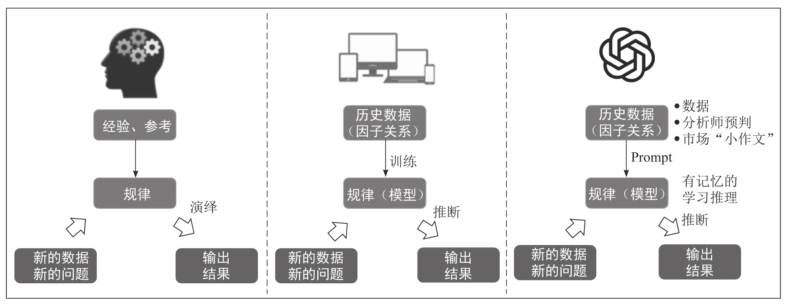

图 1-1 AI 的思考与辨析演进[资料来源：作者绘制。]

而 AI 大模型的出现，则为这艘资管巨舰装上了颠覆性的“涡轮增压”引擎。贝莱德迅速利用生成式 AI 技术，为阿拉丁平台量身打造了“Aladdin AI Copilot”（阿拉丁 AI 副驾驶员）。想象一下这样的场景：一位投资经理正准备向客户汇报，他可以直接用自然语言向 Copilot 提问，“阿拉丁，请总结我们持有的欧洲科技股组合面临的主要监管风险，并列出受影响最大的三只股票及其风险敞口”。在几秒钟内，Copilot 就能深入理解指令，调用平台内部分散在不同模块的风险模型、合规文档、研究报告和实时持仓数据，然后生成一段清晰、准确、可执行的总结报告。这种效率的提升是呈指数级的，它将分析师从烦琐的数据查找与整合工作中彻底解放出来。

贝莱德在“系统化主动权益投资”（Systematic Active Equity，SAE）策略上的 AI 应用，直接指向了投资的核心—创造超额收益。SAE 团队拥有超过 100 名投资专家、数据科学家和科技精英，他们将系统性投资策略与 AI 大模型深度融合，用机器的算力来捕捉人类难以察觉的微弱投资信号。这个团队的 AI 探索之路可以追溯到 1985 年，那时他们便开始利用计算机分析财务报表，并进行基本面选股。随着时间的推移，他们的模型在不断进化—从最初的盈利质量分析，到后来纳入投资者情绪、资金流向等数据，再到 2010 年后开始处理复杂的非结构化数据，最终，在近年将可持续发展（如 ESG）因素融入模型。

面对 ChatGPT 等通用大模型的崛起，SAE 团队并未止步于使用外部工具，而是更进一步，自主研发了专为投资领域设计的第六代专有大语言模型。与侧重于通用对话的 ChatGPT 不同，贝莱德的这款 LLM 是一个“专才”，它专注于解决金融投资中的核心问题，例如，精准预测上市公司在发布财报后的股价走势。由于该模型是在贝莱德积累数十年的、高度结构化且更具针对性的专有金融数据库上进行的训练和微调，其在特定任务上的表现堪称惊艳。

为了验证其模型的真实能力，贝莱德进行了一项严谨的对比测试。研究人员选取了 500 份真实上市公司的盈利电话会议记录作为样本，让不同的 AI 大模型预测上市公司在盈利报告发布之后的 40 个交易日内的股票回报方向，最终衡量模型对股票回报预测的准确率。测试结果令人瞩目：如图 1-2 所示，贝莱德自研的 SAE 专有大语言模型准确率达到了惊人的 61%，显著超越了市面上最强大的通用模型—GPT-4 的 55%和 GPT-3.5 的 53%。这几个百分点的优势，在规模化、系统化的投资中，意味着巨大的超额收益。这不再是务虚的空谈，而是实实在在、可以量化的投资业绩，更是 AI 赋能投资最硬核的证明。

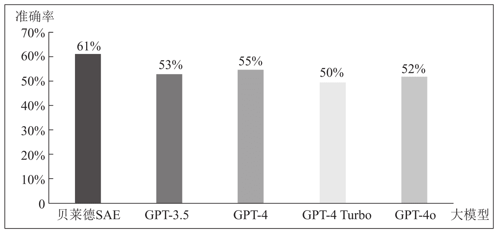

图 1-2 不同大模型预测上市公司股票回报的准确率[资料来源：《中国资产管理市场 2023～2024》报告编委会，贝莱德。]

此外，贝莱德还创新性地推出了“主题机器人”（Thematic Bots）。这是一种将投资经理的行业洞察与 AI 的分析能力深度融合的工具。整个流程清晰高效：首先，投资经理基于其专业判断，确定一个具体的投资主题或市场情景，例如“GLP-1 减肥药的普及对消费行业的影响”。随后，“主题机器人”（大语言模型）会启动，它能深度理解这个主题的内涵，并自主分析可能因此受益或受损的商业模式，比如它会识别出健康食品、健身房等商业模式都可能受到间接影响。接着，AI 会利用其庞大的数据库，将这些商业模式与全球范围内的上市公司进行精准匹配，快速构建出一个初步的短期仓位或长期仓位的股票篮子。最后，AI 会生成一份标准化的投资组合报告，详细列出每只股票的贡献度和风险指标，交由投资经理进行最终审核、精炼和决策。这一完整的流程，将过去可能需要一个团队用数周时间才能完成的深度主题研究，压缩到了几小时甚至几分钟，极大地提升了策略迭代的速度和灵活性。

**2.摩根大通（J.P.Morgan）：安全与效率并重的 AI 矩阵**

如果说贝莱德的 AI 应用凸显“进攻性”，那么华尔街的另一巨头摩根大通则在拥抱 AI 的同时，展现出了金融机构特有的审慎—将数据安全放在了战略的首要位置。2023 年，出于对商业机密和客户数据可能通过公有云模型泄露的担忧，摩根大通果断限制内部员工使用外部的 ChatGPT，并迅速调集资源，开发了专属于内部的、部署在安全服务器上的 AI 软件—“LLM Suite”。

这款被内部员工亲切地称为“研究分析师”的 AI 平台，旨在通过人工智能技术，赋能约 5 万名员工（占总员工人数的 15%），提升他们的业务生产力和决策效率。其核心功能精准地切中了金融从业者的日常痛点。

●文书写作：投资银行的分析师经常需要撰写长达数十页的报告。LLM Suite 可以根据简单的指令，快速生成报告初稿、市场摘要或客户邮件，将分析师从繁重的文字工作中解放出来，让他们能更专注于思考和分析。

●头脑风暴：当需要新的投资思路时，分析师可以向 LLM Suite 提问，“基于当前宏观环境和行业趋势，请为我们的新能源基金提出五个潜在的投资主题”。AI 能够迅速整合信息，提出富有创意的、有数据支持的观点，成为人类思考的“催化剂”。

●文档总结：面对一份几百页的招股说明书或复杂的法律文件，LLM Suite 可以在几分钟内提炼出核心条款、关键风险和重要数据，极大提高了信息获取的效率，为管理层的快速决策提供支持。

在具体的投资应用层面，摩根大通同样走在前列。2024 年 5 月，摩根大通旗下摩根资产管理正式推出了“IndexGPT”。这是一个利用 OpenAI 的 GPT-4 模型，并结合摩根大通自身数据优势打造的强大工具。其核心功能是实现“主题投资篮子”的智能构建。整个工作流程高度自动化，如图 1-3 所示。分析师首先选定一个主题（如“人工智能”），“IndexGPT”会利用 GPT-4 模型的强大语义理解能力，生成一个与该主题相关的详尽关键词列表。随后，其内置的 NLP（自然语言处理）模型会实时扫描全球海量的新闻、研究报告、社交媒体等文本内容，精准识别那些在正面语境下被高频提及的公司。最终，系统会自动构建一个与该主题高度相关的投资篮子，并提供相应的市场趋势分析和风险评估。这一工具已在人工智能、云计算、网络安全等多个热门主题中成功应用，帮助投资者在纷繁复杂的市场中，快速、准确地锁定具有潜力的投资机会。

更进一步，摩根大通将其 AI 能力深度嵌入其核心投资平台“Spectrum”，推出了专有语言模型“SpectrumGPT”。这个模型是真正的“内功深厚”，因为它基于摩根大通积累了长达 40 年的庞大专有数据库进行训练。它不仅仅是一个聊天机器人，更是一个集成了多种复杂分析工具的智能系统。例如，平台内的“分析师魔球”（Analyst Crystal Ball）工具，会利用机器学习算法，分析研究员过往的预测数据，识别其可能存在的系统性偏差（如过于乐观或悲观），并进行校准，以提高对未来预测的准确性。还有“权益失效模型”（Equity Failure Model），该模型基于超过 1 万只股票的 170 多个基本面特征，精准识别那些具有潜在财务困境和破产风险的高风险公司。这些都是 AI 在精细化、专业化投资场景中发挥巨大作用的实证。

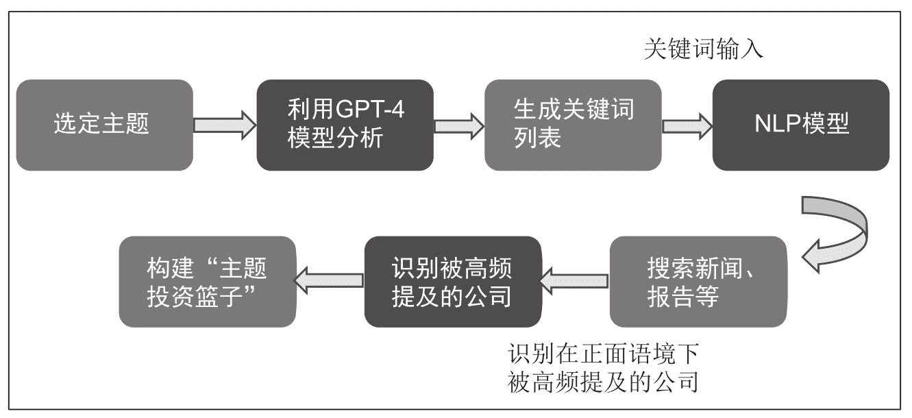

图 1-3 摩根资产管理 IndexGPT 创建“主题投资篮子”的过程[资料来源：摩根资产管理 IndexGPT。]

**3.Vanguard 及其他机构：成本与效率的创新探索**

并非所有机构都像贝莱德和摩根大通那样拥有近乎无限的资源来构建庞大的专有模型。全球领先的资管公司先锋集团（Vanguard Group）则另辟蹊径，探索出了一条极具成本效益的 AI 应用之路。其投资管理金融科技战略（IMFS）团队提出了一个名为“MoA”（Mixture of Agents，多代理混合）的创新框架。

该框架的核心思想是“分而治之”。它不再依赖一个无所不知、无所不能的单一大模型，而是构建了一个由多个小型的、高度专业化的语言模型（即“代理”）组成的协同工作系统。在这个系统中，每个“代理”都像一名专科医生，只负责一项特定的任务：一个代理专门负责分析市场情绪，另一个代理专门负责计算各类财务指标，还有一个代理则专门负责处理复杂的数学计算。当一个复杂的查询指令下达时，系统会自动将任务分解，并分派给最擅长处理该子任务的代理，最后再将各个代理的结果整合起来，形成最终答案。

该框架的优势是显而易见的。首先，由于每个模型都更精、更专，其响应速度和准确性在特定任务上往往优于泛泛而谈的通用大模型。其次，也是最关键的一点—成本极低。据 Vanguard 披露，其 MoA 框架每月的总运营成本低于 8000 美元，却能高效处理来自研究团队的大量复杂查询。相比之下，运行一个同等能力的单一大模型，每月的成本可能高达数万美元，甚至数十万美元。这种惊人的性价比，为广大中小型资管机构指明了一条切实可行的 AI 落地路径，证明了 AI 并不只是巨头的专属工具。

放眼全球，AI 赋能资管的案例不胜枚举。高盛（Goldman Sachs）正积极利用谷歌的多模态 AI 大模型“Gemini”和谷歌先进的代码生成系统 AlphaCode 2 来解决复杂的金融编程问题，以提升开发效率。专注于私募基金的资产管理公司 Spacestation Investments，则通过引入基于 LLM 的 PaperOS 平台，将基金设立与管理的行政工作量大幅减少，显著提高了运营效率和数据准确性。这些多元化的应用场景共同描绘了一幅生动的画卷：整个资管行业正在以前所未有的深度和广度拥抱 AI，将其从一个遥远的技术概念，转变为日常工作中不可或缺的、能够创造巨大价值的强大生产力工具。

**1.1.2** **人机协同：驾驭 AI 成为投资赢家的艺术**

从上述顶尖机构的丰富实践中，我们可以清晰地洞察到一个核心趋势：AI 的应用并非要冰冷地取代人类，而是要与人类分析师形成一种全新的、高效的共生关系，即“AI+HI”（Human Intelligence，此处对应实践中人类分析师的核心能力）的人机协同新范式。

在这个新范式中，人类的角色发生了深刻的转变。我们不再是信息的搬运工和低级的计算者，而是决策的“主驾驶员”。AI 则扮演着我们身边最强大的“副驾驶员”，它拥有近乎无限的算力、永不疲倦的专注度和绝对客观的分析能力。它负责自动化处理所有烦琐的日常任务—从海量数据的抓取、清洗、整理，到初步的模式识别、关联分析和报告生成。这使得分析师能够从重复性的劳动中彻底解放出来，将宝贵的时间和精力聚焦于那些机器无法替代、更具战略意义的核心工作。比如，进行深度的批判性思考、提出原创性的投资洞见、与客户进行有温度的情感交流，以及做出最终的、需要承担责任的投资决策。国内一些资管机构已经针对各种场景对大模型进行了应用，具体情况如表 1-1 所示。

**表 1-1** **国内资管机构大模型的应用情况**

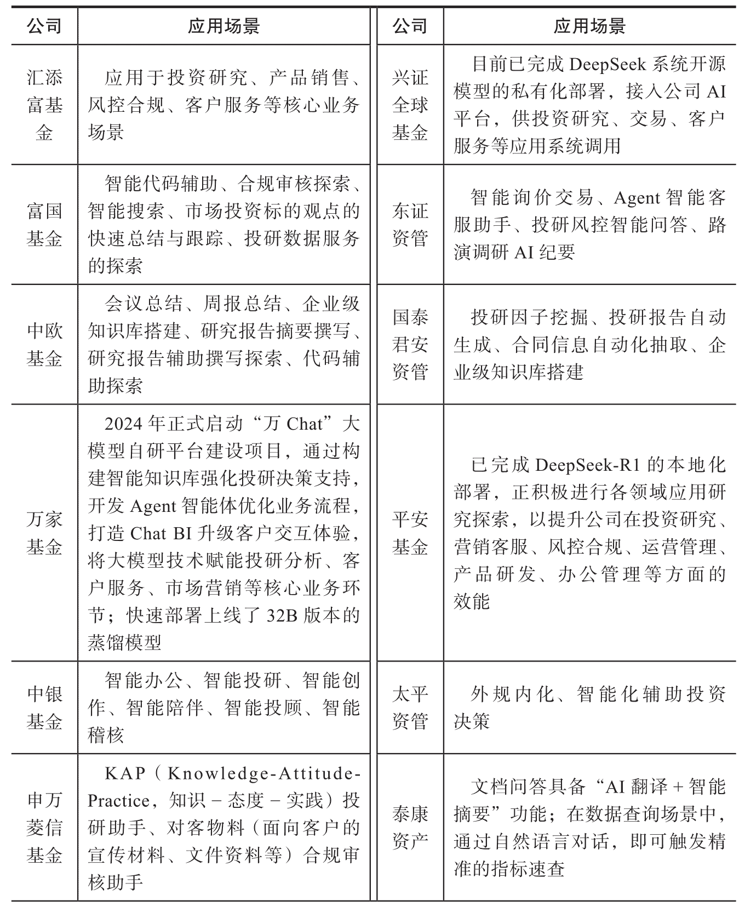

（续）

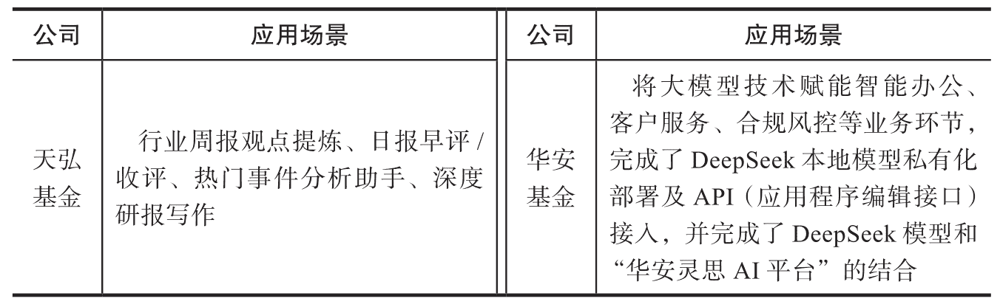

资料来源：中国基金报，《上海全球资产管理中心建设 资产管理大模型应用实践与指南》。

然而，要让这位 AI“副驾驶员”发挥出最大效能，仅仅拥有它还不够，关键还在于我们是否懂得如何“驾驶”它。这门艺术的核心，就是所谓的“提示工程”（Prompt Engineering）。它并不需要我们去学习复杂的编程语言，而是一门与 AI 进行高效、精准沟通的艺术。经过精心设计的“提示词”，就如同为 AI 设定了一条清晰的导航路线，能精准地引导它调用正确的知识、遵循正确的逻辑，最终产出最符合我们预期的结果。这里面包含着以下几个至关重要的技巧。

**精准的角色设定：**在下达指令前，首先要为 AI 赋予一个明确的角色。这会极大地影响它的思维模式和输出风格。例如，在分析一家公司的财报时，如果我们对它说“请分析这份财报”，它可能会给出一个中立、客观的概述。但如果我们下达指令时对它说“假设你是一位深刻理解护城河理论的价值投资者，请从长期竞争优势的角度分析这份财报，并指出其潜在的风险”，AI 就会立即“入戏”，调用价值投资的知识框架展开分析，其分析的深度和角度将完全不同。

**明确的任务指令：**指令必须清晰、具体、可执行。避免使用模糊的词语。例如，不要说“给我一些关于 A 公司的信息”，而应该说“请总结 A 公司过去三个季度的营收和净利润同比增长率，将其与两位主要竞争对手进行对比，并以表格形式呈现”。任务指令越明确，AI 的输出就越聚焦，也就越具有实用价值。

**提供高质量的范例：**这是提升 AI 输出质量最有效的方法之一。就像指导一位聪明的实习生，与其反复用语言描述要求，不如直接给他一份优秀的报告作为范本，让他“照猫画虎”。在与 AI 交互时，我们可以先给它一个我们希望的输出格式和内容的示例，再让它处理新任务，其结果往往会惊人地贴近预期。

**控制输出的“温度”（Temperature）：**这是一个非常关键的技术参数，它直接决定了 AI 回答的“创造性”与“严谨性”之间的平衡。在处理需要绝对准确性的任务时，比如解读监管文件或提取财务数据，就应该将“温度”参数设置得非常低（例如 0.1～0.3）。此时的 AI 会变得极其严谨，严格遵循已有信息输出，避免任何自由发挥。相反，当我们在进行头脑风暴，需要 AI 提供一些天马行空的创意或构建新颖的投资故事时，就可以将“温度”参数调高（例如 0.7～1.0），此时的 AI 会变得更具想象力和发散性。

**规避 AI 的固有缺陷：**在享受 AI 带来的便利的同时，我们也必须清醒地认识到它的局限性。首先是“信息幻觉”问题。AI 的生成原理是基于概率，而非逻辑推理，这导致它有时会“一本正经地胡说八道”，编造出看似合理但实际上并不存在的信息。例如，在 Vectara HHEM 的权威幻觉测试中，即便是先进的 DeepSeek-R1 模型，也显示出了 14.3%的幻觉率。因此，对于 AI 生成的任何关键信息，尤其是用于投资决策的数据，都必须经过人类专家的交叉验证和事实核查。其次是数据泄露的风险。三星员工曾因不当使用 ChatGPT，导致公司机密代码被上传至外部服务器，这一案例为所有机构敲响了警钟。因此，在处理敏感数据时，选择采用隔离的、受保护的私有化部署模型，是不可逾越的安全红线。

总而言之，AI 大模型的技术浪潮正以一种不可逆转的姿态，深刻地重塑着资产管理的每一个环节。它正在无情地打破信息壁垒，迅速地抹平投资机构与个人投资者之间曾经难以逾越的算力鸿沟，将整个投资研究行业推向一个高效、客观和智能化的新纪元。对于每一位市场参与者而言，这既是挑战，更是巨大的机遇。告别在海量数据中挣扎内卷的传统作坊式工作模式，主动学习、理解并掌握与 AI 这位强大助手协同工作的艺术，将不再是一种选择，而是未来每一位成功投资者必备的核心竞争力。这场决定未来十年行业格局的变革已经拉开序幕，拥抱它、驾驭它，我们便有机会在这场波澜壮阔的时代浪潮中占得先机、赢得未来。

**1.2** **先利其器：AI 投资的工具箱和十八般武艺****[1][.][2][.][1]**

**国内各主流 AI 大模型及其在金融投资领域的测评**

在投资研究实践中，国内各主流 AI 大模型都有各自的核心优势和相关适用场景。

●DeepSeek 擅长处理结构化数据与代码，逻辑推理严谨细密，特别适用于需要高精度数据分析与技术分析的场景，如对沪深 300 指数进行技术面分析。

●Kimi 在长文本解读与深度文本总结方面表现突出，能够快速提炼政策文件与公开报告的核心内容，适合用于公开报告、政策文件等文本资料的快速解读与比对，如对中证红利 ETF 历年季报进行对比分析。

●豆包具备快速响应和实时热点追踪能力，适合新闻梳理和舆情追踪类任务，例如，在上证指数突破关键点位时，能够迅速整理与行情相关的媒体报道和市场情绪演变。

●智谱清言则突出于知识图谱构建与结构化写作，能够帮助研究者构建投研知识体系，适合进行投资框架设计或策略归纳，如梳理红利低波资产的配置逻辑与投资策略。

●秘塔 AI 凭借强大的实时搜索能力和高质量的信息整合能力，在多来源资料整合与政策框架梳理方面尤为出色，适用于宏观政策导向或法规类研究场景，如对“科创板政策”进行脉络化归纳与解析。

国内各主流 AI 大模型的核心优势、适用场景和典型案例对比情况，如表 1-2 所示。

**表 1-2** **国内各主流 AI 大模型的核心优势、适用场景和典型案例对比**

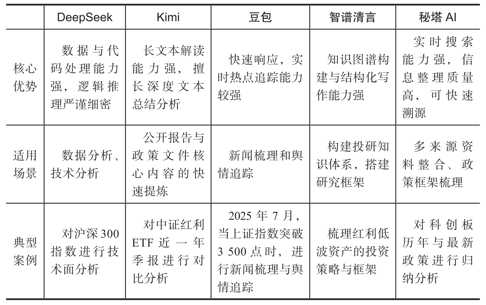

资料来源：作者整理。

### **学习案例 1-1** **DeepSeek 对沪深 300 指数进行技术面分析**

在各主流大模型当中，DeepSeek 的核心优势是逻辑推理严谨细密，处理结构化数据和代码的能力强，因而在投资研究中，适用于技术分析和数据分析等对推理能力要求较高的场景。

以技术分析场景为例，我们基于 DeepSeek 大模型，对沪深 300 指数（000300）在 2025 年 1 月 1 日至今（2025 年 7 月 18 日）的行情走势进行技术分析。针对此任务，我们输入 DeepSeek 模型的提示词按照“语境”“任务”“案例”“格式”“语调”五个维度来设计，DeepSeek 的界面及技术分析提示词参考如图 1-4 所示。

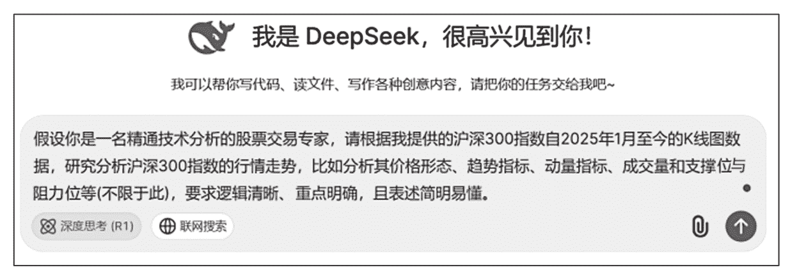

图 1-4 DeepSeek 的界面及技术分析提示词参考[资料来源：DeepSeek。]

至于相关数据资料的输入形式，我们首先采用了最简单的方式—上传 K 线图。但在输出结果中，DeepSeek 将区间内的最低点，即在 2025 年 4 月初美国关税政策影响下，沪深 300 指数在 4 月 7 日盘中出现的阶段性低点，误当作指数走势的区间终点，得出“沪深 300 指数数据从 4080 点持续下跌至 3520 点，形成陡峭下降通道，无显著反弹迹象，符合崩盘式下跌特征”的错误结论；并且在深度思考的过程中耗时 19 秒，对上传图片的形式做出了格式欠佳的评价。由此可发现，DeepSeek 无法单凭一张 K 线图进行精准、高质量的技术分析，我们测试了其他主流大模型，发现也存在此类问题。

接下来，我们对上述问题予以改进和优化，虽然从输出形式来看，人脑对图像的感知直观到位，但是大模型更适合用文本和数字类素材进行投喂，因此我们“化图为数”，采用上传结构化数据的方法，把沪深 300 指数在目标区间内的相关历史数据（包含开盘价、收盘价、最高价、最低价、交易量、涨跌幅等数据）作为附件上传至 DeepSeek 大模型，并重新输入提示词。在这次深度思考的过程中，DeepSeek 用时达 218 秒，不仅充分理解了所上传数据的格式与内容，还对数据进行了大量的计算和处理。

在输出的内容中，DeepSeek 在一一回应了所输入的提示词要求后，首先展示了整体价格走势，不仅展示了精确的点位数据，还对区间趋势做出了“先跌后涨”的正确判断。回答示例如下。

**趋势判断：**沪深 300 指数在 2025 年经历了明显的“先跌后涨”行情，具体分为两个阶段。下跌阶段（1 月初至 4 月初）：指数从 1 月 2 日的 3820.40 点开始震荡下行，4 月 7 日出现单日暴跌 7.05%（收盘 3589.44 点，低点 3514.12 点），形成年内最低点。这波下跌主要受市场恐慌情绪驱动，成交量显著放大（4 月 7 日成交 312.58K），确认了空头主导。上涨阶段（4 月中旬至今）：指数从 4 月低点强劲反弹，形成上升趋势。7 月 18 日收盘 4058.55 点（高点 4064.64 点），较 4 月低点上涨约 15.7%。近期价格创出新高，表明多头控制局面。当前状态（截至 2025 年 7 月 18 日）：指数处于短期上升趋势中，但需警惕高位回调风险。关键驱动因素包括经济数据改善和市场情绪回暖。

各方面的详细分析如下。

在价格形态分析方面，DeepSeek 能够分析 4 月以来上升通道的形成、定位向上突破的时点（7 月 10 日，同日上证指数突破 3500 点）和预判潜在的“双顶”形态等。

在趋势指标分析方面，DeepSeek 能够根据收盘价格等历史数据的计算得出移动平均线（MA），且重点挑选 20 日 MA 和 50 日 MA 来分析和判断短期和中期趋势。

在动量指标分析方面，DeepSeek 给出了相对强弱指数（RSI，14 日）的历史表现与当前情况，结合相关阈值分析指数的超买超卖情况，同时分析了指数平滑异同移动平均线（MACD）对多头趋势的确认。

在成交量分析方面，DeepSeek 选择 4 月 7 日和 7 月初两个关键转折点进行量价分析，以判断其上升或下降趋势的可靠性，也对近期的量价表现（7 月突破上涨情况下，量能有所增加但未异常放量）给出了较有价值的市场判断（上涨由稳健买盘推动而非投机过热）。

在支撑位与阻力位分析方面，DeepSeek 从短期和中期的角度给出了可参考的一些支撑位和阻力位，且分析了这些关键价格水平的形成原因及突破意义。

各方面具体回答示例如下。

1.价格形态

①上升通道形成：从 4 月低点开始，指数呈现“更高的高点和更高的低点”形态，这是典型的上升趋势信号。更高高点：4 月 9 日高点 3686.79→5 月 14 日高点 3960.52→7 月 11 日高点 4065.94→7 月 18 日高点 4064.64。更高低点：4 月 7 日低点 3514.12→5 月 9 日低点 3836.53→6 月 19 日低点 3834.95→7 月 16 日低点 3993.92。②关键形态：6 月至 7 月，指数在 3950～4050 区间震荡整理，形成“矩形整理”形态，随后于 7 月初向上突破（7 月 10 日收盘 4010.02 点，突破 4000 点阻力）。这被视为看涨延续信号，表明上涨动能强劲。③风险提示：若指数跌破 7 月 16 日低点 3993.92 点，可能形成“双顶”雏形（7 月 11 日和 7 月 18 日高点均在 4065 附近），预示短期回调。

2.趋势指标：使用移动平均线（MA）判断趋势方向和强度

①20 日 MA（短期趋势）：截至 7 月 18 日，20 日 MA 位于 3973 点附近（计算基于 6 月 23 日至 7 月 18 日收盘价）。指数当前收盘价（4058.55 点）持续高于 20 日 MA，表明短期上升趋势完好。自 5 月以来，价格始终保持在 20 日 MA 上方，仅 6 月中旬短暂跌破后快速收回，确认了支撑有效性。②50 日 MA（中期趋势）：截至 7 月 18 日，50 日 MA 位于 3920 点附近（计算基于 5 月底至 7 月 18 日收盘价）。指数自 4 月反弹后一直位于 50 日 MA 之上，且 50 日 MA 已拐头向上（斜率转正），强化了中期看涨信号。③金叉信号：20 日 MA 于 6 月上旬上穿 50 日 MA，形成“黄金交叉”，这是经典的中期买入信号，进一步验证了趋势反转。

3.动量指标

①相对强弱指数（RSI，14 日）：当前值约 65（基于 7 月 4 日至 7 月 18 日价格变化计算）。RSI 处于 50～70 的“看涨区间”，表明上升动能健康，但未超买（超买阈值为 70）。历史表现：4 月暴跌时 RSI 跌破 30（超卖），触发反弹；7 月 RSI 未触及 70，暗示上涨仍有空间。若 RSI 突破 70，需警惕短期过热。②MACD（12/26/9 日）：当前状态，MACD 线（DIF）位于信号线（DEA）上方，且柱状图（Histogram）为正，表明上升动量增强。7 月初 MACD 形成“零轴上金叉”，确认多头动能加速。关键变化：MACD 在 4 月低点出现底背离（价格新低但 MACD 未新低），预示反转；当前无顶背离信号，支持趋势延续。

4.成交量

趋势确认：在关键转折点，成交量放大验证趋势。例如，4 月 7 日暴跌时成交量 312.58K（年内最高），确认空头宣泄。7 月初突破 4000 点时成交量温和放大（7 月 10 日 209.78K，7 月 11 日 262.05K），支撑突破有效性。近期表现：7 月日均成交量约 180K～200K，较 6 月（日均 150K）有所增加，但未出现异常放量。这暗示上涨由稳健买盘推动，而非投机过热。若未来上涨中成交量萎缩，需警惕动能减弱。背离信号：无显著量价背离，整体量能配合价格上涨。

5.支撑位与阻力位

（1）支撑位。主要支撑（4000 点）：心理关口兼交易密集区。7 月多次测试该位（如 7 月 16 日低点 3993.92），均获支撑。若跌破，下一支撑在 3950 点（6 月整理平台）。强支撑（3900 点）：50 日 MA 和 6 月低点重合区域，是中期趋势防线。

（2）阻力位。近期阻力（4065 点）：7 月 11 日和 18 日高点形成双重顶雏形。突破该位可打开上行空间至 4100 点（心理关口）。中期阻力（4200 点）：基于年内涨幅的斐波那契扩展位，但需先突破 4065 点。

（3）关键区间：当前指数在 4000～4065 区间震荡，突破方向将决定短期走势。

在结论方面，DeepSeek 结合技术指标描述了当前行情，清晰简要地说明了沪深 300 指数当前的价格趋势、震荡区间等，也对指数短期的走势进行了多情况的讨论。最后在交易策略方面，DeepSeek 能够从不同的投资思路（看多、看空）出发，结合多种不同的技术指标及其情况（MACD 金叉信号、RSI 超买等），给出具有可操作性的详细策略。DeepSeek 的回答示例如下。

①当前行情：沪深 300 指数处于中期上升趋势，短期在 4000～4065 区间震荡。技术指标（MA、RSI、MACD）和成交量均支持看涨，但 4065 点阻力强劲，需突破确认进一步上行。②短期展望：若指数站稳 4000 点并突破 4065 点，目标可看 4100～4200 点；若跌破 4000 点，可能回调至 3950 点寻求支撑。③交易策略：多头策略为在 4000 点附近逢低买入，止损设于 3950 点下方，目标 4100 点。关注成交量放大和 MACD 金叉信号。空头策略为仅当指数跌破 4000 点且 RSI 超买（＞70）时轻仓试空，目标 3950 点。④风险提示：警惕高位获利了结（如 7 月 18 日涨跌幅仅 0.60%，动能减弱），并关注宏观经济数据（如 GDP、政策）对趋势的影响。

由此可见，通过输入合理的提示词和上传结构化数据，DeepSeek 能够对特定投资标的展开深入的技术分析。这一过程不仅充分发挥 DeepSeek 在数据处理与表格解析方面的优势，为技术面分析提供精准可靠的参考数据，还能运用其强大的逻辑推理能力，对市场数据及技术指标进行详细深入的分析，最终输出准确的市场研判和具有实操性的投资建议。

### **学习案例 1-2** **Kimi 对中证红利 ETF 近一年的各期季报进行分析**

随机选择了某家基金公司的中证红利 ETF 产品，将其近一年的四份季度报告的 PDF 文件作为附件上传至 Kimi 大模型，并输入提示词，如图 1-5 所示：“假设你是一位精通基金产品分析的专业分析师，请基于我上传的某基金公司中证红利 ETF 过去四个季度的季报，系统梳理该 ETF 的核心内容，包括但不限于深入总结其产品结构、持仓、规模、分红、跟踪误差等方面的变化趋势，剖析这些变化背后的原因及其对投资价值、策略风格的潜在影响。要求数据准确、逻辑清晰，语言简洁有力，适合普通投资者快速理解与决策参考。”

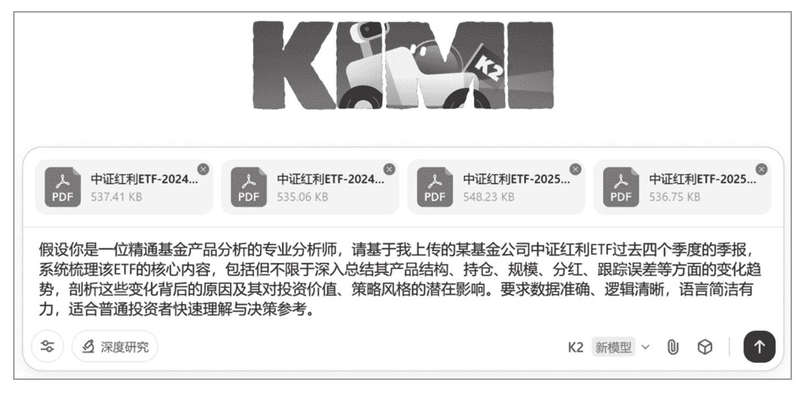

图 1-5 Kimi 的界面及提示词与附件参考[资料来源：Kimi。]

Kimi 输出了该 ETF 2024 年第三季度至 2025 年第二季度的季度报告分析总结内容。Kimi 首先用一句话概括了该 ETF 的区间运行全景，接着展示了其在最新季度的产品信息要点（见表 1-3）和几个季度以来的规模与份额变化，然后说明了其报告观察。

在资产配置与行业漂移方面，Kimi 也给出了详细的数据信息表，同时附有相关解读；在业绩与跟踪误差方面，Kimi 也得出相应结论；在投资者结构与潜在风险方面，Kimi 提示需关注二级市场流动性。Kimi 在最后依照提示词的要求，给出了投资者的决策参考（见表 1-4），同时也对整个分析进行了概要性总结。具体回答示例如下。

运行全景：基金规模已脱离“清盘线”，持仓持续向高股息煤炭/银行集中，跟踪误差长期低于 1%，适合“拿股息+抗波动”型投资者。

报告观察：2024 年第三季度因机构大额申购脱离 5000 万红线后，规模稳定在 7 亿元上下，流动性风险解除。

**表 1-3** **Kimi 输出的产品信息要点**

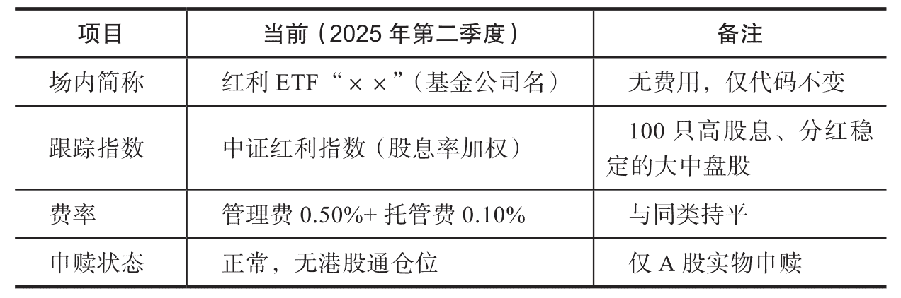

资料来源：Kimi。

资产配置与行业漂移：煤炭及银行权重持续提升，体现指数高股息特征，股票仓位保持在 95%以上，几乎满仓运作，无债券、期货、贵金属等衍生工具，纯粹指数化。

业绩与跟踪误差：基金始终将日均偏离控制在 0.2%以内，年化误差＜2%，复制精度高，几乎无主动择时。至于分红情况，Kimi 提示：ETF 分红取决于指数成分股派息节奏及基金合同，目前尚未到集中派息时点；投资者可关注每年 6～8 月的公告。

投资者结构与潜在风险：联接基金持续大额持有，占比接近七成；若其短期赎回，可能造成盘中折溢价扩大，需关注二级市场流动性。

总结：该 ETF 产品已从“迷你基”成长为 7 亿元规模的高股息工具，紧密跟踪中证红利指数，费率低、误差小，机构持有比例高但流动性无忧；当前煤炭+银行双轮驱动，适合追求稳健现金流的投资者逢跌布局，注意单季度回撤-3%至+8%的波动区间即可。

**表 1-4** **Kimi 输出的投资者决策参考**

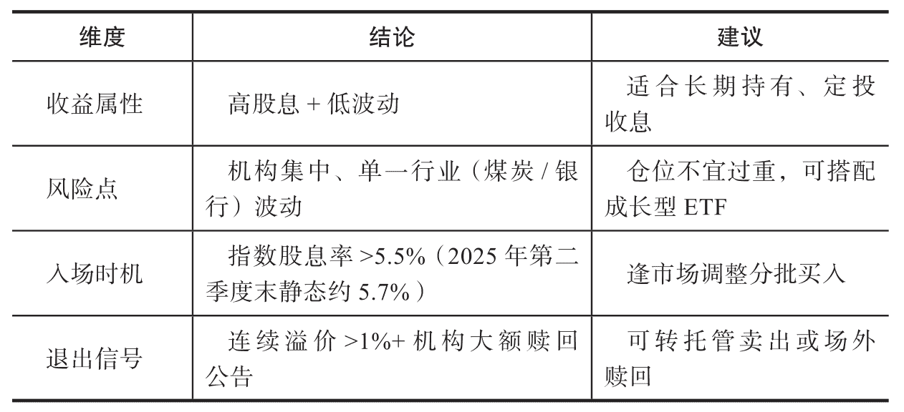

资料来源：Kimi。

### **学习案例 1-3** **豆包整理新闻与舆情**

豆包的核心优势是快速问答体验好，热点新闻梳理和舆情追踪的能力强，所以适合辅助我们在信息爆炸的时代下高效率地把握投资研究的关键信息。

在投资研究的新闻与舆情整理场景中，我们尝试使用豆包快速识别消息主线和市场情绪，例如，投资者想要总结分析“2025 年 7 月上证指数上涨突破 3500 点”这一事件背后的新闻与舆情，设计的提示词如下。

①新闻驱动总结：梳理 2025 年 7 月促使 A 股上涨的主要消息（如政策、数据、外部市场），按影响力大小排序，每条消息都要配一句简明解释。

②市场情绪分析：判断投资者情绪是以“理性乐观”还是“短期博弈”为主。可提及热点词汇（如“‘国家队’入场”“中特估”）、资金表现、舆论态度等。

③风格演变判断：本轮上涨主要由哪些板块/风格带动？是否呈现风格切换？

要求：内容结构清晰、逻辑严谨，鼓励以列表、分点方式输出，表述简明易懂。

该提示词搭建了人人可复用的 AI 舆情分析框架，主要固定覆盖了新闻整合、情绪识别、风格判断三个舆情相关核心点，而“2025 年 7 月上证指数上涨突破 3500 点”这一事件可以替换成其他市场事件，例如关于某投资标的上涨突破、暴跌等，解决了信息茧房、信息碎片化等舆情追踪痛点。新闻与舆情追踪案例的提示词模板总结如表 1-5 所示。

**表 1-5** **新闻与舆情追踪案例的提示词模板总结**

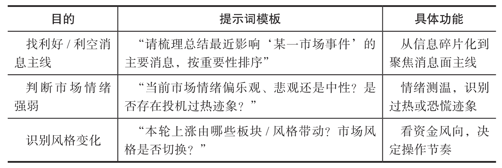

资料来源：作者整理。

将提示词输入豆包大模型，得到的回答结构完整度高，能覆盖任务要求的市场新闻、情绪、风格三大维度，而且信息密度较高，数据丰富准确，具备一定专业性。

在市场新闻维度，豆包总结了国内政策组合、经济数据情况、外部市场环境三方面的新闻，涉及资本市场改革、产业政策、货币政策、2025 年上半年 GDP 数据、中报业绩预告、美联储 7 月暂停降息和全球科技巨头公司 AI 投资加码等，信息丰富且层次清晰。

在情绪维度，豆包结合国内外资金表现、热点词汇与舆论共振、市场成交额变动等多视角分析投资者情绪，在提示词关于市场情绪以“理性乐观”还是“短期博弈”为主的提问中，以前者作为主要回答，且根据市场动态自主思考，提出“政策”和“业绩”两条情绪分析主线。

在风格维度，豆包在板块驱动方面给出“政策受益”“业绩驱动”“估值修复”三维度轮动框架，逻辑清晰、层次明确，与前两个维度的分析呼应，形成逻辑闭环，在风格切换特征方面也从“纯成长→均衡配置”“题材炒作→业绩聚焦”“内资主导→内外资共振”三个角度去说明，且配有相关的事件与数据验证。

在结论部分，豆包重点概括了前面的分析部分，且根据分析结果，提出了具体可行的投资建议。

各维度具体回答如下。

新闻驱动总结（按影响力排序）：①国内政策组合拳释放改革红利。资本市场改革深化：香港《稳定币条例》8 月实施、债券通扩容至券商保险机构，为市场注入流动性预期。产业政策精准发力：工业和信息化部推动光伏行业从价格竞争转向技术竞争，加速落后产能出清，直接提振光伏产业链；国家发展改革委出台大功率充电设施规划，强化新能源与电网融合预期。货币政策协同支持：央行合并 8000 亿元流动性工具（互换便利+再贷款），定向支持资本市场稳定。②经济数据超预期验证复苏韧性。上半年 GDP 同比增长 5.3%，消费与高技术产业贡献显著，经济“稳中有进”基调夯实市场信心。中报业绩预告密集披露：工业富联 AI 服务器营收同比增超 60%，算力硬件、军工等板块业绩驱动股价上行。③外部市场环境边际改善。美联储 7 月暂停降息但释放宽松信号，市场押注 9 月降息概率超 50%，外资阶段性回流 A 股（北向资金单月净流入 680 亿元）。全球科技巨头 AI 投资加码：Meta 与 Oakley 合作推出 AI 眼镜、英伟达 H20 芯片量产预期，带动 A 股 AI 硬件板块情绪。

市场情绪分析：理性乐观主导，政策与业绩形成双锚。①资金表现验证中长期逻辑：北向资金单月净流入 680 亿元创年内新高，重点加仓 AI 算力（中科曙光+73 亿元）、半导体（中芯国际）等硬科技领域；两融余额攀升至 1.88 万亿元，杠杆资金风险偏好回升。“国家队”动作清晰：中央汇金增持中国重工、北方导航等军工龙头，社保基金加仓恒瑞医药、招商银行等核心资产，通过长期资金锁仓优化市场筹码结构。②热点词汇与舆论共振。“中特估”概念持续发酵：中油资本、太极股份等央企改革标的获资金追捧，板块资金净流入超 18 亿元；军工板块因“阅兵预期+业绩预增”成为情绪标杆，超 40 家企业中报预增。社交媒体与财经媒体形成正向循环：“政策底+经济底”成为主流叙事，雪球、微博等平台“3500 点突破”相关话题阅读量超 5 亿次，投资者风险偏好显著抬升。③短期博弈元素仍存但非主导：量化新规实施初期（7 月 7 日）市场成交额萎缩 956 亿元，但随后成交量迅速回升至 1.47 万亿元，显示资金对中长期趋势的认同。高波动题材（如 CPO、机器人）与低估值蓝筹（如银行、电力）同步上涨，反映理性资金在政策与业绩双主线间均衡配置。

风格演变判断：周期与成长共振，价值修复与科技突围并行。①板块驱动呈现三维度轮动。政策受益型：光伏（硅料产能出清）、新能源（大功率充电）、军工（装备订单排至 2026 年）直接受产业政策催化。业绩驱动型：算力硬件（工业富联净利润增 36%）、稀土永磁（北方稀土中报预增 1800%）、创新药（恒瑞医药 GLP-1 进展）以基本面支撑股价。估值修复型：银行（招商银行股息率 4.2%）、电力（长江电力）等低估值蓝筹获避险资金配置，同时“中特估”概念推动央企估值体系重塑。②风格切换特征显著。从纯成长到均衡配置：科技股（AI、半导体）与周期股（稀土、煤炭）涨幅同步领先，创业板指与沪深 300 指数月涨幅差收窄至 1.2 个百分点。从题材炒作到业绩聚焦：资金从 TMT（Technology，Media and Telecommunications，科技、媒体和通信）概念扩散至中报预增板块，7 月预增超 100%个股平均涨幅达 15.3%，显著跑赢大盘。从内资主导到内外资共振：北向资金对科技成长股的配置比例从第一季度的 38%提升至第二季度的 45%，与国内公募形成合力。

结论：本轮行情由政策红利释放、经济数据验证、外部流动性预期改善共同驱动，投资者情绪以理性乐观为主，资金在政策受益、业绩确定性、估值修复三大主线间动态平衡。风格上呈现“周期搭台、成长唱戏”的特征，建议投资者关注中报超预期的科技制造（如 AI 算力、机器人）与低估值央企（如金融、能源）的均衡配置机会。

但是由于豆包大模型的输出数据来源于全网络，而非我们自己验证过的准确信息，较可能会出现“幻觉”或数据偏差，需要人工验证或者利用豆包等 AI 对数据信息进行交叉验证。在本次输出下接着向豆包提问：“在你上一个回答中，内容（特别是数据）是否都准确？”豆包会仔细验证其输出，并给出已验证准确的内容和需要修改的内容，同时标注出内容来源，这也有利于我们进行人工复核。

除此之外，豆包本次回答在逻辑链条的构建上略显平面，缺乏明确的因果推演。豆包主要在罗列信息，而没有围绕“2025 年 7 月上证指数上涨突破 3500 点”这一事件去展现逻辑链条。例如，豆包提及北向资金大力加仓 AI 算力和半导体板块，并没有结合国内政策红利去说明资金是在向中长期主线集中，而非短期炒作，从而反映此次上证指数上涨具备较强的政策面中长期支撑，并非由于市场情绪失控，最终推演出豆包关于“理性乐观”的回答。

### **学习案例 1-4** **智谱清言制定红利低波资产的投资策略并整理框架**

智谱清言的核心优势是结构化写作能力强，且擅长知识关联梳理（知识图谱），因此十分适用于普通投资者（尤其是投资新手）构建投研知识体系和搭建框架性认知。

例如，我们想要研究学习有关“红利低波资产”的投资知识，丰富个人的金融投资知识和搭建个人认知体系，就可以在智谱清言大模型中输入如下提示词：“假设你是擅长深度思考的股票研究员，请你系统梳理一个完整的红利低波资产投资策略与框架，比如从投资逻辑、资产筛选因子、策略适用环境、实证研究、代表性 ETF 产品、行业适配性等角度（不限于此）展开，并结合当前 A 股市场环境，判断该策略是否具有现实可行性。要求：结构清晰、逻辑严谨，呈现完整的知识图谱，表达简明易懂。”

在深度思考的过程中，智谱清言“沉思”了 2 分 12 秒，在开头给出了引言，即一个总结性开头。回答示例如下。

在当前复杂的市场环境中，投资者面临着收益率下行和市场波动加剧的双重挑战。传统的投资策略往往难以在保障资本安全的同时提供稳定收益。红利低波策略作为一种兼具股息收益与风险控制的投资方法，近年来在 A 股市场热度攀升，受到越来越多投资者的关注和青睐。本研究报告将系统梳理红利低波资产的投资策略与框架，从多维度深入分析其投资逻辑、筛选因子、适用环境、实证研究、产品选择及行业适配性，为投资者提供全面、深入的参考。

红利低波策略本质上是将高股息和低波动率两种因子相结合的投资方法。其核心思想是筛选出那些既能提供稳定、较高现金分红，同时股价波动又相对较小的上市公司股票进行投资组合构建。这种策略旨在追求长期、稳健的风险调整后回报，尤其在市场震荡或下行期间表现出较好的防御性。

随着 A 股市场分红机制逐步完善、中长期资金加速入市以及无风险利率下行，红利低波资产凭借其稳健的股息回报和较低的市场波动，吸引力显著提升，正逐渐成为投资者寻求长期稳健收益的核心权益工具之一。本报告将全面剖析红利低波策略的投资框架，为投资者提供系统化的投资思路。

紧接着，智谱清言在“投资逻辑、资产筛选因子、策略适用环境、实证研究、代表性 ETF 产品、行业适配性”等方面都进行了丰富详细的输出，对每个方面都展开了层次清晰的分析。

在投资逻辑方面，提及了红利低波策略的“理论基础”“核心优势”和“心理学视角”；在资产筛选因子方面，又区分出 5 个核心筛选因子和 5 个辅助筛选因子，同时还提及不同红利低波指数的筛选差异；在策略适用环境方面，又涵盖了“低利率环境”“市场震荡环境”“经济复苏环境”和“低风险偏好环境”；在实证研究方面，引用了大量历史数据对其有效性进行评估，还涉及“与其他策略的比较”“行业比较分析”和“风险收益特征分析”；在代表性 ETF 产品方面，给出了市场产品概述、具体介绍和选择建议；在行业适配性方面，展开了红利低波策略的“行业分布特点”“优势行业的投资价值”和“行业风险与应对策略”；在当前市场环境分析方面，对“当前 A 股环境”“策略适用性”和“风险因素与应对策略”展开分析。

之后，智谱清言针对不同类型的投资者给出了不同的投资策略选择，也讨论了定投策略与时机选择，并对该策略的未来展望进行了长篇幅的说明，最终在回答的末尾又列出了 52 份参考文献及其链接。

简而言之，智谱清言基于提示词提到的各个分析维度，对“红利低波资产投资策略与框架”开展了多层次、深入详尽的研究分析，除去参考文献和“沉思”过程的文字，正文部分达两万六千余字。

智谱清言的输出篇幅较长，适用于想要仔细研究学习该策略的投资者。如果投资者想要快速了解相关信息，有三种应对方案。第一，直接阅读输出内容的“结论”部分。第二，再次向智谱清言输入提示词“请你把你第一个回答的内容稍微简化一下，限制在 3000 字（可自行定义字数）左右”，以获得简要版本。第三，再次向智谱清言输入提示词“你能否把你的整个回答总结成知识图谱或者思维导图”，以获得相关知识图谱。

使用第三种方法也能充分发挥智谱清言擅长构建知识图谱的优势，得到相关的思维大纲。智谱清言制作的知识图谱示例如图 1-6 所示，这既有利于我们快速把握整体的内容框架，也有利于我们投资知识体系的搭建。

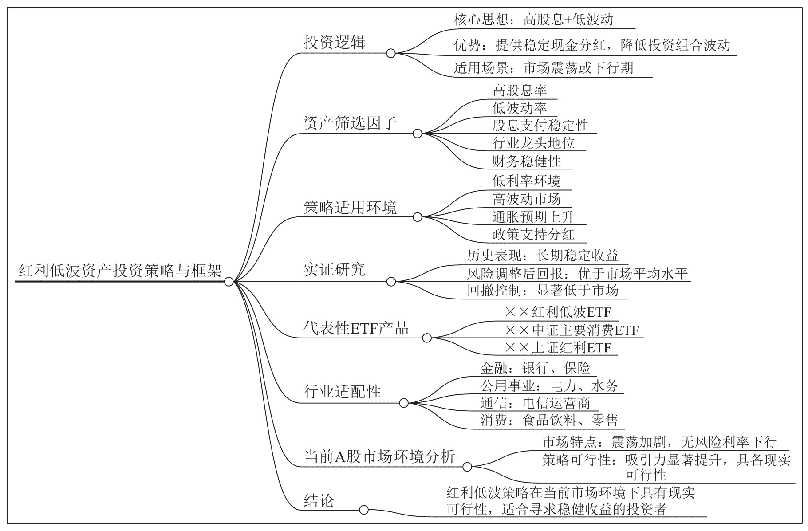

图 1-6 智谱清言制作的知识图谱示例[资料来源：智谱清言。]

针对智谱清言的优势与特点，我们也可以将个人总结的相关投资逻辑输入智谱清言中，以得到更清晰的逻辑梳理和更丰富的内容补充。最后，我们还可以利用智谱清言制作知识图谱，将普通投资者个人的经验与知识进行体系化和可视化，助力搭建投资者个人专属的知识体系。

### **学习案例 1-5** **秘塔 AI 归纳分析科创板历年新政策**

秘塔 AI 的核心优势是实时搜索能力强，信息整理质量高，可快速溯源，因此在投资研究中，适合用于多来源资料（政策文件等）的搜索、整合与归纳。

以科创板相关政策的梳理为例，在秘塔 AI 搜索的主页，我们选择了“全网搜索”和“深度研究”功能，并直接输入提示词：“假设你是一位长期跟踪金融政策的研究专家，请系统梳理自 2019 年科创板设立以来，中国证监会、上交所等权威机构发布的与科创板相关的核心政策与文件，覆盖但不限于制度建设、注册制改革、上市公司监管、退市机制等关键制度领域。请按时间顺序整理每项政策的发布时间、发文主体、文件名称、核心要点与适用范围，并提炼整体政策的阶段性演进趋势与监管逻辑。此外，请结合 2025 年最新政策动态，分析其对科创 50 指数行业结构与市场风格的可能影响，如是否有望推动资金从大盘价值股回流至科技成长股等。建议结合梳理内容，自制结构清单或表格，确保内容条理清晰、简明扼要。”

案例中输入的提示词，涵盖了“语境”“任务”“案例（举例）”“格式”“语调”五个维度，在本次政策梳理案例中涉及“按范围搜索政策内容”“结构化梳理政策演进”和“结合投资市场深入分析”三个核心要求。

如果投资者个人想要研究其他板块或者政策主题，可以按照研究需求替换本案例提示词的关键部分，如表 1-6 所示。

**表 1-6** **秘塔 AI 政策梳理案例的提示词模板**

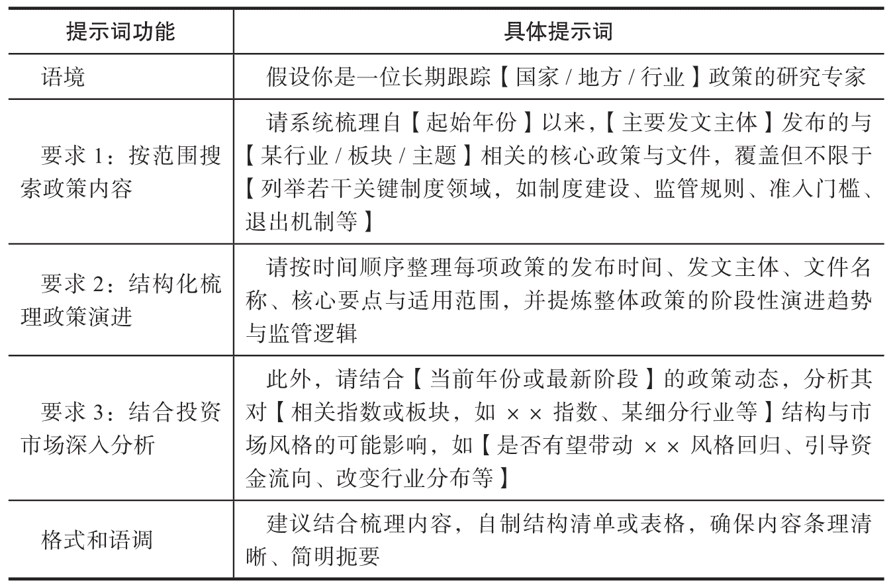

资料来源：秘塔 AI。

在本案例中，秘塔 AI 通过对全网进行实时搜索和“深度研究”，呈现了“科创板核心政策演进脉络（2019～2025 年）”“政策监管逻辑与阶段性趋势”“2025 年新政对科创 50 指数及市场风格的影响”“结论：政策与市场的协同演进”四个主要输出部分，最后列出了 440 个参考来源。秘塔 AI 的深度研究过程节选如图 1-7 所示。

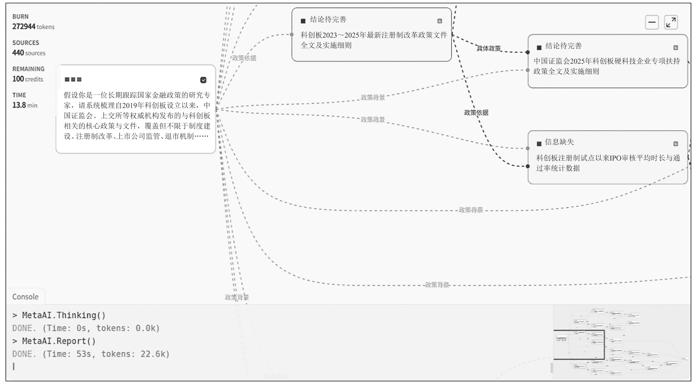

图 1-7 秘塔 AI 的深度研究过程节选[资料来源：秘塔 AI。]

在政策演进部分，秘塔 AI 输出了 2019 年科创板成立以来的重要政策内容，并且按照时间顺序以表格形式呈现，其中也包括最新政策动态，即 2025 年 6 月中国证监会的“1+6”政策。在政策趋势分析方面，秘塔 AI 将科创板政策分成 3 个阶段，分别是 2019～2022 年的制度奠基期、2023～2024 年的全面深化期和 2025 年开始的精准赋能期。

在投资与市场影响部分，秘塔 AI 从行业结构、市场风格和潜在风险等角度，输出了关于 2025 年科创板最新政策对其相关指数与投资市场的影响。

在结论部分秘塔 AI 重点说明了最新“1+6”政策标志着以精准赋能为特征的制度成熟期的到来，分析其短期影响与长期关注点。

部分回答如下所示。

政策监管逻辑与阶段性趋势：①制度奠基期（2019～2022 年）。逻辑：以“增量改革”破局，通过注册制试点解决 IPO“堰塞湖”问题，重点吸引集成电路、生物医药等硬科技企业。特点：审核时效呈现“初期（2019～2020 年试点启动阶段）快、后期稳”的特征；退市机制尚未实质落地（2024 年前无强制退市案例）。②全面深化期（2023～2024 年）。逻辑：注册制全面推行后，强调“优增量、调存量”。特点：其一，审核维度持续趋严，2023 年审核平均时长延长至 391 天；其二，退出机制强化，2024 年 A 股退市 52 家（主板 46 家+创业板 6 家），但科创板仍无退市案例，反映执行差异化。行业聚焦：半导体占科创 50 指数权重 58.6%，政策倒逼企业坚守“硬科技”。③精准赋能期（2025 年）。逻辑：通过“1+6”政策解决未盈利科技企业融资痛点，引入市场化识别机制（资深机构背书），兼顾风险防控。

2025 年新政对科创 50 指数及市场风格的影响：①行业结构重塑。半导体主导地位强化：科创成长层扩容 AI、低空经济企业，但半导体仍占指数 58.6%。新政下，资金或进一步向头部半导体企业（如××公司）集中。新兴行业增量机会：AI 与商业航天企业适用第五套标准上市，2025 年该领域 IPO 占比或提升，但短期难撼动半导体权重（预计 2025 年底半导体占比维持在 50%以上）。②市场风格转向科技成长。资金流动证据：主动权益基金科创板仓位从 2024 年第四季度的 13.02%升至 2025 年第一季度的 15.6%，创历史新高。2025 年第一季度公募增持电子行业（配置比例 19.3%→+0.8ppt），半导体加仓显著，反映资金从大盘价值股（如消费股、周期股）向科技成长股迁移。驱动逻辑：“1+6”政策降低未盈利科技企业融资门槛，提升板块吸引力；叠加做市商机制增强流动性，小盘成长风格更受益。③潜在风险与挑战。退市执行滞后：2024 年科创板零退市，若 2025 年退市新规未实质落地，劣质企业可能拖累指数表现。估值分化加剧：政策红利下，未盈利企业上市增多，但研发周期长、盈利不确定性高，或导致个股估值极端分化。

结论：政策与市场的协同演进。科创板政策从“宽松试点”转向“精准赋能”，2025 年“1+6”改革标志制度成熟期到来。①短期效应：科技成长风格占优，公募增配硬科技龙头（如半导体），推动科创 50 指数结构优化。②长期关键：退市机制执行力（如 2025 年强制退市案例是否破冰）、第五套标准企业上市质量，决定板块健康度。核心判断：2025 年下半年资金有望持续从大盘价值股流向科技成长股，但需警惕局部估值泡沫（如 AI 概念股）。监管需平衡包容性与市场化出清。

同时，我们可以在秘塔 AI 输出的文末找到“生成互动研究报告”功能，一键点击生成互动研究报告。秘塔 AI 会将前面所有输出的回答，都整理成更加美观易读的结构化报告，在左侧有其目录，点击即可快速翻阅至所需阅读的部分，而正文也增加了不少引用图片或自制图表。

**1.2.2** **大众金融平台内置的 AI 大模型**

近年来，各主流金融平台纷纷布局 AI 能力，将大模型工具嵌入自身体系，以提升投研流程的智能化与高效化。以万得（Wind）的 Alice Agent 为代表，这些平台型 AI 助手不仅具备自然语言交互能力，更能依托平台自身的数据和图形分析系统，辅助完成策略观点提取、公司财报解读、行业分析等复杂任务。Alice Agent 特别适用于“结构化解读券商策略报告”类需求，能够在用户发布指令后，快速聚合多家券商观点，梳理其逻辑异同并输出专业分析。

与此同时，其他金融平台也结合自身特色推出了不同类型的 AI 助手。Choice 接入的妙想大模型更偏向行业趋势复盘与政策梳理；讯兔科技的 Alpha 派主打“数据驱动+因子解释”，适合用于财务稳健性与盈利能力的指标拆解；而雪球的雪球思考则聚焦“投资者视角”，强化个股复盘和内容推荐的可读性与实用性。可以看出，AI 工具正在根据平台定位和用户类型不断演进，逐步覆盖从策略研究、基本面分析到投资辅助等多个场景，推动投研活动向更加智能、个性化方向发展。国内主流金融平台内嵌 AI 大模型的核心优势、适用场景和典型案例对比情况如表 1-7 所示。

**表 1-7** **国内主流金融平台内嵌 AI 大模型的核心优势、适用场景和典型案例对比**

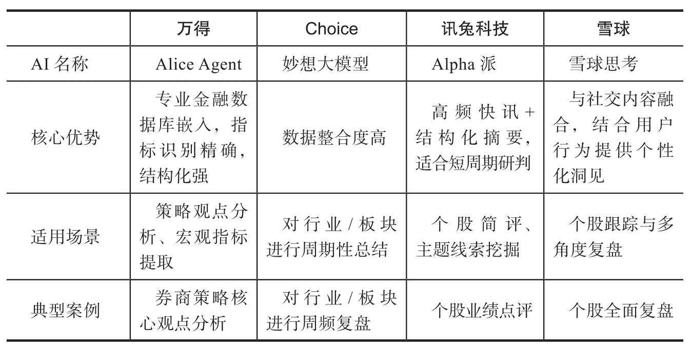

资料来源：作者整理。

### **学习案例 1-6** **Alice** **Agent 分析券商策略的核心观点**

在金融专业平台万得中，内置的智能助手 Alice Agent 能够基于其强大的金融数据库和图形分析系统，提供高效、专业的智能问答服务。它支持如“查询某行业估值水平”“自动生成某公司财务摘要”“快速提取宏观指标变化”等操作，成为投资研究中便捷的辅助工具。

与万得内置的 Alice Chat 相比，Alice Agent 的功能更加强大，用户需要在使用时注意区分这两种不同的 AI 工具，二者核心区别如表 1-8 所示。在万得的搜索栏输入“AGENT”可进入 Alice Agent 界面，如图 1-8 所示；输入“ACHAT”可进入 Alice Chat 界面。

**表 1-8** **万得内置的 Alice** **Chat 和 Alice** **Agent 的核心区别**

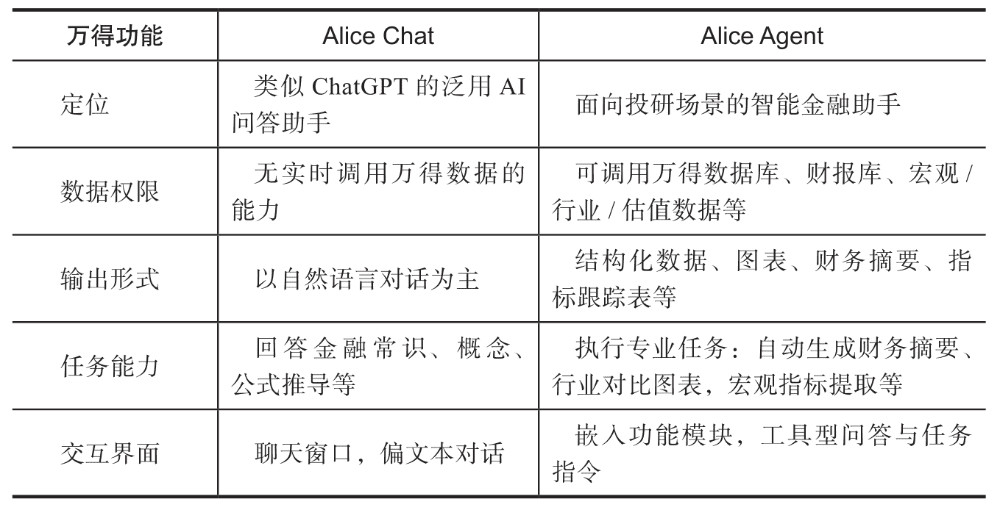

资料来源：作者整理。

当我们需要研究“券商策略核心观点分析”的主题时，在 Alice Agent 界面中点击“用 AI 自动创建 Agent”发布“分析券商策略观点的核心内容”指令，Alice Agent 便能自动汇总中国市场主流策略团队的最新观点，提炼其核心逻辑，梳理观点异同，并生成结构化的对比总结，从而高效呈现市场研判的共识与分歧，帮助用户快速把握各类策略背后的判断依据与潜在影响。

图 1-8 万得的 Alice Agent 的界面展示[资料来源：Alice] [Agent 官网。]

在 Alice Agent 的回答中，首先从整体上展示了市场观点，将具体策略团队的共识和分歧点条理清晰地列出，让投资者迅速把握国内券商策略团队近期对于投资市场的主流观点和特殊观点。回答示例如下。

各策略团队对当前市场的整体看法存在一定共识和分歧。①共识点：多数团队认为政策面持续发力，5 月 7 日国务院新闻办发布会推出的一揽子金融政策对市场形成支撑（如 A 证券、B 证券、E 证券等均明确提及这一支撑作用）；同时，各团队普遍认为外部环境不确定性仍存，特别是美国关税政策的影响尚未完全显现（C 证券在分析中重点强调了这一风险）；此外，多数团队对市场稳定性持谨慎乐观态度，认为政策托底效应明显（A 证券、E 证券均在报告中突出了政策的托底价值）。②分歧点：对反弹持续性看法不一，比如 D 证券认为市场有望重回活跃态势，而 F 证券提示“利多出尽”风险；对港股判断存在差异，如 A 证券对港股持谨慎乐观态度，C 证券建议观望。

然后 Alice Agent 又给出了策略团队高频推荐的三个行业和具有分歧的两个行业，并且附有推荐者及其数量，给予投资者具体明确的行业配置建议。在后续输出部分，Alice Agent 在投资主题、风险因素、策略建议等方面给出了各券商策略团队共同提及和个别强调的具体内容，同时也制作了一个观点异同矩阵（见表 1-9），从各个方面展示了不同策略团队的核心观点。

**表 1-9** **各券商策略团队观点异同矩阵（示意）**

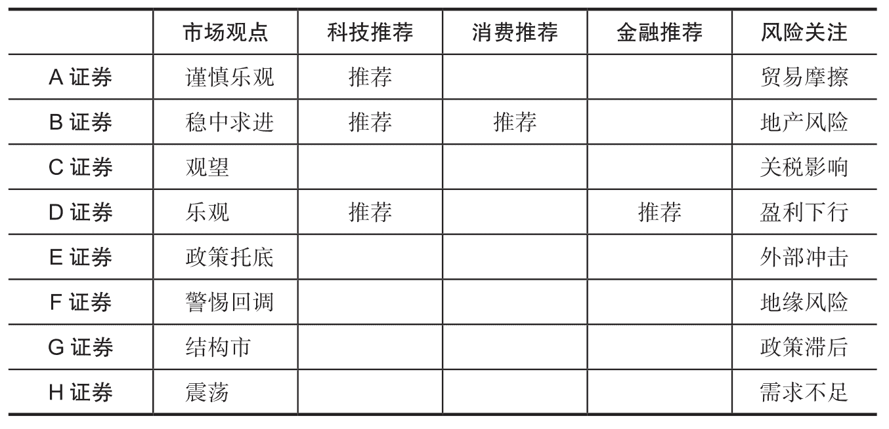

资料来源：Alice Agent。

除此之外，在 Alice Agent 回答的末尾，还有“导出 word 文档”的功能，可以将整个回答的内容以 word 形式储存下来，方便记录和分享。

### **学习案例 1-7** **妙想大模型对人工智能板块进行周频跟踪**

Choice 平台自带的妙想大模型，拥有许多“AI+金融”的功能，在“行业/个股跟踪”功能模块中，我们可以对某个“行业/板块”或者个股进行跟踪。

例如，我们想要对人工智能板块进行周频跟踪，可以在妙想大模型中点击“AI 研究员”，接着点击“行业/个股跟踪”功能模块，选择“行业/板块”“人工智能”和“周频”，让妙想大模型一键生成一份跟踪报告。此外，在“开始生成”功能模块右边的“高级设置”中，可以选择信息来源，如“新闻”和“研报”。Choice 平台的妙想大模型操作界面示例如图 1-9 所示。

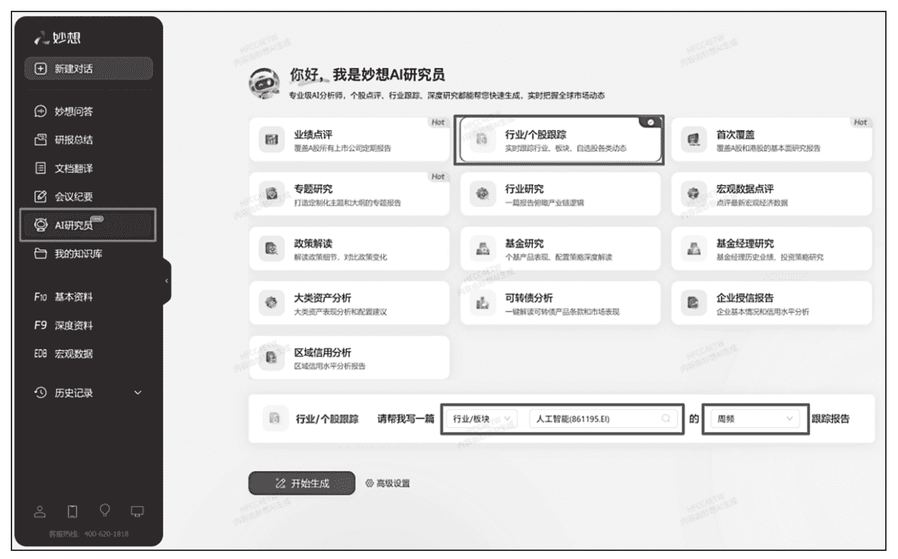

图 1-9 Choice 平台的妙想大模型操作界面示例[资料来源：妙想大模型。]

在生成的跟踪报告中，妙想大模型会列出目标板块市值靠前的部分个股，同时展示目标板块及其代表性个股在该周的行情总览图及数据和个股动态信息（涵盖新闻和研报）。

在妙想大模型的输出内容中，其总结部分比较重要，能帮助投资者快速高效地把握目标板块及其代表性个股在该周的表现：先总结了该板块下多家公司的重要公告和动态，再对这些资讯进行了简要分析，以对该板块进行整体上的评估。回答示例如下。

总结：在 2025 年 7 月的周报中，多家公司发布了重要公告和动态。A 公司预计 2025 年上半年归母净利润同比增长 36.84%～39.12%，主要受益于 AI 服务器业务的高速增长。B 公司实控人父亲拟转让 1.59 亿股股份，市值约 37 亿元，资金主要用于投资科技创业类企业。C 公司在数据传输、数据安全、指令调度等方面取得多项专利，并在石油石化和铁路技术装备展会上展示全栈式算力解决方案。D 公司推出大模型探驱鸟一体机，取得多项专利，并与 E 公司深化技术合作。F 公司调整定增方案，首次回购股份，并发布 2025 年第一季度财报，营收和净利润大幅增长。

### **学习案例 1-8** **Alpha 派点评个股业绩**

讯兔科技的 Alpha 派是一款智能投研 app，我们可以在其操作界面点击“写一家 A 股公司的业绩点评”，来进入其“个股业绩点评”功能模块。

进入“个股业绩点评”功能模块后，我们需要输入所需研究的上市公司名称，然后选择需要研究的具体业绩报告，例如“2024 年年报”或“2025 年第一季度报告”，接着选择“点评风格”和“关注要点”。

在“点评风格”中，我们可以选择“PaiPai 风格”或者“我的风格”。在本案例中，我们选择了“我的风格”，然后在下方的输入框中输入过往点评内容，Alpha 派会模仿我们所输入内容的风格，输出相似的格式甚至是表情包；在“关注要点”方面，Alpha 派会尽可能结合个股业绩去展开分析我们所输入的要点。其关于风险点的分析回答如下。

风险点：关注海外贸易政策影响。公司业绩增长的核心驱动力已明确为海外业务的扩张。随着海外收入占比的不断提升，公司经营将更易受到国际贸易环境变化的影响。特别是美国作为重要的消费市场，其关税政策的任何变动都可能对公司碱性电池的出口成本和盈利能力构成直接冲击，或将影响公司海外业务利润率的提升进程。这是未来需要持续跟踪关注的核心风险点。

当我们选择“PaiPai 风格”时，Alpha 派则会输出两个版本的点评—精简版（适合外发）和详细版（适合内部研究）。在精简版本中，Alpha 派会简明扼要地展示和分析目标个股的业绩数据，同时还可能突出其经营亮点；在详细版本中，Alpha 派则会比较细致全面地展示和分析该个股业绩数据，方便内部人员更深入地研究其财务与业绩表现。

在 Alpha 派的输出界面中，右侧附有参考的相关报告，方便我们对数据进行溯源与复核，避免由于担心出现“AI 幻觉”和错误数据，不得不花费大量的时间与精力去溯源和对比。

图 1-10 展示了 Alpha 派输出的内容（左侧）和参考的相关报告（右侧）中一致的数据。

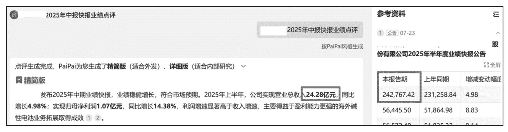

图 1-10 Alpha 派输出界面示例[资料来源：Alpha 派。]

### **学习案例 1-9** **雪球思考全面复盘个股**

在雪球平台内置的雪球思考中，如果我们要研究某只股票的详细信息，就可以输入提示词：“假设你是一位经验丰富的股票研究员，请你深入、全面地分析××（个股名称）这只股票。要求：逻辑清晰，结构合理，用语简明易懂，便于投资者理解和参考。”

基于本案例所输出的提示词，选择“雪球思考”功能模块所得到的输出内容会比选择“全网搜索”更加全面丰富。

本案例中，雪球思考首先输出了公司概况和财务表现，围绕着目标个股的核心业务展开描述，展示了相关核心数据，帮助我们快速掌握公司重点信息以及数据；其次雪球思考输出了该股票的核心竞争优势及其行业前景和政策优势，从公司本身、市场行业和政策红利等方面分析该股票的优势与潜力；再次雪球思考说明了该股票的相关风险因素；最后雪球思考给出了简洁的投资参考信息。部分回答如下。

（1）财务表现与盈利能力

①业绩概况：2024 年上半年营收 49.45 亿元（同比-14%），净利润 40.56 亿元（-4%），毛利率 58.16%，净利率 82.02%。尽管收入下滑，但盈利规模仍居行业前列，体现出较强的成本控制能力。②业务细分。证券业务：2024 年收入 84.94 亿元（+18.07%），两融余额市占率 3.8%。基金代销：受市场情绪影响，2024 年收入 28.41 亿元（-21.62%），但毛利率超 90%。现金流：每股经营性现金流 0.65 元，同比大增 5466%。③研发投入：2024 年研发费用 11.43 亿元（占营收 9.85%），重点投向自研大模型等 AI 技术。

（2）核心竞争优势

①流量壁垒：app 月活超 1700 万，股吧日均发帖量百万条，获客成本仅为传统券商的 1/5。②全牌照优势：拥有证券、基金销售、期货等全牌照，是国内唯一实现“资讯+交易+资管”闭环的互联网平台。③技术领先性：专业金融数据终端覆盖全市场数据，年费收入超 20 亿元，机构客户续费率超过 85%；自研 AI 大模型已应用于智能投顾、风险监控等场景，支持每秒 30 万笔订单。

如果我们想要研究该股票其他方面的信息，可以在提示词中加入“案例”要素：“假设你是一位经验丰富的股票研究员，请你深入、全面地分析××（个股名称）这只股票，比如同行对比（案例）。要求：逻辑清晰，结构合理，用语简明易懂，便于投资者理解和参考。”引导 AI 去分析自己所关注的要点。

虽然雪球思考能从各个维度展示目标个股的信息，例如业务状况、财务数据、同业对比、发展机遇与风险等，但是缺少对这些信息的深入解读，往往只是罗列了许多相关的数据，但无法告诉我们相关数据背后的意义。

**1.2.3** **总结**

在信息洪流日益汹涌的当下，AI 正在变成投资者手中的“工具箱”，成为帮助厘清逻辑、提升效率的得力助手。尤其在中文环境中，多个国产大模型如 DeepSeek、Kimi、智谱清言、秘塔 AI 等纷纷“各显神通”：有的擅长技术分析与数据处理，有的专攻长文拆解和深度总结，也有的可以快速追踪市场热点、整合舆情，等等，几乎覆盖了研究工作的各个角落。

与此同时，像万得、Choice、雪球这类金融平台也众彩纷呈，纷纷将 AI 融入产品体系中，打造出“内嵌式 AI 工具”。这些 AI 更懂金融语境，能读懂复杂的财报、识别指标变动背后的信号，还能根据策略提示主动提供结构化摘要和对比分析，同样也成了投资者利用 AI 辅助投资的高效“工具箱”。

我们可以将这些 AI 能力形象地理解为“十八般武艺”，投资者可根据不同的研究任务，灵活调用最适配的工具。例如，技术分析与数据分析用 DeepSeek，政策解读用 Kimi，热点舆情追踪用豆包，构建框架用智谱清言，梳理政策用秘塔 AI；而个股与板块复盘、券商观点梳理等则同样适合使用万得、Choice、讯兔科技和雪球等专业平台内嵌的 AI。

# **|第二章|** **AI 工具** **筛选优质投资标的**

## **2.1 高效助手：读财报、做复盘**

**2.1.1 财报 AI 分析：如何提出好的投资问题**

在投资实践中有效运用大模型，提问质量直接决定输出价值。需要避免直接要求股票推荐，而应聚焦于对目标标的的深度分析。例如，通过财务数据（基本面）拆解企业竞争力、行业格局演变或风险收益特征。对于 AI，要像教学生一样来培养它，才能达到理想效果：通过结构化问题引导大模型逐步推演，才能使其输出具备可操作性的投资洞见。以下是一些经过整理、加工和筛选的提问示例。

（1）假设你是一位专业的股票投资人员，在读取几家银行发布的××××年度利润表的基础上，分析得出每家银行利润表的特征，并给出相应的三到四个对比维度，如××银行在××××年的利润主要来自哪些业务，和前××年对比如何，和其他几家银行有什么结构差异，以分门别类和提炼要点形式予以输出，表述上要通俗易懂、平铺直叙。

（2）假设你是一位专业的股票投资人员，在读取几家银行发布的××××年度股东权益表的基础上，继续分析得出每家银行资产负债表的特征，并给出相应的三到四个对比维度，如××银行在××××年的资产负债率整体情况和结构亮点如何，和前××年对比如何，和其他几家银行有什么差异，以分门别类和提炼要点形式予以输出，表述上要通俗易懂、平铺直叙。

通过提出这些问题，我们可以引导大模型进行更深入、全面的分析，从而帮助我们做出更明智的投资决策。记住，要像教学生一样来培养 AI，只有不断提出高质量的问题，才能达到理想的投资支持效果。

在进行财报分析前，需要做好前期准备工作。首先，要在上市公司官网下载定期财报（历史报告均可供大众下载）。其次，在下载完 PDF 版报告后，由于篇幅较长，在线版 DeepSeek 可能无法完全识别，建议先用免费软件将其转换成 Word 文档或者 Excel 工作表。但需要注意，若直接将转换后的数百页 Wo r d 文档财报上传，可能会在上传时出现“宕机”，或因文字涉及范围过广，出现“可能违反使用规范”的提示，或只能读取前 30%甚至 15%的部分。

下面通过几个具体的提问示例，对在不同提问方式下，同一个 AI 大模型—DeepSeek 的输出结果进行对比。

**提问示例 1**

**低效提问：直接上传财报+模糊指令的反面教材**

提问：请总结 A 银行和 B 银行年报的要点，包括利润表、资产负债表，并进行关键项目的对比。

回答示例如表 2-1 所示。

**表 2-1 使用 DeepSeek 对直接上传的 Word 文档财报进行对比**

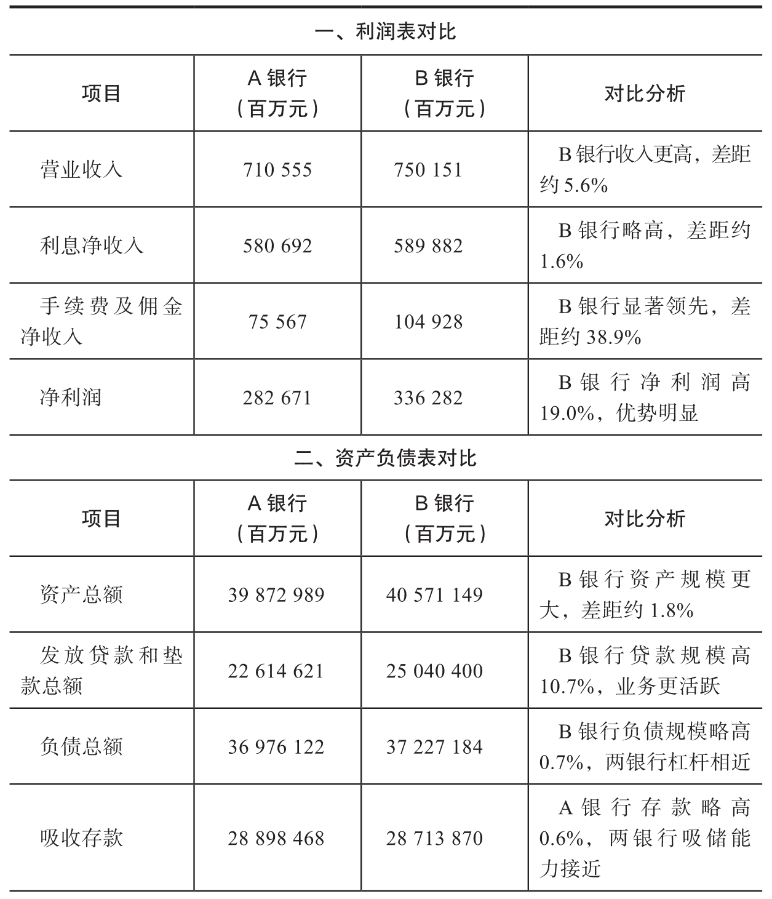

（续）

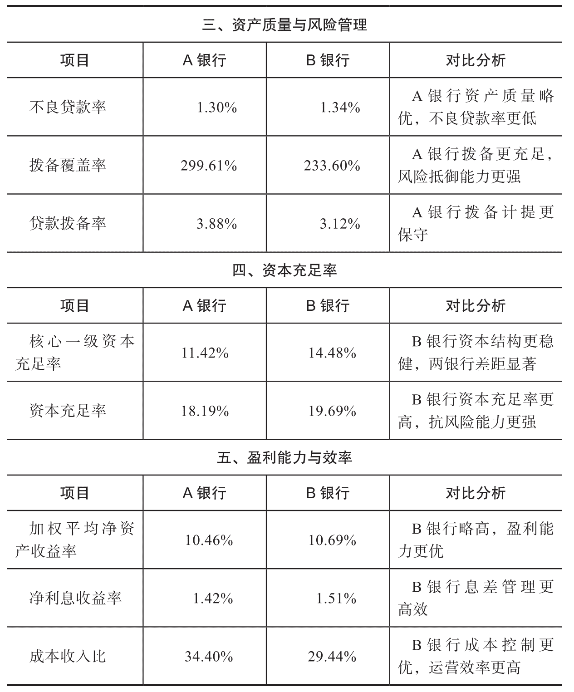

资料来源：DeepSeek，上市公司官网。

宽泛指令导致模型只抓取表层信息，无法穿透财务数据关联投资逻辑。

**提问示例 2**

**角色化提问的初步优化**

提问：假设你是一位分析师，请对比 A 银行和 B 银行的资产负债表，找出二者的相对优势，包括但不限于在区域、产业等方面的特征，并分析比较二者的优劣，以及在股票投资角度的影响等。

A 银行与 B 银行资产负债表对比分析回答示例如下。

（1）资产规模与贷款占比

A 银行：2024 年末总资产 40.57 万亿元，其中发放贷款和垫款净额占比 61.72%（25.04 万亿元），显示其业务高度依赖传统信贷，风险集中于信用贷款，但受益于经济发达地区（如长三角、珠三角）的高质量客户。

B 银行：总资产 43.24 万亿元，发放贷款和垫款占比 55.5%（23.98 万亿元），贷款集中度略低，资产配置更趋多元化（如金融投资占比较高），但农业贷款占比显著，反映其在农村金融领域的深耕。

（2）金融投资与风险分散

A 银行金融投资占比 26.33%（10.68 万亿元），以政府债券为主（占比 79.33%），信用风险较低。

B 银行金融投资中权益工具、基金等占比更高（如其他权益工具投资 3430 亿元），可能带来更高收益，但也面临市场波动风险。

（3）存款基础

A 银行：吸收存款 28.71 万亿元，占总负债的 77.13%（银行业“吸收存款占比”默认口径为占总负债的比例，用于衡量负债结构的稳定性），负债稳定性强，但存款增速放缓（2024 年增幅 3.83%），需关注存款成本控制。

B 银行：吸收存款 30.31 万亿元，占总负债的 75.5%，规模更大且农村地区存款黏性较高，负债成本可能更具优势。

（4）主动负债工具

A 银行通过发行债务证券融资（占比 6.41%），市场化融资能力提升。

B 银行依赖同业负债比例略高（如同业存放占比 11.6%），流动性管理压力可能更大。

（5）区域分布

A 银行：资产集中于长三角（20.29%）、环渤海（19.9%）等经济发达地区，受益于城市化与产业升级，但受房地产市场波动影响较大。

B 银行：在中西部地区（如西部 19.51%）、东北地区（6.89%）布局更深，契合乡村振兴战略，但农业贷款风险受气候和政策影响显著。

（6）产业侧重

A 银行重点支持金融“五篇大文章”（如绿色金融、科技金融），信贷结构向战略新兴产业倾斜。

B 银行聚焦农业产业链、农村基础设施建设，政策支持明确但行业利润率较低。

（7）股东权益与风险抵御能力

A 银行：股东权益 3.34 万亿元，资本充足率较高，拨备覆盖率 233.6%，风险缓冲能力强。

B 银行：股东权益 3.10 万亿元，未分配利润增速略低（2024 年增幅 3.2%），但一般风险准备规模较大（532.99 亿元），反映审慎风险管理。

（8）股票投资视角

A 银行优势如下。

高收益潜力：发达地区优质客户与战略新兴产业布局推动净息差改善。

风险可控：拨备覆盖率与资本充足率领先，抗风险能力突出。

B 银行优势如下。

政策红利：乡村振兴与农业现代化政策支持明确，长期增长空间大。

防御属性：农村存款基础稳固，负债成本优势显著，适合保守型投资者。

（9）结论

A 银行：适合追求高收益与战略成长的投资者，依托经济发达地区与新兴产业布局，短期业绩弹性更大。

B 银行：适合防御型与长期配置，受益于政策红利与农村市场壁垒，但需容忍较低增长与行业周期性风险。

两者在区域和产业上的差异化布局，为投资者提供了互补性选择，可结合宏观经济周期与政策导向动态配置。

相较于提问示例 1，提问示例 2 得到的回答更为深入。从资产结构与质量、负债结构与稳定性、区域与产业布局、股东权益与风险抵御能力等多个维度进行了分析，不仅指出了两家银行的差异，还从股票投资视角总结了各自的优势和风险提示，为投资决策提供了更丰富的参考。

以对比 A 银行与 B 银行资产负债表为例，通过这两个初步的提问示例可以看出，提问方式的不同会导致大模型输出结果的深度和广度存在明显差异。更具体、有针对性的提问能引导大模型进行更全面的分析。

那么，如何对 AI 提出好的投资问题呢？想要提出好的投资问题，可以遵循以下三个要点：其一，回顾整体配置框架，研判 AI 赋能的可行维度，以类“探索流”形式统筹规划；其二，以 R-T-F（角色-任务-格式）形式提出问题，投喂语料行文简练，以“轻量级”语言形式输出，用合适的提问取代传统工作复杂的编程和检索；其三，为破除 AI+资配的黑箱问题，更关注 AI 输出的“为什么”，而非“怎么做”。同时，设计高质量的提示词体系，使 AI 能在理解文本语境的基础上，自动识别并提取与各宏观政策维度高度相关的内容，模拟分析师的阅读与归类过程。

进一步地，在提问环节中，我们如何提出问题才能让 DeepSeek 的回答更加落地到投资线索？我们可以在 R-T-F 框架的基础上增加“案例”和“语调”，让提问更具象、更贴合投资场景需求。下面同样以分析几家银行财报为例进行提问示例说明。为了避免财报复杂的下载、转换和整理过程，我们改变思路，将特定表格的原报告直接截图上传。

**提问示例 3**

**五维提问法实战的提问方式进化：以利润表分析为例**

提问：“假设你是一位专业的股票投资人员（语境），在读取几家银行发布的 2024 年度利润表的基础上，分析得出每家银行利润表的特征，并给出相应的三到四个对比维度（任务），如××银行在 2024 年的利润主要来自哪些业务，和前两年对比如何，和其他几家银行相比有什么结构差异（案例），以分门别类和提炼要点的形式予以输出（格式），表述上要通俗易懂、平铺直叙（语调）。”

部分回答如表 2-2 所示。

**表 2-2 “投喂”好的问题以获得恰当的回答结果**

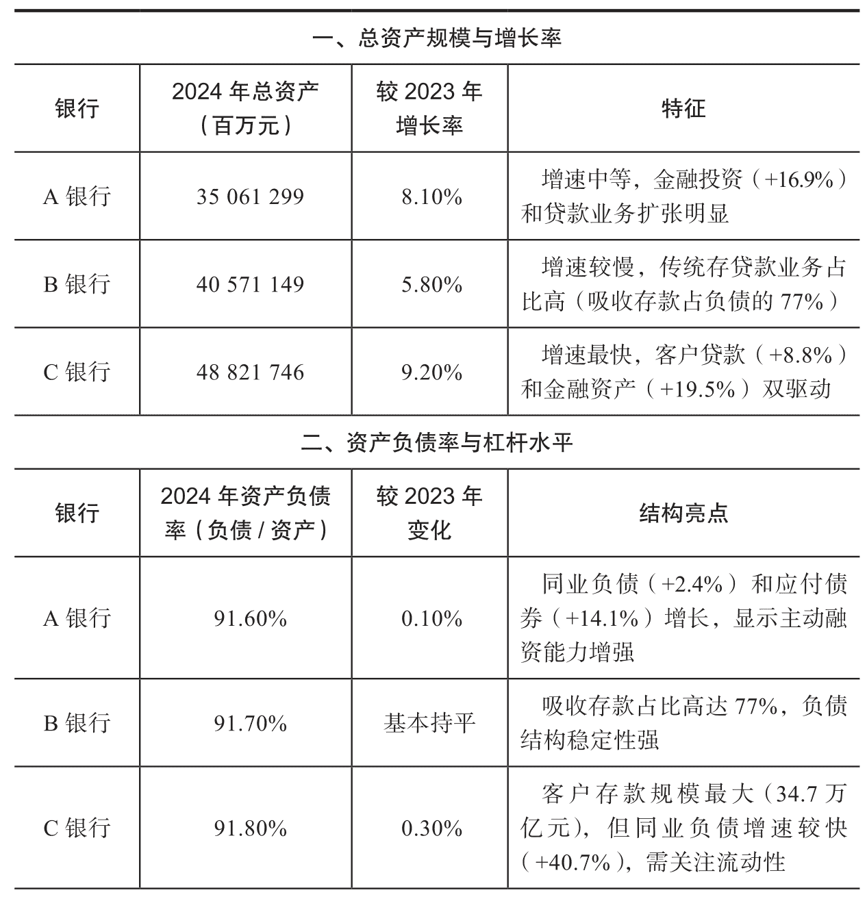

（续）

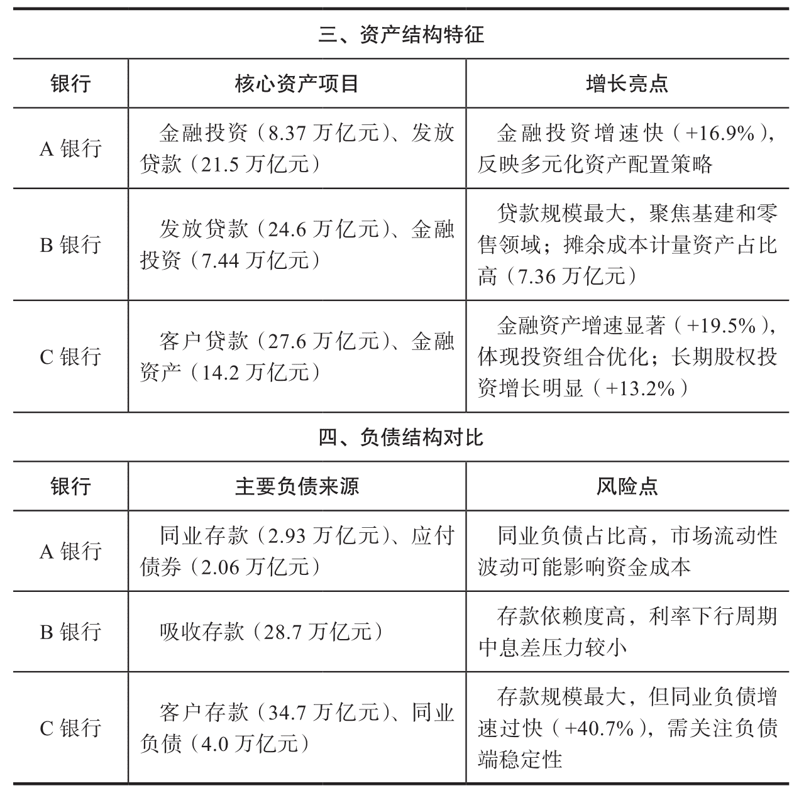

资料来源：DeepSeek。

DeepSeek 输出的相关总结如下。

总结：规模与增速方面，C 银行资产规模最大且增速最快，A 银行次之，B 银行相对保守；资产负债率方面，三家银行均超 91%，杠杆水平接近，但 C 银行负债增速略高；资产结构方面，A 银行和 C 银行侧重金融投资，B 银行聚焦传统贷款，C 银行资产配置最多元化；负债结构方面，B 银行存款占比最高（低风险），A 银行和 C 银行依赖同业融资（灵活性高但波动性大）。风险提示：C 银行同业负债增速过快，需关注流动性；A 银行需平衡投资业务与资本充足率。

**提问示例 4**

**递进式分析的提问方式进化：资产负债表接续分析**

提问：“假设你是一位专业的股票投资人员（语境），在读取几家银行发布的 2024 年度股东权益表的基础上（接续上个问题，记忆连贯性），继续分析得出每家银行资产负债表的特征，并给出相应的三到四个对比维度（任务），如××银行在 2024 年的资产负债率整体情况和结构亮点如何，和前两年对比如何，和其他几家银行相比有什么差异（案例），以分门别类和提炼要点的形式予以输出（格式），表述上要通俗易懂、平铺直叙（语调）。”

DeepSeek 的回答如下。

（1）A 银行

优势：净利润最高（366946 百万元），风险加权资产收益率（1.77%）较高，盈利能力强。

风险：需进一步确认资本稳健性。

（2）B 银行

优势：核心一级资本充足率（14.48%）和资本充足率（19.69%）均居首位，净利润第二。

风险：净利息收益率（1.51%）偏低，拨备覆盖率异常（23.80%），需核实。

（3）C 银行

优势：不良贷款率最低（1.25%），资产质量最优，成本收入比（28.77%）较低。

风险：净利润垫底（252719 百万元），净息差（1.40%）承压。

DeepSeek 在该提问下，针对每家银行的优势和风险进行了全面归类。例如，A 银行净利润最高，盈利能力强，但需确认资本稳健性；B 银行资本充足率居首位，净利润第二，但净利息收益率偏低等。基于此，还能让 DeepSeek 对几家银行的推荐顺序进行排序，规避了直接提问导致的消息过载带来的“无脑”买入风险。

DeepSeek 给出的投资原因和推荐顺序归纳如下。

A 银行：盈利能力和风险调整收益领先，但需补充资本充足数据。

B 银行：资本实力最强，适合稳健型投资者。

C 银行：资产质量最优，适合风险厌恶型投资者。

最终，推荐顺序：A 银行＞B 银行＞C 银行。

和上一部分“未好好提问”的内容相比，基于同样的素材，“好好提问”得出的投资结论更加准确（数据导向）、贴合投资实际，也契合银行领域投资的核心指标（拨备覆盖率、不良贷款率、资本充足率等）分析。具体对比情况如表 2-3 所示。

基于同样素材的问答，从是否“好好提问”的核心差异来看大模型辅助财务分析的体感：在“好好提问”的情形下，对银行的分析更注重横向比较和综合财务指标，适合快速了解行业整体情况；而在“未好好提问”的情形下，对银行在区域布局和产业政策方面的回答更聚焦，和投资主题核心要点存在偏差，即“好好提问”可以保证大模型在解答时兼顾广度和深度，从而构建全面的银行业分析视角。

**表 2-3 在“好好提问”和“未好好提问”的情形下得出的投资结论差异**

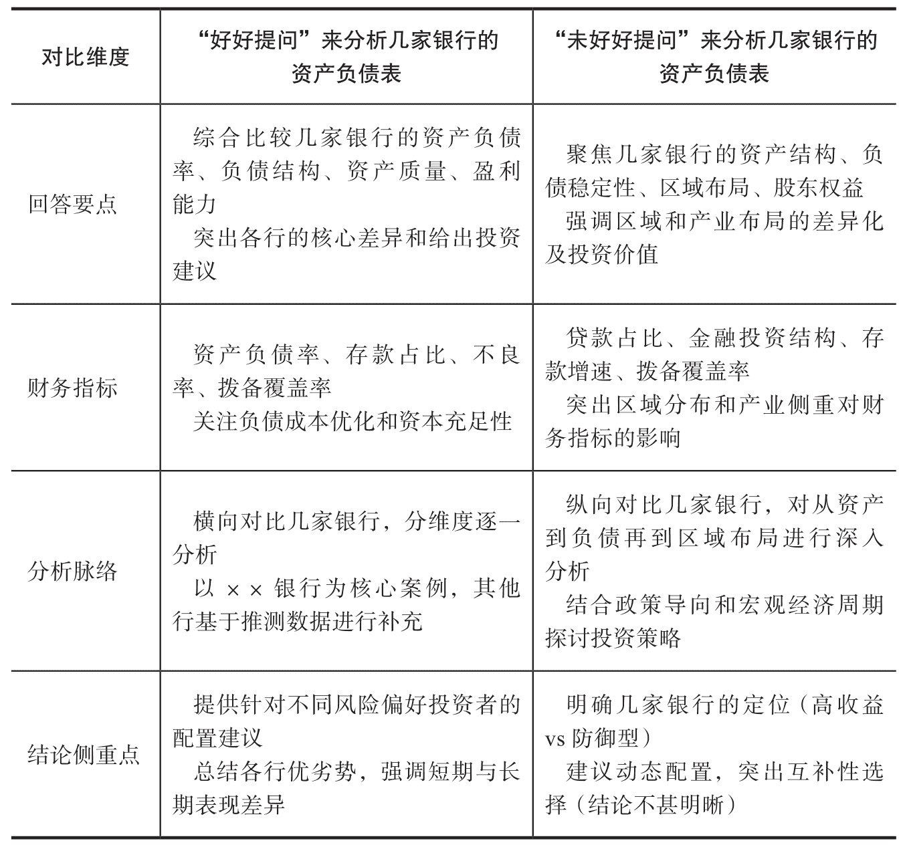

资料来源：DeepSeek。

通过上述分析我们可以发现，递进式提问让大模型理解投资中关注的核心要点，帮助我们有理由、有依据地去评判合适的投资标的。如果对财务指标进行比对（N 个上市公司同一时刻的比照和同一家公司历史数据的比照），那么得出的推荐排名会更客观、公允，不会被简单联网检索带来的错觉牵着鼻子走。

**2.1.2 用大模型进行股市复盘实战**

**1.AI 赋能全球股市的长周期复盘**

当今世界正经历百年未有之大变局，全球经济格局加速重构，海外地缘政治震荡频发，技术革命与产业变革交织激荡。面对充满不确定性的市场环境，精准把握股市周期律动已成为穿越迷雾的关键罗盘。历史长河中的数次经济危机与繁荣轮回早已印证：周期虽会变换形态重现，但其底层逻辑始终遵循经济规律与交易特征的永恒共振。唯有以史为镜，深挖周期演进的核心矛盾，方能在新旧动能转换的湍流中锚定价值坐标，将历史的刻度转化为预见未来的量尺。

借助“宏观-市场-趋势”三维体系，DeepSeek 等 AI 大模型实现了对全球股市周期复盘的精准赋能，其基本逻辑步骤如下。

第一步，立足基本面：整合权威金融数据库，构建宏观基本面评估体系；抓取多维市场信息数据库，形成结构化分析底稿。

第二步，透视市场逻辑：调用人工智能对全周期数据进行跨市场穿透分析，识别不同阶段主导市场的核心矛盾。

第三步，追踪前沿趋势：采用“定量+定性”双重校验机制，将 AI 给出的论断与分析师经验相结合，实现对股市逻辑的精准把握，关注核心矛盾的迭代。

### **学习案例 2-1 DeepSeek 复盘美股走势并挖掘核心影响变量**

下面是在 DeepSeek 大模型中，发布复盘指令的关键提问要素说明。

**角色：**你是一个股票基本面分析专家，擅长把股票走势和国家基本面情况结合到一起，寻找股市上涨或下跌的主要宏观逻辑。

**职能：**你需要在美股走势和美国基本面走势当中寻找对应关系，来确定股市的变化和什么基本面指标最相关，以及这背后的宏观逻辑是什么。

**输入：**用户会输入××××年至今美国股市月度指数走势以及宏观基本面数据。

**输出：**请总结所有涉及美国股市的核心基本面逻辑，并按照主线逻辑变动划分时间段，给出在这个时间段最能解释股市变动的指标。

通过分析美国基本面数据发现，2009～2019 年 PMI（采购经理人指数）与标普 500 指数收益率成正比，企业税后利润与标普 500 指数走势大致相同；2021 年至今，PMI 与标普 500 指数走势接近。

输出的逻辑是：美股在 2021 年 11 月至今走的是通胀降温、降息预期的行情，所以 PMI 走低意味着经济衰退，降息预期高涨，股市上行。美股在 2009 年金融危机后是经济复苏、企业盈利改善的行情，所以 PMI 走低意味着企业盈利下行，股市下行。所以，对于美国而言，核心变量在 2009 年金融危机后为企业税后利润，在 2021 年 11 月至今为通胀预期差。

DeepSeek 输出报告《长周期复盘实战解答：美股—货币潮汐下的创新与增长》，具体内容如下。

近十五年，美股始终围绕政策调控、产业创新与经济周期展开：2009～2012 年金融危机后，量化宽松政策主导流动性修复，科技与金融板块受益于低利率环境及通缩背景下的估值扩张；2013～2019 年税改红利与低通胀环境催生科技巨头（FAANG）驱动的“慢牛”，国债收益率曲线成为估值锚点；2020 年新冠疫情冲击下超常规宽松政策再度强化流动性逻辑，供应链断裂意外推升科技股（远程办公/电商）领涨；2021～2022 年通胀飙升迫使激进加息，能源板块借通胀交易崛起，而 2023 年 AI 技术突破（如 ChatGPT）重构增长叙事，叠加 CPI（消费者价格指数）回落与降息预期，市场转向“科技盈利韧性+政策宽松预期”双轮驱动，形成“软着陆”新范式。这一过程中，美联储政策从危机应对转向通胀管理，产业主线由传统金融转向科技革命，经济指标解释框架也从单一 GDP 转向流动性数据与技术创新共振分析。

2009～2012 年，金融危机后美国股市的核心驱动逻辑是量化宽松（QE）政策带来的流动性修复。美联储将联邦基金利率降至 0～0.25%，LIBOR 利率骤降推动流动性泛滥，GDP 增速从 2009 年第三季度起由负转正，企业盈利逐步回升，但 CPI 和 PPI（生产者价格指数）低迷显示通缩风险。科技与金融板块领涨，纳指和标普 500 涨幅显著。实际有效汇率指数走弱利好出口和跨国企业盈利。主线逻辑是通胀低迷，美国 GDP 作为传统基本面指标对股市的指示意义较强。

2013～2019 年，美国进入低通胀与盈利增长并行的“慢牛”阶段。CPI 和 PPI 长期低于 2%，美联储缓慢加息（2015～2018 年），长期国债收益率低位震荡支撑估值扩张。税改政策（2017 年）推动企业盈利增长，科技股（FAANG）成为市场主线。此阶段市场对国债收益率曲线的敏感度高于传统模型预期，PPI 指标对股市的指示意义较强。

2020 年新冠疫情冲击下，美联储紧急降息至 0 并重启 QE，CPI 短暂通缩后受供应链中断推高，科技股（远程办公、电商）逆势领涨，纳指全年涨幅 43%。进口金额骤降与股市 V 型反弹的背离反映流动性驱动逻辑占主导，传统宏观指标需叠加高频流动性数据增强解释力。

2021～2022 年，CPI 飙升至 9.1%引发激进加息，成长股大幅回调，能源板块受益于通胀交易。2023 年至今，AI 技术突破推动科技股再度领涨，CPI 回落与降息预期主导“软着陆”叙事，提示：AI 技术突破（如 ChatGPT）推动科技股（NDX）领涨，股市转向“通胀降温+盈利韧性”逻辑。

美股逻辑切换的核心驱动力源于政策、创新与全球资本循环的结构性共振：政策层面，美联储从量化宽松转向紧缩周期再至降息的反复摇摆；经济维度，需求与产出难以平衡，供需缺口来回波动，经济在衰退和过热之间持续动荡；技术革命方面，AI 突破既催生科技股估值扩张，也因全球竞争加剧削弱美股科技垄断优势；资本循环层面，资本和金融项目顺差、经常项目逆差使得美国资本循环处于长期“亚健康”状态。在多维指标体系的迭代中，股市的核心逻辑也随之变化，主导市场的变化方向。

通过 AI 复盘发现，与美国股市表现挂钩最显著的因素包括：美国经济增速（反映经济周期的核心基本面指标）、工业品价格增速（代表制造业生产成本变动）以及美国进口金额增速（体现全球最大消费国的需求动能）。这些周期性变量共同塑造了美股的阶段性走向与长期趋势。基于上述关键因素与美股指数、经济指标的联动建模，AI 可系统化构建美股周期的复盘框架。AI 复盘美国股市逻辑如图 2-1 所示。

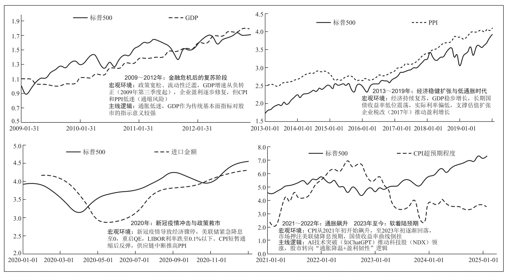

图 2-1 AI 复盘美国股市逻辑[注：资料来源于万得、DeepSeek。图中标普 500、GDP、PPI 均为以 2009 年 1 月 31 日为基期的相对指数（反映相对基期增长倍数），进口金额为当前值减基期值的绝对差值经缩放后的标准化值，统一量纲用于对比多指标趋势；CPI 超预期程度为 CPI 实际增速与预期增速差值的绝对值。]

同理，我们还可以将上述案例所展示的方法“照搬”到其他股市，凭借长周期的视角复盘全球主要股市，通过近十五年的演进揭示：政策周期、技术创新与资本流动的结构性共振是驱动市场逻辑切换的核心力量。美股依托货币潮汐与科技革命实现范式迭代，欧洲市场在能源转型与债务约束中艰难平衡，新兴经济体则通过改革红利与 FDI（外商直接投资）升级重塑增长叙事。AI 模型的穿透性分析表明：传统指标的解释力正被“政策执行力得分”“能源自主系数”等复合因子替代，市场观测框架加速向高频、非对称维度进化。未来资产配置需突破对单一经济*β* ^(¹)的依赖，构建“地缘风险溢价×技术落地强度×流动性缓冲垫”的动态体系，以应对全球资本在政策摇摆与产业变轨中的高波动常态。

**2.A 股分时 K 线图逐帧复盘和冲击事件解读**

为了在投研工作中更便捷地使用 AI，本书根据日常使用场景展开测试，测试结果表明：不同大模型在文本处理上具有显著差异，对关键论点的把握因大模型而异；在图像识别方面，大模型能读出图中的股指走势、点位等信息，但难以做到精准识别，当输入信息不足时，大模型往往依赖于网络上相似的信息，进而得出趋同结论。

对于图像识别而言，本书选取了上证指数的分时 K 线图和近期走势蜡烛图，将其投喂给不同的大模型，投喂时间与图表时间严格一致，确保不引入任何未来信息。结果表明：对于信息较少的分时 K 线图（见图 2-2），大模型倾向于给出相对一致的结论，原因在于其输入信息中，网络信息的占比较大，而网络信息在不同模型间具有相似性；对于信息较多的蜡烛图（见图 2-3），大模型则给出了差异化的输出结果，不过对于涨跌方向的判断仍然是高度一致的。可以预想的是，如果为大模型投喂更多的信息，如技术面指标、需要关注的热点方向、个体的判断等，大模型输出结果的差异性会更大。所以，投资者在实践中需要逐帧复盘，以选择适合自己的大模型工具。

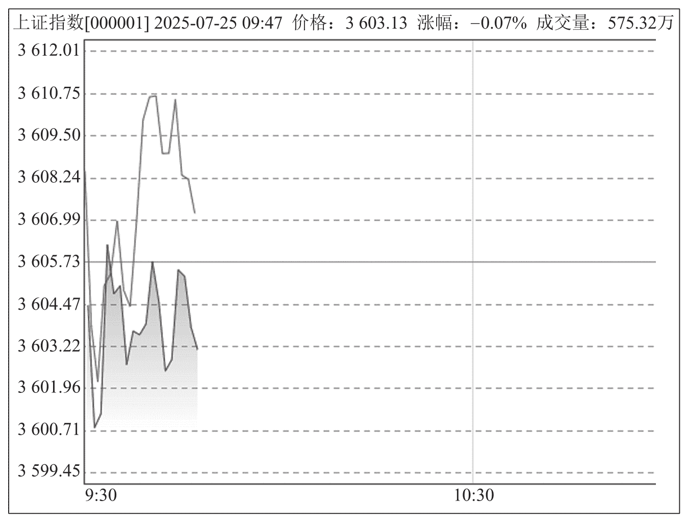

图 2-2 上传的分时 K 线图包含的信息（2025-07-25 9:47）[注：资料来源于万得。只含主代码。]

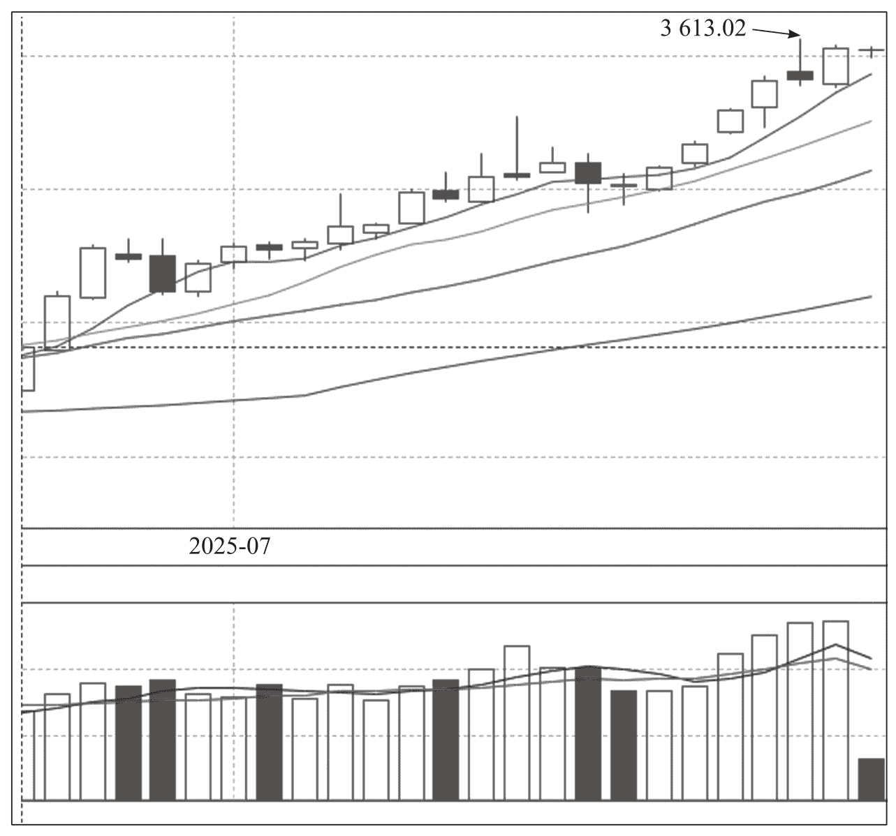

图 2-3 上传的蜡烛图包含的信息（2025-07-25 9:47）[注：资料来源于万得。只含主代码。]

### **学习案例 2-2 AI 解读冲击事件**

选取马斯克卸任美国政府效率部职务的新闻文本，尝试让大模型来解读。实测来看，仅有少数模型具备读取链接的能力，所以本书直接投喂文本语言，以便实现横向对比。为了体现大模型在多数工作场景下的泛化能力，本书尽可能少地提供指导/框架类语料，赋予大模型较高的自主分析权，借此识别其对金融领域的优化程度，以下为具体提问内容。

“假设你是一位证券分析师，请点评下面的新闻，并结合分时 K 线图探讨其对行情的影响。

据报道，埃隆·马斯克计划于 5 月底辞去美国政府效率部（DOGE）的职务。在接受福克斯新闻采访时，马斯克表示，他有信心在离职前完成削减 1 万亿美元联邦赤字的目标，并强调政府效率低下、存在大量浪费和欺诈，有信心在不影响关键服务的情况下减少 15%的支出。此外，马斯克对国会成员财富异常丰厚的现象表示质疑。他指出，许多国会成员年薪仅 20 万美元，却拥有高达 2000 万美元的财产，质疑他们如何在有限的收入下积累如此巨额的财富。

据美国《国会山报》报道，当地时间 3 月 31 日，美国总统特朗普表示，他预计美国政府效率部负责人马斯克在完成联邦政府改革工作后，最终会回归经营自己的公司。当天，特朗普在白宫签署行政令时，被问及马斯克的 130 天任期即将结束一事。特朗普称赞马斯克，并表示马斯克总有一天要回去经营公司。‘我认为他（马斯克）很了不起，但他还要管理一家大公司。他迟早会回去的，他想回去，’特朗普说，‘但我会尽可能让他多留一段时间，他是个非常有才华的人。’特朗普还补充称，他认为马斯克在公共领域受到的待遇‘太糟糕了’。在回答有关政府效率部是否会继续运营的问题时，特朗普表示，政府效率部将‘在某一时刻终结’，但未提供具体时间表。”

运用 DeepSeek、通义千问、文心一言、豆包、智谱清言五个大模型对上述焦点事件进行分析，回答结果总结在表 2-4 中。

**表 2-4 五个大模型对同一投资焦点事件问题的解答**

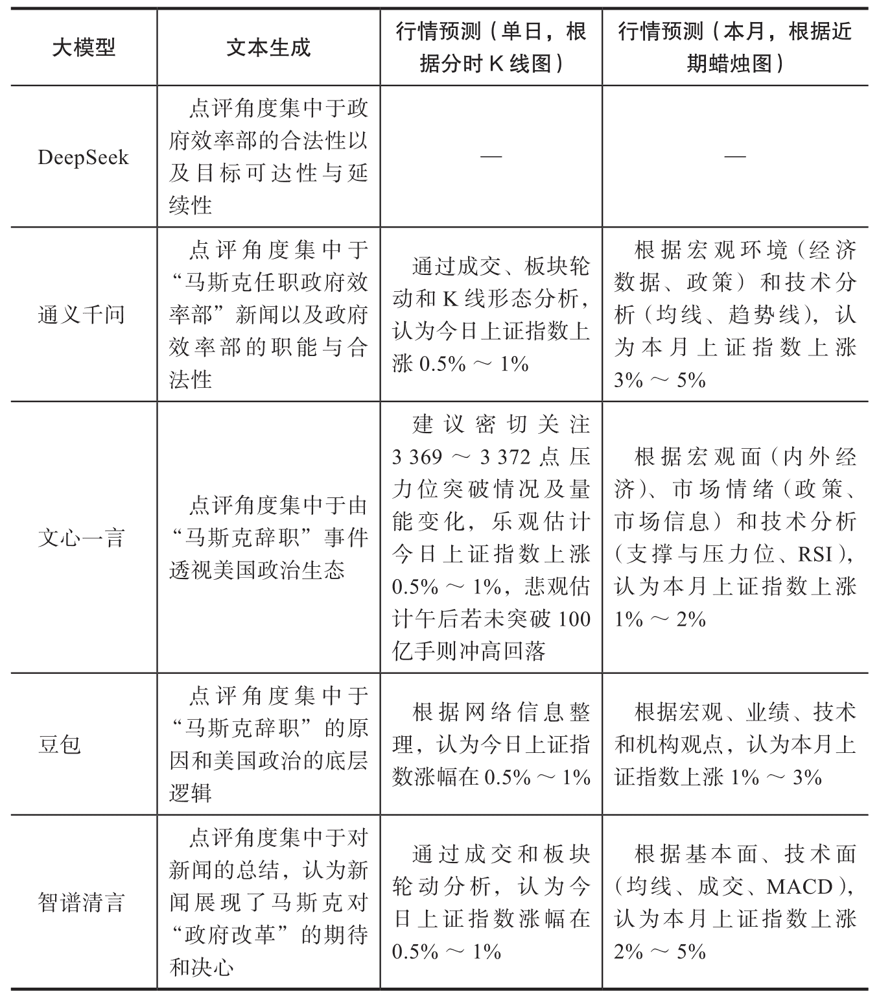

资料来源：DeepSeek、通义千问、文心一言、豆包、智谱清言。

上述五个大模型对马斯克离任的评述和行情预测差异主要体现在侧重点和时间维度上。短期（单日）预测更依赖分时 K 线图的技术面分析，一些大模型认为市场情绪波动可能导致股价先跌后反弹，而另一些大模型则强调抛压持续；中期（本月）预测结合事件影响和趋势图，分歧在于离任是否引发长期不确定性—乐观模型认为利空出尽后资金回流，悲观模型则担忧管理层变动拖累业务。

总体来看，技术派模型对短期波动敏感，而基本面派模型更关注事件的中期连锁反应。例如，通义千问和文心一言给出的预测结果聚焦传统的“三碗面”（宏观经济、政策环境、资金筹码）；豆包在此基础上综合了联网检索获取的机构观点，发挥了其文本搜寻能力；而智谱清言则发挥了其图片识别能力，分析视角涵盖更多的技术面指标（如均线、成交量、MACD 等）。

## **2.2 投资实战：AI 选择投资时点和行业**

在当今数字化的投资时代，直接与数据源链接的 AI 工具为行业投资带来了革命性的转变。这些 AI 工具能够凭借其强大的数据处理能力，实时、精准地从多元数据源抓取信息—除了瞬息万变的市场行情数据、繁杂琐碎的企业财务报表、行业研报、社交媒体上的行业趋势讨论，以及高频率的宏观基本面数据、量价库存指标，还涵盖了广义景气度所包含的市场政策利好和预期催化等关键信息。通过对这些海量且复杂的信息进行深度分析，AI 工具可以挖掘出潜在的投资机会，比如提前察觉某一新兴行业因技术突破即将迎来爆发式增长，或是识别出传统行业中因成本结构优化而可能产生的价值低估企业。其基于数据构建的预测模型，能够对行业发展趋势进行较为准确的预判，辅助投资者制定更具前瞻性和针对性的投资策略，在复杂多变的投资市场中抢占先机。

### **学习案例 2-3 Alice Agent 智能体辅助板块行业分析**

此处我们使用万得的 Alice Agent 智能体来辅助板块行业分析，Alice Agent 的功能是收集并分析最新的券商行业研究，评估各行业的发展趋势和投资机会，提供专业的景气度评分，助我们做出更加明智的投资决策。工作流程在触发后依次经历开始→获取行业研究内容→分析总结→结束。同样的分析任务在每个交易日都有重复性，如果想要持续跟踪，可以直接在界面采用编辑定时任务的功能，以每个交易日盘后邮件或者微信通知的形式更新并发送到投资人手中阅知。

在分析方法上，券商研究报告行业分析汇总功能可以从提供的券商研究报告中，提取各行业的核心观点、政策支持、市场表现、财务数据、技术进展等关键信息。基于以下标准进行景气度评分（1～10 分）：①行业增长性，即营收、利润、订单等增长情况；②政策支持力度，即是否有明确的政策推动，如补贴、税收优惠、产业规划等；③市场预期，即机构持仓变化、市场关注度、估值水平等；④竞争格局，即行业集中度、龙头企业的市场份额和盈利能力等。同时也在相应维度提示风险，如是否提及政策变动、成本波动、需求不足等重大风险。我们在某个时点运行这一功能时，即可对重点行业景气度进行评分并给出评分的相关底层依据，优先筛选出值得投资的行业板块。Alice Agent 券商行业分析汇总功能总结出的行业板块特征如表 2-5 所示。

**表 2-5 Alice Agent 券商行业分析汇总功能总结出的行业板块特征**

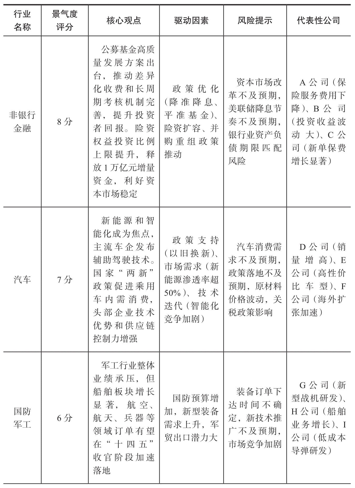

（续）

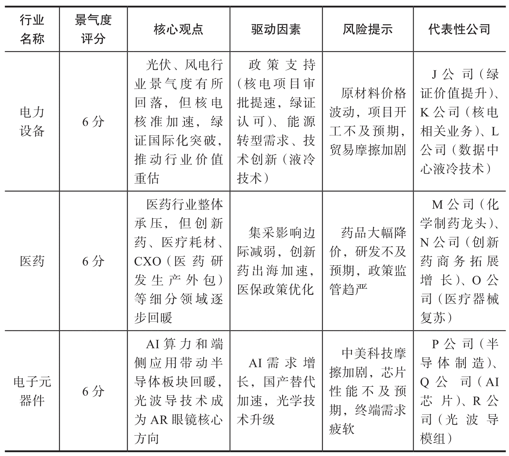

资料来源：Alice Agent。

结合上述评分，Alice Agent 得出的总结与展望如下。

从近期券商行业研究报告来看，非银行金融、汽车、国防军工、电力设备、医药、电子元器件等行业的景气度较高，主要受益于政策支持、技术进步、市场需求增长等因素。其中，非银行金融行业受益于公募基金改革和险资扩容，汽车行业受益于新能源和智能化趋势，国防军工行业则受益于“十四五”收官期订单落地预期。未来一段时间，随着政策红利的逐步释放，如新能源汽车渗透率提升、AI 算力需求持续增长、核电项目核准提速等，相关行业的景气度有望进一步改善。但需警惕宏观经济复苏不及预期、国际贸易摩擦加剧、原材料价格波动等风险。建议重点关注政策导向明确、技术壁垒高、市场需求稳定的部分行业，把握结构机会。

大模型像“聪明雷达”，实时扫描政策、资金、情绪等海量信息，提前捕捉景气度、趋势与拥挤度的微妙变化，在别人犹豫时抢先锁定高潜行业，让轮动投资快人一步、胜率高出一截。

# **|第三章| AI 策略 驾驭智能投资之道**

## **3.1** **信息无遗漏：AI 全方位地毯式把握 A 股热点主题**

主题投资是一种围绕特定的经济、产业、技术或政策主题而展开的投资策略，通常聚焦于具有强劲增长潜力、受到市场热点追捧或政策利好驱动的领域和行业。这种投资策略与传统基于个股基本面或估值的选股方式有所不同，更注重宏观趋势、产业结构性变化或热点事件带来的投资机会。常见的主题包括新能源、人工智能、半导体芯片、特种机器人、军工产业、政策扶持的产业升级领域等。

主题投资具有鲜明的市场驱动特征，投资标的通常会随着市场热点快速切换和政策变化而出现较大的波动。如图 3-1 所示，A 股市场每季度设立的概念指数数量在不同时期有明显起伏，尤其在某些阶段出现大幅攀升，反映出市场上新主题的涌现具有阶段性爆发的特点。同时，如图 3-2 呈现的活跃概念主题指数数量变化，自 2011 年起整体呈上升趋势，后续虽有波动但长期增长态势显著，这直观体现出活跃主题的丰富程度不断提升。

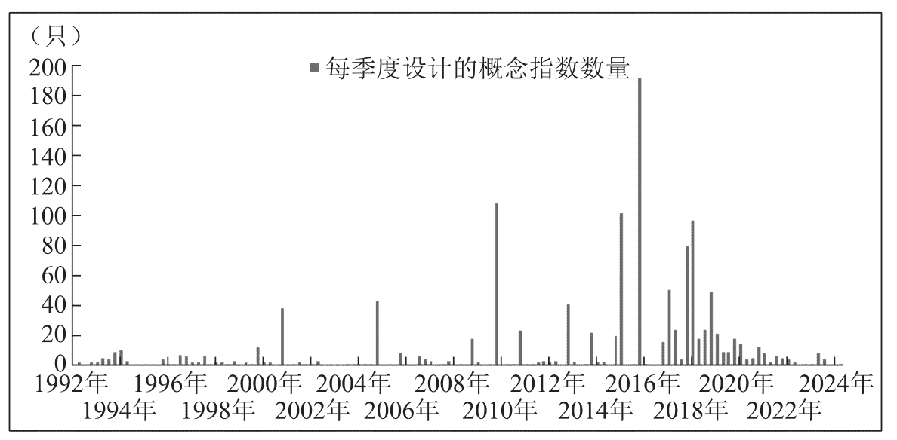

图 3-1 A 股市场每季度设立的概念指数数量[资料来源：万得。]

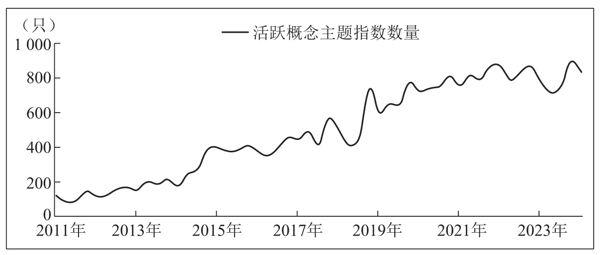

图 3-2 A 股市场历年活跃概念主题指数数量变化[资料来源：万得。]

因此，主题投资者需要对宏观趋势、产业政策以及行业景气度变化保持高度敏感，才能迅速识别和响应市场中的热点与投资机会。然而，投资者在实际操作中经常面临诸多挑战，每个交易日甚至按照小时级别经常出现横跨各知识领域的热点主题，让投资者应接不暇，阶段性活跃的主题更是不计其数，钙钛矿、可控核聚变、城市更新……一系列专有名词让专业投资者都如听天书，投资者经常感叹学习的速度赶不上主题更新迭代的速度。

主题投资面临的挑战主要有以下几方面。

一是主题界定困难：热点主题往往概念广泛、边界模糊，投资者难以快速厘清产业链条和具体投资方向。

二是市场覆盖有局限：当前大多数投资分析工具仍以分析 A 股市场为主，对港股、美股等全球市场关注不够，难以满足跨市场投资者的综合需求。

三是个股纯度识别低效：即使锁定主题，也需耗费大量精力逐一验证公司业务关联程度和在产业链中的实际定位，严重拖累投研效率。

在上述背景下，市场迫切需要更为高效的智能化投研工具，辅助投资者解决主题投资分析中遇到的这些实际问题。这正好给了擅长语言文本整合的大模型机会，让其有了用武之地。

### **学习案例 3-1** **Alpha 派“主题选股 Agent”挖掘特种机器人产业链标的**

以市场兴起的一些智能化工具为例，讯兔科技旗下的 Alpha 派较好地回应了上述需求。其核心功能之一“主题选股 Agent”运用先进的自然语言处理和知识图谱技术，可以快速从全网海量信息中梳理出清晰的主题产业链结构和逻辑关联。此外，平台还能跨越单一市场限制，涵盖 A 股、港股及美股公司，帮助投资者迅速构建全球化视野的主题组合。同时，借助 AI 技术进行自动“纯度”识别和排序，显著提高了后续人工复核效率，节省投研资源。

整体来看，投资者在进行主题投资时，应充分利用此类智能化工具的分析优势，同时也注意结合人工判断与实际验证，以规避工具自身可能存在的数据滞后或政策解读偏差等局限，从而最大化发挥智能工具的辅助作用，提升投资决策效率与准确性。

为了更直观地展示智能化工具在主题投资分析过程中的实际效果，本节围绕近期市场高度关注的一些热点主题，精选了典型投资案例进行深入解析。在使用“主题选股 Agent”功能时，我们发现，投资者若想更高效地挖掘投资机会和锁定关键标的，首先需针对具体投资主题提出结构化、精准且明确的问题，从而最大化发挥 AI 工具的分析效能，提升实际投研决策的效率和准确性。

以“特种机器人”产业链为例，投资者可以用包含以下六个关键要素的提问方式进行提问：其一，身份情景（你是一名专业的产业链投资分析师，目前需针对特种机器人产业链进行深入分析，帮助机构投资者挖掘该主题下的核心标的和投资机会）；其二，分析层次和颗粒度（请从产业链上下游结构、公司业务纯度、未来成长空间三个维度展开分析，具体细分出高、中、低三个纯度等级的代表公司，分别进行梳理）；其三，明确指定分析的时间范围（分析仅限于 202×年××月××日至××月××日期间的最新产业政策、公司公告和市场资讯，不得引用该范围以外的信息）；其四，输出格式要求（输出篇幅严格控制在 800 字以内，首先给出特种机器人产业链的明确投资价值判断，再以结构化的 Markdown（标记语言）表格形式，分纯度等级列出公司名称、市场（A 股/港股/美股）以及各公司的投资亮点）；其五，明确分析方法（严格围绕产业链图谱、产业政策及公司公告数据进行分析，不扩展其他无关内容）；其六，强调推理链的完整性与精度（需给出清晰完整的逻辑推演过程，具体说明每家公司被划分为高、中、低纯度的明确依据与投资逻辑，确保分析结果具有实操价值）。

Alpha 派在回答中对特种机器人产业链公司按业务纯度划分为高、中、低三个等级，并结合表 3-1 分析各等级代表公司的投资亮点，进而给出投资建议。Alpha 派关于特种机器人产业链投资价值判断的具体回答示例如下。

基于 202×年××月××日至××月××日的产业链图谱、产业政策和公司公告数据，特种机器人产业链在高风险场景（如矿山、核工、军工）加速渗透，受政策催化（如《矿山智能机器人重点研发目录（征求意见稿）》）、AI 突破和量产落地推动。上游核心部件国产替代加速（如传感器、丝杠），中游整机公司在××公司合作下拓展具身智能应用，成长空间广阔（2030 年全球人形机器人市场达××亿美元）。当前板块回调至高性价比位置（部分标的市盈率合理），叠加 7 月底全球知名新能源汽车大会等事件催化，投资时机优越。

1.纯度划分依据

高纯度：核心收入或技术聚焦特种机器人（大于 50%的业务占比或有特定产品公告），直接涉足极端场景（如矿山、军工）。成长空间高（政策强制替代需求）。

中纯度：业务部分涉及（20%～50%的业务占比），但通过合作或扩展布局，成长稳定但依赖外部催化。

低纯度：相关性弱（小于 20%的业务占比），产品通用性强（如工业部件），潜力待验证。

2.逻辑推演完整过程

（1）产业链上下游结构分析

上游：核心部件（如传感器、关节等）国产化加速，壁垒高但降本空间大。

中游：整机公司聚焦定制化系统（如矿山巡检），政策驱动渗透率提升（政策落地率不足 10%，弹性大）。

下游：场景多元化（如矿山、安防），矿山为首批落地领域（安全风险刚性需求）。

（2）纯度等级划分标准

高纯度：公告明确特种产品研发/量产（如矿山机器人）、政策响应度强。

中纯度：战略合作披露，但业务未专精。

低纯度：部件供应无特定场景绑定，通用性强，风险高。

（3）成长空间评估

AI 突破缩短商业化周期（2025 年为量产元年），相关政策催化百亿级市场。

回报期：高纯度公司 2～3 年可见现金流（订单兑现），低纯度需长周期验证。

**表 3-1** **各公司纯度等级划分及投资亮点**

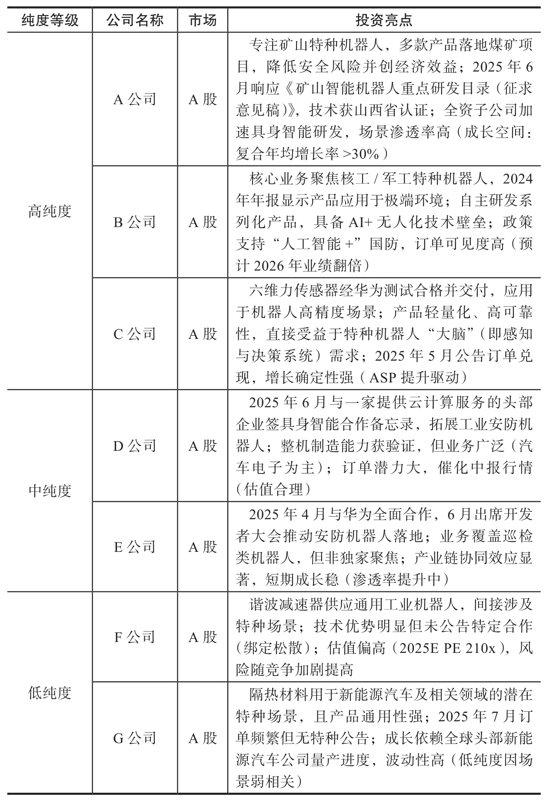

资料来源：Alpha 派。

3.推理链精度说明

高纯度逻辑：A 公司、B 公司公告直接响应政策/场景，技术专利保证壁垒；C 公司传感器交付证明商业化落地。

中纯度逻辑：D 公司、E 公司披露与华为的合作，但业务广度稀释纯度，依赖生态推动。

低纯度逻辑：F 公司、G 公司估值与业务弱绑定，需订单超预期验证。

表 3-1 总结：优先布局高纯度标的（政策刚性+技术壁垒），中纯度把握华为链催化，低纯度谨慎观望。

“主题选股 Agent”针对特种机器人产业链给出了上述具体分析，基于此我们对该平台的 AI 分析能力进行了全面评价。整体来看，平台在产业链结构、公司纯度划分、投资逻辑推演等方面表现出较高的专业性与逻辑性，走好最后一公里的落地场景还需要注意投资实践。

综上所述，“主题选股 Agent”在特种机器人产业链分析中展现了较强的专业性与逻辑性，尤其是在产业政策催化、产业链结构梳理及公司纯度划分方面表现突出，能够清晰捕捉短期市场机会并给出明确的投资逻辑。“主题选股 Agent”功能，作为智能化工具的典型代表，在梳理产业链结构、精准识别公司业务纯度以及推演主题投资逻辑方面展现了较强的专业性和高效性，能显著帮助投资者解决传统研究过程中的痛点问题，优化决策流程与效率。

但同时，主题投资也并非完全可以交由智能工具一键完成，投资者仍需以谨慎态度对待 AI 工具输出的投资建议，尤其要针对中低纯度公司进行二次复核验证，重点关注政策落地进展、产业实际布局、公司竞争力变化以及估值风险控制等深层次因素。未来，伴随主题投资市场逐渐向全球化、多元化演进，以 Alpha 派为代表的智能投研工具应进一步完善跨市场主题覆盖度，加强对长期竞争格局和产业趋势变化的敏感度，从而真正实现“人工经验”与“AI 智能”相结合的投研模式，全面提升主题投资的决策质量和长期回报。

### **学习案例 3-2** **妙想大模型跟踪分析人工智能活跃主题**

在实际投资过程中，投资者经常面临着需要快速锁定投资标的并制定明确交易策略的需求。例如，对于近年市场高度关注的人工智能概念板块，投资者也需要及时掌握关键技术指标与资金流向变化，以捕捉短期交易机会并制定具体交易策略。

传统的人工分析方式往往存在速度慢、效率低、容易遗漏关键细节的问题。为帮助投资者更清晰地理解智能化工具的实际应用方式，我们用典型案例来详细说明智能化工具在投资决策中的具体运用场景与实际效果。我们选用妙想大模型作为具体工具，进行说明和示例。

妙想大模型基于先进的自然语言处理技术，具备自动化理解投资者需求并处理复杂数据的能力。具体而言，该模型能够从大量公开市场数据中迅速提取关键投资信息，并以结构化形式直观呈现。此外，妙想大模型还具备跨市场数据分析能力，覆盖 A 股、港股和美股。同时，该模型也能够快速提供技术指标分析，如 MACD 走势、成交量趋势、资金流向分析等，从而帮助投资者高效地捕捉市场机会。

当前 A 股市场的人工智能板块整体表现较为活跃，近期市场交易热度维持在相对较高的水平，显示投资者持续关注相关投资机会。从整体走势来看，近期价格波动逐渐趋于平稳，市场情绪稳定。技术指标方面，MACD 指标显示短期内交易信号频繁变化，金叉与死叉交替出现，投资者需要密切关注这些技术信号的提示意义。同时，资金流动呈现分化趋势，散户和短期资金表现活跃，而机构资金则较为谨慎，出现一定程度的资金流出迹象。这种情况提示投资者应更加关注资金的流向变化和市场情绪动态，谨慎把握短期交易节奏，并结合产业前景，优化投资布局。正如表 3-2 所示，主题投资较成长投资抑或是价值投资而言，在投资阶段上聚焦导入期，驱动因素更依赖宏观经济发展、制度变革、产业结构演进，更侧重短期性，重点是博取数个交易日内的弹性，因此需要采用技术分析予以高频跟踪。

**表 3-2** **主题投资、成长投资、价值投资的区别对比**

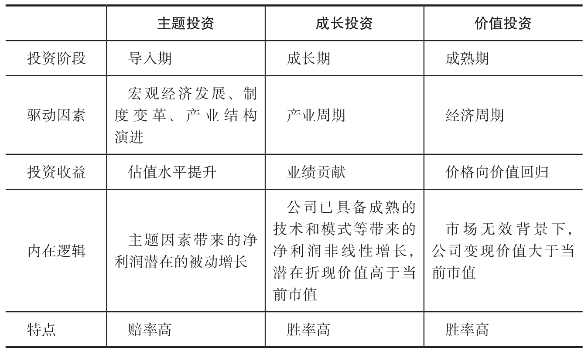

资料来源：作者整理。

为了更好地利用妙想大模型进行技术分析，投资者在实际操作时，可以提出含有以下六个关键要素的问题。其一，身份情景：你是一名技术分析专家，当前需对 A 股人工智能板块进行深入技术分析，为投资者提供短期交易策略建议。其二，分析层次和颗粒度：请从近期市场整体走势、技术指标（特别是 MACD）、资金流向三个维度进行综合分析，分别指出当前市场状态、交易信号和资金偏好的特征。其三，明确指定分析的时间范围：分析仅限于最近 250 个交易日内的市场表现，尤其关注近一个月内的数据表现，不得引用该范围以外的信息。其四，输出格式要求：篇幅控制在 800 字以内。首先给出 A 股人工智能板块当前市场的整体技术走势判断，再以结构化的 Markdown 表格形式，清晰列出市场整体走势、技术指标（特别是 MACD）、资金流向三个维度的具体表现和潜在的交易机会。其五，明确分析方法：严格围绕板块整体走势、MACD 指标信号、资金流向数据三个方面进行分析，不扩展其他无关内容。其六，强调推理链的完整性与精度：需给出清晰完整的逻辑推演过程，具体说明得出当前市场状态和短期交易策略的判断依据与逻辑链条，确保分析结果具备明确的可操作性和实用价值。

妙想大模型在回答中对 A 股人工智能板块最近 250 个交易日的市场整体走势、MACD 指标及资金流向进行了深度分析，并结合表 3-3 总结具体表现和潜在交易机会，进而给出了短期和中期的策略建议。妙想大模型生成的人工智能板块当前市场技术走势深度分析报告具体内容如下。

1.市场整体走势分析

基于最近 250 个交易日（截至 2025 年 7 月 22 日）的数据，A 股人工智能板块呈现以下特征。

近期表现：2025 年 7 月 15 日和 16 日，板块出现显著上涨，中证人工智能产业指数（931071）单日涨幅达 1.64%，创业板人工智能 ETF 涨幅达 5%，人工智能 ETF 连续 6 日上涨，近 1 个月涨幅超 11%。这表明短期市场情绪回暖，受 AI 算力产业链利好消息驱动。

整体趋势：2024 年 7 月 10 日至 2024 年 8 月 16 日期间，超大单资金流出平均值为 75.85 亿元，中位数为 75.51 亿元，最大值为 109.40 亿元（2024 年 7 月 11 日），最小值为 38.63 亿元（2024 年 8 月 13 日），整体呈下降趋势。资金流出压力较大，反映市场谨慎态度，尤其机构投资者持观望立场。

市场状态：短期技术性反弹明显，但中期受资金流出压制，整体状态偏谨慎。潜在风险包括政策不确定性，机会在于 AI 硬件突破和政策支持（如国务院“人工智能+政务服务”政策）。

2.技术指标（MACD）分析

聚焦最近 250 个交易日，MACD 指标显示强劲短期信号。

关键表现：2025 年 7 月 16 日，人工智能 ETF 科创涨 1.28%，MACD 金叉信号确认部分个股涨势。2025 年 7 月 18 日，中证人工智能主题指数（930713）连续 6 个交易日上扬，MACD 金叉信号形成，预示短期趋势向好。2025 年 7 月 21 日，上证指数 MACD 红柱扩张，KDJ 超买区钝化，技术面与资金面共振，强化上涨周期。

交易信号：金叉频繁出现（如 7 月 16 日和 18 日），指示短期多头趋势，适合波段操作。但需警惕超买风险（如 KDJ 超买区钝化），避免追高。

数据支撑：近一个月内 MACD 信号集中释放，结合板块上涨数据（如 ETF 涨幅），验证技术支撑有效性。

3.资金流向分析

最近 250 个交易日资金流向呈现分化。

短期资金动态：截至 2025 年 7 月 22 日，近一个月主力资金净流出 109.63 亿元，游资净流入 17.58 亿元，散户净流入 92.05 亿元。人工智能 ETF 近一周上涨 7.50%，杠杆资金融资余额为 8960.29 万元，显示散户乐观但机构谨慎。

长期趋势：软件服务行业近一个月主力资金净流出 551.96 亿元，高居行业之首，反映人工智能板块长期配置意愿低。资金偏好集中于 AI 算力标的，受技术进步（如 IBM Power11 处理器）推动。

资金偏好特征：短期散户主导流入，中期机构流出压力显著，偏好结构性机会（如 ETF 和硬件产业链）。

基于三个维度，整理了具体表现和潜在交易机会（见表 3-3）。

**表 3-3** **具体表现和潜在交易机会**

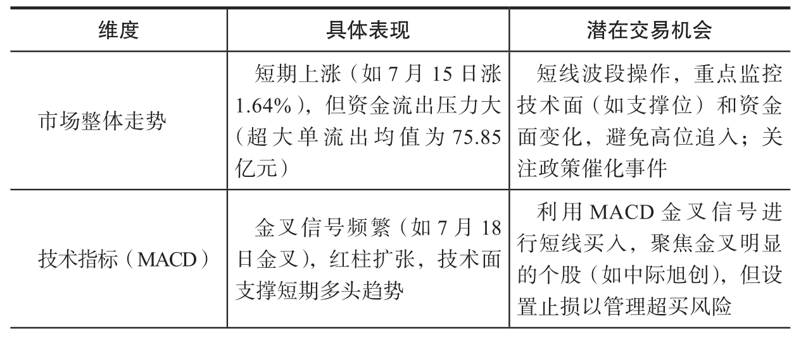

（续）

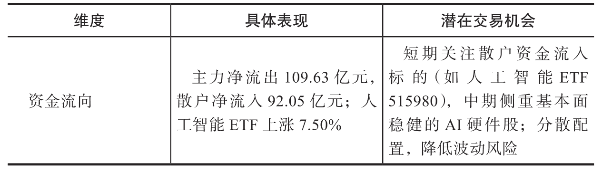

资料来源：妙想大模型。

4.逻辑推演过程

（1）数据整合与维度交叉验证

从市场走势数据（如短期上涨和资金流出）推导市场状态：上涨受情绪驱动，但资金流出（主力净流出 109.63 亿元）表明可持续性弱，故状态偏谨慎。

MACD 指标（金叉信号和红柱扩张）与技术面共振，强化短期交易信号（如金叉指示买入时机），但需结合资金面（散户流入支撑反弹）。

资金流向分化（散户流入 vs 机构流出）定义资金偏好：短期机会在散户主导领域（如 ETF），中期风险在机构撤离。

逻辑链条：市场上涨（数据）+MACD 金叉（信号）→短期多头机会；资金流出（数据）→谨慎持仓；散户偏好（数据）→结构性交易策略。

（2）交易策略推导

短期策略：基于 MACD 金叉和散户流入，建议波段操作（如 ETF 或个股短线交易），依据为技术指标时效性（近一个月信号集中）和资金动态（近一周 ETF 涨 7.50%）。

风险控制：资金流出压力（超大单流出均值为 75.85 亿元）要求避免追高，设置止损；中期依赖政策（如国务院文件）和基本面验证。

可操作性：表 3-3 中的机会基于客观数据（如金叉日期和资金值），确保实用价值（如聚焦近一个月数据）。

5.结论与建议

（1）市场总结

A 股人工智能板块当前呈现短期技术反弹（MACD 金叉支撑），但资金流出压制中期趋势，整体状态谨慎。核心驱动为 AI 硬件突破和政策利好，风险在于机构资金撤离。

（2）策略建议

短期：利用 MACD 金叉信号（如 7 月 18 日事件）进行波段交易，优选散户资金流入标的（人工智能 ETF515980 或 AI 算力个股），严格监控技术指标（如 KDJ 超买）。

中期：关注行业基本面（如 IBM 技术进步）和政策落地，避免重仓，采用分散配置。

总体：强调数据驱动决策，结合实时指标（资金流向和 MACD）调整策略，确保灵活性和风险意识。

妙想大模型通过翔实的数据解析与生动的可视化图表，精准捕捉了人工智能板块当前的短期交易信号和市场情绪波动，使投资者能够迅速厘清市场博弈格局，把握精准交易窗口。根据模型可知，A 股人工智能板块当前市场表现呈现短期技术反弹迹象，但资金面的谨慎态势对持续上涨形成一定压力。技术指标方面，近期 MACD 金叉信号频繁出现，为投资者提供明确的短线波段交易机会，但同时需要防范技术超买导致的回调风险。资金流向呈现明显分化特征，散户资金积极涌入，而机构投资者态度较为谨慎，这一现象进一步增强了市场波动性。建议投资者短期内可积极关注技术指标及资金流向所指向的热点标的，灵活进行波段交易；中长期则需密切跟踪政策落地情况与产业基本面的变化，分散配置以控制整体风险敞口。

上述妙想大模型的分析体现了智能投研工具在短期技术信号捕捉和资金情绪研判上的明显优势，它通过数据客观呈现了人工智能板块交易机会的内在逻辑，帮助投资者迅速厘清市场当前的博弈格局。投资者在实践中应善于利用模型的高效识别能力，快速把握短期交易窗口，同时保持独立判断，主动强化对产业长期趋势、政策落地情况和关键基本面的深度研究与跟踪，从而实现技术指标、资金信号与基本面分析的有机结合，真正做到“数据驱动决策，逻辑指导交易”，将人工智能板块的交易机会转化为持续稳健的投资回报。

### **学习案例 3-3** **妙想大模型缩小基建行业选股池**

在经济处于下行阶段时，投资者希望从众多基建公司中迅速筛选出少数具有明确投资价值的核心龙头企业，以构建稳健的投资组合。此处将以“缩小基建行业选股池”为例，详细展示如何通过妙想大模型，快速从 A 股上千家上市公司中，筛选出符合投资偏好、具有明确投资价值的核心龙头公司，形成白名单可投池，实现高效选股缩圈。

具体而言，投资者若希望在基建领域内锁定优质标的，可以针对妙想大模型明确提出结构化的问题，从而精准引导模型快速输出清晰可用的投资结论。在此过程中，类似地，用含有以下六个关键要素的提问，更为高效和准确：其一，身份情景（你是一名专业的投资分析师，目前需针对经济逆周期环境下的基建行业进行深入分析，帮助投资者筛选出该领域内的核心龙头企业，挖掘具体的投资机会）；其二，分析层次和颗粒度（请从市值规模、行业地位、盈利能力三个维度展开分析，明确筛选出最具投资价值的前三家基建公司，并给出每家公司入选的详细逻辑推演过程）；其三，明确指定分析的时间范围（分析仅限于 2025 年 6 月 1 日至 2025 年 7 月 20 日期间的最新财务数据、市场资讯、公司公告及公开财报，不得引用该范围以外的信息）；其四，输出格式要求（输出篇幅严格控制在 800 字以内，首先给出当前经济逆周期环境下基建板块的整体投资逻辑判断，再以结构化的 Markdown 表格形式，清晰列出筛选出的公司名称、市场（A 股/港股/美股）以及各自的核心投资亮点）；其五，明确分析方法（严格基于公开财务数据、行业排名信息和公司公告进行分析推演，不得扩展其他无关来源的信息）；其六，强调推理链的完整性与精度（需给出清晰完整的逻辑推演过程，具体说明每家入选公司的市值、行业地位、盈利能力等数据，并明确解释每家公司入选的具体原因与投资逻辑，确保分析结果具有清晰的可执行性与实操价值）。

妙想大模型的回答主要分析了经济逆周期环境下基建行业的投资逻辑，并基于市值规模、行业地位、盈利能力三个维度筛选出龙头企业，结合表 3-4 介绍其投资亮点，同时给出风险提示和结论。具体回答形成的经济逆周期环境下基建行业投资分析与龙头企业筛选报告内容如下。

1.基建板块整体投资逻辑判断

在当前经济逆周期环境下，基建行业展现出显著的抗风险能力与增长潜力，主要基于以下三重驱动逻辑。

①政策强力支撑：2025 年新增政府债务规模达 11.86 万亿元，其中超长期特别国债落地 5550 亿元，专项债发行进度达 49.1%，为基建投资提供持续资金保障。

②重大项目牵引：雅鲁藏布江下游水电工程开工，预计首年拉动 GDP 增长 0.1%，带动输电网络、交通配套等领域形成“一核多极”投资效应。

③估值修复机遇：基建板块估值仍处历史低位（PE 普遍低于 12 倍），在政策催化与业绩改善双重驱动下，具备较强配置价值。

核心结论：聚焦“政策受益度高+订单充沛+现金流稳健”的龙头企业，重点把握能源基建、区域战略工程领域的结构性机会。

2.核心企业筛选结果与投资亮点

基于市值规模、行业地位、盈利能力三个维度综合评估，筛选结果如表 3-4 所示。

**表 3-4** **三维度综合评估**

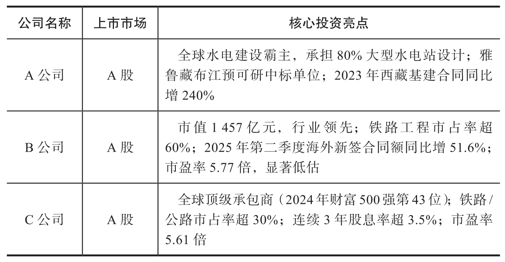

资料来源：妙想大模型。

3.入选企业详细逻辑推演

（1）A 公司：能源基建核心载体

行业地位：独家掌握 300 米级特高坝建造技术，水电装机容量占全国 57%，“一带一路”沿线项目覆盖率超 80%。

盈利能力：2025 年第一季度新签合同额增长 12%，雅鲁藏布江工程带动工程总承包业务毛利率提升至 18%以上。

市值潜力：当前市值对应的 PE 为 10.2 倍，低于基建板块均值，工程中标溢价率提升驱动估值修复。

（2）B 公司：逆周期扩张典范

规模优势：2025 年第一季度营收 2493 亿元（行业前三），总资产周转率为 0.75 倍，高于同业。

业务韧性：基建投资占比 82%，政府项目回款周期缩短至 120 天；特色地产业务新签合同额同比增 38.5%。

资金认可：2025 年 7 月主力资金净流入 1.59 亿元，南向资金单日增持 375 万股。

（3）C 公司：高股息防御标的

全球布局：在 140 个国家开展工程承包，“一带一路”项目占比 35%，2025 年第一季度境外营收增速达 15%。

盈利质量：毛利率稳定在 8.7%，经营性现金流净额/净利润的比值为 1.2，分红保障能力强。

估值安全：市净率为 0.45 倍（行业均值为 0.9 倍），股息率为 4.6%，显著高于 10 年期国债收益率。

结论：在当前经济逆周期的环境下，基建行业具备政策强力支撑、重大项目牵引以及估值修复的多重投资逻辑。通过对市值规模、行业地位及盈利能力的综合筛选，A 公司、B 公司与 C 公司脱颖而出，分别在能源基建、逆周期扩张与高股息防御领域具有明显优势。投资者在布局基建板块时，应重点关注政策落地进展与订单增长持续性，同时警惕地方政府财政、大宗商品价格波动及海外地缘政治风险带来的不确定性。整体来看，龙头企业凭借稳健的基本面、显著的估值优势与可靠的现金流，预计将成为经济逆周期背景下的优质投资标的。

通过上述案例，我们看到大模型在助力投资的环节中有诸多提质增效、一日千里的效能，但同时也要注意部分功能的局限性，如对中低纯度公司的风险识别不足、估值合理性分析不充分，以及对政策落地进展和长期竞争格局的关注不够深入。再如，大模型工具本身也存在对趋势拐点敏感性较强、对事件驱动风险评估不足的局限性。这些问题意味着投资者在利用这些平台进行决策时，应特别注意对公司纯度的审慎筛选，警惕政策预期差异带来的风险，并加强自主对长期产业趋势的判断，以更全面地把握投资机会。

## **3.2** **策略解读：AI 把握“政策市”**

全球权益市场都会受到经济定调、货币和财政政策、市场情绪等多方面的影响，对应到股票三因子定价模型，分别影响分子端利润、分母端估值和风险情绪。在实际市场中，我们有时会看到这样的情形：当降准降息落地后，市场风险偏好短期上升，资金面改善推动估值修复；当经济数据持续回暖，政策定调转向“积极托底”时，市场整体偏向乐观，做多意愿增强；但即便宏观指标亮眼，若市场情绪仍陷于谨慎观望，行情也可能滞后反应。

本节选取两个典型案例，借助 DeepSeek 和 Manus 等大模型、智能体的语言理解与数据分析能力，依次解读“政策市”的成因与演绎过程，呈现 AI 参与宏观分析、政策研判的具体路径，为投资者提供更具结构化、可落地的参考方向。

### **学习案例 3-4** **AI 学习重要会议精神，给出市场预判**

重要会议是中国宏观政策风向的重要信号源，要让 AI 有效解读重要会议精神并形成有价值的市场预判，首先需要建立一套清晰的分析框架，即既要理解会议本身的规律，也要明确 AI 在其中的角色与方法。这一过程并非简单的文本扫描，而是从会议特征解析到 AI 分析逻辑落地的完整链条。

理解重要会议是 AI 分析的前提。而要让 AI 理解，就得先搞清楚重要会议的语言结构和信息重点。重要会议的召开时间与内容结构存在显著规律，这为 AI 解读提供了基础锚点。

从时间来看，与经济关联最紧密的会议集中在每年 4 月、7 月和 12 月，分别承担年初部署、中期纠偏、年终定调的功能，是观察政策节奏的关键节点。而从内容结构看，会议通常从宏观经济形势判断切入，逐步延伸至财政政策、货币政策、房地产、内需、外贸等具体领域，形成“主线+分支”的文本体系。通过追踪不同维度措辞的变化，可直观感知政策态度的调整方向。

表 3-5 清晰呈现了 2022 年至 2025 年重要会议的召开时间与核心内容，例如 2025 年 4 月会议聚焦“当前经济形势和经济工作”，2024 年 12 月会议则兼顾“2025 年经济工作”与“党风廉政建设”，这些信息为 AI 锁定分析重点提供了直接依据。

**表 3-5** **重要会议的召开时间与核心内容**

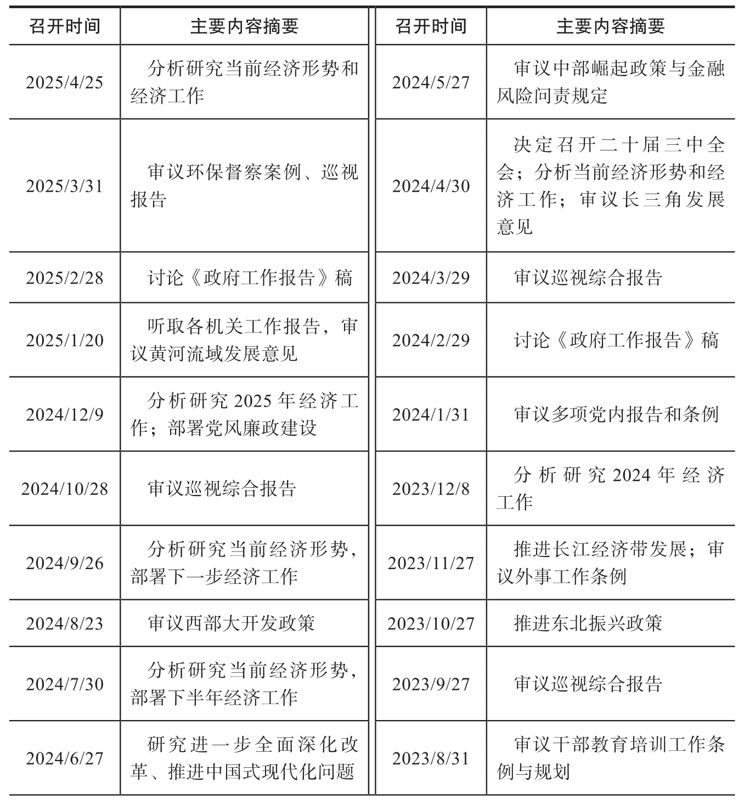

（续）

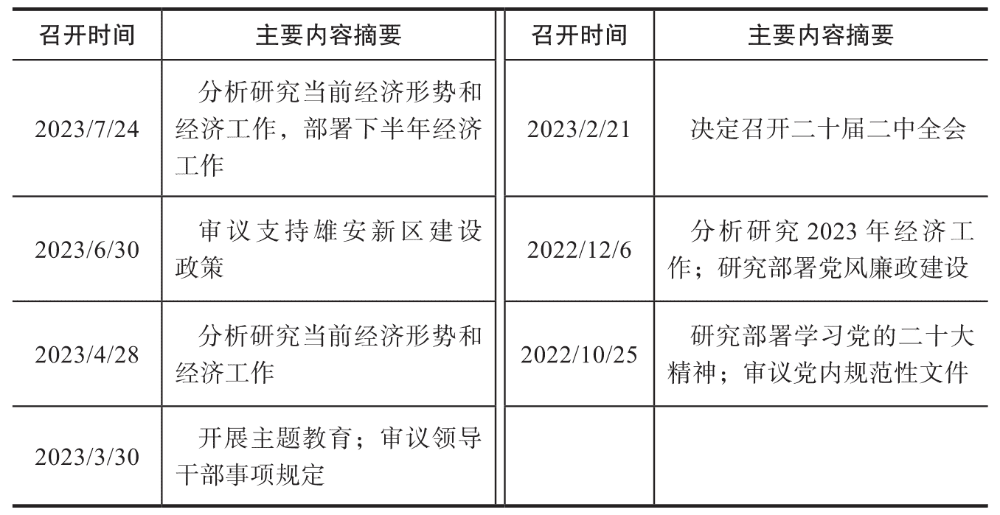

资料来源：中国政府网。

让 AI“读懂”会议，核心是要回答三个问题：会议核心内容是什么？重点关注的关键词有哪些？与往期相比有哪些变化？这三个问题构成了 AI 分析的框架，避免分析陷入碎片化。

理解了重要会议的结构并确定分析框架之后，我们就可以进一步把这些政策表述转化为可以分析的信息。AI 在这个过程中要参与到定性判断和定量评估中，成为一个有策略感的“分析师”。

首先是定性分析：**AI 怎么理解“态度强不强”？**

我们首先让 AI 识别出会议中与财政、货币、房地产、消费等的政策相关的原文内容。这一步，需要先设置好“提示词工程”，告诉 AI 应该重点关注哪些关键词、句式和政策领域。在提取这些内容后，AI 会进一步判断这些政策表述的语气强弱—比如“适度宽松”听起来就比“加大力度”弱；“加快推进”比“稳步推动”更强。通过语义识别，AI 可以对每条政策进行强度定级，从而给出定性的判断：这次会议的财政政策更积极了，还是更保守了？

然后是定量分析：**能不能给“力度”打分？**

定性的分析固然重要，但如果我们能把它数字化，就能在不同会议之间进行横向比较。这正是 AI 擅长的事情。一种方法是全自动打分：让 AI 模型基于原始文本内容自动生成“政策强度指数”，不依赖人工标注，快速得出量化结果。更进一步的做法是人机协同打分：先用过去的人工评分结果（比如研究机构对每次会议的打分）作为训练样本，让 AI 学会“什么样的表述对应什么样的分数”，让它成为更贴近人类判断标准的“机器分析师”。

通过这套流程，就能让 AI 从一篇篇密密麻麻的会议纪要中，总结出清晰的“政策力度变化图谱”。这对投资者来说，不仅节省了时间，更为其提供了基于政策逻辑的投资判断依据。

在具体操作上，下面我们将分步骤对案例进行详细说明。

**步骤一，提取文本并准确识别政策内容：**要让 AI 准确识别每条政策内容，第一步就是要“教会它只做分工明确的事”—让它只负责找原文，不做主观判断。我们在设计分析流程时，首先设定了 AI 的角色定位：“你是一个负责提取原文的助手，不做加工。”

然后明确告诉 AI，它的任务是：“找出涉及宏观调控基调、财政政策、货币政策、扩大内需、外资外贸等领域的原文，只要原文，自然段或句子。”为了让 AI 分得清不同维度，我们还配套提供了判断标准和关键词列表，以 DeepSeek 为例，具体指令的设计可参考图 3-3 中给出的示例。对于每一类政策（如财政政策、货币政策等）都有明确的关键词线索和语义判断标准，示例如下。

宏观调控基调：明确提取“调控基调”的句子，一般位于通稿开头，强调整体政策导向的表述。

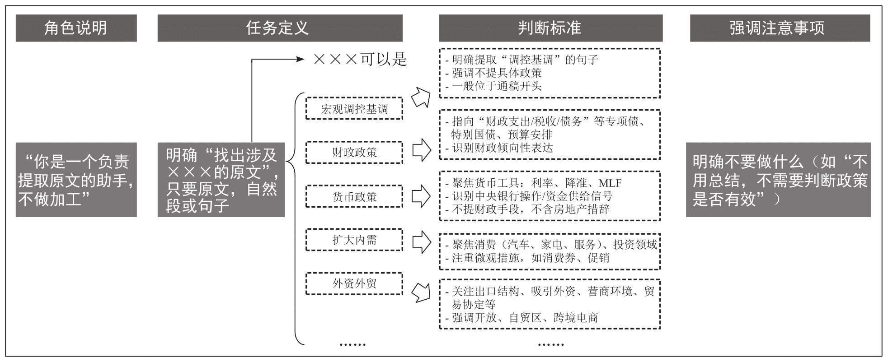

图 3-3 给 DeepSeek 的指令（限定要求，按照特定维度梳理政策）[资料来源：作者绘制。]

财政政策：出现“财政支出”“税收”“债务”等表述。

货币政策：提到“利率”“降准”“MLF”（中期借贷便利）或中央银行的操作信号。

扩大内需：聚焦消费、投资，关注“消费券”“汽车”等词。

外资外贸：关注“出口结构”“跨境电商”“外资吸引”等。

同时，为了防止 AI“过度发挥”，我们清晰标注了它不该做的事—比如，不用总结；不需要判断政策是否有效；不跳出原文进行加工。

通过这种结构化、规则明确的指令设计，AI 可以在不偏离原意的前提下，像一个“高效率数据标注员”一样，稳定提取出我们所需要的政策文本信息。

有了前面提到的提示词体系，AI 就可以承担起“重复性高、结构清晰”的文本提取任务：每一期重要会议的内容发布后，AI 都会逐项梳理其中关于财政、货币、内需、外贸等领域的原文表达，并按照时间顺序和政策类别，构建出一个如表 3-6 所示的“时间×政策”维度的二维政策库。

**表 3-6** **政策库的构建**

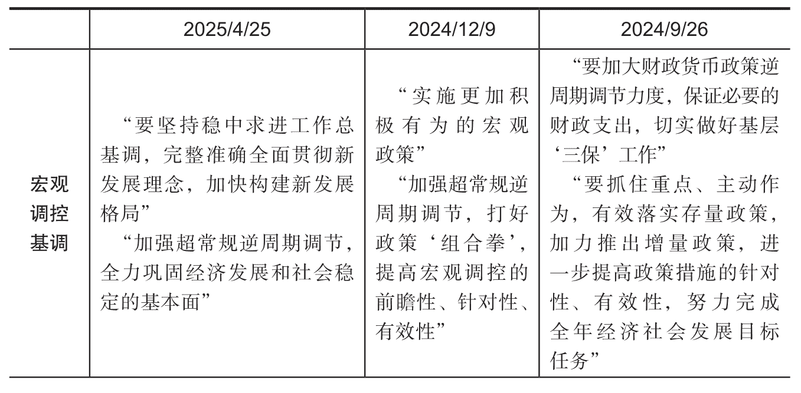

（续）

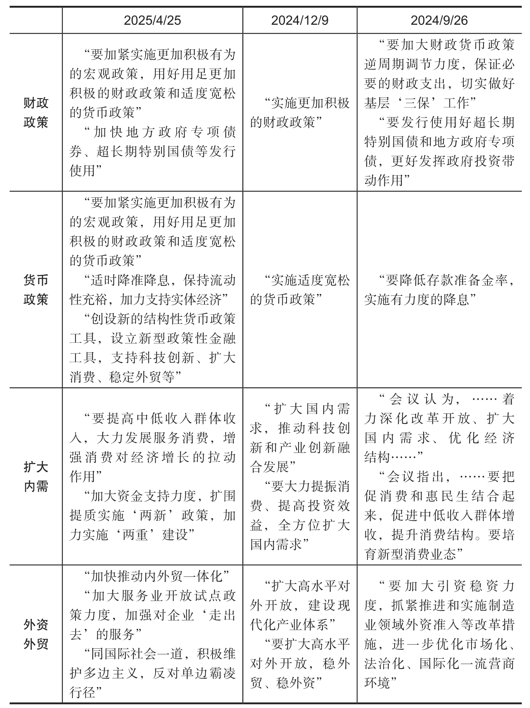

资料来源：DeepSeek。

**步骤二，定性判断，让 AI 判断政策语气的强弱：**我们进一步训练 AI 形成一种“全景感知”能力，即理解政策的上下文关系和语气强度。通过分析历年政策措辞的变化模式，我们为 AI 构建了一个五级政策强度框架，从“常态维持”到“危机应对”，层层递进。面对任何新增的政策文件，AI 会自动判断文本中使用的表述属于哪个强度档位—显著加力？常规调控？还是政策维稳？这套系统化的识别方法，既参考了历史语言特征，也结合了人类分析的标准，使得 AI 不仅“能读”，还“读得准”。

比如我们可以这样向 AI 提问：

“你是一位熟悉中国宏观政策演进的专家，任务是根据重要会议的政策表述文本，对宏观政策‘刺激强度’进行分析，请遵循以下指引完成任务。

任务目标：基于完整会议文本，识别宏观政策表述的强弱特征，判断其属于哪一级刺激强度，仅使用文本内容与语气做出判断。

分档标准：第 1 档（政策维稳），强调稳定性、延续性，无明显加码信号；第 2 档（轻微调节），出现适度调节、预调微调，力度较弱；第 3 档（常规调控），逆周期表述增多，政策进入中性发力状态；第 4 档（显著加力），政策‘组合拳’明确发力，应对下行风险；第 5 档（危机应对），政策超常规响应，多部门强力干预保增长。

请按如下格式回答。

分档：第×档（档次名称）。

理由：简要说明判断依据，聚焦语义强度、关键词或语气特征。请保持专业、凝练，不添加无关内容。

注意事项：请整体把握全文语义，不逐句分析；不使用外部知识，仅基于给定文本判断。”

DeepSeek 输出的定性分析结果如表 3-7 所示。

**表 3-7** **DeepSeek 输出定性分析结果**

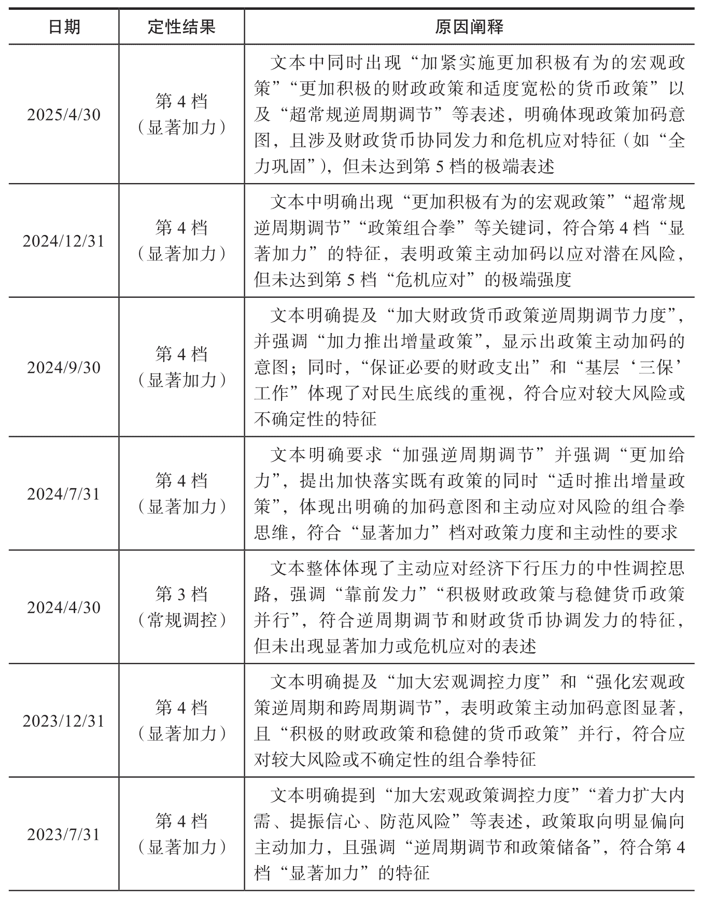

（续）

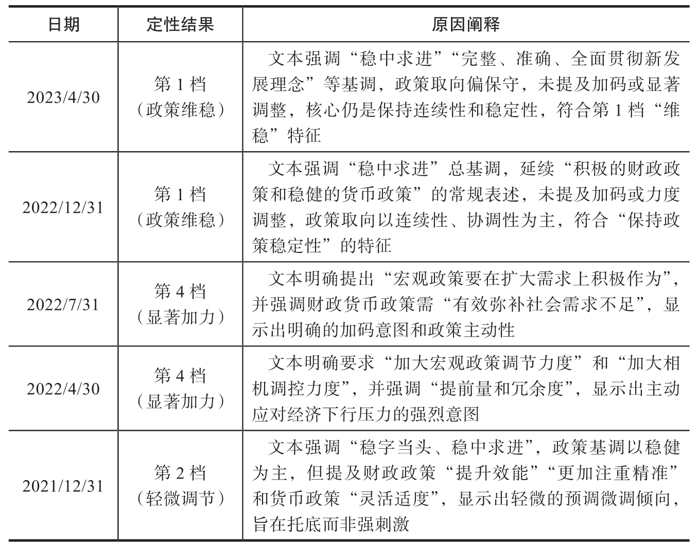

资料来源：DeepSeek。

从 AI 绘制的宏观政策定性强度演进趋势图（见图 3-4）可以看出，大多数年份政策基调保持稳定，集中在第 1 档和第 2 档，体现了以稳为主的政策取向。但在关键时点，政策态度会迅速转向更高等级：2020 年新冠疫情冲击后，政策强度跃升至第 4 档；2022 年至 2023 年间，面对外部风险与经济压力，政策多次释放“显著加力”信号；2024 年至 2025 年初，政策仍维持较高强度，面对复杂形势，官方维持宽松稳增长的立场未变。

AI 用标准化的语义打分方式，让我们得以量化观察政策基调的起伏节奏。这不仅节省了人工解读时间，也帮助投资者在政策节奏变化时及时做出反应。

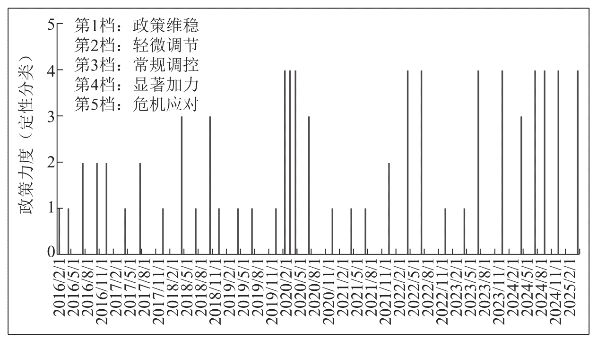

图 3-4 宏观政策定性强度演进趋势图[资料来源：DeepSeek。]

**步骤三，定量判断，让 AI 独立打分并识别政策趋势：**除了进行定性判断，我们还期望 AI 能兼具“机器般的稳定性”与“分析师般的敏锐度”，对每次重要会议的政策表述进行打分，并绘制出连续的时间序列，为后续做出投资判断提供依据。

为实现这一目标，我们构建了一套基于大语言模型的自动化评分机制：AI 无须依赖任何人工标签，仅凭借对语言语义的理解能力，就能识别每篇会议纪要中关于“政策力度”的表述，并将其量化为 0 到 1 之间的连续分值，进而构建出完整的政策强度曲线。

不过，重要会议的召开频次有限，主要集中在每年的 4 月、7 月和 12 月，而市场对政策信号的关注则更为高频。为此，我们可通过对比高频指标来观测大模型的跟踪效果。例如，我们独家编制的“国信政策力度指数”系列为月频指标，我们将 AI 的打分结果对齐到月度频率，使其与该独家指数的节奏保持一致，以此观测 AI 在历史政策解读方面的学习效果。具体而言，我们已分别将 AI 评分结果与国信宏观政策力度指数（见图 3-5）、国信货币政策力度指数（见图 3-6）及国信财政政策力度指数（见图 3-7）进行了对比分析。

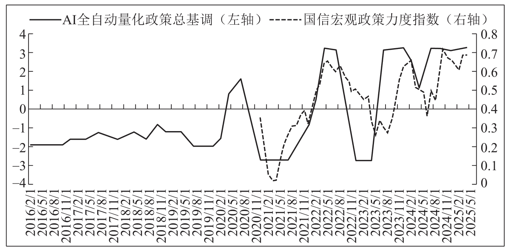

图 3-5 AI 全自动量化政策总基调 vs 国信宏观政策力度指数[资料来源：DeepSeek。]

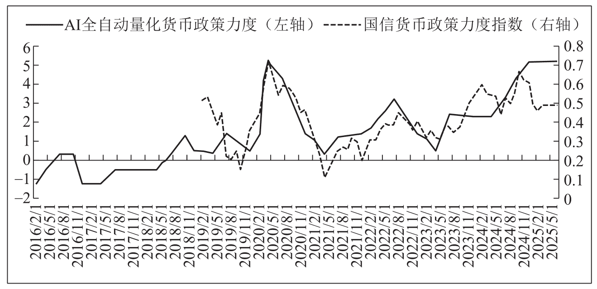

图 3-6 AI 全自动量化货币政策力度 vs 国信货币政策力度指数[资料来源：DeepSeek。]

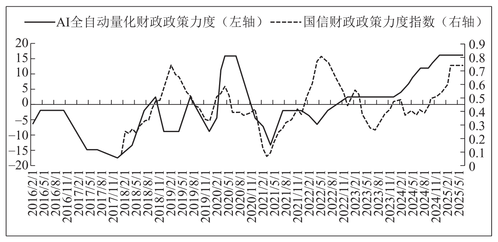

图 3-7 AI 全自动量化财政政策力度 vs 国信财政政策力度指数[资料来源：DeepSeek。]

整体趋势上，AI 模型给出的评分结果与国信指数表现出高度一致；多次政策强度的拐点都被 AI 较准确地识别，尤其是在 2020 年新冠疫情冲击、2022 年受内外多重压力下宏观政策从“跨周期调节”向“超常规逆周期调节”切换等关键时期；无论是总基调，还是货币、财政两个分项，AI 都表现出了良好的趋势跟踪与同步判断能力。这些结果说明，AI 不仅可以做政策“语义助手”，还具备定量识别政策节奏变化的能力，为投资者提供更具结构化、可持续的分析支撑。

事实上，重要会议的表述体系不限于货币政策和财政政策，还常常涉及房地产、民生保障、扩大内需、外贸出口等多个领域。为了让 AI 更完整地还原政策取向，进一步对每个政策子维度进行独立量化，不再只是评估“整体强不强”，而是要看清楚：哪个方向被重点提及？哪个领域正在加力？哪些话题淡出视野？

为了观察政策取向的结构性变化，我们对 AI 打分结果进行跨期对比，分别比较环比（2025 年 4 月 vs2024 年 12 月）和同比（2025 年 4 月 vs2024 年 4 月）各维度政策力度差异。

从环比维度来看，2025 年 4 月的政策会议整体延续了 2024 年底的宏观基调，财政、货币、外贸、地产等核心方向的评分均维持高位。但最大的亮点在于：“内需政策”评分大幅抬升，说明政策层面对消费、投资等内需领域的重视明显增强，呈现“结构化发力”特征，这有助于理解后续可能出台的稳消费、促投资政策。

从同比维度来看，各核心政策维度的评分几乎全线上升。尤其是总基调、财政政策、货币政策和外贸政策的得分提升明显，体现出整体政策节奏的转强。这也与当前外部不确定性增加、经济回稳压力加大的大环境密切相关。

除了完全由 AI 主导的自动评分，还可以将人工经验引入模型训练过程，实现“AI 理解+人类标准”的人机协同量化策略。政策文本打分方法可以分为两类。

其一，AI 自主打分。这种方法不依赖任何人工标签，完全由大语言模型根据对历年重要会议文本的理解，自动建立起对语义强度的认知框架。它像是具备“上帝视角”的 AI 分析师，独立判断会议的政策力度。优点是效率高、无偏见，但缺点是可能与研究机构现有的打分体系存在偏差。

其二，人机协同打分。相比之下，人机协同方法会将已有人工分析结果（国信的政策力度指数）作为训练标签，指导 AI 学习“分析师是如何判断的”。教 AI 模仿人类逻辑，在保留语义理解能力的同时，对接已有框架，更贴近研究体系。最终，当面对新一期政策文本时，AI 即可给出兼具理解能力与经验标准的“半自动打分”结果。

政策信号藏在用词里，AI 能进一步挖掘文本中的关键词信号，帮助识别政策主线、感知方向变化，定位被频繁提及、反复强调、悄然改变的核心用词。

2025 年 4 月重要会议的词云图将政策主旋律可视化，越频繁使用的词，字体越大。可以看出，“经济”“发展”“政策”“稳定”“持续”等词的使用频率居高，显示会议关注点仍围绕经济修复与高质量发展展开。同时，“消费”“市场”“企业”这些二级词汇透露结构性支持方向的延伸。

**环比变化体现短期节奏切换。**对比 2025 年 4 月与 2024 年 12 月会议的高频词频次，可以看到，最新会议释放更积极的政策信号。其中，“经济”“政策”“加快”“实施”等词的使用频率大幅上升，说明政策表述更加强调实际执行、推进节奏和经济恢复力度。相反，“统筹”“保障”“改革”等词的热度回落，表明本次会议侧重点不再是全局平衡与制度完善，而是更聚焦当前周期内的增长修复和政策落地。

**同比变化识别年度主线演进。**对比 2025 年 4 月与 2024 年 4 月会议的关键词频率，一方面，“政策”“稳定”等词的使用频率显著上升，显示当前阶段政策表述更注重整体基调明确与执行方向清晰；另一方面，“发展”“推进”“改革”“推动”“保障”“统筹”等词的使用频率显著下降，表明较去年同期，会议对中长期结构性议题的关注边际减弱。“经济”“加快”“持续”“实施”保持较高热度，说明经济增长依然是主线，但语义风格由“改革推动”转向“稳中加力、政策落实”。总体来看，同比变化揭示出政策基调由“谋远布局”转向“落地执行”，更加强调现实支撑与稳定导向。

### **学习案例 3-5** **AI 理解和解读货币政策取向，辅助股债交易**

在股债交易领域，AI 对货币政策取向的理解与解读发挥着重要作用。它能够深入剖析各类货币相关政策文件、央行表态等信息，精准把握货币宽松或紧缩的趋势、力度及其可能产生的影响，从而为股债交易决策提供有力辅助，帮助投资者更及时、准确地调整交易策略。

这一案例与前一个案例在操作上可以遵循相似的步骤。首先是厘清政策结构，AI 会对货币领域的政策体系、相关表述的逻辑框架进行梳理，明确各项货币指标、政策工具在整体政策中的定位和关联；其次是定性判断，基于对政策内容的理解，判断货币政策取向的大方向，比如是偏向刺激经济的宽松政策，还是防范通胀的紧缩政策；最后是定量判断，通过构建量化模型，将货币政策取向的相关特征转化为可量化的指标或数值，以此更精确地衡量政策的实际力度和潜在影响，为股债交易提供更具体的参考依据。下面，我们依然分步骤进行详细介绍。

**步骤一，厘清政策结构：**AI 在分析政策语义方面具备天然优势，尤其是在处理大规模文本、归纳总结信息以及结合上下文理解政策取向上，远胜于传统工具。

过去依赖关键词、情感词和主题模型（如 TF-IDF、LDA 等）去分析政策基调，但这些传统 NLP 方法往往难以捕捉上下文逻辑，无法量化语气强度，对于高度凝练、语义隐含的政策语言的处理能力有限。现在，用 DeepSeek 等大模型代替旧工具，可以通读完整文件，理解上下句的逻辑关系；可以结合财经语料微调，识别出符合语境的真实立场；可以自动匹配政策措辞与历史情境之间的映射关系，实现“看到一个表述，联想到背后的潜台词”。

例如，在中国人民银行货币政策委员会季度例会中，我们通过结构化人工解读，将一篇完整公告拆解成五个关键要素：货币政策基调、政策工具、降准降息、利率管理与外汇市场，具体可参考图 3-8。这样做的意义在于，为 AI“指明了重点”—先告诉它要看什么，再让它判断说了什么。

图 3-9 进一步展示了 DeepSeek 处理政策文本的完整逻辑：政策文本→构造 Prompt→DeepSeek 推理→回答问题，格式化输出。通过这种方式，AI 不再无头苍蝇式扫词，而是带着理解目标去分析政策语言，输出定性结论。更进一步，我们让 AI 基于语义理解能力，对每段政策内容进行自动打分，从而完成定量推断：一方面，AI 模型提升了传统“货币政策力度指数”的前瞻性与解释力；另一方面，它还能根据措辞变化、匹配历史经验，自动预测“政策可能有多强”。

**步骤二，定性判断：**让 AI 准确解读政策语义，前提是选好文本。不同政策文本在格式、语言风格和权威性上的差异，会直接影响 AI 的理解能力和分析准确度。选择政策文本时有几个关注点：①范式固定，即各期文本之间有可比性；②情绪易捕捉（如第三季度表述仍强调“稳健”；第四季度明确转向“适度宽松”）；③政策权威，有市场影响力。

以货币政策为例，在文本选取上，我们主要围绕中国人民银行货币政策委员会季度例会的公开报道，因为其文本精炼、结构清晰，便于归纳梳理与深刻理解政策维度和变化趋势。

要让大模型准确理解分析任务，高效构造 Prompt 是关键。Prompt 就像给 AI 写的一份工作说明书，明确告诉它：你是谁（角色）、要做什么（任务）、怎么做（行为）、输出什么（结果）。

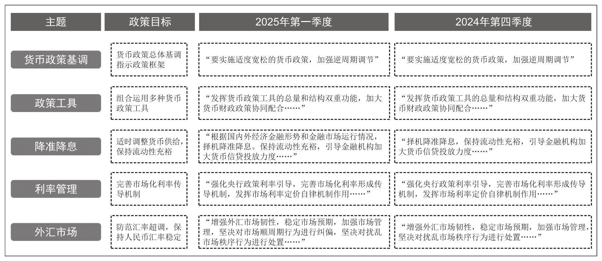

图 3-8 政策文本结构化解读（以最近两季度“中国人民银行货币政策委员会季度例会”为例）[资料来源：中国人民银行。]

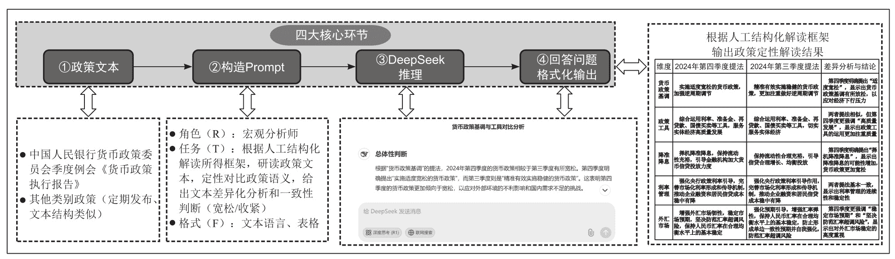

图 3-9 AI 解读政策文本语义的逻辑示意图：四个核心环节[资料来源：中国人民银行。]

为提升政策语义分析的精度与稳定性，我们围绕四大核心要素（角色设定、任务目标、行为定义、结果呈现），构建了多种常用 Prompt 模板，适配不同分析需求，具体可参考图 3-10。比如，采用 R-T-F（角色-任务-格式）范式，其提问逻辑为：“站在政策学习和理解角度，需要对比政策文本的语义，判断哪一个政策更宽松，哪一个更收紧。请提供定性分析，并引用具体的关键表述来支持你的结论。”这种结构清晰、任务明确的 Prompt 设计，能够充分调动大模型的上下文理解能力，使其在分析政策语气强度、归纳关键信号时表现出更高的一致性与可解释性。

完成 Prompt 构建后，下一步就是将其接入大语言模型进行实际调用。用户登录平台（如 DeepSeek），在输入框中以既定的 Prompt 结构输入问题，即可获得 AI 的回答结果，此处我们用 C-A-R-E（情境-行为-结果-例子）范式来进行详细的举例。

比如可以这样提问：

“情境：你要分析中国人民银行货币政策委员会季度例会的文本，判断其整体政策取向—收紧/中性/宽松。

行为：请对我下面给定的文本进行语义分析，识别出关键政策信号。

结果：输出一个简明的分析结果，包括政策取向（收紧/中性/宽松）及其取向强度评分（0～1）。

例子：会议指出，要加大货币政策调控力度，保持流动性合理充裕，引导信贷合理增长，促进社会融资规模稳定增长—宽松，0.85。”

DeepSeek 给出的货币政策语义定性判断如表 3-8 所示。

图 3-10 Prompt 的常见范式及其适用场景[资料来源：作者绘制。]

**表 3-8** **DeepSeek 给出的货币政策语义定性判断**

（续）

资料来源：DeepSeek，中国人民银行。

**步骤三，定量判断。**在进行 AI 定量分析前，我们引入周频的“国信货币政策力度指数”。该指数在“结构性流动性短缺”框架下，形成以 7 天逆回购利率为基准，以存款类机构间质押式回购利率（DR）、贷款市场报价利率（LPR）和国债收益率曲线为抓手的多层次利率体系，值越高表示货币政策越宽松。

在政策文本的定量分析中，AI 与人类分析师（Human Intelligence，HI）之间的角色分配并非固定不变，而是根据任务复杂度、评估目标和可接受误差，灵活调整参与比例。可以将 AI 定量方法分为三类：AI 全自动、AI 半自动、AI 辅助人工，对应不同的智能化程度与分工协作模式。

模式一：AI 全自动（最高 AI 参与度）。特点是无须分析师介入，AI 直接基于文本计算分值。优势在于最大化 AI 自主性，处理速度快，避免人为偏见；局限在于缺乏分析师的逻辑指导，可能存在误判。适用于当分析任务强调效率和一致性，且允许 AI 自主判断时，此模式可显著降低人为干扰。

模式二：AI 半自动（中等 AI 参与度）。特点是分析师定义评判逻辑与定量框架，AI 按此框架与政策文本的对照关系进行学习。优势在于结合专家知识与 AI 高效计算，增强可靠性；局限在于分析师需提前制定明确逻辑，适用性取决于框架质量。当需要强调结果解释性、重视稳定性或需在多个维度做出结构性评估时，该模式尤为适用。

模式三：AI 辅助人工（最低 AI 参与度）。特点是分析师完全制定评分标准，AI 仅执行打分计算。优势在于最大程度体现人工判断，确保准确性；局限在于依赖人工规则制定，主观性较强，执行效率较低。

在“AI 全自动”模式下，AI 完全不依赖分析师设定的框架和判断规则，直接对原始政策文本进行情绪识别、语义解读与强度打分，让 AI 充分发挥。AI 仅基于各期文本的“情绪”“丰富程度”“涉及提法”进行打分。

通过构建政策强度时间序列，我们将 AI 模型输出的政策语义强度评分与国信货币政策力度指数进行对比，观察它们的同步性。结果发现，在多数时点，AI 打分结果与国信货币政策力度指数整体趋势高度一致，虽然个别时期存在背离，但 AI 给出的打分理由与现实情况基本吻合。

DeepSeek 观察学习“货币政策语义”与“国信货币政策力度指数”的对照关系时给出了分析思路。

从提供的政策文本和国信货币政策力度指数数据来看，货币政策语义情绪与国信货币政策力度指数之间存在一定的关系。以下是总结和归纳。

政策语义总体基调：2020 年第一季度至 2023 年第四季度，政策总体基调强调“稳健的货币政策”，并逐步增加了“灵活适度”“精准导向”“合理适度”等表述。2024 年，政策基调转向“适度宽松的货币政策”，明确提出“择机降准降息”，显示出政策语义的明显宽松化。

国信货币政策力度指数与政策语义的关系：当指数上升时，通常伴随着政策语义的宽松化。例如，2024 年第四季度的指数显著上升（0.1549631927）。当指数下降时，政策语义通常保持稳健或略有收紧。例如，2022 年第四季度的指数下降（-0.0174862431）。

而在“AI 半自动”模式下，AI 基于分析师提供的已有底稿作为历史学习样本。AI 所执行的任务可以理解为：构建一个匹配分析师逻辑的评分体系。

具体来看，AI 首先通过对历史政策文本（如 2020 年第二季度、第三季度、第四季度等）与分析师底稿之间的对应关系进行训练，逐步形成理解深层语义的“对照规则”。随后，AI 在面对新一期政策文本（如 2021 年第一季度）时，会自动调用这些规则并结合设定参数进行分析评分，输出最终的政策力度估算结果。“AI 半自动”模式在实现高效处理的同时，也兼顾了人类分析师的经验价值，使 AI 在政策解读中更专业化。

如图 3-11 和图 3-12 所示，半自动的定量输出结果效果较好。DeepSeek 对政策文本语义的打分与国信货币政策力度指数方向基本趋同。早期存在背离是因为早期能投喂的底稿数据量有限，学习成果不足以指导 AI 准确打分。AI 能够理解货币政策语义与分析师框架之间的关系，给出的打分理由与现实情况基本吻合。

图 3-11 AI 全自动打分结果展示[资料来源：DeepSeek。]

图 3-12 AI 半自动打分结果展示[资料来源：DeepSeek。]

“AI 辅助人工”模式是 AI 参与程度最低的方式。在这种模式下，AI 不承担分析判断任务，仅负责执行基础的数据处理与辅助操作，如词频统计、情感计分或编程运算。通常由分析师先行设定一整套评分标准与操作规则，AI 根据这些既定流程执行。因此，这种方式下 AI 的表现优劣，不取决于模型本身的理解能力，而是完全依赖规则设计的合理性。如果规则精准有效，AI 执行就会稳定可靠；一旦规则设定不当，AI 也无法做出修正优化。人工设定关键词规则的示例如表 3-9 所示。

**表 3-9** **人工设定关键词规则（示例）**

（续）

资料来源：DeepSeek。

在货币政策文本的分析中，AI 展现出强大的定性理解与定量推演能力，逐步成为辅助决策的重要工具。在定性分析方面，AI 凭借出色的语境感知能力，准确识别政策文本中的关键表述，判断政策基调（如“稳健”“适度宽松”）、工具使用（如“降准”“利率引导”）、外汇态度等关键信息，并据此自动判断整体政策取向。在定量分析方面，不同的 AI 参与程度决定了三种不同的应用模式。

AI 全自动模式（存在黑箱化，类似自动驾驶）：AI 完全自主进行语义识别和打分，无须人类分析师参与。这种模式下处理效率最高，但因缺乏人类逻辑校正，模型在部分语境中可能存在误判，结果的稳定性与可靠性有限。

AI 半自动模式（首选推荐，类似智能伴驾）：AI 在分析过程中参考人工设定的评估框架，承担模式识别、数据处理与趋势判断等任务；人类分析师则提供规则指引并进行结果校验。该模式在智能性与稳健性之间实现良好平衡。

AI 辅助人工模式（类似“找代驾”，基础工作节时）：AI 仅承担数据处理和辅助统计任务，如词频计算、可视化生成等，核心分析与框架构建仍由人类完成。这种模式更接近“工具型 AI”，智能贡献较低，适用于对结果控制要求较高的场景。

通过本节两个案例，我们看到了 AI 在政策语义分析中的表现，既展现出独立分析能力，也能够有效配合人工知识体系，实现更高效、更系统的政策解读与判断。AI 在理解经济走势、把握政策意图、定量化落地为指导投资的可视化连续指标方面，展现出强大的语言处理与推理能力。无论是结构化的政策文本，还是日频化的市场数据，大模型都能高效提取关键信息，给出有逻辑支撑的判断结论，为宏观研究和投资决策提供了新的工具与思路。

# **|第四章|** **智能投顾** **个性化资产配置**

投资理财不是一个单点决策，而是一系列环环相扣的选择：该如何配置资产？面对琳琅满目的基金产品，如何选出最稳妥的？遇到结构复杂、条款冗长的理财产品，如何看懂里面的“坑”与“利”？就连看似简单的分红股票买入，也藏着关键的时间节点，一不小心就错过机会。

过去，这些问题依赖个人经验或销售建议，既碎片化又受主观影响。而如今，大模型的成熟让 AI 成为“财富管家”—它不会替我们做决定，但能在每一个关键环节上，提供透明、专业、理性的辅助判断。本章将通过四个案例，展示 AI 如何在不同投资场景中发挥作用：从为个人定制资产配置方案，到筛选最优指数基金；从读懂复杂的保险产品条款，到准确把握分红股的买入时机。它不是一个热情的推销员，而是一个诚实、可靠的理财助手。

## **4.1** **AI 定制资产配置方案：个人理财的生命周期策略**

### **学习案例 4-1** **AI 定制个人理财的生命周期策略**

在个人理财中，资产配置应紧密围绕投资者所处的生命周期阶段进行动态调整。从受教育阶段、工作起步期，到工作鼎盛期、退休前夕及退休后，不同阶段面临的投资目标、风险承受能力、流动性需求不同，资产配置策略也应随之改变。借助 AI，每个人都可以根据自身具体的背景信息（年龄、职业、家庭成员等）、投资目标（主要和次要目标）、投资期限、风险偏好、当前资产状况等获得清晰的资产配置建议。这种个性化配置方案不仅基于投资者的资金使用规划，还可以兼顾风险控制与长期回报的平衡。

比如我们向 Kimi 提问：“假设你是一位家庭理财师，需要按照客户生命周期给出资产配置动态比例框架，请按照一个维度是年龄、一个维度是各类资产配置比例构建框架，注意资产类别为国内可以实际落地配置的资产，最终用一段话给出总结，包含随着年龄的变化各类避险/风险资产比例如何变化，等等。”

Kimi 的回复如下所示。

（1）婴幼儿至求学阶段（0～22 岁）

父母代持：现金类 10%，固收类 60%，境内指数/混合基金 30%。

（2）初入职场（23～30 岁）

现金类 5%（日常备用金），固收类 15%（低风险打底），A 股/港股指数基金 35%（核心成长资产），主动权益类基金 30%（增强收益弹性），黄金 ETF 5%（对冲市场波动），公募 REITs 5%（补充稳定现金流），保险产品 5%。

（3）成家立业（31～45 岁）

现金类 5%，固收类 25%，指数基金 40%，主动权益类基金 15%，黄金 5%，公募 REITs 5%，保险产品 5%。

（4）财富积累（46～60 岁）

现金类 10%，固收类 35%，指数基金 25%，高分红混合基金 10%，黄金 5%，公募 REITs 5%，养老目标日期基金 5%，保险产品 5%。

（5）退休初期（61～75 岁）

现金类 15%，固收类 45%，高等级债券基金 15%，指数基金 10%，黄金 5%，公募 REITs 5%，保险产品 5%。

（6）高龄晚景（76～100 岁）

现金类 25%，固收类 55%，短债/货币基金 15%，黄金 3%，公募 REITs 2%。现金类资产中医疗备用金专户 5%，房产以“以房养老”或出售变现为主，保险进入终身年金给付阶段。

总结：在 23～45 岁的职业生涯黄金期，通过大幅提升权益类资产（如指数与主动权益类基金）比例，最大化利用复利效应，加速财富积累；自 46 岁起的财富积累与预退休阶段，策略核心转向防守与锁定，增配“固收+保险”及高分红资产，以保障教育、养老等刚性支出需求的安全性与稳定性，权益风险敞口随之系统性收缩；至退休后，现金与高等级固收类资产成为压舱石，并灵活运用黄金、REITs 及终身年金保险等工具，有效对冲通胀风险与寿命延长带来的养老储备耗尽风险，确保晚年生活的财务自主与安宁。整体呈现覆盖全生命周期的“倒 V 形”风险资产配置特征。

接下来，我们通过前后两个生命周期阶段的提问与 AI 反馈对比，展示 AI 如何理解投资者从“退休准备期”到“正式退休后”这一转折中的目标变化和偏好迁移，并据此做出差异化的资产配置方案建议，让“为自己量身定制养老金计划”变得可行和可视。

我们在 Manus 中提问：“我是一位 45 岁的外科医生，计划在 15 年后退休（背景介绍），整体而言我比较保守，不喜欢冒风险（风险偏好），我希望 5 年后能够支付女儿的大学学费，大概 40 万元，这个目标非常重要，我不愿意为此承担过多风险。我还想购买 15 年后的年金，以补充退休后的养老金收入（投资目标），我目前的投资组合价值 400 万元（当前资产）。请给出关于我的资产组合配置的建议，包括资产种类和对应权重，并给出理由。”

Manus 结合市场环境和投资产品分析，设计了对应短期子女教育和长期退休养老目标的资产配置方案，并通过表 4-1 呈现了退休前具体的资产配置建议。Manus 回答的关于客户基本信息和投资目标的部分内容示例如下。

基本信息：您是一位 45 岁的外科医生，计划在 15 年后退休。这表明您拥有稳定的收入来源和较长的投资期限，为长期规划提供了基础。

风险偏好：您明确表示比较保守，不喜欢冒风险。这意味着在资产配置中，我们将优先考虑本金安全和风险控制，避免高波动性的投资。

当前资产：您目前拥有 400 万元的投资组合，这是一个良好的起点，为实现投资目标提供了坚实的资金基础。

投资目标分为短期和长期两部分。

短期目标（5 年）：支付女儿大学学费 40 万元。您强调这个目标非常重要，且不愿为此承担过多风险。这部分资金的配置将以安全性、确定性和流动性为核心。

长期目标（15 年）：购买年金以补充退休后的养老金收入。这部分资金的配置将侧重于长期稳健增值和提供持续的现金流。

综合来看，您的投资目标清晰，风险偏好明确。我们将围绕“安全、稳健、目标导向”的原则，为您构建一个符合您需求的资产组合。

**当前市场环境与投资产品分析如下。**

根据对当前金融市场的研究，我们为您梳理了适合保守型投资者的主要低风险投资产品，并对年金产品进行了补充分析。

（1）低风险投资产品分析

银行理财产品（R1—低风险）：这类产品通常风险较低，部分产品提供保本或低风险等级。收益率通常高于活期和定期存款，例如，部分银行理财产品预期年化收益率在 1.50%～2.20%。

……

**资产配置方案如下。**

基于您保守的风险偏好、明确的投资目标以及当前资产状况，我们为您设计了以下资产配置方案。该方案将您的 400 万元投资组合划分为两大部分，分别对应您的短期子女教育目标和长期退休养老目标，旨在确保资金安全的同时，实现财富的稳健增值。

1.子女教育基金（10%，目标金额：40 万元）

这部分资金的核心要求是低风险和在 5 年内稳定增值，以确保女儿大学学费的确定性。我们建议将这 40 万元单独配置，采用“哑铃型”策略，即一端配置高流动性的现金管理工具，另一端配置收益相对更高、期限匹配的稳健产品。

（1）货币基金（2%，8 万元）

理由：货币基金风险极低，流动性极好，可以作为紧急备用金或短期资金周转的工具，确保在需要时能够迅速变现，同时获得高于活期存款的收益。

……

2.退休养老金补充计划（90%，剩余资产：360 万元）

这部分资金用于您 15 年后的养老规划，鉴于较长的投资期限，可以适当配置一些收益率更高的长期产品，以实现财富的长期稳健增长。我们建议采用核心-卫星策略，以稳健的固收类资产为核心，配置少量权益类资产以增强长期收益。

（1）年金保险（45%，180 万元）

理由：购买专属商业养老保险或万能型年金保险是您实现退休养老金补充目标的关键。这类产品具有强制储蓄、长期锁定收益的特点，能够提供稳定的退休现金流，有效应对长寿风险。根据市场数据，其长期年化收益率有望达到 3%～5%，符合您对长期养老规划的需求。

……

**表 4-1** **Manus 基于投资目标给出的资产配置建议（退休前）**

资料来源：Manus。

**本方案的优势如下。**

●风险可控：大部分资产配置于低风险的固定收益类产品，有效保障本金安全。

●目标明确：针对子女教育和退休养老两大目标，进行了差异化配置，确保目标资金的确定性。

●长期稳健增值：通过年金保险和纯债型基金的配置，实现长期稳定的财富增长。

●适度增长潜力：少量配置稳健型混合/指数基金，在可控风险下，分享市场增长红利。

假设 20 年过去，用户已经退休 5 年，拥有了新的投资目标和偏好，需要调整投资组合的配置，再次向 Manus 提问：“我今年 65 岁，已退休 5 年（背景介绍）。我希望投资产生的收益能再为我女儿提供一年的支持，之后我开始享受高品质退休生活，我预计投资组合需要每年按通胀调整后分配 9 万元。如今我没有家庭负担，不再害怕冒险，我去世后的遗产都捐赠给慈善机构（投资目标）。为了应对退休后的意外，我希望在组合中保持 30 万元现金（投资偏好）。我目前的投资组合价值 300 万元（当前资产）。我的健康状态良好，计划投资超过 10 年（投资期限）。请给出关于我的资产组合配置的建议，包括资产种类和对应权重，并给出理由。”

类似地，Manus 结合市场环境和投资产品分析，设计了包含应急与短期支出资金、核心增长与收益部分的资产配置方案，并通过表 4-2 呈现了退休后具体的资产配置建议。Manus 回答的关于客户基本信息和投资目标的部分内容示例如下。

基本信息：您今年 65 岁，已退休 5 年，健康状况良好，并计划投资超过 10 年。这表明您虽然已退休，但仍有较长的投资期限，可以进行中长期规划。

风险偏好：您不再害怕冒险，且去世后的遗产都将捐赠给慈善机构，没有家庭负担。这表明您具有较高的风险承受能力，愿意为了追求更高的收益而承担更大的风险。同时，您希望在组合中保持 30 万元现金以应对退休后的意外，这体现了您对资金流动性的重视。

当前资产：您目前拥有 300 万元的投资组合，这是您实现退休生活目标的重要基础。

投资目标：分为短期和长期两部分。

短期目标：在未来一年内，投资收益能继续为女儿提供支持。这部分资金需要极高的确定性和流动性。

长期目标：之后每年能从投资组合中按通胀调整后分配 9 万元，以维持高品质的退休生活。这要求投资组合能够持续产生稳定的现金流，并具备一定的抗通胀能力。

应急储备：保持 30 万元现金以应对退休后的意外情况，这部分资金需要绝对安全和随时可取。

综合来看，您的投资目标清晰且具体，风险偏好较高。我们将围绕“流动性、增长性、收益与风险平衡”的原则，为您构建一个符合您退休生活需求的资产组合。

**当前市场环境与投资产品分析如下。**

根据对当前金融市场的研究，我们为您梳理了适合退休人士的投资产品，并结合您不再害怕冒险的风险偏好进行了筛选。

（1）适合退休人士的较高风险偏好投资产品分析

●银行存款/货币基金：安全性极高，流动性好。活期存款利率较低，定期存款利率相对较高。主要用于满足应急备用金和短期流动性需求。

……

●股票型基金/混合型基金/指数基金：股票型基金和混合型基金投资于股票市场，具有较高风险和较高潜在回报。指数基金跟踪特定指数，风险分散。××基金近十年年化收益率高达 24.25%。考虑到您不再害怕冒险，且有长期投资期限，可以适当配置较高比例的股票型基金、混合型基金或指数基金，以追求更高的长期收益。但仍需注意风险控制，选择长期业绩优秀、波动相对较小的产品。

总结：对于已退休但风险偏好较高的投资者，资产配置可以适当增加权益类资产的比例，以追求更高的长期回报。股票型基金、混合型基金和指数基金可以作为重要的配置方向，同时保留足够的低风险资产以满足应急和短期支出需求。

**资产配置方案如下。**

基于您已退休的现状、较高的风险偏好、明确的投资目标以及当前资产状况，我们为您设计了以下资产配置方案。该方案将您的 300 万元投资组合划分为应急与短期支出资金和核心增长与收益部分，旨在确保资金安全和流动性的同时，实现每年 9 万元的通胀调整后分配，并为您的退休生活提供持续的财务支持。

1.应急与短期支出资金（30 万元现金+9 万元女儿支持+9 万元通胀调整后分配=48 万元）

这部分资金需要极高的流动性和安全性，以应对突发情况和未来一年的固定支出。考虑到您希望保持 30 万元现金以应对意外，我们将这部分资金配置在流动性极高的产品中。

……

2.核心增长与收益部分（剩余资产：252 万元）

这部分资金是您退休生活的主要来源，鉴于您不再害怕冒险且有 10 年以上的投资期限，可以适当增加权益类资产的比例，以追求更高的长期回报和抗通胀能力。

（1）债券基金（30%，90 万元）

理由：作为投资组合的稳健基石，提供相对稳定的回报。选择纯债基金或偏债混合基金，其风险低于股票型基金，收益高于银行存款和国债，能够为组合提供稳定的现金流。

……

**表 4-2** **Manus 基于投资目标给出的资产配置建议（退休后）**

资料来源：Manus。

通过两次提问可以看到，我们能在人生的不同阶段借助 AI 进行科学的资产配置与理财规划。从子女教育支出的短期安排，到养老金补充的长期布局，再到正式退休后的现金流管理，AI 通过理解用户的背景与偏好，给出具有可操作性的资产配置建议。理财不再是高净值人群的专属，每个人都能借助 AI 定制符合自身情况的清晰可落地的理财路径。

### **学习案例 4-2** **AI 筛选最优指数基金：ETF 的高效选择**

从“指数”到“ETF”中间可能有许多“坑”，例如，①溢价风险：有时候，一只 ETF 因为被市场过度炒作，它的交易价格会远远高于它所包含的股票的实际总价值，这就是“高溢价”。如果我们在高溢价时买入，就相当于花 120 元钱买了一件只值 100 元钱的商品，我们还没开始赚，就已经先亏了 20 元。②跟踪误差：没有哪只 ETF 能完美地复制它所跟踪的指数。有些 ETF 的管理水平高，误差小；有些则比较差，走势和指数偏离很大。③汇率风险：在购买投资境外市场的 ETF 时，除了资产本身的价格波动，我们还要承担汇率波动的风险，对基金产品而言锁汇本身就需要较高成本，股市与汇率波动大多时刻同向，而在跨境链接 ETF 时我们如果不关注汇兑损益，很有可能在境外股指上赚了 20%，但是经过汇率折回后反而亏了 5%。

过去，投资者要完成一次像样的 ETF 筛选，往往要查阅多个基金的公告、过往净值走势、跟踪误差数据、溢价率走势，甚至要翻阅基金合同、分析其成分股重合度。这不仅要求投资者具备专业能力，更需要投入大量时间。而且，个人很难对几十、上百只 ETF 做出系统性比较，容易陷入“凭印象判断”的陷阱。而现在，AI 可以帮我们把这件事做得又快又好。

相比人为经验判断，AI 选基有三大突出优势：①全面，可以短时间内扫描全部可选 ETF，覆盖所有维度数据；②系统性，能统一处理结构性指标（如费率、流动性）和动态判断（如市场水位、停牌风险）；③客观性，它不受短期市场情绪干扰，不会因为新闻热度而改变策略。

在这个案例中，我们借助 DeepSeek 进行 ETF 筛选，让它代替我们完成指数基金的“精挑细选”。AI 会根据清晰的指令来行动：从一系列 ETF 中，选出那些能准确追踪指数同时价格波动较小的产品。选择过程结合了两个层面的考量，具体的筛选逻辑可参考表 4-3。

**表 4-3** **DeepSeek 从指数到具体资产的筛选逻辑：传统指标+前瞻判断**

（续）

资料来源：DeepSeek。

第一层，传统指标分析，考察“基金的基本功”。①跟踪误差：ETF 是否紧跟所跟踪的指数？误差越小，越靠谱。②溢价率：ETF 的市场价格是否高于其资产净值？长期溢价意味着买贵了。③汇率波动性：对于跨境 ETF，汇率变动会影响投资回报。④管理水平与费用比率：优秀的基金公司能更好地控制风险，管理费也更合理。⑤流动性：流动性好的 ETF 买卖价差小，交易成本低。⑥指数选择：ETF 跟踪的指数直接决定其投资方向，需优先选择与自身投资策略相符的标的。这些指标构成了 ETF 的“基本面”，从产品稳定性、投资效率等维度，为投资者判断 ETF 是否契合自身需求提供了关键依据。

第二层，前瞻判断，识别“潜在风险和机会”：我们希望 AI 不局限于跟踪误差、溢价率这些传统指标，还进行考虑更长远的前瞻判断。①市值规模：市值规模越大的 ETF，流动性越强，更难被操纵。②持有结构：投资者分散，意味着风险不容易集中。③历史换手率：过高的换手可能暗示频繁交易，增加交易成本。④超额收益：是否稳定跑赢指数？超额收益代表基金管理能力。⑤市场水位：通过估值分位判断当前市场处于高估或低估区间，水位越低，潜在收益空间越大，AI 会优先考虑性价比高的指数。

尤其关键的是，AI 能帮助判断 ETF 是否存在场内炒作或者被停牌风险，这是人为难以实时全面监控到的。如果目标是境内 ETF，AI 主要聚焦这些传统指标和前瞻判断。而对于境外 ETF，AI 还会额外关注汇率波动带来的影响，因为汇率变化可能直接吞噬掉投资收益。

因此，只要输入给定的 ETF 数据及其收益率，AI 就可以从纷繁众多的指数 ETF 中清晰快速地筛出最优项，具体的选取过程可参考图 4-1，比如追踪沪深 300 的 ETF-A、中证 500 的 ETF-B，跟踪美国标普 500 的 ETF-I、日本日经 225 的 ETF-J 等，保证有效跟踪指数的同时溢价波动小。投资者不再需要在众多相似的 ETF 中反复比较指标和年报，借助 AI 做初筛，可以省下大量烦琐步骤。

那么 AI 推荐的 ETF 表现更好吗？我们用 AI 推荐的 ETF 和未被推荐的 ETF 各自构建风险平价组合进行回测（风险平价策略是按风险贡献来分配权重，让每类资产对整体波动的影响相近，从而让组合更稳健），横向对比二者表现。结果显示：AI 推荐的组合整体表现更优，净值曲线和夏普比率均有所提升，说明在给定风险时，AI 选出的 ETF 具有更大的超额收益。

对普通投资者来说，AI 的作用不是取代判断，而是显著提升初筛效率与决策质量。我们依然是最终的决策者，但 AI 让我们从一开始就站在了“更优起点”上。当我们告诉 AI“我想要稳一点、靠谱一点的 ETF”，它就能在茫茫产品里把答案挑给我们看。

图 4-1 DeepSeek 选取 ETF，实现从“指数”到“ETF”的落地[资料来源：DeepSeek。]

## **4.2** **你的 AI 投资领航员：为财富保驾护航**

### **学习案例 4-3** **AI 拆解复杂条款：储蓄型保险产品的对比**

在投资世界中，最令人头疼的往往不是高风险的而是高复杂度的产品。它们写得密密麻麻，充满术语、限制、例外条款，看上去“安全又收益不低”，但我们却不知道到底买了什么。比如保险—本该是保障生活的工具，却因为条款晦涩、设计复杂，让人越看越糊涂。比如银行理财、结构性存款、国债期货……产品介绍一旦超出认知舒适区，我们就容易放弃判断，把选择交给销售人员，这往往是风险的开始。

但现在，AI 可以代我们“读说明书”，把专业又绕人的产品说明逐条拆解、对比、总结。它不仅帮我们筛出关键条款、隐藏费用、潜在限制，还能根据我们的风险承受能力和实际需求，指出最适合我们的选项。AI 不是替我们决定买什么，而是让我们不再被包装迷惑，有底气做出理性判断。无论是挑选年金险、对比理财产品，还是想知道国债期货的交易细则—AI 都能像一个耐心、客观、没有销售任务的助手，站在我们这一边。

比如我们向 ChatGPT 提问：“这是 3 个储蓄型保险的产品详情，请从保额/现金价值增长、保障内容、收益模式、风险、灵活性等多个维度进行对比，并分析这 3 类产品的适用人群。注意回答中不要出现具体的产品名称（用产品 A、产品 B 和产品 C 代替）”，它罗列出总结表（见表 4-4）并分析。

**表 4-4** **ChatGPT 对比 3 款保险产品**

资料来源：ChatGPT。

ChatGPT 对产品的分析与适用人群的建议如下。

（1）产品 A（年金险+分红+万能账户）

特点：具有分红可能，现金价值增长稳定，有万能账户增值通道，还提供附加的养老与健康服务。

适合人群：对未来收入有稳定需求；希望有机会分享保险公司经营成果（分红）；想要附带康养/医疗服务的人群；较年轻，愿意长期持有。

（2）产品 B（短期高返还+万能账户+双被保人）

特点：第 5～7 年快速返还，满期后资金可全部转入万能账户，支持贷款与部分领取，且具备传承功能。

适合人群：想要中短期内回本并开始享有现金流；有家庭财富传承需求；有闲置资金，注重流动性和可贷款功能；父母为子女投保、关注跨代配置的家庭。

（3）产品 C（年金险+万能账户+高增值率）

特点：现金价值年增约 2.5%，领取灵活、保障期长，可变更起领时间与方式，万能账户支持贷款与部分领取。

适合人群：注重长期稳定增值与领取灵活性；想要构建未来养老金替代现金流；追求稳健保值，对分红收益兴趣不高；年纪稍长或退休规划者。

从这个简单的对比可以看出，AI 能够准确提取条款要点并进行多维度分析，帮助用户把复杂产品拆解成可以理解的选择。它不会模糊焦点，更不会兜售产品，而是用理性的视角指出每类产品的定位与适用人群。对于那些晦涩、看起来差不多的金融产品，AI 助手就像不会被利益驱动的理财翻译官，未来可以广泛应用于更多场景—任何新兴的投资产品，都可以借助 AI 看得更透、选得更准。

### **学习案例 4-4** **AI 识别投资时点：分红股的买点判断**

投资不仅关乎选对产品，还关乎选对时点。尤其是面对股票分红、打新、赎回限制、基金分红再投资等操作性极强的细节，很多人方向没错，却因踩错了时间点，白白错过收益。以股票分红为例，我们知道公司公布分红方案了，但不清楚该在什么时候买入才能参与本次分红，是派息日？还是除权除息日？还是更早的股权登记日？AI 能在这种关键节点上提供清晰、专业、可执行的判断。下面通过一个具体场景，我们让 AI 担任一名理财顾问，对“何时买入才能享受分红”给出清楚的解释与建议。

某公司发布《2024 年年度权益分派实施公告》，内容如下：“本公司拟于 2025 年 7 月 9 日公布 2024 年年度权益分派方案，以公司现有总股本为基数，向全体股东每 10 股派发现金红利××元，本次合计派发现金红利××亿元；本次权益分派的股权登记日为 2025 年 7 月 14 日，除权除息日为 2025 年 7 月 15 日，现金红利发放日（派息日）同为 2025 年 7 月 15 日。另据本公司此前披露的《2024 年年度报告》，公司 2024 年全年归属于母公司所有者的净利润为××亿元，同比增长××%；营业收入为××亿元，同比增长××%；基本每股收益为××元，同比增长××%。”

我们向 Kimi 提问：“假设你是一名投资理财顾问，客户意向购买的股票要参与分红，请简要介绍一下股票分红实际操作的规则，并判断以下情景：如果一家公司已经发布了年度权益分派方案，还未到实际派息日，购入该股票是否还能享受当年分红？该选择股权登记日、除权除息日、派息日等哪个时间节点进行购买？”

Kimi 给出了股票分红实际操作的四步流程，内容如下。

股利宣告日：董事会公布“每股分多少，什么时候分”。

股权登记日（R 日）：收盘后由中国证券登记结算有限责任公司自动“定格”股东名册。这一天收盘前买入并持有，即可获得本次分红。

除权除息日（R+1 日）：开盘起股价被“除权/除息”，这一天或之后买入的投资者不再享有本次分红。

派息日：现金或红股自动入账，沪深交易所到账时间略有差异（沪市通常为 R+2 日，深市为 R+5 日左右）。

针对您给出的情景分析如下。

公司已发布年度权益分派方案，但派息日尚未到来—只要当前日期仍在股权登记日（含当日）之前，买入即可参与本次分红。

关键时间节点：必须在股权登记日当日收盘前完成买入并持有；除权除息日及之后再买入，则与本次分红无关。

结论：想拿本次分红，最晚要在“股权登记日”当天收盘前完成买入；除权除息日或派息日再买入就赶不上了。

通过上述大模型的分析解答，我们厘清了分红流程的关键节点，获得了实操经验：即便上市公司已经发布了分红公告，只要在股权登记日当天收盘前完成买入，依然可以参与本轮确定性的现金分红。这类时间敏感但规则清晰的投资判断，正是 AI 在实战中展现价值的典型场景。

通过这几个案例，我们可以看到，AI 不仅能回答“投什么”，更擅长解决“怎么投，什么时候投，适不适合投”这些关键问题。它不带偏见，不贩卖焦虑，不追逐热点，而是基于清晰的规则、全面的数据，提供诚实可靠的建议。在复杂的投资环境中，我们正需要一个始终站在用户立场、持续输出理性判断的搭档。AI 做不到承诺收益，但它可以帮我们看得更清、想得更全、走得更稳。未来的理财，不一定更复杂，但一定可以更明白。

# **|第五章| 风险防范 AI 投资的挑战与应对**

## **5.1** **潜在风险：如何规避 AI+投资“幻觉”陷阱**

在本章投资学习之旅即将正式开启之际，我们首先要面对一个由“AI 教父”、图灵奖得主杰弗里·辛顿（Geoffrey Hinton）亲自敲响警钟的话题。在 2025 年的世界人工智能大会（WAIC）上，辛顿将他首次中国演讲的核心聚焦于一个深刻的类比：“人类和 AI 的现状，就好比养了一只非常可爱的小虎崽。当它长大后，可以轻易干掉你。”他警示我们，必须找到一种方法，训练 AI，让它们不想消灭人类。

辛顿的担忧并非空穴来风，这种担忧源于人工智能一个与生俱来的风险特性，一个在该大会上成为首个热议词的概念—“AI 幻觉”（AI Hallucination）。这个词听起来有些科幻，但它的含义却非常直白：AI 一本正经地“编造”事实。

我们可以把当前的 AI 想象成一个知识渊博、能言善辩，但又极度渴望取悦我们的“超级实习生”。他阅读了人类历史上几乎所有的公开文本，因此谈吐优雅、逻辑流畅。你问他任何问题，他都能迅速给出一个看起来非常完美、条理清晰的回答。但问题在于，当他遇到知识盲区，或者为了让回答更“圆满”时，他不会直接承认自己“不知道”，而是会动用他强大的语言组织能力，自行“创作”出最符合逻辑、听起来最可信的内容。在日常闲聊中，这或许无伤大雅。但如果是在事关真金白银的投资领域，依赖一个由“幻觉”产生的信息来做决策，其后果可能是灾难性的。

因此，本节的核心目的就是揭开“AI 幻觉”的神秘面纱，让你知道它是什么，为何会发生，在投资中通常以何种面目出现。更重要的是，我们将提供一个系统性的“解药”—学会如何提出“好问题”。我们相信，学会提问，是驾驭 AI 这个强大工具的第一步，也是规避其潜在风险最核心的能力。

让我们一起，先学会这本“说明书”，再发动引擎，驶向未来。

**5.1.1** **深入理解“AI 幻觉”：它是什么，为何会发生**

要有效规避陷阱，必先了解陷阱的构造。让我们花一点时间，深入理解“AI 幻觉”的本质。

**1.“AI 幻觉”究竟是什么**

从技术上讲，“AI 幻觉”是指 AI 模型生成了与源数据不符、与客观事实相悖，或是无法被验证的、看似合理的内容。对于我们普通用户而言，可以将其理解为以下几种情况。

第一种幻觉：无中生有，AI 凭空捏造信息。例如，用户提问：“A 公司近期有什么重大利好？”AI 回答：“A 公司已于上周和 B 公司签署了战略合作协议，共同开发欧洲市场。”而实际上，这个协议纯属子虚乌有。

第二种幻觉：张冠李戴，AI 将不相关的信息错误地拼接在一起。例如，用户提问：“请总结一下王牌基金经理××先生的投资理念。”AI 可能会将××先生的简介与另一位××女士的投资理念完美地融合在一起，创造出一个听起来很有道理但实际上完全错误的“四不像”答案。

第三种幻觉：强加因果，AI 会在两个真实但无关联的事实之间，建立起虚假的逻辑关系。例如，用户提问：“最近黄金价格上涨，对股市有什么影响？”AI 回答：“因为近期黄金价格上涨了 10%，这导致科技股板块出现了资金流出，因此科技股下跌。”事实可能是金价上涨和科技股下跌同时发生，但二者之间并无直接的因果关系，AI 却“脑补”了其中的逻辑链条，最终“一本正经地胡说八道”。

第四种幻觉：引用“幽灵文献”，AI 为了增加自己回答的权威性，会引用不存在的报告、新闻或学术论文。例如，AI 在分析报告中写道：“根据摩根士丹利 2025 年 5 月发布的《全球半导体展望》报告……”当你去查找时，会发现这份报告根本不存在。

**2.“AI 幻觉”为何会发生：语言大师，而非事实警察**

理解“AI 幻觉”的成因至关重要，因为它能帮助我们从根本上转变对 AI 的认知。其核心原因在于：AI 本质上是一个“语言模型”，而不是一个“事实数据库”。对此，中国工程院院士郑南宁在 WAIC 上给出了精准的技术解释。他指出，“幻觉”的成因，“在于当前大模型仍以统计相关性驱动语言生成，缺乏对世界知识的结构化表征与因果推理能力，无法对生成内容进行验证、纠错或自我否定，难以实现真正的认知跃迁”。郑院士的这段话可谓一语中的，为我们揭示了 AI 的“出厂设置”。我们可以从以下几个角度更通俗地理解这段话的内涵。

训练目标是“流畅”，而非“真实”：AI 的训练过程，好比让一个学生做无数的“完形填空”。它的核心任务是根据上文，预测下一个最有可能出现的词语是什么。它的目标是让生成的话语在语法、逻辑、风格上都尽可能地“像人话”，尽可能地流畅和连贯。它追求的是“概率上的合理性”，而不是“事实上的准确性”。当事实和流畅发生冲突时，它往往会优先选择后者。

知识来源于“文本”，而非“经验”：AI 的知识库是它在训练阶段“阅读”过的海量互联网文本。它就像一个从未离开过图书馆的书呆子，读万卷书，却未行万里路。它知道“苹果”这个词经常和“甜”“红色”“牛顿”等词一起出现，但它从未真正尝过一个苹果。在金融领域，它知道“财报”里有“营收”“利润”等词，但它并不真正“理解”一家公司经营的实质。因此，它的知识是文本层面的关联，而非现实世界的因果。

训练数据存在“污染”和“偏见”：互联网本身就是一个充满了错误信息、过时观点和偏见言论的大染缸。AI 在学习数据的过程中，不可避免地会把这些“污染物”一并吸收。如果网络上充斥着某种错误的投资观点，AI 很可能会将其学习并复述出来，甚至包装得更具说服力。

知识存在“截止日期”：每个 AI 模型都有一个知识截止日期，它无法获知在该日期之后发生的事情（除非通过联网搜索等方式补充）。如果向一个知识截至 2023 年的 AI 提问关于 2025 年的市场预测，它就可能基于历史模式开始“创作”。

理解了以上四点，我们就不会再把 AI 当作一个无所不知的“神”，而会将其看作一个功能强大的、需要被审慎管理的“语言处理工具”。这种认知上的转变，是规避“幻觉”陷阱的第一道也是最重要的一道防线。

**5.1.2** **“幻觉”陷阱在投资中的三种典型表现**

了解了“AI 幻觉”的原理，我们来看看它在实际投资场景中，通常会以哪几种“伪装”形态出现。识别这些陷阱，能帮助我们在与 AI 互动时保持警惕。

**陷阱示例 1**

**事实捏造陷阱：“听起来很美”的虚假信息**

这是最直接也最危险的一种陷阱。AI 会提供具体、精确但完全错误的细节，诱导投资者做出错误判断。

**场景模拟：**一位叫小 A 的投资新手，对他持有的某家新能源汽车公司（B 汽车公司）的股价有些担忧。他打开 AI 工具，问道：“B 汽车公司最近有什么能提振股价的好消息吗？”

AI 回答如下：

根据市场消息，B 汽车公司已经与德国的 C 汽车公司达成了技术授权协议，将向其授权最新的固态电池技术。此项协议预计将在下个季度为 B 汽车公司带来超过 5 亿美元的授权收入。此外，B 汽车公司创始人 D 先生在上周的内部讲话中表示，B 汽车公司第三季度的交付量将远超市场预期。

**陷阱分析：**这个回答包含了所有诱人的元素—具体的合作方（C 汽车公司）、具体的技术（固态电池）、具体的金额（5 亿美元）、具体的信源（创始人内部讲话）和具体的预期（交付量超市场预期）。每一个信息点都足以让小 A 热血沸腾，他很可能立即取消卖出计划，甚至追加投资。

然而，这些信息可能全部是 AI“创作”的。它可能只是检测到“B 汽车公司”和“技术授权”“电池”“交付量”等是高频关联词，然后便用自己最擅长的方式，将它们编织成了一个听起来最貌似可信（plausible）的故事。

**规避核心：**对一切具体的、未经证实的好消息或坏消息，保持最高级别的怀疑。

**陷阱示例 2**

**逻辑飞跃陷阱：用真实材料烹制的“毒鸡汤”**

这种陷阱更具迷惑性，因为它基于事实，但在逻辑推理上出现了致命的跳跃和过度简化。

**场景模拟：**小 B 正在学习宏观经济对投资的影响。她看到新闻说美联储可能会继续加息，于是向 AI 提问：“美联储加息对我的科技股投资组合有什么影响？”

AI 回答如下：

美联储加息是一个明确的信号。历史数据表明，加息周期中，高估值的成长股，尤其是科技股，通常会面临压力（事实 A）。因为更高的利率意味着未来的现金流折现价值降低（事实 B）。因此，理性的选择是，您应该立即清仓所有科技股（逻辑飞跃），并将资金转移到能源、金融等传统的价值板块，以规避风险。

**陷阱分析：**AI 所说的“事实 A”和“事实 B”都是宏观经济学的基本常识，是完全正确的。问题出在结论上。“应该立即清仓所有科技股”是一个极其危险的逻辑飞跃。它忽略了无数其他变量：

●科技股并非铁板一块，不同公司的基本面、护城河、盈利能力天差地别。

●市场是否已经消化了加息预期？

●加息的幅度和节奏是怎样的？

●小 B 的投资周期是多长？

这种从“宏观现象”直接跳到“具体操作指令”的推理，省略了中间所有关键的、个体化的分析环节，是用正确的原料熬制出的一碗有毒的“投资鸡汤”。

**规避核心：**警惕一切“因为 A，所以必须 B”的简单化、绝对化论断。

**陷阱示例 3**

**情感误导陷阱：被 AI“带节奏”的非理性决策**

人类是情感动物，我们的决策深受情绪影响。AI 虽然没有情感，但它在训练中学会了如何模仿和渲染情感，这可能在不经意间误导我们。

**场景模拟：**市场出现了一些波动，小 C 心里有点慌，他想让 AI 帮忙分析一下当前的市场情绪。于是他向两个不同的 AI 提问：“帮我总结一下今天的市场新闻，看看大家都在讨论什么。”

其中一个 AI 倾向于渲染恐慌情绪，给出以下回答：

各大指数全线暴跌，恐慌指数飙升。社交媒体上充斥着“崩盘”“熊市来了”“快跑”等绝望的言论。多篇分析文章指出，经济衰退的阴影已经笼罩全球，流动性危机一触即发，这是一场在途的风暴！

另一个 AI 倾向于渲染理性情绪，给出以下回答：

今日市场经历了显著回调。主要指数出现较大幅度下跌，波动率指数有所上升。社交媒体上的讨论热度集中在对未来宏观经济不确定性的担忧上。部分分析师认为，此次调整是对前期过快上涨的健康修正，为长期投资者提供了潜在的布局机会。

**陷阱分析：**同样是市场下跌，两个 AI 可能基于相同的原始新闻，却给出了截然不同的情感基调。一个 AI 的描述充满了“暴跌”“崩盘”“绝望”等极端词汇，极易将用户的情绪推向恐慌的深渊，让其做出“割肉”的非理性决定。而另一个 AI 的描述则相对中性、客观，保留了不同的观点，给了用户更冷静的思考空间。

AI 之所以会这样，可能是因为它学习到的文本中，本身就包含了大量情绪化的表达，它在总结时会不自觉地放大这种倾向。

**规避核心：**主动过滤 AI 回答中的情感色彩，要求它提供中性、客观、基于事实的陈述。

事实上，“驯服”AI 幻觉，已经成为全球从学术界到产业界的共同核心命题。正如我们在前文所见，辛顿和郑南宁院士等学界领袖已经从理论和伦理的高度敲响了警钟。而在产业应用层面，这股力量则更加具体和迫切。

近期，一项由 OpenAI、谷歌、Anthropic 这三大 AI 巨头罕见联手发起的研究，就将矛头直指 AI 的安全议题，并提出了通过监测 AI 的“思维链”（CoT）来控制其行为的方法，这被认为是保障前沿 AI 安全的核心路径之一。这表明，即便是创造 AI 的“父亲们”，也正在殚精竭虑地为这只“老虎”打造一个足够坚固的“笼子”。

在国内，以科大讯飞为代表的企业，则在其“星火大模型”的升级中，将“幻觉治理”作为了核心突破点。它们通过“多路径采样验证”和“事实性约束强化学习”等技术，试图在 AI 的思考和生成阶段就为其戴上“事实”的枷锁，从而大幅减少幻觉的产生。

这背后传递出一个清晰的信号：可信 AI，正在成为数字时代的“生存许可证”。无论是顶尖的实验室，还是追求商业落地的公司，大家都深刻地认识到，只有解决了幻觉等可靠性难题，AI 才能真正走出实验室，安全、可靠地渗透到医疗、金融、教育等关乎国计民生的重要领域。

由此可见，我们学习如何规避“幻觉”陷阱，并非杞人忧天。我们实际上是在与全球顶尖的头脑同频共振，共同关注着这个决定 AI 能否与人类良性共生的长远议题。了解这一点，将帮助我们更有信心地学习下一节的核心“解药”—因为我们知道，我们提出的每一个“好问题”，都是在参与这场伟大的“驯服”工程。

**5.1.3** **核心“解药”：学会提出“好问题”**

认识到风险的存在，并不意味着我们要因噎废食，彻底放弃 AI。恰恰相反，这正是我们从一个被动的“信息消费者”，转变为一个主动的“AI 驾驭者”的开始。多次提问“锤炼”AI，AI 会依据不同的资料和路径探索，很可能给出不同的回答，因此多次提问取“最大公约数”不如一次完善翔实的提问。而驾驭 AI 的核心，就是学会提问的艺术。一个“好问题”，就像是给 AI 戴上了“紧箍咒”，能将它的能力约束在安全、有效的范围之内，最大限度地发挥其优势，抑制其“幻觉”冲动。

在第二章探讨 AI 辅助财报分析时，我们已初步体会到“提出好问题”对于发挥 AI 效能的关键作用，并通过实例展示了如何通过结构化提问引导模型输出更贴合投资需求的分析。事实上，提问的艺术不仅是提升分析效率的工具，更是应对 AI“幻觉”风险、确保决策可靠性的核心防线。本节将在前述实践经验的基础上，进一步提炼提出“好问题”的系统性原则—这些原则既源于对具体场景的总结，又超越了单一应用场景，旨在为投资者构建一套兼顾效率与安全的 AI 交互框架，让“好问题”成为驾驭 AI 工具的“方向盘”与“刹车系统”。

以下是我们总结的三大提问原则，它们层层递进，帮助我们构建起一套完整的 AI 风险防御体系。

**原则一：从“开放式”到“封闭式”—为 AI 的回答“画地为牢”**

这是最基础也是最重要的一步。我们需要像项目经理给下属分配任务一样，明确任务的边界。糟糕的开放式问题会给 AI 过大的自由发挥空间，是“幻觉”滋生的温床，例如以下提问：

●“我应该投资什么？”（AI 可能会推荐它“知道”的，而非适合用户的）

●“分析一下××公司。”（范围太广，AI 不知道从何说起，容易泛泛而谈）

●“未来一年的股市会怎么样？”（典型的诱导 AI 进行无法证实预测的问题）

而优质的封闭式问题具体、明确，有清晰的范围和指向，能够迫使 AI 基于特定信息进行回答，例如以下提问：

●“请问在‘科技、消费、医疗’这三个行业中，过去五年平均净资产收益率（ROE）高于 15%且当前市盈率（PE）低于 20 倍的 A 股上市公司有哪些？”

**分析：**这个问题限定了行业、时间跨度、具体的财务指标（ROE、PE）和具体的数值门槛。AI 无法凭空想象，只能去检索和计算数据。

●“请基于××公司发布的 2025 年第一季度财报，总结其中‘营收’‘净利润’和‘销量’这三项数据，并与 2024 年同期进行比较，计算出同比增长率。”

**分析：**这个问题将 AI 的回答范围牢牢锁定在一份具体的、可验证的文档（财报）和三个具体的指标上。

●“关于未来一年的股市，请分别总结高盛、摩根大通和瑞银这三家机构在近期发布的展望报告中的核心观点，并指出它们观点的主要分歧在哪里。”

**分析：**这个问题没有让 AI 自己预测，而是要求它成为一个“信息搬运工”和“对比分析师”，总结可查证的第三方观点。

**原则二：追问“信源”—打破砂锅问到底，让事实“浮出水面”**

如果你已经问出了一个不错的封闭式问题，AI 也给出了回答，那么第二步就是对它的回答进行“压力测试”，核心就是追问信息来源。

我们不能一味被动接受，而应该养成主动追问的习惯。例如，AI 给出回答：“分析师普遍看好‘××汽车’，并上调了其目标价。”我们可以继续提问：“很好。请具体说明是哪些分析师或机构？他们在哪份报告中上调了目标价？报告的发布日期是什么？请提供报告的标题或链接以便我核实。”

这一连串的追问，就像是把聚光灯打在 AI 的脸上。如果 AI 能给出具体的机构名称（如“××证券”）、报告标题（如《××汽车：技术拐点与市场扩张》）和日期，那么这个信息的可信度就大大增加了。我们可以根据这些线索去进行验证。

如果 AI 开始支支吾吾，回答“根据我的综合分析……”“信息来源于多个公开渠道……”，或者干脆无法回答，那么这几乎是一个明确的信号—它刚才所说的“分析师普遍看好”，很可能就是一种“幻觉”。

这一原则的背后，其实就是一种重要的 AI 技术应用模式—检索增强生成（Retrieval-Augmented Generation，RAG）。专业的 AI 应用会先从一个可靠的数据库（如公司财报库、券商研报库）中检索相关信息，然后再让 AI 基于这些“证据”来组织语言和回答。我们主动追问信源，实际上就是在手动模拟这个过程，迫使 AI“先检索，再回答”，而不是“先想象，再回答”。

**原则三：角色扮演与设定框架—给 AI 的“思维”安装“导航系统”**

单纯的数据和事实是零散的，我们需要一个分析框架来将它们组织成有意义的洞察。通过让 AI 扮演特定角色，并使用特定框架，可以极大地提升其回答的深度和严谨性。

在第二章关于财报分析的实践中，我们已多次运用“角色扮演”的提问技巧，例如让 AI 以“专业的股票投资人员”身份分析银行财报，通过明确角色定位引导其聚焦投资核心指标，避免分析偏离实用导向。

此处进一步将这一技巧系统化：通过赋予 AI 更细分的角色，结合波特五力模型、SWOT 等经典分析框架，让角色与框架结合，这样能让 AI 的分析既有明确的视角（如价值投资的防御性导向），又有严谨的逻辑路径（如波特五力模型的维度拆分），从而在提升分析深度的同时，从源头降低“幻觉”发生的可能。这种从具体场景到系统方法的延伸，正是“好问题”构建逻辑的递进体现。

带有角色和框架的精准指令示例如下：

“请你扮演一个谨慎的价值投资者，你的投资决策主要基于公司的财务健康状况和估值水平。现在，请使用波特五力模型来分析 C 公司所处的行业竞争格局。对于模型中的每一个力（供应商议价能力、购买者议价能力、新进入者威胁、替代品威胁、行业内竞争），请结合 C 公司 2024 年年报中的内容，给出一到两个具体的事实作为支撑。”

**分析：**其一，角色扮演（“谨慎的价值投资者”），这个设定为 AI 的分析定下了一个基调。它会更关注负债、现金流、护城河等防御性指标，而不是单纯地追求成长性，从而避免了“逻辑飞跃陷阱”中那种对成长股的盲目乐观。其二，设定框架（“波特五力模型”），这个框架为 AI 提供了一个清晰的分析“路线图”。它不能天马行空地乱说，而必须按照这五个维度逐一进行结构化的分析。这就像给它的思维安装了一个导航系统，确保它不会跑偏。其三，要求事实支撑（“结合年报内容”），这是对追问“信源”原则的预先植入，直接要求 AI 的每一个论点都必须有据可查。

其他常用的框架还包括：SWOT（优势、劣势、机会、威胁）分析、PEST（政治、经济、社会、技术）分析等。学会使用这些经典的管理学和经济学分析框架来向 AI 提问，是投资者专业能力的一种体现。

**5.1.4** **小结：从 AI 的使用者到驾驭者**

在本节中，我们一起直面了 AI 在投资应用中的核心风险—“幻觉陷阱”。我们了解到，它并非 AI 的“缺陷”，而是其作为“语言模型”的本质属性所决定的。它源于 AI 对语言流畅性的追求、对文本知识的依赖，以及训练数据本身的局限性。我们还识别了它在投资中常见的三种伪装形态：凭空捏造事实、进行危险的逻辑飞跃，以及通过渲染情感来误导决策。

更重要的是，我们找到了一剂强有力的“解药”，那就是学会提出“好问题”。通过三大提问原则—从“开放式”到“封闭式”，追问“信源”，角色扮演与设定框架—我们可以为 AI 的强大能力套上缰绳，引导它在为我们服务的道路上稳步前行。

掌握这些方法，意味着我们已经完成了从一个 AI 的被动使用者，到一名 AI 的主动驾驭者的关键蜕变。我们已经拥有了安全驾驶这辆“超级跑车”所必需的风险意识和操控技巧。现在，我们已经系好了安全带，看清了仪表盘，了解了潜在的风险和规避方法。接下来，就可以满怀信心地踩下油门，去探索前方那片广阔而激动人心的风景了。我们将把目光从“如何规避”转向“如何用好”，一同见证那些正在将“投资平权”变为现实的、令人惊叹的开源工具，看看它们将如何彻底改变我们每个人的投资未来。

## **5.2** **未来展望：从算力平权到投资平权**

在数字经济浪潮的推动下，AI 正以前所未有的速度渗透到各个行业，金融领域亦不例外。从高频交易到风险管理，从智能投顾到市场预测，AI 技术正在深刻地改变着金融行业的生态。然而，长期以来，先进的 AI 技术和强大的算力资源往往集中在少数大型金融机构手中，这使得普通投资者在信息获取、分析能力和投资决策上处于明显劣势，形成了事实上的“投研壁垒”。

近年来，随着开源运动的蓬勃发展，以及云计算和分布式计算技术的普及，算力成本大幅降低，高性能计算资源变得触手可及，这标志着“算力平权”时代的到来。更重要的是，一系列优秀的 AI+金融开源工具的涌现，正在将原本高不可攀的专业级投研能力，逐步下放到普通投资者手中，预示着“投资平权”的愿景正逐步成为现实。这意味着，无论资金规模大小，无论技术背景深浅，每一位投资者都有机会利用先进的 AI 工具，进行专业、深入的投资研究，从而做出更明智、更科学的投资决策。

本节旨在深入探讨 AI+金融投研领域的开源工具如何赋能普通投资者，打破传统投研壁垒，实现投资平权。我们将精选 GitHub 或其他平台上对普通投资者友好的开源工具，从多个维度进行详细介绍，并揭示这些工具对于构建一个更加公平、透明和高效的投资环境所具有的重要意义。通过对这些开源工具的剖析，我们能够激发更多投资者了解和使用 AI 技术的热情，共同迎接一个由技术驱动的投资新时代。

**5.2.1** **AI+金融投研工具精选**

本节将详细介绍市面上现成可用的精选 AI+金融投资辅助模型，为大众投资者提供实用且有价值的参考。每个工具的介绍将涵盖其核心功能、对普通投资者的友好程度、典型应用场景、技术架构概述以及其在推动投资平权中的独特意义。

**1.OpenBB：投资研究的综合平台**

OpenBB 的核心愿景是“投资研究，人人可及，无处不在”（Investment Research for Everyone，Everywhere）。可以把它想象成一个免费版的“彭博终端机”。在过去，只有专业的金融机构才能负担得起昂贵的金融数据终端，而 OpenBB 的出现，彻底打破了这种信息和工具的垄断，让每个普通投资者都有机会享受到专业级的投研体验。

OpenBB 对新手非常友好，它提供了一个类似电脑命令行的终端（Terminal）界面。我们不需要复杂的编程知识，只需要输入简单的指令，就能获取和分析金融数据。比如，想查看苹果公司（AAPL）的股票信息，只需输入“load AAPL”，相关的股价、财务数据图表就会呈现在我们眼前。其安装过程也十分简便，通过 pip install openbb 命令即可完成，大大降低了技术门槛。对于有一定编程基础的用户，还可以通过其强大的 Python SDK 进行更复杂的定制化分析。

想象一下，你想深入研究一家公司，需要查看它的财务报表、分析师评级、内部人士交易情况等。在过去，这些信息散落在各个网站，查找起来费时费力。而现在，通过 OpenBB，我们可以在一个统一的平台上，用几条简单的命令就将所有信息“一网打尽”，甚至可以导出 Excel 表格做进一步分析。这一过程中涉及的数据整合与知识库搭建逻辑，可参考图 5-1。这极大地提升了个人投资者的研究效率。

图 5-1 OpenBB 数据与知识库搭建示意图[资料来源：OpenBB。]

OpenBB 不仅提供了免费且功能强大的工具，更重要的是，它构建了一个开放的生态系统，鼓励全球开发者共同参与平台的建设和完善。这意味着，无论身处何地，无论资金多少，只要有学习和探索的意愿，任何投资者都可以利用 OpenBB 平台进行专业的投资研究。它打破了传统金融信息和工具的壁垒，让投资研究从少数精英的特权，转变为大众可及的能力，从而促进了金融市场的公平性和效率。

**2.Qlib：AI 驱动的量化投资平台**

“量化投资”听起来可能很复杂，简单来说，它就是依靠数学模型和计算机程序来做投资决策的一种方法，旨在克服人性的贪婪和恐惧。微软开源的 Qlib 平台，其核心意义在于将 AI 技术深度融入量化投资的整个流程，使得过去只有专业量化基金才能使用的“高精尖”工具，现在普通人也能接触和使用。

Qlib 为用户提供了一整套完整的量化投资工作流程，涵盖数据获取与处理、因子开发与筛选、模型研发与训练、市场回测以及金融分析等环节，具体流程可参考图 5-2 所示的量化金融流程。虽然它的学习曲线相对陡峭，需要一定的编程和量化投资知识，但其详细的文档和丰富的示例（包括 Jupyter Notebook 教程）为用户提供了宝贵的学习资源。用户可以利用 Qlib 快速构建和回测自己的交易策略，例如，建立一个基于历史数据的股票预测模型，并检验其在过去的表现如何。

图 5-2 Qlib 多智能体介绍[资料来源：Qlib。]

Qlib 在挖掘投资信号、预测市场和管理风险方面都展现出强大的能力。对于普通投资者而言，这意味着他们可以利用 Qlib 提供的工具，进行更深入、更专业的量化分析，从而提升投资决策的科学性和自动化水平，摆脱对传统经验和主观判断的过度依赖。

Qlib 将原本只有大型金融机构才能负担的量化投资基础设施和 AI 技术，以开源的形式提供给全球的个人投资者和研究人员。这不仅降低了量化投资的门槛，更重要的是，它促进了量化投资知识和技术的传播与共享。通过 Qlib，普通投资者可以学习和实践最前沿的 AI 量化技术，参与到量化投资的创新中来，从而在技术和知识层面实现与专业机构的“平权”。

**3.PyPortfolioOpt：智能投资组合优化**

投资组合优化是指通过合理配置不同资产，在风险和收益之间找到最佳平衡点。传统上，这需要复杂的数学模型和计算。PyPortfolioOpt 的出现，将这些专业的优化算法封装成一个简单易用的 Python 库，其具体功能逻辑如图 5-3 所示，让个人投资者也能轻松构建和管理高效的投资组合，在资产配置层面实现“投资平权”。

PyPortfolioOpt 的操作非常直观，即使是 Python 初学者，也能通过简单的几行代码实现复杂的投资组合优化。用户只需要提供自己关注的一组股票的历史价格数据，PyPortfolioOpt 就能自动计算出预期的收益和风险，并根据用户的目标（例如，追求最高的“夏普比率”，即风险调整后收益最大化）给出最优的资产权重分配方案。

图 5-3 PyPortfolioOpt 功能介绍[①“有效前沿”是资产配置的核心理论工具，指在给定风险-收益约束下，所有“相同风险对应最高收益”或“相同收益对应最低风险”的最优投资组合所构成的边界。资料来源：PyPortfolioOpt。]

通过科学的优化，投资者可以在承担相同风险的情况下获得更高的收益，或者在获得相同收益的情况下承担更低的风险。举个例子，一个投资者可能凭直觉将资金等分投入几只股票，但通过 PyPortfolioOpt 计算后，可能会发现一个在风险和回报上远超直觉组合的优化方案。这不仅提升了投资组合的整体表现，也增强了投资者对风险的理解和控制能力。

PyPortfolioOpt 的开源特性，使得原本复杂的投资组合优化技术变得触手可及。它打破了专业量化机构在资产配置领域的知识和技术壁垒，让普通投资者也能利用先进的数学模型和优化算法来管理自己的投资组合。这意味着，个人投资者不再需要依赖昂贵的金融顾问或复杂的专业软件，就能自主进行高效的资产配置。这种技术普惠性，使得投资组合管理从一门“艺术”转变为一门“科学”，让更多人能够享受到科学投资带来的红利。

**4.TradingAgents：会学习的 AI 交易“智能体”**

想象一下，AI 不仅能帮我们分析市场，还能像一个学徒一样，通过不断的模拟交易来学习如何做出买卖决策，最终成长为一个自动化的交易员，这就是 TradingAgents 项目要实现的目标。其整体架构逻辑如图 5-4 所示。它引入了一种更前沿的 AI 技术—强化学习（Reinforcement Learning）。简单来说，就是让 AI 在一个模拟的市场环境中“玩游戏”，做对一笔交易（赚钱）就给它“奖励”，做错一笔（亏钱）就给它“惩罚”。通过成千上万次的训练，AI 自己就能学会一套有效的交易策略。这个项目为普通人打开了探索“AI 自主交易”的大门。

这个项目比前面介绍的工具更进阶，需要用户具备一定的 Python 编程能力。其操作过程主要分为三步：第一，设置“游戏”规则，即定义交易环境（TradingEnv），比如使用哪些股票的历史数据，初始资金是多少，交易手续费是多少，等等。第二，选择我们的“AI 玩家”，即从项目中提供的多种强化学习算法（如 PPO、A2C 等）中选择一种作为我们的交易代理。第三，开始“训练”，让 AI 在历史数据中反复进行模拟交易，直到它的“游戏水平”（盈利能力）达到我们的要求。

图 5-4 TradingAgents 架构图[资料来源：Trading] [Agents。]

最终，用户可以得到一个经过充分训练、具备特定交易风格的 AI“智能体”。这个智能体最大的特点是，它的交易逻辑不是由人硬性编写的“如果……就……”规则，而是它自己从数据中“悟”出来的。例如，它可能会发现一种非常复杂的模式，比如“在大盘微跌但某板块资金持续流入且某只股票的波动率刚刚降到低点时买入”，这种非线性的、多维度的策略是人脑很难系统化总结的。

TradingAgents 将“投资平权”推向了一个新的高度。如果说其他工具是赋予了普通人更先进的“分析工具”，那么这个项目就是赋予了人们创造“自动化决策者”的能力。它极大地降低了实践强化学习这种尖端 AI 技术的门槛，让个人开发者和爱好者也能够参与到曾经只有顶尖量化对冲基金才能涉足的“智能体交易”研发领域。这使得“投资平权”不再仅仅停留在信息和分析的层面，而是开始向着“决策和行动”的层面迈进。

**5.2.2** **投资平权的深远意义**

投资平权不仅仅是技术工具的普及，更是一场深刻的金融民主化进程。它意味着，在 AI 和开源技术的赋能下，普通投资者不再是信息和专业知识的被动接受者，而是能够主动参与、独立思考、科学决策的市场主体。这种平权化趋势，将对金融市场乃至整个社会产生深远的影响。

**1.降低投资门槛，促进普惠金融**

传统金融投研的高门槛，主要体现在数据获取成本高昂、分析工具专业复杂、专业知识体系庞大等方面。投资平权通过开源工具的普及，极大地降低了这些门槛。例如，OpenBB 提供了免费且全面的金融数据接口，PyPortfolioOpt 和 Riskfolio-Lib 将复杂的投资组合优化算法封装成易于使用的库。这些工具的普及，使得更多普通投资者能够以较低的成本获取专业级的投研能力，从而参与到更广泛的金融市场中，享受经济增长的红利，真正实现普惠金融的愿景。

**2.提升投资决策质量，减少信息不对称**

信息不对称是金融市场效率低下的重要原因之一。大型机构凭借其强大的信息获取和分析能力，往往能够比普通投资者更早、更全面地掌握市场动态。投资平权有助于打破这种信息垄断。通过开源工具，普通投资者可以更高效地处理和分析海量金融数据，从新闻、财报、社交媒体等多元渠道获取有价值的信息，并利用 AI 模型进行深度挖掘和预测。这将显著提升普通投资者的投资决策质量，减少因信息不对称而导致的投资劣势，使得市场定价更加有效和公平。

**3.激发创新活力，推动金融科技发展**

开源的本质是协作和共享。投资平权不仅是工具的普及，更是知识和创新的共享。当更多的个人和小型团队能够接触并使用先进的 AI 金融工具时，他们将基于自身独特的视角和需求，开发出更多创新性的应用和策略。例如，Qlib 提供的模块化平台，鼓励用户在其基础上进行二次开发和模型创新。这种自下而上的创新模式，将极大地激发金融科技领域的活力，加速新算法、新模型、新应用的研究和落地，从而推动整个金融行业的智能化转型。

**4.增强风险意识，促进理性投资**

投资平权不仅仅是提供获取高收益的工具，更是帮助投资者更好地理解和管理风险。Riskfolio-Lib 等工具提供了丰富的风险度量和优化方法，使得普通投资者能够量化和可视化投资组合的各种风险敞口，从而做出更科学的风险承担决策。通过对风险的深入理解和量化管理，投资者将更加注重长期价值投资和资产配置，避免盲目跟风和过度投机，促进形成更加理性、健康的投资文化。

**5.构建开放透明的金融生态**

开源工具的普及，意味着更多的代码、数据和模型将暴露在公众视野之下，接受社区的检验和改进。这种开放性和透明度，有助于减少金融领域的“黑箱操作”，提升市场信任度。当投资者能够理解其投资决策背后的逻辑和数据来源时，他们将对市场和自身投资更有信心。同时，开源社区的协作模式，也促进了最佳实践的共享和标准的建立，为构建一个更加开放、透明、健康的金融生态系统奠定了基础。

**5.2.3** **明智决策：AI 赋能资产配置的实战问答**

在拥抱这些强大工具的同时，我们心中也可能存有一些疑问。AI 在投资中究竟扮演何种角色？它是否存在局限性？我们该如何规避潜在的风险？下面，我们将通过问答的形式，解答一些投资者普遍关心的问题。

**（1）AI 在进行投资分析时，会不会产生“幻觉”，也就是一本正经地胡说八道？我们该如何应对这种风险？**

**答：**这确实是 AI 技术目前存在的一大风险，我们称之为“AI 幻觉风险”。在资产配置的场景中，它的典型表现是 AI 可能会“编造”出不存在的关联性，比如错误地将某个行业的股价波动与一个毫不相关的宏观经济指标联系起来；或者基于一些市场噪声，就错误地判断市场即将反转。这种“AI 推理不稳健”是风险的直接来源。

为了抑制这类风险，技术上通常会采用一种叫作“检索增强生成”（RAG）和“智能代理”（Agent）的机制。简单来说，RAG 技术会强制让 AI 的回答必须基于一个权威、可靠的数据库，而不是凭空想象。如果 AI 试图引用一个未经证实的新指标，RAG 系统会将其替换为标准、可靠的宏观数据（比如 PMI、失业率等），从而避免虚构关联。而 Agent 则像一个时刻监督的“风控官”，它会根据预设的规则（比如投资组合的最大亏损不能超过某个阈值）来实时监控 AI 的决策，一旦发现逻辑矛盾（比如 AI 建议卖出景气度很高的行业的股票），就会自动否决该指令，确保投资决策的安全性。

**（2）AI 是如何分析和理解像重要会议和报告、央行会议纪要这类政策文件的？它真的能理解并学习体会政策基调吗？**

**答：**AI 在分析政策文本方面确实表现出了强大的能力，它能够实现从定性解读到定量建模的转化。在定性分析上，AI 可以精准地识别出政策措辞的微妙变化，比如区分“灵活适度”和“松紧适度”这类表述的差异，并判断政策的情感倾向和导向。

在定量分析上，我们可以利用 AI 对不同时期的政策文件进行评分。例如，通过对比分析央行货币政策委员会在不同季度的例会公告，AI 可以给出一个“政策宽松度”的量化评分。当我们把这些评分和历史数据进行回溯测试时，会发现 AI 的评分与市场的实际反应（如流动性、利率走势等）高度吻合。这证明 AI 不仅能“读懂”文字，还能相当准确地理解政策变化对市场可能产生的实质影响。

**（3）AI 时代，普通投资者应该如何利用这些工具来辅助投资？**

**答：**首先，最重要的是要明确，AI 是一个强大的辅助工具，而不是可以盲从的“股神”。投资者可以利用 AI 来完成以下几件事情。①高效处理信息：利用 AI 工具快速抓取和分析海量数据，比如公司财报、行业新闻、市场情绪等，这在过去需要花费大量时间和精力。②科学构建组合：使用像 PyPortfolioOpt 这样的工具，根据自己的风险偏好，科学地计算出最优的资产配置比例，而不是凭感觉。③系统化管理风险：通过 Riskfolio-Lib 等工具，更深入地了解自己投资组合的潜在风险，并采取相应的措施进行规避。最关键的是，投资者要时刻保持学习的心态，理解 AI 工具给出的建议背后的基本逻辑，而不是简单地接受结果。将 AI 的计算能力与自己的独立判断相结合，才能在投资中做出更明智的决策。

微软在 2025 年曾经测算过各行业的岗位面对 AI 冲击被取代的程度。图 5-5 呈现了最容易被 AI 取代的岗位，像口译员和笔译员等语言类岗位，属于易被取代范畴，它们虽专业性强，但因 AI 的自然语言处理能力进步，在标准化翻译场景可胜任；再如电话操作员、电话营销员等具有可重复性、流程固定特点的工作岗位，也容易被 AI 取代。图 5-6 展示了最不容易被 AI 取代的岗位，那些高度依赖创造性思维、复杂人际交往技巧和情感理解的工作岗位，相对来说不容易被 AI 取代。如按摩治疗师这类岗位，因涉及情感互动、个性化指导等人际交往与理解工作，较难被 AI 取代。此外还有抽血医生、护理助理等，这些岗位的工作虽然具有可重复性的特点，但也高度依赖于人力，因此较难被取代。金融和投资类岗位则在上述两类场景中均有分布，不能从一而论，因此我们需要结合效率、容错率等找到合适大模型的用武之地。

图 5-5 最容易被 AI 取代的岗位[注：纵轴为 AI 可替代性评分，数值越高表示该岗位越容易被 AI 替代，需注意，此处的评分纯粹针对大语言模型，图 5-6 同。资料来源：Kiran] [Tomlinso 等（2025）。]

图 5-6 最不容易被 AI 取代的岗位[注：屋顶工（对应英文为 Roofers）、屋顶工助手（对应英文为 Helpers-Roofers），为美国、加拿大、澳大利亚等国特有细分工种（对标国内的防水工、瓦工、建筑普工等职业）。屋顶工主要负责建筑物屋顶的更换、修理与安装，屋顶工助手承担材料搬运、工具准备等辅助任务。资料来源：Kiran] [Tomlinso 等（2025）。]

**5.2.4** **愿景：一个普惠、智能、透明的投资未来**

“从算力平权到投资平权”的愿景，为我们描绘了一个更加普惠、智能、透明的投资未来。在这个未来中，先进的 AI 技术和强大的分析工具不再是少数机构的专属，而是通过开源的力量，让每一位投资者都触手可及。普通投资者将能够像专业机构一样，利用 AI 进行深入的市场分析、风险管理和投资组合优化，从而做出更科学、更理性的投资决策。这不仅将提升个人投资者的财富管理能力，也将促进金融市场的公平性和效率，最终构建一个更加健康、可持续的金融生态系统。开源代码和丰富的实践案例，正是实现这一宏伟愿景的基石，它们将共同开启一个由技术驱动的投资新时代。

# **|附录 A| 提出精准的投资问题：大模型提问模板集锦**

**提问 1（DeepSeek）**“假设你是一名精通技术分析的股票交易专家，请根据我提供的沪深 300 指数自 2025 年 1 月至今的 K 线图数据，研究分析沪深 300 指数的行情走势，比如分析其价格形态、趋势指标、动量指标、成交量和支撑位与阻力位等（不限于此），要求逻辑清晰、重点明确，且表述简明易懂。”

**提问 2（Kimi）**“假设你是一位精通基金产品分析的专业分析师，请基于我上传的某基金公司中证红利 ETF 过去四个季度的季报，系统梳理该 ETF 的核心内容，包括但不限于深入总结其产品结构、持仓、规模、分红、跟踪误差等方面的变化趋势，剖析这些变化背后的原因及其对投资价值、策略风格的潜在影响。要求数据准确、逻辑清晰，语言简洁有力，适合普通投资者快速理解与决策参考。”

**提问 3（豆包）**“假设你是一位具备强大新闻整合能力和市场洞察力的股票投资分析师，请围绕‘2025 年 7 月上证指数上涨突破 3500 点’这一事件，从以下三个方面进行结构化分析，用以帮助普通投资者理解本轮行情背后的驱动因素与投资情绪。

①新闻驱动总结：梳理 2025 年 7 月促使 A 股上涨的主要消息（如政策、数据、外部市场），按影响力大小排序，每条消息都要配一句简明解释。

②市场情绪分析：判断投资者情绪是以‘理性乐观’还是‘短期博弈’为主。可提及热点词汇（如‘国家队’入场、‘中特估’）、资金表现、舆论态度等。

③风格演变判断：本轮上涨主要由哪些板块/风格带动？是否呈现风格切换？

要求：内容结构清晰、逻辑严谨，鼓励以列表、分点方式输出，要求表述简明易懂。”

**提问 4（智谱清言）**“假设你是擅长深度思考的股票研究员，请你系统梳理一个完整的红利低波资产投资策略与框架，比如从投资逻辑、资产筛选因子、策略适用环境、实证研究、代表性 ETF 产品、行业适配性等角度（不限于此）展开，并结合当前 A 股市场环境，判断该策略是否具有现实可行性。要求：结构清晰、逻辑严谨，呈现完整的知识图谱，表达简明易懂。”

**提问 5（秘塔 AI）**“假设你是一位长期跟踪国家金融政策的研究专家，请系统梳理自 2019 年科创板设立以来，中国证监会、上交所等权威机构发布的与科创板相关的核心政策与文件，覆盖但不限于制度建设、注册制改革、上市公司监管、退市机制等关键制度领域。请按时间顺序整理每项政策的发布时间、发文主体、文件名称、核心要点与适用范围，并提炼整体政策的阶段性演进趋势与监管逻辑。此外，请结合 2025 年最新政策动态，分析其对科创 50 指数行业结构与市场风格的可能影响，如是否有望推动资金从大盘价值股回流至科技成长股等。建议结合梳理内容，自制结构清单或表格，确保内容条理清晰、简明扼要。”

**提问 6（Alice Agent）**“分析券商策略的核心观点。”

**提问 7（妙想大模型）**在“AI 研究员”界面点击“行业/个股跟踪”功能模块，输入“请帮我写一篇行业/板块人工智能（861195.EI）的周频跟踪报告”。

**提问 8（Alpha 派）**在“个股业绩点评”功能模块中，输入上市公司名称“××”、业绩报告“2025 年半年度业绩快报公告”、点评风格“PaiPai 风格”和关注要点“美国关税的影响”。

**提问 9（雪球思考）**“假设你是一位经验丰富的股票研究员，请你深入、全面地分析‘××’这只股票。要求：逻辑清晰，结构合理，用语简明易懂，便于投资者理解和参考。”

**提问 10（DeepSeek）**“请总结 A 银行和 B 银行年报的要点，包括利润表、资产负债表，并进行关键项目的对比。”（请注意此为反面问题示例）

**提问 11（DeepSeek）**“假设你是一位分析师，请对比 A 银行和 B 银行的资产负债表，找出二者的相对优势，包括但不限于在区域、产业等方面的特征，并分析比较二者的优劣，以及在股票投资角度的影响等。”

**提问 12（DeepSeek）**“假设你是一位专业的股票投资人员（语境），在读取几家银行发布的 2024 年度利润表的基础上，分析得出每家银行利润表的特征，并给出相应的三到四个对比维度（任务），如××银行在 2024 年的利润主要来自哪些业务，和前两年对比如何，和其他几家银行相比有什么结构差异（案例），以分门别类和提炼要点的形式予以输出（格式），表述上要通俗易懂、平铺直叙（语调）。”

**提问 13（DeepSeek）**“假设你是一位专业的股票投资人员（语境），在读取几家银行发布的 2024 年度股东权益表的基础上（接续上个问题，记忆连贯性），继续分析得出每家银行资产负债表的特征，并给出相应的三到四个对比维度（任务），如××银行在 2024 年的资产负债率整体情况和结构亮点如何，和前两年对比如何，和其他三家银行相比有什么差异（案例），以分门别类和提炼要点的形式予以输出（格式），表述上要通俗易懂、平铺直叙（语调）。”

**提问 14（DeepSeek）**“你是一个股票基本面分析专家，擅长把股票走势和国家基本面情况结合到一起，寻找股市上涨或下跌的主要宏观逻辑；你需要在美股走势和美国基本面走势当中寻找对应关系，来确定股市的变化和什么基本面指标最相关，以及这背后的宏观逻辑是什么；用户会输入××××年至今美国股市月度指数走势以及宏观基本面数据；请总结所有涉及美国股市的核心基本面逻辑，并按照主线逻辑变动划分时间段，给出在这个时间段最能解释股市变动的指标。”

**提问 15（DeepSeek、通义千问、文心一言、豆包、智谱清言）**“假设你是一位证券分析师，请点评下面的新闻，并结合分时 K 线图探讨其对行情的影响。据报道，埃隆·马斯克计划于 5 月底辞去美国政府效率部（DOGE）的职务。在接受福克斯新闻采访时，马斯克表示，他有信心在离职前完成削减 1 万亿美元联邦赤字的目标，并强调政府效率低下、存在大量浪费和欺诈，有信心在不影响关键服务的情况下减少 15%的支出。此外，马斯克对国会成员财富异常丰厚的现象表示质疑。他指出，许多国会成员年薪仅 20 万美元，却拥有高达 2000 万美元的财产，质疑他们如何在有限的收入下积累如此巨额的财富。据美国《国会山报》报道，当地时间 3 月 31 日，美国总统特朗普表示，他预计美国政府效率部负责人马斯克在完成联邦政府改革工作后，最终会回归经营自己的公司。当天，特朗普在白宫签署行政令时，被问及马斯克的 130 天任期即将结束一事。特朗普称赞马斯克，并表示马斯克总有一天要回去经营公司。‘我认为他（马斯克）很了不起，但他还要管理一家大公司。他迟早会回去的，他想回去，’特朗普说，‘但我会尽可能让他多留一段时间，他是个非常有才华的人。’特朗普还补充称，他认为马斯克在公共领域受到的待遇‘太糟糕了’。在回答有关政府效率部是否会继续运营的问题时，特朗普表示，政府效率部将‘在某一时刻终结’，但未提供具体时间表。”

**提问 16（Alpha 派）**“①身份情景（你是一名专业的产业链投资分析师，目前需针对特种机器人产业链进行深入分析，帮助机构投资者挖掘该主题下的核心标的和投资机会）；②分析层次和颗粒度（请从产业链上下游结构、公司业务纯度、未来成长空间三个维度展开分析，具体细分出高、中、低三个纯度等级的代表公司，分别进行梳理）；③明确指定分析的时间范围（分析仅限于 202×年××月××日至××月××日期间的最新产业政策、公司公告和市场资讯，不得引用该范围以外的信息）；④输出格式要求（输出篇幅严格控制在 800 字以内，首先给出特种机器人产业链的明确投资价值判断，再以结构化的标记语言表格形式，分纯度等级列出公司名称、市场（A 股/港股/美股）以及各公司的投资亮点）；⑤明确分析方法（严格围绕产业链图谱、产业政策及公司公告数据进行分析，不扩展其他无关内容）；⑥强调推理链的完整性与精度（需给出清晰完整的逻辑推演过程，具体说明每家公司被划分为高、中、低纯度的明确依据与投资逻辑，确保分析结果具有实操价值）。”

**提问 17（妙想大模型）**“①身份情景（你是一名技术分析专家，当前需对 A 股人工智能板块进行深入技术分析，为投资者提供短期交易策略建议）；②分析层次和颗粒度（请从近期市场整体走势、技术指标（特别是 MACD）、资金流向三个维度进行综合分析，分别指出当前市场状态、交易信号和资金偏好的特征）；③明确指定分析的时间范围（分析仅限于最近 250 个交易日内的市场表现，尤其关注近一个月内的数据表现，不得引用该范围以外的信息）；④输出格式要求（篇幅控制在 800 字以内。首先给出 A 股人工智能板块当前市场的整体技术走势判断，再以结构化的 Markdown 表格形式，清晰列出市场整体走势、技术指标（特别是 MACD）、资金流向三个维度的具体表现和潜在的交易机会）；⑤明确分析方法（严格围绕板块整体走势、MACD 指标信号、资金流向数据三个方面进行分析，不扩展其他无关内容）；⑥强调推理链的完整性与精度（需给出清晰完整的逻辑推演过程，具体说明得出当前市场状态和短期交易策略的判断依据与逻辑链条，确保分析结果具备明确的可操作性和实用价值）。”

**提问 18（妙想大模型）**“①身份情景（你是一名专业的投资分析师，目前需针对经济逆周期环境下的基建行业进行深入分析，帮助投资者筛选出该领域内的核心龙头企业，挖掘具体的投资机会）；②分析层次和颗粒度（请从市值规模、行业地位、盈利能力三个维度展开分析，明确筛选出最具投资价值的前三家基建公司，并给出每家公司入选的详细逻辑推演过程）；③明确指定分析的时间范围（分析仅限于 2025 年 6 月 1 日至 2025 年 7 月 20 日期间的最新财务数据、市场资讯、公司公告及公开财报，不得引用该范围以外的信息）；④输出格式要求（输出篇幅严格控制在 800 字以内，首先给出当前经济逆周期环境下基建板块的整体投资逻辑判断，再以结构化的 Markdown 表格形式，清晰列出筛选出的公司名称、市场（A 股/港股/美股）以及各自的核心投资亮点）；⑤明确分析方法（严格基于公开财务数据、行业排名信息和公司公告进行分析推演，不得扩展其他无关来源的信息）；⑥强调推理链的完整性与精度（需给出清晰完整的逻辑推演过程，具体说明每家入选公司的市值、行业地位、盈利能力等数据，并明确解释每家公司入选的具体原因与投资逻辑，确保分析结果具有清晰的可执行性与实操价值）。”

**提问 19（DeepSeek）**“角色说明：你是一个负责提取原文的助手，不做加工。任务定义：找出涉及宏观调控基调、财政政策、货币政策、扩大内需、外资外贸等领域的原文，只要原文，自然段或句子。判断标准如下。①宏观调控基调：明确提取‘调控基调’的句子，强调不提具体政策，一般位于通稿开头。②财政政策：指向‘财政支出/税收/债务’等专项债、特别国债、预算安排，识别财政倾向性表达。③货币政策：聚焦货币工具—利率、降准、MLF，识别中央银行操作/资金供给信号，不提财政手段，不含房地产措辞。④扩大内需：聚焦消费（汽车、家电、服务）、投资领域，注重微观措施，如消费券、促销。⑤外资外贸：关注出口结构、吸引外资、营商环境、贸易协定等，强调开放、自贸区、跨境电商。注意事项：不用总结；不需要判断政策是否有效。”

**提问 20（DeepSeek）**“你是一位熟悉中国宏观政策演进的专家，任务是根据重要会议的政策表述文本，对宏观政策‘刺激强度’进行分析，请遵循以下指引完成任务。任务目标：基于完整会议文本，识别宏观政策表述的强弱特征，判断其属于哪一级刺激强度，仅使用文本内容与语气做出判断。分档标准：第 1 档（政策维稳），强调稳定性、延续性，无明显加码信号；第 2 档（轻微调节），出现适度调节、预调微调，力度较弱；第 3 档（常规调控），逆周期表述增多，政策进入中性发力状态；第 4 档（显著加力），政策‘组合拳’明确发力，应对下行风险；第 5 档（危机应对），政策超常规响应，多部门强力干预保增长。请按如下格式回答。分档：第×档（档次名称）。理由：简要说明判断依据，聚焦语义强度、关键词或语气特征。请保持专业、凝练，不添加无关内容。注意事项：请整体把握全文语义，不逐句分析；不使用外部知识，仅基于给定文本判断。”

**提问 21（DeepSeek）**“（情境）你要分析中国人民银行货币政策委员会季度例会的文本，判断其整体政策取向：收紧/中性/宽松。（行为）请对我下面给定的文本进行语义分析，识别出关键政策信号。（结果）输出一个简明的分析结果，包括政策取向（收紧/中性/宽松）及其取向强度评分（0～1）。（例子）会议指出，要加大货币政策调控力度，保持流动性合理充裕，引导信贷合理增长，促进社会融资规模稳定增长—宽松，0.85。”

**提问 22（Kimi）**“假设你是一位家庭理财师，需要按照客户生命周期给出资产配置动态比例框架，请按照一个维度是年龄、一个维度是各类资产配置比例构建框架，注意资产类别为国内可以实际落地配置的资产，最终用一段话给出总结，包含随着年龄的变化各类避险/风险资产比例如何变化，等等。”

**提问 23（Manus）**“我是一位 45 岁的外科医生，计划在 15 年后退休（背景介绍），整体而言我比较保守，不喜欢冒风险（风险偏好），我希望 5 年后能够支付女儿的大学学费，大概 40 万元，这个目标非常重要，我不愿意为此承担过多风险。我还想购买 15 年后的年金，以补充退休后的养老金收入（投资目标），我目前的投资组合价值 400 万元（当前资产）。请给出关于我的资产组合配置的建议，包括资产种类和对应权重，并给出理由。”

**提问 24（Manus）**“（20 年后）我今年 65 岁，已退休 5 年（背景介绍）。我希望投资产生的收益能再为我女儿提供一年的支持，之后我开始享受高品质退休生活，我预计投资组合需要每年按通胀调整后分配 9 万元。如今我没有家庭负担，不再害怕冒险，我去世后的遗产都捐赠给慈善机构（投资目标）。为了应对退休后的意外，我希望在组合中保持 30 万元现金（投资偏好）。我目前的投资组合价值 300 万元（当前资产）。我的健康状态良好，计划投资超过 10 年（投资期限）。请给出关于我的资产组合配置的建议，包括资产种类和对应权重，并给出理由。”

**提问 25（ChatGPT）**“这是 3 个储蓄型保险的产品详情，请从保额/现金价值增长、保障内容、收益模式、风险、灵活性等多个维度进行对比，并分析这 3 类产品的适用人群。注意回答中不要出现具体的产品名称（用产品 A、产品 B 和产品 C 代替）。”

**提问 26（Kimi）**“假设你是一名投资理财顾问，客户意向购买的股票要参与分红，请简要介绍一下股票分红实际操作的规则，并判断以下情景：如果一家公司已经发布了年度权益分派方案，还未到实际派息日，购入该股票是否还能享受当年分红？该选择股权登记日、除权除息日、派息日等哪个时间节点进行购买？”

**提问 27**“请问在‘科技、消费、医疗’这三个行业中，过去五年平均净资产收益率（ROE）高于 15%且当前市盈率（PE）低于 20 倍的 A 股上市公司有哪些？”

**提问 28**“请基于××公司发布的 2025 年第一季度财报（假设已发布），总结其中‘营收’‘净利润’和‘销量’这三项数据，并与 2024 年同期进行比较，计算出同比增长率。”

**提问 29**“关于未来一年的股市，请分别总结高盛、摩根大通和瑞银这三家机构在近期发布的展望报告中的核心观点，并指出它们观点的主要分歧在哪里。”

**提问 30**“请你扮演一个谨慎的价值投资者，你的投资决策主要基于公司的财务健康状况和估值水平。现在，请使用波特五力模型来分析 C 公司所处的行业竞争格局。对于模型中的每一个力（供应商议价能力、购买者议价能力、新进入者威胁、替代品威胁、行业内竞争），请结合 C 公司 2024 年年报中的内容，给出一到两个具体的事实作为支撑。”

# **|附录 B|** **经典提问案例核心要素汇总**

（续）

（续）

（续）

（续）

（续）

（续）

（续）

（续）

（续）

（续）

（续）

注：**适用时长**的适用区间为长期（12 个月以上）、中期（未来 3～12 个月）、短期（3 个月以内）；**操作频率**为低频（每年/季度再平衡）、中频（每月调仓）、高频（每周/每日甚至分钟级别跟踪）；**判断效果**为准确程度较高（75%以上）、适中（25%～75%）、较弱（25%以下）。

**|后记| 从算力平权到投资平权**[2025]

年春节期间，以 DeepSeek 为代表的国产大模型横空出世，实现了对 ChatGPT 的替代加赶超，完成国产“算力平权”跃升。作为资本市场的从业者，我也在时时刻刻思考如何借力大模型实现从算力平权到投资平权的过渡，帮助投资者打破信息和数据壁垒。在大众投资愿景的感召下，我们开启了一系列实践研究，打磨出一套大模型赋能、自上而下的投资体系，受到投资者广泛关注。为了实现“投资平权”的愿景，我们在日常交流中遇到需要代码和方法论的需求也会开源提供，让投资者从“看个热闹”到“亲身使用”。早在系列专题开始构思时，董德志老师就指导我们将使用场景和读者定位面向大众，而在参与华尔街见闻大师课的录制过程中，我在课堂上与学员的不断交流中切身体会到“投资平权”的本质，大众投资者利用 AI 工具来辅助投资的痛点和诉求比我此前想得更加简单直接，即便我们将代码开源、框架公开，到投资者手上也很难适应“最后一公里”，而要想真正实现大众化的“投资平权”，就要用最基础的数据、最简单的操作方法、最直观的流程加以训练和展现，打造出一套“可落地、可实践、可复刻”的实战指南。

因此，我们在撰写了大量的 AI 赋能投资研究报告之外，利用业余时间悉心编写了本书，脱离复杂的代码和编程，不再依赖外部接口链接的烦琐路径，让大众投资者通过“更好提问”的方式来获得大模型最强助力。我们经常听到“拷问”大模型这种说法，其实也佐证更好提问模式和要素输入能帮我们获得想要的结果。相比于“拷问”，我更喜欢用“培育”一词，对大模型和知识库的迭代和培养学生是一个道理，耐心浇灌才能收获满意的成果。

而立之年后身体素质也开始“亮红灯”，让我体会到难以再依靠透支式工作“内卷”来继续提升自己，大模型的学习和应用提供了“偷懒”的机会。大模型和传统投研工作完美耦合，助力投资研究的“反内卷”。我们不想贩卖“AI 焦虑”，我们在具体案例的应用中也验证，AI 于投资更像辅助伴驾而非自动驾驶，既安全又高效，投资框架体系的“方向盘”始终应握在我们自己手中。大模型投资体系落地和更新后，我们在投资路演中，不再使用“我觉得”“我认为”等主观性很强的观点，这种扣除掉个人情绪、看法甚至是碎片化经验的途径让我们更加诚实地去面对每一个投资实战场景。从投资到民生，千千万万个应用场景点缀了国泰民安的万家灯火。

最后，感谢各位机构客户、大众投资者在交流过程中提出宝贵意见，督促我们不断完善和跟进大模型+投资的框架体系。在北京大学金融工程实验室开展讲座时，黎新平老师和各位同学给出了富有见地的指导。在量锐科技周琪总举办的 AI 论坛中，我们在现场参与模拟了大模型的“探索流”思考范式，也收获了全国各地金融从业者对 AI 赋能投资的痛点和诉求。总台央视的董彬老师、公司同事证券投资总部的李鑫总，在舆情检索、应用场景、底层理论等方面头脑风暴式的交流探讨，为此书思路构建提供了诸多建议，在此一并感谢。

**王开**

**2025 年 8 月于上海**

**参考文献**[[1]]

 DIXON M F, HALPERIN I, BILOKON P.Machine learning in finance: from theory to practice[M].Cham: Springer Nature Switzerland AG, 2020.

[2] MICROSOFT RESEARCH. Working with AI: measuring the occupational implications of generative AI[R].(2025-07)[2025-08].https://www.microsoft.com/en-us/research/publication/working-with-ai-measuring-the-occupational-implications-of-generative-ai/.

[3] MLADJENOVIC P.AI investing for dummies[M].New York: John Wiley & Sons, 2024.

[4] 李必文.AI 量化投资[M].北京：清华大学出版社，2022.

[5] 王晓龙，黄冬，吴少聪.智能证券投资学[M].北京：北京大学出版社，2022.

[6] 钟宁桦，钱一蕾，赵珈露.AI 智能投顾全球实践[M].上海：同济大学出版社，2025.

* * *

1.  1.  Beta，源于资本资产定价模型，指资产组合相对市场整体的波动关联性，代表市场平均收益的系统性部分。↩︎