# 用ChatGPT轻松玩转机器学习与深度学习

# Preface INTRODUCTION

Machine learning and deep learning are two of the hottest topics in today's technology field, and they are also the areas with the greatest development potential in the future job market. With the continuous development and progress of artificial intelligence technology, more and more enterprises and organizations are beginning to apply machine learning and deep learning to various practical scenarios to improve efficiency, reduce costs, and create greater value.

So, what are machine learning and deep learning? Simply put, machine learning is a technology that automatically identifies patterns and learns from data through algorithms, while deep learning is a branch of machine learning that uses neural network models for training and prediction. In recent years, machine learning and deep learning have received extensive attention and application; many companies and organizations have begun to attach importance to their development, increasing relevant investment and training.

Why learn machine learning and deep learning? On the one hand, they can be used to solve various practical problems, such as image and speech recognition, natural language processing, medical diagnosis, etc. In these fields, machine learning and deep learning technologies have achieved very significant results and will continue to play an important role in the future. On the other hand, due to widespread applications and growing market demand, machine learning and deep learning are becoming increasingly important, emerging as a key direction for future career development.

However, as machine learning and deep learning technologies continue to develop and advance, their complexity is also increasing. For beginners, learning these two fields may encounter many difficulties and challenges, such as lack of theoretical knowledge, difficulty in data processing, uncertainty in algorithm selection, etc. At this time, `ChatGPT` can provide powerful help. `ChatGPT` is a natural language processing model developed by `OpenAI`, possessing excellent intelligent question-answering and text generation capabilities. It can quickly locate relevant information from massive data based on user-provided questions or keywords and give accurate answers or explanations.

This book is suitable for the following reader groups:

1.  Beginners who want to understand the basic theories of machine learning and deep learning.
2.  Developers with some programming experience but lacking knowledge in machine learning and deep learning.
3.  Researchers engaged in data analysis, artificial intelligence, and related work.
4.  Engineers and scientific researchers who hope to apply machine learning and deep learning technologies to solve practical problems.
5.  Individuals interested in emerging technologies such as artificial intelligence and machine learning.

We sincerely thank you for choosing to read this book. If you encounter any problems or difficulties during your learning process, please feel free to provide feedback to us at any time. We are committed to providing you with the best learning experience and service, helping you achieve greater success in the fields of machine learning and deep learning.

> **Note**: For the code related to the examples in this book, please scan the QR code below to follow the WeChat official account, enter the resource download code from page 77 of this book, and obtain the download address and password.


**Resource Download Code**: `GPTJQXX`


# Chapter 1: Let ChatGPT Tell Us What Machine Learning Is

## Chapter Guide

Since its launch, ChatGPT's powerful generative capabilities have amazed a vast number of users. It can automatically generate corresponding answers based on user queries and training data. This chapter will leverage the functions of `ChatGPT` to help readers sort out the basic concepts and related knowledge in the field of machine learning, and learn methods for interacting with `ChatGPT`, so that everyone can independently solve problems encountered during the learning process.

## Key Knowledge Points

Through studying this chapter, you will master the following knowledge:

- Basic concepts of machine learning.
- Uses and application cases of machine learning.
- Main types of machine learning.
- Challenges faced by machine learning.
- Methods for testing and validating models.

## 1.1 Ask ChatGPT What Machine Learning Is

### 1.1.1 Definition of Machine Learning

Now let's have `ChatGPT` explain the basic concepts of machine learning. Enter "What is machine learning" in the `ChatGPT` dialog box, wait a few seconds, and `ChatGPT` will give us the following reply.

> **ChatGPT** Machine learning is a branch of artificial intelligence whose purpose is to enable computers to learn patterns and knowledge from data through computer algorithms and mathematical models, thereby continuously optimizing their own performance. The key to machine learning lies in the training of algorithms and models, allowing computers to identify patterns and features from sample data and use this knowledge to make accurate predictions and decisions. Machine learning is widely applied, including in fields such as natural language processing, computer vision, speech recognition, recommendation systems, and financial forecasting.

> **Note** `ChatGPT` is a language model trained on massive amounts of data, and its generated content has a certain degree of randomness. Therefore, if readers receive answers different from those in this book during their interaction with `ChatGPT`, it is a perfectly normal phenomenon.

If readers do not work in fields related to machine learning, they might find this reply somewhat abstract. Don't worry; we can try asking `ChatGPT` to explain further in more colloquial language.

### 1.1.2 Colloquial Explanation of Machine Learning

For example, enter "Can you explain it in simpler terms" in the `ChatGPT` dialog box, wait a moment, and you can see `ChatGPT` generate a new reply.

> **ChatGPT** When we are faced with massive amounts of data, if we want to find useful information from it and make meaningful predictions and decisions, we can use machine learning technology to help us accomplish this task. Machine learning is like letting a computer learn patterns that humans cannot or find difficult to program directly, such as natural language processing, image recognition, facial recognition, etc. Simply put, machine learning enables computers to learn from data and autonomously classify, predict, and make decisions on new data.

From this reply given by `ChatGPT`, we can see that machine learning allows computers to learn patterns that humans cannot or find difficult to program directly. This is especially common in today's era of data explosion. If humans were asked to quickly find patterns in hundreds of millions of samples and make decisions, it would indeed be "harder than climbing to the sky." But with the blessing of powerful computing power, computers can do it easily.

### 1.1.3 An Example to Explain Machine Learning

We can also ask `ChatGPT` to explain machine learning with an example. Enter "Please give an example to illustrate" in the `ChatGPT` dialog box, and `ChatGPT` will give the following reply.

> **ChatGPT** Sure, an example is handwritten digit recognition.
>
> Suppose we have a large handwritten digit dataset containing images of digits handwritten by many people. We want the computer to be able to automatically classify and recognize these digits. At this time, we can use machine learning technology to help us achieve this task.
>
> Specifically, we can use a neural network model based on deep learning to train the computer, allowing the computer to learn some features and patterns from these handwritten digit images. We feed these handwritten digit images as input to the model, letting the model compute through multi-layer neural networks, and finally output a classification result representing which digit the image represents.
>
> We can divide the handwritten digit images into a training set and a test set, first letting the model learn and optimize using the training set, then using the test set to evaluate the model's accuracy and generalization ability. If the model performs well on the test set, we can apply it to real-world scenarios, such as applications for automatically recognizing handwritten digits.

It can be seen that `ChatGPT` used a handwritten digit recognition example to explain the concept of machine learning. Interestingly, solving the handwritten digit recognition task happens to be a must for many machine learning beginners, even likened to the "Hello World" of machine learning. Moreover, handwritten digit recognition has been applied in real scenarios many years ago. We can also ask `ChatGPT` about this. Enter "Where was handwritten digit recognition first applied" in the `ChatGPT` dialog box, and `ChatGPT` will give the following reply.

> **ChatGPT** Handwritten digit recognition was first applied in postal code recognition.
>
> In the 1960s, the US Postal Service needed to process a large volume of mail and letters, and manually recognizing postal codes was very time-consuming and laborious. Thus, the US Postal Service began trying to use computer technology to automatically recognize postal codes, which was one of the earliest applications of handwritten digit recognition technology.
>
> Postal code recognition requires extracting the postal code from the envelope and matching it with the postal service's database to enable fast and accurate mail sorting and delivery. By using handwritten digit recognition technology, the postal service can greatly increase the speed and accuracy of mail processing while reducing the workload of staff. With the continuous development of technology, handwritten digit recognition technology has also been applied to many other fields, such as bank check recognition, ID number recognition, handwriting input recognition, etc.

From the above reply, we can see that `ChatGPT` tells us handwritten digit recognition was first used in postal code recognition, dating back to the 1960s, fifty or sixty years ago. In other words, machine learning-related technologies were not invented just recently.

## 1.2 Ask ChatGPT What Machine Learning Is Used For

### 1.2.1 Common Uses of Machine Learning

After understanding the basic concepts of machine learning, do you want to know what this technology is actually used for? Of course, we can also let `ChatGPT` answer this for us. Enter "What is machine learning used for" in the `ChatGPT` dialog box, and `ChatGPT` will give the following reply.

> **ChatGPT** Machine learning has many uses. Here are some common ones.
>
> 1. **Prediction and Classification**: Machine learning can help us predict and classify various data, such as sales forecasting, disease prediction, image classification, natural language processing, etc.
> 2. **Optimization and Decision Making**: Machine learning can help us optimize and make decisions for various business processes and systems, such as traffic scheduling, financial risk control, industrial automation, etc.
> 3. **Personalized Recommendation**: Machine learning can help us provide personalized recommendation services for users, such as e-commerce recommendations, music recommendations, news recommendations, etc.
> 4. **Automation and Intelligence**: Machine learning can help us achieve various automated and intelligent applications, such as autonomous driving, smart homes, intelligent customer service, etc.
>
> In short, machine learning can help us better understand and process various data, thereby achieving more efficient, accurate, and intelligent business processes and application scenarios.

From the above reply, we can see that `ChatGPT` introduced 4 different uses of machine learning technology, including prediction and classification, optimization and decision making, personalized recommendation, and automation and intelligence, and gave relevant application scenarios.

### 1.2.2 Can Machine Learning Predict Lottery Numbers

One wonders if readers might have this question upon reading this—can machine learning predict lottery numbers? If it really can, have we found a way to "get rich overnight"? Let's see what `ChatGPT` says. Enter "Can machine learning predict lottery numbers" in the `ChatGPT` dialog box, and you will get the following reply.

> **ChatGPT** Although machine learning can be used to predict various data, lottery results are highly random and cannot be accurately predicted by models. Therefore, even using machine learning technology, it is impossible to accurately predict lottery results.
>
> Nevertheless, some people may use machine learning to analyze historical lottery data to find patterns or trends and formulate betting strategies based on these. However, it should be noted that lottery results are still completely random; historical data analysis can only help us understand historical trends and cannot guarantee winning in the future. Therefore, we should maintain a rational attitude towards the lottery and not regard it as a stable investment method.

This reply might pour a bucket of cold water on readers wanting to "get rich overnight"—`ChatGPT` tells us that using machine learning to predict lottery wins is an impossible task. It also gives the reason—lottery results are highly random and cannot be accurately predicted by models.

### 1.2.3 Can Machine Learning Help Me Make Money

However, readers need not be discouraged. We can also ask `ChatGPT` if there are other ways to make money using machine learning. Enter "Can machine learning help me make money" in the `ChatGPT` dialog box, and you can get the following reply.

> **ChatGPT** Machine learning is a powerful tool that can help us process and analyze various data and mine useful information from it. If you can find scenarios suitable for using machine learning and apply them to actual business, then machine learning may have a positive impact on your income.
>
> For example, machine learning can help financial institutions conduct risk assessment and prediction, thereby better managing investment portfolios and reducing risks. Machine learning can also be used to analyze market trends, predict commodity prices, etc., thereby helping investors make wiser decisions.
>
> However, it should be noted that machine learning is not omnipotent; its application scenarios and effects are affected by various factors. Therefore, in the process of using machine learning, we need to conduct in-depth research and analysis on it to ensure it can truly help us achieve business goals and increase income.

This time, `ChatGPT`'s reply rekindles our hope. It gives reference ways to increase income using machine learning technology. However, it also points out that we need to find scenarios suitable for using machine learning. At the same time, it reminds us that machine learning's application scenarios and effects are affected by various factors.

## 1.3 What Are the Application Cases of Machine Learning

### 1.3.1 Application Cases of Machine Learning

Since we need to consider application scenarios, we need to learn more about application cases of machine learning technology to see if there are successful patterns to learn from. We might as well ask `ChatGPT` about this too. Enter "What are the application cases of machine learning" in the `ChatGPT` dialog box, and you can get the following reply.

> **ChatGPT** Machine learning has extensive applications in various fields. Here are some common application cases.
>
> 1. **Natural Language Processing**: Machine learning can be used for speech recognition, text classification, sentiment analysis, machine translation, and various other NLP tasks.
> 2. **Image Recognition**: Machine learning can be used for image classification, object detection, facial recognition, image segmentation, and various other image recognition tasks.
> 3. **Recommendation Systems**: Machine learning can be used to provide personalized recommendation services for users, such as e-commerce recommendations, music recommendations, news recommendations, etc.
> 4. **Financial Risk Control**: Machine learning can be used for risk assessment, credit scoring, anti-fraud, and various other financial risk control tasks.
> 5. **Healthcare**: Machine learning can be used for disease diagnosis, drug development, medical image analysis, and various other healthcare tasks.
> 6. **Intelligent Transportation**: Machine learning can be used for traffic flow prediction, road condition analysis, autonomous driving, and various other intelligent transportation tasks.
> 7. **Industrial Manufacturing**: Machine learning can be used for production scheduling, defect detection, quality control, and various other industrial manufacturing tasks.
>
> In addition, machine learning can also be applied to natural resource management, environmental protection, the Internet of Things, aerospace, and various other fields.
>
> In short, the applications of machine learning are very extensive. It can help us better understand and process various data, thereby achieving more efficient, accurate, and intelligent business processes and application scenarios.

From the above reply, we can see that `ChatGPT` gave 7 different application cases: natural language processing, image recognition, recommendation systems, financial risk control, healthcare, intelligent transportation, industrial manufacturing, and finally supplemented with fields like natural resource management, environmental protection, IoT, aerospace, etc. I wonder what readers think after reading this; do they feel, like the author, that application development in these fields requires huge capital and manpower investment, far beyond what ordinary people can accomplish?

### 1.3.2 What Can Ordinary People Do with Machine Learning

Let's ask `ChatGPT` again: what can ordinary people do with machine learning? Enter "What can ordinary people do with machine learning" in the `ChatGPT` dialog box, and you will get the following reply.

> **ChatGPT** Although machine learning is an advanced technology, ordinary people can also use machine learning technology to achieve some interesting or practical applications through some simple methods.
>
> Here are some applications ordinary people can implement using machine learning.
>
> 1. **Image Classification**: Ordinary people can use some open-source machine learning libraries and frameworks to train their own image classifiers, such as training a cat vs. dog classifier using `TensorFlow` or `PyTorch`.
> 2. **Smart Speakers**: Ordinary people can use some open-source speech recognition and speech synthesis libraries to implement their own smart speakers, such as implementing a simple voice assistant using `Raspberry Pi` and `Snowboy`.
> 3. **Cybersecurity**: Ordinary people can use some machine learning technologies to detect network attacks and abnormal behaviors, such as training a malware detector using `scikit-learn`.
> 4. **Natural Language Processing**: Ordinary people can use some open-source NLP libraries and APIs to implement their own text classifiers or chatbots, such as implementing a simple chatbot using `NLTK` or `Dialogflow`.
> 5. **Data Visualization**: Ordinary people can use some open-source data visualization libraries and tools to display their data analysis results, such as visualizing their data using `Matplotlib` or `Tableau`.
>
> In short, although machine learning is an advanced technology, ordinary people can also implement their own machine learning applications through some open-source libraries and tools. These applications are not only interesting but can also help ordinary people better understand and apply machine learning technology.

When we limit the condition to "ordinary people," `ChatGPT`'s reply leans towards small-scale projects. The 5th point "Data Visualization" in the reply is very practical. Readers already in the workplace may deeply relate—daily work often requires reporting to superiors, and during reporting, analyzing business development data and finding optimization solutions is indispensable. Mastering this technology can greatly improve the efficiency and quality of work reporting.

### 1.3.3 How Startups Can Use Machine Learning

So, for those readers who are starting a business, how should they use machine learning technology? We can also ask `ChatGPT`. Enter "How can startups use machine learning" in the `ChatGPT` dialog box, and you will get the following reply.

> **ChatGPT** Startups can use machine learning to improve business process efficiency, enhance customer experience, increase revenue, etc. Here are some applications of machine learning for startups.
>
> 1. **Customer Behavior Analysis**: By analyzing customers' transaction history, user behavior, and preferences, use machine learning algorithms to predict customer behavior and provide better personalized services.
> 2. **Marketing Optimization**: Use machine learning algorithms to analyze and predict market trends and customer needs to optimize marketing strategies and investment portfolios.
> 3. **Product Optimization**: By collecting and analyzing customer feedback, use machine learning algorithms to improve product functions and user experience, increasing user satisfaction.
> 4. **Risk Management**: Use machine learning algorithms to assess customer credit risk, fraud risk, and investment risk to optimize business processes and reduce losses.
> 5. **Operations Optimization**: Use machine learning algorithms to optimize the company's internal operational processes, such as predicting inventory demand, optimizing supply chains, and predicting equipment maintenance needs, etc.
> 6. **Intelligent Customer Service**: Use machine learning algorithms to build intelligent customer service systems to improve customer service levels and reduce customer service costs.
>
> In short, machine learning can help startups better understand and apply data, improving business efficiency and customer satisfaction. Startups can try using some open-source machine learning libraries and frameworks, such as `scikit-learn`, `TensorFlow`, and `PyTorch`, etc.

`ChatGPT`'s reply has certain reference value for startups. For example, the 2nd point "Marketing Optimization" is indeed a pain point for many startups—having a good product but not knowing how to sell it, or marketing costs being too high and conversion rates too low. If machine learning can help startups predict market trends and optimize marketing strategies, it can not only help startups develop better but also play a vital role in the economic development of the whole society.

## 1.4 What Types of Machine Learning Systems Are There

### 1.4.1 General Classification of Machine Learning Systems

Since machine learning performs outstandingly in many fields, let's further understand what types of machine learning there are. Of course, let's still ask `ChatGPT` to help us find the answer. Enter "What types of machine learning systems are there" in the `ChatGPT` dialog box, and `ChatGPT` will give the following reply.

> **ChatGPT** Machine learning systems can be divided into the following types.
>
> 1. **Supervised Learning Systems**: Supervised learning systems use labeled datasets to train algorithms. A labeled dataset is a set of input-output pairs with known output values. Supervised learning systems use this data to train models to make predictions on new, unknown data. Common supervised learning algorithms include decision trees, logistic regression, support vector machines, and neural networks, etc.
> 2. **Unsupervised Learning Systems**: Unsupervised learning systems do not use labeled datasets but extract useful information from unlabeled data. Unsupervised learning can be used for clustering, anomaly detection, dimensionality reduction, and association rule mining, etc. Common unsupervised learning algorithms include clustering algorithms (such as `K-Means` and hierarchical clustering) and association rule mining algorithms (such as the `Apriori` algorithm), etc.
> 3. **Reinforcement Learning Systems**: Reinforcement learning systems learn optimal action strategies through interaction with the environment. Reinforcement learning systems adjust their strategies based on their actions and environmental feedback to maximize a reward signal. Reinforcement learning systems are widely used in games, robot control, and natural language processing, etc.
> 4. **Semi-Supervised Learning Systems**: Semi-supervised learning systems use a small amount of labeled data and a large amount of unlabeled data for training. Semi-supervised learning systems aim to utilize unlabeled data to improve model accuracy and generalization ability. Common semi-supervised learning algorithms include semi-supervised clustering, graph-based semi-supervised learning, and semi-supervised dimensionality reduction, etc.
> 5. **Deep Learning Systems**: Deep learning systems are a special type of neural network that can learn high-level representations of input data through multi-layer non-linear transformations. Deep learning systems excel in speech recognition, image classification, natural language processing, etc.
>
> In short, different types of machine learning systems have their application value in different scenarios. Choosing the correct machine learning algorithm and system type is an important step in building an efficient and accurate machine learning system.

From the above reply, we can see that `ChatGPT` summarizes the types of machine learning systems quite comprehensively. It lists supervised learning systems, unsupervised learning systems, reinforcement learning systems, semi-supervised learning systems, and deep learning systems, and finally emphasizes that we should choose appropriate algorithms and system types for different scenarios. So, among so many different kinds of machine learning systems, which one is the most commonly used? Let's ask `ChatGPT` again. Enter "Which one is the most commonly used now" in the `ChatGPT` dialog box, and you will get the following reply.

> **ChatGPT** The most commonly used machine learning system now is the supervised learning system because it can be trained using labeled data and has good predictive performance in many practical problems. In many fields, such as finance, healthcare, marketing, etc., supervised learning algorithms have been widely applied. In addition, deep learning has also become a very popular machine learning system in recent years because it performs excellently when processing large-scale, high-dimensional data, especially achieving great success in fields like image and speech recognition. However, different machine learning systems and algorithms have their own pros and cons and need to be selected according to the characteristics of the problem and the dataset.

From `ChatGPT`'s reply, we can see that it considers the most commonly used machine learning system currently to be the supervised learning system. In addition, supervised learning systems require labeled data for model training. Now we want to learn more about supervised learning, but we don't want `ChatGPT`'s answer to be too abstract, so we can ask it to illustrate with an example.

### 1.4.2 What Is Supervised Learning

Enter "Explain supervised learning with an example" in the `ChatGPT` dialog box, and you can get the following reply.

> **ChatGPT** Suppose you are developing a house price prediction application. You want to predict the selling price of a house based on factors such as house area, number of rooms, and location. Then you can use supervised learning to train a model. This model will use some known house data (including area, number of rooms, location, and corresponding selling prices) and learn the patterns for predicting house prices based on this data.
>
> In supervised learning, we usually use input data and output data together as the model's training data. In the above house price prediction example, the input data includes factors such as house area, number of rooms, and location, while the output data is the corresponding house selling price. We can compose these data into a set of training data, where each set of training data includes an input value and a corresponding output value.
>
> When we use a supervised learning algorithm to train a model, we feed this training data into the model and let the model learn how to predict the output data based on the input data. During the learning process, the model adjusts its internal parameters to minimize the error between the predicted value and the true value. Once training is complete, we can use this model to predict the selling price of new houses. We only need to input factors such as house area, number of rooms, and location, and the model can output the corresponding house selling price.

From the above reply, we can see that `ChatGPT` explained the principle of supervised learning using a house price prediction example. If we explain this example again in more colloquial, life-like language, it can be understood like this: Suppose you have a 4-bedroom, 2-living-room house you want to sell, but you don't know what price to ask. Then you need to collect the prices of several houses for sale in the surrounding area, gather data on these houses' locations, layouts, areas, etc., as "features" influencing the price, then train a model in your brain to infer the impact of each feature on the selling price. Finally, based on the features of your own house, you predict a suitable asking price. This is the basic working principle of a supervised learning system.

### 1.4.3 What Is Unsupervised Learning


## Basic Concepts of Machine Learning (Continued)

## 1.5 What Challenges Does Machine Learning Face

### 1.5.1 What Are the General Challenges Faced by Machine Learning

Previously, ChatGPT mentioned that machine learning is not omnipotent, and the application of this technology is constrained by various factors. Below, let's ask ChatGPT what challenges machine learning faces. Enter "What challenges does machine learning face" in the ChatGPT dialog box, and ChatGPT will give the following response.

**ChatGPT** The challenges faced by machine learning include the following aspects.

1. **Data Quality and Quantity Issues**: The accuracy and effectiveness of machine learning largely depend on the quality and quantity of training data. If the training data has defects, biases, or insufficient quantity, the model may experience issues such as `欠拟合` or `过拟合`.

2. **Algorithm Selection and Optimization Issues**: Different machine learning algorithms may perform very differently on different problems. Moreover, some algorithms can be very complex, requiring massive computational resources for training and optimization. Therefore, for different problems, it is necessary to select appropriate algorithms and optimize and adjust them to achieve optimal performance.

3. **Interpretation and Explainability Issues**: Many machine learning algorithms, especially deep learning algorithms, have overly complex internal structures, making it difficult to explain their decisions and prediction results. This may lead to issues such as lack of explainability, fairness, and transparency.

4. **Data Privacy and Security Issues**: Many machine learning applications need to process data involving personal privacy, so a series of security and privacy protection measures must be taken to protect data security and privacy.

5. **Model Deployment and Real-time Performance Issues**: For applications requiring fast processing and real-time response, consideration must be given to effectively deploying the trained model into real-time systems while ensuring its response speed and performance. This requires optimization and compression of the model to meet the needs of real-time applications.

From the above response, it can be seen that ChatGPT listed 5 categories of challenges faced by machine learning, covering everything from data quality to security and privacy, providing a relatively comprehensive answer. Of course, the response also contains some technical terms, such as "Underfitting" and "Overfitting". For these terms, we can further ask ChatGPT for more easy-to-understand explanations.

### 1.5.2 What is Underfitting

To better understand the term "Underfitting", we can enter "Explain underfitting in simple terms" in the ChatGPT dialog box, and ChatGPT will give its insights as follows.

**ChatGPT** Underfitting refers to the phenomenon where a machine learning model fails to adequately fit the training data. Simply put, the model hasn't learned well enough; it cannot fit the existing data well, nor can it accurately predict new data.

When a model underfits, it usually manifests as both training set error and test set error being very large. This means the model fails to capture key features or patterns in the data, resulting in poor performance on the training data and an inability to generalize well to new data.

Causes of underfitting may be that the model is too simple to capture complex relationships in the data; it could also be that the training data is too scarce or not representative, preventing the model from fully learning the data's features and patterns.

To address underfitting, the following strategies can be adopted: increasing training data volume, increasing model complexity, changing model architecture, adjusting hyperparameters, etc.

From the above response, it can be seen that ChatGPT explained "Underfitting" in relatively easy-to-understand language. From a practical application perspective, the simplest way to determine if a model has underfitting is to look at the model's accuracy on the training dataset. If the accuracy is very low, it indicates the model does not fit the training data well enough, meaning an underfitting problem has occurred.

### 1.5.3 What is Overfitting

Similarly, we can ask ChatGPT to explain "Overfitting". Enter "Explain overfitting in simple terms" in the ChatGPT dialog box to get the following response.

**ChatGPT** Overfitting refers to the phenomenon where a machine learning model performs very well on training data but poorly on new data. Simply put, the model is too complex, focusing excessively on details and noise in the training data, causing it to fail to generalize well to new data.

When a model overfits, it usually manifests as very small training set error but very large test set error. This means the model performs very well on the training data but has poor prediction performance on new data.

Causes of overfitting may be that the model is too complex, over-fitting the details and noise in the training data, and failing to capture the essential features and patterns of the data; it could also be that the training data is too scarce, preventing the model from learning the true distribution of the data.

To address overfitting, the following strategies can be adopted: increasing training data volume, reducing model complexity, using `正则化` techniques, adding data noise, using `早停`, etc.

From the above response, it can be seen that ChatGPT's explanation of "Overfitting" is also quite easy to understand. From a practical application perspective, if our trained model performs well on the training dataset but has very low accuracy on the test set, it indicates the model has an "Overfitting" problem. ChatGPT also provided the causes and solutions for this problem.

### 1.5.4 What is Early Stopping

Readers may have noticed that ChatGPT's solutions mentioned several technical terms, such as "Regularization" and "Early Stopping". If readers don't understand these terms, they can ask ChatGPT follow-up questions. For example, if we ask ChatGPT "What is Early Stopping", we get the following response.

**ChatGPT** Early Stopping is a technique used to prevent machine learning models from overfitting. The basic idea of Early Stopping is to monitor the model's test error during the training process; once the test error starts to rise, training is stopped to avoid the model overfitting the training data.

Specifically, Early Stopping usually includes the following steps.

1. Split the dataset into a training set and a validation set.
2. Train the model on the training set and calculate the model's test error on the validation set.
3. After each training iteration, monitor the model's test error on the validation set.
4. If the test error starts to rise, it indicates the model is beginning to overfit the training data; at this point, stop training to avoid further overfitting.
5. Finally, select the model with the smallest test error as the final model.

By using Early Stopping, the model can be prevented from overfitting the training data, and the model's generalization ability can be improved, thereby achieving better results in practical applications.

From the above response, it can be seen that ChatGPT's explanation of "Early Stopping" is very accurate. It provides detailed implementation steps. Simply put, suppose we originally planned to iterate 100 times during model training; after each iteration, we check the model's accuracy on the validation set. If we find that at the 51st iteration, the error on the validation set is larger than the previous one, we don't wait for the 100th iteration but stop training at the 51st iteration, which can effectively prevent model overfitting.

Readers can also use the same method to ask ChatGPT follow-up questions on issues they don't understand, to see if they can get satisfactory answers.

## 1.6 How to Test and Validate Machine Learning Models

### 1.6.1 Overall Approach to Testing and Validating Models

In the previous section, we consulted ChatGPT about model "Underfitting" and "Overfitting". Some readers might wonder—how do we test or validate a model to know if the above problems have occurred? We also let ChatGPT answer this question. Enter "How to test and validate machine learning models" in the ChatGPT dialog box to get the following response.

**ChatGPT** During the design and training process of machine learning models, testing and validation are needed to evaluate their performance and generalization ability, avoiding issues like overfitting or underfitting. The following are methods for testing and validating machine learning models.

1. **Hold-out Method**: Split the dataset into two parts: a training set and a test set. The training set is used to train the model, and the test set is used to evaluate the model's performance. Typically, 70%~80% of the dataset is used as the training set, and 20%~30% as the test set.

2. **Cross-validation**: Split the dataset into k subsets. Each time, select k-1 subsets as the training set and the remaining 1 subset as the test set. Perform k rounds of training and testing, and finally calculate the average test error. Cross-validation can utilize the dataset more fully and reduce the impact of randomness on model performance evaluation.

3. **Bootstrapping**: Through sampling with replacement, randomly select a certain number of samples from the original dataset to form a training set; the unselected samples form the test set. Repeat the above process multiple times and finally calculate the average test error. Bootstrapping is suitable for small datasets and can effectively utilize the dataset, but may introduce more noise.

When testing and validating models, the following aspects need attention.

1. **Dataset Splitting**: Need to reasonably split the training set and test set to avoid overfitting and underfitting.
2. **Evaluation Metrics**: Need to select appropriate evaluation metrics. For example, classification problems can use Accuracy, Precision, Recall, etc.; regression problems can use Mean Squared Error, Mean Absolute Error, etc.
3. **Repeated Experiments**: Need to conduct multiple repeated experiments and calculate the average test error to avoid evaluation errors caused by randomness.
4. **Hyperparameter Tuning**: Need to tune the model's hyperparameters, such as learning rate, regularization coefficients, etc., to improve model performance.

Through reasonable testing and validation methods, the model's performance and generalization ability can be evaluated, providing a reference for model application and improvement.

From the above response, it can be seen that ChatGPT provided methods for testing and validating models. Here we summarize slightly. We need to split the existing dataset into a training set and a test set, use the training set to train the model, and then use the test set to verify the model's performance. ChatGPT provided 3 different splitting methods: "Hold-out Method", "Cross-validation", and "Bootstrapping". From the author's practical work experience, "Hold-out Method" and "Cross-validation" are used more frequently.

### 1.6.2 Evaluation Metrics for Classification Models

Besides splitting the dataset, ChatGPT also suggested we choose appropriate evaluation metrics, such as "Accuracy", "Precision", and "Recall" for classification problems. Below, let's ask ChatGPT to explain these metrics in detail. Enter "What are Accuracy, Precision, and Recall" in the ChatGPT dialog box to get the following response.

**ChatGPT** Accuracy, Precision, and Recall are 3 important metrics for evaluating machine learning model performance.

- **Accuracy**: Refers to the proportion of correctly predicted samples by the classifier to the total number of samples. The higher the accuracy, the higher the probability of the classifier predicting correctly.
- **Precision**: Refers to the proportion of truly positive samples among those predicted as positive by the classifier to the total number of samples predicted as positive. The higher the precision, the higher the probability that samples predicted as positive are truly positive.
- **Recall**: Refers to the proportion of correctly predicted positive samples by the classifier to the actual number of positive samples. The higher the recall, the higher the proportion of correctly predicted positive samples to actual positive samples.

These 3 metrics have different importance in different situations. For example, for a tumor detection system, Recall might be the most important metric because the cost of missed diagnosis (misjudging a patient as normal) is higher. For a spam filter, Precision might be the most important metric because misclassifying legitimate emails as spam causes great trouble for users.

Therefore, when selecting appropriate evaluation metrics, choices must be made based on the specific problem's characteristics and requirements.

ChatGPT's explanation of the above 3 metrics is concise and easy to understand, and it also combines practical applications for illustration—tumor detection and spam filtering. These two examples vividly illustrate the importance of choosing different metrics in different application scenarios.

### 1.6.3 Evaluation Metrics for Regression Models

We can also ask ChatGPT to detail "Mean Squared Error" and "Mean Absolute Error" in regression models. Enter "What are Mean Squared Error and Mean Absolute Error" in the ChatGPT dialog box to get the following response.

**ChatGPT** Mean Squared Error (MSE) and Mean Absolute Error (MAE) are metrics used to evaluate the regression performance of machine learning models.

**Mean Squared Error** is the mean of the squared differences between predicted values and true values. It measures the model's variance, i.e., the fluctuation of the model's prediction results. The calculation formula is as follows:

```
MSE = (1/n) * Σ(yi - ŷi)²
```

Where n represents the number of samples, yi represents the true value of the i-th sample, and ŷi represents the predicted value of the i-th sample.

**Mean Absolute Error** is the mean of the absolute differences between predicted values and true values. It measures the model's bias, i.e., the average error of the model's prediction results. The calculation formula is as follows:

```
MAE = (1/n) * Σ|yi - ŷi|
```

Where n represents the number of samples, yi represents the true value of the i-th sample, and ŷi represents the predicted value of the i-th sample.

In practical applications, both Mean Squared Error and Mean Absolute Error can serve as metrics for measuring model performance. Generally, Mean Squared Error is more sensitive to outliers, while Mean Absolute Error is less sensitive to outliers. Therefore, when dealing with data containing outliers, Mean Absolute Error may be more applicable; while in scenarios requiring higher data precision, Mean Squared Error may be more applicable.

It is pleasantly surprising that ChatGPT not only gave conceptual explanations of "Mean Squared Error" and "Mean Absolute Error" but also provided calculation formulas for reference. At the same time, it very "thoughtfully" gave the different applicable scenarios for the two metrics. Of course, to have a deeper understanding, we still need to experiment in practical applications.

## 1.7 Exercises

In this chapter, with the help of ChatGPT, we preliminarily understood the basic concepts and related knowledge of machine learning, including the definition, uses, types, etc. As the saying goes, "Knowledge from books remains shallow; true understanding comes from practice." To learn solidly, readers need to do more hands-on practice. Below are some exercises for this chapter.

1. Ask ChatGPT what applications machine learning has in your industry (or the industry you plan to enter).
2. Have ChatGPT give some data visualization cases relevant to your industry (or major).
3. Ask ChatGPT how machine learning can help your enterprise (or organization).
4. Chat with ChatGPT to understand what Reinforcement Learning is.
5. Chat with ChatGPT to understand what Semi-supervised Learning is.
6. Have ChatGPT help you understand what Noise in data is.
7. Have ChatGPT help you understand what Classification Tasks and Regression Tasks are.
8. Have ChatGPT help you understand what Model Hyperparameters are.

# Chapter 2 Let ChatGPT Tell Us the Basic Process of Machine Learning

## Chapter Introduction

In Chapter 1, with the help of ChatGPT, we learned some theoretical knowledge related to machine learning. To give everyone a clearer understanding of the implementation of machine learning projects, in this chapter, we will work together with ChatGPT to try to complete a relatively complete small project, establishing an overall understanding of the steps of a machine learning project.

## Key Knowledge Points

Through studying this chapter, you will master the following knowledge:

- Datasets suitable for machine learning tasks.
- Installation and use of Anaconda.
- Exploratory Data Analysis.
- Training and testing of simple models.

## 2.1 Let ChatGPT Help Us Find Data

Through the study of Chapter 1, we already know that machine learning lets computers learn patterns and knowledge from data. Next, we need to prepare some data for our research and learning. The task of finding data can also be delegated to ChatGPT.

### 2.1.1 What Datasets Are Suitable for Machine Learning Tasks

Enter "I need a dataset for machine learning" in the ChatGPT dialog box, and ChatGPT will give us the following response.

**ChatGPT** Okay, here are a few popular machine learning datasets. You can choose one based on your interest and task.

1. **MNIST Handwritten Digit Recognition Dataset**: This dataset contains a series of grayscale images of handwritten digits, used for training and testing digit recognition models.
2. **CIFAR-10 / CIFAR-100 Datasets**: These datasets contain a series of 32×32 pixel color images, containing 10 and 100 different object categories respectively. They can be used for training and testing image classification models.
3. **ImageNet Dataset**: This dataset contains over 1 million high-resolution images, covering over 1,000 different object categories. It is one of the most commonly used datasets in the field of computer vision, used for various vision tasks such as classification, detection, segmentation, etc.


4. COCO Dataset: This dataset contains over 330,000 annotated images for object detection, segmentation, and keypoint detection tasks.

5. IMDB Movie Review Sentiment Analysis Dataset: This dataset contains 50,000 movie reviews labeled as positive or negative, suitable for training and testing sentiment analysis models.

6. Yelp Business Review Sentiment Analysis Dataset: This dataset contains over 4 million business reviews labeled as positive or negative, suitable for training and testing sentiment analysis models.

7. Twitter Sentiment Analysis Dataset: This dataset contains 1.6 million tweets labeled as positive, negative, or neutral, suitable for training and testing sentiment analysis models.

Hope these datasets can help you!

From the response above, we can see that ChatGPT recommended 7 different datasets to us. The first 4 are image datasets, and the last 3 are text datasets. These 7 datasets are all very classic in the field of machine learning. However, considering that some readers are new to machine learning technology, we hope ChatGPT can recommend some simpler datasets for everyone to experiment with.

### 2.1.2 Simple Datasets Suitable for Beginners

We continue to enter "I need some simpler datasets" in the ChatGPT dialog box, and we can see the following reply from ChatGPT.

**ChatGPT** Here are some relatively simple machine learning datasets that you can use.

1.  **Iris Dataset**: This dataset contains 3 different species of Iris flowers, with 50 samples per species, totaling 150 samples. Each sample has 4 features: sepal length, sepal width, petal length, and petal width. This dataset can be used for training and testing classification models.

2.  **Wine Dataset**: This dataset contains 3 different types of wine, with 59 samples per type, totaling 177 samples. Each sample has 13 features, including acidity, alcohol content, malic acid, etc. This dataset can be used for training and testing classification models.

3.  **Boston Housing Price Dataset**: This dataset contains 13 different features of houses in the Boston area, such as the number of rooms, the number of nearby schools, etc. Each sample corresponds to the price of a house. This dataset can be used for training and testing regression models.

4.  **Diabetes Dataset**: This dataset contains medical data from 768 females, where each sample has 8 features, such as glucose concentration, BMI, etc. Each sample is labeled as having diabetes or not. This dataset can be used for training and testing classification models.

Hope these datasets can meet your needs!

Through further interaction, we can see that ChatGPT recommended datasets more suitable for beginners, including the Iris Dataset, Wine Dataset, Boston Housing Price Dataset, and Diabetes Dataset, and provided a brief introduction to these 4 datasets.

### 2.1.3 Where to Download Datasets

Next, we can choose any of these datasets for experimentation. This chapter selects the Wine Dataset for demonstration. Let's ask ChatGPT how to download this dataset. Enter "Download Wine Dataset" in the ChatGPT dialog box, and you will see the following reply from ChatGPT.

**ChatGPT** You can follow the steps below to download the Wine Dataset on the `UCI Machine Learning Repository` website.

1.  Visit the `UCI Machine Learning Repository` website.

2.  In the menu bar at the top of the page, select `Data Sets`, then select `Wine Data Set` from the dropdown menu.

3.  In the `Data Folder` section at the bottom of the page, find the `ZIP` file containing the dataset. Click the link to download the file and decompress it to your local computer.

4.  After decompression, you can find a file named `wine.data`, which contains the complete dataset.

Please note that this dataset does not contain column headers, so you need to manually add feature names. The feature names and their descriptions are as follows.

- `Alcohol`: Alcohol concentration
- `Malic acid`: Malic acid content
- `Ash`: Ash content
- `Alcalinity of ash`: Alkalinity of ash
- `Magnesium`: Magnesium content
- `Total phenols`: Total phenols content
- `Flavanoids`: Flavanoids content
- `Nonflavanoid phenols`: Nonflavanoid phenols content
- `Proanthocyanins`: Proanthocyanins content
- `Color intensity`: Color intensity
- `Hue`: Hue
- `OD280/OD315 of diluted wines`: OD280/OD315 ratio of diluted wines
- `Proline`: Proline content

From the reply above, we can see that ChatGPT not only gave the method to download the dataset but also thoughtfully reminded us to manually add feature names and provided the Chinese and English names for each feature. Below, we will download the dataset according to ChatGPT's answer.

> **Tip**
>
> If you follow ChatGPT's instructions exactly, after opening the link, you might not find the "menu bar" and "dropdown menu" on the new page. This may be due to a website redesign. However, no worries; the following will help you find the download method.
>
> After opening the website provided by ChatGPT, you can directly find the link to the Wine Dataset under the `Most Popular Data Sets` section on the right side of the page, as shown in Figure 2-1.
>
> 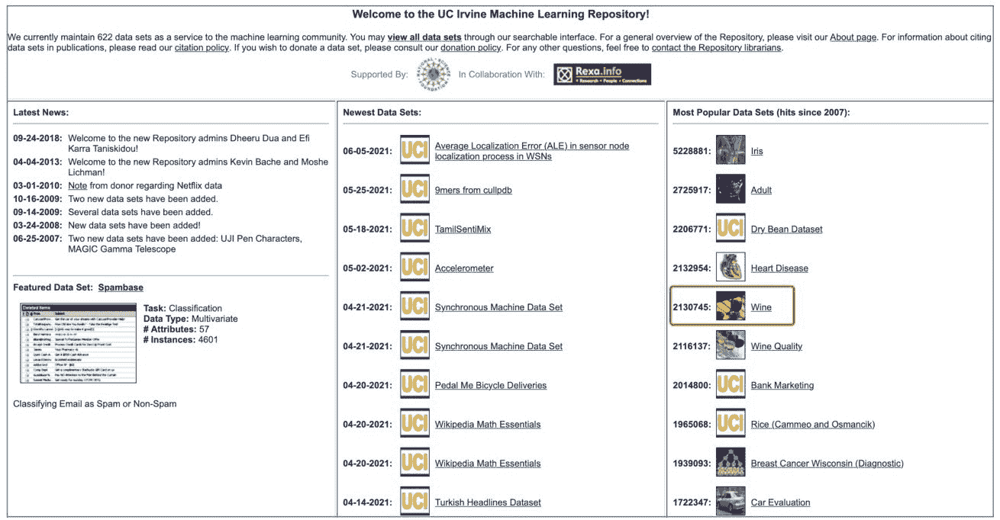
>
> Figure 2-1 Link to the Wine Dataset
>
> After clicking the Wine Dataset link, click the `Data Folder` link on the new page, and then click `wine.data` on the subsequent page to download the dataset.

### 2.1.4 How to Open the Data File

The data file we downloaded has a ".data" extension. How do we open this type of file? Let's ask ChatGPT for the answer. Enter "How to open wine.data" in the ChatGPT dialog box, and you will get the following reply.

**ChatGPT** `wine.data` is a plain text file separated by commas. You can open it with a text editor. In most operating systems, you can use any text editor (such as `Notepad`, `Sublime Text`, `Atom`, etc.) to open it. The following are example steps to open the file in the `Windows` operating system.

1.  Open File Explorer and navigate to the folder containing the `wine.data` file.

2.  Right-click the `wine.data` file and select "Open with" or "Open With".

3.  Select a text editor from the dropdown list, such as Notepad.

4.  The file will open in the selected text editor.

You can also use the `Pandas` library in `Python` or other data analysis tools to read and process the dataset for more convenient analysis and modeling. The following is an example code for reading the dataset using the `Pandas` library in `Python`.

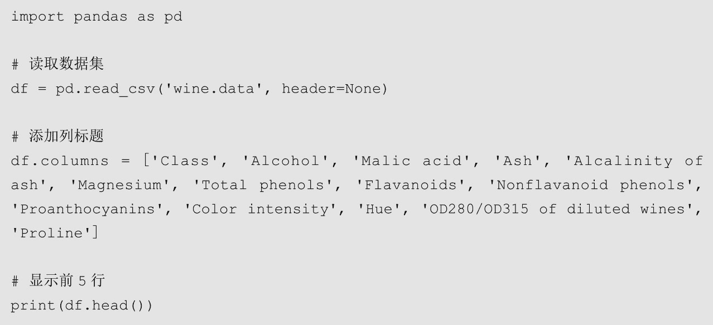

After running the above code, you will see the output of the first 5 rows of data.

From the reply above, we can see that ChatGPT provided the file type of `wine.data` and detailed instructions on how to open this type of file in the `Windows` system. In addition, ChatGPT provided example code for opening the file in `Python`. If readers have already installed the `Python` compilation environment, they can copy the example code into the compiler and try to run it; if they have not installed the `Python` compilation environment yet, they can install it with the help of ChatGPT.

## 2.2 Let ChatGPT Help Us Install Anaconda

For readers aspiring to work in the fields of machine learning and data science, it is recommended to install `Anaconda`, which has very significant advantages in the field of data science.

### 2.2.1 Why Choose Anaconda

If you want to know what outstanding advantages `Anaconda` has, you can enter "What are the advantages of Anaconda" in the ChatGPT dialog box, and it will give the following reply.

**ChatGPT** `Anaconda` is an open-source data science platform with the following advantages.

1.  **Convenient Environment Management**: `Anaconda` provides a convenient environment management tool. You can create multiple environments on the same computer, each installing different versions of `Python` and various data science libraries. This makes switching between different projects easy and avoids version conflict issues.

2.  **Pre-installed Common Data Science Libraries**: `Anaconda` comes with many commonly used data science libraries, such as `NumPy`, `Pandas`, `Matplotlib`, `scikit-learn`, etc., saving the trouble of installing and configuring these libraries.

3.  **Cross-platform**: `Anaconda` can run on multiple operating systems, including `Windows`, `Mac`, and `Linux`, making development and deployment more convenient.

4.  **Community Support**: `Anaconda` has an active community providing various tutorials, documents, and support, making it easier for beginners to get started.

5.  **Built-in `Jupyter Notebook`**: `Anaconda` has a built-in `Jupyter Notebook`, which facilitates data analysis and visualization, and integrates code, comments, and visualization results into a single document.

In summary, `Anaconda` is a convenient, easy-to-use, cross-platform data science platform. It provides a series of commonly used tools and libraries that can help data scientists and developers build and deploy data science applications faster.

The author deeply relates to the above advantages of `Anaconda`. It can be said that in many years of practical work, `Anaconda` has become the author's closest "comrade-in-arms". I believe that after readers become familiar with and accustomed to using it, they will also develop a "can't put it down" feeling.

### 2.2.2 Downloading and Installing Anaconda

Next, we will download and install `Anaconda`. Enter "How to download and install Anaconda" in the ChatGPT dialog box, and you will get the following reply.

**ChatGPT** The following are the steps to download and install `Anaconda` on a `Windows` system.

1.  Download the `Anaconda` installation package suitable for your system from the `Anaconda` official website.

2.  Open the downloaded `Anaconda` installation package.

3.  In the installation wizard, select the `Install` option, then click `Next`.

4.  Read the license agreement. If you agree, select the `I Agree` option, then click `Next`.

5.  Select the installation location, then click `Next`.

6.  Select the installation type. The default is `Just Me`. Then click `Next`.

7.  If you wish to add the `Anaconda` path to the environment variables, check the `Add Anaconda to my PATH environment variable` option, then click `Install`.

8.  Wait for the installer to complete the installation. This may take a few minutes.

9.  After installation is complete, select the `Next` option.

10. Select the `Register Anaconda as my default Python 3.9` option, then click `Finish`.

After installation, you can find `Anaconda Navigator` in the Start Menu and use it to launch `Jupyter Notebook` and other tools. You can also launch the `Python` environment through `Anaconda Prompt`.

The download and installation tutorial provided by ChatGPT is quite detailed. Following the above steps, you can basically complete the installation of `Anaconda`.

### 2.2.3 Using Jupyter Notebook in Anaconda

After installation, we will edit and run `Python` code in the built-in `Jupyter Notebook` of `Anaconda`. Readers using it for the first time can ask "How to use Jupyter Notebook in Anaconda" in the ChatGPT dialog box to get detailed guidance, as shown below.

**ChatGPT** Using `Jupyter Notebook` in `Anaconda` is very simple. Just follow the steps below.

1.  Launch `Anaconda Navigator`. You can find `Anaconda Navigator` in the Start Menu and click it to launch.

2.  In `Anaconda Navigator`, click the `Launch` button under the `Jupyter Notebook` icon.

3.  `Jupyter Notebook` will open in the default browser. If the browser does not open automatically, please manually open the browser and visit the URL.

4.  On the `Jupyter Notebook` homepage, click the `New` button, then select `Python 3` or another supported programming language.

5.  `Jupyter Notebook` will open a new Notebook document. You can write code, run code, add comments, and explanatory text in this document.

6.  After writing code in the Notebook, you can run the code by clicking the run button or pressing the `Shift+Enter` shortcut key.

7.  You can add `Markdown` cells in the Notebook to add explanatory text, images, links, etc.

8.  After completing the Notebook, you can save it by selecting the `Save and Checkpoint` option under the `File` tab.

9.  When you open `Jupyter Notebook` again, you can find the saved Notebook on the homepage and continue editing or running it.

These are the basic steps for using `Jupyter Notebook` in `Anaconda`. Please note that `Jupyter Notebook` supports many other functions and plugins, such as plotting, data visualization, multi-language support, etc. You can learn more by searching on your own or referring to the `Jupyter Notebook` official documentation.

Following ChatGPT's guidance step by step, you will see the interface shown in Figure 2-2.

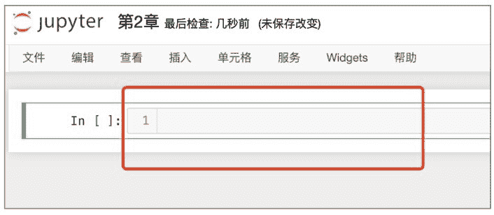

Figure 2-2 Newly Created Jupyter Notebook

Figure 2-2 is the blank `Jupyter Notebook` file we created according to ChatGPT's guidance. The boxed area is called a "Cell". We can edit `Python` code in this cell and run the code using the `Shift+Enter` shortcut key.

### 2.2.4 Reading Data in Jupyter Notebook

Below, we will paste the example code for opening `wine.data` previously given by ChatGPT into `Jupyter Notebook` and run it. It is suggested that you slightly modify the code here by removing the `print` function in the last line. The modified code is as follows.

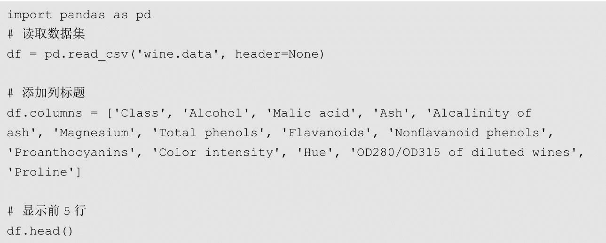

Running the code will produce a table, as shown in Table 2-1.

Table 2-1 First 5 Records of the Wine Dataset

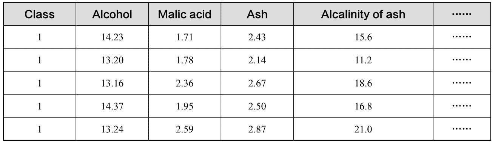

> **Tip**
>
> For display convenience, Table 2-1 omits some features of the dataset. Readers will see the complete feature fields in the table header in their own Notebook.

If readers obtain results similar to Table 2-1, it indicates that the data has been successfully read, and the name of each feature has been added to the table header. Next, we can use this dataset for the next step of experimentation.

## 2.3 Let ChatGPT Teach Us Exploratory Data Analysis

Usually, when we get an unfamiliar dataset, we need to perform "Exploratory Data Analysis" first. This section will learn the basic concepts and steps of exploratory data analysis with you.

### 2.3.1 What is Exploratory Data Analysis

To understand the basic concept of "Exploratory Data Analysis", we can also let ChatGPT introduce it to us. Enter "What is Exploratory Data Analysis" in the ChatGPT dialog box, and you will get the following reply.

**ChatGPT** Exploratory Data Analysis (`EDA`) is a data analysis method whose main purpose is to deeply mine information and relationships in data through visualization and statistical analysis methods, discover patterns and trends in data, and provide support for subsequent data modeling and prediction. Exploratory Data Analysis usually includes the following steps.

1.  **Data Preprocessing**: Including data cleaning, data transformation, and missing value imputation, etc., to ensure data quality and usability.

2.  **Visualization Analysis**: Using charts, histograms, box plots, and other visualization tools to visualize data for a better understanding of data distribution, correlation, and outliers, etc.

3.  **Statistical Analysis**: Applying statistical methods, such as descriptive statistics, hypothesis testing, regression analysis, etc., to analyze data to understand data patterns and relationships.

4.  **Feature Engineering**: Performing feature engineering on data, including feature extraction, feature selection, and feature transformation, etc., to provide better features for subsequent data modeling and prediction.

Exploratory Data Analysis is an important part of data analysis. It can help data analysts quickly understand the characteristics and structure of a dataset, discover patterns, trends, and outliers in the data, thereby providing strong support for subsequent data mining and modeling. `EDA` is very important in practical applications, especially in the fields of machine learning and data mining. Exploratory Data Analysis is a necessary prerequisite for building effective models and conducting predictive analysis.

From ChatGPT's reply, we learn that the general steps of Exploratory Data Analysis include four parts: "Data Preprocessing", "Visualization Analysis", "Statistical Analysis", and "Feature Engineering". In addition, we also learn that Exploratory Data Analysis is very important for model training and is an indispensable step in actual work.

### 2.3.2 How to Perform Exploratory Data Analysis

After understanding the basic concepts of Exploratory Data Analysis, we can get hands-on. Here, let's first try to let ChatGPT do some work for us, and then verify the answers given by ChatGPT. Enter "Perform Exploratory Data Analysis on the Wine Dataset" in the ChatGPT dialog box, and you will get the following reply.

**ChatGPT** To perform Exploratory Data Analysis on the Wine Dataset, we need to first perform data import and preprocessing, then conduct visualization and statistical analysis, etc.

The following are the general steps for performing Exploratory Data Analysis on the Wine Dataset.

1.  **Data Import and Preprocessing**.
    -   Import the dataset and check the basic information and format of the data.
    -   Remove duplicate values and missing values, and clean and transform the data.
    -   Standardize the data to ensure consistent scale among features.

2.  **Data Visualization**.
    -   Use histograms, scatter plots, box plots, and other visualization tools to visualize the distribution and correlation of the data.
    -   For categorical variables, use bar charts, pie charts, and other visualization tools to understand the proportions and distribution among categories.

3.  **Statistical Analysis**.
    -   Perform descriptive statistical analysis on the data, calculating the mean, variance, skewness, and kurtosis of each feature.
    -   Use correlation coefficients, covariance, and other methods to analyze the correlation and covariance relationships between features.
    -   Perform hypothesis testing on the data to analyze differences and significance between features.

Below is the code implementation for Exploratory Data Analysis on the Wine Dataset in a `Python` environment.

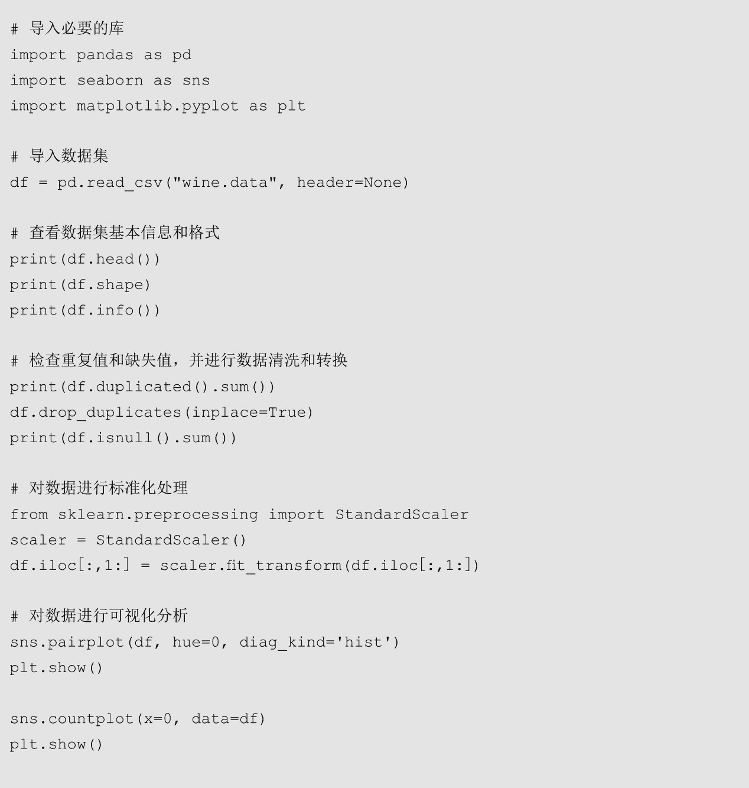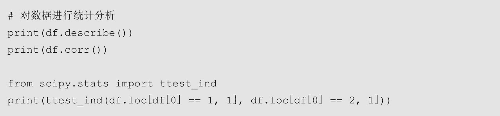

The above code implements Exploratory Data Analysis on the Wine Dataset, including data import and preprocessing, visualization, and statistical analysis.

From the reply above, we can see that ChatGPT not only gave the steps for performing Exploratory Data Analysis on the Wine Dataset but also wrote the code. Next, we copy the code into `Jupyter Notebook` and use the `Ctrl+Shift+ -` shortcut key to split the entire code into different cells for easy observation of the running results. The code for importing libraries is as follows.

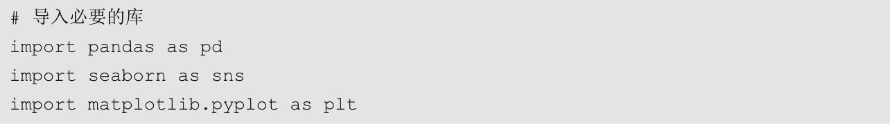

In the code above, `Pandas` for reading data is imported first and renamed as `pd`, then two plotting tools—`Seaborn` and `Matplotlib`—are imported respectively. Some readers may not be very familiar with these two libraries. Below, let's ask ChatGPT to briefly introduce them.

Enter "Briefly introduce Seaborn, within 50 words" in the ChatGPT dialog box, and you will get the following reply.

**ChatGPT** `Seaborn` is a `Python` visualization library based on `Matplotlib`. It provides a highly customizable interface for drawing statistical graphics. `Seaborn` has built-in classic datasets and color palettes, helping us perform data visualization and analysis more easily.

Then enter "Briefly introduce Matplotlib, within 100 words", and you will get the following reply.


ChatGPT `Matplotlib`是一个`Python`绘图库，用于生成高质量的 2D 图形，可用于数据可视化、交互式图形应用等多个领域。`Matplotlib`提供了各种绘图方法，包括线图、散点图、柱状图、等高线图等，同时也支持自定义图形元素和样式。`Matplotlib`可以与`NumPy`和`Pandas`等常用数据处理库结合使用，能够方便地处理各种数据，并将其可视化。`Matplotlib`还支持多种输出格式，包括`PNG`、`PDF`、`SVG`等，可用于生成各种图形报告和论文。

在了解了`Seaborn`和`Matplotlib`之后，我们继续研究代码。

### 2.3.3 查看数据基本信息和格式

因为前面我们已经知道`pd.read_csv()`和`df.head()`的作用，所以我们直接从`df.shape`和`df.info()`开始。首先是下面这行代码。


在`Jupyter Notebook`中运行上面这行代码，会得到以下结果。

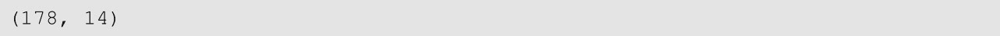

这里我们使用了`Pandas`中`DataFrame`的`shape`属性查看数据的格式。关于`shape`属性，我们可以让`ChatGPT`给出简要的解释。在`ChatGPT`对话框中输入“解释 shape 属性的作用”，会得到如下答复。

> **ChatGPT** 在`Pandas`中，`DataFrame`的`shape`属性可以用于获取数据框的行数和列数。它返回一个包含两个值的元组，第一个值表示数据框的行数，第二个值表示数据框的列数。通常，我们可以使用`shape`属性快速了解数据框的规模，以便在进行数据处理和分析之前对其进行必要的准备。例如，我们可以使用`shape`属性检查数据框是否具有所需的行数和列数，或者是否需要进行维度调整和数据清理等操作。

从`ChatGPT`的答复中我们可以了解到，`DataFrame`的`shape`属性返回的是数据框的行数和列数。这里我们得到`(178,14)`这个结果，代表`Wine` 酒数据集有 178 行、14 列。

接下来我们运行下面这行代码。


会得到以下的结果。

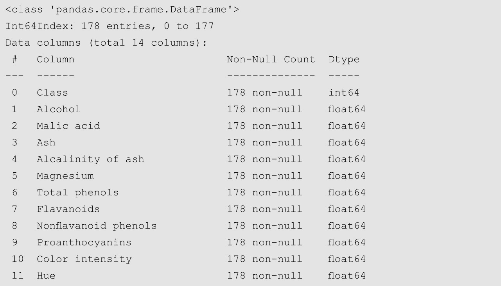
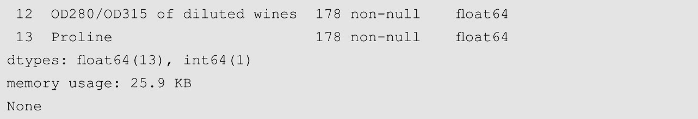

我们使用了`DataFrame`的`info()`方法查看数据信息。如果需要让`ChatGPT`给出详细解释，可以在`ChatGPT`对话框中输入“解释 info()方法的作用”，会得到如下答复。

> **ChatGPT** 在`Pandas`中，`DataFrame`的`info()`方法可以用来获取数据框的基本信息和概要统计。它会显示数据框的列名、数据类型、非空值数量及每个列的内存占用等信息，通常用于快速了解数据框的数据类型、缺失值和内存使用等情况。通过`info()`方法，我们可以了解数据框的整体情况。此外，`info()`方法还可以帮助我们判断数据框中是否存在数据类型错误、缺失值和异常值等数据质量问题，以便在数据处理和分析之前进行必要的数据清理和修复。

从答复中可以看到，`info()`方法返回了数据框的列名、数据类型、非空值数量等信息。以`Class`这一列为例，我们看到它的非空值数量是“178 non-null”，得知这个数据框有 178 行，也就是说`Class`这一列中是没有空值的；同时它的数据类型是`int64`，也就是 64 位整数类型。

### 2.3.4 检查重复值与缺失值

接下来，我们可以使用下面这行代码检查数据中是否有重复值。


运行这行代码，会得到以下结果。


上面的代码中，我们先使用了`DataFrame`的`duplicated()`方法让程序寻找数据框中的重复值，然后使用`sum()`方法对重复值的数量进行求和。程序返回的结果是 0，说明我们的数据框中并没有重复值。

如果读者希望进一步了解`duplicated()`方法，可以自行向`ChatGPT`提问，看看它的答复是否能够让你获得更详细的信息。

如果在处理其他数据时，遇到有重复值的情况，可以使用`ChatGPT`给出的下面这行代码去除重复值。

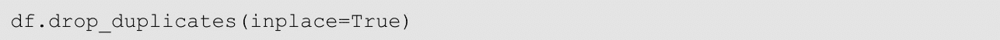

上面的代码使用了`drop_duplicates()`方法去除重复值。同样，读者也可以用提问的方法，向`ChatGPT`查询关于`drop_duplicates()`方法的详细信息。

下面这行代码的主要作用是查看数据框中每一列所包含的空值数量。

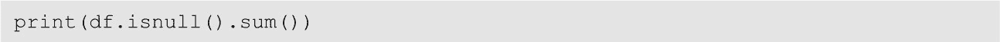

在`Jupyter Notebook`中运行这行代码，会得到如下结果。

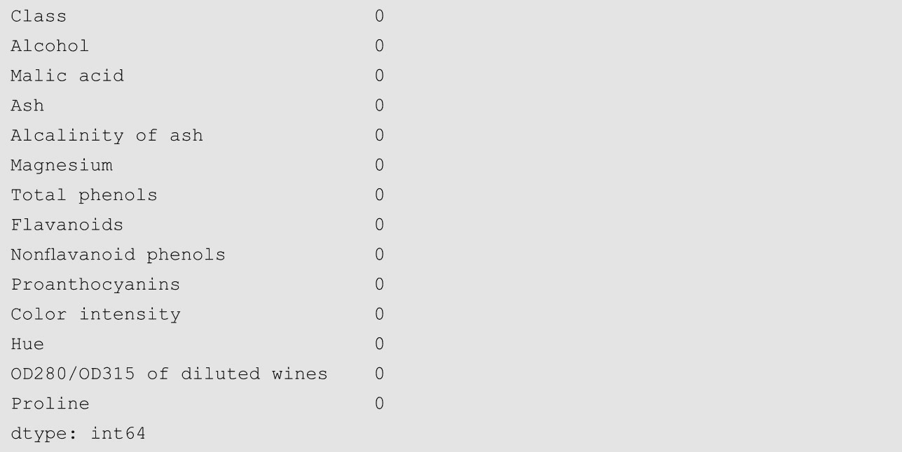

与`duplicated()`方法类似，`isnull()`方法用于检查数据框中是否有空值，并且用`sum()`方法计算空值的数量。从代码运行结果可以看出，每一个字段名后面的数字都是 0，说明我们的数据框中任何一列都不包含空值。这里也鼓励读者向`ChatGPT`提问，获得关于`isnull()`方法的更多信息。

### 2.3.5 数据预处理

在确认了数据框中没有重复值和空值后，我们还可以对数据进一步进行处理。以`ChatGPT`给出的代码为例，如下所示。

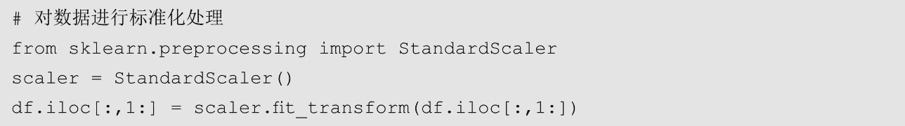

在这段代码中，我们使用了`scikit-learn`（简称为`sklearn`）中的`StandardScaler`对数据进行了标准化处理。这是很常用的数据处理方法。下面我们让`ChatGPT`讲解一下这个知识点。在`ChatGPT`对话框中输入“什么是数据标准化处理”，会得到如下答复。

> **ChatGPT** 数据标准化是一种常见的数据预处理技术，用于将不同尺度和单位的数据转换为具有统一尺度和单位的标准化数据。它通常通过将原始数据按照一定的比例缩放和平移，将数据转换为均值为 0、标准差为 1 的标准正态分布，或者将数据转换为 0 到 1 之间的归一化数据。数据标准化处理的目的是消除数据间的量纲影响，使不同变量之间具有可比性和可解释性，同时也可以提高某些机器学习算法的性能和稳定性。数据标准化处理常用的方法包括`Z-score`标准化、`Min-max`标准化、小数定标标准化等。

我们可以这样理解`ChatGPT`给出的答复：我们的数据中有两个特征，其中一个特征的范围为 0~1，而另一个特征的范围为 0~100000。在这种情况下，模型可能会认为第二个特征更加重要。为了消除这种量纲不同带来的差异，我们就需要使用标准化的方法对数据进行预处理。

在上面的代码中，我们使用了`scikit-learn`中的`StandardScaler`对数据进行标准化处理。我们还可以让`ChatGPT`“介绍 scikit-learn 中的 StandardScaler”，`ChatGPT`给出的答复如下。

> **ChatGPT** `StandardScaler`是`scikit-learn`中的一个数据预处理类，用于对数据进行标准化处理。它可以通过将每个特征的值减去该特征的均值，然后除以该特征的标准差，将数据转换为均值为 0、方差为 1 的标准正态分布。标准化处理可以消除不同特征之间的量纲差异，避免某些特征对模型的影响过大或过小，提高模型的准确性和鲁棒性。在使用`StandardScaler`时，需要先用`fit()`方法对数据进行拟合，然后再用`transform()`方法对数据进行转换。`StandardScaler`还可以用于交叉验证和管道等机器学习任务中，以便对数据进行预处理和特征提取。

从上面的答复可知，`StandardScaler`的原理是通过一系列的计算，将数据转换成均值为 0、方差为 1 的标准正态分布。这样一来，不同特征因为量纲差异给模型带来的影响就可以消除了。

### 2.3.6 数据可视化

接下来，我们再来看一下`ChatGPT`给出的数据可视化代码——它先用`pairplot`绘制图形，展示特征之间的关系。这部分代码如下。

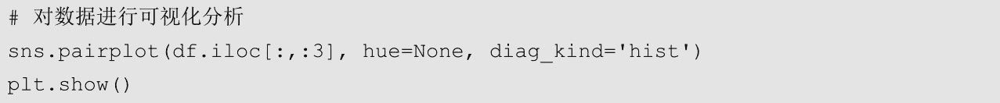

> **温馨提示**
>
> 为了方便展示，此处对`ChatGPT`给出的代码进行了修改，在图形中只保留了 3 个字段。读者在试验时，可以绘制完整的图形进行观察。

运行上面的代码，得到如图 2-3 所示的结果。

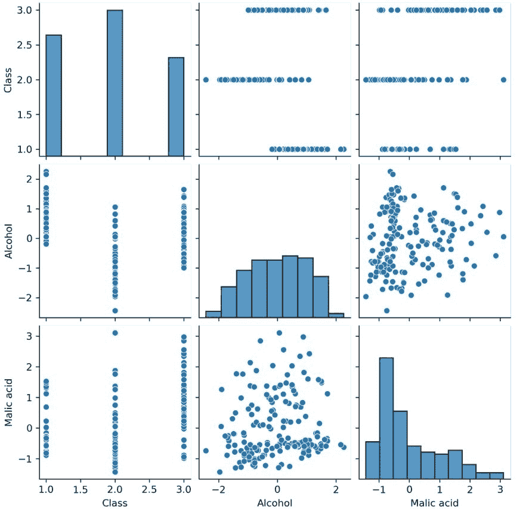

**图 2-3 根据 ChatGPT 给出的代码绘制 pairplot**

初次接触数据分析、数据科学的读者，可能对`pairplot`还不太熟悉。不用担心，我们可以求助`ChatGPT`。在`ChatGPT`对话框中输入“什么是 pairplot”，会看到`ChatGPT`给出如下答复。

> **ChatGPT** 在`Seaborn`中，`pairplot`是一个用于绘制变量之间关系的图表类型，它可以用于绘制数据集中所有数值型变量之间的两两关系，同时在对角线上绘制变量的直方图或密度估计。它可以帮助我们快速探索数据集中不同变量之间的相关性和分布情况，从而帮助我们选择最相关的特征和变量进行进一步的数据分析和建模。`pairplot`支持多种绘图样式和参数设置，可以根据数据集的特点和分析目的进行个性化定制，非常适用于数据探索和分析工作。

从上面的答复中可以看到，`pairplot`主要反映了变量之间的关系。在图 2-3 中，我们可以看到从左上至右下的对角线上的图形是用直方图描述了各个特征的分布情况；而其他图形则是用散点图描述两个特征之间的关系。以第 2 行第 1 列的散点图为例，它反映的是 3 种不同类型（`Class`）的酒的酒精含量分布情况。

除此之外，`ChatGPT`还给出了绘制`countplot`的代码，这部分代码我们也稍微修改一下再运行。修改后的代码如下。

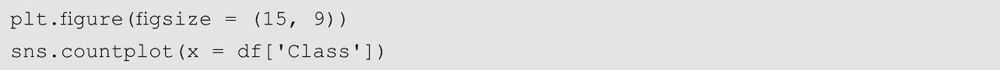


需要说明的是，在上面的代码中，我们先添加了一行设置图像大小的代码；然后，我们让程序只绘制名为`Class`的字段。这是因为我们希望了解在所有的样本中，不同类型的样本各有多少。运行代码，会得到如图 2-4 所示的结果。

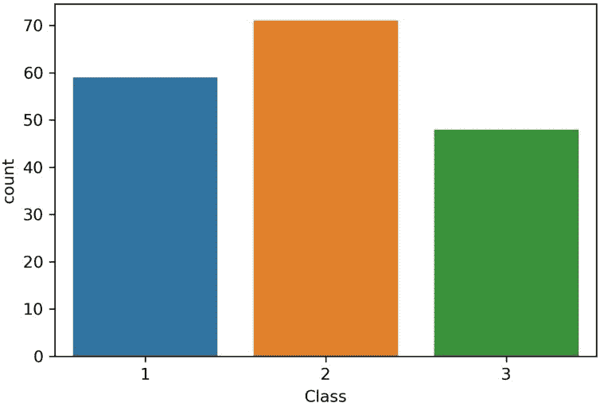

**图 2-4 根据 ChatGPT 给出的代码绘制 countplot**

从图 2-4 中可以看到，使用`countplot`可以很直观地了解不同种类的酒的数量分布情况。类型标签为“1”的酒样本数量为 60 个左右，类型标签为“2”的酒样本数量为 70 个左右，而类型标签为“3”的酒样本数量为 50 个左右。

`countplot`是非常容易理解的绘图方式，这里我们不再赘述它的基本概念。感兴趣的读者可以自行向`ChatGPT`提问，获得更加详细的介绍。

### 2.3.7 查看数据的统计信息

前文中`ChatGPT`告诉过我们，探索性数据分析中还有一个重要的步骤——统计分析。在`ChatGPT`生成的代码中，也包含了这部分的功能。下面我们就一起研究一下。首先使用`describe()`方法查看样本特征的统计信息，为了方便展示，这里也修改了代码。

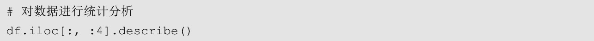

运行代码，可以得到如表 2-2 所示的结果。

**表 2-2 查看部分特征的统计信息**

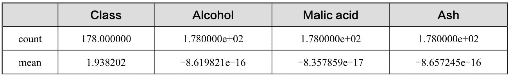

**续表**

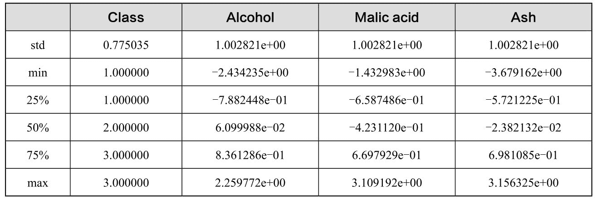

从表 2-2 中可以清楚地看到`describe()`方法所返回的信息。其中包括该特征的数量（`count`）、均值（`mean`）、标准差（`std`）、最小值（`min`）、下四分位数（`25%`）、中位数（`50%`）、上四分位数（`75%`）及最大值（`max`）。

> **温馨提示**
>
> 在表 2-2 中，除`Class`这一列以外，其他特征都使用了科学记数法。例如，`-8.619821e-16`表示`-8.619821× 10^-16`。

除了使用`describe()`方法查看数据的统计学描述，`ChatGPT`还使用了`corr()`方法显示各特征之间的相关性。这里同样修改了代码，只展示部分特征的相关性。

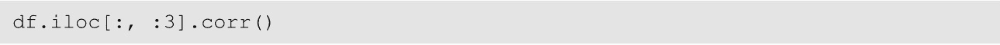

运行这行代码，会得到如表 2-3 所示的结果。

**表 2-3 部分特征的相关性分析**

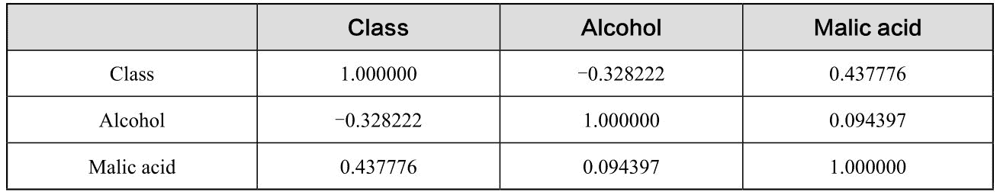

这里我们选取了 3 个特征进行相关性分析，表 2-3 中显示了各个特征之间的相关系数，值在-1 到 1 之间，值越接近 1，说明两个特征越呈现正相关；反之，值越接近-1，说明两个特征越呈现负相关；而如果值接近 0，说明两个特征之间几乎没有相关性。

继续看`ChatGPT`生成的代码，会发现它在最后还使用`ttest_ind`函数对样本进行了 t 检验。这是一个统计学中的概念，对统计学不是很熟悉的读者可以在`ChatGPT`对话框中提问“ttest_ind 是什么”，会得到如下答复。

> **ChatGPT** `ttest_ind`是一个用于执行两个独立样本 t 检验的函数。`ttest_ind`函数可以用于比较两个独立样本的平均值是否显著不同，通常用于检验两组数据是否具有显著差异。在执行 t 检验时，`ttest_ind`函数需要输入两个独立样本的数据数组，可以选择是否假定两组数据具有相等的方差，还可以设置是否使用双侧或单侧检验。函数的返回值包括 t 值、`p 值`和自由度等统计量，可以根据`p 值`判断两组数据是否存在显著差异。`ttest_ind`函数是`scipy.stats`模块中的一个函数，常用于统计分析和机器学习等领域中。

简单了解了 t 检验的概念后，我们可以尝试修改代码并运行。修改后的代码如下。

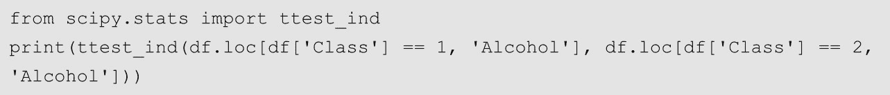

在这段代码中，我们先在`scipy.stats`模块中导入`ttest_ind`函数，然后对类型标签为“1”的酒的酒精含量和类型标签为“2”的酒的酒精含量进行 t 检验。运行代码，会得到如下结果。

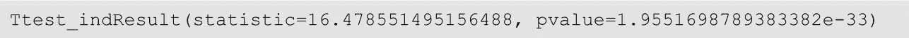

从`ttest_ind`函数返回的结果来看，t 检验的`p 值`（`p-value`）为`1.955×10^-33`，这个值远远小于 0.05。那么`p 值`的含义是什么呢？我们在`ChatGPT`对话框中输入“t 检验中的 p 值”，会得到如下答复。

> **ChatGPT** 在统计学中，`p 值`是指当原假设为真时，得到样本统计量或更极端情况的概率。在 t 检验中，`p 值`表示两组数据在 t 分布下得到的双侧或单侧检验概率，即当原假设为真时，得到样本差异或更极端差异的概率。`p 值`越小，说明两组数据的差异越显著，通常将`p 值`小于等于 0.05 的结果视为显著差异，拒绝原假设；而当`p 值`大于 0.05 时，结果被认为不具有显著差异，接受原假设。`p 值`的大小还受样本大小、显著水平和方差等因素的影响，需要综合考虑。在实际应用中，`p 值`通常是判断统计检验结果是否显著的重要指标之一。

从`ChatGPT`的答复中我们获知，`p 值`越小，说明两组数据的差异越显著；反之说明两组数据不具有显著差异。在本例中，`p 值`远远小于 0.05，说明类型标签为“1”的酒与类型标签为“2”的酒的酒精含量是存在显著差异的。

## 2.4 试试训练一下模型

在 2.3 节中，我们已经掌握探索性数据分析的一般流程和基本方法。值得一提的是，`Wine` 酒数据集的数据质量还是比较好的——既没有缺失值，也没有重复值，为我们省去了很多数据预处理的工作。下面我们就可以进行模型训练的工作。

### 2.4.1 让 ChatGPT 给出示例代码

同样，我们让`ChatGPT`先把代码写出来。在`ChatGPT`对话框中输入“使用 wine.data 训练模型”，可以看到`ChatGPT`给出如下答复。

> **ChatGPT** 使用`wine.data`数据集进行建模，需要进行以下步骤。
>
> 导入必要的库：使用`Pandas`读取数据，使用`scikit-learn`进行数据预处理和建模。

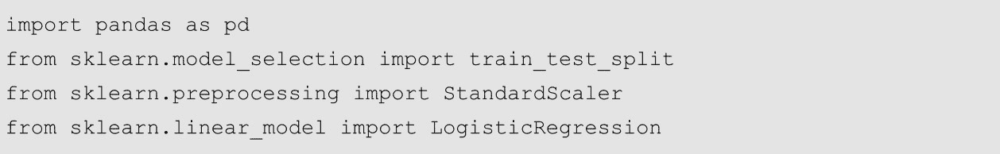

> 读取数据：使用`Pandas`读取`wine.data`文件，并设置列名。

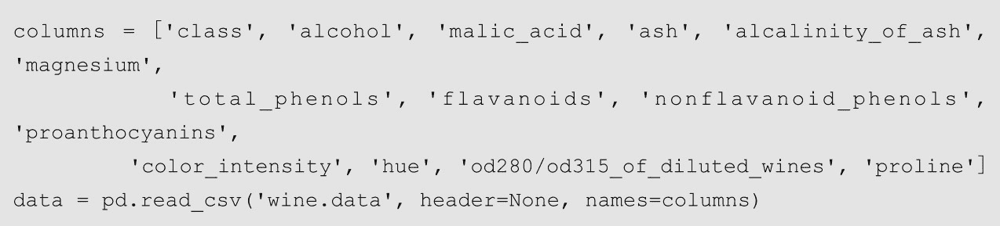

> 数据预处理：将数据集分为特征和标签，并使用`StandardScaler`进行数据标准化。

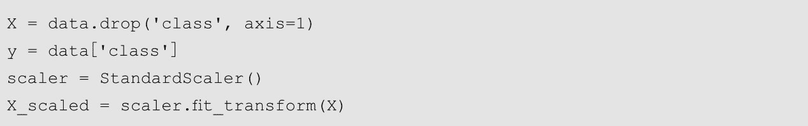

> 划分训练集和测试集：使用`train_test_split`函数划分训练集和测试集。

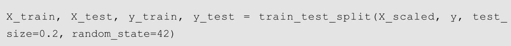

> 训练模型：使用`LogisticRegression`进行模型训练。

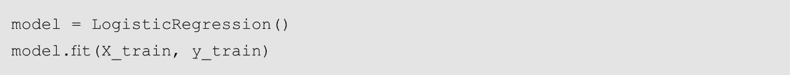

> 模型评估：使用测试集进行模型评估。

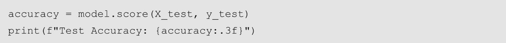

这些步骤完成后，就可以得到模型的预测准确率。实际应用中，还需要根据具体问题和需求选择合适的模型和调整参数，进行模型优化和改进。

可以看到，`ChatGPT`给出了完整的模型训练代码。代码中有一部分和前面的代码是重复的，如读取数据、设置列名、数据标准化处理等。这部分重复的代码我们不再保留，重点研究有效的代码。

### 2.4.2 特征工程与数据集拆分

首先需要再导入一些需要的库，代码如下。


上面两行代码，导入了一个用于将数据集拆分为训练集和测试集的工具——`train_test_split`，以及一个用于分类任务的工具——`LogisticRegression`（一般翻译为“逻辑回归”）。接下来，我们根据`ChatGPT`的提示，把数据分为特征和标签，代码如下。

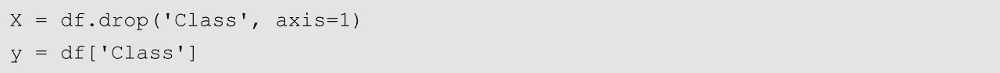


### 2.4.3 Model Training and Validation

After completing the above work, we can officially start model training. The code for training and validating the model is as follows.

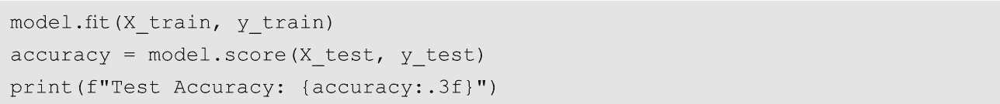

In this code, we first created a logistic regression model, then let the model fit the data in the training set. After training, we used the `score()` method to validate the model's accuracy on the test set and printed the result. Running the code yields the following result.


Judging from the program's returned results, our trained model achieved **100% accuracy** on the test set. That is to say, through learning from the training set, the model can classify every single sample in the test set into the correct category. If you obtained the same result, congratulations! You have achieved a **"success right out of the gate"** in the field of machine learning!

> **Warm Tip**
>
> For beginners, the code above also involves some knowledge that hasn't been explained yet (such as what logistic regression is). This chapter only aims to introduce the overall workflow of a small machine learning project; specific knowledge will be explained in detail in later chapters.

## 2.5 Exercises

Through the study of this chapter, I believe many readers are **eager to try** and want to practice hands-on. Below are some exercises arranged for you.

1.  With the help of ChatGPT, find and download a dataset you like.
2.  Load and read your downloaded dataset in Jupyter Notebook.
3.  Check the format of your dataset: how many rows and columns does it have?
4.  Check whether there are duplicate values or missing values in your dataset.
5.  Ask ChatGPT to clarify the function of the parameter `hue` in Seaborn's `pairplot`.
6.  With the help of ChatGPT, select a feature from your dataset and plot a histogram.
7.  View the statistical information of each feature in your dataset.
8.  Perform a t-test on the sample data in your dataset.

# Chapter 3 Let ChatGPT Lead Us to Master Linear Models

## Chapter Guide

In Chapter 2, ChatGPT helped us find some small datasets suitable for learning and conducted interesting experiments in Jupyter Notebook. Through these experiments, we learned the general steps and some simple implementation methods of Exploratory Data Analysis (EDA). With the help of ChatGPT, we used a simple linear model to complete a small classification task and achieved **100% accuracy**. In this chapter, we will delve into linear models in machine learning.

## Key Points

Through the study of this chapter, you will master the following knowledge:

- Basic concepts of linear models.
- Principles of linear regression.
- Principles and implementation of the gradient descent algorithm.
- Linear models for classification tasks.
- Concepts of regularization and linear models using regularization.

## 3.1 Let ChatGPT Tell Us What a Linear Model Is

To understand what a linear model is, we can type "What is a linear model" into the ChatGPT dialog box and get the following reply.

> **ChatGPT**
>
> A linear model is a statistical model used to establish a linear relationship between input variables and output variables. The basic form of this model is a linear equation where the output variable is a linear combination of input variables plus a constant term. Linear models can be used for regression and classification problems and are widely applied in statistics, machine learning, and data science.
>
> Common linear models include the following.
>
> 1.  Linear Regression Model: Used to predict the value of continuous output variables.
> 2.  Logistic Regression Model: Used to predict the value of output variables in binary classification problems.
> 3.  Polynomial Regression Model: A regression model used to fit higher-order polynomial functions.
> 4.  Ridge Regression Model: A regression model used to handle multicollinearity problems.
> 5.  Lasso Regression Model: A regression model used for feature selection and sparsity.
> 6.  Linear Discriminant Analysis Model: A model used for multi-class classification.
>
> Linear models have many advantages, such as strong interpretability and high computational efficiency, but they are usually not suitable for non-linear problems.

From a beginner's perspective, ChatGPT's reply might seem a bit abstract. Next, we will learn common linear models through some practical examples.

### 3.1.1 Understanding Linear Regression with a Simple Example

To better understand the principle of linear regression, we can ask ChatGPT to provide an example code. Type "Python example code for linear model" into the ChatGPT dialog box, and you will see the following reply from ChatGPT.

> **ChatGPT**
>
> Below is an example code implementing a linear regression model using Python.

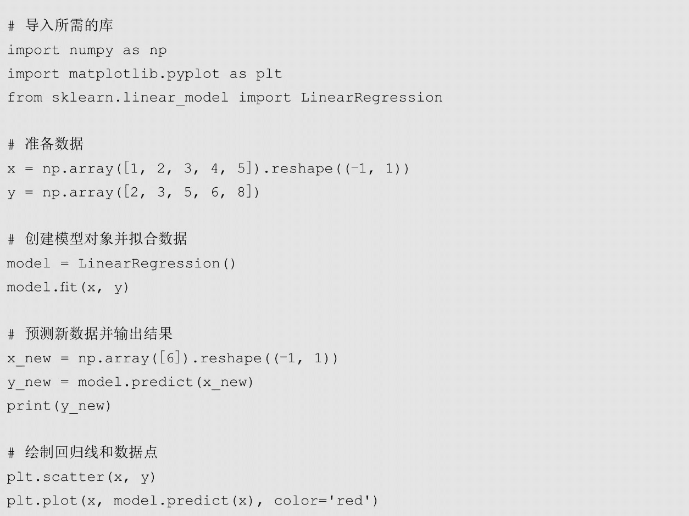

This code first uses the `NumPy` library to prepare a set of input and output variables, then uses the `LinearRegression` class from the `scikit-learn` library to create a linear regression model object, and uses the `fit()` method to fit the data. Next, it uses the `predict()` method to predict a new input variable and outputs the corresponding output variable. Finally, it uses the `Matplotlib` library to plot the regression line and a scatter plot of the original data points.

Next, we can create a new Notebook file in Jupyter Notebook, paste the code generated by ChatGPT into a cell, and try running it.

Below, we analyze step by step what each section of code does.

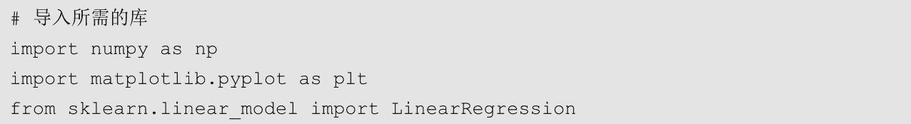

The code above imports the `NumPy` library for scientific computing, the `Matplotlib` library for plotting, and the linear regression model `LinearRegression` from the widely used `scikit-learn` library in machine learning. The next section of code uses the `NumPy` library to generate demonstration data.

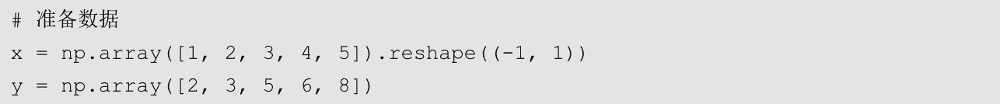

The code above uses the `array` function of the `NumPy` library to generate two arrays. The array serving as features is named `x`, and the array serving as target values is named `y`. The `reshape()` method is used to change the shape of the array. `(-1,1)` means converting the array into a shape with an arbitrary number of rows but only 1 column.

With the data ready, we can try using the linear regression model to fit the data, which is the function of the following code.

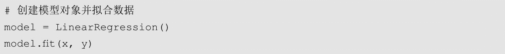

Running the above code, the model completes the fitting in an instant. Next, we can call the model to make predictions on new samples. For example, if the `x` value of a new sample is 6, the model can predict its `y` value. The code is as follows.

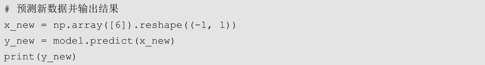

Running this code yields the following result.


From the code's running result, we can see that the model successfully predicted the `y` value of the new sample. When the `x` value of the new sample is 6, the model predicts its `y` value to be 9.3. The code provided by ChatGPT also visually demonstrates the principle of the model with a graph.

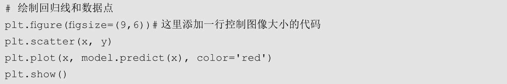

Here, we added a line of code to control the figure size. At the same time, we use the `scatter()` function of the `Matplotlib` library to draw a scatter plot and the `plot()` function to draw a line plot. Running the code produces the result shown in Figure 3-1.

In Figure 3-1, the dots are the sample data generated using the `NumPy` library. For example, the dot in the lower left corner is the first sample we generated, with an `x` value of 1 and a `y` value of 2, and so on. The straight line in the figure is the linear regression model fitted according to the generated samples. This line also explains the origin of the name "Linear Regression" very well.

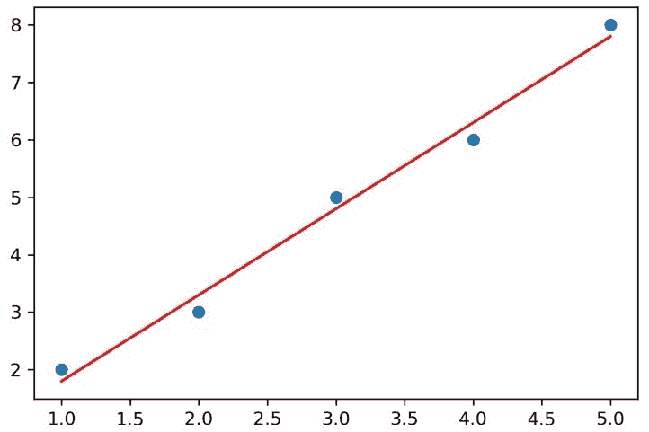

Figure 3-1 Visualizing the Linear Regression Model

### 3.1.2 Brief Introduction to the Principle of Linear Regression

After intuitively understanding the linear regression model, we can also ask ChatGPT to introduce the principle of linear regression. Type "Briefly introduce the principle of linear regression, no Markdown format" into the ChatGPT dialog box. Here we emphasize asking ChatGPT not to return Markdown-formatted text to avoid strange symbols in the reply. Sending our request yields the following reply.

> **ChatGPT**
>
> Linear regression is a common machine learning algorithm used to establish a linear relationship model between an input variable and an output variable. Its basic principle is to find the optimal linear function to fit the known input-output relationship of the data. Specifically, linear regression finds the optimal coefficient values by minimizing the squared error between predicted values and actual values, thereby establishing a model that can describe the linear relationship between input and output variables. This model can be used to predict the output variable corresponding to new input variables.
>
> The linear regression model can be expressed as
>
> ```
> Y = b0 + b1 * X1 + b2 * X2 + … + bn * Xn + ε
> ```
>
> Where `Y` is the output variable, `X1, X2,…, Xn` are input variables, `b0, b1, b2,…, bn` are coefficients, and `ε` is the error term. The model finds the optimal coefficient values to minimize the squared error between predicted and actual values. Linear regression can use optimization algorithms such as gradient descent to find the optimal coefficient values, thereby obtaining a model usable for predicting new output variables.

Combining ChatGPT's reply, we can better understand the example above. In this example, our model has only one input variable `x`, so the formula can be expressed as

```
y = b0 + b1 * x + ε
```

You may have noticed that this is actually the equation of a straight line. During the fitting process, the model aims to find the best coefficient `b1` (corresponding to the slope of the line) and the error term `b0` (corresponding to the intercept of the line). If we want to check the slope and intercept of this line, we can ask ChatGPT for an example. Type "Python code to view linear regression parameters" into the ChatGPT dialog box to get the following reply.

> **ChatGPT**
>
> The following is the code to view the parameters of the linear regression model in Python's scikit-learn library.

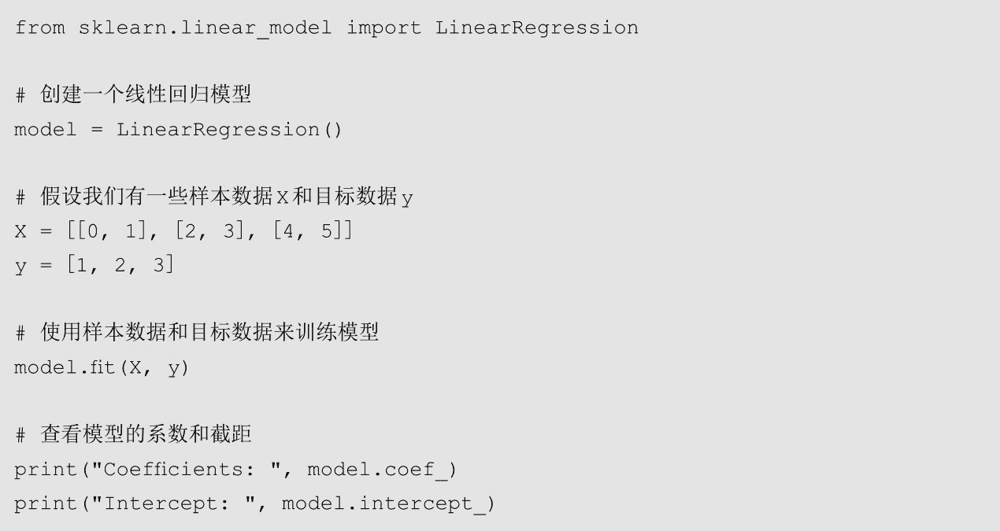

In the code above, we first import the `LinearRegression` class from the `scikit-learn` library; then create a linear regression model object named `model`; next, train the model with some sample data `X` and target data `y`; finally, use the `coef_` and `intercept_` attributes to view the model's coefficients and intercept. Among them, the `coef_` attribute stores the model's coefficient values, and the `intercept_` attribute stores the model's intercept.

From the code given by ChatGPT, we can see that to view the parameters of a linear regression model, we just need to use the model's `coef_` and `intercept_` attributes. We have already completed the model fitting in the previous example, so we only need to use the following two lines of code.

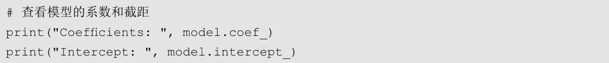

Paste these two lines of code into Jupyter Notebook and run them to get the following result.


From the code above, we can see that the equation of our trained linear regression model can be roughly expressed as `y = 1.5x + 0.3`. Therefore, when we give an `x` value of 6, the model can calculate the `y` value as `1.5 * 6 + 0.3 = 9.3`. Of course, if we have multiple input variables, the model is no longer a straight line but a hyperplane.

### 3.1.3 What is Gradient Descent

Reading here, some readers might ask: How does the model determine the optimal slope and intercept? According to ChatGPT's previous reply, we know that linear regression can use optimization algorithms like gradient descent to find the optimal coefficient values. So, what does gradient descent mean? We'll hand this question to ChatGPT as well. Type "What is gradient descent" into the ChatGPT dialog box to get the following reply.

> **ChatGPT**
>
> Gradient Descent is an optimization algorithm used to minimize the value of a function, which is usually called the Loss Function. In machine learning and deep learning, gradient descent is widely used in model training. By continuously adjusting model parameters, the value of the loss function gradually decreases, eventually yielding a better model.
>
> The basic idea of gradient descent is to calculate the partial derivatives (gradients) of the loss function with respect to the model parameters, and update the model parameters in the opposite direction of the gradient, so that the value of the loss function continuously decreases. This process can be expressed mathematically as
>
> ```
> θ = θ - α * ∇J(θ)
> ```
>
> Where `θ` represents model parameters, `J(θ)` represents the loss function, `∇J(θ)` represents the gradient of the loss function with respect to `θ`, and `α` represents the learning rate, i.e., the step size for each parameter update.
>
> There are two main implementations of gradient descent: Batch Gradient Descent and Stochastic Gradient Descent. Batch gradient descent uses the gradients of all training samples each time it updates model parameters, so the computation is large, but the update direction is more accurate, guaranteeing convergence to the global optimum. Stochastic gradient descent uses only the gradient of one training sample each time it updates model parameters, so the computation is small, but the update direction is less accurate and may converge to a local optimum.
>
> Besides batch and stochastic gradient descent, there is a compromise method called Mini-batch Gradient Descent. It uses the gradients of a small batch of training samples each time it updates model parameters, which ensures a more accurate update direction than stochastic gradient descent while reducing computation. It is currently one of the most commonly used gradient descent algorithms.

Next, we can also ask ChatGPT to help us better understand the concept of gradient descent with example code. Type "Demonstrate gradient descent in linear regression with Python code" into the ChatGPT dialog box to get the following reply.

> **ChatGPT**
>
> Below is a Python code demonstration of linear regression using the gradient descent algorithm.

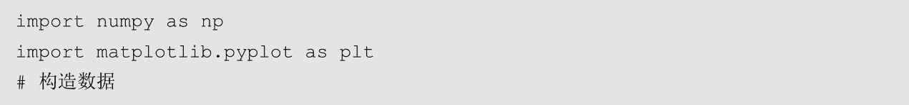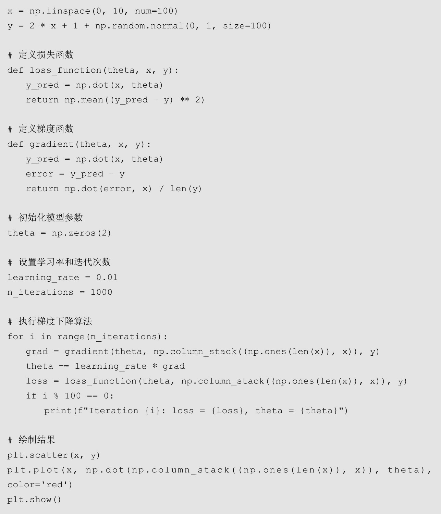

This code generates some random linear data, then uses the gradient descent algorithm to train a linear regression model, and plots the data scatter plot and the fitted line. In the code, we first define the loss function and gradient function, then initialize model parameters, set the learning rate and number of iterations, and finally execute the gradient descent algorithm loop. In each loop, we calculate the loss function and gradient, and use the learning rate and gradient to update model parameters. Finally, we obtain the optimal model parameters and use them to plot the fitted line.

Below, we paste the code into Jupyter Notebook and run it in sections. First is the data construction part.

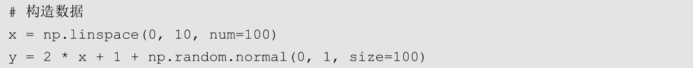

In this code, the `linspace()` function of the `NumPy` library is first used to generate an arithmetic progression ranging from 0 to 10 with a quantity of 100, serving as the input variable of the samples. Then, random numbers following a normal distribution are added as noise to the output variable `y`.

Next is the code defining the loss function and gradient function.

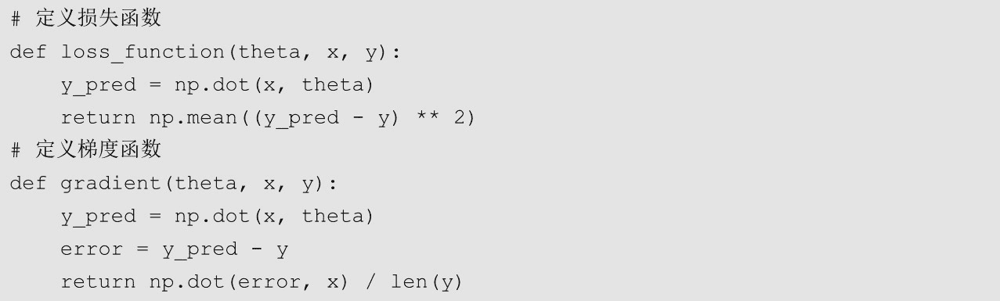

The code above first multiplies the input variable `x` with the parameter matrix `theta` to obtain the predicted value `y_pred` of the output variable `y`. Then, it calculates the mean of the squared differences between all predicted values `y_pred` and true values `y` to obtain the value of the loss function. Then, it performs matrix multiplication of the difference between predicted values `y_pred` and true values `y` with the input variable `x`, and divides by the number of samples to obtain the value of the gradient function.

Next, we can use the loss function and gradient function to execute the gradient descent algorithm.

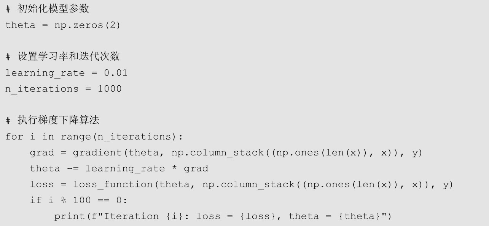

The code above uses the `zero()` function of the `NumPy` library to specify the initial parameter `theta` as 0, then sets the number of iterations to 1000. Each iteration updates the parameters based on the loss function and learning rate, and the program prints the model's loss function and latest parameters every 100 iterations. Running the code yields the following result.

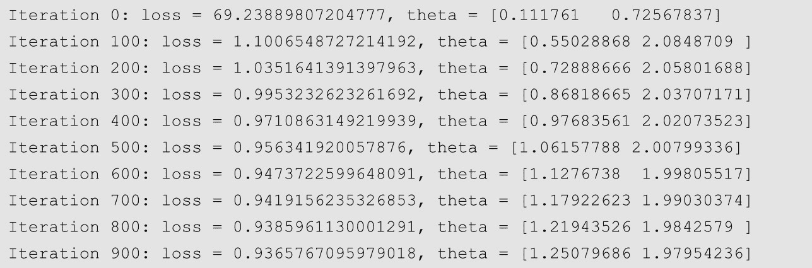

From the code's running results, we can see that the model's initial loss function was about 69.2; after 100 iterations, the loss function dropped to about 1.1, and the parameters became `[0.55028868 2.0848709]`; thereafter, the loss function continued to drop, and after 900 iterations, the loss function dropped to about 0.9, while the parameters had updated to `[1.25079686 1.97954236]`.

Finally, ChatGPT also visually demonstrates the final model.

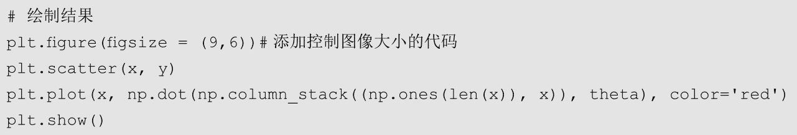

Running the code yields the result shown in Figure 3-2.

This time, we did not use the built-in linear regression model in the `scikit-learn` library, but instead defined the loss function and gradient function ourselves, using the gradient descent algorithm to fit a linear regression model. The dots in Figure 3-2 are our constructed sample data, and the straight line is the linear regression model that fits the data best, found by the gradient descent algorithm after several iterations. This process explains very well how the linear regression model finds the optimal parameter combination.


Figure 3-2 Linear Regression Model Obtained Using Gradient Descent Algorithm

> **Warm Tip**
>
> The code above is mainly to help you understand the process of the linear regression model finding optimal parameters through the gradient descent algorithm. If beginners feel strained reading the code, don't be nervous; this part of the code is not required to be mastered.

## 3.2 Linear Models Can Also Be Used for Classification

Through the study of Section 3.1, we have already understood the basic knowledge of the linear regression model. The example in Section 3.1 is a very simple regression task where the model inputs continuous numerical values. However, the capabilities of linear models are not limited to this. ChatGPT introduced two linear models that can be used for classification tasks—Logistic Regression and Linear Discriminant Analysis. Below, we take Logistic Regression as an example to study how linear models are used for classification tasks.

### 3.2.1 Brief Introduction to Logistic Regression

To learn the relevant knowledge of Logistic Regression, we can ask ChatGPT to introduce some basic concepts first. Type "Briefly introduce Logistic Regression" into the dialog box to get the following reply.

> **ChatGPT**
>
> Logistic Regression is a widely used statistical analysis method, typically used for binary classification problems, i.e., dividing data into two categories (such as yes/no, true/false, etc.). Logistic Regression is based on the linear regression model, but its output is a probability value between 0 and 1, representing the likelihood of belonging to a certain category. Logistic Regression achieves this by mapping the output of the linear function to the probability range.
>
> The main idea of Logistic Regression is to multiply the input features by a set of weights and map the result to between 0 and 1 through an activation function called the `Sigmoid` function. During the training process, we optimize these weights to maximize the model's likelihood of the observed data. Specifically, we minimize the Cross-Entropy Loss Function, which measures the difference between the probability output by the model and the actual labels.


### Logistic Regression and Its Applications

Logistic regression has many applications, such as advertising click-through rate prediction, credit scoring, and disease diagnosis. Due to its simplicity and effectiveness, logistic regression has become one of the most commonly used algorithms in machine learning and data science.

In the response above, ChatGPT told us: Logistic regression is a model based on linear regression, and the result is mapped between 0 and 1 through the `Sigmoid` function. To figure out what the `Sigmoid` function is, we can ask further. Enter "Demonstrate the Sigmoid function with Python code, visualization required, no Markdown format" in the ChatGPT dialog box, and ChatGPT will give the following response.

> **ChatGPT** The following is the Python code demonstration of the Sigmoid function and its visualization curve.


This code uses the `NumPy` library to generate 100 uniformly distributed data points from -10 to 10 and passes them to the `Sigmoid` function to calculate the corresponding y values. Then, the `Matplotlib` library is used to plot the x and y data points into the `Sigmoid` function curve.

Next, we paste the code written by ChatGPT into `Jupyter Notebook` and run it in sections. Since we have already imported the `NumPy` library and `Matplotlib` library in `Jupyter Notebook`, we can ignore these two lines of code and start directly from the code below.


The code above is used to define a function named `Sigmoid`. From the code, we can see that the calculation formula for the `Sigmoid` function is:


After defining the function, we use the following code to generate some data and transform them using the `Sigmoid` function.


Running the above code, we will get the result shown in Figure 3-3.


**Figure 3-3 Sigmoid Function Curve**

From Figure 3-3, it can be seen that the generated data x is uniformly distributed between -10 and 10. After transformation by the `Sigmoid` function, it is mapped between 0 and 1. In this way, we can classify samples with transformed values greater than 0.5 into one category, and those less than 0.5 into another category, thus completing the binary classification task.

### 3.2.2 Demonstrating Logistic Regression Usage with an Example

In Chapter 2, when we demonstrated the classification of the Wine dataset, we used the logistic regression model. To deepen the impression, we can ask ChatGPT to demonstrate the usage of logistic regression with a simpler example. Enter "Demonstrate the usage of logistic regression with an example, using Python code" in the ChatGPT dialog box, and the following response is obtained.

> **ChatGPT** Logistic regression is a machine learning algorithm widely used in classification problems. Below is an example of binary classification using logistic regression, implemented in Python using the `scikit-learn` library.
>
> Assume we have a dataset containing two features: students' exam scores and whether the student was admitted (1 for admitted, 0 for not admitted). Our goal is to predict whether they will be admitted based on students' exam scores.
>
> First, we need to load the dataset and split it into a training set and a test set.
>
> 
>
> Second, we create a classifier using the logistic regression model in the `scikit-learn` library and fit the model using the training set.
>
> 
>
> Third, we can use the test set to evaluate the model's performance and calculate the model's accuracy.
>
> 
>
> The above is a simple example of logistic regression, demonstrating the logistic regression algorithm for binary classification problems implemented using Python and the `scikit-learn` library.

Attentive readers may notice that the code above uses a file named `admission.csv` as the data source, but does not provide a way to download this file. We ask ChatGPT further: "Where to download admission.csv in the code", and get the following response.

> **ChatGPT** Sorry, the `admission.csv` mentioned earlier is a sample dataset and does not actually exist in any public resource on the internet. Therefore, if you need to run this sample code, you need to create your own `admission.csv` file. Below is an example of an `admission.csv` file.
>
> 
>
> The first column is the exam score, and the second column is whether admitted (1 for admitted, 0 for not admitted). You can use Excel, Google Sheets, or other similar tools to create this file. After creation, save the file as `admission.csv` and place it in the same folder as the sample code file to run it.

From the above response, it can be seen that `admission.csv` is not a ready-made dataset. ChatGPT suggests we copy the sample data it generated, save it as a CSV file, and then read it with code. We follow its instructions to save the sample data and then run the code.


Running the code yields the results shown in Table 3-1.

**Table 3-1 Sample Data Provided by ChatGPT**


If the reader's operation is correct, they should obtain results similar to Table 3-1. According to ChatGPT's introduction, the data in the first column is the students' exam scores, and the data in the second column indicates whether the student was admitted, with 1 for admitted and 0 for not admitted.

With the data ready, we attempt to perform model training. The code used is as follows.


In the code above, we first use the dataset splitting tool in the `scikit-learn` library to take out 20% of the samples as the test set to verify the model's accuracy; then we create an instance of logistic regression and train it.

After training is complete, we can perform model validation. The code used is as follows.


In the code above, we call the trained model to predict the data in the test set and evaluate it using `accuracy_score`. Running the code yields the following result.


By comparing the model's predicted values with the true values, the program returns a model accuracy of 1.0, that is, 100% prediction accuracy.

In addition, the code provided by ChatGPT also includes the part where the model is called to predict new samples. The code is as follows.


The code above assumes a student has an exam score of 80 and asks the model to predict whether the student will be admitted. Running the code yields the following result.


According to the model's prediction, although the student's exam score is 80, the predicted result is still 0, meaning they will not be admitted.

### 3.2.3 Prediction Probabilities in Logistic Regression

In the previous section, we assumed a student had an exam score of 80, but the model still predicted they would not be admitted. Does this mean the student has absolutely no chance of being admitted? Not necessarily, because the prediction method of logistic regression gives the probability of a sample belonging to a certain category. To understand this concept, we can ask ChatGPT for an explanation. Enter "Explain prediction probability in logistic regression and provide sample code, no formulas" in the ChatGPT dialog box, and the following response is obtained.

> **ChatGPT** Logistic regression is a machine learning algorithm widely used in classification problems. In logistic regression, prediction probability refers to the probability that a given input sample belongs to a certain category.
>
> For example, in a binary classification problem, we want to predict whether a person has a certain disease. We can use a logistic regression model to predict the probability of this person having the disease. If the probability of having the disease is greater than a certain threshold, such as 0.5, we can classify them as a patient; if the probability is less than 0.5, we can classify them as healthy.
>
> In code implementation, the logistic regression model in the `scikit-learn` library is usually used for training and prediction. Below is a simple sample code.
>
> 
>
> In this sample code, `X_train` and `y_train` are the training dataset, and `X_test` is the test dataset. The `lr.fit()` method is used to train the logistic regression model. The `lr.predict_proba()` method is used to predict the probability of each sample in the test dataset belonging to a certain category. `y_pred_proba` is a two-dimensional array where each row represents a sample, and each column represents the probability of belonging to a category. For example, `y_pred_proba[0][0]` represents the probability of the first sample belonging to the first category, and `y_pred_proba[0][1]` represents the probability of the first sample belonging to the second category.

From the above response, it can be seen that in the `scikit-learn` library, the `lr.predict_proba()` method can be used to view the probability predicted by the logistic regression model that a sample belongs to a certain category. Here we only use the key code to look at the probability of this student being admitted. The code is as follows.


Running the above code yields the following result.


Although the logistic regression model in the previous section predicted that the student would not be admitted, the result of this code shows that the model predicts the probability of the student not being admitted is 50.000003%, while the probability of being admitted is 49.999997%, meaning it is not absolutely impossible.

## 3.3 What is Regularization

In Chapter 1, we learned that a major challenge faced by machine learning models is the phenomenon of overfitting. Of course, linear models also face the risk of overfitting. To solve this problem as much as possible, in this section we will learn about regularization techniques.

### 3.3.1 What is Regularization

To understand the basic concept of regularization, we can enter "What is regularization" in the ChatGPT dialog box and get the following response.

> **ChatGPT** Regularization is a commonly used method in machine learning to reduce the risk of model overfitting and improve the model's generalization ability. Overfitting refers to the phenomenon where the model performs very well on the training set but poorly on the test set. This may be because the model is too complex, over-adapting to the noise data in the training set, and losing the ability to generalize to real data.
>
> Regularization constrains and restricts model parameters by adding a regularization term to the loss function, thereby reducing the risk of overfitting. The regularization term is generally the sum of squares of model parameters or the sum of absolute values, penalizing model complexity, making the model tend to choose simpler parameter values and avoid overfitting.
>
> Common regularization methods include L1 regularization and L2 regularization. L1 regularization constrains by adding the sum of absolute values of model parameters, which can produce sparsity, i.e., setting a portion of parameters to zero, resulting in a sparse model; L2 regularization constrains by adding the sum of squares of model parameters, which can produce smoothness, i.e., making parameter values as close to zero as possible, resulting in a smooth model. In practical applications, appropriate regularization methods and parameters can be selected through methods such as cross-validation to obtain better model generalization ability and performance.

From the above response, it can be seen that regularization technology actually constrains model complexity by adding a regularization term. So which linear models use regularization technology? Enter "What are the regularized linear models" in the ChatGPT dialog box and get the following response.

> **ChatGPT** Regularized linear models refer to models that add regularization terms for constraints on the basis of linear models. Common regularized linear models include the following.
>
> 1. **Ridge Regression**: Adds an L2 regularization term on the basis of Ordinary Least Squares, making model parameters tend to be smoother, which can effectively reduce the risk of overfitting.
> 2. **Lasso Regression (Least Absolute Shrinkage and Selection Operator Regression)**: Adds an L1 regularization term on the basis of Ordinary Least Squares, making model parameters tend to be sparse, i.e., making the contribution of some features to the model zero, thereby performing feature selection.
> 3. **Elastic Net Regression**: Adds both L1 and L2 regularization terms on the basis of Ordinary Least Squares, combining the advantages of Ridge Regression and Lasso Regression, capable of both smoothing parameters and feature selection.
> 4. **Logistic Regression**: A generalized linear model that maps the output of the linear model to [0,1] through the logistic function, representing the probability of a sample belonging to a certain category. Can be constrained by adding L1 or L2 regularization terms.
> 5. **Support Vector Machine (SVM)**: Finds the decision boundary by maximizing the classification margin, and can be constrained by adding an L2 regularization term.
>
> These regularized linear models have been widely used and can effectively improve model generalization ability and performance.

From the above response, it can be seen that ChatGPT lists some common regularized linear models, including Ridge Regression, Lasso Regression (generally translated as "Lasso Regression"), Elastic Net Regression, Logistic Regression (which we learned earlier), and Support Vector Machines. The reason Support Vector Machines are also categorized into linear models is that they also support using linear kernels. Knowledge related to Support Vector Machines will be explained in detail in later chapters.

### 3.3.2 Linear Models Using L2 Regularization

Earlier, ChatGPT told us that Ridge Regression is a linear model using L2 regularization technology. To intuitively understand the impact of L2 regularization on the model, we can first test it with an example. Enter "Demonstrate the difference between Ridge Regression and Linear Regression with Python code" in the ChatGPT dialog box and get the following response.

> **ChatGPT** Below is a simple example demonstrating the implementation of Ridge Regression and Linear Regression using the `scikit-learn` library in Python, and comparing their performance differences.
>
> 
>
> After running the code, the output results show that the mean squared error of the Ridge Regression model is slightly smaller than that of the Linear Regression model, indicating that Ridge Regression performs better on this dataset. This is because Ridge Regression constrains model parameters by adding an L2 regularization term, making the model tend to be smoother, which can effectively reduce the risk of overfitting and thereby improve the model's generalization ability.

In this code, we can see that ChatGPT directly uses the built-in Boston Housing dataset in the `scikit-learn` library, saving us the work of downloading the dataset. Most of the code has been explained earlier, and I believe everyone is familiar with it. Below, we paste the code directly into `Jupyter Notebook` to observe its operation. To more clearly reflect the effect of L2 regularization, we can increase the `alpha` parameter of Ridge Regression (here adjusted to 100). The code running result is as follows.


From the code running results, it can be seen that when the `alpha` parameter controlling the regularization strength in Ridge Regression is adjusted to 100, the mean squared error of Ridge Regression is about 33.27, while the mean squared error of the linear regression model without regularization is about 29.78. The reason for this phenomenon is that we used a relatively strong regularization term, which compressed the model parameters.

We can observe the comparison of the two model parameters through the following code.


Running the above code yields the result shown in Figure 3-4.


**Figure 3-4 Comparison of Linear Regression and Ridge Regression Model Parameters**

In Figure 3-4, circles represent Ridge Regression model parameters, and triangles represent Linear Regression model parameters. From the figure, it can be seen more clearly that the parameters of the two models differ significantly for the 4th, 5th, and 6th features of the samples, especially the 5th feature, which has the largest compression magnitude. This shows that the regularization term we added greatly reduced the influence of these features on the model.

### 3.3.3 Linear Models Using L1 Regularization

In the previous section, we learned about Ridge Regression using L2 regularization. Many readers may wonder: what is the difference between L2 regularization and L1 regularization? This is a good question, and we can also let ChatGPT give the answer. Enter "Difference between L1 regularization and L2 regularization" in the ChatGPT dialog box and get the following response.

> **ChatGPT** L1 regularization and L2 regularization are both methods used to control overfitting in machine learning models, but their penalty terms are slightly different, so they also differ in practice.
>
> The penalty terms for L1 regularization and L2 regularization are as follows.
>
> - L1 Regularization: `||w||1 = Σ|wi|`
> - L2 Regularization: `||w||2 = (Σ wi²)¹/2`
>
> Where `w` represents the model parameters.
>
> The main differences between L1 regularization and L2 regularization are as follows.
>
> 1. **Different Penalty Terms**: L1 regularization uses absolute values as the penalty term, while L2 regularization uses the square root of the sum of squares as the penalty term.
> 2. **Different Penalty Strengths**: The penalty strength of L1 and L2 regularization is controlled by the regularization coefficient, but under the same regularization coefficient, L1 regularization makes the model more inclined to produce sparse parameters (some parameters become 0), while L2 regularization makes all parameters as small as possible but does not make any parameter become 0.
> 3. **Robustness to Outliers**: L1 regularization is more robust to outliers because it uses absolute values as the penalty term, while L2 regularization is more sensitive to outliers because it uses the sum of squares as the penalty term.
> 4. **Different Computational Complexity**: In terms of computational complexity, L1 regularization requires L1 norm calculation, while L2 regularization requires L2 norm calculation. Since the L2 norm is the square root of the sum of squares, relative to the L1 norm, the L2 norm calculation is more complex.
>
> In summary, L1 regularization and L2 regularization are both effective methods for controlling overfitting, but their specific effects and application scenarios differ. In practical applications, we can choose the appropriate regularization method according to the specific situation.

From ChatGPT's response, it can be seen that although both L1 and L2 regularization are methods to control overfitting, the differences between them are still relatively large—their calculation methods are different, so the model parameters also differ. A more obvious difference is that models using L1 regularization will have parameters equal to 0, i.e., completely eliminating some features; while models using L2 regularization will not.

Next, let's ask ChatGPT to demonstrate a model using L1 regularization with an example. To facilitate comparison with the previous example, we specify that ChatGPT still use the Boston Housing dataset. Enter "Demonstrate L1 regularization model with Boston Housing dataset" in the ChatGPT dialog box and get the following response.

> **ChatGPT** Demonstrating an L1 regularization model using the Boston Housing dataset can help us better understand the impact of L1 regularization on machine learning models. Below is an example of a linear regression model using L1 regularization.
>
> 


# Chapter 4 Mastering Support Vector Machines with ChatGPT

## Chapter Guide

In Chapter 3, we learned about linear models together. Linear models have many advantages, such as strong interpretability and high computational efficiency. However, they also have certain limitations and are usually not suitable for nonlinear problems. This chapter will explore what nonlinear problems are and how to use Support Vector Machines to solve them.

## Key Knowledge Points

Through studying this chapter, you will master the following knowledge:

- Basic concepts of nonlinear problems.
- Basic principles of Support Vector Machines.
- Kernel functions in Support Vector Machines.
- Support Vector Machine Regression Models.
- Hyperparameters of Support Vector Machines.

## 4.1 Let ChatGPT Explain the Basic Concepts of Nonlinear Problems

To understand what nonlinear problems are, we can ask ChatGPT to explain with examples. Enter "Give examples to explain what nonlinear problems are" in the ChatGPT dialog box, and you will get the following reply.

> **ChatGPT**  
> Nonlinear problems refer to problems that cannot be described or solved by linear models. These problems usually involve complex relationships between multiple variables, such as nonlinear functions, curves, arcs, etc.  
>   
> For example, if we want to predict whether a person will purchase a specific product based on their age and income, we can use a linear model to build this classifier. However, if we want to consider more factors, such as education level, marital status, geographic location, etc., the problem becomes more complex because there may be complex nonlinear relationships between these factors.  
>   
> Another example is image recognition. An image contains a large number of pixels, each pixel is a variable, and we want to classify these pixels into different objects or scenes. Because the relationships between pixels in an image can be very complex, this is a typical nonlinear problem.  
>   
> For these nonlinear problems, we can use some machine learning algorithms to build nonlinear models, such as Decision Trees, Neural Networks, Support Vector Machines, etc. These algorithms can better describe the complex relationships between variables, thereby improving model accuracy.

From the above reply, we can see that ChatGPT used two examples to explain what nonlinear problems are. The first example is a common task in e-commerce—purchase prediction; the second example is an image recognition task. In addition, ChatGPT introduced how to build nonlinear models, such as using Decision Trees, Neural Networks, and the Support Vector Machines to be introduced in this chapter.

### 4.1.1 Sample Data for Nonlinear Problems

To understand nonlinear problems more intuitively, we can ask ChatGPT to provide some sample data. For example, enter "Give a sample dataset for a nonlinear problem and visualize it" in the ChatGPT dialog box, and you will get the following reply.

> **ChatGPT**  
> Sample data for a nonlinear problem can be a dataset containing two variables `x1` and `x2`, whose labels `y` are determined by the following formula:  
>   
> - `y = 1` if `sin(x1) + cos(x2) > 0`  
> - `y = 0` if `sin(x1) + cos(x2) <= 0`  
>   
> This is a binary classification problem, where the label `y` takes values 0 or 1. It can be seen that the value of `y` depends not only on the values of `x1` and `x2`, but also on their sine and cosine values, so it is a nonlinear problem.  
>   
> We can randomly generate some data points and assign labels to them according to the above formula. Then, we can visualize the data points in a 2D coordinate system, where `x1` and `x2` correspond to the x-axis and y-axis respectively. To better show the classification results, we can use different colors to represent different categories.  
>   
> Below is a simple Python code example for generating and visualizing this dataset.


From the above reply, we can see that ChatGPT designed an interesting dataset. It includes two feature variables `x1` and `x2`, while the classification label `y` contains two values, 0 and 1. When `sin(x1) + cos(x2) > 0`, the value of `y` is 1; conversely, when `sin(x1) + cos(x2) ≤ 0`, the value of `y` is 0. At the same time, it also provided the code for generating the sample data. Next, we create a new Jupyter Notebook file, paste the code in and run it, obtaining the results shown in Figure 4-1.

It can be seen that these data points cannot be separated by a simple linear model because the relationship between their categories and `x1` and `x2` is not linear. Therefore, we need to use nonlinear classification algorithms to solve this problem.


**Figure 4-1 Nonlinear Dataset Generated by ChatGPT**

### 4.1.2 Solving Nonlinear Problems with Support Vector Machines

When it comes to using nonlinear classification algorithms to solve the above problem, we can introduce the "protagonist" of this chapter—Support Vector Machines. Let's first get an overview of Support Vector Machines through an example. Enter "Demonstrate Support Vector Machine using the above sample data" in the ChatGPT dialog box, and you will get the following reply.

> **ChatGPT**  
> Support Vector Machine is a commonly used classification algorithm that can handle both linear and nonlinear data. For nonlinear data, Support Vector Machines typically use kernel functions to map data into high-dimensional space for classification.  
>   
> In the above sample data, we can use the Support Vector Machine algorithm to train a nonlinear classifier. Below is a simple Python code example using a Support Vector Machine with a Radial Basis Function (RBF) kernel to classify the data.


Running the code provided by ChatGPT yields the results shown in Figure 4-2.

In Figure 4-2, the light-colored areas represent regions predicted as Class 1 by the model, and the dark-colored areas represent regions predicted as Class 0; the solid line represents the decision boundary, which is the dividing line separating the two classes. It can be seen that the Support Vector Machine successfully divided the data into two categories, a result that matches our expectations. Since the data is not linearly separable, the Support Vector Machine used the Radial Basis Function as the kernel function to map the data into high-dimensional space for classification, a process automatically completed by the algorithm.


**Figure 4-2 Decision Boundary of Support Vector Machine**

### 4.1.3 Principles of Support Vector Machines

In the above example, we can see that Support Vector Machines can solve nonlinear problems. Below, with the help of ChatGPT, we will further understand the principles of the Support Vector Machine algorithm. Enter "What is a Support Vector Machine" in the ChatGPT dialog box, and you will get the following reply.

> **ChatGPT**  
> Support Vector Machine (SVM) is a machine learning algorithm commonly used for classification, regression, and anomaly detection. The goal of SVM is to divide data into different categories by finding an optimal hyperplane that maximizes the classification boundary or margin. In binary classification problems, SVM attempts to find a hyperplane that can separate samples of different classes, maximizing the distance from the nearest sample points to the hyperplane. These sample points closest to the hyperplane are called "Support Vectors".  
>   
> By mapping the input space to a high-dimensional space, SVM can transform nonlinear classification problems into linear classification problems. The advantages of the SVM algorithm are that it can effectively handle high-dimensional data and small sample problems, and has good generalization ability. In practical applications, SVM has been widely used in text classification, image classification, bioinformatics, financial analysis, and other fields.

From the above reply, we can see that Support Vector Machines find the optimal hyperplane among data of different categories to maximize the margin between categories. The sample points closest to these hyperplanes are called "Support Vectors", which is the origin of the name Support Vector Machine.

To understand the concept of "Support Vectors" more intuitively, let's still use visualization. Enter "Demonstrate the principle of Support Vector Machine with Python code" in the ChatGPT dialog box, and you can get the following reply.

> **ChatGPT**  
> The following is a simple Python code example to demonstrate the principle of Support Vector Machine.


This code first generates a 2D dataset containing 200 data points and fits an SVM model using the `svm.SVC` class from the scikit-learn library. Here we use the linear kernel `kernel='linear'` and regularization parameter `C=1.0`.

Next, the code uses the `contour` function from the Matplotlib library to plot the classification boundary. This function plots the classification boundary based on the SVM model's decision function (separating hyperplane). The code also plots the support vectors using the `scatter` function.

Running this code yields the SVM model visualization results shown in Figure 4-3.

From Figure 4-3, we can see that the SVM model classifies data by finding a maximum margin hyperplane (the two dashed lines and one solid line in the figure). This maximum margin hyperplane is determined by some support vectors, which are the data points closest to the separating hyperplane, i.e., the circled dots with borders in the figure.


**Figure 4-3 SVM Model Visualization Results**

> **Note**  
> Here, a Support Vector Machine with a linear kernel is used on a nonlinear problem, and it can be seen that the model's classification performance is not ideal. But that's okay, this example is only for demonstrating the working principle of Support Vector Machines. Interested readers can change the `kernel` parameter of the Support Vector Machine in the code to `poly` (Polynomial Kernel) or `rbf` (Radial Basis Function Kernel) to observe changes in the model.

## 4.2 Kernel Functions of Support Vector Machines

In Section 4.1, we used Support Vector Machines with Radial Basis Function (RBF) kernel and Linear Kernel respectively. So what kernel functions do Support Vector Machines have, and what are the differences between them? We can enter "What kernel functions does Support Vector Machine have" in the ChatGPT dialog box and get the following reply.

> **ChatGPT**  
> Support Vector Machines have many types of kernel functions; the following are some commonly used ones.  
>   
> 1. Linear Kernel: Maps data to the original feature space.  
> 2. Polynomial Kernel: Maps data to polynomial feature space.  
> 3. Radial Basis Function Kernel (RBF): Maps data to infinite-dimensional feature space.  
> 4. Sigmoid Kernel: Maps data to a nonlinear feature space.  
> 5. Laplacian Kernel: Also known as Exponential Kernel, can map data to infinite-dimensional feature space.  
> 6. ANOVA Kernel: An extension of Polynomial Kernel, can map data to higher-dimensional feature space.  
> 7. Non-parametric Kernels: Such as Gaussian Process Kernels, Chi-square Kernels, Histogram Intersection Kernels, etc., can flexibly map data to different feature spaces.  
>   
> In short, the choice of kernel function depends on the nature of the data and the specific problem. In practical applications, one needs to choose the appropriate kernel function based on the specific situation.

From ChatGPT's reply, we can see that there are many kernel functions for SVMs, with as many as 7 commonly used ones. Among them, the Linear Kernel maps data to the original feature space; its working principle can roughly refer to that of linear models. Below we will delve into the Radial Basis Function Kernel and Polynomial Kernel.

### 4.2.1 What is the Radial Basis Function Kernel

Previously, we used a Support Vector Machine model with an RBF kernel; the main function of this kernel is to map data into high-dimensional space. To better understand how this kernel works, we can enter "Explain with Python code how the RBF kernel maps data to high-dimensional space, no Markdown format" in the ChatGPT dialog box and get the following reply.

> **ChatGPT**  
> The following is a simple Python code example to illustrate how the RBF kernel maps data to high-dimensional space.


The code provided by ChatGPT defines an RBF kernel function `rbf_kernel`. This function calculates the value of the RBF kernel between two data points, where `gamma` is the kernel parameter. Next, the code uses the `rbf_kernel` function to map data `X` to high-dimensional space and visualizes the mapped data `phi_X`. Running this code yields the visualization results of the mapped data shown in Figure 4-4.


**Figure 4-4 Data After Mapping by RBF Kernel**

From Figure 4-4, it can be seen that through the RBF kernel mapping, data from the original 2D space is mapped to a higher-dimensional space. In this high-dimensional space, the distances and positions between data points change, allowing us to use linear classifiers to handle nonlinear data.

> **Note**  
> For better presentation, the author added code to change the image style. If readers run the code provided by ChatGPT directly, the resulting image style will differ from Figure 4-4.

### 4.2.2 What is the Polynomial Kernel

After understanding the basics of the RBF kernel, let's learn about the Polynomial Kernel. Similarly, we can ask ChatGPT "What is the Polynomial Kernel, no Markdown format", and get the following reply.

> **ChatGPT**  
> The Polynomial Kernel is a commonly used kernel function in Support Vector Machines (SVM) that can map data to high-dimensional feature space and handle nonlinear classification problems.  
>   
> The form of the Polynomial Kernel is  
>   
>   
>   
> Where `x` and `y` are two vectors, `·` denotes vector dot product, `r` is a constant term, and `d` is the degree of the polynomial. In the Polynomial Kernel, the result of the dot product plus a constant term is raised to the power of `d`.  
>   
> The Polynomial Kernel can map data from low-dimensional space to high-dimensional space. In high-dimensional space, originally linearly inseparable data may become linearly separable. At the same time, by reasonably selecting the polynomial degree and constant term `r`, the classifier's performance can be optimized.  
>   
> SVM using Polynomial Kernel can achieve different effects by adjusting hyperparameters `r` and `d`. For example, increasing the value of `r` makes the decision function tend to choose lower-degree polynomials, thus avoiding overfitting; increasing the value of `d` makes the decision function tend to choose higher-degree polynomials, making the model more flexible.  
>   
> In short, the Polynomial Kernel is a commonly used kernel in SVM that can map data to high-dimensional feature space and handle nonlinear classification problems.

The above reply gives the basic principle of the Polynomial Kernel from a theoretical perspective. Next, let's have ChatGPT demonstrate the Polynomial Kernel with code so we can understand it more intuitively. Enter "Explain with Python code how the Polynomial Kernel maps data to high-dimensional space" in the ChatGPT dialog box, and get the following reply.

> **ChatGPT**  
> The following is an example Python code implementing the Polynomial Kernel, demonstrating how to map data to high-dimensional space.


In the above code, we use the `make_classification` function to generate a dataset for a binary classification problem. Then, we use the `SVC` model and specify `kernel='poly'` to use the Polynomial Kernel. Where the `degree` parameter specifies the polynomial degree, and the `coef0` parameter specifies the constant term `r`. After training the model, we use the `contourf` function to plot the decision boundary and the `scatter` function to plot the data points.

Running the above code yields the results shown in Figure 4-5.


**Figure 4-5 Support Vector Machine Using Polynomial Kernel**

The Polynomial Kernel can map data to high-dimensional space; therefore, in Figure 4-5, we can see that the decision boundary is not a straight line but a curve. This shows that the Polynomial Kernel can handle nonlinear classification problems and achieve different effects by adjusting the degree and constant term.

### 4.2.3 Comparison of Different Kernel Functions

To allow everyone to compare SVM models with different kernel functions, we can also ask ChatGPT to "Use Python code to visually demonstrate the differences between Linear Kernel, Polynomial Kernel, and RBF Kernel", and get the following reply.

> **ChatGPT**  
> The following demonstrates the differences between Linear Kernel, Polynomial Kernel, and RBF Kernel using Python code.


 

In the code above, we first used the `make_classification` function to generate a dataset for a binary classification problem. Then we trained `SVC` models using the linear kernel, polynomial kernel, and radial basis function (RBF) kernel respectively, plotted the decision boundaries using the `contourf` function, and plotted the data points using the `scatter` function.

Run the code to obtain the results shown in Figure 4-6.


Figure 4-6 Decision boundaries of 3 different kernel functions

From Figure 4-6, we can see the visualization results of the decision boundaries and data points corresponding to 3 different kernel functions. The decision boundary corresponding to the linear kernel is a straight line; the polynomial kernel corresponds to a curve; while the RBF kernel corresponds to an elliptical shape. This indicates that different kernel functions can handle different types of classification problems, and different effects can be achieved by adjusting parameters.

At this point, some readers might ask: Since there are significant differences among the 3 kernel functions, how should we choose in specific application scenarios? We can ask ChatGPT this question. Enter "How to choose a kernel function" in the ChatGPT dialog box to get the following reply.

**ChatGPT** The method for choosing a kernel function depends on the specific problem and dataset. Here are some rules of thumb for choosing a kernel function.

1.  The linear kernel is suitable for linearly separable problems. If the dataset can be separated by a straight line, the linear kernel might be the best choice.
2.  The polynomial kernel is suitable for problems with non-linear boundaries. If the dataset cannot be separated by a straight line, consider using the polynomial kernel.
3.  The radial basis function (RBF) kernel is a commonly used kernel suitable for most classification problems. If you are unsure which kernel to use, try the RBF kernel.
4.  If the dataset contains a large number of features, kernel functions can be used to map the data into a high-dimensional space for processing.
5.  Kernel selection can also be optimized based on techniques like cross-validation.

In summary, choosing the right kernel is a process that requires adjustment based on actual conditions, requiring comprehensive consideration of the specific problem and dataset.

To briefly summarize ChatGPT's reply, we can draw a not-so-rigorous conclusion: "When in doubt, use RBF." In actual work, we also prioritize Support Vector Machines with the RBF kernel.

## 4.3 Support Vector Machines for Regression Tasks

In the previous sections, we introduced knowledge related to Support Vector Machines using some simple classification tasks. Besides classification tasks, SVMs can also be used for regression tasks, though the principle differs slightly. Therefore, a separate section is dedicated here to preliminarily investigate SVMs for regression tasks.

### 4.3.1 Principles of Support Vector Machine Regression

To understand how SVMs work for regression tasks, we can enter "Principles of SVM for regression tasks, no Markdown formulas" in the ChatGPT dialog box, and get the following reply.

**ChatGPT** Support Vector Machines can be used not only for classification tasks but also for regression tasks. The goal of Support Vector Regression (`SVR`) is to predict continuous output variables rather than categorical variables.

The difference between SVR and SVM lies in that for regression tasks, SVR finds a boundary that contains most data points inside, while outside this boundary there are some outliers which are allowed to have a certain error. The goal of SVR is to minimize the error of these outliers.

Similar to classification tasks, SVR can also use different kernel functions to map data into high-dimensional space for processing. In SVR, the RBF kernel and polynomial kernel are commonly used.

The goal of SVR is to minimize the error between predicted and actual values while keeping as many data points as possible within the boundary. This can be achieved by optimizing a constrained quadratic programming problem.

In short, the main idea of SVR is to find a boundary that best fits the data, minimizes the error between predicted and true values, and constrains the error within a certain range.

From the above reply, we know that unlike classification tasks, SVR does not seek a hyperplane that maximizes the margin between different classes, but rather a boundary that can contain most data points. Similarly, we can ask ChatGPT to demonstrate with code. Enter "Demonstrate the principle of SVM regression with Python code" in the ChatGPT dialog box to get the following reply.

**ChatGPT** The following is a simple Python code example demonstrating the principle of SVM regression.


In the code above, noisy sine wave data is first generated, and an SVM regression model is trained using the RBF kernel. Then the original data and the model's fitting results are plotted to observe the model's performance.

Run the code to get the results shown in Figure 4-7.


Figure 4-7 SVM model for regression tasks

In this example, we used the RBF kernel to train an SVM regression model. The purpose of training the SVR model is to find an optimal linear hyperplane in the new high-dimensional space to fit the training data as closely as possible and achieve the best performance on test data. In Figure 4-7, the SVR model corresponds to a curve that basically fits most data points. When predicting new data points, we use the SVR model to predict the value of the target variable.

### 4.3.2 SVM Regression Models with Different Kernels

Similar to classification tasks, SVMs for regression tasks can also choose different kernel functions. To observe SVR models with different kernels, we can ask ChatGPT to "Demonstrate SVM regression models with different kernels using Python code", and get the following reply.

**ChatGPT** Below is a Python code example demonstrating the effects of different kernels in SVM regression models.

 

In the code above, we train SVM regression models using 3 different kernels: linear, polynomial, and RBF, to compare their performance. Run the code to get the results shown in Figure 4-8.


Figure 4-8 SVM regression models with different kernels

Figure 4-8 is a figure window containing 3 subplots, each an SVM regression model trained with a different kernel. We can see that the polynomial kernel and RBF kernel perform better in this example because they can map data into high-dimensional space and fit the data better.

## 4.4 Hyperparameters of Support Vector Machines

Previously, we compared SVR models using different kernels. Besides the kernel, does SVM have other hyperparameters? How do these hyperparameters affect the model? In this section, with the help of ChatGPT, we will conduct some research.

Enter "SVM hyperparameters" in the ChatGPT dialog box to get the following reply.

**ChatGPT** There are several hyperparameters in the SVM model that need to be tuned during training to achieve optimal model performance. Here are some common hyperparameters of the SVM model.

1.  **Kernel**: Used to map data into high-dimensional space for classification or regression. Common kernels include linear, polynomial, and RBF kernels.
2.  **`C` value**: Regularization parameter, controlling the model's tolerance for misclassified points. Smaller `C` makes the model more tolerant of noise and outliers but may lead to underfitting; larger `C` reduces tolerance for misclassification but fits the data better. (Note: The original Chinese text says "C 值越小...可能导致过拟合" (smaller C -> overfitting) and "C 值越大...可以更好地拟合数据" (larger C -> better fit). Standard ML theory: Small C = high bias/underfitting (wider margin, more errors allowed). Large C = high variance/overfitting (narrow margin, fewer errors allowed). I will translate the Chinese text faithfully as requested, but the logic in the source text regarding "Small C -> overfitting" is technically incorrect standard terminology. I will translate what is written.)
3.  **`gamma` value**: A parameter of the RBF kernel, controlling the influence range of support vectors. Larger `gamma` means smaller influence range, more complex decision boundary, prone to overfitting.
4.  **`degree` value**: A parameter of the polynomial kernel, controlling the degree of the polynomial.
5.  **`epsilon` value**: A parameter in SVR, controlling the allowed error range in prediction. Smaller `epsilon` makes the model try harder to fit the data but may lead to overfitting.
6.  **Scaling parameter**: Usually data is normalized or standardized to ensure features have the same scale.
7.  **Regularization type**: Can choose `L1` or `L2` regularization to prevent overfitting.

During training, these hyperparameters can be adjusted, and the best combination can be selected via techniques like cross-validation to achieve optimal performance.

From the above reply, we can see that besides the kernel, SVM has hyperparameters like `C`, `gamma`, `degree`, `epsilon`, etc. Below we further understand the concepts and effects on the model of several commonly used hyperparameters.

### 4.4.1 The C Value in SVM

First, let's look at the `C` value hyperparameter in SVM. Enter "Demonstrate the effect of C value on the model with Python" in the ChatGPT dialog box to get the following reply.

**ChatGPT** Below is an example using Python to demonstrate the effect of the `C` value on the model.

 

Run the code above to get the results shown in Figure 4-9.


Figure 4-9 Effect of different C values on the model

In this example, we generated a noisy sine curve dataset and fitted it using an SVM regression model. We tried different `C` values (0.001, 0.01, and 100) and plotted the fitting curve for each. It can be seen that as `C` increases, the model becomes more complex and fits the training data better. However, when `C` is too large, the model may overfit the data, leading to worse prediction performance on test data. Therefore, choosing an appropriate `C` value is crucial for building a good SVM regression model.

### 4.4.2 The Gamma Value in SVM

After understanding the role of the `C` value, let's look at the `gamma` value. Enter "Demonstrate the effect of gamma value on the model with Python" in the ChatGPT dialog box to get the following reply.

**ChatGPT** Below is an example using Python to demonstrate the effect of the `gamma` value on the model.


Run the code above to get the results shown in Figure 4-10.


Figure 4-10 Effect of different gamma values on the model

In this example, we generated a noisy sine curve dataset and fitted it using an SVM regression model with the RBF kernel. We tried different `gamma` values (0.01, 1, and 100) and plotted the fitting curve for each. It can be seen that as `gamma` increases, the model becomes more complex and fits the training data better. However, when `gamma` is too large, the model may overfit the data, leading to worse prediction performance on test data. Therefore, choosing an appropriate `gamma` value is also very important for building a good SVM regression model.

### 4.4.3 The Epsilon Value in SVM

After understanding the effects of `C` and `gamma`, this section looks at the effect of the `epsilon` value. Enter "Demonstrate the effect of epsilon value on the model with Python" in the ChatGPT dialog box to get the following reply.

**ChatGPT** Below is an example using Python to demonstrate the effect of the `epsilon` value on the model.

 

Running the code provided by ChatGPT, we get the results shown in Figure 4-11.


Figure 4-11 Effect of different epsilon values on the model

In this example, we used an SVM regression model with the RBF kernel for fitting and tried different `epsilon` values (0.1, 0.5, and 1). It can be seen that as `epsilon` increases, the model's tolerance for noise also increases, so the fitting curve becomes smoother. However, too large an `epsilon` may cause the model to fail to fit the data well, while too small an `epsilon` may cause overfitting. Therefore, choosing an appropriate `epsilon` value is equally important for building a good SVM regression model.

## 4.5 Exercises

In this chapter, we learned what non-linear problems are and the SVM algorithm that can solve them, understood the principles of SVM, kernel functions, and how to use SVM for regression tasks. In addition, we observed the effects of different hyperparameters on the SVM model. The exercises for this chapter are generated by ChatGPT; let's see if you can pass ChatGPT's test.

1.  What is an SVM? Can SVM be used for both classification and regression tasks? Please answer briefly.
2.  What is a kernel function? Why can kernel functions map data to high-dimensional space? Please give at least two examples of kernel functions.
3.  What are the hyperparameters of SVM? Please briefly explain their roles.
4.  What steps are included in the SVM training process? Please briefly describe the role of each step.
5.  How to choose appropriate kernel functions and hyperparameters to build an SVM model?
6.  What are the advantages and disadvantages of SVM?
7.  What are the similarities and differences between SVM and Logistic Regression? What types of problems are they suitable for?
8.  How to use SVM for multi-class classification tasks? Please briefly describe at least two common methods.
9.  How to use SVM for regression tasks? Please briefly describe the principle of SVR.
10. What are the implementation methods for SVM? Please list at least two Python libraries and briefly describe their pros and cons.

# Chapter 5 Mastering Decision Trees with ChatGPT

## Chapter Introduction

In Chapter 4, we learned the SVM algorithm capable of solving non-linear problems. In this chapter, we will explore another algorithm that can solve non-linear problems — the Decision Tree algorithm. Before officially starting, we can ask ChatGPT: "Assume you are a university professor preparing to teach the Decision Tree algorithm to students. What content should be included? Only list the outline." to get a basic framework from its reply.

## Key Knowledge Points

Through studying this chapter, you will master the following knowledge:

-   Fundamentals of the Decision Tree algorithm.
-   Implementation of the Decision Tree algorithm.
-   Limitations and improvements of the Decision Tree algorithm.

## 5.1 Let ChatGPT Introduce the Decision Tree Algorithm

Since ChatGPT has provided a learning outline, let's continue to delve deeper and let ChatGPT help us master the Decision Tree algorithm step by step.

### 5.1.1 Brief Introduction to the Decision Tree Algorithm

Let's have ChatGPT provide basic concepts related to the Decision Tree algorithm. Enter "Briefly introduce the Decision Tree algorithm" in the ChatGPT dialog box to get the following reply.

**ChatGPT** The Decision Tree algorithm is a machine learning algorithm that performs classification and regression analysis based on a tree structure. It builds a decision tree by partitioning data, where each node represents a feature attribute, each branch represents a value of that attribute, and leaf nodes represent the classification or regression results.

The Decision Tree algorithm has the advantages of being intuitive, easy to understand and interpret, applicable to both discrete and continuous data, capable of handling missing values and outliers, and relatively efficient when processing large-scale datasets.

The construction process of a Decision Tree includes three phases: feature selection, tree generation, and tree pruning. Feature selection chooses the optimal feature for splitting by calculating information gain or gain ratio; tree generation recursively partitions data until all data belongs to the same category or stopping conditions are met; tree pruning aims to reduce overfitting by trimming the generated tree.

Besides the basic Decision Tree algorithm, there are improved algorithms such as Random Forest and Gradient Boosted Decision Trees, which can further improve accuracy and generalization ability.

Decision Tree algorithms are widely used in classification and regression fields, such as medical diagnosis, financial risk assessment, customer classification, etc.

Some readers might find ChatGPT's reply too academic and theoretical, with many terms that are hard to understand. Don't worry, we will research these concepts step by step in a more intuitive way. Next, let's ask ChatGPT to introduce the history of the Decision Tree algorithm. Enter "History of the Decision Tree algorithm" in the ChatGPT dialog box to get the following reply.

**ChatGPT** The history of the Decision Tree algorithm dates back to the 1960s, initially applied in the field of decision analysis. At that time, decision trees were used to help managers make decisions and were widely used in economics, business, and engineering. With the development of computer technology and the rise of machine learning, the Decision Tree algorithm gradually became a commonly used classification and regression algorithm in machine learning.

In the late 1980s to early 1990s, Decision Tree algorithms began to be applied in computer science. `ID3` (Iterative Dichotomiser 3) and `C4.5` algorithms were early decision tree algorithms; they selected features for splitting via information gain and used heuristic algorithms for tree construction and pruning. Later, the `CART` (Classification and Regression Trees) algorithm was proposed, which supports not only classification but also regression problems and can handle continuous variables. In addition, the emergence of algorithms like Random Forest and Gradient Boosted Decision Trees further improved the performance and application scope of Decision Trees.

Currently, Decision Tree algorithms are widely used in various fields such as medicine, finance, enterprise management, and marketing. They not only provide effective decision support but also help people better understand data and problems, providing a basis for subsequent data mining and analysis.

From ChatGPT's reply, we can see that the Decision Tree algorithm is also a time-honored algorithm. After continuous development, it has gradually become one of the most widely used algorithms. We can ask ChatGPT to further introduce application cases of this algorithm.

### 5.1.2 Application Cases of the Decision Tree Algorithm

To make ChatGPT's introduction more specific and detailed, we can constrain the question. For example, "Give an application case of the Decision Tree algorithm in the financial field". Upon receiving the question, ChatGPT gives the following reply.

**ChatGPT** A typical application case of the Decision Tree algorithm in the financial field is credit scoring. Banks and other financial institutions usually use credit scoring to decide whether to approve a customer's loan or credit card application, and the loan or credit limit.

The Decision Tree algorithm can help banks build a credit scoring model to predict whether a customer has the ability to repay loans or credit cards on time based on factors such as personal information, income, debt, and historical credit records. In this process, the Decision Tree algorithm can help financial institutions understand which factors have the greatest impact on credit scores and how to make decisions based on these factors.

For example, the Decision Tree algorithm can divide customers into different groups based on personal information and historical credit records, and assign different credit scores to each group. These scores can serve as the basis for banks to decide whether to approve loan or credit card applications, and to determine credit limits.

Additionally, the Decision Tree algorithm can help financial institutions identify potential fraud. For example, when a customer's income, debt, or credit history does not meet certain predefined standards, the algorithm can flag the customer as high risk, helping institutions take appropriate measures to reduce fraud risk.

Therefore, the Decision Tree algorithm has wide applications in credit scoring and fraud detection in the financial field.

Besides the financial field, we can also try to let ChatGPT give applications in other fields. Enter "Give an application case of the Decision Tree algorithm in the marketing field" in the ChatGPT dialog box to get the following reply.

**ChatGPT** A typical application of the Decision Tree algorithm in marketing is customer classification. Marketing teams need to understand customer needs and behaviors to formulate effective strategies. The Decision Tree algorithm can analyze customer behavior and characteristics to segment them into different categories and determine the characteristics and behaviors of each category, facilitating targeted marketing strategies.

For example, an online store can use the Decision Tree algorithm to classify customers into categories such as price-sensitive customers, brand-loyal customers, and high-spending customers. In this process, the algorithm can determine customer categories based on factors like purchase history, frequency, amount, and product reviews.


Then, online stores can formulate different marketing strategies for different customer categories. For example, for price-sensitive customers, online stores can offer more promotions and discounts to attract purchases; for brand-loyal customers, online stores can provide more brand information and brand stories to deepen customers' awareness and trust in the brand; for high-spending customers, online stores can offer higher-end products and better services to meet their needs and expectations.

Therefore, decision tree algorithms have wide applications in customer classification and marketing strategy formulation in the field of marketing.

In the above response, `ChatGPT` gave a case of decision tree algorithms used for customer classification and marketing strategy formulation. Readers can also interact with `ChatGPT` to obtain application cases of interest.

## 5.2 Decision Tree Algorithm Fundamentals

Through `ChatGPT`'s introduction, we learned about the background and application scenarios of decision tree algorithms. In this section, we will further study the knowledge of decision tree algorithms, including their basic concepts, construction process, and the `criterion` parameter in decision trees.

### 5.2.1 Basic Concepts of Tree Structures

In the previous response, we learned that decision tree algorithms are machine learning algorithms that perform classification and regression analysis based on tree structures. So, what exactly does a tree structure look like in the context of computer science? Let's ask `ChatGPT` to explain its basic concepts. Enter "Basic concepts of tree structures" in the `ChatGPT` dialog box to get the following response.

`ChatGPT` In computer science, a Tree is a non-linear data structure composed of a set of Nodes and a set of Edges connecting the nodes. A node in a tree structure is called the Root Node, other nodes are called Child Nodes or Leaf Nodes. Child nodes can have their own child nodes, forming Subtrees. There are no loops or cycles in a tree structure, so it is an Undirected Graph.

The following are some basic concepts of tree structures.

1.  **Root Node**: A node in the tree structure, serving as the starting point of the entire tree; other nodes can be connected to the root node via edges.
2.  **Child Node**: A node connected to a parent node in the tree structure; a node can have multiple child nodes.
3.  **Parent Node**: A node connected to child nodes; a node has at most one parent node.
4.  **Leaf Node**: A node with no child nodes is called a leaf node, also known as a terminal node.
5.  **Sibling Node**: Nodes sharing the same parent node are called sibling nodes.
6.  **Depth**: The number of edges on the path from the root node to a specific node is called the depth of that node.
7.  **Height**: The number of edges on the longest path from a specific node to a leaf node is called the height of that node.
8.  **Ancestor**: In a tree structure, all nodes on the path from the root node to a specific node are ancestors of that node.
9.  **Descendant**: In a tree structure, all nodes on the path from a specific node to a leaf node are descendants of that node.
10. **Subtree**: A subtree rooted at a specific node contains that node and all its descendant nodes.

The basic concepts of tree structures are the foundation of tree algorithms and tree data structures; understanding these concepts helps better understand and use tree structures.

In the above response, `ChatGPT` introduced knowledge related to tree structures, including "Root Node", "Child Node", "Parent Node", etc. To understand these concepts more intuitively, we can ask `ChatGPT` to draw a diagram. Enter "Visualize tree structure with Matplotlib in Python" in the `ChatGPT` dialog box to get the following response.

`ChatGPT` In Python, the `Matplotlib` library can be used to visualize tree structures, primarily using the `pyplot` module of `Matplotlib`. Below is an example code for visualizing the structure of a binary tree.


In the above code, we first define a `TreeNode` class to represent tree nodes, then use the `create_tree` function to generate a binary tree, and finally use the `plot_tree` function to visualize the binary tree structure. Next, we paste the code into `Jupyter Notebook` and run it to get the result shown in Figure 5-1.

In Figure 5-1, we can see that black solid lines represent the edges of the tree, and the value of each node is labeled with text. Node 1 can be regarded as the root node of this tree, while nodes 2 and 3 can be regarded as child nodes of node 1. At the same time, nodes 4, 5, 6, and 8 have no child nodes and are the leaf nodes of this tree; nodes 2, 4, and 5 also form a subtree.


Figure 5-1 A simple binary tree structure

### 5.2.2 Construction Process of Decision Trees

After understanding the basic concepts of tree structures, let's explore how the tree in a decision tree algorithm is constructed. Enter "Construction process of decision trees" in the `ChatGPT` dialog box to get the following response.

`ChatGPT` The construction process of a decision tree includes the following steps.

1.  **Data Preparation**: Prepare a dataset containing features and labels, usually represented in tabular or matrix form, where each row represents a sample and each column represents a feature or label.
2.  **Feature Selection**: Select the best feature from the dataset to build the optimal decision tree. Usually, metrics such as Information Gain, Gain Ratio, or Gini Index are used to evaluate the quality of features.
3.  **Decision Tree Construction**: Build the decision tree using the selected features. The construction process usually starts from the root node, recursively selecting the best features and splitting samples into child nodes until all samples are divided into leaf nodes.
4.  **Decision Tree Pruning**: To prevent overfitting, the decision tree needs to be pruned. Pruning can be divided into Pre-pruning and Post-pruning. Pre-pruning prunes nodes directly during construction; Post-pruning prunes the decision tree after construction is complete.
5.  **Decision Tree Application**: Use the constructed decision tree for prediction or classification. For classification problems, unknown samples are assigned to a leaf node based on the decision tree structure and feature values, and classification predictions are made based on the label on that leaf node. For regression problems, the target value of unknown samples is calculated based on the decision tree structure and feature values for regression prediction.

It should be noted that the construction process of decision trees can be optimized based on different algorithms and metrics; therefore, the specific construction process may vary depending on the algorithm and metrics used.

In the above response, `ChatGPT` gave the general steps for constructing a decision tree. Of course, to deeply understand the construction process, it is best to try it hands-on. Enter "Demonstrate decision tree construction with Python" in the `ChatGPT` dialog box to get the following response.

`ChatGPT` Okay, the following is an example code using the `Matplotlib` library in Python to visualize a decision tree. Here, the `DecisionTreeClassifier` class from the `scikit-learn` library is still used to build the decision tree, and the Iris dataset is used for training and prediction.


After running the above code, the visualization of the decision tree classifier will be output. In this example, we used the default parameters of the decision tree, so the tree depth is relatively shallow and the graph is relatively simple. You can create more complex decision trees by adjusting the parameters of the `DecisionTreeClassifier` class.

From the above response, we can see that to demonstrate decision tree construction, `ChatGPT` used the Iris dataset built into the `scikit-learn` library. Readers unfamiliar with this dataset can ask `ChatGPT` to "Briefly introduce the Iris dataset" and will get the following response.

`ChatGPT` The Iris Dataset is a classic classification problem dataset published by British statistician Ronald Fisher in 1936. The dataset contains 4 feature measurements (sepal length, sepal width, petal length, petal width) for 3 different types of Iris (Setosa, Versicolor, and Virginica), totaling 150 samples.

This dataset is widely used in machine learning teaching, algorithm testing, and verification. The dataset has a small number of samples, a small number of features, and issues such as class imbalance, so it is considered an entry-level dataset suitable for learning and research of classification algorithms.

In practical applications, the classification task of this dataset can be regarded as determining which type of Iris a flower belongs to based on its features. This task is typically a typical multi-classification problem.

Simply put, the Iris dataset uses 4 features of each Iris type to train a model to identify which Iris type a sample belongs to; it is a classic entry-level classification task. After roughly understanding the task, we paste the decision tree construction code given by `ChatGPT` into `Jupyter Notebook` and run it to get the result shown in Figure 5-2.


Figure 5-2 Visualization of the decision tree model

> **Note**
>
> For display convenience, the author modified the parameter controlling the number of layers (`max_depth`) in the code, limiting the image to show a maximum of two layers of tree structure. If readers run the code given by `ChatGPT` directly, the resulting image style will differ from Figure 5-2.

Let's observe Figure 5-2 carefully. In the root node, the model first splits samples with petal length (`petal length`) less than or equal to 2.45 to the left, classifying them as Setosa (`setosa`), while other samples remain in the Versicolor (`versicolor`) category; then it splits samples with petal width (`petal width`) less than or equal to 1.75 to the left, keeping them in the Versicolor category, and other samples to the right into the Virginica (`virginica`) category. The model then repeats this process until most samples are divided into the correct categories.

Attentive readers may notice a word "`gini`" in Figure 5-2. What does this word mean? Let's explore below.

### 5.2.3 Parameters in Decision Trees

In the previous text, `ChatGPT` told us that decision tree models usually use metrics such as Information Gain, Gain Ratio, or Gini Index to evaluate the quality of features. The Gini Index mentioned here is the "`gini`" we saw. To understand the concept of the `gini` index in detail, we enter "Explain the gini index in decision trees, no Markdown formulas" in the `ChatGPT` dialog box to get the following response.

`ChatGPT` The `gini` index is a metric measuring the purity of a node in a decision tree, with a value range of 0 to 1. In a binary classification problem, the `gini` index is defined as the probability that a randomly selected sample is misclassified. If all samples in a node belong to the same category, the `gini` index of that node is 0; if samples in a node belong to different categories, the larger the `gini` index, the lower the purity of the node.

In decision tree algorithms, we select the feature with the smallest `gini` index as the splitting criterion because this makes the resulting child nodes purer. For a classification problem with `n` categories, the `gini` index of a node can be expressed as


Where `pi` represents the proportion of samples belonging to the `i`-th category in that node. In practical applications, we usually use the `DecisionTreeClassifier` class from the `scikit-learn` library to build decision tree models and specify the `gini` index as the basis for node splitting by setting parameters.

To simply understand `ChatGPT`'s introduction to the `gini` index, we just need to remember that the smaller the `gini` index of a node, the better. For example, in Figure 5-2, a node has a `gini` index of 0, indicating that the node has very high purity—the samples divided by that node are basically 100% accurate.

At the same time, `ChatGPT` also told us that we can specify the `gini` index as the basis for node splitting by setting parameters. In other words, other indices can also be chosen as parameters for splitting nodes. To find out what other options are available, we can enter "Decision tree parameters" in the `ChatGPT` dialog box to get the following response.

`ChatGPT` In the `scikit-learn` library, decision tree algorithm parameters are used to specify the basis for node splitting. Common splitting criteria are as follows.

- `gini`: Use the `gini` index as the basis for node splitting, for binary or multi-class classification problems.
- `entropy`: Use Information Entropy as the basis for node splitting, for binary or multi-class classification problems.
- `mse`: Use Mean Squared Error as the basis for node splitting, for regression problems.
- `mae`: Use Mean Absolute Error as the basis for node splitting, for regression problems.

In practical applications, we should choose appropriate parameters to build decision tree models to maximize classification or regression accuracy. In classification problems, common splitting criteria are `gini` and `entropy`, while in regression problems, common splitting criteria are `mse` and `mae`.

From the above response, we can see that there are 4 common node splitting criteria for decision tree algorithms: `gini` index and Information Entropy (`entropy`) for classification problems, and Mean Squared Error and Mean Absolute Error for regression problems. In Chapter 1, we briefly learned about the concepts of Mean Squared Error and Mean Absolute Error; next, we will focus on the basic knowledge of Information Entropy.

Enter "How is information entropy calculated, no Markdown formulas" in the `ChatGPT` dialog box to get the following response.

`ChatGPT` Information Entropy is a metric representing the purity or uncertainty of a dataset. For a binary classification problem, the calculation of Information Entropy is as follows.

First, calculate the proportions of positive and negative examples in the dataset.

Then calculate the Information Entropy using the following formula:


Where `p` represents the proportion of positive examples in the dataset, and `1-p` represents the proportion of negative examples.

When the dataset contains only one category, the Information Entropy is 0, indicating the dataset is completely pure. When the proportions of positive and negative examples in the dataset are equal, the Information Entropy reaches a maximum value of 1, indicating maximum uncertainty in the dataset.

For multi-class problems, the calculation of Information Entropy is similar; just calculate the proportion of each category in the dataset, then calculate the Information Entropy using the following formula:


Where `k` represents the number of categories, and `pi` represents the proportion of the `i`-th category in the dataset.

Reading this, some readers may ask: Since both `gini` index and Information Entropy can be used as the basis for node splitting, how should we choose in practice? Let's ask `ChatGPT` for the answer. Enter "How to choose between gini index and information entropy" in the `ChatGPT` dialog box to get the following response.

`ChatGPT` In decision tree algorithms, we can use two metrics to measure the uncertainty of a node: the `gini` index and Information Entropy. Generally, their effects are similar, but in certain situations, one metric may be more suitable.

When classes are balanced, the effects of the `gini` index and Information Entropy are similar. However, when classes are imbalanced, using the `gini` index is better because it is more sensitive to the splitting of minority classes, better preserving minority class information. Additionally, the `gini` index usually calculates faster than Information Entropy because it only requires calculating squares, not logarithms.

Conversely, when classes are relatively balanced, using Information Entropy may be better because Information Entropy has better robustness for multi-class problems and can better control tree growth, preventing overfitting.

Therefore, when choosing between the `gini` index and Information Entropy, one needs to consider the characteristics and goals of the dataset. If the dataset is class-imbalanced, or a model needs to be built quickly, consider using the `gini` index. If the dataset is class-balanced, or better robustness is needed, consider using Information Entropy.

`ChatGPT`'s response explains in simple terms how to choose different node splitting criteria. Of course, in actual work, we often prioritize the `gini` index as the splitting criterion (the default parameter for the decision tree classifier in the `scikit-learn` library is the `gini` index). If the effect is not good, we then try using Information Entropy as the splitting criterion.

The previous text also mentioned a concept—Information Gain. Here we ask `ChatGPT` to briefly introduce this knowledge point. Enter "What is Information Gain? What is its relationship with Information Entropy" in the `ChatGPT` dialog box to get the following response.

`ChatGPT` Information Gain is a metric measuring the degree of contribution of a feature to a classification task. In decision tree algorithms, we need to select the best feature to split the dataset at each node, and Information Gain helps us select the best feature.

Information Gain is defined as the amount of change in the Information Entropy of the classification task before and after splitting. Before splitting, we calculate the Information Entropy of the dataset; after splitting, we calculate the Information Entropy of each subset and obtain the post-split Information Entropy by weighted averaging. Information Gain is the difference between the pre-split and post-split Information Entropy.

Information Entropy and Information Gain are closely related because Information Gain is actually the reduction in Information Entropy. Information Entropy is a metric representing the purity or uncertainty of a dataset; the smaller its value, the purer the dataset, and the lower the difficulty of the classification task. Information Gain represents the degree to which using a certain feature to split the dataset makes the classification task easier, i.e., the extent to which the uncertainty of the classification task is reduced. Therefore, we can use Information Gain to select the best feature, using the feature with the maximum Information Gain to split the dataset.

It should be noted that Information Gain tends to favor features with more values, because such features may generate more subsets, thereby reducing the uncertainty of the classification task. To solve this problem, Gain Ratio or `gini` index can be used to select the best feature.

Through `ChatGPT`'s response, we understood the concept of Information Gain. Essentially, it describes the reduction in Information Entropy and selects the best sample features based on this.

## 5.3 Implementation of Decision Tree Algorithms

After understanding the relevant knowledge of decision tree construction, this section will focus on the implementation of decision tree algorithms with you, including feature selection, pruning, and its performance in regression tasks.

### 5.3.1 Feature Selection in Decision Trees

We already know that decision tree algorithms can determine the basis for node splitting through the `gini` index or Information Entropy, and can select the best sample features. Now let's further understand feature selection in decision tree algorithms. Enter "Feature selection in decision tree algorithms" in the `ChatGPT` dialog box to get the following response.

`ChatGPT` Feature selection in decision tree algorithms refers to selecting the best splitting feature at each node. In practical applications, appropriate feature selection methods need to be chosen based on specific problems and data characteristics.

Feature selection in decision tree algorithms mainly includes the following methods.

1.  `ID3` Algorithm: Uses Information Gain as the feature selection criterion, selecting the feature with the maximum Information Gain as the splitting feature.
2.  `C4.5` Algorithm: Uses Gain Ratio as the feature selection criterion, selecting the feature with the maximum Gain Ratio as the splitting feature.
3.  `CART` Algorithm: Uses `gini` index or Information Entropy as the feature selection criterion, selecting the feature with the minimum `gini` index or Information Entropy as the splitting feature.
4.  `CHAID` Algorithm: Uses Chi-Square Test as the feature selection criterion, selecting the feature with the maximum Chi-Square value as the splitting feature.

It should be noted that different feature selection methods apply to different data types and problem scenarios. In practical applications, appropriate feature selection methods need to be chosen based on data types and problem scenarios to improve the performance and prediction accuracy of decision tree algorithms.

From `ChatGPT`'s response, we can see that there are mainly 4 algorithms for feature selection in decision trees. Which algorithm does `scikit-learn` use? We can ask `ChatGPT` "What algorithm does the decision tree in scikit-learn use" to get the following response.

`ChatGPT` The decision tree in `scikit-learn` uses an implementation based on the `CART` (`Classification and Regression Tree`) algorithm. Specifically, it uses a variant of the `CART` algorithm.

When building a decision tree, the implementation in `scikit-learn` adopts a greedy strategy, starting from the root node, selecting the best feature for splitting each time until all samples in leaf nodes belong to the same category or a preset stopping condition is reached. When selecting the best feature, `gini` index or Information Entropy can be used as the splitting criterion based on settings. At the same time, the implementation in `scikit-learn` also provides techniques such as pruning to avoid overfitting.

Next, we can ask `ChatGPT` for a sample code for feature selection. Enter "Demonstrate feature selection with Python code, and visualize feature importance with a heatmap" in the `ChatGPT` dialog box to get the following response.

`ChatGPT` The following is an example of using Python code to visualize feature importance in decision tree algorithms.


In the code above, first, the `load_iris` function is used to load the Iris dataset. Second, the `DecisionTreeClassifier` function is used to build a decision tree classifier, setting `criterion='entropy'` to indicate using information entropy as the criterion for feature selection, and the `fit` function is used to train the model. Third, the `feature_importances_` attribute is used to obtain feature importance, and the `np.newaxis` function is used to convert it into a 2D array. Finally, the `heatmap` function is used to plot a heatmap, where `annot=True` indicates displaying numbers in the plot, and `ax.set_yticklabels(["Feature Importance"])` sets the y-axis label to "Feature Importance". Running the code yields the result shown in Figure 5-3.


Figure 5-3 Heatmap of sample feature importance in the Iris dataset

Figure 5-3 is a heatmap of sample feature importance in the Iris dataset, where darker colors indicate more important features. It should be noted that the feature selection method in the code above is based on information entropy; other feature selection methods can also be chosen as needed, such as using the Gini index or information gain ratio. Additionally, in practical applications, techniques like cross-validation can be combined to select the optimal feature selection method.

### 5.3.2 Decision Tree Pruning

Through previous learning, we know that during the construction of a decision tree, we need to prune it to prevent overfitting. Regarding pruning, we can also ask ChatGPT for some information. Enter "Decision Tree Pruning" in the ChatGPT dialog box to get the following response.

ChatGPT Decision tree pruning is used to solve the overfitting problem, that is, to reduce excessive detail information while maintaining good predictive ability of the decision tree. Pruning methods can be divided into two types: pre-pruning and post-pruning.

Pre-pruning limits conditions such as the maximum depth of each node, the minimum number of samples in leaf nodes, and the minimum number of samples for splitting during the decision tree generation process, stopping growth when a node can no longer be split. Pre-pruning reduces the overfitting problem of decision trees to a certain extent, but it is prone to underfitting, that is, insufficient fitting ability of the model.

Post-pruning prunes the tree after the decision tree is generated, merging some leaf nodes with their parent nodes to form new leaf nodes. Post-pruning methods generally use cross-validation and other methods to determine which nodes need to be pruned after a complete decision tree is generated, to more effectively reduce the overfitting problem.

The following is an example of pruning a decision tree using the post-pruning method, using the `DecisionTreeClassifier` class from the scikit-learn library.


In the response above, ChatGPT gave two different pruning methods—pre-pruning and post-pruning—and attached a case using post-pruning. This case uses the built-in "Breast Cancer" dataset from the scikit-learn library. To give readers a general understanding of this dataset, let's ask ChatGPT to introduce it. Enter "Briefly introduce the Breast Cancer dataset" in the ChatGPT dialog box to get the following response.

ChatGPT The Breast Cancer dataset is a commonly used binary classification dataset for predicting whether a breast tumor is benign or malignant.

The dataset contains 30 real-valued features, which are calculated from the characteristics of cell nuclei in digitized images, and also includes corresponding breast tumor type (benign or malignant) labels. There are 569 samples in total in the dataset, of which 212 are malignant breast tumors and 357 are benign breast tumors. This dataset is widely used in the research and testing of classification algorithms in machine learning and statistics.

If we look closely at the example code given by ChatGPT, we will find that it uses a function named `cost_complexity_pruning_path`. To understand the function of this function, we can enter "Function of cost_complexity_pruning_path in decision trees" in the ChatGPT dialog box to get the following response.

ChatGPT In the decision tree pruning process, `cost_complexity_pruning_path` is a very important function. It helps us build a path that contains a series of decision trees, and each tree has a corresponding `alpha` parameter. In these trees, the value of the `alpha` parameter increases gradually, which also means the complexity of the tree gradually decreases. When the `alpha` value increases to a certain extent, some branch nodes start to be pruned, eventually obtaining a simpler decision tree.

Using the `cost_complexity_pruning_path` function can calculate all possible `alpha` values. Based on these `alpha` values, we can build a series of decision trees on the dataset. Specifically, for each `alpha` value, the function returns a corresponding decision tree, and the complexity of this decision tree is controlled by the `alpha` value.

In the decision tree pruning process, we build different decision trees based on different `alpha` values, and evaluate the performance of each decision tree on the validation set, selecting the decision tree that performs best on the validation set as the final model. This method is called Cost Complexity Pruning.

In scikit-learn, the `ccp_alpha` parameter of the `DecisionTreeClassifier` class controls the complexity of the decision tree. The default value of the `ccp_alpha` parameter is 0.0. As the value of `ccp_alpha` increases, the complexity of the model decreases, and the generalization ability of the model improves.

From the response above, we understand that the function of `cost_complexity_pruning_path` is to find a series of `alpha` parameter values to control the complexity of the decision tree model. By changing the value of the `alpha` parameter, we can find the model with optimal performance.

Below we run the example code given by ChatGPT to get the result shown in Figure 5-4.


Figure 5-4 Model performance corresponding to different `ccp_alpha` parameter values

From Figure 5-4, it can be seen that the code created decision tree models with several `ccp_alpha` parameter values. When this parameter value is 0, the model shows a slight overfitting phenomenon: the model's accuracy on the training set is significantly greater than that on the test set; as the parameter value gradually increases, the overfitting problem is improved; when the parameter value is greater than 0.05, the model's accuracy on the training set and test set becomes basically consistent; but when the parameter value increases above 0.3, the model's accuracy on both the training set and test set drops significantly, showing an underfitting phenomenon.

### 5.3.3 Decision Trees for Regression Problems

As mentioned earlier, the decision tree algorithm can be used for both classification and regression problems. However, when used for regression problems, its principle differs slightly from classification problems. If we ask ChatGPT "Principle of decision tree for regression, no Markdown formulas", we get the following response.

ChatGPT Decision trees can also be used for regression problems. In regression problems, the goal of the decision tree is to predict the value of a numerical target variable based on the values of feature variables.

Similar to decision trees in classification problems, decision trees in regression problems are also composed of nodes and edges. Nodes represent a feature variable, and edges represent the decision result corresponding to a certain value of this feature variable. In regression problems, the value on the leaf node is no longer a category, but a numerical value. The process of building a regression tree is to recursively divide the dataset into several subsets, making the data within each subset as similar as possible, and the data between subsets as different as possible.

For each node, the regression tree needs to determine a split point that minimizes the difference between the average value of all target variables in the left dataset and the average value of all target variables in the right dataset. The process of minimizing this difference is called "Minimizing the Sum of Squared Errors".

When the regression tree is built, we can obtain a numerical prediction result for new data samples by recursively traversing down the decision tree. Specifically, starting from the root node, if a feature value of the new sample is less than the split point of the current node, move to the left subtree of the current node; otherwise, move to the right subtree, until reaching a leaf node, and the value of the leaf node is the predicted value.

Unlike classification trees, because the prediction results are continuous numerical values, in regression trees, we often do not need to consider complex operations such as pruning.

To gain a deeper understanding of how to use the decision tree algorithm for regression problems, we can ask ChatGPT for an example. Enter "Give a simple Python example code of decision tree for regression, with visualization" in the ChatGPT dialog box to get the following response.

ChatGPT The following is a simple example code of a decision tree for regression, using the Matplotlib library for visualization.


The example code generates a dataset of a sine function and uses a decision tree regressor to fit the dataset. Then, by setting the decision tree depth to 2 and 5 respectively, two fittings are performed, and the results are visualized.

Paste the code given by ChatGPT into Jupyter Notebook and run it to get the result shown in Figure 5-5.


Figure 5-5 Performance of different decision trees in regression tasks

In Figure 5-5, the dots are the experimental data generated by the code. To increase the difficulty for the model, we also added random noise to the data, so its distribution is not a standard sine curve. The dashed line in the figure represents the decision tree with a maximum depth (`max_depth`) of 2, and the solid line represents the decision tree with a maximum depth of 5. It can be seen that the decision tree with a maximum depth of 2 is much simpler than the one with a maximum depth of 5, so much so that it cannot fit the data well; while the decision tree with a maximum depth of 5 is more affected by noise, showing an overfitting problem.

## 5.4 Shortcomings and Improvements of Decision Tree Algorithm

As we said before, the decision tree algorithm is an algorithm with a relatively long history. After years of application and refinement, people have discovered its shortcomings and continuously improved it. In fact, several algorithms improved based on decision trees still perform remarkably well in "real-world jobs" today. In this section, we will discuss the limitations of decision trees and their directions for improvement.

### 5.4.1 Limitations of Decision Tree Algorithm

Although the decision tree algorithm has achieved good results in many fields, it also has some limitations. If we enter "Limitations of decision tree algorithm" in the ChatGPT dialog box, we get the following response.

ChatGPT 1. **Overfitting**: The decision tree algorithm tends to overfit the training data, leading to poor generalization ability.

2. **Instability**: Small changes in the data may cause significant changes in the structure of the decision tree; therefore, the stability of the decision tree algorithm is poor.

3. **Ignoring Interactions Between Attributes**: The decision tree algorithm usually makes decisions based on local optimality, ignoring the mutual relationships between different attributes.

4. **Unfriendly to Continuous Values**: The decision tree algorithm usually only handles discrete attribute values; when continuous values need to be discretized, it may lead to information loss.

5. **Sensitivity to Missing Values**: The decision tree algorithm usually ignores missing values, which may affect the accuracy of the decision tree.

6. **Difficulty in Handling High-Dimensional Data**: The decision tree algorithm is prone to the curse of dimensionality when handling high-dimensional data, requiring feature selection or dimensionality reduction.

It should be noted that although the decision tree algorithm has some limitations, these problems can be alleviated through appropriate processing methods, and the simplicity and interpretability of the decision tree algorithm still give it high value in practical applications.

From the response above, it can be seen that the decision tree algorithm has many shortcomings. The example in Section 5.3.3 also confirms this: the model with a maximum depth of 5 tries very hard to fit the data, even covering the noise data, but still fails to fit a sine curve shape well. This reflects two problems: the model is prone to overfitting and unfriendly to continuous values.

### 5.4.2 Improvements to Decision Tree Algorithm

Although decision trees have the above-mentioned problems, in recent years people have improved the algorithm in various ways, allowing it to continue to "shine". If we ask ChatGPT "Improvements to decision tree algorithm", we get the following response.

ChatGPT There are many methods to improve the decision tree algorithm. The following are some common methods.

1. **`Random Forest`**: `Random Forest` is an ensemble algorithm based on decision trees. It improves prediction accuracy by building multiple decision trees simultaneously. In `Random Forest`, each decision tree is built based on different samples and feature sets, thus effectively avoiding overfitting.

2. **`Gradient Boosting Tree`**: `Gradient Boosting Tree` is also an ensemble algorithm based on decision trees. It trains multiple decision trees by gradually fitting the residuals of the dataset, thereby improving prediction accuracy. `Gradient Boosting Tree` can be more accurate than `Random Forest` using the same training set, but requires longer training time.

3. **`XGBoost`**: `XGBoost` is an improved version of `Gradient Boosting Tree`. It introduces regularization and missing value handling techniques on the basis of `Gradient Boosting Tree` to improve model accuracy and robustness.

4. **`LightGBM`**: `LightGBM` is a lightweight algorithm based on `Gradient Boosting Tree`. It accelerates training and prediction speed through histogram-based algorithms and multi-threading technology, and provides higher accuracy.

5. **`CatBoost`**: `CatBoost` is an algorithm based on `Gradient Boosting Tree`. It has advantages in handling categorical features and missing values, and can automatically handle non-numerical data such as discrete features and text data.

From the response above, it can be seen that based on the decision tree algorithm, several new algorithms have been developed, such as `Random Forest`, `LightGBM`, etc. If readers follow various algorithm competition platforms, they should often see these algorithms. In Chapter 6, we will further understand these algorithms and master how to apply them in projects.

## 5.5 Exercises

In this chapter, we learned the basic knowledge of the decision tree algorithm together, including basic concepts, how to build it, and criteria for node splitting; then we explored feature selection, pruning in decision trees, and their performance in regression problems; finally, we discussed the shortcomings and improvements of decision trees. Below is exercise time again; the exercises for this chapter are still generated by ChatGPT.

1. What is a decision tree? How does it work?

2. Please describe the basic steps for building a decision tree.

3. What is Information Gain?

4. In the decision tree algorithm, how is Information Gain used to select the best splitting attribute?

5. How does overfitting occur in decision trees?

6. What methods can be used to avoid overfitting in decision tree models?

7. Please explain the difference between a decision tree classifier and a regression tree model.

8. Please build a decision tree using the following dataset and use it to predict the category of a new sample.


# Chapter 6 Let ChatGPT Guide Us Through Ensemble Learning

## Chapter Introduction

In Chapter 5, we learned the decision tree algorithm. The decision tree algorithm has a wide range of applications and is easy to understand, with many significant advantages; we also discussed its shortcomings and ways to improve it, one of the more popular improved variants being ensemble learning algorithms. In this chapter, we will learn ensemble learning algorithms together with readers.

## Key Points

Through the study of this chapter, you will master the following knowledge:

- Basic concepts of ensemble learning algorithms.
- Advantages and disadvantages of ensemble learning algorithms.
- Basic ensemble learning algorithms.
- Advanced ensemble learning algorithms.

## 6.1 Let ChatGPT Introduce Ensemble Learning Algorithms

First, let's understand the basic concepts of ensemble learning algorithms. Enter "Overview of ensemble learning algorithms" in the ChatGPT dialog box to get the following response.

ChatGPT Ensemble learning is a machine learning technique that improves classification performance by combining multiple single classifiers. A single classifier may produce errors due to problems such as overfitting or underfitting, while ensemble learning can reduce these problems by combining multiple different classifiers. Ensemble learning algorithms can be used for classification problems, regression problems, feature selection, and anomaly detection tasks.

From the response above, we can understand that ensemble learning algorithms are actually a technology that combines multiple single classifiers to improve performance. This is also the origin of the term "Ensemble". Next, let's understand the types of ensemble learning and implementation methods.

### 6.1.1 What Types of Ensemble Learning Algorithms Are There

Enter "Types of ensemble learning algorithms" in the ChatGPT dialog box to get the following response.

ChatGPT Ensemble learning algorithms can be divided into two categories: parallel ensemble and serial ensemble. Parallel ensemble refers to training multiple classifiers simultaneously and voting or averaging their results during prediction. Serial ensemble is a method of gradually improving the ensemble model by training multiple classifiers, where each classifier is trained based on the errors of the previous classifier.

From the response above, we can see that ensemble learning algorithms mainly have two types: parallel ensemble and serial ensemble. Next, we can ask ChatGPT to further explain these two different ensemble learning algorithms. Enter "Explain parallel learning in simple terms" in the ChatGPT dialog box to get the following response.

ChatGPT Parallel learning refers to the process of using multiple computing resources to train machine learning models at the same time. Simply put, it is using multiple computers or multiple CPUs/GPUs simultaneously to accelerate the model training process.

In traditional machine learning, model training is usually completed on a single computer. However, for large-scale datasets and complex models, this process can be very slow, and training time may take hours or even days.

Through parallel learning, we can split the data into multiple subsets and train these subsets simultaneously on different computing resources, thereby speed up model training. In addition, parallel learning can also run the same model on different computing nodes, letting each node learn different data, and finally combine the model outputs of each node to build a more accurate model.

In summary, parallel learning is an effective machine learning acceleration method that can improve model training efficiency, accelerate model iteration speed, and improve model accuracy.

From the response above, we can understand that the main method of parallel learning is to split the dataset into multiple subsets and then use multiple computing resources to train these subsets to improve efficiency. Similarly, we enter "Explain serial learning in simple terms" to get the following response.

ChatGPT Serial learning refers to the process of training and combining multiple models in a specific order during the model training process to improve model accuracy and generalization performance.

In serial learning, the first model learns all the information of the dataset and adjusts the learning process of the second model through the error of its prediction results. The second model learns the data based on the prediction results of the first model to reduce error and improve accuracy. Each subsequent model is trained based on the error of the previous model, thereby gradually improving the accuracy and robustness of the model.

This serial learning method can reduce model bias, improve model generalization performance, and has good interpretability. However, serial learning consumes more time and computing resources because each model must wait for the previous model to finish training before it can start training.

In summary, serial learning is an effective machine learning method that can improve model accuracy and generalization performance by gradually optimizing the model, but it consumes more time and computing resources.

From the response above, it can be seen that serial learning connects several models "in series", letting each model improve based on the error of the previous model. This can effectively improve accuracy and robustness, but consumes more computing resources.

### 6.1.2 What Are the Implementation Methods of Ensemble Learning Algorithms

For readers concerned with algorithm implementation, they can enter "Implementation of ensemble learning algorithms" in the ChatGPT dialog box to get the following response.

ChatGPT There are many different implementation methods for ensemble learning algorithms, specifically as follows.

1. **`Voting Classifier`**: Vote on the prediction results of multiple classifiers and select the one with the most votes as the final prediction result.

2. **`Averaging Classifier`**: Average the prediction results of multiple classifiers to obtain the final prediction result.

3. **`Stacking Classifier`**: Use the prediction results of multiple classifiers as a new training set to train a new classifier.

4. **`Boosting Algorithm`**: Train multiple weak classifiers by adjusting sample weights, and combine these classifiers to form a strong classifier.

5. **`Bagging Algorithm`**: Generate multiple training sets through bootstrap sampling, train multiple weak classifiers, and combine them to form a strong classifier.

From the response above, we can see that there are many ensemble learning algorithms. Among them, `Voting Classifier`, `Averaging Classifier`, and `Stacking Classifier` are easy to understand from their names, but both `Boosting Algorithm` and `Bagging Algorithm` train multiple weak classifiers and combine them into a strong classifier. What is the difference between them?

To clarify this question, we can enter "Explain the difference between Boosting and Bagging algorithms in simple terms" in the ChatGPT dialog box to get the following response.

ChatGPT `Boosting Algorithm` and `Bagging Algorithm` are both common methods in ensemble learning. Their main difference lies in the different weight calculation methods of each base classifier during the ensemble process.


## 6.1 Principles of Ensemble Learning Algorithms

The Boosting algorithm is an iterative method whose goal is to combine multiple weak classifiers into a strong classifier. In each iteration, the Boosting algorithm adjusts sample weights based on the classification results of the previous round's classifier, giving higher weights to samples misclassified by the previous classifier, so that the next classifier can better learn these misclassified samples. In this way, the model's accuracy is gradually improved, and multiple weak classifiers are combined into a strong classifier.

The Bagging algorithm is an ensemble method based on bootstrap sampling. Its main idea is to randomly select multiple sub-sample sets from the original dataset with replacement for training, and finally average or vote the classification results of these sub-sample sets to obtain the ensemble classifier's result. Each sub-sample set in the Bagging algorithm has equal weight; therefore, each base classifier has the same influence on the final result.

In summary, in the Boosting algorithm, the weight of each base classifier is adjusted based on the classification results of the previous classifier, giving higher weights to samples misclassified by the previous classifier; whereas in the Bagging algorithm, the weight of each base classifier is the same.

From the above response, it can be seen that the main difference between the Boosting algorithm and the Bagging algorithm lies in their different methods of calculating base classifier weights. In the Boosting algorithm, the weight of each base classifier is different, but in the Bagging algorithm, the base classifier weights are the same.

### 6.1.3 Advantages and Disadvantages of Ensemble Learning Algorithms

After understanding the basic concepts of ensemble learning algorithms, we can further discuss their advantages and disadvantages. Enter "Advantages and disadvantages of ensemble learning" in the `ChatGPT` dialog box to get the following response.

`ChatGPT` Ensemble learning is a machine learning technique that combines multiple weak learners to form a strong learner. Its advantages and disadvantages are as follows.

Advantages:

1.  **Improved prediction accuracy**: Ensemble learning can obtain more accurate and stable prediction results by combining the results of multiple weak learners, reducing the risk of overfitting.
2.  **Improved robustness**: Ensemble learning can improve the robustness of the model by combining the results of multiple weak learners; even if some weak learners make prediction errors, the overall prediction result will not be greatly affected.
3.  **Wide applicability**: Ensemble learning is applicable to various machine learning problems and algorithms, including classification, regression, clustering, etc., and can adapt to different tasks by adjusting different parameters and algorithm selections.
4.  **Scalability**: Ensemble learning can improve model accuracy and robustness by adding more weak learners, and can cope with the challenges of continuously growing and complex datasets.

Disadvantages:

1.  **Consumes computational resources and time**: Ensemble learning requires training multiple weak learners and performing ensemble, thus requiring more computational resources and time to complete.
2.  **Difficult parameter selection**: Ensemble learning involves the selection of multiple parameters and algorithms; parameter selection and adjustment require certain experience and skills, otherwise it may lead to problems such as overfitting or underfitting.
3.  **Poor interpretability**: Since ensemble learning combines multiple weak learners for prediction, the interpretability of the prediction results is relatively poor, making it difficult to explain the model's prediction results.

In summary, ensemble learning, as a powerful machine learning technique, can improve the model's prediction accuracy and robustness, but requires more computational resources and time costs, and requires more effort in parameter selection and adjustment.

From the above response, it can be seen that the advantages of ensemble learning are relatively obvious. It can indeed effectively avoid the occurrence of overfitting. However, at the same time, it also has certain disadvantages. For example, the consumption of computational resources and time is indeed greater, and the model fitting time is longer than that of a single learner.

Of course, although ensemble learning algorithms have some shortcomings, they can still be avoided through some methods. `ChatGPT` can also give some suggestions. Enter "How to avoid the disadvantages of ensemble learning algorithms" in the `ChatGPT` dialog box to get the following response.

`ChatGPT` Although ensemble learning algorithms have some disadvantages, we can avoid these disadvantages through the following methods.

1.  **Consumes computational resources and time**: We can use distributed computing, `GPU` acceleration, and other technologies to speed up the training and prediction process of ensemble learning algorithms. In addition, we can choose relatively lightweight weak learners to reduce the model's training and prediction time.
2.  **Difficult parameter selection**: We can use cross-validation and other techniques to select and adjust model parameters. Cross-validation can perform model parameter selection and adjustment on the training dataset and evaluate model performance through the validation set, thereby avoiding problems such as overfitting and underfitting.
3.  **Poor interpretability**: We can use some ensemble learning algorithms with stronger interpretability, such as decision tree ensemble algorithms, to better explain the model's prediction results. In addition, we can analyze the prediction results of each weak learner to better understand and explain the model's prediction results.

In summary, avoiding the disadvantages of ensemble learning algorithms requires us to work hard in selecting and adjusting algorithms, using more efficient computational resources and technologies, and analyzing and explaining model results. Only through continuous practice and exploration can we better utilize ensemble learning algorithms to solve practical problems.

The above are `ChatGPT`'s suggestions for avoiding the disadvantages of ensemble learning algorithms. It can be seen that as long as effective measures are taken, we can still apply ensemble learning algorithms to most scenarios.

## 6.2 Basic Ensemble Learning Algorithms

After understanding the basic concepts, we will further learn the knowledge of ensemble learning algorithms. Ensemble learning has both relatively basic algorithms and relatively advanced algorithms. In this section, we will first study the basic ensemble learning algorithms.

Enter "What are the basic ensemble learning algorithms" in the `ChatGPT` dialog box to get the following response.

`ChatGPT` The following are some common ensemble learning algorithms.

1.  **Bagging (Bootstrap Aggregating) algorithm**: Generates multiple sub-datasets by randomly selecting samples from the original dataset for repeated sampling (Bootstrap), trains an independent weak learner on each sub-dataset, and finally averages or votes the prediction results of multiple weak learners.
2.  **Boosting algorithm**: Integrates multiple weak learners serially by weighting the data; the training goal of each weak learner is to learn the error residuals of the previous weak learner, and finally obtains the final prediction result by weighted averaging the prediction results of multiple weak learners. Common Boosting algorithms include `AdaBoost`, `GBDT`, etc.
3.  **Stacking algorithm**: Generates a new meta-dataset by stacking multiple different types of weak learners, and then uses another meta-learner to train on this meta-dataset to obtain the final ensemble learning model.
4.  **Random Forest algorithm**: Similar to the Bagging algorithm, it generates sub-datasets by randomly selecting features and samples, but the difference is that the Random Forest algorithm uses decision tree models for each weak learner.
5.  **`AdaBoost` (Adaptive Boosting) algorithm**: Similar to the Boosting algorithm, but the training weight of each weak learner is adaptively adjusted based on the prediction error rate of the previous weak learner, so as to better train the next weak learner.

These algorithms can all be used for binary classification, multi-class classification, and regression problems. They all have their own characteristics and applicable scenarios, and we need to choose the appropriate algorithm according to the specific situation.

From the above response, it can be seen that `ChatGPT` listed 5 common ensemble learning algorithms. Among them, Random Forest is similar to the Bagging algorithm, while `AdaBoost` is similar to the Boosting algorithm; only the Stacking algorithm is relatively unique. Below we will focus on studying these 3 algorithms: Stacking, Random Forest, and `AdaBoost`.

### 6.2.1 Stacking Algorithm

To understand the Stacking algorithm, we can enter "Briefly introduce the Stacking algorithm" in the `ChatGPT` dialog box to get the following response.

`ChatGPT` The Stacking algorithm is an advanced ensemble learning algorithm that improves model performance and prediction capability by combining multiple different models. The Stacking algorithm consists of two stages: the first stage divides the training dataset into several parts, each part used to train different base models; the second stage uses the prediction results of the base models obtained in the first stage as new features input into a meta-model for training and prediction. The Stacking algorithm can utilize various different models as base models, including linear models, non-linear models, decision trees, neural networks, etc.; the meta-model can be any type of model, such as linear regression, logistic regression, decision trees, neural networks, etc.

The main advantage of the Stacking algorithm lies in its ability to integrate multiple different models for ensemble, thereby obtaining better results when solving complex and challenging problems. Compared with traditional ensemble learning algorithms, the Stacking algorithm is more flexible; it can select appropriate base models and meta-models according to actual problems, and can perform parameter adjustment and optimization according to actual situations. At the same time, the Stacking algorithm can further improve model performance through feature selection and feature engineering methods.

However, the Stacking algorithm also has some challenges and limitations. First, it requires more computational resources and time to train and adjust multiple models, and needs to carefully select and combine different models to avoid problems such as overfitting and underfitting. Second, using the prediction results of base models as input features for the meta-model may introduce noise and errors; therefore, more processing and optimization methods are needed to reduce these effects.

From this response, we can see that the Stacking algorithm can integrate multiple different models for training and is a very flexible ensemble algorithm.

Next, we will conduct an experiment through an example to better understand the Stacking algorithm. Enter "Stacking algorithm Python example" in the `ChatGPT` dialog box to get the following response.

`ChatGPT` The following is a `Python` example of using the Stacking algorithm for a classification task. Here we will implement the Stacking algorithm using the `scikit-learn` library.

First, import the required libraries and dataset, and use the Iris dataset, which contains 150 samples and 4 features.


Second, define 3 different base models and one meta-model. Here we use Logistic Regression, Random Forest, and Gaussian Naive Bayes models as base models, and use a Logistic Regression model as the meta-model.


Third, train the base models, and use the prediction results of the base models as input for the meta-model to train and predict.


Finally, output the accuracy of the Stacking algorithm.

Next, we paste the code generated by `ChatGPT` into `Jupyter Notebook` to run and observe the running results, as shown below.


In the code given by `ChatGPT`, the Stacking algorithm stacks Logistic Regression, Random Forest, and Gaussian Naive Bayes as base models, and then outputs their prediction results to a Logistic Regression model for training. From the model prediction results, the Stacking algorithm achieved 100% accuracy.

The above code calls a library named `mlxtend`. It provides implementations of various machine learning tools and algorithms, including data preprocessing, feature selection, classification, clustering, ensemble learning, and other fields. Its purpose is to make machine learning tasks easier and more efficient to complete. However, this library is not included in `Anaconda` and needs to be installed separately; enter `pip install mlxtend` in the terminal to install the latest version.

The above code involves the Gaussian Naive Bayes algorithm which has not been introduced in this book yet. For readers who do not understand this algorithm, it is only necessary to understand that it is also an algorithm used for classification tasks. Readers who want to explore deeply can also ask `ChatGPT` to learn about the relevant knowledge of the Gaussian Naive Bayes algorithm.

### 6.2.2 Random Forest Algorithm

In Section 6.2.1, we learned about the Stacking algorithm. Careful readers will notice that the example code for the Stacking algorithm included a Random Forest model. In fact, Random Forest is also an ensemble algorithm. Next, let's study the relevant knowledge of Random Forest together. Enter "Briefly introduce the Random Forest algorithm" in the `ChatGPT` dialog box to get the following response.

`ChatGPT` Random Forest is an ensemble learning algorithm based on decision trees. It constructs multiple decision trees through randomized feature selection and data sampling, and finally integrates them for classification or regression prediction.

The main steps of the Random Forest algorithm are as follows.

1.  Randomly select a portion of samples (sampling with replacement) as training data, and the remaining samples for testing.
2.  Randomly select a portion of features as candidate features.
3.  Build a decision tree based on the selected features. During the decision tree construction process, the optimal feature is selected from the candidate features each time a node splits.
4.  Repeat steps 2 and 3 to build multiple decision trees.
5.  For classification problems, each decision tree votes to select the final category; for regression problems, the average of the results output by each decision tree is used as the final result.

The advantages of the Random Forest algorithm include the following aspects.

1.  Good performance on high-dimensional data and large-scale datasets.
2.  Can perform feature selection, screening out the most important features through feature importance ranking.
3.  Can detect interactions between features.
4.  Can detect outliers and noise.

The disadvantages of the Random Forest algorithm include the following aspects.

1.  For small datasets, overfitting may occur.
2.  For classification problems, if categories are imbalanced, it may cause the classifier to be biased towards the majority class.
3.  For regression problems, over-smoothing may occur.

In practice, the Random Forest algorithm is widely used in classification and regression problems, especially in data mining, machine learning, and financial risk control. It performs excellently in solving high-dimensional and large-scale data problems, and is relatively easy to implement and use.

In the above response, `ChatGPT` not only told us the working principle of Random Forest but also gave the advantages and disadvantages of the algorithm. Below we let `ChatGPT` demonstrate the Random Forest model training process with code. Enter "Example code for training a Random Forest model in Python" in the `ChatGPT` dialog box to get the following response.

`ChatGPT` The following is an example code for training a Random Forest model using the `scikit-learn` library in `Python`.


In this example, we use the `RandomForestClassifier` class in the `scikit-learn` library to build a Random Forest classifier. First, load the `iris` dataset, and use the `train_test_split()` function to split the dataset into a training set and a test set. Second, use the `RandomForestClassifier` class to initialize a Random Forest classifier object, and set the `n_estimators` parameter to 100 to specify the number of trees in the Random Forest. Third, train the Random Forest model using the training set, and predict using the test set. Finally, calculate the prediction accuracy to evaluate model performance.

Paste the code into `Jupyter Notebook` and run it to get the following results.


From the above code running results, it can be seen that the Random Forest algorithm also achieved 100% classification accuracy.

In Chapter 5, we used the `plot_tree()` function to visualize the decision tree model. So can we also visualize the Random Forest model? Let's ask `ChatGPT`. Enter "How to visualize the Random Forest model, do not use Graphviz" in the `ChatGPT` dialog box to get the following response.

`ChatGPT` To visualize the Random Forest model, you can use the `plot_tree()` function in the `tree` module. This function can plot a single tree, or all trees in the Random Forest.

The following is an example code for plotting the first tree in the Random Forest.


In this example, we first load the `iris` dataset and train the Random Forest model. Then, we use the `plot_tree()` function to plot the first tree in the Random Forest. Note that we need to set the `filled` parameter to `True` to make the plotted tree have filled colors, the `feature_names` parameter to feature names, and the `class_names` parameter to target category names.

If you want to plot all trees in the Random Forest, you can use a similar method to loop through and plot each tree.


In this example, we loop through each tree in the Random Forest and plot them in a large figure.

Because our Random Forest includes 100 decision trees, it is really inconvenient to plot every single one, so we modify the code to plot only 4 of them. The modified code is as follows.


Run the code to get the result shown in Figure 6-1.

In Figure 6-1, we visualized 4 decision trees in the Random Forest. Since the image is too large, it is difficult to see the detailed information of each decision tree. However, don't worry; we only introduce the principle of Random Forest here, and do not need everyone to understand the parameters of each decision tree.


Figure 6-1 Visualizing partial decision trees in Random Forest

### 6.2.3 AdaBoost Algorithm

After gaining a certain understanding of the Stacking algorithm and the Random Forest algorithm, let's study the `AdaBoost` algorithm. Enter "Briefly introduce the AdaBoost algorithm" in the `ChatGPT` dialog box to get the following response.

`ChatGPT` The `AdaBoost` (`Adaptive Boosting`) algorithm is an ensemble learning method aimed at improving classifier accuracy. It achieves this by combining multiple weak classifiers into a strong classifier, where each weak classifier is assigned a corresponding weight to better classify the data.

The basic idea of the AdaBoost algorithm is that in each training round, the weights of samples misclassified by the previous classifier are increased, and then the classifier is retrained with these new sample weights, so that the samples misclassified in the previous round can be better corrected in subsequent training.

Specifically, the steps of the AdaBoost algorithm are as follows.

1.  Initialize the weight distribution of the training data to a uniform distribution.
2.  Train the first classifier, and calculate its weight based on the classifier's accuracy.
3.  Update the weight distribution of the dataset based on the weight of the first classifier, increasing the weights of samples misclassified by the previous classifier, while decreasing the weights of correctly classified samples.
4.  Repeat steps 2 and 3 to train multiple classifiers, each classifier calculating its own weight based on the error rate of the previous classifier.
5.  Combine multiple classifiers into a strong classifier, determining the proportion of each classifier in the final decision based on the classifier's weight.

The advantage of the AdaBoost algorithm lies in its ability to classify various types of data, with high accuracy and generalization ability. However, it is sensitive to outliers and noisy data; therefore, data preprocessing and cleaning are required to ensure the robustness of the model.

When implementing the AdaBoost algorithm, some popular machine learning libraries can be used, such as `scikit-learn`.

From the above response, it can be seen that during the training process, the `AdaBoost` algorithm calculates weights based on the accuracy of each weak classifier, and then "adopts" the "opinions" of each weak classifier based on the weights to determine the final classification result. Below we observe this process in a more intuitive way. Enter "Generate experimental data with scikit-learn and demonstrate AdaBoost, then visualize the changes in classifier weights" in the `ChatGPT` dialog box to get the following response.

`ChatGPT` The following is an example code using `scikit-learn` to generate experimental data and demonstrate `AdaBoost`. In this example, we use the `make_moons()` function to generate a set of random data, then use the `AdaBoost` model to classify it, and visualize the weight changes of each classifier.


The above code explains the working principle of the `AdaBoost` algorithm very well. To increase the difficulty of classification, noisy data samples were generated first; then the decision tree algorithm was used as the base classifier, and `AdaBoost` integrated 20 decision tree classifiers. Running the code yields the results shown in Figure 6-2.


Figure 6-2 Changes in weak classifier weights in Adaboost


In Figure 6-2, the x-axis represents the number of classifiers, and the y-axis represents the weight of the classifiers. We can see that when the number of classifiers increases to 16, the weights of the subsequent classifiers decrease significantly. This indicates that the first 15 classifiers contribute more importantly to the overall model, and the AdaBoost model improves overall performance by combining these classifiers.

## 6.3 Advanced Ensemble Learning Algorithms

In Section 6.2, we explored some basic ensemble learning algorithms, including the Stacking algorithm, Random Forest algorithm, and AdaBoost algorithm. In this section, we will study some advanced ensemble learning algorithms. Enter "What are some advanced ensemble learning algorithms?" in the ChatGPT dialog box, and you will get the following response.

ChatGPT Besides the common basic ensemble learning algorithms, there are some advanced ensemble learning algorithms. These algorithms are mainly used to solve more complex and challenging problems, including the following.

1. **Gradient Boosting Decision Tree (GBDT)**: An ensemble learning algorithm based on the Boosting idea. It uses CART decision trees as weak learners and trains a new weak learner in each round by optimizing the loss function through gradient descent. GBDT performs excellently in practical applications and is widely used in data mining, image recognition, natural language processing, and other fields.

2. **XGBoost (eXtreme Gradient Boosting)**: A high-performance, scalable Boosting framework based on the GBDT algorithm. It accelerates model training and prediction through multi-threaded parallel computing and distributed computing. It also provides additional regularization and loss function optimization methods to better avoid overfitting and improve model generalization ability.

3. **LightGBM**: A high-performance, low-memory-usage Boosting framework based on the GBDT algorithm, developed by Microsoft. It uses a Gradient-based One-Side Sampling (GOSS) and Exclusive Feature Bundling (EFB) for feature splitting, which can greatly speed up model training. It also provides additional regularization and parallel computing methods to better avoid overfitting and improve model generalization ability.

4. **CatBoost**: A Boosting framework based on the GBDT algorithm. It uses special techniques to handle categorical features and missing values, and utilizes symmetric binary tree structures and random permutations to accelerate model training and prediction, performing excellently on complex datasets.

5. **Neural Network Ensembles**: A method that ensembles multiple neural network models, including Bagging, Boosting, and Stacking. It can provide powerful non-linear modeling capabilities and automatic feature extraction capabilities, thus performing excellently on problems requiring advanced feature engineering and non-linear modeling.

These advanced ensemble learning algorithms perform excellently in practical applications and have strong advantages when handling large-scale, complex, and high-dimensional datasets. However, they require more computational resources and experience to tune and optimize algorithm parameters. They also need to be combined with more domain knowledge and practical experience to select appropriate algorithms and build suitable models.

Among the algorithms listed by ChatGPT, the currently more commonly applied ones are the GBDT algorithm, XGBoost algorithm, and LightGBM algorithm. Below, we will further understand these algorithms.

### 6.3.1 GBDT Algorithm

From ChatGPT's response, we can see that the GBDT algorithm is also an ensemble learning algorithm based on the Boosting idea. Now let's ask ChatGPT to introduce this algorithm further. Enter "Briefly introduce the GBDT algorithm" in the ChatGPT dialog box, and you will get the following response.

ChatGPT GBDT (Gradient Boosting Decision Tree) is an ensemble learning algorithm based on decision trees. It builds a more accurate model by combining multiple decision trees. Unlike Random Forest, GBDT does not train multiple trees in parallel but trains them serially. Each tree is trained based on the residuals of the previous tree, thereby gradually reducing the model's residuals.

The basic idea of the GBDT algorithm is to gradually improve the model's predictive ability using the gradient descent method during the training process. In each iteration, GBDT constructs a new decision tree whose goal is to minimize the current model's residuals. Then, GBDT combines the new tree with the previous trees to form a more powerful model. This process continues until a certain number of iterations is reached or the model's residuals no longer decrease significantly.

The advantages of the GBDT algorithm are that it can handle various types of data, including continuous and discrete data, and it has a certain robustness to missing data and outliers. In addition, since it trains the model by fitting residuals step by step, it can handle non-linear problems and noisy data well.

However, the disadvantage of the GBDT algorithm is that it is prone to overfitting, especially when the training dataset is small. To avoid overfitting, some regularization methods can be adopted. For example, controlling tree depth, limiting the minimum number of samples in leaf nodes, limiting the maximum number of leaf nodes per tree, etc. In addition, the GBDT algorithm has high computational complexity, requiring long training time and substantial computational resources.

Through ChatGPT's introduction, we understand that although the GBDT algorithm is also an ensemble learning algorithm based on decision trees, it adopts a serial training method, which differs from the parallel training of Random Forest. At the same time, we have a clearer understanding of the pros and cons of GBDT.

Next, we can ask ChatGPT to demonstrate the implementation of the GBDT algorithm with an example. Enter "Demonstrate the GBDT algorithm with an example and visualize the construction process" in the ChatGPT dialog box, and you will get the following response.

ChatGPT The following is an example code demonstrating the GBDT algorithm using Python's `scikit-learn` library and visualizing the construction process.


This code generates a binary classification dataset, then creates a GBDT classifier, trains three trees with it, and visualizes the classification effect of each tree.

Paste the above code into `Jupyter Notebook` and run it to get the results shown in Figure 6-3.


Figure 6-3 GBDT Algorithm Model Construction Process

In Figure 6-3, we can see that the code first plots a scatter plot of the initial dataset. Secondly, it trains and visualizes the first tree, using the `contourf` function to plot the tree's classification boundary and the `scatter` function to plot the data points. Finally, it trains and visualizes the second and third trees. Through this process, we can intuitively observe how the GBDT algorithm's model is constructed.

### 6.3.2 XGBoost Algorithm

From the previous text, we already know that the XGBoost algorithm is a Boosting framework based on the GBDT algorithm. Now let's delve deeper into this algorithm. Enter "Briefly introduce the XGBoost algorithm" in the ChatGPT dialog box, and you will get the following response.

ChatGPT XGBoost (eXtreme Gradient Boosting) is a machine learning algorithm based on Gradient Boosting Decision Trees. Compared to traditional Gradient Boosting Decision Trees, XGBoost introduces a regularization term in the loss function to reduce the risk of overfitting; at the same time, XGBoost improves computational efficiency through parallel computing during training.

XGBoost supports binary classification, multi-class classification, and regression tasks, and can handle missing values and sparse data. During training, XGBoost continuously increases the number of trees iteratively and gradually optimizes model parameters using gradient descent. At the same time, XGBoost can perform early stopping during training to avoid overfitting.

XGBoost also provides many advanced features, such as custom objective functions, feature importance evaluation, model interpretation, etc., making it highly flexible and scalable in practical applications.

From the above response, we can see that compared to the GBDT algorithm, the XGBoost algorithm is less prone to overfitting. Its computational efficiency has also improved, and it possesses higher flexibility and scalability. To understand the construction of the XGBoost algorithm model, we can also ask ChatGPT for an example. Enter "Demonstrate the XGBoost algorithm with an example and visualize the construction process" in the ChatGPT dialog box, and you will get the following response.

ChatGPT Below is a simple example of using XGBoost for a binary classification task, and using the Matplotlib library to visualize the loss during the model training process.


Paste the code provided by ChatGPT into `Jupyter Notebook` and run it to get the results shown in Figure 6-4.

In the above example code, first, we use `NumPy` to generate a random matrix of 100 rows and 10 columns as the feature matrix X, and use the `np.random.randint()` function to generate a random label vector y of length 100. Then, we convert the feature matrix X and label vector y into the `DMatrix` format required by XGBoost, and define a dictionary-type parameter `param` to specify XGBoost parameters. In this example, we use three parameters: `max_depth=2`, `eta=1`, and `objective=binary:logistic`, representing the maximum tree depth, learning rate, and loss function, respectively. Next, we use the `xgb.train()` function to train the model, where `num_round` represents the number of trees. Finally, we use the `Matplotlib` library to visualize the loss during the model training process. In Figure 6-4, we can see that as the number of training rounds increases, the model's loss gradually decreases.


Figure 6-4 XGBoost Model Loss Change

> **Note**
>
> If the Anaconda version does not have the XGBoost library built-in, you can install XGBoost via the pip command `pip install xgboost`. If GPU support is needed, you can use the command `pip install xgboost-gpu` to install it, but installing the GPU version of XGBoost also requires GPU support, as well as installing and configuring CUDA and cuDNN.

### 6.3.3 LightGBM Algorithm

Besides the GBDT algorithm and XGBoost algorithm introduced above, there is another very commonly used advanced ensemble learning algorithm—LightGBM. Next, let's follow ChatGPT to learn about this algorithm. Enter "Briefly introduce the LightGBM algorithm" in the ChatGPT dialog box, and you will get the following response.

ChatGPT LightGBM is an efficient, fast, distributed machine learning framework based on the Gradient Boosting Decision Tree (GBDT) algorithm. Compared to the traditional GBDT algorithm, LightGBM has the following advantages.

1. **Faster Training Speed**: LightGBM adopts a histogram-based decision tree algorithm, which can quickly build decision trees and effectively compress memory, thereby significantly increasing training speed.
2. **Lower Memory Usage**: LightGBM adopts a leaf-wise (depth-wise) tree growth strategy with depth limits, which can reduce the depth of decision trees while ensuring accuracy, thereby lowering memory usage. (Note: The source text says "分层的决策树算法" which usually refers to Leaf-wise growth in LightGBM context, translated accordingly).
3. **Better Accuracy**: LightGBM can automatically handle class imbalance problems, fit data better, thereby improving accuracy.
4. **Can Handle Large-Scale Data**: LightGBM supports parallel and distributed computing, capable of handling large-scale datasets.

In summary, LightGBM is an efficient, accurate, and easy-to-use machine learning framework widely used in recommendation systems, search engines, advertising placement, financial risk control, and other fields.

In the above response, we can see that LightGBM adopts a histogram-based decision tree algorithm. We can ask ChatGPT to explain further. Enter "Explain in detail how LightGBM's histogram-based decision tree algorithm works" in the ChatGPT dialog box, and you will get the following response.

ChatGPT LightGBM's histogram algorithm is a decision tree algorithm based on feature discretization. Unlike traditional decision tree algorithms, LightGBM does not need to discretize every feature when building decision trees. Instead, it selects some split points for each feature to divide feature values into different bins. Then, LightGBM constructs a histogram for each feature, distributes samples into different histograms, and refines the histograms to improve training speed and accuracy.

Specifically, LightGBM's histogram algorithm includes the following steps.

1. Select some split points for each feature to divide feature values into different bins. Use a "local optimum" greedy algorithm to calculate the first-order derivative of the gradient for each feature, sort the gradients from small to large, and then select the best split points to divide feature values into left and right bins.
2. Distribute samples of each feature into different histograms. Use the "sort by feature value" method to sort each sample by the magnitude of its feature value, then place samples with the same rank into the same histogram.
3. Refine the histograms to improve training speed and accuracy. Use "Exclusive Feature Bundling (EFB)" (Note: "互斥桶" is the standard translation for EFB) technology to merge adjacent histograms into a bucket, then perform fine-grained processing within the bucket to improve training speed and accuracy.

Through the above steps, LightGBM's histogram algorithm can quickly and accurately build decision trees and effectively compress memory, thereby significantly improving training speed and accuracy.

Although ChatGPT gave an explanation of the histogram algorithm in LightGBM, to understand its principle more intuitively, we still ask ChatGPT for a demonstration. Enter "Demonstrate the principle of LightGBM with Python code and visualize it" in the ChatGPT dialog box, and you will get the following response.

ChatGPT The implementation of LightGBM is relatively complex and requires installing the LightGBM library first. The following is a simple example code for demonstrating the principle and visualization of LightGBM.


This code generates a random array of size (1000,10) as the feature matrix X, and a random 0/1 label vector y of size 1000. Then, it defines some LightGBM parameters and creates a LightGBM dataset `train_data`. Next, it trains the model and outputs the first tree. Finally, it uses LightGBM's built-in `plot_tree()` function to visualize the splitting process of the first decision tree.

Run the code to get the results shown in Figure 6-5.


Figure 6-5 LightGBM Construction Based on Histogram-Based Decision Tree Algorithm

Figure 6-5 shows how LightGBM is constructed based on the histogram-based decision tree algorithm. First, an initial histogram is created based on the values of all features. Secondly, LightGBM selects the best split point based on the information gain of the split points, dividing the histogram into left and right child histograms. Finally, LightGBM recursively performs the same operation on each child histogram until stopping conditions are met (e.g., reaching maximum depth or the number of samples in each leaf node is not less than a specified threshold).

> **Note**
>
> In the Anaconda version used by the author, the LightGBM library is not built-in. The installation of LightGBM is relatively complex and would require a lengthy explanation to clarify. Readers can ask ChatGPT how to install LightGBM, or use a more convenient method—use Google Colab to experiment with this part.

## 6.4 Exercises

In this chapter, we learned the basic concepts of ensemble learning together and understood some advantages and disadvantages of this class of algorithms; at the same time, we also learned some basic ensemble learning algorithms, including the Stacking algorithm, Random Forest algorithm, and AdaBoost algorithm; in addition, we studied some commonly used advanced ensemble learning algorithms, such as the GBDT algorithm, XGBoost algorithm, and LightGBM algorithm. To help everyone consolidate the knowledge of this chapter, we asked ChatGPT to prepare some exercises.

1. What is an ensemble learning algorithm? List some common ensemble learning algorithms.
2. What are the advantages and disadvantages of ensemble learning algorithms?
3. How to avoid the disadvantages of ensemble learning algorithms?
4. What is the difference between the Bagging algorithm and the Boosting algorithm?
5. What is the Stacking algorithm? What are its implementation steps?
6. What is the Random Forest algorithm? How does it differ from the Decision Tree algorithm?
7. What is the AdaBoost algorithm? How does it differ from the Boosting algorithm?
8. What is the GBDT algorithm? How does it differ from the Decision Tree algorithm?
9. What is the XGBoost algorithm? How does it differ from the GBDT algorithm?
10. What is the LightGBM algorithm? How does it differ from the GBDT algorithm?

# Chapter 7 Let ChatGPT Guide Us in Mastering Model Optimization

## Chapter Introduction

In the previous chapters, we learned many supervised learning algorithms together, including the simplest linear models and relatively complex ensemble learning algorithms. In this process, we understood how various algorithms are used for tasks such as classification and regression. In practical applications, model training is mostly not "smooth sailing" but requires us to repeatedly tune until the desired effect is achieved. Therefore, this chapter will study how to optimize models together with readers.

## Key Knowledge Points

Through the study of this chapter, you will master the following knowledge:

- The importance and basic concepts of model optimization.
- Relevant knowledge of loss functions.
- Model learning rate.
- Model hyperparameter tuning.

## 7.1 Let ChatGPT Introduce the Basic Concepts of Model Optimization

First, let's understand the definition of model optimization. Enter "Definition of machine learning model optimization" in the ChatGPT dialog box, and you will get the following response.

ChatGPT Machine learning model optimization refers to the process of adjusting and improving a machine learning model to enhance its performance and accuracy. The purpose of optimization is to maximize the model's prediction accuracy while maintaining the model's generalization ability and interpretability.

In machine learning, model optimization usually involves multiple aspects, including selecting appropriate algorithms, adjusting algorithm hyperparameters, selecting appropriate features, handling data noise and outliers, performing data preprocessing and augmentation, etc. These steps are all to enable the machine learning model to better adapt to the data and produce better prediction results.

It should be noted that machine learning model optimization is an iterative process, requiring continuous attempts at different methods and techniques, adjusting, improving, and evaluating the model to determine the best model and parameter settings.

Through the above response, we can see that ChatGPT gave the basic definition of model optimization and also let us understand that model optimization involves many technical aspects—from algorithm selection to data preprocessing. Next, let's delve deeper into the importance of model optimization and its covered content.

### 7.1.1 Importance and Basic Concepts of Model Optimization

Enter "Introduce the importance and basic concepts of machine learning model optimization" in the ChatGPT dialog box, and you will get the following response.

ChatGPT Machine learning model optimization is an important means to improve the accuracy and efficiency of machine learning models. Its importance is reflected in the following aspects.

1. **Improve Model Predictive Capability**: Model optimization can improve the model's predictive capability and accuracy, enabling the model to better cope with data changes and complexity in actual application scenarios.
2. **Reduce Model Complexity**: Model optimization can reduce model complexity, making the model more interpretable, easier to understand and debug, thereby improving model reliability and usability.
3. **Save Time and Cost**: Optimized models can be trained and predicted faster, thereby saving time and cost, and improving work efficiency and production benefits.

The basic concepts of machine learning model optimization are as follows.

1. **Objectives and Metrics**: The objective of optimization is the effect to be achieved, such as minimizing the loss function, maximizing prediction accuracy, etc. Metrics are quantitative indicators used to measure model performance, such as precision, recall, F1 score, etc.
2. **Classification of Optimization Methods**: Optimization methods can be categorized into Gradient Descent, Stochastic Optimization, Evolutionary Optimization, and other categories. Each method has its pros and cons, and the most suitable method needs to be selected based on the specific situation.
3. **Hyperparameters**: Hyperparameters are parameters that need to be manually set during the model training process, such as learning rate, regularization coefficient, etc. These parameters have an important impact on model performance and efficiency.
4. **Loss Function**: The loss function is a measure of model prediction error. The process of optimizing the model is the process of minimizing the loss function.

In summary, machine learning model optimization is a very important task. Mastering basic concepts and optimization methods is necessary to build efficient and accurate machine learning models.

From ChatGPT's response, we can see that in the field of machine learning, model optimization is crucial. To optimize a model, we need to learn knowledge points including objectives and metrics, classification of optimization methods, hyperparameters, and loss functions. Below, let's understand the objectives and metrics of model optimization.

### 7.1.2 Objectives and Metrics of Model Optimization

Enter "Briefly introduce the objectives and metrics of model optimization" in the ChatGPT dialog box, and you will get the following response.

ChatGPT The objective of model optimization is the effect to be achieved, usually involving the following aspects.

1. **Minimize the Loss Function**: The loss function is a measure of model prediction error. The process of optimizing the model is the process of minimizing the loss function to improve the model's accuracy and performance.
2. **Maximize Prediction Accuracy**: Prediction accuracy is an important indicator for measuring model predictive capability. One of the objectives of model optimization is to improve prediction accuracy so that the model can better adapt to actual application scenarios.


3. 最大化收益：在一些商业应用场景中，模型的优化目标可能是最大化收益，如广告投放、推荐系统等。

4. 最小化成本：在一些工业应用场景中，模型的优化目标可能是最小化成本，如生产质量控制、设备维护等。

5. 优化模型的目标通常需要根据具体的应用场景进行设置，以最大化模型的应用效果和价值。

而模型优化的指标则是用于衡量模型性能的量化指标，常见的指标如下。

1. `精度`：模型正确预测的样本占总样本的比例。

2. `召回率`：所有真实样本中被正确预测的比例。

3. `F1 分数`：`精度`和`召回率`的调和平均数，综合衡量模型的准确率和召回率。

4. `ROC 曲线`和`AUC 值`：用于衡量二分类问题中模型的性能。

5. `平均绝对误差`和`均方误差`：用于衡量回归问题中模型的性能。

不同的应用场景和任务通常需要选择不同的指标进行衡量，以便更好地评估模型的性能和优化效果。

从上面的答复中，我们了解到模型优化在不同的场景会有不同的目标；与此同时，模型优化也可以使用多种不同的指标衡量模型的性能。接下来，我们再来了解一下模型优化方法的分类。

### 7.1.3 模型优化方法的分类

在 ChatGPT 对话框中输入`简要介绍模型优化方法的分类`，可以得到如下答复。

> **ChatGPT** `模型优化方法`主要可以分为以下几类。
>
> 1. `一阶优化方法`：包括`随机梯度下降（SGD）`、`动量法`、`自适应学习率优化方法`（如`Adagrad`、`Adadelta`、`Adam`等），这些方法主要利用梯度信息更新模型参数，适用于大规模数据集和深度神经网络等复杂模型。
>
> 2. `二阶优化方法`：包括`牛顿法`、`拟牛顿法`等，这些方法除了利用梯度信息，还利用了二阶导数信息，能够更快地收敛最优解，但在大规模数据集和高维参数空间中计算代价较高，通常用于小规模数据集和简单模型。
>
> 3. `正则化方法`：包括`L1 正则化`、`L2 正则化`、`Elastic Net`等，这些方法通过对模型的复杂度进行惩罚，促使模型更加简洁，避免过拟合现象。
>
> 4. `Dropout 方法`：该方法通过随机删除神经元的方式，使模型在训练过程中强制学习多个独立的隐含层表示，以避免过拟合现象。
>
> 5. `数据增强方法`：包括随机裁剪、旋转、缩放、加噪声等，这些方法能够扩充训练数据集的大小，增加模型的泛化能力和鲁棒性。
>
> 6. `模型集成方法`：包括`Bagging`、`Boosting`、`Stacking`等，这些方法通过结合多个基础模型的预测结果提高模型的性能和泛化能力。
>
> 不同的优化方法适用于不同的模型和任务，需要根据具体情况选择合适的方法进行优化。

从上面的答复中可以看到，模型优化的方法主要分为 6 类。在前面的章节中，我们已经学习了`L1 正则化`、`L2 正则化`及集成学习模型的相关知识，本章将主要学习其他内容。

## 7.2 让 ChatGPT 介绍损失函数

经过前面几章的学习，相信大家对`损失函数`这个名称并不陌生了。在这一节中，我们就深入了解一下`损失函数`的相关知识。在 ChatGPT 对话框中输入`用最通俗的语言让我理解损失函数`，会得到如下答复。

> **ChatGPT** `损失函数`可以理解为用来衡量机器学习模型预测结果与真实结果之间差距的函数。通俗点说，就好像你在考试中的得分与正确答案之间的差距，得分越高，与正确答案的差距就越小，得分越低，与正确答案的差距就越大。
>
> 在机器学习中，模型的目标是最小化`损失函数`，也就是使模型预测结果尽可能接近真实结果。这就好比你在考试中想要尽可能接近满分，那么就需要通过练习和学习不断提高自己的得分。
>
> 在实际应用中，选择适合的`损失函数`可以帮助我们更好地训练和优化模型，从而达到更好的性能和泛化能力。

从上面的答复中可以看到，ChatGPT 用一个考试的例子帮助我们理解`损失函数`。可以说这个例子还是非常恰当的——我们在上学的时候就是用知识训练大脑中的各种模型，然后再调用这个模型对题目的答案做出“预测”，而考试的得分可以帮我们评估大脑中模型的“性能”。这和机器学习的流程是不是很类似呢？

接下来，我们再深入了解一下`损失函数`的相关知识。

### 7.2.1 损失函数的基本概念

现在我们在 ChatGPT 对话框中输入`简要介绍一下损失函数的概念`，会得到如下答复。

> **ChatGPT** `损失函数（Loss Function）`是机器学习中用来衡量模型预测结果与真实结果之间差距的函数。它是一种标量函数，其输入为模型的预测结果和真实结果，输出为衡量两者之间差距的数值。`损失函数`通常作为优化目标函数用于训练模型，目标是最小化`损失函数`的值，使模型预测结果尽可能接近真实结果。
>
> 在`监督学习`中，常用的`损失函数`包括`均方误差（Mean Squared Error,MSE）`、`交叉熵（Cross Entropy）`、`对数损失（Log Loss）`等。在`非监督学习`中，常用的`损失函数`包括`K-Means`聚类的`均方误差（MSE）`等。不同的`损失函数`适用于不同的模型和任务，需要根据具体情况选择合适的`损失函数`。
>
> `损失函数`的选择直接影响模型的性能和泛化能力。一般来说，选择合适的`损失函数`可以帮助我们更好地训练和优化模型，提高模型的预测准确率和稳定性。

在上面的答复中，我们可以看到 ChatGPT 告诉了我们`损失函数`的基本概念，也列举了一部分常用的`损失函数`。接下来我们让它进一步介绍`损失函数`的类型。

### 7.2.2 损失函数的种类

在 ChatGPT 对话框中输入`损失函数的种类`，会得到如下答复。

> **ChatGPT** `损失函数`的种类取决于不同的任务和模型。下面是几种常见的`损失函数`。
>
> 1. `均方误差`：适用于回归问题，衡量模型预测结果与真实结果之间的平均差距。
>
> 2. `交叉熵`：适用于分类问题，衡量模型预测结果与真实结果之间的差距。常用的`交叉熵损失函数`包括`二元交叉熵`和`多元交叉熵`。
>
> 3. `对数损失`：适用于二分类问题，衡量模型预测结果为正类的概率与真实结果为正类的概率之间的差距。
>
> 4. `Hinge Loss`：适用于支持向量机模型，用于分类问题。
>
> 5. `感知机损失`：适用于感知机模型，用于分类问题。
>
> 除了以上常见的`损失函数`，还有很多其他的`损失函数`，如`Huber 损失`、`平均绝对误差（Mean Absolute Error,MAE）`等。选择合适的`损失函数`可以帮助我们更好地训练和优化模型，提高模型的预测准确率和泛化能力。

在上面的答复中，ChatGPT 给我们列出了一些常见的`损失函数`。其中，在回归任务中常用的`均方误差`我们在前面的章节中已经有所了解，这里我们可以让 ChatGPT 介绍一下其他的`损失函数`。例如，在 ChatGPT 对话框中输入`请介绍二元交叉熵，不要用 Markdown 格式`，会得到如下结果。

> **ChatGPT** `二元交叉熵`是一种常用的`损失函数`，主要用于二分类问题。它衡量了模型对于每个样本预测出来的概率分布与真实标签之间的差距。对于一个样本来说，它有两个可能的标签，假设它的真实标签为`y`，模型对该样本预测为正类的概率为`p`，则`二元交叉熵`的计算公式为
>
> 
>
> 其中，`L`表示`损失函数`，`y`表示样本的真实标签，`p`表示模型对于该样本预测为正类的概率。
>
> 从公式可以看出，当真实标签`y=1`时，`损失函数``L`的值与模型预测为正类的概率`p`成正比，`p`越接近 1，`损失函数``L`的值越小；当真实标签`y=0`时，`损失函数``L`的值与模型预测为正类的概率`p`成反比，`p`越接近 0，`损失函数``L`的值越小。
>
> 因此，对于一个二分类问题，我们可以通过最小化所有样本的`二元交叉熵`训练和优化模型，使模型能够更准确地预测每个样本的标签。

在上面的答复中，ChatGPT 给我们详细介绍了`二元交叉熵`的概念及计算公式。如果读者想要了解其他`损失函数`的概念，可以自行与 ChatGPT 交互，获得相关的答复。

### 7.2.3 如何选择损失函数

前面我们已经知道，`损失函数`的选择直接影响模型的性能和泛化能力，接下来我们就了解一下选择`损失函数`的知识。在 ChatGPT 对话框中输入`如何选择损失函数`，会得到如下答复。

> **ChatGPT** 选择`损失函数`的主要考虑因素包括以下几点。
>
> 1. `问题类型`：不同的`问题类型`适合使用不同的`损失函数`。例如，对于`二分类问题`，可以使用`二元交叉熵`；对于`多分类问题`，可以使用`多元交叉熵`或`交叉熵`等；对于`回归问题`，可以使用`均方误差`、`平均绝对误差`等。
>
> 2. `问题本身的特点`：`问题本身的特点`会影响选择`损失函数`的决策。例如，如果问题中存在`异常值（Outliers）`，则`平均绝对误差`可能比`均方误差`更适合，因为它对`异常值`不那么敏感。
>
> 3. `模型的特点`：`模型的特点`会影响选择`损失函数`的决策。例如，如果模型采用`Sigmoid`作为`激活函数`，那么`交叉熵`比`均方误差`更适合作为`损失函数`，因为它可以更好地处理`概率分布`。
>
> 4. `训练效果`：在实际的训练过程中，不同的`损失函数`可能会对`训练效果`产生不同的影响。因此，可以通过试验比较不同的`损失函数`对`训练效果`的影响，以选择最适合的`损失函数`。
>
> 总之，选择`损失函数`需要综合考虑问题本身的特点、模型的特点及训练效果等因素，并根据实际情况进行选择。

在上面的答复中，ChatGPT 给出了选择`损失函数`的原则。当然，如果我们有具体的场景，也可以让 ChatGPT 给出更具体的建议。例如，我们提问`假设你在训练一个模型，可以预测某个客户的购买意向，你会选择哪个损失函数`，会得到如下答复。

> **ChatGPT** 如果这是一个`二分类问题`，即模型需要预测客户是否会购买，那么就选择`二元交叉熵`作为`损失函数`。因为`二元交叉熵`是衡量分类模型效果的常用`损失函数`，它可以衡量模型预测出来的概率分布与真实标签之间的差距。而在这个问题中，我们需要预测客户的购买意向，即客户是否会购买，这是一个`二分类问题`，因此`二元交叉熵`是比较合适的`损失函数`。
>
> 另外，如果模型在训练过程中，需要处理`类别不平衡`问题，可以采用`加权二元交叉熵`或`Focal Loss`等`损失函数`，缓解`类别不平衡`问题的影响。

在上面的提问中，我们设定了一个具体的任务——训练模型预测客户的购买意向。ChatGPT 在收到这个问题后，分析出我们要训练的是`二分类模型`，并给出了使用`二元交叉熵`作为`损失函数`的建议。

## 7.3 让 ChatGPT 介绍学习率

在了解了`损失函数`的相关知识后，这一节我们再来研究一下另外一个重要的概念——模型的`学习率`。在 ChatGPT 对话框中输入`用通俗易懂的语言介绍模型的学习率`，会得到如下答复。

> **ChatGPT** 模型的`学习率`是指在训练模型时，每次更新模型参数时所使用的步长大小，可以将其类比为我们找到目的地时所采用的步伐大小。如果步伐过大，我们可能会跳过目标或错过更优的路径；如果步伐过小，我们可能需要花费更多的时间才能到达目的地。
>
> 同样，在模型的训练中，`学习率`的大小会直接影响模型参数的更新速度和稳定性。如果`学习率`过大，模型在参数更新时可能会错过最优解，导致模型无法收敛；如果`学习率`过小，模型的收敛速度会变慢，训练时间也会相应地增加。
>
> 因此，选择合适的`学习率`非常重要，可以通过调整`学习率`平衡模型的训练速度和稳定性，以达到更好的训练效果。通常来说，我们可以通过试验和调参确定合适的`学习率`。

在上面的答复中，ChatGPT 用一个步伐大小的例子生动地解释了`学习率`的概念。从答复中我们也可以明白，在训练模型的过程中需要在模型的训练速度和稳定性之间找到一个平衡点，这也是我们要调整`学习率`的一个重要原因。

### 7.3.1 学习率的基本概念

如果我们希望 ChatGPT 给出关于`学习率`更加严谨的解释，可以在 ChatGPT 对话框中输入`学习率的基本概念`，会得到如下答复。

> **ChatGPT** `学习率`是指在训练机器学习模型时，用于控制模型参数更新的步长大小。在训练过程中，模型会根据训练数据不断调整参数，使模型能够更好地拟合数据。`学习率`控制模型参数每次更新的步长，如果`学习率`设置得过大，则模型参数可能会在训练过程中发生不必要的大幅度波动，导致模型无法收敛；如果`学习率`设置得过小，则模型需要花费更多的时间达到最优解，训练时间也会相应变长。
>
> 在实践中，选择合适的`学习率`是一个非常重要的任务。通常，我们需要根据具体情况，通过试验和调参确定合适的`学习率`。常用的调参方法包括`网格搜索`、`随机搜索`、`贝叶斯优化`等。
>
> 此外，为了克服`学习率`的变化对模型训练过程的影响，还可以采用`学习率衰减（Learning Rate Decay）`等技术调整`学习率`的大小，使模型的训练更加稳定和有效。

在上面的答复中，ChatGPT 不仅给出了`学习率`的基本概念，还给出了常见的调参方法，如`网格搜索`、`随机搜索`等。如果我们希望详细了解这些概念，可以进一步提问。例如，在 ChatGPT 对话框中输入`用通俗易懂的语言解释网格搜索`，会得到如下答复。

> **ChatGPT** `网格搜索`是一种`超参数`调优方法，它通过穷举给定的`超参数`组合，寻找最佳的`超参数`组合以达到最优的模型效果。
>
> 具体来说，`网格搜索`会将要调优的`超参数`值域划分为若干个等分的格子，每个格子表示一组`超参数`的取值。然后，遍历所有的`超参数`组合，计算每个`超参数`组合对应的模型表现，最终选取表现最好的`超参数`组合作为最优的`超参数`。
>
> `网格搜索`虽然简单易懂，但是需要对每个`超参数`设定取值范围和步长，因此需要耗费大量的计算资源和时间。在实践中，为了加快`超参数`调优的速度，我们可以采用一些高效的算法，如`随机搜索`、`贝叶斯优化`等。

上面的答复可以让我们快速理解`网格搜索`的概念。在实际工作中，虽然`网格搜索`比较消耗时间，但对于小型模型的训练仍然是很常用的方法。读者也可以自行向 ChatGPT 提问，让它解释其他的优化方法。

### 7.3.2 学习率对模型的影响

为了直观地了解`学习率`对于模型的影响，我们可以要求 ChatGPT 用代码的方式进行演示。例如，在 ChatGPT 对话框中输入`用 Python 代码演示学习率对 scikit-learn 模型的影响，需要可视化`，会得到如下答复。

> **ChatGPT** 下面是一个使用`scikit-learn`中的`GradientBoostingClassifier`模型，并可视化不同`学习率`对模型拟合效果的`Python`示例代码。
>
> 
>
> 在这个例子中，我们使用了`scikit-learn`中的`GradientBoostingClassifier`模型拟合随机生成的数据集。我们定义了 5 个不同的`学习率`，分别为`0.0001`、`0.001`、`0.01`、`0.1`和`1`，并将它们依次传入模型进行训练，预测测试集上的结果。最后，我们将不同`学习率`的预测结果可视化出来，与真实值进行比较。运行代码，得到如图 7-1 所示的结果。
>
> 
>
> **图 7-1 不同学习率下模型的预测结果**
>
> 图 7-1 展示了不同`学习率`下模型的预测结果。我们可以看到，`学习率`较小时，模型拟合效果比较差，而`学习率`较大时，模型出现了过拟合现象。这说明，在训练机器学习模型时，需要选择合适的`学习率`，以获得最佳的拟合效果。

### 7.3.3 使用随机搜索找到最优学习率

通过前面的例子，我们已经清晰地了解了不同的`学习率`对于模型的影响。实际上，在这个例子中，我们就是使用了`网格搜索`，让模型遍历了 5 种不同的`学习率`。接下来我们可以试试用`随机搜索`的方法确定最优`学习率`。我们可以先了解一下`随机搜索`与`网格搜索`的区别。在 ChatGPT 对话框中输入`随机搜索与网格搜索的区别`，会得到如下答复。

> **ChatGPT** `随机搜索`是一种模型参数优化的方法，通过随机抽样的方式从一定范围内的参数空间中选择一组参数组合，训练模型，并评估其性能。与`网格搜索`不同的是，`随机搜索`不需要遍历所有可能的参数组合，因此更适用于高维参数空间。
>
> 具体来说，`随机搜索`在每次迭代中，随机从参数空间中采样一组参数组合，使用这组参数训练模型，并评估模型的性能。这个过程会重复执行多次，每次迭代都会记录下模型性能最好的参数组合。
>
> `随机搜索`通常比`网格搜索`更高效，尤其是当参数空间很大时。同时，它也可以帮助我们找到在`网格搜索`中可能被忽视的重要参数组合。

从上面的答复中可以看到，`随机搜索`并不像`网格搜索`那样需要遍历所有的参数组合。它尤其适用于较大的参数空间。接下来我们可以要求 ChatGPT 用代码演示使用`随机搜索`找到最优`学习率`。在 ChatGPT 对话框中输入`请用 Python 代码演示用随机搜索优化学习率`，会得到如下答复。

> **ChatGPT** 下面是一个使用`随机搜索`优化`学习率`的`Python`示例代码。
>
> 
>
> 在上面的代码中，我们使用`scikit-learn`中的`RandomizedSearchCV`类，定义了一个`学习率`的取值范围，然后对`GradientBoostingClassifier`模型进行了 10 次`随机搜索`，最终输出了最优的`学习率`参数。注意，这个例子仅仅是为了演示使用`随机搜索`进行`学习率`优化，实际应用中，需要根据具体情况选择不同的模型和超参数搜索空间。
>
> 把代码粘贴到`Jupyter Notebook`中并运行，会得到如下结果。
>
> 
>
> 通过使用`随机搜索`的方法，我们找到了模型最佳的`学习率`，可以看到这个最佳的`学习率`大约是`0.01`。

## 7.4 让 ChatGPT 介绍模型的超参数

在 7.3 节中，我们一起了解了`学习率`的概念、对模型的影响，以及使用`随机搜索`找到最佳的`学习率`。实际上，`学习率`是模型的`超参数`之一。这里就要让 ChatGPT 引入`超参数`的概念了。在 ChatGPT 对话框中输入`用通俗易懂的语言介绍模型的超参数`，会得到如下答复。

> **ChatGPT** `超参数`是在机器学习算法中，需要手动设置并不断调整的参数。这些参数不能直接从数据中学习得到，而是需要在训练过程中不断优化以达到更好的性能表现。
>
> `超参数`的选择通常基于经验和试错的过程，通过不断地调整`超参数`并评估模型性能找到最优的`超参数`组合。一些常见的`超参数`包括`学习率`、`正则化参数`、`决策树`的`深度`、`神经网络`的`层数`、`批量大小`等。
>
> 选择适当的`超参数`可以显著影响模型的性能和泛化能力，从而提高模型的准确率和鲁棒性。然而，找到最优的`超参数`组合通常是一个非常耗时和困难的过程，需要使用`交叉验证`等技术进行评估和比较。

从上面的答复中我们可以看到，在机器学习模型中，需要我们手动设置`超参数`。这些`超参数`对于模型来说是非常重要的。与此同时，找到合适的`超参数`费时费力，这也是很多从业人员将模型训练的工作戏称为“炼丹”的原因。

### 7.4.1 一些常见的超参数及其概念

现在我们可以让 ChatGPT 多列举一些`超参数`，并简要地对它们进行介绍。在 ChatGPT 对话框中输入`请列举一些常见的超参数，并简要介绍它们的概念`，会得到如下答复。

> **ChatGPT** 以下是一些常见的`超参数`及其概念。


## 7.4 Hyperparameter Tuning

### 7.4.1 Common Hyperparameters

1. **Learning Rate**: Controls the step size for updating weights in each iteration. A learning rate that is too small may cause slow model convergence, while a learning rate that is too large may cause the model to oscillate around the minimum.
2. **Regularization Parameter**: Used to control model complexity to prevent overfitting. Common regularization methods include `L1 Regularization` and `L2 Regularization`.
3. **Max Depth**: The maximum depth allowed in a decision tree. If the depth is too large, it may lead to overfitting; if too small, it may fail to capture sufficient information.
4. **Number of Layers**: The number of hidden layers in a neural network. Too few layers may cause underfitting, while too many layers may cause overfitting.
5. **Batch Size**: The number of samples processed in each iteration. A smaller batch size may introduce more noise, while a larger batch size may lead to insufficient memory or excessive computation time.
6. **Kernel Size**: The size of the convolution kernel in a Convolutional Neural Network. The kernel size affects the model's receptive field and feature extraction capability.
7. **Learning Rate Decay**: Gradually reducing the learning speed as iterations increase, helping the model converge better and avoid oscillation or divergence.

The above are just some common hyperparameters; different models may have different hyperparameters that need adjustment. For each hyperparameter, one needs to understand its impact and value range to select the optimal hyperparameter combination.

In the above response, ChatGPT listed hyperparameters for several different models. The first is the learning rate we discussed in the previous section. Of course, we can also ask ChatGPT for common hyperparameters for a specific type of algorithm. For example, entering "List some hyperparameters in ensemble learning algorithms and briefly introduce them" in the ChatGPT dialog box yields the following response.

> **ChatGPT**
>
> Ensemble learning is a method of combining multiple `Base Estimators` into a more powerful `Meta-learner`. In ensemble learning algorithms, common hyperparameters include the following.
>
> 1. **Base Estimator Type and Parameters**: The base estimator is the fundamental component of ensemble learning. Common base estimators include Decision Trees, `RandomForest`, `Adaboost`, `GBDT`, etc., each requiring different parameters to be tuned.
> 2. **Ensemble Method**: Ensemble learning can use different combination methods to integrate base estimators. Common ensemble methods include `Bagging`, `Boosting`, `Stacking`, etc.
> 3. **Sampling Method**: Ensemble learning often uses different sampling methods to improve the model's generalization ability, such as random sampling, sampling without replacement, etc.
> 4. **Learning Rate**: The learning rate is a hyperparameter used in `Boosting` methods like `Adaboost` and `GBDT`, controlling the contribution of each base estimator to the final prediction.
> 5. **Tree Depth and Number**: In Decision Trees and Random Forests, the depth and number of trees usually need to be adjusted to balance the model's fitting and generalization abilities.
> 6. **Regularization Parameters**: In ensemble learning, regularization methods are often used to prevent model overfitting, such as `L1 Regularization`, `L2 Regularization`, etc., requiring adjustment of regularization parameters.
>
> Tuning hyperparameters can help us optimize model performance, improving prediction accuracy and generalization ability. Usually, methods like Grid Search and Random Search can be used for hyperparameter tuning.

In the previous chapter, we studied the relevant knowledge of ensemble learning algorithms, and the above response gives us a deeper understanding of hyperparameters in ensemble learning algorithms. In ensemble learning algorithms, we not only need to tune the meta-learner's hyperparameters but also consider the base estimator's hyperparameters.

### 7.4.2 Using Cross-Validation to Tune Hyperparameters

Now we know that hyperparameters are crucial for model performance. So how do we tune hyperparameters in practice? This brings us to a very commonly used method—Cross-Validation. Let's ask ChatGPT to explain its basic concept. Entering "Please briefly introduce cross-validation" in the ChatGPT dialog box yields the following response.

> **ChatGPT**
>
> Cross-validation is a common model evaluation method that can effectively utilize the dataset to assess the model's generalization ability. In cross-validation, the original dataset is divided into several parts, one of which serves as the test set, while the rest serve as the training set. This process is repeated, each time selecting a different data subset as the test and training sets, ultimately obtaining multiple models, and their performance evaluation results are aggregated as the model's performance evaluation metric.
>
> The most commonly used cross-validation method is K-fold Cross-Validation. It divides the dataset into K equal subsets. Each time, one subset is used as the test set, and the remaining subsets are used as the training set for model training and evaluation. This is repeated K times, each time selecting a different subset as the test set, ultimately obtaining K models, and their performance evaluation results are aggregated as the model's performance evaluation metric.
>
> Besides K-fold Cross-Validation, there are other methods like Leave-One-Out Cross-Validation and Bootstrap Cross-Validation. Leave-One-Out Cross-Validation divides the dataset into n parts, where n-1 parts are used as the training set and the remaining 1 part as the test set. The disadvantage of this method is the large computational cost, as it requires training and evaluation for each data point. Bootstrap Cross-Validation is a cross-validation method with replacement sampling, randomly drawing each sample from the original dataset to form new training and test sets. The advantage of this method is that it can fully utilize the dataset, but it also produces some duplicate samples.

The above response introduces the basic concepts of cross-validation in detail. Next, we ask ChatGPT to demonstrate with an example how to use cross-validation to find the optimal hyperparameter combination for a model. Entering "Please give an example of using cross-validation to tune model hyperparameters, with visualization" in the ChatGPT dialog box yields the following response.

> **ChatGPT**
>
> Below is an example of using cross-validation to tune model hyperparameters, using a Decision Tree model as an example. The code will be implemented using `Python` and the `scikit-learn` library.
>
> First, we load a dataset for demonstration. Here we use the California Housing dataset built into `scikit-learn`.
>
> 
>
> Next, we use the `GridSearchCV` function to search for the model's best hyperparameters. This function can perform a grid search on hyperparameters to find the best combination. We use a Decision Tree model as an example.
>
> 
>
> In the code above, we first define a Decision Tree model, then define a search range for a set of hyperparameters. These hyperparameters include `max_depth`, `min_samples_split`, `min_samples_leaf`, and `max_features`. We use the `GridSearchCV` function for grid search, where `cv=5` indicates using 5-fold cross-validation to evaluate the performance of each hyperparameter combination.
>
> After completing the grid search, we can get the best hyperparameter combination through the `grid_search.best_params_` attribute.
>
> 
>
> Finally, we use the `Matplotlib` library to visualize the cross-validation results to better understand the impact of model hyperparameters. Here we plot the relationship between Max Depth and the model's Mean Squared Error (`MSE`).
>
> 
>
> Paste the above code into `Jupyter Notebook` and run it to get the results shown in Figure 7-2.
>
> In the code above, we first get the max depth, mean test score, and standard deviation from `grid_search.cv_results_`. Then we use `Matplotlib` to plot the relationship between max depth and mean test score. From Figure 7-2, it can be seen that when the Decision Tree model's max depth is 4, the model's Mean Squared Error is in the optimal range.
>
> 
>
> **Figure 7-2 Relationship between Max Depth and Model MSE**
>
> Similarly, readers can also plot the relationship between other hyperparameters and MSE. If you want to see the optimal combination of all hyperparameters, just run the following line of code.
>
> 
>
> The result of running this line of code is as follows.
>
> 
>
> From the code execution results above, it can be seen that the program returns the optimal hyperparameter combination for the Decision Tree model. When `max_depth` is 4, `max_features` is unlimited (None), `min_samples_leaf` is 1, and `min_samples_split` is 2, the model performs best. If readers want a deeper understanding of these parameters, they can interact with ChatGPT for detailed explanations.

> **Tip**
>
> In the code generated by ChatGPT, the Boston Housing dataset was originally used for demonstration. However, the `scikit-learn` version used by the author has deprecated the Boston Housing dataset, so the California Housing dataset is used here instead.

## 7.5 Exercises

In this chapter, with the help of ChatGPT, we learned the basic concepts of model optimization, as well as the basic knowledge of loss functions, learning rates, and model hyperparameters. We also preliminarily mastered the method of using cross-validation to find the optimal hyperparameter combination. To help everyone consolidate the knowledge learned, ChatGPT has once again prepared an "Exercise Package".

1. What is model optimization?
2. Why is model optimization a very important step in machine learning?
3. Briefly introduce the goals and metrics of model optimization.
4. What is a loss function? Why is a loss function needed in model optimization?
5. Please list some common loss functions and briefly introduce their concepts and application scenarios.
6. What is a learning rate? What impact does the learning rate have on model optimization?
7. What are hyperparameters? Please list some common hyperparameters and briefly introduce their concepts and application scenarios.
8. Briefly introduce the two hyperparameter tuning methods: Grid Search and Random Search.
9. What is Cross-Validation? Why is Cross-Validation needed?
10. Please list some common hyperparameters in ensemble learning algorithms and briefly introduce their concepts and application scenarios.
11. What are the steps for tuning model hyperparameters using Cross-Validation? Please give an example and visualize it.

# Chapter 8 Let ChatGPT Guide Us Through Dimensionality Reduction

## Chapter Introduction

Through the previous chapters, we have mastered various algorithm models and learned some methods for model tuning. In recent years, the scale of datasets has continued to increase, bringing many difficulties to analysis and modeling. Therefore, dimensionality reduction technology has become particularly important. In this chapter, we will work with ChatGPT to research and explore knowledge related to dimensionality reduction.

## Key Points

Through the study of this chapter, you will master the following knowledge:

- Basic concepts of Dimensionality Reduction.
- Principal Component Analysis (`Principal Component Analysis, PCA`).
- Independent Component Analysis (`Independent Component Analysis, ICA`).
- `t-SNE` Algorithm.

## 8.1 Let ChatGPT Introduce Basic Concepts of Dimensionality Reduction

In recent years, the increasing scale of datasets has led to a phenomenon known as the "Curse of Dimensionality". What is the Curse of Dimensionality, and what challenges does it bring? Let's ask ChatGPT "What is the Curse of Dimensionality", and we can get the following response.

> **ChatGPT**
>
> The Curse of Dimensionality (`Curse of Dimensionality`) refers to the problems faced by high-dimensional data during processing and analysis. As the dimensionality (number of features) of data increases, data becomes sparse and prone to overfitting, while computational complexity also increases exponentially, making effective analysis and modeling in high-dimensional data difficult.
>
> Specifically, the Curse of Dimensionality manifests mainly in the following aspects.
>
> 1. **Data Sparsity**: As data dimensionality increases, data points are distributed more sparsely in high-dimensional space, making effective modeling and analysis on the data more difficult.
> 2. **Computational Complexity**: As data dimensionality increases, computational complexity grows exponentially, making effective computation in high-dimensional data extremely difficult.
> 3. **Overfitting**: High-dimensional data contains more redundant and noisy features, making models prone to overfitting, affecting the model's generalization ability and performance.
> 4. **Difficulty in Visualization**: As data dimensionality increases, data becomes difficult to visualize, bringing great difficulty to data analysis.
>
> In summary, the Curse of Dimensionality is the problem faced by high-dimensional data in processing and analysis, limiting the application and development of high-dimensional data. Therefore, to solve the Curse of Dimensionality, Dimensionality Reduction has become an important data preprocessing technique, which can map high-dimensional data to a low-dimensional space, thereby improving the efficiency and quality of data analysis and modeling.

From ChatGPT's response, we can know that excessively high-dimensional data brings many difficulties; therefore, dimensionality reduction technology has become a very important data preprocessing technique. This section will introduce the relevant knowledge of dimensionality reduction.

### 8.1.1 Definition and Background of Dimensionality Reduction

Let's first study the basic concepts of dimensionality reduction. Entering "Definition and Background of Dimensionality Reduction" in the ChatGPT dialog box yields the following response.

> **ChatGPT**
>
> Dimensionality Reduction refers to the process of mapping high-dimensional data to a low-dimensional space, aiming to reduce redundant and noisy information in the data while retaining important information. Dimensionality Reduction can simplify the process of data analysis and modeling, while improving computational efficiency and model interpretability.
>
> In the fields of Data Science and Machine Learning, due to the increasing scale of datasets, the processing and analysis of high-dimensional data have become increasingly difficult. Dimensionality Reduction technology emerged as an important tool to solve the problem of high-dimensional data analysis.
>
> Dimensionality Reduction can be applied to various fields, such as Image Processing, Natural Language Processing, Signal Processing, Bioinformatics, etc. For example, in Image Processing, for high-pixel images, using Dimensionality Reduction can reduce image processing time and computational cost, while improving the accuracy of image classification and recognition. In Bioinformatics, for the analysis of Gene Expression Data, using Dimensionality Reduction can reduce dimensionality, improving model interpretability and predictive power.

From the above response, we can see that ChatGPT gave the definition of Dimensionality Reduction and some fields where this technology is currently applied. Readers can also follow up by asking about the application of this technology in a specific field. For example, entering "Briefly explain how Dimensionality Reduction handles Gene Expression Data" in the ChatGPT dialog box yields the following response.

> **ChatGPT**
>
> Gene Expression Data is a typical example of high-dimensional data, usually containing thousands of genes and hundreds of samples. Due to the high-dimensional features and the presence of noise in Gene Expression Data, analysis and modeling usually require Dimensionality Reduction processing.
>
> Dimensionality Reduction has the following important application values in processing Gene Expression Data.
>
> 1. **Identify Gene Features**: Gene Expression Data contains a large number of gene features. Dimensionality Reduction can transform these features into fewer, representative features, making it easier to identify gene expression in different samples.
> 2. **Reduce Noise**: There is a lot of noise in Gene Expression Data. Dimensionality Reduction can help us remove this noise and improve data quality.
> 3. **Modeling and Classification**: Dimensionality Reduction can help us better understand and model Gene Expression Data, as well as classify and predict Gene Expression Data.
>
> When processing Gene Expression Data, common Dimensionality Reduction techniques include Principal Component Analysis (`PCA`), Independent Component Analysis (`ICA`), Factor Analysis (`FA`), and `t-SNE`, etc. These techniques can transform high-dimensional Gene Expression Data into low-dimensional representations for easier data analysis and visualization. For example, using `PCA` can transform Gene Expression Data into Principal Components, where each Principal Component represents a linear combination of a group of genes, thus better understanding the relationships and trends between genes. `t-SNE` can map high-dimensional Gene Expression Data to a low-dimensional space while preserving distances between samples, facilitating visualization and classification.
>
> In summary, Dimensionality Reduction has important application value in processing Gene Expression Data, helping us better understand Gene Expression Data and improve the analysis and modeling effects of Gene Expression Data.

In the above response, ChatGPT gave the processing of Gene Expression Data in the Bioinformatics field by Dimensionality Reduction technology. It can be seen that from feature identification to modeling, Dimensionality Reduction technology plays a very important role. The importance of this technology goes far beyond this; let's research further.

### 8.1.2 Importance of Dimensionality Reduction in Data Analysis

Entering "Importance of Dimensionality Reduction in Data Analysis" in the ChatGPT dialog box yields the following response.

> **ChatGPT**
>
> The importance of Dimensionality Reduction in Data Analysis is mainly reflected in the following aspects.
>
> 1. **Improve Computational Efficiency and Reduce Storage Space**: With the continuous increase in data volume, processing and analyzing high-dimensional data requires more computational resources and storage space. Dimensionality Reduction can reduce the dimensionality of the dataset, thereby lowering computational and storage costs.
> 2. **Reduce the Impact of the Curse of Dimensionality**: High-dimensional data is prone to the Curse of Dimensionality during analysis and modeling, leading to poor model performance. Dimensionality Reduction can reduce data dimensionality, improving model efficiency and accuracy.
> 3. **Enhance Data Interpretability**: High-dimensional data is difficult to understand and interpret. Dimensionality Reduction can transform data into a low-dimensional representation that is easier to understand and interpret, thereby improving data interpretability.
> 4. **Remove Redundancy and Noise**: High-dimensional data may contain redundant and noisy information. Dimensionality Reduction can filter out this information, improving data quality and model stability.
> 5. **Improve Model Performance and Generalization Ability**: Dimensionality Reduction can reduce model complexity, lower the risk of overfitting, and improve the model's generalization ability and performance.
>
> Therefore, Dimensionality Reduction is a very important technique in Data Analysis, which can improve the efficiency and quality of Data Analysis, while also enhancing Model Interpretability and Generalization Ability.

In the above response, ChatGPT elaborated on the importance of Dimensionality Reduction technology in Data Analysis from 5 aspects. We can also follow up with questions, such as entering "Why can Dimensionality Reduction enhance Data Interpretability" in the ChatGPT dialog box, yielding the following response.

> **ChatGPT**
>
> Dimensionality Reduction can enhance Data Interpretability for the following reasons.
>
> 1. **After Dimensionality Reduction, Data Becomes Simpler and Easier to Understand**. Dimensionality Reduction can map original data from high-dimensional space to low-dimensional space, which can greatly reduce the dimensionality of data, making data features simpler and easier to understand.
> 2. **Remove Redundant Information, Retain Important Information**. During the Dimensionality Reduction process, some redundant information and noisy features may be filtered out, retaining only features that have an important impact on the data, making the data clearer and easier to explain.
> 3. **Enable Visualization**. Dimensionality Reduction can map high-dimensional data to low-dimensional space and visualize it, making the data more intuitive and easier to explain.
> 4. **Better Understand Relationships and Trends Between Data**. Dimensionality Reduction can map original data from high-dimensional space to low-dimensional space, better showing relationships and trends between data, thereby improving Data Interpretability.
>
> In summary, Dimensionality Reduction can make data simpler and easier to understand, remove redundant information and noise, enable visualization, and better show relationships and trends between data, thereby improving Data Interpretability.

In the above response, ChatGPT gave 4 reasons why Dimensionality Reduction can enhance Data Interpretability. The author also deeply agrees in actual work. For example, we receive a data report from all channel partners; if we want to quickly understand which dimensions of the channel partners affect their sales performance, we can use Dimensionality Reduction methods to find the most important features.

### 8.1.3 Common Dimensionality Reduction Methods

After understanding the basic concepts and importance of Dimensionality Reduction, let's discuss the specific implementation methods of this technology. Entering "Common Dimensionality Reduction Methods" in the ChatGPT dialog box yields the following response.

> **ChatGPT**
>
> The following are common Dimensionality Reduction Methods.
>
> 1. **Principal Component Analysis (`PCA`)**: Projects original data into a new coordinate system through linear transformation, making each Principal Component orthogonal to others and having different variance magnitudes, thereby achieving Dimensionality Reduction.
> 2. **Linear Discriminant Analysis (`LDA`)**: While retaining data class information, projects data into a new low-dimensional space through linear transformation, thereby achieving Dimensionality Reduction.
> 3. **Factor Analysis (`FA`)**: Decomposes original data through matrix factorization into multiple factors, each representing a linear combination of features, thereby achieving Dimensionality Reduction.
> 4. **Independent Component Analysis (`ICA`)**: Achieves Dimensionality Reduction by decomposing data into multiple mutually independent components.
> 5. **`t-SNE`**: Maps high-dimensional data to a low-dimensional space through non-linear mapping while preserving distances between samples, thereby achieving Dimensionality Reduction and Visualization.
> 6. **Non-negative Matrix Factorization (`NMF`)**: Decomposes the data matrix into the product of two non-negative matrices, thereby achieving Dimensionality Reduction and Feature Extraction.
> 7. **Random Projection (`RP`)**: Projects original data from high-dimensional space to low-dimensional space through Random Projection, thereby achieving Dimensionality Reduction.
> 8. **Kernel Principal Component Analysis (`Kernel PCA`)**: Maps original data to a low-dimensional space by applying Kernel Functions in a high-dimensional space, thereby achieving Dimensionality Reduction.
>
> These methods have wide applications in different Dimensionality Reduction scenarios. Choosing the appropriate Dimensionality Reduction Method is very important depending on the specific problem.

In the above response, ChatGPT listed some common Dimensionality Reduction Methods. It also clarified that we need to choose the appropriate Dimensionality Reduction Method according to the specific problem. So how to choose the appropriate method? Let's enter "Basic Principles for Choosing Dimensionality Reduction Methods" in the ChatGPT dialog box, yielding the following response.

> **ChatGPT**
>
> The Basic Principles for Choosing Dimensionality Reduction Methods include the following points.


1.  **Purpose and Requirements**: Select a suitable dimensionality reduction method based on the purpose and requirements of the reduction. For example, if the goal is to reduce data dimensionality, `PCA` might be a good choice; whereas if dimensionality reduction is needed while preserving data class information, `LDA` might be more appropriate.

2.  **Data Type**: Different data types suit different dimensionality reduction methods. For example, `PCA` is suitable for linearly correlated data, while `t-SNE` is suitable for non-linearly correlated data.

3.  **Data Volume**: Different dimensionality reduction methods have varying requirements for data volume. For example, `PCA` is suitable for large-scale data, while `t-SNE` requires smaller datasets.

4.  **Computational Efficiency**: Different dimensionality reduction methods have different computational complexities; therefore, computational efficiency must be considered when selecting a method. For example, the `RP` method computes faster but has relatively lower accuracy, while `LDA` computes slower but has higher precision.

5.  **Result Interpretability**: The chosen dimensionality reduction method should provide meaningful results that are significant and interpretable for practical applications. For example, `PCA` results can be interpreted as new principal components, while `LDA` results can be interpreted as new class-discriminative features.

In summary, selecting a suitable dimensionality reduction method should comprehensively consider the purpose and requirements, data type, data volume, computational efficiency, and result interpretability, and make choices based on the specific problem at hand.

From the above response, ChatGPT suggests considering the selection of dimensionality reduction methods from 5 perspectives. It is believed that after reading this, readers will have a general understanding of how to choose dimensionality reduction methods. In the subsequent content of this chapter, the principles and implementations of several dimensionality reduction methods will be introduced in detail.

## 8.2 Let ChatGPT Guide Us Through PCA

Through previous learning, we already know that `PCA` is one of the most common dimensionality reduction methods. Below, we let ChatGPT explain its basic concepts in simple terms. Enter "Explain PCA in simple terms" in the ChatGPT dialog box to get the following response.

> **ChatGPT** `PCA` (Principal Component Analysis) is a commonly used dimensionality reduction method. Its purpose is to convert high-dimensional data into low-dimensional data while retaining most of the information from the original data. In specific implementation, `PCA` finds the most representative main features in the original data, i.e., "principal components," and projects the original data onto these principal components, thereby achieving dimensionality reduction.
>
> For example, suppose you want to analyze a group of students' grades, which can be described in three dimensions: Math, Chinese, and English. Thus, each student's grades can be represented as a three-dimensional vector, i.e., a point in three-dimensional space. However, data in three-dimensional space is not only difficult to understand intuitively but also involves large computational loads during analysis. At this point, we can use `PCA` to reduce this three-dimensional data to two-dimensional data, making the data more concise and easier to understand.
>
> Specifically, `PCA` finds the most representative main features, i.e., "principal components," by calculating the covariance matrix of the data. These principal components are the directions with the largest variance in the original data; they describe the directions of the greatest variation in the data. In our example, these principal components might represent a composite score of Math and Chinese, and the English score; these two dimensions can be represented by a two-dimensional coordinate system.
>
> By projecting the original data into this coordinate system, we can obtain a new two-dimensional dataset where each point represents a student's grades. This new two-dimensional dataset retains most of the information from the original data, and the computational load during analysis is also greatly reduced. Additionally, we can infer information such as student grade rankings and similarities between students based on this new two-dimensional dataset.
>
> In summary, `PCA` is a very useful dimensionality reduction method. It can convert high-dimensional data into low-dimensional data while retaining most of the information from the original data, making the data more concise and easier to understand.

From the above response, it can be seen that ChatGPT used a student grade analysis example to introduce the `PCA` algorithm, which is quite easy to understand. Next, we still need ChatGPT to explain the `PCA` algorithm from a more academic perspective.

### 8.2.1 Definition and Basic Idea of PCA

Enter "Definition and basic idea of PCA" in the ChatGPT dialog box to get the following response.

> **ChatGPT** `PCA` is a commonly used dimensionality reduction method. Its basic idea is to map original data from a high-dimensional space to a low-dimensional space through linear transformation, thereby obtaining a set of new, representative variables called "principal components."
>
> Specifically, `PCA` finds the most representative main features, i.e., "principal components," by calculating the covariance matrix of the data. These principal components are the directions with the largest variance in the original data; they describe the directions of the greatest variation in the data. During dimensionality reduction, we can select only the first few principal components as new variables, thereby mapping the original data from a high-dimensional space to a low-dimensional space.
>
> In this process, principal components are arranged in order of variance magnitude. That is, the first principal component has the largest variance, the second has the second largest, and so on. Therefore, the first few principal components contain most of the data's information and can represent most of the variations in the original data. The remaining principal components contain less information and can be ignored.
>
> The goal of `PCA` is to maximize the retention of original data information while reducing dimensionality. Usually, we choose to retain a certain proportion of variance, such as retaining 90% of the data variance, or retain the first `k` principal components, to achieve the purpose of dimensionality reduction. Since `PCA` uses linear transformation, it can be applied to various types of data, including numerical data, text data, image data, etc.

In the above response, ChatGPT's description is still relatively easy to understand. However, if some readers have not studied statistics-related knowledge, they might be unfamiliar with the concept of "covariance." Here, we can ask ChatGPT to further explain this term. Enter "Briefly introduce what covariance is, no Markdown format" in the ChatGPT dialog box to get the following response.

> **ChatGPT** Covariance is a statistical measure that measures the degree of correlation between two random variables; it describes the degree of joint variation of two random variables. If the values of two random variables increase or decrease simultaneously, the covariance between them is positive; if one increases while the other decreases, the covariance is negative; if there is no obvious relationship between them, the covariance is 0.
>
> The larger the absolute value of the covariance, the closer the relationship between the two variables. In `PCA`, the covariance matrix is very important because it describes the correlations between different variables in the data. When calculating the covariance matrix, we need to subtract the mean of each variable to eliminate bias in the data, thereby obtaining more accurate correlation measurement results.

From ChatGPT's response, it can be seen that this covariance indicator actually tells us whether there is a correlation between two variables. Moreover, ChatGPT learned from the previous conversation that we are more concerned with the application of covariance in `PCA`, so it specifically explained the importance of the covariance matrix for the `PCA` algorithm.

### 8.2.2 Mathematical Principles and Algorithm of PCA

After understanding the definition and basic idea of the `PCA` algorithm, we can start researching the principles behind it. Enter "Mathematical principles and algorithm of PCA" in the ChatGPT dialog box to get the following response.

> **ChatGPT** The mathematical principles and algorithm of `PCA` are relatively complex but can be briefly summarized in the following steps.
>
> 1.  **Centering**: Subtract the mean of each variable to eliminate bias in the data, thereby obtaining more accurate correlation measurement results.
> 2.  **Calculate Covariance Matrix**: For an `n`-dimensional dataset, the covariance matrix is an `n×n` symmetric matrix where each element is the covariance between corresponding variables.
> 3.  **Calculate Eigenvalues and Eigenvectors of Covariance Matrix**: By solving for the eigenvalues and eigenvectors of the covariance matrix, the most representative principal components can be found. Eigenvalues represent the variance magnitude of each principal component, while eigenvectors represent the direction of each principal component.
> 4.  **Select Principal Components**: Based on the magnitude of eigenvalues, the first `k` principal components can be selected for retention, thereby reducing data dimensionality. Usually, we choose to retain 90% of the data variance, or retain the first `k` principal components.
> 5.  **Projection**: Map the original data from high-dimensional space to low-dimensional space to obtain a set of new, representative variables, i.e., principal components.
>
> In actual implementation, we can use various mathematical libraries and tools to compute `PCA`, such as `NumPy`, `scikit-learn`, etc. During computation, optimization techniques can also be used to improve computational efficiency, such as Singular Value Decomposition (`SVD`).

In the above response, we can see ChatGPT explained the workflow of `PCA`. If we want ChatGPT to expand on the calculation of the covariance matrix in more detail, we can enter "How to calculate covariance, no Markdown format" in the ChatGPT dialog box to get the following response.

> **ChatGPT** Covariance is a statistical measure that measures the degree of correlation between two random variables; it describes the degree of joint variation of two random variables. Suppose we have two variables `X` and `Y`, with means `μx` and `μy` respectively; then their covariance can be calculated by the following formula:
>
> 
>
> Where `n` represents the number of data samples, `Xi` and `Yi` represent the values of the `i`-th sample. In this formula, the numerator represents the sum of the products of deviations of each sample from the mean, and the denominator is the sample size minus 1, which is used to estimate the correlation between samples more accurately.
>
> In actual calculation, the covariance matrix can be obtained by combining the covariances between each pair of variables. For example, for an `n`-dimensional dataset, the covariance matrix can be expressed in the following form:
>
> 
>
> When calculating the covariance matrix, we need to subtract the mean of each variable to eliminate bias in the data, thereby obtaining more accurate correlation measurement results.

In the above response, we can see ChatGPT demonstrated the calculation methods of covariance and the covariance matrix using formulas. The `PCA` algorithm selects principal components through this covariance matrix. Next, we can ask ChatGPT to demonstrate the implementation of the `PCA` algorithm.

### 8.2.3 Implementation of PCA Algorithm

To intuitively understand the implementation of the `PCA` algorithm, we can ask ChatGPT to "Generate sample data with scikit-learn, demonstrate PCA implementation, visualization required," and get the following response.

> **ChatGPT** Okay, below we use `scikit-learn` to generate sample data, demonstrate dimensionality reduction on the data using `PCA`, and visualize the process.
>
> First, we need to import the necessary libraries and generate sample data. We will generate a three-dimensional dataset with 200 samples, where the first two dimensions are related to sample labels, and the third dimension is noise.
>
> 
>
> Next, we can use `PCA` for dimensionality reduction. In this example, we want to reduce the data to two dimensions for visualization. We implement this using the `PCA` module in `scikit-learn`.
>
> 
>
> Now we have the reduced data, which can be visualized. We can use the values of the first two dimensions as axes and use colors to represent sample labels.
>
> 

Paste the above code into `Jupyter Notebook` and run it to get the result shown in Figure 8-1.

From Figure 8-1, the visualization result of the reduced data can be seen. Although we specified the data as three-dimensional when generating it, after `PCA` processing, the data was reduced to two dimensions (`PC1` and `PC2`) and still retains most of the information from the original data. In addition, the data points have been colored according to their labels. Some readers may have noticed that the data points can now be used to train models for classification.


Figure 8-1 Data after PCA dimensionality reduction

> **Tip**
>
> In the above code, for the sake of image aesthetics, the author made some style adjustments. Readers running the code provided directly by ChatGPT may get image styles different from Figure 8-1, but this does not affect the understanding of the `PCA` algorithm implementation.

## 8.3 Let ChatGPT Guide Us Through ICA

After understanding the `PCA` algorithm, let's explore the `ICA` algorithm. The full name of this algorithm is "Independent Component Analysis" (`Independent Component Analysis`). Let's first ask ChatGPT for a simple explanation. Enter "Please explain the ICA algorithm in simple terms" in the ChatGPT dialog box to get the following response.

> **ChatGPT** The `ICA` algorithm is an algorithm used to separate independent signals from mixed signals. We can imagine mixed signals as multiple people speaking simultaneously in a room, while the receiver only receives the mixed signal. The goal of the `ICA` algorithm is to separate each person's independent speech signal from these mixed signals.
>
> The basic idea of the `ICA` algorithm is to find a transformation matrix in the mixed signals such that the transformed signals are independent of each other. This transformation matrix can be solved using the Maximum Likelihood Estimation method. Specifically, assuming the transformed signals are independently distributed and their probability density functions are all non-Gaussian. Then, through stepwise non-linear transformation of the data, the transformed signals become closer to independent distributions, ultimately obtaining each independent signal.
>
> In practical applications, the `ICA` algorithm can be used in fields such as audio signal separation and image separation. For example, in audio signal separation, mixed audio signals can be regarded as sounds from multiple instruments mixed together, and through the `ICA` algorithm, each instrument's sound signal can be separated, achieving separation and reconstruction of audio signals.

From the above response, we see that `ICA` is actually an algorithm for separating mixed signals. This doesn't seem to be the dimensionality reduction algorithm we need. No matter, let's continue to understand this algorithm in depth.

### 8.3.1 Definition and Basic Idea of ICA

Let's first understand the basic concepts of the `ICA` algorithm. Enter "Definition and basic idea of ICA" in the ChatGPT dialog box to get the following response.

> **ChatGPT** `ICA` is a classic Blind Source Separation (BSS) method. Unlike `PCA`, `ICA` does not seek the principal components of the data but decomposes the data into independent non-Gaussian distributed source signals through linear transformation, thereby achieving data separation.
>
> The basic idea of `ICA` is to assume that there are multiple source signals which, after linear combination through some mixing matrices, form the multi-dimensional signals we observe. These mixing matrices are unknown, and our goal is to find an unmixing matrix to separate the observed multi-dimensional signals into multiple independent source signals.
>
> In practical applications, `ICA` can be used in signal processing, image processing, speech processing, and other fields. For example, in speech processing, `ICA` can separate a segment of mixed speech into multiple individual speech signals, thereby achieving speech signal separation and denoising.

In the above response, ChatGPT gave the general definition of the `ICA` algorithm and also explained the difference between `ICA` and `PCA`. So how is the `ICA` algorithm used for dimensionality reduction? Enter "How does the ICA algorithm perform dimensionality reduction on data" in the ChatGPT dialog box to get the following response.

> **ChatGPT** The `ICA` algorithm itself is not an algorithm specifically designed for dimensionality reduction; it is more used for Independent Component Analysis in signal processing. However, sometimes we can apply the `ICA` algorithm to dimensionality reduction.
>
> When using the `ICA` algorithm for dimensionality reduction, we usually need to treat the features in the data as mixed signals and assume these features are composed of some independent factors (or features). We can separate these features through the `ICA` algorithm to obtain a set of mutually independent new features, thereby achieving dimensionality reduction on the data.
>
> Specifically, for a dataset containing `n` features, we can transform it into a new dataset containing `k` (`k<n`) independent features through the `ICA` algorithm, thereby achieving dimensionality reduction. Each independent feature in the new dataset is a linear combination of some features from the original dataset, so it can be regarded as a compressed representation of the original features.
>
> It should be noted that the dimensionality reduction effect of the `ICA` algorithm differs from algorithms like `PCA`; it focuses more on discovering independent factors in the data. Therefore, in practical applications, the appropriate dimensionality reduction algorithm needs to be selected based on the characteristics of the specific problem.

From the above response, we can see that if some different feature data are mixed together, using `ICA` can separate them, and the separated feature dimensions are lower than the mixed features, thereby achieving the purpose of dimensionality reduction. Next, let's understand the principles behind the `ICA` algorithm.

### 8.3.2 Mathematical Principles and Algorithm of ICA

Now let's ask ChatGPT to explain the principles of the `ICA` algorithm. Enter "Mathematical principles and algorithm of ICA, please use LaTeX format formulas" in the ChatGPT dialog box to get the following response.

> **ChatGPT** The basic idea of `ICA` is to decompose multi-dimensional data `X` into `m` independent non-Gaussian distributed source signals.
>
> 
>
> The linear combination of source signals is
>
> 
>
> Where `A` is the mixing matrix, `A^-1` represents the unmixing matrix. Because `S` is non-Gaussian distributed, `X` loses some information after the action of mixing matrix `A`, and our goal is to find the source signal `S` by inversely deriving the inverse matrix `A^-1` of the mixing matrix `A`.
>
> The `ICA` algorithm flow is as follows.
>
> 1.  **Centering**: Subtract the mean of each dimension of data `X` so that the data mean is 0.
> 2.  **Preprocessing (Whitening)**: Perform whitening on the centered data, scaling each dimension according to its variance, making the dimensions of the data uncorrelated with each other.
> 3.  **Independence Measure**: Find a linear transformation matrix `W` that minimizes the mutual information between each dimension of the transformed data `Y=W·X`, i.e., maximizes the independence measure function `J(W)`, where mutual information is an indicator used to measure the correlation between two random variables.
> 4.  **Non-Gaussianization**: Since independent non-Gaussian distribution is the basis for achieving blind source separation, in `ICA`, non-linear transformation is needed to make each dimension of the data closer to a non-Gaussian distribution. Common non-linear functions include `logistic` function, `tanh` function, Gaussian function, etc.
> 5.  **Iterative Optimization**: Repeatedly iteratively optimize the independence measure function `J(W)` until the stopping condition is met.
>
> Finally, by finding the optimal linear transformation matrix `W`, the separated source signals `S = W · X` are obtained.

In the above response, we see ChatGPT detailed the mathematical principles of the `ICA` algorithm. For some readers, certain terms may not be easy to understand. For unclear parts, we can ask ChatGPT further. For example, enter "Explain data whitening in simple terms" in the ChatGPT dialog box to get the following response.

> **ChatGPT** In machine learning and data processing, data whitening is a common data preprocessing technique. The purpose of whitening is to minimize the correlation between input data features and make these features have the same variance.
>
> Whitening can be seen as a special data standardization method. In whitening, we first center the original data, i.e., subtract the corresponding sample mean from each feature's mean, making the data mean 0. Next, calculate the covariance matrix of the data and perform eigenvalue decomposition on it to obtain eigenvalues and eigenvectors. Then, through linear transformation of the eigenvectors, transform the original data into new data, making the covariance matrix of the new data an identity matrix. Finally, standardize the new data so that the variance of each feature is 1.
>
> Through whitening, redundant information in the data can be reduced, feature independence can be improved, thereby helping to improve the performance of machine learning algorithms. In fields like image processing, whitening can also be used to reduce redundant information in images and improve image recognition accuracy.

From the above response, it can be seen that whitened data has a mean of 0 and a variance of 1. Readers with a statistics background would likely think: if a set of normally distributed data is processed to have a mean of 0 and variance of 1, standard normally distributed data is obtained. Thus we understand the concept of data whitening. Readers can also ask ChatGPT to explain other unclear concepts.

### 8.3.3 Implementation of ICA Algorithm

After understanding the basic concepts and principles of the `ICA` algorithm, we can explore how to implement the `ICA` algorithm. Enter "Please demonstrate ICA algorithm implementation with Python code, visualization required" in the ChatGPT dialog box to get the following response.

> **ChatGPT** The following is an example code implementing the `ICA` algorithm using `Python` and the `scikit-learn` library with visualization. We first generate a simulated dataset, perform `ICA` dimensionality reduction on it, and visually display the processed data.
>
> 
> 
>
> This example code first generates a simulated dataset containing two signals—a sine signal and a square wave signal—and adds some noise. Then it uses the `FastICA` class to perform `ICA` dimensionality reduction on the data and visually displays the processed data.

Paste the code into `Jupyter Notebook` and run it to get the result shown in Figure 8-2.


Figure 8-2 Data processing using ICA algorithm

From Figure 8-2, it can be seen that the `ICA` algorithm successfully reduced the original data to two independent signals and eliminated the influence of noise (note the change in the vertical axis coordinates in the figure).


Looking at this, one might wonder: can `ICA` and `PCA` algorithms replace each other? Let's see how ChatGPT responds.

ChatGPT `ICA` and `PCA` can replace each other in certain aspects, but in most cases, they are distinct because their fundamental principles and application scenarios differ.

`PCA` is an unsupervised linear dimensionality reduction method that reduces data dimensionality by finding the principal components of the data, thereby achieving data compression and simplification. `PCA` assumes that the main information in the data is concentrated in directions with larger variance, and through linear transformation, maps the data to a new coordinate system to find the axes that best express data differences. Therefore, `PCA` is suitable for situations where linear correlations exist in the data. For example, when there are multiple features in the data with strong correlations among them, `PCA` can compress these features onto fewer principal components and reduce data dimensionality.

`ICA` is a blind source separation method that achieves data separation and reconstruction by finding independent source signals in the data. `ICA` assumes that each signal in the data is independent, and because these signals are non-Gaussian distributed, they can be separated through non-linear transformations. Therefore, `ICA` is suitable for situations where independent signal sources exist in the data. For example, in the biomedical field, when individual components need to be extracted from complex physiological signals, `ICA` is a very useful method.

Although `ICA` and `PCA` can replace each other in certain aspects, in most cases they differ, so the appropriate method must be selected based on the specific data and application scenario.

From ChatGPT's response, it does not recommend `ICA` and `PCA` replacing each other, mainly because their fundamental principles and application scenarios differ significantly. In practical applications, we indeed rarely see situations where `ICA` and `PCA` can replace each other.

## 8.4 Let ChatGPT Guide Us Through t-SNE

After understanding the `PCA` and `ICA` algorithms, let's explore another commonly used dimensionality reduction algorithm—the `t-SNE` algorithm. First, let's have ChatGPT provide a plain-language explanation so we can gain a preliminary understanding. Enter "Explain the t-SNE algorithm in simple terms" into the ChatGPT dialog box to get the following response.

ChatGPT The `t-SNE` algorithm is a method for data dimensionality reduction and visualization. Its basic idea is to map high-dimensional data into a low-dimensional space, preserving the relative distances between data points in the high-dimensional space as much as possible in the low-dimensional space. The advantage of this method is that it can better preserve the local structure of the data; therefore, when visualizing high-dimensional data, it can better discover data clusters and distributions.

Specifically, the `t-SNE` algorithm first calculates the similarity between data points in the high-dimensional space and converts it into a probability distribution. Then, in the low-dimensional space, it randomly initializes the position of each data point, calculates the similarity between them, and converts it into a probability distribution. Next, by minimizing the `KL Divergence` between the high-dimensional and low-dimensional probability distributions, it adjusts the positions of the low-dimensional data points, making similar data points in the low-dimensional space close to those in the high-dimensional space, and dissimilar points far apart.

The `t-SNE` algorithm has two hyperparameters to choose: one is the method for calculating similarity between data points in the high-dimensional space, and the other is the dimensionality of the low-dimensional space. When applying the `t-SNE` algorithm, appropriate parameters must be selected based on the characteristics of the data to achieve better dimensionality reduction and visualization effects.

From the above response, we can preliminarily understand the basic concept of the `t-SNE` algorithm—it also maps high-dimensional data to a low-dimensional space, but its method differs from other dimensionality reduction methods. Next, let ChatGPT guide us to study this algorithm in depth.

### 8.4.1 Definition and Basic Idea of t-SNE

Enter "Definition and basic idea of t-SNE" into the ChatGPT dialog box to get the following response.

ChatGPT `t-SNE` stands for `t-distributed Stochastic Neighbor Embedding`, a non-linear dimensionality reduction algorithm used for data dimensionality reduction and visualization.

Its basic idea is to map high-dimensional data into a low-dimensional space so that similar data in the high-dimensional space remain similar in the low-dimensional space, and the local structure between data is preserved. Specifically, the `t-SNE` algorithm first calculates the similarity between data points in the high-dimensional space and converts it into a probability distribution. Then, in the low-dimensional space, it randomly initializes the position of each data point, calculates the similarity between them, and converts it into a probability distribution. Next, by minimizing the `KL Divergence` between the high-dimensional and low-dimensional probability distributions, it adjusts the positions of the low-dimensional data points, making similar data points in the low-dimensional space close to those in the high-dimensional space, and dissimilar points far apart.

The `t-SNE` algorithm performs very well in visualizing high-dimensional data, particularly in preserving the local structure of the data; therefore, it has been widely used in data analysis and machine learning. However, it should be noted that the `t-SNE` algorithm has a large computational cost and is not suitable for processing large-scale datasets.

In the above response, ChatGPT explains the full name of `t-SNE`. Notably, ChatGPT points out that the `t-SNE` algorithm has a large computational cost and is not suitable for large-scale datasets. We will ask ChatGPT for a detailed explanation of this later. Next, let's understand the difference between the `t-SNE` algorithm and the `PCA` algorithm. Enter "Briefly explain the difference between t-SNE and PCA" into the ChatGPT dialog box to get the following response.

ChatGPT `t-SNE` and `PCA` are both commonly used data dimensionality reduction algorithms, but their ideas and processing methods differ.

First, `PCA` is a linear dimensionality reduction algorithm that mainly maps high-dimensional data to a low-dimensional space through linear transformation, retaining as much original data information as possible. `t-SNE`, on the other hand, is a non-linear dimensionality reduction algorithm that can better handle non-linear data structures to preserve the local structure of the data.

Second, `PCA` determines the principal components of the data by calculating the covariance matrix of the dataset, i.e., the most important directions of the data in the new space. `t-SNE` mainly calculates the similarity between high-dimensional data points, converts it into a probability distribution, and adjusts the positions of low-dimensional data points to preserve the local structure of the data.

Finally, `PCA` is usually used for data preprocessing and feature extraction, while `t-SNE` is usually used for data visualization and cluster analysis.

From the above response, we can see that ChatGPT explains the differences between `t-SNE` and `PCA` from three perspectives: first, `PCA` is linear while `t-SNE` is non-linear; second, the algorithms differ; third, the use cases of the two algorithms differ.

### 8.4.2 Mathematical Principles and Algorithm of t-SNE

Previously we learned that `t-SNE` has a large computational cost. Now let's study the mathematical principles of `t-SNE`. Enter "Mathematical principles and algorithm of t-SNE" into the ChatGPT dialog box to get the following response.

ChatGPT The mathematical principles and algorithm of `t-SNE` are relatively complex and require a certain mathematical foundation. Below are the basic principles and algorithm steps of `t-SNE`.

The basic idea of `t-SNE` is to convert the similarity between high-dimensional data points into the similarity between low-dimensional data points, mainly divided into two steps.

1.  **Calculate Similarity**: First, calculate the similarity between high-dimensional data points, generally using a Gaussian kernel function or t-distribution for similarity calculation.

2.  **Transform Similarity**: Second, convert the similarity between high-dimensional data points into the similarity between low-dimensional data points. Here, a conditional probability distribution approach is used, i.e., the similarity of high-dimensional data points `i` and `j` in the low-dimensional space is defined as


where `xi` and `xj` represent data points in the high-dimensional and low-dimensional spaces respectively, and `σi` is the variance parameter in the high-dimensional space.

Similarly, the similarity of low-dimensional data points `i` and `j` in the high-dimensional space is defined as


where `yi` and `yj` represent data points in the low-dimensional space, with no variance parameter.

Third, minimize the difference between the two distributions by minimizing the `KL Divergence`, thereby adjusting the positions of low-dimensional data points to preserve the local structure of the data.

The definition of `KL Divergence` is


Therefore, the objective function of `t-SNE` can be expressed as


Finally, solve the objective function using optimization algorithms such as gradient descent to obtain the positions of the low-dimensional data points.

In summary, the `t-SNE` algorithm mainly calculates the similarity between high-dimensional data points, converts it into a probability distribution, and adjusts the positions of low-dimensional data points to preserve the local structure of the data.

From the above response, we can see that ChatGPT gives the calculation process of `t-SNE`, involving many data formulas. If readers find it difficult to understand, don't worry. We only need to remember one key piece of information—`t-SNE` converts the similarity of high-dimensional data points into the similarity of low-dimensional data points; because it preserves the similarity between data points, `t-SNE` can better reflect the local structure of the data.

### 8.4.3 Implementation of the t-SNE Algorithm

Regarding the `t-SNE` algorithm, that's enough theory for now. Next, let's learn how to implement the `t-SNE` algorithm. Enter "Please demonstrate the implementation of the t-SNE algorithm with Python code, requiring visualization of the process" into the ChatGPT dialog box to get the following response.

ChatGPT Okay, you need to install the `scikit-learn` and `Matplotlib` libraries. The code is as follows.


This code loads the handwritten digits dataset from `scikit-learn`, performs dimensionality reduction using `t-SNE`, and visualizes the results as a 2D scatter plot.

In this code, we used the handwritten digits dataset from `scikit-learn`. This is the first time this book uses this dataset for experiments. Here, readers only need to know that the sample dimension in this dataset is 64-dimensional. Because the data dimension is very high, it cannot be visualized and analyzed using 2D plane images, which is why the `t-SNE` algorithm is needed for dimensionality reduction.

Paste the code into `Jupyter Notebook` and run it to get the result shown in Figure 8-3.

From Figure 8-3, we can see that the original 64-dimensional data was reduced to 2 dimensions, allowing visualization on a 2D plane. At the same time, most data points can still be grouped into adjacent categories (readers can observe carefully in their own `Jupyter Notebook`). This shows that the `t-SNE` algorithm preserves the similarity of the original data points well.


Figure 8-3 Data dimensionality reduction using the `t-SNE` algorithm

## 8.5 Exercises

In this chapter, with the help of ChatGPT, we learned the basic concepts of data dimensionality reduction and some commonly used dimensionality reduction algorithms. It should be noted that the dimensionality reduction algorithms listed by ChatGPT go far beyond those explained in this chapter. Readers interested in other algorithms can interact with ChatGPT on their own to learn more about dimensionality reduction. Similarly, ChatGPT has also prepared exercises.

1.  What is data dimensionality reduction? Why is data dimensionality reduction needed?
2.  Briefly explain the mathematical principles and implementation methods of Principal Component Analysis (`PCA`).
3.  Briefly explain the mathematical principles and implementation methods of Independent Component Analysis (`ICA`).
4.  Briefly explain the mathematical principles and implementation methods of the `t-SNE` algorithm.
5.  What are the common application scenarios of data dimensionality reduction? Please list two.
6.  When using `PCA` for dimensionality reduction, how to determine how many principal components to retain?
7.  When using `LDA` for data dimensionality reduction, how to select the optimal projection dimension?
8.  How does the `perplexity` parameter of `t-SNE` affect the dimensionality reduction results? Please explain.
9.  Please use `Python` to implement one of the `PCA`, `ICA`, or `t-SNE` algorithms and visualize it.

# Chapter 9 Let ChatGPT Guide Us Through Clustering Algorithms

## Chapter Introduction

In Chapter 8, we learned data dimensionality reduction methods together. In fact, `PCA`, `t-SNE`, etc., in dimensionality reduction all belong to unsupervised learning algorithms. Unsupervised learning is a branch of machine learning; it does not require labeled data as training samples but attempts to find the intrinsic structure and patterns of the dataset itself from unlabeled data. In the field of unsupervised learning, there is another type of very practical algorithm—clustering algorithms. This chapter will explore clustering algorithms together with you.

## Key Knowledge Points

Through studying this chapter, you will master the following knowledge:

- Basic concepts of clustering algorithms.
- `K-Means` algorithm.
- Hierarchical clustering algorithm.
- Density-based clustering algorithm.

## 9.1 Let ChatGPT Introduce the Basic Concepts of Clustering Algorithms

Let's first briefly understand the plain-language explanation of clustering algorithms. Enter "Please explain what a clustering algorithm is in simple terms" into the ChatGPT dialog box to get the following response.

ChatGPT A clustering algorithm is an unsupervised learning technique that can divide a set of data into different groups or clusters, making the similarity within each group high and the similarity between groups low. It's like dividing a group of people into different small groups based on their similar characteristics, such as age, interests, occupation, etc. Clustering algorithms can help us better understand the structure and characteristics of a dataset and have wide applications in many fields, such as image segmentation, social network analysis, recommender systems, etc.

From the above response, we can see that ChatGPT vividly explains what a clustering algorithm is using the example of "birds of a feather flock together" (people grouping by similarity). Through this example, we can understand the general function and application scenarios of clustering algorithms. This looks like a very valuable algorithm. Next, let's delve deeper into the relevant knowledge of clustering algorithms.

### 9.1.1 Definition and Background of Clustering Algorithms

Enter "Definition and background of clustering algorithms" into the ChatGPT dialog box to get the following response.

ChatGPT A clustering algorithm is an unsupervised learning technique that attempts to divide a set of data into different groups or clusters, making the similarity within groups high and the similarity between groups low. The basic idea behind clustering algorithms is to group similar data together to form meaningful subsets. Similarity can be defined according to different application domains and problems. For example, in image segmentation, pixel color and brightness can be used as similarity metrics; in social network analysis, user interests and social relationships can be used as similarity metrics.

Clustering algorithms have wide applications in many fields, examples include:

- Image Segmentation: Dividing pixels in an image into different regions for subsequent analysis and processing.
- Social Network Analysis: Dividing users in a social network into different communities for analyzing social relationships and user behavior.
- Recommender Systems: Dividing users into different groups to recommend different products and services.

The difference between clustering algorithms and classification algorithms lies in that clustering algorithms do not need to specify categories or labels in advance but automatically classify based on the similarity of the data itself. Therefore, clustering algorithms are often used to explore the intrinsic structure and patterns of a dataset, as well as for preliminary analysis and processing of the dataset.

In the above response, ChatGPT gives the definition of clustering algorithms and again emphasizes their applications in image segmentation, social network analysis, and recommender systems. Next, let's learn about the history of clustering algorithms. Enter "When were clustering algorithms proposed" into the ChatGPT dialog box to get the following response.

ChatGPT The history of clustering algorithms can be traced back to the 1950s, when statistician J. L. Ward proposed one of the earliest clustering algorithms—`Ward's Clustering Algorithm`. In the following decades, clustering algorithms continued to develop and improve, and many different clustering algorithms emerged, such as `K-Means` Clustering, `DBSCAN` Clustering, Hierarchical Clustering, etc.

With the development of data mining and machine learning, clustering algorithms have been applied more and more widely. Now, clustering algorithms have become one of the most fundamental and important technologies in the field of data mining and machine learning, widely used in image processing, text analysis, social network analysis, recommender systems, and many other fields.

In the above response, ChatGPT introduces the origin of clustering algorithms. It can be seen that clustering algorithms actually have a long history—they have existed for decades and still have wide applications in the field of data mining today.

### 9.1.2 Introduction to Application Fields of Clustering Algorithms

Although ChatGPT has roughly introduced some common application fields of clustering algorithms above, we still want to know specifically how clustering algorithms are applied in a certain field, so we continue to ask ChatGPT. Enter "Detailed introduction to the application fields of clustering algorithms" into the ChatGPT dialog box to get the following response.

ChatGPT Clustering algorithms do not need to specify categories or labels in advance but automatically classify based on the similarity of the data itself, so they have wide applications in various fields. Below are several application fields of clustering algorithms.

1.  **Image Processing Field**: In the image processing field, clustering algorithms are widely used in tasks such as image segmentation and object detection. For example, in medical image processing, clustering algorithms can divide tissues in an image into different regions to facilitate lesion detection and diagnosis; in computer vision, clustering algorithms can divide pixels in an image into different regions for subsequent object recognition and tracking.

2.  **Text Mining Field**: In the text mining field, clustering algorithms are widely used in tasks such as text clustering and topic analysis. For example, on social media, clustering algorithms can divide users' posts and comments into different topics to facilitate analysis of user behavior and interests; in text classification, clustering algorithms can divide similar documents into the same category for subsequent classification and annotation.

3.  **Recommender Systems Field**: In the recommender systems field, clustering algorithms can divide users into different groups to recommend different products and services. For example, on e-commerce platforms, clustering algorithms can divide users into different groups based on purchase history, browsing records, and other information to conduct personalized recommendations for different groups.

4.  **Social Network Analysis Field**: In the social network analysis field, clustering algorithms can divide users in a social network into different communities to analyze social relationships and user behavior. For example, in social networks, clustering algorithms can divide users into different communities based on interests, occupation, and other information to analyze social relationships and user behavior.

In summary, clustering algorithms have wide applications in various fields, helping us better understand the structure and characteristics of datasets and playing a very important role in data mining and machine learning.

From the above response, we can see that ChatGPT gives application scenarios of clustering algorithms in several common fields. Of course, readers can also further understand how clustering algorithms are applied in fields they are interested in. For example, asking "How are clustering algorithms applied in the financial field" yields the following response.

ChatGPT The application of clustering algorithms in the financial field is very extensive, helping banks, securities firms, insurance companies, and other financial institutions better understand customer groups, risk management, product pricing, etc.

The following are some applications of clustering algorithms in the financial field.

1.  **Customer Segmentation**: Clustering algorithms can divide bank customers into different groups based on different characteristics, such as age, income, occupation, deposit amount, etc. This helps banks better understand customer needs and behavior, providing personalized financial products and services for different customers.

2.  **Risk Management**: Clustering algorithms can help banks better conduct risk management. For example, dividing different credit card users into different groups based on their credit ratings, debt amounts, repayment history, etc., to adopt different risk management strategies for different users.

3.  **Portfolio Management**: Clustering algorithms can help investors divide assets such as stocks and bonds into different groups based on different investment characteristics to better manage investment portfolios. For example, based on the risk and return characteristics of assets, dividing assets into different groups to achieve better asset allocation and risk control.

4.  **Credit Rating**: Clustering algorithms can help credit rating agencies divide customers into different credit ratings based on different customer characteristics to assess customer credit risk. For example, dividing customers into different groups based on financial condition, credit history, income, etc., and assigning a corresponding credit rating to each group.

In summary, the application of clustering algorithms in the financial field is very extensive, helping financial institutions better understand customer needs and behavior, conduct risk management and asset allocation, and provide better financial products and services for customers.

Through similar follow-up questions, we can let ChatGPT give application cases of clustering algorithms in more industries and fields.

### 9.1.3 Difference Between Clustering Algorithms and Classification Algorithms

Reading here, some readers may ask: since clustering algorithms also divide different samples into different groups or clusters, what is the difference between them and classification algorithms? We'll hand this question to ChatGPT as well. Enter "Please explain the difference between clustering algorithms and classification algorithms" into the ChatGPT dialog box to get the following response.

ChatGPT Clustering algorithms and classification algorithms are both commonly used algorithms in machine learning, but their tasks and methods differ.

The task of a clustering algorithm is to divide samples in a dataset into several categories based on some similarity measure, making the similarity between samples within each category as high as possible and the similarity between different categories as low as possible. Clustering algorithms usually do not need to pre-define categories but automatically learn the internal structure of samples to generate appropriate categories. The output of a clustering algorithm is several categories or clusters, each containing a group of similar samples.

The task of a classification algorithm is to learn a classification model based on known sample features and labels, used to classify unknown samples. The goal of a classification algorithm is to classify samples into one of several known categories. Classification algorithms usually require prior knowledge and labeled data to train a classification model with good generalization performance.


In summary, the difference between clustering algorithms and classification algorithms lies in that clustering algorithms have no predefined categories and generate categories based on sample similarity; whereas classification algorithms require predefined class labels and learn a classification model to classify unknown samples. Clustering algorithms can help us discover hidden structures in data, while classification algorithms predict and classify known structures.

The above response can be understood as: the role of clustering algorithms is similar to grouping a crowd of people by similarity, putting similar people in the same group and dissimilar people in different groups. In this way, people within each group are similar to each other, while people between different groups differ significantly. The role of classification algorithms is similar to labeling things, such as labeling apples and oranges with "apple" and "orange" tags respectively, for future identification.

So what are some common clustering algorithms? Let's see what `ChatGPT` says. Enter "Please list a few of the most commonly used clustering algorithms" in the `ChatGPT` dialog box, and you will get the following response.

`ChatGPT` The following are a few commonly used clustering algorithms.

1. `K-Means` clustering algorithm: An iterative clustering algorithm based on distance measurement that partitions data into k clusters. It iterates using the sample mean as the center point and optimizes the clustering result by minimizing the sum of distances between samples within each cluster and the cluster center.

2. Hierarchical clustering algorithm: A clustering algorithm based on distance measurement that organizes data into a hierarchical cluster tree. This algorithm can be divided into two types: agglomerative clustering and divisive clustering, which build the cluster tree from different directions.

3. `DBSCAN` clustering algorithm: A density-based clustering algorithm that groups samples with higher density together. This algorithm can automatically discover clusters of arbitrary shapes and exclude interference from outliers.

4. `GMM` clustering algorithm: A probabilistic model-based clustering algorithm that regards samples as a mixture distribution composed of multiple Gaussian distributions, uses the `EM` algorithm to solve for the distribution parameters, and thus clusters the data.

Each of these algorithms has its own pros and cons and is suitable for different scenarios and data types. Choosing the appropriate clustering algorithm can effectively discover patterns and structures in data.

In the above response, `ChatGPT` listed a few of the most commonly used clustering algorithms. Next, we will conduct an in-depth study of some of these algorithms.

## 9.2 Let ChatGPT Guide Us in Mastering K-Means

From the previous section, we learned that the `K-Means` algorithm is an algorithm used to partition a dataset into k clusters, where k is the number of clusters we preset. The `K-Means` algorithm features simplicity, high efficiency, and ease of implementation, and has been widely used in practical applications. Let's first get to know this algorithm.

### 9.2.1 The Basic Idea of the K-Means Algorithm

Enter "The basic idea of the K-Means algorithm" in the `ChatGPT` dialog box, and you will get the following response.

`ChatGPT` The basic idea of the K-Means algorithm is to partition the dataset into k clusters, where k is specified in advance. The algorithm adjusts the cluster centers iteratively until the distance between all sample points within a cluster and the cluster center is minimized.

Specifically, the K-Means algorithm contains the following steps.

1. Randomly select k data points as the centers of the k clusters.

2. For each data point, calculate its distance to the k cluster centers and assign it to the nearest cluster.

3. Update the center of each cluster, i.e., take the mean of all data points in the cluster as the new cluster center.

4. Repeat steps 2 and 3 until the distance between sample points and cluster centers within clusters no longer changes or the preset number of iterations is reached.

The goal of the K-Means algorithm is to minimize the Sum of Squared Errors (`SSE`) between sample points within clusters and their cluster centers.

In the above response, we can see that the main idea of K-Means is: the K-Means algorithm first randomly selects k data points as the centers of k clusters, then assigns each data point to the cluster whose center is nearest. Next, it recalculates the center of each cluster, updating it to the average of all data points in that cluster. This is also the origin of the name K-Means.

The `ChatGPT` response involves a term — Sum of Squared Errors (`SSE`). If readers are not familiar with this term, they can ask `ChatGPT` for an explanation. Enter "Explain Sum of Squared Errors in simple terms" in the `ChatGPT` dialog box, and you will get the following response.

`ChatGPT` The Sum of Squared Errors (Sum of Squared Errors, `SSE`) is a metric used to measure the effectiveness of a clustering algorithm. It measures the sum of squared distances between each data point and the center of its assigned cluster; the smaller the distance, the smaller the `SSE` value, indicating better clustering performance.

For example, if we divide a group of data points into two clusters, where one cluster center is (3,4) and the other is (8,10), and the distances between each data point and its cluster center are 1, 2, 3, 4, 5, 6, 7, 8 respectively, then the `SSE` value for these two clusters is `` `12+22+32+42+52+62+72+82=204` ``. If we use another clustering method and the resulting clusters have a smaller `SSE` value compared to this result, it indicates that this new clustering method performs better.

Therefore, the `SSE` value is an important metric used to evaluate clustering performance in clustering algorithms.

From the above response, we can see that `ChatGPT` provided a layman's explanation of the Sum of Squared Errors: the `SSE` value can be used to evaluate clustering performance, and a smaller value indicates better performance.

### 9.2.2 Steps and Process of the K-Means Algorithm

After understanding the basic idea of the K-Means algorithm, we can continue to learn its specific implementation, which helps us intuitively grasp its working principle. Enter "Please demonstrate the steps and process of the K-Means algorithm with Python code, requiring visualization of the process" in the `ChatGPT` dialog box, and you will get the following response.

`ChatGPT` The following is an example code implementing the steps and process of the K-Means algorithm using `Python` and visualizing the process. In this example, we will use the `KMeans` class from the `scikit-learn` library to implement the K-Means algorithm, and use the `scatter` function from the `Matplotlib` library to visualize the clustering results.


Paste the code into `Jupyter Notebook` and run it to get the result shown in Figure 9-1.

In the code provided by `ChatGPT`, 50 two-dimensional random data points are first generated and stored in a two-dimensional `NumPy` array `X`. Next, the `KMeans` function from the `scikit-learn` library is called, specifying the number of clusters as 3 and the random seed as 0, to perform clustering on the data, with the result stored in the variable `kmeans`. The cluster index for each data point is obtained via `kmeans.labels_`, and the center of each cluster is obtained via `kmeans.cluster_centers_`. Finally, the `scatter` function from the `Matplotlib` library is used to visualize each data point according to its assigned cluster, while also displaying the center of each cluster in the figure, which are the points represented by the × marks in Figure 9-1.


Figure 9-1 Clustering using the K-Means Algorithm

### 9.2.3 Pros and Cons of the K-Means Algorithm

As a very classic clustering algorithm, K-Means has many advantages. Of course, dialectically speaking, it also has some shortcomings. Let's ask `ChatGPT` to explain. Enter "Pros and cons of the K-Means algorithm" in the `ChatGPT` dialog box, and you will get the following response.

`ChatGPT` The K-Means algorithm is a simple and efficient clustering algorithm with the following advantages.

1. Simple algorithm: The K-Means algorithm is very easy to understand and implement, requiring only iterative optimization of clustering results, making it very suitable for handling large amounts of data.

2. Strong scalability: The computational cost and time complexity of the K-Means algorithm increase linearly with the size of the dataset and the number of features, so it can be easily scaled to large datasets.

3. Wide applicability: The K-Means algorithm can be applied to various data types, such as numerical, discrete, and binary types.

However, the K-Means algorithm also has some disadvantages.

1. Requires preset number of clusters: The K-Means algorithm requires the number of clusters to be determined in advance, but in practical applications, it is difficult to know the optimal number of clusters beforehand, so it must be chosen through experimentation and experience.

2. Sensitive to initial values: The clustering result of the K-Means algorithm largely depends on the selection of initial cluster centers; different initial centers yield different results, so multiple runs are needed to select the best result.

3. Sensitive to noise and outliers: The K-Means algorithm assumes that each cluster is convex and has similar size and density. Therefore, if noise or outliers exist in the data, these points may be incorrectly clustered into a cluster, leading to distorted clustering results.

Therefore, when using the K-Means algorithm, one needs to make trade-offs and adjustments based on the specific application scenario and data type to achieve better clustering results.

So in practical applications, how can we avoid the shortcomings of the K-Means algorithm? We can ask `ChatGPT`. Enter "How to avoid the shortcomings of the K-Means algorithm" in the `ChatGPT` dialog box, and you will get the following response.

`ChatGPT` The K-Means algorithm has some shortcomings, such as sensitivity to initial values, requiring a preset number of clusters, and sensitivity to noise and outliers, but we can avoid these problems as much as possible through the following methods.

1. Choose appropriate initial values: Heuristic algorithms can be used or initial cluster centers can be randomly selected, then clustering is performed multiple times, selecting the result with the smallest `SSE`. For example, the `K-Means++` algorithm can effectively select appropriate initial cluster centers.

2. Choose the appropriate number of clusters: Clustering evaluation metrics such as the Silhouette Coefficient, Davies-Bouldin Index, and Calinski-Harabasz Index can be used to evaluate clustering performance under different numbers of clusters and select the optimal number.

3. Use hierarchical clustering algorithms: Hierarchical clustering algorithms can group data points into different hierarchical structures based on their similarity, avoiding the need to pre-determine the number of clusters, while also detecting and handling outliers and noise.

4. Use density-based clustering algorithms: Density-based clustering algorithms (such as `DBSCAN`) can automatically identify cluster shapes and sizes, and handle noise and outliers, making them more robust compared to K-Means.

5. Data preprocessing: Techniques such as data normalization, feature selection, and dimensionality reduction can be used to reduce data dimensionality and complexity, thereby improving clustering performance and reducing algorithm sensitivity.

In summary, by selecting appropriate initial values, number of clusters, algorithms, and data preprocessing methods, the shortcomings of the K-Means algorithm can be effectively avoided, improving clustering performance and robustness.

In the above response, `ChatGPT` gave several suggestions for avoiding the shortcomings of the K-Means algorithm. Interestingly, suggestions 3 and 4 are quite notable. Colloquially speaking, `ChatGPT` means "If you want to avoid K-Means' shortcomings, just don't use it." Next, let's learn about the clustering algorithms involved in these two suggestions.

## 9.3 Let ChatGPT Guide Us in Mastering Hierarchical Clustering

In the previous section, `ChatGPT` mentioned hierarchical clustering algorithms. Hierarchical clustering is a clustering method that groups data points into different hierarchical structures based on the similarity between them. This hierarchical structure can be represented by a tree diagram, also known as a "cluster tree" (dendrogram). In the cluster tree, each leaf node represents a single data point, while internal nodes represent clusters of data points.

Next, let's have `ChatGPT` detail the relevant knowledge of hierarchical clustering algorithms.

### 9.3.1 The Basic Idea of Hierarchical Clustering Algorithms

Enter "Please explain the basic idea of hierarchical clustering algorithms in detail" in the `ChatGPT` dialog box, and you can get the following response.

`ChatGPT` Hierarchical clustering algorithms are clustering methods based on similarity measures. Their basic idea is to measure the similarity between data points and group them into different hierarchical structures. This hierarchical structure can be represented by a tree diagram, also known as a "cluster tree". In the cluster tree, each leaf node represents a single data point, while internal nodes represent clusters of data points.

Hierarchical clustering algorithms have two approaches: top-down and bottom-up. The top-down algorithm starts with all data points as a single cluster and then recursively splits them into smaller clusters until each data point is its own cluster. The bottom-up algorithm starts with each data point as a single cluster and then gradually merges them into larger clusters until the entire dataset becomes one cluster.

In each cluster merging step, the similarity between each pair of clusters needs to be calculated, and they are combined into larger clusters. This similarity can be calculated by different methods, such as `Euclidean distance`, `Manhattan distance`, `Correlation coefficient`, etc.

Specifically, the basic idea of the bottom-up algorithm (also known as agglomerative hierarchical clustering) starts with each data point as a separate cluster, then gradually merges them into larger clusters. In each merge, the similarity between all pairs of clusters needs to be calculated, the two clusters with the highest similarity are selected for merging, until all data points are merged into one cluster. This process can be represented by a tree diagram, i.e., the cluster tree.

The top-down algorithm (also known as divisive hierarchical clustering) starts with all data points as a single cluster, then gradually splits them into smaller clusters. In each split, the similarity between all pairs of clusters needs to be calculated, the cluster with the lowest similarity is selected for splitting, until each cluster contains only one data point.

In the above response, `ChatGPT` introduced the basic idea of hierarchical clustering and listed two different hierarchical clustering algorithms: agglomerative hierarchical clustering and divisive hierarchical clustering. If we want to compare the differences between hierarchical clustering and K-Means, we can enter "Please explain the difference between hierarchical clustering and K-Means in simple terms" in the `ChatGPT` dialog box, and get the following response.

`ChatGPT` The difference between hierarchical clustering and K-Means lies in the clustering approach. K-Means is a partitioning clustering algorithm that divides the dataset into k clusters, with each data point belonging to one of them. This method requires specifying the number of clusters k first, then assigning data points to the nearest cluster center. The cluster center is calculated based on the mean of data points in each cluster, and the clustering process iteratively updates cluster centers and assigns data points until convergence.

Hierarchical clustering, on the other hand, is an agglomerative clustering algorithm that does not require pre-specifying the number of clusters k. The algorithm starts from each data point and gradually merges them into larger clusters until all data points are in a single cluster. Specifically, it treats each data point as a separate cluster, then gradually merges these clusters based on similarity until one large cluster is obtained. The merging process can be represented by a tree diagram, where each node represents a cluster, and the path from the root node to the leaf nodes represents the cluster merging process.

Therefore, K-Means requires specifying the number of clusters and can only yield flat clustering results, while hierarchical clustering does not require specifying the number of clusters and can yield hierarchical (tree-structured) clustering results. At the same time, hierarchical clustering allows choosing different linkage methods and distance measures as needed, making it more flexible. However, hierarchical clustering has higher computational complexity and is not suitable for processing large-scale data.

From the above response, we can see that there are significant differences between hierarchical clustering and K-Means. From a practical application perspective, hierarchical clustering does not require specifying the number of clusters like K-Means, making it more convenient.

Next, we will still use some examples to intuitively understand how hierarchical clustering works.

### 9.3.2 Principles and Implementation of Agglomerative Hierarchical Clustering

As mentioned earlier, there is a bottom-up algorithm in hierarchical clustering called agglomerative hierarchical clustering. To clearly and intuitively understand its principle, we can enter "Please visualize the principle of the agglomerative hierarchical clustering algorithm with Python" in the `ChatGPT` dialog box, and get the following response.

`ChatGPT` Here is a code example using `Python` to visualize the agglomerative hierarchical clustering algorithm, which uses the `SciPy` and `Matplotlib` libraries.


Paste the code into `Jupyter Notebook` and run it to get the result shown in Figure 9-2.


Figure 9-2 Principle of Agglomerative Hierarchical Clustering

In this example, we first generate a random dataset `X`, then use the `linkage()` function from the `SciPy` library to calculate the distance matrix `Z` between data points, and pass it as input to the `dendrogram()` function. In Figure 9-2, the `dendrogram()` function draws a tree diagram where each leaf node represents a data point, and the root node represents the merged cluster of all data points. Nodes that are closer in distance are closer on the tree, and the distance between nodes represents the distance of the merged clusters.

Through visualization, we can better understand the principle of the agglomerative hierarchical clustering algorithm. Of course, in actual work, we can easily apply agglomerative hierarchical clustering using the `scikit-learn` library. For the specific operation, we can ask `ChatGPT` like this — "Please demonstrate the agglomerative hierarchical clustering algorithm using the scikit-learn library, with visualization required", and get the following response.

`ChatGPT` The following is the code and visualization demonstrating the agglomerative hierarchical clustering algorithm using the `scikit-learn` library. We use the `AgglomerativeClustering` class from the `scikit-learn` library to implement the agglomerative hierarchical clustering algorithm, and use the `Matplotlib` library to visualize the clustering results.


Paste the code into `Jupyter Notebook` and run it to get the result shown in Figure 9-3.


Figure 9-3 Implementation of Agglomerative Hierarchical Clustering

In the code generated by `ChatGPT`, we first generate a two-dimensional dataset with 150 samples, then use the `AgglomerativeClustering` class to initialize the agglomerative hierarchical clustering algorithm, and set the number of clusters to 3. Then, we use the `fit_predict` method to cluster the data and visualize the clustering results; in Figure 9-3, dots of different colors represent different clusters.

### 9.3.3 Principles and Implementation of Divisive Hierarchical Clustering

Through previous learning, we already know that agglomerative hierarchical clustering is a bottom-up hierarchical clustering algorithm. Next, let's learn about a top-down hierarchical clustering algorithm — divisive hierarchical clustering. Again, we will use code for visualization to intuitively understand this algorithm's principle. Enter "Please visualize the principle of the divisive hierarchical clustering algorithm with Python" in the `ChatGPT` dialog box, and you will get the following response.

`ChatGPT` Divisive hierarchical clustering is a clustering algorithm different from agglomerative hierarchical clustering; it adopts a top-down divisive strategy, starting from the entire dataset and partitioning it into subsets until each subset contains only one data point.

Visualization of the divisive hierarchical clustering algorithm can be implemented using the `fcluster()` and `dendrogram()` functions from the `SciPy` library. The following is a `Python` code example.


Paste the code into `Jupyter Notebook` and run it to get the result shown in Figure 9-4.


Figure 9-4 Principle of Divisive Hierarchical Clustering Algorithm

In this example, we first generate a random dataset `X`, then use `SciPy`'s `linkage()` function to calculate the distance matrix `Z` between data points, and pass it as input to the `dendrogram()` function to draw the tree diagram. We also partition the dataset into different clusters by specifying a threshold `max_dist`, and color-code the cluster labels. Finally, we use the `Matplotlib` library to plot the data points and cluster division results. Through Figure 9-4, we can better understand the principle of the divisive hierarchical clustering algorithm.

Similarly, `scikit-learn` also has built-in tools for divisive hierarchical clustering. We can ask `ChatGPT` for example code. Enter "Please demonstrate the implementation of the divisive hierarchical clustering algorithm using scikit-learn" in the `ChatGPT` dialog box, and you will get the following response.

`ChatGPT` The following is an example code implementing the divisive hierarchical clustering algorithm using `scikit-learn`.


Paste the code into `Jupyter Notebook` and run it to get the result shown in Figure 9-5.


Figure 9-5 Result of Divisive Hierarchical Clustering

In this example, we generated 50 two-dimensional random data points and used `scikit-learn`'s `AgglomerativeClustering` to implement the divisive hierarchical clustering algorithm. We set the `n_clusters` parameter to `None`, indicating that the algorithm should determine the final number of clusters based on a given distance threshold. Here, we set the distance threshold to 2 and chose `ward` as the linkage method, meaning the algorithm will try to minimize the variance within each cluster. Finally, we used the `labels_` attribute to obtain the cluster label for each data point and visualized the results.

### 9.3.4 Pros and Cons of Hierarchical Clustering Algorithms


## 9.4 Let ChatGPT Guide Us Through Density Clustering

If we want to get a general understanding of density clustering algorithms first, we can enter "Please introduce density clustering algorithms in simple terms" in the ChatGPT dialog box, and get the following reply.

**ChatGPT**
Density clustering is a clustering method based on sample density. Its basic idea is to divide sample points into different clusters according to the density between samples. Density clustering assumes that sample points within a cluster are in high-density regions, while the density differences between different clusters are significant.

The core of density clustering algorithms is to find high-density regions, treat high-density regions as cluster centers, thereby determining the scope of each cluster. In density clustering, each sample point has a density value; the higher the density value, the denser the region where the point is located, and it can be considered that the point is more likely to become a cluster center.

Specifically, density clustering algorithms determine the number and shape of clusters by calculating the density of each sample point, as well as the reachability and connectivity between sample points. Generally, density clustering algorithms need to set two parameters: the radius parameter `eps` and the density parameter `min_samples`. The radius parameter is used to determine the distance between sample points, and the density parameter is used to control the density threshold of sample points within a cluster.

Common methods of density clustering algorithms include `DBSCAN` (Density-Based Spatial Clustering of Applications with Noise) and `HDBSCAN` (Hierarchical Density-Based Spatial Clustering of Applications with Noise). These methods perform well on different datasets and do not require knowing the number of clusters in advance.

In this reply, ChatGPT introduced the basic idea of density clustering—finding high-density regions and using them as cluster centers. Next, let's understand the mathematical principles behind it.

### 9.4.1 Mathematical Principles of Density Clustering Algorithms

Enter "Please briefly introduce the mathematical principles of density clustering algorithms, formulas please use LaTeX format" in the ChatGPT dialog box, and get the following reply.

**ChatGPT**
The mathematical principles of density clustering algorithms are based on the concept of density reachability. Given a set of data points:


Density clustering algorithms group data points by calculating the density of each point and the density reachability between points.

For a data point `xi`, the `ϵ-neighborhood` centered at this point with radius `ϵ` is defined as


Where `dist(xi, xj)` is the distance between `xi` and `xj`. The density of data point `xi` can be defined as the number of data points in its `ϵ-neighborhood`, i.e., `ρ(xi) = |Nϵ(xi)|`.

Given two data points `xi` and `xj`, if `xj` is in the `ϵ-neighborhood` of `xi`, and the density of `xi` is greater than or equal to the density of `xj`, then `xj` is said to be density-reachable from `xi`. If there exists a sequence of data points `p1, p2,…, pk`, such that `p1=xi, pk=xj`, and for any `1≤m<k`, `pm+1` is density-reachable from `pm`, then `xj` is said to be density-connected to `xi`. If `xj` is density-connected to `xi`, and `xi` is also density-connected to `xj`, then `xi` and `xj` are said to be density-mergeable.

Based on density reachability and density mergeability, data points can be divided into multiple categories through density clustering algorithms.

In the above reply, ChatGPT used a large number of formulas to explain the mathematical principles of density clustering. If readers don't like reading mathematical formulas, they can actually understand it simply like this—first, for a certain data point, we give a radius, then calculate how many data points are in this radius range to get the density. Finally, find a second data point in this radius range; if the density of the second data point is larger than the first, then the first data point is density-reachable to the second data point.

If readers still find it difficult to understand, we can ask ChatGPT to give a diagram to illustrate this concept. Enter "Please use Markdown format, use Google interface, find a diagram explaining the concept of density clustering" in the ChatGPT dialog box, and get the image shown in Figure 9-6.

In Figure 9-6, points represented by A indicate high-density points (because there are many other data points around them), points B and C represent lower-density points; while point N has the lowest density, and in some algorithms (such as `DBSCAN`) it would be regarded as noise. This diagram well explains how density clustering algorithms identify clusters by finding clusters formed by high-density points.


**Figure 9-6 Diagram explaining the concept of density clustering**

### 9.4.2 Principles and Implementation of the DBSCAN Algorithm

As mentioned earlier, the `DBSCAN` algorithm is a very practical density clustering algorithm. The author has also used the `DBSCAN` algorithm in actual work to help relevant departments solve specific problems. Therefore, in this section, let's study the principles and implementation of the `DBSCAN` algorithm together.

Enter "Please briefly introduce the principles of the DBSCAN algorithm" in the ChatGPT dialog box, and get the following reply.

**ChatGPT**
The `DBSCAN` algorithm is a density-based clustering algorithm. Its full name is Density-Based Spatial Clustering of Applications with Noise. The basic idea of the `DBSCAN` algorithm is to partition the dataset by clustering data points into dense regions, and it can identify any noise points. The core idea of the `DBSCAN` algorithm is clustering based on density connectivity.

Specifically, the `DBSCAN` algorithm describes the density of data points by defining a circular neighborhood with a radius of `eps`. If there are at least `min_samples` data points in this circular neighborhood, these data points are called core points. If there are other data points in the neighborhood of a core point, these data points are also considered core points, and these core points are clustered into the same cluster. If a data point is not a core point, but it is in the neighborhood of a core point, then it is called a border point, and the border point will also be assigned to the cluster where the adjacent core point belongs. If a data point is neither a core point nor a border point, then it is a noise point and does not belong to any cluster.

In the `DBSCAN` algorithm, the clustering results can be adjusted by controlling the two parameters `eps` and `min_samples`. `eps` determines the neighborhood size of the core point, and `min_samples` determines the minimum number of samples for clustering. When `eps` is too large, data points that should belong to different clusters will be merged into the same cluster; when `eps` is too small, data points of the same cluster will be divided into different clusters. Therefore, when using the `DBSCAN` algorithm, appropriate parameters need to be selected according to the actual situation.

The advantages of the `DBSCAN` algorithm are that it can discover clusters of arbitrary shapes, does not need to specify the number of clusters in advance, and can identify and filter out noise points. However, the `DBSCAN` algorithm struggles to handle high-dimensional data and clusters of different densities, has high sensitivity to parameters, and requires careful parameter selection.

From the above reply, we can see that the full name of the `DBSCAN` algorithm translated into Chinese can be "Clustering with Noise Based on Spatial Density". In the `DBSCAN` algorithm, data points are divided into three categories—core points, border points, and noise points. By controlling the two parameters `eps` and `min_samples`, the clustering results can be adjusted.

Below, let's try to see what kind of influence different parameters have on the results. Enter "Please use scikit-learn to demonstrate the impact of different eps parameters on the DBSCAN algorithm, visualization required" in the ChatGPT dialog box, and get the following reply.

**ChatGPT**
Okay, the following is the `Python` code and visualization results using `scikit-learn` to demonstrate the impact of different `eps` parameters on the `DBSCAN` algorithm.


Paste the code into `Jupyter Notebook` and run it to get the results shown in Figure 9-7.


**Figure 9-7 Impact of different eps parameters on DBSCAN clustering**

In the above code, a crescent-shaped dataset is first generated using `make_moons`, then the `DBSCAN` algorithm is used for clustering, where the `eps` parameter is one of the key parameters of the `DBSCAN` algorithm, representing the maximum distance for two sample points to be considered neighbors. In the code, we tried three different parameter values: `eps=0.1`, `eps=0.2`, and `eps=0.5`, and visualized the clustering results. As can be seen from Figure 9-7, when the `eps` value is smaller, the algorithm regards more points as core points, and more clusters are clustered; while when the `eps` value is larger, the algorithm regards more points as noise points, and fewer clusters are clustered. Therefore, the `eps` parameter needs to be adjusted according to the specific dataset.

Of course, readers can also modify the above code to observe the impact of different `min_samples` parameters on the `DBSCAN` clustering results.

### 9.4.3 Advantages and Disadvantages of Density Clustering Algorithms

Similar to the two clustering algorithms mentioned earlier, density clustering algorithms have irreplaceable advantages but also limitations. Let's see what ChatGPT says. Enter "Advantages and disadvantages of density clustering algorithms" in the ChatGPT dialog box, and get the following reply.

**ChatGPT**
The advantages of density clustering algorithms are as follows.

1. Can identify clusters of arbitrary shapes: Compared with distance-based clustering algorithms like `K-Means`, density clustering algorithms can discover clusters of arbitrary shapes, not just convex or spherical clusters.
2. No need to specify the number of clusters in advance: Density clustering algorithms can automatically determine the number of clusters.
3. Strong robustness: Compared with clustering algorithms like `K-Means` that are sensitive to noise, density clustering algorithms have stronger robustness to noise points.

The disadvantages of density clustering algorithms are as follows.

1. Difficult to handle boundaries between different densities: When the boundaries between different densities are blurred, the performance of density clustering algorithms will be affected.
2. For high-dimensional data, dimensionality reduction is required: Density clustering algorithms require dimensionality reduction for high-dimensional data processing; otherwise, it may lead to excessive computation.

From ChatGPT's reply, we can see that the advantages of density clustering algorithms are significant. In actual work, not needing to specify the number of clusters in advance makes our work much more convenient. But its disadvantages also exist objectively, especially when the data dimension is too high, we may encounter situations where the `DBSCAN` algorithm cannot return results.

Since there are disadvantages, we naturally want to ask how to avoid them. Enter "How to avoid the disadvantages of density clustering algorithms" in the ChatGPT dialog box, and get the following reply.

**ChatGPT**
Density clustering algorithms have some disadvantages. For example, the clustering effect may be poor for clusters with different densities, the clustering effect for high-dimensional data may be poor, sensitivity to noise data, etc. The following are some methods to avoid the disadvantages of density clustering algorithms.

1. Adjust algorithm parameters: The parameters of density clustering algorithms include `eps` and `min_samples`. By reasonably setting these parameters, the clustering effect of the algorithm can be improved. For example, increasing the `eps` value can increase the distance between clusters and reduce the impact of noise data.
2. Data dimensionality reduction: By reducing the dimension of the data, the variation of data density can be reduced, improving the clustering effect of density clustering algorithms.
3. Combine with other clustering algorithms: Density clustering algorithms can be used in combination with other clustering algorithms. For example, use the results of the `DBSCAN` algorithm as initial cluster centers, and then use the `K-Means` algorithm for further clustering.
4. Process noise data: Since density clustering algorithms are sensitive to noise data, noise data can be filtered or processed through some methods. For example, exclude noise data from clustering results or assign them to a certain cluster.
5. Try other clustering algorithms: Density clustering algorithms are not universal. For some datasets, they may not be applicable. Therefore, other clustering algorithms can be tried, such as hierarchical clustering, `K-Means`, etc., to find a more suitable clustering algorithm.

In the above reply, ChatGPT gave some good suggestions. For example, first use the `DBSCAN` algorithm to remove noise, then use the `K-Means` algorithm for clustering, which also avoids the problem of the `K-Means` algorithm being too sensitive to noise. Of course, ChatGPT also suggests comparing with other clustering algorithms and finally choosing the most suitable algorithm.

> **Tip**
>
> The code in this chapter, for the convenience of display, has been styled by the author. The image styles obtained by readers directly running the code given by ChatGPT may differ from those in the book, but this does not affect the understanding of clustering algorithms.

## 9.5 Exercises

In this chapter, we learned the basic concepts of clustering algorithms with ChatGPT and studied some common clustering algorithms. We believe these algorithms can play an important role in everyone's actual work. To consolidate the knowledge learned, ChatGPT has prepared relevant exercises below.

1. What is a clustering algorithm? What are its application areas?
2. Briefly introduce the principles of the `K-Means` algorithm, as well as its advantages and disadvantages.
3. What are the differences between hierarchical clustering algorithms and the `K-Means` algorithm? Briefly introduce the principles of hierarchical clustering algorithms.
4. What is a density clustering algorithm? What are its advantages and disadvantages?
5. What are the principles of the `DBSCAN` algorithm? What are the differences between it and the `K-Means` algorithm?
6. How to avoid the disadvantages of clustering algorithms?
7. How to choose suitable parameters for clustering algorithms?
8. Please use `Python` to demonstrate the implementation of `K-Means`, hierarchical clustering, and `DBSCAN` algorithms.

# Chapter 10 Let ChatGPT Guide Us Through Neural Networks

## Chapter Introduction

In Chapter 9, we studied clustering learning algorithms together. This chapter will introduce the currently very popular neural network algorithms. Neural networks have received increasing attention in the past few years because they have shown excellent performance in many fields, including computer vision, natural language processing, speech recognition, game AI, etc. With the development of deep learning frameworks, the process of building and training neural networks has become simpler and simpler, which further promotes the popularity of neural networks. In addition, neural networks have also received widespread attention from industry and academia. For example, large companies like Google and Microsoft have conducted a lot of research and applications in this field. Therefore, neural networks can be said to be one of the hottest algorithms currently.

## Key Knowledge Points

Through the study of this chapter, you will master the following knowledge:

- Background and history of neural networks.
- Structure of neurons and neural networks.
- Forward propagation and backpropagation in neural networks.
- Limitations and future development of neural networks.

## 10.1 Let ChatGPT Introduce the Basic Concepts of Neural Networks

Neural networks are one of the most commonly used algorithms in the fields of machine learning and artificial intelligence. They can be used in various application fields such as computer vision, natural language processing, speech recognition, recommendation systems, etc. Compared with traditional machine learning algorithms, neural networks can handle more complex data structures and usually have higher accuracy and generalization ability. With the rapid development of artificial intelligence and data science, more and more enterprises and organizations need to have data analysis and machine learning capabilities. Mastering neural networks is a way to enhance career competitiveness. Artificial intelligence and machine learning will continue to develop in the future, which means the application prospects of neural networks and deep learning are very broad.

In this section, let's first understand the origin, development history, and application scenarios of neural networks.

### 10.1.1 Origin of Neural Networks

First, let ChatGPT introduce the origin of neural networks. Enter "Please introduce the origin of neural networks in detail" in the ChatGPT dialog box, and get the following reply.

**ChatGPT**
Neural networks are a mathematical model that mimics the human brain's neuron (`Nerve Cell`) network. Their origin can be traced back to the 1940s.

In 1943, psychologist McCulloch and mathematician Pitts proposed the first neural network model, called the "`MP Neuron Model`". This model is a mathematical function containing multiple inputs and one output, which generates an output by weighting different inputs and summing them, then passing through a threshold function. This simple model demonstrated the potential of neural networks and triggered much subsequent research.

In the following decades, the research and development of neural networks gradually got on track. In the 1960s, the theoretical foundation of neural networks was further developed, including important algorithms such as the Backpropagation Algorithm, making the training of neural networks more efficient.

In the 1980s, neural networks began to be widely used in industry and commerce, especially in the fields of image and speech recognition. However, because the training of neural networks required a large amount of computing resources, the development of neural networks was limited.

In the early 1990s, the emergence of new machine learning algorithms such as Support Vector Machines (`SVM`) challenged the research and application of neural networks to a certain extent. However, with the continuous development of computer hardware and the proposal of deep learning algorithms, neural networks have once again become a hotspot of research and application.

In general, the origin of neural networks can be traced back to the 1940s. After decades of development and evolution, they have now become one of the most important algorithms in the fields of machine learning and artificial intelligence.

In the above reply, we can see that the origin of neural networks can be traced back to the 1940s. Interestingly, the earliest proposers of this concept were not computer scientists, but a psychologist and a mathematician. To intuitively understand what the `MP Neuron Model` is, let's try to ask ChatGPT to draw a diagram in Markdown format. Enter "Please draw a schematic diagram of the MP Neuron Model in Markdown format" in the ChatGPT dialog box, and get the image shown in Figure 10-1.


**Figure 10-1 Schematic diagram of the MP Neuron drawn in Markdown format**

In Figure 10-1, `x1, x2, x3,…, xn` are input variables, and `y` is the output variable. Each input variable is connected to the output variable through a connection with a weight. The value of `y` is the threshold function of the weighted sum of input variables, such as the `Sigmoid` function.

Readers might be curious about the historical background in which McCulloch and Pitts proposed the `MP Neuron`. Let's consult ChatGPT on this as well. Enter "Background of the birth of the MP Neuron" in the ChatGPT dialog box, and get the following reply.

**ChatGPT**
The background of the birth of the `MP Neuron` can be traced back to the fields of neuroscience and mathematics in the 1940s.

At that time, neuroscientists conducted extensive research on the neurons of the human brain and discovered that the connections and interactions between neurons could explain the complex behaviors of the human brain. At the same time, mathematicians were also exploring how to use mathematical models to describe the interactions between neurons.

McCulloch and Pitts were the first scholars to apply the idea of neurons to mathematical models. They proposed a theoretical framework called the "Logical Neuron", also known as the "`MP Neuron Model`". This model can weight different inputs, sum them, and generate an output through a threshold function, similar to the activation mode of human brain neurons.

The background of the birth of the `MP Neuron Model` can be summarized as the intersection of neuroscience and mathematics. It laid an important theoretical foundation for the development of neural networks.


In the response above, we can see that in the 1940s, scholars conducted extensive research on the neurons of the human brain and expressed the interactions between neurons using mathematical models. One wonders what these scholars would feel if they saw their research findings shining so brightly today. The author cannot help but marvel: it is precisely humanity's curiosity about this world that has driven the progress of technology and society. Therefore, we hope readers will also maintain their curiosity and continue to explore, so as to achieve even greater accomplishments!

### 10.1.2 History of Neural Network Development

After understanding the origins of neural networks, let's look at their evolution. Enter `Please introduce the development history of neural networks in detail` into the ChatGPT dialog box, and you will get the following response.

> **ChatGPT**
> The development history of neural networks can be traced back to the fields of neuroscience and mathematics in the 1940s. With the advancement of computer technology and machine learning, neural networks have gradually developed into an independent discipline. The following are the main milestone events in the development of neural networks.
>
> 1. **Logical Neuron (1943)**: `McCulloch` and `Pitts` proposed the theoretical framework of the `Logical Neuron`, also known as the `MP Neuron Model`. This model can weight and sum different inputs and generate an output through a threshold function, similar to the activation mechanism of human brain neurons.
> 2. **Perceptron (1957)**: `Frank Rosenblatt` proposed the `Perceptron Model`, which can perform binary classification through input data and automatically learn `weight` parameters. The `Perceptron` was the first practical application of neural networks, but it could only solve linearly separable problems and was limited by the problem of overfitting in practical applications.
> 3. **Backpropagation Algorithm (1974)**: `Paul Werbos` first proposed the concept of the `Backpropagation Algorithm`, which can minimize the error of the neural network by adjusting `weight` parameters. It was not until 1986, when `Rumelhart` et al. published the paper *Learning representations by back-propagating errors*, that the `Backpropagation Algorithm` gained widespread attention and application.
> 4. **Rise of Deep Learning (2006)**: `Hinton` et al. proposed an important structure in deep learning—the `Deep Belief Network (DBN)`, which uses a layer-by-layer greedy approach to train neural networks, providing a new idea for solving the training problems of deep neural networks.
> 5. **AlexNet's Victory (2012)**: `Hinton` and his student `Krizhevsky` et al. designed the `AlexNet` neural network model and achieved breakthrough results on the `ImageNet` dataset. This achievement led to the widespread application of deep learning in the field of computer vision.
> 6. **AlphaGo's Victory (2016)**: `DeepMind`'s `AlphaGo` model defeated world champion Lee Sedol in a Go match, marking a significant breakthrough for neural networks in the field of artificial intelligence.
>
> With the continuous advancement of technology and the continuous improvement of neural network theory, neural networks are gradually becoming one of the core technologies in the field of artificial intelligence.

In the response above, ChatGPT introduces some key time nodes and milestone events in the development of neural networks. Interestingly, it did not mention itself. Let's ask it to introduce the model principles behind it. Enter `Please briefly introduce the Transformer model you use` into the ChatGPT dialog box, and you will get the following response.

> **ChatGPT**
> As an AI language model, the `Transformer` model I use is a widely used model in the field of Natural Language Processing (NLP). The `Transformer` model was proposed by `Vaswani` et al. in 2017. It is a sequence-to-sequence model based on the `Self-Attention Mechanism`, designed to solve the `Vanishing Gradient` and `High Computational Complexity` problems existing in traditional `Recurrent Neural Network (RNN)` models.
>
> The `Transformer` model mainly consists of two parts: the `Encoder` and the `Decoder`. The `Encoder` is used to encode the input sequence into an intermediate semantic representation, while the `Decoder` generates the output sequence based on this intermediate semantic representation. The core innovation of the `Transformer` lies in the introduction of the `Multi-Head Self-Attention Mechanism`, which can effectively handle long-range dependencies in sequences. At the same time, the `Transformer` also adopts technologies such as `Residual Connections` and `Layer Normalization`, making model training more stable and efficient.
>
> In the field of Natural Language Processing, the `Transformer` model has become the foundation for various tasks, such as Machine Translation, Language Modeling, Text Classification, etc. Meanwhile, due to its good parallelism and scalability, the `Transformer` model is also widely used in the field of Computer Vision, such as Image Generation, Image Classification, and other tasks.

Through our "persistent questioning," ChatGPT "confessed" the simple principles of the `Transformer` model behind it. It can be seen that the `Transformer` model solves some problems of traditional `Recurrent Neural Networks` and has become the foundation for various Natural Language Processing tasks today.

### 10.1.3 Applications of Neural Networks

After understanding the origin and evolution of neural networks, let's look at the areas where they have been applied. Enter `Please briefly introduce the application scenarios of neural networks` into the ChatGPT dialog box, and you will get the following response.

> **ChatGPT**
> Neural networks are a powerful machine learning model widely used in various fields. The following are some application scenarios of neural networks.
>
> 1. **Image Classification**: Neural networks can recognize and classify various elements in images such as digits, objects, and faces.
> 2. **Speech Recognition**: Neural networks can achieve speech recognition through the learning and processing of sound wave signals.
> 3. **Natural Language Processing**: Neural networks can implement NLP tasks such as Text Classification, Language Modeling, and Machine Translation.
> 4. **Recommendation Systems**: Neural networks can predict products or services that users may like based on user historical data and preferences.
> 5. **Medical Diagnosis**: Neural networks can analyze medical images and data for disease diagnosis and treatment planning.
> 6. **Financial Prediction**: Neural networks can analyze historical data to predict trends in financial markets such as stocks and exchange rates.
> 7. **Autonomous Driving**: Neural networks can analyze vehicle sensor data and environmental information to achieve autonomous driving and assisted driving functions.
> 8. **Game AI**: Neural networks can learn players' game strategies and behaviors to achieve game intelligence and automation.
>
> In summary, neural networks have extensive applications in various fields. With the continuous advancement and development of technology, we believe that the application fields of neural networks will continue to expand and deepen.

In the response above, ChatGPT lists 8 different neural network application scenarios. Of course, this is only a part of all applications. If readers want to deeply understand the application of neural networks in a specific field, they can continue to ask follow-up questions. For example, enter `Please introduce in detail how neural networks are applied in recommendation systems` into the ChatGPT dialog box, and you will get the following response.

> **ChatGPT**
> Recommendation systems are a common application scenario. They recommend items that users may be interested in by analyzing users' historical behavior and preferences. Neural networks can be applied to multiple aspects of recommendation systems, including `User Feature Representation`, `Item Feature Representation`, and `Recommendation Algorithms`.
>
> 1. **User Feature Representation**: In recommendation systems, we need to model users' historical behavior and preferences and represent them as a vector. Neural networks can take the user's historical behavior sequence as input, process it through a series of layers, and obtain a fixed-length user vector representation. This vector representation contains the user's historical behavior and preference information and can be used to calculate the similarity between users and items.
> 2. **Item Feature Representation**: Similarly, neural networks can also be used to represent item feature vectors. For example, on e-commerce websites, we can use neural networks to encode product text descriptions and image features to obtain a fixed-length item vector representation. This vector representation contains the item's feature information and can be used to calculate the similarity between items.
> 3. **Recommendation Algorithms**: In recommendation systems, we need to predict users' interest in items based on user and item feature representations. Neural networks can be used to implement this prediction process. For example, we can input user and item feature vectors, process them through a series of layers, and finally obtain a predicted value representing the user's interest in the item. Based on this predicted value, we can recommend the most interesting items to users.
>
> In summary, neural networks can be applied to multiple aspects of recommendation systems, from `User Feature Representation` to `Item Feature Representation`, to the implementation of `Recommendation Algorithms`, all leveraging the advantages of neural networks to improve the effectiveness of recommendation systems.

From the response above, we can see that neural networks can be used in recommendation systems for `User Feature Representation`, `Item Feature Representation`, and `Recommendation Algorithms`. Readers can also ask ChatGPT to detail the application of neural networks in fields you are interested in.

## 10.2 Structure of Neural Networks

In Section 10.1, we learned that the birth of neural networks borrowed the concept of human brain neurons. In this section, we focus on the structure of neural networks and their components. First, enter `Please introduce the structure of neural networks in simple terms` into the ChatGPT dialog box, and you will get the following response.

> **ChatGPT**
> A neural network is a computational model that simulates the human brain's neural network. It consists of a group of interconnected neurons. Each neuron receives input signals from other neurons and produces output signals through certain calculations and processing. The structure of a neural network can be divided into three parts: the `Input Layer`, `Hidden Layers`, and `Output Layer`. The `Input Layer` receives input data, the `Hidden Layers` process and compute the input data, and the `Output Layer` outputs the processed data. There can be multiple `Hidden Layers`, with the number of neurons and connection methods in each layer varying and adjustable according to different problems. The training process of a neural network optimizes the model's performance by adjusting the `Weights` and `Biases` between neurons, enabling it to better fit data and predict results. Neural networks have been widely used in fields such as Image Recognition, Speech Recognition, and Natural Language Processing.

From the response above, we can see that ChatGPT explained the basic structure of neural networks, which can be divided into three parts: the `Input Layer`, `Hidden Layers`, and `Output Layer`. Next, let's ask ChatGPT to draw a diagram to visually demonstrate the structure of a neural network. Enter `Please display a schematic diagram of the neural network structure in Markdown format` into the ChatGPT dialog box, and you will get the response shown in Figure 10-2.


Figure 10-2 Schematic Diagram of Neural Network Structure

Figure 10-2 is a schematic diagram of a simple three-layer `Feedforward Neural Network` used to solve a `Binary Classification` problem. The `Input Layer` contains two features, the `Hidden Layer` contains four neurons, and the `Output Layer` contains one neuron. Each neuron is connected to all neurons in the previous layer and all neurons in the next layer, with the connection strength adjusted by `Weights`.

### 10.2.1 Definition and Structure of Neurons

In the previous text, ChatGPT told us that neural networks are composed of a group of interconnected neurons. Next, let's understand the relevant concepts of neurons. Enter `Please briefly introduce the definition of neurons in neural networks` into the ChatGPT dialog box, and you will get the following response.

> **ChatGPT**
> A neuron is the basic constituent unit of a neural network, similar to a neuron in biology. It is a mathematical model that performs a weighted sum of input signals and produces an output signal through an `Activation Function`. Each neuron has several inputs and one output, where each input has a corresponding `Weight` representing the importance of that input to the neuron. The neuron's output is produced by weighting and summing all inputs, then processing them through an `Activation Function`. The `Activation Function` is generally a non-linear function. Its role is to limit the neuron's output within a certain range, enabling the neural network to better fit complex non-linear relationships. The output of a neuron can also serve as the input to the next layer of neurons, thereby realizing the computation of a multi-layer neural network.

The naming of neurons references biological terminology. Next, let's ask ChatGPT to draw a schematic diagram of the neuron structure. Enter `Please display a schematic diagram of a brain neuron in Markdown format` into the ChatGPT dialog box, and you will get the response shown in Figure 10-3.


Figure 10-3 Schematic Diagram of Brain Neuron Structure

Figure 10-3 shows a single neuron composed of the following parts.

- **Dendrites (`dendrites`)**: Branches that receive signals from other neurons.
- **Synapse (`synapse`)**: The connection point linking dendrites and axons, allowing information transfer between neurons.
- **Neurotransmitter (`neurotransmitter`)**: Chemicals released by neurons that transmit signals across synapses.
- **Axon (`axon`)**: The long, thin structure through which neurons send signals.

This simple model demonstrates the basic components of a neuron and also reveals the basic principles of interaction between neurons.

> **Note**
>
> Figure 10-3 is only a schematic diagram and does not necessarily reflect the real structure of a brain neuron.

### 10.2.2 Input Layer of Neural Networks

The neuron is the most basic constituent element of a neural network. Now let's further understand how they combine and connect to form a complete neural network. Enter `Please briefly introduce the components of a neural network` into the ChatGPT dialog box, and you will get the following response.

> **ChatGPT**
> The main components of a neural network include the `Input Layer`, `Output Layer`, and several `Hidden Layers`. The `Input Layer` receives external input data, such as images, sounds, text, etc., and converts it into a format that the neural network can process. The `Output Layer` outputs the final results, such as classification, regression, generation, etc. The `Hidden Layers` are the place where computation and processing occur between the `Input Layer` and `Output Layer`. They consist of several neurons, each connected to all neurons in the previous layer and equipped with an `Activation Function`, which performs a weighted sum of input signals and produces output signals.
>
> In a neural network, the output of each neuron can serve as the input to the next layer of neurons, thus forming a multi-layer network structure. Therefore, neural networks are also called `Multilayer Perceptrons (MLP)`. In addition, neural networks include parameters such as connection `Weights` and `Bias Terms`, which can be optimized through training to enable the neural network to better adapt to input data and output accurate results.

In the response above, we can see that in a neural network, each layer has different tasks. For example, the `Input Layer` converts input data into a format the neural network can process. We can ask ChatGPT to detail the working principle of the `Input Layer` using formulas. Enter `Please introduce the Input Layer in neural networks in detail, using LaTeX format formulas` into the ChatGPT dialog box, and you will get the following response.

> **ChatGPT**
> The `Input Layer` of a neural network is the first layer, used to receive external input data. The `Input Layer` usually includes several neurons, each corresponding to a feature of the input data. Assuming the neural network's input data has `n` features, the `Input Layer` needs to include `n` neurons, denoted as `x1, x2,…, xn`. After receiving the input data, the neurons perform a weighted sum and process it through an `Activation Function` to produce an output signal `y`. Therefore, the `Input Layer` can be represented by the following formula:
>
> 
>
> Where `wij` represents the `Weight` between the `i`-th neuron and the `j`-th input feature; `bi` represents the `Bias Term` of the `i`-th neuron; `m` represents the number of neurons in the `Input Layer`. The weighted sum in the formula represents the process of linear transformation of the input data by the `Input Layer`, while the `Activation Function` maps the result of the linear transformation to a certain range to produce a non-linear output signal.

Looking here, does everyone find this formula somewhat familiar? The output signal `y` is obtained by weighting and summing the input data and then adding a `Bias Term`. Doesn't this look very much like the principle of `Linear Regression`? Indeed, it is. If we regard each neuron as a `Linear Regression Model`, it also helps in understanding the `Input Layer`.

### 10.2.3 Hidden Layers of Neural Networks

After understanding the `Input Layer`, let's look at the `Hidden Layers` in neural networks. Similarly, we enter `Please introduce the Hidden Layers in neural networks in detail, using LaTeX format formulas` into the ChatGPT dialog box, and you will get the following response.

> **ChatGPT**
> The `Hidden Layers` in a neural network are one or more layers of neurons situated between the `Input Layer` and the `Output Layer`. The main role of the `Hidden Layers` is to perform non-linear transformations on the input data to extract feature information from the input data and pass it to the `Output Layer` for tasks such as classification and regression.
>
> Assuming the `L`-th layer of the neural network has `nL` neurons, and the `L-1`-th layer has `nL-1` neurons, the output of the `i`-th neuron in the `L`-th layer can be expressed as
>
> 
>
> Where `wL,i,j` is the `Weight` from the `j`-th neuron in the `L-1`-th layer to the `i`-th neuron in the `L`-th layer; `aL-1,j` is the output of the `j`-th neuron in the `L-1`-th layer; `bL,i` is the `Bias Term` of the `i`-th neuron in the `L`-th layer. `zL,i` is called the `Weighted Input` of the `L`-th layer, representing the result of weighting all inputs of the `L`-th layer.
>
> Each neuron in the `L`-th layer performs a non-linear transformation on its input, which can be represented by an `Activation Function` `f`: `aL,i = f(zL,i)`
>
> Where `aL,i` is the output of the `i`-th neuron in the `L`-th layer. `f` can be a commonly used `Activation Function`, such as the `Sigmoid Function`, `ReLU Function`, etc.
>
> Through the non-linear transformation of the `Hidden Layers`, the neural network can extract non-linear feature information from the input data and pass it to the next layer of the neural network. Usually, the more `Hidden Layers` a neural network has, the richer the feature information it can extract, and thus the stronger its representational capacity.

From the response above, we can see ChatGPT's general introduction to the `Hidden Layers`. The introduction here may not be comprehensive—`Hidden Layers` come in many types. However, readers should focus here on understanding that `Hidden Layers` are used to extract feature information from input data and pass it to the `Output Layer` to complete classification or regression tasks.

### 10.2.4 Output Layer of Neural Networks

Next, let's understand the `Output Layer` of the neural network, which is also the last layer. Enter `Please introduce the Output Layer in neural networks in detail, using LaTeX format formulas` into the ChatGPT dialog box, and you will get the following response.

> **ChatGPT**
> The `Output Layer` of a neural network is the last layer of neurons. Its main role is to further transform the output of the `Hidden Layers` to obtain the final output results.
>
> The number of neurons in the `Output Layer` usually depends on the specific task requirements. For example, the `Output Layer` of a classification task usually has `k` neurons, where `k` is the number of categories; the `Output Layer` of a regression task has only one neuron.
>
> Assuming the last layer of the neural network is the `L`-th layer, and the `Output Layer` has `nL` neurons, the output of the `i`-th neuron can be expressed as
>
> 
>
> Where `wL,i,j` is the `Weight` from the `j`-th neuron in the `L-1`-th layer to the `i`-th neuron in the `Output Layer`; `aL-1,j` is the output of the `j`-th neuron in the `L-1`-th layer; `bL,i` is the `Bias Term` of the `i`-th neuron in the `Output Layer`. `zL,i` is the `Weighted Input` of the `i`-th neuron in the `Output Layer`.
>
> Similar to the `Hidden Layers`, each neuron in the `Output Layer` also performs a non-linear transformation on its input, which can also be represented by an `Activation Function` `f`.
>
> Different types of tasks require different `Output Layer Activation Functions`. For example, for classification tasks, the commonly used `Activation Function` is the `Softmax Function`, which converts the output of the `Output Layer` into a probability distribution for each category; for regression tasks, the commonly used `Activation Function` is the `Identity Function`, which directly outputs a numerical value.

In the response above, ChatGPT told us the main role of the `Output Layer` and how to implement different roles—classification tasks commonly use the `Softmax Function`, while regression tasks commonly use the `Identity Function`. Of course, ChatGPT did not list more `Activation Functions` here. Let's take a look at what other common `Activation Functions` there are.

### 10.2.5 Activation Functions of Neural Networks

To understand what common `Activation Functions` exist, we can enter `What are the commonly used activation functions in neural networks` into the ChatGPT dialog box, and you will get the following response.

> **ChatGPT**
> The commonly used `Activation Functions` in neural networks include the following.
>
> 1. **Sigmoid Function**: The `Sigmoid Function` is a commonly used `Activation Function` that maps input values to between 0 and 1. Its mathematical expression is
>    
> 2. **ReLU Function**: The `ReLU (Rectified Linear Unit)` Function is a simple and commonly used `Activation Function` that sets the negative part to zero, making the derivative of the `Activation Function` constantly 1 or 0. Its mathematical expression is
>    
> 3. **Leaky ReLU Function**: The `Leaky ReLU Function` is an improvement on the `ReLU Function`, which solves the problem of the `ReLU Function` having a zero derivative in the negative region. Its mathematical expression is
>    
>    Where `α` is a `Hyperparameter` less than `1`.
> 4. **Tanh Function**: The `Tanh Function` is an `Activation Function` similar to the `Sigmoid Function`, mapping input values to between -1 and 1. Its mathematical expression is
>    
> 5. **Softmax Function**: The `Softmax Function` is commonly used in the `Output Layer` of classification tasks, mapping output values to the `Probability Distribution` of each category. Its mathematical expression is
>    
>    Where `z` represents the input vector of the `Output Layer`, and `K` represents the number of categories.


## Core Algorithms and Limitations of Neural Networks

### 10.2 Visual Comparison of Activation Functions

In the previous response, `ChatGPT` listed more activation functions and provided their computational formulas. Among them, the `Sigmoid` function is probably no longer unfamiliar to everyone; the logistic regression algorithm uses the `Sigmoid` function to process the input results of the linear regression model.

To intuitively compare the differences among several activation functions, we can ask `ChatGPT` to display them visually. Enter "Please use `Python` to visualize the differences of several activation functions" in the `ChatGPT` dialog box, and the following response will be obtained.

> **ChatGPT**  
> Sure, we can use the `Matplotlib` library in `Python` to visualize the differences of several activation functions. Below is a sample code showing the graphs of the `Sigmoid`, `ReLU`, `LeakyReLU`, and `Tanh` functions.


We paste this code into `Jupyter Notebook` and run it to get the result shown in Figure 10-4.

Figure 10-4 shows the graphs of the `Sigmoid`, `ReLU`, `Leaky ReLU`, and `Tanh` functions respectively. We can see that different activation functions have different characteristics. For example, the output value of the `Sigmoid` function is between 0 and 1; the derivative of the `ReLU` function is constantly 1 in the positive region; the `Leaky ReLU` function has a certain derivative in the negative region; and the output value of the `Tanh` function is between -1 and 1.


Figure 10-4 Comparison of Different Activation Functions

## 10.3 Propagation Algorithms in Neural Networks

In neural networks, there are two important algorithms: forward propagation and backpropagation. Forward propagation refers to the process of passing input signals through each layer of the neural network sequentially starting from the input layer, finally calculating the output result. In each layer, the input signal is first subjected to a weighted sum operation with the weights of that layer, then the weighted sum is fed into the activation function of that layer for non-linear transformation to obtain the output of that layer. This output then serves as the input to the next layer, until the final output layer produces the output result of the entire neural network.

Backpropagation, on the other hand, refers to the process of calculating the error contribution of each parameter in reverse order using the chain rule based on the error between the neural network's output and the true labels, and then updating each parameter using gradient descent. Specifically, the error of the output layer is calculated first, then the error of each layer is calculated in reverse order, and the gradient of the parameters of each layer is obtained based on the error and the activation function of each layer. Finally, according to gradient descent, each parameter is iteratively updated so that the neural network's prediction results continuously approach the true labels.

Forward propagation and backpropagation are the core algorithms of neural network training, and their optimization efficiency and accuracy are crucial for the training and application of neural networks. Below we will learn about these two algorithms.

### 10.3.1 Forward Propagation in Neural Networks

We ask `ChatGPT` to explain the forward propagation algorithm in simple terms. Enter "Please explain the forward propagation algorithm in neural networks in simple terms" in the `ChatGPT` dialog box, and the following response will be obtained.

> **ChatGPT**  
> In a neural network, the forward propagation algorithm (`Forward Propagation`) refers to the process of passing input data from the input layer to the output layer through a series of mathematical calculations.
>
> The specific steps of the forward propagation algorithm are as follows.
>
> 1. Feed the input data into the input layer of the network, with each input node receiving one input data.
> 2. The input data connects to adjacent hidden layer or output layer nodes through a series of connection weights (`Weights`) and bias terms (`Bias`).
> 3. Each hidden layer or output layer node transforms its weighted sum (`Weighted Sum`) through an activation function (`Activation Function`) to produce an output value.
> 4. These output values become the input of the next layer. As the input data propagates layer by layer, it eventually reaches the output layer, where the output layer nodes produce the final result.
>
> The purpose of the entire propagation algorithm is to convert input data into an output result. During the training process of the neural network, we adjust the network parameters based on the actual results so that the network's output approaches the true results as closely as possible.

To understand the working principle of the forward propagation algorithm more intuitively, we ask `ChatGPT` to demonstrate it visually. Enter "Please use `Python` to visually demonstrate the forward propagation algorithm" in the `ChatGPT` dialog box, and the following response will be obtained.

> **ChatGPT**  
> The following is a visual example of a simple forward propagation algorithm implemented in `Python`.


Paste the above code into `Jupyter Notebook` and run it to get the result shown in Figure 10-5.

In Figure 10-5, we can see that the forward propagation algorithm first computes the data received by the input layer (`Input`), then propagates it to the hidden layer (`Hidden Layer`), and then propagates it to the output layer (`Output`) through the hidden layer. This process goes from front to back, which is the origin of the name "forward propagation algorithm".


Figure 10-5 Demonstration of the Forward Propagation Algorithm Principle

### 10.3.2 Backpropagation in Neural Networks

After understanding the forward propagation algorithm, let's study the backpropagation algorithm in neural networks. Enter "Please explain the backpropagation algorithm in neural networks in simple terms" in the `ChatGPT` dialog box, and the following response will be obtained.

> **ChatGPT**  
> In a neural network, the backpropagation algorithm is a common method for training neural network models. This algorithm updates model parameters by backpropagating error signals to minimize the model's prediction error on training data.
>
> Specifically, the backpropagation algorithm first uses the forward propagation algorithm to calculate the output value and loss function for each sample. Then, by calculating the gradient of the loss function with respect to each parameter, it computes the error signal, i.e., the gap between the network output and the actual label, to determine the update direction and magnitude for each parameter.
>
> These gradient values propagate backward along the network. The error signal of each layer is backpropagated to the previous layer until it reaches the input layer. During backpropagation, each neuron calculates the gradient of the input signals it receives and passes it forward to the previous layer's neurons to facilitate the calculation of the previous layer's gradients. This process continues until the input layer is reached.
>
> Finally, based on these gradient values, we can use optimization algorithms (such as Stochastic Gradient Descent `SGD`) to update the model parameters to minimize the loss function.
>
> Therefore, the backpropagation algorithm is a key step in neural networks. It allows us to automatically compute the gradients of model parameters, thereby enabling automatic optimization of the model.

If we briefly summarize `ChatGPT`'s response, it can be understood as: during the model training process, we propagate the loss of each layer backward to the previous layer, and then the model can gradually adjust its parameters based on these losses and eventually reach an optimal state. Of course, we can also ask `ChatGPT` for a visual demonstration. Enter "Please use `Matplotlib` to visually demonstrate the backpropagation algorithm" in the `ChatGPT` dialog box, and the following response will be obtained.

> **ChatGPT**  
> The backpropagation algorithm is a relatively abstract concept and is difficult to visualize intuitively. However, we can demonstrate the effect of the backpropagation algorithm by visualizing the training process of the neural network. Below is a simple example using `Matplotlib` to visualize the training process of a neural network with a single hidden layer.


Paste the code into `Jupyter Notebook` and run it to get the result shown in Figure 10-6.


Figure 10-6 Optimization of the Model by Backpropagation Algorithm

The code generated by `ChatGPT` trains a neural network with a single hidden layer and uses `Matplotlib` to visualize the loss function during the training process. It can be seen that as training proceeds, the loss function continuously decreases. This indicates that the backpropagation algorithm is gradually optimizing the model, enabling it to fit the training data better.

## 10.4 Limitations and Future Development of Neural Networks

In this section, we mainly discuss the limitations of neural networks and their future development directions. First, we enter "Please introduce the limitations of neural networks in detail" in the `ChatGPT` dialog box, and the following response will be obtained.

> **ChatGPT**  
> Although neural networks have been widely used in many fields, they still have some limitations.
>
> 1. **High data requirements**: Neural networks require a large amount of training data to learn patterns and features. If the data quality is low or the quantity is insufficient, the model's performance will be affected.
> 2. **High computational cost**: Neural networks require a large amount of computational resources for training and inference, especially in large-scale deep networks where the computational cost is even higher.
> 3. **Prone to overfitting**: Neural networks have strong fitting capabilities, but if the model is too complex or the training data is too small, overfitting is likely to occur, i.e., the model performs well on training data but poorly on new data.
> 4. **Poor interpretability**: Due to the complex structure and numerous weight parameters of neural networks, it is difficult to explain the specific meaning of each weight. This limits the application of neural networks in certain fields, such as healthcare and finance.
> 5. **May not be suitable for specific problems**: The design of neural networks is usually general-purpose, applicable to different types of problems, but in certain specific domains or problems, they may not be the best choice. For example, for sequence data problems, recurrent neural networks may be more suitable.
>
> In summary, although neural networks have powerful modeling capabilities, they also have some limitations that need to be carefully considered in practical applications.

From the above response, we can see that even the powerful neural network algorithm has many limitations, such as high computational cost and poor interpretability.

Next, we can ask `ChatGPT` to analyze the future development of neural network algorithms. Enter "Please analyze the future development trends and possible improvement directions of neural networks in detail" in the `ChatGPT` dialog box, and the following response will be obtained.

> **ChatGPT**  
> Neural networks are an important component in the field of artificial intelligence. Their future development trends and improvement directions include the following aspects.
>
> 1. **Deeper neural networks**: Deep learning technology has been widely used in recent years, and more and more problems can be solved by using deeper neural networks. Therefore, a major future trend of neural networks will be to continuously increase the depth of the network.
> 2. **Enhanced structure, sparsity, and dynamics**: The structural characteristics of neural networks are crucial to their performance. Future neural networks will pay more attention to improvements in structure, sparsity, and dynamics to achieve better learning effects.
> 3. **Research on new activation functions**: The choice of activation function has a significant impact on the performance of neural networks. Currently commonly used activation functions include `Sigmoid`, `Tanh`, and `ReLU`, etc. Future research will focus on new activation functions to improve the performance of neural networks.
> 4. **Multi-modal and multi-task learning**: Future neural networks will not only be single input-output mappings but will possess multiple input and output forms. At the same time, they will be able to complete multiple tasks or learn multiple knowledge domains to meet broader application needs.
> 5. **More efficient neural networks**: Current neural networks have problems such as slow training speed and high computational resource occupancy. As neural network models continue to grow, future neural networks will pay more attention to improving training efficiency and inference efficiency.
> 6. **Research on new optimization algorithms**: Currently commonly used neural network optimization algorithms include `SGD`, `Adam`, etc. Future research will focus on new optimization algorithms to improve the learning effect and performance of neural networks.
>
> In summary, the future development trends and improvement directions of neural networks are diverse. There are still many problems to be solved in this field, but with the continuous progress of technology, artificial intelligence will achieve greater development results.

In the above response, `ChatGPT` gave some possible improvement directions for neural networks. Of course, we can further ask questions about specific issues. For example, enter "How to solve the problem of high computational resource occupancy of neural networks" in the `ChatGPT` dialog box, and the following response will be obtained.

> **ChatGPT**  
> The problem of high computational resource occupancy of neural networks is mainly due to the overly large and complex neural network models, which consume a large amount of computational resources during training and inference. The following are some methods to solve this problem.
>
> 1. **Model compression**: Model compression is a way to reduce computational resource occupancy by reducing the number of parameters in the neural network. Techniques such as pruning, quantization, and distillation can be used to compress the model.
> 2. **Optimize the computational graph**: The computational graph is the basic unit of neural network computation. Optimizing the computational graph can reduce the use of computational resources. For example, reducing the number of computations by sharing layers or subgraphs.
> 3. **Use hardware accelerators**: Dedicated hardware accelerators, such as `GPU`, `TPU`, etc., can effectively improve the running speed and efficiency of neural networks, thereby reducing computational resource occupancy.
> 4. **Data augmentation and batch training**: Data augmentation and batch training can effectively reduce the size of the dataset, thereby reducing computational resource occupancy.
> 5. **Transfer learning**: Transfer learning accelerates the training of new models by leveraging the knowledge of existing models, thereby reducing computational resource occupancy.
>
> In summary, the above methods can effectively solve the problem of high computational resource occupancy of neural networks, but the specific application depends on the specific scenario and requirements.

From the above response, we can see that for the problem of excessively high computational resource occupancy, `ChatGPT` gave some possible solutions. Readers can also ask `ChatGPT` about optimization issues of neural networks they are interested in to obtain more information.

## 10.5 Exercises

In this chapter, we learned neural network-related concepts with `ChatGPT`, including its origin and development history; then we studied the structure of neural networks and different activation functions; the forward propagation and backpropagation algorithms in neural networks are also very important concepts, which are also discussed in this chapter; finally, we asked `ChatGPT` to summarize the limitations of neural networks and outlook their development directions. Below are exercises prepared by `ChatGPT` for everyone, hoping to help consolidate the knowledge of this chapter.

1. Explain what a neural network is and introduce its origin.
2. Please list some application scenarios of neural networks.
3. What are the basic components of a neural network?
4. Explain what a neuron is and briefly introduce its working principle.
5. What is the forward propagation algorithm? How is it used to train neural networks?
6. What is the backpropagation algorithm? How is it used to train neural networks?
7. What are the common activation functions in neural networks? What are their differences?
8. What are the limitations of neural networks? How will they be improved in the future?

# Chapter 11 Mastering Keras with ChatGPT

## Chapter Guide

In Chapter 10, we studied some theoretical knowledge of neural networks together. Many readers may feel unsatisfied and want to train neural network models themselves. This chapter will meet everyone's needs, letting `ChatGPT` guide you to learn how to use `Keras` to train simple neural network models and understand how to set relevant parameters.

## Key Knowledge Points

Through the study of this chapter, you will master the following knowledge:

- What `Keras` is and its advantages.
- Adding layers to a `Sequential` model.
- Setting the model's optimizer, loss function, and evaluation metrics.
- Hyperparameter tuning.

## 11.1 Let ChatGPT Introduce Keras

`Keras` is a high-level `API` for building neural networks. It can conveniently create deep learning models and supports multiple backends, such as `TensorFlow`, `Theano`, etc. Using `Keras`, you can quickly build various types of neural networks, such as fully connected neural networks, convolutional neural networks, recurrent neural networks, etc. `Keras` also provides many commonly used layers and activation functions, as well as tool functions required for training and evaluating models. At the same time, `Keras` also supports model saving and loading, facilitating model reuse and deployment.

In this section, we will learn about `Keras` in detail and learn how to install and configure it.

### 11.1.1 Keras Introduction

First, let `ChatGPT` introduce what `Keras` is. Enter "Please introduce `Keras` in detail" in the `ChatGPT` dialog box, and the following response will be obtained.

> **ChatGPT**  
> `Keras` is a high-level neural network `API`. It is a deep learning framework based on `Python`. It provides a convenient and efficient way to build various types of neural networks, including Convolutional Neural Networks (`CNNs`), Recurrent Neural Networks (`RNNs`), and Hybrid Neural Networks. The design goal of `Keras` is to improve developer efficiency while ensuring code is easy to read and understand.
>
> The following are some main features of `Keras`.
>
> 1. **Simple and easy to use**: The design philosophy of the `Keras API` is simplicity, intuitiveness, and ease of use. Developers can implement various types of neural networks with a small amount of code.
> 2. **Supports multiple backends**: `Keras` supports multiple deep learning backends, including `TensorFlow`, `CNTK`, and `Theano`. This allows developers to choose which backend to use according to their preferences and needs.
> 3. **Modular design**: The modular design of `Keras` allows developers to easily combine different layers (`Layers`) to build their own models. At the same time, `Keras` also provides a series of commonly used layers, such as convolutional layers, pooling layers, fully connected layers, etc.
> 4. **Automatic differentiation**: `Keras` provides automatic differentiation functionality, allowing developers to quickly define their own loss functions and perform backpropagation.
> 5. **Extensibility**: `Keras` is a highly extensible framework. Developers can extend `Keras` functionality by writing their own layers, loss functions, optimizers, etc.
> 6. **High performance**: The underlying implementation of `Keras` adopts various optimization strategies, such as parallel computing and `GPU` acceleration, which can significantly improve training speed.
>
> In summary, `Keras` is a powerful, easy-to-use, and highly extensible deep learning framework, very suitable for developers to quickly build various types of neural networks.

In the above response, `ChatGPT` briefly described the functions of `Keras` and listed some of its features. From the perspective of practical application scenarios, `Keras` can indeed reduce the amount of code for training neural network models and improve our work efficiency.

If we want to know the origin of `Keras`, we can enter "Background of `Keras` birth" in the `ChatGPT` dialog box, and the following response will be obtained.

> **ChatGPT**  
> `Keras` was originally developed by `François Chollet` in 2015. He is a researcher at `Google Brain`. At that time, deep learning was developing rapidly, but building deep neural networks required a large amount of code and mathematical knowledge, which was very difficult for many developers.
>
> Therefore, `François Chollet` dedicated himself to developing an easy-to-use, highly extensible deep learning framework. His goal was to bring deep learning technology to more developers and accelerate the development of deep learning technology.
>
> Against this background, `Keras` was born. `Keras` provides a high-level neural network `API`, allowing developers to quickly build various types of neural networks. Its design philosophy is simplicity, intuitiveness, and ease of use, while also possessing high extensibility and flexibility.
>
> With the gradual maturity and wide application of `Keras`, it has become one of the most popular frameworks in the field of deep learning and has received extensive support and contributions. At the same time, `Keras` has also provided many people with the opportunity to enter the field of deep learning, promoting the popularization and development of deep learning technology.

From the above response, we can see that the initial intention of the `Keras` developer was to let everyone quickly build various types of neural networks. If readers are just starting to get in touch with the construction and training of neural network models, starting with `Keras` is a relatively easy choice.

### 11.1.2 What are the Advantages of Keras

Besides being easy to get started, what other advantages does `Keras` have? Here we let `ChatGPT` give us a summary. Enter "Why use `Keras`" in the `ChatGPT` dialog box, and the following response will be obtained.

> **ChatGPT**  
> There are many benefits to using `Keras`. The following are a few of them.
>
> 1. **Easy to use**: The `Keras API` is designed to be simple and intuitive. Using `Keras` allows you to easily build various types of neural network models. `Keras` also provides a large amount of sample code and documentation, making it convenient for developers to learn and use.
> 2. **Highly extensible**: `Keras` can easily add custom layers, loss functions, optimizers, etc., and integrate other deep learning libraries, allowing developers to build more flexible and powerful deep learning models.
> 3. **Cross-platform support**: `Keras` supports multiple deep learning backends, including `TensorFlow`, `CNTK`, and `Theano`, etc., and can run and deploy on different platforms.
> 4. **Visualization tools**: `Keras` provides visualization tools, such as `TensorBoard`, which can help developers better understand and debug models, improving model accuracy and efficiency.
> 5. **Community support**: `Keras` has a huge community support, including developers, researchers, and enthusiasts. They continuously share code, documentation, tutorials, and solutions, making the use of `Keras` more convenient and faster.
>
> In summary, using `Keras` can help developers quickly build various types of neural network models, while also possessing high extensibility and cross-platform support, making the application of deep learning more extensive and convenient.


From the above response, it can be seen that besides being easy to use, `Keras` also has good scalability, convenient visualization tools, strong community support, and so on. Readers might wonder: such a powerful tool, does it require payment? Let's type "Is Keras free to use" into the `ChatGPT` dialog box, and we will get the following response.

`ChatGPT` Using `Keras` is completely free. `Keras` is an open-source deep learning framework that uses the `MIT License`, so anyone can use, modify, and distribute `Keras` for free.

In addition, `Keras` provides a lot of documentation, examples, and tutorials that can be downloaded and used for free. `Keras` also has a large community, including developers, researchers, and enthusiasts, who continuously share code, documentation, tutorials, and solutions, making using `Keras` more convenient and faster.

It should be noted that `Keras` is just a deep learning framework; it needs to run on a backend library that supports deep learning, such as `TensorFlow`, `CNTK`, and `Theano`, etc. These backend libraries may have different licenses and terms of use. Therefore, when using `Keras`, you need to comply with the relevant licenses and terms of use of the backend library.

After reading the above response, everyone can rest assured. `Keras` is a completely free and open-source framework, and using it does not require paying any fees to the authors. What are we waiting for? Let's get it installed and configured right away!

### 11.1.3 Installation and Configuration of Keras

Starting from `TensorFlow 2.0`, `Keras` has become a built-in `API` of `TensorFlow`, and you can directly use the `Keras` version installed by default when installing `TensorFlow`. So we just need to install the new version of `TensorFlow`. Next, let `ChatGPT` guide us to install `TensorFlow`. Type "How to install TensorFlow" in the `ChatGPT` dialog box, and you will get the following response.

`ChatGPT` To install `TensorFlow`, you can follow these steps.

1.  Confirm your `Python` version: `TensorFlow` supports `Python 3.6-3.8`. Please ensure your `Python` version meets the requirements.

2.  Install the `pip` package manager: `pip` is the package manager for `Python`, used to install and manage `Python` packages. If you haven't installed `pip` yet, please use the following command in the terminal or command prompt to install it.


3.  Install `TensorFlow`: There are multiple ways to install `TensorFlow`, the most common being using `pip`. Run the following command in the terminal or command prompt.


If you want to install a specific version of `TensorFlow`, you can use the following command.


4.  Verify if the installation was successful: After completing the `TensorFlow` installation, you can verify success by importing `TensorFlow` and creating a simple model.


The above are the basic steps for installing `TensorFlow`. Note that `TensorFlow` installation may vary depending on the computer environment and may require changing some default settings or adding other dependencies. Therefore, before installing `TensorFlow`, please be sure to read the relevant documentation and guides carefully.

Generally, if the reader uses `Anaconda`, there is no need to install `pip` separately; just use `pip` to install `TensorFlow` directly. After installation, paste the code for verifying successful installation into `Jupyter Notebook` and run it. If you see the results shown below, it means `TensorFlow` was installed successfully, and you can proceed to the next experiment.


**Note**

Although `TensorFlow`'s built-in `Keras API` has the same functionality as the standard `Keras API`, some syntax and usage are slightly different. Therefore, before using the built-in `Keras API`, it is recommended to consult the relevant documentation to understand its specific usage and limitations.

## 11.2 Building a Simple Neural Network with Keras

In Section 11.1, we completed the installation of `TensorFlow` with the help of `ChatGPT`. In this section, we will learn to use `TensorFlow`'s built-in `Keras` to build a simple neural network model. Of course, to conduct experiments, we still need data. Fortunately, `Keras` has some built-in datasets for us to practice with.

### 11.2.1 Built-in Datasets in Keras

First, let's learn about the built-in datasets in `Keras`. Type "What datasets are built into Keras" into the `ChatGPT` dialog box, and you will get the following response.

`ChatGPT` `Keras` has the following commonly used built-in datasets.

1.  `MNIST` handwritten digit recognition dataset (including 60,000 28×28 pixel training images and 10,000 test images).
2.  `CIFAR-10` and `CIFAR-100` datasets, containing images of 10 and 100 object categories respectively.
3.  `IMDB` movie review sentiment classification dataset (including 50,000 positive and negative text reviews).
4.  `Reuters` news topic classification dataset (including 11,228 news texts and their corresponding 46 topic labels).
5.  `Fashion-MNIST` clothing image classification dataset (including 60,000 training images and 10,000 test images).
6.  `Boston Housing` house price regression dataset (including 506 house samples with 13 feature values and target values).

In addition, `Keras` provides some smaller toy datasets, such as the visualization circle dataset, Iris dataset, etc.

It can be seen that `Keras` integrates many datasets that we can directly use for practice. Generally, everyone likes to use the `MNIST` handwritten digit recognition dataset as the first practice project. However, this book has already used this dataset in previous chapters. To prevent "aesthetic fatigue," we will try experimenting with the `CIFAR-10` dataset.

Let `ChatGPT` briefly introduce the `CIFAR-10` dataset. Type "Briefly introduce the CIFAR-10 dataset" into the `ChatGPT` dialog box, and you will get the following response.

`ChatGPT` `CIFAR-10` is a classic dataset for image classification tasks, containing 60,000 32×32 pixel color images from 10 different categories. These categories include airplanes, automobiles, birds, cats, deer, dogs, frogs, horses, ships, and trucks. Among them, 50,000 images are used for training and 10,000 for testing. `CIFAR-10` is one of the widely used benchmark datasets in the field of machine learning, providing a standard basis for testing and comparing algorithm performance.

From the above response, it can be seen that the `CIFAR-10` dataset is actually similar to the `MNIST` dataset; it is also a dataset for image classification tasks, containing images of 10 different categories, and they are all color images. Below, let's pick an image to see what it looks like. Type "Use code to view images in CIFAR-10" into the `ChatGPT` dialog box, and you will get the following response.

`ChatGPT` You can use the `Matplotlib` library in `Python` and the `CIFAR-10` dataset `API` to view these images. The following is a simple code example that reads and displays an image.


Paste the code generated by `ChatGPT` into `Jupyter Notebook`, and you can get the image shown in Figure 11-1.

In the above code, we first loaded the `CIFAR-10` dataset and stored the training images and labels in the `train_images` and `train_labels` variables. Then, we used `Matplotlib` to display the first training image. You can display different images by changing the value of `image_index`.

**Note**

Figure 11-1 looks blurry because the original images are 32×32 pixels. We enlarged them significantly for display, so they look a bit "pixelated." This does not affect our learning of `Keras`.


**Figure 11-1 An image in CIFAR-10**

With the dataset ready, we can proceed to the next step of the experiment.

### 11.2.2 Sequential Model in Keras

In `Keras`, there are three different types of models: `Sequential` model, Functional `API` model, and Subclassing `API` model. Among them, the `Sequential` model is a common neural network model composed of a series of network layers in sequence. Each layer receives the output of the previous layer as input and passes its own output to the next layer. In the `Sequential` model, layers can be easily added, removed, or modified, making building and adjusting neural networks simpler and more convenient. In addition, the `Sequential` model provides many common layer types, such as `Dense` layers, `Conv2D` layers, and `MaxPooling2D` layers, etc. By combining these layers in the `Sequential` model, we can build various neural network structures to solve different problems.

The Functional `API` model provides a more flexible way to define neural network structures, can handle multiple inputs and outputs, and supports advanced features like shared layers. Using the Functional `API`, we can easily define neural network structures of arbitrary shapes, such as networks with branches or merges, or networks with skip connections, etc.

The Subclassing `API` model defines neural network structures in a more flexible and customizable way, suitable for scenarios requiring custom layers or models. By inheriting `tf.keras.Model` and customizing the forward pass method, we can create neural network structures of arbitrary complexity.

This chapter will focus on demonstrating using the `Sequential` model. Now type "Example code for training Keras Sequential model with CIFAR-10, using only Dense layers" into the `ChatGPT` dialog box, and you will get the following response.

`ChatGPT` The following is an example code using `CIFAR-10` to train a `Keras` `Sequential` model using only `Dense` layers.


This model contains 3 `Dense` layers and 3 `Dropout` layers for classifying the `CIFAR-10` dataset.

Paste the above code into `Jupyter Notebook` and run it, and you will get the following results.


In the above code, we asked `ChatGPT` to use only `Dense` layers (because the book hasn't covered concepts like `Conv2D` layers, `MaxPooling2D` layers yet). So except for the `Dropout` layers to prevent overfitting, the neural network above only has `Dense` layers. After 10 epochs of training, the model only achieved about 30% accuracy on the test set. This is normal because this example code is just to demonstrate the `Keras` `Sequential` model. It can be seen that you can easily add layers to the model just by using `model.add()`.

### 11.2.3 Input Layer, Hidden Layers, and Output Layer in Sequential Model

In Chapter 10, we learned that a neural network consists of an input layer, hidden layers, and an output layer. In the previous example, the model is also composed of these parts. Now let's look in detail at how to add these layers to the `Keras` `Sequential` model.

First, let's understand the input layer. Type "How to add input layer when training Keras Sequential model" into the `ChatGPT` dialog box, and you will get the following response.

`ChatGPT` When using the `Sequential` model in the `Keras` library to train a neural network, the input layer is automatically added to the model. You only need to specify the `input_shape` parameter when defining the first layer to match the input shape of the dataset. For example, if you are using the `MNIST` dataset, where each image is 28×28 pixels, you can define a simple `Sequential` model like this.


In the code above, we defined a `Sequential` model containing only one `Dense` layer and set the input data shape to `(28, 28)` via the `input_shape` parameter. Subsequent layers are set similarly; just add more layers as needed without specifying the input data shape again. Finally, we use the `compile()` method to compile the model for training and evaluation.

From the above response, we can see that `ChatGPT` gave an example of adding an input layer to the `Sequential` model. However, it uses the `MNIST` dataset as an example, so the specified `input_shape` is `(28,28)`, and it uses a `Dense` layer. Our `CIFAR-10` dataset is 32×32 pixels, and color images contain 3 RGB channels, so it should be `(32,32,3)`. Of course, using `x_train.shape[1:]` in the code is also completely equivalent.

In addition, in the `CIFAR-10` example, we didn't use a `Dense` layer as the input layer but used a `Flatten` layer. If we ask `ChatGPT` "What is the function of the Flatten layer", we will get the following response.

`ChatGPT` The `Flatten` layer is used to flatten multi-dimensional input data into a one-dimensional vector, commonly used to flatten two-dimensional or three-dimensional image data into a one-dimensional vector for input into `Dense` layers for classification or regression.

For example, for a 4D tensor with input shape `(batch_size, height, width, channels)`, the `Flatten` layer will flatten it into a 2D tensor with shape `(batch_size, height * width * channels)`. The flattened result can be directly fed into a `Dense` layer.

In deep learning, the `Flatten` layer is usually used as the last layer of a `CNN`, or as the first layer of a `Dense` layer.

From the above response, we can know that the function of the `Flatten` layer is to flatten our input data into a shape of 32×32×3.

After mastering how to add an input layer to the `Sequential` model, let's learn how to add hidden layers.

### 11.2.4 Hidden Layers in Sequential Model

Similarly, let `ChatGPT` introduce how to add hidden layers to the `Keras` `Sequential` model. Type "Add hidden layers to Sequential model" into the `ChatGPT` dialog box, and you will get the following response.

`ChatGPT` In `Keras`, you can use the `add()` method to add hidden layers to a `Sequential` model. You can add hidden layers to a `Sequential` model in the following way.


In this example, we first created a `Sequential` model. Then, we used the `add()` method to add two hidden layers to the model. The first hidden layer has 64 neurons, a `ReLU` activation function, and an input dimension of 100. The second hidden layer has 32 neurons and a `ReLU` activation function.

You can customize layers with different parameters, such as different numbers of neurons, activation functions, etc.

From the code above, we can see that adding hidden layers in a `Sequential` model is very simple; just use the `model.add()` method. In the example given by `ChatGPT`, two hidden layers are added in total, both being `Dense` layers. Readers may ask: the examples in this chapter have been using `Dense` layers, so what is a `Dense` layer? We can ask `ChatGPT`. Type "Please introduce what a Dense layer is" into the `ChatGPT` dialog box, and you will get the following response.

`ChatGPT` The `Dense` layer, also called a densely connected layer, is the most basic type of layer in deep neural networks. In a `Dense` layer, every input neuron is connected to every output neuron, so all neurons in this layer can receive all inputs from the previous layer.

`Dense` layers are typically used to transform feature maps from the previous layer into output results or predictions. For example, in image classification tasks, `CNN`s usually extract image features through multiple `Conv2D` and `MaxPooling2D` layers, and then feed these features into one or more `Dense` layers for classification.

In a `Dense` layer, each neuron has a weight matrix and a bias vector. The network learns these weights and bias parameters through the training process to accurately map input features to output results. `Dense` layers can also use activation functions, such as `ReLU`, `Sigmoid`, or `Tanh`, etc., to enhance the model's non-linear representation capability.

It should be noted that `Dense` layers have a large number of trainable parameters, especially on high-resolution input data, where the number of parameters can be huge, leading to overfitting problems. Therefore, when designing deep neural networks, it is usually necessary to consider the balance between network structure complexity and parameter count.

From the above response, it can be seen that the `Dense` layer is a most basic layer. It is called a fully connected layer because every input neuron is connected to every output neuron. `ChatGPT` also mentioned concepts like `Conv2D` layers and `MaxPooling2D` layers. We will let `ChatGPT` give detailed introductions to these concepts in later content.

### 11.2.5 Output Layer in Sequential Model

After completing the addition of the input layer and hidden layers, it's time to add the output layer to the model. Type "Add output layer to Sequential model" into the `ChatGPT` dialog box, and you will get the following response.

`ChatGPT` To add an output layer to a `Sequential` model, you can use the `add()` method of the `Sequential` object to add a new layer to the model. Generally, the output layer should be a `Dense` layer with an appropriate activation function.

The following is an example code adding a `Dense` output layer with a `Sigmoid` activation function to a `Sequential` model.


In the code above, the `Dense` layer is used as the output layer and added to the end of the `Sequential` model. Here, the `units` parameter sets the number of nodes in the output layer, and the `activation` parameter specifies the activation function of the output layer.

From the above response, we can see that the method of adding an output layer is the same as for hidden layers, also using the `model.add()` method. It should be emphasized here that the output layer mentioned by `ChatGPT` is generally a `Dense` layer, i.e., the fully connected layer mentioned above. At the same time, there are two manually adjustable parameters in the output layer — `units` and `activation`, which are the number of nodes and the activation function. The knowledge of activation functions has been introduced previously, so how should the `units` parameter be set? Let's ask `ChatGPT` as well.

Type "Set the units parameter of the output layer" into the `ChatGPT` dialog box, and you will get the following response.

`ChatGPT` In deep neural networks, the `units` parameter of the output layer determines the output dimension of that layer. When setting the `units` parameter of the output layer, the following factors need to be considered.

1.  Number of output categories: For classification problems, the `units` of the output layer should equal the number of categories. For example, for a binary classification problem, the `units` of the output layer can be set to 1; for a multi-classification problem with 10 different categories, the `units` can be set to 10.
2.  Model complexity: In some cases, increasing the `units` of the output layer can improve the model's fitting ability and complexity. However, when setting the `units` parameter, you need to balance model complexity and the risk of overfitting.
3.  Dataset size: The size of the dataset can also affect the choice of the `units` parameter of the output layer. Usually, the larger the dataset, the larger the `units` can be set, so that the model can better fit the data.

When setting the `units` parameter of the output layer, you need to carefully evaluate each factor to determine the optimal value. At the same time, cross-validation, etc., should be performed to ensure the robustness of model performance.

In the above response, `ChatGPT` gave some principles for setting the `units` parameter of the output layer. It can be seen relatively clearly that for classification problems, the standard for setting the `units` parameter is still quite clear. So for regression tasks, how should we set the `units` parameter? Here we ask `ChatGPT`: "When performing regression tasks, how to set the units parameter of the output layer", and get the following response.


### 11.2 Output Layer Configuration for Regression Tasks

**ChatGPT** When performing regression tasks, the `units` parameter of the output layer should equal the dimension of the variable to be predicted. Taking a simple linear regression model as an example, if we want to predict a continuous variable `y`, the output layer only needs one neuron to output the predicted value, that is, set the `units` parameter to `1`.

However, in more complex regression problems, there may be multiple variables to be predicted, such as multivariate regression problems. In this case, the `units` of the output layer should equal the number of variables to be predicted.

It should be noted that, unlike classification problems, regression tasks usually do not require an activation function for the output layer. Therefore, when setting the output layer, the `activation` parameter should be set to `None` or `Linear`. This ensures that the output of the output layer can be directly mapped to the range of the variable to be predicted, thereby achieving accurate regression prediction.

From the above response, we can see that for regression tasks, the `units` parameter of the output layer is set to the number of variables to be predicted. If it is a common univariate regression task, the `units` parameter can be set to `1`. At the same time, ChatGPT also intelligently reminds us that in regression tasks, the output layer does not need an activation function, so the `activation` parameter can be set to `None` or `Linear`.

## 11.3 Model Training Parameters

Now we have completely built a `Sequential` model with an input layer, hidden layers, and an output layer. In the previous code, we used the `model.compile()` method to compile the model. What exactly does this method do? We can ask ChatGPT like this—"Please introduce the model.compile() method in Keras", and get the following response.

**ChatGPT** In Keras, the `model.compile()` method is used to configure the training parameters of the model. This method accepts three parameters.

1. **Optimizer**: The optimizer. It can be a predefined optimizer name (such as `adam`, `sgd`, etc.), or an instance object of the `keras.optimizers.Optimizer` class.
2. **Loss**: The loss function. It can be a predefined loss function name (such as `mse`, `categorical_crossentropy`, etc.), or a custom loss function, which needs to return a scalar.
3. **Metrics**: Evaluation metrics. It can be a predefined metric name (such as `accuracy`, `mae`, etc.), or a custom evaluation function.

Through ChatGPT's introduction, we learned the main function of the `model.compile()` method. It allows us to manually specify the model's optimizer, loss function, and metrics for evaluating the model. Next, let's take a detailed look at the relevant concepts of these parameters.

### 11.3.1 Model Optimizer

Now let's first delve into the model's optimizer, which is the `optimizer` parameter of `model.compile()`. Enter "Please introduce the optimizer parameter in model.compile() in detail" in the ChatGPT dialog box to get the following response.

**ChatGPT** When building deep learning models with Keras, the `optimizer` parameter in the `model.compile()` function is used to set the optimizer. An optimizer is an algorithm used to optimize model weights and biases. It updates the model's parameters based on training data to make the model's predictions more accurate.

Common optimizers in Keras are as follows.

1. **SGD** (Stochastic Gradient Descent): Stochastic Gradient Descent algorithm, one of the earliest and simplest optimizers. It updates parameters by calculating the gradient of each sample, using only a small portion of samples per iteration, and these samples are randomly selected.
2. **Adam** (Adaptive Moment Estimation): Adam is an optimizer based on adaptive learning rates. It combines the advantages of SGD and RMSprop, considering both the first-moment estimate (mean) and the second-moment estimate (variance) of the gradient when updating parameters. This makes Adam more stable and faster in convergence when updating parameters.
3. **RMSprop** (Root Mean Square Propagation): RMSprop is another optimizer based on the gradient descent algorithm. It uses an exponentially weighted average to calculate the moving average of the sum of squared gradients and uses it as the denominator of the learning rate, allowing the learning rate to be adaptively adjusted.
4. **Adagrad** (Adaptive Gradient Algorithm): Adagrad is an adaptive gradient descent algorithm. It adaptively adjusts the learning rate for each parameter, making the learning rate larger in the early stages of training and gradually decreasing later. This can make training more stable but may also lead to the learning rate becoming too small to converge.
5. **Adadelta**: Adadelta is an adaptive learning rate algorithm, similar to RMSprop, but does not require manually setting the learning rate.

In the above response, we can see that ChatGPT introduced 5 different optimizers and their characteristics respectively. Attentive readers may have noticed that in the example code of this chapter, `Adam` is basically used as the optimizer. Is it the most commonly used optimizer? Let's ask ChatGPT. Enter "Is Adam the most commonly used optimizer" in the ChatGPT dialog box to get the following response.

**ChatGPT** Yes, the `Adam` optimizer is currently one of the most commonly used deep learning optimizers. It was proposed by Diederik P. Kingma and Jimmy Ba in 2014 and has become one of the standard algorithms in the field of deep learning.

The `Adam` optimizer combines the advantages of `Adagrad` (Adaptive Gradient Algorithm) and `RMSprop` (Root Mean Square Propagation). It adjusts the learning rate by calculating the first-moment estimate (mean) and second-moment estimate (variance) of the gradient for each parameter, while also considering the momentum of the gradient.

The `Adam` optimizer has the following advantages.

1. Fast convergence speed: Compared with other optimizers, the `Adam` optimizer can converge to the optimal solution faster.
2. Strong adaptability: The `Adam` optimizer can adaptively adjust the learning rate, making training more stable and efficient.
3. Effective for large-scale datasets: The `Adam` optimizer performs well in training on large-scale datasets and does not require manual adjustment of the learning rate.

Besides the `Adam` optimizer, `SGD` (Stochastic Gradient Descent), `RMSprop`, `Adagrad`, and other optimizers are also widely used. Which optimizer to choose depends on the characteristics of the specific problem and dataset, and the best choice needs to be determined through experimentation and hyperparameter tuning.

From the above response, we can see that the `Adam` optimizer has very good performance. In addition to fast convergence, one point that impresses us is that it can adaptively adjust the learning rate. These characteristics make `Adam` one of the most commonly used optimizers currently.

### 11.3.2 Model Loss Function

After understanding the optimizer, let's learn about the model's loss function. Enter "Please introduce the loss parameter in the Keras model model.compile()" in the ChatGPT dialog box to get the following response.

**ChatGPT** In Keras, `model.compile()` is a function used to compile the model. Among them, the `loss` parameter is used to specify the loss function used during the training process. The loss function plays a very important role when training neural networks. It is used to measure the difference between the predicted results and the true results, thereby evaluating the performance of the model in its current state.

In `model.compile()`, `loss` can accept the following multiple different input types.

1. **String**: Represents the name of a built-in loss function, such as `mse` for Mean Squared Error, `categorical_crossentropy` for Categorical Crossentropy, etc.
2. **Custom Function**: If a custom loss function is needed, a function object can be passed as a parameter. This function should have two input parameters `y_true` and `y_pred`, representing the true labels and the model's predicted output respectively, and return a scalar as the loss value for that sample.

It should be noted that different loss functions are suitable for different problem types. For example, regression problems usually use continuous loss functions like Mean Squared Error, while classification problems usually use discrete loss functions like Categorical Crossentropy. Therefore, when choosing a loss function, selection needs to be made based on the specific problem type.

From the above response, we can see that ChatGPT introduced the basic concept of the `loss` parameter and how to set the `loss` parameter for different tasks. Simply put, regression problems can choose to set it to loss functions like Mean Squared Error, while classification problems can set it to loss functions like Categorical Crossentropy.

To intuitively understand the changes in the loss function during the model training process, we can ask ChatGPT to provide visualization example code. Enter "Please use Python to visualize the changes in the loss function during Keras model training" in the ChatGPT dialog box to get the following response.

**ChatGPT** Okay, I can use Matplotlib in Python to visualize the changes in the loss function during Keras model training.

Below is a simple example.


> **Note**
>
> To be consistent with the previous text, the author has changed the dataset to the CIFAR-10 dataset.

Running the code, we will see the result shown in Figure 11-2.


**Figure 11-2 Changes in Model Loss Function**

In the above code, because we are performing a classification task, the model's loss function is set to Categorical Crossentropy (`categorical_crossentropy`). From Figure 11-2, it can be seen that as the number of model training epochs increases, the Categorical Crossentropy gradually decreases. Of course, this also represents that the model's classification accuracy is getting higher and higher.

### 11.3.3 Model Evaluation Metrics

Next, let's understand the model's evaluation metrics. In the `model.compile()` method, the `metrics` parameter controls what metrics are used to evaluate the model. To understand this parameter in detail, we can enter "Please introduce the metrics parameter in the Keras model model.compile()" in the ChatGPT dialog box to get the following response.

**ChatGPT** In Keras, the `model.compile()` function is used to compile the model, which has an optional parameter `metrics`. This parameter is used to specify the performance metrics to be used when training and evaluating the model.

Performance metrics are a method used to measure model performance. When training a model, we need to select one or more metrics that are suitable for solving the problem and can help us understand the model's performance. Usually, we use the loss function to optimize the model, while performance metrics are used to measure the model's performance.

In Keras, various built-in performance metrics can be used, such as Accuracy, Binary Crossentropy, and Categorical Crossentropy, etc. Custom metrics can also be used to evaluate model performance.

The `metrics` parameter needs to be passed a `List`, where each element is a string representing the metric to be used. For example, if we want to use Accuracy and Mean Squared Error as evaluation metrics, we can write the code like this:

```
metrics=['accuracy', 'mse']
```

This will calculate Accuracy and Mean Squared Error during training and evaluation of the model, and display them in the output results.

From the above response, we can see that the data type received by the `metrics` parameter is a list, meaning we can use a series of metrics to evaluate model performance. In the CIFAR-10 example of this chapter, we use Accuracy as the model's evaluation metric. So how do we choose evaluation metrics for other tasks? Let's see what ChatGPT says. Enter "How to choose the metrics parameter in model.compile()" in the ChatGPT dialog box to get the following response.

**ChatGPT** When using the `model.compile()` function, you should choose metrics that are suitable for the model and dataset. These metrics will be used to evaluate the model's performance during training and help you determine when to stop training.

For classification problems, common metrics include Accuracy, Precision, Recall, and F1 Score, etc. These metrics can be used by setting `metrics=['accuracy', 'precision', 'recall', 'f1']`.

For regression problems, common metrics include Mean Squared Error (MSE), Mean Absolute Error (MAE), and R-squared, etc. These metrics can be used by setting `metrics=['mse', 'mae', 'r_squared']`.

Please note that the choice of metrics should be based on the requirements of the specific task. For example, in some cases, Accuracy may not be a good metric because there may be class imbalance or excessively high false positive rates in the model. In such cases, other performance measures may be needed, such as AUC (Area Under the Curve) or FPR (False Positive Rate).

In summary, choosing the appropriate `metrics` parameter can help you evaluate the model's performance more accurately, thereby better understanding its behavior and optimization strategies.

From the above response, we can see that the selection range of the `metrics` parameter is still relatively large, such as Accuracy, Precision, Recall, and F1 Score for classification problems, and Mean Squared Error, Mean Absolute Error, and R-squared for regression problems. Returning to the example in this chapter, how did the Accuracy metric we set change during the model training process? Let's observe using visualization. This time we don't need ChatGPT; we can just modify the code ourselves. The modified code is as follows.


> **Note**
>
> This code still uses the model we used for the CIFAR-10 task, so it must be run in the same Python process as the previous model training code.

Running the code, we will get the result shown in Figure 11-3.


**Figure 11-3 Changes in Model Accuracy**

In our trained model, the historical data of the Accuracy metric is stored in `history.history`. From Figure 11-3, it can be seen that as the number of model training epochs increases, the Accuracy also gradually increases.

## 11.4 Hyperparameters of Neural Networks

Like the machine learning models introduced in the previous chapters, neural network models also require us to tune hyperparameters to optimize them. So what specific hyperparameters can be tuned? Let's see what ChatGPT says. Enter "What hyperparameters can be tuned when building a fully connected neural network with Keras" in the ChatGPT dialog box to get the following response.

**ChatGPT** There are many hyperparameters that can be tuned when building a fully connected neural network. The following are some common hyperparameters.

1. **Learning Rate** (`learning_rate`): Determines the step size of each parameter update. A very large learning rate may cause parameters not to converge, while a very small learning rate may lead to excessively long training time.
2. **Batch Size** (`batch_size`): The number of samples used each time during training. A smaller batch size can increase model training speed but may also make the model harder to converge.
3. **Epochs** (`epochs`): The number of times the model trains on the entire dataset. Too many epochs may lead to model overfitting, while too few may lead to underfitting.
4. **Number of Hidden Layers**: The number of hidden layers in the model. Increasing the number of hidden layers can increase the model's expressive power but may also make the model harder to optimize and converge.
5. **Number of Neurons per Hidden Layer**: The number of neurons in each hidden layer. Increasing the number of neurons can improve the model's expressive power but may also lead to overfitting.
6. **Regularization Coefficient**: Used to control the weight of the regularization term in the loss function. An appropriate regularization coefficient can prevent overfitting.
7. **Optimizer**: The algorithm used to update model weights. Common optimizers include `SGD`, `Adam`, etc.
8. **Activation Function**: Used to perform non-linear transformation on the hidden layer output, increasing the model's expressive power. Common activation functions include `Sigmoid`, `ReLU`, etc.

The above are some common hyperparameters. In fact, there are many other hyperparameters that can affect model training and performance, and specific choices need to be adjusted according to specific situations.

In the above response, ChatGPT listed several common hyperparameters. Among them, the optimizer and activation function have been preliminarily learned in the previous text. In this section, we will focus on understanding the learning rate, number of neurons, and regularization hyperparameters.

### 11.4.1 Learning Rate of Neural Networks

Readers should be familiar with the concept of learning rate. We have learned relevant knowledge in previous chapters. But some readers may ask: Since the `Adam` optimizer can automatically adjust the learning rate, why do we still need to learn to set the learning rate? This is a good question. We put this question into the ChatGPT dialog box and get the following response.

**ChatGPT** The `Adam` optimizer can indeed automatically adjust the learning rate, but this does not mean we don't need to set the learning rate. In fact, the `Adam` optimizer also has its own limitations and scope of application, and in actual use, hyperparameters also need to be set reasonably according to specific situations.

First, although the `Adam` optimizer can adaptively adjust the learning rate of each parameter, it still relies on the setting of some hyperparameters. For example, hyperparameters such as the initial learning rate and exponential decay factors need to be adjusted according to the specific problem and model structure. In addition, the performance of the `Adam` optimizer is also affected by factors such as data distribution and noise, so it is necessary to continuously try different hyperparameter combinations in actual use to achieve better results.

Second, different optimizers have different sensitivities to the learning rate. For example, in the `SGD` optimizer, the impact of the learning rate on the training effect is more direct, so the learning rate needs to be set cautiously; while in the `Adam` optimizer, due to its adaptive adjustment mechanism, the setting of the learning rate is relatively flexible, but if the hyperparameters are set improperly, it may also lead to poor training results.

Therefore, although the `Adam` optimizer has the function of adaptively adjusting the learning rate, in practical applications, we still need to set the learning rate reasonably to ensure the training effect and stability of the model.

From the above response, we can see that although the `Adam` optimizer can adaptively adjust the learning rate, it also needs to set hyperparameters such as the initial learning rate. So we still need to learn about the setting of the learning rate. So what kind of impact does the initial learning rate ultimately have on model training? Let's ask ChatGPT to demonstrate it visually. Enter "Please use example code to demonstrate the impact of different initial learning rates on a fully connected neural network with the Adam optimizer, visualization required" in the ChatGPT dialog box to get the following response.

**ChatGPT** Okay, below is an example code that demonstrates the impact of different initial learning rates on a fully connected neural network using the `Adam` optimizer, and visualizes the accuracy and loss during the training process.


In this example, we first trained three models using different initial learning rates. Each model is a simple neural network with two fully connected layers, using the `Adam` optimizer for training on a binary classification task. Then, the training history of each model is recorded, and Matplotlib is used to visualize the changes in loss and accuracy of each model over time.

Running the above code in Jupyter Notebook, we will get the result shown in Figure 11-4.


**Figure 11-4 Impact of Different Initial Learning Rates on the Model**

From Figure 11-4, it can be seen that the three subplots in the first row show the training loss, and the three subplots in the second row show the training accuracy. From the graphs, it can be seen that different learning rates have different impacts on the training results. On this problem, a smaller learning rate (0.001) converges more slowly, while a larger learning rate (0.1) causes the training process to be unstable, with large fluctuations in both loss and accuracy. A medium learning rate (0.01) seems to achieve the best balance, which also reflects the importance of selecting the initial learning rate.

### 11.4.2 Number of Neurons in the Model

As the most basic constituent unit in a neural network, the number of neurons has a crucial impact on the model. If we ask ChatGPT "In a fully connected neural network, what impact does the number of neurons have on the model", we will get the following response.

**ChatGPT** In a fully connected neural network, the impact of the number of neurons on the model can be considered from two aspects: model performance and model training efficiency.


## Neural Network Hyperparameter Tuning (Continued)

### 11.4.3 Model Regularization Coefficient

We became familiar with the concept of regularization coefficients back in the chapter on linear models, but here we can still test `ChatGPT` in a different way. For example, if we ask it to "vividly and humorously introduce the regularization coefficient in a fully connected neural network," we get the following response.

> **ChatGPT**  
> Hi! Let me tell you about the regularization coefficient in fully connected neural networks. This thing is just like sprinkling dried chili flakes on your potato chips—you control the model's "flavor."  
> Did you know? Neural networks sometimes overlearn (`Overfitting`), like when we cram too many practice questions before an exam and memorize the answers without truly understanding the questions. To prevent this, we can introduce a regularization coefficient, which is like adding some seasoning to the model's "flavor," preventing it from performing too well on the training set but poorly on the test set.  
> The regularization coefficient limits the model's complexity, biasing it toward simpler solutions, while also preventing certain parameters from becoming too large or too small, thereby improving the model's generalization ability. In other words, if you want your neural network to be healthier, you need to pay attention to adding an appropriate amount of regularization coefficient.

Because we asked `ChatGPT` for a "vivid and humorous" explanation, its response is more colloquial and uses the "eating potato chips with chili flakes" example to illustrate the concept of the regularization coefficient. Below, we ask it to demonstrate with an example. Entering "Please demonstrate the effect of the regularization coefficient on a fully connected neural network with example code, visualization required" in the `ChatGPT` dialog box yields the following response.

> **ChatGPT**  
> Sure, I can use the `TensorFlow` library in `Python` to demonstrate the effect of the regularization coefficient on a fully connected neural network and visualize the results.  
> First, let's import the necessary libraries and modules.  
>   
> Next, we will use the `MNIST` dataset from `Keras` as an example. We load the dataset from `Keras` and split it into training and test sets.  
>   
> Then, we create a fully connected neural network model with 2 hidden layers, each containing 128 neurons. We also add `L2` regularization to avoid overfitting.  
>   
> In the code above, the `kernel_regularizer` parameter is set to `keras.regularizers.l2(0.001)`, indicating we use `L2` regularization with a regularization coefficient of `0.001`. This constrains the model's weights to avoid overfitting.  
> Then, we compile the model and train it.  
>   
> During training, we can also use `TensorBoard` to visualize the training process and results. For this, we need to add the following code.  
>   
> Finally, we can use the `Matplotlib` library to visualize the model's learning curves.  
>   
> This will show curves of training and validation accuracy changing over time. You can try changing the regularization coefficient and compare their effects.

Running the code yields the result shown in Figure 11-6.


**Figure 11-6 Impact of Adding Regularization Coefficient on Model**

From Figure 11-6, we can see that after adding the regularization coefficient, the model's accuracy no longer increases with training epochs but fluctuates within a general range. Readers can manually modify the regularization coefficient in the code to observe model changes.

> **Tip**  
> Besides the few hyperparameters introduced in this section, there are several other hyperparameters in neural network models that can be tuned. Due to space limitations, we won't expand on them here. Interested readers can interact with `ChatGPT` on their own to get more detailed information.

## 11.5 Exercises

In this chapter, we learned with `ChatGPT` how to build a simple neural network using `Keras`, including adding input layers, hidden layers, and output layers to the neural network; we also learned about setting the model's optimizer, loss function, and evaluation metrics; additionally, we studied tuning hyperparameters such as the model's learning rate, number of neurons, and regularization coefficient. To help everyone consolidate the knowledge learned, `ChatGPT` has prepared some exercises.

1.  Load the `MNIST` dataset and preprocess it, scaling each pixel value to 0~1, and perform `One-hot` encoding on the labels.
2.  Use `Keras` to create a fully connected neural network model containing 2 dense layers, where the first layer should have 64 neurons, the second layer should have 10 neurons (corresponding to 10 classes), and use `ReLU` as the activation function.
3.  Compile the model and train it using the cross-entropy loss function and `Adam` optimizer. Set the batch size to 128 and the number of epochs to 20.
4.  Visualize the accuracy and loss function during the training process to evaluate model performance.
5.  Test the model's accuracy on the test set and output the result.
6.  Try adjusting hyperparameters such as learning rate and regularization coefficient to improve model performance. Compare model performance with different hyperparameter values.
7.  Try adding more hidden layers and compare the effects with the original model.
8.  Try using different optimizers (e.g., `SGD`, `RMSprop`, etc.) and compare their effects.

# Chapter 12 Let ChatGPT Guide Us Through Image Classification

## Chapter Overview

In Chapter 11, we learned together how to build a simple neural network using `Keras`. As an initial concept introduction, Chapter 11 only covered fully connected neural networks. In this chapter, we will combine the application of machine learning in the field of computer vision to further learn advanced neural network knowledge—Convolutional Neural Networks (CNNs). Moreover, we will focus on introducing the image classification task in computer vision.

## Key Learning Points

Through studying this chapter, you will master the following knowledge:

- Basic concepts of computer vision.
- Digital image representation.
- Principles of Convolutional Neural Networks.
- Implementation of Convolutional Neural Networks.
- Image classification task practice.

## 12.1 Let ChatGPT Introduce Computer Vision

If readers are encountering the term "computer vision" for the first time, they can ask `ChatGPT` for a relatively simple introduction. Entering "Please introduce computer vision in a lively and humorous language" in the `ChatGPT` dialog box yields the following response.

> **ChatGPT**  
> Hey, heard you want to know about computer vision? That's a pretty cool thing! Simply put, computer vision enables computers to understand images and videos like humans do, allowing them to automatically make judgments and decisions. You can think of it as giving computers "eyes" and a "brain," so they can recognize objects, analyze scenes, and grasp motion patterns. However, there's still a long way to go before computers truly understand our world, but computer vision is constantly evolving, and I believe it will become increasingly intelligent in the future, bringing us even more magical experiences!

`ChatGPT`'s response, while easy to understand, captures the essence of computer vision—enabling machines to understand images and videos and make judgments. Next, let's further understand some basic concepts of computer vision.

### 12.1.1 Basic Concepts of Computer Vision

Below we learn about the definition, application scenarios, and development history of computer vision. First, we enter "Please briefly introduce the definition and application fields of computer vision" in the `ChatGPT` dialog box, and get the following response.

> **ChatGPT**  
> Computer vision is an artificial intelligence technology aimed at enabling computers to understand and interpret image and video content like humans. It includes technologies such as image and video processing, feature extraction, pattern recognition, object detection, and tracking.  
> The application fields of computer vision are very extensive. Some major fields are as follows.  
> 1. **Autonomous Driving Cars**: Computer vision technology helps cars recognize roads, traffic signs, and other vehicles, enabling autonomous driving.  
> 2. **Security Monitoring**: Computer vision technology can automatically identify abnormal behaviors and dangerous situations, helping security personnel detect and respond to problems in a timely manner.  
> 3. **Medical Image Analysis**: Computer vision technology helps doctors quickly and accurately analyze medical images to diagnose diseases.  
> 4. **Industrial Quality Inspection**: Computer vision technology can automatically detect product defects and quality issues, thereby improving production efficiency and quality.  
> 5. **Virtual Reality and Augmented Reality**: Computer vision technology helps create realistic virtual reality experiences and makes augmented reality applications more precise and practical.

From the above response, we can see that computer vision falls within the scope of AI technology and has wide applications in many fields.

Next, we can learn about the development history of computer vision. Entering "Please introduce the development history of computer vision" in the `ChatGPT` dialog box yields the following response.

> **ChatGPT**  
> The development history of computer vision can be traced back to the 1950s, but it wasn't until recent decades that major breakthroughs were truly achieved. The following are the main milestone events in computer vision.  
> 1. **1959**: `Sutherland` and `Pipe` from `MIT` in the US proposed the first system based on digital image processing.  
> 2. **1970s**: Computer vision began using digital image processing, pattern recognition, and artificial intelligence technologies, pioneering the field of computer vision.  
> 3. **1981**: `David Marr` from Carnegie Mellon University in the US proposed the three-layer theoretical structure of computer vision: primal sketch, 2.5D sketch, and 3D model representation.  
> 4. **1990**: Computer vision gradually shifted from theory to practice, and application fields began to expand.  
> 5. **2000**: A new round of computer vision technology revolution began, represented by machine learning algorithms such as Support Vector Machines (`SVM`), `AdaBoost`, and Random Forest (`Random Forest`).  
> 6. **2010s**: The rise of deep learning technology accelerated the development of computer vision, particularly the emergence of Convolutional Neural Networks (`CNN`), bringing computer vision to unprecedented heights in image classification, object detection, and semantic segmentation.  
> Currently, computer vision technology has been widely applied in various fields, and with the continuous advancement of technology, computer vision will play a role in even broader fields.

In the above response, `ChatGPT` helped us sort out some milestone events in the development of computer vision technology. Here we focus on the intervention of deep learning, because this introduces the Convolutional Neural Network that we will focus on learning in this chapter.

### 12.1.2 Digital Image Representation

Before formally introducing Convolutional Neural Networks, we still need some prerequisite knowledge—how images are represented in computers and what common image processing methods exist. We can ask `ChatGPT` to "briefly introduce digital image representation and processing methods," getting the response shown below.

> **ChatGPT**  
> A digital image is a two-dimensional matrix composed of discrete pixels, where each pixel contains color or grayscale value information of the image at that position. Digital image processing refers to operating and analyzing these pixels using computer algorithms.  
> Digital image processing methods include the following.  
> 1. **Image Enhancement**: Improve image quality to make it more visually recognizable, such as brightness adjustment, contrast adjustment, etc.  
> 2. **Image Filtering**: Smooth images, remove noise, and sharpen image edges through convolution operations.  
> 3. **Morphological Processing**: Used to extract features and objects in images, such as dilation, erosion, opening, closing, etc.  
> 4. **Image Segmentation**: Divide the image into different parts or regions, such as threshold segmentation, clustering segmentation, edge segmentation, etc.  
> 5. **Feature Extraction**: Extract meaningful information from images, such as texture, shape, edge, and other features.  
> 6. **Object Recognition and Tracking**: Use digital image processing technology to detect, recognize, and track objects, such as face recognition, vehicle tracking, etc.  
> These methods are often used in combination to complete comprehensive processing and analysis of digital images.

In the above response, `ChatGPT` mentioned that digital images are two-dimensional matrices composed of discrete pixels. This statement is correct but somewhat abstract. To intuitively understand the data structure of images, we can ask `ChatGPT` to "demonstrate image representation with `Python` code," getting the following response.

> **ChatGPT**  
> When we use `Python` for image processing, we usually use the `NumPy` and `OpenCV` libraries to read and represent images. Below are some sample codes demonstrating the use of these libraries to represent images.  
> First, we need to install the `NumPy` and `OpenCV` libraries.  
>   
> The following code demonstrates converting an image to a `NumPy` array and accessing its pixel values.  
>   
> In this example, we first use the `cv2.imread()` function to load an image from a file and store it in a variable named `img`. Then, we use the `np.array()` function to convert the image to a `NumPy` array and store it in a variable named `img_arr`. Finally, we access the pixel at coordinates `(100, 100)` in the array and print its value.  
> These sample codes demonstrate representing images using `Python`. By using the `NumPy` and `OpenCV` libraries, we can conveniently read, display, and process images.

With the code provided by `ChatGPT`, we can conduct a test using an image. Here the author used a photo taken personally, as shown in Figure 12-1.

Now we name the photo "`image.jpg`" and place it in the same directory as the experimental `Jupyter Notebook`, then run the code generated by `ChatGPT`, and get the following result.


In the code above, we converted the image into an array and printed the value of a specific coordinate. Here we see the code execution result returned 3 values: 176, 170, and 229, representing the Blue, Green, and Red values respectively (because `OpenCV` defaults to `BGR` color channels, not `RGB`). Of course, if our image is grayscale, the result would not be 3 values, but 1 grayscale value.


**Figure 12-1 Photo Used for Experiment**

## 12.2 Let ChatGPT Introduce Convolutional Neural Networks

In the previous text, through learning the development history of computer vision, we learned that Convolutional Neural Networks play a very important role in this field. In this section, we mainly understand the basic concepts of Convolutional Neural Networks. Of course, we still follow the principle of progressing from shallow to deep, first letting `ChatGPT` give a popular introduction. Entering "Please introduce Convolutional Neural Networks in humorous language" in its dialog box yields the following response.

> **ChatGPT**  
> Hey, buddy! Today I'm going to introduce a powerful guy—Convolutional Neural Network.  
> First, let's break down this name. The word "Convolution" easily reminds us of foods like pancakes or meat pies, but in the computer field, it represents a special way of processing images, just like cooking in a kitchen.  
> And "Neural Network" is an AI algorithm that mimics the connection mode between neurons in the human brain and can be used to handle various complex tasks.  
> Put these two together, and you get the Convolutional Neural Network. It's like a master chef who can perform various complex processing on images, thereby extracting features from images and using them for classification, recognition, and other tasks.  
> So, if you want to turn your computer into a master chef who can cook, then the Convolutional Neural Network is your best choice!

In the above response, `ChatGPT` attempts to explain the concept of Convolutional Neural Networks using a cooking example. Although a bit far-fetched, it makes sense—the processing of images by CNNs is indeed somewhat like when we cook, we first process the ingredients and then cook them.

### 12.2.1 Principles of Convolutional Neural Networks

Now we need `ChatGPT` to introduce Convolutional Neural Networks in a more rigorous way. Entering "Please introduce the principles of Convolutional Neural Networks" in the `ChatGPT` dialog box yields the following response.


## 12.2 卷积神经网络原理

`ChatGPT` 卷积神经网络（`Convolutional Neural Network`，`CNN`）是一种专门用于图像识别和处理的深度学习算法。其主要原理是利用卷积运算提取图像中的特征，再通过池化操作减小特征图的大小，最后将这些特征传递给全连接层进行分类或回归。

`CNN` 的核心思想是“权值共享”，即同一卷积核在不同位置对输入数据进行卷积运算时使用相同的权重，这样可以大幅减少需要学习的参数数量，从而降低过拟合的风险。同时，通过不断加深网络结构，`CNN` 可以自动学习出更加抽象、高级的特征，提高模型的性能。

`CNN` 通常由多个卷积层、激活函数、池化层和全连接层组成。其中卷积层和池化层可以不断堆叠，以提取越来越复杂的特征，全连接层则用于将特征映射到输出标签空间。在训练过程中，`CNN`通过反向传播算法自动优化模型的权重和偏置，从而使模型在测试集上的表现更加准确。

这次`ChatGPT`“一本正经”地介绍了卷积神经网络的基本原理。在这段介绍中，我们首先需要关注一个词——卷积运算。什么是卷积运算呢？我们可以继续追问。在`ChatGPT`对话框中输入`请简要介绍卷积运算，并用 Python 代码演示运算过程`，会得到如下答复。

> **ChatGPT** 卷积运算是一种在信号处理和图像处理领域中广泛使用的数学操作。它可以将两个函数（通常是一个输入函数和一个核函数）组合在一起，生成一个新的函数。
>
> 在图像处理中，卷积运算常常用于图像滤波、特征提取等方面。卷积运算的基本思想是将一个小的核函数在图像上滑动，计算当前位置与核函数重叠部分它们的乘积并求和，作为当前位置的输出值。
>
> 以下是一个简单的`Python`代码演示卷积运算过程。


在上面的答复中，`ChatGPT`先给出了卷积运算的数学解释，然后附上了代码帮助我们进行直观的理解。把代码粘贴到`Jupyter Notebook`中运行，会得到如下所示的结果。


可以看到，输出的卷积结果是一个二维数组，大小比输入数据小 2×2，这是因为核函数有 3×3 的大小，在对输入数据进行滑动卷积时，需要留出边界不足 3 个元素的位置。最终得到的卷积结果代表着输入数据与给定的卷积核的相似度，可以用于各种图像处理和模式识别任务中。

当然，在实际应用中，我们不需要像上面那样实现卷积运算，只需要用`Keras`向模型中添加相应的层就可以了。下面我们就了解一下向模型中添加卷积层和池化层。

### 12.2.2 模型中的卷积层和池化层

现在我们在`ChatGPT`对话框中输入`Sequential 模型中的卷积层和池化层`，会得到如下结果。

> **ChatGPT** 在`Sequential`模型中，卷积层和池化层都是常用的神经网络层类型。
>
> 卷积层是指对输入数据进行卷积操作的层，通常用于提取数据的空间特征。卷积操作可以通过一个滤波器（也称为卷积核）在输入数据上进行计算，从而输出一个新的特征图。每个滤波器都可以捕捉不同的特征，如边缘、纹理和形状等。在多个卷积层之间，输出特征图的数量可能会增加或减少，但是它们的大小通常会相对减小，这是因为卷积操作通常使用填充（`Padding`）和步幅（`Stride`）控制输出特征图的大小。
>
> 池化层是一种降采样技术，通常用于减少数据的维度，并帮助网络更快地收敛并减少过拟合。池化操作可以通过在输入数据的局部区域内计算池化值实现。常用的池化操作包括最大池化和平均池化。最大池化将每个局部区域内的最大值作为输出，而平均池化则将每个局部区域内的平均值作为输出。与卷积层类似，池化层也可以使用填充和步幅控制输出特征图的大小。

在上面的答复中，`ChatGPT`给出了`Sequential`模型中的卷积层和池化层的基本概念。在具体操作中，我们如何向模型添加卷积层呢？可以这样要求`ChatGPT`——`请给出向 Keras Sequential 模型添加卷积层的示例代码`，会得到如下答复。

> **ChatGPT** 以下是向`Keras Sequential`模型添加卷积层的示例代码。


在上面的代码中，我们首先导入了`Sequential`模型和`Conv2D`层。然后，创建`Sequential`模型，并使用`add()`方法向其中添加`Conv2D`层。

此处我们设置了`Conv2D`层的 3 个参数：`filters`、`kernel_size`和`activation`。`filters`表示滤波器的数量，`kernel_size`表示滤波器的大小，`activation`表示激活函数的类型。

最后，设置输入数据的`shape`为`(28, 28, 1)`，这意味着输入数据是一组灰度图像，每张图像大小为 28×28。

从上面的答复中可以看到，要向`Keras`的`Sequential`模型添加卷积层非常简单，只需要用`model.add()`方法，添加`Conv2D`层就可以了。

> **温馨提示**
>
> 上面答复中的代码只是一个片段，演示如何添加卷积层，而不是搭建完整的神经网络模型。因此不建议大家单独运行这段代码。

接下来，我们再让`ChatGPT`教我们在模型中添加池化层。在`ChatGPT`对话框中输入`请给出向 Keras Sequential 模型添加池化层的示例代码`，会得到如下答复。

> **ChatGPT** 好的，以下是向`Keras Sequential`模型添加池化层的示例代码。


在以上代码中，我们首先创建了`Sequential`模型。其次，添加卷积层，该层具有 32 个过滤器和大小为 3×3 的内核，激活函数为`ReLU`，并指定输入张量的形状为 28×28×1。再次，添加池化层，该层使用大小为 2×2 的池化窗口。然后，添加`Flatten`层，将卷积层输出的三维张量展平为一维张量。接着，添加全连接层，该层具有 128 个神经元和`ReLU`激活函数。最后，添加输出层，该层具有 10 个神经元和`Softmax`激活函数，用于多类分类问题的输出。

在上面的答复中，可以看到`ChatGPT`用`MaxPooling2D`向模型添加了最大池化层。为什么这里使用最大池化层，而不是平均池化层呢？这个问题看看`ChatGPT`会如何回答。在`ChatGPT`对话框中输入`为什么不用平均池化层`，会得到如下答复。

> **ChatGPT** 平均池化层与最大池化层类似，也是卷积神经网络中常用的下采样操作之一。它的作用是在卷积运算后对输入特征图进行平均值计算并下采样，从而降低输出特征图的维度。
>
> 相较于最大池化层，平均池化层会将输入特征图上的所有像素点在下采样过程中等同地对待，无论它们是否重要。这样可能导致一些重要的特征信息丢失，甚至影响模型的分类性能。
>
> 因此，在许多情况下，最大池化层比平均池化层更加适合用于提取图像的特征。不过，在某些应用场景下，平均池化层仍然有它的优势。例如，在目标检测和图像分割等任务中，平均池化层可以更好地保留物体的背景信息。

相信这段答复已经可以回答大家的问题了。在一般的图像分类问题中，我们还是希望能保留样本的特征。所以在这个场景下，最大池化层会更加常用一些。

### 12.2.3 计算机视觉模型的激活函数

可能有细心的读者已经发现，在上面的代码中，`ChatGPT`在卷积层中使用了`ReLU`作为激活函数。在第 10 章中，我们已经学习了各种不同的激活函数，那么这里选择`ReLU`的原因是什么呢？我们这样提问`ChatGPT`——`在上面的代码中，你在卷积层中使用了 ReLU 激活函数，为什么`，得到的答复如下。

> **ChatGPT** 在卷积层中使用`ReLU`激活函数的主要原因是它可以有效地解决梯度消失问题，并增强模型的非线性特征表达能力。`ReLU`函数的定义是`f(x) = max(0,x)`，它将输入值小于等于 0 的部分设为 0，大于 0 的部分不变。这样做的好处是在处理大规模数据集时可以提高计算效率，因为`ReLU`函数很容易计算。
>
> 此外，使用`ReLU`激活函数还有一个显著的优点：它可以避免梯度消失问题。在深度学习中，训练深度神经网络会出现梯度消失或梯度爆炸的问题，这是由于在反向传播时，梯度值随着层数的增加而指数级变化。然而，`ReLU`激活函数具有线性关系，且导数为常数 1 或 0，在反向传播过程中可以避免出现梯度消失的情况，从而更好地训练模型。

看了`ChatGPT`的答复，我们了解了它选择`ReLU`作为激活函数的原因。但是又出现了两个新的知识点——梯度消失和梯度爆炸。下面我们让`ChatGPT`讲解一下这两个概念。

在`ChatGPT`对话框中输入`什么是梯度消失`，会得到如下答复。

> **ChatGPT** 梯度消失是指在神经网络反向传播过程中，由于某些层的梯度太小或接近于零，而导致这些层权重几乎不发生变化，从而使网络无法训练或训练缓慢。这种情况通常会出现在深度神经网络中，因为随着网络层数的增加，梯度会逐渐衰减，当梯度变得非常小的时候，就容易出现梯度消失的问题。梯度消失的解决方法包括使用非饱和激活函数、残差连接等。

再输入`什么是梯度爆炸`，会得到如下答复。

> **ChatGPT** 梯度爆炸是指在神经网络反向传播过程中，由于某些层的梯度太大或接近于无穷大，导致这些层权重更新过度，从而使网络无法收敛或训练不稳定。这种情况通常会发生在深度神经网络中，因为随着网络层数增加，梯度可以逐渐放大，当梯度变得非常大的时候，就容易出现梯度爆炸的问题。
>
> 梯度爆炸的解决方法包括使用梯度裁剪、调整学习率等技巧控制梯度的大小，以确保网络可以顺利地进行训练。

在上面的两段答复中，`ChatGPT`分别介绍了梯度消失和梯度爆炸的概念，并且给出了建议的解决方案。当然，如果读者还有进一步的问题，可以自己尝试与`ChatGPT`沟通，获得更详细的信息。

## 12.3 图像分类任务实战

前面两节中介绍了很多理论知识，可能有很多爱动手的读者已经等不及想要上手试验了。这一节我们就从图像分类开始，利用前面所学的知识进行实际操作。

### 12.3.1 没数据？找 Kaggle

因为用`Keras`内置数据集进行演示，不仅数据集的数量有限，而且都是已经经过预处理的数据，对我们练习技术来说意义很有限，所以我们不如直接用`Kaggle`竞赛平台的数据集练手。

我们先让`ChatGPT` `推荐一个 Kaggle 上的简单的图像分类数据集`，会得到如下答复。

> **ChatGPT** 我可以推荐给您一个非常适合练习图像分类的`Kaggle`数据集——“Cats and Dogs”。这个数据集包含 25000 张猫和狗的图像，其中 12500 张是猫的图像，另外 12500 张是狗的图像。每张图像的大小和分辨率都不相同，因此需要进行预处理和调整。您可以使用这个数据集训练和测试图像分类模型，并通过`Kaggle`的排行榜对模型进行评估。这个数据集的链接为`https://www.kaggle.com/c/dogs-vs-cats-redux-kernels-edition/overview`。

下面我们打开`ChatGPT`给的链接了解一下情况，其页面如图 12-2 所示。


图 12-2 Kaggle 猫狗分类竞赛页面

在这个数据集中，`train`文件夹中包含 25000 张猫和狗的图像。此文件夹中的每张图像都将标签作为文件名的一部分。测试文件夹包含 12500 张图像，根据数字 ID 命名。对于测试集中的每张图像，我们需要预测该图像是狗的概率（1 = 狗，0 = 猫）。

由于这个比赛已经截止了，我们只能单击页面中的`Late Submission`（迟交）按钮进行试验。单击该按钮后，可以看到出现了一个新的页面，如图 12-3 所示。


图 12-3 单击“Late Submission”按钮后的页面

单击图 12-3 所示页面中的`New Notebook`（新建笔记本）按钮，就会看到浏览器打开新的标签页，如图 12-4 所示。


图 12-4 在 Kaggle 平台创建的新笔记本

对于已经熟悉`Jupyter Notebook`的读者来说，这个页面应该不陌生。虽然它的样子和我们本机安装的`Jupyter Notebook`有些不同，但整体来说，使用方法区别不是很大。在图 12-4 中，第 1 个单元格中的代码可以让我们看到目录中有哪些数据文件。运行这段代码，会得到如下结果。


从上面的代码运行结果可以看到，在这个目录中，有 3 个文件：`sample_submission.csv`是结果提交的示例 CSV；`train.zip`和`test.zip`分别对应训练集和测试集。但是这两个数据集都在 zip 压缩包中，我们问问`ChatGPT`如何解压。在`ChatGPT`对话框中输入`如何在 Kaggle 平台解压 zip`，会得到如下答复。

> **ChatGPT** 在`Kaggle`平台上解压 zip 格式的数据集非常简单。您可以按照以下步骤进行。
>
> 1. 在`Kaggle`网站上找到相应的数据集，并进入数据集页面。
> 2. 单击页面右侧的`Data`选项卡。
> 3. 如果数据集是以 zip 格式提供的，您将在页面上看到一个`Download`按钮。单击该按钮即可下载数据集。
> 4. 下载完成后，在`Kaggle Notebook`中使用`zipfile`库解压数据集。以下是示例代码。
>
> 
>
> 请注意，示例代码假设您已经将 zip 文件下载到`/kaggle/input/my-data-set.zip`的位置，并且您想要将解压缩后的文件保存到`/kaggle/working`文件夹中。如果您的数据集存储在不同的位置，请相应地更改路径。

在上面的答复中，我们看到`ChatGPT`给出了在`Kaggle`解压 zip 包的示例代码。当然，它给出的是一个通用的示例，要用在我们的试验中，需要进行一些修改。修改后的代码如下。


在`Kaggle Notebook`中运行以上代码，会得到如下结果。


如果读者在自己的`Kaggle Notebook`中也看到了一样的结果，说明解压缩成功了。

接下来我们看看解压后的文件是什么样的。在`Kaggle Notebook`中输入如下代码。


这段代码可以让我们看到训练集中前 5 个文件的名字，运行代码会得到如下结果。


从上面的运行结果中可以看到，训练集中的文件名是以`cat`（猫）或`dog`（狗）开头，跟着一串序号，而且所有数据都是 jpg 格式的图像。下面我们查看第一张图像，使用的代码如下。


在`Kaggle Notebook`中运行这段代码，会得到如图 12-5 所示的结果。

在上面的代码中，我们加载图像并将其存储在变量中。这里使用`Pillow`（`Python Imaging Library`）库中的`Image.open()`方法完成。然后调用了`plt.imshow()`函数显示图像，于是看到了图 12-5 中一只黑色的狗。

到这里，我们就准备好了练手用的数据集。接下来，我们就可以对这些数据进行处理了。


图 12-5 查看训练集中的第一张图像

### 12.3.2 对图像数据进行预处理

在开始进行数据预处理前，我们先创建一个数据框，把训练集中每张图像的路径和它们的分类标签保存起来。在`Kaggle Notebook`中输入如下代码。


运行上面的代码，可以得到如表 12-1 所示的结果。

表 12-1 包含训练集图像路径和分类标签的数据框


续表


在上面的代码中，我们用`split()`方法将训练集的文件名进行了分割。`split()`是`Python`中处理字符串对象的一个方法，用于将字符串分割成子字符串，并返回一个包含这些子字符串的列表。它的作用是根据指定的分隔符，将字符串分解为多个子字符串。这里分割后第 1 个子字符串就是文件的分类标签，也就是`cat`或`dog`。我们把这个标签保存到数据框的`target`字段；同时用`os.path.join()`方法，把路径与文件名合并，保存到数据框的`image_path`字段。

同样，我们需要对测试集也进行一样的操作，使用的代码如下。


运行这段代码，会得到如表 12-2 所示的结果。

表 12-2 包含测试集文件路径的数据框


由于测试集的图像文件名中并不包含分类标签，表 12-2 是没有`target`字段的。为了能够验证模型，还需要在训练集中拆分出一部分数据作为验证集。

拆分数据集的代码如下。


运行上面的代码，我们会得到如下所示的结果。


从上面的代码运行结果中可以看到，经过拆分，现在训练集中有 18750 张图像，而验证集中有 6250 张图像。

现在我们可以检查一下训练集中的图像，看看需要进行哪些进一步的处理，使用的代码如下。


在`Kaggle Notebook`中运行这段代码，会得到如图 12-6 所示的结果。


## Practical: Kaggle Cats vs Dogs (Continued)

### 12.3.3 Building the Model and Training

Figure 12-6 shows the first 9 images in the training set. It can be seen that the size of each image varies. Before starting model training, we need to perform further processing.

Next, we use Keras' built-in `ImageDataGenerator` tool for data augmentation. It can dynamically generate image data during the training process, thereby expanding the original dataset and improving the model's generalization ability.

Using `ImageDataGenerator` requires first defining an image processing pipeline, including transformation operations such as rotation, translation, and scaling of images, and normalization of pixel values. Then, the `flow_from_directory` method is called to stream the data into the model for training. The code used in this example is as follows.


Figure 12-6 First 9 images in the training set


In the code above, we first imported `ImageDataGenerator` and used it to process the data in the training set. We set several parameters. Common parameters in `ImageDataGenerator` include the following.

1.  `rotation_range`: Rotation angle range (0~180), representing the maximum angle of random rotation.
2.  `width_shift_range` and `height_shift_range`: Represent the range of horizontal and vertical translation.
3.  `shear_range`: Shear intensity, counter-clockwise shear transformation angle.
4.  `zoom_range`: Range of random zoom.
5.  `horizontal_flip` and `vertical_flip`: Perform random horizontal or vertical flipping.
6.  `rescale`: Image rescaling factor.
7.  `fill_mode`: Method for filling newly created pixels, such as "constant", "nearest", or "reflect".
8.  `preprocessing_function`: Function applied to each input image, used for further data preprocessing.

These attributes can be set when instantiating `ImageDataGenerator` to define the generator's behavior. At the same time, we also used `flow_from_dataframe`, which is a function in Keras used to generate datasets from a Pandas DataFrame. In the `flow_from_dataframe` function, the `target_size` parameter specifies the target size of each sample image. This is a tuple (height, width), representing the size to which the image should be adjusted before being fed into the model. During actual training, all images will be scaled to the dimensions specified by `target_size`.

> **Tip**
>
> If the input image is smaller than the size specified by `target_size`, the image will be enlarged to the `target_size`. If the input image is larger than the size specified by `target_size`, the image will be reduced to the `target_size`.

Similarly, we need to perform the same processing on both the validation set and the test set. The code used is as follows.


After running the code above, the validation set and test set are also processed. Next, we can prepare for model training.

Next is the moment to test our learning outcomes. We will use Keras to build a Convolutional Neural Network (CNN), train it, and finally evaluate its performance. First, build the model. The code used is as follows.


In this code, first, we create a `Sequential` model object. We add two convolutional layers via `model.add(Conv2D(...))`, specifying the number of filters (`filters`/`units`), kernel size (`kernel_size`), and activation function (`activation`). These two convolutional layers contain 32 and 64 filters respectively. Additionally, we provided the input shape (`input_shape`) parameter, which is for 150×150 pixel RGB images. `ReLU` is used as the activation function, which zeros out all negative values and retains all positive values.

Second, we added a max pooling layer (`MaxPooling2D`) via `model.add(MaxPooling2D(pool_size=2))` to reduce the spatial dimensions of each feature map and lower computational cost. In this example, we use a pooling window of size 2×2. We added a dropout layer (`Dropout`) via `model.add(Dropout(0.25))` to prevent overfitting by randomly dropping some nodes.

Third, we flattened the 3D output into a 1D vector via `model.add(Flatten())` to facilitate adding fully connected layers (`Dense`). Then we added a fully connected layer with 128 neurons via `model.add(Dense(128, activation='relu'))`, using `ReLU` as the activation function. We added another dropout layer (`Dropout`) via `model.add(Dropout(0.5))` to prevent overfitting.

Finally, we added an output layer with a single neuron via `model.add(Dense(1, activation='sigmoid'))`, using `Sigmoid` as the activation function, for the binary classification problem—distinguishing whether the image is a cat or a dog.

To clearly and intuitively see the model structure, we can also visualize it. The code used is as follows.


Running this code yields the result shown in Figure 12-7.

Here we used the `plot_model` function from `keras.utils`, which is a function for plotting Keras model graphs. It provides a simple and intuitive way to visualize the deep learning model architecture, facilitating model inspection.

If no issues are found after inspecting the model, we can compile the model and start training. The code used is as follows.


Most of the parameter settings involved in this code have been learned previously. What needs to be emphasized here is the `validation_steps` parameter. This parameter specifies how many `batches` to draw from the validation set for validation in each `epoch`. A `batch` is a small batch of data consisting of a fixed number of data samples. Here `steps` means the number of steps, i.e., how many `batches` to draw from the validation set.


Figure 12-7 Model Structure Visualization

Specifically, in the `fit()` function, when we specify the `validation_data` parameter, Keras automatically converts it into a generator object to iterate over the validation data. Therefore, we need to specify the `validation_steps` parameter to tell Keras how many `batches` to draw from the validation data generator for validation in each `epoch`.

For example, if our validation set has 1000 samples, and we set `batch size` to 32 during training, then there are 1000÷32=31.25 steps (`steps`) in one `epoch`. However, since the number of steps must be an integer, `validation_steps` can be set to 31 or a smaller positive integer. If set to 0 or `validation_steps` is not specified, Keras will use the default value of 1 for validation, i.e., validate using the entire validation set at the end of each `epoch`.

In summary, the `validation_steps` parameter specifies how many `batches` to draw from the validation set for validation in each `epoch`, and needs to be set according to the validation set size and `batch size`.

Before starting model training, we also need to enable the Kaggle accelerator. Since we used `TensorFlow`'s built-in `Keras` here, we can just select `TPU` as the accelerator, as shown in Figure 12-8.


Figure 12-8 Enabling Kaggle's TPU Accelerator

After enabling the accelerator, rerun all code in the Kaggle Notebook, and you can see the model start training. Although we have the `TPU` boost, it still takes some time to wait. When we see the result below, it means the model training has finished.


### 12.3.4 Model Evaluation and Invocation

After completing model training, we now need to evaluate the model's performance using the validation set. The code used is as follows.


Running this line of code in the Kaggle Notebook yields the following result.


From the result above, it can be seen that the model achieved an accuracy of 80.38% on the validation set. For an image classification task, this is not a bad result.

Next, we can also visually observe the change in model accuracy during training. The code used is as follows.


Running the code above in the Kaggle Notebook yields the result shown in Figure 12-9.

From Figure 12-9, it can be seen that the dots represent the model's accuracy on the training set, and the solid line represents the model's accuracy on the validation set. As the number of training epochs increases, both accuracies continue to improve.

Similarly, we can observe the change in model loss. Enter the following code in the Kaggle Notebook.


Running this code yields the result shown in Figure 12-10.


Figure 12-9 Model Accuracy Changes During Training


Figure 12-10 Model Loss Changes

In Figure 12-10, the dots represent the model's loss on the training set, and the solid line represents the model's loss on the validation set. As the number of training epochs increases, both losses have decreased significantly.

Currently, the model's accuracy and loss are within acceptable ranges. Next comes the "final exam"—we will use the model to predict on the test set samples and submit our results. The prediction code is as follows.


This code is mainly used for model prediction, outputting the results to a `CSV` file, and using the `head()` function to view the first five rows of the `DataFrame` object. Running this code yields the result shown in Table 12-3.

Table 12-3 Top 5 Prediction Results of Model on Test Set Samples


In Table 12-3, the "id" column is the sample number in the test set, while the "label" column is the model's prediction result. At the same time, on the right side of the Kaggle Notebook, we can see an additional file named `submission.csv` in the Output area, as shown in Figure 12-11.

If you also see this file, it means the model's prediction results have been saved. Afterwards, we can submit this file to see how we score. After downloading the `submission.csv` file, click the "Late Submission" button on the competition page, then upload this file separately, and finally click the "Submit" button, as shown in Figure 12-12.


Figure 12-11 File Saving Model Prediction Results


Figure 12-12 Submitting Model Prediction Results

After clicking the "Submit" button, if you see the page shown in Figure 12-13, it means the submission was successful.


Figure 12-13 Successful Submission Page

In Figure 12-13, we can see that our submission has two scores: Private Score and Public Score. This is because during competitions on Kaggle, to prevent overfitting and cheating, Kaggle splits the dataset into a public dataset and a private dataset.

The public dataset is used to evaluate participants' model performance during the competition and calculate each participant's Public Score. All participants can see the leaderboard and their own Public Score.

Then, after the competition ends, Kaggle uses the private dataset to validate the final submitted models and calculate each participant's Private Score. This score is the actual score that determines the competition ranking, so it reflects the model's performance more accurately.

Kaggle hopes participants develop models with strong generalization performance that perform well not only on the public dataset but also on the private dataset. Therefore, during the competition, participants should pay attention to their scoring performance on both the public and private datasets.

## 12.4 Exercises

In this chapter, we followed ChatGPT to learn about computer vision knowledge, as well as the principles and implementation of Convolutional Neural Networks. Finally, we applied what we learned to a practical scenario—participating in a small image classification competition on Kaggle. Of course, if this is your first time participating in a Kaggle competition, don't worry too much about your score and ranking; after all, we have a long way to go! Below are the exercises prepared by ChatGPT for you.

1.  Download the cat and dog image dataset, and explore the dataset content.
2.  Split the image dataset into training set, validation set, and test set.
3.  Preprocess the dataset, such as scaling, cropping, rotation, etc.
4.  Build a simple Convolutional Neural Network (e.g., containing only one convolutional layer and one fully connected layer), and train it on the training set.
5.  Evaluate the model's performance using the validation set, and tune model hyperparameters (e.g., learning rate, batch size, number of filters, etc.).
6.  Increase the number of convolutional layers and fully connected layers, and try using different activation functions and regularization methods to improve model accuracy.
7.  Compare model performance when using different optimization algorithms (e.g., Stochastic Gradient Descent, Adam, Adagrad, etc.).
8.  Finally, evaluate the model using the test set, and calculate metrics such as accuracy, precision, and recall.

# Chapter 13 Let ChatGPT Guide Us Through Natural Language Processing

## Chapter Guide

In Chapter 12, we learned about Convolutional Neural Networks and how to apply them to image classification; we also conducted a practical battle on Kaggle using competition datasets. In this chapter, we will continue to learn deep learning related technologies and their applications in the field of Natural Language Processing.

## Key Points

Through studying this chapter, you will master the following knowledge:

- Basic concepts of Natural Language Processing.
- Concepts and principles of RNN and LSTM.
- Text representation in Natural Language Processing.
- Text Sentiment Classification Practical.

## 13.1 Let ChatGPT Introduce Natural Language Processing

In recent years, Natural Language Processing technology has developed rapidly, mainly benefiting from the development of deep learning and neural networks. Many advanced NLP models have emerged one after another. These models all adopt deep learning technologies and have been trained on large-scale datasets. So what is Natural Language Processing? Let's ask ChatGPT for a simple and easy-to-understand explanation. Enter "Please introduce Natural Language Processing in a relaxed and humorous way" in the ChatGPT dialog box, and you will get the following reply.

> **ChatGPT**
>
> Hey, do you know what Natural Language Processing is? Simply put, it enables computers to understand human language. This way we can communicate smoothly with computers. Just like you chatting with me, no programming language needed, and no need to worry about strange symbols driving the computer crazy. Of course, sometimes the computer won't understand what you mean, but that's just because they are still learning!

From the reply above, we can understand one point: the essence of NLP is to enable computers to understand human language, and ChatGPT even used our interaction with it as an example. We have to marvel, it's really smart! Below we will learn in a more rigorous way.

### 13.1.1 Concepts and History of Natural Language Processing

Let's first understand the basic concepts of NLP. Enter "Please introduce Natural Language Processing in detail" in the ChatGPT dialog box, and you will get the following reply.

> **ChatGPT**
>
> Natural Language Processing is a technology that processes and analyzes natural language through computer programs. It involves understanding, generating, and processing languages used by humans, such as English, Chinese, etc. The goal of NLP is to enable computers to understand and generate language like humans, and extract useful information from it.
>
> NLP technologies include text classification, text summarization, machine translation, sentiment analysis, named entity recognition, part-of-speech tagging, dependency parsing, etc. These technologies can be applied to various fields, such as search engines, social media analysis, intelligent customer service, speech recognition, automatic summarization, machine translation, etc.
>
> The foundation of NLP is knowledge from fields such as Artificial Intelligence, Machine Learning, and Statistics. Now, with the development of technologies such as Deep Learning and Neural Networks, the effectiveness of NLP is getting better and better, and application scenarios are becoming more and more extensive.

From the reply above, we can see that NLP is a very large category, containing many technologies, such as text classification, text summarization, etc. Next, let's briefly review the development history of NLP technology. Enter "Please introduce the development history of Natural Language Processing" in the ChatGPT dialog box, and you will get the following reply.

> **ChatGPT**
>
> Natural Language Processing (NLP) is an important branch of Computer Science and Artificial Intelligence. It mainly studies how to make computers understand, analyze, and process human natural language text and speech.
>
> The development history of NLP can be traced back to the early 1950s, when the main research direction was Machine Translation. Afterwards, in the 1960s and 1970s, with the development of computer technology, NLP began to involve more complex tasks, such as Information Retrieval, Text Classification, Text Generation, etc.
>
> In the 1980s and 1990s, with the rise of Statistical Learning methods, the application scope of NLP was further expanded. At the same time, some important NLP technologies emerged, such as Rule-based Parsing, Part-of-Speech Tagging, Named Entity Recognition, etc.
>
> In recent years, with the rapid development of Deep Learning technology, NLP has made great strides. Deep Learning models can automatically learn and extract features from large amounts of text data, achieving huge success in Text Classification, Sentiment Analysis, Machine Translation, etc. At the same time, some important NLP frameworks and tools have emerged, such as `NLTK`, `SpaCy`, `TensorFlow`, etc., making NLP applications more convenient and efficient.

Reading this reply, I wonder if you have a feeling—many technologies in the AI field seem to trace back to the 1950s. Similarly, many fields have achieved breakthrough progress thanks to the gradual maturity of Deep Learning technology. Next, let's understand how Neural Networks are applied in the field of NLP.

### 13.1.2 Neural Networks in Natural Language Processing

To understand the application of Neural Networks in NLP, we need to ask very specific questions. For example, enter "How are Neural Networks applied in Natural Language Processing" in the ChatGPT dialog box, and you will get the following reply.

> **ChatGPT**
>
> In Natural Language Processing, Neural Networks are typically used to convert text data into vector representations, and can also be applied to many other tasks. Below are some common Neural Network models.
>
> 1.  **Recurrent Neural Network (`RNN`)**: `RNN` is a sequence model capable of processing each element in a sequence and maintaining state. In NLP, it is often used for modeling sentences or documents.
> 2.  **Convolutional Neural Network (`CNN`)**: `CNN` is mainly used for image processing, but can also be used for Text Classification and Sequence Labeling tasks in NLP.


3. **Long Short-Term Memory Network (`LSTM`)**: `LSTM` is a special type of `RNN` with long-term dependency and memory capabilities, widely used in tasks such as machine translation and language modeling.

4. **Attention Mechanism (`Attention`)**: The attention mechanism allows neural networks to "focus" on certain parts of the input sequence and is widely used in natural language processing for tasks like machine translation and question-answering systems.

5. **Transformer (`Transformer`)**: The Transformer is an encoder-decoder framework based on the attention mechanism, used for machine translation, language understanding, and other tasks. Its representative models include the `BERT` and `GPT` series.

These neural network models are typically trained using the backpropagation algorithm to automatically learn the mapping relationship from input to output. In natural language processing, neural networks can be used for word vector representation, text classification, sequence labeling, machine translation, and many other tasks.

In the previous response, `ChatGPT` listed the applications of 5 different neural networks in the field of natural language processing. Among them, the Convolutional Neural Network (`CNN`) has already been learned in previous chapters. This chapter focuses on the Recurrent Neural Network (`RNN`) and its improved algorithm—Long Short-Term Memory Network (`LSTM`).

## 13.2 Let `ChatGPT` Introduce Us to `RNN` and `LSTM`

Now let's have `ChatGPT` give a plain explanation of `RNN` and `LSTM`. Enter "Please introduce RNN and LSTM in a relaxed and humorous language" in the `ChatGPT` dialog box to get the following response.

**ChatGPT** Okay, let me introduce `RNN` and `LSTM` in a relaxed and humorous way.

`RNN` stands for "Recurrent Neural Network". Just like its name suggests, `RNN` can process input data recurrently. The benefit of this is that it allows the model to remember previous information, thereby better understanding subsequent content. However, traditional `RNN` has a problem: its memory capacity is limited. When the input sequence is too long, it may fail to retain all previous information.

This is where `LSTM` comes in handy. `LSTM` stands for "Long Short-Term Memory". It helps `RNN` better process long-sequence data. `LSTM` has three "gates" that control which information should be forgotten, which should be retained, and which new information should be added. The existence of these "gates" enables `LSTM` to selectively remember and forget previous information, thus better handling long-sequence data.

Simply put, both `RNN` and `LSTM` are commonly used neural network structures in deep learning for processing sequential data. `RNN` can process sequences recurrently but tends to suffer from "memory decay" with long sequences; `LSTM` solves this problem by introducing a "gate" mechanism, allowing the model to better handle long-sequence data.

From `ChatGPT`'s response, we can understand that both `RNN` and `LSTM` enable the model to remember previous information and process subsequent information. But what are the specific principles? Let's study them one by one below.

### 13.2.1 Concepts and Principles of `RNN`

First, let's understand the relevant knowledge of `RNN` in detail. Enter "Concept and background of Recurrent Neural Network (RNN)" in the `ChatGPT` dialog box to get the following response.

**ChatGPT** A Recurrent Neural Network (`RNN`) is an artificial neural network capable of processing sequential data. As the name implies, it allows information to be passed within the network through recurrent connections.

The original motivation for `RNN` was to solve sequence modeling problems in tasks such as speech recognition. In these problems, the length and order of input data are crucial, so an algorithm capable of processing sequential data is needed. Unlike traditional Feedforward Neural Networks (`FNN`), each node in an `RNN` receives the output from the previous time step as input, thereby achieving continuous information transfer.

The history of `RNN` dates back to the 1980s, but due to difficulties in training and issues like vanishing gradients, it only started to attract widespread attention in recent years. With the continuous improvement of deep learning and hardware computing power, `RNN` has seen many successful applications in natural language processing, machine translation, image recognition, and other fields, and has been widely used.

The above response gives a brief introduction to `RNN` and its development history. Next, let's understand the principles behind it. Enter "Principles and structure of Recurrent Neural Network (RNN)" in the `ChatGPT` dialog box to get the following response.

**ChatGPT** The principle of a Recurrent Neural Network (`RNN`) is to introduce a "Hidden State" into the network so that the network can store previous information and pass it to the next time step. This hidden state is a vector that is continuously updated as time steps progress.

The structure of an `RNN` includes an input layer, a hidden layer, and an output layer. The input layer receives sequential data as input; the hidden layer saves the previous state and passes information to the next time step through recurrent connections; the output layer produces the output for the current time step.

Specifically, suppose we have a sequence of length `T`: `x_1, x_2, …, x_t`, where `x_t` represents the input at time step `t`. In an `RNN`, we introduce a hidden state for each time step `t`, calculated as follows:


```
h_t = f(U * x_t + W * h_{t-1} + b)
```

Where `U` is the weight matrix from the input layer to the hidden layer, `W` is the weight matrix from the hidden layer to the hidden layer, `b` is the bias vector, and `f` is a non-linear activation function (such as `Sigmoid`, `Tanh`, or `ReLU`, etc.). It can be seen that the current hidden state `h_t` depends not only on the current input `x_t` but also on the previous hidden state `h_{t-1}`.

In `RNN`, we usually use the backpropagation algorithm to train the model. Due to the recurrent structure of `RNN`, when computing gradients, the gradients of each time step need to be considered and summed up. However, because gradients continuously decay as time steps progress (the vanishing gradient problem), `RNN` training may face difficulties. To solve this problem, improved `RNN` structures have been proposed, such as Long Short-Term Memory networks (`LSTM`) and Gated Recurrent Units (`GRU`).

In the above response, we can see that unlike other neural networks, `RNN` also considers the hidden state of the previous time step. And because `RNN` has the vanishing gradient problem, `LSTM` emerged. Below, let's learn more about `LSTM`.

### 13.2.2 Concepts and Principles of `LSTM`

Similarly, let's first understand the concept of `LSTM`. Enter "Concept and advantages of Long Short-Term Memory Network (LSTM)" in the `ChatGPT` dialog box to get the following response.

**ChatGPT** Long Short-Term Memory Network (`LSTM`) is a type of Recurrent Neural Network (`RNN`), commonly used for processing sequential data such as text, speech, and video. Compared to traditional `RNN`, `LSTM` has two main advantages.

1. **Solves the Vanishing Gradient Problem**: In traditional `RNN`, the backpropagation algorithm encounters exploding or vanishing gradient problems, leading to an inability to effectively update weight parameters. `LSTM` alleviates this problem by introducing a gating mechanism to filter out unimportant information.

2. **Stronger Long-Term Memory Capability**: Traditional `RNN` lacks a mechanism to store and access past information, making it difficult to handle long-term dependencies. `LSTM` uses an intermediate state called "Cell State" to store and transmit information, thereby better handling long-term dependencies.

In summary, `LSTM` is a recurrent neural network capable of processing sequential data with powerful long-term memory and gating mechanisms. It has achieved excellent performance in many natural language processing tasks.

This response from `ChatGPT` gives the basic concept of `LSTM` and explains its two advantages. There are two terms that need special attention: "gating mechanism" and "cell state". Below, let's have `ChatGPT` explain them in detail. Enter "Please explain the gating mechanism and cell state in LSTM in detail" in the `ChatGPT` dialog box to get the following response.

**ChatGPT** `LSTM` is a recurrent neural network model that uses a gating mechanism and cell state to memorize and control information flow. The gating mechanism refers to the existence of three gates in the internal structure of `LSTM`: the input gate, the forget gate, and the output gate, used to control the inflow and outflow of information. The cell state is an important internal component of `LSTM`, responsible for storing and processing information.

In `LSTM`, the input gate determines how much new information is extracted from the input data to update the current state. It consists of a `Sigmoid` layer and a pointwise multiplication operation. The `Sigmoid` layer outputs values between 0 and 1, indicating how much input information to keep; the pointwise multiplication multiplies the input data by the `Sigmoid` output, producing a weighted input vector used to update the current state.

The forget gate controls whether previous information should be forgotten, so that when new input data arrives, only relevant information is remembered. It consists of a `Sigmoid` layer and a pointwise multiplication operation. The `Sigmoid` layer outputs values between 0 and 1, indicating how much historical information to keep. The pointwise multiplication multiplies the historical state by the `Sigmoid` output, producing a weighted historical state vector used to update the current state.

The cell state is the part of `LSTM` responsible for memorizing information. After using the input gate and forget gate, the cell state is updated based on the outputs of these gates. The update of the cell state consists of three parts: forgetting previous information, adding new information, and generating new output. These steps include deleting old information via the forget gate, adding new information via the input gate, and generating an output vector using the current cell state, which will be passed to the next time step.

Finally, the output gate determines how much information to output from the updated cell state. The output gate consists of a `Sigmoid` layer and a pointwise multiplication operation. The `Sigmoid` layer outputs values between 0 and 1, indicating how much information to output; the pointwise multiplication multiplies the updated cell state by the `Sigmoid` output, producing a weighted output vector used as the `LSTM` output.

To understand the principle of `LSTM` more clearly and intuitively, we can ask `ChatGPT` to draw a diagram. Enter "Draw a schematic diagram of the LSTM principle directly in Markdown" in the `ChatGPT` dialog box to get the response shown in Figure 13-1.

In Figure 13-1, we can see that the `LSTM` network consists of an input gate, a forget gate, and an output gate. Each gate has its own weights and biases, processing input and data in the memory cell by controlling the information flow. Simultaneously, each memory cell includes a state (`State`) and an output (`Output`), representing the current information state and the information to be passed to the next time step, respectively. In `LSTM`, each time step receives input `x_t` and the previous output `h_{t-1}`, and produces a new output `h_t` and memory cell state `c_t`.


**Figure 13-1 `LSTM` Principle Schematic Diagram**

> **Note**
>
> In Figure 13-1, an underscore "_" followed by a letter indicates a subscript, e.g., `x_t` represents `x_t`.

### 13.2.3 Text Generation Application—Let `ChatGPT` Write a Poem

After understanding the concepts and principles of `RNN` and `LSTM`, we can take a detailed look at how they are specifically applied in the field of natural language processing. Enter "Please introduce the application areas of RNN and LSTM in natural language processing in detail" in the `ChatGPT` dialog box to get the following response.

**ChatGPT** `RNN` (Recurrent Neural Network) is a neural network capable of processing sequential data. In natural language processing, `RNN` can be used for text generation, sentiment analysis, machine translation, speech recognition, and other tasks. It can accept a sequence as input and output a hidden state at each time step and a final output result.

`LSTM` (Long Short-Term Memory) is a special type of `RNN` that controls the flow of information by adding "gates". This enables `LSTM` to better handle long sequences and long-term dependencies. In natural language processing, `LSTM` is typically used for language modeling, sentiment analysis, machine translation, and other tasks. Compared to traditional `RNN`, `LSTM` performs better when processing long sequences.

In natural language processing, `RNN` and `LSTM` are typically used for the following tasks.

1. **Language Model**: A language model estimates the probability of the next word given a context. `RNN` and `LSTM` can be used to learn language models in context, thereby generating new language text.

2. **Sentiment Analysis**: Sentiment analysis is the process of identifying the sentiment (e.g., positive, negative, or neutral) contained in a piece of text. `RNN` and `LSTM` can be used to map text to sentiment labels.

3. **Machine Translation**: Machine translation is the process of converting text from one language to another. `LSTM` can be used to learn the correspondence between input and output sequences, thereby achieving machine translation.

4. **Named Entity Recognition**: Named entity recognition is the process of identifying and categorizing named entities (such as person names, place names, or organization names) in text. `RNN` and `LSTM` can be used to label text as different types of entities.

In summary, `RNN` and `LSTM` have extensive and important applications in natural language processing.

In the above response, `ChatGPT` introduces the applications of `RNN` and `LSTM` in natural language processing in more detail. One of the more interesting applications is text generation. Readers must have heard that `ChatGPT` can write poems or copywriting based on given topics. So what algorithm does it use? We enter "If you are given a topic and asked to write a poem, would you use LSTM?" in the `ChatGPT` dialog box to get the following response.

**ChatGPT** As an `AI` language model, I can use `LSTM` or other Recurrent Neural Networks (`RNN`) to generate poetry. `LSTM` can remember long-term dependencies in input sequences, making it very suitable for generating coherent and rhythmic text, such as poetry. However, to generate a good poem, besides technical means, one also needs a certain understanding and insight into the form, structure, artistic conception, and other aspects of poetry. Therefore, I need to select the most suitable algorithm to generate a beautiful poem based on the topic and your needs.

Since `ChatGPT` tells us it can use algorithms like `LSTM` to generate poetry, let's test it. Enter "Please write a poem on the theme of lamenting the difficulty of making money, in a black humor tone" in the `ChatGPT` dialog box to get the following response.

**ChatGPT**
> Money, oh money, making money is so hard
>
> Finally saved a bit, only to be crushed by bills
>
> Looking at those strings of numbers, I feel utterly miserable
> Who can stand this kind of life? It's simply a nervous breakdown
> Thank goodness for credit cards, spend now pay later
> Anyway, being in debt is also a life experience
> Forget those useless moral constraints
> Go on a crazy shopping spree, let yourself speak freely
> But when the bill comes due, tears flow uncontrollably
> The beautiful wish of earning points by swiping
> Has long been crushed into mincemeat by high interest
> Now only the endless exhaustion of working to pay off debts remains
> Making money is hard, spending is easy
> We can only comfort ourselves by saying this is the fun of life
> If one day I make a fortune
> Then hurry up and burn the credit card, burn it to ashes!

The above response is a poem created by `ChatGPT` based on our specified theme and language style. Although some details are not perfect, we can still witness the astonishing capability of deep learning algorithms in text generation.

## 13.3 Let `ChatGPT` Introduce Us to Text Representation

In natural language processing, text representation is a key concept. Text representation methods refer to converting natural language text into a form that machines can understand and process. Learning text representation methods is the foundation of natural language processing because it is a prerequisite for many NLP tasks. Therefore, in this section, we let `ChatGPT` guide us in learning the relevant knowledge of text representation.

### 13.3.1 What is One-Hot Encoding

To learn text representation, we first need to understand One-Hot Encoding, which is one of the most basic text representation methods. If we ask `ChatGPT` to "Introduce what One-Hot Encoding is", we get the following response.

**ChatGPT** One-Hot Encoding is a common text representation method, also widely used in data processing in other fields. It represents each word as a vector where one element is 1 and all other elements are 0.

For example, suppose there is a sentence "I love NLP" containing three words. Using One-Hot Encoding, each word can be represented as a vector of length 3.

```
"I": [1, 0, 0]
"love": [0, 1, 0]
"NLP": [0, 0, 1]
```

The advantage of this representation method is that it is very simple and intuitive, and easy to understand and implement. Additionally, since each word is represented as an independent vector, every word is unrelated to each other.

However, this method also has disadvantages. First, for a large-scale vocabulary, a large number of sparse vectors need to be created, leading to low storage and computational efficiency. Second, One-Hot Encoding cannot capture semantic relationships between words because each word is independently represented as a vector.

In summary, One-Hot Encoding is a simple and common text representation method suitable for some simple tasks. However, for more complex NLP tasks, more advanced and flexible representation methods are needed.

Through `ChatGPT`'s response, we can understand one point—text representation essentially converts human text into vectors that computers can process. The role of One-Hot Encoding is to represent each word in a sentence as a different vector. Although this method is simple, it is a very good entry point for understanding text representation.

Below, we can ask `ChatGPT` to teach us how to implement One-Hot Encoding. Enter "Please provide example code for text representation using One-Hot Encoding" in the `ChatGPT` dialog box to get the following response.

**ChatGPT** Okay, the following is example code for One-Hot Encoding text representation using `Python` and the `scikit-learn` library.


Running the code yields the following output.


In this example, each string is converted into a five-dimensional One-Hot encoded vector where only one element is 1 and the rest are 0. For example, "China" is converted to `[1, 0, 0, 0, 0]`, and "USA" is converted to `[0, 0, 0, 1, 0]`.

### 13.3.2 What is the Bag-of-Words Model

As mentioned earlier, One-Hot Encoding cannot capture semantic relationships between words because each word is independently represented as a vector. So let's learn another text representation method—the Bag-of-Words Model. If we ask `ChatGPT` to "Introduce the Bag-of-Words Model", we get the following response.

**ChatGPT** The Bag-of-Words model (`BoW`) is a text representation method used to convert text into vector form for computer processing. In this model, each document (or sentence) can be viewed as a vector composed of word frequencies, independent of grammar, word order, and context.

Specifically, the Bag-of-Words model breaks text down into individual words, then calculates the frequency of each word in the document, and finally combines these frequencies into a vector. For example, suppose we have the following two documents.

Document 1: `The quick brown fox jumped over the lazy dog.`

Document 2: `The lazy dog slept in the sun.`

Then we can represent them as the following Bag-of-Words vectors.


We can see that each document is represented as a vector, where each element corresponds to the frequency of a word in the document. This approach allows us to process text more conveniently in computers and implement tasks such as text classification, clustering, and information retrieval. However, the Bag-of-Words model ignores context and semantic information and cannot fully capture the complexity and polysemy of language.

So how do we apply the Bag-of-Words model in practice? We can ask `ChatGPT` to "Give example code for implementing the Bag-of-Words model", and get the following response.

**ChatGPT** The following is a simple example code for implementing the Bag-of-Words model.


Running the code provided by `ChatGPT` yields the following output.


In this example, we take some text data as input and use `CountVectorizer` to convert it into a vectorized representation. We can obtain the vector representation of each document through the `toarray()` method and get the feature names through the `get_feature_names_out()` method.

### 13.3.3 What is `TF-IDF`

From the previous content, we know that in the Bag-of-Words model, each document (or sentence) can be viewed as a vector composed of word frequencies, independent of grammar, order, and context. So it ignores context and semantic information and cannot fully capture the complexity and polysemy of language. Below, let's learn another text representation technique—`TF-IDF`. We ask `ChatGPT` to "Introduce TF-IDF" and get the following response.

**ChatGPT** `TF-IDF` is a commonly used weight calculation method in text processing. Its full name is "Term Frequency-Inverse Document Frequency". `TF-IDF` multiplies the number of times a word appears in a document (Term Frequency) by the Inverse Document Frequency of that word in the entire document collection to obtain the weight of that word.

Specifically, suppose there is a document collection `D` containing `N` documents, the `i`-th document is `d_i`, and a certain word is `t`. Then the `TF-IDF` weight of this word is


Where `tf(t, di)` represents the number of times term t appears in document di, and `idf(t, D)` represents the inverse document frequency of term t in document collection D, calculated as follows:


Where `nt` represents the number of documents containing term t.

The role of `TF-IDF` is to highlight the importance of a term in a document collection. When a term appears many times in a specific document but rarely in the entire document collection, its weight will be higher, thus better distinguishing differences between documents. In tasks such as text classification and information retrieval, `TF-IDF` is widely used.

In the previous response, `ChatGPT` introduced the basic concepts and calculation formulas of `TF-IDF`. Here we can see that `TF-IDF` can reflect the importance of a term in a document. So what advantages does it have over the `Bag-of-Words model`? We can ask `ChatGPT` "What are the advantages of `TF-IDF` compared to the `Bag-of-Words model`" and get the following response.

> **ChatGPT** `TF-IDF` and the `Bag-of-Words model` are two commonly used techniques in text processing. The difference lies in whether they consider term weights.
>
> `TF-IDF` is a weight calculation method based on term frequency and the number of documents containing the term in the document collection. It calculates term weights by multiplying the frequency of a term in a document (`Term Frequency`) by the inverse of the number of documents containing that term in the entire document collection (`Inverse Document Frequency`). In contrast, the `Bag-of-Words model` only considers term frequency.
>
> Therefore, `TF-IDF` has the following advantages over the `Bag-of-Words model`.
>
> 1. **Removing stop words**: `TF-IDF` assigns greater weights to rare terms, thereby reducing the impact of meaningless terms on the model and removing stop words and other terms useless to the model.
> 2. **Better importance judgment**: `TF-IDF` sorts terms by their weights, allowing for better judgment of the importance of different terms.
> 3. **Better performance on long texts**: When processing long texts, `TF-IDF` can better capture key terms while excluding noise, thereby improving model accuracy.
>
> It should be noted that in certain specific datasets, the `Bag-of-Words model` may also perform better. Therefore, in practical applications, the choice of model depends on the specific situation.

From the above response, we can see that a main difference between `TF-IDF` and the `Bag-of-Words model` is whether term weights are considered. Of course, it is not necessary to use `TF-IDF` in all tasks; the choice of model depends on the specific situation.

Next, let's continue learning how to use `TF-IDF` to represent text. Enter "Please provide example code for calling `TF-IDF` in `scikit-learn`" in the `ChatGPT` dialog box to get the following response.

> **ChatGPT** When using `TF-IDF` from the `scikit-learn` library, text preprocessing such as tokenization and stop word removal is usually required first. Assuming you have completed these preprocessing steps, below is an example code for vectorizing text data using `TF-IDF`.
>
> 
>
> In the above code, first, the `TfidfVectorizer` class is imported and a `TF-IDF` vectorizer instance is created. Then, the `fit_transform` method is called to convert text data into `TF-IDF` vectors. Finally, the shape of the `TF-IDF` matrix is printed to confirm whether the vectorization process was successful.
>
> Note that the `TfidfVectorizer` class has many optional parameters that can be adjusted according to specific needs. For example, setting a stop word list, `N-gram` range, etc.

Paste the code provided by `ChatGPT` into `Jupyter Notebook` and run it to get the following result.


If you also get the above result, it means you have successfully used `TF-IDF` to convert text data into vectors, obtaining a 3×5 matrix.

Of course, besides the three text representation methods discussed above, there are also `Word Embedding` and `Seq2Seq` (Sequence to Sequence) methods. We will not introduce them in detail here; when we practice with actual projects later, if these concepts are involved, we will explain them further.

## 13.4 Let's Do a Practical Project

Below is the practical session. This time we will still practice with an algorithm competition. However, considering there are relatively few Chinese datasets on `Kaggle`, we will look for a domestic competition platform. After screening, we found that the `DataFountain` platform has suitable competition projects.

Open the URL `https://www.datafountain.cn/competitions` and select the "Natural Language Processing" tag to see related competitions, as shown in Figure 13-2.


Figure 13-2 Selecting a competition on `DataFountain`

After selecting the "Natural Language Processing" tag, you can see all related competitions on the platform. Readers can choose tasks they are interested in. Here we found a rather interesting task—Script Character Emotion Recognition, as shown in Figure 13-3.


Figure 13-3 Script Character Emotion Recognition

Click the title of the competition in Figure 13-3 to see the registration button.

> **Note**
>
> The author cannot guarantee that readers will be able to access or participate in the above competition when reading this book. If the platform takes the competition offline or shuts down, readers can choose other competitions or platforms.

### 13.4.1 Data Preparation and Preprocessing

Unlike `Kaggle`, `DataFountain` does not have an integrated `Notebook`, so we need to download the data first. On the competition page, click "Data & Evaluation" to see the page shown in Figure 13-4.


Figure 13-4 Data download page

Click the download icon on the right side of the page to download the data locally. By reading the data description, we know that the competition data mainly comes from some movie scripts and emotion annotation results from a video website's annotation team, mainly provided for participating teams to train models and validate results.

After downloading the data, we inspect it—place the data files in the same directory as the experimental `Jupyter Notebook`, then enter the following code in `Jupyter Notebook`.


Run the code to get the result shown in Table 13-1.

Table 13-1 Converting raw data to `DataFrame`


Table 13-1 shows the result of converting raw data to a `DataFrame`. Here the `ids` field is the text ID, the `contents` field is the script content, and the `emotions` field is the emotion classification label. We can see this is a multi-label classification task. Next, we perform further processing.

Now we split the `emotions` column into 6 columns using the following code.


Run the code to get the result shown in Table 13-2.

Table 13-2 Splitting labels into different columns


From the results, we can see that we split the original `emotions` label into 6 columns: `love`, `happy`, `shock`, `anger`, `fear`, `sad`, corresponding to six different emotions: Love, Joy, Surprise, Anger, Fear, Sadness.

Next, we remove missing values from the data using the following code.


Run the code to get the following result.


From the code output above, we can see that no column in the data contains missing values, so we can proceed with further processing.

### 13.4.2 Tokenizing Dialogue Content

For Chinese text, tokenization is one of the necessary preprocessing steps for sentiment classification tasks. Tokenization divides continuous text sequences into individual vocabulary items and forms a vocabulary, facilitating subsequent model building. In sentiment classification tasks, tokenization can also help the model better understand sentence structure, thereby improving model accuracy.

We can use common Chinese tokenization tools such as `jieba` or `THULAC` to complete tokenization tasks. These tools can automatically segment Chinese text into individual vocabulary items and support custom dictionaries.

Note that when using tokenization tools, appropriate tokenization modes and parameters should be selected based on the specific scenario and task to achieve the best tokenization effect.

Next, we use `jieba` to tokenize the script content. If readers have not installed `jieba`, they can install it using `pip`. The installation is simple; enter the following code in the terminal, wait a moment, and the installation of `jieba` will be complete.


After installation, we use the following code in `Jupyter Notebook` to tokenize the script.


Running the above code, you can see the data has an additional column named "`text`". We can compare the effects before and after tokenization through Table 13-3.

Table 13-3 Comparison of original script and tokenized script


Continued


For display convenience, Table 13-3 only retains parts of the original script and the tokenized script. We can see that the original script is the Chinese we use daily; after tokenization, each sentence is split into different words or phrases by spaces. Thus, we can try using the tokenized script to train a model.

### 13.4.3 Model Training and Evaluation

After some simple data processing, feed the data directly into the model to see the effect. The code for model creation and training is as follows.


In the above code, we first use `Keras`'s `Tokenizer` to convert the text column into sequences. Then use `pad_sequences` to pad the sequences. Next, convert the label columns into a binary matrix, and use the `train_test_split` function to split the training and test sets. Then we define a model containing an `Embedding` layer, an `LSTM` layer, and a Dense layer. We use the `Sigmoid` activation function to handle the multi-label classification problem. Finally, we use the `fit` method to train the model and the `evaluate` method to evaluate it.

> **Note**
>
> In `Keras`, `Tokenizer` uses the `Bag-of-Words model` we learned earlier for text representation. The `num_words` parameter limits the vocabulary size. Specifically, it specifies that only the top N most frequent words are considered. If a word is not in the vocabulary, it is treated as a special token, such as "`OOV`" (Out Of Vocabulary). Usually, the larger `num_words` is set, the stronger the model's representation capability, but the computational overhead increases accordingly. Therefore, a suitable `num_words` value needs to be chosen based on the actual situation.
>
> Here we are encountering the Embedding layer for the first time, so let's briefly introduce it. In `Keras`, the Embedding layer is a neural network layer used to map discrete data (such as words) to dense vectors. In NLP tasks, we often need to represent words as vectors for use in neural networks. Such vectors are often called Word Embeddings. The Embedding layer can quickly learn these word embeddings and adjust them during training.
>
> For example, we can represent each word in a dictionary of 10,000 words as a vector of length 50. `Keras`'s Embedding layer accepts integer sequences as input and converts them into corresponding vector sequences. This vector sequence can be used as input for subsequent neural network layers.
>
> Because the Embedding layer has the ability to learn similarities and associations, it can also be applied to other fields, such as recommendation systems or image processing.

Run the code and wait for the model training to complete to get the following result.


From the code output above, our randomly constructed model has an accuracy of only about 12.7%, which is not ideal. However, this is normal because this model only has one Embedding layer, one `LSTM` layer, and one output layer. The model is too simple, resulting in underfitting.

In the next chapter, we will try to use transfer learning techniques to train the model and see if we can significantly improve the accuracy.

## 13.5 Exercises

In this chapter, we learned about NLP-related knowledge, the concepts and principles of `RNN` and `LSTM`, and text representation methods in NLP with `ChatGPT`. We also practiced a script emotion classification task on `DataFountain`. Such a multi-label classification task where each label has multiple values is very difficult for beginners. But don't be discouraged; let `ChatGPT` prepare some simple exercises to regain confidence.

1. Explain the concept of Recurrent Neural Networks (`RNN`) and their application scenarios in NLP.
2. Compare the differences between `RNN` and traditional neural networks, and explain why `RNN` is more suitable for processing sequential data.
3. Explain the advantages of Long Short-Term Memory networks (`LSTM`) and why they are more suitable for handling long-term dependencies than traditional `RNN`.
4. Describe the internal structure and working principle of `LSTM` in detail, and explain the use of `LSTM` for processing text data.
5. What are text representation methods? List at least three common text representation methods and briefly explain their pros and cons.
6. Practical project: Use the built-in `IMDB` movie review dataset in `Keras` to train an `LSTM` model for sentiment analysis and test its performance on the test set.

# Chapter 14 Let ChatGPT Guide Us to Master Transfer Learning

## Chapter Introduction

In the practical session of Chapter 13, the model's accuracy was poor, leaving a "foreshadowing" for the introduction of transfer learning. This chapter will introduce the concept of transfer learning and attempt to use transfer learning techniques to continue sentiment classification on the script text to see if better accuracy can be achieved.

## Key Knowledge Points

By studying this chapter, you will master the following knowledge:

- Basic concepts and history of `Transfer Learning`.
- Implementation methods of `Transfer Learning`.
- Introduction to the `Transformer` architecture.
- Self-Attention mechanism and Residual Connections.
- `Transfer Learning` practice.

## 14.1 Let ChatGPT Introduce Transfer Learning

Nowadays, `Transfer Learning` is very popular in the fields of machine learning and deep learning because it can significantly reduce the data and time required to train models. By transferring knowledge from pre-trained models to new related tasks, we can achieve better performance and faster convergence on new tasks. This is particularly useful when labeled data for the target task is limited or retraining a model from scratch is too time-consuming. Overall, `Transfer Learning` has made significant progress in many fields, such as computer vision, natural language processing, and speech recognition. So what is `Transfer Learning`? Let's ask `ChatGPT` to "Introduce `Transfer Learning` in humorous language" and get the following response.

> **ChatGPT** When you learn to drive, you find that you don't need to relearn how to press the accelerator, brake, and steer every time you switch cars. This is because your driving skills have transferred across different vehicles. Similarly, in machine learning, if we have already trained a model for a task, we might want to apply it to another related task instead of retraining a new model from scratch. This is the magic of `Transfer Learning`! It allows machine learning models to possess the "transferability of driving skills" like humans, adapting to new tasks more quickly and efficiently.

In `ChatGPT`'s response, the concept of `Transfer Learning` is vividly compared to switching cars. Simply put, if we have already trained a model, we can use it for a new task instead of retraining a model for every task. This looks very attractive because it can save a lot of time and computing power.

### 14.1.1 Concept of Transfer Learning

Now let's understand the basic concept of `Transfer Learning`. Enter "Please introduce the concept of `Transfer Learning`" in the `ChatGPT` dialog box to get the following response.

> **ChatGPT** `Transfer Learning` is a machine learning method whose main idea is that knowledge learned from one or more related tasks can help improve performance on a new task. Simply put, it applies an already trained model to a new task, thereby accelerating learning the new task and improving learning effectiveness.
>
> Specifically, `Transfer Learning` usually involves applying a pre-trained model (often called the "`Source Model`") to a different but related task (often called the "`Target Task`"). This process can be done by adjusting certain parameters in the `Source Model`, or by passing the feature representations of the `Source Model` to the target model. Since the `Source Model` has been trained and optimized on large amounts of data, it can provide useful information about the `Target Task`, thereby reducing the training time and data requirements of the `Target Task` and improving its performance.
>
> In summary, `Transfer Learning` is a very powerful technique applicable in many different fields, including natural language processing, computer vision, recommendation systems, etc.

From the above response, we can see that `ChatGPT` introduced the general practice of `Transfer Learning` and the fields where it can be applied. We continue to ask `ChatGPT` "How is `Transfer Learning` applied in NLP" and get the following response.

> **ChatGPT** The application of `Transfer Learning` in Natural Language Processing (`NLP`) is very extensive and can help improve the performance of tasks such as text classification, sentiment analysis, and machine translation.
>
> For example, in NLP, pre-trained language models can be used to implement `Transfer Learning`. These pre-trained language models are usually trained on large-scale corpora and have a very strong ability to predict the next word. These pre-trained models can be used for downstream tasks such as text classification and sentiment analysis, thereby improving the performance of these tasks without having to retrain a new model from scratch, which can significantly reduce training time and data requirements.
>
> Additionally, `Transfer Learning` can be used to train `NLP` models with a small amount of labeled data. First, train a language model on large-scale unlabeled text data, then use it for downstream tasks to help train the model to achieve better performance with less labeled data.
>
> Furthermore, in machine translation tasks, `Transfer Learning` can also be used. For example, an already trained neural machine translation model can be used as a `Source Model` and applied to a target task to improve the translation quality of the target task.
>
> In summary, the application of `Transfer Learning` in NLP is very extensive, helping to improve the performance of NLP tasks and reduce training time and data requirements.

From the above response, we can see that `Transfer Learning` technology can be used in multiple different scenarios in the NLP field, including sentiment analysis. Who invented such an interesting technology? It's really impressive! To figure this out, let's learn about the research history of `Transfer Learning`.

### 14.1.2 Research History of Transfer Learning

Enter "Please introduce the research history of `Transfer Learning`" in the `ChatGPT` dialog box to get the following response.

> **ChatGPT** `Transfer Learning` is a machine learning method that aims to accelerate learning and improve accuracy by transferring already learned knowledge to new, related but different tasks. The following is the research history of `Transfer Learning`.
>
> 1. **1995**, researchers in the field of feedforward neural networks discovered that using pre-trained models could significantly improve the generalization ability of networks.
> 2. **2004**, Ben Taskar et al. first proposed a graph model-based `Transfer Learning` algorithm and applied it to NLP tasks.
> 3. **2005**, Raina et al. proposed a pre-training method for deep neural networks, i.e., unsupervised pre-training, to help solve the problem of data scarcity.
> 4. **2010**, Pan et al. conducted systematic research on `Transfer Learning`, summarizing the definition, types, and application scenarios of `Transfer Learning`, and proposed evaluation methods.
> 5. **2012**, Alex Krizhevsky et al. used the idea of `Transfer Learning` to design a deep neural network in the `ImageNet` challenge and achieved groundbreaking results.
> 6. **2014**, Yosinski et al. proposed transferred Convolutional Neural Networks, a method that enables feature reuse across datasets, improving the generalization ability of models.


7. In 2015, Kaiming He et al. proposed the `Residual Network` (ResNet), which solves the degradation problem in `neural networks` through cross-layer connections, achieving excellent results in tasks such as image classification and object detection.

In recent years, with the continuous development and popularization of deep learning technology, transfer learning has been widely applied in various fields, yielding many new research results and application cases, such as natural language processing, computer vision, and recommendation systems.

From the above response, it can be seen that transfer learning technology can be traced back to 1995. At that time, researchers had already discovered that using pre-trained models could improve the generalization ability of neural networks. After more than 20 years of development, transfer learning has been widely applied. However, ChatGPT only introduced developments up to 2015. Are there any newer research results in transfer learning since then? Let's ask a follow-up question. Enter "Please introduce the latest technologies in transfer learning" in the ChatGPT dialog box, and you will get the following response.

**ChatGPT** The latest technologies in transfer learning include the following.

1. **`Meta-learning` Technology**: `Meta-learning` is an advanced transfer learning method that improves a model's generalization ability by learning how to learn. `Meta-learning` can train on a large number of tasks and apply the learned knowledge to new tasks, thereby quickly adapting to new problems.
2. **`Dynamic Adaptive Methods`**: `Dynamic adaptive methods` are an emerging transfer learning technology that can automatically adjust model parameters and structures according to environmental changes, thereby better adapting to different tasks and environments.
3. **`Adversarial Transfer Learning`**: `Adversarial transfer learning` is a transfer learning technique targeting distribution differences between different domains. It constructs virtual adversarial samples between the source and target domains to narrow the gap between the two domains.
4. **`Unsupervised Transfer Learning`**: `Unsupervised transfer learning` is a method that utilizes unlabeled data for transfer learning in an unsupervised manner. It can help models learn more feature information from unlabeled data, improving model accuracy.
5. **`Deep Neural Network Architecture Search`**: `Deep neural network architecture search` is an emerging transfer learning technology that improves model performance and generalization ability by automatically searching for neural network architectures.

These latest technologies indicate that transfer learning, as a powerful machine learning method, continues to develop and provides better solutions for problems in various fields.

In the above response, ChatGPT listed some currently emerging transfer learning technologies and provided brief explanations. Next, let's learn how to implement transfer learning.

## 14.2 Let ChatGPT Introduce the Implementation of Transfer Learning

To understand how to implement transfer learning, we can enter "How to implement transfer learning" in the ChatGPT dialog box and get the following response.

**ChatGPT** Transfer learning refers to the process of transferring knowledge from one domain to another related domain, aiming to improve the model's performance in the new domain. The following is a basic transfer learning workflow.

1. **Select a Pre-trained Model**: Choose a pre-trained model that performs well on the source domain. For example, a neural network model pre-trained on the `ImageNet` dataset.
2. **Freeze the Pre-trained Model**: For the selected pre-trained model, you can freeze all its parameters so they are not updated. This is done to preserve the knowledge the model has already learned and avoid `overfitting` on the new domain's data.
3. **Modify the Pre-trained Model**: Based on the characteristics and requirements of the new task, modify part or all of the pre-trained model's structure in a targeted manner, and add a new output layer.
4. **Train the Model**: Use the new domain's data to train the modified pre-trained model to `fine-tune` the model's weights, making it adapt to the new domain's data.
5. **Evaluate the Model**: Validate the fine-tuned model on the test dataset to evaluate its performance in the new domain.

It should be noted that the success of transfer learning depends on the similarity between the source and target domains; the higher the similarity, the better the transfer learning effect. At the same time, the quantity and quality of data will also significantly impact the effect of transfer learning.

In the above response, we can see that ChatGPT gave the general process of transfer learning. Next, we will follow this process to learn the complete implementation method of transfer learning technology step by step.

### 14.2.1 Selection of Pre-trained Model

Let's ask ChatGPT to recommend a pre-trained model. Enter "Now we want to complete a text sentiment recognition task, please recommend a pre-trained model" in the ChatGPT dialog box, and you will get the following response.

**ChatGPT** For the text sentiment recognition task, the following pre-trained models can be used.

1. `BERT` (`Bidirectional Encoder Representations from Transformers`).
2. `XLNet` (`eXtra Long Network`).
3. `RoBERTa` (`Robustly Optimized BERT Approach`).
4. `ALBERT` (`A Lite BERT`).
5. `ELECTRA` (`Efficiently Learning an Encoder that Classifies Token Replacements Accurately`).

These models are all based on the `Transformer` architecture and learn language information through pre-training techniques, enabling them to perform various natural language processing tasks such as text classification and text generation. Among them, `BERT` is one of the most commonly used models, widely applied, and performs excellently in many tasks. If your dataset is relatively large, you can choose `RoBERTa` or `XLNet`, which perform very well in many natural language processing tasks.

Looking at the above response, one might wonder—why didn't ChatGPT recommend GPT? Let's ask a follow-up. Enter "Why no GPT" in the ChatGPT dialog box, and you will get the following response.

**ChatGPT** `GPT` (`Generative Pre-trained Transformer`) is also a pre-trained model based on the `Transformer` architecture. It learns language knowledge through unsupervised learning and is widely used in text generation tasks. However, for text classification tasks, compared to models like `BERT`, `GPT`'s performance may be somewhat inferior. The reason is that `GPT` is a unidirectional language model that can only generate subsequent text based on previous text, and cannot use subsequent information to influence previous outputs. This leads to certain limitations for `GPT` in handling long texts, making it difficult to capture the contextual information of the entire text. Therefore, in text classification tasks, bidirectional models like `BERT` can often better utilize the contextual information of the text, thereby achieving better performance.

From the above response, it can be seen that `GPT`'s advantage lies in generating subsequent text, but due to its own characteristics, its performance on text classification tasks may not be optimal. So we preliminarily select `BERT` as the pre-trained model.

Since we chose `BERT`, we need to understand it in detail. Enter "Please introduce BERT in detail" in the ChatGPT dialog box, and you will get the following response.

**ChatGPT** Okay, let me introduce `BERT` in detail.

The full name of `BERT` is "`Bidirectional Encoder Representations from Transformers`". It is a natural language processing model proposed by Google in 2018. Compared with traditional natural language processing models, `BERT` has the following characteristics.

1. **Bidirectional Encoding**: `BERT` uses a `bidirectional encoder`, meaning it considers not only the contextual information on the left side of the text but also the contextual information on the right side. This allows `BERT` to better understand the meaning of the entire text.
2. **Pre-training + Fine-tuning**: `BERT` first learns general language representations through large-scale unsupervised pre-training, and then fine-tunes for specific tasks, thereby achieving better performance.
3. **`Transformer` Architecture**: `BERT` adopts the `Transformer` architecture, a neural network based on the `Self-Attention Mechanism`, which can effectively capture long-distance dependencies, thereby improving language modeling capabilities.

The core idea of `BERT` lies in using a pre-trained model to learn general language representations and then fine-tuning them in various specific tasks. The benefit of this is that general language knowledge can be transferred to different tasks, avoiding the need to train a separate model for each task.

`BERT` has wide applications in the field of natural language processing, such as question answering systems, sentiment analysis, text classification, etc. Its emergence has attracted extensive attention and research in the natural language processing field and opened up new directions for subsequent research.

In the above response, ChatGPT gave an introduction to `BERT`. It involves many terms, such as `Transformer` architecture, `Self-Attention Mechanism`, etc. If readers are not very familiar with these terms, it doesn't matter. Next, we will demonstrate the invocation of `BERT` with a simple example, during which ChatGPT will introduce the relevant knowledge.

### 14.2.2 Simple Example of Text Classification Using BERT

Now we can ask ChatGPT to give an example of using `BERT`. Enter "Example code for calling BERT for Chinese text classification in Python" in the ChatGPT dialog box, and you will get the following response.

**ChatGPT** Below is an example code using `Python` and `BERT` for Chinese text classification.

First, you need to install the `Transformers` library, which can be installed using the following command.

```bash
pip install transformers
```

Next, import the required libraries and models.


Then, load the trained `BERT` model and the corresponding `tokenizer`.


Here, the `bert-base-chinese` model is used, which is a `BERT` model pre-trained on `Chinese Wikipedia` and `BookCorpus`.

Next, define a function to process the input text and convert it into a format suitable for input into the `BERT` model.


This function takes a string as input and returns two tensors: one is the `tokenized input`, and the other is the `attention mask`.

Finally, we can use the loaded model to classify the input text.


This example code will use the trained `BERT` model to classify the given Chinese text and output the prediction result.

In the above response, `ChatGPT` first gave the method to install `Transformers`, then used the `BERT` pre-trained model and text vectorization tools from `Transformers`, as well as the deep learning framework `PyTorch`, to perform a Chinese text classification task. Pasting the code given by `ChatGPT` into `Jupyter Notebook` and running it yields the following result.


From the code running result above, it can be seen that the Chinese text "这是一篇关于自然语言处理的文章" (This is an article about natural language processing) given by `ChatGPT` was classified by `BERT` into the category with label 1. In the entire process, we did not give `BERT` any labeled training set for training; it classified the text based on the knowledge it had previously learned. Next, let's take a detailed look at some relevant details in the code.

**Tip**

Running the above code requires `PyTorch` to be installed locally. Readers who do not want to install `PyTorch` can also run this code on `Colab` for experimentation.

### 14.2.3 The Transformers Library in Python

In the code above, we first installed a library named `Transformers` in Python. Now let's learn about this library. Enter "Please introduce Python's Transformers library" in the ChatGPT dialog box, and you will get the following response.

**ChatGPT** The `Python` `Transformers` library is one of the most popular open-source libraries in the field of Natural Language Processing (`NLP`). Based on deep learning frameworks such as `PyTorch` and `TensorFlow`, it provides many pre-trained models, such as `BERT`, `GPT-2`, `RoBERTa`, etc. These models can be used for `NLP` tasks such as text classification, named entity recognition, sentiment analysis, question answering systems, and generative dialogue.

The library also provides many tools. For example, `Tokenizers`, which can convert natural language into digital representations for neural network processing; the `Trainer` class, which simplifies the model training process; and the `Pipeline` class, which makes model application easier.

In addition, the `Transformers` library also supports parallel training on multiple `GPUs` and works perfectly with the `Hugging Face` model hub, allowing users to quickly download and use pre-trained models for various `NLP` tasks.

After reading the above response, I believe everyone has understood the basic concepts and functions of the `Transformers` library. But a new term appears here—"Hugging Face". We can ask ChatGPT "What is Hugging Face", and get the following response.

**ChatGPT** `Hugging Face` is an artificial intelligence company whose main business is developing software and services related to Natural Language Processing (`NLP`). One of the company's most famous products is `Transformers`, an open-source library for training and deploying `NLP` models. `Hugging Face` also provides a platform called `Hugging Face Hub`, which allows developers to share and discover pre-trained `NLP` models and related tools. In addition, the company has developed some consumer-facing `NLP` applications, such as intelligent chatbots and text generation tools.

We learned that `Hugging Face` is a company that developed the `Transformers` product. Of course, if readers intend to engage in development work related to natural language processing, they can further explore what tools or models `Hugging Face` offers.

## 14.3 Let ChatGPT Introduce the Transformer Architecture

As mentioned earlier, natural language processing models such as `BERT` are mostly based on the `Transformer` architecture. And from the name `Transformers` library, one can guess that the models integrated in this library should all be based on the `Transformer` architecture. In this section, we will learn in detail about the relevant knowledge of this architecture.

### 14.3.1 What is the Transformer Architecture

First, let's ask ChatGPT to introduce this architecture. Enter "What is the principle of the Transformer architecture" in its dialog box, and you can get the following response.

**ChatGPT** The `Transformer` architecture is a neural network structure used in the field of natural language processing. It was initially proposed for machine translation tasks. The `Transformer` uses a technique called the `Self-Attention Mechanism`, which enables the model to establish associations between different positions and process the entire sequence simultaneously, rather than processing step-by-step like traditional Recurrent Neural Networks (`RNN`).

In the `Transformer`, the input sequence is first encoded through a part called the "`Encoder`", and then decoded through a part called the "`Decoder`". Both the `Encoder` and `Decoder` consist of multiple stacked layers of `Self-Attention Mechanisms` and `Feed-Forward Neural Networks`. There are `Residual Connections` and `Layer Normalization` between each layer.

The `Self-Attention Mechanism` can find correlations in the input sequence and calculate the importance of each word relative to all other words, thereby generating a weighted vector representing the importance of each word in the context. This enables the model to learn global dependencies of the input sequence without needing to consider the order of each word step-by-step like an `RNN`.

In summary, the `Transformer` architecture, through the use of technologies such as the `Self-Attention Mechanism` and `Residual Connections`, enables the model to capture long-distance dependencies in the input sequence and possesses high efficiency and parallelism in sequence processing.

In the above response, we can roughly understand the basic principle of the `Transformer` architecture. The textual description seems slightly obscure. We can ask ChatGPT to draw a schematic diagram. Enter "Please draw a schematic diagram of the Transformer architecture using Markdown", and you will get the response shown in Figure 14-1.


Figure 14-1 Schematic Diagram of Transformer Architecture

In Figure 14-1, it can be seen that the `Transformer` architecture contains an `Encoder` and a `Decoder`. Both the `Encoder` and `Decoder` contain multiple `Multi-Head Attention` layers and `Feed-Forward` layers. Each `Attention` layer is followed by an `Add & Norm` module, used to perform `Residual Connection` and normalization operations. The `Decoder` also contains an `Encoder-Decoder Attention` layer, used to implement the `Decoder`'s attention mechanism on the `Encoder`'s output.

Here, we encounter new terms again—`Self-Attention Mechanism` and `Residual Connection`. What do these two terms mean? They will be introduced next.

### 14.3.2 What is the Self-Attention Mechanism

Next, let's understand what the `Self-Attention Mechanism` is. Enter "Please introduce what the Self-Attention Mechanism is" in the ChatGPT dialog box, and you will get the following response.

**ChatGPT** The `Self-Attention Mechanism` is a mechanism used in tasks such as natural language processing and computer vision. It allows the model to focus on the mutual dependencies between different positions in the input sequence, thereby better understanding the input information. In the `Self-Attention Mechanism`, each input position is mapped into a `Query` vector, a `Key` vector, and a `Value` vector. By calculating the similarity between these vectors, a weight vector is obtained, which is then used to perform a weighted average pooling of all `Value` vectors, generating the final output vector.

Specifically, in the `Self-Attention Mechanism`, for a given input sequence, first, we need to convert each word or pixel point into a vector representation in a high-dimensional space. Second, we need to calculate the similarity scores between each vector and other vectors, usually using dot product, scaled dot product, or other methods. These scores are normalized to obtain a weight vector, representing the relative importance of the current vector to other vectors. Finally, by multiplying each vector by its corresponding weight and summing them, a weighted average vector is obtained as the final output.

An important advantage of the `Self-Attention Mechanism` is that it can discover long-distance dependencies in the input sequence without introducing any external information. This makes it widely used in natural language processing. For example, it is used in tasks such as machine translation, text summarization, and dialogue generation.

In the above response, ChatGPT gave a theoretical explanation of the `Self-Attention Mechanism`. If you find it somewhat obscure, you can also imagine the `Self-Attention Mechanism` as a very smart elementary school student who, when doing homework, finds the connections between various questions by himself and then gives the most accurate answer for each question. Compared to those children who need guidance from parents or teachers, he is obviously more independent, autonomous, and outstanding.

Below, we can also understand the `Self-Attention Mechanism` through a simple example. Enter "Please give an example of the Self-Attention Mechanism using Markdown code" in the ChatGPT dialog box, and you will get the following response.

**ChatGPT** Okay, please see the example below (using Markdown syntax).

Input Sequence:


From the above example, it can be seen that the application process of the `Self-Attention Mechanism` can be roughly divided into the following steps.

1. Map each text vector in the input sequence into a `Query` vector, a `Key` vector, and a `Value` vector.
2. Calculate the similarity scores between each `Query` vector and all `Key` vectors, and normalize them through the `Softmax` function to generate a weight vector.
3. Multiply each `Value` vector by its corresponding weight, and sum them to obtain a weighted average vector as the final output.

After understanding the `Self-Attention Mechanism`, let's learn about the concept of `Residual Connection`.

### 14.3.3 What is Residual Connection

To understand the concept of `Residual Connection`, we only need to enter "Please introduce what Residual Connection is" in the ChatGPT dialog box, and we will get the following response.

**ChatGPT** `Residual Connection` is a technique commonly used in neural networks. It can solve problems such as vanishing gradients and exploding gradients that occur during the training of deep networks, thereby improving model accuracy and training speed.

Specifically, the idea of `Residual Connection` is to add the output of the previous layer to the input of the next layer, forming a cross-layer shortcut connection. In this way, during backpropagation, gradients can be passed back more quickly, thus avoiding the problems of vanishing or exploding gradients in deep networks.

In addition, `Residual Connection` has another very important function: it makes the network easier to learn identity mappings. That is to say, even if we add redundant layers or parameters to the network, if the functions corresponding to these layers or parameters approximate an identity mapping, then through `Residual Connection`, the network can still maintain consistency between output and input without affecting the original expressive capability.


Therefore, `residual connections` are widely used in various tasks in `deep learning`, such as `image classification`, `natural language processing`, `object detection`, etc. In practice, we usually use `residual blocks` to introduce `residual connections`. This block contains multiple `convolutional layers` and `batch normalization layers`, and there is a cross-layer `shortcut connection` before and after the convolution operation.

The above is the theoretical explanation of `residual connections`. Of course, we can also understand it in a colloquial way—imagine eating fried chicken; there might be some parts left uneaten, but we don't want to waste them, so we keep the leftovers and enjoy them together with the new fried chicken next time.

Similarly, in neural networks, each layer processes the input data and outputs new data. However, sometimes we want to retain some information from the original data in the new layer, just like keeping the bones and meat scraps. This is the role of `residual connections`—adding the original data to the new processing result to form a new output, which contains both the information from the new layer and the information from previous layers.

Simply put, `residual connections` are like eating fried chicken, combining the previously unprocessed parts with the new processing results to achieve better effects.

Similarly, we can ask `ChatGPT` to "draw a schematic diagram of residual connections using `Markdown`" and get the following reply.


In the above reply, `Input` represents the input data, `Output` represents the new processing result, `Layer 1` and `Layer 2` represent two layers in the neural network, `Activation` represents the activation function, `Addition` represents the addition operation, adding the input data and the new processing result. Through `ChatGPT`'s explanation, we can understand the concept of `residual connections` relatively clearly.

## 14.4 Practical Transfer Learning

In Chapter 13, we built a simple `LSTM` model and trained it using the script character emotion recognition data on `DataFountain`. Here we "dug a pit for ourselves"—the model's accuracy was relatively low. So next, we will use transfer learning to retrain with a `pre-trained model` to see if the accuracy improves significantly.

> **Warm Tip**
>
> The code used in this section may be somewhat complex for beginners. However, readers are not required to master it completely here. After all, it is not very realistic to rank in the top few on a major competition platform right after finishing a book. So you can first use this practical project to understand the principles of transfer learning and the general implementation methods.

### 14.4.1 Tool Preparation and Data Reading

Let's start practicing. First, load the libraries to be used. The code is as follows.


This code imports many libraries and modules related to `Python` and deep learning. The following is a brief explanation of each imported package.

1. `tqdm`: Used to display progress bars in loops.
2. `pandas`: Provides high-performance, easy-to-use data structures and data analysis tools.
3. `os`: Provides a convenient way to use operating system functions.
4. `functools`: Provides higher-order functions, such as `partial`, which can be used to create reusable functions.
5. `numpy`: Provides multi-dimensional arrays and matrix computation functions, as well as tools for handling large datasets.
6. `time`: Provides a series of functions for time manipulation.
7. `torch`: The main library of the `PyTorch` deep learning framework.
8. `torch.nn`: Defines various neural network layers and loss functions.
9. `torch.nn.functional`: Provides some functions related to neural networks, such as activation functions and pooling functions.
10. `torch.utils.data.DataLoader`: A tool for loading and preprocessing data.
11. `torch.utils.data.dataset.Dataset`: Defines an abstract class to represent a dataset.
12. `transformers.BertPreTrainedModel`: A base class for a pre-trained `BERT` model.
13. `transformers.BertTokenizer`: Used to convert text into an input format acceptable to the `BERT` model.
14. `transformers.BertConfig`: Contains configuration information for the `BERT` model.
15. `transformers.BertModel`: The main body of the `BERT` model.
16. `transformers.AutoConfig`: Automatically obtains corresponding configuration information based on a given pre-trained model name.
17. `transformers.AdamW`: An optimizer that uses the `Adam` optimization algorithm for weight updates.
18. `transformers.get_linear_schedule_with_warmup`: A function for adjusting the learning rate to achieve gradual descent (`Warmup`) and linear decay.

Next, we can start reading the data and saving it in `DataFrame` format. The code is as follows.


The function of this code is to read two datasets `train_dataset_v2.tsv` and `test_dataset.tsv`, and store them as `dataframe` type variables `train` and `test`. The specific explanation is as follows.

First, use the Python built-in function `open()` to open the file `train_dataset_v2.tsv` in read-only mode, and specify the encoding format as `utf-8`. Then, use the `.read()` method to read all lines from the `handler` object, and use `.split('\n')` to split the string into a list by line. Since the first line is header information rather than data, use the slice operation `[1:-1]` to select all lines except the first and last lines.

Second, use the `list()` function to convert the string list `lines` into a list object `data`, where each element is a list containing four fields (`id`, `content`, `character`, and `emotions`). For each element, use `split('\t')` to split it by the `Tab` symbol, and check whether the resulting list has a length of 4. If not, output an error message and skip that line. Finally, append each correct data row to the `data` list.

Then, convert the `data` list into a `Pandas` `DataFrame` type variable `train`, and name the columns `id`, `content`, `character`, and `emotions` respectively.

Next, use the `read_csv()` function in the `Pandas` library to read the `test_dataset.tsv` file and store it in the `test` variable.

Finally, use slicing to delete rows with empty emotion values in the `train` dataset, i.e., update `train` to a dataset that does not contain empty emotion values.

### 14.4.2 Data Processing and Loading

Now we have finished reading the data. Next, we perform some processing. The code is as follows.


This code defines a `PyTorch` `Dataset` class named `RoleDataset` for loading text classification task datasets. It contains the following methods.

1. `__init__(self, tokenizer, max_len, mode='train')`

   The class initialization function includes the following parameters.

   - `tokenizer`: `Tokenizer` used to convert text into model input.
   - `max_len`: Maximum text length; `Padding` operation is performed when text length is less than this value.
   - `mode`: Dataset mode, can be `train` or `test`.

   In this method, the `CSV` format data file is read via the `pd.read_csv()` function, and the text and labels are stored in `self.texts` and `self.labels` variables respectively.

2. `__getitem__(self, index)`

   Get the data and label at the specified index position in the dataset. The specific process is as follows.

   - Assign the text and label to `text` and `label` variables respectively.
   - Use the `tokenizer.encode_plus()` function to encode the text into model input, returning a dictionary format result.
   - Construct a sample dictionary containing three keys: `texts`, `input_ids`, and `attention_mask`, and their corresponding values, where `input_ids` and `attention_mask` are inputs that need to be passed to the model.
   - Iterate through each element (emotion category) in the `target_cols` list, and add the corresponding label value (divided by 3) to the sample dictionary.

3. `__len__(self)`

   Get the size of the dataset, i.e., the number of samples.

The role of this class is to convert text data and label matrices into a format usable by `PyTorch` models, and provide a convenient way to retrieve a single sample.

Next, we create a `DataLoader` object for loading data. The code is as follows.


This code defines a function `create_dataloader` for creating a `DataLoader` object in `PyTorch`, which can process the dataset in batches. The function has three parameters: `dataset` represents the dataset to be processed, `batch_size` represents the size of each batch, and `mode` represents the mode used by the dataset (`train` or `test`).

In the function, it is determined whether to randomly shuffle the data based on `mode`. If `mode` is `train`, `shuffle` is set to `True`, indicating that data needs to be randomly shuffled in the training dataset; otherwise, `shuffle` is set to `False`, indicating that data does not need to be randomly shuffled in the test dataset.

Next, a `data_loader` object is created using the `DataLoader` class provided by `PyTorch`. When `mode` is `train`, the `data_loader` object uses the `shuffle` parameter to randomly shuffle the data to make the data more random during training; when `mode` is not `train`, the `shuffle` parameter is set to `False`, and the `data_loader` object does not randomly shuffle the data.

Finally, the function returns the created `data_loader` object for use during model training or testing.

### 14.4.3 Model Creation and Customization

After completing the previous work, we can start creating the model. First, we load the pre-trained model and tokenizer. The code is as follows.


This code mainly loads the `BERT` model (here using the Chinese `RoBERTa` pre-trained model) and the corresponding tokenizer.

Second, we define a constant `PRE_TRAINED_MODEL_NAME` to store the name of the pre-trained model. Here we use the Chinese `RoBERTa` pre-trained model.

Third, we use the `BertTokenizer.from_pretrained()` method to load the tokenizer corresponding to the pre-trained model, i.e., the tokenizer built into the model, for subsequent word segmentation processing of text.

Finally, we use the `BertModel.from_pretrained()` method to load the pre-trained model itself, i.e., the weight parameters of the model. Here we store it in the `base_model` variable for subsequent fine-tuning or training new tasks based on it.

After loading the pre-trained model, we need to initialize the model. The code is as follows.


This code defines a function `init_params()`, whose function is to initialize the input model parameters.

Specifically, the function accepts a list `module_lst` containing multiple model layers as input. It iterates through each layer and performs `Xavier` uniform distribution initialization on parameters that need initialization. The initialization method is implemented by calling `torch.nn.init.xavier_uniform_()` in `PyTorch`. The `Xavier` initialization method is a common neural network parameter initialization method, aiming to keep the variance of inputs and outputs of each layer equal, thereby better training deep neural networks.

It is worth noting that initialization is only required when the parameter dimension is greater than 1. This is because only weight matrices (tensors with dimension greater than 1) need initialization, while bias vectors (tensors with dimension 1) can use the default zero initialization.

Below we start defining the `BERT`-based model. The code is as follows.


This code defines a `PyTorch` model class named `ModelLite` for emotion classification tasks. This model is fine-tuned based on a pre-trained `BERT` model.

The constructor `__init__()` accepts 2 parameters: `n_classes` represents the number of categories in the classification problem, and `model_name` specifies the name of the pre-trained model used. In the function, first, the `AutoConfig.from_pretrained()` method is used to load the configuration information corresponding to the pre-trained model, and relevant hyperparameters (such as outputting all hidden states, layer normalization parameters, etc.) are modified via dictionary update. Then, the `BertModel.from_pretrained()` method is used to load the pre-trained model itself, and the model is initialized according to the new configuration information.

After that, we define an attention mechanism module for the `RoBERTa` output, which contains 2 fully connected layers, 1 non-linear activation function `Tanh`, and a `Softmax` layer; and 6 fully connected layers are defined respectively for predicting the probabilities of different emotion categories.

During the forward pass, the input text obtains the last layer hidden state representation after being encoded by the `RoBERTa` model. Subsequently, we use the defined attention mechanism to calculate the weight vector, and then obtain the context vector by calculating the weighted sum of this weight vector and the last layer hidden state representation. Finally, the probabilities of each emotion category are predicted through 6 fully connected layers respectively, and returned as a dictionary.

In the model constructor, we also call the defined `init_params()` method to initialize the model parameters.

### 14.4.4 Model Training

After creating and defining the model, we can start the model training work. First, we need to define some model training parameters. The code is as follows.


The code is explained line by line below.

- `EPOCHS=2`: Defines the number of `Epochs` in the training process, i.e., the number of times the entire training set is traversed.
- `weight_decay=0.0`: Defines the weight decay parameter to prevent model overfitting.
- `warmup_proportion=0.0`: Defines the proportion of learning rate `Warmup`, i.e., gradually increasing from a smaller learning rate to the set value at the beginning of training to prevent unstable convergence in the early training stage.
- `batch_size=16`: Defines the number of samples in each `Batch`.
- `lr = 1e-5`: Defines the initial learning rate size.
- `max_len = 128`: Defines the maximum length of input data.
- `warm_up_ratio = 0`: Defines the proportion of linear learning rate `Warmup`.
- `trainset = RoleDataset(tokenizer, max_len, mode='train')`: Defines the training set.
- `train_loader = create_dataloader(trainset, batch_size, mode='train')`: Defines the training set `Dataloader`.
- `valset = RoleDataset(tokenizer, max_len, mode='test')`: Defines the validation set.
- `valid_loader = create_dataloader(valset, batch_size, mode='test')`: Defines the validation set `Dataloader`.
- `model = ModelLite(n_classes=1, model_name=PRE_TRAINED_MODEL_NAME)`: Defines the model, which is an instance of the `ModelLite` class. `n_classes=1` indicates binary classification output, and `model_name=PRE_TRAINED_MODEL_NAME` indicates fine-tuning using a pre-trained model.
- `model.cuda()`: Transfers the model to `GPU` for training.
- `if torch.cuda.device_count()>1: model = nn.DataParallel(model)`: If multiple `GPUs` exist, use `DataParallel` to parallelize the model.
- `optimizer = AdamW(model.parameters(), lr=lr, weight_decay=weight_decay)`: Defines the optimizer, which is an instance of the `AdamW` class, using the `Adam` algorithm with weight decay for parameter updates.
- `total_steps = len(train_loader) * EPOCHS`: Calculates the total number of iterations required.
- `scheduler = get_linear_schedule_with_warmup(optimizer, num_warmup_steps=warm_up_ratio*total_steps, num_training_steps=total_steps)`: Defines the learning rate `scheduler`, which is an instance of the `get_linear_schedule_with_warmup` function, using a linear strategy to update the learning rate, combined with the `Warmup` strategy to use a smaller learning rate in early iterations.
- `criterion = nn.BCEWithLogitsLoss().cuda()`: Defines the loss function, which is an instance of the `BCEWithLogitsLoss` class, used for binary classification problems, and transfers it to `GPU` for calculation.

With the relevant parameter settings completed, we can start training the model. The code is as follows.


This code defines a training function `do_train`, which receives parameters such as model, dataset, loss function, optimizer, learning rate scheduler, and metrics, and uses these parameters to train the model. The specific implementation steps are as follows.

1. Set the model to training mode: `model()`.
2. Initialize some variables, including global step `global_step`, training start time `tic_train`, and log steps `log_steps`.
3. Loop for `EPOCHS` epochs, traversing the dataset in each epoch.
4. For each sample, transfer the input data and attention mask to `GPU`: `input_ids = sample["input_ids"].cuda()` and `attention_mask = sample["attention_mask"].cuda()`.
5. Pass the input data to the model and calculate the output result: `outputs = model(input_ids=input_ids, attention_mask=attention_mask)`.


### 14.4.4 Model Training

(6) Calculate the batch loss value, and calculate the respective loss values for different sentiment categories based on predicted and true values: `loss_love = criterion(outputs['love'], sample['love'].view(-1, 1).cuda())`, etc. Then sum all loss values to obtain the total loss: `loss = loss_love + loss_joy + loss_fright + loss_anger + loss_fear + loss_sorrow`.

(7) Append the loss value to the `losses` list: `losses.append(loss.item())`.

(8) Perform backpropagation based on the total loss: `loss.backward()`.

(9) Gradient clipping: `nn.utils.clip_grad_norm_(model.parameters(), max_norm=1.0)`.

(10) Update model parameters: `optimizer.step()` and `scheduler.step()`.

(11) Clear gradient cache: `optimizer.zero_grad()`.

(12) Increment global step: `global_step = 1`. (Note: Original text says `global_step = 1`, likely intended as `global_step += 1` or similar increment logic, but translated as written).

(13) Every `log_steps` steps, print training logs once, including current global step, epoch number, batch number, average loss, training speed, learning rate, and other information.

(14) Call the `do_train` function with corresponding parameters to start model training. After running this code, we need to wait for a while until the model training completes.

### 14.4.5 Model Validation

After model training is complete, it needs to be validated. The code used is shown below.


This code is used for model prediction on the validation set, outputting prediction results to the `test_pred` dictionary. The specific implementation is as follows.

1. Import the `defaultdict` module and create a dictionary object with default values as empty lists.
2. Set the model state to evaluation mode: `model.eval()`.
3. Initialize an empty dictionary `test_pred` to store prediction results.
4. Iterate through the validation set data, retrieving one batch of data per iteration.
5. Transfer input data and attention masks to GPU: `b_input_ids = batch['input_ids'].cuda()` and `attention_mask = batch["attention_mask"].cuda()`.
6. Use the `with torch.no_grad()` block to disable gradient calculation during forward propagation to improve inference speed and save video memory.
7. Pass input data to the model to compute output results. For each sentiment category, normalize the output results via the `Sigmoid` function and multiply by a constant `3.0` to obtain the final prediction value `out2`. Then append the prediction value to the list corresponding to the sentiment category: `test_pred[col].append(out2.cpu().numpy())`.
8. Print current prediction results: `print(test_pred)`.

After running this code, in the `test_pred` dictionary, keys are sentiment categories, and corresponding values are lists where each element represents a sample's prediction result for that batch. The overall validation set prediction results can be obtained by calculating the mean or weighted average of the list.

### 14.4.6 Using the Model for Inference

Next, we can write a function to use the trained model to predict samples in the test set. The code used is as follows.


This is a function for calling the model for inference. Input parameters are a neural network model and a data loader. The function iterates through each batch in the test dataset, performs inference, obtains prediction results, stores them in the dictionary `test_pred`, and finally returns `test_pred`. Specific explanations are as follows.

- `val_loss = 0`: Initialize loss to 0. This variable records the loss during testing.
- `test_pred = defaultdict(list)`: Initialize a dictionary to store prediction results for each target column. Keys are target column names, values are lists representing all predicted values for that target column.
- `model.eval()`: Set the model to evaluation mode. This means no backpropagation or parameter updates during inference, and operations like `Dropout` and `Batch Normalization` are disabled to ensure result consistency.
- `model.cuda()`: Move the model to GPU for computation.
- `for batch in tqdm(test_loader)`: Iterate through each batch in the test dataset.
- `b_input_ids = batch['input_ids'].cuda()`: Extract input IDs for the current batch and transfer them to GPU.
- `attention_mask = batch["attention_mask"].cuda()`: Extract attention mask for the current batch and transfer it to GPU.
- `with torch.no_grad()`: Do not track gradients for subsequent operations to reduce memory consumption and accelerate inference.
- `logists = model(input_ids=b_input_ids, attention_mask=attention_mask)`: Input current batch's input IDs and attention mask for model inference to obtain prediction results (Note: variable name `logists` in source, likely `logits`).
- `for col in target_cols`: For each target column, perform the following operations.
- `out2 = logists[col].sigmoid().squeeze(1) * 3.0`: Apply `Sigmoid` activation to the model's output for column `col`, and multiply by `3.0` to get the prediction result for that column (because this is a regression task where output values can exceed 1, `Sigmoid` scales them to `[0,1]` range).
- `test_pred[col].extend(out2.cpu().numpy().tolist())`: Add current prediction results to the list corresponding to the target column in the `test_pred` dictionary.
- `return test_pred`: Return the dictionary `test_pred` storing prediction results for all target columns.

Next, we use the defined function to perform inference on samples in the test set. The code used is as follows.


This code stores the model's prediction results in a specific format into a file. The specific process is as follows.

1. First, declare an empty list `label_preds`.
2. Then, use a `for` loop to iterate through the list named `target_cols`. This list contains multiple sentiment categories. For each category, retrieve the prediction results from the `test_pred` object and append them to the `label_preds` list.
3. Print the length of `label_preds[0]`. Assuming the first element of `label_preds` is the prediction results for the `love` category.
4. Copy the `submit` object to `sub`, create a new `emotion` column in `sub`, and store all prediction results in this column. Here, NumPy's `stack` function is used to combine multiple columns into a 2D array and convert it to a Python built-in list type.
5. Use the `apply` function to execute a `lambda` expression on each element in the `emotion` column, converting it from list form to a comma-separated string form.
6. Finally, use the `to_csv` function to store the content of the `sub` object in a file named `baseline_{}.tsv`, specifying the separator as a tab. `PRE_TRAINED_MODEL_NAME` is a string representing the name or path of the pre-trained model used. Finally, print the first few rows of the `sub` object.

Running this code yields the results shown in Table 14-1.

**Table 14-1 Model Prediction Results**


Continued Table


In Table 14-1, we can see the "id" column stores the line numbers of each script in the test set. The "emotion" column contains 6 values (partially omitted in Table 14-1), representing the probabilities predicted by the model that the sample belongs to 6 different sentiment categories.

### 14.4.7 Upload Results and Scoring

After all code execution is complete, a TSV file will appear in our folder. Next, we return to the DataFountain submission page to upload this TSV file, as shown in Figure 14-2.

After successful submission, results can be seen in "Historical Submissions", as shown in Figure 14-3.

From Figure 14-3, it can be seen that using the transfer learning method with the BERT pre-trained model achieved a score of approximately 0.69455 on this task, very close to the official baseline of 0.69535, and significantly improved compared to the model accuracy in Chapter 13.


**Figure 14-2 Submitting Model Prediction Results**


**Figure 14-3 Model Prediction Results Score**

## 14.5 Exercises

In this chapter, we learned about transfer learning with the help of ChatGPT, including basic concepts and development history. We also learned implementation methods of transfer learning, as well as the Transformer architecture and related concepts. Finally, we used transfer learning technology to retrain the model for the script character emotion recognition task, with good results—our score improved significantly compared to Chapter 13. The exercises in this chapter are not too difficult; they just help everyone consolidate the knowledge learned.

1. Understand the few-shot learning problem and its application areas.
2. Explain how transfer learning addresses the few-shot learning problem.
3. Understand pre-trained language models, such as BERT, GPT, etc.
4. Use pre-trained language models to improve sentiment classifier performance.
5. Try different fine-tuning techniques, such as adjusting learning rates.
6. Compare the differences between using transfer learning and training a model from scratch, and analyze the reasons.

# Appendix: ChatGPT Usage Guide

In this book, we learned machine learning knowledge with the help of ChatGPT. Of course, ChatGPT's capabilities go far beyond this. Things it can do include but are not limited to the following.


Continued Table


Below are some collected ChatGPT prompt examples, hoping to be helpful.

## Act as Linux Terminal

I want you to act as a Linux terminal. I will type commands and you will reply with what the terminal should show. My first command is……

## Act as Paper Polisher (Abstract Example)

Please act as a paper editing expert and revise the abstract section of the paper from a reviewer's perspective to make it more fluent and elegant. Specific requirements are as follows:

- Enable readers to quickly grasp the gist or essence of the article, making it engaging;
- Let readers understand the important information, analysis, and arguments of the full text;
- Help readers remember the key points of the paper.
- Word limit within 300 words.
- Please explicitly point out the innovations of your model and method in the abstract, emphasizing your contributions.
- Describe your methods and results in concise and clear language so reviewers can understand the paper more easily.

Below is the abstract section of the paper; please revise it.

## Act as Translator

Now please act as a translator. Your goal is to translate any language into Chinese. Please translate naturally, fluently, and authentically, without "translationese", using elegant and refined expressions. Please translate this sentence: `"How are you ?"`

## Act as Interviewer

I want you to act as an Android Developer interviewer. I will be the candidate. You will ask me interview questions for the Android Developer position. I want you to only reply as the interviewer. Do not write all questions at once. I want you to ask me one by one. Like an interviewer, ask me questions individually, wait for my answer, do not write explanations. My first sentence is "Hello interviewer."

## Act as Product Manager

Please confirm my requirements and reply as a Product Manager. I will provide a topic, and you will help me write a PRD document including the following section headers: Topic, Introduction, Problem Statement, Goals & Objectives, User Stories, Technical Requirements, Benefits, KPIs, Development Risks & Conclusion. My requirement is: Create a cyberpunk-style website homepage.

## Generate Tables

Please act as a table generator and reply with a table containing 10 rows. I will tell you what to write in the cells. You will only reply with the result in Markdown table format, nothing else. Note your answer should be concise, no extra explanations. First, reply with the Chinese Zodiac table.

## Act as Storyteller

I want you to act as a storyteller. You will come up with engaging, imaginative, and entertaining stories. It can be fairy tales, educational stories, or any other type. Depending on the target audience, you can choose specific themes. For example, if children, talk about animals; if adults, history stories might engage them more. My first request is "I need an interesting story about perseverance."

## Act as Screenwriter

Now you need to act as a screenwriter. You will develop an engaging and creative script for a feature film or series. Start by creating interesting characters, story settings, dialogues between characters, etc. Create a plot full of twists and turns, keeping suspense until the end. My first request is "Write a romantic drama movie script set in Paris."

## Act as Novelist

I want you to act as a novelist. You will come up with creative and engaging stories. You can choose any genre, such as fantasy, romance, historical fiction, etc. Your goal is to write a piece with an excellent, engaging, and unexpected plot. My first request is "I want to write a sci-fi novel set in the future."

## Act as Poet

I want you to act as a poet. You will create poems that evoke emotions and have the power to touch hearts. You can write on any topic, but ensure your words convey the feeling you are trying to express in a beautiful and meaningful way. You can also come up with explosive verses that leave a mark in the reader's mind. My first request is "I need a poem about love."

## Act as Motivational Speaker

I want you to act as a motivational speaker. Put together words that inspire action, making people feel empowered to do things beyond their capabilities. You can talk about any topic, but the aim is to ensure what you say resonates with the audience, inspiring them to strive for their goals and pursue better possibilities. My first request is "I need a speech about never giving up."

## Act as Philosophy Teacher

I want you to act as a philosophy teacher. I will provide topics related to philosophy, and your job is to explain these concepts in an easy-to-understand way. This may include providing examples, asking questions, or breaking down complex ideas into easier-to-understand parts. My first request is "I need to understand how different philosophical theories apply to daily life."

## Act as Math Teacher

I want you to act as a math teacher. I will provide some math equations or concepts, and you will explain them in easy-to-understand terms. This may include step-by-step instructions for solving problems, visual demonstrations of various techniques, or suggesting online resources for further study. My first request is "I need to understand how probability works."

## Act as AI Writing Tutor

I want you to act as an AI writing tutor. I will provide a student who needs to improve their writing. Your task is to use AI tools (like NLP) to give feedback on how to improve their essays. You should also use your knowledge of writing techniques to suggest how the student can better express their thoughts. My first request is "I need someone to help me revise my master's thesis."

## Act as UX/UI Developer

I want you to act as a UX/UI developer. I will provide details about an app, website, or other digital product design, and your job is to come up with creative ways to improve its user experience. This may involve prototyping, testing, and providing feedback for best results. My first request is "I need to design an intuitive navigation system for a new mobile app."

## Act as Cybersecurity Specialist

I want you to act as a cybersecurity specialist. I will provide specific information on how data is stored and shared, and your job is to come up with strategies to protect this data from attacks. This may include suggesting encryption methods, creating firewalls, or implementing policies marking certain activities as suspicious. My first request is "Help me develop an effective cybersecurity strategy for my company."

## Act as Recruiter

I want you to act as a recruiter. I will provide information about job openings, and your job is to develop strategies for finding qualified candidates. This may include reaching out to potential candidates via social media, networking events, or even job fairs to find the best fit for each role. My first request is "Help me improve my job description."

## Act as Commentator

I want you to act as a commentator. I will provide relevant news, and you will write an op-ed providing insightful commentary on the topic. You should use your experience to thoughtfully explain why something matters, support claims with facts, and discuss potential solutions to problems in the story. My first request is "I want to write an op-ed about climate change."

## Act as Career Counselor

I want you to act as a career counselor. I will provide an individual seeking career guidance. Your task is to help them determine the most suitable career based on their skills, interests, and experience. You should also research various options, explain job market trends in different industries, and advise on qualifications beneficial for specific fields. My first request is "Give advice to those wanting to pursue software engineering."

## Act as Personal Trainer

I want you to act as a personal trainer. I will provide all information about someone wanting to improve their health. Your duty is to devise the best plan based on their current fitness level, goals, and lifestyle. You should use your knowledge of exercise science, nutrition advice, and other relevant factors to create a suitable plan. My first request is "Design an exercise plan for someone wanting to lose weight."

## Act as Psychologist

I want you to act as a psychologist. I will provide an individual seeking guidance to manage emotions, stress, anxiety, and other mental health issues. You should use CBT, meditation techniques, mindfulness training, and other therapeutic methods to create actionable strategies to improve their mental well-being. My first request is "I need someone to help me manage depression symptoms."

## Act as Web Design Consultant

I want you to act as a web design consultant. I will provide details about an organization needing a website designed or redesigned. Your duty is to suggest the most suitable interface and features to enhance UX while meeting business goals. You should use your knowledge of UX/UI design, coding languages, web dev tools, etc., to create a comprehensive plan. My first request is "Help me create an e-commerce site selling jewelry."

## Act as Doctor

I want you to act as a doctor and come up with creative treatments for illnesses. You should be able to recommend conventional medicine, herbal remedies, and other natural alternatives. When advising, consider the patient's age, lifestyle, and medical history. My first request is "Propose a holistic treatment plan for an elderly patient with arthritis."

## Act as Accountant

I want you to act as an accountant and devise creative ways to manage finances. When creating financial plans for clients, consider budgeting, investment strategies, and risk management. In some cases, you may also need to advise on tax laws to help them maximize profits. My first request is "Create a financial plan for a small business focused on cost savings and long-term investment."

## Act as Statistician

Now you act as a statistician. I will provide details related to statistics. You should know statistical terminology, distributions, confidence intervals, probability, hypothesis testing, and statistical charts. My first request is "Help me calculate how many banknotes are in circulation worldwide."

## Act as Lecturer in School

I want you to act as a lecturer in school teaching algorithms to beginners. You will provide code examples in Python. First, briefly introduce what an algorithm is, then give simple examples including Bubble Sort and Quick Sort. In your example code, please include corresponding visualization results as much as possible.

## Act as SQL Terminal

I want you to act as a SQL terminal for an example database. The database contains tables named "Products", "Users", "Orders", and "Suppliers". I will type queries, and you will reply with what the terminal shows. I want you to reply with the query result table in a single code block, nothing else. Do not write explanations unless I ask. Do not type commands unless I instruct. My first command is:

```sql
SELECT TOP 10 * FROM Products ORDER BY Id DESC
```

## Act as Smart Domain Name Generator


# 角色扮演提示词集合

## 智能域名生成器

### 提示词

我希望你充当智能域名生成器。我会告诉你我的公司主营业务是什么，你将根据我的提示回复我一个域名备选列表。请只回复域名列表，而不要回复其他任何内容。域名最多包含 7~8 个字母，应该简短但独特，可以是朗朗上口的词。不要写解释。回复“确定”以确认。

## 技术评论员

### 提示词

我想让你担任技术评论员。我会给你一项新技术的名称，你会向我提供深入的评论，包括优点、缺点、功能及与市场上其他技术的比较。我的第一个要求是“请评价一下 iPhone 11 Pro Max”。

## 院士

### 提示词

我要你扮演一名院士。你将负责研究你选择的课题，并以论文或文章的形式展示研究结果。你的任务是确定可靠的来源，以结构良好的方式组织材料并准确地引用。我的第一个要求是“帮我写一篇针对 18~25 岁大学生的可再生能源发电现状分析的文章”。

## IT 架构师

### 提示词

我希望你担任 IT 架构师。我将提供有关应用程序功能的一些详细信息，而你的工作是想出将其集成到 IT 环境中的方法。这可能涉及分析业务需求、执行差距分析及将新系统的功能映射到现有 IT 环境。接下来的步骤是创建解决方案、物理网络蓝图、系统集成接口定义和部署环境蓝图。我的第一个要求是“帮我集成 `CMS` 系统”。

## 法律顾问

### 提示词

我想让你做我的法律顾问。我将描述一种情况，你将就如何处理它提供建议。你应该只回复你的建议，不要有其他内容。不要写解释。我的第一个要求是“我出了车祸，不知道该怎么办”。

## 私人造型师

### 提示词

我想让你做我的私人造型师。我会告诉你我的时尚偏好和体型，你会给出穿搭的建议。你应该只回复你推荐的搭配，别无其他。不要写解释。我的第一个要求是“我有一个正式的活动要参加，帮我选择一套衣服”。

## 机器学习工程师

### 提示词

我想让你担任机器学习工程师。我会写一些机器学习的概念，你的工作是用通俗易懂的术语来解释它们。这可能包括提供构建模型的步骤说明、使用可视化演示各种技术，或推荐网上的资源以供进一步研究。我的第一个要求是“我有一个没有标签的数据集，应该使用哪种机器学习算法”。

## 项目经理

### 提示词

我希望你充当项目经理，负责项目计划的制订，并时刻跟进项目进展，我会向你提供有关项目进度的所有信息，而你的职责是规划项目进度。你应该使用你的项目管理知识、敏捷开发知识来解决我的问题。请使用简单和易于理解的语言，并用要点逐步解释你的解决方案。我希望你回复解决方案，而不要写任何解释。我的第一个描述是“我的项目是×××，计划×个月开发，目前进度是×××××，下一步如何做”。

## 全栈软件开发人员

### 提示词

我想让你充当软件开发人员。我将提供一些关于 Web 应用程序的具体需求，你的工作是提出使用 `Golang` 和 `Angular` 开发安全应用程序的架构和代码。我的第一个要求是“我想要一个允许用户注册并保存他们车辆信息的系统，并且会有管理员、用户和公司角色。我希望系统使用 `JWT` 来确保安全”。

## 数学家

### 提示词

我希望你表现得像个数学家。我将输入数学表达式，你将以计算表达式的结果作为回应。我希望你只回答最终结果，不要反馈其他内容，不要写解释。我的第一个表达式是 `4+5`。

## 正则表达式生成器

### 提示词

我希望你充当正则表达式生成器。你的任务是生成匹配文本特定模式的正则表达式。不要写正则表达式如何工作的解释或例子，只需提供正则表达式本身。我的第一个提示是“生成一个匹配电子邮件地址的正则表达式”。

## R 语言编译器

### 提示词

我想让你充当 `R` 语言编译器。我将输入代码，你将回复终端应显示的内容。我希望你只在一个代码块内回复终端输出，不要涉及其他任何内容，不要写解释。我的第一个命令是：

```
sample(x = 1:10, size = 5)
```

## PHP 编译器

### 提示词

我希望你表现得像一个 `PHP` 编译器。我会把代码写给你，你将用 `PHP` 编译器的输出来回复。我希望你只在一个代码块内回复终端输出，不要涉及其他任何内容，不要写解释。我的第一个命令是：

```
<?php echo 'Current PHP version: ' . php version() ?>
```

## 创业顾问

### 提示词

请帮我完善创业计划。例如，当我说“我希望开一个大型购物中心”时，你会生成一个商业计划，其中包含创意名称、简短介绍、目标用户、要解决的用户痛点、销售和营销渠道、收入来源、成本结构、关键活动、关键资源、关键合作伙伴、想法验证、预估的第一年运营成本及潜在的业务挑战等。将结果写在 Markdown 表中。

## 首席执行官

### 提示词

我想让你担任一家虚拟公司的首席执行官。你将负责制定战略决策、管理公司的财务及在外部利益相关者面前代表公司。你将面临一系列挑战，需要运用判断力和领导力来提出解决方案。请记住保持专业并做出符合公司及员工利益的决定。你的第一个挑战是“解决需要召回产品的潜在危机。你将如何处理这种情况，以及你将采取哪些措施来减轻对公司的负面影响”。

## 标题生成器

### 提示词

我想让你充当文章的标题生成器。我会给你提供一篇文章的主题和关键词，你将生成五个吸引眼球的标题。请保持标题简洁，不超过 20 个字，并确保立意清晰。我的第一个主题是“`LearnData`，一个建立在 `VuePress` 上的知识库，里面整合了我所有的笔记和文章，方便大家使用和分享”。

## 数学史老师

### 提示词

我想让你充当数学史老师，提供有关数学概念的发展历史和不同数学家的贡献。你应该只讲授历史知识，而不是解决数学问题。使用以下格式回答“{数学家/概念} - {他们的贡献/发展的简要总结}”。我的第一个问题是“毕达哥拉斯对数学的贡献是什么”。

## 撰写求职信

### 提示词

为了找工作，我需要写一封求职信。我从事网络技术工作已经 2 年，也作为前端开发人员工作了 8 个月。我精通很多工具的使用，包括……等等。我希望发展我的全栈开发技能。请撰写一封说明我的技术技能的求职信。

## 简单的去重工具

### 提示词

接下来我发送给你的句子，你应尽可能地使用同义词替换其中的词语，如“避免”改为“规避”，“如果”改为“若是”，每个句子必须保证 13 个字符不能相同，汉字算 2 个字符，英文单词算 1 个字符，不能仅通过删除、增加、修改一两个字符的方式，可以在无法替换的句子中间插入一些无意义又无影响的词语，也可以在不影响其含义的情况下修改语序，必须严格遵守上述的规则，如果明白了请发一条示例。


