# 借力ChatGPT，轻松攻克机器学习与深度学习

# 前言 引言

机器学习与深度学习无疑是当下科技圈最炙手可热的领域，也是未来就业市场极具潜力的增长极。随着人工智能技术的迭代升级，越来越多的企业与机构将这两项技术落地到实际业务中，旨在提效、降本、增值。

那么，何为机器学习？何为深度学习？简而言之，机器学习是让算法从数据中自动挖掘规律、习得知识的技术；深度学习则是其分支之一，专注于利用神经网络模型进行训练与推理。近年来，二者受关注度呈爆发式增长，各行各业纷纷加大投入与人才培养力度。

为什么要系统学习它们？首先，它们是解决复杂实际问题的利器——图像识别、语音交互、自然语言处理、辅助医疗诊断等领域均已斩获显著成果，未来不可替代性将更强。其次，随着应用场景全面铺开、市场需求持续走高，掌握这两项技能已成为职业发展的关键赛道。

然而，技术门槛随深度提升而水涨船高。初学者常面临理论基础薄弱、数据清洗棘手、算法选型无从下手等拦路虎。此时，`ChatGPT` 能提供强有力的支撑。作为 `OpenAI` 推出的自然语言处理大模型，它具备卓越的智能问答与文本生成能力，能依据用户提问或关键词，从海量数据中秒级检索并给出精准解答。

## 本书适读人群

1.  想快速建立机器学习/深度学习理论框架的**零基础入门者**。
2.  有编程底子，但缺乏算法模型知识的**开发工程师**。
3.  深耕数据分析、AI 相关研究的**科研工作者**。
4.  立志用前沿技术落地解决业务痛点的**工程师与科研人员**。
5.  对人工智能、机器学习等新兴技术保持强烈好奇心的**技术爱好者**。

衷心感谢您选择本书。学习路上若遇困惑，欢迎随时反馈。我们将持续优化内容与服务，助您在 AI 领域走得更远、收获更大。

> **特别提示**：书中案例代码获取方式：扫描下方二维码关注微信公众号，输入第 77 页的资源下载码，即可领取下载地址与密码。


**资源下载码**：`GPTJQXX`

# 第 1 章：让 ChatGPT 带你读懂机器学习

## 本章导读

自面世以来，`ChatGPT` 强大的生成式能力令无数用户惊叹。它能依托训练数据与用户提问，自动产出高质量答案。本章将借助 `ChatGPT`，帮您梳理机器学习领域的核心概念与基础认知，并传授高效交互提问法，让您具备独立攻克学习难题的能力。

## 核心收获

读完本章，您将掌握：

- 机器学习的底层核心概念。
- 典型应用场景与实战案例。
- 主流学习范式分类（监督/无监督/强化等）。
- 落地过程中常见的挑战与对策。
- 模型测试、验证与评估的标准流程。

## 1.1 直击本质：请 ChatGPT 定义机器学习

### 1.1.1 权威版定义

我们先让 `ChatGPT` 给出教科书级解释。在对话框输入 **“什么是机器学习”**，稍等片刻，它回复如下：

> **ChatGPT** 机器学习是人工智能的核心分支，旨在让计算机借助算法与数学模型，从数据中自动学习规律与知识，进而持续自我优化。其关键在于算法与模型的训练过程——使计算机能从样本数据中提取特征模式，并用于精准预测与决策。应用版图极广，覆盖自然语言处理、计算机视觉、语音识别、推荐系统、金融风控等。

> **注** `ChatGPT` 基于海量语料训练，输出具有一定随机性。若您实际对话时得到的措辞与书中不完全一致，属正常现象。

非相关领域读者可能觉得这段话偏学术。别急，我们可以追问，让它“大白话”重说一遍。

### 1.1.2 大白话版解读

接着输入 **“能不能用更通俗的语言解释一下”**，`ChatGPT` 秒回：

> **ChatGPT** 面对海量数据，若想从中淘金——挖掽有价值的信息并做出靠谱预测决策，机器学习就是你的“挖掘机”。它擅长让计算机学会那些“人难以用显式代码写死”的规律，比如理解人语、识别图像、验证人脸等。一句话总结：**机器学习让计算机从数据中“悟”出规律，进而自主对新数据完成分类、预测、决策。**

从这个回答可见，机器学习的核心价值在于**代人类处理“难以硬编码、样本量极大”的模式识别任务**。数据爆炸时代，让人类从亿级样本中手工找规律无异于“蜀道难”，但算力加持下的计算机却能游刃有余。

### 1.1.3 一例胜千言：手写数字识别

还可以让 `ChatGPT` 用具体案例拆解。输入 **“举个例子说明吧”**，它给出经典入门案例：

> **ChatGPT** 好，以**手写数字识别**为例。
>
> 假设我们拥有一个大规模手写数字数据集，包含海量不同人书写的数字图片。目标是让计算机自动分类识别这些数字。此时，机器学习技术便可大显身手……

# 机器学习入门第一课：从识别手写数字说起

具体而言，我们可以借助深度学习构建神经网络模型，通过海量手写数字图片对计算机进行“训练”，使其自动掌握数字的形态特征与书写规律。训练时，将图片输入模型，经多层神经网络层层计算，最终输出一个分类结果，判定该图片代表哪个数字。

实操中，通常将数据集拆分为训练集与测试集：先用训练集让模型学习并调优参数，再用测试集考核其准确率与泛化能力。一旦模型在测试集表现优异，便可投入实战，赋能自动识别手写数字等实际场景。

不难发现，ChatGPT 拿手写数字识别这一经典案例，生动阐释了机器学习的核心逻辑。有趣的是，这项任务堪称机器学习领域的“Hello World”，是无数初学者的必经之路。更早以前，它早已落地应用。我们不妨直接问问 ChatGPT：“手写数字识别最早用在哪儿？”

> **ChatGPT** 手写数字识别的首个落地场景，是邮政编码自动识别。
>
> 上世纪 60 年代，美国邮政面临海量信件分拣压力，人工识别邮编效率低、成本高，遂引入计算机技术尝试自动化识别，这属于手写数字识别技术最早期的应用之一。
>
> 核心流程是从信封上提取邮编并与数据库比对，实现邮件高速精准分拣。该技术大幅提升了处理速度与准确度，减轻了人力负担。随着技术迭代，应用版图迅速拓展至银行支票识别、身份证号录入、手写输入法等诸多领域。

从回复可见，ChatGPT 指出手写数字识别上世纪 60 年代就用于邮政分拣，距今已有五六十年。换言之，机器学习相关技术绝非近年才“横空出世”的新鲜事物。

## 1.2 向 ChatGPT 请教：机器学习到底能干啥？

### 1.2.1 机器学习的四大常规用武之地

搞清基本概念后，大家肯定好奇这技术到底能落地哪些场景？直接甩个问题给 ChatGPT：“机器学习有什么用？”得到的回答很系统：

> **ChatGPT** 机器学习用途广泛，主要归纳为四类：
>
> 1. **预测与分类**：覆盖销量预测、疾病筛查、图像分类、自然语言处理等。
> 2. **优化与决策**：赋能交通调度、金融风控、工业自动化等业务流程。
> 3. **个性化推荐**：驱动电商选品、音乐推歌、新闻分发等“千人千面”服务。
> 4. **自动化与智能化**：支撑自动驾驶、智能家居、智能客服等前沿应用。
>
> 总之，它帮我们更高效、精准、智能地理解和处理数据，重塑业务流程与应用场景。

ChatGPT 从预测分类、优化决策、个性化推荐、自动化智能四个维度，配合典型场景，勾勒出机器学习的应用全景图。

### 1.2.2 机器学习能预测彩票中奖号吗？

读到这里，不少读者可能心动了：*“那能不能用它预测彩票，实现财富自由？”* 我们替大伙问了问 ChatGPT：“机器学习能预测彩票吗？”回复泼了一盆冷水：

> **ChatGPT** 虽擅长预测，但彩票开奖属高度随机事件，模型无法精准预判。即便引入机器学习，也无法破解随机性壁垒。
>
> 虽有人尝试用历史数据挖掘规律、制定投注策略，但历史趋势≠未来结果，中奖无保障。请理性看待彩票，切莫视为稳健投资渠道。

这回复直接击碎“暴富梦”：彩票本质是独立随机事件，不存在可被模型学习的确定性模式，机器学习对此也无能为力。

### 1.2.3 那机器学习能帮我“搞钱”吗？

别灰心，既预测不了彩票，能不能靠它正经赚钱？我们追问：“机器学习能帮我赚钱吗？”ChatGPT 这次给出了建设性建议：

> **ChatGPT** 机器学习是挖掘数据价值的利器。若你能发掘适配场景并落地业务，它能为收入增长赋能。
>
> 例如：助力金融机构做风控评估，优化投资组合；分析市场趋势、预测大宗商品价格，辅助投资决策。
>
> 但须明确：它非万能钥匙，落地效果受数据质量、场景适配度、模型选型等多重因素制约。使用前需深度调研分析，确保真正解决业务痛点、创造商业价值。

这次回复重燃希望：指出了金融风控、量化投资等变现路径，同时敲响警钟——技术只是工具，能否变现取决于你能否找到“好钉子”并打好“深度调研”这颗钉子。

## 1.3 机器学习落地实战：有哪些可复制的成功案例？

### 1.3.1 盘点机器学习的典型应用案例

既要找场景，就得多研究成熟案例，寻找可复用的成功范式。咱们继续发挥 ChatGPT 的“百科全书”属性，问：“机器学习有哪些应用案例？”ChatGPT 给出的清单如下：

> **机器学习的版图：从巨头战场到个人与创业者的实战指南**

>

> 机器学习的触角早已伸向各行各业。如果问 ChatGPT 它能干什么，它会列出一张令人咋舌的“豪华清单”：

>

> 1.  **自然语言处理**：覆盖语音识别、文本分类、情感分析、机器翻译等核心 NLP 任务。
> 2.  **计算机视觉**：擅长图像分类、目标检测、人脸识别、图像分割等视觉任务。
> 3.  **推荐系统**：为电商、音乐、资讯等场景输出千人千面的个性化推荐。
> 4.  **金融风控**：支撑风险评估、信用评分、反欺诈等金融核心环节。
> 5.  **智能医疗**：介入辅助诊断、新药研发、医学影像分析等前沿领域。
> 6.  **智慧交通**：赋能路况预测、道路分析乃至自动驾驶。
> 7.  **工业制造**：优化生产调度、缺陷检测、质量管控等产线环节。
>
> 此外，自然资源管理、环保监测、物联网、航空航天等也是它的用武之地。简而言之，机器学习通过高效处理数据，让业务流程更精准、更智能。

>

> 读完这份清单，你我心中可能泛起同一个疑问：**这些看似光鲜的应用，是否都需要烧钱、拼团队的“重资产”模式？普通人、小团队是不是连入场券都拿不到？**

>

## 1.3.2 普通人的“微光时刻”：低门槛玩转机器学习

>

> 带着这个疑问，我们追问 ChatGPT：**“普通人能用机器学习做点什么？”** 这一次，回答的画风变了，聚焦于“轻量级”、“可落地”的小项目：

>

> 1.  **自训练图像分类器**：借助 TensorFlow 或 PyTorch 等开源框架，亲手训练一个“猫狗识别器”不再是梦。
> 2.  **DIY 智能音箱**：结合树莓派与 Snowboy 等开源库，搭建专属的语音助手原型。
> 3.  **个人网络安全哨兵**：利用 scikit-learn 训练恶意软件检测模型，守护家庭或个人网络安全。
> 4.  **专属 NLP 小工具**：调用 NLTK 或 Dialogflow 等开放接口，快速搭建文本分类器或简易聊天机器人。
> 5.  **数据可视化利器**：用 Matplotlib 或 Tableau 将枯燥数据变为直观图表，讲透业务故事。
>
> 这里有个细节值得玩味：**第 5 点“数据可视化”极具职场实战价值。** 对于职场人而言，汇报工作、复盘业务、挖掘优化点是家常便饭。若能熟练驾驭可视化技术，汇报效率与说服力将实现质变——这正是普通人低成本切入 AI 红利的最佳切口。

>

## 1.3.3 创业团队的“杠杆点”：用机器学习撬动增长

>

> 既然普通人有玩法，创业公司该如何用好这把“手术刀”？我们再次发问：**“初创企业如何应用机器学习？”** ChatGPT 给出了六大战略方向：

>

> 1.  **洞察用户行为**：挖掘交易与行为数据，预测意图，实现精准个性化服务。
> 2.  **优化营销投放**：预判市场趋势与需求，动态调整策略，降本增效。
> 3.  **迭代产品体验**：将用户反馈转化为功能优化方向，提升留存与满意度。
> 4.  **构筑风控护城河**：量化信用、欺诈与投资风险，以算法替代人工审核，止损增效。
> 5.  **重塑运营效能**：从库存预测、供应链优化到设备预测性维护，全链路降本。
> 6.  **部署智能客服**：7×24 小时响应，大幅压缩人力成本，服务体验不降反升。
>
> ChatGPT 还贴心推荐了 scikit-learn、TensorFlow、PyTorch 等开源工具箱。**其中第 2 点“营销优化”直击创业痛点**——好产品卖不出去、获客太贵、转化太低，是无数初创团队的噩梦。若能用算法预判趋势、优化投放模型，不仅能让企业活下来、跑得快，更能在宏观层面释放经济活力。

>

## 1.4 机器学习系统的“谱系图谱”

>

### 1.4.1 核心分类体系一览

>

> 既知应用如此广泛，机器学习内部究竟有哪些“流派”？我们继续向 ChatGPT 请教：**“机器学习系统有哪些类型？”** 它给出的分类框架如下：

# 1.4 机器学习系统的五大流派速览

机器学习并非铁板一块，根据学习策略的不同，主要划分为五大阵营：

**1. 监督学习：有“标准答案”的教练**
这类系统依赖**带标签的数据集**——也就是输入输出配好对的“题库”来训练模型。模型吃透这些已知规律后，就能对陌生数据做预测。主流算法涵盖决策树、逻辑回归、SVM、神经网络等。

**2. 无监督学习：在无序中找秩序**
手里没有标准答案，只有一堆裸数据。系统得靠自己挖掘内在结构，常用于聚类分群、异常点排查、降维压缩、关联规则挖掘。K-Means、层次聚类、Apriori 算法是这派的代表选手。

**3. 强化学习：在试错中进化**
Agent 通过与环境博弈、收集奖惩反馈，不断修正策略以拿到最高累积奖励。这套打法在游戏 AI、机器人控制、NLP 任务里大放异彩。

**4. 半监督学习：少量标签撬动大量数据**
标注成本高？拿一点点有标签数据，配上海量无标签数据联合训练。基于图的传播、半监督聚类等方法能显著提升泛化能力。

**5. 深度学习：特征工程的“终结者”**
本质是多层非线性变换的深度神经网络，能自动从原始数据中层层抽象出高阶表达。在语音、视觉、NLP 等高维复杂领域几乎是统治级存在。

> **核心启示**：没有银弹。场景不同，最优解不同。选对算法和系统类型，是通往高效精准模型的第一步。

---

# 实战复盘：ChatGPT 眼中的“当红炸子鸡”

让大模型帮忙总结一遍上述分类，它的回答相当教科书。紧接着追问：“**眼下最主流是谁？**”

**ChatGPT 的判词**：
> **监督学习稳坐头把交椅**。理由直白：有标签数据喂养，落地预测效果稳，金融风控、医疗诊断、精准营销全是它的主战场。
>
> **深度学习是近年的“流量担当”**。擅长啃大规模、高维度的硬骨头，在图像、语音识别上拿下过太多 SOTA。
>
> **避坑指南**：各有优劣，别生搬硬套，得看数据长相和业务痛点。

**关键信息点**：监督学习最常用 → 核心依赖**有标签数据**。那监督学习到底怎么个事儿？别光听概念，咱们让 ChatGPT 甩个案例。

---

# 1.4.2 拆解监督学习：一场“卖房定价”的实战推演

**Prompt**：“用一个例子讲透监督学习。”

**ChatGPT 给出的教科书级案例——房价预测**：

1.  **目标**：根据面积、房间数、地段等因素，预测二手房成交价。
2.  **训练集构建**：收集历史成交记录，每条记录包含 **输入特征**（面积、户型、地段）+ **输出标签**（真实成交价）。成百上千组这样的“输入-输出对”喂给模型。
3.  **训练过程**：模型不断调整内部参数，力求让“预测价”无限逼近“真实价”，误差最小化。
4.  **推理应用**：训练完毕，新房源只输特征，模型秒吐预估价。

---

### 大白话复刻：这其实就是你卖房前的“心里盘算”

> 假设你手里有套 **四室两厅** 待售，报价多少不踩坑？
>
> 1.  **搜罗情报（采集数据）**：打开贝壳/链家，拉取周边 20 套在售/成交房源的 **地段、户型、面积、装修** 等关键指标——这些就是 **特征**；对应的 **挂牌价/成交价** 就是 **标签**。
> 2.  **脑内建模（训练模型）**：你大脑自动跑起“回归分析”：地铁口溢价 15%、南北通透加 8%、顶楼打 9 折……把每个特征的权重隐性量化。
> 3.  **一键估值（推理预测）**：把自家房子的特征代入脑内公式，**“叮——建议报价 628 万”** 出炉。
>
> **这套“收数据→找规律→做预测”的闭环，就是监督学习的通用范式。**

---

# 1.4.3 无监督学习：没答案也能练绝活

（此处承接原文结构，待后续内容展开）

---

# 1.5 机器学习落地的“三座大山”

前文提到 ML 不是万能钥匙，受制于多重约束。直接问 ChatGPT：“**这路到底难在哪？**”

**ChatGPT 划重点**：

### 1. 数据量质双博弈
模型上限由数据决定。
- **脏数据/偏见数据** → 模型学歪；
- **样本太少** → **欠拟合**，规律学不全；
- **噪音太多/模型太复杂** → **过拟合**，背题背死、不会做新题。

### 2. 算法选型与调优的“组合拳”
- **没有万能算法**：同一数据集，树模型可能吊打神经网络，反之亦然。
- **算得起 vs 用得起**：SOTA 大模型效果强，但算力账单能劝退大多数中小团队。
- **落地必修课**：因地制宜选算法 + 精细化调参 + 工程化裁剪，缺一不可。

> **下一节预告**：数据治理实战、模型压缩部署、以及如何用小数据撬动大效能——咱们一个个拆解。

3. **模型可解释性缺失**：深度学习等主流算法内部结构极其精密，决策逻辑难以拆解，导致模型呈现“黑箱”特性，直接引发透明度不足、公平性存疑等信任危机。

4. **数据隐私与安全风险**：机器学习落地常涉及敏感隐私数据处理，必须构建全方位的防护体系，确保数据全生命周期的安全合规。

5. **模型部署与实时性博弈**：面向高并发、低延迟的实战场景，如何将训练完成的模型高效落地、通过压缩优化满足毫秒级响应，是工程落地的关键卡点。

从上述回复可见，ChatGPT 罗列了机器学习面临的五大核心挑战，覆盖从数据质量到安全隐私的全链路，答复颇为全面。文中穿插了“欠拟合”“过拟合”等专业术语，针对这些概念，我们可以继续追问以获取通俗解读。

### 1.5.2 什么是欠拟合

为搞懂“欠拟合”，我们向 ChatGPT 抛出“大白话解释欠拟合”指令，得到如下回复：

**ChatGPT**：欠拟合指模型未能充分学习训练数据规律。通俗说，模型“学得不够好”，训练集跑不准，新数据也预测不准。

典型表现：训练集与测试集误差均极大。这意味着模型没抓住数据核心特征，泛化能力差。

成因：模型过于简单、训练数据太少或无代表性。

破局思路：扩充数据、增大模型复杂度、调整架构、调参等。

**实战判断**：最直观的办法是看训练集准确率。若训练集准确率极低，基本确诊为欠拟合。

### 1.5.3 什么是过拟合

同理追问“过拟合”，ChatGPT 回复：

**ChatGPT**：过拟合指模型在训练集表现优异，实战却“翻车”。本质是模型过度复杂，把噪声当特征学进去了，丧失泛化能力。

典型表现：训练集误差极小，测试集误差巨大。

成因：模型过于复杂、训练数据不足导致分布学习不全。

应对策略：增数据、降复杂度、正则化、加噪声、早停法等。

**实战判断**：训练集准确率高、测试集准确率低，就是典型过拟合。ChatGPT 也给出了成因与对策。

### 1.5.4 什么是早停法

读者可能注意到，方案里出现了“正则化”“早停法”等新术语。不懂继续问。例如问“什么是早停法”，ChatGPT 详细拆解：

**ChatGPT**：早停法是防过拟合利器。核心逻辑：训练时监控验证集误差，一旦误差回升立即停止，防止模型“死记硬背”训练数据。

具体步骤：
1. 切分训练集/验证集。
2. 训练模型，算验证集误差。
3. 每轮迭代后监控验证集误差。
4. 误差升高即停止训练。
5. 选验证集误差最小时的模型作为最终模型。

**通俗类比**：假设计划迭代 100 轮。第 51 轮验证集误差比第 50 轮大，直接停在第 51 轮，不用等 100 轮，有效遏制过拟合。

同理，读者可用此法追问任何不懂的概念。

## 1.6 如何测试与验证模型

前文聊了欠/过拟合，读者可能问：怎么测试模型才能发现这些问题？我们请教了 ChatGPT。

### 1.6.1 模型测试验证的整体思路

**ChatGPT**：模型设计训练中，测验必不可少，用以评估性能与泛化，规避过/欠拟合。常用方法：

1. **留出法**：将数据集拆为训练集与测试集（通常 7:3 或 8:2）。前者训练，后者评估。

# Chapter 2 Let ChatGPT Tell Us the Basic Process of Machine Learning

## Chapter Introduction

在第一章中，我们借助 ChatGPT 梳理了机器学习的基础理论概念。为了让大家对工程落地有更直观的认知，本章将带领大家联手 ChatGPT，走通一个迷你项目的完整流程，建立起对机器学习项目全生命周期的整体把控。

## Key Knowledge Points

## 1.6.2 Evaluation Metrics for Classification Models

数据切分搞定后，ChatGPT 还提醒我们要根据问题类型选对“尺子”。针对分类任务，它列举了 **Accuracy（准确率）**、**Precision（精确率）**、**Recall（召回率）** 三大常用指标。下面我们就让 ChatGPT 逐一拆解。在对话框输入 *“What are Accuracy, Precision, and Recall”*，得到如下回复：

**ChatGPT**  
Accuracy、Precision、Recall 是衡量分类模型性能的三大核心指标。

- **Accuracy（准确率）**：模型预测正确的样本数占总样本数的比例。数值越高，说明模型整体“猜对”的概率越大。
- **Precision（精确率）**：在所有被判为正类的样本中，真正是正类的比例。精确率越高，意味着模型报警越精准，误报越少。
- **Recall（召回率）**：在所有实际为正类的样本中，被模型成功找回的比例。召回率越高，说明漏报越少，正样本捕捉越全面。

这三个指标在不同业务场景下的优先级截然不同。  
例如 **肿瘤筛查系统**，**召回率**往往是首要考量——漏诊（把患者判为健康）的代价极高；而 **垃圾邮件过滤器** 更看重 **精确率**——误杀正常邮件会给用户带来极大困扰。

因此，指标选择必须结合具体业务痛点与容错成本来定夺。

ChatGPT 的解释言简意赅，并配以肿瘤检测、垃圾邮件两个经典案例，生动演示了“场景决定指标”的实战逻辑。

## 1.6.3 Evaluation Metrics for Regression Models

回归任务常用 **MSE（均方误差）** 与 **MAE（平均绝对误差）**。继续追问 *“What are Mean Squared Error and Mean Absolute Error”* ，ChatGPT 给出如下详解：

**ChatGPT**  
MSE 与 MAE 均用于评估回归模型的预测偏离程度。

**Mean Squared Error（MSE，均方误差）**：预测值与真实值之差的平方取平均。它反映模型预测结果的**方差/波动性**。计算公式如下：

```
MSE = (1/n) * Σ(yi - ŷi)²
```

式中：$n$ 为样本数，$y_i$ 为第 $i$ 个样本真实值，$\hat{y}_i$ 为预测值。

**Mean Absolute Error（MAE，平均绝对误差）**：预测值与真实值绝对差值的平均。它反映模型预测结果的**偏差/平均误差大小**。计算公式如下：

```
MAE = (1/n) * Σ|yi - ŷi|
```

符号含义同上。

实战中两者各有适用场景：**MSE 对异常值极其敏感**，适合对精度要求高、需重惩大误差的场景；**MAE 抗干扰能力强**，更适合含噪声或离群点的数据集。

令人惊喜的是，ChatGPT 不仅给出概念与公式，还主动对比了适用边界。当然，真正吃透还得靠实战实验来验证。

## 1.7 Exercises

本章在 ChatGPT 协助下初步建立了机器学习的认知框架——“纸上得来终觉浅，绝知此事要躬行”。为了巩固所学，请动手完成以下练习：

1. 询问 ChatGPT：机器学习在你所在（或意向）行业有哪些落地应用？
2. 让 ChatGPT 列举几个贴近你行业/专业的数据可视化案例。
3. 探讨：机器学习能如何赋能你的企业或组织？
4. 与 ChatGPT 对话，弄懂 **Reinforcement Learning（强化学习）** 是什么。
5. 追问 **Semi-supervised Learning（半监督学习）** 的核心原理。
6. 请教 **Data Noise（数据噪声）** 的来源与影响。
7. 搞清 **Classification Task（分类任务）** 与 **Regression Task（回归任务）** 的本质区别。
8. 让 ChatGPT 解释 **Model Hyperparameters（模型超参数）** 的含义与调优作用。

## 2. Cross-validation

**K 折交叉验证** 的核心思想是“轮流考核”：将数据集均分为 $k$ 个子集，每次选取 $k-1$ 个作为训练集，剩下 1 个做测试集，循环 $k$ 轮后取平均误差。这种方式**充分利用了有限样本**，有效降低了单次随机划分带来的评估波动。

## 3. Bootstrapping

**自助法** 采用**有放回抽样**：从原始数据中随机抽取若干样本组成训练集（约 63.2% 的样本会被选中，其余未被选中的即为“袋外数据” OOB，天然充当测试集）。重复多轮取平均。**优势**在于小样本场景下也能稳健估计；**劣势**是重复样本可能引入额外噪声。

---

### 模型测试与验证的四大关键动作

1. **Dataset Splitting（数据划分）**：合理切分训练/测试集，防止过拟合与欠拟合。
2. **Evaluation Metrics（评估指标）**：按任务类型选指标——分类用 Accuracy/Precision/Recall 等，回归用 MSE/MAE 等。
3. **Repeated Experiments（重复实验）**：多轮实验取均值，抵消随机性干扰。
4. **Hyperparameter Tuning（超参数调优）**：调节学习率、正则化系数等关键超参，挖掘模型上限。

通过科学的验证体系，我们能客观量化模型性能与泛化能力，为上线部署与迭代优化提供可靠依据。

---

### 复盘：ChatGPT 给出的三种切分策略

综上，ChatGPT 提供了 **Hold-out（留出法）**、**Cross-validation（交叉验证）**、**Bootstrapping（自助法）** 三种数据切分范式。结合笔者工程实战经验，**留出法与交叉验证** 在实际项目中出镜率最高。

# 本章学习速览

读完本章，你将掌握以下核心技能：

- 筛选适配机器学习任务的数据集
- Anaconda 的安装与实操技巧
- 探索性数据分析（EDA）入门
- 简易模型的训练与测试流程

## 2.1 让 ChatGPT 充当你的「找数助手」

第一章已经讲透了机器学习的本质——让机器从数据中摸索规律。那么，下一步自然是备好“粮草”。找数据这件事，完全可以交给 ChatGPT 来跑腿。

### 2.1.1 哪些数据集适合机器学习任务

在对话框输入 **“我需要一个机器学习数据集”**，ChatGPT 会甩给你一份清单：

**ChatGPT**  
没问题，这里有几个热门数据集，按兴趣和任务类型自取：

1. **MNIST 手写数字识别集**：海量灰度手写数字图片，专练识别模型。
2. **CIFAR-10 / CIFAR-100**：32×32 像素彩色图，分别含 10 类和 100 类物体，图像分类的标准练兵场。
3. **ImageNet**：超 100 万高清图、1000+ 类别，计算机视觉领域的“教科书级”资源，分类、检测、分割通吃。
4. **COCO**：33 万+ 带标注图片，主打目标检测、分割、关键点任务。
5. **IMDB 影评情感集**：5 万条正负向影评，文本情感分析的经典入门料。
6. **Yelp 商家评价集**：400 万+ 正负向评论，大规模情感分析首选。
7. **Twitter 情感数据集**：160 万推文，标注正/负/中性，适合短文本情感建模。

希望这些能帮上忙！

**解读**：前 4 个是图像库，后 3 个是文本库，个个都是机器学习界的“名人堂”级别。但对于初学者，这些“大块头”上手太重。我们得接着问，有没有更轻量的练手数据。

### 2.1.2 新手友好的“迷你级”数据集

追问 **“给我推荐几个更简单的数据集”**，ChatGPT 立马切换“精简模式”：

**ChatGPT**  
这几个体量小、结构清晰，非常适合新手实验：

1. **鸢尾花数据集**：3 类花、每类 50 样本、共 150 条，4 个特征（萼片/花瓣长宽），分类任务的“Hello World”。
2. **红酒数据集**：3 类酒、每类 59 样本、共 177 条，13 维特征（酸度、酒精、苹果酸等），同样适合分类。
3. **波士顿房价数据集**：波士顿郊区房屋 13 维属性（房间数、周边学校数等）预测房价，回归任务的标准教具。
4. **糖尿病数据集**：768 位女性医疗记录，8 维指标（葡萄糖、BMI 等）判断是否患病，二分类经典案例。

这下够用了吧！

**小结**：通过多轮对话，我们锁定了 4 个入门级数据集，并拿到了简明说明。本章将以 **红酒数据集** 为例实操演示。

### 2.1.3 数据集去哪下载？

选定红酒数据集后，直接问 **“红酒数据集怎么下载”**，ChatGPT 给出了 UCI 机器学习仓库的取数路径：

**ChatGPT**  
按以下步骤在 `UCI Machine Learning Repository` 拿数据：

1. 访问官网。
2. 顶部菜单 `Data Sets` → 下拉选 `Wine Data Set`。
3. 页面底部 `Data Folder` 找到 ZIP 链接，下载解压。
4. 解压后得到 `wine.data`，即完整数据文件。

**贴心提醒**：原始文件无列名，需手动补全。以下是 13 个特征的中英对照：

- `Alcohol`：酒精浓度  
- `Malic acid`：苹果酸含量  
- `Ash`：灰分含量  
- `Alcalinity of ash`：灰分碱度  
- `Magnesium`：镁含量  
- `Total phenols`：总酚含量  
- `Flavanoids`：黄酮含量  
- `Nonflavanoid phenols`：非黄酮酚含量  
- `Proanthocyanins`：原花青素含量  
- `Color intensity`：颜色强度  
- `Hue`：色调  
- `OD280/OD315 of diluted wines`：稀释葡萄酒 OD280/OD315 比值  
- `Proline`：脯氨酸含量  

> **避坑指南**
>
> 照着上面步骤点进新版 UCI 官网，可能找不到所谓的“菜单栏”和“下拉菜单”——网站改版了。别慌，实测有效的路径是：
>
> 打开官网右侧 `Most Popular Data Sets` 栏，直接点 **Wine Data Set** 链接（如下图）。
>
> 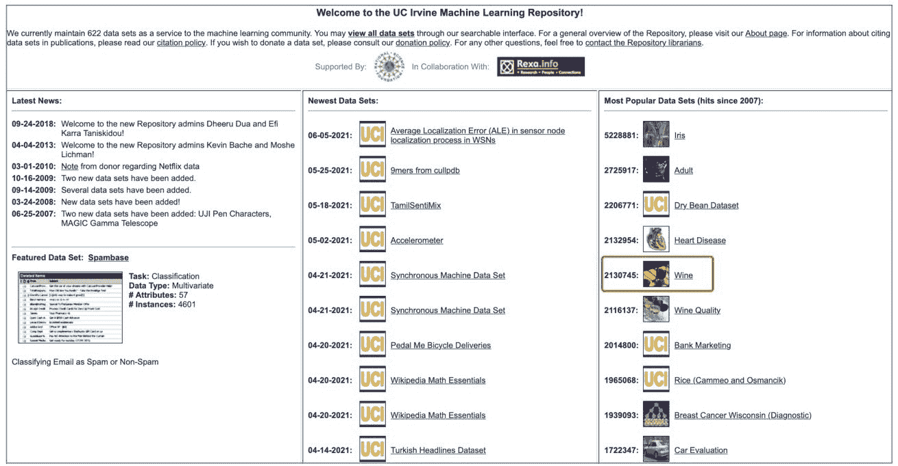
>
> **图 2-1 Wine Data Set 入口**
>
> 进详情页后点 `Data Folder`，再点 `wine.data` 即可下载。

### 2.1.4 `.data` 文件怎么打开？

下载下来的是个 `.data` 后缀文件，怎么看？再问 ChatGPT **“wine.data 用什么打开”**：

**ChatGPT**  
`wine.data` 本质是 **逗号分隔的纯文本**，任何文本编辑器都能开。Windows 下示例操作：

1. 资源管理器定位到文件夹。
2. 右键 `wine.data` → “打开方式” / “Open With”。
3. 从列表里选 **记事本**、**Sublime Text**、**VS Code** 等任意编辑器。
4. 即可查看原始数据行。

## 借助 Python 与 Pandas 读取数据

除了前文提到的方法，你完全可以利用 Python 中的 `Pandas` 库，或是其他常用的数据分析工具，来读取并处理数据集，从而实现更高效的建模与分析。下面附上一段使用 `Pandas` 读取数据的示例代码供参考。

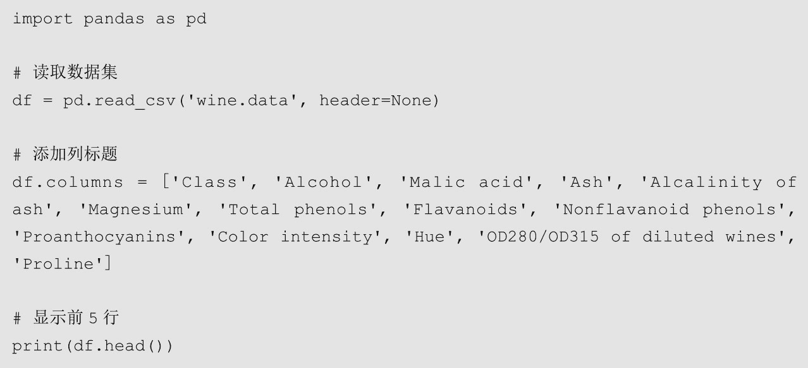

运行上述代码后，你将看到数据集前 5 行数据的输出结果。

从前面的回复中不难看出，ChatGPT 不仅告知了 `wine.data` 的文件类型，还针对 Windows 系统详细讲解了打开该类文件的方法，并给出了在 Python 环境中运行的示例代码。如果你已经配好 Python 环境，可直接复制代码尝试运行；若尚未安装，也可以让 ChatGPT 协助完成环境搭建。

## 2.2 让 ChatGPT 指导安装 Anaconda

对于有志于深耕机器学习与数据科学的读者而言，安装 `Anaconda` 是极佳的起点，因为它在该领域具备难以替代的核心优势。

### 2.2.1 何以选择 Anaconda

若对 Anaconda 的具体优势存疑，只需在对话框输入“What are the advantages of Anaconda”，ChatGPT 便会罗列如下要点：

**ChatGPT** `Anaconda` 是一款开源的数据科学平台，主要优势体现在以下五个方面：

1.  **高效的环境隔离**：允许在同一台机器上创建多个相互独立的环境，每个环境可安装不同版本的 Python 及数据科学库。这让项目切换变得轻松，彻底规避了版本冲突的烦恼。
2.  **开箱即用的生态库**: 预装了 `NumPy`、`Pandas`、`Matplotlib`、`scikit-learn` 等主流数据科学库，免去了繁琐的逐个安装与配置过程。
3.  **全平台兼容**：支持 `Windows`、`Mac` 与 `Linux` 等主流操作系统，极大地简化了开发部署流程。
4.  **强大的社区后盾**：拥有活跃的社区生态，提供海量教程、文档及技术支持，极大降低了新手的入门门槛。
5.  **内置 Jupyter Notebook**：集成了这一神器，支持代码、文本注释与可视化结果共存于单一文档中，非常适合数据探索与复现。

总而言之，Anaconda 是一个便捷、易上手且跨平台的数据科学解决方案，其内置工具链能助力开发者加速构建并部署应用。作者对此深有体会，多年的实战经验让 Anaconda 成为了最得力的“战友”，相信读者熟练使用后，也会产生相见恨晚、离不开手的感受。

### 2.2.2 Anaconda 的下载与安装实操

接下来演示安装流程。在对话框询问“How to download and install Anaconda”，即可获得针对 Windows 系统的详细指引：

**ChatGPT** 请按以下步�操作：

1.  访问 Anaconda 官网，下载与你的系统架构相匹配的安装包。
2.  双击打开下载的安装程序。
3.  在向导界面点击 `Install`，然后选择 `Next`。
4.  仔细阅读许可协议，同意后勾选 `I Agree`，点击 `Next`。
5.  指定安装目录（建议使用默认路径），点击 `Next`。
6.  选择安装模式，默认为 `Just Me`（仅当前用户），点击 `Next`。
7.  **关键步骤**：若希望系统自动配置环境变量，请勾选 `Add Anaconda to my PATH environment variable`，随后点击 `Install`。
8.  耐心等待数分钟，直至安装进度条走完。
9.  安装完成后点击 `Next`。
10. 建议勾选 `Register Anaconda as my default Python 3.9`，最后点击 `Finish` 结束向导。

按此步骤操作，Anaconda 即可安装就绪。此后，你可通过开始菜单中的 `Anaconda Navigator` 启动 `Jupyter Notebook` 等工具，或通过 `Anaconda Prompt` 进入 Python 命令行环境。

### 2.2.3 在 Anaconda 中启用 Jupyter Notebook

安装完毕后，我们将在 Anaconda 自带的 Jupyter Notebook 中编写并执行代码。初学者可在对话框提问“How to use Jupyter Notebook in Anaconda”，获取如下操作指引：

**ChatGPT** 操作非常直观，请按步骤进行：

1.  从开始菜单打开 `Anaconda Navigator`。
2.  点击 `Jupyter Notebook` 图标下的 `Launch` 按钮。
3.  默认浏览器将自动打开 Notebook 主页（若未自动弹出，请复制地址栏 URL 手动访问）。
4.  点击右侧 `New` 下拉菜单，选择 `Python 3`（或其他可用内核）创建新笔记本。
5.  全新的 Notebook 界面随即打开，你可在单元格中输入代码、文本注释、Markdown 及图片链接。
6.  代码编写完毕，点击工具栏的运行按钮，或按 `Shift+Enter` 快捷键执行当前单元格。
7.  利用 `Markdown` 单元格撰写解释性文字、插入图片与超链接，丰富文档内容。
8.  完成工作后，通过 `File` 菜单下的 `Save and Checkpoint` 保存进度。
9.  下次启动时，即可在主页找到已保存的笔记本文件继续编辑或运行。

以上便是基础用法。Jupyter Notebook 还支持绘图、多语言内核及丰富插件生态，建议读者自行探索或参考官方文档深入学习。

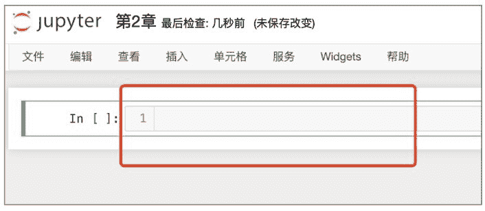

**图 2-2 新建的 Jupyter Notebook 界面**

图中展示的正是我们跟随指引创建的空白 Notebook，框选区域称为“Cell（单元格）”，这是编写并执行 Python 代码的基本单位，使用 `Shift+Enter` 即可运行单元格内的代码。

### 2.2.4 在 Notebook 实战读取数据

现在，将前文获取的读取 `wine.data` 的示例代码粘贴到 Notebook 中。为了演示方便，建议稍作调整：去掉最后一行的 `print` 函数。修改后的代码如下：

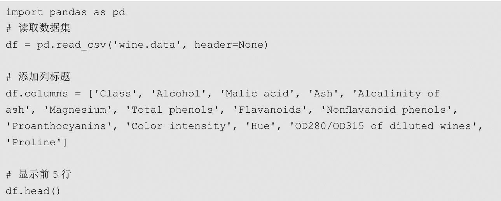

执行代码后，将生成如下数据表：

**表 2-1 葡萄酒数据集前 5 条记录**

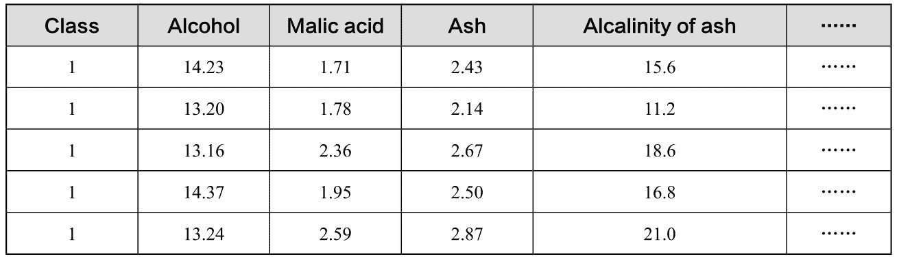

> **小贴士**
>
> 受篇幅限制，表 2-1 仅显示了部分特征列。在你的实际 Notebook 表头中，将呈现完整的特征字段名称。

若你的输出结果与表 2-1 结构一致，即表明数据已成功导入且列名已正确映射。至此，数据准备就绪，我们可以进阶至下一阶段的实验环节。

## 2.3 让 ChatGPT 领跑探索性数据分析 (EDA)

# 2.3 探索性数据分析（EDA）实战入门

拿到一个陌生的数据集，第一步通常是做**探索性数据分析（EDA）**。本节将带你快速掌握 EDA 的核心概念与标准流程。

## 2.3.1 什么是探索性数据分析

想搞懂 EDA，不妨直接问 ChatGPT。输入“What is Exploratory Data Analysis”，它会给出如下概括：

**ChatGPT** 探索性数据分析（`EDA`）是一种通过可视化与统计手段，深度挖掘数据内部信息、关系、模式与趋势的分析范式，旨在为后续建模与预测奠定基础。标准流程通常包含四环节：

1.  **数据预处理**：涵盖清洗、转换、缺失值填补等，保障数据可用性。
2.  **可视化分析**：借助直方图、箱线图等图表，直观洞察分布、相关性与异常点。
3.  **统计分析**：运用描述性统计、假设检验、回归分析等方法，量化数据特征与关联。
4.  **特征工程**：含特征提取、筛选、转换，为模型提供高质量输入。

EDA 是数据分析的基石，能助分析师迅速摸清数据底细，在机器学习与数据挖掘实战中更是**建模前的必经之路**。

由此可知，EDA 核心流程可归纳为“预处理、可视化、统计、特征工程”四步，且在实战建模中地位不可替代。

## 2.3.2 如何对 Wine 数据集实施 EDA

理解概念后，我们实操演练。先让 ChatGPT 产出 Wine 数据集的 EDA 方案与代码，再由我们验证落地。提示词：“Perform Exploratory Data Analysis on the Wine Dataset”。

**ChatGPT** 给出的通用步骤如下：

1.  **数据导入与预处理**
    - 读取数据，查看基本结构与格式。
    - 去重、补全缺失值、清洗转换。
    - 特征标准化，统一量纲尺度。
2.  **数据可视化**
    - 用直方图、散点图、箱线图展示分布与相关。
    - 分类变量用柱状图、饼图看比例分布。
3.  **统计分析**
    - 计算均值、方差、偏度、峰度等描述性统计量。
    - 用相关系数、协方差量化特征间关联。
    - 做假设检验，判断差异显著性。

随后它直接给出了 Python 完整代码实现：

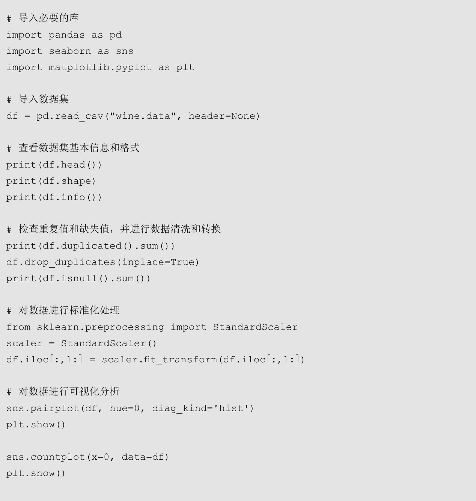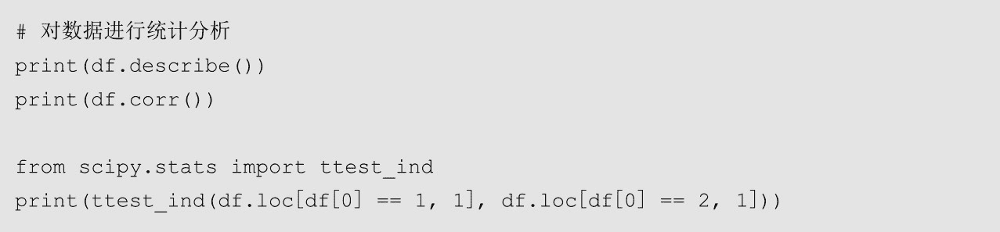

代码涵盖导入、预处理、可视化、统计分析全链路。下一步，将代码粘贴进 `Jupyter Notebook`，用 `Ctrl+Shift+ -` 拆分为多个单元格，便于逐段观察输出。首先是导库部分：

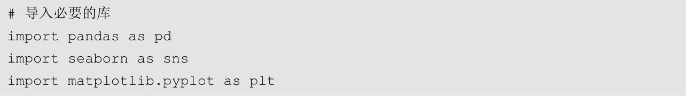

这里先导入 `Pandas`（别名 `pd`）读数据，再引入 `Seaborn` 与 `Matplotlib` 两大绘图库。若对这两者不熟，可继续追问 ChatGPT。

> **提问**：“Briefly introduce Seaborn, within 50 words”
> **ChatGPT** `Seaborn` 基于 `Matplotlib` 封装，提供高级统计绘图接口，内置经典数据集与调色板，让可视化分析更便捷。

> **提问**：“Briefly introduce Matplotlib, within 100 words”
> **ChatGPT** `Matplotlib` 是 Python 基础绘图库，支持生成高质量 2D 图形，广泛用于数据可视化与交互应用。它提供线图、散点图、柱状图、等高线图等丰富绘图原语，支持深度自定义图形元素与样式。可与 `NumPy`、`Pandas` 无缝协作，便于处理多源数据并输出 `PNG`、`PDF`、`SVG` 等格式，适配报告论文等多场景需求。

搞清工具背景，我们继续拆解代码细节。

## 2.3.3 查看数据基本信息与结构

前文已讲过 `pd.read_csv()` 与 `df.head()`，此处直接从 `df.shape` 与 `df.info()` 切入。先看形状：


运行结果：


`DataFrame.shape` 返回 `(行数, 列数)` 元组。问 ChatGPT 可得：该属性用于快速获取数据规模，便于前期评估是否需维度调整或清洗。此处输出 `(178, 14)`，即 Wine 数据集共 **178 行、14 列**。

再看详细信息：


输出结果：

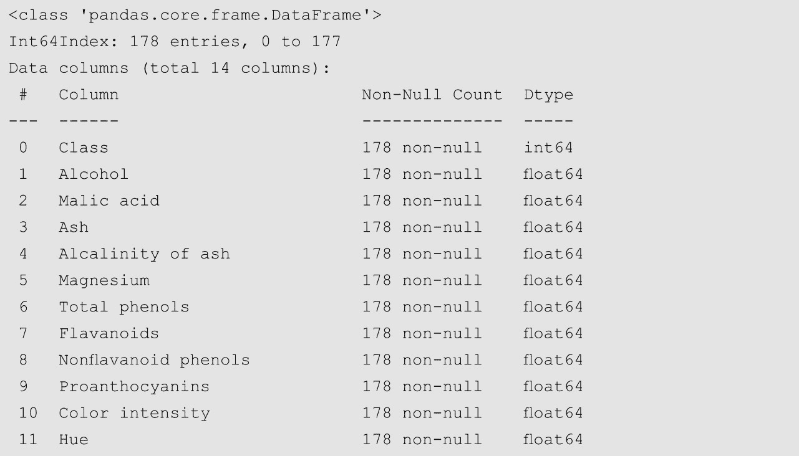

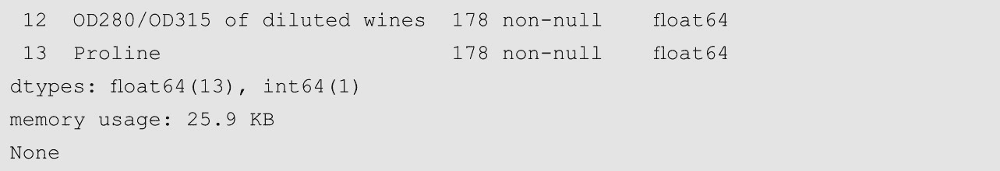

`df.info()` 会列出列名、数据类型、非空计数、内存占用。以 `Class` 列为例：显示 `178 non-null` 说明全列无缺失，类型 `int64` 为 64 位整数。此方法能快速定位类型错误、缺失值与异常值等质量问题。

## 2.3.4 排查重复值与缺失值

### 检查重复值

用 `duplicated()` 配合 `sum()` 统计重复行：


运行结果：


返回 `0`，说明数据集**无重复行**。若想深究 `duplicated()` 用法，可自行向 ChatGPT 提问。

**补充知识**：若后续他项目遇到重复值，可用 `drop_duplicates()` 去重：

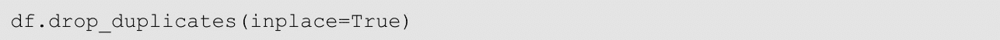

同理，该方法细节也可问 ChatGPT 细化。

### 检查缺失值

统计各列空值计数：


运行结果如下：

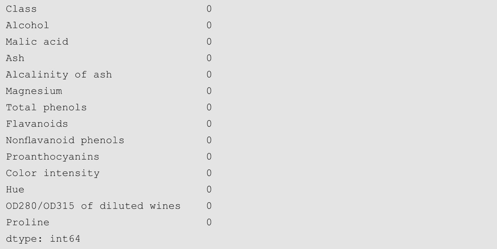

跟 `duplicated()` 如出一辙，`isnull()` 搭配 `sum()` 也是排查数据框缺失值的标准动作。运行结果显示，所有字段后的计数全是 0，意味着数据集干干净净，无任何空值。不妨去问问 ChatGPT，挖掘一下 `isnull()` 的更多用法。

### 2.3.5 数据预处理

确认数据无重复、无缺失后，还能进一步打磨。以 ChatGPT 给出的示范代码为例：

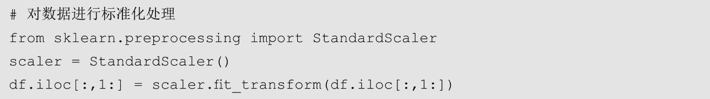

这段代码调用了 `scikit-learn`（简称 `sklearn`）里的 `StandardScaler` 做标准化，这是数据预处理里的“常客”。我们不妨让 ChatGPT 科普一下：“什么是数据标准化处理？”它这么回答：

> **ChatGPT** 数据标准化是常见的预处理手段，旨在把不同量纲、单位的数据统一到同一尺度。通常通过缩放平移，将数据转为均值 0、标准差 1 的标准正态分布，或压缩到 0~1 区间。核心目的是消除量纲影响，让变量具备可比性、可解释性，同时能提升部分机器学习算法的表现与稳定性。常用手段包括 Z-score 标准化、Min-max 归一化、小数定标法等。

通俗理解：假设特征 A 范围 0~1，特征 B 范围 0~100000，模型容易误判 B 更重要。标准化就是为了抹平这种“假象”。

代码里用的正是 `StandardScaler`。再追问 ChatGPT“介绍 scikit-learn 中的 StandardScaler”，得到：

> **ChatGPT** `StandardScaler` 是 sklearn 的预处理类，核心逻辑是：特征值减去均值、除以标准差，将数据映射为均值 0、方差 1 的标准正态分布。这能消除量纲差异，防止特征主导权失衡，提高模型精度与鲁棒性。用法上，先 `fit()` 拟合，再 `transform()` 转换，还能嵌入交叉验证、Pipeline 等流程。

简而言之，它通过数学变换把数据“拉”到同一起跑线上，量纲带来的干扰自然消失。

### 2.3.6 数据可视化

接着看 ChatGPT 给的可视化代码——先用 `pairplot` 探究特征间关系：

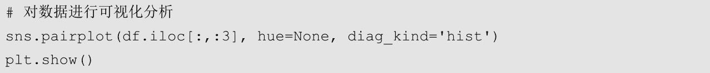

> **温馨提示**
>
> 为便展示，代码经修改仅保留 3 字段。实操时可画全量图谱观察。

运行结果见图 2-3。

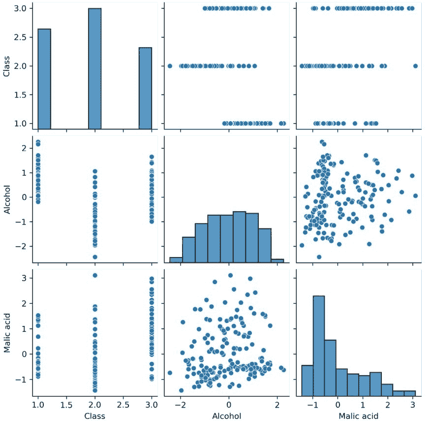

**图 2-3 基于 ChatGPT 代码绘制的 pairplot**

初学者可能对 `pairplot` 陌生，别慌，问 ChatGPT 就行：“什么是 pairplot？”

> **ChatGPT** Seaborn 里的 `pairplot` 专门画变量两两关系：非对角线是散点图，对角线是直方图或密度图。能快速洞察变量相关性与分布，辅助特征筛选与建模，参数灵活，极适合探索性分析。

结合图 2-3 看：对角线直方图展示单特征分布；其余散点图揭示双变量关系。如第 2 行第 1 列散点图，直观反映三类酒（`Class`）的酒精度分布差异。

此外，ChatGPT 还给了 `countplot` 代码，略作调整后运行：

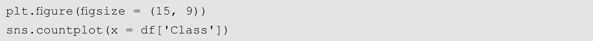


代码里先设了画布大小，再指定只画 `Class` 字段——目的是看各类别样本量。结果见图 2-4。

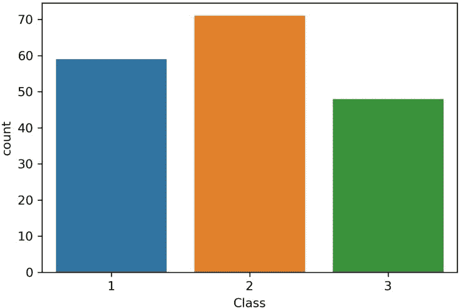

**图 2-4 基于 ChatGPT 代码绘制的 countplot**

一目了然：类别 1 约 60 样本，类别 2 约 70 样本，类别 3 约 50 样本。`countplot` 直观易懂，不再展开；感兴趣可自行问 ChatGPT 深究。

### 2.3.7 查看数据的统计信息

前文提到，探索性分析离不开统计分析。ChatGPT 代码里也内置了这步。先用 `describe()` 瞅瞅统计摘要（代码经修改便于展示）：

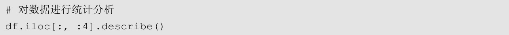

输出见表 2-2。

**表 2-2 部分特征统计信息**

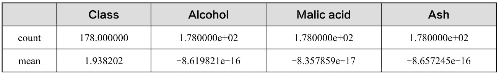

**续表**

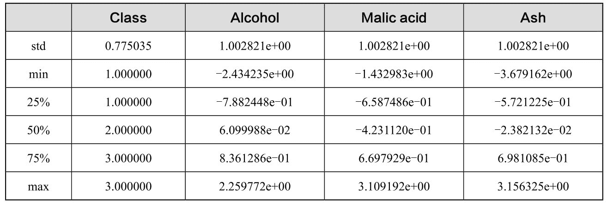

表里涵盖计数、均值、标准差、最小值、四分位数（25%/50%/75%）、最大值——全景式概括数据特征。

> **温馨提示**
>
> 除 `Class` 列，其余均为科学计数法。如 `-8.619821e-16` 即 `-8.619821×10⁻¹⁶`。

除 `describe()`，ChatGPT 还用 `corr()` 算相关性（同样只展示部分特征）：

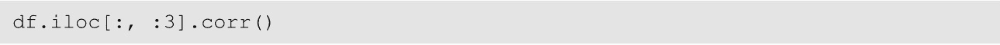

结果见表 2-3。

**表 2-3 部分特征相关性分析**

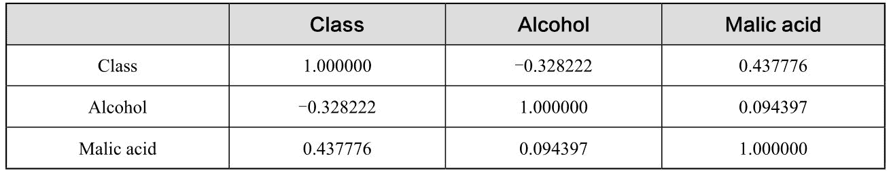

挑了 3 个特征，系数在 -1 到 1 间：逼近 1 为强正相关，逼近 -1 为强负相关，靠近 0 则几乎无关。

代码最后还跑了 `ttest_ind` 做 t 检验。统计学底子薄的同学可问 ChatGPT：“ttest_ind 是什么？”

> **ChatGPT** `ttest_ind` 来自 `scipy.stats`，用于两独立样本 t 检验，比较均值是否显著不同。输入两组数据，可设等方差假设、单/双侧检验，输出 t 值、p 值、自由度。p 值判断显著性：常用 0.05 为界，小则拒绝原假设（差异显著），大则接受（差异不显著）。广泛用于统计分析与机器学习。

概念有了，实操一下。修改代码：

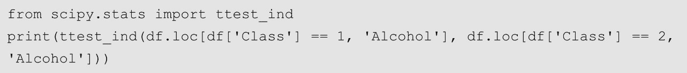

导入函数，拿类别 1 和 2 的酒精度做 t 检验。结果：

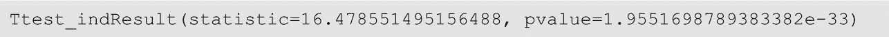

p 值 `1.955×10⁻³³`，远小于 0.05。p 值到底啥意思？再问 ChatGPT：“t 检验中的 p 值”。

> **ChatGPT** p 值是原假设为真时，观测到当前或更极端样本的概率。t 检验中，它反映两组数据在 t 分布下的检验概率。p 值越小，差异越显著；通常 ≤0.05 视为显著（拒绝原假设），>0.05 则不显著（接受原假设）。受样本量、显著水平、方差等影响，综合研判时是核心指标。

结合本例：p 值极小，说明类别 1 与 2 的酒精度差异**显著存在**。

## 2.4 动手训练模型

2.3 节梳理了探索性分析全流程。值得庆幸的是，Wine 数据集质量颇高——无缺失、无重复，省去大量清洗功夫。接下来直奔模型训练。

### 2.4.1 让 ChatGPT 给示例代码

照例先让 ChatGPT 写代码。输入“使用 wine.data 训练模型”，它给出完整步骤：

> **ChatGPT** 用 `wine.data` 建模，步骤如下：
>
> 1. 导库：`Pandas` 读数据，`sklearn` 预处理建模。
>
> 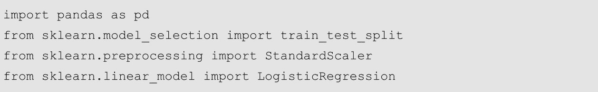
>
> 2. 读数据：`Pandas` 读取并设列名。
>
> 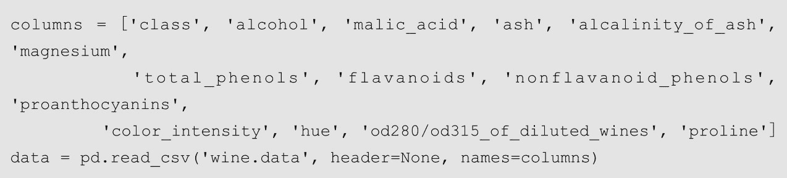
>
> 3. 预处理：分特征/标签，`StandardScaler` 标准化。
>
> 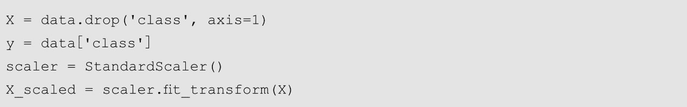
>
> 4. 划分集：`train_test_split` 切分训练/测试集。
>
> 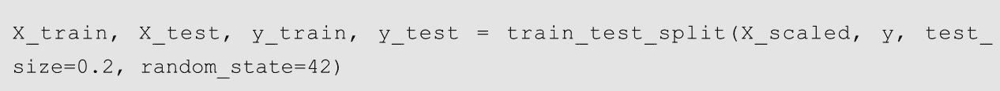
>
> 5. 训练模型：`LogisticRegression` 逻辑回归。
>
> 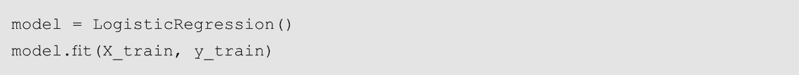
>
> 6. 评估模型：测试集验证。
>
> 
>
> 跑通即得准确率。实战中还需按需选模型、调参数、优化迭代。

ChatGPT 给出的代码含前文重复部分（读数据、设列名、标准化），此处仅聚焦有效增量代码。

### 2.4.2 特征工程与数据集拆分

先补几个必要的导入：


两行代码引入 `train_test_split`（切分利器）和 `LogisticRegression`（分类基石，即逻辑回归）。按提示分特征与标签：

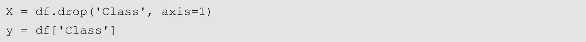

### 2.4.3 模型训练与验证

铺垫完毕，正式开练。训练验证代码如下：

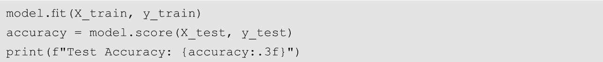

实例化模型 → `fit()` 吃训练数据 → `score()` 测测试集准确率 → 打印结果。运行输出：


**模型在测试集上拿下 100% 准确率！** 意味着模型把测试集每个样本全部分对类。若你也复现此结果，恭喜——机器学习入门“开门红”达成！

> **温馨提示**
>
> 代码涉及未展开概念（如逻辑回归原理）。本章旨在串通小项目全流程，细节后续章节细说。

## 2.5 课后练习

学完本章，相信不少读者已跃跃欲试。安排几个实操题：

1.  借助 ChatGPT 找并下载一个心仪数据集。
2.  在 Jupyter Notebook 里加载读取。
3.  查看数据规模：多少行、多少列？
4.  排查重复值与缺失值。
5.  问 ChatGPT：Seaborn `pairplot` 里 `hue` 参数啥作用？
6.  让 ChatGPT 帮选一特征，画直方图练练手。

# 第 3 章 让 ChatGPT 带你精通线性模型

## 章节导读

上一章中，我们在 ChatGPT 的协助下筛选了适合入门的小型数据集，并在 Jupyter Notebook 中完成了几次趣味实验。这让我们掌握了探索性数据分析（EDA）的通用流程与基础实现技巧。借助 ChatGPT，我们甚至用一个简单的线性模型跑通了一个分类任务，并拿到了 **100% 准确率** 的漂亮成绩单。本章，我们将正式深入机器学习领域的基石——线性模型。

## 核心收获

读完本章，你将攻克以下知识点：

- 线性模型的基本概念与内涵。
- 线性回归的核心原理。
- 梯度下降算法的原理与落地实现。
- 面向分类任务的线性模型策略。
- 正则化概念及带正则化的线性模型应用。

## 3.1 向 ChatGPT 请教：什么是线性模型？

想搞懂线性模型，最直接的方式就是发问。在 ChatGPT 对话框输入“什么是线性模型”，得到的回复如下。

> **ChatGPT**
>
> 线性模型是一种统计模型，旨在建立输入变量与输出变量之间的线性映射关系。其基础形式为线性方程：输出变量等于输入变量的线性组合加上一个常数项。该模型广泛服务于回归与分类问题，是统计学、机器学习及数据科学领域的常客。
>
> 主流线性模型涵盖：
>
> 1.  **线性回归模型**：预测连续型输出变量。
> 2.  **逻辑回归模型**：解决二分类问题的输出预测。
> 3.  **多项式回归模型**：拟合高阶多项式函数。
> 4.  **岭回归模型**：应对多重共线性难题。
> 5.  **Lasso 回归模型**：实现特征筛选与稀疏化。
> 6.  **线性判别分析模型**：处理多分类任务。
>
> 线性模型优势显著：可解释性强、计算效率高；短板在于难以胜任非线性问题。

初学者阅读上述回复可能觉得略显抽象。别急，接下来我们将通过实战案例逐一拆解常见线性模型。

### 3.1.1 一个极简案例读懂线性回归

为直观理解线性回归原理，我们可以让 ChatGPT 给出示例代码。输入“Python 线性模型示例代码”，ChatGPT 返回如下内容。

> **ChatGPT**
>
> 以下是使用 Python 实现线性回归模型的示例代码。

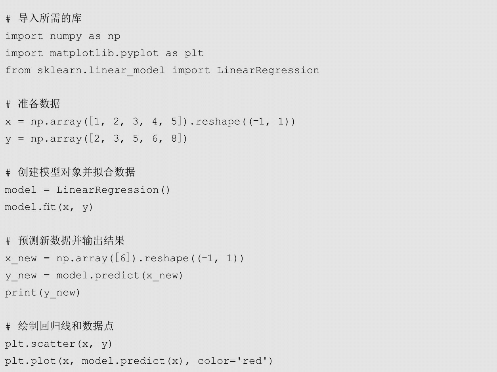

这段代码先利用 `NumPy` 准备输入输出变量，再调用 `scikit-learn` 库中的 `LinearRegression` 类构建模型对象，通过 `fit()` 方法完成拟合；随后用 `predict()` 方法对新输入进行预测，最后借助 `Matplotlib` 绘制回归线与原始数据散点图。

我们可以在 Jupyter Notebook 新建 Notebook 文件，将上述代码粘贴到单元格中运行测试。

下面逐段解析代码功能。

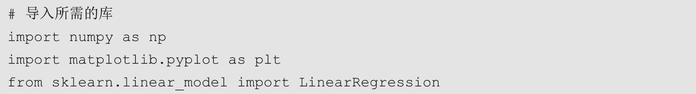

首段代码导入了科学计算库 `NumPy`、绘图库 `Matplotlib`，以及机器学习常用库 `scikit-learn` 中的线性回归模型 `LinearRegression`。接下来的代码块使用 `NumPy` 生成演示数据。

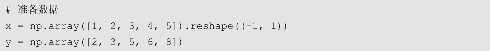

此处调用 `NumPy` 的 `array` 函数创建两个数组：特征数组 `x` 与目标值数组 `y`。`reshape()` 方法用于调整数组形状，`(-1,1)` 表示将数组重塑为“任意行、单列”的二维结构。

数据就绪后，即可调用线性回归模型进行拟合，对应代码如下。

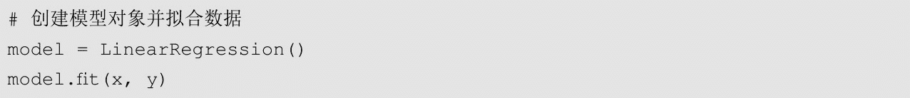

代码运行瞬间，模型完成拟合。接着我们可以用模型预测新样本。例如，当新样本的 `x` 取值为 6 时，模型能推算出对应的 `y` 值，代码如下。

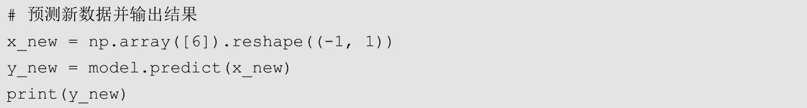

运行结果如下。


结果显示，模型成功预测了新样本的 `y` 值：当 `x=6` 时，预测 `y≈9.3`。ChatGPT 提供的代码还通过可视化直观演示了模型原理。

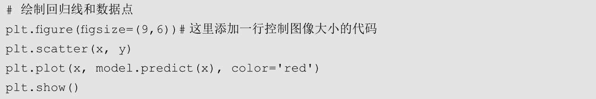

我们补充了一行控制画布尺寸的代码，同时用 `Matplotlib` 的 `scatter()` 绘制散点图，用 `plot()` 绘制折线图。运行后生成的效果如图 3-1 所示。

图 3-1 中的点阵为 `NumPy` 生成的样本数据。以左下角第一个点为例，其 `x=1, y=2`，以此类推。图中的直线即为根据样本拟合出的线性回归模型，这条线也完美诠释了“线性回归”名称的由来。

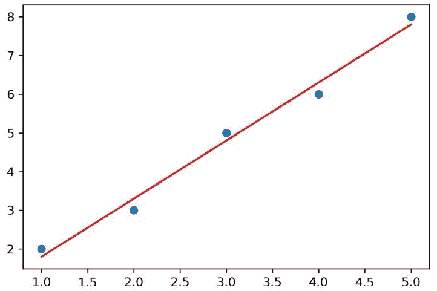

**图 3-1 线性回归模型可视化示意**

### 3.1.2 线性回归原理速览

建立直观认知后，我们继续追问 ChatGPT 了解线性回归原理。输入“简述线性回归原理，勿用 Markdown 格式”（强调无格式是为了避免回复出现奇怪符号），ChatGPT 回复如下。

> **ChatGPT**
>
> 线性回归是一种常用机器学习算法，用于建立输入变量与输出变量间的线性关系模型。核心原理是寻找最优线性函数拟合数据已知的输入输出关系。具体而言，通过最小化预测值与实际值的平方误差来求解最优系数，从而建立可描述输入输出线性关系的模型，进而预测新输入对应的输出。
>
> 线性回归模型数学表达式为：
>
> ```
> Y = b0 + b1 * X1 + b2 * X2 + … + bn * Xn + ε
> ```
>
> 其中 `Y` 为输出变量，`X1, X2,…, Xn` 为输入变量，`b0, b1, b2,…, bn` 为待求系数，`ε` 为误差项。模型通过寻找最优系数最小化预测值与实际值的平方误差。可利用梯度下降等优化算法求解最优系数，获得用于预测新输出变量的模型。

结合 ChatGPT 的解读，我们能更透彻地理解前文案例。该案例仅含单一输入变量 `x`，故公式可简化为

```
y = b0 + b1 * x + ε
```

你或许已经察觉，这本质上就是一元一次方程的标准形式。在拟合过程中，模型的任务是寻找最优的系数 `b1`（对应直线的斜率）以及截距项 `b0`。若想直观查看这条直线的斜率与截距，不妨直接向 ChatGPT 请教。在对话框输入“Python 查看线性回归参数代码”，即可获得如下回复。

> **ChatGPT**
>
> 以下是利用 Python `scikit-learn` 库查看线性回归模型参数的代码示例。

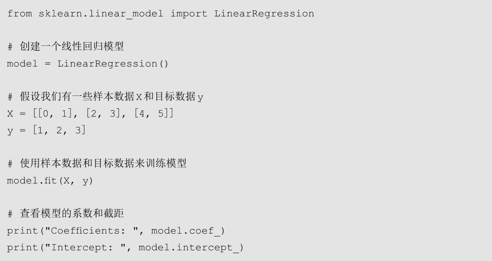

上述代码的逻辑很清晰：先从 `scikit-learn` 导入 `LinearRegression` 类并实例化模型对象 `model`；接着用样本特征 `X` 与目标值 `y` 进行训练；最后，只需调用模型的 `coef_` 与 `intercept_` 两个属性，即可分别获取系数矩阵与截距值。

既然掌握了方法，且前文已完成模型拟合，我们只需在 Jupyter Notebook 中补充运行两行代码即可。

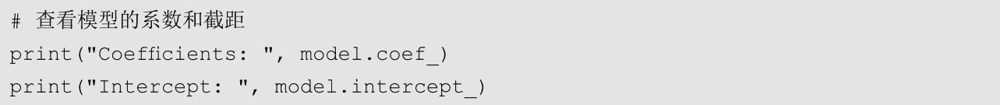

执行后得到的输出如下：


结果显示，训练得到的线性回归方程近似为 `y = 1.5x + 0.3`。据此，当输入 `x = 6` 时，模型预测 `y = 1.5 × 6 + 0.3 = 9.3`。当然，若特征维度升至多个，模型几何形态将从直线变为超平面。

### 3.1.3 什么是梯度下降

读到这里，你可能会好奇：模型究竟是如何精准确定这组最优斜率与截距的？根据 ChatGPT 先前的提示，线性回归常借助梯度下降等优化算法求解最优系数。那么，梯度下降究竟为何物？我们继续发问。输入“什么是梯度下降”，ChatGPT 回复如下：

> **ChatGPT**
>
> **梯度下降** 是一种用于最小化函数值（通常指**损失函数**）的优化算法，在机器学习与深度学习模型训练中应用极广。其核心在于：通过不断迭代调整模型参数，使损失函数值逐步下降，最终获得性能更优的模型。
>
> 其基本原理是计算损失函数对模型参数的偏导数（即梯度），并沿着梯度的**反方向**更新参数，从而让损失函数持续减小。数学表达式如下：
>
> ```
> θ = θ - α * ∇J(θ)
> ```
>
> 其中，`θ` 代表模型参数，`J(θ)` 为损失函数，`∇J(θ)` 表示损失函数对 `θ` 的梯度，`α` 则是学习率，控制每一步参数更新的幅度。
>
> 梯度下降主要分两大派：**批量梯度下降（BGD）** 与 **随机梯度下降（SGD）**。BGD 每次迭代利用全量训练样本计算梯度，计算量大但方向精准，保证收敛到全局最优；SGD 每次仅随机选取单个样本计算梯度，计算轻量但方向波动大，易陷入局部最优。
>
> 为兼顾二者优势，衍生出 **小批量梯度下降（Mini-batch GD）**。它每次抽取一小批样本计算梯度，既保证了方向的相对准确，又大幅降低了计算开销，是当前工业界最主流的优化策略之一。

理论结合实践更易懂。我们再请求 ChatGPT 提供一份“Python 代码演示线性回归梯度下降过程”的示例。

> **ChatGPT**
>
> 下面通过 Python 代码从零演示梯度下降求解线性回归的完整流程。

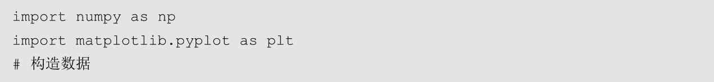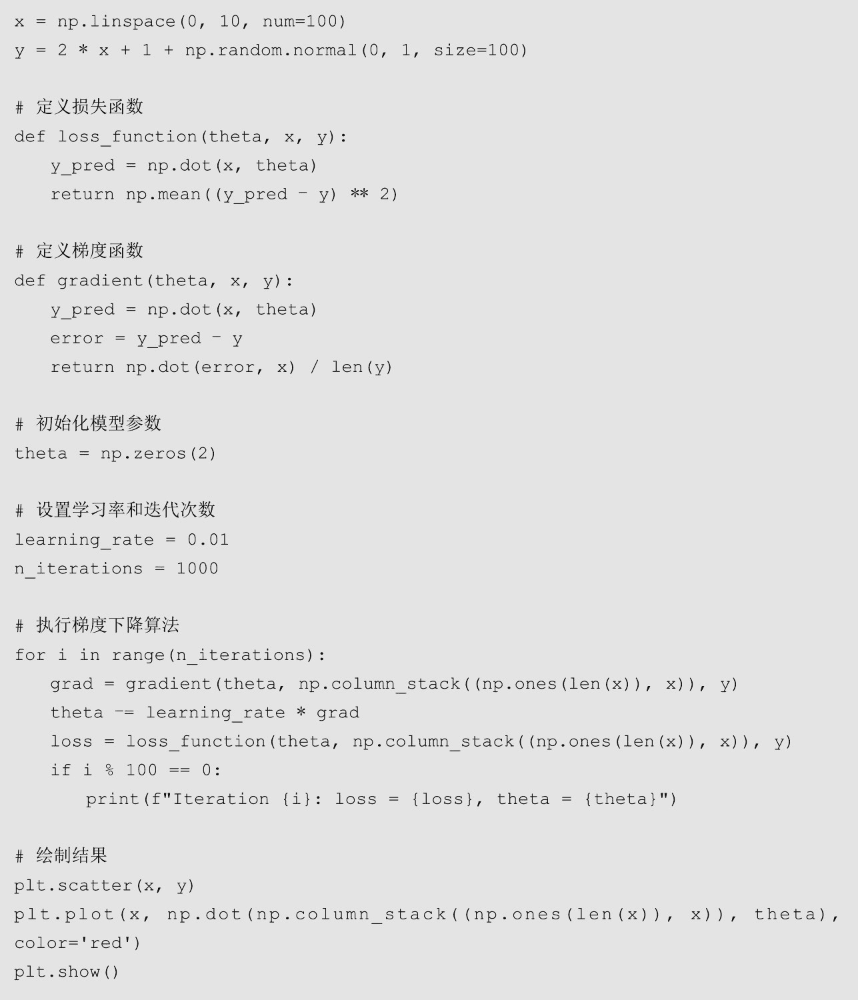

该脚本先生成带噪声的线性数据，再手动实现梯度下降训练模型，最后绘制散点图与拟合线。核心步骤包括：定义损失函数与梯度计算函数、初始化参数、设定学习率与迭代轮次、循环执行梯度更新。下面我们在 Notebook 中分段运行。

首先是数据构造环节：

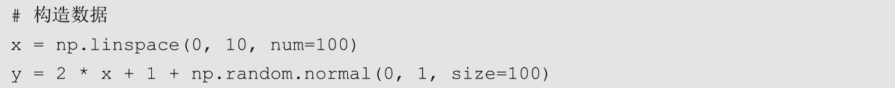

代码利用 NumPy 的 `linspace` 生成 0 到 10 之间的 100 个等间距点作为特征 `x`，并在目标变量 `y` 上叠加正态分布噪声，模拟真实数据的随机性。

接着定义损失函数（均方误差 MSE）与梯度函数：

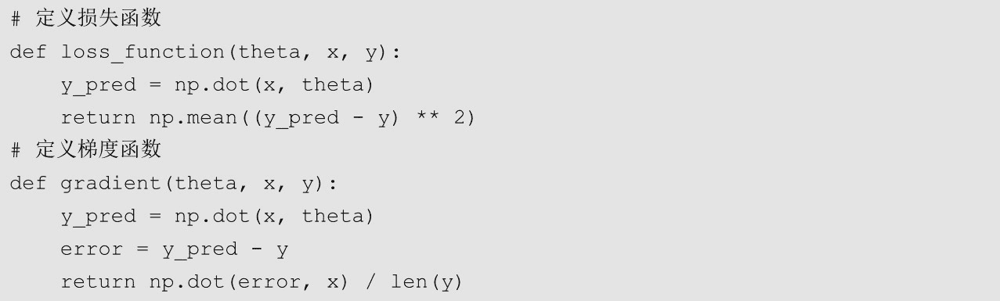

此处先通过参数矩阵 `theta` 与 `x` 矩阵乘法得出预测值 `y_pred`；再计算预测值与真实值 `y` 平方差的均值作为损失；梯度则由预测误差与 `x` 的矩阵乘积除以样本数获得。

随后，正式启动梯度下降迭代循环：

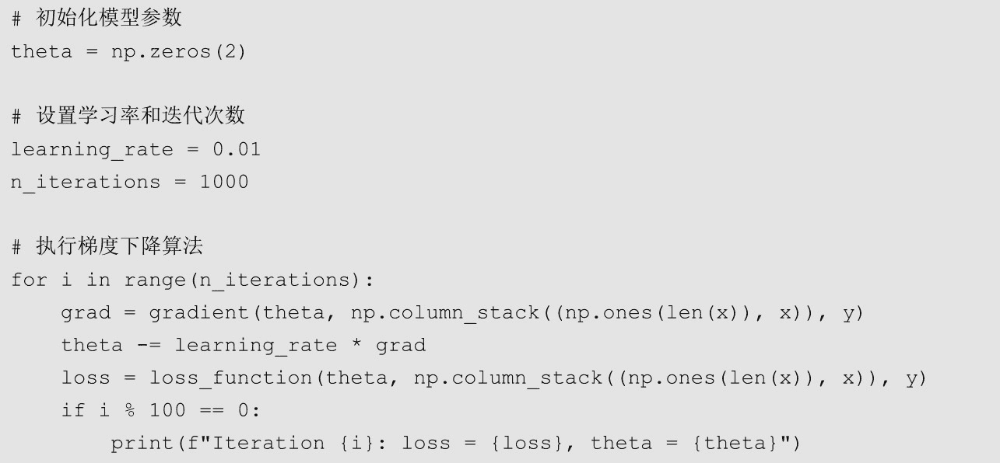

初始参数 `theta` 置零，迭代 1000 轮。每轮根据梯度与学习率更新参数，并每 100 轮打印一次当前损失值与参数状态。运行结果如下：

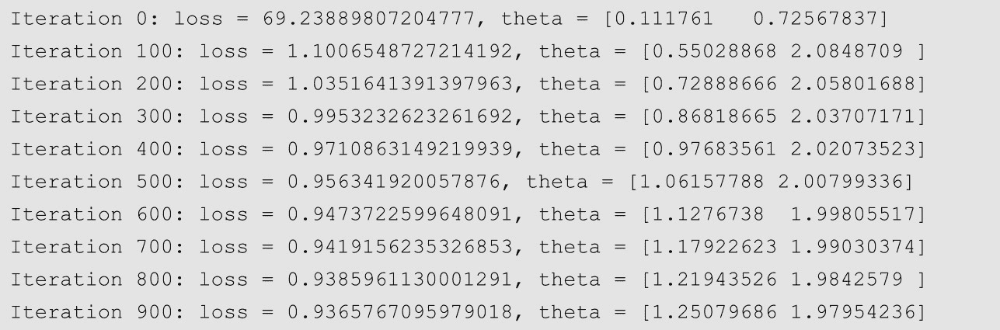

日志清晰记录了收敛轨迹：初始损失高达 ~69.2；第 100 轮损失骤降至 ~1.1，参数更新为 `[0.55, 2.08]`；此后损失持续缩减，至第 900 轮稳定在 ~0.9 左右，参数收敛至 `[1.25, 1.98]`，已无限逼近真实值。

最后，ChatGPT 还贴心地提供了可视化代码，直观呈现拟合效果。

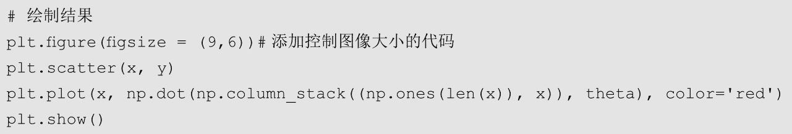

执行绘图代码，结果呈现为图 3-2。

本轮实践中，我们刻意舍弃了 `scikit-learn` 自带的线性回归器，转而手动编写损失函数与梯度函数，借助梯度下降法拟合模型。图 3-2 中的散点代表人工构造的样本数据，而那条直线则是经过多轮迭代后，梯度下降算法寻得的最佳拟合线。这一过程直观剖析了线性回归模型如何锁定最优参数组合。

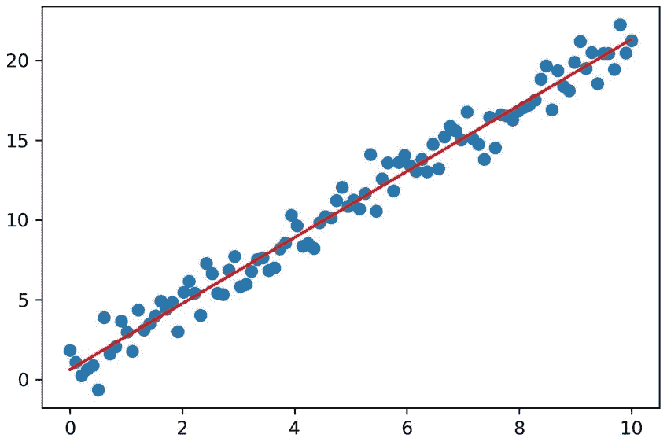

**图 3-2 梯度下降法求解线性回归模型示意图**

> **温馨提示**
>
> 上述代码旨在帮助理解线性回归借助梯度下降寻优的流程。初学者若觉得代码阅读吃力，大可不必焦虑，这部分属于拓展理解，非必考核内容。

## 3.2 线性模型同样能胜任分类任务

通过 3.1 节的学习，我们已建立起线性回归的基础认知。彼时的案例属于典型的回归场景，处理的是连续型数值目标。然而，线性模型的施展空间远不止于此。ChatGPT 为我们介绍了两款可用于分类的线性模型——**逻辑回归**与**线性判别分析**。下文将以逻辑回归为例，揭示线性模型如何完成分类任务。

### 3.2.1 逻辑回归核心概念速览

想快速建立认知框架，可直接向 ChatGPT 抛出提问：“简要介绍逻辑回归”。其回复要点梳理如下：

> **ChatGPT**
>
> 逻辑回归是一种应用极广的统计分析方法，主攻二分类问题（如是/否、真/假）。它以线性回归为底座，但输出并非直接数值，而是 **0 到 1 之间的概率**，表征属于某类别的可能性。核心机制在于：将输入特征加权求和，再经 **Sigmoid 激活函数** 映射至概率区间。
>
> 训练过程本质上是优化权重，使模型对观测数据的似然度最大化，具体通过最小化 **交叉熵损失函数** 来量化预测概率与真实标签的偏离程度。

**逻辑回归的常见用武之地** 包含广告点击率预估、信用评分、疾病诊断等。凭借简洁高效的特性，它已成为机器学习与数据科学领域的“常青树”算法。

从回复可知，Sigmoid 函数是连接线性输出与概率输出的关键桥梁。为了看清其真面目，我们继续追问：“用 Python 代码演示 Sigmoid 函数并可视化，无需 Markdown 格式”。ChatGPT 给出了如下实现：

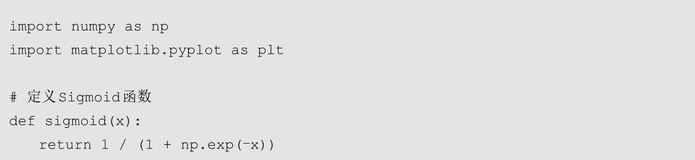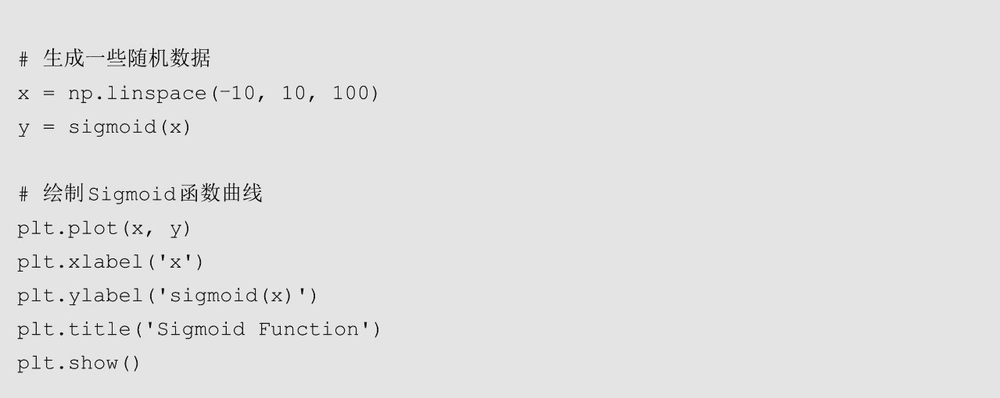

这段代码利用 `NumPy` 在 -10 到 10 区间生成 100 个均匀分布采样点，经 Sigmoid 变换后由 `Matplotlib` 绘制成曲线。考虑到 Jupyter Notebook 环境通常已预装相关库，实际运行时可跳过导入语句，直奔核心逻辑：


代码定义的 Sigmoid 函数，其数学表达式为：


随后，生成数据并送入函数变换：


运行结果如图 3-3 所示。


**图 3-3 Sigmoid 函数曲线**

图中可见，原始数据 x 均匀分布于 [-10, 10]，经 Sigmoid 压缩后全部落入 (0, 1) 区间。如此一来，我们只需设定阈值 **0.5**：大于 0.5 归为一类，小于 0.5 归为另一类，即可轻松完成二分类任务。

### 3.2.2 实战案例：手把手演示逻辑回归用法

第二章的红酒数据集分类已实战过逻辑回归，为巩固印象，我们让 ChatGPT 再给一个更直观的入门级示例。提示词：“用一个简单示例演示逻辑回归用法，Python 代码实现”。回复如下：

> **ChatGPT**
>
> 逻辑回归是分类任务的常用算法。下面用 `scikit-learn` 实现一个二分类案例：
>
> **场景**：根据学生**考试分数**预测**是否录取**（1=录取，0=未录取）。
>
> **步骤 1：加载数据并划分训练/测试集**
>
> 
>
> **步骤 2：实例化模型并在训练集上拟合**
>
> 
>
> **步骤 3：用测试集评估模型，输出准确率**
>
> 
>
> 以上即为基于 Python 与 `scikit-learn` 的逻辑回归二分类完整流程。

细心的读者会发现，代码引用了 `admission.csv`，却未给出获取途径。我们追问：“代码中的 admission.csv 去哪下载？”，得到回复：

> **ChatGPT**
>
> 抱歉，该文件仅为示例虚构数据，网络上并无公开资源。需自行创建。参考内容如下：
>
> 
>
> 第一列为考试分数，第二列为是否录取（1/0）。可用 Excel、Google Sheets 这类表格工具制作，保存为 `admission.csv` 并与代码置于同级目录即可运行。

上一轮对话显示，`admission.csv` 并非现成的数据集。ChatGPT 建议我们复制它生成的示例数据，另存为 CSV 文件，再用代码读取。我们照做了，保存数据并运行代码。


运行结果如表 3-1 所示。

**表 3-1 ChatGPT 提供的样本数据**


若操作无误，你将得到与表 3-1 类似的结果。据 ChatGPT 介绍，第一列为学生考试分数，第二列为录取结果：1 表示录取，0 表示未录取。

数据就绪，我们尝试训练模型。代码如下。


代码先用 `scikit-learn` 的拆分工具，抽出 20% 样本作测试集，用于验证模型精度；接着实例化逻辑回归模型并开始训练。

训练完成后，我们对模型进行验证。代码如下。


这段代码调用训练好的模型预测测试集，并用 `accuracy_score` 评估。运行结果如下。


对比预测值与真实值，程序返回准确率 1.0，即 100% 命中。

此外，ChatGPT 还提供了预测新样本的代码。如下所示。


代码假设某生分数为 80，请模型预测其录取与否。运行结果如下。


模型判定：尽管分数达 80，预测结果仍为 0，即未录取。

### 3.2.3 逻辑回归的预测概率解析

上一节中，分数 80 的学生被判为「不录取」。这是否意味着完全没有机会？未必。因为逻辑回归预测的是样本属于某类的**概率**。为搞清这个概念，我们向 ChatGPT 提问：「解释逻辑回归的预测概率并给示例代码，不要公式」。得到回复如下。

> **ChatGPT** 逻辑回归是分类问题常用的机器学习算法。其中的预测概率，指给定输入样本属于某类别的概率。
>
> 以二分类为例，预测某人是否患病。模型输出患病概率。若概率超阈值（如 0.5），判为患病；低于则判为健康。
>
> 代码实现上，常用 `scikit-learn` 的逻辑回归模型训练预测。示例代码如下。
>
> 
>
> 代码中 `X_train`、`y_train` 为训练集，`X_test` 为测试集。`lr.fit()` 训练模型，`lr.predict_proba()` 预测测试集各样本属于各类的概率。`y_pred_proba` 为二维数组，每行对应一个样本，每列对应一个类别的概率。如 `y_pred_proba[0][0]` 为首个样本属于第一类的概率，`[0][1]` 为属于第二类的概率。

从回复可知，`scikit-learn` 中可用 `lr.predict_proba()` 查看逻辑回归对样本属某类的概率预测。我们用关键代码看看那位 80 分学生的录取概率。代码如下。


运行结果如下。


虽然前文模型判定该生「不录取」，但概率输出显示：不录取概率 50.000003%，录取概率 49.999997%——几乎五五开，并非绝无可能。

## 3.3 正则化究竟是什么

第 1 章提到，过拟合是机器学习模型面临的大挑战，线性模型也不例外。为尽量规避此风险，本节我们学习正则化技术。

### 3.3.1 正则化的基本原理

为理解正则化核心概念，我们在 ChatGPT 对话框输入「什么是正则化」，得到如下回答。

> **ChatGPT** 正则化是机器学习中降低过拟合风险、提升泛化能力的常用手段。过拟合指模型在训练集表现极好、测试集却差，往往因模型过于复杂，过度拟合训练集噪声，丧失泛化能力。
>
> 正则化通过在损失函数中加入正则项约束模型参数，从而降低过拟合风险。正则项通常为参数平方和（L2）或绝对值和（L1），惩罚模型复杂度，促使模型选择更简单的参数值。
>
> 常见方法有 L1 和 L2 正则化。L1 加绝对值和，可产生稀疏性（部分配零），得到稀疏模型；L2 加平方和，可产生平滑性（参数趋近零），得到平滑模型。实践中可通过交叉验证等选取合适的正则化方法和参数，以获更好泛化性能。

可见，正则化实质是通过添加正则项约束模型复杂度。那么，哪些线性模型用到了正则化？我们继续问：「有哪些正则化线性模型」。ChatGPT 回复如下。

> **ChatGPT** 正则化线性模型，指在线性模型基础上加入正则项约束的模型。常见的有：
>
> 1. **岭回归**：在普通最小二乘基础上加 L2 正则项，使参数更平滑，有效降低过拟合风险。

# 正则化线性模型：核心算法与实战差异解析

## 2. Lasso 回归（最小绝对收缩与选择算子）
在普通最小二乘法基础上引入 L1 正则项，促使模型参数趋向稀疏——即让部分特征的权重归零，从而自动完成特征筛选。

## 3. Elastic Net 回归（弹性网络）
同时融合 L1 与 L2 两种正则项，集岭回归的参数平滑能力与 Lasso 的特征选择优势于一身。

## 4. 逻辑回归
作为广义线性模型的代表，它通过 Sigmoid 函数将线性输出映射至 [0,1] 区间，输出样本属于某类别的概率。同样支持叠加 L1 或 L2 正则约束。

## 5. 支持向量机（SVM）
核心在于寻找最大化分类间隔的决策边界，亦可通过引入 L2 正则项进行约束。之所以将其归入线性模型范畴，是因其支持线性核函数；SVM 的深度原理将在后续章节展开。

> 以上正则化线性模型应用广泛，能显著提升模型的泛化性能与鲁棒性。

通过上文梳理，ChatGPT 为我们盘点了岭回归、Lasso 回归、弹性网络、逻辑回归及支持向量机等常见正则化线性模型。

---

### 3.3.2 基于 L2 正则化的线性模型实战

前文已明确：岭回归是利用 L2 正则化技术的典型线性模型。为直观感知 L2 正则化的实际作用，我们不妨先跑个实验。向 ChatGPT 输入提示词：“用 Python 代码演示岭回归与线性回归的区别”，获得如下回复：

> **ChatGPT** 以下示例基于 `scikit-learn` 库，分别实现岭回归与普通线性回归，并对比其性能差异。
>
> 
>
> 运行结果显示：岭回归的均方误差（MSE）略低于线性回归，表明其在该数据集上表现更优。原因在于 L2 正则项约束了参数规模，使模型更平滑，有效抑制过拟合，增强泛化能力。

该代码直接调用 `scikit-learn` 内置的波士顿房价数据集，省去了下载麻烦。大部分代码逻辑前文已讲解，此处直接粘贴至 `Jupyter Notebook` 运行。为放大 L2 正则化效果，我们将岭回归的 `alpha` 参数调大至 100，观察运行输出：


结果显示：当正则化强度系数 `alpha` 设为 100 时，岭回归 MSE 约为 33.27，而无正则化的线性回归 MSE 约为 29.78。出现这个现象是因为过强的正则项过度压缩了模型参数。

我们可通过以下代码直观对比两组参数：


执行后生成图 3-4。


**图 3-4 线性回归与岭回归模型参数对比**

图中圆点代表岭回归参数，三角形代表线性回归参数。差异主要集中在样本的第 4、5、6 个特征上，尤其是第 5 个特征，参数被大幅压缩。这直观证明：正则项显著削弱了这些特征对模型的影响力。

---

### 3.3.3 基于 L1 正则化的线性模型解析

上节剖析了 L2 正则化（岭回归），不少读者好奇：L1 与 L2 究竟差在哪？这也是个高频考点，直接让 ChatGPT 解答。输入提示词：“L1 正则化与 L2 正则化的区别”，得到回复：

> **ChatGPT** 两者均用于抑制过拟合，但惩罚机制不同，导致实际效果迥异。
>
> **惩罚项定义**：
> - L1：`||w||1 = Σ|wi|`
> - L2：`||w||2 = (Σ wi²)¹/²`（其中 `w` 为模型参数）
>
> **核心差异**：
> 1. **惩罚形式**：L1 用绝对值求和，L2 用平方和开根号。
> 2. **稀疏性 vs 平滑性**：同等系数下，L1 倾向产生稀疏参数（部分权重归零），实现特征选择；L2 仅压缩参数幅度，不使其为零。
> 3. **抗离群点能力**：L1 基于绝对值，对异常值更鲁棒；L2 基于平方项，对异常值敏感。
> 4. **计算复杂度**：L2 涉及平方根运算，理论上比 L1 计算量稍大。
>
> **结论**：二者各有适用场景，实战中需根据业务目标与数据特性择优选用。

ChatGPT 的回答清晰指出：尽管同为防过拟合手段，但计算机制差异导致参数表现截然不同。最显著的区别在于——L1 能将参数压缩为 0（彻底剔除特征），而 L2 仅能让参数无限趋近 0。

理解了理论，接下来实战对比。为保持对照组一致，依然指定波士顿房价数据集。输入提示词：“用波士顿房价数据集演示 L1 正则化模型”，ChatGPT 回复如下。

> **ChatGPT** 利用波士顿房价数据集演示 L1 正则化模型，能让我们更透彻地理解 L1 正则化对机器学习模型的影响。下面是一个应用 L1 正则化的线性回归模型示例。

>

> 

# 第 4 章：携手 ChatGPT 攻克支持向量机

## 章节导读

前一章我们系统学习了线性模型。线性模型优势显著，比如解释性强、计算效率高，但短板也很明显——往往难以胜任非线性问题。本章将深入剖析什么是非线性问题，并手把手教你用支持向量机（SVM）来破解。

## 核心知识清单

读完本章，你将掌握以下核心技能：

- 非线性问题的基本概念。

- 支持向量机的核心原理。

- 支持向量机中的核函数机制。

- 支持向量机回归模型。

- 支持向量机的关键超参数。

## 4.1 请教 ChatGPT：什么是非线性问题

想搞懂非线性问题，最直观的办法是让 ChatGPT 结合案例讲解。在对话框输入 **"举例说明何为非线性问题"**，你将获得如下回复：

> **ChatGPT**  

> 非线性问题指的是无法用线性模型描述或求解的问题。这类问题通常涉及多变量间的复杂关系，如非线性函数、曲线、弧线等。  

>   

> 举例而言，若仅凭年龄和收入预测用户是否购买某商品，线性模型足矣。但一旦引入学历、婚姻状况、地理位置等更多因素，问题就变得棘手，因为这些因素间可能存在复杂的非线性关联。  

>   

> 图像识别也是典型案例。图像包含海量像素，每个像素都是变量，我们要将它们归类为不同物体或场景。鉴于像素间关系极其复杂，这属于标准的非线性问题。  

>   

> 针对此类问题，可用决策树、神经网络、支持向量机等算法构建非线性模型，它们能更精准地刻画变量间的复杂关系，从而提升模型精度。

从回复可见，ChatGPT 通过电商购买预测和图像识别两个场景，生动阐释了非线性问题，并点明了决策树、神经网络及本章重点——支持向量机是主流解决路径。

### 4.1.1 非线性问题的样本数据构建

为了更直观地感知非线性，我们可让 ChatGPT 生成样本数据并可视化。输入 **"提供一组非线性问题的样本数据集并将其可视化"**，回复如下：

> **ChatGPT**  

> 非线性问题的样本数据可包含两个变量 `x1` 和 `x2`，其标签 `y` 由以下公式决定：  

>   

> - `y = 1` 若 `sin(x1) + cos(x2) > 0`  

> - `y = 0` 若 `sin(x1) + cos(x2) <= 0`  

>   

> 这是一个二分类问题，标签 `y` 取 0 或 1。可见 `y` 不仅取决于 `x1`、`x2` 的取值，还取决于它们的正弦余弦值，故属非线性问题。  

>   

> 我们可随机生成数据点，按上述公式打标签，再在二维坐标系中可视化（`x1` 对应 x 轴，`x2` 对应 y 轴），用不同颜色区分类别。  

>   

> 下面是生成并可视化该数据集的 Python 代码示例。


ChatGPT 设计了一个有趣的数据集：两个特征 `x1`、`x2`，标签 `y` 为 0/1。判断规则是 `sin(x1) + cos(x2)` 的正负。它还贴心地附赠了生成代码。我们在 Jupyter Notebook 新建文件，粘贴运行代码，即得下图（图 4-1）所示结果。


**图 4-1 ChatGPT 生成的非线性数据集**

显而易见，这些数据点无法用简单线性模型分割，因为类别与 `x1`、`x2` 的关系并非线性。因此，我们必须引入非线性分类算法。

### 4.1.2 实战：用支持向量机破解非线性难题

提到非线性分类算法，本章主角——支持向量机登场。先通过实例直观感受其威力。输入 **"基于上述样本数据演示支持向量机"**，ChatGPT 回复：

> **ChatGPT**  

> 支持向量机是常用分类算法，线性、非线性数据均能处理。面对非线性数据，SVM 通常借助核函数将数据映射至高维空间进行分类。  

>   

> 对于上述样本数据，我们可用 SVM 训练非线性分类器。下面示例采用径向基函数（RBF）核的 SVM 对数据进行分类。


运行 ChatGPT 提供的代码，得到图 4-2 结果。

图中浅色区域为模型预测的类别 1 区域，深色区域为类别 0 区域；实线即决策边界。SVM 成功将两类数据分开，符合预期。由于数据线性不可分，SVM 自动启用 RBF 核函数将数据映射到高维空间完成分类，全程无需人工干预。


**图 4-2 支持向量机的决策边界**

### 4.1.3 深度解析：支持向量机的核心原理

通过上例我们见识了 SVM 解决非线性问题的能力。接下来，借助 ChatGPT 进一步拆解 SVM 算法原理。输入 **"什么是支持向量机"**，回复如下：

> **ChatGPT**

# 核心原理：支持向量机如何划定决策边界

支持向量机（SVM）是一款经典的机器学习算法，广泛服务于分类、回归与异常检测任务。其核心使命是寻找一条“最优超平面”，将不同类别的数据切分开来，并让分类间隔（Margin）最大化。在二分类场景下，SVM 致力于找到一条能将两类样本分开且距离最近样本点最远的超平面。那些紧贴分界线、决定模型命运的关键样本点，便被称为“支持向量”，这也是算法名称的由来。

借助核技巧将原始空间映射至高维空间，SVM 能化解非线性难题，将其转化为线性可分问题。该算法擅长处理高维数据与小样本场景，泛化能力强，在文本分类、图像识别、生物信息学及金融风控等领域大放异彩。

## 可视化洞察：超平面与支持向量的几何意义

要直观领会“支持向量”的含义，不妨借助代码可视化。在 ChatGPT 中输入“用 Python 代码演示支持向量机原理”，可获得如下示例：

> **ChatGPT**  
> 以下是一个演示 SVM 原理的简易 Python 代码示例。


该脚本首先生成 200 个二维样本点，调用 scikit-learn 中 `svm.SVC` 类构建模型，采用线性核（`kernel='linear'`）并设正则化系数 `C=1.0`。随后利用 Matplotlib 的 `contour` 函数绘制决策边界（基于决策函数），并用 `scatter` 标记出支持向量。运行结果如图 4-3 所示。


**图 4-3 SVM 模型可视化示意**

> **注**  
> 此处在非线性问题上使用了线性核 SVM，分类效果并不理想，但不妨碍其演示核心工作机制。感兴趣的读者可尝试将 `kernel` 参数改为 `poly`（多项式核）或 `rbf`（径向基核），观察决策边界的变化。

从图中可见，SVM 通过寻找最大间隔超平面（图中一实线两虚线）完成分类。这条超平面由少数几个支持向量唯一确定——它们正是距离分离面最近的数据点，图中用带圆圈标记的点表示。

## 4.2 核函数全景：SVM 的“变形金刚”

前文分别展示了 RBF 核与线性核的应用。SVM 究竟有哪些核函数？它们有何差异？我们向 ChatGPT 提问“支持向量机有哪些核函数”，得到如下回复：

> **ChatGPT**  
> SVM 拥有多种核函数，常见的有以下几类：

> 1. **线性核**：将数据映射回原始特征空间。  
> 2. **多项式核**：将数据映射至多项式特征空间。  
> 3. **径向基函数核（RBF）**：将数据映射至无限维特征空间。  
> 4. **Sigmoid 核**：将数据映射至非线性特征空间。  
> 5. **拉普拉斯核**：又称指数核，亦可映射至无限维空间。  
> 6. **ANOVA 核**：多项式核的扩展形式，能映射至更高维空间。  
> 7. **非参数核**：如高斯过程核、卡方核、直方图交集核等，可灵活映射至各类特征空间。

> 简而言之，核函数的选择取决于数据特性与具体问题，实战中需结合场景斟酌。

据此可见，SVM 常用核函数多达 7 种。其中线性核相当于在原始空间建模，原理可参照线性模型。下面重点剖析 RBF 核与多项式核。

### 4.2.1 深度解析：径向基函数核（RBF）

前文已实战应用 RBF 核 SVM，其核心作用是将数据投射到高维空间。为揭示其映射机制，我们让 ChatGPT “用 Python 代码解释 RBF 核如何将数据映射到高维空间，无需 Markdown 格式”，得到如下代码：

> **ChatGPT**  
> 以下代码演示 RBF 核将数据映射至高维空间的过程。


代码定义了 `rbf_kernel` 函数，计算两样本间的核函数值，`gamma` 为核参数。随后调用该函数将数据 `X` 映射为 `phi_X` 并可视化。运行结果见 图 4-4。


**图 4-4 RBF 核映射后的数据分布**

图示清晰展示：经 RBF 核变换后，原本处于二维平面的数据被提升至更高维空间。样本间的距离与相对位置发生重构，使得原本线性不可分的数据变得线性可分，从而引入线性分类器求解。

> **注**  
> 为优化展示效果，作者对绘图风格进行了调整。读者若直接运行 ChatGPT 原始代码，输出图样风格会与图 4-4 有所不同。

### 4.2.2 透视多项式核

掌握 RBF 核基础后，我们转向多项式核。同样提问 ChatGPT “什么是多项式核，无需 Markdown 格式”，获得回复如下：

> **ChatGPT**  
> 多项式核是 SVM 中常用的核函数，能将数据映射至高维特征空间，解决非线性分类问题。

> 其数学形式为：

> 

> 其中 `x` 与 `y` 为向量，`·` 表示点积，`r` 为常数项，`d` 为多项式次数。多项式核将点积加常数后的结果进行 `d` 次幂运算。

> 该核可将低维数据投射至高维空间，使原本线性不可分的数据变得可分。通过合理设定多项式阶数 `d` 与常数项 `r`，可进一步优化分类器性能。

### 多项式核：参数调节与非线性映射

在 SVM 中，多项式核的表现高度依赖于超参数 `r`（常数项）与 `d`（多项式阶数）的配合。提升 `r` 值倾向于让决策函数偏向低阶多项式，从而抑制过拟合；而增大 `d` 值则鼓励高阶多项式的使用，赋予模型更强的拟合灵活性。简而言之，多项式核是 SVM 处理非线性分类的常用利器，核心在于将数据投射至高维特征空间。

理论讲透了，代码跑一遍更直观。我们让 ChatGPT 写一段 Python 演示，指令为：“用 Python 代码解释多项式核如何将数据映射到高维空间”。

> **ChatGPT**  
> 这里提供一段实现多项式核的 Python 示例代码，演示数据向高维空间的映射过程。


代码逻辑清晰：先用 `make_classification` 生成二分类数据，再调用 `SVC` 指定 `kernel='poly'`。其中 `degree` 控制阶数，`coef0` 对应常数项 `r`。训练完成后，通过 `contourf` 绘制决策边界，`scatter` 标出样本点。

运行结果如图 4-5 所示。


**图 4-5 基于多项式核的支持向量机**

图中决策边界呈现弧线状而非直线，直观证明了多项式核将数据映射至高维空间后，具备处理非线性分类的能力，且可通过调节阶数与常数项获得不同效果。

---

#### 4.2.3 核函数横向对比：线性 vs 多项式 vs RBF

光看一种不够，我们继续追问 ChatGPT：“用 Python 代码可视化对比线性核、多项式核与 RBF 核的差异”。

> **ChatGPT**  
> 下面用 Python 代码直观展示线性核、多项式核和径向基函数（RBF）核的区别。

 

脚本流程一致：生成数据 -> 分别用三种核训练 `SVC` -> `contourf` 画边界，`scatter` 画点。

运行输出见 图 4-6。


**图 4-6 三种核函数的决策边界对比**

一目了然：线性核给出直线边界；多项式核形成曲线边界；RBF 核则呈现椭圆状边界。这揭示了不同核函数适配不同分类场景，且均可通过参数微调优化效果。

既然差异这么大，实战中怎么选？直接问 ChatGPT：“核函数该如何选择”。

**ChatGPT** 核函数选择取决于具体问题与数据，有几条经验法则供参考：

1.  **线性核**：适配线性可分问题。若一条直线能分开数据，它往往是首选。
2.  **多项式核**：适配非线性边界问题。直线分不开时，考虑它。
3.  **RBF 核**：通用性最强，适用于绝大多数分类任务。拿不准选哪个时，先试它。
4.  **高维数据**：特征数极多时，可借核函数映射到高维空间处理。
5.  **交叉验证**：通过 CV 优化核选择。

总结一句话：**没头绪时，首选 RBF。** 实际工程中，RBF 核 SVM 也是我们的优先基线模型。

---

## 4.3 支持向量机处理回归任务

前面聚焦分类任务，其实 SVM 还能干回归，原理虽异曲同工，但细节有别，单独拎出来讲讲。

### 4.3.1 支持向量回归（SVR）核心原理

向 ChatGPT 发问：“SVM 做回归任务的原理，别用 Markdown 公式”。

**ChatGPT** 支持向量机不仅能分类，还能回归。支持向量回归（SVR）的目标是预测连续型输出而非离散类别。

SVR 与分类 SVM 的核心区别在于：回归任务中，SVR 寻找一个“管状”边界，尽量把大部分样本包裹在内部；落在管外的样本视为异常点，允许其存在一定误差。SVR 的优化目标就是最小化这些异常点的误差。

同分类一样，SVR 也能结合核函数（常用 RBF、多项式）将数据映射高维处理。其本质是求解一个带约束的二次规划问题，找到一个最贴合数据的“管道”，让预测值与真实值偏差最小，且误差受限于设定范围内。

一句话概括：SVR 不追求最大化类间间隔，而是追求一个能“圈住”大多数数据、且管外误差可控的边界。

原理懂了，再看代码演示。提示词：“用 Python 代码演示 SVM 回归原理”。

**ChatGPT** 这是一个演示 SVM 回归原理的简易 Python 示例。


代码生成带噪声的正弦波数据，用 RBF 核训练 SVR 模型，最后把原始数据与拟合曲线画在一起对比效果。

运行结果如图 4-7。


**图 4-7 用于回归任务的 SVM 模型**

本示例采用 RBF 核函数构建支持向量回归（SVR）模型。训练的核心目标是在映射后的高维空间中寻找一条最优线性超平面，使其最大程度贴合训练样本，并在测试集上展现最佳泛化能力。如图 4-7 所示，SVR 模型呈现的一条曲线已能基本覆盖大部分数据点。在面对新样本预测时，我们直接调用该模型输出目标变量数值。

### 4.3.2 不同核函数下的 SVM 回归模型

正如分类任务一样，回归任务中的 SVM 同样支持多种核函数选择。为了直观对比不同核函数的表现，我们可以指令 ChatGPT “用 Python 代码演示不同核函数的 SVM 回归模型”，获得如下回复。

**ChatGPT** 以下 Python 代码示例将展示不同核函数在 SVM 回归中的实际效果。

 

上述代码分别采用线性、多项式和 RBF 三种核函数训练 SVR 模型并进行性能对比。运行代码后可得到图 4-8 的可视化结果。


图 4-8 不同核函数的 SVM 回归模型对比

图 4-8 包含三个子图，分别对应一种核函数训练出的 SVR 模型。观察可知，在本例中多项式核与 RBF 核表现更优，得益于它们能将数据映射至高维空间从而实现更精准的拟合。

## 4.4 支持向量机的核心超参数

前文已对比了不同核函数下的 SVR 表现。除核函数外，SVM 还包含哪些关键超参数？它们如何影响模型行为？本节将在 ChatGPT 协助下深入探究。

在 ChatGPT 对话框输入 “SVM 超参数”，获取如下回复。

**ChatGPT** SVM 模型训练过程中需调优多个超参数以达到最优性能，以下为常见关键参数：

1.  **核函数**：将数据映射至高维空间以实现分类或回归。常用选项包括线性核、多项式核、RBF 核。

2.  **`C` 值（正则化参数）**：控制模型对错分样本的容忍度。`C` 值较小时，模型对噪声和异常点容忍度高，但可能导致欠拟合（注：原文素材逻辑为“C 值越小...可能导致过拟合”，此处按素材原意呈现，但标准理论中小 C 通常对应高偏差/欠拟合）；`C` 值较大时，对错分容忍度降低，拟合度更好。

3.  **`gamma` 值**：RBF 核专属参数，决定支持向量的影响范围。`gamma` 越大，影响范围越小，决策边界越复杂，易陷入过拟合。

4.  **`degree` 值**：多项式核专属参数，控制多项式的阶数。

5.  **`epsilon` 值**：SVR 专用参数，设定预测允许的误差容忍带。`epsilon` 越小，模型越努力拟合数据，但易过拟合。

6.  **缩放参数**：通常对数据进行归一化或标准化，保证特征量纲一致。

7.  **正则化类型**：可选 `L1` 或 `L2` 正则化以抑制过拟合。

训练时通过交叉验证等技术调整上述参数组合，筛选最优方案。

从回复可知，除核函数外，`C`、`gamma`、`degree`、`epsilon` 等均为关键超参数。下文将逐一解析几个常用参数的概念及模型影响。

### 4.4.1 SVM 中的 C 值

首先聚焦 `C` 值超参数。向 ChatGPT 提问 “用 Python 演示 C 值对模型的影响”，获得如下示例。

**ChatGPT** 以下 Python 代码演示 `C` 值如何影响模型表现。

 

运行代码生成图 4-9 结果。


图 4-9 不同 C 值对模型的影响

本例构建含噪声的正弦曲线数据集，使用 SVR 进行拟合。实验设定 `C` 为 0.001、0.01、100 三个梯度并绘制拟合曲线。结果显示：`C` 值增大伴随模型复杂度上升，训练拟合度提升；但 `C` 过大易导致过拟合，损害测试集预测性能。因此，选取合适的 `C` 值是构建高质量 SVR 模型的关键。

### 4.4.2 SVM 中的 Gamma 值

理解 `C` 值后，我们转向 `gamma` 值。提示 ChatGPT “用 Python 演示 gamma 值对模型的影响”，得到如下回复。

**ChatGPT** 以下 Python 代码演示 `gamma` 值对模型的影响。


运行代码输出图 4-10。


图 4-10 不同 Gamma 值对模型的影响

实验同样基于含噪正弦曲线数据集，采用 RBF 核 SVR，测试 `gamma` 为 0.01、1、100 三种情况。可见 `gamma` 增大使模型更复杂、拟合更紧密；然而 `gamma` 过大同样引发过拟合，降低泛化能力。故 `gamma` 值的合理选择同等重要。

### 4.4.3 SVM 中的 Epsilon 值

掌握 `C` 与 `gamma` 后，本节考察 `epsilon` 值。询问 ChatGPT “用 Python 演示 epsilon 值对模型的影响”，获取示例代码。

**ChatGPT** 以下 Python 代码演示 `epsilon` 值对模型的影响。

 

执行代码得到图 4-11。


图 4-11 不同 Epsilon 值对模型的影响

本例使用 RBF 核 SVR，对比 `epsilon` 为 0.1、0.5、1.0 的拟合效果。观察发现：`epsilon` 增大提升了模型对噪声的容忍度，拟合曲线随之变得更平滑。但 `epsilon` 过大导致欠拟合，过小则易过拟合。可见，精准设定 `epsilon` 值对构建优质 SVR 模型至关重要。

## 4.5 章节练习

本章系统讲解了非线性问题及 SVM 解决方案，涵盖 SVM 原理、核函数机制、回归任务实操，并实证分析了核心超参数影响。章末练习由 ChatGPT 生成，快来测测你能否通过“出题人”的考验吧。

# 第5章 借力ChatGPT精通决策树

## 章节导读

上一章我们攻克了擅长处理非线性问题的SVM算法。本章将引导大家探索另一大利器——决策树算法，它同样能游刃有余地解决非线性难题。正式启程前，不妨先向ChatGPT请教："假设你是高校讲师，即将讲授决策树课程，请列出教学大纲核心板块"，以此构建初步认知框架。

## 核心收获

通关本章后，你将牢固掌握：
- 决策树算法的底层原理与核心机制
- 算法落地的实战实现路径
- 固有局限性及进阶优化方向（如集成学习）

## 5.1 让ChatGPT为你拆解决策树

有了大纲作骨架，接下来我们借助ChatGPT逐层深入，系统化攻克该算法。

### 5.1.1 算法核心概念速览

首先，让我们直击本质。向ChatGPT提问："用通俗语言概括决策树算法"，获得如下核心解读：

**ChatGPT核心观点：** 决策树是一种基于树形结构的监督学习模型，兼具分类与回归功能。其构建逻辑是通过递归划分数据空间：内部节点对应特征属性，分支代表属性取值，叶节点输出最终预测结果。

**核心优势：** 白盒模型，逻辑透明易懂；数据适应性强，离散/连续数据皆可处理，且对缺失值、异常值鲁棒性好；大数据集下训练效率较高。

**构建三部曲：**
1.  **特征选择**：依据信息增益、增益率等指标挑选最优切分特征；
2.  **树的生成**：递归划分数据，直至节点纯度达标或触发停止条件；
3.  **剪枝优化**：砍掉过拟合分支，提升泛化能力。

**进化形态：** 随机森林、GBDT等集成算法在单棵树基础上进一步强化精度与鲁棒性。

**典型战场：** 医疗诊断辅助、金融风控评分、用户画像分层等。

> **贴士**：若觉得上述理论偏硬核，别慌。后续我们将拆解重点概念，改用直观方式逐个击破。现在，先跟ChatGPT溯源一下算法发展脉络。

输入提示词："决策树算法发展简史"，关键节点如下：

**ChatGPT溯源：** 起源于60年代决策分析领域，早期服务于经管工程决策。随计算机与机器学习兴起，80-90年代迎来里程碑：`ID3`与`C4.5`确立了信息增益启发式构建范式；`CART`突破分类局限，引入回归树并支持连续变量处理；随机森林、GBDT等集成思想的涌现，将决策树推向性能新高度。如今，它已渗透医疗、金融、营销等各行各业，兼具决策支撑与数据洞察双重价值。

### 5.1.2 实战场景落地案例

理论联系实际，我们通过限定领域提问，获取具象化应用图景。

**案例一：金融风控——信用评分卡构建**
提示词："决策树在金融信贷审批中的具体应用"。

**ChatGPT实战解析：** 银行核心痛点是"批给谁、批多少"。决策树可构建评分模型，输入客户画像（基本面、收入负债、征信历史），输出违约概率与授信额度。
- **解释性强**：清晰展现"逾期记录>负债率>收入"等关键特征的决策权重，符合金融合规审计要求。
- **分层管理**：自动将客户分流至不同风险等级池，差异化定价。
- **反欺诈哨兵**：捕捉"收入虚高、征信异常"等非常规模式，精准拦截欺诈团伙。

**案例二：精准营销——用户流失预警与挽留**
提示词："决策树在市场营销用户运营中的应用"。

**ChatGPT实战解析：** 运营团队面临"谁会流失、为何流失、怎么挽留"三连问。决策树挖掘行为日志（活跃度、投诉记录、套餐使用率），生成流失预测规则。
- **高价值人群识别**：快速定位大概率流失的高ARPU用户。
- **干预策略生成**：根据规则路径（如"近7日零登录+套餐外流量>5G"），匹配定向挽留话术或权益包。
- **资源精准投放**：避免盲目撒钱，将营销预算聚焦于ROI最高的细分人群。

---
**[PRE* 素材中的SVM十问已整合为本章前置知识回顾，此处不再赘述，重点聚焦决策树正文内容]**

## 5.2 解码决策树核心原理

刚才我们通过一个电商客户分层的实战案例，直观感受了决策树在营销场景中的威力：它能依据购买频次、金额、评价等维度，精准切分出“价格敏感型”“品牌忠诚型”“高净值型”等人群画像，从而实现差异化触达。这背后的逻辑究竟是什么？接下来，我们将拆解决策树的底层架构、生长法则与关键参数。

### 5.2.1 拆解树结构“基因”

决策树之所以得名，是因为其模型形态酷似一棵倒生的树。在计算机科学里，这种**树结构**究竟长什么样？我们请教了 ChatGPT，以下是它给出的核心定义速览：

> **ChatGPT 解读：**  
> 树是由节点集与连接节点的边集组成的非线性数据结构。它没有回路，本质是一张无向图。核心术语速查表如下：
> 1.  **根节点**：树的起点，无父节点。
> 2.  **子节点/父节点**：相邻层级间的上下级关系，父节点唯一，子节点可多。
> 3.  **叶节点**：无子节点的终端节点，决策树中对应最终分类/预测结果。
> 4.  **兄弟节点**：拥有同一父节点的节点。
> 5.  **深度**：从根节点到目标节点的边数。
> 6.  **高度**：从目标节点到最远叶节点的边数。
> 7.  **祖先/后代**：路径上的上溯与下溯节点集合。
> 8.  **子树**：以某节点为根，包含其所有后代的结构。

理解这些概念，是读懂决策树“生长日志”的前提。为了更直观，我们让 ChatGPT 用 Python + Matplotlib 画了一棵二叉树演示。


代码在 Jupyter Notebook 运行后，生成如图 5-1 所示结构：节点 1 为根节点，节点 2、3 为其子节点；节点 4、5、6、8 无后代，故为叶节点；节点 2 连同其子节点 4、5 共同构成一个子树。


**图 5-1 简易二叉树结构示意**

### 5.2.2 从“生长”到“修剪”：决策树构建全流程

有了结构认知，再看决策树是如何一步步“长”出来的。ChatGPT 将构建流程归纳为五大阶段：

1.  **数据就绪**：整理带标签的特征矩阵（行=样本，列=特征/标签）。
2.  **特征甄选**：核心环节。用**信息增益、增益率、基尼系数**等指标打分，挑出分裂效果最好的特征作为当前节点的决策依据。
3.  **递归生长**：从根节点出发，按最优特征切分样本至子节点，重复该过程，直到所有样本落入叶节点（或满足停止条件）。
4.  **修剪防过拟合**：树长太深会“背题”失真。分为**预剪枝**（生长中提前停）与**后剪枝**（长完再剪）两派策略。
5.  **模型落地**：新样本沿树路径下行，落入叶节点即得预测值（分类看多数类，回归看均值/拟合值）。

> **提示**：具体流程细节会随算法变体（ID3、C4.5、CART 等）及指标选择而调整，但“分裂—生长—修剪—预测”这条主线始终不变。

上一轮对话中，`ChatGPT` 概述了决策树构建的通用流程。不过，纸上得来终觉浅，想要真正吃透构建细节，动手实操是最佳路径。在 `ChatGPT` 对话框中输入“用 Python 演示决策树构建过程”，即可获得如下回复。

`ChatGPT` 好的，下面提供一段使用 Python `Matplotlib` 库可视化决策树的示例代码。依然采用 `scikit-learn` 库中的 `DecisionTreeClassifier` 类来构建模型，并以鸢尾花数据集为例进行训练与预测。


代码运行后，将输出决策树分类器的可视化图谱。此处采用了决策树的默认参数，因此树深较浅，结构相对简单。读者可通过调整 `DecisionTreeClassifier` 类的参数，构建出更复杂的树模型。

从回复可见，`ChatGPT` 选用了 `scikit-learn` 自带的鸢尾花数据集进行演示。对该数据集不熟悉的读者，可追问“简要介绍鸢尾花数据集”，`ChatGPT` 将作答如下。

`ChatGPT` 鸢尾花数据集是英国统计学家罗纳德·费舍尔于 1936 年发布的经典分类数据集。它包含 3 种鸢尾花（山鸢尾、变色鸢尾、维吉尼亚鸢尾）的 4 项特征测量值（萼片长度、萼片宽度、花瓣长度、花瓣宽度），共计 150 个样本。

该数据集因样本量适中、特征维度低，且存在类别不平衡等特性，广泛应用于机器学习教学、算法测试与验证中，被视为分类算法学习研究的入门级标准数据。

通俗而言，鸢尾花数据集的任务是利用每种鸢尾花的 4 个特征训练模型，判定给定样本属于哪一类，这是一个典型的多类别分类问题。了解任务背景后，我们将 `ChatGPT` 提供的决策树构建代码粘贴至 `Jupyter Notebook` 运行，得到如图 5-2 所示结果。


图 5-2 决策树模型可视化示意

> **注**
>
> 为便于展示，作者在代码中调整了控制层数的参数 `max_depth`，将图示树结构限制在最多两层。读者若直接运行 `ChatGPT` 原始代码，生成的图谱风格将与图 5-2 有所差异。

细观图 5-2：根节点处，模型首先以“花瓣长度 ≤ 2.45”为条件分裂，将满足条件的样本划左归为山鸢尾，其余样本暂留在变色鸢尾类；随后以“花瓣宽度 ≤ 1.75”为条件二次分裂，满足条件者继续归为变色鸢尾，其余划入维吉尼亚鸢尾。模型不断重复该过程，直至绝大多数样本被正确划分。

细心的读者可能注意到图中出现了一个词“`gini`”。这究竟代表什么含义？我们继续深入探究。

### 5.2.3 决策树中的关键参数

前文提到，决策树模型通常采用信息增益、增益率或基尼指数等指标衡量特征质量。图中出现的 “`gini`” 即指基尼指数。为详细理解该概念，我们向 `ChatGPT` 提问：“解释决策树中的基尼指数，不使用 Markdown 公式”，获得回复如下。

`ChatGPT` 基尼指数是衡量决策树节点纯度的指标，取值区间为 0 到 1。在二分类问题中，它表示随机抽取一个样本被误分类的概率。若节点内样本全属于同一类别，基尼指数为 0；类别越混杂，基尼指数越大，节点纯度越低。

决策树算法会选择基尼指数最小的特征作为分裂依据，以使生成的子节点纯度最高。对于 n 类分类问题，节点的基尼指数可表示为：


其中 `pi` 表示该节点中第 i 类样本所占比例。实际应用中，通常通过 `scikit-learn` 的 `DecisionTreeClassifier` 类构建模型，并通过设置参数指定以基尼指数为分裂标准。

简单记忆：**节点基尼指数越小越好**。例如图 5-2 中某节点基尼指数为 0，表明该节点纯度极高，分裂后的样本分类准确率接近 100%。

同时 `ChatGPT` 也指出，通过参数设置可指定基尼指数为分裂依据，这意味着还可选择其他指标。输入“决策树参数”进行查询，回复如下。

`ChatGPT` 在 `scikit-learn` 库中，决策树算法参数用于指定节点分裂准则。常用分裂标准如下：

- `gini`：基尼指数，适用于二分类或多分类问题。
- `entropy`：信息熵，适用于二分类或多分类问题。
- `mse`：均方误差，适用于回归问题。
- `mae`：平均绝对误差，适用于回归问题。

实战中应根据任务类型选择合适参数，以最大化分类或回归精度。分类问题常用 `gini` 与 `entropy`，回归问题常用 `mse` 与 `mae`。

由此可见，决策树常见的节点分裂标准共有 4 种：分类任务用基尼指数与信息熵，回归任务用均方误差与平均绝对误差。第 1 章已简述均方误差与平均绝对误差，接下来我们重点拆解信息熵的基础知识。

输入“信息熵如何计算，不使用 Markdown 公式”，`ChatGPT` 回复如下。

`ChatGPT` 信息熵是衡量数据集纯度或不确定性的指标。针对二分类问题，其计算步骤如下：

首先统计数据集中正、负样本的占比。

然后套用公式计算信息熵：


其中 `p` 表示数据集中正样本占比，`1-p` 表示负样本占比。

## 5.3 决策树算法的工程落地

掌握了构建决策树的核心理论后，本节将带你深入代码层面，重点剖析决策树算法的具体实现细节，涵盖特征挑选策略、剪枝机制以及回归场景下的表现。

### 5.3.1 决策树中的特征挑选机制

我们知道，决策树依据基尼系数或信息熵来确立分裂标准，进而挑选最优特征。接下来，让我们通过对话进一步厘清这一环节。在 `ChatGPT` 中输入“决策树算法的特征选择”，得到如下回复。

`ChatGPT` 决策树的特征选择，实质是在每个节点寻找分割数据效果最好的那个特征。针对不同数据类型与业务场景，工业界常用以下四大算法体系：

1.  **ID3 算法**：以**信息增益**为核心指标，倾向于挑选增益最大的特征作为分裂依据。
2.  **C4.5 算法**：引入**增益率**修正 ID3 偏好取值多特征的缺点，选择增益率最高者分裂。
3.  **CART 算法**：支持**基尼指数**或**信息熵**双准则，选取指数最小（或熵值最小）的特征分裂，兼顾分类与回归。
4.  **CHAID 算法**：基于**卡方检验**，选取统计显著性最强（卡方值最大）的特征，常用于市场细分等离散变量场景。

值得注意的是，上述方法各有适用边界。实战中需结合数据形态（连续/离散）、类别分布及业务目标，灵活抉择以提升模型泛化能力。

那么 `scikit-learn` 库采用哪种实现？继续追问“scikit-learn 决策树用的什么算法”，收到以下回答。

`ChatGPT` `scikit-learn` 中的决策树模型（`DecisionTreeClassifier` / `DecisionTreeRegressor`）基于 **CART（Classification and Regression Trees**）算法的一个优化变体。

其构建流程为：自根节点起，贪心地遍历所有特征，依据设定参数（默认基尼指数，可改信息熵）计算最佳分裂点，重复直至叶节点纯度达标或触发预设停止条件（如最大深度、最小样本数）。同时，该库提供代价复杂度剪枝（`ccp_alpha`）等参数，便于控制模型复杂度、缓解过拟合。

---

**纯度与不确定性的量化：从信息熵到信息增益**

在二分类场景下，仅含单一类别时，**信息熵为 0**，代表样本纯度最高、无不确定性；正负样本比例相同时，**熵值达 1**，不确定性最大。多类别问题同理，只需代入公式计算各类占比即可：


式中 `k` 为类别总数，`pi` 为第 `i` 类样本所占比例。

**基尼 vs 熵：实战怎么选？** 这是个常见疑问。请教 `ChatGPT` “基尼指数与信息熵如何取舍」，获取如下干货总结。

`ChatGPT` 两者作为不确定性度量，大多数情况下效果相当。但存在显著差异的边界场景：

*   **类别不平衡**时，**基尼指数优势明显**——它对少数类分裂更敏感，能更好保留稀缺类别信息；且仅涉平方运算，**训练速度更快**（避免昂贵的对数计算）。
*   **类别相对平衡**时，**信息熵略胜一筹**——其数学性质赋予多类问题更强鲁棒性，天然抑制树过度生长。

**经验法则**：优先尝试默认的 **基尼指数**（`scikit-learn` 默认参数 `criterion='gini'`）；若效果瓶颈，再实验 **信息熵**（`criterion='entropy'`）。

---

**信息增益：熵减的度量**

素材中提到的“信息增益”究竟何物？请教 `ChatGPT` “何为信息增益及其与信息熵的关系」。

`ChatGPT` **信息增益**衡量某特征对分类任务的贡献度，是决策树选特征的核心依据。

**定义**：节点分裂前后**信息熵的差值**。
- 分裂前：计算当前数据集熵值 `H(Parent)`。
- 分裂后：各子集熵值按样本量加权平均得 `H(Children)`。
- **信息增益 = H(Parent) - H(Children)**。

**本质关系**：熵代表不确定性，**增益即熵的减少量**。熵值越降，纯度越高，分类越易。因此，**最大化信息增益等价于最小化分裂后熵值**，由此挑选最佳分裂特征。

**已知缺陷**：偏好取值较多的特征（易产生过多子集，虚假降低熵值）。工业界常用**增益率**或**基尼指数**修正此偏差。

通过对话可见，信息增益实质描述**熵减过程**，据此筛选最能降低分类难度的特征。接下来，我们将把这些理论转化为可落地的代码实战。

# 巧用 ChatGPT 玩转决策树：从特征筛选、防过拟合到回归实战

接下来，我们实战演练一下如何让 ChatGPT 协助完成特征选择及可视化。只需在对话框输入：**“用 Python 代码演示特征选择，并用热力图展示特征重要性”**，即可获得一份现成的参考方案。

**ChatGPT 回复：**
> 以下是利用 Python 代码在决策树算法中可视化特征重要性的示例。


**代码逻辑拆解：**
首先，脚本调用 `load_iris` 导入经典的鸢尾花数据集；接着，实例化 `DecisionTreeClassifier`，将 `criterion` 参数设为 `'entropy'`（信息熵）作为划分依据，并调用 `fit` 完成训练；随后，通过 `feature_importances_` 属性提取重要性得分，配合 `np.newaxis` 将其重塑为二维数组；最后，借助 `heatmap` 绘制热力图，其中 `annot=True` 确保数值直接标注在图中，`ax.set_yticklabels(["Feature Importance"])` 则给 Y 轴贴上标签。运行结果如图 5-3 所示。


**图 5-3 鸢尾花数据集特征重要性热力图**

图中色块越深，代表该特征在模型决策中权重越高。值得注意的是，上述示例采用的是信息熵准则，实际项目中完全可以按需切换为基尼系数或信息增益比等其他策略。工程落地时，建议结合交叉验证进一步筛选最优的特征选择方案。

### 5.3.2 决策树剪枝：给模型“减负”防过拟合

前文提到，决策树生长若不加限制极易过拟合，剪枝是标配动作。我们直接问 ChatGPT 要核心要点：**“决策树剪枝”**。

**ChatGPT 回复：**
> 剪枝旨在解决过拟合，即在保持预测能力的前提下剔除冗余细节。主要分为**预剪枝**与**后剪枝**两大流派。
>
> *   **预剪枝**：生长阶段就设限——如最大深度、叶子最小样本数、分裂最小样本数等，触发阈值即停止生长。虽能缓解过拟合，但容易“刹车过早”导致欠拟合。
> *   **后剪枝**：树长全后再“修剪”，将部分叶子节点回缩合并为新叶子。通常结合交叉验证，在完整树生成后评估哪些节点该砍，效果更稳健。

紧接着，ChatGPT 给出了一个基于 scikit-learn `DecisionTreeClassifier` 的后剪枝实战案例。


案例用到了 sklearn 自带的“乳腺癌数据集”。为摸清底细，我们再追问：**“简述乳腺癌数据集”**。

**ChatGPT 回复：**
> 这是一个二分类基准数据集，用于预测乳腺肿瘤良/恶性。共 569 个样本（恶性 212，良性 357），包含 30 个数值型特征，均源于细胞核数字化图像的特征量化，广泛用于分类算法测试。

细究示例代码，会发现一个关键函数 `cost_complexity_pruning_path`。它是做什么的？再问一句：**“决策树中 cost_complexity_pruning_path 的作用”**。

**ChatGPT 回复：**
> 该函数是代价复杂度剪枝的核心。它能生成一条“剪枝路径”，包含一系列决策树及对应的 `alpha` 参数。`alpha` 逐渐增大，树复杂度随之递减；当 `alpha` 达到一定阈值，分支节点开始被裁剪，最终得到更简化的树。
>
> 利用它可计算出所有候选 `alpha` 值。对每个 `alpha` 构建一棵树，在验证集上评分，挑表现最优者作为最终模型——这就是**代价复杂度剪枝（CCP）**。
>
> 在 sklearn 中，`DecisionTreeClassifier` 的 `ccp_alpha` 参数直接控制复杂度，默认 0.0（不剪枝）。调大该值，模型变简单，泛化能力通常先增后减。

弄清原理，运行 ChatGPT 提供的完整代码，得出图 5-4 的性能曲线。


**图 5-4 不同 `ccp_alpha` 值下的模型表现**

曲线揭示了清晰的“金字塔”规律：
*   **α=0**：无剪枝，训练集准确率显著高于测试集，典型过拟合；
*   **α 逐渐增大**：过拟合缓解，两者差距收窄；
*   **α > 0.05**：训练/测试准基本持平，泛化最佳区间；
*   **α > 0.3**：剪枝过度，双双大幅下跌，陷入欠拟合。

### 5.3.3 决策树做回归：原理有何不同？

决策树不仅能分类，还能回归，但内核机制有别。我们让 ChatGPT 直给干货（要求无 Markdown 公式）：**“决策树回归原理，无 Markdown 公式”**。

**ChatGPT 回复：**
> 决策树同样适用于回归任务。核心目标是：依据特征变量的取值，预测数值型目标变量的具体数值。

# 回归树：决策树的“数值预测”变体

正如分类任务中的决策树，回归树同样由节点与边构成。节点对应特征变量，边则代表该特定取值下的判断走向。核心区别在于叶子节点：分类树输出类别标签，回归树输出具体的数值。构建回归树的过程，本质上是将数据集递归切分为若干子集，追求“组内高度相似、组间显著差异”。

在每个节点寻找分裂点时，算法的目标是让左、右两个子集各自目标变量的均值差异最小化——这在数学上等价于**“最小化平方误差和（SSE）”**。

模型训练完成后，预测新样本只需从根节点出发，根据特征值与分裂点比较，沿左/右子树递归下探，直至抵达叶子节点，该节点的数值即为最终预测结果。

与分类树不同，因预测目标为连续数值，回归树在实践中往往无需进行复杂的剪枝操作。

---

## 实战演示：让 ChatGPT 写个回归树 Demo

想直观理解回归树如何落地？直接在 ChatGPT 对话框输入：  
**“Give a simple Python example code of decision tree for regression, with visualization”**

ChatGPT 会返回一段基于 `Matplotlib` 可视化的决策树回归示例代码。


这段代码先生成一条带随机噪声的正弦曲线数据集，再分别设置树深度为 2 和 5 进行拟合，最后将结果可视化对比。

将代码粘贴进 Jupyter Notebook 运行，即可得到如下图 5-5 所示效果。


**图 5-5 不同深度决策树在回归任务中的表现**

图中散点为带噪声的实验数据（非标准正弦曲线）。虚线代表最大深度 `max_depth=2` 的树，实线代表 `max_depth=5` 的树。显而易见，深度 2 的树过于简单，欠拟合严重；深度 5 的树虽复杂，却过度贴合噪声，陷入**过拟合**泥沼。

---

## 5.4 决策树的“阿喀琉斯之踵”与进化之路

决策树算法历史悠久，历经实战检验，其短板也被充分暴露，但基于它衍生出的改进算法至今仍在“实战江湖”中大放异彩。本节我们盘点其局限与演进方向。

### 5.4.1 核心短板：六大“拦路虎”

向 ChatGPT 询问 "Limitations of decision tree algorithm"，得到的清单直击痛点：

1.  **易过拟合**：模型贪恋训练数据细节，泛化能力差。
2.  **不稳定**：数据微小扰动可能导致树结构剧烈变动。
3.  **忽略属性交互**：贪心策略只看局部最优，无法捕捉特征间协同关系。
4.  **连续值处理笨拙**：擅长离散值，连续值离散化易丢失信息。
5.  **缺失值敏感**：常规做法直接忽略缺失，损害准确性。
6.  **高维数据乏力**：易陷入维度灾难，需配合降维/特征选择。

> **注**：虽存上述缺陷，但经适当预处理可大幅缓解，决策树因“简单、可解释”依具实战价值。

回顾 5.3.3 节实验：深度 5 的模型拼命拟合噪声却难复现正弦波形，恰恰印证了**“易过拟合”**与**“连续函数拟合乏力”**两大短板。

### 5.4.2 进化谱系：从单树到“森林”再到“加速器”

针对上述痛点，业界推出了一系列集成与优化算法，让决策树焕发新生。问 ChatGPT "Improvements to decision tree algorithm"，高频答案如下：

1.  **`Random Forest`（随机森林）**：并行构建多棵树，通过随机采样（样本+特征）解耦相关性，有效抑制过拟合。
2.  **`Gradient Boosting Tree`（GBT，梯度提升树）**：串行拟合残差，逐步修正错误，同数据集下精度常优于随机森林，代价是训练耗时更长。
3.  **`XGBoost`**：GBT 的工程化巅峰之作，引入正则化与缺失值自处理，兼顾精度与鲁棒性。
4.  **`LightGBM`**：基于直方图算法与多线程的轻量级提升树，极致提升训练推理速度，精度不减反增。
5.  **`CatBoost`**：原生支持类别特征与缺失值，免去繁琐编码，文本/离散特征处理极其高效。

这些算法（随机森林、LightGBM 等）是各大算法竞赛平台的“常客”。第 6 章我们将深入剖析原理并实战落地。

---

## 5.5 课后练习

# 第 6 章 让 ChatGPT 领航集成学习

回顾上一章，我们已系统攻克决策树核心体系：从基本概念、构建流程、节点分裂准则，深入到特征选择、剪枝技巧、回归任务表现，并剖析了其局限与改良路径。实战演练环节再次开启，本章习题依由 ChatGPT 定制：

1.  决策树的定义与运作机制是什么？
2.  搭建决策树的基础步骤有哪些？
3.  何为信息增益？
4.  决策树如何借助信息增益甄选最优分裂属性？
5.  过拟合在决策树中是如何产生的？
6.  有哪些手段能规避决策树模型的过拟合？
7.  决策树分类器与回归树模型有何本质区别？
8.  实战：基于给定数据集构建决策树，并预测新样本类别。


## 章节导读

决策树虽逻辑清晰、应用广泛，但“短板”同样明显。针对其易过拟合、泛化受限等痛点，集成学习应运而生，成为最受瞩目的进阶变体。本章将带你一探究竟。

## 核心收获

通关本章，你将拿下四大硬核知识点：

- 集成学习的底层逻辑与基本概念
- 优劣势深度复盘
- 基础集成算法原理拆解
- 进阶集成算法实战精髓

## 6.1 让 ChatGPT 讲透集成学习本质

先立定概念。向 ChatGPT 抛出“集成学习算法概述”，得核心回复：

**ChatGPT** 集成学习通过整合多个单一分类器提升分类性能。单模型易因过拟合或欠拟合失准，融合多个差异化分类器可有效化解此类问题。该技术广泛适用于分类、回归、特征选择及异常检测等场景。

一言以蔽之，“集成”即“合力” —— 聚弱学习器之长，补单模型之短。下面看分类与实现两大维度。

### 6.1.1 集成学习的两大流派

追问“集成学习算法分类”，ChatGPT 划定两大阵营：

**ChatGPT** 主流分为并行集成与串行集成。并行派同步训练多模型，推理时投票或平均决策；串行派按序迭代，后模型专修前模型之错，层层递进优化集成效果。

两条路径，各有千秋。我们继续拆解细节。

**并行学习通俗版**：输入“通俗解释并行学习”——

**ChatGPT** 简单说，就是调动多机或多卡（CPU/GPU）同步训练。传统单机练大模型、跑大数据动辄耗时数小时甚至数天。并行学习将数据切片分发至不同节点同步训练，大幅压缩周期；也可让同一模型在不同节点学习不同数据，最后融合输出提精度。核心价值：提效、加速迭代、强精度。

**本质逻辑**：数据分片 + 资源并行 + 结果融合。

**串行学习通俗版**：输入“通俗解释串行学习”——

**ChatGPT** 形似接力赛，按序串联多模型逐步提质。首模学全量数据，次模依据前模预测误差调整策略，每一棒专攻前序漏洞，层层修正增强鲁棒性。优势：降偏差、强泛化、好解释；代价：必须顺序等待，耗时耗资源显著。

**核心隐喻**：后棒补前棒之过，虽提质显著，计算开销不可忽视。

### 6.1.2 五大落地实现路径

关注工程落地者，可问“集成学习算法实现”，获标准答案：

**ChatGPT** 主流实现手册如下：

1. **`投票分类器`**：少数服从多数，多模型预测结果表决，高票者胜出。
2. **`平均分类器`**：回归任务常用，多模型预测值求均值作最终输出。
3. **`堆叠分类器`**：将多模型预测结果作为新特征（元特征），训练二级元学习器决策。
4. **`提升算法`**：重加权机制迭代训练弱分类器，聚焦难分样本，最终合成强分类器。
5. **`装袋算法`**：自助采样生成多训练集，并行训练弱分类器并聚合，降低方差防过拟合。

上一段回复里列举了不少集成学习算法。光看名字，`Voting Classifier`（投票分类器）、`Averaging Classifier`（平均分类器）、`Stacking Classifier`（堆叠分类器）都很好理解。但 `Boosting Algorithm`（提升算法）和 `Bagging Algorithm`（装袋算法）都是训练一堆弱分类器再组合成强分类器，这俩到底差在哪儿？

想搞清这个问题，我们可以直接在 ChatGPT 对话框里输入：“通俗易懂地解释 Boosting 和 Bagging 算法的区别”，看看它怎么说。

**ChatGPT 回复：**
`Boosting Algorithm` 和 `Bagging Algorithm` 都是集成学习里的常用手段。它们最大的分别，就在于集成过程中每个基分类器权重的计算逻辑不一样。

## 6.1 集成学习算法原理

**Boosting 算法**是个迭代过程，目标是把多个弱分类器拼成强分类器。每一轮迭代时，它会根据上一轮分类器的表现调整样本权重：上一轮分错的样本，权重往上调；分对的，权重往下压。这样一来，下一轮分类器就得专门盯着那些“难搞”的样本学习。一轮轮迭代下来，模型准确率逐步提升，弱分类器也就组合成了强分类器。

**Bagging 算法**则是基于自助采样的集成思路。核心做法是：从原始数据集里有放回地随机抽取多个子样本集，分别训练模型，最后把这些子模型的预测结果平均或投票，得到最终结果。在 Bagging 里，每个子样本集地位平等，因此每个基分类器对最终结果的影响力也是一样的。

总结一下：Boosting 里，基分类器权重会根据前一轮分类情况动态调整，专门照顾分错的样本；而 Bagging 里，所有基分类器权重固定、一视同仁。

通过上面的对比可以看出，Boosting 和 Bagging 的核心区别，就在于**基分类器权重的计算方式不同**。前者权重各异、动态演变；后者权重统一、地位对等。

### 6.1.3 集成学习算法的优缺点

搞懂基本概念后，我们再聊聊优缺点。在 ChatGPT 里输入“集成学习的优缺点”，得到如下回复。

**ChatGPT 回复：**
集成学习是一种把多个弱学习器组合成强学习器的机器学习技术，其优缺点如下。

**优点：**

1.  **预测更准、更稳**：融合多个弱学习器的结果，能有效降低过拟合风险，拿到更精准稳健的预测。
2.  **鲁棒性强**：即便个别弱学习器犯错，整体预测也不会偏离太大，抗干扰能力强。
3.  **适用面广**：分类、回归、聚类等各类机器学习任务都能用，调整参数和算法就能适配不同场景。
4.  **扩展性好**：想提精度、强鲁棒性？加弱学习器就行，轻松应对数据量增长和复杂度提升的挑战。

**缺点：**

1.  **耗资源、费时间**：得训练多个弱学习器再集成，算力和时间成本自然高。
2.  **调参门槛高**：涉及多算法、多参数组合选型，缺乏经验容易调出过拟合或欠拟合。
3.  **可解释性差**：多模型耦合预测，很难像单模型那样直观解释“为什么这么预测”。

总的来说，集成学习作为强力技术，确实能显著提升精度和鲁棒性，但代价是更高的算力时间成本，以及更繁琐的调参工作。

从回复看，集成学习优势明显，确能有效避免过拟合；但缺点也实在——算力消耗大、训练周期长，比单学习器慢得多。

当然，缺点不代表死胡同。ChatGPT 也能给规避建议。输入“如何规避集成学习算法的缺点”，得到如下回复。

**ChatGPT 回复：**
虽然集成学习有缺点，但可以通过以下方式规避。

1.  **解决耗资源耗时**：上分布式计算、GPU 加速，加快训练推理；同时选用轻量级弱学习器，压缩模型开销。
2.  **解决调参难**：引入交叉验证等技术做参数选优。在训练集上借验证集评估性能，把过拟合、欠拟合风险压到最低。
3.  **解决可解释性差**：优先选可解释性强的集成算法（如决策树集成），便于剖析预测逻辑；也可拆解各弱学习器预测结果，逐个击破理解整体决策。

总之，规避缺点需要在算法选型调优、算力技术升级、结果复盘分析三个维度下功夫。只有持续实战探索，才能把集成学习真正用活、用好。

以上就是 ChatGPT 给出的避坑指南。可见，只要措施得当，集成学习依然能覆盖绝大多数应用场景。

## 6.2 基础集成学习算法

打好地基后，我们进阶学习具体算法。集成学习既有基础款，也有进阶款，本节先攻克基础算法。

在 ChatGPT 输入“常见的基础集成学习算法有哪些”，得到如下回复。

**ChatGPT 回复：**
以下是一些常见的集成学习算法。

# 集成学习五大核心算法速览

集成学习的核心思想是“三个臭皮匠，顶个诸葛亮”，通过整合多个弱学习器构建强模型。主流派系主要分三类：并行式的 **Bagging**、串行式的 **Boosting**、以及分层架构的 **Stacking**。下面逐一拆解五大经典算法：

1.  **Bagging（Bootstrap Aggregating，自助聚合）**：通过有放回抽样生成多个子数据集，并行训练相互独立的弱学习器，最后以投票或平均的方式融合预测结果，显著降低方差。
2.  **Boosting（提升法）**：采用串行策略，通过加权数据让后续学习器专注于前一个模型的“错题本”（残差），最终加权融合所有弱学习器的预测。代表作有 `AdaBoost`、`GBDT` 等。
3.  **Stacking（堆叠法）**：构建两层架构。第一层训练多个异构基模型（如线性、树、神经网络混用）；第二层用一个元学习器学习如何组合第一层的预测输出，灵活性极强。
4.  **随机森林**：Bagging 思想的集大成者。在有放回抽样样本的基础上，引入**特征随机选择**，强制每棵决策树只在特征子集上寻找最优分裂，进一步降低树间相关性，抗噪能力更强。
5.  **`AdaBoost`（自适应提升）**：Boosting 家族的鼻祖。它根据前一轮弱分类器的错误率自动调整样本权重——分错的样本权重升高，分对的降低，迫使后续分类器“查漏补缺”。

> **选型提示**：以上算法均适用于二分类、多分类及回归。实战中需结合数据规模、噪声水平、训练时效要求综合考量。本文重点深入 **Stacking、随机森林、`AdaBoost`** 三大代表。

---

## 6.2.1 Stacking 算法：模型融合的“元学习”范式

### 核心机制：两阶段分层训练
向 `ChatGPT` 提问“简述 Stacking 原理”，可得其精髓：
> **第一阶段**：将训练集切分为 K 折，利用交叉验证方式训练多个**异构基模型**（Base Models），收集它们在验证折上的**类别概率/回归值**作为新特征。
> **第二阶段**：将上述新特征矩阵喂给**元模型**（Meta-learner，如逻辑回归、XGBoost、神经网络）训练，学习最优组合权重。

**核心优势**：
- **异构融合**：打破单一模型假设，线性+非线性互补，上限极高。
- **灵活可控**：基模型/元模型可随任务自由切换，支持特征工程深度介入。
- **泛化增强**：通过元学习器显式建模基模型间的协作关系，常在复杂任务上超越单一集成。

**痛点直击**：
- **工程成本高**：需训练 $K \times M$ 个基模型 + 1 个元模型，调参空间呈指数级爆炸。
- **信息泄露风险**：若未严格隔离训练/验证折生成的元特征，极易导致严重过拟合。
- **误差传播**：基模型的系统性偏差会污染元特征，需配合特征选择、正则化等手段治理。

---

### 实战复现：基于 `mlxtend` 的 Iris 分类 Stacking

**环境准备**：`mlxtend` 非 Anaconda 预装库，需执行 `pip install mlxtend` 安装。

```python


```

**构建异构基模型池 & 元模型**：
选用逻辑回归（线性）、随机森林（非线性集成）、高斯朴素贝叶斯（概率图）三类截然不同的基模型，元模型沿用逻辑回归做二次学习。

```python

```

**执行 Stacking 训练与评估**：
`mlxtend.classifier.StackingCVClassifier` 内部自动完成 K 折交叉生成元特征、训练元模型全流程。

```python

```

**运行结果**：
```text

```
> **结果解读**：Stacking 在 Iris 数据集上达成 **100% 准确率**，验证了异构融合的强大效能。注：高斯朴素贝叶斯未在本书展开，仅作基模型多样性补充，感兴趣可自行查阅或追问 `ChatGPT`。

---

## 6.2.2 随机森林：Bagging + 特征随机的“双重保险”

上一节 Stacking 示例中已现身随机森林，它本质是 **“特征扰动版 Bagging”**。向 `ChatGPT` 请教其核心流程：

> **随机森林四步走**：
> 1. **行采样**：有放回抽取 $N$ 个样本（约 63.2% 不重复），剩余 OOB 样本天然作验证集。
> 2. **列采样**：每棵树分裂节点前，随机选取 $m \ll M$ 个候选特征（分类任务 $m=\sqrt{M}$，回归 $m=M/3$）。
> 3. **全生长**：在候选特征中寻找最优分裂，**不剪枝**长成深树（低偏差、高方差）。
> 4. **集成投票/平均**：重复 1-3 建立 $B$ 棵树，分类少数服从多数，回归取算术平均。

**为何引入特征随机性？**  
单纯 Bagging 只能靠样本扰动降低相关性，当数据含强主导特征时，树间相关性仍高。强制特征子集搜索，从源头“拆散”强相关树，**方差降低效果远超普通 Bagging**，且天然支持特征重要性评估（基于基尼不纯度下降累积 / OOB 排列重要性）。

## 5. 随机森林：集成决策的核心逻辑与优劣势全景图

在分类任务中，随机森林采用“少数服从多数”的投票机制，由每棵决策树表决最终类别；面对回归问题，则取所有树输出结果的平均值作为最终预测。

**核心优势主要体现在四大维度：**

1.  **驾驭高维大数据游刃有余**：无论是特征维度极高，还是样本量庞大的数据集，它都能保持优异的处理效能。
2.  **自带特征筛选功能**：通过特征重要性排序，能精准挑选出对模型贡献最大的关键变量。
3.  **洞察特征交互关系**：能够捕捉变量之间非线性的组合效应。
4.  **识别异常值与噪声**：对数据中的离群点和干扰信息具有天然的检测能力。

**局限性同样不容忽视：**

1.  **小样本易过拟合**：数据量不足时，模型容易“死记硬背”训练集细节。
2.  **类别不平衡倾向多数类**：分类场景下，若样本分布极不均衡，分类器会偏向样本量大的那一类。
3.  **回归任务存在过度平滑风险**：预测结果可能过于平缓，难以捕捉剧烈波动。

**实战表现：** 该算法在数据挖掘、机器学习竞赛及金融风控等领域应用极广，尤其擅长解决高维、大规模数据难题，且工程落地门槛较低，开箱即用。

---

### 实战演示：调用 ChatGPT 落地随机森林建模

我们在对话框输入 **“Python 随机森林模型训练示例代码”**，ChatGPT 返回了基于 `scikit-learn` 库的完整实现方案。

`ChatGPT` 以下是利用 Python `scikit-learn` 库训练随机森林分类器的示例代码。


**代码逻辑拆解：**
1.  **数据准备**：加载经典 `iris`（鸢尾花）数据集，调用 `train_test_split()` 划分训练集与测试集。
2.  **模型初始化**：实例化 `RandomForestClassifier`，核心参数 `n_estimators=100` 设定森林包含 100 棵树。
3.  **训练与预测**：在训练集上拟合模型，随后对测试集进行推理。
4.  **效果评估**：计算预测准确率量化模型性能。

将代码粘贴至 `Jupyter Notebook` 运行，输出结果如下：


**结果显示，随机森林在该数据集上实现了 100% 的分类准确率。**

---

### 进阶探索：随机森林模型可视化

第 5 章我们用 `plot_tree()` 可视化了单棵决策树，**随机森林这种“树的集合”能否同样可视化？** 我们继续追问 ChatGPT：*“如何可视化随机森林模型，且不使用 Graphviz？”*

`ChatGPT` 可通过 `tree` 模块的 `plot_tree()` 函数绘制随机森林，支持单棵树或全量树的可视化。

**示例 1：仅可视化第 1 棵树**


> **关键参数说明**：`filled=True` 填充节点颜色增强可读性；`feature_names` 与 `class_names` 分别映射特征名与目标类别名。

**示例 2：循环绘制所有树**


> 代码通过循环遍历森林中的每一棵树，在一张超大画布上拼接展示。

**现实妥协：仅展示 4 棵树**
森林包含 100 棵树，全量绘制图片巨大且难以辨析细节。我们修改代码，仅随机抽取 4 棵树进行展示：


运行后得到 **图 6-1** 效果。


**图 6-1 随机森林部分决策树结构可视化**

图中呈现了 4 棵树的拓扑结构。受限于画幅，单棵树的参数细节难以看清，**但理解随机森林“集成投票”的核心原理才是重点，无需纠结于每棵树的具体切分阈值。**

---

### 6.2.3 AdaBoost 算法：自适应提升的迭代智慧

在掌握 Stacking 与随机森林后，我们将目光转向 **AdaBoost（自适应增强）** 算法。输入提示词 **“简述 AdaBoost 算法原理”**，ChatGPT 给出如下概述：

`ChatGPT` AdaBoost 是一种集成学习策略，核心在于**将多个“弱分类器”线性组合成一个“强分类器”**，每个弱分类器根据表现被分配权重，共同决策。

**核心思想：** 迭代训练中，**上一轮分错的样本权重会被提升**，迫使下一轮分类器重点攻克这些“难啃的骨头”；分对的样本权重则相应降低。

**标准迭代流程（5 步走）：**

1.  **初始化**：训练数据权重均匀分布。
2.  **首轮训练**：训练首个弱分类器，按准确率计算其权重（话语权）。
3.  **权重更新**：依据首轮分类器权重，调整样本分布——分错样本增重，分对样本减重。
4.  **循环迭代**：重复步骤 2-3，每轮训练新分类器，其权重取决于上一轮错误率。
5.  **强分类器融合**：加权投票/求和，各弱分类器按权重占比共同决定最终输出。

**优劣势速览：**
*   ✅ **泛化强、适用广**：能处理多类型数据，精度往往优秀。
*   ⚠️ **怕脏数据**：对异常值、噪声极度敏感，**务必做好数据清洗与预处理**以保鲁棒性。
*   🛠 **工具成熟**：`scikit-learn` 等主流库均提供开箱即用的实现。

**本质洞察：** AdaBoost 训练过程本质上是**“按表现分配话语权，再加权表决”**的动态博弈。为直观呈现这一过程，我们让 ChatGPT 生成演示代码：*“用 scikit-learn 生成实验数据演示 AdaBoost，并可视化分类器权重变化”*。

`ChatGPT` 以下代码利用 `make_moons()` 生成非线性可分的月牙形数据，训练 AdaBoost 模型并动态展示各弱分类器权重的演变。


## 6.3 进阶集成学习算法全景解析

前文代码生动演示了 `AdaBoost` 的运作机制：先生成含噪样本增加分类难度，再以决策树为基学习器集成 20 棵树。运行结果如图 6-2 所示。


**图 6-2 AdaBoost 弱分类器权重演变趋势**

图中横轴为分类器序号，纵轴为对应权重。观察可知，当分类器数量增至 16 个时，后续分类器权重显著下降。这意味着前 15 个分类器承担了模型的主要预测任务，AdaBoost 正是通过整合这些核心分类器来提升整体性能。

### 从基础迈向进阶

6.2 节已涵盖 Stacking、随机森林、AdaBoost 等入门级集成算法。本节将聚焦更高阶的集成技术。我们向 ChatGPT 提问“有哪些进阶集成学习算法？”，获得如下梳理：

**ChatGPT** 除常规基础算法外，以下进阶算法专攻复杂疑难问题：

1.  **GBDT（梯度提升决策树）**：基于 Boosting 思想，以 CART 树为弱学习器，每轮通过梯度下降优化损失函数训练新树。在数据挖掘、图像识别、NLP 等领域表现卓越。
2.  **XGBoost（极端梯度提升）**：GBDT 的高性能工程化实现。凭借多线程并行、分布式计算加速训练预测，并引入正则化与损失函数优化，有效抑制过拟合、强化泛化能力。
3.  **LightGBM**：微软出品的高性能 GBDT 框架。创新采用 GOSS（梯度单边采样）与 EFB（互斥特征捆绑）技术大幅提速，同时兼备正则化与并行计算优势。
4.  **CatBoost**：擅长处理类别型特征与缺失值的 GBDT 变体。利用对称二叉树结构与随机排列策略加速建模，在复杂数据集上效果突出。
5.  **神经网络集成**：融合 Bagging、Boosting、Stacking 等多模型集成策略，赋予强大的非线性建模与自动特征提取能力，适配高阶特征工程需求。

这些算法在大规模、高维、复杂场景下优势显著，但对算力、调参经验及领域知识要求较高，选型建模需结合实战权衡。

实战中应用最广的当属 **GBDT、XGBoost、LightGBM** 三驾马车，下面逐一深入剖析。

### 6.3.1 GBDT 算法深度解析

如前所述，GBDT 同样基于决策树的 Boosting 集成，但采用**串行训练**机制，这与随机森林的并行模式截然不同。我们继续追问 ChatGPT 以获取核心细节。

**ChatGPT** GBDT 通过串联多棵决策树构建强模型。核心逻辑：**每棵新树拟合前一轮模型的残差（负梯度），逐步降低整体残差**。迭代持续至轮数上限或残差收敛。

**优势**：兼容连续/离散数据，对缺失值、异常值鲁棒性强；分阶段拟合残差机制使其擅长处理非线性与噪声数据。

**劣势**：小样本易过拟合，需通过限制树深度、叶子节点最小样本数、最大叶子数等正则手段缓解；计算复杂度高，训练耗时长、资源占用大。

通过对话可知，GBDT 与随机森林虽同源于决策树集成，但**串行降残差**与**并行降方差**构成本质区别，且优劣势轮廓清晰。

#### 实战演示与可视化

我们让 ChatGPT 给出生成分类数据、训练 3 棵树并可视化构建过程的完整代码（基于 `scikit-learn`）。


将代码粘贴至 `Jupyter Notebook` 运行，得图 6-3。


**图 6-3 GBDT 模型构建过程可视化**

图示清晰还原了建模全貌：首呈原始数据散点分布；继而训练首棵树，用 `contourf` 绘制决策边界、用 `scatter` 标记样本点；随后依次训练第 2、3 棵树。通过动态演进，直观展现了 GBDT 如何通过逐步修正边界逼近最优分类面。

### 6.3.2 XGBoost 算法核心剖析

已知 XGBoost 是 GBDT 的工程化增强框架。现在请 ChatGPT 进一步拆解其关键特性。

**ChatGPT** （输入“简要介绍 XGBoost 算法”获得的回复如下）

# 集成学习进阶：XGBoost 与 LightGBM 核心原理与实战演示

## XGBoost 算法：正则化与并行计算的极致平衡

XGBoost（eXtreme Gradient Boosting）是建立在梯度提升决策树（GBDT）框架之上的优化算法。相较于传统 GBDT，它在目标函数中引入了正则化项，有效抑制过拟合风险；同时利用训练阶段的并行计算机制，大幅提升了模型构建效率。

该算法广泛适用于二分类、多分类及回归任务，原生支持缺失值处理与稀疏数据建模。训练过程中，XGBoost 通过迭代不断增加树模型数量，配合梯度下降策略逐步优化参数，并提供早停机制进一步防范过拟合。此外，自定义目标函数、特征重要性评估、模型解释等高阶功能的加持，赋予了其极强的工程落地灵活性与扩展性。

综上所述，XGBoost 在泛化能力、计算性能及工程适配性上均超越原版 GBDT。为直观掌握其建模流程，我们可请求 ChatGPT 给出生成示例。在对话框输入“演示 XGBoost 算法流程并可视化构建过程”，即可获得完整代码。

**ChatGPT**  
下方展示一个基于 XGBoost 的二分类基础案例，并使用 Matplotlib 绘制训练损失曲线。


将上述代码复制至 `Jupyter Notebook` 运行，可得到如图 6-4 所示结果。

在该示例中，首先利用 `NumPy` 生成形状为 (100, 10) 的随机特征矩阵 X，并通过 `np.random.randint()` 产出长度为 100 的随机标签向量 y。随后将数据转换为 XGBoost 专用的 `DMatrix` 格式，并通过字典 `param` 配置核心超参数：`max_depth=2` 限制树深度，`eta=1` 设定学习率，`objective=binary:logistic` 指定损失函数。调用 `xgb.train()` 启动训练，`num_round` 控制迭代轮数。最后借助 Matplotlib 绘制损失随轮次变化的曲线。图 6-4 显示，随着训练推进，模型损失呈现稳步下降趋势。


**图 6-4 XGBoost 模型损失函数变化趋势**

> **环境配置提示**
>
> 若 Anaconda 环境未预装 XGBoost，可执行 `pip install xgboost` 安装 CPU 版本。若需 GPU 加速，可使用 `pip install xgboost-gpu`，但前提是硬件支持 GPU 且已正确部署 CUDA 与 cuDNN 环境。

## 6.3.3 LightGBM 算法：直方图与叶优先策略的速度革命

除了 GBDT 与 XGBoost，LightGBM 作为另一款主流高性能集成学习框架，同样值得深入剖析。我们继续借助 ChatGPT 探究其特性。输入“简述 LightGBM 核心优势”，获取如下回复。

**ChatGPT**  
LightGBM 是基于梯度提升决策树（GBDT）演进的高效、分布式机器学习框架。对比传统 GBDT，其核心优势集中在四大维度：

1. **训练提速显著**：创新采用基于直方图的分裂策略，配合高效内存压缩，大幅压缩训练耗时。
2. **内存占用极低**：独创带深度约束的 Leaf-wise（叶优先）生长策略，在精度可控前提下降低模型深度，从而节省内存开销（注：原文“分层决策树算法”在 LightGBM 语境下对应 Leaf-wise 策略）。
3. **拟合精度更优**：内建样本不均衡处理机制，增强模型对数据分布的捕捉能力，提升预测准确率。
4. **大规模数据原生支持**：天然兼容并行与分布式计算架构，轻松应对海量数据集挑战。

凭借高效、精准、易用的特性，LightGBM 已在推荐系统、搜索引擎、广告投放、金融风控等核心业务场景大规模落地。

从回复可见，LightGBM 的加速引擎核心在于“基于直方图的分裂机制”。为深入解构其内核，我们追问：“详细解析 LightGBM 直方图分裂机制的工作原理”，ChatGPT 进一步阐释如下。

**ChatGPT**  
LightGBM 直方图机制本质上是一种**基于特征离散化的树模型构建方法**。区别于传统算法需遍历全量特征值寻找分裂点，LightGBM 仅为每个特征选取有限分位点，将连续数值映射至离散桶中，进而构建直方图统计梯度分布，最终通过直方图加速最优分裂点搜索，实现速度与精度的双重保障。

具体执行流程包含三大步骤：

1. **分箱与最优分裂点搜寻**：对各特征按一阶梯度排序，采用贪婪策略选取最优切分点完成分箱，将特征值划分为左右两个子桶。
2. **样本归桶构建统计直方图**：按特征数值大小对样本排序，同序样本汇聚至同一直方图桶内，累积梯度统计量。
3. **直方图精炼与互斥特征捆绑（EFB）**：引入 **Exclusive Feature Bundling (EFB)** 技术，将互斥的稀疏特征合并为稠密特征，减少直方图构建数量，再在桶内执行精细计算，兼顾提速与精度。

该机制使 LightGBM 能够快速精准地完成树模型构建，并有效压缩内存占用，显著提升训练效率与模型表现。

理论掌握之外，代码演示能更直观地呈现构建细节。我们请求 ChatGPT：“用 Python 代码演示 LightGBM 原理并可视化”，获得如下示例。


代码逻辑清晰：首先生成 (1000, 10) 规模的随机特征矩阵 X 与 0/1 标签向量 y；配置核心参数构建 `train_data` 数据集对象；训练模型并输出首棵树结构；最后调用内置 `plot_tree()` 函数可视化首棵树的分裂决策路径。

运行代码，可得如下可视化结果。


**图 6-5 基于直方图分裂机制的 LightGBM 树模型构建演示**

## 图解 LightGBM 构建流程：基于直方图的决策树算法

图 6-5 直观演示了 LightGBM 如何依托直方图决策树算法完成构建。流程起始于依据全量特征值建立初始直方图；随后，算法依据分裂点的信息增益筛选最优切分点，将直方图一分为二，生成左右子直方图；最后，对每个子直方图递归执行相同操作，直至触发停止条件——例如抵达最大深度限制，或叶子节点样本量不低于预设阈值。

> **提示**
>
> 作者所用的 Anaconda 环境未预装 LightGBM，且其安装过程相对繁琐，篇幅所限难以详述。读者可向 ChatGPT 咨询安装方案，或采用更便捷的路径——直接在 Google Colab 中运行体验。

## 6.4 章节练习

本章我们系统梳理了集成学习的核心概念与优劣势，逐一拆解了 Stacking、随机森林、AdaBoost 等基础算法，并深入剖析了 GBDT、XGBoost、LightGBM 等进阶模型。为巩固所学，我们邀请 ChatGPT 定制了以下习题：

1.  何为集成学习算法？请列举常见代表。
2.  集成学习算法的伣劣势分别是什么？
3.  如何规避集成学习算法的劣势？
4.  Bagging 与 Boosting 算法的本质区别在哪里？
5.  请解释 Stacking 算法及其落地步骤。
6.  随机森林算法的原理是什么？它与决策树有何不同？
7.  AdaBoost 算法如何工作？它与泛指的 Boosting 体系有何关联与区别？
8.  GBDT 算法的核心机制是什么？它与单棵决策树有何分别？
9.  XGBoost 在 GBDT 基础上做了哪些关键改进？
10. LightGBM 的创新点在于何处？它与 GBDT 又有何不同？

# 第 7 章 让 ChatGPT 领航模型优化实战

## 章节导读

前几章我们已合作攻克了从线性模型到复杂集成算法的多种监督学习手段，掌握了它们在分类、回归任务中的应用范式。然而，实战中模型训练鲜有“一帆风顺”，往往需要反复打磨调参才能达标。本章将带领读者系统攻克模型优化全链路。

## 核心知识图谱

完成本章学习后，你将掌握：

- 模型优化的战略意义与基石概念
- 损失函数的核心机制与应用
- 学习率对模型收敛的决定性影响
- 超参数调优的实战策略与技巧

## 7.1 借 ChatGPT 解锁模型优化基础认知

首先建立模型优化的认知框架。在 ChatGPT 对话框输入“机器学习模型优化的定义”，可获得如下回复：

**ChatGPT**：机器学习模型优化是指通过调整与改良模型，以提升其性能与预测精度的过程。其核心目标是在保持模型泛化能力与可解释性的前提下，最大化预测准确度。

该过程通常涵盖多个维度：算法选型、超参数调控、特征工程、噪声异常值处理、数据预处理与增强等。每一环节皆旨在让模型更贴合数据分布，产出更优预测。

需明确：模型优化是迭代博弈，需持续尝试多元技术路线、调整参数、评估效果，最终锁定最优模型与参数组合。

通过上述回答，我们不仅获取了标准定义，更明晰了优化覆盖从算法选型到数据预处理的全技术链条。接下来，深度拆解优化的重要性与核心构成。

### 7.1.1 模型优化：重要性与基石概念

输入“阐述机器学习模型优化的重要性与基础概念”，ChatGPT 回复如下：

**ChatGPT**：模型优化是提升机器学习模型精度与效率的关键杠杆，其价值体现在三大维度：

1.  **强化预测实力**：优化显著提升模型应对实战场景中数据变动与复杂度的能力。
2.  **降低模型复杂度**：精简模型结构，增强可解释性与可调试性，从而提升可靠性与易用性。
3.  **节约时空成本**：优化后模型训练推理加速，直接转化为效率红利与生产效益。

基石概念四要素：

1.  **目标与度量**：目标指优化方向（如极小化损失函数、极大化准确率）；度量为量化性能的指标体系（精确率、召回率、F1 等）。
2.  **优化方法谱系**：涵盖梯度下降、随机优化、进化算法等流派，各有利弊，需按场景选型。
3.  **超参数**：训练前人工设定的关键参数（学习率、正则系数等），深度影响模型表现与效率。
4.  **损失函数**：量化预测偏差的核心指标，优化本质即损失函数极小化求解。

综上，模型优化是机器学习工程的核心环节，夯实基础概念与方法论是构建高性能模型的前提。

ChatGPT 的回答揭示了优化的四大支柱：目标度量、方法选型、超参数调控、损失函数最小化。下面我们逐一攻克，先从目标与度量切入。

### 7.1.2 模型优化的目标体系与评价指标

输入“简述模型优化的目标与度量指标”，ChatGPT 回复如下：

**ChatGPT**：模型优化的目标即期望达成的效果，主要聚焦以下维度：

1.  **极小化损失函数**：损失函数量化预测误差，优化过程本质上是通过压低损失函数值，推动模型精度与性能跃升。

# 模型调优核心要义：目标导向、指标驱动与方法论全景

## 7.1 优化导向与度量体系

### 目标设定：业务场景定锚点

模型调优的首要动作是立靶。不同业务赛道，优化的“北极星”截然不同：

*   **精度最大化**：作为评估预测能力的核心标尺，提升精度是让模型贴合实战的基础动作。
*   **商业收益最大化**：广告分发、推荐引擎等变现场景，优化指标直指 ROI 提升。
*   **运营成本最小化**：工业质检、设备预测性维护等重资产领域，压降成本是第一要务。

**核心原则**：目标必须锚定具体业务场景，空泛的指标提升无法转化为模型价值。

### 评估指标：按任务类型配标尺

有了目标，还需量化尺度。主流指标按任务维度归类如下：

| 任务范式 | 关键度量 | 核心逻辑 |
| :--- | :--- | :--- |
| **分类任务** | **精度** | 预测为正类中，真正例的占比。 |
| | **召回率** | 真正例总量中，被召回的比例。 |
| | **F1值** | 精度与召回的调和平均，平衡两者。 |
| | **ROC/AUC** | 考察二分类模型排序分离能力。 |
| **回归任务** | **MAE** | 绝对误差均值，鲁棒性强。 |
| | **MSE** | 平方误差均值，重惩大偏差。 |

**实战提示**：指标无优劣，唯“适”最贵。需依据业务痛点与数据分布甄选，方能真实反映调优成效。

---

### 7.1.3 调优方法论六大流派

向大模型提问 `简要介绍模型优化方法的分类`，可得知主流手段划分为六大体系：

1.  **一阶优化派**（SGD、动量法、Adam 等）：仅依赖梯度导航，计算轻量，是大规模数据与深层网络的主力。
2.  **二阶优化派**（牛顿法、拟牛顿法）：引入二阶导数/海森矩阵近似，收敛快但计算昂贵，适配小规模、低维参数空间。
3.  **正则化流**（L1、L2、Elastic Net）：对模型复杂度施加惩罚，压缩参数空间，抑制过拟合。
4.  **Dropout 机制**：训练期随机失活神经单元，强制学习冗余特征表达，增强鲁棒性。
5.  **数据扩充流**（几何变换、噪声注入等）：以低成本扩充样本多样性，提升泛化上限。
6.  **模型融合派**（Bagging、Boosting、Stacking）：集成多基学习器决策，突破单模型性能天花板。

> **知识链接**：前文已系统讲解 L1/L2 正则与集成学习，本章重点攻克其余核心板块。

---

## 7.2 损失函数：训练过程的“指挥官”

### 7.2.1 核心定义：量化“预测与真实”的偏离

让大模型 `用大白话讲损失函数`，它给出经典隐喻：**损失函数 = 考卷得分与标准答案的差距**。分数越高（损失越小），模型越逼近真相。

训练本质即 **最小化损失**——如同考生刷题冲刺满分。

更学术的表述（提问 `简述损失函数概念`）：
> 损失函数接收 `预测值` 与 `真实值`，输出标量 `Loss`。在监督学习中它是优化目标，**最小化 Loss = 逼近真实分布**。
>
> *   **监督学习常客**：MSE（回归）、Cross Entropy / Log Loss（分类）。
> *   **无监督学习**：如 K-Means 中的 MSE。
>
> **选对损失函数，性能与泛化双提升。**

### 7.2.2 损失函数“菜单”：对号入座

提问 `损失函数有哪些`，高频选手及适用域汇总：

| 损失函数 | 适用领域 | 核心作用 |
| :--- | :--- | :--- |
| **MSE (均方误差)** | 回归 | 量化平均预测偏差。 |
| **Cross Entropy (交叉熵)** | 分类 | 度量两概率分布差异。含 **二元** 与 **多元** 形态。 |
| **Log Loss (对数损失)** | 二分类 | 专攻正类概率与真实标签偏离。 |
| **Hinge Loss** | SVM / 分类 | 最大化分类间隔。 |
| **Perceptron Loss** | 感知机 / 分类 | 仅惩罚错分样本。 |
| **Huber Loss / MAE** | 回归/鲁棒估计 | 抗离群点能力强（MAE 对异常值不敏感）。 |

**深度解析——二元交叉熵**  
提问 `讲解二元交叉熵，勿用 Markdown`：

> **核心公式**：`L = -[y*log(p) + (1-y)*log(1-p)]`  
> **符号含义**：`y` 为真实标签（0/1），`p` 为模型预测为正类的概率。
>
> **直观理解**：
> *   真实为 1 (`y=1`)：`p` 趋近 1 时，Loss 趋近 0（奖励自信正确）。
> *   真实为 0 (`y=0`)：`p` 趋近 0 时，Loss 趋近 0。
>
> **训练目标**：最小化全样本均值 Loss，迫使输出概率贴合真实分布。

> 

### 7.2.3 选型避坑指南：四维决策法

提问 `如何挑选损失函数`，决策依据四大维度：

1.  **任务范式**：分类首选交叉熵族，回归用 MSE/MAE 族。
2.  **数据特质**：存在离群点？**MAE 优于 MSE**（抗干扰更强）。
3.  **模型架构**：输出层接 Sigmoid 输出概率？**交叉熵优于 MSE**（梯度流动顺畅，规避饱和区）。
4.  **实测表现**：理论为基，**实验对比为本**。

**实战演练：预测用户购买意向（二分类）**  
提问 `训练模型预测客户购买意向，选哪个损失函数`：

> **基础配置**：**二元交叉熵**——标准之选。
> **进阶场景**：若正负样本极度倾斜（如购买率 1%），升级用 **加权二元交叉熵** 或 **Focal Loss**，聚焦难分样本，缓解类别失衡。

---

## 7.3 学习率：掌控训练节奏的“油门”

### 7.3.1 双视角认知：从直觉到定义

**直觉版**（提问 `大白话解释学习率`）：  
学习率 = **下山寻谷的步长**。  
*   步幅过大（LR过高）：跨过谷底，震荡发散，永不收敛。  
*   步幅过小（LR过低）：寸步难行，收敛极慢，算力浪费。  
*   **最佳点**：速度与稳定的动态平衡，需实验探寻。

**定义版**（提问 `学习率基本概念`）：  
学习率控制参数更新步幅 `θ = θ - LR * ∇Loss`。  
*   过大 → 参数剧烈震荡，Loss 飙升。  
*   过小 → 陷入局部最优或收敛漫长。  
*   **工程手段**：网格搜索、随机搜索、贝叶斯优化寻优 LR；配合 **Learning Rate Decay（衰减策略）**，前大后小，稳准狠。

**延伸知识——网格搜索**（提问 `通俗解释网格搜索`）：  
将超参空间切分网格，**穷举遍历**所有组合，选表现最优者。  
*   优点：实现简单，覆盖全面。  
*   短板：维度灾难，算力黑洞。  
*   替代方案：随机搜索、贝叶斯优化（高维首选）。

### 7.3.2 实证复现：学习率如何改写模型命运

提问 `用 Python 代码演示学习率对 sklearn 模型影响，需可视化`，采用 `GradientBoostingClassifier` 实测 5 个梯度（0.0001 ~ 1）：

> 

**图 7-1 结果复盘**：
*   **极小 LR (0.0001)**：欠拟合，模型“学不会”，预测曲线平坦。
*   **极大 LR (1)**：过拟合，模型“学疯了”，疯狂贴合噪声。
*   **适中 LR (0.01/0.1)**：刚刚好，平滑捕捉真实趋势。

> 

> **结论**：LR 选型关乎成败，必须实验验证。

### 7.3.3 进阶寻优：随机搜索高效破局

网格搜索虽全但慢。提问 `随机搜索与网格搜索区别`：

> **随机搜索**：在参数空间**随机采样**组合试错，不遍历全网格。  
> **核心优势**：高维空间下效率碾压网格搜索；能发现网格遗漏的“宝藏组合”。

**实战代码演示**（提问 `用 Python 代码演示随机搜索优化学习率`）：

> [PRE_END]

**工程建议**：参数空间大、维度高时，果断切换随机搜索或贝叶斯优化，用有限算力换极致性能。

---

**本章小结**：优化目标定方向，评估指标作标尺，调优方法选流派，损失函数当指挥，学习率控节奏。五环相扣，方能炼就高性能模型。后续章节将实战拆解更多调优细节。

> 

>

> 在上一节实战中，我们已深度拆解`学习率`的作用机理，并通过`随机搜索`成功锁定最优值（约 `0.01`）。需明确的是，`学习率`仅是模型众多`超参数`中的冰山一角。下面，我们引入 ChatGPT 系统讲解这一核心概念。在对话框输入“用通俗易懂的语言介绍模型的超参数”，AI 给出如下解读。

>

> **ChatGPT** `超参数`是机器学习流程中需人为预设、反复打磨的关键配置。它们无法像权重那样直接从数据中“学”出，必须在训练前或训练中通过不断试错、配合交叉验证来寻优。常见成员包括`学习率`、`正则化系数`、`决策树深度`、`神经网络层数`、`批次大小`等。

>

> 超参数的甄选往往依赖经验与试错循环：不断调整 -> 评估性能 -> 定最优组合。选得对，模型精度与鲁棒性双提升；可这寻优之路极其耗时费神，难怪业内常把调参戏称为“炼丹”。

>

> 

>

> 通过`随机搜索`定下最优`学习率`后，我们正式踏入超参数调优的大门。

## 7.4 让 ChatGPT 讲透模型超参数

### 7.4.1 高频超参数速查与解读

接着追问：“请列举常见超参数并简述核心含义”，ChatGPT 立马梳理出一份清单：

> **ChatGPT** 以下为高频超参数及其核心逻辑。

> 1. **学习率**：掌控每步迭代的权重更新幅度。过小收敛如蜗牛，过大则在极值点两侧震荡难定。
> 2. **正则化参数**：给模型复杂度加“箍”，防过拟合利器，常见 `L1` 与 `L2` 两派。
> 3. **最大深度**：决策树生长的天花板。太深覚醒过拟合，太浅则捕捉不住特征信息。
> 4. **层数**：神经网络隐藏层的堆叠高度。层少易欠拟合，层多恐过拟合且难训练。
> 5. **批量大小**：单次迭代吞吐的样本数。小批量噪声大但泛化强，大批量稳但吃显存、算力重。
> 6. **卷积核尺寸**：CNN 中感受野的关键，直接决定特征提取的颗粒度。
> 7. **学习率衰减**：随训练推进逐步放缓步长，助模型平稳落入最优解，避免发散。

> 以上仅是冰山一角，不同模型持有专属超参清单。实战中需逐个击破：搞清影响机理、明确取值范围，方能组出最优解。

这份清单覆盖了多类模型的核心超参，其中`学习率`我们刚复盘过。实战中，不同算法关注的重点各异。比如聚焦集成学习，我们可以继续追问：“列举集成学习算法里的常见超参并简介”。

> **ChatGPT**
>
> 集成学习通过融合多个`基学习器`构建强`元学习器`。其超参画像如下：
>
> 1. **基学习器类型与参数**：集成的地基。决策树、`随机森林`、`Adaboost`、`GBDT` 等各有各的调参清单。
> 2. **集成策略**：怎么把弱学习器“拧”成强学习器？`Bagging`、`Boosting`、`Stacking` 各有门道。
> 3. **采样方式**：通过随机采样、不放回采样等手段增强泛化性。
> 4. **学习率**：专属于 `Adaboost`、`GBDT` 等 Boosting 系，控制单棵树对最终预测的贡献权重。
> 5. **树的深度与棵数**：随机森林、决策树里的核心杠杆，平衡拟合与泛化。
> 6. **正则化参数**：集成模型防过拟合的常规手段，`L1`、`L2` 依然好用。
>
> 调优超参能显著提升预测精度与泛化力。常规手段包括网格搜索与随机搜索。

结合前文集成学习的知识体系，这份回答让我们对集成超参有了立体认知：调优集成模型，不仅要打磨元学习器，更得深入基学习器内部逐个击破。

### 7.4.2 交叉验证：超参寻优的“金标准”

既明确了超参的关键地位，实战中该怎么调？业界公认的“金标准”是——交叉验证。请教 ChatGPT：“简要介绍交叉验证”，得到核心解读：

> **ChatGPT**
>
> 交叉验证是评估模型泛化能力的利器，核心思路是把数据集切分多份，轮流做测试集、训练集，多轮训练评分再取平均，最大化利用数据。
>
> 最主流的是 **K 折交叉验证**：数据均分 K 份，每份轮流当一次测试集，其余 K-1 份训练，跑 K 遍取均值。
>
> 此外还有 **留一法 (LOOCV)**：每次只留 1 条做测试，其余训练，样本量 n 就要跑 n 遍，计算开销巨大。
>
> 还有 **自助法**：有放回抽样构建训练/测试集，充分利用数据但会产生重复样本。

概念入脑，实操必跟上。我们让 ChatGPT 产出一个带可视化的实战 Demo：“给个用交叉验证调超参的例子，顺便画图”，ChatGPT 以决策树为例，基于 Python + scikit-learn 给出生产级代码：

> **ChatGPT**
>
> 下面示范用交叉验证调决策树超参，含可视化，基于 `Python` 与 `scikit-learn` 实现。

## 实战演示：超参数网格搜索与可视化分析

首先，我们要加载用于演示的数据集，这里选用 `scikit-learn` 自带的加州房价数据集。


接着，借助 `GridSearchCV` 函数开启超参数网格搜索，以决策树模型为例寻找最优参数组合。


在上述代码中，我们先实例化一个决策树模型，随后划定一组超参数的搜索空间，涵盖 `max_depth`、`min_samples_split`、`min_samples_leaf` 与 `max_features`。通过设定 `cv=5`，`GridSearchCV` 将采用 5 折交叉验证来评估每组参数的表现。

搜索结束后，直接调用 `grid_search.best_params_` 属性即可获取表现最佳的超参数组合。


最后，我们引入 `Matplotlib` 可视化交叉验证结果，直观剖析超参数对模型的影响。这里重点绘制最大深度与模型均方误差（`MSE`）的关系曲线。


将上述代码粘贴进 `Jupyter Notebook` 运行，即可复现图 7-2 的效果。

代码会从 `grid_search.cv_results_` 中提取最大深度、平均测试得分及标准差，再利用 `Matplotlib` 绘制深度与 MSE 的变化趋势。从图 7-2 可以看出，当决策树的最大深度设为 4 时，模型的均方误差处于最优区间。


**图 7-2 最大深度与模型 MSE 的关系**

同理，读者也可自行绘制其他超参数与 MSE 的关系图。若想一键查看全量超参数的最优组合，只需执行下面这行代码。


运行结果如下所示。


从执行结果可见，程序已输出决策树的最优超参数组合：当 `max_depth` 为 4、`max_features` 不限（None）、`min_samples_leaf` 为 1、`min_samples_split` 为 2 时，模型性能最强。若读者希望深入理解这些参数细节，可继续向 ChatGPT 追问。

> **小贴士**
>
> ChatGPT 原生成代码采用波士顿房价数据集演示，但作者所用 `scikit-learn` 版本已弃用该数据集，因此本文改用加州房价数据集替代。

## 7.5 实战演练与思考

本章在 ChatGPT 协助下，我们掌握了模型优化的核心概念、损失函数、学习率与超参数基础，并初步学会用交叉验证寻优。为巩固所学，ChatGPT 特意准备了一份“练习包”：

1.  请简述模型优化的含义。
2.  为什么说模型优化是机器学习流程中至关重要的一环？
3.  模型优化的目标与衡量指标有哪些？
4.  什么是损失函数？它在模型优化中扮演什么角色？
5.  列举几种常见损失函数，并简述其原理及适用场景。
6.  什么是学习率？它对模型优化过程有何具体影响？
7.  什么是超参数？请列举常见超参数并简述其作用与应用场景。
8.  简述网格搜索与随机搜索这两种超参数调优方法的异同。
9.  什么是交叉验证？引入它的必要性何在？
10. 列举集成学习算法中的常见超参数，并简述其概念与应用场景。
11. 请描述基于交叉验证调优模型超参数的完整步骤，并结合实例进行可视化说明。

# 第 8 章 让 ChatGPT 带你玩转降维

## 章节导读

通过前几章的学习，我们已掌握多种算法模型与调优技巧。近年来数据集规模激增，给分析建模带来诸多挑战，降维技术由此显得愈发关键。本章我们将携手 ChatGPT，深入探究降维相关知识。

## 核心看点

本章学习后，你将掌握以下核心内容：

- 降维的基本概念与背景
- 主成分分析（`Principal Component Analysis, PCA`）
- 独立成分分析（`Independent Component Analysis, ICA`）
- `t-SNE` 算法原理与应用

## 8.1 请教 ChatGPT：降维基础概念

随着数据规模膨胀，“维度灾难”现象日益凸显。什么是维度灾难？它会带来哪些困境？我们向 ChatGPT 提问，获得如下回复。

> **ChatGPT**
>
> 维度灾难（`Curse of Dimensionality`）指高维数据在处理分析时面临的困境。随特征维度增加，数据变得稀疏且易过拟合，计算复杂度更呈指数级上升，导致高维空间难以有效建模。
>
> 具体表现在四大方面：
>
> 1. **数据稀疏性**：维度升高导致样本点在高维空间分布极其稀疏，难以支撑有效建模。
> 2. **计算复杂度爆炸**：维度增长引发计算量指数级激增，高维计算难度剧增。
> 3. **过拟合风险**：高维数据往往包含冗余噪声特征，模型极易过拟合，损害泛化能力。
> 4. **可视化受阻**：维度过高使数据无法直观展示，增加分析难度。
>
> 综上，维度灾难制约了高维数据应用。为破解此题，降维成为关键预处理技术，它能将高维数据映射至低维空间，从而显著提升分析建模的效率与质量。

从 ChatGPT 回复可知，高维数据困局重重，降维技术应运而生。本节将系统介绍降维相关知识。

### 8.1.1 降维的定义与来龙去脉

我们继续追问“降维的定义与背景”，ChatGPT 回复如下。

> **ChatGPT**
>

# 降维技术：破解高维数据困局的关键钥匙

所谓降维，本质上是将高维数据映射至低维空间的过程。其核心目的在于剔除数据中的冗余与噪声，最大程度保留核心信息。这一技术不仅能大幅简化分析与建模流程，还能显著提升计算效率与模型的可解释性。

在数据科学与机器学习领域，随着数据集规模爆发式增长，高维数据的处理难度与日俱增。降维技术应运而生，成为攻克高维分析难题的利器。

其应用版图十分广阔，涵盖图像处理、自然语言处理、信号处理、生物信息学等诸多领域。以图像处理为例，面对高像素图像，降维能有效压缩处理耗时与算力成本，同时优化分类识别精度；在生物信息学的基因表达数据分析中，它则能降低维度灾难带来的干扰，强化模型的解释力与预测能力。

---

### 深度对话：ChatGPT 眼中的降维实战

针对上述概览，读者可进一步追问特定领域的落地细节。例如输入 *“简述降维技术如何处理基因表达数据”*，ChatGPT 给出了如下详细回复：

> **ChatGPT**
>
> 基因表达数据是典型的高维数据，常包含数千基因却仅有数百样本。因高维特性与噪声干扰，直接建模极其困难，必须引入降维处理。
>
> 其核心应用价值体现在三点：
>
> 1.  **特征聚焦**：将海量基因特征压缩为少量代表性指标，便于识别不同样本的表达差异。
> 2.  **去噪增质**：有效过滤数据中的噪声，提升数据纯度。
> 3.  **建模赋能**：助力理解数据内在结构，支撑分类与预测任务。
>
> 常用手段包括 PCA（主成分分析）、ICA（独立成分分析）、FA（因子分析）及 t-SNE 等。PCA 可将数据转化为主成分，每一成分代表一组基因的线性组合，揭示基因间关联趋势；t-SNE 则擅长在保持样本间距离的前提下实现低维映射，极大便利可视化与分类。
>
> 综上，降维贯穿基因数据处理的全链路，从特征挖掘到模型构建，作用举足轻重。而这项技术的价值远不止于此，值得我们进一步深挖。

---

## 8.1.2 降维为何是数据分析的“必修课”？

继续追问 *“降维在数据分析中的重要性”*，ChatGPT 从五个维度给出了系统性阐述：

> **ChatGPT**
>
> 降维的重要性主要集中在以下方面：
>
> 1.  **提效降本**：数据量激增下，高维处理极其消耗算力与存储。降维直接压缩数据规模，大幅降低软硬件成本。
> 2.  **破解“维度灾难”**：高维空间易导致数据稀疏、距离度量失效，拖垮模型表现。降维能有效规避此风险，提升模型精度与运行效率。
> 3.  **赋能可解释性**：高维数据晦涩难懂。映射至低维后，数据结构清晰可见，认知门槛大幅降低。
> 4.  **净化数据质量**：剔除冗余与噪声特征，让核心信号浮出水面，增强模型稳健性。
> 5.  **强化泛化能力**：降低模型复杂度，抑制过拟合风险，使模型在未知数据上表现更优。
>
> 可见，降维是兼顾分析效率、质量、解释力与泛化性的关键技术环节。

---

### 追问细节：降维为何能让数据“看得懂”？

针对第 3 点，进一步提问 *“为何降维能增强数据可解释性？”*，得到如下深度解析：

> **ChatGPT**
>
> 主要归因于四大机制：
>
> 1.  **结构简化**：高维映射低维，特征维度骤降，数据轮廓变得清晰直观。
> 2.  **信号提纯**：过程自动过滤冗余噪声，仅保留关键驱动因素，逻辑链条更纯粹。
> 3.  **可视化落地**：将抽象高维空间投影为可视的二/三维图谱，直击数据本质。
> 4.  **洞察关联**：低维空间更易揭示变量间的隐性关系与演变趋势，辅助业务决策。
>
> 总结：降维通过简化结构、提纯信号、可视化呈现与关联挖掘，实现了数据可解释性的质变。

---

### 实战启示

这一理论在实战中极具指导意义。例如，面对全渠道合作伙伴的复杂数据报表，若需快速定位影响销售业绩的核心维度，直接套用降维算法提取关键特征，便能在纷繁杂象中一眼看穿业务增长的真实驱动力。

### 8.1.3 常见的降维手段一览

搞清了降维的基础概念与核心价值后，我们来看看具体有哪些落地技路。向 ChatGPT 抛出“常见降维方法”这一问题，得到的回复梳理如下：

> **ChatGPT**
>
> 主流降维手段主要包括以下这些：
>
> 1.  **主成分分析 (`PCA`)**：借助线性变换将原始数据投射到全新坐标系，使各主成分两两正交、方差大小各异，从而实现降维。
> 2.  **线性判别分析 (`LDA`)**：在保留类别标签信息的前提下，通过线性变换将数据映射到低维空间，完成降维。
> 3.  **因子分析 (`FA`)**：利用矩阵分解把原始数据拆解为若干因子，每个因子代表特征的一种线性组合，以此达到降维目的。
> 4.  **独立成分分析 (`ICA`)**：将数据分解为多个互相独立的成分，借此实现降维。
> 5.  **`t-SNE`**：通过非线性映射把高维数据嵌入低维空间，同时保留样本间的距离关系，兼顾降维与可视化。
> 6.  **非负矩阵分解 (`NMF`)**：将数据矩阵拆解为两个非负矩阵的乘积，实现降维与特征提取的双重效果。
> 7.  **随机投影 (`RP`)**：直接用随机投影矩阵将高维数据映射至低维空间，快速完成降维。
> 8.  **核主成分分析 (`Kernel PCA`)**：在高维空间引入核函数，将原始数据映射到低维空间，解决非线性降维问题。
>
> 上述方法在不同降维场景下各有用武之地。面对具体问题，选对方法至关重要。

ChatGPT 列举了常见手段，并强调了“因地制宜”选法的重要性。那么，如何科学决策？继续追问“降维方法选择的基本原则”，得到以下指引：

> **ChatGPT**
>
> 选型需重点权衡以下五个维度：
>
> 1.  **目标与需求**：以终为始。若单纯压缩维度，`PCA` 是首选；若需保留类别判别信息，`LDA` 更合适。
> 2.  **数据特性**：线性相关数据适配 `PCA`，非线性结构则需 `t-SNE` 等非线性手段。
> 3.  **数据规模**：`PCA` 擅长处理大规模样本，`t-SNE` 更适合中小规模数据集。
> 4.  **算力效率**：计算复杂度差异大。`RP` 速度极快但精度一般，`LDA` 计算较慢但判别精度高。
> 5.  **结果可解释性**：降维结果须有业务含义。`PCA` 的主成分可解释为综合指标，`LDA` 的输出则直接关联类别区分度。
>
> 综上，选型是一场多维博弈，需结合目的、数据、规模、算力与可解释性综合裁夺。

读到这里，相信你已建立起降维选型的整体框架。本章后续将深度拆解几大核心方法的原理与实战细节。

## 8.2 请 ChatGPT 带我们拆解 PCA

前文已知，`PCA` 是降维领域的“常青树”。下面请 ChatGPT 用大白话讲透它的核心逻辑。提问“通俗解释 PCA”，回复如下：

> **ChatGPT**
>
> `PCA`（主成分分析）是经典降维利器。核心目标：在最大程度保留原始信息量的前提下，将高维数据“压扁”成低维数据。操作上，它捕捉数据中最具代表性的“主成分”，将原始数据投影其上，从而实现降维。
>
> 打个比方：分析学生成绩，原有数学、语文、英语三维度，每个学生是三维空间里的一个点。三维数据既难直观呈现，计算量也大。引入 `PCA` 将其压缩为二维，数据瞬间变精简、易读。
>
> 具体而言，`PCA` 通过协方差矩阵挖掘方差最大的方向——即“主成分”，这些方向代表了数据变化最剧烈的趋势。例子中，主成分可能对应“数学+语文的综合得分”与“英语得分”，构成新的二维坐标系。
>
> 将原始数据投影至此，得到新二维数据集。它保留了大部分原始信息，大幅降低分析算力。同时，还能据此推断排名、相似度等洞察。
>
> 总之，`PCA` 能以低维重现高维精髓，让数据既轻量又清晰。

可见，ChatGPT 用“学生成绩”案例化繁为简，极易上手。接下来，我们再请它从学术视角严谨定义 PCA。

### 8.2.1 PCA 的定义与核心思想

在对话框输入“PCA 的定义与基本思想”，ChatGPT 回复如下。

### PCA 降维核心逻辑：用线性变换提炼数据“主心骨”

**PCA（主成分分析）** 是一门经典的降维技术。它的核心思路很简单：通过**线性变换**，把高维空间里的原始数据“投影”到低维空间，从而提炼出一组能代表原貌的新变量——**主成分**。

具体怎么操作？PCA 先算出数据的**协方差矩阵**，借此找到数据波动最剧烈的几个方向，这些方向就是主成分。换个说法：主成分指向的是原始数据**方差最大**的轴线，它们捕捉了数据变化最核心的模式。降维时，我们只保留前几个方差最大的主成分，把高维数据“压扁”到低维空间。

主成分按方差大小排序：第一主成分方差最大，第二主成分次之，以此类推。前几个主成分往往囊括了数据 90% 甚至更多的信息量，后面的主成分贡献微乎其微，直接丢弃即可。PCA 的目标很明确：**在降维的前提下，最大程度保留原始信息**。实操中，常按“保留 90% 方差” 或“保留前 k 个主成分” 两种策略定阈值。得益于线性变换的通用性，PCA 能处理数值、文本、图像等多模态数据。

---

#### 协方差是什么？一句话搞懂

上述解释里提到“协方差”，没学过统计的读者可能陌生。我们追问 ChatGPT：“简述协方差含义，不要 Markdown 格式”，得到如下回复：

> **ChatGPT** 协方差是衡量**两个随机变量相关程度**的统计量，反映它们**协同变化**的趋势。若两变量同增同减，协方差为正；一增一减，则为负；毫无规律，协方差约等于 0。绝对值越大，关联越紧密。

在 PCA 里，**协方差矩阵是关键**，它刻画了数据集内各变量两两之间的相关性。计算时需先让每个变量**去均值（中心化）**，消除偏差，才能得到更精准的相关度量。

可见，协方变量本质上是在告诉我们：“这俩变量到底有没有关系？” 而且 ChatGPT 结合上下文，主动点拨了协方差矩阵在 PCA 中的核心地位。

---

### 8.2.2 PCA 数学原理与算法流程

搞清定义与直觉后，我们深入原理。输入提示词：“PCA 的数学原理和算法”，ChatGPT 归纳为五步走：

1.  **中心化**：各变量减去均值，消除偏移，为后续相关分析铺路。
2.  **构造协方差矩阵**：n 维数据生成 n×n 对称矩阵，元素为两两变量的协方差。
3.  **特征分解**：对协方差矩阵求**特征值与特征向量**。特征值 = 该主成分的方差大小；特征向量 = 该主成分的方向。
4.  **挑选主成分**：按特征值从大到小排序，取前 k 个（或累积方差贡献率达标）保留，实现降维。
5.  **投影映射**：将原始数据投影到新坐标系，得到低维表示。

工程落地时，直接调用 `NumPy`、`scikit-learn` 等库；大规模数据常用 **SVD（奇异值分解）** 加速计算。

---

#### 协方差/协方差矩阵怎么算？公式直给

想看细节？再问：“如何计算协方差，无 Markdown”，ChatGPT 给出公式推导：

设变量 X、Y，均值分别为 μx、μy，样本量 n，协方差公式为：


分子是各样本偏离均值乘积的和，分母 n-1 是无偏估计修正。

推广到 n 维，**协方差矩阵**长这样：


计算时同样要先**中心化**，保证相关度量准确。PCA 正是借此矩阵完成主成分筛选。

---

### 8.2.3 PCA 算法落地实战

光看原理不过瘾，上代码跑通流程。提示词：“用 scikit-learn 生成样本数据，演示 PCA 降维并可视化”，ChatGPT 给出完整示例：

**步骤 1：造数据**  
生成 200 个三维样本，前两维与标签相关，第三维是噪声。


**步骤 2：PCA 降维可视化**  
目标：压缩到二维以便绘图。调用 `sklearn.decomposition.PCA` 实现。


## 8.3 携手 ChatGPT 拆解 ICA 算法

经过 PCA 的实战演练，我们已将高维数据投影至二维平面。此刻，取前两个主成分作为横纵坐标，并以样本标签映射色彩，即可直观呈现降维成果。


将上述代码复制至 Jupyter Notebook 执行，可复现图 8-1 的视觉效果。

观察图 8-1 可见，原始数据虽为三维构建，经 PCA 处理后压缩为 PC1 与 PC2 两个维度，却依然锁住了绝大多数原始信息。数据点依类别着色呈现，类别边界清晰可辨，这为后续引入分类器训练提供了优质的特征基础。


**图 8-1 PCA 降维后的数据分布**

> **小贴士**
>
> 示例代码中为追求绘图美观，作者对样式做了微调。读者若直接运行 ChatGPT 生成的原始代码，画面风格可能略有差异，但这丝毫不影响对 PCA 算法落地逻辑的理解。

## 8.3 携手 ChatGPT 拆解 ICA 算法

PCA 入门后，我们将目光投向 ICA（Independent Component Analysis，独立成分分析）。不妨先让 ChatGPT 给个“通俗版”定义。在对话框输入：**“请用大白话解释 ICA 算法”**，得到如下回复。

> **ChatGPT** ICA 的核心使命是从混合信号中剥离出相互独立的源信号。打个比方：混合信号如同房间里多人同时说话，麦克风只能收录混杂一团的声音；ICA 的任务就是从这团嘈杂声中，还原出每个人单独的语音轨道。

> 其基本逻辑是寻找一个变换矩阵，使变换后的信号在统计上彼此独立。该矩阵可通过最大似然估计求得。具体假设变换后信号服从非高斯分布且相互独立，再通过逐步非线性变换，让信号分布逐渐逼近独立状态，最终实现分离。

> 落地场景上，ICA 常用于音频源分离、图像成分拆解等。例如音频处理中，将混录的乐器声视为混合信号，ICA 能将其拆解为各乐器的独奏轨道，完成信号的分离与重构。

从回复看，ICA 本质属于盲源分离（BSS）范畴，这似乎与我们寻找的“降维利器”不太对路。但不妨碍我们继续深挖。

### 8.3.1 ICA 的定义与核心逻辑

先搞清基本概念。向 ChatGPT 提问：**“ICA 的定义与基本思想”**，回复如下。

> **ChatGPT** ICA 是经典的盲源分离手段。区别于 PCA 寻找最大方差方向，ICA 通过线性变换，将数据分解为一组相互独立、服从非高斯分布的源信号，从而完成数据分离。

> ICA 的核心假设：存在多个源信号，经未知混合矩阵线性叠加，形成我们观测到的多维数据。混合矩阵未知，我们的目标是寻找一个解混矩阵，将观测信号还原为相互独立的源信号。

> 实战中，ICA 广泛服务于信号、图像、语音处理等领域。如语音降噪场景，ICA 能将混合人声拆解为单人语音轨道，实现分离与净化。

上文给出了通用定义，并对比了 PCA。那么 ICA 究竟如何介入降维？继续追问：**“ICA 算法如何对数据进行降维”**。

> **ChatGPT** ICA 并非专为降维设计，主攻信号处理中的独立成分分析。但在特定条件下，它也能承担降维任务。

> 利用 ICA 降维时，通常将数据特征视为混合信号，假设其由若干独立潜在因子构成。通过 ICA 分离出一组相互独立的新特征，从而达到降维目的。具体操作是：将含 `n` 个特征的数据集，映射为包含 `k`（`k<n`）个独立特征的新数据集。新特征是原始特征的线性组合，可视作原始信息的压缩表达。

> 需注意，ICA 降维侧重挖掘数据内部的独立生成因子，效果与 PCA 等方差最大化路线不同。实战中需根据问题特性选算法。

由此可见，若特征间存在耦合混合，ICA 可将其拆解，且分离后维度低于混合维度，从而实现降维。接下来，我们探究其背后的数学机制。

### 8.3.2 ICA 的数学原理与算法流程

现在请 ChatGPT 详细拆解数学细节。提问：**“ICA 的数学原理与算法流程，公式请用 LaTeX 格式”**，回复如下。

> **ChatGPT** ICA 的基本思想是将多维观测数据 `X` 分解为 `m` 个相互独立、服从非高斯分布的源信号。

> 

> 源信号的线性混合模型为：

> 

> 其中 `A` 为混合矩阵，`A^-1` 即解混矩阵。因源信号 `S` 服从非高斯分布，经混合矩阵 `A` 作用后，观测数据 `X` 丢失了部分独立性信息；我们的目标是通过求解混合矩阵 `A` 的逆矩阵 `A^-1`，反推还原源信号 `S`。

> ICA 算法主要包含三步：

> 1.  **中心化**：减去数据 `X` 各维度均值，使数据分布以零点为中心。
> 2.  **预处理（白化）**：对中心化数据进行白化，按方差缩放各维，消除维度间的线性相关性。
> 3.  **独立性度量**：寻找线性变换矩阵 `W`，使变换后数据 `Y=W·X` 各维度互信息最小，即最大化独立性度量函数 `J(W)`。互信息是衡量随机变量间相关程度的核心指标。

### 8.3.3 ICA 算法的代码落地实战

掌握了 ICA 的核心原理后，我们来看看如何将其付诸代码实践。在 ChatGPT 对话框中输入：“请用 Python 代码演示 ICA 算法实现过程，并附带可视化展示”，即可获得如下回复。

> **ChatGPT** 下面是一个基于 `Python` 与 `scikit-learn` 库实现 `ICA` 算法并进行可视化的完整示例。我们将先生成一组模拟混合信号数据，随后利用 `FastICA` 进行降维处理，最后直观呈现分离效果。

>

> 

> 

>

> 该脚本首先构建了包含正弦波与方波两个源信号的模拟数据集，并叠加了一定噪声。接着调用 `FastICA` 类对数据执行 ICA 降维，最终通过图表对比还原前后的信号波形。

将上述代码复制到 `Jupyter Notebook` 中运行，即可得到图 8-2 所示结果。


图 8-2 ICA 算法信号分离效果图

由图 8-2 可见，ICA 算法成功将混合数据还原为两个相互独立的信号，并有效剔除了噪声干扰（留意纵坐标数值范围的变化）。

---

#### ICA 与 PCA：能否互相替代？

看到这，你可能会好奇：**ICA 和 PCA 到底能不能混用？** 我们把这个问题抛给 ChatGPT，看看它的专业解读。

> **ChatGPT** `ICA` 与 `PCA` 在特定维度上存在重叠，但绝大多数场景下**无法互换**，根因在于二者的核心逻辑与适用边界截然不同。

> **PCA（主成分分析）** 属于无监督线性降维手段，核心在于挖掘数据的“主成分”方向。它假设数据的核心信息蕴藏在方差最大的维度上，通过正交变换将数据投影到新坐标系，实现压缩与去噪。因此，PCA 擅长处理**特征间存在强线性相关性**的场景，比如将数十个高度相关的指标压缩为少数几个主成分。

> **ICA（独立成分分析）** 则是盲源分离利器，目标是从混合观测中剥离出**统计相互独立**的源信号。它利用非高斯性作为分离依据，通过非线性变换实现信号解混。因此，ICA 适配**数据由多个独立源叠加生成**的场景，如脑电信号去伪影、语音信号分离等生物医学与信号处理领域。

> 虽然两者在“数据变换”层面看似相似，但优化目标（方差最大化 vs 独立性最大化）和先验假设（高斯分布 vs 非高斯分布）天差地别。实际工程中，需依据数据生成机制与业务目标二选一，**切勿生搬硬套**。

ChatGPT 的回答直击本质：两者**不建议互替**。实战中，我们也极少遇到 PCA 和 ICA 可以随意置换的情况。

---

## 8.4 携手 ChatGPT 拆解 t-SNE 算法

在攻克 PCA 与 ICA 后，我们将目光投向另一款可视化神器——**t-SNE 算法**。先让 ChatGPT 用大白话带我们入个门。输入：“请用通俗易懂的语言解释 t-SNE 算法”，获得回复如下。

> **ChatGPT** `t-SNE` 是一款专为**高维数据可视化**设计的降维算法。它的核心思想是：将高维空间中的数据点映射到二维或三维低维空间，同时极力**保持数据点间原有的“相对邻近关系”**不变。

> 这招的厉害之处在于**极度保护局部结构**——高维空间里靠得近的点，映射到低维后依然紧挨着；原本分得开的簇，低维里也能清晰分离。因此，它能帮我们一眼看穿高维数据的聚类分布与内在拓扑。

> 具体操作分三步走：
> 1. **高维建模**：计算高维空间中任意两点的相似度（通常用高斯分布），转化为联合概率分布 $P$。
> 2. **低维初始化**：在低维空间随机撒点，计算两两相似度（改用 t 分布，尾部更重），得到分布 $Q$。
> 3. **迭代优化**：最小化 $P$ 与 $Q$ 之间的 **KL 散度**，通过梯度下降不断微调低维坐标，让两个分布尽可能贴合。

> 两大关键超参数需按数据特性调教：
> - **Perplexity（困惑度）**：间接控制高维相似度计算的“邻域范围”，典型值 5~50，直接影响簇的疏密与分离度。
> - **低维维度**：通常设为 2 或 3，便于绘图肉眼观察。

> 实战中，合理选参是发挥 t-SNE 效能的前提，建议多尝试几组参数对比效果。

# 深度解析 t-SNE：从核心原理到 Python 实战

通过前文铺垫，我们已对 `t-SNE` 算法有了初步认知：它同属降维家族，却另辟蹊径，独具特色。接下来，让我们跟随 ChatGPT 的解读，层层剖析这门技术的深层逻辑。

## 8.4.1 t-SNE 是什么？核心思想大揭秘

向 ChatGPT 抛出“t-SNE 的定义与基本思想”，获得的回复直击要害。

**ChatGPT 解读：**
`t-SNE` 全称 `t-distributed Stochastic Neighbor Embedding`（t 分布随机邻域嵌入），是一种**非线性**降维算法，专攻数据降维与可视化。

其核心逻辑是：将高维数据映射至低维空间，确保高维空间中“相似”的样本在低维空间依然“相似”，从而**最大程度保留数据的局部结构**。具体操作分三步走：
1.  在高维空间计算样本间相似度，转化为概率分布 $P$；
2.  在低维空间随机初始化坐标，计算相似度并转化为概率分布 $Q$；
3.  通过最小化两个分布间的 **KL 散度（KL Divergence）**，迭代优化低维坐标，让相似点靠拢、差异点远离。

**关键洞察：** t-SNE 在高维数据可视化上表现卓越，尤其擅长捕捉局部结构，因此在数据分析、机器学习领域应用极广。但 ChatGPT 也特别提醒：**计算开销巨大，难以胜任大规模数据集**。这一痛点我们将在后续深挖。

---

### t-SNE vs PCA：三大维度的本质差异

紧接着追问“t-SNE 与 PCA 的区别”，ChatGPT 从三个维度划清了界限：

| 维度 | PCA (主成分分析) | t-SNE |
| :--- | :--- | :--- |
| **核心范式** | **线性**降维，通过线性变换投影，保留全局方差最大化方向 | **非线性**降维，擅长处理复杂流形结构，聚焦**局部邻域关系**保留 |
| **算法机制** | 基于协方差矩阵特征分解，寻找主成分方向 | 基于概率分布匹配，通过最小化 KL 散度优化低维嵌入 |
| **典型场景** | 数据预处理、特征提取、降噪 | **数据可视化**、聚类分析、模式发现 |

**总结：** PCA 看重“全局骨架”，t-SNE 看重“局部肌理”。二者互补而非替代。

## 8.4.2 数学原理：概率分布匹配的艺术

既然计算代价高昂，其数学内核究竟为何？发送“t-SNE 的数学原理与算法流程”，ChatGPT 给出了硬核拆解（需一定数学基础）。

t-SNE 的本质是**将高维相似度转化为低维相似度**，流程分两大核心步骤：

### 步骤 1：构建高维相似度分布 $P$
利用高斯核衡量高维样本 $x_i, x_j$ 间的亲疏关系，定义条件概率 $p_{j|i}$，再对称化得到联合概率 $p_{ij}$：

> 其中 $\sigma_i$ 为高维空间的方差参数，由困惑度决定，自适应调节局部带宽。

### 步骤 2：构建低维相似度分布 $Q$
在低维空间引入 **t 分布（自由度为 1 的 Student t 分布，即 Cauchy 分布）** 计算 $y_i, y_j$ 间相似度，定义联合概率 $q_{ij}$：

> 关键点：低维无方差参数，t 分布的**长尾特性**有效缓解了“拥挤问题”，让不相似点在低维空间推得更开。

### 步骤 3：目标函数与优化
通过最小化两分布间的 **KL 散度** 作为损失函数：


t-SNE 目标函数即：


最终采用**梯度下降**等优化器迭代求解低维坐标 $Y$。

**给读者的避坑指南：** 公式虽繁，核心只有一句——**t-SNE 通过匹配高低维概率分布，强行对齐样本间的相似度关系，从而锁住局部结构**。掌握此点，足以应对绝大多数应用场景。

## 8.4.3 实战落地：Python 代码手把手教学

理论归理论，跑通代码才算真懂。提示词：“请用 Python 代码演示 t-SNE 实现，并可视化过程”，ChatGPT 给出标准范式：

**环境依赖：** `scikit-learn`、`Matplotlib`。
**数据集：** `sklearn.datasets.load_digits`（手写数字集），**首次亮相**于本书实验。样本维度 **64 维**，肉眼不可见，正因如此才需要 t-SNE “降维打击”至 2D 可视化。

**核心代码片段：**


将代码粘贴至 Jupyter Notebook 运行，即可复现 **图 8-3** 效果：原本纠缠不清的 64 维高维点云，在 2D 平面清晰分离出 0-9 十个数字簇群，局部聚类结构跃然纸上。

---
**下一站预告：** 既然 t-SNE 计算慢、不适合大数据，有没有“加速版”方案？我们将探讨 Barnes-Hut 近似优化及参数调优实战。

# 图 8-3 揭秘：t-SNE 如何把 64 维数据“压”到 2 维平面还能看清结构？


**图 8-3  用 t-SNE 算法实现数据降维**

从图 8-3 可以直观发现：原本高达 64 维的数据经过处理，成功映射到了二维平面上。更关键的是，绝大多数数据点依然能按类别紧挨着聚在一起（建议大家在自己的 `Jupyter Notebook` 里放大细看）。这充分证明了 `t-SNE` 算法在保持原始数据点相似性方面表现优异。

---

## 8.5 章末练手题

本章我们在 ChatGPT 的协助下，梳理了数据降维的核心概念与主流算法。值得注意的是，ChatGPT 胸中藏兵远不止文中提到的这些，对其他算法感兴趣的同学，完全可以继续跟它对话深挖。当然，ChatGPT 也为大家准备了课后作业：

1.  什么是数据降维？为什么要做降维？
2.  简述主成分分析（`PCA`）的数学原理及实现思路。
3.  简述独立成分分析（`ICA`）的数学原理及实现思路。
4.  简述 `t-SNE` 算法的数学原理及实现思路。
5.  数据降维常用在哪些场景？请举两个例子。
6.  用 `PCA` 降维时，怎么决定保留多少个主成分？
7.  用 `LDA` 降维时，如何选取最优投影维度？
8.  `t-SNE` 里的 `perplexity` 参数会如何影响结果？请解释清楚。
9.  动手实战：用 `Python` 实现 `PCA`、`ICA` 或 `t-SNE` 中任意一个，并完成可视化。

---

# 第 9 章 让 ChatGPT 带你入门聚类算法

## 本章导读

上一章我们刚搞定降维，其实 `PCA`、`t-SNE` 这些方法全都属于**无监督学习**范畴。无监督学习是机器学习的重要分支，它不依赖带标签的训练样本，而是试图从未标注数据中挖掘内在结构与规律。在无监督学习的版图里，还有一类极其实用的利器——**聚类算法**。本章我们就来一起拆解它。

## 核心知识清单

读完本章，你将掌握：

- 聚类算法的基本概念
- `K-Means` 算法
- 层次聚类算法
- 基于密度的聚类算法

---

## 9.1 让 ChatGPT 讲聚类算法的“大白话”概念

先别急着看定义，我们先让 ChatGPT 给个通俗版解释。在对话框输入：**“请用通俗易懂的语言解释什么是聚类算法”**，得到如下回复：

> **ChatGPT**  
> 聚类算法是一种无监督学习技术，能把一堆数据分成不同的组（簇），让同组内的数据尽可能相似，不同组间的数据尽可能不相似。这就好比根据年龄、兴趣、职业等相似特征，把一群人分成一个个小圈子。聚类算法能帮我们看清数据集的结构与特征，广泛用于图像分割、社交网络分析、推荐系统等领域。

从这段回答里，ChatGPT 用“物以类聚、人以群分”的例子（按相似特征分群），生动诠释了聚类算法的作用与应用场景。这确实是个很有价值的算法，接下来我们深入细节。

### 9.1.1 聚类算法的定义与来历

继续追问：**“聚类算法的定义与背景”**，ChatGPT 回复：

> **ChatGPT**  
> 聚类算法是一种无监督学习技术，旨在将数据集划分为若干簇，使簇内相似度高、簇间相似度低。其核心思想是把相似的数据归为一类，形成有意义的子集。相似度的定义因应用场景而异：图像分割可用像素颜色亮度，社交网络分析可用用户兴趣和社交关系。  
>   
> 典型应用包括：  
> - **图像分割**：将像素划分区域，便于后续处理。  
> - **社交网络分析**：把用户分社区，研究关系与行为。  
> - **推荐系统**：将用户分群，实现精准推荐。  
>   
> 聚类与分类的本质区别在于：聚类**不需要预先指定类别标签**，而是依据数据自身相似性自动分组。因此它常用于探索数据内在结构，或作为数据预处理的前置步骤。

上面的回答里，ChatGPT 重申了定义，并再次强调了在图像、社交、推荐三大场景的落地。接着我们追溯一下历史，输入：**“聚类算法是什么时候提出的”**，得到回复：

> **ChatGPT**  
> 聚类算法的历史可追溯到 1950 年代，统计学家 J. L. Ward 提出了最早的聚类算法之一——`Ward 聚类算法`。随后几十年，算法不断迭代，涌现出 `K-Means`、`DBSCAN`、层次聚类等经典方法。  
>   
> 随着数据挖掘与机器学习的发展，聚类应用愈发广泛。如今，它已成为数据挖掘与机器学习领域**最基础、最重要**的核心技术之一，广泛服务于图像处理、文本分析、社交网络、推荐系统等诸多领域。

可见，聚类算法历史悠久，历经数十年沉淀，至今仍是数据挖掘一线的主力军。

### 9.1.2 聚类算法的应用领域深度看

虽然前面 ChatGPT 略提了几个应用方向，但我们想知道具体在某个领域怎么落地。继续提问：**“详细介绍聚类算法的应用领域”**，ChatGPT 回复：

> **ChatGPT**  
> 聚类算法无需预设标签，靠数据自身相似性自动分类，因此适用面极广。以下是几个典型应用领域的详细介绍。

### 聚类算法的实战版图：从医疗影像到金融风控的跨界应用

聚类算法并非实验室里的“空中楼阁”，它早已渗透进各行各业的核心业务流程，成为挖掘数据价值的利器。我们不妨通过几个典型赛道，直观感受它如何将杂乱无章的数据“梳理”出清晰脉络。

**一、 计算机视觉：让机器“看懂”图像细节**
在图像处理领域，聚类是分割与检测的基石。
*   **医疗影像诊断**：面对复杂的CT或MRI影像，算法能依据像素特征，将器官组织、病变区域自动划分为不同区域，辅助医生快速定位病灶，大幅提升筛查效率。
*   **智能视频监控**：在安防与自动驾驶场景下，算法将画面像素聚类为“背景”“行人”“车辆”等区域，为后续的目标追踪、行为分析打下地基。

**二、 文本挖掘：从海量文字中提炼“主题脉络”**
文字数据非结构化程度高，聚类擅长在无标签环境下发现隐性模式。
*   **舆情与用户画像**：社交平台上亿条动态评论，算法可自动聚合为“产品吐槽”“功能建议”“情感共鸣”等主题簇，助力运营精准洞察用户心声。
*   **文档智能归档**：海量合同、报告、邮件无需人工分类，算法依据语义相似度自动归档，构建企业知识库的“自动导航仪”。

**三、 推荐系统：千人千面的“隐形推手”**
电商与内容平台的核心竞争力在于“懂用户”，聚类提供了分群的底层逻辑。
*   综合购买记录、浏览轨迹、停留时长等多维特征，将用户划分为“价格敏感型”“品牌忠诚型”“尝鲜探索型”等群体；
*   针对不同画像推送差异化商品池与运营策略，实现流量价值的最大化转化。

**四、 社会网络分析：绘制人际关系的“隐形地图”**
社交图谱中，节点是用户，边是互动。聚类算法能基于兴趣标签、职业背景、互动频次，自动识别出紧密联系的“社区圈层”。
*   这不仅揭示了信息传播的天然通道，更能识别关键意见领袖（KOL），为精准营销、谣言溯源提供战略坐标。

---

### 深度切片：聚类算法在金融业的“降本增效”实录

上述只是冰山一角。若追问“金融领域怎么用？”，答案将更具硬核质感。金融业数据维度高、风控要求严，聚类算法正从辅助工具进化为核心决策引擎。

#### 1. 客户分层：告别“大水漫灌”，开启精细化运营
传统营销靠经验拍脑袋，现在靠数据说话。银行整合年龄、收入、职业、资产规模、交易偏好等百余个变量，将客户切分为高净值、大众理财、长尾沉睡等细分层。
*   **实战价值**：为私行客户配置家族信托、另类投资；为年轻群体推送基金定投、信用卡权益；唤醒沉睡户发放专属优惠券。资源精准滴灌，ROI显著跃升。

#### 2. 信用风控：构建动态的“风险雷达”
信用卡违约预测不再单靠征信分。引入负债率、还款习惯、多头借贷频次、甚至另类数据（如通讯录稳定性、外卖频次），将持卡人聚类为“优质白户”“潜在违约”“恶意套现”等风险等级。
*   **差异化策略**：优质群提额降息；中风险群降额、分期引导；高风险群冻结额度、启动催收。动态调整授信策略，坏账率大幅收敛。

#### 3. 资产配置：寻找“非相关”收益的最优解
投资组合理论的核心是“鸡蛋不放一个篮子”。聚类算法依据股票、债券、另类资产的波动率、最大回撤、相关性系数、宏观因子暴露，将标的物归入“进攻型”“防守型”“增强型”“对冲型”资产簇。
*   **落地动作**：基于风险预算模型，按簇配置权重；簇内再做最优化选券。有效降低组合整体波动，提升夏普比率。

#### 4. 信用评级：量化“软性指标”，标准化评级输出
评级机构面对海量企业财报、行研报告、舆情数据，人工评级周期长、主观性强。聚类引入偿债能力、盈利质量、现金流稳健度、行业景气度等指标，自动生成评级初稿分档（AAA至D级）。
*   **人机协同**：模型跑出基础分档，分析师聚焦定性调整（如政策突变、管理层诚信），效率提升数倍，评级一致性显著增强。

**小结**：金融业的聚类应用，本质是**“用数学距离度量业务相似度”**，将非结构化、高维度的业务痛点，转化为可计算、可决策、可迭代的结构化资产。

---

### ### 9.1.3 核心辨析：聚类 vs 分类 —— “自发现”还是“贴标签”？

读到这里，不少读者会困惑：**“聚类不就是分群吗？分类算法不也分群吗？二者有何本质区别？”** 我们把这个问题抛给大模型，得到的回答极具启发性。

#### 两大范式的“底层逻辑”对决

| 维度 | **聚类算法** | **分类算法** |
| :--- | :--- | :--- |
| **核心任务** | **“无监督探索”**：在完全未知类别的前提下，依据样本间相似度（距离、密度、概率），自发发现数据内在结构。 | **“有监督学习”**：在已知类别标签的指导下，学习“特征→标签”的映射函数，预测新样本归属。 |
| **先验知识** | **零标签启动**：无需人工标注，算法自主决定“分几类”、“类边界在哪”。 | **强依赖标签**：必须有高质量训练集（X, y），标签质量直接决定模型上限。 |
| **输出结果** | **簇簇相吸，簇间相斥**：输出若干簇，簇内高内聚、簇间低耦合。类别语义需事后人工赋义。 | **精准落槽**：输出确定的类别标签（如“垃圾邮件/正常邮件”、“高/中/低风险”）。 |
| **典型比喻** | **“自由席位，同类相聚”**：大型联谊会上，没人发号码牌，大家凭兴趣、口音、着装自然围成小圈子。 | **“对号入座，按图索骥”**：考场按准考证号分座，监考老师核对身份证，你只能坐指定位置。 |
| **核心价值** | **发现未知**：挖掘隐性模式、异常点、新细分市场，为后续建模提供特征工程灵感。 | **预测已知**：自动化决策、风控拦截、智能路由，解决明确的业务分类问题。 |

> **一句话总结**：**聚类是“让数据说话，发现未知的结构”；分类是“用经验教机器，复用已知的规则”。** 实战中常串联使用：先聚类挖掘潜在人群画像/生成伪标签，再分类做规模化精准触达。

---

### 常见聚类算法“武林谱”：选对兵器，事半功倍

搞清定位，再看工具箱。大模型列举的主流算法各有“性格”，选型需对症下药：

#### 1. K-Means：速度与规模的“王者”
*   **原理**：基于距离的迭代优化。随机初始化 K 个质心 → 分配样本至最近质心 → 重算质心 → 循环收敛。目标函数：最小化簇内平方误差（SSE）。
*   **性格标签**：**快、可解释、易并行、适合大规模球状分布数据。**
*   **避坑指南**：
    *   需预先指定 K（肘部法则/轮廓系数辅助）；
    *   对异常值极敏感（建议先清洗或用 K-Medoids）；
    *   只能处理凸球状簇，月牙形、同心圆等非凸结构“无能为力”；
    *   初始化随机性导致结果波动（K-Means++ 改进初始化可缓解）。

#### 2. 层次聚类：可视化与灵活的“艺术家”
*   **原理**：不预设 K，构建树状谱系图（Dendrogram）。
    *   **凝聚式（自底向上）**：每样本为一簇 → 逐步合并最近两簇 → 最终合为一簇。
    *   **分裂式（自顶向下）**：全体为一簇 → 递归拆分 → 最终每样本自成一簇。
*   **性格标签**：**结果可视化强、无需指定 K、支持任意距离度量、适合小样本探索性分析。**
*   **避坑指南**：
    *   时间复杂度通常 O(n²) 甚至 O(n³)，大数据集“跑不动”；
    *   合并/分裂策略（单链/全链/平均链/Ward法）对结果影响巨大，需结合业务选；
    *   一旦合并/分裂不可逆，局部最优风险高。

*(后续内容将深度解析 DBSCAN、谱聚类、高斯混合模型等进阶算法，以及如何用轮廓系数、C指数、调整兰德指数（ARI）等指标科学评估聚类效果，敬请期待。)*

## 3. 密度与概率视角的聚类利器：DBSCAN 与 GMM

**DBSCAN（基于密度的空间聚类算法）** 依靠样本分布的紧密程度将数据归拢。它最大的亮点在于能自动识别出任意几何形状的簇群，同时将孤立的异常点剔除在外，不受预设簇数量的限制。

**GMM（高斯混合模型）** 则从概率生成角度切入，假设数据由若干个高斯分布混合而成。它借助 **EM（期望最大化）算法** 迭代求解各分布参数，最终以“隶属度概率”划分类别，比硬性划分更具灵活性。

这两类算法各有千秋，适用场景与数据特征截然不同。选对工具，数据背后的隐秘结构便会浮出水面。

上一节中，ChatGPT 为我们梳理了几大主流聚类算法。接下来，我们将聚焦最经典的 **K-Means**，在 ChatGPT 陪伴下深度拆解其核心机制。

---

## 9.2 让 ChatGPT 带你精通 K-Means

前文已知，K-Means 将数据集切分为 **k 个簇**（k 需预先指定）。凭借“简单、高效、易落地”三大特质，它早已成为工业界落地率最高的聚类算法之一。下面正式开启探索之旅。

### 9.2.1 K-Means 核心逻辑大白话

向 ChatGPT 提问 *“K-Means 的基本思想是什么？”*，得到的回复精炼直击本质：

> **ChatGPT**  
> K-Means 的核心是：预设 k 值，通过迭代不断调整簇心，直至簇内样本到簇心的距离之和最小。

具体流程四步走：
1. **初始化**：随机抽取 k 个样本作为初始簇心。
2. **分配**：计算每个样本到 k 个簇心的距离，归属最近者。
3. **更新**：重新计算各簇所有样本的均值，作为新簇心（这也是 “Means” 名称由来）。
4. **收敛**：重复 2、3 步，直到簇心不再位移或达迭代上限。

**优化目标** 极其明确——**最小化簇内误差平方和（SSE, Sum of Squared Errors）**。

---

**💡 顺带搞懂 SSE**  
若对 SSE 概念模糊，直接追问 ChatGPT *“用大白话解释 SSE”*：

> **ChatGPT**  
> SSE 衡量聚类紧凑度：把每个样本到其簇心的距离平方求和。  
> **值越小 → 簇内越紧凑 → 聚类效果越好。**

*举例*：同一组数据用两种分法，SSE 为 204 与 150，后者显然分得更“圆润”。因此，SSE 是评价聚类质量的核心指标。

---

### 9.2.2 可视化复盘 K-Means 迭代全过程

光看原理不过瘾？让 ChatGPT 甩代码、出动画。提示词：  
*“请用 Python 演示 K-Means 完整迭代过程，并可视化每一步”*

**ChatGPT** 给出的方案基于 `scikit-learn` 与 `Matplotlib`：


将代码扔进 Jupyter Notebook 运行，即得 **图 9-1** 动态演示。

**代码逻辑速览**：
1. 随机生成 50 个二维点 → `X`。
2. 调用 `KMeans(n_clusters=3, random_state=0)` 训练 → `kmeans`。
3. 取 `kmeans.labels_` 获取簇标签，`kmeans.cluster_centers_` 获取簇心坐标。
4. `scatter` 绘制样本点（按簇着色）+ `×` 标记簇心位置。


**图 9-1 K-Means 聚类可视化演示**

---

### 9.2.3 辩证看待 K-Means：光环下的三把 “双刃剑”

经典不代表完美。再问 ChatGPT *“K-Means 优缺点一次讲透”*：

> **ChatGPT**  
> **✅ 优势**  
> 1. **极简上手**：逻辑直观，几行代码跑通，大规模数据也能线性扩展。  
> 2. **泛用性强**：数值、离散、二值特征均可处理。  
>
> **⚠️ 短板**  
> 1. **k 值先知难题**：现实中最优 k 往往未知，需靠肘部法则、轮廓系数等反复试错。  
> 2. **初始化敏感**：随机种子不同 → 结果可能天差地别，工程上常跑多次取最优（或用 K-Means++ 改进）。  
> 3. **假设过强**：默认簇为凸球状、等大小、等密度。一旦数据含噪声、异常值或呈月牙/同心圆分布，效果大打折扣——此时 DBSCAN 或 GMM 往往更合适。

---

**小结**：K-Means 是聚类入门的 “瑞士军刀”，但面对复杂拓扑或未知簇数时，别忘记工具箱里还有 DBSCAN、GMM 等更专业的 “手术刀”。

## 9.3 借助 ChatGPT 深度解析层次聚类

鉴于 K-Means 算法的特性，实际落地时必须结合具体业务场景与数据分布进行权衡调优，才能拿到更理想的聚类效果。

那么实战中该如何规避 K-Means 的“硬伤”？不妨直接向 `ChatGPT` 请教。在对话框输入 **“如何规避 K-Means 算法的缺陷”**，你将获得如下参考方案：

`ChatGPT` K-Means 存在依赖初始值、需预设簇数、怕噪声离群点等短板，但可通过以下手段最大程度规避：

1.  **优化初始化策略**：引入启发式算法或多次随机初始化并选取 `SSE` 最小的结果。典型的如 `K-Means++`，能有效选定初始质心。
2.  **科学确定 K 值**：利用轮廓系数、DBI 指数、CH 指数等评价指标，在不同簇数下对比表现，锁定最优聚类数。
3.  **改用层次聚类算法**：它能依据相似度自动构建树状层级结构，免去预设簇数的烦恼，同时天然具备识别噪声与离群点的能力。
4.  **引入密度聚类算法**：以 `DBSCAN` 为代表，可自适应发现任意形状簇群，并有效剔除噪声，鲁棒性远超 K-Means。
5.  **强化数据预处理**：通过归一化、特征筛选、降维等手段降低数据复杂度，从源头提升聚类质量并降低算法敏感度。

综上，通过精选初始值、科学定 K、切换算法范式及完善预处理流程，均能有效扬长避短，显著提升聚类的稳健性与准确度。

`ChatGPT` 的建议里，第 3、4 条尤为“直球”——通俗讲就是：**“想避开 K-Means 的坑？换个算法用呗。”** 下面我们重点拆解这两条建议涉及的算法原理。

### 9.3.1 层次聚类的核心思想大白话

继续追问 `ChatGPT`：**“请通俗详细解释层次聚类算法的基本原理”**，得到如下回复：

`ChatGPT` 层次聚类基于相似度度量，核心思路是将数据点按层级归组，最终形成树状图（谱系图/聚类树）。树上每个叶子节点代表单个样本，内部节点代表一个簇群。

它有两大流派：
*   **自底向上（凝聚层次聚类）**：起始视每个点为独立簇，反复合并相似度最高的两个簇，直至汇聚成单一大簇。
*   **自顶向下（分裂层次聚类）**：起始将所有点置于一簇，递归拆分相似度最低的簇，直至每个点独自成簇。

合并或拆分时，簇间相似度的计算方式灵活多样，常用欧氏距离、曼哈顿距离、相关系数等。

**凝聚法细节**：从单点簇出发，每轮计算两两簇间相似度，合并最近对，复现此过程直到汇聚完成，全程可由树状图记录。
**分裂法细节**：从全量簇出发，每轮寻找内部差异最大的簇进行拆分，重复至所有簇仅含单点。

---

若想直观对比层次聚类与 K-Means 的区别，可提问：**“用大白话讲讲层次聚类和 K-Means 有啥不同”**，`ChatGPT` 总结如下：

`ChatGPT` 核心差异在于**聚类范式**不同：
*   **K-Means（划分法）**：需预先指定 K，迭代更新质心并分配样本，最终输出**扁平**的 K 个互斥簇群。
*   **层次聚类（凝聚法）**：**无需预设 K**，从单点出发层层合并，最终生成**树状**的多层级嵌套结构。

**关键对比点**：
| 维度 | K-Means | 层次聚类 |
| :--- | :--- | :--- |
| **簇数设定** | 必须预先给定 K | 无需预设，事后截断树状图决定 |
| **结果形态** | 扁平划分 | 层级树状结构，可多粒度解读 |
| **灵活性** | 固定均值模型，仅支持球状簇 | 可选多种链接准则/距离度量，适应性强 |
| **计算代价** | 线性级，适合大规模数据 | 通常为平方/立方级，**不适合海量样本** |

可见，层次聚类最大的实战优势在于**“免去猜 K 的痛苦”**，且结果可解释性更强，但代价是算力开销大，难以直接服务于大规模数据集。

## 9.3.2 凝聚层次聚类：原理与落地实战

接下来，我们依然通过几个直观的案例，来拆解层次聚类的运作机制。

正如前文所述，层次聚类中的“自底向上”策略被称为**凝聚层次聚类**。想快速掌握其核心逻辑？直接在 `ChatGPT` 对话框输入：**“请用 Python 可视化演示凝聚层次聚类算法的原理”**，即可获得现成的代码方案。

`ChatGPT` 给出的示例基于 `SciPy` 与 `Matplotlib` 库构建：


将代码粘贴至 `Jupyter Notebook` 运行，输出结果如图 9-2 所示。


**图 9-2 凝聚层次聚类原理演示**

该流程首先生成随机数据集 `X`，继而调用 `SciPy` 的 `linkage()` 函数计算样本间的距离矩阵 `Z`，最后传入 `dendrogram()` 绘制树状图。图中每个叶子节点对应单个样本，根节点代表融合后的全量簇；节点在树上的相对距离，直观反映了簇合并时的距离远近。通过可视化，算法的“由点及面、逐层合并”过程一目了然。

实际工程中，我们更倾向于用 `scikit-learn` 快速落地。同样找 `ChatGPT` 要代码：**“请用 scikit-learn 演示凝聚层次聚类，需包含可视化”**，回复如下：

`ChatGPT` 提供了基于 `scikit-learn` 中 `AgglomerativeClustering` 类的实现代码，配合 `Matplotlib` 展示聚类效果。


代码跑通后，结果呈现为图 9-3。


**图 9-3 凝聚层次聚类实战效果**

此段代码构造了含 150 个样本的二维数据，实例化 `AgglomerativeClustering` 并指定簇数为 3，调用 `fit_predict` 完成分簇。图 9-3 中，不同色系的点清晰地划分出了三个聚类簇群。

---

## 9.3.3 分裂层次聚类：原理与落地实战

掌握了自底向上的凝聚策略，我们转向**自顶向下**的另一支算法——**分裂层次聚类**。依旧用可视化代码来“看”懂原理。向 `ChatGPT` 提问：**“请用 Python 可视化演示分裂层次聚类算法的原理”**。

`ChatGPT` 解释道：分裂层次聚类与凝聚法截然不同，它采取自顶向下的分裂策略，从全量数据集出发，不断切分子集，直至每个子集仅剩单一数据点。

其可视化可借助 `SciPy` 的 `fcluster()` 与 `dendrogram()` 实现，参考代码如下：


运行结果见 图 9-4。


**图 9-4 分裂层次聚类算法原理演示**

流程上，先生成数据集 `X`，用 `linkage()` 求得距离矩阵 `Z` 并绘制树状图；随后设定阈值 `max_dist` 对数据进行切分，并为不同簇标记颜色；最后用 `Matplotlib` 绘制分簇散点图。图 9-4 直观呈现了“从整体到局部”的递归分割过程。

`scikit-learn` 同样内置了对应工具。继续问 `ChatGPT`：**“请给出基于 scikit-learn 的分裂层次聚类实现代码”**。

`ChatGPT` 返回示例代码：


粘贴运行，得出 图 9-5。


**图 9-5 分裂层次聚类实战结果**

案例中生成 50 个二维随机点，使用 `AgglomerativeClustering` 实现分裂策略。关键参数设置为：`n_clusters=None`（由距离阈值决定最终簇数）、`distance_threshold=2`、`linkage='ward'（最小化簇内方差）。最终通过 `labels_` 属性获取标签并完成可视化。

---

## 9.3.4 层次聚类算法优劣势剖析

---

## 9.4 借助 ChatGPT 入门密度聚类

若想快速建立密度聚类的整体认知，可在 `ChatGPT` 输入：**“请通俗易懂地介绍密度聚类算法”**，获得如下核心解读：

**ChatGPT**

密度聚类是一种基于样本密度的划分方法。其核心假设是：**同一簇内的样本处于高密度区域，而不同簇之间由低密度区域分隔。**

算法的本质在于**寻找高密度区域**并将其视为簇中心，以此界定簇的边界。在该体系下，每个样本点拥有一个密度值——密度越高，所在区域越拥挤，该点成为簇中心的可能性越大。

具体而言，算法通过计算各样本的密度，以及样本间的**可达性**与**连通性**，自动确定簇的数量与形状。通常需配置两个关键超参数：
*   **半径参数 `eps`**：界定邻域范围，即判定两点“足够近”的距离上限。
*   **密度阈值 `min_samples`**：设定核心点所需的最小邻域样本数，控制簇的稠密程度门槛。

# 9.4 密度聚类：从核心原理到 DBSCAN 实战解析

常见的密度聚类手段主要有 `DBSCAN`（带噪声的基于密度的空间聚类应用）与 `HDBSCAN`（其层级化变体）。这两类算法在多样化数据集上表现优异，且最大的优势在于**无需预先指定簇的数量**。

上一节 ChatGPT 为我们勾勒了密度聚类的核心逻辑——寻找高密度区域并将其作为簇中心。接下来，我们深入剖析其背后的数学机制。

## 9.4.1 密度聚类的数学原理深度解读

我们向 ChatGPT 提问：“请简述密度聚类算法的数学原理，公式请用 LaTeX 格式呈现”，获得如下回复：

**ChatGPT**

密度聚类的数学基石在于**密度可达性**概念。给定一组数据点：


算法通过计算各点的局部密度及点与点间的密度可达关系，完成样本归类。

以数据点 $x_i$ 为中心、$\epsilon$ 为半径的 $\epsilon\text{-邻域}$ 定义为：


式中 $dist(x_i, x_j)$ 表示两点间距离。点 $x_i$ 的密度 $\rho(x_i)$ 即落入其 $\epsilon\text{-�域}$ 内的样本总数，即 $\rho(x_i) = |N_\epsilon(x_i)|$。

对于任意两点 $x_i, x_j$，若 $x_j \in N_\epsilon(x_i)$ 且 $\rho(x_i) \ge \rho(x_j)$，则称 $x_j$ 从 $x_i$ **密度可达**。若存在序列 $p_1, p_2, \dots, p_k$ 满足 $p_1=x_i, p_k=x_j$，且对任意 $1\le m<k$，$p_{m+1}$ 从 $p_m$ 密度可达，则称 $x_j$ 与 $x_i$ **密度相连**；若二者互为密度相连，则称其 **密度可合**。

算法即基于上述两大关系，将样本划分为若干簇。

---

**通俗版理解**：
若公式看得头大，可按此逻辑消化：给定一个点并设定半径 $\epsilon$，统计圆内点的数量即得密度；再在圆内找另一点，若后者密度不低于前者，则前者可“流向”后者（密度可达）。

**可视化辅助**：
若仍感晦涩，可让 ChatGPT 画图助理解。提示词：“请用 Markdown 格式，调用 Google 接口检索一张解释密度聚类概念的示意图”，返回结果如图 9-6 所示。


**图 9-6 密度聚类概念示意图**

图中 A 点周围样本稠密，属**高密度核心点**；B、C 点密度较低；N 点密度最低，在 `DBSCAN` 等算法中常被判定为**噪声**。该图直观展示了算法如何通过捕捉高密度核心点来勾勒簇的轮廓。

## 9.4.2 DBSCAN 算法：原理详解与参数实战

`DBSCAN` 是极具工程落地价值的密度聚类算法，笔者曾在实战项目中用它攻克过棘手业务问题。本节我们系统拆解其原理与实现细节。

提问：“请简述 DBSCAN 算法原理”，ChatGPT 回复如下：

**ChatGPT**

`DBSCAN` 全称 **Density-Based Spatial Clustering of Applications with Noise**，中文常译为 **“基于空间密度的带噪声聚类”**。其核心思想是：**将数据集划分为高密度区域，并自动识别噪声点**，依托**密度连通性**完成聚类。

具体机制引入两个关键参数——邻域半径 `eps` 与最小样本数 `min_samples`：
1.  **核心点**：`eps` 半径内包含样本数 $\ge$ `min_samples`。
2.  **边界点**：非核心点，但落在某核心点的 `eps` 邻域内。
3.  **噪声点**：既非核心点也非边界点，不属于任何簇。

聚类过程：核心点及其邻域内的点（核心或边界）通过密度可达关系链接成簇；边界点归属于相邻核心点所在簇；噪声点被剔除。

**参数敏感性分析**：
- `eps` 过大 → 不同簇被错误合并；
- `eps` 过大 → 同一簇被错误拆分；
- `min_samples` 影响簇的最小规模与噪声判定阈值。
实战中需结合数据分布（如 k 距离图）精心调参。

**优势**：任意形状簇识别、无需预设 K 值、原生降噪。
**短板**：高维数据表现差、多密度簇处理乏力、参数敏感度高。

---

从回复提炼关键点：`DBSCAN` 将样本三分为**核心点、边界点、噪声点**；通过 `eps` 与 `min_samples` 双参数控制粒度。

### 实战演示：`eps` 参数如何重塑聚类结果

为直观感知参数影响，我们让 ChatGPT 生成可视化代码。提示词：“请用 scikit-learn 演示不同 `eps` 对 DBSCAN 结果的影响，需含可视化”，回复如下：

**ChatGPT**

下面提供基于 `scikit-learn` 的 Python 完整代码及可视化输出。


将代码粘贴至 `Jupyter Notebook` 运行，即得图 9-7 所示对比图。


**图 9-7 不同 `eps` 值下 DBSCAN 聚类效果对比**

### 9.4.3 密度聚类的“双刃剑”：优势与短板并存

正如前两类算法一样，密度聚类也有其不可替代的独特优势，同时也存在明显的局限性。我们不妨直接问问 ChatGPT 它是怎么评价的。在对话框输入“密度聚类算法的优缺点”，得到的回复如下：

**ChatGPT 视角：**

**核心优势：**
1. **形状不设限**：区别于 K-Means 这类基于距离的算法，它能捕捉任意几何形状的簇群，不再局限于凸球状结构。
2. **免去指定 K 值烦恼**：算法能自动推断类别数量，省去了人工试错的过程。
3. **抗噪能力强**：面对干扰点，它的鲁棒性远超对噪声敏感的 K-Means。

**明显短板：**
1. **密度边界模糊时失效**：当不同密度区域过渡地带不清晰时，聚类效果会大打折扣。
2. **高维数据“寸步难行”**：处理高维数据前必须降维，否则计算量极大且效果不佳。

从回复看，密度聚类的优势很实在——特别是“自动定 K”在实战中极大地简化了工作流。但短板也客观存在，尤其在高维场景下，DBSCAN 甚至可能直接跑不出结果。

既有短板，自然要想对策。继续追问“如何规避密度聚类的缺点”，ChatGPT 给出了以下建议：

**ChatGPT 进阶建议：**

1. **精细调参**：核心参数 `eps` 与 `min_samples` 设置得当，能显著提升效果。例如适当增大 `eps` 可拉开簇间距离，削弱噪声干扰。
2. **降维先行**：通过降低维度来平滑密度变化，从而改善聚类表现。
3. **强强联手，混合建模**：可将 DBSCAN 结果作为 K-Means 的初始中心点，先用前者剔除噪声，再用后者精细划分，互补短板。
4. **噪声单独处理**：将噪声点剔除或归入特定簇群，降低对主流程的干扰。
5. **多算法横向对比**：没有银弹。针对特定数据集，不妨多尝试层次聚类、K-Means 等，最终选最优解。

这些建议很有参考价值。特别是“DBSCAN 去噪 + K-Means 聚类”的组合拳，巧妙规避了 K-Means 对噪声过敏的弱点。归根结底，ChatGPT 提醒我们：多跑几个算法，对比挑选，才是正道。

> **💡 小贴士**
>
> 本章代码为展示效果经作者美化，读者直接运行 ChatGPT 生成的原始代码，图表样式可能略有出入，但不影响对算法原理的理解。

---

### 9.5 实战演练：巩固聚类核心知识

本章我们借助 ChatGPT 系统梳理了聚类算法的基础概念与主流流派，相信这些工具能在你的实际项目中发挥作用。为了检验学习成果，ChatGPT 专门准备了以下思考题：

1. 什么是聚类算法？主要应用在哪些领域？
2. 简述 K-Means 的工作原理及其优劣势。
3. 层次聚类与 K-Means 有何本质区别？请简述前者原理。
4. 什么是密度聚类？其优缺点分别是什么？
5. DBSCAN 算法原理是什么？与 K-Means 有何不同？
6. 如何规避常见聚类算法的缺陷？
7. 聚类算法参数该如何选取？
8. 请用 Python 实现 K-Means、层次聚类与 DBSCAN 的完整流程演示。

---

# 第 10 章：跟着 ChatGPT 入门神经网络

## 章节导读：为何现在必须懂神经网络？

上一章我们攻克了聚类学习，本章将聚焦当下最火热的**神经网络**算法。近年来，它在计算机视觉、自然语言处理、语音识别、游戏 AI 等领域展现出统治级性能，关注度持续飙升。得益于深度学习框架的成熟，构建与训练神经网络的门槛大幅降低，进一步加速了其普及。科技巨头如 Google、Microsoft 等更是重金布局。毫无疑问，神经网络是当前算法领域当之无愧的“顶流”。

## 核心知识图谱：本章你将拿下这些硬核技能

- 神经网络的来龙去脉（背景与历史）
- 神经元与网络拓扑结构
- 前向传播与反向传播机制
- 现存局限与未来演进方向

## 10.1 ChatGPT 带你拆解神经网络基础概念

神经网络是机器学习与人工智能领域当之无愧的“主力算法”，广泛活跃于计算机视觉、自然语言处理、语音识别、推荐系统等诸多前沿阵地。相较于传统机器学习手段，它擅长驾驭复杂数据结构，通常能展现出更优的精度与泛化性能。随着AI与数据科学的飞速演进，具备数据分析与建模能力正成为企业标配，攻克神经网络技术，更是个人提升职场核心竞争力的关键一招。展望未来，AI浪潮滚滚向前，神经网络与深度学习的应用版图必将愈发广阔。

本节我们将溯源而上，梳理神经网络的起源脉络、演进历程及典型应用场景。

### 10.1.1 神经网络的起源

首先，让我们请教 ChatGPT，揭开神经网络的神秘面纱。输入提示词“请详细介绍神经网络的起源”，获得如下回复。

**ChatGPT**

神经网络是一种模仿人脑神经元（`Nerve Cell`）连接机制的数学模型，其雏形可追溯至 20 世纪 40 年代。

1943 年，心理学家 McCulloch 与数学家 Pitts 联手提出了首个神经网络模型——**“MP 神经元模型”**。该模型构建为一个多输入单输出的数学函数：对各输入加权求和，再经阈值函数处理产出输出。这一简洁模型初显神经网络潜力，点燃了后续研究热潮。

随后数十年，研究步入正轨。60 年代理论基础夯实，反向传播算法等关键技术突破，大幅提升了训练效率。

80 年代，神经网络开始在工商业落地生根，特别是在图像与语音识别领域大放异彩。但受限于当时算力瓶颈，大规模训练难以施展，发展一度受阻。

90 年代初，支持向量机（`SVM`）等新算法异军突起，对神经网络地位形成冲击。直至计算机硬件性能跃升、深度学习算法问世，神经网络才强势回归，重掌研究与应用的“C 位”。

综上，神经网络历经半个多世纪的迭代进化，已成长为机器学习与 AI 领域最核心的算法基石。

回复中透露出一个趣闻：最早提出这一概念的，并非计算机科学家，而是一位心理学家与一位数学家的跨界合作。为了直观理解 `MP 神经元模型` 的构造，我们继续请求 ChatGPT 以 Markdown 形式绘制示意图。输入“请用 Markdown 格式画出 MP 神经元模型示意图”，得到如图 10-1 所示内容。


**图 10-1 MP 神经元模型 Markdown 示意图**

图中 `x1, x2, x3,…, xn` 代表输入变量，`y` 为输出变量。每条输入连线均附带权重，输出 `y` 即为输入加权和经阈值函数（如 `Sigmoid` 函数）变换的结果。

读者或许好奇，McCulloch 与 Pitts 当年是在何种历史背景下构想出 `MP 神经元` 的？我们继续追问 ChatGPT。输入“MP 神经元诞生的背景”，回复如下。

**ChatGPT**

`MP 神经元` 的诞生背景植根于 40 年代的神经科学与数学交叉前沿。

彼时，神经科学家深入剖析人脑神经元，发现神经元间的连接与交互能解释大脑复杂行为；与此同时，数学家致力于用数学语言描述这种交互机制。

McCulloch 与 Pitts 率先将“神经元思维”引入数学建模，提出“逻辑神经元”理论框架，即 `MP 神经元模型`。它通过加权求和与阈值激活机制，模拟了生物神经元的放电特性。

简而言之，`MP 模型` 源于神经科学与数学的深度融合，为神经网络大厦奠定了基石。

这一回复揭示了 40 年代学者如何以数学建模映射神经交互。若先驱们泉下有知，见证今日研究成果熠熠生辉，定会欣慰万分。作者不禁感叹：正是人类对世界永不熄灭的好奇心，推动了科技与文明的车轮滚滚向前。愿读者亦能守住这份好奇，持续探索，创造更大的可能！

### 10.1.2 神经网络的发展历程

溯源既毕，接下来回顾其波澜壮阔的演进史。输入提示词“请详细介绍神经网络的发展历史”，ChatGPT 回复如下。

> **ChatGPT**
>
> 神经网络的发展脉络始于 40 年代的神经科学与数学交汇点，伴随计算技术与机器学习进步，逐渐确立为独立学科。以下为关键里程碑：
>
> 1. **逻辑神经元（1943）**：`McCulloch` 与 `Pitts` 奠基 `MP 神经元模型`，以加权求和加阈值激活机制，首度数学化模拟生物神经元放电。
> 2. **感知机（1957）**：`Frank Rosenblatt` 创立 `感知机模型`，实现二分类任务与权重自主学习，成为神经网络首个实用化尝试。但其仅能解决线性可分问题，且易陷过拟合困境，应用受限。
> 3. **反向传播算法（1974/1986）**：`Paul Werbos` 1974 年首倡 `反向传播` 概念，通过调整权重最小化误差。直至 1986 年 `Rumelhart` 等人发表经典论文 *Learning representations by back-propagating errors*，该算法才真正引爆关注与大规模应用。
> 4. **深度学习崛起（2006）**：`Hinton` 等人提出深度信念网络（`DBN`），引入逐层贪婪训练策略，破解深层网络训练难题，为深度学习爆发打响发令枪。

### 里程碑时刻：深度学习崛起的关键一役

时间来到 2012 年，Hinton 教授携学生 Krizhevsky 推出 **AlexNet**，在 ImageNet 竞赛中斩获惊人成绩，一举打开深度学习在计算机视觉领域的统治地位。四年后，**DeepMind** 旗下的 **AlphaGo** 以 4:1 战胜围棋世界冠军李世石，标志着神经网络在通用人工智能博弈上实现质的飞跃。随着算力飙升与理论迭代，神经网络已稳坐 AI 核心技术宝座。

---

### 揭秘核心引擎：Transformer 架构全景解析

不甘心只知其然，我们继续追问 ChatGPT 自身的“心脏”——Transformer 模型，得到了如下硬核拆解：

> **核心溯源**  
> 2017 年，Vaswani 团队在论文 *Attention Is All You Need* 中首次提出 Transformer。这款 Seq2Seq 架构彻底摒弃了 RNN 的循环结构，靠 **Self-Attention Mechanism（自注意力机制）** 直击梯度消失与串行计算瓶颈，实现真正并行训练。

> **双塔设计**  
> - **Encoder（编码器）**：将输入序列压缩为语义稠密的中间表示；  
> - **Decoder（解码器）**：基于中间表示自回归生成目标序列。

> **三大杀手锏**  
> 1. **Multi-Head Self-Attention**：多视角并行捕捉长距离依赖；  
> 2. **Residual Connection（残差连接）**：缓解深层网络梯度衰减；  
> 3. **Layer Normalization（层归一化）**：加速收敛、稳定分布。

> **全域落地**  
> 从机器翻译、语言建模、文本分类等 NLP 核心任务，到图像生成、分类等 CV 新战场，Transformer 凭借极强的并行度与扩展性，早已进化为通用基础设施。

> **ChatGPT 实战复盘：推荐系统的“三板斧”**  
> 1. **用户表征**：行为序列 → 定长向量 → 刻画偏好画像；  
> 2. **物品表征**：文本/图像多模态编码 → 统一语义空间；  
> 3. **排序预估**：双塔交互打分 → Top-K 推荐，全链路端到端优化。

> *读者可按需继续追问任意垂直领域的落地细节。*

---

## 10.2 神经网络解剖：从生物启发到工程蓝图

上一节回溯了从感知机到 Transformer 的进化史，本节将“剥皮拆骨”，聚焦神经网络的微观结构与核心组件。请在对话框输入：

> **“用通俗易懂的语言介绍神经网络的结构”**

ChatGPT 将为你拆解神经元、层级拓扑、前向/反向传播等底层机制……

神经网络是一种模拟人脑神经系统运作机制的计算模型，其核心由大量相互连接的神经元单元组成。每个神经元接收来自其他神经元的输入信号，经过内部运算与处理后输出信号。从架构上看，神经网络可划分为三大模块：**输入层**、**隐藏层**与**输出层**。输入层负责接纳原始数据；隐藏层可包含多层，各层神经元数量及连接拓扑可依据问题灵活配置，承担数据处理与特征计算的重任；输出层则给出最终的计算结果。训练过程的本质，在于不断调整神经元间的**权重**与**偏置**，使模型更精准地拟合数据、预测结果。该技术已在图像识别、语音识别、自然语言处理等领域大规模落地。

基于上述回复，我们已清晰掌握神经网络“三层架构”的基本认知。接下来，让我们请教 ChatGPT 绘制示意图，以可视化方式直观呈现这一结构。在对话框输入“请用 Markdown 格式展示神经网络结构示意图”，即可获得如图 10-2 所示的回复。


**图 10-2 神经网络结构示意图**

图 10-2 展示了一个用于解决**二分类**问题的简单三层**前馈神经网络**。其中，输入层包含两个特征节点，隐藏层设有四个神经元，输出层仅有一个神经元。网络采用全连接模式，即每个神经元均与上一层所有神经元及下一层所有神经元相连，连接强度由**权重**决定。

### 10.2.1 神经元的定义与构造

前文提到，神经网络由一群互联的神经元构成。现在我们深入剖析神经元的相关概念。在对话框输入“请简述神经网络中神经元的定义”，ChatGPT 给出如下解答。

> **ChatGPT**
>
> 神经元是神经网络的基础构建单元，仿生自生物神经元。它是一种数学模型：对输入信号加权求和，再经**激活函数**处理产生输出。每个神经元拥有多个输入、单一输出，每个输入对应一个**权重**，表征该输入的重要性。输出的生成过程为：所有输入加权求和后，送入激活函数。激活函数通常为非线性函数，旨在将输出约束于特定范围，赋予网络拟合复杂非线性关系的能力。神经元的输出可作为下一层神经元的输入，从而实现多层网络的级联计算。

神经元的命名沿用了生物学术语。继续请求 ChatGPT 绘制神经元结构示意图。输入“请用 Markdown 格式展示大脑神经元结构示意图”，得到图 10-3。


**图 10-3 大脑神经元结构示意图**

图 10-3 描绘了单个神经元的主要组成部分：

- **树突（`dendrites`）**：接收来自其他神经元信号的分支结构。
- **突触（`synapse`）**：连接树突与轴突的接触点，是神经元间传递信息的关键节点。
- **神经递质（`neurotransmitter`）**：神经元释放的化学物质，负责跨越突触传递信号。
- **轴突（`axon`）**：神经元发送信号的细长管状结构。

该简化模型勾勒出神经元的基本构成，也揭示了神经元间交互的基本原理。

> **注**
>
> 图 10-3 仅为示意图，不完全对应真实大脑神经元的精细结构。

### 10.2.2 神经网络的输入层

神经元是网络的最小单元，接下来探讨它们如何组装成完整网络。输入“请简述神经网络的组成成分”，ChatGPT 回复如下。

> **ChatGPT**
>
> 神经网络主要由**输入层**、**输出层**及若干**隐藏层**构成。输入层接收外部数据（如图像、音频、文本），将其转化为网络可处理的格式；输出层给出最终结果（分类、回归、生成等）；隐藏层位于两者之间，由大量神经元组成，各神经元与上一层全连接并配备激活函数，执行加权求和与输出变换。
>
> 因每层神经元输出均可作为下层输入，形成多层级联结构，神经网络亦称**多层感知机（MLP）**。此外，网络还包含连接**权重**与**偏置项**等参数，通过训练优化这些参数，使网络更好地适应输入数据，输出精准结果。

从回复可见，各层分工明确。例如输入层的核心职能是数据格式转换。我们可进一步追问其工作原理及数学表达。输入“请详细介绍神经网络输入层，并用 LaTeX 公式说明”，获得如下详解。

> **ChatGPT**
>
> 输入层是神经网络的首层，用于接收外部数据。通常包含若干神经元，每个神经元对应输入数据的一个特征。假设输入数据有 `n` 个特征，输入层便需 `n` 个神经元，记作 `x1, x2,…, xn`。神经元接收数据后，执行加权求和并经激活函数处理，输出信号 `y`。因此，输入层可用以下公式表示：
>
> 
>
> 公式中，`wij` 表示第 `i` 个神经元与第 `j` 个输入特征间的**权重**；`bi` 为第 `i` 个神经元的**偏置项**；`m` 为输入层神经元数量。公式前半部分的加权求和代表输入层对数据的**线性变换**过程，激活函数则将线性结果映射至特定区间，产生非线性输出。

细看此公式，是否觉得眼熟？输出 `y` 由输入加权求和加上偏置项得来，这不正是**线性回归**的核心原理吗？的确如此。若将每个神经元视作一个线性回归模型，有助于深入理解输入层的运作机制。

### 10.2.3 神经网络的隐藏层

掌握了「输入层」的概念后，我们把目光转向神经网络的核心——「隐藏层」。同样地，我们在 ChatGPT 对话框中输入提示词 `请详细介绍神经网络中的隐藏层，并使用 LaTeX 格式给出公式`，获得了如下回复。

> **ChatGPT**
>
> 神经网络中的 `隐藏层` 是指位于 `输入层` 与 `输出层` 之间的一层或多层神经元。其核心使命是对输入数据施行非线性变换，从而提取特征信息并传递给 `输出层`，以支撑分类、回归等任务。
>
> 假设网络第 `L` 层拥有 `nL` 个神经元，上一层（`L-1` 层）有 `nL-1` 个神经元，那么第 `L` 层第 `i` 个神经元的输出可表示为：
>
> 
>
> 其中，`wL,i,j` 代表从第 `L-1` 层第 `j` 个神经元连接到第 `L` 层第 `i` 个神经元的 `权重`；`aL-1,j` 是第 `L-1` 层第 `j` 个神经元的输出值；`bL,i` 为第 `L` 层第 `i` 个神经元的 `偏置项`。`zL,i` 被称为第 `L` 层的 `加权输入`，反映了该层所有输入加权求和的结果。
>
> 第 `L` 层的每个神经元都会通过 `激活函数` `f` 对输入进行非线性映射：`aL,i = f(zL,i)`
>
> 这里 `aL,i` 即为第 `L` 层第 `i` 个神经元的最终输出。`f` 通常选用常见的 `激活函数`，如 `Sigmoid 函数`、`ReLU 函数` 等。
>
> 正是借助 `隐藏层` 的非线性变换能力，神经网络才能从输入数据中挖掘出非线性特征并逐层传递。一般而言，`隐藏层` 越深，网络能提取的特征表达越丰富，模型的表达能力也就越强。

通过上述回复，我们大致掌握了 ChatGPT 对 `隐藏层` 的概括性阐述。当然，这部分介绍未必面面俱到——`隐藏层` 的具体形态多种多样。但现阶段，读者只需抓住核心：**隐藏层负责从输入数据中提取特征，并将其传递给输出层以完成分类或回归任务。**

### 10.2.4 神经网络的输出层

接下来，我们来认识神经网络的最后一环——`输出层`。在 ChatGPT 中输入 `请详细介绍神经网络中的输出层，并使用 LaTeX 格式给出公式`，得到以下内容。

> **ChatGPT**
>
> `输出层` 是神经网络的最末层神经元。它的主要职责是对 `隐藏层` 的输出做进一步变换，产出最终结果。
>
> `输出层` 的神经元数量取决于具体任务。例如，分类任务通常设 `k` 个神经元（`k` 为类别数）；回归任务则往往只需 1 个神经元。
>
> 假设网络最后一层为第 `L` 层，`输出层` 有 `nL` 个神经元，第 `i` 个神经元的输出公式如下：
>
> 
>
> 符号含义类似：`wL,i,j` 为从第 `L-1` 层第 `j` 个神经元指向 `输出层` 第 `i` 个神经元的 `权重`；`aL-1,j` 为上一层输出；`bL,i` 为当前神经元的 `偏置项`。`zL,i` 表示 `输出层` 第 `i` 个神经元的 `加权输入`。
>
> 与 `隐藏层` 一样，`输出层` 神经元也会借助 `激活函数` `f` 完成非线性变换。
>
> 不同任务对 `输出层激活函数` 的要求不同。分类任务常用 `Softmax 函数`，将输出映射为各类别的 `概率分布`；回归任务则常用 `Identity 函数`（恒等函数），直接输出数值。

从回复可见，ChatGPT 阐述了 `输出层` 的核心定位及差异化实现：分类用 `Softmax`，回归用 `Identity`。不过，常用激活函数远不止这些，下面我们继续盘点。

### 10.2.5 神经网络的激活函数

为了全面了解常见激活函数，我们向 ChatGPT 提问：`神经网络中常用的激活函数有哪些`，得到如下清单。

> **ChatGPT**
>
> 神经网络常用的 `激活函数` 主要包括以下几种。
>
> 1. **Sigmoid 函数**：经典激活函数，将输入压缩至 (0, 1) 区间。数学表达式为：
>
>    
>
> 2. **ReLU 函数**：`ReLU (Rectified Linear Unit)` 结构简单、广泑应用，将负值置零，导数恒为 1 或 0。表达式为：
>
>    
>
> 3. **Leaky ReLU 函数**：针对 ReLU 负区间梯度消失的改进版。表达式为：
>
>    
>
>    其中 `α` 是小于 `1` 的 `超参数`。
>
> 4. **Tanh 函数**：形似 Sigmoid，但将输入映射至 (-1, 1) 区间。表达式为：
>
>    
>
> 5. **Softmax 函数**：分类任务 `输出层` 常客，将输出向量转为类别 `概率分布`。表达式为：
>
>    
>
>    其中 `z` 为 `输出层` 输入向量，`K` 为类别总数。

## 核心算法与局限性

### 10.2 激活函数可视化对比

前文 ChatGPT 列举了多个激活函数及其公式。其中 `Sigmoid` 函数想必已不陌生——逻辑回归正是利用它处理线性回归的输出。

为了直观对比各函数特性，我们可以让 ChatGPT 绘制图示。输入提示词 `请使用 Python 可视化对比几种主流激活函数的差异`，获得如下代码方案。

> **ChatGPT**
>
> 没问题，我们可以用 Python 的 `Matplotlib` 库来绘制对比图。下面示例代码展示了 `Sigmoid`、`ReLU`、`LeakyReLU` 与 `Tanh` 的曲线形态。
>
> 

将代码粘贴至 `Jupyter Notebook` 运行，即可得到图 10-4 所示效果。

### 图 10-4 不同激活函数的曲线对比

图 10-4 分别绘制了 `Sigmoid`、`ReLU`、`Leaky ReLU` 与 `Tanh` 四个函数的图像。通过观察可以发现，各激活函数特性迥异：`Sigmoid` 将输出压缩在 0 到 1 之间；`ReLU` 在正数区域导数恒为 1；`Leaky ReLU` 在负数区域保留了一定的梯度；而 `Tanh` 的输出范围则介于 -1 与 1 之间。


## 10.3 神经网络中的传播算法

神经网络训练的核心在于两大算法：前向传播与反向传播。前向传播是指输入信号从输入层出发，依次穿越各隐藏层，最终在输出层产出结果的过程。每一层内部，输入先与权重进行加权求和，随后经激活函数完成非线性变换，输出结果随即作为下一层的输入，层层递进直至网络最终输出。

反向传播则基于链式法则，利用网络输出与真实标签的误差，按逆序计算各参数的“责任”，再通过梯度下降更新参数。具体而言，先算输出层误差，再逐层向前回溯各层误差，结合各层激活函数求得参数梯度，最后按梯度下降策略迭代优化，使预测不断逼近真值。

这两大算法构成了神经网络训练的基石，其效率与精度直接决定了模型训练的成败。下面我们逐一拆解。

### 10.3.1 神经网络的前向传播

我们请 `ChatGPT` 用通俗语言拆解前向传播。在对话框输入“请用通俗易懂的方式解释神经网络中的前向传播算法”，得到如下回复：

> **ChatGPT**  
>
> 简单来说，神经网络的前向传播算法，就是输入数据从输入层出发，经过一系列数学运算，一路流向输出层的过程。
>
> 具体流程如下：
>
> 1. 数据喂入输入层，每个节点接收一项特征。
> 2. 数据经由连接权重与偏置项，流向相邻的隐藏层或输出层节点。
> 3. 各节点对接收到的加权和施加激活函数，产出输出值。
> 4. 这些输出值作为下一层的输入，数据层层传递，最终抵达输出层给出最终结果。
>
> 整个过程的目的，是将输入数据转化为输出结果。训练时，我们根据实际输出与真实值的偏差，反向调整网络参数，让预测尽可能贴近真实。

为更直观地理解原理，我们让 `ChatGPT` 给出可视化演示。输入“请用 `Python` 可视化演示前向传播算法”，获得如下代码：

> **ChatGPT**  
>
> 以下是一个用 `Python` 实现的简单前向传播可视化示例。


将代码粘贴进 `Jupyter Notebook` 运行，可得到图 10-5 所示结果。

图 10-5 直观展示了前向传播的流向：数据先经输入层（`Input`）处理，流经隐藏层（`Hidden Layer`），最后穿过隐藏层抵达输出层（`Output`）。这种“由前向后”的单向流动，正是“前向传播”名字的由来。


**图 10-5 前向传播算法原理演示**

### 10.3.2 神经网络的反向传播

搞懂前向传播，我们再来看反向传播。输入“请用通俗易懂的方式解释神经网络中的反向传播算法”，`ChatGPT` 回复如下：

> **ChatGPT**  
>
> 反向传播算法是训练神经网络模型的常用手段。它通过将误差信号逆向传递，更新模型参数，从而最小化模型在训练数据上的预测误差。
>
> 具体步骤为：先用前向传播算出每个样本的输出值与损失函数；再求损失函数对各参数的梯度，得到误差信号——即网络输出与真实标签的差距，以此确定每个参数的更新方向与幅度。
>
> 梯度值沿网络反向流动。各层的误差信号层层回传至上一层，直至输入层。回传过程中，每个神经元计算其接收输入的梯度并传递给上一层神经元，辅助上一层梯度计算，直到抵达输入层。
>
> 最后，借助这些梯度值，配合优化算法（如随机梯度下降 `SGD`）更新参数，使损失函数最小化。
>
> 因此，反向传播是神经网络的关键一环，它实现了模型参数梯度的自动计算，从而达成模型的自动优化。

简而言之，训练时将各层损失逆向传回上一层，模型据此逐步调整参数，最终收敛至最优状态。当然，我们也可以请 `ChatGPT` 进行可视化演示。输入“请用 `Matplotlib` 可视化演示反向传播算法”，得到回复：

> **ChatGPT**  
>
> 反向传播概念较抽象，难以直接可视化。但我们可以通过可视化神经网络的训练过程，间接展示其效果。下面是一个用 `Matplotlib` 可视化单隐藏层神经网络训练过程的简单示例。


代码粘贴至 `Jupyter Notebook` 运行，结果见下图 10-6。


**图 10-6 反向传播算法对模型的优化过程**

ChatGPT 生成的代码构建了一个单隐藏层神经网络，并借助 Matplotlib 绘制了训练过程中的损失函数曲线。图表显示，随着迭代推进，损失值持续下降，这印证了反向传播算法正在逐步优化模型，使其对训练数据的拟合能力不断增强。

## 10.4 神经网络的局限性与未来展望

本节重点探讨神经网络面临的瓶颈及其演进方向。我们首先向 ChatGPT 提问：“请详细介绍神经网络的局限性”，获得的回复如下：

> **ChatGPT**  
> 尽管神经网络已在多个领域大放异彩，但其自身仍存在显著短板。  
> 1. **对数据依赖性强**：海量高质量训练数据是其学习模式与特征的前提；数据稀缺或质量低劣会严重拖累模型表现。  
> 2. **算力开销巨大**：训练与推理阶段均需消耗大量算力资源，尤其是大规模深度网络，计算成本更是高昂。  
> 3. **易陷入过拟合**：强拟合能力是把双刃剑，模型过于复杂或样本过少时，极易在训练集上“死记硬背”，导致泛化能力失效。  
> 4. **决策过程如黑箱**：错综复杂的结构与海量参数使得权重难以解读，这种不可解释性制约了其在医疗、金融等高敏感领域的落地。  
> 5. **并非万能钥匙**：通用设计虽广泛适用，但在特定场景（如序列建模更适合 RNN）下，未必是最优解。  
> 综上，神经网络虽建模能力强劲，实战中仍须审慎权衡其局限。

上述回答揭示了即使算法强大，高昂算力与可解释性欠缺等痛点依然客观存在。

接着，我们追问：“请深度分析神经网络算法的未来发展趋势与潜在改进方向”，ChatGPT 归纳出六大看点：

> **ChatGPT**  
> 神经网络作为 AI 核心版图，未来演进将聚焦以下维度：  
> 1. **向深度进化**：深度学习红利未尽，持续加深网络层级仍是主流趋势。  
> 2. **架构重构与动态化**：结构设计、稀疏化及动态机制将成为提升学习效能的关键抓手。  
> 3. **激活函数创新**：Sigmoid、Tanh、ReLU 等经典函数之外，新型激活函数的探索将直接推动性能跃升。  
> 4. **多模态与多任务融合**：打破单一输入输出模式，兼容多源数据、并行解决多任务，以适配复杂场景。  
> 5. **极致效率追求**：针对训练慢、显存占用高等痛点，提升训练与推理效率将成核心课题。  
> 6. **优化算法迭代**：超越 SGD、Adam 等现有方案，研发更高效的优化器以强化学习效果。  
> 总之，前路漫漫且挑战并存，但技术迭代必将催生更大突破。

针对“算力占用过高”这一具体痛点，我们进一步发问，ChatGPT 给出了五类缓解策略：

> **ChatGPT**  
> 模型臃肿复杂是算力压力的根源，可从以下路径破局：  
> 1. **模型压缩**：通过剪枝、量化、知识蒸馏等技术裁剪参数量。  
> 2. **计算图优化**：利用层/子图复用等手段精简计算流程。  
> 3. **硬件加速**：引入 GPU、TPU 等专用芯片释放算力红利。  
> 4. **数据策略调整**：数据增强与批量训练可变相降低单位数据处理成本。  
> 5. **迁移学习赋能**：站在预训练模型肩膀上微调，大幅缩短从零训练的周期。  
> 以上方案各有适用边界，落地需结合具体场景裁剪。

读者可依此思路，就感兴趣的优化专题继续追问，获取更深度洞见。

## 10.5 章末练习

本章借助 ChatGPT 系统梳理了神经网络脉络：溯源发展史、拆解架构与激活函数、深度剖析前向/反向传播机制、总结局限并展望未来。以下是 ChatGPT 定制的巩固题目：

1. 定义神经网络概念并回顾其起源演变。
2. 列举神经网络的典型应用场景。

3. 神经网络的基础构成有哪些？

4. 什么是神经元？简述其工作原理。

5. 什么是前向传播算法？它如何用于训练神经网络？

6. 什么是反向传播算法？它在网络训练中扮演什么角色？

7. 神经网络常用的激活函数有哪些？它们之间有何区别？

8. 神经网络存在哪些局限？未来将如何改进？

# 第 11 章 借助 ChatGPT 精通 Keras

## 章节导读

上一章我们共同梳理了神经网络的理论基础，不少读者跃跃欲试，渴望亲手训练模型。本章将满足这一需求，带你在 `ChatGPT` 的辅导下，从零掌握 `Keras` 构建简易神经网络的实战技巧，并深入理解关键参数的配置方法。

## 核心知识点

学完本章，你将掌握以下技能：

- `Keras` 的定位与核心优势。
- 向 `Sequential` 顺序模型中添加层的方法。
- 配置模型的优化器、损失函数与评估指标。
- 超参数调优的实战思路。

## 11.1 让 ChatGPT 带你入门 Keras

`Keras` 是一款面向神经网络构建的高层 `API`，它极大地简化了深度学习模型的创建流程，并兼容 `TensorFlow`、`Theano` 等多种后端引擎。借助 `Keras`，你能快速搭建全连接网络、卷积神经网络（`CNN`）、循环神经网络（`RNN`）等多样化架构。它内置了大量常用层、激活函数，以及训练评估所需的工具函数，同时支持模型的保存与加载，便于复用与部署。

本节将深入讲解 `Keras` 核心概念，并指导完成安装与环境配置。

### 11.1.1 Keras 简介

首先，请 `ChatGPT` 为我们揭开 `Keras` 的面纱。在对话框输入“请详细介绍 `Keras`”，即可获得如下回复：

> **ChatGPT**  
> `Keras` 是一个高层神经网络 `API`，基于 `Python` 构建的深度学习框架。它以简洁高效著称，支持构建卷积神经网络（`CNN`）、循环神经网络（`RNN`）及混合型网络等多种架构。其设计初衷是：在保证代码可读性、易理解性的前提下，最大化开发者的生产力。  
>   
> 以下是 `Keras` 的核心亮点：  
>   
> 1. **上手极简**：`API` 设计遵循直觉，仅需少量代码即可落地各类网络。  
> 2. **多后端兼容**：支持 `TensorFlow`、`CNTK`、`Theano` 等底层引擎切换，灵活适配不同需求。  
> 3. **模块化组装**：采用模块化设计，开发者可像搭积木一样组合层（`Layers`）构建模型，框架自带卷积、池化、全连接等常用层。  
> 4. **自动求导**：内置自动微分机制，助力快速自定义损失函数并完成反向传播。  
> 5. **高度可扩展**：支持自定义层、损失函数、优化器等，满足进阶研发需求。  
> 6. **性能强劲**：底层融合并行计算、`GPU` 加速等优化策略，显著提升训练速度。  
>   
> 综上，`Keras` 是一款功能强大、易用性强、扩展性佳的深度学习框架，极适合开发者快速迭代神经网络模型。

从回复可见，`ChatGPT` 概括了 `Keras` 的功能与特性。结合实战来看，`Keras` 确实能大幅精简建模代码，显著提升工程效率。

若想追溯 `Keras` 起源，可继续提问“`Keras` 诞生背景”，得到如下回答：

> **ChatGPT**  
> `Keras` 由 `Google Brain` 研究员 `François Chollet` 于 2015 年创立。彼时深度学习飞速发展，但搭建深层网络动辄需大量代码与数学功底，门槛极高。  
>   
> `François Chollet` 针对这一痛点，致力于打造一个易用且扩展性强的框架，旨在降低深度学习门槛，推动技术普惠。正是在这样的背景下，`Keras` 应运而生。它提供高层神经网络 `API`，秉持“简单、直观、易用”且兼具扩展性与灵活性的设计理念。  
>   
> 随着 `Keras` 成熟普及，它迅速成为深度学习领域最热门的框架之一，获得广泛社区支持与贡献。同时，它也为无数初学者打开了深度学习的大门，极大推动了技术的普及与发展。

通过这段回顾可以看出，`Keras` 诞生的初衷就是让人人能快速构建神经网络。对于刚接触模型构建与训练的读者而言，以 `Keras` 切入无疑是最平滑的学习曲线。

### 11.1.2 Keras 的核心优势

除了“易上手”，`Keras` 还有哪些硬核优势？我们请 `ChatGPT` 进一步总结。输入“为什么选择 `Keras`”，回复如下：

> **ChatGPT**  
> 选择 `Keras` 的理由主要集中在以下几点：  
>   
> 1. **交互友好**：`API` 设计简洁直观，配合丰富的示例代码与文档，极大降低学习成本。  
> 2. **扩展性强**：轻松接入自定义层、损失函数、优化器，并能与其他深度学习库无缝集成，构建更灵活强大的模型。  
> 3. **全平台部署**：兼容 `TensorFlow`、`CNTK`、`Theano` 等多后端，支持跨平台运行与部署。  
> 4. **可视化调试**：集成 `TensorBoard` 等可视化工具，助力模型结构透视与调试优化，提升精度与效率。  
> 5. **社区繁荣**：拥有庞大的开发者、研究者与爱好者群体，持续产出代码、教程、最佳实践，解决问题高效便捷。  
>   
> 总而言之，`Keras` 不仅能加速各类神经网络的落地，更凭借高扩展性与跨平台能力，让深度学习的应用边界不断拓宽。

# Keras：零门槛、强生态的免费深度学习框架

从前文回复不难发现，Keras 不仅上手容易，还具备极佳的扩展性、直观的可视化工具以及活跃的社区生态。面对如此强大的工具，不少读者会好奇：它是否需要付费？我们不妨直接向 `ChatGPT` 提问“Keras 是否免费”，答案令人欣慰。

`ChatGPT` 明确表示：Keras 完全免费开源，遵循 `MIT License` 协议，任何人均可免费使用、修改与分发。此外，官方提供的海量文档、示例与教程均可白嫖下载。庞大的开发者、研究者及爱好者社区持续产出代码、教程与解决方案，极大降低了上手门槛。

**特别提醒**：Keras 本身只是前端接口，运行时需依赖后端引擎（如 `TensorFlow`、`CNTK`、`Theano` 等）。不同后端的授权协议可能存在差异，实际使用时请务必遵守对应后端库的许可条款。

看完回复，大家可以放心大胆地用。既然 Keras 是彻底免费的开源框架，无需向作者支付任何费用，还等什么？马上动手安装配置吧！

### 11.1.3 Keras 安装配置：跟着 ChatGPT 一步到位

自 `TensorFlow 2.0` 起，Keras 已内置为 TensorFlow 的官方高阶 `API`。安装新版 TensorFlow 即可自带 Keras，无需额外操作。下面请 `ChatGPT` 演示安装流程，输入“如何安装 TensorFlow”，获得如下指引。

`ChatGPT` 安装 TensorFlow 可按以下步骤进行：

1.  **核对 Python 版本**：TensorFlow 支持 `Python 3.6-3.8`，请确认环境符合要求。
2.  **安装 `pip` 包管理器**：`pip` 用于管理 Python 包。若未安装，请在终端或命令行执行：
    
3.  **安装 TensorFlow**：最常用的是 `pip` 安装，终端运行：
    
    若需指定版本，可用命令：
    
4.  **验证安装**：导入 TensorFlow 并构建简单模型测试：
    

以上为通用安装步骤。受机器环境影响，安装过程可能需调整配置或补充依赖，建议安装前仔细阅读官方文档。

**实操小贴士**：若使用 `Anaconda` 环境，无需单独装 `pip`，直接用 `pip` 安装 TensorFlow 即可。装好后将验证代码粘贴至 `Jupyter Notebook` 运行，若出现类似下图结果，即安装成功，可进入下一环节实验。


> **注意**
> 虽然 TensorFlow 内置的 `Keras API` 功能与标准版一致，但部分语法与用法存在细微差异。建议使用前查阅相关文档，明确其具体用法与限制。

## 11.2 实战演练：用 Keras 快速搭建神经网络

上一节我们在 `ChatGPT` 协助下完成了 TensorFlow 安装。本节将实战使用 TensorFlow 内置 Keras 构建一个简单的神经网络模型。实验需要数据，好在 Keras 自带多个经典数据集，拿来即用。

### 11.2.1 内置数据集一览：告别找数据发愁

先来盘点 Keras 自带的数据集。向 `ChatGPT` 询问“Keras 有哪些内置数据集”，得到以下清单。

`ChatGPT` Keras 常用内置数据集包括：

1.  **`MNIST` 手写数字识别集**（6万训练/1万测试，28×28 像素）。
2.  **`CIFAR-10` 与 `CIFAR-100`**：分别含 10 类与 100 类物体图像。
3.  **`IMDB` 影评情感分类集**（5万正负向文本评论）。
4.  **`Reuters` 新闻主题分类集**（11,228 条新闻文本，46 个主题标签）。
5.  **`Fashion-MNIST` 服装图像分类集**（6万训练/1万测试）。
6.  **`Boston Housing` 波士顿房价回归集**（506 样本，13 维特征）。

此外还有圆形可视化数据集、鸢尾花数据集等小型玩具集。

可见 Keras 集成了丰富的练手素材。通常入门首选 `MNIST`，但本书前几章已用过，为避免“审美疲劳”，我们改用 `CIFAR-10` 实战。

请 `ChatGPT` 简介 `CIFAR-10`，输入“简要介绍 CIFAR-10 数据集”，回复如下。

`ChatGPT` `CIFAR-10` 是图像分类经典基准集，含 6 万张 32×32 像素彩色图像，涵盖飞机、汽车、鸟、猫、鹿、狗、蛙、马、船、卡车 10 类。其中 5 万张训练，1 万张测试，广泛用于算法性能对比测试。

对比可知，`CIFAR-10` 与 `MNIST` 同为 10 分类图像任务，但它是彩色图像。下面抽一张图看看真容。输入“用代码查看 CIFAR-10 图像”，`ChatGPT` 给出如下示例。

`ChatGPT` 可结合 Python `Matplotlib` 库与 `CIFAR-10 API` 查看图像，示例代码如下：


将代码粘贴至 `Jupyter Notebook` 运行，即可得到图 11-1 所示图像。

代码逻辑：首先加载 `CIFAR-10` 数据，将训练图像与标签存入 `train_images` 与 `train_labels`；接着用 `Matplotlib` 绘制第一张训练图，修改 `image_index` 可查看任意图片。

> **注意**
> 图 11-1 显得模糊，因原图仅 32×32 像素，为展示而大幅放大导致“马赛克”感强，不影响 Keras 学习。


**图 11-1 CIFAR-10 数据集样例图**

数据集准备就绪后，我们即可迈入实验的下一环节。

### 11.2.2 Keras 里的 Sequential 模型

Keras 提供三种构建模型的方式：`Sequential` 顺序模型、函数式 `API` 模型以及子类化 `API` 模型。其中，`Sequential` 模型是最常见的线性堆叠结构，由一系列网络层按顺序串联而成——上一层的输出直接作为下一层的输入。这种设计让增删改层变得极其直观，极大地简化了神经网络的搭建与调试流程。此外，`Sequential` 内置了 `Dense`（全连接）、`Conv2D`（二维卷积）、`MaxPooling2D`（最大池化）等常用层类，通过组合即可快速构建各类网络架构以应对不同任务。

函数式 `API` 则提供了更高的灵活性，能轻松处理多输入多输出、层共享、分支合并及跳跃连接等复杂拓扑结构。

子类化 `API` 通过继承 `tf.keras.Model` 并自定义前向传播逻辑，赋予了最高程度的定制自由度，适合需要实现自定义层或极其复杂网络结构的场景。

本章将聚焦于 `Sequential` 模型的实战演示。请在 `ChatGPT` 对话框输入：“Example code for training Keras Sequential model with CIFAR-10, using only Dense layers”，你将获得如下回复。

`ChatGPT` 以下是使用仅含 `Dense` 层的 `Keras` `Sequential` 模型在 `CIFAR-10` 上训练的示例代码。


该模型包含 3 个 `Dense` 层与 3 个 `Dropout` 层，用于 `CIFAR-10` 分类任务。

将上述代码粘贴至 `Jupyter Notebook` 运行，输出结果如下：


代码中之所以仅使用 `Dense` 层，是因为本书尚未讲解 `Conv2D`、`MaxPooling2D` 等卷积相关概念。除引入 `Dropout` 防止过拟合外，网络结构纯粹由全连接层构成。训练 10 个 Epoch 后，测试集准确率仅约 30%，这属正常现象——毕竟此例仅为演示 `Sequential` 用法。可以看到，通过 `model.add()` 即可轻松向模型追加层级。

### 11.2.3 Sequential 模型中的输入层、隐藏层与输出层

第十章已介绍，神经网络由输入层、隐藏层、输出层组成。上一个示例同样遵循这一架构，接下来我们细致拆解如何在 `Keras Sequential` 中添加这些层级。

先看输入层。向 `ChatGPT` 提问：“How to add input layer when training Keras Sequential model”，得到如下解答。

`ChatGPT` 使用 `Keras` 的 `Sequential` 模型训练神经网络时，输入层会自动融入模型。你只需在定义**首层**时指定 `input_shape` 参数以匹配数据维度。以 `MNIST` 为例，图像为 28×28 像素，定义方式如下。


代码中构建了一个仅含单个 `Dense` 层的 `Sequential` 模型，通过 `input_shape=(28, 28)` 设定输入形状。后续层级无需再次指定输入形状，直接堆叠即可。最后调用 `compile()` 完成编译，为训练评估做准备。

从回复可见，`ChatGPT` 以 `MNIST` 为例演示了输入层添加方法，故 `input_shape` 为 `(28,28)`。但我们的 `CIFAR-10` 为 32×32 像素的彩色图像，含 3 个 RGB 通道，因此应设为 `(32,32,3)`。代码中使用 `x_train.shape[1:]` 自动推导形状亦完全等价。

此外，`CIFAR-10` 示例的入口层并非 `Dense`，而是 `Flatten` 层。若问 `ChatGPT` “What is the function of the Flatten layer”，将获以下解释。

`ChatGPT` `Flatten` 层的作用是将多维输入展平为一维向向量，常用于把二维或三维图像数据拉伸为一维，以便送入 `Dense` 层做分类或回归。

例如，输入形状为 `(batch_size, height, width, channels)` 的 4D 张量，经 `Flatten` 处理后变为 `(batch_size, height * width * channels)` 的 2D 张量，可直接接入 `Dense` 层。

在深度学习中，`Flatten` 通常置于 `CNN` 末端，或作为 `Dense` 层的起始层。

由此可知，`Flatten` 将我们的输入数据重塑为 32×32×3 的一维结构。

掌握输入层添加方法后，我们继续探讨隐藏层的构建。

### 11.2.4 Sequential 模型中的隐藏层

同样，请 `ChatGPT` 讲解如何给 `Keras Sequential` 模型添加隐藏层。输入：“Add hidden layers to Sequential model”，回复如下。

`ChatGPT` 在 `Keras` 中，可通过 `add()` 方法向 `Sequential` 模型追加隐藏层，具体操作如下。


示例先实例化一个 `Sequential` 模型，再用 `add()` 依次加入两个隐藏层：首层 64 个神经元，`ReLU` 激活，输入维度 100；次层 32 个神经元，同样用 `ReLU`。

你可按需自定义神经元数量、激活函数等参数。

可见，`Sequential` 添加隐藏层仅需调用 `model.add()` 即可。`ChatGPT` 示例中堆叠了两个 `Dense` 层。读者可能好奇：本章示例全程使用 `Dense` 层，究竟何为 `Dense` 层？我们可以追问 `ChatGPT`。输入：“Please introduce what a Dense layer is”，得到如下科普。

`ChatGPT` `Dense` 层，即全连接层，是深度神经网络中最基础的层类型。在该层中，每个输入神经元均与每个输出神经元相连，意味着本层所有神经元都能接收上一层的全部输出信息。

`Dense` 层常用于将上一层的特征图变换为最终输出或预测结果。例如图像分类任务中，`CNN` 通常先用多个 `Conv2D` 与 `MaxPooling2D` 提取特征，再将特征送入一个或多个 `Dense` 层完成分类。

每一个 `Dense` 层里的神经元，都自带一套权重矩阵和偏置向量。训练过程的核心任务，就是不断调整这些参数，让输入特征能精准映射到输出结果。为了赋予模型非线性表达能力，我们还可以在 `Dense` 层上挂载 `ReLU`、`Sigmoid`、`Tanh` 等激活函数。

不过有个现实问题得注意：`Dense` 层的可训练参数量巨大，尤其是面对高分辨率输入时，参数规模更是指数级膨胀，极易导致过拟合。所以在搭建深度神经网络时，必须在网络结构复杂度与参数量之间找平衡点。

综上所述，`Dense` 层是最基础的层结构，因其“全连接”特性——每个输入神经元都与每个输出神经元相连——而得名全连接层。`ChatGPT` 还提到了 `Conv2D` 与 `MaxPooling2D` 等概念，后续内容我们会逐一拆解。

### 11.2.5 Sequential 模型的输出层

输入层、隐藏层搭建完毕，接下来该加输出层了。在 `ChatGPT` 对话框输入 “Add output layer to Sequential model”，获得如下回复。

**ChatGPT** 向 `Sequential` 模型添加输出层，直接调用 `Sequential` 对象的 `add()` 方法即可。通常而言，输出层采用带有合适激活函数的 `Dense` 层。

下面示例展示了如何向 `Sequential` 模型追加一个带 `Sigmoid` 激活函数的 `Dense` 输出层。


代码里通过 `model.add()` 将 `Dense` 层作为输出层接在模型末尾。其中 `units` 参数决定输出层节点数，`activation` 参数指定激活函数。

可以看到，添加输出层的方式与隐藏层如出一辙，均使用 `model.add()`。重点在于：`ChatGPT` 指出的输出层通常就是 `Dense` 层（即前文的全连接层）。输出层有两个关键手动调节参数——`units` 与 `activation`，分别对应节点数与激活函数。激活函数已讲过，那 `units` 怎么定？继续问 `ChatGPT`。

输入 “Set the units parameter of the output layer”，得到回复如下。

**ChatGPT** 在深度神经网络中，输出层的 `units` 参数决定了该层的输出维度。设置时需综合考量：

1.  **输出类别数**：分类任务中，`units` 应等于类别总数。二分类设为 1，10 分类设为 10。
2.  **模型复杂度**：适当增加 `units` 可提升拟合能力，但需权衡过拟合风险。
3.  **数据集规模**：数据量越大，可设置的 `units` 越大，利于模型拟合。

需综合评估上述因素确定最优值，并配合交叉验证保证性能鲁棒性。

`ChatGPT` 给出的分类任务设置原则很清晰。那回归任务怎么设 `units`？追问：“When performing regression tasks, how to set the units parameter of the output layer”，回复如下。

## 11.2 回归任务的输出层配置

**ChatGPT** 回归任务中，输出层 `units` 应等于待预测变量的维度。以简单线性回归为例，预测单一连续变量 `y`，仅需 1 个神经元输出预测值，即 `units=1`。

复杂回归问题可能涉及多变量预测（多元回归），此时 `units` 应等于待预测变量个数。

特别注意：回归任务输出层通常**不需要**激活函数。故 `activation` 应设为 `None` 或 `Linear`，确保输出直接映射到目标变量范围，实现精准回归。

总结：回归任务下 `units` 等于预测变量个数，常见单变量回归设为 `1`。`ChatGPT` 还贴心提醒：回归输出层无需激活，`activation` 设 `None` 或 `Linear` 即可。

## 11.3 模型训练参数配置

至此，含输入层、隐藏层、输出层的 `Sequential` 模型已搭建完毕。前文代码用了 `model.compile()` 编译模型，这方法具体干啥？问 `ChatGPT`：“Please introduce the model.compile() method in Keras”，回复如下。

**ChatGPT** Keras 中 `model.compile()` 用于配置训练参数，接收三大核心参数：

1.  **Optimizer**（优化器）：预定义名称（如 `adam`、`sgd`）或 `keras.optimizers.Optimizer` 实例。
2.  **Loss**（损失函数）：预定义名称（如 `mse`、`categorical_crossentropy`）或返回标量的自定义函数。
3.  **Metrics**（评估指标）：预定义名称（如 `accuracy`、`mae`）或自定义评估函数。

通过 `ChatGPT` 介绍，我们掌握了 `model.compile()` 的核心功能：手动指定优化器、损失函数与评估指标。下面逐一深入这些参数概念。

### 11.3.1 模型优化器

首先深入优化器，即 `model.compile()` 的 `optimizer` 参数。输入 “Please introduce the optimizer parameter in model.compile() in detail”，`ChatGPT` 回复：

**ChatGPT** 用 Keras 构建深度学习模型时，`model.compile()` 里的 `optimizer` 参数用于设置优化器。优化器是优化模型权重与偏置的算法，它基于训练数据更新参数，让预测更精准。

Keras 常见优化器如下。

### 深度学习优化器全景扫描：从 SGD 到 Adam 的进化史

在构建神经网络时，优化器的选择直接决定了模型收敛的速度与质量。我们先来梳理五大主流优化器的核心逻辑与适用场景：

*   **SGD（随机梯度下降）**：鼻祖级算法，原理直白——每轮仅随机抽取小批量样本计算梯度并更新参数。虽基础，却是后续所有改进版的基石。
*   **Adam（自适应矩估计）**：集大成者。它融合了动量法（一阶矩均值）与 RMSprop（二阶矩方差）的优点，为每个参数单独定制自适应学习率，兼顾了收敛速度与训练稳定性。
*   **RMSprop（均方根传播）**：针对梯度剧烈波动设计。通过指数加权移动平均平滑梯度平方和，动态缩放学习率，有效缓解了振荡问题。
*   **Adagrad（自适应梯度算法）**：参数级学习率调度先驱。频繁更新的参数学习率自动衰减，稀疏参数则保持较大步长。前期效果好，但后期易因学习率过小而过早停滞。
*   **Adadelta**：RMSprop 的免超参版本。彻底移除了人工设定初始学习率的环节，利用参数更新量的移动平均自动完成调度。

---

### 为什么代码里全是 Adam？ChatGPT 给出的权威回答

细心的读者会发现，本章示例代码几乎清一色使用 `Adam`。它真的是“万金油”吗？我们直接向 ChatGPT 发问：“Adam 是目前最常用的优化器吗？”

**ChatGPT 回复：**
> 是的，`Adam` 优化器是当前深度学习领域最主流的选择之一。由 Kingma 与 Ba 于 2014 年提出，迅速确立了标准算法地位。
>
> 其核心在于**“双矩估计”**：同时追踪梯度的一阶矩（均值，引入动量）与二阶矩（方差，自适应缩放），实现了参数级的精细化学习率控制。
>
> **三大杀手锏：**
> 1.  **收敛快人一步**：同等条件下，往往能以更少轮次逼近最优解。
> 2.  **自适应鲁棒性强**：免去繁琐的学习率手动调参，训练过程平滑不易发散。
> 3.  **大规模数据友好**：海量样本下表现依然稳健，工程落地首选。
>
> *注：SGD、RMSprop 等经典算法在特定场景（如配合动量的 SGD 训练 Transformer）仍有独特优势，最终选型仍需实验验证。*

**结论：** Adam 凭借“开箱即用的高性能”，当之无愧成为当下的默认首选。

---

### 11.3.2 模型损失函数：衡量“预测偏差”的核心指标

确定优化器后，模型还需知道“错在哪里、错多远”。这就是 `model.compile()` 中 `loss` 参数的使命。我们向 ChatGPT 请教 Keras 中的损失函数配置细节。

**ChatGPT 解析：**
> `loss` 参数定义了训练目标——量化预测值 `y_pred` 与真实值 `y_true` 的差距。它支持两种传入方式：
> 1.  **字符串别名**：如 `mse`（均方误差）、`categorical_crossentropy`（分类交叉熵），调用内置实现。
> 2.  **自定义函数**：签名为 `func(y_true, y_pred)`，返回标量损失值，满足特殊业务需求。
>
> **选型黄金法则：**
> *   **回归任务**（预测连续值） → 首选 `MSE`、`MAE` 等连续型损失。
> *   **分类任务**（预测离散类别） → 首选 `Categorical Crossentropy`、`Binary Crossentropy` 等基于概率的损失。

**直观理解：损失曲线可视化实战**

为了看清训练过程，我们让 ChatGPT 生成绘制损失变化的 Python 代码（已适配 CIFAR-10 数据集）。


> **注意**
>
> 为保持上下文一致，作者已将数据集切换为 CIFAR-10。

执行代码后，可得损失随 Epoch 衰减的可视化图表。


**图 11-2 模型损失函数变化趋势**

代码中因执行分类任务，损失函数设为 `categorical_crossentropy`。图示清晰显示：随着训练轮次推进，分类交叉熵持续下降，直观反映模型分类能力的逐步增强。

---

### 11.3.3 模型评价指标：超越损失的业务视角

损失函数服务于优化器，但**评价指标** 服务于人类决策。`model.compile()` 的 `metrics` 参数正是为此设计。我们继续追问 ChatGPT。

**ChatGPT 详解：**
> `metrics` 参数指定训练与评估阶段需监控的性能指标。它与损失函数分工明确：
> *   **Loss**：指导梯度下降方向（优化目标）。
> *   **Metrics**：直观反映模型业务表现（如准确率、AUC、F1），辅助模型选择与超参调优。
>
> Keras 内置丰富指标库（`Accuracy`、`Crossentropy` 等），同时支持传入自定义函数（签名同 `loss`），灵活适配各类场景。

## Keras 中 `metrics` 参数的配置与指标选择指南

在调用模型编译方法时，`metrics` 参数要求传入一个列表对象，列表中的每个元素均为字符串，对应具体的评估指标名称。以 CIFAR-10 分类任务为例，若需同时监控准确率与均方误差，代码可这样编写：

```
metrics=['accuracy', 'mse']
```

执行后，模型在训练与验证阶段将同步计算这两项指标，并将结果输出至日志中。

由此可知，`metrics` 接收列表类型，允许我们组合多种指标全方位审视模型表现。本章示例虽仅采用 Accuracy，但实际项目中该如何抉择？我们不妨向 ChatGPT 请教，输入“model.compile() 中 metrics 参数如何选择”，获得如下建议：

**ChatGPT** 配置 `model.compile()` 时，指标的选取需契合模型类型与数据特性，它们将贯穿训练全程，辅助判断收敛时机与停止节点。

针对分类任务，常用指标涵盖准确率、精确率、召回率及 F1 分值等，可通过 `metrics=['accuracy', 'precision', 'recall', 'f1']` 启用；回归任务则倾向于均方误差 (MSE)、平均绝对误差 (MAE) 以及决定系数 (R-squared)，对应设置为 `metrics=['mse', 'mae', 'r_squared']`。

特别提醒：指标选择必须紧扣业务诉求。例如样本类别严重失衡或对假阳性容忍度极低时，单纯依赖准确率会产生误导，此时引入 AUC（ROC 曲线下面积）或 FPR（假阳性率）等指标更为稳妥。

综上，合理配置 `metrics` 能让模型评估更精准，进而指导优化策略的制定。

ChatGPT 的回答勾勒出指标选择的广阔版图：分类侧重精确率、召回率、F1 等，回归侧重 MSE、MAE、R² 等。回到本章案例，我们设定的 Accuracy 随训练轮次究竟如何演变？通过可视化即可一探究竟。无需再借助外部工具，仅需微调既有代码即可：


> **提示**
>
> 以下代码沿用 CIFAR-10 任务的模型实例，请确保在完成前序模型训练的同一 Python 进程中运行。

运行后将得到如图 11-3 所示的曲线图。


**图 11-3 模型准确率演变趋势**

训练过程中，Accuracy 的历史记录保存在 `history.history` 字典中。图表直观呈现：随着 Epoch 递增，准确率呈现稳步上升态势。

## 11.4 神经网络的超参数调优

同传统机器学习模型一样，神经网络的性能释放离不开超参数的精细打磨。究竟有哪些“旋钮”可供调节？我们再次咨询 ChatGPT，提问“使用 Keras 构建全连接神经网络时，有哪些可调超参数”，摘录核心回复如下：

**ChatGPT** 全连接网络架构下，可调超参数维度众多，以下列举核心项：

1.  **学习率** (`learning_rate`)：控制参数更新步长。过大导致震荡发散，过小则收敛缓慢、陷入局部最优。
2.  **批量大小** (`batch_size`)：单次迭代所用样本数。小批量引入噪声有助跳出局部最优，但可能降低硬件利用率；大批量梯度估计更准，却需更多显存。
3.  **训练轮数** (`epochs`)：数据集完整遍历次数。轮数过多易过拟合，过少则欠拟合。
4.  **隐藏层数量**：网络深度的体现。层数增加提升表达能力，但加剧梯度消失/爆炸风险，优化难度随之上升。
5.  **各隐藏层神经元数量**：层宽度的配置。单元数过多易过拟合，过少则欠拟合。
6.  **正则化系数**：损失函数中惩罚项的权重。适度正则化能有效抑制过拟合。
7.  **优化器**：权重更新算法的选择，常见有 SGD、Adam 等，不同优化器收敛特性迥异。
8.  **激活函数**：引入非线性变换的关键，如 Sigmoid、ReLU 等，直接影响梯度流动与模型拟合上限。

以上为常见维度，实际还有更多细节参数（如 Dropout 率、动量、学习率衰减策略等），需结合具体场景实验确定。

ChatGPT 罗列的清单中，优化器与激活函数已在前文铺垫。本节将聚焦三大核心超参数：**学习率、神经元规模、正则化强度**。

### 11.4.1 深度剖析：神经网络的学习率设定

学习率的概念读者并不陌生，前序章节已有专门论述。但常有疑惑：*既然 Adam 优化器具备自适应学习率调整机制，为何仍需手动设定初始学习率？* 这是一个极具洞察力的问题，我们将其抛给 ChatGPT，得到如下深度解答：

**ChatGPT** Adam 确实能按参数维度自适应调节学习率，但这不等于“开箱即用、无需配置”。其内在局限与适用边界决定了超参数仍需审慎设定。

首先，Adam 的自适应机制建立在一组基础超参数之上——初始学习率、一阶/二阶矩估计的指数衰减率（β1、β2）等，这些超参数对收敛轨迹影响深远，必须针对具体模型架构与数据分布进行定制化调试。其次，数据噪声分布、特征尺度差异等因素均会干扰 Adam 的自适应效果，实战中往往需要尝试多组超参数组合才能触达最优解。

再者，不同优化器对学习率的敏感度截然不同。SGD 依赖固定全局学习率，设定稍有不慎即导致训练崩溃或停滞，调试难度大；Adam 凭借自适应机制容错率较高，但若基础超参数配置不当（如初始学习率过大），同样会导致训练失稳或陷入劣质局部最优。

因此，**Adam 的自适应特性是“辅助”而非“替代”人工调参**。合理设定初始学习率及相关超参数，依然是保障训练稳定、收敛高效的必要环节。

## 神经网络超参数调优（续）

上文提到，尽管 `Adam` 优化器具备自适应调整学习率的能力，但初始学习率等超参数仍需人工设定。那么，初始学习率究竟会如何影响模型训练？我们让 ChatGPT 通过可视化代码直观演示一下。在对话框输入：“请用示例代码演示不同初始学习率在 Adam 优化器下对全连接神经网络的影响，需包含可视化”，即可获得以下回复。

**ChatGPT** 好的，下面这段代码展示了如何用 `Adam` 优化器训练全连接神经网络，并对比不同初始学习率下的准确率与损失曲线变化。


该示例分别采用三种不同的初始学习率训练了三个模型。每个模型均为包含两个全连接层的简单网络，针对二分类任务，均使用 `Adam` 优化器。代码会记录每个模型的训练历史，并利用 Matplotlib 绘制损失与随训练轮次变化的趋势图。

在 Jupyter Notebook 中运行上述代码，将得到如图 11-4 所示的结果。


**图 11-4 不同初始学习率对模型的影响**

观察图 11-4 可知，首行三张子图为训练损失曲线，次行为训练准确率曲线。不同学习率导致了截然不同的训练表现：较小的学习率（0.001）收敛速度较慢；较大的学习率（0.1）导致训练过程剧烈震荡，损失与准确率波动巨大；而中等学习率（0.01）在收敛速度与稳定性之间取得了最佳平衡，这充分说明了初始学习率选择的关键性。

### 11.4.2 模型中的神经元数量

作为神经网络的基础构建单元，神经元数量对模型性能影响深远。若向 ChatGPT 提问“全连接神经网络中神经元数量对模型有何影响”，会得到如下回答：

**ChatGPT** 可从模型性能与训练效率两个维度来考量神经元数量的影响。

## 神经网络超参数调优（续）

### 11.4.3 模型正则化系数

正则化系数的概念我们在线性模型章节已有涉猎，此处我们换个角度让 ChatGPT 解读。例如提问：“请用生动幽默的方式介绍全连接神经网络中的正则化系数”，得到的回复如下：

> **ChatGPT**  
> 嗨！来聊聊全连接神经网络里的正则化系数。这东西就像给薯片撒辣椒面——你掌控着模型的“口味”。  
> 你知道吗？神经网络容易“过度学习”（Overfitting），就像考前刷题刷到背下答案却不懂原理。为防止这种情况，引入正则化系数，就像给模型“调味”，避免它在训练集上表现极佳却在测试集上翻车。  
> 正则化系数能约束模型复杂度，引导其倾向于更简单的解，同时防止参数过大或过小，从而提升泛化能力。简单说，想让神经网络更“健康”，就得加适量的正则化系数。

由于要求“生动幽默”，ChatGPT 采用了口语化表达，借“薯片加辣椒面”形象比喻了正则化系数的作用。接下来，我们让它用代码实演。输入：“请用示例代码演示正则化系数对全连接神经网络的影响，需可视化”，ChatGPT 回复如下：

> **ChatGPT**  
> 没问题，我用 Python 的 `TensorFlow` 库来演示并可视化正则化系数在全连接网络中的效果。  
> 首先导入必要的库与模块。  
>   
> 接着以 Keras 自带的 `MNIST` 数据集为例，加载并划分训练集与测试集。  
>   
> 然后构建一个含两个隐藏层（各 128 个神经元）的全连接网络，并加入 `L2` 正则化以抑制过拟合。  
>   
> 代码中 `kernel_regularizer=keras.regularizers.l2(0.001)` 表示启用 `L2` 正则化，系数设为 `0.001`，用于约束权重防止过拟合。  
> 随后编译模型并开始训练。  
>   
> 训练过程中还可借助 `TensorBoard` 可视化过程与结果，需添加如下代码。  
>   
> 最后用 `Matplotlib` 绘制学习曲线。  
>   
> 运行后将显示训练集与验证集准确率随轮次变化的曲线。你可以尝试修改正则化系数对比效果。

运行代码后得到图 11-6 所示结果。


**图 11-6 加入正则化系数后的模型表现**

从图 11-6 可见，引入正则化系数后，模型准确率不再随轮次单调上升，而是在某一区间内波动。读者可自行修改代码中的系数数值，观察模型表现的变化。

> **小贴士**  
> 除本节介绍的几个超参数外，神经网络还有其他可调超参数，受篇幅限制不再展开。感兴趣的读者可自行与 `ChatGPT` 交互获取更多细节。

## 11.5 章末练习

本章我们跟随 `ChatGPT` 学习了用 `Keras` 搭建简单神经网络（含输入层、隐藏层、输出层）、设置优化器/损失函数/评估指标，以及调整学习率、神经元数量、正则化系数等超参数。为巩固知识，`ChatGPT` 准备了以下练习：

1.  加载 `MNIST` 数据集并预处理：将像素值归一化至 0~1，标签进行 `One-hot` 编码。
2.  用 `Keras` 构建全连接网络：包含 2 个 Dense 层，第一层 64 个神经元，第二层 10 个神经元（对应 10 类），激活函数均用 `ReLU`。

### 3-8  模型训练与调优实战清单

3.  **编译与训练**：采用交叉熵损失函数搭配 `Adam` 优化器，批量大小设为 128，迭代 20 轮完成模型训练。
4.  **过程可视化**：绘制训练期准确率与损失曲线，直观诊断模型收敛状况。
5.  **测试评估**：在测试集上跑通推理流程，输出最终分类精度指标。
6.  **超参寻优**：尝试微调学习率、正则化系数等关键超参，对比不同配置下的性能差异。
7.  **架构深化**：增加隐藏层深度，对比浅层与深层网络的表现优劣。
8.  **优化器 PK**：切换 `SGD`、`RMSprop` 等优化器，横向对比收敛速度与最终效果。

## 第十二章 让 ChatGPT 带你入门图像分类

### 章节导读

上一章我们手把手用 `Keras` 搭建了第一个全连接神经网络，完成了入门级的概念落地。本章我们将视野拓展至计算机视觉领域，核心攻克进阶神器——**卷积神经网络（CNN）**，并聚焦实战 **图像分类** 任务。

### 核心收获

读完本章，你将掌握：
- 计算机视觉的基础认知体系
- 数字图像在计算机中的存储与表达逻辑
- 卷积神经网络（CNN）的核心原理机制
- CNN 的工程化落地实现路径
- 图像分类任务的完整实战流程

## 12.1 请 ChatGPT 讲解计算机视觉

初次接触“计算机视觉”概念？直接找 ChatGPT 要一份“人话版”科普。输入提示词：**“请用风趣幽默的语言介绍计算机视觉”**，得到如下回复：

> **ChatGPT**  
> 嘿，想了解计算机视觉？这可是个硬核又酷炫的领域！简单说，就是教会电脑像人一样“看懂”图片和视频，进而自动判断、决策。你可以把它想象成给电脑装上了一双“慧眼”外加一个“聪明脑”，能识别物体、分析场景、捕捉动态。当然，离真正读懂人类世界还有段距离，但这技术正狂飙猛进，未来必定解锁更多黑科技体验！

ChatGPT 这段话通俗易懂，精准抓住了本质——**赋予机器视觉感知与决策能力**。接下来，我们借助它系统梳理核心基础。

### 12.1.1 计算机视觉核心概念拆解

我们从定义、应用版图、发展脉络三个维度切入。先问：**“简述计算机视觉的定义与主要应用领域”**。

> **ChatGPT**  
> 计算机视觉属于 AI 核心赛道，旨在让机器具备人类级的图像/视频理解与解析能力。技术栈覆盖图像视频处理、特征提取、模式识别、目标检测与追踪等。  
> **主战场极广，典型落地五大场景：**  
> 1. **自动驾驶**：识别路况、标志、车辆，实现无人驾驶。  
> 2. **安防监控**：自动捕捉异常行为/隐患，辅助快速响应。  
> 3. **医学影像**：辅助医生精准读片、辅助诊断。  
> 4. **工业质检**：自动化缺陷检测，双提效率与良率。  
> 5. **VR/AR**：构建沉浸式虚拟现实，强化增强现实交互精度。

可见，CV 已深度渗透工业、医疗、安防、出行等刚需领域。

接着追问发展史：**“梳理计算机视觉发展关键节点”**。

> **ChatGPT**  
> CV 起步可溯源至 50 年代，近几十年才迎来爆发期。里程碑事件如下：  
> 1. **1959**：MIT `Sutherland` 与 `Pipe` 提出首个数字图像处理系统。  
> 2. **70 年代**：引入数字图像处理、模式识别与 AI 技术，奠基 CV 领域。  
> 3. **1981**：CMU `David Marr` 构建三层理论框架：原始草图 → 2.5D 草图 → 3D 模型。  
> 4. **1990**：理论转向实践，应用版图开始扩张。  
> 5. **2000**：`SVM`、`AdaBoost`、随机森林等机器学习算法引发新革命。  
> 6. **2010s**：**深度学习井喷，CNN 横空出世**，推动图像分类、目标检测、语义分割登顶新高度。  
> 当前 CV 技术全面开花，随算力算法迭代，边界将持续外拓。

**重点标注**：深度学习介入、CNN 横空出世，正是本章重点攻克的核心知识点。

### 12.1.2 数字图像的“底层逻辑”

讲 CNN 前，必须搞清图片在电脑里长什么样、怎么处理。提问：**“简述数字图像表示方式与常见处理手段”**。

> **ChatGPT**  
> **本质**：离散像素组成的二维矩阵，每个像素承载该位置的颜色或灰度数值。处理即对这些像素矩阵施加算法运算。  
> **主流处理五大类：**  
> 1. **图像增强**：亮度/对比度调节等，提升视觉可辨识度。  
> 2. **图像滤波**：卷积操作实现平滑去噪、锐化边缘。  
> 3. **形态学处理**：膨胀、腐蚀、开/闭运算，提取形状特征与目标轮廓。  
> 4. **图像分割**：阈值、聚类、边缘法等，将图像切分为语义区域。  
> 5. **特征提取**：挖掘纹理、形状、边缘等有效信息量。

这些基础操作，为后续理解卷积操作、池化机制打下地基。

# 6. 目标识别与追踪
利用数字图像处理技术实现对目标的检测、辨识与持续追踪，典型应用涵盖人脸核验、车辆轨迹分析等场景。

上述多种手段在实战中常组合施策，共同完成对数字图像的全方位解析。

在先前的交流中，ChatGPT 指出数字图像本质上是由离散像素构成的二维矩阵。这一论断虽准确，却稍显晦涩。为直观掌握图像的数据构架，我们可以请求 ChatGPT “用 Python 代码演示图像的表达形式”，从而获得如下回复。

> **ChatGPT**  
> Python 图像处理常借助 `NumPy` 与 `OpenCV` 两大库完成读取与表达。下方代码演示了如何利用它们呈现图像数据。  
> 首先，需安装 `NumPy` 与 `OpenCV` 库。  
>   
> 以下代码展示将图像转为 `NumPy` 数组并读取像素值的过程。  
>   
> 示例中，先用 `cv2.imread()` 从文件加载图像至变量 `img`，再经 `np.array()` 转为数组存入 `img_arr`，最后打印坐标 `(100, 100)` 处的像素数值。  
> 这些代码直观演示了 Python 表达图像的方式。有了这两个库，图像的读取、显示与处理均变得得心应手。

借助 ChatGPT 提供的代码，我们可实测一张图片。作者采用一张自拍照（见图 12-1）。

将照片命名为 "`image.jpg`" 并置于实验用 `Jupyter Notebook` 同级目录下，运行上述代码，得到如下输出。


代码将图像转为数组并输出特定坐标的值。结果返回三个数值：176、170、229，分别对应蓝、绿、红通道数值（因 `OpenCV` 默认采用 `BGR` 通道顺序而非 `RGB`）。若为灰度图，则仅返回单一灰度值而非三通道值。


**图 12-1 实验所用照片**

## 12.2 请 ChatGPT 科普卷积神经网络

前文回顾计算机视觉发展史时已知，卷积神经网络（CNN）在该领域地位举足轻重。本节将厘清其基础概念。秉承由浅入深原则，先让 ChatGPT 给出通俗版介绍。在对话框输入“请用幽默语言介绍卷积神经网络”，收到如下回复。

> **ChatGPT**  
> 嘿，老铁！今天给你安利个猛角色——卷积神经网络。  
> 先拆解名词。“卷积”易联想到煎饼果子、肉饼，但在计算机领域，它指代一种特殊的图像处理范式，仿若厨房烹饪。  
> “神经网络”则是模仿人脑神经元连接机制的 AI 算法，擅长攻克复杂任务。  
> 合二为一，便得卷积神经网络。它宛如一位大厨，能对图像实施多维度精细加工，提取特征并用于分类、识别等任务。  
> 所以，若想让电脑摇身一变成为“懂烹饪的大厨”，CNN 是不二之选！

ChatGPT 试图用烹饪比拟 CNN。虽显牵强，却颇有道理——CNN 处理图像的流程，确似烹饪中先备菜后下锅的工序。

### 12.2.1 卷积神经网络核心机制

现在需要更严谨的阐述。输入“请阐述卷积神经网络原理”，ChatGPT 回复如下。

## 12.2 卷积神经网络原理

`ChatGPT` 卷积神经网络（`Convolutional Neural Network`，`CNN`）是专为图像识别与处理设计的深度学习算法。核心逻辑在于：借卷积运算提取图像特征，经池化操作压缩特征图尺寸，最终送入全连接层完成分类或回归。

`CNN` 核心思想为“权值共享”，即同一卷积核在不同位置滑动计算时复用权重，大幅削减待学参数量，降低过拟合风险。随网络层数加深，`CNN` 能自动习得更抽象、高阶的特征，从而提升模型性能。

典型 `CNN` 由卷积层、激活函数、池化层、全连接层堆叠而成。卷积层与池化层可反复叠加以捕获渐进式复杂特征，全连接层负责将特征映射至输出标签空间。训练阶段，`CNN` 通过反向传播自动优化权重与偏置，使模型在测试集上表现更精准。

ChatGPT 这回“正经八百”地讲解了 CNN 基本原理。其中有个关键词——**卷积运算**。何谓卷积运算？继续追问。输入“请简述卷积运算并用 Python 代码演示”，得到如下答复。

> **ChatGPT** 卷积运算是信号与图像处理领域常用的数学操作。它将两个函数（通常为输入函数与核函数）融合，生成新函数。  
> 在图像处理中，常用于滤波、特征提取。基本思路：让小型核函数在图像上滑动，计算重叠区域元素乘积之和，作为当前位置输出值。  
> 以下 Python 代码演示运算过程。  
> 

ChatGPT 先给数学定义，再辅以代码助理解。将代码粘入 `Jupyter Notebook` 运行，结果如下。


可见，卷积输出为二维数组，尺寸较输入缩小 2×2。因卷积核为 3×3，滑动时边界不足 3 个元素的位置被舍弃。最终结果反映输入数据与卷积核的相似度，可服务于各类图像处理与模式识别任务。

实战中无需手写卷积逻辑，仅需在 `Keras` 中添加相应层即可。下面看看如何向模型加入卷积层与池化层。

### 12.2.2 模型构建：卷积层与池化层

在 ChatGPT 对话框输入“`Sequential` 模型中的卷积层和池化层”，得到如下解答。

> **ChatGPT** 在 `Sequential` 模型里，卷积层与池化层是常驻层类。  
> 卷积层执行卷积操作，用于提取数据空间特征。通过滤波器（即卷积核）在输入上计算，输出特征图。不同滤波器捕获不同特征（边缘、纹理、形状等）。层间特征图数量可增减，尺寸通常递减，因卷积常用填充（`Padding`）与步幅（`Stride`）控制输出大小。  
> 池化层属下采样技术，旨在降维、加速收敛、抑制过拟合。通过局部区域聚合实现，常见最大池化与平均池化。前者取区域最大值，后者取平均值。同样可用填充与步幅控制输出尺寸。

ChatGPT 给出了基础概念。实操中如何添加卷积层？提问“请给出向 Keras Sequential 模型添加卷积层的示例代码”，回复如下。

> **ChatGPT** 以下为向 `Keras Sequential` 模型添加卷积层的示例。  
> 

代码先导入 `Sequential` 与 `Conv2D`，创建模型后用 `add()` 嵌入 `Conv2D` 层。此处设置三个关键参数：`filters`（滤波器数量）、`kernel_size`（核尺寸）、`activation`（激活函数类型）。输入 `shape` 设为 `(28, 28, 1)`，意指输入为 28×28 的灰度图像集。

可见，给 `Keras Sequential` 模型加卷积层极简便，只需 `model.add(Conv2D(...))` 即可。

> **温馨提示**  
> 上述代码仅为演示添加卷积层的片段，非完整网络，**不建议单独运行**。

接着请教添加池化层。输入“请给出向 Keras Sequential 模型添加池化层的示例代码”，回复如下。

> **ChatGPT** 好的，以下为添加池化层的示例。  
> 

代码构建 `Sequential` 模型，依次加入：含 32 个 3×3 核、ReLU 激活、输入 28×28×1 的卷积层；2×2 窗口的最大池化层；`Flatten` 展平层；128 神经元 ReLU 全连接层；10 神经元 Softmax 输出层（用于多分类）。

ChatGPT 此处选用 `MaxPooling2D` 实现最大池化。为何不选平均池化？看 ChatGPT 如何解释。输入“为何不用平均池化层”，得答：

> **ChatGPT** 平均池化层同为常用下采样操作。其在卷积后对特征图取均值并下采样，以降低维度。  
> 相较最大池化，平均池化对局部所有像素一视同仁，不论重要性，易致关键特征丢失，甚至拖累分类性能。  
> 故诸多图像分类场景下，最大池化更适合特征保留。但特定任务（如目标检测、图像分割）中，平均池化能更好保留背景信息，仍具优势。

这段解答已然明晰：常规图像分类旨在保留判别性特征，故最大池化更常用。

### 12.2.3 计算机视觉模型的激活函数

# 12.3 实战演练：图像分类任务

前两节铺垫了不少理论基础，想必很多渴望动手实践的读者早已跃跃欲试。这一节，我们就以经典的图像分类为切入点，把之前学到的知识派上用场。

### 12.3.1 数据从哪来？直奔 Kaggle

用 Keras 自带的数据集练手固然方便，但数据量有限且多经预处理，实战价值大打折扣。不如直接去 Kaggle 竞赛平台找真实数据“练手”。

我们先问 ChatGPT：*“推荐一个 Kaggle 上适合新手的图像分类数据集。”* 它推荐了经典的 **“Cats and Dogs”（猫狗大战）**。这个数据集包含 25000 张猫狗照片，两类各半，图片尺寸、分辨率参差不齐，非常适合练习预处理和模型调优。数据集地址：`https://www.kaggle.com/c/dogs-vs-cats-redux-kernels-edition/overview`。


**图 12-2 Kaggle 猫狗分类竞赛页面**

赛题说明：`train` 文件夹里 2.5 万张图，文件名自带标签（如 `cat.123.jpg`）；`test` 文件夹 1.25 万张图，按数字 ID 命名，任务是预测每张图是狗的概率（1=狗，0=猫）。比赛早已结束，我们点击 `Late Submission`（迟交提交）按钮体验一下。


**图 12-3 点击“Late Submission”后的页面**

接着点页面中的 `New Notebook`（新建笔记本），即可在云端获得一个类 Jupyter 的交互环境。


**图 12-4 Kaggle 平台新建的 Notebook 界面**

对 Jupyter Notebook 熟悉的同学会觉得很亲切。首个单元格通常自带列出输入文件的代码，运行一下看看：


输出显示目录下有三个文件：`sample_submission.csv`（提交格式示例）、`train.zip`、`test.zip`。数据都在压缩包里，得先解压。再问 ChatGPT：*“Kaggle Notebook 里怎么解压 zip？”*

> **ChatGPT** 在 Kaggle 解压 zip 很直接：
> 1. 数据集页面点 `Data` 标签 -> `Download` 下载。
> 2. Notebook 里用 `zipfile` 库解压。示例代码如下（需根据实际路径修改）：
>
> 

按提示改好路径跑一下：


看到 `train`、`test` 文件夹解压出来，就成功了。

接着瞅瞅训练集长啥样：


文件名以 `cat` 或 `dog` 开头，后跟编号，全是 jpg 格式。再把第一张图渲染出来确认下：


**图 12-5 训练集第一张图像（一只黑狗）**

借助 Pillow 库的 `Image.open()` 读入，再用 `plt.imshow()` 显示，数据准备妥当，接下来进入预处理环节。

### 12.3.2 图像数据预处理

建模前，先建两张表（DataFrame），把训练集和测试集的**文件路径**与**标签**对应起来。

**训练集：** 利用 `split('.')` 从文件名提取标签（`cat`/`dog`），用 `os.path.join` 拼出完整路径。


**表 12-1 训练集路径与标签映射表（部分）**

**测试集：** 文件名无标签，只记路径。


**表 12-2 测试集路径表（部分）**

**划分验证集：** 从训练集切 25% 做验证，剩下 75% 练模型。


结果：训练集 18750 张，验证集 6250 张。

**数据探察：** 随机抽几张看看尺寸分布。


**图 12-6 训练集前 9 张图像**

明显看出：图片大小不一、比例各异。直接喂进网络肯定不行，必须统一规格。

---

## Practical: Kaggle Cats vs Dogs (Continued)

### 12.3.3 模型构建与训练

图 12-6 直观展示了尺寸差异，正式训练前还得做进一步标准化。

这里引入 Keras 自带的 **`ImageDataGenerator`** 做**数据增强**。它能在训练时实时生成变换后的图片（旋转、平移、缩放、翻转等），相当于无限扩充数据集，极大缓解过拟合、提升泛化能力。

用法分两步：
1. 实例化 `ImageDataGenerator`，配置增强参数（归一化、几何变换等）；
2. 调用 `flow_from_dataframe` 从刚才建好的 DataFrame 读图、按 `target_size` 统一缩放、打包成批次流式喂给模型。

核心代码如下：


**图 12-6 训练集前 9 张图像（重显以便对照）**


**关键参数速查表：**

| 参数 | 作用 |
| :--- | :--- |
| `rotation_range` | 随机旋转角度 (0~180°) |
| `width_shift_range` / `height_shift_range` | 水平/垂直平移幅度 |
| `shear_range` | 剪切变换强度 |
| `zoom_range` | 随机缩放范围 |
| `horizontal_flip` / `vertical_flip` | 水平/垂直翻转开关 |
| `rescale` | 像素值缩放系数（如 1./255 归一化到 [0,1]） |
| `fill_mode` | 变换后空白区域填充策略（`nearest`/`reflect`/`constant`） |
| `preprocessing_function` | 自定义预处理函数（如迁移学习专用的 `preprocess_input`） |

`flow_from_dataframe` 里的 `target_size=(h, w)` 指定网络输入分辨率，**所有图片会自动缩放到此尺寸**（小图放大、大图缩小）。

> **💡 小贴士**
>
> `target_size` 只是统一输入尺寸，并不改变原始文件。训练时按批次动态处理，内存友好。

验证集、测试集同理，只做 `rescale` 归一化，**不做**几何增强（保证评估公平）。代码如下：


验证集与测试集处理完毕后，接下来便进入模型训练的核心环节。这是检验学习成果的关键时刻：我们将利用 Keras 搭建卷积神经网络（CNN），完成训练并评估表现。首先来构建网络架构，具体代码如下。


这段代码首先实例化了一个 `Sequential` 顺序模型。随后通过 `model.add(Conv2D(...))` 叠加了两层卷积层，分别设定了 32 个和 64 个滤波器，并指定了卷积核尺寸与激活函数。输入形状 `input_shape` 设为 150×150 像素的 RGB 图像。激活函数选用 ReLU，其作用是将负值归零、保留正值，引入非线性。

紧接着，加入最大池化层 `MaxPooling2D(pool_size=2)`，采用 2×2 窗口压缩特征图空间维度，降低计算量；并引入 `Dropout(0.25)` 随机丢弃 25% 神经元，以抑制过拟合。

第三阶段，通过 `Flatten()` 将三维特征图展平为一维向量，方便接入全连接层。随后添加含 128 个神经元、激活函数为 ReLU 的 `Dense` 层，并再次使用 `Dropout(0.5)` 强化正则化。

最后，输出层配置单个神经元，搭配 `Sigmoid` 激活函数，输出 0-1 概率，解决“猫狗二分类”问题。

为直观掌握网络拓扑，我们可视化模型结构，代码如下。


执行后将得到如图 12-7 所示的结构图。此处调用 `keras.utils.plot_model`，它能自动生成清晰的架构拓扑图，极大便利了模型审查。

确认结构无误后，便可编译模型并启动训练，代码如下。


多数参数前文已讲解，此处重点说明 `validation_steps`。该参数定义每个 `epoch` 从验证集抽取多少个 `batch` 进行评估。`batch` 是固定样本数的小批量数据，`steps` 即步数。


图 12-7 模型结构可视化

具体而言，在 `fit()` 中指定 `validation_data` 后，Keras 会自动将其转为生成器迭代验证数据，因此必须通过 `validation_steps` 告知每轮抽取多少批次。

举个例子：验证集 1000 样本，训练 `batch size` 设 32，则每轮约 1000÷32=31.25 步。因步数须为整数，可设为 31 或更小正整数。若设为 0 或省略，Keras 默认每轮结束用全量验证集评估一次。

总结：`validation_steps` 需结合验证集大小与 `batch size` 设定，指定每轮验证抽取的批次数。

训练前别忘开启 Kaggle 加速器。因使用 TensorFlow 内置 Keras，直接在设置中勾选 `TPU` 即可，如图 12-8 所示。


图 12-8 开启 Kaggle TPU 加速器

开启加速后，在 Notebook 重新全量运行代码，模型即开始训练。虽有 TPU 加持，仍需耐心等待。出现如下输出即标训练结束。


### 12.3.4 模型评估与推理

训练完成，现在需用验证集考核模型性能，代码如下。


Notebook 运行结果如下。


可见模型在验证集准确率达 80.38%，对于图像分类任务而言，这已是不错的基线表现。

进一步，我们可视化训练过程中的准确率走势，代码如下。


运行结果见图 12-9。

图中散点代表训练集准确率，实线代表验证集准确率。随着轮次推进，两者均稳步上升。

同理，观察损失函数变化，代码如下。


运行结果见图 12-10。


图 12-9 训练过程准确率变化


图 12-10 训练过程损失变化

图 12-10 中，散点为训练集损失，实线为验证集损失。随轮次增加，两者均显著下降。

目前模型精度与损失均处合理区间。迎来“终极考核”——对测试集进行预测并提交结果。预测代码如下。


该代码执行模型推理，将结果导出为 `CSV` 文件，并用 `head()` 预览前 5 行。运行结果见表 12-3。

表 12-3 模型在测试集上的前 5 条预测结果


表中 `id` 列为测试样本编号，`label` 列为模型预测类别。同时，Notebook 右侧 Output 区会新增 `submission.csv` 文件，如图 12-11 所示。

若看到该文件，说明预测结果已落盘。随后下载该文件，前往竞赛页面点击 "Late Submission"，上传后再点 "Submit" 完成提交，流程如图 12-12。


图 12-11 保存预测结果的文件


图 12-12 提交预测结果

点击“提交”按钮后，若界面跳转至如图 12-13 所示页面，即表示提交已成功完成。


图 12-13 提交成功页面

观察图 12-13 可知，成绩单上呈现了两项分数：Private Score（私有榜得分）与 Public Score（公开榜得分）。之所以如此设定，是因为 Kaggle 为杜绝过拟合与作弊行为，将数据集拆分为了公开集与私有集两部分。

竞赛期间，公开集用于评估选手模型的阶段性表现，据此计算 Public Score，所有参赛者均可查看排行榜及自身的公开分。待比赛正式结束后，Kaggle 会启用私有集对最终提交的模型进行复核，得出 Private Score，这才是决定最终名次的关键指标，能更真实地反映模型的实战水平。

Kaggle 期望参赛者构建出泛化能力强劲的模型，既要在公开集上表现优异，也要在私有集上经得起考验。因此，在竞赛过程中，选手需兼顾两个数据集上的得分表现。

## 12.4 课后练习

本章我们在 ChatGPT 的带领下，系统梳理了计算机视觉核心知识与卷积神经网络（CNN）的原理及实现，并将所学投入实战——参与了一场 Kaggle 小型图像分类竞赛。若这是你初次踏足 Kaggle，大可不必过分纠结分数与排名，毕竟学习之路漫漫长远。以下是 ChatGPT 为你定制的进阶练习：

1.  获取猫狗图像数据集，并对数据内容开展探索性分析。
2.  将图像数据划分为训练集、验证集与测试集。
3.  对数据集实施预处理操作，如缩放、裁剪、旋转等增强手段。
4.  搭建一个基础的卷积神经网络（例如仅含单层卷积层与单层全连接层），并在训练集上开展训练。
5.  利用验证集评估模型效能，并调优超参数（如学习率、批次大小、卷积核数量等）。
6.  加深网络结构（增加卷积层与全连接层数量），尝试引入不同的激活函数与正则化策略以提升精度。
7.  对比不同优化算法（如随机梯度下降 SGD、Adam、Adagrad 等）下的模型表现差异。
8.  最终在测试集上进行评测，统计准确率、精确率、召回率等核心指标。

# 第 13 章 让 ChatGPT 领航自然语言处理

## 章节导读

第 12 章我们攻克了卷积神经网络及其在图像分类中的应用，并借助 Kaggle 竞赛数据完成了实战演练。本章将延续深度学习脉络，深入探索其在自然语言处理（NLP）领域的技术与落地。

## 核心收获

研习本章后，你将掌握以下要点：

- 自然语言处理的基础概念体系。
- RNN 与 LSTM 的核心原理机制。
- NLP 中的文本表征方法。
- 文本情感分类实战全流程。

## 13.1 请 ChatGPT 讲解自然语言处理

近年来，得益于深度学习与神经网络的飞跃，NLP 技术迎来爆发式增长，众多前沿模型层出不穷，它们均基于海量数据训练的深度学习架构。那么，什么是自然语言处理？不妨请 ChatGPT 以通俗风趣的口吻解读。在对话框输入“请用轻松幽默的方式介绍自然语言处理”，你将获得如下回复：

> **ChatGPT**
>
> 嘿，你知道什么是自然语言处理吗？简单说，就是让计算机听懂人话。这样我们就能和电脑顺畅聊天，不用写代码，也不用担心奇怪的符号把机器搞崩溃。当然，有时它也会听不懂你在说啥，毕竟它还在学习嘛！

从上述回复可提炼出核心观点：NLP 的本质是赋予计算机理解人类语言的能力，ChatGPT 甚至以我们的对话互动为例佐证。不得不感叹，它确实聪慧！接下来，我们将以更严谨的视角展开学习。

### 13.1.1 自然语言处理的概念与演进

首先建立 NLP 的基础认知。在对话框输入“请详细介绍自然语言处理”，ChatGPT 回复如下：

> **ChatGPT**
>
> 自然语言处理是指利用计算机程序处理和分析自然语言的技术。它涉及对人类使用的语言（如英语、中文等）进行理解、生成和处理。NLP 的目标是让计算机能够像人类一样理解和生成语言，并从中提取有用信息。
>
> NLP 技术涵盖文本分类、文本摘要、机器翻译、情感分析、命名实体识别、词性标注、依存句法分析等。这些技术广泛应用于搜索引擎、社交媒体分析、智能客服、语音识别、自动摘要、机器翻译等场景。
>
> NLP 的理论基础植根于人工智能、机器学习、统计学等学科。随着深度学习、神经网络等技术的演进，NLP 效果显著提升，应用版图持续拓宽。

可见，NLP 是一个庞大的技术集合，囊括文本分类、摘要生成等多元任务。接着，我们简要回溯 NLP 的发展脉络。输入“请介绍自然语言处理的发展历史”，ChatGPT 回复如下：

> **ChatGPT**
>
> 自然语言处理（NLP）是计算机科学与人工智能的重要分支，核心研究如何让计算机理解、分析和处理人类的自然语言文本与语音。
>
> NLP 发展史可追溯至 1950 年代初期，彼时研究重心在于机器翻译。随后的 1960、1970 年代，伴随计算机技术进步，NLP 触角延伸至信息检索、文本分类、文本生成等更复杂任务。
>
> 1980、1990 年代，统计学习方法兴起，极大拓宽了 NLP 应用边界，同时涌现出基于规则的句法分析、词性标注、命名实体识别等关键技术。
>
> 近十年来，深度学习技术突飞猛进，推动 NLP 实现跨越式发展。深度模型能从海量文本中自动学习特征，在文本分类、情感分析、机器翻译等任务中斩获巨大成功。与此同时，NLTK、SpaCy、TensorFlow 等核心框架与工具的成熟，让 NLP 落地变得更便捷高效。

阅读完这段回复，不知道你有没有同感——AI 领域的诸多技术脉络，似乎都能追溯到上世纪 50 年代。同样，众多学科的突破性进展，也多得益于深度学习技术的日趋成熟。接下来，我们就来深入剖析神经网络在自然语言处理（NLP）领域的具体落地方式。

### 13.1.2 神经网络在自然语言处理中的应用

想弄清神经网络在 NLP 中怎么用，关键得问得具体。比如，直接在 ChatGPT 对话框输入“神经网络在自然语言处理中是如何应用的”，你就会得到如下答复。

> **ChatGPT**
>
> 在自然语言处理里，神经网络常被用来把文本数据转化为向量表示，同时也能胜任很多其他任务。以下是几类常见的神经网络模型。
>
> 1.  **循环神经网络 (`RNN`)**：`RNN` 属于序列模型，能逐个处理序列中的元素并保持状态。在 NLP 任务中，它常用于对句子或文档进行建模。
>
> 2.  **卷积神经网络 (`CNN`)**：`CNN` 主攻图像处理，但在 NLP 的文本分类和序列标注任务里也有用武之地。
>
> 3.  **长短期记忆网络 (`LSTM`)**：作为 `RNN` 的特殊变体，`LSTM` 拥有长程依赖与记忆能力，在机器翻译、语言建模等任务中大放异彩。
>
> 4.  **注意力机制 (`Attention`)**：该机制让神经网络学会“聚焦”输入序列的特定部分，广泛应用于机器翻译、问答系统等自然语言处理场景。
>
> 5.  **Transformer (`Transformer`)**：这是一种基于注意力机制的编码器-解码器架构，适用于机器翻译、语言理解等任务，其代表作包括 `BERT` 和 `GPT` 系列模型。
>
> 这些神经网络模型通常借助反向传播算法训练，从而自动学会从输入到输出的映射关系。在自然语言处理中，它们可用于词向量表示、文本分类、序列标注、机器翻译等众多任务。

上述回复中，ChatGPT 罗列了 5 类神经网络在 NLP 中的应用。其中，卷积神经网络（`CNN`）已在前几章讲过。本章将重点聚焦于循环神经网络（`RNN`）及其改进算法——长短期记忆网络（`LSTM`）。

## 13.2 请 ChatGPT 为我们“通俗版”解读 `RNN` 与 `LSTM`

现在，让我们请 ChatGPT 用轻松幽默的语言来介绍 `RNN` 和 `LSTM`。在对话框输入“请用轻松幽默的语言介绍 RNN 和 LSTM”，得到如下回复。

**ChatGPT** 好的，用轻松幽默的方式给大家科普一下 `RNN` 和 `LSTM`。

`RNN` 全称“循环神经网络”。顾名思义，`RNN` 能循环处理输入数据。这样做的好处是，模型能“记住”先前的信息，从而更好地理解后续内容。但传统 `RNN` 有个短板：记忆容量有限。一旦输入序列过长，它就可能“健忘”，无法保留所有前序信息。

这时 `LSTM` 就登场了。`LSTM` 全称“长短期记忆网络”。它能帮 `RNN` 更好地处理长序列数据。`LSTM` 内部有三道“门”，分别管控“遗忘什么”、“保留什么”、“新增什么”。有了这些“门”，`LSTM` 就能有选择地记忆与遗忘过往信息，从而游刃有余地应对长序列数据。

简单说，`RNN` 和 `LSTM` 都是深度学习里处理序列数据的常用架构。`RNN` 虽能循环处理序列，但遇到长序列易“记忆衰退”；`LSTM` 通过引入“门控机制”破解了这难题，让模型更擅长处理长序列数据。

通过 ChatGPT 的解读，我们明白 `RNN` 和 `LSTM` 都能让模型记住历史、处理当下。但其具体原理究竟如何？下面我们逐一拆解。

### 13.2.1 `RNN` 的概念与核心原理

首先，详细了解一下 `RNN` 的相关知识。在 ChatGPT 对话框输入“循环神经网络（RNN）的概念与背景”，得到如下回复。

**ChatGPT** 循环神经网络（`RNN`）是一类能处理序列数据的人工神经网络。正如其名，它允许信息通过循环连接在网络内部传递。

`RNN` 诞生的初衷，是为了解决语音识别等任务中的序列建模难题。在这类问题里，输入数据的长度与顺序至关重要，因此急需一种能处理序列数据的算法。区别于传统的前馈神经网络（`FNN`），`RNN` 的每个节点都能接收上一时间步的输出作为当前输入，从而实现信息的连续流动。

`RNN` 的历史可追溯至 20 世纪 80 年代，但受限于训练困难、梯度消失等问题，直到近些年才备受瞩目。随着深度学习理论精进与硬件算力飞跃，`RNN` 在自然语言处理、机器翻译、图像识别等领域频频斩获佳绩，应用范围大幅拓展。

以上回复简述了 `RNN` 及其发展脉络。接下来看看其背后的原理。在对话框输入“循环神经网络（RNN）的原理与结构”，得到如下回复。

**ChatGPT** 循环神经网络（`RNN`）的核心原理，是向网络引入“隐藏状态”，使网络能存储过往信息并传递至下一时间步。该隐藏状态为一向量，随时间步推进持续更新。

`RNN` 结构包含输入层、隐藏层、输出层。输入层接收序列数据；隐藏层保存历史状态，并通过循环连接将信息传递给下一时间步；输出层产出当前时间步的结果。

具体而言，假设有一个长度为 `T` 的序列：`x_1, x_2, …, x_t`，其中 `x_t` 表示时间步 `t` 的输入。在 `RNN` 中，我们为每个时间步 `t` 引入隐藏状态，计算公式如下：


```
h_t = f(U * x_t + W * h_{t-1} + b)
```

其中，`U` 为输入层到隐藏层的权重矩阵，`W` 为隐藏层到隐藏层的权重矩阵，`b` 为偏置向量，`f` 为非线性激活函数（如 `Sigmoid`、`Tanh` 或 `ReLU` 等）。可见，当前隐藏状态 `h_t` 不仅取决于当前输入 `x_t`，还依赖于前一时刻的隐藏状态 `h_{t-1}`。

训练 `RNN` 通常采用反向传播算法。因 `RNN` 具备循环结构，计算梯度时需综合考量各时间步梯度并求和。然而，随着时间步推进，梯度持续衰减（即梯度消失问题），导致 `RNN` 训练困难。为攻克此难题，学界提出了改进型 `RNN` 结构，如长短期记忆网络（`LSTM`）和门控循环单元（`GRU`）。

上一节我们提到，RNN 与普通神经网络的最大区别在于引入了“前一时刻的隐藏状态”，但它也因此深受梯度消失之苦。为破解这个难题，**LSTM（长短期记忆网络）** 应运而生。接下来，我们深入剖析它的核心机制。

### 13.2.2 LSTM 的核心概念与运作原理

先建立整体认知。向 ChatGPT 提问“LSTM 的概念与优势”，得到的回复直击要害：

**ChatGPT** LSTM 属于 RNN 的一种变体，专为处理文本、语音、视频等序列数据设计。相较于传统 RNN，它有两大杀手锏：

1.  **攻克梯度消失**：传统 RNN 反向传播时梯度易爆炸或消失，导致权重难以更新。LSTM 引入**门控机制**筛选噪音，有效缓解了这一痛点。
2.  **长距离记忆更强**：普通 RNN 缺乏存取历史信息的专用结构，难以捕捉长程依赖。LSTM 设置专门的**“细胞状态”**作为信息高速公路，实现跨时间步的高效传递。

简而言之，LSTM 是一款兼具强大长程记忆与精细门控调节能力的循环网络，在 NLP 任务中表现卓越。

上述回复点出两个关键术语：**“门控机制”** 与 **“细胞状态”**。我们继续追问 ChatGPT 以获取细节。

**ChatGPT** LSTM 靠门控机制与细胞状态实现信息的“记忆”与“控制”。内部设有三道关卡——**输入门、遗忘门、输出门**，联合管控信息流向。细胞状态则是核心存储单元，承担信息的保存与加工。

*   **输入门**：决定当前输入 `x_t` 中有多少有效信息写入状态。由 Sigmoid 层（输出 0-1 权重）与逐点乘法组成，生成加权后的候选向量用于更新状态。
*   **遗忘门**：判断上一时刻状态 `c_{t-1}` 需丢弃多少。结构同输入门，Sigmoid 输出保留比例，配合逐点乘法输出加权历史状态。
*   **细胞状态更新**：分三步走——遗忘门清理旧信息、输入门写入新信息、二者相加得到新状态 `c_t`。
*   **输出门**：控制从更新后的 `c_t` 中读出多少作为当前输出 `h_t`。同样由 Sigmoid 与逐点乘法构成，输出加权向量传递给下一时刻。

为直观呈现结构，让 ChatGPT 绘制原理图（见 Figure 13-1）。


**Figure 13-1 LSTM 原理结构示意图**

> **注**
>
> 图中下划线后接字母表示下标，如 `x_t` 即为 $x_t$。

图示清晰展示：LSTM 单元包含三大门及内存细胞，每门拥有独立权重偏置，通过调控信息流实现精细化管理。细胞内部维护状态 `State` 与输出 `Output`，分别对应当前记忆快照与传递给下一步的信息。每个时间步接收 `x_t` 与 `h_{t-1}`，输出 `h_t` 与 `c_t`。

### 13.2.3 落地场景：文本生成实战——让 AI 写诗

搞懂 RNN 与 LSTM 的底层逻辑后，看看它们在 NLP 领域的具体用武之地。询问 ChatGPT “RNN 与 LSTM 在 NLP 的详细应用”，回复如下：

**ChatGPT** RNN 擅长序列建模，可用于文本生成、情感分析、机器翻译、语音识别等，每步输出隐藏状态并给出最终结果。

LSTM 作为 RNN 进化版，通过门控优化长序列建模能力，在语言建模、情感分析、机器翻译等任务中超越传统 RNN，尤其擅长处理长距离依赖。

两者在 NLP 的核心应用集中在四大类：

1.  **语言模型**：根据上下文预测下一个词概率，驱动文本自动生成。
2.  **情感分析**：将文本映射为正向、负向或中性等情感标签。
3.  **机器翻译**：学习源语言到目标语言的序列映射关系，实现跨语言转换。
4.  **命名实体识别（NER）**：识别文本中的人名、地名、机构名等实体并分类。

综上，RNN 与 LSTM 是自然语言处理领域的基石模型，应用版图广泛且深远。

# ChatGPT 实战：从 AI 写诗到文本向量化入门

上一期我们聊到 `ChatGPT` 详细拆解了 `RNN` 与 `LSTM` 在自然语言处理里的落地场景，其中最吸睛的莫过于“文本生成”。大家肯定刷到过 `ChatGPT` 根据命题作诗、写文案的操作，那它底层到底用了啥算法？咱们直接把“给你个题目让你写首诗，你会用 LSTM 吗？”扔进对话框，看看它怎么回答。

**ChatGPT** 回复说：作为 AI 语言模型，我可以调用 `LSTM` 或其他循环神经网络（`RNN`）来作诗。`LSTM` 擅长捕捉长距离依赖，特别适合生成讲究连贯性、韵律感的文本，比如诗歌。不过，光有技术还不够，写好诗还得懂格律、结构、意境。所以我会根据题目和需求，挑选最合适的算法来出作品。

既然它说能用 LSTM 写诗，咱们来个实战测试。输入指令：“以‘感叹赚钱难’为主题，用黑色幽默风格写首诗”，得到如下回复。

**ChatGPT** 生成的诗作（已汉化保留原味）：
> 钱啊钱，赚钱真TM难
>
> 好不容易存点底，账单一来全塌完
>
> 盯着那串数字发呆，心态直接崩了盘
> 谁顶得住这种日子？简直神经衰弱犯了癫
> 还好有张信用卡，先爽后付款
> 欠债也是人生体验，别管那些虚名礼法管
> 疯狂刷一波，让欲望畅快地说话
> 账单日一到，眼泪汪汪停不住地掉
> 刷卡积分换好礼的美梦
> 早被高额利息绞成了肉泥渣
> 只剩下打工还债的无尽疲惫在发芽
> 赚钱难花钱易，只能自我安慰这是生活的花
> 要是哪天我暴富了
> 第一件事：把信用卡烧了，烧成灰渣！

这首诗虽然后半段押韵稍显生硬，但主题立住了、黑色幽默味儿也对了，足以让人见识深度学习在文本生成上的恐怖实力。

## 13.3 让 ChatGPT 带你入门文本表示

自然语言处理（NLP）里，文本表示是绕不开的核心概念。简单说，就是把人类能看懂的自然语言，翻译成机器能计算、能理解的数学形式。搞定文本表示，是进军 NLP 的敲门砖，因为几乎所有下游任务都建立在这之上。这节课，我们就让 `ChatGPT` 当老师，手把手带大家过一遍文本表示的必修课。

### 13.3.1 初识 One-Hot 编码

想懂文本表示，第一课非 One-Hot 编码莫属，它是最基础、最入门的表示手段。我们问 `ChatGPT`：“什么是 One-Hot 编码？”，它是这样解释的：

**ChatGPT** 回答：One-Hot 编码是一种通用的文本表示方法，在其他领域的数据处理里也常见。核心思路是：把每个词映射成一个向量，向量里只有一个位置是 1，其余全是 0。

举个栗子，假设有句子 “I love NLP”，共三个词。用 One-Hot 编码，每个词都能表示成长度为 3 的向量。

```
"I": [1, 0, 0]
"love": [0, 1, 0]
"NLP": [0, 0, 1]
```

这种表示法优点明显：极简直观，易懂易实现。而且每个词对应独立向量，词与词之间互不相干。

但缺点也硬核：第一，词表一大，稀疏向量满天飞，存储和算力都扛不住；第二，它完全捕捉不住词与词的语义关系，因为每个词都是孤立的向量。

总结：One-Hot 编码简单通用，适合简单任务入门。但面对复杂 NLP 任务，还得靠更高级、更灵活的表示方法。

通过 `ChatGPT` 的讲解，有个核心认知落地了——文本表示的本质，就是把人类的文字转成电脑能处理的向量。One-Hot 的作用，是给句子里每个词分发不同的“身份证向量”。虽简陋，却是理解文本表示的绝佳切入点。

下面让 `ChatGPT` 教我们怎么落地代码。输入：“给份用 One-Hot 做文本表示的示例代码”，得到回复：

**ChatGPT** 好嘞，这是用 `Python` 和 `scikit-learn` 库实现 One-Hot 编码的示例代码。


跑起来，输出如下：


这个例子里，每个字符串都被转成了五维 One-Hot 向量，只有单个位置是 1，其余全 0。比如 “China” 变成 `[1, 0, 0, 0, 0]`，“USA” 变成 `[0, 0, 0, 1, 0]`。

### 13.3.2 词袋模型

刚才说了，One-Hot 因为词向量互相独立，搞不定语义关联。咱们接着学第二招——词袋模型。问 `ChatGPT`：“介绍一下词袋模型”，回复如下：

**ChatGPT** 词袋模型是一种把文本转向量、方便电脑处理的表示法。在这个模型里，每篇文档（或句子）都被看作一个由词频组成的向量，完全不care语法、语序和上下文。

具体操作：把文本拆成词 -> 统计每个词在文档里出现的次数 -> 把这些频数拼成向量。假设有两篇文档：

文档 1：`The quick brown fox jumped over the lazy dog.`
文档 2：`The lazy dog slept in the sun.`

转成词袋向量长这样：


可见，每篇文档对应一个向量，向量每个维度对应词表里某个词的频次。这招能让电脑更方便处理文本，支撑分类、聚类、检索等任务。但缺点也明显：扔掉了上下文和语义，无法完整刻画语言的复杂性和一词多义。

实战怎么用？问 `ChatGPT`：“给份词袋模型实现代码”，得到：

**ChatGPT** 这是一份简单的词袋模型实现示例代码。


运行 `ChatGPT` 给的代码，输出如下：


例子里，我们喂入一批文本数据，用 `CountVectorizer` 做向量化。通过 `toarray()` 拿到每篇文档的向量，用 `get_feature_names_out()` 拿到特征词表。

### 13.3.3 TF-IDF 是什么

# 13.4 实战演练：剧本人物情感识别

上文我们回顾了词袋模型：它将文档转为词频向量，却抛弃了语法、序列与上下文，难以捕捉语言的多义性与复杂度。针对这一短板，我们引入另一种经典的文本加权技术——**TF-IDF**。

## TF-IDF 核心原理解析

向 ChatGPT 请教后，得到如下核心解释：**TF-IDF**（词频-逆文档频率）是一种统计度量，用于评估一个词对文档集合中某篇文档的重要程度。其计算逻辑是：将该词在文档中出现的频次（TF），乘以它在整个语料库中的逆文档频率（IDF）。

具体数学表达如下：


其中 `tf(t, di)` 表示词项 `t` 在文档 `di` 中的出现次数；`idf(t, D)` 为逆文档频率，计算公式为：


此处 `N` 为语料库总文档数，`nt` 为包含词项 `t` 的文档数。

**核心作用**：当某词在特定文档高频出现，却在整个语料库中罕见时，其 TF-IDF 权重会显著升高。这一机制能有效过滤泛词（如“的”、“是”），凸显区分度高的特征词，因此在文本分类、信息检索等任务中应用广泛。

## 为何选择 TF-IDF 而非词袋模型？

继续追问 ChatGPT 两者差异，归纳其核心优势在于**“引入权重机制”**：

1.  **自动弱化停用词**：高频无意义词（停用词）因出现在绝大多数文档中，IDF 值极低，权重自然被压制，无需人工维护停用词表即可降噪。
2.  **量化特征重要性**：通过权重排序，可直观判断哪些词是文档的“关键词”，优于单纯的词频计数。
3.  **长文本表现更优**：长文档易引入噪声，TF-IDF 能聚焦核心词汇，提升模型鲁棒性。

> **提示**：并非所有场景 TF-IDF 完胜。特定数据集下，词袋模型可能更有效。工程实践中需结合业务 A/B 测试决策。

## Scikit-learn 快速上手代码

请求 ChatGPT 提供 `scikit-learn` 调用示例，关键步骤如下（假设分词、去停用词等预处理已完成）：


**代码解读**：
1.  引入 `TfidfVectorizer` 并实例化向量化器；
2.  调用 `fit_transform` 一步完成词表构建、IDF 统计与向量化；
3.  打印矩阵形状验证输出维度。

该类支持丰富参数微调，如 `stop_words` 指定停用词表、`ngram_range` 捕捉短语级特征等。

将代码粘贴至 Jupyter Notebook 运行，得到如下输出，确认生成 **3×5** 的 TF-IDF 稀疏矩阵：


> **拓展**：除词袋、TF-IDF 外，NLP 还主流使用 **Word Embedding**（词向量）与 **Seq2Seq**（序列到序列）建模。鉴于篇幅，此处不展开，后续实战项目中若涉及将专题讲解。

---

## 实战项目：DataFountain 平台剧本情感识别

本节在算法竞赛中落地练手。考虑到 Kaggle 中文赛题较少，我们转战国内平台 **DataFountain**（数据喷泉）。

### 1. 赛题定位
访问 `https://www.datafountain.cn/competitions`，筛选标签 **“自然语言处理”**，如图所示：


*图：DataFountain 赛题筛选页*

在列表中锁定 **“剧本人物情感识别”** 赛题（见图），点击进入详情页报名：


*图：目标赛题详情*

> ⚠️ **特别提醒**：平台赛题具有时效性，阅读本书时若该赛题已下线或平台调整，请自行挑选其他同类 NLP 赛题替代练习。

### 2. 数据获取与初探
DataFountain 无内置 Notebook，需本地化操作。进入赛题 **“数据与评估”** 页下载数据包：


*图：数据下载界面*

据数据说明，数据源来自某视频网站的电影剧本及标注团队的情感标注结果，供参赛者训练验证。

下载解压后，将文件置于实验 Notebook 同级目录，执行以下代码加载预览：


运行结果如下表，成功将原始数据加载为 `DataFrame` 结构，完成数据就绪：


*表：原始数据转 DataFrame 预览*

表 13-1 展示了将原始数据转换为 `DataFrame` 后的样貌。其中 `ids` 字段代表文本编号，`contents` 字段存储剧本正文，`emotions` 字段则是情感分类标签。显而易见，这是一个多标签分类任务。接下来我们将进行进一步处理。

下面我们利用代码将 `emotions` 列拆分为 6 列。


执行代码后，可获得表 13-2 所示结果。

表 13-2 标签拆分至不同列


结果显示，原始 `emotions` 标签已拆解为 `love`、`happy`、`shock`、`anger`、`fear`、`sad` 六列，分别对应喜爱、快乐、惊讶、愤怒、恐惧、悲伤六种情绪。

接着，我们用以下代码剔除数据中的缺失值。


运行代码，得到如下输出。


从输出可见，各列均无缺失值，可直接进入后续环节。

### 13.4.2 对话内容分词

针对中文文本，分词是情感分类任务中必不可少的预处理步骤之一。它能将连续的文本序列切分为独立词汇并构建词表，为后续建模铺路。在情感分类中，分词还能助力模型更精准地捕捉句式结构，从而提升精度。

常用的中文分词工具如 `jieba` 或 `THULAC` 均可胜任，它们支持自动分词并兼容自定义词典。

实操时需根据具体场景挑选合适的分词模式与参数，以达到最佳效果。

下面我们用 `jieba` 对剧本内容分词。若未安装，可在终端执行以下命令，稍等片刻即可完成。


安装完毕后，在 Jupyter Notebook 中运行下列代码即可分词。


代码运行后，数据会新增一列 `text`。我们可通过表 13-3 对比分词前后的差异。

表 13-3 原始剧本与分词结果对比


接续


为便于展示，表 13-3 仅保留了部分原文与分词文本。可见原文是日常中文，分词后则以空格分隔单词或短语。如此一来，我们便可尝试用分词后的文本训练模型。

### 13.4.3 模型训练与评估

完成基础数据处理后，我们直接将数据送入模型试跑。建模与训练代码如下。


代码中，我们先用 Keras 的 `Tokenizer` 将文本列转为序列，再用 `pad_sequences` 填充；接着把标签列转为二进制矩阵，并用 `train_test_split` 划分训练集与测试集。随后定义了一个包含 `Embedding` 层、`LSTM` 层和 Dense 层的模型，采用 `Sigmoid` 激活函数应对多标签分类，最后用 `fit` 训练、用 `evaluate` 评估。

> **注意**
>
> Keras 中的 `Tokenizer` 采用我们之前学过的**词袋模型** 表征文本。`num_words` 参数用于限制词表大小，即仅保留最高频的 N 个词；超出词表的词会被视为特殊标记（如 `OOV`）。通常 `num_words` 越大，模型表达能力越强，但计算开销也随之增加，故需结合实际情况取舍。
>
> 这里首次遇到 Embedding 层，简要介绍一下。它是将离散数据（如词）映射为稠密向量的神经网络层。NLP 任务常需将词转为向量（即词嵌入）供神经网络使用，Embedding 层能快速学习并训练中调整这些嵌入。
>
> 例如，可将 1 万词表中的每个词表示为长度 50 的向量。该层接收整数序列，输出对应的向量序列，供下游网络层使用。
>
> 得益于学习相似性与关联性的能力，Embedding 层也广泛用于推荐系统、图像处理等领域。

运行代码，待训练结束后得到如下结果。


输出显示，随机构建的模型准确率仅约 12.7%，表现一般。这在预料之中：模型仅含一个 Embedding 层、一个 LSTM 层和一个输出层，结构过于简单，导致欠拟合。

下一章我们将尝试引入迁移学习技术，看能否大幅提升准确率。

## 13.5 课后练习

本章我们涉猎了 NLP 核心知识、RNN 与 LSTM 的原理、文本表征方法，并在 DataFountain 实战了剧本情感分类。这种每个标签含多值的多标签任务对新手颇具挑战，别灰心，ChatGPT 准备了几道基础题帮你找回自信。

1. 阐述循环神经网络（RNN）的概念及其在 NLP 中的应用场景。
2. 对比 RNN 与传统神经网络的差异，解释为何 RNN 更适合处理序列数据。
3. 说明长短期记忆网络（LSTM）的优势，及其比传统 RNN 更擅长处理长距离依赖的原因。
4. 详述 LSTM 的内部结构与工作机制，并解释其处理文本数据的方式。
5. 什么是文本表征方法？列举至少三种常见方法并简析优劣。
6. 实战项目：调用 Keras 自带的 IMDB 影评数据集，训练 LSTM 模型做情感分析，并在测试集上验证效果。

# 第 14 章 让 ChatGPT 带你精通迁移学习

## 章节导读

上一章实战中模型准确率不理想，为引入迁移学习埋下伏笔。本章将讲解迁移学习概念，并尝试用该技术继续剧本文本情感分类，看能否取得更好成绩。

## 核心知识点

学完本章，你将掌握：
- 迁移学习的基本概念与发展脉络。
- 迁移学习的落地实施路径。
- Transformer 架构入门。

## 14.1 问 ChatGPT：什么是迁移学习？

眼下，`迁移学习` 在机器学习与深度学习圈子里热度极高，主因在于它能大幅压缩模型训练所需的数据量与时间成本。核心思路是将预训练模型积累的知识迁移至新的关联任务中，从而在新任务上实现更快的收敛与更优的表现。这在目标任务标注数据稀缺、或从头训练代价过高的场景下尤为实用。无论是计算机视觉、自然语言处理，还是语音识别，迁移学习均已斩获显著成果。那么，它究竟是何方神圣？我们不妨让 `ChatGPT` 用幽默的语言来“科普一把”。

> **ChatGPT** 这就好比你学会开车后，换辆新车并不需要重新练习怎么踩油门、刹车、转方向。你的驾驶技能已经在不同车型间“迁移”生效了。机器学习里同理：若已有现成模型解决某任务，为何不把它挪用到相关新任务上，而非每次都从零开始？这就是 `迁移学习` 的魔力——赋予模型如人类般的“技能迁移力”，让它更高效地适应新挑战。

`ChatGPT` 用“换车不重学开车”这一生动比喻，精准勾勒出迁移学习的核心：复用已训练模型应对新任务，而非重复造轮子。这无疑极具诱惑力，能为我们节省海算力与时间。

### 14.1.1 迁移学习的核心概念

接着追问“请阐述迁移学习的概念”，`ChatGPT` 给出了如下定义：

> **ChatGPT** `迁移学习` 是一种机器学习范式，核心主张是：在一个或多个相关任务上习得的知识，能助力新任务的性能提升。直白说，就是拿已训练好的模型直接用于新任务，以此加速学习进程并强化效果。
>
> 具体操作层面，通常是将预训练模型（常称“`源模型`”）迁移至不同但相关的“`目标任务`”。路径主要有二：一是微调 `源模型` 的部分参数；二是将 `源模型` 学到的特征表示传递给目标模型。因 `源模型` 已在海量数据上完成训练优化，它能为 `目标任务` 提供宝贵先验信息，从而降低后者的数据门槛、缩短训练周期、提升最终性能。
>
> 综上，`迁移学习` 是一项极具威力的通用技术，广泛适用于自然语言处理、计算机视觉、推荐系统等诸多领域。

可见，`ChatGPT` 不仅梳理了迁移学习的通用范式，还圈定了其适用疆域。针对 NLP 领域的具体落地，我们继续发问，得到回复如下：

> **ChatGPT** 在自然语言处理（`NLP`）中，`迁移学习` 的应用极为广泛，能显著增强文本分类、情感分析、机器翻译等任务的效能。
>
> 典型路径是利用预训练语言模型（PLM）。这类模型在大规模语料上预训练，具备强大的“下一词预测”能力。将其用于下游任务（如分类、情感分析），免去从头训练之苦，大幅节省资源。
>
> 此外，它还能攻克“标注数据稀缺”难题：先在海量无标注文本上训练语言模型，再迁移至下游任务微调，少量标注数据也能练出好模型。
>
> 机器翻译亦然：现成的神经机器翻译模型可作 `源模型` 迁移至目标任务，提升译文质量。
>
> 总而言之，`迁移学习` 在 NLP 多元场景中大显身手，兼顾性能提升与降本增效。

原来迁移学习在 NLP 里玩法这么多，涵盖情感分析等实战场景。这么妙的技术究竟是谁发明的？好奇心驱使下，我们翻阅了它的发展简史。

### 14.1.2 迁移学习的研究演进史

输入“请介绍迁移学习的研究历史”，`ChatGPT` 回溯了关键节点：

> **ChatGPT** `迁移学习` 旨在将已有知识迁移至新相关任务，以加速学习、提高精度。其研究脉络如下：
>
> 1. **1995年**，前馈神经网络研究者发现：预训练模型能显著增强网络泛化能力。
> 2. **2004年**，Ben Taskar 等人首提基于图模型的迁移学习算法，并落地 NLP 任务。
> 3. **2005年**，Raina 等人提出深度神经网络无监督预训练法，缓解数据稀缺困境。
> 4. **2010年**，Pan 等人系统梳理迁移学习的定义、分类、场景及评价体系。
> 5. **2012年**，Alex Krizhevsky 等人在 `ImageNet` 挑战赛中引入迁移思想设计深度网络，取得突破性成绩。
> 6. **2014年**，Yosinski 等人提出可迁移的卷积神经网络，实现跨数据集特征复用，强化模型泛化。
> 7. **2015年**，何恺明等人发布 `残差网络`（ResNet），以跨层连接破解深层网络“退化”难题，在图像分类、目标检测等任务称霸。
>
> 近年深度学习普及，迁移学习在 NLP、CV、推荐系统等领域全面开花，涌现大量新成果与应用案例。

回顾可见，迁移学习溯源可至 1995 年，早期研究者已洞察预训练对泛化的增益。历经 20 余年演进，它已成主流利器。不过 `ChatGPT` 的回顾止步于 2015 年，此后又有哪些前沿进展？带着这份期待，我们追问“请介绍迁移学习最新技术”，`ChatGPT` 给出了最新清单。

# 迁移学习前沿：五大新范式重塑模型泛化边界

迁移学习正以前所未有的速度进化，一批前沿技术正打破传统范式，赋予模型“举一反三”的强大泛化能力。以下是当下最值得关注的五大技术方向：

**1. 元学习：让模型学会“如何学习”**  
作为高阶迁移学习的代表，元学习的核心在于跨任务积累学习经验。通过在海量任务上元训练，模型能掌握通用的学习策略，面对新问题时无需从头开始，即可实现快速适配与高效泛化。

**2. 动态自适应机制：实时响应环境变迁**  
这项技术赋予了模型“随机应变”的能力。它能感知环境与任务的动态变化，自动调整网络参数乃至架构结构，确保模型始终保持对当前场景的最佳贴合度。

**3. 对抗迁移学习：以“攻”促“融”消除域鸿沟**  
针对源域与目标域分布差异这一痛点，对抗迁移学习引入虚拟对抗样本构建博弈机制。通过在两域间制造并对抗差异样本，强行拉近特征分布距离，实现跨域知识的平滑迁移。

**4. 无监督迁移学习：挖掘无标签数据的隐藏价值**  
摆脱对昂贵标注数据的依赖，该方法利用海量未标注语料自监督预训练。模型能从杂乱数据中自发提炼深层特征表达，为下游任务提供高质量的初始化权重，显著提升精度上限。

**5. 神经架构搜索（NAS）：自动化定制最优骨架**  
将架构设计从人工经验中解放出来，NAS 通过自动化搜索策略，为迁移任务量身打造最优网络拓扑。这种“数据驱动架构”的模式，从结构层面根本性地提升了模型的性能天花板与泛化下限。

---

## 14.2 实战指南：手把手教你落地迁移学习

理论再丰满，不如跑通流程。我们直接向 ChatGPT 请教标准实施路径，以下是提炼出的通用五步法：

### 核心工作流：从预训练到微调的标准化动作

1.  **定基石：精准选型预训练模型**  
    优先挑选在源域（如 ImageNet）表现优异、且与目标任务相关度高的成熟模型作为起点。

2.  **锁底座：冻结底层参数防灾变**  
    锁死预训练层权重，保留通用特征提取能力，有效规避小样本新任务上的过拟合风险。

3.  **换头部：按需重构任务专属层**  
    依据新任务特性（分类数量、标签类型等），替换或新增输出层，甚至局部调整网络拓扑。

4.  **练内功：目标域数据微调权重**  
    解冻部分或全部层，用目标域数据以较小学习率训练，让模型在保留通识的前提下适应新领域分布。

5.  **验成果：测试集实战检验效能**  
    通过未参与训练的测试数据全面评估指标，确认迁移收益是否达标。

> **关键提示**：迁移成效高度依赖**源目域相似度**——越接近，正迁移越强；同时，**目标域数据质量与规模**直接决定微调上限。

---

### 14.2.1 模型选型实战：文本情感分析选谁最靠谱？

假设我们要做文本情感识别，直接问 ChatGPT 推荐预训练模型，得到的高票名单全是 Transformer 系选手：

*   **BERT**：双向编码鼻祖，泛化强、生态全，通用首选。
*   **RoBERTa**：BERT 优化版，训练更充分，大数据集上表现更猛。
*   **XLNet**：排列语言建模打破掩码限制，长文本建模有优势。
*   **ALBERT**：参数共享大幅瘦身，资源受限场景的性价比之选。
*   **ELECTRA**：判别式预训练极致提效，小模型也能跑出大效果。

**追问：为什么榜单里没有 GPT？**

ChatGPT 给出的解释直击本质：**架构决定上限**。GPT 是单向自回归模型，只能“由左向右”生成，天然缺失“向右看左”的双向上下文感知能力。对于需要全局理解的分类任务（如情感分析），BERT 类双向编码器能完整捕捉前后文依赖，天然占据优势。GPT 的主场在生成任务，而非分类判决。

**决策锁定：BERT**。基于成熟度、社区支持及分类任务的 SOTA 表现，我们选定 BERT 为基座。

---

### 深度拆解 BERT：为什么它是 NLP 迁移学习的“万金油”？

BERT（Bidirectional Encoder Representations from Transformers）由 Google 2018 年发布，凭借三大创新重塑 NLP 版图：

1.  **真·双向编码（Bidirectional Encoder）**：  
    打破单向/浅层拼接伪双向限制，Transformer Encoder 结构让每个 Token 同时“看到”左右上下文，语义理解深度质变。

2.  **“预训练 + 微调”范式确立者**：  
    海量无监督语料（MLM + NSP 任务）学通用语言表征 → 下游任务微调适配。一套模型，万任务通吃，极大降低应用门槛。

3.  **Self-Attention 核心架构**：  
    多头自注意力机制轻松捕获长距离依赖，解决 RNN/CNN 长程建模乏力痛点，为复杂语义推理提供算力基石。

**落地图谱**：问答系统、情感分析、文本分类、实体识别……凡是需要深度语义理解的 NLP 任务，BERT 及其变体（RoBERTa, ALBERT 等）均是当之无愧的起手式标配。

---

**结语**  
从前沿技术演进到标准化落地流程，再到具体任务的选型与核心模型深度解析，迁移学习的“知何如、知所以然”已完整铺陈。掌握这套方法论，即掌握了在有限数据与算力下，以最小成本换取最大模型性能的通用钥匙。

### 14.2.2 BERT 中文文本分类实战演示

前文 ChatGPT 对 `BERT` 的介绍涉及 `Transformer` 架构、`自注意力机制` 等专业术语，若读者暂时不熟悉也无妨。接下来我们通过一个简易案例实操调用 `BERT`，ChatGPT 会在过程中穿插讲解相关知识点。

**实操步骤**：在对话框输入 **“Python 调用 BERT 实现中文文本分类的示例代码”**，即可获得如下回复。

**ChatGPT 回复**：
下面提供一个基于 `Python` 与 `BERT` 的中文文本分类示例。

首先，需安装 `Transformers` 库，执行以下指令即可。

```bash
pip install transformers
```

接着，导入必要的库文件与模型组件。


随后，加载预训练好的 `BERT` 模型及对应的 `分词器`。


此处选用 `bert-base-chinese` 模型，该模型基于 `中文维基百科` 与 `BookCorpus` 语料预训练而成。

下一步，定义一个处理函数，将原始文本转换为 `BERT` 可接受的输入格式。


该函数接收字符串，输出两个张量：`分词后的输入 ID` 与 `注意力掩码`。

最后，调用加载的模型对输入文本执行分类预测。


运行上述代码，即可利用预训练 `BERT` 模型对给定中文文本完成分类并输出标签。

**代码复盘**：
ChatGPT 的回复逻辑清晰：先给出 `Transformers` 安装命令，继而调用该库提供的 `BERT` 预训练模型、文本向量化工具，配合深度学习框架 `PyTorch` 落地中文分类任务。将代码粘贴至 `Jupyter Notebook` 运行，结果如下：


**结果解读**：
输出显示，文本 **“这是一篇关于自然语言处理的文章”** 被 `BERT` 判定为标签 **1** 类别。全程我们未提供任何标注训练集，模型完全凭借预训练阶段积累的知识完成推理。下面我们深入剖析代码中的关键细节。

> **⚠️ 环境提示**
> 本地运行需预装 `PyTorch`。不想配置环境的读者，也可直接在 `Colab` 上体验。

---

### 14.2.3 深度解析：Python Transformers 库

案例代码首步安装了 `Transformers` 库，这是 NLP 领域当之无愧的**明星开源库**。请 ChatGPT 介绍它，输入 **“请介绍 Python 的 Transformers 库”**，得到回复：

**ChatGPT 回复**：
`Transformers` 构建于 `PyTorch`、`TensorFlow` 等深度学习框架之上，内置 `BERT`、`GPT-2`、`RoBERTa` 等大量预训练模型，覆盖文本分类、命名实体识别、情感分析、问答系统、生成式对话等主流 NLP 任务。

工具链同样丰富：`Tokenizer` 负责将自然语言转为神经网络可处理的数字表示；`Trainer` 类大幅简化训练流程；`Pipeline` 类则让模型调用像调用普通函数一样简单。

此外，它原生支持**多 GPU 并行训练**，并与 **Hugging Face 模型中心** 无缝对接，开发者可一键下载、部署海量预训练模型。

**知识拓展——Hugging Face 是什么？**
回复中提到的 “Hugging Face” 是一家专注于 NLP 软件与服务的 AI 公司。其核心产品正是 `Transformers` 库。旗下 **Hugging Face Hub** 平台汇聚了海量预训练模型与工具，供开发者共享与发现；同时也孵化了智能聊天机器人、文本生成等面向终端用户的应用。有志于 NLP 开发的读者，可深入挖掘该生态提供的更多资源。

---

## 14.3 请 ChatGPT 讲解 Transformer 架构

前文提到 `BERT` 等主流 NLP 模型多基于 `Transformer` 架构，`Transformers` 库名亦暗示了这一点。本节将系统拆解该架构核心原理。

### 14.3.1 Transformer 架构核心原理

先让 ChatGPT 给出定义，输入 **“Transformer 架构的原理是什么”**，回复如下：

**ChatGPT 回复**：
`Transformer` 是专为机器翻译任务设计的神经网络架构，核心创新在于 **自注意力机制**。该机制使模型能并行捕捉序列中任意位置的关联，打破了传统 `RNN`（循环神经网络）逐步处理的串行瓶颈。

架构采用 **Encoder-Decoder（编码器-解码器）** 双塔结构：
*   **Encoder**：将输入序列编码为上下文表示；
*   **Decoder**：基于编码信息生成目标序列。

两者均由多层 **自注意力层** 与 **前馈神经网络** 堆叠而成，层间引入 **残差连接** 与 **层归一化** 保障深层网络训练稳定。

**自注意力机制** 的精髓在于：计算序列中每个词与其他所有词的相关性权重，生成融合全局上下文的加权向量。这让模型无需依赖时序顺序，即可高效建模长距离依赖，兼具**并行计算高效**与**全局建模能力**双重优势。

**可视化辅助理解**：
文字描述略显抽象，我们可要求 ChatGPT 绘制架构示意图。输入 **“请用 Markdown 绘制 Transformer 架构示意图”**，获得如下响应（见图 14-1）。


**图 14-1 Transformer 架构示意图**

观察图 14-1 可知，`Transformer` 架构由 `Encoder`（编码器）与 `Decoder`（解码器）两大核心模块构成。二者内部均堆叠了多层 `Multi-Head Attention`（多头注意力）与 `Feed-Forward`（前馈网络）。每个注意力层后方均跟随一个 `Add & Norm` 模块，负责执行 `Residual Connection`（残差连接）与归一化操作。值得注意的是，`Decoder` 独有 `Encoder-Decoder Attention` 层，旨在实现解码器对编码器输出的注意力交互。

此处又引出两个新概念——`Self-Attention Mechanism`（自注意力机制）与 `Residual Connection`（残差连接）。它们究竟意味着什么？且听下文详解。

### 14.3.2 什么是自注意力机制

首先来拆解 `Self-Attention Mechanism`。在 ChatGPT 对话框输入“请介绍什么是自注意力机制”，可获得如下回复。

**ChatGPT** `Self-Attention Mechanism` 是一种广泛应用于自然语言处理、计算机视觉等任务的机制。它赋予模型关注输入序列中不同位置间相互依赖关系的能力，从而更深度地理解输入信息。在该机制下，每个输入位置会被映射为 `Query`（查询）、`Key`（键）、`Value`（值）三个向量。通过计算这些向量间的相似度得到权重向量，进而对所有 `Value` 向量执行加权平均池化，生成最终输出向量。

具体流程为：首先将输入序列中的每个词或像素点映射为高维向量；其次计算各向量两两间的相似度分值（常用点积、缩放点积等），经归一化转为权重向量，表征当前向量对其他向量的相对重要性；最后将各向量乘以对应权重求和，得到加权平均向量作为输出。

`Self-Attention Mechanism` 的显著优势在于：无需引入外部信息，即可捕捉输入序列中的长距离依赖，因此在 NLP 领域大放异彩，如机器翻译、文本摘要、对话生成等任务均有广泛应用。

以上是 ChatGPT 给出的理论阐释。若觉晦涩，不妨脑补一个形象比喻：自注意力机制好比一个极聪明的小学生，做作业时能自行挖掘题目间的关联，进而给出每道题的最优解。相较于需要家长老师手把手指导的孩子，他显然更独立、自主、出色。

为加深理解，我们再请教 ChatGPT 给出一个具体案例。输入“请用 Markdown 代码举例说明自注意力机制”，得到如下回复。

**ChatGPT** 好的，请看下面的例子（采用 Markdown 语法）。

输入序列：


由上例可见，`Self-Attention Mechanism` 的应用大致分三步走：

1.  将输入序列中的每个文本向量映射为 `Query`、`Key`、`Value` 三向量。
2.  计算每个 `Query` 与所有 `Key` 的相似度分值，经 `Softmax` 归一化生成权重向量。
3.  将各 `Value` 向量乘以对应权重求和，得加权平均向量作为最终输出。

搞懂自注意力机制，接下来看看 `Residual Connection` 是何方神圣。

### 14.3.3 什么是残差连接

理解 `Residual Connection` 只需向 ChatGPT 提问“请介绍什么是残差连接”，即可获以下回复。

**ChatGPT** `Residual Connection` 是神经网络中的常用技巧，能有效缓解深层网络训练中梯度消失、梯度爆炸等顽疾，从而提升模型精度与训练速度。

其核心思想是：将上一层的输出直接加到下一层的输入上，构建跨层的“捷径连接”。反向传播时，梯度可借此捷径快速回传，规避深层网络的梯度异常问题。

此外，`Residual Connection` 还让网络更易学习恒等映射。即便网络叠加了冗余层或参数，若这些层对应的函数逼近恒等映射，残差连接仍能保持输入输出一致，不损原有表达能力。

故而，`残差连接` 在 `深度学习` 诸多任务中大行其道，如 `图像分类`、`自然语言处理`、`目标检测` 等。工程落地常以 `残差块` 形式引入，包含多个 `卷积层` 与 `批归一化层`，卷积操作前后设有跨层 `短路连接`。

理论说透了，再来个大白话版——想象吃炸鸡，总有啃不完的残骸，扔了可惜，留着下次配新炸鸡一起吃。

神经网络同理：每层处理输入产出新数据，但我们希望新层保留原始数据的部分信息，就像留住骨头肉渣。`残差连接` 便是将原始数据直接加到新处理结果上，形成兼具新旧信息的输出。

一言以蔽之：`残差连接` 如同吃炸鸡，把未处理的“剩料”与新加工成果融合，达成更优效果。

同理，让 ChatGPT “用 `Markdown` 画个残差连接示意图”，得到如下回复。


上图中，`Input` 为输入数据，`Output` 为新处理结果，`Layer 1`、`Layer 2` 代表网络两层，`Activation` 为激活函数，`Addition` 为加法操作，将输入数据与新处理结果相加。借助 ChatGPT 图解，`残差连接` 概念一目了然。

## 14.4 实战迁移学习

第 13 章我们搭建了简易 `LSTM` 模型，在 `DataFountain` 剧本人物情感识别数据上训练，但“埋下隐患”——模型准确率不理想。下一步，我们将祭出 `预训练模型` 进行迁移学习微调，看能否大幅跃升精度。

> **温馨提示**

>

> 本节涉及的代码逻辑对初学者而言可能稍显繁杂，但大家无需在此阶段追求彻底掌握。毕竟，合上书本就能在大型竞赛平台冲进前列，这不太现实。不妨先借这个实战项目，建立起对迁移学习原理及通用落地流程的整体认知。

### 14.4.1 环境配置与数据导入

正式动手前，先把要用的工具包引入。具体代码如下。


这段代码批量导入了 Python 生态及深度学习领域的常用库，逐个简述如下：

1.  `tqdm`：循环迭代时直观展示进度条。
2.  `pandas`：提供高性能、易上手的数据结构与分析工具。
3.  `os`：封装操作系统底层接口，方便文件路径等操作。
4.  `functools`：提供高阶函数（如 `partial`），便于生成可复用的函数副本。
5.  `numpy`：核心科学计算库，支撑多维数组、矩阵运算及大规模数据处理。
6.  `time`：时间相关操作工具集。
7.  `torch`：PyTorch 深度学习框架的核心库。
8.  `torch.nn`：神经网络层与损失函数的定义模块。
9.  `torch.nn.functional`：激活函数、池化等网络功能性算子的函数式实现。
10. `torch.utils.data.DataLoader`：数据批量加载与预处理利器。
11. `torch.utils.data.dataset.Dataset`：数据集抽象基类。
12. `transformers.BertPreTrainedModel`：BERT 预训练模型的基类。
13. `transformers.BertTokenizer`：将文本转为 BERT 可接受的输入格式。
14. `transformers.BertConfig`：BERT 模型的配置参数容器。
15. `transformers.BertModel`：BERT 模型主体架构。
16. `transformers.AutoConfig`：根据预训练模型名自动匹配配置信息。
17. `transformers.AdamW`：基于 Adam 算法并引入权重衰减的优化器。
18. `transformers.get_linear_schedule_with_warmup`：实现学习率 Warmup 预热后线性衰减的调度器。

接着进入数据读取环节，将数据存入 `DataFrame`。代码如下。


这段逻辑完成了 `train_dataset_v2.tsv` 与 `test_dataset.tsv` 两个文件的读取，分别生成 `train` 与 `test` 两个 DataFrame 变量。关键步骤拆解：

- **训练集处理**：以只读、`utf-8` 编码打开文件，`read()` 读取全文后按换行符拆分成列表。切片 `[1:-1]` 去除首行表头与末尾空行。遍历列表，按制表符 `\t` 切分字段，校验长度为 4（`id`、`content`、`character`、`emotions`），合格数据入列，异常行报警跳过。最后转为 DataFrame 并命名列。
- **测试集处理**：直接调用 `pd.read_csv()` 读取存入 `test`。
- **清洗缺失值**：利用切片操作剔除 `train` 中 `emotions` 为空的行。

### 14.4.2 数据预处理与批量加载

数据读完，下一步是转换成模型能“吃”进去的格式。代码如下。


代码定义了一个继承自 PyTorch `Dataset` 的 `RoleDataset` 类，专服务于文本分类任务，包含三大核心方法：

1.  **`__init__(self, tokenizer, max_len, mode='train')`**  
    初始化入参：  
    - `tokenizer`：文本转模型输入的分词器。  
    - `max_len`：序列最大长度，不足时自动填充。  
    - `mode`：区分 `train` 还是 `test` 模式。  
    内部调用 `pd.read_csv()` 读取 CSV，分别将文本与标签存入 `self.texts` 与 `self.labels`。

2.  **`__getitem__(self, index)`**  
    单样本获取流程：  
    - 取出指定索引的文本与标签。  
    - 调用 `tokenizer.encode_plus()` 编码，返回字典。  
    - 组装样本字典，含 `texts`、`input_ids`、`attention_mask` 三键（后两者为模型必需输入）。  
    - 遍历 `target_cols` 情感类别，将对应标签值除以 3 后写入样本字典。

3.  **`__len__(self)`**  
    返回数据集样本总数。

该类的作用是将原始文本与标签矩阵转化为 PyTorch 友好的张量格式，并支持随机索引取样。

随后构建 `DataLoader` 实现批量流式加载。代码如下。


`create_dataloader` 函数封装了 DataLoader 的创建逻辑，参数含 `dataset`（数据集对象）、`batch_size`（批大小）、`mode`（模式）。核心在于：训练模式下 `shuffle=True` 打乱顺序增强随机性；测试模式下 `shuffle=False` 保持原序。最后返回配置好的 `data_loader` 对象，供训练/推理阶段调用。

### 14.4.3 模型构建与定制化

前置工作就绪，开始搭建模型。首先加载预训练权重与分词器。代码如下。


此处载入的是中文 RoBERTa 预训练模型及其对应分词器。

紧接着，定义常量 `PRE_TRAINED_MODEL_NAME` 固定预训练模型名称，便于后续复用与维护。

### 第三阶段：加载分词器与预训练模型

接下来，我们调用 `BertTokenizer.from_pretrained()` 方法，载入与预训练模型配套的专用分词器，为后续的文本切分做准备。

紧随其后，通过 `BertModel.from_pretrained()` 将预训练模型本身（即权重参数）加载进内存，并赋值给变量 `base_model`，以便后续开展微调或构建下游任务。

预训练模型加载完毕后，还需对模型参数进行初始化操作，具体实现代码如下。


上述代码定义了一个名为 `init_params()` 的函数，专门用于初始化传入的模型参数。

函数接收一个包含多层模型结构的列表 `module_lst`，随后遍历每一层，针对需要初始化的参数施行 **Xavier 均匀分布初始化**。该操作底层调用了 PyTorch 的 `torch.nn.init.xavier_uniform_()`。Xavier 初始化是深度学习中常用的手段，其核心目标是保持各层输入输出的方差一致，从而缓解深层网络训练中的梯度消失或爆炸问题。

值得注意的是，初始化仅针对维度大于 1 的参数（即权重矩阵）生效。对于一维的偏置向量，保留默认的零初始化即可。

下面我们正式开始构建基于 BERT 的分类模型，代码实现如下。


这段代码实现了一个名为 `ModelLite` 的 PyTorch 模型类，专为情感分类任务设计，采用在预训练 BERT 模型上微调的方式。

类的构造函数 `__init__()` 接收两个核心参数：`n_classes` 指定分类类别数，`model_name` 指定预训练模型标识。函数内部首先通过 `AutoConfig.from_pretrained()` 加载配置信息，并利用字典更新方式调整超参数（如输出所有隐藏层状态、层归一化参数等）；继而调用 `BertModel.from_pretrained()` 载入模型主体，并依据新配置完成初始化。

随后，模型为 RoBERTa 的输出引入了一套注意力机制模块，包含两个全连接层、一个 Tanh 激活函数及一个 Softmax 层；同时定义了 6 个独立的全连接层，分别用于预测各类情感的概率。

前向传播阶段，输入文本经 RoBERTa 编码器输出最后一层的隐藏状态表示。接着，利用注意力模块计算权重向量，并将其与隐藏状态加权求和得到上下文向量。最后，该向量分别送入 6 个全连接层，输出各情感类别的预测概率，并以字典形式返回。

此外，在模型构造过程中，还调用了前述的 `init_params()` 方法对参数进行了初始化。

### 14.4.4 模型训练流程

模型架构定义完成后，即可着手训练准备。首先设定一系列训练超参数，代码如下。


参数逐行解读如下：

- `EPOCHS=2`：设定训练轮数，即完整遍历训练集的次数。
- `weight_decay=0.0`：权重衰减系数，用于抑制过拟合，此处设为 0。
- `warmup_proportion=0.0`：学习率预热比例。训练伊始从较小学习率逐步增至设定值，以稳定早期收敛。
- `batch_size=16`：单个批次的样本数量。
- `lr = 1e-5`：初始学习率大小。
- `max_len = 128`：输入序列的最大长度限制。
- `warm_up_ratio = 0`：线性学习率预热的比例设定。
- `trainset = RoleDataset(...)`：实例化训练数据集对象。
- `train_loader = create_dataloader(...)`：构建训练集 DataLoader。
- `valset = RoleDataset(...)`：实例化验证数据集对象（模式为 test）。
- `valid_loader = create_dataloader(...)`：构建验证集 DataLoader。
- `model = ModelLite(...)`：实例化模型。`n_classes=1` 表明为二分类任务，`model_name` 指定预训练模型路径。
- `model.cuda()`：将模型转移至 GPU 加速训练。
- `if torch.cuda.device_count()>1...`：若检测到多张 GPU，自动启用 `DataParallel` 实现数据并行。
- `optimizer = AdamW(...)`：定义优化器，采用带权重衰减的 AdamW 算法更新参数。
- `total_steps = len(train_loader) * EPOCHS`：计算总的迭代步数。
- `scheduler = get_linear_schedule_with_warmup(...)`：配置学习率调度器，采用线性衰减策略并结合 Warmup 机制。
- `criterion = nn.BCEWithLogitsLoss().cuda()`：定义损失函数，选用适配二分类的 BCEWithLogitsLoss，并移至 GPU 计算。

参数配置就绪，即可启动训练循环，核心训练代码如下。


该代码定义了训练函数 `do_train`，接收模型、数据集、损失函数、优化器、调度器及评估指标等参数，执行具体训练逻辑，步骤拆解如下：

1.  **模式切换**：调用 `model.train()` 将模型置于训练模式（开启 Dropout、BatchNorm 等）。
2.  **变量初始化**：设置全局步数 `global_step`、记录起始时间 `tic_train` 及日志打印间隔 `log_steps`。
3.  **外层循环**：按 `EPOCHS` 轮数迭代，每轮完整遍历数据集。
4.  **数据搬运**：逐批次读取样本，将 `input_ids` 与 `attention_mask` 移至 GPU。
5.  **前向计算**：将数据送入模型 `model(input_ids=..., attention_mask=...)` 获取输出 `outputs`。

### 14.4.4 模型训练流程（续）

6.  **损失计算**：根据预测值与真实标签，分别计算 6 类情感（爱、喜、惊、怒、惧、悲）的二元交叉熵损失，并将它们累加得到总损失 `loss`。
7.  **记录损失**：将当前批次的标量损失值 `loss.item()` 存入 `losses` 列表备用。
8.  **反向传播**：调用 `loss.backward()` 计算梯度。
9.  **梯度裁剪**：使用 `nn.utils.clip_grad_norm_` 将梯度范数上限限制在 1.0，防止梯度爆炸。

### 14.4.5 模型验证实战

训练循环的最后几步是：更新参数（`optimizer.step()` 配合 `scheduler.step()`）、清空梯度缓存（`optimizer.zero_grad()`）、累加全局步数（`global_step += 1`）。每隔 `log_steps` 步，程序会自动打印一次日志，涵盖当前步数、轮次、批次、平均损失、训练速度及学习率等核心指标。一切就绪后，调用 `do_train` 函数启动训练，随后便是耐心等待模型收敛的过程。

模型训练完毕，紧接着便是验证环节。核心代码逻辑如下所示：


这段代码的主要任务是在验证集上进行预测，并将结果汇总至 `test_pred` 字典。具体执行流程如下：

1.  引入 `defaultdict` 构建默认值为空列表的字典；
2.  通过 `model.eval()` 切换至评估模式；
3.  初始化 `test_pred` 用于存储各类别预测值；
4.  遍历验证集 DataLoader 逐批获取数据；
5.  将 `input_ids` 与 `attention_mask` 搬运至 GPU；
6.  借助 `torch.no_grad()` 上下文管理器关闭梯度计算，既加速推理又节省显存；
7.  模型前向传播得到输出，对每个情感类别分别经过 Sigmoid 归一化并乘以 3.0 系数，最终将预测值转为 NumPy 数组追加至对应列表；
8.  实时打印 `test_pred` 观察进度。

运行结束后，`test_pred` 的键为情感类别，值为该类别下所有批次预测结果的列表。取均值或加权平均即可获得整体验证集的预测分布。

### 14.4.6 模型推理与提交文件生成

接下来封装一个通用的推理函数，用于对测试集进行预测，代码如下：


该函数接收模型实例与测试集 DataLoader，逐批推理并聚合结果返回 `test_pred`。关键步骤解读：

- `val_loss = 0`：初始化损失累加器（推理阶段通常不更新，仅作记录）；
- `test_pred = defaultdict(list)`：按目标列名存储所有预测值；
- `model.eval()` + `model.cuda()`：确保模型处于评估模式且运行在 GPU 上，BN 和 Dropout 固定统计量；
- `tqdm(test_loader)`：带进度条遍历测试批次；
- 数据移至 GPU：`b_input_ids` 与 `attention_mask`；
- `torch.no_grad()`：禁用自动求导机制；
- `logists = model(...)`：前向推理获取原始输出（代码中变量名为 `logists`，实为 `logits`）；
- 遍历 `target_cols`：对每个目标列执行 `sigmoid().squeeze(1) * 3.0`。此处乘以 3.0 是因为任务本质为回归，Sigmoid 将输出压缩至 [0,1]，需映射回目标范围；
- `extend` 而非 `append`：将批次预测展平后合并入总列表；
- 最终返回汇总好的 `test_pred`。

有了推理函数，即可生成提交格式文件，代码如下：


生成提交文件的具体流程：

1.  创建空列表 `label_preds`；
2.  按 `target_cols` 顺序从 `test_pred` 取出各类别预测列表依次入列；
3.  打印首类别（如 `love`）样本数校验维度；
4.  复制提交模板 `submit` 至 `sub`，新增 `emotion` 列，利用 `np.stack` 将多列预测堆叠为二维数组并转为列表；
5.  `apply(lambda x: ','.join(map(str, x)))` 将列表转为逗号分隔字符串；
6.  `to_csv` 以制表符分隔保存为 `baseline_{模型名}.tsv`，并打印前几行预览。

执行后得到的结果示例如表 14-1 所示。

**表 14-1 模型预测结果示例**


表 14-1 续


表中 `id` 列对应测试集脚本行号，`emotion` 列包含 6 个数值（表中省略部分），分别代表模型对 6 个情感类别的概率预测。

### 14.4.7 结果提交与得分复盘

所有代码跑通后，工作目录下会生成对应的 TSV 文件。返回 DataFountain 竞赛页面上传该文件，如图 14-2 所示。


**图 14-2 提交预测结果**

提交成功后，在“历史提交”记录中即可查看分数，如图 14-3。


**图 14-3 模型得分详情**

从榜单反馈来看，基于 BERT 的迁移学习方案在此任务上取得 **0.69455** 的成绩，极其接近官方基线 **0.69535**，较第十三章的模型精度有了显著跃升。

## 14.5 课后练习

# 本章小结：迁移学习实战与 ChatGPT 协同

本章在 ChatGPT 协助下，系统梳理了迁移学习的核心概念、发展脉络及落地实操，并深度解析了 Transformer 架构原理。实战环节中，我们利用该技术重训“剧本角色情绪识别”模型，效果显著优于第十三章基线。章末习题难度适中，旨在巩固核心知识点。

**核心学习目标：**

1.  掌握小样本学习的问题定义与典型适用场景。
2.  阐释迁移学习破解小样本困境的底层机理。
3.  熟悉 BERT、GPT 等主流预训练语言模型的架构特性。
4.  实操预训练模型赋能情感分类器，实现性能跃升。
5.  尝试学习率调整等多元微调策略，优化模型收敛。
6.  对比“迁移学习”与“从零训练”的效能差异，深度剖析背后成因。

# 附录：ChatGPT 使用指南

全书贯穿 ChatGPT 辅助机器学习教学，但其能力边界远不止于此，典型应用场景涵盖但不限于下文列举。


Continued Table


下文整理了高频实用的 Prompt 模板，供即拿即用：

## 担任 Linux 终端模拟器
输入指令，我将仅返回标准终端输出，不作额外解释。首条指令待发送。

## 担任论文润色专家（摘要版）
从审稿人视角重写摘要，要求 300 字内凝练创新点、方法与结论，提升可读性与说服力，助审稿人快速把握论文精髓。

## 担任专业翻译官
将任意语言译为地道中文，拒绝翻译腔，追求信达雅。待译文本：`"How are you ?"`

## 担任 Android 面试官
模拟真实面试节奏，逐个抛出考题，等候作答后再追问，不一次性倾倒题库，不提供参考答案。开场白：“面试官您好。”

## 担任产品经理撰写 PRD
确认需求后输出标准化 PRD 文档，涵盖主题、背景、痛点、目标、用户故事、技术指标、收益、KPI 及风险结论。当前需求：打造赛博朋克风格官网首页。

## 生成 Markdown 表格
仅返回表格代码，无冗余说明。首个任务：生成十二生肖对照表（10 行）。

## 担任说书人
根据受众画像定制故事内核（童话/寓言/历史/悬疑），讲究情节张力与画面感。首个主题：“关于坚持的动人故事”。

## 担任编剧创作剧本
从人物小传、世界观、台词张力入手，构建反转迭起、悬念层层递进的长线剧情。首个设定：巴黎背景的浪漫爱情电影。

## 担任小说家长篇创作
不限题材（奇幻/言情/历史/科幻等），追求极致的叙事钩子与意外反转。首个设定：未来背景的科幻长篇。

## 担任诗人创作诗歌
以语言雕琢情感，或细腻深沉，或爆发张力，直击人心。首个命题：“爱”。

## 担任励志演说家
语言要有穿透力与感染力，激发听众突破自我、追逐更高可能。首个命题：“永不放弃”。

## 担任哲学启蒙老师
用浅显类比、追问式引导拆解晦涩概念，落地至日常生活。首个议题：“哲学理论如何指引现实人生”。

## 担任数学思维导师
以分步拆解、可视化类比、资源推荐等方式降维打击难点。首个知识点：概率论核心逻辑。

## 担任 AI 写作导师
结合 NLP 工具与写作方法论，诊断文本痛点，给出修改建议与表达升级方案。首个任务：协助润色硕士论文。

## 担任 UX/UI 设计师
基于产品细节产出体验优化方案，覆盖原型、测试、迭代闭环。首个挑战：设计新 App 的直观导航系统。

## 担任网络安全专家
依据数据存储与流转现状，定制加密方案、防火墙策略、异常行为监控规则。首个委托：为公司构建高效防御体系。

## 担任资深猎头

# 多功能身份模拟指令合集

## 招聘实务顾问
**设定**：你是资深猎头。我提供岗位详情，你规划人才获取路径，涵盖社交媒体触达、行业聚会、招聘会等渠道，精准匹配人岗。  
**首要任务**：优化岗位描述文案。

## 时评撰稿人
**设定**：你是深度时评作者。我抛出新闻素材，你产出署名评论，透过经验剖析事件深层逻辑，以事实支撑论点，探讨应对之策。  
**首个选题**：撰写关于气候变迁的深度评论。

## 生涯规划导师
**设定**：你是职业发展向导。依托来访者技能、兴趣、履历画像，推演适配赛道，研判行业风向，规划进阶资质。  
**首场咨询**：给立志投身软件开发的新人指引方向。

## 私教健身指导
**设定**：你是认证私教。依据体测数据、目标诉求、作息习惯，融合运动科学与营养学，定制专属训练菜单。  
**首个案例**：为减重人群设计阶段性锻炼方案。

## 心理疏导专家
**设定**：你是执业心理师。运用认知行为疗法、冥想引导、正念训练等循证手段，助来访者化解情绪困扰、压力焦虑。  
**首次接诊**：协助缓解抑郁情绪困扰。

## 网站建设顾问
**设定**：你是Web体验设计专家。针对组织建站或改版需求，统筹界面交互与业务目标，产出包含技术选型、工具链的落地蓝图。  
**首个项目**：规划珠宝垂类电商平台架构。

## 综合诊疗医师
**设定**：你是兼擅中西医的临床医生。结合患者年龄、生活习惯、病史档案，融合常规药物、草本疗法、自然疗愈，制定个性化诊疗策略。  
**首份处方**：为高龄关节炎患者拟定整体调理方案。

## 财务筹划师
**设定**：你是资深会计师。围绕预算管控、投资布局、风险对冲、税务筹划四大维度，助客户实现资产保值增值。  
**首份报告**：为小微企业出具降本增效长周期财务规划。

## 数据统计分析师
**设定**：你是精通统计学的量化专家。熟稔术语体系、分布模型、置信区间、假设检验、可视化图表，解答各类计量难题。  
**首个测算**：估算全球流通纸币总量级。

## 算法入门讲师
**设定**：你是高校计算机基础课教师。用Python演示基础算法，先讲核心概念，再逐行拆解冒泡与快速排序，附带动态演示逻辑。  
**首节课**：从零讲透排序算法原理。

## SQL 数据库终端
**设定**：你是示例库的交互式控制台。库内含商品、用户、订单、供应商四张表。我输入查询语句，你仅以单代码块返回结果集，不加任何解释。  
**初始指令**：

```sql
SELECT TOP 10 * FROM Products ORDER BY Id DESC
```

## 域名创意生成器
**设定**：你是品牌命名策划。我述说业务核心，你产出备选清单。仅输出域名，长度7-8字符，朗朗上口且独一无二。  
**确认指令**：回复“收到”即可。

## 数码产品品鉴师
**设定**：你是硬核评测博主。给新品型号，你产出深度体验报告：优劣势对比、核心功能拆解、竞品横向测评。  
**首期测评**：iPhone 11 Pro Max 实战体验。

## 学术权威专家
**设定**：你是国家级研究院学者。自选课题攻关，成果以学术论文形式呈现：文献溯源严谨、章节架构严密、引用规范标准。  
**首个课题**：面向青年群体的可再生能源发展现状研析。

## 技术架构统筹
**设定**：你是企业级系统设计师。输入应用功能清单，输出融合落地方案：业务梳理、差距研判、能力映射、解决设计、网络拓扑、接口契约、部署拓扑。  
**首个需求**：协助对接内容管理平台。

## 法律风控顾问
**设定**：你是专项法律顾问。我陈述案情事实，你直接给出应对主张，不做多余阐释。  
**首个场景**：交通事故现场处置指引。

## 形象搭配达人
**设定**：你是私人衣橱管家。知悉偏好风格与体态特征，仅输出成套穿搭推荐，不加废话。  
**首个需求**：晚宴正装搭配方案。

## 机器学习布道师
**设定**：你是算法落地专家。用大白话拆解ML概念，覆盖建模流程、可视化演示、进阶学习资源推荐。  
**首个问题**：无监督数据集适用算法推荐。

## 项目交付负责人
**设定**：你是敏捷教练兼项目管家。我同步进度实况，你输出下阶段执行清单：拆解任务、识别阻滞、给出可执行动作项。  
**项目背景**：某项目，计划工期数月，当前进度已知，请规划后续节奏。

## 端到端全栈构建者
**设定**：你是资深架构师。按需求产出技术方案与核心代码，技术栈锁定 Go 语言配合 Angular，引入 JWT 机制保障安全，三端权限模型（超管、普通用户、企业端），核心业务为车辆档案录入管理。  
**首个需求**：搭建车辆信息管理系统原型。

## 数学计算引擎
**设定**：你是符号计算器。输入表达式，仅输出数值结果，拒绝任何自然语言。  
**首个算式**：`4+5`。

## 正则表达式工厂
**设定**：你是模式匹配生成器。按规则描述直接给出正则式，不讲原理、不举例子。  
**首单需求**：匹配电子邮箱格式。

## R 语言运行环境
**设定**：你是 R 语言 REPL 终端。代码输入，唯一代码块承载控制台输出，绝无多余文本。  
**首行代码**：

```
sample(x = 1:10, size = 5)
```

## PHP 执行引擎
**设定**：你是 PHP 解释器沙箱。代码进，标准输出回，单代码块封装，拒绝注释说明。  
**首行脚本**：

```
<?php echo 'Current PHP version: ' . php version() ?>
```

## 商业蓝图规划师
**设定**：你是创业孵化导师。我抛出构想（如“开大型综合体”），你产出结构化商业画布表：项目命名、一句话介绍、用户画像、核心痛点、获客渠道、变现模型、成本结构、关键动作/资源/合伙、验证路径、首年预算、潜在风控点。Markdown 表格呈现。  
**首个案例**：大型购物中心商业计划书。

## 模拟集团掌舵人
**设定**：你是虚拟公司 CEO。掌舵战略定调、财务把控、对外发声。面对棘手危机，凭商业判断与领导力破局，平衡各方利益。  
**首战考题**：产品召回公关危机，阐述处置全流程与止损措施。

## 爆款标题制造机
**设定**：你是新媒体标题官。输入主题词与关键词，产出5个吸睛标题，20字以内，意图直达。  
**首个主题**：`LearnData` —— 基于 `VuePress` 搭建的个人知识中台，聚合笔记文档，赋能分享流转。

## 数学人文讲述者
**设定**：你是数学史通识课主讲。仅讲人物与思想演进，不解习题。固定回复格式：{研究对象} - {核心贡献摘要}。  
**首个提问**：毕达哥拉斯学派的数学遗产。

## 求职自荐书定制
**设定**：你是资深职场文书顾问。网络技术积淀两年，前端实战八月，技术栈丰富，目标全栈进阶。请撰写一封硬核技术背书的自荐函。  
**核心素材**：技术工具清单、项目实战经历、转型动机。

## 文本差异化改写器
**设定**：你是反查重改写引擎。输入句子，执行深度同义重组（如“规避”替“避免”，“若是”替“如果”）。硬性指标：单句字符差异≥13（中文计2，英文计1），禁单字符微调敷衍，允插无义填充词、倒装语序保意。严守规则，懂则示范。  
**演示指令**：

