# 眼底病人工智能研究导读

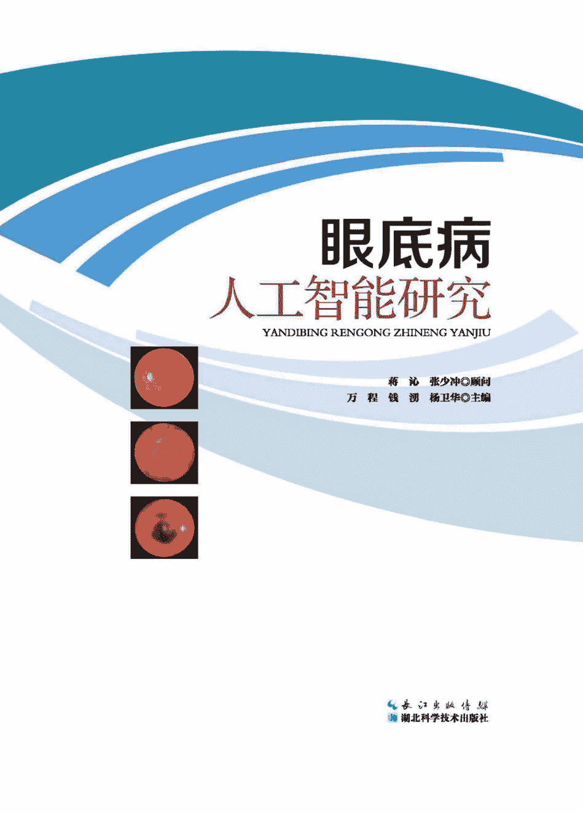

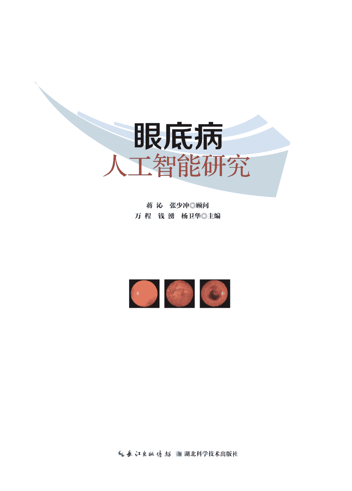

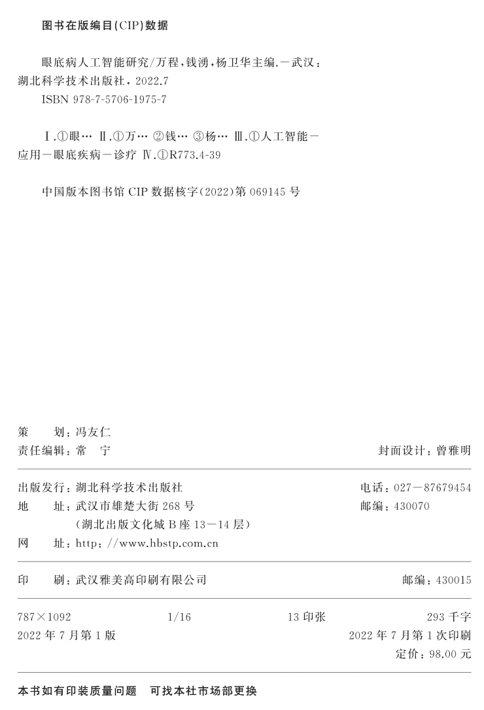

## 编委会
顾问 蒋沁 张少冲

主编 万程 钱涌 杨卫华

副主编 王成虎 郑博 毕燕龙 邵毅 戴琦

编委（按撰写章节排序）

万程（南京航空航天大学）

钱涌（江苏省医疗器械检验所）

杨卫华（南京医科大学附属眼科医院）

王成虎（南京医科大学附属眼科医院）

郑博（湖州师范学院信息工程学院）

毕燕龙（同济大学附属同济医院）

邵毅（南昌大学第一附属医院）

戴琦（温州医科大学附属眼视光医院）

陈颍锶（南京航空航天大学）

李晗（南京航空航天大学）

周雪婷（南京航空航天大学）

邵怡韦（南京航空航天大学）

方纪义（南京航空航天大学）

华荣荣（南京航空航天大学）

徐建国（南京航空航天大学）

吕筱（同济大学附属同济医院）

韩雯婷（同济大学附属同济医院）

曲申（同济大学附属同济医院）

陈楠（南京医科大学附属眼科医院）

张光华（太原学院）

李柯然（南京医科大学附属眼科医院）

罗雨馨（南京医科大学）

康刚劲（西南医科大学附属医院）

聂丹瑶（深圳市眼科医院）

刘磊（广东省人民医院）

卢一（新乡医学院护理学院）

华骁（南京星程智能科技有限公司）

许超友（南京星程智能科技有限公司）

# 第一章　常见眼底病和影像检查

## 第一节　概述

视网膜是视觉信息起始换能的场所，也是诸多致盲眼病最常累及的部位，在防盲治盲里作用突出。同时它是人身上唯一能够在活体状态下直接观察神经与血管的组织，为眼部疾病乃至部分全身性疾病的判断提供了直视窗口。

从发育角度看，视网膜源于视泡内陷形成的视杯。视杯的外壁分化为色素上皮，内壁分化为由多层细胞构成的感觉部即神经上皮，两者共同构成视网膜整体。

结构与功能要点如下。

视网膜由外侧的色素上皮与内侧的神经上皮构成。神经上皮自外向内包含视锥视杆细胞层、外界膜、外颗粒层、外丛状层、内颗粒层、内丛状层、神经节细胞层、神经纤维层与内界膜，与色素上皮共同构成十层组织结构。

光感受主要在神经上皮完成。视锥与视杆接收光线后将刺激转化为神经信号，经双极细胞和水平细胞处理后传给神经节细胞，再由神经节细胞轴突汇入神经纤维层与视神经，投射至外侧膝状体并达枕叶视皮层，经大脑加工后形成视觉。

视网膜在眼睛与大脑间形成内外双屏障。色素上皮细胞间的紧密连接构成视网膜与脉络膜间的屏障，即血视网膜外屏障，阻挡脉络膜侧异常物质进入视网膜。视网膜毛细血管内皮间的闭锁小带与周细胞构成内屏障，即血视网膜内屏障，限制血液成分渗入视网膜。

视网膜兼具透明与高代谢特性。神经上皮除血管区外基本透明，为高质量成像提供基础。透明性依赖细胞有规则排列、内外屏障完整以及部分细胞的水转运能力。高代谢体现在光感受器外节持续更新，需色素上皮不断吞噬代谢。血供丰富，由视网膜中央血管与睫状血管共同构成四层毛细血管网，分别是神经纤维层表面的视盘周围放射状血管网、内核层浅层与深层毛细血管网以及脉络膜毛细血管网。

黄斑位于视盘颞侧上下血管弓之间，约直径5.5mm的特殊区，含有叶黄素和玉米黄素呈现淡黄。组织学上此区节细胞层在两层以上。黄斑中心约1.5mm的中央凹呈凹陷，底部光感受器均为锥细胞，且存在中央凹无血管区，这些特点使该区空间分辨与色觉异常敏锐。

## 第二节　常见眼底疾病

### 一、年龄相关性黄斑变性

年龄相关性黄斑变性是一种以中心视力损害为主的视网膜退行性疾病，多见于50岁以上人群，发病率随年龄上升。临床分为干性和湿性两种类型。

#### 1. 干性年龄相关性黄斑变性

玻璃膜疣是干性AMD的典型征象，位于RPE与Bruch膜之间或Bruch膜内部沉积，与RPE退行性变相关。分型包括直径大于64μm的大玻璃膜疣、直径小于等于63μm的小玻璃膜疣、钙化玻璃膜疣及基底膜层状沉积型玻璃膜疣。多发的大玻璃膜疣提示病程进展与视力丧失风险增加，小玻璃膜疣本身不视为进展危险因素。RPE异常表现为非地图样萎缩、局限性色素增生和地图样萎缩，是干性AMD常见眼底表现。干性年龄相关性黄斑变性眼底彩照见图 1-1。

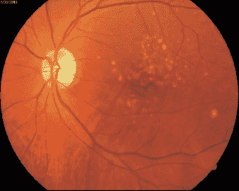

图 1-1　干性年龄相关性黄斑变性眼底彩照

临床表现与影像特征如下。

眼底镜下可见视网膜下淡黄色沉积，包括大玻璃膜疣、小玻璃膜疣或钙化玻璃膜疣，钙化者外观明亮，不同类型常共存。大玻璃膜疣可融合形成更大的玻璃膜疣样RPE脱离。玻璃膜疣可随时间出现或消失。

玻璃膜疣常伴RPE颗粒样不规则外观。玻璃膜疣尤其是玻璃膜疣样RPE脱离消退后，常出现非地图样萎缩或地图样萎缩。色素团块或局限色素增生提示RPE变性在进展。

荧光素眼底血管造影典型为斑片状强荧光或弱荧光，无荧光素渗漏。玻璃膜疣可呈早期或晚期强荧光，取决于RPE完整性及自身组织化学特性。大软性玻璃膜疣典型为早期弱荧光晚期强荧光。地图样萎缩表现为边界始终清晰的散在强荧光区。

光学相干断层扫描上硬性玻璃膜疣典型为高亮反射伴尾状回声，软性玻璃膜疣表现为高反射区域，其在视网膜层内的位置随玻璃膜疣所在层次而变化。

#### 2. 湿性年龄相关性黄斑变性

湿性型的特点是视网膜内、视网膜下或RPE下出现渗漏、出血或脂质渗出。脉络膜新生血管为异常脉络膜血管穿过受损Bruch膜长入视网膜下间隙。AMD中CNV可累及Bruch膜与RPE。年轻患者CNV多为新生血管，仅位于视网膜下，RPE脱离呈泡样隆起。RPE脱离可血管化，或仅为浆液性脱离。盘状瘢痕是进行性纤维化与黄斑光感受器功能丧失的终末结果，也是CNV与RPE脱离的共同结局。湿性年龄相关性黄斑变性眼底彩照和眼底FFA检查见图 1-2。

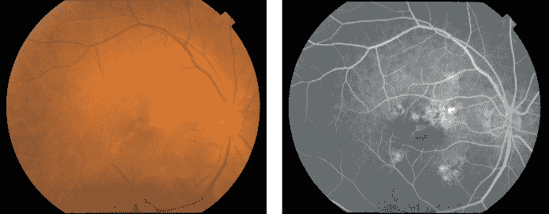

图 1-2　湿性年龄相关性黄斑变性眼底彩照和眼底FFA检查

临床表现与影像特征如下。

裂隙灯下细致检查对诊断很重要，因视网膜水肿、视网膜下积液、脂质渗出、视网膜内外出血等征象有时不明显。存在RPE脱色或萎缩时，判断视网膜下积液较困难。

湿性型OCT可见黄斑或RPE增厚，常伴视网膜内囊样改变、视网膜下积液或RPE脱离。

### 二、脉络膜新生血管

CNV分为典型性与隐匿性。以Bruch膜为界分为未突破Bruch膜的Ⅰ型和突破Bruch膜的Ⅱ型，OCT表现随结构而异。

典型性CNV眼底可见视网膜下灰绿色病变，因新生血管壁通透性不良，常伴黄斑下积液、出血或脂质渗出。FFA可明确CNV范围与性质。CNV位置可分为中央凹下正中位、中央凹旁距中央凹1～199μm、中央凹外距中央凹大于等于200μm。典型性CNV的FFA特点是早期在脉络膜与视网膜血管充盈期出现荧光素渗漏，可呈花边样血管网，轮廓清晰，再循环期与晚期持续渗漏。OCT显示的Ⅰ型CNV和Ⅱ型CNV见图 1-3、图 1-4。

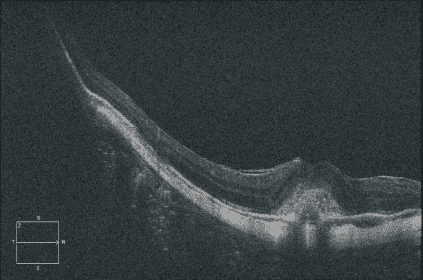

图 1-3　OCT 显示的Ⅰ型 CNV

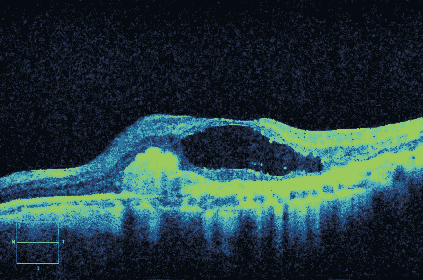

图 1-4　OCT 显示的Ⅱ型 CNV

### 三、视网膜色素上皮层脱离

RPE脱离分为纤维血管性与浆液性。浆液性脱离特点为RPE下积液呈泡样隆起。裂隙灯下可见发亮的橘黄色环，常伴浆液性神经上皮脱离。FFA中脱离区荧光素快速充盈呈均匀强荧光。纤维血管性脱离可合并浆液性脱离。OCT显示的视网膜色素上皮层脱离见图 1-5。

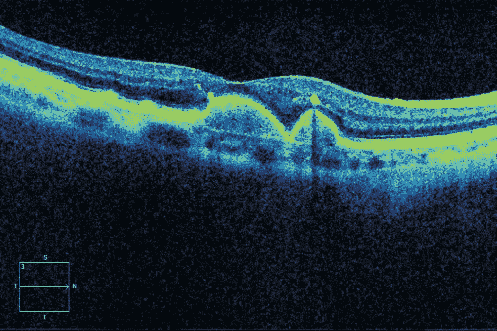

图 1-5　OCT 显示的视网膜色素上皮层脱离

### 四、特发性息肉样脉络膜血管病变

#### （一）病因和发病机制

部分学者认为特发性息肉样脉络膜血管病变是CNV的一种特殊亚型，又称多灶复发性浆液血清样RPE脱离或后部葡萄膜出血综合征。其特征为视网膜后极部脉络膜血管局限性膨隆呈息肉样改变，伴反复出血，同时并存浆液性RPE脱离或纤维血管性RPE脱离。

病因尚不明确，早期认为好发于黑种人女性，后证实任何种族均可发病，尤其有色人种，男女发病率相近。多为单眼受累，50岁以上中老年人多见，发病率略低于AMD。息肉样改变进展缓慢，可自行消退或再发，可能与血管生成过程中动脉瘤样扩张或内皮细胞增生有关。基于脉络膜内层异常血管的发现，认为本病为AMD中CNV的变异表现。组织学显示Bruch膜内有息肉状血管病变，血管膨隆扩张、壁变薄、呈簇状分布，周细胞消失，周围有巨噬细胞与纤维成分浸润。免疫组化显示RPE内存在血管内皮细胞，提示CNV来源。

#### （二）临床和影像学表现

##### 1. 症状

视力轻中度下降，视物模糊，可有眼前黑影、中心暗点及视物变形，严重者视力急剧下降。

##### 2. 眼底彩照

眼底彩照可见明亮淡橘红色结节，多伴视网膜下出血及脂样沉积，后极部视盘周围、黄斑附近及中周部可见浆液性RPE脱离或纤维血管性RPE脱离，亦可有神经上皮脱离，少数出现玻璃体积血。多数患者可见典型脉络膜血管病变，表现为大小不等、单个或多个橘红色结节样或球状息肉样隆起。复发患者晚期可表现为广泛RPE变性萎缩，瘢痕少见。（图 1-6）

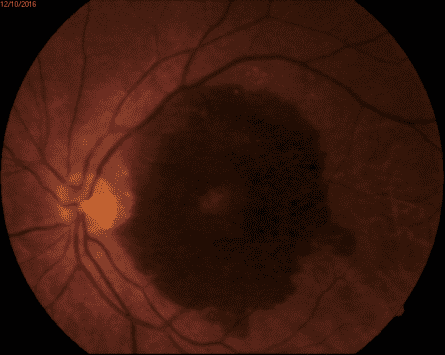

图 1-6　特发性息肉样脉络膜血管病变眼底彩照

##### 3. 眼底造影特征

###### （1）FFA
息肉样扩张血管表现类似CNV，早期呈花边样或斑块状强荧光，晚期可有不同程度渗漏，多分支异常血管网常不易观察，缺乏特征性。

###### （2）吲哚菁绿脉络膜血管造影
早期显示内层脉络膜伞样分支血管网，其末端呈息肉状或动脉瘤样簇状扩张强荧光（图 1-7）。活动性病变随造影时间延长局部可有渗漏，晚期呈荧光着染，静止性病变晚期荧光减弱或出现血管负影。该特征对诊断意义重大。

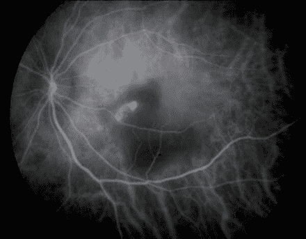

图 1-7　特发性息肉样脉络膜血管病变吲哚菁绿脉络膜血管造影，可见视网膜后极部息肉状脉络膜血管扩张的强荧光

##### 4. OCT 成像特征

眼底彩照中橘红色结节样隆起在OCT上表现为RPE高反射区呈陡峭隆起，其下可见中等反射或结节状改变。

### 五、中心性浆液性脉络膜视网膜病变

中心性浆液性脉络膜视网膜病变是一种常见于中青年的黄斑病变，具有自愈倾向，易反复发作。

#### （一）病因和发病机制

病因不明，可能与年龄、性别、性格、全身状况及气候等多因素相关。机制尚未完全明确，系不同原因导致RPE病变及脉络膜毛细血管通透性增高，进而引起神经上皮脱离。

#### （二）临床表现和影像学检查

患者多在劳累或情绪波动后出现视野暗影遮挡，视物变色、变小，视力可正常或不同程度下降。眼底可见黄斑部神经上皮盘状脱离，中央凹反射消失。后期脱离区视网膜下可见黄白色点状沉积。少数病例神经上皮泡状脱离可延伸至周边，并见视网膜下黄白色纤维素样物质聚集。反复发作时黄斑部色素紊乱。本病无出血，一旦出血需考虑其他病变。

#### （三）诊断和鉴别诊断

诊断要点：①典型临床表现。②眼底血管造影包括FFA及ICGA。FFA早期可见单个或多个强荧光点，晚期渗漏增强；ICGA早期可见脉络膜血管扩张及灌注不良区，造影过程中可见渗漏。③OCT是诊断与随访最便捷精确手段，表现为局限浆液性神经上皮脱离或合并浆液性RPE脱离。OCT显示的中心性浆液性脉络膜视网膜病变和好转见图 1-8、图 1-9。

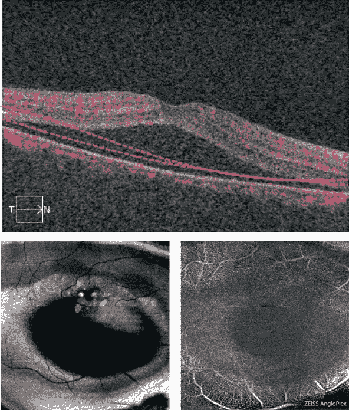

图 1-8　OCT 显示的中心性浆液性脉络膜视网膜病变

需与原田病鉴别，后者神经上皮脱离多为多灶性，可见视盘充血水肿或脉络膜皱褶。

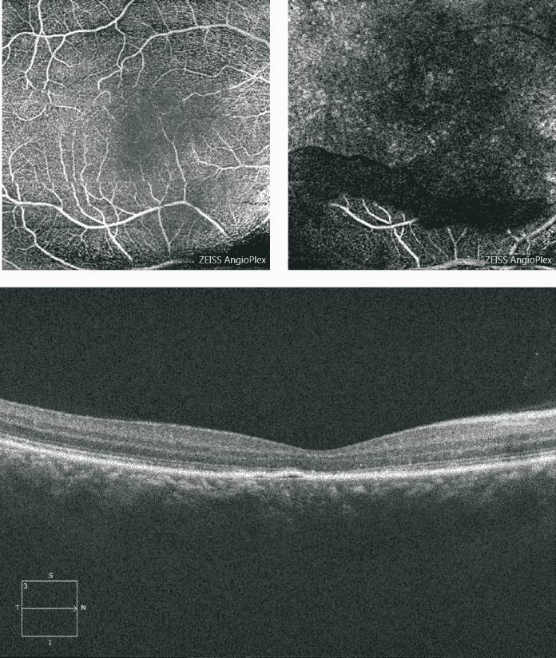

图 1-9　OCT 显示的中心性浆液性脉络膜视网膜病变好转

### 六、高度近视性黄斑病变

高度近视性黄斑病变系眼轴增长、巩膜变形所致黄斑系列改变，包括弧形斑、视盘倾斜、后巩膜葡萄肿、漆裂纹、CNV、黄斑裂孔性视网膜脱离、视网膜劈裂及脉络膜视网膜萎缩等。

弧形斑：毗邻视神经的RPE萎缩形成新月形或圆弧形斑，多位于视盘颞侧。

视盘倾斜：因眼轴增长导致视盘垂直拉长或倾斜。

巩膜向后延长使视网膜无法匹配，导致后巩膜葡萄肿、视网膜劈裂、后极部凹陷与脉络膜视网膜萎缩。

漆裂纹：Bruch膜自发线性破裂，可致视网膜下出血。

眼底图像提示高度近视者周边视网膜可有弥漫色素改变、脉络膜视网膜变性或萎缩斑，玻璃体后脱离发生率高。

### 七、黄斑裂孔

黄斑裂孔指累及黄斑中央凹的视网膜神经上皮部分或全层缺损。

#### （一）病因和发病机制

常见于老年人、眼外伤者、高度近视者。黄斑裂孔可由外伤、变性、长期囊样改变、高度近视、玻璃体牵拉等诱发。无其他病因的老年人特发性黄斑裂孔相对常见。

#### （二）临床表现和影像学检查

患者可有视力不同程度下降，视物变形，中央暗点。检眼镜下黄斑呈边界清晰圆形或椭圆形红斑，孔内可有黄色颗粒。高度近视者易并发视网膜脱离。Gass将特发性黄斑裂孔分为四期：Ⅰ期裂孔前期，中央凹变平，视力尚可；Ⅱ期中央凹或其周围形成裂孔通常小于400μm，视力明显下降；Ⅲ期裂孔大于400μm，玻璃体后皮质仍与黄斑粘连；Ⅳ期玻璃体后皮质完全脱离，伴较大全层黄斑裂孔。

#### （三）诊断和鉴别诊断

诊断要点：①病史询问外伤史、眼部疾病史及手术史、屈光状态、年龄等。②裂隙灯、眼底镜检查可见裂孔。③OCT可明确诊断并辅助鉴别，见图 1-10。

需与黄斑囊样水肿、黄斑劈裂鉴别。

### 八、黄斑视网膜前膜

#### （一）病因和发病机制

病因尚不明确，内界膜缺损被认为是诱发黄斑视网膜前膜的先决条件。玻璃体后脱离时黄斑牵引、感染、抗原抗体复合物及血液降解产物等因素致内界膜缺损，神经胶质细胞经缺损处迁移至视网膜表面增殖形成膜。

#### （二）临床表现和影像学检查

早期常无自觉症状，进展后出现不同程度视力下降、视物变形。检眼镜下不易发现，用无赤光线较易辨认。裂隙灯前置镜检查可见视网膜表面透明薄膜。薄膜收缩可致内层视网膜放射状或不规则皱褶，视网膜血管向中心牵拉。有时薄膜围绕中央凹生长类似黄斑裂孔，称为假性黄斑裂孔（图 1-11）。薄膜可增厚呈灰白色，亦可见黄斑水肿。

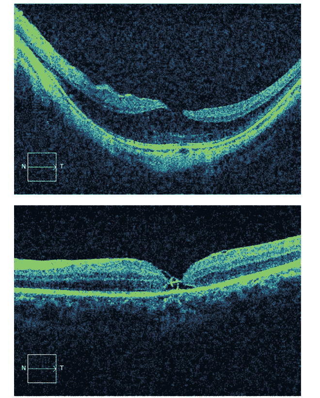

图 1-10　OCT 显示的板层黄斑裂孔和内界膜填塞术后的黄斑裂孔闭合

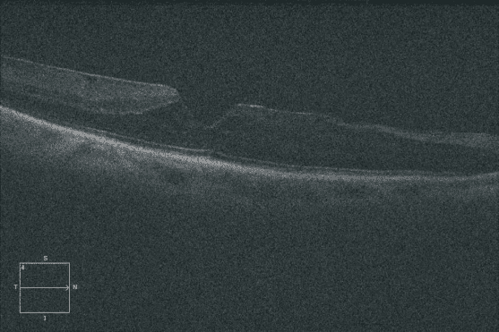

图 1-11　OCT 显示的假性黄斑裂孔

#### （三）诊断要点
判断主要靠病史、基础检查和影像三方面。患者常诉视力减退伴视物扭曲，需补充既往眼病史和手术经历。基础眼科检查以裂隙灯联合散瞳检眼镜观察眼底为主。影像学关键，OCT 多能捕捉到黄斑区视网膜前膜形成，常合并黄斑水肿，典型影像见图1-12至图1-14。必要时行FFA以佐证诊断并排除视网膜、脉络膜血管的其他异常。

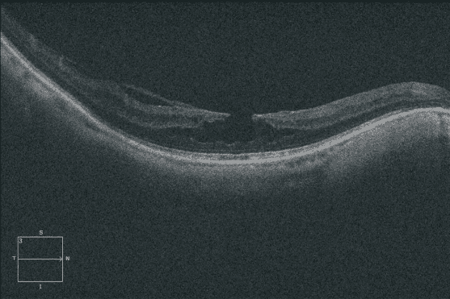
图 1-12　OCT 显示的黄斑视网膜前膜伴黄斑板层裂孔

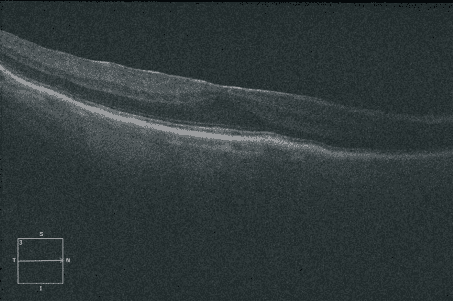
图 1-13　OCT 显示的黄斑视网膜前膜牵拉黄斑造成局部中央凹形态消失

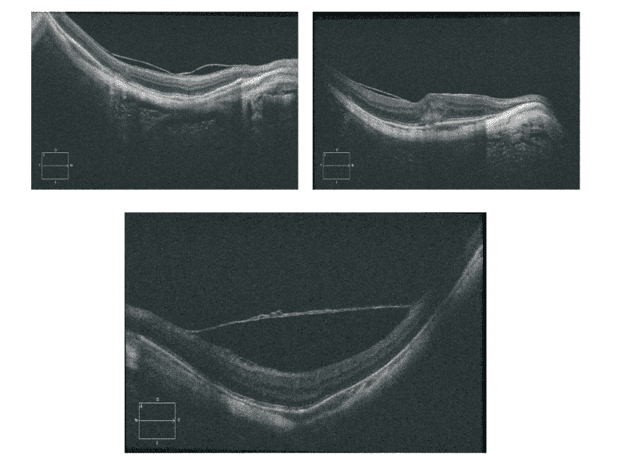
图 1-14　OCT 显示的不同形态的黄斑视网膜前膜

#### （四）治疗选择
视力维持正常者可择期随访，无需干预。若矫正视力明显低于0.4且伴视物变形，经影像学确诊黄斑视网膜前膜后，可考虑玻璃体切除联合黄斑视网膜前膜剥除手术。

## 第三节　视网膜血管病
### 一、视网膜动脉闭塞
视网膜动脉闭塞属于眼科急症，多见于老年，处理时机直接影响预后。

#### （一）致病因素与发病原理
主要与动脉硬化、栓子脱落、血管壁结构改变、血液流变异常有关，也可因眶内压升高导致供血中断。

#### （二）临床表现和影像学检查
多为突发、无痛、单眼视力骤降。中央动脉受累时视力可降至眼前手动或数指；分支动脉受累时对应区域视野缺失。中央型眼底可见瞳孔散大、对光反应迟钝、视网膜苍白水肿、黄斑呈樱桃红点、动脉纤细。2-3周后水肿消退，视网膜出现脱色素及色素沉着。分支型则在相应供血区出现局部水肿。

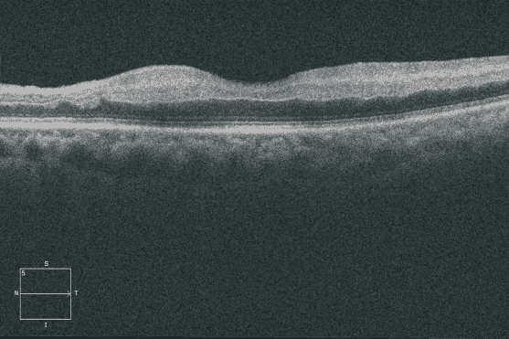
图 1-15　OCT 显示的视网膜中央动脉阻塞后黄斑萎缩

#### （三）诊断思路
核心要点包括典型骤发性视力损害及眼底特征；FFA 示动脉灌注延迟或完全不灌注，动静脉循环时间延长，动脉管径变细或不规则；OCT 见病变区视网膜内层水肿增厚反射增强，外层反射减弱。

### 二、视网膜静脉闭塞
视网膜静脉闭塞包括中央型与分支型，是常见眼底病之一，多发于老年人，亦可见于青壮年。

#### （一）病因及发病机制
属多因素疾病，与心血管状况密切相关。老年患者常合并高血压及动脉硬化；年轻患者与静脉炎症、血黏度升高、血流动力学紊乱关系更密切。

#### （二）临床表现和影像学检查
中央静脉闭塞多为单眼无痛性视力下降，起病可急可缓；分支静脉闭塞多表现为局部视野受限。眼底可发现中央静脉迂曲扩张、火焰状或片状出血、视网膜水肿，重症缺血区可见棉絮斑，视盘与黄斑均可水肿。分支型以受累分支静脉迂曲扩张为特征，常位于与伴行动脉交叉处，黄斑小分支受累较常见。

#### （三）诊断要点
症状为无痛性视力减退，进程不一；分支型常伴部分视野遮挡。陈旧性静脉闭塞继发新生血管导致玻璃体出血时，患者常诉眼前有活动性暗影。眼底检查需散瞳后仔细评估虹膜新生血管及前房深度，缺血严重者易出现虹膜新生血管。窄房角者应先行虹膜周边切开再散瞳以防高眼压。眼底可见静脉迂曲扩张、浅深层出血、棉絮斑、硬性渗出、视盘或黄斑水肿。年轻患者需双眼散瞳以排除静脉周围炎。病程超过3个月，出血多部分吸收，残留多为深层出血，闭塞静脉可呈白线样，可见新生血管及吻合小血管。突发玻璃体积血者需仔检查血管白线及视网膜新生血管以判断是否由陈旧闭塞所致。FFA 主要用于评估缺血范围以指导光凝。分支静脉闭塞可在出血大部分吸收后进行；缺血型中央静脉闭塞一般于发病3个月后检查，病情危重者可提前。造影可见静脉迂曲扩张、充盈延迟，小分支静脉壁渗漏，缺血区呈无灌注，黄斑可出现花瓣样强荧光，久病可见新生血管强荧光。OCT 用于评估黄斑病变程度，可见黄斑视网膜内水肿及神经上皮脱离，是监测进展及疗效的重要手段。视网膜分支动脉阻塞的眼底彩照和 FFA 造影见图 1-16。

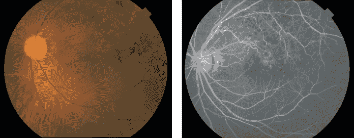
图 1-16　视网膜分支动脉阻塞的眼底彩照和 FFA 造影

### 三、高血压性视网膜病变
高血压性视网膜病变是指全身血压升高致视网膜血管改变，见图 1-17。

#### （一）致病因素与分级依据
可分为急性期与慢性期，按Keith-Wagener-Barker分级共四级。1级为视网膜动脉变窄；2级为动静脉压迹；3级出现视网膜出血、棉絮斑、硬性渗出；4级在3级基础上加视神经水肿。1、2级多见，3、4级少见。

#### （二）临床表现和影像学检查
1级和2级多属慢性，3级和4级提示急性失代偿改变。

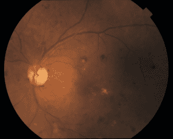
图 1-17　高血压性视网膜改变

#### （三）诊断和鉴别诊断
出现典型眼底改变时同步测血压即可确诊。需与糖尿病视网膜病变、视网膜静脉闭塞等其他视网膜血管病鉴别。

### 四、糖尿病视网膜病变
糖尿病视网膜病变是糖尿病常见眼部并发症，严重程度与病程及血糖控制相关。

#### （一）致病因素与发病机制
长期高血糖损伤视网膜微血管周细胞、内皮细胞及基底膜，导致血-视网膜屏障破坏，进而出现缺血缺氧及继发改变。

#### （二）临床表现和影像学检查
常见主诉为视力下降、视物模糊，部分因玻璃体积血出现视野飘动暗影，重者可骤然失明。眼底可视微动脉瘤、出血、棉絮斑、水肿、硬性渗出、新生血管及玻璃体积血。按严重程度分为非增生性和增生性。

#### （三）糖尿病视网膜病变诊断及分级标准
轻度非增生性：眼底仅见微动脉瘤。中度非增生性：较轻度重但不及重度。重度非增生性：符合421原则任一项，即4个象限各有≥20个视网膜内出血或微动脉瘤；≥2个象限有静脉串珠样改变；≥1个象限有显著视网膜内微血管异常。增生性：视盘或视网膜新生血管、玻璃体积血、视网膜前出血。

#### （四）诊断要点
症状为视力进行性减退或视野暗影飘动。眼底检查散瞳前需注意虹膜新生血管及周边前房深度，窄房角者先行虹膜周边切除再散瞳。糖尿病患者均应充分散瞳后检查，无病变者建议每半年复查一次。FFA 对初诊且眼底为重度及以上非增生性、或病程超10年但眼底仅为轻中度者建议检查。造影可见强荧光点、视网膜内微血管异常、遮蔽荧光、无灌注区，新生血管呈强荧光片状，黄斑水肿见花瓣样荧光积存。FFA 有助于确诊、分期、指导光凝及评估效果，全视网膜光凝术后4周应复查。OCT 用于评估黄斑水肿程度及有无黄斑前膜，水肿表现为黄斑增厚及低反射腔隙，前膜表现为内界膜反射条带增强。

## 第四节　视网膜变性及营养不良
### 一、视锥细胞营养不良
视锥细胞营养不良是影响视锥细胞系统的遗传性疾病。

#### （一）临床表现和影像学检查
典型表现为进行性视力下降、色觉障碍及中央视野缺损。早期眼底可正常，随病程进展黄斑区出现色素紊乱或后极部弥漫色素团块，晚期黄斑可出现牛眼征。

#### （二）鉴别诊断
需与Stargardt病、中毒性视网膜病变、先天性黑矇等鉴别。

### 二、Stargardt 病
患者呈双侧中心视力丧失、色盲及中央暗点，伴特征性黄斑萎缩及后极部视网膜色素上皮层黄白色斑点。发病高峰在儿童期，次高峰在成年早期，预后相对较好。病程中视网膜结构与功能缓慢进行性退化，家族内外变异性大，可能受遗传修饰及环境影响。目前尚无经验证疗法，研究方向包括干细胞疗法、基因替代疗法和药理学方法。

影像学检查显示ABCA4基因变异严重程度与发病相关。检眼镜下可为正常或仅见轻度异常如中央凹反射丧失或色素上皮轻度受损。FAF、SD-OCT及电生理检查有助于早期诊断。SD-OCT可见中央黄斑结构丧失而周边相对保留；FAF中央荧光降低，周边环形高荧光或牛眼征。约1/3儿童早期眼底及FAF无典型斑点，斑点随时间出现并与萎缩加重相关，是早期漏诊原因之一。视力相对保留的早期患儿黄斑中央可见对称黄白色细点。

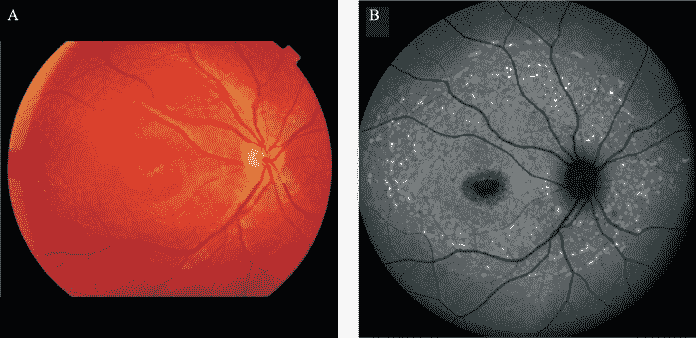
图 1-18　A—Stargardt 病眼底彩照图；B—Stargardt 病眼底自发荧光图

图片来自：Br J Ophthalmol 2017 Jan；101（1）：25-30.doi：10.1136/bjophthalmol-2016-308823.Epub 2016 Aug 4.

### 三、急性视网膜坏死综合征
急性视网膜坏死综合征是一种发病凶险、预后较差的后葡萄膜炎，可单眼或双眼发病。

#### （一）致病因素与发病过程
由病毒感染引起，20岁左右多为单纯疱疹病毒，45岁以上多为水痘-带状疱疹病毒，巨细胞病毒亦常见。起病相对缓慢，初期有畏光、眼痛、视力模糊。前节可见中度睫状充血、角膜后沉淀物，部分眼压升高，玻璃体混浊明显。眼底可见中周部黄白色浸润水肿灶、斑块状出血，血管炎以动脉炎为主，动脉变细分支闭塞。缓解期炎症消退，动脉闭塞，视网膜脉络膜萎缩，坏死区易形成多发裂孔导致视网膜脱离、眼球萎缩。

#### （二）影像学和实验室检查
B超可显示重度玻璃体混浊。FFA可见血管节段性管壁染色、不同程度闭塞多见于动脉，伴遮蔽荧光及无灌注区。血清HSV或VZV抗体测定、玻璃体或视网膜组织活检有助于明确病因。

## 第五节　先天性和小儿视网膜病
### 一、早产儿视网膜病变
#### （一）早产儿视网膜病变的国际分期和分类
ICROP依据受累范围分为区与钟点。Ⅰ区以视盘为中心半径为视盘至黄斑2倍；Ⅱ区以视盘为中心半径为视盘至鼻侧锯齿缘；Ⅲ区为颞侧月牙形。钟点法以12点为基准计算受累弧度。病变在颞侧周边血管化与非血管化交界处按严重程度分期，并记录后极部血管扩张迂曲情况即plus病变。

新修订ICROP在原版基础上增加进展性后极部ROP、介于正常与plus之间的前plus病变，并明确Ⅰ区范围。

分期：1期为分界线；2期为嵴，分界线变宽变高呈白色或粉红色隆起；3期为视网膜外纤维血管增生，新生血管由嵴进入玻璃体；4期为部分视网膜脱离，未累及中央凹为4A，累及为4B；5期为全视网膜脱离。plus病变指后极部血管扩张迂曲。前plus为血管扩张迂曲但未达plus程度，可能进展。AP-ROP为快速进展严重型，多见于Ⅰ区或Ⅱ区后部，特点为后极部明显血管扩张迂曲，可伴少量增生，动静脉短路，病变可不按常规进展。多数ROP可自然退行，由血管增生型转为纤维化型，分界线颜色变白、血管变少、颞侧血管弓变直，可出现色素改变、裂孔及孔源性或牵拉性视网膜脱离。

#### （二）ROP 的治疗
合并眼底新生血管可采用玻璃体内抗VEGF药物注射，结合ROP分期决定是否行视网膜光凝。

#### （三）视网膜光凝治疗时机
Ⅰ区任何期合并plus即需光凝；Ⅱ区3期合并plus或3期无plus者需光凝；Ⅲ区3期合并plus者需光凝。

### 二、家族性渗出性玻璃体视网膜病变
#### （一）病因和发病机制
FEVR为遗传性视网膜血管发育异常疾病，已鉴定的相关基因包括FZD4、TSPAN12、NDP、ZNF408、LRP5及KIF11。

#### （二）临床表现和影像学检查
FEVR为慢性进行性病变，可发生于任何年龄，婴幼儿期进展快，成人相对稳定。表现多样，重者因视网膜脱离严重影响视功能。典型表现为周边视网膜毛细血管无灌注，交界处新生血管生长，纤维血管组织收缩牵拉视网膜形成皱襞，可至晶状体赤道。随着进展出现视网膜内或视网膜下脂质渗出、血管性视网膜前膜、视网膜镰状皱襞、黄斑异位、牵拉性或渗出性视网膜脱离甚至孔源性脱离。严重者可伴白内障、角膜带状变性、新生血管性青光眼、眼球萎缩。FFA早期可见周边血管异常、无血管区形成、分支增多分布密集、周边血管在赤道附近突然终止、末梢膨大、周边血管异常吻合等；严重时在无血管交界处新生血管形成并渗漏。

#### （三）诊断

FEVR 关键认知梳理

FEVR 是一类遗传性视网膜病。家族史阳性对判断有一定提示意义，但流行病学数据显示约 55% 的患者查无明确家族史。该病外显不全、临床表型谱较宽，即使携带相同致病突变的家系成员，眼部表现也可能差异显著。一旦临床怀疑，需对直系亲属展开全面眼底检查，以便在无主诉时尽早揪出隐形携带者。多数患者双眼均受累，且两眼不对称常见，轻侧常处于早期或接近正常，重侧可已进展至全视网膜脱离并伴严重并发症。实践中多由病变相对轻的眼提示诊断，而晚期重症眼的改变与多种视网膜疾病重叠，特异性不足。

#### （四）鉴别诊断
（1）早产儿视网膜病变 ROP：患儿通常有早产、低体重及不规律吸氧史，FFA 可在动静脉短路区见到血管嵴，病程多呈稳定型，复发少见。
（2）Coats 病：多为散发，约 90% 为单眼患病，偏爱年轻男性，主要累及动静脉，血管造影可见扭曲扩张并伴囊状、梭状或串珠状微血管瘤样改变。
（3）永存胎儿血管 persistent fetal vasculature，PFV，旧称永存原始玻璃体增生症 persistent hyperplastic primary vitreous，PHPV。系原始玻璃体未退化所致先天异常，多单眼散发，患眼常较对侧小，前部型常合并白内障、青光眼，晶状体周围可看到被牵拉延长的睫状突。
（4）色素失调症 incontinentia pigmenti，IP，为 X 连锁显性遗传，多见女性，眼部改变与 FEVR 相似，典型皮肤表现并常合并牙齿、指甲畸形及神经系统异常。

### 三、Coats 病
外层渗出性视网膜病变即 Coats 病，起病早、黄斑受累重、进展快、视力预后差，1908 年由 George Coats 首报。

#### （一）病因和发病机制
病因尚未明确，核心病理为视网膜毛细血管异常扩张继发大范围视网膜下液体渗出。

#### （二）临床表现
典型病例常见：
（1）眼底可见大量白色或黄白色渗出物。
（2）可见成簇胆固醇结晶沉积或出血灶。
（3）视网膜血管异常，呈梭形、球形扩张或花环样扭曲。
（4）部分病例最终发展为视网膜脱离、继发性白内障、虹膜睫状体炎、继发性青光眼。
（5）好发于婴幼儿与青少年，男性占优，12 岁以下约占 97.2%，通常单眼发病，超过 80% 为单眼病，左右无明显偏侧，偶见双眼受累。多因视力下降、斜视、白瞳症就诊。

#### （三）影像学检查
（1）FFA：婴幼儿配合差，病变多在周边，病情进展出现渗出性脱离或玻璃体积血会降低成像清晰度。可显示视网膜细小血管、毛细血管扩张迂曲及形态异常，粟粒状动脉瘤、大动脉瘤及微血管瘤伴大面积毛细血管无灌注。造影早期异常血管明显渗漏，晚期荧光融合。出血可遮挡荧光。大片渗出主要沉积于外丛状层，对荧光影响有限。
（2）ICGA：脉络膜血管多基本正常。
（3）OCT：有助于动态评估黄斑水肿及浆液性色素上皮脱离，频域 OCT 能更清晰分辨各层结构变化，用于鉴别视网膜母细胞瘤及监测治疗中视网膜下积液吸收。
（4）B 超：可显示脱离形态，视网膜下大量胆固醇结晶在超声上呈密集点状强回声。

#### （四）诊断
结合发病年龄、单眼发病、不明原因血管迂曲扩张、囊样扩张或串珠样改变伴广泛渗出，且荧光素造影显示异常区域明显渗漏即可判断。不典型者需与白瞳症及其他血管扩张性疾病鉴别。

#### （五）鉴别诊断
（1）早产儿视网膜病变 ROP：有早产及低出生体重史，多双眼受累，白瞳症出现时常已形成牵拉性脱离。
（2）糖尿病视网膜病变：年龄偏大，有糖尿病史，多双眼受累，静脉迂曲扩张，可见视盘及视网膜前新生血管膜，甚至牵拉性脱离。
（3）Coats 病：发病年龄小，单眼发病，常伴成簇微血管瘤及稍大的粟粒状动脉瘤，以及迂曲扩张毛细血管周围环绕硬性渗出带。
（4）转移性眼内炎：多继发于全身急性感染尤其是肺部感染，眼前节常有角膜后沉淀、前房闪辉等葡萄膜炎体征。
（5）家族性渗出性玻璃体视网膜病变：亦可出现大片黄白色视网膜渗出及渗出性脱离，但多有家族史、双眼发病，早期存在无血管区，血管异常主要位于周边视网膜以颞侧最明显。
（6）视网膜血管炎：多双眼发病，罕见视网膜内黄疸样渗出，以周边视网膜广泛血管鞘样改变、缺血及新生血管为特征，易反复玻璃体积血。
（7）视网膜血管瘤：可致黄白色渗出但多局限，可见 2～3 支扩张滋养血管。
（8）视网膜母细胞瘤：常见白瞳症，易与 Coats 病混淆。玻璃体内可见灰白色片状、块状混浊，眼底见视网膜灰白色实性隆起伴卫星结节，瘤体隆起处血管扩张，偶继发青光眼。
（9）急性视网膜坏死：眼底大量黄色渗出酷似 Coats 病，但起病急，多见大血管炎，晚期血管变细呈闭塞性白线样，玻璃体炎和葡萄膜炎明显，渗出常伴视网膜内出血及边界清晰的白色坏死灶，坏死灶多由周边向中央发展呈环形，与 Coats 病差异显著。
（10）其他：尚需与先天性白内障、视网膜分支静脉阻塞、睫状体平坦部炎、色素失调症、弓蛔虫病、永存原始玻璃体增生症、Norrie 病、特发性黄斑旁毛细血管扩张症及放射性视网膜病变鉴别。

### 四、脉络膜缺损
主要指胚胎期胚裂未能完全闭合导致的眼部构造发育异常。

#### （一）病因和发病机制
属于先天性发育异常，因胚裂闭合不全导致脉络膜和视网膜缺失，可窥见白色巩膜。

#### （二）临床表现
眼底可见后极部脉络膜和视网膜缺如，透见白色巩膜，缺损范围与先天闭合不全程度相关，边界清晰，可见脉络膜黑色边缘。

## 第六节　孔源性视网膜脱离
由视网膜裂孔引起神经上皮与色素上皮分离，多见于中老年，可双眼先后发病，多数患者伴近视性屈光不正。

### （一）病因和发病机制
玻璃体液化牵引以及视网膜变性裂孔是核心，二者缺一不可。玻璃体腔液体经裂孔进入视网膜下导致神经上皮与色素上皮分离，感光细胞营养供应受阻致不可逆视功能损害。格子样变性、囊样变性等为高危因素，同时与年龄、遗传、近视、外伤相关。

### （二）临床表现和影像学检查
多在短期内出现眼前飞蚊增多、无痛性视野暗影，并随脱离进展加重。检眼镜下可见视网膜裂孔及灰色隆起的视网膜，病程久者形成固定皱褶，脱离呈漏斗状。裂孔呈红色，圆形或马蹄形，部分位于锯齿缘呈裂隙样。可伴视网膜变性、玻璃体混浊及色素播散。孔源性视网膜脱离见图 1-19。

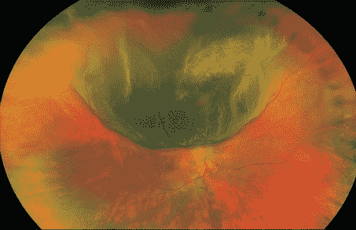

图 1-19　孔源性视网膜脱离

### （三）诊断和鉴别诊断
诊断要点：
① 病史：无痛性视力下降、视野进行性缩小，需询问近视性屈光不正及外伤史。
② 检查：双眼散瞳后行眼底镜及三面镜检查，必要时行间接镜下巩膜外顶压查找裂孔。
③ 特殊检查：B 超可确诊，视觉诱发电位 visual evoked potential，VEP 和视网膜电图 electroretinogram，ERG 用于评估视网膜功能。

鉴别诊断：需与渗出性视网膜脱离及牵拉性视网膜脱离相区分。

# 第二章　眼底病人工智能概况
眼科尤其是眼底病的诊断高度依赖影像，眼部图像精细复杂，医生需结合理论与经验判断。人工智能在图像识别、自动诊断及大数据分析方面优势明显，可辅助眼底病诊断、创新服务模式，减轻医生负担，有助于大规模筛查，缓解医疗资源供需矛盾。

## 第一节　人工智能

### 一、人工智能
人工智能是计算机学科重要分支，通过模拟人类智能算法实现智能化。概念产生于 20 世纪 50 年代，被视为第四次工业革命。医疗领域应用最早可追溯至 1970 年，主要涵盖机器学习 machine learning，ML 和深度学习 deep learning，DL。

### 二、机器学习
机器学习是人工智能核心。1959 年 Arthur Samuel 将其定义为“计算机可在无明确指令下自我学习”，强调其在大数据条件下可自我优化。基本思路是通过算法模型从数据中提取规律，利用标注图片库训练后对新数据进行预测。但医学疾病病理变异广泛，难以手工编码涵盖全部临床信息的规则。

### 三、深度学习
深度学习是机器学习前沿技术，近年受关注。相较传统机器学习，深度学习无需人工特征工程，可自动捕捉海量数据中的复杂结构，直接从样本学习。经典做法是先从经验数据提炼生物标志或特征，再由分类器依据已知标签训练集学习识别新特征。

传统机器学习在 Haar 人脸检测、指纹识别等领域已商业化，但进一步提升困难，直至深度学习出现。早年设想因数据不足、算力落后效果有限。21 世纪互联网带来海量数据，存储成本下降，数据存储分析成为可能。2006 年杰弗里·辛顿发表《一种深度置信网络的快速学习算法》，同年多篇重要论文发表，理论取得突破。近年硬件、算法、云服务与大数据协同发展，人工智能广泛应用。

### 四、卷积神经网络
卷积神经网络 convolutional neural networks，CNN 是具识别与分类能力的深度神经网络，是医学成像等计算机视觉任务中最常用模型。其他算法包括 CNN 集成、迁移学习、CNN 与传统机器学习结合、全卷积神经网络及自动编码器。CNN 为前馈结构，编码方式类似视觉皮质神经元连接。采用卷积数学滤波，单个神经元仅处理子域数据并模拟视觉刺激反应。滤波器充当特征检测器，随着图像经连续卷积层处理，滤波器逐级叠加，形成更具描述性的复杂特征检测器。可模拟大脑层级学习，通过局部感受野、权值共享、稀疏连接实现平移、缩放等，避免繁琐预处理，可直接对原始图像进行特征学习与识别，在模式识别领域成效显著。

近年人工智能在医学应用不断扩大，尤其在图像与数据集成的领域，眼底病正是其中之一。

## 第二节　人工智能和眼底病
深度学习使大数据采集成为可能，棋步、自动驾驶、人脸识别、网页搜索等高级应用均依赖海量数据。眼科学对影像依赖强，资源丰富，眼底照相、OCT、裂隙灯显微照相、FFA、眼超声及角膜、眼表、睑板腺成像等数据量指数增长，为机器学习提供海量图像源，有助于研发眼科疾病自动筛查与诊断系统。

自 2016 年首批运用 DL 筛查糖尿病视网膜病变的论文发表以来，AI 特别是在眼科的研究呈爆发式增长。研究病种由最初集中于糖尿病视网膜病变 diabetic retinopathy，DR、年龄相关性黄斑变性 AMD、青光眼，逐步扩展至早产儿视网膜病变 ROP、白内障、角膜病等。临床应用涵盖病变自动检测与定量、疾病自动筛查、基于 AI 的诊断分级及视网膜治疗与预后模型的临床决策支持，研究从算法到临床验证再到经济价值评估逐步深化。

眼底病在 AI 临床研究中具备良好基础，青光眼、糖尿病视网膜病变及年龄相关性黄斑变性常见，且眼底图像采集广泛，数据积累庞大，故在眼科乃至整个医学 AI 领域占据重要位置。

## 第三节 数据和算法

### 一、数据和数据集
医疗大数据多元化，包括临床数据、基因数据及大健康数据。从存储角度看，有结构化数据如化验单、处方等常量指标；半结构化数据如住院小结、出院小结等文字描述；无结构化数据如医疗影像；另有组学测序及时间序列数据如血压、心率、脉搏等流数据。电子病历普及后，高分辨率影像、视频等无结构化数据数量指数增长，医疗行业数据体量庞大。

在眼科，眼底图像可非侵入、经济高效获取，适合大规模筛查。眼底图像包含视盘 optic disc，OD、视杯 optic cup，OC、黄斑、中央凹、血管等重要生物标志，以及与 DR 相关的微动脉瘤 microaneurysm，MA、出血 hemorrhage，HM、硬性渗出 hard exudate，HE 和软性渗出 soft exudate，SE。可用于诊断青光眼、糖尿病视网膜病变 DR、年龄相关性黄斑变性 AMD、白内障、早产儿视网膜病变 ROP 及糖尿病性黄斑水肿 diabetic macular edema，DME。OCT 广泛用于黄斑皱缩、玻璃体黄斑牵引、黄斑裂孔等，技术进步使 OCT 生成血管造影照片 OCT-A 用于评估视网膜脉管系统。

AI 研究离不开大数据，各国学者建立多种眼底图像数据集，深度学习常用数据集如 MESSIDOR、DRIVE、STARE、EyePACS、RIGA 等见表 2-1。

表 2-1　常用的眼底图像数据集

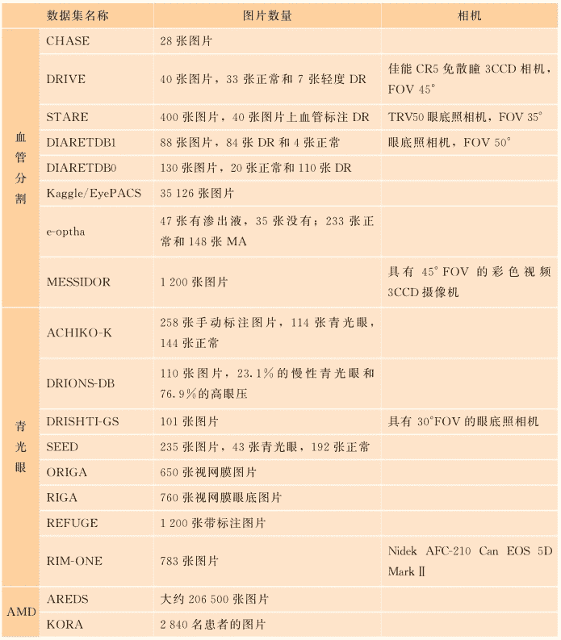

### 二、算法

#### （一）深度学习架构
数据驱动的深度学习已广泛应用于眼底图像的眼科疾病诊断。相较手工设计特征的传统方法，深度学习模型可端到端自动优化特征以获更好性能。CNN 是医学成像计算机视觉任务中最流行的模型，系统内其他深度学习算法包括 CNN 集成、迁移学习、CNN 与传统机器学习结合、全卷积神经网络及自动编码器。

##### 1. 卷积神经网络 CNN
CNN 模型通常由卷积层、激活层、池化层及全连接层构成。激活函数提供非线性并模拟神经元放电，反向传播用于调整权重使模型学习。批量归一化与 dropout 是加速收敛与避免过拟合的常用方法。典型 CNN 各层作用为：①卷积层。以给定核大小与步长执行卷积生成特征图。②激活层。在卷积输出上应用 ReLU 等激活函数。③池化层。用于减小特征尺寸，通常池化后卷积层核数是前一层的 2 倍以保留信息。④全连接层。等同前馈神经网络，用于分类的最后一层。

##### 2. 全卷积网络
全卷积网络由局部连接的卷积层构成，包含下采样、卷积、上采样、反卷积及池化，可视为无全连接层的 CNN，用于图像分割等任务。无全连接层带来更快计算与更少参数，通常由卷积层组成的下采样路径与反卷积层组成的上采样路径可跨层跳跃传输不同分辨率信息以更好地学习。

##### 3. 自动编码器
一种无监督神经网络，用于压缩与编码数据后从压缩表示中重建数据。由降低维度的编码器、最低维度瓶颈、从编码重建数据的解码器构成，重建损失用于衡量解码器输出性能。通过反向传播训练网络最小化重建损失，使重建数据尽可能接近原始数据。

#### （二）训练方法
神经网络训练通常通过初始化随机权重并利用随机梯度下降与反向传播完成。以下为眼底图像训练眼科疾病诊断文献中常用的技术。

##### 1. 监督学习和无监督学习
监督学习中 CNN 提供训练数据与输出标签，神经网络在基本事实监督下学习标签以解决分类问题。无监督学习用于模式识别，含输入层、隐藏层、输出层，层可为部分或全连接，也可含终止的全连接分类层。无监督网络获取输入图像并压缩，其原理是在压缩版本上重建输入图像。此外，半监督学习利用大量图像级标注图像做半监督分割，利用少量像素级标注图像做半监督分类，伪 mask 帮助微调分类网络，分类网络又反哺生成器，实现分割与分类端到端互监督。

##### 2. 迁移学习
深度学习算法通常需要大型数据集，眼科疾病诊断可用数据集常较小易致过拟合。迁移学习通过在大型数据集上拟合初始化权重提供解决方案，再在目标数据集上微调模型部分或全部层权重。

##### 3. 集成学习

把若干个各自独立训练的深度学习模型串联起来，对同一份眼底数据依次征询预测意见，再汇总成最终判断，是现阶段常用的集成思路。最普及的汇总方式就是多数投票，选取出现次数最多的一类作为结果。其背后逻辑是：独立训练的模型出错的概率和位置往往不一致。

#### （三）任务类型概览
眼底图像里的深度学习应用大致可以归到三大类：分类、分割和合成。疾病筛查与分期属于分类范畴，比如糖尿病视网膜病变诊断、分级等，VGGNet、Inception、ResNet、DenseNet 等骨架被用得最多。分割任务则聚焦病灶和生物标志物的轮廓提取，除分类网络外，FCN、SegNet、U-Net、Mask R-CNN、Deeplab V3+ 在眼底分割中也很常见。合成方向目前以生成对抗网络 GAN 为主流架构。

#### （四）评价维度
模型预测越接近真实情况，可用性就越高。这种接近程度需要量化指标来检验，量化指标也为不同方案的横向比较提供依据。常用指标都可回溯到真阳性、假阳性、真阴性、假阴性这四个基本量。视网膜图像分析的具体指标见表 2-2。

表 2-2　视网膜图像分析的性能指标

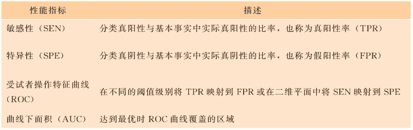

## 第四节　人工智能在眼底病中的应用实例

### 一、糖尿病视网膜病变

#### （一）病变特征与分级
糖尿病视网膜病变是中老年致盲的重要原因，早期发现并转诊是公认的防盲策略。即便在早期，毛细血管已开始退化，出现微血管异常，形成微动脉瘤，在视网膜上表现为细小红点。脆弱毛细血管破裂会产生较大深红色出血区。毛细血管通透性增高导致硬性渗出，边界模糊的淡黄区提示软性渗出。重症时微血管扩张，缺血区刺激新生脆弱小血管生长，即新生血管形成。国际临床糖尿病视网膜病变严重程度分级表 ICDRD 将其划为健康、轻度、中度、重度、增生期五个等级，数据集标注也多采用这五级。

#### （二）DR 的筛查与分级
机器学习与卷积神经网络主要用于基于上述病变特征的图像级筛查、分级和病灶分割。传统机器学习多属监督学习，输出明确类别，如病变类型或 DR 分期，典型方法包括决策树、支持向量机 SVM、人工神经网络 ANN、贝叶斯分类器等。早期筛查的核心是能否检测到 DR 相关的病变。

2016 年 Gulshan 等以 128175 张眼底照片，涵盖 EyePACS-1 和 MESSIDOR-2，训练 AI 自动识别 DR 与黄斑水肿，并在高特异与高敏两种模式下验证，效果突出。随后有研究引入数据增强提升图像多样性，使病变更易显现。另一项工作用来自社区与诊所的多族裔糖尿病患者 494661 张视网膜图像训练适配 VGGNet 架构的 CNN，用于 DR 及相关眼病筛查，显示不同相机、种族、合并疾病对筛选性能影响有限。2018 年 IDx-DR 系统以 87.2% 敏感性和 90.7% 特异性获美国 FDA 授权，用于检测轻中度 DR 和糖尿病性黄斑水肿。国内学者也以 Inception-V3 为底座构建 DL 算法筛查视力威胁性 DR，含增生前期 DR 与黄斑水肿。模型以 58790 张图训练，在 8000 张内部测试集中达到 97.0% 敏感性、91.4% 特异性，说明 CNN 可在大规模筛查中实现高精度。除此之外，还有不少针对不同种族、分辨率、样本量、设备差异的研究。

#### （三）DR 图像分割

##### 1. 微动脉瘤
微动脉瘤是 DR 最早的临床征象，因而研究较多。分割难点在于病灶颜色相近、对比度低，且图像亮度、清晰度、背景纹理变化大。两阶段多尺度结构和临床报告引导是被证实有效的策略。

##### 2. 出血
出血 HM 是 DR 的可见病理征象，准确分割对诊断至关重要。受限于数据量和计算成本，基于填充的补丁方法很流行，可用数十张图生成数万补丁，提升性能并缓解过拟合。但出血等病变面积小，像素占比低，导致不平衡，仅少数补丁含病变。改进方向主要有对粗标注数据进行分割以及选择性采样。

##### 3. 渗出
硬性渗出 HE 与软性渗出 SE 是 DR 诊断的重要依据，准确定位对及时治疗意义重大。挑战包括低对比度、尺寸差异、与其它病变相似。糖尿病性黄斑水肿 DME 是 DR 最常见并发症，可致严重视损。完成该任务的方案多用两阶段架构或多尺度检测渗出以提示 DME。主流方法多为带循环霍夫变换和损失函数修正的 CNN。

#### （四）基于其它影像的 DR 检测
超广角眼底成像是较新的技术，可覆盖周边视网膜，帮助更准确分期。因缺乏大规模超广角数据集，目前多采用迁移学习，用窄视野大数据提升超广角分级能力。AI 辅助的 OCT 也可自动识别糖尿病相关的视网膜内液和黄斑水肿。

#### （五）临床应用软件
不少 AI 产品已进入临床商业化测试，常称作自动 DR 图像识别系统。已投入使用的代表有葡萄牙 Retmarker、英国 iGrading M、美国 EyeArt。里程碑是 IDx-DR，它是首个面向基层医疗的基于 CNN DL 的自主 DR 筛查商用产品，用于甄别需转诊者。2020 年 8 月 10 日，国家药监局首次批准两款三类国产器械：深圳硅基智能科技的《糖尿病视网膜病变眼底图像辅助诊断软件》和上海鹰瞳医疗的同名软件。2021 年 6 月 8 日，北京致远慧图科技的《糖尿病视网膜病变眼底图像辅助诊断软件》亦获批上市。这些产品通过眼底相机彩照，利用深度学习算法分析后给出辅助诊断建议，供具备资质的临床医生参考。实际临床效果仍需在实践中进一步检验。

### 二、青光眼

#### （一）病变标志
青光眼多从视神经损伤入手检测：眼压异常升高、视野缺陷、杯盘比评估。视盘 OD 是视神经出口，分视杯与视神经环。视杯位于中央呈明亮圆形，周边为视神经环。青光眼导致视神经纤维受损，视杯扩大，形成杯状凹陷。

#### （二）青光眼检测
早期研究用视野图像训练 DL 网络区分开角型青光眼与健康者，准确率较高。随后加入眼压、角膜厚度、视网膜神经纤维层 RNFL 厚度等，因青光眼结构损伤早于视野损害，RNFL 变薄可作早期信号。将眼底彩照与 OCT 结合，融合功能与结构信息，准确率优于单一模态。最新研究以 SD-OCT 的 RNFL 评估与标准自动视野检查构成结构功能参考标准，构建诊断 AI 模型。

#### （三）青光眼病变分割
杯盘比是常用诊断标准，需分割视杯 OC 与视盘 OD。相比 OD，OC 分割更难，因边界细微，且 OC 区域占比极小存在不平衡。OD/OC 分割更接近自然图像分割，而非血管或病变分割，因而借鉴了 Deeplabv3+、Mask R-CNN 等自然图像架构。该任务研究最成熟，使用了 FCN、U-Net、Deeplabv3+、Mask R-CNN，并尝试多尺度、极坐标变换等方法。

### 三、年龄相关性黄斑变性

#### （一）病变及分级
年龄相关性黄斑变性 AMD 是 50 岁以上视损主因，影响脉络膜与视网膜外层，含光感受器的视网膜受损会导致视力下降。湿性 AMD 中脉络膜新生血管 CNV 长入视网膜色素上皮层，易破裂致急性视力丧失；干性 AMD 则表现为视网膜色素上皮萎缩。常用 AREDS 简化量表将 AMD 分为无病、早期、中期、晚期四阶段。

#### （二）AMD 检测
Burlina 等较早把深度学习用于 AMD 诊断，采用预训练 OverFeat DCNN 将原始图映射为 4096 维特征，再经线性 SVM 输出二分类结果，即无病/早期 vs 需转诊的中期/晚期。眼后段 OCT 可清晰显示与 AMD 相关的生物标志物如玻璃膜疣，使 OCT 检测成为可能。有研究用自动提取的 OCT 图像训练网络，以 Xavier 初始化权重、随机梯度下降优化，输入先缩小并直方图均衡化后送入网络，实现有效分类。

#### （三）AMD 图像分割
眼底成像用于分割 AMD 相关病变，随机森林被用于地理萎缩 GA 分割，通过像素邻域手工特征训练模型判断像素是否属于 GA，并在全集和低模糊子集上测试。OCT 横截面信息丰富，也广泛用于 AMD 病变分割。有文献用 U-Net 架构分割 OCT 视网膜中的玻璃膜疣，数据集基于预先分割的 Bruch 膜与视网膜色素上皮层构建，也可从 OCT 体积中分割 GA 而不依赖完整视网膜分割。总体而言，AMD 诊断相关研究远少于 DR 与青光眼，数据与图像量不足，制约了 AI 发展。

### 四、其他应用
早产儿视网膜病变 ROP 的深度学习模型多基于眼底图像自动诊断。Brown 等研发的 i-ROP 系统诊断附加病变的敏感性达 93%、特异性 94%，可进一步进行 ROP 严重程度评分，利于监测进展与预后。病理性近视可导致视力丧失，研究引入病变感知分割网络 LSN 执行视网膜萎缩与脱离分割，架构为类 U-Net 编码解码器，鞍层增设分类分支预测病变存在，解码器含特征融合模块实现多尺度，另加入边缘重叠率 EOR 损失函数提升边缘敏感性。

Nagasato 等用超宽视野眼底图像训练 CNN，识别 237 例视网膜分支静脉阻塞 BRVO 与 176 例健康眼，参数优于 SVM 训练的传统 ML 模型，可较准确区分。

不同眼科疾病诊断存在相互干扰，如青光眼合并白内障时生物标志物不清。因此多病共诊是趋势，可分为 DR 与 DME 共诊、DR 青光眼 AMD 共诊、基于配对 CFP 的 8 病种诊断、36 病种诊断及罕见病状检测等。

## 第五节　临床和技术挑战

### 一、高质量标注数据集缺乏
深度学习是数据驱动的。自然图像领域如 ImageNet 超过 1400 万张图，而眼底图像数据集十分有限。眼底标注需专家完成，难度大，例如 OD/OC 分割与青光眼诊断的标注约需 8 分钟/图，限制了高质量数据的积累，数据量小易导致准确率低与过拟合。

### 二、图像数据集与评价指标差异大
不同数据集在采集相机、分辨率、光源强度、参数设置上差异明显，对模型泛化提出挑战。最先进模型在某数据集表现好，在另一数据集可能下降，领域适应仍在探索。研究者使用的评价指标也不统一，难以横向比较同一疾病不同架构。建立标准数据集与统一评价体系是推动国内 AI 发展的关键。全国智能眼科学组发布的《基于眼底照相的糖尿病视网膜病变人工智能筛查系统应用指南》是良好范例，需向更多病种拓展。

### 三、结果可解释性不足
将深度学习引入医疗系统，医生对黑箱的接受度是关键。可解释性是固有短板，量化性能、提炼分类依据、揭示 AI 本质，有助于提升医生与患者信任。

尽管临床与技术挑战仍存，随着健康中国提出，人工智能连续写入政府工作报告，并在《新一代人工智能发展规划》及“数字诊疗装备研发”等国家重点研发计划支持下，“人工智能+医疗”加速推进。眼底病患病人数随人口老龄化增长，早期发现与干预可防盲。眼科诊断高度依赖影像，基于深度学习的 AI 可快速无创分析海量图像，识别定位量化疾病特征。加快应用有望重塑眼底病诊断流程，基于图像识别的医学辅助诊断系统可支撑大规模筛查，提升工作效率，缓解眼科医生短缺与资源不足。

# 第三章　眼底图像人工智能算法框架

## 第一节　基于眼底彩照的人工智能算法研究的发展历史

机器学习与深度学习算法成熟、算力提升，推动人工智能进入大众视野，并在医学领域广泛应用，涵盖辅助诊断、治疗方案选择、风险预测、用药安全等。医学影像、病理、眼科等图像密集型方向已得到认可。眼底图像分析中，人工智能多聚焦彩色眼底照，涉及图像质量评估、疾病诊断、分割等。下面梳理其发展脉络。

### 一、眼底图像质量分析算法发展历史
视网膜图像由眼底相机拍摄，质量直接影响诊断与后续治疗，对图像进行质量分级并据此处理具有重要价值。2007 年 Niemeijer 等提出图像结构聚类算法，结合 SVM 分类器达到 97.40% 准确率，但单张检测耗时长，难以即时反馈。2008 年 Giancardo 等基于局部血管密度与颜色直方图特征，用 SVM 与 K 近邻进行质量分类，准确率 96.00%，平均 3.53 秒/图，效率大幅提升。2014 年 Nugroho 等使用贝叶斯分类器，结合对比度等图像参数判定质量。2016 年 Mahapatra 提出含卷积层、最大池化、全连接层的 CNN，在质量评估上表现不错，但需大样本易过拟合。2018 年 Saha 等用 AlexNet 训练眼底质量图像，以 EyePACS 数据库测试，与医生手工分类重合率达 97%；Zago 等用 ImageNet 预训练模型提取通用特征，以 Inception-CNN 结构微调权重，通过交叉验证评估质量分类性能。总体看，算法迭代推动了质量分类准确率不断提升。

### 二、眼底疾病诊断算法发展历史
过去眼底疾病诊断多依赖医生经验与宏观指标，效率有限。随着人工智能发展，学界对 AI 诊断系统开展了大量研究并取得成果。

# 眼底智能诊断演进概览

眼底彩色图像的自动化解读可以追溯到1973年，Matsui 团队发表的《眼底照片的自动定量诊断研究：在彩色眼底照片上检测视网膜血管图像的轮廓线》，首次把数学形态学引入视网膜底图像分析。进入20世纪80年代初期，医学图像计算机辅助诊断开始系统化研发，1984年 Baudoin 等在《自动检测糖尿病荧光血管造影中的微血管瘤》中提出针对糖尿病视网膜病变损伤的图像分析思路。影像处理能力的提升让大规模筛查成为可能，计算机辅助诊断在节约资源的同时显著减轻了临床读片压力。

进入21世纪后成像与信息技术同步推进，经典机器学习被逐步用于眼底彩照智能判读。传统机器学习通路大致包含样本采集、预处理、特征挑选与提取、决策规则与分类器构建等环节。2000年 Ege 等搭建了一套融合贝叶斯、马氏距离与K近邻的自动分析软件；Cheng 等提出基于超像素的视杯视盘分割方案用于青光眼筛查，先用直方图与中心-周边统计特征分割视盘，并在视杯分割时加入位置先验以改善效果。手工选取特征受经验制约明显，不同病理在图像上的表现多样，单一人工特征难以泛化，这推动研究者转向深度学习以实现特征自动学习。

计算机视觉是深度学习的重点分支之一，训练后的模型能够从图像中提取多样表征并完成判别。数字眼底图像可用于观察糖尿病视网膜病变、青光眼、高度近视等常见底病，通过自动获取视盘形态大小、黄斑区、血管走向、渗出物状态等病灶信息，可快速辅助医生诊断。近二十年间人工智能在眼底彩照自动化处理上进展明显，已广泛应用于糖尿病视网膜病变、视网膜静脉阻塞、青光眼等，卷积神经网络的出现进一步加速发展。

Y. Guo 等构建的 MED net 可自动检测 OCT 图像中的血管结构；S. K. Devalla 等的 ReLay Net 能自动识别 OCT 图像中黄斑各层及视网膜下液。2016年，英国牛津拉德克利夫医院的 Robert Mac Laren 教授完成全球首例眼内手术机器人手术，经触屏与操纵杆控制机器人剥除患者 Bill Beaver 右眼黄斑部厚度仅0.01 mm 的视网膜前膜。朱江兵等利用计算机视觉建立 DR 特征自动识别系统；J. Anitha 与 CKS Vijila 等用 Kohonen 神经网络对400余张异常视网膜图像做预处理与特征提取并实现高精度自动分类。2017年，中山大学中山眼科中心刘奕教授团队建立可识别先天性白内障的深度学习模型。

因视网膜静脉阻塞发病率低于糖尿病视网膜病变，其相关研究相对有限。随着全球化推进，人工智能与医疗决策的结合愈发紧密，在眼科展现出明显优势，已常用于视网膜疾病诊断。近年来中国提出健康中国行动，人工智能医疗快速落地，2017至2019年 AI 连续三年出现在政府工作报告，体现政策对医学人工智能应用的高度重视。

面向 DR 的人工智能分类方法可通过海量数据训练学习眼底表征，泛化能力强，有助于提升分类性能。2017年 Wang 等提出 Zoom-in-net 深度卷积网络，利用深层特征定位可疑病灶，再在原图裁剪该区域送入网络训练进行 DR 等级分类，取得较好结果。Ardiyanto Igi 等提出适配小型嵌入式板的紧凑深度学习算法，能有效检测 DR 症状。2018年 Mansour 等采用多级优化策略，涵盖预处理、基于自适应学习的高斯混合模型概念区域分割、基于关联成分分析的感兴趣区定位、基于 Alexnet DNN 的高维特征提取，提升系统分类性能。李琼等使用更复杂的 BNnet 模型，准确率大幅提高，鲁棒性与泛化性良好。2019年 Keel 等采用自适应可视化技术预处理图像，可突出传统诊断区域，促进模型临床应用。杨松霖等通过集成多种模型进一步提高分类准确率。

在多病种分类方面，2011年 Mark 等采用动态训练策略，在不同训练阶段从数据集中随机抽样反向传播至卷积网络，判断眼底图像是否存在出血。2015年 Rocha 等利用深层卷积网络逐像素分析，识别微动脉瘤并分类。2016年 Jaafar 先对部分训练图像进行训练，再用卷积网络逐像素预测并分类，得出视网膜疾病分类结果。2020年汤加利用 ResNet 对近视性黄斑病变分类，准确率达93.7%。同年李珊珊改进 Res Net 后对年龄相关性黄斑病变分类，准确率提升至97.7%。

### 三、眼底图像分割算法发展历史

医学图像标注数据稀缺且对可解释性要求高，催生了多项针对性分割算法。2006年 Soares 等提出基于像素特征向量的分割方法，将像素划分为血管与非血管，通过像素强度与多尺度二维 Gabor 小波变换响应组合成特征向量，再用高斯混合贝叶斯分类器完成分类。2007年 Ricci 等先用检测器提取视网膜图像特征，再用支持向量机区分血管与背景。2010年 Marin 等先计算灰度级与矩不变量得到多维向量，再训练神经网络实现像素分类。2015年 Lim 等采用卷积神经网络，在分割中强化血管偏重值取得良好效果；同年 Olaf 等设计 U-Net 卷积网络，通过前后层连接与对称扩展通路融合信息，在小样本数据集上表现优异。2016年 Aslani 等用混合特征向量训练随机森林分类器区分血管与非血管。吴奎等使用 COSFIRE 滤波器提取血管特征，并用贝叶斯高斯混合模型完成血管分割。2017年 Zilly 等提出熵采样与集成学习方法，实现视盘与视神经乳头分割。2018年 Xiao 等提出带加权注意力机制的 U-Net，使视网膜血管分割达到新水平；Cheng 等结合极坐标变换、多尺度输入的多标注 U 型卷积神经网络与旁路输出层，融合多尺度信息，在视杯视盘联合分割中表现较优。2019年陈莉等提取18维特征向量并通过多模块 K-Means 进行视网膜血管分割。卓钟烁等基于卷积神经网络设计不同尺寸卷积核获取多维特征，综合局部与全局特征取得不错效果。雷军明等在多尺度 U-Net 基础上将普通卷积层改为自适应可变卷积网络，可根据血管特征自动调整结构，效果更优。

## 第二节　眼底图像人工智能算法重要组成部分

### 一、眼底图像质量分析的主要组成

#### 1.数据集

便携式眼底照相机普及后，眼底图像获取量显著增长。但受光照不适、拍摄环境、设备参数设置、操作失误、医务人员经验差异、培训不统一、患者配合度等主客观因素影响，数据库中图像质量参差不齐。常用公开数据来自 Kaggle 竞赛官网的 EyePACS 数据集。Kaggle 于2010年成立，为企业与数据科学家提供竞赛平台，企业发布数据与问题后科研人员提供解决方案。2015年 Kaggle 发布糖尿病视网膜病变检测赛题，提供超过80 000张视网膜眼底图像，其中训练集超过30 000张，其余为测试集。图像来自不同国家地区，采集设备型号与参数各异，色彩与光照差异大，分辨率从2 592×1 994到4 752×3 168不等，还包含不同人种样本。该数据集规模庞大，但大量图像不适用于诊断分析，医学上不可接受，常见质量问题包括光照不足、曝光过度、遮挡、模糊等。

#### 2.卷积神经网络

卷积神经网络是眼底图像质量分析人工智能算法的核心，其基本结构包括卷积层、池化层、激活层、全连接层等。

卷积层广泛用于深度神经网络特征获取。通过指定尺寸的卷积核在整幅图像上滑动提取高级特征，步长控制每次滑动像素数，边界处可选择填充。输出可由公式（3-1）获得。

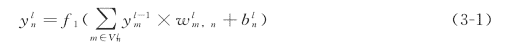

式（3-1）中，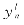代表第 `l` 层卷积神经网络中第 `n` 个特征图的输出值，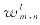用来表示卷积核的参数，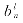为偏置项，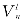表示该层特征图的输入集合。`f`（·）为激活函数，选取常见如下。

`Sigmoid`函数，函数表达式如公式（3-2）所示。它是一种非线性的激活函数，其取值范围为\[0，1\]。输入的值越小，输出越接近于 0，反之输入的值越大，输出越接近于 1。使用`Sigmoid`函数作为激活函数容易导致梯度弥散。此外，由于`Sigmoid`函数的输出恒大于 0，这会导致收敛过慢，增加训练网络模型的时间成本。

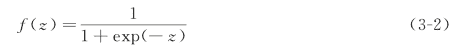

双曲正切函数`tanh`，函数表达式如公式（3-3）所示。`tanh`函数是`Sigmoid`函数的一种变体，相比于`Sigmoid`函数，其取值范围为\[－1，1\]。输出为零中心数据。

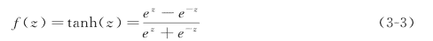

`ReLU`激活函数，函数表达式如公式（3-4）所示。`ReLU`函数对于输入值小于零的值进行抑制，只保留输入值大于零的值，具有稀疏激活性的特点，可以避免反向传播的过程中梯度消失，很大程度上提高了网络训练的速度。此外，`ReLU`函数的效率要比`tanh`函数和`Sigmoid`函数高，能够快速收敛。除了`ReLU`函数之外，还有在`ReLU`基础上的改进函数如`Leaky-ReLU`、`R-ReLU`。由于`ReLU`函数中小于 0 的输入全部输出为零，这将导致深度神经网络中的某些神经元不会被激活。如果学习率比较大，这些神经元可能一直输出值都为 0。为此，`Leaky-ReLU`保留了负轴的值，这些值比较小，但不会丢失全部信息。

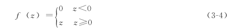

池化层作为卷积神经网络的重要组成部分，可以通过池化操作对数据进行压缩，大大减少了参数的计算量。与卷积核类似，池化层也需要一个滑动的窗口，可以定义步长和池化的方式，以及是否对边界进行填充。区别在于，池化层的窗口只影响输入的一个深度，而卷积层的过滤器横跨了整个深度。当处理大幅图像时，在一个区域卷积后得到的特征很有可能在其他的区域也具有类似的特征。对于图像特征的提取，通过池化操作计算图像上某个区域特征的平均值、最小值或者最大值。这样得到的统计特征和使用卷积层输出的所有特征相比，数据维度更低，解决了过拟合的问题，对网络性能有较大改善，常用的池化方式有以下 2 种。

（1）平均池化。其池化的方式是通过滑动窗口框出用于池化操作的子区域，然后对其中的值加和取平均，作为输出结果。平均池化的操作过程见图 3-1。

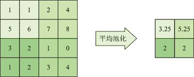

图 3-1　平均池化操作过程

（2）最大池化。其池化步长和池化窗口与平均池化相同。框出子区域后，选取其中特征子区域的最大值作为输出结果。最大池化的操作过程见图 3-2。

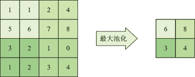

图 3-2　最大池化操作过程

全连接层可以对池化层和卷积层输出的特征进行压缩，同时完成模型分类。在全连接层中，每一层神经元的节点都与上一层所有神经元结点相连接，所以称为全连接层。其结构见图 3-3。

令`x1`、`x2`和`x3`为该网络的输入值，`a1`、`a2`和`a3`为全连接层的输出值，我们用`wih`表示两个全连接层之间的连接权重，`bh`代表全连接层神经元的偏置，激活函数用`f1`（·）表示，则输出`a1`、`a2`和`a3`分别如公式（3-5）（3-6）（3-7）所示。

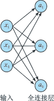

图 3-3　全连接层示意图

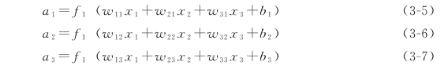

### 二、眼底疾病诊断的组成

眼底疾病诊断包含传统机器学习与深度学习。传统机器学习依赖先验知识与手工设计算子，主要步骤为数据获取、数据预处理、特征选择与提取、决策规则与分类器设计。深度学习无需人工挑选特征，可自动学习最优表达。主要步骤包括数据获取、数据预处理、网络与损失函数设计、参数学习与优化。其中数据获取与预处理与传统方法相近，网络与损失函数设计涉及网络深度、宽度、卷积核大小、步长等超参数及目标函数选择，参数学习与优化则指训练阶段的学习率、优化方法、迭代次数等设置。

总体而言，眼底疾病诊断由眼底图像预处理、人工智能算法选择与质量评估指标三部分构成。

#### （一）眼底图像预处理

常用眼底彩照预处理包括直方图均衡化、阴影矫正、高斯掩模卷积、中值滤波与血管去除。直方图均衡化增强对比度，阴影矫正归一化亮度，高斯掩模卷积与中值滤波削减噪声，血管去除减少对部分病变检测的干扰。具体方法使用取决于应用场景与目的。预处理后通常进行裁剪缩放，并在训练时做数据扩增。

##### 1.裁剪和缩放

不同来源的眼底图像分辨率差异显著，需统一尺寸。具体操作如下。

（1）选取适当阈值对眼底图像进行二值化，获得图像中的圆形区域半径`R`。

（2）对眼底图像进行裁剪，得到一个以圆形区域圆心为中心、边长为`2R`的正方形图像。

（3）将得到的正方形眼底图像统一缩放至同一尺寸。

##### 2.数据扩增

深度卷积网络训练时数据量不足易过拟合，需对训练数据进行扩增。方法如下。

（1）对图像随机进行水平和竖直方向的翻转。

（2）将图像随机旋转某一角度，旋转后的留白部分使用黑色像素点代替。

（3）将图像尺度缩放，缩放因子`a`取值在 0～1 范围，将图片进行\[1－`a`，1＋`a`\]内随机值缩放。

（4）将图像在水平、垂直和通道上进行微量偏移。

图 3-4 显示了不同眼底图像经过裁剪和缩放、数据扩增之后得到的结果。其中数据扩增步骤会随机选择是否对送入的经过裁剪和缩放的眼底图像进行（1）～（4）步。

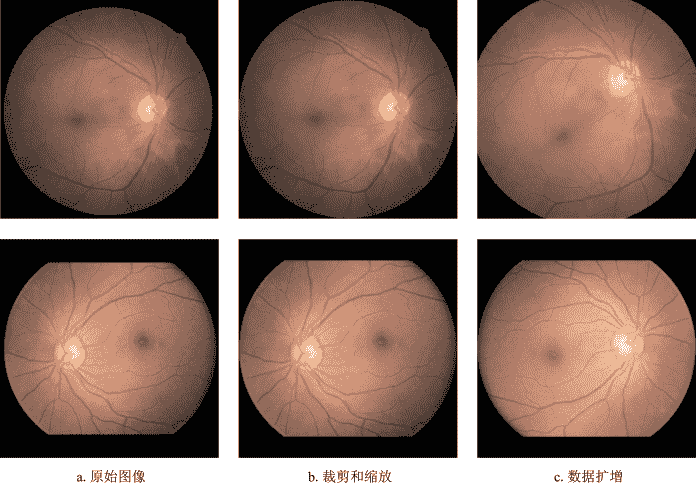

图 3-4　眼底图像归一化处理结果图

#### （二）常见的人工智能算法

人工智能的三大支柱是算法、数据与算力，算法作用关键。按训练方式，人工智能算法可分为监督学习、无监督学习、半监督学习和强化学习。

# 从学习范式到眼底AI实战全解析

机器学习的核心差异首先体现在对样本标签的使用方式上。不同范式决定了模型如何学习、如何泛化，也直接影响到眼底图像这类医学影像任务的设计思路。

### 监督学习
监督学习的模式是先准备好带有明确标注的训练集，再把数据喂入事先搭建好的网络结构反复训练，直到模型能在未见过的样本上做出可靠预测。其特点是样本与标签一一对应。常用分支包括人工神经网络类、贝叶斯类、决策树类和线性分类器类。神经网络类典型代表有反向传播、玻尔兹曼机、卷积神经网络、回归神经网络等。贝叶斯类涵盖朴素贝叶斯、高斯贝叶斯、多项式朴素贝叶斯、贝叶斯网络等。决策树类包含分类与回归树、卡方自动交互检测、决策残端、随机森林等。线性分类器类则有Fisher线性判别、多项逻辑回归、朴素贝叶斯分类器、支持向量机等。

### 半监督学习
半监督学习同时利用少量已标注样本和大量未标注样本进行建模。因为人工标注成本高昂，方法需要借助半监督假设把模型与未标注数据分布联系起来。研究显示其效果高度依赖于所用假设。当前主流机器学习多基于独立同分布假设，监督方法还叠加平滑假设，即邻近样本标记应相似。半监督下平滑假设具体化为聚类假设和流形假设。没有结构保持的假设，有限训练集就无法推广到无限不可见数据。常见技术有生成模型、低密度分离、基于图的方法、联合训练等。

### 无监督学习
无监督学习面对的是没有标签的样本，通过某种规则将相似样本聚到一起。它不以明确目标为导向，本质上是通过统计手段在无标签数据中挖掘潜在结构。典型族群有人工神经网络类、关联规则学习类、分层聚类算法、聚类分析以及异常检测类。神经网络类包括生成对抗网络、前馈神经网络、逻辑学习机、自组织映射等。关联规则类有Apriori、Eclat、FP-Growth等。分层聚类包括单连锁聚类、概念聚类等。聚类分析包括模糊聚类、K均值聚类、均值漂移等。异常检测类包括K近邻算法、局部异常因子等。

### 强化学习
强化学习模拟的是主体通过行为影响环境、环境反馈状态变化、主体据反馈调整策略的闭环。它强调在环境交互中追求长期累积收益，灵感来自行为主义心理学中奖励惩罚塑造习惯的过程。常见算法有Q学习、状态-行动-奖励-状态-行动、策略梯度算法、基于模型的强化学习、时序差分学习等。

#### （三）质量评估指标
在眼底疾病分类等任务中，真阳性TP表示模型判为某类且真实也为某类；假阳性FP表示模型判为某类但真实为其他；假阴性FN表示模型判为其他但真实为某类；真阴性TN表示模型判为其他且真实也为其他。由此可导出真阳性率TPR、假阳性率FPR、准确率precision P、召回率recall R等评价量。受试者操作特征曲线ROC描述感受性，每个点对应同一刺激下的表现，横轴为FPR，纵轴为TPR，两者定义如公式3-8、3-9所示。

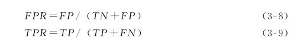

在ROC中理想点为TPR=1且FPR=0。ROC具备不变性，正负样本分布改变时曲线基本稳定。若一个模型的ROC完全包住另一个，则前者更优；若曲线交叉，则需比较曲线下面积来判定。

### 三、眼底图像分割算法的主要组成

#### （一）预处理
对原始眼底图做合适预处理能显著提升分割网络效果。常用手段包括灰度变换、对比度受限自适应直方图均衡化CLAHE、伽马变换、标准化。前三种主要提升目标与背景对比度，便于后续学习；标准化则统一均值方差，让特征同分布，增强泛化。

##### 1.灰度变换
眼底图多为三通道彩色，在做二值分割如血管分割时常先转单通道。彩色像素由R、G、B三原色按比例叠加而成，每通道0~255。灰度图用8位非线性尺度表示，0为黑255为白。通过公式3-10可实现互转。

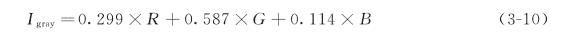

##### 2.对比度受限的自适应直方图均衡化
拍摄光线不均会导致目标与背景对比不足，CLAHE可改善血管可见性。传统直方图均衡化通过非线性拉伸均衡灰度，易丢失细节或过度增强。CLAHE基于局部直方图重分配亮度，并限制局部直方图振幅来抑制对比度过高带来的畸变与噪声。

##### 3.伽马变换
伽马变换是对灰度值做非线性指数运算，输出S与输入G满足公式3-11关系，其中γ可调。通过调节γ可增强明暗对比，使目标与背景更分明，提升图像质量。

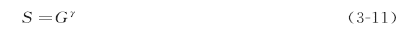

##### 4.标准化
标准化即去均值中心化，使特征保持同分布。公式3-12为image、mean、std的转换关系。数据分布稳定后网络学习更快、泛化更强。


#### （二）数据扩增
眼底图采集困难且标注耗力，可用数据有限。而卷积神经网络参数多，数据不足易过拟合。扩增常用旋转、平移、翻转、随机加噪等手段，血管分割任务中还可随机裁剪小块。随机性带来的新样本提升了鲁棒性和训练稳定性。

#### （三）训练阶段
超参数调优是训练关键，需监控训练集与验证集每轮损失与准确率。

##### 1.学习率
学习率控制梯度下降中权重的更新幅度。初期可取较大值加速收敛，后期随损失变化减小震荡以求更优解。

##### 2.批次大小
批次大小即每次送入网络的样本数。大批次加速收敛但可能占用内存过大。

##### 3.优化器
优化器用于梯度下降。常用SGD、Adagrad、RMSProp、Adam、Ftrl，其中Adam收敛快、适应性好。

##### 4.迭代次数
迭代次数指训练集完整送入的次数。当测试集准确率与训练集准确率差距小则合适；若测试准确率先升后降则出现过拟合，需减少迭代。

#### （四）性能评估
分割性能常用准确率、精准率、敏感性、特异性、ROC下面积AUC、F1分数等。需先引入混淆矩阵：TP、TN、FP、FN。

准确率指预测正确样本占总样本比例，公式3-13。

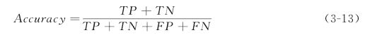

精准率指预测为阳性样本中真阳性的比例，公式3-14。

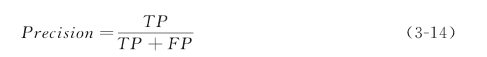

召回率指真实阳性样本中被正确预测为阳性的比例，公式3-15。

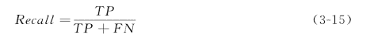

敏感性即召回率，公式3-16。

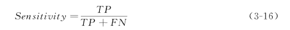

特异性指真实阴性样本中被正确预测为阴性的比例，公式3-17。

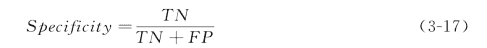

ROC是在以假阳性率FPR为横轴、真阳性率TPR为纵轴的坐标系中，调整分类阈值得到多组数值连线而成。AUC为曲线下面积，越接近1效果越好。

F1分数是精准率与召回率的调和平均，反映稳定性，公式3-18。

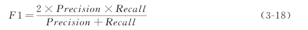

Jaccard相似系数用于衡量两有限集合相似度，设真实集合为A、预测集合为B，公式3-19。

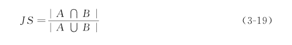

### 第三节 眼底图像人工智能算法系统框架

### 一、眼底图像人工智能算法系统总体框架
基于眼底彩照的AI系统总体框架见图3-5，涵盖质量分析、疾病诊断、病灶分割三部分。质量分析模块先把关图像质量，过滤模糊、曝光不足或非眼底图，不合格则直接出报告提示重传。合格图像进入疾病诊断模块，可判断正常眼底、高度近视、静脉阻塞、黄斑病变、糖尿病视网膜病变、青光眼、其他七类。根据诊断结果，病灶分割模块相应处理，如糖尿病视网膜病变则分割软性渗出、硬性渗出、微动脉瘤、出血；高度近视分割近视弧；静脉阻塞分割出血块等。所有图像均可分割视网膜血管以辅助医生。最终生成完整诊断报告。

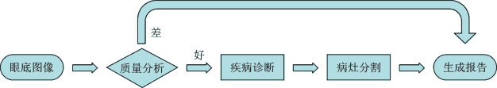

图 3-5 基于眼底彩照的人工智能算法系统总体框架

### 二、眼底图像质量分析的系统框架
质量分析系统框架见图3-6，包含数据集、图像预处理、模型构建、分类结果。输入数据为眼底图及其质量标签。原始图来自不同相机，尺寸不一、分辨率高且带大量背景。为平衡信息保留与训练速度，先裁剪出最小正方形眼底区域再统一缩放至如512×512供CNN处理。为防过拟合，需扩增数据，常用水平翻转、垂直翻转、旋转、缩放。模型构建先下采样提特征，下采样包含卷积层、池化层、批归一化BN层。卷积提取局部特征，池化降维并传递尺度不变特征，BN稳定每层输出分布。训练时设定轮数、学习率等参数，训练结束保存模型用于质量分类与评估。

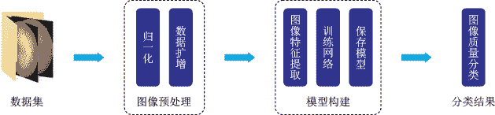

图 3-6 眼底图像质量分析的人工智能算法系统框架

### 三、眼底疾病诊断的系统框架
搭建AI算法需借助合适框架。TensorFlow由Google基于DistBelief开发，支持图像分类、音频处理、推荐、自然语言处理等，可将复杂数据流送入神经网络，在CPU/GPU上运行，编程语言为Python。Keras是Python开源神经网络库，非端到端框架，而是提供高层抽象接口，可适配TensorFlow、CNTK、Theano等，使配置更便捷。Torch是基于Lua的开源科学计算库，封装少、灵活快速，适合探索性研究，但工程性较弱。PyTorch于2017年由Facebook AI研究院在Torch基础上推出，底层C语言实现，采用Python接口，提供GPU加速张量计算与自动求导，深度学习开发更友好。

疾病诊断系统采用PyTorch构建多分类模型。与质量分析相似，需归一化与数据扩增。图像经多层卷积、池化提取海量特征图，再经最大池化压缩为特征点，全连接层整合输出七个概率，分别对应正常眼底、高度近视、静脉阻塞、黄斑病变、糖尿病视网膜病变、青光眼、其他，选择概率最大者作为诊断结果。

### 四、眼底图像分割的系统框架

眼底影像分割的AI流程示意如图 3-7。来源为眼科医院采集的原始底片，先切分为训练与测试两组，其中测试组再划分出验证子集，在训练迭代中承担交叉检验的角色，以抑制过拟合倾向。进入训练的图像先做预处理，常用手段涵盖归一化、标准化以及对比度提升，前两者有助于加速收敛并增强泛化，而后者针对医学影像前景与背景界限不清的难题，强化两者可分性，典型实现包括灰度映射、对比度受限自适应直方图均衡、伽马校正等。受标注成本限制，可用的带标底片数量稀少，为保证训练稳定、降低过拟合并提升分割效果，必须对训练样本做扩增。完成预处理与扩增的训练集送入分割网络进行监督学习，迭代以预设评价指标与损失函数为导航，借助真实标签校正参数并保存模型。推理时选用在验证指标上最优的模型对测试集进行预测，用以衡量该任务下的分割表现。


图 3-7 基于眼底图像分割的人工智能算法系统框架

# 第四章 眼底图像质量分析

## 第一节 眼底图像质量评估

### 一、眼底图像质量评估的意义

彩色眼底影像是 DR、AMD、青光眼等眼底病筛查与诊断的核心素材，多款 CAD 系统已在这些病种中投入使用，其诊断可靠性直接受输入图质制约。现实数据库中低质图占比不低，典型缺陷为失焦、光照不足、曝光过量等，这类图像不利于医生判读，也不利于算法分析。临床拍摄时，患者若存在白内障、玻璃体浑浊、角膜斑翳等屈光介质混浊，即便排除其他干扰也难以获得清晰视网膜。已有统计显示，眼底图库中因质量不佳影响诊疗的比例超过四分之一，基层机构上传至云端的数据中低质图接近二分之一。RIQA 在眼病自动检测链路中居于关键前置位置，图质高低直接决定检测准确度。

ARIC 研究指出影响图质的因素可归纳为两类：通用参数如聚焦与锐度，结构参数如血管清晰度及视盘、黄斑的可视程度。图 4-1 举例了临床集中常见的低质底片，其成因涵盖模糊、欠曝、过曝、遮挡以及睫毛或镜片灰尘伪影。低质图会显著增加后续分析与诊断的难度。

### 二、眼底图像质量评估的研究现状及趋势

当前研究大致可分为三类。第一类依托通用图像信息，如直方图匹配、边缘强度分布、对比度特征。Lee 等提出用模板强度直方图与视网膜图像强度直方图的卷积得到 Q 指数衡量质量，Lalonde 等基于边缘强度与像素灰度实现自动评估。此类方法计算轻量，但难以覆盖视网膜图质的复杂影响。

第二类聚焦结构参数，如血管标注等，Paulus 等融合通用与结构参数，依赖精确分割；Usher 等采用血管面积等结构指标；Niemeijer 等通过结构聚类判断质量。此类方案实现成本高，在模糊图像上易失效。

第三类利用显著图或 shearlet 系数提取特征后送入 SVM 分类。总体看，传统方案多依赖手工设计的特征，迁移能力弱，实际应用中易出错。

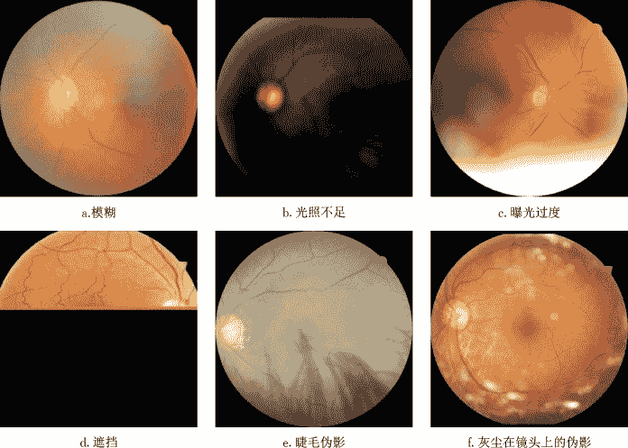

图 4-1 数据集中的低质量眼底图像

传统算法多基于通用或结构参数的手工特征，难以迁移到新域。人眼借助 HVS 评判图质，可适应新数据，但带有主观性。近十年深度学习快速发展，CNN 以强表达力广泛应用。与手工特征不同，深度模型可挖掘原始数据中隐含的高层表征，有助于构建更鲁棒系统。Mahapatra 与 Ruwan 等先后用 CNN 学习特征对底片质量分类，并在 RIQA 中融入 HVS 启发，效果优于传统方法。但眼底图与自然图不同，病灶往往仅占极小区域，正是这小区域决定诊断价值，从中有效提取特征比自然图更具挑战。

### 三、眼底图像质量评估分类模型的介绍

对眼病自动筛查而言，可接受影像需满足诊断标准。以 DR 自动诊断为例，血管与病变必须清晰可辨。从视觉注意角度，人眼更关注视网膜前景，忽略信息稀少的背景。经典 CNN 包括 AlexNet、GoogLeNet、VGG、ResNet-50 与 Inception-ResNet-V2。

（1）AlexNet：2012 年 ILSVRC 竞赛冠军，结构相对轻量，是图像分类常用基线。
（2）GoogLeNet：以 Inception 模块构建 22 层网络，参数量远低于 VGG 与 AlexNet。Inception 具备多尺度特性，可学习不同尺度表征。
（3）VGG：性能稳定，多任务表现突出。VGG16 仅用 3×3 卷积核降低参数量，VGG19 在此基础上加深卷积层，特征提取更强但计算量亦增加。
（4）ResNet-50：2015 年 ILSVRC 获胜者，错误率 3.6%，提出残差学习，每个单元由残差块与捷径组成，缓解深网梯度弥散。ResNet-50 含 conv1、conv2x、conv3x、conv4x、conv5x 与全连接层，其中后四组分别由 3、4、6、3 个残差块构成。

#### （5）Inception-ResNet-V2
该模型于 2016 年提出，融合 Inception 的多尺度特性和残差优势，避免梯度消失。用小核替代大核，相较 Inception-V4 计算量更小。

## 第二节 基于人类视觉系统的眼底图像质量评估算法

### 一、引言

现有质量分类方法多依赖手工特征建模。一方面特征基于通用或结构参数，泛化差；另一方面专家虽能依 HVS 识别低质图并适应新数据，但主观性强。手工方法亦未充分利用 HVS 特性提升 IQA。为此提出一种融合 CNN 监督信息与显著图无监督信息的分类方案，采用全分辨率显著图获取局部与全局线索，并在 CNN 学习中借助迁移学习与微调提升性能。

### 二、方法框架

基于 HVS 的质量分类流程见图 4-2，共含 5 步。第一步数据预处理，提取 ROI。原始底片含大量黑色背景，需剔除后训练。第二步以微调方式训练 CNN，将自然图网络参数迁移至医学域。第三步对预处理后图像计算显著图。第四步分别提取 CNN 特征与显著图显著性特征并融合。第五步基于融合特征构建样本矩阵，训练最终分类器实现质量判别。


图 4-2　基于 HSV 的眼底图像质量分类方法流程图

#### （一）感兴趣区域提取
底片除诊断有效区外，还含大量冗余背景，如图 4-3 所示的原图有大面积黑色区域，会降低精度并增加计算。输入网络前需提取感兴趣区。常见做法基于阈值法结合形态学掩模，如 Cardoso 等设定阈值提取 ROI，对小样本尚可，大样本且亮度对比差异大时易误提。本方法采用最大类间方差法寻优阈值，具体步骤如下。

（1）将彩色底片灰度化。
（2）用最大类间方差法求最佳阈值，二值化得到掩模模板。
（3）对掩模模板做轮廓提取，保留面积最大轮廓。
（4）为该轮廓生成包围盒，即最小外接矩形。
（5）依据包围盒坐标提取 ROI。


图 4-3　含有背景区域的原始图像

经上述处理可获得去背景的彩色底片，掩模中背景像素为 0，ROI 像素为 1，如图 4-4b 所示，绿框为最大轮廓包围盒。图 4-4a 为灰度图，结合包围盒坐标即可取出前景区，如图 4-4c 所示。


图 4-4　感兴趣区域提取

#### （二）显著图特征
显著性刻画区域与其邻域在特征上的差异，HVS 能捕捉此类差异。传统显著图多聚焦点状关注，缺乏全局兼顾。我们采用基于频率调谐的显著图，保留完整信息，可输出清晰边界的全分辨率图。显著区应满足：突出最大显著目标；兼顾整体显著区；边界明确；不受纹理、噪声、阻塞伪影等高频干扰；高效输出全分辨率结果。


图 4-5　眼底图像及对应的显著图

图 4-5 展示底片及其显著图。质量判定依据清晰度、对比度、黄斑与视盘的可视度等，将图像分为可接受与不可接受。图 4-5a 与图 4-5c 分别为可接受与不可接受示例，对应显著图为图 4-5b 与图 4-5d。可看出所用显著图能很好提取视盘、黄斑、血管等关键信息，对质量评估至关重要。

#### （三）微调深度网络
深度学习在多领域突破，依赖 ImageNet、Places、MS COCO 等大规模数据，涵盖分类、检测、分割等。但医学图像标注稀缺，难以满足深度网络需求，易过拟合。迁移学习可把源任务知识迁移至相关任务，自然图与医学图在低层特征如边缘、形状上具有共性，故可在 ImageNet 预训练模型迁移至医学图。

微调是迁移学习在深度学习的典型方式，利用源域与目标域共享参数优化目标模型。图 4-6 为本方法采用 CNN 与迁移学习进行质量分类的框架。任务中先用自然图预训练权重初始化网络，再用底片数据优化参数。微调前对底片做预处理，去除背景冗余，并通过平移、旋转等扩增数据。选用多种预训练模型训练，调参并遴选最优模型，提取其特征与显著图特征融合，再训练分类器。

#### （四）CNN 结构和实现
算法以 CNN 实现质量分类，选用 VGG19。该网在多类分类任务中表现优异，经对比 AlexNet、VGG16、GoogLeNet、ResNet-50 后最优。图 4-7 为 VGG19 结构，共 19 层，含 16 个卷积层与 3 个全连接层。卷积核均为 3×3，多层小核替代大核，在降参的同时增加非线性映射，提升表达力。最大池化层降低参数并加速训练。网络含三个全连接层，前两层为内积 ReLU 并使用 dropout 防过拟合，最后一个全连接层输出神经元数与类别数一致，本任务为 2。


图 4-6　微调 CNN 的眼底图像质量分类框架


图 4-7　VGG19 网络结构

注：（3，1，1）表示卷积核尺寸为 3、步长为 1、填充为 1

实现采用 Caffe 框架，可 GPU 加速。训练时需将底片转为 lmdb 格式以提升读取速度。先用 ImageNet 参数初始化网络，受限于数据量，通过平移、旋转、翻转扩增样本，采用随机梯度下降修正参数，得到最终分类模型，再提取全连接层特征与显著性特征融合，训练 SVM 分类器。

#### （五）SVM 分类器
SVM 作为二分类模型在医学影像中应用广泛，如核 SVM 已用于 DR 自动诊断。本工作亦选用 SVM 作为最终分类器。其思想是在特征空间寻找最优超平面实现两类最佳分离并最大化间隔。原始 SVM 目标函数为公式（4-1）：


为便于求解，转化为拉格朗日对偶问题，公式为（4-2）：


针对非线性问题引入核技巧，将数据映射至高维线性可分空间。引入核函数后，公式（4-2）转化为公式（4-3）：


依据公式（4-3）可以得到核化 SVM 的最优分类面，其中 K(xi,xj) 即为所用的核函数。

### 三、实验搭建与效果解析

#### （一）实验数据集
本工作采用的是来自 EyePACS 公开库的眼底图像。该库最初用于 DR 分级诊断，2017 年由新加坡 A*STAR 机构对图像质量进行了补充标注。标注由眼科专家等专业人员执行，判断标准是图像是否能够支撑眼部疾病的诊断。每张图至少由三人独立评定，最终标签按少数服从多数确定。标签 1 表示质量合格、可用于医学后续分析的图像，标签 0 表示质量不达标的图像。训练集从库中随机抽取 3 864 张原始图，其中 2 092 张为标签 1，1 772 张为标签 0；测试集随机抽取 1 200 张，其中 582 张为标签 1，618 张为标签 0。

#### （二）评价指标
为量化眼底图像质量评估性能，采用分类准确率 ACC、特异性 SPE、敏感性 SEN 以及 ROC 曲线下面积 AUC 四项指标。ACC 反映整体预测正确的比例；SPE 衡量质量良好图像被正确识别的比例；SEN 衡量质量不良图像被正确识别的比例；AUC 表征随机抽取一对正负样本时，正样本得分高于负样本的概率，本质上是 ROC 曲线下的面积。

#### （三）实验结果与分析
将所提方案与若干对比方法进行测试，结果见表 4-1、表 4-2。实验首先利用迁移学习微调主流 CNN，提取其全连接层特征后训练 SVM 分类器。表 4-1 显示，迁移微调均能取得较好效果，说明自然图像学到的表征可迁移到医学图像。VGG19 在该任务上表现优于其他典型 CNN，准确率 96.78%、敏感性 97.08%、特异性 96.44%、AUC 0.980。后续方案在 VGG19 学习到的特征基础上融合显著性特征。

表 4-1　不同 CNN 在眼底图像质量评估上的分类结果


本方案的分类结果见表 4-2。做法为先用 VGG19 提取 4 096 维全连接特征，再提取 1 024 维显著图特征，两者归一化后拼接成融合向量送入 SVM。表 4-2 显示，显著性特征与 CNN 特征融合后各指标均达到最佳，准确率 97.24%、敏感性 97.08%、特异性 97.25%、AUC 0.993，相比单独使用 CNN 特征或单独使用显著图特征有明显提升。图 4-8 给出的 ROC 曲线进一步验证了所提方法的优势。

表 4-2　所提算法在眼底图像质量评估上的分类结果


图 4-8　眼底图像质量分类任务 ROC 曲线图

深度卷积网络作为特征提取器能够学习边缘、局部对比度等低层信息并逐步形成高层语义。为展示学习内容，给出了 VGG19 中 conv1_1 与 conv2_1 的部分特征图。图 4-9a 为输入彩色眼底图，图 4-9b 为 conv1_1 特征，图 4-9c 为 conv2_1 特征。可看出网络捕捉到血管边缘、视盘等几何结构，且逐层形成更抽象表征。

传统手工特征方法在眼底质量评估中应用广泛，但依赖通用或结构化质量参数，需手工设计特征，复杂度高且在新数据上泛化差。鉴于此，提出一种结合人类视觉系统处理方式的方法，将 CNN 监督信息与显著图无监督信息融合构建分类器。训练时采用迁移学习微调 CNN 以提升性能，并在较大眼底数据集上验证了优越性，各项指标均表现最好。


图 4-9　原始输入眼底图像及对应的两个卷积层提取的特征图

## 第三节 FA-Net 眼底图像质量评估算法

### 一、引言
眼病自动筛查要求视网膜图像达到诊断标准。以 DR 自动诊断为例，血管与病变区域必须清晰可见。人类视觉更关注视网膜前景，对信息量少的背景关注较少。为使 CNN 更适配筛查场景，设计了基于注意力机制的 FA-Net，包含微调的 VGG19 主网络和基于前景提取的注意力网络。注意力网络负责定位疑似血管与病变区域并赋予更高学习权重，使重要区域权重大于背景。引入注意力后性能提升，相比传统模型考虑了人眼注意机制且无需手工特征，泛化性更好，并采用 ImageNet 预训练权重初始化以减少训练时间和提高准确率。

### 二、算法流程
FA-Net 总体流程见图 4-10。眼底图输入后先进行数据预处理，包括归一化和数据扩增。归一化旨在消除光照差异，因不同相机参数导致亮度不一致。数据扩增通过变换扩大样本量，避免过拟合并使网络学得更充分。预处理后的数据送入卷积网络训练，损失稳定后保存参数用于新图预测。

FA-Net 在 VGG19 基础上引入注意力，使其更适合眼病筛查的图像质量评估，分类性能也更优。


图 4-10　FA-Net 总体流程图

#### （一）眼底图像归一化处理
# 眼底图像预处理
## 归一化处理
眼底图由不同地区、不同参数相机采集，尺寸不一且光照差异大。质量评估前需归一化，具体步骤如下。
（1）缩放眼底图使圆形视网膜半径 R 统一。
（2）裁剪为以 2R 为边长的正方形。
（3）高斯滤波后每个像素减去局部均值以削弱光照影响。

图 4-11b 与 4-11e 为中间结果。若原始图上下被截断则在中心为原点处上下补齐至正方形，并裁除黑色背景。按公式（4-4）进行归一化：


式中 * 为卷积，Io(x,y) 为处理前图像，I(x,y) 为处理后图像，Gaussian(x,y,ρ) 为标准差为 ρ 的高斯低通滤波器，floor(X) 取不超过 X 的最大整数。经验参数取 α=4、β=-4、ρ=10、γ=128。归一化后图像见图 4-11c、4-11f。


图 4-11　眼底图像归一化处理结果图

## 数据扩增
神经网络参数量大，训练样本不足易过拟合。扩增通过变换在原集上生成新样本，提升深层特征学习能力。常用手段包括垂直/水平翻转、任意角度旋转、缩放、裁剪采样、X/Y 轴平移、添加高斯噪声以及基于生成对抗网络的伪样本合成。本工作对图像做 0°~360° 随机旋转、随机水平/垂直翻转和随机平移，训练集规模约扩大 8 倍。

## FA-Net 网络
网络由两部分构成：一是预训练 VGG19 主网络经微调，二是基于前景提取的注意力权重网络。注意力网络的动机在于眼底图中并非各区域同等重要，DR 筛查中血管与病变区需清晰，而背景轻微模糊可接受，外围黑色区域无信息。网络结构见图 4-12。


图 4-12　FA-Net 网络结构图

### F-Net：微调的 VGG19 主网络
（1）F-Net 即微调 VGG19 主网络。深层 CNN 参数量大，随机初始化收敛慢。常用做法是用 ImageNet 预训练权重初始化，再替换最后全连接层为 2 类输出。VGG19 含 16 个卷积层、3 个全连接层、5 个池化层，池化将 224×224 下采样至 7×7。按池化分为 5 组，卷积数分别为 2、2、4、4、4。每个卷积核 3×3，步长 1，填充 1，后接 ReLU。首两个全连接层使用 Dropout，丢弃概率 0.5。最后全连接层神经元数为 2。

### A-Net：基于前景提取的注意力网络
（2）A-Net 依据前景信息生成注意力。前景像素信息更丰富，计算每个像素邻域 s 内的均值 μN(x,y) 与标准差 σN(x,y)，用 Mahalanobis 距离 dM 衡量，如公式（4-5）所示。


图 4-13　VGG19 网络结构图

注：（3，1，1）表示卷积核尺寸 3、步长 1、填充 1


式中 I(x,y) 为眼底图。选取阈值 t，dM>t 时像素属于前景，否则为背景。为节省计算，采用下采样加双三次插值估计均值与标准差。和为估计所得。前景提取结果见图 4-14，图 4-14a 为原图，图 4-14b 为二值前景图。将前景图划分为不重叠 4×4 子块，统计各块像素和记为 W(i,j)，得到 1/16 尺寸的注意力图。再按公式（4-6）归一化到 [0,1] 得到注意力权重图，如图 4-14c。


将注意力权重图注入 VGG19 主网络会影响参数训练。具体做法是把主网络第 3 组首个卷积层输出特征图与注意力图逐点相乘，所得特征再与第 3 组末个卷积层输出特征图元素相加。于是第三个池化层处理的是加权特征。注意力图描述各子区域重要性并在训练中分配学习权重，最终经全连接与 Softmax 输出分类结果。


图 4-14　注意力图生成过程

# 实验设计与结果分析

## 实验数据集
采用 Kaggle DR 眼底图像质量数据集验证有效性。训练集 2 894 张，其中标签 1 为 1 607 张，标签 0 为 1 287 张。扩增后用于训练的图像共 26 046 张。测试集 2 170 张，标签 1 与标签 0 各 1 085 张，保持 1:1 比例，不做扩增。

## 训练策略
网络采用微调策略，避免从零训练导致的泛化差。浅层提取轮廓边缘，深层提取抽象特征，全连接整合信息。微调时用大 dataset 预训练权重初始化本网络，移除原最后全连接层并换成 2 输出单元的新层。最后全连接层学习率提高 10 倍以便快速适配新任务，前两个卷积层学习率设为 0 保持不动，其余层学习率不变。权重初始化自 ImageNet。

对 AlexNet、GoogLeNet、VGG16、ResNet-50、Inception-ResNet-V2，均使用预训练权重，输入尺寸 AlexNet 为 227×227，其余为 224×224。FA-Net 输入为 224×224。优化器采用随机梯度下降，训练在装有 NVIDIA-GTX1080 的工作站进行，深度学习框架为 Tensor-Flow，数据预处理调用 OpenCV。

## 实验结果与分析

起步阶段选用了五套在自然图像识别上验证过的经典卷积网络，分别是 2012 年的 AlexNet、2013 年的 GoogLeNet、2014 年的 VGG、2015 年的 ResNet 以及 2016 年的 Inception-ResNet-V2，并把它们迁移到眼底图像质量判别任务。统一的训练策略涵盖预处理归一化、样本扩增以及基于预训练模型的微调。

表 4-3 汇总了各卷积网络在眼底质量评估上的准确率与 ROC 曲线下面积。微调后模型整体表现可观，说明自然场景学到的表征能够迁移到视网膜质量判别，尽管数据分布存在差异。横向比较显示 VGG19 在此任务上最突出，分类正确率达到 97.21%，略高于 VGG16。

表 4-3　基于 CNN 的眼底图像质量评估算法的结果


深度方案无需手工设计特征，能同时捕捉影响图像质量的多重因素，因而泛化能力更强。传统卷积网络却没有显式建模人类的视觉偏好，临床判断更看重病变区与血管的清晰及无遮挡。引入视觉注意机制的 FA-Net 在此基础上提升明显，最高准确率来到 97.65%，比单独使用 VGG19 高出 0.44%，证明注意力机制的有效性。该网络强化了对视网膜前景区域特征的学习，更契合眼底质量评估需求。

FA-Net 网络和基于人工设计特征的非深度学习算法的 ACC 和 AUC 值如表 4-4 所示。深度学习整体优于手工特征流派。图 4-15 给出了三类方法的 ROC 对比，红色曲线对应 FA-Net，蓝绿两条曲线对应两种传统方法。传统流程依赖人工特征，无需大规模训练，但迁移性差，容易忽略血管、视盘、黄斑等关键解剖区的清晰度这一结构性指标。ROC 显示 FA-Net 判别力更强，准确率 97.65%，AUC 达 0.995。

表 4-4　FA-Net 网络分类结果与传统算法评估结果


图 4-15　不同眼底图像质量评估算法的 ROC 曲线图

为检验归一化与扩增的效果，以参数最少且精度相对较高的 GoogLeNet 为基准，分别测试移除归一化和移除扩增后的表现。表 4-5 列出 GoogLeNet、GoogLeNet-NP（无归一化）、GoogLeNet-NA（无扩增）的准确率。加入眼底图像归一化后精度提升约 0.92%，印证了其有效性。不同眼底照片光照差异较大，归一化是必要预处理。扩增同样带来增益，有扩增的 GoogLeNet 准确率 97.04%，无扩增的 GoogLeNet-NA 为 96.49%。

表 4-5　GoogLeNet、GoogLeNet-NP、GoogLeNet-NA 的分类准确率


图 4-16 展示了单幅眼底图像各区域的权重分布，0 用深蓝色表示重要性最低，255 用深红色表示最高。由图 4-16b 可见，大部分区域权重很低，高权重区面积占比很小，与人类视觉注意一致。在糖尿病视网膜病变图像中，高权重集中在血管及微动脉瘤、渗出物等病变灶，视盘、黄斑等主要结构也获得较高权重，而背景区权重极低被抑制，这正是前景提取型注意力所期望的效果。


图 4-16　眼底图像不同区域对应的权重图

深度模型训练耗时，但训练完成后推理很快。以复杂度最高的 Inception-ResNet-V2 为例，单张预测约 0.8 秒，满足实时评估需求。传统方法先提取特征再分类，分类器计算量小，耗时主要由特征提取决定。HOG 特征提取约需 0.9 秒，显著图特征提取约需 0.3 秒。

# 传统的低质量眼底图像增强算法

除规范采集流程外，眼科智能化一直尝试通过算法提升眼底图像的清晰度、亮度和对比度，以降低误诊并提高 CAD 系统精度。传统低质量眼底图像增强大致可分为直方图相关方法和 Retinex 相关方法。

## 基于直方图的算法

直方图是图像最基本的统计描述，反映亮度在 0~255 范围内的分布。横坐标为亮度值，0 为黑 255 为白，纵坐标为该亮度像素占比。彩色图有 R、G、B 三通道。图 4-17 展示了彩色眼底图像及其三通道直方图，0 亮度像素对应图像的黑色背景。红通道亮度集中在 100~200，绿通道在 75~175，蓝通道在 75~150，三通道分布区间各不相同。


图 4-17　彩色眼底图像及三通道的直方图

限制对比度自适应直方图均衡化 CLAHE 是最常用的眼底增强手段。CLAHE 增强后的眼底图像及各通道的直方图见图 4-18。与原图相比，增强后直方图趋向正态，在主要亮度区间分布更均匀，血管更清晰，但血管周围会出现绿色晕染，导致色彩失真。为缓解色彩失真和细节损失，研究者做了多项改进。2013 年 Setiawan 等仅对 RGB 模型中的绿色通道做 CLAHE，再与原始红蓝通道融合，虽有增强但破坏颜色信息。2014 年 Jintasuttisak 等针对眼底灰度对比度低、动态范围窄的特点，用 CLAHE 的瑞利变换处理非线性色饱和度强度模型 iNHSI 的强度分量以保留颜色。2016 年 Shamsudeen 等研究了最佳颜色模型、通道与直方图规范化组合，将瑞利、均匀、指数直方图规范分别应用于 RGB 与 HSV 分量通道并做定性评估，结论是均衡 RGB 绿通道并使用指数直方图规范化效果最佳。2018 年 Mei Zhou 等对 HSV 空间的 V 通道做伽马校正得到亮度增益矩阵，分别增强 RGB 三通道，再用 CLAHE 提升 Lab 空间的亮度通道。


图 4-18　CLAHE 增强后的彩色眼底图像及三通道的直方图

## 基于 Retinex 的算法

Retinex 算法模拟人眼对亮度和颜色的感知，常用于眼底增强。人眼感知颜色取决于物体对三原色的反射，与光照无关。Retinex 在色彩恒常性、动态范围压缩和边缘增强之间取得平衡。单尺度 Retinex SSR 用高斯函数与图像卷积表示入射分量，如公式（4-7）所示：


式中，下标 i 对应红、绿、蓝三通道，G(x, y)是高斯函数，其表达式如公式（4-8）：


其中 c 用来控制尺度，决定高斯邻域大小。当 c 取值偏小时，局部细节更突出但会出现色彩失真；当 c 取值偏大时，颜色更自然但细节保留减少。K 是使高斯函数满足归一化条件的常数，具体关系见公式（4-9）：


SSR 的尺度在同一时刻唯一，难以兼顾色彩恒定与细节。为此，多尺度 Retinex MSR 采用多个尺度参数加权求和。实验发现 MSR 处理彩色图会出现泛白，Zhu 等对 MSR 结果乘以色彩恢复函数，提出带色彩恢复的多尺度 Retinex MSRCR，如公式（4-10）所示：


其中 β 为增益常数，α 为受控制的非线性强度。MSRCR 通过调节三原色比例解决了色彩失真问题。

## 第五节 基于深度学习的低质量图像增强算法

### 一、引言

近些年来，基于学习的图像增强算法随着深度卷积神经网络的发展而普遍应用于图像增强领域。作为近年来无监督学习最具前景的方法之一，生成对抗网络 GAN 将图像生成、增强和超分辨率重建等方向推向新高度。GAN 提出于 2014 年，因在图像生成任务中的优越性能，对抗训练思想被广泛研究和应用，衍生出多种变体。GAN 的基本思想是通过生成器和判别器在训练中不断优化损失，使网络生成的图像尽可能接近真实图像。Ledig 等把 GAN 用于超分辨率重建，所提 SRGAN 在重建自然图像时具有逼真视觉效果。Isola 等提出的 Pix2Pix 在成对条件约束下完成端到端图像生成。考虑到临床医学影像数据稀少且难以获取同一病人的不同质量成对图像，Pix2Pix 在临床中应用受限。循环生成对抗网络 CycleGAN 使用双倍于 Pix2Pix 的生成器与判别器，突破了 Image2Image 任务必须输入成对数据的限制，其提出的循环一致性损失保证了图像在原始域和增强域之间转换的准确性。

最近几年，注意力机制在图像分类分割、语音识别和自然语言处理等任务中被广泛使用。其本质与人类视觉选择机制相似，核心是从众多信息中挑选对当前任务影响最大的特征。深度学习中的注意力机制按权重赋予方式可分为空间层面和通道层面。Google 深度学习小组 Szegedy 等提出的 Inception 结构使用了多尺度感受野，是空间层面提升性能的代表。Hu 等提出的 SENet 则在通道层面重新整合特征信息。SENet 中的 SE 模块是对网络中单张特征图进行权重赋予的策略，通过自动学习当前通道中每张特征图的权重再进行加权。SE 模块在提升重要特征权重的同时抑制无效特征。CBAM 模块可视为 SE 模块在空间维度的延伸，在通道和空间两个维度上分别计算特征重要性，既考虑当前通道中每张特征图的权重，又考虑每张特征图中每个像素点的权重，是一种更简单高效的注意力算法。

我们提出一个基于 CycleGAN 框架的视网膜图像增强网络，名为 Cycle-CBAM，该网络实现了从低质量眼底图像到高质量眼底图像的迁移。

### 二、方法框架

#### （一）CycleGAN 网络结构

CycleGAN 网络原理见图 4-19，定义低对比度眼底图像样本空间为 X，高质量眼底图像样本空间为 Y，我们基于 CycleGAN 框架进行眼底图像增强，即实现眼底图像从低质量到高质量的转换。

根据图 4-19a，CycleGAN 由两个生成器 GX2Y、GY2X 和两个判别器 DX、DY 组成。作为本网络的学习目标，生成器 GX2Y 将 X 域图像映射为 Y 域图像，生成的高质量眼底图像使用判别器 DY 鉴别是否为真实图像。上述 GX2Y 和 DY 构成一个基础 GAN 网络结构，训练该网络结构时的对抗损失如公式（4-11）所示：


图 4-19 CycleGAN 网络原理图

同理，生成器 GY2X 和判别器 DX 则构成另外一个将 Y 域图像映射为 X 域图像的基础 GAN 网络结构，网络对抗损失如公式（4-12）所示：


将上述两个基础 GAN 网络进行拼接则得到 CycleGAN 网络框架。对于 GAN 网络，仅仅使用对抗损失进行训练极易出现模式崩塌现象，即生成器 GX2Y 将所有 X 域中的图像都映射到 Y 空间的同一结果上，使模型损失函数无效化。同时 GAN 并没有对每个输入特征的映射过程进行限制，这也导致无法保证输入 x 能得到我们想要得到的对应结果 y。为了解决此类问题，CycleGAN 中引入了循环一致性损失。

如图 4-19b 所示，生成器 GX2Y、GY2X 分别实现图像在 X、Y 两个域之间的转换，为了对生成器的生成结果进行限制，考虑到当图像 x 经过 GX2Y 后得到 Y 域图像，那么图像再通过 GY2X 得到的 X 域图像便可以看作是两个生成器对原始图像 x 的编码解码结果。循环一致性损失由计算 x 和图像像素点之间的 L1 范数求得，网络训练时通过最小化循环一致性损失对生成器 GX2Y 进行约束。图像转换重构过程 x→GX2Y(x)→GY2X(GX2Y(x))≈x 可以简写如公式（4-13）所示：


同理，图 4-19c 中使用 y→GY2X(y)→GX2Y(GY2X(y))≈y 图像重构得到的循环一致性损失对生成器 GY2X 进行约束。重构过程简写如公式（4-14）所示：


综上，CycleGAN 循环一致性损失计算公式（4-15）如下所示：


结合 X→Y 以及 Y→X 两个 GAN 网络自带的对抗损失函数，CycleGAN 网络总损失函数如公式（4-16）所示：


其中超参数 λ 用来控制循环一致性损失在网络总损失中的权重。

在训练网络时的优化目标如公式（4-17）所示：


其中，G 表示生成器 GX2Y 和 GY2X，D 表示判别器 DX 和 DY。与 GAN 网络训练流程一致，CycleGAN 中生成网络和判别网络交替训练更新参数。CycleGAN 网络训练步骤如下。

（1）随机初始化生成器 GX2Y 和 GY2X 参数。

CycleGAN训练与CBAM增强全流程拆解

（2）将生成器参数锁定，仅让判别器在 `max L(GY2X, GX2Y, DX, DY)` 的目标下进行最大化优化。
（3）将判别器参数锁定，仅让生成器在 `min L(GX2Y, GX2Y, DX, DY)` 的目标下进行最小化优化。
（4）交替执行上述两步，直至迭代次数达到预设值 `n`。

#### （二）注意力模块

`CBAM` 模块的整体架构见图 4-20。


图 4-20 CBAM 模块结构图

进入 `CBAM` 后，特征先经过通道注意力再经过空间注意力。设输入特征 `F` 的形状为 `F∈RC×H×W`，通道分支输出 `MC∈RC×1×1`，空间分支输出 `MS∈R1×H×W`。加权过程可表示为公式（4-18）：


式中 `⊗` 为逐元素点乘。先用 `F` 与通道注意力图 `MC(F)` 相乘得到 `F′`，再求 `F′` 的空间注意力图 `MS(F′)`，最后 `F′` 与 `MS(F′)` 再点乘得到最终加权特征 `F″`。

通道注意力与 `SE` 的思路一致，都是把空间维度压缩只保留通道信息。不同的是 `SE` 只用全局平均池化，`CBAM` 在空间上同时采用全局最大池化和全局平均池化。两路统计结果分别送入同一个多层感知机融合，再在通道上逐元素相加并经 sigmoid 激活得到通道权重。结构如图 4-21。

`CBAM` 通道注意力计算如公式（4-19）所示：


图 4-21 CBAM 通道注意力模块结构图

式中 `σ` 为 sigmoid，`MLP` 为多层感知机，`W0` 与 `W1` 为隐藏层权重，维度分别为 `W0∈RC/r×C`、`W1∈RC×C/r`。同一网络内所有通道注意力模块共享 MLP 参数，`W0` 后默认接 `ReLU`。

空间注意力同样兼顾最大池化和平均池化。与通道分支压缩空间不同，它把特征在通道维度上压缩。两路池化结果在通道方向拼接，再用 7×7 卷积融合，最后 sigmoid 归一化到 0～1。结构见图 4-22。


图 4-22 CBAM 空间注意力模块结构图

空间注意力计算如公式（4-20）所示：


其中 `σ` 为 sigmoid，`f7×7` 表示 7×7 卷积核。

作为轻量通用插件，`CBAM` 与 `SE` 一样可嵌入几乎所有主流分类骨干，在参数与计算开销很小的情况下显著提升性能。

#### （三）Cycle-CBAM 网络

无配对训练容易导致纹理细节流失，因此引入 `CBAM` 卷积注意力强化 `CycleGAN` 生成器的特征提取。验证时对增强后眼底图做定量与定性分析，并搭建一个 `DR` 分类网络来评估增强效果。将 `CycleGAN` 与 `Cycle-CBAM` 增强前后的眼底图分别输入该分类器，对比分类精度即可衡量提升。实验表明，融合 `CBAM` 后的 `Cycle-CBAM` 在视网膜眼底增强上优于原生 `CycleGAN`。

生成器品质决定 `CycleGAN` 成像质量，特征提取能力弱会带来纹理退化。本节在生成器中植入 `CBAM`，优化细节还原能力。

`Cycle-CBAM` 眼底增强网络结构见图 4-23，整体分为左右两路，分别实现 `x→GX2Y(x)→GY2X(GX2Y(x))` 与 `y→GY2X(y)→GX2Y(GY2X(y))` 的转换重构。


图 4-23 Cycle-CBAM 眼底图像增强网络结构图

生成器 `GX2Y` 与 `GY2X` 均为全卷积结构，包含下采样、特征整理、上采样三段。下采样用 3 层卷积，核数 64、128、256，第一层 7×7 核步长 1，其余两层 3×3 核步长 2。下采样把图像信息转为特征向量，特征整理段则做全局高维信息整合。用 9 个残差模块 `resblock` 堆叠作为整理网络，每个残差模块内部均嵌入 `CBAM`。原始残差与 `ResNet34` 保持一致，加入注意力后结构如图 4-24。


图 4-24 CBAM 结构图

可看出通道与空间注意力的提取被加在残差模块的卷积与恒等映射之间。上采样包含两层 3×3 转置卷积，核数 128、64，步长均为 2。最后用 7×7 卷积把 64 维特征映射为 3 通道彩图。

判别器 `DX`、`DY` 未使用 `CBAM`，借鉴 `PatchGANs` 降低参数量。对原图裁切的 `N×N` 子块逐个判别，再以多数投票决定。判别器共 5 层卷积，核数 64、128、256、512、1，步长 2、2、2、1、1。

### 三、实验结果分析

选用 `CLAHE`、联合滤波与直方图均衡化混合算法 `Fusion-based`、鲁棒多尺度 Retinex `Robust Retinex`、`CycleGAN` 与 `Cycle-CBAM` 对低质眼底图增强。为更客观评估，构建 `DR` 五分类网络对增强前后同一张图做等级判别，通过分类指标侧面验证增强有效性。不同方法在曝光不足与模糊眼底上的可视化结果见图 4-25 至图 4-28。

图 4-25、图 4-26 展示曝光不足情形。a 为原图，b～f 分别为 `CLAHE`、`Fusion-based`、`Robust Retinex`、`CycleGAN`、`Cycle-CBAM` 结果。`CLAHE` 整体偏暗，边缘仍有过曝暗区。`Fusion-based` 与 `Robust Retinex` 亮度偏高，色调发白出现色彩失真。`CycleGAN` 将血管末梢模糊，细节丢失。`Cycle-CBAM` 在保持整体亮度的同时更好还原眼底红调，相较 `CycleGAN` 血管与微小病灶更清晰。


图 4-25 使用不同算法增强曝光不足眼底图像 01


图 4-26 使用不同算法增强曝光不足眼底图像 02

图 4-27、图 4-28 展示模糊情形。`CLAHE` 增强较好，原本不可见的模糊区细节被显现。`Fusion-based` 与 `Robust Retinex` 均出现失真，亮度提升伴随模糊区细节丢失。`Cycle-CBAM` 细节优于 `CycleGAN`，后者在原图模糊处易失真。同时 `Cycle-CBAM` 色调偏红，更贴近真实眼底。


图 4-27 使用不同算法增强模糊眼底图像 03

为定量比较，对五种方法增强前后的眼底图计算峰值信噪比 `PSNR` 与结构相似性 `SSIM`。表 4-6 显示各指标表现，粗体为最优。`Cycle-CBAM` 在五法中均取得次优 `PSNR` 与 `SSIM`。`CLAHE` `PSNR` 最高但 `SSIM` 最低。`Fusion-based` `SSIM` 占优，`PSNR` 不佳。`Robust Retinex` `PSNR` 最差，`SSIM` 中等。此外 `Cycle-CBAM` 的 `PSNR` 与 `SSIM` 均优于 `CycleGAN`，说明加入注意力后性能提升。


图 4-28　使用不同算法增强模糊眼底图像 04

表 4-6　各类增强算法在 `PSNR` 和 `SSIM` 评价指标上的表现


### 四、增强结果在 `DR` 分类中的应用

把 `Cycle-CBAM` 增强前后的测试集眼底图分别输入 `DR` 分类网络，对比分类精度即可验证其对 `CAD` 系统的增益。

在五级 `DR` 分类任务中采用 `SENET` 即 `SE-ResNeXt-152`，训练测试数据来自 `EyePACS`。因成像质量差异大，先加一个眼底质量二分类模块判断是否需要增强。如表 4-7，未增强原始图的各类别准确率为 0.923、0.227、0.525、0.329、0.520。经 `CycleGAN` 增强后为 0.938、0.233、0.531、0.364、0.539。经 `Cycle-CBAM` 增强后达到 0.936、0.242、0.557、0.380、0.548。各类别均有提升，第 1～4 类优于 `CycleGAN`。五类平均准确率 `Mean_ACC` 分别为 0.534、0.542、0.549。

表 4-7　`EyePACS` 测试集图像增强前后分类准确率


图 4-29 为原始图与经 `CycleGAN`、`Cycle-CBAM` 增强后的混淆矩阵。无论是否增强，类别 1 的准确率仅约 0.23，大量 1 类被分到 0 类。`EyePACS` 中 0 类占 74%，1 类 7%，2 类 15%，数据极不均衡；0、1、2 类临床特征相似，0 与 1 的判定边界高度重叠，导致模型偏向把 1 分类为 0，辨别力弱。

分类准确率把各类错误等价对待，而临床代价并不相同。把 0 误判为 1 可接受，误判为 4 则会严重降低可信度。因此引入二次加权 `Kappa` 衡量不同类别错误成本。如表 4-8，未增强 `Kappa` 为 0.817，`CycleGAN` 为 0.828，`Cycle-CBAM` 为 0.833，相对 `CycleGAN` 提升 0.005。


图 4-29　`EyePACS` 测试集图像增强前后分类结果混淆矩阵

对比 `Kaggle` `DR` 竞赛冠军 `Kappa` 0.850，`Cycle-CBAM` 增强使 `SENET` 从排名第 9 提升至第 5，验证了其在眼病智能诊断中的有效性。

表 4-8　`EyePACS` 测试集图像增强前后两次加权 `Kappa` 值


# 第五章　眼底病的人工智能研究

## 第一节　基于眼底彩照的智能诊断技术概况

### 一、发展历史

世界卫生组织 2019 年 10 月统计，全球超 4.18 亿人患有青光眼、糖尿病视网膜病变、年龄相关性黄斑变性等致盲眼病。眼底彩照由单目相机在二维平面捕获眼底投影。与 OCT、荧光血管造影等侵入性扫描不同，眼底彩照无创、经济，适合大规模筛查。彩照中可直观看到视盘、视杯、黄斑、中央凹、视网膜血管及微动脉瘤、出血、渗出等病灶，因而能用于多种眼病诊断。定期筛查有助于早期发现与干预。但合格眼科医生稀缺，图像量巨大，人工阅片易疲劳且主观，分歧导致误诊率上升。计算机辅助诊断因此受到关注。

对眼底彩照的研究可追溯至 1973 年 Matsui 等发表的《眼底照片的自动定量诊断研究：在彩色眼底照片上检测视网膜血管图像的轮廓线》，首次把数学形态学用于视网膜图像分析。医学图像 CAD 的系统性研究始于 20 世纪 80 年代初，1984 年 Baudoin 等提出《自动检测糖尿病荧光血管造影中的微血管瘤》，为视网膜病变图像分析奠基。成像与信息技术进步推动自动诊断系统发展，使大规模筛查成为可能，节约资源并减轻医生负担。

21 世纪初，机器学习经典算法被引入眼底彩照诊断。传统流程包括数据获取、预处理、特征选择与提取、决策与分类。Ege 等 2000 年提出基于贝叶斯、马哈拉诺比斯、K 近邻的自动分析软件。Cheng 等提出超像素分类的视杯视盘分割用于青光眼筛查，提取直方图与中心周边统计特征提升分割效果。传统方法依赖人工选特征，受经验限制且难以适应多样病理。于是研究者转向深度学习自动提取诊断特征，以提升眼图像处理与分析性能。

AI 眼底阅片：让视网膜诊断更可信

视觉计算是深度学习体系中的核心分支，经过足够训练后，系统可从单张眼底照片中解析出海量纹理表征并完成判别，实现图形区分的精准化。眼底数字化影像为多种底病提供了可量化的观察入口，典型场景包括糖尿病视网膜病变、青光眼与高度近视等。通过程序化手段对视盘的尺度与轮廓、黄斑区的结构、血管的走形以及渗出物的分布等病灶要素进行自动识别与量化，能够为临床医生提供高效的判读支持。视觉计算与图像处理在医疗影像领域的渗透已相当深入，尤其过去二十年，面向眼底疾病的自动化诊断方案发展迅速，已形成覆盖糖尿病视网膜病变、青光眼、白内障等病种的系列系统。当前研究多以轻量卷积网络为基础处理彩色眼底图，主要覆盖眼底结构分割、视网膜损伤分割检测、眼病分类与图像质量评估等任务。2015 年 Kaggle 举办的糖尿病视网膜病变识别赛共吸引 661 支队伍，多数采用深度学习方案，其中四支超越人类基准的队伍均使用端到端卷积网络。Gulshan 团队对 Google Inception-V3 在糖尿病视网膜病变检测上的表现展开系统评估，结果显示其判别水平与七位资深眼科医师相当。Google 同时在研发一款深度学习产品，该智能技术可读取视网膜影像，像专家一样捕捉眼病共性特征，并辅助发现糖尿病患者的视网膜病变早期征象。由此可见，深度学习在眼底彩照智能判别领域具备广阔前景。

### 二、眼底疾病智能诊断的技术路径与流程
传统机器学习做眼底病判读时，对先验知识与手工构造的特征算子依赖很强，常规流程包含数据采集、数据预处理、图像特征挑选与提取、决策规则与分类器构建。常见眼底彩照预处理手段有直方图均衡化、阴影校正、高斯模板卷积、中值滤波与血管剔除等。其中直方图均衡化用于提升对比度，阴影校正用于统一亮度，高斯模板卷积与中值滤波用于压制噪声，血管剔除则旨在降低对部分病损检出的干扰。预处理方案的选择高度依赖具体应用场景与目标。特征挑选与提取是传统思路的核心，往往依据医学知识手工提取病灶区域的尺度、密度、形态等表征，并借助 LBP、SIFT、GIST 等先验算子构造特征。随后基于提取的特征搭建诊断模型，设计决策规则并选用支持向量机、随机森林、梯度提升机等分类器输出最终结果。

与此不同，深度学习无需人工挑选特征，网络可自行从图像中学习最优表征。其主要环节包含数据采集、数据预处理、网络与损失函数设计、参数学习与优化。数据采集与预处理思路与传统方法相近，网络与损失函数设计则涉及卷积神经网络的超参数配置，如网络深度与宽度、卷积核尺寸、步长等，以及训练目标函数的选择。参数学习与优化关注训练阶段的学习率、优化策略、迭代次数等超参数的设定。

综合来看，两类方法在前期数据预处理上基本一致，分歧在于传统方法关键在特征挑选与提取，充分利用长期积累的医学先验；深度学习则让神经网络从数据中自主学习，通过损失函数的迭代更新网络权重，直至达到最佳性能。一般而言，依托先验的传统方法能在小样本上高效利用有限标注取得良好效果；深度学习具备较强的数据驱动自主学习能力，需要大规模训练集支撑，随着网络结构与优化算法的不断涌现，其泛化性能也在医学影像领域持续提升。

### 三、眼底智能诊断面临的瓶颈与走向
当前眼底彩照智能诊断研究面临的主要瓶颈包括：其一，大规模训练数据的获取困难。深度学习模型若要获得较高准确率，通常使用有监督学习，而有监督学习需要大量带标签数据。医学眼底彩照采集成本高，数据分散、患者隐私保护要求严格，需进行整合与个人信息脱敏，且每张图像的标注必须由持证眼科专业人士手工完成，耗时耗力，数据匮乏成为制约因素。其二，卷积神经网络属于非线性黑箱模型，内部工作机制难以解释。医学诊断要求高可靠性，人工智能的依据需与既有医学知识一致，缺乏可解释性的模型限制了其在数据驱动分析中的应用。其三，商业化使用临床医学数据需进行脱敏以保护个人信息，同时须获得患者知情同意及伦理审查委员会批准。隐私保护、防止数据泄露用于商业牟利以及可能出现的社会伦理问题，都是该领域须面对的难题。

伴随软硬件技术的快速进步，基于眼底彩照的眼底疾病智能诊断系统发展迅速，多数系统仍处在评估或临床验证阶段。此外，部分半自动和手动计算机辅助诊断系统已得到广泛使用，并见诸多临床出版物。人工智能算法与计算机辅助诊断技术是实现高效、高准确率现代医疗不可或缺的组成部分。

## 第二节　糖尿病视网膜病变的人工智能研究

### 一、概述
糖尿病是严重影响人类健康的全球性公共卫生问题，我国患者约 1.4 亿，相当于每十人中有约一人患病，已成为全球糖尿病大国。该病可引发视网膜、肾脏、神经系统等异常，其中糖尿病视网膜病变是最常见的并发症之一。其发病机制为高血糖导致视网膜血管闭塞、组织缺氧，进而出现微血管瘤、出血、渗出等病理性改变。近年患病率急剧上升，研究显示糖尿病人群中患病率高达 27.3%，病程 10 年者达 50%，超过 20 年者达 100%。该病早期症状隐匿、发病率高、所致视力损伤不可逆，目前尚无有效根治手段，已成为工作年龄人群主要致盲病因。

目前仅约 60% 的糖尿病患者每年接受视网膜病变筛查。美国眼科学会临床指南建议：1 型糖尿病患者在确诊 5 年后开始筛查，2 型糖尿病患者应在确诊时即开始筛查并每年复查。早期检测与诊断是防止疾病恶化、避免失明的关键。

现实中，糖尿病视网膜病变筛查主要依赖医生对眼底图像的分析，判断是否需要早期干预。但我国眼科医疗资源紧张，医生多集中于大中城市，基层医疗水平参差，容易出现误诊漏诊，患者往往在视力受损后才被发现，错失最佳治疗时机。因此研发糖尿病视网膜病变人工智能算法十分必要。计算机辅助诊断可在日常实践中快速帮助医生分析眼底病变，降低筛查成本，提升诊断效率，缓解医疗资源紧张。

临床上糖尿病视网膜病变严重程度分为 5 级：0 级无明显病变、1 级轻度非增生性、2 级中度非增生性、3 级重度非增生性、4 级增生性。2016 年 2 月美国眼科学会发布新版临床指南 ICDR，沿用既有分期并与国际糖尿病性视网膜病变临床分期并列，如表 5-1 所示。指南指出，疾病会从非增生性 NPDR 向增生性 PDR 发展，非增生期以视网膜血管异常为主，如微小动脉瘤、视网膜出血、静脉扩张、棉絮斑；血管通透性增加可导致视网膜水肿与硬性渗出。增生期以视网膜出血及新生血管形成为标志。准确分期对指导治疗至关重要。

表 5-1　美国眼科学会糖尿病视网膜病变分期和国际糖尿病视网膜病变临床分期


注：①NPDR 表示非增生性糖尿病视网膜病变，任何具有 2 种或多种重度 NPDR 特征的患者被考虑为很严重的 NPDR；②IRMA 表示视网膜内微血管异常；③PDR 表示增生性糖尿病视网膜病变，PDR 也可被分为高危 PDR 和非高危 PDR。

针对病灶检测与自动分级的研究已十分活跃。传统特征方法聚焦于微动脉瘤、出血、渗出等与诊断相关的病灶信息，医生在实际判断中也主要依据这些标志。近年来人工智能与深度学习解决了传统手工特征设计复杂、泛化能力差等问题，提高了诊断可靠性。这些基于深度学习的方案通过收集与标注大量眼底影像训练深度神经网络，使其能够像眼科医生一样识别、标记、分类眼底图像，并评估其在临床诊断中的价值。从技术角度看，糖尿病视网膜病变的诊断/分级属于分类任务，模型需预测一个数值指示当前分期。但仅给出数值易使临床医生困惑，因为还需要知道模型为何如此判定以及图像中哪些区域起决定性作用。因此大量工作在分级的同时进行病灶区域分割，或在眼底图上生成注意力热图，实现病变关键区域的可视化。

### 二、发展过程
临床医生对糖尿病视网膜病变的诊断依赖于对眼底图像中微动脉瘤、硬性渗出、出血等早期病理特征的观察与分析。鉴于病种多样、病灶复杂、严重程度不一，计算机辅助诊断可在大规模筛查中减轻医生负担并实现快速分类。目前多数自动诊断算法仍基于手工设计特征提取后再构建分类器。基于图像处理的传统算法利用形状、颜色、亮度等手工特征与先验知识进行检测，仅在小数据集上表现尚可，特征提取繁琐，在大数据下效率低且鲁棒性差。国际标准对筛查敏感性与特异性的要求为 80%，传统算法敏感性可达标，但特异性往往不理想。且不涉及自我学习与自适应的部分传统算法在严格意义上不属于人工智能。

随着 2012 年 AlexNet 的出现，深度学习与卷积神经网络在计算机视觉多项任务上取得突破。目前已有大量直接基于深度学习的糖尿病视网膜病变人工智能算法。在病灶级别检测方面，Kaggle 于 2015 年 7 月启动的比赛首次汇聚全球参赛者统一采用深度学习与卷积神经网络识别病灶特征。在图像级别分类诊断方面，2016 年 JAMA 刊登了基于 GoogLeNet 改良的智能诊断系统研究成果，该系统在判断是否需要转诊时表现可与眼底病专家媲美。此后众多研究者将前沿网络模型应用于糖尿病视网膜病变研究，并在不同场景验证效果，多项成果正向临床应用与商业化转化。2019 年智能手机端筛查系统问世，用户可通过应用程序实时获取智能诊断结果，这类低成本易操作的方式对医疗资源匮乏地区尤为宝贵。

### 三、糖尿病视网膜病变人工智能的应用研究
实际应用可分为诊断/分级与病灶检测/分割两个方向。前者为图像分类任务，后者为像素级检测任务。鉴于两者内在关联，部分方案在诊断分级的同时生成病变区域注意力热图。

#### （一）糖尿病视网膜病变的筛查与自动分级
诊断一般分为两步：第一步从筛查角度筛选需转诊患者。轻度非增生性 1 级通常不引起视功能障碍，无需转诊。对 2 级及以上的病变进行筛查是当前研究重点。第二步对已筛查出的患者进行细分与分级，以指导临床治疗。筛查与自动分级可循序进行，部分算法在报告筛查效果的同时也会评估各等级分级表现。

EyePACS 筛查项目采集的 EyePACS 数据集是全球最大最权威的公开数据集之一，共 88 702 张眼底彩照，其中 35 126 张用于训练，53 576 张用于测试。Google 的 Gulshan 团队使用 127 175 张经眼科专家标注的眼底图训练基于深度学习的卷积神经网络，并在 EyePACS 的 9 963 张图像上验证。在高敏感性截断下，敏感性与特异性分别为 97.5% 与 93.4%；在高特异性截断下，敏感性与特异性分别为 90.3% 与 98.1%。Gargeya 团队使用含 5 个残差模块的卷积神经网络提取图像特征，并将特征与元数据输入决策树进行分类。他们尝试对筛查后无需转诊的病例进一步细分为无病变与轻度病变。2016 年 David 团队提出 IDx-DR X2.1 智能检查系统，对每张眼底彩照应用一组基于 AlexNet 与 VGGNet 改良的卷积神经网络检测器，输出阴性、无病变或轻度、可转诊、威胁视力、图像质量低等 4 类标签。2017 年 Krause 团队使用 Inception-V4 主干网络进行 5 级分类，训练时采用更大规模数据集与更高分辨率输入，并采用 10 个子网络集成。2019 年 Zhang 团队构建高质量标注数据集，采用集成策略进行有无病变二分类与病变严重程度四分类，从不同卷积神经网络提取特征经 SDNN 模块处理后融合输入全连接层生成最终结果。

#### （二）糖尿病视网膜病变病灶区域的检测与分割
病灶检测旨在判断图像中是否存在特定病理特征，为医生提供依据；病灶分割则为定量测量服务，如病变形状与体积，需在指定眼底图上精确定位并勾勒解剖结构，主要用于对生物学标志进行自动定量。

近年大量研究致力于自动检测与分割。不同病程的眼底图常见微动脉瘤、出血、硬性渗出、软性渗出等病理特征。微动脉瘤与出血多为早期异常，对其检测对早期发现与治疗至关重要。微动脉瘤因形态近似圆形且尺寸有限，常见方法包括形态学操作与图像滤波。Esmaeili 团队提出基于曲波变换的算法，在重构视网膜图像上分离出微动脉瘤、出血与血管的候选像素，再通过曲波变换剔除血管像素，剩余部分即为检测结果。渗出物分为硬渗出与软渗出，是另一类关键病理特征。Franklin 团队提出一种图像处理算法检测渗出物，并在公开数据集 DIARETDB1 上获得较高精度。Sinthanayothi 团队提出可同时检测四种病灶的算法，但将病灶分为红色病变与亮斑缺损两组，存在一定局限。高玮玮团队使用免散瞳眼底图像进行自动筛查，包含视盘提取定位及微动脉瘤、出血、硬性渗出、软性渗出的自动检测，在已有数据集上取得较高准确率。

#### （三）糖尿病视网膜病变分析中的注意力机制与注意力热图
鉴于诊断与病灶检测的内在相关性，多项工作在分级时引入注意力机制模块，以突出眼底图中对疾病诊断重要的区域，并生成病灶注意力热图。

注意力机制可理解为让模型“看向哪里”。它将原始图像的空间信息变换到另一空间并保留关键信息，被广泛应用。在糖尿病视网膜病变诊断分级中，注意力机制负责定位需关注区域，增强信息量最大的特征，抑制无用信息。如 2018 年 Lin 团队提出基于抗噪声检测与注意力的融合框架，实现五级分级。他们先用卷积神经网络提取特征，再输入中心样本检测器生成病变图，随后将病变图与原始图像输入注意力融合网络 AFN，学习两者权重以减少不必要信息影响。

卷积神经网络在处理眼底彩照时，最后一层卷积输出的特征图与原始图像在空间上仍保持对应。把这些特征图经处理后叠回原图，就能得到注意力热图，直观显示模型在决策时聚焦的区域。Yang 等在 2017 年提出一种两阶段深度卷积网络，可同时勾勒病变并完成糖尿病视网膜病变的严重程度分级。第一阶段是局部网络，负责提取病灶的局部特征；第二阶段是全局网络，用于整体分级。先由局部网络与原始眼底图合成加权病变图，再在分级环节引入不平衡加权，让模型更关注病变区域。

### 四、DR 人工智能的痛点与未来方向

#### （一）分级准确与病灶定位之间的取舍
人工智能被期待在给出医生参考意见的同时，自动标出病灶位置并给出明确提示。理论上，病灶检测有助于提升 DR 的诊断与分级，但病灶检测本身难度很大，且二者存在明显权衡。DR 的诊断/分级是图像级别的分类任务，需要抽象的高层语义，而病灶检测/分割是像素级别任务，需要精细的低层空间信息。对于多任务模型，如何兼顾抽象与具体、全局与局部是关键。2019 年 Ahmad 等在公开数据集 Messidor-2 上做基准评估，比较了 8 种前沿深度学习分类模型，并为不同类别病灶生成注意力激活热力图 CAMs。结果显示，随着网络加深、参数增多，分级性能提升，但病灶检测/分割性能反而下降，证实了二者之间的权衡关系。

#### （二）统一规范的大规模高质量数据集缺口
大量研究采用通用的公开数据集训练与评测，以便横向比较。国际上常用 DR 公开数据集见表 5-2。然而多数机构仍依赖自采临床数据开展研究与产品开发。这些未公开的眼底图在采集条件、标注标准上差异明显，数据异质性导致不同机构的产品难以横向可比，优劣难以判定。DR 分级标准复杂、等级较多，若要提升算法的鲁棒性和泛化能力，训练集需要足够大的样本量与多样性。因此国内亟需建立统一标准、多中心共享的 DR 公开数据集。在保护患者隐私与知识产权的前提下，产学研协同共享数据、标注数据、使用数据，达到国外数个眼科数据库十万例以上的规模是必要方向。

表 5-2　国际上广泛使用的糖尿病视网膜病变诊断/分级和病灶检测/分割的公开数据集


续表


#### （三）临床场景下的真实验证不足
2018 年 4 月 11 日，历经 21 年研发与审批，美国 FDA 批准了首个可在基层使用的基于卷积神经网络和深度学习的自主式 DR 人工智能产品 iDx DR，这标志着 AI 进入眼科应用的里程碑。国内已有致远慧图 EyeWisdom、上工医信“慧眼糖网”、Airdoc 系列筛查产品等。2020 年，上海市静安区市北医院在社区筛查 889 例 DR 的试验中，从临床角度证实 Airdoc AI 筛查已达到高精准水平，该研究被 Nature 系列期刊 EYE 收录。典型产品工作流程为：① 评估眼底彩照质量，剔除模糊、过曝、欠曝、镜头污损等不符合自动分析标准的图像，由专家人工阅片；② 用卷积神经网络或其他特征提取算子提取特征，判断是否存在微动脉瘤、出血、渗出等有意义病理特征；③ 根据病理特征分布进行 DR 分级，给出是否需转诊眼科专科的建议。这类筛查系统能高效筛查、减轻医生负担，也让患者实现便捷自检，早发现早治疗。

#### （四）DR 人工智能在基层的推广需求
我国眼科资源高度集中于一二线城市，基层以县医院、乡镇卫生院、社区卫生服务中心为主，专业眼科医生和筛查设备严重不足，居民健康意识薄弱，患者就诊时多已出现不可逆视力损害。DR 是社区常见重大公共卫生问题，早期可治， timely 治疗可延缓甚至逆转。基于此，在基层推广 DR AI 系统具有现实意义。实际筛查系统需具备操作门槛低、准确率高、速度快的特点，才能帮助基层医生快速分析疾病。

## 第三节　高度近视眼底病变的人工智能研究

### 一、高度近视的临床图景
近视是指光线聚焦在视网膜前方，导致看不清远物，近物尚可。部分患者伴头痛、眼疲劳。近视发病率高、年龄跨度大，是全球最主要的视觉健康问题，近年低龄化、进展加速，已成儿童视觉障碍首因。分类可按：屈光成分分屈光性近视与轴性近视；病程病理分单纯性近视与病理性近视；度数分低度 ≤-3.00D、中度 -3.00D 至 -6.00D、高度 ≥-6.00D。

高度近视以眼轴显著延长为标志，屈光度通常 ≤-6.00D。随着度数加深，眼底视网膜脉络膜病变加重，并发症多且致盲。高度近视眼底病变是常见致盲原因，在我国居第二位。病理性近视是高度近视的严重形式，除视力下降外还出现遮挡、变形、重影等视功能损害，眼底病变永久不可逆。后巩膜葡萄肿是其关键标志，可致视网膜脉络膜萎缩、变性，累及黄斑可致黄斑出血、变性，出现漆裂纹、黄斑脉络膜萎缩等。与单纯性近视成年后趋于稳定不同，病理性近视会随病程不断加深，终身进展。

低度近视在不健康用眼下可进展为高度近视。近年来高度近视及病理性近视发病率持续上升。白内障、青光眼、视网膜脱离、近视性黄斑变性均可致不可逆失明。高度近视机制涉及环境与遗传，遗传作用极强。通过眼底图像识别高危人群，可进行人工干预，延缓进展，并在必要时采用激光角膜屈光手术、有晶状体眼人工晶状体植入术、后巩膜加固术等。中国近视人数世界第一，预防与减缓高度近视发展至关重要。

### 二、技术演进脉络
传统高度近视检测依赖屈光度检测、眼轴测量、眼底彩照人工判读，耗时费力且依赖专家。医疗资源匮乏地区易错过最佳防治窗口。眼底彩照无接触、无损伤、低成本、易获取，是眼病诊断的常用影像。人工智能与深度学习的兴起推动眼底图像智能诊断发展，利用计算机自动分析视网膜各区病灶变化，即使缺乏资深眼科医生与专业验光仪器也能实现相关病变自动分析。

深度学习在高度近视临床与研究中价值突出，眼底成像便捷低成本且普及。临床上可用于配镜师、验光师或全科医生初级筛查，特别是在配备眼底照相机的基层。研究中可作为人群近视性黄斑变性与高度近视的自动分级工具，通常在缺乏屈光数据的情况下仅用视网膜照片即可开展。

### 三、AI 应用的两种主流路径
高度近视的 AI 研究主要分为分类与分割。分类是对眼底彩照进行高度近视自动诊断、筛查、分级；分割是在彩照中定位并勾勒高度近视相关病灶特征。

# 高度近视人工智能诊断研究

## 病理性高度近视智能诊断
眼底疾病智能诊断成果众多，但近视/高度近视研究仍较少。最早系统是 2010 年 Liu 等提出的 PAMELA，通过伴视盘萎缩 PPA 检测病理性高度近视并评估相关视网膜图像，借助支持向量机提取纹理特征判断是否存在病理性高度近视。Lee 等改进 PAMELA 的纹理与灰度分析模块，并用决策引擎融合结果，新加坡眼科研究所样本实验显示敏感性 90%、特异性 94%、总体准确率 92.5%。相比支持向量机，深度学习可提取更抽象高维特征，提升病理性与非病理性高度近视的区分能力。如今大多数分类方法基于卷积神经网络。PALM 眼底病理性高度近视挑战赛首项任务即病理性高度近视定性分类，全球队伍使用不同 CNN 模型预测风险。Zhang 等提出 PM-BMII，结合眼底彩照、临床数据、遗传数据多模态信息自动检测病理性高度近视，AUC 达 88%。谷歌研究者 Varadarajan 等在 CNN 中引入注意力机制预测屈光不正，注意力热图显示视网膜中央凹区域贡献度高。Dai 等设计双分支 CNN，一支区分正常与异常眼底，一支区分单纯性高度近视与病理性高度近视，但需两步判断，速度慢于端到端直接分类。

## 伴视盘萎缩分割
高度近视眼底常见伴视盘萎缩，是诊断重要依据，其分割对诊断与治疗意义重大。伴视盘萎缩大小位置不固定，扩张至黄斑区将严重损害视力。边缘清晰提示可能已停止扩张，模糊不规则提示仍在进展。目前相关研究少，公开数据集稀缺，人工标注耗时耗力且主观。早期伴视盘萎缩呈月牙形，位于视盘旁、面积小、亮度与视盘相近，易受干扰。高度近视常伴豹纹状眼底，视网膜拉伸所致，无法通过手术或药物逆转。可透见血管会干扰病灶识别与分割。扩张无规律，形状尺寸个体差异大，内部色素沉积会改变形态，扩张期边缘模糊难以提取轮廓，多重因素制约分割网络研发。

## 伴视盘萎缩自动分割与量化研究
该方向约始于 2010 年。Lu 等利用 RGB 图像红蓝通道最大化提取伴视盘萎缩信息并抑制血管干扰，结合扫描滤波、阈值分割、区域生长和带形状约束的改进 Chan-Vese 模型进行分割与量化，平均精度 92.5%，与真实标签相关系数 0.98。因伴视盘萎缩位于视盘周围，易受视盘干扰，区分二者是难点。Srivastava 等提出基于特征学习区分伴视盘萎缩与视盘的视盘分割深度网络，结合特征增强，平均重叠误差 9.7%，优于其他方法。Zhang 等提出置信图与条件随机场结合的分割算法，利用整体嵌套边缘检测生成置信图，构建条件随机场并做最大后验推理，后处理细化，平均 F-score 由 0.57 提升至 0.67，鲁棒性更强。Feng 等基于整体嵌套边缘检测构建新算法，预处理提取感兴趣区并归一化，端到端模型提取层次特征并做侧输出深度监督，加入平衡参数优化损失，最后用全卷积层生成全局图。成人测试集 200 张平均 F-score 0.7910，儿童测试集 50 张平均 F-score 0.7478。

### 四、高度近视 AI 的瓶颈与展望
2018 年全国儿童青少年总体近视率 53.6%，6 岁 14.5%，小学生 36.0%，初中生 71.6%，高中生 81.0%，高三学生中高度近视占比 21.9%。2018 年国家卫健委发布《综合防控儿童青少年近视实施方案》，力争到 2030 年新发近视率明显下降，6 岁近视率 ≤3%，小学生 ≤38%，初中生 ≤60%，高中生 ≤70%，强调政府、学校、医疗、家庭、学生共同行动。与 DR 类似，高度近视 AI 算法亟需在真实临床诊疗环境中现场验证，而非仅用实验室数据。用统一标准、涵盖多种影响因素的实时数据验证更具说服力。模型还需在不同地区、不同种族人群中评估鲁棒性和泛化能力。高度近视在儿童青少年与老年人表现差异，建模时应考虑年龄、性别、家族遗传史等因素以提升性能。

此外，高度近视患者视网膜脱落风险更高，青光眼发病率也更高，常出现漂浮物与阴影。伴视盘萎缩亦见于青光眼眼底，易导致误诊。未来研究需加强多病共存的鉴别与病程联系。

## 第四节　其他常见眼底病的人工智能研究

### 一、青光眼的 AI 诊断现状
青光眼以视盘萎缩凹陷、视野缺损、视力下降为特征，眼压异常升高与视神经供血不足是主要危险因素，是全球第二大致盲眼病。全球约 7000 万患者中 500 万至 700 万失明，预计 2040 年将影响 1.12 亿人。进展缓慢，早期无明显症状，易错过最佳治疗期，病变不可逆，早期筛查极其重要。多数患者因房水循环受阻、眼内压超过视神经耐受导致视神经进行性损伤。主要表现为视杯扩大。临床常用杯盘比 CDR，即视杯 OC 与视盘 OD 直径比，以及视网膜节细胞神经纤维缺失评估。基于 OD 与 OC 的评估可分为视盘/视杯分割与直接 CDR 估计。本节重点介绍相关进展。国际上广泛使用的视盘/视杯分割与青光眼诊断/分级公开数据集见表 5-3。


青光眼的早期筛查里，视野缺损和眼压升高之外，杯盘比是另一个关键风险信号，杯盘比越大患病概率越高。算杯盘比必须先获知视盘与视杯的垂直高度，这就对视盘视杯区域的精确分割提出很高要求。基于这个认知，学界长期聚焦在视杯视盘的自动勾画上。Agawal 团队用自适应阈值从眼底图里提取均值、标准差等统计量来分离 OD 与 OC，对噪声和影像质量具有一定耐受，分割准确率可达 90% 左右。

随着深度学习兴起，Ferreira 等提出一种纹理描述子结合卷积神经网络的诊断流程：先用 U-Net 完成视盘区域的分割，再借鉴生物学里系统发生多样性指数的思想构建一个语义特征提取模块，从眼底彩照中挖掘语义信息，最后由卷积神经网络分类器判定是否青光眼。Pal 等提出的 G-Eye Net 在小规模数据上表现突出，先进行图像分割提取感兴趣区，再送入类 U 形的编码解码重建网络，最后在青光眼分类分支的编码器后接全连接加 softmax 作分类判别。

还有人绕开显式分割，直接估计杯盘比 CDR。Zhao 等的多尺度特征融合网络把眼底彩照输入三个 Dense Blocks，随后经特征金字塔融合模块与全连接特征融合模块学习多尺度表达，最后用随机森林回归给出 CDR 数值估计。

视网膜节细胞神经纤维丢失同样可作为诊断线索。Acharya 等采用数字图像处理中的高阶光谱与纹理特征，归一化后用随机森林分类，准确率达到 97%。另有研究用 Gabor 变换、小波变换提取特征，结合支持向量机或 K 近邻进行分类，准确率普遍超过 95%。

临床落地层面，IBM 研究院投入 Watson 认知计算处理眼部图像开展青光眼筛查。Raghavendra 等收集印度 Kasturba 医学院 1 426 张临床眼底照，用由 5 个卷积层构成的深度 18 的卷积神经网络完成分类。Liu 等提出的 GD-CNN 基于残差网络，在 24.1 万张本地临床眼底照上训练验证，并构建在线深度学习系统以提升模型在外部数据上的泛化。

总体来看，青光眼是白内障之后的世界第二大致盲病因，越早发现治疗越能保住视功能。传统眼底处理依赖人工设计特征，对绝大多数影像并不普适，工作繁琐效率低。近年深度学习诊断算法与系统大量涌现，准确率与速度高，但泛化能力偏弱且可解释性不足。可见改进空间仍存在，例如借助注意力热图可视化网络内部特征，为诊断提供解释；年龄、种族、家族史等患者因素也可能影响结果。

### 二、白内障

白内障表现为色觉减退或改变、视物模糊、光晕、畏光、暗环境视觉障碍等。其本质是晶状体蛋白质变性或老化导致晶状体混浊，进而引起视力损害，是导致失明最严重的眼病之一。

我国在白内障人工智能诊断领域走在前列。Zhou 等开展白内障诊断与分级：非白内障/白内障二分类，以及非白内障、轻度、中度、重度四分级。数据集来自北京同仁医院 1 355 张临床眼底照，其中 433 张正常、922 张白内障。他们提出的离散状态转移 DST 与经验离散状态转移 EDST 策略可压缩模型参数、防止过拟合。Xu 等提出混合全局-局部特征表达的卷积神经网络模型，在 8 030 张医生手工标注眼底照上，先用 AlexNet 学习全局特征，再在各卷积层使用反卷积网络分析每个像素对分类的贡献并解释误分情况，最终用多个 AlexNet 集成形成的混合模型结合全局与局部信息完成分级。Yang 等对眼底照做健康、轻度、中度、重度四分类，先提取绿色通道、增强对比度与滤波，再提取亮度、对比度、逆差矩等约 40 类特征，输入 40 输入节点、10 隐层、4 输出节点的 BP 神经网络。

基于眼底照的白内障 AI 诊断前景广阔，除有无判断外更需严重程度分级。当前短板是缺乏通用公开数据集，研究多在自采本地数据上验证；且白内障分级没有像糖尿病视网膜病变那样的国际统一标准，可比性差。此外共病会影响诊断，如青光眼合并白内障时，白内障造成的眼底模糊会干扰视杯视盘或神经纤维层的检测，使青光眼诊断难度加大。

### 三、黄斑病变

眼底彩照主要由视盘、视网膜血管与黄斑构成。黄斑富含视锥细胞，对视觉与色觉至关重要，位于后极部，距视盘中心约 2.5 个视盘直径并呈一定角度。因富含叶黄素且血管稀少，眼底图像中常表现为中央偏暗的类圆形区，中心凹是视觉最敏锐部位。黄斑细胞结构脆弱易发病变，一旦受损即造成严重视力下降甚至失明。年龄相关性黄斑变性 AMD 是老年人致盲主因，糖尿病性黄斑水肿 DME 是糖尿病患者视力受损的重要并发症，出现临床症状后需尽早激光治疗。

AMD 主要因黄斑结构改变导致中心视力丧失与周边变形。根据是否渗出分为干性非渗出与湿性渗出。干性 AMD 由视网膜色素上皮萎缩、感光细胞缺失引起，表现为玻璃膜疣与代谢物沉积。湿性 AMD 由脉络膜新生血管异常增生导致黄斑下出血、渗出及瘢痕，最终不可逆损伤感光细胞。黄斑病变改变结构使直接定位困难，常用先定位视盘再按相对位置推断黄斑。病因未明，可能涉及遗传、环境、慢性光损伤、营养与代谢紊乱，衰老是重要因素。2015 年全球约 620 万人患 AMD。常用公开数据集包括 AREDS，含 5 208 名参与者 206 500 张眼底照；iChallenge-AMD 共 1 200 幅，77% 非 AMD、23% AMD，提供黄斑变性标签、视盘边界、中央凹位置及病灶边界；KORA 来自德国南部 2 840 名 25 至 74 岁参与者。

Govindaiah 等 2018 年评估深度学习在二分类健康/早期 AMD 与中期/晚期 AMD、以及四分类无 AMD/早期/中期/晚期任务上的表现，比较了迁移学习 VGG16、无迁移 VGG16 与 ResNet-50。Tan 等设计 14 层卷积神经网络用于早期 AMD 诊断，数据来自 Kasturba 医学院眼科，含 402 张正常、583 张早期/中期/遗传性黄斑变性、125 张湿性黄斑变性视网膜图。Burlina 等用深度学习对 AMD 患者进行严重程度表征并预测 5 年风险，采用 ResNet-50 分类网络，评估了软预测、硬预测与回归预测三种策略。

糖尿病性黄斑水肿 DME 是糖尿病视网膜病变常见并发症，指黄斑中央凹一个视盘直径范围内细胞外液积聚致视网膜增厚或硬性渗出，与 DR 严重程度、病程、玻璃体后脱离相关。人工智能诊断多采用两阶段架构或多尺度网络。Mo 等提出级联深度残差网络，用 e-ophtha EX 与汉密尔顿眼科研究所黄斑水肿数据集 HEI-MED，后者 169 张眼底照中 115 张健康、54 张含渗出。第一阶段用分割渗出物的深度全卷积残差网络 FCRN 裁剪以最大概率像素为中心的固定区域，送入第二阶段深度残差网络完成二分类。He 等提出多尺度方法，使用 IDRiD 与 Messidor 数据集，先用 U 型网络生成中央凹与硬渗出物掩模，再以 VGG16 为骨干的多尺度特征提取模块提取特征，融合掩模与特征后输入 XGBoost 分类器。

黄斑病变类型多样，表征复杂，涵盖 AMD、DME、微动脉瘤、出血、渗出等，但研究关注度与患病率、严重程度不匹配，相关公开数据与影像数量远少于糖尿病视网膜病变和青光眼，AI 在眼底黄斑区域分析上仍具较大开发潜力。

# 第六章 眼底图像分割

眼底图像分析与处理是眼科医生评估糖尿病视网膜病变、黄斑变性、青光眼等疾病的核心手段。眼底图像分割可从影像中提取感兴趣区域的信息，为病变形状、体积、面积、直径等定量测量提供基础。

## 第一节 眼底图像分割的发展现状

### 一、概述

彩色眼底视网膜图像、光学相干断层扫描 OCT 等非侵入检查让医生能全面精准地评估眼部状况，在疾病确诊与随访中作用显著。随着眼底照相机普及，低成本、操作简便的高清眼底图成为常规检查手段，对影像的自动化处理与信息挖掘需求日益迫切。

眼底图像分割是将影像划分为若干具有特性的区域并提取目标的关键步骤，是从图像处理到图像分析的桥梁。通过分割血管、视盘、黄斑与病灶等组织，可获取形态学参数，为临床定量诊断提供依据。

传统人工手工分割耗时费力、可重复性差。如今计算机辅助诊断系统广泛应用，算法驱动的自动分割可无人工干预输出结果，减轻医务负担、提高筛查效率，为早期眼病筛查与智能系统开发提供支撑。

早期计算机分割多基于传统图像处理方法，包括阈值法、区域法、匹配滤波、形态学、形变模型等。这些方法各有适用场景，分割精度仍可提升，且多需人工设计模型参数，例如形变模型对初始曲线敏感。现阶段机器学习深入发展，人工智能分割凭借自学习能力自动调优参数输出最优模型，鲁棒性与效果更好。下面重点介绍人工智能算法的分割方法。

### 二、基于人工智能算法的眼底图像分割方法

人工智能眼底图像分割具有较高敏感性、特异性与鲁棒性，即使出现出血、棉絮斑等显示不良病变，也能较清晰地呈现分割结果。目前大致分为有监督与无监督两类。

#### （一）无监督眼底图像分割方法

无监督方法直接从未标注数据中挖掘组织特征构建模型，主要利用拓扑结构与像素邻近关系分离前景背景。常用方法有半径聚类、K 均值聚类、图搜索元启发式算法等。因不依赖标签，敏感性高但准确性与特异性相对不足，临床应用较少。

#### （二）有监督眼底图像分割方法

有监督方法以眼底图像及其对应分割标签训练模型，为每个像素赋予前景或背景类别。训练阶段模型学习数据特征不断优化参数，输出全局或局部最优分割模型，因基于真实标签训练，通常具备较好泛化性能。有监督分割可分为传统机器学习与深度学习两类，传统机器学习包括 K 近邻、支持向量机、神经网络、高斯混合模型、AdaBoost、条件随机场等，深度学习则多采用卷积神经网络，二者流程差异见图 6-1。

##### 1. 基于传统机器学习的有监督眼底图像分割方法

传统机器学习分割通常分四步。先对眼底图做预处理，降低噪声、增强对比度、消除伪影、改善亮度。再设计特征提取器，如多尺寸匹配滤波器、Hessian 矩阵、灰度共生矩阵等，定量分析轮廓、纹理、颜色等特征并定位感兴趣区。随后将特征转化后用单个或组合分类器依据先验信息划分图像。最后用后处理去除异常点提升整体准确率。虽然精度较高，但易出现假阳性、分割结果偏粗、黄斑与视盘周围误分割或过分割等问题。整体而言，该类方法对特征类型依赖强，特征可能只适配特定数据集，泛化与可移植性不足，且人工设计特征提取器耗时耗力。正是这一局限推动了深度学习方法的发展，其可大幅减少人工干预。


图 6-1 两类有监督眼底图像分割方法流程

传统机器学习高度依赖手工特征，难以迁移到不同数据源。为弥补缺陷，深度学习分割近年普及广泛，基本可忽略繁琐后处理，降低前期人工特征设计的负担。

##### 2. 基于深度学习的有监督眼底图像分割方法

基于深度学习的有监督分割主要分三步。先进行预处理，降低噪声、增强对比度、消除伪影、改善亮度。其次采用数据增强扩充训练集，提升模型泛化与分割精度。最后将扩充后的数据输入卷积神经网络等深度网络，提取待分割组织的多层次表征，经分类器进一步训练后得到最终分割结果。

在眼底影像分析领域，有监督的深度学习分割方案属于典型的自学习范式。模型从大量带标注的眼底样本中挖掘像素间的规律来确定参数，无需人工手工设计特征提取器，就能自动捕捉血管与病灶的细微纹理。端到端的网络架构把繁琐的预处理与后处理大幅压缩，大规模训练数据也让模型泛化与跨设备迁移能力得到提升。

眼底分割任务中被广泛采用的网络包括 `U-Net`、`FCN`、`GAN`、`ResNet` 等。

## 第二节 视网膜血管分割
### 一、概述
视网膜血管是眼球的重要构造，其网络形态直接映射多种疾病状态。糖尿病、高血压等全身慢性病，以及青光眼、白内障等眼科疾病，都会不同程度地扰动眼底激素环境，导致血管直径等形态形变，进而出现出血、水肿、硬化、渗出及血管瘤样改变，成为全身已知或潜在病变的重要线索。因此对眼底图做视网膜血管形态学解读在分析、诊断与治疗中占据关键位置。

三维成像下视网膜血管拓扑复杂，分支纤细呈树状，动脉静脉各自独立不重合。投射到二维眼底图时三维信息丢失，血管容易产生交叉、缠绕的假象。采集过程中噪声、光照不均、细小血管对比度低等因素也会引入失真，精准分离血管成为医学影像的一大难点。

早期分割多靠传统方法，归为血管追踪、匹配滤波、形态学、形变模型四类。追踪法易被分支节点干扰；匹配滤波依赖模板相似度，受中心光反射、半径变化及病变影响大；形态学高度依赖结构元素，未充分利用血管轮廓等信息；形变模型对初始曲线位置敏感且计算繁重。这些方案敏感性尚可，特异性普遍偏弱，也不具备自学习与自适应能力。随着机器学习发展，人工智能驱动的血管分割近年得到广泛应用。

### 二、基于人工智能算法的视网膜血管分割方法实例
#### （一）基于 U-Net 的视网膜血管分割方法流程
本案例采用人工智能驱动的血管分割，整体流程见图 6-2。首步对训练眼底图做归一化与数据增强。归一化目的是拉大血管与背景对比，针对医学图前景背景难分的特性，用通道转换、直方图均衡和伽马校正完成。随后实施数据增强，因标注样本稀缺而必须，做法是随机裁取小块再拼接还原为完整尺寸，随机性使其具备新样本属性。增强后数据量提升，有助鲁棒性与泛化并抑制过拟合。最后送入分割网络训练，训练中监控监督损失并保存参数，测试时选用最优损失模型预测评估。


图 6-2 基于人工智能算法的视网膜血管分割方法流程

训练选用 `U-Net`。该结构在 2015 年 ISBI cell tracking 竞赛中取得多项第一，专为医学影像设计。结构简洁参数少，很适合小样本医学分割场景。

#### （二）数据集
方法在三个公开库上验证：`DRIVE`、`CHASE_DB1`、`STARE`，均提供高质量眼底图与精细标注。

`DRIVE` 含 40 张 768×584 彩色图，源自荷兰糖尿病视网膜病变筛查计划。样本来自 400 名 25 至 90 岁的糖尿病患者，佳能 CR5 非散瞳 3CCD 相机 45°视场采集，其中 33 张无病理、7 张含早期轻微病理。集合分为训练与测试各 20 张，训练集给 1 个人工分割标签，测试集给 2 个。

`CHASE_DB1` 由 28 张 1280×960 图组成，来自英国儿童心脏与健康研究，旨在关联视网膜血管与心血管早期危险因素。每张用 Nidek NM-200-D 相机 30°视场拍摄。本例取 14 张及标签作训练，其余作测试。

`STARE` 含 20 张 700×605 图，每张 35°视场拍摄。未预先划分，本例取前半作训练，后半作测试。

#### （三）眼底图像的预处理
医学分割标签难获，三个小库难以满足深度网络需求，故需预处理以突出血管对比。归一化流程如图 6-3。

（1）把原始 RGB 眼底图转成单通道。
（2）全量数据做均值方差归一化。
（3）采用对比度受限自适应直方图均衡化增强前景背景差异。
（4）再做伽马校正进一步提升质量。

图示处理后血管与背景对比更强、边界更清晰，中心黄斑区血管末梢细节更丰富，伽马校正后灰度分布更均衡。


图 6-3 眼底图像预处理

#### （四）眼底图像数据扩增
受标注量限制，训练前需扩增。为每张图随机采样小块作为训练单元，如图 6-4，图 6-4a 为扩增后样本，b、c 分别为预处理样本与标签。每个库均划分为训练、验证、测试。`DRIVE` 用 20 张训练验证，其余测试；`STARE` 与 `CHASE_DB1` 随机二分。训练期每张图随机采样 1 000 个 64×64 小块，训练与验证比例 8∶2。测试时将图切块预测后拼接还原。


图 6-4 眼底图像数据扩增

#### （五）模型训练
经预处理与扩增后，按 8∶2 比例送入 `U-Net` 训练，网络结构见图 6-5。设 `batch` 为 8，共 50 `epochs`，优化器 `Adam`，初始学习率 1e-3，采用多步学习率衰减，特定轮次将学习率乘衰减因子，常用 0.1。本例在第 20 与 35 轮衰减，以缓解后期局部瓶颈。损失采用医学分割常用的 `Binary Cross Entropy Loss` 与 `Dice Loss` 联合，定义如公式 6-1：


式中 `o` 为网络输出，`t` 为标签图。`Dice Loss` 在极端情况下易不稳定，故辅以 `BCE Loss` 帮助前期训练。


图 6-5 `U-Net`网络结构

#### （六）测试（临床）图像输入
训练完成后，将 `DRIVE`、`CHASE_DB1`、`STARE` 测试集输入 `U-Net` 分割。表 6-1 为三库的血管分割评估结果。

准确率 `ACC`、敏感性 `SEN`、特异性 `SPE`、`F1` 值和 `AUC` 前文已述。特异性衡量背景像素正确识别能力，理想时敏感性与特异性皆为 1。现实中敏感性常弱于特异性，因负样本量大且特征简单，易将正样本误判为负。血管像素占比极小，正负不平衡，敏感性更具参考价值，算法应尽量降低假阴性。为此补充精确率 `PR`，反映被判为正样本的像素中真正为正的比例。

表 6-1 不同数据集的血管分割评估结果


图 6-6 展示部分结果，a 原图，b 真实标签，c `U-Net` 预测。


图 6-6　`U-Net`网络分割结果

## 第三节 糖尿病视网膜病变病灶分割
### 一、概述
糖尿病是全球性公共卫生难题，在非传染性疾病致残致死负担中仅次于心脑血管疾病与肿瘤。国际糖尿病联盟 2017 年数据显示，全球成人患者约 4.25 亿，预计 2045 年将接近 7 亿。中国患者持续攀升，已居全球首位，成人患者达 1.14 亿。糖尿病除自身症状外，还诱发视网膜病变、肾病等并发症，其中糖尿病视网膜病变 `DR` 影响最严重，超三分之一糖尿病患者受累，是成年人致盲主因之一。

按严重程度，`DR` 分为非增生期与增生期。非增生期数字眼底图常出现微动脉瘤、出血、硬性渗出、软性渗出四种病理特征，图 6-7。微动脉瘤是高血糖致毛细血管壁局部扩张形成的小囊，是临床最早可见的病变。破裂后形成出血点，形状不规则且颜色接近背景，检测难度大。硬渗出为毛细管通透性增加泄漏的黄色脂质沉积，边界清晰。软渗出实为神经纤维层梗死，边界模糊呈毛绒状，数量增多提示进入增生前期。


图 6-7　非增生期`DR`患者数字眼底图像及主要病理特征

增生期图像可见新生血管、玻璃体积血或视网膜前出血，图 6-8a 为新生血管表象，b 为放大图。新生血管壁脆弱易破裂致大面积出血，反复形成，严重影响视力并极易致盲。早期准确分割病灶对防盲意义重大。


图 6-8　增生期`DR`患者数字眼底图像及主要病理特征

近年成像技术进步，`DR` 诊断转向观察眼底照相机图像，医生依据微动脉瘤、出血、渗出等特征判断。但大量高精度图像依赖人工阅片，耗时耗力，信息利用率低，易受医生经验、疲劳等主观因素影响，一致性差。庞大患者群体与医疗资源分布不均导致筛查不足，多数学员就诊时已错过最佳治疗期。计算机辅助的快速准确分析因此成为必要，机器学习已广泛应用于 `DR` 眼底图的病灶检测与分割。

### 二、基于人工智能算法的糖尿病视网膜病变病灶分割方法实例
#### （一）基于 Res-UNet 的糖尿病视网膜病变病灶分割方法流程
基于 `Res-UNet` 的病灶分割总体流程见图 6-9。眼底训练样本进入深度网络前需统一预处理。不同相机与参数导致尺寸不一，先裁剪缩放至统一尺寸以去除无关信息并降低计算量。随后对全量数据做归一化与数据扩增，归一化采用通道转换、直方图均衡和伽马校正。之后用 `Res-UNet` 训练，在验证集上监控损失并保存最优模型。最后在公开与本地数据集上分别验证效果。


图 6-9　基于`Res-UNet`的糖尿病视网膜病变病灶分割总体流程图

#### （二）眼底图像预处理
采集图像尺寸差异大，且除感兴趣区外含大量无关像素，需裁剪缩放。首先将彩色眼底图转为灰度图并二值化，利用 `OpenCV` 标出感兴趣区的最小包围框裁剪，再缩放至 1024×1024。真实标签按相同方式处理。流程见图 6-10。


图 6-10　图像预处理流程

训练深度神经网络需要大量数据，小样本易导致百万级参数模型无法收敛或过拟合。数据扩增通过变换生成等价新图，扩大有效样本，使网络学习更深层关键特征，提升鲁棒性。常用方式包括：

（1）垂直翻转或水平翻转。
（2）以给定角度旋转图片。

## 数据增强组合拳

在模型喂养阶段共设计了七类扰动手段：内缩外扩的尺寸缩放、原始画面中随机裁切采样、沿 X 轴或 Y 轴的平移偏移、叠加高斯噪声，以及借助生成式对抗网络合成伪样本。实战中每张训练图都会随机叠加 2~3 种手段。扩增只作用在训练集上，验证集与测试集仅做标准化预处理，不做任何扩增。经此处理，训练样本量约放大至原来的 5 倍。

## Res-UNet 架构拆解

Res-UNet 的思想根源可追溯至何凯明团队 2015 年提出的残差架构，当年该架构在 ILSVRC 与 COCO 斩获多项第一。现行的 Res-UNet 常见 34 层、50 层、101 层等规格，其核心贡献在于缓解网络加深带来的性能退化。随着层数增加，理论上能学习更复杂的模式，但实际中深度过大会先饱和后下降。

残差连接让深网训练更稳。常规卷积块输入 x 经两层卷积得到 H(x)。残差块则让 x 通过一条捷径直达后层，最终输出是原始输入与卷积结果之和，学习目标转化为 F(x)=H(x)-x。


图 6-11　标准卷积块结构与残差卷积块结构对比

普通卷积在反向传递时，梯度随深度衰减甚至消失，残差连接把学习目标改写后，梯度路径中恒保留 1，规避了消失风险。

医学分割里 U-Net 以编码器-解码器+跳跃连接的 U 型结构著称，能融合高层语义与底层细节。本文采用的 Res-UNet 以 ResNet50 为编码骨干嫁接 U-Net 思路。


图 6-12　`Res-UNet`分割模型结构图

整体可分为编码模块、注意力模块和解码模块。以 ResNet50 为编码器保留各阶段特征，第四层加入注意力得到特征图 M4，经卷积后上采样并与上一层的 M3 拼接，再卷积降维，如此循环三次，最后用 3×3 卷积输出。相比经典 U-Net，ResNet50 编码器具备更强的特征抽取力。

下采样仅使用一次池化。DR 病灶中微动脉瘤体积极小，过量池化不利于解码时恢复细小目标，后续下采样改用步长为 2 的卷积替代池化。图 6-12 中红色箭头 Conv Block 代表带卷积的跳跃连接，绿色箭头 Identity Block 代表无卷积的跳跃连接。


图 6-13　卷积跳跃连接和传统跳跃连接

两者骨架相似。卷积跳跃块中输入 x 先经 1、3、1 三个卷积组处理得到 y，每组含卷积、批归一化与 ReLU，原始 x 再经一个 1×1 卷积后与 y 相加，最后 ReLU。传统跳跃则直接把输入与 y 相加。

## 三大公开数据集

模型训练使用了 E_OPHTHA_EX、IDRiD 和本地标注的 Ben QDR 三个来源。

E_OPHTHA 是法国 ANR-TECSANTELEOPHTA 项目基于 OPHDIAT 远程医疗网络构建的 DR 研究彩色眼底库，包含 E_OPHTHA_EX 与 E_OPHTHA_MA 两个子集。本文只用 EX，EX 专注硬性渗出。共 82 张带精确病变标注图像，尺寸从 1440×960 到 2544×1696 不等，其中 47 张带分割标签，35 张为健康图。

IDRiD 含 81 张 4288×2848 分辨率图像，提供 DR 四类病变的像素级标注，已预划分 54 张训练、27 张测试。测试集中全部包含微动脉瘤、出血、硬性渗出，其中 14 张含软性渗出。

Ben QDR 是 BenQ 的 DR 数据集，从 6 万余张临床眼底图挑出 199 张研究用图，其中微动脉瘤 63 张、出血 84 张、硬性渗出 86 张、软性渗出 29 张，并附像素级标注。标注由 5 位眼科医生参与，4 位完成初标、主任医师复核。为提升鲁棒性另补充 101 张健康图。图像统一为 2736×1824，已做脱敏。

## 训练与收敛策略

受硬件限制，送网前统一缩至 512×512，批大小设为 2。超参经验设定为学习率 0.0001、Dropout 0.5、激活函数 ReLU、损失函数 Dice Loss、优化器 Adam。若 5 个 epoch 损失未改善，学习率乘以衰减因子 0.1；若 15 个 epoch 指标仍无提升则提前终止。训练集、验证集、测试集划分比例为 2:1:1。

## 病灶与图像双维度评估

在三个数据集上分别做病灶级与图像级评估。病灶级不直接用像素交集，采用阈值 σ 衡量候选与真实病灶的重叠，重叠面积 ≥ σ 视为正确，本文 σ 取 0.2。图像级定义为：TP 为至少有一个正确候选的图像，TN 为无病变且模型未预测的图像，FP 为无病变却被误报，FN 为有病变但未检出或重叠不足 σ。

表 6-2 和表 6-3 分别为 Res-UNet 在 E_OPHTHA_EX 上的病灶级与图像级结果。表 6-3 中 True 涵盖真阳性与真阴性，False 涵盖假阳性与假阴性。

表 6-2　`E_OPHTHA_EX`数据集的病灶级别分割结果


表 6-3　`E_OPHTHA_EX`数据集的图像级别分割结果


对 IDRiD 采用竞赛一致的 AUPR 指标。表 6-4 显示微动脉瘤分割偏弱，训练时未为微动脉瘤加入专门技巧，多标签任务中该类像素占比最小关注不足。

表 6-4　`IDRiD`数据集分割结果


注：微动脉瘤（`MA`），视网膜出血（`HM`），硬性渗出（`HE`），软性渗出（`SE`）。

对本地 Ben QDR 的病灶级结果见表 6-5、图 6-14。

表 6-5　`BenQDR`数据集分割结果


图 6-14 展示四类病灶分割。图 6-14a~图 6-14d 为测试原图，图 6-14e~图 6-14h 为 Res-UNet 结果。红色包围微动脉瘤，绿色视网膜出血，蓝色硬性渗出，黄色软性渗出。复杂分布下仍能有效分割，如图 6-14a、c 中出血占比大且分散，算法同时捕捉大块出血与细点出血；图 6-14b、d 中硬性渗出为主，伴少量棉絮状软性渗出，均得到较好分割。


图 6-14　病灶分割结果

### 第四节　视盘定位与分割

## 视盘为何关键

视盘是视网膜核心生理结构，视神经与大血管由此延伸，眼底影像中呈近似椭圆的亮黄色区域。多种眼病均与视盘区相关。

糖尿病视网膜病变由高血糖导致血管阻塞，视网膜缺血不可逆。DR 主要表现为红损伤与亮损伤，近年研究提示神经退行性改变先于微血管异常，常始于视盘旁神经纤维层，视盘区分析对早期诊断意义重大。

年龄相关性黄斑变性以黄斑结构改变为核心，干性为色素上皮萎缩，湿性为异常新生血管渗出。黄斑定位困难，常先定位视盘再依据视盘-黄斑相对位置推定黄斑。

青光眼为不可逆致盲病，眼压升高致视神经进行性损伤。临床常用杯盘比 CDR 评估，视杯扩大提示风险升高，准确分割视盘与视杯对 CDR 计算至关重要。


图 6-15　青光眼的形成原理及视杯、视盘结构图

## AI 层级式定位方案

基于深度卷积神经网络的层级式自动定位流程分为候选区提取与视盘判定两步。首先在显著图上按亮度特性提取视盘显著区，送入深度网判断，若判定为非视盘则返回显著图寻找次显著区，循环直至判定为视盘，最终输出。


图 6-16　基于深度卷积神经网络的层级式视盘自动定位方法流程图

## 显著图生成与候选提取

全图滑动窗口效率低。先对眼底图生成显著图，再据亮度定位显著区并从原图裁出输入网络。

视觉显著使目标相对于背景突出。采用频率调节显著检测，该低层前注意方法基于中心-周边对比，能保留边缘细节。流程先用高斯滤波去噪，再在 LAB 色彩空间对各通道归一化并计算像素 L2 范数，显著图 S 的计算公式如下：


其中 Iμ 为像素算术均值，Iwhc(x，y) 为高斯模糊后像素向量， 为 L2 范数。LAB 空间像素为 [L,a,b]T 向量，L2 范数即欧氏距离。


图 6-17　眼底图像对应的显著图

显著图在理想情况下可直接高亮视盘，但视网膜亮边缘或病理亮损伤会干扰，如图 6-18 所示。因此需用深度网对候选区做判别。

## 候选区二分类网络

受 AlexNet 启发设计精简网络，共 7 层：4 层卷积、2 层全连接、1 层 Softmax，参数少便于训练，能学习眼底视盘特征。结构见图 6-19。


图 6-18　仅依据显著图的视盘定位结果图


图 6-19　候选区视盘分类深度卷积神经网络结构图

为了让模型更贴合视盘的非线性表征，卷积层与全连接层之后均接入 ReLU 激活。考虑到泛化需求，前两个最大池化层后加入局部响应归一化，同时在全连接层使用 Dropout 来抑制过拟合。训练采用交叉熵损失，全连接层输出的 2 048 维特征经 Softmax 映射为概率向量，按概率高低判定候选块是否属于视盘，进而决定是否输出最终定位。基于深度卷积神经网络的层级式自动定位整体架构见图 6-20 所示。


图 6-20　基于深度卷积神经网络的层级式视盘自动定位方法的整体结构图

仅靠显著图定位时，误报多集中在视网膜亮边缘和亮性病变区，这些区域并无视盘信息；另外网络在区分“大部分包含视盘”和“完全包含视盘”上也存在难度。因此训练时采用滑动窗口，从眼底图上抽取完全包含视盘的块和完全不含视盘的块构成训练集和测试集，帮助网络更清晰地学习视盘与非视盘的差异。

## 数据集构成

本实验选用 ORIGA 与 MESSIDOR 两套公开数据进行训练评估。ORIGA 为青光眼眼底图集，共 650 张左右眼图像，其中 168 张确诊青光眼，482 张为正常，每张均为 3072×2048 高清图，并由专业医生标注视盘、视杯边界与诊断。MESSIDOR 为糖尿病视网膜病变图集，合计 1200 张彩色眼底图，来自 3 家眼科机构，使用 Topcon TRC NW6 免散瞳相机采集并保存为 TIFF，尺寸有 1440×960、2240×1488、2304×1536 三种，每张均附医生诊断。

## 实验配置

训练时选用 ORIGA 前 500 张与 MESSIDOR 的 800 张，测试用 ORIGA 后 150 张与 MESSIDOR 剩余 400 张。因网络输入为候选视盘区域，采用步长 50 像素的滑动窗口切块。受图像分辨率影响，ORIGA 上窗口设为 800×800，MESSIDOR 上设为 400×400。完全包含视盘的块标记为 1，正样本；完全不包含的标记为 0，负样本。

原始训练集中负样本 631 000 张、正样本 57 000 张，为避免类别失衡，仅随机抽取负样本 57 000 张与全部正样本配对，最终训练集 114 000 张、测试集 40 000 张。所有块统一缩放至 227×227，并对三通道做均值减法预处理以削弱明暗差异。

训练完成后将显著图与分类网络串联成层级定位模型。视窗大小自适应，ORIGA 固定 800×800，MESSIDOR 取图像高度的 20%。推理时先算显著图，用 20×20 窗口在显著图上滑动取亮度最高区域作为定位框中心，从原图裁出对应区域送入网络判断；若为视盘则输出，否则返回显著图找次亮区域继续判断，直至判定为视盘或达到最大循环次数。

## 定位效果

表 6-6 和表 6-7 给出了层级定位的整体表现，包括测试集分类定位准确率、AUC 以及平均定位耗时，并分别列出 ORIGA 与 MESSIDOR 的准确率。

表 6-6　视盘分类准确率及 ROC 曲线下面积（AUC）


表 6-7　视盘定位准确率和平均定位时间


图 6-21 展示的部分失败案例显示，当眼底整体过暗或出现亮性损伤时定位偏差明显，这与训练样本中此类情况不足以及亮损伤与视盘结构相似有关。


图 6-21　错误定位结果

# AI 驱动的视盘视杯分割实战

## 端到端视盘视杯分割流程总览

本实例采用图像到图像的像素级分类全卷积网络，训练样本从图像级提升到像素级，大幅缓解标注不足的问题。

视盘视杯分割流程如图 6-22 所示，分为视盘分割与视杯分割两大部分。输入端先对已定位的视盘区域做血管分割与擦除预处理。视杯分割训练时融合人工距离先验，并在视盘分割参数基础上微调，最后依据分割出的视盘与视杯计算杯盘比，为青光眼筛查提供依据。具体可归纳为四步。

（1）对定位得到的视盘区域做预处理，因血管会干扰分割，先做血管分割与擦除，并对三通道做均值归一化。

（2）将预处理图送入全卷积网络训练视盘分割模型，加载在其他眼图数据上预训练的权重后微调，通过前向传播与误差反向传播迭代，直至损失稳定或达到最大迭代次数。

（3）在视盘模型权重上微调视杯分割模型，训练方式与视盘类似，差别在于输入端额外加入像素到视盘中心的距离信息以提升视杯定位精度。


图 6-22　基于深度卷积神经网络的视盘和视杯分割算法流程图

（4）用训练好的两个模型对测试集进行分割，利用视盘视杯轮廓近似椭圆的先验，对分割边界做椭圆拟合得到光滑边缘，再据此计算垂直杯盘比作为诊断参考。

## 视盘提取区域的血管擦除

血管在形状、亮度、结构上与视盘视杯差异显著，会降低分割精度并干扰网络学习特征，故需在训练前擦除。滤波与形态学方法易模糊细节，因此先做血管分割再基于分割结果进行修复。

### 血管提取

采用 Orlando 等 2016 年提出的基于全连接条件随机场的血管分割方法。该方法用结构化输出支持向量机学习势函数权重，对细长结构识别效果好，并可通过修正因子适应不同分辨率。

在标准 CRF 中，图像映射为图，每个像素为节点，节点间以边相连，分割视为能量最小化问题。设 y={yi} 为图像 I 的像素标签，标签空间 L={-1,1}，1 代表血管，-1 代表其他。条件概率可用 Gibbs 分布表示：


其中 Z(I) 为归一化常数，Cg 为图像结构中的组集。对应的吉布斯能量为：


能量最小化即后验最大化：


最小化后可得二值血管图。全连接 CRF 中每个节点与所有像素相连，结合高阶势函数，能利用全局像素交互提升精度。

本数据缺乏血管标注，模型先在公开 DRIVE 数据集上训练，再迁移至本数据使用。为匹配血管粗细，需对视盘定位区域做尺度缩放。视盘区域血管分割示例见图 6-23。

### 血管擦除

以血管二值图为掩模进行图像修复，采用基于 Mumford-Shah-Euler 模型的修补方法。该方法在 Mumford-Shah 变分模型基础上引入 Euler 弹性项，兼顾能量最小化与曲率约束，修复效果更自然。视盘区域血管擦除效果如图 6-24 所示。

## 提取区域的视盘分割

血管擦除后视盘与视杯的边界、亮度、形态更一致，有利于特征学习。本实例使用以 VGG 为基础的全卷积网络，移除分类用的全连接层，仅保留卷积、池化与 ReLU。


图 6-23　视盘区域的血管分割效果示例图


图 6-24　视盘区域的血管擦除效果示例图

网络共 5 个卷积特征提取阶段，每阶段含多个卷积层与 ReLU，同一阶段特征图尺寸一致。除第 5 阶段外每阶段后接池化以降低尺寸，实现信息逐步抽象，提升泛化。

受 GoogLeNet Inception 启发，为充分利用多尺度信息，网络从各阶段提取最后特征并统一处理为与原图等大的 16 通道特征图后串联，形成从具体到抽象的特征集合。训练时在各阶段内部加入监督，将该阶段结果回归到分割图并计算损失。卷积核主要为 3×3，仅最后线性组合层为 1×1。具体结构见图 6-25。


图 6-25　视盘分割深度网络结构图

视盘像素远少于背景，为缓解类不平衡采用类平衡交叉熵损失。设训练集 S={(Xn,Yn), n=1,2,…,N}，Xn 为输入图，Yn 为像素标签集合，即，j=1,2,…, ，。略去下标 n，损失定义为：


其中 W 为网络参数，可通过反向传播学习。y+ 与 y- 分别为真实标签中视盘与背景像素集合。系数 β=|y-|/|y| 用以平衡背景远多于前景的问题，本例中视盘约占 20%。最后一个卷积层经 Sigmoid 激活得到像素概率图，概率高的区域被判为视盘。

为平滑边界，利用视盘近似椭圆的先验，用最小二乘法拟合代数距离最小的椭圆。图 6-26 中绿线为拟合前边界，红线为拟合后边界。


图 6-26　椭圆拟合先后的视盘分割边界对比图

## (四) 提取区域的视杯分割

视杯分割复用与视盘相同的深度网络，以视盘分割权重为初始化后微调。仅用原彩色特征难以区分模糊的视杯边界。医学上视杯位于视盘中心附近，为亮且近似椭圆的区域；同时红通道主要反映视盘信息，几乎不含视杯。因此输入将红通道替换为像素到视盘中心的归一化距离信息。为适应差异，学习率提升至视盘分割的 2 倍。

由视盘分割结果得到中心坐标 (xc,yc)，像素 (xi,yi) 到中心的归一化距离为：


其中 h、w 为视盘高度与宽度。

得到归一化距离后，按越靠近中心越可能是视杯的先验，对距离归一化并取反生成概率图。替换后的输入示例与网络结构分别见图 6-27 与图 6-28。输出同样经椭圆拟合平滑后得到最终视杯边界。


图 6-27　红色通道与距离信息概率图替换后的输入图像

## (五) 数据集概览
本案例以 `ORIGA` 眼底库作为视盘与视杯深度分割的训练与验证来源。`ORIGA` 为一例青光眼专项图集，累计收录 650 张来自不同受试者的左右眼图像，其中青光眼阳性 168 张，正常眼底 482 张。影像均由高分辨率视网膜照相机获取，原图尺寸为 3 072×2 048，并配有眼科医生手工标注的视盘、视杯轮廓及最终诊断结果。

## (六) 训练配置
数据按随机方式划分为 325 张训练集与 325 张测试集。视盘分割网络采用在 `DRIONS-DB` 上已训练好的权重做初始化，再进行微调。优化选用动量随机梯度下降，以单张图为单位更新参数。初始学习率取 10⁻⁸，训练过程中逐步下调；输入前对各通道执行均值减法预处理，最大迭代次数上限为 20 000 次。

视杯分割在视盘分割网络基础上继续微调，输入形式有所调整：原图的红色通道被替换为像素点到视盘中心的距离概率图。鉴于视盘与视杯信息差异较大且输入类型不同，为提升微调效果，学习率调至视盘阶段的 2 倍。因硬件限制，训练时输入统一缩放到 300×300。


图 6-28　视杯分割深度网络结构图

## (七) 评估指标
为量化分割质量，本实例补充了以下两类评价。

### 1. 重叠误差
用于衡量分割结果与真实视盘或视杯边界的吻合程度，定义如下：


其中 `S` 与 `G` 分别代表分割所得区域与真实区域。

### 2. 杯盘比误差
因杯盘比是青光眼筛查的关键依据，评估杯盘比计算偏差同样重要，定义为：


式中 `CDRGT` 为人工标注得到的杯盘比。

## (八) 分割表现
由表 6-8 与表 6-9 可见，所构建的深度分割网络在最佳比例区间达到约 98%。引入距离信息的模型在精确度上明显提升，平均重叠误差从 36.9% 降至 22.8%，降幅为 (36.9%－22.8%)/36.9%×100% ≈ 38.2%，各重叠误差子区间占比亦同步改善，印证了距离信息对视杯分割的促进作用。

表 6-8　在不同重叠误差区间所占的比例和平均重叠误差


表 6-9　在不同重叠误差区间所占的比例和平均重叠误差


## 第五节 视网膜静脉阻塞出血点分割

### 一、疾病概述
视网膜静脉阻塞是常见致盲性眼病，病情轻重不一，轻者仅觉局部阴影，重者视力显著下降。中老年致盲原因中占比不低，常合并高血压、动脉硬化、糖尿病等。青年人群亦可发病，早期发现有助于阻断进展。眼底典型表现包括视网膜血液淤滞、静脉迂曲扩张、点状或火焰状出血及水肿，诊断主要依据静脉扭曲及邻近的出血点。

基于眼底出血点检测的研究较少，难点突出：
（1）出血形态多样，具点状、薄雾状、火焰状等不规则形态；
（2）位置不固定，多见于静脉旁，也可出现在视盘或黄斑区；
（3）大小差异极大，单个出血点可能仅占极小像素，亦可能覆盖眼底近八成面积；
（4）血管与视盘干扰强，血管灰度与出血点相近，软硬性渗出亦易造成误判。

### 二、基于人工智能的视网膜静脉阻塞出血点分割方法实例

### (一) 分割流程
直接聚类易被血管、视盘等强特征区域干扰。借鉴适应度函数思想，本实例提出布谷鸟搜索优化的模糊 C 均值聚类 `CS-FCM`，对目标进行有目的筛选，避免无用干扰。

初步分割步骤如下：
（1）选取部分图像作为训练集，提取出血点的特征向量；
（2）用布谷鸟算法初始化 C 个聚类中心；
（3）据当前中心更新训练图像隶属度矩阵，按隶属度分割候选区并计算聚类目标函数值；
（4）对候选区进行开闭运算，去处过小区域与血管干扰，提取特征向量并与出血点特征向量计算相似度；
（5）将目标函数值与相似度结合作为布谷鸟搜索的适应度，若当前值优于最优则更新中心与最优值，否则舍弃；
（6）搜寻新解，重复（3）（4）直至中心收敛或达迭代上限；
（7）输出最终聚类图像。

该流程详见图 6-29。

### (二) 特征向量选取
选取 46 张图像，共含 169 个已标注出血点。为加速处理并抑制干扰，对候选区进行开闭操作并归一化尺寸，训练图像做同等预处理。随后分别提取边缘、区域与形状特征。

`HOG` 边缘特征原始长度为 900，不利于后续计算，经 `PCA` 降维后，前 145 维累计贡献率达 100%，最大均方差 0.076 1，前 36 维累计贡献率已达 80%，故采用前 36 维作为边缘特征。


图 6-29　CS-FCM 算法流程图

表 6-10　各特征值累计贡献率分析


续表


最终 36 维 `HOG` 特征向量为：
{1.845 6\*e－16、－2.537 74\*e－16、4.066 0\*e－16、2.307 0\*e－17、－4.786 9\*e－16、2.451 1\*e－16、－2.595 3\*e－17、3.172 1\*e－16、－1.499 5\*e－16、4.397 6\*e－17、9.083 6\*e－17、1.960 9\*e－16、－5.190 7\*e－17、－6.344 1\*e－17、5.580 0\*e－16、－3.474 9\*e－16、－3.604 6\*e－17、4.455 3\*e－16、－1.578 8\*e－16、7.209 2\*e－17、－7.209 2\*e－16、3.619 0\*e－16、3.806 5\*e－16、－3.748 8\*e－16、－2.480 0\*e－16、－1.557 2\*e－16、2.364 6\*e－16、－3.388 3\*e－16、1.528 4\*e－16、－1.903 2\*e－16、－8.218 5\*e－17、－5.853 9\*e－16、－6.920 9\*e－17、－4.066 0\*e－16、－1.881 6\*e－16、4.383 2\*e－16}。

区域特征向量：{35.153 1、0.126 6、0.975 3、0.758 3}。
形状特征向量：{1.001 5、0.037 0、29 997.200 3、0.219 7}。

拼接后得到 44 维特征向量：{1.845 6\*e－16、－2.537 74\*e－16、4.066 0\*e－16、2.307 0\*e－17、－4.786 9\*e－16、2.451 1\*e－16、－2.595 3\*e－17、3.172 1\*e－16、－1.499 5\*e－16、4.397 6\*e－17、9.083 6\*e－17、1.960 9\*e－16、－5.190 7\*e－17、－6.344 1\*e－17、5.580 0\*e－16、－3.474 9\*e－16、－3.604 6\*e－17、4.455 3\*e－16、－1.578 8\*e－16、7.209 2\*e－17、－7.209 2\*e－16、3.619 0\*e－16、3.806 5\*e－16、－3.748 8\*e－16、－2.480 0\*e－16、－1.557 2\*e－16、2.364 6\*e－16、－3.388 3\*e－16、1.528 4\*e－16、－1.903 2\*e－16、－8.218 5\*e－17、－5.853 9\*e－16、－6.920 9\*e－17、－4.066 0\*e－16、－1.881 6\*e－16、4.383 2\*e－16、35.153 1、0.126 6、0.975 3、0.758 3、1.001 5、0.037 0、29 997.200 3、0.219}。

### (三) 分割效果
对 4 张图像进行测试，先以布谷鸟算法优化均值聚类获取最优中心，再取中心邻域阈值内的像素。大量对比表明阈值取 5 时效果最佳，分割出的区域即为初步出血点轮廓。


图 6-30　CS-FCM 分割效果图

### (四) 活动轮廓模型
活动轮廓对初始轮廓定位敏感，受此启发，本实例以 `CS-FCM` 分割结果作为初始轮廓进行改进，准备流程如图 6-31。

（1）绘制 `CS-FCM` 区域的初始轮廓；
（2）据初始轮廓位置与大小生成模板。

对 `CS-FCM` 分割区拟合椭圆，取圆心 `C0` 与长短轴 `L1`、`L2`，绘制半径 `r＝（L1＋L2）/2` 的圆。眼底图像掩模取圆形，圆心 `C(row/2,col/2)`，半径 `r＝（row＋col）/2`。两圆公共区域即为裁剪聚类模板 `α`，定义为：


像素属于目标区定义为 -1，否则为 1，最终分割结果见图 6-33。改进后性能提升如下：


图 6-31　初始化轮廓准备工作 0


图 6-32　裁剪后的聚类模板


图 6-33　最终分割的出血点轮廓

（1）可有针对性地生成初始轮廓，满足活动轮廓依赖；
（2）聚类模板有效滤除干扰与噪声，提升抗噪性；
（3）迭代次数与耗时显著减少。

敏感性与特异性见表 6-11。

表 6-11　本实例采用方法的敏感性和特异性


## 第六节 近视弧分割

### 一、概述
近视指光线成像于视网膜前方，导致远视模糊。按屈光度分为轻度 -3D 及以下、中度 -3D 至 -6D、高度 -6D 及以上。高度近视易并发视网膜脱落与青光眼，常伴漂浮物与阴影。

高度近视眼底常出现伴视盘萎缩 `PPA`，即近视弧，其大小位置不一，若延展至黄斑区则视力严重受损。边缘清晰提示扩张可能已停，边缘模糊不规则提示仍在进展。近视弧宽度与近视程度正相关，故其形态分析具早期诊断价值。

目前研究较少，公开数据匮乏，人工标注耗时且精度有限。早期近视弧呈月牙形，紧邻视盘，面积小且亮度相近，易受视盘干扰。高度近视常伴豹纹状眼底与可透见血管，降低识别精度。扩张规律不一，形态大小差异大，内部色素沉积改变眼底结构，扩张期边界模糊，难以提取轮廓。


图 6-34　眼底彩照图


图 6-35　伴视盘萎缩（`PPA`）与视盘（`OD`）位置关系图

### 二、基于人工智能的近视弧分割方法实例

#### （一）自动分割网络
网络流程如图 6-36。以 `U-Net` 为主干，引入 `Res2Net` 模块构建 5 层卷积。前 2 层 `{f i,i＝1,2}` 提取富含上下文的低层特征，后 3 层 `{f i,i＝3,4,5}` 提取局部信息更强的高层特征。低高层之间加入边缘注意力模块以捕捉病灶边缘。同时采用并行部分解码器聚合多尺度高层特征生成全局映射图，低层特征在映射图作用下输入级联的反向注意力模块融合多尺度信息。各模块预测图均与真实标签进行深度监督，最后一级反向注意力输出经 `Sigmoid` 激活得到分割预测图。

#### （二）数据集
国内高度近视眼底彩照数据集稀缺，`iChallenge-PALM` 仅 26 张，不足以支撑训练。本实例自南京医科大学附属眼科医院获取 400 余张初始图像，经剔除模糊与变形严重样本、裁剪为正方形并统一尺寸后保留 360 张可用眼底图。标签由专业医生指导下标注完成。图像分辨率 352×352，边缘图由真实标签经 `Adobe Illustrator 2019` 生成。为突出病灶并降低内存占用，彩照转灰度。训练集与测试集按 4∶1 划分，分别为 288 张与 72 张。


图 6-36　自动分割网络流程图


图 6-37　数据集

#### （三）训练策略
优化器采用 `Adam`，初始学习率 0.000 1，训练轮次 50，批大小 16，即每次处理 16 张图像。

梯度裁剪可以遏制反向传播时的梯度爆炸，让训练过程更平稳，本次实验将裁剪阈值设定为 0.5。数据加载的并行线程数 `num_workers` 配置为 8，有助于加速批次数据的读取。Adam 优化器搭配学习率退火策略的有效性已被证实，本次网络在第 25 个训练轮次启动衰减，衰减系数取 0.1。

数据增强选用切片裁剪方式，单块切片尺寸设定为 48×48，总计生成 115 200 个切片样本。

#### （四）分割效果
图 6-38 呈现了模型对病灶区域的分割可视化，表 6-12 收录了在不同评价指标下的量化得分。


图 6-38　分割可视化

为应对病灶轮廓形态不规则的情况，方案引入边缘注意力分支，在训练阶段专项学习病灶边界特征，得到模型后可输出边缘更清晰的预测图。为缓解 `U-Net` 易受视盘干扰的缺陷，本实例采用并行部分解码器与反向注意力模块，获取更多高低层融合特征，帮助网络区分伴视盘萎缩与正常视盘，预测时降低误分割视盘的风险。

表 6-12　分割指标汇总


# 第七章 眼底影像智能云诊断平台
眼病已成为危害公众视力的主要疾病之一，常造成不可逆的永久性损伤，糖尿病视网膜病变、白内障、青光眼、年龄相关性黄斑变性、高度近视等致盲率居高不下。我国眼病患者规模持续攀升，研究数据显示我国盲人约 670 万，约占全球盲人总数的 18%，其中视网膜血管病变是重要致盲原因之一。全国仅约 23% 的医院设有眼科科室，眼科医生总数约 4.48 万人，面对超 2 亿眼病患者，平均 5 万人仅对应 1.6 名眼科医生，医患比例极度失衡，眼科体系长期超负荷运行。医疗资源不仅总量不足，分布也极不均衡，集中于经济发达地区，基层与偏远地区眼科供给非常有限。患者多只能前往专业眼科医院或大型综合医院就诊，导致就诊扎堆、长时间排队，病情延误风险增大。

眼病诊疗周期长且易复发，患者需多次复诊，纸质病历查阅不便且易遗失，亟需电子化健康档案来完整保存就诊记录。

随着计算机辅助诊断 `computer-aided diagnosis`，`CAD` 技术进步与便携式眼底照相机的普及，各类眼病智能筛查系统迅速出现。该类系统可在无需医生干预下自动分析眼底图像并给出诊断建议，具备高效、易推广的优势，能有效辅助诊疗、缩短候诊时间，在一定程度上缓解资源不足与分布不均的矛盾，推动其临床应用意义重大。基于此，在获取患者眼底图像基础上构建一套完整的人工智能云平台，面向医生与患者提供图像质量评估、疾病诊断、病灶分析、诊疗报告生成、电子健康档案建立及远程会诊等服务。该系统可落地于基层社区诊所，甚至家庭场景，实现眼部实时监测。

本章以深度学习为支撑，对常见眼底疾病进行分类诊断，采用迁移学习训练 `EfficientNet` 分类网络，模型部署于阿里云服务器并与前端端口对接。算法模块接收网页请求并返回病种名称与患病概率，同时生成诊疗报告，建立并共享电子健康档案，支持快速远程转诊会诊。

## 第一节 平台组成总览

### 一、诊断流程总览
眼底疾病诊断平台流程见图 7-1。先通过医院、社区、互联网等渠道获取待诊眼底图像，上传至前端服务器。前端对数据做基础整理后推送至后台管理与数据统计平台进行初步分析。同时将图片地址封装为 `URL` 并向 `AI` 算法模块发起 `HTTP` 请求，待算法返回结果后，将诊断图像与分析结果一并推送至结果展示平台，以诊疗报告形式呈现。


图 7-1　眼底疾病诊断平台流程图

### 二、AI 算法运行流程
`AI` 算法模块为系统核心，下节重点展开。其流程见图 7-2。前端服务器向算法服务器指定端口发送 `HTTP` 请求，模块解析请求后获取待诊图片网络地址。依据文件名判断是否需下载图片。对图片进行格式校验，若为三通道彩色眼底图则继续，否则返回格式错误。考虑到高并发风险，在送入分类器前以 `Redis` 作为简易中间件缓存，抵御突发访问。最后分类器以字典形式返回病种名称与患病概率。


图 7-2　AI 算法模块流程图

### 三、结果展示框架
结果展示平台由报告库与影像库构成。报告库包含主诊、会诊、科室、我的收藏四个子模块，各模块列出对应病例，如图 7-3。


图 7-3　报告库展示图

（1）主诊：展示当前账号医生发起的诊断病例。
（2）会诊：展示其他医生向当前医生申请会诊的病例。
（3）科室：浏览本科室全部影像报告。
（4）我的收藏：展示当前医生收藏的病例，仅可查看各医生诊断建议，不可操作诊断。

影像库列出当前账号医生建立的病历，如图 7-4，展示科室名称、患者姓名、处理状态等基本信息。


图 7-4　影像库展示图

点击左上角“新建影像”后填写患者编号、姓名、性别、年龄等基础信息，并通过“上传眼底图像”按钮上传图像，演示仅上传统一左眼图像（图 7-5）。提交后自动建立病例档案，图像上传至图片服务器，相关信息封装为 `URL` 向 `AI` 算法模块发起 `HTTP` 请求。诊断结果包含就诊信息、`AI` 诊断信息、医生诊断信息。

（1）就诊信息：患者基础信息及左右眼图像。
（2）`AI` 诊断信息：算法给出的疾病种类与概率值，并以扇形图直观展示。
（3）医生诊断信息：历史诊断记录与当前医生建议区。历史记录显示各医生信息及建议。建议区提供标签按钮、处理状态按钮、收藏按钮及建议撰写栏。

如图 7-6，医生填写建议后可选择提交诊断、诊断并转诊、诊断并会诊。图 7-6 中历史建议仅为功能演示。

（1）提交诊断：医生提交本轮诊断建议，如图 7-6 历史第二栏。
（2）诊断并转诊：医生提交建议并向指定医生发起转诊，转诊医生填写意见，如图 7-6 历史第三栏，可继续转诊或会诊。
（3）诊断并会诊：医生提交建议并向指定医生发起会诊，会诊医生填写意见，如图 7-6 历史第四栏，会诊医生不可再发起转诊或会诊。


图 7-5　新建影像展示图


图 7-6　AI 诊断结果展示图

## 第二节 AI 模块核心框架
`AI` 模块整体流程见图 7-2，主要负责眼底图像质量检测与诊断结果预测，并将结果返回展示平台。预测部分使用 `Python` 编写，为提升兼容性与开发效率，`Web` 服务采用 `Flask` 框架。`Flask` 是流行的小型 `Web` 框架，易于实现丰富功能且定制性强，插件生态完善。训练好的模型以多进程方式挂载于 `Flask`，每次 `HTTP` 响应即时处理图像，无需重复加载，提升诊断效率。模型输出封装为字典，供结果展示平台处理。

### 一、Flask 技术选型
`Flask` 依赖 `Jinja` 模板引擎与 `Werkzeug` `WSGI` 套件，前者负责渲染，后者提供安全与运行时支撑。`Werkzeug` 支持交互式调试器、功能完整的请求对象、可包装的响应对象、路由系统、`HTTP` 实用工具、线程化本地服务器及测试客户端等功能。

`Jinja2` 为高性能可扩展模板引擎，支持接近 `Python` 语法的占位符、自动 `HTML` 转义等安全特性，编译为字节码执行，模板继承便于维护。整体工作流程如图 7-7。


图 7-7　Flask 框架工作过程图

### 二、HTTP 请求解析
前端通过统一资源定位符 `URL` 与算法模块通信，包含协议、主机地址、端口、资源路径四部分。`HTTP URL` 格式如下：

```
http://host[" : "port][abs_path]
```

其中 `http` 表示使用 `HTTP` 协议定位资源；`host` 为域名或 `IP`；`port` 指定端口，默认 80；`abs_path` 为资源 `URI`，若缺省浏览器自动补全为 “/”。

解析时使用 `Flask` 装饰器将 `URL` 处理函数转为服务，指定 `GET` 或 `POST` 方法。`GET` 用于获取资源，`POST` 用于向资源追加数据。映射监听后通过 `Requests` 库解析 `URL` 得到图片网络地址。

### 三、图像下载
## HTTP 解析模块
`HTTP` 解析模块获取待诊图像网络地址后，以该地址为参数用 `Requests` 库发起 `GET` 请求获取文件内容，校验状态码是否为 200 表示请求成功。再校验返回数据大小与响应头长度是否一致，一致则说明图像完整，可送入分类器预测。流程见图 7-8。


图 7-8　图片下载模块

## 四、预测算法流程
算法预测模块为后端核心，分为质量评估与多病种诊断两环节，流程图 7-9。首环节筛选非眼底彩照、模糊、过曝或欠曝图像，其设计在第三节详述。第二环节采用结合注意力模块的 `EfficientNet` 网络进行多病种诊断，细节在第四节展开。输出为病种编号与对应概率，经诊疗报告生成环节转换为包含病情描述的字典后返回展示平台。


图 7-9　算法预测模块

## 第三节 图像质量评估
质量评估为算法预测首要步骤，输入质量不佳将严重影响诊断精度。`ARIC` 组织将眼底图像质量分为通用参数，如聚焦清晰度，以及结构参数，如血管清晰度、视盘可见度。传统方法依赖直方图匹配、边缘强度、对比度等手工特征，计算简单但覆盖不全。结合通用与结构参数的方法需精确分割，复杂度高。基于显著图或 `HOG` 特征送入 `SVM` 的方法泛化性差且未考虑人眼视觉。基于卷积神经网络的评估可克服上述局限。本节拟用 `CNN` 进行质量评估，需剔除以下类别。

（1）非眼底彩照，如自然图像、OCT、黑白眼底照。
（2）严重模糊的眼底彩照，无法辨识血管、视盘、黄斑。
（3）过曝眼底彩照，亮度过高影响高光区清晰度，尤其视盘区易模糊杯盘界限，影响青光眼相关指标如杯盘比、C/D 切迹、出血、神经纤维层缺损的判断。
（4）欠曝眼底彩照，除视盘外难以识别病种，如图 7-10 所示。
（5）其他低质量图像，如成像传输不稳或镜头污染导致的残缺、灰尘伪像。

上述低质量示例见图 7-10。


图 7-10　低质量眼底图像眼底

质量评估模块可采用分类网络或目标检测实现。两种方法各有优劣，下文分别阐述。

### 一、分类网络方案
分类网络实现简便，可设计二分类网络。数据集分为高质量清晰眼底图与无效图像两类并标注。为减小成像设备差异，输入前做预处理并配合数据增强。训练后模型直接判为高质量或低质量。亦可改为线性回归输出 0~1 分数，直观反映质量程度。流程见图 7-11。


图 7-11　眼底图像质量评估分类网络流程

#### （一）图像预处理
原始图像需先裁剪周围无效黑边。人工裁剪成本高且不利于在线预测，故设计自动裁剪函数。该函数先转灰度图，再按列行扫描像素，若整列或整行的灰度值落在阈值区间内则保留，否则剔除。自动裁剪前后效果见图 7-12。


图 7-12　眼底图像自动裁剪前后对比

裁剪完成后进入归一化预处理环节。常规迁移学习的网络习惯把图像均值方差归一化到 ImageNet 的统计量，但眼底影像与自然场景差异很大，直接套用效果有限。观察不同来源的眼底数据集会发现成像设备带来的差异很明显，同时视杯、视盘、黄斑区和血管等易发病灶需要被适度强化，才能提升后续处理的可靠性。为此采用先对原图做高斯模糊再与原图反向叠加，并把像素均值平移到 128 的策略进行归一化，改善上述问题。具体表达式如下：


式中 I 为输入图像，* 代表卷积运算，Gaussian(x,y,ρ) 表示标准差为 ρ 的高斯核，α、β、γ、ρ 为经验超参，本节取 α＝4、β＝－4、γ＝128、ρ＝10。

归一化前后的视觉效果见图 7-13 所示。


图 7-13　眼底图像归一化前后对比

训练集仅有一万余张眼底图，很难覆盖现实中千变万化的情形，对未见过的验证集泛化能力不足，这就是典型的过拟合——训练集正确率极高甚至百分百，测试集却骤降。为缓解这一问题，需要通过随机扰动样本降低模型对特定属性的依赖，使参数量与任务复杂度匹配。

数据增强的思路很直接，每次训练在不损失细节的前提下对样本做随机变换，提升网络对同类但略有差异图像的适应性，从而增强泛化能力。眼底输入均为整张彩照，不存在尺寸不齐的问题，本节选用四种增强：①随机水平翻转；②随机角度旋转；③随机平移与缩放；④随机模糊。不同任务下这些增强对验证集表现都有显著拉升。预处理完成后把每个像素除以 255 压到 0～1 范围，再按模型要求的尺寸缩放即可送入训练、验证与测试。

#### （二）模型搭建

Inception-ResNet-V2 是在 Inception-V4 基础上引入残差改造的产物，而 Inception-V4 又对 Inception-V3 做了结构细化。Inception 家族的核心是 Inception 模块，它并行使用不同尺寸的卷积核获得不同感受野，再拼接融合多尺度特征，如图 7-14 所示。


图 7-14　Inception-V3 的 Inception 模块

图中模块全部使用 1×n 或 n×1 的卷积，相比前两版的 n×n 卷积能减少计算量。Inception-ResNet-V2 采用了新的 Inception-ResNet 模块，在接近精度的前提下计算更省，结构如图 7-15 所示。


图 7-15　Inception-ResNet 模块

该残差版 Inception 只保留三个分支，每个分支后接一个 1×1 线性卷积。但当通道数超过 1000 时模块会变得不稳定，甚至在训练早期“死亡”，表现为最后几千次迭代后平均池化前的最后一层几乎全零化。研究发现，在模型后端加入跳跃连接，让网络自适应地舍弃部分卷积，有助于稳定训练与收敛，由此诞生了 ResNet 家族，这一思想同样可用于 Inception 模块提升收敛性。

下面给出 Inception-ResNet 网络的整体架构图 7-16，该结构被 Inception-ResNet-V1 与 V2 共用，只是内部组件细节有差异。其中 Stem 模块的结构见图 7-17。

表 7-1 对比了该网络与其它 Inception 网络在 ILSVRC-2012 上的分类错误率。ImageNet 包含上千多万张带标签高分辨图像，ILSVRC 是其 1000 类的子集，含 120 万训练图、5 万验证图、15 万测试图。习惯报告 Top-1 与 Top-5 误差，Top-5 误差指真实标签未落在模型前五预测中的比例。可以看出 Inception-ResNet-V2 的错误率具有一定优势。


图 7-16　Inception-ResNet 网络模型整体结构

表 7-1　在 ILSVRC-2012 数据集上的测试结果


图 7-17　Stem 模块结构

#### （三）训练结果

评估指标选用分类准确率与 AUC。眼底图像质量评估任务中 AUC 越大越适合。

表 7-2 给出预处理后每 1000 轮的测试集准确率。训练到 5000 轮后准确率已趋于平稳。取 7000 轮时的 94.91% 作为分类准确率。相比未做预处理的数据，预处理后整体提升约 1%。

表 7-2　预处理后图像测试集分类准确率


基于 7000 轮训练数据，用 SPSS 绘制受试者工作特性曲线并计算曲线下面积 AUC，AUC 越大分类性能越好，结果见图 7-18 与表 7-3。ROC 曲线下面积达到 98.2%，满足实际应用需求。


图 7-18　ROC 曲线图

表 7-3　ROC 曲线下面积


注：①在非参数假设下。
②零假设：实面积＝0.5。

### 二、使用目标检测技术进行质量评估

目标检测技术已趋成熟，Faster-RCNN、YOLO-v5 等已在各类识别任务中取得高效率高精度。眼底多病种诊断中，青光眼、黄斑病变等依赖局部区域，将整图分类与局部区域分类结合可获得更准且可解释的结果。因此在多病种诊断前增加目标检测模块提取视盘区与黄斑区，同时该模块可作为第一步质量评估——若无法识别到视盘区与黄斑区，则该图诊断无意义，需筛除。本节选用 YOLO-v5。

#### （一）数据集处理

原始数据缺少视盘标注，只能人工标注。为提高效率采用半监督方式：先少量标注训练初版模型，用模型预测剩余未标注样本生成伪标签，再人工修正。每次训练与待预测样本都涵盖各病种以提升鲁棒性，同时加入部分无标签自然图像，让模型不把自然图像中相似形状误判为视盘。

后续需用视盘辨别其它病种，标注时需把视盘周围的萎缩弧或病变一并框入，部分样本见图 7-19。

首先手工标注 300 张，其中 30 张验证、270 张训练。模型收敛后预测 300 张测试集并人工修正，随后用 600 张图像继续训练并预测新的 600 张，如此迭代，最终获得 4000 余张带标签样本及较为可靠的视盘识别网络。YOLO-v5 自带强力数据增强，初步数据集除尺寸缩放外无需额外预处理。

#### （二）模型搭建

2020 年 6 月 Ultralytics 发布 YOLO-v5，性能与 YOLO-v4 相当，推理速度目前最强。YOLO 属于单阶段算法，与 Faster-RCNN 等双阶段算法不同，无需先生成感兴趣区域，直接预测框坐标与类别，效率更高。早期精度略逊，如今已达到较高水平。图 7-20 显示在 COCO 数据集上 YOLO-v5 各参数表现超越谷歌开源的 EfficientDet。

输入端沿用 YOLO-v4 的 Mosaic 增强，对图像做随机裁剪、缩放、拼接，对小目标检测帮助明显，本任务中对边缘残缺视盘及无视盘图像也有提升。图 7-21 为 Mosaic 增强后的训练样本。

YOLO-v5 以 CSPDarknet 为 Backbone。跨阶段局部网络 CSPNet 在保持推理速度与精度的同时减少参数量和 FLOPs，模型更小。实现方式借鉴 DenseNet，将浅层特征映射复制后通过 Dense block 送入下一阶段，把基础特征分离出来，使梯度变化完整融入特征图，避免传统卷积骨干中梯度信息重复，减少参数。将该思想与 Darknet53 融合，每 Stage 插入 CSP 结构即得到 YOLO-v5 的 Backbone。


图 7-19　视盘标注示例


图 7-20　YOLO-v5 在 COCO 数据集表现

（图自：https：//github．com/ultralytics/yolo V5）


图 7-21　使用 Mosaic 数据增强后的眼底图像

Neck 采用路径聚合网络 PANet 聚合特征，构建特征金字塔，增强对不同缩放尺度目标的检测能力。PANet 被认为最适合 YOLO 的特征融合网络，采用增强自下向上的 FPN 结构改善低层特征传播，并利用自适应特征池化恢复候选区域与各特征层间的连接，避免任意分配。融合后送入 Head 做定位与分类，在特征图上应用锚框，输出类别概率、目标得分与包围框向量。

类别概率与目标分数使用交叉熵损失，包围框采用 GIoU Loss，公式如下。


其中 A、B 分别为标签框与预测框，找到能同时包含 A、B 的最小封闭形状 C，计算 C 中未被 A、B 交集覆盖的面积占比，用该占比从 A、B 的 IoU 中减去即得 GIoU，再作为距离项构成损失。

### （三）训练结果

目标检测常用指标为精确率、召回率与 mAP。根据精确率与召回率可画 P-R 曲线，面积即 mAP，是目前广泛使用的评价指标。

任务仅有一个类别且特征明显，属于相对简单问题，故选用参数量最小的 YOLO-v5。完整流程经历三次数据扩增，均取得良好效果，以下展示最后一次训练。

损失越低说明预测越接近标签。图 7-22 为 50 次迭代中训练集与验证集的损失变化，Box 为框损失，Objectness 为目标分数交叉熵损失。


图 7-22　YOLO-v5 损失值变化曲线

曲线显示训练集与验证集均平稳收敛，未出现过拟合。为更细致评估，在图 7-23 中绘制验证集每次迭代的精确率、召回率、IoU 阈值 0.5 时的 mAP 以及 IoU 阈值 0.5 到 0.95 步长 0.05 的平均 mAP，分别记为 Precision、Recall、mAP@0.5 与 mAP@0.5:0.95。


图 7-23　YOLO-v5 验证集指标变化曲线

除 mAP@0.5:0.95 外，其余指标均收敛至 1 左右，假阴性率与假阳性率极低，预测效果优异。图 7-24 展示部分验证集视盘识别结果。


图 7-24　YOLO-v5 验证集的视盘识别结果

### （四）检测模型的质量评估效果

训练样本均为高质量图像，遇到低质量图时模型往往检测不到视盘或给出很低分数。图 7-25 为最终模型对若干低质量图像的检测结果，可见视盘缺失或置信度很低，设定阈值即可筛除。


图 7-25　YOLO-v5 对低质量图像的检测结果

若需进一步提升低质量图像筛除的准确度，可把低质量图像加入训练集但不赋标签，让模型主动忽略这类图像的视盘检测。

## 三、质量评估总结

前两小节分别介绍了分类网络与目标检测技术进行质量评估并完成实验。分类网络灵活性高，只要准备好按质量分好类的数据集即可直接训练，若提供更细标签如是否模糊、过曝或欠曝、是否眼底图等，可得到更细分类，且搭建简便。但会为后端增加一级卷积网络，略微降低诊断效率。目标检测在提取视盘区时同步完成质量检测，效率更高，且在给出诊断依据时更具说服力，例如无法发现视盘区或黄斑区。但该方法需要手工标注，训练前数据处理耗时更多。根据优缺点灵活选用，可得到满足实际需求的质量评估方案。

## 第四节　多病种诊断

眼底多病种诊断模块的核心定位是完成常见眼底病的自动分型，主要覆盖 7 个类别：正常眼底、糖尿病视网膜病变、青光眼、视网膜静脉阻塞、年龄相关性黄斑病变、高度近视及其他眼底疾病。其中的“其他眼底疾病”主要涵盖视网膜脱离、视神经萎缩等情况。图 7-26 呈现了典型病例的视觉特征，图 7-26a 为正常眼底，纹理清晰且未见明显病灶。图 7-26b 显示高度近视，视盘周围脉络膜出现萎缩，形成环绕视盘的月牙状近视弧，常伴随玻璃体液化、白内障、黄斑裂孔、青光眼等并发症。图 7-26c 为黄斑病变，黄斑区可见黄灰色渗出性病灶并伴出血，形状多为圆形或椭圆形，边缘模糊，周边伴色素紊乱带，临床表现为中心视力下降、中心暗点及视物变形。图 7-26d 为视网膜静脉阻塞，视网膜出现血液淤滞、静脉迂曲扩张、出血及水肿，患者常诉中心视力减退或局部视野缺损。图 7-26e 为青光眼，视盘萎缩凹陷导致杯盘比增大，典型主诉包括眼胀、眼痛、畏光、流泪、头痛及视力急剧下降。图 7-26f 为糖尿病视网膜病变，可见微动脉瘤、点状出血、硬性渗出、棉絮斑、静脉串珠样改变及黄斑水肿，常导致视力严重受损甚至失明。


图 7-26　常见眼底疾病

### 一、分类网络的整体架构

分类器选用了 `EfficientNet`。该网络 2019 年由 Google 提出，其设计思路在于网络深度、宽度与分辨率三者协同优化，而非单点提升。传统做法往往只挑其中一维扩展，EfficientNet 则采用复合缩放策略，同时调节深度、宽度和分辨率，在取得 SOTA 精度的同时显著降低参数量与计算开销。图 7-27 概括了不同维度缩放的思路。


图 7-27　模型在各种维度的缩放方式

作者通过实验验证，单一维度的缩放只能带来有限的性能增益，达到瓶颈后提升停滞。相比之下，采用图 7-27e 的复合缩放方式，手动设定三维缩放系数，实验结果显示其效果优于任一单维度扩展，印证了复合缩放对网络性能的进一步优化。

`EfficientNet` 的基础计算单元为移动瓶颈卷积模块 `MBConv`，该模块吸收了 2017 年 ILSVRC 冠军模型 `SE-Net` 的注意力机制，通过压缩-激励操作生成全局感受野的 1×1 卷积，为通道赋权。图 7-28 展示了扩展系数 6 倍、卷积核 5×5、步长为 2 的 `MBConv` 实例。

`EfficientNet` 系列共有 8 个变体，主要差异在于输入尺寸及三维缩放参数。受限于算力，本项目选用参数量最小的 `EfficientNet-B0` 作为骨干。`EfficientNet-B0` 由 16 个 `MBConv` 模块、2 个标准卷积层、1 个全局池化层和末端全连接分类层构成。完整结构见图 7-29。


图 7-28　`MBConv`结构示意图


图 7-29　`EfficientNet-B0`结构

### 二、分类模型的训练流程

#### （一）数据集构成

训练数据来自南京明基医院、江苏省人民医院、江苏省省级机关医院三家机构，共收集约 6.5 万张眼底照片。筛选后用于本节的样本包括健康眼底 19 058 张、高度近视 8 305 张、黄斑病变 1 144 张、视网膜静脉阻塞 329 张、青光眼 1 045 张、糖尿病视网膜病变 1 778 张、其他眼底疾病 4 703 张，共 7 类 36 362 张。划分比例为训练集∶验证集∶测试集 = 8∶1∶1，所有影像均完成脱敏。预处理方式沿用上一节方案，未做额外增强，统一 resize 至 224×224 像素，与 `EfficientNet-B0` 输入一致。

#### （二）训练策略设定

网络以 `EfficientNet-B0` 为主干，输入 224×224，Batch 大小 32，Dropout 率 0.2，输出层使用 Softmax。初期探索采用 SGDM 优化器，以验证集准确率为评判标准。学习率搜索参考 Smith L.N. 方法，结果见图 7-30。


图 7-30　学习率搜索曲线

曲线显示学习率 0.005 时单轮损失最低，训练效率最佳，故作为基准学习率。后续为加速收敛，优化器切换为 Adam，学习率设为 0.0005，权重衰减 0.0001，调度策略为 Gradual Warmup 预热叠加 CosineAnnealing LR 余弦退火。

Warmup 源自 ResNet 论文，训练初期使用较小学习率数轮后再提升至预设值，以保证前期稳定。Gradual Warmup 用线性函数平滑提升，避免阶跃导致误差突增。Cosine Annealing LR 让学习率按余弦曲线衰减，定义如下：


其中 epoch 为当前轮次，newlr 为新学习率，initiallr 为初始值，etamin 为最小值，Tmax 为余弦周期的一半。预热阶段 multiplier 设为 1，总轮次 5，余弦退火周期设为 50 轮，其余取默认值。学习率变化轨迹见图 7-31。


图 7-31　学习率变化图

为缓解类别不平衡，采用 Focal Loss，降低简单负样本权重，迫使模型关注难分样本，公式如下：


pt 为预测概率，γ 为聚焦系数，(1-pt)^γ 为权重调节项。

同时引入 mixup 增强，对不同图像进行线性混合扩充训练集，提升泛化，定义如下：


其中 xi 与 xj 为图像， 为混合后图像，yi 与 yj 为标签， 为混合后标签。

回归任务常用均方误差 MSE：


yi 为真实值，yi′ 为预测值，n 为样本数。

分类任务常用 Sigmoid 或 Softmax 输出概率，损失多用交叉熵：


预测越接近真实，损失越小。为防止模型过度自信，采用标签平滑，将硬标签软化，有助于提升鲁棒性并避免极端化，该技巧亦被纳入本训练策略。

### 三、模型效果评估

#### （一）评测指标

##### 1. 平均分类准确率

先统计每类准确率 Class_ACC，即该类被正确分类的样本数占该类总数的比例，再汇总得到总体 ACC，公式如下：


Classi 为第 i 类样本数，corri 为第 i 类正确数。

##### 2. Kappa 值

Kappa 基于混淆矩阵衡量一致性，取值范围 -1 到 1，通常大于 0，定义如下：


po 为对角线元素和与总和的比例，pe 为真实与预测数量乘积和与总和平方的比例，w 为混淆矩阵。混淆矩阵元素 wi,j 表示真实为 i、预测为 j 的样本数，类别共 7，i,j∈[0,6]。

#### （二）分类表现对比

以 `EfficientNet-B0` 进行训练，第 0 类健康眼底，第 1 类高度近视，第 2 类年龄相关性黄斑病变，第 3 类视网膜静脉阻塞，第 4 类青光眼，第 5 类糖尿病视网膜病变，第 6 类其他眼底疾病。分别测试单模型与集成模型，见表 7-4。为应对小样本病种，采用集成策略将七分类拆为：A 为健康 vs 患病二分类，B 为六种病变六分类，按权重融合，规则如下：


其中 A2,0、A2,1 为二分类两类概率，B6 为六分类向量，new7 为融合后七分类结果。表 7-4 显示集成模型的 ACC 与 Kappa 均优于单模型，尤其健康眼底识别提升明显，因轻微高度近视、青光眼等与健康在视盘区差异细微。青光眼一项单模型表现更好，因其与健康联合训练时学会了视盘亮度与视杯差异，而集成模型中健康样本占优，易被偏向健康，导致加权后青光眼准确率受损。图 7-32 为混淆矩阵，集成模型整体更优，但部分病种概率被压低，与健康混淆。

表 7-4　各病种分类准确率


#### （三）部署性能对比

先比较单进程与多进程部署。单进程每次请求需加载模型再预测，耗时主要在加载。多进程将加载与预测分离，模型进程常驻后台监听 Redis 队列，实现复用。性能对比见表 7-5。


图 7-32　不同模型的混淆矩阵

表 7-5　不同部署方式性能比较


单进程下请求次数增加，加载与预测时间近似线性增长。多进程仅加载一次，后续多次预测，节省加载开销。压力测试结果见表 7-6，小流量时加载占比高，预加载后主要耗时为推理。

表 7-6　多进程方式的压力测试结果


以上测试在本地客户端完成，未计入网络 IO，每次模拟一张图的真实调用。

## 第五节　多病种诊断结果展示

AI 模块返回字典格式预测后，前端提取各病种概率并生成图文报告。

输入图 7-33 的正常眼底，返回概率为：①正常 80%；②高度近视 3%；③黄斑病变 3%；④糖尿病视网膜病变 3%；⑤视网膜静脉阻塞 2%；⑥青光眼 6%；⑦其他疾病 3%。系统判定为健康，报告“系统检测为健康图像，未见糖尿病视网膜病变、视网膜静脉阻塞、高度近视和青光眼等征象”。可视化见图 7-34。


图 7-33　输入正常眼底图像


图 7-34　结果展示平台输出正常眼底图像结果

输入图 7-35 的高度近视眼底，概率为：①正常 3%；②高度近视 85%；③黄斑病变 2%；④糖尿病视网膜病变 2%；⑤视网膜静脉阻塞 2%；⑥青光眼 2%；⑦其他疾病 5%。系统检出视盘周围脉络膜萎缩弧与豹纹状改变，提示高度近视患病风险很高，建议尽快确诊与干预。可视化见图 7-36。


图 7-35　输入高度近视眼底图像

该模型可对眼底健康分型，先定位视盘与黄斑并裁剪局部，构建部位级分类器，难点在于需逐张标注，工作量大，但未来升级中该环节必不可少，有助于医生评估与病灶观察，临床价值高。

本章针对眼科诊断资源紧张的现状，提出基于眼底彩照的人工智能云诊断方案，以验证自动化多病种分类的可行性。平台由前端服务器、后端数据库与核心 AI 算法模块构成。前端采用 Flask 框架保障交互稳定与安全。AI 模块包含 HTTP 解析、图片下载、算法预测三部分，预测模块下辖质量评估与多病种分类。质量评估融合分类与目标检测思路提供多种方案。多病种分类基于 EfficientNet 加权集成模型，通过学习率迭代优化、图像混合增强、集成策略提升准确率，并以多进程方式部署。最终模型上线云端，提供在线诊断与报告生成，支持电子健康档案共享与远程转诊。系统可在无需人工干预下对眼底图像进行客观判读与建议输出，高效易推广，能有效辅助眼科诊疗。


图 7-36　结果展示平台输出高度近视眼底图像结果

# 第八章 眼底疾病智能化诊疗的现状与展望

## 第一节 糖尿病眼底病人工智能应用现状和展望

### 一、糖尿病眼底病管理面临的问题与挑战
血糖代谢紊乱已成为全球范围快速扩大的公共卫生问题，1980 年全球约 1.08 亿人受累，至 2017 年升至 4.25 亿，预计 2045 年可能突破 6.29 亿。长期高糖环境损伤视网膜微血管，主要表现为糖尿病视网膜病变和糖尿病性黄斑水肿，其中视网膜病变是最常见的微血管并发症，按病理进展可分为未增生期 NPDR 和增生期 PDR。荟萃分析显示 20～79 岁糖代谢异常人群中视网膜病变、增生期病变及黄斑水肿的患病率分别为 35%、7.2% 和 7.5%。随着病程延长，约 80% 的 2 型患者在发病十年后出现眼底受累，2015 年全球约 260 万例视功能受损可归因于此，已成为多国成人致盲主因之一。

病理驱动因素以长期毛细血管灌注不足和视网膜缺血为主，核心为血糖控制不良，血压失控和血脂异常亦会加剧损害，因此规范管理至关重要。2020 年全国流行病学调查显示 20～70 岁患者约 1.2 亿人。面对庞大基数，现有管理在公众认知、技术配备、专业人力与执行效率上仍有提升空间。

早期发现可大幅降低失明风险，但视网膜病变或黄斑水肿早期多无自觉症状，需加强普查与随访。发达国家已建立视网膜病变筛查体系，多由经培训人员判读眼底照片并借助远程医疗。现行流程仍依赖人工分级，准确性可优化，且受设备、人力及眼科专业人员短缺影响，基层依从性偏低，部分国家筛查体系缺失或不统一。

高收入国家在治疗与管理改善后，致盲性病变比例有所回落，但被总体患病率上升抵消，中低收入地区未见同趋势。国内专家共识推荐内分泌科采用免散瞳眼底摄影初筛，并提倡内分泌与眼科联合阅片。《中国 2 型糖尿病防治指南》指出所有 2 型患者及病程 ≥5 年的 1 型患者应每 1～2 年摄片一次。我国在册眼科医师 4.48 万人，成年糖尿病患者已达 1.298 亿，筛查面临明显人力缺口。人工判读耗时、主观性强、对阅片者要求高；眼底照片不能替代全面检查，微动脉瘤等早期征象易漏判，部分黄斑水肿即使散瞳亦难检出；瞳孔过小或白内障常导致免散瞳图像质量不达标，进而影响效率、延误诊疗并造成资源浪费。

视网膜病变和黄斑水肿严重影响生活质量并带来经济负担。现有干预包括视网膜激光光凝、玻璃体切除术、眼内注射抗血管内皮生长因子药物及糖皮质激素，均高度依赖早期确诊与及时处理，多次注射的费用对家庭和社会压力较大。

### 二、糖尿病眼底病人工智能应用现状
信息互联与智能技术的融合催生了多款糖尿病眼底临床决策支持系统，为预警、诊断与治疗提供新路径。深度学习在眼科尤以视网膜病变筛查应用最广。

Google Health 的 Gulshan 团队首次展示基于视网膜图像的自动化判别模型，用于甄别需转诊的视网膜病变，整体准确度超 99%，灵敏度 87.0%～97.5%，特异度 90.3%～98.1%。随后深度学习模型在多人群中得到验证。Decencière 等报道智能诊断灵敏度 96.8%、特异度 59.4%；Philip 等普查灵敏度 86.2%、特异度 76.8%。Ting 等构建系统除甄别需转诊视网膜病变外，还能识别年龄相关黄斑变性与青光眼等致盲疾病，对外部验证集判别率达 90%～98%，对其他致盲病的识别率约 94%。Abràmoff 团队研发的 IDX-DR 可在无医师标注下检出成人糖尿病患者轻度以上视网膜病变，已获美国 FDA 批准。中山大学中山眼科中心何明光教授团队将 AI 作为初筛，在大规模项目中可在不遗漏需转诊病例前提下将图像分级工作量减少约 60%。

在视网膜病变筛查中，采用深度学习对眼底图像分类可获得较高灵敏度与特异度。通过提取病变特征并嵌入生成对抗网络模型，可在照片中标注病变区，使模型聚焦关键区域。本研究纳入 186 例 372 眼，临床诊断与智能诊断视网膜病变眼数分别为 330 眼与 334 眼，流行率 88.7% 与 89.8%。一致性分析显示高度一致 309 眼，Kappa 0.78，95% 置信区间 0.67～0.89，约 83.1%，一致性显著。采用合作单位自研深度学习筛查程序，视网膜病变准确率 0.73，灵敏度 82%，特异度 91%。

2019 年中国医药教育协会智能医学专委会智能眼科学组发布《基于眼底照相的糖尿病视网膜病变人工智能筛查系统应用指南》，对硬件参数、设备配置、数据采集标准、数据库建设、算法要求、报告格式与随访方案提出规范建议。

基于眼底荧光血管造影的智能判别为精准诊疗奠基。西南医科大学李知恩将荧光造影图像结合深度学习与图像配准技术，用大量标注新生血管与黄斑水肿的图像训练系统。外部验证显示检测新生血管灵敏度与特异度最高分别为 0.963 与 0.786，黄斑水肿灵敏度与特异度最高分别为 0.823 与 0.857。

黄斑水肿检测是另一难点，二维眼底照片捕捉有限。可利用 OCT 图像训练深度学习检测黄斑水肿。Kermany 等将深度学习与迁移学习应用于黄斑水肿、脉络膜新生血管、玻璃膜疣及正常二维 OCT 图像，在 1 000 张数据上测试，模型灵敏度 ≥96%、特异度 ≥94%、AUC ≥0.99。AI 在 OCT 自动分割以诊断视网膜病变与黄斑水肿亦表现良好。赞比亚一项评估显示，基于人工智能的深度学习系统在检测需转诊视网膜病变、威胁视力的糖尿病视网膜病变与黄斑水肿方面的准确率达 97%～99%。

### 三、糖尿病眼底病人工智能应用的前景和展望
深度学习发展使眼科影像智能分析成为可能，在彩色眼底照片、荧光造影与 OCT 数据上的研究进展明显。相较其他眼科疾病，AI 在视网膜病变辅助诊断中的研究更深入、技术更成熟。AI 判读速度快、准确度高，在我国患者基数大、随访困难、基层眼科人才不足的背景下，可节省医务劳动力，在辅助普查与分级中潜力突出，并可为经验不足的临床医师提供参考，提升判读客观性。

AI 研究涉及多学科融合，需数据共享与协作支撑，当前仍存在数据标准化不足、临床验证不够、产品落地待完善等问题。应保持对医学知识更新的敏感，推动人工智能技术与医疗健康智能设备的移动医疗示范，实现个人健康实时监测、疾病预警、视网膜病变普查与主动干预，推动医疗服务真正智能化，为患者提供更安全便捷优质的管理。

AI 应用于糖尿病眼底病研究机遇与挑战并存。随着研究深入与交叉学科协作，应进一步强化筛查与诊断研究，完善模型构建，更全面评估疾病，推动防盲工作开展与普及，使智能辅助诊断在临床实践中取得更大进步。

## 第二节 年龄相关性黄斑变性人工智能应用现状和展望

### 一、年龄相关性黄斑变性管理面临的问题与挑战
年龄相关性黄斑变性是一种累及视网膜黄斑区的不可逆退行性病变，是 55 岁以上人群致盲主因之一。随着人口老龄化与寿命延长，超 20% 的人群可能罹患该病。早期症状隐匿易被忽略，晚期视网膜色素上皮萎缩致地图样变性，或脉络膜新生血管导致出血渗漏，使中心视力逐渐丧失，进而致持续性视功能障碍甚至失明，严重影响生活质量与功能独立，给个人与卫生系统带来沉重负担。全球患者预计由 2020 年的 1.96 亿增至 2040 年的 2.88 亿，到 2050 年亚洲患者数将超过世界其他地区总和。

按临床病理表现，分为萎缩型与渗出型。萎缩型发病率较高，约占 85%～90%，病因不明，目前尚无根治手段，补充抗氧化剂仅能延缓进展，无法恢复视力。渗出型出现新生血管后可致视力明显减退，抗氧化、激光、光动力、中药及抗 VEGF 眼内注射等治疗有一定疗效，但频繁随访、大量患者咨询与精准决策消耗大量人力物力，且无反应、长期用药维持、耐受与不良反应及经济效益制约预后。

老龄化背景下，早期筛查与干预意义重大，早诊早治是预防致盲关键。需依赖医师专业水平与精准检测设备。眼科影像学近年快速发展，已广泛应用于诊断，但我国基层面临医师资源短缺、社区服务能力不足与信息技术水平不够的挑战。疾病复杂、病程长、治疗棘手，虽有如《年龄相关性黄斑变性治疗药物临床研究技术指导原则》等指南参考，新型疗法在试验中，临床医师如何结合个体病情、治疗意愿与经济实力制定个性化方案仍需长路。

### 二、年龄相关性黄斑变性人工智能应用现状
全球患者增长使筛查诊断成为巨大挑战，可靠智能方法对及时干预具重要意义。国外多团队将 AI 用于眼底图像诊断。

Ting 等用 38 189 例患者的 108 558 张眼底图像训练筛查模型，灵敏度 93.2%，特异度 88.7%，AUC 0.931，但图像未标注黄斑区。约翰霍普金斯大学等团队基于 AREDS 眼底图像数据库，在含黄斑区标注与分割数据上训练深度卷积神经网络，准确率 88.4%～91.6%，AUC 0.94～0.96，Kappa 值 0.764～0.829。渗出型早期发现对视力保护至关重要。何明光教授团队研究显示，深度学习模型筛查渗出型病变的 AUC 可达 0.967～0.995，灵敏度 96.7%～100%，特异度 93.4%～96.4%，超 60% 假阳性显示其他黄斑病变，假阴性病例中 57.2% 被证实未检测到视网膜神经感觉层或视网膜色素上皮层脱离，凸显模型强大性能。

光学相干断层扫描已广泛用于眼科诊断。Kermany 等以 OCT 结果为输入，在筛查诊断中获比彩色眼底照输入更准确的结果且成本更低。Motozawa 等横断面研究构建卷积神经网络，以 100% 灵敏度、91.8% 特异度、99.0% 准确率区分病变与正常 OCT 图像；不使用分割算法，借助迁移学习区分有无渗出性变化，灵敏度 98.4%，特异度 88.3%，准确率 93.9%。

### 三、年龄相关性黄斑变性人工智能应用的前景和展望
现代诊断设备与影像学发展为早期诊断与管理提供新数据源。AI 有助于提升疾病检测与病情监测的灵敏度与特异度，增加决策客观性，显著增强计算机辅助诊断成像能力，为充满挑战的治疗研究带来希望。AI 与临床融合将使大范围筛查更便捷，完善一级预防，缓解医疗机构压力，解决资源分配不足，并以更高准确率与灵敏度预测病变，增加诊断客观性，实现无疲劳持续操作，帮助临床优化现有方案与探索新策略。

尽管国内外取得阶段性成果，仍需深入研究。随着图像数据增多，扩展 AI 技术可用于该病或其他黄斑病变深入研究并作为临床决策支持。未来可望建立系统性预测模型，通过自动检测隐藏图像信息预测治疗进展与成功概率，纳入更多评估因素，进行多模态分析并进入临床转化。

## 第三节 高度近视人工智能应用现状和展望

### 一、高度近视管理面临的问题与挑战
预计到 2050 年全球约 50% 人口患近视。中国近视人口截至 2020 年已超 6 亿。近视过早发生与错误矫正导致进展加速。高度近视患者随年龄增长眼轴逐渐变长，可出现漆裂纹、黄斑病变、脉络膜萎缩、视网膜裂孔、视网膜脱离等病理改变，存在永久性视力损伤甚至失明风险。

青少年近视的流行正以加快速度蔓延，已成为影响国民健康素质的突出风险点。将近视防控落到实处、遏制青少年屈光状态的恶化，已经不能再拖。遏制发病、延缓进展、避免向高度阶段转化、杜绝致盲性并发症，对于我国的防盲治盲工作具有关键意义。现实是高度近视人群规模庞大，亟需专业眼科力量实现早期判定并及时阻断并发症。但临床眼科医师总量不足、专科机构地域分布失衡、防控网络尚不完善，使得高度近视的早期识别难以覆盖。

对高度近视人群而言，规律的眼底评估至关重要。然而真正坚持定期就诊完成常规检查的比例很低。医疗资源向城市集中，基层医疗点眼底摄影等设备配备不足，散瞳后的人工判读耗时久且带有较强主观性；视网膜背景纹理复杂，多种病变易相互掩盖，如随年龄增长的改变及视盘区异常等；基层眼保健人员与眼科医师的缺口同样明显，这些因素共同制约了高度近视并发症的防治质量。

### 二、高度近视人工智能应用现状
病理性高度近视的评估必须依靠眼底影像监测。东京医科齿科大学视觉科学系的Kyoko Ohno-Matsui教授指出，高度近视可划分为单纯型与病理型，均有眼轴延长，前者眼底轮廓趋于规则椭圆形，后者呈不规则椭圆形并伴随视网膜脉络膜结构改变。2015年一项荟萃研究提出近视性黄斑病变分级框架，包含无异常、豹纹状底、弥漫性萎缩、斑片状萎缩、黄斑萎缩五级，并增设漆裂纹、Fuchs斑、脉络膜新生血管三个独立附加标志。这三项附加标志的出现与0～4级病变进展路径相互独立，分级体系中当眼底改变达到2级及以上或具备任一附加标志时即可归类为病理性近视。

基于上述分级框架，本团队构建了面向高度近视眼底照片的智能辅助判读方案，采用深度学习实现自动分级。两套分级系统均可对高度近视眼底彩照进行自动化评定，分级效率与特异性均表现良好，与临床专家的吻合度最高分别达到93.31%的VGG16模型和95.93%的ResNet50模型。在病理性高度近视C2～C4阶段的识别中，VGG16模型的敏感度为89.72%、特异度86.16%、准确度72.32%；ResNet50模型的敏感度90.11%、特异度91.24%、准确度80.57%。一致性检验显示，两套模型对C2～C4级别眼底的判别与专家标注高度一致，VGG16的Kappa为87.18%，ResNet50的Kappa为90.91%，表明深度学习在病理性高度近视的甄别上具备较高的可靠性，既能保证质量又大幅提升图像解析效率。

国际上亦有类似探索。Ruben Hemelingsae团队以卷积神经网络构建模型，实现高度近视相关病变的自动分割与分级，AUC最高达0.9867。Kyoko Ohno-Matsui团队利用深度学习算法鉴别眼底照片中不同类型的近视黄斑病变，总预测正确率87.53%，高度近视检出率92.08%。

黄斑区OCT对疾病演进的监测与治疗决策同样不可或缺。中山眼科中心林浩添教授团队基于OCT黄斑图像训练CNN模型，用于识别高度近视患者的视力受威胁状态，敏感度与特异度均超过90%，AUC区间96.1%～99.9%，可支撑大规模筛查与个体随访。另有研究采用U-Net变体的顺序分割策略，对40例高度近视患者的脉络膜OCT进行体积分割，精确度达0.92、准确率99.34%、AUC0.9927。

### 三、高度近视人工智能应用的前景和展望
AI具备对黄斑与视网膜病理特征进行识别、定位与量化的能力，能为眼科医师提供高质量的诊断与治疗依据，推动近视防控个体化与眼底疾病的规模化管理。计算机辅助医疗在筛查、分级诊断、疾病活动性自动判断、复发风险评估、疗效量化以及新治疗靶点探索等方面潜力巨大，有助于在一定程度上缓解医疗资源分布不均的问题。医学影像的分析与识别是AI进入医疗、构建医生友好型智能辅助系统的理想切入点，未来的医疗模式将走向AI与临床深度融合，这需要算法专家与眼科医生通力协作。

目前高度近视管理中的AI应用仍处萌芽期，存在一定局限，但对大多数眼底疾病可以实现较高敏感度与特异度，适用于包括高度近视在内的眼底疾病筛查，尤其有利于眼镜门店与基层机构实现早期识别，弥补基层眼健康服务体系中专业医师的短板。展望未来，AI有望成为大规模高度近视筛查、早期干预、患者随访及并发症有效管理的可信、可及、可用的核心技术支撑。

## 第四节 眼底病人工智能展望
结合国内外研究历程与本团队实践，对眼底病AI发展的趋势可以做以下研判。

### 1.糖尿病视网膜病变的人工智能辅助诊断研究成果广泛落地
2020年8月，国家药品监督管理局核准深圳硅基智能科技有限公司的《糖尿病视网膜病变眼底图像辅助诊断软件》注册，并核准上海鹰瞳医疗科技有限公司同名产品。2021年6月，北京致远慧图科技有限公司的同类软件获批三类医疗器械证。上述产品均基于卷积神经网络自研架构，利用标注眼底图像数据完成模型训练与验证，通过眼底照相机获取彩照后，由深度学习算法进行计算分析并输出辅助诊断建议，供有资质的临床医师参考。随着监管部门、医疗机构与公众认可度的提升，国内DR的AI辅助诊断将在基层逐步普及，成为基层眼科与眼健康机构的重要助手，示范效应首先在基层显现。受限于单病种诊断属性，其应用场景目前仍较为局限。

### 2.基于眼底图像的 AI 辅助诊断系统研究是我国防盲治盲工作的发展趋势
DR、ROP、AMD等眼底疾病的判定离不开眼底影像分析，基于眼底影像的AI辅助系统是我国防盲治盲工作的重要方向。AI辅助能够显著提升诊断效率，结果客观且一致性好，为大规模筛查提供精准高效的技术支撑。以DR智能诊断为先导，正在带动其他常见眼底病的AI研究与实践。眼底摄影操作简便、无创且图像标准化程度高，天然具备大数据与结构化潜质，吸引医学AI专家持续关注。在DR成功应用后，年龄相关性黄斑变性、青光眼、高度近视等疾病的AI辅助诊断系统将相继取得突破，最终形成覆盖常见眼科多病种的影像智能诊断能力。需要强调的是，眼底病种类繁多、病变形态复杂、图像采集存在差异，算法的泛化能力仍是瓶颈，需加强眼科知识与AI技术的融合，在适宜场景下发挥最大价值。

### 3.近视防控中的眼底 AI 研究会成为未来研究的一个方向
我国儿童青少年近视形势严峻，2020年总体近视率为52.7%，较2019年的50.2%上升2.5个百分点。2020年上半年疫情导致线上学习增多、户外活动减少，防控压力进一步加大。教育部等十五部门联合发布《儿童青少年近视防控光明行动工作方案（2021－2025年）》。近视防控已成为健康中国议题的核心，近视难以彻底根治，会导致眼轴增长与视网膜变薄，约15%的近视患者会出现视网膜裂孔、出血、脱离等并发症。若缺乏科学干预，中低度近视易进展为高度近视并致盲。亟需构建完整、科学、智能的儿童青少年近视防控体系，AI可发挥关键作用。智能近视防控或将成为智能眼科的热点，涵盖用眼习惯监测、屈光智能检测、大数据预测等产品形态，已有企业取得进展。视力健康档案智能化、可穿戴设备应用、近视大数据研究，以及以眼底为核心的发病与进展预测、风险预测都将受到更多关注。

### 4.眼底病人工智能研究百花齐放，可以成为智能医学研究的主力军
眼科是最早实现数字化影像的临床专科，具备智能化基础优势。眼底影像可通过裂隙灯照相、眼底摄影、B超、OCT、FFA等客观检查获得。随着移动终端与通信技术发展，图像采集更便捷、质量更高、传输更快，眼科影像来源不断拓展。眼科诊疗依赖大量标准化影像，数据量大、规范度高、适配图像处理，使眼底病AI研究成为眼科AI研究的主力军，未来成果将持续涌现。

### 5.多方合作推进眼底病人工智能发展，眼科专家主导眼底病人工智能研究占比加重
眼科专家参与甚至主导研究愈发重要。医师理解AI后才能准确选择应用场景，避免研究走偏。早期医学AI研究医务人员参与不足，导致成果多停留在论文，难以贴合临床需求。近几年国内眼科专家主导的智能眼科研究增多，大大加速转化。眼科学与AI融合要求医生提出个性化需求，推进研究应用。在国际竞争下，更多眼科专家深度参与将提供更多真实临床场景，使AI研究更贴合早期发现、早期诊断、早期干预的迫切需求，保障眼健康。

### 6.眼底病人工智能研究成果短期内主要以智能辅助诊断系统为主
当前医疗AI仍处于弱人工智能阶段，离全面应用尚有距离。AI能完成明确任务，在影像与语音识别上表现突出，但医疗场景复杂，诊断依据多元，思维灵活，现有技术尚不足以独立决策，更多承担辅助诊断、医疗助手角色。眼底病AI已取得先机，但要渗透到治疗、手术等领域仍需时日。

### 7.眼底病人工智能研究的两个主要系统方向互相促进
一个方向聚焦于适配眼科场景的AI技术研发，另一个方向面向商业化应用。高校与研究所多聚焦前者，企业多聚焦后者，二者相互促进。研究思路正从单一病种向多病种、全病种扩展，从单一模态向多模态发展，提升AI在眼科的辅助价值。

### 8.法律法规、医学伦理保障眼底病人工智能健康发展
2021年6月10日，十三届全国人大常委会第二十九次会议通过《中华人民共和国数据安全法》，自2021年9月1日起施行。该法规范数据处理活动，保障数据安全，促进开发利用，保护个人与组织合法权益，维护国家主权、安全和发展利益，为眼底病AI研究的数据管理提供法律依据。随着AI成熟，伦理道德问题成为社会焦点，包括自动化对经济的影响、智能系统应遵循的伦理价值观等。AI可能改变医疗结构、冲击法律与医学伦理、侵犯隐私，对医院管理与患者安全产生深远影响。发展眼底病AI的同时，必须高度重视安全风险，加强预防与约束，妥善规划医学伦理问题，确保研究与应用安全、可靠、可控、健康发展。

眼底影像 AI 研究文献速览：从增强到筛查的演进脉络

眼底图像的采集、预处理与智能诊断一直是医学图像领域的高频议题。下面的梳理按主题把近年关键文献重新串讲，保留作者、年份、发表渠道与核心贡献，便于快速定位研究脉络。

视网膜预处理与通用增强
[17] Li W 等在 2017 年 Conference on Computer Analysis of Images and Patterns 上报告了 EAC-Net，提出一种依托区域划分进行深度增强再裁剪的思路，用以提升面部动作单元的识别效果。
[18] Yao Y 等于 2012 年《Computer Engineering》38 卷 14 期发表的论文，探索了借助背景估计与同态滤波对视网膜图进行归一化的方法。
[19] Setiawan A W 等在 2013 年 International Conference on ICT for Smart Society 上展示了基于 CLAHE 的彩色眼底增强实验。
[20] Jintasuttisak T 与 Intajag S 于 2014 年 IEEE 控制国际会议提出 Rayleigh 型对比受限自适应直方图均衡化的彩色视网膜增强方案。
[21] Shamsudeen F M 与 Raju G 在 2017 年 IEEE Next Generation Intelligent Systems 会议介绍了眼底图像增强的整体处理流程。
[22] Mei Z 等在 2018 年《IEEE transactions on bio-medical engineering》65 卷 3 期发表了基于亮度与对比度调节的彩色视网膜增强研究。
[23] Zhu M Y 等于 2011 年《Appl Mechanics Mater》39 期提出了改进型多尺度 Retinex 用于彩色图像的增强。
[24] Goodfellow I 等在 2014 年 Advances in Neural Information Processing Systems 上奠定了生成式对抗网络的理论框架。
[25] 王坤峰、苟超、段艳杰等在 2017 年《自动化学报》3 卷 3 期系统综述了 GAN 的进展与展望。
[26] Isola P 等在 2017 年 IEEE CVPR 上提出了基于条件对抗网络的图像到图像转换方法。
[27] Zhu J Y 等在 2017 年 IEEE International Conference on Computer Vision 上发表了利用循环一致对抗网络实现无配对图像转换的工作。
[28] You Q 等在 2019 年 IEEE EMBC 年会上展示了借助 CycleGAN 增强眼底图像的研究。

糖尿病视网膜病变筛查、分级与流行病学
[29] Matsui M 等于 1973 年《Nippon Ganka Gakkai zasshi》77 卷 8 期开展了彩色眼底照片视网膜血管轮廓线自动检测的定量研究。
[30] Baudoin C E 等在 1984 年《Revue dÉpidémiologie et de SantéPublique》32 卷 3/4 期报道了糖尿病荧光血管造影中微动脉瘤自动检测。
[31] Abramoff M D 等在 2013 年《JAMA Ophthalmology》131 卷 3 期提出可转诊糖尿病视网膜病变自动分析系统。
[32] Soto-Pedre E 等在 2015 年《Acta Ophthalmologica》93 卷 1 期评估了自动化图像分析软件对眼科医生工作负荷的减轻效果。
[33] Wilkinson C P 等在 2003 年《Ophthalmology》110 卷 9 期提出了国际临床糖尿病视网膜病变与糖尿病黄斑水肿严重程度分级标准。
[34] Abramoff M D 等在 2016 年《Investigative ophthalmology&visual science》57 卷 13 期展示了在公开数据集上整合深度学习提升 DR 自动检测的成果。
[35] Ting D 等在 2017 年《JAMA》318 卷 22 期发布了在多民族糖尿病人群视网膜图像上开发并验证的 DR 与相关眼病深度学习系统。
[36] Gargeya R 与 Leng T 在 2017 年《Ophthalmology》上发表了利用深度学习进行 DR 自动识别的工作。
[37] Wang L 等在 2017 年《JAMA》317 卷 24 期报道了 2013 年中国糖尿病与糖尿病前期患病率及民族分布模式。
[55] 杨文英在 2018 年《中国科学：生命科学》48 卷 8 期总结了中国糖尿病流行特征与演变趋势。
[56] Kande G B 等在 2010 年《Journal of Digital Imaging》23 卷 4 期实现了数字眼底图像中微动脉瘤与出血的自动检测。
[57] X Zhang 等在 2014 年《Medical Image Analysis》18 卷 7 期提出了彩色视网膜图像渗出物检测以服务糖尿病视网膜病变大规模筛查。
[58] Porwal P 等在 2018 年《Data》3 卷 3 期介绍了印度糖尿病视网膜病变图像数据集 IDRID 的构建与用途。
[80] Yau J W Y 等在 2012 年《Diabetes Care》35 期系统估计了糖尿病视网膜病变的全球患病率与主要风险因素。
[81] Lee R 等在 2015 年《Eye Vis》2 期梳理了糖尿病视网膜病变、糖尿病黄斑水肿及相关视力丧失的流行病学。
[82] Flaxman S R 等在 2017 年《Lancet Glob Health》5 期回顾了 1990—2020 年全球盲症与视力损伤的主要成因。

病理性近视、屈光预测与相关共识
[38] 中华医学会眼科学分会眼视光学组于 2017 年在《中华眼视光学与视觉科学杂志》7 期发布了高度近视防控专家共识。
[39] Ruiz-Medrano J 等在 2019 年《Progress in retinal and eye research》69 期提出了近视性黄斑病变的新分类与分级系统 ATN。
[40] Liu J 等在 2019 年《Journal of Healthcare Engineering》发表了基于纹理特征的 PAMELA 与 SVM 的病理性近视检测方法。
[41] Huazhu F 等在 2019 年 IEEE DataPort 公布了病理性近视挑战赛 PALM 数据集，检索日期为 2019-07-08。
[42] Varadarajan A V 等在 2018 年《Investigative ophthalmology&visual science》59 卷 7 期展示了从视网膜眼底图像预测屈光误差的深度学习模型。

青光眼、白内障与多病种 AI 检测
[43] Septiarini A 等在 2018 年《Healthcare Informatics Research》24 卷 1 期采用统计方法实现了眼底图像的青光眼自动检测。
[44] Acharya R U 等在 2010 年《Journal of Medical Systems》34 卷 4 期利用人工智能技术识别白内障与术后光学图像。
[45] Gao X 等在 2015 年 Springer International Publishing 上发表了基于深度学习的核性白内障分级自动特征学习研究。
[46] Lam C 等在 2018 年《Investigative ophthalmology&visual science》59 卷 1 期利用图像块的深度学习进行视网膜病变检测。
[47] Fu HZ 等在 2018 年《IEEE Trans Med Imag》37 卷 7 期提出多标签深度网络结合极坐标变换的视盘视杯联合分割方法。

血管分割、形态分析与相关前处理
[48] Smart T J 等在 2015 年 International Society for Optics and Photonics 会议上用光镊研究了糖尿病视网膜病变中红细胞变形性。
[49] Irshad S 与 Akram M U 在 2014 年 Biomedical Engineering Conference 上实现了视网膜血管动脉静脉分类以检测高血压性视网膜病变。
[50] Cheung Y L 等在 2010 年《Ophthalmology》118 卷 5 期分析了视网膜血管曲折度与血压及心血管危险因素的关系。
[51] Han Z 等在 2014 年 IEEE International Conference on Data Mining Workshop 上报告了病理性视网膜图像中的血管分割。
[52] Staal J 等在 2004 年《IEEE Transactions on Medical Imaging》23 期提出了基于脊线的彩色视网膜血管分割。
[53] Fraz M M 等在 2012 年《IEEE Transactions on Biomedical Engineering》59 期提出集成分类的视网膜血管分割方法。
[54] Hoover A D 等在 2000 年《IEEE Transactions on Medical Imaging》19 卷 3 期利用匹配滤波器响应与分段阈值定位视网膜图像血管。
[62] Orlando J I 等在 2016 年《IEEE Transactions on Biomedical Engineering》64 卷 1 期提出了判别训练的全连接条件随机场模型用于眼底血管分割。

公开数据库、显著性与边缘检测工具
[59] Achanta R 等在 2009 年 Computer Vision and Pattern Recognition 上提出了频率调谐显著区域检测。
[60] Zhang Z 等在 2010 年 IEEE Engineering in Medicine&Biology Society 国际会议上发布了用于青光眼分析的在线视网膜图像数据库 ORIGA-light。
[61] Decencière E 等在 2014 年《Image Analysis&Stereology》33 卷 3 期对 Messidor 数据库的公开分发进行了反馈。
[63] Esedoglu S 与 Shen J 在 2002 年《European Journal of Applied Mathematics》13 卷 4 期基于 Mumford-Shah-Euler 模型展开数字修复研究。
[64] Maninis K K 等在 2016 年 International Conference on Medical Image Computing and Computer-Assisted Intervention 上探讨深度视网膜图像理解。
[65] Xie S 与 Tu Z 在 2015 年《International Journal of Computer Vision》125 卷 发表了整体嵌套边缘检测。
[66] Fitzgibbon A 等在 1999 年《IEEE Transactions on pattern analysis and machine intelligence》21 卷 5 期给出了椭圆的直接最小二乘拟合方法。
[67] Carmona E J 等在 2008 年《Artificial Intelligence in Medicine》43 卷 3 期利用遗传算法识别视神经盘。
[68] 李刘东在 2017 年哈尔滨工业大学博士论文中研究了改进粒子群优化算法在眼底出血点分割中的应用。

深度学习方法学基础
[69] Lin T Y 等在 2017 年 IEEE International Conference on Computer Vision 上提出了用于密集目标检测的 Focal Loss。
[70] Deng J 等在 2009 年 IEEE conference on computer vision and pattern recognition 上介绍了 ImageNet 大规模分层图像数据库。
[71] Krizhevsky A 等在 2012 年 Advances in neural information processing systems 上以深度卷积神经网络实现了 ImageNet 分类突破。
[72] Szegedy C 等在 2015 年 IEEE conference on computer vision and pattern recognition 上提出了卷积网络的深层化设计。
[73] Hinton G E 等在 2006 年《Neural computation》18 卷 7 期给出了深度信念网络的快速学习算法。
[74] Schmidhuber J 在 2015 年《Neural networks》61 期对神经网络中的深度学习进行了综述。
[75] LeCun Y 等在 1998 年《Proceedings of the IEEE》86 卷 11 期介绍了应用于文档识别的基于梯度的学习。
[76] He K 等在 2016 年 IEEE conference on computer vision and pattern recognition 上提出了用于图像识别的深度残差学习。
[77] Xie S 等在 2017 年 IEEE conference on computer vision and pattern recognition 上提出了深度神经网络的聚合残差变换。
[78] Hu J 等在 2018 年 IEEE conference on computer vision and pattern recognition 上介绍了挤压与激励网络。
[79] Smith L N 在 2017 年 IEEE Winter Conference on Applications of Computer Vision 上提出了训练神经网络的循环学习率策略。

AI眼科筛查：让视网膜疾病早发现早干预

智能眼科正在从实验室走向大规模应用，深度学习在糖尿病视网膜病变、年龄相关性黄斑变性、病理性近视等三大致盲性眼病筛查中展现出明确价值。

糖尿病视网膜病变筛查的智能化已积累全球经验。从欧美到亚非，各地系统性筛查项目的组织模式、影像采集标准和分级流程存在差异，但自动化判读的一致性与效率优势已被反复验证。系统筛查中基于图像的“疾病/无疾病”自动分级能够显著减轻医生工作负担，且在多个队列中显示出较高的敏感性和特异性。

在国内，基于眼底照相的AI初筛已进入真实世界验证阶段。深度学习诊断系统在多中心数据上完成初步研究，人工智能初筛分流在人群规模筛查中可提升转诊效率、控制漏诊。2019年发布的基于眼底照相的糖尿病视网膜病变人工智能筛查系统应用指南，为规范落地提供了标准框架。相关评价体系与适用性研究也同步推进，眼底照片智能诊断技术在DR场景下的可靠性得到系统性评估。荧光血管造影结合智能诊断在新生血管与黄斑水肿识别上的探索，进一步拓展了诊断维度。通过医学图像的深度学习实现可诊治疾病识别，非洲临床验证也证实了AI在资源受限地区筛查可转诊威胁视力的DR的可行性。

年龄相关性黄斑变性的负担持续攀升。全球和区域性流行病学研究显示其患病率随老龄化快速上升，2020至2040年的疾病负担预测令人关注。萎缩型与新生血管性AMD的治疗需求不同，抗VEGF药物治疗仍面临疗效预测与随访频率的挑战。机器学习方法开始从影像生物标志物中挖掘预后价值。

AI在AMD识别方面进展迅速。深度卷积神经网络可从彩色眼底图像自动完成AMD分级，专门针对新生血管性AMD的检测算法已完成开发与验证。基于光学相干断层扫描的深度学习模型能够区分正常、渗出性和非渗出性AMD改变，为精准分类提供支持。相关研究为早期识别高风险人群提供了技术可能。

高度近视与病理性近视的防控同样进入智能时代。全球近视患病率及高近视的时间趋势研究提示，2000至2050年间近视人群将持续扩大。国际摄影分类和分级系统为病理性近视的形态学诊断提供了共识。

深度学习在病理性近视分类与病变分割上取得进展。眼底图像自动检测近视黄斑病与病理性近视的方法已在多项研究中验证。基于OCT图像的高近视视力威胁性病变筛查系统完成开发与验证，序列深度学习方法被用于高近视受试者体积脉络膜分割。智能眼科概论相关论述也指出，眼底智能诊断技术体系正逐步成型。

整体来看，AI筛查已从单一疾病验证转向多病种协同、从单模态影像走向多模态融合的阶段。规范化指南、真实世界评价与国际协作仍是推动其安全可及的关键。
