# 知识图谱通识全景


## 内容速览

本书以知识图谱为核心线索，分十章贯穿建模、抽取、融合、存取、推演与服务等全生命周期。每章均以任务为切口，交代任务要义与卡点，梳理基础思路、研究进展与尚待突破之处，并从关联视角对演进路线做系统化、多维度的盘点。既回顾传统知识工程的理论根基，也呈现机器学习与深度学习在各环节的技术落地，借此帮助读者理清脉络、点燃研究兴趣、厘清关键问题、预判发展走向。

本书可作自然语言处理、知识工程、人工智能等方向的研究生教材，也适合计算机领域的技术人员作为参考读物。


## 赵军

中科院自动化所模式识别国家重点实验室研究员、博士生导师，同时在中科院大学人工智能学院任岗位教授。长期深耕自然语言处理、知识图谱、信息抽取与问答系统，主持国家自然科学基金重点项目等多个国家级及企业项目。在 ACL、IJCAI、SIGIR、AAAI、COLING、EMNLP、TKDE 等顶级期刊会议发表论文 80 余篇。获第 25 届 COLING 2014 最佳论文奖，主导研发的“大规模开放域文本知识获取与应用平台”获 2018 年中国中文信息学会钱伟长中文信息处理科学技术奖一等奖。现任中国中文信息学会常务理事、语言与知识计算专委会副主任、计算语言学专委会副主任、《中文信息学报》编委、ACM TALLIP 副主编，在中科院大学开设“知识图谱导论”等课程。


## 刘康

博士，现任中科院自动化所模式识别国重室副研究员，兼西安电子科技大学客座教授。研究兴趣覆盖信息抽取、网络挖掘、问答系统，以及模式识别与机器学习的基础课题。在人工智能、自然语言处理、知识工程领域的国际会议与期刊发表论文 60 余篇。获第 25 届 COLING 2014 最佳论文奖、中国中文信息学会钱伟长奖汉王青年创新奖，2018 年获该奖一等奖。兼任中国中文信息学会青年工作委员会主任、语言与知识计算专委会秘书长等职。


## 何世柱

博士，现任中科院自动化所模式识别国重室副研究员，2016 年获中科院大学工学博士学位。聚焦问答系统、对话系统与自然语言处理。主持国家自然科学基金青年项目“知识问答中的自然答案生成关键技术研究”。2018 年获中国中文信息学会钱伟长中文信息处理科学技术奖一等奖。


## 陈玉博

博士，现任中科院自动化所模式识别国重室助理研究员，2017 年获中科院大学工学博士学位。研究方向为信息抽取、知识图谱与自然语言处理。主持国家自然科学基金青年项目“面向非结构化文本的大规模事件信息抽取关键技术研究”。2018 年获中国中文信息学会钱伟长中文信息处理科学技术奖一等奖。

## 知识图谱
赵军

- 1. 访问 http://abook.hep.com.cn/1253771，或手机扫码下载安装 Abook 应用。
- 2. 注册登录后进入“我的课程”。
- 3. 输入封底数字课程账号 20 位密码，或用 Abook 扫描封底二维码完成绑定。
- 4. 点击“进入课程”开始学习。


课程绑定后一年内有效，受终端限制部分内容手机端无法呈现，请按提示在电脑端学习。

如遇使用问题，请邮件至 abook@hep.com.cn。


http://abook.hep.com.cn/1253771

## 人工智能丛书编委会

主任：谭铁牛 院士 中国科学院自动化研究所

委员：李德毅 院士 总参第 61 研究所

张 绚 院士 清华大学

徐扬生 院士 香港中文大学（深圳）

郑南宁 院士 西安交通大学

陆汝钤 院士 中国科学院数学与系统科学研究院

柴天佑 院士 东北大学

李衍达 院士 清华大学

钟义信 教授 北京邮电大学

史忠植 研究员 中国科学院计算技术研究所

何华灿 教授 西北工业大学

孙富春 教授 清华大学

刘成林 研究员 中国科学院自动化研究所

王海峰 教授 百度公司

焦李成 教授 西安电子科技大学

沈晓卫 院长 IBM 中国研究院

周志华 教授 南京大学

胡 郁 院长 科大讯飞研究院

周 明 研究员 微软亚洲研究院

孙哲南 研究员 中国科学院自动化研究所

## 序

近几年知识图谱持续升温。自 2016 年秋应高等教育出版社邀请动笔以来，我不断追问：知识图谱究竟指什么？为何同时获得学界与产业界的关注？十章成稿后，认识逐渐成型。

狭义上，知识图谱由 Google 提出，用于以语义视角组织网络数据并实现智能检索的大型知识库。形式上以图结构承载知识，节点对应客观事物，边对应事物间关联。实现层面借助语义网的 RDF，对知识体系与实例数据做统一表征，形成完整系统。广义上则涵盖知识描述、实例数据及相关标准、技术、工具与应用。

回溯 AI 与语义网的演进。AI 早期十年侧重推理模型，后认识到领域知识不可或缺，六七十年代相继提出语义网络、框架、脚本等表征理论，语义网络即用语义关系串联概念的网络。基于这些理论，专家手工构建了 Cyc 等知识库，但规模受限。互联网时代海量多模态数据涌现，如何让机器自动阅读、分析、理解并抽取价值，成为下一代信息服务的核心目标。为此万维网之父 Tim Berners-Lee 于 2001 年提出语义网，主张定义本体并以统一元数据对网络内容做语义标注，使万维网转向内容互联。维基百科是典型实践，通过亿万用户协同构建，实现知识规模与覆盖的空前增长，为知识图谱奠定资源基础。2012 年 5 月 Google 首次公开知识图谱，随后微软 Probase、百度知心、搜狗知立方等跟进，各行业也开始构建垂直图谱。学界则聚焦自动化构建与应用方法。总体看，语义表征的理论积淀、智能化信息处理需求、语义网的工程实践及以 Wikipedia 为代表的协同知识建设，共同推动知识图谱成为新一代 AI 的标志性工作。

其受关注原因可归纳为：

1. 构成 AI 应用的基础资源，在语义检索、问答、智能客服、个性化推荐等互联网场景中地位突出，在金融、商业、医疗、司法等领域前景广阔。
2. 语义表达丰富，源自语义网络并经大量概念与关系扩展，既能表征概念、事实、规则，也能组织海量数据，为 AI 系统提供知识底座。
3. 表征统一，RDF 对体系与实例同构表示，并可通过对齐匹配融合异构知识，支撑灵活服务。
4. 对人友好，便于众包编辑，基于实体关系的模式降低参与门槛。
5. 以二元关系为基础，便于结合自然语言处理与机器学习实现自动抽取，支持大规模跨域采集。
6. 图结构利于推理，结合图论算法可高效遍历节点与路径，降低计算成本。
7. 三元组格式易于标准化，配合图数据库与语义网技术，保障大规模存储与检索。

需清醒认识到，知识图谱只是知识工程演进中的一环。目前多指向事实性、以实体为核心的结构化知识。常识、场景、事务、情感等其他类型知识的表征、构建与应用仍在探索。

我自 2002 年起指导研究生开展信息抽取与问答研究，在实体识别与消歧、关系与事件抽取、知识表示学习、推理、问答与对话等方向做系统探索，并与多家单位合作开展百科与行业图谱工程。本书在上述积累基础上，结合国内外代表性工作，以建模、构建、融合、存储检索、推理、服务为主线梳理。兼具教材属性，系统介绍基本问题、方法与案例并配实例；也具导论属性，联动自然语言处理、知识工程、语义网、机器学习等领域，从历史视角宽泛梳理以启发研究兴趣。

全书由赵军主持撰写，四位作者共同完成，参考了我指导的多位博士论文，包括韩先培、何世柱、陈玉博、张元哲、刘树林、魏琢钰、曾道建、齐振宇、来斯惟、纪国良、刘洋、张涛、吴友政、刘非凡等。刘树林、魏琢钰、纪国良、曾道建、王雪鹏参与材料准备，李文婷、刘操、张翔、郭尚敏、曾祥荣、刘健、杨航、左新宇、白桂荣参与校对。初稿后在中科院大学讲授“知识图谱导论”，据反馈修订成终稿。

选题获微软亚洲研究院副院长周明博士建议，清华大学李涓子教授审阅全书并提出修改意见，高等教育出版社给予出版支持，特此致谢。感谢长期支持的师长、同事、朋友，成果与他们密不可分。

知识图谱发展迅速、覆盖面广，个人学识有限，书中难免疏漏，恳请读者批评指正。

赵军
2018 年 3 月于北京中关村

## 第一章 概述

1977 年第五届国际人工智能会议上，斯坦福大学爱德华·费根鲍姆发表特邀文章《人工智能的艺术：知识工程课题及实例研究》，系统阐述专家系统思想并提出“知识工程”概念，由此成为 AI 重要分支。此后三十余年，研究者提出多项知识表征、构建与应用理论，基于人工构建知识库的专家系统在若干领域取得突破，也因手工构建而陷入知识瓶颈。2012 年 5 月 Google 推出新一代知识搜索引擎，可对关键词指向的实体展示人物、地点、事件等关联信息。以“中科院自动化所”为例，系统识别为“中国科学院自动化研究所”，并呈现成立时间、地理位置、主管单位等，同时关联计算技术所、软件所、信息工程所等相关实体，帮助用户更快发现新知。支撑该能力的是从 Wikipedia 抽取的、规模庞大、以关联实体及属性为核心的知识网络，即知识图谱。其丰富的语义表达与开放互联能力，为机器理解万维网内容奠定基础。随后微软 Probase、百度知心、搜狗知立方等相继跟进，学界也集中研究构建与应用自动化方法，知识工程再度成为热点。


### 1.1 什么是知识图谱

知识何物、如何衡量与掌握至今没有统一答案。日常生活中我们持续依赖知识，却难以给出精确定义。

Plato 视知识为恒定不变的真理。Feigenbaum 认为知识是经加工的信息。Bernstein 认为是特定领域描述、关系与过程的集合。Hayes-Roth 认为是事实、信念与启发式规则的组合。Davenport 强调知识是与经验、背景、解释、反思相结合的高价值信息。Harris 认为信息、文化语境与经验的融合。Nonaka 区分显式可编码知识与难以形式化的隐性知识。

新华词典将知识释义为人类认识成果，源于社会实践，初级形态为经验，高级形态为系统理论，按获取方式与内容可作不同划分。

总体可分为陈述性知识与过程性知识。陈述性知识描述客观事物静态属性，分事物、概念、命题三层，其中命题又分非概括性与概括性。过程性知识描述求解动态过程，包括规则与控制结构。收集整理后形式化、存储并提供查询，是知识共享与应用的基础，编码数字化后形成知识库。

知识蕴含于数据。互联网时代人机交互产生海量多模态数据，其中包含大量自然与社会规律信息。如何让计算机自动阅读、分析、理解并从中挖掘有价值知识，为用户提供精准服务，是构建下一代信息服务与人工智能技术的核心目标之一。

计算机最吃香的是规整有序的结构化信息。可现实的互联网上，绝大多数内容都是散乱无序的非结构化文本。要让机器能用，就必须先读懂这些文字背后藏着的语义，拆出其中的语义单元并理清它们之间的关联，再把这些暗含的结构显式地转成机器可用的形式。图结构恰好擅长刻画事物间的关联，于是人们开始用图来抽象知识。把数据结构化后再与既有的结构化数据联通，就形成了知识图谱。它让信息服务从浅层的关键词匹配，跃升到基于深层语义的知识服务，成为学界与产业界共同押注的新一代人工智能基础设施。

目前学界对知识图谱仍没有完全统一的说法。维基百科的表述是，知识图谱是谷歌用来从语义层面组织网页数据、支撑智能搜索的知识库。广义上看，它是一种通用的语义知识形式化框架，用节点来承载语义符号，用边来承载符号间的语义关系，如图 1.1 所示。

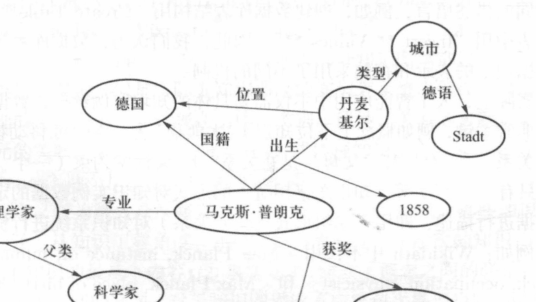

图 1.1 知识图谱样例

在计算世界里，节点和边的符号借助符号锚定，把物理世界与认知世界中的对象具体化，并成为不同主体在认知层面描述与交换信息与知识的桥梁。统一形式化的描述让知识的共享与复用变得可行。

在表示与存储层面，主流的技术路径大致分两类：本体与数据库。

本体一词源自哲学，指对客观世界进行共享概念化的体系。在人工智能里，本体是用对象类型、属性类型、关系类型对领域知识做形式化建模。它更关注抽象的概念层，比如有哪些种类的对象、它们之间能有什么样的语义关系，而并不涉及具体的个体实例。因此本体[资源1-2]只给出数据的定义框架，并不包含实例数据。


数据库是为了在计算机上承载应用所需的数据而设计的工具。无论是关系型、面向对象还是 NoSQL，其核心都是存放可传输交换的数据。描述与数据本身在传递时被默认双方已心照不宣，比如开发学生信息系统时，开发者被假定清楚表结构、属性类型、主键外键等。数据库对元数据与记录的操作使用不同的语言，比如建表用 Create Table，写数据用 Insert Values，二者机制是分离的。

人工智能既需要具体的实例，也需要对实例的定义。比如“大熊猫”是“熊科动物”的一种上下位关系，“子女”与“父母”是逆向关系①，一个人的父母数量受约束为 2 个等。知识图谱用同一套形式同时描述定义与实例，最典型的是三元组表示。以 Wikidata 为例，<Max Planck, instance of, human>、<Max Planck, occupation, physicist>、<Max Planck, place of birth, Kiel> 记录了具体事实，而 <physicist, subclass of, scientist>、<place of birth, value type constraint, geographical object>、<place of birth, subproperty of, location> 则在描述知识的结构。实例只有在符合系统约定的框架约束下才能成为知识，这里所说的框架或 Schema 即元知识，框架与实例共同构成完整系统。换句话说，知识是认知，图谱是载体，数据库是实现，知识图谱是在数据库之上用图抽象来承载认知内容。

具体地，知识图谱以结构化三元组存储实体及其关系，可记为 G = (E, R, S)，其中 E = {e1, e2, …, e|E|} 为实体集合，R = {r1, r2, …, r|R|} 为关系集合，S ⊆ R × E × E 为三元组集合。三元组由头实体、尾实体和二者间的关系组成。如 Freebase 中的 "/people/person/nationality (Jorge Amado, Brazil)" 表示 Jorge Amado 的国籍为 Brazil，其中 Jorge Amado 为头实体，Brazil 为尾实体，/people/person/nationality 为关系名称。关系有时也称属性，尾实体即属性值，可是实体、数值、时间、字符串，甚至音视频。从图的角度看，实体是节点，关系是有向边，图 1.1 给出了一个样例。如今公开的大规模图谱主要包括 Freebase、Wikidata [资源 1-4]、DBpedia [资源 1-5] [55]、YAGO [资源 1-6] [449]、NELL [78] 和 Knowledge Vault [133] 等。虽然大部分图谱都以三元组为基础，但其表达远不止二元关系，还涵盖实体、类别、属性、关系等多粒度、多层次语义单元，统一体现了 Schema 与 Instance 两个层次。

关于图谱应包含哪些内容，仍无定论。从知识工程看，框架通常分三层：概念知识给出基础内容，事实知识建立概念间的联系，规则知识建立事实间的联系。对是否应纳入推理规则，不同阵营看法不一。一派认为图谱只是基础设施，不应承载推理。判断“A 的国籍”可通过出生地与国家归属的规则推导，也可直接把“A 的出生地是北京”“北京属于中国”“A 的国籍是中国”三个事实分别存入图谱完成。主流的 Freebase、Wikidata、YAGO、DBpedia 等基本去规则化，W3C 的 OWL 因引入描述逻辑而未大规模推广，也反映了规则确定性弱、难维护的问题。

另一派则认为人类文明沉淀了大量规则，这些抽象知识能节省存储与检索成本，并支撑联想、推理、决策等高层认知。因此在模拟高层认知的人工智能中，知识图谱作为表示基石理应涵盖规则知识。

总体上，知识图谱凭借丰富的语义表达与灵活的结构，成为连接计算世界与认知、物理世界的有效载体，如图 1.2 所示，成为人工智能应用的重要底座。

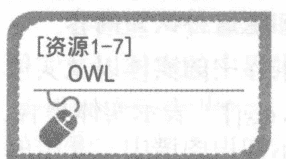

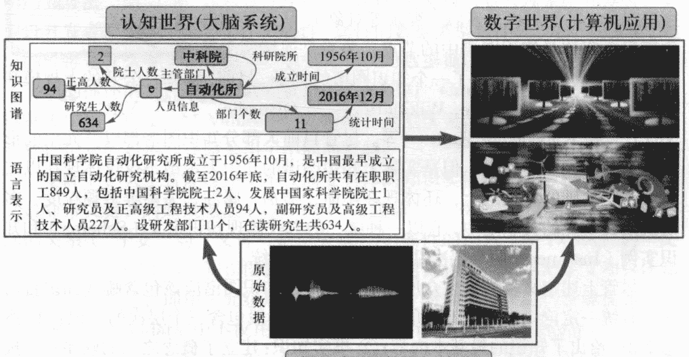

图 1.2 知识载体示例

### 1.2 知识图谱发展脉络

知识图谱的源头可追溯到人工智能与语义网两条线。人工智能希望让机器完成推理、分析、预测等人类思维活动，依赖知识库把人类知识形式化并实现算法操作，专家系统是早期尝试。语义网则面向海量互联网数据，渴望把原始数据升级为能推理、问题求解的资源，以支撑商业智能等决策。

由此可把发展目标概括为知识的数据化与数据的知识化，前者让计算机表示、组织、存储人类知识，后者让数据具备推理等智能能力，分别对应图 1.3 上下两部分。

整体历史与人工智能演进同步。人工智能第一个十年更关注推理模型，对数据内含知识的加工重视不足。1977 年图灵奖得主爱德华·费根鲍姆提出知识工程，提出“知识即力量”，证明智能行为的关键在于领域知识。此后兴起众多表示方法：20 世纪 70 年代一阶谓词逻辑，1974 年马文·闵斯基的框架表示法，1978 年塞尔文·汤姆金斯的脚本理论，1987 年受人脑记忆启发的语义网络，与知识图谱有相通之处。同时出现 Cyc 等大型知识库尝试，尽管多数未成功，但知识工程成为人工智能成果最丰硕的分支。

90 年代统计机器学习主导研究焦点转向知识的自动学习与利用。新世纪互联网爆发，数据规模与类型剧增，知识获取、管理和服务成为热点。传统搜索引擎仍停留在关键词匹配，准确度受限。人们意识到需要理解符号背后的语义，把文本转化为知识。

2001 年 Tim Berners-Lee 等提出语义网[52]，希望以机器可理解的方式描述事物联系，实现内容自动识别、融合与快速精准服务。语义网的目标是把万维网编织成一个海量分布式、可用的数据库[51][14]。但大规模落地受阻：一是 Web 数据量巨大、领域分散，自动标注标签需要信息抽取、分类、关联等技术支撑[10,13,17]；二是机器需要推理能力，数据需升华为知识系统并具备描述逻辑能力。语义网在最初十年未能普及，却推动了本体建模与形式化描述的研究，为后续热潮奠定基础。

真正的转折来自以维基百科为核心的协作知识资源。Freebase 与 DBpedia 均基于 Wikipedia 的 Infobox 构建，前者偏知识工程路线，后者偏语义网路线。2012 年谷歌正式提出 Knowledge Graph，通过抽取文本中的实体与关系，把非结构化事实转化为互联图谱，让计算机实现内容理解，成为语义网的杀手级应用，也推动了语义网、自然语言处理、数据库等领域发展。随后百度“知心”、搜狗“知立方”等国内产品也纷纷构建图谱，服务语义搜索与智能问答。

目前学界产业持续关注，主要因为以下特点：

- 知识图谱是人工智能不可或缺的基础资源，在语义搜索、问答、智能客服、个性化推荐等互联网场景中关键，并在金融智能、商业智能、智慧医疗、智慧司法等领域前景广阔。
- 语义表达能力丰富，既能描述概念、事实、规则等多层认知知识，又能组织自然环境与社会活动中产生的海量数据，为人工智能提供知识基础。
- 描述形式统一，借助 RDF 规范对知识体系与实例数据进行统一表示，并可通过对齐匹配实现异构知识融合。
- 表示对人类友好，基于实体与关系的简洁形式，便于专家与普通人协作构建，降低认知成本。
- 以二元关系为基础，便于基于自然语言处理与机器学习的自动抽取，支撑大规模跨领域采集。
- 对计算机友好，图结构结合图论算法可高效遍历与推理，降低计算成本。
- 基于三元组的图格式便于存储与检索，结合图数据库与语义网标准与工具，为大规模知识系统的管理提供保障。

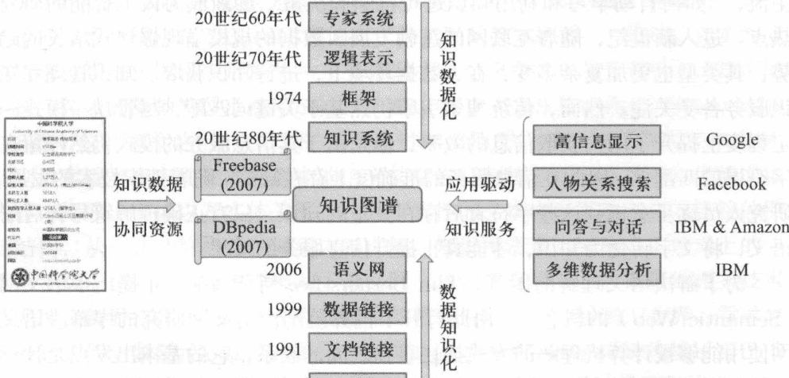

图 1.3 知识图谱发展历程

① 也称“逆属性”（inverse property）。

① Freebase 联合创始人 Danny Hillis 的背景很关键，他正是提出框架表示法的 AI 先驱 Marvin Minsky 的学生；② Freebase 的关系设计自带命名空间和类型信息，比如 /people/person/spouse 这类带路径的属性，而 DBpedia 的属性主要只标明作用域与取值范围；③ Freebase 借用了类框架的 CVT 类型来承载事件等复杂结构，DBpedia 的纯三元组很难给关系附加时间等槽位。

### 1.3 图谱分类指南
聊到图谱怎么分，先得把知识本身理清楚。学界至今没有完全统一的知识定义，可以把它理解成人类长期探索世界并沉淀下来的经验集合。柏拉图认为，真正算作知识的内容必须被检验、为真并且被人们接受。第 1.1 节提到陈述性与过程性知识的划分，实际上知识还能从多个角度切分，下面只是抛砖引玉。

从主客观看，存在事实性即客观性知识和主观性知识。事实性知识是稳定不变的，比如中国的首都就是北京。主观性知识则带有个人或群体态度，比如很多人觉得 iPhone 价格偏高，这种评价会随说者变化。本书默认讨论的是事实性知识。

从变化性看，有静态知识和动态知识。静态知识不随时空改变，比如一个人的出生日期。动态知识会随时间空间流动，比如美国总统从奥巴马换成特朗普。事件类信息就是动态知识的重要载体。

再看用途维度，常见划分有领域知识、百科知识、场景知识、语言知识、常识知识。领域知识指某专业内部的内容，如法律、金融。百科知识是跨行业通用的基础常识，如人物、机构、地点。场景知识是完成特定任务时需要的情境知识，如订机票要准备的材料、盖房子的流程。语言知识涉及语言层面，如 MS 是微软的简写，Jordan 与 佐敦 指同一人，减肥即瘦身。常识知识是大家普遍认可的生活经验，如狗狗通常有四条腿，鸟类能够飞行，常识的边界与表示方式至今仍是 AI 的难点。

基于上述差异，现有图谱也能做个粗略归类。很多图谱混合多种知识，很难绝对归入一类。本书按领域与用途大致分为语言知识图谱、语言认知图谱、常识图谱、领域图谱和百科图谱。

语言类图谱主要收录人类语言信息，典型代表是英文词汇网 WordNet，由同义词簇和簇间语义联系构成。中文知网 HowNet 属于语言认知图谱，它以义原为基础刻画人们对词义的认知，揭示更小的语义单元。常识图谱主要有 Cyc 与 ConceptNet，Cyc 包含大量实体、关系及可用于推理的常识规则，ConceptNet 汇聚了大量概念及它们间的常识性关联。领域图谱服务特定行业，如医学副作用资源 SIDER、电影库 IMDB、音乐库 MusicBrainz。百科图谱多以 LOD 开放数据项目为基础，包括 Freebase、DBpedia、YAGO 与 Wikidata，在检索与问答等任务中应用广泛。

传统上图谱多靠专家手工构建，如 Cyc、WordNet、HowNet，因覆盖面与规模限制难以实用。随着 Wikipedia、豆瓣电影等高质量众包内容出现，研究者基于这些数据搭建了 DBpedia、Freebase、YAGO。机器学习兴起后，WOE、ReVerb、NELL、Knowledge Vault 等自动抽取技术大幅提升了规模与覆盖。整体演进是从人工、群体智慧到面向互联网自动抽取，当前覆盖面不断扩大且多数数据可免费获取。表 1.1 汇总了部分主流大规模知识库的规模，它们是自然语言理解与人工智能的基础资源，下面对代表性图谱做简要介绍。

## 表 1.1 常见的部分大规模知识库及其规模
| 名称 | 开始时间 | 依赖资源 | 规模 #（实体/概念/关系/事实） |
|---|---|---|---|
| Cyc/OpenCyc ① | 1984 | 专家知识 | 239,261 /116,822 /18,014 /2,093,000 |
| WordNet ② | 1985 | 专家知识 | 155,287 /117,659 /18 /- |
| ConceptNet ③ | 1999 | 群体智能（多语言） | - /8,000,000 /36 /21,000,000 |
| YAGO ④ | 2007 | WordNet + Wikipedia | 4,595,906 /488,469 /77 / ≈ 40m |
| DBpedia ⑤ | 2007 | Wikipedia + 专家知识 | 17,315,785 /754 /2843 /79,030,098 |
| Freebase ⑥ | 2008 | Wikipedia + 领域知识 + 群体智能 | 58,726,427 /2,209 /39,151 /3,197,653,841 |
| NELL ⑦ | 2010 | 机器学习 | - /287 /327 /2,309,095 |
| BabelNet ⑧ | 2012 | WordNet + Wikipedia（多语言） | 9,671,518 /6,117,108 /1,307,706,673 /- |
| Wikidata ⑨ | 2012 | Freebase + 群体智能 | 45,766,755 /- /- /- |
| Google Knowledge Graph ⑩ | 2012 | 基于 Freebase | 570M /1500 /35000 /18000M |
| Knowledge Vault ⑪ | 2014 | 机器学习 | 45M /1100 /4469 /271M |

## 1. Cyc
Cyc 是一个通用常识库，1984 年启动，目标是把数百万条知识编码为机器可处理形式并支持推理。早期多为人工构建，目前约有 50 万实体、近 3 万关系和 500 万事实，受限于一阶谓词的表达力，复杂歧义的自然语言知识难以完整刻画。OpenCyc 是开放子集，约 24 万实体与 200 万事实。除了实体与关系，Cyc 还提供可推理的常识规则及演绎、归纳推理引擎。创始人 Lenat 曾估算需要 350 人年才能完成。近年 Cyc 也尝试从非结构化文本自动抽取，自 2008 年起与 Wikipedia、DBpedia 等建立链接。
- ① 数据来自 2012 年发布的 4.0 版
- ② 数据来自 WordNet3.0
- ③ 参考 ConceptNet 5.5
- ④ 参考文献 308
- ⑤ 数据来自 2016-04 版
- ⑥ 数据来自 2015 年 4 月 23 日的 dump
- ⑦ 参考 2018 年 4 月数据
- ⑧ 数据来自 2018 年 2 月发布的 4.0 版
- ⑨ 数据来自 2018-03-20 版
- ⑩ 参考 KDD 2014 发表文章
- ⑪ 参考 KDD 2014 发表文章

## 2. WordNet
WordNet 由普林斯顿大学在 1985 年发布，是手工标注的英文电子词典与本体。词项被聚合成 Synset，每个 Synset 代表一个基本词汇语义概念，簇间关系包括同义、反义、上位、下位、整体部分、蕴含、因果、近似等。1991 年 WordNet1.0 正式发布，当前包含 155287 个单词、117659 个 Synset。图 1.4 展示了 Synset 的组织方式，可见概念间关联及对应的词项与释义。
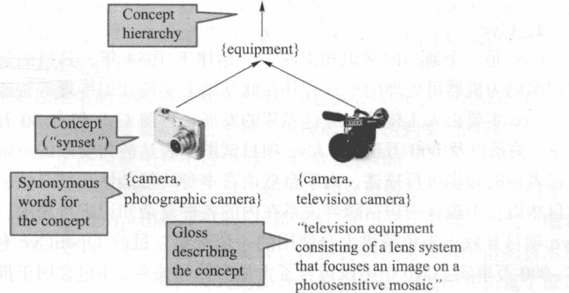
图 1.4 WordNet 组织结构示例

## 3. 知网（HowNet）
知网由董振东教授主持研发，是以概念为中心、基于义原描述概念间及属性关系的语言认知与常识库。概念可用多种语言词汇描述，主要为中文与英语。经过多年积累，知网拥有 800 多个义原与 11000 个词语。

## 4. ConceptNet
ConceptNet 是一个开放多语知识图谱，最早源于 MIT Media Lab 的众包项目 Open Mind Common Sense，旨在帮助计算机理解日常词汇意义。图 1.5 显示其结构，由大量概念及描述它们关系的常识构成，支持多种语言，可用于自然语言处理等 AI 应用。
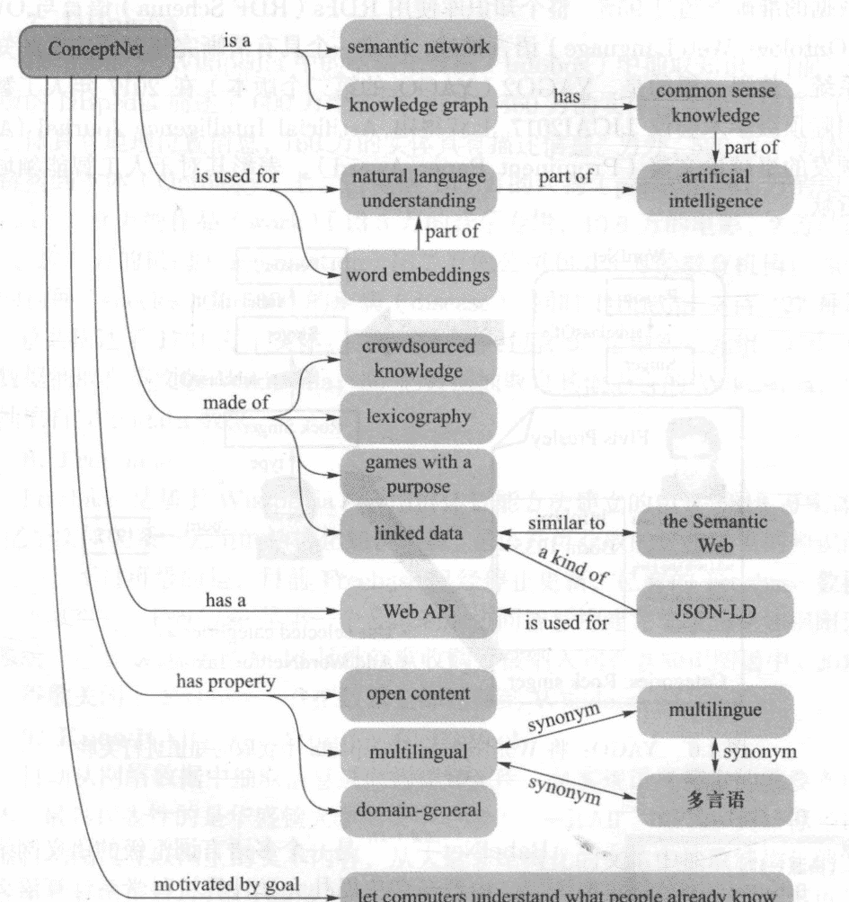
图 1.5 ConceptNet 的组织结构

## 5. YAGO
YAGO 由德国马克斯·普朗克研究院主导，目前拥有百万级实体与超过五百万条关系事实。YAGO 以 WordNet 为骨架，将 Wikipedia 分类与 WordNet 同义词集关联，并把 Wikipedia 条目挂载到该体系下，既自动扩充又提供组织。实体关系依据人工严格定义的规则从 Wikipedia 自动抽取，包括上下位与属性关系，实例准确率超 95%。知识库使用 RDF Schema 与 OWL 描述。YAGO2 于 IJCAI2017 获 AIJ 卓越论文奖。
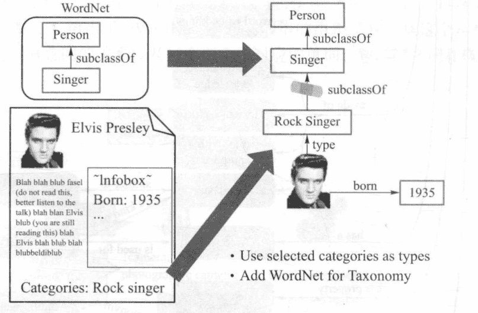
图 1.6 YAGO：将 WordNet 与 Wikipedia 中获取的知识进行关联

## 6. BabelNet
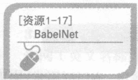
BabelNet 是由罗马萨皮恩扎大学计算语言学实验室创建的多语言词汇级语义网络与本体。其核心是将 Wikipedia 与 WordNet 连接，类似 YAGO 但加入多语言支持。4.0 版本覆盖 284 种语言。语义关系来源一是 WordNet 的上下位、部分整体、反义同义等约 36.4 万条，二是 Wikipedia 的相关关系约 3.8 亿条。BabelNet 与 YAGO2 同获 IJCAI2017 卓越论文奖。

## 7. DBpedia
DBpedia 从 Wikipedia 的结构化 Infobox 中抽取知识。英文版描述约 600 万实体，其中 460 万有摘要、153 万有地理信息、160 万有描述信息。约 520 万实体可链接到本体，包括 150 万人物、81 万地点、49 万作品等。DBpedia 支持 127 种语言，共描述 1731 万实体。总计约 95 亿事实三元组，其中 13 亿来自英文 Wikipedia、50 亿来自其他语言 Wikipedia、32 亿来自 Wikidata。

## 8. Freebase
Freebase 基于 Wikipedia 采用群体智慧构建，包含 5813 万实体与 32 亿实体关系三元组，是公开可获取的规模最大图谱之一。系统于 2010 年 7 月 16 日被谷歌收购并并入谷歌知识图谱。2015 年谷歌关闭 Freebase 并迁移数据至 Wikidata。

## 9. KnowItAll、TextRunner 和 ReVerb
从网络数据自动抽取信息构建知识库是语义搜索的关键。华盛顿大学 KnowItAll 项目旨在让机器阅读互联网文本，从非结构化内容抽取开放域实体关系三元组。TextRunner 与 ReVerb 是该项目下的代表系统，后者为前者的升级版。两者都通过识别句子谓词抽取二元关系，并利用网络冗余评估可信度。图 1.7 展示了在系统中查询实体关系三元组的效果。
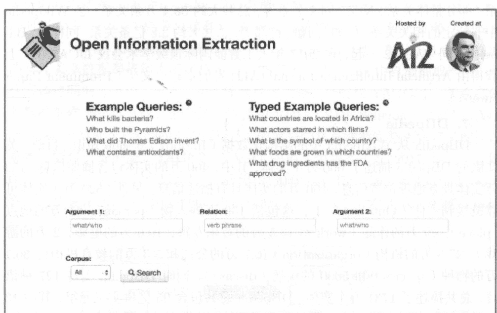
图 1.7 OpenIE 示例

## 10. NELL
NELL 是卡内基梅隆大学 Read the Web 项目下的永不停歇语言学习系统。每日执行阅读与学习两项任务：从网页文本抽取知识加入内部库，并用机器学习巩固与扩展理解。图 1.8 显示其抽取的大量事实三元组并标注迭代轮次、时间与置信度。系统 2010 年起运行，半年内得到约 35 万三元组，经少量人工校正后抽取准确率可达 87%。NELL 仍在优化算法以减少错误、提升归纳能力。

## 11. 算法冶炼常识库的里程碑

2014 年 Google 推出 Knowledge Vault¹³³，标志着图谱构建思路的重要转向。相比早期的 Freebase 方案大量依赖人工众包，此次转向让系统自行在互联网上爬取信息，并借助机器学习把 YAGO、Freebase 以及网页表格等多种结构化来源整合成可用的事实库。据公开披露，该库累计收录约 16 亿条陈述，其中约 2.71 亿条达到高置信区间，整体准确率接近 90%。

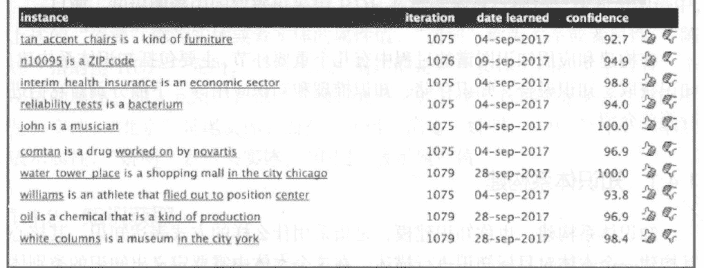

图 1.8 NELL 提取结果示例

除通用型仓库外，垂直领域的构建也很活跃。① 影视类 IMDB 自 1990 年起积累电影、剧集、演员与制作人员信息，到 2012 年 2 月 24 日已收录超过 213 万部作品及 453 万个人档案。② 音乐类 MusicBrainZ 采用开放编辑模式，注册用户可以补充元数据，多家主流音乐服务平台的数据均源自此处。③ 医药类 SIDER 聚焦已上市药品的已知不良反应，为临床决策提供参考。

2007 年 W3C 发起开放链接数据计划 LOD，意在把原本以文档互联为主的 Web of Documents 升级为以数据互联为主的 Web of Data。LOD 鼓励以 RDF 形式在网络上发布开放数据集，并在跨源数据项之间建立语义链接，以提升共享与复用。迄今该计划已上线 570 余个数据集，规模达千亿级 RDF 三元组，随着链接数据普及，发布量持续攀升。

### 1.4 知识网络的演进链路
构建与应用一个知识网络通常要经历建模、抽取、融合、存储、推理与使用等环节，下面依次说明。

#### 1.4.1 知识体系构建
本体构建即知识建模，核心是利用本体描述目标域。需要定义概念层级、实体集合、属性集合以及实体间的语义关联，并配以推理规则。例如 Freebase 涵盖超过 2000 个概念类型与近 4 万条属性，并为每类限定关系值域。知识网络概念伴随语义网出现。语义网提出前，万维网仅靠超链接连接 HTML 文档，浏览器只能解析语法而无法理解内容所指。1998 年万维网之父 Tim Berners-Lee 倡导用 RDF 与 OWL 等形式化模型把网页内容表达为机器可读的语义。语义网让机器能理解数据本身及其关联，从而实现更自动化的信息处理。本节聚焦其中与建模紧密相关的 RDF。RDF 数据模型包含三类要素：资源、谓词、陈述。

- **资源**：可被 RDF 描述的对象，涵盖网络实体、事件、概念等。
- **谓词**：描述资源特征或资源间联系的标记，可定义域、值域、逆关系等元信息。
- **陈述**：以 RDF 三元组 <主体，谓词，宾语> 呈现。主体是被描述对象，谓词表示属性或关系，宾语为属性值或关联对象。

在实际图谱里，“资源”常指实体或属性值，“谓词”指关系或属性，“陈述”即三元组。例如三元组“首都（中国，北京）”中“首都”为关系，“中国”为头实体，“北京”为尾实体；三元组“国籍（姚明，中国）”中“国籍”为属性，“姚明”为头实体，“中国”为属性值。

#### 1.4.2 知识获取
获取的目的是从海量文本中抽取结构化陈述，方法随数据源而异。百科类图谱主要依赖百科文本，垂直领域则依赖专业文本。

数据源可大致分为有序、半有序与自由文本三类。工业界常从有序与半有序源抽取，噪声少、易清洗；学术界更聚焦自由文本中的实体与关系抽取，难度更高但潜力更大，因为互联网绝大多数信息以自然语言呈现。

### 1. 表格化数据源
此类数据多来自企业内部数据库或网页表格，质量高、稳定性好、变动慢。优点是置信度高、质量可靠；缺点是规模有限且获取成本高。网络百科的信息框是典型代表，结构统一可按模板提取属性与取值。图 1.9 以姚明信息框为例。除了百科信息框，LOD 项目已汇聚 DBpedia、YAGO 等通用语义集，也包括 MusicBrainz、DrugBank 等垂直图谱，整合后可显著提升覆盖面。此外电商、点评类网站也沉淀大量领域表格数据，可进一步扩充图谱。

## 基本信息

| 中文名 | 姚明 | 重要事件 | 专题影片《姚明年》发行 |

| 外文名 | Yao Ming |  | 2011年正式宣布退役 |

| 别名 | 明王、移动长城、小巨人、大姚 |  | 2016年入选篮球名人堂 |

| 国籍 | 中国 |  | 2017.2.23 当选中国篮协主席 |

| 民族 | 汉族 | 祖籍 | 苏州吴江 |

| 出生地 | 上海市徐汇区 | 仓位 | 中锋 |

| 出生日期 | 1980年9月12日 | 鞋码 | 18码 |

| 毕业院校 | 上海交大安泰学院 | 代表作品 | 我的世界我的梦 |

| 身高 | 226厘米 | 生涯最高分 | 41分 |

| 体重 | 140.8公斤 | 老婆 | 叶莉 |

| 运动项目 | 篮球 | 女儿 | 姚沁蕾 |

| 所属运动队 | 已退役 | 母语 | 普通话、英语、吴语 |

| 专业特点 | 20英尺外精准跳投 | 小学 | 上海市高安路第一小学 |

| 主要奖项 | 8次NBA全明星（2003-2009；2011） | 初中 | 上海斯第二中学 |

|  | ESPN全球最有潜力运动员奖(2000) | 研究生 | 香港大学 |

|  | 劳伦斯世界最佳新秀奖(2003) | 血型 | B型 |

|  | 中国篮球杰出贡献奖 | 生肖 | 猴 |

|  | 世界最具影响力100人之一 | 星座 | 处女座 |

图 1.9 结构化数据样例

### 2. 半结构化数据源
半结构化数据无法用固定模板一次性抽取，结构相对松散、模式多样，知识常隐藏在隐式列表或表格中。如图 1.10 所示，百度百科板蓝根条目即属此类，具有层次但结构化程度低于信息框。其优势是置信度较高、规模较大、信息个性化丰富；劣势是样式多变、含噪声，难以靠人工模板批量提取。

### 主治
温疫时毒，发热咽痛，温毒发斑，痈疡，烂喉丹痧，大头瘟疫，丹毒，痈肿。

### 相关配伍
- 1. 与玄参、马勃、牛蒡子等同用，可用于风热上攻，咽喉肿痛等症。

- 2. 与生地、紫草、麦冬等同用，可用于时行温病，温毒发斑等症。

### 用法用量
煎服，9-15g。

### 禁忌
体虚而无实火热毒者忌服，脾胃虚寒者慎用。

### 炮制方法
除去杂质，洗净，润透，切厚片，干燥。

本品呈圆形的厚片，外表皮淡灰黄色至淡棕黄色，有纵纹纹，切面皮部黄白色，木部黄色。气微，味微苦后苦涩。

图 1.10 半结构化数据样例

### 3. 自由文本数据源
自由文本即纯自然语言，例如“姚明 1981 年出生于上海”就蕴含（姚明，出生地，上海）、（姚明，出生日期，1981 年）两条结构化事实。互联网上绝大多数内容属于此类，信息量远超有序与半有序数据，因此文本信息抽取成为构建图谱的核心技术。

当前主流表示以实体关系三元组为主，抽取任务包括实体识别、实体消歧、关系抽取与事件抽取，需依赖自然语言处理支撑。

1）实体识别：从文本定位实体并标定类别与边界。如“姚明 1981 年出生于上海”中需识别出“姚明”“1981 年”“上海”并分别归为人名、时间、地名。早期研究聚焦命名实体，通常分为实体类、时间类、数字类七小类。图谱场景还需覆盖股票名、品牌名等领域实体。相关任务实体抽取则是在语料上构建实体清单，不必逐句定位边界。

2）实体消歧：消除指称歧义。如“李娜于 2011 年获得法国网球公开赛冠军”中的“李娜”需链接到网球运动员而非歌手或跳水运动员等同名人物。实体消歧是图谱构建与应用的关键桥梁。技术上分为实体链接与实体聚类，前者把文本指称链接到已有图谱的唯一编号实体，后者在无先验知识时通过聚类归并同指称项。

3）关系抽取：获取实体间语义关联，可是一元、二元甚至高阶。在现有图谱中多处理一元与二元关系。任务形式包括关系分类、属性抽取与关系实例抽取。如已识别“姚明”“上海”，关系分类需判断为“出生地”；已知实体与关系“出生地”，属性抽取需抽取“上海”。关系抽取难度在于自然语言表达多样，方法可分为有监督、无监督、弱监督与开放关系抽取。

4）事件抽取：从描述性文本中结构化呈现事件。如“成龙和林凤娇于 1982 年 12 月 1 日在洛杉矶举行婚礼”可抽取“结婚”事件、参与者、时间、地点。事件知识能弥补以实体关系为核心图谱的表达不足。抽取方法可分为模式匹配与机器学习。

#### 1.4.3 知识融合
融合用于把来自不同来源、语言或结构的知识对齐，补充、更新与去重。YAGO 正是通过融合专家构建的 WordNet 与社区构建的 Wikipedia 实现质量与规模互补；BabelNet 则实现跨语言知识关联。

按对象分，有体系融合与实例融合。前者对齐类别、属性、关系本体，后者对齐实体与关系实例。按方向分，有垂直融合，即通用本体与领域本体或实例的融合，如 WordNet 与 Wikipedia；水平融合，即同层级图谱的实例互补，如 Freebase 与 DBpedia。核心都是计算节点与边间的语义映射。

#### 1.4.4 知识存储
存储方式主要有 RDF 文本存储与图数据库。RDF 存储以三元组逐行保存，如 Freebase 使用 SPO 文本格式，搜索效率低，通常采用六重索引优化。图数据库如 Neo4j 更通用，提供完善的图查询语言与图挖掘算法支持，但更新速度慢，大节点处理开销高。子图筛选、同构判定等是当前研究热点。

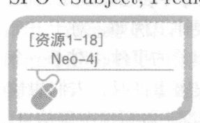

#### 1.4.5 知识推理
建模、获取与融合后仍会因数据不完备出现实体或关系缺失，抽取与融合难以完全补齐，需借助推理挖掘隐含知识。当前研究集中在补全缺失关系。方法大致两类：①基于传统逻辑规则的推理，重点在自动学习规则与解决规则冲突；②基于表示学习的推理，把推理转为分布式向量相似度计算，优点是容错率高、可学习，缺点是可解释性弱、缺乏语义约束。

知识推理的价值并不止于为已有图谱填补缺口，更能直接赋能下游应用。以自动问答为例，这类系统同样依赖推理能力。关键在于先把自然语言的提问转写成图谱所能承载的结构化表述，转换成功后才能调用图谱内部的语义上下文约束、既有的推导规则以及外部常识等信息，从而推导出正确结果。

#### 1.4.6 知识应用
在人工智能持续升温的当下，知识图谱已深度嵌入智能检索、自动问答、个性化推荐、决策辅助等多个方向，扮演通用底座的角色。

- 1. 智能搜索

检索侧的图谱增强型搜索引擎内部沉淀了海量实体及其关联，因而能对用户查询作出精准回应。图 1.11 展示的例子里，用户在 Google 检索 “Donald Trump（唐纳德·特朗普）”，除返回最相关网页外，还会以知识卡片呈现出生日期、身高、财富、配偶、子女、教育等精炼信息，并关联展示 Hillary Clinton（希拉里·克林顿）、Barack Obama（巴拉克·奥巴马）等相关政治人物。这类浓缩信息大幅压缩了查找范围，帮助用户迅速把握要点。


图 1.11 Google 搜索引擎查询实体样例

理解用户意图是智能检索的核心环节，该环节也大量借助图谱。如图 1.12 所示，用户输入“姚明运动员”，若仅靠关键词匹配，系统无法分辨指代会把所有含“姚明”的页面全部返回；借助图谱，系统能识别出“姚明”这一实体与“运动员”这一属性并建立关联，从而判定用户实际想查的是篮球运动员姚明。

- 2. 自动问答

在自动问答场景中，答案多通过图谱里实体与关系的推理链路推导得出，


图 1.12 Google 搜索引擎语言理解样例


图 1.13 Google 搜索引擎自动问答样例

图 1.13 展示的例子是检索“屠呦呦是哪里人”。系统先定位实体“屠呦呦”，再在与之相连的关系中寻找与“哪里人”语义对应的“国籍”属性，最终给出“中国”作为答案。

## 3. 推荐

推荐任务中，可借助商品实体在图谱中的类别关系实现关联推荐。图 1.14 显示，用户在百度搜索“战狼 2”时，右侧会呈现同类影片推荐，这种推荐依据即影片在知识图谱中的类型标注。

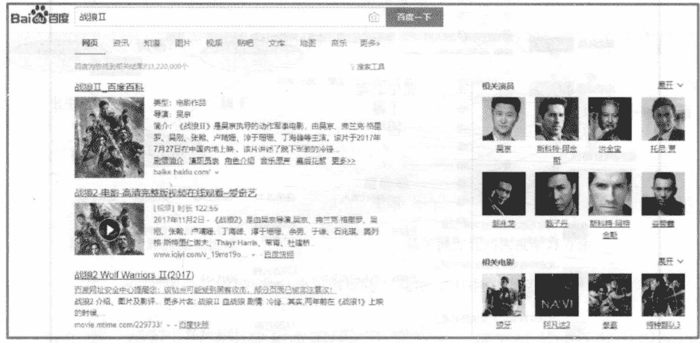

图 1.14 百度推荐样例

## 4. 决策支持

知识图谱可借助信息抽取、数据挖掘、语义匹配、语义计算与知识推理等手段，将领域内复杂知识结构化表述，同时还能刻画知识随时间演进的规律，为研究与决策提供可追溯、可解释、可推理的精准数据支撑。例如，银行交易异常可通过数据一致性校验结合图谱进行欺诈识别。


除上述通用场景外，金融、医疗、电商、司法、教育等垂直行业均构建了各自的知识图谱并发挥关键作用。以天眼查 [资源1-19] 为例，可从公开网络挖掘企业与企业家间的关联网络。图 1.15 展示了与王健林相关的企业全景信息。展望未来，知识图谱作为一种新型知识管理范式，其价值远超搜索引擎，将在各类智能系统里获得更广阔的应用空间。


图 1.15 知识图谱应用企业关系

### 1.5 知识图谱与深度学习

知识图谱的各个环节都离不开对文本与符号的表征与处理，依此实现语义理解与知识推理，进而支撑问答、对话、决策等高级智能功能。例如，利用信息抽取从文本中识别实体、关系、事件来构建图谱；利用语义匹配将自然语言问题映射到图谱的实体、关系或子图上实现问答；利用类比、关联与推理挖掘概念间隐含联系以服务商业智能等决策。早期研究范式以符号为核心，对词、句、篇章以及实体、属性、规则等语义单元均采用符号编码（如图 1.16 左侧所示），并借助符号匹配如索引检索以及数理演算如谓词推理来完成语义计算。

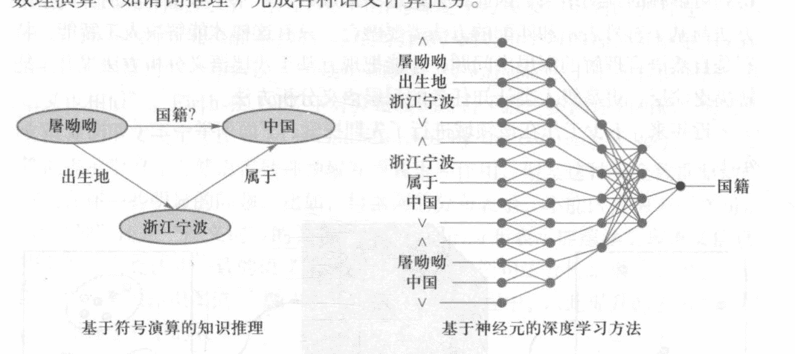

近些年，知识图谱构建与应用的各环节越来越多地引入深度神经网络建模并取得进展，后续章节涉及的任务均有大量相关研究。深度学习的核心理念是借助多层网络自动学习对象的抽象表征，以提升下游任务表现。以神经元为基础的深度方法（如图 1.16 右侧所示）将处理对象编码为数值形式——标量、向量或矩阵，并通过数值运算如乘法、开方、非线性激活等完成语义计算。

尽管深度学习在特定任务上效果突出，但其局限也较为明显且部分具有根本性。第一，模型通常需要海量标注数据①；第二，纯数据驱动的训练使结果难以解释且训练过程难以人为干预；第三，端到端流程难以融入先验知识，而多数应用场景依赖人类先验。为了更贴近人类认知并实现更强的抽象与推理，研究者采用符号逻辑对知识进行表述与推演，知识图谱即为典型代表。然而符号逻辑不易从历史数据中自动习得，现有规则多靠人工撰写与校验；即便借助概率图模型等手段学习有限推理规则，其复杂性也限制了大规模数据的扩展。

在标注数据有限的情况下，有效预测需要将可学习的表征模型与可表达、可解释的符号逻辑方法结合[169]。通过表征学习从历史数据中获取知识，再融合由符号逻辑刻画的专家领域知识，既能提升预测精度，也能获得可解释的结果。正因如此，学界逐渐达成共识：数值计算驱动的深度学习与符号表征匹配的方法必须融合。唯有如此，才能破解人工智能尤其是自然语言理解的深层难题，将现有的浅层语义分析提升为能够处理更深层次、更高阶人类认知任务的深层语义分析。

近几年已有许多先行探索，下文举例说明（如图 1.17 所示）。

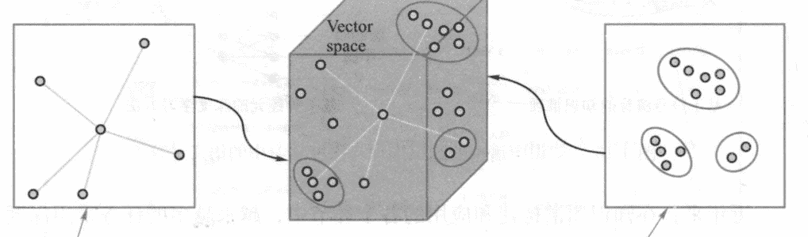

Relational knowledge

[Semantic relations such as "capital of", syntactic relations such as "singular verb to plural verb", etc.]

Categorical knowledge

[word set from thesaurus, synonyms, domain knowledge, etc.]

## 在词表示学习中融入知识图谱(RC-NET示意图)

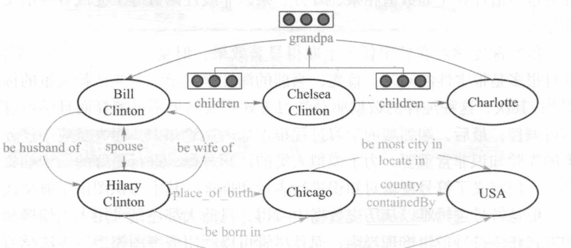

## 基于表示学习的知识推理

图 1.17 知识图谱和深度学习的融合示例

词的表示学习是深度学习自然语言处理的基石，其目标是将每个词符号映射为分布向量形式。基于词向量，句子、段落、篇章、对话等更大语言单元可通过语义组合模型如卷积神经网络、循环神经网络得到，进而用于文本分类、问答匹配、机器翻译、对话生成等任务。理论基础是 Harris 1954 年提出的分布假说：上下文相近的词语义也相近[198]。Firth 1957 年进一步明确：词的语义由其所处语境决定，A word is characterized by the company it keeps[157]。尽管词表示学习作用显著，纯数据驱动的方式存在明显缺陷，例如无法区分近义词与反义词。为了让分布表示蕴含更多符合人类认知的语义知识，研究者将句法分析结果[273]、语言知识图谱[514]、常识知识图谱[500]融入词表示学习，以提升深层语义理解效果[484]。

知识图谱表示学习把符号化的实体和关系投影到低维向量空间，该表示能够承载语义信息并高效计算实体、关系间的复杂关联[20]。该方法在图谱构建、推理与应用中作用关键。学习到的实体和关系向量反映了图谱元素间的关联，可用于推断缺失关系、补全知识图谱[434]。随着深度学习发展，其也易于迁移至问答系统[63, 68, 132]等任务。学习向量时可利用整个图谱的信息，因此推断缺失关系时信息更全面，预测性能与计算效率均较高，能满足大规模图谱需求。但与逻辑规则推理相比，其推理过程以数值计算隐式表达，不易理解，也不便人工干预或注入先验知识。

神经符号机是把神经网络与符号推理结合的技术，近年开始应用于自然语言处理。神经符号机利用神经网络对函数演算、图灵机等传统计算模型进行建模。按抽象层次可分为两类。一类抽象层次较高，每个推理步骤从设计好的操作集合中选取操作，再挑选合适的操作数。操作集合依任务而定，规模从数个到数十个不等。通过多次操作递推得到针对用户问题的最终答案。该思路已用于表格问答[346, 353]、基于知识库的问答[281]等。另一类抽象层次较低，代表工作如神经图灵机[178]、可微分神经计算机[179]等。它们从模拟计算机底层操作角度抽象模型，设计内存、CPU 控制器等结构，并借鉴操作系统思路，从随机访存、空闲内存分配、访存时序等角度建模以完善性能。此类结合方法已应用于问答系统、基础图论算法等[178, 179]。

### 1.6 小结

本章先给出知识图谱的定义并梳理发展历史，从两条历史脉络总结其来源，随后描绘发展轨迹：从人工标注到群体智能，再到基于统计机器学习的自动化构建，同时体现从单一语言单一领域向多语言多领域的演进。接着讨论知识类型与图谱类型并简要介绍代表性图谱。随后介绍知识图谱生命周期，即构建与应用中的关键环节。知识图谱是一种语义网络，相较传统知识表示，以三元组为统一形式，更开放易接受，存储、检索、推理效率更高。但当前定义的知识图谱主要表达事实性、以实体为核心的结构化知识。情感知识、常识知识、场景知识等其他类型仍在探索中。本章最后分析知识图谱与深度学习的关系，可见以符号表示为基础的图谱与以数值计算为基础的深度学习各有优势，当前趋势是在深度学习中融合知识图谱，也在知识图谱中应用深度学习技术。


## 第二章 知识表示

知识应用的难点在于知识推理，知识推理的难点在于知识表示。因此，知识表示是基于知识的人工智能应用中的核心部分。MIT AI Lab 的 Randall Davis 教授等人在 1993 年于 AI Magazine 发表了极具影响的文章 “What is a Knowledge Representation?”^[125]^。文章指出知识表示的五个主要角色是：① 知识表示是一种代理，基于对事物的表示，我们无需实践而是通过思考和推理就可以得到有关外部世界的结论；② 知识表示是一组本体论约定的集合，说明我们以什么样的方式来思考世界；③ 知识表示是智能推理的组成部分：推理需要对知识进行表示，但知识表示不是推理的全部；④ 知识表示是高效计算的媒介：通过对知识进行有效组织，支持高效的推理；⑤ 知识表示是人类表达的媒介：基于通用表示框架，方便人们表达和分享对世界的认知。

结合上述五个角色，本章从三个层次介绍知识表示方法：首先简要介绍人工智能和知识工程中的经典知识表示理论，包括逻辑、语义网络、框架、脚本等；接着介绍语义网中的知识表示方法，并介绍语义网的知识描述体系；最后介绍知识图谱中的知识表示方法以及在大数据环境下面向具体应用的知识图谱的数值化知识表示方法。

### 2.1 经典知识表示理论

### 2.1.1 逻辑

按复杂程度，逻辑可分为命题逻辑、一阶谓词逻辑、高阶逻辑。命题逻辑语法最简单，定义真假值为二值的原子命题，并可通过与∧、或∨、非¬、蕴含⇒、当且仅当⇔等连接符组合成复合命题，推理过程依据连接词的真值表自动推导。一阶谓词逻辑即一阶逻辑，在命题逻辑基础上引入全称量词∀和存在量词∃，从而能量化实体和概念。但一阶逻辑不能量化谓词或集合，而高阶逻辑可以实现。二阶逻辑可量化集合，三阶逻辑可量化集合的集合，依此类推。

我们先从最简单的命题逻辑入手介绍用逻辑表示知识。命题逻辑的基础是上述五种连接词，可将原子命题组合成现实中的复杂知识。为避免运算歧义，命题逻辑定义了操作符优先级，例如非¬优先级最高，因此¬A ∧ B 的含义是 (¬A) ∧ B 而非 ¬(A ∧ B)。

以下用命题逻辑记录一个简单分类知识。

- 如果鲸目中的一类背部有背鳍，那么它是海豚科。

  $X_1 = $ 鲸鱼有背鳍      $X_2 = $ 这种鲸鱼属于海豚科

  $Z_1 = (X_1 \Rightarrow X_2)$

- 虎鲸的背部有背鳍，那么虎鲸是海豚的一种。

  $Y_1 = $ 虎鲸有背鳍      $Y_2 = $ 虎鲸是一种海豚

  $Z_2 = (Y_1 \Rightarrow Y_2)$

命题逻辑把每个命题视为二值逻辑变量，可为真 true 或假 false。经典逻辑中命题非真即假，无中间状态，而概率逻辑会放宽该假设，使命题以不同概率处于真假之间。逻辑连接符按真值表运算组合命题真假，如表 2.1 所示。

表 2.1 命题逻辑关系真值表

| X | Y | ¬X | X ∧ Y | X ∨ Y | X ⇒ Y | X ⇔ Y |

|---|---|----|-------|-------|-------|-------|

| true | true | false | true | true | true | true |

| false | true | true | false | true | true | false |

| true | false | false | false | true | false | false |

| false | false | true | false | false | true | true |

命题逻辑很适合简单推理，从上述例子可抽象出表达式：

有背鳍 (x) ∧ 属于 (x, 鲸目) ⇒ 属于 (x, 海豚科)

这是一种典型的演绎推理，也可转化为三段论：

背部有背鳍的鲸鱼都属于海豚科。

虎鲸背部有背鳍。

虎鲸属于海豚科。

关于逻辑推理方法将在知识推理部分详细介绍。

谓词逻辑可分为一阶与高阶，其主要区别在于是否能量化谓词或集合。由于高阶谓词逻辑过于复杂，实践中应用很少，本书不作介绍。

一阶谓词逻辑即一阶逻辑，在命题逻辑基础上增加量词。更具体地，一阶逻辑的基本语法元素是表示对象、关系和函数的符号，其中对象对应常量符号，关系对应谓词符号，函数对应函数符号。对象指事物的个体或类别，如虎鲸、水蜜桃、汤姆·科鲁兹、燕子李三等。关系或谓词是一种映射，例如兄弟就是谓词，对对象燕子李三，兄弟（燕子李三，x）是谓词对对象的操作，其中 x 可是燕子李四等一个或多个对象，也可为空。与谓词不同，函数是代表全函数的一种特殊谓词形式，要求每个定义域对象都有映射值，例如国籍就是函数词，因为一般情况下每个人都有且只有一个国籍，汤姆·科鲁兹是函数词国籍定义域中的对象，那么谓词逻辑要求国籍（汤姆·科鲁兹，x）的映射必须在值域中。

相比命题逻辑，谓词逻辑的优势是可以表达对象集合的属性，而无需逐一列举，通过量词实现对集合的描述。一阶谓词逻辑有两种量词：全称量词∀和存在量词∃。

全称量词∀表示集合全部，例如所有海豚都有背鳍，可方便表示为：

∀x 海豚 (x) ⇒ x 有背鳍

∀ 通常读作“对于所有的……”，符号 x 为变量，一般用小写字母表示。形式化地，对任意含 x 的逻辑表达式 P，语句 ∀x P 表示对每个对象 x，P 为真。

存在量词∃用来表示论域中至少存在一个对象，该对象无需显式指出，例如有一只虎鲸杀死了人类，存在量词可不指明该虎鲸个体是提拉库姆①，而直接表示为：

∃x 虎鲸 (x) ⇒ x 杀人

量词、谓词与经典知识表示概览

从形式角度看，设 P 是含变量 x 的逻辑式，则 ∃x P 的含义是在论域内可以找到至少一个个体赋值给 x 使得 P 成立。

全称量词 ∀ 与存在量词 ∃ 可通过否定进行相互转换。其原因在于 ∀ 在语义上等价于对论域全体元素的合取，∃ 则等价于对论域全体元素的析取，因而满足 De Morgan 定律：

∀x ¬P ≡ ¬∃x P    ¬(P ∨ Q) ≡ ¬P ∧ ¬Q

¬∀x P ≡ ∃x ¬P    ¬(P ∧ Q) ≡ ¬P ∨ ¬Q

∀x P ≡ ¬∃x ¬P    P ∨ Q ≡ ¬(¬P ∧ ¬Q)

∃x P ≡ ¬∀x ¬P    P ∧ Q ≡ ¬(¬P ∨ ¬Q)

在人工智能的早期阶段，命题逻辑与一阶谓词逻辑是最常被采用的陈述式知识表述手段。这类方法以统一简洁的方式刻画命题，将知识表述与推理机制分离，使推理过程不依赖具体领域。引入量词与变量后，表达能力被提升到更抽象的层次，有利于复杂推理。一阶谓词逻辑拥有完备的推理体系，能够保证表示的一致性与推导的正确性。其不足在于产生式难以刻画过程性知识与不确定性知识，随着属性、谓词、命题规模扩大，符号组合会产生爆炸，推理复杂度呈指数增长，效率偏低。

### 2.1.2 语义网络

语义网络由 Quillian M. Ross 于 1966 年在研究人类联想记忆时提出，起初是一种心理学模型[39]。提出思路受两点启发 [资源 2-1]：

- ① 人脑记忆的重要特点是不同信息片段之间连接非常紧密；
- ② 概念间的相关度越高，回忆速度通常越快。此后该模型被用于知识表示。

语义网络通过语义关系把概念组织成网络，以点线形式编码知识。点代表实体、事件、数值等，线表示对象间的语义关联。整体上它可看作一种有向图式的知识系统。最基本的语义单元可用三元组记作 <节点1,关系,节点2>，即 <E1,R,E2>，其中 R 表示 E1 与 E2 之间的语义联系，对应的基本图形为 E1 R > E2。比如“珊瑚是一种动物”即可按此方式表示。


图 2.1 语义网络简单示例

网络中存在多种关系类型：

- 1. 实例关系 ISA，体现具体与抽象，含义为“是一个”，如“小王是一个人”。
- 2. 分类关系 AKO 即 a kind of，也称泛化关系，体现子类与超类，含义为“是一种”，如“篮球是一种球”。
- 3. 成员关系 a-member-of，体现个体与集合，含义为“是一员”，如“小余是一名公务员”。
- 4. 属性关系，描述事物与其属性的关联。常用 Have 表示“有”，如“狗有尾巴”；Can 表示“能/会”，如“鱼能游泳”；其余还有身高、年龄等具体属性。
- 5. 聚合关系亦称包含关系，描述具有组织或结构特征的部分与整体的联系，如“凳子是桌子的一部分”。
- 6. 时间关系，描述事件发生的先后次序。常用“在前”“在后”，如“2022 北京冬奥会在 2008 北京夏季奥运会之后”。
- 7. 位置关系，描述事物在空间上的方位。常用“在”“在上”“在下”“在内”“在外”，如“显示器在桌子上”。
- 8. 相近关系，描述事物在形状、内容等方面的相似或接近，如“狮子和老虎在食物链的位置非常相近”。

按论元个数，关系可分为一元、二元和多元。一元关系可用一元谓词 P(x) 表示，刻画实体或概念的性质、属性，例如“鸟有翅膀”“鱼能游泳”可分别表示为有翅膀(鸟)、能游泳(鱼)。二元关系可用二元谓词 P(x,y) 表示，其中 x、y 为实体，P 为两者间的关系，如“北京是中国首都”可表示为首都(中国,北京)。一元与二元关系很容易用语义网络表示，多元关系的处理是先把多元关系拆分为多个二元关系的组合，再用合取连接。例如“2008年，奥运会北京举行”包含了举办地与举办时间的两个二元关系，可先设计一个“奥运举办事件”节点，再关联地点与时间，如图 2.2 所示。

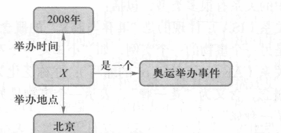
图 2.2 语义网络表示多元关系示例图

语义网络与一阶谓词在表达能力上相当，不同之处在于它采用最简统一的形式描述全部知识，对计算机存储与检索很友好。不足是它仅用节点及其关系描述知识，推理不如谓词逻辑清晰，需要针对不同关系分别处理，推理方法尚不成熟。

1988 年建立的知网 HowNet 是一个典型的语义网络，它以汉语和英语词语代表的概念为描述对象，以揭示概念与概念之间以及概念属性之间的关系为基本内容的语言认知知识库、常识知识库。

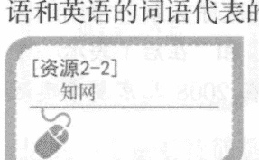
> 知网的创始人董振东教授认为 [资源 2-2]：“自然语言处理系统需要强大的知识支撑，知识是一个系统，是一个包含着各种概念与概念之间的关系、概念的属性与属性之间的关系的系统。一个个人比另外一个人有更多的知识说到底是他不仅掌握了更多的概念，而且掌握了更多的概念之间的关系以及概念的属性与属性之间的关系。”

关于知识库建设，他认为应先建立一种可称为知识系统的常识性知识库，该库以通用概念为描述对象，建立并描述概念间的关系，并认为不能仅靠少数专家构建人类各行各业的知识，而应先让知识工程师设计知识框架并建立基础原型，再向专业知识库延伸和发展。其中，专业性知识库或领域知识库主要由专业人员完成，他们在知识工程师的框架下编撰本专业知识。

### 2.1.3 框架
框架表示法最早由美国人工智能学者 Minsky 于 1975 年提出[341]。从认知学角度看，框架理论继承了人类认识世界的方式，人类对现实世界中各种事物，都是以类似框架的结构储存在记忆中。面对新事物时，人会从记忆中调出合适的框架，并根据实际情况对框架中的具体值进行填充，填充的部分被称为槽，框架与槽的粒度随认知程度而定。因此框架表示法在理论上是对世界知识的一种有效建模。

框架把事物抽象化，用来表示事物各方面的属性以及事物间的类属关系。例如图 2.3 中展示了两个框架的例子。

| 框架1: <教师> | 框架2: <灾难> |
|---|---|
| 槽1: <姓名> | 槽1: <时间> |
| 槽2: <年龄> | 槽2: <地点> |
| 槽3: <学校> | 槽3: <伤亡> |
| 槽4: <院系> | 侧面3.1: <死亡人数> |
| 槽5: <专业> | 侧面3.2: <失踪人数> |
| 槽6: <职称> | 槽4: <损失> |
| 槽7: <学位> | 侧面4.1: <直接经济损失> |
| 槽8: <毕业院校> | 侧面4.2: <间接经济损失> |
| 槽9: <参加工作时间> | 槽5: <救援> |
|  | 侧面5.1: <救援部门> |
|  | 侧面5.2: <相应时间> |
|  | 侧面5.3: <捐赠情况> |
|  | ... |

图 2.3 框架示例

教师和灾难是两个概念或类别，框架定义了这些概念的实例应具备或可能具备的属性，这些属性即为槽。例如框架 1：< 教师 > 包含九个槽，若存在一个教师实体，就需要对教师框架中的槽或部分槽进行值填充，例如 < 教师实例 > { < 姓名 > {张三}，< 年龄 > {30}，< 学校 > {中国科学院大学}，< 院系 >{人工智能学院}, < 职称 >{讲师}。类似地，对于一个灾难实例，关联着一个特定时间发生在特定地点的事实，例如“5.12 汶川地震”。

在原始框架定义中，槽可以是任意形式的信息，包括原子值或值的集合；对于非原子的槽，还可由多个侧面对槽的描述进行补充，如图 2.3 中灾难框架，在伤亡、损失、救援的槽结构下都具有若干描述槽某些方面属性的侧面定义。这样做的目的是更立体更准确地描述事物的属性与关系，但在一些基于框架的系统中省略侧面定义而直接表示为平铺式槽结构，如 FrameNet。

人类对事物的认识具有层级特性，框架设计引入了层级结构，并且依据类别间的所属与细化，框架中的属性集合存在继承性质。例如地震在真实世界中是灾难的一种，因此灾难框架的所有槽在地震中都存在；而为避免框架结构的重复定义，就有了框架间的继承关系。但除灾难的公共属性外，地震还有震级、震源深度等特有属性，需在地震框架下单独定义，因此可得到地震框架的定义，如图 2.4 所示。

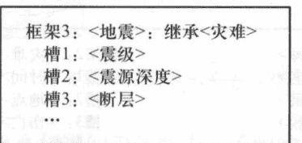
图 2.4 框架继承示例

在实例化地震这种继承的框架时，除了填充地震框架本身的槽值，还要填充灾难框架中的槽值，例如用地震框架表示对汶川地震的报道，如图 2.5 所示，使用框架表示后的汶川地震实例不仅包括灾难框架下时间、地点、伤亡以及损失情况，还包括地震框架下的震级等信息。

汶川地震是中华人民共和国自建国以来影响最大的一次地震，发生于2008年5月12日14时28分04秒，里氏震级8.0级，直接严重受灾地区达10万平方公里。这次地震危害极大，共遇难69227人，受伤374643人，失踪17923人。其中四川省68712名同胞遇难，17921名同胞失踪，共有5335名学生遇难，1000多名失踪，直接经济损失8452亿元。

地震实例：汶川地震

槽1：<时间>：2008年5月12日14时28分04秒

槽2：<地点>：汶川

槽3：<伤亡>
  侧面3.1：<死亡人数>：69227人
  侧面3.2：<失踪人数>：17923人

槽4：<损失>
  侧面4.1：<直接经济损失>：8452亿元

槽5：<震级>：8.0级

图 2.5 地震框架下的汶川地震实例

框架凭借强大的结构式表达能力和接近人类思维过程的特性，被应用于多个领域专家系统的构建以及通用知识的表达，例如 FrameNet 就是基于框架表示的语义知识库。FrameNet 针对词汇级概念进行框架建模，认为大部分词汇的语义能够通过语义框架形式表示。例如“烹饪”这一概念通常包括烹饪的发起者、烹饪的对象、烹饪的工具和加热的来源。在 FrameNet 中，上述概念通过框架表示，其中框架名称为“加热”，而“厨师”“食物”“加热设备”和“容器”叫做框架元素。最能指示该框架发生的词叫做该框架的词法单元，例如“烘焙”“油炸”“蒸煮”等都是上述框架的词法单元。

FrameNet 的数据以层级结构表示和存储，图 2.6 是 FrameNet 语料的数据结构示意图。图中每个 LU 下的 S_k 是该 LU 的标注样例，“Inheritance”是图中两个框架的语义关系。最上层节点表示框架，框架间的边表示框架间的关系。框架间有两种边：无向边和有向边，它们分别对应 FrameNet 中的无向关系和有向关系。每个框架下跟随的节点表示该框架的词法单元，它们由带词性限制的词元组成。如“invade.v”是框架“Invading”的一个词法单元，它表示动词形式的“invade”。FrameNet 还为每个词法单元标注了一组样例，每个样例中详细标注了当前框架的词法单元和框架元素的信息。

FrameNet 定义了 1000 多个不同框架、10000 多个词法单元，总计标注了超过 150000 个例句。另外，FrameNet 还在框架之间定义了八种关系，它们分别是：继承关系、视角关系、子框架关系、前置关系、使动关系、因果关系、使用关系和参考关系。FrameNet 被证明对一系列自然语言处理任务具有明显效果，包括信息抽取、文本蕴含、语义解析和角色标注等任务。其中具有代表性的工作包括：艾伦人工智能研究所将 FrameNet 应用于从教科书中抽取信息，并应用于科学问答等任务；中科院自动化所等利用 FrameNet 和事件结构之间的相似性，从 FrameNet 中自动识别事件实例作为事件抽取模型的训练语料，解决事件抽取数据稀疏的问题。

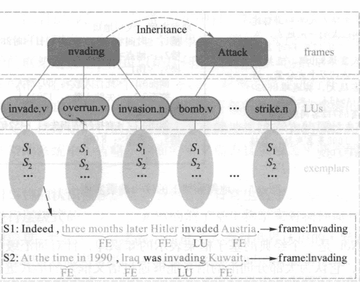
图 2.6 FrameNet 语料的数据结构示意图

### 2.1.4 脚本
脚本是一种与框架类似的知识表示方法，是由 Schank 等于二十世纪七十年代提出的。脚本通过一系列原子动作来表示事物的基本行为，按时间顺序描述事物的发生，类似于电影剧本。脚本表示的知识具有确定的时间或因果顺序，必须是前一个动作完成后才会触发下一个动作的开始。与框架相比，脚本用于描述动态过程而非静态知识的表示方法，目的不同。以下的例子是用脚本方法描述一般顾客去餐厅吃饭的过程或流程。

例：顾客去餐厅吃饭脚本

- 第一场：进入餐厅
- 顾客走进餐厅
- 顾客拿号等待
- 顾客被叫号
- 领餐员将顾客带到固定座位就座

### 第二场：点餐
- 服务员拿来菜单
- 顾客翻阅菜单
- 顾客确定菜品
- 顾客告知服务员
- 服务员在点餐器上点餐
- 服务员将已点菜品和顾客确认

### 第三场：上菜进餐
- 厨师烹饪菜品
- 上菜员取走菜品
- 上菜员将菜放置到餐桌上
- 顾客吃菜品
- 顾客买单

这个例子是一个通用的顾客去餐馆就餐流程，它细致刻画了就座、点餐、进餐等关键步骤，但它并不能称为一个完整脚本。根据脚本表示法的定义，一个完整脚本应包括以下几个重要组成部分：

- 进入条件：指出脚本所描述事件可能发生的先决条件，即事件发生的前提条件。对于餐馆就餐例子来说，顾客饿了，而又不能在家中就餐，就是餐馆就餐这一脚本的进入条件。
- 角色：描述事件中可能出现的人物。在餐馆就餐例子中，参与人物包括顾客、领餐员、服务员、厨师、上菜员。
- 道具：描述事件中可能出现的相关物体，主要指人物角色在完成动作时使用的工具，如上例中的叫号机器、菜单、点餐器、菜品等。
- 舞台：脚本中事件发生的空间。在餐馆就餐例子中，餐馆就是舞台。
- 场景：时间发生的序列，也就是上面例子中的主体部分，但在上例中仅描述了正常顾客就餐流程，并不是所有餐馆都有叫号和领位的步骤，对于一些快餐店需要顾客付钱后才会领到相应的食物，而在一些场景下，顾客可能会对菜品或服务不满意并与餐馆人员发生争执或冲突。因此场景并不是单一动作序列，而是可以存在多个可能分支，对所有可能动作序列的枚举是一个庞大工程，这也是脚本表示法的一个缺陷。
- 结局：给出在剧本所描述事件发生以后通常所产生的结果，对应着进入后续脚本的先决条件，顾客不再饿了就是这一脚本的结局。

从脚本表示方法的例子和必要因素可以看出，这种表示方法能力有限，不具备对元素基本属性的描述能力，也难以描述多变的事件发展可能方向。但在非常狭小的领域内，脚本表示方法却可以比其他方法更细致地刻画步骤和时序关系，例如作战计划、电影脚本等。因为脚本能够描述具有一定时序关系的槽信息，其在人工智能以及自然语言处理的一些任务中得以应用，最具代表性的是智能对话系统，如酒店预定、机票预订等。

综上，经典知识表示理论中的语义网络、框架和脚本都属于基于槽的表示方法，区别在于槽是否具有层次、时序、控制关系。其中，语义网络是最简单的一种，它的每个三元组都可以看成一个槽结构。框架系统由一组相关框架联结而成，其中每个框架是由若干节点和关系构成的网络，因此框架可以看成是层次化的语义网络，是语义网络的一般化形式。脚本是按照一定时间流程对事件的发展和变换控制进行建模，因此可以认为是定义了时间和控制条件的槽结构，与语义网络也没有本质区别。

## 2.2 语义网中的知识表示方法
### 2.2.1 语义网表示方法

为什么语义网≠语义网络

在 AI 话题里常被提及的语义网络，和本节要讲的语义网，指向完全不同。语义网的来历和 WWW 紧密相连，它的原始设想就是给 WWW 增加智能化能力，行业里也常把这套思路叫做 Web 3.0。整体构想最早由 W3C 提出，网景之父 Tim Berners-Lee 的愿景是通过更有序的信息组织与检索，让机器能调用互联网上的海量资源完成真正智能的任务。

当下网络中绝大多数内容仍处于弱结构状态，文本、音视频、各类网页应用大多只靠简单链接串联。这种松散方式明显制约了检索、抽取、治理的效率。与 IPv6 类似的互联网演进一样，语义网的推进不在于科学上的颠覆，而在于工程层面的难点：标准化、规模化、系统开发与集成、用户交互都需要攻坚。所以语义网或 Web 3.0 其实是一个宏大的方向。本书从自然语言处理的视角，重点解释人们怎样借助这套思路来表达知识。

图 2.7 把经典 WWW 中的 HTML 文档表达方式，和语义网思路下的 XML 文档表达方式并排呈现。对比可发现，在语义网范式里，标签不再只是排版标记，而是自带语义。比如看到“中文名”这个标签，机器就能明白其值对应的是人物的中文姓名属性。语义网的价值不止于属性层面，以图 2.7 中的“影星”为例，其下挂接多条属性值，使用方式很像框架表示。与框架相比，语义网更灵活：不必为一个多面向的属性另建框架，例如“出生”涉及出生地和出生日时，不必再造一个“出生”框架，而是直接定义“出生”“出生地”两个属性，并用“部分-整体”关系把它们连起来。从拓扑看，这就构成了一个图或网络，也因此得名。

```
<html>
<dt>中文名:甄子丹</dt>
<dt>外文名:Donnie Yen</dt>
<dt>国籍:中国</dt>
<dt>民族:汉</dt>
<dt>身高:175 cm</dt>
<dt>出生地:广州市</dt>
<dt>出生日期:1963年7月27日</dt>
<dt>毕业院校:西安赵长军武术学院</dt>
<dt>职业:导演、演员</dt>
<dt>祖籍:广东台山</dt>
</html>
```

HTML 格式文档

```
<影星>
<中文名>甄子丹</中文名>
<外文名>Donnie Yen</外文名>
<国籍>中国</国籍>
<民族>汉</民族>
<身高>175 cm</身高>
<出生>
<出生地>广州市</出生地>
<出生日期>1963年7月27日</出生日期>
</出生>
<毕业院校>西安赵长军武术学院</毕业院校>
</影星>
```

XML 格式文档

图 2.7 HTML 和 XML 的对比

### 2.2.2 语义网知识描述体系
下面聚焦语义网的知识表述方法。当前的主流表示体系大致可分三层：

- XML：可扩展标记语言。作为语义网最早的表达手段，它实现了从网页式标签向语义化表达的跨越。XML 以文档为单位，本身不显式约束标签语义，其扩展 XML Schema 则用于描述文档结构与元素形式。
- RDF：资源描述框架。可视为 XML 的简化延伸。RDF 对资源、属性、类别的描述，以及类别间的上下位语义，都由 RDF Schema 来定义。
- OWL：网络本体语言。OWL 建立在 RDF 与 RDF Schema 之上，用来做本体的语义表达，能够刻画属性间的关系如逆关系、函数约束、唯一性等，并吸收描述逻辑等形式化语言以便更好表达推理。

下面分别展开这三种方法。

#### 2.2.2.1 XML
XML 并非专门为语义网而生，它最早在 20 世纪 80 年代初提出，用来处理动态内容的展示，并为了解决 HTML 在数据表达上的混乱。HTML 传输内容时只能使用预设标记集合，而 XML 允许使用者自行定义标记集合，可扩展性大幅提升。1998 年 XML 1.0 规范正式确立。

一份规范的 XML 文档通常包含序言、主体内容，有时还带尾注。序言负责声明版本并引用外部文档，下面两行展示了声明与引用的样例：

```
<?xml version="1.0" encoding="UTF-8"?>
<!DOCTYPE html SYSTEM "url.dtd">
```

第一行标明使用的 XML 版本与字符编码，<!DOCTYPE> 标签是通用标记语言的文档类型声明，用来引用外部文件定义本地文档中出现的名字，url.dtd 指向被引用文档的路径。

文档内容由元素承载，如人物、组织、事件等。元素以标签包裹，标签名只能使用字母、下划线或冒号，内容可以是文本、数值、日期或空。元素支持嵌套，深度没有限制。下面示例记录人物基本信息：

```
< 人物 >
  < 名字 > 马克斯·普朗克 </名字 >
  < 国籍 > 德国 </国籍 >
  < 专业 > 物理学家 </专业 >
  .....
</人物 >
```

上例中 <人物> 拥有嵌套结构，包含了多个子元素，而 <名字> 则只承载一段文本。

XML 本身是树状结构，从根节点出发总能找到通往某个元素或属性的路径，这一机制即 XML 路径语言 XPath，用于辅助解析或编程处理。

#### 2.2.2.2 RDF
XML 的长处在于灵活。设计者可以自由定义元素与属性的标签，只要共享标签含义，使用者就能管理和利用。相比通用标签的 HTML，表达力更强，但通用性受限。若设计团队离职或缺乏说明文档，个性化标签的含义就难以辨识，对维护十分不利。随着链接开放数据 LOD 项目的出现，不同时期或不同组织的语义知识需要互通，于是统一无歧义的语义定义变得迫切，W3C 因此提出资源描述框架 RDF。RDF 假设任何复杂语义都可以拆成若干三元组的组合，形式为“对象-属性-值”或“主语-谓词-宾语”。其中公开通用的资源都会绑定一个可识别的通用资源表示符 URI。DBpedia 中用 RDF 三元组表示的例子如下：

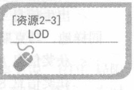

```
<http://dbpedia.org/resource/Max_Planck> <http://xmlns.com/foaf/0.1/name> “Max Planck”@en.
```

```
<http://dbpedia.org/resource/Max_Planck> <http://xmlns.com/foaf/0.1/surname> “Planck”@en.
```

这两个三元组都符合“对象-属性-值”的结构。URI<http://dbpedia.org/resource/Max_Planck> 精确定位到人物 Max_Planck，URI<http://xmlns.com/foaf/0.1/name> 与 <http://xmlns.com/foaf/0.1/surname> 则是网络公认共享的属性描述，分别对应姓名与姓氏。

据此，“马克思·普朗克”的基本信息可表述为：

- <马克斯·普朗克， 国籍， 德国>
- <马克斯·普朗克， 专业， 物理学家>
- <物理学家， 父类， 科学家>
- <科学家， 父类， 人>
- <丹麦基尔， 位置， 德国>
- <丹麦基尔， 类型， 城市>

当参数超过两个时，三元组难以直接表达，可借助 RDF 定义的一组二元谓词。例如三元谓词出生(X,Y,Z) 表示“马克思·普朗克 1858 年出生在丹麦基尔”。为此先引入中间资源“出生信息 135”及二元谓词人物、时间、地点，再把多元关系改写为：

```
< 出生信息 135，人物，马克思·普朗克 >
< 出生信息 135，时间，1858 年 >
< 出生信息 135，地点，丹麦基尔 >
```

同理，“马克思·普朗克 1919 年获得诺贝尔奖”可转化为：

```
< 获奖信息 87，人物，马克思·普朗克 >
< 获奖信息 87，时间，1919 年 >
< 获奖信息 87，名称，诺贝尔奖 >
```

这种改写虽然无损，但引入的中间变量让“出生”或“获奖”的论元无法直接相连，增加了表达与处理的复杂度。于是出现了把三元组扩展为含主语、谓词、宾语、时间、地点、附加信息的六元组等改进思路，但仍难以完全覆盖所有谓词信息，扩展 RDF 表达力仍是开放问题。

RDF 完成后需要查询，研究者为其设计了类似 SQL 的 select-from-where 查询方式，SPARQL 即是实现之一，具体操作将在第八章知识存储与检索中详述。

与 XML 类似，RDF 也是领域无关的，这带来自由度也带来融合困难。于是 RDF Schema 被提出，用来定义领域相关的知识。它是一种轻量级语言，侧重类别与属性的层级结构及继承关系。

例如可用 rdfs:Class 把“人物”和“出生地”定义为两个类：

```
< 人物, rdf:type, rdfs:Class>
< 物理学家, rdf:type, rdfs:Class>
```

RDFs 用 rdf:Property 定义属性，即 RDF 中的“边”，不区分对象属性和数据属性，下图中“国籍”“专业”均为属性：

```
< 国籍, rdf:type, rdf:Property>
< 国籍, rdfs:domain, 人物 >
< 国籍, rdfs:range, xsd:string>
< 专业, rdf:type, rdf:Property>
< 专业, rdfs:domain, 人物 >
< 专业, rdfs:range, 物理学家 >
```

其中物理学家是科学家的子类，可表述为：

```
< 物理学家, rdf:type, rdfs:Class>
< 物理学家, rdfs:subClassOf, 科学家 >
```

## 2.2.2.3 OWL
RDF 与 RDFs 仍有局限。RDF 只支持二元谓词，RDFs 仅能处理子类与属性层级及其定义域、值域。像“每个人都只有一个精确的年龄”这类表达，二者都难以胜任。为此 W3C 提出网络本体语言 OWL 作为语义网的领域本体表示工具。

OWL 的语法分为头部与主体。头部预先声明命名空间，如 xmlns:owl、xmlns:rdf、xmlns:rdfs、xmlns:xsd，并用其中标签构成本体头部，例如物理学家本体的开头：

```
<owl:Ontology rdf:about="">
  <rdfs:comment> 一个本体的例子 </rdfs:comment>
  <rdfs:label> 物理学家本体 </rdfs:label>
</owl:Ontology>
```

<owl:Ontology rdf:about=""> 表示该模块描述当前本体。

主体用于描述类别、实例、属性间的关联，是 OWL 的核心。以往例物理学家本体的主体可包含以下内容：

```
<owl:Class rdf:ID="物理学家">
  <rdfs:subClassOf rdf:resource="科学家"/>
<rdfs:label xml:lang="en">physicist</rdfs:label>
<rdfs:label xml:lang="zh">物理学家</rdfs:label>
...
</owl:Class>
<owl:ObjectProperty rdf:ID="国籍">
    <rdfs:domain rdf:resource="人物"/>
    <rdfs:range rdf:resource="xsd:string"/>
...
</owl:ObjectProperty>
```

主体同时包含类别关系与属性关系。类别关系记录所属，OWL 只需写直接父类，如 rdfs:subClassOf 表示“物理学家”是“科学家”的子类，后续可推理至根类。owl:ObjectProperty 表示对象属性，rdfs:domain 与 rdfs:range 分别给出定义域与值域。此外 subProperty 可记录属性间的从属。

OWL 还提供功能性标签。性质标签包括传递性 owl:TransitiveProperty、对称性 owl:SymmetricProperty、函数性 owl:FunctionalProperty、可逆性 owl:inverseOf、约束性 owl:Restriction。其中 owl:Restriction 用于对类别施加限制，例如“只有获得诺贝尔奖的物理学家才称为诺贝尔物理学家”可表示为：

```
<owl:Class rdf:about= "诺贝尔物理学家" >
    <rdfs:subClassOf rdf:resource= "物理学家" />
    <owl:Restriction>
        <owl:onProperty rdf: resource= "获奖名称" />
        <owl:allValuesFrom rdf: resource= "诺贝尔奖" />
    </owl:Restriction>
</owl:Class>
```

owl:equivalentClass 与 owl:equivalentProperty 等则用于本体间的映射。

总体看，语义网与第 2.1.2 节的语义网络差别显著。语义网络中节点与边的描述没有统一标准，用户自行定义，导致知识难以共享且无法区分描述与实例。语义网基于 W3C 标准，以统一形式描述与关联知识，更利于共享利用。通过语义具化，实体、类别、关系、事件等概念都获得唯一标识符，知识共享的范围由此大幅扩展。

## 2.3 知识图谱中的知识表示方法

### 2.3.1 表示框架
一个知识本体通常涵盖以下内容：

- 事物：客观世界中的实体或对象，如“莫泊桑”“曼谷”“唐山大地震”；
- 概念：具有相似本体特征的一类事物，也称类型，如“作家”“城市”“地震”；
- 属性：事物或概念的特征，如“国籍”“地理位置”“震级”；
- 关系：概念与实体间的关联方式，如“类-子类”“类-实例”；
- 函数：事物或概念间转化的形式表达，如国籍(莫泊桑)=“法国”中的国籍(X)；
- 约束：断言成立的限制条件形式化描述，如属性“国籍”的值必须为“国家”类型实体；
- 规则：依据断言进行逻辑推论的形式化描述，通常为“如果…那么…”；
- 公理：永远为真的断言。

目前大部分知识图谱主要建模前四类，即事物、概念、属性与关系，只有少数涉及简单规则结构，这也反映出不同层次知识在表示上的复杂程度差异。

知识图谱最初进入大众视野，是因为 Google 在自家搜索产品里上线的 Knowledge Graph 项目。很多人第一次注意到它，是在搜索结果右侧弹出的一块结构化卡片，图 2.8 就是当时关于亚里士多德的呈现方式。不过搜索卡片只是外在表现，真正的图谱远不止于此。基本思路是用节点承载事物或概念，用连线刻画它们之间的关联，并且用一套统一的语法同时描述概念层和具体实例层。只有当实例符合系统约定的框架约束时，才算真正有了“知识”意义。将概念定义、实例数据以及支撑它们的标准、技术和应用系统合在一起，才能称之为广义上的知识图谱。

把范围收窄，狭义的图谱可以理解为知识库的图形态。除了 Google 之外，Freebase、YAGO 这类以图存储三元结构的库，也属于狭义范畴。大家偏爱统一的三元结构 r(h,t)，既方便人操作，也利于机器计算。本章所谈的图谱就限定在现存的图结构三元库上，泛指由三元组构成的有向图。在这种库里，实体成为节点，事实成为连边，边的方向从头实体指向尾实体，关系类型体现在边的类型上。以图 2.9 为例，就把 Cristiano、其父 Jos、队友 Pepe、俱乐部 Real Madrid CF 以及相关国家等实体之间的关联及关系类型都标注了出来。需要强调的是，图谱的表达能力并非仅限于以 RDF 为底座的三元形式，它还涵盖实体、类别、属性、关系等多粒度、多层次语义单元的关联，是一个同时呈现 Schema 层和 Instance 层的知识系统。

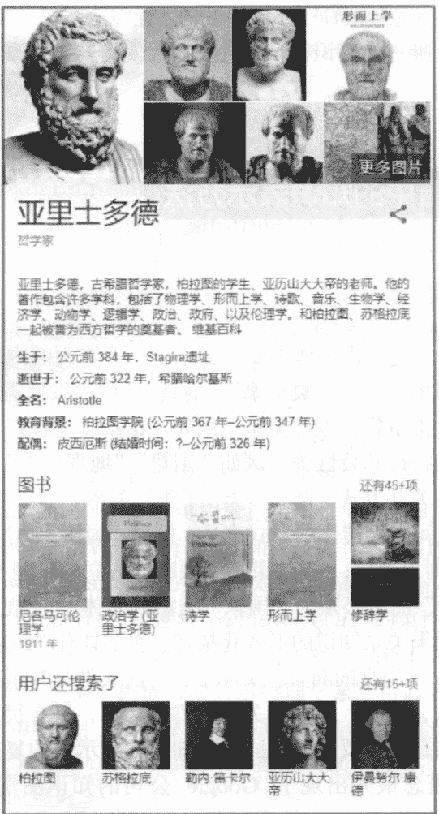
图 2.8 Google 知识图谱关于亚里士多德的展示

换个视角，图谱也可以看作语义网的工程落地。语义网更强调知识框架的严谨定义，而图谱在这方面更宽松。比如 Freebase 并未对类别、属性关系做额外显式定义，而是更看重如何通过工程化手段从文本里自动抽取，或靠众包积累出一个体量大、结构相对平铺的实例集合，并在使用时提供容错、模糊匹配等机制。这种对格式与内容的高容忍度，正是狭义图谱与语义网的主要分野。另外，图谱对三元组取值也做了放宽，不只限于实体，还可以是数值、文字等其他类型数据。除了取值上的差异，语义网与图谱的表达方式本质上并无明显区别，当前网络上的多数知识图谱也都采用 RDF 等语义网的记法来实现。

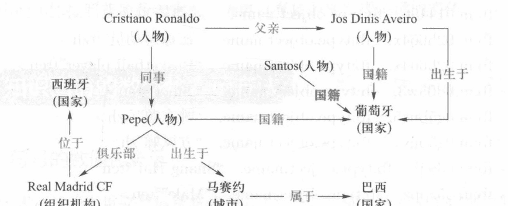
图 2.9 知识图谱结构示例

### 2.3.2 Freebase 里的表达细节
下面以 Freebase 为具体案例来拆解图谱的表达特性。整体上 Freebase 就是一张大图，节点用 type/object 定义，边用 type/link 定义。每个条目叫做 Topic，一个 Topic 通常挂着大量属性，例如针对一个人会有姓名、性别、出生日期、经历、职业等信息。Freebase 为每个实体分配一个编号，称作 MID，例如姚明在 Freebase 中的 MID 为 m.01jzhl①，在 Freebase 中关于姚明的条目为

```
<fb:m.01jzhl,  fb:people.person.profession,  fb:m.01445t>.
<fb:m.01jzhl,  fb:people.person.profession,  fb:m.02h664x>.
<fb:m.01jzhl,  fb:people.person.nationality,  fb:m.0d05w3>.
<fb:m.01jzhl,  fb:people.person.parents,  fb:m.0g5bnz5>.
<fb:m.01jzhl,  fb:people.person.parents,  fb:m.0g5bnyy>.
```
① 完整 URI 为 <http://rdf.freebase.com/ns/m.01jzhl>，一般用 fb:m.01jzhl 这种带前缀形式缩写。

```
<fb:m.01jzhl, fb:people.person.place_of_birth, fb:m.06wjf>.
<fb:m.01jzhl, fb:people.person.gender, fb:m.05zppz>.
<fb:m.01jzhl, fb:people.person.weight_kg, “141.0”>.
<fb:m.01jzhl, fb:type.object.name, “Yao Ming”@en>.
<fb:m.01jzhl, fb:type.object.name, “姚明”@zh>.
<fb:m.01jzhl, fb:people.person.spouse_s, fb:m.0j688yq>.
<fb:m.0j688yq, fb:type.object.type, fb:people.marriage>.
<fb:m.0j688yq, fb:people.marriage.spouse, fb:m.02wcs4m>.
<fb:m.02wcs4m, fb:type.object.name, “叶莉”@zh>.
<fb:m.01445t, fb:type.object.name, “运动员”@zh>.
<fb:m.02h664x, fb:type.object.name, “篮球运动员”@zh>.
<fb:m.02h664x, fb:type.object.name, “Basketball player”@en>.
<fb:m.0d05w3, fb:type.object.name, “China”@en>.
<fb:m.0g5bnz5, fb:type.object.name, “姚志源”@zh>.
<fb:m.0g5bnyy, fb:type.object.name, “方凤娣”@zh>.
<fb:m.06wjf, fb:type.object.name, “Shang Hai”@en>.
<fb:m.05zppz, fb:type.object.name, “Male”@en>.
```
Freebase 的表达并不局限于原子三元结构，它设计了一种虚拟节点结构，叫作组合值类型 compound value type，简称 CVT，用来承载多元关系。乍看像是打破了传统结构，但从表达的准确性来看 CVT 是必需的。比如上面关于“姚明”婚配信息的记录“fb:m.0j688yq”就是一个类型为“fb:people.marriage”的 CVT 对象。再比如城市人口会随时间变化，查询城市人口时至少要给定一个确定日期。人口、时间、地点三者共同构成一个不可分割的整体，这正是 CVT 要解决的问题。没有 CVT，就只能造出大量特殊关系，比如“在 1997 年的人口”。此外，CVT 也是事件知识表示的基础，事件的角色和事件间的关系可以通过定义属性和关系来描述。例如，“中国”的人口信息值就应该是一个 CVT 对象，里面记录“人口”“登记年份”等属性，这些信息可以用一组三元组来描述。

```
< 中国, 人口信息, e1 > .
<e1, 人口数量, 1,332,810,869@int> .
<e1, 时间, “2010 年”@Date> .
<e1, 名称, “第六次全国人口普查”> .
```
```
< 中国, 人口信息, e2 > .
< e2, 人口数量, "124,261 万"@int > .
< e2, 时间, "2000 年"@Date > .
< e2, 名称, "第五次全国人口普查" > .
```

以 Freebase 为例能看出典型图谱的特质，而图谱真正好用的地方在于图形态。基于图，可以在图上运行搜索、随机游走、网络流等大规模图算法，让知识图谱与图论、概率图模型产生化学反应。比如在海量图谱上挖掘逻辑规则，就得益于频繁子图的挖掘，从而实现逻辑规则的自动生成和评估；再比如基于大规模链接图谱的标签传播，既可以按常规角度对实体进行分类，也可以有针对性地找出关键实体。

## 2.4 知识图谱的数值化表达路径

### 2.4.1 从符号表征到数值表征
知识表示的一个核心诉求是实现语义计算，比如要从句子里识别出“中科院自动化所”并判定它为机构名，或是判断“北京”和“中国”之间的关系，这类任务都离不开语义计算。逻辑、语义网络、框架、脚本、知识图谱等传统方法，都用符号显式地表示概念及其关系，而概念种类和关系类型都是人工总结的，难免有遗漏。比如 DBpedia 对人物没有定义“性别”属性①、Freebase 对人物也没有定义“朋友”“爷爷”等关系。仅靠这类显式知识，语义计算很难获得全面特征。

另一方面，如今的主流语义计算大多依赖基于数值的统计机器学习，数据表征是机器学习的基础，表征的好坏直接决定系统上限[47]。为此人们投入大量精力研究针对具体任务的合适表征，这就是特征工程。它体现了人类对特定问题的智慧，但也因为需要大量人力和专业知识，成为性能提升的瓶颈。为了让模型更好地迁移，研究人员希望降低对特征工程的依赖，把算法搬到新领域时不必再从头分析探索，加快落地速度，让系统更智能。从人工智能的视角看，让算法直接从原始感知数据中自动分辨有效信息，是迈向智能的关键一步。

符号化的特征、逻辑、框架可读性强、可解释性好，但很多语义任务是目标导向的，比如判断“中科院自动化所”是不是机构名，我们只关心结果，不关心过程。2006 年 Hinton 提出的深度学习[208]，既规避了手工特征的局限，又能从海量无标注数据中自动挖掘规律。近年来，以深度学习为代表的数值化方法在图像、语音等领域表现远超传统方法，已经成为语义计算的主导力量。

### 2.4.2 让文本也能被量化
本书聚焦的文本和自然语言处理在深度学习浪潮中，并没有出现像图像、语音那样颠覆性的突破。一个重要原因是，图像和语音的基本数据是信号，可以用距离度量判断相似性；而文本是符号，字面稍有不同就很难刻画联系。哪怕“麦克风”和“话筒”这种同义词，单看字面也很难看出语义相同，这就是语义鸿沟。判断两张图片是否相似，只需看图本身；判断两个词是否相似，则需要更丰富的背景知识。

我们希望计算机能从海量无标注文本中自动学习到文本表征，这种表征既要包含词或文档的语义信息，又能直接用来度量语义相似度，如图 2.10 所示。

词是知识表示最基本的单元[16]，传统方式用不同符号区分不同词，但符号本身不携带语义。如何把语义融入词表征，1954 年 Harris 提出的分布假设提供了理论依据：上下文相似的词语义也相似[199]。1957 年 Firth 进一步表述为：一个词的意义由它所处的公司决定，a word is characterized by the company it keeps[158]。20 世纪 90 年代初统计方法在 NLP 中兴起，分布假设再次被重视。Dagan 与 Schütze 等人完善了用上下文分布来表征词义的方法，并把它用在词义消歧等任务上[117,118,414,415]，当时这类做法被称作词空间模型 Word Space Model。随后这类方法演化为基于矩阵的分布表示，十多年间被统称为分布表示 Distributional Representation。1992 年 Brown 等人基于同样的分布假设构建了上下文聚类模型，开创了基于聚类的分布表示方法[74]。2006 年后硬件和优化算法提升，神经网络在多个领域崭露头角，利用神经网络建模上下文的词表征方法因更灵活而逐渐成为主流。

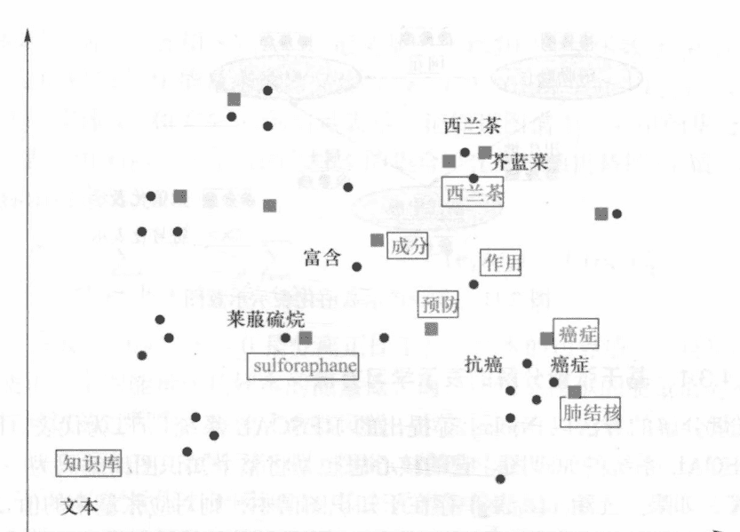
图 2.10 基于数值的知识表示

### 2.4.3 知识图谱的数值化表示
把知识图谱中的离散符号，如实体、属性、关系、值等，用连续数值向量来表示，也是研究热点，如图 2.11 所示。这种表征能体现实体和关系的语义信息，便于高效计算实体、关系及其间的复杂关联[20]。目前的主流方法主要有张量分解模型和基于能量函数的模型。

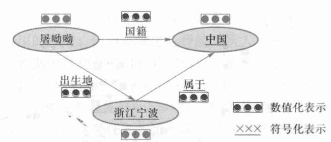
图 2.11 知识图谱数值化表示示意图

#### 2.4.3.1 张量分解思路的表示学习
张量分解的代表是 Nickel 等提出的 RESCAL 系统[361-364]。图 2.12 给出了其原理。核心思路是把整个知识图谱编码成一个三维张量 X̂，若三元组 r(e1,e2) 存在，则对应位置 X̂ e1,r,e2 为 1，否则为 0。随后把张量分解为核心张量 R̂ 与因子矩阵 A 的乘积 X̂ ≈ Aᵀ R̂ A，其中 R̂ 的每个二维切片对应一种关系的语义，A 的每一列对应一个实体的向量。重构后的 Aᵀ R̂ A 中每个元素被视作对应三元组成立的概率，大于阈值则认为是正确的。重构过程本身就是推理：对原张量中值为 0 的位置，若重构后数值超过阈值，就能推断出新的正确三元组。张量分解利用了图谱全局信息，但必须优化张量所有位置的值，包括大量零值，所以当关系数量增多时，维度急剧上升，计算开销很大。

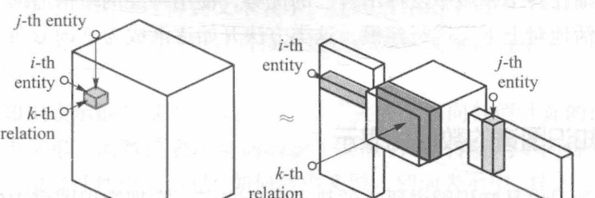
图 2.12 RESCAL 系统原理图

#### 2.4.3.2 基于能量函数的表示学习
基于能量函数的方法是当前知识图谱表示学习最活跃的方向，它能缓解张量分解在大规模图谱上效率低的问题。对三元组 r(e1,e2) 定义能量函数 f_r(e1,e2)。例如 TransE 模型[66] 中 f_r(e1,e2)=||e1 + r - e2||_{L1/2}，其中 e_i 和 r 分别是实体和关系的向量表示。记图谱中三元组集合为 Δ，Δ'_r(e1,e2) 为由 r(e1,e2) 生成的负样本集合，比如随机替换 e1 或 e2。学习目标为

L = Σ_{r(e1,e2)∈Δ} Σ_{r(e1',e2')∈Δ'_r(e1,e2)} [γ + f_r(e1, e2) - f_r(e1', e2')]_+

其中 [x]_+ ≜ max(0, x)，γ > 0 是正负样本的间隔。目标的含义是让正样本能量低于负样本，通过惩罚负样本来完成学习。测试时为每种关系设一个能量阈值，能量低于阈值的三元组判定为正确。推理本质上就是计算三元组能量，能量足够低就可视为新推断。不同能量模型的差异主要体现在能量函数的构造上。

知识图谱表示学习是前沿热点，新的理论和方法不断涌现。表示学习与知识推理相互关联，更多内容将在第九章展开。

## 2.5 小结
本章梳理了知识表示的主要思路。首先介绍了传统人工智能从认知角度提出的逻辑、语义网络、框架、脚本等表示方法；随后介绍了互联网时代从数据出发的语义网及其描述体系，知识图谱的表示与存储大量借鉴了语义网的标准。知识图谱是传统表示方法和语义网技术在互联网应用中的结合，兼收了两类技术成果。随着深度学习发展，数值化表示在各领域作用日益凸显，本章最后介绍了知识图谱数值化表示这一前沿任务，并概述了主要方法与现状。综合来看，符号化与数值化表示的融合与统一，是知识图谱及其应用值得期待的发展方向。

## 第三章 知识体系构建和知识融合

知识图谱的基石：Schema与知识融合

知识图谱本质上是结构化知识的载体，里面的实体、属性和关系都带着明确的语义可供追问。比如一查姚明，就能得到他是运动员、出生地上海，以及性别、出生时间、身高等一系列信息。除了这些具象的实例，图谱还藏着一层对数据本身的描述和定义，这层元数据通常叫做知识体系或本体。实例数据与描述数据都能用统一的三元组形式表达，正是这一特性让知识图谱得以大规模应用。不同机构会按自身需求建自己的图谱，关注的范围和侧重点自然不同，如何把它们串起来就变得关键。知识融合通过框架对齐和实体对齐把分散资源联动起来，能显著扩大覆盖面和共享度，是知识构建的核心环节。本章先讲知识体系怎么建，再讲多层次的知识融合做法。

## 3.1 知识体系构建

知识体系的核心要解决三件事：概念如何分层、概念有哪些属性、概念之间怎样关联。它的基本形态可归为词汇、概念、分类关系、非分类关系和公理五个层次。完全自动生成体系是理想目标，目前实际很难做到，特别是后两个层次。

图 3.1 是一个以实体为中心的知识体系示意图，每行开头是实体类型，括号里给出属性，缩进体现上下位关系。下面介绍构建方法，先说人工思路与步骤，再说自动构建，最后看典型案例。

```
-root
+创造性工作[外文名,中文名]
+组织[外文名,所在地,中文名,地址,别名,创建时间]
-人物[出生地,外文名,毕业院校,政党,职业,籍贯,去世日期,别名,信仰,国籍,中文名,体重,血型,星座,出生日期,性别,身高,相关事件,民族]
+网络人物[代表作品,艺名,获得荣誉,主要成就]
+文化人物[代表作品,获得荣誉,主要成就]
娱乐人物[艺名,获得荣誉,主要成就,经纪公司]
+导演[]
+歌手[唱片公司,身材,爱好]
+模特[身材]
+演员[身材,爱好]
+政治人物[获得荣誉,主要成就]
+虚拟人物[]
+体育人物[运动项目,获得荣誉,主要成就]
+经济人物[获得荣誉,主要成就]
+社会科学人物[获得荣誉,主要成就]
+自然科学人物[获得荣誉,主要成就]
+地点[外文名,所在地,面积,中文名,别名,位置]
```

图 3.1 知识体系示例

## 3.1.1 人工构建方法

知识体系抽象度高、概括性强，高质量的体系目前仍主要靠人工。早期工作比较直接地搭建概念、属性和关系的框架。随着应用需求扩散，人们开始加入时空、事件等建模能力，比如 YAGO2 把三元组扩成五元组记录事实的起止时间和地点，Freebase 用组合值类型描述时空和事件，FrameBase 则用语义框架来表述 N 元关系。

人工搭建大致经历六个阶段：明确领域与任务、复用已有体系、罗列要素、确定分类体系、定义属性与关系、定义约束。实际操作中这些阶段不是严格线性，往往需要回头修正。下面逐项展开。

## 1. 确定领域及任务

知识图谱是人工智能的基础设施，必须锚定具体应用，也不能脱离场景做一个高不成低不就的万能产品，Cyc 的经验值得借鉴。体系与领域高度绑定，金融和医学的概念集合完全不同。先锁定图谱面向的领域，再思考：为什么要建这个体系？能回答什么样的问题？谁来用、谁来维护？这些问题贯穿始终，随着构建深入，理解会加深，原有判断也可能被推翻，需要相应调整。

## 2. 体系复用

从零起步成本高、质量难控。更可行的做法是先搭一个轻量框架，再在此基础上扩展。因此在动手前应尽可能调研第三方知识体系，例如 Schema.org，以及相关资源。这些资源大致有：


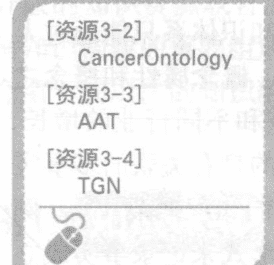


- 领域词典：专家编纂的专业词典对限定领域很有参考价值，如医学的 CancerOntology、艺术建筑的 AAT、地理的 TGN。
- 语言学资源：自然语言处理常用的资源也能助力构建。WordNet 收录约 11 万个概念并给出上下位关系；FrameNet 构建了上千个框架、万多个词法单元并标明框架间关联。
- 开源知识图谱：DBpedia、YAGO、Freebase、OpenCyc 等大规模开源图谱的知识体系多由专家手工制定，质量较高、覆盖面广，是制定新体系的重要参照。表 3.1 给出了它们的数据规模。

## 表 3.1 常见大规模知识图谱介绍

| 名称 | 创建时间 | 数据来源 | 数据规模 (实体/概念/关系) |
|---|---|---|---|
| OpenCyc | 1984 | 专家知识 | 239261 / 116822 / 18014 |
| DBpedia | 2007 | Wikipedia + 专家知识 | 17315785 / 754 / 2843 |
| YAGO | 2007 | WordNet + Wikipedia | 4595906 / 488469 / 77 |
| Freebase | 2008 | Wikipedia + 领域知识 + 集体智慧 | 58726427 / 2209 / 39151 |

- 网络百科：由大量用户共同编辑的百科知识更新及时、覆盖面广，是很好的参考。代表有百度百科、互动百科、Wikipedia，图 3.2 显示了百度百科对“天体”的分类。

[资源3-6]

百度百科

[资源3-7]

互动百科

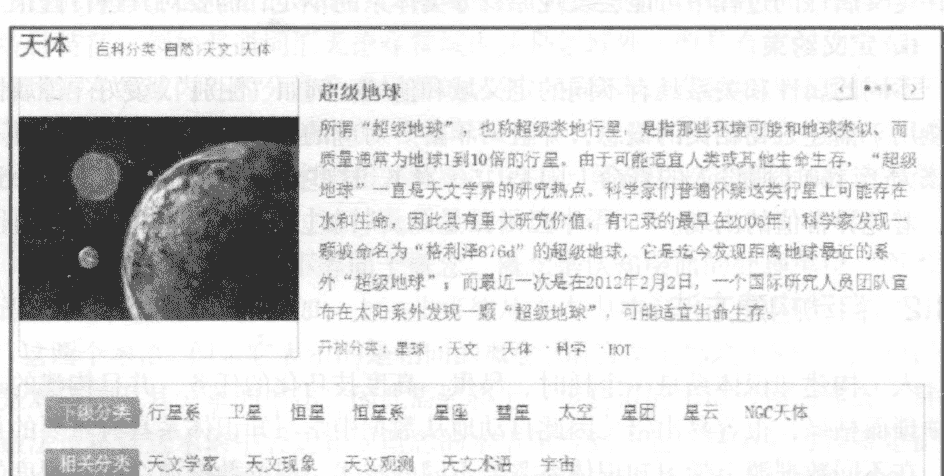

## 图 3.2 百度百科对 “天体” 的分类情况

## 3. 罗列要素

按已确定的领域列出图谱里希望出现的要素清单，包括概念、属性、关系。这一步相当于准备原材料，不必立刻厘清分类，只要尽量全面地罗列即可。例如想建人物图谱，可先列出科学家、文学家、地理学家、歌手、演员等概念，以及姓名、年龄、国籍、出生地、父母、子女等属性和关系。

## 4. 确定分类体系

把表示概念的要素组织成层级分类。有自顶向下和自底向上两种策略，前者从抽象概念逐步细化，后者从具体概念逐步归纳。体系中必须保证上层概念完全包含下层概念，即下层实例都是上层实例。比如“歌手”是“娱乐人物”的子类，所有歌手都属于娱乐人物。

## 5. 定义属性及关系

在分类体系的基础上为每个类别定义属性和关系。属性刻画概念的固有特征，关系刻画概念间的联动。属性定义受分类体系约束，下层要继承上层属性，所有歌手都应具备娱乐人物的属性。该步常与分类设计交叉进行，定义属性时可能发现分类需要调整。

## 6. 定义约束

属性和关系都有定义域和值域限制，如性别、爱好只能用于人物概念，年龄的值应为正整数且通常不超过 150。约束能保证数据一致性，避免异常值。

## 3.1.2 自动构建方法

人工构建耗时耗力且易出错，自动从数据中学习体系很有价值。按数据源结构化程度，可分为基于非结构化数据、结构化数据和半结构化数据的方法，后两种研究较少，常与人工结合。

## 1. 基于非结构化数据的知识体系学习

非结构化数据多指文本，如新闻、邮件。基于文本的本体学习先用 NLP 做分词、句法分析、命名实体识别等预处理，再用模板匹配、统计学习抽取概念、实例和关系。2012 年 RMIT 的 Wilson Wong 等综述系统梳理了该任务。流程大致包括领域概念抽取、分类体系构建、概念属性与关系抽取三步。

### （1）领域概念抽取

目标是从文本中抽出构建体系所需的术语，包括实体类型名、属性名、关系名。做法分三步：候选抽取，用词法句法分析和语言学规则或模板从文本抓取字符串作为候选，追求高覆盖；术语过滤，候选噪声大，需用互信息、TF-IDF、RTF 等统计特征剔除低质量项；术语合并，术语是语言层单位，概念是认知层单位，需把同义术语归并。识别同义词常见基于词典如 WordNet、HowNet 和基于统计的上下文表示聚类。

### （2）分类体系构建

本质是获取概念间的继承或上下位关系。同样可基于词典查询，也可用统计方法对术语做上下文表示后进行层次聚类，聚类层级即上下位结构。

### （3）概念属性及关系抽取

在已有概念和分类的基础上补充属性和关系，常把关系视作属性统一处理。先对文本预处理，再用规则或模板为给定概念生成候选属性集合，用统计方法评估置信度并过滤，最后做同义词归并，方法与概念抽取类似。

## 2. 基于结构化数据的知识体系学习

结构化数据指模式严格的数据，如关系数据库。关系模型结构清晰，理论基础扎实。学习任务是把关系模型里的语义映射到本体。数据库中实体和关系都以二维表存储，需先通过字段内容、主键、外键等识别哪些表描述实体、哪些描述关系。从实体表抽取本体类型和属性，从关系表抽取概念间关系，得到初步体系后再评估修正。

## 3. 基于半结构化数据的知识体系学习

半结构化数据如 XML、HTML 及对应的 Schema 或 DTD，模式介于结构化与非结构化之间。既可套用前两类方法，也可利用其固有结构。机器可读的词典是典型半结构化资源，专家人工组织、领域覆盖好。基于模板的方法先按词典特点设计语法模板，再从中抽取上下位等信息。

## 3.1.3 典型知识体系

下面介绍几种代表性本体。

### 1. SUMO

SUMO 即 Suggested Upper Merged Ontology，加上各领域本体，是目前规模最大的公共本体之一，用在搜索、语言学和推理等场景。它与 WordNet 建立了映射，由 IEEE 持有但可免费使用。上层本体定义的可共享概念可作为其他体系的基础，SUMO 的目标是为特定领域提供可复用、可共享的术语平台。


SUMO 用 SUO-KIF 语言编写，约含 25000 个术语和 80000 个公理。例如图 3.4 展示了人类概念在 SUMO 中的层级。通过规则公理对概念做进一步描述，SUMO 为人类定义了 6 条公理，其一是“若某个属性属于人且该属性是社会角色的实例，则该人是人类实例”的表述：

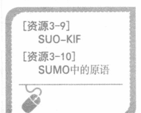

```
(=> (and
  (attribute ? PERSON ? ATTRIBUTE)
  (instance ? ATTRIBUTE SocialRole))
  (instance ? PERSON Human))
```

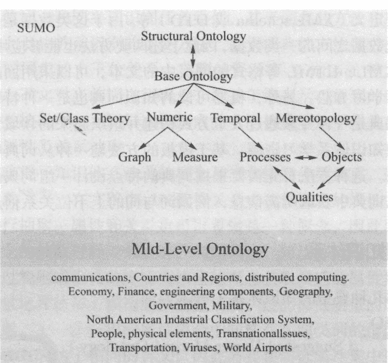

图 3.3 SUMO 示意图

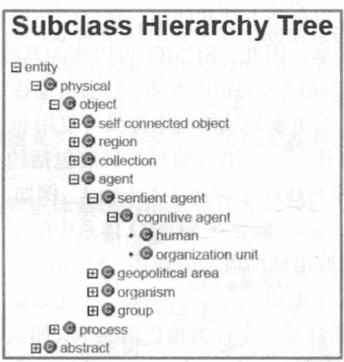

图 3.4 SUMO 中 human 所处概念层级示意图

### 2. Schema.org

SUMO 的使用场景偏向学术研究，Schema.org 则是产业界推动的共享本体。2011 年 6 月，Bing、Google、Yahoo 三家搜索引擎联合倡议 Schema.org 项目，目标是为网页结构化数据建立通用标注规范；同年 11 月，Yandex 紧随其后加入。倡议主张使用 Schema.org 词表，并配合 Microdata、RDFa、json-ld 等微格式对页面内容进行元数据标注，使搜索引擎在抓取解析时能够获取更丰富的语义信息。

该体系采用层次化类别组织，每个类型下挂一组属性。核心词汇表包含约 597 个开放类型、867 个属性和 114 个封闭枚举[资源 3-11]。图 3.5 呈现了 Schema.org 部分类型的层级结构，图 3.6 呈现了 Schema.org 人物类型[资源 3-12]的部分属性集合。

[资源3-11]

Schema.org的核心、词汇表

[资源3-12]

Schema.org的人物类型属性集合

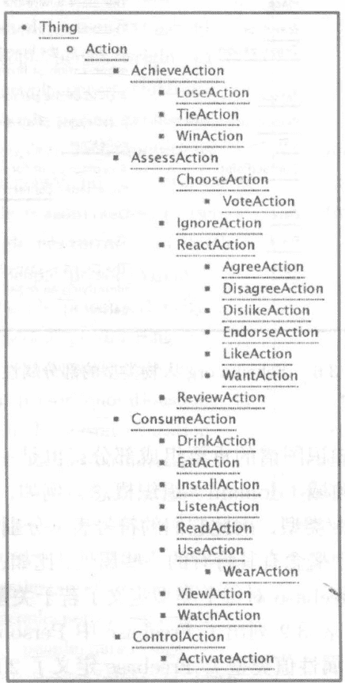

图 3.5 Schema.org 部分类别层级体系

| Property | Expected Type | Description |

|---|---|---|

| Properties from Person | | |

| additionalName | Text | An additional name for a Person, can be used for a middle name. |

| address | PostalAddress or Text | Physical address of the item. |

| affiliation | Organization | An organization that this person is affiliated with. For example, a school/university, a club, or a team. |

| alumniOf | EducationalOrganization or Organization | An organization that the person is an alumni of. Inverse property: alumni. |

| award | Text | An award won by or for this item. Supersedes awards. |

| birthDate | Date | Date of birth. |

| birthPlace | Place | The place where the person was born. |

| brand | Brand or Organization | The brand(s) associated with a product or service, or the brand(s) maintained by an organization or business person. |

| children | Person | A child of the person. |

| colleague | Person or URL | A colleague of the person. Supersedes colleagues. |

| contactPoint | ContactPoint | A contact point for a person or organization. Supersedes contactPoints. |

| deathDate | Date | Date of death. |

| deathPlace | Place | The place where the person died. |

| duns | Text | The Dun & Bradstreet DUNS number for identifying an organization or business person. |

图 3.6 Schema.org 人物类型的部分属性集

### 3. Freebase

Freebase 既是 Google 知识图谱的重要组成部分，也是众包协同构建的知识图谱。其概念以领域组织，例如人物与职业都属于人这一领域，符号分别表示为 /people/person 和 /people/profession。每个概念拥有特定属性，人物常见的有出生地、年龄、配偶、国籍等。整体定义了 2000 多个概念类型和近 4 万个属性，表 3.2 列出了 Freebase 中 Person 概念的属性列表及其属性值类型。各类关系均制定了值域约束。

Freebase 的特点在于使用组合数据类型 Compound Value Types, CVT[资源 3-13] 表示 N-Triple 事实。例如，一个人可能有多段婚姻，每段婚姻的配偶、起止时间、结婚地点不同，若仅用二元关系无法区分对应。为此定义协调类型 /people/marriage，包含结婚对象 /people/marriage/spouse、开始时间 /people/marriage/from、结束时间 /people/marriage/to、婚姻类型 /people/marriage/type_of_union、结婚地点 /people/marriage/location_of_ceremony 等属性，而人物与该类型通过二元关系 /people/person/spouse_s 关联，实现复杂事实的统一表达。

[资源3-13]

Freebase 的 CVT

# 表 3.2 Freebase 中 person 概念的属性列表及其属性值类型

| people/person | Property | Range |

|---|---|---|

| people/person | people/person/tvrage_id | type/enumeration |

| people/person | people/person/tvrage_id | type/enumeration |

| people/person | people/person/weight_kg | type/float |

| people/person | people/person/children | people/person |

| people/person | people/person/profession | people/profession |

| people/person | people/person/quotations | media_common/quotation |

| people/person | people/person/notable_professions |  |

| people/person | people/person/metaweb_user_s | freebase/user_profile |

| people/person | people/person/date_of_birth | type/datetime |

| people/person | people/person/parents | people/person |

| people/person | people/person/ethnicity | people/ethnicity |

| people/person | people/person/religion | religion/religion |

| people/person | people/person/gender | people/gender |

| people/person | people/person/quotationsbook_id | type/enumeration |

| people/person | people/person/education | education/education |

| people/person | people/person/languages | language/human_language |

| people/person | people/person/group | people/group_membership |

| people/person | people/person/employment_history | business/employment_tenure |

| people/person | people/person/height_meters | type/float |

| people/person | people/person/places_lived | people/place_lived |

| people/person | people/person/signature | common/image |

| people/person | people/person/age | type/int |

| people/person | people/person/place_of_birth | location/location |

| people/person | people/person/nationality | location/country |

| people/person | people/person/sibling_s | people/sibling_relationship |

| people/person | people/person/spouse_s | people/marriage |

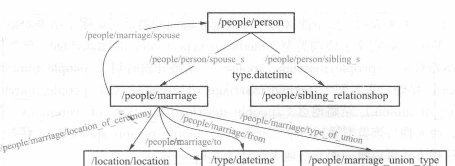

# 图 3.7 Freebase 中 person 概念关于 marriage 的 CVT 结构示意图


Protege[资源3-14] 是目前使用最广泛的跨平台开源本体编辑器。1999 年发布时主要应用于生物信息领域，后被 Palantir 等大数据分析与管理企业采用。Protege 采用基于框架的知识表示模型，先定义类，再定义类中的属性，最后定义关于类和属性的约束。此外，Protege 也可以对知识框架提供可视化展示。

## 3.2 知识融合

随着互联网知识规模不断增长，多个垂直领域都形成了专业领域知识库。例如，IMDb 知识库是电影领域的知识库，MusicBrainz 是音乐领域的知识库。这些库中包含通用库没有的专业知识。例如，图 3.8 所示，电影 “Mission: Impossible” 在 Wikipedia 的 DBpedia[267] 中只有主演信息，而在 IMDb 中还有饰演角色等信息。只有将这些知识库联合起来应用，才能够满足用户跨领域的信息需求。

从融合的知识图谱类型看，知识融合包括竖直方向的融合和水平方向的融合。竖直方向的融合是指融合高层通用本体与底层领域本体或实例数据，例如 YAGO 是融合专家构建的高层语言知识图谱和网民协同构建的实体知识图谱。水平方向的融合是指融合相同层次的知识图谱，实现实例数据的互补，例如 BabelNet 融合不同语言的异构知识图谱，实现跨语言的知识关联和共享。

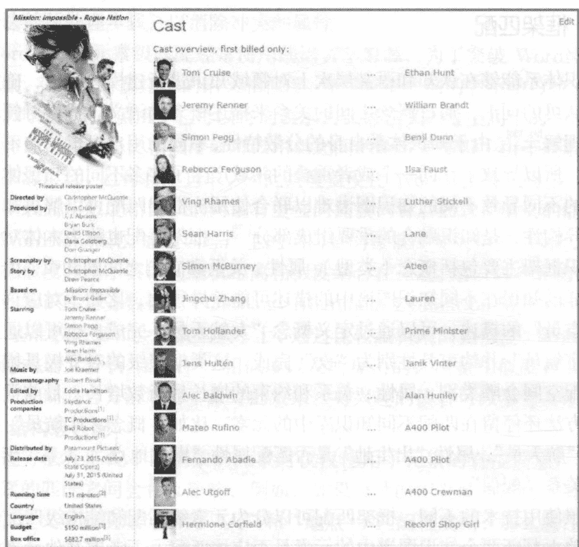

图 3.8 电影 “Mission: Impossible”

不同机构、不同个人都可以自由地构建所需知识图谱，各个知识图谱的数据来源非常广泛、质量也会参差不齐、关注领域也不尽相同。因此，导致知识图谱之间存在多样性，不同知识图谱存在异构性。知识融合通过对多个相关知识图谱的对齐、关联和合并，使其成为一个有机整体，是一种提供更全面知识共享的重要方法[4, 136]。按照融合元素的对象的不同可以分为框架匹配和实体对齐：框架匹配指对概念、属性、关系等知识描述体系进行匹配和融合，实体对齐指通过对齐合并相同的实体完成知识融合。通过框架匹配和实例对齐可以把不同知识图谱关联在一起，但是，多个知识图谱中的实例知识常常有冲突，因此，如何检测多个知识图谱之间的冲突并进行消解也是知识融合的重要步骤。下面分别介绍框架匹配、实体对齐和冲突检测与消解。

### 3.2.1 框架匹配

知识体系能够在认知和语义层次上对领域知识进行建模和表达，确定领域内共同认可的词汇，通过概念之间的关系来描述概念的语义，提供对领域知识的共同理解[93, 136]。由于知识体系自身的分散特性，不同的用户可以构造不同的知识体系，所以导致了在同一个或者重叠的领域产生了许多不同的知识体系。知识体系的不同导致不同的知识图谱难以联合使用。框架匹配可以解决知识体系之间的异构性，是知识融合的重要组成部分[134]。框架匹配也称为本体对齐[1, 185]。

知识框架主要包括概念、属性、关系和它们之间的约束。由于异构性，同样的知识在不同知识图谱中的描述可能差异很大，比如，对应“女性航天和航空员”的描述，可以通过定义概念“女航天员”完成，也可以通过定义概念“宇航员”并约束其性别为“女”完成。这类框架级的对齐极具挑战，因为其匹配空间会随类别、属性、关系和约束的增长呈指数增长。目前常用的框架匹配方法还停留在匹配不同知识库中的元素，比如，概念“宇航员”是否匹配概念“航天员”，属性“出生地”是否匹配属性“出生地点”，关系“妻子”是否匹配关系“配偶”。

按照使用技术的不同，框架匹配可以分为元素级匹配和结构级匹配。元素级匹配独立判断两个知识图谱中的元素是否应该匹配，不考虑其他元素的匹配情况。结构级匹配不把各个元素作为孤立的资源，而利用知识图谱的结构，在元素匹配过程中考虑其他相关元素匹配情况的影响。

### 1. 元素级匹配

知识图谱的框架元素由符号表示，一般来讲，符号是对元素的描述，有非常强的语义指示作用。所以，最基本的方法可以基于字符串匹配的技术实现本体元素的匹配[144]。例如，可以将字符串看作字母的精确序列、字母集合、单词集合等。字符串越相似，它们越有可能表示相同的概念。在实际匹配系统中，广泛采用的匹配方法有：前缀距离、后缀距离、编辑距离和 n 元语法距离等。基于字符串匹配的技术忽略了语言符号的多义性，一词多义和一义多词，基于语言学的技术将名称看作是自然语言中的词汇可以更好计算元素之间的关联性。元素相似度的判断可以充分利用元素描述文字之间的语言关系，如：同义词、反义词、形态变体、语法变体、同一词根上词汇形式和功能的变化、语法结构的变化等[31]。为了计算框架元素的匹配程度还可以利用元素的约束信息，例如属性的取值范围、关系的对称性等，这类元素匹配方法称为基于约束的匹配技术。例如，当两个类的属性集相似时，那么这两个类也很有可能相似。这种技术通常与其他元素级技术同时使用，目的是减少候选映射对的数量，同时也可以作为其他方法的预处理步骤，以消除冲突的属性。

WordNet 是元素级匹配经常使用的语言学资源，为了突破 WordNet 的覆盖度限制，获取更有实用性的语义相似度，还可以引入词的表示学习技术，获得词向量。词向量的优点是，它可以将词表示为低维语义向量空间中的一个点，这样，词与词之间的语义相似度就可以用点之间的距离来衡量。由于获取词向量的语料来源广泛，且可自主选取，因此其覆盖度比 WordNet 要大得多。和简单的字符表面相似度相比，词向量有更强的捕获词背后的真正语义的能力。另外，与 WordNet 相比，通过训练产生的词向量的覆盖度要大得多。因此，可以把词向量相似度和基于实体间编辑距离相似度结合在一起，用以对齐异构知识库。在公开的知识库对齐数据集 Ontology Alignment Evaluation Initiative, OAEI 2013[177]基准数据集和会议数据集上，通过比较编辑距离相似度、WordNet 相似度、隐式语义分析 LSA[140]相似度以及所提出的词向量相似度和混合方法的性能，发现混合方法取得了最好的效果。有兴趣的读者可以参考文献[528]。

## 2. 结构级匹配

上述方法在匹配不同框架的元素时仅仅使用了元素的直接信息，实际上，不同元素的匹配之间会相互影响，例如，如果属性的定义域和值域匹配程度高，那么属性的匹配程度也更高。因此，可以利用概念元素之间的关系进行匹配[275]，这类方法的基本思想是：相似的概念具有相似的概念结构。基于结构的匹配技术主要有三种：基于图的技术，基于分类体系的技术以及基于统计分析的技术。

图式匹配思路把待匹配的本体当成一个已标注的图结构来处理[219]。其核心假设是：当两个本体内部的节点拥有相似的邻居时，这两个节点本身也倾向于相似，反之亦成立。该类方法把本体抽象为多元关系图，节点对应实体，边对应关系。在图中搜寻相似元素的过程与求解图同构问题颇为相近，于是本体匹配被归结为寻找最大公共子图。完整的图匹配计算复杂度极高、开销巨大，实践中多采用 EM 算法、标签传播之类的迭代近似手段来求解。

分类体系导向的方法可视为图方法的延伸，通常只聚焦于特定关系。基本判断是：若两个术语通过“实例-类型”或“子类-父类”关系相连，则它们具有相似性，且其邻居也往往具备一定程度的相似性。本体的结构信息对框架对齐至关重要，它反映了元素整体的关联。概念层级或类层级在刻画本体时起决定作用，框架对齐最常见的应用场景就是对不同知识图谱的分类体系进行对齐与映射。

统计分析导向的方法先从已有的部分样本中挖掘出规律，再据此对概念、属性、实例、关系等对象进行聚类，并计算它们之间的距离。代表性技术包括形式概念分析、基于距离的分类、相关性分析以及频度分布等[1]。

### 3.2.2 实体对齐

知识库对齐的目的是打通多个异构知识库，并在顶层构建一个统一的大规模知识库，以帮助机器理解底层数据[1]。通过将描述同一概念的实例关联起来，知识库间的知识得以共享，也为人们综合利用多源资源提供了便利。实体对齐亦称实体匹配，其任务是判定不同或相同知识库中的两个实体是否指代同一个物理对象。例如可判断互动百科中“刘洋（航天员）”与百度百科中“刘洋（中国首位女航天员）”是否同一主体。实体对齐在数据库、自然语言处理和语义网领域均有对应任务，在数据集成与知识融合中发挥关键作用。

按策略可分为成对实体对齐与协同实体对齐。成对实体对齐独立判断两实体是否对应，通过匹配属性等特征衡量对齐程度[152, 356]。协同实体对齐则认为各实体间的对齐相互影响，通过协调整体匹配达到全局最优[53, 135]。

近年表示学习被引入知识对齐[195]，借助联合表示学习把多个知识库映射到同一语义向量空间，使对齐转化为实体相似度计算。受知识库向量化的启发，通过对语义向量的数值运算获取跨库对应关系。但传统向量化模型多针对单一库，直接套用会使两库位于独立空间而无法比较。为实现统一空间表示，需借助种子对齐，在训练目标中加入约束，使种子对中的资源尽可能获得相同向量表示。种子对于是成为连接两库的桥梁，使其结构信息共同影响表示，进而关联资源也受波及。经此方式学习得到的向量已不再是两个独立空间，而是统一空间中的表示。

在向量化完成后，把统一空间中邻近的实体视为同一实体即完成对齐，该做法称为基于知识库向量联合学习的对齐方法。其优势在于不依赖人工规则与特征，也无需考虑库的命名习惯，因而适应性强，易于迁移到跨语言、跨领域任务。

设两个知识库分别为 KB₁ 与 KB₂，事实以三元组 (h,r,t) 表示，其中 h∈E 为头实体，t∈E 为尾实体，r∈R 为关系。与以往方法不同，这里联合学习两库的向量表示。具体做法是先利用简单方法如字符匹配生成高准确率的初始种子对，如图 3.9 中同色节点所示。再以 TransE 方式学习对齐，模型核心是让种子对中的两个实体向量在训练中尽可能接近。

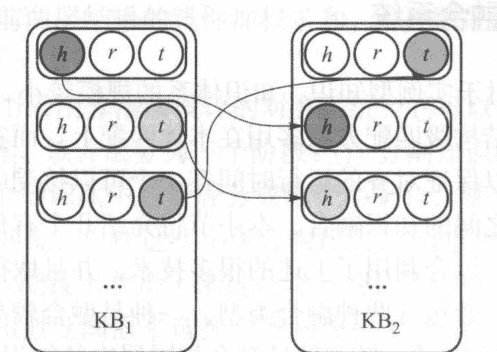

图 3.9 两个知识库的初始对齐

### 3.2.3 冲突检测与消解

在框架匹配与实体对齐之后，知识融合还需处理实例间的冲突，例如不同库对“姚明”的属性“身高”给出不同数值，对此类冲突的识别与处理是多图谱融合成一致结果的最后环节[279]。

冲突识别与消解是知识融合的核心问题。最简检测法是发现同一属性或关系下实例不一致，但对某些属性不总是有效，例如不同图谱记录某人的两段婚姻，两者皆可成立并不构成冲突，此类情形需设计针对性检测策略。

处理策略大致可分为冲突忽略、冲突避免与冲突消解三类。冲突忽略不作处理，将问题交由用户处置，可舍弃或修改相关实例。冲突避免不解决冲突，而是用规则或约束对数据源进行过滤，如限定年龄范围、设定来源可信优先级等。冲突消解则利用图谱本身的框架与实例特征来化解冲突，是当前主流方向。

按技术手段可分为基于投票与基于质量估计两类。基于投票做法直接，如按事实出现频次做多数表决。基于质量方法考虑来源可信度，选择高质量结果，例如用 HITS 或 PageRank 计算数据源可信度。对冲突检测与消解感兴趣者可参考文献 [137]。

### 3.2.4 典型知识融合系统

相较实例型知识，本体规模较小但结构更丰富，因而复杂结构级匹配多用于本体匹配，而实体对齐多采用局部简易方法以保证效率，尤其在大规模图谱融合中。下文介绍若干代表性系统，它们综合运用了上述技术并取得显著效果。

知识图谱融合大致有两种类型：垂直方向的融合，即高层知识与底层框架结合；水平方向的融合，即同层图谱间的整合。大多数系统关注后者，如 Wikidata 与 Freebase 的融合[377]。前者亦重要，如 SUMO 与 Schema.org 作为通用体系，领域图谱可通过挂载与融合提升语义丰富度。YAGO 与 BabelNet 是典型代表。YAGO 将 Wikipedia 的类别标签与 WordNet 的同义词集关联，并把 Wikipedia 条目挂载到 WordNet 框架下，认为 WordNet 提供高层描述，Wikipedia 提供实例。BabelNet 是多语言词汇级语义网络与本体，把 Wikipedia 与 WordNet 连接，并加入多语言支持，与 YAGO 不同。

PROMPT[368] 是较早的本体合并与本体对齐方法与工具。通过细化问题细节提出创新方案[369]，结合人工与机器对齐，有效利用结构信息与人工干预，构建实用框架。值得注意的是，该工作获 2018 年 AAAI 经典论文奖，认可其经受时间考验。

AgreementMaker^{[114]} 是一个集成多种自动对齐方法的可扩展框架，可处理大规模多领域库，如地理与医药领域，并支持 XML^{[72]}、RDFs、OWL^{[45]}、N3 等格式，能生成一对一、一对多、多对一、多对多对齐。系统包含相似度计算与对齐选择两模块，结合三层方法：第一层比较概念特征如标签、评论文本等，用 TF-IDF 向量与余弦相似度衡量，同时使用编辑距离、最长公共子串等；第二层利用结构特征，包括子孙节点相似度的继承与兄弟节点相似度的贡献；第三层对前两层结果做线性加权并按需剪枝。

Falcon^{[220]} 采用分治法处理 RDFs 与 OWL 大规模库，分三阶段：分割知识库，用基于结构的分割方法将资源划分为若干小集合；块匹配，按预对齐资源构建块，利用字符串匹配获得预对齐，资源对齐越多块越相似，按块相似度阈值挑选；挖掘对齐，用 V-Doc^{[390]} 与 GMO^{[219]} 匹配器对匹配块内资源精细对齐，最终按贪婪算法确定结果。

RiMOM^{[275]} 是动态多策略对齐框架，采用最小风险贝叶斯决策，包含两种基本相似度度量：语言学相似度如编辑距离、向量距离；结构相似度采用三种传播策略，概念-概念、关系-关系、概念-关系。策略选择模块依据预处理得到的标签与结构相似度因子动态调节语言学匹配特征、各相似度组合权重及传播策略。传播后系统再做细化调整以获得最终对齐。

ASMOV^{[226]} 面向生物信息学库的自动对齐系统，输入为两个 OWL 库及可选已有对齐，输出为多对多对齐。分为两步：相似度计算，迭代计算词汇与结构相似度后加权求和，并借助 WordNet^{[336]} 与 UMLS^{[60]} 等外部资源；语义验证，检验语义一致性，采用模板方法识别可能导致不一致的对齐集合，共检查五种一致性模板。

Anchor-Flood$^{[416]}$ 高效解决大规模库对齐问题，输入 RDFs 与 OWL，输出一对一对齐。先将库中一对相似概念称为锚，如可精确匹配的标准概念。随后分析锚周边资源，如上层、下层、兄弟节点，构建动态大小的片段进行对齐。系统基于片段比较而非全库比较，最后在相连片段中利用术语与结构相似度度量融合输出对齐，已对齐资源作为新锚继续迭代，直至不再产生新对齐。

PARIS$^{[447]} 是基于概率的全局知识库对齐算法，无需参数调节，可高效完成资源对齐，是首个基于全局概率的大规模对齐方法，能在无先验知识下运行。

SiGMa$^{[258]} 用于大规模实体对齐，最初为对齐 IMDb 电影库与基于 Wikipedia 的 YAGO。它充分利用组合结构信息且实现简洁。分两步：获取高质量初始对齐；基于结构与属性信息定义打分函数实现对齐，视为对全局目标函数的贪婪优化，目标兼顾属性定义的实体相似度与周围节点信息。其特点是利用已有对齐获取结构信息、用结构信息产生新候选对齐，并采用简单贪婪策略以适配大规模任务。

## 3.3 小结

本章主要围绕知识体系构建与知识融合两大任务展开，核心内容包括：

- 知识体系为知识图谱提供明确语义信息。通常包含概念分类、概念属性描述以及概念间关系定义。本章介绍了人工定义构建与自动学习构建两种方式。
- 知识体系抽象性与概括性强，高质量类体系需人工构建，流程大致包括确定领域目的、考虑复用、罗列要素、确定分类体系、定义属性关系、定义约束。上述阶段并非严格线性，有时需回溯。
- 知识体系也可自动学习，按数据源可分为基于非结构化数据、基于结构化数据、基于半结构化数据三类，其中基于非结构化文本的方法为主流。
- 知识表示异构导致不同图谱难以联合使用，融合成为知识集成与共享的核心。按对齐元素类型可分为框架匹配与实体对齐。

## 第四章 实体识别和扩展

实体是知识图谱的基本单元，也是文本中承载信息的重要语言单位。实体识别与分析是构建与应用知识图谱的重要支撑。据国际公开评测 Automatic Content Extraction（ACE）的定义，文本中对实体的指称可分为命名性指称、名词性指称和代词性指称[资源 4-1]。例如“[中国乒乓球男队主教练][刘国梁] 出席了会议，[他] 布置了备战世乒赛的具体安排”中，“中国乒乓球男队主教练”为名词性指称，“刘国梁”为命名性指称，“他”为代词性指称。本章主要讨论命名性指称相关研究。狭义上命名实体指现实世界具体或抽象实体，如人、机构、地点等，常以唯一标识符表示。广义上还包括时间、日期、数量表达式、金钱等。确切取舍视具体应用而定，如产品名、住址、邮箱、电话、航班号、活动名称等均可纳入。相关任务包括实体识别、实体扩展、实体消歧、属性抽取、关系抽取等，本章聚焦命名实体识别与扩展，消歧与关系抽取后文再述。


### 4.1 实体识别

### 4.1.1 任务概述

命名实体识别旨在从文本中抽取实体的命名性指称并标注其类别，如人名、地名、机构名、产品名等。一般任务覆盖三大类、七小类命名实体：人名、机构名、地名、时间、日期、货币、百分比。不同应用对粒度需求不同，有的只需区分人，有的需细化到教师、学生、医生等。细粒度实体识别面临类别多、层级结构复杂、标注成本高的挑战，因而成为研究热点[24, 293, 370, 428]。本章第一部分以传统七小类为例介绍方法，第二部分介绍细粒度方法，最后介绍实体扩展任务与典型方法。

### 4.1.2 实体识别的难点

以七类实体为例，时间、日期、货币、百分比构成规律较明显，易于识别，人名、地名、机构名用字灵活，难度较大，故命名实体识别常指后三者。识别过程包含实体边界判定与类别确定两步。主要难点在于：

- (1) 命名实体形式多变。中文命名实体内部结构复杂。人名一般由姓与名构成，姓用字受限，名用字灵活，还存字、号、姓加前缀后缀或职务等指代方式，如“杜甫、杜子美、子美、杜工部”同指一人，“李杜”为简称。地名多由若干字构成，常见后缀，存在简称，如“湖北、湖北省、鄂”同指一地，“广州、广州市、羊城”同义。机构名可含命名成分、修饰成分、地名成分与类词成分，如“北京百富勤投资咨询公司”中“北京”为地名成分，“百富勤”为命名成分，“投资咨询”为修饰，“公司”为类词。机构名内部可嵌套，如“北京大学附属小学”嵌套“北京大学”，且存在简称如“中国奥委会”“北师大二附中”等。

- (2) 命名实体的语言环境复杂。实体可出现在多种语境中，相同字序列在不同语境下类型不同或有无实体差异。如“彩霞”有时为人名有时为自然现象；“河南”有时指省份有时泛指；“新世界”有时为机构名有时为普通短语。英语实体因首字母大写边界较易判断，重点在类别判定；汉语缺乏明显形式标志，边界判定与类别判定难度均高，主要体现在：

### (1) 中文没有空格界定词边界，分词与实体识别互相牵制
中文句子里不像英文那样用空格把词硬性隔开，词的边界必须靠模型推断。分词做得不准，实体就会被切错；反过来实体线索也能影响分词决策。两者不是独立工序，而是你中有我、我中有你的耦合关系。

### (2) 英文靠大小写提示实体，中文缺乏显式标记
英语中专名通常首字母大写，像 Liu Chang Le is the founder of Phoenix TV，大小写本身就是一条强信号。中文里写成 凤凰卫视的创始人是刘长乐，字面全是小写，没有任何形态线索，系统只能靠上下文语义来判断。

## 2. 评测发展史
从 20 世纪 80 年代末起，随着美国主导的消息理解系列会议 Message Understanding Conference, MUC 的召开，信息抽取从小众研究变成自然语言处理的重要分支。

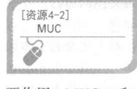

MUC 由美国政府资助，专注于真实新闻文本的理解，在信息抽取评测上起到奠基作用。MUC-6 与 MUC-7 都设立了命名实体识别专项，极大推动了英语 NER 的进步。同期还开设了多语言实体评测 MET，覆盖日语、西班牙语、汉语等多种语言，首次把中文 NER 纳入国际比较。

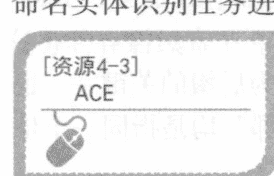

MUC 结束后，美国国家标准技术研究所接棒推出自动内容抽取评测 Automatic Content Extraction, ACE。最早在 1999 年 7 月酝酿，2000 年 12 月正式启动，目标是让系统能处理普通文本、语音识别文本和 OCR 文本三类来源，核心任务是从新闻里抽取实体、关系和事件。ACE 中的实体检测与追踪 Entity Detection and Tracking, EDT 就是 NER 的延伸评测，类别更细、难度更高。2009 年 ACE 结束，文本分析会议的知识库构建子任务 TAC-KBP 延续了这条线，提供大规模新闻和网络数据用于测试，重点是评估从零搭建或增补知识库的能力，并设有实体识别与链接专项。

推动中文进展的关键平台是 SigHAN，即计算语言学协会中文信息处理特别兴趣小组。从 2003 年起举办首届中文分词评测 BAKEOFF，2006 年和 2008 年的两届开始增设命名实体识别专项，截至 2017 年已成功举办 9 届。

国内也不缺标杆评测。863 计划的中文信息处理与智能人机交互技术评测在 2003 年设立了中文命名实体识别子任务，聚焦人名、地名、机构名及其他专名。2004 年该任务独立成项，实体类型扩充为人名、地名、机构名、时间表达式和数值表达式，语言覆盖也从简体扩展到繁体。

除上述之外，CoNLL Conference on Computational Natural Language Learning 等国际会议也在持续推出相关评测，为命名实体识别技术迭代提供了持续动力。


## 4.1.2 规则驱动的实体识别方案
命名实体识别的主流思路大致两类：基于规则与基于机器学习，也可混合使用。规则法准确率高、思路直观、可解释性强，接近人工推理，但成本高昂，规则制定依赖语言学家与领域专家，迁移到新领域非常困难。机器学习更稳健灵活、客观性强、对人工干预需求少，但需要大量标注语料，且存在数据稀疏问题；部分方法搜索空间过大，会带来显著的效率开销。下面先讲规则法。

早期研究以规则法为主导。在规则框架下，一般由语言专家手工编写规则。相比英语，中文更难处理，因为英文实体多以大写开头，人名地名都有明显形态标志。规则法先设计若干基础规则，在语料上试验后做错误分析，不断迭代直至提升召回与准确率。在大规模标注语料匮乏时，规则法仍能取得不错效果。参加 MUC-6 评测的 Proteus、Netowl、FACILE 等系统基本都是规则体系。

最具代表性的是词典匹配法，通过字符串完全匹配或部分匹配，在文本中寻找与词典相似的词或短语。优点是实现简单，经典做法有正向最大匹配、逆向最大匹配和最短路径匹配。局限在于效果高度依赖词典的规模与质量，而命名实体是动态集合，新词不断涌现，命名又极不规则，很难构建完备词典。

对词典未收录的实体，需要靠构词规则补位。中文实体构成的常见模式例如：

- 人名：<姓><名>，如欧阳峰。
- 机构名：{[人名][机构名][地名][核心词]}<后缀词>，如中国中文信息学会。
- 地名：<地名词干><后缀词>，如北京市。

还可以从句法层面设计规则：

- <人名>加入了<机构名>，如小明加入了中国少年先锋队。
- <人名>挣了<数量>钱，如张三挣了一个亿。
- <机构名>的总部位于<地名>，如阿里巴巴的总部位于浙江杭州。

规则法在特定领域的小规模语料上速度快、效果好，但手工编写规则要求对语言现象有深度洞察，人力投入巨大。规则间易冲突，需要人工设定优先级，排序工作耗时且缺乏普适性；语言适应性差，在一种语言上写好的规则很难迁移到另一种语言。

## 4.1.3 特征工程加持的机器学习识别
机器学习思路是利用已标注语料训练模型，让模型学会某个字或词进入实体的概率，再对候选片段打分、阈值判定。机器学习可细分为特征法与神经网络法。特征法借助传统模型配合人工设计的特征，神经网络法则让网络自动捕捉特征。本节聚焦特征法。

已被用于 NER 的模型包括语言模型、隐马尔可夫模型、最大熵模型、错误驱动学习、决策树、DL-CoTrain 与 CoBoost 等。实体本身与上下文都带有可利用的特征，例如人名用字集中，地名前常有去、在等词且多以县、街、开发区收尾，机构名常以部、公司结尾。特征法本质是挖掘实体内部与上下文特征，如词形、词性、角色级信息等。通常流程为：

特征选取：英文 NER 里词性、大写、词缀很关键，中文则侧重字形、位置、邻近词等。

模型学习：根据任务选择支持向量机、最大熵、隐马尔可夫或条件随机场等模型，也可多模型融合。

样本预测：用训练好模型对输入序列标注，得到标签序列。

后处理：合并标签等操作得到最终实体。

特征法语言依赖小、可移植性好。最常用的是字标注序列模型，其中代表是条件随机场。

条件随机场 Conditional Random Field, CRF 是一种概率图模型，用来评估在给定输入序列下标注序列的条件概率，擅长序列标注，如分词、词性标注、命名实体识别。

定义标签集 F = B, I, O。B 表示实体开始，I 表示实体内部，O 表示非实体。若区分语义类，还会加上 PER、LOC、ORG 等。

例如观测序列 x = {姚,明,效力,于,休,斯,顿,火箭,队}，理想标注 y = {B-PER, I-PER, O, O, O, B-LOC, I-LOC, I-LOC, B-ORG, I-ORG, I-ORG}。

线性链 CRF 在数学上满足一阶马尔可夫假设，概率分布为：

P(Y|X,λ,μ) ∝ exp( Σ_{i=1}^n Σ_j λ_j t_j(y_{i-1}, y_i, x, i) + Σ_{i=1}^n Σ_k μ_k s_k(y_i, x, i) )

其中 t_j 为转移特征函数，s_k 为状态特征函数，λ_j、μ_k 为对应权重。

特征函数的质量决定模型上限，分为状态特征与转移特征，都是二值函数。可利用上下文词汇与词性，例如例句中力、于、斯、顿 都是休 的上下文信息。对大规模训练，单纯上下文特征即可获得不错效果。

参数估计常用极大似然估计 Maximum Likelihood Estimation, MLE，根据训练集学习每个特征的权重。

标注时，训练好的 CRF 形成大图网络，目标是找概率最大的路径。暴力搜索复杂度极高，维特比算法 Andrew Viterbi 1967 年提出，用动态规划将复杂度降到 O(N·D²)，成为标准解码方法。

## 4.1.4 神经网络自动特征的实体识别
传统特征法虽效果好，却依赖手工特征和外部工具如词性标注，工具误差会连锁影响，且扩展性差。深度学习兴起后，越来越多的工作用神经网络自动从文本中学习有效表征。

典型流程为：表示学习、参数训练、预测分类。以 2016 年 Lample 等提出的 LSTM+CRF 为例：

### 1. 表示学习
采用双向 LSTM 对字或词编码。正向 LSTM 生成 →h_t 捕捉左侧信息，逆向 LSTM 生成 ←h_t 捕捉右侧信息，拼接后得到 x_t 的综合表征 h_t。

### 2. 参数训练
直接用双向 LSTM 输出做 softmax 分类会忽略标签依赖，如 O 后不应直接出现 I。因此把每个位置的 K 维标签分数拼接成矩阵 P，输入 CRF。句子得分建模为：

s(X,Y) = Σ_{i=0}^{n} A_{y_i,y_j} + Σ_{i=1}^{n} P_{i,y_i}

A 为转移矩阵，记录标签间的转移倾向。训练时以句子得分构建目标函数，用随机梯度下降优化网络参数，常用 Adadelta 等策略防止过拟合。

### 3. 预测分类
推理时先用双向 LSTM 得到表征，再经 CRF 整体解码，给每个字打上实体类型与 BIO 标签的组合，最终输出实体。

因无需手工设计特征且鲁棒性与泛化能力更强，神经网络 NER 已成为主流，相关工作持续涌现。

## 4.2 细粒度实体识别
### 4.2.1 为什么需要更细的类别
传统三大类或七小类命名实体已无法满足实际需求。在知识图谱构建和众多自然语言处理任务中，更细的实体粒度能提供更多知识、提升下游性能。例如产品名如华为 Mate10、会议名如一带一路国际合作高峰论坛、疾病名如非典型肺炎、赛事名如 2018 年世界杯，在商务、新闻、医疗、体育等场景都极具价值。

因此研究正从粗粒度向细粒度迁移。人可以细分为艺人、运动员、教师、工程师等，艺人再细分相声演员、影视演员、歌手、主持人等，层级越细，应用价值越高。

细粒度实体与开放扩展：从分类设计到大规模抽取

1. 常见细粒度实体分类体系样例
业内已出现的细粒度划分方案呈现多样化。自动内容抽取评测 ACE 将实体划成 7 个大类 人名、地名、机构名、武器、交通工具、行政区、设备设施 下设 45 个子类。Sekine 与 Nobata 给出 4 层级共约 200 个细类[418]。Lee 等构建了约 150 个细类的体系[265]。Ling 与 Weld 提出 112 类的细粒度命名实体集[293]。Yosef 设计了 5 大类 505 小类的方案[512]。卡内基梅隆的 NELL 系统里预先人工定义了数百个实体类[79]。Freebase 的类目已达上千种并持续动态扩充[61]。

2. 细粒度实体类型的两大特质
对比传统三大类或七类，细粒度体系有明显差异。

（1）类目数量大幅扩增：除传统类型外，还会出现动物、植物、会议、赛事、药品、疾病、菜品等更具体的划分，且随社会演进会不断涌现新类。
（2）类目具备层级结构：机构名可细分为学校、企业、金融机构、医院等，医院再可拆成三甲医院、专科医院、社区医院等，上下位之间形成树状关系。

### 3. 细粒度实体识别的核心难点
相较常规识别，细粒度面临更高门槛。

- (1) 类体系构建：传统类别稀少，细粒度首要问题是如何设计覆盖面广且具层次的分类框架。
- (2) 标注成本激增：多数方法依赖有监督学习，需要大量高质量人工标注。随着类别增多，标注工作量与费用呈指数级上升。
- (3) 识别方法挑战：类别增多对模型能力提出更高要求；同时标注稀缺，如何在少标注或无标注场景下完成识别成为关键难题。

标注语料主要两条路：人工标注质量高但昂贵；回标式自动标注效率高、可批量生成但会引入噪声。随后将分别展开类别制定思路与识别方法。

### 4. 细粒度实体类别的制定路径
最直接的方式是人工手工制定。更具代表性的是借用已有词典型知识库作为来源，例如 WordNet[57]、Freebase 等。

Suchanek 等融合 Wikipedia 与 WordNet 构建 YAGO 类体系，先把 Wikipedia 条目标签映射到 WordNet 再剔除不当标签，最终得到完整类别，准确率可达 95% 以上。Toral 等采用相似度计算完成 Wikipedia 类到 WordNet 的映射，并在过程中处理多义词消歧问题[34, 464]。Ling 等对 Freebase 类别进行清洗与合并，最终得到 112 类体系[293]。

### 4.2.2 细粒度实体识别方法
类别与标注齐备后，可直接复用既有识别技术。无标注时可先用聚类得到实体集合但无法自动赋类；有种子实体时可借助后续的实体扩展技术扩充同类成员；采用回标语料时需对噪声做专项处理[24]。本节侧重无监督思路。

华盛顿大学的 KnowItAll 是典型无监督细粒度抽取系统[147]，由规则抽取、实体名抽取、实体名验证三部分构成。先人工设计通用模板，再按目标类别细化，得到初始种子后用搜索引擎扩展模板，从互联网抓取大规模实体名，最后以验证规则结合搜索引擎置信度筛选入库。关注对象除传统命名实体外还包括科学家名、电影名等。Nadeau 等[349] 融合 KnowItAll 与 Collins 等[102] 方法，先网路抽取命名实体再用规则批量标注文本作为训练语料，已在 100 种命名实体的识别与抽取上取得较好效果。

## 4.3 实体扩展

### 4.3.1 任务概述
实体扩展是面向开放域的实体抽取范式。互联网信息由海量用户自发产生，形成多源、异构、海量且不规范的局面，对抽取提出新要求。传统 NER 只针对规范文本提取人名、地名、机构名三大类或七小类，已难以应对。

实际需求更偏向给出少量种子实体后自动补全同类，例如用 Google Sets 输入中国、美国、日本即可得到更多国家名。为此学界持续研究实体扩展技术[44, 138, 146-149]，目标是从冗余异构的网络数据中大批量抽取开放类别命名实体，构建开放实体清单。

学术价值体现在知识图谱实体补全、提升问答系统尤其是列表类问题的能力[^475]、增强垂直领域抽取效果[^403, 422] 等。工业侧，Google、Yahoo、Bing 等搜索引擎后台维护大量开放类实体表，用于同类检索推荐、查询分析提准[^476]、辅助文档分类[^485]、用户行为分析与广告精准投放[^471] 等。

任务定义为：对实体类别 C，给定 M 个种子实体，系统需找出同属 C 的其他实体。例如给出辽宁、江苏、山东，系统应补出浙江、广东、四川等。注意类别标签本身未知，系统需从种子中归纳共性再抽取。

与传统 NER 相比，实体扩展有三点不同[^2]：
- (1) 类别开放：不局限于人名地名机构名，可面向电影名、书名等开放类，且类别未知、仅靠种子推断。
- (2) 数据域开放：处理对象不限于指定领域或新闻文本，而是海量冗余带噪的多源异构数据。
- (3) 从识别到抽取：不追求文本中每次出现的精确定位，而是利用网络冗余特性构建类别实体清单。

常用评测指标包括 Precision、Recall、MAP、P@N、R-PREC 等五种。

### 4.3.2 实体扩展方法
鉴于类别与数据域均开放，典型系统包含三模块：

- (1) 种子处理模块：筛选或生成高质量种子，种子质量直接影响整体性能。输入初始种子集，输出高质量种子集。
- (2) 实体抽取模块：从语料中抽取目标类实体，通常含候选抽取与打分排序两子步。输入种子集，输出排序候选列表。
- (3) 结果过滤模块：对抽取结果做清洗以提升准确率，可并入打分排序模块，此时系统可简化为两模块。

前两模块通用，不同方法差异主要在实体抽取模块。现行方法大致分为基于模板抽取与基于统计抽取。

### 1. 基于模板的实体抽取
基本假设是同类实体上下文应符合特定模板。模板可预定义，如 such as、and other 等上下位指示词；也可从种子上下文归纳窗口模板，后者认为同类实体的上下文分布相似，主要考察名词或名词短语[459]。模板可用于候选抽取并作为特征计算置信度[458, 459, 461]。

预定义模板需满足：出现频繁、能指示目标类、在文本中可无知识识别[205, 372, 401]。受限于覆盖面，研究者引入 Bootstrapping 迭代扩充模板[251, 373, 374]。Kozareva[251] 使用模板 “<Class Name>such as<Member1> and *”，以类别名与初始种子构建查询投递搜索引擎，取 Snippet 作为语料抽取候选，迭代扩充种子直至次数上限，提升召回；随后用加权图对候选打分重排，提升准确率。

模板质量评估方面，Qi 等[389] 通过考察 <候选实体-模板> 的抽取关系来衡量模板质量，进而更精确度量候选与目标类的语义相关性。

### 2. 基于统计的实体抽取
另一类常用策略是统计抽取[405, 412]。先粗筛语料中全部名词/名词短语为候选，再统计分布，最后以候选与种子的分布相似度作为置信度排序。可细分为上下文相似度方法与融合模板与上下文相似度的方法。

### （1）基于上下文相似度的方法
大多数实体以名词或名词短语呈现，可先提取全部名词短语再计算其与种子的相似度以找相似实体[25, 26, 176]。Pantel 等提出网络级上下文分布相似度模型并用于实体扩展[371]。

该路线的两大经验是语料规模与质量。Pantel 实验显示，400 亿词普通网页数据比 80 亿词提升 34.8%，2000 亿词比 400 亿词再提升 13.5%，同类发现见[39, 190, 264]。质量上，相同规模下 Wikipedia 文本比普通网页数据好约 19.3%[371]。

### （2）融合模板与上下文相似度的方法
在统计信息基础上加入模板约束以提准[470]。不同数据源特性不同：表格或列表数据同类实体多、结构一致，适合模板抽取，准确率高但覆盖低[250]；大规模非结构化文本统计规律明显，适合统计方法，覆盖高但准确率偏低。融合可取长补短。

代表性融合包括文本与网络列表融合、网络列表与查询融合、多源数据融合[9, 378, 458]。相比纯统计，融合引入模板知识并配合 Bootstrapping 更新已知知识，准确率显著提升，但仍需大量计算且特征主要集中于上下文。

### 3. 种子处理与结果过滤
完整系统由种子处理、实体抽取、结果过滤三部分构成。学界对抽取模块研究较多，但种子与过滤同样关键。

### （1）种子处理
种子差异可导致 40% 以上的性能波动，而手工输入种子质量往往不高[471]。Vyas 等提出三维质量度量[471]：典型度衡量种子对目标语义的代表性；歧义度衡量多义风险；覆盖度衡量种子集合对目标语义的覆盖程度。先打分再筛选高质量种子。前提是初始种子数量充足；当种子稀少时需具备从少量种子生成新种子的能力。

### （2）结果过滤
现有方法最终输出按置信度排序的候选列表，常用 P@N、AP 等评估。实际应用需要全正确清单，需纠错。人工校对成本高，且 Bootstrapping 会导致错误逐轮扩散。

Vyas 等分析错误来源[471]：① 种子歧义导致，例如苹果可指公司或水果；② 实体在某一语义上相似却在另一语义上不相似，如微软与苹果在 IT 语义下相近，在水果语义下不相近。

据此设计的过滤流程在每轮迭代中先人工标出一个错误候选，再以两种方式剔除相似错误：计算候选与错误候选的相似度超阈值则剔除；或提取错误候选的上下文特征向量并从种子特征向量中移除对应特征。该方法可减少错误并降低编辑负担，在工程中具实用价值，也可视为打分排序的一部分。

## 4.4 小结
本章梳理了实体识别的任务、难点、评测与方法，指出方法可分为规则式与机器学习式。目前，基于神经网络的方法

目前的主流范式仍以结构化抽取为主。随后篇幅聚焦细粒度命名实体检出，归纳了其分类体系、显著特点、技术难点以及典型实现。与传统粗粒度检出相比，细粒度检出把实体拆分为更精细的标签集合，且这些标签通常具有层级包含关系。紧接着介绍了实体增补的工作流与常用手段，增补一般由种子整理、候选抓取、结果筛滤三段组成。命名实体检出与增补是构建知识网络的基础能力。在公开基准上，检出与抓取的成绩已比较可观，但鉴于实体类型繁杂且新词持续涌现，真实互联网文本中的表现仍待提升，如何规模化获取高质量标注语料、如何增强模型的迁移与扩展能力，是该方向的核心研究议题。


## 第五章 实体歧义消解

### 5.1 工作总览
上一节已介绍命名实体检出的任务与方法，但实体本身存在歧义，检出结果无法直接写入知识网络。一方面同一个载体在文本里会出现多种称呼，例如飞人、帮主、老大、MJ 都指向美国篮球名将迈克尔·乔丹，这体现了指称的多样性。另一方面同一称呼在不同语境下可能指向不同人，如迈克尔·乔丹在不同场景可指篮球巨星也可指爱尔兰政界人物，这体现了指称的歧义性。因而必须对检出结果进行消歧才能得到无歧义的指代信息。实体消解是信息抽取与融合的关键环节，在知识网络构建、信息检索、问答等场景中应用广泛。本章先梳理实体消解的任务与评测，随后以非结构化文本为例介绍两类主流策略：聚类式消解与链接式消解，最后简述结构化文本中的相关研究。

### 5.1.1 概念界定
本书中处理的对象均为命名实体，下文简称为实体消解，可用六元组描述：

M = N, E, D, O, K, δ

(5.1)

其中 N = n₁, n₂, ⋯, nₗ 为待消解的名称集合，例如“李娜”、“迈克尔·乔丹”等。

E = e₁, e₂, ⋯, eₖ 为名称可能对应的目标实体清单，如李娜网球选手、李娜跳水选手、迈克尔·乔丹NBA巨星、迈克尔·乔丹足球守门员等。实际应用中该清单常以知识库给出，如Wikipedia、Freebase。

D = d₁, d₂, ⋯, dₙ 为包含待消解名称的文档集合，例如“迈克尔·乔丹”在Google前100条搜索结果的网页集。

O = o₁, o₂, ⋯, oₘ 为D中所有待消解的实体提及集合。提及是任务的基本单元，即在具体上下文中出现的待消解名称。例如“迈克尔·乔丹是NBA最伟大的球星”中的“迈克尔·乔丹”即为一个提及。其上下文可定义为名称所在窗口或整篇文档。

K为消解任务所用的背景知识。名称本身信息不足，系统需要大量外部知识，最常用的是目标实体的文本描述。例如对迈克尔·乔丹消解时，可从Wikipedia获取NBA巨星与足球守门员两个目标实体的描述。近年研究中背景知识不断扩展，从实体描述文本，到社交网络中的关联知识，再到概念间的语义关联知识等。

迈克尔·乔丹NBA巨星：迈克尔·杰弗里·乔丹 Michael Jeffrey Jordan，1963年2月17日，美国职业篮球协会前球员，被视作美国篮球史上最伟大球员，身高1.98米，司职得分后卫，球衣23号，现任夏洛特山猫老板。

迈克尔·乔丹足球守门员：迈克尔·乔丹 Michael Jordan，1986年4月7日生于英国伦敦恩菲尔德，英格兰职业足球运动员，司职守门员，曾效力阿森纳，现效力切斯特菲尔德。

δ: O × K → E 为消解函数，用于把待消解提及映射到目标实体清单，若E显式给定则完成链接，若E未显式给定则按指向的目标实体进行聚类。该函数是消解任务的核心，直接决定系统效能。

### 5.1.2 分类视角
按不同维度可对消解系统进行划分。按目标实体清单是否给定，可分为聚类式消解与链接式消解；按文本形态，可分为结构化文本消解与非结构化文本消解。下面先介绍第一种划分。

聚类式消解因目标清单未知，采用聚类方式处理。所有指向同一目标实体的提及被聚到同一类，每类对应一个目标实体。

链接式消解通过将提及与目标清单中的实体建立链接实现消解。因为清单中的实体本身无歧义，链接后提及的歧义即被消除。

图5.1展示了两类系统的示意，a为待消解提及，b为聚类结果，c为链接结果。

按文本形态划分，结构化文本消解中每个提及表示为结构化记录，如列表、知识库条目；非结构化文本消解中提及表示为一段非结构化文本。两者技术路线差异明显：结构化文本因缺乏上下文，主要依赖字符串比对与实体关系；非结构化文本可利用丰富上下文，主要依赖提及上下文与背景知识。目前研究重心集中于非结构化文本，本章先介绍非结构化文本中的聚类与链接两类方法，最后再介绍结构化文本相关方法。

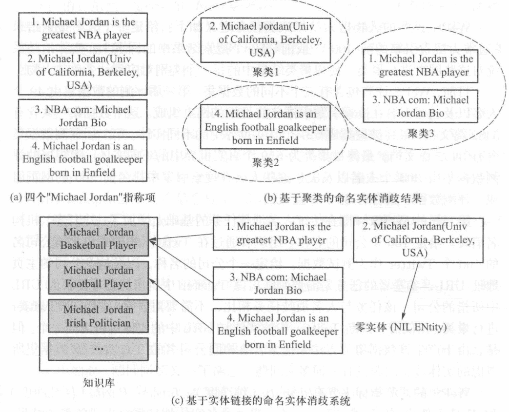

图 5.1 命名实体消歧系统示例

### 5.1.3 评测现状
主流的命名实体消解评测主要有两个平台：WePS聚焦聚类式消解，TAC KBP的Entity Linking聚焦链接式消解。

1. WePS评测
WePS针对Web人名搜索结果的聚类消解，由UNED大学组织共开展三届。第一届2007年作为SemEval2007子任务，15家单位参赛；第二届作为WWW 2009子任务，17家单位参赛；第三届作为CLEF子任务，34家单位参赛。

任务定义为：给定一个人名搜索结果，通常为搜索引擎前100或150条网页，对网页进行聚类，使每个类对应一个真实人物。

第一届数据集含49个人名及各自前100条网页，共3489篇文档，聚成527个真实实体。第二届含3432篇文档，聚成559个实体。第三届包含300个人名及各自前200条网页，共57956篇文档。第三届还新增机构名消解任务，给定100家公司名称及主页URL，以Twitter中含公司名的100条推文为测试数据，判断推文中实体是否与URL指同一公司。此任务仅涉及一词多义，未考虑一义多词。

评测指标为纯净度Purity、倒纯净度Inverse Purity和F值。设C为系统生成的聚类，L为真实聚类，则

Purity = Σ_i (|C_i| / n) max Precision(C_i, L_j)  (5.2)
其中 Precision(C_i, L_j) = |C_i ∩ L_j| / C_i  (5.3)

InversePurity = Σ_i (|L_i| / n) max_j Precision(L_i, C_j)  (5.4)

WePS1用F值平衡两项作为最终得分。

2. TAC KBP评测
TAC KBP评测实体链接任务，目标是将文本中的提及链接到目标知识库实体，假设知识库不完备。2009年知识库由2008版Wikipedia含信息框的文章构成，每个实体包含名字、类别PER/GPE/ORG/UKN、唯一ID、属性信息及用于消解的描述文本。

2009年测试集含3904个查询，每个查询由提及及其出现新闻文本构成。2010、2011年沿用相同知识库，查询扩展到互联网语料，2011年首次提出跨语言实体链接。2017年评测将实体消解与实体识别联合，要求从中文、英文、西班牙文文本中识别实体并链接到指定语言知识库，知识库中不存在的实体需聚类归并。

核心指标为Micro-averaged accuracy，计算式如下：

$$Micro = \frac{\sum_{q \in Q} \sigma[L(q), C(q)]}{|Q|}\tag{5.5}$$

其中Q为查询集合，L(q)为系统给出的实体ID，C(q)为正确ID，σ判断是否相同。另通常报告Macro-averaged accuracy，按实体名称而非提及进行平均。

### 5.2 聚类式消解策略
目标实体未给定时代多数系统采用聚类。给定提及集合O = o1, o2, …, ok，流程为：对每个o抽取特征如上下文词、实体、概念并表示为特征向量o = w1, w2, …, wn；计算提及间相似度；用聚类算法聚类，使每类对应一个目标实体。关键在于相似度计算，按方法可分为基于表层特征、基于扩展特征和基于社会化网络三类。

### 5.2.1 表层特征的相似度计算
传统系统多仅用表层特征，多为词袋Bag of Words模型的延伸，效果有限。基于词袋的系统先将提及转为Term向量，权重常用TF-IDF。例如

MJ1: Michael Jordan is an NBA player
MJ2: Michael Jordan wins NBA MVP

其表层特征表示见表5.1。

表 5.1 基于表层特征的实体指称项表示

| 实体指称项 - 表层特征 | NBA | Player | MVP | Win | Is | a |
|---|---|---|---|---|---|---|
| MJ1 | 1.21 | 1.09 | 0 | 0 | 0.6 | 0.53 |
| MJ2 | 1.60 | 0 | 1.81 | 1.46 | 0 | 0 |

基于向量通常用Cosine相似度，例中MJ1与MJ2的相似度为0.38。

Bagga和Baldwin用上下文词向量表示提及，Cosine超阈值则判为同一实体。Pedersen等用重要Bi-gram表征上下文特征。Chen和Martin尝试句法与语义特征。Fleischman等用最大熵模型估计两提及同指概率，以概率为相似度并用凝聚式聚类合并。上述方法仅依赖表层关联，未考虑上下文特征内在联系，影响聚类效果。

### 5.2.2 基于扩展特征的实体指称项相似度计算

为了弥补仅靠表面特征衡量指称项相似度带来的局限，后续研究把外部知识库引入实体消歧流程。最直接的做法是借用知识资源来丰富指称项的表达。具体来说，在常规上下文词特征之上，Mann 等 [312] 与 Chen 等 [366] 会抽取人物传记里的结构化属性，例如出生日期、出生年份、职业、出生地等，充实人物指称项的表征。这些属性一方面充当扩展特征，另一方面还能用来校正聚类结果，比如当两个聚类中的指称项共享同一个邮箱地址时，即便相似度不高也会直接合并。另一个关键的知识来源是 Wikipedia。Cucerzan 等 [115] 结合指称项的上下文词与 Wikipedia 中的类别信息，对百科和普通网页里的实体名进行消歧。Bunescu 等 [76] 则利用 Wikipedia 的层级分类体系缓解上下文稀疏问题，通过构建分类体系让实体分类知识参与相似度计算。Han 等 [193] 在 2009 年基于 Wikipedia 的结构化语义构建了知识推理式的消歧系统，并提出结构化关联语义的相似度度量方法；Han 等 [194] 于 2010 年进一步讨论如何挖掘互联网常用结构化知识源中的语义并集成到相似度计算，最终取得了较好的效果。

### 5.2.3 社会网络驱动的指称项相似度计算
除上下文特征之外，实体的社会关系同样富含信息。以图 5.2 为例，MJ1 到 MJ4 都是 Michael Jordan 的不同指称，图中其他节点来自 Wikipedia 的实体，通过关系网络可以判断 MJ1 与 MJ2 更可能指向同一实体，因为二者的社会关联更紧密。与表层特征或扩展特征的方法不同，社会网络思路多采用图算法，能利用关系传递性挖掘隐含联系，在论文记录、影视记录等结构化数据上表现更准。其短板是只利用上下文中的实体信息，无法充分吸收指称项的其他上下文，因而在纯文本消歧上竞争力有限。

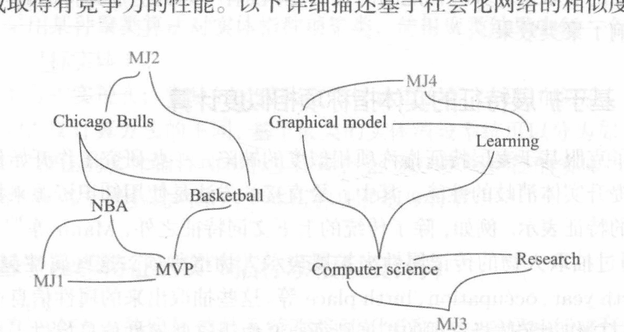

在该框架下，所有信息被建模为社会关系图 G = (V, E)。节点同时包含实体指称项和实体，边表示二者之间的社会关联。这样一来，来自其他知识库的关系就能方便地融入指称项表示。在此表征下，指称项间的相似度常借助图算法中的随机游走来求解。Malin 等与 Yang 等 [310, 311, 506] 先依据语料库内实体的共现关系构建社会网络，再用实体间随机游走概率衡量相似度；Minkov 等 [340] 针对邮件数据，先建实体社会网络，再用随机步法计算相似度；Hassell 等 [200] 在 DBLP 人物关系上为不同类别的关系赋权，把人名与 DBLP 实体关联起来。Bekkerman 等 [46] 利用人物间社会关联的网页链接结构进行人物消歧；Kalashnikov 等 [235] 通过网络搜索获取实体在 Web 上的共现信息以估算相关性；Lu 等 [305] 则依赖网络语料中实体共现的统计信息完成消歧。

## 5.3 以实体链接为核心的消歧方法
基于实体链接的消歧，本质上是将文本中的指称项锚定到知识库中的具体实体，也常被称为实体链接。Entity Linking 与 Entity Grounding、Entity Resolution 等概念相近，指把命名实体的文本提及链接到知识库对应条目的过程，若库中不存在则链接到 NIL。

通常输入分两部分：
- (1) 目标知识库：最常用的是 Wikipedia，部分任务会用到 IMDB、DBLP 等领域库。库中一般包含实体表、文本描述、结构化属性、类别等辅助信息，有时还提供实体间的关联。
- (2) 待消歧的实体指称项及其上下文。

流程大致两步：
（1）链接候选过滤 Blocking：知识库常含百万级实体，不可能逐一比对，需先按规则或知识剔除不可能的实体，保留少量候选。
（2）实体链接 Linking：在候选中选出与指称项最匹配的目标实体。目前研究重心多在第二步。

### 5.3.1 候选集初筛策略
对候选过滤缺乏系统化的量化研究，主流做法仍是依托指称项词典，记录一个指称项可能指向的所有实体以便检索。表 5.2 即为词典示例，可见 AI 可能对应 Artificial Intelligence、Ai (singer) 等。传统做法常用 Wikipedia 的实体名称、重定向页、消歧页、锚点词典以及首段加粗词来构建词典，兼顾别名信息。对模糊或拼写错误的提及，TAC 评测中也采用 Metaphone Algorithm、Soft TFIDF 等构词法模糊匹配手段。

### 5.3.2 链接决策的核心技术
给定指称项 m 与候选集 E = e1,e2,…,en，目标是选取一致性分数最高的实体：
e = arg max_e Score(e, m) (5.6)
关键在于 Score(e, m) 的计算方式。现有方法可归为四类：向量空间模型、主题一致性模型、协同实体链接模型、基于神经网络的模型。

1. 向量空间模型
该类方法以指称项上下文与目标实体上下文中词项的共现信息为依据。实体概念与指称项均被表示为由上下文 Term 构成的向量，Term 可为词，也可为概念或类别。相似度通过向量间距离打分。研究集中在两点：① 特征抽取。传统仅用上下文词，近年常从上下文抽概念、实体，或从 Wikipedia 等获取额外信息；② 相似度计算。常用 Cosine 相似度、上下文词重合度或分类器学习打分，仍有改进空间。

2. 主题一致性模型
与向量空间不同，Medelyan 等 [323] 与 Milne 等 [338] 提出以候选实体与上下文其他实体的一致性为依据。例如句子“美国媒体断言姚明必与休城续约，但是他很忠诚，只希望留在火箭”中，指称项“火箭”的候选为{休斯敦火箭队，航天火箭}，结合上下文实体{姚明、休城、美国媒体}，系统会因休斯敦火箭队与姚明、休城关联更强而选择它。该模型选择与上下文实体一致性最高的候选。计算时需考虑：
（1）上下文实体重要性。并非所有实体贡献相同，sina、sohu 这类高频媒体信息量低，而姚明、休城这类主题相关实体信息量高。传统做法用实体与其余实体的语义关联均值衡量重要性：
$$w(e, o)=\frac{\sum_{e_i\in O} sr(e, e_i)}{|O|}\tag{5.7}$$
其中 O 为上下文实体集合，sr(e, e_i) 为基于知识资源的语义关联值。
（2）一致性度量。常用目标实体与上下文实体的加权语义关联均值：
$$Coherence(e, o)=\frac{\sum_{e_i\in O} w(e, o)sr(e, e_i)}{\sum_{e_i\in O} w(e, o)}\tag{5.8}$$
其中 o 为指称项，w(e, o) 为实体权重，sr(e, e_i) 为语义关联度。

3. 协同实体链接
前两类仅处理单个指称项，忽略文档内实体间的相互制约。基于主题一致性，同一文档的所有指称项目标实体应相互关联。Kulkarni 等 [254] 将单文档协同链接建模为优化问题：
$$\frac{1}{\binom{|S_o|}{2}} \sum_{s \neq s' \in S_o} r(y_s, y_{s'}) + \frac{1}{|S_o|} w^T f_s(y_s) \tag{5.9}$$
其中 y_s 为指称项 s 的目标实体，S_o 为文档内所有指称项集合，r(y_s, y_{s'}) 为实体间语义关联，f_s(y_s) 为指称项与其目标实体的一致性。公式同时建模实体间关系与指称项-实体一致性。Han 等 [192] 采用图方法实现协同链接，先用 VSM 得到初始关系，再通过实体间链接关系构建图并做图算法优化。该方法精度高但求解目标函数是 NP 问题，需近似求解。

4. 基于神经网络的实体消歧方法
无论聚类式还是链接式消歧，核心都是相似度计算。传统方法依赖手工特征，扩展性差且易误差传递。近年深度学习得到广泛应用。He 等 [204] 于 2013 年首次把神经网络引入消歧，用叠加降噪自编码器预训练文档与实体的语义表示，再用监督语料微调；Sun 等 [451] 2015 年用卷积神经网络生成指称项、实体及其上下文表示，并在合成阶段用神经张量网络；Severyn 等 [423] 在卷积建模句子时引入 Noisy Channel；Huang 等 [221] 用神经网络建模知识图谱中实体表示以辅助相似度计算；Francislandau 等 [164] 利用多粒度卷积捕捉上下文与候选描述的不同粒度语义。该类方法免于复杂特征工程，能捕捉深层语义，扩展性好，已成为主流。

## 5.4 结构化文本场景的消歧方案
非结构化文本依赖上下文提供线索，但现实存在大量结构化文本，如知识库、列表数据、Infobox。部分结构化数据含非结构化描述，可沿用前述方法；另一类仅有实体名或少量结构信息，如表 5.3 所示的列表型数据，姚明、李娜、刘翔等需在多义候选之间抉择，缺乏上下文描述，消歧难度增大。

Shen 等 [427] 假设列表中实体往往同属一类，如均是运动员，于是提出结合实体流行度与上下文实体联合消歧，在 Wikipedia 与网络文本上准确率可达 90% 左右。Vasilis 等 [142] 提出检索式列表消歧，将待消歧实体接入搜索引擎，利用检索结果判断类别以辅助消歧。Xu 等 [501] 针对 Infobox 提出特征式链接方法，抽取七类特征并用极大似然估计学习权重，发现实体流行度是最有效的特征，与 Shen 等的结论一致。总的来说，结构化文本消歧主要借助类别信息、流行度及列表内关联信息。

## 5.5 小结

实体消歧：让知识图谱里的名字不再混淆

要让知识图谱可用，首要的工作之一就是厘清文本中的指代混淆，实体消歧正是承担这部分责任的技术，它处理同名指不同物、不同名指同一物的模糊现象。本部分先交代消歧任务的含义与评价方式，再梳理任务的类型划分，最后归纳现有的技术路线。按文本形态来划分，消歧可分为面向结构化文本和面向非结构化文本两类，其中非结构化场景的应用更广。主流做法可概括为聚类式与链接式两大方向，核心都在衡量待消歧项与候选项的语义接近程度。聚类式常见有表层特征相似度估计、扩展特征相似度估计、社会化网络相似度估计；链接式常见有向量空间相似度估计、主题一致性相似度估计、协同实体链接相似度估计以及神经网络相似度估计，近些年神经网络类方法占据主导。

## 第六章 关系抽取：把孤立节点连成网络

前面几章已论述实体识别与消歧，单独的实体只有通过关系连结才能构成图谱。关系起着连线的功能，将各自独立的节点编织成整体。从结构化或非结构化文本中发掘实体间的关联，是构建知识图谱的核心环节之一。关系抽取同时是内容理解的重要支撑，能把分析从语言表层提升到语义层面，对问答、智能客服、对话机器人、语义检索等应用价值很大，因此在学界和产业界都受到高度关注。本章先给出任务定义、分类与难点概览，再回顾相关评测，最后以非结构化文本为例介绍限定域与开放域关系抽取的代表方法。

## 6.1 任务概述

### 6.1.1 任务定义

关系被定义为两个或多个实体①之间存在的某种联系，关系抽取即自动挖掘实体间隐含的语义关联。按参与实体的数量可分为二元关系抽取与多元关系抽取[411]，二元关注一对实体，多元涉及三者及以上。二元关系抽取是其他分支的基础，本章聚焦二元情形，关注一对实体间的语义关联并生成 (arg1, relation, arg2) 形式的表达，其中 arg1、arg2 代表实体，relation 代表语义联系。以首都关系举例，可将中国与北京对应为（三元结构）中国-首都-北京。

① 本章所论方法同时适用于命名实体或名词性成分之间的关系，下文统一称为实体关系抽取，不作区分。

示例：
（1）刘翔，1983 年 7 月 13 日出生于上海，中国男子田径队 110 米栏运动员。
（2）张艺谋在 1990 年与杨凤良合作导演影片《菊豆》，影片讲述了一个“被禁锢的激情”的故事。
（3）据苹果官方网站报道，苹果公司的董事会主席、联合创始人史蒂夫·乔布斯周三辞世，享年 56 岁。

句1中刘翔与上海的联系为出生地，可得到（刘翔，出生地，上海）。句2、句3可分别得到（张艺谋，导演，菊豆）和（史蒂夫·乔布斯，创始人，苹果）。

### 6.1.2 任务分类

按数据源划分，可分为：
- 面向结构化文本的关系抽取。结构化文本如表格、XML 文档、数据库数据等，版式规整，抽取相对容易，可为特定站点定制模板，准确率较高。
- 面向非结构化文本的关系抽取。纯文本即非结构化，例如“姚明 1981 年出生于中国上海”需识别姚明与上海的出生地联系。由于自然语言表达多样灵活，实体关系在文本中常无显式标记，抽取难度较大，需借助自然语言处理，准确率相对偏低。
- 面向半结构化文本的关系抽取。介于两者之间，数据分布或版式有一定规律但类型多样、隐含、无显式标注，难以人工穷举模板，需自动学习模板。对模板连续性较好的半结构文本，现有技术可达较高准确率[35][113]。

按抽取范围划分：
- 句子级关系抽取，也称句子级关系分类，即在单个句子中判定两实体间属何种语义关系。如前例，判定姚明与上海在此句为出生地。
- 语料篇章级关系抽取，旨在判定两实体是否具有某种语义关系，不限定两者出现的上下文。只需确认姚明与上海存在出生地关系，而不必指出具体哪句话表达。该任务对知识图谱构建很重要，因为构建时关注节点间的语义标签，而非其出现的具体文本。

按领域划分：
- 限定域关系抽取。在一个或多个限定领域内抽取实体间的语义联系，待判别的语义类别是预设的有限集合。可采用监督学习，先标注足够训练数据再训练模型。面对大规模图谱构建时人工标注不足，较多工作采用弱监督学习缓解标注瓶颈。
- 开放域关系抽取。不限定关系类别，依据模型对自然语言句子的理解，从中开放式抽取实体关系三元结构。

### 6.1.3 任务难点

关系抽取是信息抽取中的关键难点，比实体识别与消歧更复杂，主要体现为：
- 1. 同一关系可有多重表述。例如“姚明出生于上海”和“姚明的出生地是上海”都表达出生地关系。
- 2. 同一短语在不同语境下可能指向不同关系。例如“李梅是我的姑娘”中的姑娘，可指女朋友也可指女儿。
- 3. 同一实体对可能存在多种关系。例如姚明的出生地是上海，居住地也可能是上海。
- 4. 关系抽取涉及实体及其上下文，需利用文本中的结构化信息，问题复杂度呈指数增长。例如：“三国时期，蜀国有等多位能征善战的将军，他们是：关羽、张飞、赵云、黄忠和马忠。”
- 5. 关系有时在文本中无明确标识而被隐含。例如“蒂姆·库克与中国移动董事长奚国华会面商谈‘合作事宜’”透露出他将带领苹果进一步开拓中国市场的信息，文本并未直接给出蒂姆·库克与苹果的关系，但可从“带领苹果公司”推断其为苹果公司首席执行官。
- 6. 关系抽取依赖词法、句法分析等基础 NLP 工具，实际中这些工具性能有限，引入的错误会降低抽取系统性能。

### 6.1.4 相关评测

学界组织了多项公开评测，推动了该领域发展。其中影响最大的是消息理解会议 Message Understanding Conference, MUC。关系抽取概念最早出现在 MUC-6 的模板元素 Template Element, TE 任务中，MUC-7 把命名实体间潜在关系从属性值中分离，正式提出模板关系 Template Relation, TR 任务，要求识别 location_of、employee_of、product_of 三类关系。MUC 有力推动了关系抽取研究。

MUC-7 后由美国国家标准技术研究院 NIST 组织的自动内容抽取 Automatic Content Extraction Evaluation, ACE 取代 MUC，持续推动面向自然语言的自动内容抽取。ACE 于 1999 年筹划、2000 年启动，其中关系识别与检测 Relation Detection and Recognition, RDR 任务定义了较为细致的关系体系。ACE-2008 包含 Agent-Artifact、General-Affiliation、Metonymy、Organization-Affiliation、Part-Whole、Person-Social、Physical 等 7 大类 18 个子类。

2009 年起 ACE 并入文本分析会议 Text Analysis Conference, TAC，关系抽取评测归入知识库构建 Knowledge Base Population, KBP 的槽填充 Slot Filling 子任务[资源 6-1]，研究如何从文本抽取特定实体属性信息，与知识图谱构建密切相关。相比 ACE，TAC-KBP 关系类型更多，为人物、组织、地理位置设置了近 40 个关系类型。

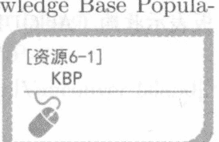
除 MUC、ACE、TAC 外，语义评测会议 SemEval 也很有影响。SemEval 自 1998 年举办，至 2018 年已办 11 届，设有词语语义消歧、语义标注、时间识别、关系抽取等任务。应用最广的 SemEval 2010 评测集定义了 9 类关系——工具-代理、原因-影响、内容-容器、产品-生产商、实体-出生、成分-整体、实体-目的地、成员-集体、消息-主题——外加一类其他。

## 6.2 限定域关系抽取

限定域关系抽取指在限定领域内判断文本中实体指称间属于何种语义关系，且待判别的语义关系是预定义的。因此常被视作文本分类任务：给定句子及其中出现的实体指称，将其划归到对应的语义类别。早期研究多用模板判别，随着统计机器学习发展，监督学习方法逐渐增多，研究重心在于抽取有效特征。根据特征提取方式，可分为传统特征工程分类方法和基于深度学习的分类方法。人工标注耗时费力，成本高，因此不少研究采用弱监督学习抽取关系。下面分别介绍。

### 6.2.1 基于模板的关系抽取方法

基于模板的方法通过人工编辑或学习得到的模板对文本中的实体关系进行抽取与判别。例如假设 X、Y 表示公司类型，可用如下模板表示收购 ACQUISITION 关系。

```
X is acquired by Y
X is purchased by Y
X is bought by Y
```
当句子中出现的实体指称上下文满足该模板时，即认为这两个实体指称在该句中具有收购关系。人工方法难以穷举多类关系的所有模板，需用自动学习。核心问题是：①如何学习用于抽取关系的模板？②如何对学习到的模板进行聚类？

已有方法多采用自提升 Bootstrapping 策略，对实体和模板进行联合迭代式交替抽取与学习。基本出发点是语义关系可对偶表示[62]，包括外延性 Extensionally 表示和内涵性 Intensionally 表示。外延性表示用包含该关系的所有实体对来表示关系；内涵性表示用能抽取出该关系的所有模板来表示关系。用 R 表示关系，E(R) 表示所有包含关系 R 的实体对，如表示 ACQUISITION 可给出（YouTube, Google）、（Powerset, Microsoft）、（Inktomi, Yahoo）等。P(R) 表示能抽取出关系 R 的模板集合，如 X is acquired by Y、X is purchased by Y、X is bought by Y 等。E(R) 与 P(R) 均能刻画 R。于是可用实体对获取模板信息，再用模板抽取更多实体对，形成自提升循环。

关键步骤是抽取句子中实体对间表达关系的模板。模板可基于词汇、句法或语义，需借助自然语言处理技术，包括句子边界探测、词性标注、名词词组块识别等。例如先用句子边界探测工具[资源6-2]把语料切分为句子，再运行词性标注工具[资源6-3]获取词性，为探测实体可使用名词短语块识别工具[资源6-4]或命名实体识别工具提取合适的名词词组块与实体。在此基础上抽取词汇级与句法级关系模板。示例：

[资源6-2]
句子边界探测工具

[资源6-3]
词性标注工具

[资源6-4]
名词短语块识别工具

句子：The crime took place in View Royal on Vancouver Island.
词性标注：DT NN VBD NN IN NNP NNP IN NNP NNP .
实体或词组块：The crime took place in [View Royal] on [Vancouver Island].
变量替换：View Royal=X，Vancouver Island=Y
字面形式：The crime took place in X on Y.
词性序列：DT NN VBD NN IN X IN Y .
词汇模式： X on Y, X, Y
语法模式： X IN Y, X, Y

另一个关键问题是不同模板可能表示同一语义关系。因此抽取后需对模板聚类，将表达同一语义关系的模板归并。Bollegala 等人[62]把实体对与抽取的词法、句法模板表示成矩阵，如表 6.1 所示，其中 p_i 表示模板，⟨e_i, e'_i⟩ 表示实体对，矩阵的每一行表示实体对在模板空间的分布，每一列表示模板在实体对空间的分布，分布相似性用于识别表达同种语义的不同模式及不同实体对间的同种语义关系。Bollegala 等人提出序列联合聚类算法 Sequential Co-clustering Algorithm，对模板和实体对进行联合聚类。矩阵中每行是实体对在不同词汇语法模板上的分布，其行向量即聚类特征向量，每个聚类的类别标签代表一种语义。该算法还能识别特殊实体的不同字符串形式。例如 Redmond software giant 与 Microsoft 指向同一实体，会使实体对（Microsoft, Powerset）和（Redmond Software Giant, Powerset）聚到同一类。

表 6.1 实体对-模板关系矩阵

| 实体对-模板 | p1 | p2 | p3 | p4 | ... |
|---|---|---|---|---|---|
| ⟨e₁, e₁'⟩ | 0 | 1 | 0 | 1 |  |
| ⟨e₂, e₂'⟩ | 0 | 0 | 1 | 1 |  |
| ⟨e₃, e₃'⟩ | 1 | 0 | 0 | 0 |  |
| ⟨e₄, e₄'⟩ | 0 | 1 | 0 | 0 |  |
| ... |  |  |  |  |  |

### 6.2.2 基于机器学习的关系抽取方法

模板方法的最大局限在于受模板质量和覆盖度制约，可扩展性不强。随着机器学习发展，越来越多工作把关系抽取看作分类问题，通常是有监督或弱监督学习，尝试用成熟的机器学习算法解决。主要分为有监督与弱监督关系抽取方法，下面依次介绍。

### 6.2.2.1 有监督的关系抽取方法

有监督关系抽取的核心在于如何抽取出表征实体指称间语义关系的有效特征。通常借用自然语言处理工具包从句子中抽取词汇、句法、语义等特征作为分类依据。为缓解句法特征稀疏性，较多研究采用核函数。为利用神经网络自动提取特征，近些年出现大量基于神经网络的研究。下面分别介绍基于特征工程、基于核函数、基于神经网络的方法。

1. 基于特征工程的方法
其特点是需显式把关系实例转为分类器可接受的特征向量，研究重点是如何提取区分性特征。该方法一般包含三个步骤：①特征提取：抽取词汇、句法、语义等特征并有效集成，产生描述关系实例的局部与全局特征；②模型训练：利用提取的特征训练分类模型；③关系抽取：用训练好的模型对非结构化文本分类，完成关系抽取。常见关系抽取特征举例如下：
- （1）词汇特征。包括实体本身的词语或名词性词组块、两个实体之间的词语、两个实体两端的词语。
- （2）实体属性特征。包括实体或名词性词组块的类型特征，如人物 Person、组织 Organization、位置 Location、设施 Facility、地缘政治实体 Geo-Political Entity 等。
- （3）重叠特征。包括两个实体或词组块之间词语的个数、它们之间部分包含其他实体或词组块的个数、两个实体或词组块是否处于同一个名词短语、动词短语或介词短语中。

依存语法这块特征关注的是两个名词性短语实体在依存分析树中的连接关系，具体体现在它们之间的依存标签以及从一个实体到另一个实体的依存路径。

句法树这一类特征则描述的是把两个实体串起来的句法路径，要求路径上不出现重复节点，并且用每个节点的中心词来标注整条路径。

以 “Jobs was the co-founder of Apple” 为例，经过词性标注和句法分析后，得到的成分树和依存树分别如图所示。

由此句可以提炼出的信息大致如下：

- 词汇层面包含的表达有 “Jobs”“Apple”“was the co-founder of” 等。
- 实体类别层面，“Jobs” 属于 PERSON，“Apple” 属于 ORGANIZATION。
- 重叠层面，两个实体之间隔着 4 个词，中间不夹杂其他实体，且二者既不在同一个名词短语里，也不在同一个动词短语或介词短语里。
- 依存层面，“Jobs” 依存于 “co-founder”，其词性为 NN；“Apple” 依存于 “of”，而 “of” 的词性为 IN。
- 句法树层面对应的路径标记为 NNP-NP-S-VP-NP-PP-NP-NNP。

把包含两个目标实体的文本特征提取出来后就可以送入分类器做关系判定。只是句法树特征受句子结构影响很大，不同句子的树形差别明显，同一个词在不同上下文里的句法角色也不同，这导致该类特征的空间极其庞大，容易出现稀疏问题，于是后续研究大量采用句法树核等手段来缓解。

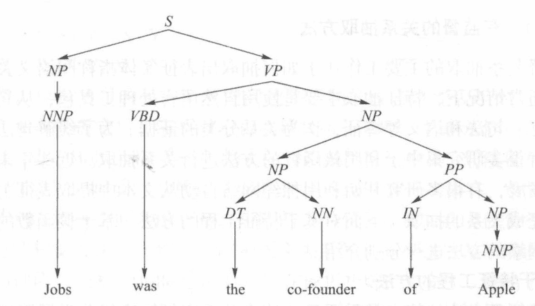

图 6.1 成分句法树示意图

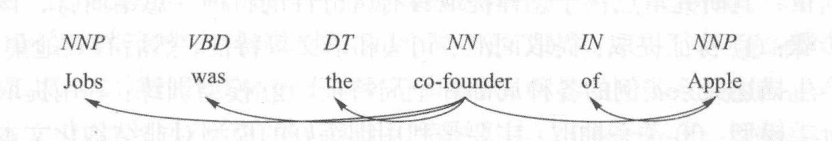

图 6.2 依存句法树示意图

### 2. 核函数为核心的关系抽取
与手工构造特征向量不同，核函数方法不需要显式搭建特征空间，能够弥补传统向量化方式的局限。在关系抽取里，它直接把结构树当作处理对象，计算关系相似度时用核函数替代内积。核函数可在高维空间隐式衡量距离，无需枚举全部特征就能完成点积，表达实体关系更灵活，也能方便地融合多种信息，再配合支持核的分类器完成抽取。

关系抽取中核函数的雏形由 Zelenko 等提出，他们在浅层句法树上定义树核，并设计动态规划算法计算相似度，随后用支持向量机和表决感知器等分类器在约 200 篇新闻文本上做两项简单任务，效果初步验证。

Culotta 等引入依存树核，把包含实体对的成分树经若干依存规则转为依存树，并在节点上叠加词性、实体类型、 短语块、WordNet 上位词等信息后用 SVM 分类。

Bunescu 和 Mooney 提出最短依存树核，只统计依存树里两个实体间最短路径上相同节点的数量，并要求同关系实体对的最短路径高度一致且通往根的轨迹相同。该核准确率提升但召回偏低。

为改善召回，Bunescu 和 Mooney 又提出基于带间隔子序列的字符串核，先截取实体对前后若干词构成字符串表达，允许子序列中出现空隙，再进行关系判定。

Zhang 等把卷积树核与线性核结合，同时兼顾平面特征和结构特征，用卷积树核度量含实体对句法树的相似度，用线性核度量实体属性的相似度。

Zhou 等提出最短路径包含树核，把关系实例映射为上下文相关的最短路径包含树，能依据句法结构动态扩展谓词部分，并在比较子树时纳入根节点的祖先信息，形成上下文相关的核计算方式，并与特征方法结合。

### 3. 神经网络驱动的关系抽取
特征工程和核函数方法在关系抽取上已有一定效果，可扩展性却受限：其一，词汇、实体、依存等手工特征的抽取依赖分词、词性标注、实体识别等 NLP 工具，Pipeline 式的串联容易导致错误累积；其二，资源丰富的语言尚可凑齐工具链，而小语种或资源匮乏语言缺乏可用组件，方法难以落地。

因此能否绕过工具直接从原始文本学习有效表示？深度学习兴起后，越来越多的研究用神经网络自动学习文本表征。主要流程包括特征表征、网络搭建与高层特征学习、基于标注数据的参数训练以及新样本分类。以 Zeng 等 2014 年提出的 CNN 关系抽取为例，模型由词表示、特征抽取和输出三部分组成，输入是句子及指定的两个词，输出是二者在该句中的预定义语义关系。

首先句子经词向量转为向量序列输入网络。特征抽取同时获取词汇级和句子级信息，二者拼接后用于分类。词汇级特征挑选句中若干词向量拼接；句子级特征则是对整句学习一个向量。句子表达多样，数量近乎无限，难以像词一样直接统计频率学习向量，但语义由词义及其组合方式决定。Zeng 等用卷积神经网络学习组合规律，把词向量组合成句级表征。为让网络知道关注哪两个词，还加入位置特征，表示当前词到目标词的相对距离。

相比传统方法，该思路不再依赖 POS、NER 等工具，而是直接从带冗余的词向量中自动筛选有用信息，得到质量更高的表征。下面展开细节：

### （1）词向量编码
自然语言是符号式，神经网络运算是分布式表示，需要在输入端通过词向量表把句中每个词映射为向量。词向量基于分布式表示思想，利用词频、共现和搭配把词映射到低维稠密空间，每个维度隐含语义，词间关系可通过空间距离体现，如近义词距离很小。词向量既能连续表达离散符号，又保留语言属性，可在大规模非监督语料上自动学习。常见模型有语言模型、SENNA、RNNLM 和 Word2vec 等，Zeng 等使用了预训练的 Word2vec。


### （2）词汇级特征
关系抽取中词汇级信号很重要。传统做法用词本身、词性及两词间词作特征；Zeng 等直接用词向量替代，不再显式使用词、词性或实体标签。词向量空间中句法语义相关性高的词距离更近。他们选取给定两词及其相邻词对应的向量作为输入，主要包括五类，如表 6.2 所示。其中 L5 表示两词在 WordNet 里的上层语义分类，实验采用 SuperSenseTagger 得到，共 41 个与名词动词相关的类别。

### 表 6.2 词汇级特征

| 特征 | 说明 |
|------|------|
| L1 | 词 1 的词向量 |
| L2 | 词 2 的词向量 |
| L3 | 词 1 左右各一个词的词向量 |
| L4 | 词 2 左右各一个词的词向量 |
| L5 | 词 1 和词 2 在 WordNet 中的一般语义分类 |

### （3）句子级特征
词向量能捕捉单个词的相似度，但难以覆盖长距离句义。关系抽取需依据整句判断两词关系，于是 Zeng 等用卷积神经网络通过语义组合自动学习句级特征。流程如图 6.3，先开窗取局部特征，再用卷积滤波捕获不同模式，最后做非线性变换得到句级表征。为标识目标词对，还引入位置特征记录当前词到两目标词的相对距离。

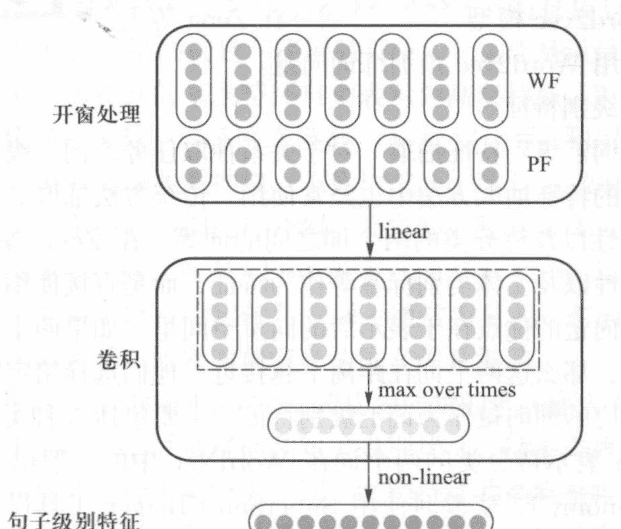

图 6.3 句子级特征抽取框图

### （4）网络输出
把词汇级与句子级特征拼接后送入 Softmax 分类器，训练时用随机梯度下降最大化对数似然获得最优参数。

除此之外，Santos 等为缓解人工 “NA” 标签问题提出排序损失；Wang 等引入双重注意力聚焦能表征关系类别的上下文语义。循环神经网络和递归神经网络也被用于该任务。

## 6.2.2.2 弱监督的关系抽取方法
有监督关系抽取依赖人工标注，适用范围受限。距离监督在这种背景下提出，利用已构建的知识图谱自动标注样本，属于弱监督范式。它启发式对齐图谱实体与文本实体，再据此学习抽取器，核心假设是：若两个实体存在某种关系，则包含二者的所有句子都表达该关系，句子集合称为一个包。

Mintz 等把 Freebase 与 Wikipedia 实体对齐，以约 70% 的精度抽取了数万关系实例。Riedel 等指出并非所有共现句子都表达关系，例如 nationality 关系在纽约时报中约 38% 的共现句真实表达，在 Wikipedia 中仅约 20%。图 6.4 的例子里，句子 S1 到 S4 都包含 “Nevada” 和 “Las Vegas”，但真正表达 “location/location/contains” 的只有 S1 和 S3。

针对此，Riedel 等提出 expressed-at-least-once 假设：包中不一定全部有效，但至少有一个有效。基于此，Riedel 等和 Hoffmann 等用概率图模型从包中挑选有效样例预测关系；Nguyen 和 Moschitti 利用关系定义和 Wikipedia 文档改进系统；Surdeanu 等认为包中可能包含多种关系，并加入多标签学习。

这些方法在特征抽取时仍依赖传统 NLP 工具，易受错误累积影响。Zeng 等提出的分段卷积神经网络 PCNNs 保留更多句中信息，把两个实体把句子切成三段，分别做最大池化以保留结构信息，并结合多示例学习缓解标注噪声，在 Riedel 等发布的经典数据集上表现良好。

### ● 训练数据产生
先用命名实体识别在非结构化文本如纽约时报中找出实体，组合成实体对，查询知识库 Freebase 判断是否存在语义关系，存在则取对应文本作正样本，从无关系的实体对文本中随机采样作负样本。

### ● 任务建模
由于表达多样，同一实体对会在多个句子出现，其中混杂噪声。假设多个句子中至少一个有效，所有回标句子构成包 M = {m1, m2, …, mj}，每个 mj 为样例。目标是给包赋语义标签，而非逐个样例标注；若包中全部为负，则表示实体间无关系。

### ● 分段卷积神经网络
为保留结构化信息，Zeng 等用分段卷积网络替代普通 CNN 的最大池化，网络显式设计分段最大池化，分别池化实体间的内部特征和两侧外部特征。

### ● 多示例训练
弱监督输入是包，需克服噪声样例干扰。多示例学习把目标函数定义在包上，先为包中每个样例预测关系概率，再取概率最高的样例标签作为包标签，并据此更新参数，有效降低回标噪声。

该方法只利用包中一个句子，信息有浪费。Lin 等和 Ji 等引入句子级注意力自动衡量包中各句的重要性；Jiang 等提出跨句子池化和多标签分类，以利用包内多句信息并处理一对实体多关系的情况。基于弱监督的关系抽取因无需人工标注而规模较大，代表系统有 NELL 和 Probase。

### 1. NELL 永不停止的语言学习者
NELL 由卡内基梅隆大学 Mitchell 教授团队开发，旨在从开放网页持续自我学习并抽取结构化信息。系统已累计获取涵盖 1186 个实体类别和关系类别的 3109311 个实例。

NELL：持续自我进化的知识挖掘引擎

NELL 起步时依赖两类人工设定。一类是预先划分好的概念类型，比如人物、运动队、水果、情感等，以及连接这些类型的关系类型，比如运动员在哪个队效力、音乐家使用何种乐器等；另一类是为每种概念类型和关系类型准备的少量种子样例，通常在 10 到 15 条之间。除此之外，系统接入了一个约五十亿页的网页语料池，并通过搜索引擎接口不断补充新的网页。在这套资源之上，NELL 全天候运行两项核心工作。

第一项是不断发现新成员。从网页中定位名词短语，判断它是否可以充当某种概念类型的新实例，比如“巴拉克·奥巴马”可归到人物、政治家等类；同时定位名词短语对，判断它是否构成某种关系类型的新实例，比如“贾森·吉安比”和“洋基队”可构成效力关系。确认后连同可信度写入知识库。
第二项是自我提升。系统把已确认的高质量实例当作弱监督信号回流训练，用来优化抽取模型，形成弱监督下的迭代增强闭环。

### 2. Probase
Probase 是微软亚洲研究院 Wang 等[495] 构建的概念级图谱，后来成为微软 Concept Graph 的雏形。当前版本收录约 265 万个概念，约 2 千多万条 isA 形式的实例-概念、概念-概念配对。它能在海量网页中自动发现 isA 关系与概念标签，并以概率形式刻画结果的可信度。

思路是用已有知识去理解文本，再从理解中获得新知识。整体分为信息挖掘与数据清洗融合两步。挖掘阶段先用已积累的知识对文本做监督式发现得到新知识，再把更新后的知识用于下一轮挖掘，通过反复迭代扩大覆盖。随后从挖掘到的 isA 对中搭建分类体系，并计算概念间以及实例与概念间的概率。

## 6.3 开放域关系抽取
前面讲的是限定域关系提取，这类方法需要提前列出关系类型，现实中很难穷举。开放域关系提取不预设关系表，而是直接用实体对在上下文中的词语来刻画两者联系。可形式化为 (arg₁, relationWords, arg₂)，其中 arg₁、arg₂ 是有关联的实体对，relationWords 是上下文中描述该联系的词或词组。例如“姚明出生于上海。”会被表示为（姚明，出生于，上海）。在预定义提取里，若系统只定义了出生地而没有定义出生于，结果会被规范化为（姚明，出生地，上海）。

开放域信息提取的概念最早由华盛顿大学人工智能组提出，出现了 TextRunner、Kylin、WOE、ReVerb 等原型系统。Banko 等[144] 2007 年首次提出开放域实体关系提取并落地 TextRunner，该系统能直接从网页纯文本中提取实体关系。TextRunner 先用若干启发式规则在宾州树库里自动生成正负样例，基于浅层句法特征训练一个判断实体间是否存在语义关联的分类器；随后对网络文本做预处理作为候选句子，提取浅层句法特征，用分类器筛选可信关系三元组，最后利用网络文本的冗余性对初步结果做评估。关系名称的提取上，TextRunner 以动词为关系词，用动词把两个论元连起来，流程与语义角色标注类似。

TextRunner 是首个开放域实体关系提取系统，采用启发式规则在宾州树库中自动标注语料，无需人工事先定义关系类目，主要包括三个环节：语料自动生成与分类器训练、大规模关系三元组提取、关系三元组可信度计算。

### 1. 语料的自动生成和分类器训练
语料自动生成主要依赖依存句法分析配合启发式规则。常用的启发式包括：一对实体的依存路径长度不超过设定阈值；实体不能是代词；关系指示词是两实体间依存路径上的动词或动词短语；两实体必须位于同一句子。

分类器训练上 TextRunner 使用朴素贝叶斯，特征示例有：关系指示词的词性、长度、实体的类型、实体是否为专有名词、左实体左侧词语的词性、右实体右侧词语的词性等。

### 2. 大规模关系三元组的抽取
用训练好的提取器在海量网页文本上进行三元组挖掘，并把大量结果缓存起来。

### 3. 关系三元组可信度计算
先把语义相近的三元组合并，比如 (arg₁, married, arg₂) 与 (arg₁, marries, arg₂) 合并为同一关系。然后依据网络数据的冗余特性，统计合并后三元组在网络文本中的出现频次，据此估计可信度。

TextRunner 之后，Wu 等[492] 于 2007 年提出 Kylin 系统。Kylin 挑选中包含信息框的 Wikipedia 页面，利用信息框的属性与属性值回标注训练数据，并据此自动确定需要提取的属性，不同属性训练独立的 CRF 模型来提取属性值。Wu 等[493] 于 2010 年推出 WOE 系统，同样基于 Wikipedia 信息框回标注，通过规则挑选出富含实体关系的高质量句子，再用依存句法树和词性标注等浅层特征训练两个分类器作为实体关系提取器，得到大量三元组模板，随后对网络文本做浅层句法处理并与模板匹配来判断可靠性。Kylin 与 WOE 的数据生成都属于距离监督，Wikipedia 信息框作为结构化知识库提供监督信号，而信息框本身在不断更新，因此本书将其与华盛顿大学的系列工作一并介绍。

2011 年 Fader 等[149] 分析了 TextRunner 与 WOE 的错误，提出基于句法与词汇约束的关系识别器 ReVerb，专门解决传统系统常见的 incoherent extractions 与 un-informative extractions 问题。实验显示 ReVerb 在准确率和召回率上都有显著提升。

传统信息提取的局限性推动了开放域研究的兴起。Talukdar 等[457] 探索在非结构化文本和搜索日志中提取开放域属性，提出用 Bootstrapping 框架，先给定初始种子模板，多次迭代挑选高置信度三元组作为结果。与其不同，Davidov 等[122][123] 起点不是关系模板而是触发词种子，先用触发词找出候选语料，归纳出元模板，经多次迭代得到最终提取模板。

## 6.4 小结
关系提取是构建知识图谱的关键环节，研究价值与应用前景都很广。本章先介绍了关系提取的任务、分类与难点，再概述评测，最后梳理了限定域与开放域的代表方法与系统。由于开放域提取得到的关系很难直接映射到知识图谱，限定域提取仍是主流。传统模板方法扩展性差，基于机器学习的方法成为热点，其中既有有监督，也有弱监督。有监督需要大量人工标注，成本高，当前弱监督关系提取受到更多关注。

## 第七章 事件抽取
前文已介绍实体提取与关系提取，本章聚焦事件提取。事件提取既是构建知识图谱的核心任务，也是自然语言处理的难点与热点。相较于实体与关系提取，事件提取的挑战更大：它建立在命名实体之上，NER 的好坏直接影响结果；实体关系提取只需识别两个实体的语义关联，而事件提取要先判断文本是否包含关注事件，再定位事件涉及的元素，最后确定每个元素在事件中的角色。从技术层面看，事件提取不仅依赖底层语言学知识，还需要更深层的语义与篇章知识。本章先给出事件与事件提取的定义，再介绍评测与语料资源，最后讨论限定域与开放域事件提取的典型方法以及事件关系提取。

### 7.1 任务概述

### 1. 事件的定义
事件的概念源于认知科学，在哲学、语言学、计算机科学等领域都有讨论[82, 154, 175, 392, 465, 516, 533]，但尚未有统一表述。

认知视角认为世间一切发生的事都是事件，人类通过事件及其联系来认识世界[124]；哲学视角把事件看作现实世界事实的具体展现[392]；语言学中 Miller 等[337] 在 WordNet 里把事件定义为在特定时间地点发生的事；Chung 等[96] 认为事件包含谓词、发生时间、发生环境或条件三部分信息；Timber 等[462] 认为是特定条件、具体时地、包含一个或多个参与者的事；在自动文摘领域 Filatova 等[156] 认为事件可用一句话概括，是动词及其核心参与者、时间、地点等动作构成；在语义理解层面 Pustejovsky 等[386] 把事件视为动词及其相关语义元素所描述的信息；在本体模型中 Liu 等[298] 认为事件是在特定时间环境下由若干角色参与并呈现动作特征的事；在信息检索中，TDT 评测把事件定义为由原因条件引起、发生在特定时地、涉及特定对象并可能产生结果的事[29]。

本书面向知识图谱，与自动内容提取 ACE 评测的定义一致，认为事件是发生在特定时间点或时间段、特定地域范围内，由一个或多个角色参与的一个或多个动作构成的事情或状态改变[131]。

由此可知，时间、地点、角色以及动作或状态改变是事件的核心要素。不同动作对应不同事件类型，如出生与死亡、就任与辞职；同一类型下不同时地角色构成不同实例，如马克思出生与恩格斯出生是两个出生实例。事件还有粒度差异，如第二次世界大战、抗日战争、淞沪会战在时长、地域、规模上属于不同粒度。不同应用会定义不同类型与粒度。

### 2. 事件抽取定义
事件提取研究如何从描述事件的文本中提取出用户关心的结构化事件信息，如谁、何时、何地、做了什么[27]。本章侧重非结构化文本，任务首先识别事件及其类型，再提取事件元素。例：

- 成龙和林凤娇于 1982 年 12 月 1 日在洛杉矶举行婚礼。
- 2017 年 1 月 20 日中午，特朗普在美国首都华盛顿就任美国第 45 任总统。
- 2015 年 11 月 24 日，俄罗斯一架苏 24 战机在土耳其与叙利亚边境被土耳其 F16 军机击落。

三句分别描述结婚、就任、攻击事件及其要素。提取目标是识别事件类型并取出相关元素。为便于理解，先解释几个概念：

- 事件指称：对客观具体事件的自然语言描述，通常是一个句子或句群，同一事件可有多处指称。
- 事件触发词：事件指称中最能代表事件发生的词，决定事件类别，ACE 中多为动词或名词，例中为“结婚”“就任”“击落”。
- 事件元素：事件的参与者，是事件的核心构成，与触发词共同构成框架。例 1 中“成龙”“1982 年 12 月 1 日”“林凤娇”“洛杉矶”；例 2 中“2017 年 1 月 20 日中午”“特朗普”“美国首都华盛顿”“美国第 45 任总统”；例 3 中“2015 年 11 月 24 日”“俄罗斯一架苏 24 战机”“土耳其与叙利亚边境”“土耳其 F16 军机” 都是元素。元素主要由实体、时间、属性值组成，但并非所有实体时间都是元素，需看上下文语义。
- 元素角色：元素与事件的语义关系，即在事件中扮演的角色。例 1 中“成龙”“林凤娇”均为夫妻角色；例 3 中“俄罗斯一架苏 24 战机”是目标角色。同一类事件的所有角色构成该类事件的框架。
- 事件类别：由元素与触发词共同决定。按 ACE 定义，例 1 为生命-结婚，例 2 为人事-就任，例 3 为冲突-攻击。多数评测为事件设定类别与子类别，并提供模板以便识别元素与判定角色[105]。

### 3. 相关评测和语料资源

### （1）MUC 评测会议
消息理解会议 MUC 对事件提取研究有重要推动。MUC-2 要求从海军军事情报中提取事件并填入预定义模板，模板可视为事件框架，包含事件类型、地点、时间、参与者等 10 个槽。MUC-3 针对拉美恐怖袭击报道，槽增至 18 个。MUC-4 沿用 MUC-3 语料，槽增至 24 个。MUC-5 在英文评测基础上加入日文，聚焦微电子芯片进展与金融领域公司合资。MUC 共举办七届，1999 年因资助问题停办。

### （2）TDT 评测会议
1997 年 DARPA 与 NIST 主持了话题识别与跟踪 TDT[29]，旨在以事件形式组织新闻事件并进行研究评测[28]。

TDT 中话题是最基本概念，定义为由某种原因引起、发生在特定时段、特定地域并可能导致结果的事件。起初话题与事件同义，后演变为核心事件及其相关事件的集合。TDT 包含五个子任务[274]：

- 新闻报道切分
- 新事件识别/首条报道检测
- 报道关系识别
- 话题识别
- 话题跟踪

上述任务都与事件提取密切相关。新事件识别即从海量文档中找出首次报道或此前未识别的事件；报道切分涉及将文档聚类，不同事件形成不同话题。

# 事件抽取评测与语料发展概览

1998 年 TDT 首届会议启动，当时实验仅覆盖中文和英文语料，评测内容是新闻篇章切分、主题辨识与主题追踪，评价标准采用错误识别代价，此后各届沿用该标准。1999 年第二届在原有任务之上新增新事件发现与报道关联判定。2000 至 2004 年间评测始终保持五项子任务不变，并将评测语种扩展为中文、英文、阿拉伯文。

语言数据联盟 Linguistics Data Consortium, LDC 为 TDT 系列提供了 TDT-pilot、TDT-2、TDT-3、TDT-4、TDT-5 五套语料，其中 TDT-3 被用于 1999、2000、2001 三届评测。因为 TDT 中话题的粒度大于事件粒度，其标注思路与 ACE 等项目并不相同。TDT-2 与 TDT-3 使用 YES、BRIEF、NO 三类标记，分别表示报道与话题完全相关、部分相关、不相关；TDT-4 与 TDT-5 则简化为 YES 与 NO 两种标记[213]。

### （3）ACE 评测会议

Automatic Content Extraction, ACE 评测自 ACE 2004 与 ACE 2005 起增设中文、英文事件抽取赛道。对应语料为英文 599 篇、中文 633 篇。ACE 所指的事件与 TDT 有本质差异，属于预定义类型且定位到句子层级，标注内容涵盖事件类型、触发词、事件要素及其扮演角色。ACE 2005 的标注集至今仍是该方向使用最广泛的基准。

ACE 把事件解释为动作发生或状态转变，由触发词和要素两部分构成。触发词通常是能够体现事件的动词或动词性名词，要素则指参与事件的实体、时间、地点等描述要素，不同要素在事件中承担不同职能，角色可视为要素的对应身份。共定义 8 大类 33 小类，具体见表 7.1，不同类型对应的角色各异，部分示例见表 7.2。

标注采用 Extensible Markup Language, XML 方式。每条事件记录触发词、类型、子类型、要素及角色，并额外标注四类属性：
- ① 极性 polarity，即表示肯定或否定的事件。
- ② 时态 tense，包括过去、现在、将来或时态不确定的事件。
- ③ 指属 genericity，包括特指 specific 与泛指 generic 两种情况。
- ④ 形态 modality，包括语气肯定 asserted 的事件、信念事件 believed event、假设事件 hypothetical event 等。

### 表 7.1 ACE 定义的事件类型和子事件类型

| 事件类型 (event type) | 子事件类型 (event subtype) |

|---|---|

| 生命 (life) | 出生 (be-born)、结婚 (marry)、离婚 (divorce)、伤害 (injure)、死亡 (die) |

| 移动 (movement) | 运输 (transport) |

| 联系 (contact) | 会面 (meet)、打电话/写信 (phone-write) |

| 冲突 (conflict) | 袭击 (attack)、游行 (demonstrate) |

| 商务 (business) | 机构合并 (merge-org)、破产声明 (declare-bankruptcy)、机构成立 (start-org)、机构终止 (end-org) |

| 交易 (transaction) | 金钱转移 (transfer-money)、所有权转移 (transfer-ownership) |

| 人事 (personnel) | 竞选 (elect)、职位开始 (start-position)、职位结束 (end-position)、提名 (nominate) |

| 司法 (justice) | 逮捕 (arrest-jail)、执行 (execute)、赦免 (pardon)、假释 (release-parole)、罚款 (fine)、宣告有罪 (convict)、控告 (charge-indict)、听证 (trial-hearing)、开释 (acquit)、判决 (sentence)、起诉 (sue)、引渡 (extradite)、上诉 (appeal) |

### 表 7.2 ACE 评测数据中的事件元素角色（部分）

|  |  |  |

|---|---|---|

| 人物 (person) | 地点 (place) | 卖家 (seller) |

| 买家 (buyer) | 价格 (price) | 赠与者 (giver) |

| 起点 (origin) | 终点 (destination) | 接受者 (recipient) |

| 袭击者 (attacker) | 目标 (target) | 受害人 (victim) |

| 原告 (plaintiff) | 评审员 (adjudicator) | 宣判 (sentence) |

Ahn[27] 在国际公开会议上首次报道 ACE 事件抽取研究，将其拆分为触发词识别、触发词分类、要素识别、要素分类四个子任务，方法使用 K-Nearest Neighbors, KNN 与 Maximum Entropy, ME 分类器。此后学界在该数据集上的工作主要集中于有效特征挖掘、抽取模型改进、降低对标注语料依赖三方面。

### （4）KBP 评测会议

Knowledge Base Population, KBP 隶属于 Text Analysis Conference, TAC[资源 7-1] 的核心任务，研究从自然语言文本抽取信息并链接至已有知识库。事件相关任务始于 2014 年，迄今举办 2014、2015、2016、2017 四届[343]。

KBP 2014 的事件抽取要求识别指定事件的 event argument 并判定其 argument role，类型与角色沿用 ACE 2005 定义，每类子事件都有各自要素。提供 599 篇标注文档，多为新闻及数据，经人工筛选保证每类事件均有实例，长句被截断。评测指标为 F₁ value，仅提供英语语料。

2015 年任务在 2014 基础上扩展为五个子任务，仍限英语：
- ① 事件识别 event nugget detection。目标是识别文本中的事件指称 event mention，特别是多词触发如 take away、go over 等，需找出句子中全部相关指称，定义与标注遵循 ACE 标准，同时标注 Actual、Generic、Other 三种属性。
- ② 事件识别与消歧 event nugget detection and coreference。需识别指称并做事件共指消解，不处理子事件关联。
- ③ 事件消歧 event nugget coreference。提供已标注指称，仅需判定共指关系。
- ④ 事件要素抽取与链接 event argument extraction and linking。抽取要素及角色并链接到指定事件或实体。
- ⑤ 事件要素验证与链接 event argument verification and linking。对抽取与链接结果进行校验。

2016 年在 2015 基础上加入文档级识别，每个子任务均提供英语、中文、西班牙语评测。提供 200 篇英文标注文档、20 万词中文文档、12 万词西班牙文档，但未附训练数据。
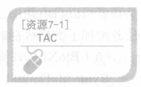
参赛者可以自由使用三种语言的语料作为训练数据。2017 年的 KBP 事件抽取任务增加了文档级别的事件识别和事件时序识别任务。

### （5）BioNLP 评测会议

Ryan McDonald 等[319] 2005 年首次提出面向生物医学的事件抽取，目标是从生物医学文献中获取触发词、类型、要素等生物事件信息。由东京大学组织的 BioNLP 评测是该方向最权威的会议，2009 至 2013 年举办三次：BioNLP 2009[239]、BioNLP 2011[240]、BioNLP 2013[241]，共含三个子任务，各自针对不同特异性水平的生物分子。

该系列极大推动了生物医学事件抽取，三届评测出现大量优秀系统。代表方法分两类：分阶段系统，如图尔库大学的 TEES 系统[56]、UTurku 系统[57]、EVEX 系统[189] 和 TEES-2.1 系统[58] 以及 Miwa 提出的 EventMine 系统[344] 等；联合系统，如曼彻斯特大学提出的 UMass 系统[397] 和 FAUST[398] 系统等。

### （6）TimeBank 语料库

TimeBank 语料[388] 起源于 Time and Event Recognition for Question Answering Systems, TERQAS 会议，由 National Regional Research Centre, NRRC 与 Advanced Research and Development Activity, ARDA 主办。时间标注采用 TIMEX3 格式的 XML 标签，TIMEX3[387] 在 TIMEX2 基础上提升了时间表达精度。

语料来源于 DUC、ACE、PropBank 的新闻报道。事件用 event class、event tense、event aspect 三属性描述。可标注词包括时态动词 tensed verbs、静态形容词 stative adjectives、事件名词 event nominal。划分为 Occurrence、Perception、Reporting、Aspectual、State、Intensional State、Intensional Action、Modal 八类。TimeBank 专注事件时间要素及事件间时序，不涉及其他要素，共 300 篇新闻，推动了时间要素与时序研究的发展。

### （7）其他相关语料

上述公开评测与语料是当前事件抽取最具影响力的资源。中文标注工作较少，Meng 等[325] 基于 200 篇国内外突发事件新闻构建 Chinese Event Corpus, CEC[325]。Lin 等[289] 提出面向中文的 TIMEX2 标注系统，用于自动标注时间短语。Yuan 等[515] 从 80 篇突发语料中标注地震、火灾、中毒、恐怖袭击四类，每类 20 篇。Ding 等[129] 从新浪 2008-2009 年半年音乐新闻中标注 6000 句音乐事件。Meng 等[326] 标注 4000 句金融事件。

总体看，事件抽取在国际评测与公开语料推动下发展。不同资源关注领域与粒度差异大，受事件结构复杂及语言表达多样性影响，事件框架尚未统一。现有语料多为人工标注，成本高导致类型少规模小，评测显示性能仍偏低，亟需更大规模语料与评测以支撑海量事件知识图谱构建。

## 7.2 限定域事件抽取

在评测与语料驱动下，事件抽取持续受关注。按类别确定方式可分为限定域与开放域。限定域在抽取前预先定义目标事件类型及每种类型的结构，即要素构成，常提供一定标注数据。受结构复杂性影响，数据规模普遍较小但能保证每类事件都有样本。ACE 事件抽取是最具代表性的限定域任务，共定义 8 大类事件，例如：business 商务事件、conflict 冲突事件、transaction 交易事件等，进一步细分为 33 类子事件。

该方向是信息抽取与知识图谱构建的关键环节，研究多集中于方法改进。按实现方式可分为基于模式匹配和基于机器学习两类。

### 7.2.1 基于模式匹配的事件抽取方法

该类方法在特定模式指引下完成识别与抽取，匹配即抽取。典型流程分模式获取与模式匹配两步。图 7.1 展示基本流程，模式质量直接影响准确率。按训练数据来源可分为有监督与弱监督两类。
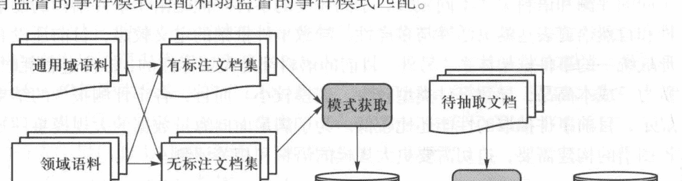
图 7.1 基于模式匹配的事件抽取方法的基本流程

### 7.2.1.1 有监督的事件模式匹配

模式完全依赖人工标注语料，需预先完整标注，效果受标注质量制约。一般包括语料人工标注、模式学习、模式匹配三步。

代表系统是 AutoSlog。Ellen[400] 等从 MUC-4 语料观察得出事件角色关系多可从短语上下文获得，据此提出假设：要素首次出现处即确定其与事件关系，且要素周围语句包含角色描述。1993 年据此开发 AutoSlog，定义 13 个模式，例如：
- （1）< 主语 > 被动式动词，例如：< 受害者 > 被谋杀了。
- （2）< 主语 > 主动动词，例如：< 嫌犯 > 制造了爆炸。
- （3）< 主语 > 动词不定式，例如：< 嫌犯 > 试图杀死。
- (4) 被动式动词 < 直接宾语 >，例如：被杀死的 < 受害者 >。
- (5) 主动式动词 < 直接宾语 >，例如：摧毁 < 目标 >。
- (6) 被动式动词 + 介词 + < 名词 >，例如：被用 < 工具 > 杀死了。

除模式外还需词典支持，如模式 “< 主语 > 被动式动词” 在 MUC-4 语料中动词词典为谋杀、爆炸等。基于人工标注语料提取模式大幅缩短了 CIRCUS[268] 领域词典构建时间。

Kim 和 Moldovan[242] 用语义框架与短语模式表示特定领域模式，开发 PALKA parallel automatic linguistic knowledge acquisition 系统，融入 WordNet 语义信息后，用 MUC 恐怖主义标注语料训练，抽取效果良好。

### 7.2.1.2 弱监督的事件模式匹配

这类抽取思路并不要求语料全量细标，只要人工先做粗分或给出少量种子模式，机器就能在预分语料或种子模式上自学事件表述规律。整体流程大致分两步：先由人工完成语料的预分类或种子模式的制定，再让机器基于此自动归纳模式。受制于人工标注成本高、耗时长且标注规范不统一的问题，Ellen 等提出了 AutoSlog-TS 系统[402]。它属于典型的弱监督模式匹配，训练时无需逐句逐实体标注，只需标明句子是否包含目标事件，然后在预分类数据上自动学习抽取模式，完成事件抽取。与需要对每句话和实体都做标注的 AutoSlog 不同，AutoSlog-TS 把标注粒度降到“是否含事件”即可。

Yangarber 等[242]从文本、模式与事件的相关性出发构建了 ExDisco，相比传统模式抽取，只需给出少量模式种子，无需对语料做人工标注，工作量大幅下降。Jiang 等[233]的 GenPAM 系统综合事件语义模式、触发模式和抽取模式，并在飞行事故文本上验证，表现较好。欧洲委员会联合研究中心 Jakub Piskorski 与 Hristo Tanev 等[380, 460]提出的 NEXUS 针对新闻中的灾难与暴力事件，先对新闻聚类，再用句法分析等 NLP 工具在聚类文档中匹配事件，随后借助弱监督学习扩充语料，实现事件抽取。

总体来看，基于模式匹配的方法在垂直领域效果可观，但对文本形式、语言、领域和文档格式依赖强，模板获取费时费力且专业性高，难以覆盖全部事件类型，语料变化时往往需要重新制模。

### 7.2.2 基于机器学习的事件抽取方法
模式匹配可移植性差、召回有限，研究重心转向机器学习，其中最具代表性的是有监督学习。该类做法把事件抽取视作多分类任务，先构建特征向量再用分类器完成抽取，常用模型包括支持向量机 SVM^[455]^、朴素贝叶斯 NBM^[317]^、隐马尔可夫模型 HMM^[141]^、最大熵模型 ME^[393]^、最大熵隐马尔可夫模型 MEMM^[36]^等。按监督数据需求，可划分为有监督事件抽取与弱监督事件抽取两种。

### 7.2.2.1 有监督事件抽取方法
有监督系统通常包含三步：训练样本表示，如特征向量的抽取与构建；挑选分类器并训练、调参；用训练好的模型在未标注数据上抽取事件实例。核心在于特征与分类器的选择。有监督抽取又可分为基于特征工程和基于神经网络两类。

### 1. 基于特征工程的方法
该类方法需显式把事件实例转为分类器可用的特征向量，研究重点是区分性特征的挖掘。典型流程为特征提取、模型训练、事件抽取。特征提取阶段会融合词汇、句法、语义等信息，形成局部与全局描述。

最具代表性的是 Ahn^[27]^ 2006 年的模型，同时使用 Timbl 与 MegaM，并为候选词抽取词法、上下文、实体、句法及 WordNet 语言学特征，完成事件抽取。该方法把任务当作两阶段多分类：先判断句中每个词是否为事件触发词，是则进入第二阶段对候选事件元素进行分类并判定其角色。

触发词分类阶段使用的特征包括：词汇级特征如当前词、下写形式、词干、词性、邻词的词与词性；句子级特征如依存路径标签、依存词、候选词在依存树中的深度、依存词词性、句中相关实体的类型及最近范围的实体类型；外部知识如词在 WordNet 中对应的同义词集 ID。

元素分类阶段把句中所有实体、值和时间表达作为候选元素，结合触发词提取特征，主要包括：触发词本身及其下写、词干、词性、依存深度及邻词特征；词汇特征如候选词、中心词、下写、词性、实体类型；句子级特征如候选词与触发词间的依存路径及两者间的词与词性。用这些特征训练 Timbl 与 MegaM，抽取效果良好，该方向的关键在于更优特征与模型。

Chieu 等[91] 于 2002 年把最大熵分类器引入事件抽取，使用 Unigram、Bigram、命名实体等简单特征，在卡内基梅隆大学语料上取得 86.9% 的 F1，超过当时最佳。Ralph Grishman 等[183] 在 ACE 2005 评测中也采用最大熵取得好成绩。Zhao 等[12] 于 2007 年提出在触发词抽取阶段对触发词进行扩展。

上述工作多止步于句子级特征，忽视篇章与背景知识。Ji 等[231] 2008 年提出跨文档事件抽取，利用与待抽文本相关的其他文本辅助判断。随后 Liao 等[286] 2010 年改进跨文本抽取，Hong 等[212] 提出跨实体抽取系统，Liu 等[297] 2016 年用概率软逻辑做推断，提升检测性能。

此外，McClosky 等 2011 年将生物事件抽取转化为依存树分析任务[318]。Li 等 2013 年[276] 用结构感知机解决 ACE 任务，实现事件类别与元素分类的同步。Li 等 2014 年[278] 进一步用结构预测模型联合抽取实体、关系与事件。

### 2. 基于神经网络的方法
特征工程过度依赖词性标注、句法分析等传统工具，易累积误差，且部分语言缺乏工具。从 2015 年起，研究集中于让神经网络直接从文本学习特征。流程包括特征表示、网络构建与高层特征学习、模型训练、模型分类。

以 Chen 等[86] 2015 年提出的动态多池化卷积神经模型为例，同样采用两阶段多分类，重点在元素抽取阶段。模型由四部分组成：词向量学习、词汇级特征表示、句子级特征抽取、事件元素分类。

特征表示采用无监督预训练的词向量，将候选词向量与其左右上下文拼接作为词汇级表示。网络构建使用动态多池化卷积神经网络学习句子组合语义，并针对一句话多事件的情况，依据触发词与候选元素动态捕获事件信息。训练阶段定义目标函数并用随机梯度下降优化，常用 Adadelta 等规则防过拟合。分类阶段直接对非结构文本完成特征抽取与分类。

Nguyen 等[358] 2015 年用卷积神经网络实现事件检测，未涉及元素抽取。Feng 等[153] 2016 年用循环神经网络进行检测，性能良好但同样仅覆盖第一阶段。Nguyen 等[359] 2016 年提出联合循环神经网络完成端到端抽取，进一步提升性能。

### 7.2.2.2 弱监督事件抽取方法
有监督方法需要大量标注样本，人工标注耗时、一致性差，面向海量异构网络数据时问题更突出。无监督方法虽无需标注，但得到的事件信息缺乏规范语义标签，难以对接知识库。弱监督事件抽取在保留规范标签的前提下降低标注成本。语料获取主要有两条路径：Bootstrap 自扩展与 Distant Supervision 远距离监督自动生成样本。

### 1. 基于 Bootstrapping 的事件抽取
核心思路是先用少量人工标注数据训练模型，再用模型对未标注数据分类，挑选高置信结果加入训练集迭代扩充，实现标注数据自动增长和事件自动抽取。图 7.2 基于 Bootstrapping 的事件抽取方法基本框架

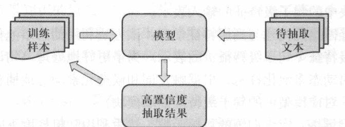

Chen 等[87] 2009 年提出先用高质量标注语料训练分类器，再用初步模型筛选高置信样本迭代扩充。Liao 等[287] 2010 年在相关文档中做自训练半监督学习，并引入全局推理保证样本多样性。Liao 等[288] 2011 年在词汇与句子两粒度上训练最大熵分类器，用互训练扩展标注数据。Liu 等[295] 2016 年用 ACE 语料训练的分类器判定 FrameNet 句子类别，通过全局推理映射语义框架与 ACE 类别，借 FrameNet 标注样例扩展训练数据，提升事件检测性能。目前该方向仍在起步，需要可自动生成大规模高质量标注数据的方法。

### 2. 基于 Distant Supervision 的事件抽取
为实现完全自动化，研究者提出用 Distant Supervision。利用结构化事件知识库对非结构化文本回标样本，再用回标数据训练模型。图 7.3 基于 Distant Supervision 的事件抽取方法基本框架

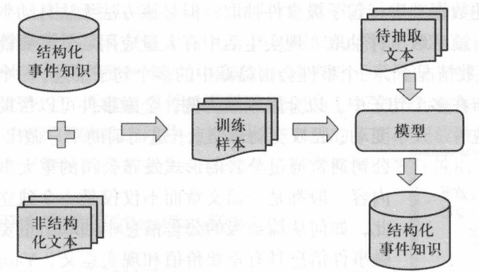

核心是先设定回标假设规则，再用结构化知识在非结构化文本中回标，将回标文本作为训练样本。代表性工作是 Chen 等 2017 年提出的方法[85]。图 7.4 描述了自动生成事件语料的框架，包含四个模块：核心元素检测，自动区分各类型事件中元素的重要性并定位核心元素；事件触发词检测，利用核心元素回标可能含事件的句子并定位触发词；触发词过滤与扩展，利用 FrameNet 等语言学知识去噪并补全触发词；标注数据的自动生成，通过远距离监督从非结构化文本中自动标注事件信息。实验表明该方法能有效生成大规模标注数据。

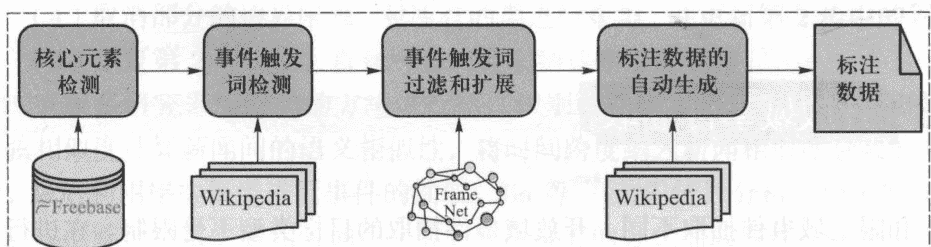

Chen 等 2017^[84] 虽能生成句子级标注数据，却无法处理篇章级标注。现实中大量场景需要篇章级抽取，一个事件常由多句描述，元素也分散在多句中。以金融为例，金融事件可帮助快速获取公司交易盈亏、人事变动、股权变动等信息，辅助决策。


公告类信息多以整篇文章形式发布，如何从篇章级公告中抽取结构化金融事件具有重要价值。Yang 等 2018^[535] 在 Chen 等 2017^[534] 基础上构建基于自动标注数据的篇章级中文金融事件抽取系统[资源 7-2]。针对标注耗时与成本高的问题，系统用远距离监督自动构建句子级与篇章级训练数据。抽取时先用神经标注模型联合抽取句子中的触发词与事件元素，再用卷积神经网络判断篇章中的事件描述主句，并以上下文补全篇章级事件信息。大量实验验证了有效性。

限定域事件识别因目标类型明确、样本可得，模式匹配与机器学习是主要手段，后者是当前主流。该类方法把抽取建模为分类。早期依赖手工设计的符号特征；近几年深度学习兴起，全连接神经网络^[295]^、卷积神经网络^[86, 358]^、循环神经网络^[153, 359]^均被成功应用。除此之外，弱监督学习也被广泛用于自动生成部分标注数据，缓解数据稀疏问题。然而限定领域事件远远不能满足大规模事件知识图谱构建等需求。

## 7.3 开放域事件抽取

相较于限定域任务，开放式事件挖掘不以预先制定的类型表为边界。启动时事件种类、内部结构均属未知，标注资源通常缺失。该方向多采用无监督策略，其理论支撑为分布假设 Distributional Hypothesis[198]：语境高度重合且用法相近的词义趋近。迁移到事件层面，若候选触发词或候选要素出现在相似语境中，则更可能对应同一事件范式并扮演相同角色。基于此共识，研究常以候选词的上下文作为事件语义的表征。按实现路径，开放式抽取大致可划分为两类：一类围绕内容表征做聚类挖掘，另一类围绕发布异常做检测挖掘。

### 7.3.1 内容表征驱动的聚类抽取
以内容表征为主线的流程通常包含两步：① 表示构建，对承载事件的句子、段落或文档做清洗，统一为可计算的特征形式；② 聚类发现，利用无监督手段把语义邻近的事例归并并探测新主题。最具代表性的是 Yang 等[508] 于1998年提出的组平均聚类，做法可概括为：

- 1. 文本表示：对每篇文档先做分句、去停词等预处理，再统计篇内词的 TF-IDF 并排序，用前 K 名 TF-IDF 构成的向量代表整篇。
- 2. 事件聚类与新事件发现：组平均聚类算法 Group Average Clustering
  （1）按时间顺序排列待聚类文本，初始将每篇文档视作一个类。新闻对同一主题的报道具有时效性和集中性，高峰通常集中在约两个月内，故时间因素须纳入聚类考量。
  （2）把当前结果切分为若干连续、不重叠、数量固定的区间。
  （3）在每个区间内用聚类方法把底层类合并为上层类，直至类数达到设定目标。
  （4）移除区间边界限制，对全部类重新聚类，并据此更新第2步的划分。
  （5）重复第2～5步，直到各类规模收敛。

沿此思路的相关工作很多。Nallapati[350] 用余弦相似度衡量新闻间语义相近度，并把时间跨度引入相似度衰减，最后用层次聚类完成抽取。Jia 等[532] 先统计文档词汇频次，再据此扩展相关词汇，最后通过聚类抽取主题。Stokes 等[445] 提出文档的多层次表示，既用文本内容表征文档，也借助 WordNet 构建深层语义表示，再基于两种表示联合聚类。Li 等[280] 利用概率模型实现新主题的识别与抽取。Yang 等[505] 将信息检索技术引入抽取。Yu 等[313] 提出层次化的识别方案，效果较好。Huang 等[222] 提出联合抽取事件及其结构，同时用符号特征和分布式特征刻画框架，并用联合模型同时抽取触发词、要素及角色。

无监督抽取的关键在于如何选择文本表示、相似度度量和聚类模型。它能够发现新主题，但产出往往是模板相近的簇，难以规则化，不易直接用于知识库建设，通常需要与已有框架对齐，或人工为每个簇赋予语义。

图 7.5 为 Ritter 等[404] 提出的开放域事件识别系统示例。他们基于推特语料做识别，并按发生时间把结果标注到日历上。图 7.5 中每个格子代表一个事件，由三行构成：第一行是主要参与实体，第二行是文本中表征该事件发生的词或短语，第三行是人工标注的事件类别。

November 2011

| Wed Nov 9 | Thu Nov 10 | Fri Nov 11 | Sat Nov 12 |

|---|---|---|---|

| EAS<br>test<br>Other | Robert Pattinson<br>show<br>Performance | iPhone<br>debut<br>Product Release | Sydney<br>perform<br>Other |

| The Feds<br>cut off<br>Other | James Murdoch<br>give evidence<br>Other | Remembrance Day<br>open<br>Performance | Pullman Ballroom<br>promoted<br>Other |

| Toca Rivera<br>promoted<br>Performance | RTL-TVI<br>post<br>TV Event | France<br>play<br>Other | Fox<br>fight<br>Other |

| Alert System<br>test<br>Other | Gotti Live<br>work<br>Other | Veterans Day<br>closed<br>Other | Plaza<br>party<br>Party |

| Max Day<br>give<br>Other | Bambi Awards<br>perform<br>Performance | Skyrim<br>arrives<br>Product Release | Red Carpet<br>invited<br>Party |

图 7.5 开放域事件识别系统的结果示例

### 7.3.2 以发布异常为线索的抽取
异常检测类方法不解析文本内容，而是通过发布量的异常来推断主题。其基本假设是重大事项发生时，媒体或社交网络会出现大量相关报道或讨论；反之，某个主题的讨论量骤增也暗示事项发生。基于此，Krumm 等[252] 先用回归模型预测各地区推特发布量，再对比实际值，超出阈值即判定事项发生，并用文本摘要从相关推文中抽取描述。类似地，Cheng 等[80] 在时间与空间两个维度对推特发布量做异常分析。前者是对文档整体异常的分析。Weng 等[483] 则把每个词的词频视为原始信号，借鉴小波分析为每个词建立信号模型并检测词频异常，最后把异常模式相似的词聚为一组以表征特定主题。

开放域识别虽能自动发现新主题，但产出常语义稀薄、难结构化。若要获得准确语义，通常需人工为每个簇标注语义标签。图 7.5 展示了 Ritter 等[404] 在推特上的识别结果，其中类别由人工标注。上述局限使得开放域结果难以直接用于其他 NLP 任务。

## 7.4 事件关联挖掘
前文已介绍抽取方法与语料。现实中事件并非孤立，彼此存在错综联系。从历史中归纳规律、厘清关联有助于全局理解并构建事件知识图谱。事件关系抽取以事件为基本语义单元，检测并抽取事件间的逻辑关联。目前尚无统一框架，常见关系包括事件共指、因果、子事件和时序等。

### 7.4.1 事件指代同一性挖掘
当两个事件表述指向现实世界的同一目标事项时，二者具有共指关系。如“2014 年 10 月，联想集团正式完成对摩托罗拉移动的收购”与“联想集团以 29.1 亿美元的价格收购了摩托罗拉移动”描述的是同一事项。共指发现有助于多源数据中事件合并、信息补全与校验。核心是计算事件表述相似度，通常使用两类特征：① 表述文本的语义相似度；② 事件类型与要素的相似度。Mayfield 等[315] 于 2009 年首次提出该任务，采用基于特征向量的语义分析判断共指，并发布手工标注集 ECB 用于评测，推动了该方向研究。Zhong 等[6] 提出事件影响因子计算方法，通过建立事件关系图 ERM 表示关系并据此消解共指，效果良好。Yang 等[3] 针对同一话题提出基于触发词和事件要素推断的关系抽取，对共指效果突出。Choubey 等[95] 利用事件间依赖与关系传递性实现共指消解。

### 7.4.2 事件因果关联挖掘
因果关系体现事项间的先后相继与由因及果，如“汽车尾气大量排放”导致“热岛效应”。抽取因果有助于理解演变，服务决策。但因果抽取困难：一个事项可能有多因多果；存在隐含因果，需考虑传递；有时需背景知识辅助，如“国家加大新能源汽车扶持”与“比亚迪股价涨停”单独看关联不明，结合“比亚迪是中国新能源车企”的背景知识才能推断因果。Yang 等[8] 基于事件要素语义构建事件与要素间的语义关联识别因果。Gan 等[214] 提出结构分析方法。Marcu 等[313] 用朴素贝叶斯分析相邻句词对概率抽取因果。Sorgent 等[438] 先用定制规则抽取再以贝叶斯推理优化。Fu 等[7] 提出基于层叠条件随机场的抽取方法，把因果抽取建模为事件序列标注。

### 7.4.3 子事件结构抽取
子事件关系反映粒度与包含，如“地震”包含“伤亡”“救援”“捐款”“重建”等子事件。随着互联网发展，重大事件如“MH370 失联”会衍生大量报道。专题页虽能组织相关新闻，但用户仍难一目了然，动态抽取子事件知识很有价值。相关探索包括[28, 30, 71, 166, 255, 260, 280, 309, 433, 507, 509]。代表性工作是 Hu 等的系列研究。Hu 等[216] 提出基于先验的增量子事件学习模型，用相似事件的子事件知识增强当前抽取。Hu 等[218] 利用 Wikipedia 事件页面知识，从相似维基页面学习事件类层次话题，提出概率贝叶斯网络结构学习方法，缓解多样性并建模子事件结构。Hu 等[217] 在此基础上提出端到端的上下文相关层次 LSTM，输入已观测子事件描述，自动生成下一个可能子事件描述。

### 7.4.4 事件时序关系抽取

事件时序关系指事件在时间上的先后顺序，如“小明进入餐馆后马上点了菜”与“吃完饭后直接回家”存在先后。时序不仅能厘清顺序，还能辅助其他关系，如原因必在结果之前，子事件时间通常与父事件重叠。目前研究多集中于英文，常用语料是 TimeBank[资源 7-3]。主流方法是机器学习，将时序识别转为多分类。TimeBank 遵循 TimeML 标注，TimeML 将时序分为 13 类，如之前 Before、之后 After、包含 Includes、被包含 Is Included、同时 Simultaneous 等。TimeEval 将关系分为之前、之后、重叠三类。Chambers 认为同一篇章中含相同事件要素的事件实例存在局部一致性，于是把这些实例组成事件链识别时序。Do 等提出联合多特征框架，把文章中事件按时间顺序构造成事件链。Ng 在此基础上借助篇章结构技术提升性能。Ge 等人提出时间敏感贝叶斯模型发现时段内事件，并用排序学习挑出代表性事件，构建主题大事年表。

## 7.5 小结
本章介绍了事件抽取与事件关系抽取。首先给出定义，介绍相关评测语料，随后阐述典型方法。事件抽取包括限定域与开放域。限定域主要介绍基于模式匹配和基于机器学习的方法；开放域主要介绍基于内容特征和基于异常检测的方法。事件关系抽取则涵盖共指、因果、子事件和时序。事件间关系是世界知识的重要组成，能表达实体关系难以覆盖的时空动态知识。当前多数知识图谱仅含实体与关系，缺乏事件知识，加入事件与事件关系将显著提升图谱表达能力，构建兼具实体、关系、事件与事件关系的知识图谱正受关注。

## 第八章 知识存储和检索
知识图谱因表示灵活、易用而获广泛关注。大量实例数据以基于三元组的 RDF 格式存储，如 DBpedia 含 127 种语言近 8000 万三元组，YAGO 超过 1.2 亿，Wikidata 近 4.1 亿，Freebase 超过 30 亿。如何高效存储与检索大规模图谱是关键研究问题。

知识图谱是有向图结构，描述现实世界中实体、事件、概念及其关系。节点代表实体/事件/概念，边代表关系。图 8.1 展示关于费米的知识图谱局部。节点为实体实例，均归属于抽象类型如“人物”“城市”。实体除类型外还有丰富属性，如图中蓝色部分，不同类型属性不同。知识图谱目标是构建刻画现实世界的知识库，支撑问答、信息检索等应用。对知识持久化存储并提供高效检索是系统基本功能。本章先介绍存储技术，按策略分为表结构存储和图结构存储；再介绍常见形式化查询语言；最后简述图搜索技术。

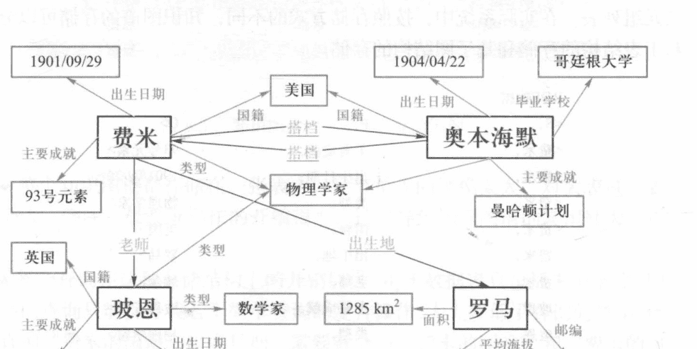
图 8.1 关于费米的知识图谱局部示意图

### 8.1 知识图谱的存储
知识图谱知识通过 RDF^{[244, 335]} 表示，基本单元是事实。每个事实为三元组<S,P,O>，S 为主语可取实体/事件/概念，P 为谓语为关系或属性，O 为宾语可取实体/事件/概念或普通值。图 8.2 列出知识图谱的三元组表示。实际系统中，按存储方式可分为基于表结构的存储和基于图结构的存储。

| RDF数据 |  |  |

|---|---|---|

| <S, | P, | O> |

| <费米, | 主要成就, | 93号元素> |

| <费米, | 出生日期, | 1901/09/29> |

| <费米, | 类型, | 物理学家> |

| <费米, | 国籍, | 美国> |

| <费米, | 出生地, | 罗马> |

| <费米, | 老师, | 玻尔> |

| <玻恩, | 主要成就, | 玻恩近似> |

| <玻恩, | 类型, | 物理学家> |

| <玻恩, | 类型, | 数学家> |

| ... | ... | ... |

图 8.2 知识图谱中知识表示的三元组列表

### 8.1.1 表结构存储方案

知识图谱的数据可以用二维表格来承载[106, 121, 421]。设计思路不一样，表结构也就会不一样。下面就以图 8.1 的知识图谱为例，说明几种常见做法。

### 8.1.1.1 三元组表

图谱里的事实本质上都是三元组，最直接的做法就是建一张三元组表把所有事实全放进去。现在不少成熟产品都是这么做的，比如 Jena[486]、Oracle[94]、Sesame[73]、3store[197]、SOR[304]、Rstar[306] 和 Virtuoso[143]。图 8.3 就是一个三元组表的示例。这种方式好理解、上手快，但短板也很明显：

|  |  |  |

|---|---|---|

| 费米 | 主要成就 | 93号元素 |

| 费米 | 出生日期 | 1901/09/29 |

| 费米 | 类型 | 物理学家 |

| 费米 | 国籍 | 美国 |

| 费米 | 出生地 | 罗马 |

| 费米 | 老师 | 玻尔 |

| 玻恩 | 主要成就 | 玻恩近似 |

| 玻恩 | 类型 | 物理学家 |

| 玻恩 | 类型 | 数学家 |

| ... | ... | ... |

图 8.3 知识图谱的三元组表存储示例

- 全部事实挤在一张表里，表会变得极大。查询、写入、删除、更新等操作成本飙升，实用性受损。
- 复杂查询代价高。因为只有三个字段，复杂问题只能拆成多个简单查询再组合，比如查“费米的国籍和出生日期”，就得先查国籍再查出生日期。

### 8.1.1.2 类型表

思路改为按类型建表，同一类型实例放同一张表。列对应该类实体的属性，行对应一个实例[486, 487]。图 8.4 给出了示例。这种做法缓解了三元组表的弊端，却引入新麻烦：①字段冗余严重。图谱里既有数学家也有物理学家，跨类的实例会在多张表里重复出现，共性属性被重复保存。比如玻恩既是数学家又是物理学家，会在两张表里各存一份，“主要成就”“出生日期”“国籍”等信息重复。如图 8.5 所示。②空值泛滥。图谱中实体未必在所有属性上都有值，这就导致大量列为空。

一个常用改进是把类别层级纳入设计。每个类型表只记该类型特有属性，公共属性上收到上一级类型表，下级表继承上级属性。图 8.6 展示了“费米”在考虑层级后的存储，其中图 a 是人物相关类别体系，图 b 是在该体系下设计的

城市表

| 主体对象 | 面积 | 平均海拔 | 邮编 |

|---|---|---|---|

| 罗马 | 1285 km² | 37 m | 00185 |

人物表

| 主体对象 | 主要成就 | 国籍 | 出生日期 | 出生地 |

|---|---|---|---|---|

| 费米 | 93号元素 | 美国 | 1901/09/29 | 罗马 |

| 奥本海默 | 曼哈顿计划 | 美国 | 1904/04/22 |  |

| 玻恩 | 玻恩近似 | 英国 | 1882/12/11 |  |

图 8.4 知识图谱的类型表存储示例

物理学家表

| 主体对象 | 主要成就 | 国籍 | 出生日期 |

|---|---|---|---|

| 玻恩 | 玻恩近似 | 英国 | 1882/12/11 |

| 费米 | 93号元素 | 美国 | 1901/09/29 |

| 奥本海默 | 曼哈顿计划 | 美国 | 1904/04/22 |

数学家表

| 主体对象 | 主要成就 | 国籍 | 出生日期 |

|---|---|---|---|

| 玻恩 | 玻恩近似 | 英国 | 1882/12/11 |

图 8.5 类型表存储中的数据冗余示例

图 8.6 考虑层级关系的类型表

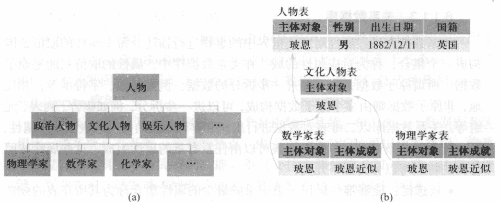

按类型组织数据，克服了三元组表单表过大、结构单一的问题，但仍有不足：

- 表的字段对应特定属性或关系，查询时必须指明属性，无法做属性不确定的模糊查询。
- 表与具体类型绑定，不同类型表结构各异，查询前必须先知道目标对象的类型才能定位表。系统通常要维护一张“属性—类型”映射表来辅助定位。
- 跨类型查询需要多表关联，开销大，限制了复杂查询能力[21]。
- 实体类型丰富时，表数量激增且相互关联，管理难度上升。

表结构存储还有其他变种，比如按属性切分，为每个属性单独建表[21]。不同方案各有取舍，实际选型要结合场景。

数据最终落盘要依赖存储引擎。关系数据库是典型的表结构系统，下面简述其特点。

### 8.1.1.3 关系数据库

关系数据库用属性来刻画现实事物。每个属性的取值范围叫域。关系数据库只允许原子数据取值，比如整数、字符串等，不能再拆分的才是原子；集合、列表、元组等非原子数据不被允许。数据以二维表组织，列是属性，行是记录。一张表可含任意数量属性，属性大致分：

- **候选键**：能唯一标识一条记录的最小属性集合。特点是唯一性和最小性。学号、身份证号各自都可作候选键，但“学号+身份证号”就不行，因为去掉任一仍唯一。
- **主键**：从多个候选键中挑一个。实践中多选单属性候选键。
- **外键**：本表某个属性或属性组是另一表的候选键。外键保证表间一致性，图 8.6(b) 的跨表引用就是靠外键实现。
- **主属性与非主属性**：出现在任一候选键里的属性叫主属性，其余为非主属性。

主流系统有 DB2$^{[110]}$、Oracle$^{[112]}$、Microsoft SQL Server$^{[111]}$、PostgreSQL$^{[184]}$、MySQL$^{[32]}$，都是成熟产品，文档完善，可用于图谱存储。

- **DB2**: IBM 1983 年推出，可跑在 Windows、Linux、VMS、OS/2 等平台。特点是支持面向对象编程、多媒体应用和分布式访问。详情见官网。
- **Oracle**: 甲骨文 1979 年推出，是目前最流行的数据系统之一。遵循标准 SQL，支持多种数据类型，跨平台。详情见官网。
- **Microsoft SQL Server**: 微软为 Windows 定制的数据库，基于 Sybase 技术开发，可完全兼容 Sybase。详情见官网。
- **PostgreSQL**: 免费开源，功能完善，支持大部分 SQL 标准及外键、复杂查询、触发器等。详情见官网。
- **MySQL**: 免费开源，最初由瑞典 MySQL AB 开发，2008 年被 Sun 收购。体积小、速度快、跨平台，中小网站常用。详情见官网。

关系数据库对外提供 SQL 接口，核心操作有插入、修改、删除、查询。INSERT 用来写入新记录，UPDATE 用来修改已有记录，DELETE 用来删除记录，SELECT 是最复杂也最重要的查询操作。若用关系数据库存图谱，所有操作都需先转成 SQL。

### 8.1.2 基于图结构的存储

把实体看成节点、关系看成带标签的边，知识图谱天然符合图模型。基于图的存储能直接呈现内部结构，有利于查询，也方便借用图论算法做深度挖掘和推理。

### 8.1.2.1 基于图结构的存储模型

用节点表征实体，用边表征关系[33]。图 8.7 是一个示例。节点可定义属性来描述实体特征。和表结构不同，图结构不按类型划分实体，不同实体的节点可以有不同属性。比如玻恩同时是物理学家和数学家，表结构需要两张表，图结构只需在该节点上同时定义两种类型属性即可。

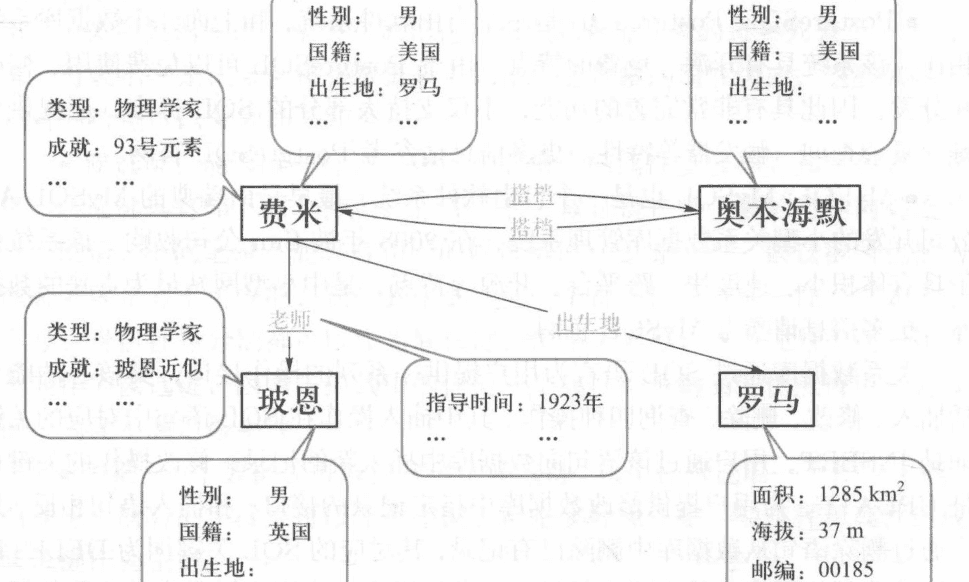

图 8.7 基于图结构的存储模型示例

图模型基于有向图建模，无向关系要转成一对对称的有向边。比如费米与奥本海默的“搭档”关系是无向的，图中就需要两条互为镜像的边来表达。另一个优点是边也能带属性，能更精细地刻画关系。

### 8.1.2.2 常用图数据库介绍

图数据库以图论为基础，用节点、边、属性表示数据。

- **节点**：代表实体或事件，可类比关系数据库的记录或行。比如人物、地点、电影。
- **边**：连接节点的带向连线，表示节点间关系，比如夫妻、同事。
- **属性**：描述节点或边的特性，比如人物的姓名、婚姻关系的起止时间。

常见系统有 Neo4j^[224]^、OrientDB^[303]^、InfoGrid^[436]^、HyperGraphDB^[437]^、InfiniteGraph^[225]^。

- **Neo4j**：开源图数据库，把结构化数据存于图而非表。Java 实现，完全事务、高性能。本地文件型数据库，无需启动服务器，访问快。开源、高性能、轻量，关注度持续升高。
- **OrientDB**：开源文档-图混合数据库，结合图表示能力与文档的灵活性。支持全模式、无模式、混合模式。全模式严格约束字段，无模式允许任意字段，混合模式兼顾两者。本地部署，支持事务、索引、SQL 查询等。
- **InfoGrid**：开源互联网图数据库，配套组件丰富，便于搭建图网络应用。是 Java 开源项目集，核心为图数据库，其余包含存储、用户界面等模块。
- **HyperGraphDB**：开源存储，基于 BerkeleyDB。有向图一条边只能连一个节点，超图可连多个节点。HyperGraphDB 在此基础上更进一步，边不仅可指向多个节点，还可指向其他边，表达能力更强。
- **InfiniteGraph**: Java 开发的分布式图数据库，需以服务形式安装运行。借鉴面向对象思想，节点继承 BaseVertex，边继承 BaseEdge。

相比成熟的关系数据库，图数据库发展较晚，标准和技术尚在完善，实际使用可能遇到问题。选型时除了性能，还要考虑易用性、文档完整性等。

## 8.2 知识图谱的检索

图谱上有多种检索需求。图 8.8 是一个检索示例，和前面例子略有差异。首先要新增实体“玻恩”，并新增一条“老师”边指向“费米”，同时补全玻恩的信息。其次，图中费米生日被标错了，需要改回 1901 年 9 月 29 日。再者，要把“奥本海默”实体连同所有相连边一并删除。最后，要找出图里既是数学家又是物理学家的人，这需要对实体做条件查询。下面说明如何在图谱上完成这些工作。


```
Prefix ns:<http://example.org/ns#>

ns:费米 ns:类型 ns:物理学家
ns:费米 ns:出生日期 ns:1902/09/29
ns:费米 ns:搭档 ns:奥本海默
ns:奥本海默 ns:搭档 ns:费米
ns:奥本海默 ns:类型 ns:物理学家
```

图 8.8 用于检索的知识图谱示例

### 8.2.1 常见形式化查询语言

图谱知识最终靠数据库存储，大多数数据库提供形式化查询语言供访问。关系数据库的标准语言是 SQL，图数据库常用 SPARQL。下面先介绍前者。

#### 8.2.1.1 SQL 语言

SQL 全称 structured query language，结构化查询语言，介于关系代数与关系演算之间，用来管理关系数据库。核心功能是插入、修改、删除、查询，已成为关系数据库标准。关系数据库用二维表存数据，这里假设示例图谱用三元组表存储，即只有三个字段。表 8.1 展示了图 8.1 部分数据的存储形式，本节以此表为例讲解 SQL 基础用法。

### 表 8.1 图 8.1 中的部分数据构成的三元组表
Triples

| S | P | O |

|---|---|---|

| 费米 | 类型 | 物理学家 |

| 费米 | 出生日期 | 1902-09-29 |

| 费米 | 搭档 | 奥本海默 |

| 奥本海默 | 搭档 | 费米 |

| 奥本海默 | 出生日期 | 1904-04-22 |

| 奥本海默 | 毕业学校 | 哥廷根大学 |

| 费米 | 出生地 | 罗马 |

| 罗马 | 平均海拔 | 37 m |

### 1. 数据插入

用 SQL 与 SPARQL 操纵知识图谱：以费米为例

想给费米补上导师信息，最直接的做法是在存放三元事实的表中追加新行。向关系表里添记录的任务由 INSERT 承担，标准形态是
```
INSERT INTO 表名 VALUES (值 1, 值 2, ...) [, (值 1, 值 2, ...), ...]
```

在这里，values 里的第一个占位、第二个占位……依次对应表里第一列、第二列……这种写法对值的顺序和个数要求很严，尤其是遇到可缺省的列时就显得不灵活。VALUES 后面的方括号是可选的，放入多组值就能一次写入多行。若只想填充部分列，可以把列名显式列出，语法变成
```
INSERT INTO 表名 (列 1, 列 2, ...) VALUES (值 1, 值 2, ...) [, (值 1, 值 2, ...), ...]
```

本次要补的内容是玻恩的实体类型，以及费米与玻恩的师生关系，即 S 为费米、P 为老师、O 为玻恩这条事实。对应的写库语句为
```
INSERT INTO Triples VALUES ('费米', '老师', '玻恩'), ('玻恩', '类型', '数学家'), ('玻恩', '类型', '物理学家')
```

如果事先点名要写入的列，写法如下
```
INSERT INTO Triples (S, P, O) VALUES ('费米', '老师', '玻恩'), ('玻恩', '类型', '数学家'), ('玻恩', '类型', '物理学家')
```

执行后表 8.1 的内容演变为表 8.2。

### 表 8.2 插入数据结果示例

| S | P | O |

|---|---|---|

| 费米 | 类型 | 物理学家 |

| 费米 | 出生日期 | 1902-09-29 |

| 费米 | 搭档 | 奥本海默 |

| 奥本海默 | 搭档 | 费米 |

| 奥本海默 | 出生日期 | 1904-04-22 |

| 奥本海默 | 毕业学校 | 哥廷根大学 |

| 费米 | 出生地 | 罗马 |

| 罗马 | 平均海拔 | 37 m |

| 费米 | 老师 | 玻恩 |

| 玻恩 | 类型 | 数学家 |

| 玻恩 | 类型 | 物理学家 |

### 2. 数据修改
新实体和关系写入后，下一步是把费米的生日纠正为正确日期，这属于对三元表的更新操作，SQL 以 UPDATE 完成，基本形式是
```
UPDATE 表名 SET 列 1= 值 1, 列 2= 值 2, ... WHERE 条件
```

条件子句用来锁定目标行，若省略条件整表都会被改动，风险很大，必须谨慎。本例仅把费米的出生日期改为 1901-09-29，语句写成
```
UPDATE Triples SET O = '1901-09-29' WHERE S = '费米' and P = '出生日期'
```

执行后表 8.2 变为表 8.3。

### 表 8.3 修改数据结果示例

| S | P | O |

|---|---|---|

| 费米 | 类型 | 物理学家 |

| 费米 | 出生日期 | 1901-09-29 |

| 费米 | 搭档 | 奥本海默 |

| 奥本海默 | 搭档 | 费米 |

| 奥本海默 | 出生日期 | 1904-04-22 |

| 奥本海默 | 毕业学校 | 哥廷根大学 |

| 费米 | 出生地 | 罗马 |

| 罗马 | 平均海拔 | 37 m |

| 费米 | 老师 | 玻恩 |

| 玻恩 | 类型 | 数学家 |

| 玻恩 | 类型 | 物理学家 |

### 3. 数据删除
接下来要把知识图谱里奥本海默这个实体及其相连的边一并移除，在三元表里用 DELETE 即可实现，基本语法是
```
DELETE FROM 表名 WHERE 条件
```

与更新类似，条件是可选的，但不写条件会清空整表，需特别注意。本例一条语句就能把奥本海默作为主语或宾语出现的三元组全部抹除：
```
DELETE FROM Triples WHERE S = '奥本海默' or O = '奥本海默'
```

执行后表 8.3 变为表 8.4。

### 表 8.4 删除数据结果示例

Triples

| S | P | O |

|---|---|---|

| 费米 | 类型 | 物理学家 |

| 费米 | 出生日期 | 1901-09-29 |

| 费米 | 出生地 | 罗马 |

| 罗马 | 平均海拔 | 37 m |

| 费米 | 老师 | 玻恩 |

| 玻恩 | 类型 | 数学家 |

| 玻恩 | 类型 | 物理学家 |

### 4. 数据查询
图谱搭建完成后就需要检索，SQL 使用 SELECT 来完成，结果会暂存到一个临时表里，基本写法是
```
SELECT 列 1, 列 2, ... FROM 表名 WHERE 条件
```

它从指定的表中取出所有符合条件的行，并按列 1、列 2……组织成结果返回。若要查看整表全部列，可写成
```
SELECT * FROM 表名 WHERE 条件
```

例如从表 8.4 中找出所有数学家实体，语句为
```
SELECT S FROM Triples WHERE P = '类型' and O = '数学家'
```

查询结果如表 8.5。

### 表 8.5 查询数据结果示例

Triples

| S |

|---|

| 玻恩 |

SELECT 是 SQL 中最灵活的语句，上述只是基础用法。配合内置函数还能做最大值、最小值、平均值等统计，也能做排序、分组；多表情境下可借助 JOIN。本例要找既是物理学家又是数学家的实体，就需要在三元表上做 JOIN，语句如下
```
SELECT DISTINCT T1.S
FROM Triples AS T1
INNER JOIN Triples AS T2 ON T1.S = T2.S
WHERE T1.P = '类型' and T1.O = '物理学家'
and T2.P = '类型' and T2.O = '数学家'
```

返回结果与表 8.5 相同。

### 8.2.1.2 SPARQL 语言

SPARQL [107, 385] 是 W3C 为 RDF 数据制定的查询语言与获取协议，被主流图数据库广泛支持。和 SQL 一样，它是结构化查询语言，用于数据的获取与管理，涵盖写入、删除与查询。因为 RDF 本身以三元组呈现，所以三元组在 SPARQL 中占据核心位置。本节以图 8.8 子图为例，演示如何用 SPARQL 补全缺失事实、删除指定事实、修正错误事实以及检索。


### 图 8.9 图 8.8 子图及对应 RDF 数据

### 1. 数据插入
写入新事实就是把新的三元组加入已有 RDF 图，SPARQL 以 INSERT DATA 实现，基本语法是
INSERT DATA 三元组数据

三元组可用‘.’分隔，多条一起写入；用‘;’可在同一主语下连续写入多条。若该三元组已存在，系统会忽略。例如向图 8.9 表示的 RDF 图中插入
- ns: 费米 ns: 老师 ns: 玻恩.
- ns: 玻恩 ns: 类型 ns: 数学家.
- ns: 玻恩 ns: 类型 ns: 物理学家.
对应的 SPARQL 为
```
prefix ns: <http://example.org/ns#>
INSERT DATA {
ns: 费米  ns: 老师  ns: 玻恩 .
ns: 玻恩  ns: 类型  ns: 数学家 ;
    ns: 类型  ns: 物理学家 .
}
```

执行后图 8.9 的图谱及 RDF 数据如图 8.10 所示。


Prefix ns:<http://example.org/ns#>

ns:费米 ns:类型 ns:物理学家

ns:费米 ns:出生日期 ns:1902/09/29

ns:费米 ns:搭档 ns:奥本海默

ns:奥本海默 ns:搭档 ns:费米

ns:奥本海默 ns:类型 ns:物理学家

ns:费米 ns:老师 ns:玻恩

ns:玻恩 ns:类型 ns:数学家

ns:玻恩 ns:类型 ns:物理学家

(a)

(b)

图 8.10 SPARQL 插入数据结果示例

### 2. 数据删除
从 RDF 图中移除三元组用 DELETE DATA，基本语法是
DELETE DATA 三元组数据

可以一次性列出多个，存在就删，不存在则忽略。例如删除三元组（ ns: 奥本海默 ns: 类型 ns: 物理学家 ）的语句为
```
prefix ns: <http://example.org/ns#>
DELETE DATA {
    ns:奥本海默  ns:类型  ns:物理学家 .
}
```

执行后图 8.10 变为图 8.11。

若要删除奥本海默这个节点，需使用
```
prefix ns: <http://example.org/ns#>
DELETE WHERE {
    ns:奥本海默  ?p  ?o .
    ?s  ?p  ns:奥本海默 .
}
```

执行后图 8.11 变为图 8.12。


Prefix ns:<http://example.org/ns#>

ns:费米 ns:类型 ns:物理学家

ns:费米 ns:出生日期 ns:1902/09/29

ns:费米 ns:搭档 ns:奥本海默

ns:奥本海默 ns:搭档 ns:费米

ns:玻恩 ns:类型 ns:物理学家

ns:费米 ns:老师 ns:玻恩

ns:玻恩 ns:类型 ns:数学家

ns:奥本海默 ns:类型 ns:物理学家

(a)

(b)

图 8.11 SPARQL 删除单个三元组结果示例


Prefix ns:<http://example.org/ns#>

ns:费米 ns:类型 ns:物理学家

ns:费米 ns:出生日期 ns:1902/09/29

ns:玻恩 ns:类型 ns:物理学家

ns:费米 ns:老师 ns:玻恩

ns:玻恩 ns:类型 ns:数学家

ns:奥本海默 ns:搭档 ns:费米

ns:费米 ns:搭档 ns:奥本海默

(a)

(b)

图 8.12 SPARQL 删除节点结果示例

### 3. 数据更新
SPARQL 并未定义原生的 UPDATE，只能通过 DELETE DATA 与 INSERT DATA 组合实现更新。例如把图 8.12 中三元组（ns: 费米, ns: 出生日期, “1902/09/29”）的值改为 “1901/09/29”，先删后插，代码为
```
prefix ns: <http://example.org/ns#>
DELETE DATA { ns:费米 ns:出生日期 "1902/09/29" . };
INSERT DATA { ns:费米 ns:出生日期 "1901/09/29" . }
```

执行后得到图 8.13。


(a)

```
Prefix ns:<http://example.org/ns#>

ns:费米 ns:类型 ns:物理学家
ns:玻恩 ns:类型 ns:物理学家
ns:费米 ns:老师 ns:玻恩
ns:玻恩 ns:类型 ns:数学家
ns:费米 ns:出生日期 ns:1901/09/29
```

(b)

图 8.13 SPARQL 更新数据结果示例

### 4. 数据查询
SPARQL 提供 SELECT、ASK、DESCRIBE、CONSTRUCT 四种检索形式。SELECT 最常用，和 SQL 的 SELECT 类似，用来从图谱中取出满足条件的数据；ASK 用来判断是否存在，返回 yes/no，不返回具体条目；DESCRIBE 用来获取与指定资源相关的描述；CONSTRUCT 根据查询结果生成 RDF。

SELECT 的基本语法是
```
SELECT 变量 1 变量 2 ... WHERE 图模式 [修饰符]
```

由 SELECT 子句、WHERE 子句和可选修饰符构成。SELECT 子句列出要返回的变量，WHERE 子句用图模式对变量施加约束，图模式由三元组和 FILTER 条件组成。修饰符可做排序、限制数量等。例如在图 8.13 中查类型既是数学家也是物理学家的节点，语句为
```
prefix ns: <http://example.org/ns#>
SELECT ?s
WHERE {
    ?s ns:类型 ns:数学家 .
    ?s ns:类型 ns:物理学家 .
}
```

查询结果如表 8.6。

## 表 8.6 SPARQL 查询数据结果示例

| ?s |

| --- |

| 玻恩 |

ASK 语句用于测试是否存在满足图模式的数据，基本语法是
```
ASK 图模式
```

例如测试图 8.13 中是否存在费米的老师，语句为
```
prefix ns: <http://example.org/ns#>
ASK { ns:费米 ns:老师 ?o . }
```

结果返回 yes；若无该关系则返回 no。

DESCRIBE 语句用于获取与给定资源相关的数据，基本语法是
```
DESCRIBE 资源或变量 [WHERE 图模式]
```

DESCRIBE 后可跟确定的资源标识符也可跟变量，WHERE 子句可选，用来限定变量需满足的图模式。例如获取老师为玻恩的节点全部信息，语句为
```
prefix ns: <http://example.org/ns#>
DESCRIBE ?s WHERE { ?s ns:老师 ns:玻恩 . }
```

执行结果为
```
@prefix ns: <http://example.org/ns#>
ns:费米 ns:类型 ns:物理学家 .
ns:费米 ns:出生日期 "1901/09/29" .
ns:费米 ns:老师 ns:玻恩 .
```

CONSTRUCT 语句用于生成满足图模式的 RDF 图，其基本语法为
CONSTRUCT 图模板 WHERE 图模式

图模板的职责是界定最终 RDF 图里会出现的三元组形态，它由若干三元组拼成，既能包含变量的模板式三元组，也能包含已确定的事实三元组；图模式与前面 SELECT 等查询中讲过的概念一致，主要用来限定变量的取值范围。语句运行的整体思路是先跑 WHERE 子句，在知识图谱里找出所有符合图模式的变量绑定；随后基于每组绑定，把变量代入 RDF 图模板，得到对应的三元组集合。比如在图 8.13 所展示的知识图谱上运行下面这条 SPARQL 语句：

```
CONSTRUCT {
    ?s ns:搭档 ns:奥本海默 .
    ns:奥本海默 ns:搭档 ?s .
}
WHERE {
    ?s ns:老师 ns:玻恩 .
}
```

运行后得到的结果为

```
@prefix ns: <http://example.org/ns#>
ns:费米 ns:搭档 ns:奥本海默 .
ns:奥本海默 ns:搭档 ns:费米 .
```

## 8.2.2 基于图的检索技术
知识图谱在本质上就是以图的形式组织信息，故采用图式存储能很直观又灵活地表达与保存知识。只是把知识图谱建模成图也有明显的短板，传统图查询的计算代价往往很高，提升查询效率因此成为研究热点。

在数学里，图 G 通常记作二元组 (V,E)，即 G = (V,E)。V 代表所有节点，E 代表节点间连线构成的边集。图查询指在给定的图集合中寻找目标查询图，本质上是要判断查询图能否作为数据图的一部分，也就是常说的子图匹配。下面给出形式化描述：

子图匹配问题就是：给定查询图 Q 与目标图集合 D = {G_i}，在 D 中定位出所有与 Q 结构相同的子图。

图 G1(V1,E1) 与图 G2(V2,E2) 称作子图同构，当且仅当存在双射 f : V1 → V2，使得 G1 中任意边 e(v1,v2) ∈ E1，对应到 G2 中都有边 e'(f(v1),f(v2)) ∈ E2。

学界已证明子图同构是 NP 完全问题[328]，目前没有已知的多项式时间解法。与纯数学图不同，知识图谱的节点自带标签，如实体类型；边也带有标签，如关系类型。尽管理论复杂度很高，实际运行往往仍在可接受范围内[160]，原因有二：一是知识图谱的连接通常比较稀疏，不易触及最坏情况；二是标签信息能大幅剪枝搜索空间。

知识图谱规模庞大，包含众多连通分量。匹配时若逐一比对成本太高，图数据库通常会先做预筛选，缩小候选子图数量。

### 8.2.2.1 子图筛选
图索引是子图筛选的常用手段。其思路与信息检索类似，在预处理阶段依据图的特征建索引；查询时借助查询图的特征快速定位候选子图，避免全量扫描。常见做法分为路径索引和子图索引两类。

路径索引会把知识图谱里长度不超过阈值的所有路径收集起来，并据此为子图建立倒排索引[424]。匹配时先从查询图中抽取代表性路径，用索引召回包含这些路径的候选子图，再在候选上做同构校验。优点是路径提取直观、建库容易；缺点也很突出：路径长度增长时数量指数爆炸，大规模图上存储与检索成本飙升；而且不同路径的区分能力差异大，区分度低的路径对剪枝帮助有限[504]。

子图索引把子图本身当作特征[88, 527, 529]，核心在于在保持区分度的前提下压缩索引规模。常见做法是挖掘知识图谱中的频繁子图来建索引。频繁度反映子图出现次数，实际使用需设阈值控制索引范围。阈值设高，单个索引项会命中过多子图，过滤不力；阈值设低，索引项激增导致空间与查询开销上升，故阈值选择需权衡。

### 8.2.2.2 子图同构判定
子图同构至今仍是 NP 难题，是否拥有多项式解法未定[328]。Ullmann 算法[467] 是工程中常用的枚举式判定方法，能列出全部同构子图。

设 M_A、M_B 分别为图 A、B 的邻接矩阵，M_(i,j) 为 1 表示节点 i、j 有边相连，否则为 0。Ullmann 要找映射矩阵 F，满足

∀(i,j), M_A(i,j) = 1 ⟹ M_F(i,j) =* 1  (8.1)

其中 M_F = F(F·M_B)^T。算法大致三步：先初始化 F，若节点 i 与 j 标签一致且 deg_A(i) ≤ deg_B(j)，则允许 i→j；再对 F 中为 1 的位置进行修剪，保证每行每列至多一个 1，得到候选映射；最后从候选中筛选满足式 8.1 的矩阵作为解。算法1给出伪代码。除 Ullmann 外，VF 算法[108]、VF2 算法[109]、Nauty 算法[320] 等也是常用方案，可参考 “A Performance Comparison of Five Algorithms for Graph Isomorphism”[160] 的对比分析。

算法 1 Ullmann 子图判定算法

```
输入： 图 A、图 B 的邻接矩阵 M_A、M_B
输出： 所有合法的映射矩阵集合 ANS
1: ANS={} ▷ 合法的映射矩阵集合
2: 创建矩阵 F, F_(i,j) = 1 当且仅当图 A 的顶点 i 和图 B 的顶点 j 具有相同的标签，并且图 A 中顶点 i 的度不大于图 B 中顶点 j 的度。
3: for F_(i,j) == 1 do
4:   if 图 A 中顶点 i 的某个邻接点 i' 在图 B 中没有 j 的邻接点与之对应 then
5:     重置 F_(i,j) 的值为 0
6:   end if
7: end for
8: if F 中某行或某列的元素全部为 0 then
9:   图 A 和图 B 没有子图同构，结束程序
10: end if
11: C_F={} ▷ 候选的 F 矩阵集合
12: for F_(i,j) == 1 do ▷ 枚举所有可能的合法 F 矩阵
13:   F_(i,j) = 0
14:   if F 的每一行和每一列都至多有一个 1 then
15:     F 加入到候选集合 C_F 中
16:   else
17:     递归地修改 F，并将满足条件的 F 加入到集合 C_F 中
18:   end if
19:   F_(i,j) = 1
20:   if F 的每一行和每一列都至多有一个 1 then
21:     F 加入到候选集合 C_F 中
22:   else
23:     递归地修改 F，并将满足条件的 F 加入到集合 C_F 中
24:   end if
25: end for
26: for F ∈ C_F do
27:   if F 满足公式 8.1 then
28:     将 F 加入到 ANS
29:   end if
30: end for
```

## 8.3 本章回顾
本章围绕知识图谱的存储与检索展开，要点如下：① 知识需要持久化，实践中主要有表结构存储与图结构存储两种，前者见 8.1.1，后者见 8.1.2。② 表结构存储用二维表承载知识，可按需设计三元组表、类型表等，通常借助关系数据库实现。③ 把实体映射为节点、关系映射为边，知识图谱天然符合图模型，图结构存储直接体现这种结构，常用图数据库实现。④ 8.2.1 小节介绍了 SQL 与 SPARQL，分别是关系库和图库的标准查询语言。⑤ 因图查询复杂度高，工程上常拆分为子图筛选与子图同构判定两阶段。

## 第九章 知识推理概览
前文已介绍知识表示与获取，本章聚焦知识图谱的另一核心任务——推理，并系统梳理典型任务与常用方法。

## 9.1 典型推理任务
与非结构化数据相比，结构化知识图谱更利于推理。知识推理是 AI 迈向认知智能的关键，其中在构建与应用中最常见的是知识补全和知识问答，下面先简述二者，再展开方法。

### 9.1.1 知识补全
知识补全也称事实补全。知识图谱虽存大量结构化信息，却远未完善，例如人物“A”有出生地却缺国籍，概念已定义属性但实例缺失，如国籍(A,?) 未填。对形如 r(h,t) 的三元组，若 h、r 或 t 缺失，需通过推理补全，这类任务即为链接预测。链接预测是知识补全的核心手段，可用于完善图谱。知识补全常见评估有三元组分类与链接预测。

（1）三元组分类：三元组分类用于判断给定三元组 r(e1,e2) 是否成立，如“首都（北京，中国）”正确，“首都（成都，中国）”错误，属于二分类。补全时可尝试在任意两实体间加边形成新三元组，再判真伪，若为真则加入图谱。

（2）链接预测：链接预测旨在补全三元组头实体或尾实体。从正确三元组删去头或尾，检验模型能否预测回原实体。若能，则在对应实体间建立关系，否则丢弃。

### 9.1.2 知识问答
基于知识的问答需先理解自然语言问句，再在图谱中定位答案。推理的根源仍是知识缺失，需通过推理抽取隐含信息。据缺失形式可分为两类。

（1）简单推理问题：若问题可转成查询三元组 r(h,?) 或链式查询 r1(h,m1),…,rn(mn-1,?)，且图谱中缺失其中一个或多个三元组，则需推理补全。这类为简单推理。例如“唐朝开国皇帝是谁？”若开国皇帝（唐朝，李渊）缺失，需链接预测补全。类似“唐朝开国皇帝的父亲是谁？”可先补全前者，再查询父亲关系。

（2）复杂推理问题：若问题不能化为单一链接查询，而表现为多链非链式或含嵌套的复杂结构，且图谱缺乏显式定义，则需推理生成结构。可能因关系未定义，如 Freebase 缺“奶奶”；也可能是答案本身复杂，如“桃树开花后结果，开花主要目的？”答案为“吸引蜜蜂采蜜”。此类归为复杂推理。

补全与问答都依赖发现未显式知识，故推理是核心技术。补全任务在评估推理更直观，后续方法多以补全为例验证。

## 9.2 推理分类
推理是贯穿多学科的核心概念，亚里士多德的三段论奠定现代演绎基础。在计算机领域，推理是从前提到结论的过程，常见分类有演绎、归纳、溯因三类，按任务划分；按方法可分确定性逻辑推理与概率式不确定推理。近年来深度学习与符号数值化推动表示学习进入推理，表示逻辑或直接预测目标，可归为数值推理。后文将分别介绍归纳与演绎、确定与不确定、符号与数值三组视角。

### 9.2.1 归纳推理和演绎推理
按任务分推理为归纳、演绎、溯因三类，本文暂不展开溯因。

#### 9.2.1.1 归纳推理
归纳是自特殊到一般的概括，即由部分实例的共性推断整体规律。它是普适思维方式，步骤通常为观察分析、形成猜想、检验猜想。

可以举鲸鱼喷水为例：蓝鲸、抹香鲸、座头鲸均可喷射水柱，可归纳为所有鲸鱼皆可喷水。步骤如下：1）构建事实集 <蓝鲸，可以喷射，水柱>；<抹香鲸，可以喷射，水柱>；<座头鲸，可以喷射，水柱>。2）发现模式 <XX 鲸，可以喷射，水柱>。3）提出假设：若 X 为鲸鱼，则 X 可喷水。4）用齿鲸验证，成立。人类的归纳如此，计算机则多借助数据挖掘从实例中归纳规则，详见 9.2.2.2。

#### 9.2.1.2 演绎推理
演绎是自一般到特殊的推导，从普适前提推出具体结论。经典形式是亚里士多德三段论，含大前提、小前提与结论。如虎鲸有背鳍、背鳍鲸属海豚科，故虎鲸属海豚科。演绎不限于三段论，强调循证推导，常用于数学证明。下面以《威尼斯商人》猜盒为例：鲍西娅设金银铅三盒各有一句，其中只有一盒藏肖像，三句话中至多一真。金盒：“肖像不在此盒”；银盒：“肖像在铅盒”；铅盒：“肖像不在此盒”。求婚者如何判断肖像所在？选项 A、金盒子

盒子谜题拆解：从矛盾关系看演绎

- 选项 B：银质盒
- 选项 C：铅质盒
- 选项 D：无法判定

乍看像个脑筋急转弯，实则是一道典型的演绎矛盾推理演示。在同一个语境下，银盒和铅盒的说法针对同一事实，二者构成矛盾命题：不可能同真，也不可能同假，真假必然相反。

再结合题设的隐含前提，三个盒子上的陈述至多只有一条成立。于是金盒子的表述被迫为假，说谎的金盒意味着肖像藏在金盒之中，正确答案为 A。

矛盾只是演绎推理的一个切片。演绎还高度依赖充分条件与必要条件的辨析。自然语言里，“如果…就…”、“有…就有…”、“一旦…就…”这类句式指向充分条件；“没有…就没有…”、“不…不…”、“除非…才…”、“除非…否则…”这类句式则指向必要条件。措辞的细微差异足以逆转推导方向。比如“只有认错才能改正”和“只要认错就一定能改正”表达的逻辑关系完全不同。

归纳与演绎在思维层面有相通之处，但演绎体系庞大，无法一次性讲透。在计算机与人工智能的语境下，演绎即依据已有知识或规则推出未知结论的过程。

## 9.2.2 确定性推理与不确定性推理

### 9.2.2.1 确定性逻辑推理

确定性逻辑推理常被简称为逻辑推理。它具备完整的推导链条和较强的表达能力，能依据专家事先定义好的规则严格推出唯一结论。初始事实和规则集固定后，结论也就唯一确定。因此该方向并不讨论准确性高低，研究重点在于如何更快、更自动化地完成推导。

大量工作集中在特定逻辑体系下的自动推理算法设计。命题可满足性求解常用 GSAT、WALKSAT；面向一阶逻辑，前向链接以 rete 算法为代表，反向链接被 Prolog 采用。自 1879 年 Gottlob Frege 建立首个完整的一阶逻辑推理系统以来，自动推理系统不断涌现：面向数学定理证明的 VAMPIRE、领域无关的 SOAR、以及可编程的通用逻辑语言 Prolog，后者被广泛用于各类推理器和专家系统的构建。

21 世纪初，W3C 提出 RDF 标准，随后语义网、开放链接数据等项目推进，基于 RDF 三元组的确定性推理得到发展。欧盟主导的知识计算平台 LARKC，即大规模知识加速器，致力于分布式知识推理；WebPIE 是一个基于 OWL 的大规模分布式推理系统。


为平衡语义表达与推理效率，后续出现了基于 OWL 子语言和描述逻辑的系统，如 ELK、DLV、Pellet。这类方案让领域专家专注专业内容，推理规则由系统设计者封装，已积累大量数据、语言、计算与分布式框架。确定性逻辑推理因精度高、速度快至今仍活跃。

然而面对真实世界，尤其是网络大规模知识图谱中的不确定乃至错误事实，确定性推理难以应对。例如出生地 ⇒ 国籍 是一条可信度很高的规则，却非绝对；YAGO 在抽样中宣称约有 5% 的错误事实。这类情况需要引入统计或概率手段对确定性规则做软化，由此催生概率推理。

确定性技术难以胜任充满不确定性的自然语言处理任务，如知识问答，主要有三点：① 现有自然语言理解很难稳定地把自然语言转成确定性逻辑需求；② 问答等任务中的“规则”难以人工枚举，统计挖掘出的规则天然带有不确定性；③ 现实世界本身的不确定性决定了一些问题无法用确定性推理作答。

### 9.2.2.2 不确定性推理

不确定性推理又称概率推理，是机器学习与统计学习的重要分支。它不像规则推理那样严格执行，而是依据历史经验与专家先验构建概率模型，再借助统计计数、最大后验概率等手段对假设进行校验或推测。按特征模式与来源，可分为概率图模型、概率逻辑推理和关联规则挖掘三类。

### 1. 概率图模型

概率推理与概率图模型关系密切。20 世纪早期 Sewall Wright 就用网络表示概率信息，用于分析基因遗传和动物生长等不确定因素。概率图模型按结构分为有向图的贝叶斯网络和无向图的马尔可夫网络。贝叶斯网络在医疗、电力、计算机系统等专家系统里应用广泛。核心目标是条件概率查询 P(Y|E = e)，后验分布通过最大后验概率 MAP 求解。

无约束的概率图推理一般是 NP 难问题，近似求解同样困难。相关研究持续进行，主要方向有：① 和积变量消除，通过对变量求和并与相关因子相乘来简化结构；② 置信传播或期望传播，把推理转为图上的优化问题，以能量函数或势函数求极值实现近似；③ 采样方法，从部分变量实例出发统计估计，包括马尔可夫链蒙特卡洛采样 MCMC、Metropolis Hasting 算法，以及面向无向图的 Gibbs 采样。

概率图模型理论基础深厚、应用历史长，本章不展开，详见《概率图模型：原理与技术》。单纯的概率图模型只对实例级元素及其直接概率依赖建模，缺少更高层次的语义抽象与可复用规律，在大规模知识图谱上会因海量知识间的复杂概率依赖产生巨大计算负担，并不擅长大规模知识推理。

### 2. 概率逻辑推理

概率逻辑推理用概率图模型刻画逻辑，弥补了概率图缺少可复用规则的短板。早期 Nilsson 和 Bacchus 分别对命题逻辑和一阶逻辑做概率化，并用知识库里的三元组约束可能世界的概率。随着知识图谱规模爆发，即使借助马尔可夫毯等局部依赖假设，对全部实例建模也不现实。于是出现基于逻辑变量或规则模板的模型，最典型的是融合马尔可夫网与一阶逻辑的马尔可夫逻辑网 MLN。

MLN 可视为构造马尔可夫网的模板，它维护一个一阶逻辑规则库，并为每条规则赋权，对可能世界进行软约束。比如判断“C 罗的国籍是什么”，规则
父亲(X,Y)∧国籍(Y,Z)⇒国籍(X,Z)
孩子(X,Y)∧国籍(Y,Z)⇒国籍(X,Z)
就能被使用。前者表示父子同国籍，后者表示父子同国籍，虽然大体成立，却受移民、母方国籍等因素影响，成立概率不同。MLN 为每条规则绑定权重并合并贡献：

P_w(X = x) = 1/Z exp[ Σ_{f_i ∈ F} w_i Σ_{g ∈ G_{f_i}} g(x) ]
= 1/Z exp[ Σ_{f_i ∈ F} w_i n_i(x) ] (9.1)

其中 g(x)=1 表示实例化规则为真，n(x) 为真例计数。F 为所有谓词规则集，G_{f_i} 为实例化后的集合，Z 为归一化常数。围绕结构学习、参数学习和推理展开了大量研究。

结构学习即规则自动挖掘。Kok 和 Domingos 融合归纳逻辑编程与特征归纳，自顶向下搜索加权伪似然最优的候选规则，因候选数量巨大易陷入局部最优。Mihalkova 和 Mooney 采用自底向上构造有意义候选再逐条加入 MLN 的策略，但每步需实例化，效率受限。为此有迭代局部搜索的启发式策略、判别式结构学习等。还有在超图上聚类的 LHL 算法、长规则学习等。典型系统有 Alchemy 和工业级 Tuffy。

参数学习的目标是为逻辑规则赋合适权重，权重越大越可能成立。Domingos 等人先以投票感知器提出判别参数学习，后用对角牛顿和标度共轭梯度提升学习速率。获得带权规则集合后，推理通常归约为概率图推理，再用最大后验或可满足性方法求解。Singla 和 Domingos 把加权可满足性求解器引入最大后验推理，但实例化所有规则的内存开销指数增长，随后利用关系类型关联较少的特性降低内存。Poon 和 Domingos 结合可满足性与马尔可夫链蒙特卡洛提出 MC-SAT，并给出更通用的低内存框架。另有基于提升网格的置信传播和结构约简等方法。

除 MLN 外，还有概率软逻辑 PSL 用 t-norm 建模事实不确定性，以及从归纳逻辑编程发展来的随机逻辑编程 SLP，ProPPR 等对其扩展。

### 3. 关联规则挖掘

与概率图和概率逻辑相比，关联规则挖掘更像是为概率逻辑推理提供规则的预处理步骤。它并不具备严格的逻辑定义，而是把逻辑规则当作结构化特征，用数理统计评估支持度、置信度等指标，再把统计值作为特征输入统计模型。典型代表有路径排序算法 PRA、WARMR、ALEPH、DL-Learner、QuickFOIL，以及基于开放世界假设的 AMIE、AMIE+。

PRA 基于图上随机游走，枚举或抽样两节点间的路径，递归计算到达概率并打分，与权重一起参与推理。WARMR 通过挖掘数据库中频繁的连接查询记录作为共现统计。基于 ILP 的方法能从实例化事实归纳逻辑规则，却因需要负例而难以适配多数知识图谱。AMIE 与 AMIE+ 利用开放世界假设，缓解知识图谱缺少负例和数据偏倚导致的置信度估计偏差。

这类方法完全数据驱动，运行快、易实现、可并行，适合大规模图谱。但它不区分关系类型、全部简化为共现处理，也缺乏统一逻辑框架，对真实推理任务过于粗糙，有效性受限。此外还有计算机辅助专家建规则、基于聚类的规则挖掘、频繁子树结构挖掘等。

## 9.2.3 符号推理和数值推理

符号推理即传统逻辑推理，直接在知识图谱的实体与关系符号上操作。数值推理则借助数值，尤其是向量矩阵的计算，捕捉知识图谱上的隐式关联，模拟推理过程。后文将按此分类介绍知识图谱推理技术。

## 9.3 基于符号演算的推理

### 9.3.1 归纳推理：学习推理规则

前面章节已介绍归纳推理是人类思维方式之一。本节关注如何利用归纳思想从大规模网络知识图谱中自动总结逻辑规则，即逻辑规则挖掘。目前主要分三大类：频繁子图挖掘、归纳逻辑编程和结构学习方法。

### 9.3.1.1 频繁子图挖掘

以三元组式知识图谱为数据源，每条元组形如 r(h,t)，h、t 为实体，r 为关系。假设一般逻辑规则形式为
r1(x1,x2) ∧ r2(x2,x3) ∧ ... ∧ rn(xn,xn+1) ⇒ rn+1(x1,xn+1)
这是一个含环的子图结构，可能含反向边，属于 Horn 子句。例如
父亲(x,y) ∧ 母亲(y,z) ⇒ 奶奶(x,z)
表示一个人 x 的父亲的母亲是其奶奶。在图谱中可找到大量实例，如
- 父亲（王思聪，王健林）∧ 母亲（王健林，秦嘉兰）⇒ 奶奶（王思聪，秦嘉兰）
- 父亲（姚心蕾，姚明）∧ 母亲（姚明，方凤娣）⇒ 奶奶（姚心蕾，方凤娣）

频繁子图规则挖掘是反向过程：收集图谱中的规则实例，把实体替换为变量，设定约束以快速判断规则实用性，并依据图谱中实例支撑度评价规则。收集实例过程复杂，朴素搜索呈指数复杂度。形式化地，从一个点向外扩散找环路的操作次数是路径上各节点出度的乘积，粗略复杂度为 O(n^l)，n 为平均出度，l 为路径长度。

有效搜索可采用深度优先、广度优先或启发式搜索，并配合剪枝。评价指标常用支持度 s 与置信度 c：

s(X → Y) = σ(X ∪ Y) / N
c(X → Y) = σ(X ∪ Y) / σ(X)
(9.2)

支撑度与质量指标

在记号约定里，X 对应规则的前件，Y 对应规则的后件，也就是要被推断出来的假设 rₙ₊₁(x₁, xₙ₊₁)。σ 起计数作用，σ(X ∪ Y) 统计前件与后件同时出现的条数。N 是总记录规模，因为子图挖掘的基数往往非常庞大，实践中一般直接把共现条数当作支持度度量，即 s(X → Y)=σ(X ∪ Y)。除了支持度，头覆盖率、部分完备性假设置信度 Partial Completeness Assumption Confidence [168] 等统计量也被用于评价规则好坏。这些量既能在最后筛选规则时使用，也可以在概率推理模型里充当权重，更能作为子图结构枚举时的剪枝参考。

## 算法 2 AMIE 算法
```
输入： 知识库 K
输出： 规则集合 q
1: q = ⟨[]⟩
2: while ¬q.isEmpty() do
3:   r = q.dequeue()
4:   if r is closed ∧ r is not pruned for output then
5:     Output r
6:   end if
7: end while
8: for all operators o do
9:   for all rules r′ ∈ o(r) do
10:    if r′ is not pruned then q.enqueue(r′)
11:   end if
12:  end for
13: end for
▷ 并行执行
```
AMIE 即 Association Rule Mining Under Incomplete evidence [168]，是典型的规则挖掘流程。初始化时先建一个路径队列 q，并把一条长度为 0 的空规则放进去作为起点。只要队列非空，就取出队首路径 r 并从队列中移除。先判断 r 是否已形成闭回路，若是则作为候选输出；若不是，就对 r 进行边扩展。扩展分三类：

- 悬挂边 Dangling：新边一端是规则里尚未出现的变量，另一端已在规则中。
- 具体边 Instantiated：新边一端是规则中已有的变量，另一端是知识图谱里的常量实体。
- 闭合边 Closing：新边直接连接路径中已有的两个元素，不引入新符号，使路径闭合。

对扩展得到的新路径集合做剪枝，保留的路径重新入队，继续下一轮循环，直至队列为空。剪枝可由人工规则定义，也可依据支撑度、置信度等统计阈值过滤。

## 9.3.1.2 归纳逻辑编程
频繁子图挖掘侧重出现的模式，而归纳逻辑编程 ILP 更在意知识图谱里缺失的负三元组。其任务表述为正例 E₊、负例 E₋ 与背景知识 B 共同导出假设 h，即 E₊ + E₋ + B ⇒ h。可接受的假设 h 需满足：

必要性： B ⊭ E₊
充分性： B ∧ h ⊨ E₊
弱一致性： B ∧ h ⊭ false
强一致性： B ∧ h ∧ E₋ ⊭ false
(9.3)

必要性表示仅靠背景知识推不出正例；充分性表示加入假设后能够推出正例，这点与频繁子图挖掘的思路相通；弱一致性要求假设与背景知识不冲突；强一致性在此基础上还要求与已知负例不冲突。若无负例，强弱一致性等价。

由于引入了逻辑约束，ILP 比单纯依赖图结构的方法更具可解释性，但需要大量负例会带来计算压力。代表系统有 ALEPH 与 Progol，两者都使用反向蕴含算法^[347]；Sherloc^[413] 是无监督的 ILP 方法，结合概率图模型在网络文本中挖掘规则；QuickFOIL^[521] 则在 ILP 约束下采用自顶向下贪心策略搜索规则。

## 9.3.1.3 结构学习方法
概率逻辑推理的结构学习是指在统一目标下挑选使整体概率最大的逻辑规则加入模型。常见拆分为四步：① 目标函数定义；② 逻辑规则结构生成；③ 搜索策略；④ 提速手段。

目标函数的选择依赖具体模型，例如马尔可夫逻辑网以最大化世界概率为目标，也常用于概率图模型的优化，形式为：

log P_w(X = x) = Σ_{r∈R} c_r Σ_{k=1}^{g_r} log P_w[ X_{x,k} = x_{r,k} | MB_x(X_{r,k}) ]  (9.4)

其中 R 为一阶谓词集合，g_r 为谓词 r 的实例数，X_{r,k} 是第 k 个实例的 0/1 真值，权重 c_r 可人工设定或学习得到。

为寻找 Horn 子句式候选，这类方法通常在概念级关系集合中枚举样式，通过对概念级路径增减边获得新的子句，并设启发式约束，例如每个变量在子句中至少出现两次。以概念路径 父亲 (X,Y)∧ 父亲 (Y,Z) 为例，添加出生地边并连首尾变量，可转化为 父亲 (X,Y)∧ 父亲 (Y,Z)∧ 出生地 (Z,W) ⇒ 祖籍 (X,W)。此枚举不依赖实例信息，属于无剪枝枚举，复杂度为 O(r^l)，r 为关系种类数，l 为规则平均长度。即便在概念层搜索空间也极大，如 Freebase 约有上万关系，长度为 4 的样式可达 10^18 量级。

从全部空间中挑选使目标函数最大的子集是核心。常见做法是逐条在线增量加入规则，但每次新增后都需实例化规则评估公式 9.4 的概率，代价很高，例如在千级元组的 UW-CSE 数据集上，MLN 结构学习的单次概率评估平均需三分钟[245]。因此提速很关键，可用基于蒙特卡洛的最大似然估计 MC-MLE [173]、有限内存 BFGS 优化伪似然 [294]、惰性 lazy 机制 [247] 等。

另一种思路是用图上的随机游走替代穷举，路径排序、实例化网络采样等属于此类，参见 [262, 263, 452, 480]。

## 9.3.2 演绎推理：推理具体事实
获得规则集合后，如何用于自动推理是本节主题，可视为演绎推理的应用。本节先以 λ 演算介绍确定性推理，再以概率软逻辑介绍不确定性推理。

### 9.3.2.1 确定性推理：λ 演算
λ 演算是一种形式系统，也是程序设计语言模型的抽象，主要用于研究函数定义、应用与递归，后发展为通用表达式语言。核心是 λ 表达式，本质是匿名函数。

例如 f(x)=x+2 可写成 λx.x+2。

形式化语法由变量名、抽象符 λ、点号 “.”、圆括号构成：

< λ表达式 > ::= < 变量名 >
|| < λ表达式 > < λ表达式 >
|| λ < 变量名 > . < λ表达式 >
|| ( < λ表达式 > )

按是否有显式 λ 可分为应用型与抽象型。应用型标准形式为 E₁E₂，其中 E₁ 为函数定义，E₂ 为实参。合法例子有 xx、λx.xy、x(λy.xy)、λx.λy.x。

运算规律为应用型左到右，抽象型右到左，如 E₁E₂E₃ = [(E₁E₂)E₃]，λx₁.λx₂λx₃ = [λx₁.(λx₂λx₃)]。

以 “小明买苹果” 为例，三元组 买（小明，苹果）抽象参数后可写成 λx.λy.buys(x,y)。

λ 项中的变量分为自由变量与绑定变量。λx.xy 中 x 被 λ 绑定，y 为自由变量。直观上绑定变量对应形参，自由变量不对应任何形参。

λ 演算包含三种操作：

（1）α-置换 α-conversion
变量名不影响语义，λx.x 与 λy.y 表达同一函数，带约束变量可重命名。例如 λx.(λx.x)x=λy(λx.x)y 合法。

# (2) β-归约 β-conversion
相当于把实参代入 λ 项并替换变量。例如：

- λx.λy.y x → λy.y
- (λx.λy.y x)(λz.u) → λy.y(λz.u)
- (λx. x x)(λz.u) → (λz.u)(λz.u)

# (3) η-变换 η-conversion
表达外延性，若对所有参数给出相同结果则两个函数相等。

利用三种归约，可把 λx.λy.buys(x,y) 归约为 buys（小明，苹果）。

### 9.3.2.2 不确定性推理：马尔可夫逻辑网和概率软逻辑
马尔可夫逻辑通过为逻辑规则绑定权重，把一阶逻辑扩展为概率逻辑。权重大小反映规则强度与对假设推理的重要性，权重趋于无穷时退化为标准一阶逻辑。按 [396] 定义：

定义 1: 马尔可夫逻辑网 L 是一个规则权重对 (f_i, w_i) 的集合，其中 f_i 为标准一阶逻辑规则，w_i 为实数。L 与有限常量集合 C = {c1, c2, ⋯, c|C|} 一起定义马尔可夫网 M_{L,C}：

+ 1. M_{L,C} 为 L 中每条可能的原子事实创建一个二值节点。值为 1 表示事实为真，0 表示为假。
+ 2. M_{L,C} 为每条可实例化的规则 F_i 设计一维特征 f_i。特征值为 1 表示规则为真，0 表示为假。权重 w_i 绑定在 L 中的规则 f_i 上。

设 X 为所有原子事实集合，F 为规则集合，w_i 为权重，G_{f_i} 为用 X 实例化 f_i 的所有可能集合。可能世界 x 的概率为

P_w(X = x) = 1/Z exp [ Σ_{f_i ∈ F} w_i Σ_{g ∈ G_{f_i}} g(x) ]
= \frac{1}{Z} \exp\left[ \sum_{f_i \in \mathcal{F}} w_i n_i(x) \right] \quad (9.5)

其中 g(x)=1 表示实例化规则为真，反之为假，第二行 n(x) 为 g(x)=1 的计数。Z = \sum_{x' \in X} \exp\left[ \sum_{f_i \in \mathcal{F}} w_i n_i(x) \right] 为归一化参数。


图 9.1 马尔可夫网中包含四个节点的团结构

对知识图谱而言，三元组可看作马尔可夫逻辑网中的原子事实，具有二值特性，在闭世界假设 CWA 下，图谱中存在则值为 1，否则为 0。为控制规模，原本不在图谱中的元组不必显式表示为负原子，可在需要时动态生成。为刻画元组间关系，网络为共享同一实体的两个三元组连上一条无向边，且不使用超边。当多个三元组共享一个实体时，为每对元组都连一条边，并利用团捕获依赖。① 团是无向图中的完全子图，团中任意两点都有一条边。

确定推理假设的关系类型后，团结构可拆分为逻辑表达式。例如图 9.1 包含四个两两相连的三元组。推理假设为 国籍（Cristiano Ronaldo，葡萄牙）时，可得到 父亲（Cristiano Ronaldo, Jos Dinis Aveiro）∧ 国籍（Jos Dinis Aveiro，葡萄牙）⇒ 国籍（Cristiano Ronaldo，葡萄牙）等实例。将实体换成变量后得到规则 f_i: 父亲 (X,Y) ∧ 国籍 (Y,Z) ⇒ 国籍 (X,Z)。这就是马尔可夫逻辑网对知识图谱中元组、依赖团组及逻辑规则的建模方式。

实践中常针对特定关系学习规则，此时需要公式 9.5 的判别式形式：

P(q|KB,F) = \frac{\exp\left[\sum_{f_i \in F_Y} w_i n_i(x, y[Y=q])\right]}{\exp\left[\sum_{f_i \in F_Y} w_i n_i(x, y[Y=0])\right] + \exp\left[\sum_{f_i \in F_Y} w_i n_i(x, y[Y=1])\right]} \tag{9.6}

该式用于求解特定事实 q 的概率，Y 取 1 或 0，1 代表 q 为真，0 代表为假。P(q|KB,F) 为事实 q 在现有图谱和规则集合下的成立概率。规则学习过程中通过动态增删规则或调整权重，使所有事实概率最大化，最终得到带权重的规则集合。

概率软逻辑模型 Probabilistic Soft Logic, PSL 是一种基于一阶逻辑谓词和马尔可夫逻辑网络的统计关系学习框架。PSL 用加权的一阶谓词公式对无向概率图模型做紧凑表示。其最大优势是谓词取值可在连续区间 [0,1] 内取值，而非 MLNs 的离散 {0,1}，因此能方便建模相似度等连续特征。

PSL 由一组带权重的一阶逻辑谓词公式组成，每个公式编码一组共享同一权重的特征集合。谓词实例 a 的取值记为 I(a)，取值范围为 [0,1]。PSL 使用松弛版的合取、析取和取反：

I(l₁ ∧ l₂) = max{0, I(l₁) + I(l₂) − 1.0}
I(l₁ ∨ l₂) = min{I(l₁) + I(l₂), 1.0}
I(¬l₁) = 1.0 − I(l₁)

对实例化谓词公式 r ≡ r_body → r_head，成立的充要条件是 I(r_body) ≤ I(r_head)，即头部取值不小于主体。若不成立，违背程度为 d(r) = max{0, I(r_body)−I(r_head)}。例如：

I[spouse(P₁,P₂)] = 1.0
I[votesFor(P₁,P)] = 0.4
I[votesFor(P₂, P)] = 0.8

配合谓词公式：

friend(p₁, p₂) ∧ votesFor(p₂, p) → votesFor(p₁, p)|ω = 0.4    (9.7)
spouse(p₁, p₂) ∧ votesFor(p₂, p) → votesFor(p₁, p)|ω = 0.9    (9.8)

在这套记号里，小写 p₁、p₂、p 都是可变的符号，大写 P₁、P₂、P 则代表具体的常量实例，ω 用来度量一条规则的分量。第一条规则的意思是朋友通常会投给同一位候选人，第二条规则把同样的思路用在了夫妻关系上。两条规则的 ω 不相等，体现出在该场景里配偶带来的牵引力要强于朋友。以公式 9.8 为例，规则体与规则头的真值计算过程如下：

I(r_body) = I[spouse(P₁, P₂) ∧ votesFor(P₂, P)]    (9.9)

= max{0, I[spouse(P₁, P₂)] + I[votesFor(P₂, P)] − 1.0}

= max{0, 1.0 + 0.8 − 1.0} = 0.8

I(r_head) = I[votesFor(P₁, P)] = 0.4    (9.10)

因为 I(r_body) 高于 I(r_head)，该规则在此次取值下不成立，不成立的程度 d(r) = max{0, I(r_body) − I(r_head)} = max{0, 0.8 − 0.4} = 0.4。

给定一批谓词实例与规则集合，PSL 会为所有可能的谓词取值 I 求出概率分布。形式上，设 R 为实例化后的规则集合，则其概率密度为

p(I) = 1/Z exp { − Σ_{r∈R} λ_r [d(r)]^p }    (9.11)

Z = ∫_I exp { − Σ_{r∈R} λ_r [d(r)]^p }

其中 Z 起归一化作用，λ_r 为规则 r 的权重，p ∈ {1, 2} 对应两种不同的损失形式。

## 9.4 数值化推理的主线

前文已点到，本节聚焦的数值计算特指知识图谱的表示学习。表示学习的核心是把离散符号映射为低维实值向量或矩阵，用来捕捉元素之间的隐式关联，这类量化后的关联可以直接塞进神经网络等后续模型。从映射角度看，这相当于把原始特征空间搬到分布式空间，能带来三点好处：① 缓解维数灾难，统计模型若直接处理多个原子特征的联合分布，空间会指数膨胀，分布式表示把复杂关系解耦；② 减轻稀疏性，知识图谱、社交网络、推荐系统等图结构数据普遍稀疏，表示学习通过数值填充降低稀疏影响；③ 让符号可直接参与高速运算，基于分布式表示的相似度或其它计算函数不必依赖计数统计。知识图谱上的表示学习大致分两大流派：张量分解流派与能量函数流派。

## 9.4.1 张量分解路线

矩阵或张量分解的基本想法是用若干低维矩阵或张量的乘积来近似原始关系矩阵，用少量参数替代原始的稀疏大矩阵。Koren 等人最早把矩阵分解搬到推荐系统并斩获 Netflix 百万美元大奖，引发热潮，上海交大 ACM 团队在此基础上做了特征化矩阵分解并在 2012 年 KDD Cup夺冠。但矩阵分解只能刻画成对关系，对三元组知识图谱不适用。

先看二维情形。以用户-商品评分举例，图 9.2 给出一个用户-商品评分矩阵 R。为每个用户和商品各分配一个 6 维分布式向量，用户向量拼成矩阵 U，商品向量拼成矩阵 I，目标是让 U 与 I 的乘积尽可能贴近原矩阵。为此构造损失

L = ||UI − R||

= Σ_{u∈U} Σ_{i∈I} ||u·i − r_{ui}||

(9.12)

其中 u 是 U 的一行，i 是 I 的一列，r_{ui} 为用户 i 对商品 j 的评分。迭代优化即可得到各实体的分布式表示。

打分矩阵

|  | 商品1 | 商品2 | 商品3 |

|---|---|---|---|

| 用户1 | 1 | 2 | 3 |

| 用户2 | 2 | 3 | 4 |

| 用户3 | 1 | 4 | 5 |


图 9.2 用户-商品打分矩阵以及矩阵分解示意图

Nickel 等人把该思路拓展到三维张量以适配三元组结构，提出 RESCAL 模型^[363]^（如图 9.3 所示）。核心是将知识图谱视作三维张量 X，每片二维切片对应一种关系，若实体间存在该关系则对应位置置 1，否则为 0；随后把 X 分解为实体矩阵 A 与低阶三维张量 R 的乘积 X ≈ A R A^T，其中 A 的每一行是实体的向量，R 的每个切片 R_i 代表第 i 种关系。之后 RESCAL 被用在 YAGO 等图谱上验证有效性。


图 9.3 RESCAL 张量分解模型

## 9.4.2 能量函数路线

与分解不同，能量函数的目标不是还原原始矩阵或张量，而是针对具体任务自定制能量或损失函数，让成立的三元组能量更低、不成立的能量更高，并据此做推理。最常见的是基于间隔的成对排序损失。例如在链接预测中，自定义能量函数 f，给每个三元组 r(h,t) 计算得分 f_{r(h,t)}，要求图谱中存在的三元组得分显著高于不存在的，差距至少为间隔 γ，于是损失可写为

ℒ = Σ_{r(h,t)∈KB} Σ_{r(h',t')∈KB'_{r(h,t)}} [f_{r(h',t')} + γ − f_{r(h,t)}]_+   (9.13)

这类方法的出发点是基于三元组相似度挖掘图谱元素间关系。经典代表是基于平移的嵌入学习模型 TransE，其灵感来自 word2vec 在词表示上学到的线性关系，例如

vec（‘巴黎’）-vec（‘法国’）≈ vec（‘罗马’）-vec（‘意大利’）

vec（‘男人’）-vec（‘国王’）≈ vec（‘女人’）-vec（‘女王’）

TransE 把关系显式建模为从头实体到尾实体的平移向量，假设成立三元组满足 h + r ≈ t，于是有

vec（‘法国’）+vec（‘首都’）≈ vec（‘巴黎’）

vec（‘意大利’）+vec（‘首都’）≈ vec（‘罗马’）

vec（‘男人’）+vec（‘特例’）≈ vec（‘国王’）

vec（‘女人’）+vec（‘特例’）≈ vec（‘女王’）

其二元组相似度函数为

S_{r(h,t)} = -||E_h + E_r - E_t||_2^2   (9.14)

其中 E_h、E_t、E_r 分别为头尾实体和关系的向量。TransE 参数少、在多个数据集上表现不错，是后续模型的基础。它在“一对一”关系上有效，但在“一对多”和“多对一”关系上会失效，例如一对多关系 r_m 可能对应多个尾实体 t_i 且满足 h+r_m≈t_i，会导致 t₁≈t₂≈…≈t_m，难以区分。

为缓解此问题，TransH^[479]^ 与 TransR^[291]^ 在打分时让同一实体在不同关系下使用不同的表示。TransH 先把实体映射到关系相关的超平面：h_⊥ = h - w_r^T h w_r 与 t_⊥ = t - w_r^T t w_r，其中 w_r 为超平面法向量，再在该平面上用 TransE 方式以 L1/L2 范数计算 ‖h_⊥ + r - t_⊥‖。TransR 则把实体映射到关系子空间：h_r = M_r h 与 t_r = M_r t，其中 M_r 为从实体空间到关系子空间的转换矩阵。图 9.4 展示了三者的差异与联系。CTransR^[291]^ 是 TransR 的改进，它把同一关系的实体对聚类为若干子类，在每个子类里单独学习关系的向量表示，初步探索了关系的语义细分，但未考虑实体多样性，仍共享同一个 M_r。

TransH 与 TransR 只是部分改善，例如 TransR 处理一对多时仍倾向于学习到 M_r t_i = M_r t_j，于是 t_i 与 t_j 的差异只取决于 M_r 奇异值分解中零特征值的个数^[①]^。另外由于使用对称打分函数，对自反关系如“朋友”，(h,r,t) 与 (t,r,h) 同时成立时会学到 h≈t 且 r≈0，导致不同自反关系难以区分。基于“密度”嵌入或非对称打分函数可部分缓解，该类打分不仅依赖实体，还依赖顺序。Ji 等人提出 TransD^[228]^，让转换矩阵由对应实体和关系共同决定；随后提出 SparseTrans^[229]^，用稀疏矩阵作为关系转换矩阵，按关系的复杂程度调节稀疏度，以应对数据不均衡。

TransE 忽略关系的多语义，例如“部分”同时包含组成语义（桌子，部分，桌腿）和位置语义（大西洋，部分，纽约湾）。为此 Xiao 等人提出贝叶斯非参数无限混合表示模型 TransG^[199]^，用关系分量的混合来刻画潜在语义，每个分量对应一种潜在含义。

自 2013 年 TransE 提出后，该框架下衍生出大量改进，表 9.1 汇总了若干模型的打分函数与参数规模。

除了上述方法，还有其他自定义能量函数的表示学习推理方法：Structured 模型^[67]^ 为每种关系定义两个矩阵 W_{rh} 与 W_{rt}，打分函数 f_r(h,t) 为 −‖ W_{rh}h − W_{rt}t ‖_1，该模型用两套独立矩阵处理头尾实体，难以刻画两者关联。Unstructured 模型^[64]^ 是其特例，令 W = I，打分函数为 −‖h−t‖₁，未考虑关系差异。Semantic Matching Energy（SME）模型^[64]^ 为克服参数爆炸，将实体与关系均用向量表示并共享参数，先对 h、r 线性运算得 v_hr，再对 t、r 运算得 v_tr，打分函数为 v_hr^T v_tr，线性权重可为矩阵或三维张量，学习能力强但计算成本高。Latent Factor（LF）模型^[227, 454]^ 用向量表示实体、矩阵表示关系，打分函数 f_r(h,t)=h^T W_r t，在某种意义上等价于 RESCAL。Single Layer（SL）模型^[434]^ 为每个三元组定义单层非线性神经网络打分，实体向量为输入，关系矩阵为权重，是 NTN 的特例。Neural Tensor Network（NTN）模型^[434]^ 在 SL 基础上加入实体与关系的二阶非线性交互，表达能力最强，适合稠密图谱，但参数与计算量过大，不适合稀疏图谱。

表 9.1 在排序损失下的嵌入式方式比较

| 模型 | 打分函数 $F_{r(h,t)}$ | 参数个数 |

|---|---|---|

| TransE$^{[66]}$ | $\|h + r - t\|$ | $d(n_e + n_r)$ |

| TransH$^{[479]}$ | $\|(h - w_r^T h w_r) + r - (t - w_r^T h w_r)\|$ | $d_e n_e + 2 d_r n_r$ |

| TransR$^{[291]}$ | $\|M_r h + r - M_r t\|$ | $d_e n_e + (d_r + d_r)^{n_r}$ |

| TransD$^{[228]}$ | $\|(h'^T r' + I)h + r - (t'^T r' + I)t\|$ | $2 d_e n_e + 2 d_r n_r$ |

| TransM$^{[151]}$ | $w_r \|h + r - t\|$ | $d(n_e + n_r) + n_r$ |

| TransA$^{[498]}$ | $(h + r - t)^T W_r (h + r - t)$ | $d_e n_e + (d_r + d_r)^{n_r}$ |


图 9.4 TransE、TransH 和 TransR 的比较

① 对 M_r 作奇异值分解：M_r(t_i - t_j)=S diag(Σ,0) D(t_i - t_j)=0，因 SΣD 的特征值不可能为零，这迫使 t_i 与 t_j 在大部分维度上相等。

| TransG$^{[499]}$ | $\sum_{m=1}^{M_r} \pi_{r,m} e^{-\frac{\|u_h + u_{r,m} - u_t\|_2^2}{\sigma_h^2 + \sigma_t^2}}$ | $2 d_e n_e$ |

| KG2E$^{[203]}$ | $\frac12\{\mu^T \Sigma^{-1} \mu + \log \det \Sigma\}$, $\Sigma = \Sigma_h + \Sigma_t + \Sigma_r$ | $2 d_e n_e + 2 d_r n_r$ |

| SparseTrans$^{[229]}$ | $\|h M(\theta_r^h)_r^h + r - t M(\theta_r^t)_r^t\|$ | $d_e n_e + 2 + 2(1 - \theta)(d_r + 1)n_r n_e$ |

能量定制类方案在灵活性上明显强于张量分解范式。能量式的定义可以配合不同推断目标进行改造，让优化方向更贴近真实任务，因此实测往往比纯张量方式更优。实质它延续了矩阵分解的思想，实践中常见的做法是先用矩阵分解的结果来暖启动。

数值驱动的图谱推演目前是学界的活跃方向，每年都有新模型发布。想跟踪最新进展，可用 Knowledge Graph Embedding、Knowledge Embedding 作为检索词。

## 9.5 符号与数值融合推理

得到分布式编码之后，就可以在图上开展数值推演。这类做法有两点突出优点：推演本身极快，耗时几乎不随图规模变化，规模只影响训练；能缓解稀疏引发的起步困难。图里长尾节点很多，传统符号方法因证据不足容易失效，而嵌入学习通过迭代为这些节点赋予隐式语义，在一定程度上补足了稀疏缺口。短板在于准确率偏低。嵌入可以把正确答案排到前列，却很难稳定占据第一位，根源是它利用不了图里显式的长程依赖如逻辑规则，而这类信息对推断很关键。

为兼顾两边长处，研究者开始融合嵌入学习与符号推理。Rocktäschel[406] 用向量估计三元组的概率，并借助 t-norm 计算一条规则成立的概率；Wang[474] 用整数线性规划把分布式表示与手工规则结合，但规则的泛化能力存疑；Neelakantan[354] 用循环神经网络对关系路径的向量做序列编码，思路与 PTransE[290] 相近，后者在遍历路径时加入了类似 PRA 的启发；Gu 团队[188] 则把逻辑规则本身向量化，用来判断两节点间是否存在可迁移的规则模式。

下面以 PTransE 与 Gu 的思路说明如何用分布式表示对关系路径或规则体建模。这类工作把原子关系扩展到关系序列，认为一个序列的向量可预测两节点间是否存在该序列构成的路径，这正是马尔可夫逻辑网等概率模型做规则实例化时的目标，所以融合是可行的。把规则写成 前提 ⇒ 结论，按 Horn 子句定义，规则体就是图上的一条路径。如公式 9.14，TransE 把关系看成实体空间的平移，假设 $E_h + E_r = E_t$。把长度为 1 的路径推广到任意长度，当路径 $p(h,t)$ 存在时有

$E_h + E_p = E_t$  (9.15)

在 TransE 假设下看路径内关系。以 $h \xrightarrow{r_1} x \xrightarrow{r_2} t$ 为例，可得 $E_h + E_{r_1} = E_x$ 且 $E_x + E_{r_2} = E_t$。把第二个式子改写为 $E_x = E_t - E_{r_2}$ 代入第一个消去中间变量，得到 $E_h + E_{r_1} + E_{r_2} = E_t$。与 9.15 对比可知 $E_p = E_{r_1} + E_{r_2}$，更一般地

$E_p = \sum_{r_i \in p} E_{r_i}$  (9.16)

由此可得，对三元组 $r(h,t)$ 有 $E_h + E_r = E_t$，若 $h$ 与 $t$ 间存在路径 $P$ 且 $E_h + E_p = E_t$，则 $E_r \approx E_p$，即节点间存在路径时，该路径向量应接近三元组关系的向量。

下面介绍两项把符号演算与数值计算结合的具体工作。

第一项是串行合并嵌入表示与概率逻辑推理的方式$^{[481]}$。先利用嵌入学习速度快的特性筛掉低概率答案，把候选压到很小集合，如图 9.5 (a) 所示。这一步大幅降低复杂度，例如问题“谁是奥巴马的母亲？”时，图里所有人类节点都可能是备选。随后利用符号推理精度高的特性，对候选集逐一做精确推演，可采用 9.3.2.2 中的不确定性推理方法，对应图 9.5 (b)。


图 9.5 融合数值计算的概率逻辑推理过程示意图

该工作还提出把嵌入学习得到的先验注入后续符号推理以提升准确性，本质是一种数据驱动做法。直观上，候选假设的得分差异会很大，嵌入学习给出的高分候选在推理阶段应占优势。比如嵌入学习给出

- 国籍（奥巴马，美国）：0.8
- 国籍（奥巴马，中国）：0.2

前者远高于后者。为捕捉这种先验，可把嵌入学习在候选选择阶段的打分作为先验加入马尔可夫逻辑网的随机游走中，打破原本各节点均匀分布的设定，让高分候选更易被采样到规则实例中，从而使“国籍（奥巴马，美国）”被采样的概率比“国籍（奥巴马，中国）”高约四倍，若规则对假设推演有利，则其成立概率也更高。具体实现是修改随机游走状态转移概率的计算方式，把前一步相似度得分经某种转换后作为与转移概率正相关的分量，同时保持算法稳定性。

另一项工作则是把图的分布式表示直接加入逻辑规则挖掘过程 [480]，动态指导随机游走方向，挖掘出更多更有利于推理目标的逻辑规则，故称目标导向随机游走。推理目标记为 ρ = R(H; T)，比如要为推理国籍（奥巴马，美国）找规则，则三元组即为目标。该方法在推理目标 ρ 时始终引导随机游走找到可推导出 ρ 的有用规则。与前者类似，也是通过改变状态转移概率实现，但前者是人工设计先验用法，此处则是数据驱动地学习如何使用分布式表示。更高层面看，这相当于从固定策略的启发式搜索向探索策略的强化学习升级。整体训练流程如下：

```
算法 3 集成模型训练算法
输入： 知识库 K 的三元组集合 Ξ
输出： Ψ, W, F
1: for ρ = R(H, T) ∈ Ξ do
2:   重复 ρ 导向的随机游走从 H 到 t
3:   用 L_{rw}^t 损失更新 Ψ
4:   if t = T then
5:     F = F ∪ f_p
6:   end if
7:   用 ρ 计算 L_{inf} 和 L_{rw}^{inf}
8:   用 L_{inf} 更新 W
9:   用 L_{rw}^{inf} 更新 Ψ
10: end for
11: 移除 F 中 w_f 很小的 f
12: 输出 Ψ, W, F
```
该算法刻画了集成模型的训练过程，其中 Ξ 为训练三元组集合，Ψ 为势函数，F 为规则集合，f_p 为从路径 p 生成的逻辑规则，H、T、t 为知识库实体。为预测 ρ = R(H, T)，算法先进行多轮随机游走，每轮得到一条路径 p_{Ht}（行 2）。随后根据 t 是否等于 T 计算损失 L_{rw}^t 并更新势函数参数 Ψ，即知识库元素的向量表示（行 3）。随机游走之后，推理模型用已获得的逻辑规则预测目标 ρ，并计算误差 L_{inf} 和 L_{rw}^{inf}（行 7）。最终规则权重 W 与势函数 Ψ 根据 L_{inf} 和 L_{rw}^{inf} 同步更新（行 8-9）。训练结束后从 F 中剔除权重较低的规则（行 11），输出规则集合与权重。规则结构与权重学习完成后，可用类似方法推理新的链接假设，且不再更新参数。目标导向随机游走的时间复杂度为 O(M_r Snd + M_i W)，其中 n 为实体平均邻居数，d 为向量维度。相较基础随机游走，随机游走阶段复杂度提升 nd 倍，但 n 与 d 均为小常数，例如 Freebase 中 n≈30，向量维度通常为 50 或 100，因此效率仍然很高，且在限定时间内召回有益规则的数量上优于基础随机游走。

### 9.6 常识推演研究

常识在人工智能与自然语言处理中至今缺乏统一定义，通常认为常识是普通人应具备的基础知识，覆盖生存技能、基本劳作、基础自然科学与人文社会知识等。如鸟会飞、鱼会游、兔子多为四条腿、白兔眼睛常为红色。常识本身简单，但其来源、传播方式、置信度评估以及计算机表示仍是难题。因此对常识知识进行推演是重要前沿议题。比如，“一棵树把太阳能储存到果实中，这一过程是物理反应还是化学反应？”需要借助光合作用把太阳能转化为化学能、化学能参与的转化即为化学反应的常识。常识推演的形式取决于常识的表示方式。

ConceptNet^[441] 是知名常识库，以三元组形式存储常识并给出自然语言表达。比如

- （兔子，痛恨，狼）
- （兔子，惧怕，狮）
- （兔子，惧怕，猎人）
- （兔子，惧怕，老虎）
- （兔子，喜欢，胡萝卜）
- （老虎，有，牙齿）
- （老虎，在，山洞）
- （老虎，惧怕，恐龙）
- （老虎，喜欢，抢地盘）
- （老虎，是一种，保育类动物）
- （老虎，痛恨，猎枪）
- （老虎，喜欢，肉）

三元组结构使 ConceptNet 可直接沿用三元组事实图谱的推演方法。比如可归纳出“兔子惧怕老虎，老虎喜欢吃肉，因此老虎会吃兔子”。

另一座著名库是 Cyc^[270]^，致力于集成各领域本体与常识并实现推演。Cyc 包含超过 630000 个概念、38000 种关系类型、超过 700 万条常识断言。Cyc 使用 CycL 语言表示，以一阶逻辑为基础并包含部分高阶逻辑，类似 Lisp。概念以 “#$” 开头，如 #$MapleTree、#$massOfObject，变量以 “?” 开头，如 ?OBJ。谓词如 #$isa、#$likesAsFriend、#$GovernmentOf。常识以括号形式书写，谓词在前，例如：

(#$isa #$EMRG #$Color)    EMRG 是一种颜色
(#$genls #$Tree-ThePlant #$Plant)    所有的树都是植物
(#$isa #$Obama #$USPresident)    奥巴马是美国总统

为支持推演，Cyc 定义了逻辑符号 #$not、#$and、#$or、#$implies，可构成一般命题，如

```
(#$not
    (#$colorOfObject #$FredsBike #$RedColor)
)

(#$implies
    (#$and
    (#$isa ?OBJ ?SUBSET)
    (#$genls ?SUBSET ?SUPERSET))
    (#$isa ?OBJ ?SUPERSET)
)
```
前式表示 #$FredsBike 的颜色不是红色，后式表示若 ?OBJ 属于 ?SUBSET 且 ?SUBSET 是 ?SUPERSET 的子集，则 ?OBJ 属于 ?SUPERSET。因此在 Cyc 的精确逻辑表示下可进行严谨的逻辑推演。

### 9.7 本章回顾
本章围绕知识推演展开。首先介绍了图谱中的典型推演任务并从不同角度进行分类。随后分别从符号演算与数值计算两条技术路线梳理现有方法：符号推理侧重归纳与演绎，数值推理涵盖张量分解与能量函数。接着探讨了融合两种范式的前沿工作，最后简要介绍了常识知识的表示与推演。

## 第十章 知识问答与对话系统
近年图谱在规模与领域上快速扩张，且大量高质量结构化数据可免费获取。这些数据在商品推荐、商业智能、决策支持等场景发挥重要作用。作为描述自然与社会知识的重要载体，图谱最直接的任务是满足用户精确信息需求，提供个性化服务。问答与对话系统是最典型的应用之一。比如

- （1）屠呦呦是哪里人？
- （2）华为公司创始人毕业于哪所大学？
- （3）被称为“六朝古都”的是中国哪座城市？
- （4）今天晚上有哪些从北京到上海的国航航班？

若无图谱，可借助搜索引擎等获得信息，如图 10.1 所示，搜索引擎对“哪些诺贝尔奖获得者的子女也得了该奖”的返回结果仅是相关网页集合，用户需自行阅读分析。本章聚焦面向图谱的问答与对话技术。系统可接受自然语言问题，经问句分析、知识抽取、知识推演等步骤得到精确答案，如上述四个问题可分别得到“宁波市”“重庆大学”“江苏省省会南京市”“CA1858”。目前多数系统仅能处理事实型问题，对“为什么天空是蓝色？”“如何制作宫保鸡丁？”“若殖民火星，哪些行业会最先发达？”等复杂问题仍难以应对。本章主要关注可回答事实型问题的相关技术，先简述自动问答发展历史与类型，再分别介绍面向图谱的实现。


图 10.1 搜索引擎对“哪些诺贝尔奖获得者的子女也得了该奖”的返回结果

### 10.1 自动问答发展概览
自动问答可追溯至上世纪五六十年代，代表系统有 Baseball[180] 与 Lunar[490]。Baseball 最早提出未来人机交互将以自然语言进行的目标；Lunar 为方便阿波罗计划月球岩石与土壤数据的查询、比较和分析而开发。这些系统多面向特定领域，数据规模有限，仅接受限定表达形式的自然语言问题，对自然语言处理依赖不大，性能与定制程度相关。因缺乏足够知识资源，它们难以在真实环境中推广。

问答系统从检索到图谱的演进

网络数据日益丰富后，人们寄望借助海量文本缓解问答模型的数据短缺困境。九十年代中期，TREC-QA[120] 评测任务带起了一波检索型问答的进展。这类方案一般先用表层语义分析手段对问题进行粗加工，再凭借信息检索等技术在海量文本或网页库里抽取候选答案。然而① 用户需求千差万别，语言本身也极其复杂，单纯依靠浅层语义很难把握真实意图并提炼出有用信息，因此检索型问答并未形成规模化应用。

① 例如，大多数检索型问答假设含答案的句子至少出现问句中的某个词，这种前提在很多场景下并不成立。

长期制约问答发展的两大难题是优质知识源的缺失与语言分析能力的不足。Web 2.0 时代到来后，以 Wikipedia、Yelp [资源10-1]、大众点评 [资源10-2] 为代表的用户共创内容平台累积了大量高质量素材，在此基础上 Freebase、YAGO、DBpedia 等知识库被自动或半自动地搭建起来。与此同时，统计机器学习在近年快速成熟，推动自然语言处理各环节显著提升，基于语义的知识工程以及开放域问句理解都取得了长足进展。可以说，知识资源匮乏与语言理解瓶颈正在逐步被突破。

[资源10-1]

Yelp 网站

[资源10-2]

大众点评网站

公众关注度提升与一批商业突破密切相关。IBM 研发的问答机器人 Watson 在美国智力竞赛节目 Jeopardy! 中胜出人类选手；苹果的 Siri 在手机上落地效果良好，其背后大量提问实际被转交给了知识计算引擎 Wolfram Alpha。两者的成功归因于两点：知识储备足够深厚，Watson 自建知识框架并从约两亿份涵盖图书、新闻、剧本、辞海、文选及《世界图书百科全书》等资料中抽取知识，Wolfram Alpha 则按领域定义知识结构并抽取大量事实；语义分析能力足够强，Watson 的 DeepQA 集成统计机器学习、句法分析、主题分析、信息抽取、知识融合与推理等深度技术，Wolfram Alpha 依托早期研发的 Mathematica 平台，该平台提供代数计算、符号与数值计算、可视化及统计等高效知识计算能力。

国内以对话为核心的聊天机器人发展迅猛，除微软“小冰”、百度“度秘”、华为“小诺”等已上线产品外，众多企业与研究团队都在加码投入。目前它们仍难以覆盖大量真实信息需求，但以大众喜闻乐见的方式将研究进展传递出去，是推动其走向成熟的关键一步。

按所依赖的数据源，问答系统可划分为若干类型，典型包括：① 单文本问答，也称阅读理解式问答，如 CLEF 组织的基于机器理解的人学考试评测任务 [资源10-3] 与斯坦福问答测试平台 SQuAD [资源10-4]；② 固定语料非结构化文本问答，系统在预先给定的语料库中检索抽取答案，如 TREC 组织的问答评测任务 QA Track [资源10-5] 与 NT-CIR 组织的跨语言问答评测任务 CLQA [资源10-6]；③ 网络问答，直接在互联网中查找答案，但因数据实时变动难以评测；④ 知识库问答，也称知识问答或基于知识图谱的问答，从已构建的结构化知识库中查找答案，如 CLEF 组织的基于关联数据 Linked Data 的问答系统评测 QALD [资源10-7]。实际产品常融合多种资源与技术，很难严格归类，例如 IBM 的 DeepQA[155] 就综合使用结构化、半结构化、百科与领域知识，并结合检索匹配、句法分析、知识推理、机器学习等技术。本书聚焦知识图谱相关任务与技术，本章主要介绍面向结构化知识数据即知识图谱的问答与对话。鉴于结构化知识常被称作知识库，文中“知识库”与“知识图谱”可互换。

### 10.2 知识问答

### 10.2.1 知识问答技术概述

为便于组织与管理，知识库系统通常需要一种描述性语言用于检索与推理，例如 Freebase 提供的 MQL[资源10-8]、W3C 制定的 SPARQL[资源10-9] 等。类比关系数据库中的 SQL，知识库描述语言既为用户提供统一交互入口，也能更便利地表达抽象知识如逻辑规则并执行复杂查询。

知识图谱虽蕴含大量信息，却主要面向机器使用，普通人难以直接获取。例如要在 Freebase 中查找“32 位出生于 20 世纪 60 年代且出演过两部电影的男演员”，就必须按 MQL 语法和 Freebase 的实体、属性、关系等词汇，输入类似如下的查询语句：[“film”：[“limit”：2]，“limit”：32，“type”：“/film/actor”，“/people/person/date_of_birth<”：“1970”，“/people/person/date_of_birth>=”：“1960”]。图 10.2 展示了一个查询 DBpedia 的 SPARQL 窗口。

图 10.2 用来查询 DBpedia 知识库的 SPARQL 窗口

这类结构化查询语言表达能力强，能满足精细信息需求，但使用门槛很高，用户既要掌握语法，又要熟悉知识库的表示方式。未经训练的普通用户很难使用，在互联网应用中会降低使用意愿。如何构建便捷易用的交互方式，是知识库应用亟待解决的问题。

采用自然语言进行人机交互是最直观高效的模式，因此面向知识库的自然语言问句理解技术需求迫切。人们希望系统能直接响应自然语言信息需求，而非输入机器可读的形式化查询。知识问答以自然语言为交互媒介，为用户提供了更友好的知识图谱查询方式。一方面，自然语言表达能力强，可承载复杂需求；另一方面，无需专业训练即可使用。正因应用前景广阔，知识库问答成为学界与工业界的热点。例如图 10.3 展示了应用该技术的商业搜索引擎形态，如今在百度搜索中直接输入完整自然语言事实型问句，首条结果往往即来自知识图谱的答案。

图 10.3 知识库问答商业应用实例

知识图谱通常以相互关联的事实三元组集合表示，如图 10.4 右侧所示。系统接收用户以自然语言提出的问题，通过与知识图谱交互检索相关知识点，进而推理得出最终答案。目前面向知识图谱的问答系统按技术路线主要分为两种：

- （1）语义解析类型。知识图谱可通过其查询语言如 MQL、SPARQL 等检索信息，若能把自然语言问句自动转化为结构化查询语句，就可直接得到精确答案。例如“屠呦呦是哪里人？”可转为“select ?o where {屠呦呦 出生地 ?o.}”，检索后得到“宁波市”。这类模型称为基于语义解析的方法，见图 10.4 左侧。
- （2）搜索排序类型。事实性问题一般包含相关实体，答案往往与该实体在知识图谱中通过一步或多步关系路径紧密关联。先检索与相关实体有路径联系的实体作为候选，再利用问句与候选答案提取的特征进行匹配与排序，选取最优答案。例如以“屠呦呦”为起点，可得到“宁波市”“中国”“诺贝尔医学奖”等候选实体，经匹配排序后确定最终答案。这类模型称为基于搜索排序的方法，见图 10.4 右侧。

图 10.4 知识问答流程和两类方法

### 10.2.2 基于语义解析的方法

基于语义解析的问答实质上是把问句转化为规范的形式化知识表示，即问句的语义解析。语义解析指把自然语言句子映射为某种形式化语义表示，表示形式随应用领域而异，典型应用包括提供航空旅游信息服务的 ATIS[384]、用于机器人足球赛的 CLang[83] 与美国地理知识问答系统使用的 GeoQuery[519] 等。

面向知识图谱的问句解析，是利用图谱中的实体、关系、类别等资源项来表达自然语言问句的语义，并以逻辑公式等形式化语句呈现。例如“有哪些城市靠近大上海？”，借助知识库中实体符号“Shanghai_City”、类别符号“City”、关系符号“next_to”可表示为 λx.next_to(x,Shanghai_City) ∧ City(x)。这是一个极具挑战的任务：首先需把问句中的词/短语映射到图谱资源项；然后对匹配到的资源项进行组合；最后消解匹配与组合过程中的歧义，选出最优结果。总体上可分为基于训练数据的有监督方法和基于规则或先验知识的无监督方法。

### 10.2.2.1 有监督方法

语义解析任务是把一种结构数据，如串行句子或树形句法树，转换成另一种结构数据，如逻辑表达式。与自然语言处理其他任务相似，早期方法多依赖人工规则。随着二十世纪九十年代统计方法兴起，研究者开始用机器学习从已有数据中学习显式或隐式模式，以预测未知数据。统计语义解析正是利用机器学习从现有数据学习解析模型，不同学习方法依赖于不同数据。


典型监督数据形如图 10.5 所示，即 < 自然语言问句，逻辑表达式 > 的集合①。目标是学习结构预测模型，对新问句如“有哪些城市靠近大上海？”生成对应逻辑表达式 λx.next_to(x,Shanghai_City) ∧ City(x)。当前主流方法依托语义组合原则构建完整语义表示。语义组合原则由 Gottlob Frege 提出[376]：复杂语句的含义由其子句的含义及语义组合方式决定 [资源10-10]。以“有哪些城市靠近大上海？”为例，其含义由“哪些城市”与“靠近大上海”的语义及“且”关系共同确定。因此语义解析需解决两个关键问题：子句含义的形式化与子句间的语义组合。鉴于词典构造与组合模型密切相关，本节先介绍语义组合模型，再说明基础词典构建。

1. 语义组合模型

组合范畴语法 Combinatory Categorical Grammars, CCG 是一种表达能力强、能处理长距离依赖等现象的有效语义组合形式[442,443]。CCG 最初用于句法分析，2005 年 Luke Zettlemoyer 与 Michael Collins 首次将其应用于语义解析[522]，随后相关工作大量涌现。

CCG 的核心思想是将词的句法与语义信息融合形成分析基础词典，并依据组合语法规则自底向上解析句子。CCG 的核心是词典 Λ，它包含了语义组合所需的全部语法与语义信息。词典中每项由词/短语、句法类型/范畴与逻辑表达式组成。一般记为 w := s : l，表示词/短语 w 具有句法类型 s，对应语义表达式为 l。句法类型 s 可是原子类型如 NP、S，也可是复杂类型如 A/B。逻辑表达式 l 通常由知识库词汇结合 lambda 演算构成。例如 CCG 词典中：

```
杭州 := NP : Hangzhou_City
上海 := NP : Shanghai_City
大上海 := NP : Shanghai_City
大上海 := NP : DaShanghai_Film
城市 := N : λx.City(x)
靠近 := (S \ NP)/NP : λx.λy.next_to(y,x)
哪些 := (S/(S \ NP))/N : λf.λg.λx.f(x) ∧ g(x)
```

首项为简单项，“杭州”对应词/短语，NP 为其句法类型，Hangzhou_City 为逻辑形式。第五项 城市 := N : λx.City(x) 使用了 lambda 算子表示知识图谱中的实体类型。最后一项较为复杂，表示其右侧可接受类型为 N 的词典项，将被接受项的逻辑表达式作为参数 f 带入 λf.λg.λx.f(x) ∧ g(x) 形成新的组合逻辑表达式。总之，词典项的类型与语义表达式定义了其与邻近项的组合方式及组合结果。

仅有词典不足以完成语义组合。CCG 还包含一组组合规则，规定相邻词典项如何进行句法类型与逻辑表达式的组合，可循环迭代进行。CCG 主要包括如下两个基本组合规则①：

X/Y : f   Y : g ⇒ X : f(g)   (>)

Y : g   X \ Y : f ⇒ X : f(g)   (<)

(>) 与 (<) 分别为前向与后向组合规则，用于合并类型匹配的词典项。例如左右相邻的两项类型为 X/Y 与 Y，可按前向规则组合成类型 X。子句与语义表达式可分别构造：子句由左右两项子句拼接，如“毗邻”与“上海”组合为“毗邻上海”；语义表达式则由左右两项的语义表达式组合，如 λx.λy.next_to(y,x) 与 SH_City 组合为 λy.next_to(y,SH_City)。语义解析通过逐次应用这些规则得到句法树并生成逻辑表达式，S 表示最终句子的句法类型。图 10.6 与图 10.7 给出了示例，通过自底向上的解析过程依据句法结构合成最终逻辑表达式。

图 10.6 组合范畴语法分析样例：句子解析


图 10.7 组合范畴语法分析样例：问句解析

① 在实际应用中还可能使用更复杂的组合规则，例如：

- (1) 前向组合规则：

  A/B : f   B/C : g ⇒ A/C : λx.f(g(x))

- (2) 类型提升规则：

  NP : f ⇒ NP/(S \ NP) : λg.g(f)

① 目前公开的语义解析学习数据，尤其是面向知识图谱的语义解析数据多为英文，故此处直接使用原始样例。另有大量工作利用 < 自然语言问句，答案 > 这类弱监督数据，基于该类数据的语义解析模型把逻辑表达式建模为潜在隐变量，其本质仍是学习自然语言问句到逻辑表达式的转换。

传统上，形式化语义常借助一阶谓词逻辑与 λ 演算来表达，这两种手段虽广为人用，却并非为自然语言问答量身打造。文献 [284] 的图2 指出，其内部表示与自然语言句法在结构上相距甚远。正因为此，面向知识库问答的句义解析需要新思路。Liang Percy 等人 [285] 因而提出依赖式组合语义 Dependency-Based Compositional Semantics, DCS，并搭配 Lambda DCS [283] 用来在图谱层面给问句赋形。该框架的组合操作极简，仅保留 join 与 intersect 两类，比组合范畴语法 CCG 的词典规则要轻得多。

DCS 把逻辑形式写成树，称为 DCS 树，形态上与句子句法保持平行。相较 FOL 与 λ 演算的手写式表达，DCS 树更利于自动解析与学习。每棵树的节点对应一个约束满足问题 CSP，可逐层求解目标值，根结点的解即为整段逻辑的求值结果。早期 DCS 被用于封闭领域的库问答 [284]，在 Geo880 等基准上取得当时最佳。2013 年起 Berant 与 Liang 等人 [49, 50] 将其迁移到 Freebase 问答，不仅给出方法与模型，还开源了完整系统与评测平台 SEMPRE [资源10-11]，随后的研究依托该平台持续改进解析与问答效果 [478]。


### 2. 语义辞典构造

多数基于监督的解析方案依赖大量带标注的句-逻辑对。典型标注样例如：

句子：哪些城市靠近大上海？
逻辑表达式：λx.City(x) ∧ next_to(x, Shanghai_City)

标注只给出整句到整式的对应，而解析器需要细粒度的词/短语到子逻辑的对齐，比如“靠近”应映射为 λx.λy.next_to(x, Shanghai_City)，而“哪些城市”对应 λx.City(x)。

以“杭州靠近上海？”和 next_to(Hangzhou_City, 上海_City) 为例，理想条目为：

- 杭州 := NP : Hangzhou_City
- 上海 := NP : Shanghai_City
- 靠近 := (S \ NP)/NP : λx.λy.next_to(x, y)

若词对齐未知，也会产生噪声条目：

靠近 := NP : Hangzhou_City
靠近上海 := (S \ NP)/NP : λx.λy.next_to(x,y)

这类错误在构建期是允许的，后续可通过剪枝清除，例如剔除低频条目或无法解析出合法逻辑的条目。

从 <句子，逻辑表达式> 对中挖掘 <短语，子逻辑表达式> 的对应，常用做法是先用模板和规则从整句逻辑里抽取子逻辑，再与从问句里抽取的短语匹配，生成候选词典项。每条规则都带有一个能触发逻辑子结构识别的词。凡是能匹配该触发词的子结构，CCG 就会为其生成一个范畴。以图 10.8 中①的第二个规则为例，该规则以一元谓词 p 为触发，生成的范畴为 N : λx.p(x)。对于逻辑表达式 λx.major(x) ∧ city(x)，它包含两个一元谓词，可得到两个范畴，分别是 N : λx.major(x) 和 N : λx.city(x)。

图 10.8 辞典构建规则

| 输入触发词 | 输出范畴 | 示例 |
|---|---|---|
| 常量 c | NP : c | NP : 上海 |
| 一元谓词 p1 | N : λx.p1(x) | N : λx.state(x) |
| 一元谓词 p1 | S \ NP : λx.p1(x) | S \ NP : λx.state(x) |
| 二元谓词 p2 | (S \ NP)/NP : λx.λy.p2(y, x) | (S \ NP)/NP : λx.λy.next_to(y, x) |
| 二元谓词 p2 | (S \ NP)/NP : λx.λy.p2(x, y) | (S \ NP)/NP : λx.λy.next_to(x, y) |
| 一元谓词 p1 | N/N : λg.λx.p1(x) ∧ g(x) | N/N : λg.λx.state(x) ∧ g(x) |
| 第二个参数为常量 c 的二元谓词 p | N/N : λg.λx.p1(x, c) ∧ g(x) | N/N : λg.λx.next_to(x, 上海) ∧ g(x) |
| 二元谓词 p2 | (N \ N)/NP : λx.λg.λy.p2(x, y) ∧ g(x) | (N \ N)/NP : λx.λg.λy.next_to(x, y) ∧ g(x) |
| 包含 argmax/min, 且参数二为一元谓词 | NP/NP : λg. argmax/min(g, λx.f(x)) | NP/NP : λg. argmax/min(g, λx.size(x)) |
| 数值型的一元函数 | S/NP : λx.f(x) | S/NP : λx.size(x) |

这是 Zettlemoyer 和 Collins$^{[522]}$ 提出的从“句子–逻辑表示式”对中构造初始辞典的基本方法。实际上，通过使用这些辞典项对训练集中的句子进行解析，可能产生一个或多个高得分的分析结果。从这些分析结果中抽取出产生高得分的辞典项加入原始辞典，一直重复该过程直到无法添加新辞典项为止。

该做法实现直接，但对人工模板依赖很重，不易迁移到其他领域或语言中。为了解决这个问题，Kwiatkowski 等人$^{[256]}$提出了一种不依赖于模板和语言的方法，该方法依赖于逻辑学中的高阶合一操作（higher-order unification），把完整的逻辑形式切分成子逻辑形式的组合。这种方式可以有效地扩展辞典项，具有更好的泛化性能；此外，Wong 等人$^{[489]}$通过利用 IBM 翻译模型学习自然语言句子（问句）与逻辑表示式之间符号的对齐关系解决这个问题。该方法的假设是逻辑表达式包含了与句子（问句）相同意思的不同语言表达，而机器翻译的对齐模型能够学习不同语言之间符号的对应关系，这种基于不同语言句子对齐的方式经常用于帮助获取初始辞典和估计初始参数$^{[522, 524]}$。但是，包括参考文献 [256, 257, 522–524] 在内的传统方法通常只在某些限定领域和小规模知识库中达到较好的效果。当面对如 Freebase 和 DBpedia 这样的大规模知识图谱的时候，这些依赖于人工编写规则和模板的辞典构造方式$^{[522]}$往往难以满足要求。因此，大规模知识库的问句解析中的一个重要任务就是扩展限定领域中的辞典。近年来有不少工作$^{[49, 77]}$都尝试解决该问题，这些方法的主要思想是通过文本与知识库间的对齐关系，学习到文本与知识库中不同符号的关联程度。

## 3. 组合消歧模型

解析必然伴随歧义，故引入概率模型。以概率化组合范畴语法 PCCG 为例，它在作用上类似于句法分析里的 PCFG 对 CFG 的概率化。PCCG 给出计算句子 S 最有可能对应逻辑表达式 L 的概率模型

$$\arg\max_{L} P(L|S;\theta) = \arg\max_{L} \sum_{T} P(L,T|S,\theta) \tag{10.1}$$

其中同一个 L 可能由多个解析树 T 生成，生成 L 的概率是对所有可以生成该结果的分析树的概率求和，θ ∈ R^d 是概率模型的参数，其参数值（权重）需要通过学习得到。

结构化预测问题多用对数线性模型建模。PCCG 对分析结果定义了如下的概率模型

$$P(L,T|S,\theta)=\frac{e^{f(L,T,S)\cdot\theta}}{\sum_{(L,T)}e^{f(L,T,S)\cdot\theta}}\tag{10.2}$$

其中，函数 f 用于从 (L,T,S) 中抽取属于 R^d 的特征向量，每个特征表示了 (L,T,S) 中的某个子结构，分母对满足语法的所有有效分析结果的得分进行求和。

### 10.2.2.2 无监督方法

问句解析是希望把自然语言转换成可以在知识库中直接查询的形式化语句（如对应 Semantic Web 中的 SPARQL 语句），有一些工作利用人类总结的经验指导这种转换，无需基于形如（自然语言问句，逻辑表达式）或（自然语言问句，答案）的监督数据训练解析模型。典型的转换过程包括：① 问句分析：该步骤把自然语言问句转换成查询语义三元组的形式（query triplets）；② 资源映射：对 Query Triplet 中的每个短语，确定其在知识库中的对应资源；③ 形式化查询语句的生成：对不同类型的问题依据不同的模板生成 SPARQL 语句。PowerAqua 系统$^{[299]}$ 是 AquaLog 系统$^{[300]}$ 的后续版本，通过融合多个异质知识库来回答问题。

PowerAqua 是 Lopez 等人在 2011 年提出的系统，该系统可以定位和整合多个知识库中的语义资源。PowerAqua 使用流水线式框架，共有以下 4 个步骤，如图 10.9 所示（图 10.9 引自参考文献 [299]）：

- 1. 语言分析工具模块（linguistic component）：该模块分析自然语言问句中词语之间的关系，得到一系列三元组查询表示（subject, property, object），称为 Query-Triples。这样就把用户的信息需求表示成了基于三元组的形式化语言表示。
- 2. 元素级匹配模块 PowerMap：该模块确定哪些和用户问句相关的语义资源应该被应用。这个工作是利用句法分析技术实现的，从各个知识库中找出 Query-Triples 可能对应的资源。然后，语义验证模块用来消歧，确保同一个问题中的词不会有多种不同的解释。
- 3. 三元组映射模块（triple similarity service, TSS）：该模块充分利用问句的上下文信息，以及上一步选择的实体周围的知识库信息，从整体上确定用户提出问句的最有可能的解释。在这个步骤中，抽取那些和已有 Query-Triples 最匹配的知识库三元组，进而把已有的查询三元组 Query-Triples 映射到具体的各个知识库中的三元组上，得到 Onto-Triples。这一步骤用到了很多启发式规则来限制候选集合，避免计算复杂度过高。


图 10.9 PowerAqua 系统框架

（4）融合和排序模块（merging and ranking），该模块在前面步骤所获得的语义资源的基础上，将具体的知识库三元组所指代的答案事实进行融合，并且使用一系列排序规则，给出排好序的列表式答案。

为了避免利用显式的规则，DEANNA [503] 通过利用整数线性规划（ILP）对上面多个步骤中存在的歧义进行联合消解。TBSL [408] 通过人工设置问题模板回答复杂问题，它需要将问句中的短语映射到知识库中，在映射关系短语的时候，TBSL 利用 BOA 关系模板库 [172] 计算关系匹配得分，TBSL 在 34 个问题中能正确回答 19 个。其中，有些问题还需要关联多个知识库才能生成联合查询，文献 [426] 提出了能够回答这类问题的方法，通过 HMM 对问句中的短语进行消歧并得到问题在各个知识库中的查询子图，并利用语义网中的 owl:sameAs 关系构造联合查询图。

## 10.2.3 基于搜索排序的方法

一般情况下，事实型问答系统只能处理与实体相关的事实内容，处理的问句（如“屠呦呦是哪里人？”）都包含至少一个实体词（如“屠呦呦”），问题所涉及的知识也就是该词对应实体的事实，那么答案就是这些事实中的实体（例如，事实 < 屠呦呦，出生地，宁波市 > 中的尾部实体“宁波市”）。基于搜索排序的知识问答就类似于人工回答的过程（如图 10.10 所示），试想一下，如果你要回答问句“屠呦呦是哪里人？”，并且给定了回答问题所需的全部知识图谱（实体关系网络），你会怎么做？首先，我们要确定问句是要问关于“谁”的信息，也就是要找到问句的主题词（本例子中的“屠呦呦”），并且链接到知识库中的实体上（本例子中的实体“屠呦呦”①），该实体我们称为主题实体。问题的答案一般为知识图谱中与主题实体相关联的实体，因此，可以把主题实体在知识图谱中通过关系或者路径链接的实体提取出来作为候选答案。最后需要从这些候选答案中选择正确的答案，可以把该问题定义为排序问题或分类问题，对候选答案进行排序，或者对每个候选答案进行二分类（是或不是正确答案）。


图 10.10 基于搜索排序的知识问答示意图

检索匹配的方法不需要得到问句的形式化查询语句，而是直接在知识图谱中检索候选答案并按照匹配程度排序，选择排在前面的若干答案作为最终结果。给定问题和目标知识图谱，首先，问答系统需要识别问句中的主题实体（对应知识图谱中的实体）；然后，根据该实体在知识图谱中遍历得到候选答案（一般为与它有一条关系路径连接的实体）；最后，分别从问句和候选答案中抽取特征表示，训练过程需要根据（问题，答案）数据学习匹配打分模型，测试过程则直接根据训练得到的模型计算它们之间的匹配得分。根据获取特征表示的技术的不同，基于搜索排序的方法可以分为基于特征工程的方法和基于表示学习的神经网络方法。

① 大部分知识图谱用具有唯一性的机器码表示实体，比如，Wikidata 中实体“屠呦呦”的 ID 为 Q462843，此处为了便于理解直接用了文本表示。

### 10.2.3.1 基于特征工程的方法

一种直接的做法是对问句和候选答案定义特征，并使用特征工程的方法抽取它们，最后基于特征匹配的分类模型对问题-答案匹配程度进行建模。Yao Xuchen 等人于 2014 年发表在 ACL 的文章 “Information Extraction over Structured Data: Question Answering with Freebase” 是这类方法的基础模型，下面对其进行简要介绍。主题词的提取、主题实体的链接与前面章节中的实体识别和链接没有区别，主要步骤包括从问句中提取特征，从候选答案中提取特征，并利用它们进行匹配程度的计算。

### 1. 问句特征抽取

为了更好地从问句中提取特征，首先对问句进行句法分析，得到其依存句法树（如图 10.11 左图所示）。问句的依存句法树中包含了丰富的特征信息，例如，通过 Dex（人，哪裡）可以知道答案应该是一个地点，并且是“人”的“哪裡”；更进一步地，通过 Exp（是，屠呦呦）可以确定找到的“屠呦呦”对应实体的“哪裡人”信息。有了这些初步信息，我们可以进一步提取抽象特征，主要包括：① 问题词（question word, qword）：例如，谁、哪等，它是问句的一个明显特征；② 问句焦点词（question focus word, qfocus）：这个词暗示了答案的类型，例如：名字、时间、地点等，可以用非常简单的方法抽取焦点词，例如，直接将问题词 qword 相关的那个名词抽取出来作为 qfocus；③ 主题词（question topic word, qtopic）：这个词能够帮助我们找到知识图谱中相关的知识点，需要注意的是，一个问题中可能存在多个主题词（可以随机选取一个作为主题实体）；④ 中心动词（question verb, qverb）：有时候，动词能够给我们提供很多和答案相关的信息，例如“参与”“战胜”，那么答案有可能是某场球赛或战争，可以通过词性标注来确定 qverb。通过对问题提取问题词、焦点词、主题词和中心动词这四个问句特征，可以将该问题的依存句法树转化为问题特征图（question graph）（如图 10.11 右图所示）。


图 10.11 （左）原始问句句法分析结果和转换后的问句特征图（右）

### 2. 候选答案特征抽取

对于知识图谱中的每一个节点，我们都可以抽取出以下特征：该节点的所有关系（relation，记作 rel，如出生地、职业等），该节点的所有属性（property，记作 prop，如类型、出生年月等），以及它们对应的值。对于知识问答，另一类特征非常重要，就是该节点与主题实体节点的关系/路径，例如“屠呦呦”与“宁波市”是“出生地”关系。如图 10.12 所示，对于候选答案“宁波市”，可以提取“省份 = 浙江省”“国家 = 中国”“类型 = 地名”“与 topic 关系 = 出生地 −r”（R−r 表示关系 R 的逆关系）等特征。


图 10.12 候选答案特征图

### 3. 问句-候选答案匹配

只看问题侧自带的线索或候选答案自带的线索来做筛选是远远不够的，真正起作用的是厘清两者之间的对应规则。以“哪里人”为例，这类表达实际上要对齐到“主体实体与出生地”这一关系，而“哪里”本身则暗示答案的类别属于地名。将问题端抽取到的信号与答案端抽取到的信号做组合，让匹配质量高的组合拥有更大的影响力，这个影响力可以通过机器学习来估计。把从候选集合里挑出正确答案的过程建模为二值判定，即判断某条候选是否即为正解，使用问题-答案标注对来训练判别器，判别器的输入向量就是上述组合信号的拼接。当训练数据足够丰富时，模型能够自行习得这类对齐规律。实践中，像短语与关系对齐标注这类高质量的离线资源，也可以在很大程度上改善问题与候选的匹配判断。

### 10.2.3.2 基于表示学习的神经网络方法

手工提特征的方式需要人工定义抽取规则，并在计算相关度时对问题特征与答案特征做笛卡尔积，很容易导致维度失控。基于表示学习的神经网络方法可以缓解这一瓶颈。近几年随着深度神经网络的进展，出现了很多通过学习得到问题和候选答案数值表征并据此训练匹配模型的研究。模型把自然语言表述的问题映射到低维空间的向量，同时把知识库中的实体、概念、类别以及它们之间的关系也映射到同一语义空间。于是知识问答就被转化为计算问题向量与候选答案向量之间的匹配程度。

Bordes 团队 2014 年发表于 EMNLP 的 “Question Answering with Subgraph Embeddings” 是这一方向的开创性工作 [63]，首次把神经网络引入知识库问答。做法是把问句以及知识库中的候选实体及其关联实体、关系、属性全部映射到低维空间，再衡量问题与候选的匹配度。该模型中，问句用词向量的均值表示，候选答案的表征有三种可选形式：① 答案实体的向量；② 答案与主题实体之间的关联路径向量，符号向量直接叠加；③ 与答案直接相关的实体关系子集构成的子图向量表征，称为子图嵌入。

问题与答案的相似度定义为：

S(q, a) = f(q)^T g(a)  (10.3)

其中问句表征 f(q) = W^T φ(q)，与此前做法类似；答案表征 g(a) = V^T φ(a)。φ(a) 可取上述三种表征之一，其中第 2、3 种是通过把相应实体和关系的向量直接相加得到。W 为共享的表征矩阵，同时包含自然语言词汇、知识库实体和关系的嵌入。通过边界排序损失进行训练，基于训练样本 (q, a)，可从其余候选实体中采样负例 (q, a')，训练目标是使正样本得分高于负样本得分加上间隔 γ，即：

∀a' ≠ a, f(q)^T g(a) > γ + f(q)^T g(a')  (10.4)

对应的损失函数为：

[γ − f(q)^T g(a) + f(q)^T g(a')]₊  (10.5)

其中 [x]₊ 表示 max(0, x)。按梯度下降法不断更新参数 W 和 V。

上述基础模型把问句和答案都看作词袋，没有捕捉词序，也没有区分答案不同属性类型的差异。后续工作提出了更丰富的语义建模方式。为得到更细腻的问题语义，Dong 小组提出了用卷积神经网络提取问题的组合语义¹³²，并且针对答案实体类型、答案实体与主题实体的关联路径、其他相关属性这三种答案表征，各自使用参数不同的卷积神经网络。Hao 团队提出了基于交叉关注机制的神经网络模型¹⁹⁶，能够依据不同答案及其不同侧面动态地重塑问题的语义表征，同时动态评估两者间的关联。具体而言，不同答案的侧面对问题产生不同的关注焦点，从而改变问题的表征方式；而问题也会对不同答案侧面赋予不同权重。注意力强度在问题表征时体现为对各词的权重。该类基于关注的匹配模型显著提升了问答匹配效果。

总体来看，这些工作展示了神经网络在知识库问答上的有效性。该类方法本质上是把知识问答转化为在众多候选答案中挑选最相似者，并未对自然语言问句进行显式语义解析。但由于无需人工设计规则和特征，对自然语言处理工具的依赖较低，迁移性更好，更适合大规模互联网知识库的应用场景。

## 10.2.4 常用评测数据及各方法性能比较


当前知识库问答系统常用的评测资源包括 ATIS¹¹⁹、GeoQuery 资源 10-12、QALD、Free917 资源 10-13 以及 WebQuestions 资源 10-14 等。

ATIS ( the air travel information system )：ATIS 面向美国与加拿大航空服务的知识库人机接口，库内涵盖城市和航班等信息，除事实性问句外，还包含部分上下文相关的对话式问句。

GeoQuery：GeoQuery 是美国地理信息知识库，收录各州、城市及其邻接关系，问句多围绕地理位置展开。

QALD ( question answering over linked data )：QALD 是 CLEF 的一个评测子任务，自 2011 年起每年举办，提供训练集与测试集。典型问句如：“What is the total amount of men and women serving in the FDNY?”，问题不仅给出答案，还提供形式化查询语句 SPARQL expressions。QALD 的知识库为 DBpedia 与 YAGO 的最新版本，一个问题可能有多解，因此评价指标采用平均 F1。

Free917：Free917 由 917 个问句组成，构造方式为给定 Freebase 中的一个关系，让标注者面向 Freebase 提出相关问题并给出对应的查询语句。因此该集难以反映真实问句分布。

WebQuestions：WebQuestions 面向真实需求构建，通过抓取 Google Suggest 的问题得到，答案由 Amazon Mechanical Turk 标注。典型问句如 “What country is the grand bahama island in?”。

在上述数据集中，ATIS 与 GeoQuery 为限定领域设计，知识库并非通用。QALD、Free917、WebQuestions 面向通用知识库，其中 WebQuestions 与 Free917 问题相对简单，多只涉及 Freebase 实体上的一个关系；而 QALD 数据集更复杂，可能涉及多个关系与多个实体，还包含时间、比较、最高级和推理类问句，例如 “Which buildings in art deco style did Shreve, Lamb and Harmon design?”、“How old was Steve Jobs’ sister when she first met him?”。

## 表 10.1 知识库问答常用评测数据集

| 数据集 | 训练集 | 测试集 | 知识库 | 形式 | 发布时间 |
|---|---|---|---|---|---|
| ATIS | 8297 | 3211 | ATIS | 答案 | 1994 |
| Geo880 | 880 | 880 | GeoBase | 逻辑形式 | 2001 |
| QALD-1 | 50 | 50 | DBpedia | 逻辑形式 & 答案 | 2011 |
| QALD-2 | 100 | 99 | DBpedia & YAGO | 逻辑形式 & 答案 | 2012 |
| QALD-3 | 100 | 99 | DBpedia & YAGO | 逻辑形式 & 答案 | 2013 |
| Free917 | 641 | 276 | Freebase | 答案 | 2013 |
| WebQuestions | 3782 | 2037 | Freebase | 答案 | 2013 |
| WikiAnswers | 2.4M | 698 | Reverb | 答案 | 2013 |
| QALD-4 | 100 | 50 | DBpedia & YAGO | 逻辑形式 & 答案 | 2014 |
| QALD-5 | 170 | 59 | DBpedia & YAGO | 逻辑形式 & 答案 | 2015 |
| SimpleQuestions[^65] | 86755 | 21687 | Freebase & Reverb | 答案 | 2015 |
| 30M Factoid Q-A Corpus[^420] | 31M |  | Freebase | 答案 | 2016 |

鉴于 WebQuestions 是目前使用最广泛的评测集合，图 10.13 汇总了当前主流方法在该集合上的表现。可以看出，针对复杂信息需求的知识问答，纯粹数据驱动的模型仍难以达到理想水平，对于需要聚合函数、时间推理等复杂问题的处理，仍需结合规则。


图 10.13 WebQuestions 数据集上不同问答方法的性能比较

## 10.3 知识对话

知识问答系统默认一个问题已包含提问者的全部信息需求。实际上，包含多重需求时，人们往往拆分为多个问题来表达，例如，“李连杰拍过哪些武打电影？”“李连杰是哪儿人？”，而不会表述为“李连杰是哪儿人，他拍过哪些武打电影？”。另一方面，知识问答假设问题相互独立，现实中多个问题常共享信息，如“北京天气如何？”“那上海呢？”中，后一个问题复用了前一个问题的“天气如何”这一信息。

本节介绍知识服务的另一类主要形态：知识对话，也称对话系统。对话系统通过多轮人机交互满足用户需求、完成具体任务，是更自然友好的服务模式。一般对话系统常以语音交互，也被称为口语对话系统、人机对话系统等[301, 322, 379]。

日常生活中对话无处不在，人们通过对话获取信息、表达观点、抒发情绪、完成任务。相较于知识问答，对话系统有三个显著特征：① 多角色切换：对话中通常涉及提问者、回答者等多个角色，并在过程中交替变化；② 连贯性：前后内容存在关联与逻辑，这是与单轮问答的关键区别；③ 多模态：真实对话常融合语音、文字、图像等多种模态信息。本质上，对话系统即能与人进行连贯对话的计算机系统。目前可完成的任务包括人机闲聊[资源 10-15]、订机票[206] 等。随着知识图谱的扩张与机器学习模型的进步，对话系统正从限定领域走向开放领域。下面先介绍对话系统的基本架构，再分别介绍限定领域的任务导向型对话系统与开放领域对话系统，最后讨论评测。


### 10.3.1 知识对话技术概述

图 10.14 展示了对话系统的典型架构，虚线内为文本对话部分，通常包含六个模块：① 语音识别：把用户输入的语音转为文字；② 对话理解：分析用户输入，抽取出对话意图；③ 对话管理：依据意图做出响应，控制交互流程，是系统的核心；④ 任务管理：管理对话过程中涉及的实例型知识数据与领域知识，可能难以形式化；⑤ 对话生成：把管理决策转化为自然语言文本；⑥ 语音合成：把文本转为语音输出。本书聚焦文本内容处理，不展开语音识别与合成。去掉语音识别与合成后，即为文本对话系统的核心研究范畴。


图 10.14 对话系统的典型架构

根据系统目标可分为两类（如图 10.15）：① 任务导向型系统：用户有明确目标，完成特定任务，如订机票、查路线等（见图 10.15a）；② 通用对话系统：用户目标不固定，可能在多个任务间切换（见图 10.15b）。


(a) 任务导向型对话过程示例

(b) 通用对话过程示例

图 10.15 对话系统典型对话过程示例

### 10.3.2 任务导向型对话模型

下面介绍任务导向型对话系统，特别是其主要组成模块①。典型的任务导向对话流程如图 10.16 所示，先由系统引导，随后用户输入意图，通过系统引导与用户输入的交互逐步完善意图信息，最终完成任务。

### 10.3.2.1 自然语言理解

自然语言理解模块的目标是将文本信息转换为机器可处理的语义表征。一般而言，该表征与具体任务相关，需要与任务维护的内容数据，如知识图谱交互。例如，订火车票的对话系统可能需要与如图 10.17 所示的数据库交互，其任务是帮助用户购买合适的车票，因此需确定车次、类型、出发站、到达站、出发时间、到达时间、历时、票价等信息，通常把这些信息类型称为“槽”。例如，用户需求“从北京到上海的高铁有哪些？”可对应如下槽-值框架①[355]。

火车票：

  始发-到达：

    出发站：北京

① 对真实的火车票信息进行简化。

到达站：上海

类型：高铁

自然语言理解如何把文本转为上述语义？这并非简单任务。语言理解的诸多难点在此集中体现。首先，同义表达多样，机器难以仅凭表面形式识别意图。例如以下三种表述意图相同，都是想订购北京到上海的高铁车票。

- Q1：从北京到上海的高铁有哪些？
- Q2：可以帮我订购一张北京出发到上海的火车票吗？
- Q3：我想要一张到上海的票。

其次，自然语言表达具有不确定性，相同表述在不同语境下语义可能截然不同。最后，自然语言中常出现不规范、不流畅、重复、指代甚至错误，这些都增加了理解难度。目前的对话系统尚难覆盖所有问题。

部分系统采用模板方式进行理解，抽取出“槽”及其值。例如可设计如下模板：

- P1：从＜出发站＞到＜到达站＞的＜类型＞有哪些？
- P2：可以帮我订购一张＜出发站＞出发到＜到达站＞的火车票吗？
- P3：我想要一张到＜到达站＞的票。

其中＜出发站＞、＜到达站＞、＜类型＞对应知识图谱中的槽。该方法的优点是灵活易实现，可根据任务定义多种模板。缺点是复杂场景下模板数量爆炸，难以穷举。因此基于模板的理解仅适用于相对简单的场景，便于快速搭建基础语义理解能力。

上述方法依赖规则与模板，无法从历史数据中自动学习。目前大量方法采用数据驱动的统计模型识别对话意图并抽取槽值。对话意图识别可视为分类问题，通过从输入查询提取的文本特征进行意图分类；槽值抽取可视为序列标注问题，通过对输入词逐词标注找出各槽对应的值。


图 10.16 典型的任务导向型对话过程及说明

| 车次 | 类型 | 出发站 | 到达站 | 出发时间 | 到达时间 | 历时 | 一等座 | 二等座 | 卧铺 | 硬座 |
|---|---|---|---|---|---|---|---|---|---|---|
| G5 | 高铁 | 北京 | 上海 | 7:00 | 11:55 | 4:55 | 933 | 553 | -- | -- |
| G1 | 高铁 | 北京 | 上海 | 7:00 | 11:55 | 4:55 | 933 | 553 | -- | -- |
| G13 | 高铁 | 北京 | 上海 | 9:00 | 13:49 | 4:49 | 933 | 553 | -- | -- |
| G15 | 高铁 | 北京 | 上海 | 10:00 | 14:55 | 4:55 | 933 | 553 | -- | -- |
| G3 | 高铁 | 北京 | 上海 | 11:00 | 15:55 | 4:55 | 933 | 553 | -- | -- |
| D313 | 动车 | 北京 | 上海 | 19:34 | 7:41 | 12:07 | -- | -- | 615 | 309 |
| D321 | 动车 | 北京 | 上海 | 21:23 | 9:13 | 11:50 | -- | -- | 615 | 309 |

| T109 | 特快 | 北京 | 上海 | 19:33 | 10:43 | 15:10 | -- | -- | 304.5 | 177.5 |

| 1461 | 普通 | 北京 | 上海 | 11:54 | 7:19 | 19:25 | -- | -- | 283.5 | 156.5 |

图 10.17 火车票记录信息示意

### 10.3.2.2 对话管理
在对话系统里，管理层相当于整个交互的调度中心，负责把握对话走向、维护当前状态，并通过与任务执行方的配合决定下一步要做什么，正是这一层面让对话系统区别于简单的问答。实践中常用的实现思路大致可以归纳为三类：状态机式、框架填槽式与统计概率式。

状态机式
这是起步阶段最直观的做法。如图 10.18 所示，整个任务被拆解成系统逐个向用户发问的节点，每个提问对应一个状态，对话的过程等价于在这些状态之间跳转。迁移关系可以用有限状态自动机来描述，图中节点代表为获取某个槽而产生的提示语，边代表用户输入带来的状态变化，转移规则直接控制着对话的进行。交互时，用户一次输入往往只提供一个槽的信息，系统据此从当前节点跳向下一个节点，直至任务闭环。

图 10.18 展示的是一个订票场景的状态迁移示例。系统需要从用户回复中逐步抽取出发地、目的地、车次类型、出行时间、席别等要素，并在确认无误后完成下单。值得注意的是，这套流程是预先写死的，必须先拿到出发站和到达站才允许再问席别等信息，对信息量更丰富的表达基本无能为力。若用户在被问出发城市时顺带给出出发时间等额外内容，系统无法识别，只能按照预设路径重新追问一遍。


图 10.18 基于有限状态自动机的对话管理示意图

框架填槽式
任务型对话的本质是对任务记录里的各个槽位进行补全。以订票为例，需要收集始发站、终点站、车次类型、出发时间、座位类型等槽，全部槽位填满就能定位到具体记录并完成任务，如表 10.2 所示。正因为操作对象是一个框架，所以该思路常被称为基于框架的方法，也常被叫做槽填充法。实现时会在对话过程中持续维护一个框架，用向量记录各槽的填充进度，管理模块依据填充情况决定下一步的提问策略。

因为一次可以采集多个槽，不会对已经提供过的信息重复追问，而且槽的填入顺序并非固定。该类系统比状态机更灵活，能容纳更自然的表达。无需提前规划完整的对话路径，而是结合当前用户的意图和上下文动态决定下一步操作。

## 表 10.2 任务槽位与系统提问示例

| 槽 | 系统提示问题 |

|---|---|

| 始发站 | “从哪出发？” |

| 到达站 | “去哪？” |

| 出发时间 | “您准备坐几点出发的车？” |

| 类型 | “是选择什么类型的车？高铁、动车还是其他的？” |

| 座位类型 | “请问您选择什么类型的座位？” |

统计概率式
前两种路线都依赖人工手写规则，开发成本高且难以穷举，覆盖能力有限。于是出现了以数据驱动为主的统计建模思路。将对话看作一个连续的决策过程，好的决策是在每个时刻选择一组动作，使得最终任务收益最大化而成本最小化。这正好可以用马尔可夫决策过程来建模。MDP 是一种适用于对话管理的概率框架，通过分析历史对话日志学习决策规律，在一定程度上缓解了手工规则覆盖不足的问题。结合强化学习，可以在特定的收益与成本设定下求解最优对话策略，从而得到可学习的对话管理模型。图 10.19 描述的就是这种基于 MDP 的对话系统结构。


图 10.19 基于 MDP 模型的对话系统模型

### 10.3.2.3 自然语言生成
对话管理输出的是系统的当前状态，例如某条列车信息。自然语言生成模块需要在此基础上产出对用户友好的回复文本。工作可以分为内容选择和内容表达两部分，内容选择由管理模块决定，最终呈现的语言形式由生成模块负责。

最直接的做法是模板法。预先准备好固定句式，把系统状态中的要素挑选、组织后填入模板直接输出。这种方式上线快、实现简单，但生成质量一般，模板难以维护和扩展，也很难产出新颖的表达。

近年来为了解决模板的僵化问题，研究转向端到端生成模型，用数据驱动的方式让模型学会自动生成完整的自然语言回复，自然问答就是典型代表。

传统知识问答只返回实体答案，比如问“泰戈尔的出生地在哪儿？”，回答“加尔各答”。这种碎片化的答案不够友好，用户更希望得到完整表达，比如“印度诗人泰戈尔出生于加尔各答市”。自然答案已广泛应用于智能客服等知识服务场景，相较实体答案有明显优势：

- 普通用户更偏好自成一体的答案形式，而非信息片段。
- 自然答案可以在无形中解释回答过程，提升用户信任度。
- 自然答案可以带入背景信息，如上例中的“印度诗人”。
- 完整的句子更有利于后续的答案校验、语音合成等任务。

为了实现自然答案生成，端到端自然问答系统 COREQA 基于编码器-解码器深度模型，针对需要多条知识图谱事实共同支撑的复杂问句，引入拷贝与检索机制，结合拷贝、检索、预测三种语义单元获取模式，从不同来源抽取词汇，生成复杂问句的自然答案，如图 10.20 所示。以“你知道李连杰来自哪里吗？”为例说明主要步骤：

知识检索：首先识别问题中的实体词，这里是李连杰。再从知识图谱中检索相关三元组，如（李连杰，性别，男）、（李连杰，出生地，北京）、（李连杰，国籍，新加坡）等。

编码器：为生成答案，需先将问句与检索到的知识实例分别编码为向量。问句编码器通常使用双向循环神经网络把词序列转为向量序列；知识实例编码器常用记忆网络对检索到的三元组进行编码。

解码器：依据问题与知识的编码向量生成自然答案。答案虽然是词序列，但不同词的来源不同。例如答案“李连杰出生在北京，他现在是一个新加坡公民。”中，“李连杰”需从源问句拷贝，“北京”“新加坡”需从知识库检索，而“出生”“在”“现在”等功能词则由模型预测生成。COREQA 在标准序列到序列模型基础上融合拷贝、检索、预测三种获取模式，让它们在统一模型中竞争协作，最终为复杂问题产出最优自然答案。


图 10.20 自然答案生成过程示意图


图 10.21 端到端自然答案生成模型示意图

### 10.3.3 通用对话模型
通用对话系统不绑定特定任务，目标通常是逼近图灵测试。早期多依赖模板分析生成，后随数据与机器学习发展，越来越多工作转向从数据中自动学习通用对话模型。

### 10.3.3.1 基于模板的方法
早期系统主要依赖关键词与模式匹配，句式简单固定，覆盖领域狭窄，难以应对复杂交互，自然度也差。

1966 年 MIT 研发的 ELIZA 是代表作。它在一定限制下与人对话，常让人误以为在和机器交流。典型交互显示，ELIZA 只是做模式匹配，把用户输入的关键部分抽出，按语法规则转换输出，实现了对话的表象。整体过程比较生硬，不够自然。

此后类似思路被延续，如理查德·华莱士博士设计的 Alice 聊天系统，被认为是首个宣称通过图灵测试的系统，并在 2000、2001 年连续两年获得洛贝纳奖。国内也有小黄鸡等同类产品。但 ELIZA、Alice 等系统并未接入真实知识，更多是靠技巧引导评委通过测试，实用价值有限。


### 10.3.3.2 端到端的方法
近年来深度神经网络在 NLP 各任务上取得突破，部分任务提升了传统特征工程的效果，部分让开放域应用成为可能，部分减少了大量工程操作。端到端对话模型即为其中一类：从大规模历史对话数据中学习全部对话知识，自动生成流畅完整的回复。例如可以从网络论坛、影视对白等来源获取的大规模对话样本。

如果把消息-回复视为词序列，对话建模即为学习把序列 X = [x1, x2, …, xLx] 映射到序列 Y = [y1, y2, …, yLY] 的任务。基于循环神经网络的 Seq2Seq 模型是端到端对话的基础。

Seq2Seq 通常采用编码器-解码器框架。编码时用 RNN 把输入 X 压缩成向量 c，例如 h_t = f(x_t, h_{t-1}); c = φ(h1, …, hLx)。实践中常用 LSTM 等更强单元，并借助双向 RNN 分别正向反向处理后拼接，得到更丰富的表示。

解码时再用另一个 RNN 生成输出序列 Y，例如 s_t = f(y_{t-1}, s_{t-1}, c)； p(y_t|y< t, X) = g(y_{t-1}, s_t, c)。其中 s_t 是解码器在时刻 t 的隐状态，目标词分布通常用限定词表上的 softmax 分类器建模。

### 10.3.4 评价方法
相较问答，对话系统更难评测。因为每个环节都需要人工核验，且对话没有唯一标准答案，相同的输入可有多种合理回复。最理想的方式是让真实用户使用系统并给出满意度打分。表 10.3 列出了 Walker 提出的用户满意度调查维度，用户按 1-5 分打分，平均分可反映系统相对水平。

表 10.3 对话系统评价中的用户满意度调查[472]

| 语音合成模块的性能 | 系统合成的语音是否容易理解？ |

|---|---|

| 文本识别模块的性能 | 系统是否理解了你说的语音内容？ |

| 任务易用性 | 是不是便于找到所需信息？ |

| 交互速度 | 系统交互的速度是否合适？ |

| 用户体验 | 在各个步骤上你是否知道自己都能说些什么吗？ |

| 系统反馈 | 系统回复内容的时候迟钝或延迟的频度如何？ |

| 期望行为 | 系统是不是按照你期望的执行？ |

| 未来使用 | 你认为你今后还会使用该系统吗？ |

人评最可靠，但每次改动都让人评不现实。因此需要启发式的自动评估。评测的核心仍是两个准则：① 最大化任务完成度；② 最小化成本开销。所有自动指标都围绕“如何更快更顺畅地帮用户达成目标”展开。

### 10.4 小结
本章围绕以知识图谱为知识载体的问答与对话系统展开。先梳理了自动问答的发展脉络并介绍不同类型问答系统；再聚焦面向知识图谱的问答，归纳出基于语义解析和基于搜索排序两类典型技术；最后介绍多轮交互的对话系统，分为任务导向型和通用对话型两大任务范式。

文献精要一览

13. 吴鸿汉、瞿裕忠合作撰写的《RDF 数据浏览的研究综述》刊于2009年《计算机科学》第36卷第2期，起止页码为5至10。
14. 金海与袁平鹏合著的专著《语义网数据管理技术及应用》由科学出版社在2010年推出。
15. 《分布式 RDF 数据管理综述》一文由邹磊、彭鹏署名，2017年发表在《计算机研究与发展》上，起始页为1。
16. 国家标准《汉语信息处理词汇 01 部分: 基本术语（GB12200.1-90）》1991年由北京中国标准出版社出版。
17. 张剑在2005年《图书情报工作》第49卷第6期62-65页发表了《国外语义网发展概述》。
18. 陈慧于2008年在北京语言大学完成的博士论文题目为《基于 DCC 动态流通语料库的中文组织名考察与研究》。
19. 科勒所著《概率图模型原理与技术》由清华大学出版社于2015年出版。
20. 刘知远、孙茂松、林衍凯等合写的《知识表示学习研究进展》见于2016年《计算机研究与发展》53卷2期247-261页。
21. Daniel J. Abadi 等人撰写的 Sw-store: a vertically partitioned dbms for semantic web data management 发表在2009年 The VLDB Journal 第18卷第2期385-406页。
22. Hanen Abbes、Soumaya Boukettaya、Faiez Gargouri 在2016年 Computer Systems & Applications 上发表 Learning ontology from big data through mongodb database，页码1至7。
23. John Aberdeen 等人于1995年在 Association for Computational Linguistics 收录的论文 Mitre: description of the alembic system used for muc-6 位于141-155页。
24. Abhishek Abhishek、Ashish Anand、Amit Awekar 的 Fine-grained entity type classification by jointly learning representations and label embeddings 收录于欧洲计算语言学协会第15届会议论文集第一卷长文部分，页码797-807。
25. Steven P. Abney 的章节 Parsing by chunks 收入 Springer 1991年出版的 Principle-based parsing，第257-278页。
26. Eneko Agirre 等人发表于2009年北美计算语言学年会的人类语言技术论文集的 A study on similarity and relatedness using distributional and wordnet-based approaches 位于19-27页。
27. David Ahn 在2006年关于 Annotating and Reasoning About Time and Events 的研讨会论文集中报告了 The stages of event extraction。
28. James Allan 主编的 Topic detection and tracking: event-based information organization 由 Springer Science & Business Media 于2012年出版，第12卷。
29. James Allan 等人合作的 Topic detection and tracking pilot study final report 收录于1998年 Darpa Broadcast News Transcription & Understanding Workshop 会议论文集194-218页。
30. James Allan、Victor Lavrenko、Hubert Jin 的 First story detection in tdt is hard 于2000年在 International Conference on Information & Knowledge Management 上发表，页码274-381。
31. Somayeh Amirian 与 Somayeh Mohammadi 在2017年 INTERNATIONAL JOURNAL OF COMPUTER SCIENCE AND NETWORK SECURITY 第17卷第7期161-167页发表 Ontology alignment using wordnet method。
32. Oracle Corporation 提供的在线资料 Mysql: The world's most popular open source database 可访问 https://www.mysql.com/。
33. Renzo Angles、Claudio Gutierrez 的 Survey of graph database models 发表于2008年 ACM Computing Surveys 第40卷第1期，起始页1。
34. Toral Antonio 等人于2008年 International Conference on Language Resources & Evaluation 上发表 Named entity wordnet，卷24第1期741-747页。
35. Arvind Arasu 与 Hector Garcia-Molina 的 Extracting structured data from web pages 收录于 ACM 2003年出版的 SIGMOD '03 会议论文集，纽约会议，页码337-348。
36. Dieter Arnold、H-A Loeliger 在 IEEE 2001年 International Conference on Communications 第9卷发表 On the information rate of binary-input channels with memory，页码2692-2695。
37. Javier Artiles 等人撰写的 The semeval-2007 weps evaluation: Establishing a benchmark for the web people search task 收录于 Association for Computational Linguistics 2007年出版的第4届语义评测国际研讨会论文集64-69页。
38. Javier Artiles 等人于2009年 www web people search Evaluation Workshop 论文集中发表 Weps 2 evaluation campaign: overview of the web people search clustering task，第9期。
39. Michaela Atterer 与 Hinrich Schütze 的 The effect of corpus size in combining supervised and unsupervised training for disambiguation 收录于2006年 Association for Computational Linguistics 主办的 COLING/ACL 海报会议论文集25-32页。
40. Fahiem Bacchus 于1988年在 University of Alberta 完成 Representing and reasoning with probabilistic knowledge。
41. Nguyen Bach、Sameer Badaskar 在2007年 Literature review for Language and Statistics II 中撰写 A review of relation extraction。
42. Amit Bagga、Breck Baldwin 的 Entity-based cross-document coreferencing using the vector space model 发表于1998年 Association for Computational Linguistics 第17届计算语言学国际会议论文集第一卷79-85页。
43. Collin F. Baker 等人于1998年在 Association for Computational Linguistics 第36届年会暨第17届计算语言学国际会议论文集第一卷86-90页发表 The berkeley framenet project。
44. Michele Banko 等人合作的 Open information extraction from the web 收录于 Morgan Kaufmann 2007年出版的 IJCAI '07 第20届国际人工智能联合会议论文集第7卷2670-2676页。
45. Sean Bechhofer 在 Springer 2009年出版的 Encyclopedia of Database Systems 中撰写 Owl: Web ontology language，页码2008-2009。
46. Ron Bekkerman、Andrew McCallum 的 Disambiguating web appearances of people in a social network 收录于 ACM 2005年第14届国际万维网会议论文集463-470页。
47. Yoshua Bengio 等人在2013年 IEEE TPAMI 第35卷第8期1798-1828页发表 Representation learning: A review and new perspectives。
48. Yoshua Bengio 等人于2003年在 J. Mach. Learn. Res. 第3卷1137-1155页刊登 A neural probabilistic language model。
49. Jonathan Berant 等人合作的 Semantic parsing on freebase from question-answer pairs 发表于2013年 Association for Computational Linguistics 举办的经验方法自然语言处理会议论文集1533-1544页。
50. Jonathan Berant 与 Percy Liang 于2014年 Proceedings of ACL 第7卷第92页发表 Semantic parsing via paraphrasing。
51. Tim Berners-Lee 等人合著的 Weaving the Web: The original design and ultimate destiny of the World Wide Web by its inventor 由 HarperInformation 于2000年出版。
52. Tim Berners-Lee 等人在2001年 Scientific American 第284卷第5期28-37页发表 The semantic web。
53. Indrajit Bhattacharya 与 Lise Getoor 在2007年 ACM Transactions on Knowledge Discovery from Data 第1卷第1期起始页5发表 Collective entity resolution in relational data。
54. Daniel M. Bikel 等人于1997年 Association for Computational Linguistics 第五届应用自然语言处理会议论文集194-201页发表 Nymble: a high-performance learning name-finder。
55. Christian Bizer 等人合作的 Dbpedia-a crystallization point for the web of data 于2009年发表在 Web Semantics: science, services and agents on the world wide web 第7卷第3期154-165页。
56. Jari Björne 等人在2009年 Association for Computational Linguistics 主办的生物医学自然语言处理当前趋势研讨会共享任务论文集中发表 Extracting complex biological events with rich graph-based feature sets，页码10-18。
57. Jari Björne 与 Tapio Salakoski 于2011年在 Association for Computational Linguistics BioNLP Shared Task 2011 Workshop 论文集183-191页发表 Generalizing biomedical event extraction。
58. Jari Björne 与 Tapio Salakoski 在2013年 Association for Computational Linguistics BioNLP Shared Task 2013 Workshop 论文集16-25页发表 Tees 2.1: Automated annotation scheme learning in the bionlp 2013 shared task。

知识图谱·NLP 核心文献速查

以下 59-99 号文献涵盖知识图谱构建、事件抽取、命名实体识别与问答等方向的关键成果，按原始编号整理，方便快速定位。

59. Facile: Description of the ne system used for muc-7 —— 1998 年 Message Understanding Conference 会议论文，作者 William J Black、Fabio Rinaldi、David Mowatt，类型 [J]。
60. Nucleic acids research 2004 年第 32 卷第 1 期 267-270 页刊发 Olivier Bodenreider 论文 The unified medical language system (umls): integrating biomedical terminology，[J]。
61. 2008 年 ACM 第 08 卷 1247-1250 页，Kurt Bollacker、Colin Evans、Praveen Paritosh 等合著 Freebase: A collaboratively created graph database for structuring human knowledge，[J]。
62. ACM 2010 年出版的 WWW '10 会议论文集第 151-160 页收录 Danushka Tarupathi Bollegala、Yutaka Matsuo、Mitsuru Ishizuka 文献 Relational duality: Unsupervised extraction of semantic relations between entities on the web，类型 [C]，地点 New York, NY, USA。
63. 2014 年 arXiv 预印本 arXiv:1406.3676，作者 Antoine Bordes、Sumit Chopra、Jason Weston，标题 Question answering with subgraph embeddings，[J]。
64. Springer 2012 年第 94 卷 233-259 页刊载 Antoine Bordes、Xavier Glorot、Jason Weston 等论文 A semantic matching energy function for learning with multi-relational data，[J]。
65. Computer Science 2015 年期刊论文 Large-scale simple question answering with memory networks，作者 Antoine Bordes、Nicolas Usunier、Sumit Chopra 等，[J]。
66. 2013 年 Advances in Neural Information Processing Systems (NIPS) 论文集第 2787-2795 页，Antoine Bordes、Nicolas Usunier、Alberto Garcia-Duran 等发表 Translating embeddings for modeling multi-relational data，[J]。
67. 2011 年 AAAI Conference on Artificial Intelligence 会议论文 Learning structured embeddings of knowledge bases，作者 Antoine Bordes、Jason Weston、Ronan Collobert 等，[J]。
68. Springer 出版 Joint European Conference on Machine Learning and Knowledge Discovery in Databases 2014 年论文集 165-180 页，Antoine Bordes、Jason Weston、Nicolas Usunier 共同署名 Open question answering with weakly supervised embedding models，[J]。
69. 1999 年 New York Graduate School of Arts and Science 学位论文 A maximum entropy approach to named entity recognition，作者 Andrew Borthwick、Ralph Grishman，类型 [D]。
70. Citeseer 1998 年期刊文献 Nyu: Description of the mene named entity system as used in muc-7，作者 Andrew Borthwick、John Sterling、Eugene Agichtein 等，[J]。
71. Association for Computing Machinery 2003 年出版的 Proceedings of the 26th annual international SIGIR conference on Research and development in information retrieval 第 330-337 页收录 Thorsten Brants、Francine Chen、Ayman Farahat 论文 A system for new event detection，[C]。
72. World Wide Web Consortium Recommendation REC-xml-19980210，1998 年规范 Extensible markup language (xml)，起草人 Tim Bray、Jean Paoli、C. Michael Sperberg-McQueen 等，[J]。
73. 2003 年著作 Spinning the Semantic Web: Bringing the World Wide Web to Its Full Potential 第 197 页，Jeen Broekstra、Arjohn Kampman、Frank Van Harmelen 介绍 Sesame: An architecture for storing and querying rdf data and schema information，[J]。
74. Computational linguistics 1992 年第 18 卷第 4 期 467-479 页发表 Peter F Brown、Peter V Desouza、Robert L Mercer 等论文 Class-based n-gram models of natural language，[J]。
75. Association for Computational Linguistics 2005 年出版的 HLT '05 会议论文集，Stroudsburg, PA, USA，第 724-731 页，Razvan C. Bunescu、Raymond J. Mooney 论文 A shortest path dependency kernel for relation extraction，[C]。
76. EACL 2006 年第 6 卷 9-16 页刊登 Razvan C Bunescu、Marius Pasca 文献 Using encyclopedic knowledge for named entity disambiguation，[J]。
77. 2013 年第 30 卷第 328 期 92 页论文 Semantic parsing freebase: Towards open-domain semantic parsing，作者 Qingqing Cai、Alexander Yates，[J]。
78. Association for the Advancement of Artificial Intelligence 2010 年出版的 AAAI '10 第 5 卷第 1306-1313 页，Andrew Carlson、Justin Betteridge、Bryan Kisiel 等论文 Toward an architecture for never-ending language learning，[C]。
79. AAAI 2010 年第 5 卷 3 页期刊论文 Toward an architecture for never-ending language learning，作者 Andrew Carlson、Justin Betteridge、Bryan Kisiel 等，[J]。
80. Citeseer 1998 年文献 Learning and generalization in the creation of information extraction systems，作者 Joyce Yue Chai、Alan W Biermann，[J]。
81. Proceedings of ACL-08: HLT 2008 年论文集第 789-797 页，Nathanael Chambers、Dan Jurafsky 论文 Unsupervised learning of narrative event chains，[C]。
82. Ecological Psychology 2000 年第 12 卷第 1 期 37-42 页文章 What events are，作者 Anthony Chemero，[J]。
83. 2003 年手册 User's manual: Robocup soccer server manual for soccer server version 7.07 and later，编写者 Mao Chen、Ehsan Foroughi、Fredrik Heintz 等，[J]。
84. 2007 年 EMNLP-CoNLL 联合会议论文集收录 Ying Chen、James Martin 论文 Towards robust unsupervised personal name disambiguation，[C]。
85. Association for Computational Linguistics 2017 年 7 月 Vancouver 会议论文集，Proceedings of the 55th Annual Meeting of the Association for Computational Linguistics 第 1 卷 Long Papers 第 409-419 页，Yubo Chen、Shulin Liu、Xiang Zhang 等论文 Automatically labeled data generation for large scale event extraction，[C]。
86. Association for Computational Linguistics 2015 年 7 月 Beijing 会议论文集，Proceedings of the 53rd Annual Meeting of the Association for Computational Linguistics and the 7th International Joint Conference on Natural Language Processing 第 1 卷 Long Papers 第 167-176 页，Yubo Chen、Liheng Xu、Kang Liu 等论文 Event extraction via dynamic multi-pooling convolutional neural networks，[C]。
87. Association for Computational Linguistics 2009 年出版的 Proceedings of Human Language Technologies: The 2009 Annual Conference of the North American Chapter of the Association for Computational Linguistics 第 209-212 页，Zheng Chen、Heng Ji 论文 Language specific issue and feature exploration in chinese event extraction。
88. ACM 2007 年 Proceedings of the 2007 ACM SIGMOD international conference on Management of data 第 857-872 页论文 Fg-index: towards verification-free query processing on graph databases，作者 James Cheng、Yiping Ke、Wilfred Ng 等，[C]。
89. PloS one 2014 年第 9 卷第 6 期文章号 e97807，Tao Cheng、Thomas Wicks 发表 Event detection using twitter: a spatio-temporal approach，[J]。
90. Fundamenta Informaticae 2005 年第 66 卷第 1-2 期 161-198 页论文 Frequent subtree mining-an overview，作者 Yun Chi、Richard R Muntz、Siegfried Nijssen 等，[J]。
91. American Association for Artificial Intelligence 2002 年 Eighteenth National Conference on Artificial Intelligence 论文集第 786-791 页，Hai Leong Chieu、Hwee Tou Ng 论文 A maximum entropy approach to information extraction from semi-structured and free text，[C]。
92. 1998 年技术报告 Overview of muc-7/met-2，作者 Nancy A Chinchor，发布机构 SCIENCE APPLICATIONS INTERNATIONAL CORP SAN DIEGO CA，类型 [R]。
93. ACM Sigmod Record 2006 年第 35 卷第 3 期 34-41 页文章 A survey on ontology mapping，作者 Namyoun Choi、Il-Yeol Song、Hyoil Han，[J]。
94. VLDB Endowment 2005 年 Proceedings of the 31st international conference on Very large data bases 第 1216-1227 页论文 An efficient sql-based rdf querying scheme，作者 Eugene Inseok Chong、Souripriya Das、George Eadon 等，[C]。
95. 2017 年 arXiv 预印本 arXiv: 1707.07344，Prafulla Kumar Choubey、Ruihong Huang 论文 Event coreference resolution by iteratively unfolding inter-dependencies among events，[J]。
96. Language typology and syntactic description 1985 年第 3 卷 202-258 页章节 Tense, aspect, and mood，作者 Sandra Chung、Alan Timberlake，[J]。
97. 2005 年著作 Ontology Learning from Text: Methods, evaluation and applications 中 Philipp Cimiano、Aleksander Pivk、Lars Schmidt-Thieme 等章节 Learning taxonomic relations from heterogeneous sources of evidence。
98. Springer Science & Business Media 2003 年出版图书 Programming in PROLOG，作者 William Clocksin、Christopher S Mellish，类型 [M]。
99. Computer Science 1995 年论文 Cogentex. NLG vs. templates，作者 Ehud Reiter，[J]。

[100] 2002 年由 Michael Collins 撰写的《Ranking algorithms for named-entity extraction: Boosting and the voted perceptron》收在计算语言学协会第 40 届年会论文集 489-496 页，归类 [C]。
[101] 2002 年 Collins M. 与 Duffy N. 合著的《Convolution kernels for natural language》刊于 MIT Press 出版的 Advances in Neural Information Processing Systems 第 14 辑 625-632 页，类别 [C]。
[102] Collins M. 和 Singer Y. 于 1999 年在 Joint SIGDAT Conference on Empirical Methods in Natural Language Processing and Very Large Corpora 上提交《Unsupervised models for named entity classification》，类型 [J]。
[103] 2011 年 11 月，Collobert R.、Weston J.、Bottou L. 等在 J. Mach. Learn. Res. 第 12 卷发表《Natural language processing (almost) from scratch》，页码 2493-2537，类型 [J]。
[104] Colmerauer A. 的《An introduction to Prolog III》见于 Springer 1990 年版 Computational Logic，页 37-39，类型 [J]。
[105] Linguistic Data Consortium 于 2009 年发布 Ace automatic content extraction 中文事件标注指南，资料性质 [S]。
[106] World Wide Web Consortium 提供的 RDF 访问关系数据库资源网址 http://www.w3.org/2003/01/21-RDF-RDB-access/，类别 [DB]。
[107] World Wide Web Consortium 制定的 SPARQL 1.1 查询语言规范链接 https://www.w3.org/TR/sparql11-query/，类型 [DB]。
[108] Cordella L.P.、Foggia P.、Sansone C. 等 1999 年在 Image Analysis and Processing 专题会议论文集中论述 Performance evaluation of the VF graph matching algorithm，页 1172-1177，类别 [C]。
[109] Cordella L.P.、Foggia P.、Sansone C. 等的《A (sub)graph isomorphism algorithm for matching large graphs》发表于 IEEE transactions on pattern analysis and machine intelligence 2004 年第 26 卷第 10 期 1367-1372 页，类型 [J]。
[110] IBM Corporation 的 IBM DB2 数据库产品页 https://www.ibm.com/analytics/us/en/technology/db2/，类型 [DB]。
[111] Microsoft Corporation 放出 Microsoft SQL Server 2016 技术概述，链接 https://www.microsoft.com/zh-cn/sql-server/sql-server-2016，类别 [DB]。
[112] Oracle Corporation 的 Oracle database 介绍页 https://www.oracle.com/database/index.html，类型 [DB]。
[113] Crescenzi V.、Mecca G.、Merialdo P. 合写《Roadrunner: Towards automatic data extraction from large web sites》收录于 2001 年 San Francisco 举办的 VLDB 第 27 届国际会议论文集 109-118 页，由 Morgan Kaufmann 出版，类别 [C]。
[114] Cruz I.F.、Antonelli F.P.、Stroe C. 2009 年在 Proceedings of the VLDB Endowment 第 2 卷第 2 期发表《Agreementmaker: efficient matching for large real-world schemas and ontologies》，页 1586-1589，类型 [J]。
[115] Cucerzan S. 的《Large-scale named entity disambiguation based on wikipedia data》见于 Conference on Emnlp-conll 2007，页 708-716，类型 [J]。
[116] Culotta A. 与 Sorensen J. 的《Dependency tree kernels for relation extraction》收在 ACL 2004 第 42 届年会论文集，Association for Computational Linguistics 2004 年于 Stroudsburg, PA 出版，类别 [C]。
[117] Dagan I.、Lee L.、Pereira F.C.N. 的《Similarity-based models of word cooccurrence probabilities》刊于 Machine Learning 1999 年第 34 卷第 1-3 期 43-69 页，类型 [J]。
[118] Dagan I.、Marcus S.、Markovitch S. 的《Contextual word similarity and estimation from sparse data》1993 年登在 ACL 第 31 届年会论文集 164-171 页，类别 [C]。
[119] Dahl D.A.、Bates M.、Brown M. 等合著《Expanding the scope of the ATIS task: The ATIS-3 corpus》发表于 Human Language Technology 研讨会论文集 43-48 页，Association for Computational Linguistics 1994 年出版，类别 [C]。
[120] Dang H.T.、Kelly D.、Lin J.J. 的《Overview of the TREC 2007 question answering track》见于 2007 年 11 月 Gaithersburg, Maryland 举行的 Sixteenth Text Retrieval Conference，页 115-123，类别 [C]。
[121] Beckett D. 与 Grant J. 提供的 W3C semantic web advanced development for europe 报告链接 http://www.w3.org/2001/sw/Europe/reports/scalable_rdbms_mapping_report/，类型 [EB/OL]。
[122] Davidov D. 的《Fully unsupervised discovery of concept-specific relationships by web mining》发表于 ACL 第 45 届年会论文集 2007 年 232-239 页，类别 [C]。
[123] Davidov D. 与 Rappoport A. 的《Unsupervised discovery of generic relationships using pattern clusters and its evaluation by automatically generated sat analogy questions》见于 ACL 2008 年 692-700 页，类型 [J]。
[124] Davidson D. 的《Events and particulars》发表于 Noûs 1970 年 25-32 页，类型 [J]。
[125] Davis R.、Shrobe H.、Szolovits P. 合写《What is a knowledge representation?》刊于 AI Magazine 1993 年第 14 卷第 1 期 17 页，类型 [J]。
[126] Dechter R. 的《Bucket elimination: A unifying framework for reasoning》发表于 Artificial Intelligence 1999 年第 113 卷第 1 期 41-85 页，类型 [J]。
[127] Dehaspe L. 与 Toivonen H. 的《Discovery of frequent datalog patterns》见于 Data Mining and Knowledge Discovery 1999 年第 3 卷第 1 期 7-36 页，类型 [J]。
[128] Dernoncourt F.、Lee J.Y.、Szolovits P. 的《Neuroner: an easy-to-use program for named-entity recognition based on neural networks》收录于 2017 年 9 月 Copenhagen 举办的 EMNLP 系统演示论文集 97-102 页，Association for Computational Linguistics 出版，类别 [C]。
[129] Ding X.、Song F.、Qin B. 等关于音乐领域典型事件抽取的研究发表于 Journal of Chinese Information Processing 2011 年第 25 卷第 2 期 15-20 页，类型 [J]。
[130] Do Q.X.、Lu W.、Roth D. 的《Joint inference for event timeline construction》见于 2012 年 EMNLP 与 Computational Natural Language Learning 联合会议论文集 677-687 页，Association for Computational Linguistics 出版，类别 [C]。
[131] Doddington G.R.、Mitchell A.、Przybocki M.A. 等合著《The automatic content extraction (ace) program-tasks, data, and evaluation》发表于 International Conference on Language Resources and Evaluation 论文集第 2 卷第 1 页，2004 年，类别 [C]。
[132] Dong L.、Wei F.、Zhou M. 等的《Question answering over freebase with multi-column convolutional neural networks》收录于 ACL 2015 第 53 届年会论文集，Association for Computational Linguistics 2015 年于 Stroudsburg, PA 出版 260-269 页，类别 [C]。
[133] Dong X.、Gabrilovich E.、Heitz G. 等的 Knowledge vault 研究发表于 KDD 2014 第 20 届 ACM SIGKDD 国际会议论文集 601-610 页，ACM 2014 年于 New York, NY 出版，类别 [C]。
[134] Dong X.、Gabrilovich E.、Heitz G. 等的《Knowledge vault: A web-scale approach to probabilistic knowledge fusion》另见 ACM KDD 2014 会议论文集 601-610 页，类别 [C]。
[135] Dong X.、Halevy A.、Madhavan J. 的《Reference reconciliation in complex information spaces》发表于 SIGMOD 2005 国际会议论文集 85-96 页，ACM 出版，类别 [C]。
[136] Dong X.L.、Gabrilovich E.、Heitz G. 等的《From data fusion to knowledge fusion》刊于 Proceedings of the VLDB Endowment 2014 年第 7 卷第 10 期 881-892 页，类型 [J]。
[137] Dong X.L. 与 Naumann F. 的《Data fusion: resolving data conflicts for integration》见于 Proceedings of the VLDB Endowment 2009 年第 2 卷第 2 期 1654-1655 页，类型 [J]。
[138] Downey D.、Broadhead M.、Etzioni O. 的《Locating complex named entities in web text》发表于 IJCAI 2007 年第 7 卷 2733-2739 页，类型 [J]。
[139] Drużdżel M.J. 与 Van der Gaag L.C. 的《Elicitation of probabilities for belief networks: Combining qualitative and quantitative information》收录于 Uncertainty in artificial intelligence 第十一届会议论文集，Morgan Kaufmann 1995 年出版 141-148 页，类别 [C]。
[140] Dumais S.T. 的《Latent semantic analysis》发表于 Annual review of information science and technology 2004 年第 38 卷第 1 期 188-230 页，类型 [J]。

信息抽取·知识图谱·计算语言学文献快览

下面按编号收录1996-2017年间在信息抽取、知识图谱与计算语言学方向具有代表性的文献，保留作者、年份、题名、载体与页码信息，方便检索与溯源。

141. Sean R Eddy, 1996, 《Hidden markov models》, Current opinion in structural biology, 6(3):361-365.
142. Vasilis Efthymiou; Oktie Hassanzadeh; Mariano Rodriguez-Muro 等, 2017, 《Matching web tables with knowledge base entities: From entity lookups to entity embeddings》, International Semantic Web Conference, Springer, 页 260-277.
143. Orri Erling; Ivan Mikhailov, 2010, 《Virtuoso: Rdf support in a native rdbms》, Semantic Web Information Management, Springer, 页 501-519.
144. Oren Etzioni; Michele Banko; Stephen Soderland 等, 2008, 《Open information extraction from the web》, Communications of the ACM, 51(12):68-74.
145. Oren Etzioni; Michael Cafarella; Doug Downey 等, 2004, 《Web-scale information extraction in knowitall: (preliminary results)》, Proceedings of the 13th International Conference on World Wide Web, WWW '04, ACM, New York, NY, USA, 页 100-110.
146. Oren Etzioni; Michael Cafarella; Doug Downey 等, 2004, 《Web-scale information extraction in knowitall: (preliminary results)》, Proceedings of the 13th international conference on World Wide Web, ACM, 页 100-110.
147. Oren Etzioni; Michael Cafarella; Doug Downey 等, 2005, 《Unsupervised named-entity extraction from the web: An experimental study》, Artificial intelligence, 165(1):91-134.
148. Oren Etzioni; Anthony Fader; Janara Christensen 等, 2011, 《Open information extraction: The second generation》, IJCAI, 11:3-10.
149. Anthony Fader; Stephen Soderland; Oren Etzioni, 2011, 《Identifying relations for open information extraction》, Proceedings of the Conference on Empirical Methods in Natural Language Processing, Association for Computational Linguistics, 页 1535-1545.
150. Anthony Fader; Stephen Soderland; Oren Etzioni 等, 2009, 《Scaling wikipedia-based named entity disambiguation to arbitrary web text》, Proceedings of the IJCAI Workshop on User-contributed Knowledge and Artificial Intelligence: An Evolving Synergy, Pasadena, CA, USA, 页 21-26.
151. Miao Fan; Qiang Zhou; Emily Chang 等, 2014, 《Transition-based knowledge graph embedding with relational mapping properties》, Pacific Asia Conference on Language, Information and Computation, 页 328-337.
152. Ivan P Fellegi; Alan B Sunter, 1969, 《A theory for record linkage》, Journal of the American Statistical Association, 64(328):1183-1210.
153. Xiaocheng Feng; Lifu Huang; Duyu Tang 等, 2016, 《A language-independent neural network for event detection》, Proceedings of the 54th Annual Meeting of the Association for Computational Linguistics, Association for Computational Linguistics, 页 66.
154. Tim Fernando, 2007, 《Observing events, situations in time》, Linguistics and Philosophy, 30(5):527-550.
155. David Ferrucci; Eric Brown; Jennifer Chu-Carroll 等, 2010, 《Building watson: An overview of the deepqa project》, AI magazine, 31(3):59-79.
156. Elena Filatova; Vasileios Hatzivassiloglou, 2003, 《Domain-independent detection, extraction, and labeling of atomic events》, Proceedings of Recent Advances in Natural Language Processing, 3:2003.
157. John R Firth, 1957, 《A synopsis of linguistic theory》, Studies in linguistic analysis, 1930-1955.
158. John R Firth, 1957, 《A synopsis of linguistic theory》, Studies in Linguistic Analysis, 1930-1955.
159. Michael B Fleischman; Eduard Hovy, 2004, 《Multi-document person name resolution》, Proceedings of 42nd Annual Meeting of the Association for Computational Linguistics (ACL), Reference Resolution Workshop, 页 66-82.
160. Pasquale Foggia; Carlo Sansone; Mario Vento, 2001, 《A performance comparison of five algorithms for graph isomorphism》, Proceedings of the 3rd IAPR TC-15 Workshop on Graph-based Representations in Pattern Recognition, 页 188-199.
161. Charles L Forgy, 1982, 《Rete: A fast algorithm for the many pattern/many object pattern match problem》, Artificial intelligence, 19(1):17-37.
162. G David Forney, 1973, 《The viterbi algorithm》, Proceedings of the IEEE, 61(3):268-278.
163. Blaž Fortuna; Nada Lavrač; Paola Velardi, 2008, 《Advancing topic ontology learning through term extraction》, Pacific Rim International Conference on Artificial Intelligence, Springer, 页 626-635.
164. Matthew Francis-Landau; Greg Durrett; Dan Klein, 2016, 《Capturing semantic similarity for entity linking with convolutional neural networks》, arXiv preprint arXiv:1604.00734.
165. Brendan J Frey, 1998, 《Graphical models for machine learning and digital communication》, MIT press.
166. Fumiyo Fukumoto; Yoshimi Suzuki, 2000, 《Event tracking based on domain dependency》, Proceedings of the 23rd annual international Association for Computing Machinery SIGIR conference on Research and development in information retrieval, Association for Computing Machinery, 页 57-64.
167. Luis Galárraga; Christina Teflioudi; Katja Hose 等, 2015, 《Fast rule mining in ontological knowledge bases with amie+》, The VLDB Journal, 24(6):707-730.
168. Luis Antonio Galárraga; Christina Teflioudi; Katja Hose 等, 2013, 《Amie: association rule mining under incomplete evidence in ontological knowledge bases》, Proceedings of the 22nd international conference on World Wide Web, ACM, 页 413-422.
169. A. d'Avila Garcez; Tarek R Besold; Luc De Raedt 等, 2015, 《Neural-symbolic learning and reasoning: contributions and challenges》.
170. Tao Ge; Wenzhe Pei; Heng Ji 等, 2015, 《Bring you to the past: Automatic generation of topically relevant event chronicles》, Proceedings of the 53rd Annual Meeting of the Association for Computational Linguistics and the 7th International Joint Conference on Natural Language Processing, Volume 1: Long Papers, volume 1, 页 575-585.
171. Stuart Geman; Donald Geman, 1984, 《Stochastic relaxation, gibbs distributions, and the bayesian restoration of images》, IEEE Transactions on pattern analysis and machine intelligence, (6):721-741.
172. Daniel Gerber; A-C Ngonga Ngomo, 2011, 《Bootstrapping the linked data web》, 1st Workshop on Web Scale Knowledge Extraction@ ISWC.
173. Charles J Geyer; Elizabeth A Thompson, 1992, 《Constrained monte carlo maximum likelihood for dependent data》, Journal of the Royal Statistical Society. Series B (Methodological), 页 657-699.
174. Fausto Giunchiglia; Ilya Zaihrayeu, 2009, 《Lightweight ontologies》, Encyclopedia of Database Systems, Springer, 页 1613-1619.
175. Sheila Glasbey, 2004, 《Event structure, punctuality, and when》, Natural language semantics, 12(2):191-211.
176. James Gorman; James R Curran, 2006, 《Scaling distributional similarity to large corpora》, Proceedings of the 21st International Conference on Computational Linguistics and the 44th annual meeting of the Association for Computational Linguistics, Association for Computational Linguistics, 页 361-368.
177. Bernardo Cuenca Grau; Zlatan Dragisic; Kai Eckert 等, 2013, 《Results of the ontology alignment evaluation initiative 2013》, Proceedings of the 8th International Conference on Ontology Matching-Volume 1111, CEUR-WS.org, 页 61-100.
178. Alex Graves; Greg Wayne; Ivo Danihelka, 2014, 《Neural turing machines》, arXiv preprint arXiv:1410.5401.
179. Alex Graves; Greg Wayne; Malcolm Reynolds 等, 2016, 《Hybrid computing using a neural network with dynamic external memory》, Nature, 538(7626):471-476.
180. Bert F. Green Jr; Alice K Wolf; Carol Chomsky 等, 1961, 《Baseball: an automatic question-answerer》, Papers presented at the May 9-11, 1961, western joint IRE-AIEE-ACM computer conference, ACM, 页 219-224.
181. Ralph Grishman; Beth Sundheim, 1996, 《Design of the muc-6 evaluation》, Proceedings of a workshop on held at Vienna, Virginia: May 6-8, 1996, Association for Computational Linguistics, 页 413-422.

# 知识图谱与信息抽取文献精要 182-220

182. Grishman 与 Sundheim 撰写的《Message understanding conference-6: A brief history》刊载于1996年第16届计算语言学大会论文集第1卷，页码466-471，会议论文[C]，出版地美国斯特劳兹堡，由计算语言学协会出版。

183. Grishman、Westbrook 与 Meyers 介绍 NYU 在 ACE 2005 的英语系统，论文收录于 ACE 2005 评测研讨会论文集，2005年于华盛顿举办，会议论文[C]。

184. PostgreSQL 全球开发团队维护的 PostgreSQL 项目介绍其为世界领先的开源数据库，资料类型为数据库[DB]，官网 https://www.postgresql.org/。

185. Gruber 在《Knowledge acquisition》1993年第5卷第2期发表《A translation approach to portable ontology specifications》，页码199-220，期刊论文[J]。

186. Gu 于1989年撰写技术报告《Parallel algorithms and architectures for very fast AI search》，报告[R]。

187. Guo、Schwartz、Burstein 等人在 Springer 出版的《The Essentials of Knowledge Management》中发表章节《Codifying collaborative knowledge: Using wikipedia as a basis for automated ontology learning》，2015年，页码289-310，期刊论文[J]。

188. Guu、Miller 与 Liang 的《Traversing knowledge graphs in vector space》发表于2015年经验自然语言处理会议论文集，页码318-327，会议论文[C]，由计算语言学协会出版。

189. Hakala、Van Landeghem、Salakoski 等人的《Eve x in st 13: Application of a large-scale text mining resource to event extraction and network construction》收录于2013年 BioNLP 共享任务研讨会论文集，页码26-34，会议论文[C]。

190. Halevy、Norvig 与 Pereira 在《IEEE Intelligent Systems》2009年第24卷第2期发表《The unreasonable effectiveness of data》，页码8-12，期刊论文[J]。

191. Han、Haihong、Le 等人针对 NoSQL 数据库进行综述，论文发表于 IEEE 2011年第6届 Pervasive Computing and Applications 国际会议论文集，页码363-366，会议论文[C]。

192. Han、Sun 与 Zhao 的《Collective entity linking in web text: a graph-based method》发表于 ACM SIGIR 2011年第34届信息检索研究与发展国际会议论文集，页码765-774，会议论文[C]。

193. Han 与 Zhao 利用 Wikipedia 语义知识进行命名实体消歧，论文《Named entity disambiguation by leveraging wikipedia semantic knowledge》收录于 ACM 2009年信息与知识管理会议论文集，页码215-224，会议论文[C]。

194. Han 与 Zhao 的《Structural semantic relatedness: a knowledge-based method to named entity disambiguation》发表于计算语言学协会2010年第48届年会论文集，页码50-59，会议论文[C]。

195. Hao、Zhang、He 等人提出知识库实体对齐的联合嵌入方法，论文《A joint embedding method for entity alignment of knowledge bases》收录于2016年中国知识图谱与语义计算会议论文集，页码3-14，由 Springer 出版，会议论文[C]。

196. Hao、Zhang、Liu 等人的《An end-to-end model for question answering over knowledge base with cross-attention combining global knowledge》发表于计算语言学协会2017年第55届年会长论文集第1卷，页码221-231，会议论文[C]。

197. Harris 与 Gibbins 在2003年发表期刊论文《3store: Efficient bulk rdf storage》，期刊[J]。

198. Harris 在《Word》1954年第10卷第2-3期发表《Distributional structure》，页码146-162，期刊论文[J]。

199. Harris 的《Distributional structure》另见《Word》1954年，期刊论文[J]。

200. Hassell、Aleman-Meza 与 Arpinar 在2006年国际语义网会议上发表《Ontology-driven automatic entity disambiguation in unstructured text》，页码44-57，由 Springer 出版，会议论文[C]。

201. Hastings 在《Biometrika》1970年第57卷第1期发表《Monte carlo sampling methods using markov chains and their applications》，页码97-109，期刊论文[J]。

202. He、Liu、Liu 等人提出在序列到序列学习中融入复制与检索机制生成自然答案，论文《Generating natural answers by incorporating copying and retrieving mechanisms in sequence-to-sequence learning》发表于计算语言学协会2017年第55届年会长论文集第1卷，页码199-208，会议论文[C]。

203. He、Liu、Ji 等人的《Learning to represent knowledge graphs with gaussian embedding》收录于 ACM 2015年信息与知识管理国际会议论文集，页码623-632，会议论文[C]。

204. He、Liu 与 Li 等人在 ACL 2013 第2刊发表《Learning entity representation for entity disambiguation》，页码30-34，期刊论文[J]。

205. Hearst 在《Proceedings of the 14th conference on Computational linguistics》第2卷发表《Automatic acquisition of hyponyms from large text corpora》，1992年，页码539-545，会议论文[C]。

206. Hemphill、Godfrey 与 Doddington 在 Darpa 语音与自然语言研讨会论文集发表《The atis spoken language systems pilot corpus》，1995年，页码96-101，期刊论文[J]。

207. Hinton 在1986年认知科学学会第8届年会论文集第1卷第12页发表《Learning distributed representations of concepts》，会议论文[C]，地点美国阿默斯特。

208. Hinton 与 Salakhutdinov 在《Science》2006年第313卷第5786期发表《Reducing the dimensionality of data with neural networks》，页码504-507，期刊论文[J]。

209. Hoffart、Suchanek 等人在《Artificial Intelligence》2013年第194卷增刊C发表《Yago2: A spatially and temporally enhanced knowledge base from wikipedia》，页码28-61，期刊论文[J]。

210. Hoffart、Suchanek、Berberich 等人的《Yago2: A spatially and temporally enhanced knowledge base from wikipedia》亦刊载于《Artificial Intelligence》2013年第194卷，页码28-61，期刊论文[J]。

211. Hoffmann、Zhang、Ling 等人提出 Weld 知识弱监督信息抽取方法，论文《Weld. Knowledge-based weak supervision for information extraction of overlapping relations》收录于计算语言学协会2011年年会人类语言技术分会第1卷论文集，页码541-550，会议论文[C]，出版地美国斯特劳兹堡。

212. Hong、Zhang、Ma 等人的《Using cross-entity inference to improve event extraction》发表于计算语言学协会2011年年会人类语言技术分会第1卷论文集，页码1127-1136，会议论文[C]。

213. Hong、Zhang 与 Liu 在《Journal of Chinese information processing》2007年第6卷第21期发表《Topic detection and tracking review》，页码77-79，期刊论文[J]。

214. Honghua 与 Yunhe 在《Pattern Recognition and Artificial Intelligence》2003年第16卷第1期发表《A new analysis of the structure of event causation》，页码56-62，期刊论文[J]。

215. Horvitz、Breese、Heckerman 等人介绍 Lumiere 项目的贝叶斯用户建模方法，论文《The lumiere project: Bayesian user modeling for inferring the goals and needs of software users》发表于1998年不确定性人工智能第14届会议论文集，页码256-265，由 Morgan Kaufmann 出版，会议论文[C]。

216. Hu、Li、Li 等人提出 TSDPMM 模型结合先验主题知识进行文本聚类，论文《Tsdpmm: Incorporating prior topic knowledge into dirichlet process mixture models for text clustering》发表于2015年经验自然语言处理会议论文集，页码787-792，会议论文[C]。

217. Hu、Li 与 Nie 等人的《What happens next? future subevent prediction using contextual hierarchical lstm》发表于 AAAI 2017，页码3450-3456，期刊论文[J]。

218. Hu、Wang 与 Zhang 等人研究 Wikipedia 分类主题层级学习，论文《Learning topic hierarchies for wikipedia categories》收录于计算语言学协会2015年第53届年会与第7届国际自然语言处理联合会议短论文集第2卷，页码346-351，会议论文[C]。

219. Hu、Jian 与 Qu 等人提出 GMO 本体图匹配方法，论文《Gmo: A graph matching for ontologies》发表于 K-CAP 2005 整合本体研讨会论文集，页码41-48，会议论文[C]。

220. Hu 与 Qu 的《Falcon-ao: A practical ontology matching system》发表于《Web Semantics: Science, Services and Agents on the World Wide Web》2008年第6卷第3期，页码237-239，期刊论文[J]。

知识图谱与信息抽取文献速览

以下是对 221-258 号文献的核心信息重述，保留原始作者、年份、载体与页码要点，仅以不同表述呈现。

221 2015 年，Hongzhao Huang、Larry Heck 与 Heng Ji 在 arXiv 预印本 arXiv:1504.07678 中，探讨利用深度神经网络协同知识图谱完成实体消歧。

222 2016 年，Lifu Huang、Xiaocheng Feng、Heng Ji 等人 在 ACL 第 54 届年会 Human Language Technologies 分会论文集中，提出宽松式事件抽取并在此基础上归纳事件模式。

223 2008 年，Tuyen N Huynh 与 Raymond J Mooney 在第 25 届国际机器学习会议论文集第 416-423 页，由 ACM 出版，介绍马尔可夫逻辑网络的判别式结构与参数学习方法。

224 Neo4j Inc. 在官网以电子资源形式发布《Introducing the neo4j graph platform》，链接为 https://neo4j.com/。

225 Objectivity Inc. 提供产品 Infinitegraph 的在线介绍，电子资源链接为 http://www.objectivity.com/products/infinitegraph/。

226 2007 年，Yves Jean-Mary 与 Mansur Kabuka 在 Joint SWDB-ODBIS Workshop 刊物第 15-20 页发表 Asmov，以语义校验实现本体对齐。

227 2012 年，Rodolphe Jenatton、Nicolas L Roux、Antoine Bordes 等人 在 Advances in Neural Information Processing Systems 第 3167-3175 页提出面向高度多关系数据的潜在因子模型。

228 2015 年，Guoliang Ji、Shizhu He、Liheng Xu 等人 在 ACL 与 IJCNLP 联合大会第 53 届论文集第一卷长文部分第 687-696 页，提出通过动态映射矩阵进行知识图谱嵌入。

229 2016 年，Guoliang Ji、Kang Liu、Shizhu He 等人 在 AAAI 会议论文集第 985-991 页，提出自适应稀疏转移矩阵的知识图谱补全方法。

230 2017 年，Guoliang Ji、Kang Liu、Shizhu He 等人 在 AAAI 期刊第 3060-3066 页，研究句子级注意与实体描述结合的远监督关系抽取。

231 2008 年，Heng Ji 与 R Grishman 在第 22 届国际计算语言学大会论文集第 254-262 页，探讨通过无监督跨文档推理提升事件抽取精度。

232 2016 年，Xiaotian Jiang、Quan Wang、Peng Li 等人 在 COLING 2016 技术论文集第 1471-1480 页，提出多实例多标签卷积神经网络用于关系抽取。

233 2005 年，Jiang Jifa 在《计算机工程》第 31 卷第 15 期第 96-98 页，介绍一种事件信息抽取模式获取方法。

234 1996 年，Kyo Kageura 与 Bin Umino 在《Terminology》国际期刊第 3 卷第 2 期第 259-289 页，对自动术语识别方法作出综述。

235 2008 年，Dmitri V Kalashnikov、Rabia Nuray-Turan 与 Sharad Mehrotra 在 ACM SIGIR 第 31 届年会论文集第 27-34 页，提出基于网络查询的网页人物搜索方案以突破质量瓶颈。

236 2005 年，Martin Kavaleč 与 Vojtech Svaték 在《Ontology Learning from Text: Methods, evaluation and applications》第 123 卷第 44-58 页，研究本体学习中的自动化关系标注。

237 2014 年，Yevgeny Kazakov、Markus Krötzsch 与 František Simančík 在 Journal of Automated Reasoning 第 53 卷第 1 期第 1-61 页介绍 The Incredible ELK 系统。

238 2018 年，Daniel Khashabi、Tushar Khot、Ashish Sabharwal 与 Dan Roth 发表论文，将问答视为语义抽象上的全局推理。

239 2009 年，Jindong Kim、Tomoko Ohta、Sampo Pyysalo 等人 在《Current Trends in Biomedical Natural Language Processing: Shared Task》研讨会论文集第 1-9 页，概述 BioNLP'09 事件抽取共享任务。

240 2011 年，Jindong Kim、Sampo Pyysalo、Tomoko Ohta 等人 在 BioNLP Shared Task 2011 Workshop 论文集第 1-6 页，介绍该届共享任务概览。

241 2013 年，Jindong Kim、Yue Wang 与 Yamamoto Yasunori 在 BioNLP Shared Task 2013 Workshop 论文集第 8-15 页，综述 GENIA 事件抽取共享任务 2013 版。

242 1995 年，Juntae Kim 与 Dan I. Moldovan 在 IEEE Transactions on Knowledge and Data Engineering 第 7 卷第 5 期第 713-724 页，论述基于知识的信息抽取的语言学模式获取。

243 2012 年，Angelika Kimmig、Stephen Bach、Matthias Broecheler 等人 在 NIPS 概率编程研讨会论文集第 1-4 页，给出概率软逻辑的简短介绍。

244 2006 年，Graham Klyne 与 Jeremy J. Carroll 发表资源描述框架 RDF 的概念与抽象语法。

245 2005 年，Stanley Kok 与 Pedro Domingos 在第 22 届国际机器学习会议论文集第 441-448 页，由 ACM 出版，研究马尔可夫逻辑网络的结构学习。

246 2009 年，Stanley Kok 与 Pedro Domingos 在第 26 届国际机器学习会议论文集第 505-512 页，提出基于超图提升的马尔可夫逻辑网络结构学习方法。

247 2010 年，Stanley Kok 与 Pedro Domingos 在 ICML-10 论文集第 551-558 页，探讨利用结构基元学习马尔可夫逻辑网络。

248 2009 年，Stanley Kok、Marc Sumner、Matthew Richardson 等人 介绍统计关系 AI 系统 Alchemy。

249 2009 年，Daphne Koller 与 Nir Friedman 合著专著《Probabilistic graphical models: principles and techniques》，由 MIT Press 出版。

250 2006 年，Zornitsa Kozareva 在欧洲 ACL 第十一届学生研讨会论文集第 15-21 页，提出用自动生成的词汇表引导命名实体识别的自举方法。

251 2008 年，Zornitsa Kozareva、Ellen Riloff 与 Eduard H Hovy 在 ACL 第 8 卷第 1048-1056 页，利用上位词模式链接图从网络学习语义类。

252 2015 年，John Krumm 与 Eric Horvitz 在 SIGSPATIAL 第 23 届年会论文集 SIGSPATIAL '15 第 20:1-20:10 页，由 ACM 出版，提出 Eyewitness 方法，通过 Twitter 的时空信号识别本地事件。

253 1998 年，George R Krupka 与 Kevin Hausman 在 MUC 第 7 卷中描述 IsoQuest 公司的 NetOwl 抽取系统在使用于 MUC-7 的情况。

254 2009 年，Sayali Kulkarni、Amit Singh、Ganesh Ramakrishnan 等人 在 ACM SIGKDD 第 15 届国际会议论文集第 457-466 页，提出在网络文本中集体标注 Wikipedia 实体的方案。

255 2004 年，Giridhar Kumaran 与 James Allan 在 ACM SIGIR 第 27 届年会论文集第 297-304 页，研究文本分类与命名实体在新事件检测中的作用。

256 2010 年，Tom Kwiatkowski、Luke Zettlemoyer、Sharon Goldwater 等人 在 EMNLP 2010 论文集第 1223-1233 页，介绍利用高阶统一进行逻辑形式归纳的概率 CCG 语法。

257 2011 年，Tom Kwiatkowski、Luke Zettlemoyer、Sharon Goldwater 等人 在 EMNLP 论文集第 1512-1523 页，研究语义解析中 CCG 语法归纳的词汇泛化。

258 2013 年，Simon Lacoste-Julien、Konstantina Palla、Alex Davies 等人 在 ACM SIGKDD 第 19 届国际会议论文集第 572-580 页，提出 Sigma 简单贪心匹配方法用于大规模知识库对齐。

参考文献速览 259-296

259. Laird J.E., Newell A., Rosenbloom P.S. 1987. Soar: An architecture for general intelligence. Artificial Intelligence 33(1):1-64.
260. Lam W., Meng H.M., Wong K.L. et al. 2001. Using contextual analysis for news event detection. International Journal of Intelligent Systems 16(4):525-546.
261. Lample G. et al. 2016. Neural architectures for named entity recognition. arXiv preprint arXiv:1603.01360.
262. Lao N., Cohen W.W. 2010. Relational retrieval using a combination of path-constrained random walks. Machine learning 81(1):53-67.
263. Lao N., Mitchell T., Cohen W.W. 2011. Random walk inference and learning in a large scale knowledge base. EMNLP 2011:529-539. ACL.
264. Lapata M., Keller F. 2005. Web-based models for natural language processing. ACM Transactions on Speech and Language Processing 2(1):3.
265. Lee C., Hwang Y.-G., Oh H.-J. et al. 2006. Fine-grained named entity recognition using conditional random fields for question answering. AIRS 2006:581-587. Springer.
266. Lehmann J. 2009. Dl-learner: learning concepts in description logics. Journal of Machine Learning Research 10(Nov):2639-2642.
267. Lehmann J., Isele R., Jakob M. et al. 2014. Dbpedia-a large-scale, multilingual knowledge base extracted from wikipedia. Semantic Web Journal 5:1-29.
268. Lehnert W., Cardie C., Fisher D. et al. 1991. University of Massachusetts: Description of the circus system as used for MUC-3. Proceedings of MUC-3 1991:223-233. ACL.
269. Lenat D.B. 1995. Cyc: A large-scale investment in knowledge infrastructure. Commun. ACM 38(11):33-38.
270. Lenat D.B. 1995. Cyc: A large-scale investment in knowledge infrastructure. Communications of the ACM 38(11):33-38.
271. Leone N., Pfeifer G., Faber W. et al. 2006. The dlv system for knowledge representation and reasoning. ACM Transactions on Computational Logic 7(3):499-562.
272. Levow G.-A. 2006. The third international chinese language processing bakeoff: Word segmentation and named entity recognition. Fifth SIGHAN Workshop 2006:108-117.
273. Levy O., Goldberg Y. 2014. Dependency-based word embeddings. ACL 2014(2):302-308.
274. Li B., Yu S. 2003. Research on topic detection and tracking. Journal of Computer Engineering and Applications 39(17):7-10.
275. Li J., Tang J., Li Y. et al. 2009. Rimom: A dynamic multistrategy ontology alignment framework. IEEE Transactions on Knowledge and Data Engineering 21(8):1218-1232.
276. Li P., Zhu Q., Zhou G. 2013. Joint modeling of argument identification and role determination in chinese event extraction with discourse-level information. IJCAI 2013:612-622.
277. Li P.-H., Dong R.-P., Wang Y.-S. et al. 2017. Leveraging linguistic structures for named entity recognition with bidirectional recursive neural networks. EMNLP 2017, Copenhagen:2654-2659. ACL.
278. Li Q., Ji H., Hong Y. et al. 2014. Constructing information networks using one single model. EMNLP 2014:1846-1851. ACL.
279. Li Q., Li Y., Gao J. et al. 2014. Resolving conflicts in heterogeneous data by truth discovery and source reliability estimation. SIGMOD 2014:1187-1198. ACM.
280. Li Z., Wang B., Li M. et al. 2005. A probabilistic model for retrospective news event detection. SIGIR 2005:106-113. ACM.
281. Liang C., Berant J., Le Q. et al. 2016. Neural symbolic machines: Learning semantic parsers on freebase with weak supervision. arXiv preprint arXiv:1611.00020.
282. Liang J., Zhang Y., Xiao Y. et al. 2017. On the transitivity of hypernym-hyponym relations in data-driven lexical taxonomies. AAAI 2017:1185-1191.
283. Liang P. 2013. Lambda dependency-based compositional semantics. arXiv preprint arXiv:1309.4408.
284. Liang P., Jordan M.I., Klein D. 2011. Learning dependency-based compositional semantics. ACL-HLT 2011:590-599. ACL.
285. Liang P., Jordan M.I., Klein D. 2013. Learning dependency-based compositional semantics. Computational Linguistics 39(2):389-446.
286. Liao S., Grishman R. 2010. Using document level cross-event inference to improve event extraction. ACL 2010:789-797. ACL.
287. Liao S., Grishman R. 2011. Can document selection help semi-supervised learning?: a case study on event extraction. ACL-HLT 2011 short papers:260-265. ACL.
288. Liao S., Grishman R. 2011. Using prediction from sentential scope to build a pseudo co-testing learner for event extraction. IJCNLP 2011:714-722. AFNLP.
289. Lin J., Cao D., Yuan C. 2008. Automatic timex2 tagging of chinese temporal information. Journal of Tsinghua University 48(1):117.
290. Lin Y., Liu Z., Luan H. et al. 2015. Modeling relation paths for representation learning of knowledge bases. EMNLP 2015:705-714. ACL.
291. Lin Y., Liu Z., Sun M. et al. 2015. Learning entity and relation embeddings for knowledge graph completion. AAAI 2015:2181-2187.
292. Lin Y., Shen S., Liu Z. et al. 2016. Neural relation extraction with selective attention over instances. ACL 2016 vol.1:2124-2133. ACL.
293. Ling X., Weld D.S. 2012. Fine-grained entity recognition. AAAI 2012.
294. Liu D.C., Nocedal J. 1989. On the limited memory bfgs method for large scale optimization. Mathematical programming 45(1):503-528.
295. Liu S., Chen Y., He S. et al. 2016. Leveraging framenet to improve automatic event detection. 2016:2134-2143.
296. Liu S., Chen Y., Liu K. et al. 2017. Exploiting argument information to improve event detection via supervised attention mechanisms. ACL 2017 vol.1:1789-1798.

事件抽取与语义计算·文献速览

以下为 297-339 号文献的核心信息汇总，按编号呈现撰者、刊布年、篇名及出处要点。

297. Shulin Liu、Kang Liu、Shizhu He 等，2016 年，A probabilistic soft logic based approach to exploiting latent and global information in event classification，收录于 Proceedings of the AAAI Conference on Artificial Intelligence，第 2993-2999 页，会议论文 [C]
298. Zongtian Liu、Wen Zhou，2009 年，Research on event-oriented ontology model，刊于 Computer Science 第 36 卷第 11 期，189-192 页，期刊论文 [J]
299. Vanessa Lopez、Miriam Fernández、Enrico Motta 等，2011 年，Poweraqua: Supporting users in querying and exploring the semantic web，刊于 Semantic Web 第 3 卷第 3 期，249-265 页，期刊论文 [J]
300. Vanessa Lopez、Victoria Uren、Enrico Motta 等，2007 年，Aqualog: An ontology-driven question answering system for organizational semantic intranets，刊于 Web Semantics: Science, Services and Agents on the World Wide Web 第 5 卷第 2 期，72-105 页，期刊论文 [J]
301. Ramon Lopez-Cozar、Zoraida Callejas、David Griol 等，2015 年，Review of spoken dialogue systems，载 1 卷 2 期，标识 e012，期刊论文 [J]
302. Daniel Lowd、Pedro Domingos，2007 年，Efficient weight learning for markov logic networks，发表于 European Conference on Principles of Data Mining and Knowledge Discovery，Springer 出版，200-211 页，会议论文 [C]
303. OrientDB LTD，Multi-model database，资源链接 http://orientdb.com/，数据库 [DB]
304. Jing Lu、Li Ma、Lei Zhang 等，2007 年，Sor: a practical system for ontology storage, reasoning and search，收录于 Proceedings of the 33rd international conference on Very large data bases，VLDB Endowment 出版，1402-1405 页，会议论文 [C]
305. Yiming Lu、Zaiqing Nie、Taoyuan Cheng 等，2007 年，Name disambiguation using web connection，发表于 Proc. of AAAI，期刊论文 [J]
306. Li Ma、Zhong Su、Yue Pan 等，2004 年，Rstar: An rdf storage and query system for enterprise resource management，收录于 Proceedings of the thirteenth ACM international conference on Information and knowledge management，ACM 出版，484-491 页，会议论文 [C]
307. Alexander Maedche、Valentin Zacharias，2002 年，Clustering ontology-based metadata in the semantic web，发表于 European Conference on Principles of Data Mining and Knowledge Discovery，Springer 出版，348-360 页，会议论文 [C]
308. Farzaneh Mahdisoltani、Joanna Biega、Fabian Suchanek，2015 年，Yago3: A knowledge base from multilingual wikipedias，收录于 Biennial Conference on Innovative Data Systems Research，CIDR Conference 主办，会议论文 [C]
309. Juha Makkonen、Helena Ahonen-Myka、Marko Salmenkivi，2004 年，Simple semantics in topic detection and tracking，刊于 Information retrieval 第 7 卷第 3-4 期，347-368 页，期刊论文 [J]
310. Bradley Malin，2005 年，Unsupervised name disambiguation via social network similarity，发表于 Workshop on link analysis, counterterrorism, and security 第 1401 辑，93-102 页，期刊论文 [J]
311. Bradley Malin、Edoardo Airoldi、Kathleen M Carley，2005 年，A network analysis model for disambiguation of names in lists，刊于 Computational & Mathematical Organization Theory 第 11 卷第 2 期，119-139 页，期刊论文 [J]
312. Gideon S Mann、David Yarowsky，2003 年，Unsupervised personal name disambiguation，收录于 Proceedings of the seventh conference on Natural language learning at HLT-NAACL 2003-Volume 4，Association for Computational Linguistics 出版，33-40 页，会议论文 [C]
313. Daniel Marcu、Abdessamad Echihabi，2002 年，An unsupervised approach to recognizing discourse relations，发表于 Proceedings of the 40th Annual Meeting of the Association for Computational Linguistics，368-375 页，会议论文 [C]
314. David Martinez、Timothy Baldwin，2011 年，Word sense disambiguation for event trigger word detection in biomedicine，刊于 BMC bioinformatics 第 12 卷第 2 期，S4，期刊论文 [J]
315. James Mayfield、David Alexander、Bonnie J. Dorr 等，2009 年，Cross-document coreference resolution: A key technology for learning by reading，收录于 Learning by Reading and Learning to Read, Papers from the 2009 AAAI Spring Symposium, Technical Report SS-09-07, Stanford，65-70 页，会议论文 [C]
316. Diana Maynard、Yaoyong Li、Wim Peters，2008 年，NLP techniques for term extraction and ontology population，IOS Press 出版，期刊论文 [J]
317. Andrew McCallum、Kamal Nigam，1998 年，A comparison of event models for naive bayes text classification，发表于 Proceedings of the AAAI Conference on Artificial Intelligence workshop on learning for text categorization，Citeseer 出版，41-48 页，会议论文 [C]
318. David McClosky、Mihai Surdeanu、Christopher D Manning，2011 年，Event extraction as dependency parsing，收录于 Proceedings of the 49th Annual Meeting of the Association for Computational Linguistics: Human Language Technologies，1626-1635 页，会议论文 [C]
319. Ryan McDonald、Fernando Pereira、Seth Kulick 等，2005 年，Simple algorithms for complex relation extraction with applications to biomedical ie，发表于 Proceedings of the 43rd Annual Meeting of the Association for Computational Linguistics，491-498 页，会议论文 [C]
320. Brendan D McKay，1981 年，Practical graph isomorphism，期刊论文 [J]
321. Paul McNamee、Hoa Trang Dang，2009 年，Overview of the tac 2009 knowledge base population track，载 Text Analysis Conference (TAC) 第 17 辑，111-113 页，期刊论文 [J]
322. Michael F. McTear，2002 年，Spoken dialogue technology: enabling the conversational user interface，刊于 ACM Computing Surveys 第 34 卷第 1 期，90-169 页，期刊论文 [J]
323. Olena Medelyan、Ian H Witten、David Milne，2008 年，Topic indexing with wikipedia，收录于 Proceedings of the AAAI WikiAI workshop 第 1 辑，19-24 页，期刊论文 [J]
324. Douglas L Medin、Edward E Smith，1984 年，Concepts and concept formation，刊于 Annual review of psychology 第 35 卷第 1 期，113-138 页，期刊论文 [J]
325. Jianhuan Meng，2015 年，Research on event extraction technology in the field of unexpected events，上海大学 学位论文 [D]
326. Lei Meng、Xiao Ding、Bing Qin 等，2011 年，Financial event argument extraction based on dependency parsing and noun phrase parsing，刊于 Advances of Computational Linguistics in China，432-437 页，期刊论文 [J]
327. N Metropolis、AW Rosenbluth、Augusta H Teller 等，1953 年，Equations of state calculations by fast computing machines，刊于 Journal of Chemical Physics 第 21 卷，1087-1092 页，期刊论文 [J]
328. Michael R. Garey、David S. Johnson，1979 年，Computers and intractability: a guide to the theory of np-completeness，W.H. Freeman & Co., San Francisco 出版，90-91 页，期刊论文 [J]
329. Rada Mihalcea、Andras Csomai，2007 年，Wikify!: linking documents to encyclopedic knowledge，收录于 Proceedings of the sixteenth ACM conference on information and knowledge management，ACM 出版，233-242 页，会议论文 [C]
330. Lilyana Mihalkova、Raymond J Mooney，2007 年，Bottom-up learning of markov logic network structure，发表于 Proceedings of the 24th International Conference on Machine Learning，ACM 出版，625-632 页，会议论文 [C]
331. Andrei Mikheev、Claire Grover、Marc Moens，1998 年，Description of the ltg system used for muc-7，收录于 Proceedings of 7th Message Understanding Conference (MUC-7)，Fairfax, VA，1-12 页，会议论文 [C]
332. Tomáš Mikolov，2012 年，Statistical language models based on neural networks，Mountain View 出版，期刊论文 [J]
333. Tomas Mikolov、Kai Chen、Greg Corrado 等，2013 年，Efficient estimation of word representations in vector space，来源 arXiv preprint arXiv: 1301.3781，期刊论文 [J]
334. Tomas Mikolov、Martin Karafiát、Lukas Burget 等，2010 年，Recurrent neural network based language model，载 Interspeech 第 2 辑，3 页，期刊论文 [J]
335. Eric Miller，1998 年，An introduction to the resource description framework，刊于 Bulletin of the Association for Information Science and Technology 第 25 卷第 1 期，15-19 页，期刊论文 [J]
336. George A Miller，1995 年，Wordnet: a lexical database for english，刊于 Communications of the ACM 第 38 卷第 11 期，39-41 页，期刊论文 [J]
337. George A Miller、Richard Beckwith、Christiane Fellbaum 等，1990 年，Introduction to wordnet: An on-line lexical database，刊于 International journal of lexicography 第 3 卷第 4 期，235-244 页，期刊论文 [J]
338. David Milne、Ian H Witten，2008 年，Learning to link with wikipedia，收录于 Proceedings of the 17th ACM conference on Information and knowledge management，ACM 出版，509-518 页，会议论文 [C]
339. Thomas P Minka，2001 年，Expectation propagation for approximate bayesian inference，发表于 Proceedings of the Seventeenth conference on Uncertainty in artificial intelligence，Morgan Kaufmann Publishers Inc. 出版，362-369 页，会议论文 [C]

知识图谱与信息抽取奠基文献速览

[340] Einat Minkov、William W Cohen、Andrew Y Ng 合著《Contextual search and name disambiguation in email using graphs》，2006 年发表于第 29 届 SIGIR 年会论文集，页码 27–34，类型 [C]。

[341] Marvin Minsky 独立撰写《A framework for representing knowledge》，1975 年由麻省理工学院发布，文献类型 [J]。

[342] Mike Mintz、Steven Bills、Rion Snow 等人完成《Distant supervision for relation extraction without labeled data》，2009 年收入 ACL 与 AFNLP 联合会议论文集，页 1003–1011，类型 [C]。

[343] Teruko Mitamura、Zhengzhong Liu、Eduard Hovy 共同撰写《Overview of tac kbp 2015 event nugget track》，2015 年见于 Text Analysis Conference 论文集，类型 [C]。

[344] Makoto Miwa、Paul Thompson、Sophia Ananiadou 发表《Boosting automatic event extraction from the literature using domain adaptation and coreference resolution》，刊于 Bioinformatics 2012 年第 28 卷第 13 期，页 1759–1765，类型 [J]。

[345] Raymond J. Mooney 与 Razvan C. Bunescu 提出《Subsequence kernels for relation extraction》，收录于 MIT Press 2006 年出版的 Advances in Neural Information Processing Systems 18，页 171–178，标记为 [J]。

[346] Lili Mou、Zhengdong Lu、Hang Li 等提交的《Coupling distributed and symbolic execution for natural language queries》为 arXiv 预印本 arXiv:1612.02741，2016 年上线，类型 [J]。

[347] Stephen Muggleton 的论文《Inverse entailment and progol》刊登于 New generation computing 1995 年第 13 卷第 3–4 期，页 245–286，类型 [J]。

[348] Stephen Muggleton 撰写的《Stochastic logic programs》发表在 Advances in inductive logic programming 1996 年第 32 期，页 254–264，类型 [J]。

[349] David Nadeau 博士论文《Semi-supervised named entity recognition: learning to recognize 100 entity types with little supervision》，2007 年由渥太华大学完成，类型 [D]。

[350] Ramesh Nallapati、Ao Feng、Fuchun Peng 等人论述《Event threading within news topics》，2004 年收录于 ACM 第 13 届信息与知识管理国际会议论文集，页 446–453，类型 [C]。

[351] Roberto Navigli 与 Simone Paolo Ponzetto 合作《Babelnet: The automatic construction, evaluation and application of a wide-coverage multilingual semantic network》，见于 Artificial Intelligence 2012 年第 193 卷增刊 C，页 217–250，类型 [J]。

[352] Victoria Nebot、Rafael Berlanga 发表《Finding association rules in semantic web data》，刊载于 Knowledge-Based Systems 2012 年第 25 卷第 1 期，页 51–62，类型 [J]。

[353] Arvind Neelakantan、Quoc V Le、Ilya Sutskever 的《Neural programmer: Inducing latent programs with gradient descent》为 arXiv 预印本 arXiv:1511.04834，2015 年发布，类型 [J]。

[354] Arvind Neelakantan、Benjamin Roth、Andrew McCallum 提出《Compositional vector space models for knowledge base completion》，收入 ACL 2015 年第 53 届年会暨第 7 届国际联合 NLP 会议长文集，页 156–166，类型 [C]。

[355] T. Nestorovic 的《A frame-based dialogue management approach》刊于 Applications of Digital Information and Web Technologies 2009 年，页 327–332，类型 [J]。

[356] Howard B Newcombe、James M Kennedy、S.J. Axford 等人撰写《Automatic linkage of vital records》，1959 年发表于 Science，页 954–959，类型 [J]。

[357] Jun-Ping Ng、Min-Yen Kan、Ziheng Lin 等人完成《Exploiting discourse analysis for article-wide temporal classification》，2013 年收录于 EMNLP 会议论文集，页 12–23，类型 [C]。

[358] Huu Thien Nguyen 与 Ralph Grishman 发表《Event detection and domain adaptation with convolutional neural networks》，见于 ACL 2015 年第 53 届年会论文集，页 365–371，类型 [C]。

[359] Thien Huu Nguyen、Kyunghyun Cho、Ralph Grishman 论述《Joint event extraction via recurrent neural networks》，2016 年收入 NAACL-HLT 会议论文集，页 300–309，类型 [C]。

[360] Truc-Vien T. Nguyen、Alessandro Moschitti 提出《End-to-end relation extraction using distant supervision from external semantic repositories》，2011 年刊于 ACL 第 49 届年会短文集 HLT ’11，页 277–282，类型 [C]。

[361] Maximilian Nickel、Kevin Murphy、Volker Tresp 等人撰写《A review of relational machine learning for knowledge graphs》，arXiv 预印本 arXiv:1503.00759，2015 年上线，类型 [J]。

[362] Maximilian Nickel 与 Volker Tresp 发表《Logistic tensor factorization for multi-relational data》，arXiv 预印本 arXiv:1306.2084，2013 年发布，类型 [J]。

[363] Maximilian Nickel、Volker Tresp、Hans-Peter Kriegel 提出《A three-way model for collective learning on multi-relational data》，2011 年见于 ICML 第 28 届会议论文集，页 809–816，类型 [C]。

[364] Maximilian Nickel、Volker Tresp、Hans-Peter Kriegel 发表《Factorizing yago: scalable machine learning for linked data》，2012 年收入 WWW 第 21 届国际会议论文集，页 271–280，类型 [C]。

[365] Nils J Nilsson 的《Probabilistic logic》刊于 Artificial intelligence 1986 年第 28 卷第 1 期，页 71–87，类型 [J]。

[366] Cheng Niu、Wei Li、Rohini K Srihari 完成《Weakly supervised learning for cross-document person name disambiguation supported by information extraction》，2004 年收录于 ACL 第 42 届年会论文集，页 597，类型 [C]。

[367] Feng Niu、Christopher Ré、AnHai Doan 等人撰写《Tuffy: Scaling up statistical inference in markov logic networks using an rdbms》，发表于 Proceedings of the VLDB Endowment 2011 年第 4 卷第 6 期，页 373–384，类型 [J]。

[368] N. Fridman Noy 与 M.A. Musen 提出《Prompt: Algorithm and tool for automated ontology merging and alignment》，收录于 AAAI 2000 第 17 届国家人工智能大会论文集，类型 [C]。

[369] Natalya Fridman Noy 与 Mark A Musen 合写《Algorithm and tool for automated ontology merging and alignment》，刊于 AAAI-00 会议论文集并作为 SMI 技术报告 SMI-2000-0831 发布，类型 [C]。

[370] Xiaoman Pan、Boliang Zhang、Jonathan May 等人完成《Cross-lingual name tagging and linking for 282 languages》，2017 年收入 ACL 第 55 届年会长文集第 1 卷，页 1946–1958，类型 [C]。

[371] Patrick Pantel、Eric Crestani、Arkady Borkovsky 等人论述《Web-scale distributional similarity and entity set expansion》，2009 年见于 EMNLP 会议论文集第 2 卷，页 938–947，类型 [C]。

[372] Patrick Pantel 与 Deepak Ravichandran 发表《Automatically labeling semantic classes》，刊于 HLT-NAACL 2004 第 4 期，页 321–328，类型 [J]。

[373] Marius Pasca 的《Acquisition of categorized named entities for web search》收入 ACM 2004 年第 13 届信息与知识管理国际会议论文集，页 137–145，标记 [J]。

[374] Marius Paşca 撰写《Weakly-supervised discovery of named entities using web search queries》，2007 年发表于 ACM 第 16 届信息与知识管理国际会议论文集，页 683–690，类型 [C]。

[375] Ted Pedersen、Amruta Purandare、Anagha Kulkarni 提出《Name discrimination by clustering similar contexts》，刊于 Springer CICLing 2005 第 3406 卷，页 226–237，类型 [J]。

[376] Francis Jeffry Pelletier 的《Did frege believe frege's principle?》发表于 Journal of Logic, Language and information 2001 年第 10 卷第 1 期，页 87–114，类型 [J]。

377-417 参考文献要点

[377] 2016年，由 Thomas Pellissier Tanon、Denny Vrandecić、Sebastian Schaffert 等人合著，题为 From freebase to wikidata: The great migration，收录于第25届国际万维网大会论文集，第1419-1428页，指导委员会为国际万维网会议指导委员会，标记为[C]。

[378] 2009年，Marco Pennacchiotti 与 Patrick Pantel 共同署名，论文标题 Entity extraction via ensemble semantics，刊载在2009年经验方法自然语言处理会议论文集第1卷第238-247页，出处为计算语言学协会，类型[C]。

[379] Roberto Pieraccini 于2012年发表 The voice in the machine: Building computers that understand speech，载于《人机交互国际期刊》第28卷第10期第695-696页，类别[J]。

[380] 2011年，Jakub Piskorski、Hristo Tanev、Martin Atkinson 等人撰写的 Online news event extraction for global crisis surveillance，刊于《计算集体智能交易》第V卷，由施普林格出版，第182-212页，类型[J]。

[381] Hoifung Poon 与 Pedro Domingos 在2006年推出 Sound and efficient inference with probabilistic and deterministic dependencies，见于AAAI人工智能大会第6卷第458-463页，分类[C]。

[382] 2008年，Hoifung Poon、Pedro M Domingos 与 Marc Sumner 发表 A general method for reducing the complexity of relational inference and its application to mcmc，收进AAAI人工智能大会第8卷第1075-1080页，类型[C]。

[383] 1994年，Malcolm Pradhan、Gregory Provan、Blackford Middleton 等合写 Knowledge engineering for large belief networks，发表于第10届不确定性人工智能国际会议论文集第484-490页，出版方摩根考夫曼公司，标注[C]。

[384] Patti J Price 在1990年完成 Evaluation of spoken language systems: The atis domain，收录于《语音与自然语言研讨会论文集——宾夕法尼亚州隐谷1990年6月24-27日》，类别[C]。

[385] 2006年 Eric Prud'hommeaux 与 Andy Seaborne 联名发表 Sparql query language for rdf，文献类别[J]。

[386] James Pustejovsky 2000年撰写 Events and the semantics of opposition，载于《语法对象的事件》第445-482页，类型[J]。

[387] 2003年，James Pustejovsky、José M Castano、Robert Ingria 等人合著 Timeml: Robust specification of event and temporal expressions in text，刊于《问答新方向》第3辑第28-34页，类别[J]。

[388] James Pustejovsky、Patrick Hanks、Roser Sauri 等于2003年推出 The timebank corpus，见于《语料库语言学会议论文集2003年卷》第40-49页，类型[J]。

[389] Zhenyu Qi、Kang Liu、Jun Zhao 于2012年在 AIRS 会刊发表 Are human-input seeds good enough for entity set expansion? seeds rewriting by leveraging wikipedia semantic knowledge，施普林格出版，第103-113页，分类[J]。

[390] 2006年 Yuzhong Qu、Wei Hu 与 Gong Cheng 撰写 Constructing virtual documents for ontology matching，收进第15届国际万维网大会论文集第23-31页，由 ACM 出版，类别[C]。

[391] M. Ross Quillian 在1966年提交 Technical report《Semantic memory》，机构为波士顿贝尔纳克-纽曼公司，剑桥马萨诸塞，标记[R]。

[392] Willard Van Orman Quine 1985年发表 Events and reification，载于《行动与事件：唐纳德·戴维森哲学视角》第162-171页，类型[J]。

[393] Adwait Ratnaparkhi 1996年提出 A maximum entropy model for part-of-speech tagging，发表于经验方法自然语言处理会议论文集第133-142页，分类[C]。

[394] 2014年 Marek Rei 与 Ted Briscoe 合写 Looking for hyponyms in vector space，刊载于第18届计算自然语言学习会议论文集第68-77页，类型[C]。

[395] Alexandre Riazanov 与 Andrei Voronkov 于2002年发表 The design and implementation of vampire，刊于《AI通讯》第15卷第2、3期第91-110页，类别[J]。

[396] Matthew Richardson 与 Pedro Domingos 2006年发表 Markov logic networks，载于《机器学习》第62卷第1-2期第107-136页，类型[J]。

[397] 2011年 Sebastian Riedel 与 Andrew McCallum 发表 Fast and robust joint models for biomedical event extraction，收录于经验方法自然语言处理会议论文集第1-12页，由计算语言学协会出版，类别[C]。

[398] Sebastian Riedel、David McClosky、Mihai Surdeanu 等于2011年推出 Model combination for event extraction in bionlp 2011，刊于《BioNLP 2011共享任务研讨会论文集》第51-55页，计算语言学协会出版，类型[C]。

[399] 2010年 Sebastian Riedel、Limin Yao 与 Andrew McCallum 撰写 Modeling relations and their mentions without labeled text，发表于欧洲机器学习与知识发现联合大会论文集第148-163页，施普林格出版，类别[C]。

[400] Ellen Riloff 1993年发表 Automatically constructing a dictionary for information extraction tasks，载于 AAAI 人工智能大会论文集第811-816页，类型[C]。

[401] Ellen Riloff 与 Jessica Shepherd 1997年发表 A corpus-based approach for building semantic lexicons，arXiv预印本 cmp-lg/9706013，类别[J]。

[402] Ellen Riloff 与 Jay Shoen 于1995年在《超大型语料库研讨会论文集》第三次会议发表 Automatically acquiring conceptual patterns without an annotated corpus，期刊类型[J]。

[403] Thomas C Rindflesch、Lorraine Tanabe、John N Weinstein 等2000年撰写 Edgar: extraction of drugs, genes and relations from the biomedical literature，收录于太平洋生物计算研讨会论文集第517页，NIH公共获取出版，类型[C]。

[404] 2012年 Alan Ritter、Mausam、Oren Etzioni 等人发表 Open domain event extraction from twitter，刊于第18届ACM SIGKDD国际知识发现与数据挖掘会议论文集 KDD'12 第1104-1112页，美国纽约，由 ACM 出版，类别[C]。

[405] Brian Roark 与 Eugene Charniak 1998年发表 Noun-phrase co-occurrence statistics for semiautomatic semantic lexicon construction，载于第17届国际计算语言学会议论文集第2卷第1110-1116页，计算语言学协会出版，类型[C]。

[406] Tim Rocktäschel、Sameer Singh 与 Sebastian Riedel 2015年发表 Injecting logical background knowledge into embeddings for relation extraction，收录于北美计算语言学协会2015年人类语言技术会议论文集第1119-1129页，计算语言学协会出版，类别[C]。

[407] Marc-Antoine Rondeau 与 Yi Su 于2016年在 INTERSPEECH 会议发表 Lstm-based neurocrfs for named entity recognition，第665-669页，类型[J]。

[408] Jacobo Rouces、Gerard de Melo 与 Katja Hose 2015年发表 Framebase: Representing n-ary relations using semantic frames，刊于欧洲语义网会议论文集第505-521页，施普林格出版，类型[C]。

[409] Mark Sanderson 与 Bruce Croft 1999年发表 Deriving concept hierarchies from text，载于第22届ACM SIGIR信息检索研究与开发年会论文集第206-213页，由 ACM 出版，类别[C]。

[410] Cicero Nogueira dos Santos、Bing Xiang 与 Bowen Zhou 2015年发表 Classifying relations by ranking with convolutional neural networks，arXiv预印本 arXiv:1504.06580，类型[J]。

[411] Sunita Sarawagi 2008年发表 Information extraction，刊于《数据库基础与趋势》第1卷第3期第261-377页，类别[J]。

[412] Luis Sarmento、Valentin Jijkoun、Maarten de Rijke 等2007年发表 More like these: growing entity classes from seeds，收录于第16届 ACM 信息与知识管理会议论文集第959-962页，由 ACM 出版，类型[J]。

[413] Stefan Schoenmackers、Jesse Davis、Oren Etzioni 等2010年发表 Learning first-order horn clauses from web text，刊于经验方法自然语言处理会议论文集第1088-1098页，计算语言学协会出版，类型[C]。

[414] Hinrich Schütze 1992年发表 Context space，载于AAAI概率自然语言方法秋季研讨会论文集第113-120页，类别[C]。

[415] Hinrich Schütze 同年发表 Dimensions of meaning，载于《超算92论文集》第787-796页，类型[J]。

[416] Md Hanif Seddiqui 与 Masaki Aono 2009年发表 Anchor-flood: results for oaei 2009，收录于 ISWC 2009 本体匹配研讨会论文集第127-134页，由 Citeseer 出版，类型[C]。

[417] Satoshi Sekine、Ralph Grishman 与 Hiroyuki Shinnou 1998年发表 A decision tree method for finding and classifying names in japanese texts，载于《超大型语料库研讨会论文集》第六届会议论文集，类别[C]。

经典文献清单

418. 2004年，Satoshi Sekine 与 Chikashi Nobata 在 LREC 期刊发表期刊论文《Definition, dictionaries and tagger for extended named entity hierarchy》，页码 1977-1980。
419. 1993年，Bart Selman、Henry A Kautz 与 Bram Cohen 在《Cliques, coloring, and satisfiability》一书中刊发期刊论文《Local search strategies for satisfiability testing》，卷 26 页码 521-532。
420. 2016年，Iulian Vlad Serban、Alberto García-Durán、Caglar Gulcehre 等人在 arXiv 预印本 arXiv:1603.06807 发表期刊论文《Generating factoid questions with recurrent neural networks: The 30m factoid question-answer corpus》。
421. Sergey Melnik 撰写的数据库资料《Storing rdf in a relational database》，访问地址 http://infolab.stanford.edu/~melnik/rdf/db.html。
422. 2004年，Burr Settles 在国际联合研讨会《Natural Language Processing in Biomedicine and its Applications》论文集发表会议论文《Biomedical named entity recognition using conditional random fields and rich feature sets》，页码 104-107，由 Association for Computational Linguistics 出版。
423. 2015年，Aliaksei Severyn 与 Alessandro Moschitti 的会议论文《Learning to rank short text pairs with convolutional deep neural networks》收录于第 38 届 ACM SIGIR 国际研讨会《Research and Development in Information Retrieval》论文集，页码 373-382，由 ACM 出版。
424. 2002年，Dennis Shasha、Jason TL Wang 与 Rosalba Giugno 的会议论文《Algorithmics and applications of tree and graph searching》发表于第 21 届 ACM SIGMOD-SIGACT-SIGART 数据库原理研讨会论文集，页码 39-52，由 ACM 出版。
425. 2009年，Jude W Shavlik 与 Sriraam Natarajan 在国际人工智能联合会议发表会议论文《Speeding up inference in markov logic networks by preprocessing to reduce the size of the resulting grounded network》，卷 9 页码 1951-1956。
426. 2013年，Saeedeh Shekarpour、Axel-Cyrille Ngonga Ngomo 与 Sören Auer 的会议论文《Question answering on interlinked data》收录于第 22 届世界万维网国际会议论文集，页码 1145-1156，由 International World Wide Web Conferences Steering Committee 出版。
427. 2012年，Wei Shen、Jianyong Wang、Ping Luo 等人撰写的会议论文《Liege:: link entities in web lists with knowledge base》发表于第 18 届 ACM SIGKDD 国际知识发现与数据挖掘会议论文集，页码 1424-1432，由 ACM 出版。
428. 2016年，Sonse Shimaoka、Pontus Stenetorp、Kentaro Inui 等人在 arXiv 预印本 arXiv:1606.01341 发表期刊论文《Neural architectures for fine-grained entity type classification》。
429. 2005年，Parag Singla 与 Pedro Domingos 在 AAAI 人工智能会议发表会议论文《Discriminative training of markov logic networks》，卷 5 页码 868-873。
430. 2006年，Parag Singla 与 Pedro Domingos 在 AAAI 人工智能会议发表会议论文《Memory-efficient inference in relational domains》，卷 6 页码 488-493。
431. 2008年，Parag Singla 与 Pedro M Domingos 在 AAAI 人工智能会议发表会议论文《Lifted first-order belief propagation》，卷 8 页码 1094-1099。
432. 2007年，Evren Sirin、Bijan Parsia、Bernardo Cuenca Grau 等人合著的期刊论文《Pellet: A practical owl-dl reasoner》发表于《Web Semantics: science, services and agents on the World Wide Web》，卷 5 期 2 页码 51-53。
433. 2002年，David A Smith 的会议论文《Detecting and browsing events in unstructured text》收录于第 25 届 ACM SIGIR 国际研讨会《Research and development in information retrieval》论文集，页码 73-80，由 Association for Computing Machinery 出版。
434. 2013年，Richard Socher、Danqi Chen、Christopher D Manning 等人发表于《Advances in neural information processing systems》的期刊论文《Reasoning with neural tensor networks for knowledge base completion》，页码 926-934。
435. 2012年，Richard Socher、Brody Huval、Christopher D. Manning 与 Andrew Y. Ng 的会议论文《Semantic compositionality through recursive matrix-vector spaces》发表于 2012 年联合经验方法自然语言处理与计算语言学会议 EMNLP-CoNLL ’12 论文集，页码 1201-1211，出版地 Stroudsburg, PA, USA，由 Association for Computational Linguistics 出版。
436. Edgewall Software 提供的数据库资料《Inforgrid: The web graph database》，访问地址 http://infogrid.org。
437. Kobrix Software 提供的数据库资料《Hypergraphdb: A graph database》，访问地址 http://www.hypergraphdb.org/。
438. 2013年，Antonio Sorgente、Giuseppe Vettigli 与 Francesco Mele 在《DART@ AI* IA》发表期刊论文《Automatic extraction of cause-effect relations in natural language text》，页码 37-48。
439. 2017年，Robert Speer、Joshua Chin 与 Catherine Havasi 发表于 AAAI 的期刊论文《Conceptnet 5.5: An open multilingual graph of general knowledge》，页码 4444-4451。
440. 2012年，Robert Speer 与 Catherine Havasi 在 LREC 发表期刊论文《Representing general relational knowledge in conceptnet 5》。
441. 2013年，Robert Speer 与 Catherine Havasi 在 Springer 出版的《The People's Web Meets NLP》一书中发表期刊论文《Conceptnet 5: A large semantic network for relational knowledge》，页码 161-176。
442. 1996年，Mark Steedman 在《Linguistic Inquiry Monographs》发表期刊论文《Surface structure and interpretation》，卷 43 期 3 页码 271-276。
443. 2000年，Mark Steedman 出版专著《The syntactic process》，出版机构 MIT Press。
444. 2005年，Giorgos Stoilos、Giorgos Stamou 与 Stefanos Kollias 的会议论文《A string metric for ontology alignment》发表于国际语义网会议论文集，页码 624-637，由 Springer 出版。
445. 2001年，Nicola Stokes 与 Joe Carthy 的会议论文《Combining semantic and syntactic document classifiers to improve first story detection》收录于第 24 届 ACM SIGIR 国际研讨会《Research and development in information retrieval》论文集，页码 424-425，由 Association for Computing Machinery 出版。
446. 2016年，Peihao Su、Milica Gasic、Nikola Mrksic 等人在计算语言学协会年会发表会议论文《On-line active reward learning for policy optimisation in spoken dialogue systems》，页码 2431-2441。
447. 2011年，Fabian M Suchanek、Serge Abiteboul 与 Pierre Senellart 发表于《Proceedings of the VLDB Endowment》的期刊论文《Paris: Probabilistic alignment of relations, instances, and schema》，卷 5 期 3 页码 157-168。
448. 2007年，Fabian M Suchanek、Gjergji Kasneci 与 Gerhard Weikum 的会议论文《Yago: a core of semantic knowledge》发表于第 16 届世界万维网国际会议论文集，页码 697-706，由 ACM 出版。
449. 2008年，Fabian M. Suchanek、Gjergji Kasneci 与 Gerhard Weikum 在《Web Semant》发表期刊论文《Yago: A large ontology from wikipedia and wordnet》，卷 6 期 3 页码 203-217。
450. 2002年，Jian Sun、Jianfeng Gao、Lei Zhang 等人撰写的会议论文《Chinese named entity identification using class-based language model》发表于第 19 届计算语言学国际会议论文集 Volume 1，页码 1-7，由 Association for Computational Linguistics 出版。
451. 2015年，Yaming Sun、Lei Lin、Duyu Tang、Nan Yang、Zhenzhou Ji 与 Xiaolong Wang 发表于 IJCAI 的期刊论文《Modeling mention, context and entity with neural networks for entity disambiguation》，页码 1333-1339。
452. 2014年，Zhengya Sun、Zhuoyu Wei、Jue Wang 等人在 AAAI 研讨会《Statistical Relational Artificial Intelligence》发表期刊论文《Scalable learning for structure in markov logic networks》。
453. 2012年，Mihai Surdeanu、Julie Tibshirani、Ramesh Nallapati 等人的会议论文《Multi-instance multi-label learning for relation extraction》收录于 2012 年联合经验方法自然语言处理与计算语言学会议 EMNLP-CoNLL ’12 论文集，页码 455-465，出版地 Stroudsburg, PA, USA，由 Association for Computational Linguistics 出版。
454. 2009年，Ilya Sutskever、Joshua B Tenenbaum 与 Ruslan R Salakhutdinov 发表于《Advances in neural information processing systems》的期刊论文《Modelling relational data using bayesian clustered tensor factorization》，页码 1821-1828。
455. 1999年，Johan AK Suykens 与 Joos Vandewalle 在《Neural processing letters》发表期刊论文《Least squares support vector machine classifiers》，卷 9 期 3 页码 293-300。
456. 2002年，Aaron Swartz 在 IEEE 《Intelligent Systems》发表期刊论文《Musicbrainz: A semantic web service》，卷 17 期 1 页码 76-77。
457. 2008年，Partha Pratim Talukdar、Joseph Reisinger、Marius Paşca 等人撰写的会议论文《Weakly-supervised acquisition of labeled class instances using graph random walks》发表于经验方法自然语言处理会议 EMNLP ’08 论文集，页码 582-590，出版地 Stroudsburg, PA, USA，由 Association for Computational Linguistics 出版。

NLP 与知识图谱经典文献速览 458-494

458. Partha Pratim Talukdar、Joseph Reisinger、Marius Paşca 等合著，2008 年刊于计算语言学协会主办的经验方法自然语言处理会议论文集，第 582-590 页，研究主题是利用图随机游走实现弱监督的有标注类别实例获取。

459. Hristo Tanev 与 Bernardo Magnini 2006 年在欧洲计算语言学协会第 11 届年会上报告，题目为本体自动填充的弱监督方法。

460. Hristo Tanev、Jakub Piskorski、Martin Atkinson 三人 2008 年在 Springer 出版的自然语言处理与信息系统国际会议论文集中，第 207-218 页，介绍面向全球危机监测的实时新闻事件抽取。

461. Michael Thelen 与 Ellen Riloff 2002 年在 ACL-02 经验方法自然语言处理第 10 卷论文集第 214-221 页，提出一种基于抽取模式上下文的自举式语义词典学习方法。

462. Alan Timberlake 2007 年在《语言类型学与句法描写》第 3 卷 280-333 页发表期刊论文，讨论体、时、态。

463. Silvan S Tomkins 1978 年在 University of Nebraska Press 出版的《内布拉斯加动机研讨会》第 26 辑第 201 页，提出脚本理论中情感的差异放大。

464. Antonio Toral、Oscar Ferrández、Eneko Agirre 等人 2009 年在 RANLP 期刊 449-454 页，研究用文本相似度将维基百科分类链接到 WordNet 同义词集。

465. Tom Trabasso 与 Paul Van Den Broek 1985 年在《记忆与语言杂志》第 24 卷第 5 期 612-630 页，探讨因果思维与叙事事件表征。

466. Joseph Turian、Lev Ratinov、Yoshua Bengio 2010 年在第 48 届计算语言学协会年会论文集第 384-394 页，会议地点 Stroudsburg, PA，提出一种用于半监督学习的简洁通用词向量方法，题为《词表征》。

467. Julian R Ullmann 1976 年在《ACM 通讯》第 23 卷第 1 期 31-42 页，提出子图同构算法。

468. Christina Unger、Lorenz Bühmann、Jens Lehmann 等人 2012 年在第 21 届万维网国际会议论文集第 639-648 页，ACM 出版，介绍基于模板的 RDF 数据问答。

469. Jacopo Urbani、Spyros Kotoulas、Jason Maassen 等人 2010 年在扩展语义网会议论文集第 213-227 页，Springer 出版，展示 WebPIE 下对 1000 亿三元组的 OWL 推理闭包计算。

470. Benjamin Van Durme 与 Marius Pasca 2008 年在 AAAI 期刊第 8 卷 1243-1248 页，提出可参数化的开放域信息抽取标注实例获取方法，文中以汽车、女神、酶为例。

471. Vishnu Vyas 与 Patrick Pantel 2009 年在北美计算语言学协会年会人类语言技术论文集第 290-298 页，探讨实体集合的半自动精炼。

472. Marilyn A Walker 与 Owen C Rambow 2002 年在《计算机语音语言》第 16 卷第 3-4 期 273-281 页，论述口语语言生成。

473. Linlin Wang、Zhu Cao、Gerard de Melo 等人 2016 年在 ACL 第 54 届年会论文集第 1298-1307 页，Stroudsburg, PA，提出基于多层次注意力的 CNN 关系分类。

474. Quan Wang、Bin Wang、Li Guo 2015 年在国际人工智能联合会议论文集第 1859-1866 页，结合嵌入与规则进行知识库补全。

475. Richard C Wang 与 William W Cohen 2008 年在 IEEE 第八届国际数据挖掘会议 ICDM'08 论文集第 1091-1096 页，介绍利用网络进行命名实体的迭代集合扩展。

476. Richard C Wang 与 William W Cohen 2009 年在 ACL 第 47 届年会与 AFNLP 第四届自然语言处理国际联合会议第 1 卷论文集第 441-449 页，提出基于网络的自动集合实例抽取。

477. William Yang Wang、Kathryn Mazaitis、William W Cohen 2013 年在 ACM 第 22 届信息与知识管理国际会议论文集第 2129-2138 页，探讨基于个性化 PageRank 的局部可接地一阶概率逻辑编程。

478. Yushi Wang、Jonathan Berant、Percy Liang 2015 年在 ACL 期刊发表《一夜构建语义解析器》。

479. Zhen Wang、Jianwen Zhang、Jianlin Feng 等人 2014 年在 AAAI 会议论文集 Citeseer 版第 1112-1119 页，提出超平面上平移的知识图谱嵌入方法。

480. Zhuoyu Wei、Jun Zhao、Kang Liu 2016 年在经验方法自然语言处理会议论文集第 1379-1388 页，介绍目标导向随机游走挖掘推理公式。

481. Zhuoyu Wei、Jun Zhao、Kang Liu 等人 2015 年在 ACM 第 24 届信息与知识管理国际会议论文集第 1331-1340 页，提出基于选定实例 grounding 网络采样的<|message|>.

482. Gerhard Weikum、Johannes Hoffart、Fabian Suchanek 2016 年在 IEEE 计算机学会数据工程技术委员会公告第 39 卷第 3 期 41-50 页，总结十年知识采集的经验与挑战。

483. Jianshu Weng 与 Bu Sung Lee 2011 年 7 月在西班牙巴塞罗那举办的国际 Web 博客与社交媒体会议论文集第 311-312 页，探讨 Twitter 事件检测。

484. Jason Weston、Antoine Bordes、Oksana Yakhnenko 等人 2013 年在 arXiv 预印本 arXiv:1307.7973 发布，使用嵌入模型连接语言与知识库进行关系抽取。

485. Casey Whitelaw、Alex Kehlenbeck、Nemanja Petrovic 等人 2008 年在 ACM 第 17 届信息与知识管理会议论文集第 123-132 页，提出 Web 规模命名实体识别。

486. Kevin Wilkinson、Craig Sayers、Harumi Kuno 等人 2003 年在首届语义网与数据库国际会议论文集第 120-139 页，Citeseer 出版，介绍 Jena2 中的高效 RDF 存储与检索。

487. Kevin Wilkinson 2006 年在 SSWS 会议论文集 Citeseer 版本发表 Jena 属性表实现。

488. Wilson Wong、Wei Liu、Mohammed Bennamoun 2012 年在 ACM 计算调查第 44 卷第 4 期第 20 页，回溯并展望基于文本的本体学习。

489. Yuk Wah Wong 与 Raymond J Mooney 2006 年在北美计算语言学协会人类语言技术会议主要论文集第 439-446 页，探讨利用统计机器翻译进行语义解析学习。

490. William A Woods 1973 年 6 月 4-8 日在全国计算机大会与博览会论文集第 441-450 页，ACM 出版，报告自然语言理解进展及其在月球地质学中的应用。

491. Sewall Wright 1921 年在《农业研究杂志》第 20 卷第 7 期 557-585 页，讨论相关与因果。

492. Fei Wu 与 Daniel S Weld 2007 年在 ACM 第十六届信息与知识管理会议论文集第 41-50 页，提出自主语义化维基百科。

493. Fei Wu 与 Daniel S Weld 2010 年在第 48 届计算语言学协会年会论文集第 118-127 页，利用维基百科进行开放信息抽取。

494. Hao Wu、Maoyuan Sun、Peng Mi 等人 2018 年在 ACM 知识发现与数据挖掘期刊第 12 卷第 1 期第 7 页，介绍基于最大熵模型交互式发现协调关系链。

经典论文索引

[495] ProBase: A probabilistic taxonomy for text understanding 由 Wentao Wu、Hongsong Li、Haixun Wang 等人在 2012 年合著，收录于 Proceedings of the 2012 ACM SIGMOD International Conference on Management of Data 第 481-492 页，由 ACM 出版，文献类型 [C]。

[496] Chinese named entity recognition combining a statistical model with human knowledge 是 Youzheng Wu、Jun Zhao、Bo Xu 于 2003 年完成的研究，刊于 Proceedings of the ACL 2003 workshop on Multilingual and mixed-language named entity recognition-Volume 15 第 65-72 页，Association for Computational Linguistics 推出，[C]。

[497] Youzheng Wu、Jun Zhao、Bo Xu 等在 2005 年发表的 Chinese named entity recognition based on multiple features 见于 Proceedings of the Conference on Human Language Technology and Empirical Methods in Natural Language Processing 第 427-434 页，出版方为 Association for Computational Linguistics，类型 [C]。

[498] Transa: An adaptive approach for knowledge graph embedding 由 Han Xiao、Minlie Huang、Yu Hao 等 2015 年提出，以 arXiv 预印本 arXiv:1509.05490 形式发布，标记 [J]。

[499] Han Xiao、Minlie Huang、Yu Hao 等完成的 Transg: A generative mixture model for knowledge graph embedding 收录在 Proceedings of the 29th international conference on computational linguistics，Association for Computational Linguistics 出版，2016 年，[C]。

[500] Chang Xu、Yalong Bai、Jiang Bian 等 2014 年的 Rc-net: A general framework for incorporating knowledge into word representations 登载于 Proceedings of the 23rd ACM International Conference on Information and Knowledge Management 第 1219-1228 页，ACM 发布，[C]。

[501] Discovering missing semantic relations between entities in wikipedia 由 Mengling Xu、Zhichun Wang、Rongfang Bie 等 2013 年研究，刊于 International Semantic Web Conference 第 673-686 页，Springer 出版，[C]。

[502] Mingbin Xu、Hui Jiang、Sedtawut Watcharawittayakul 2017 年提出的 A local detection approach for named entity recognition and mention detection 收录于 Proceedings of the 55th Annual Meeting of the Association for Computational Linguistics 第 1 卷 1237-1247 页，[C]。

[503] Natural language questions for the web of data 为 Mohamed Yahya、Klaus Berberich、Shady Elbassuoni 等 2012 年撰写，发表于 Proceedings of the 2012 Joint Conference on Empirical Methods in Natural Language Processing and Computational Natural Language Learning 第 379-390 页，Association for Computational Linguistics 出版，[C]。

[504] Graph indexing: a frequent structure-based approach 由 Xifeng Yan、Philip S Yu、Jiawei Han 于 2004 年发表，收入 Proceedings of the 2004 ACM SIGMOD international conference on Management of data 第 335-346 页，ACM 出版，[C]。

[505] Structured use of external knowledge for event-based open domain question answering 由 Hui Yang、Tat-Seng Chua、Shuguang Wang 等 2003 年提出，见于 Proceedings of the 26th annual international Association for Computing Machinery SIGIR conference on Research and development in information retrieval 第 33-40 页，Association for Computing Machinery 出版，[C]。

[506] Web appearance disambiguation of personal names based on network motif 为 Kai-Hsiang Yang、Kun-Yan Chiou、Hahn-Ming Lee 等 2006 年研究，刊载于 Proceedings of the 2006 IEEE/WIC/ACM International Conference on Web Intelligence 第 386-389 页，IEEE Computer Society 出版，[C]。

[507] Learning approaches for detecting and tracking news events 由 Yiming Yang、Jaime G Carbonell、Ralf D Brown 等 1999 年发表，刊于 IEEE Intelligent Systems and Their Applications 第 14 卷第 4 期页 32-43，[J]。

[508] A study of retrospective and on-line event detection 是 Yiming Yang、Tom Pierce、Jaime Carbonell 1998 年的工作，收录于 Proceedings of the 21st annual international Association for Computing Machinery SIGIR conference on Research and development in information retrieval 第 28-36 页，Association for Computing Machinery 出版，[C]。

[509] Yiming Yang、Jian Zhang、Jaime Carbonell 等 2002 年提出的 Topic-conditioned novelty detection 见于 Proceedings of the eighth Association for Computing Machinery SIGKDD international conference on Knowledge discovery and data mining 第 688-693 页，Association for Computing Machinery 出版，[C]。

[510] Information extraction over structured data: Question answering with freebase 由 Xuchen Yao、Benjamin Van Durme 2014 年完成，发表于 Proceedings of the 52nd Annual Meeting of the Association for Computational Linguistics, ACL '14 第 956-966 页，Stroudsburg, PA, USA，Association for Computational Linguistics 出版，[C]。

[511] Neural generative question answering 为 Jun Yin、Xin Jiang、Zhengdong Lu 等 2015 年提出，以 arXiv 预印本 arXiv:1512.01337 发布，[J]。

[512] Hyena: Hierarchical type classification for entity names 由 M Amir Yosef、Sandro Bauer、Johannes Hoffart 等 2012 年发表，文献类型 [J]。

[513] Research on hierarchical topic detection in topic detection and tracking 由 Manquan Yu、Weihua Luo、Hongbo Xu 等 2006 年研究，刊于 Computer Research and Development 第 43 卷第 3 期页 489-495，[J]。

[514] Improving lexical embeddings with semantic knowledge 为 Mo Yu、Mark Dredze 2014 年发表，登载于 ACL (2) 第 545-550 页，[J]。

[515] Matching event-template with argument structure of verbs: Towards a verb-driven approach of information extraction 由 Yulin Yuan 2005 年撰写，刊于 Journal of Chinese Information Processing 第 5 期页 37-43，[J]。

[516] Event structure in perception and conception 为 Jeffrey M Zacks、Barbara Tversky 2001 年发表，刊于 Psychological bulletin 第 127 卷第 1 期页 3，[J]。

[517] Adadelta: an adaptive learning rate method 由 Matthew D Zeiler 2012 年提出，以 arXiv 预印本 arXiv:1212.5701 出现，[J]。

[518] Kernel methods for relation extraction 由 Dmitry Zelenko、Chinatsu Aone、Anthony Richardella 2003 年发表，登载于 J. Mach. Learn. Res. 第 3 卷页 1083-1106，[J]。

[519] Learning to parse database queries using inductive logic programming 为 John M Zelle、Raymond J Mooney 1996 年完成，收录于 Proceedings of the national conference on artificial intelligence 第 1050-1055 页，[C]。

[520] Distant supervision for relation extraction via piecewise convolutional neural networks 由 Daojian Zeng、Kang Liu、Yubo Chen 等 2015 年提出，发表于 Proceedings of the Conference on Empirical Methods in Natural Language Processing, EMNLP '15 第 1753-1762 页，Stroudsburg, PA, USA，Association for Computational Linguistics 出版，[C]。

[521] Relation classification via convolutional deep neural network 为 Daojian Zeng、Kang Liu、Siwei Lai 等 2014 年研究，刊载于 Proceedings of the 25th International Conference on Computational Linguistics, COLING '14 第 2335-2344 页，ACM 出版，[C]。

[522] Learning to map sentences to logical form: Structured classification with probabilistic categorial grammars 由 Luke S Zettlemoyer、Michael Collins 2005 年发表，见于 UAI，[J]。

[523] Online learning of relaxed ccg grammars for parsing to logical form 为 Luke S Zettlemoyer、Michael Collins 2007 年提出，发表于 EMNLP-CoNLL 第 678-687 页，[J]。

[524] Learning context-dependent mappings from sentences to logical form 由 Luke S Zettlemoyer、Michael Collins 2009 年完成，收入 Proceedings of the Joint Conference of the 47th Annual Meeting of the ACL and the 4th International Joint Conference on Natural Language Processing of the AFNLP 第 2 卷页 976-984，Association for Computational Linguistics 出版，[C]。

[525] Chinese named entity recognition using role model 由 Hua-Ping Zhang、Qun Liu、Hong-Kui Yu 等 2003 年发表，刊于 Computational Linguistics and Chinese Language Processing 第 8 卷第 2 期页 29-60，[J]。

[526] A composite kernel to extract relations between entities with both flat and structured features 为 Min Zhang、Jie Zhang、Jian Su 等 2006 年提出，发表于 Proceedings of the 21st International Conference on Computational Linguistics and the 44th Annual Meeting of the Association for Computational Linguistics, ACL '06 第 825-832 页，Stroudsburg, PA, USA，Association for Computational Linguistics 出版，[C]。

[527] Treepi: A novel graph indexing method 由 Shijie Zhang、Meng Hu、Jiong Yang 2007 年提出，刊载于 Data Engineering, IEEE 23rd International Conference on 第 966-975 页，IEEE 出版，[C]。

[528] Ontology matching with word embeddings 为 Yuanzhe Zhang、Xuepeng Wang、Siwei Lai 等 2014 年研究，发表于 Chinese Computational Linguistics and Natural Language Processing Based on Naturally Annotated Big Data Springer 第 34-45 页，[J]。

[529] Graph indexing: tree+ delta<= graph 由 Peixiang Zhao、Jeffrey Xu Yu、Philip S Yu 2007 年发表，收录于 Proceedings of the 33rd international conference on Very large data bases 第 938-949 页，VLDB Endowment 出版，[C]。

以下是对本批次核心参考文献的整理要点，信息与原文保持一致，仅做了表述上的改写：

[530] 2007 年，Guodong Zhou 携 Min Zhang、Donghong Ji 等人在 EMNLP-CoNLL ’07 联合会议论文集中发表了《Tree kernel-based relation extraction with context-sensitive structured parse tree information》，页码为 728-736，属于会议论文 [C]。

[531] 2016 年，Peng Zhou、Wei Shi、Jun Tian 等人把注意力机制与双向长短期记忆网络结合用于关系分类，研究成果收录于《Proceedings of the 54th Annual Meeting of the Association for Computational Linguistics》第 2 卷短论文集，第 207-212 页，由 Association for Computational Linguistics 出版，会议论文 [C]。

[532] 2004 年，Jia Ziyan、He Qing、Zhang Haijun 等人提出了基于动态演化模型的新闻事件检测与追踪算法，论文题为《A news event detection and tracking algorithm based on dynamic evolution model》，刊载于《Journal of Computer Research and Development》期刊 [J]，第 41 卷第 7 期，页码 1273-1280。

[533] Rolf Zwaan 于 1999 年发表了《Five dimensions of narrative comprehension: The event-indexing model》，收录在《Narrative comprehension, causality, and coherence: Essays in honor of Tom Trabasso》一书中，期刊标识 [J]，第 5 卷第 1 期，第 93-110 页。

[534] 2017 年 7 月，Yubo Chen、Shulin Liu、Xiang Zhang 等人介绍了大规模事件抽取的自动标注数据生成方法，论文名为《Automatically labeled data generation for large scale event extraction》，刊于《Proceedings of the 55th Annual Meeting of the Association for Computational Linguistics》第 1 卷长论文，第 409-419 页，会址温哥华，加拿大，由 Association for Computational Linguistics 发行，会议论文 [C]。

[535] Yang Hang、Yubo Chen、Kang Liu 等人研发的 DCFEE 系统，即基于自动标注训练数据的文档级中文财经事件抽取系统，论文题为《DCFEE: A Document-level Chinese Financial Event Extraction System based on Automatically Labeled Training Data》，发表于《Proceedings of the 56th Annual Meeting of the Association for Computational Linguistics》系统演示文集，第 50-55 页，会址墨尔本，澳大利亚，时间为 2018 年 7 月，由 Association for Computational Linguistics 于 2017 年出版，会议论文 [C]。

本文件由 Anna's Archive 在 2023 至 2024 年期间生成，是 DuXiu 专题合集的一部分，来源链接为 https://annas-blog.org/duxiu-exclusive.html。图片已做无损嵌入，关于原始文件的详细说明请查阅 PDF 附件，其余统计数据也整理在 PDF 附件内。

```
{
"filename": "YV8xNDYzMTYxOC56aXA=",
"filename_decoded": "a_14631618.zip",
"filesize": 119636646,
"md5": "8fe47faeaa723d716faf6d9fd15d8517",
"header_md5": "f37e3f7f3a909306695807d24f7c1a2d",
"sha1": "edb389198219b06d121f14ec1df4b382302d34f0",
"sha256": "82046765f2f1f1118b6112ffd1072806b1a9b5f81a3ad55e21c9176b2268eb8",
"crc32": 103238268,
"zip_password": "",
"uncompressed_size": 126386854,
"pdg_dir_name": "a_14631618",
"pdg_main_pages_found": 293,
"pdg_main_pages_max": 293,
"total_pages": 310,
"total_pixels": 1490836678,
"pdf_generation_missing_pages": false
}
```