# 知识图谱选型与实施指南

## 前言

知识图谱作为机器认知智能实现的基础之一，是人工智能的重要组成部分，有助于实现自动化和智能化获取、挖掘和应用知识，获得了产业界和学术界的广泛关注。知识图谱是以结构化的形式描述客观世界中的概念、实体及其关系的大型知识网络，将信息表达成更接近人类认知的形式，提供了一种更好地组织、管理和理解海量信息的能力。在政策部署、技术研发、标准研制、产业化推广、前沿应用场景试点等多方面因素的共同驱动下，知识图谱逐渐实现在智慧金融、智慧医疗、智慧能源、智能制造等众多领域的落地应用和深度融合，同时在各行业的数字化转型过程中，跨领域、行业或产业的知识图谱也逐渐获得关注。

然而，知识图谱的构建与应用过程有赖于多方的共同参与，而且需要有效的运营维护，这导致相关项目在实际建设中存在失败的风险。尤其对于知识图谱应用企业而言，面临着概念模糊、基础薄弱、需求不清、路径不明、选型困难、边界不清、期望过高、评估缺失、管理困难等问题，如何选择、设计和建设合适自身的知识图谱应用系统并有效部署运行，已成为当前的一项重大挑战。

为进一步推进知识图谱在各领域的深化融合应用，帮助企业加深对知识图谱相关系统的认知，辅助企业正确认识、选择、实施和应用知识图谱，编制组依托知识图谱产业推进方阵、全国信息技术标准化技术委员会人工智能分委会知识图谱工作组启动并编制了《知识图谱选型与实施指南》，从以下八大问题出发形成了各章节内容，具体白皮书展开逻辑架构图见图0-1。

- 什么是知识图谱
- 为什么应用知识图谱
- 什么是知识图谱应用系统
- 适不适合建设知识图谱应用系统
- 如何选择知识图谱应用系统
- 如何建设知识图谱应用系统
- 如何选择知识图谱应用系统建设方
- 有什么参考方案

由于知识图谱技术发展迅速，白皮书编制时间和作者学识限制，恐有纰漏或不严谨之处，敬请谅解和批评指正。

图0-1 白皮书各章节展开逻辑图

第三章：知识图谱应用现状及可能存在的挑战
第四章：知识图谱应用系统构成
第二章：现有知识图谱构建产品名录
第二章：现有开源知识图谱资源名录
第五章：建设基础评估指标体系

第七章：各阶段的参与角色及质量管控（交付物）
第六章：知识图谱应用系统选型准则
第八章：知识图谱应用系统建设服务分类

知识图谱应用系统建设全生命周期设置管理
知识图谱应用系统设计、开发、部署与管理
已有知识图谱构建工具/产品
已有开源知识库/知识图谱
知识图谱应用系统性能评估
知识图谱应用系统建设服务商选择
知识图谱应用系统建设与应用基础评估

第一章：知识图谱的定位
附录：典型行业应用与建设案例

## 编写单位

### 牵头编写单位
中国电子技术标准化研究院

### 联合编写单位

## 第一章 知识图谱概述
- 东软集团股份有限公司
- 沈阳东软智能医疗科技研究院有限公司
- 华为云计算技术有限公司
- 北京国双科技有限公司
- 郑州中业科技股份有限公司
- 安徽科大讯飞医疗信息技术有限公司
- 天津大学
- 北京富通东方科技有限公司
- 云孚科技(北京)有限公司
- 富士康工业互联网股份有限公司

## 第二章 知识图谱发展现状
- 天津泰凡科技有限公司
- 南京航空航天大学
- 东软集团股份有限公司
- 沈阳东软智能医疗科技研究院有限公司
- 网智天元科技集团股份有限公司
- 安徽科大讯飞医疗信息技术有限公司
- 山东亿云信息技术有限公司
- 天津大学
- 晓链科技（深圳）有限公司
- 深圳市洲明科技股份有限公司
- 北京京航计算通讯研究所
- 北京文因互联科技有限公司
- 北京富通东方科技有限公司
- 中国科学院信息工程研究所

## 第三章 为什么应用知识图谱
- 华为云计算技术有限公司
- 北京车之家信息技术有限公司
- 安徽科大讯飞医疗信息技术有限公司
- 浙商银行股份有限公司
- 北京京航计算通讯研究所
- 北京京华元典信息服务有限公司
- 郑州南河星科技有限公司
- 东软集团股份有限公司
- 沈阳东软智能医疗科技研究院有限公司
- 星环信息科技（上海）股份有限公司
- 网智天元科技集团股份有限公司
- 特斯联科技集团有限公司
- 郑州中业科技股份有限公司
- 腾讯云计算（北京）有限责任公司
- 南京航空航天大学
- 山东亿云信息技术有限公司
- 北京百度网讯科技有限公司
- 厦门昆通软件科技有限公司
- 海尔优家智能科技（北京）有限公司
- 中电科新型智慧城市研究院有限公司
- 拓尔思信息技术股份有限公司
- 中国电力科学研究院有限公司
- 广州柏视医疗科技有限公司
- 云孚科技(北京)有限公司
- 中科软科技股份有限公司
- 富士康工业互联网股份有限公司

## 第四章 知识图谱应用系统构成
- 网智天元科技集团股份有限公司
- 安徽科大讯飞医疗信息技术有限公司
- 成都数联铭品科技有限公司
- 天津泰凡科技有限公司
- 南瑞集团有限公司（国网电力科学研究院有限公司）
- 云孚科技(北京)有限公司
- 北京华宇元典信息服务有限公司
- 厦门邑通软件科技有限公司
- 海叉知信息科技（南京）有限公司
- 云南昆船设计研究院有限公司
- 厦门盈趣科技股份有限公司

## 第五章 知识图谱应用系统建设基础能力评估
- 南瑞集团有限公司（国网电力科学研究院有限公司）
- 北京车之家信息技术有限公司
- 绿盟科技集团股份有限公司
- 浙商银行股份有限公司
- 豪尔赛科技集团股份有限公司
- 云孚科技(北京)有限公司

## 第六章 知识图谱应用系统选型
- 东软集团股份有限公司
- 沈阳东软智能医疗科技研究院有限公司
- 成都数联铭品科技有限公司
- 网智天元科技集团股份有限公司
- 北京华宇元典信息服务有限公司
- 天津泰凡科技有限公司
- 腾讯云计算（北京）有限责任公司
- 绿盟科技集团股份有限公司
- 拓尔思信息技术股份有限公司
- 北京富通东方科技有限公司
- 深圳光旎科技有限公司
- 中电科新型智慧城市研究院有限公司
- 厦门邑通软件科技有限公司

## 第七章 知识图谱应用系统建设与管理过程
- 东软集团股份有限公司
- 沈阳东软智能医疗科技研究院有限公司
- 青岛百洋智能科技股份有限公司
- 成都数联铭品科技有限公司
- 北京华宇元典信息服务有限公司
- 郑州南河星科技有限公司
- 北京国双科技有限公司
- 腾讯云计算（北京）有限责任公司
- 绿盟科技集团股份有限公司
- 星环信息科技（上海）股份有限公司
- 天津泰凡科技有限公司
- 电科云（北京）科技有限公司
- 云孚科技(北京)有限公司
- 南京柯基数据科技有限公司
- 深圳光旎科技有限公司
- 暗链科技（深圳）有限公司
- 南京电子工程研究所
- 上海工程技术大学

## 第八章 面向知识图谱应用系统建设的服务方选择
- 中科软科技股份有限公司
- 上海工程技术大学
- 北京富通东方科技有限公司
- 北京京航计算通讯研究所

## 第九章 总结与建议
- 南瑞集团有限公司（国网电力科学研究院有限公司）
- 天津大学
- 华为云计算技术有限公司
- 南京柯基数据科技有限公司
- 东软集团股份有限公司
- 沈阳东软智能医疗科技研究院有限公司
- 中国科学院信息工程研究所
- 北京京航计算通讯研究所
- 青岛百洋智能科技股份有限公司
- 网智天元科技集团股份有限公司
- 山东亿云信息技术有限公司
- 中科软科技股份有限公司
- 深圳市洲明科技股份有限公司
- 厦门盈趣科技股份有限公司
- 天津泰凡科技有限公司
- 拓尔思信息技术股份有限公司
- 深圳光旎科技有限公司
- 北京富通东方科技有限公司
- 云孚科技(北京)有限公司
- 北京华宇元典信息服务有限公司
- 豪尔赛科技集团股份有限公司
- 上海工程技术大学
- 富士康工业互联网股份有限公司
- 泰瑞数创科技（北京）有限公司
- 电科云（北京）科技有限公司
- 特斯联科技集团有限公司
- 南京航空航天大学

## 附录：典型领域集成实施范例
- 浙商银行股份有限公司
- 泰瑞数创科技（北京）有限公司
- 南京航空航天大学
- 北京京航计算通讯研究所
- 上海工程技术大学

## 编写组

### 中国电子技术标准化研究院
程多福 郭楠 卓兰 韩丽 李瑞琪 李佳
贾仕齐 焦国涛 程雨航 胡琳 何宏宏 陈艳利

### 东软集团股份有限公司、沈阳东软智能医疗科技研究院有限公司
王伟光 赵耕弘 蔡巍

### 北京华宇元典信息服务有限公司
郭晓妮 李东海 石崇德

### 浙商银行股份有限公司
臧缺 陈嘉俊 钟礼斌

### 北京国双科技有限公司
詹青

### 绿盟科技集团股份有限公司
袁军 顾杜娟

### 北京车之家信息技术有限公司
杨雷 梁霄 雷涛

### 华为云计算技术有限公司
陈琦 郑毅 王鹏 朱宗奎

### 网智天元科技集团股份有限公司
贾承斌 艾青

### 星环信息科技（上海）股份有限公司
李逸 唐剑飞

### 天津泰凡科技有限公司
王林 徐大为 贾勇哲

### 安徽科大讯飞医疗信息技术有限公司
陈晓东 胡志强 贺志阳 赵景鹤

### 南瑞集团有限公司（国网电力科学研究院有限公司）
陈 徯 苏婧仪 陈 鹏

### 腾讯云计算（北京）有限责任公司
周 磊 刘海涛 贾倩雯

### 青岛百洋智能科技股份有限公司
李 琴 杨 斌

### 南京航空航天大学
周福辉 袁 璐

### 天津大学
王 鑫 刘安安

### 南京柯基数据科技有限公司
王虎斌 吴 刚

### 郑州南河星科技有限公司
苏玉召 赵 妍

### 成都数联铭品科技有限公司
查 琳 王芳杰

### 郑州中业科技股份有限公司
李 介 张恒星 刘向宇 陶清华

### 北京京航计算通讯研究所
白 洋 宋明艳

### 北京富通东方科技有限公司
李瑞瑞 李 爽

### 电科云（北京）科技有限公司
许亚锋 沙风杰 张广庆 丁 乙

### 豪尔赛科技集团股份有限公司
刘 妹 戴聪棋

### 中科软科技股份有限公司
王 洋

### 泰瑞数创科技（北京）有限公司
刘俊伟 黄 栋 王金兰 杨文雪

### 上海工程技术大学
方志军 张 娟

### 拓尔思信息技术股份有限公司
王亚强 马 谅 岳 松 冀素义

### 山东亿云信息技术有限公司
陈 通 李 钊

### 云孚科技(北京)有限公司
张文斌 曾俊瑀 乔彦硕

### 暗链科技（深圳）有限公司
吴 刚 商静茹

### 北京百度网讯科技有限公司
宋勋超 李笑如

### 中国电力科学研究院有限公司
谈元鹏 徐会芳 马震媛

### 厦门盈趣科技股份有限公司
陈建成 钟臻哲

### 特斯联科技集团有限公司
杨 钰 杨天元

### 海尔优家智能科技（北京）有限公司
王先庆

### 厦门邑通软件科技有限公司
刘 煜

### 深圳光旎科技有限公司
刘林峰 刘理鑫

### 中电科新型智慧城市研究院有限公司
刘 博

### 深圳市洲明科技股份有限公司
黄永衡 白莹杰

### 中国科学院信息工程研究所
姜政伟 杨沛安

### 海义知信息科技（南京）有限公司
胡芳槐

### 北京文因互联科技有限公司
鲍 捷 宋 劼

### 富士康工业互联网股份有限公司
马 力 张学琴

### 广州柏视医疗科技有限公司
颜子夜

### 云南昆船设计研究院有限公司
李 源 王艺杰

## 第一章 知识图谱概述

### 一、知识图谱定义

#### （一）什么是知识图谱

尽管早在2012年谷歌便提出了知识图谱的概念，但截至目前，对于知识图谱这一概念尚无官方文档给出具体定义。知识图谱的描述大多还是引用谷歌所撰述的博客，即知识图谱是谷歌公司为增强其搜索引擎功能而开发的知识库，基于知识图谱的搜索引擎服务能够提升用户体验。

如上所述，知识图谱的提出最初是为了提升用户的搜索体验，已极大地改变了传统搜索引擎的模式。通过对查询语句的解析出用户需要查询的实体，捕获和理解用户搜索的需求，进而在准确获得待查实体信息的同时，获取与所查询实体关联的其他信息，从而更全面直观地呈现所查实体及其关联信息。

然而，伴随知识图谱与各领域的不断深入融合，金融、医疗、制造、交通、教育、农业、家居等领域应用快速积累并取得成效。知识图谱的内涵和外延也不断拓展，包括的知识内容和类别也在逐渐丰富，例如事件、规则、行为等。当前知识图谱的主要定义及其来源见表1-1，为了能够覆盖知识图谱的未来发展趋势，本文采用《信息技术 人工智能 知识图谱技术框架》（征求意见稿）中给出的知识图谱定义及相关术语，即：

知识图谱knowledge graph：以结构化形式描述的知识元素及其联系的集合。

其中，知识元素是指描述某一事物或概念的不必再分的独立的知识单位，可分为实体、概念（实体类型）、属性、关系、关系类型、事件、规则（推理逻辑）等。

### 表1-1 当前知识图谱的主要定义及其来源

| 序号 | 定义 | 来源 |
| :--- | :--- | :--- |
| 1 | 知识图谱是以结构化形式描述的知识元素及其联系的集合。注：知识图谱将人类认知的信息转化为机器可读、可处理、可呈现的形式；提供了（图的形式）一种更好地组织、管理和理解海量信息的能力。 | 国家标准 |
| 2 | 知识图谱：(1) 将海量知识及其相互联系组织在一张大图中，用于知识的管理、搜索和服务。(2) 特指谷歌公司开发的知识图谱。 | 《计算机科学技术名词》（第三版） |
| 3 | 知识图谱是谷歌公司为增强其搜索引擎功能而开发的知识库，基于知识图谱的搜索引擎服务能够提升用户体验。 | |
| 4 | 在知识表示与推理中，知识图谱是指应用图结构数据模型或本体论进行数据集成的知识库。 | 维基百科 |
| 5 | 知识图谱是以概念及其关系描述知识的数字结构。知识图谱包括可允许人与机器共同理解和推理的本体。 | |
| 6 | 知识图谱是以结构化的形式描述客观世界中概念、实体及其关系，将互联网的信息表达成更接近人类认知世界的形式，提供了一种更好地组织、管理和理解互联网海量信息的能力。 | 《知识图谱发展报告》（2018） |
| 7 | 知识图谱作为一种知识表示形式，是一种大规模语义网络，包含实体、概念及其之间的各种语义关系。 | 《知识图谱：概念与技术》 |
| 8 | 知识图谱本质上是一种语义网络。其结点代表实体（entity）或者概念（concept），边代表实体/概念之间的各种语义关系。 | 百度百科 |
| 9 | 知识图谱（1）在图式（schema）中定义了实体的抽象类别和关系；（2）主要在图中组织并描述了真实世界中的实体及其关系；（3）包括了各种特定领域。 | Paulheim, Heiko."Knowledge Graph Refinement: A Survey of Approaches and Evaluation Methods" |
| 10 | 知识图谱是实体及其语义类别、属性和关系的网络。 | Krötzsch, Markus; Weikum, Gerhard. "Editorial of the Special Issue on Knowledge Graphs" |

### (二) 知识图谱相关术语定义

《信息技术 人工智能 知识图谱技术框架》（征求意见稿）给出的其他知识图谱相关术语及其定义见表1-2。

### 表1-2 知识图谱相关术语及其定义

| 序号 | 术语 | 定义 |
| --- | --- | --- |
| 1 | 知识 knowledge | 通过学习、实践或探索所获得的认识、判断或技能。 [来源：GB/T 23703.2-2010, 2.1] |
| 2 | 知识元素 knowledge element | 描述某一事物或概念的不必再分的独立的知识单位。注：可分为实体、概念（实体类型）、属性、关系、关系类型、事件、规则（推理逻辑）等。 |
| 3 | 知识单元 knowledge unit | 按照一定关系组织的一组知识元素的集合。 |
| 4 | 本体 ontology | 表示了实体、关系、属性类型和关联的一种模型。注：又称本体模型。 |
| 5 | 图式 schema | 本体模型的规范化表达。 |
| 6 | 实体 entity | 现实世界中独立存在着的对象。 [来源：GB40651-2021, 3.10] |
| 7 | 属性 attribute | 一类对象中所有成员公共的特征。 [来源：GB/T 40216-2021, 3.1.2] |
| 8 | 实体类型 entity type | 一组具有共有属性的实体集合的抽象。 |
| 9 | 事件 event | 在某个时刻或时间段内发生或预计发生的事。 |
| 10 | 关系 relation | 实体或实体类型间的联系。注：关系可描述实体类型和实体类型、实体类型和实体、实体和实体之间的关联方式。 |
| 11 | 知识图谱供应方 knowledge graph supplier | 使用数据、知识等构建知识图谱以满足特定需求，并提供基于知识图谱的基础工具或服务的组织。注：基础工具和服务是指可基于其构建复杂的应用程序或系统的中间件。 |
| 12 | 知识图谱集成方式 knowledge graph integrator | 根据知识应用需求，将知识图谱、信息系统或服务进行整合，提供知识图谱应用系统及服务的组织。 |
| 13 | 知识图谱用户 knowledge graph user | 使用知识图谱应用系统及配套服务支持以满足自身需要的组织或个人。注：知识图谱用户可对外输出必要数据或知识。 |
| 14 | 知识图谱生态系统合作伙伴 knowledge graph ecosystem partner | 为知识图谱供应方、集成方和用户提供知识图谱构建和应用所必需的信息基础设施、数据、工具、方法、标准和机制等的组织。 |
| 15 | 知识表示 knowledge representation | 利用机器能够识别和处理的符号和方法描述人类在发现或理解客观世界时获得的知识的活动。 |
| 16 | 知识建模 knowledge modeling | 构建知识图谱的本体及其形式化表达的活动。注：知识建模活动可包括实体类型定义、关系定义及属性定义。 |
| 17 | 知识获取 knowledge acquisition | 从不同来源和结构的输入数据中提取结构化知识的活动。注：知识获取的数据源通常按数据组织结构的维度可分为结构化数据、半结构化数据、非结构化数据（如纯文本、音频和视频数据等）。 |
| 18 | 知识融合 knowledge fusion | 整合和集成知识单元（集），并形成拥有全局统一知识标识的知识图谱的活动。 |
| 19 | 知识存储 knowledge storage | 设计存储架构，并利用软硬件等基础设施对知识进行存储、查询、维护和管理的活动。注：常见的知识存储方式分为：基于关系数据库的存储方式、基于图数据库的存储方式、基于RDF数据库的存储方式等。 |
| 20 | 知识计算 knowledge computing | 基于已构建的知识图谱和算法，发现/获得隐含知识并对外提供知识服务能力的活动。注：知识计算可分为统计分析、推理计算等。知识的统计分析是对知识图谱蕴含知识结构及其特征的统计与归纳；知识的推理计算是从已有的事实或关系推断出未知的事实或关系，实现知识图谱隐性知识的发现与挖掘。 |
| 21 | 知识溯源 knowledge provenance | 在知识图谱全生命周期中追踪原始数据向知识转化的活动。 |
| 22 | 知识演化 knowledge evolution | 随本体模型、数据资源等变化产生的新知识对原有知识的补充、更新或重组的活动。注：通过知识计算得出的补充知识也可触发知识演化。 |

### （三）知识图谱的构成

知识图谱根据包含内容的不同可以划分为本体层和实例层，如图1-1所示。其中，本体层，也称概念层，可包括实体类型、属性、关系类型、规则、约束等本体相关知识元素；实例层，也称实体层，是对本体层的实例化，可包括实体类别所对应的实体及其属性、实体间关系等实体相关知识元素。

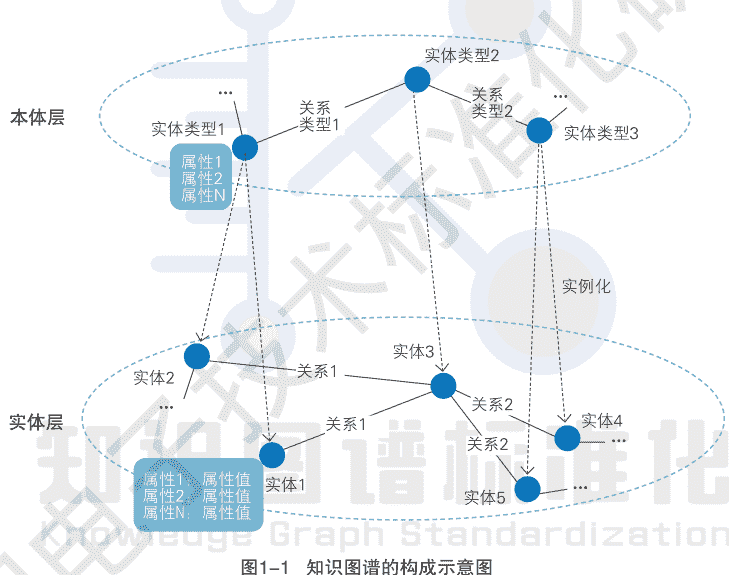

### 二、知识图谱的定位

### （一）知识图谱与语义网络、本体等概念的关系

语义网络是用于描述和关联万维网数据的一系列技术标准，使得网络上的信息具有计算机可以理解的语义。本体是一种规范化和形式化的知识分类体系，通过对概念的严格定义和概念之间的关系来确定概念的精确含义，表示共同认可的、可共享的知识。知识图谱与语义网络、本体概念既有区别也有联系，它们解决的问题域是一致的，在发展历程上各自独立又互有融合，在不同的历史阶段都扮演着重要的角色。

#### 知识图谱较传统语义网络具有如下特点：

- 1、规模巨大，知识质量高。
知识图谱是大数据时代下的产物，强调对知识的覆盖度，数据规模巨大。通用知识图谱通常会拥有亿级数量的实体与关系，领域知识图谱的实体与关系的数量也会达到百万乃至千万。此外，知识图谱数据来源异构多样，通过使用交叉验证的方式可验证知识图谱中事实的准确性，也可结合相关大数据质量验证算法及众包方式进行事实的验证。基于多维度的质量管控方式，极大地提升了知识图谱中知识的质量。

- 2、构建和维护的数据结构友好，知识语义丰富。
知识图谱通常以三元组进行表示，这是典型的图结构，同时也可以借助语义网络的RDF表示。面向图数据或RDF数据，已发展出有效的管理办法，使知识图谱的知识表示更灵活、更友好。此外，语义的丰富程度体现在语义种类多和建模多样化等方面，知识图谱通过构建问题域内的各类语义关系，并通过涵盖不同语义关系的知识图谱间融合，可以覆盖问题域内的基本语义关系。此外，在语义关系建模中结合权重或概率设置，还可进一步更精准地表达语义内容。

- 3、容易工程化，应用范围广。
知识图谱友好的结构、灵活的表示及良好的可视化能力，极大地降低了知识库的构建成本。各行各业可以快速构建行业内知识图谱并为下游应用提供推荐、问答、搜索、预测等智能服务。虽然相较语义网络而言，其基于逻辑规则的推理能力较弱，但随着深度学习的快速发展，知识图谱链接、补全等基于低维稠密向量的推理技术弥补了知识图谱推理能力的不足，并取得了较好的应用效果。

- 4、聚焦内容存在差异，领域知识处理能力更强。
知识图谱继承了传统语义网络的部分特性，可以实现世界中的事物为节点，以其间的语义关系为边，构建有向图以形成直观的知识表达。与此同时，知识图谱更加聚焦所包含知识本身的一致性、准确性、完整性等特征，不仅关注知识中语义信息的丰富表达，还关注知识的全生命周期质量，如大规模知识的融合、更新、溯源、组织、管理、维护等，进而获得了更强的领域知识处理能力。

#### 知识图谱较本体具有如下特点：

- 1、知识图谱既关注实体类型也关注其实例。
本体侧重于表达认知的实体类型框架，表达实体类型、实体类型间关系、约束、规则等。但框架需要与具体实例结合才能完整描述现实世界中的事实，机器也需要同时结合结构化的本体与其实例完成对于现实世界或者某个特定领域事实的理解。

- 2、关注规模化知识的获取和关联。
本体构建需明确涉及的概念、术语及其关系等，精确性要求较高，往往专家参与构建和审核过程，涉及的数据量级较小。知识图谱作为传统知识工程在大数据时代的延续，力求知识覆盖的完整性，目的是将事实性知识结构化，不但包括本体中涉及的概念、术语及其关系，还包括具体实体、属性及其关系。因此，知识图谱更加侧重规模化地获取事实性知识。如何在可接受准确性的前提下，自动化高效地获取事实性知识是知识图谱研究的重要领域。

- 3、关注规模化知识的存储。
本体涉及数据规模较小，可通过树形结构等形式展现，对底层存储的逻辑结构及物理结构要求较低。相比之下，知识图谱对大规模知识的存储有强烈的要求，特别是对其下游应用的支撑，使其不论在逻辑还是在物理层面都需要较高存储性能。

### (二) 知识图谱与图数据库、传统数据库的关系

图数据库一般泛指采用各种图数据模型进行数据存储和查询的数据库管理系统。图数据模型的要素通常包括顶点（代表实体）和边（代表关系），通过边将顶点连接在一起，顶点和边上可以附加属性信息，图数据模型的数学基础是图论。知识图谱的主要数据表达形式包括属性图和RDF图等，也是常用的图数据模型。

目前大多数图数据库支持属性图；支持RDF图的图数据库则一般称为三元组库。图数据库与图计算引擎不同：图数据库一般用于图数据的联机事务处理（OLTP）任务，包括查询处理与事务管理；图计算引擎主要用于图数据的联系分析处理（OLAP）任务，包括各种图分析算法。图数据库是知识图谱的主要数据管理工具，知识图谱与图数据库的主要关系还表现在：

- 1、图数据库是实现知识图谱存储的方式之一。
图数据库是实现知识图谱存储的主要方式，但不是唯一方式。知识图谱还可存储在关系数据库、键值数据库、文档数据库或其他NoSQL数据库中。

- 2、复杂知识图谱有赖于多种存储形式的混合应用。
复杂知识图谱是指除包含基本图结构外还含有本体信息、属性文本、多媒体数据等多模态类型数据的知识图谱。复杂知识图谱往往需要采用图数据库、关系数据库、NoSQL数据库、分布式文件系统等多种存储形式实现存储管理功能。

- 3、知识获取等其他环节与图数据库协同支撑知识图谱构建及其应用。
图数据库目前主要支持知识图谱的存储管理和查询应用。然而，知识图谱的全生命周期还包括知识获取和知识融合等环节。目前，这些环节的任务需采用其他工具完成。因此，图数据库需与其他工具通过接口功能调用与交互，以完成知识图谱的构建与应用任务。

此外，知识图谱数据管理也可基于传统关系数据库，特别是针对已有遗留系统的知识图谱数据管理任务。目前，包括Oracle、IBM DB2在内的主流商业关系数据库管理系统均具有支持知识图谱数据管理的扩展模块。但，采用关系数据库管理知识图谱的主要问题在于需要进行图数据模型与关系数据模型的转换，影响知识图谱数据管理任务的性能。

### （三）知识图谱与人工智能的关系

知识是各行业重要的生产要素，是大量劳动和研究成果的凝练，也是推动人类不断进步的重要基础。构建知识图谱的过程，实现了机器对知识的读取、处理和呈现，为机器具备获取知识、理解知识、应用知识等能力提供了支撑，也为后续机器形成认知能力奠定了基础。同时，也为人类与机器协作实现海量知识的智能化组织、管理、沉淀和再利用给出了一种可选技术路径。

- 1、知识图谱推动人工智能系统对知识的自动化获取。
自动化知识获取是知识图谱构建的核心之一。早期的知识获取使用人工移植的方法，依靠人工或辅助工具将人的知识移植到机器的知识库中，从而使机器获取知识。随着在机器学习领域的不断突破，人工智能系统使用机器学习等方式在运行过程中，通过学习，获取知识并进行知识积累，对知识库进行完善与更新。

- 2、知识图谱对可解释人工智能至关重要。
知识图谱实现机器认知智能的两个核心能力：“理解”和“解释”。
机器理解数据的方式之一是建立从数据到知识库中实体、概念、关系的映射；机器解释数据的方式之一是利用知识库中实体、概念、关系解释现象的过程，即将知识库中的知识与问题或者数据加以关联的过程。通过知识图谱与机器学习等技术的融合呈现数据训练或推理路径，可以为人类直观利用可视化方式或符号形式解读人工智能系统的行为提供技术支撑。从而，避免深度学习黑盒问题的不可解释性，增加了人工智能系统的可信赖程度。

- 3、知识图谱推动基于知识的智能应用。
从基于知识的智能应用层面，知识图谱已在关联分析、辅助决策、搜索、问答、推荐等场景中取得成效，细分行业的应用见第2章：

  - a) 关联分析
基于构建的知识图谱，可通过最短路径、链路预测、随机游走等图算法，深度挖掘实体间复杂的网络关系。如：通过基于判决书、口供等信息，结合知识图谱平台库构建的走私案件知识图谱，实现一个人与人，人与团伙、走私物、走私渠道方式等关系分析。

  - b) 辅助决策
以决策主题为重心，基于知识图谱构建决策主题研究相关知识库、分析模型库和情报研究方法库，建设并不断完善辅助决策系统，可以为决策主题提供多方位、多层次的决策依据，达到辅助决策者的目的。

  - c) 知识搜索
通过语义分析技术，准确理解用户查询的真正意图，精准搜索并排序后返回符合用户需求的搜索结果。搜索内容可包括原始文本数据及图谱内容等。目前谷歌、百度搜索引擎中的知识图谱成效印证了本应用的价值。

  - d) 知识问答 (Knowledge Base Question Answering, KBQA)
通过分析用户自然语言问题的语义，进而在已构建的知识图谱中通过检索、匹配或推理等手段，获取正确答案。知识问答可以回答部分包含较复杂的关联关系的问题，从而为用户提供更精确、简洁的答案。

  - e) 知识推荐
基于知识图谱特征和路径，可对相关知识内容进行智能推荐。例如，通过知识图谱中携带的大量属性、关系等特征信息，构建人员画像，对相关的知识进行推荐。同时，基于知识图谱中的路径查询，结合关系分析能力发现显性或隐性关联知识进行推荐。

- 4、知识图谱促进人工智能系统与大数据、数字孪生、物联网等技术的融合发展。
随着移动互联网的发展，万物互联成为可能，互联所产生的数据也在爆发式地增长，数据的种类和关系繁多，数据要素的深度应用需求旺盛，大数据、数字孪生、物联网等技术是数据要素流通中的重要技术。人工智能系统中知识图谱的构建可以提供更为灵活的数据接入和深度处理能力，进而降低了人工智能系统与现有大数据、数字孪生、物联网相关系统的集成难度。

以数字孪生为例，其以数字化的方式构建物理实体的虚拟模型，并对物理实体在现实环境中的行为进行模拟，借助虚实交互反馈、数据融合分析、决策迭代优化等手段，扩展物理实体的能力，为客户提供更实时、更智能的服务。复杂物理实体的数字孪生建设，涉及大量动态实体、实体间的关系及其多维度的指标属性，通过知识图谱保存动态的多维度指标状态，可以有效促进数字孪生系统的动态特性。

传统物联网通过有线和无线网络，实现物-物、人-物之间的相互连接。围绕当前物-物、人-物、物-人、人-物-服务之间的连接和数据互通需求，知识图谱在物联网数据接入、管理、分析等方面可以为物联网相关系统提供支撑，进一步提升其数据链接能力。例如，阿里云将电力领域设备说明、操作规程等复杂技术文档，应用知识图谱支持操作人员快速进行操作查询、故障诊断、维修指导、业务学习，同时也方便业务文档的管理、迭代、沉淀、传递，知识图谱逐渐成为电力领域专业知识管理应用的基石。华为云基于油气勘探开发过程中会产生多种形式的海量数据，有效聚合这些多源异构数据，促进油气行业实现数字化和智能化转型。勘探知识图谱可以提供丰富的油气应用，例如：语义搜索、油藏类比、油气知识推荐，支撑油气勘探开发增储上产、降本增效。

## 第二章 知识图谱发展现状

### 一、知识图谱发展历程

#### （一）知识图谱类别

根据知识范围及应用范围的不同，可将知识图谱分为通用知识图谱和领域知识图谱。

- 1、定义
通用知识图谱：包含多领域的开放知识体系并面向通用应用场景，主要用来解决科普类、常识类问题。

领域知识图谱：包含特定领域范围的知识并面向一个或者多个领域应用场景，主要用来解决特定行业或细分领域的专业问题，通常也称为行业知识图谱、专业知识图谱、垂直知识图谱。

- 2、通用知识图谱和领域知识图谱对比
通用知识图谱和领域知识图谱在知识表示、知识建模、知识获取、知识融合、知识应用以及知识运维等环节存在较大差异，表2-1对知识图谱构建中各个环节差异进行了对比描述。

| 知识环节 | 比较维度 | 通用知识图谱 | 领域知识图谱 |
|---|---|---|---|
| 知识表示 | 知识边界 | 宽 | 窄 |
| | 知识规模 | 相对较大 | 相对较小 |
| | 知识深度 | 相对较浅 | 相对较深 |
| | 知识粒度 | 相对较粗 | 相对较细 |

## 

| 知识环节 | 比较维度 | 通用知识图谱 | 领域知识图谱 |
| :--- | :--- | :--- | :--- |
| 知识获取 | 质量要求 | 相对较低 | 相对较高 |
| 知识获取 | 专家参与 | 轻度 | 重度 |
| 知识获取 | 自动化程度 | 相对较高 | 相对较低 |
| 知识建模 | 构建方式 | 自底向上 | 自顶向下 |
| 知识建模 | 专家参与 | 轻度 | 重度 |
| 知识建模 | 知识粒度 | 轻度 | 相对较细 |
| 知识融合 | 专家参与 | 相对较低 | 重度 |
| 知识融合 | 自动化模型参与类型 | 相对较多 | 相对较低 |
| 知识融合 | 知识关联度 | 相对较低 | 相对较高 |
| 知识融合 | 质量要求 | 相对较低 | 精细 |
| 知识存储 | 知识粒度 | 粗 | 细 |
| 知识存储 | 存储规模 | 相对较大 | 相对较小 |
| 知识应用 | 知识粒度 | 相对较粗 | 相对较细 |
| 知识应用 | 推理链条 | 短 | 长 |
| 知识应用 | 推理的全面性 | 更概况 | 更精细全面 |
| 知识应用 | 应用复杂性 | 简单 | 复杂 |
| 知识应用 | 查询效率 | 相对较低 | 相对较高 |
| 知识运维 | 质量管控 | 相对较低 | 相对较高 |
| 知识运维 | 运维频率 | 相对稳定 | 视场景而定 |
| 知识运维 | 专业性 | 相对较低 | 相对较高 |
| 知识运维 | 知识反馈及修正机制 | 要求低 | 要求高 |
| 知识交换 | 共享能力 | 相对较高 | 相对较低 |

知识表示环节的差异主要体现在边界、规模、深度及粒度这四个维度，通用知识图谱的边界及规模明显大于领域知识图谱，而领域知识图谱的概念层级体系表现更深，对细粒度的知识表示需求更加强烈。在知识建模环节，相比通用知识图谱，领域知识图谱通常采用自顶向下的建模方式，需业务专家深度参与本体建模，本体层的知识体系定义也相对要求更加精细。在知识获取环节，领域知识图谱（如医疗、司法等）对知识质量有着较为严苛的要求，业务专家参与相对较高，较多人工干预也决定了其自动化构建程度相对较低。

在知识融合环节，领域知识图谱由于知识覆盖紧密具有更高的关联度，通常对融合质量也要求更高，而且需业务专家深度参与，也决定了算法模型的自动化参与程度较低。在知识存储环节，领域知识图谱的存储粒度更细，而通用知识图谱的存储规模相对更大。

在知识应用环节，领域知识图谱的应用对知识要求更加精细。而且，由于知识密集覆盖及计算复杂的特点，推理链条一般更长，领域应用往往会涉及复杂查询，但因其知识规模通常较小而具有较高的查询效率。相反，通用知识图谱的查询多为一到两步的邻居查询，应用相对简单；由于知识规模巨大而导致相对较低的查询效率。

在知识运维环节，通用知识图谱对知识质量管控要求相对较低，并需较高的运维频率。然而，领域知识图谱对运维人员的专业性要求相对更高，需面向不同细分场景的领域应用形成了良好的知识反馈与修正机制，运维频率则需根据场景而定。在知识交换环节，通用知识图谱通常可为各种领域知识图谱提供通用知识支持，要求具有相对较好的共用共享能力。

## 3、通用知识图谱和领域知识图谱关系

### 观点1：通用知识图谱对领域知识图谱建设具有支撑作用

许多领域知识图谱建立在通用知识图谱之上，通用知识图谱对领域知识图谱建设的支撑作用显著。一方面，通过聚合通用知识图谱的描述模板，可形成领域知识图谱的基本领域图式(Schema)；另一方面，通用知识图谱可为领域知识图谱提供高质量的种子事实，这些种子事实可有助于领域知识的发现与挖掘，并可用作样本指导领域知识抽取模型的训练。

### 观点2：通用知识图谱与领域知识图谱可进行相互补充与完善

知识图谱预设的领域知识边界通常难以完全满足领域应用的知识需求。由于边界外事物与预设边界内事物间可能存在关联，导致沿着某一实体进行关联分析容易超出预先设定的知识边界。通用知识图谱可通过一定技术手段融合领域知识图谱，从而增加通用知识图谱的深度，更好的服务场景；领域知识图谱也可选择性的融入通用知识图谱提升知识的规模，提高应用效果。通用知识图谱与领域知识图谱两者相辅相成，相互促进，利用通用知识图谱的广度结合领域知识图谱的深度，可以形成更加完善的知识图谱。

### （二）知识图谱构建技术路径

知识图谱构建技术路径主要包括：知识表示、知识建模、知识获取、知识融合、知识存储、知识计算、知识溯源、知识演化及质量评估等，其技术路径流程见图2-1。

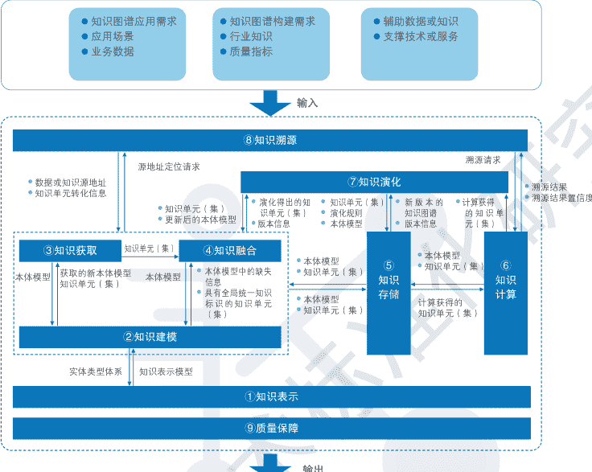

### 图2-1 知识图谱构建技术路径图

知识图谱的高质量构建既有赖于知识表示、知识建模、知识获取、知识融合、知识存储、知识计算等核心环节的协同工作，同时也依赖于知识溯源、知识演化、质量评估等支撑环节的保障。

其中，知识图谱构建所需的前端输入包括应用需求、数据、专家知识、行业知识、质量指标、支撑技术与服务，以及安全、监管、测评要求等内容；知识图谱构建所形成的知识图谱产品或服务将用于语义搜索、演化分析、知识问答、对话理解等通用知识图谱应用，以及智慧金融、智慧医疗、智能制造等领域知识图谱应用。

针对前端输入，应用需求主要用于明确所形成知识图谱产品或服务的整体架构、应用方向、应用场景和验收考核指标等内容；数据包括模型基础训练的测试数据和业务数据等，主要用于支持知识表示学习、知识获取等环节算法模型的设计、训练测试以及后续知识图谱的构建环节；专家知识、行业知识主要用于支持知识建模、知识融合、知识计算等环节架构、算法和实现途径的设计、开发与验证；质量指标主要用于评估和控制知识图谱构建过程中各环节的质量高低，以满足应用需求；支撑技术与服务主要用于支持各环节实现过程中所需自然语言处理、机器学习、大数据等技术的融合与应用；安全、监管、测评要求等内容主要用于第三方管理或认证测评机构对知识图谱构建过程及最终输出产品或服务的质量监督等。

根据《信息技术 人工智能 知识图谱技术框架》国家标准草案，知识图谱构建流程中各活动初步定义和任务组成描述如表2-2所述。

### 表2-2 知识图谱构建流程中各活动初步定义和任务组成描述

| 活动 | 序号 | 任务 | 备注 |
|---|---|---|---|
| 知识表示 | 1 | 定义知识表示需求 | 知识表示在人工智能的构建中具有关键作用，通过适当的方式表示人类知识，形成尽可能全面的知识表达，使机器能够通过学习这些知识，表现出类似于人类的行为。 |
| | 2 | 定义或确定拟遵循的规则、约束 | |
| | 3 | 定义或选择知识表示形式 | |
| | 4 | 定义和序列化知识表示元素 | |
| | 5 | 定义知识表示模型适用范围 | |
| | 6 | 定义知识表示模型质量评价体系 | |
| | 7 | 评估并明确知识表示模型的表达能力 | |
| 知识建模 | 8 | 确定知识的领域和范畴 | 知识建模是知识图谱构建的基础之一。高质量的知识模型能避免许多不必要、重复性的知识获取工作，有效提高知识图谱构建的效率，降低领域知识融合的成本。 |
| 知识建模 | 9 | 确定现有可复用本体模型 | |
| 知识建模 | 10 | 确定知识范畴内的关键术语 | |
| 知识建模 | 11 | 构建实体类别层级体系 | |
| 知识建模 | 12 | 定义实体类别的属性与关系 | |
| 知识建模 | 13 | 确定并创建本体模型及图式 | |
| 知识建模 | 14 | 评估本体模型质量 | |
| 知识获取 | 15 | 实体类型提取 | 获取的数据源根据数据组织结构的维度可分为结构化数据、半结构化数据（网页数据等）、非结构化数据（如纯文本、音频和视频数据等）。 |
| 知识获取 | 16 | 实体提取 | |
| 知识获取 | 17 | 关系提取 | |
| 知识获取 | 18 | 属性提取 | |
| 知识获取 | 19 | 事件提取 | |
| 知识获取 | 20 | 人工录入 | |
| 知识融合 | 21 | 本体对齐 | 本体对齐可包括实体类型对齐、关系对齐和属性对齐等。 |
| 知识融合 | 22 | 实体链接 | |
| 知识融合 | 23 | 实体对齐 | |
| 知识融合 | 24 | 知识一致性校验 | |
| 知识存储 | 25 | 完成数据库选型与数据库设计 | 知识存储方式及其质量直接影响到知识计算及知识演化的效率。 |
| 知识存储 | 26 | 执行存储操作：1) 完成知识单元的存储；2) 完成知识单元的查询；3) 完成知识单元的维护，如新增、删除、修改、更新等；4) 完成知识单元的可视化（可选） | |
| 知识存储 | 27 | 完成存储管理 | |
| 知识计算 | 28 | 定义知识计算需求 | 知识计算可分为统计分析、推理计算等。知识的统计分析是对知识图谱蕴含知识结构及其特征的统计与归纳，知识的推理计算是从中已有的事实或关系推断隐性知识。 |
| | 29 | 设计计算所需的数据结构及算法模型 | |
| | 30 | 执行知识计算流程并评估计算性能 | |
| | 31 | 基于挖掘的隐性知识补全缺失的知识单元 | |
| | 32 | 通过接口等形式提供知识计算服务 | |
| 知识溯源 | 33 | 定义知识源地址的结构化描述 | 知识溯源活动的输出主要包括：知识源地址，即标识知识来源的唯一的资源访问地址；知识单元转化路径，即从源到目标知识的转变关系等。 |
| | 34 | 设计知识溯源方案 | |
| | 35 | 追溯知识来源，并完成知识定位 | |
| | 36 | 确定置信度计算维度并完成溯源结果计算 | |
| | 37 | 对原始数据和知识的更新进行版本管理 | |
| 知识演化 | 38 | 确认已有知识图谱中待变更的知识单元 | 知识演化的目标是提高知识质量，丰富知识语义信息，优化知识组织。通过知识计算得出的补全知识也可触发知识演化。 |
| | 39 | 设计或匹配演化的规则、算法或模型 | |
| | 40 | 更新知识单元 | |
| | 41 | 生成具有更新时间等信息的新版本知识图谱 | |
| | 42 | 完成知识图谱版本管理 | |

### （三）国内外知识图谱发展对比

根据技术发展和产业化深度的差异，知识图谱主要经过了三个阶段：萌芽阶段、稳定阶段和繁荣发展阶段。通用知识图谱和领域知识图谱由于应用方向和要求不同，其发展路径存在一定差异。此外基于领域知识图谱演进情况，知识图谱的繁荣发展阶段可进一步细分为产业化探索阶段和产业化深度融合阶段，如图2-2所示。知识图谱相关专利发展趋势如图2-4所示。

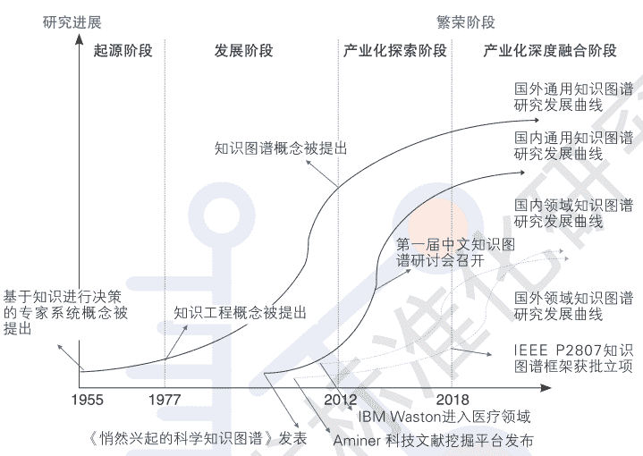

图 2-2 国内外知识图谱发展历程

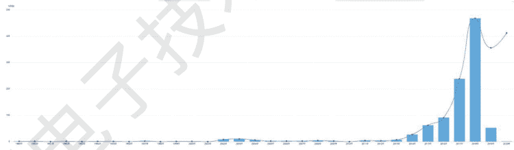

图 2-3 知识图谱相关专利发展趋势 [来源：Aminer]

国外知识图谱发展的具体情况如下：

- 1) 萌芽阶段（1955-1977）：

Garfield于1955年开创了利用文献索引进行检索文献的思路；1965年，斯坦福大学的E.A.Feigenbaum提出专家系统的概念，基于知识进行决策，使人工智能的研究从推理算法主导转变为知识主导；1968年，M.R.Quilian提出语义网络的知识表达模式，用相互连接的节点和边来表示知识，语义网络在人工智能领域被普遍应用。

- 2) 稳定阶段（1977-2012）：

在第五届国际人工智能联合会议上，E.A.Feigenbaum提出了知识工程的概念，以知识为处理对象，研究如何用计算机表示知识，进行问题的求解；1989年，Tim Berners-Lee发明了万维网，并于1998年提出了语义网，将传统人工智能的发展与万维网结合，用RDF进行知识的表示和推理；2007年，Chris Bizer and Richard Cyganiak向W3C SWEO提交Linked Open Data Project项目申请，提出推动建设计算机能理解的语义数据网。

- 3) 繁荣发展阶段（2012年-至今）：

2012年，谷歌提出“知识图谱”的概念，不同于传统专家系统和知识工程主要依靠手工获取知识的方式，知识图谱以RDF三元组和属性图表示知识，数据规模巨大，可应用机器学习、自然语言处理等技术进行自动化的知识图谱构建。2012年谷歌知识图谱项目发布时，其所拥有的实体已达5.7亿个，由语义关系连接起来的事实描述达18亿条。自知识图谱概念之后，学术界和产业界在构建各类结构化知识库方面积极投入，并以链接开放数据（Linked Open Data, LOD）项目的形式发布和共享了大量的RDF数据。截至2020年5月，LOD项目已包含了1260个数据集及相互之间的16187条连接，涉及到社会生产、生活的诸多领域。

根据当前知识图谱相关论文发表和引用情况来看，该领域论文较多的国家包括中国、美国、德国、意大利、英国、法国、印度等，如图2-4所示。

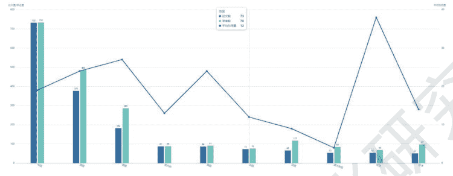

国内知识图谱的研究晚于国外，但是其发展的趋势国内外基本一致，国内知识图谱演进的具体情况如下：

- 1) 萌芽阶段（2005-2010）：

2005年，国内第一篇与知识图谱相关的文献——《悄然兴起的科学知识图谱》被发表，是我国知识图谱的开端之作。该阶段主要是侧重于知识图谱的理论研究，陆汝钤院士、史忠植、董振东、王克宏等专家学者均为我国知识工程的发展做出了重要贡献。

- 2) 稳定阶段（2010-2015）：

知识图谱开始被多个学科领域的专家学者关注，2012年，国内上线了首个关于搜索引擎的中文知识图谱“知立方”；2013年，第一届中文知识图谱研讨会在苏州大学召开，探讨了中文知识图谱的构建技术与策略等核心问题。这一时期，余荣花在中国低碳研究领域，程赛璞在电子政务领域，谢靖在文学学科领域，李伟平在体育领域，辛伟在军事心理学领域利用知识图谱对学科进行研究，并产生了系列研究成果。

- 3) 繁荣发展阶段（2015-至今）：

该阶段知识图谱的应用领域越发广泛，论文数量大幅增加，将知识图谱研究推向高峰。同时，伴随着人工智能、大数据、深度学习的快速发展，知识图谱取得了更深层次的研究进展，推动我国知识图谱正处于一个飞跃式发展阶段。

目前，国内外多个研究机构建立了一些大规模的通用知识图谱。在国外，经典的通用知识图谱有DBpedia、YAGO、Freebase等；在国内，经典的通用知识图谱有百度知心、搜狗知立方、XLORE、zhishi.me等，国内外具有代表性的通用知识图谱对比如表2-3所示。国内外具有代表性的领域知识图谱对比如表2-4所示：

### 表2-3 国内外部分通用知识图谱对比表

| 通用知识图谱 | 数据源 | 实体数量 | 关系数量 | 描述 | 应用 |
| :--- | :--- | :--- | :--- | :--- | :--- |
| DBpedia | Wikipedia | 458 万 | 30 亿 | 大规模跨语言的知识库，支持多达 125 种语言 | 语义标注，跨域共享服务 |
| Freebase | Wikipedia, NNDB, MusicBrainz | 6800 万 | 10 亿 | 大规模开放结构数据集 | |
| WikiData | Wikipedia, 用户编辑 | 453.6 万 | | 开放，协作，结构化，支持 281 种语言 | 语义搜索 |
| WordNet | 专家人工构建 | 15 万 | 20 万 | 人工编辑，按词义组织 | 词义消歧，语义搜索 |
| YAGO | Wikipedia, WordNet, GeoNames | 1000 万 | 1.8 亿 | 大规模跨语言的语义知识库 | |
| Google Knowledge Vault | Wikipedia, Freebase | 5 亿 | 180 亿 | 大规模知识库 | 语义搜索 |
| BabelNet | Wikipedia, WordNet | 606 万 | 19 亿 | 多语言词典知识库，覆盖 1400 万同义词集合，7 亿个词义 | 多语言义消歧，计算语义相关性 |
| Microsoft Concept Graph | Web 网页 | 1255 万 | 8760 亿 | 以概念层次体系结构为中心的知识图谱 | |
| HowNet | 专家人工构建 | 1.1 万 | | 人工编辑，小规模、常用知识库 | 语义倾向计算 |
| THUOCL | 主流网站的社会标签，搜索热词等 | 15.7 万 | | 开放的中文词库 | |
| OpenKG | 网页、百科、核心词汇 | 3000 万 | 10 亿 | 通过网络不断获取知识，存储其他开放知识库中有用知识 | |
| CN-DBpedia | 中文百科类网站的纯文本网页 | 1686 万 | 2228 万 | 大规模通用领域百科知识图谱 | 自然语言问答 |
| XLore | 中、英文维基百科，百度百科，互动百科 | 1.49 亿 | 51 万 | 中英文双语的百科知识图谱 | |
| 知立方 | 百科类知识，Web 网页 | | | | 语义搜索 |
| 大词林 | 百度百科，同义词词林，Web 网页 | | | 包含同义、同类上下位关系的动态层级知识体系 | |

### 表2-4 国内外部分领域知识图谱对比表

| 领域 | 知识图谱 | 研究机构 | 描述 |
| :--- | :--- | :--- | :--- |
| 生物医学 | Linked Life Data | 保加利亚 Ontotext 公司与 LarKC 项目 | 超 100 亿三元组，包含基因知识库、蛋白质知识库、疾病的知识库 |
| 生物医学 | UMLS | 美国国家医学图书馆 | 一体化医学语言系统，可一体化检索病案记录、书目数据库、事实数据库以及专家系统中的电子式生物医学情报 |
| 生物医学 | Bio2RDF | 加拿大基因组、魁北克基因组 | 构建生命科学领域数据库的关联数据网络 |
| 影视 | Linked Movie Dataset | | 61.5 万三元组数据，描述关于演员、电影等知识 |
| 社交 | FOAF | Libby Miller and Dan Brickley | 通过构建一个机器可读的本体，描述了人与人之间的关系 |
| 医学 | 中文症状库 | 华东理工大学 | 包含症状实体和症状相关三元组数据集 |
| 医学 | 中医药学语义网络 | 中国中医科学院中医药信息研究所 | 以中医药学语言系统为骨架，将中医药领域现有的术语资源和数据库资源融合起来，构成大规模知识图谱 |
| 医学 | 中医药知识图谱 | | 由中医药类知识图谱、中医特色诊疗技术知识图谱，中医美容知识图谱等多个中医中医美容知识图谱等多个中医相关知识图谱和中医药学语言系统组成 |
| 医学 | 疾病术语集 | 开放医疗与健康联盟 | 包含疾病实体及疾病相关同义词，术语集的数据来源于国内权威的临床医学术语网站 |

| 领域 | 知识图谱 | 研究机构 | 描述 |
| :--- | :--- | :--- | :--- |
| 科研 | SciKG | 清华大学 | 展现计算机科学领域的发展，实现计算机领域中专家与论文的搜索和推荐 |
| 影视 | 影视双语知识图谱 | 清华大学 | 融合 LinkedIMDB、百度百科、豆瓣等数据源 |
| 交通 | 基于 CNSchema 的城市知识图谱 | 浙江大学 | 涵盖上海市公交站点、地铁站点的静态数据、事件流动态数据 |

以 Wikidata 为例，其是由 Wikimedia 基金托管的协作编辑的多语言知识图谱，也被称为面向文档的数据库，主要存储表示各种主题、概念或物体的实体信息，并为每个实体分配一个唯一的识别码 “QID”。截止 2021 年 8 月，Wikidata 存储了共计九千四百多万条有效的结构化数据，其中每条信息的结构见图 2-5。如果属性对应的值在该值中存在，即该值是一个实体，那么该值将会被分配一个 QID。

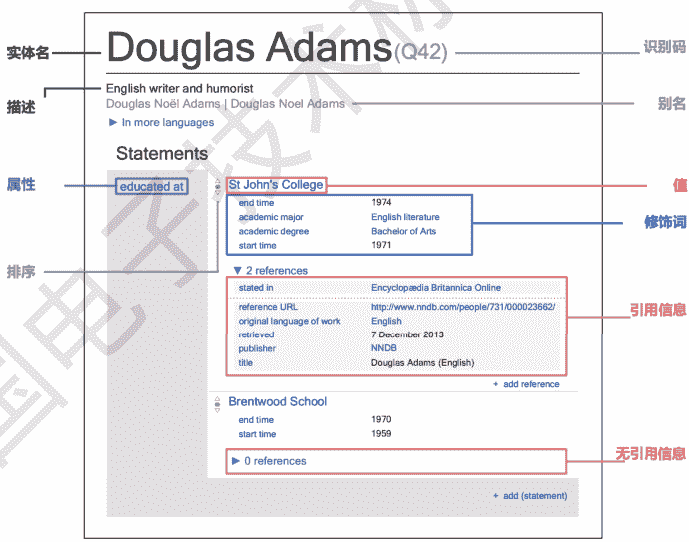

图 2-5 Wikidata信息结构

### (四) 知识图谱中部分关键技术发展历程

知识图谱涉及知识抽取、知识表示、知识融合、知识推理等关键技术，其发展演化过程及研究现状如下：

### (1) 知识抽取

知识抽取是知识图谱构建的首要步骤，通过自动化或半自动化的知识抽取技术，从原始数据中获取实体、关系以及属性等可用的知识元素，为知识图谱的构建提供基础支撑。图2-6、图2-7分别展示了知识抽取技术演进历程以及该技术相关的专利数统计。

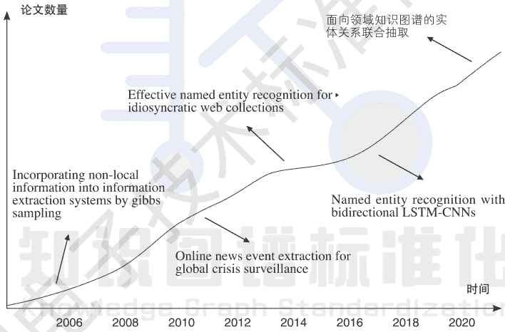

图2-6 知识抽取技术演进历程

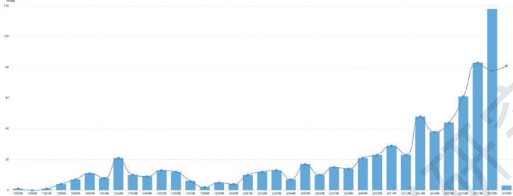

图2-7 知识抽取技术相关的专利数统计 [来源：Aminer]

知识抽取主要包括：实体抽取、关系抽取和属性抽取等任务。早期的知识抽取采用基于规则的方法，根据领域专家定义的规则抽取知识。早期的知识抽取的可移植性差，当数据规模较大时，构建规则需要消耗大量的人力；基于特征工程的知识抽取通常与机器学习相结合，如隐马尔可夫、条件随机场、最大熵等。但是，以上方法需要通过特征工程构建合适的特征，特征工程依赖于大量的人力以及一些NLP工具。

当前知识抽取主要采用基于神经网络的方法，神经网络在特征抽取上具有显著的优异性，通常采用预训练语言模型如BERT等进行编码，在预训练语言模型上叠加RNN、CNN或采用注意力机制等实现抽取。实体关系联合抽取的方法通过建立统一的模型同时抽取实体、实体类型以及实体之间特定的关系类型，根据数据的不同特征，可以采取序列标注、指针网络等端到端的方法实现。

在知识抽取技术发展过程中，国外Miwa等首先将神经网络运用到关系抽取中，Katiyar等在关系抽取方面引入了注意力机制。国内，在医疗、农业和管理等领域都有众多基于上述技术的知识抽取案例。如：在实体命名识别方面，陈德鑫等将在线医疗文本中的实体抽取任务看作序列标注问题，通过将CNN模型和Bi-LSTM相结合来实现对医疗实体的抽取；赖英旭等采用 CRF 技术对水稻育种专利文本进行了命名实体识别。在关系抽取方面，针对不同的领域综合采用多种深度学习机制进行研究。连明杰等公布了一项基于深度学习模型的关系抽取专利，其核心是采用 BERT 模型与 BiLSTM 模型文本进行关系抽取，提取关系三元组；吴文涛等将实体和事件抽取看作一个统一的任务来处理，提出了一种混合神经网络模型，对两者之间的依赖关系进行抽取。

### (2) 知识表示

知识表示是对知识的一种描述，目的是将客观世界的各类知识表示成计算机容易识别理解的形式。传统知识表示方法包括谓词逻辑、产生式、语义网络、脚本、本体等。在知识表示的演进过程中，最主要的变换是由基于数理逻辑的知识表示过渡到基于向量空间学习到的分布式知识表示。图2-8、图 2-9分别展示了知识表示技术演进历程及该技术相关的专利数统计。

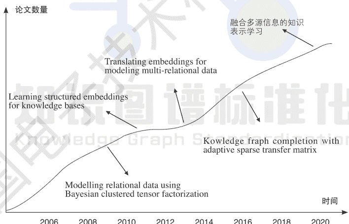

图2-8 知识表示技术演进历程

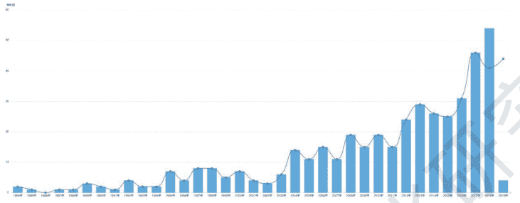

图2-9 知识表示技术相关的专利数统计 [来源：Aminer]

早期的知识表示方法主要有一阶逻辑、霍恩逻辑、产生式规则等。这类方法结构性强，可以准确表达知识，但灵活性差，难以扩展。随着语义网的提出，产生许多面向语义网知识表示的标准语言，具有代表性的包括XML、RDF、OWL等。这种基于符号逻辑的方法，能刻画显式、离散的知识，但是在计算效率、数据稀疏性等方面存在问题，且难以有效挖掘知识中隐藏的语义信息。近年来，随着深度学习的崛起，基于深度学习的特征表示在语音识别、图像分析和自然语言处理领域得到了广泛关注。这类方法通过将知识图谱中的实体和关系嵌入到低维连续的向量空间来完成语义计算，可以有效地挖掘隐藏知识，高效地计算实体间的复杂语义关系，是当前的主流方法。

在知识表示技术发展中，国外典型的知识表示模型有距离模型、单层神经网络模型、双线性模型、TransE模型等。TransE模型将知识库中实体之间的关系看成是从实体间的某种平移，并用向量表示；关系r可以看作是从头实体向量h到尾实体向量t的平移。对于知识库中的任意关系三元组<h, r, t>，TransE都希望满足以下关系：。国内在后续的研究中，考虑到知识库中存在1-N、N-1、N-N的复杂关系，对TransE模型进行扩展，代表模型有TransH、TransR、TransD等，均取得了不错的效果。

### (3) 知识融合

知识融合是融合本体层和实例层的知识，包括不同知识库的同一实体、多个不同的知识图谱、多源异构的外部知识等，并实现对现有知识图谱的更新。图2-10、2-11分别展示了知识融合技术演进历程及该技术相关的专利数统计。

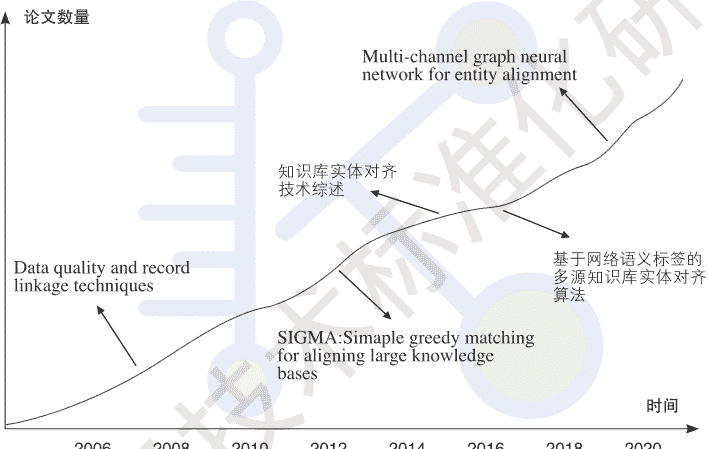

图2-10 知识融合技术演进历程

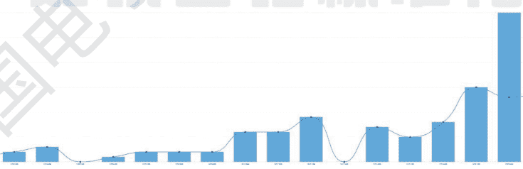

图2-11 知识融合技术相关的专利数统计 [来源：Aminer]

知识融合主要包括本体对齐、实体对齐和实体消歧等。以实体对齐和实体消歧为例：

（1）实体对齐在于发现不同知识图谱中表示相同语义的实体。早期采用机器学习的方法，根据不同实体的相似度得分来进行分类，代表的模型有马尔可夫逻辑网络、支持向量机等，通过比较特征向量进行实体对齐，或者考虑实体的相似度使相似实体聚类对齐。基于神经网络的方法将不同的知识图谱嵌入到低维向量空间，计算不同实体嵌入之间的相似度来进行实体对齐，是目前实体对齐方法的研究重点。

（2）实体消歧是消除文本中实体指称的歧义，即解决一词多义的问题。近年来，词嵌入在自然语言处理领域应用广泛，目前的主流方法是利用分布式低维向量中的语义特征消除文本中实体指称的歧义，通过计算各个单词间的语义相似度提高实体消歧的效果，引入注意力的方法增强实体邻近上下文语义信息等。

在知识融合技术发展过程中，国外Newcombe等将基于属性相似度评分来判断实体是否匹配的问题转化为一个分类问题，建立了该问题的概率模型；Cochinwala等使用分类回归树、线性分析判别等方法完成了实体辨析。国内在后续的研究中逐步改善，例如，王会勇等提出了一种基于联合知识表示学习的多模态实体对齐方法，可以较好地实现多模态实体对齐，为知识图谱构建和补全提供了新的思路；李攀成等针对现有基于知识嵌入方法进行实体对齐导致精度较低的问题，提出了在对齐模型上附加类型约束匹配来加强选择条件，同时运用迭代实体对齐方法克服表述数据少的问题，提高了实体对齐的精确率；苏佳林等提出了自适应属性选择的实体对齐方法，该方法采用实体的语义和结构信息来训练基于两个图谱联合表示学习的实体对齐模型，再根据数据集特征生成最优的结果，提高了对齐的效果。

### （4）知识推理

知识推理作为知识计算的重要组成部分，是针对知识图谱中已有事实或者关系不完备的情况，推断出未知的或隐藏的语义知识，从而扩展和丰富知识网络。图2-12、图2-13分别展示了知识推理技术演进历程及该技术相关的专利数统计。

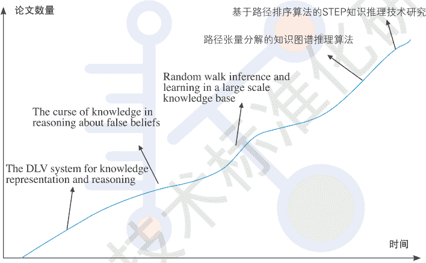

图2-12 知识推理技术演进历程

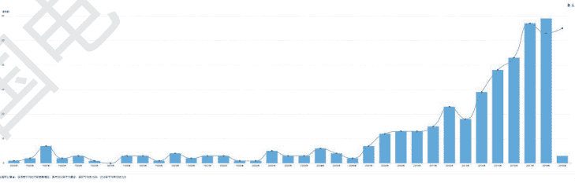

图2-13 知识推理技术相关的专利数统计 [来源：Aminer]

知识推理主要包括基于逻辑规则的知识推理、基于嵌入表示的知识推理、基于神经网络的知识推理：

- (1) 基于逻辑规则的知识推理，通过在知识图谱上运用简单的规则及特征，推理得到新的事实。这类方法可以很好地利用知识的符号性，准确性高且推理得到的结果具有可解释性，但是依赖于定义的规则，计算复杂度高。具有代表性的方法包括：马尔可夫逻辑网络，结合专家定义的逻辑规则与概率图模型构建网络，并在构建好的网络上执行推理；关联规则挖掘算法，从知识图谱中自动挖掘出置信度高的规则，并利用这些规则在知识图谱上推理得到新的知识；基于图结构的路径排序算法，将知识图谱中链接目标实体对之间的路径作为特征，为每一类关系训练一个逻辑回归模型，从而完成知识推理。
- (2) 基于嵌入表示的知识推理，将知识图谱嵌入到低维连续的向量空间，使得原来难以发现的关联关系变得显而易见。该类方法主要包括：张量分解模型，将整个知识图谱看作一个大的张量，通过张量分解技术分解为很多个小的张量，将高维的知识图谱进行降维处理；距离模型，将知识图谱中的每个关系看作从主体向量到客体向量的平移变换，以此推断出可能的关系；语义匹配模型，设计基于相似度的目标函数，该类模型认为存在的三元组应该具有较高的相似度，通过相似度来推断关系。
- (3) 基于神经网络的知识推理，充分利用神经网络学习到知识图谱的结构特征和语义特征，实现对图谱缺失关系的有效预测。具有代表性的方法包括：基于图卷积网络的知识推理，图卷积网络能够提取到图的拓扑结构特征，根据特征推理出缺失的关系信息。在实际应用中，基于神经网络的推理方法能有效提取图谱特征，计算效率高，但是输出结果的可解释性不强，所以可以将基于神经网络的推理方法和基于逻辑规则的推理结合以增加知识推理结果的可解释性。

在知识推理技术的发展中，有很多经典的方法。国外有路径排序算法，通过将两实体间的路径作为特征以判断它们之间可能存在的关系；Socher提出的基于神经张量网络的图谱推理方法，通过对输入层的词向量求平均值提高推理精度。国内有很多后续的研究，如张美玉等将路径排序算法应用到产品设计的推理领域，取得了很好的效果；吴运兵等提出基于路径张量分解的知识图谱推理算法，利用路径排列算法获得知识图谱中各实体对间的关系路径，然后对实体对间的关系路径进行张量分解，并在优化更新过程中采用交替最小二乘法。

相较于国外，国内对知识图谱的研究主要集中在中文领域，且国内对知识图谱的研究起步较晚，许多研究都是从英文领域衍生而来。另外，相较于英文，中文具有更多的复杂性：首先，中文的词汇边界模糊，缺少英文文本中空格这样明确的分隔符，也没有明显的词性变换等特征，容易造成边界歧义；其次，中文中一词多义现象普遍，不同语境下的同一词表达的意思并不一样，且一种语义存在多种不同的表达，句式灵活多变。而且，随着互联网的快速发展，许多词将具有新的不同意义，进一步加强了难度，在设计模型时仍要着重考虑中文的特殊性。本节提及的部分文献名称详见文末参考文献。

### 二、知识图谱现有开源内容

表2-4 国内外知识图谱开源内容

| 类型 | 开源组织 | 区域 | 开源内容 | 描述 |
| --- | --- | --- | --- | --- |
| 标准 | W3C | 国外 | RDF | 即资源描述框架，是知识图谱的一种数据模型，主要用于表示 Web 上的资源及其关联。 |
| 标准 | W3C | 国外 | RDFS | 即 RDF 模型，是用于描述 RDF 知识图谱上本体信息的基本元素。 |
| 标准 | W3C | 国外 | OWL | 即 Web 本体语言，是用于描述 RDF 知识图谱上本体信息的语言，包括类层次结构和关系属性定义。 |
| 标准 | W3C | 国外 | SKOS | 即简单知识组织系统，在 RDF 知识图谱上表达受控结构化词表的描述，包括叙词表、分类法、标题表系统。 |
| 标准 | W3C | 国外 | SPARQL | RDF 知识图谱的查询语言。包括：RDF 知识图谱的更新语言、联邦查询、服务与协议、蕴含范畴。 |
| 标准 | W3C | 国外 | SHACL | RDF 知识图谱的约束语言。用于定义 RDF 知识图谱需要满足的拓扑与值范围约束。 |
| 标准 | ISO | 国外 | Dublin Core | 即 Dublin 核心元数据元素集，是 ISO 15836 定义的用于描述资源的 15 个核心元素（即属性）。 |
| 标准 | ISO | 国外 | Schema.org | 是用于给 Web 上资源标注模式元数据信息的公共分类词汇表。 |
| 知识库 | 莱比锡大学 | 国外 | DBpedia | 从维基百科中抽取结构化信息构建的知识图谱。 |
| 知识库 | 维基媒体基金会 | 国外 | Wikidata | 用于为维基百科等提供数据服务的多语言知识图谱。 |
| 知识库 | 马普研究所 | 国外 | YAGO | 多语言知识图谱，将维基百科分类体系与 WordNet 词汇定义融合。 |
| 知识库 | Luminoso Technologies | 国外 | ConceptNet | 多语言常识知识图谱，旨在帮助计算机理解人们使用的单词的含义。 |
| 知识库 | OpenKG | 国内 | OpenBase | 中文开放域知识图谱 |
| 建模工具 | 斯坦福大学医学院生物信息研究中心 | 国外 | Protégé | 本体编辑和本体开发工具。 |
| 知识存储 | Apache | 国外 | Jena | 语义 Web 领域主要的开源框架和 RDF 三元组库，较好地遵循 W3C 标准。 |
| 知识存储 | 北京大学计算机科学技术研究所数据管理实验室 | 国内 | gStore | 面向 RDF 知识图谱的开源图数据库系统，遵循 Apache 开源协议。gStore 原生基于图数据模型，在存储 RDF 数据时维持并根据其图结构构建了基于二进制位图索引的新型索引结构——VS 树。 |
| 知识存储 | Neo Technology | 国外 | Neo4j 社区版 | 高性能的 NoSQL 图形数据库，以结点和结点之间的关系为基本存储内容。 |
| 知识存储 | ArangoDB | 国外 | ArangoDB | 多模型数据库，兼有键、图和文档数据模型，提供了涵盖三种数据模型的统一的数据库查询语言。 |
| 实体抽取 | 斯坦福大学 | 国外 | DeepDive | 三元组抽取工具。 |
| 实体抽取 | 开源工作者 | 国内 | jieba 分词 | 一个 Python 中文分词组件，可以对中文文本进行分词、词性标注、关键词抽取等功能，并且支持自定义词典。 |
| 实体抽取 | 哈尔滨工业大学 | 国内 | LTP | 提供了一系列中文自然语言处理工具，用户可以使用这些工具对于中文文本进行分词、词性标注、句法分析等工作。 |
| 关系抽取 | 斯坦福大学 | 国外 | DeepDive | 实体间的关系抽取工具。 |
| 关系抽取 | 华盛顿大学 | 国外 | Reverb | 开放三元组抽取工具。可以从英文句子中抽取形如 (augment1, relation, argument2) 的三元组。它不需要提前指定关系。 |
| 关系抽取 | 华盛顿大学 | 国外 | OLLIE | 知识库三元组抽取组件，支持基于语法依赖树的关系抽取，对于长线依赖效果更好。 |
| 关系抽取 | 浙江大学 | 国内 | DeepKE | 基于深度学习的开源中文知识图谱抽取工具。 |
| 知识融合 | 开源工作者 | 国外 | Falcon-AO | 自动的本体匹配系统，已经成为 RDF(S) 和 OWL 所表达的 Web 本体相匹配的一种实用和流行的选择。 |
| 知识融合 | 开源工作者 | 国内 | Sematch | 用于知识图谱的语义相似性的开发、评价和应用的集成框架。 |
| 知识推理 | Apache | 国外 | Jena | 除了提供三元组的存储，RDF、RDFS、OWL 数据的接口，还提供规则引擎，用于知识的推理。 |
| 知识推理 | JBoss | 国外 | Drools | 具有一个易于访问企业策略，易于调整以及易于管理的开源业务规则引擎，符合业内标准，具有速度快、效率高的特点。 |
| 知识推理 | 牛津大学 | 国外 | RDFox | 一个高度可扩展的内存 RDF 三元组存储，支持共享内存并行 OWL 2 RL 推理。 |
| 知识推理 | 开源工作者 | 国内 | SparkSRE | 一个基于分布式内存计算框架 Spark 的语义推理引擎实现方案。 |

### 三、知识图谱标准化现状

### (一) 标准化现状

《国家标准化发展纲要》指出：标准是经济活动和社会发展的技术支撑，是国家基础性制度的重要方面。标准化在推进国家治理体系和治理能力现代化中发挥着基础性、引领性作用。新时代推动高质量发展、全面建设社会主义现代化国家，迫切需要进一步加强标准化工作。知识图谱的标准化对于提升知识图谱构建效率、推动数据在多领域复用、发挥知识图谱分析和技术价值有重要意义。

近年来资源描述框架RDF(Resource Description Framework)、资源描述框架模式RDFS（Resource Description Framework Schema）、网络本体语言OWL（Web Ontology Language）等知识表示和知识建模相关标准，为知识图谱的规模化构建和应用提供了重要的支撑作用，而且随着知识图谱在各领域的深化应用，知识图谱技术框架、测试评估、能力成熟度模型、知识建模、知识融合、知识交换、知识计算及领域知识图谱构建与应用要求等方面的标准化需求日益攀升。此外，由于知识图谱应用系统日益增多，知识要素在行业内、集团内、企业间的安全交换与可靠流通需求也逐步显现，同样有待相关标准和配套工具来引领和支撑。

目前，知识图谱相关标准化需求已获得了国际标准化组织/国际电工委员会的第一联合技术委员会（ISO/IEC JTC 1）、电气电子工程师学会（IEEE）、国家人工智能标准化总体组、中国电子工业标准化技术协会等国内外标准化组织或协会的关注。在ISO/IEC JTC 1/SC 42（人工智能分技术委员会）、IEEE知识图谱标准化工作组、知识图谱国家标准编制工作组推动下制定了多项知识图谱领域相关的国际标准、国家标准、团体标准，形成了知识工程顶层标准、知识图谱顶层标准、知识图谱共性基础标准、知识图谱细分领域标准及配套白皮书、案例集等协同推进的局面。其制定的标准如图2-14所示。

| 知识工程顶层标准 | | ISO/IEC WDS392 Information technology - Artificial intelligence - Reference architecture of knowledge engineering (《信息技术 人工智能 知识工程参考架构》) |
| 知识图谱顶层标准 | 《信息技术 人工智能 知识图谱技术框架》(国际计划号：20192137-T-469) | IEEE P2807 Framework of knowledge graphs (《知识图谱架构》) |
| 知识图谱共性支撑标准 | CESA《人工智能 知识图谱 性能评估与测试规范》 CESA《人工智能 知识图谱 分类分级规范》 | IEEE P2807.1 Standard for technical requirements and evaluating knowledge graphs (《知识图谱技术要求及测试评估规范》) |
| 知识图谱细分领域标准 | IEEE P2807.2 Guide for application of knowledge graphs for financial services (《金融领域知识图谱应用指南》) IEEE P2599 Standards for technical requirements of standard- oriented knowledge graphs (《面向标准的知识图谱技术要求》) | IEEE P2807.3 Guide for electric-power-oriented knowledge graph (《电力领域知识图谱指南》) IEEE P2807.4 Guide for scientific knowledge graphs (《科技领域知识图谱指南》) |

图2-14 知识图谱领域现有标准

## 1、国际标准化

此外，W3C、NIST、ISO/IEC JTC 1/SC 32（数据管理与交换分技术委员会）等标准化组织围绕知识图谱领域知识表示、知识获取、知识建模等关键技术标准也进行了研制，并相继发布了RDF、RDFS、OWL、本体模型等方面的一系列标准。当前，根据知识图谱相关在研及已发布标准所针对的标准化需求及所处环节，其分布情况如图2-15所示。

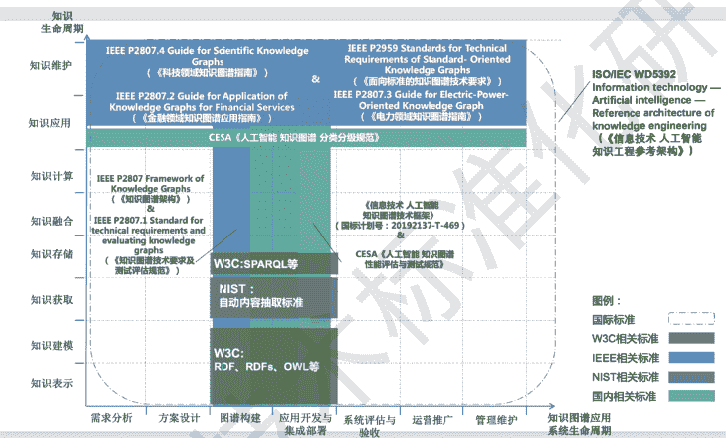

### (1) ISO/IEC JTC 1

ISO/IEC JTC 1，全称：International Organization for Standardization/International Electrotechnical Commission JTC 1，中文名称：国际标准化组织/国际电工委员会联合技术委员会1。ISO/IEC JTC 1是信息技术领域的国际标准化委员会，已经在人工智能领域进行了二十多年的标准化研制工作，主要集中在人工智能词汇、人机交互、计算机图像处理、云计算、大数据等人工智能关键技术领域。

在知识图谱相关术语方面，ISO/IEC JTC 1词汇组在已发布ISO/IEC 2382-28：1995《信息技术 词汇 第28部分：人工智能基本概念与专家系统》、ISO/IEC 2382-34:1997《信息技术 词汇 第31部分：人工智能机器学习》等标准中对知识、知识库、知识获取、知识工程、知识表示、认知建模等知识图谱相关专业术语进行了定义和说明，并在2015年最新研制发布的ISO/IEC 2382：2015《信息技术 词汇》标准中进行了更新。

在知识工程标准化工作方面，2017年10月，ISO/IEC JTC 1第32届全会上批准并成立了SC 42人工智能分技术委员会，主要进行基础标准、计算方法、可信赖性和社会关注等方面开展国际标准化工作。2020年8月23日由我国提出的《信息技术 人工智能 知识工程参考架构》（Information technology - Artificial intelligence - Reference architecture of knowledge engineering）国际标准提案在ISO/IEC JTC 1/SC 42正式获批立项（项目号：ISO/IEC WD 5392）。该提案作为知识工程领域首个国际标准项目，规定了知识工程参考架构，明确了知识工程重要术语和概念，描述了知识工程中的角色、活动、构建层级、组件及其关系，由中国电子技术标准化研究院专家担任编辑。

此外，ISO/IEC JTC 1/SC 42/WG 5于2020年7月成立了本体、知识工程/表示临时咨询组，对该领域标准化需求进行进一步研究与梳理。ISO/IEC CD 22989.2《信息技术 人工智能 概念与术语》、ISO/IEC TR 24372《信息技术 人工智能 人工智能系统计算方法概览》等在研标准对知识表示、知识服务、知识获取与应用等相关内容也进行了研究和体现。

### (2) IEEE

IEEE，全称：Institute of Electrical and Electronics Engineers，中文名称：电气与电子工程师协会，总部位于美国纽约，是一个国际性的电子技术与信息科学工程师的协会，也是全球最大的非营利性专业技术学会。IEEE标准协会隶属于IEEE，标准制定内容涵盖信息技术、通信、电力和能源等多个领域，包括IEEE 802®有线与无线的网络通信系列标准、IEEE 7000™人工智能伦理系列标准等。

中国电子技术标准化研究院联合国内多家企事业单位向IEEE标准协会提报的标准提案《知识图谱框架》（Framework of Knowledge Graph，项目编号：P2807）于2019年3月20日正式获批立项，并同步获批成立了IEEE知识图谱标准化工作组，主要开展知识图谱框架、关键技术、性能指标、典型应用等领域方向的标准研制工作。中国电子技术标准化研究院物联网研究中心李瑞琪担任工作组主席，清华大学人工智能研究院知识智能研究中心主任李涓子担任工作组副主席。

当前，在工作组的推动下已相继立项了6项IEEE标准，覆盖知识图谱测试评估规范及金融领域、电力领域、标准制修订领域科技信息领域等细分领域知识图谱构建技术要求，并有医疗领域知识图谱、知识图谱等多项潜在标准化需求正在论证中，初步形成了跨领域和细分领域标准协同推进的研制路线。在研标准名称及范围如表2-5所示。

### 表2-5 IEEE知识图谱相关在研标准

| 标准项目号 | 标准名称 | 范围 |
| :--- | :--- | :--- |
| IEEE P2807 | Framework of Knowledge Graphs 《知识图谱架构》 | 拟规范知识图谱框架、关键技术、性能指标、典型应用及相关领域、所需的数学基础设施等 |
| IEEE P2807.1 | Standard for Technical Requirements and Evaluating Knowledge Graphs 《知识图谱技术要求及测试评估规范》 | 拟规范知识图谱技术要求、技术指标、评估准则、测试用例等 |
| IEEE P2807.2 | Guide for Application of Knowledge Graphs for Financial Services 《金融服务领域知识图谱应用指南》 | 拟规范金融服务领域知识图谱技术框架、工作流程、实施指南和应用场景等 |
| IEEE P2807.3 | Guide for Electric-Power-Oriented Knowledge Graph 《面向电力行业的知识图谱指南》 | 拟规范从已发布标准中提取知识并构建知识图谱的数据要求、构建流程及应用场景等 |
| IEEE P2807.4 | Guide for Scientific Knowledge Graphs 《科技知识图谱指南》 | 拟规定科技知识图谱的数据模式、构建过程及共享应用等内容 |
| IEEE P2959 | Standards for Technical Requirements of Standard-Oriented Knowledge Graphs 《面向标准文本的知识图谱技术要求》 | 拟规范从已发布标准中提取知识并构建知识图谱的数据要求、构建流程及应用场景等 |

### (3) W3C

W3C，全称：World Wide Web Consortium，中文名称：万维网联盟，是万维网主要的国际标准化组织机构，同时也是万维网领域最具有权威性和影响力的国际中立性技术标准化组织。W3C标准化组织1994年建立，主要宗旨是通过促进通用协议的发展并确保相关标准具有通用性，对web关键技术进行标准化工作。

W3C于2018年7月推动成立了人工智能知识表示社区小组，旨在探讨人工智能领域知识的概念化和规范的要求、最佳做法和实施选项等。在知识图谱领域，W3C相关标准化工作主要集中在语义网知识描述体系方面，研制与发布的XML、RDF、SPARQL、RDF Schema、OWL等系列标准，形成了一系列知识表示、知识建模、知识存储关键技术相关标准，语义网知识描述技术栈如图2-16所示。

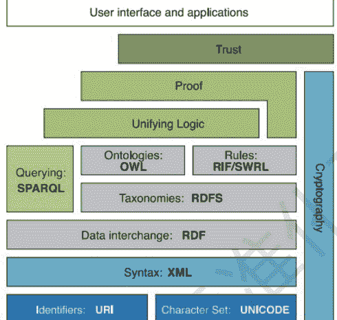

### 图2-16 语义网知识描述技术栈

在知识表示方面，W3C理事会推荐了XML、RDF、RDFS、OWL四项主要技术标准，其中，XML是一种元数据语法标准，也是一种标记语言，用于传输和存储数据，是语义网基础层。RDF系列标准包括RDF Primer、RDF Test Cases、RDF Concept、RDF Syntax。RDF是一种元数据语义描述标准，它被设计为一种描述信息的通用方法，可以被计算机应用程序读取并理解，现实中任何实体都可以表示成RDF模型中的资源。同时W3C理事会提议的SPARQL Requirements与SPARQL Language标准成为检索和操作基于RDF存储的知识图谱。

在知识建模方面，W3C理事会推荐了RDFS（RDF Schema）与OWL系列标准。其中RDFS是RDF的扩展，规范了用于描述RDF资源的属性、类的词汇表以及属性和类在语义上的层次结构。OWL是一种语义网本体语言，用于构建领域相关的本体，主要技术标准包括OWL Overview、OWL Guide、OWL Reference、OWL Syntax、OWL Test Cases、OWL Use Cases、以及Parsing OWL in RDF。OWL是在RDFS基础上丰富了类和属性的词汇，例如类不相交性、基数约束、类的布尔组合等，主要增加了类、属性之间关系的定义或约束。

### (4) NIST

NIST，全称：National Institute of Standards and Technology，中文名称：美国国家标准技术研究院，直属美国商务部，主要从事物理、生物和工程方面的基础和应用研究。在MUC-7之后，MUC由美国国家标准技术研究院组织的自动内容抽取(Automatic Content Extraction Evaluation, ACE)评测取代，ACE评测标准从1999年开始筹划，2000年正式启动，其中关系识别和检测任务定义了较为详细的关系类别体系，用于两个实体间的语义关系抽取。ACE-2008包括了7大类和18个子类的实体关系，从2004年开始，事件抽取成为ACE评测的主要任务。

此外，国际电信联盟（International Telecommunications Union, ITU）2016年开始进行人工智能相关标准化研究。目前尚未发布知识图谱相关标准以及研制计划。

## 2、国内标准化

### (1) 国家标准

在知识图谱相关国家标准的制定方面，2019年7月8日，国家标准化管理委员会下达2019年第二批国家标准制修订计划（国标委发[2019]22号），其中由中国电子技术标准化研究院提出的《信息技术 人工智能知识图谱技术框架》标准（计划号：20192137-T-469）获得立项，并由全国信息技术标准化技术委员会归口。本标准拟就知识图谱技术框架、利益相关方、关键技术要求、性能指标、典型应用及相关领域、数字基础设施、使能技术等内容进行研究，以厘清知识图谱核心标准化需求，提升我国知识图谱标准化工作水平，并促进知识图谱在各行业的推广应用。

此外，全国信息技术标准化技术委员会在相关国际标准研制的基础之上制定了《信息技术 词汇 第28部分:人工智能基本概念与专家系统》、《信息技术 词汇 第31部分:人工智能机器学习》、《信息技术 大数据 术语》三项基础国家标准，其中给出了知识工程、知识表示、知识获取、本体等部分知识图谱相关术语。

### (2) 团体标准

在知识图谱相关团体标准方面，由中国电子技术标准化研究院向中国电子工业标准化技术协会提出的《人工智能 知识图谱 性能评估与测试规范》(项目号：CESA-2020-2-020)、《人工智能 知识图谱 分类分级规范》(项目号：CESA-2020-2-019)两项团体标准于2020年6月正式获批立项，其标准化范围如下：

- 《人工智能 知识图谱 分类分级规范》针对当前知识图谱供应商、集成商和服务商能力良莠不齐、分类不清晰和评价方法缺失等标准化需求，拟规定知识图谱相关系统供应商的分类分级模型、能力框架、能力评价方法、评估指标等内容。

- 《人工智能 知识图谱 性能评估与测试规范》针对当前知识图谱性能指标及测试方法不明确、构建过程中各环节性能与质量评估不规范等标准化需求，拟规定知识图谱质量评估要求、知识图谱性能指标、测试框架、测试需求模型及度量准则等内容。

### (3) 标准体系研究

中国电子技术标准化研究院联合中电科大数据研究院有限公司、东软集团股份有限公司、联想(北京)有限公司、南华大学、星环信息科技（上海）有限公司、上海思贤信息技术股份有限公司、成都数联铭品科技有限公司、阿里巴巴网络技术有限公司等21家知识图谱领域相关开发商、系统集成商、用户企业、科研院所、高校联合编写并发布了《知识图谱标准化白皮书》（2019年版）。其中，从哲学层面、政策层面、产业层面、行业层面、技术层面、工具层面、支撑技术等多个层面对知识图谱的实际需求、关键技术、面临的问题与挑战、标准化需求、展望与建议等进行了梳理，并提出了知识图谱技术架构和标准体系框架等。

知识图谱标准体系结构和框架图如图2-17和图2-18所示。

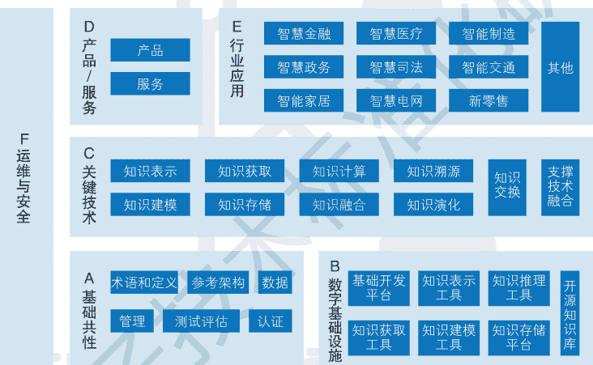

### 图2-17 知识图谱标准体系结构图

## 

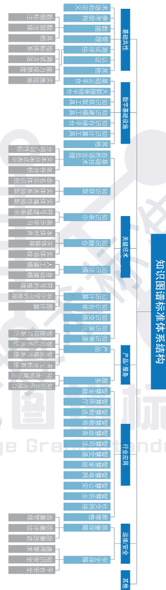

### 图2-18 知识图谱标准体系框架图

#### （二）标准化挑战

### 1、知识图谱质量评估与测试相关标准缺失

知识图谱质量的保障不仅涉及知识图谱构建过程知识表示、知识建模、知识获取、知识存储、知识融合、知识计算等各环节的质量评估，也涉及知识图谱应用系统各模块功能和性能的测试。因此，有赖于从知识图谱的内容和系统两个层面构建较为完备的质量评估体系和质控指标，并结合当前企业实践情况给出指标通过准则，进而为知识图谱应用系统策划、开发与部署过程提供指导和参考。

### 2、本体模型构建与联动更新相关标准缺失

本体模型及其Schema构建过程涉及对领域知识的高度抽象化建模，无法简单固化或设定，需领域专家的深度参与。而且，由于知识图谱应用系统部署实施后，随着时间推移、领域研究深度广度的拓展及业务模式的变化，本体模型也可能需要不断演进，以保障其准确性和适用性。因此，有待规范化的本体模型描述格式及联动模式，以保障其应用和更新的可持续性。

### 3、跨域知识交换与融合相关标准缺失

随着知识图谱应用系统在各领域、各企业的逐步建设和完善，目前已出现了一批优秀的成果。然而，由于建设初期相关系统着重于聚焦企业内部需要，顶层本体模型的构建流程和表达方式差异大且知识表示形式多样，导致建成后各系统间知识交换、知识图谱集成与融合困难，加深了集团内企业/部门间的信息壁垒，阻碍了行业内知识的流通。与数据交换相比，知识交换中不仅涉及知识本身还涉及配套的概念、语义等，因此有赖于规范化的知识交换与融合协议，对本体模型、知识表示、知识访问、交换模式等多个方面进行统一。

### 4、知识图谱中知识查询格式与语言相关标准缺失

当前，知识图谱无统一的查询语言，各厂商多根据自身需要进行设计和选择，存在差异大。这导致不同厂商无法对同一知识图谱进行直接操作，进而增加了用户企业在后期维护和升级知识图谱应用系统过程中的投入成本，也阻碍了通用知识检索或计算工具的研制与开发，有待相关标准进行支撑。

### 5、知识图谱服务方能力评估相关标准缺失

由于知识图谱应用系统在建成后将逐渐成为企业内部的重要知识服务基础设施，在构建过程中不仅需大量企业内、行业内专家的介入与支持，还需与企业内必要业务系统进行集成调试，并可能涉及多源异构数据的清洗等问题。这对知识图谱服务方在项目管理、系统集成、知识图谱构建、数据安全保障与数据治理等能力均提出了相应要求。因此，有赖于对其能力进行合理评估与分析以保障最终知识图谱应用系统的可靠交付。

除上述问题以外，细分行业中还面临专业术语集或术语库匮乏，知识图谱应用系统与业务系统集成，典型知识服务部署、实施与评估等方面的标准化需求与挑战。

### 四、知识图谱产品认证现状

围绕知识图谱构建与应用相关软件产品或服务平台测评与认证需求，中国电子技术标准化研究院联合北京赛西认证有限责任公司、联想、华为、百度、腾讯云、蚂蚁金服、百分点、网智天元、华宇等企事业单位依托上述知识图谱相关国家标准和团体标准等联合研制了《知识图谱构建平台认证技术规范》、《知识图谱应用平台认证技术规范》、《知识图谱构建平台认证实施规则》和《知识图谱应用平台认证实施规则》。其中，给出了测评与认证指标体系及配套检测项、功能点和合格要求，覆盖了知识图谱构建各环节能力及知识图谱应用过程中安全性、可靠性等重要特性要求，并明确了在通过认证后可向认证机构申请授权使用的产品认证标识，如图2-19、图2-20所示。

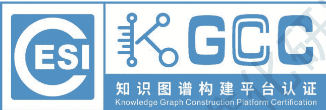

### 图2-19 知识图谱构建平台认证标识

### 图2-20 知识图谱应用平台认证标识

### 1、已通过知识图谱产品认证的平台清单

第一批和第二批测评与认证工作分别于2020年11月至12月和2021年8月至11月进行，通过认证平台清单及其所属企业如表2-6、表2-7所述。

### 表2-6 第一批通过知识图谱产品认证的平台及其企业名称

| 企业/单位名称 | 产品名称及版本号 | 知识图谱构建平台认证 | 知识图谱应用平台认证 |
| :--- | :--- | :--- | :--- |
| 联想（北京）有限公司 | 联想知识图谱平台 V1.0 | ☑ | ☑ |
| 华为技术有限公司 | 华为云知识图谱软件 V1.0 | ☑ | ☑ |
| 北京百度网讯科技有限公司 | 行业知识图谱平台 V1.2 | ☑ | ☑ |
| 腾讯云计算（北京）有限责任公司 | 腾讯云小微知识图谱 V1.0 | ☑ | ☑ |
| 蚂蚁智信（杭州）信息技术有限公司 | 蚂蚁金融知识图谱平台 - 知蛛 V2.0 | ☑ | ☑ |
| 清华大学 | 大规模中英文跨语言知识图谱平台 V1.0 | ☑ | ☑ |
| 杭州依图医疗技术有限公司 | 多模态知识图谱结构化平台 V1.0 | ☑ | ☑ |
| 北京百分点信息科技有限公司 | 百分点智能融合大数据分析平台 V2.0 | ☑ | ☑ |
| 北京国双科技有限公司 | 国双知识智能平台 V1.0 | ☑ | ☑ |
| 成都数联铭品科技有限公司 | KUNLUN Hyper Lite V1.0 | ☑ | ☑ |
| 北京华宇元典信息服务有限公司 | 元典睿核 V3.0 | ☐ | ☑ |
| 北京智谱华章科技有限公司 | 科技情报知识图谱平台 V2.1.0 | ☑ | ☑ |
| 网智天元科技集团股份有限公司 | 星图知识图谱平台 V1.0/ 星图金融知识图谱应用平台 V1.0 | ☑ | ☑ |
| 中国电信股份有限公司北京研究院 | 中国电信智能化运维知识图谱平台 V1.0 | □ | ☑ |
| 解放号网络科技有限公司 | 解放号采购知识图谱应用平台 V1.0 | □ | ☑ |
| 通联数据股份公司 | 萝卜投资 V3.35 | ☑ | ☑ |
| 杭州海康威视数字技术股份有限公司 | 海康威视知识图谱引擎 V1.0 | □ | ☑ |
| 摇地数智（重庆）科技有限公司 | 摇地产业透析知识图谱、 V3.2.2 | □ | ☑ |
| 恒生电子股份有限公司 | HUNDSUN 金融知识图谱应用系统软件 | ☑ | ☑ |
| 北京海致星图科技有限公司 | Atlas 知识图谱平台 V3 | ☑ | ☑ |
| 北京神州绿盟科技有限公司 | 绿盟安全知识图谱平台 | □ | ☑ |
| 海义知信息科技（南京）有限公司 | 海义知 PlantData 知识图谱全生命周期构建及管理软件 V3.5.0 | ☑ | ☑ |
| 南京柯基数据科技有限公司 | 柯基数据知识图谱平台 V2.3 | ☑ | □ |
| | KGDATA 智能问答平台 V3.0 | □ | ☑ |
| 新华智云科技有限公司 | 新华智云知识图谱平台 V1.0 | ☑ | ☑ |
| 拓尔思信息技术股份有限公司 | TRS 知识图谱关联分析软件 / TRS 知识图谱构建软件 V1.0 | ☑ | ☑ |

## 2、已通过认证平台的能力现状

《知识图谱构建平台认证技术规范》中规定了知识图谱构建平台的基础能力指标59项，其中必选指标30项，可选指标29项；《知识图谱应用平台认证技术规范》中规定了知识图谱应用平台的基础能力指标31项，其中必选指标16项，可选指标15项。根据第一批和第二批通过认证平台对指标的满足情况，可以初步分析当前知识图谱相关平台的发展现状：

### (1) 部分平台实现了对知识图谱构建、应用与维护全流程的覆盖

根据表1和表2中各平台的认证分布情况，共计19个平台同时完成了知识图谱构建能力与知识图谱应用能力的测试和认证，实现了从结构化数据、半结构化数据、非结构化数据的知识抽取到知识应用、知识维护与管理的全流程，占总数的比例为76%。尽管各功能模块间集成水平有待进一步，但建设覆盖全流程、各环节相互衔接的知识图谱应用系统趋势显现。

### (2) 基础性能和功能指标全部满足率依然较低

《知识图谱构建平台认证技术规范》和《知识图谱应用平台认证技术规范》结合各企业实践提出了基础性的功能和性能指标。然而，通过全部知识图谱应用平台测试指标的平台比例为36%，通过全部知识图谱构建平台测试指标的平台比例仅为10.5%，各平台整体能力仍有提升空间，如图2-21、图2-22所示。

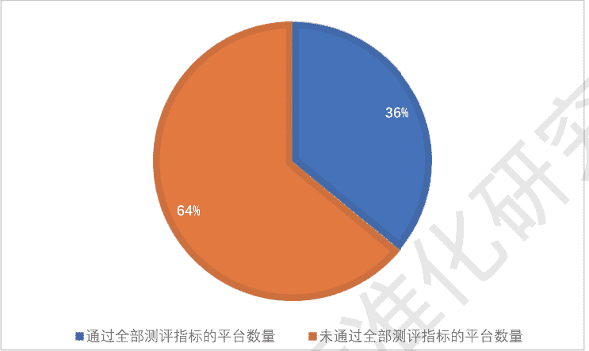

图2-21 通过全部知识图谱应用平台测评指标的平台分布情况

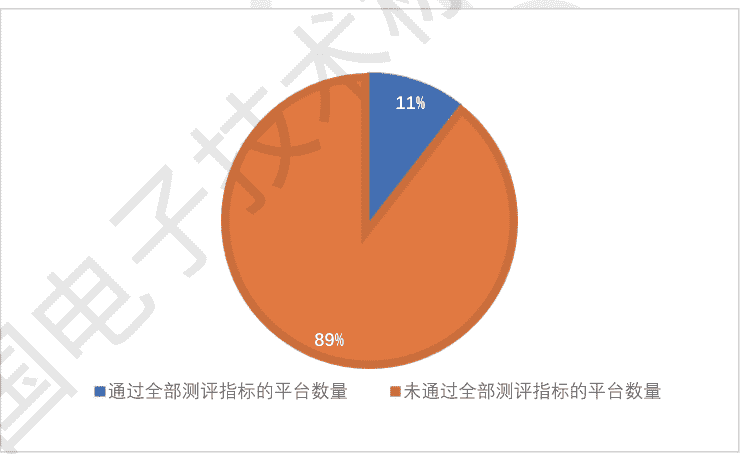

图2-22 通过全部知识图谱构建平台测评指标的平台分布情况

### (3) 知识图谱应用平台已覆盖通用领域及金融、医疗、制造业等重要细分领域

已通过认证的平台不仅包括了面向通用或跨行业知识图谱构建、应用与管理的平台，也包括了聚焦典型领域应用需求的知识图谱平台，共涉及了智慧金融、智慧医疗、智能制造、智慧电信运营商、信息安全、科技情报、智慧司法、智慧公安等8个细分领域。各领域中已通过认证平台数量的分布情况见图2-23，细分领域渗透率稳步提升。

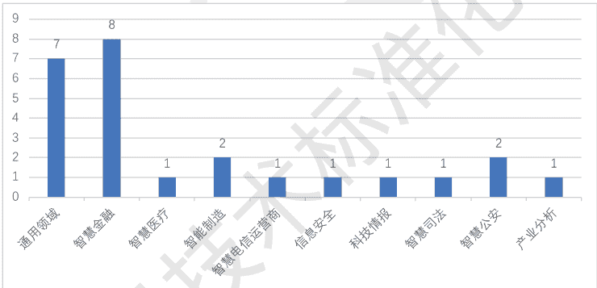

图2-23 已通过认证平台数量的领域分布图

### (4) 知识图谱构建平台中知识融合、知识计算及非结构化数据的知识抽取能力相对薄弱

已通过知识图谱构建平台认证的平台或系统在知识获取、知识表示、知识存储、知识建模、知识计算、知识融合等多个环节已建立相应的功能模块。而且，面向知识图谱构建的平台化产品逐渐成熟，具备了向不同用户整体交付部署的能力，有利于复制推广。

在能力分布方面，已通过认证的平台或系统仍存在短板。其中，知识计算中可选检测项平均通过率仅为47%，知识融合中可选检测项平均通过率为68%，尤其在实体类型、关系和属性名对齐与融合、知识推理等方面通过率不足。此外，在非结构化数据知识获取方面，受限于数据类型差异大、获取难度大等问题，获取的准确率、召回率有待进一步提升。综合考虑各维度检测项通过率及检测项数量，已通过知识图谱构建平台认证的平台或系统能力平均分布情况见图2-24。

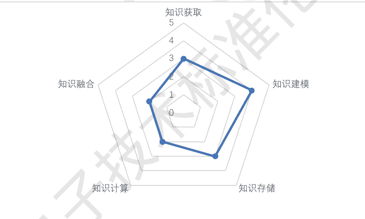

图2-24 已通过知识图谱构建平台认证的平台或系统能力画像

### (5) 知识图谱应用平台中可移植性和易用性有待强化

已通过知识图谱构建平台认证的平台或系统在安全性、可靠性、响应性、可移植性、易用性等方面设计了相应的功能模块。但，在顶层本体模型及图式（Schema）的在线导入、导出，多维度知识图谱内容可视化展示等方面通过率较低，有待继续强化，以提升平台与外部专家、知识内容审核人员、知识内容管理人员等人员间的协同交互效率。综合考虑各维度检测项通过率及检测项数量，已通过知识图谱应用平台或系统认证的平台平均能力分布情况见图2-25。

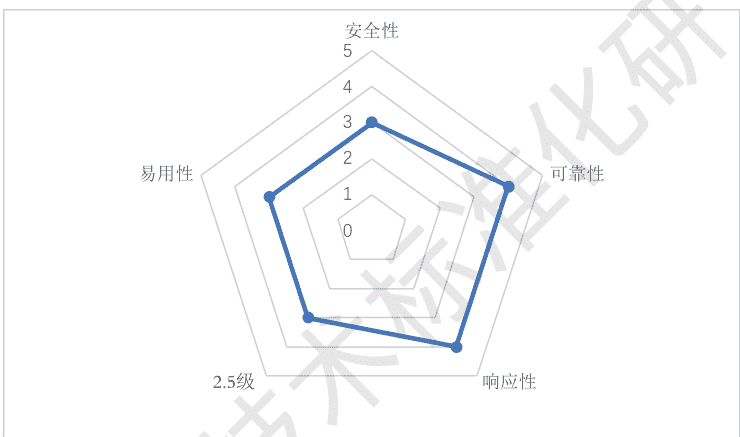

图2-25 已通过知识图谱应用平台认证的平台或系统能力画像

## 第三章 为什么应用知识图谱

### 一、知识图谱应用的必要性

#### (一) 传统知识服务系统/知识库的不足

随着信息技术和业务规模不断发展，企业累积了海量的业务数据。这些数据普遍存在来源广、规模大、格式杂、维度高等特点。如何从海量多源异构数据中抽取大规模知识，挖掘潜在的多度关联，并应用于实际的业务场景，成为各企业亟待解决的问题。而传统知识服务系统在应用和实施过程中越来越显得力不从心，主要面临的难点在于：

- 1、数据模式变化快，知识建模、存储和维护成本高。

随着业务发展，企业的需求和认知总是处于不断变化中，因此，业务逻辑和数据模式也不可避免地频繁发生变动。但传统知识服务系统的底层数据组织常以关系数据库为主，数据模式的可扩展性较差，表结构修改带来的数据迁移成本也较高，从而导致模式动态变迁困难、业务需求响应缓慢、知识运维繁琐复杂等问题。同时，频繁的模式变化也给底层知识存储带来较大压力，显著增加了知识维护的成本。

- 2、语义理解困难，知识挖掘能力不足。

当前企业内部非结构化数据所占比重越来越大，文本、图像、音视频形式的多模态数据大量涌现。这些数据蕴含丰富业务知识，信息量甚至超过结构化数据，具有重要的应用价值。但传统知识服务系统侧重处理、分析和管理结构化数据，针对非结构化数据的语义理解能力较弱，在挖掘单模态信息以及模态间的关联性方面存在较大困难，更多依靠人工或规则模板方式，大大限制了企业自动获取知识的能力。

- 3、多源异构数据融合难，数据孤岛现象严重。

企业积累的海量数据常常分散在内部各业务部门，同时还包括大量的第三方数据和公开数据。这些数据来源分散、格式繁杂、冗余冲突，迫切需要关联融合，发挥数据倍增效应。但传统知识服务系统面向各业务独立开发，设计之初较少考虑到多源异构数据的兼容问题，能够处理的数据种类和范围较为有限，缺乏数据集成的有效方法和流程，导致数据间关联融合面临巨大挑战，进而形成数据孤岛。

- 4、知识应用存在局限性，无法精确触达用户需求。

随着互联网的普及，语义搜索、智能问答和个性化推荐等应用在显著降低知识获取门槛的同时，对精准语义分析和推理提出了更高要求。但传统知识服务系统以离散符号表示和关系数据库存储为主，知识查询所需的专业化程度较高，无法摆脱行业专家的依赖，算法的可扩展性较差。此外，多跳查询性能随知识规模扩大而急剧下降，导致知识的深度关联分析和推理能力不足。这些问题极大制约了知识应用的范围，难以满足用户精确语义分析需求。

#### （二）知识图谱擅长的方向

知识图谱以结构化的形式描述客观世界中概念、实体及其关系，进而以更符合人类认知的方式建模真实世界的各个场景，在人工智能应用中的重要价值日益凸显。针对传统知识服务系统在企业行业应用中面临的难题，通过运用知识图谱技术，能够具备以下优势，如图3-1所示：

| 传统知识服务系统面临的难点 | 技术/方法 | 知识图谱擅长的方向 |
| :--- | :--- | :--- |
| 模式变化快 | 动态本体、图模型 | 模式动态扩展 |
| 语义理解难 | 信息抽取 | 大规模知识挖掘 |
| 数据融合难 | 本体对齐，实体消歧 | 异构数据融合 |
| 应用受局限 | 知识推理 | 知识智能化应用 |

图3-1 知识图谱擅长方向

- 1、支持数据模式的动态变化。

知识图谱能够对现实世界中的实体、实体类型、属性以及它们之间的关系进行建模，底层以图模型存储和关联业务数据，具有较强的表达能力和建模灵活性。基于动态本体技术，将数据模式和业务数据分开存储，能够支持可自由扩展的数据模式。通过构建节点和关系索引，能够根据修改后的数据模式实现节点属性和关系的快速更新，从而适应数据的动态变化和模式变迁。

- 2、支持大规模行业知识挖掘。

知识图谱通过将知识关联起来，并进行推理计算，能够做到结构化的语义理解，赋予机器像人类一样理解客观世界的能力。通过知识增强的语义表示模型来引入背景先验知识，借助信息抽取技术（实体抽取、关系抽取、属性抽取和事件抽取等），能够从多模态非结构化数据中抽取行业相关的实体、属性、关系及重要事件，实现知识的大规模抽取，并不断扩充知识图谱规模。

- 3、支持多源异构数据的整合。

知识图谱基于图的数据表示方式更加灵活自由，能够更好地兼容多源异构数据。此外，知识图谱提供了丰富的实体、关系及路径信息，有利于数据间的冲突检测和消歧。基于知识图谱，利用本体对齐技术，能够实现不同来源数据的类别层次、实体属性名称、关系名称等对齐，为数据融合打下基础；利用实体消歧技术，能够解决知识表示形式多样性问题，进一步丰富实体属性和关系，实现多源异构数据融合。

- 4、支持更加广泛的知识智能化应用。

通过约束构造、样本增强、事后检验、注意力构造等手段，知识图谱能够辅助机器语义理解和语言生成，减少样本依赖，提升模型的健壮性。同时，知识图谱基于图数据库等存储方式，在多跳关系查询上性能优势明显，可实现深度的关联分析和展示。因此，知识图谱能够不断沉淀知识逻辑和模型，降低对专家经验的依赖，在智能问答、语义搜索、可解释推荐、可视分析等方面展现出独有的优势。

除此之外，能够支持良好的知识间关联关系可视化体验。知识图谱可以对多维复杂关系的可视化展示，进而支持多种基于查询、过滤、多视图联动等的交互方法，进一步满足用户日益复杂的数据分析需求。

#### （三）知识图谱战略和规划

随着知识图谱的技术价值和赋能所产生的社会经济价值不断提升，近年来知识图谱及相关技术已经被多个国家、重点行业从不同维度列入战略发展规划当中。

- 1、国际层面

与知识图谱相关的人工智能已经成为新时期国际竞争的重点领域之一，全球多个国家均针对人工智能的发展方向和应用场景部署了相关政策规划。其中，美国、欧盟等地更是已率先将发展人工智能提升到国家战略高度，试图在变革中寻找新的发展机遇。

- (1) 美国

美国政府的第一份人工智能研发战略发布于2016年。目前，美国已经制定了较为完整的人工智能战略，并进入了快速实施阶段。

2016年10月，奥巴马政府发布了两份与人工智能发展相关的重要文件，即《国家人工智能研发战略规划》和《为未来人工智能做准备》，并在同年12月发布了题为《人工智能、自动化与经济》的报告。前两份报告把扩大人工智能研发队伍当作重点，第三份报告更进一步地调查了人工智能驱动的自动化对美国就业市场和经济的影响，并概述了应对措施方面的政策建议。

2017年发布的《美国国家安全战略》报告和2018年发布的《国防战略报告》都强调人工智能对美国国家安全具有重大的战略意义。

2019年6月，特朗普政府正式发布了《国家人工智能研发战略计划:2019年更新》。其中指出：“推进以数据为中心的知识发现方法”，“需进一步研究多模态机器学习以使其能够从不同类型的数据（例如，离散的、连续的、文本的、空间的、时间的、时空的、图形的）中发现知识。” 新的人工智能研发战略提出了8项重点战略，分别为:对人工智能研究进行长期投资；为人机协作开发有效方法；了解并解决人工智能的道德、法律和社会影响问题；确保人工智能系统的安全性；为人工智能的培训和测试开发共享的公共数据集和环境；支持建立人工智能技术标准和对相关工具的开发；更好地了解人工智能研发人员需求以及扩大公私合作伙伴关系以加快人工智能的发展。

除此之外，美国联邦政府的许多部门也发布了各自的人工智能规划，以保证采取全面措施促进人工智能的发展。

- (2) 欧盟

在人工智能热潮下，欧盟意识到人工智能的重要意义，为此先后出台了《欧洲人工智能》与《人工智能协调计划》等重要政策文件，相关战略框架初步成型。在此基础上，2019年4月欧盟发布了《可信人工智能伦理准则》与《建立以人为本的可信人工智能》两个政策文件，明确提出七条关键伦理要求，对欧盟的人工智能战略框架做了补充与细化。

- (3) 其他国家

在美国等科技强国的带领下，国外其他国家如英国、德国、日本等也纷纷紧跟时代脚步，发布了各种有关人工智能的战略发展规划。由此可见，人工智能，以及作为其中重要一环的知识图谱在国际中有着重要地位。欧洲电工标准化委员会发布的焦点报告《人工智能路线图》中提出“领域知识的概念化和规范化”相关标准化需求。

- 2、国家层面

随着国际上各技术强国对知识图谱在内的人工智能技术的关注，人工智能在我国也得到了前所未有的重视。为加速推动知识图谱在各行业的深度应用，我国已在多项国家和地方重要人工智能发展规划与相关政策中进行了相关部署。

2017年7月，国务院印发《新一代人工智能发展规划》，明确了我国新一代人工智能发展的战略目标：到2020年，人工智能总体技术和应用与世界先进水平同步，人工智能产业成为新的重要经济增长点，人工智能技术应用成为改善民生的新途径；到2025年，人工智能基础理论实现重大突破，部分技术与应用达到世界领先水平，人工智能成为我国产业升级和经济转型的主要动力，智能社会建设取得积极进展；到2030年，人工智能理论、技术与应用总体达到世界领先水平，成为世界主要人工智能创新中心。

其中，明确指出：“实现对知识持续增量的自动获取，具备概念识别、实体发现、属性预测、知识演化建模和关系挖掘能力，形成涵盖数十亿实体规模的多源、多学科和多数据类型的跨媒体知识图谱，并重点突破跨媒体统一表征、关联理解与知识挖掘、知识图谱构建与学习、知识演化与推理、智能描述与生成等技术”。

2017年10月，党的十九大报告明确提出推动“人工智能和实体经济深度融合”。2018年，政府工作报告也强调“加强新一代人工智能研发应用”。而后，各部委和地方政府也陆续出台了一系列政策来响应和推动战略实施，包括《广东省新一代人工智能发展规划》、《关于上海市推动新一代人工智能发展的实施意见》、《促进新一代人工智能产业发展三年行动计划（2018-2020）》、《高等学校人工智能创新行动计划》等文件。

其中，在《湖北省新一代人工智能发展总体规划（2020—2030年）》中提到：“重点提升感知识别、知识计算、认知推理、运动执行、人机交互能力；鼓励跨媒体分析与推理、知识计算引擎与知识服务等新技术在商务领域应用，推广基于人工智能的新型商务服务与决策系统”。

- 3、行业/产业层面

知识图谱等人工智能技术作为我国产业革新和经济转型的重要一环，在重点行业领域都具有重要的战略地位，下文以医疗、金融、工业、教育领域为例，阐述知识图谱相关行业发展规划。

- (1) 医疗领域

2018年，卫建委发布了《关于印发电子病历系统应用水平分级评价管理办法（试行）及评价标准（试行）的通知》，并提出：所有二级以上医院需要按时参加电子病历系统功能应用水平分级评价，且评估结果纳入公立医院绩效考核。这意味着我国医疗体系的电子化建设进一步完善，智慧医疗、智慧健康等概念进一步普及，并有待强化知识图谱及相关算法的助力。

- (2) 金融领域

随着国家对知识图谱重视程度的逐年递升，金融领域的知识图谱技术在飞速迭代更新。其中，被关注的重点需求及战略发展有以下方面：

第一，统一建立金融领域知识图谱Schema规范，统筹金融行业概念体系，泛化通用业务场景并形成适用于所属业务场景的概念体系，推进不同场景数据壁垒打通，解决数据孤岛等问题。

第二，结合脱敏数据共享规范等，促进有价值的金融数据不局限于局部效益，通过更安全、更可靠的方式共享数据，完成数据的再次增值。

第三，逐步完善金融领域知识图谱平台构建，作为领域知识图谱源源不断、质量可靠的数据来源，发展图算法、深度学习等人工智能技术应用于业务，配合数据中台深度加工挖掘金融领域深层次数据价值，最终达到领域内业务场景数据互通、增值的目标。

- (3) 工业领域

《“十四五”信息化和工业化深度融合发展规划》中指出：“强化工业大数据开发、制造资源配置和解决方案汇聚能力，加快工业知识的沉淀、传播和复用”。智能制造是推进工业制造领域快速发展的原动力，数据是联系新兴技术与智能制造的纽带。然而，目前工业产品从设计、生产、销售、物流与服务产生的庞大数据多以关系型数据库进行存储。该方式在增加数据冗余性的同时使得数据的存储聚合度降低，导致知识的潜在价值被埋没。

同时，当前工业领域的企业大多为劳动密集型，但业务复杂，面临着行业知识难积累、人员培训难度大的问题。而且，国内工业信息化发展水平参差不齐，部分企业的数据仍是粗放式管理，可用性与易用性较差，难以形成知识积累。工业领域资源密集型企业迫切需求向技术密集型与数字密集型企业转型，提高企业数字化能力。

工业知识图谱是知识图谱的重点发展方向之一，主要集中在产品研发、生产过程、运行保障、营销采购等环节的知识图谱构建，可通过行业知识整合，建立领域知识库，为上层业务应用赋能，同时帮助员工快速积累行业知识，提高人力资源效率。工业知识图谱具有数据量大、模型复杂度高、专业程度高、现有系统复杂度高等特点，对知识图谱厂商的技术能力及行业知识积累程度有着较高要求。

- (4) 教育领域

《北京市“十四五”时期教育改革和发展规划(2021—2025年)》指出：“刻画知识图谱、能力图谱，为学习者提供全面、有效的智能诊断、资源推送和学习辅导等服务”。优质资源不足是当前教育领域的主要矛盾，经济发展的不均衡带来了教育资源的区域性差异，同一地区城乡教育水平也同样差距巨大。教育资源的不足使得当前的教学难以满足学生个性化学习的需求，无法根据每个学生的接受能力和知识结构进行针对性的教学。

借助在线教育，以知识图谱为代表的人工智能技术可以帮助实现精准化教学，提高学生对知识的掌握程度。例如，通过整合课程知识、教学知识、学科知识及百科知识等教育领域的数据，教育领域知识图谱可建立各种知识与教学资源之间的关联关系，可得到领域知识。同时，可对学生的学习情况进行刻画，实现对学生学习情况的精准判断学习资源个性化推荐。

### 二、知识图谱应用现状

#### (一) 典型知识图谱应用

知识图谱在智能电网、智慧金融、智能制造、智慧医疗、智慧司法、智慧医疗、人文建设、科技文献等细分领域的应用，对于推动各行业及相关企业“知识驱动”下的转型升级和科技支撑具有重要意义，图3-1展示了知识图谱在17个领域赋能的应用成效。

表3-1 知识图谱在部分赋能领域的应用成效

| 序号 | 赋能领域 | 典型应用 | 应用成效 |
| :--- | :--- | :--- | :--- |
| 1 | 智能电网 | 物料重码发现与筛选 | • 大量缩减业务流程 • 减少返工次数与物料浪费 • 降低人力资源成本，提高效率 |
| | | 异物掉落防范 | • 校验结果具有较强的参考价值，工单反馈可靠性高 • 解决用户即时使用的需求，有效提高工作效率，减少工作时间 • 保护设备的完整性、提高校电站的安全管控 |
| | | 电力巡检知识管理与认知推理系统 | • 有效解决运检人员知识储备的差异性，提升电网故障处理水平 |
| | | 主设备缺陷知识管理与移动应用 | • 满足服务基层班组人员对专家级缺陷知识的需求 • 为管理决策者提供分析服务，辅助决策 |
| | | 虚拟供电服务指挥员引擎 | • 减轻人工压力，有效提升配网优化调度能力 |
| | | 客服中心智能服务系统 | • 改善用户服务体验 |
| | | 企业智能搜索系统 | • 消除数据孤岛，促进信息的整合、搜索和应用 • 提升信息资源的利用效率和共享 |
| | | 基于知识图谱的电力供应链 | • 提高电网在供应商的遴选与管理方面的决策能力 |

| 序号 | 赋能领域 | 典型应用 | 应用成效 |
|---|---|---|---|
| 2 | 智慧能源 | 石油天然气勘探开发知识管理 | - 在知识管理方面，改变原来分散存储、共享应用难的局面 - 在提升价值方面，大幅度提高非结构化知识数据的应用价值 - 在效率提升方面，大幅缩减前期资料收集时间，提高工作效率 - 在提升业务能力方面，形成更好的开发方案，提升业务能力 - 在知识传承方面，推动知识经验成果的高效传承 |
| 3 | 智慧金融 | - 金融监管 - 银行业信贷风险评估 - 智能投研 - 反欺诈、反洗钱 - 内审内控 - 智能产品营销 - 财险风控（如车险风控、农险风控等） - 寿险产品推荐 | - 金融机构监管效率提升，资本市场运作稳定性增强 - 风险识别维度和准确率提升，信贷服务工作效率提升 - 投资行业领域范围扩大，投资回报率提升 - 金融机构内部违规案件数量减少，内控规范度提升 - 用户满意度和用户粘性提高，获客时间缩短，营销成本降低 - 提升保险公司核保效率，降低公司承保业务风险 - 降低保险公司业务经营风险，提高业务利润率 - 支撑保险公司精准获客、高效展业 |
| 4 | 智慧医疗 | - 辅助诊断 - 病历质检 / 质控 - 疾病风险评估 - 智能导诊 - 治疗方案推荐 - 相似病历推荐 - 医嘱质控 - 病历内涵质控 - 智能问诊 - 临床路径服务 | - 辅助诊断提升诊疗能力 - 规范电子病历提升质量 - 医疗信息检索效率和准确率提升 - 病患风险评估覆盖率提升 - 在线 / 辅助诊断使用率提升 |
| 5 | 智慧司法 | - 证据索引 - 类案检索及推送 - 结果预判 - 证据分析 - 文书生成 | - 阅卷效率和案由判断准确率提升 - 类案检索报告生成效率提升 - 案件审理、案例研判质效提升 - 文书自动生成效率提升 |
| 6 | 智慧教育 | - 智慧课堂 - 智能备课 - 智能答疑 - 高考智能估分 - 个性化教学资源推荐 - 学习成效分析 - 智能校园管理 | - 人文数据学科资源管理和利用能力提升 - 知识检索效率和准确率提升 - 学科知识的学习路径规划，提升学习效率 |
| 7 | 智慧营销 | - 产品搜索 - 产品推荐 - 需求识别 | - 智能问答和推荐准确率提升 - 商品购买转化率提升 - 消费需求洞察能力提升 |
| 8 | 智能制造 | - 辅助生产操作控制 - 生产预测 - 生产异常追溯 - 生产知识整合 - 供应链管理 | - 产品设计效率提升 - 产品运营成本降低 - 设备质量管控能力提升 |
| 9 | 智慧交通 | - 城市安全与交通管理 - 路径规划与停车诱导 - 交通规划决策支持 | - 跨部门决策效率提升 - 交通规划与治理能力提升 |
| 10 | 智慧运营商 | - 智能客服 - 工单智能整合 | - 在知识管理方面，改变原来分散存储、共享应用难的局面 |
| 11 | 智慧政务 | - 智慧理政（如：社情民意数据获取与分析，公众焦点热点领域分析及分布） | - 提高决策部署的科学性、合理性 - 打破区域和部门间的藩篱，优化政府智能配置 - 及时发现异常、及时预警、精准打击 |
| | | - 深度洞察核心用户特点 | - 提升用户体验，为用户推送精准信息 - 对政务工作起到辅助决策的作用 |
| | | - 政务问答 | - 为政府机构与亿万用户提供直接沟通的桥梁 - 推动社会服务事业的全面发展和进步 |
| | | - 政务百科 | - 梳理政务任务、政务机构和政务信息 - 对政务信息用户提供更有效的政务信息服务 |
| 12 | 智慧公安 | - 案情辅助分析 - 关系网络挖掘分析 - 物品关系图谱分析 - 团伙关系图谱分析 - 类案分析与案例推演 | - 多源数据整合能力提升 - 分析侦查效率提升 |
| 13 | 智慧传媒 | - 新闻智能分析 - 内容智能生成 | - 资源共享效率提升 |
| 14 | 疫情防控及复工复产 | - 疑似病例识别 - 密切接触者识别 - 防疫物资供需对接 - 疫情智能监测 - 智能外呼 | - 疑似病例追踪效率提升 - 基层自动电话统计效率提升 - 在线疫情知识服务范围扩大 |
| 15 | 智慧建筑能源 | - 能源系统态势感知与空调群控自动寻优 - 空调系统负荷预测 - 故障检测与健康管理 | - 提升对安全威胁的发现识别、理解分析能力 - 提升紧急情况的处置能力 - 降低运营成本 |
| 16 | 智慧文旅 | - 景点知识展示 | - 不受时空限制，多角度体验特色文化的魅力 |
| 17 | 智能家居 | - 智能装潢应用 - 家电知识百科 | - 提升智能家电的智能化水平 - 便利用户选购与日常使用家电 |

因表3-1中部分典型案例或应用在《知识图谱标准化白皮书》、《知识图谱实践案例集》、《知识图谱在疫情防控与复工复产案例集》中已进行详细描述，本文不再赘述，仅对上述文献中未提及的部分应用说明如下。

### 1、智慧电网领域

| 典型应用 | 应用成效 |
|---|---|
| **基于知识图谱解决电力场景下物料重码** 当前核电站的物料数据均由各电站自行创建和维护，存在大量重码问题，不利于物资共享、集中采购、成本控制。通过知识图谱进行的数据相似性对比，对物料主数据及相关数据进行多维度分析，生成疑似重码的物料清单，并由业务人员审定标识为重码后，将重码数据在知识图谱中建立关系。 | - 缩减业务流程，减少返工次数与物料浪费，降低人力资源成本，提高效率。 |
| **基于知识图谱解决异物掉落风险分析** 部分异物事件给核电站带来了巨大的经济损失。为了解决异物掉落的问题，基于防异物工单数据构建异物知识图谱，采用图搜索和图计算的方法建立核电领域防异物的校验模型，实现防异物工单分级以及异物掉落的风险分析，将有掉落风险的工单展示给用户。 | - 防异物工单反馈可靠性提升，保护设备的完整性、提高核电站的安全管控； - 减少设备维修工作、缩短维修工期等，为核电站的安全与资源的节省提供了更高的保障。 |
| **主设备缺陷知识管理与移动应用** 为解决目前设备缺陷资料获取难、知识服务程度低的问题，以缺陷信息、变电五通、分析报告为基础，构建缺陷知识、技术导则、专家经验、典型案例四类知识库。同时，通过与变电移动作业APP应用场景的深度融合，开发设备知识精准检索、缺陷问答、缺陷知识主动推送等服务，支撑现场作业人员便捷、快速、精准地获取设备运维和检修知识。 | - 满足服务基层班组人员对专家级缺陷知识的需求； - 提供缺陷知识智能检索与问答、作业设备缺陷知识主动推送、缺陷信息自动校验、缺陷性质自动定级等应用服务； - 为管理决策者提供缺陷设备谱系分析、缺陷影响关联分析、家族性缺陷分析、供应商绩效评价等分析服务。 |
| **客服中心智能服务系统** 系统涵盖了国家电网客服智能语音服务导航、智能客服应用业务场景、智能外呼、智能语音服务和智能在线服务等领域。在智能客服方面，实现了智能语音对话服务，代替传统 IVR 按键场景，提升服务水平，在智能座席方面，通过建设智能人机辅助、智能座席工作台和相关应用统计等功能，提高座席人员的工作效率及服务质量，在智能运营方面，实现客服工作过程中的全方位实时监测及应急指挥管理。 | - 将人工模式逐渐转变为智能化模式，解放重复机械化的人力劳动； - 进一步改善用户服务体验，提升座席工作效率和中心运营管理水平。 |
| **虚拟供电服务指挥员引擎** 虚拟指挥员系统聚焦配调专业 OMS 操作票和工作票的调度和运行业务管理，实现电话系统和配调图形管理系统的集成。同时，通过采集配网调度电话系统的语音数据与文本数据，训练出相应声学模型和语言模型，并基于 NLU 和 NLP 服务实现语义分析和识别。进而，对自然语言和文本实现快速理解，并通过话术管理内容、话术场景及业务流程控制引擎完成动态灵活的多轮人机交互。 | - 在系统学习调度规程及主动抢修电力术语后，虚拟指挥员代替原有人工调度员接听现场电话，催办工作、结合配电自动化许可现场工作，完成负荷预测以及智能抢修应用，减轻人工压力，有效提升配网优化调度能力。 |
| **基于知识图谱的电力供应链管理** 从供应商管理的实际需求出发，采用文本分析、图计算、知识图谱等技术（如，合同、项目、反馈、处罚等）及供应商外部数据，建设物资多元智慧全景供应链，实现基于知识图谱的供应商综合分析管理体系。此外，基于知识图谱实现整个物资供应链上下游各方的全面联动，并通过知识治理、知识构建、知识融合，提升数据端到端的整体流转效率，形成物资供应链全景知识图谱。 | - 实现供应商状态的预测、评价、风控及全景画像，有效地提高电网在供应商遴选与管理方面的决策能力。 |

### 2、智慧金融领域

| 典型应用 | 应用成效 |
|---|---|
| **基于知识图谱的保险风控应用系统** 通过接口方式对接核心业务系统，基于知识图谱提供风险画像、风险评分、风险信息，支撑关键业务节点实现事前、事中、事后风险管理。 | - 提升保险公司核保效率，降低公司承保业务风险； - 通过在理赔端进行风险案件检测，释放了现场查勘资源，整体降低保险公司业务经营风险，提高业务利润率。 |
| **寿险产品推荐** 寿险产品知识图谱把产品涉及的所有信息建立成统一的关联网络，为实现产品的智能推荐和精准营销提供数据基础。 | - 促进支撑保险公司的精准获客和高效展业。 |

### 3、智慧交通领域

| 典型应用 | 应用成效 |
|---|---|
| 交通设备故障溯源 交通行业的业务知识识别繁杂、数据分散，未能建立数据间关联，无法快速、直观、全面地获取数据。基于用户使用场景，可利用知识图谱开发智能分析应用，如设备全生命周期管理、故障溯源等。 | - 提升设备信息、故障、日志等业务数据的检索效率。 - 提升故障排查与解决的效率。 |

### 4、智慧政务领域

| 典型应用 | 应用成效 |
|---|---|
| 基于知识图谱实现智慧理政 为了畅通政务服务渠道，通过知识图谱将杂乱的社情民意数据进行知识梳理表示，利用知识获取、知识融合等技术，实现对公众真实诉求的掌握及办理结果的互联互通。此外，通过知识图谱技术，分析展示各地区公众关注的焦点热点领域及分布，结合投诉咨询件的办理情况，梳理政府管理中存在的薄弱环节。 | - 提高决策部署的科学性和合理性，打破区域和部门间的藩篱，优化政府资源配置； - 促进及时发现异常，及时预警。 |
| 基于知识图谱的政务问答 在知识库中建立问题与答案的映射关系，将自然语言转化为知识图谱查询语句，并从知识图谱中获得答案，为政府智能客服机器人、12345 热线提供问答知识支撑。 | - 为政府机构与亿万用户提供直接沟通的桥梁，代替政府工作人员为民众提供权威官方的解答； - 为广大社会民众在民生、安全、旅游等方面提供更加及时、更为优质的服务，推动社会服务事业的全面发展和进步。 |
| 利用知识图谱技术构建政务百科 利用知识图谱的能力对政府人物、机构、政务关键词、政策词条等内容进行百科式的知识抽取和知识表示，并利用图模型描述和梳理政务各知识间的关联关系，形成内容权威、解读全面、通俗易懂的政务知识百科。 | - 厘清梳理政务任务、政务机构和政务信息，帮助政府解读经济、社会发展与政府顶层设计之间的内在逻辑，提升政务决策水平； - 为公众提供一个分门别类、可立体索引的“政务地图”和“政务动态档案馆”。 |

### 5、智能家居领域

| 典型应用 | 应用成效 |
|---|---|
| 基于知识图谱的智能菜谱应用 食材采购推荐：及时向用户推荐需采购的食材，并提供选购技巧、商家优选、比价等服务。 菜谱推荐：结合现有食材、季节天气、用户健康状况等因素，为用户推荐每日菜品。 菜谱问答：响应应用户提问，向用户提供菜品的烹饪方式。 | - 提升智能家电的智能化水平，进一步改善用户体验。 |
| 基于知识图谱的家电知识百科 利用知识图谱构建家电百科知识库，向用户提供产品介绍、选购指南、使用技巧、产品保养、故障维修等家电使用全流程的知识检索和智能问答。 | - 为用户提供全面、具体的家电知识，并为用户选购和日常使用家电带来更多便利。 |

### (二) 国外知识图谱应用

国内外知识图谱的应用主要集中在搜索引擎、问答系统、电商平台、社交网站、生物医疗、金融证券、政府部门、新闻教育等诸多领域，在整体大方向上具有一定的共性，但在一些细分领域具有差异性。部分典型的国外知识图谱应用见表3-2。

### 表3-2 部分国外知识图谱应用

| 应用领域 | 国际知识图谱应用 |
|---|---|
| 智慧金融 | Financial Industry Business Ontology(FIBO) KENSHO |
| 智慧公安 | National Security Knowledge Graph(govini) Palantir |
| 智慧医疗 | Benevolent Platform IBM Watson Health Ontotext Linked Life Data |
| 智慧教育 | Know EDU |
| 智慧能源 | Ontotext Energy Transparency Knowledge Graph |
| 智能制造 | Metaphactory |
| 零售电商 | Amazon product knowledge graph Walmart Retail Graph eBay Beam |
| 智慧政务 | UK Parliament's Data Service |
| 智能营销 | Pitney Bowes Knowledge Fabric |
| 企业服务 | Franz AllegroGraph |
| 智慧司法 | EU Project Lynx |
| 智慧文旅 | Europeana ResearchSpace Tourism Media Enigma |
| 智慧投研 | Siren Platform |
| 科技文献 | SpringerNature SciGraph |
| 信息安全 | 安全本体图（SOG）Strikeready |
| 社交网络 | Facebook |
| 搜索引擎 | Google Search Bing |
| 疫情防控 | CovidGraph |

### 三、可能存在的挑战

#### (一) 共性挑战

知识图谱实现技术演进和产业化应用的同时，在数据准备、知识图谱构建与维护、应用系统集成与部署等知识图谱应用系统建设的三大阶段分别面临一系列共性挑战，有待关注并在项目规划中予以综合考虑，如图3-2所示。总体而言：

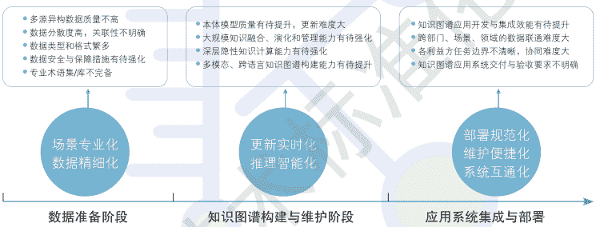

图3-2 知识图谱面临存在的挑战

在数据准备阶段，场景专业化、数据精细化挑战突出。数据是一切技术构建的前提，在数据来源、数据对接、数据标注、数据处理、数据融合等过程中，都存在着各式各样的问题。此外，不同行业存在着专用术语、语法与逻辑，尤其像司法、金融等特殊行业，应用场景对于专业知识水平均有较高要求，知识图谱需在通用化与个性化中进行取舍和平衡。

在知识图谱构建与维护阶段，更新实时化、推理智能化挑战突出。知识图谱在具体应用中需对其知识内容进行不断的更新，甚至在部分场景中需实现实时更新与自动获取，来保证数据的时效性和准确性。此外，基于特定的业务需求和已有的数据，建立精确高效的推理计算模型并输出正确的结果，决定了知识图谱应用的品质和有效性。

在应用系统集成与部署阶段，部署规范化、维护便捷化、系统互通化挑战突出。知识图谱需要与必要的功能模块共同组合形成知识图谱应用系统，才能够在企业中部署和运营。此外，还可能涉及与关键业务系统的集成以获取重要数据或提供知识服务支撑，这均需要以工程化视角进行建设，并形成完备的交付材料以保障服务方撤出后企业能够实现自我管理和基础维护。

### 1、数据接入与预处理相关挑战

### 挑战1：多源异构数据质量不高。

数据是知识图谱构建的基石，来源可分为自有数据和外源数据。自有数据是建设者自身拥有的数据，大多数公司为数据库里产生的业务数据；外源数据是通过互联网爬取、数据交易或公开共享等渠道所获得的数据。在实际应用中，多源异构的数据往往依托于不同的业务需求和工具产生，缺乏统一的业务数据模型标准和行业描述规范，使得多源数据存在歧义、噪声大、质量不高等问题。其中，数据歧义体现在实体和概念属性描述缺乏精确性、一致性，或实体间关系扭曲，进而可能导致概念描述重复、语义描述冲突、推理机制混乱等问题。

### 挑战2：数据分散度高，关联性不明确。

关联是知识图谱的核心和特征之一，使用本体对各种类型的数据进行抽象建模，构建“实体类型-实体-属性-关系”的数据类型是构建知识图谱的基础工作。数据间的关联性是否明确决定了知识图谱实体关系是否清晰、完整。然而，现有的公共知识库并没有按照领域数据的特点分类，无法完整表达文本、图片等知识和它们的关联，这一定程度上给本体构建带来了挑战。

### 挑战3：数据类型和格式繁多。

不同结构类型的数据有着不同的挑战。从结构化数据库里获取知识需要处理复杂的表数据，而从链接数据中获取知识需要解决数据对齐的问题。从半结构化（例如网站）数据中获取知识，需要对包装器进行定义、生成、更新与维护。从非结构化数据中获取知识的难度最大，且大部分数据都是非结构化的，其中包含了文本、图像、语音等不同形态等数据。从文本来获取，涉及到大量自然语言理解的问题；从图像来获取，涉及到大量视觉识别相关的问题；从语音来获取，涉及到大量语音识别相关的问题。

### 挑战4：数据安全与保障措施有待强化。

随着知识图谱中知识规模和维度的增加，涉及的数据范围不断拓展。部分数据中可能会包含隐私信息，特别是金融、医疗等领域知识图谱，需在数据安全方面基于法律法规、国家标准建设体系化的保障措施，提升知识图谱的安全性。

### 挑战5：专业术语集/库不完备。

专业术语集是知识图谱构建中重要的数据基础之一。通用知识图谱和领域知识图谱的目标对象不同，构建图谱所需的专业术语集有一定的差别。通用知识图谱的术语集更注重百科知识的科普性，而领域知识图谱的术语集强调行业知识的专业性。目前大多企业的数字化程度都不够，无法自主沉淀出完备的专业术语集。这主要有三大原因：第一，专家知识往往是隐性的，难以直接从文本中抽取出来；第二，专家知识有着一定的门槛，只有少部分行业的从业人员才能完成专家知识的众包工作；第三，各个行业内缺少统一的术语制定规范和知识共享平台。因此，面对复杂多样

的知识百科和成千上万的细分行业，当前构建的专业术语集和知识库还远远达不到应用需求目标。

## 2、知识图谱构建、管理与维护相关挑战

### 挑战1:本体模型质量有待提升，更新难度大。

- (1) 本体模型开发工具不完善。

随着知识图谱构建的需求增多，许多机构通过抽象知识图谱构建过程来尝试搭建工具，用以辅助构建本体。主流的本体构建工具包括 Ontolingua Server, WebOnto, OilEd等。各种工具目前的技术水平上具有各自的优缺点，几乎没有一种本体工具可以提供完备的功能支持，如 WebOnto、WebODE不提供备份管理功能，OilEd不提供协作构建本体的环境。知识图谱本身属于人工智能领域较新技术方向，目前开发工具水平参差不齐。专业工具的匮乏降低了本体构建的效率，因此，如何构建完整、易用的本体成为业内重要的挑战。

- (2) 本体模型设计与构建完备性不足。

对于领域知识图谱，构建一个标准的知识本体是一项巨大的工程，对业务人员的行业理解能力要求较高。建设者为尽可能地建模场景元素，既要了解业务细节，如复杂实体如何拆分，属性和实体关系如何区分等问题，还要宏观把控业务抽象，针对问答、检索等不同的需求构建不同的本体。现阶段本体的构建，大多需领域专家对概念体系和关系进行评估后才能形成较为完备的本体模型。但由于各个领域的本体数目众多、关系复杂，且实体类型等设计具有主观性，缺少统一的标准，导致人工构建的本体模型往往存在缺陷。

- (3) 本体模型动态变迁困难，维护成本高。

随着本体层知识的动态变化或更新，本体应及时做出响应。而且，本体的变化极大地影响着实体、实体关系的变化。例如，某领域内用户产生新需求或产生某种新认知，可能带来本体的扩展性差、对用户响应慢等负面情况。而且对领域知识图谱来说，业务变化和业务人员的认知水平变更也会增加本体构建的不确定性。如何维护、更新本体，实现对数据及数据模式动态变化的支持还存在诸多挑战。

- (4) 领域知识体系比较封闭，公开获取渠道少。

受细分领域内组织自我保护等因素限制，领域知识体系比较封闭，知识获取的开放途径少，专业知识分散度高而且存在内容滞后等问题。然而，本体构建需参考的语料库不但包括相关的专业文献、专利、字典和工具，还包括领域流程、工艺、市场和用户等多方的知识体系。这导致本体构建可用的领域知识不充分，可用程度不高。

### 挑战2：大规模知识融合、演化和管理有待强化。

- (1) 大规模实体消歧和标识管理有待强化。

知识图谱中的一些实体具有非常相似的名称，例如具有相同或相似标题的电影、歌曲和书籍。但每一个实体应具有唯一的规范化标识。如果没有正确的链接和消歧，实体将与错误的事实相关联，并导致下游的错误推断。在一个数据规模较大的系统中进行标识管理时，如何进行标识描述，使不同的团队能够达成一致，并知道其他团队在描述什么？开发人员如何确保有足够的可读信息来判定冲突？在上述场景中该问题将变得更具挑战性。

- (2) 大规模知识演化和知识管理有待强化。

当前知识图谱构建的方法和技术重点聚焦在知识获取、知识处理、知识融合，较少关注知识演化和知识图谱系统的维护管理。由于知识图谱构建的步骤繁多，针对整体系统的运维和管理也非常复杂。如一个有效的实体链接子系统就需要根据其不断变化的输入数据进行有效的更新。虽然部分知识图谱系统已配置了图谱的版本管理能力，但是距离图谱中高度动态的知识管理仍然有一定差距。因此，针对知识图谱系统的维护管理工具需要加强开发。

- (3) 知识质量控制难度大。

知识质量控制包括质量评估、问题发现和质量提升。评估数据质量需要确定一组质量维度和相应的度量方式，但知识图谱的质量评估尚未形成一套统一的维度标准。针对不同的下游任务和不同的数据集，知识的质量评估往往会有不同的质量要求，这为评估工作带来更大的挑战。

而且，现存的质量评估方法大都针对静态知识，缺少动态知识的评估手段。问题发现中，手动方式依赖任务设计和用户参与，效率低、成本高，不适用于大规模图谱；半自动方式涉及规则的自动发现和人工验证的结合，目前还没有得到很好的研究；全自动方法由于完全脱离人的校正，准确率和可信度有待提高。质量提升因其复杂性较高，还未有很好的研究。

### 挑战3：复杂规则表达困难，深层隐性知识计算能力有待强化。

- (1) 多元关系中复杂的隐含信息挖掘有待强化。

知识计算的主要对象多是二元关系，通常处理多元关系的方法是将其拆分为二元关系进行推理。然而，将多元关系拆分会损失结构信息，如何尽可能完整地利用多元关系中复杂的隐含信息进行推理是知识计算一大挑战。

- (2) 小样本或零样本学习知识推理有待强化。

现有的知识计算往往都是基于大量高质量的数据集进行训练来得到有效的推理模型，并通过在测试集中测试、优化模型来完成推理任务。除了数据集获取成本高的问题，训练出的推理模型的泛化能力也极为有限。而在现实世界中，人类通过少量样本的学习即可完成复杂的推理。因此，如何模仿人脑机制实现小样本或零样本学习的知识计算也是一大挑战。

- (3) 基于动态约束和复杂规则的动态推理有待强化。

知识图谱中知识的有效性往往受到时间、空间等动态因素约束。如何合理利用知识的动态约束信息完成动态推理是知识计算的一大挑战。此外，实体和关系构建的语义网络复杂，导致知识图谱中的规则表达困难，知识计算开销巨大，自动化推理难度也相应增加。

### 挑战4：多模态、跨语言知识图谱构建能力有待提升。

- (1) 多模态知识图谱的构建难度大。

知识图谱技术已经广泛用于处理结构化数据和文本数据，但对于图像、视频、音频等多模态数据的知识提取缺乏有效的技术手段。因此，目前针对多模态数据的知识图谱构建难度较大，包括多模态下的实体构建，多种模态实体间的语义关系构建，不同模态信息间的互补、融合，多模态知识的实体消歧、跨模态之间的语义对齐等问题。

- (2) 跨语言的知识图谱构建技术基础薄弱。

全面的知识图谱必须涵盖以多种语言表达的事实，并将多语种表达的概念融合在一起。然而，不同文化在描述世界的方式上有一定的差别，这会给多语种数据的知识抽取和融合带来不少挑战。XLORE是第一个中英文知识均衡的大规模跨语言知识库，它提供了一种通过利用维基百科中的跨语言链接来构建跨任何两种语言的知识图谱的新方法。虽然XLORE已经拥有比较均衡的双语知识量，但仍有大量缺失事实需要补充，存在特征可扩展性差（只能把特定的词汇或结构当作特征）和链接稀疏（现存的跨语言链接很少）的问题。

## 3、知识图谱应用系统建设与部署相关挑战

### 挑战1：知识图谱应用开发与集成效能有待提升。

- (1) 知识图谱应用系统边界与性能要求不清晰。

一是因用户和技术开发方对领域知识范围理解不对等，导致系统开发时无法有效地明确知识图谱应用的系统边界；二是因用户缺乏技术开发方法和工具的甄别能力，导致知识图谱应用系统的性能需求模糊；三是因缺乏针对知识图谱应用系统边界与性能的评价方法和工具。

- (2) 企业对将自身业务逻辑转化为知识图谱的应用算法存在困难。

用户业务特定环境和工艺路线的复杂性，决定了其业务知识和技能的专业性，知识图谱的应用算法工程师对于其认识存在一定局限性。此外，用户企业专家也需要对知识图谱构建基础知识进行必要的了解，上述因素导致企业自身业务逻辑迁移和转化为知识图谱的应用算法过程中存在困难。

- (3) 部分领域知识图谱的应用深度不足。

目前，制造业、农业等领域知识图谱的应用多停留在知识问答、智能推荐、智能检索等通用应用，与领域融合程度较为有限，还未触及领域核心痛点，有待进一步突破。

- (4) 缺乏必要和权威的开发规范。

知识图谱应用系统的开发与集成需要系统化、规范化的规程指导，以降低用户企业与外部服务方之间的对接沟通成本。而且，由于企业内部已建设有信息化系统，并已拥有一系列管理规定，明确和权威的开发规范有助于促进知识图谱相关项目与用户企业已有信息化系统建设要求的匹配与结合，提升管理的实效性。

### 挑战2：跨部门、场景、领域的数据联通难度大。

跨领域中的组织通常存在自我保护和弱相关性等特点，导致领域间数据共享存在壁垒。此外，跨场景和跨部门知识流动时，还涉及业务逻辑差异、数据模型不一致、知识体系不协调、接口不匹配等问题，而且知识交换与融合协议缺失，这都阻碍了领域知识图谱应用系统间知识的联通与流动，抑制了知识价值应用的最大化。

### 挑战3：各利益方任务边界不清晰，协同难度大。

- (1) 用户对于知识图谱构建所需基础能力和资源投入评估不足。

知识图谱应用系统的建设与长期运行需要数据、资金、人员、软硬件资源、机制保障等多方面的投入。这要求企业在初期从系统的建设规模、基础条件、知识获得渠道、经济支持额度等需求做出准确的评估，合理规划建设周期、建设难度及自身短板。

- (2) 用户需求定位和表达模糊，部分场景中对性能期望过高。

明确和清晰的业务应用场景和定位是设计知识图谱应用系统架构和算法模型的基石之一。然而，当前用户对知识图谱的应用带有一定的主观性和效仿性，而且，知识图谱在技术和工程化方面仍存在一些挑战，导致用户对应用场景识别不足、规划不清及期待过高等问题。

- (3) 用户对于基础数据的归集、整理与储备有待强化。

数据作为知识图谱构建的基础，服务方的数据积累无法替代用户方所需提供的专业数据资源。而且，部分领域由于用户缺乏数据归集和治理相关思想意识，数据质量不足，有待用户与服务方共同协作从知识图谱应用系统角度出发进行数据处理。

- (4) 开发和实施过程中各方任务构成及要求不清晰。

在知识图谱应用开发和实施过程中不仅需要用户参与，也需要服务方投入项目经理、技术开发人员、算法建模人员等不同类型的人员以保障全流程的顺利完成。对于各环节的任务构成和要求不明确，容易导致各方相互间角色认识差异、任务推诿等问题。

### 挑战4：知识图谱应用系统交付与验收要求不明确。

- (1) 知识图谱质量测评体系不明确。

从用户角度看，知识图谱推理结果和应用效果的评价带有主观性，缺乏一致性的用户评价指标体系。从技术方角度看，知识图谱系统开发和部署应用的成功与否，缺乏第三方监理和验收的评价指标体系。

- (2) 知识图谱应用系统的质量评估和验收要求不明确。

知识图谱应用系统的验收交付需涉及知识图谱本身、知识图谱应用系统各功能模块、使用说明书、维护手册等内容，而且需要对其试运行期间性能进行评估，才能够保障用户对系统的全面了解和掌握。然而，当前缺乏明确的验收方法和程序等，交付与验收效果有待强化。

## 4、理论及人才储备相关挑战

- (1) 知识图谱行业专业人才紧缺。

由于教育体系和技能培训机构对人才培养的滞后，而且社会需求旺盛，知识图谱的构建、部署、应用等需要的专业技能人才十分紧缺。

- (2) 知识图谱相关理论不完备。

知识图谱构建所需的知识建模、知识抽取、知识融合、知识推理等理论待持续完善，而且工程化实施部署中缺乏系统性标准支撑。

#### （二）细分行业挑战

随着人工智能对数据处理和理解的需求逐日增加，知识图谱应用领域日趋广泛。这不仅对知识图谱的各种共性技术有了更高的要求，针对不同的行业领域，知识图谱技术也面临着各种风险和挑战。下文以智慧城建、智慧司法、智慧教育、智慧金融四个行业为例，分析知识图谱技术在不同细分行业中可能存在的挑战。

### 1、智慧城市中面临的挑战

- (1) 数据来源问题

知识图谱在智慧城建的应用中，数据来源仍然是首要难题，主要包括数据公开不全面、数据源单一、数据源缺失、数据类型差异较大。城乡之间、地区之间在人口数据信息、城市基础设施信息、城市经济发展信息的建设和公开方面仍存在很大差异；不同领域、不同部门间数据的部门化、碎片化严重；跨地区、跨层级、跨部门的数据共享交换面临着信息孤岛和数据壁垒，这些问题使得知识图谱技术在智慧城建上的应用情况离理想状态还有一定差距。

- (2) 数据对接问题

智慧城建相关的数据非常多，如何将各种类型的数据（比如音频数据、视频数据等）和知识图谱进行对接，并从数据中提取出有效的知识，与知识图谱已有内容进行整合，以达到有效使用知识图谱的目标是当前面临的一大挑战。

- (3) 高级推理建模问题

知识图谱中的知识推理，一般是通过知识的表示学习来补全知识图谱中缺失的实体或关系，并对未来可能发生或存在的关系进行推理。然而，智慧城建涉及的数据面较广，如何综合利用海量、高维的数据来建立推理模型，是当前还未解决的难题。因此，基于特定社会场景下研究面向智慧城建领域知识图谱的计算和复杂推理技术，既有意义也有挑战。

### 2、智慧司法中面临的挑战

- (1) 语义关系的多样性和复杂性

知识图谱中的知识是按照语义关系连接的，它们的关系多样性强。首先，词汇关系是多样的，比如，法官与司法工作人员是上下位关系，而审判庭和法院是整体和部分的关系。其次，文本关系也是多样的，比如，张三驾驶机动车撞上李四，导致李四失血过多死亡是因果关系，而张三为了非法占有，盗伐李四承包经营的林木是目的的关系。因此，多样且复杂的关系抽取，是智慧司法知识图谱建设的一大挑战。

- (2) 法律术语的专业性

法律知识图谱具备独特的专业性特征。首先，法律本身具有严密的逻辑性和严谨性，从某种程度上来说，法律和知识图谱有着天然的联系，如犯罪构成体系就是一种刑法的认知体系。另一方面，法律术语的专业性使得司法图谱的构建更需要行业专家的人工标注。目前的机器学习模型还无法取代人脑来理解专业的法律术语，难以保证学习和推理的正确性。因此，如何对海量且多样的法律术语和司法表述进行标注、训练、学习，是司法知识图谱的另一个挑战。

- (3) 法律知识的动态更新

知识是不断发展的，人类发展的进程就是一个不断纠正或改进原有认知的进程。知识图谱作为对人类知识、经验的集合，也相应地进行着更新。法律知识也一样，例如，民法典的颁布及其一系列司法解释的出台，导致民法方面的法律知识结构发生变化，所构建的知识图谱也需要更新。

### 3、智慧教育中面临的挑战

- (1) 学科知识验证挑战大

垂直领域的知识图谱构建强调知识的深度和精确度，尤其是面向教育领域的学科知识图谱，其数据来源必须权威且准确，得到教育领域专家和教师的认可。然而，学科知识图谱缺少相应的知识验证算法和模型，来确保学科知识之间的一致性与准确性。其中，一致性指正确的知识应该与其他知识是相容的而不是矛盾的，准确性指没有拼写错误、不存在重复数据等问题。

- (2) 学科知识融合挑战大

学习资源是知识的载体，是教学和学习活动的基础与参照。不同机构将构建针对不同学科、不同学段的学科知识图谱，但是如何将来自多源的知识图谱进行融合，从而使得学科知识图谱能够在教育中发挥更大作用，将会是学科知识图谱面临的一大挑战。

- (3) 图谱的自适应可视化挑战大

相同的知识点针对不同学段的学习者，其教学目标、教学内容以及教学资源等都是不同的。如何针对学习者画像提供自适应的学科知识图谱可视化服务，与学习者已经有的知识体系建立关联，同时支持学习者自身知识体系的动态演进，具有一定的挑战性。首先，学科知识图谱的可视化内容需要根据学习者的知识体系、画像特征等确定；其次，学科知识图谱的可视化设计具有一定的难度。针对相同的学科知识图谱，学习者的认知方法和学习方法等方面的差异对可视化设计提出了更加复杂多样的要求。

### 4、智慧金融中面临的挑战

- (1) 数据存在噪音和冗余

金融数据中存在着很多噪音，即使是已经存在数据库里的数据，也不能保证完全准确。一方面是数据本身有误，这部分数据需要纠正，最实用的纠正方法是不一致性验证。另一方面是数据的冗余。比如，银行借款人甲填写公司名字为“快捷”，借款人乙填写的名字为“快捷金融”，借款人丙填写成“快捷金融信息服务有限公司”。这三个都隶属于同一家公司，但由于填写的名字不同，计算机会认为他们三个来自不同的公司。

- (2) 知识的自动获取难度大

理想的知识图谱应用是基于低成本的方式获得高质量的数据，并形成准确的预测或判断模型，从而辅助人类做出智能化的应用。不同类型的数据结构获取知识的难度是不一样的。结构化高的数据获取的成本相对较低，结构化低的数据成本相对较高。然而，在金融领域中，结构化高的数据规模非常小，且在获取知识后，还会存在精度和覆盖率的问题。

- (3) 缺乏开源工具支持

由于缺乏开源工具的支持，金融知识图谱还停留在解决技术问题层面，没有大规模地解决业务问题。知识图谱主要有两部分：一是方法论，即知识图谱应用构建的工具；二是沉淀下来的知识库。一方面，算法到工具还有很长的一段路要走，无论是大数据还是深度学习，还需要不断地精进。另一方面，对于金融场景的业务需求，目前知识图谱可以解决的问题还很有限，因此，未来还需要更多门槛更低、效率更高的开源工具和生态圈，让知识图谱技术更专注于业务层面问题的解决。

## 第四章 知识图谱应用系统构成

### 一、知识图谱应用系统定义及类别

知识图谱应用系统：通过整合知识与业务逻辑实现特定功能及应用的软件系统。根据知识范围及应用范围的不同，可将知识图谱应用系统分为通用知识图谱应用系统和领域知识图谱应用系统。

通用知识图谱应用系统：面向通用应用场景，以通用知识图谱作为主要知识来源，并通过知识与业务逻辑整合实现特定功能及应用的软件系统，如基于百科知识库的检索系统等。

领域知识图谱应用系统：面向一个或者多个领域应用场景，以领域知识图谱作为主要知识来源，并通过知识与业务逻辑整合实现特定功能及应用的软件系统，如基于医学知识图谱的诊疗辅助系统等。

### 二、知识图谱应用系统架构及功能组成

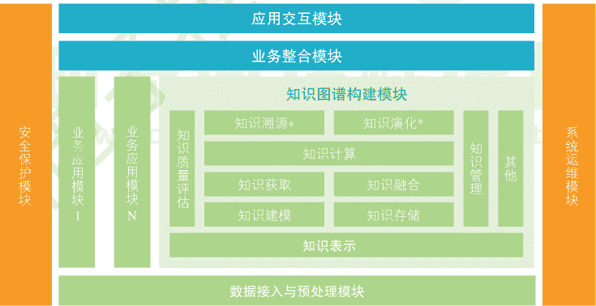

图4-1 知识图谱应用系统架构

根据知识图谱应用系统中功能定位的差异，可以将其架构划分为七个模块，包括：数据接入与预处理模块、业务应用模块、知识图谱构建模块、业务整合模块、应用交互模块、运维模块、安全保护模块，以覆盖知识图谱构建前、中、后各环节。如图4-1所示，黄色部分主要面向知识图谱构建前环节，绿色部分主要面向知识图谱构建环节，蓝色部分主要面向知识图谱构建后应用环节，标识*的模块为可选模块。

- (1) 数据接入与预处理模块

该模块主要是对外部数据进行采集、接入和必要的处理，以使数据满足后续知识获取的要求，处理环节可包括：数据清洗、数据转换、基础自然语言处理等。

数据接入的数据源可包含：结构化数据，如存储于关系型数据库中的业务数据等；存在一定的文档结构和语法规则，但存在非结构化和结构化数据混杂情况的半结构化数据，如百科数据等；文档、图片、视频、音频等非结构化数据。此外，由于数据来源需区分公开和私有数据，因此处理过程中存在处理权限、内容保护、数据溯源等问题。

- (2) 业务应用模块

业务应用模块为待与知识图谱进行集成的业务系统或模块，通常存储着重要的业务数据，可以提供业务数据处理、业务数据调用、业务功能调用和结果反馈、任务管理等细分功能。由于应用场景、应用需求的差异，知识图谱应用系统可能涉及多个业务应用模块或子系统。

- (3) 知识图谱构建模块

该模块将根据应用需求、知识特点等因素构建相应的知识图谱。其需要具备知识图谱构建过程中技术路径中各环节的相应功能，包括：知识建模、知识表示、知识获取、知识存储、知识融合、知识计算、知识溯源、知识演化、知识质量评估、知识管理等。另外，根据具体的应用需求可对

知识图谱构建模块进行拓展，增加其他功能子模块，例如定制化图模型模块、图数据迁移备份子模块等。

该模块可以是独立开发或采购具有知识获取、检索、关系推理、可视化和维护等基本功能的知识图谱构建工具/系统。另外，部分厂商也可基于其拥有的知识图谱以接口等形式提供知识查询或计算结果调用等服务，用户企业可以在其上进行二次开发或集成，形成新的产品或服务。

#### (4) 业务整合模块

业务整合模块主要负责将业务系统、知识图谱构建模块、数据接入与预处理模块等按照业务逻辑和系统设计进行集成和能力封装，以实现知识图谱应用系统目标。能力封装可包括各领域知识图谱提供的基础能力，如：提供语料库、语义引擎、语义模型、基础知识图谱及本体模型等。

### (5) 应用交互模块

应用交互模块主要负责对外提供可视化交互应用或可以被调用的服务，可包括UI、APP、API、SDK等形式。

该模块可提供本体管理、知识管理、众包标注、知识编辑、知识审核、协作管理、权限管理、图谱划分、缓存管理、查询分发、访问控制、版本管理等功能，以及数据可视化、语义检索、智能搜索、智能问答等知识应用能力。通过该模块，可实现基于知识图谱的各类复杂应用和管理。

### (6) 系统运维模块

该模块主要负责对知识图谱应用系统各模块进行监控和运维。其中，知识图谱的运营和维护贯穿知识图谱生命周期的每一个环节，通过参与者及时的反馈与管理者的人工介入来保证知识图谱具有较高的可表达性、可解释性、可移植性和可维护性等。此外，还需负责完成整个系统上线后的运维管理和运行状态监控。

### (7) 安全保护模块

该模块主要负责对知识图谱应用系统各模块进行全面的用户管理和权限控制等；另外，负责系统安全监测和安全管理，如数据加密、传输控制等。

## 第五章 知识图谱应用系统建设基础能力评估

### 一、应用系统建设基础能力评估准则

用户企业作为实际部署和使用知识图谱应用系统的利益方，系统建设成效和收益等与其基础能力紧密相关。因此，在建设前期有必要对自身基础能力进行系统评估，查找自身弱项，进而提升后续建设效率。评估系统建设基础能力的准则主要包括：

- **必要性：** 从业务需求、战略规划等方面评估企业对建设知识图谱及其应用系统的必要程度。
- **适用性：** 从业务匹配程度、二次开发难度、系统部署及操作难度等方面评估企业对系统性建设知识图谱的适用程度。
- **就绪性：** 评估企业对系统性建设知识图谱的就绪情况，如软硬件资源、数据储备、人员投入等。
- **安全性：** 评估对信息化建设的安全和质量保障能力，涉及用户隐私或企业安全的数据，须保障所获取的源端业务数据及用户数据的安全性。
- **可持续性：** 评估企业是否具备长期维护和管理知识图谱及其应用系统的能力。

### 二、应用系统建设基础能力指标体系

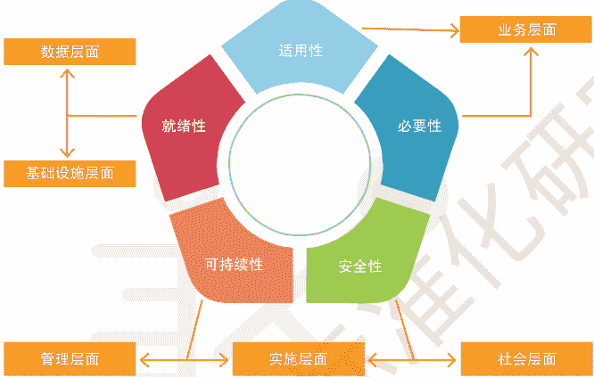

图5-1 应用系统建设基础能力评估原则与指标体系关系

以知识图谱高质量应用为主要驱动力，基于上述五项准则对知识图谱应用系统建设基础能力的评估可进一步拆分为六个层面，包括业务层面、数据层面、基础保障层面、实施层面、管理层面、社会层面等，拆分关系及基础能力评估指标体系如图5-1、图5-2所示。

- 基础能力评估
  - 业务层面
    - 战略愿景
    - 业务需求
    - 资源安排
    - 行业资质
    - 行业趋势和产业政策
  - 数据层面
    - 数据储备
    - 领域专业数据基础
    - 数据治理能力
  - 基础保障层面
    - 人员储备
    - 硬件资源储备
    - 专业知识储备
    - 信息化建设基础
    - 资格资质
  - 实施层面
    - 验证评估能力
    - 实施能力
    - 系统集成能力
    - 运维能力
  - 管理层面
    - 组织保障
    - 质量管理能力
    - 过程管理能力
  - 社会层面
    - 法律风险与责任
    - 知识服务市场接受度

图5-2 基础能力评估指标体系框架

从业务层面考量，企业的业务与知识图谱应用系统建设是否匹配，是否有长期建设知识图谱的规划。具体指标包括：战略愿景、业务需求、资源安排、行业资质、行业趋势和产业政策等。

- 从数据层面考量，数据是知识图谱建设的基石，企业是否有足够的数据支撑知识图谱应用系统，以及是否有数据处理和分析的能力。具体指标包括：数据储备、领域专业数据基础、数据治理水平等。
- 从基础保障层面考量，企业的各类基础资源是否能够保障知识图谱应用系统的建设。如：企业是否具备开展知识图谱建设与应用的人工智能专业技术人才储备，是否拥有自有的或可获取的数据存储与计算硬件资源储备是否建立完整的业务数据收集、存储、处理和应用的信息化管理体系，及企业业务开展过程的信息化建设基础情况。具体指标包括：人员储备、硬件资源储备、专业知识储备、信息化建设基础、资格资质等。
- 从实施层面考量，企业是否具有保障知识图谱应用系统建设及实施的能力。如：是否具备开展知识图谱建设与应用的专业知识储备；是否具备相关资质，具有在企业业务活动中应用知识图谱满足客户需求的能力，及通过知识图谱系统运维满足客户不断变化需求的能力；是否具备实施知识获取、存储和更新所需要的信息化软件及硬件系统建设的能力。具体指标包括：验证评估能力、实施能力、系统集成能力和运维能力等。
- 从管理层面考量，企业是否有与知识图谱的建设进度和应用相匹配的运营管理水平、组织保障能力、项目管控能力。具体指标包括：组织保障、质量管理能力、过程管理能力等。
- 从社会层面考量，企业是否有评估知识图谱应用系统建设中法律风险与责任、行业趋势、产业政策、行业资质风险项的能力。具体指标包括：法律风险与责任、知识服务市场接受程度等。

通过业务层面、数据层面、基础保障层面、管理层面、实施层面、社会影响层面六个层面综合评估投入与成本，有助于用户直观衡量知识图谱应用系统建设的必要性和可实施性。对各层面的具体评估指标及权重进行细化总结，可形成如下评估指标体系表：

### 表5-1 基础能力评估指标构成

| 指标体系 | 指标项（权重） | 指标子项 |
|---|---|---|
| 业务层面（10分） | 战略愿景（2分） | 时间成本估计 市场定位 战略规划 制度保障 |
| 业务层面（10分） | 业务需求（2分） | 现有业务中对数据/知识大量依赖的场景数量 知识沉淀情况 应用迫切性 |
| 业务层面（10分） | 资源安排（2分） | 经费投入规划 时间投入规划 人力投入规划 |
| 业务层面（10分） | 行业地位（2分） | 在行业内的水平和影响力 |
| 业务层面（10分） | 行业趋势和产业政策（2分） | 知识图谱应用趋势（行业国内外应用案例） 产业政策 |
| 数据层面（20分） | 数据储备（5分） | 数据维度 数据时效性 数据规模 已有数据库数量 非结构化数据占比、非结构化数据规范性程度 数据获取的渠道/能力 |
| 数据层面（20分） | 领域专业数据基础（5分） | 行业语料 专业术语 标准数据集 标准化的行业术语及术语集 |
| 数据层面（20分） | 数据治理能力（10分） | 数据治理水平 数据安全管理与保障能力 |

### 

| 指标体系 | 指标项（权重） | 指标子项 |
| :--- | :--- | :--- |
| 基础保障层面（20分） | 人员储备（4分） | • 研发人员 • 实施人员 • 运维人员 • 业务人员（建模人员等） |
| | 硬件资源储备（4分） | • 软硬件基础设施（运算设备、云、大数据设施等） |
| | 专业知识储备（4分） | • 前期预研情况（前期咨询、预研项目开展数量等） • 业务人员对 IT 系统的理解 |
| | 信息化建设基础（5分） | • 信息化系统数量 • 信息化系统处理业务量占比 • 企业知识库建设情况 • 现有的基础环境 • 现有的软件基础工具（建模工具、图数据库等） |
| | 资格资质（3分） | • IT 实施资质 • 系统集成资质，如安全、管理等认证（可选） |
| 实施层面（25分） | 验证评估能力（5分） | • 专业知识 • 硬件资源评估 • 信息化建设能力评估 • 知识质量评估 |
| | 信息化系统建设能力（10分） | • 信息化系统规划能力 • 信息化系统开发能力 • 信息化系统管理能力 |
| | 系统集成能力（5分） | • 系统集成经验 • 系统集成和管理专业人员 |
| | 运维能力（3分） | • IT 系统运维能力 • 知识维护与管理能力 |
| | 风险管控能力（2分） | • 技术风险管控能力 • 系统风险管控能力 • 人员风险管控能力 • 外部风险管控能力 |

| 指标体系 | 指标项（权重） | 指标子项 |
|---|---|---|
| 管理层面（15分） | 组织保障（6分） | • 专门信息化建设部门 • 专门项目管理团队 • 后期维护部门规划 |
| | 质量管理能力（5分） | • 信息收集 • 系统日志收集 • 日志分析、处理和归档与反馈 |
| | 过程管理能力（4分） | • 项目管理制度 • 项目管理经验 • 项目管理资质情况 |
| 社会层面（10分） | 法律风险与责任（5分） | |
| | 知识服务市场接受度（5分） | |

业务层面
数据层面
实施层面（专业知识储备层面）
就绪度
社会层面
管理层面
基础设施层面
L5:完备级
L4:就绪级
L3:建设级
L2:储备级
L1:初始级
知识图谱应用系统建设基础能力指数

图5-3 知识图谱应用系统建设就绪度等级划分

根据上述层面各指标项所获分值的差异，可得出……进一步，根据所计算指数，基础能力可分为：初始级、储备级、建设级、就绪级、完备级等五个等级，如图5-3所示。其中：

- 初始级是指不具备建设知识图谱应用系统的条件，应用场景、资源投入等尚不明确，有待进行战略规划。
- 储备级是指已进行战略规划，但不具备建设知识图谱应用系统的条件，有待在规划完善的基础上进行人力资源储备、基础设施储备、数据储备等。
- 建设级是指初步具备知识图谱应用系统的建设能力，部分维度仍存在较大弱项，有待全面提升各维度能力等；可针对性地开展小型知识图谱应用系统建设及研究工作。
- 就绪级是指已具备良好的知识图谱应用系统建设能力，可进一步对各层面欠缺指标项对应能力进行提升；有能力开展较大规模的知识图谱应用系统的建设及研究工作。
- 完备级是指已具备完备的知识图谱应用系统建设能力，各维度能力较为全面，可支持后续系统的建设、实施与部署；可依据业务需求开展大规模的知识图谱应用系统的建设及研究工作。

表5-2针对19项指标给出了各项指标自我评估判据，每项指标分值1至5分，总分19至95分。可对每项指标水平进行自评，根据总分做出相应决策。

- 总分位于35分及以下，初始级；
- 总分位于35至45分（含）区间，储备级；
- 总分位于45至60分（含）区间，建设级；
- 总分位于60至75分（含）区间，就绪级；
- 总分位于75分以上，完备级。

### 三、应用系统建设基础能力自我评估表

### 表5-2 应用系统基础能力自我评估表

| 维度 | 能力子项 | 一级 | 二级 | 三级 | 四级 | 五级 |
|---|---|---|---|---|---|---|
| 业务层面 | 战略愿景 | 对 AI 感兴趣 | AI 潜在价值 | AI 产品或服务已提供商业价值 | AI 已广泛应用并带来利润 | AI 已成为公司业务发展的组成部分 |
| 业务层面 | 用户需求驱动 | 在当前业务中知识图谱没有明确应用需求。 | 知识图谱具备潜在应用需求，具体应用需求有待挖掘。 | 知识图谱具有明确应用需求，基于知识图谱应用可满足部分用户需求。 | 知识图谱具有明确应用需求，且知识图谱可满足用户需求。 | 知识图谱可完全满足用户需求。 |
| 业务层面 | 资源安排 | 几乎没有预算 | 开展知识图谱项目 POC | 已启动部分知识图谱项目并持续进行实验和 POC | 将知识图谱项目建设纳入预算体系 | 有充足的 AI 及知识图谱建设预算 |
| 业务层面 | 行业资质 | 不具备行业资质。 | 具备行业资质，但行业壁垒低。 | 具备行业资质，但行业壁垒中等。 | 具备行业资质，但行业壁垒较高。 | 具备行业资质，且具有极高壁垒。 |
| 业务层面 | 行业趋势和产业政策 | 行业发展趋势不好，没有产业政策支持。 | 行业发展进入瓶颈，没有产业政策支持。 | 行业发展势头向好，没有产业政策扶持。 | 行业发展势头向好，产业政策扶持逐渐变多。 | 行业发展趋势火热，产业政策扶持力度大。 |
| 数据层面 | 数据储备 | 数据基础较差 | 数据基础较差但有部分可用数据 | 数据整体情况一般但部分数据情况较好 | 数据整体情况较好 | 有充足的数据积累及规范的数据存储体系 |
| 数据层面 | 领域专业数据基础 | 不具备行业语料、术语或者标准基础。 | 具备少量行业语料。 | 具备少量行业语料和术语。 | 具备少量行业语料和术语，并形成小范围行业标准。 | 具备大量行业语料、术语和基础标准。 |
| 数据层面 | 数据治理能力 | 不具备数据治理能力 | 数据治理水平低下，缺乏数据安全管理与保障能力 | 数据治理水平中等，初步具备数据安全管理与保障能力 | 数据治理水平较高，数据安全管理与保障能力中等 | 数据治理能力强，数据安全管理与保障能力强，具备完备的数据治理工具。 |
| 基础保障层面 | 人员储备 | 缺少领域知识专家和运维人员 | 具备运维人员，不具备领域知识专家 | 具备运维人员和领域知识专家。 | 具备运维人员、领域知识专家和知识图谱构建人员。 | 具备运维人员、领域知识专家、知识图谱构建人员，以及知识图谱应用人员。 |
| 基础保障层面 | 硬件资源储备 | 不具备存储能力、计算能力，不支持数据处理与存储 | 具有有限的存储能力、计算能力，支持小规模数据处理与存储。 | 具有一定的存储能力、计算能力，支持中等规模数据处理与存储。 | 存储能力、计算能力充沛，支持大规模数据处理与存储。 | 存储能力、计算能力充沛，且支持动态扩展。支持超大规模数据处理与存储。 |
| 基础保障层面 | 专业知识储备 | 不具备专业知识储备。 | 具有有限的专业知识认知，对相关专业知识有粗浅的了解。 | 具备一定的专业知识，并能够支撑进行较为简单的应用和研究。 | 具备较为全面的专业知识，可以支持大规模系统的应用和研究。 | 全面深入的掌握了专业知识，支持大规模系统应用和研究，并能引领行业创新。 |
| 基础保障层面 | 信息化建设基础 | 无配套业务系统。 | 配套业务系统，少量业务流程实现信息化。 | 配套业务系统，部分业务流程实现信息化。 | 配套业务系统，大部分业务流程实现信息化。 | 配套业务系统，业务流程完全实现信息化。 |
| 基础保障层面 | 资格资质 | 不具备任何资质，不支持知识图谱应用系统集成和应用。 | 有一定系统集成或管理经验，取得少部分资质，但不支持知识图谱应用系统的应用和集成。 | 具备基础的资质和资格，可以在一定程度上进行系统应用和集成。 | 具备全面的系统应用和集成资质，可以进行大规模的系统应用和集成。 | 具备全面的资质，且有颁发相关资质的资格，可以制定系统应用和集成的资质。 |
| 实施层面 | 验证评估能力 | 没有任何验证评估能力。 | 有一定的验证经验，可以进行简单的评估 | 具备一定的验证评估能力，可以对较为常见和简单的性能进行验证和评估。 | 有较为全面的验证评估能力，可以对知识图谱应用系统性能进行全面的验证和评估。 | 拥有权威的知识图谱应用系统验证和评估能力，其验证和评估结果可以作为行业标准。 |
| 实施层面 | 运维能力 | 在当前业务中知识图谱没有明确应用需求。 | 知识图谱具备潜在应用，具体应用需求有待挖掘。 | 知识图谱具有明确应用需求，基于知识图谱可满足部分用户需求。 | 知识图谱具有明确应用需求，且知识图谱可满足用户需求。 | 知识图谱已经满足用户部分需求，且知识图谱可完全满足用户需求。 |
| 实施层面 | 信息化建设能力 | 在知识图谱应用系统建设业务中，没有相关的信息化建设能力。 | 有知识图谱建设的规划能力，具体建设能力有待挖掘和加强。 | 具有一定的信息化建设能力，可以支持知识图谱的简单建设和应用。 | 具备知识图谱应用系统的全面建设能力，支持大规模系统的建设和应用。 | 具备满足知识图谱建设所需的所以信息化建设能力，并支持动态扩展。 |
| 管理层面 | 组织保障 | 未形成组织机构或团队 | 初步形成组织团队，能够组织活动开展。 | 形成严密的组织机构，并具备初步的组织措施。 | 形成严密的组织机构，具备规范的组织措施，初步形成规章制度。 | 形成严密的组织机构、完备的组织规章、规范的组织措施。 |
| 管理层面 | 质量管理能力 | 未针对项目进行质量管理 | 形成初步的质量目标和量化管理。 | 制定严格的质量方针，明确质量目标和职责。 | 制定严格的质量方针，明确质量目标和职责。初步形成对项目各阶段活动质量的控制。 | 制定严格的质量方针，明确质量目标和职责，严格控制项目各阶段活动质量。 |
| 管理层面 | 过程管理能力 | 未形成对项目过程的管理 | 初步形成项目过程策划 | 具备完备的过程策划，并在实施过程中，初步形成对过程的检查。 | 具备过程策划、过程实施、过程检查步骤，并初步形成对过程的改进。 | 具备完整的过程策划、过程实施、过程检查、过程改进阶段，并严格按照阶段执行。 |
| 社会层面 | 法律风险与责任 | 极高法律风险和责任。 | 较高法律风险和责任。 | 中等法律风险和责任。 | 较低法律风险和责任。 | 无法律风险，无责任风险。 |
| 社会层面 | 知识服务的市场接受度 | 市场不了解且不接受其知识服务。 | 市场对知识服务有一定的了解，接受极少的服务。 | 市场接受知识服务，但其程度仅限。 | 市场全面接受其知识服务，对其服务有较强的认同感。 | 全面的接受知识服务，且用户偏向于使用其服务。 |

### 四、应用系统建设基础能力提升

根据知识图谱应用系统建设基础能力的就绪度等级和评估结果，可从人员、技术、资源、战略定位为切入点出发制订能力提升实施方案，并从业务、数据、基础保障、实施、管理、社会等六个层面采取措施，进而迭代通过能力提升效果评估方法进行效果评价，从而形成一整套闭环的能力改进提升方案，如图5-4所示。

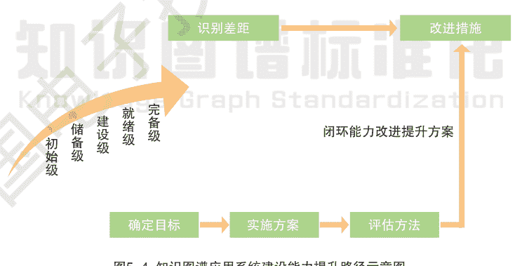

#### 业务层面：

战略方面，重视人工智能技术在当前业务流程中的应用；业务需求方面，提升知识图谱在现有业务流程中的有效性，并不断挖掘潜在应用需求，基于部分应用场景构建图谱应用案例，以小范围样例作为业务应用试验验证。资源安排方面，提升人工智能开发及知识图谱建设预算，增加人工智能开发团队人员数量。行业资质方面，开展资格认证和评级，不断提高行业资格水平。行业趋势和产业政策方面，紧跟行业应用趋势和产业政策方向，在行业内开展相关知识图谱的建设和业务推广。

#### 数据层面：

数据储备方面，开拓数据获取渠道，加大数据储备，对内企业组织整理内部业务流程数据、整合已有的数据存储资源；对外企业获取第三方组织机构的数据（例如：购买领域数据），从互联网获取开源的数据资源等。领域专业数据基础方面，积累行业术语、标准数据集。数据治理能力方面，提升现有的数据治理水平，增强数据清洗、挖掘能力，加强数据的安全防护等。

#### 基础保障层面：

人员储备方面，优化企业内部的人力资源结构，拓展专业领域人员数量，进行知识图谱领域的研发、实施、运维、业务人才储备，提升人员素质，以满足可持续性开发建设知识图谱的需求。硬件资源储备方面，根据业务市场发展需求，不断丰富计算设备资源，提升云计算能力，满足大数据治理的需要。信息化建设基础方面，提升软件基础工具和环境条件，不断提高信息化系统在企业业务流程中的应用占比，建立企业知识库，逐步积累行业数据。

#### 实施层面：

验证评估能力方面，持续拓展和丰富业务专家库，引入国内外顶尖专家，定期开展硬件资源和建设能力评价，不断积累和提升专业知识水平。实施能力方面，通过实施不同项目案例种类、数量和规模的积累，进一步提高IT资质等级。运维能力方面，针对不断发展变化的业务需求和系统运行中的问题，不断寻求更优的解决方案，加快知识更新的效率。信息化建设能力方面，通过对业务系统的分类梳理，不断细化业务场景，完善知识可视化、知识问答和联想等应用，提高业务人员对知识图谱系统的理解。

#### 管理层面：

组织保障方面，形成严密的组织机构、完备的组织规章、规范的组织措施。质量管理方面，制定严格的质量方针，明确质量目标和职责，严格控制项目各阶段活动质量。过程管理方面，具备完整的过程策划、过程实施、过程检查、过程改进阶段，并严格按照阶段执行。

#### 社会层面：

法律风险与责任方面，不断完善业务流程、规范化经营，降低法律风险与责任。知识服务市场接受度方面，紧密跟踪行业趋势和产业政策，积极分析市场需求和痛点；不断提升企业自身行业资质，不断提高自身竞争力形成竞争壁垒。

此外，在研发方面，加强知识图谱相关的人员储备（包括：运维人员、知识专家等）；加强软件、硬件等基础设施建设，提升数据存储、数据处理的能力。

## 第六章 知识图谱应用系统选型

### 一、知识图谱应用系统选型准则

根据图4-1所示，知识图谱应用系统的模块根据功能定位的不同，可以划分为面向知识图谱构建前的数据接入与处理相关模块、面向知识图谱构建中的知识获取、融合、存储等相关模块、面向知识图谱构建后的知识服务与管理相关模块。由于各模块功能模块定位不同，所涉及的选型准则存在差异。

#### （一）数据处理相关模块的选型准则

面向知识图谱构建前的数据接入与处理相关模块，可聚焦数据准备相关需求，从数据类型、数据接入、数据治理、数据组织、数据服务、数据处理等维度进行选型，并根据业务需要对准则进行裁剪，如图6-1所示：

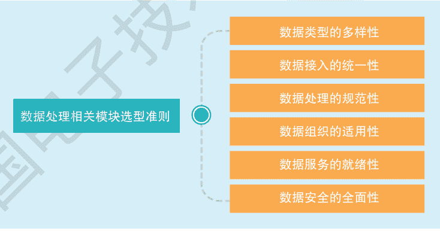

图6-1 数据处理相关模块的选型准则

数据类型的多样性准则：支持多样化的数据类型，包括结构化数据、半结构化数据、非结构化数据，并可支持多种模态数据类型，如：文本、图片、视频、音频等。

数据接入的统一性准则：具备统一的接入工具实现异构数据资源汇聚的过程；支持数据采集、汇聚等多种方式，为数据接入提供标准化、模块化、可适配的多源异构数据资源接入模式。

数据处理的规范性准则：支持数据的标准化、专业化管理，如元数据管理、数据质量管理、数据标准处理、数据血缘管理、数据资源目录管理等；支持对数据清洗、存储等治理流程的标准化管理，实现数据资产的有效组织和管理，为知识图谱上层各类业务应用提供支撑。

数据组织的适用性准则：支持数据组织，如组织原始库、主题库等。原始库是描述各种数据资源、支撑各项业务工作的公共数据集合，对不同来源的数据，按照数据的原始格式进行存储；主题库是根据数据的主题及应用需求建立，如车辆库、人员库等。

数据服务的就绪性准则：支持其他业务模块对数据的便捷访问，畅通数据的获取路径。

数据安全的全面性准则：保障数据处理过程中有效的身份识别和权限控制，确定其身份安全可信后，才可访问数据、应用和服务。

#### （二）知识图谱构建相关模块的选型准则

面向知识图谱构建过程的各功能模块，可聚焦知识图谱构建技术路径各环节和任务，进行模块选型并根据业务需要对准则进行裁剪，可包括知识表示模块、知识建模模块、知识获取模块、知识存储模块、知识融合模块、知识计算模块等如图6-2所示。其中，每一个模块所包含的选型准则定义如下：

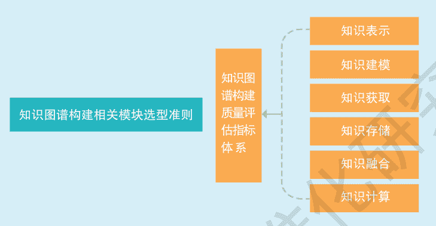

图6-2 知识图谱构建相关模块的选型准则

### 1、知识获取模块选型准则

知识获取模块可基于接入数据和已有本体模型，完成实体信息、实体间的关系信息、实体的属性信息、本体模型中缺失信息等信息的自动提取。面向的数据类型可包括：结构化数据，如存储于关系型数据库中的业务数据；半结构化数据，如百科数据等；非结构化数据，如文档、图片、视频、音频等。

### 2、知识表示模块选型准则

知识表示模块可基于知识图谱应用需求、应用约束、质量要求等，实现对知识表示模型的设定，包括知识表示框架、知识表示元素、适用范围等。知识表示形式可采用RDF图和属性图等形式：属性图中顶点表示实体和事件，顶点间的有向边表达实体/事件之间的语义关系；RDF图中，顶点是具有唯一标识符的资源，顶点间的有向边也称为谓词或属性。

### 3、知识建模模块选型准则

知识建模模块可基于知识图谱应用需求、业务规则、专家或行业知识、企业数据现状等，形成涵盖实体类型体系、实体类型属性、实体类型间关系等的本体模型及其图式（Schema）。

### 4、知识存储模块选型准则

知识存储模块需完成本体模型，知识获取、知识融合、知识计算、知识演化等模块形成的知识单元，业务规则、约束及算法模型等内容的存储，并为后续的知识查询、调用等提供服务。当知识图谱的规模庞大时，应考虑结合使用分库、为同类顶点聚合等方式作为知识图谱存储设计的准则。

同时，知识存储后数据查询的DSL表达能力也应纳入选型的范畴中。DSL应足够简洁以降低使用者的技术水平要求，应足够灵活以应对多种使用场景，应足够强大以满足知识图谱专家和复杂分析计算对数据查询的要求。在知识存储架构设计和选型阶段，图数据库及其运行环境（如操作系统、硬件和指令集）的国产化也是衡量的重要方面。

### 5、知识融合模块选型准则

知识融合模块可基于本体模型、知识获取输出的知识单元及外部知识图谱等，整合形成具有全局统一知识标识的知识单元，并识别本体模型中缺失的信息。

### 6、知识计算模块选型准则

知识计算模块可基于知识表示模型、本体模型、已存储的知识单元、应用场景中的计算需求，输出计算获得的新知识并为下游任务提供知识计算服务。例如：通过统计分析对知识图谱蕴含知识结构及其特征进行统计与归纳；通过推理计算从中已有的事实或关系进行隐性知识的发现与挖掘。

作为知识图谱的重要应用，知识计算需要大规模地抽取顶点和边的数据到内存中进行计算，这对计算效率提出了非常高的要求。因此，是否能并行地、分布式地进行知识计算，以及计算性能的垂直扩展和水平扩展、是否能线性地水平扩展是知识图谱应用系统选型的关键。

#### （三）知识服务与管理相关模块的选型准则

面向知识图谱构建完成后的知识服务与管理相关模块，可聚焦知识服务、业务集成、知识管理与维护、系统安全保障等任务，进行模块选型并根据业务需要对准则进行裁剪，如图6-3所示。选型准则可包括：安全性、可靠性、响应性、可移植性和易用性。

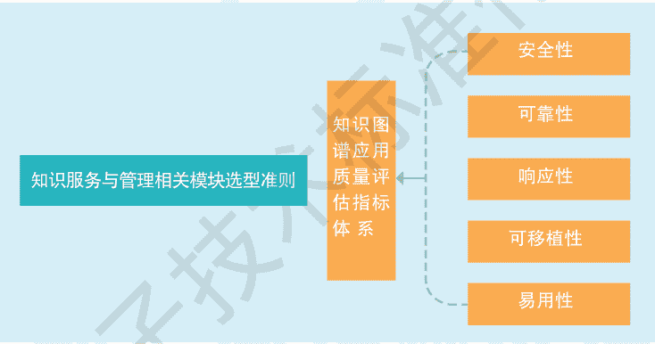

图6-3 知识服务与管理相关模块的选型准则

### 1、 安全性

知识图谱应用系统的安全性要求主要包含功能域安全要求和业务数据域安全要求：

功能域安全要求是指在应用系统的业务流程中涉及功能的安全要求，主要针对工作流中包含的各项功能流转的合法合规性，确保用户所属的角色能访问的系统功能和适用的安全策略不越界。

业务数据域安全要求是对用户、用户组、用户角色与数据条目访问授权的多对多映射，目的是确保每个用户能够且仅能够访问到对应密级的数据条目。

知识图谱应用系统的安全性要求不应只体现在应用系统中，还需贯穿知识图谱构建中和构建后的各环节。例如，在知识存储、知识获取的环节中，就需使用符合数据域安全的限制要求和过滤请求的数据条目。进而，保证在知识融合、知识计算、知识演化和业务整合等后续步骤中不会将超出访问权限范围外的数据带入融合、计算、演化和整合结果中。

### 2、可靠性

可靠性是指衡量知识图谱应用系统在指定的场景和时间等条件下可稳定完成用户需求的程度，如：是否可以在规定时间内完成预定功能，是否支持规定场景的查询、推理、计算等。

除上述知识图谱应用系统对可靠性的要求外，可靠性的一般性要求还有成熟性、容错性、易恢复性等若干特性和指标，可参考国家标准GB/T 29832.1-2013《系统与软件可靠性 第1部分：指标体系》中的定义。

### 3、响应性

响应性是系统高效完成用户业务目标的基本保障。用于度量形成的知识图谱应用系统在收到请求后返回的结果及返回结果的过程所表现出来的能力，既包括非耗时请求的即时响应时间，也包含耗时查询、计算的响应时间、反馈结果的质量等。此外，耗时查询、计算过程应通过进度条、预估剩余时间或状态更新来降低用户等待焦虑。

### 4、可移植性

可移植性是用于度量形成的知识图谱应用系统在不同软硬件环境间移植的能力，主要目标是规范业务流程和接口定义，使得第三方应用接入和迁移成本相对较低。

知识图谱应用系统的外部开放接口在设计和实现上需能达到足够的抽象程度，以适应不同的业务领域和使用场景。进而，避免第三方应用的重复开发，也能够确保同一个第三方应用在不同知识图谱应用系统迁移对接时的兼容性。

### 5、易用性

易用性是用于知识图谱应用系统在指定条件下使用时，知识图谱被理解、学习、使用和吸引用户的能力，并衡量使用者在利用系统解决业务问题时的难易程度。其中，既包括知识图谱应用系统各项功能对使用者的友好程度、工作流复杂程度，也包含知识图谱本身以及业务建模对使用者所拥有领域知识掌握程度的要求。

### 二、知识图谱应用系统的关键性能构成

#### （一）数据处理相关模块的关键性能构成

围绕数据接入的统一性，相关模块的指标构成可包括：

- 具备支持结构化数据、半结构化数据、非结构化数据的数据接入能力；
- 数据接入工具符合统一的标准规范；
- 支持多种标准化、模块化、可适配的数据接入模式，满足多源异构数据的采集与汇聚；
- 支持数据批量接入。

围绕数据处理的规范性，相关模块的指标构成可包括：

- 支持多源异构数据的处理；
- 支持多模态数据的处理（可选）；
- 保障数据处理过程的模块化、规范化；
- 保障数据的归一化、标准化；
- 支持噪声数据的处理或补全；
- 支持数据的批量处理。

围绕数据组织的适用性（可选），相关模块的指标构成可包括：

- 支持多样化数据组织方式，如三元组、属性图等；
- 支持数据的多样化展现方式，如图、表格等。

围绕数据安全的全面性，相关模块的指标构成可包括：

- 从数据接入、数据传输、数据存储、数据处理等层面进行身份识别和权限控制；
- 根据知识溯源的要求，进行数据的查阅和跟踪；
- 保障数据采集、存储、处理、销毁等数据处理周期安全管控；
- 支持访问控制、数据加密、数据备份、数据脱敏、数据水印等数据安全能力。

#### （二）知识图谱构建相关模块的性能构成

知识表示模块的性能构成可包括：

- 支持图形化的知识呈现方式；
- 支持三元组、向量和的知识表示形式等。

知识建模模块的性能构成可包括：

- 支持以可视化、拖拽等方式构建本体模型；
- 支持以增量方式构建本体模型；
- 支持手动添加实体类型、关系类型、属性等；
- 支持从外部文件中增量或批量导入图式（Schema）；
- 支持对图式（Schema）进行维护管理，包括新增、修改、删除等；
- 支持增量或批量导出图式（Schema）。

知识获取模块的性能构成可包括：

- 支持从数据库表等结构化数据中抽取知识；
- 支持从表格、网页、表单等半结构化数据中抽取知识；
- 支持从文本、图像视频等非结构化数据中抽取知识；
- 支持用户自主选择知识抽取方式，如单模型抽取、多文件多模型抽取；
- 支持用户自定义知识抽取模型；
- 支持查看知识抽取结果报表（包括当前及历史）及数据详情；
- 支持查看知识生成结果（包括当前及历史）；
- 支持人工配置知识映射规则；
- 支持用户自主配置数据源优先级；
- 支持实体、关系、属性的编辑，如新增、修改、删除、查询等。

知识存储模块的性能构成可包括：

- 支持实体、属性及关系的检索；
- 支持自定义实体、属性、关系；
- 支持实体、关系、属性的更新、删除；
- 支持按照数据权限或知识图谱主题授权用户查看功能；
- 支持数据审批流程可视化管理；
- 支持系统操作日志管理；
- 支持对删除后的实体、属性及关系的恢复；
- 支持按照版本号对同一应用场景下的知识图谱进行管理；
- 支持对算法模型的维护管理；
- 支持元数据管理，如：知识图谱在存储时在实体和关系上添加描述密级或权限规则的元数据，在有多个业务来源时也需要考虑将子图隔离存储。

知识融合模块的性能构成可包括：

- 支持实例级（实例和属性值）的对齐；
- 支持知识映射过程中的异常发现，如：给出映射失败数据并给出映射失败原因；
- 支持用户自主配置知识融合、消歧规则；
- 支持不同应用场景下知识图谱间根据规则的融合。

知识计算模块的性能构成可包括：

- 支持基础图计算功能，如：社区发现、度中心性计算、紧密中心度计算、实体节点排名、中介中心度、最小生成树等；
- 支持给出起始节点和目标节点的知识图谱路径集合；
- 支持通过输入外部数据等人工干预方式训练知识抽取模型；
- 内置语料库及语义分析模型；
- 支持从节点属性推理补全知识图谱关系。

#### （三）知识服务与管理相关模块的性能构成

围绕安全性，相关模块的性能构成可包括：

- 支持权限控制和安全隐私管理；
- 支持知识图谱存储中实体和关系添加描述密级或权限规则的元数据；
- 支持有多个业务来源时的子图隔离存储；
- 支持用户角色权限管理、数据脱敏等；
- 支持查询引擎返回用户数据前，检查数据权限合规性。

围绕可靠性，相关模块的性能构成可包括：

- 支持在规定场景、规定时间内完成预定功能；
- 支持平均故障间隔时间小于用户或行业要求；
- 支持规定场景的查询、推理、计算等要求。

围绕响应性，相关模块的性能构成可包括：

- 支持用户业务操作响应时间小于用户或行业要求；
- 支持服务接口请求响应时间小于用户或行业要求；
- 支持耗时查询、计算过程中通过进度条、预估剩余时间或状态更新来降低用户等待的焦虑；
- 支持知识体量、知识图谱复杂度的统计。

围绕可移植性，相关模块的性能构成可包括：

- 支持基于特定业务场景切分数据，如子图拆分、多图融合等；
- 支持常用的硬件环境；
- 支持常用的操作系统；
- 支持通过接口形式的数据调用。

围绕易用性，相关模块的性能构成可包括：

- 支持良好的人机交互界面；
- 支持根据业务场景利用复杂查询、图算法等方式对数据二次加工并提供服务；
- 支持基于常用查询语言，提供可视化交互查询，并针对特有业务要求，提供具有行业特色的交互展示。

## 第七章 知识图谱应用系统建设与管理过程

知识图谱生命周期根据构建过程及系统开发与部署过程的差异从技术构成与工程实施视角可细分为知识图谱构建生命周期和知识图谱应用系统生命周期两个维度。其中，知识图谱构建生命周期由知识表示、知识建模、知识获取、知识融合、知识存储、知识计算、知识应用和维护等阶段构成；知识图谱应用系统生命周期由需求分析、方案设计、图谱构建、应用开发与集成部署、系统评估与验收、运营推广、管理维护等阶段构成，如图7-1所示。

知识图谱应用系统生命周期各阶段因定位不同，其涉及的知识生命周期环节、建设目标、输入和交付物、主要活动、参与角色、需用户参与的内容等存在差异，系统建设与管理过程中可进行关注和整体规划，以保障各环节的有效衔接及知识图谱应用完整交付和后续运营质量。

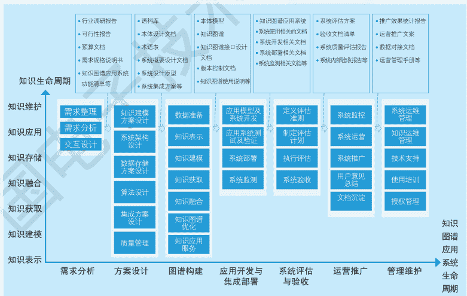

图7-1 知识图谱应用系统建设与管理过程

### 一、需求分析阶段

#### （一）阶段建设目标

需求分析阶段的建设目标主要包括：

### 目标1：获取完整合准确的用户需求。

为了全面、准确地获取业务信息，更好服务于产品设计和迭代，从多个维度调研用户需求。

### 目标2：充分理解、认识和分析用户需求。

结合业务场景，分析用户行为，充分了解实际业务过程，挖掘用户真实需求。

### 目标3：通过调研和分析得出目标系统的逻辑模型。

对用户提出的知识图谱应用系统业务需求与数据需求进行分析和转换，构筑相关业务模型与数据模型。

### 目标4：评估目前所具备的开发环境和条件。

评估内容可包括：技术能力是否支持，企业经济效益如何，与企业的经营和发展方向是否吻合，系统投入运行后的维护有无保障等。

### 目标5：评估已有数据质量情况。

评估内容可包括：各环节规划中的数据质量是否符合要求，数据范围和影响程度是否一致，是否满足业务需要，能否满足前期调研的需求等。

### 目标6：系统功能分解。

对用户的建设需求和目标进行拆解，并对各参与方的任务进行细化，确保各参与方输出的内容可集成为符合用户需求的知识图谱应用系统。

## 

- 目标7：编写需求相关文档。

根据需求分析结果，形成业务需求说明书、软件需求说明书、服务或功能说明书、知识图谱设计说明书等文档。

#### （二）阶段输入输出

### （1）需求分析阶段输入

本阶段的输入可包括但不限于：

- 用户需求：知识图谱应用系统的数据来源、建设目标等，如预期知识图谱内容和可视化效果、交互界面等预期应用效果。

注：用户需求宜通过需求说明书等书面文件方式提交确认。

- 业务数据：用户或生态合作伙伴在所属业务领域内，可提供的业务领域数据，包括基础数据及加工转换后的数据等。

- 算法模型。

### （2）需求分析阶段输出

本阶段形成的交付物及内容简介如表7-1所示：

表7-1 需求分析阶段交付物清单

| 序号 | 交付物名称 | 简介 | 重要性（1-5级） | 是否可选 |
| --- | --- | --- | --- | --- |
| 1 | 行业调研报告 | 通过对当前行业的长期跟踪监测，分析行业需求、供给、经营特性、获取能力、产业链和价值链等多方面的内容，整合行业、市场、企业、用户等多层面数据和信息资源。行业调研报告是用户需求整理的基础，可以促进用户对行业现状的了解。 | 5级 | 必选交付 |
| 2 | 可行性报告 | 论证项目可行性，给出是否可行结论，明确项目可行性条件、不可行的原因、暂缓可行的方案等。对于可行性项目，分析已具备的基础设施条件、技术条件、经济条件及政策规范等。 | 5级 | 必选交付 |
| 3 | 预算文档 | 分析知识图谱应用系统的预算，分析项目调研、实施、部署和运维阶段的计算依据，明确预算支出科目及额度，可包括基础设施费、材料耗能费、研发劳务费、商务协作费等。 | 5级 | 必选交付 |
| 4 | 竞品调研文档 | 当前的行业内竞品的基本情况，作为判定项目是否可行的基础之一，可包括竞品行业背景、市场规模、用户群体、商务模式等，并比较分析结论。 | 2级 | 推荐交付 |
| 5 | 标准规范文档 | 对标准化对象提出的要求，规定在设计软件各个阶段中所形成的文档的格式和要求，可包括数据规范、数据集规范、专业基础标准、过程标准、质量标准、技术与管理标准、工具与方法标准等。 | 3级 | 推荐交付 |
| 6 | 业务需求说明书 | 需求文档可以使设计人员能够设计出可以满足用户需求的系统，并使测试人员能够测试该系统是否满足这些需求，可包括业务应用点、需求背景、应用场景、相关业务系统、业务规划文档、业务规则、业务术语等。 | 5级 | 必选交付 |
| 7 | 需求规格说明书 | 叙述该项软件开发的意图、应用目标、作用范围以及其他有关该软件开发的背景材料，可包括数据规约、用例规约、流程图、部署环境要求、系统指标要求、运行环境规约、需求优先级、质量属性等。 | 5级 | 必选交付 |
| 8 | 技术规格说明书 | 是一种技术文件，主要用来描述应用系统或产品的基础架构和应用关键技术及主要规格参数的文件，以便技术人员准确掌握设计意图和要求。包括法律和法规上的应用标准、产品质量的应用性、可靠性、可支持性，还包括工作制度、权责规范、数字权利、操作系统及环境、兼容性和设计约束等。 | 3级 | 可选交付 |
| 9 | 知识图谱应用系统功能清单 | 系统性展示知识图谱所有功能，以业务流程图和数据流程图的方式，整体上划分模块及逻辑关系，细节上展示每个模块内部构造及功能，包括知识图谱的构建、获取、展示和应用操作等模块。 | 5级 | 必须交付 |
| 10 | 数据集规范 | 根据项目背景、必要性分析、编制原则，主要技术内容说明，编制知识图谱的数据集的规范、规则，定义数据集适用范围、规范性引用文献、术语和定义、内容结构、基本数据集的元数据、基本数据集的元数据的元素的元数据等。 | 1级 | 可选交付 |
| 11 | 语料库分析报告 | 立足行业背景，明确用户语料库建设目的和话语选取，详细分析用户语料库的需求和要求，包括语料库规模设计、建设内容、实施目标和步骤等。 | 3级 | 推荐交付 |
| 12 | 数据样例 | 在数据源中提取出来的原始数据，反映出数据的特点，数据样例中应包含各个字段的描述。 | 3级 | 可选交付 |
| 13 | 数据规范 | 根据数据来源和知识应用去向，可以生成知识图谱的数据的规范、规则，定义数据适用范围、规范性引用文献、术语和定义、数据建模内容、基本数据模型的元数据等。 | 5级 | 必选交付 |
| 14 | 系统原型说明书 | 根据需求分析的结果，设计出能最大限度满足所要求的系统原型设计，将其整理为说明书。 | 3级 | 推荐交付 |
| 15 | 数据调研说明书 | 前期需要做好数据探查工作，需要了解数据库类型、数据来源，统计学分布、数据规模、数据增量，全量数据情况及数据每年增长情况。更新机制，还需要了解数据是否结构化，是否需要清洗，是否通过接口调用还是直接连接数据库，设计数据实体和库表，定义数据类型和数据结构，还要包括图谱待加工数据清单。 | 2级 | 可选交付 |
| 16 | 风险管理计划 | 风险管理计划制定风险识别、风险分析、风险减缓策略，确定风险管理的职责，为项目的风险管理提供完整的行动纲领，确定如何在项目中进行风险管理活动，以及制定项目风险管理计划的过程，可包含项目排期，项目功能开发、测试和部署等计划安排等，风险摘要、风险管理任务、组织和职责、预算、工具和技术、需要管理的风险项等。 | 3级 | 可选交付 |
| 17 | 备选策略分析 | 作为知识图谱技术可行性、经济可行性和政策法规方面的备选策略，分析知识图谱应用系统的备选策略及实施方案，描述备选策略环境适应性、方案实施内容和步骤、规避风险因素等。 | 3级 | 推荐交付 |
| 18 | 工作说明文档 | 为了保证知识图谱项目按计划可持续推进，制定参与工作人员和事务处理规范文档，包括项目人员管理制度、工作人员安全责任制度、项目排期计划推进监督制度、项目质量管理制度等。 | 3级 | 推荐交付 |
| 19 | 权责规范 | 为了保障知识图谱项目用户方和实施方等各方的权利和义务，制定权责说明规范书，充分保证各方应该享有的知识产权、经济权利、人身安全权利等，可包括物质权利、数字权利、精神和文化权利等，以及应尽的义务。 | 4级 | 推荐交付 |
| 20 | 遵守的法律法规 | 知识图谱应用系统利益各方和从业人员，行业需遵守的法律法规，可包括知识产权法规、安全生产法、隐私保护法、商业销售和许可法等。 | 4级 | 推荐交付 |
| 21 | 可复用的通用图谱分析报告 | 调研或积累的可复用通用知识图谱，比较分析通用知识图谱优缺点，可用于垂直领域知识图谱的借鉴，以完善和优化实施方案。 | 3级 | 可选交付 |
| 22 | 部署环境要求 | 按照知识图谱的开发、测试、运维阶段，部署环境要求的文档分为三类：开发部署环境文档、测试部署环境文档、运行和维护文档，在开发阶段的部署环境文档描述图谱系统开发技术人员工作的软硬件环境，测试阶段的部署环境文档描述测试工作人员需要的软硬件、测试数据集，运维阶段的部署环境文档描述用户应用和管理需要的文档。 | 5级 | 必须交付 |

#### （三）主要活动

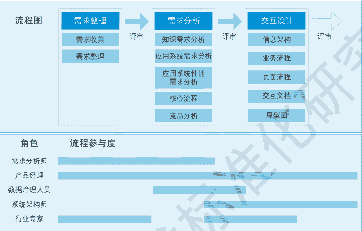

图7-2 知识图谱需求分析阶段活动流程图

需求分析阶段根据拟实现目标的不同可划分为需求整理、需求分析、交互设计等三项活动，本阶段活动流程及主要参与角色如图7-2所示。各项活动主要内容如下：

### (1) 需求整理

收集和整理用户现状和目标需求，可包括构建知识图谱应用系统的目的、约束条件、交付范围。同时，了解用户的业务数据、专家经验和已有软硬件环境，并与用户、专家进行沟通确认，形成完整的用户需求清单。

该阶段可通过行业调研、业务访谈、数据访谈等多种形式进行。其中，行业调研主要分析影响行业发展的主要敏感因素及影响力，预测行业未来发展趋势。业务访谈主要是与用户方的管理和业务人员沟通，从宏观上把握用户的具体需求方向和趋势。数据访谈主要是了解现有的数据资源、数据流程等具体情况，便于系统开发和应用的数据建模及构建数据流程图。

### (2) 需求分析

从知识、应用系统需求和应用系统性能需求等方面，进行数据分析和用户需求分析，绘制知识图谱应用系统业务架构图。同时，按照系统功能模块和实现流程进行拆分，划分各任务工作内容、边界输入/输出和依赖关系，并确定各部分的验收标准。此后，根据上述分析内容，撰写知识图谱应用系统的需求说明书，描述数据加工与转换过程、功能流程、交互逻辑等，使得各任务能按照需求说明书进行实际设计和研发工作。

该阶段可通过原型设计、需求引导或深层分析等方式完成目标。其中，原型设计是指项目组已了解具体用户方的组织架构、业务流程、硬件环境、软件环境、现有的运行系统等具体实际和客观的信息基础，结合现有的硬软件实现方案做出能够反映基本业务流程、易与用户交流的系统UI原型草图。用户通过UI原型草图可快速和形象地了解系统功能，评估整个业务流程设计的合理性、准确性，及时地提出改进意见。需求引导或深层分析是指结合以往的项目经验对用户采用引导式或启发式的分析方法和手段，与用户共同探讨业务流程设计的合理性、准确性和易用性。

### (3) 交互设计

该活动是设计与确定用户与系统交互方式的阶段，通过交互设计可将抽象的业务需求转化成可操作的高保真系统界面。本活动不仅需产品经理和交互设计师配合完成，还需与用户方完成需求的最终确认，可包括数据确认、流程确认、业务需求确认等。

其中，数据确认是指开发方需提供数据调研说明书、数据模型设计说明书、数据项表等，并能清晰地向用户描述系统的数据使用目标。流程确认是指开发方需提供明确的业务流程报告，并能清晰地向用户描述系统的业务流设计目标。业务需求是指用户方通过审查需求分析说明书、系统原型说明书来提出反馈意见并对已可接受的报告或文档签字确认。

#### （四）用户角色与分工

本阶段的参与人员角色及其任务简介如表7-2所示：

表7-2 需求分析阶段参与人员角色及其任务简介

| 序号 | 角色 | 承担任务简介 | 交付物名称（如有） |
| --- | --- | --- | --- |
| 1 | 业务/领域专家 | 特定领域的专家，具有该领域的丰富知识和技能。可分析影响行业发展的主要敏感因素及影响力，预测行业未来发展趋势。 | 行业调研报告 竞品调研文档 可复用的通用知识图谱 |
| 2 | 数据治理工程师 | 负责数据内容调研、数据治理标准解决方案研究。针对业务需求，设计合理的数据分析框架和方案，并提供分析所得的意见，产出分析结果、数据问题、说明、并提供解决方案。 | 标准规范文档 数据规范 数据样例 数据调研说明书 |
| 3 | 业务人员 | 对接知识图谱需求分析师，负责协调用户与技术人员有效沟通，参与需求调研、协调用户，参与编写知识图谱用户需求分析报告、项目可行性报告等。 | 业务需求说明书 需求规格说明书 权责规范/数字权利、遵守的法律法规 备选策略分析 |
| 4 | 需求分析师 | 跟用户交流，准确获取用户需求。需求分析师是项目前期与用户方接触最多的人，对于用户来说可代表整个项目组，对于项目组成员来说其意见可代表用户方的意见，项目组内所有与用户需求相关的事宜需与其确认。 | 需求规格说明书 部署环境要求 可行性报告 可复用的通用知识图谱 |
| 5 | 项目经理 | 负责产品开发进度的控制、风险评估进度的把控、工作任务的分配、项目中日常事务调配、人员配置等。同时，对项目过程进行监控，对项目的进度、质量负责。 | 需求规格说明书 风险管理计划 标准规范文档 技术规格书 工作说明文档 权责规范/数字权利、遵守的法律法规 备选策略分析 预算文档 |
| 6 | 售前经理 | 将功能需求列表转化为整体解决方案交付给用户，协调其它部门资源，推进实施方案，与用户保持技术与方案上的沟通，及时解答疑问，响应新需求，处理突发故障，配合销售项目负责人完成售前技术支持。 | 业务需求说明书 需求规格说明书 备选策略分析 |
| 7 | 产品经理 | 负责市场调研并依据产品、市场及用户需求，确定研发产品方向，选择业务模式和商业模式等。同时，组织挖掘相应产品的开发设计，依据产品的生命周期，协调研发和运营等，并确定和组织实施相应的产品策略。 | 技术规格书 系统原型说明书 竞品调研文档 |
| 8 | 潜在用户 | 需求与公司可提供产品吻合的用户群体，有知识图谱需求意向的用户。可能当前实施条件不成熟，但是能够描述需求和愿景，并能体现出一种趋势需求。 | 需求说明书 |
| 9 | 需求评审人员 | 需求评审可能涉及的人员包括：需方的高层管理人员、中层管理人员、具体操作人员、IT 主管、采购主管等，服务方的市场人员、需求分析人员、设计人员、测试人员、质量保证人员、实施人员、项目经理等，第三方的领域专家等。各方人员由于所处立场的不同，可能形成互补的观点。 | 业务需求说明书 需求规格说明书 系统原型说明书 |
| 10 | 政策专家 | 了解国家省市有关的政策法规的更新，及时掌握并传达有关政策的调整或变动，并对政策变化对各项目开发的影响进行评估，提出建设性建议。 | 技术规格书 遵守的法律法规 |
| 11 | 法务人员 | 处理及收集整理资料配合律师处理公司有关法律事务，收集、分析与本公司业务相关法律信息并结合公司情况提出专业意见，针对工作中发现的问题及时提出预防措施，为公司提供咨询和法务意见书，提供用户及员工的法律问题咨询，负责制订公司的各类法律文件，成立健全公司知识产权和商业秘密保护体系。 | 技术规格书 权责规范 遵守的法律法规 |
| 12 | 数据分析师 | 针对业务需求设计合理的数据分析框架和方案，并提供分析所得的意见，产出分析结果、数据问题和说明并提供解决方案。 | 数据样例 数据调研说明书 数据模型设计说明书 数据集规范 |
| 13 | 算法工程师 | 解决关于自然语言处理和分析的技术挑战和问题，在自然语言处理、分析和生成等技术领域结合实际场景开展先导性应用和领域创新研究。 | 语料库分析报告 数据集规范 可复用的通用图谱 |
| 14 | 软件测试工程师 | 按照知识图谱应用系统设计方案，编写测试用例方案，检查软件缺陷，测试软件的稳定性、安全性、易操作性等性能，对构建的知识图谱功能进行测试和文档检查，记录测试缺陷。 | 测试用例 |
| 15 | 供应商数据调研人员 | 负责评估提供数据的服务方，沟通数据集需求，决定数据源的选择，检查数据质量。 | 数据样例 数据规范 语料库分析报告 数据调研说明书 |
| 16 | 系统架构师 | 确认和评估系统需求，编制技术开发路线，负责对知识图谱应用系统整个软件架构、关键构件、接口的设计。可包括系统架构设计、组件规约、功能模块设计等，辅助需求分析师编制需求分析说明书。 | 技术规格书 备选策略分析 系统指标要求 部署环境要求 |

#### （五）需用户方参与的内容

在需求分析阶段，用户方需配合参与的工作可包括：

### (1) 业务目标的明确

业务目标是企业构建知识图谱需要梳理的核心问题。制定正确、有效、可执行的业务目标，是知识图谱应用系统建设成功并达到用户预期的基石之一。用户需和服务方在知识图谱需求分析过程中，给予持续的关注、评估和反馈，并围绕业务目标、应用场景和应用效果，不断迭代优化。

同时，用户需积极主动地表达出尽量全面和准确的需求，并配合需求人员的引导，逐步深入挖掘业务后续的隐藏需求。此外，应用场景和业务需求的边界、知识图谱要达到的目的及需求人员整理的需求规格说明文档，均需用户最终确认其准确性，以避免在知识图谱应用系统建设中修改业务范围与需求定义可能带来的项目风险及修改代价。

### (2) 外部系统和数据的协调

知识图谱应用系统需与数据对象访问服务、业务应用系统、数据存储系统、数据处理系统等进行对接。在项目设计与建设过程中，需充分考虑知识图谱应用系统与其他系统的功能边界、数据交互接口及与可能对接的外部系统，以确保能够满足业务场景需要，并同时兼顾未来的扩展需要，支持服务的横向扩展。

### (3) 部署环境的确认

知识图谱应用系统可能涉及公有云、私有云、混合云及本地私有化多种部署方式。企业用户需要根据自身需求确认部署方式，对于部署环境有特殊要求的，用户需及时提出并和服务方沟通，比如特定国产化环境和开放应用监控接口等的要求。

### (4) 提出应用安全标准

为了确保知识资产安全,需根据国家、行业或企业标准要求，用户方需对应用系统提出明确的安全规范要求，并从需求、设计、验收测试等环节对应用提出安全方面的评估内容。此外，用户还需参与安全方案的建设，可包括：数据隐私与安全、数据传输、存储加密等。

### (5) 应用系统用户验证

用户方需提前确定好系统的使用人员类型，在应用需求设计环节确认好需求，并在应用开发、测试后进行验证测试，确保应用的整体使用流程和功能设置符合预期。

### 二、方案设计阶段

#### (一) 阶段建设目标

方案设计阶段是根据知识图谱需求分析阶段的输出内容，依据知识图谱应用系统设计原则与方法，给出相关详细设计成果物，为后续知识图谱构建阶段提供输入的过程。具体需要达成以下目标：

### 目标1: 基于业务需求，完成知识模型结构的定义。

充分学习、掌握业务领域知识，结合用户需求，明确知识语料库范围，完成知识图谱本体模型的设计，确定支撑业务场景所需的概念、属性及其关系。同时，建立业务术语表，消除异构信息源中不同业务词汇间的歧义，确保知识的一致性。

### 目标2: 依据设计原则，完成系统方案设计。

依托系统设计方法、遵循系统设计原则，以用户需求为核心，在功能层面，实现系统架构设计，涵盖应用架构、技术架构、部署架构；在数据层面，结合数据特征、数据现状，实现数据存储设计；在算法层面，考虑业务、技术约束，设计实现适合系统业务特点的算法。

### 目标3: 综合考虑系统现状，完成集成方案设计。

围绕业务需求，结合当前存量系统及数据现状，设计系统集成方案。在应用层面，按需完成表现层的页面集成、服务层的接口集成、数据层的表集成；在知识层面，完成同构及异构知识图谱之间的集成方案设计。

## 目标4：完成质量评估指标及方法的制定。

根据知识建模方案及已构建的本体模型，设计适合的知识质量评估指标和评估方法，确保知识质量评估的完整性和准确性。同时，根据系统设计方案，完成系统主要测试用例的设计。

#### （二）阶段输入输出

### (1) 方案设计阶段输入

本阶段的输入可包括但不限于：

- 需求规格说明书；
- 预算文档；
- 行业调研报告；
- 数据规范；
- 知识图谱基础产品或服务；
- 知识图谱生态合作伙伴接入说明；
- 方案变更请求。

注：如在系统建设过程中引入的生态合作伙伴数据、产品、服务能力说明。

### (2) 方案设计阶段输出

本阶段形成的交付物及内容简介如表7-3所示：

| 序号 | 交付物名称 | 简介 | 重要性 (1-5级) | 是否可选 |
|---|---|---|---|---|
| 1 | 语料库 | 构建知识图谱所需的领域资料，可包括但不限于标准规范、操作手册、业务指南、存量知识库等。 | 5 | 必须交付 |
| 2 | 本体设计文档 | 描述知识图谱应用系统在概念层面的设计文档，可包括知识图谱包含的实体类型、实体类型属性及实体类型间的语义关系等。 | 5 | 必须交付 |
| 3 | 术语表 | 知识建模过程中所需的核心业务术语及术语间的层次关系。 | 5 | 必须交付 |
| 4 | 系统概要设计文档 | 描述系统包含的关键抽象、核心架构机制、业务子系统、业务子系统之间的依赖以及职责分配。 | 5 | 必须交付 |
| 5 | 系统详细设计文档 | 可包括系统功能设计、数据设计及算法设计等。其中，功能设计描述业务子系统内部的设计实现，可包括边界类、控制类、实体类型的设计及伪代码实现。数据设计描述系统事务型数据的存储方案和知识图谱网络型数据的存储方案。算法设计描述知识图谱构建所需算法及其执行流程、相关参数、性能指标等。 | 4 | 推荐交付 |
| 6 | 系统设计原型 | 具有交互操作的系统页面高保真模型，可包括页面 UI 设计图、页面之间的链接操作等。 | 5 | 必须交付 |
| 7 | 系统部署文档 | 描述系统部署时的网络拓扑结构及所需的软硬件资源等。 | 4 | 必须交付 |
| 8 | 系统集成方案 | 可包括功能集成及知识集成。其中功能集成描述知识图谱应用系统与第三方系统的集成方案，如集成模式、所需接口服务、涉及的数据表和需开发或嵌入的页面等。知识集成方案描述知识图谱中知识融合的方案，可包括融合的数据范围、融合的策略、演化机制及质量控制。 | 5 | 必须交付 |
| 9 | 测试用例 | 描述系统功能和性能测试的场景和指标等。 | 3 | 可选交付 |
| 10 | 质量评估方案 | 包括系统功能、性能、安全及知识质量等内容的评估报告。知识质量评估可用于评价知识图谱包含的知识完整性、准确性、一致性等质量指标。 | 2 | 可选交付 |

#### （三）主要活动

| 活动流程 | 知识建模设计 | 系统架构设计 | 数据存储设计 | 算法设计 | 集成方案设计 | 质量管理 |
|---|---|---|---|---|---|---|
| | 确定语料库 | 设计系统应用架构 | 设计知识图谱存储方案 | 设计知识获取算法 | 设计系统集成方案 | 设计测试用例 |
| | 定义术语表 | 设计系统部署架构 | 设计事务数据存储方案 | 设计知识融合算法 | 设计知识图谱集成方案 | 制定知识质量评估方法 |
| | 本体模型 | 设计系统技术架构 | | 设计知识计算算法 | | 评估知识质量 |
| | 定义知识融合规则 | 设计系统页面原型 | | | | |
| 交付物 | 本体设计文档 术语表 | 系统模型设计文档 系统设计原型 系统部署文档 | 数据设计文档 | 算法设计文档 | 系统集成方案 知识图谱集成方案 | 测试用例 质量评估报告 知识质量评估报告 |
| 参与角色 | 业务专家 系统架构师 研发工程师 数据工程师 算法工程师 UI设计师 运维工程师 测试工程师 | | | | | |

### 图7-3 方案设计阶段活动流程图

方案设计阶段根据拟实现目标的不同可划分为知识建模、系统架构设计、数据存储方案设计、算法设计、集成方案设计、质量管理等六项活动，本阶段活动流程及主要参与角色如图7-3所示。各项活动主要内容如下：

### (1) 知识建模

确定语料库：选择可信范围内的领域知识数据，为后续活动中的知识提取提供质量保障。包括相应生产系统底层的业务数据库、相关业务操作手册、指南文档、标准规范文档、存量知识库等。

定义术语表：选择或制定业务领域内的术语标准集。

本体建模：基于标准术语集，实现知识本体的建模，确定知识结构，可包括实体类型的识别、实体类型属性的识别及实体类型间关系的建模。此外，还需识别业务约束、规则，建立可推理的公理系统。

定义知识融合规则：制定同一知识体系及异构知识体系下，知识融合的人工规则，可包括实体类型的对齐规则、实体的对齐规则、属性的对齐规则及关系的对齐规则等。

### (2) 系统架构设计

设计系统应用架构：根据业务需求，按照工程方法实现系统的分层设计，分析和设计特定领域的业务组件及其交互协作接口，建立应用架构体系。此外，识别通用业务组件，降低依赖，并提高复用。

设计系统技术架构：根据业务需求、应用架构分析与设计结果，从业务组件中识别关键技术组件，完成其分析与设计任务，确定系统实现层面的技术路线及系统所需使用的中间件。最终，完成系统技术架构体系的构建。

设计系统部署架构：根据系统架构设计要求，设计系统在生产环境实施部署时所需的网络拓扑结构及相关的硬软件资源等基础设施配置。

设计系统页面原型：根据业务需求及系统设计约束，依据视觉和交互设计规范，设计具有可交互操作和高保真的系统原型页面。

### (3) 数据存储方案设计

设计知识图谱存储方案：包括选择数据模型、选择数据存储模型两部分。其中，a）选择数据模型：结合业务需求及应用架构模式，选择或设计知识图谱的数据模型表示方式，如，RDF、属性图等。b）选择数据存储模型：基于数据模型及业务需求，选择知识图谱的存储方法。

设计事务数据存储方案：有别于知识图谱存储方案设计，设计围绕系统功能特性的事务数据存储方案，可包括关系数据库业务表设计及用于性能提升的数据缓存方案设计等。

### (4) 算法设计

设计知识获取算法：结合本体模型，针对非结构化、半结构化和结构化数据特点，设计相应的数据提取算法，如对非结构化数据采用基于深度学习的实体识别和关系抽取算法。

设计知识融合算法：基于本体模型及业务数据，设计和实现相同知识体系和异构知识体系下知识图谱中相关知识的融合算法，可包括本体层的实体类型、属性、关系的对齐算法，及实例层的实体、属性、关系的对齐算法。

设计知识计算算法：基于业务需求和应用场景，设计面向知识图谱的图挖掘及图推理算法，实现隐性知识的挖掘、知识图谱的补全和知识质量检测，并为基于知识图谱的上层知识应用，如智能推荐、语义检索、智能问答等提供底层技术支撑。

### (5) 集成方案设计

设计系统集成方案：设计知识图谱应用系统业务功能层面的集成方案，定义知识图谱应用系统与第三方业务系统之间的集成方式（如：业务层集成、表现层集成或数据层集成）。同时，定义在不同集成方式下所需的集成资源，如：提供的接口服务、数据视图以及相关集成页面。

设计知识图谱集成方案：设计同构及异构知识图谱间的集成方案，可包括设计本体集成方案、设计实体集成方案、统一术语体系及知识表示方法、设计知识演化机制、定义集成质量要求等。

### (6) 质量管理

设计测试用例，如完成系统功能测试、性能测试及安全测试。同时，制定知识质量评估方法，可包括制定质量属性、制定评估方法等。其中：a）制定质量属性：定义和制定知识图谱质量评估指标体系，实现知识图谱知识质量的量化标准，可涉及知识的准确性、完整性、一致性、时效性和系统安全性、系统性能等方面。b）制定评估方法：考虑不同领域和应用场景特点，切实可行的知识图谱质量评估方法，如基于人工的对比评估方法、基于算法的自动化一致性检测方法及半自动化的统计学抽样检测方法等。

评估知识图谱质量：根据制定的评估方法，对已建立的模型在本体层、实例层做人工或自动化的审核和校验，确保构建的本体和实体等能够客观真实地描述和反映领域业务知识。

### (四) 角色与分工

本阶段的参与人员角色及其任务简介如表7-4所示：

表7-4 方案设计阶段参与人员角色及其任务简介

| 序号 | 角色 | 承担任务简介 | 交付物名称（如有） |
| :--- | :--- | :--- | :--- |
| 1 | 业务专家 | 负责知识建模及知识质量评估，可包括确定语料库，定义术语表，完成本体建模，定义知识融合规则，制定知识质量评估方法及评估知识质量等。 | 语料库 本体设计文档 术语表 知识质量评估报告 |
| 2 | 系统架构师 | 负责系统设计全生命周期的把控，可包括设计系统应用架构，设计系统技术架构，设计系统集成架构，及评估数据存储设计、算法设计和集成方案设计过程中的相关活动。 | 系统概要设计文档 系统详细设计文档 系统集成方案 |
| 3 | 研发工程师 | 负责具体业务子系统的详细设计，可包括设计类、实现类、接口服务的设计及实体类型的设计。 | 系统详细设计文档 |
| 4 | 数据工程师 | 负责整体数据架构及存储设计，可包括事务型数据存储设计和知识图谱数据逻辑模型与物理模型的设计。 | 系统详细设计文档 |
| 5 | 算法工程师 | 负责知识图谱构建及集成过程中所需算法的设计和实现。 | 系统详细设计文档 系统集成方案 |
| 6 | UI 设计师 | 负责基于需求及系统设计约束，输出可交互的系统设计原型。 | 系统设计原型 |
| 7 | 运维工程师 | 负责系统部署架构的设计及相关配套资源的识别，并对系统集成方案中涉及的部署活动输出设计方案。 | 系统部署文档 系统集成方案 |
| 8 | 测试工程师 | 负责系统功能、性能、安全测试以及知识质量评估。 | 测试用例 质量评估报告 |

### （五）需用户方参与的内容

在方案设计阶段，用户方需配合参与的工作可包括：

### (1) 知识建模

用户业务人员需提供知识语料库或核实，确认知识语料库的范围，并参与术语的定义和评审。

### (2) 知识评估

用户业务人员需参与本体模型的评估，可通过抽查的方式，评估本体模型是否能够反映用户领域内的知识结构，是否能够准确表达领域知识内涵，是否能够支撑用户业务需求，以避免本体模型的设计错误。

### (3) 质量指标评审

用户业务人员需参与知识质量评估指标与评估方法的定义和评审，以降低评估指标的冗余，提高指标体系的完整性、专业性和准确性。

此外，还可考虑如下内容：

### (1) 确认资源是否可支持设计的要求

通常情况下，服务方负责交付系统，而用户负责提供系统运行的环境资源。用户需求在设计过程中识别出对环境的配套要求会比较高，并可能会超出用户的承受能力。此时，需设计人员及时与用户沟通，用户同样需参与讨论并及时反馈结果给设计人员，避免持续进行无法实现的设计甚至进入实施阶段，导致较大的资源和时间浪费。

### (2) 确认设计的预期输出是否与需求匹配

设计过程中，功能输出的描述与用户的需求表述已存在较大的差异。而且，即便使用同样或类似的表述，在双方的语境里含义也可能不尽相同。此时，需要设计人员与用户进行充分的沟通，避免交付的并非需求所要求的内容，导致重复返工。

作为服务方，设计端的主动性通常是可预期的。但是作为用户方，参与上述活动必要性有可能难以被重视。因此，用户应注意在工作上主动参与沟通，确认设计的预期输出符合自身真实需求，避免沟通失误导致的浪费。

### 三、图谱构建阶段

### (一) 阶段建设目标

知识图谱构建阶段是知识图谱应用系统建设的核心阶段，本阶段以业务需求为出发点，以业务数据资源为基础，以知识图谱的构建方法为指导，完成知识图谱从无到有的构建过程，最终形成知识图谱形式的业务数据存储。同时，提供知识的检索、推理和可视化等基础服务，为知识图谱的业务应用提供支撑。具体建设目标内容如下：

#### 目标1：完成业务专业术语体系的建设。

根据业务范围参考专业术语相关标准、规范、数据集等，设计和构建业务专业术语词典及术语层级体系。

#### 目标2：完成符合业务需求的知识表示模型和本体模型的设计。

依据本体理论结合业务需求确定知识表示形式，定义业务功能实现过程中宜遵循的业务规则及相关约束等，建立知识表示模型，定义知识图谱的本体模型，包括实体类型、关系、属性等。

#### 目标3：完成知识图谱的内容构建和质量评测。

梳理和归集多种业务数据并进行数据治理，根据本体模型设计，结合知识抽取、知识融合等过程完成从业务数据到知识图谱内容的构建，完成知识图谱的存储，并依据评价标准体系对构建的知识图谱进行质量管控和评估。

#### 目标4：完成知识图谱应用接口的设计和开发。

基于知识图谱的存储数据库查询语言，结合业务需求定义知识图谱的应用接口结构形式并开发接口。

#### 目标5：形成可持续的知识图谱构建流程和工具。

基于知识图谱构建流程准则及相关的知识图谱子系统或工具，采用主流程模板化和业务领域定制化相结合的方式，建立可持续的知识图谱构建流程和工具，便于用户后续其内部产品的知识图谱构建使用。

#### 目标6：完成知识图谱运维保障机制建设。

通过建立知识图谱的维护、更新、管理等机制，保证知识图谱对系统业务功能支持的可用性和可靠性。

### (二) 阶段输入输出

### (1) 图谱构建阶段输入

本阶段的输入可包括但不限于：

- 业务需求；
- 业务数据；
- 辅助知识：包括已有的知识库、知识图谱等，内容为行业知识、常识、领域专业知识、专家资料等；
- 知识图谱构建保障工具、软件、技术包等。

图谱构建阶段的输入物及其简介如表7-5所示。

| 序号 | 输入物名称 | 简介 | 重要性（1-5级） |
|---|---|---|---|
| 1 | 业务数据资源 | 知识图谱构建相关的业务文档、数据库、已有知识图谱等各类数据。 | 5 |
| 2 | 业务需求文档 | 应用知识图谱预期实现的业务需求描述。 | 5 |
| 3 | 专家资料 | 业务领域专家提供的经验资料，如文档、典型数据案例等。 | 3 |
| 4 | 知识图谱存储数据库 | 用于存储知识图谱的数据库。 | 5 |
| 5 | 知识图谱构建工具包 | 包括构建知识图谱过程用到的各类工具、软件、技术包等。 | 4 |
| 6 | 知识图谱评价标准文档 | 用于知识图谱构建各活动质量评估的评价标准体系文档。 | 4 |

### (2) 图谱构建阶段输出

本阶段形成的交付物及内容简介如表7-6所示：

表7-6 图谱构建阶段交付物清单

| 序号 | 交付物名称 | 简介 | 重要性 (1-5级) | 是否可选 |
| :--- | :--- | :--- | :--- | :--- |
| 1 | 专业术语词典 | 满足业务需求的业务专业术语词典和术语层级关系表示。 | 4 | 推荐交付 |
| 2 | 本体模型 | 以图式 (Schema) 等形式描述的实体类型、属性、关系、约束、规则等模型文件。 | 5 | 必须交付 |
| 3 | 业务需求变更文档 | 知识图谱构建过程中进行的需求变更所形成的变更说明书、需求变更评审报告等。 | 2 | 可选交付 |
| 4 | 图谱算法模型设计文档 | 包含知识抽取、知识融合等相关算法模型设计内容的文档，及基于知识图谱的算法应用设计内容的文档。 | 4 | 必须交付 |
| 5 | 标注数据 | 用于支持知识抽取模型、知识融合模型等算法模型训练的标注数据。 | 4 | 必须交付 |
| 6 | 数据预处理工具 | 对输入的业务数据资源进行加工处理的工具，可提供数据清洗转换、数据标注、数据质量监控、数据生命周期管理等功能。 | 3 | 推荐交付 |
| 7 | 知识图谱 | 结合算法模型和人工干预等方式，基于业务数据资源构建完成的知识图谱。 | 5 | 必须交付 |
| 8 | 知识图谱管理工具 | 提高知识图谱构建、维护和分析效率的工具，可支持知识图谱的构建、维护、检索、可视化、探索等功能。 | 4 | 必须交付 |
| 9 | 知识图谱接口设计文档 | 符合业务功能需求设计的知识图谱接口文档，及运用数据库语言和开发语言编写的接口示例代码，可包括知识检索、推理、可视化接口等。 | 5 | 必须交付 |
| 10 | 知识图谱设计文档 | 指导知识图谱构建和相关模型、工具开发的设计文档，可包括本体模型设计、算法模型设计、数据标注（标签）设计、图谱管理工具设计、知识服务设计等内容。 | 4 | 必须交付 |
| 11 | 研发进度记录 | 对系统整体研发进度的记录，为进度把控、按时完成系统交付物提供支持。 | 2 | 可选交付 |
| 12 | 版本控制文档 | 对知识图谱软件开发过程中各种程序代码、配置文件及说明文档等文件变更的管理控制文档。 | 1 | 可选交付 |
| 13 | 测试报告 | 对知识图谱构建过程中所用的相关模型和工具、接口等进行测试和联调后形成的测试报告，知识图谱的各个活动流程根据评价指标进行整体质量评测的质量评测报告。 | 4 | 必须交付 |
| 14 | 知识图谱使用说明文档 | 数据预处理工具、图谱构建与管理工具等工具或服务的使用操作说明、开发接口说明和实例代码等。 | 4 | 必须交付 |

### (三) 主要活动

知识图谱构建阶段是知识图谱应用系统开发生命周期中的重要和关键环节，根据拟实现目标的不同可划分为数据准备、知识表示与知识建模、知识获取与知识融合、知识图谱优化、知识应用服务等五项活动，本阶段活动流程及主要参与角色如图7-4所示。各项活动主要内容如下：

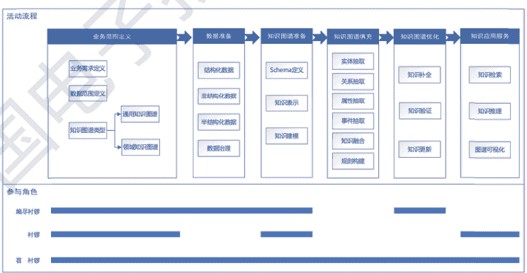

图7-4 知识图谱构建阶段主要活动及其参与角色

### (1) 数据准备

根据确定的业务数据范围，梳理领域内的重要业务术语，为知识图谱的构建提供数据资源，并进行数据治理，保证数据质量。主要数据形式包括结构化数据、非结构化数据、半结构化数据等。

通用知识图谱的数据范围较为广泛，一般以互联网开放数据为基础，数据规模可以逐步扩大，对数据的质量要求有一定的容忍度。

领域知识图谱的数据则以领域知识、领域业务数据等具体数据为主，内容包括领域内的知识库、术语集、规范资料等文本数据，以及业务实际生产数据，对数据质量的要求较高。

数据治理是通过一些处理方法将采集的原始数据进行数据预处理，提高数据质量，从而提升知识图谱构建的效率、准确性等。治理过程包括多源异构数据的融合，数据纠错、删除冗余、规格统一、补缺空值等一系列数据清洗操作。

### (2) 知识表示与知识建模

本活动是知识图谱数据构建的前提活动，包括定义知识表示的方式，进行知识建模，确定知识图谱构建的框架和工具，应用本体思想的建模方法设计知识图谱的数据结构，用来表达领域业务的知识体系，内容包括定义业务相关的概念、关系/属性以及数据类型、约束等，为知识图谱的构建实施做好准备。

### (3) 知识获取与知识融合

本活动是根据设计的知识图谱的数据结构，应用人工众包、算法模型等方式将经过处理后的业务数据进行知识获取与知识融合。知识获取可包括实体抽取、关系抽取、属性抽取、事件抽取等。知识融合是已有知识图谱与构建中的知识图谱进行知识体系映射和知识数据去除冗余、实现知识统一结构存储的过程。知识融合包括本体概念层的匹配与融合和实例层的匹配与融合。

### （4）知识图谱优化

该活动中是对初步构建完成的知识图谱需进行知识补全和验证，同时在知识图谱维护时对知识进行更新。上述活动通过质量评估和持续维护以保证知识图谱提供知识的相对完备和准确性。

知识验证可分为两部分内容：一是对知识图谱中的实体、属性、关系的验证；二是对规则的验证。实体和关系的验证是研究知识图谱中知识单元集的可信度、一致性、准确性等，简化冗余的知识，并修正不正确的知识等。规则的验证是对构建于知识图谱中的规则或基于知识图谱建立的规则进行验证，如验证规则执行的正确性等。

知识补全是利用已有知识预测未知的隐含知识，用于完善现有知识图谱，常用的实现方法包括三元组分类和链接预测等。知识更新是保证知识图谱能够持续提供正确知识服务的实现手段之一。知识更新的内容为知识图谱全部知识单元，包括新的实体、关系、属性、规则等。从更新内容上，知识图谱的更新可包括本体层的更新和实例层的更新；从更新比例上，可分为增量更新和全量更新；从实现方式上，可分为人工维护更新和程序自动更新等方式。

### （5）知识应用服务

该活动是根据功能应用的场景进行知识图谱的部署，通过知识图谱数据库的查询语言和查询语法提供知识检索、知识推理、知识可视化等接口和服务。其中，知识可视化是通过图形接口将知识图谱中的知识单元以可视化的形式提供应用服务，满足数据检索（子图）的可视化表达。

### （四）角色与分工

本阶段的参与人员角色及其任务简介如表7-7所示：

表7-7 图谱构建阶段参与人员角色及其任务简介

| 序号 | 角色 | 承担任务简介 | 交付物名称（如有） |
| :--- | :--- | :--- | :--- |
| 1 | 业务专家 | 提供专家知识，对设计的软件需求、知识图谱的模型和结果进行评审和审核，并参与部分知识图谱内容验证。 | 专业术语词典 本体模型 业务需求变更文档 知识图谱设计文档 |
| 2 | 专业业务人员 | 参与知识图谱的业务范围的定义，为知识图谱的知识建模设计提供业务支持，提供用于支持知识图谱构建的业务数据资源等内容。同时，参与知识图谱中知识更新和验证，对其他角色人员特别是标注人员进行业务培训。 | 专业术语词典 业务需求变更文档 知识图谱设计文档 知识图谱质量评测报告 |
| 3 | 产品经理 | 负责知识图谱产品的调研与需求分析，合理规划产品发展与功能规划。 | 业务需求变更文档 图谱使用说明文档 |
| 4 | 数据工程师 | 负责数据范围制定、数据治理等工作。 | 数据预处理工具 本体模型 |
| 5 | 标注人员 | 制定标注规范来标注数据。 | 标注数据 |
| 6 | 算法工程师 | 负责知识图谱构建阶段全流程的活动，完成知识图谱的设计和构建、算法模型的研发，及知识图谱基础应用接口和服务的开发，研发知识图谱相关常用算法，可包括知识获取、知识融合等图构建模型和知识图谱应用算法模型，并参与知识图谱运维管理工具的开发。 | 知识图谱设计 图谱算法模型设计文档 知识图谱接口设计文档 知识图谱 知识图谱运维管理工具 |
| 7 | 开发工程师 | 负责知识图谱应用系统开发，并参与知识图谱运维管理工具的开发。 | 知识图谱接口设计文档 知识图谱运维管理工具 |
| 8 | 质量工程师 | 对知识图谱应用系统研发过程进行质量管控，分析过程质量情况并对知识图谱及相关工具进行质量评估。 | 知识图谱质量评测报告 |
| 9 | 测试工程师 | 负责知识图谱构建过程中知识图谱及相关工具的测试工作。 | 测试报告 |

### (五) 需用户方参与的内容

在图谱构建阶段，用户方需配合参与的工作可包括：

#### (1) 知识图谱应用场景的确定和业务指导

知识图谱的需求源于应用场景中的需求描述，用户提供清晰的应用场景有助于需求人员确定需求范围，也方便算法人员从知识图谱的角度为这些场景中的需求进行可行性分析，同时可以界定知识图谱的构建所需的数据范围。另外，用户方一般具有专业的业务知识，特别是在垂直领域知识图谱构建过程中，专业知识的指导尤为重要。用户为知识图谱构建提供专业的业务指导，有助于提高知识图谱的构建效率和专业性。

#### (2) 知识图谱数据资源的提供和评估

知识图谱的构建因涉及业务数据，用户需针对知识图谱服务方获取的数据资源进行评估，判断数据资源是否准确可用。另外，用户提供的业务数据资源更具有精准性和专业性，也是知识图谱构建的重要数据基础。

#### (3) 对知识图谱新知识内容提供和运维支持

用户在知识图谱构建完成后，需对知识图谱和知识图谱应用系统进行运维和管理，并在有些领域和场景对知识图谱内容提出更新需求。此外，如果应用需求中的数据内容发生变化，用户可提供新的知识内容，辅助知识图谱服务方来完成知识图谱的知识更新和应用系统的迭代升级。

#### (4) 审核构建阶段的输出

在图谱构建的各个阶段，用户需审核部分输出内容，主要包括原型系统、演示系统以及构建的知识图谱等。用户结合自身的需求，对输出内容审阅后，提出修改、优化意见，使得图谱构建人员可逐步优化图谱构建的细节，提高并保证最终的知识图谱质量。在图谱构建完成，需对交付内容进行验证测试，确保知识图谱构建整个流程及形成的知识图谱内容符合自身的预期。

### 四、应用开发与集成部署阶段

#### （一）阶段建设目标

应用开发与集成部署阶段是在构建的知识图谱基础上，根据用户部署环境及现有系统的集成要求，开发满足业务需要的应用算法模型和应用功能模块，并将各个模块进行集成形成满足用户要求的知识图谱应用系统的过程。

### 应用开发与集成部署阶段的建设目标主要包括：

- 目标1：从构建的知识图谱中以接口等方式获取知识单元或基础服务，并开发满足智能应用需求的应用算法模型，如：基于自然语言交互的业务知识问答、在线监测数据的风险预警、异常事件处置方案、相似事件推荐等。

- 目标2：根据部署环境和现有系统集成要求，遵循设计方案要求，开发系统功能模块，将业务系统的数据与知识图谱的知识相结合，为用户提供具有智能应用体验的完整统一系统。

- 目标3：对开发完成的知识图谱应用系统进行集成测试，并对照系统指标要求，利用真实业务数据，验证系统是否达到预期的应用要求。

- 目标4：根据系统环境要求，以敏捷开发方式和快速上线机制，提供系统自动部署服务。

- 目标5：为知识图谱应用系统建立运行监控机制，为系统运维管理提供必要服务请求的接口，以满足应用系统智能运维的需要。

#### （二）阶段输入输出

#### (1) 应用开发与集成部署阶段输入

本阶段的输入可包括但不限于：

- 系统设计方案；
- 系统业务模型；
- 本体模型；
- 系统集成质量要求；
- 构建的知识图谱。

#### (2) 应用开发与集成部署阶段输出

本阶段形成的交付物及内容简介如表7-8所示：

表7-8 应用开发与集成部署阶段交付物清单

| 序号 | 交付物名称 | 简介 | 重要性 (1-5级) | 是否可选 |
|---|---|---|---|---|
| 1 | 知识图谱应用系统 | 开发完成并集成知识图谱的系统 | 5 | 必须交付 |
| 2 | 系统使用相关的文档 | 可包括系统使用说明书、系统规格说明书等。 | 5 | 必须交付 |
| 3 | 系统开发相关文档 | 可包括需求变更报告、设计文档、API 文档、系统测试报告、缺陷记录跟踪表、验收报告等。 | 5 | 必须交付 |
| 4 | 系统部署相关文档 | 可包括系统部署方案、硬件设备清单等。 | 5 | 必须交付 |
| 5 | 系统监测相关文档 | 可包括系统监测报告、排错指南等。 | 1 | 可选交付 |

#### （三）主要活动

知识图谱应用系统开发的过程既要遵循软件开发的规范和流程，也要考虑如何在集成中充分利用已构建的知识图谱，满足业务智能应用中的人机构协同及知识与数据双驱动需求。该阶段的主要活动可分为：应用算法模型及系统开发、应用测试及验证、系统部署和系统维护，活动流程及主要角色分工如图7-5和图7-6所示。

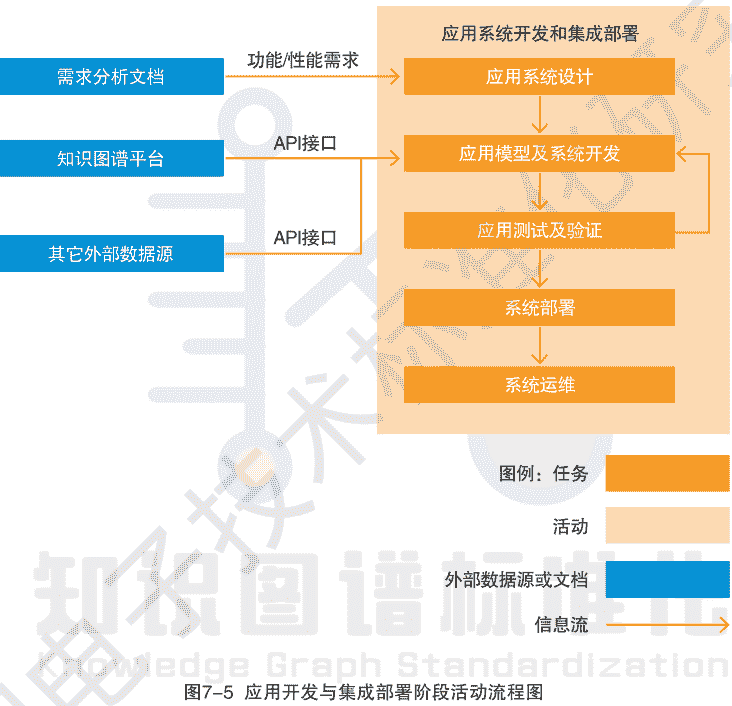

| 角色 | 业务需求确认 | 应用系统设计 | 应用模型及系统开发 | 应用测试及验证 | 系统部署 | 系统运维 |
| :--- | :--- | :--- | :--- | :--- | :--- | :--- |
| 业务分析人员 | 业务开发化 | | | 系统验证 | | |
| 开发人员 | | 业务模型设计 应用模块功能设计 | 算法模型开发 系统功能开发 | | | |
| 知识图谱关键技术人员 | | 知识计算算法及接口设计 | 知识计算开发 | | | |
| 测试人员 | | | | 系统验证 | | |
| 系统部署运维人员 | | | | | 应用部署 | 应用运维 |

图7-6 应用开发与集成部署阶段中活动及角色分类

#### 1、任务流程构成

##### (1) 应用模型及系统开发

基于系统设计文档及要求进行应用模型及系统开发，可包括如下三个方面：

- 应用模型算法开发：开发满足应用需求的模型算法，并保障业务模型可通过接口的方式对外提供知识计算服务；
- 知识和数据接口开发：开发对接知识图谱的知识查询以及已有第三方业务系统数据查询的接口，实现知识和数据的接入；
- 知识图谱应用系统开发：根据设计文档开发应用系统，并通过接口和页面等方式与其它应用业务系统实现集成整合。

##### (2) 应用系统测试及验证

知识图谱应用系统作为人工智能应用系统的一类，需同时兼顾软件系统与人工智能系统的测试指标要求。此外，由于应用系统中集成了算法模型，还需测试验证冷启动和模型的自我测试能力，保障应用系统中模型的持续迭代和优化。

##### （3）系统部署

本活动通过自动化方法来进行源码编译并部署到目标环境，例如，基于Jenkins和容器化进行持续集成、持续交付和持续部署。该方式可节省运维的人力，也可让系统具备自动水平扩展能力。

##### （4）系统监测

本活动需开发出对知识图谱应用系统各关键状态参数监控的脚本，进而为后续监控其健康程度提供支持，以实现满足知识和数据持续更新要求的应用系统智能运维。

#### 2、与其他数据的融合

部分知识图谱应用系统由于在本阶段需完成与外部业务系统间的集成，因此还需关注各活动中与外部数据的融合问题。知识图谱与其他数据的融合可分为两种类型：原始数据的融合和计算数据的融合。其中，原始数据的融合是指从知识图谱和其它数据源中批量获取原始数据，根据数据的内在关联制定融合策略，并实现获取数据的有机整合，如合并为统一的表；计算数据的融合是指在知识图谱上经过知识计算获得衍生知识，并将其附加到其它数据源中作为为扩展特征或与其他知识图谱的计算结果进行融合。

融合方式可包括接口融合和页面融合。其中，接口融合的方式是将知识图谱开放的知识查询服务、各数据源获取的数据、业务模型的输入输出通过接口的方式进行集成使用，实现知识图谱应用系统与传统业务系统间的集成融合。

#### （四）角色与分工

本阶段的参与人员角色及其任务简介如表7-9所示：

表7-9 应用开发与集成部署阶段参与人员角色及其任务简介

| 序号 | 角色 | 承担任务简介 | 交付物名称（如有） |
| :--- | :--- | :--- | :--- |
| 1 | 业务专家 | 参与知识图谱应用系统建设及集成成效的评估，并对应用模型开发与迭代、知识服务相关模块功能完善提供建议。 | 知识图谱应用系统知识图谱应用系统开发相关文档 |
| 2 | 需求分析师 | 针对知识图谱应用系统开发与部署过程中，用户或开发人员提出的需求问题或变更请求等进行沟通，确认真实需求。 | 需求变更说明书 |
| 3 | 项目经理 | 对知识图谱应用系统开发与部署过程进行监控，完成风险把控，开发进行控制、工作任务分配及资源调配，对项目的进度、质量、安全等全面负责。 | 需求变更说明书 技术规格书 |
| 4 | 开发工程师 | 负责知识图谱应用系统的开发，并参与系统集成。 | 知识图谱应用系统知识图谱应用系统开发相关文档 知识图谱应用系统使用相关文档 |
| 5 | 测试工程师 | 完成静态文档审查，根据需求编写测试用例并完成测试，提出测试中发现的问题。 | 测试用例 测试报告 |
| 6 | 系统架构师 | 根据开发过程中遇到的问题对系统架构设计、组件规约、功能模块设计进行更新和调整。 | 知识图谱应用系统功能清单 知识图谱应用系统设计说明书 |
| 7 | 系统部署人员 | 完成有效的代码集成、编译和系统部署，使得整个流程自动化，并且易扩展。此外，可根据应用系统接口获取系统的健康、知识规模等相关信息，对系统状态进行监控。 | 系统部署相关文档 |

### 五、系统评估与验收阶段

#### (一) 阶段建设目标

系统评估和验收阶段需客观和真实地评估知识图谱应用系统的能力水平，保障系统无论在业务层面还是在技术层面都能达到用户预期要求，解决用户问题并顺利上线交付。本阶段的建设目标主要包括：

- 目标1：完成评估准则的制定。

需要明确定义系统评估涉及的范围和相应的评估指标；完成验收文档清单、项目组织管理制度及风险管控建设，为后续活动提供指导。

- 目标2：完成评估计划的制定。

需要制定详细的过程评估计划，包括验收计划、实施计划、测试计划、评审计划、风险管理计划等，避免系统建设与验收时出现偏差，导致系统无法按时按质量交付。

- 目标3：完成系统评估。

依据评估准则和评估计划，进行具体系统评估，从需求分析与设计、系统架构、系统部署、系统实施方案、数据安全等方面，就知识图谱应用系统是否满足相关方的需求进行评审，确保项目执行过程和研发成果与相关方的需求相符合。

- 目标4：完成系统内部验收。

对待交付上线的知识图谱应用系统开展功能测试、性能测试、安全测试、文档测试等，评估待交付系统符合上线要求，并移交用户正式使用。

#### （二）阶段输入输出

#### (1) 系统评估与验收阶段输入

本阶段的输入可包括但不限于：

- 待交付的业务系统；
- 业务需求说明书；
- 系统设计原型；
- 系统概要设计文档；
- 系统详细设计文档；
- 系统部署文档；
- 系统集成方案；
- 知识图谱基础产品或服务；
- 业务数据。

#### (2) 系统评估与验收阶段输出

本阶段形成的交付物及内容简介如表7-10所示：

表7-10 系统评估与验收阶段交付物清单

| 序号 | 交付物名称 | 简介 | 重要性 (1-5级) | 是否可选 |
| :--- | :--- | :--- | :--- | :--- |
| 1 | 系统评估方案 | 可包括系统评估范围、评估指标等 | 5 | 必须交付 |
| 2 | 验收文档清单 | 验收需要交付的文档列表 | 5 | 必须交付 |
| 3 | 项目人员配备情况表 | 可包括项目组的组织机构、管理制度、人员分工等 | 3 | 可选交付 |
| 4 | 内部验收计划 | 可包括验收时间、验收内容及验收形式等 | 4 | 推荐交付 |
| 5 | 评审计划 | 可包括需评审的内容、评审的方式、评审要求、参与评审等人员等 | 4 | 推荐交付 |
| 6 | 测试计划 | 可包括测试任务及测试质量等 | | 推荐交付 |
| 7 | 算法评测报告 | 可包括算法评测结果及问题分析说明等 | 2 | 可选交付 |
| 8 | 系统质量评估报告 | 可包括系统功能测试、系统性能测试、系统安全测试等测试结果及整体评估结论等 | 5 | 必须交付 |
| 9 | 系统内部验收报告 | 可包括系统功能验收清单及验收结论等 | 5 | 必须交付 |

## 

#### （三）主要活动

| 定义评估准则 | 制定评估计划 | 执行评估 | 系统验收 |
| :--- | :--- | :--- | :--- |
| 确定评估范围 | 制定验收计划 | 需求设计评估 | 功能测试 |
| 定义评估指标 | 制定实施计划 | 系统架构评估 | 性能测试 |
| 确定验收文档 | 制定测试计划 | 部署方案评估 | 安全测试 |
| 组织管理 | 制定评审计划 | 实施方案评估 | 文档评测 |
| 风险管理 | 风险管理计划 | 数据评估 | |

图7-7 系统评估与验收阶段活动流程图

系统评估与验收阶段根据拟实现目标的不同可划分为定义评估准则、制定评估计划、执行评估、系统验收等四项活动，本阶段活动流程及主要参与角色如图7-7所示。各项活动主要内容如下：

#### (1) 定义评估准则

定义评估准则是系统评估与验收阶段的基础活动，主要包括确定评估范围、定义评估指标、确定验收文档、组织管理等四项任务。

- 确定评估范围要求业务人员确定系统评估的维度（如功能、性能、安全、集成、部署等），系统需在确定的评估维度下达到用户的预期。

- 定义评估指标要求明确评估范围的具体量化要求。业务相关人员需根据不同评估范围给出具体评估指标，如：在性能维度，给出系统吞吐率、最低响应时间、业务UI操作最小步骤等。

- 确定验收文档需定义系统所需的文档清单，清单中的文档是待验收项目的证明材料，也是后续系统维护期的重要输入。清单主要可包括：需求规格说明书、概要设计说明书、详细设计说明书、系统测试报告、验收方案等。

- 组织管理要明确项目组织架构、项目制度、项目管理相关事宜，确保项目顺利进行。

#### (2) 制定评估计划

制定评估计划是保证后续评估活动是否能够正确开展的先决条件。制定评估计划可包括制定验收计划、制定测试计划、制定评审计划、风险管理计划等四项任务。

- 制定验收计划要求业务人员、项目经理、测试人员明确验收时间、验收内容及验收形式，后续需按此计划执行系统的验收工作。

- 制定测试计划需根据项目实施计划安排具体的测试任务及测试质量要求。通常，测试计划应按迭代方式进行，优先安排主要系统用例的测试任务。

- 制定评审计划是确保计划能按预期执行的关键任务，精细化的评审可以尽早纠偏，减少不必要的成本浪费。制定评审计划要求详细阐述需评审内容、评审方式、评审要求和参与评审的人员等细节。

- 风险管理计划作为项目管控的重要环节，需尽可能详细定义风险管理的介入阶段、可能出现的风险因素、原因及风险的应对策略，同时考虑何时以何种方式进行阶段性的风险评估。

#### (3) 执行评估

执行评估是系统评估与验收的执行环节，是依据已定义评估准则、评估计划等，进行具体系统评估的活动。评估主要从业务、技术、方案等层面展开，对待交付知识图谱应用系统是否满足相关方的需求进行评审。

执行评估活动是一个在项目周期中迭代进行的活动，需在此过程中不断反馈、调整和修订系统建设情况，确保项目执行过程与相关方的需求相符合。执行评估可包括系统功能评估、系统性能评估、部署方案评估、实施方案评估和数据评估等五项任务。

- 系统功能评估要求业务相关方对系统当前的研发成果进行审查，评估系统是否满足用户的真实意图，是否能够解决用户问题。此外，在此过程中还需评估用户UI设计原型及相关视觉设计方案是否易用，并符合用户所处行业的视觉标准。

- 系统性能评估要求相关技术人员审查当前的系统是否符合用户和行业提供的质量要求，是否存在技术上的严重缺陷，所用技术是否存在法律风险等。

- 部署方案评估需审查部署方案是否合理，是否符合实际用户的生产环境要求，是否与现有基础设施相容，是否存在网络风险等。

- 实施方案评估要求项目业务、技术相关方对实施方案的实施过程、实施内容、实施约束进行审查，评估实施方案的合理性和风险点。

- 数据评估需对知识图谱应用系统所需数据的质量、安全性进行审查，确保使用的数据完整和准确，能够支撑业务需要并保护用户的数据隐私。

### (4) 系统验收

系统验收是评估已建设系统是否满足用户要求的重要保障。系统验收需要业务人员和测试人员根据用户功能要求、性能要求和其他质量要求，从全局把控待交付系统的质量。本活动主要包括功能测试、性能测试、安全测试、文档验收等四项任务。

- 功能测试需测试人员、需求人员、UI设计师等从应用角度评估系统功能是否能够反映需求人员的设计，视觉上是否能满足UI人员的设计，总体是否满足用户需求。

- 性能测试要求测试人员从性能角度评估系统的鲁棒性和响应性，确定被测系统是否能够满足用户的并发及业务操作响应需求。

- 安全测试要求测试人员从系统安全角度对待交付系统进行评估。针对系统安全体系架构的正确性和合理性进行分析，并通过渗透性测试、脆弱性评估、安全配置检测、源代码安全审查等维度对知识图谱应用系统进行全面的安全性评估。

- 文档评测要求业务人员和项目管理人员评估待交付文档是否完整并符合用户要求的文档交付清单，并确定待交付文档内容能否客观准确地反映系统建设的内容及过程。

### （四）角色与分工

本阶段的参与人员角色及其任务简介如表7-11所示：

表7-11 系统评估与验收阶段参与人员角色及其任务简介

| 序号 | 角色 | 承担任务简介 | 交付物名称（如有） |
| :--- | :--- | :--- | :--- |
| 1 | 评估人员 | 对接需求分析师，充分了解用户需求，负责对待交付系统及材料进行评估。 | 系统评估方案 验收文档清单 验收计划 需求评估报告 系统实施方案评估报告 |
| 2 | 测试工程师 | 负责系统功能、性能和安全测试，并完成知识质量评估等。 | 测试计划 系统质量评估报告 |
| 3 | 需求分析师 | 跟踪评估工作，确保系统满足用户需求。 | 需求评估报告 系统验收报告 |
| 4 | 项目经理 | 对项目过程进行监控，对项目的进度和质量负责，并在验收期间进行资源调配。 | 项目人员配备情况表 风险管理表 验收计划 实施计划 评审计划 风险管理计划 系统验收报告 问题追踪表 |
| 5 | 安全管理人员 | 负责系统安全方面的评估和验收。 | 问题追踪表 系统质量评估报告 |

### （五）需用户方参与的内容

在系统评估与验收阶段，用户方需配合参与的工作可包括：

### (1) 确定评估准则

用户方业务人员需参与评估指标的定义，以降低评估指标的冗余，提高指标体系的完整性、专业性和准确性。此外，用户方还需介入验收文档清单及组织管理的讨论，明确验收文档内容及双方组织人员职责，促进项目沟通协作。

### (2) 制定评估计划

用户方项目管理人员需参与评审计划和验收计划的讨论，明确项目的验收条件、验收时间和验收内容。同时，制定评审的周期、评审的资源与要求，确保项目按各方步调协同进行。

### (3) 方案评审

用户方技术人员要参与对系统架构、系统部署方案及数据的评审，确保当前系统在技术层面符合用户的技术体系要求。

### 六、运营推广阶段

### （一）阶段建设目标

运营推广是知识图谱业务成熟和扩大的主要阶段。本阶段通过在生产环境中验证知识图谱的实际表现并加以运营推广，达到以下目标：

### 目标1：保障知识图谱的应用效果。

在“系统评估与验收阶段”，开发者与业务方主要针对限定的场景和数据做验证；然而，本阶段则在真实业务环境中对知识图谱的性能表现进行跟踪，收集用户反馈，并可能增加持续的人工运营服务。

### 目标2：扩大知识图谱应用系统的影响力和知名度。

在持续优化知识图谱应用系统的同时，进行典型案例及应用方法宣传，提升知识图谱应用系统的认知度和影响力。

### 目标3：树立知识图谱创新能力的示范标杆。

梳理知识图谱在方法、技术和应用方面，为行业创新能力树立示范标杆，促进企业创新产品和服务，创造更多的经济效应和社会效益。

### 目标4：提升知识图谱创造的应用价值。

将知识图谱应用创造的效益进一步横向扩展和纵向延伸，提升知识图谱创造效益空间的能力，吸引更多行业组织和服务对象普及知识图谱应用。

### 目标5：依托已有的基础。

面向知识图谱的发展前景与建设要求，充分进行资源优化整合与推广，激发各类人群的兴趣，进行有针对性的推广活动。例如，依据各类人群已有相关专业知识，分情况进行讲解以激发兴趣，并进行分阶段有重点的建设。

### （二）阶段输入输出

运营推广阶段的主要输入是实际生产数据、推广运营材料；主要输出为运营推广文案、推广效果统计报告、竞品分析报告等。

### (1) 运营推广阶段输入

本阶段的输入可包括但不限于：

- 实际生产数据

- 知识图谱应用系统

- 系统相关文档，包括系统架构设计、系统使用手册等；

### (2) 运营推广阶段输出

本阶段形成的交付物及内容简介如表7-12所示：

### 表7-12 运营推广阶段交付物清单

| 序号 | 交付物名称 | 简介 | 重要性 (1-5级) | 是否可选 |
| --- | --- | --- | --- | --- |
| 1 | 运营推广文案 | 宣传知识图谱应用系统功能、业务效果、行业价值等信息的文档，形式不限，可通过广告、新闻稿等形式呈现。 | 3 | 推荐交付 |
| 2 | 推广效果统计报告 | 知识图谱应用系统运行指标、性能、效果等的量化统计报告。 | 4 | 必须交付 |
| 3 | 竞品分析报告 | 市场上同类知识图谱应用系统的技术及业务表现对比分析。 | 3 | 推荐交付 |
| 4 | 优势分析报告 | 相比较于同类竞品分析，重点分析本知识图谱应用系统的竞争优势。 | 2 | 可选交付 |
| 5 | 销售策略 | 根据用户需求和同类竞品特点，制定本知识图谱应用系统或其服务的销售方式和渠道等。 | 4 | 必须交付 |
| 6 | 报价方案 | 进行市场行情调研，规划本知识图谱应用系统或其服务的定价方案。 | 4 | 可选交付 |
| 7 | 宣传材料 | 收集系统技术特点、业务推广效果的宣传文章、视频等材料。编制宣传方案材料。 | 3 | 推荐交付 |
| 8 | 期刊论文 | 将系统建设中具备开创性意义的技术或工程经验、形成理论等成果，并以论文等形式发表。 | 1 | 可选交付 |
| 9 | 联合专利 | 业务方与技术方合作突破的技术，可联合对系统开发中的技术申请专利。 | 2 | 可选交付 |
| 10 | 运营推广系统对接文档 | 可包括本知识图谱部署运维环境及与其他运营推广系统对接的规范文档。 | 3 | 推荐交付 |
| 11 | 数据对接文档 | 可包括本知识图谱数据接口及与其他系统对接的数据标准文档。 | 4 | 必须交付 |
| 12 | 新需求记录 | 系统上线后运维过程中，根据实际系统应用效果和用户体验，记录产生的新需求。 | 3 | 推荐交付 |
| 13 | 产品培训资料 | 为了保证系统使用者规范化操作和系统正常运行，编制使用指南和培训材料。 | 3 | 推荐交付 |
| 14 | 运营管理手册 | 系统上线后，为了保证运营及管理效率，编制系统运维相关人员的工作手册。 | 3 | 推荐交付 |
| 15 | 受众调研报告 | 调研知识图谱应用系统受众的使用效果和体验，编制受众调研报告。 | 3 | 推荐交付 |

### （三）主要活动

运营推广阶段是在实际生产环境中验证知识图谱应用系统效果，并进行用户运营和市场推广的重要阶段。本阶段根据拟实现目标的不同可划分为系统监控、系统运营、系统推广、使用意见总结、文档沉淀等五项活动，本阶段活动流程及主要参与角色如图7-8所示。各项活动主要内容如下：

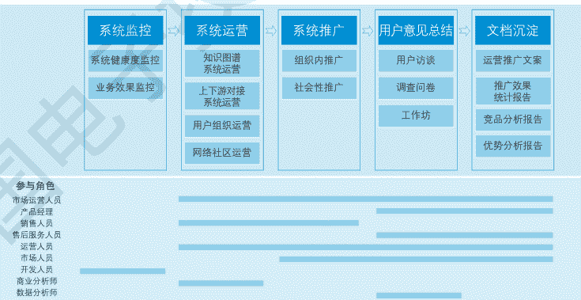

图7-8 运营推广阶段活动流程图

### (1) 系统监控

本活动可包括知识图谱应用系统的健康度监控及业务效果监控等任务。从用户和管理员视角，对知识图谱应用系统的线上表现进行监控，关注整体健康度、业务满意度，而非内部技术问题。同时，对系统产生的业务效果做监控，衡量知识图谱是否对预定的业务目标产生正面影响。此外，针对可量化指标项产生的具体数据进行统计和深层次分析。

### (2) 系统运营

系统运营范围可包括与知识图谱应用系统及上下游对接的系统、相关用户组织、相关网络社区等一切运营行为。主要对应为：知识图谱应用系统及上下游系统的运营人员日常工作；相关用户组织的定期活动、培训；网络社区的舆情监控、控评、意见反馈等。

### (3) 系统推广

本活动中可宣传知识图谱应用系统的正面效果，并推广至更多受众。形式可分为组织内推广和社会性推广，如发布宣传材料、广告、地推等。

### (4) 用户意见总结

本活动中需总结用户对于系统可用性和效果等方面意见，用于改进用户体验，帮助系统优化，方式可包括：用户访谈、调查问卷、工作坊等。

### (5) 文档沉淀

本活动针对运营推广阶段工作的问题、经验和待办等，形成各类文档沉淀，主要包括：运营推广文案、推广效果统计报告、竞品分析报告、优势分析报告、管理运营手册等。

### （四）角色与分工

本阶段的参与人员角色及其任务简介如表7-13所示：

### 表7-13 运营推广阶段参与人员角色及其任务简介

| 序号 | 角色 | 承担任务简介 | 交付物名称（如有） |
| :--- | :--- | :--- | :--- |
| 1 | 市场运营人员 | 负责知识图谱应用系统、产品、生态、社群运营和管理，与企业外部的集成方和需求用户方合作推广，组织用户参与应用交流和分享活动，汇总推广方案和物料。 | 运营推广文案 宣传材料 受众调研报告 |
| 2 | 产品经理 | 负责知识图谱同类竞品调研，用户需求意见总结，产品功能开发和数据规范文档撰写，产品技术特点分析。 | 竞品分析报告 优势分析报告 运营推广系统对接文档 数据对接文档 新需求记录 产品培训资料 |
| 3 | 销售人员 | 负责商务侧运营，与知识图谱需求用户沟通，挖掘用户需求内容，推介本产品功能与特色，销售策略制定与调整。 | 销售策略 报价方案 |
| 4 | 售后服务人员 | 负责知识图谱售后支持，与技术人员合作，协调解决用户遇到的问题。 | / |
| 5 | 运营人员 | 负责知识图谱应用系统部署后的产品、生态、社群运营，与企业外部的集成方和需求用户方合作推广，文档及产品侧的统筹。 | 推广效果统计报告 宣传材料 运营管理手册 |
| 6 | 市场人员 | 与企业外部的集成方与需求用户方合作推广，组织用户参与应用交流和分享活动。市场推广，用户意见总结。 | 推广效果统计报告 宣传材料 受众调研报告 |
| 7 | 开发人员 | 负责知识图谱协调功能开发和技术攻关，总结开发过程中的技术要点和关键技术，系统状态监控。 | 期刊论文 联合专利 |
| 8 | 商业分析师 | 负责知识图谱同类竞品商业分析，用户需求分析，本产品部署应用后用户反馈及解决情况监测，及产品投放市场后效果评价监控。 | 优势分析报告 |
| 9 | 数据分析师 | 负责收集知识图谱用户需求数据和反馈信息，收集市场需求和用户评价信息，分析本产品指标和效果，对业务数据指标进行监控。 | 推广效果统计报告 |

### （五）需用户方参与的内容

在运营推广阶段，用户需作为需求领导方和直接使用方，对真实环境中的知识图谱应用系统表现作出反馈，阐述直观真实的使用体会，并明确对于系统效果的期望。用户方需要参与的主要工作如下：

### (1) 系统试用及反馈

从需求视角出发，试用生产环境中的知识图谱应用系统，用户在业务流程操作应用过程中，对于系统输入、处理、输出等环节，发现业务流程中的功能、数据存在的质量问题，及时反馈并提出改进的建议。

### (2) 协调上下游系统对接

在用户企业中，知识图谱应用系统需要用于对接上下游系统的资源，用户方需对此类资源进行协调。同时，用户方还需指定系统对接相关等的技术负责人等角色。

### (3) 新需求提炼

根据系统使用体验、企业内反馈、市场反响等维度信息，梳理用户与系统交互的可用性，分析企业内人员协作的便捷性，调研市场对知识图谱应用的认可度，总结优缺点并提炼新需求。

### (4) 文档撰写

各类文档的撰写离不开用户企业的配合，例如，企业作为建设主体的过程中，相应专家人员与服务方一同联合专利申请或联合发表期刊文章、论文等，可从技术市场角度为系统进行推广。

### (5) 系统质量纠正

对照标准化要求，如数据规范、数据集规范、专业基础标准、过程标准、质量标准、技术与管理标准、工具与方法标准等，检测知识图谱应用过程中的质量问题，并确定系统是否具有稳定性、安全性、易操作性等性能，及时反馈并提出改进的建议。

### (6) 用户行为

采集使用者的操作行为，通过了解行为数据信息，分析什么情况下使用活跃度高，并采取相应措施，更大程度地提高使用黏性。使用者操作行为体现了他们的诸多特征，可以将使用者分级更加精准化，并为运营策略和运营动作提供了执行依据。此外，收集到的使用者操作行为数据越多，所能做的运营策略也会更加精准有效。

### 七、管理维护阶段

### （一）阶段建设目标

管理维护是知识图谱落地后可持续输出效益的保障。本阶段通过对知识图谱生产环境的实际使用监控和管理，保障系统正常运行，来持续不断的输出知识图谱价值。管理维护需要达到如下的目标：

### 目标1：监控知识图谱应用系统的使用，保障系统正常使用，防止对系统的滥用以及系统本身的不完善导致的使用障碍，及时发现导致使用障碍的缺陷，维护系统安全，抵御网络攻击及其他形式的恶意攻击。

### 目标2：对知识图谱应用系统的使用实施管理，保证既定的使用流程顺畅进行，防止未经许可的访问，保证信息安全和隐私安全。

### 目标3：维护数据安全，使用多元方式定时对数据进行备份，防止因意外事故丢失数据导致不可挽回的损失。

### 目标4：维护系统稳定，及时更新过时的组件，检查新版组件间的兼容性，实施最优的系统升级策略，保证系统长期稳定运行。

### 目标5：实施系统复制和迁徙，使知识图谱应用系统适应新环境，或者在分布式应用场景下引入更为多元的不可篡改拷贝，提升系统可信度和使用价值（需要时执行）。

### （二）阶段输入输出

### (1) 管理维护阶段输入

本阶段的输入可包括但不限于：

- 需求分析输出的管理端需求；

- 需求分析输出的数据安全指标；

- 系统复制与迁徙需求。

### (2) 管理维护阶段输出

本阶段形成的交付物及内容简介如表7-14所示：

### 表7-14 管理维护阶段交付物清单

| 序号 | 交付物名称 | 简介 | 重要性 (1-5级) | 是否可选 |
|---|---|---|---|---|
| 1 | 系统使用手册 | 围绕应用系统各项功能使用注意事项及操作步骤的说明文档 | 5 | 必选交付 |
| 2 | 系统运维手册 | 可包括知识图谱应用系统错误代码表、故障排查方法等 | 5 | 必选交付 |
| 3 | 培训手册 | 为将非专业人士培训成为系统管理者，关于系统整体架构、应用场景、使用说明、注意事项等的指导文件 | 5 | 必选交付 |
| 4 | 系统后台管理工具 | 可包括知识图谱应用系统的后台管理组件和使用方法 | 5 | 必选交付 |
| 5 | 监控工具 | 可视化实时监控系统状态的软件工具 | 4 | 推荐交付 |
| 6 | 系统巡检工具 | 对系统安全性、稳定性进行定时扫描的工具 | 4 | 推荐交付 |
| 7 | 巡检报告 | 对系统安全性、稳定性定时扫描输出的结果报告 | 5 | 必选交付 |
| 8 | 问题报告 | 对系统使用过程中出现的各类问题进行梳理形成的文档 | 4 | 推荐交付 |
| 9 | 日志文件 | 对系统访问和应答行为进行按时记录形成的文档 | 3 | 可选交付 |
| 10 | 补丁文件 | 针对系统错误的临时修补文件 | 4 | 推荐交付 |
| 11 | 修改记录 | 运维过程中关于系统修改历史的记录文档 | 4 | 推荐交付 |
| 12 | 版本管理 | 维护并记录知识图谱应用系统代码及其集成的知识图谱的版本信息，以便必要时的溯源或回滚 | 4 | 推荐交付 |
| 13 | 版本升级或管理说明 | 在版本更新时形成的更新内容相关的说明文档 | 4 | 推荐交付 |
| 14 | FAQ常用问题清单 | 就系统可能遇到的常见问题，给出对应解决方法的说明文档。需定期更新 | 4 | 推荐交付 |
| 15 | 售后服务记录 | 记录售后服务中用户方的请求、服务方的应答与完成情况的文档 | 5 | 必选交付 |
| 16 | 保修清单 | 保修中涉及的要素清单 | 2 | 可选交付 |
| 17 | 用户满意度调查 | 对用户满意度的调查报告 | 2 | 可选交付 |
| 18 | 授权文件/授权函 | 关于授权对象、授权期限和范围等的说明文件 | 5 | 推荐交付 |
| 20 | 知识维护和管理记录 | 对知识维护和管理过程及变更情况进行记录形成的文档 | 5 | 必选交付 |
| 21 | 风险应对策略 | 针对可预见的风险形成的应对策略说明文档 | 1 | 可选交付 |

## （三）主要活动
管理维护阶段根据拟实现目标的不同可划分为系统运维管理、知识运维管理、技术支持、使用培训、授权管理等四项活动。各项活动主要内容如下：

### (1) 系统运维管理
保障系统正常运行，围绕流程管理、事件管理、问题管理、变更管理、发布管理、运行管理、知识管理、综合分析管理等类型形成管理机制，全面提高运行维护的快速响应能力；建立自动化分析报表，为业务知识积累和业务考核建立完善的数据模型。

### (2) 知识运维管理
对知识图谱应用系统进行运维管理，可包括：检查、更新、删减、优化、发布等知识单元的管理；流程、事件、问题、运行等系统质量控制的管理。

### (3) 技术支持
帮助用户方解决其在使用知识图谱应用系统过程中出现的具有明显特征且可能由系统导致的技术问题。

### (4) 使用培训
对用户方的使用人员和管理人员进行培训，以便使其能正确有效地使用知识图谱应用系统。

### (5) 授权管理
对使用人员的授权进行管理，确定授权范围、授权依据、授权方式、授权制度，并对授权效果进行及时评估。

#### （四）角色与分工
本阶段的参与人员角色及其任务简介如表 7-15 所示：

### 表 7-15 管理维护阶段参与人员角色及其任务简介

| 序号 | 角色 | 承担任务简介 | 交付物名称 |
|---|---|---|---|
| 1 | 知识运维工程师 | 负责对知识图谱的维护和管理 | 知识维护和管理记录 |
| 2 | 系统运维工程师 | 负责系统部署架构的设计及相关配套资源的识别，并对系统集成方案中涉及的部署活动输出设计方案。 | 版本管理文档 数据修改记录 保修清单 |
| 3 | 系统安全工程师 | 负责系统的安全和稳定，保证系统正常运行，防止非授权的访问。 | 日志文件 监控平台 巡检报告 |
| 4 | 培训人员 | 提供培训支持 | 培训手册 系统使用手册 运维手册 |
| 5 | 技术客服 | 提供关于技术方面的问题解决 | FAQ 常用问题清单 售后工单 用户满意度调查 |
| 6 | 开发人员 | 提供技术支持，完成故障修复，并解决系统缺陷和简易需求优化 | 补丁文件 版本升级说明 问题报告 |
| 7 | 授权管理人员 | 对授权进行运行管理和调整 | 授权函 授权文件 |

#### （五）需用户方参与的内容
在管理维护阶段，用户方需配合参与的工作可包括：

### (1) 参与培训
用户方需要委派特定人员接受关于系统使用的培训。培训内容包括对系统的使用和对系统的运维等。同时，为了更好地使用系统，使之发挥出应有的效能，用户方受培训人员需积极参与熟悉和使用系统，特别是出现问题时的解决方式和流程。

### (2) 参与反馈
为了使系统朝着更为稳定、高效、有价值的方向发展，用户方需配合服务方对系统在使用中出现的问题进行及时、如实、详细的反馈。同时，服务方的技术支持和开发人员也要积极地对用户的反馈作出反应，完成故障排除、效果优化和效能提升，充分地利用用户方的使用体验数据，使其作为系统测试与优化的重要依据。

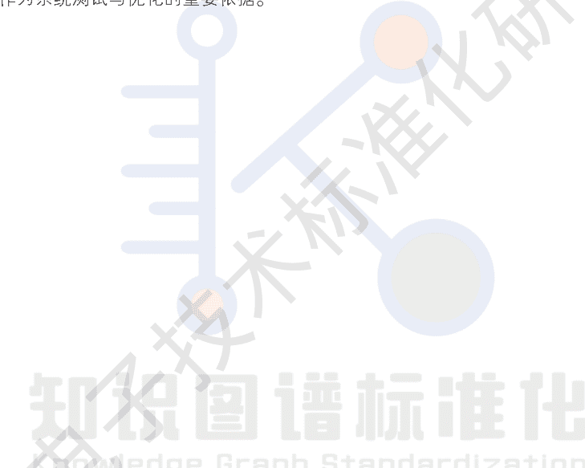

## 第八章 面向知识图谱应用系统建设的服务方选择

### 一、面向知识图谱应用系统建设的服务定义
面向知识图谱应用系统建设的服务是指为知识图谱应用系统全生命周期提供的服务，包括咨询服务、设计与开发服务、集成实施服务、运维服务等。

当前，知识图谱相关的服务方通常可提供多种服务类型，而且因技术积累方向和定位的差异，各服务方之间擅长的服务类型也可能存在不同。因此，具有知识图谱应用系统建设或维护需求的用户方，可基于自身能力基础评估结果和整体建设规划，确定所需的服务类型，并针对性地筛选单个或多个服务方，以便完整覆盖自身需求。面向知识图谱应用系统建设的服务分类及代码如表 8-1 所示。

### 二、面向知识图谱应用系统建设的服务分类

| 标识 | 类别名称 | 说明 |
|---|---|---|
| 01 | 咨询服务 | 指围绕企业数字化转型战略、发展路径、管理提升、诊断评估、人员培训等方面，向需方提供的咨询服务。 |
| 0101 | 战略咨询 | 指结合需方战略规划和业务发展需要，基于相关政策、标准，提供实施知识图谱一定时间周期内战略层的咨询建议。 |
| 0102 | 方案咨询 | 指具有相关资质（能力）的咨询机构，提供相关方案以指导需方进行知识图谱技术产品、应用系统、服务的构建、运营和维护等。 |
| 0103 | 测评认证 | 指具有相关资质（能力）的测评认证机构受需方的委托，依照相关国家标准、行业标准或经确认的技术规范，按照规范程序，对供方提供的知识图谱应用系统产品和服务进行的科学、公正的评价服务。 |
| 0104 | 培训 | 指围绕需方实施知识图谱所需的能力培训活动，提供包含培训需求研究、培训方案设计、实施、管理等在内的服务。 |
| 0105 | 监理 | 指具有相关资质（能力）的监理单位受需方的委托，依照相关法律、法规和知识图谱应用系统建设监理合同及其他知识图谱应用系统建设合同，代表需方向知识图谱应用系统建设服务方的建设实施监控的服务。 |
| 0199 | 其他咨询服务 | 指未列明的咨询服务。 |
| 02 | 设计与开发服务 | 指受需方委托，以承接外包的方式提供的知识图谱产品及应用系统等的设计和开发服务。 |
| 0201 | 本体模型设计与开发 | 指构建知识图谱的本体及其形式化表达，以实体类型定义、关系定义及属性定义，以支撑后续应用。 |
| 0202 | 知识获取/数据处理与供给 | 指从不同来源和结构的输入数据中提取结构化知识并输出，以支撑后续应用。 |
| 0203 | 知识图谱可视化 | 指将数据通过关系预处理程序处理为图数据库等可以查询的数据，支撑展示与分析。 |
| 0204 | 图算法设计与开发 | 指聚焦图结构的特殊性，对知识图谱中的图算法进行设计与开发，如路径分析、节点聚类、关联分析等，目的是提升算法效率，支撑对知识图谱的探索与挖掘。 |
| 0205 | 数据标注/元数据管理工具设计与开发 | 指遵循相关元数据标准，依照元数据模型，提供或基于数据标注工具等对数据进行标注和管理的服务。 |
| 0206 | 知识图谱构建设计与开发 | 指使用数据、知识等构建、开发知识图谱，提供基于知识图谱的基础产品或服务，以满足特定需求的服务；其中，基础产品和服务是指复杂的应用程序或系统的中间件。 |
| 0207 | 系统方案设计与开发 | 指依据需方的应用需求，设计并开发基于知识图谱的应用模块或核心子系统，包括知识图谱通用应用系统方案设计与开发、知识图谱行业应用系统方案设计与开发。 |
| 0299 | 其他设计与开发服务 | 指未列明的设计与开发服务。 |
| 03 | 集成实施服务 | 指依据知识应用需求，将知识图谱、信息系统或服务进行整合，提供知识图谱应用系统及服务。 |
| 0301 | 系统集成实施与部署 | 指系统集成实施与部署者制定集成计划，按照集成设计方案实施系统集成工作，以持续迭代知识图谱应用系统整合服务，形成功能完整的系统或服务。 |
| 0302 | 知识融合/集成 | 指整合和集成知识单元（集），形成拥有全局统一知识标识的知识图谱。 |
| 0303 | 知识服务 | 指将知识图谱的应用形态与领域特征和场景结合，助力业务转型。 |
| 0304 | 环境部署 | 指配置运行环境，监控和管理知识图谱应用系统的环境部署，交付可正常使用、无故障的软硬件环境。 |
| 0399 | 其他集成实施服务 | 指未列明的集成实施服务。 |
| 04 | 运维服务 | 指对 IT 设备（硬件、软件、网络）和知识图谱应用系统的运行环境、业务系统和运营人员等进行配置、监控、更新、维护等的综合管理服务。 |
| 0401 | 知识运维 | 指根据需方的需求，对故障进行排除及操作给定知识条目，提供知识新增、更新、删除、备份与恢复等维护服务及知识质量管理等服务。 |
| 0402 | 系统运维 | 指根据需方的需求，提供知识图谱应用系统功能和性能的维护、更新、升级的技术支撑方案，进行应用系统的维护、版本检测和优化升级等服务。 |
| 0403 | 图数据库运维 | 指围绕满足知识图谱技术产品和服务构建、集成和应用所需的图数据库需求和指标，提供远程技术支持、现场服务、系统升级和改造、故障检测和维修等服务。 |
| 0404 | 网络与安全（基础环境）运维 | 指根据需方的需求，为确保 IT 设备的运营环境、业务平台的高可靠性、高可用性及网络与安全等，提供如基础设施的故障诊断、评估、维修、优化等运维服务。 |
| 0499 | 其他运维服务 | 指未列明的运维服务。 |

## 第九章 总结与建议
尽管目前知识图谱应用已取得显著成效，工程化、体系化路径日益明晰，知识图谱产业生态体系骨架也基本显现。然而，在技术发展、部署实施、数字基础设施等方面存在大量挑战，有赖于汇聚用户方、服务方、科研院所、政府管理部门、学会协会等多方力量共同破解瓶颈与障碍，打造我国人工智能领域的知识产业，赋能各行业知识驱动的转型升级。围绕产业生态建设、协同机制构建、先进经验推广、基础短板补齐、国内外合作等需多方共同协作的方面，提出如下建议：

### 一、国家支持层面
- 1、建设汇聚产学研用多方的产业联盟，打造知识图谱产业生态圈。
建议建立凝聚大中小型企业、科研院所、高校、行业组织共同参与的产业联盟，建设覆盖知识图谱各类利益相关方的生态圈，以产业需求为导向，从业务方向、技术方向统筹推动各方有机协作，并逐步项行业分会等方面体系化建设，不断壮大我国知识图谱供应商、集成商及配套服务商队伍。
- 2、加大知识图谱相关项目扶持和投入，推动体系化技术攻关与产业化应用。
建议加大知识图谱相关科研课题投入，并在省市区等各级通过专项建设或揭榜挂帅等形式促进应用类知识图谱项目的建设与示范，可鼓励有能力的区域对企业知识图谱应用系统的引进、部署、升级或出售等行为核实后进行政策补贴。同时，探索建立揭榜项目成功案例的推广机制，例如区、市、省级赛事评审等，强化技术攻关、产业化应用、成果推广间的有机衔接，促进知识图谱作为信息技术领域的重点和急缺领域之一获得更多关注。
- 3、加快推进知识图谱标准化建设，强化知识图谱技术专利追踪。
建议加快推动知识图谱标准体系研制，系统分析和树立迫切标准化需求，聚焦技术固化、产业发展、互联互通等重点方向明确标准推进方向，在知识图谱跨域融合与互操作、产品模块化与规范化、项目建设实施各方权责指引等方向深化标准立项与研制工作。同时，建议强化对国内外专利申请趋势、专利申请、受理分布等跟踪技术动态，监测技术走向。
- 4、加强国家知识基础设施梳理与建设，夯实知识图谱发展基础。
建议围绕重点领域，探索建立包括知识图谱算法库、本体模型库、国家级/行业级知识库、算力、开源架构等资源的知识图谱公共服务平台，强化对中小企业、科研院所在大模型构建、先进技术验证等方面的支撑，推动技术创新。同时，推动以知识图谱为载体、以机器可读和可理解为方向的公共资源开放与共享，例如标准、政务数据等可开放信息，并探索建立公共服务平台资源发布、完善、维护与更新的准入机制，形成可持续发展基础设施。此外，也可探索细分领域特殊场景中的共性小众知识资源发布和维护机制，促进知识共享共建。

### 二、行业部署层面
- 1、强化领域专业术语集、语料库建设，增强知识图谱基础数据积累。
建议加大以本行业权威标准、文献等材料专业术语集建设，并围绕非结构化数据知识获取、知识融合等技术方向建立权威语料库，加快对标准化的各类术语集中资源进行整合和推广，形成行业统一的语境，为语义统一奠定基础。
- 2、推进行业标准立项、发布与执行，强化知识图谱与行业需求融合。
建议加快典型领域知识体系标准研制与推广应用，强化知识图谱在典型领域中特殊标准化需求树立与挖掘，如知识图谱与业务系统间集成、知识图谱与典型业务数据间融合转化，细分领域知识表示和本体模型构建要求等，推动重要标准化需求向行业标准转化，凝聚行业内共识，固化先进实践经验。
- 3、遴选和树立典型领域应用企业标杆，推动一批示范性知识图谱项目的建设与实施。
建议综合考虑知识图谱优秀实践案例对知识图谱推广落地的带动作用，筛选一批数据基础好、知识应用需求强、知识图谱技术积累扎实或已取得显著成效的应用企业，推动示范性知识图谱项目的建设、实施与宣传，形成细分领域应用场景中的典型样例、使用方式及成功经验，深入发掘知识图谱应用经济效益和社会价值。同时，鼓励对先行者提供必要的政策支持，进一步巩固和发挥先行先试企业或机构的探索热情。

### 三、产学研协同层面
- 1、强化知识图谱测试评估工具和平台建设，提升知识图谱质量和价值保障。
知识图谱的应用与推广离不开知识图谱的测试评估。为规范知识图谱的应用并制定科学的评判依据，建议建立健全知识价值评估与评测体系和知识图谱与知识图谱应用系统测试评估体系，界定测试范围和评估标准，以明确知识图谱相关系统的建设基础能力评估方式和最终验收边界，管控用户企业预期和系统验收质量。同时，建议形成标准符合性测试规范与工具，并搭建知识图谱标准的符合性测试平台，提高测试执行的准确率和效率。
- 2、加强专业化和专职化的标准符合性测试、认证、监理机构建设，提升第三方服务供给水平。
建议加强专业化、专职化的标准符合性测试机构建设，鼓励适应知识图谱技术和产业发展且具有领域影响力和公信力的第三方检测认证服务机构发展，重点支持1-2家检测机构成为国家级标准符合性检测单位，提供知识图谱标准化符合性评测服务和技术指导，提升标准符合性检测服务供给能力和专业化水平。同时，强化知识图谱产品认证体系以及项目实施过程监理体系建设，打牢产品供应方质量意识，提升产品成熟性和项目工程化实施水平，降低用户企业审核验收难度。
- 3、强化科研院所与企业间协作攻关，引导企业需求与科研力量精准对接。
建议加强技术研发与行业应用的结合，筛选知识图谱相关前瞻性、示范性技术攻关方向，以解决企业重大技术难题为目标，强化科研院所、高校与企业间的协作攻关，并引导先进成果的转化和示范应用。同时，依托产业联盟等组织，促进企业研制需求与科研力量间的精准对接，也可鼓励多方共同搭建具备领域特点的联合实验室或工程中心，形成常态化的协作渠道和平台。
- 4、加大知识图谱人才培育，探索产教融合新模式。
建议加强知识图谱领域人才培育力度，畅通产业端人才需求与科研端、教育端人才供给匹配渠道，探索建设产教融合模式，形成人才合作培养机制，为优秀人才提供实际项目参与和学习机会。此外，结合人员能力认证体系建设，推动知识图谱相关知识体系和核心能力的掌握水平。
- 5、促进先进经验推广与研究成果转移转化。
建议加强技术或产业峰会、刊物等多种形式的经验实践分享途径，积极加强国际国内先进经验、优秀研究成果对接，汇聚更多行业案例，推动先进技术的互学互鉴，分析和预判知识图谱领域重点技术、重大问题和发展趋势，加快知识图谱相关技术的突破效率和速度，为知识图谱产业化应用奠定创新基础。

## 附录：典型领域集成实施范例

### 案例一：基于知识图谱的大数据风控系统建设与实施

#### 一、案例背景
商业银行传统风控体系，普遍存在信息不对称、成本高、时效性差、效率低等问题。一方面用户经理现场踩点、自主汇总各方面数据，人力成本较高且效率低下，另一方面由于金融领域数据典型的“4V”特征（数量海量Volume、多结构多维度Variety、价值巨大Value、及时性要求Velocity），使得数据获取难度大，隐藏在数据中的深层次关系难以挖掘。因此，解决银行风控难点痛点迫在眉睫。

为解决金融领域风险管控中的数据孤岛、数据不对等、数据关联关系难以挖掘等问题，综合应用知识图谱、大数据等技术，广泛引入外部数据，整合内部系统和流程，构建覆盖全用户、涵盖全流程的大数据风控系统，提供从用户准入、关联关系、用户画像、预警管理等功能的风险管理能力。

### 二、案例所处阶段及成效
- (1) 所处阶段：运营推广阶段
- (2) 案例成效：
基于知识图谱的大数据风控系统上线后多次完成系统的迭代升级，目前处于运营推广阶段，且良好的经济和社会效益：

在用户质量方面，累计通过该系统准入的公司授信用户超过5万家，低风险/次低风险用户占比为16.7%，有效提升了用户质量。
在反欺诈能力方面，通过反欺诈模块建立团伙等级、特殊名单分等反欺诈模型，累计完成超过500万用户风险识别，拦截43.58万疑似欺诈用户。
在预警能力方面，系统累计产生超过450万条预警信号，自动定级信号占比94.34%，实现92.14%的预警率，系统平均预警时间为224.33天，大幅提升了预警能力。

### 三、案例系统架构
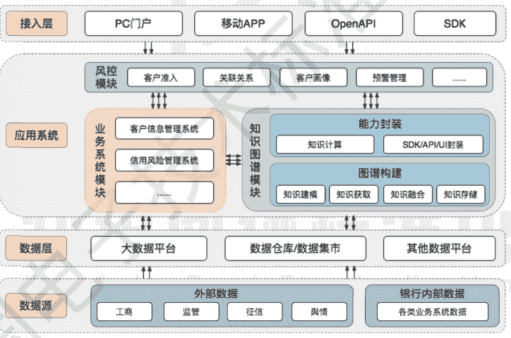
图A1-1 基于知识图谱的大数据风控系统架构

如图A1-1，基于知识图谱的大数据风控系统的数据来源包括外部数据和银行内部数据，外部数据引入了工商、监管、征信、舆情等权威渠道的数据，银行内部数据为各类业务系统的数据。

系统分为数据层、应用系统层和接入层：
- (1) 数据层：由银行内部的大数据平台、数据仓库/数据集市和其他数据平台组成，进行各类数据的处理、加工。
- (2) 应用系统层：由业务系统模块、知识图谱模块和风控模块组成，业务系统模块集成用户信息管理系统、信用风险管理系统等业务系统，知识图谱模块包括图谱构建模块和能力封装模块，风控业务模块提供用户准入、关联关系、用户画像、预警管理等业务功能。
- (3) 接入层：提供PC端门户展示、移动端APP以及OpenAPI、SDK能力。

### 四、案例开发前基础能力评估情况

### (1) 基础能力评估结果
目前基于知识图谱的大数据风控系统在业务层面处于L4级别，在数据层面处于L4级别，在基础设施层面处于L4级别，在实施层面处于L4级别，在管理层面处于L5级别，在社会层面处于L4级别，综合得到该系统建设基础能力为L4就绪级别。

业务层面：四级
数据层面：四级
基础设施层面：四级
实施层面：四级
管理层面：五级
社会层面：四级
应用系统建设基础能力

图A1-2 基础能力评估

### (2) 短板提升措施
基础设施层面：人员储备上缺乏知识图谱专业化人才。目前缺乏知识图谱领域的知识专家、研发人员储备，需持续加强知识图谱相关技术人才储备和人才培养，强化知识图谱研究、应用能力，以满足可持续开发建设知识图谱需求。
业务层面：知识图谱建设预算投入不充分。需从战略层面重视人工智能技术的研究应用，实现公司业务的智能化建设，进一步提升人工智能、知识图谱建设的预算投入。
实施层面：需不断加强知识图谱应用系统的实施能力。基于公司已有的知识图谱应用案例，持续拓展应用场景，不断进行业务应用试验验证，提升知识图谱应用的系统实施能力。

#### 五、案例开发与实施历程及难点

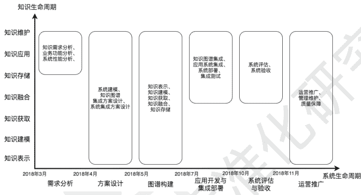

图A1-3 案例开发与实施历程

### (1) 需求分析阶段（2018年3月-4月）

在该阶段业务人员、数据人员、项目经理、产品经理、架构师等人员，主要完成行业调研、可行性分析、业务需求梳理和分析、数据收集和分析、相关数据和技术标准约定、开发技术选型等工作。

该阶段的难点主要在于对于业务目标的准确把握，大型的复杂系统很难通过一次或多次分析得到完整清晰的功能、性能等要求。通过对同业产品的深度调研，与业务专家和技术专家反复沟通，澄清业务需求，对需求目标分类定级，实现业务目标的拆分和明确。

### (2) 方案设计阶段（2018年4月-5月）

在该阶段业务人员、产品经理、项目经理、系统架构师、研发工程师、算法工程师等人员，主要完成系统架构设计、功能详细设计、知识图谱设计、数据库设计、模块集成方案设计等工作。该阶段的主要难点在于知识图谱的设计和系统集成中各应用模块的互联、互操作设计，这主要通过对知识图谱建设方案的不断试验验证、对各应用模块约定统一的数据、接口、通讯标准解决。

### (3) 图谱构建阶段（2018年5月-7月）

在该阶段业务人员、产品经理、项目经理、知识图谱工程师、研发人员等人员，主要完成知识建模、知识获取、知识融合、知识存储等工作。该阶段的主要难点在于知识建模不够准确、通用和非结构化知识抽取难，这主要通过业务专家和知识图谱工程师协同采用人工自顶向下的建模方式完善模型，以及采用自然语言处理技术抽取非结构数据解决。

### (4) 应用开发和部署阶段（2018年7月-10月）

在该阶段业务人员、项目经理、知识图谱工程师、研发人员、测试人员、运维人员等人员，主要完成功能开发、功能测试、系统部署等工作。该阶段的主要难点在于不同数据来源的数据融合，这主要通过相关知识融合技术解决。

### (5) 系统评估与验收阶段（2018年10月-11月）

在该阶段业务人员、产品经理、项目经理、研发人员、测试人员、运维人员等人员，主要负责功能评估验收、系统评估验收、系统上线等工作。

### (6) 运营推广阶段（2018年11月至今）

在该阶段业务人员、产品经理、研发人员、运维人员、运营人员等人员，主要负责系统监控、系统运营、系统迭代、系统推广等工作。该阶段主要难点在于知识图谱应用系统的知识维护和管理，主要通过定期组织专门的培训来提升运维能力。

#### 六、涉及的关键技术

### 关键技术1：基于OCR的非结构化数据处理技术

针对银行内部包括财务报表、权证、票据等凭证的非结构化数据，采用基于机器学习、基于caffe深度学习框架等的OCR引擎进行识别和提取。

### 关键技术2：基于HAWQ的大数据分析引擎

针对来自工商、监管、征信等外部数据源以及银行内部的海量数据，采用基于HAWQ的大数据分析引擎，完成结构化数据的统一存储、加工、计算。

### 关键技术3：基于NLP的知识抽取技术

金融领域数据具有规模大、维度多、价值难以挖掘的特点，给知识抽取带来很大困难。采用LTP、BERT等NLP技术对数据进行去重、分类、词性标注、命名实体识别等处理，实现实体、关系、属性的抽取。

### 关键技术4：基于关系数据库、图数据库、ES的混合存储架构

数据管理上，系统采用基于关系数据库、图数据库、ES的混合存储，实现数据的高效插入、更新和查询。目前图谱规模已达十亿级节点和关系，支持20+图算法，具备亿级别规模的图计算能力。

#### 七、当前面临的重要挑战

公司致力于应用知识图谱、人工智能等创新技术赋能银行传统业务的智能化、数字化建设，后续将持续开展知识图谱的研究和应用。对于后续持续开展知识图谱的研究和场景应用面临着许多挑战：

- 挑战1：在数据层面，金融领域海量多源异构数据造成的数据歧义、关联性难以挖掘的问题，使得图谱的构建难度大。

- 挑战2：在技术层面，在包括知识获取、知识融合、知识存储、知识计算等图谱构建关键技术的技术研究上有待加强。

- 挑战3：在应用层面，针对各类复杂业务场景、业务需求转换为知识图谱模型的建模能力需持续提升。

- 挑战4：在人才方面，需要通过引进知识图谱专业人才和开展技术培训，增强人才储备。

### 案例二：测绘地理信息领域知识图谱系统建设与实施

#### 一、案例背景

地理实体作为新型基础测绘的标准化成果，是自然资源领域为适应新时代高质量基础测绘发展，进行的新型基础测绘改革，旨在提升基础地理时空数据在自然资源部门和社会公众管理部门的服务能力和水平，促进自然资源管理和治理能力现代化，服务经济社会各领域高质量发展。

当前，地理实体打破了传统基础地理信息数据面向制图的要素化管理模式，转而面向地理空间对象，从多模态、时空化、语义化等方面形成的新型地理时空数据。但管理部门在对地理实体数据进行管理，提供社会化服务的过程中，面临了几个核心需求：

- 核心需求1：地理实体数据内容种类繁多，关系庞杂，实体概念交叉重叠，包括建筑、水系、交通、植被、管线等多领域的空间数据。目前多以某一领域的线性分类方法，分级分类构建地理实体数据模型结构，这种方式存在难以兼顾多领域实体，难以扩展领域知识和关系等问题。因此，通过提取地理实体抽象类别和关系，构建地理实体语义网络，可以有效解决上述问题。

- 核心需求2：地理实体数据最显著的特征是具有几何图形结构，将现实世界中地理对象的表现形态抽象表示，如河流可以抽象为一条多节点的折线，也可以抽象成一个河流边界线围绕而成的多边形。同时，地理实体数据还具有丰富的属性信息。

传统方法是借助关系型数据库和几何图形数据库分别存储基础地理信息的要素属性和几何图形结构。这种方式容易丢失数据间的关系，而且随着数据量的增加，查询复杂性也大大增加。利用图技术管理地理时空数据间的关系，同时结合GIS空间表达能力，可以更加直观地表达地理实体数据间的关系，降低查询复杂度。

- 核心需求3：地理实体数据难以提供社会化应用，是因为它只是测绘管理部门获取的地理空间上某一时刻的现状数据，虽然在很多应用中可以提供一些空间位置信息，但是在大多数政府问题、商业问题中还需要提供物体、人、空间、时间、事件、位置、行为之间的关系。目前图技术可以借助各要素之间的复杂关联和数以百万计的因果路径，表达海量数据间的各种复杂关系，进而扩展业务规则，提供更多的应用情景。

- 核心需求4：地理时空数据管理部门除了掌握地理实体数据，还掌握了大量经过空间化的专题数据，如地理国情普查数据、不动产房产测绘数据等。这些数据保留了丰富的社会化应用涉及的元数据，但目前这些尚未得到有效利用。利用算法语义规则，从现有的数据中获取新的推理知识，提供更深层次的查询应用。如通过模拟人的思考，实现自然语言查询功能，计算城市体检指标，提升城市居民满意度。

### 二、案例所处阶段及成效

- (1) 所处阶段：图谱构建阶段

- (2) 案例成效：

测绘地理信息领域知识图谱系统将地理时空数据与不同领域的专题数据进行知识融合，示范知识图谱在基础测绘数据领域的应用前景，增强了测绘管理部门的地理时空数据管理水平，扩展了基础测绘数据应用广度，提升了自然资源领域的服务能力和水平。此外，结合地理时空数据和专题数据构建的知识图谱，支持计算城市体检指标，有效提升城市体检工作效率，进而提升城市居民满意度。

### 三、案例系统架构

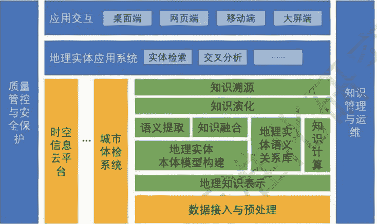

图A2-1 案例系统架构图

### (1) 数据接入与预处理

将地理实体数据和专题数据分开管理，降低数据的耦合度，以便后续更新维护语义关系库。以某城市某区域内200平方公里范围内的地理实体数据为例，从三个方面接入和预处理数据：一是基于统一的数据标准与技术规范，生产、处理数据，挖掘数据间的语义关系，将图谱实例化；二是提取该范围内专题数据的本体类，构建专题领域的知识图谱；三是通过地理实体空间身份编码关联专题数据和地理实体。

### (2) 知识图谱和地理实体数据的联动可视化

基于梳理的各地理实体间的语义关系，构建测绘地理信息领域知识图谱，实现知识图谱和地理实体数据的联动可视化。

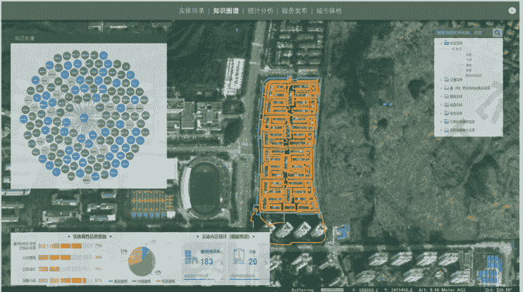

图A2-2 地理实体属性展示页面

### 1) 智能查询

从地理实体数据出发，面向不同的应用场景，构建与之对应的地理实体查询规则数据集，训练学习地理实体查询的规则特征，以支持地理实体的查询，实现“所得即所想”，做到“人机交互”。

### 2) 城市体检指标的计算及展示

系统与多行业专题相结合，可以满足大多数应用服务需求。以城市体检为例，基于地理实体数据的属性信息及语义关系，计算分析城市体检的各项指标。同时，综合考虑城市体检规程设计和客户意见两个因素，从“宜居”、“宜业”、“宜乐”、“宜游”四个专题挑选典型指标，并融入知识图谱，以区分细化图谱中的数据，实现图谱的专题查询展示。

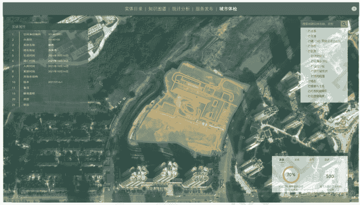

图A2-3 城市体检指标计算页面

### 四、案例开发前基础能力评估情况

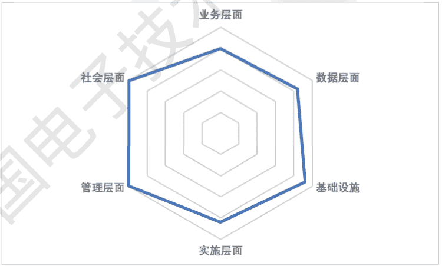

图A2-4 基础能力评估

目前测绘地理信息领域知识图谱系统在业务层面处于L4级别，在数据层面处于L4级别，在基础设施层面处于L5级别，在实施层面处于L4级别，在管理层面处于L5级别，在社会层面处于L5级别，计算得到其综合得分为93分，系统处于L5完备级别。

### (2) 短板提升措施

### 短板1：缺少具体的应用情景。

用户需求以管理需求为主，在战略层面重点规划应用情景，但在实际应用中缺少具体的应用场景。

提升措施：基于本项目构建地理时空知识图谱典型应用案例，拓展具体的应用情景。

### 短板2：地理实体关系构建复杂

地理实体数据的天然多领域复杂性，导致数据内容过大，需要一系列的关系计算和一致性检查工具来处理实体关系。

提升措施：结合数据特点，开发关系计算和语义一致性检查工具。

### 五、案例开发与实施历程及难点

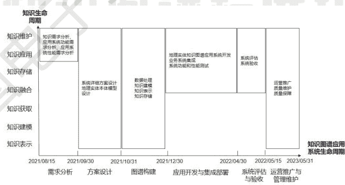

图A2-5 案例开发与实施历程

### (1) 需求分析阶段（2021年8月15日至2021年9月30日）

该阶段涉及角色包括测绘地理信息领域专家、知识图谱领域专家、项目经理、需求分析师、数据治理负责人、业务人员等，主要完成行业调研、业务需求梳理和分析、数据现状梳理和分析、可行性分析等工作。

该阶段的难点主要在于对于精确把握业务需求、明确工作目标。知识图谱技术在测绘地理信息领域的应用尚处于探索阶段，缺乏具体应用场景，需要通过业务专家、技术专家等多方人员深入交流和探讨，并借鉴其他行业知识图谱应用案例，以实际业务应用场景为基础，完成对需求的分类定级，明确业务目标。

### (2) 方案设计阶段（2021年10月1日至2021年10月31日）

该阶段涉及角色包括项目经理、业务专家、系统架构师、研发工程师、数据工程师、算法工程师、UI设计师等，主要完成本体设计方案、系统详细设计方案、系统设计原型等工作。

该阶段的难点在于多源异构的地理信息数据语义化处理的技术路线设计。测绘地理信息数据来源、数据结构、数据模态多样，如何以较高的自动化程度进行语义化处理和语义融合，当前行业内并没有非常好的解决方案。在本项目中，泰瑞数创结合多年的语义化技术研发经验和研发成果，设计了一整套地理信息数据语义化处理和语义化地理实体生产的工艺流程和标准规范体系，能够快速构建地理实体语义化数据。

### (3) 图谱构建阶段（2021年11月1日至2021年12月30日）

该阶段涉及角色包括项目经理、数据工程师、知识图谱工程师、研发人员、业务人员等，主要完成数据处理、知识建模、知识融合、知识存储等工作。

该阶段的主要难点在于设计合适的、满足业务应用的知识表示模型和本体模型，提取应用情景强关联的实体关系。这需要项目组采用“自顶向下”的构建方式构建模型，并通过质量评测对构建的知识图谱进行质量管控。

### (4) 应用开发与集成部署阶段（2022年1月1日至2022年4月30日）

该阶段涉及角色包括项目经理、知识图谱工程师、研发人员、测试人员、业务人员等，主要完成系统功能开发、系统测试和系统部署等工作。

该阶段的主要难点在于保障系统功能和性能满足业务需求，以及业务流程习惯。这需要在实施开发前，业务人员、研发人员进行充分沟通和确认开发需求，同时开发过程中进行多次确认和测试，以保证系统开发满足需求。

### (5) 系统评估与验收阶段（2022年5月1日至2022年5月15日）

该阶段涉及角色包括项目经理、研发人员、测试人员、运维人员、业务人员等，主要完成系统评估、系统验收、系统上线等工作。

该阶段的主要难点是制定有效的系统评估指标，标准化的系统测试，验证系统稳定性，业务逻辑是否满足应用需求。

### (6) 运营推广与管理维护阶段（2022年5月16日至2023年5月31日）

该阶段涉及角色包括业务人员、运维人员、销售人员、市场人员等，主要完成系统运营、系统推广、用户意见总结等工作。

该阶段的主要难点一是建立系统运营推广体系。二是如何指导用户自主扩展系统知识，尤其是在图数据库中新增实体和关系，从而扩展系统应用情景。

### 六、涉及的关键技术

### 关键技术1：地理实体语义化技术

地理实体成果包括结构化、非结构化及半结构化的数据，属性和关联关系通常采用非结构化的自然语言进行描述，这种描述方式不利于计算机处理与理解。目前计算机难以理解地理实体数据中的三维数据。

语义化尤其是三维语义化是解决上述问题的关键，三维语义化把实体对象的几何信息与语义信息结合起来，将实体转化成计算机可以理解的语言模型，实体对象变得可查询、可分类、可统计、可渲染、可计算、可分析等。泰瑞数创提出地理实体语义化技术，通过人工智能技术研发三维数据的语义信息提取和表达工具、地理实体语义关系的构建工具，有效解决了知识图谱在新型基础测绘领域的应用难点。

### 关键技术2：开源共享的语义化地理实体识别解译样本库

针对不同类别、不同区域的地理实体特点，建立涵盖不同数据类型（如地面照片、遥感影像等）、不同波段（如可见光波段、微光波段等）的地理实体识别解译样本，关联必要的地理实体语义信息，覆盖地理实体类别、纹理、光谱、形状和范围等特征，同时建立样本标准化存储、索引与管理规则，形成开源共享的语义化地理实体识别解译样本库，为地理实体的自动化、智能化提取奠定基础。

### 七、当前面临的重要挑战

### 挑战：基于情境提供知识服务

传统的地理信息服务通过硬编码的方式，实现若干事先设定情况下的信息分析与服务，无法根据实际情况灵活、智能地提供服务。随着传感网、物联网技术和智能感知技术的发展，信息获取的实时化正在逐步成为现实。为此，需要发展融合智能分析的实时感知情境化服务。

对时空信息而言，要发展时空情境觉知的能力，需要融合认知化的智能分析，以提供情境化服务。虽然基于位置的服务(location based services, LBS)也属于一种时空情境化服务，但时空情境的觉知远远不限于此。情境化服务的关键不仅在于信息的感知，更在于如何把感知到的位置、时间、空间场景、地理行为习惯等时空信息有效融合，实现时空情境的深度觉知，并基于此驱动相关应用场景的服务。

### 案例三：通信认知管控系统建设与实施

### 一、案例背景

随着5G无线通信网络的快速部署，用户终端数不断增加，业务类型种类也日益增多，这给通信运营商带来了挑战。一方面，随着用户规模的持续性增长，通信运营商需要提供大量的咨询服务，另一方面，如何在满足大量用户通信需求的情况下高效、低成本地维护通信网络，提升运营效率变得尤为重要。

为解决通信领域频谱管控中的数据孤岛、数据关联性差等问题，综合利用深度学习、知识图谱等技术，引入频谱数据，构建覆盖全国频谱使用规则的大规模频谱管控系统，实现客服智能问答，鉴别恶意用频或非法用户、伪基站、黑飞无人机，高效调度和分配网络资源等，提升用户满意度，降低运营成本。

### 二、案例所处阶段及成效

- (1) 所处阶段：应用开发与集成部署阶段

- (2) 案例成效：

从无线通信的结构化数据、半结构化数据和非结构化数据中，挖掘用户、通信业务、无线资源等相关的管理关系和通信知识，构建无线通信知识图谱，为更好地服务用户、实现非法用频预警、诈骗电话识别、通信资源的高效智能管理提供重要的技术手段。

### 三、案例系统架构

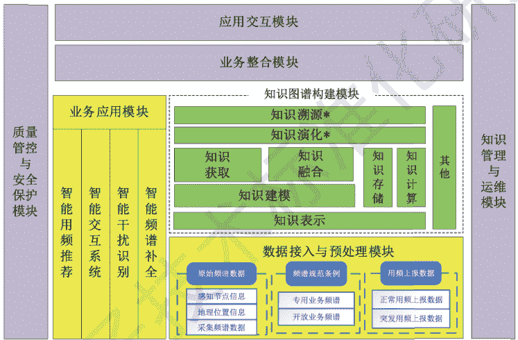

通信认知管控系统包括应用交互模块、业务整合模块、业务应用模块、知识图谱构建模块、数据接入与预处理模块、质量管控与安全保护模块、知识管理与运维模块等七个模块。

### (1) 数据接入模块与预处理模块

主要是对原始频谱数据、频谱规范条例、用频上报数据等频谱数据进行预处理，为后续系统提供数据。其中原始频谱数据包括感知节点信息、地理位置信息、采集频谱数据；频谱规范条例包括专用业务频谱、开放业务频谱；用频上报数据包括正常用频上报数据、突发用频上报数据。

- (2) 知识图谱构建模块：该模块通过知识表示、知识建模、知识存储、知识计算、知识获取、知识融合、知识溯源处理数据，构建通信认知领域的知识图谱，为后续提供相关图谱服务提供接口。

- (3) 业务应用模块：利用构建的通信认知领域知识图谱，进一步提供智能用频推荐、智能交互系统、智能干扰识别、智能频谱补全等业务应用功能。

- (4) 业务整合模块：该模块整合业务应用模块的业务应用功能。

- (5) 应用交互模块：基于业务整合模块，以可视化界面向用户提供服务。

- (6) 知识管理与运维模块、质量管控与安全保护模块：主要为系统质量与安全提供保障。

### 四、案例开发前基础能力评估情况

### (1) 基础能力评估结果

在业务层面，战略愿景处于五级，AI已成为公司业务发展的组成部分；用户需求驱动处于四级，知识图谱具有明确应用需求，且可满足用户需求；资源安排处于四级，将知识图谱项目建设纳入预算体系；行业资质处于三级，具备行业资质，但行业壁垒中等；行业趋势和产业政策处于四级，行业发展势头向好，产业政策扶持逐渐变多。

在数据层面，数据储备处于三级，数据整体一般但部分数据情况较好，主要是频谱规范条例已明确给出频谱数据，原始频谱数据以及用频上报数据均需要通过外置设备配合获取；领域专业数据基础处于四级，具有少量行业语料和术语，并形成小范围行业标准；数据治理能力处于三级，数据治理水平中等。

在基础设施层面，人员储备处于四级，具有运维人员、领域知识专家和知识图谱构建人员；硬件软件资源存储处于二级，具有有限的存储能力、计算能力，支持小规模数据处理与存储；信息化建设基础处于二级，配套业务系统，少量业务流程实现信息化。

在实施层面，实施能力处于二级，目标用例按照优先级开始进行 POC；运维能力处于三级，目前建设的系统基于构建的知识图谱可以满足部分用户的需求。

在管理层面，组织保障处于三级，形成严密的组织机构，并具备初步的组织措施；质量管理能力处于三级，制定严格的质量方针，明确质量目标和职责；过程管理能力处于二级，初步形成项目过程策划。

在社会层面，法律风险与责任处于四级，具有较低法律风险与责任。

综上，该应用系统处于L3建设级。

#### (2) 短板提升措施

- 短板1：提升硬件、软件资源存储，且支持动态扩展，以支持超大规模数据处理与存储。

- 短板2：提高信息化建设基础，联合通信运营商，共同设计和配套业务系统，完善业务流程，完全实现信息化。

#### 五、案例开发与实施历程及难点

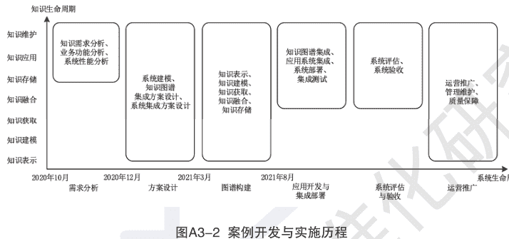

### (1) 需求分析阶段（2020年10月-12月）

在该阶段包含需求分析师、数据人员、项目经理、产品经理等人员，主要完成行业调研、可行性分析、业务需求梳理和分析、数据收集和分析等工作。

该阶段的难点主要在于准确把握业务目标，通过一次或几次分析得到对功能、性能完整清晰的大型复杂系统。通过对通信领域深度调研，与业务专家和技术专家反复沟通，理清业务需求，对需求目标分类定级，实现业务目标的拆分和明确。

### (2) 方案设计阶段（2020年12月-2021年3月）

在该阶段产品经理、项目经理、系统架构师、研发工程师、算法工程师等人员，主要完成系统架构设计、频谱知识图谱设计、系统功能设计、模块集成方案设计等工作。该阶段的主要难点在于频谱知识图谱的设计以及系统中各模块的关联设计。主要通过从架构上大致把控频谱知识图谱建设方案，对各模块保证统一的接口和通讯标准解决。

### (3) 图谱构建阶段（2021年3月-8月）

在该阶段项目经理、知识图谱工程师、研发人员等人员，主要完成频谱知识图谱构建任务，包括知识建模、知识获取、知识融合、知识存储等工作。该阶段的主要难点在于频谱非结构化数据抽取难。主要通过自然语言处理技术抽取非结构数据解决。

### (4) 应用开发和部署阶段（2021年8月-至今）

在该阶段项目经理、知识图谱工程师、研发人员、测试人员、运维人员等人员，主要完成应用开发、功能测试、系统部署等工作。该阶段的主要难点在于融合不同来源的数据，主要利用知识融合技术解决。

#### 六、涉及的关键技术

关键技术1：频谱数据处理技术。由于无线通信行业的高时变特性，需要选择数据处理效率高、实时性好的技术。

关键技术2：频谱实时检测技术。针对频谱数据规模大、频段差异明显，需要采用基于注意力机制的频谱监测技术，解决频谱实时监测的难题。

#### 七、当前面临的重要挑战

挑战1：实现个性化服务难度高。在无线通信领域，用户需求差异大、频谱资源稀缺严重、用户规模不断增长，通信运营商难以为用户提供个性化通信服务，用户体验普遍不高。

挑战2：难以在保证频谱质量的同时降低运行成本。随着无人机数量增加，黑飞无人机、伪基站等违规用频和非法干扰的频发导致用频环境日益复杂，网络运营成本明显上升。

挑战3：难以提升通信数据利用率。大量的通信数据不断消耗存储资源，通信数据的利用效率明显不足。

## 参考文献

- [1] 余荣花，廉同辉，刘军. 中国低碳研究的知识图谱分析[J]. 资源科学, 2012(10): 1959-1964.
- [2] 程赛琰，丁磊，魏淑娟. 基于知识图谱分析的电子政务研究现状、热点与趋势[J]. 图书与情报, 2013(1):116-123
- [3] 谢靖，章鑫鑫. 基于CSSCI(2000-2011)的中国文学学科知识图谱研究[J]. 图书与情报, 2014(2):108-114.
- [4] 李伟平，权德庆. 我国体育消费研究前沿与热点——基于科学知识图谱的可视化研究[J]. 西安体育学院学报, 2014(1):41-44.
- [5] 辛伟. 知识图谱在军事心理学研究中的应用[D]. 西安：第四军医大学, 2014
- [6] Mima M, Bansal M. End-to-end relation extraction using lstms on sequences and tree structures[C]// Proceedings of the 54th Annual Meeting of the Association for Computational Linguistics. Berlin. 2016:1105-1116
- [7] Katiyar A, Cardie C. Going out on a limb: Joint extraction of entity mentions and relations without dependency trees[C]// Proceedings of the 55th Annual Meeting of the Association for Computational Linguistics (Volume 1: Long Papers) Vancouver Canada. 2017:917-928
- [8] 陈德鑫,占袁圆,杨兵,等.基于 CNN-BiLSTM模型的在线医疗实体抽取研究[J]. 图书情报工作, 2019, 63 (12): 105-113.
- [9] 赖英旭,李亚娟,刘静.基于本体的水稻育种方法应用知识库构建[J]. 北京工业大学学报, 2019, 45 (12):1181-1191.
- [10] 连明杰, 陈远文, 昝云飞, 等. 一种基于深度学习模型的关系抽取及知识图谱构建方法: 中国, CN 201910707194. 1 [P]. 2019-12-20
- [11] 吴文涛, 李培峰, 朱巧明. 基于混合神经网络的实体和事件联合抽取方法[J]. 中文信息学报, 2019, 33 (08): 77-83.
- [12] 苏佳林, 王元卓, 靳小龙, 等. 自适应属性选择的实体对齐方法[J]. 山东大学学报(工学版), 2020, 50(01): 14-20.
- [13] 王会勇, 论兵, 张晓明, 等. 基于联合知识表示学习的多模态实体对齐[J]. 控制与决策, 2020, 35 (12): 2855-2864.
- [14] 李攀成. 公共安全领域知识图谱的知识融合技术研究[D]. 成都: 电子科技大学, 2019.
- [15] Lao N, Mitchell T, Cohen W W. Random walk inference and learning in a large scale knowledge base[C]// Proc of the Conference on Empirical Method in Natural Language Processing. Stroudsburg, PA: ACL Press, 2011: 529-539
- [16] 张美玉, 林崇, 简铮峰. 基于路径排序算法的 STEP 知识推理技术研究[J]. 浙江工业大学学报, 2020, 48(02): 126-132, 187.
- [17] 吴运兵, 朱丹红, 廖祥文, 等. 路径张量分解的知识图谱推理算法[J]. 模式识别与人工智能, 2017,30(05):473-480.
- [18] BORDES A, WESTON J, COLLOBERT R, et al. Learning structured embeddings for knowledge bases[C]//Proc of AAAI. Menlo Park, CA: AAAI, 2011: 301-306
- [19] SOCHER R, CHEN D, MANNING C D, et al. Reasoning with neural tensor networks for knowledge base completion [C]//Proc of NIPS. Cambridge, MA: MIT Press, 2013: 926-934.
- [20] JENATTON R, ROUX N L, BORDES A, et al.A latent factor model for highly multi-relational data[C]//Proc of NIPS. Cambridge, MA: MIT Press, 2012: 3167-3175.
- [21] BORDES A, USUNIER N, GARCIA-DURAN A, et al. Translating embeddings for modeling multi-relational data[C]//Proc of NIPS. Cambridge, MA: MIT Press, 2013: 2787-2795.
- [22] NEWCOMBE H B, KENNEDY J M, AXFORD S J, et al. Automatic linkage of vital records[J]. Science, 1959, 130(3381): 954-959
- [23] COCHINWALA M, KURIEN V, LALK G, et al. Efficient data reconciliation[J]. Information Sciences, 2011, 137(14): 1-15.

全国信标委人工智能分委会知识图谱工作组、知识图谱产业推进方阵、IEEE知识图谱工作组、知识图谱产品认证、知识驱动先锋企业评选相关动态敬请关注微信公众号或与联系人沟通。

中国电子技术标准化研究院

联系人：李瑞琪

联系方式：010-64102797

电子邮箱：lirq@cesi.cn
