# 知识图谱落地避坑指南：从选型到实施的全景图谱

## 引言：破解认知与落地的双重困境

作为机器认知智能的基石，知识图谱已成为人工智能体系中不可或缺的核心组件。它以结构化网络的形式描绘现实世界的概念、实体及其关联，将信息转化为贴近人类认知的模式，赋予了海量数据组织、管理与深度理解的新能力。在政策扶持、技术突破、标准确立及产业推力的多重驱动下，该技术已在智慧金融、医疗、能源、制造等垂直领域深度落地，跨域融合趋势日益明显。

然而，落地之路并非坦途。知识图谱的构建与运维高度依赖多方协同与持续运营，项目夭折风险客观存在。企业端普遍面临“认知模糊、底子薄弱、需求不清、路径模糊、选型纠结、边界不分、预期过高、缺乏评估、管理失控”等九大痛点。如何科学选型、精准建设、高效部署并持续运营适配自身业务的知识图谱系统，已成为当前行业亟待破解的关键课题。

为推动技术深度赋能千行百业，助力企业建立正确认知体系，中国电子技术标准化研究院牵头，联合产学研用多方权威机构，依托知识图谱产业推进方阵及全国信标委人工智能分委会知识图谱工作组，重磅推出《知识图谱选型与实施指南》。本指南直击核心痛点，围绕“定义、价值、系统构成、适用性判断、选型策略、建设路径、服务商甄别、参考案例”八大核心命题展开，逻辑架构严密，旨在为行业提供一份可落地、可参考的实战手册。鉴于技术迭代迅猛，编制周期与作者认知难免存在局限，恳请业界批评指正。

---

## 权威编委会阵容：汇聚产学研用顶尖力量

### 牵头领衔
**中国电子技术标准化研究院** 统筹把控，保障指南的权威性与标准对齐度。

### 联合攻关阵容（按章节贡献分类）

**核心理论奠基（第1-2章）：** 东软集团、沈阳东软智能医疗、华为云、北京国双、郑州中业、科大讯飞医疗、天津大学、北京富通东方、云孚科技、富士康工业互联网、泰凡科技、南航、网智天元、山东亿云、晓链科技、洲明科技、京航计算所、文因互联、中科院信工所。

**价值场景挖掘（第3章）：** 华为云、车之家、科大讯飞医疗、浙商银行、京航计算所、京华元典、南河星、东软集团、沈阳东软、星环科技、网智天元、特斯联、中业科技、腾讯云、南航、山东亿云、百度、昆通软件、海尔优家、中电科智慧城市、拓尔思、中电科电力、柏视医疗、云孚科技、中科软、富士康工业互联网。

**系统架构设计（第4章）：** 网智天元、科大讯飞医疗、数联铭品、泰凡科技、南瑞集团、云孚科技、华宇元典、邑通软件、海叉知信息、云南昆船、盈趣科技。

**能力评估体系（第5章）：** 南瑞集团、车之家、绿盟科技、浙商银行、豪尔赛、云孚科技。

**选型决策模型（第6章）：** 东软集团、沈阳东软、数联铭品、网智天元、华宇元典、泰凡科技、腾讯云、绿盟科技、拓尔思、富通东方、光旎科技、中电科智慧城市、邑通软件。

**全生命周期建设与管理（第7章）：** 东软集团、沈阳东软、百洋智能、数联铭品、华宇元典、南河星、国双科技、腾讯云、绿盟科技、星环科技、泰凡科技、电科云、云孚科技、柯基数据、光旎科技、暗链科技、南京电子工程所、上海工程技术大学。

**服务商甄选标准（第8章）：** 中科软、上海工程技术大学、富通东方、京航计算所。

**总结建议与案例库（第9章及附录）：** 汇聚南瑞集团、天津大学、华为云、柯基数据、东软集团、沈阳东软、中科院信工所、京航计算所、百洋智能、网智天元、山东亿云、中科软、洲明科技、盈趣科技、泰凡科技、拓尔思、光旎科技、富通东方、云孚科技、华宇元典、豪尔赛、上海工程技术大学、富士康工业互联网、泰瑞数创、电科云、特斯联、南航、浙商银行、泰瑞数创、南航、京航计算所、上海工程技术大学等近40家单位共同复盘沉淀。

### 核心执笔专家组（部分）
中国电标院：程多福、郭楠、卓兰、韩丽、李瑞琪、李佳、贾仕齐、焦国涛、程雨航、胡琳、何宏宏、陈艳利；
东软/沈阳东软：王伟光、赵耕弘、蔡巍；
华宇元典：郭晓妮、李东海、石崇德；
浙商银行：臧缺、陈嘉俊、钟礼斌；
国双：詹青；
绿盟：袁军、顾杜娟；
车之家：杨雷、梁霄、雷涛；
华为云：陈琦、郑毅、王鹏、朱宗奎；
网智天元：贾承斌、艾青；
星环：李逸、唐剑飞；
泰凡：王林、徐大为、贾勇哲；
科大讯飞医疗：陈晓东、胡志强、贺志阳、赵景鹤；
南瑞集团：陈徯、苏婧仪、陈鹏；
腾讯云：周磊、刘海涛、贾倩雯；
百洋智能：李琴、杨斌；
南航：周福辉、袁璐；
天津大学：王鑫、刘安安；
……及数十位一线技术专家、业务架构师联合署名。

---

## 第一章 认知重塑：知识图谱核心概念解析

### 一、 破除定义迷雾：什么是知识图谱？

尽管谷歌于2012年正式推出“知识图谱”概念并借此重塑搜索体验，但至今仍缺乏统一的官方权威定义。业界主流认知多源于谷歌官方博客：即作为增强搜索引擎的知识库，它通过解析查询实体、洞察用户意图，实现从“单一链接”到“实体关联全景呈现”的体验跃迁。

随着技术渗透至金融、医疗、制造、交通、教育、农业、家居等纵深场景，知识图谱的内涵与外延持续进化，知识谱系已拓展至事件、规则、行为等维度。为兼容未来演进趋势，本指南采纳《信息技术 人工智能 知识图谱技术框架》（征求意见稿）的权威表述：

> **知识图谱：** 以结构化形式描述的知识元素及其联系的集合。
> **知识元素：** 描述事物或概念的原子级独立单元，涵盖实体、概念（实体类型）、属性、关系、关系类型、事件、规则（推理逻辑）等。

#### 权威定义溯源与对比视野（汇总表1-1 核心观点提炼）

| 来源维度 | 核心定义要义 |
| :--- | :--- |
| **国家标准** | 结构化知识元素集合；实现人类认知信息机器化；提供图形式的海量信息组织管理理解能力。 |
| **《计算机科学技术名词》** | 海量知识及关联的大图组织；特指谷歌商业产品。 |
| **谷歌官方溯源** | 为增强搜索开发的知识库，显著提升用户体验。 |
| **维基百科** | 基于图结构数据模型或本体论的数据集成知识库。 |
| **学术通用视角** | 概念及关系描述知识的数字结构；含人机共享推理的本体。 |
| **《知识图谱发展报告》(2018)** | 结构化描述客观世界概念/实体/关系；将信息表达为贴近人类认知形式。 |
| **《知识图谱：概念与技术》** | 大规模语义网络；含实体、概念及语义关系。 |
| **百度百科** | 本质为语义网络；节点为实体/概念，边为语义关系。 |
| **Paulheim (学术综述)** | Schema层定义抽象类别关系；数据层组织真实实体关系；覆盖特定领域。 |
| **Krötzsch & Weikum (期刊专刊)** | 实体及其语义类别、属性、关系构成的网络。 |

**核心共识：** 无论定义如何演变，“结构化”、“实体/概念”、“语义关系”、“机器可认知/可计算”始终是知识图谱的四大基因特征。

### 二、 统一语言体系：核心术语精准界定

为消除沟通歧义，指南依据上述技术框架标准，对核心术语进行规范化定义（详见汇总表1-2）：

| 术语 | 标准定义 | 关键注解 |
| :--- | :--- | :--- |
| **知识** | 通过学习、实践、探索获得的认识、判断或技能。 | 基础原料 |
| **知识元素** | 描述事物/概念的不可再分独立单位。 | 实体、概念、属性、关系、事件、规则等原子单元 |
| **知识单元** | 按特定关系组织的一组知识元素集合。 | 组合颗粒度 |
| **本体 / 本体模型** | 实体、关系、属性类型及关联的模型化表达. | 顶层Schema设计 |
| **图式** | 本体模型的规范化表达。 | 技术落地规范 |
| **实体** | 现实世界独立存在的客体。 | 核心节点 |
| **属性** | 对象集合共有的特征。 | 节点/边属性 |
| **实体类型** | 具共有属性实体集合的抽象。 | 分类体系 |
| **事件** | 特定时刻/时段发生或预期发生的事。 | 动态知识载体 |
| **关系** | 实体或实体类型间的联系。 | 网络边 |
| **供应方** | 构建图谱提供基础工具/服务（中间件）的组织。 | 生态上游 |
| **集成方** | 按需整合图谱、系统、服务，交付应用系统的组织。 | 生态中游/集成商 |
| **用户** | 使用应用系统满足自身需求，可反哺数据/知识的组织/个人。 | 生态下游/价值变现端 |
| **生态伙伴** | 提供基建、数据、工具、方法、标准、机制的组织。 | 使能层 |
| **知识表示** | 用机器可识别符号/方法描述人类认知知识的活动。 | 技术手段 |
| **知识建模** | 构建本体及其形式化表达的活动。 | 含实体类型/关系/属性定义全流程 |

**术语体系价值：** 这套标准化词表不仅界定了技术边界，更清晰勾勒了“供给-集成-使用-赋能”四角色协同的产业生态闭环，为后续选型评估、合同界责、验收标准奠定了语义基石。

# 核心概念速览：知识图谱全生命周期六大关键动作

构建知识图谱并非一蹴而就，而是一个严谨的工程过程。以下六大核心环节，串联起了知识从“原材料”到“智能资产”的完整蜕变路径：

**17. 知识获取：广撒网，精筛选**  
这是起点。指从结构各异、来源多元的数据中“淘金”，提炼出结构化知识的活动。数据源按组织形态通常分三类：整齐划一的**结构化数据**（如数据库表）、介于两者之间的**半结构化数据**（如XML、JSON），以及最棘手、量最大的**非结构化数据**（纯文本、音频、视频等）。

**18. 知识融合：打破孤岛，统一身份**  
将分散的知识单元或集合“拼”在一起，消除冗余与冲突，最终形成一张拥有**全局统一ID标识**的知识图谱。这是从“数据堆”变成“知识网”的关键一步。

**19. 知识存储：给知识盖房子，还要管得好**  
设计架构、调度软硬件，实现知识的存、查、改、管全周期管理。主流方案三分天下：基于**关系数据库**的成熟稳健、基于**图数据库**的原生高效、基于**RDF数据库**的标准互通，各有千秋，按需选型。

**20. 知识计算：挖掘隐性价值，输出智能服务**  
站在已建图谱的肩膀上，借力算法“推陈出新”。主要分两大流派：**统计分析**（剖析图谱结构特征、做画像）、**推理计算**（从已知事实推演未知关联，挖掘隐性知识），最终对外释放知识服务能力。

**21. 知识溯源：给每个结论安个“家谱”**  
贯穿图谱全生命周期，追踪原始数据是如何一步步转化为最终知识的。保证过程可回溯、结果可信赖，是质量把控的基石。

**22. 知识演化：让图谱“活”起来，跟上世界的变化**  
本体模型变了、数据源更新了、甚至计算出的新知识，都会触发对原有知识体系的**补充、更新或重组**。这是知识图谱保持鲜活、拒绝僵化的生命力所在。

---

# 解剖图谱内核：双层架构支撑起知识大厦

知识图谱的内部构成，可拆解为**本体层（概念层）**与**实例层（实体层）**双层结构：

*   **本体层**是“骨架”与“规则”：定义实体类型、属性、关系类型、约束规则等核心知识元素，勾勒出领域的认知框架。
*   **实例层**是“血肉”与“事实”：对本体层的具象化落地，包含具体实体及其属性、实体间的具体关系，填满框架细节。

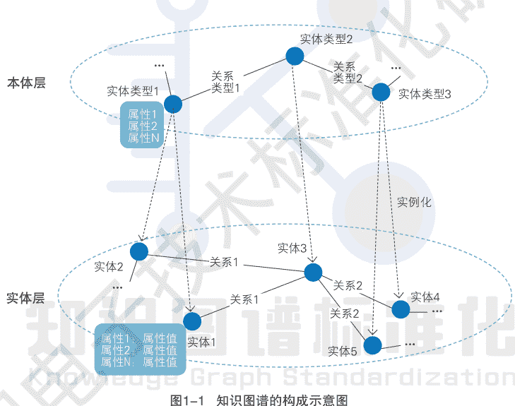

---

# 定位坐标系：知识图谱在技术版图中的“朋友圈”与“差异化”

## 一、 与语义网络、本体：同源异流，各有擅长

三者致力于同一问题域，历史上独立演进又深度融合。知识图谱作为大数据时代的“后来居上者”，展现出四大显著差异化优势：

### 1. 规模巨大，质量硬核
*   **量级跃升**：通用图谱实体关系动辄亿级，领域图谱百万千万级是常态，彻底告别了小规模知识库时代。
*   **质量保障**：数据源异构多样，引入**交叉验证、大数据质检算法、众包审核**等多维管控手段，将准确率推向新高度。

### 2. 结构友好，语义丰富
*   **存储高效**：主流采用**三元组/属性图**结构，天然契合图数据库及RDF标准，管理灵活、查询高效。
*   **语义深度**：关系类型全、建模方式多（支持权重/概率），通过跨图谱融合可覆盖领域核心语义，表达更精准。

### 3. 工程化门槛低，应用场景宽
*   友好的结构、可视化能力大幅降低构建成本。各行各业可快速落地，支撑推荐、问答、搜索、预测等智能服务。
*   虽逻辑推理弱于传统语义网，但**图嵌入、链接预测**等深度学习技术的引入，以低维稠密向量补全推理短板，实战效果优异。

### 4. 聚焦全生命周期，领域攻坚强
*   继承了语义网“实体-关系”建图传统，但更执着于**一致性、准确性、完整性**。
*   覆盖融合、更新、溯源、运维全链路，赋予了其远超传统语义网的**领域深度加工能力**。

### PK 本体：从“定框架”到“装填实”
| 维度 | 本体 | 知识图谱 |
| :--- | :--- | :--- |
| **关注对象** | 侧重**类型/框架**（概念、约束、规则） | **类型+实例**双管齐下，事实完整落地 |
| **构建模式** | 专家主导，精度高，**小规模** | 自动化为主，追求**大规模覆盖**，容忍可接受噪声 |
| **存储压力** | 数据量小，树形展示即可，存储要求低 | **海量图数据**，对逻辑/物理存储性能有强刚性需求 |

> **核心差异**：本体是“空心菜单”，知识图谱是“满汉全席”。机器理解世界，光有菜单（本体）不够，必须有具体的菜（实例）。

## 二、 与图数据库、传统数据库：工具与应用的“共生关系”

*   **图数据库**≈ 管理图数据的DBMS（OLTP为主，擅长事务查询）；**图计算引擎**≈ 离线分析利器（OLAP为主，跑算法）。
*   知识图谱常用**属性图**、**RDF图**模型，二者是图数据库的核心载体。

**三大协同真相：**
1.  **主力非唯一**：图数据库是存储首选，但关系库、KV库、文档库、NoSQL也能“客串”存储。
2.  **复杂场景靠“混搭”**：含本体、长文本、多媒体的**复杂/多模态知识图谱**，往往需要**图库+关系库+NoSQL+分布式文件系统**组团作战。
3.  **全链路靠“集成”**：图数据库主要管“存与查”。获取、融合等上游环节需他工具协作，通过接口联动完成闭环。

> *附注：传统关系数据库（Oracle、DB2等）已推出图扩展模块，可兼容存储，但“图转表”映射损耗性能，非首选。*

## 三、 与人工智能：赋能认知智能的“知识基座”

知识是核心生产要素。构建图谱的过程，实质是让机器完成知识的**读、处理、呈现**，为AI的“知、解、用”铺路，更为人机协作沉淀知识提供技术路径。

### 1. 驱动知识自动化获取：从“手工移植”到“机器自学”
早期靠专家手工入库，成本高、难扩展。如今**机器学习/深度学习**介入，系统可在运行中自主学习、积累、更新知识库，实现规模化自动化构建。

### 2. 攻克可解释AI难关：打开“黑盒”，建立信任
图谱提供认知智能双核——**“理解”**（数据映射到实体/概念/关系）与**“解释”**（用知识关联解释现象）。
*   结合可视化/符号化呈现训练推理路径，**直击深度学习黑盒痛点**，大幅提升系统可信度。

### 3. 落地知识智能应用：五大高频场景见真章
*   **关联分析**：最短路径、链路预测、随机游走挖掘深层网络（如走私案件多维关系溯源）。
*   **辅助决策**：以主题为核心建库建模，提供多维决策依据。
*   **知识搜索**：语义理解意图，精准直达（Google/百度搜索卡片即典范）。
*   **知识问答 (KBQA)**：自然语言转图谱检索/推理，答复精准简洁，支持复杂关联问答。
*   **知识推荐**：基于图谱特征/路径画像，挖掘显隐性关联推荐。

### 4. 促进技术融合创新：做大数据、数字孪生、物联网的“连接器”
图谱灵活的接入与深度处理能力，降低了AI与上述系统的集成门槛。
*   **数字孪生**：海量动态实体、多维指标、复杂关系，图谱存储动态状态，**强力支撑孪生体的“动态大脑”**。
*   **物联网**：面向“物-物/人-物/服务”全链路连接需求，图谱赋能数据接入、管理、分析。
    *   *案例*：阿里云电力图谱支撑操作查询/故障诊断/文档沉淀；华为云油气图谱聚合多源异构数据，赋能语义搜索/油藏类比/增储上产。

---

# 第二章 知识图谱发展现状：从通用到垂直，技术路径全景图

## 一、 发展历程与分类图谱：通用与领域的“双子星”

按知识边界与应用范围划分，分为**通用知识图谱**（广、浅、大、粗，解决科普常识）与**领域知识图谱**（窄、深、小、细，攻克专业难题，又称行业/垂直图谱）。

### 深度对比：全链路差异一览

| 核心环节 | 关键维度 | 通用知识图谱 | 领域知识图谱 |
| :--- | :--- | :--- | :--- |
| **知识表示** | 边界/规模/深度/粒度 | **宽、大、浅、粗** | **窄、小、深、细** |
| **知识获取** | 质量/专家/自动化 | 要求较低、轻度、高自动化 | **严苛、重度、低自动化** |
| **知识建模** | 方式/专家/粒度 | **自底向上**、轻度、粗 | **自顶向下**、重度、细 |
| **知识融合** | 专家/自动化/关联度/质量 | 低/多/低/一般 | **重度/少/高/精细** |
| **知识存储** | 粒度/规模 | 粗/大 | 细/小 |
| **知识应用** | 粒度/链条/全面性/复杂度/效率 | 粗/短/概况/简单/较低 | **细/长/全面/复杂/高** |
| **知识运维** | 管控/频率/专业/反馈机制 | 低/稳定/低/宽松 | **高/视场景/高/严格** |
| **知识交换** | 共享能力 | **高** | 低 |

**核心洞察：**
*   **表示端**：通用铺摊子，领域挖深度。
*   **建模端**：通用“长出来”，领域“设计出来”（专家深度介入）。
*   **获取端**：领域容错率极低，人工兜底多，自动化难度大。
*   **融合端**：领域关联紧、质量高，专家把关重，算法自动化参与反而少。
*   **应用端**：领域推理链长、查询复杂但因规模小效率高；通用邻居查询多、规模大拖慢效率。
*   **运维端**：领域专业性强、反馈闭环严、频率看场景；通用追求稳高频。

### 关系重构：不是替代，是共生共荣

**观点1：通用是领域的“地基”与“种子库”**
*   聚合通用模板 → 快速生成领域Schema（图式）。
*   提供高质量种子事实 → 辅助领域知识发现、训练抽取模型。

**观点2：边界之外有关联，融合才能“破圈”**
*   领域预设边界难覆盖所有应用，关联分析易越界。
*   **通用融领域** → 增加深度，服务更精准。
*   **领域融通用** → 扩充广度，提升召回与效果。
*   **终局**：**通用广度 + 领域深度 = 更完备的知识图谱生态。**

## 二、 构建技术路径：九大模块协同作战

知识图谱高质量构建，依赖**六大核心环节协同**（表示、建模、获取、融合、存储、计算）与**三大支撑环节保障**（溯源、演化、质量评估）。

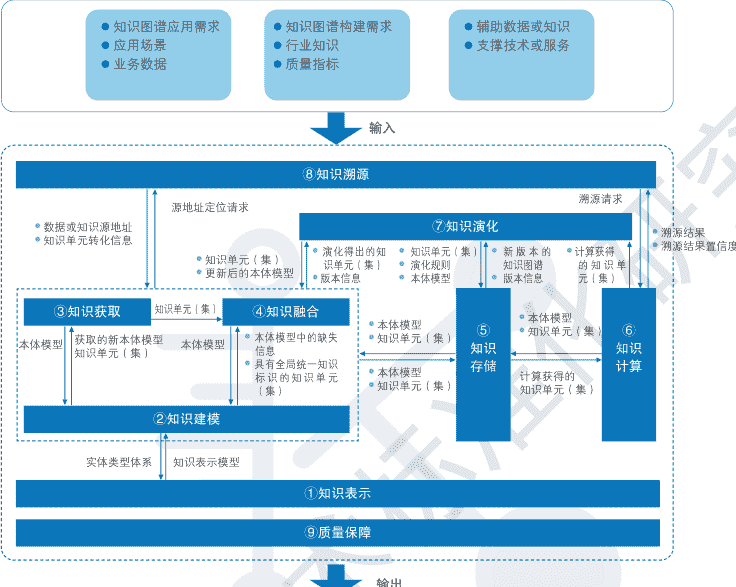

### 图解：知识图谱构建技术路径全景图
> 核心层打地基、管流程；支撑层保质量、促迭代。唯有上下贯通、左右协同，方能炼就高可用、可演进的知识图谱产品。

### 知识图谱工程落地：原料清单、标准动作与技术演进全景

搭建一套可用的知识图谱系统，前端需要汇聚的“原料包”维度颇广：既包括明确的应用诉求、多源异构数据、专家经验与行业知见，也离不开质量标尺、技术支撑体系，以及安监测评等合规要求。经过系统化加工后，产出的图谱产品或服务，既能支撑语义检索、演化分析、智能问答、对话理解等通用能力，也能深度赋能智慧金融、智慧医疗、智能制造等垂直赛道。

#### 核心输入要素的功能定位

针对上述输入端，各要素分工明确：应用需求掌舵定向，锚定整体架构、落地场景与验收标准；数据层面囊括模型训练测试集与业务实战数据，为表示学习、要素获取及后续构建提供燃料；专家与行业知识深入建模、融合、计算核心环节，指导架构设计与算法落地；质量指标贯穿全程，量化把控各环节产出水准；支撑技术融合 NLP、机器学习、大数据等能力，夯实工程基座；安全、监管、测评机制则引入第三方视角，对构建全链路及终极交付物实施质量监管。

#### 国家标准草案视角下的标准化作业流程

依据《信息技术 人工智能 知识图谱技术框架》国家标准草案，知识图谱构建流程的关键环节与任务拆解可归纳为八大核心阶段：

**1. 知识表示：奠定表达基石**  
旨在用适当形式刻画人类认知，力求表达全面，助机器习得拟人化表现。核心动作涵盖：明确表达需求、确立遵循规则与约束、选定表达形式、定义并序列化表示元素、划定模型适用边界、建立模型质量评价体系、评估模型表达能力上限。

**2. 知识建模：搭建骨架架构**  
作为构建基石之一，优质模型能规避冗余获取，显著提效并降低融合成本。任务包括：界定知识领域与范畴、盘点可复用本体资源、梳理领域核心术语、搭建实体类别层级、定义实体属性与关联、产出本体模型与图式、评估本体模型质量。

**3. 知识获取：挖掘原始要素**  
数据源按结构维度分为结构化、半结构化（网页等）、非结构化（文本/音视频）。核心任务聚焦实体类型抽取、实体抽取、关系抽取、属性抽取、事件抽取，辅以人工补录手段。

**4. 知识融合：消除异构差异**  
涵盖本体对齐（实体类型、关系、属性多维对齐）、实体链接、实体对齐、一致性校验，确保多源知识无缝衔接。

**5. 知识存储：夯实物理底座**  
存储质量直击计算与演化效率。涉及选型与数据库设计、执行存储操作（增删改查及可视化呈现）、存储管理三大板块。

**6. 知识计算：激活隐性价值**  
分统计分析（结构特征归纳）与推理计算（隐性知识推演）两大路径。流程覆盖：定义计算需求、设计数据结构与算法模型、执行计算流程与性能评估、隐性知识补全缺失单元、接口化输出计算服务。

**7. 知识溯源：守住可信底线**  
产出源地址（唯一访问标识）与转化路径（源到目标演变关系）。任务含：定义源地址结构化描述、设计溯源方案、追溯定位知识来源、确定置信度维度并计算结果、原始数据与知识版本管理。

**8. 知识演化：维持长久活力**  
目标直指提质、丰富语义、优化组织，计算补全亦可触发演化。关键动作：识别待变更知识单元、设计/匹配演化规则算法模型、更新知识单元、生成带时间戳的新版本、版本管理。

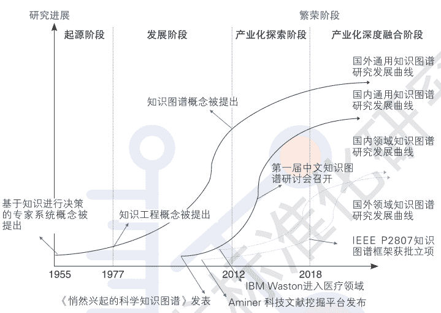

图 2-2 国内外知识图谱发展历程

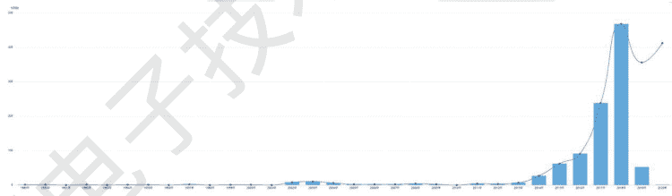

图 2-3 知识图谱相关专利发展趋势 [来源：Aminer]

---

### 全球视野下的演进轨迹差异与对标

受技术成熟度与产业化深度差异影响，知识图谱演进大致历经起步、沉淀、爆发三期。通用与领域图谱因应用诉求不同，路径略有分野。若聚焦领域图谱演进，爆发期可再细分为产业化探索与深度融合两个亚阶段。专利趋势亦印证了这一历程。

#### 国际演进脉络：从符号主义到大规模工程化

- **起步期（1955-1977）**：Garfield 首创文献索引检索范式；Feigenbaum 提出专家系统，推动 AI 从“推理主导”转向“知识主导”；Quilian 构建语义网络，以节点边连接知识，奠定知识表示雏形。
- **沉淀期（1977-2012）**：Feigenbaum 提出知识工程概念，聚焦知识的计算机表示与求解；Berners-Lee 发明万维网，后推出语义网愿景，引入 RDF 实现知识表示推理；Bizer 等发起 LOD 项目，推动构建机器可读的语义数据网。
- **爆发期（2012至今）**：Google 正式提出“知识图谱”概念，打破手工获取瓶颈，采用 RDF 三元组与属性图，配合海量数据规模，引入机器学习、NLP 实现自动化构建。发布之初即拥有 5.7 亿实体、18 亿事实。此后学界产业界竞相投入，LOD 项目至 2020 年 5 月已汇聚 1260 个数据集、1.6 万余连接，覆盖社会生产生活诸多维度。论文高产国家集中在中国、美国、德国、意大利、英国、法国、印度等。

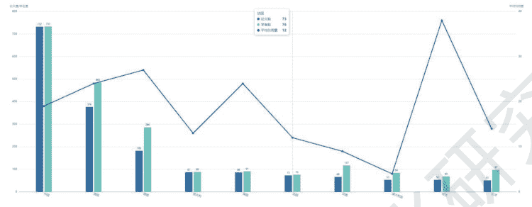

#### 国内演进轨迹：起步虽晚，追赶迅猛

国内研究起步晚于国际，但整体趋势同频共振：

- **起步期（2005-2010）**：2005年首篇本土文献《悄然兴起的科学知识图谱》发表，标志着开端。此阶段侧重理论夯实，陆汝钤、史忠植、董振东、王克宏等院士专家为知识工程奠基。
- **沉淀期（2010-2015）**：跨学科关注度攀升。2012年“知立方”成为首个中文搜索引擎知识图谱；2013年首届中文知识图谱研讨会聚焦构建技术与策略。同期，学者们在低碳、电子政务、文学、体育、军事心理等细分领域产出系列成果。
- **爆发期（2015至今）**：应用疆域全面拓展，论文量爆发式增长，推动研究登峰。借势 AI、大数据、深度学习东风，国内知识图谱实现跨越式突破。

#### 代表性图谱资产盘点

当前中外均建成多个大规模通用图谱。国际经典有 DBpedia、YAGO、Freebase 等；国内代表作包括百度知心、搜狗知立方、XLORE、zhishi.me 等。以 Wikidata 为例，作为 Wikimedia 基金会托管的协作式多语言图谱，亦称“面向文档的数据库”。核心存储各类主题/概念/实体信息，分配唯一 “QID”。截至 2021 年 8 月，有效结构化数据超 9400 万条，单条结构示意见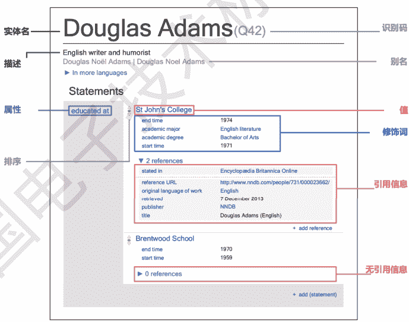。若属性值为实体，则同分配 QID。

图 2-5 Wikidata 信息结构

领域图谱方面，生物医学、影视、社交、医疗、科研、交通等垂类均有标杆案例：生物医学领域的 Linked Life Data、UMLS、Bio2RDF；影视领域的 Linked Movie Dataset 及双语融合图谱；社交网络 FOAF；医疗垂类的中文症状库、中医药学语义网络、疾病术语集；科研场景的 SciKG；交通领域的基于 CNSchema 城市图谱等。

---

### 核心技术栈演进深度复盘

知识图谱核心技术栈聚焦抽取、表示、融合、推理，演进路径与现状如下：

#### 抽取技术：从规则手工到神经网络端到端

作为构建首环，抽取技术经历了三次范式迭代（历程见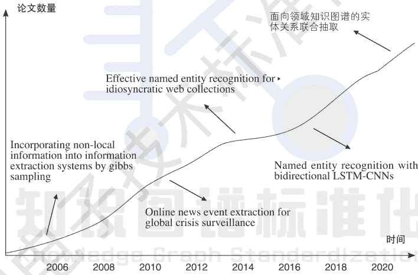，专利趋势见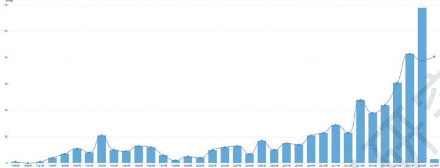）。

图2-6 知识抽取技术演进历程

图2-7 知识抽取技术相关的专利数统计 [来源：Aminer]

核心任务覆盖实体、关系、属性抽取。
- **早期·规则驱动**：依赖专家定义规则，移植性差，大规模下人力成本高企。
- **中期·特征工程+传统 ML**：引入 HMM、CRF、最大熵等，但强依赖人工特征构建及 NLP 工具链。
- **当前·深度学习/预训练大模型主导**：BERT 等预训练模型编码能力强，叠加 RNN、CNN 或注意力机制实现抽取。联合抽取模型可同步捕获实体、类型、关系，支持序列标注、指针网络等端到端范式。

**里程碑贡献**：国外 Miwa 率先引入神经网络做关系抽取，Katiyar 引入注意力机制。国内在医疗、农业、管理等落地丰富：团队用 CNN+Bi-LSTM 做医疗实体识别；CRF 技术解决水稻育种专利实体识别；专利采用 BERT+BiLSTM 抽取关系三元组；统一实体事件抽取任务，混合神经网络建模依赖关系。

#### 表示技术：从符号逻辑向分布式向量空间跃迁

表示技术旨在将客观知识转为机器可读形式。早期手段涵盖谓词逻辑、产生式系统、语义网、脚本及本体等。演进核心在于：**完成从基于数理逻辑的符号表达，向基于向量空间学习的分布式嵌入的跨越**（历程见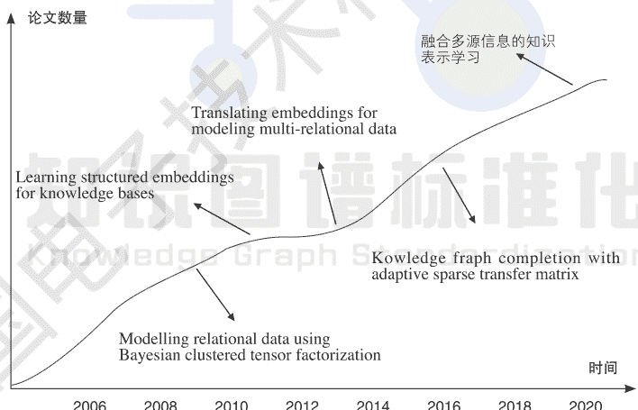）。

图2-8 知识表示技术演进历程

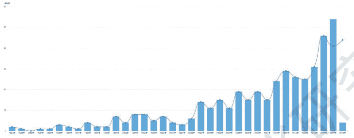

**核心技术溯源：知识表征如何从符号走向向量？**

专利数据（图2-9，源自Aminer）揭示了知识表示技术的爆发式增长轨迹。

起初，学术界主要依赖一阶逻辑、霍恩子句及产生式规则等符号体系。此类手段结构严谨、语义精确，却因刚性过强、扩展受阻而难以适应开放环境。语义网愿景的提出，催生了XML、RDF、OWL等面向Web的标准化语言族。虽能清晰刻画显性离散知识，但面对海量数据时，计算开销大、稀疏性严重、隐性语义挖掘乏力等短板暴露无遗。

深度学习浪潮重塑了范式。将实体与关系映射至低维稠密向量空间，使语义计算成为高效的向量运算。这不仅攻克了隐性知识发现与复杂关系推演的难题，更在语音、视觉及自然语言处理领域大显身手，迅速确立主流地位。

**经典模型迭代谱系：** 国外早期奠基工作涵盖距离模型、单层神经网络、双线性模型及**TransE**架构。TransE以几何直觉建模关系：视作头尾实体向量间的平移操作（$h + r \approx t$）。针对真实知识库中普遍存在的1-N、N-1、N-N复杂映射，国内学者接力攻关，推出**TransH、TransR、TransD**等改进作，显著增强了表达鲁棒性。

### (3) 知识融合：跨源聚合与歧义消解

知识融合旨在打通本体层与实例层壁垒，整合跨库同一实体、多图谱实例及多源异构数据，驱动图谱持续进化。技术演进脉络（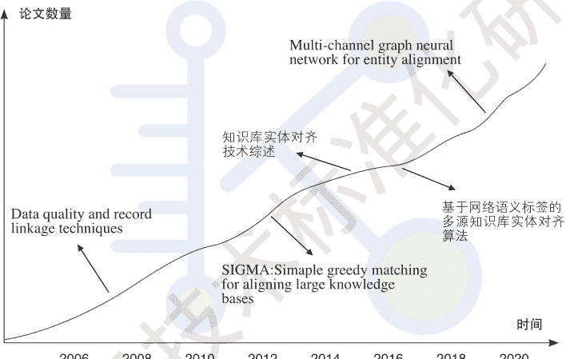）与专利态势（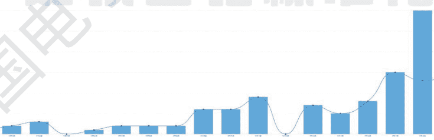，源自Aminer）见图示。

核心攻关聚焦**本体对齐、实体链接、指称消歧**三大任务：

*   **实体链接：** 识别异构图谱中指代同一现实对象的节点。
    *   *起步期：* 依托传统机器学习（马尔可夫逻辑网、支持向量机），基于特征向量相似度分类或聚类决策。
    *   *主流期：* 转向神经嵌入范式，将多源图谱投影至统一潜在空间，通过向量距离度量语义等价性，精度跃升。
*   **指称消歧：** 消除文本实体提及的歧义（一词多义）。
    *   利用词向量分布式语义表达，结合上下文语义相似度计算，引入注意力机制强化局部语义捕获，有效破解歧义。

**中外贡献对照：**
*   *国外奠基：* Newcombe将匹配判定建模为概率分类问题；Cochinwala引入分类回归树与线性判别分析实现实体辨析。
*   *国内突破：* 王会勇团队构建多模态联合表示学习框架；李攀成团队创新“类型约束+迭代对齐”策略缓解数据稀疏；苏佳林团队设计自适应属性选择机制，融合语义结构优化联合建模，均显著提升对齐性能。

### (4) 知识推理：从显性事实演绎隐性认知

作为知识计算引擎，推理技术致力于从已知三元组中演绎缺失链接，拓展认知边界。技术演进历程（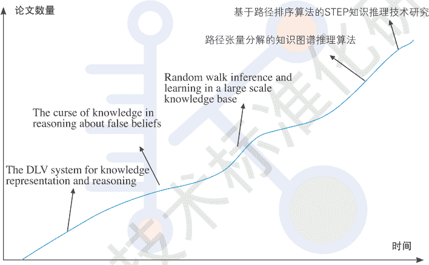）与专利分布（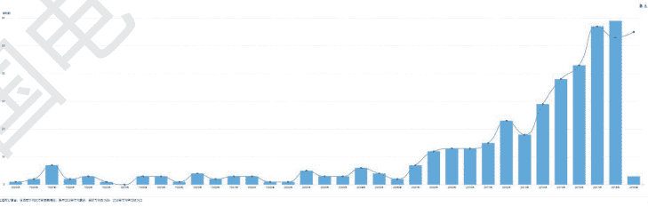，源自Aminer）见附图。

技术路线呈“三足鼎立”态势：

1.  **符号规则推理：** 基于显性逻辑规则演绎新知。
    *   *长板：* 可解释性强、精度高、契合知识符号属性。
    *   *短板：* 强依赖人工/挖掘规则，计算复杂度随规模激增。
    *   *代表作：* 马尔可夫逻辑网（融合一阶逻辑与概率图）、关联规则挖掘（自动捕获高置信模式）、路径排序算法（PRA，以实体间路径为特征训练分类器）。
2.  **嵌入空间推理：** 将图谱投影至低维流形，显性化隐性关联。
    *   *张量分解：* 视三元组集为高阶张量，分解降维捕获潜在模式。
    *   *几何平移：* 继承TransE思想，建模关系为向量位移。
    *   *语义匹配：* 设计打分函数，真实三元组得分更高。
3.  **神经网络推理：** 深度模型编码图结构与语义特征，预测缺失边。
    *   *核心架构：* 图卷积网络（GCN）聚合邻域拓扑信息。
    *   *工程权衡：* 特征提取强、并行效率高，但推理过程“黑箱”特性明显。实践中常与符号规则融合，兼顾性能与解释力。

**经典案例溯源：**
*   *国外：* PRA算法开创“路径即特征”范式；Socher提出神经张量网络，引入词向量交互增强推理。
*   *国内：* 张美玉将路径排序引入产品设计推理；吴运兵创新路径张量分解算法，结合交替最小二乘法优化求解。

**中文场景独有挑战：** 国内研究起步较晚，多沿英语体系迁移。中文特性带来硬骨头：词边界模糊无天然分隔、歧义现象高发（一词多义/一义多词）、句式灵活多变、网络新词语义演化极快。模型设计必须深度适配中文语言学特质。

> *相关文献详见文末参考文献。*

---

## 二、知识图谱开源生态全景图谱

**表2-4 核心开源资源清单**

| 类别 | 组织/来源 | 区域 | 项目名称 | 核心定位与亮点 |
| :--- | :--- | :--- | :--- | :--- |
| **标准规范** | W3C | 海外 | **RDF** | 资源描述框架，奠定图谱数据模型基石。 |
| | W3C | 海外 | **RDFS** | RDF本体词汇，支撑类层级与属性定义。 |
| | W3C | 海外 | **OWL** | Web本体语言，支持复杂本体建模与推理。 |
| | W3C | 海外 | **SKOS** | 简单知识组织系统，表达受控词表体系。 |
| | W3C | 海外 | **SPARQL** | RDF标准查询/更新语言，含联邦查询等。 |
| | W3C | 海外 | **SHACL** | RDF约束语言，校验图拓扑与取值范围。 |
| | ISO | 海外 | **Dublin Core** | 15大核心元数据元素集（ISO 15836）。 |
| | ISO | 海外 | **Schema.org** | Web资源结构化标注公共词汇表。 |
| **知识库** | 莱比锡大学 | 海外 | **DBpedia** | 维基百科结构化信息自动抽取构建。 |
| | 维基媒体基金会 | 海外 | **Wikidata** | 多语言协作知识库，为维基百科等供数。 |
| | 马普研究所 | 海外 | **YAGO** | 融合维基分类体系与WordNet词汇定义。 |
| | Luminoso Tech | 海外 | **ConceptNet** | 多语言常识图谱，助力机器理解语义。 |
| | OpenKG | 国内 | **OpenBase** | 面向开放领域的中文知识图谱。 |
| **建模工具** | 斯坦福医学院 | 海外 | **Protégé** | 标杆级本体编辑与开发环境。 |
| **知识存储** | Apache | 海外 | **Jena** | 语义Web框架标杆，三元组存储与推理一体化。 |
| | 北大数据管理实验室 | 国内 | **gStore** | 原生图存储RDF数据库，创新VS*-tree索引结构。 |
| | Neo Technology | 海外 | **Neo4j社区版** | 高性能NoSQL图数据库，节点/关系为存储原语。 |
| | ArangoDB | 海外 | **ArangoDB** | 多模型数据库（键值/图/文档），统一查询语言AQL。 |
| **实体抽取** | 斯坦福大学 | 海外 | **DeepDive** | 三元组抽取统一框架。 |
| | 开源社区 | 国内 | **jieba分词** | Python中文分词利器，支持词性/关键词/自定义词典。 |
| | 哈工大 | 国内 | **LTP** | 中文NLP工具链（分词/词性/句法/语义角色标注）。 |
| **关系抽取** | 斯坦福大学 | 海外 | **DeepDive** | 实体关系抽取组件。 |
| | 华盛顿大学 | 海外 | **Reverb** | 开放三元组抽取，无需预定义关系模式。 |
| | 华盛顿大学 | 海外 | **OLLIE** | 基于依存树的长距离依赖关系抽取。 |
| | 浙江大学 | 国内 | **DeepKE** | 基于深度学习的中文知识抽取工具包。 |
| **知识融合** | 开源社区 | 海外 | **Falcon-AO** | 自动本体匹配系统，OWL/RDFS对齐首选。 |
| | 开源社区 | 国内 | **Sematch** | 语义相似度开发、评测与应用集成框架。 |
| **知识推理** | Apache | 海外 | **Jena** | 內置规则引擎，支撑RDF/OWL推理。 |
| | JBoss | 海外 | **Drools** | 企业级业务规则引擎，高性能、标准化。 |
| | 牛津大学 | 海外 | **RDFox** | 高可扩展内存三元组存储，并行OWL 2 RL推理。 |
| | 开源社区 | 国内 | **SparkSRE** | 基于Spark分布式内存计算的语义推理引擎。 |

---

## 三、知识图谱标准化建设：从顶层设计到落地规范

### (一) 总体态势：刚需驱动，体系成形

《国家标准化发展纲要》确立标准为国家基础性制度，支撑治理现代化与高质量发展。知识图谱标准化对提升构建效能、促进跨域数据流通、释放技术红利具有基石意义。

RDF、RDFS、OWL等早期表征建模标准奠定了规模化应用基座。随场景深化，**技术框架、测试评测、成熟度模型、建模/融合/交换/计算规范、领域构建指南**等共性标准诉求井喷。同时，知识要素在行业/集团/企业间的**安全交换与可信流通**需求显性化，迫切呼唤标准与工具护航。

当前，ISO/IEC JTC 1、IEEE、国家AI标准化总体组、中国电子工业标协等机构高度聚焦。在ISO/IEC JTC 1/SC 42、IEEE知识图谱工作组、国家标准编制组推动下，已形成**顶层架构、共性支撑、垂直领域、白皮书案例**协同并进的立体化标准矩阵（见图2-14）。

**标准体系速览：**
*   **知识工程顶层：** ISO/IEC WDS392《知识工程参考架构》。
*   **知识图谱顶层：** 国标《知识图谱技术框架》（计划号：20192137-T-469）、IEEE P2807《知识图谱架构》。
*   **共性支撑：** CESA《性能评估/分类分级规范》、IEEE P2807.1《技术要求及测试评估》。
*   **垂直领域：** IEEE P2807.2《金融》、P2807.3《电力》、P2807.4《科技》、P2599《面向标准的知识图谱》。

### 1、国际标准化多维布局

W3C、NIST、ISO/IEC JTC 1/SC 32（数据管理与交换）等围绕**知识表征、获取、建模**等关键环节持续产出成果，RDF/RDFS/OWL/本体模型系列标准相继落地。当前在研与已发布标准按需求与生命周期环节分布见图2-15。

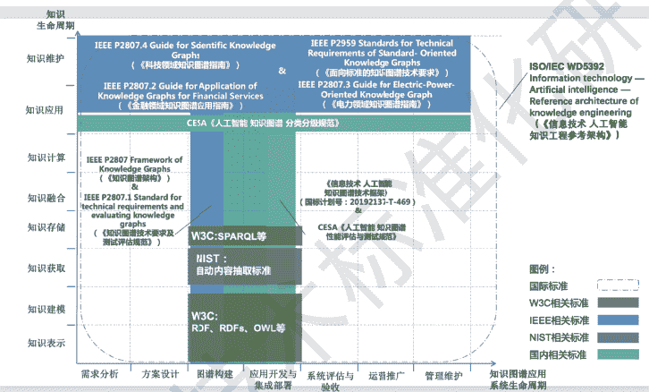

#### (1) ISO/IEC JTC 1：深耕二十载，夯实术语基石

作为信息技术国际标准核心委员会，ISO/IEC JTC 1在AI领域深耕20余年，覆盖词汇、交互、图像、云计算、大数据等关键赛道。

**术语标准化里程碑：**
*   *早期奠基：* ISO/IEC 2382-28:1995（AI基本概念/专家系统）、ISO/IEC 2382-34:1997（机器学习）确立了知识、知识库、获取、工程、表征、认知建模等核心术语。
*   *修订更新：* ISO/IEC 2382:2015《信息技术 词汇》完成全面修订，同步纳入最新领域共识。

# 知识图谱标准生态全景：国际话语权争夺与本土认证体系构建

知识图谱作为人工智能核心基建，其标准化进程早已超越技术层面，演变为国际话语权博弈与产业生态圈层的双重较量。从ISO、IEEE的国际舞台，到国家、团体标准的本土落地，再到产品认证的市场检验，一张覆盖全周期的标准网络正在加速成型。

## 一、 国际舞台：多轨并进抢占制高点

### （1）ISO/IEC JTC 1 SC 42：中国主导首个知识工程国际标准
2017年10月，ISO/IEC JTC 1第32届全会设立SC 42（人工智能分技术委员会），聚焦基础规范、计算方法、可信属性及社会关切四大方向。三年后，我国提案《信息技术 人工智能 知识工程参考架构》（ISO/IEC WD 5392）获批立项，填补该领域国际标准空白。该项目锚定参考架构、核心术语、角色活动及层级组件关系，由中电标院专家执笔编辑。同年7月，SC 42/WG 5增设本体与知识工程临时咨询组，深度梳理标准化诉求；配合ISO/IEC CD 22989.2、TR 24372等在研项目，系统覆盖知识表示、服务、获取应用等核心环节。

### （2）IEEE：构建“横向通用+纵向深耕”标准矩阵
作为全球最大技术专业组织，IEEE标准协会版图涵盖通信、能源、AI伦理等。2019年3月，中电标院联合国内力量推动《知识图谱框架》（P2807）立项，同步成立工作组，由中电标院李瑞琪掌舵、清华大学李涓子副帅。短短数年，已落子6项标准，形成基础框架（P2807）、测评规范（P2807.1）双支撑，垂直切入金融（P2807.2）、电力（P2807.3）、科技信息（P2807.4）、标准文本（P2959）四大细分赛道，医疗等方向亦在酝酿，初步铺开跨域与垂域协同研制路线。

**IEEE知识图谱标准矩阵速览**

| 项目编号 | 标准名称 | 核心聚焦范围 |
| :--- | :--- | :--- |
| IEEE P2807 | 知识图谱架构 | 框架、关键技术、考核指标、典型场景、数学基建 |
| IEEE P2807.1 | 知识图谱技术要求及测试评估规范 | 技术要求、指标体系、评估准则、测试用例 |
| IEEE P2807.2 | 金融服务领域知识图谱应用指南 | 技术架构、工作流、实施指引、应用场景 |
| IEEE P2807.3 | 面向电力行业的知识图谱指南 | 标准文本知识提取、数据要求、构建流程、应用场景 |
| IEEE P2807.4 | 科技知识图谱指南 | 数据模式、构建过程、共享应用 |
| IEEE P2959 | 面向标准文本的知识图谱技术要求 | 标准知识提取、数据要求、构建流程、应用场景 |

### （3）W3C：奠定语义网技术基石
万维网联盟（W3C）深耕语义网技术栈，为KG奠定底层基因。2018年发起AI知识表示社区组，探讨概念化规范与最佳实践。核心贡献在于XML/RDF/SPARQL/RDFS/OWL体系：XML立语法基，RDF定语义模型让实体可被机器理解，SPARQL解检索操作；RDFS/OWL支撑本体建模，OWL引入不相交类、基数约束、布尔组合等高阶约束，赋能领域知识精准表达。

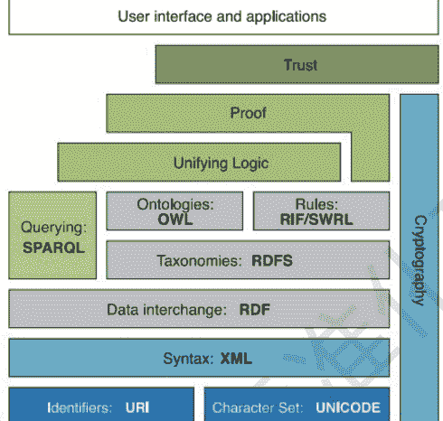

**图：语义网知识描述技术栈**

**表示层**：XML作为元数据语法与标记语言立基础层；RDF系列标准确立元数据语义描述规范，让实体资源可被机器读懂；SPARQL则成为检索操作RDF存储图谱的标准语言。  
**建模层**：RDFS扩展RDF词汇，规范属性、类及语义层级；OWL作为本体语言，在RDFS基础上引入类不相交、基数约束、布尔组合等丰富构词法，强化类与属性间的关系约束，支撑领域本体构建。

### （4）NIST与ITU：评测溯源与起步探索
美国NIST主导ACE评测（自2000年起），细化实体关系至7大类18子类，后聚焦事件抽取主线。国际电信联盟（ITU）2016年起步AI标准化研究，目前暂无KG相关标准或计划出台。

---

## 二、 本土推进：多层级、全链条协同发力

### （1）国家标准：顶层设计落地生根
2019年7月，《知识图谱技术框架》国家标准立项（计划号20192137-T-469），中电标院牵头，全国信标委归口。直指框架、干系人、关键技术、考核指标、典型场景、数字基建、使能技术七大板块，旨在梳理核心诉求、提升治理水平、赋能行业落地。配套发布AI术语（第28/31部分）、大数据术语三项基础国标，纳入知识工程、本体、表示、获取等核心概念。

### （2）团体标准：精准破解工程痛点
2020年6月，中电标院向中国电子工业标准化技术协会报批两项团标精准破局：
*   **《分类分级规范》**：解决供给端良莠不齐、分级模糊、评价缺失，建模型、定框架、出方法、立指标。
*   **《性能评估与测试规范》**：填补指标模糊、环节质控缺位，定要求、列指标、搭框架、建模型、立度量。

### （3）标准体系研究：白皮书引领双框架蓝图
2019版《白皮书》由中电标院联合中电科大数据、东软、联想、阿里等21家产学研用单位发布。从哲学、政策、产业、行业、技术、工具、支撑七维度全景扫描，输出技术架构与标准架构双框架蓝图。

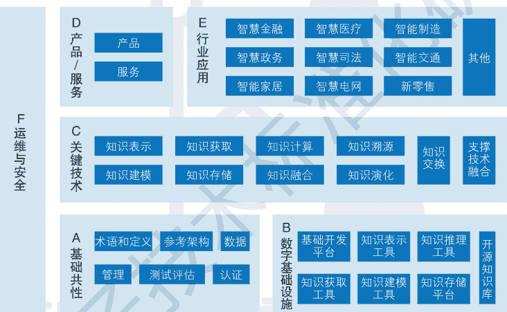

**图：知识图谱标准体系结构图**

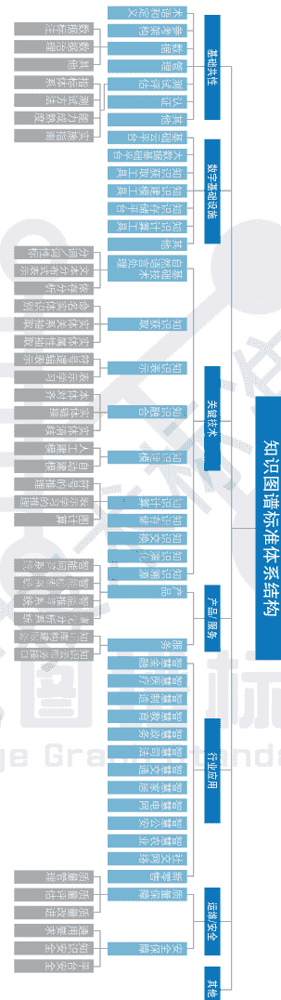

**图：知识图谱标准体系框架图**

#### 攻坚克难：五大“拦路虎”横亘当前
尽管框架初立，实战中仍存五大标准空白区：

1.  **质量评估体系虚位以待**：全流程（表示、建模、获取、存储、融合、计算）与系统级功能性能双维度缺失，无准则可依，难以指导规划开发部署。
2.  **本体演进机制缺位**：高抽象建模强依赖专家，部署后随业务演进需迭代，缺规范描述格式与协同模式，可持续性堪忧。
3.  **跨域融合壁垒森严**：早期各自为战，顶层本体差异大、表达多样，导致知识流通受阻，急需统一交换协议（本体、表示、访问、模式）。
4.  **查询语言百家争鸣**：厂商自研语言差异大，锁定用户、推高维护成本、阻碍通用工具，统一标准迫在眉睫。
5.  **服务商资质评估真空**：交付涉专家介入、系统集成、多源数据治理、安全保障，综合能力要求高，缺科学评估机制作保障。

*补充：细分术语库匮乏、业务系统集成、典型服务部署评估等亦待解。*

---

## 三、 产品认证：从标准到信任的跨越

依托标准体系，中电标院联合赛西认证、头部厂商（联想、华为、百度、腾讯、蚂蚁等）制定四大核心规范（构建/应用平台技术规范+实施细则）。覆盖构建全环节与应用安全可靠性，设定指标架构、测试项、功能点、通过门槛，授权专用认证标识。

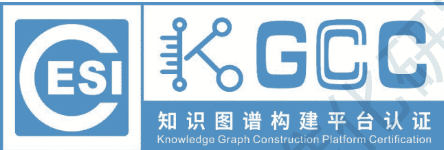

**图：知识图谱构建平台认证标识**

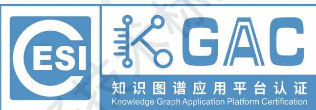

**图：知识图谱应用平台认证标识**

### 1. 首批认证名录揭榜：百花齐放竞逐高地
首批（2020.11-12）与次批（2021.8-11）认证揭榜，首批24家单位上榜，云巨头、独角兽、行业领军、高校院所齐聚，呈现百花齐放态势。

**首批认证通过名录**

| 企业/单位 | 产品名称版本 | 构建侧认证 | 应用侧认证 |
| :--- | :--- | :---: | :---: |
| 联想（北京）有限公司 | 联想知识图谱平台 V1.0 | ☑ | ☑ |
| 华为技术有限公司 | 华为云知识图谱软件 V1.0 | ☑ | ☑ |
| 北京百度网讯科技有限公司 | 行业知识图谱平台 V1.2 | ☑ | ☑ |
| 腾讯云计算（北京）有限责任公司 | 腾讯云小微知识图谱 V1.0 | ☑ | ☑ |
| 蚂蚁智信（杭州）信息技术有限公司 | 蚂蚁金融知识图谱平台 - 知蛛 V2.0 | ☑ | ☑ |
| 清华大学 | 大规模中英文跨语言知识图谱平台 V1.0 | ☑ | ☑ |
| 杭州依图医疗技术有限公司 | 多模态知识图谱结构化平台 V1.0 | ☑ | ☑ |
| 北京百分点信息科技有限公司 | 百分点智能融合大数据分析平台 V2.0 | ☑ | ☑ |
| 北京国双科技有限公司 | 国双知识智能平台 V1.0 | ☑ | ☑ |
| 成都数联铭品科技有限公司 | KUNLUN Hyper Lite V1.0 | ☑ | ☑ |
| 北京华宇元典信息服务有限公司 | 元典睿核 V3.0 | ☐ | ☑ |
| 北京智谱华章科技有限公司 | 科技情报知识图谱平台 V2.1.0 | ☑ | ☑ |
| 网智天元科技集团股份有限公司 | 星图知识图谱平台 V1.0 / 星图金融知识图谱应用平台 V1.0 | ☑ | ☑ |
| 中国电信股份有限公司北京研究院 | 中国电信智能化运维知识图谱平台 V1.0 | □ | ☑ |
| 解放号网络科技有限公司 | 解放号采购知识图谱应用平台 V1.0 | □ | ☑ |
| 通联数据股份公司 | 萝卜投资 V3.35 | ☑ | ☑ |
| 杭州海康威视数字技术股份有限公司 | 海康威视知识图谱引擎 V1.0 | □ | ☑ |
| 摇地数智（重庆）科技有限公司 | 摇地产业透析知识图谱 V3.2.2 | □ | ☑ |
| 恒生电子股份有限公司 | HUNDSUN 金融知识图谱应用系统软件 | ☑ | ☑ |
| 北京海致星图科技有限公司 | Atlas 知识图谱平台 V3 | ☑ | ☑ |
| 北京神州绿盟科技有限公司 | 绿盟安全知识图谱平台 | □ | ☑ |
| 海义知信息科技（南京）有限公司 | 海义知 PlantData 知识图谱全周期构建及管理软件 V3.5.0 | ☑ | ☑ |
| 南京柯基数据科技有限公司 | 柯基数据知识图谱平台 V2.3 | ☑ | □ |
| | KGDATA 智能问答平台 V3.0 | □ | ☑ |
| 新华智云科技有限公司 | 新华智云知识图谱平台 V1.0 | ☑ | ☑ |
| 拓尔思信息技术股份有限公司 | TRS 知识图谱关联分析软件 / TRS 知识图谱构建软件 V1.0 | ☑ | ☑ |

*注：☑=通过，☐/□=未申请或未通过。*

### 2. 认证数据透视：头部产品实现全链路闭环
规范设定构建侧基础指标59项（强制30、扩展29），应用侧31项（强制16、扩展15）。首批数据透视显示：
**(1) 领军产品打通端到端全周期**  
第一梯队平台已贯通构建-应用-运维全链路，在实体抽取、融合整合、推理计算、服务化落地等核心环节指标满足度高，展现端到端硬实力。

# 知识图谱平台认证现状：全流程覆盖趋势显现，但基础指标达标率偏低

根据权威测评数据统计，在参与认证的平台中，有19家同时通过了知识图谱构建与应用能力的双重考核，占比高达76%。这标志着行业已初步打通从结构化、半结构化到非结构化数据的知识抽取，进而实现知识应用、维护与管理的全链路闭环。尽管各功能模块间的集成深度仍有提升空间，但构建覆盖全流程、环节衔接顺畅的知识图谱应用体系已成大势所趋。

## 核心性能指标“全员通过”比例不足两成

依据《知识图谱构建平台认证技术规范》与《知识图谱应用平台认证技术规范》确立的基础门槛，结合企业落地实践设定的功能性能指标来看，平台整体交卷质量尚待提高。数据显示，仅有36%的平台通过了应用平台的全部测评指标；而在构建平台侧，这一比例更是跌至10.5%左右。这表明当前主流产品在硬核技术指标上仍存在明显短板，普遍具备较大的进阶空间。

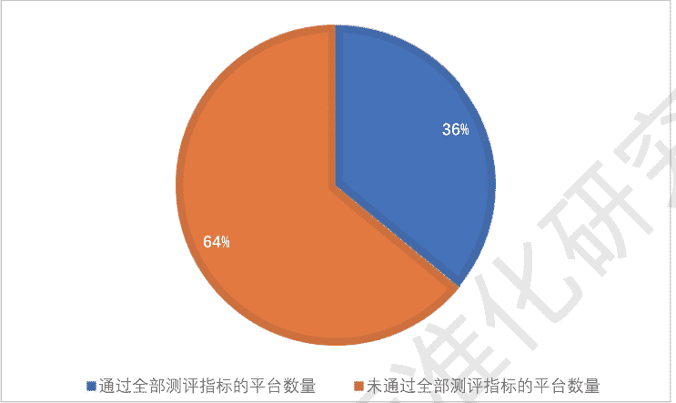

图2-21 通过全部知识图谱应用平台测评指标的平台分布情况

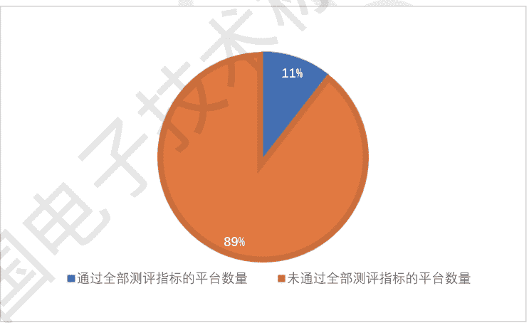

图2-22 通过全部知识图谱构建平台测评指标的平台分布情况

## 应用版图拓展至八大重点垂直领域

获证平台类型呈现“通用底座+垂直深耕”双轨并行态势。除面向跨行业通用构建、应用与管理的基础设施型平台外，聚焦特定场景刚需的专用平台亦占据半壁江山。认证版图已渗透至智慧金融、智慧医疗、智能制造、智慧电信运营商、信息安全、科技情报、智慧司法、智慧公安等8大细分赛道，领域渗透率呈稳步攀升之势。

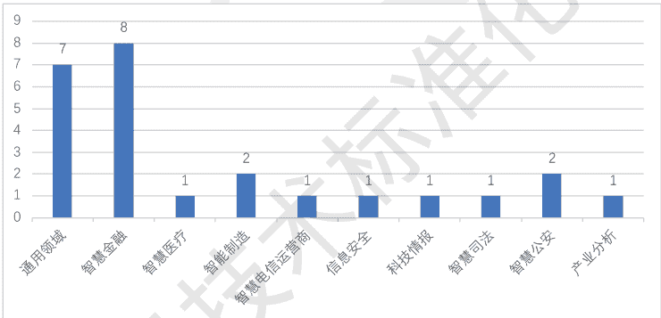

图2-23 已通过认证平台数量的领域分布图

## 构建端短板聚焦：融合、计算与非结构化抽取

通过认证的构建类平台在知识获取、表示、存储、建模、计算、融合等核心环节均已配备功能模块，产品化交付能力日趋成熟，有利于规模化复制推广。然而，能力画像显示“短板效应”显著：
*   **知识计算**可选检测项平均通过率不足五成（47%）；
*   **知识融合**环节平均通过率虽达68%，但在实体类型/关系/属性名对齐融合、知识推理等关键子项上表现乏力；
*   **非结构化数据知识获取**受制于数据类型繁杂、抽取难度大等客观因素，准确率与召回率双双有待突破。

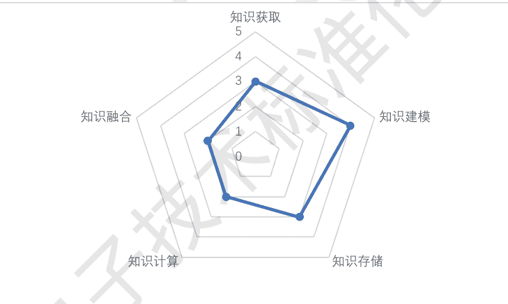

图2-24 已通过知识图谱构建平台认证的平台或系统能力画像

## 应用端痛点：可移植性与易用性亟待强化

应用类平台在安全性、可靠性、响应性等基础素质上均有模块支撑。但短板集中在“互联互通”与“人机协同”维度：顶层本体模型及Schema的在线导入导出、多维知识图谱可视化呈现等指标通过率偏低。这直接制约了平台与外部专家、审核人员、管理人员之间的协同交互效率，亟需补齐短板以释放平台效能。

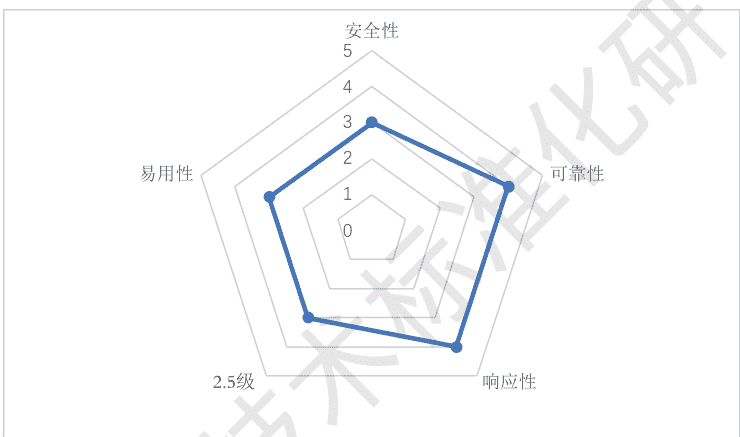

图2-25 已通过知识图谱应用平台认证的平台或系统能力画像

---

# 第三章 为何要应用知识图谱

## 一、 引入知识图谱的必然性

### 1. 传统知识服务体系的“四大困境”

随IT技术迭代与业务规模膨胀，企业沉淀海量数据，呈现来源广、体量大、格式杂、维度高的“四高”特征。如何从多源异构数据中大规模抽取知识、挖掘深层关联并落地业务，成为核心命题。传统知识服务系统在实战中愈发捉襟见肘，痛点集中在四大维度：

**① 模式变更频繁，建模存维成本高企**
业务逻辑与数据模式随认知演进高频变动，但传统系统多依赖关系型数据库，Schema扩展性差，表结构调整引发的数据迁移代价高昂，导致模式动态演进受阻、业务响应滞后、运维负担沉重，底层存储压力倍增。

**② 语义理解薄弱，挖掘能力失语**
非结构化数据（文本、图像、音视频）占比飙升，蕴含高价值业务知识。传统体系擅长结构化处理，对多模态数据语义理解乏力，单模态挖掘及跨模态关联分析困难，过度依赖人工或规则模板，严重遏制自动化获知能力。

**③ 异构融合受阻，数据孤岛林立**
数据散落于内部各部门及外部第三方/公开源，源头分散、格式冲突、冗余严重，急需融合释放倍增效应。传统系统面向单一业务烟囱式建设，缺乏多源兼容设计与集成流程，融合挑战巨大，孤岛现象固化。

**④ 应用边界受限，精准触达失效**
语义搜索、智能问答、个性化推荐等场景对精准语义分析与推理提出高阶要求。传统系统以离散符号与关系库为主，查询门槛高、依赖专家、扩展性差；多跳查询性能随规模指数级衰减，深度关联推理无力，难以满足精准语义需求。

### 2. 知识图谱的“四大擅长”精准对症

知识图谱以结构化形式描述概念、实体及关系，契合人类认知建模真实世界，在AI落地中价值凸显。针对上述困境，其核心优势实现“四个精准对接”：

| 传统系统痛点 | 核心技术手段 | 知识图谱优势方向 |
| :--- | :--- | :--- |
| 模式变化快 | 动态本体、图模型 | **模式动态扩展** |
| 语义理解难 | 信息抽取 | **大规模知识挖掘** |
| 数据融合难 | 本体对齐、实体消歧 | **异构数据融合** |
| 应用受局限 | 知识推理 | **知识智能化应用** |

**图3-1 知识图谱擅长方向**

*   **支撑数据模式敏捷演进**：基于图模型存储关联业务数据，表达力强、建模灵活。动态本体技术实现Schema与数据解耦存储，支持自由扩展；配合节点/关系索引，按需快速更新属性与关系，从容应对模式变迁。
*   **赋能大规模行业知识挖掘**：通过知识关联与推理计算实现结构化语义理解。知识增强语义模型引入先验背景，配合实体/关系/属性/事件抽取技术，从多模态非结构化数据中规模化获取行业知识，持续扩充图谱规模。
*   **攻克多源异构数据整合**：图表示方式天然兼容异构数据。利用本体对齐统一类别层次、属性关系命名；利用实体消歧解决表示多样性，丰富实体画像，打通融合链路。
*   **释放广泛知识智能化应用**：约束构造、样本增强等手段辅助语义理解生成，降低样本依赖、增强鲁棒性。图数据库赋能多跳查询性能优势，支撑深度关联分析。沉淀知识逻辑降低专家依赖，在智能问答、语义搜索、可解释推荐、可视分析等场景建立护城河。同时，多维复杂关系可视化配合查询、过滤、多视图联动交互，满足深度分析诉求。

### 3. 战略规划层面的多维布局

随着技术与经价值双提升，知识图谱已纳入多国、多层级战略蓝图。

**国际视野：美欧领跑，全球跟进**
*   **美国**：从奥巴马期《国家AI研发战略规划》《为未来AI做准备》，到特朗普期《国家AI研发战略计划:2019更新》，确立长期投资、人机协作、伦理治理、安全可靠、共享数据/环境、标准工具、人才队伍、公私合作八大战略重点，明确推进“以数据为中心的知识发现”与“多模态机器学习”。国防、安全战略均将AI列为核心战略资源。
*   **欧盟**：《欧洲人工智能》《协调计划》奠基，《可信AI伦理准则》确立七大关键伦理要求，构建“以人为本”框架。
*   **其他国家**：英、德、日等纷纷出台国家级AI战略，欧洲电工标准化委员会更提出“领域知识概念化规范化”标准化诉求。

**国家层面：顶层设计持续加码**
*   **《新一代人工智能发展规划》（2017）**：设定“三步走”战略目标，明确攻克跨媒体统一表征、关联理解挖掘、图谱构建学习、演化推理、智能描述生成等核心技术，建设百亿实体级跨媒体知识图谱。
*   **十九大报告、政府工作报告**接续部署“AI+实体经济深度融合”、“强化新一代AI研发应用”。
*   **部委与地方响应**：《广东/上海AI规划》《新一代AI产业三年行动计划》《高等学校AI创新行动计划》等密集落地。如《湖北省规划》明确提升感知识别、知识计算、认知推理等能力，推广知识计算引擎在商务决策中的应用。

**行业赛道：垂直深水区蓄势待发**
*   **医疗**：电子病历分级评价纳入公立医院绩效，倒逼智慧医疗建设，强化图谱算法赋能。
*   **金融**：聚焦三大战略向——统一Schema规范打通数据壁垒；脱敏共享规范激活数据增值；完善图谱平台底座，结合图算法/深度学习挖掘深层价值，实现场景互通增值。
*   **工业**：“十四五”规划强调工业大数据开发与知识沉淀复用。现状为关系库存储导致冗余高、聚合度低、价值埋没；企业劳动密集、知识难积累、数字化参差不齐。工业知识图谱覆盖研产供销服全链路，通过行业知识整合建库赋能上层业务、加速人员成长，虽技术门槛高（数据量大、模型复杂、专业度高、系统复杂），但为转型关键抓手。
*   **教育**：《北京市教改规划》提出刻画知识/能力图谱，赋能智能诊断与个性化推荐。解决优质资源不足、区域城乡差异大、教学难因材施教等痛点，整合课程/教学/学科/百科多源数据建立关联，精准画像学情推送资源。

## 二、 知识图谱应用落地全景扫描

### 1. 典型赋能场景与实效

知识图谱已在智能电网、智慧金融、智能制造、智慧医疗、智慧司法、人文建设、科技文献等17大领域落地生根，推动行业“知识驱动”转型。以智能电网为例，典型应用成效显著：

**表3-1 知识图谱在部分赋能领域的应用成效（节选）**

| 序号 | 赋能领域 | 典型应用 | 核心成效 |
| :--- | :--- | :--- | :--- |
| 1 | **智能电网** | 物料重码发现与筛选 | 大幅压缩业务流程、减少返工浪费、降本增效 |
| | | 异物掉落防范 | 校验参考价值强、工单反馈可靠、即时响应提效、保障设备与电站安全 |
| | | 电力巡检知识管理与认知推理 | 弥合人员知识差异、提升故障处理水平 |
| | | 主设备缺陷知识管理与移动应用 | 满足基层班组专家级知识需求、辅助管理决策 |
| | | 虚拟供电服务指挥员引擎 | 减轻人工压力、提升配网优化调度能力 |
| | | 客服中心智能服务系统 | 显著改善用户服务体验 |

# 知识图谱落地全景：跨领域实战案例与核心难点深度解析

知识图谱技术正加速渗透进各行各业的核心业务脉络，成为打破数据壁垒、释放数据价值的关键引擎。尽管相关白皮书与案例集已梳理了大量典型场景，但仍有诸多创新实践值得补充聚焦。以下将从国内重点领域深度应用、国际主流布局以及建设过程中面临的共性瓶颈三个维度，为您系统拆解。

---

## 一、 国内重点领域深度应用补遗

### 1、 智慧电网：从物料去重到虚拟指挥的全链路智能化

电网领域通过知识图谱重构了物资、设备、服务等多个核心业务流程。

*   **破解物料“重码”顽疾**：针对核电站物料数据分散维护导致的重码乱象，系统引入多维数据相似性分析，自动生成疑似重码清单经人工复核后入图关联。此举有效精简了业务流程，大幅削减返工与物料浪费，降低人力成本。
*   **核电异物掉落风险前置预警**：基于防异物工单数据构建专题图谱，结合图搜索与图计算建立校验模型，实现工单分级与风险自动研判。这不仅提升了工单反馈可靠性、筑牢安全防线，更减少了维修作业量与工期，保障了资源节约。
*   **主设备缺陷知识“移动化”赋能一线**：整合缺陷信息、技术导则、专家经验等构建四大知识库，深度融合移动作业APP。现场人员可享受精准检索、智能问答、知识主动推送等服务；管理层则获得谱系分析、家族性缺陷研判、供应商绩效评价等决策支撑，实现了从基层作业到管理决策的全覆盖。
*   **客服中心全智能化转型**：覆盖语音导航、智能座席、智能外呼、在线服务及运营监测全场景。通过人机协作替代传统IVR与纯人工模式，释放重复劳动力，显著优化用户体验，提升座席效能与运营管理水平。
*   **虚拟供电指挥员：调度作业的“数字分身”**：聚焦配调操作票/工作票业务，融合电话与图形系统，训练专用声学语言模型。虚拟指挥员能理解自然语言、执行多轮交互，代替人工接听催办、联动自动化许可、辅助负荷预测与抢修，有效缓解调度压力，强化优化调度能力。
*   **供应链全景画像：决策从“经验驱动”转向“数据驱动”**：融合合同、项目、反馈、处罚等内部数据与供应商外部数据，构建物资全景供应链图谱。实现供应商状态预测、风控评价及全景画像，显著增强电网在供应商遴选与管理上的决策科学性。

### 2、 智慧金融：聚焦保险风控与寿险营销的精准突破

*   **保险风控全流程闭环**：通过知识图谱输出风险画像、评分与信息，无缝对接核心业务系统，覆盖事前、事中、事后全周期。成效显著：核保效率跃升、承保风险下降；理赔端风险案件自动检测释放查勘资源，综合经营风险降低、利润率提升。
*   **寿险产品智能推荐引擎**：将产品要素构建为统一关联网络，为精准营销奠定数据基石，有力支撑保险公司实现精准获客与高效展业。

### 3、 智慧交通：设备全生命周期管理的“透视眼”

针对业务知识识别繁杂、数据孤岛严重、关联缺失的痛点，基于知识图谱开发设备全生命周期管理与故障溯源应用。系统将分散的设备信息、故障记录、运行日志串联成网，极大提升了业务数据检索效率，更让故障排查与解决从“大海捞针”变为“顺藤摸瓜”，大幅缩短处置周期。

### 4、 智慧政务：构建“懂民意、优决策、强服务”的数字政府大脑

*   **智慧理政：让民声直达决策端**：梳理杂乱社情民意数据，挖掘公众真实诉求，实现办理结果互联互通。结合热点领域分布分析与办件情况，精准定位政府管理薄弱环节。最终提升决策科学性，打破部门壁垒优化资源配置，实现异常早发现、预警早响应。
*   **政务问答：架设政民沟通“直连桥”**：建立问题-答案映射，将自然语言转为图谱查询，支撑12345热线及智能机器人。实现权威解答“零等待”、民生服务“全天候”，以数字化手段推动社会服务事业高质量发展。
*   **政务百科：打造权威的“政务地图”与“动态档案馆”**：对政府人物、机构、政策词条等进行百科式抽取表示，梳理知识关联。对内厘清任务机构逻辑、辅助顶层设计决策；对外提供分门别类、立体索引的权威知识服务。

### 5、 智能家居：让家电真正“懂生活”

*   **智能菜谱：家庭餐饮的“私人营养师”**：融合食材库存、季节天气、健康档案，提供采购推荐（选购技巧、比价）、每日菜品定制、烹饪问答全链路服务，大幅提升家电智能化水平与用户体验。
*   **家电知识百科：覆盖全生命周期的“使用说明书”**：构建涵盖选购、使用、保养、维修全流程的知识库，提供精准检索与智能问答，彻底解决用户“买不会、用不懂、修无门”的痛点。

---

## 二、 国际知识图谱应用版图：巨头布局与垂直深耕并行

国外应用呈现“通用大模型平台+垂直领域标杆案例”双轨并行态势，头部科技企业与专业独角兽共同构建生态：

| 领域 | 代表性项目/企业 | 核心看点 |
| :--- | :--- | :--- |
| **搜索引擎** | Google Search, Bing | 知识图谱落地最早、规模最大、用户感知最直接的场景 |
| **社交网络** | Facebook | 构建实体关系巨图，支撑个性化推荐与广告精准投放 |
| **零售电商** | Amazon Product KG, Walmart Retail Graph, eBay Beam | 商品知识图谱驱动搜索排序、推荐理由生成、供应链优化 |
| **智慧金融** | FIBO (标准本体), KENSHO | 金融本体标准化与AI驱动的投资分析平台 |
| **智慧医疗** | Benevolent Platform, IBM Watson Health, Ontotext Linked Life Data | 药物研发加速、临床决策支持、生命科学数据融合 |
| **智慧公安/安防** | Palantir, Govini (NSKG) | 大规模异构数据融合分析，支撑情报研判与国家安全 |
| **智能制造** | Metaphactory | 基于知识图谱的企业级数据集成与应用开发平台 |
| **智慧能源** | Ontotext Energy Transparency KG | 能源市场透明化、资产优化管理 |
| **智慧教育** | Know EDU | 教育知识图谱构建与自适应学习应用 |
| **智慧政务** | UK Parliament's Data Service | 议会数据开放、链接与语义化查询 |
| **智能营销** | Pitney Bowes Knowledge Fabric | 位置智能与客户数据融合的营销决策大脑 |
| **企业服务** | Franz AllegroGraph | 高性能图数据库与知识图谱构建平台 |
| **智慧司法** | EU Project Lynx | 跨语言法律文本关联与合规分析 |
| **智慧文旅** | Europeana, ResearchSpace, Tourism Media Enigma | 文化遗产数字化、语义化关联与智能检索 |
| **智慧投研** | Siren Platform | 调查式智能分析平台，融合搜索与图分析 |
| **科技文献** | SpringerNature SciGraph | 学术知识图谱，连接论文、作者、机构、基金等实体 |
| **信息安全** | SOG (安全本体图), Strikeready | 威胁情报关联分析与安全运营自动化 |
| **疫情防控** | CovidGraph | 疫情多源数据融合与传播路径追踪 |

---

## 三、 落地之路的“拦路虎”：三大阶段七大核心挑战

知识图谱从理论走向产业化，并非一帆风顺。在数据准备、构建维护、集成部署三大工程阶段，均横亘着亟待攻克的硬骨头。

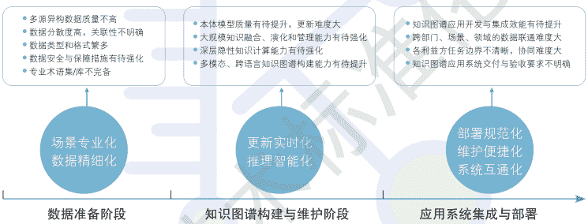

> **图3-2 知识图谱面临存在的挑战**

### 1. 数据准备阶段：场景专业化与数据精细化的双重夹击
数据是基石，也是最大的变数。无论自有业务数据还是外源爬取/交易数据，均面临**标准缺失、质量低劣、歧义丛生**的困境。实体属性描述不一致、关系扭曲导致概念重复、语义冲突、推理失效。特别在司法、金融等强专业领域，通用模型与垂直知经的“取舍平衡”极难把控，对领域专家依赖度极高。

### 2. 构建维护阶段：更新实时化与推理智能化的动态博弈
知识图谱非“一劳永逸”，业务演进要求知识**持续迭代、甚至实时入图**。如何保障时效性与准确性是核心考验。同时，基于特定业务构建**精准高效的推理计算模型**，输出可信结果，直接决定应用成败。推理能力的上限，就是应用价值的上限。

### 3. 集成部署阶段：工程化交付与自主可控的“最后一公里”
图谱必须与功能模块组装成应用系统，并常需对接核心业务系统获取数据或下发服务。这要求全流程**工程化建设、规范化部署、便捷化运维、互通化集成**。尤其关键的是：必须沉淀完备交付物料，确保服务商撤场后，企业具备自主管理与基础维护能力，避免“交付即交付不了”。

---

### 深度聚焦：数据接入与预处理的四大“硬仗”

#### 挑战一：多源异构数据“质量关”难过
**症结**：自有数据库数据与外源互联网数据源头各异，缺乏统一业务模型标准与行业描述规范。
**表现**：实体概念属性描述缺乏精确性/一致性，实体关系扭曲 → 引发概念重复、语义冲突、推理混乱。
**本质**：数据治理滞后于数据应用需求。

#### 挑战二：数据分散孤立，“关联链”断裂
**症结**：公共知识库未按领域特点分类，无法完整表达文本、图像等非结构化知识及其关联。
**影响**：本体构建缺乏高质量种子数据支撑，实体关系不清晰、不完整，图谱骨架难立。

#### 挑战三：数据类型格式“百花齐放”，处理复杂度指数级上升
*   **结构化数据**：面临复杂表结构解析、Schema映射难题。
*   **链接数据**：核心痛点是实体对齐与Schema对齐。
*   **半结构化数据（网页等）**：需持续定义、生成、维护包装器，适配性差。
*   **非结构化数据（文本/图像/语音）**：占比最高、难度最大。
    *   文本 → 依赖深度自然语言理解（NER、RE、EL等）。
    *   图像 → 依赖视觉识别与跨模态对齐。
    *   语音 → 依赖ASR识别与口语语义理解。

#### 挑战四：数据安全与合规防线亟待筑牢
随着数据要素流通加速，知识图谱构建过程涉及敏感数据聚合、跨域流转，隐私保护、数据脱敏、访问控制、审计溯源等安全保障机制尚不成熟，合规风险不容忽视。

---

**结语**

知识图谱的落地，本质上是一场**“数据治理+领域知经+工程落地”**的系统战役。从电网的物料去重到金融的风控闭环，从政务的民声感知到家居的菜谱推荐，每一个成功案例的背后，都是对上述挑战的针对性破解。未来，随着大模型与图技术的深度融合，推理智能化与构建自动化水平将跃升新台阶，但数据质量夯实、安全合规底线、工程化交付能力，永远是通往规模化应用的必经之路。

## 1、数据层面的安全与基建难题

随着知识图谱规模的持续膨胀、维度的不断拓展，其触达的数据边界也随之延伸。这其中不乏隐私敏感信息，尤其在金融、医疗等重点领域，必须依托法律法规与国家标准，构建起体系化的安全防线，切实筑牢数据安全底座。

### 挑战5：专业术语库建设滞后，供给严重不足

专业术语集是知识图谱落地的基石性数据资产。通用图谱侧重百科普及，领域图谱强调行业深度，二者对术语库的诉求截然不同。然而，当前绝大多数企业数字化积淀薄弱，难以自主产出成熟的术语体系，背后有三大症结：

*   **隐性知识难显性化**：专家经验多藏于脑海，难以直接从文本中挖掘抽取；
*   **众包门槛高**：专业壁垒导致仅极少数从业者能参与知识众包；
*   **标准缺失**：行业间缺乏统一的术语制定规范与共享平台。

面对海量百科与细分赛道，现有术语库与知识库的供给能力，离实际应用需求尚有巨大鸿沟。

---

## 2、构建与运维层面的核心难点

### 挑战1：本体模型质量参差，迭代维护举步维艰

**（1）开发工具生态不完善**  
市面上主流的本体构建工具（如 Ontolingua Server、WebOnto、OilEd 等）各有短板，鲜有产品能提供全功能覆盖——有的缺版本管理，有的不支持协作。工具链的匮乏直接拖慢了本体构建效率，打造“完整好用”的本体工具迫在眉睫。

**（2）设计构建的完备性不足**  
领域本体建设是场硬仗，要求建设者既要深谙业务细节（实体拆分、属性关系区分），又要把控宏观抽象（适配问答、检索等多元场景）。现阶段高度依赖专家评估，但受限于本体数量庞大、关系复杂、设计主观性强且无统一标准，人工产出的模型往往瑕疵难免。

**（3）动态演化响应滞后，维护成本高企**  
本体层知识一旦变动，实体与关系层必受牵连。新需求、新认知层出不穷，叠加业务变更与认知迭代，导致本体扩展性差、响应慢。如何低成本支撑数据与模式的动态同步，仍是行业悬而未决的难题。

**（4）领域知识“围墙”高，获取渠道窄**  
组织自我保护导致知识体系封闭、分散且滞后。本体构建所需语料库涵盖文献、专利、流程、市场等多维度，可用知识资源的稀缺性严重制约了建模质量。

### 挑战2：大规模融合、演化与管理能力待增强

**（1）实体消歧与标识管理压力大**  
同名实体（如同名影片、书籍）在大规模系统中极易混淆。缺乏统一的标识描述机制，跨团队协作时难以对齐语义，开发者也难以高效判定冲突，消歧难度随数据量指数级上升。

**（2）演化管理与运维工具链缺失**  
现有技术重“获取融合”，轻“演化运维”。系统链路长、运维复杂，实体链接等子系统需持续适配变化输入。虽有版本管理雏形，但距离高动态知识管理仍有差距，专用运维工具开发滞后。

**（3）质量控制缺乏统一度量体系**  
质控包含评估、发现、提升三环。评估维度无统一标准，下游任务差异导致要求不一；现有方法多针对静态知识，动态评估手段缺位。问题发现上，人工成本高、半自动研究不足、全自动可信度低；质量提升因复杂度高，研究几乎处于空白。

### 挑战3：复杂规则表达受阻，深层推理能力短板明显

**（1）多元关系隐含信息挖掘不足**  
主流计算聚焦二元关系，将多元关系强行拆解会损耗结构信息。如何完整保留并利用多元关系中的深层语义进行推理，是核心攻关点。

**（2）小样本/零样本推理能力薄弱**  
现有模型强依赖大量高质量训练数据，泛化能力差，获取成本高。人类少样本即可复杂推理的认知机制，尚难在机器端复现。

**（3）动态约束与复杂规则下的推理难度大**  
知识有效性受时空等动态因素制约，语义网络复杂导致规则表达困难、计算开销巨大、自动化推理阻力重重。

### 挑战4：多模态、跨语言构建能力有待突破

**（1）多模态构建技术链条不全**  
图文结构化处理已相对成熟，但对图像、视频、音频的知识抽取尚无有效手段。实体构建、跨模态关系建立、语义对齐与融合等环节均面临硬仗。

**（2）跨语言融合基础薄弱**  
文化差异加剧多语种抽取融合难度。虽有 XLORE 等双语库探索，但缺失事实多、特征扩展性差、跨语言链接稀疏等问题依然突出，均衡覆盖仍是远景。

---

## 3、应用落地与部署交付的现实困境

### 挑战1：应用开发集成效能亟待提升

*   **边界模糊、性能指标缺位**：甲乙方认知不对等导致系统边界不清；用户缺乏技术甄别力致使性能需求模糊；缺乏专用评价工具体系。
*   **业务逻辑“图谱化”转化难**：业务专业性强，算法工程师理解有限；专家缺乏图谱基础认知。双向认知鸿沟阻碍了逻辑迁移。
*   **应用深度不够，未触核心痛点**：制造、农业等领域多停留在问答、推荐、检索等通用形态，与业务深度融合不足。
*   **权威开发规范缺失**：缺乏系统化规程推高沟通成本；无权威标准难以对接企业既有信息化体系，管理实效打折。

### 挑战2：跨域数据联通壁垒森严

组织间自我保护与弱关联性筑起数据高墙。跨场景、跨部门流动时，业务逻辑差异、模型不一致、体系不协同、接口不匹配、协议缺失等问题叠加，严重阻碍知识流动与价值最大化。

### 挑战3：多方协同机制不顺，任务边界不清

*   **用户端投入评估不足**：建设周期、难度、资源缺口、知识获取渠道、资金预算等前期规划常缺位。
*   **需求表达模糊、预期失真**：主观跟风心理加上技术认知偏差，导致场景识别不清、性能期望虚高。
*   **基础数据治理薄弱**：服务商数据无法替代用户专有数据；部分用户缺乏治理意识，数据质量堪忧，需双方协同从应用视角治理。
*   **实施过程角色责任不清**：多角色协作（PM、开发、建模等）下，任务定义模糊极易引发推诿扯皮与认知偏差。

### 挑战4：交付验收标准缺位，质量把关无章可循

*   **质量测评体系双缺失**：用户侧评价主观、无一致性指标；技术侧缺第三方监理验收标准。
*   **验收流程与内容不规范**：涉及图谱本身、功能模块、文档手册、试运行性能等多维度，却缺乏明确方法与程序，交付质量难以保障。

---

## 4、理论根基与人才梯队的双重短板

*   **专业人才极度稀缺**：教育培训滞后于产业爆发需求，构建、部署、应用全链条高技能人才供给严重失衡。
*   **核心理论体系未臻成熟**：建模、抽取、融合、推理等关键理论持续演进中；工程化落地缺乏系统性标准支撑，标准滞后于技术实践。

---

#### （二）细分赛道的差异化挑战

随着 AI 对数据理解需求的跃升，知识图谱应用版图持续扩张。这不仅倒逼共性技术进阶，更在垂直领域衍生出独特风险。以下以智慧城建、司法、教育、金融四大赛道为例，剖析其特有痛点。

### 1、智慧城建：数据底座不稳，高阶推理缺位

*   **数据来源碎片化、差异大**：公开不全、源头单一、类型失配、城乡区域发展不均；部门壁垒导致跨层级共享受阻，信息孤岛林立。
*   **多源异构数据对接难**：海量音视频等非结构数据如何高效入图、抽取有效知识并融合现有体系，是关键拦路虎。
*   **高级推理建模尚无解**：面对海量高维数据，如何构建面向特定社会场景的复杂推理模型，补全实体关系、预演未来趋势，仍属未解之题。

### 2、智慧司法：语义复杂、术语专业、动态更新快

*   **语义关系多样性极强**：词汇层面有上下位、整体部分；文本层面交织因果、目的等复杂逻辑。多元关系精准抽取难度极大。
*   **法律术语专业壁垒高**：法律逻辑严密与图谱天然契合，但术语专业性要求极高，现有模型难以替代专家标注，海量司法表述的标注训练是硬骨头。
*   **知识体系动态演进快**：如《民法典》颁布引发知识结构重构，图谱需同步敏捷更新，持续跟进立法司法解释变化压力巨大。

### 3、智慧教育：验证难、融合难、自适应可视化更难

*   **学科知识验证缺算法支撑**：权威性、准确性、一致性是生命线，但缺乏自动化验证模型保障知识无矛盾、无错误、无冗余。
*   **多源知识融合机制缺失**：不同机构建图标准不一，如何打通壁垒实现跨源融合、释放协同价值，挑战巨大。
*   **自适应可视化交互复杂**：同一知识点面向不同学段需差异化呈现。如何基于学习者画像动态关联既有认知、支持知识体系演进，对可视化内容筛选与设计提出极高要求。

### 4、智慧金融：数据脏、获取难、工具链缺失

*   **数据噪音与冗余并存**：库内数据未必纯净，实体名不规范（如“快捷”vs“快捷金融信息服务有限公司”）导致同一实体被误判为多实体，不一致性验证是刚需。
*   **高质量知识自动获取成本高**：结构化数据规模小、覆盖面窄；非结构化数据获取成本高、精度低。低成本获取高质量数据支撑精准预测，是核心矛盾。
*   **开源工具生态空白**：算法离工具化落地距离遥远；现有图谱能力解决业务问题的广度深度均不足。迫切需要低门槛、高效率的开源工具与生态，让技术聚焦业务价值创造。

---

## 第四章 知识图谱应用系统构成

### 一、知识图谱应用系统定义与分类

**知识图谱应用系统**：指通过融合知识与业务逻辑，实现特定功能与应用的软件系统。依据知识与应用范围差异，分为两大类：

*   **通用知识图谱应用系统**：面向泛场景，以通用图谱为核心知识源，如基于百科库的检索系统。
*   **领域知识图谱应用系统**：面向垂直场景，以领域图谱为核心知识源，如基于医学图谱的诊疗辅助系统。

### 二、知识图谱应用系统架构与功能组成

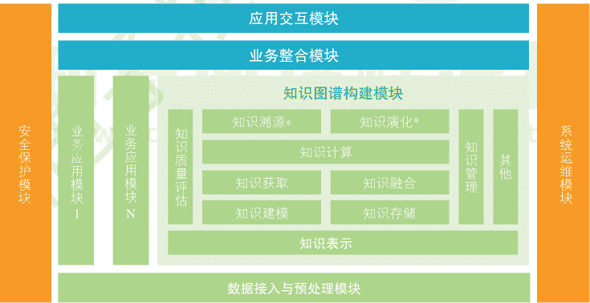

图4-1 知识图谱应用系统架构

# 知识图谱应用系统：七大核心模块架构深度解析与建设能力评估指南

知识图谱应用系统并非单一整体，而是由功能迥异的组件协同运作。依据功能定位差异，其标准架构可拆解为七大核心模块，全链路覆盖构建前、中、后各阶段。架构图中，黄色区域聚焦构建前准备，绿色区域深耕构建核心，蓝色区域支撑构建后应用，带星号标识的为按需选配模块。

## 一、 七大模块功能拆解

### 1. 数据接入与预处理模块：奠基基石
这是系统的“入口关卡”，核心任务是采集、接入并加工外部数据，使其达标进入知识获取环节。处理流水线涵盖数据清洗、格式转换、基础NLP等工序。
*   **数据源全谱系覆盖：** 结构化数据（如关系型数据库业务表）、半结构化数据（如百科、XML/JSON文档）、非结构化数据（文档、图片、音视频）。
*   **合规与溯源：** 鉴于公私有数据源并存，模块必须内置权限管控、内容保护、数据溯源机制。

### 2. 业务应用模块：价值锚点
此模块指待融合的现有业务系统或子系统，是核心业务数据的“大本营”。它提供数据处理、调用、功能触发及反馈、任务调度等细分能力。因场景差异，系统常需对接多个业务应用模块。

### 3. 知识图谱构建模块：核心引擎
系统的“大脑”，依据应用诉求与知识特性落地图谱。功能矩阵极其完备，贯穿全生命周期：
*   **核心九大件：** 知识建模、表示、获取、存储、融合、计算、溯源、演化、质量评估、管理。
*   **扩展插件化：** 支持定制化图模型、图数据迁移备份等子模块按需挂载。
*   **多源构建路径：** 支持自研、采购成熟工具/系统（具备获取、检索、推理、可视化、维护），亦可基于第三方图谱接口二次开发集成。

### 4. 业务整合模块：连接枢纽
扮演“胶水层”角色，依据业务逻辑将业务系统、构建引擎、数据预处理等组件集成封装。封装产出包括：语料库、语义引擎、语义模型、基础图谱及本体模型等领域基础能力包。

### 5. 应用交互模块：对外门面
统一出口，以可视化界面（UI/APP）或编程接口（API/SDK）对外交付服务。功能极其丰富，双轨并行：
*   **管理侧：** 本体/知识/众包标注/编辑/审核/协作/权限/图谱划分/缓存/查询分发/访问控制/版本管理。
*   **应用侧：** 数据可视化、语义检索、智能搜索、智能问答等智能化能力。
通过此模块，复杂图谱应用与管理场景得以落地。

### 6. 系统运维模块：护航全程
负责全栈监控与运维。重点在于**知识运营贯穿生命周期始终**，通过人工介入与反馈闭环，保障图谱的高表达性、可解释性、可移植性、可维护性。同时承担系统上线后的运行状态监控与运维管理。

### 7. 安全保护模块：护城河
全方位安全防线：用户管理、权限控制、安全监测、数据加密、传输管控等。

---

# 第五章 知识图谱应用系统建设基础能力评估体系

用户企业作为落地主体，建设成效与基础能力强相关。启动前必须“体检”，精准定位短板，提效建设。

## 5.1 评估五大核心准则

1.  **必要性：** 从战略规划、业务痛点维度，论证建设的刚需程度。
2.  **适用性：** 考量业务契合度、二开难度、部署运维复杂度。
3.  **就绪性：** 盘点软硬件底座、数据家底、人员编制投入。
4.  **安全性：** 评估信息化建设的安全质量保障力，核心源数据与用户数据安全零容忍。
5.  **可持续性：** 验证长期维护、迭代运营知识图谱及应用系统的组织与资源韧性。

## 5.2 六维指标体系：从定性到量化

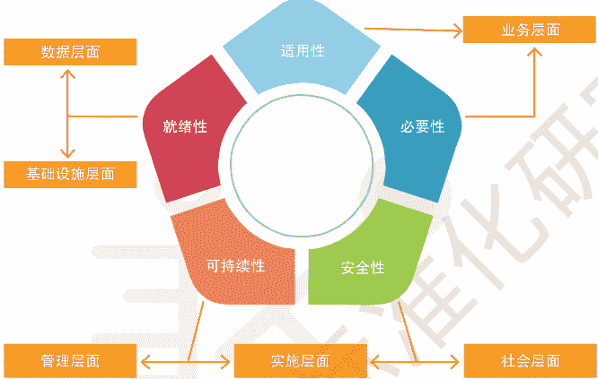

图5-1 应用系统建设基础能力评估原则与指标体系关系

以“高质量应用”为牵引，上述五准则衍生出六大评估维度，**业务、数据、基础保障、实施、管理、社会**，构建立体指标框架（详见图5-1、图5-2）。

### 维度一：业务层面（权重10分）—— 战略对齐与资源承诺
*   **战略愿景(2分)：** 时间成本估算、市场定位、战略规划、制度保障。
*   **业务需求(2分)：** 高依赖数据/知识场景数、知识沉淀现状、应用迫切度。
*   **资源安排(2分)：** 经费/时间/人力投入规划。
*   **行业地位(2分)：** 行业内水平与影响力。
*   **行业趋势与政策(2分)：** 国内外应用案例、产业政策导向。

### 维度二：数据层面（权重20分）—— 核心燃料与炼油厂
*   **数据储备(5分)：** 维度、时效、规模、库数量、非结构化占比/规范度、获取渠道能力。
*   **领域专业数据基础(5分)：** 行业语料、专业术语、标准数据集、标准化术语集。
*   **数据治理能力(10分)：** 治理水平、数据安全管理保障能力。

### 维度三：基础保障层面（权重20分）—— 硬实力底座
*   **人员储备(4分)：** 研发、实施、运维、业务(建模)四支队伍。
*   **硬件资源储备(4分)：** 算力/存储/云/大数据基础设施。
*   **专业知识储备(4分)：** 前期预研深度、业务侧对IT系统的理解度。
*   **信息化建设基础(5分)：** 系统数量、业务信息化覆盖率、企业知识库建设、基础环境/工具链(建模工具、图数据库)。
*   **资格资质(3分)：** IT实施资质、系统集成资质(安全/管理认证等，可选)。

### 维度四：实施层面（权重25分）—— 落地交付硬功夫
*   **验证评估能力(5分)：** 专业知识、硬件评估、信息化能力评估、知识质量评估。
*   **信息化系统建设能力(10分)：** 规划/开发/管理三位一体。
*   **系统集成能力(5分)：** 集成经验、专业人员配置。
*   **运维能力(3分)：** IT运维、知识维护管理。
*   **风险管控能力(2分)：** 技术/系统/人员/外部四维风控。

### 维度五：管理层面（权重15分）—— 组织效能与过程管控
*   **组织保障(6分)：** 专职信息化部门、项目管理团队、运维部门规划。
*   **质量管理能力(5分)：** 信息收集、日志全链路(收集/分析/归档/反馈)。
*   **过程管理能力(4分)：** 项目管理制度/经验/资质。

### 维度六：社会层面（权重10分）—— 外部环境适应性
*   **法律风险与责任(5分)：** 合规风险识别与承担能力。
*   **知识服务市场接受度(5分)：** 市场认可度与推广可行性。

> **图5-2 基础能力评估指标体系框架**
> 六维综合打分，助力直观衡量建设必要性与可行性。细化指标权重汇总形成**表5-1**。

## 5.3 就绪度五级阶梯：定位当下，规划未来

图5-3 知识图谱应用系统建设就绪度等级划分

基于六维得分加权，得出**基础能力指数**，划分五级阶梯：

| 等级 | 定位 | 核心特征 | 行动建议 |
| :--- | :--- | :--- | :--- |
| **L1 初始级** | **零基础** | 场景/资源/规划全无 | 启动战略规划，明确方向 |
| **L2 储备级** | **有规划，无能力** | 战略落笔，但人/财/物/数据未就绪 | 完善规划，重点储备人才/设施/数据 |
| **L3 建设级** | **能小试，有短板** | 具备小规模建设能力，维度弱项明显 | 针对性补齐短板，开展小型试点/研究 |
| **L4 就绪级** | **能大建，求精进** | 具备大规模建设能力，局部指标待优化 | 提升欠缺指标，推进大规模建设/研究 |
| **L5 完备级** | **全维领先** | 能力全面成熟，支撑全生命周期 | 依据需求持续大规模建设/创新 |

**量化决策阈值（表5-2自评版，19项指标，满分95分）：**
*   **≤35分** → L1 初始级
*   **36-45分** → L2 储备级
*   **46-60分** → L3 建设级
*   **61-75分** → L4 就绪级
*   **>75分** → L5 完备级

## 5.4 自我评估实操表（表5-2 核心指标版）

企业可对号入座，按1-5级自评：

| 维度 | 关键能力子项 | L1 初始 | L2 储备 | L3 建设 | L4 就绪 | L5 完备 |
| :--- | :--- | :--- | :--- | :--- | :--- | :--- |
| **业务** | **战略愿景** | 仅对AI感兴趣 | 看到AI潜在价值 | AI产品/服务产出商业价值 | AI规模化应用盈利 | AI成核心业务引擎 |
| | **需求驱动** | 无明确KG需求 | 潜在需求待挖掘 | 明确需求，部分满足 | 明确需求，基本满足 | 全面满足用户需求 |
| | **资源安排** | 几乎零预算 | 启动POC验证 | 多项目持续实验/POC | 纳入常规预算体系 | 预算充足且持续 |
| | **行业资质** | 无资质 | 有资质/低壁垒 | 有资质/中壁垒 | 有资质/高壁垒 | 顶级资质/极高壁垒 |
| | **趋势政策** | 趋势差/无政策 | 瓶颈期/无政策 | 向好/无扶持 | 向好/政策增多 | 赛道火热/政策强力 |
| **数据** | **数据储备** | 基础极差 | 差但有少量可用 | 总体一般/局部好 | 整体较好/规范 | 充足积累/规范体系 |
| | **专业数据基础** | 无语料/术语/标准 | 少量语料 | 少量语料+术语 | 小范围行业标准形成 | 大量语料/术语/标准 |
| | **数据治理** | 无治理能力 | 治理低/无安全 | 治理中/初步安全 | 治理高/中等安全 | 治理强/安全强/工具全 |
| **基础保障**| **人员储备** | 缺专家/运维 | 有运维/无专家 | 有运维+专家 | +建模人员 | +应用人员(全链路) |
| | **硬件资源** | 无存算/不支持 | 有限存算/小规模 | 一定存算/中规模 | 充沛存算/大规模 | 充沛+动态扩展/超大规模 |
| | **专业知识** | 无储备 | 认知浅/粗浅 | 支撑简单应用/研 | 支撑大规模应用/研 | 深度掌握/引领创新 |
| | **信息化基础** | 无配套系统 | 少量流程信息化 | 部分流程信息化 | 大部分流程信息化 | 全流程完全信息化 |
| | **资格资质** | 无资质/不支撑 | 部分资质/不支撑KG | 基础资质/可集成 | 全资质/大规模集成 | 定标资质/制定标准 |
| **实施** | **验证评估** | 无能力 | 简单验证/评估 | 常见/简单性能验评 | 全面系统性能验评 | 权威验评/行业标准 |
| | **运维能力** | *注：素材此处疑似错行，应指KG运维成熟度* | 无明确需求 | 潜在需求待挖掘 | 明确需求/部分满足 | 明确需求/基本满足 | 部分满足/可全满足 |
| | **信息化建设** | 无相关能力 | 有规划/建设待强 | 支撑简单建设/应用 | 全面建设/大规模 | 全能力/动态扩展 |

> **注：** 表中“运维能力”量表描述在素材中与“需求驱动”重复，实际应用中建议替换为：IT系统运维成熟度、知识迭代维护效率、故障响应闭环能力等专用指标。

---

**结语：**
这套“七模块架构+六维评估+五级阶梯”体系，为企业从0到1、从1到N落地知识图谱提供了标准化路线图与决策仪表盘。建议建设前必测、建设中复测、上线后常测，动态校准，稳健推进。

### 知识图谱应用体系：从成熟度评估到选型落地的全景指南

#### 核心能力成熟度：五级阶梯，层层递进

评估一个组织在知识图谱应用上的底子，不能只看“有没有”，得看“好不好”。我们从**管理层面**与**社会层面**两大维度，划分出五个成熟等级，助你精准定位现状，对标差距。

**一、 管理层面：组织、质量、过程“三驾马车”**

| 评估维度 | 初级（L1） | 起步（L2） | 发展（L3） | 成熟（L4） | 优化（L5） |
| :--- | :--- | :--- | :--- | :--- | :--- |
| **组织保障** | 无专门机构/团队 | 初步组建团队，能开展活动 | 机构严密，有初步措施 | 机构严密，措施规范，初建制度 | **机构严密、规章完备、措施规范** |
| **质量管理** | 未开展项目质管 | 有初步目标及量化管理 | 制定方针，明确目标职责 | 在L3基础上，初步控制各阶段质量 | **方针严格、目标职责清晰、全阶段质量严控** |
| **过程管理** | 无过程管理 | 初步形成过程策划 | 策划完备，初步引入检查 | 具备策划-实施-检查-改进雏形 | **PDCA闭环完整，严格按阶段执行** |

> **解读**：从“无人管”到“有人管”，再到“管得规范、管得严、持续优化”，L5级别的核心标志是**“制度化、闭环化、常态化”**。

**二、 社会层面：合规与市场“双引擎”**

| 评估维度 | 初级（L1） | 起步（L2） | 发展（L3） | 成熟（L4） | 优化（L5） |
| :--- | :--- | :--- | :--- | :--- | :--- |
| **法律风险与责任** | 极高风险 | 较高风险 | 中等风险 | 较低风险 | **零法律风险，零责任隐患** |
| **市场接受度** | 市场不认知、不接受 | 略有认知，接受度极低 | 市场接受，但深度有限 | 全面接受，认同感强 | **全面接受且用户倾向首选** |

> **解读**：合规是生存底线（L1->L5风险归零），市场认可则是发展上限（L1->L5从排斥到偏爱）。两者缺一不可。

---

### 四、 应用系统建设：六维发力，构建闭环提升体系

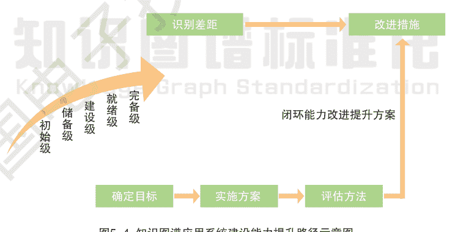

针对评估暴露的短板，不能“头痛医头”，要从**人员、技术、资源、战略**四大切入点出发，在业务、数据、基础保障、实施、管理、社会六个层面同步施策，并引入效果评估机制，打造“规划-执行-检查-改进”的闭环提升方案。

#### 1. 业务层：对齐战略，小步快跑
*   **战略引领**：将AI与知识图谱技术纳入核心业务流，而非边缘实验。
*   **需求挖掘**：不只满足现有需求，更要挖掘潜在场景，用**“小范围样例验证”**降低试错成本。
*   **资源倾斜**：加大预算与团队编制投入，为长远发展备粮。
*   **资质与趋势**：主动考证提级，紧跟政策风向，借势推广。

#### 2. 数据层：打通内外，治理为王
*   **多源汇聚**：内部盘活业务数据、存储资产；外部采购领域数据、爬取开源资源，拓宽“粮仓”来源。
*   **专业沉淀**：系统积累行业术语与标准数据集，夯实语义基座。
*   **治理升级**：强化清洗、挖掘能力，筑牢安全防线，让数据从“可用”变“好用、敢用”。

#### 3. 基础保障层：人才梯队与算力底座
*   **人才全链条**：覆盖研发、实施、运维、业务全角色，优化结构，重素质，保可持续。
*   **算力前瞻性**：按市场需求扩充算力，提升云能力，支撑大数据治理。
*   **工具生态化**：提升软硬环境，推高信息化渗透率，建企业知识库，沉淀行业数据资产。

#### 4. 实施层：以战代练，精益求精
*   **验证评估**：建专家库、引顶尖智力，常态化评估硬件与建设能力。
*   **实施资质**：通过多项目类别、规模积累，冲击更高IT资质等级。
*   **运维敏捷性**：针对变化需求与故障，建立“快速响应-最优方案-知识沉淀”机制。
*   **应用深度**：细化场景，打磨可视化、问答、联想功能，降低业务侧理解门槛。

#### 5. 管理层：标杆对标，全维度达标
*   **组织**：达成L5标准——机构严密、规章完备、措施规范。
*   **质量**：达成L5标准——方针严格、目标职责清、全阶段严控。
*   **过程**：达成L5标准——PDCA闭环完整、严格执行。

#### 6. 社会层：合规护航，筑高墙垒
*   **法务零风险**：流程合规化、经营规范化，将风险压至为零。
*   **市场领跑者**：跟踪趋势、洞察痛点、提升资质、建竞争壁垒，从“被接受”走向“被偏爱”。

> **研发补充**：同步强化运维与专家人才储备，夯实软硬设施，突破存储与处理瓶颈。

---

## 第六章 知识图谱应用系统选型：模块化拆解，精准避坑

系统模块众多，功能各异，**“一把尺子量到底”行不通**。依据功能定位，将系统拆解为三大类模块，分别制定差异化选型准则。

### 一、 数据处理模块：聚焦“源头活水”治理

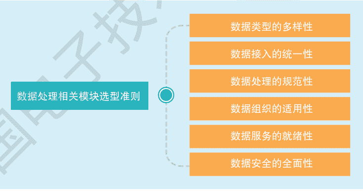

选型切入点：**数据类型、接入、治理、组织、服务、安全**六大维度，支持按业务裁剪。

| 核心准则 | 选型关键看点（避坑指南） |
| :--- | :--- |
| **类型多样性** | 结构化/半结构化/非结构化全覆盖？文本/图片/视频/音频多模态支持？ |
| **接入统一性** | 是否有统一工具汇聚异构源？采集/汇聚方式多不多？标准化/模块化/可适配？ |
| **处理规范性** | 元数据/质量/标准/血缘/目录“五大管理”齐不全？清洗存储流程标准化？能否支撑上层业务？ |
| **组织适用性** | 支持原始库（存原貌）与主题库（按需建，如车辆/人员库）分层组织？ |
| **服务就绪性** | 下游模块访问是否便捷？数据获取路径通不通？ |
| **安全全面性** | 身份识别、权限控制做到位了吗？安全可信才能访问？ |

> **一句话总结**：**“收得全、进得统、管得细、分得清、取得易、守得住”**。

### 二、 知识图谱构建模块：聚焦“核心炼金术”

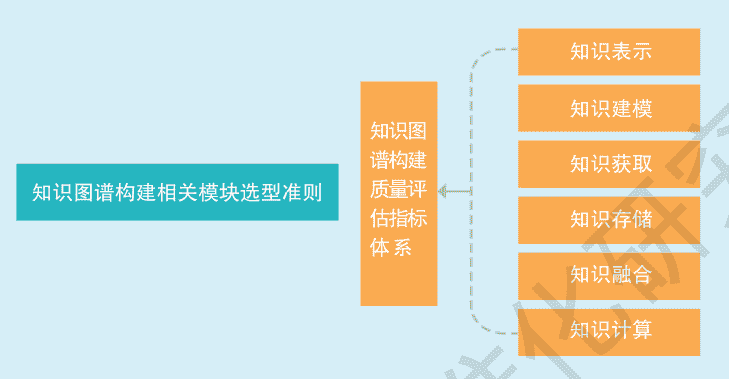

覆盖**表示、建模、获取、存储、融合、计算**六大核心环节，各有侧重：

#### 1. 知识获取：自动化提取能力为王
*   **源头广**：库表、百科、文档/图文/音视频全搞定。
*   **核心力**：实体、关系、属性、本体缺失信息，自动抠出来。

#### 2. 知识表示：框架选型定乾坤
*   **双模支持**：属性图（顶点=实体/事件，边=语义）与 RDF 图（顶点=资源URI，边=谓词）任选。
*   **依据实**：按应用需求、约束、质量要求设定框架、元素、适用范围。

#### 3. 知识建模：本体构建的“施工图”
*   **输入多元**：需求、业规、专家经验、数据现状。
*   **输出标准**：实体类型体系、属性、关系，形成本体模型及 Schema。

#### 4. 知识存储：大规模下的架构艺术
*   **存得下**：本体、知识单元、规则、算法模型全存储；超大规模支持分库、同类顶点聚合设计。
*   **查得快**：DSL（查询语言）要**简**（低门槛）、**灵**（多场景）、**强**（专家级复杂分析）。
*   **自主可控**：图数据库及运行环境（OS/硬件/指令集）国产化是硬指标。

#### 5. 知识融合：打通孤岛，统一标识
*   **输入源**：本体 + 获取输出 + 外部图谱。
*   **产出物**：全局统一标识的知识单元，并能反哺本体缺失信息。

#### 6. 知识计算：挖掘隐性价值，性能为先
*   **双引擎**：统计分析（结构特征归纳）+ 推理计算（隐性知识发现）。
*   **硬核指标**：大规模顶点/边入内存计算，**并行分布式**能不能做？垂直/水平扩展行不行？**线性水平扩展**是选型生死线。

### 三、 知识服务与管理模块：聚焦“交付体验与合规”

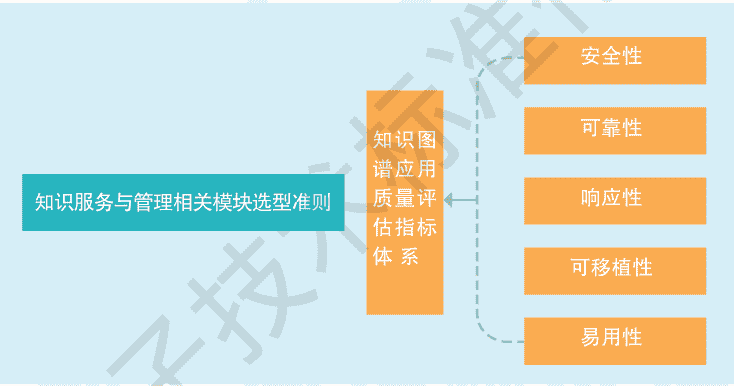

面向构建后的服务、集成、运维、安全，五大黄金准则：

| 维度 | 核心内涵 | 关键落地点 |
| :--- | :--- | :--- |
| **安全性** | 功能域+数据域双重守护 | 角色功能不越界；用户-数据多对多授权，密级精准控制；**贯穿构建全链路**（存储/获取/融合/计算/演化/整合均过滤越权数据）。 |
| **可靠性** | 稳定交付承诺 | 规定场景/时间完成功能；查询/推理/计算稳定；参考国标 GB/T 29832.1 成熟性/容错/易恢复指标。 |
| **响应性** | 效率与体验并重 | 即时/耗时请求双达标；**进度条、预估时间、状态更新**消除等待焦虑。 |
| **可移植性** | 低成本迁移适配 | 接口高抽象、适配多领域场景；避免三方重复开发，保跨系统兼容。 |
| **易用性** | 降低认知负荷 | 界面友好、流程简；可视化查询+行业特色交互；建模不强求用户懂深度领域知识。 |

---

## 第七章 双生命周期视角：理清建设与运营主线

知识图谱不是一锤子买卖，需从**技术构成**与**工程实施**双视角，拆解两条并行的生命周期：

1.  **知识图谱构建生命周期（技术视角）**：
    表示 → 建模 → 获取 → 融合 → 存储 → 计算 → 应用与维护
    *聚焦数据如何变知识，知识如何增值。*

2.  **知识图谱应用系统生命周期（工程视角）**：
    需求分析 → 方案设计 → 图谱构建 → 应用开发与集成部署 → 系统评估与验收 → 运营推广 → 管理维护
    *聚焦系统如何交付、上线、运营、迭代。*

> **核心启示**：**构建周期嵌套在系统周期中**。选型、建设、管理，都要在这两条线的交汇点上找平衡——既要技术指标过硬，又要工程交付可控，最终落地业务价值。

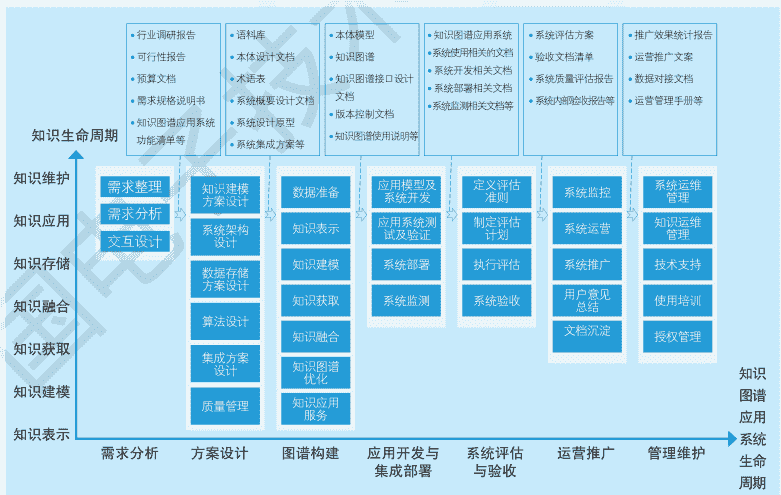

图7-1 知识图谱应用系统构建与管理全流程

### 一、 需求分析阶段

#### （一） 阶段核心建设目标

此阶段旨在达成以下七大关键目标：

**目标一：精准捕获全维度用户需求。**
为保障产品设计与迭代高效落地，需从多维度开展调研，确保业务信息获取全面且准确。

**目标二：深度洞察与剖析用户真实诉求。**
结合具体业务场景，通过分析用户行为与实操流程，挖掘隐性需求，实现深度理解。

**目标三：构建目标系统的逻辑模型蓝图。**
将业务与数据需求转化分析，沉淀出对应的业务模型与数据模型，为后续建设奠基。

**目标四：评估现有开发环境与资源条件。**
重点考量技术支撑能力、经济效益产出、战略方向契合度以及运维保障体系的完备性。

**目标五：审视存量数据质量现状。**
核验数据质量达标情况、范围影响一致性、业务适配度及对前期调研需求的满足程度。

**目标六：拆解系统功能模块。**
将建设诉求细化为具体任务，明确各方责任边界，保障交付成果可集成为符合预期的完整系统。

**目标七：沉淀需求类核心文档资产。**
依据分析结果，输出业务需求说明书、软件需求规格说明书、功能/服务说明书及知识图谱设计说明书等关键文件。

#### （二） 阶段输入与交付物

##### （1） 核心输入要素
本阶段启动所需基础素材包括但不限于：

*   **用户需求原始档：** 涵盖数据来源、建设愿景、预期图谱内容、可视化效果及交互界面设想等。*建议采用需求说明书等书面形式正式签收确认。*
*   **业务领域数据包：** 用户或生态伙伴提供的基础数据及衍生加工数据。
*   **算法模型资产。**

##### （2） 标准化交付物清单（对标表7-1）
本阶段核心产出物及其关键指标汇总如下：

| 序号 | 交付物名称 | 核心价值与内容摘要 | 重要等级 | 交付属性 |
| :--- | :--- | :--- | :--- | :--- |
| 1 | 行业调研报告 | 基于长周期监测，多维剖析供需、经营特性、产业链生态，整合多层级数据资源，作为需求整理基石。 | 5级 | 必选 |
| 2 | 可行性报告 | 论证项目成败，给出定论与条件；可行项需详述基建、技术、经费、政策等支撑条件。 | 5级 | 必选 |
| 3 | 预算文档 | 覆盖调研至运维全周期，细化科目与额度（基建、耗材、研发、协作等），明确计算依据。 | 5级 | 必选 |
| 4 | 竞品调研文档 | 梳理竞品背景、规模、用户、商业模式，输出对比结论，辅助决策。 | 2级 | 推荐 |
| 5 | 标准规范文档 | 定义全周期文档格式与要求，涵盖数据、过程、质量、技管、工具方法等全谱系标准。 | 3级 | 推荐 |
| 6 | 业务需求说明书 | 明确应用点、背景、场景、关联系统、规则术语等，对齐设计与测试基准。 | 5级 | 必选 |
| 7 | 需求规格说明书 | 详述开发意图、目标、范围、背景，含数据/用例规约、流程图、环境指标、优先级、质量属性。 | 5级 | 必选 |
| 8 | 技术规格说明书 | 描述架构底座、关键技术、核心参数，涵盖法律标准、质量属性、兼容性、设计约束等。 | 3级 | 可选 |
| 9 | 知识图谱应用系统功能清单 | 以业务/数据流视角拆解模块逻辑，细化至构建、获取、展示、应用等模块内部构造。 | 5级 | 必须 |
| 10 | 数据集规范 | 依项目背景定义适用范围、引用标准、术语、结构、元数据及元元数据等深层规范。 | 1级 | 可选 |
| 11 | 语料库分析报告 | 立足行业明确建设目的，详析规模设计、内容范围、实施路径与步骤。 | 3级 | 推荐 |
| 12 | 数据样例 | 提取反映源数据特征的原始样本，附带全字段描述说明。 | 3级 | 可选 |
| 13 | 数据规范 | 依来源与应用去向建模，定义适用范围、术语、建模内容、模型元数据等核心规范。 | 5级 | 必选 |
| 14 | 系统原型说明书 | 基于分析结果产出高保真原型设计，整理成册供确认。 | 3级 | 推荐 |
| 15 | 数据调研说明书 | 全景摸底：库类型、来源、分布、规模、增量、更新机制、结构化程度、清洗需求、对接方式、实体库表设计、待加工清单。 | 2级 | 可选 |
| 16 | 风险管理计划 | 覆盖识别、分析、缓解策略、职责分工，形成完整行动纲领，含排期、功能/测试/部署计划、风险摘要等。 | 3级 | 可选 |
| 17 | 备选策略分析 | 从技术、经济、法规维度提供备选方案，评估环境适应性、实施步骤、规避风险点。 | 3级 | 推荐 |
| 18 | 工作说明文档 | 制定人员管理、安全责任、进度监督、质量管控等制度，保障项目可持续推进。 | 3级 | 推荐 |
| 19 | 权责规范 | 明确各方权利义务边界，保障知识产权、经济权益、人身安全及数字/文化权利。 | 4级 | 推荐 |
| 20 | 遵守的法律法规 | 罗列知识产权、安全生产、隐私保护、商业许可等强制合规清单。 | 4级 | 推荐 |
| 21 | 可复用的通用图谱分析报告 | 盘点通用图谱资产，优劣对比，为垂直领域建设提供借鉴优化依据。 | 3级 | 可选 |
| 22 | 部署环境要求 | 分开发、测试、运维三阶段文档：分别针对研发软硬件、测试资源数据集、用户应用管理环境。 | 5级 | 必须 |

#### （三） 核心活动流转

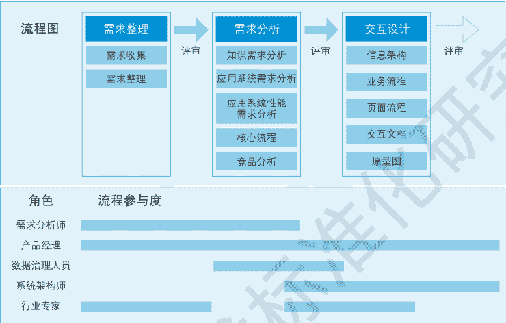

图7-2 知识图谱需求分析阶段活动流程图

本阶段按目标差异拆解为**需求整理、需求分析、交互设计**三大核心活动，流程与角色协同关系见图7-2。具体执行要点如下：

**活动1：需求整理——广撒网，筑基石**
*   **核心动作：** 收集现状与目标需求（目的、约束、交付范围），摸排业务数据、专家经验、软硬件环境，多方沟通确认，产出完整需求清单。
*   **实施路径：**
    *   *行业调研：* 定性定量分析敏感因子与趋势预测。
    *   *业务访谈：* 对齐管理层与一线视角，把控宏观方向。
    *   *数据访谈：* 细致摸底数据资源与流转现状，为建模铺路。

**活动2：需求分析——抽丝剥茧，定蓝图**
*   **核心动作：** 从知识、功能、性能三维切入，开展数据与需求深度分析，绘制业务架构图；按模块与流程拆解任务，锁定边界、依赖与验收标准；撰写需求说明书，详述加工逻辑、功能流、交互规则，指导研发落地。
*   **关键手段：**
    *   *原型设计：* 基于实地调研掌握的组织架构、流程、环境、存量系统信息，结合可行技术方案，产出可交互的UI原型草图，助力用户快速评估流程合理性并反馈。
    *   *需求引导与深层分析：* 赋能以往经验，采用启发式手法联合用户探讨流程的合理性、准确性与易用性。

**活动3：交互设计——抽象落地，定细节**
*   **核心动作：** 将抽象业务需求转化为可操作的高保真界面。需产品、交互协同，并拉通用户完成终极确认（数据、流程、业务需求三位一体）。
*   **确认三要素：**
    *   *数据确认：* 开发方出具调研书、模型设计书、数据项表，清晰阐述数据使用目标。
    *   *流程确认：* 提供业务流程报告，明确流程设计意图。
    *   *业务需求签收：* 用户方审核分析说明书与原型说明书，反馈意见并对通过文档签字定案。

#### （四） 角色协同矩阵（对标表7-2）

本阶段关键角色、核心职责及产出映射关系如下：

| 序号 | 角色定位 | 核心职责简述 | 关键产出物映射 |
| :--- | :--- | :--- | :--- |
| 1 | 业务/领域专家 | 洞察行业敏感因子，预测趋势，提供垂直领域知识背书。 | 行业调研报告、竞品调研文档、可复用通用图谱 |
| 2 | 数据治理工程师 | 负责数据调研与标准方案研究，设计分析框架，输出问题诊断与解决方案。 | 标准规范文档、数据规范、数据样例、数据调研说明书 |
| 3 | 业务人员 | 沟通枢纽：协调用户与技术端，参与调研，联合产出需求分析与可行性核心文档。 | 业务需求说明书、需求规格说明书、权责/法务合规文档、备选策略分析 |
| 4 | 需求分析师 | 需求获取主力，项目前期用户首要对接人，代表项目组对用户、代表用户意见对内，需求相关事务核心确认人。 | 需求规格说明书、部署环境要求、可行性报告、可复用通用图谱 |
| 5 | 项目经理 | 进度把控、风险评估、任务分解、资源调度、事务统筹，对进度与质量兜底。 | 需求规格说明书、风险管理计划、标准规范、技术规格、工作说明、权责/法务、备选策略、预算文档 |
| 6 | 售前经理 | 方案包装交付，跨部门资源协同，技术方案推进与用户沟通，响应变更与故障。 | 业务需求说明书、需求规格说明书、备选策略分析 |
| 7 | 产品经理 | 市场调研定向，确立商业/业务模式，组织挖掘设计，管控生命周期策略落地。 | 技术规格书、系统原型说明书、竞品调研文档 |
| 8 | 潜在用户 | 需求与产品能力匹配的意向群体，描述愿景与趋势性需求。 | 需求说明书 |
| 9 | 需求评审人员 | 多方视角汇聚：需方高层/中层/操作/IT/采购，服务方市场/分析/设计/测试/QA/实施/PM，第三方专家，形成互补决策。 | 业务需求说明书、需求规格说明书、系统原型说明书 |
| 10 | 政策专家 | 追踪政策动态，评估影响，提供建设性合规建议。 | 技术规格书、遵守的法律法规 |
| 11 | 法务人员 | 法务事务支撑，法律信息分析预警，合同/知识产权/商业秘密体系建设。 | 技术规格书、权责规范、遵守的法律法规 |
| 12 | 数据分析师 | 设计分析框架，产出分析结论、问题单及解决路径。 | 数据样例、数据调研说明书、数据模型设计说明书、数据集规范 |
| 13 | 算法工程师 | 攻克NLP技术难点，结合场景开展前沿应用与创新研究。 | 语料库分析报告、数据集规范、可复用通用图谱 |
| 14 | 软件测试工程师 | 依设计编写用例，覆盖稳定性/安全性/易用性测试，功能验收与文档检查，缺陷跟踪。 | 测试用例 |
| 15 | 供应商数据调研人员 | 评估数据供方，沟通需求定源，把控数据质量关。 | 数据样例、数据规范、语料库分析报告、数据调研说明书 |
| 16 | 系统架构师 | 需求确认评估，规划技术路线，主导架构/组件/接口设计，辅助需求文档编制。 | 技术规格书、备选策略分析、系统指标要求、部署环境要求 |

#### （五） 用户方深度参与指引

需求分析期，用户方需主动介入以下五大关键环节，确保方向不偏、风险可控：

**1. 业务目标锚定与迭代**
业务目标是图谱建设的“北极星”。用户需持续关注、评估、反馈，围绕目标、场景、效果闭环迭代。*关键动作：* 主动表达全景需求，配合挖掘隐性诉求；对场景边界、核心目的、需求规格文档做最终确认，规避后期变更高昂代价。

**2. 外部系统与数据对接协同**
图谱系统需打通数据访问、业务应用、存储、处理等多元体系。用户需统筹协调功能边界、交互接口及扩展预留，兼顾当前场景与未来横向扩展能力。

**3. 部署环境定案**
支持公有云、私有云、混合云、本地化多模式。用户需依据自主可控、合规等诉求确认模式，特殊需求（如国产化适配、监控开放接口）需前置沟通。

**4. 安全合规基线制定**
依托国家/行业/企业标准，用户需从需求、设计、验收全链路提出安全规范，并参与方案建设（隐私保护、传输存储加密等），筑牢知识资产防线。

**5. 终端用户验收把关**
预设用户画像，设计期确认需求，开发测试后组织实测验证，确保全链路体验与功能配置符合预期。

### 二、 方案设计阶段

#### （一） 阶段建设目标

# 知识图谱工程实战：从方案设计到图谱构建的全流程拆解

知识图谱项目的成败，很大程度上取决于前期设计的严谨度与落地执行的扎实度。本文将深度剖析知识图谱建设中两个最关键的阶段——**方案设计阶段**与**图谱构建阶段**的核心目标、交付标准、活动流程及角色分工，为项目实施提供一份可落地的执行指南。

---

## 一、 方案设计阶段：蓝图绘就，定乾坤

方案设计阶段承上启下，核心任务是将需求分析的成果转化为详细的工程蓝图，为后续构建提供明确输入。该阶段需锚定四大核心目标：

### 核心目标：四维发力，夯实基础

1.  **知识模型定义（业务侧）**：深入业务腹地，梳理语料范围，产出本体模型（概念、属性、关系），并建立术语表消除歧义，保障知识表达的一致性与准确性。
2.  **系统方案设计（技术侧）**：遵循设计原则，以需求为核心，三架齐驱——应用架构明业务、技术架构选中间件、部署架构配资源；数据层面因地制宜设计存储；算法层面在约束中寻求最优解。
3.  **集成方案设计（生态侧）**：盘点存量系统与数据现状，应用层做页面/接口/表集成，知识层攻克同构与异构图谱融合难题，打通数据孤岛。
4.  **质量评估体系（保障侧）**：基于本体设计质量指标，结合系统设计产出测试用例，建立“可量化、可验证”的质量防线。

### 关键交付物：清单制管理，分级必达

方案设计阶段交付物实行“重要性分级 + 强制/推荐/可选”机制，核心清单如下：

| 核心交付物 | 核心价值 | 级别 | 属性 |
| :--- | :--- | :--- | :--- |
| **语料库** | 知识提取的“原料仓”，覆盖标准、手册、存量库 | 5 | 必交 |
| **本体设计文档** | 概念层蓝图，定义实体、属性、语义关系 | 5 | 必交 |
| **术语表** | 统一口径，消除异构歧义 | 5 | 必交 |
| **系统概要/详细设计文档** | 从架构机制到伪代码的全链路技术实现指南 | 5/4 | 必交/荐交 |
| **系统设计原型** | 高保真交互模型，所见即所得确认需求 | 5 | 必交 |
| **系统部署文档** | 网络拓扑与软硬件资源清单 | 4 | 必交 |
| **系统集成方案** | 功能集成(接口/页面) + 知识集成(融合策略/演化/质控) | 5 | 必交 |
| **测试用例 / 质量评估方案** | 功能/性能/安全验证脚本 + 知识质量量化标准(完整性/准确性/一致性) | 3/2 | 可选 |

### 活动流程：六大专题，角色协同

阶段活动划分为六大专题，形成标准化作业流程：

1.  **知识建模**：定语料、立术语、建本体(实体/属性/关系/公理)、订融合规则(本体层/实例层对齐)。  
    *→ 产出：本体设计文档、术语表 | 主力：业务专家、架构师、算法工程师*
2.  **系统架构设计**：应用架构(分层/组件/复用)、技术架构(关键组件/中间件/技术路线)、部署架构(拓扑/资源)、页面原型(高保真/交互)。  
    *→ 产出：系统设计文档、原型、部署文档 | 主力：架构师、研发、UI、运维*
3.  **数据存储设计**：图谱存储(选模型RDF/属性图、选引擎) + 事务存储(关系表/缓存/性能优化)。  
    *→ 产出：数据设计文档 | 主力：数据工程师、架构师*
4.  **算法设计**：获取算法(针对非/半/结构化数据的NER/RE)、融合算法(本体/实例层对齐)、计算算法(图挖掘/推理/补全/质检，支撑推荐/检索/问答)。  
    *→ 产出：算法设计文档 | 主力：算法工程师*
5.  **集成方案设计**：系统集成(定模式/接口/资源) + 图谱集成(本体/实体融合、术语统一、演化机制、质量红线)。  
    *→ 产出：系统集成方案、图谱集成方案 | 主力：架构师、算法、运维*
6.  **质量管理**：设计测试用例(功能/性能/安全) + 制定质评方法(定指标体系：准确/完整/一致/时效/安全/性能 → 选方法：人工对比/自动一致性检测/统计抽样) + 执行评估(本体/实例层审核校验)。  
    *→ 产出：测试用例、质评报告 | 主力：测试工程师、业务专家*

### 角色分工：RASCI矩阵落地

| 角色 | 核心职责 | 关键交付 |
| :--- | :--- | :--- |
| **业务专家** | 知识建模主导者，质量把关人 | 语料库、本体、术语表、质评报告 |
| **系统架构师** | 设计全周期把控，架构决策者 | 概要/详细设计、集成方案 |
| **研发工程师** | 业务子系统详细设计(类/接口/实体) | 详细设计文档 |
| **数据工程师** | 数据架构与存储设计(事务+图谱逻辑/物理) | 详细设计文档 |
| **算法工程师** | 构建/集成算法设计实现 | 详细设计、集成方案 |
| **UI设计师** | 高保真原型产出 | 系统设计原型 |
| **运维工程师** | 部署架构设计、集成部署方案 | 部署文档、集成方案 |
| **测试工程师** | 测试用例编写、系统/知识质量评估 | 测试用例、质评报告 |

### 用户方参与：不可缺席的关键环节

项目失败常源于“用户缺席”。用户方必须深度介入三大场景：
1.  **知识建模期**：提供/核实语料，参与术语定义与评审。
2.  **本体评估期**：抽查验证模型是否反映业务结构、表达业务内涵、支撑业务需求。
3.  **质评指标评审期**：联合定义指标体系，去冗余、提专业度、保准确。

> **避坑指南**：  
> • **资源前置确认**：设计阶段即与用户对齐环境资源承载上限，避免设计“落地无门”。  
> • **预期对齐机制**：高频沟通确认交付物与需求语义一致，防止“同词异义”导致返工。  
> • **用户主动性引导**：服务方应建立机制倒逼用户及时反馈，规避沟通滞后风险。

---

## 二、 图谱构建阶段：落地生根，出实效

作为核心建设期，此阶段以业务数据为燃料，以构建方法论为引擎，完成“0到1”的知识资产沉淀，并输出可服务、可维护、可迭代的工程体系。

### 核心目标：六大里程碑

1.  **术语体系落地**：依标准/规范/数据集，产出专业术语词典与层级体系。
2.  **双模型设计**：确定知识表示形式，定业务规则/约束，建表示模型与本体模型(实体/关系/属性)。
3.  **内容构建与质控**：多源数据治理 → 抽取/融合 → 入库存储 → 按标准体系质评管控，全链路闭环。
4.  **应用接口开发**：基于图数据库查询语言(如Cypher/Gremlin/SPARQL) + 业务需求，开发检索/推理/可视化标准化接口。
5.  **工程化沉淀**：主流程模板化 + 领域定制化，产出可复用的构建流程与工具链，赋能内部后续项目。
6.  **运维保障机制**：建立维护/更新/管理机制，承诺业务支撑的可用性与可靠性。

### 输入输出：资源就绪，资产交付

**关键输入**（含重要性 1-5 级）：
*   业务数据资源(文档/库/现有图谱) [5]、业务需求文档 [5]、图谱存储数据库 [5]、构建工具包 [4]、评价标准文档 [4]、专家资料 [3]。

**核心交付物清单**：

| 交付物 | 核心说明 | 级别 | 属性 |
| :--- | :--- | :--- | :--- |
| **专业术语词典** | 业务术语标准集与层级 | 4 | 推荐 |
| **本体模型** | Schema文件(实体/属性/关系/约束/规则) | 5 | **必交** |
| **图谱算法模型设计文档** | 抽取/融合/应用算法设计细节 | 4 | **必交** |
| **标注数据** | 模型训练燃料(抽取/融合标注集) | 4 | **必交** |
| **数据预处理工具** | 清洗/转换/标注/质控/全生命周期管理 | 3 | 推荐 |
| **知识图谱(核心资产)** | 算法+人工干预构建的最终图数据 | 5 | **必交** |
| **知识图谱管理工具** | 构建/维护/检索/可视化/探索一体化平台 | 4 | **必交** |
| **接口设计文档** | 标准化接口定义+示例代码(检索/推理/可视化) | 5 | **必交** |
| **设计文档** | 总纲性指导文档(本体/算法/标注/工具/服务设计) | 4 | **必交** |
| **测试报告** | 模型/工具/接口联调报告 + 全流程质评报告 | 4 | **必交** |
| *辅助性文档* | 需求变更记录、研发进度、版本控制 | 1-2 | 可选 |

---

## 结语

方案设计是**“谋定而后动”**，通过六大专题活动与多角色协同，产出高保真蓝图与质量基线；图谱构建是**“知行合一”**，将数据转化为可计算、可服务、可迭代的核心资产。两阶段环环相扣，缺一不可。

**给项目组的三条建议：**
1.  **重文档轻交付是大忌**：每一份必交文档都要对应可执行的代码、配置或模型参数，拒绝“图纸与实物两张皮”。
2.  **质量内建大于事后查**：从本体设计、算法选型、数据清洗、融合规则制定的每一步嵌入质检点，而非等到图谱建成再抽样。
3.  **工程化思维贯穿始终**：从第一行代码、第一版本体起，就以“复用、模板化、平台化”为目标，为组织沉淀真正的知识图谱建设能力。

唯有设计严谨、构建扎实、工程化思维贯穿，知识图谱才能从“概念验证”走向“业务生产力”。

# 知识图谱工程落地全流程：从构建到验收的实战指南

### （三）核心环节：知识图谱构建阶段详解

知识图谱构建是应用系统开发生命周期中至关重要的基石环节。依据建设目标差异，该阶段可拆解为**数据准备、知识建模、知识获取与融合、图谱优化、应用服务**五大核心活动，整体流程与角色协作关系如下图所示：

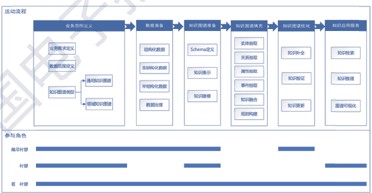

> **图解：知识图谱构建阶段活动流向与关键角色**

#### 1. 数据奠基：多源异构数据治理
这是图谱构建的“备料”过程。需依据业务边界梳理核心术语，汇聚结构化、非结构化及半结构化等多形态数据，并通过严格治理保障质量。

*   **通用图谱**：数据源以互联网开放数据为主，规模可渐进式扩展，对数据噪声有较强容忍度。
*   **领域图谱**：聚焦垂直领域知识库、术语规范及业务生产数据，对准确性、完整性要求极高。
*   **治理实操**：涵盖多源融合、纠错去噪、规格统一、缺失填补等清洗动作，旨在以高质量原料提升下游构建效能与精度。

#### 2. 顶层设计：知识表示与建模
作为构建前的“蓝图”阶段，核心任务是确定表示范式、选型框架工具，并运用本体建模思想设计数据结构。需明确定义业务概念、关系属性、数据类型及约束规则，为后续落地打下坚实基础。

#### 3. 核心产出：知识获取与融合
遵循既定数据结构，利用人工众包与算法模型双驱动，对治理后数据实施抽取与融合。
*   **获取维度**：覆盖实体、关系、属性、事件等多粒度抽取。
*   **融合层级**：分为**本体概念层**（Schema层匹配融合）与**实例数据层**（Data层去重统一存储），实现知识体系的有机整合。

#### 4. 质量跃升：知识图谱优化
针对初版图谱实施“补全-验证-更新”闭环，确保知识服务的相对完备与准确。
*   **双轨验证**：一验**实体/关系/属性**单元的可信度、一致性与准确性（简化冗余、纠正谬误）；二验**规则逻辑**的执行正确性。
*   **智能补全**：基于现有知识预测隐性关联（三元组分类、链接预测），修补知识空白。
*   **动态更新**：覆盖本体与实例双层，支持增量/全量、人工/自动多模式维护，保障知识时效性。

#### 5. 价值兑现：知识应用服务
依托图谱数据库查询语言，按场景部署，对外输出检索、推理、可视化标准化接口。其中可视化服务通过图形化交互直观呈现子图检索结果，降低用户认知门槛。

---

#### 交付清单一览
| 序号 | 交付物 | 核心内容 | 等级 | 属性 |
| :--- | :--- | :--- | :--- | :--- |
| 14 | 图谱使用说明文档 | 工具操作、接口开发、示例代码全指引 | 4 | 必交 |

---

#### 角色协作矩阵（表7-7 重述）

| 角色定位 | 核心职责 | 关键产出 |
| :--- | :--- | :--- |
| **业务专家** | 知识把关、模型评审、结果验收、内容复核 | 术语词典、本体模型、需求变更、设计文档 |
| **专业业务人员** | 范围界定、建模支撑、数据供给、更新验证、培训赋能 | 术语词典、需求变更、设计文档、质评报告 |
| **产品经理** | 需求调研、规划迭代、文档把控 | 需求变更、使用说明文档 |
| **数据工程师** | 数据圈定、治理清洗、工具沉淀 | 预处理工具、本体模型 |
| **标注人员** | 规范制定、数据标注 | 标注数据集 |
| **算法工程师** | **全流程贯穿**：设计构建、模型研发、接口服务、运维工具开发 | 设计文档、算法模型、接口文档、图谱本体、运维工具 |
| **开发工程师** | 应用系统开发、运维工具协作 | 接口文档、运维工具 |
| **质量工程师** | 过程管控、质量评估 | 质评报告 |
| **测试工程师** | 构建期测试执行 | 测试报告 |

---

#### 用户方必参与的四大关键动作
1.  **场景定义与业务领航**：清晰场景是需求边界划定与算法可行性分析的前提；垂直领域专家指导直接决定构建专业度与效率。
2.  **数据资源授权与评估**：用户侧数据精准度高，需协助评估外部数据可用性，夯实数据基石。
3.  **知识运维与增量供给**：上线后由用户主导运维，驱动模型迭代；业务数据变更时及时补给新知识，支撑系统持续进化。
4.  **阶段性交付验收**：对原型、演示、正式图谱逐轮审阅，输出优化建议；终验环节通过实测确保全流程与成果符合预期。

---

### 四、 交付落地：应用开发与集成部署阶段

#### （一） 阶段使命
在图谱基座之上，适配部署环境与集成约束，孵化算法模型与功能模块，集成交付具备智能体验的统一应用系统。

**五大建设目标：**
1.  **服务化解耦**：将图谱知识单元封装为接口/基础服务，开发智能问答、风险预警、方案推荐、相似推演等算法模型。
2.  **融合式开发**：遵循设计方案，打通业务数据与图谱知识，构建一体化智能应用。
3.  **双重验证**：兼顾软件工程与AI模型指标（冷启动、自测迭代），实战数据验证达标。
4.  **敏捷交付**：基于自动化流水线（CI/CD）实现快速部署与弹性扩缩容。
5.  **可观测运维**：建立监控体系，暴露运维接口，支撑智能化运维闭环。

#### （二） 物料流转

**输入端：** 设计方案、业务模型、本体模型、集成质量标准、成品图谱。
**输出端（表7-8 重述）：**

| 交付物 | 简述 | 重要性 | 选配 |
| :--- | :--- | :---: | :---: |
| 知识图谱应用系统 | 集成图谱的完整交付系统 | ⭐⭐⭐⭐⭐ | 必交 |
| 系统使用文档集 | 说明书、规格书等 | ⭐⭐⭐⭐⭐ | 必交 |
| 系统开发文档集 | 需求变更、设计、API、测试、缺陷、验收 | ⭐⭐⭐⭐⭐ | 必交 |
| 系统部署文档集 | 方案、硬件清单 | ⭐⭐⭐⭐⭐ | 必交 |
| 系统监测文档集 | 监测报告、排错指南 | ⭐ | 可选 |

#### （三） 核心活动拆解

该阶段需平衡软件规范与图谱特性，满足“知识+数据”双驱动及人机协同需求。主流程包含：**模型系统开发 → 测试验证 → 自动部署 → 监测运维**，角色分工如下：

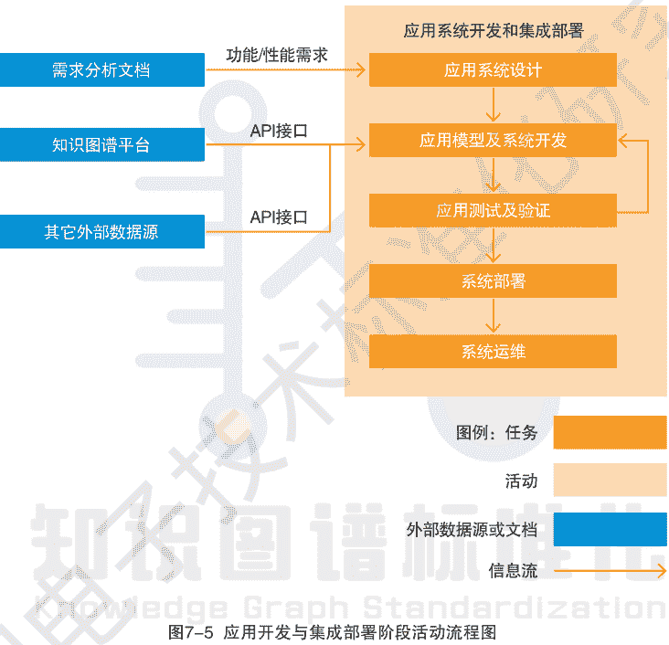

> **图解：应用开发部署阶段活动-角色对应矩阵**

| 角色 \ 活动 | 需求确认 | 系统设计 | 模型开发 | 测试验证 | 系统部署 | 运维 |
| :--- | :--- | :--- | :--- | :--- | :--- | :--- |
| 业务分析 | 主导 | | | 参与 | | |
| 开发人员 | | 主导(模型/功能) | 主导(算法/功能) | | | |
| 图谱核心技术 | | 主导(算法/接口) | 主导(知识计算) | | | |
| 测试人员 | | | | 主导 | | |
| 部署运维 | | | | | 主导 | 主导 |

**1. 应用模型与系统构建（三驾马车）**
*   **算法模型孵化**：针对性开发业务模型，确保通过接口对外输出知识计算能力。
*   **双轨接口开发**：一端对接图谱查询，一端对接三方业务数据，打通知数融合通道。
*   **应用系统集成**：按设计落地系统，通过接口/页面实现与现有业务体系的无缝嵌入。

**2. 专项测试验证体系**
超越传统软件测试，须纳入AI模型专项指标：冷启动效能、模型自我诊断与持续迭代能力验证。

**3. 自动化部署交付**
采用 Jenkins + 容器化技术栈落地 CI/CD，实现源码自动编译、部署、水平扩展，大幅释放运维人力。

**4. 智能监测体系建设**
开发关键状态参数采集脚本，构建健康度监控看板，为知识/数据持续更新下的智能运维提供数据支撑。

#### （四） 异构数据融合策略
集成阶段常面临外部系统数据融合挑战，分两类处理：
*   **原始数据融合**：批量拉取多源原始数据，按内在关联制定策略（如统一建表），完成物理层整合。
*   **计算数据融合**：图谱推理产出衍生知识，作为扩展特征回写业务源，或与其他图谱计算结果融合。
*   **融合范式**：**接口融合**（服务化集成，主流模式）与 **页面融合**（前端聚合）。

#### （五） 角色分工速查（表7-9 重述）

| 角色 | 核心使命 | 交付物 |
| :--- | :--- | :--- |
| 业务专家 | 成效评估、模型迭代建议、功能完善 | 应用系统、开发文档 |
| 需求分析师 | 变更需求甄别、真实需求确认 | 变更说明书 |
| 项目经理 | 全程监控、风控、资源调度、进度质量安全兜底 | 变更说明书、技术规格书 |
| 开发工程师 | 系统主力开发、集成攻坚 | 应用系统、开发/使用文档 |
| 测试工程师 | 静态评审、用例设计、执行测试、缺陷追踪 | 用例、测试报告 |
| 系统架构师 | 问题驱动架构演进、组件规约、模块调整 | 功能清单、设计说明书 |
| 部署运维 | 代码集成编译部署自动化、健康监控 | 部署文档 |

---

### 五、 质量把关：系统评估与验收阶段

#### （一） 核心使命
客观量化系统能力水平，双向保障业务诉求与技术指标达标，实现顺利上线交付。

**四大目标矩阵：**
1.  **立规范**：界定评估范围与指标体系，输出验收清单、组织制度、风控机制。
2.  **定计划**：细化过程评估计划（验收/实施/测试/评审/风控），规避交付偏差。
3.  **做评估**：依规执行，从需求设计、架构、部署、实施、数据安全五维评审，确保执行与成果对齐相关方诉求。
4.  **内验收**：全维度测试（功能/性能/安全/文档），判定上线就绪，移交用户。

#### （二） 评估物料清单

**输入端：** 待交付系统、需求说明、设计原型/概详设计、部署文档、集成方案、图谱基座产品/服务、业务数据。
**输出端（表7-10 重述）：**

| 交付物 | 核心内容 | 级别 | 属性 |
| :--- | :--- | :---: | :---: |
| 系统评估方案 | 范围、指标体系 | ⭐⭐⭐⭐⭐ | 必交 |
| 验收文档清单 | 交付文档目录 | ⭐⭐⭐⭐⭐ | 必交 |
| 人员配备情况表 | 组织架构、制度、分工 | ⭐⭐⭐ | 可选 |
| 内部验收计划 | 时间、内容、形式 | ⭐⭐⭐⭐ | 推荐 |
| 评审计划 | 对象、方式、要求、人员 | ⭐⭐⭐⭐ | 推荐 |
| 测试计划 | 任务、质量目标 | - | 推荐 |
| 算法评测报告 | 结果分析、问题复盘 | ⭐⭐ | 可选 |
| 系统质量评估报告 | 功能/性能/安全测试结论、整体定论 | ⭐⭐⭐⭐⭐ | 必交 |
| 系统内部验收报告 | 功能清单、验收结论 | ⭐⭐⭐⭐⭐ | 必交 |

#### （三） 活动执行路线图

流程遵循 **“定准则 → 排计划 → 执评估 → 內验收”** 单向流转：

| 定准则 (评估准则) | 排计划 (评估计划) | 执评估 (具体评估) | 內验收 (验收测试) |
| :--- | :--- | :--- | :--- |
| 圈定评估范围 | 制定验收计划 | 需求设计评审 | 功能测试 |
| 量化评估指标 | 制定实施计划 | 系统架构评审 | 性能测试 |
| 明确验收文档 | 制定测试计划 | 部署方案评审 | 安全测试 |
| 落实组织管理 | 制定评审计划 | 实施方案评审 | 文档评测 |
| 建立风险管控 | 风险管理计划 | 数据资产评估 | |

> **图7-7 系统评估与验收阶段活动流程图**

# 系统评估与验收：把关交付质量的关键防线

系统评估与验收环节依据预期目标差异，拆解为确立评价标准、拟定执行方案、实施考核、最终验收四大核心板块，流程走向与核心角色协作关系如图7-7呈现。各环节详情如下：

#### 1. 确立评价标准

这是奠定评估验收基调的基石性工作，聚焦划定考核边界、量化考核指标、锁定验收资料、理顺组织架构四大任务。

*   **划定考核边界**：需业务方牵头，从功能适配性、性能表现、安全合规、集成兼容、部署适应性等维度圈定评估范围，系统须在既定维度内达成用户预期。
*   **量化考核指标**：针对上述范围给出可度量的硬性指标。如性能维度需明确吞吐率阈值、响应时长底线、核心业务UI操作路径最短步数等。
*   **锁定验收资料**：建立文档清单机制，清单条目既是验收的佐证材料，也是后续运维期的核心资产。核心清单涵盖需求规格、概要/详细设计、系统测试报告、验收实施方案等。
*   **理顺组织架构**：明确项目编制、管理制度及协作事宜，为工程有序推进护航。

#### 2. 拟定执行方案

此环节是后续考核能否规范落地的前置保障，包含验收排期、测试部署、评审节奏、风险管控四份计划编制。

*   **验收排期**：业务、管控、测试三方共同敲定验收时间窗、核验内容及验收形态，后续严格按表作业。
*   **测试部署**：依托项目总体规划排布具体测试任务与质量红线。倡导迭代式推进，优先覆盖核心业务主流程用例。
*   **评审节奏**：作为防偏纠偏的关键闸口，细致评审能显著降低返工成本。计划须细化至评审对象、形式、准入标准及参评名单。
*   **风险管控**：覆盖介入阶段、潜在风险点及成因、应对预案，并设定阶段性风险复盘的触发机制与方式。

#### 3. 实施考核

此为评估验收的“实战环节”，依托既定标准与方案，从业务逻辑、技术架构、实施方案三个层面展开，判定待交付知识图谱系统是否满足干系人诉求。考核贯穿项目全周期，呈迭代闭环状，通过持续反馈修正建设轨迹，确保交付成果与需求同频共振。核心任务矩阵含五项：

*   **功能考核**：业务方主导复盘研发成果，聚焦“解不解决真问题”“合不合真意图”，同步把关UI原型易用性与行业视觉规范契合度。
*   **性能考核**：技术方主导质检，校验指标达标率、排查严重技术缺陷、甄别技术选型法律风险。
*   **部署方案考核**：审视方案合理性、生产环境适配性、存量基建兼容性及网络安全隐患。
*   **实施方案考核**：业技联合审阅落地路径、交付范围、约束条件，评估执行可行性与潜在风险点。
*   **数据考核**：聚焦知识图谱专属数据资产，核验完整性、准确性、支撑业务能力及隐私合规性。

#### 4. 最终验收

这是质量把关的“终极一战”，由业务与测试联手，依据功能、性能及综合质量要求，对交付物全维度质量兜底。聚焦四大测评维度：

*   **功能测评**：测试、需求、UI三方联动，从应用视角验证功能还原度、视觉还原度及整体需求满足度。
*   **性能测评**：聚焦鲁棒性与响应性，实测并发承载与业务响应是否达标。
*   **安全测评**：构建全维防护验证体系——架构合规性分析、渗透测试、漏洞扫描、配置基线核查、源代码安全审计，筑牢知识图谱系统安全防线。
*   **文档测评**：管控与业务联合核验文档完备度、清单符合度，确保文档客观还原建设全貌。

### 角色协作矩阵

阶段核心角色分工与交付物映射见表7-11：

| 序号 | 角色定位 | 核心职责 | 关键交付物 |
| :--- | :--- | :--- | :--- |
| 1 | 评估专家 | 深度理解需求，主导系统与资料评估 | 评估方案、文档清单、验收计划、需求评估报告、实施方案评估报告 |
| 2 | 测试工程师 | 执行功能/性能/安全测试及知识质量评估 | 测试计划、系统质量评估报告 |
| 3 | 需求分析师 | 全程跟踪评估，守护需求落地 | 需求评估报告、系统验收报告 |
| 4 | 项目经理 | 进度质量双重管控，验收期资源统筹 | 人员配备表、风险台账、各类计划、验收报告、问题追踪表 |
| 5 | 安全管理员 | 专司安全评估与验收闭环 | 问题追踪表、系统质量评估报告 |

### 用户方深度参与指引

评估验收期用户方非旁观者，需深度介入以下协作：

1.  **标准共建**：业务方主导指标定义去冗增准，参与文档清单与组织分工讨论，打通协作链路。
2.  **计划共审**：管控方参与评审与验收计划磋商，锁定准入条件、时间窗、核验范围，同步对齐评审周期与资源投入。
3.  **方案共议**：技术方参与架构、部署、数据技术评审，确保技术栈契合企业技术体系。

---

# 运营推广：从交付到规模化价值的跃迁

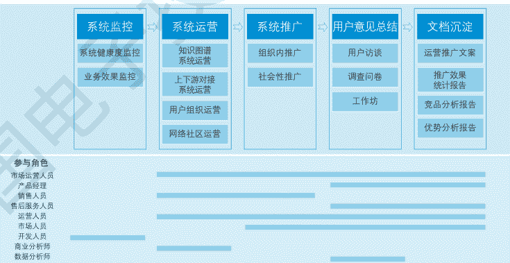

图7-8 运营推广阶段活动流程图

### 阶段使命与五大战略目标

运营推广是知识图谱业务从“可用”走向“好用、常用、广用”的增值期。在真实生产环境中验证实效、持续运营推广，锚定五大目标：

1.  **实效兜底**：超越验收期的限定场景，在真实业务流中持续追踪性能，收集反馈，引入人工运营托底服务。
2.  **声量破圈**：边优化边宣传，以典型案例与方法论输出提升品牌认知度与行业影响力。
3.  **标杆树立**：沉淀方法、技术、应用三维创新成果，树立行业标杆，撬动商业与社会价值倍增。
4.  **价值延展**：横向复制拓展、纵向深度挖掘，扩大效益空间，吸引更多组织与用户接入生态。
5.  **存量激活**：依托现有基建与人才画像，精准分层推广——专业人群深度赋能，潜在人群兴趣唤醒，分阶梯重点建设。

### 输入输出清单

**核心投入**：实战生产数据、知识图谱应用系统、系统架构设计与使用手册等配套文档。

**核心产出**（详见表7-12）：涵盖运营推广文案、推广效果统计报告、竞品/优势分析报告、销售策略/报价方案、宣传物料、学术论文/专利、系统/数据对接规范、新需求池、培训体系、运营手册、受众调研等15类交付物。其中推广效果报告、销售策略、数据对接文档、系统使用手册为必交项；其余按推荐或可选执行。

### 五大核心运营动作

本阶段在实战环境中验证实效、驱动用户与市场双轮驱动，拆解为五项迭代活动：

#### (1) 系统监控：双视角健康度把脉
*   **技术视角弱化，业务视角强化**：站在用户与管理员视角监控线上表现，聚焦整体健康度与业务满意度，而非纯技术指标。
*   **效果量化追踪**：持续监测知识图谱对既定业务目标的正向贡献度。
*   **数据深度挖掘**：对可量化指标实施统计建模与深层分析。

#### (2) 系统运营：全生态触达与服务
覆盖系统上下游联动、用户组织服务、网络社区治理三大半径：
*   运营人员日常值守与上下游系统协同；
*   用户组织定期活动与赋能培训；
*   社区舆情监控、舆论引导、意见闭环。

#### (3) 系统推广：双轨制声量放大
*   **组织内推广**：内部案例复用、经验分享、自上而下推广；
*   **社会性推广**：对外宣传物料发布、广告投放、地推活动、行业峰会曝光。

#### (4) 用户意见总结：体验优化的源头活水
通过访谈、问卷、共创工作坊等多元手段，系统化收集可用性与效果反馈，驱动产品迭代与体验升级。

#### (5) 文档沉淀：将过程资产转化为组织资产
固化阶段问题、经验、待办，输出推广文案、效果报告、竞优分析、管理手册等结构化知识包。

### 角色协作矩阵（表7-13）

| 序号 | 角色 | 核心使命 | 关键交付物 |
| :--- | :--- | :--- | :--- |
| 1 | 市场运营 | 生态/社群运营、外部合作推广、用户交流组织、物料汇总 | 推广文案、宣传材料、受众调研报告 |
| 2 | 产品经理 | 竞品研判、需求汇总、功能规划、数据规范制定、技术卖点提炼 | 竞品/优势报告、对接文档、新需求记录、培训资料 |
| 3 | 销售人员 | 商务拓展、需求挖掘、产品推介、策略动态调整 | 销售策略、报价方案 |
| 4 | 售后服务 | 售后兜底、技联动协同解决用户痛点 | — |
| 5 | 运营人员 | 产品/生态/社群运营、外部协同、文档产品统筹 | 效果报告、宣传材料、运营手册 |
| 6 | 市场人员 | 外部合作推广、用户交流组织、市场推广、意见收集 | 效果报告、宣传材料、受众调研报告 |
| 7 | 开发人员 | 功能迭代与攻关、技术沉淀、系统状态监控 | 期刊论文、联合专利 |
| 8 | 商业分析师 | 竞品商业拆解、用户需求分析、上市后效果监测 | 优势分析报告 |
| 9 | 数据分析师 | 需求反馈数据采集、市场舆情分析、业务指标监控建模 | 推广效果统计报告 |

### 用户方全周期参与协议

用户以“需求主导方”与“首席体验官”双重身份深度介入：

1.  **实战试用与缺陷反馈**：全链路体验输入-处理-输出，捕获功能与数据质量问题，即时反馈改进建议。
2.  **上下游对接统筹**：协调企业内部资源对接，指定技术对接责任人。
3.  **新需求炼制**：融合使用体验、内部反馈、市场声量，从可用性、协作效率、市场认可度三维提炼增量需求。
4.  **知识资产共创**：专家协同申报专利、发表论文，以技术权威性赋能市场推广。
5.  **质量标准化校准**：对标数据/过程/技术/工具等七大标准体系，核验稳定性/安全性/易用性，驱动整改。
6.  **用户行为洞察**：采集操作行为数据，分析活跃度模式与用户分层特征，为精准运营策略提供数据底座。

---

# 管理维护：持续交付价值的长效护城河

### 阶段使命与五大守护目标

管理维护是知识图谱落地后持续造血的保障体系，通过实战监控与精细化管控，确保系统长效稳健运行，持续释放价值：

1.  **可用性守护**：防滥用、防缺陷导致的业务阻断，快速发现并修复可用性隐患，筑牢安全防线抵御恶意攻击。
2.  **流程合规管控**：保障既定流程顺畅，严防越权访问，双重守护信息与隐私安全。
3.  **数据资产防灾**：多策略定时备份，规避意外数据灾难造成不可逆损失。
4.  **系统长青进化**：及时更新老化组件、验证兼容性、实施最优升级策略，保障长周期稳定运行。
5.  **弹性复制与迁移**（按需触发）：支持环境适配迁移、分布式多活部署，提升系统可信度与业务连续性。

### 输入输出清单

**核心投入**：管理端需求、数据安全指标、系统复制迁移需求（均源自需求分析阶段）。

**核心产出**（表7-14）：聚焦“三大必交手册”构建铁三角交付体系：
1.  **系统使用手册**（L5必交）：功能操作指引与注意事项全记录。
2.  **系统运维手册**（L5必交）：错误码速查、故障排查方法论沉淀。
3.  **培训手册**（L5必交）：面向非专业人员的架构认知、场景实战、操作规范、避坑指南的系统化赋能教材。

# 附表：管理维护阶段核心交付物清单

| 序号 | 交付物名称 | 核心功能与说明 | 重要等级 | 交付强制性 |
| :--- | :--- | :--- | :---: | :--- |
| 4 | 系统后台管理工具 | 涵盖知识图谱应用系统后台管理组件及操作指引 | 5 | **必选** |
| 5 | 监控工具 | 实现系统状态可视化、实时化监控的软件工具 | 4 | 推荐 |
| 6 | 系统巡检工具 | 面向系统安全性、稳定性的定时自动化扫描工具 | 4 | 推荐 |
| 7 | 巡检报告 | 记录定时扫描中发现的安全性、稳定性问题的结果文档 | 5 | **必选** |
| 8 | 问题报告 | 梳理系统运行期各类异常、故障形成的汇总文档 | 4 | 推荐 |
| 9 | 日志文件 | 系统访问与应答行为的按时归档记录 | 3 | 可选 |
| 10 | 补丁文件 | 修复系统已知错误的临时性修补程序包 | 4 | 推荐 |
| 11 | 修改记录 | 运维周期内系统变更历史的详细记录档案 | 4 | 推荐 |
| 12 | 版本管理 | 维护系统代码及集成图谱版本信息，支撑溯源与回滚 | 4 | 推荐 |
| 13 | 版本升级或管理说明 | 版本迭代时输出的更新内容说明文档 | 4 | 推荐 |
| 14 | FAQ常用问题清单 | 针对高频问题提供解决方案，需定期迭代更新 | 4 | 推荐 |
| 15 | 售后服务记录 | 记录用户请求、响应处理及闭环情况的服务台账 | 5 | **必选** |
| 16 | 保修清单 | 梳理保修范围内的具体要素清单 | 2 | 可选 |
| 17 | 用户满意度调查 | 量化用户主观体验的调查分析报告 | 2 | 可选 |
| 18 | 授权文件/授权函 | 明确授权主体、期限、范围等法律效力文件 | 5 | 推荐 |
| 20 | 知识维护和管理记录 | 记录知识单元维护过程、变更细节的过程性文档 | 5 | **必选** |
| 21 | 风险应对策略 | 针对可预见风险制定的预案与应对指引文档 | 1 | 可选 |

---

# （三）管理维护阶段五大核心活动

本阶段依据建设目标差异，划分为**系统运维管理、知识运维管理、技术支持、使用培训、授权管理**五大核心活动：

### 1. 系统运维管理：筑牢稳定运行基石
聚焦保障系统持续可用，构建涵盖流程、事件、问题、变更、发布、运行、知识、综合分析八大维度的管理机制体系，显著提升响应速度。同时引入自动化分析报表，沉淀业务数据模型，赋能知识积累与绩效考核。

### 2. 知识运维管理：激活知识资产全生命周期
对知识图谱应用系统实施精细化运维，核心动作覆盖知识单元的**检查、更新、删减、优化、发布**全链路；同步强化流程、事件、问题、运行等质量控制环节，确保知识资产“鲜活、准确、高效”。

### 3. 技术支持：精准破解疑难杂症
专注于解决用户侧使用过程中出现的、具有典型特征且归因于系统层面的技术疑难问题，提供专业级排障支撑。

### 4. 使用培训：赋能用户高效用好系统
面向用户操作岗与管理岗分层施训，内容涵盖系统操作实战、运维常识及异常处置流程，确保人员具备“懂操作、会排错、能管控”的复合能力。

### 5. 授权管理：构建精细化权限治理体系
全周期管理使用人员权限，明确范围、依据、方式与制度，并引入效果评估机制，实现权限分配的动态优化与合规管控。

---

# （四）角色协同矩阵：责任到人，交付有据

| 角色定位 | 核心职责 | 核心交付物 |
| :--- | :--- | :--- |
| **知识运维工程师** | 负责知识图谱全周期维护与治理 | 知识维护和管理记录 |
| **系统运维工程师** | 主导部署架构设计、资源识别及集成部署方案输出 | 版本管理文档、数据修改记录、保修清单 |
| **系统安全工程师** | 守护系统安全稳定，防范非授权访问 | 日志文件、监控平台、巡检报告 |
| **培训人员** | 提供全维度培训支撑 | 培训手册、系统使用手册、运维手册 |
| **技术客服** | 受理技术咨询，推动问题闭环 | FAQ常用问题清单、售后工单、用户满意度调查 |
| **开发人员** | 攻坚故障修复、缺陷消除及简易需求优化 | 补丁文件、版本升级说明、问题报告 |
| **授权管理人员** | 执行授权运行管理与动态调整 | 授权函、授权文件 |

---

# （五）用户方协同关键动作：深度参与，共建共享

维护阶段非服务方“单边戏”，用户方需主动介入两大核心环节：

#### 1. 沉浸式参训：从“听懂”到“会用”
*   **派员精准**：委派关键岗位人员接受系统操作与运维双轨培训。
*   **实战演练**：重点攻克异常处置流程与解决路径，将培训转化为实战肌肉记忆，激发系统最大效能。

#### 2. 高质量反馈：驱动系统进化的核心燃料
*   **用户侧**：承诺对发现问题做到**及时上报、实事求是、详尽记录**，为系统迭代提供一手素材。
*   **服务侧**：技术支持与开发团队需**秒级响应、闭环解决**，将用户体验数据转化为测试优化的“金标准”，实现“用户用得好，系统强得快”的正向飞轮。

---

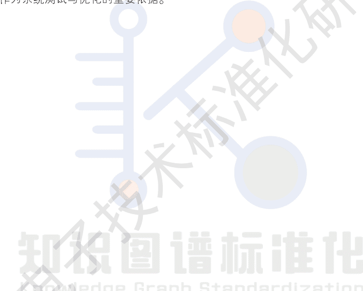

# 第八章 知识图谱应用系统建设：服务方选型全攻略

## 一、 服务定义：全生命周期的专业护航

面向知识图谱应用系统建设的服务，覆盖**咨询规划、设计开发、集成实施、运维保障**全链路。当前市场服务方技术禀赋差异显著，擅长领域各异。用户方应基于**自评能力基线**与**整体规划蓝图**，精准画像需求，采取“单一强选”或“多方联合”模式，拼凑出完整覆盖需求拼图的服务矩阵。

## 二、 服务分类导航图（标识体系对照表 8-1）

### 01 咨询服务：顶层设计与合规把关
| 代码 | 细分类别 | 核心价值 |
| :--- | :--- | :--- |
| **0101** | **战略咨询** | 结合战略与政策，输出周期性战略落地建议 |
| **0102** | **方案咨询** | 资质机构指导技术产品、系统、服务的建设运营 |
| **0103** | **测评认证** | 第三方公正评价产品服务质量，对标国家/行业标准 |
| **0104** | **培训** | 全链条培训服务：需求研判→方案设计→实施管理 |
| **0105** | **监理** | 代表用户监控建设实施过程，法律合同双重约束 |
| **0199** | **其他** | 未列入上述类目的咨询服务 |

### 02 设计与开发服务：核心资产构建者（外包交付模式）
| 代码 | 细分类别 | 核心交付 |
| :--- | :--- | :--- |
| **0201** | **本体模型设计与开发** | 实体/关系/属性定义，奠定知识表达基石 |
| **0202** | **知识获取/数据处理与供给** | 多源异构数据→结构化知识，支撑下游应用 |
| **0203** | **知识图谱可视化** | 关系预处理→图数据库→可视探索与分析 |
| **0204** | **图算法设计与开发** | 路径/聚类/关联分析，挖掘深层价值，提效增速 |
| **0205** | **数据标注/元数据管理工具** | 标准落地，工具赋能标注与管理 |
| **0206** | **知识图谱构建设计与开发** | 数据/知识融合构建，输出基础产品/中间件服务 |
| **0207** | **系统方案设计与开发** | 需求驱动，交付通用/行业应用模块或核心子系统 |
| **0299** | **其他** | 非标定制开发服务 |

### 03 集成实施服务：拼装与落地的“总包方”
| 代码 | 细分类别 | 核心动作 |
| :--- | :--- | :--- |
| **0301** | **系统集成实施与部署** | 计划驱动，持续迭代，交付功能完整系统 |
| **0302** | **知识融合/集成** | 打破孤岛，统一全局知识标识 |
| **0303** | **知识服务** | 图谱+领域场景，赋能业务转型 |
| **0304** | **环境部署** | 软硬环境配置监控，交付“零故障”可用环境 |
| **0399** | **其他** | 非标集成服务 |

### 04 运维服务：长周期的“守护者”与“优化师”
| 代码 | 细分类别 | 服务范畴 |
| :--- | :--- | :--- |
| **0401** | **知识运维** | 故障排除+知识条目增删改查+备份恢复+质量管理 |
| **0402** | **系统运维** | 功能性能维护、版本检测优化升级、技术支撑方案 |
| **0403** | **图数据库运维** | 远程/现场支持、升级改造、故障检修全托管 |
| **0404** | **网络与安全（基础环境）运维** | 基础设施诊断修优，保障高可靠/高可用/安全 |
| **0499** | **其他** | 扩展运维服务 |

---

# 第九章 总结与建议：汇聚合力，破局前行

知识图谱工程化路径已明、产业骨架初成，但技术深水区、落地最后一公里、基建短板仍存。**破局需“五方共舞”**：用户方、服务方、科研院所、政府、学会协会协同发力，打造中国AI知识产业高地，赋能千行百业知识驱动转型。聚焦生态、协同、推广、补短、合作五大维度，建言如下：

## 一、 国家战略层：顶层设计与基建夯实

1.  **建联盟、造生态**：牵头组建**大中小企业+科研院所+高校+行业组织**四位一体产业联盟，以需求为牵引，双向发力（业务+技术），分会体系化运作，壮大“供给侧”铁军（供应商/集成商/服务商）。
2.  **加投入、促攻关、强推广**：加大科研课题资金倾斜；各级政府用“专项建设/揭榜挂帅”推动示范落地；探索“引进部署升级出售”全链条补贴政策；建立**赛事评审推广机制**，打通“攻关-应用-推广”闭环，提升领域战略地位。
3.  **抓标准、盯专利**：系统推进标准体系研制，聚焦**跨域互操作、模块化规范、权责指引**三大重点立项；同步建立**全球专利动态追踪雷达**，精准感知技术演进风向。
4.  **筑基座、通数据、育平台**：建设**算法库/本体库/国家行业知识库/算力/开源架构**“五位一体”公共服务平台，托举中小创新主体；推动标准/政务数据等公共资源“机器可读、可理解”开放共享，建准入退出机制保可持续；探索细分场景“小众共性知识”共建共享新范式。

## 二、 行业落地层：数据筑基与标准引领

1.  **强术语、建语料、统语境**：依托权威标准/文献建术语集，攻关非结构化获取/融合技术建语料库，整合推广标准化资源，为**语义统一**铺底座。
2.  **立标准、促融合、固经验**：加速典型领域知识体系标准研制，挖掘“图谱-业务集成、图谱-数据融合、本体建模规范”等特殊需求，推动关键需求转化为**行业标准**，凝聚共识，固化最佳实践。
3.  **树标杆、造样板、挖价值**：筛选“数据基础好+需求强+技术厚+成效显”的种子企业，打造**示范项目**，输出可复制的“场景样例+用法+经验包”，深度挖掘经世济民价值；政策护航先行者，守住探索热情。

## 三、 产学研协同层：质量护航与人才供给

1.  **建体系、造平台、提质效**：构建**价值评估+系统测评**双体系，明确验收边界，管控预期；研制**标准符合性测试规范与工具**，搭建测试平台，以工具化手段提升验收精度与效率。
2.  **育机构、强认证、重监理、优供给**：扶持1-2家机构晋升**国家级检测单位**，提供评测指导；完善**产品认证+项目监理**双体系，倒逼供方质量意识，提升工程化交付成熟度，降低用户验收门槛。
3.  **促协同、对接精准、建阵地**：以**解决企业硬骨头问题**为靶心，选定前沿攻关方向，推动院所/高校/企业联合攻关与成果转化；依托联盟搭建**需求-供给精准对接平台**，鼓励建设**联合实验室/工程中心**，常态化协作机制。
4.  **育人才、融产教、认能力**：打通**产业需求-科研供给-教育培养**链路，探索**产教融合新模式**，真项目练真兵；配合能力认证体系，量化核心技能掌握度。
5.  **促转化、广交流、预趋势**：多渠道（峰会/刊物/社群）分享实战，加速**国内国际先进经验对接**，复盘案例库，互学互鉴，研判技术趋势，为产业化奠定创新基石。

---

# 附录：标杆案例复盘——基于知识图谱的大数据风控系统

## 案例背景：痛点倒逼变革
商业银行传统风控陷入**“信息不对称、人力成本高、时效低、挖掘难”**四重困境：
*   线下踩点汇总数据：人海战术，效率低、成本高。
*   金融数据“4V”特性（海量、多维、高价值、高时效）导致数据孤岛严重，深层关联关系难挖掘。

**破局路径**：融合知识图谱+大数据技术，广引外部数据、通打内部系统流程，构建**全用户覆盖、全流程贯通**的大数据风控体系，赋能准入、关联、画像、预警四大核心能力。

## 当前阶段与实战成效

*   **阶段定位**：**运营推广期**（多轮迭代后稳健运行）。
*   **量化战果**：
    *   **准入提质**：累计准入授信企业 **5万+**，低/次低风险占比 **16.7%**，资产质量显著跃升。
    *   **反欺诈利剑**：团伙分级+名单分级模型，识别用户 **500万+**，拦截疑似欺诈 **43.58万**。
    *   **预警前置**：累计预警信号 **450万+**，自动定级占比 **94.34%**，预警率 **92.14%**，平均提前 **224.33天** 捕获风险，实现从“事后追责”到“事前预判”的质变。

### 三、系统架构全景

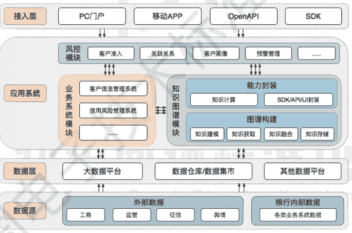

图A1-1 知识图谱驱动的大数据风控系统架构图

如图A1-1所示，该风控系统的数据池融合了双源输入：外部侧接入工商登记、监管公示、征信记录、舆情监测等权威渠道；内部侧则汇聚全行各业务系统的积累数据。整体架构呈纵向三层结构：

*   **数据底座层**：依托行级大数据平台、数仓/数集市等设施，承担多源异构数据的清洗、融合、加工与治理重任。
*   **应用核心层**：由“业务系统群、知识图谱引擎、风控业务中台”三大支柱构成。业务侧集成用户信息管理、信用风控等核心系统；图谱侧拆分为构建引擎与能力封装两大模块；风控侧则落地准入审批、关联穿透、画像刻画、预警监测四大核心场景。
*   **统一接入层**：对外输出PC门户、移动APP、OpenAPI及SDK等多模态接入能力，支撑全渠道业务调用。

### 四、 建设前基础能力体检

### (1) 评估画像结果

经多维度测算，该系统建设起步处于 **L4就绪级** 。各维度等级如下：

| 评估维度 | 等级判定 |
| :--- | :--- |
| 业务成熟度 | L4 |
| 数据治理度 | L4 |
| 基础设施 | L4 |
| 实施交付力 | L4 |
| **管理规范度** | **L5** |
| 社会生态度 | L4 |

> **图A1-2 基础能力雷达图** [PRE标记隐含]

管理层面率先达标L5，得益于完善的制度体系；其余维度虽达L4，但距离“完备”尚有距离。

### (2) 短板破解行动

针对评估暴露的薄弱环节，制定三大专项提升计划：

1.  **人才破局（基础设施层）**：瞄准图谱领域“懂业务、懂算法、懂工程”复合型人才匮乏痛点，双轨并行——外引内育，建立专项人才池，夯实可持续演进的人力基石。
2.  **投入升级（业务层）**：将AI与图谱建设上升至战略高度，打破预算天花板，以资源倾斜倒逼业务智能化转型提速。
3.  **场景深耕（实施层）**：以存量案例为种子，持续孵化新场景、跑通新流程、验证新模式，在实战中磨炼交付硬功夫。

#### 五、 落地实施复盘：从0到1的进化史

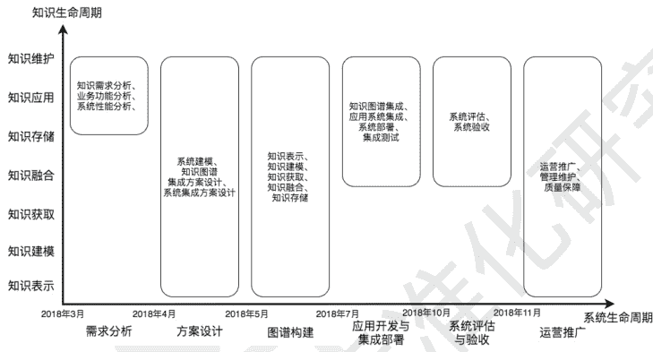

图A1-3 项目里程碑时间轴

| 阶段 | 时间跨度 | 核心产出 | 核心攻关点与破解之道 |
| :--- | :--- | :--- | :--- |
| **需求磨合期** | 2018.03-04 | 需求规格书、技术选型报告 | **痛点**：大型复杂系统目标模糊，边界不清。 **对策**：同业标杆深度解剖 + 专家多轮会诊 + 需求分级拆解，化整为零锚定目标。 |
| **蓝图设计期** | 2018.04-05 | 架构设计、图谱建模、接口规约 | **痛点**：图谱顶层设计难、多模块互联互操作标准缺失。 **对策**：小步快跑试错验证 + 统一数据/接口/通讯“三标”规约。 |
| **图谱锻造期** | 2018.05-07 | 本体模型、融合图谱、存储部署 | **痛点**：建模精准度不足、非结构知识抽取难。 **对策**：专家领衔“自顶向下”建模 + NLP技术攻坚非结构化数据。 |
| **应用交付期** | 2018.07-10 | 功能模块、测试报告、部署上线 | **痛点**：多源异构数据深度融合冲突大。 **对策**：引入知识融合技术栈，实现实体对齐、冲突消解。 |
| **验收交付期** | 2018.10-11 | 验收报告、上线许可 | 全链路功能/性能/安全验收，平稳切生产。 |
| **持续进化期** | 2018.11至今 | 迭代版本、运营报告 | **痛点**：图谱知识全生命周期维护成本高。 **对策**：常态化专项培训体系，内化运维核心技能。 |

#### 六、 硬核技术底座

**核心技术①：OCR+深度学习非结构化穿透引擎**
针对财报、权证、票据等非标单据，融合传统机器学习与Caffe深度框架，实现关键字段高精度定位抽取，结构化入库。

**核心技术②：HAWQ大规模分析计算引擎**
面对内外部海量结构化数据，构建统一存算一体化底座，支撑万亿级数据的秒级加工与复杂计算。

**核心技术③：NLP知识自动化抽取管线**
针对金融数据“量大、维度高、价值深”特性，串联LTP、BERT等前沿模型，完成去噪、分类、标注、NER全流程，自动产出实体-关系-属性三元组。

**核心技术④：多模混合存储架构（RDB + Graph + ES）**
打破单一存储瓶颈：关系库管事务、图库算拓扑、ES做检索。当前图谱规模破**十亿节点/边**，内置20+图算子，具备亿级实时图计算吞吐。

#### 七、 进阶之路上的四大拦路虎

虽已落地见效，但向纵深推进仍面临严峻挑战：

1.  **数据迷雾**：金融多源异构数据语义歧义重、隐性关联深，图谱构建“最后一公里”依然崎岖。
2.  **技术天花板**：获取、融合、存储、计算四大核心环节的自研可控度与前沿对标度仍有提升空间。
3.  **建模鸿沟**：复杂业务场景向图谱模型的映射转化，高度依赖稀缺的领域知识工程师经验，标准化、工具化程度待强。
4.  **人才断层**：高端图谱人才供给不足，需构建“引育留用”全链条生态，破解延续性发展瓶颈。

---

### 案例二：测绘地理信息领域知识图谱系统

#### 一、 项目缘起：从“制图”到“治理”的范式跃迁

地理实体作为新型基础测绘的标准化成果，承载着自然资源部推动高质量发展、服务国家治理现代化的战略使命。当前，地理实体数据已实现从“要素面向制图”向“实体面向应用”、从单一维度向“多模态、时空化、语义化”的蜕变。然而，管理与服务一线仍卡在四大关口：

*   **建模困局**：多领域（建筑、水系、交通、植被、管线）实体交叉重叠，传统线性分类法难以兼顾扩展，**急需构建统一语义网络打通跨域壁垒**。
*   **存算割裂**：几何结构与属性信息分库存储（关系库+几何库），关系易失、查询指数级膨胀，**图技术+GIS融合成破局关键**。
*   **服务浅层**：现状数据仅提供“在哪”，缺乏“物-人-时-空-事-理”深层关联推理，**百万因果路径挖掘是深化应用前提**。
*   **数据沉睡**：国情普查、不动产测绘等专题数据蕴含高价值元数据却长期闲置，**语义推理与自然语言交互是激活资产的钥匙**。

#### 二、 阶段定位与交付成果

*   **当前阶段**：图谱构建期
*   **核心成效**：
    1.  **融合示范**：地理时空数据与专题数据知识级融合，验证图谱在基础测绘落地可行性。
    2.  **管理跃升**：显著增强部门时空数据治理能力，拓宽应用广度。
    3.  **场景落地**：支撑城市体检指标自动化计算，大幅提效，赋能居民满意度提升。

#### 三、 系统架构设计

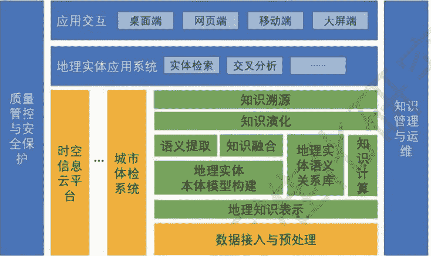

图A2-1 系统总体架构图

**1. 数据解耦接入与预处理**
采用“分域治理、编码关联”策略：
*   **实体域**：依统一标准生产加工，挖掘语义关系，完成图谱实例化；
*   **专题域**：抽取本体类，独立构建领域知识图谱；
*   **融合桥**：以“地理实体空间身份编码”为金钥，打通两域数据孤岛。

**2. 知识图谱与地理实体联动可视化**
基于梳理的语义关系网络，构建领域图谱，实现**拓扑图谱与空间实体的双视图联动、同步钻取**。

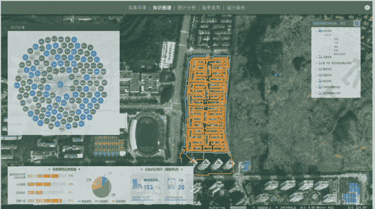

图A2-2 地理实体属性画像页

**核心功能矩阵：**

*   **智能问询（所得即所想）**：按场景构建规则集，训练查询特征模型，实现自然语言级人机交互，重塑检索体验。
*   **城市体检一键算（宜居/宜业/宜乐/宜游）**：融合多行业专题，基于实体属性与语义关系自动推演指标；双维度（规程标准+群众诉求）筛选典型指标入图，支撑专题化精准查询展示。

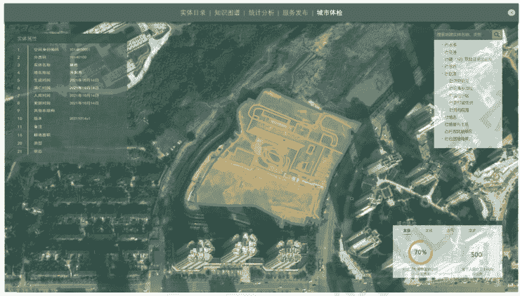

图A2-3 城市体检指标驾驶舱

#### 四、 基础能力诊断与强基行动

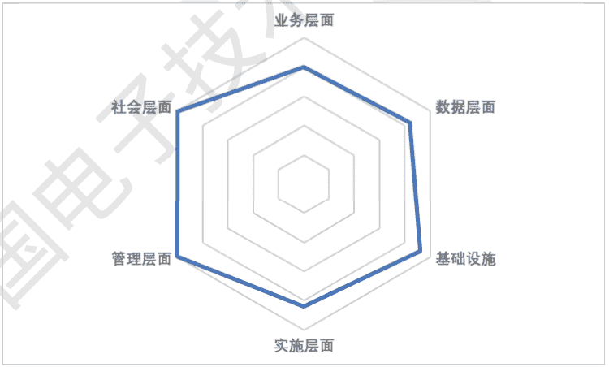

图A2-4 能力成熟度雷达图

**综合评分93分，达到L5完备级**。维度细表：

| 维度 | 等级 | 维度 | 等级 |
| :--- | :--- | :--- | :--- |
| 业务 | L4 | 实施 | L4 |
| 数据 | L4 | **管理** | **L5** |
| **设施** | **L5** | **社会** | **L5** |

**短板复盘与对策：**

| 短板项 | 成因剖析 | 破解举措 |
| :--- | :--- | :--- |
| **场景空心化** | 战略规划丰满，落地场景瘦弱，多停留在管理诉求层。 | 以本项目为种子，打磨典型应用案例集，向纵深拓展具体业务场景。 |
| **关系构建复杂度失控** | 多领域实体天然复杂，数据量大、关系计算重、一致性校验难。 | 定制开发“关系计算引擎+语义一致性检查工具链”，工具化降低构建门槛。 |

#### 五、 全生命周期实施复盘

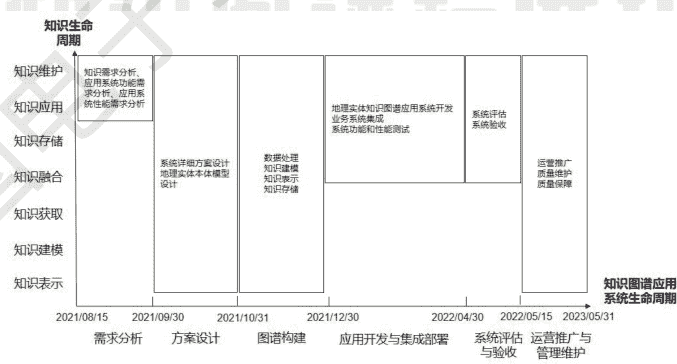

图A2-5 项目实施路线图

| 阶段 | 时间窗 | 核心角色 | 关键产出 | 攻坚难点与对策 |
| :--- | :--- | :--- | :--- | :--- |
| **需求探源** | 21.08.15-09.30 | 领域专家、图谱专家、PM、分析师、数据治理、业务方 | 调研报告、需求规格、数据现状、可行性研究 | **痛点**：新领域应用无标杆，目标模糊。 **对策**：多方会诊+跨行业案例借鉴+业务场景锚定，完成需求分级定级。 |
| **方案定型** | 21.10.01-10.31 | PM、业务专家、架构师、研发/数据/算法工程师、UI | 本体设计、详设方案、系统原型 | **痛点**：多源异构地理数据语义化处理无成熟范式。 **对策**：沉淀泰瑞数创多年语义化研发成果，形成**标准化工艺流程与规范体系**，实现语义化数据快速生产。 |
| **图谱锻造** | 21.11.01-12.30 | PM、数据/图谱工程师、研发、业务 | 处理数据、本体模型、融合图谱、存储部署 | **痛点**：业务贴合度高的表示/本体模型设计难，强关联关系抽取难。 **对策**：“自顶向下”建模 + 质量评测体系全程护航。 |
| **应用交付** | 22.01.01-04.30 | PM、图谱工程师、研发、测试、业务 | 功能代码、测试报告、部署文档 | **痛点**：功能性能达标与业务习惯贴合双重压力。 **对策**：开发前深度确认 + 多轮迭代验收，确保所建即所需。 |
| **验收上线** | 22.05.01-05.15 | PM、研发、测试、运维、业务 | 验收报告、上线许可 | **痛点**：评估指标体系缺位，标准化测试缺失。 **对策**：定制评估指标库，推行标准化测试流程，双重验证稳定性与业务逻辑。 |
| **运营进化** | 22.05.16-23.05.31 | 业务、运维、销售、市场 | 运营报告、推广案例、用户反馈 | **痛点**①运营推广体系缺位；②用户自主扩展知识（增实体/关系）门槛高。 **对策**：建立运营体系 + 低代码/可视化知识编辑工具赋能用户自主扩展。 |

#### 六、 关键技术创新高地

**关键技术①：地理实体三维语义化技术**
直击“计算机不懂三维自然语言”痛点。将几何信息与语义信息深度绑定，将实体转化为可计算语言模型，实现**可查、可分、可统、可渲、可算、可析**六大能力跃迁。泰瑞数创自研三维语义提取表达工具、语义关系构建工具，攻克新型测绘图谱应用核心难点。

**关键技术②：开源共享语义化识别解译样本库**
构建覆盖**全类别、全地域、多数据类型（地面/遥感）、多波段（可见光/微光）、多特征（类别/纹理/光谱/形状/范围）**的标准化样本池。配套存储索引管理规范，为地理实体自动化智能化提取筑牢数据基石。

#### 七、 核心挑战：向“情境化智能服务”进军

传统硬编码服务模式僵化，无法适应实时感知时代。LBS仅是时空情境服务冰山一角。真正的挑战在于：**如何融合位置、时间、空间场景、行为习惯等多维时空要素，实现“深度情境觉知”，进而驱动场景化服务智能触达？** 这要求融合认知化智能分析，构建实时感知-情境理解-服务决策的全链路闭环。

---

### 案例三：通信认知管控系统

#### 一、 破局背景：5G规模化下的双重压力

5G网络加速铺设，终端爆发式增长、业务类型指数级增加，运营商面临“服务咨询洪峰”与“网络高效低成本运维”的双重考验。针对频谱管控领域**数据孤岛、关联稀疏**顽疾，融合深度学习与知识图谱，引入频谱数据资产，构建**覆盖全国规则的大规模频谱认知中枢**，切中四大核心诉求：

1.  客服智能化分流，缓解人力压力；
2.  恶意用频/非法用户/伪基站/黑飞无人机精准画像识别；
3.  网络资源智能调度与精细化分配；
4.  双提升：用户满意度↑，运营成本↓。

#### 二、 阶段与成效速览

*   **当前阶段**：应用开发与集成部署期
*   **建设成效**：

### 三、 系统架构全景与核心职责

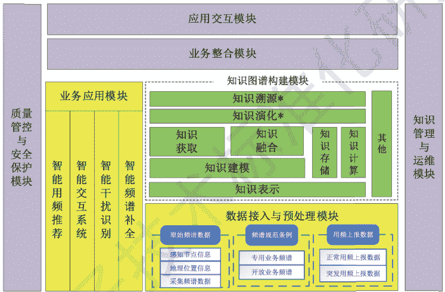

通信认知管控平台由七大功能单元协同运作，分别为：应用交互单元、业务整合单元、业务应用单元、知识图谱构建单元、数据接入与预处理单元、质量管控与安全防护单元、知识管理与运维单元。

**1. 数据汇聚与清洗单元**
作为平台数据基石，该单元专注异构频谱数据的规范化入库。覆盖三类核心来源：原始感知数据（节点参数、地理坐标、采集波形）、频谱法规标准（专用/开放业务频段划分）、用频上报记录（常规申报与突发应急申报）。

**2. 图谱构建引擎**
平台“大脑”中枢，贯穿知识表示、建模、存储、计算、获取、融合至溯源全链路，落地通信认知专属图谱体系，并对外暴露标准化服务接口。

**3. 场景化应用层**
依托图谱底座，衍生四大核心业务能力：智能用频决策推荐、人机智能交互、干扰源精准辨识、频谱缺失智能补全，直击运营痛点。

**4. 业务编排聚合单元**
扮演“聚合器”角色，对离散业务能力实施标准化封装与流程编排，形成统一服务池。

**5. 可视化交互门户**
面向终端用户，基于聚合层提供图形化操作界面，实现高效人机协同。

**6. 双重护航体系**
知识资产迭代维护（管理运维单元）与系统运行质量、数据安全合规（管控防护单元）双轨并行，保障平台稳健运行。

---

### 四、 项目前期多维能力诊断画像

#### (1) 六大维度能力雷达扫描

**业务侧**：战略愿景达**五级**（AI深度融入核心战略）；用户需求牵引、资源预算保障、行业趋势政策红利均处**四级**（诉求明确、列入预算、政策利好）；行业准入资质为**三级**（持证经营但壁垒中等）。

**数据侧**：数据储备**三级**（法规标准完备，原始/上报数据依赖外挂设备采集）；领域语料基础**四级**（拥有少量标准化术语库）；数据治理水平**三级**（治理机制初建）。

**设施侧**：人才梯队**四级**（运维、专家、建模师配备齐全）；算力存力资源、数字化底座均为**二级**（仅支撑小规模处理，业务流程数字化率低）。

**实施侧**：工程落地能力**二级**（处于POC试点验证期）；运维支撑能力**三级**（现有图谱可覆盖部分场景）。

**管理侧**：组织保障、质量管控均**三级**（机制成型、目标明确）；过程管理**二级**（流程规划雏形）。

**合规侧**：法律风责**四级**（合规风险可控）。

**综合定级**：系统现处 **L3 建设级** 阶段。

#### (2) 短板破解专项行动

*   **强化算力底座**：大幅提升软硬件存储弹性，引入动态扩缩容机制，支撑超大规模数据吞吐。
*   **完善数字化根基**：联合运营商共建业务系统，打通端到端流程，推动全链路信息化落地。

---

### 五、 研发迭代历程与攻坚实录

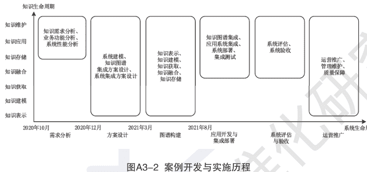

**第一阶段：需求勘探与定义（2020.10-12）**
*协作阵容*：需求分析师、数据工程师、项目/产品经理。
*核心交付*：行业调研白皮书、可行性研判、业务需求规格书、数据现状剖析。
*核心瓶颈与破解*：**瓶颈**在于单轮分析难以覆盖大型复杂系统的全功能性能边界。**破解**路径：深度调研+多轮专家会商，完成需求分级分类与目标拆解。

**第二阶段：架构蓝图与本体设计（2020.12-2021.03）**
*协作阵容*：产品/项目经理、系统架构师、研发/算法工程师。
*核心交付*：系统总体架构、频谱图谱本体体系、功能清单、模块集成规范。
*核心瓶颈与破解*：**瓶颈**聚焦于频谱图谱本体设计的专业深度与跨模块接口统一性的平衡。**对策**确立架构层宏观把控，强制统一接口规范与通讯协议。

**第三阶段：图谱落地与入库（2021.03-08）**
*协作阵容*：项目经理、图谱工程师、研发人员。
*核心任务*：本体建模、实体关系抽取、知识融合入库、图存储部署。
*核心瓶颈与破解*：**瓶颈**为非结构化频谱文本（法规、日志等）抽取精度不足。**手段**引入NLP深度模型实现非结构数据结构化转换。

**第四阶段：应用交付与上线（2021.08-至今）**
*协作阵容*：扩展至测试、运维全链路团队。
*核心任务*：业务代码开发、功能验收测试、生产环境部署。
*核心瓶颈与破解*：**瓶颈**源于多源异构数据融合冲突（实体对齐、冲突消解）。**手段**依托知识融合技术体系逐层化解。

---

### 六、 核心技术突破锚点

| 关键技术 | 场景痛点 | 技术攻关路径 |
| :--- | :--- | :--- |
| **高时变频谱数据高效处理** | 无线电环境时变剧烈、数据流速极快 | 选型高吞吐、低延迟的流批一体计算引擎 |
| **基于注意力机制的实时频谱感知** | 数据规模巨大、频段特征差异显著 | 利用注意力机制捕捉长距离频谱依赖特征，破解实时监测难题 |

---

### 七、 行业级落地面临的三大结构性困境

1.  **“千人千面”服务落地受阻**：用户群体诉求高度差异化、频谱资源极度稀缺、用户基数持续攀升，运营商难以低成本交付个性化体验，提升陷入瓶颈。
2.  **治理成本与电磁净度“双高”博弈**：黑飞无人机、伪基站等违规干扰源激增，电磁环境复杂度指数级上升，迫使运维成本高企，传统人工巡检模式难以为继。
3.  **海量数据资产“沉睡”价值低转化**：持续累积的通信数据吞噬存储红利，因缺乏有效挖掘与流通机制，利用率长期处于低位，未能转化为核心生产力。

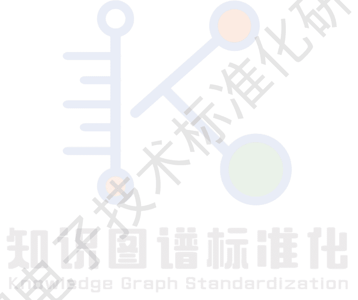

## 参考文献

1. 余荣花, 廉同辉, 刘军. 中国低碳研究的知识图谱分析[J]. 资源科学, 2012, 34(10): 1959-1964.
2. 程赛琰, 丁磊, 魏淑娟. 基于知识图谱分析的电子政务研究现状、热点与趋势[J]. 图书与情报, 2013(1): 116-123.
3. 谢靖, 章鑫鑫. 基于CSSCI(2000-2011)的中国文学学科知识图谱研究[J]. 图书与情报, 2014(2): 108-114.
4. 李伟平, 权德庆. 我国体育消费研究前沿与热点——基于科学知识图谱的可视化研究[J]. 西安体育学院学报, 2014(1): 41-44.
5. 辛伟. 知识图谱在军事心理学研究中的应用[D]. 西安: 第四军医大学, 2014.
6. Mima M, Bansal M. End-to-end relation extraction using lstms on sequences and tree structures[C]// Proceedings of the 54th Annual Meeting of the Association for Computational Linguistics. Berlin, 2016: 1105-1116.
7. Katiyar A, Cardie C. Going out on a limb: Joint extraction of entity mentions and relations without dependency trees[C]// Proceedings of the 55th Annual Meeting of the Association for Computational Linguistics (Volume 1: Long Papers). Vancouver, Canada, 2017: 917-928.
8. 陈德鑫, 占袁圆, 杨兵, 等. 基于 CNN-BiLSTM模型的在线医疗实体抽取研究[J]. 图书情报工作, 2019, 63(12): 105-113.
9. 赖英旭, 李亚娟, 刘静. 基于本体的水稻育种方法应用知识库构建[J]. 北京工业大学学报, 2019, 45(12): 1181-1191.
10. 连明杰, 陈远文, 昝云飞, 等. 一种基于深度学习模型的关系抽取及知识图谱构建方法: 中国, CN 201910707194.1 [P]. 2019-12-20.
11. 吴文涛, 李培峰, 朱巧明. 基于混合神经网络的实体和事件联合抽取方法[J]. 中文信息学报, 2019, 33(08): 77-83.
12. 苏佳林, 王元卓, 靳小龙, 等. 自适应属性选择的实体对齐方法[J]. 山东大学学报(工学版), 2020, 50(01): 14-20.
13. 王会勇, 论兵, 张晓明, 等. 基于联合知识表示学习的多模态实体对齐[J]. 控制与决策, 2020, 35(12): 2855-2864.
14. 李攀成. 公共安全领域知识图谱的知识融合技术研究[D]. 成都: 电子科技大学, 2019.
15. Lao N, Mitchell T, Cohen W W. Random walk inference and learning in a large scale knowledge base[C]// Proc of the Conference on Empirical Method in Natural Language Processing. Stroudsburg, PA: ACL Press, 2011: 529-539.
16. 张美玉, 林崇, 简铮峰. 基于路径排序算法的 STEP 知识推理技术研究[J]. 浙江工业大学学报, 2020, 48(02): 126-132, 187.
17. 吴运兵, 朱丹红, 廖祥文, 等. 路径张量分解的知识图谱推理算法[J]. 模式识别与人工智能, 2017, 30(05): 473-480.
18. Bordes A, Weston J, Collobert R, et al. Learning structured embeddings for knowledge bases[C]// Proc of AAAI. Menlo Park, CA: AAAI, 2011: 301-306.
19. Socher R, Chen D, Manning C D, et al. Reasoning with neural tensor networks for knowledge base completion[C]// Proc of NIPS. Cambridge, MA: MIT Press, 2013: 926-934.
20. Jenatton R, Roux N L, Bordes A, et al. A latent factor model for highly multi-relational data[C]// Proc of NIPS. Cambridge, MA: MIT Press, 2012: 3167-3175.
21. Bordes A, Usunier N, Garcia-Duran A, et al. Translating embeddings for modeling multi-relational data[C]// Proc of NIPS. Cambridge, MA: MIT Press, 2013: 2787-2795.
22. Newcombe H B, Kennedy J M, Axford S J, et al. Automatic linkage of vital records[J]. Science, 1959, 130(3381): 954-959.
23. Cochinwala M, Kurien V, Lalk G, et al. Efficient data reconciliation[J]. Information Sciences, 2011, 181(14): 1-15.

全国信标委人工智能分委会知识图谱工作组、知识图谱产业推进方阵、IEEE知识图谱工作组、知识图谱产品认证、知识驱动先锋企业评选相关动态，敬请关注微信公众号或联系工作人员沟通。

**中国电子技术标准化研究院**

联系人：李瑞琪
联系电话：010-64102797
电子邮箱：lirq@cesi.cn