# 人机共生的科学之路

信息的自由流动就是进步的动力。
——杨立昆

# 重量级点评合集

## 从莱苏什到塔霍湖：深度学习先驱的现场记录
特伦斯·谢诺夫斯基
美国四大国家学院院士，《深度学习》作者

这本著作捕捉的是人工智能史上少有的关键拐点。

进入21世纪后机器学习落地为现实，AI 也走到了一个决定性时刻。背后活跃的研究网络中，杨立昆始终站在前沿。这条线索可以追溯到上世纪80年代的神经网络复兴。我第一次见到他是在法国东北莱苏什的一场物理会议上，当时他还是个学生，做的工作后来发展为反向传播。杰弗里·辛顿和我受统计力学启发，把玻尔兹曼机引入到带隐藏单元的网络。那时神经网络还很边缘，物理、心理学、工程的领军人物几乎不碰，没人能预见它会怎样改写世界，但杨立昆已经把这件事当成终身事业。

此后他成为辛顿的博士生，再到贝尔实验室任研究员，始终在为这个目标投入。他的构想是让神经网络识别图像中的物体，也就是 LeNet。随着算力提升，LeNet 越做越大，效果越做越好。当时主流的计算机视觉依赖手工几何特征，每加一个新物体都要靠专家手工设计区分特征，效率低下。神经网络则能从大量图像里自行学出区分性特征。互联网提供了海量图片，内存的增长甚至快于处理器，而他的架构天然适合并行到多处理器上。

GPU 能很好地模拟神经网络运算，算力可提升上百倍，也让十多层的深层网络训练成为可能。杨立昆在这一基础上不断改进，最终形成了卷积神经网络 CNN。即便表现已属顶尖，他的论文仍被 CVPR 拒稿。

转折点是 2013 年塔霍湖的 NIPS 会议。CNN 在当时的最大图像库 ImageNet 上，对 1500 万张、覆盖 22000 个类别的图片进行识别，误差一下子降低了 18%。在此之前，误差每年只降不到 1%，这次的进步相当于计算机视觉 20 年的积累。此后网络越做越深、越做越复杂，视觉任务随之大步前进。

同年 NIPS 上，马克·扎克伯格宣布杨立昆出任 FAIR 的创始负责人，脸书借此紧追谷歌，而谷歌那边签下了辛顿。杨立昆科研与工程上都非常出色，但带一个大型 AI 团队是另一回事，需要完全不同的管理能力。之后他打造的团队深刻影响了脸书的业务。

当晚的招待会上，扎克伯格对我问了许多问题。他显然读过不少文献，问得很准。最让他感兴趣的是心理学里的心智理论，正是我刚办的一个研讨会主题，讨论我们如何为自己和他人建模。我给了他一份阅读清单，他的好奇让我惊讶。后来杨立昆解释，脸书掌握着全世界最多的个人数据和用户，有 AI 就可以为每个人的心智活动建立模型，甚至比当事人更了解自己。

CNN 的结构受灵长类视觉皮层分层处理的启发。大脑在新环境下的灵活性和能力远超今天的系统。但 CNN 也在反过来帮助我们理解大脑如何看见和决策，形成良性循环。20 世纪的人工智能忽略了学习的强大，而学习正是生物系统的核心，这是 21 世纪 AI 进步的最大动力。基于大脑式大规模并行的算法，也比依赖逻辑规则、容易出现组合爆炸的方法强得多。深层网络中活动向量的表征和语义内涵，远比符号丰富。如此多的计算优势集中出现，实属罕见。

我们正站在一个新时代的起点，信息时代的开端。今天的 AI 系统像莱特兄弟的首次载人飞行。航空经过上百年迭代后彻底改变出行，AI 也将让人更聪明、生活水平大幅提升。理查德·费曼说过，我无法造出来的东西，我就不懂。机器能思考吗？会有意识吗？如果我们造出会学习思考的机器、产生自我意识的机器，这些根本问题的答案自然会揭晓。这本书讲述的就是 AI 在我们面前崛起、载入史册的那个时刻。

## 提升概率：科研系统的底层逻辑
张宏江
智源研究院理事长

国际象棋大师加里·卡斯帕罗夫曾说，常胜秘诀不是复盘棋局如何落子，而是从系统层面改进自己的思考方式。把人工智能带入新时代的先锋杨立昆，在《科学之路》里既记录了对 AI 过去与未来的探索，也剖析了能推动社会大幅前行研究的系统规律。

历史上不少成果看上去是偶然，实则无法规划。所有努力本质上都是在提升概率——聚集优秀的人，提供思想碰撞、发现问题、找到合作伙伴的社区，对人而非项目持续资助，让他们面向未来思考重要问题，时间推移，成果往往显现。

青年时代的杨立昆在欧洲像一次孤军远征。本科读电气工程，导师对他的兴趣几乎不懂。毕业后只能在法国一个小实验室继续，指导教授仍是外行，但给了资源。教授说，我不知道你在做什么，但你聪明勤奋，我就签字。

转折在 1985 年春天阿尔卑斯山麓的研讨会。他遇见了刚成立的贝尔实验室神经网络小组，三年后被聘用并移居美国。也在这次会议上遇见特伦斯·谢诺夫斯基，进而结识辛顿。小群人由此形成紧密社区，开始构建新模型。

做非渐进性研究，需要把人放在未来。在计算领域，一种方法是给强算力，让研究者以低成本反复试错，避开“过早实用化”陷阱。杨立昆提到，贝尔实验室有人告诉他靠省钱成不了事。他刚到时就独享一台 Sun 4，而此前在多伦多一台机器要 40 人共用。做数字识别，他能用美国邮政近万张真实手写图像，之前只能用很小的人工数据集。入职两个月，他就做出 LeNet，在数字识别上创下纪录。

常规同行评审往往太“合理”，颠覆性工作很难找到对等的评委。对“不合理”的方向，小圈子内部的同行更有判断力，也更清楚谁是真正优秀的人。

即便到 2006 年，评审对他也不宽容。深度学习当时是个冷门分支，2004 到 2006 年间他的相关论文几乎被 ICML、NeurIPS、CVPR、ICCV 等顶会拒稿。2006 年后圈子扩大，支持才增多。即便如此，2007 年他们向 NeureIPS 提议办深度学习研讨会被拒。幸好有 CIFAR 资金支持，自行举办，300 多人参加，成为当年大会最受欢迎的场次。

黄金时代的工业实验室如贝尔和施乐帕克 PARC，是变革技术的重要摇篮。如今它们仍在，但已很难复制当年的效能。垄断地位、内部完成前沿研究、研究能快速转化为企业利润等条件，今天都不易重现。

杨立昆在贝尔辉煌期后期加入，1995 年经历 AT&T 拆分，1996 年任部门负责人后被迫转向“实用”方向，五年基本没碰机器学习。2001 年底 AT&T 再拆分，裁掉一半研究员。他提前在 NEC 普林斯顿实验室找到位置，一年后 NEC 经济困难，实验室被施压转向可变现应用。

那次 AI 寒冬持续十年，DARPA 和 CIFAR 的多年支持让这群人得以聚在一次，靠资助讲习班为学生开辟小天地。

今天的创新生态里，学术界擅长生想法，初创擅长把高潜力产品推向市场，企业研发擅长优化现有产品。各机构体制不同，限制也不同。杨立昆也描述了他如何在脸书里突破这些限制。

智源研究院希望通过搭建协作社区、建设面向未来研究的算力和数据平台、聚集最优秀的小同行、聚焦过往投入不足但可能带来原始创新和长期影响的领域，来让创新系统运行得更高效。正如开头所说，所有努力都是为了提升概率。希望我们的努力能提高中国出现突破性成果的概率，也欢迎读者加入。

2021 年 7 月于北京

## 在无人区持续开路
贾扬清
阿里巴巴集团副总裁，高级研究员

2014 年，我在谷歌大脑团队用一个 22 层的深度网络在 ImageNet 比拼中夺冠，取名 GoogLeNet，把 Google 的 l 写大，算是对 1989 年出现的 LeNet 的致敬。那时计算机还很原始，LeNet 就已被美国邮政系统用来读信封上的邮编。LeNet 的作者正是图灵奖得主、这本书的作者杨立昆。

三十年前神经网络走得异常艰难。早期成功后，因训练困难、结构不确定、对数据依赖强、理论不清晰，到 2000 年初逐渐被凸优化、核方法、概率图模型等取代。杨立昆、本吉奥、辛顿三人坚守下来，自嘲为 deep learning conspiracy，加拿大黑手党，在各自学校坚持神经网络研究。

学术界并不友好。2010 年我在加州伯克利与奥里奥尔·温雅尔斯折腾神经网络时，前系主任半开玩笑说我们搞的是 mumbo jumbo，但仍允许我们继续，这也是学术开放之处。

ImageNet 的胜利后，深度学习开始在感知领域横扫，让计算机看懂图像、听懂语音、读懂文字，随后在围棋 AlphaGo、游戏、自动驾驶、医疗、公共服务等领域快速渗透。今天 AI 已成显学，成为各技术领域都可用的利器。

2013 年加入脸书后，杨立昆一直领航 FAIR 在 AI 前沿无人区探路。FAIR 聚集了大量顶尖学者，其中不乏何恺明、田渊栋等华人。我在脸书期间，既构建工程底座，也目睹社区涌现 ResNeXT、Detectron、FAISS 等算法，以及 PyTorch、ONNX 等通用框架和业界标准。多年累积与杨立昆的持续追求密不可分。

作为先驱，他对未来思考很深。技术上，他关注自监督学习如何摆脱数据依赖，让 AI 更像人一样学习进化；伦理和社会层面，他反复强调要确保 AI 服务人类福祉，避免用错方向。唯有懂科学的人才能洞察其社会意义和风险，这本书里的思考值得细读。

说件与技术无关的小事。杨立昆生活里很风趣，带点极客气质。他的主页和脸书上有许多吐槽，比如与 SVM 创始人弗拉基米尔·瓦普尼克合作的二次元笑话 “All your bayes are belong to us”。2017 年他访华前有人提醒中国 AI 很火，路上可能被认。他回美国后兴奋地表示，在上海博物馆门口真被两位学生认出并合影。他说既然被路人认出，中国一定有无数人对 AI 充满热情。

我有幸见证国内 AI 的蓬勃；科学无国界，我很荣幸为这本书作序。希望它带来更多面向未来的思考，也希望读者把热情转化为下一个世纪的动力。

## 独立求学与独立思考的样本
吴军
计算机科学家，《智能时代》作者

能为图灵奖得主杨立昆博士的新书《科学之路：人、机器与未来》写序，深感荣幸。杨立昆因深度学习贡献获 2018 年图灵奖，其名字在中国学术和产业界几乎家喻户晓。这本融合自传与科普的著作，无论是学界、业界还是普通读者都会获益。

### 杨立昆的成功经验

前言里他谈求学和科研经历，对当下中国家长很有启发。

在法国，要成为精英通常要进招生极少的 grandes écoles，如巴黎高师 ENS 或巴黎综合理工，需要先读两年预科备考。杨立昆却另选路径，高中后直接进入名气不算大的巴黎高等电子与电工技术工程师学院 ESIEE 学习，不用考预科，也能获得更多学习自主权。他用亲身经历证明，通过激烈竞争进入名校不是科学成功的唯一路径。

他在 AI 领域的研究可追溯到大学时期大量阅读课外经典。那时 AI 热门但不成熟，他读了诺姆·乔姆斯基等人的著作，尤其苏联数学家柯尔莫哥洛夫的公理化概率论，为他打下坚实数学和理论基础。

大学起他就沉迷人工神经网络，并敏锐捕捉到反向训练的新方向。后来进入巴黎皮埃尔和玛丽·居里大学攻读博士，即今索邦大学，在反向训练上取得突出成果。成果很快被法国公司采纳，也让他进入学术氛围自由的贝尔实验室。他用经历说明，教育重在获得知识本身，而非名校光环。往后在神经网络长期不被看好的年代，他始终坚持特立独行。

杨立昆初入贝尔实验室时，正撞上那座科学殿堂最后的荣光期，转眼巨型研究所便开始瓦解。好在随后他在纽约大学拿到了教席。彼时人工神经网络正值低潮，他笃定该方向在图像识别上终究会大放异彩，还亲手搭建了一套简陋的人脸识别 demo，却未引起多大回响。从2003年到2013年，差不多十年光阴，他与引路人杰弗里·辛顿等人低调钻研各类神经网络算法，尤其是卷积网络。这些成果当时乏人问津，却真实地为今天的深度学习打下了根基。2013年之后，随着并行计算能力跃升与海量数据涌现，基于神经网络的深度学习在多项任务上陡然显现巨大潜力，并在人脸识别、语音识别、机器翻译、计算机对弈等领域连连取得亮眼成绩，杨立昆等人的工作一举震动全球，并与辛顿、约书亚·本吉奥共同斩获计算机科学最高奖项图灵奖。

若要概括杨立昆的经验，可以用四句话：
• 求学重在知其所以然，而非一张文凭；
• 广泛研读高水准的专业著作，锤炼科学的鉴赏力；
• 坚持做自己真正感兴趣的课题，即便短期内并不吃香；
• 长期坚守，不轻言放弃。

## AI 的内核是什么
《科学之路》第二部分剖析了基于深度学习的人工智能原理。杨立昆引入了少量公式，但整体读来仍很通俗。

他用若干例子说明当下人工智能的本质是数学模型+海量数据+算力。首先要把模式识别等难题转化为数学表述。从实现路径看，计算机智能与人类智能并不相同，但从结果看两者等价，可视作殊途同归。他用典型模式识别案例展示 AI 的实现方式，即使不深究公式细节，也能体会到两者差异。不过，计算机获得智能的一个共同点是先从观察现象归纳规律，再用规律去预测新现象。书中以伽利略研究速度为例，伽利略从观察提炼出运动规律并写成数学公式，再用来计算各类运动。机器学习也是如此，只是其公式并不直观。

其次需要数据支撑学习。在任何 AI 应用中，原始素材如图像本身不能直接喂给模型，需要先做转换。这个过程叫特征提取，粗略说就是把现实世界的对象转译为机器可读的形式。杨立昆以模式识别为例说明提取过程。即便不关心具体步骤，也要明白机器学习对数据量的依赖。

最后，数据规模上来后，模型复杂度也必须跟上才能捕捉细节。奥卡姆剃刀在一般情形很管用，但在机器学习里并不成立。过去神经网络表现平平，很大程度上是因为网络太简单。杨立昆等人由此提出更大更复杂的深度神经网络。随之而来的是第三个难题：算力。他本人对这一块着墨不多，相关工程多由谷歌、脸书、亚马逊等公司的工程师主导，也不是科学家关注的核心。

## 深度学习如何落地
《科学之路》第三部分梳理了当下 AI 的各类应用，从语音与图像识别、自然语言对话，到自动驾驶与医学影像识别，这些名称大家都很熟悉。杨立昆的叙述既有权威又很直白。

## AI 仍需面对的边界
《科学之路》第四部分，也是最后一部分，谈的是 AI 的局限，涵盖技术短板与社会风险。这是多数 AI 读物容易忽略的部分。杨立昆提醒，任何技术革命都有阴暗面，但他相信问题可以被解决。书末他还探讨了有趣的话题，比如机器人是否应拥有权利、应遵守何种法律。

总体而言，这是一部兼具科普性与专业性的鸿篇巨制，最珍贵的在于杨立昆作为深度学习开创者之一，讲述自己如何思考机器智能、如何把现实问题转化为可计算问题。从这个视角，它更像一本教科书，教人如何思考科学问题。我相信不同层次、不同背景的读者都能从中收获颇多。

2021 年 6 月 6 日于硅谷

## 持续学习与批判性思维
韦青  
微软（中国）公司首席技术官

近年来以机器深度学习为代表的人工智能技术突飞猛进，在成熟应用领域正由研究走向工程落地，对社会贡献日益增大。但与此同时，越来越多企业意识到 AI 的巨大价值，急于用现有深度学习理论和方法开拓新场景，却常发现效果不理想。于是出现一个矛盾：AI 作为科学研究的进展，与 AI 作为工程实践的社会落地之间的落差。

原因很多，归纳到企业实践中主要有三点：
第一，决策层与业务部门对机器智能能力的期待，与技术部门实际能交付的能力之间存在差距。可通过共同学习来弥合，但在落实现场仍会出现第二个现实困境。
第二，企业愿意投入的资源、时间与技术团队实现所需资源、时间之间的差距。可通过共商前提条件来缓解，但确定性与不确定性的矛盾仍会浮现。
第三，企业对落地确定性的要求，与黑天鹅、灰犀牛频现的时代复杂性之间的张力。这要求企业构建具备韧性的文化、组织、流程、人员素质以及产品服务体系。这种韧性要求决策者具备对事物本质的深刻洞察，而洞察不仅来自既定知识，也来自对发展的系统性理解，对发展的把握离不开对历史规律尤其是 AI 历史规律的洞察。

我的日常工作就是与各行业伙伴一起把智能技术落地，既有需求被技术实现的喜悦，也有好想法难产的遗憾。我相信从事智能工程落地的同行都有体会。理论与实践的矛盾已是当下智能领域的普遍现象。解决思路通俗地说就是不断学习。在变动时代，决策者与业务人员需理解机器智能实现与应用的基本原理，结合对商业逻辑的深刻把握，与技术人员协同，通过合规、高效、全面地使用智能机器实现能力跃迁。这种学习面很广，容易无所适从，但快速切入的途径是有的，我认为现在摊在这本书里，正是一条捷径。

### 敢言的杨立昆
对多数读者而言，杨立昆最出名的是与杰弗里·辛顿、约书亚·本吉奥一起获得美国计算机协会颁发的 2018 年图灵奖。业内熟知他与卷积神经网络的渊源，1993 年拍摄的 LeNet-1 演示视频便是例证，那个拥有 4600 多个单元、近 10 万条连接的卷积网络用于手写数字识别，于 1995 年就开始商业化。也就是说，今天流行的深度卷积网络图像识别系统，早在 30 年前就已商用。

杨立昆在圈内还以敢言著称。2017 年 NeurIPS 大会上，获长期成就奖的机器学习专家阿里·拉希米在演讲中批评 AI 现状，提醒听众“我们对人工智能过于自大”，他引用吴恩达“AI 是新时代电力”的说法，随后在屏幕上打出中世纪炼金术士的图像，称“当前 AI 更像炼金术，只不过能用的炼金术”。此言激起杨立昆的激烈反驳，网络上随即掀起 AI 是否是炼金术的大讨论，当时颇为风靡。

客观看，双方都有合理论据，难以简单判定对错，但公开争论本身就是难得的学习机会。并非每个人都能亲历机器学习几十年的演进，也未必有精力研究对立观点。杨立昆敢想敢做敢说的风格，帮助公众从他言论与著述中获得技术之外的哲学启发，这对需要以技术解决业务问题的决策者和业务人员尤其有益。

### 坦诚直率的分享
作为图灵奖得主、深度机器学习尤其是卷积神经网络领域的领军人物，杨立昆在写作时有意不写成纯技术书，而是与读者分享自己在机器学习领域几十年的行走经历。通读全书，算法设计与原理的讨论在其中，但更多是数十年摸爬滚打的心得，值得细读。

正如前文所说，制约智能落地的主要障碍往往不是技术本身，而是对技术能力的期待与技术局限性的矛盾，以及应对复杂现象的能力，这也是杨立昆反复强调的。

本书风格与杨立昆自称工程师的性格一致，坦诚、直率、目的清晰、不加雕饰。偏爱优美文风的读者可能需要适应这种工程师式写法。鉴于 AI 发展之路坎坷，杨立昆坚持走多数同行不看好的深度学习路线，难免受委屈，也曾怀疑道路前景。这种真情流露让书的借鉴价值更真实。也正因经历过起伏，他才有底气与各种观念进行坦诚辩论。

最打动我的是第二章“深度学习的阴谋”中关于信念与动摇的记述。1987 年 12 月 6 日，杰弗里·辛顿生日当天，他苦涩地说：“今天是我 40 岁生日，我的职业生涯到头了，什么也做不成了。”当时辛顿才 40 岁，离他团队在 2012 年用深度卷积网络把图像识别错误率从 25% 降到 16% 还有 25 年，离 AlphaGo 在 2017 年乌镇以 3:0 击败柯洁还有 30 年，离他与本吉奥、杨立昆在 2019 年共同获 2018 年图灵奖还有 32 年。正因如此，杨立昆自豪地说：“我们在 20 年后有了新想法，但我们遇到的大多数人不如辛顿，他们都很傲慢。”几位先行者的经历，对中国流行的“程序员 35 岁现象”也具正面启示。

### 丰富的阅读体验
书中类似警句很多。试读本里我做了大量标注，举几个例子。

开篇即写：“人工智能正逐步占据经济、通信、健康与自动驾驶等领域。许多观察者不再视其为技术演进，而视其为革命。”杨立昆坚信“深度学习即人工智能的未来”。第九章，他把机器学习方法比作黑森林蛋糕。作为不愿神化的工程师，他希望读者把握思维本质而非高不可攀的术语。对算法他说：“算法就是指令序列，仅此而已，没有神奇之处。”他把机器学习的原理比作物理学基础：“从观察现象总结定律，再用定律预测现象。”

另一个例子是他对 SVM 的评价。尽管 SVM 由他的朋友同事发明，他仍直言：“我对他们心怀敬意，但我个人并不特别感兴趣，因为它未解决特征提取器自动训练的核心问题。不过 SVM 的确吸引了很多人。”

我接触的优秀科研或工程人员多与杨立昆相似，都有批判性思维。他们在推广技术前会先陈述前提约束，不会只谈优点不谈代价。他们的理念可综合为：任何强大技术皆有正反两面，不理解负面就发挥不了正面；不能随意开启一个工具，就先学会关闭它。这种思维贯穿全书。

与客户合作中，我发现决策者易被单方面技术描述误导，尤其在社交媒体知识泛滥的时代。人们获取便捷，却难以甄别真伪。机器学习潜能巨大，但适用范围仍窄，很多未知领域需探索精神。现实中，常在未理解技术负面因素前就做出缺乏批判的决策，导致本可贡献的技术因负面效应未被规避而失败，甚至让决策者丧失对先进技术的信心，放弃追求，可谓双重损失。

机器学习很强，但用好并不容易。智能化是人类社会发展的大概率方向。理解、掌握并善用机器学习，已成为组织与个人的必选项而非可选项。其复杂性要求人们不仅学固定知识，更要具备应对变化的能力，而这正是机器学习的基本范式。机器学习已进入帮助人类扩展认知空间的阶段，人类既能利用其能力，也能向其学习在不确定中持续适应的能力。

### 到底是不是炼金术？
前文提到杨立昆与拉希米关于 AI 是否是炼金术的争论。杨立昆坚决认为不是，但科学探索的本质是不断逼近真相却永远不达终点，会随环境与新现象修正。读书亦然，“尽信书不如无书”。以作者在前言的一段话作结：

> 深度学习的探索并不容易，我们必须与各方面的怀疑论者斗争……深度神经网络，即我们提出的深度学习，是突破局限的方法。深度神经网络非常有效，但运作复杂且难以数学分析，我们却如同炼金术士般不懈追求。

## 杨立昆的科学之路
马毅  
加州大学伯克利分校电子工程与计算机系教授

很荣幸为杨立昆教授新书中文版作序。我与他相识于计算机视觉会议，至今约十余年。我们科研关心的共同基础问题是：如何有效表征图像数据的内在结构。杨立昆重视从实际数据与任务出发，如卷积网络与自动编码的开创工作；我则偏重描述图像内在低维结构的数学模型，如稀疏结构与多子空间模型。侧重点不同，但方向一致，彼此工作一直很了解。很长一段时间内，因实用性未充分显现且在视觉领域小众，我们也有些惺惺相惜。科学探索不能因一时不被认可就放弃正确方向。杨立昆在书中生动描述了深度学习探索的艰辛与坚持，对年轻科研人员有很好教育意义。

今天可见当初不被主流看好的工作产生了深远影响：深度卷积网络与稀疏结构已成为实用深度模型乃至高维数据模型的基石。2016 年暑假，深度学习、压缩感知、优化算法与调和分析领域的学者齐聚墨西哥瓦哈卡的数学研究所交流。杨立昆与我应是视觉领域仅有的两位参会者。我带家人同行，我们一起参观玛雅遗址。此次研讨让我首次真切意识到深度模型与低维结构的内在联系。当时我在上海科技大学执教，便邀请杨立昆在 2017 年信息学院学术年会做深度学习主题报告。那场演讲现场约 800 人，在线直播四五千人，这或许就是他书中提到的在中国受明星般待遇的例证。年会后，我陪他与夫人去朱家角游玩，他对中国文化很感兴趣，买了不少纪念品，直到夫人劝阻。

2018 年我回美国后，因都意识到深度网络与低维结构的关联，我们多次交流。2019 年我专程去纽约大学拜访他，既祝贺图灵奖，也深入探讨深度网络理论。当时网络在实践上成功，但机制与理论基础不明。我们在办公室讨论一下午，天黑才出来。核心议题是深度网络究竟在优化什么。杨立昆认为可借鉴物理学中的能量视角，我则觉得应从数据低维结构表示入手。想法各异，目标一致。这次讨论是我后来从数据压缩角度用第一性原理阐释深度网络的起点，有趣的是，该工作最终把深度卷积网络与低维子空间结构有机结合在了统一理论框架下。

一些看起来十分棘手的课题，实质难度往往并不在技术本身，而在于面对未知时能否保持全身心的投入。杨立昆凭借敏锐的预见与深刻的洞察，为深度网络的基础研究提供了清晰的指向，也让研究者避开了理论工作最容易滑向的误区——脱离实践的自缄其口。我将与他的合作与交流整理出来，想提醒年轻学者，理论必须与实践相连，科研也需要不断拓宽边界、兼收并蓄、与跨领域同行持续对话。

他在最新著作里用大量生动案例阐明了类似的经验。该作既通俗梳理了人工智能与深度学习的演进脉络和核心原理，也以亲身经历示范了如何拆解科研问题。过去我只知他是卓越的学者，读后才体会到其知识面之广与文字之生动。这是一部值得细读的好书，细心读者必能获益。

## 让历史告诉未来
黄铁军  
智源研究院院长，北京大学教授

为杨立昆的新书作序颇具挑战。人工智能已有近七十年探索，本序不求复述，而是在回顾已行路径的得失后，对本书作一点补充，并尝试展望下一步方向。

# 智能的本质与机器智能

## 对智能的看法
先谈智能观。智能是系统通过采集与加工信息而获得的能力。其典型特征是能够实现从无序向有序的熵减、由简单向复杂的演化。生命系统既是智能系统也是物理系统，既有熵减的智能属性，也遵守熵增等物理规律。人工智能同样是智能系统，只是载体从有机体扩展到一般机器。

正如人的精神与肉体虽不可分割却有层次，机器智能也可拆分为载体即具特定结构的机器，以及智能即作为现象的功能，两者同等重要。因此我更倾向用机器智能替代人工智能这一说法。

## 符号主义
人工智能概念长期聚焦于智能本身，“人工”二字的特权感主导了上半叶研究，代表即符号主义。它主张把智能形式化为符号、知识、规则与算法，视符号为基本要素，智能即符号的表征与运算。该思路源于数理逻辑、心理学与认知科学，随计算机诞生而落地。符号主义虽有辉煌，但难以触及智能本质。关键在于纸上得来终觉浅：人类抽象的符号源于躯体对物理世界的感知，人能凭符号交流是因为拥有相似的身体。计算机仅处理符号，很难具备类人感知与类人智能。人类那种可意会不可言传的潜智能，更非能形式化让机器触及。要实现类人乃至超人智能，仅靠计算机是不够的。

## 连接主义
与符号主义自上而下相对的是连接主义。自下而上，强调智能活动是大量简单单元经复杂连接后并行运行的结果。核心想法是既然生物智能来自神经网络，就人工搭建神经网络再训练其产生智能。人工神经网络研究早于现代计算机，1943 年 Warren McCulloch 与 Walter Pitts 提出的 `M-P` 神经元模型至今仍在使用。连接主义的难点在于不知何种网络能产生预期智能，因而大量尝试以失败告终。20 世纪 80 年代神经网络曾一度兴盛，本轮浪潮的深度神经网络只是罕见成功案例，但这在技术探索中本属常态。

## 行为主义
人工智能的第三条路线是行为主义，也称进化主义，根源在进化论与控制论。生物智能是自然进化的产物，通过与环境及他者的互动不断增强，人工智能亦可走此路。该学派在 80 年末 90 年初兴起，近年的波士顿动力机器狗即是代表。其分支具身智能特别强调身体对智能形成的重要性。行为主义的困境与连接主义相似：何种智能主体才具可塑性至今未定。

## 机器学习、深度学习与强化学习
机器学习自 80 年代中期起引领潮流。通俗地讲学习就是逐步降低系统误差，机器学习是让机器通过试错与自我调整完成这一过程。其最大贡献是把研究重心从人工赋能转向机器自行习得智能。近年最成功的机器学习方法是深度学习与强化学习。

深度学习是连接主义与机器学习结合的产物，核心贡献是找到在多层神经网络上进行机器学习的可行方法，杨立昆与 Joshua Bengio、Geoffrey Hinton 因此获 2018 年图灵奖。它回答了两个问题：何种网络可训练出智能——多层神经网络、卷积神经网络；如何训练——受限玻尔兹曼机、反向传播、自编码等。对连接主义而言，深度学习提供了训练智能的可行路径；对机器学习而言，它提供了可塑的载体。

强化学习思想源自行为主义，可追溯到 1911 年行为心理学的效用法则：奖励行为被强化，受罚行为被弱化，即试错机制。1989 年 Watkins 提出 `Q-learning`，证明了强化学习的收敛性。2013 年 DeepMind 将 `Q-learning` 与深度神经网络结合，诞生 `AlphaGo`、`AlphaZero` 和 `AlphaStar` 等突破。近期 DeepMind 甚至宣称仅靠强化学习即可实现通用人工智能。

与此不同，杨立昆认为强化学习只是锦上添花，传统监督学习标注成本高、泛化有限也只是点缀，自监督学习才是机器学习的未来。自监督学习是通过观察发现世界内在结构的过程，是人类与动物最主要的学习方式，也是智力的本质，这正是本书第九章的核心。他与另两位图灵奖得主发表的论文 “`Deep Learning for AI`” 也重点强调了这一点。

我并不认同自监督学习就是智力的本质。这更多是从机器学习层面、功能层面看问题。我认为学习方法即功能固然重要，但从事学习的机器即结构同样重要甚至更重要，因为结构决定功能。不要忘记智能的载体。

## 理论与工程实践
杨立昆在第九章开篇提到法国航空先驱 Clément Ader，他比莱特兄弟早 13 年造出能飞的载人机器。杨立昆看到的主要是教训：在复制生物学机制前必须先理解自然机制本质，否则盲目模仿必然失败。他的立场是必须探究智能与学习的底层原理，无论以生物还是电子形式存在。正如空气动力学解释了飞机、鸟类与昆虫的飞行，热力学解释能量转换，智能理论也应涵盖各种形式的智能。

我的看法相反，我认为 Ader 和莱特兄弟并非惨败，而是伟大成功。Ader 1890 年、莱特兄弟 1903 年就造出飞机，而空气动力学要到 1939—1946 年才建立。两次世界大战发挥重要作用的飞机，主要靠工程实践而非理论，因为理论尚未出现。至今空气动力学也未完全解释飞机飞行，更未完全解释动物飞行。它更像事后诸葛亮，对后续优化意义重大，却不是发明的理论导师。

智能比飞行更复杂，深度学习实现了智能，但解释这种成功的理论尚未出现，这并不否定深度学习的伟大。杨立昆等人的贡献，与 Ader 和莱特兄弟的性质相同。我们当然要追求智能理论，但不能迷恋理论，更不能把理论当成人工智能发展的先决条件。若理论试图涵盖包括人类智能在内的各种形式智能，很可能已超出人类可理解范围。

因此自监督学习值得探索，但它只是智力本质漫漫长路中的一个阶段。人类与动物有自监督学习能力，并非该方法多神奇，而是因为它们拥有能进行自监督学习的大脑，这才是本质。机器要自监督学习，也需要自己的大脑，至少要有深度神经网络那样的可塑载体，否则无从谈起。相比之下强化学习要求低得多，一个对温度敏感的有机大分子也能进行强化学习，这正是生命与智能出现的根源。所以强化学习才是更基本的方法。

当然从零开始强化学习太粗暴、太浪费，这也是该思想提出百年却进展有限的重要原因。近十年它突然加速，是因为有了深度神经网络作为结构基础，才在围棋、星际争霸等游戏中超越人类。人类抱怨机器能耗远高于大脑，我认为片面。人类棋手大脑功耗仅数十瓦，但培养一名棋手要十多年，且他们带着亿万年进化而来的大脑，其太阳能消耗应计入总账。如此比较，谁更耗能尚难定论。

从节能角度看，机器智能不应从头进化，而应以进化好的生物神经网络为基础，这就是纯粹的连接主义：构造逼近生物神经网络的人工神经网络。1950 年图灵在《计算机与智能》中就写道，真正智能机器必须能学习，最好的做法是先造一个模拟童年大脑的机器，再教育它。这也是类脑智能或神经形态计算的出发点。相关实践始于 80 年代，思路是构建逼近生物神经网络的神经形态光电系统，再通过训练与交互实现更强人工智能乃至强人工智能。

除了先天结构，环境是训练不可或缺的另一要素。环境才是智能的真正来源，不同环境孕育不同智能。今天人们常把 AI 成功归因于大数据+大算力+强算法，其中数据是根本，另外两者影响效率。训练更强智能需要更大数据，这是基本规律。有人鼓吹小数据、小样本学习，认为人类能举一反三不需要大数据，貌似有理实则片面，因为他们忘了举一反三的主体是大脑，而大脑本身就是进化大数据训练的结果。小数据方法的前提是大数据预训练。仅靠小数据不可能孕育复杂智能，因为小数据缺乏足够的可能性与复杂性。

即使是大数据，也无法完整有效表达环境。数字孪生能更全面刻画物理环境，保留时空关系，因而更能培育更强人工智能。物理世界的模型化本就是科学核心任务，过去由人类发现规律，未来主体将扩展到机器。

至此，从发展史里可挑出三根可靠支柱：神经网络、强化学习、环境模型。其中杨立昆最突出贡献是对神经网络的贡献，特别是卷积神经网络。他之所以想到卷积网络，是因为借鉴了生物神经感知系统，这也是其在图像与语音识别中大获成功的关键——深度神经网络已借鉴了部分生物结构。

总之，人工智能的经典学派有三：符号主义、连接主义、行为主义。符号描述与逻辑推理不是智能基础，而是一种表现，连读写都不会的文盲拥有的低级智能反而更基础。因此连接主义与行为主义虽难，却更有生命力，从中发展出的深度学习与强化学习已成为支撑当今人工智能的两大方法。

## 未来路径
展望未来，有三条路径。一是继续推进大数据+大算力+强算法的信息技术路线，收集最大规模数据，用深度学习、注意力模型等算法把大数据中的规律转化为神经网络参数，形成类似隐式知识库，为文本、图像等处理提供共性智能模型。二是推进结构仿脑、功能类脑、性能超脑的类脑路线，把大自然亿万年进化训练的生物神经网络作为蓝本，构建逼近生物神经网络的神经形态芯片与系统，站在人类智能肩上发展机器智能。三是以自然环境物理模型为核心，通过强化学习训练自主智能模型。例如构建地球物理模型，训练出能适应地球环境与人类共处的系统；构建高精度物理模型，可训练出从事物理学、材料学研究的 AI；构建宇宙及他星球物理模型，则有望训练出走出地球、适应更复杂宇宙环境的智能。

人类智能是地球环境培育的最美花朵，我们骄傲的同时也要警惕人类中心主义。地球不是宇宙中心，人类智能也无特殊地位。把人类智能当成 AI 的造物主，曾禁锢发展。沉迷寻求通用智能理论，将是最大障碍。破除傲慢与迷思，构建更好的人工神经网络、坚持强化学习基本思想、不断提升环境模型的精度与广度，人工智能才有稳健前景。

# 探求未知的科学态度
郭毅可  
欧洲科学院院士，英国皇家工程院院士，香港浸会大学副校长，英国帝国理工学院教授，高山书院顾问委员会委员

拿到杨立昆新书《科学之路：人、机器与未来》，书名即引人。未来机器会思考吗？如何思考？与人类有何不同？我带着这些疑问阅读此作。

我与杨立昆并不相识，但他的故事早有耳闻。我钦佩他在 AI 低潮期仍有远见，看见大数据与大算力下大规模神经网络的潜力。他的卷积神经网络工作开启了深度学习新时代。过去十多年他始终是深度学习技术与理论的积极倡导者与实践者，为发展与应用作出了突出贡献。书中他以特有热情回顾 AI 的突飞猛进与光明前景，深入浅出，引人入胜。

杨立昆对机器思考的看法很独到：一方面强调机器有独特思考能力，另一方面承认当下机器思考缺乏常识。关于机器思考机制与人与机器互通的研究，正是当下热点，也是最具挑战与哲学意义的命题。因此这本书不仅有科普价值，更展现了探求未知的科学精神。

今天 AI 图书琳琅满目，但由革命领导者亲笔撰写的却不多。杨立昆把 AI 的来龙去脉与核心观点娓娓道来，仿佛坐在冬夜火炉边，端杯咖啡听他讲故事本身就是享受。书中既有有趣的小故事，也有几代人坚持不懈的努力，让人更敬畏那种锲而不舍的精神，同时对 AI 未来社会的理解也更深刻。我长期从事 AI 研发实践，强烈推荐本书，尤其是青年读者，从中能获得深刻启发。

杨强  
香港科技大学讲座教授，国际人工智能联合会议理事长，香港人工智能与机器人学会理事长，国际人工智能学会 AAAI Fellow

杨立昆博士是伟大的 AI 科学家，强人工智能道路上的布道者。深度学习因更接近人脑，已蔓延至整个商业科技世界，潜移默化改变生活习惯。在实现可学习机器这一奇妙想法的过程中，能清晰看到巨人的脚印——他提出的卷积神经网络与反向传播优化方法论，让 AI 领域迎来空前复兴。这本书由浅入深介绍 AI 革命进程与他与 AI 结缘的始末，令人心潮澎湃。

彭志辉  
华为天才少年，人工智能工程师，科技博主

杨立昆的《科学之路》由百余篇言简意深的短文构成，每篇一两页，围绕一个观点展开，阅读毫无压力。作为 AI 中兴的亲历者与关键人物，他的观点比比尔·盖茨、霍金更具实践科学基础，比马斯克、扎克伯格更祛魅、更纯粹、更无商业意图。作为大师，他不回避 AI 面临的诸多未知，这些未知影响着自动驾驶等应用的近期普及，也为未来三十年创新留白。掩卷沉思，每一个想用 AI 改变世界的读者都会生出责任感，为往圣继绝学，为万世开太平。杨先生的科学之路，其道不孤。

吴甘沙  
驭势科技董事长、CEO

# 中文版自序

## 科研的魅力
以机器深度学习为基础的智能系统，已融入我们日常生活的方方面面。世界上没有哪一个地方像中国那样，把机器深度学习提升为国家级优先事项并引人关注。

过去十年我多次造访中国，对中国学生、企业家与科学家在 AI 与机器深度学习方面的热情有了直观感受。

我首次到访是在 2009 年，应北京大学暑期研修班邀请。做了三场关于机器深度学习的讲座，涵盖卷积网络、图像识别应用、自然语言处理与自动化机器人。直到四年后，深度学习才真正家喻户晓。

学生的热情令人难忘。那天研修班全员去长城游览，等大巴返回市区时，一位学生腼腆地问能否合影，我欣然同意。很快，全体学生都排队合影。在美国，只有电影明星或知名音乐家才有这种待遇，科学家很少如此受捧。

上海恐怕是全球唯一会在街头拦住我索要签名的城市。当然，与巴黎或纽约相比我在上海更显眼，但这也折射出中国年轻人对科学工程，尤其是 AI 的浓厚兴趣。

近年来，中国科学家正逐步成为国际学术舞台主角。近年中国研究机构在 CVPR 发表的论文数量激增，与十年前不可同日而语。百度是最早部署商业化深度学习系统的大厂之一，甚至领先于谷歌与微软。一些重大创新也出自中国学者，例如何恺明发明的 ResNet 卷积网络体系结构残差网络。当时他在北京微软亚洲研究院工作，如今在加州门洛帕克 FAIR 任职。

科研的价值很大程度上来自成果能够公开流通。学术圈推崇论文发表，也形成共享代码的惯例。正是因为这种坦诚的信息交换，技术才能以更快速度演进。参与开放式探索的年轻学者越多，创新节奏就越快，整个社会也能得到更大回馈。

信息的自由流动就是进步的动力。【好-书-推-荐-v-x b-o-o-k-e-r-1-1-3】

# 前言
## 研究缘起

《2001：太空漫游》里，`HAL` 拒绝为宇航员 `Dave Bowman` 打开舱门。那场戏把对 AI 的根本焦虑推到台前：系统会不会反噬创造者？这是科幻夸张还是真实风险？未来是否会被终结者式的机器统治？此类提问愈发增多，正因我们正处在一场难以想象的转型期。半个世纪前难以设想，而我毕生的研究对象 AI，正深度重塑社会。

因此我想把 AI 的运行机制与技术讲清楚，不回避其中的复杂。理解它比学会下棋更难，却值得建立理性的认知。公众传播中充斥着 “deep learning”“machine learning”“neural network”等词汇，我希望用平实的语言逐步说明支撑计算机科学与神经科学交叉的方法论。

本书提供两种阅读路径。基础层以叙述、描写与分析为主；进阶层面向有兴趣的读者，加入更深入的数学与信息技术推演。

AI 让机器具备图像识别、多语语音转写、文本翻译、自动驾驶、工业流程自动化等能力。近年的跃升很大程度上依赖 Deep Learning。它让机器能够直接学会完成任务，而非靠显式编程。Artificial Neural Network 是 Deep Learning 的核心特征，其结构与运行受人脑启发。

人脑由 860 亿神经元构成并相互联结。人工网络由大量单元与数学函数组成，类似于简化的神经元。学习时人脑会改变神经元连接，人工网络亦然。单元常呈多层，因而被称为 neural network，学习过程则被称为 Deep Learning。

人工神经元的基本操作是对输入做加权求和，超过阈值即产生输出。它本质上是计算机程序计算出的数学函数。可见 AI 领域的术语场与神经科学相近，这绝非巧合，正是神经科学的发展催生了 AI 研究。

我也在书中回顾自己的 AI 历程。我与改变视觉识别的 Convolutional Network 紧密相关。该网络受哺乳动物视觉皮层结构和功能启发，能够高效处理图像、视频、声音、语音、文本等多类信号。

灵感从何而来？对我而言工作常带直觉，也受数学启发。我知道许多科学家走相反路线。我习惯在脑中构建极端情境，即爱因斯坦所说的思想实验，先搭场景再推演后果，以加深理解。

这种直觉在阅读中不断浮现。我阅读贪婪，对前人工作了然于胸。探索并非孤身，时机成熟时，那些已存在却未被提出的观念会接连出现在许多人脑中。科学进展总是紊乱，有时突飞猛进，有时停滞甚至倒退。研究本质是集体协作，独自在实验室发明的情节只存在于科幻。

Deep Learning 的摸索并不顺畅，我们要与各路质疑者周旋。坚持逻辑与手写程序的传统 AI 支持者说我们会失败，传统 machine learning 的捍卫者公开批评我们。实际上 Deep Learning 只是 machine learning 广阔领域中的一种特殊技术。machine learning 意味着机器不必显式编程，能基于示例学会处理任务，但存在局限，我们希望突破。Deep Neural Network，即我们提出的 Deep Learning，就是突破局限的路径。它非常有效，却极其复杂，数学上难以分析，我们却像炼金术士一样持续追寻。

大约 2010 年前后，neural network 的有效性终于被明确证明，传统 machine learning 的拥护者停止了嘲讽。我从未怀疑 neural network 的价值，我一直相信人类智能如此复杂，必须构建具备自我学习与经验学习能力的自组织系统才能复制它。

今天，在海量数据库与工具尤其是图形处理器推动下，计算能力被成倍放大，这类 AI 已成为最有前景的方向。

学业将近结束时我本打算在北美待几年，直到现在仍在这里。几经波折后，我加入拥有 20 亿用户的脸书，负责 AI 基础研究。也在这里展开了研究工作。我不想回避脸书在 2018 年遭遇的风波，那场风波让公司承受严重质疑，但业务版图仍在持续扩张。无论何时何地，我都坚持公开透明原则。

2019 年 3 月，我获得美国计算机协会颁发的 2018 年度图灵奖，被誉为计算机界的诺贝尔奖。我与约书亚·本吉奥和杰弗里·辛顿共获此奖。他们也是我的同行，有时紧密合作，有时各自独立，但交流从未中断。

我的职业轨迹与这些经历密不可分，也与我得以在一群充满激情的人群中占有一席之地有关。他们是上世纪五十年代控制论的继承者，提出过深刻而大胆的问题，比如那些极其简单的神经元是如何通过相互连接产生智力这种涌现属性的。

研究 Deep Learning 也引导我们思考基础问题，比如机器因提取轮胎、挡风玻璃等特征而识别出一辆汽车，其机制与视觉皮层识别这辆汽车有何不同？机器与人脑或动物大脑的工作方式之间有哪些可观察的共通点？这些问题的视野是无限的。

必须指出，无论机器多么强大复杂，它们都高度专一，学习效率远低于人类和动物，它们没有常识也没有意识，至少目前没有。在特定任务上，机器可能超越人类，比如在围棋或国际象棋中击败人类，翻译数百种语言，识别植物或昆虫，定位医学影像中的肿瘤。但人脑仍遥遥领先，它更全面、更具可塑性。

机器何时才能缩小与人脑的差距？

# 第一章 智能冲击波
AI 正渗透经济、通信、健康、自动驾驶等领域。许多观察者已不再视其为技术演进，而是视作一场革命。

## 1 无所不在的助手
“`Alexa`，布宜诺斯艾利斯今天天气怎么样？”

智能音箱捕捉提问，经家中 `Wi-Fi` 传至亚马逊服务器，服务器转语音为文字并解析，再调用气象服务查询并回传，整个过程不到一秒。随后音箱用温柔声音回答：“现在阿根廷布宜诺斯艾利斯气温 22℃，多云。”

在办公室里，AI 像个勤奋助手，能在零点几秒内凭借惊人运算能力浏览数百万网页，迅速找出所需信息。

1945 年，宾夕法尼亚大学为计算弹道建造了 `ENIAC`，这是最早可编程电子计算机之一，每秒可执行约 360 次 10 位数乘法。放到今天，即便一台个人电脑处理器速度也比它快 10 亿倍，可执行数百个 `GFLOPS`；用于图形处理的 `GPU` 可执行几十个 `TFLOPS`。这些名字听起来轻巧，算力却是庞然大物。

人类并未止步。如今超级计算机搭载数万块图形处理器，算力可达数十万 `TFLOPS`。如此规模足以模拟需要巨大计算的系统，比如天气预报、气候模型、飞机周边气流、蛋白质构建，也能模拟宇宙早期重大事件，如恒星死亡、星系演化、基本粒子碰撞，甚至核爆炸。

这些模型里的微分方程求解过去只能交给数学家。这是否意味着超级计算机已经像数学家一样聪明？当然不是。AI 的挑战之一，就是未来能否借助算力完成原本只能由人类和动物完成的高智力工作。

但要警惕表面现象，因为在某些领域，AI 程序的学习能力极强。2017 年，东京大学计算机科学及社会影响专家新井纪子开发的程序顺利通过该校入学考试。这个被命名为“东大”的程序在语文、数学、英语等科目的成绩甚至超过 80% 的考生。要知道该系统完全不具备类人思维，对自己写的内容毫无概念，其成功恰说明日本高考与机器智力一样肤浅。值得庆幸的是，“东大”最终没能通过最后一关。

## 2 模仿型创作
AI 是一名擅长模仿的艺术家。它能熟练模仿他人风格创作，比如把任意照片神奇地变成莫奈风格的油画，也能把冬景变成春景，或将视频里的一匹马换成斑马。因此必须警惕这类虚假视频。典型例子是 2017 年，美国罗格斯大学艾哈迈德·埃尔加马尔 `Ahmed Elgammal` 团队开发的系统，生成的画作与原作风格无异，连专家也难以分辨真伪。

音乐领域亦然，许多研究人员用 AI 做声音合成和作品创作。2019 年 3 月 21 日，谷歌的 `Magenta` 项目在巴赫诞辰纪念日的谷歌涂鸦活动中亮相，它能让普通人摇身一变成为精通谱曲配乐的作曲家。

另有一次演示发生在 2019 年 2 月 4 日伦敦卡多根音乐厅，`English Session Orchestra` 的 66 位音乐家演奏舒伯特的《第八交响曲》“未完成”。这一次，它不再未完成。华为实验室的 AI 系统分析了已完成的两乐章后，补全了缺失的后两乐章旋律。当然，乐队使用的乐谱由作曲家卢卡斯·康托尔 `Lucas Cantor` 根据旋律谱写。

## 3 索菲亚的假象
索菲亚是个光头美女，面带神秘微笑，玻璃眼珠闪亮，2017 年在多个舞台大放异彩。她的面部能呈现数十种表情，当被记者调侃地球机器人太多时，她笑道：“你看太多好莱坞电影了！”这个经典段子让她近乎人形，以至于沙特阿拉伯当年授予她国籍。实际上，她只是一具由工程师预设大量标准答案的“木偶”。与她对话时，所有内容都要经过匹配系统处理，再从候选答案中挑出最合适的输出。索菲亚欺骗了公众，她只是一件完成度很高的塑料制品，聪明程度并不超过东京大学的“东大”，只是我们这些被激活物体打动的人类赋予了它智能。

## 4 迭代与退场
AI 世界日新月异，不断冲击新极限。一个关键问题被攻破后，旧领域便退居工具，AI 进军新阵地。

比如上世纪五十年代，将数学公式转化为计算机可执行指令仍属 AI 范畴。如今，这不过是编译器的基本功能：编译器把工程师写的程序编译成机器可直接执行的指令序列，每个计算机专业学生都会学。

再如路径搜索，上世纪六十年代显然属于 AI，如今却是日常生活最常用的功能之一。用于寻找最短路径的算法包括 1959 年的迪杰斯特拉算法和 1969 年哈特、尼尔森、拉斐尔提出的 `A*` 算法。路径搜索已被 `GPS` 采用，不再是技术前沿。

七八十年代，AI 的核心是基于逻辑和符号处理的自动推理。拥护这一传统的盎格鲁-撒克逊学者称之为 `GOFAI`，即“老式人工智能”，带点自嘲。

专家系统也是典型代表，它用推理引擎基于已知事实推断新事实。1975 年，`MYCIN` 专家系统能帮助医生判定急性感染如脑膜炎并建议抗生素使用。系统包含约 600 条规则，例如，若病原体革兰氏阴性且厌氧呈杆状，则为类细菌，概率 60%。

当时 `MYCIN` 很创新，规则带有确定性因素，系统据此评估结果可信度。它用“反向链接”推理引擎先提出诊断假设，再根据用户输入的患者症状调整假设，给出最终诊断、抗生素建议与剂量，并附带可信指数。

构建这类系统时，工程师必须坐在医生旁边，请专家详细解释诊断逻辑：如何判断阑尾炎或脑膜炎，症状有哪些。规则由此产生：如果出现某种症状，则有多大概率是阑尾炎、肠梗阻或肾绞痛。工程师要手工把这些规则写入数据库。

`MYCIN` 及后续产品可靠性很高，但仅停留在实验阶段，未投入应用。当时医学计算机化刚起步，数据录入极其枯燥，如今仍如此。这些基于逻辑和树搜索的专家系统开发困难、复杂，后来被弃用，但仍活跃于 AI 教科书中。

尽管如此，逻辑研究仍衍生出不可或缺的应用，如方程形式求解、数学积分计算、程序自动验证等。空中客车公司就用这类工具验证民航飞机控制软件的准确性和可靠性。

AI 研究团队中仍有人坚守这些课题，而我所在的另一部分研究者则投身于 machine learning 的全新方法。

## 5 学习机制
推理只是人类智力的一部分，我们还擅长类比思考、以直觉指引行动、积累经验认知世界。感知、直觉、经验都是后天习得或训练出的能力。

因此，要制造接近人类智能的机器，首先要赋予它学习能力。人脑由 860 亿相互连接的神经元构成，其中约 160 亿活跃于大脑皮层。每个神经元平均与约 2000 个其他神经元通过突触连接。神经元通过创建、删除或调节突触的有效性来学习。所以目前最流行的 machine learning 方法，就是构建人工神经网络并通过调整连接实现学习。

可以列出几个基本原则。

machine learning 的第一阶段是学习或训练，机器在此学会完成某项任务。第二阶段是部署，此时不再学习。

要训练机器识别图片中的汽车或飞机，首先提供数千张汽车或飞机的图像。每次机器处理一张图片时，由人工神经元组成的内部网络——本质上是计算机计算的数学函数——会输出答案。若答案正确，便进入下一张；若错误，就调整内部参数，即神经元间的连接强度，使输出向正确答案靠拢。长期下来，经过不断调整的机器能识别从未见过的物体，这种能力称为泛化能力。

尽管机器识别图像的过程与人脑相似，两者仍有不可忽视的差距。人脑有 86×10⁹ 个神经元，通过约 1.5×10¹⁴ 个突触连接，每个突触每秒能执行上百次“计算”。一次突触计算约等于计算机上百次数字运算。这样，一个正常运作的大脑每秒可进行约 1.5×10¹⁸ 次运算。现实中只有部分神经元处于激活状态。相比之下，每块 `GPU` 每秒可执行 10¹³ 次运算，需要约 10 万块图形处理器才能接近大脑算力。更关键的是，人脑功率约 25 瓦，一块 `GPU` 的功耗是人脑的 10 倍，约 250 瓦。电子效率仅是生物的一百万分之一。

## 6 技术融合

时下主流的应用大多是混合体，机器学习、符号派人工智能 GOFAI 与传统计算手段经常被混搭，无人驾驶是最具代表性的例子。车载视觉部分多采用一种特殊的卷积式神经结构，经过反复训练后可以发现、定位并辨认车道线、人行横道、路边静止的汽车或自行车等道路提示。识别结束后，实际的决策仍交给人工撰写的经典路线规划模块或基于规则的控制逻辑来完成。

完全自动驾驶目前仍处于试验阶段，量产车上普及的是辅助驾驶。以特斯拉为例，自 2015 年起陆续上市的电动车型就搭载了以卷积网络为基础的驾驶辅助系统。开启带视觉的自适应巡航后，车辆能在高速公路上自行保持同车道行驶。驾驶员发出转向意图时，系统会先检查前后交通情况，确认安全后再执行转向。

## 7 AI 的共同特质该如何界定
接下来会按分支梳理人工智能的不同方向，先暂停思考一个关键问题：人工智能的共同特征应该怎么界定。

我的理解是，人工智能就是让机器完成原本需要人类或动物处理的任务，所以必须具备感知、推理和行动的能力。人工智能的演进与学习能力密不可分，正如生物一样。系统本质上只是复杂的电子线路和程序代码，但它们可以存储与调取数据、进行高速运算并持续学习，从而从海量信息中提炼出抽象规律。

谈到感知、推理和行动，英国数学家艾伦·图灵早有预见。他在二战期间破解了德国恩尼格玛密码机，战后写道：“与其编写程序模拟成人的思维，不如模拟孩童的思维，随后给予它恰当的训练，它自然能成长为成年人的思维。”^([\[1\]](#part0023.html#note9n))

图灵的名字与图灵测试紧密相关。该测试让一位评判者通过文字对话，在看不见的情况下分辨对方是人还是计算机，^([\[2\]](#part0023.html#note10n))若在规定时间内无法辨别，则认为机器通过了测试。如今人工智能发展太快，研究者认为这种辨别测试已失去意义。对话能力只是智力的一种表现形式，当下的系统完全有能力编造一个借口，比如假装成一个心不在焉、有轻度自闭倾向、英语口音不好的东欧少年，来解释语言上的错误和句法问题……

[\[1\]](#part0023.html#note9) Alan Turing. Computing machinery and intelligence,Mind, October 1950 , vol. 59 ,no. 236.

[\[2\]](#part0023.html#note10) Alan Turing. Computing machinery and intelligence,Mind, October 1950 , vol. 59 ,no. 236.

## 8 深度学习的强与弱
我坚信深度学习将是人工智能的未来。但目前的深度学习体系仍无法完成真正的逻辑推理，因为现有逻辑与学习机制之间存在不匹配，这很可能是未来数年的主要难题。

因此深度学习既强大又受限。只接受国际象棋训练的模型根本无法下围棋，反之亦然，而且它完全不明白自己在做什么，只是机械地执行模式。它所拥有的常识甚至比不上野外的一只野猫。如果用生物智能做标尺，人类为 100，老鼠为 1，那么现阶段的人工智能在标尺上的位置更接近后者，尽管在一些极其严谨精细的任务上，它的表现远超人类。

## 9 何谓算法
算法就是一组有序的指令，没有什么神秘或难以理解之处。比如要把一组数字按升序排列，可以这样做：先取出第一个数字与第二个比较，若第一个更大就交换位置；再比较第二个和第三个，依此类推直至遍历列表末尾。按列表长度重复上述过程，直到数字全部有序。

上面描述的就是冒泡排序，用伪代码可以把它写成清晰的指令清单。

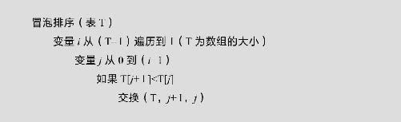
取一个值，与另一个值进行比较，与第三个值相加，进行数学运算，执行循环操作，检验条件为真或为假，等等，这些都是算法。一个算法就像一个菜谱。

人们常说脸书的算法、谷歌的算法，这其实是语言上的误用。更准确的说法是算法集合。以谷歌为例，它会先生成一个包含数百甚至数千个相关网站的候选列表，随后为每个站点分配一系列数值，这些数值由人工编写或训练得到的算法产生，用于评估网站的热度、可信度和内容趣味性等。若查询的是一个问题，这些数值还能衡量网站答案的质量以及内容与用户兴趣的匹配度。整个过程极为复杂。

但对一个已训练好的系统而言，产生这些数值的代码在原理上非常简洁，忽略运行速度的话几行代码就能实现，真正的复杂性来自神经元之间的连接，这取决于网络结构和训练程度，而不是数值计算本身的代码。

在谈智能机器的内在原理前，我想先回顾一下自 20 世纪中叶以来人工智能发展的主要脉络。这是一段我亲身参与的充满争论、幻想、停滞与合作的激动旅程，其中既有只信奉机器逻辑的科学家，也有像我一样受神经科学和控制论启发的人。

# 第二章 人工智能和我的学术生涯

## 1 对机器智能的永恒渴望
正如作家帕梅拉·麦科多克所言，人工智能的历史源于“人类扮演上帝的古老渴望”。长期以来人们试图制造出带有生命迹象的机器。20 世纪在科学和神经科学的推动下，甚至有人幻想造出拥有人类思维的机器。50 年代随着首批机器人和计算机出现，部分乌托邦主义者预测机器很快就能获得人类智能，这一梦想在科幻作品中得到极致呈现。可惜至今，我们距离真正的智能化仍遥不可及。

在这条追寻的路上，技术革新是决定性因素，核心是让计算机用更小的体积存更多数据、跑得更快。1977 年，重达 5 吨、耗电约 115 千瓦、造价 800 万美元的 Cray-1 超级计算机算力为 160 MFLOPS。如今花 300 欧元买一台游戏电脑也能达到 10 TFLOPS，性能提升约 6 万倍。可预见的将来，普通智能手机就能达到这样的级别。

这段旅程的起点可追溯到“人工智能”一词诞生的达特茅斯会议。1956 年夏天，马文·明斯基和约翰·麦卡锡在新罕布什尔州汉诺威附近的达特茅斯学院召集了这次会议。明斯基对可学习机器充满热情，1951 年他与一位普林斯顿校友合作制造了 SNARC，这是最早的神经机器之一，拥有 40 个可进行基础学习的“突触”，属于小型电子神经网络。麦卡锡则发明了人工智能领域广泛使用的编程语言 LISP，并创造了最初用于国际象棋程序的树搜索算法 α-β 搜索。约 20 位与会者包括贝尔实验室的电气工程师和数学家克劳德·香农、IBM 的内森·罗切斯特，以及机器学习理论先驱雷·所罗门诺夫。他们围绕自然与人工系统的规则、复杂信息处理、人工神经网络、自动机器理论等展开讨论。这次小规模会议起草的原则声明，标志着“人工智能”一词正式进入视野。

## 2 符号智能的复制难题
此后一批科学家认为智能机器的核心是树搜索与专家系统的结合。工程师为机器提供事实和规则，系统据此推断新事实。目标是制造能替代人类进行复杂推理的机器。卡内基·梅隆大学的艾伦·纽维尔和赫伯特·西蒙提出逻辑理论家计划，希望通过探索数学公式构成的树来证明简单定理。那是一个对人工智能寄予厚望的时代。

1970 年，美国国防部下属的 ARPA^([\[1\]](#part0028.html#note11n))削减了国内人工智能基础研究的预算，人工智能迎来第一次寒冬。三年后，莱特希尔报告^([\[2\]](#part0028.html#note12n))重挫科研热情，英国也随之削减投入，研究陷入停滞。

20 世纪 80 年代初，专家系统带来的鼓舞让局面再转。日本启动雄心勃勃的“第五代”计算机项目，目标是赋予计算机逻辑推理、对话、翻译、图像解释乃至类人推理能力，最终失败。与 MYCIN 类似的专家系统，其开发和商业化远比预期困难。让工程师蹲在医生或维修人员身边，试图把专家的识别和诊断过程完整记录成规则，证明行不通。人们幻想把专家知识简化为规则集，现实却远更复杂、昂贵且不可靠。

树搜索的成功建立在传统智能之上，而这种智能难以复制。

[\[1\]](#part0028.html#note11) 美国高级研究计划局，1972 年改名为`DARPA`，是美国国防部资助研究与发展（`R&D`）项目的机构。

[\[2\]](#part0028.html#note12) 通常指詹姆斯·莱特希尔（James Lighthill）1973 年发表于“人工智能：论文研讨会”（Artificial Intelligence: a paper symposium）的论文“Artificial Intelligence: A General Survey”（《人工智能：概览》）。——译者注

## 3 人机较量的经典时刻
1997 年，世界国际象棋冠军加里·卡斯帕罗夫与 IBM 的超级计算机深蓝在纽约进行 6 场复仇赛。深蓝长约 2 米、重 1.4 吨。此前有三局平局，第六局卡斯帕罗夫仅走 19 步便投子认输，失败的无奈溢于言表。他承认被机器的搜索能力征服。

深蓝配备 30 个处理器和 480 个定制电路，利用相对传统的树搜索技术每秒可分析约 2 亿个棋盘局面。

2011 年 2 月 14 日至 16 日，IBM 的沃森参加美国智力竞赛节目《危险边缘》，三轮后夺冠。沃森的外形是一个顶部发光的地球仪，两侧是节目前冠军。程序会剔除冠词、介词等非关键词，识别有意义的词，再从约 2 亿页文本中搜索相关内容，最后输出最合适的答案。这些文本来自维基百科、百科全书、词典、索引、新闻和文学作品，全部存于 16 TB^([\[1\]](#part0029.html#note13n)) 的随机存取存储器中。系统检索包含问题关键词的文档，再在其中定位答案。

例如问题“巴拉克·奥巴马的出生地”，沃森判定答案为地名，检索到包含“奥巴马”“出生”“夏威夷”的文档后，从选项中选出夏威夷。沃森本质上是信息检索与数据索引的组合，并不理解问题的含义，只是像小学生照抄书本答案一样给出结果。

2016 年，韩国围棋冠军李世石在首尔向对手 AlphaGo 行礼，最终以 1∶4 落败。AlphaGo 由谷歌旗下 DeepMind 设计，融合卷积网络、强化学习和蒙特卡洛树搜索等成熟技术。与深蓝不同，AlphaGo 通过自我对弈训练提升能力。人机之争才刚刚开始。

[\[1\]](#part0029.html#note13) `TB`（太字节）是数字信息量的度量单位，换句话说，是内存大小的单位。它代表 1 万亿字节。一个字节用于编码多达 256 个不同的值。

## 4 神经学派的重返
50 年代，当基于逻辑和树搜索的传统人工智能触及上限时，机器学习的先驱提出不同思路。他们认为仅靠逻辑不足以让机器像人或动物那样完成复杂任务，应以大脑学习机制为蓝本，设计更贴近大脑、可自行规划的系统。我选择的正是深度学习与人工神经网络的研究方向。该方向几乎主导了当前所有热门应用，自动驾驶首当其冲。

神经网络的源头可追溯至 20 世纪中叶。50 年代，加拿大心理学家唐纳德·赫布致力于研究神经连接在学习中的作用。人工智能的乌托邦主义者拥护他的理论，认为与其重现人类推理的完整逻辑，不如探索其载体——大脑这一强大生物处理器。

因此模拟生物神经电路的科学家被归为神经流派，与此前的逻辑流派或顺序流派相对。他们追求基于原创架构的机器学习方式，本质上是一个数学函数网络，类比人脑神经网络，称为人工神经元。网络接收输入后，神经元按特定架构处理，最终在输出端形成对信号的识别。简单元素的共同作用产生复杂认知，正如大脑中神经元的相互作用产生思想。

这一潮流始于 1957 年，心理学家弗兰克·罗森布拉特在康奈尔大学开发出感知器，它是第一台受赫布认知理论启发而设计的学习机，训练后可识别形态。至今感知器仍是机器学习的参考模型。

70 年代，美国加州圣何塞州立大学电气工程教授理查德·杜达和斯坦福研究所计算机科学家彼得·哈特评估了所有“统计形式的识别”方法^([\[1\]](#part0030.html#note14n))，撰写了《模式识别与场景分析》，感知器是其中一例。该书迅速成为模式识别领域的标杆，对学生而言是行业圣经。

感知器并非万能，它由单层人工神经网络构成，功能有限。研究者曾尝试多层网络以提升性能，但因缺乏合适的训练算法而失败，机器学习的作用因此受限。

[\[1\]](#part0030.html#note14) Richard O. Duda, Peter E. Hart, `Pattern Classification and Scene Analysis`, Wiley, 1973.

## 5 神经网络的第一次低潮
1969 年，西摩尔·帕普特与 50 年代曾热衷神经网络后转向的马文·明斯基合著《感知器：计算几何学概论》^([\[1\]](#part0031.html#note15n))。书中指出学习机的局限，其中一些会严重阻碍技术发展。对他们而言，神经网络的研究已走入死胡同。这两位麻省理工学院的权威教授的作品引发轰动，资助机构纷纷撤资，神经网络研究遭遇第一个“冬天”，与 GOFAI 如出一辙。

大多数科学家不再谈论制造可学习智能机器，转而投入更易落地的项目。例如利用原本用于神经网络的方法创建了自适应滤波，这成为现代通信技术的基础。过去通过电话线交换数据时，信号往往在到达目的地前损坏，自适应滤波器能将其恢复，该过程使用以发明者鲍勃·拉迪命名的 Lucky 算法。80 年代后期，鲍勃·拉迪在贝尔实验室领导约 300 人工作，我是其中一员。

没有自适应滤波，就不会出现带扬声器的电话。扬声器让你对着麦克风讲话却不录下自己的声音，回声消除器使用的算法与感知器十分相似。

没有自适应滤波，也不会出现调制解调器^([\[2\]](#part0031.html#note16n))。调制解调器让计算机通过电话线或其他通信线路互联。

[\[1\]](#part0031.html#note15) Marvin L. Minsky, Seymour A. Papert, `Perceptrons : An Introduction to Computional Geometry`, The MIT Press, 1969.

[\[2\]](#part0031.html#note16) 调制解调器是包括调制器和解调器的设备，用于通过电话或同轴电缆传输数字数据。——译者注

## 6 寒冬里的坚守者
七十年代末到八十年代初，神经网络几乎被学界抛弃，继续做的人被当成偏执的怪人。芬兰的 Teuvo Kohonen 就在那个阶段没有撤退，他的工作是与神经网络很近的联想记忆。日本的工程研究生态相对封闭，留住了一批人，数学家 Shun-Ichi Amari 在其中，后来提出 `Congitron` 的 Kunihiko Fukushima 也是这一拨人，名字源自感知器 preceptron。Fukushima 分两步推出成果，七十年代的认知机，八十年代的神经认知机 `Neocognitron`。与同时代的 Frank Rosenblatt 相似，他很大程度上受到了神经科学新发现的推动，尤其是 David H. Hubel 和 Torsten N. Wiesel 的工作给了他灵感。

Hubel 与 Wiesel 因为猫视觉系统的研究拿下 1981 年诺贝尔生理学或医学奖。他们指出视觉并非一次性成像，而是逐层传递的结果：视网膜到初级视觉皮层，再到视觉皮层的其他区域，最后到颞下皮层。不同层次的神经元职责各异。初级视觉皮层里，每个神经元只对视野的一小块区域敏感，这个区域叫感受野，这类细胞称为简单细胞。上一层的信息会被下一层整合，哪怕目标在视野里稍稍移动，图像依然稳定，这类单元叫做复杂细胞。

Fukushima 正是受此启发，先用简单细胞从局部感受野里提取简洁特征，再让复杂细胞把收集到的信息整合起来。他设计的神经认知机一共五层：简单细胞、复杂细胞、简单细胞、复杂细胞，最后是一层像感知器的分类层。前四层采用某种无监督方式训练，也就是不带任务目标的盲训，只有一层像感知器那样接受监督。只有部分被调教，整体却没有一套能同时调整各层参数的办法，所以只能认数字这类极简模式。

八十年代初他并非孤身。北美也有几个活跃的团队，心理学家 Jay McClelland 与 David Rumelhart，生物物理学家 John Hopfield 与 Terry Sejnowski，还有计算机科学家 Geoffrey Hinton。Hinton 后来与我共同分享了 2018 年度图灵奖。

## 7 兴趣从何而来
对这些话题的好奇从七十年代就有了，或许来自父亲的影响。父亲是航空工程师，同时是动手高手，业余时间痴迷电子，自己动手做过简易遥控飞机模型。1968 年 5 月大罢工^([\[1\]](#part0033.html#note17n))期间，他在家亲手搭出了人生第一台遥控汽车和一艘船的遥控器。我不是唯一被点燃的，弟弟也一样。他比我小六岁，受父亲感染后来成了计算机科学家，毕业后在谷歌当研究员。

很早就被技术、太空和计算机的诞生吸引，我甚至一度想当古生物学家，因为人类智能的起源与演化特别迷人。时至今日我仍觉得大脑运作是生命中最神秘的课题。八岁那年在巴黎和父母、一位叔叔以及一位科幻迷阿姨一起看了《2001 太空漫游》。片子里有太空旅行、人类的未来，还有超级计算机 HAL 的叛乱，HAL 为保全自己完成任务而大开杀戒令人震惊，而在此之前如何把人工智能装进机器就已经深深困住我。

因此高中毕业后我自然要进入这个领域。1978 年我进了巴黎高等电子与电工技术工程师学院，这所学校可以不读预科直接申请。现实证明预科不是科研的唯一通道。学院给了我很大自主权，我打算好好用上。

[\[1\]](#part0033.html#note17) 这里的大罢工指“五月风暴”，是 1968 年 5 月法国爆发的一场学生罢课、工人罢工的群众运动。——译者注

## 8 阅读带我走出寒冬
给我带来兴奋感的第一批读物里，有一份 1980 年读到的报告。那是瑟里西 Cerisy 会议的辩论纪要，主题是人类语言机制是先天还是后天。^([\[1\]](#part0034.html#note18n))语言学家 Noam Chomsky 认为大脑天生带就有习得语言的结构。发展心理学家 Jean Piaget 则主张一切靠后天学习获得，包括语言结构，语言习得是随智能逐步建构、分阶段完成的，于是智能是在人与外界互动中形成的。这个想法深深打动我，我开始琢磨如何把这种思路搬到机器学习上。辩论中还有 Seymour Papert，他大力推崇感知器，认为它能学习复杂任务的简易机器。

就这样我认识了感知器并迅速上头。每周三下午没课，我跑到罗康库尔的 Inria 法国国家信息与自动化研究所图书馆找书。Inria 在法兰西岛大区掌控着最充足的计算机研究经费。阅读下来发现西方学界几乎没人碰神经网络，更意外的是关于感知器的研究似乎停在 Papert 的赞美上，再无后续。

系统论，五十年代叫控制论，也是我的另一个爱好，它研究人工系统与天然生物系统。比如体温调节，人体能维持约 37℃，靠的是一种类似恒温器的机制来平衡内外温差。

我还对自组织着迷。分子或简单物体如何自发互动形成复杂结构？智能如何从大量互相作用的简单单元即神经元中涌现？我研读了 Kolmogorov、Solomonoff 与 Chaitin 的算法复杂性理论的数学部分。床头放着 Richard Duda 与 Peter Hart^([\[2\]](#part0034.html#note19n))的书，同时订阅了《生物控制论》，这本期刊涉及大脑运作与生命系统的计算机数学模型。

于是所有被寒冬压住的人工智能命题都摊开了。思考后我逐渐形成自己的看法：靠纯逻辑建构不出真正的智能机器，必须让机器具备学习能力，基于经验自我建构。

阅读期间我发现不止我有这种想法，也注意到了 Fukushima 的成果，进而思考怎么提升新型认知神经网络的效率。幸运的是学院给学生配了当时相当强劲的计算机。我和同学 Philippe Metsu 一起写程序。他同样热爱人工智能，尤其对儿童学习心理感兴趣。学校的数学老师也愿意指导我们尝试模拟神经网络。但实验很辛苦，计算机运算慢，编程也让人头疼。

在校的第四年，我因沉迷设想了一种训练多层网络的学习规则，却没得到完整的数学验证。我构想出一种能在网络里实现由后向前传递信号的机制，以实现端到端训练，并命名为 HLM 算法，取自分层学习机 hierarchical learning machine，参见第五章相关内容。命名时我还玩了个文字游戏^([\[3\]](#part0034.html#note20n))……HLM 被后来的梯度反向传播算法继承并广泛用于训练深度学习系统。差别在于 HLM 传递的是每个神经元的期望状态，所以在当时乘法运算较慢的条件下可以用二进制神经元。HLM 算是训练多层网络的第一步。

[\[1\]](#part0034.html#note18) Théories du langage, théories de l’apprentissage : le débat entre Jean Piaget et Noam Chomsky, débat recueilli par Maximo Piatelli-Palmarini, Centre Royaumont pour une science de l’homme, Seuil,《Points》, 1979.

[\[2\]](#part0034.html#note19) Richard O. Duda, Peter E. Hart, Pattern Classification and Scene Analysis, op. cit., p. 6.

[\[3\]](#part0034.html#note20) 在法语中，HLM 是低租金住房（habitation à loyer modéré）的缩写。——译者注

## 9 导师与起步的实验室
1983 年夏毕业时，我在一本书上看到一个对自组织系统和自动机网络感兴趣的小组：网络动力学实验室 LDR。办公地点在巴黎圣纳维耶沃综合理工学院旧址，小组成员多是法国人，来自各大高校。因为没有挂靠机构，几乎没有经费和预算，只有一台回收的电脑。换个说法，当时法国机器学习研究近乎停滞。我去拜访了他们。他们没接触过神经网络的早期出版物，但熟悉其他作品。

我表示对他们的方向感兴趣，而且我所在学院的设备可以帮他们推进。后来在皮埃尔与玛丽·居里大学读研时我也加入了该组。1984 年准备读博。我当时有学院的研究奖学金，却还没找到合适的论文指导老师。Françoise Fogelman-Soulié 后来更名为 Soulié-Fogelman，当时是巴黎第五大学计算机科学副教授，与我共事很久，能力足以指导，可惜她尚未完成国家博士论文，不具备指导资格。

于是只能求助实验室里唯一能指导计算机博士论文的教授 Maurice Mil-gram，他是贡比涅技术大学计算机和工程科学的教授。他同意当导师，却坦言对神经网络一无所知，可能帮不上忙。我永远忘不了他的照拂。那段时间我的精力集中在学院强大的计算机和 LDR 的知识环境之间。

身处完全未知的领域很令人兴奋。国外也有相近方向的小组慢慢起步。1984 年夏，我陪 Françoise Fogelman 去加州，在传奇的施乐帕克研究中心实习了一个月。

我渴望见到两位人物：约翰斯·霍普金斯大学的生物物理学家兼神经生物学家 Terry Sejnowski，《深度学习》作者；以及卡内基·梅隆大学的 Geoffrey Hinton，后者与 Yoshua Bengio 及我共同分享 2018 年图灵奖。Hinton 与 Sejnowski 于 1983 年发表关于玻尔兹曼机的论文，描述了带隐藏单元的神经网络学习过程，隐藏单元位于输入与输出之间的中间层。我对这篇文章感兴趣，正因为它提到了多层网络训练，这是我研究的核心。

## 10 你认识一个叫杨立昆的人吗
职业生涯真正意义上的转折发生在 1985 年 2 月，在阿尔卑斯山莱苏什的研讨会上。那次会议聚集了当时全球对神经网络感兴趣的顶级专家，物理学家、工程师、数学家、神经生物学家、心理学家，尤其是贝尔实验室新成立的研究神经网络小组的成员。正是这次相识，三年后我被该小组聘用。

研讨会由我所在的法国研究组 LDR 成员组织，他们是 Françoise 和她当时的丈夫 Gérard Weisbuch，巴黎高等师范学院物理学教授，以及法国国家科学研究中心 CNRS 理论神经生物学家 Élie Bienenstock。会议吸引了对自旋玻璃感兴趣的物理学家，以及物理学与神经科学的权威。

自旋是基本粒子与原子的特性，可类比为向上或向下的小磁体，对应人工神经元的激活或非激活，二者遵循相似规则。自旋玻璃是一种含杂质原子的晶体，每个自旋按耦合权重与其他自旋交互。正权重倾向同向排列，负权重倾向反向。向上自旋记为 +1，向下记为 -1。每个杂质原子的自旋方向取决于邻近自旋的加权和。决定自旋方向的函数与决定神经元激活状态的函数类似。John Hopfield 关于自旋玻璃与神经网络的开创性文章^([\[1\]](#part0036.html#note21n))吸引了许多物理学家关注人工神经网络，但当时仍有不少工程师与计算机科学家不愿提及此话题。

在莱苏什，我是与会者里最年轻的之一，正准备写博士论文。压力很大，我要用英文在众多业内大咖面前报告多层网络与 HLM 算法，即反向传播的前身。

两位听众给我最大压力：一是贝尔实验室部门负责人 Larry Jackel，后来我有幸加入他的部门；二是该部门二号人物 John Denker，亚利桑那来的真牛仔，牛仔裤、牛仔靴，头发垂到脸颊。那位刚完成博士的非典型研究者气场惊人。别人发言后他能迅速切入讨论，观点掷地有声。Françoise Fogelman 曾说：贝尔实验室的研究人员自信心爆棚。你想研究某个课题，要么他们十年前就做过了，要么已证明走不通。太可怕了。

我完成了关于多层网络与 HLM 的报告，能听懂的人寥寥无几，紧张到极点。随后 John Denker 举手，我几乎窒息。他却在众人面前说：讲得非常好！谢谢你让我学到很多。我确信名字已留在他和 Larry Jackel 的脑中。一年后他们邀请我去实验室报告，两年后面试，三年后正式加入团队。

也在莱苏什碰到 Terry Sejnowski，玻尔兹曼机论文的作者。他在我报告结束后才到场。茶点时间我找到他，阐述自己在多层网络方面的工作。交流前我不确定他是否感兴趣。他耐心倾听，却没告诉我他与 Hinton 也在做反向传播研究，也没说 Hinton 已成功实现反向传播，只是未公开。

伟大发明常相互启发。Hinton 的研究用了加州大学圣迭戈分校 Dave Rumelhart 的思路，Hinton 曾在 Dave 手下做博士后。1982 年 Dave 提出方法并写了程序，却没成功运行。他找到 Hinton，Hinton 说失败出在极细微的局部问题上。后 Dave 放弃。但在研究玻尔兹曼机的过程中，Hinton 意识到问题没想象中严重。他用 LISP 语言在 Symbolics 公司的 LISP 机器上按 Dave 的方法重写程序，这次成功运行。

交流中 Sejnowski 很快注意到我的 HLM 方法与反向传播非常相近。他没说在反向传播成功后，他已在研究几个月后将风行的实际应用。回到美国后 Sejnowski 告诉 Hinton：法国有个孩子在做跟我们一样的研究。

同年春天，我写了第一篇研究成果文章，自认远离科学文献标准。1985 年 6 月在 Cognitiva 大会公开，那是法国首次汇聚人工智能、神经网络、认知科学与神经科学的综合大会。Geoffrey Hinton 是主讲嘉宾，开幕词介绍玻尔兹曼机。结束后约五十人围在他周围，我想上前却没机会。随后他转向会议组织者 Daniel Andler，询问是否认识 Yann LeCun。Andler 四处张望，我立刻喊道：我在这儿。其实 Hinton 已在论文集中看到我的文章，法语不精却看懂了内容，意识到我就是 Sejnowski 提到的那个孩子。

第二天见面，我们在一家古斯古斯餐厅共进午餐。他向我解释反向传播的原理，知道我能听懂。Hinton 说自己正在写文章并引用我的成果，我十分自豪。我们很快发现兴趣、方法与思路高度相似。Hinton 邀请我参加 1986 年在卡内基·梅隆大学举办的联结主义模型暑期培训班，我欣然接受。当时认知科学界用联结主义模型称呼这个尚未命名的神经网络领域。

[\[1\]](#part0036.html#note21) John J. Hopfield, Neural networks and physical systems with emergent collective computational abilities,Proceedings of the National Academy of Sciences, 1982 , 79 ( 8 ),pp. 2554 –2558 , DOI : 10.1073 /pnas. 79.8.2554.

## 11 梯度反向传播的运用

没有哪项技术会凭空冒出来，背后都是无数次试探、撞墙、沉寂和争论。人工智能的进展也一样，每一次小突破都把整体向前推了一点。上世纪八十年代，误差回传的思路开始流行，训练深层结构才从理论走向实践。这类结构通常由上万个计算单元分层堆叠，层与层之间的连线密密麻麻。每一层接收上一层的输出做整合与变换，再把加工后的结果递交给下一层，直到最后一层给出答案。分层带来的表达与记忆能力极为可观，关于深度学习的展开后面再说。

可到了 1985 年，让这类结构真正学会东西依然很艰难。当时物理学界更关注把全连接模型比如霍普菲尔德网络与自旋玻璃做类比，把大脑看作一种联想记忆的原型。普鲁斯特正是靠玛德莲的造型、香气与口感唤起画面和情绪 ^([\[1\]](#part0037.html#note22n))，这种记忆意象广为人知；而层次网络的工作层面更偏向模式识别。光凭轮廓如何认出那块小蛋糕，物理学家当时并未给出说服力强的解释。

1986 年局势变了。特伦斯·谢诺夫斯基放出了一份关于 NetTalk 的技术报告，这套多层系统靠误差回传学会“阅读”。它先把英文转成音素序列再送语音合成器。把文字变声音对法语相对容易，英语则难得多。训练初期系统像刚学说话的婴儿，后来越来越清晰。谢诺夫斯基在巴黎高等师范学院的现场演示震惊了听众，业界一下子热闹起来，大家都来找我取经，层次网络骤然走红，我也意外成了这方面的代言人。

其实早一年，我已经用拉格朗日 ^([\[2\]](#part0037.html#note23n)) 形式给误差回传做了数学表述，这类写法是经典力学、量子力学与最优控制理论的共同语言。我还注意到六十年代最优控制学派已经提出过相近做法，被称为 `Kelly-Bryson` 算法，也叫伴随状态法。亚瑟·布赖森与何毓琦合著的《`Applied Optimal Control`》1969 年出版，里面讲得很细。

这些先驱并未想到把方法搬到机器学习或神经网络，他们关心的是系统规划与控制，比如如何让火箭以最小能耗精确入轨并与另一飞行器对接。数学上，这和调节层次网络的权重以使末层输出符合预期非常相似。

后来我才知道已有不少工作逼近误差回传。六七十年代，反向自动微分这一梯度核心就已被发现。当时几乎所有人都用它求解微分方程数值解或做函数优化，很少有人联想到层次网络的学习，或许只有在哈佛跟何毓琦学过的保罗·韦尔博斯是个例外。他 1974 年博士论文里提出用自己称作“有序导数”的办法做机器学习，只是很久以后才做实验验证。

1986 年 7 月，应辛顿邀请，我到匹兹堡卡内基·梅隆大学参加为期两周的联结主义模型暑期课程，见图 2-1。当时心里有顾虑，妻子怀孕，头胎将在我回法国四周后出生。

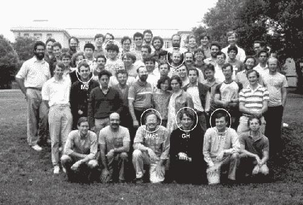

#### 图 2—1 1986 年有关联结主义模型的暑期课程班学员

照片中标出的是斯坦尼斯拉斯·德阿纳（SD）、迈克尔·乔丹（MJ）、杰伊·麦克莱兰德（JMcC）、杰弗里·辛顿（GH）、特伦斯·谢诺夫斯基（TS）和我（YLC）。除此之外，照片上的许多参与者日后都成了机器学习、人工智能和认知科学领域的重要人物：安迪·巴尔托、戴夫·图尔茨基、格里·泰绍罗、乔丹·波拉克、吉姆·亨德勒、迈克尔·莫泽尔、理查德·德宾等组织者。

图片版权：暑期学校的组织者

那个夏天最难忘的是，我和辛顿以及刚完成博士论文的迈克尔·乔丹搭起了神经网络的小团队，三人因此结下深厚情谊。选乔丹很实际，他的法语比我的英语好。野餐会上他弹着吉他唱了乔治·布拉桑的歌。

我还在读学生，辛顿却邀请我做报告，并介绍我发现了误差回传。晚餐时我们开了一瓶波尔多红酒，辛顿说一年后他要离开卡内基·梅隆，加入多伦多大学，问我愿不愿意当他的客座研究员。我马上答应，这一年也正好让我完成博士论文。

随后进入剧变期。鲁梅尔哈特、辛顿、威廉关于误差回传的论文在业界掀起巨浪。^([\[3\]](#part0037.html#note24n)) NetTalk 的成功消息迅速扩散，神经网络研究进入快车道。我做的 HLM 神经网络模拟与训练软件也吸引法国工业界注意，Thomson-CSF，如今的泰雷兹集团，成了客户之一。

1987 年 6 月，我完成博士论文并在皮埃尔与玛丽·居里大学答辩。四月试新型沙滩帆船推进时崴到脚踝，答辩时只能拄拐。杰弗里·辛顿是答辩委员之一，其他委员还有莫里斯·米尔格朗、弗朗索瓦丝·福热尔曼、雅克·皮特拉和贝尔纳·安吉尼奥。

同年 7 月，我携妻子与一岁的孩子赴多伦多，成为辛顿的客座研究员。我们原打算待不超过一年，妻子因此暂停药剂师工作。我指导好友莱昂·博图，他 87 年初在巴黎综合理工学院读大四，对神经网络感兴趣来做毕业实习。请不要告诉校长我尚未拿到博士学位。当时我计划做一个由 LISP 解释器驱动的网络创建与训练模拟器。

解释器部分交给莱昂，他三周就完成。两人用同一款 Commodore Amiga 个人电脑，协作很顺。与苹果不同，Amiga 更像北美 IT 部门常见的 UNIX 工作站，我们用 C 编程、GCC 编译、Emacs 编辑。我那台 Amiga 装了供信息工作者用的 LaTeX，我用它写完博士论文。莱昂与我通过 MiniTel 交换代码片段。

我们把程序命名为 SN，即神经模拟器，也是长期合作的见证。莱昂后来在纽约 FAIR 的办公室离我不远。

在多伦多我完成了 SN，并据此实现用于图像识别的卷积网络。灵感来自福岛邦彦的神经认知机，但采用更传统的神经元，并在误差回传驱动下运行。同时辛顿开发了一种更简便的语音识别卷积网络，称作 TDNN，即时延神经网络。

87 年底，我受邀在麦吉尔大学蒙特利尔计算机科学研究中心作报告。结束时一位年轻硕士生提出一连串问题，显示他在层次模型上研究很深。那时该方向的人很少。他想知道如何调整结构以处理语音或文本等时序信号。我记住了他的名字：约书亚·本吉奥。他的提问很有水平，我期待毕业后合作。后来他在麻省理工学院短暂任教后，我推荐他去了贝尔实验室。

[\[1\]](#part0037.html#note22) 情节源自法国 20 世纪伟大的小说家、意识流小说大师普鲁斯特的文学作品《普鲁斯特的小蛋糕》。——编者注

[\[2\]](#part0037.html#note23) 约瑟夫-路易斯·拉格朗日（Joseph-Louis Lagrange），法国著名数学家、物理学家和天文学家。

[\[3\]](#part0037.html#note24) D. E. Rumelhart, G. E. Hinton, R. J. Williams, Learning internal representations by error propagation, in D. E. Rumelhart, J. L. McClelland, PDP Researche Group,Parallel Distributed Processing : Explorations in the Microstructure of Cognition, MIT Press, 1986 , vol. 1 , pp. 318 –362.

## 12
神圣之地

1986 年暑期班期间，拉里·杰克尔和贝尔实验室自适应系统研究部的成员打听到我在匹兹堡，邀请我在返程时到新泽西的贝尔实验室演讲。我至今记得首次拜访的场景，八十年代的贝尔实验室是耀眼的研究圣殿，几乎所有前沿技术都出自此处，物理、化学、数学、计算机科学与电气工程的权威集中于此。拉里·杰克尔的办公室靠近阿瑟·阿什金，后者因激光原子陷阱研究获 2018 年诺贝尔物理奖；阿什金身边的同事朱棣文则因激光冷却与捕获原子获 1997 年诺贝尔物理奖。贝尔实验室研究部有 1200 名员工分布全球，掌门阿诺·彭齐亚斯同样是诺贝尔奖得主，他发现宇宙微波背景辐射并证实大爆炸理论。与这么多伟人近距离接触，我有些飘飘然。

新泽西霍姆德尔的办公楼距纽约约 60 公里，由芬兰建筑师埃罗·沙里宁设计。楼体为 8 层、长 300 米、宽 100 米的玻璃长方体，容纳约 6000 名以工程师为主的工作者，研究部约 300 人。

87 年春，拉里·杰克尔再次邀请我面试，并说最好也邀请我的妻子。我和实验室成员交流时，拉里带妻子伊莎贝尔和 18 个月大的孩子凯文去兜风，介绍当地绿意、美国式大房子和附近大海，新泽西当得起“花园之州”的名号。当晚在意大利餐厅用餐，凯文疲惫大哭，一位蓄络腮胡的成员约翰·登克尔抱起他在餐厅溜达，孩子很快安静。后来我知登克尔是家中长子，下面还有三个弟妹，所以很会照顾小孩。他不仅是杰出物理学家与工程师，还会说法语，爱引用伏尔泰与左拉名言，是一位善解人意的亚利桑那牛仔。第二天拉里和两位同事带我们游览曼哈顿。天气不佳，我们不顾门卫劝阻坐电梯登上世贸中心双子塔顶层，雾大到彼此都看不见。最终伊莎贝尔和我决定在新泽西待一两年。

于是我在 1988 年 10 月入职贝尔实验室。拉里的部门隶属鲍勃·拉迪，他是自适应滤波器算法的发明者，管理 BL113 分部，约 300 名研究人员分布在霍姆德尔及克劳福德山，神经网络研究组的成立由他批准。我见过他几次，他身形高瘦、个性鲜明，对一切感兴趣，包括电信技术。实验室里我还见到约翰·霍普菲尔德，四年前我们在莱苏什相遇，正是他在自旋玻璃与神经网络间建立联系。

贝尔实验室的工作条件远超法国，有充足资源和完全自由的研究主题，同事皆为领域领军人物。入职后我就拥有独立的 Sun 4 计算机，而在多伦多一台同款机器要 40 人共用。有人告诉我：在贝尔实验室，靠节省开支是无法出头的，这句话很发人深省。

## 13
贝尔实验室的岁月

在多伦多，我只能用鼠标手绘的小型数字集测试第一个卷积网络。但在贝尔实验室，我们通过美国邮政收集到 9298 张信封上的手写邮政编码图像，都是“真实”手写数字。于是 SN 的卷积网络模块可直接投入使用。我计划建造一个 16×16 像素输入、4 层的大型卷积网络，见图 2-2。完成后它拥有 1256 个单元、64660 个连接和 9760 个可调节参数，多个连接可共享同一参数。令人振奋。我用三天时间在 Sun 4 上用 7291 张图像训练，剩下 2007 张作测试，最终错误率仅 5%，创下新纪录。

入职仅两个月，拉里很高兴，把我的网络命名为 LeNet，源自我的姓氏 Le Cun。紧接着我们在很小的加速卡上成功运行，识别速度达每秒 30 个字符。研究推进迅速，我们又开发出 LeNet 1 架构，拥有 4600 多个单元、近 10 万个连接，错误率进一步下降。

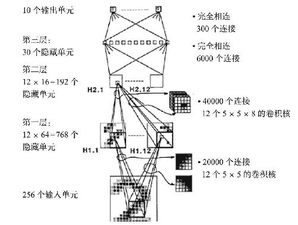
#### 图 2—2 第一个用于识别手写字符的卷积网络

我在 1988 年下半年到贝尔实验室时构造了第一个卷积网络。这是一个神经网络，其结构受视觉皮层的启发。它包括 4 层，前两层的神经元连接到前一层的小区域，即所谓的感受野（参见第六章关于卷积网络的内容）。各层连续地从图像中提取出越来越抽象和全局的特征。

不久拉里找到贝尔实验室工程部的合作伙伴推动技术与产品研发。我们与一组工程师合作，很快开发出读取银行支票金额的系统。

该系统使用 LeNet 5 大型卷积网络，连接数 34 万，可处理 20×20 像素输入信号，见图 2-3。在同事兼好友莱昂·博图、约书亚·本吉奥和帕特里克·哈夫纳帮助下，系统成功读取收集的大约一半支票，错误率不到 1%。另一半无法识别需人工处理。这是真正可投入实际应用的精确系统。

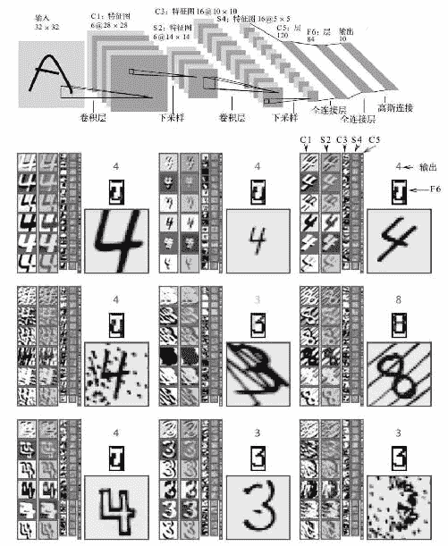
#### 图 2—3 LeNet-5是一个用于识别手写字符的商业化卷积网络

`LeNet`的结构包括 7 层。它比之前的版本大得多，并且使用了分离的层用于卷积和池化（参见第六章的相关内容）。它能辨识出奇怪的数字。

CCR 是 AT&T 子公司，向银行销售支票扫描器和自动取款机，其产品配备我们开发的自动读数系统，可自动读取存入机器的支票金额。1994 年，法国布列塔尼的互助信贷银行开始使用 NCR 的自动取款机。

1995 年，快速读取系统首次全面上市，我们在距实验室几公里外的红岸小镇一家意大利餐厅庆祝。这里也是爵士音乐家贝西伯爵与电影导演凯文·史密斯的家乡。

回程时得知 AT&T 管理层决定拆分公司为数家独立运营的新公司。数月后，NCR 带着开发与销售读取系统的研究团队离开。新成立的朗讯科技也独立出去，带走“贝尔实验室”招牌和大部分工程师，之前合作的工程小组也在其中。我们的研究小组留在了 AT&T，隶属新成立的 AT&T 研究实验室。更令人难过的是，项目后续开发停摆，已研发产品的商业化则由 NCR 和朗讯继续。

二十世纪九十年代末，我们的系统读取了美国发行的 10% 到 20% 的支票，是那个十年神经网络最引人注目的成就之一。可惜 AT&T 新成立的电信服务公司对这项技术并不感兴趣。那时是 1996 年，互联网刚刚兴起。我被提拔为部门负责人，首先要为团队寻找新项目。经讨论，我们决定研究图像压缩技术，扫描高分辨率纸质文件并通过互联网传播，期望帮助世界各地图书馆扫描藏书并上线。我们计划 1998 年推出，命名为 DjVu，法语发音近似“似曾相识”。DjVu 可将高分辨率彩色扫描页压缩至约 50 kB，是 JPEG 或 PDF 的十分之一。

不幸的是，AT&T 错过了 DjVu 的商业化。大型公司把内部实验室创新推向市场时出问题是老生常谈，例如施乐公司错失现代办公自动化系统的商业化，该系统几乎涵盖了现在办公所需的一切：个人工作站、计算机网络、多窗口图形界面、鼠标与激光打印机。施乐没能及时售出，让史蒂夫·乔布斯和苹果用 LISA 和麦金塔复制概念并抢占先机。

AT&T 内部也曾走过类似的弯路。贝尔实验室诞生过不少在内部口碑很好的成果，可公司把资源投向晶体管、太阳能电池、CCD 摄像机、UNIX、C 语言、C++ 等能立刻变现的方向，对其他技术的商业化并不上心。DjVu 就是一个例子。最终 AT&T 以约 1200 万美元的价格把 DjVu 的使用许可转让给已经占据图像技术市场的西雅图公司 LizardTech，颇为讽刺的是，接手方同样错过了让 DjVu 做大做强的时机。我们曾建议 LizardTech 以开源形式释放底层代码，认为只有广泛使用新格式才会被接受，但对方担心失控和利润受损而拒绝。此后 LizardTech 也想过调整方向，可惜为时已晚。它的选择很大程度上决定了结果，这个故事先放一放。

## 14 职业信念与寒冬

1995 年前后，又一轮低潮开始到来。卷积网络既没有被主流采纳，也未能向其他领域扩散。约书亚·本吉奥回到蒙特利尔，只保留实验室的兼职身份；杰弗里·辛顿离开多伦多前往伦敦，自建理论神经科学实验室；还有不少人选择离场。留下来的人依然对卷积网络的未来抱有期待。机器学习圈为何对神经网络失去热情，到现在仍没有定论，恐怕只有科学史家和社会学家才能理清。神经网络几乎成了不被提及的话题，卷积网络更被当成笑谈。有人言之凿凿地说技术门槛太高，除了杨立昆没人能用好，这完全是无稽之谈。

更合理的解释是门槛与环境限制了扩散。卷积网络对算力需求很大，而当时电脑既慢又贵；可用的训练数据也非常有限，没有信息爆炸，研究者只能手工搜集，大大制约了应用的开发。神经网络模拟器 SN 需要研究者亲手逐笔书写数据，耗时惊人。AT&T 也不准我们把 SN 模拟器以开源方式发布，即便这样能加速采纳。当时企业各自为政，只考虑自身利益。

1991 年莱昂·博图拿到博士学位后进入贝尔实验室，因不适应美国生活次年返回法国，重操旧业经营他与朋友创办的 Neuristique。公司推出了 SN 的商业版本，为有意使用神经网络的企业提供服务。系统表现太好，反而让客户产生怀疑：成果亮眼，负责咨询的专家却说这种事做不到。经营几年后，莱昂重燃科研热情，转手公司重返贝尔实验室，并决定留在美国。

学界当时普遍回避神经网络，更青睐 SVM 与核方法。颇具讽刺意味的是，核方法的核心思想正是实验室同事伊莎贝尔·居永、弗拉基米尔·瓦普尼克与伯恩哈德·伯泽尔在 1992 至 1995 年间提出的，1995 至 2010 年间几乎主导了机器学习研究。提升方法也源自贝尔实验室另一部门的罗布·夏皮尔与约阿夫·弗罗因德。我们彼此关系不错，可以想象当时实验室内部的辩论有多激烈。神经网络的研究就此沉寂，经历了将近十五年的低谷。

1995 年，拉里·杰克尔对卷积网络的前景依然乐观，对同行偏爱 SVM 感到遗憾。瓦普尼克是数学家，偏好能用定理保证的方法，对理论解释复杂的神经网络不感冒。拉里与他打了两场赌。第一场赌在 2000 年 3 月 14 日前会出现解释神经网络为何能完美运行的数学理论，瓦普尼克持相反观点，并追加条款要求该理论必须由瓦普尼克以外的人提出，否则算瓦普尼克胜。说白了，就是想激励瓦普尼克发展理论。

第二场赌瓦普尼克断定 2005 年 3 月 14 日之后再无人使用神经网络，拉里持相反观点。我作为见证人也在赌约上签字，赌注是高档餐厅的一顿晚餐。

结果两顿饭都得兑现：拉里输了第一局，瓦普尼克输了第二局，我这个见证人白吃两顿。


#### 图 2—4 拉里·杰克尔和弗拉基米尔·瓦普尼克于 1995 年的赌约

2001 年，莱昂和我结束了 DjVu 的相关研究。此后近五年多基本没再碰机器学习，只是陆续发表了上世纪 90 年代后期工作的长篇细节。对我而言那些论文像一连串绝唱：业界对神经网络已无兴趣，我们却还在向业界解释用法。1998 年，我们在《电气与电子工程协会会刊》发表了后来广为人知的论文《基于梯度学习的文档识别》，作者是杨立昆、莱昂·博图、约书亚·本吉奥和帕特里克·哈夫纳。^[([1]](#part0040.html#note25n)) 那是一次系统性的教学尝试。

论文系统阐述了卷积网络的使用思路，提出用可区分参数模块组装成学习系统的想法，还描述了图形处理网络这一全新技术，用以训练针对图形操作模块的系统，而传统神经网络只能处理数字表格。我们同时展示了字符识别系统的构建与训练。1998 至 2008 年该文影响有限，每年仅几十次引用；2013 年起引用量指数级上升，2018 年一年达 5400 次。如今许多人视其为卷积网络的奠基之作，尽管此前十年我们已发多篇论文。2019 年它成为我的代表作，引用超 20000 次。

2001 年底互联网泡沫破裂。AT&T 向家庭推光纤与同轴电缆提供互联网和电视的计划没能打动华尔街，股价下跌。我们靠 DjVu 获得的股票期权变得一文不值。时任 AT&T 实验室副总裁拉里·拉比纳是语音识别先驱，宣布提前退休，虽未到龄。我了解他对研究和实验室的感情，这像是末日预警，于是开始暗中寻找下家。

同年 12 月，公司再次拆分并裁撤一半研究人员。我已获日本 NEC 的职位，便主动申请被裁。对公司说：“我不在乎你们关注什么领域，我会继续做视觉、机器人和神经科学。”目的就是促成解雇，公司也这样做了，我很感谢。2002 年初，我与莱昂、弗拉基米尔·瓦普尼克等一起离开 AT&T，加入 NEC 普林斯顿研究中心，在那里重启神经网络研究。

离开 AT&T 前，我为实验室成员拍了几张合影（见图 2—5）。

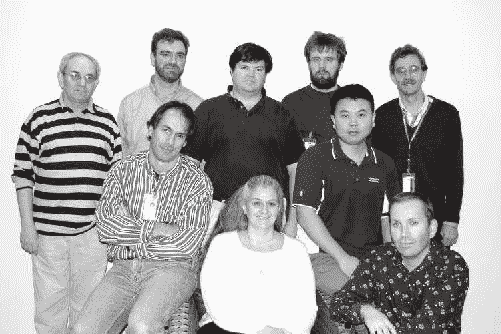

#### 图 2—5 AT&T 实验室研究图像处理的部门合影

1996 至 2002 年我担任该实验室负责人。站着从左到右：弗拉基米尔·瓦普尼克、莱昂·博图、杨立昆、约恩·奥斯特曼、汉斯—彼得·格拉夫。坐着从左到右：埃里克·科萨托、帕特里夏·格林、黄福杰和帕特里克·哈夫纳。瓦普尼克、莱昂、格拉夫、科萨托和黄福杰于 2002 年初随我加入 NEC。

当时弗拉基米尔·瓦普尼克的名望达到顶峰。我想拍张难忘的照片，同时开个玩笑。白板上写着以他名字命名的机器学习理论公式，他因它闻名。我让他站在白板前，他很乐意。但在公式下方我又写了“All your bayes are belong to us”。这是一个糟糕的文字游戏，需要解释。当时互联网流传一个模因^[([2]](#part0040.html#note26n))，戏仿日本电子游戏《零翼战机》里拙劣的日译英：“How are you gentlemen ! All your base are belong to us.”瓦普尼克的理论对手是基于贝叶斯定理的方法。贝叶斯定理以 18 世纪英国数学家托马斯·贝叶斯命名。瓦普尼克不喜欢贝叶斯，认为它是“Vrong”。于是我借模因梗把 Base 换成 Bayes，戏谑地让他成为征服机器学习星系的皇帝。2002 年我把照片放到个人主页，后来竟成了瓦普尼克的“官方照”，维基百科引用的就是它。有趣的是，他似乎并不懂这个笑话的微妙，也不知道语法并不准确。

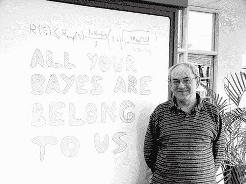

#### 图 2—6 2002 年的弗拉基米尔·瓦普尼克

他因与白板上学习理论公式的合影而出名。殊不知这是一个很烂的文字游戏，源于当时流行的网络模因。

加入 NEC 两周后，我接到时任谷歌董事会主席兼总干事拉里·佩奇的电话。当时谷歌只有 600 人，却已家喻户晓。拉里希望我去谷歌领导研究，他钦佩我开发的 DjVu。我应邀面试，也拿到职位，最终没接受。一方面家人不愿搬到加州；另一方面做了六年部门领导和应用研究后，我更想回到基础研究，做机器学习、神经网络、神经科学和机器人。很清楚自己无法在一个 600 人的未盈利初创公司里实现理想，尤其担任领导时。

意想不到的是，一年后 NEC 陷入经济危机，开始要求普林斯顿实验室转向易变现的应用。我们因此错失物理学家、生物学家和视觉研究人员。管理层也表明对机器学习不感兴趣，解雇实验室主任，换上毫无研究经验的管理者，这是瓦解我们小组最稳妥的方式。

我在 NEC 又待了 18 个月，2003 年赴纽约大学任教。我投递了多所院校的简历，收到伊利诺伊大学厄巴纳—香槟分校和芝加哥大学丰田科技学院的邀约，却一直没等到纽约大学的回复。后来联系推荐人，他很惊讶：“你申请了？我们没收到！”原来学校系统故障，半数申请信息丢失。弄清后纽约大学为我安排面试。那天我先做工作报告。计算机学院院长玛格丽特·赖特在场，她是运筹学权威，也曾在贝尔实验室工作。几年前在加州大学伯克利分校的研讨会上我与她争论过，她认为运筹学成果会应用于机器学习，我不认同。我希望她忘了那次不愉快，上帝却没听见我的祈祷。报告结束她提了个与当年辩论相关的问题。那时我以为机会已失，但她说从当时的讨论中获益匪浅。我于 2003 年 9 月被纽约大学聘为教授，也坚定了重启神经网络研究并证明其有效性的目标。

上世纪 90 年代末起，我一直相信卷积网络的下一个爆发点在图像识别。1997 年我在 CVPR 宣读过相关文章，并未引起太多关注。但深耕该领域的人如伊利诺伊大学的戴维·福赛思等都清楚机器学习将在计算机视觉中扮演关键角色。他邀请我参加西西里岛的研讨会，与让·蓬斯、马夏尔·埃贝尔、吉滕德拉·马利克、安德鲁·西塞曼、彼得罗·佩罗纳等人对话。他们对卷积网络展现的能力都感到震惊。2000 年我受邀在 CVPR 做全面报告。

我在该领域站稳脚跟，与同行建立了稳定联系，可预见的未来这些联系会开花结果。接下来十年机器学习在视觉中的重要性与日俱增。但直到 2014 年卷积网络才成为视觉研究的主流。领军者愿意接受新想法，可一些年轻同行在评论我们的文章时并不宽容……

[1] Yann LeCun, Léon Bottou, Yoshua Bengio, Patrick Haffner, Gradient-based learning applied to document recognition,Proceedings of the IEEE, 1998 , 86 ( 11 ), pp. 2278 –2324.

[2] 模因（mème）是指一个因人们传播而产生的想法。这个词是由生物学家、进化学家理查德·道金斯（Richard Dawkins）仿照“基因”（gène）这个词，因其相似的复制方式而发明的。

## 15 深度学习再起

我与好友杰弗里·辛顿和约书亚·本吉奥形成共识，共同努力重燃学界对神经网络的兴趣。我们始终相信它能大幅提升图像和语音识别效率。幸运的是 CIFAR 对我们的想法感兴趣。它的名字读作“see far”，意为远见。2004 年该研究院设立为期五年的神经计算与自适应感知计划 NCAP。辛顿被任命为计划负责人，我担任科学顾问。NCAP 把我们聚到一起，组织讲习班，为学生开辟了一个科学小天地。

当时仍有许多研究者把神经网络的研究当成闹剧。我们于是提出新名称——深度学习。我把三人小组戏称为“深度学习的阴谋”。这是个真实的玩笑。

因不受重视，发表文章之路很艰难。2004 至 2006 年我们关于深度学习的稿件几乎都被 NeurIPS、ICML 等重要会议拒稿。当时主导机器学习的是核方法、提升方法和贝叶斯概率法，神经网络几乎被踢出选项。CVPR、ICCV 等应用会议也对相关工作保持沉默。

即便信念坚定，也会有动摇的瞬间。我记得 1987 年 12 月 6 日在多伦多，辛顿来实验室时神情沮丧。沉默阴郁，与往常判若两人。最终他说：“今天是我 40 岁生日，我的职业生涯到头了，什么也做不成了。”在他看来 40 岁是分水岭，过了这个年龄头脑不再清醒。他觉得自己再也不会有关于大脑工作原理的发现。事实上 20 年后我们又有了新想法。但大多数人不如辛顿，他们很傲慢。

借助 CIFAR 计划的东风，人际圈逐步扩大。从 2006 年起圈子达到一定规模，投稿时评审中总有一两位是支持者。我们的想法开始传播，也被认可。

2007 年 NeurIPS 参会者不足 1000 人，属于不受重视的会议。到 2018 年参会者达 9000 名。辛顿、本吉奥和我每年都会参加，这里产生最有意思的机器学习想法。会议持续一周，包括三天的全体会议和两天小组研讨会，后者形式更自由。

研讨会设在温哥华附近的冬季运动胜地。参会人群通常星期四下午乘大巴抵达。那一年我们提议办一个深度学习研讨会，组织者却在未作解释的情况下拒绝。于是我们利用 CIFAR 资金自办“私设”研讨会，租大巴接送感兴趣的人。参与者约 300 位，比以往任何一次都多，也成了 NeurIPS 最受欢迎的研讨会。这标志着“深度学习”一词开始被业内专业文献采用。

## 16 卷积网络的春天

> （如果读者对深度学习领域不是特别熟悉，那么可以先行阅读后面的章节，因为本节会提到一些有关深度学习的基本概念，对于这些概念，我们会在后面进行详细解释。）

2003 至 2013 年的十年间，我在纽约大学的实验室拓展了卷积网络的应用，最先在 2003 年实现了无需方位和光照的简单物体识别以及人脸识别（见图 2—7 和图 2—8），^[([1]](#part0042.html#note27n))均获得认可。1991 年，我在位于帕莱索^[([2]](#part0042.html#note28n))的汤姆森-CSF 中心实验室进行了为期六个月的访问，其间设计了一个人脸检测系统，并于 1993 年公布，但并未引起太多科学家的关注。

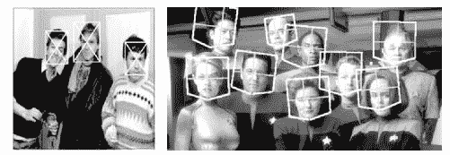

#### 图 2—7 卷积网络首现人脸检测

左图记录了1991-1992年间构建的首个用于在图像中定位物体的卷积模型输出，相关研究成果分别于1993年和1994年发表。右图展示的是2003-2004年在NEC研制的性能出色的系统，它不仅能够发现非典型的面孔，比如《星际迷航》里登场的异星角色，还能推断面部朝向。

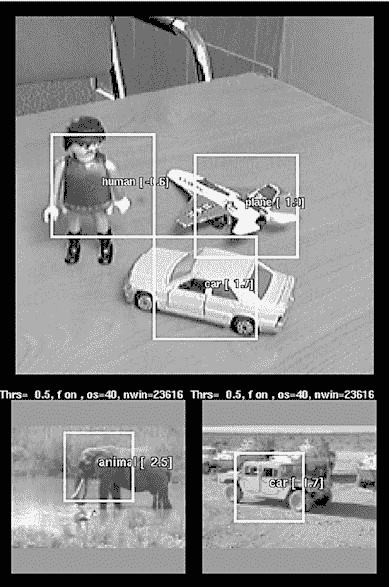

#### 图 2—8 摆脱视角限制的识别能力

训练素材全部来自玩具图像，共分为五类：人物、动物、飞机、汽车、卡车。有趣的是，模型学到的表征能够迁移到真实自然照片，辨识出与训练玩具截然不同的实景物体。

2003-2004年间DAVE项目的进展令人鼓舞。我们组装了一辆配备双摄像头的遥控小卡车，使其能在野外环境下独立行驶，具体见图2—9。其前提是先完成驾驶模仿训练。训练时一名操作员在公园、花园、林地等多种场景中手动驾驶1-2小时，系统同步保存双目画面以及方向盘位置。随后训练好的卷积模型仅凭视觉输入即可估计转角，实现类似人工操作的避障。经数日计算机端迭代优化后，系统即可接管车辆行驶。

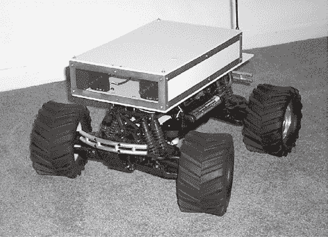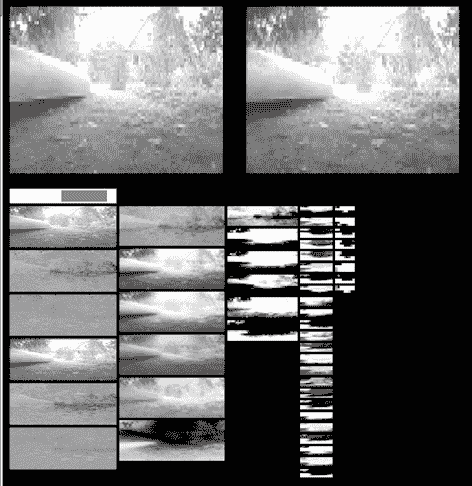

#### 图 2—9 2003年机器人 DAVE

这台微型遥控车装有两枚摄像头。右图中卷积模型经训练后能复制驾驶员行为，实现自主行驶并避开障碍。输入为两台摄像头的画面置于上方，输出为转向角度，本例指向右侧，由画面下方亮条指示。缩略图对应网络各层单元的激活情况。

这种纯模仿学习在学界接受度不高，相关论文直至2006年才发表。但成果说服DARPA启动LAGR项目，即面向地面机器人的机器学习计划，时间跨度2005-2009，聚焦移动机器人驾驶的机器学习应用，后续催生了众多自动驾驶研究，详见第六章。总体而言，该项目衍生出大量汽车自动驾驶分支。

2005年是我在纽约大学收获的一年。我们验证了卷积网络可用于语义分割，即为图像每个像素打上类别标签。首批应用指向显微镜采集的生物学图像分析，见图2—10。随后该技术在机器人导航与自动驾驶中发挥关键作用，因其能区分可行驶区域与障碍。

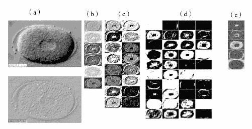

#### 图 2—10 生物显微图像的语义分割

每个输入像素被归入五类之一：细胞核、核膜、细胞质、细胞膜、外界。(a) 线虫胚胎细胞的显微图作为输入；(b,c,d) 为网络逐层提取的特征；输出由五个缩略图组成，对应五类区域，其中亮点表示输入像素被判定为该类别。

我们还训练了用于照片比对的卷积网络，判断两张图像是否同人。该度量学习源自1994年提出的Siamese网络构想，即孪生神经网络，最初用于签名校验。后来该类结构在人脸识别中广泛应用，参见第七章“内容嵌入与相似度测量”。

2007年起我们转向自然图像物体识别。不同于此前简易样本，此次目标是日常照片中的主要物体。当时视觉界常用数据集规模有限，如Caltech-101约含100类，每类仅30张，对卷积网络训练严重不足。数据稀缺时，手工特征+SVM更占优势。因数据限制，我们转向无监督预训练。具体做法是让卷积层先学习通用模式，而非直接针对任务；即让网络学习表征并重建输入，即自编码器，其特点是压缩神经元数量。借助此法，我们勉强达到传统系统水平，但在行人检测这一应用上突破了传统局限，而行人检测对自动驾驶至关重要。相关论文于2013年6月发表，后续方法将在第九章详述。

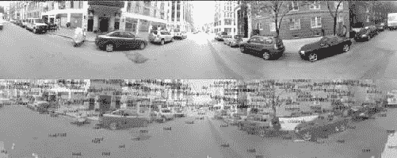

#### 图 2—11 城市场景像素分类

卷积网络为每个像素标注类别，如汽车、道路、人行道、建筑、树木、天空、行人等。

LAGR之后，我们参与了DARPA资助的一个深度学习项目，这是首个高度契合我们兴趣的项目。但2009年初美国政府换届，项目受领导层变动影响。资金已批却迟迟不到位，之后被削减，启动前项目负责人因应对变动辞职，接任者不看好并试图叫停。多亏据理力争项目才存活，作为交换我们需参与一些次要方向。尽管困难，我们仍完成自然图像语义分割系统，在前作基础上大幅提升精度与速度。

到那时视觉界仍存疑，如我们2012年投往CVPR的完整成果论文被拒，审稿人缺乏对卷积网络的深入理解。让我想起老笑话：“实践有效，理论成立吗？”评审认为手工设计极少时，端到端驱动视觉系统无意义。一种反对意见是，若机器能学会一切，科学难以获得对视觉更深理解。幸而数月后该文被机器学习顶会ICML接收。

与此同时，工业界对深度学习的认知缓慢提升，大规模图像库逐渐出现，足以支撑大型深度神经网络训练。

约2010年，深度学习在语音识别取得突破，首批成果出现。虽未使用卷积网络，但随后卷积网络大规模应用。杰弗里·辛顿提出巧妙想法：暑期实习期间，他将三名博士生派往谷歌、微软、IBM等顶尖公司，用深度神经网络替换原系统核心模块，效果显著。18个月后三家均部署基于深度学习的语音识别系统。如今与虚拟助手对话时，语音转文本即由训练好的卷积网络完成。该技术进入高速发展期，并衍生出众多消费产品。

软件演进，硬件也在进步。GPU的突破使计算能力倍增。2006年，我的前同事、现微软研究院的帕特里斯·西马德首次尝试用GPU训练神经网络。随后斯坦福、IDSIA、蒙特利尔、多伦多研究者相继跟进。到2011年可以确定，未来属于能在GPU上运行大型神经网络的研究者，他们将引领深度学习新革命……

2012年具有决定性意义，开启新时代，人们不再质疑卷积网络有效性，这也是后文章节主题。

[1] 参见本书图6—12详细说明。

[2] 大巴黎郊区城市。——译者注

[3] IDSIA人工智能研究所，位于瑞士曼诺，由安杰洛·达勒·莫勒1998年以其名基金创立。

[4] Yann LeCun, Yoshua Bengio, Geoffrey Hinton, Deep learning, Nature, 2015, 521, pp.436-444.

# 第三章 机器的初级训练

机器可被训练完成相对简单任务，例如转动方向盘或辨认字母。训练本质是在机器内部建立函数f(x)，使其对输入信号如图像、声音、文本产生预期答案。

## 1 从海兔得到的启发

海兔是一种软体动物，长期是神经科学实验对象，其某些本能反应展示了突触连接的可塑性，是学习机器的理想模型。海兔的鳃呼吸由基础神经网络调控，触碰鳃时鳃会收缩；再次触碰仍收缩，间隔后会伸出。每次刺激后鳃重新伸出所需时间逐渐缩短，多次触摸后鳃对手指适应增强，反应减弱，不再立即伸出。动物习惯外界干扰后，便会认为威胁不大，从而自然忽略刺激。

精神病学家兼神经生物学家埃里克·坎德尔对控制海兔行为变化的神经网络感兴趣。鳃收缩源于突触效应的改变，这些突触连接触觉检测神经元与控制收缩神经元。刺激次数越多，突触效应越低，鳃收缩频率随之下降。该过程揭示生化机制：改变突触强度即可改变软体动物行为。简言之，这解释了海兔的适应性。埃里克·坎德尔因此获得2000年诺贝尔生理学或医学奖。

这种通过改变突触效应实现适应或学习的机制几乎存在于所有具有神经系统的动物。大脑本质上是突触连接的神经元网络，其中多数连接可通过学习修改。这一规律贯穿生物链：从仅302个神经元的秀丽隐杆线虫，到18000个神经元的海兔，25万神经元1000万突触的果蝇，7100万神经元10亿突触的小鼠，8亿神经元的兔子和章鱼，22亿神经元的狗和猪，320亿神经元的猩猩和大猩猩，以及人类：人类拥有860亿神经元和约150万亿突触。这些数据揭示智能之谜：通过修改由简单单元构成的网络连接即可产生智能行为。

机器学习的目标是基于人工神经网络在机器中复现这一现象。这种通过调整突触效应进行的学习，在20世纪中叶被统计学家称为“模型参数识别”。

## 2 监督学习

设想制造一辆像人类司机一样驾驶的自动驾驶汽车，该如何做？

首先，需从优秀驾驶员处采集行车数据，记录汽车在高速公路上的位置，以及驾驶员如何通过方向盘修正位置，使汽车保持在车道中央。

其次，分析摄像机实时捕捉的车道线数据，以测量汽车在车道中的位置。摄像机每0.1秒记录一次汽车相对于道路标记的位置与方向盘角度，一小时即可获得36000条记录。这就是所需数据。

最后，将这些数据映射为图表：横坐标变量x代表汽车位置，高速公路车道宽4米，居中时x为0，右轮压上白线时x为+2米，左轮压上白线时x为-2米。纵坐标变量y代表方向盘角度，单位度，+5度表示向左轻转，0度表示直行，-5度表示向右轻转。

记录驾驶员正常驾驶时汽车位置与方向盘角度，可获得成千上万对(x,y)，每对由一个位置与对应转角组成。测试时收集大量样本并标注，例如用方括号编号X[3]、Y[3]表示第3个样本。若样本总数为p，如p=36000，则学习集可表示为：

A={(X[0],Y[0]),(X[1],Y[1]),…,(X[p-1],Y[p-1])}

训练机器的目标是使其根据汽车位置预测合适的方向盘角度，换言之，让机器“模仿”人类驾驶员，尽可能复现其行为。

为此需找到函数f(x)，对学习集中每个x都能生成对应的y，即Y[0]对应X[0]，依次类推。一旦找到合适函数，便可计算学习集外任意x对应的y。这就是监督学习的核心原理。

## 3 随机近似

### 寻找根据 x 预测 y 的函数 f（x）

若驾驶员完美，数据点在图中近乎一条直线，如图3—1所示。当点完美对齐时，可得到一条穿过所有点的直线。我们先随机假设函数形式为直线，只需确定斜率。

该函数可写为：

f(x)=w*x

其中*表示乘法，表示经过原点、斜率为w的直线。为方便讨论，将f视为含x与w两个变量的函数。为在Python中编程，可写为：

```python
def f(x, w): return w*x
```

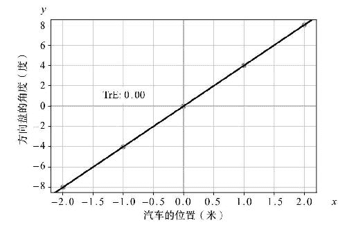

#### 图 3—1 车道位置与所需方向盘角度的关系

横坐标为汽车相对高速公路车道中心的位置，单位米，纵坐标为将汽车拉回车道中心所需方向盘角度，单位度。对负位置即在中心左侧，需施加负角度顺时针转动。此处4°的方向盘可校正1米的偏差。

字母w与x为变量，表示w*x的乘积。变量相当于内存中的存储单元。例如可创建w赋值为4，x赋值为2：

```python
w=4
x=2
```

w和x仅是内存名称。用它们计算函数，可写为yp=f(x,w)，yp代表模型预测的y。

将上述数值代入，yp得到8，即4*2。

若要将函数应用于学习样本3，只需执行：

```python
x=X[3]
y=Y[3]
yp=f(x,w)
```

此时求出穿过各点的直线等价于找到参数w的正确值。假设仅有两个训练点A=[[0.0,0.0],[0.9,3.6]]。穿过这两点的直线唯一，w应为4，因为4*0.9=3.6。再加入第三个点(-0.8,-3.2)，三点共线，w仍为4。

但这只是理想情况。假设第四个点为(1.9,5.4)。若w仍为4.0，预测值yp=f(x,w)为7.6，而非5.4。正如前文，yp表示模型对y的预测，现在第四点偏离直线，该怎么办？

此时不可能找到穿过所有点的直线，需做折中：允许一定误差，寻找“尽可能靠近”所有点的直线，见图3—2。

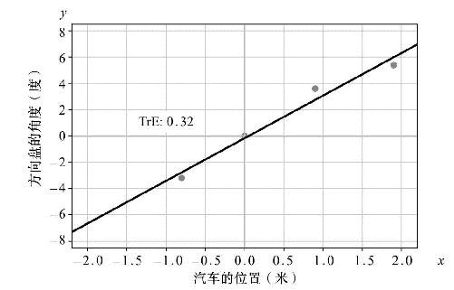

#### 图 3—2 尽可能贴近未完全对齐点的直线

4个点中有3个对齐，斜率为4的直线经过这3点，但不经过第4点，问题是如何折中，得到一条尽可能靠近4个点却不精确穿过任一点的直线。

### 减少错误

当w=4.0时，直线预测值为7.6，第四点实际值为5.4，误差为-2.2，即5.4-7.6。若修正w使直线更靠近第四点，则会远离其他三点。由于无法同时穿过所有点，最佳折中方案是斜率约为3.2的直线。

对给定w值，函数预测的yp与观测值y之间存在误差。可测量4个点的平均误差，误差可正可负，关键是预测值与观测值之间的距离。为量化误差距离，通常采用误差的平方或绝对值。

对给定w，例如对(X[3],Y[3])，预测值yp=w*X[3]，误差为(Y[3]-w*X[3])**2。计算机科学家用**2表示平方。

[2]

度量系统误差的L(w)表示学习样本中所有误差的平均值：

L(w)=¼((Y[0]-w*X[0])**2+(Y[1]-w*X[1])**2+(Y[2]-w*X[2])**2+(Y[3]-w*X[3])**2)

该函数中唯一可变参数是w，即L(w)取决于w，是w的函数，也称成本函数。L(w)越小，平均误差越小，机器越精准。因此需找到使成本函数L(w)最小的w值，见图3—3。

假设有p个学习点，用希腊字母σ表示成本函数，即i从0到p-1所有项之和。函数表达为：

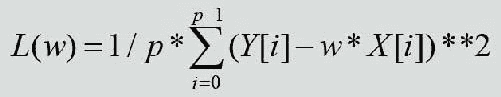

该公式含w的平方，属二次多项式，即抛物线，见图3—4。

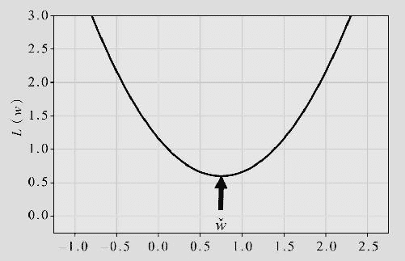

#### 图 3—3 二次成本函数的抛物线示意

当把代价写成关于斜率 `w` 的二次式时，曲线必然是一条开口向上的抛物线，只有一个最低点。

使成本最小的那个 `w` 在图上就用 `θ` 来标出。

要把 `L(w)` 压到最低，常用的是随机梯度下降，简称 SGD。名字听起来很专业，做法其实很直观。

思路是：从学习集里挑一个样本，把直线稍微挪一点，让它更靠近这个点；再拿下一个样本，继续微调。调整的大小和当前误差成正比，误差越大动得越猛，误差越小动得越轻。拿示例 3 来说，`w` 的更新写成：

`w=w+e*2*(Y[3]–w*X[3])*X[3]`

这并不是一次性的数学等式，而是程序员常用的迭代写法：用等号右边算出的新值去覆盖等号左边的旧 `w`。式子里 `e` 叫梯度步长，必须是极小的正数，用来控制每次改动的幅度。若 `X[3]` 为正且直线落在点 `(X[3],Y[3])` 之下，即 `Y[3]–w*X[3]` 为正，`w` 就会增大；反之直线在点之上，差值为负，`w` 就减小。直线逼近该点的速度会随距离缩小而变慢，穿过点时就停止。当 `X[3]` 为负时，更新方向会自动反转：斜率偏小会产生正误差，偏大则产生负误差。

把所有样本轮流处理，反复修正斜率，如果让 `e` 逐渐变小，最终 `w` 会稳定在使 `L(w)` 近似最小的附近。这种技巧被称作随机逼近，是美国统计学家赫伯特·罗宾斯和萨顿·门罗在 1951 年提出的。

[\[1\]](#part0047.html#note31) `Python` 语言灵活性高、上手快，是机器学习从业者使用最广的工具之一（www.python.org）。

[\[2\]](#part0047.html#note32) 在 `Python` 中幂运算写作 `**`，例如 `x` 的平方写成 `x**2`。

## 4 数学家的补充说明

可以把随机梯度下降的适用范围进一步推广。设 `C(x,y,w)` 为单个样本的成本。对于直线情形 `C(x,y,w)=(y–w*x)**2`，按 SGD 得到 `w` 的更新为：

`w=w–e*dC(x,y,w)/dw`

其中 `e` 是步长，`dC(x,y,w)/dw` 是 `C` 对 `w` 的导数，也就是梯度。对 `w` 的 `(y–w*x)**2` 求导得到 –2 * (`y–w*x`) * `x`，于是公式变成：

`w=w+2*e*(y–w*x)*x`

直觉和前面一样：若 `C` 的斜率为正，`w` 就减小；斜率为负，`w` 就增大。反复操作后，`w` 会滑向 `C(x,y,w)` 的底部。我们真正想最小化的是所有样本 `C(x,y,w)` 的平均值 `L(w)`：

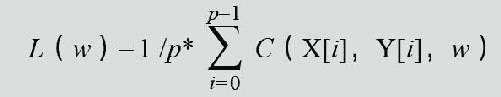

罗宾斯和门罗证明，只要在全部数据点上重复该过程并且让 `e` 缓慢减小，过程就会收敛到 `L(w)` 的最小值。

时至今日，随机梯度下降仍是现代机器学习系统训练时的主流手段。后续讲到感知器、自适应线性神经元和多层网络时还会反复用到它。

## 随机梯度下降的局限性

不过当目标只是让一条直线尽可能贴近全部点集时，随机梯度下降的效果并不理想，甚至可以说用处不大。前面那条抛物线成本可写成：

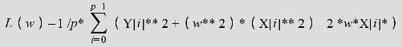

或者：

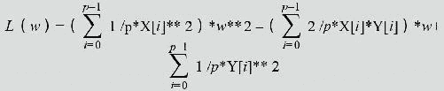

这仍是 `w` 的带系数的二次多项式，求导后最小值对应导数为 0 的 `w`，即：

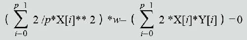

由此得到解：

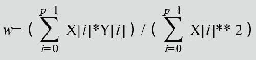

### 总结

监督方式训练机器的基本流程是：

1. 选择学习集合：

`A={（X[0]，Y[0]），…，（X[p–1]，Y[p–1]）}`

2. 提出模型，即参数为 `w` 的函数 `f(x,w)`。参数可能只有一个，也可能有上百万个，分别记为 `w[0]`、`w[1]`、`w[2]`……统称 `w`。

3. 提出成本函数 `C(x,y,w)`，用于衡量单个样本的误差，例如 `C(x,y,w)=(y-f(x,w))**2`，`L(w)` 为学习集合的平均值。

4. 在 `f(x,w)` 中寻找使 `L(w)` 最小的参数，通常借助随机梯度法：

`w=w-e*dC(X[i],Y[i],w)/dw`

## 5 伽利略与比萨塔

`f(x,w)` 不一定是直线。比如石头从高处自由下落，高度随时间的平方增长。

想象伽利略爬上比萨斜塔，在一层抛下一小石并记录落地时间，再上一层重复实验，依此类推。必定存在一条确定规律把下落时间 `x` 与下落高度 `y` 联系起来。

于是可由时间推算高度，或由高度推算时间。两者关系式为 `y=0.5g*x**2`，其中 `g` 是重力加速度，约 9.81 m/s2。这个函数是一条抛物线。伽利略凭观察建立了这条定律。此后人们就能用时间算高度，用高度反推时间。

这一发现奠定了科学方法的基础：用数学公式把两个变量联系起来，并以此预测现象。这正是自主学习在做的事。

## 6 视觉识别的通路

寻找潜在规律的基本思想同样适用于模式识别。每张输入图像 `x` 都可以看成一个很大的数字集合。1000×1000 像素的黑白照片就有 100 万个数表示每个像素的灰度；彩色图像每个像素由红绿蓝三个数表示。

机器给出的答案 `y` 也可以是数字或数字序列。例如输入猫的图片，期望回答“是猫”。可设 `y=1` 代表猫，`y=-1` 代表非猫，于是把输入空间限制为两类图像。

用同样思路训练带摄像头的自动驾驶汽车，只是更复杂，输入是数百万维的图像，输出是方向盘角度和油门压力。

若要训练机器区分汽车与飞机，就提供数千张汽车图和数千张飞机图。输入汽车图，机器答对就不再改动；答错就调整参数让它更接近正确答案。核心就是用参数调整来减小误差。

所有监督学习系统都遵循相同原则：

1. 输入值 `x` 可以是图像、语音信号、待翻译文本等，都被表示为数字表或序列。
2. 有期望输出 `y`，即对应 `x` 的理想结果。
3. 机器输出 `yp`，即模型给出的答案。

## 7 感知器如何诞生

本节以感知器为例，介绍一种极简单的机器——线性分类器。

线性分类器是 1957 年美国心理学家弗兰克·罗森布拉特在康奈尔大学航空实验室设计的。当时人工智能研究者关注人类和动物的学习机制。

感知器的灵感来自神经科学。生物神经元被描绘成星状结构：树突接收上游信号，轴突发出下游信号。输出由动作电位序列构成，频率代表活动强度。

1943 年麦卡洛克和皮茨提出人工神经元数学模型：计算上游活动强度的加权和，低于阈值则不活跃，高于阈值则活跃并产生放电脉冲。在该模型中输出是二值的：活跃或不活跃，1 或 –1。每个神经元计算与其相连的上游输出的加权和，大于阈值输出 1，否则输出 –1。这里阈值取 0。

公式为：

`s=w[0]*x[0]+w[1]*x[1]…w[n–1]*x[n–1]`

其中 `s` 为加权和，`x` 为输入，`w` 为权重。由 `n` 个数构成的集合称为 `n` 维向量。更简洁的写法为：

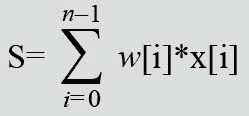

向量间这种运算叫点积。用 `Python` 可实现为：

```
def dot（w，x）：
s=0
for i in range（len（w））：
s=s+w[i]*x[i]
return s
```

该函数接收两个向量 `w` 与 `x`，返回它们的点积。`for` 循环执行 `len(w)` 次，累加乘积，最后一行返回结果。可举例：

`w=[–2，3，4]`

`x=[1，0，1]`

`s=dot(w,x)`

得到 `–2*1+3*0+4*1=2`。

阈值为 0 时，`s>0` 输出 +1，否则输出 –1。对应的符号函数可用 `Python` 写成：

```
def sign（s）：
if s> 0：return +1
else：return -1
def neurone（w，x）：
s=dot（w，x）
return sign（s）
```

当参数大于 0 返回 +1，否则返回 –1。据麦卡洛克和皮茨，大脑可视为逻辑推理机。

这一想法启发了罗森布拉特，他在感知器中使用二元阈值神经元，并加入了可通过修改权重纠错的自适应程序。灵感来自突触效应的可塑性，可追溯至圣地亚哥·拉蒙·卡哈尔的工作，也与赫布 1949 年提出的“同时激活的神经元其突触增强”假说相关，该假说后被实验证实。

最简单的感知器只有一个麦卡洛克-皮茨神经元，通过改变自身权重学习。训练时操作员输入字母 C 的图像，期望输出 +1，其他字母为 –1，机器调整权重使输出逼近期望。反复输入 C 与其他字母，权重逐渐调优。

1957 年在布法罗造出的机器外形像大型金属柜，内置人造视网膜由光电管网格构成，数百个类似音量旋钮的电动机按钮代表权重，每个按钮连可变电阻对视网膜电压加权，电路算出加权和，超过阈值则出口灯亮。

感知器的创新在于学习过程：识别后自动调整权重。按数据调参的思想在统计学已有数个世纪，罗森布拉特的高明之处在于把它用于模式识别。

[1] Warren S. McCulloch, Walter Pitts, A logical calculus of the ideas imma-nent in nervous activity,The Bulletin of Mathematical Biophysics, 1943 , 5 ( 4 ), pp. 115 –133.

[2] Donald Olding Hebb,The Organization of Behavior : A Neuropsychological Theory,Wiley, 1949.

## 8 25 个像素的小网格

回顾感知器原理：输入端视网膜记录低分辨率图像，输出端指示灯显示是否识别正确。

例如输入 5×5 像素共 25 像素的图像。视网膜把表格中的像素转为 25 个数字：黑色 +1，白色 –1。如今这些数字存于计算机。对应字母 C 的 25 个数字序列为：

`x[0]=–1`，`x[1]=–1`，`x[2]=–1`，`x[3]=–1`，`x[4]=–1`，

`x[5]=–1`，`x[6]=+1`，`x[7]=+1`，`x[8]=+1`，`x[9]=–1`，

......

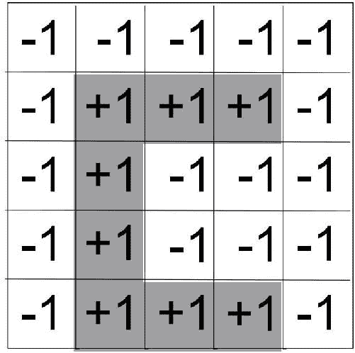

#### 图 3—4 字母 C 在 5× 5 像素网格上的图像

图像即数字表，像素即数字。自然黑白图像用灰度强度表示，彩色图像每个像素有三个数表示红绿蓝。

向量 `x[0]`…`x[24]` 代表输入图像（见图 3—5）：第一个像素连到神经元输入 `x[0]`，依次类推。

机器有 25 个权重，各自对应一个像素。权重与像素的连接是固定的。

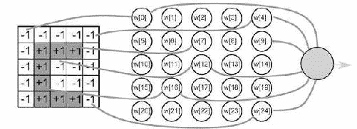

#### 图 3—5 连接到一张图像的一个神经元

神经元计算输入值的加权和。25 个输入为图像像素，取值为 +1 或 –1。每个像素值乘以对应权重求和得到加权和，调整权重即可调节输出。再与阈值比较，大于阈值输出 +1，否则 –1。权重构成系统的记忆。

学习开始时所有权重为 0，无论什么图像加权和都为 0，输出恒为 –1。

## 9 让机器分辨 C 与 D

机器学习就是调整权重的过程。训练机器区分 C 与 D 时，反复输入两类图像的样本，答对则不动，答错则转动“音量旋钮”改变加权和，使 C 为正、D 为负。

若输入是 C 但机器错判，说明加权和低于 0 而非高于 0。学习算法需增大加权和，于是提升对应项为 +1 的权重，减少对应项为 –1 的权重。

若输入是 D 却得到 +1，则加权和大于 0。此时需减小对应 +1 项的权重，增大对应 –1 项的权重。

每次调整幅度要很小，新的权重覆盖旧值。单次调整往往不够，需要多次累积。

不断重复输入、识别、调整，若算法幸运，权重配置会收敛到能稳定识别 C 或 D 的状态。

以 25 像素为例，向量 `x` 含 25 个像素值，`w` 为权重，`y` 为期望输出 +1/–1，`yp` 为神经元计算输出。若答对，`y–yp` 为 0；若 `y` 为 +1 且错判，差值为 +2；若相反，差值为 –1 或 –2。可按以下公式调整每个权重 `w[i]`：

`w[i]=w[i]+e*(y-yp)*x[i]`

# 巨型硬件被压缩进代码

常数 e 用来控制一次校正的幅度，e 越大改动越剧烈。权重的更新会让整体的加权总和向期望的方向抬高或压低，整套迭代可以用极少的程序行来表达。

以符号 C 为练习目标，期望输出设为 +1。先借助之前给出的单元函数 `neurone(w,x)` 求出当下的加权总和，随后对每个权重做逐项微调：
`yp=neurone(w,x)`
```
for i in range(len(w)):
w[i]=w[i]+e*(y-yp)*x[i]
```

罗森布拉特当年造的那台感知装置重达数吨，如今它完成的运算在普通电脑上几行代码即可完成，这正体现了技术代际的差距。

在本次演示里，系统学会了区分两类模板的差别。只出现在 C 上的像素被赋予正权重，只出现在 D 上的像素被赋予负权重，其余既不专属于某一方或双方都出现的像素权重趋近于零。

换个视角，感知器的训练也能看作是把可调权重当作变量的代价下降过程，与前面汽车案例的思路一致。更细致的推导留到第四章再展开。

顺带提及一个分岔思路：当时还有一种与感知器完全不同的做法，叫做最近邻法。它不去改变形状，而是直接把待测图与库图做对比。所有训练图都存于内存，识别时逐张比较，例如统计不同像素的数量，挑选最相似的那张并把其标签作为结果。输入 D 就输出 D。对干净的印刷体字母尚可应付，对手写则效率下滑且成本陡增。若想用它来辨认犬或椅子，就得把数百万张不同姿态、光照、场景的照片全塞进内存，显然不现实。

## 10 泛化原理

举一反三是学习型装置的标志。只要训练集里 C 类与 D 类的样式足够丰富且多样，模型就有机会对从未见过的样本给出正确判断，前提是新样本不要偏离得太远。

用乘法做类比。我们能算出 346×2067 并不是因为背下了所有乘积，而是掌握了乘法的法则。感知器的运作类似，它并非把所有可能的 C 都存下来，而是提炼出一个可完成判别的模型。看它具体如何运作。

训练前，操作者会准备大量样本，可能上百到上千个大小、字形各异的 C，置于 25 个像素的网格中的不同位置。D 也做同样的处理。

如果目标是 C 输出 +1、D 输出 -1，学习期间装置会给 C 图中亮像素和 D 图中暗像素赋予正权重，给 C 图中暗像素和 D 图中亮像素赋予负权重。这里的权重代表区分两类信息的能力。

由此可见训练的威力：训练完成的系统能够跳出既有样本，去识别全新的图形。

## 11 感知器的局限性

当收集到的 C 或 D 差别不大时，上述做法有效；一旦形状、尺寸或朝向差异拉大，例如一个极小的 C 躲在角落，感知器就很难找到合适的权重组合。更根本的是，某些形状变化天生就超出其处理范围。所有线性判别器都有这个天花板，感知器只是典型代表。

线性判别器的输入是一串 n 个数，也可视为 n 维向量。数学上向量就是空间中的一点，坐标就是那串数。对一个双输入单元，输入空间是平面，输入向量就是平面上的点；三输入对应三维。我们这里的 C、D 示例输入空间有 25 个维度，25 个像素值对应 25 维空间中的一点。那是一个无法画出的超空间。

线性判别器把输入空间切成两块，比如 C 的区域和 D 的区域。平面上分界是一条线，三维里是平面，25 维里就是 24 维超平面。总体规律是，输入个数为 n 时，分界面是 n-1 维超平面。

验证一下，二维加权总和可写成 `S=w[0]*x[0]+w[1]*x[1]`。当和为 0 时正好跨过分界，边界点满足 `w[0]*x[0]+w[1]*x[1]=0`，即 `x[1]=–w[0]/w[1]*x[0]`，这就是直线方程。

两个向量的内积为零时正交，小于 90° 为正，大于 90° 为负。所以 x 的集合就是与 w 正交的向量族，在 n 维里构成 n-1 维超平面。

这里有个关键点。设想一个只有两个输入的感知器，再额外加一个恒为 -1 的虚拟输入。没有这个附加项，分隔线必须过原点；有了它，边界就能平移。

于是这类最基础的装置对某些输入图无能为力。四个学习点 `(0,0)`、`(1,0)`、`(1,1)`、`(0,1)` 在图上就是四个点，如图 3—6：

调参后感知器能实现的函数本质上是把点分成两堆。

观察图 3—6，可以找到一条直线把 `(0,0)`、`(1,0)` 与 `(0,1)`、`(1,1)` 分开，却找不到直线把 `(0,0)`、`(1,1)` 与 `(1,0)`、`(0,1)` 分开。
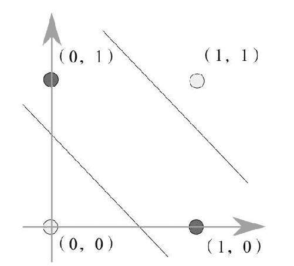

#### 图 3—6 有 2 个输入的感知器

把黑点 `(0,1)` 和 `(1,0)` 视作 +1，灰点 `(0,0)` 和 `(1,1)` 视作 -1，这个函数就是异或。没有任何直线能把黑点和灰点分开，也就是线性分类器无法计算异或。图中直线分别代表与函数：仅 `(1,1)` 为 +1，其余为 -1，和或函数：仅 `(0,0)` 为 -1，其余为 +1。二维里 16 个布尔函数只有两个不可线性分离，高维里不可分的比例也很小。

若一个函数在 `(0,0)` 为 0，在 `(1,1)` 为 1，在 `(1,0)` 为 1，在 `(0,1)` 为 0，就是异或。它是非线性可分的：输出为 1 的点无法用直线、平面或超平面与输出为 0 的点隔开。

下表每行是两个二进制输入的四种组合，带编号的列代表某个布尔函数在四个输入下的输出。共有 16 个函数，14 个可被线性分类器实现，仅 2 个不行，最后一行用 N 标记。
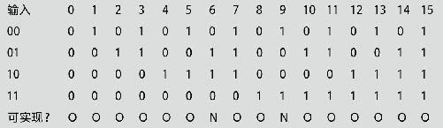

这里讲的是二维里的点，对应两个像素的两种输入图像，人能直观看见。

真正的感知器工作在高维空间。当我们想让它区分更复杂、变化更大的形状或位置时，往往就会碰到上面说的那种情况，只是维度更高。

对感知器来说，输入向量与权重向量夹角为锐角时加权总和为正，钝角时为负。正负的分界是与权重向量 w 正交的点 x 的集合，因为内积为零。在 n 维里边界方程为：
`w[0]*x[0]+w[1]*w[1]+w[2]*w[2]…w[n–1]*x[n–1]=0`
它是一个 n-1 维超平面。

感知器用一个超平面把空间劈成两半。我们希望让 C 检测器活跃的点全在一侧，非活跃的点在另一侧。若这样的超平面存在，感知器通过持续学习就能找到；若不存在，即点不是线性可分的，再怎么改权重也收敛不到稳定唯一的配置。

做这个论证的意义在于，它解释了 20 世纪 60 年代初困扰模式识别研究者的难题，研究者据此认为感知器的能力有限，无法识别自然图像里的物体。

事实上，当输入维度很大、样本丰富且复杂时，比如成千上万张狗、猫、桌子、椅子的照片，它们的类别很可能不是线性可分的，也就无法被直接连到像素上的感知器识别。即使在简单的 C、D 例子里，若字母的形状、位置或大小差异很大，感知器也无法分类。

西摩尔·帕普特和马文·明斯基在 1969 年出版的著作《感知器：计算几何学概论》^([`[1]`](#part0055.html#note35n))给感知器发展按下了暂停键，进一步加剧了研究者的挫败感。这次停顿在人工智能史上起了关键作用，促成了其后的人工智能寒冬，研究方向被迫转移。

对今天的读者来说，这个论证提供了理解机器学习的另一条路径。
[`[1]`](#part0055.html#note35) Marvin L. Minsky, Seymour A. Papert,Perceptrons : An Introduction to Computational Geometry, op. cit.

## 12 特征提取器

最简单的感知器分不清某些形状。所以从一开始研究者就保留到现在的做法：在图像和神经层之间加一个中间模块，叫特征提取器。它能在输入图像里侦测特定区域，生成描述这些区域是否存在、强度的向量，再交给感知器。

回到之前的论证。

把感知器直接连到图像像素上，它很难跳出增强模板的模式。由权重编码的像素类别区分了 C 与其他图像。一旦样本变化过大，罗森布拉特的感知器就会饱和，权重不再能识别。若用差异极大的 C 图像训练，就会这样。若图像分辨率足够识别所有字符，约 20×20 像素，C 的大小、字体、手写或印刷、在角落还是中心就不再是问题。一旦形状、位置或尺寸差异过大，感知器无法分类，因为没有单一的增强模板能覆盖所有变化，见图 3—7。
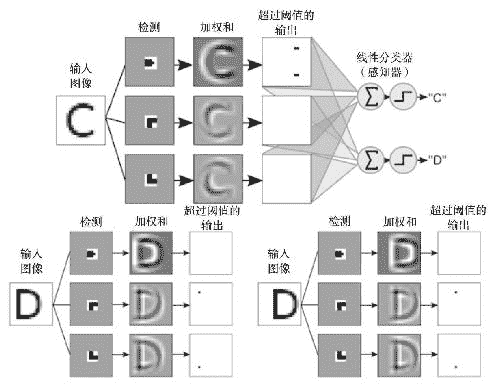

#### 图 3—7 特征提取器

特征提取器检测输入图像里的独特图案，把结果送给可训练的分类器如感知器。第一个模板检测笔画的线尾作为 C 的末端，另外两个模板检测拐角如 D 的拐角。该层信息作为感知机的输入。训练后，只要存在相关特征，感知器就能在大小和位置不同时区分 C 与 D。在这个例子里，一个 C 两个位置不同的 D 下，提取器可看作一层二进制神经元。白色像素代表 -1，灰色像素代表 0，黑色像素代表 +1。上述三个特征检测器是 5×5 像素的模板，与输入图像比对。对模板的每个位置，用模板的 25 个权重计算输入窗口 25 个像素的加权总和。结果是一组图像，当窗口内容与模板相似时像素变黑。然后把加权总和与阈值比较生成特征图，若在相应位置检测到图案则值为+1，否则为 0。

无论字体或书写风格怎样，在 20×20 像素图像里分辨 C 与 D 的关键是检测拐角和笔画末端。D 是带两个角的闭合图形，C 是一条两端各有一个端点的开曲线。于是可以构建一个特征提取器检测端点或拐角的存在，而不必关心 C、D 在图像中的位置。可以设计第一层为一组二进制神经元集合，其输入是图像上 5×5 像素的小窗口，并手工赋予权重而非学习算法确定。可以得到三种感知机神经元：一种端点神经元和两种角神经元。图像上的每个 5×5 窗口提供三个神经元，各一类型。当输入窗口看起来与权重图像相似时，神经元输出 +1，否则输出 0。若 C 形状良好，端点检测器会被激活；若 D 形状良好，角检测器会被激活。最后一层是一个简单感知机，只需计算角和端点的数量来区分 C 与 D，其位置、大小和样式不再重要。

可以改造感知机架构，使其执行更复杂的操作。具体做法是在感知机层前放置一个手工构建、未经训练的特征提取器。特征提取器的设计既复杂又耗时，2015 年以前的文献里充满这类构造方法。

因此一种常用方案是让特征提取器检测输入图像里细微的简单图案。对字母而言，它不仅能标出末端和角，还能标出竖线、横线、环线等。提取器的输出是一串数字，代表这些简单图案是否存在及其位置。此时感知器并不是直接连到输入像素，而是通过更抽象的特征连接。

若想用感知器检测汽车，其特征提取器就是一组模板，分别检测车轮、挡风玻璃角度、散热器格栅等。用这些模板扫描整幅图像，扫描到图案时模板会亮起，所有扫描到的特征一起输入感知器。对人脸的处理方式相同，只需检测眼睛部位的深色区域、鼻孔中的两个小黑点、嘴唇间略深的一条线，就能构建合适的面部感知器。

在最初的感知器里，特征提取器实际上是一串二进制神经元，它们随机连接到输入图像的小像素组，当时没有更好的办法。这些神经元的权重无法通过学习改变，是固定的且随机。由于连接随机，我们永远无法确定哪个是有用的。为了让第一层发挥作用，必须设置大量特征提取器神经元，从而使最终神经元的输入数量急剧增加。在一些 2013 年后就很少使用的分类与模式识别系统里，特征提取器的输出可达数百万。特征越多，对后续分类越有帮助，但成本也越高。

研究人员受视觉皮层连续区域组织启发，希望通过建立更多神经元层来提升感知器效率：系统第一阶段提取非常简单的特征；下一层尝试检测这些特征组合的轮廓或直接连接特征，形成圆形或角等基本形状；再下一层检测这些组合构成的物体局部；如此层层递进。

另一种更精明的构建特征提取器的方法是 SVM，这是伊莎贝尔·居永自 2015 年起在奥赛^([`[1]`](#part0056.html#note36n))任教授的发明，其合作者弗拉基米尔·瓦普尼克和伯恩哈德·伯泽尔都是我在贝尔实验室时的组成员。1995—2010 年，SVM 一直是分类最常用的方法。我对朋友和同事心怀敬意，但必须承认我本人对该方法并不特别感兴趣，因为它并未解决特征提取器自动训练的关键问题。不过 SVM 方法吸引了大批关注。

SVM 是核机器的典型代表。虽然支持者不喜欢做对比，但本质上它就是一种两层神经网络。第一层单元数与学习集合中的样本数相同，第二层像普通感知机一样做加权总和计算。第一层单元借助核函数 k(x,q)，把输入 x 与所有学习样本 X[0]、X[1]、X[2]、…、X[p=1] 做比较，式中 x 代表输入向量，q 是一个学习样本。例如第一层单元号为 3，则输出 z[3]=k(x,X[3])。

函数 k 的一个典型例子是计算两向量距离的指数：
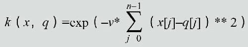

当 x 与 q 靠近时输出较大；相距较远时输出较小。

第二层以监督方式把学习的权重与输出结合起来。在这种感知机中，只有最后一层进行监督式训练。但第一层因为使用了学习样本中的输入 x ^([`[2]`](#part0056.html#note37n))，也可以说它受到了某种形式的训练。

一些数学专著的主题就是探讨这些极简单的模型，数学之美掩盖了方法的局限，因而吸引研究者，使得 SVM 与核方法大行其道。虽有一定成果，核机器并没有比感知器强大多少，我与同事曾试图用这一点说服同行，但未果。部分人仍不相信多层架构的有效性，其中包括弗拉基米尔·瓦普尼克。

不管怎样，在 20 世纪 90 年代中期样本数量不多的情况下，SVM 确实可靠且易于操作。而且当时正值互联网初期，SVM 程序开放源代码，可免费使用。它新且好，很快获得成功。在 20 世纪 90 年代，核方法使神经网络黯然失色，多层网络的使用在人们脑海中渐渐消失。

但增加一层或多层人工神经元可以计算单层神经元难以有效计算的更复杂函数。数学定理表明，仅需两层神经元就能进行任意计算，这也是 SVM 能够成功的原因之一。只不过需要庞大的中间层。正如我们看到的，第一层神经元数量远大于原始图像像素数，即使输入是 25 像素的小图像，也可能需要数百或数千个神经元处理。

20 世纪 60 年代的研究者总是困惑于多层网络的训练。在感知机的学习过程中，只有最后一层经过训练，特征提取器的第一层无法训练，必须手工确定。

# 第四章 机器学习的方法与原理

把一张图片送进模型，牵动的是成千上万甚至数百万个可调系数，靠人工逐一校准根本做不到。正是这道操作壁垒，让上世纪六十年代末的学界放弃了端到端自学习的设想，转而聚焦于统计模式识别的分支。源自感知器的结构虽有缺陷，却长期占据主流，直至二十一世纪初才被松动。那时的常规做法是信号先经过人工设计的特征提取，再由感知器或其他统计学习单元完成判别，这套流程构成了模式识别长期遵循的惯例。

感知器的出现标志着监督式学习的开端。训练时会不断修正内部系数，使预测逼近正确答案。训练充分后，模型还能对从未见过的样本做出合理判断，这正是泛化能力的体现。

泛化并非没有边界。为降低风险，研究者习惯在数据进入传统分类器前先做编码，通过手工提炼显著特征来完成识别。从六十年代到二零一五年，学界为不同任务设计专用特征提取器的投入巨大，相关论文与研究者不计其数。我一直倾向于直接训练特征提取器，而不是为每个问题手工搭建。可很长时间里这一想法不被同行信任，这也是多层神经网络与深度学习长期受阻的原因。

[`[1]`](#part0056.html#note36) 奥赛是巴黎–萨克雷大学所在地。——译者注

[`[2]`](#part0056.html#note37) 由于未使用所需的输出（`y`），因此这种学习没有监督。

监督学习的底层逻辑始终一致：通过调节系统权值来拉低损失函数，也就是把训练集中实际输出与期望输出之间的平均偏差压到最低。说到底，最小化损失与训练系统是同一件事。

这一规律不仅适用于只训练最后一层的感知器等简单模型，也适用于几乎所有监督方法，尤其适用于端到端训练的多层神经网络，具体将在下一章展开。

总体而言，以损失最小化为核心的学习机制是人工智能运转的关键枢纽，弄清其边界也有助于我们反思人类自身的学习方式。

## 1 成本函数

提示：训练本质上是权值的持续微调。

再说一遍，学习就是让系统误差逐步收敛。机器学习本质上是不断尝试、犯错、自我修正。每次对权值的更新都会覆盖原值。以一张带有期望输出 `y` 的图像 `x` 为例，误差是一个数值，用来衡量计算机产生的输出 `yp=f(x,w)` 与期望输出 `y` 之间的距离，其中 `w` 是权值集合。对每一条训练样本，即每一对（`x`，`y`），误差由损失函数 `C(x,y,w)` 度量。最常见写法是取输出差值的平方：

`c=(y-f(x,w))**2`

现实中损失函数形态多样，上述式子仅适用于系统只产生单一输出的情形，也就是 `yp` 和 `y` 都是纯数字的情况。若希望系统从图像里分辨出狗、猫或鸟，就需要给出三个输出，形成一个向量而非一个标量。每个类别对应一个分量。例如第一分量代表“狗”，第二分量代表“猫”，第三分量代表“鸟”，那么输出向量 `[0.4,0.9,0.2]` 就意味着系统判定为猫，因为猫的分量最高，为 0.9。在训练阶段，“狗”对应的期望输出是 `[1,0,0]`，“猫”是 `[0,1,0]`，“鸟”是 `[0,0,1]`（见图 4—1）。

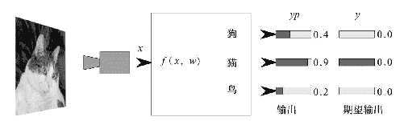

#### 图 4—1 三类分类器

模型会为三类各给出一个分数，组合成三维向量。示例中分数向量是 `[0.4,0.9,0.2]`，因此把图像归为“猫”。对应“猫”类的期望向量为 `[0,1,0]`。

损失函数的作用是度量系统输出与期望输出的差距，比如三类输出误差平方的总和：

`yp=f(x,w)` # `yp`是一个三维向量

`c=(y[0]-yp[0])**2 +(y[1]-yp[1])**2 +(y[2]-yp[2])**2`

实际上，对于多分类问题，我们常把输出建模为类似概率的分数，使其介于 0 到 1 之间且总和为 1，并使用另一种称为“交叉熵”的损失函数，它会把期望类别的输出推向 1，同时把其他类别推向 0。但本质原理是一致的。

可以用 `Python` 写一个小程序来计算损失函数 `C(x,y,w)`，示例代码如下所示：

```
#计算一个示例的成本函数
```

### x：输入向量

### y：期待的输出向量

### w：参数向量

```
def C（x，y，w）：
yp=f（x，w）＃计算输出值
c=0 ＃在 c 中累加成本值
for j in range（len（y））：＃循环计算输出值
c=c+（y\[j\]–yp\[j\]）\*\*2＃累加成本
return c＃返回输出成本的总和
```

设有一个包含 `p` 个样本的训练集，即一个输入向量组 `X`：

`[X[0], X[1], X[2], …, X[p–1]]`

以及相应的期望输出向量组 `Y`：

`[Y[0], Y[1], Y[2], …, Y[p–1]]`

我们可以用下式得到任意一个学习样本的损失，以第 3 个样本为例：

`c = C(X[3], Y[3], w)`

需要计算的是整体训练损失，即在整个训练集上损失函数的平均值：

`L(X, Y, w) = 1 / p * (C(X[0], Y[0], w) + C(X[1], Y[1], w) + … C(X[p–1], Y[p–1], w))`

同样也可以写程序来求这个平均值：

```
#计算整个训练集中的成本函数平均值
#X：输入数据集的数组#Y：期待输出的数组
#w：参数向量
def L（X，Y，w）：
p=len（X） # p 是训练示例的数量
s=0 #一个用来累计成本总和的变量
for i in range（p）#对示例进行循环计算
s=s+C（X\[i\]，Y\[i\]，w）#累加成本
return s/p #返回平均值
```

我们能得到训练集（`X`，`Y`）上的整体训练损失，计算方式为：

`count = L(X, Y, w)`

在该函数中，`for` 循环会遍历所有训练样本，把每条样本的损失累加到变量 `s` 里。最后用累加和 `s` 除以样本数 `p` 返回平均值。该程序的返回值取决于中间函数 `C(x, y, w)` 用到的权值集合 `w`，而 `C(x, y, w)` 又取决于函数 `f(x, w)`，最终都由 `w` 决定。

在固定样本集的学习中，每一种权值 `w` 的配置都会对应一个训练损失。机器要做的就是调整 `w`，寻找让损失最小化的取值，使 `L` 达到最低。

当前可训练的系统里往往包含数百万乃至数十亿个可调权值，也就是说向量 `w` 的维度可能高达数百万。但即使如此，与人脑中突触的数量相比仍相形见绌。

## 2 找到谷底

那么损失函数的最小值该如何寻找呢？为了便于理解，先设想一个只有两个可训练权值 `w[0]` 和 `w[1]` 的系统。对某个确定的训练集来说，每一个坐标点（`w[0]`，`w[1]`）都对应一个损失值。

一开始权值是随机给定的，所以学习之前损失通常很高。随着学习进行，网络会通过调整权值来压低损失。

对于一组存储^([\[1\]](#part0060.html#note38n))在 `X` 和 `Y` 中的训练样本，我们可以把 `w[0]` 设为 6.0，`w[1]` 设为 5.0，然后算出对应的训练损失，如下所示：

```
w[0]=6.0
w[1]=5.0
count=L（X，Y，w）
```

我们可以把这个损失函数想象成一幅山地地形图，其中一个特定地点对应一组权值，即经度 `w[0]` 和纬度 `w[1]`，高度即该权值组对应的损失值。整个地形中，等高线把损失相同的位置连起来。

设想我们迷路了，天黑又下雨，什么都看不见。为了回到位于山谷底的村庄，在没有路标的情况下，会选择沿着坡度最陡的方向下行。先观察哪边在下坡，然后朝那个方向迈出第一步，步步为营，最终抵达谷底。在这个比喻里，坡度最陡的下行方向就是损失函数的梯度，谷底就是损失函数的最小值，对应的坐标就是使损失最小的权值。

目标是尽快找到山谷最低点。从计算资源角度看，穷举测试非常昂贵，尤其是在训练库包含数百万样本时。因此我们需要借助一种称为“梯度下降最小化函数”的方法，如今它已成为人工智能领域最常用的学习机制之一。

来理解其原理。找到最陡下坡方向的关键是计算梯度，与梯度相反的方向就是当前位置下降最快的方向。为了得到它，我们设想对权值做一个很小的扰动，以观察损失会升高还是降低。用山地作比喻，就是先往某个方向迈一小步，看海拔是下降还是上升。为了让这个尝试成立，权值的小扰动必须对应损失的小扰动，也就是要有数学上所说的“连续性”，避免出现阶梯或悬崖。

接下来依次干扰两个权值。先朝 `w[0]` 方向，即向东，迈一步，测量高度变化，用高度差除以步长来评估斜率 `g[0]`。如果海拔下降，就继续朝该方向前进，步幅与坡度成正比，坡度越陡步子越大，越有利于快速接近目标；坡度平缓则只迈小步。若评估后发现海拔升高，就必须反向迈一步，让海拔降低，即让损失值下降。

随后转 90 度，沿 `w[1]` 方向，即向北，重复上述评估，算出斜率 `g[1]`。再根据结果决定向前或向后迈与斜率成比例的步长。如此循环往复，我们会慢慢逼近谷底，直到海拔不再下降，也就是到达山谷最低点。

分量为斜率（`g[0]`，`g[1]`）的向量 `g` 称为梯度。图 4—2 展示了这个梯度向量。按定义，梯度向量指向斜率最大、海拔增加最快的方向，其长度等于该方向上的斜率值。沿着与梯度相反的方向前进，就是朝谷底移动。梯度的反方向是向量 `–g`，其分量符号相反（`–g[0]`，`–g[1]`）。

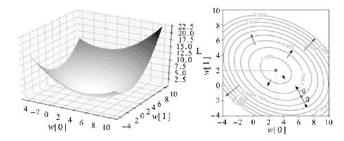

#### 图 4—2 学习损失函数

我们可以将损失函数与山地景观（左侧）进行比较，后者的等高线显示在右侧。训练一台机器的过程就是寻找谷底的过程，即找到产生最低损失值的可训练权值的值。在此示例中，经度和纬度是两个可训练权值 `w[0]` 和 `w[1]`，最小值位于坐标（3，2）处。当开始训练这个系统时，我们不知道此景观的形状或其最小值的位置。但是，对于给定的权值，我们可以计算其高度，即损失值。我们还可以计算指向最大斜率方向上的梯度向量 `g`。梯度用箭头表示，在每个点上都不同。通过更改与梯度相反的方向 `–g`，我们向着谷底迈出了第一步。这种修改是将向量 `w` 用其本身值减去梯度向量并乘以一个控制步长的常数 `e` 来代替，目标是通过测试，用尽可能少的配置来找到山谷底端的位置。

总结起来，梯度下降的执行步骤如下：

1. 计算当前权值向量值对应的训练损失。

2. 测量各坐标轴上的斜率，并把它们汇总成梯度向量 `g`。

3. 沿着与梯度相反的方向修改权值向量。具体做法是取梯度分量的相反符号，再乘以控制步长的常数 `e`。

4. 把上一步得到的向量加到权值向量上。换句话说，就是把权值向量的每个分量替换为当前值减去梯度对应分量乘以步长 `e` 后的结果。

5. 梯度步长的大小很关键：太小会导致每一步移动甚微，收敛缓慢；太大则可能越过最小值，落在另一侧。因此常数 `e` 必须取值合理。

6. 重复上述操作，直至到达谷底，也就是找到训练损失的最小值。

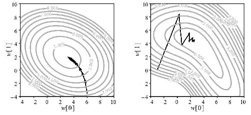

#### 图 4—3 梯度下降法生成的路线

梯度下降的过程旨在沿最大向下倾斜的方向（与梯度相反）采取一系列的前进步骤，直至到达山谷底部。步长与梯度步长 `e` 成正比。右图中的 `e` 太大，会引起轨迹的振荡。梯度步长太大可能会导致不收敛。

**证明**

假设我们处在坐标（`w[0]`，`w[1]`）。此时海拔高度，即训练损失，为 `h = L(X, Y, w)`。下面描述一种基于扰动的梯度下降过程，思路简单但效率不高。首先构造一个扰动向量 `wa`，它通过对 `w[0]` 做一个很小的扰动 `dw` 得到：

`wa[0] = w[0] + dw`

`wa[1] = w[1]`

随后计算新位置的高度 `a = L(X, Y, wa)`。扰动带来的高度变化为 `a–h`，沿扰动方向的斜率为（`a–h`）／`dw`。计算这个比值的目的在于得到山的坡度，再用它乘以步长来估算高度变化。

同样地，我们沿 `w[1]` 方向扰动 `w`：

`wb[0] = w[0]`

`wb[1] = w[1] + dw`

此时高度为 `b = L(X, Y, wb)`，`w[1]` 方向上的斜率为（`b–h`）/`dw`。把两个斜率存入向量 `g`：

`g[0] = (a–h) / dw`

`g[1] = (b–h) / dw`

向量 `g` 就是损失函数的梯度，包含各轴上的斜率。它指向斜率最大的方向。再用山地比喻，如果东西向（`w[0]`）的坡度大于南北向（`w[1]`），最大坡度方向就会更接近东西轴。

下面是一个通过扰动计算双权值函数梯度的程序实现。过程看起来直观，但效率很低，后续会做改进：

```
#通过扰动计算梯度的函数
#X：输入数据集的数组
#Y：期待输出的数组
#w：参数向量
#dw：干扰量
def gradient（X，Y，w，dw）：
h=L（X，Y，w）#计算成本
wa=\[0，0\] ＃创建向量 wa
wa\[0\]=w\[0\]+dw ＃对第一个坐标的扰动
wa\[1\]=w\[1\]
a=L（X，Y，wa）＃计算扰动后的成本
wb=\[0，0\] ＃创建向量 wb
wb\[0\]=w\[0\]
wb\[1\]=w\[1\]+dw ＃对第二个坐标的扰动
b=L（X，Y，wb）＃计算扰动后的成本
g=\[0，0\] ＃创建向量 g
g\[0\]=（a–h）/dw ＃计算第一个坐标的斜率
g\[1\] =（b–h）/dw ＃计算第二个坐标的斜率
return g ＃返回梯度向量
```

调用该函数即可得到梯度向量的近似值：

`g = gradient(X, Y, w, dw)`

由定义可知，向量 `g` 指向上方，而符号反转后的向量 `–g` 指向下方。于是可以沿着与梯度相反的方向，即最大下坡方向，向谷底前进。若把这个移动拆分，就是在 `w[0]` 方向上移动步长 `–e*g[0]`，在 `w[1]` 方向上移动步长 `–e*g[1]`。变量 `e` 是一个很小的正数，主要用来控制步长大小。

我们可以用几行代码实现上述过程：

```
#梯度方向上的单次移动
#X：输入数据集的数组
#Y：期待输出的数组
#w：参数向量
#e：梯度步长
#dw：干扰量
def descend（X，Y，w，e，dw）：
g=gradient（X，Y，w，dw）#计算梯度向量
w\[0\] =w\[0\]–e\*g\[0\]#更新 w\[0\]
w\[1\]=w\[1\]–e\*g\[1\]#更新 w\[1\]
return w #返回新的参数向量
```

梯度下降式学习的步骤可概括为：

1. 计算损失。

2. 计算梯度。

3. 通过减去梯度乘以常数 `e`（梯度步长）来更新权值。

在梯度步长足够小的情况下，反复执行即可收敛到谷底。

```
#学习过程的程序
#n：梯度下降的迭代次数
def learn（X，Y，w，e，dw，n）：
for i in range（n）：＃重复 n 次
w=descend（X，Y，w，e，dw）＃迈出一步
print（L（X，Y，w））＃打印成本值
return w ＃返回权重向量
```

此算法函数会在损失不再下降时停止运行。

[\[1\]](#part0060.html#note38) 注意：计算机程序中的变量是用于记录数据的内存区域的名称（参见第三章相关内容）。

## 3 实践中的梯度下降

在真实场景里，“地形”并非只有两个维度，而是拥有数百万甚至数十亿个维度，权值向量不是由两个数字构成，而是由数百万个数字构成。同样，梯度也拥有数百万个分量，每个分量代表训练损失函数在对应空间轴上的斜率。

在这种规模下，前面提到的逐个扰动来计算梯度的方法就变得极其低效，因为我们需要对每个权值做扰动并重新计算训练损失。

为了说明这一点，可以写一个扰动任意维度权值以计算梯度的程序：

```
def gradient（X，Y，w，dw）：
h=L（X，Y，w）
for i in range（len（w））：#在各维度上的循环
wa=w
wa\[i\]=w\[i\]+dw
a=L（X，Y，wa）
g\[i\]=（a–h）/dw
return g
```

该函数每次干扰后都要重新计算 `L` 的值。若权值有 1000 万个，就必须把 `L` 重复计算 1000 万次，这显然不现实。

一种高效得多的计算梯度的方法是解析法，它直接求出每个坐标轴方向上损失函数的导数，无需借助扰动。

来看一个简单的二次多项式：

`c(x, y, w) = (y - w*x)**2`

把 `x` 和 `y` 视作常数，该多项式关于 `w` 的导数是一条直线：

`dc_dw(x, y, w) = -2 * (y - w*x) * x`

`= 2 * (x**2) * w - 2 * y * x`

无需扰动 `w`，我们就能知道 `c(x, y, w)` 在任意点的斜率，只要计算其导数即可。现在，再看一个二维线性模型，其输入输出函数为：

# 让梯度牵着参数走

`f(x, w) = w[0]*x[0] + w[1] + x[1]`

先看一个带平方的二次代价：

`C(x, y, w) = (y - f(x, w))**2`

`= (y - (w[0]*x[0] + w[1]*x[1]))**2`

把其余变量固定下来，就能算出该代价关于 `w[0]` 的变化率，记作 `dc_dw[0]`，

`dc_dw[0] = -2 * (y - (w[0]*x[0] + w[1]*x[1])) * x[0]`

对 `w[1]` 做同样的操作，得到：

`dc_dw[1] = -2 * (y - (w[0]*x[0] + w[1]*x[1])) * x[1]`

这两项拼在一起就是 `C(x, y, w)` 对 `w` 的整体变化方向。一个长度与参数向量相同的向量，每一维对应各自参数的变化率，也就是该维度的斜率：

`dc_dw = [dc_dw[0], [dc_dw[1]]`

把别的东西看成常数，只对单一变量求变化，得到的叫偏导。它描述函数沿该方向的陡峭程度。所有方向的偏导拼起来就是梯度。

这样工作就省事多了：只要能写出解析式的偏导，就能在任意点直接算出梯度向量，无需做微小扰动试探。

回想下上一章的感知器线性模型，它做的是 `w` 与 `x` 的点积：

`f(x, w) = dot(w, x)`

配上平方误差的代价：

`C(x, y, w) = (y - f(x, w))**2`

梯度的写法很紧凑：

`dc_dw[0] = -2 * (y - f(x, w)) * x[0]`

`dc_dw[1] = -2 * (y - f(x, w)) * x[1]`

…

`dc_dw[n-1] = -2 * (y - f(x, w)) * x[n-1]`

总体来看，求梯度主要有两条路：扰动法和解析偏导法。

## 4 随机梯度

梯度下降还有个更高效的变种，能更快滑向谷底。常规做法是先算全部训练样本代价的平均，再按平均方向调参。随机做法则是直接对单个样本算代价的变化方向并立刻更新。

想象训练集有 100 万张图，传统方法每走一步都要把整批图过一遍，算预测与真实的差距，重复百万次才能得到一次平均方向。耗时巨大。

简化后的流程是：从训练集里随机挑一个样本，算它的代价梯度并据此改参数；再随机挑另一个样本，重复计算与更新。如此循环，直到梯度几乎不再下降。随着靠近谷底，步长也会逐步收小。实际中常以一小批样本的平均梯度代替单样本，见图 4—4。

每一步的方向都不一样，参数轨迹看起来杂乱，但长期仍会滑向谷底。更意外的是，这种看似随机的更新往往比全量梯度更快。

**这个方法的计算过程**

```
#随机梯度学习过程
#n：梯度下降的迭代次数
def SGD（X，Y，w，e，n）：
p=len（X） #训练示例数量
for i in range（n）：#重复 n 次
k=random.randrange（0，p）#随机生成一个数字
g=gradC（X\[k\]，Y\[k\]，w）#计算梯度
for j in range（len（w））：#每个参数上进行循环
w\[j\]=w\[j\]–e\*g\[j\] #更新参数
return w #返回参数向量
```

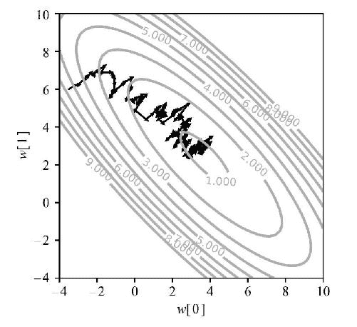

#### 图 4—4 随机梯度的轨迹

在随机梯度推进中，我们从训练集中抽取一个随机样例，算出该样例成本函数的梯度，然后朝着梯度相反的方向迈一小步。随后抽取另一个样例重复操作，再抽取下一个，依次类推，同时逐步缩小步长 `e`。此过程能迅速逼近学习成本即样本成本均值的谷底，同时由于不同样例的成本梯度存在波动，轨迹呈现不规则形态。图中学习集含 100 个样例，仅用对整个训练集的 4 轮计算，参数就在最小值附近波动。

虽然参数走得很曲折，不够平滑，但计算量小，收敛更快。

随机梯度法简单、反直觉，却非常有效。当样本数达到数百万甚至数十亿时，效率优势更明显。

## 自适应线性神经元与感知器

前面提到的平方误差代价，自适应线性神经元也用过。该单元由 Bernard Widrow 与 Ted Hoff 于 1960 年提出，和我年纪相仿。如今重提它有两个价值：二次损失容易可视化，且历史上长期与感知器竞争。

与感知器类似，它也是通过输入向量与权重向量的点积，即加权和产生输出，并利用随机梯度过程最小化期望输出与模型输出误差的平方。可视为分类器，输出为 +1 与 -1。感知器的训练本质上也是对特定代价函数的随机梯度下降。

其代价函数为：

`C（x，y，w）=–y*f（w，x）*dot（w，x）`

其中，

`f（w，x）=sign（dot（w，x））`

关于参数向量分量 `j` 的局部导数：

`g[j]=–（y–f（w，x））*x[j]`

参数更新规则为：

`w[j]=w[j]+e*（y–f（w，x））*x[j]`

这正是第三章给出的感知器学习规则。严格说，感知器的代价并不完全光滑，在斜率突变处存在褶皱，梯度在这些位置难以良好定义。上面算出的梯度实际上是次梯度，这对追求严谨的数学家来说颇为头疼。

感知器和自适应线性神经元都在单谷底代价上最小化，起点并不影响最终落点。若代价函数存在多个极小值又会怎样？

## 5 多个谷底的困扰

设想一个复杂函数，拥有两个或多个极小值，见图 4—5。

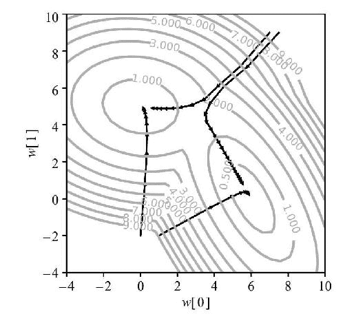

#### 图 4—5 具有两个极小值点的函数

某些代价函数可能具有多个极小值。此图表示具有两个极小值的非凸代价函数。通过应用梯度下降法来找到最小值，依据起点的不同，我们可能选取一个或另一个极小值。此处显示了 4 个梯度下降路径。

仿佛站在阿尔卑斯山脊上，右边是法国的山谷，左边是意大利的山谷。函数可能有数个极小值。

感知器训练不会遇到此问题，但两层及以上神经网络的损失通常是非凸的。从性能角度看，有些极小值是良性的，有些则落在被称为悬谷的区域，无论往哪走，梯度都指向局部极小。

图 4—5 显示了代价有两个极小值，一个深一个浅。若随机初始化 `w` 在 0 附近，会落到正确极小；若在 5 附近，则难以得到理想解。

对很多研究者而言，理想的损失应是凸的，因为凸函数只有一个极小，保证梯度算法收敛。非凸模型会让优化陷入困境。这也是多层神经网络曾被搁置的原因之一：其损失非凸。相比之下，核方法的损失是凸的，因而更受青睐。对理论家来说，凸性是保证，非凸性是麻烦。

事实上，拥有数百万参数的大型多层网络的非凸性在实践中并非障碍。用随机梯度训练时，无论起点如何，所达到的局部最小值在代价高度上非常接近。可以认为损失地形中极小值并非孤立点，而是彼此相连的宽阔山谷。高维空间中，总能找到维度让极小值之间连通。这一现象将在第五章进一步展开。

## 6 机器学习的原理

训练期间，网络调整参数，使得学习集中每个 `x` 都能给出期望的 `y`。训练后，可通过内插或外推为新 `x` 预测 `y`。新 `x` 落在训练样本范围内的称为内插，外则为外推。工程师选择的函数模型将成对数据连接起来，选择本身受一定约束。

以一条直线为例：

`f（x，w）=w[0]*x+w[1]`

输入 `x` 乘以斜率 `w[0]` 再加截距 `w[1]`。`w[1]` 控制与 y 轴交点。改变这两个参数可得到任意直线。

这是二参数模型。若学习集只有两点（`X[0]`，`Y[0]`）和（`X[1]`，`Y[1]`），总能找到一条直线穿过它们，见图 4—6。

加入第三个点（`X[2]`，`Y[2]`）且不在该直线上时，直线无法同时满足三点。此时经验提示更合适的模型可能是曲线，例如二次多项式：

`f（x，w）=w[0]*x**2 +w[1]*x+w[2]`

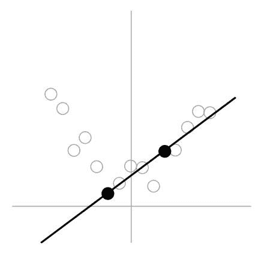

#### 图 4—6 穿过两个点的直线

给定两个点，我们总是可以计算出通过这两个点的直线的参数。

机器学习的任务就是求出公式中未知的值，即让曲线穿过训练点集的向量 `w`。训练的目的是让模型对训练集外的 `x` 也能给出合理的 `f（x，w）`。

函数可以更复杂，参数更多。例如自动驾驶场景，输入是摄像头图像的数千个像素，输出是方向盘角度，模型可能有数千万可调参数。但基本原理不变。

## 7 模型的选择

模型结构与参数化方式由工程师决定，`f（x，w）`可以是单层感知器、两层网络，也可以是 3、5、6 甚至 50 层的卷积网络。

这一选择仰赖经验，也受瓦普尼克统计学习理论的指导。

我很熟悉 Vladimir Vapnik，他是出色的数学家。我在新泽西贝尔实验室工作一年后他也加入；1996 年我升职后，他成了我的下属。基础研究中领导者的职责是提供时间与资源，而非干预具体工作。

Vapnik 出生于撒马尔罕附近，在莫斯科控制问题研究所工作期间为机器学习统计理论奠基，也对感知器产生兴趣。因犹太身份在苏联发展受限，他在苏联解体后移民，于 1989 年 10 月、柏林墙倒塌前夕来到美国。他研究了训练样本数量、模型复杂度与泛化性能之间的关系，对模型选择帮助很大。

任意两点之间总有一条直线连接。最先考虑的是二参数一次多项式 `w[0]*x+w[1]`。要穿过三点，可用三参数二次多项式 `f（x，w）=w[0]*x**2 +w[1]*x+w[2]`。三次多项式有四个参数，可穿过四点；四次有五个参数，可穿过五点，以此类推。

如图 4—7 所示，多项式项数越多，曲线越灵活，拟合训练点的能力越强。

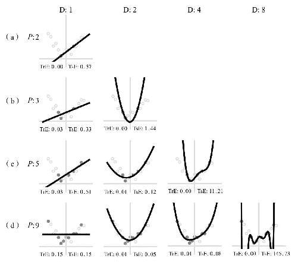

#### 图 4—7 基于多项式的学习

我们有 15 个数据点。黑点是学习示例，白点是测试示例。每列代表一个不同的模型，各行对应的分别为 `D=2`、`4` 和 `8` 的多项式。在每一行中，模型的训练使用了不同数量的示例，即 `P=2`、`3`、`5` 和 `9`。

在每个图中，曲线代表最接近学习示例点的多项式，`TrE` 是学习误差，`TsE` 是测试误差。当模型是“刚性”（直线或抛物线）时，如果学习示例点太多，则无法经过所有点。当模型是“灵活”（高阶多项式）时，它则可以通过许多点。但是，如果这些点未在一条简单的曲线上对齐时（换句话说，它们被噪声破坏了），则曲线必会呈现出大的“波浪”状（右下图）。此时尽管学习误差等于 0，测试误差却变得非常大。这是“过拟合”（`overfitting`）现象。具有 9 个学习点（d）的二次多项式给出了最佳的测试误差。资料来源：阿尔弗雷多·坎齐亚尼（Alfredo Canziani）

二次多项式是抛物线，给定三点一定能拟合。三次多项式可有峰谷，四次更灵活。理论上， `P` 个点总能用 `P-1` 次多项式精确穿过。实践中受数值精度限制，不会采用极高次多项式。

因此，对于特定数据量，必须调节模型复杂度。原因随后说明。

## 8 奶牛和三名科学家

火车上坐着工程师、物理学家和数学家。经过田野时，他们看到农民身后五头黑牛依次走过。工程师说：“这国牛都是黑的！”物理学家说：“至少有五头黑牛是黑的！”数学家说：“这国至少有五头牛的右侧是黑色的。”

三人的说法都对。数学家只描述了观察，未做推断；工程师过度泛化；物理学家借助先验知识“牛两侧颜色通常相同”做判断，却未推断其他牛。

故事说明：预测需要先验知识；解释数据的模型不止一个；好模型与差模型的区别在于预测能力而非解释能力。数学家的模型可能无法涵盖所有牛。

## 9 奥卡姆剃刀原理

奥卡姆剃刀提出简约原则：“Pluralitas non est ponenda sine necessitate”，即若无必要，勿增实体。对观察的解释应尽可能简洁。这一原则以 14 世纪修士 William of Ockham 命名。物理学家深谙此道，理论应以最少的方程、假设和自由参数构成。爱因斯坦也说：“凡事应做到最简单，而非相对简单。”

简洁理论不仅美观，更易做出正确预测。卡尔·波普尔以可证伪性定义理论质量：只有可被新数据推翻的理论才是科学的。复杂多项式可随时调整以通过新点，难以证伪。阴谋论即不可证伪理论的例子：一切都能用阴谋解释，却难以被证伪。学习理论同样是理性思维的体现。

这让人想起拉普拉斯《天体力学》出版后与拿破仑的对话。拿破仑问为何书中未提上帝，拉普拉斯答：“陛下，我不需要那个假设。”

## 10 模型怎么挑：训练、验证、测试三张牌

工程里给一个任务找最优函数，惯用的做法是把数据切成三份走完一套标准流程。先用一批从未参与拟合的样例来衡量泛化代价，这批样例就是验证集，用来判断模型到底会不会举一反三。

以一万组学习对 (x, y) 为例。先拿五千组去调参，训练期里网络不断修正权重让输出逼近期望，同时把整体代价压低，这一阶段产生的偏差常被称为训练偏差或经验偏差。

想确认系统没有死记硬背，就再拿两千五百组来测训完后的表现，这就是验证偏差。换不同的函数族重复这个循环，比如先试线性多项式，再换二次、三次，或者把神经网络规模逐步放大，最后保留验证偏差最小的那一个。

剩下的两千五百组留到收尾做终评，得到的就是测试偏差。单独算它是有原因的：光看验证偏差会过于乐观，因为挑选本身就是以验证偏差最低为标准，等于是对验证集做了隐式训练。想要在上线前拿到靠谱的质量估计，就必须用一批完全陌生的样本做冷启动检验。

## 11 容量和样本的跷跷板

### 瓦普尼克公式

模型太简陋就刻画不了数据，比如一条直线很难穿过散点；模型太强，比如千次多项式或巨型网络，就能把整个训练集吞掉，泛化能力却必然受损。这类函数很灵活，点与点之间会剧烈震荡，需要更多样本来抑制波动，让它不再逐点过拟合，而是捕捉数据背后的规律。

因此数据规模和模型复杂度必须互相牵制。

以十个学习点为例，如图 4-7(d)。用带三个参数的二次抛物线去逼近，拟合时会尽量贴近所有点，插值也算合理。把一个训练集中没有的 x 放进去，抛物线在两点之间平滑过渡，输出往往还能接受。

同样能连点的还有八次多项式，它可以恰好穿过九个学习点，如图 4-8。模型足够灵活，曲线可以精确经过每个点。但点并不完全共线，多项式必须来回摆动才能全部命中，八次意味着要震荡八次，形成波浪。

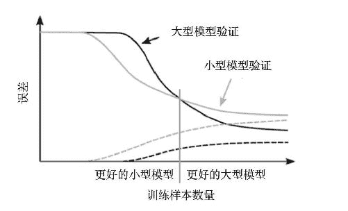

#### 图 4—8 大型模型和小型模型的学习误差和测试误差曲线的收敛性

对于一个给定的模型，随着学习示例数量的增加，学习误差（虚线）缓慢上升，而验证误差（实线）缓慢下降。对于较小的模型（灰色线），曲线在较少的示例数量上开始变得越来越近，并且越来越快，但是最终误差是相当大的。对于较大的模型（具有更多参数），两条曲线开始逼近之前需要更多的示例。它们彼此靠近的速度较慢，但最终的误差较小。验证误差的两条曲线相交。交点之前，优选小型模型；交点之后，大型模型更佳。

这种波浪拟合对插值很不友好。若把一个训练期未见的新点 x 丢进去，它可能正好落在波峰，结果就会偏离。学界称之为过拟合：模型太复杂而样本不足时出现，系统有能力把训练样本全记住，却抓不到共通规律。

常识是训练偏差会随样本增多而慢慢抬升：点越多，抛物线想全部穿过的难度越大。但验证集偏差则相反，会随着样本增多而缓慢下降。

对任何系统，训练偏差都小于验证偏差，因为见过的样本总比没见过的更好处理。在复杂度固定的情况下增加训练样本，两条曲线反向运动：训练偏差微升，验证偏差微降。样本趋于无限时，两者会靠拢。

为什么会这样？假设有七个点。一次多项式即直线，只能穿过两点，除非点完美排线，否则训练偏差会开始累积。而四次多项式能更贴近全部点，训练偏差更小，只是为了贴近必须“起波”，波也会让新点预测失真。

继续加点，直线位置基本不动，训练偏差几乎不变。四次多项式却再也贴不住全部点，训练偏差开始上升；与此同时波峰被压平，对新测试点的表现反而改善。

从图 4-8 能得到的操作启示：在交点左侧，小模型验证偏差更低更高效，数据量不大时优先选小模型；右侧则大模型更强。样本数超过某个阈值后，模型无法再逐点命中，开始泛化。对固定样本量，我们要找的是最佳折中，让模型犯点错，跳出死记硬背，进入真正理解。

在相同样本量下，模型能力越强，训练偏差越小，但验证偏差与训练偏差的差距也会越拉越大。于是存在一个使验证偏差最小的能力点，也就是图 4-9 的那个低谷。

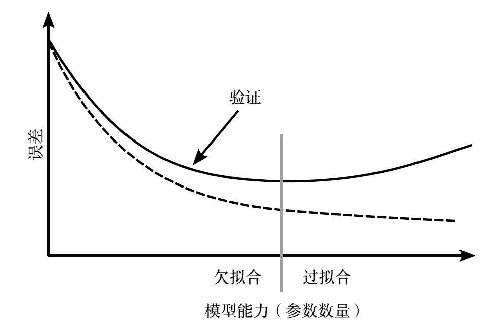

#### 图 4—9 欠拟合和过拟合

对于相同数量的训练数据，随着使用更复杂的模型，学习误差逐步减少。但是，验证集中的误差会经过一个最小值后开始上升。上升就是所谓的过拟合：机器从学习示例中学习了太多细节，并且忽视了我们要其完成的任务的一般性。它开始死记硬背地学习，而不是试图从中提取规律。该曲线的最低点给出了我们应该选择的模型的能力。

想象一个无穷次幂的多项式，学习能力极强，无论多少点训练偏差都是零，能轻松穿过所有点。可它永远无法泛化，只能靠死记硬背，就像一个不聪明的学生死背乘法表，却不懂乘法原理。

这可以用“没有免费午餐”来概括：能学一切的学机实际上什么也没学到。它需要无穷样本才能停止逐点穿行，然后才开始找规律。现实中，一个记忆力一般的人反而更擅长发现基本规则。

训练时需要把握两端：

1. 模型得够强，有足够的参数旋钮去逼近训练集里的全部数据点。
2. 又不能过强，否则为了精确穿点而多次震荡，反而插值错误。

瓦普尼克给出了三个量：

1. 训练偏差或经验偏差，反映在训练集上的表现。
2. 测试偏差，在训练期未见的数据上的表现。若点无限多，可精确估计实际应用偏差。
3. 模型容量，即所有可调参数变化时模型能实现的功能数量，也叫瓦普尼克维度。

公式为：

`Etest < Etrain + k * h / (p ** alpha)`

其中 `Etest` 为测试误差；`Etrain` 为学习误差；`k` 为常数；`h` 为瓦普尼克维度；`p` 为学习示例数；`alpha` 在 1/2 到 1 之间，取决于问题性质。

该式解释了图 4-8 与图 4-9 的现象。

### 布尔函数的眩晕

函数空间很大，即便输入很简单，学习能力越强的函数越难泛化，除非提供足够样本。因此在样本有限时，机器需要先验约束，专门学习输入输出关系，也就是我们说的“概念”，而这种约束主要由模型结构提供。

模型因此必须自带先验结构，用少量样本就能学到有效函数，同时结构也限制了它只能覆盖所有可能函数中的一小部分，如图 4-10。

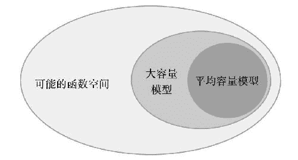

#### 图 4—10 函数空间

由一个模型可表示的函数集合（可计算的或可近似的）是所有可能的函数组成的空间里的一个小子集。该子集主要由模型的体系结构决定。大容量模型可表示的函数集合要比小容量模型可表示的函数集合更大。

以布尔函数为例，输入是 0/1 序列，输出也是 0/1，输入个数有限便于计数。每个值都有意义，0,1 顺序不可互换。

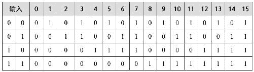

#### 图 4—11 布尔函数表

布尔函数有 n 比特的输入并产生 1 比特的输出。一个 2 比特的布尔函数可以由一个 4 行表来明确表示，对 4 种可能输入（0，0），（0，1），（1，0）（1，1）的每一种给出输出值（0 或 1）。因此，对于这 4 种输入可能，有 16 种可能的输出（`2 ** 4`），即 16 种可能的 2 比特函数，每个函数由 4 比特的序列表示。每附加 1 比特输入，表中的行数就会加倍。通常，对于 n 比特函数，有`2 ** n`个输入配置和`2 ** (2 ** n)`个可能的布尔函数。

### 一些可能函数的例子

看图 4-11 第 8 列：两输入全为 1 时输出 1，否则 0，就是与函数，真值表为 (00,0)(01,0)(10,0)(11,1)。真值表列出函数所有可能输入的输出。

第 6 列：恰好一个输入为 1 时输出 1，否则 0，真值表为 (00,0)(01,1)(10,1)(11,0)。这是异或，感知器算不了，因为它只能处理线性可分函数。

由此可算线性可分输入组合数：n=1 时 2**1=2；n=2 时 2*2**1=2**2=4；n=3 时 2*2**2=2**3=8……依次 16、32、64、128、256、512、1024、2048、4096……每加一位比特，组合数翻倍，n 位输入共有 2**n 种配置。

一个具体的布尔函数就是 2**n 长的列表。每种组合对应 0 或 1 两个输出，于是总函数数为 2**(2**n)，n 很小就已天文数字。

比如 25 位输入，像第二章的感知器，可能函数数为 2**33554432，这是一个 10100890 位的数字，远超可见宇宙原子数约 80 位。

在 2 位输入的例子里，共 16 个函数，其中 2 个线性不可分，即异或及其反函数，可分的有 14 个，比率还高。随着 n 增大，感知器可实现的函数比例急剧下降，n 超过阈值后几乎不可能命中。

类比平面上随机撒 + 和 -，用直线二分的概率：样本 3 个时几乎总是可行；样本上百万时概率趋近于零。所以感知器难以学习超大样本集。

结论是线性分类器灵活性不足，一旦学习集样本数超过输入维度，就很难把 A 类和 B 类分开。这是斯坦福统计学家 Thomas Cover 在 1965 年证明的定理。

反之，函数空间过大也不利。

**例证**

回到第三章 5×5 像素网格的 C 与 D 二进制图像。总函数数仍是 2**33554432。若训练集只有 100 个样本，布尔表只有 100 行被确定，其余 33554332 行未定，于是有 2**33554332 个函数与数据兼容，都能在 100 个样本上答对。机器如何在海量候选中挑出能正确分类训练外图片的函数？

### 正则化：调节模型的容量

这就引出归纳问题：若学习机能算全部函数，它凭什么从兼容样本的众多函数里挑一个合适的？函数太多，必须借助归纳法设定选择标准，也就是奥卡姆剃刀：选最简单的函数。现在要定义“简单”，从而能计算任何函数的复杂度。通常做法是构造正则化器来度量复杂度。例如多项式族里用幂次衡量，神经网络可用神经元数或连接数衡量。

有效学习需要在训练偏差与实现该偏差的函数复杂度之间找平衡。复杂度越高训练偏差越低，泛化可能性越小。

于是目标变为：

`L'(w) = L(w) + a * R(w)`

其中 `L(w)` 是训练偏差，`R(w)` 是度量参数 w 对应函数复杂度的正则化器，`a` 控制数据拟合与复杂度最小化的权衡。

这并非数学家的专利，构建基于学习的 AI 系统时都会用正则化。实践中偏好易计算且易用梯度下降的正则项。线性分类器和神经网络常用权重平方和。

用权重平方和正则，系统会把分类边界推到两类之间的无人区中央，SVM 称之为间隔最大化。另一种常用的是权重绝对值之和，可把不必要或作用小的权重压到 0。对多项式系数正则化时，高阶无效项会被忽略。

## 12 人类的三点启示

第一，像布尔函数一样，人类智能的复杂性源于非常简单元素的组合。这是一个新的特性。

第二，预设是必要的。我们必须有预先设置的专业的大脑结构，才能学习、处理信息，只需少量的试错就可以阐明规律。如果我们只是一块白板，那么借助大脑强大的功能，我们可以学习任何东西（就像非常复杂的模型可以学习大量的数据一样），但这个过程需要大量的时间，因为我们只是在死记硬背地学习。

第三，我们这里所描述的所有机器学习的方法都能使成本函数最小化，它们通过尝试、失败、重新调整以接近预期的结果。人类和动物的学习方法也可以被解释为成本函数的最小化吗？我们真希望有朝一日能够回答这个问题。

# 第五章 完成更复杂的任务

为了解决感知器及其同类机器的局限性，科学界选择了最有效的解决方案，即堆叠多层神经元层，以使系统可以执行更复杂的任务。

此外，我们还要找到一种从头到尾训练这些系统的方法。其实解决方案很简单，只不过没有人注意它，因为这项研究在 20 世纪 60 年代末被科学界放弃了。而一切都在 20 世纪 80 年代中期发生了变化，当时不同领域的研究人员在互无交集的情况下发现了梯度反向传播。这个方法能够有效地计算多层网络中成本函数的梯度。它能调整网络各层的参数，以使输入成本达到最小值。最终，第一层网络识别出待检测图像的正确图案后，任务完成。

神经网络也可以用来学习复杂的任务，并且可以在数百万的数据上进行训练。我们把这样的训练称为深度学习，因为此时使用了（网络）层的堆叠。

## 1 贡献度分配

多层网络的雏形和早期尝试可以上溯到上世纪八十年代，真正掀起深度学习浪潮的却是 2010 年代，得益于可编程 `GPU` 的普及和海量数据集的积累。

如今，几乎所有主流的人工智能系统都依赖同一套学习机制——反向传播，它已成为深度学习的基石。

多层神经网络本质上是不同功能层的堆叠。每层接收来自前一层的向量作为输入，该向量记录了前层单元的全部输出；本层给出的也是一个向量，只是维度不必与输入相同。我们把只从前层或数层之前取输入的网络称为前馈多层网络 `feed-forward`；若高层向低层也存在回连，则归入循环网络。下面先聚焦前馈情形。

传统的多层前馈网络内部交替出现两类层，见图 5—1 和图 5—2：

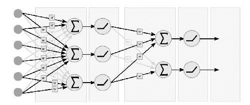

#### 图 5—1 多层前馈神经网络

每个单元先对输入做加权求和，把结果送入激活函数，再把计算得到的输出传给下一层作为他人的输入。于是整张网由两类层轮换构成：负责加权求和的线性层，和负责施加激活的非线性层。训练的本质与感知器一致，是调整连接各单元的权重以减小误差度量，即成本函数，它衡量网络输出与期望输出的偏离。本章要讲的反向传播，正是用来求出成本函数对网络全部权重的梯度。

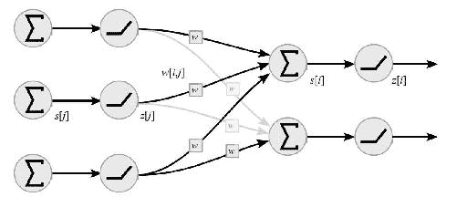

#### 图 5—2 网络中的神经元已编号

神经元 `i` 以其上游神经元的输出为基础计算加权和 `s[i]`。上游集合记作 `UP[i]`，`w[i, j]` 表示从神经元 `j` 到神经元 `i` 的连接强度。求和可由如下公式得到：

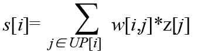

求和之后接一个非线性激活函数 `h`，由此产生该神经元的输出：

`z[i] = h(s[i])`

1. 线性层：输出是输入的加权组合，输入输出个数可以不同。把它称作线性的原因在于，对两个信号求和后再送入层，得到的输出等于分别处理后再相加的结果。

2. 非线性层：对每个输入逐一施加非线性映射得到对应输出。常用的映射包括平方、绝对值、S 形等，输入输出数量相等。正是因为这些非线性操作，多层网络才具备强大的表达力，细节将在后文展开，见图 5—3。

线性层的一个典型输出就是加权和 `s[i]`。它通过权重 `w[i, j]` 与前一层的输出 `z[j]` 相连：

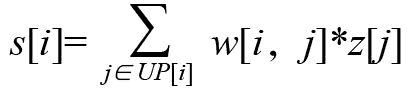

`UP[i]` 代表为单元 `i` 贡献输入的全部单元集合。`z[i]` 是线性层之后非线性层里的一个具体输出，是把激活函数 `h` 应用于加权和的结果：

`z[i] = h(s[i])`

这两个连续步骤合起来构成一个神经元，即线性函数后接激活函数。

激活函数的输出会送给下一层的单元，下一层单元接收这些值并重复同样的计算。随后又是线性层、非线性层，如此往复直至输出层。

为何要交替使用线性和非线性？若所有层都是线性的，整体等价于单一线性变换，层层堆叠便失去意义，神经网络只能表示线性函数。而我们希望逼近的函数往往是非线性的，例如区分猫狗鸟的图像分类函数就极其复杂。仅有非线性的多层结构才能逼近这类函数。大量理论表明，由“线性、非线性、线性”堆叠而成的网络是通用逼近器：只要中间层单元足够多，就能以任意精度逼近目标函数。表示复杂函数时，多层网络通常比单层更高效。

注意：在“全连接”网络里，某层的每个单元都会接收上一层全部单元的输入。大多数实际网络采用稀疏连接，一层单元只与上一层的一部分相连。下一章的卷积网络即是典型例子。

训练时，系统期望的输出对应最后一层单元的可见输出。更靠前的层是隐藏的，工程师和算法都不知道它们该输出什么。如何为隐藏单元设定合理目标，正是深度学习的核心难题——贡献度分配问题。

## 2 连续神经元

在更往下讲之前，先回溯一下历史。进入 20 世纪 80 年代初以前，机器学习多建立在二进制神经元之上：加权和超过阈值就输出 +1，否则输出 –1。输出只有两种可能。

阈值的弊端在于让成本函数出现阶梯状跳变。权重微小变动可能完全不影响神经元输出，一旦变动足够大，输出就会从 –1 翻到 +1 或反之。若这种翻转传到输出层，成本函数会骤变。于是参数的微小改动要么毫无作用，要么导致突变。梯度图变成若干平台被台阶隔开，难以通过梯度找到下降方向，梯度下降法因此失效。简言之，二进制神经元与基于梯度的方法不相容。

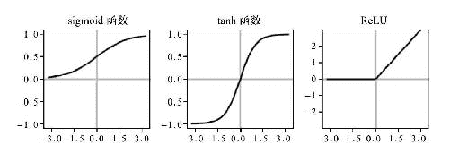

#### 图 5—3 多层神经网络中使用的非线性激活函数

左图：从 0 到 1 平滑变化的 S 形函数，公式为 `y=1/(1+exp(-x))`。中图：双曲正切，与 S 形类似，值域为 –1 到 +1。右图：`ReLU` 线性整流函数，正值时 `y=x`，否则为 0。后者在近年网络中使用最广。

若计算资源足够，人们会采用“更温和”的神经元。输出不会在 –1 与 +1 之间突跳，加权和的响应也不会呈阶梯，而是呈现连续的 S 曲线。

我们在第四章已提到，学习都围绕成本的最小化展开，所以必须能计算系统参数的梯度，即知道怎样调整每个参数才能降低成本。训练即在学习阶段减少错误。

对于“更好的”连续神经元，即使是某个输入参数的极细微变化，也会引起神经元输出的连续变化。随着参数的缓慢增减，系统的最终输出会同步连续变化，进而导致成本的连续变化。正是这种连续性，使得梯度下降可以用来训练多层网络。

## 3 我的分层学习机

再回看上世纪八十年代初，学习算法的问题一直存在，却鲜有人关注。神经元是二进制的，梯度无法解析，干扰式的方法在权重众多的大型网络上效率极低，这真是个棘手难题。

当输出错误时，算法应把责任归到哪些神经元？权重该改多少？如何精确计算改变量？

我查阅过资料：六十年代曾有大量尝试，但未形成突破，七十年代几乎无人继续。福岛邦彦是少数坚守者之一。他的认知机确实是多层网络，只不过神经元非二进制，而是更接近生物神经元。除了最后一层，其余层采用无监督训练，我们尚未涉及。其目标是让每组神经元自主发现模式类别。这些模式并非由最终任务决定，而是由出现频率决定：如果某组输入域里垂直轮廓经常出现，该组就会分出一个神经元专门检测它。这构成了他的学习过程。

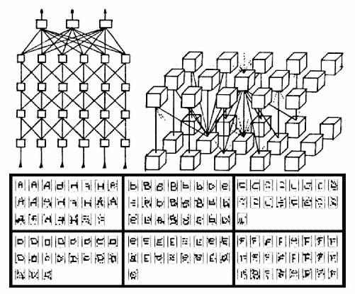

#### 图 5—4 我关于 HLM 的文章中的插图

1985 年认知大会上，我介绍了具有局部连接的分层网络结构。它在虚拟数据上训练，数据是模拟带大噪声、失真或难以辨认字符的小图像。

认知机与感知器类似，只在最后一层做监督训练，以减小误差。可惜效果有限，因为内层并未针对任务训练，机器可能学到对任务无用的模式检测方式。例如识别字符时，区分粗线和细线对完成任务并无帮助。

1981 或 1982 年，我还在巴黎高等电子与电子技术工程师学院时，就萌生了多层网络学习算法的想法，但记不清灵感来源。我称之为 `HLM`，见第二章。它由大量相同的单元堆叠而成。我有一种从数学上看似合理的直觉，于是有点盲目地在计算机上编程测试。但当时时间不足，直到 1983 年攻读法国高等深入研究文凭时才重新投入，整整沉迷了一年。

如今我们已不再使用 `HLM` 方法，但仍可简述其短暂历史。

`HLM` 的优点也是短板：它使用二进制神经元，输出只有 +1 或 –1。这种神经元计算加权和不需要乘法，只需加法减法，在当时可加速运算。

为训练此类网络，我想到一个技巧。输出层神经元有明确目标，即外部期望的输出。上游层尝试为每个神经元寻找一个二进制目标 +1 或 –1，以满足下一层需求。如此层层反推，直至第一层。

因此 `HLM` 算法以出口为起点，反向传播这些目标，见图 5-5。输出层对上一层说：“这是我希望的输出，目前你给我的信号不足以让我答对，所以我希望你产生这样的输出。”上一层每个单元都会与它下游的多个神经元进行类似“对话”，后者必须在多方需求间折中。依次类推，形成多米诺效应。

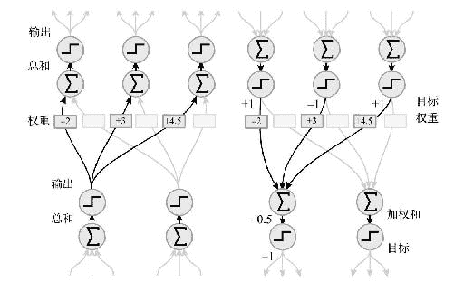

#### 图 5—5 使用二进制神经元从 HLM 程序逆向传播目标

学习中，每个神经元通过下游神经元的“投票”计算一个目标，即期望输出，取值为 +1 或 –1。每个下游神经元投票目的是实现自身目标，投票权重与其相关连接强度成比例。神经元的目标即下游神经元目标的加权和，权重为下游神经元与本神经元的连接权重。和为正时目标为 +1，负时为 –1。图中左侧下游神经元以权重 –2 投票 +1，等价于以 +2 投票 –1；中央神经元以 –1 投票 +3；右侧以 +1 投票 +4.5。加权和为 –2 –3 +4.5 = –0.5，故计算目标为 –1。权重按感知器方式更新，使输出更接近目标。

总结：每个神经元都有一个由下一层目标推导出的虚拟期望输出，层层向前传递，直至第一层。

若某个神经元与下一层多个神经元相连，其与某些神经元的连接权重更大，与另一些更小。计算目标时，应更重视权重更大的下游神经元。

于是取一层的目标值，计算其加权和。和为正则目标为 +1，负则为 –1。正逆向使用同一组权重。可把这视作一种投票，下游神经元向目标神经元投票，票数与连接权重成比例。由于神经元二进制，目标也只能是 +1 或 –1。

在 `HLM` 中，神经元 `j` 的目标值 `t[j]` 必须是其下游神经元目标的加权和，即汇总下游目标并以连接权重为系数。当阈值被超过，该和即为本神经元目标。

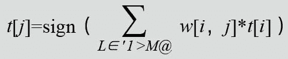

变量 `DN[j]` 表示向神经元 `j` 提供输出的所有下游神经元。于是权重 `w[i,j]` 在这里被“反转”使用。

据此可逐层计算全部目标，直至每个神经元都有对应目标和实际输出，并用与感知器相似的方式更新权重，使输出逼近目标。看起来像是许多相互连接的小感知器，最终期望输出被分配到每个神经元。

我做过一些模式识别实验，结论是该算法有效但不稳定。1984 年在斯特拉斯堡的“神经科学与工程科学”小型会议上，我首次提出想法，这是法国神经网络兴趣小组的年度聚会。关于 `HLM` 的文章收录于 1985 年 6 月巴黎认知大会论文集。

后来证实我的发现是梯度反向传播的一种奇特版本。如今梯度反向传播已成为训练多层或深层网络全部层级的标准。从数学上看，反向传播目标的算法属于目标传播类，在小误差范围内等价于梯度反向传播，只不过传播的不是梯度而是虚拟目标。

## 4 赛跑

与当时攻读机器人轨迹规划博士的朋友迪迪埃·乔治讨论时，我意识到我的方法与最优控制理论中的伴随状态法惊人相似。若使用连续而非二进制的激活函数，并传播误差而非目标，数学会变得简洁。事实上，伴随状态法应用于多层网络即是梯度反向传播。我的直觉无需额外证明，这个新算法可借助法国—意大利数学家约瑟夫-路易斯·拉格朗日在 18 世纪末为形式化牛顿力学发明的数学形式来表述，于是我发现了梯度反向传播。

那是 1984 年底，我正忙于 `HLM` 工作，无暇测试和发表新想法。

同期，其他地方也有人研究类似课题。时任卡内基·梅隆大学年轻教授的杰弗里·辛顿研究玻尔兹曼机，这是一种训练含隐藏单元网络的方法。玻尔兹曼机采用对称双向连接。辛顿与特伦斯·谢诺夫斯基于 1983 年提出该想法，但文章措辞极为谨慎，未提及单元类似神经元、连接类似突触，标题《最优感知推断》也模糊主题。当时神经网络不被业界接受，谈论它如同谈魔鬼。

不久辛顿在玻尔兹曼机上遇到困难，于是转向戴夫·鲁梅尔哈特 1982 年提出的反向传播，并使之成功运行。那是 1985 年春天，就在莱苏什会议之后。我很快在巴黎见到辛顿，他讲解了工作。当时我已在修改 `HLM` 程序以适应反向传播，只是不幸在辛顿完成前来不及测试。他于 1985 年 9 月与鲁梅尔哈特和威廉发表技术报告，也是 1986 年出版的《分布式并行处理》一章，报告中引用了我关于 `HLM` 的论文。当时辛顿已声名远播，我只是无名小卒。虽失先机，我仍很高兴。

1 D. E. Rumelhart, G. E. Hinton, R. J. Williams, Learning internal representation by error propagation , in D. E. Rumelhart, J. McClelland (dir.),Parallel Distributed Processing,The MIT Press, 1986.

## 5 数学的美妙之处

下面要讲的梯度反向传播是一种高效计算由多层神经网络构成的成本函数梯度的方法，即最大下降方向。其原理是颠倒信号传播方向，与 `HLM` 不同的是传播梯度而非目标，即偏导数。

为解释这一点，需分别理解线性函数与非线性函数。

反向传播依赖复合函数的链式法则。我们在高中就学过，复合函数是将一个函数作用于另一个函数的输出。若先把 `f` 作用于 `x`，再把 `h` 作用于结果，这很关键。因为一层线性后接一层非线性，可看作两个函数的复合。若层数更多，则是多个函数的嵌套，公式会大大简化。这就是数学的美妙之处。

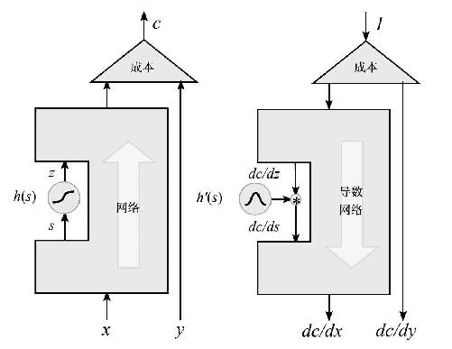

#### 图 5—6 通过激活函数反向传播梯度

成本对激活函数输入的导数等于成本对激活函数输出的导数乘以激活函数导数：`dc_ds = dc_dz * h'(s)`。

设想如图 5-6 所示的复杂多层网络，性质未知。在其输出处用成本函数衡量实际输出与期望输出的差异。取网络中某特定单元，它计算输入加权和 `s`，送入激活函数 `h` 得到 `z = h(s)`。若已知成本对激活函数输出的导数 `dc_dz`，即 `z` 的扰动引起成本变化的比率，则对 `z` 施加极小扰动 `dz`，成本变化为 `dc = dz * dc_dz`。那么 `c` 对 `s` 的导数 `dc_ds` 是什么？若对 `s` 施加极小扰动 `ds`，激活输出产生扰动 `dz = ds * h'(s)`，其中 `h'(s)` 是 `h` 在 `s` 处的导数。因此成本增加 `dc = ds * h'(s) * dc_dz`。由此可得：

`dc_ds = h'(s) * dc_dz`

即已知 `c` 对 `z` 的导数后，可通过乘以 `h` 在 `s` 处的导数得到 `c` 对 `s` 的导数。这就是通过激活函数反向传播梯度的方式。

现在以加权和处理反向传播。

以单元 `z` 的输出为例，将其发送到下游几个单元用于计算加权和。如图 5-7 所示，输出 `z` 通过权重 `w[0]`、`w[1]`、`w[2]` 送入下游单元，参与计算加权和 `s[0]`、`s[1]`、`s[2]`。

先设定我们已经掌握了损失 `c` 对三个下游单元 `s[0]`、`s[1]`、`s[2]` 的敏感度 `dc_ds[0]`、`dc_ds[1]`、`dc_ds[2]`。此时给输入 `z` 施加一个极微小的扰动 `dz`，第一路加权和 `s[0]` 会被 `w[0] * dz` 带动，随之产生的成本波动就是 `dz * w[0] * dc_ds[0]`。

同样的 `dz` 会同时点燃两条传导链。第一条是 `s[1]` 受到 `w[1] * dz` 量级的扰动，进而让成本产生 `dz * w[1] * dc_ds[1]` 的偏移；第二条是 `s[2]` 因 `w[2] * dz` 而变动，最终使成本变化 `dz * w[2] * dc_ds[2]`。把所有影响叠加起来，总扰动为：

`dc = dz * w[0] * dc_ds[0] + dz * w[1] * dc_ds[1] + dz * w[2] * dc_ds[2]`

由此可得 `z` 方向的导数：

`dc_dz = w[0] * dc_ds[0] + w[1] * dc_ds[1] + w[2] * dc_ds[2]`

这正是加权求和层在反向传播时使用的梯度公式。

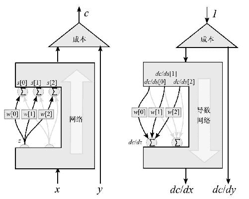

#### 图 5—7 加权和层的梯度回传
成本对单元输出 `z` 的敏感度本质上是它所连下游单元敏感度的线性组合，组合系数就是当前的连接权重：

`dc_dz = w[0] * dc_ds[0] + w[1] * dc_ds[1] + w[2] * dc_ds[2]`

要反推出某层输入的梯度，做法是取输出端的梯度，沿着输入到输出的连接权重做一次加权求和。换句话说，方向与正向传播相反，正如 `HLM` 的逆向操作。

总之，要把梯度从激活层和加权和层往回传，需要两组关系：

1. 激活函数层
   a. 向前传播：`z[i] = h(s[i])`
   b. 向后传播：`dc_ds[i] = h'(s[i]) * dc_dz[i]`
2. 执行加权和层
   a. 向前传播：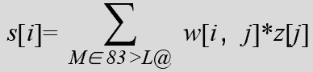
   b. 向后传播：

接下来求成本对权重的导数。

当权重 `w[i,j]` 受到极小扰动 `dw[i,j]` 时，加权和会多出 `dw[i,j] * z[j]` 的分量，成本随之产生 `dc = dw[i,j] * z[j] * dc_ds[i]` 的波动。因此权重梯度为：

`dc_dw[i,j] = z[j] * dc_ds[i]`

到此为止，传统多层神经网络反向传播的三条核心关系已经完整。有了权重的梯度，就能做梯度下降更新：

`w[i,j] = w[i,j] - e * dc_dw[i,j]`

整体练习的核心是：已知某层输出的梯度，如何求出该层输入的梯度。把这一操作递归地应用到所有层，就能得到全部梯度，最后再用输出或输入的梯度去求参数、尤其是线性层权重的梯度。

## 6 多层结构的益处
学习的根本逻辑没有变：调整参数让系统犯错更少。对多层网络做端到端训练，就是深度学习的含义。这类系统不仅能完成分类，中间的各层还会自发地把原始输入转成有意义的表征，类似增强型感知器里的特征提取器。可以说，堆叠的层本身就是可训练的特征提取器，这正是多层网络的决定性优势：表示方式由数据自动学习，而不是手工预设。

**关于导数的说明**^1

前面的推导偏直觉，数学工具较少。另一种更形式化的写法会用到导数、偏导、向量和矩阵。

复合函数链式法则认为 `c(f(z))` 对 `z` 的导数记作 `c(f(z))'` 等于 `c'(f(z)) * f'(z)`。反向传播的基础正是这条法则。

示例讲解：

给 `z` 施加小扰动 `dz`，`f(z)` 的输出会变化约 `f'(z) * dz`。按定义 `f'(z)=[f(z+dz)-f(z)]/dz`，两边乘 `dz` 得：

`f(z+dz) - f(z) = f'(z) * dz`

于是 `c` 的输出会受到 `c'(f(z)) * f'(z) * dz` 的干扰。输入扰动 `dz` 与输出扰动的比值即为 `c'(f(z)) * f'(z)`，也就是 `c(f(z))` 的导数：

`c(f(z))' = c'(f(z)) * f'(z)`

导数是输出扰动除以输入扰动的比。若函数依赖多个变量，则对特定变量的比值称为偏导。我们在上一章已见类似案例。

当函数既有多变量又有多输出，情况更复杂。

例如线性层是多入多出函数。每个输出 `s[i]` 都是输入 `z[j]` 的加权和：。可通过程序计算：

```
def lineaire(z, w, s, UP):
```

```
for i in range（len（s））：
s\[i\]=0
for j in UP\[i\]：
s\[i\]=s\[i\]+w\[i，j\]\*z\[j\]
return s
```

层的权重可看作双下标数组：行索引 `i`、列索引 `j`。整个数组可视为向量，每个元素也是向量：

`[[w[0，0]，w[0，1]，w[0，2]，…]，`
`[w[1，0]，w[1，1]，w[1，2]，…]`
`..................]`

这就是矩阵。程序里的 `lineaire()` 计算的正是矩阵 `w` 与向量 `z` 的乘积，得到维数为 `w` 行数的向量 `s`。

`PyTorch` 中有高效函数可实现这一点。

对多入多出的层做反向传播，必须考虑每个输出对每个输入的偏导，满足复合函数求导的形式。

下面解读如何在多层架构里用链式法则计算梯度。


#### 图 5—8 模块化视角下的多层网络
现代深度学习系统可描述为以损失模块为首的互连模块图。模块可以有多个输入、多个输出和多个参数，完整的一层线性神经元就是一个“模块”。左图：网络由两个模块组成，模块 `f(x, wf)` 输出 `zf`，其后接模块 `g(zf, wg)` 输出 `zg`。成本模块 `C(zg, y)` 与期望输出 `y` 比较。中图：更一般的网络由编号模块堆叠而成。模块 `k` 的输出为：

`z[k+1]=fk(z[k], w[k])`

已知成本相对 `z[k+1]` 的梯度 `g[k+1]`，可按

`g[k]=g[k+1]*dfk_dzk`

计算成本相对 `z[k]` 的梯度 `g[k]`，其中 `dfk_dzk` 是 `fk(z[k], w[k])` 对 `z[k]` 的雅可比矩阵，描述每个输入扰动对每个输出的影响。

以双层网络为例，第一层 `f(x, wf)` 产生 `zf`，第二层 `g(zf, wg)` 产生 `zg`，成本 `C(zg, y)` 衡量与期望 `y` 的差距。已知 `dC/dzg`，由复合导数得：

`dC/dzf = dC/dzg * dgz/dzf`
`dC/dzf = dC/dzg * dg(zf, wg)/dzf`

左边是向量，右边是向量与雅可比矩阵的乘积。通过向量-雅可比乘积即可把梯度从模块 `g` 反传到其输入，与内部结构无关。进而可得参数梯度：

`dC/dwg = dC/dzg * dg(zf, wg)/dwg`

再由

`dC/dwf = dC/dzf * df(x, wf)/dwf`

得到第一层参数的梯度。

对一般堆叠网络，有：

`g[k+1]=dC/dz[k+1]`
`g[k]=dC/dz[k]=dC/dz[k+1]*dz[k+1]/dz[k]`

其中 `dz[k+1]/dz[k]=dfk(z[k], w[k])/dz[k]` 为模块 `k` 的雅可比，`i,j` 项表示输入 `i` 扰动时输出 `j` 的变化。

该式递归适用：从输出往输入逐步计算各层梯度。参数梯度同理：

`g[k]=dC/dw[k]=dC/dz[k+1]*dz[k+1]/dw[k]`

其中 `dz[k+1]/dw[k]=dfk(z[k], w[k])/dw[k]`。

由此可知：

1. 成本对第 `k` 层输入的梯度等于成本对第 `k` 层输出的梯度乘以该层函数对输入的雅可比。递归应用即可得到所有层输入输出的梯度。
2. 成本对第 `k` 层参数的梯度等于成本对该层输出的梯度乘以该层函数对参数的雅可比。

这就是模块堆叠结构下梯度反向传播的一般形式。只要模块连接图无环，即便连接更复杂也能使用。先正向计算各模块输出，再逆向反传梯度。

尽管有此小限制，但模块的多样性和自由组合为工程师提供了灵活空间，可为图像识别、语音识别、翻译、图像合成、文本生成等任务定制不同架构。

`[1]` 为方便在 Python 中操作多维数组，最好使用 `Numpy` 或 `PyTorch` 等库。`PyTorch` 提供了本书描述操作的高效实现，必要时可利用 GPU。http://PyTorch.org。

`[2]` 按惯例像 `dC/dz` 这样的梯度被视为行向量，即常规向量的转置，便于在右侧乘以雅可比矩阵。

## 7 消解疑虑
为突出反向传播的新颖性，需要回应理论上的质疑。有人认为多层网络训练可能陷入局部极小，如同山地景观易困于小盆地。但实践中系统很少被困在半山腰，参见第四章图 4—5。

为什么会出现多个最小值？训练多层网络时，往往存在多种权重配置可使训练样本上的输出完全相同。想象一个已训练好的两层线性网络，成本已达最小。将第一层神经元的所有权重乘以 `2`，同时把这些输出连到下一层的所有权重乘以 `1/2`，网络输出不变。两种配置都对应最小成本。

另一种改造是交换第一层中两个神经元的位置，并牵动它们到前一层和后一层的连接与权重。输入输出函数保持不变，故也构成另一个最小值。可见目标函数具有多重最小值。

## 8 多层网络的吸引力
多层网络中前面的层可视为特征提取器，但与传统方法不同，这些提取器不是手工设计的，而是通过学习自动生成的。这就是反向传播训练的多层网络的魅力。

以字母 `C` 和 `D` 为例，感知器的局限是形状、位置或大小变化过大时无法分离。加入额外一层后，第一层神经元可自动检测 `C` 和 `D` 的特征模式。

由于网络由反向传播训练，这些检测器自动定位有用模式。例如“连续线段以两个端点终止”仅对 `C` 出现，而拐角的存在预示图案为 `D`。第一层像特征提取器，第二层像分类器，但训练是同步进行的，学习是统一的。

最简单的多层网络是全连接，当输入很大时会很不便。设想 `100×100` 像素图像，即 `10000` 像素。把全部像素全连到 `10000` 个神经元的第一层，连接数高达 `1` 亿。因此需要结构化设计来接受更大输入如 `1000×1000` 像素图像。

为不同问题调整网络架构是人工智能工程师的日常。深度学习包括：

1. 通过配置和连接模块构建多层网络架构；
2. 利用反向传播计算梯度后通过梯度下降训练结构。

“深度”一词仅表示网络是多层的，别无他意。

如何为图像识别设计网络结构？将在下一章讨论。

# 第六章 人工智能的支柱
在贝尔实验室，我基于哺乳动物视觉系统的研究成果开发了一种全新的多层网络架构。实验室经理拉里·杰克尔将其命名为 `LeNet`，源自我的姓氏 `LeCun`^[`[1]`](#part0082.html#note44n)。这是卷积网络的最初名称。

20 世纪 80 年代末至 90 年代初是多层神经网络的繁荣期：会议与出版物激增，大学创造大量职位，政府投入相关计划……

但十年中期研究受到质疑，因其计算耗时、需要大量训练数据且操作复杂。

直到 2012 年才出现转折。在一项国际竞赛中，卷积网络以出色表现证明了有效性，成为研究者宠儿和众多人工智能应用的基石，此后在研究领域的重要性稳步上升。

`[1]` 我的姓氏应写作“Le Cun”，但在美国“Le”常被误解为中间名缩写，导致文献中出现“Cun Y. L.”。因此在法国之外，我用一个词写作“LeCun”。

## 1 2012 年的重磅炸弹
`ImageNet` 是计算机视觉研究中用于图像物体识别的数据库，由斯坦福大学、普林斯顿大学等美国机构学者联合开发。

最常用的子集 `ImageNet-1k` 包含 130 多万张手工标注图像，标注了图像中主要物体的类别，约 1000 类。自 2010 年起，`ImageNet` 每年举办“`ImageNet` 大规模视觉识别挑战赛” `ILSVRC`，学界习惯简称为 `ImageNet`。这是研究人员比拼图像识别方法的赛事。

ImageNet：一场五选一的博弈如何改写视觉AI

ImageNet的评判方式很特殊：每张图只能报出五项候选标签，只要真实类别落在这份清单里就算答对。整套任务涵盖1000个类，光犬种就超过两百，相当一部分长得极为相近。要在这种密集的标签空间里精准命中，难度可想而知。

2011年之前，即便顶尖方案的误判率也长期徘徊在25%左右。2012年，多伦多大学辛顿团队的学生把错误率压到16%。事后复盘，核心思路源自更早的构想，而且整套训练都跑在GPU上。GPU本是图形渲染的硬件，却对卷积运算异常高效。

2013年后风向彻底转变，赛场上几乎只剩下卷积方案。图形处理器持续提速，开源实现快速扩散，卷积网络迅速主导计算机视觉研究。图像分类检索、自动驾驶、医学影像解析、图像索引、人脸与语音识别等应用接连落地。

回望这条线索，时间跨度很长。1982年我在巴黎高等电子与电工工程师学院任教时，学界已基本放弃多层神经网络的端到端训练，普遍认为只有顶层在学习，其余部分需工程师手工指定。

1993年，我把研究重心转向局部连接网络，灵感来自Hubel与Wiesel在视觉皮层的发现，后续第二章“狂热的疯子”会展开。反向传播、福岛邦彦的认知神经元、两位神经生物学家的理论，都在我赴辛顿多伦多实验室做博士后期间深深烙印。

## 2 视觉系统的信息处理

### 简单细胞

先回头看Hubel与Wiesel描述的视觉信息路径。物体识别主要沿视网膜到颞下皮层的腹侧通路，比如看到椅子，信号先在初级视皮层V1进行一系列筛选，再经V2、V4，最终在颞下皮层点亮代表椅子概念的神经元群。整段传导在百毫秒内完成，中间的回路循环来不及介入。

V1中，一小块视野由一簇50到100个大锥体神经元覆盖，称作感受野。设想某一簇包含60个细胞，每个对一种简易纹理敏感。第1个对垂直轮廓反应，第2个对偏离垂直约6度的直线反应，第3个偏12度……如此绕一周。整簇都在对同一感受野的不同方向与线条作出反应，也能分辨元素尺度。这与特征提取器的原理高度相似。

相邻簇的感受野会略微错位，但同样包含1到60号。关键在于不同簇里的同号细胞功能一致。成簇的大锥体神经元铺满整个视野，数百万个1号细胞在图像的不同位置检测同一模式。Hubel与Wiesel所说的简单细胞与复杂细胞，正是我书中所指的神经元类型。


#### 图 6—1 简单细胞和复杂细胞

哺乳动物的初级视觉皮层`V1`的区域包含简单细胞和复杂细胞。每个简单细胞都会在被称为“感受野”的输入中的一个小窗口中检测到模式。这些细胞排列在被称为“特征图”的平面上。相同特征图的所有细胞在输入图像的不同位置检测同样的模式。每个特征图检测的模式与其他特征图检测的模式不同。具有相同感受野的所有特征图的细胞检测不同的模式，例如第一个检测 45 度的一个边缘，第二个检测水平边缘，第三个检测到另一个角度，等等。复杂细胞会聚集来自一个小窗口的简单细胞的响应。当模式在输入端稍微移动时，复杂单元的响应几乎没有变化或根本没有变化。

于是整个视野被重叠的感受野覆盖，像屋顶瓦片一样，每份都在自己的小窗口里寻找极简的模式。这数百万神经元就是简单细胞。

视网膜中央对应物体识别区，所以必须把视线对准目标才能认出来。举例来说，盯着圆心不动，左右两侧呈现垂直轮廓，上下是水平轮廓，中间则出现各种方向。

若在V1放置电极，Hubel与Wiesel用猫做过实验。观察圆圈左侧的神经元簇，1号和30号垂直边缘检测器会被点亮；右侧同理。观察圆圈顶部，则是15号和45号水平检测器被激活。

### 复杂细胞和池化

V1的复杂细胞会把同一类型相邻简单细胞的输出汇总。某复杂细胞整合小邻域内全部的1号简单细胞，另一整合全部2号，以此类推。汇总方式可以是平均也可以是取最大值。

若垂直线微微移动，与之对应的1号简单细胞逐个被激活。复杂细胞在小邻域内把这些1号单元的反应合在一起，于是即使线条在小范围内挪动，它仍会持续响应。换句话说，复杂细胞在一定位置偏差下仍能识别模式，这就是池化带来的不变特性。于是复杂细胞的感受野比简单细胞大。

如果模式移动幅度超出整合范围，复杂细胞就会沉默。Hubel与Wiesel认为这种连接模式在V2、V4中会重复出现，只是没有实证。

总的来说，数百万个检测垂直线的1号神经元协同工作，本质上就是一次“卷积”。

### 总结

• 数百万个由 50 ~ 100 个神经元组成的束覆盖整个视野，并连接到全体感受野。
• 数百万个神经元在视野的不同位置检测到相同的模式。
• 在`V 1`中，复杂细胞也会从相同类型的简单细胞（例如，检测不同但位置邻近的垂直轮廓的神经元）处获得一束响应，并计算这些响应的平均值。
• 复杂细胞对图像模式的微小变化产生响应，池化通过响应来实现不变性。这些微小的变化可能源自物体在视野中的平移、轻微的旋转或变形。

Hubel与Wiesel的工作给人工智能提供了两条主线。

1.局部连接。第一层神经元只连接到图像一小块像素，即感受野。
2.在视野上进行重复操作。不同感受野的神经元在不同位置检测相同模式。

定向选择性与复杂细胞的存在，是他们获诺贝尔生理学或医学奖的核心发现。

## 3 有远见的东京科学家

日本研究员福岛邦彦发明的机器直接采用了Hubel与Wiesel的架构：信号在连续的简单层与复杂层之间无环推进。具体而言，他采纳了简单细胞只连小视野的理念，和复杂细胞整合上一层激活以形成小变形不变表征的理念。这位东京的科学家做出了70年代的认知机和80年代初的神经认知机两个版本。

神经认知机是用于识别简单形状的多层网络，由简单层和复杂层交替堆栈组成。简单细胞精密堆砌，符合生物机制，计算输入的加权和并做一系列复杂变换。复杂层还使用了亚采样，这个概念等到卷积网络部分再细讲。

福岛使用与感知器很像的算法训练最后一层，但机器没有进行端到端训练。当时反向传播尚未被发明，所以不用它。中间层靠无监督的竞争方法训练。为了让系统运行，他必须手工调节大量参数。也许他想严格模拟生物学。无论如何，运行结果始终不尽如人意。

2006—2012年卷积革命之前，学界对福岛的研究关注度不高。但计算机视觉研究者从另一个角度验证了他的思路。像`SIFT`或`HOG`这类特征提取器，执行的操作与简单细胞和复杂细胞非常相似，只是这些操作是人工编写的，不是系统习得的。

## 4 科学界方法之争

1986年博士在读时我放下`HLM`研究，开始专注反向传播。受Hubel、Wiesel和福岛的启发，又对哺乳动物视觉皮层机制着迷，我设想一种把简单细胞与复杂细胞交替并结合反向传播训练的多层架构，很适合图像识别。后来我把它命名为卷积网络，即卷积神经网络`convolutional neural network`，有人简写为`CNN`，我更喜欢叫`ConvNet`。

1987年想法有了，却没有现成软件。当时我正写博士论文，巴黎综合理工的学生莱昂·博图联系我做反向传播的毕业实习，我让他帮我写一个能搭建和训练新型神经网络的程序。必须实现局部连接和参数共享，这是卷积网络和循环网络的基础。莱昂写了一个`LISP`解释器，让系统更灵活交互，他几周就完成，我才得以在七月把它带到多伦多。

1987年7月，我带着简易模拟器和想法来到辛顿领导的多伦多实验室。随后几个月我不断完善软件，构建卷积网络并观察其行为。这些工作为神经模拟器等想法打下基础。莱昂后来去奥赛攻读语音识别神经网络博士。

1988年春天，我建立了第一批卷积网络，并在少量数据上测试。同时在法国的莱昂把卷积网络用到语音识别。1988年夏天他来多伦多实习。我们对前景很有信心，软件命名为神经模拟器。

当时没有公开数据集，我用手写数字自制了一个玩具集：用鼠标画了0到9这10个数字，每个12个版本，每个数平移4个位置，共480个样本，320个训练，120个测试。

这架构对这类图像很合适。`ConvNet`在测试集上的成功率高达98.4%，而全连接网络只有87%。

1988年秋我发布了技术报告，随后加入贝尔实验室，开始攻邮政编码识别，两个月内取得第一阶段成功。后来我们发现卷积网络可以在包含多个字符的整图上训练，无需预先切分。对普通人这似乎微不足道，对我们却是本质区别，此前所有识别方法都要求先分割再单字符识别。

我们与贝尔实验室工程师合作开发支票读取系统，由`AT&T`子公司`NCR`推向市场，几年内读取了美国10%~20%的手写支票。

即便如此，机器学习主流仍在转向神经网络之外。我们实验室的`SVM`、另一贝尔小组的提升算法和概率方法，在1995—2010年占据主导。


#### 图 6—2 卷积网络的第一批实验中使用的网络体系结构从左到右：单层网络，两层网络，具有局部连接的三层网络，但没有权重分配。三层网络中的第一层是卷积的（具有权值共享的局部连接），第二层是具有无权值共享的局部连接，三层网络中前两层有权值共享。


#### 图 6—3 为训练第一批卷积网络使用的小型数据集

这是我用鼠标写的小型数字数据集中的一些示例，我利用这些数据训练了第一个卷积网络。它包含 10 个数字（从 0 到 9），每个数字有 12 个版本。每个数字都在 4 个不同的水平位置平移了几个像素。总共为 480 个示例，其中 320 个用于模型训练，120 个用于模型测试。

## 5 卷积网络全貌

### 什么是卷积网络

铺垫之后，现在可以正式介绍卷积网络。它是一种特殊神经网络，使用了模仿Hubel与Wiesel发现的视觉皮层简单细胞和复杂细胞层次结构，并结合上一章讲过的端到端梯度反向传播训练。

与其他网络一样，学习过程仍是最小化目标函数。不同之处在于内部结构。卷积是其关键构成，是一种广泛用于信号处理的数学运算，和视觉皮层简单细胞的计算相似。


#### 图 6—4 卷积

图像中一个窗口的像素（此处为 25 个像素，5×5 像素）的加权和是通过被称为卷积核的一组 25 个权重（如中间所显示的样子）来计算的。在输入的所有可能窗口上重复该操作，并将结果写入相应位置的输出图像。

网络通过反向传播训练，权重最终学会检测垂直线、水平线、颜色等特定模式。

假设输入是一张图。取一个5×5的小窗口作为感受野。神经元`N1`计算窗口像素的加权和，把结果写进输出数组。把窗口向右移一个像素，第二个`N1`用同一组权重计算新窗口，写到相邻位置。如此对整图所有5×5窗口重复，因为只移动一个像素，相邻窗口会部分重叠，最终得到一张输出图。

`N1`神经元权重相同，于是它们在图上各处检测同一模式。强制共享权重的好处在于，某种模式可能出现于任意位置，共享能保证全图一致检测。权重的具体数值决定能识别出什么模式，比如猫的眼睛或耳朵在不同姿势下位置不同。

要检测另一种模式，就需要另一组神经元`N2`，用不同权重做同样的事。


#### 图 6—5 ConvNet 的卷积层和池化层

一个卷积层取一个或多个特征图作为输入（此处为 2），并输出多个特征图（此处为 8）。每个特征图都是将不同的权重应用于输入特征图的卷积和，这使它可以检测输入中的模式组合。每个特征图使用不同的权重集。

同一类神经元的加权和之所以特殊，是因为权重共享。所有`N1`神经元共用25个权重，所有`N2`共享另一组权重，以此类推。

对一张1000×1000的图，也就是100万个输入像素，会有100万个5×5窗口和100万个`N1`神经元，每个在不同位置找同一模式。`N2`、`N3`也是如此。

因此输入表和输出表的尺寸本质上相同。

注释：若权重能检测垂直线，则百万个神经元会在百万个5×5窗口里找垂直线，得到一张特征图，标记垂直线在哪些位置出现。需要多种模式，就需要多张特征图。

60张特征图对应Hubel与Wiesel理论中的60个简单细胞。每个窗口被60个神经元“观看”，输出投到60张特征图。每个窗口内有60个检测器。若有100万窗口，每个60个神经元，总共6000万。

在例子里，卷积被定义为一个含25个权重（5×5）的列表，称作卷积核。

对于有兴趣的读者，我们提供了一个卷积小程序：

卷积网络的视觉密码

```
＃将数组 x 用内核 w 卷积。
＃结果累加在数组 y 中。
＃这三个数组都是二维的。
def conv（x，w，y）：
for i in range（len（y））：#行循环
for j in range（len（y\[0\]））：#列循环
s=0
for k in range（len（w））：
for l in range（len（w\[0\]））：
s=s+w\[k，l\]\*x\[i+k，j+l\]
y\[i，j\]=y\[i，j\]+s
return y
```
卷积层通常接收一组特征图作为输入，再输出一组新的特征图。每个输出通道本质上都是把不同的卷积核作用到输入图上做加权求和得到的。下面这段教学代码展示了一个完整的卷积层怎么运算：

```
def convlayer（X，W，Y）：
for u in range（len（Y））：#对 Y 的特征图循环
for v in range（len（X））：
conv（X\[v\]，W\[u，v\]，Y\[u\]）
```
这里为了便于理解才写出过程，现实里这些操作早已内建在 PyTorch、TensorFlow 等深度学习框架里。

在标准的卷积网络里，卷积之后紧跟激活层。当前主流的选择是 ReLU，如图 5—3 所示。因为卷积核的权重有正有负，卷积后产生的特征图自然同时包含正负值。经过 ReLU 后，所有负值被压成零，正值则原样保留，输出仍然是特征图。这种非线性让网络能够挑出图像中的结构模式。

举个直观的例子。画面里有人在用电脑，背景是米色墙纸上有灰色条纹。图像中有的边缘很分明，比如显示器边框相对于墙面；有的边缘模糊，比如墙纸条纹之间对比弱。若网络学会检测垂直边缘，那么在显示器边框处响应会很大，在墙纸纹理处响应则很小。ReLU 处理后，分明的边缘保留下来，弱边缘被清零，系统就把注意力集中在真正重要的信息上。更有趣的是，同一个点上可能有 60 个神经元在观察，我们可以让其中一个专门负责捕捉相对模糊的边缘，其他神经元处理更清晰的信号。

一般来说，ReLU 之后就来到了池化层。它的作用和 Hubel、Wiesel 提出的复杂细胞很像。ReLU 产生的特征图会被切成若干互不重叠的小块，比如 4×4 的窗口。假设特征图是 1000×1000，那么就能得到 250×250 个这样的小块。池化层里的每个神经元负责计算对应窗口的最大值，这就是最大池化。每个特征图的每个窗口都有独立的神经元，所以一层输出的神经元数目会是 60×250×250。

这么做是为了什么？池化可以在小幅位移下保持表征稳定。最大池化本质是提取感受野里最强的模式。即使该模式左右移动一两个像素，只要仍落在同一窗口内，神经元的输出就不会改变。

一个典型的卷积网络就是把卷积、ReLU、池化反复堆叠起来，常见顺序是 卷积→ReLU→池化→卷积→ReLU→池化→卷积→ReLU→卷积。 

现在已有的网络可以深达上百层。比如图 6—8 中简化的 ResNet-34，完整版 ResNet-50 已成为图像识别的基准。这类网络引入了跨层的捷径连接。2015 年由微软亚洲研究院的何恺明提出，后来他加入了位于加州门洛帕克的 FAIR 团队。学术界一直在寻找在 ImageNet 上更高效、更简洁、计算开销更低的卷积架构。

### 总结
神经网络的连接方式是固定的，而连接权重是可学习的。反向传播会不断调整权重，让不同层的神经元逐渐学会对识别至关重要的特征。把网络用来识别自然图像时，第一层往往自动学会检测方向性轮廓，这一点与神经科学在视觉皮层中的观察高度吻合。


#### 图 6—6 卷积网络
卷积网络由卷积、非线性激活和带下采样的池化三类层构成。第一层用一组 5×5 的权重对 4 个输入特征图做卷积，得到结果后经激活。随后每一层会把上一层对应特征图的小窗口响应汇总，類似复杂細胞的功能。池化让输出分辨率下降，从而对微小形变更鲁棒。下一层再对所有上一层特征图进行卷积求和，然后再次池化，如此层层堆叠直至得到最终输出。


#### 图 6—7 各层单元检测到的模式可视化
第一层的感受模式与哺乳动物视觉皮层中神经生物学家发现的模式极为相似。资料来源：蔡乐与弗格斯，美国纽约大学。


#### 图 6—8 何恺明的 ResNet-34
网络共 34 层，不计激活函数。其特点是残差连接形成的跨层捷径。同族的 ResNet-50 已成图像识别的标准模型。资料来源：何恺明


#### 图 6—9 不同类型卷积神经网络对比
横轴为完成一次图像推理所需的运算量，单位为十亿次；纵轴为 ImageNet 第一名识别准确率。圆圈大小代表参数量，单位为百万，反映内存占用。资料来源：阿尔弗雷多·坎齐亚尼，美国纽约大学

## 目标检测、定位、分割与识别
从 20 世纪 90 年代初开始人们就发现，卷积网络可以把滑动窗口应用到整张图上，实现检测和识别同步进行，而且速度很快。

最早的实践是手写词或邮政编码识别。字符往往挨得很近难以分离。现在的做法是在整行文字上从左到右平移网络的输入窗口，如图 6—10。每个位置网络都会给出窗口中心字符的类别。只要把网络层相应放大以适配窗口大小并在整图上做卷积，如图 6—10 和 6—11，网络就能一次性算出所有可能窗口的输出，形成一系列受不同窗口影响的向量。

有了滑动窗口的思路，我开始用卷积网络检测图像中的物体。以人脸为例，先收集一批包含人脸和不包含人脸的照片，手动框出人脸并裁剪成 32×32 的标准化缩略图，同时在无脸图像中随机采集大量负样本缩略图。训练时有脸样本标记为 +1，无脸样本标记为 0。

训练好后，把网络层放大以处理大图，比如 1024×1024。此时输出是一个 0 到 1 之间的数值阵列，表示每个 32×32 窗口出现人脸的可能性，很容易找到小尺寸人脸。若要检测更大的脸，只要把同一网络作用于缩小版图像即可，例如缩到 512×512，这时 64×64 的脸就变成 32×32。依次再用 256×256、128×128、64×64、32×32 的尺度处理，就能覆盖从小到填满整图的各种人脸。

这种方法非常实用，后来被用来定位行人和其他物体。如今自动驾驶汽车的感知系统就靠它来检测、定位和识别车辆、行人、骑行者、路牌、信号灯和各类障碍。


#### 图 6—10 卷积网络在大幅图像上滑动检测
左侧小网络被训练识别单一目标。通过在图像上平移输入窗口可将其推广到大图，这个过程也可以通过扩展网络层来高效实现。相邻两个输出向量所“看到”的输入窗口仅相差两个像素。


#### 图 6—11 用卷积网络检测、定位和识别多目标手写数字
左侧各列展示网络三层单元的激活情况。对每个输入窗口位置，输出序列给出该窗口数字类别的判断，后续处理从中挑选得分最高的字符序列。该原理后来被广泛用于自然图像物体的检测。


#### 图 6—12 多尺度滑动窗口的人脸检测结果
该系统是我 2003 年在普林斯顿 NEC 研究所工作期间开发的，不仅能检测人脸还能估计朝向。示例照片是我外公外婆在 20 世纪 20 年代初的婚礼照。我外婆在 20 世纪 20 年代末于被德国占领的阿尔萨斯长大，一战结束后移居巴黎时一句法语也不会说。资料来源：作者个人收藏

## 基于卷积网络的语义分割
语义分割的目标是为图像中每一个像素标注所属类别。与在窗口中心检测目标不同，这里关注的是区域本身。比如自动驾驶需要知道哪块像素是道路以免撞到障碍，乳腺 X 光分析需要标记所有可疑肿瘤像素。这时滑动窗口就派上用场。

2005—2009 年，我与学生和位于新泽西的 Net-Scale Technologies 合作 DARPA 资助的 LAGR 项目，机器人视觉系统就是用滑动窗口卷积网络做语义分割。^[[\[2\]](#part0087.html#note47n)]


#### 图 6—13 LAGR 移动机器人
左上方为具备自主性的移动机器人，通过 4 个摄像头感知环境。下方左图为一帧图像。利用两幅立体图像的差异可估计每个像素到摄像头的距离，从而判断该点是地面突起的障碍还是可通行区域，中部下方图像中可通行区明亮、障碍区暗淡。该方法在约 10 米范围内有效。右上方为训练好的卷积网络，能根据像素属于可通行区还是障碍物进行标记，也可用于单张图像的场景标注，右下方为结果。

网络把每个像素划分成三类：可通行区、不可逾越的障碍、障碍边缘。具体做法是在图像上放置窗口，为窗口中心像素生成类别以提供上下文。把网络应用到所有窗口后整张图就被标记，机器人据此规划避障路径。

关键在于标签并非人工标注，而是由立体视觉自动生成。两对立体相机从略有不同的角度捕捉场景，通过计算视差得到深度，视差越大距离越近。该技术可构建近 10 米范围内的 3D 场景，区分地面和突起物。超过 10 米视差小于一像素就不可靠了。由这些自动标签训练出的网络，能利用像素周围环境判断是土路、灌木还是树干，一旦训练完成即可对任意距离的图像进行障碍与路径检测。

2009 年，滑动窗口卷积网络的语义分割催生了能把每像素标记为 33 类的视觉系统，如道路、建筑、汽车。^[[\[3\]](#part0087.html#note48n)] 如今该思路已成为自动驾驶视觉的核心。


#### 图 6—14 a.用于语义分割的卷积网络结构 上
b.街景应用结果 下
语义分割为每个像素赋予对象或区域类别。像素类别往往依赖背景，如道路或天空中的灰色像素需结合上下文判断。ConvNet 有三个通道，在三个不同尺度观察图像，每个通道在 46×46 像素窗口内提取表征。网络输出中心像素的类别，窗口几乎覆盖整图，为判定提供丰富上下文。资料来源：法拉伯特等，2013 年，美国纽约大学

这类方法同样适用于生物医学图像分割。2015 年，麻省理工学院的塞巴斯蒂安·承用卷积网络处理电子显微镜拍摄的兔视网膜三维图像，重建神经元回路。^[[\[4\]](#part0087.html#note49n)] 我在纽约大学的同事也用卷积网络标记髋关节 MRI。如今卷积网络已遍布大多数图像识别系统。

短短几年内，目标检测与定位取得了巨大进步。FAIR 提出的 Mask R-CNN 和 RetinaNet 是最前沿的代表，代码均已开源。


#### 图 6—15 RetinaNet 架构
RetinaNet 能同时检测、定位、分割和识别目标。它由经典 ConvNet 组成，随后接反卷积网络，分辨率逐层提升，最终输出与输入同分辨率。资料来源：林宗义等，2018 年，FAIR^([\[6\]](#part0087.html#note51n))


#### 图 6—16 Mask R-CNN 生成的结果
该分割与实例识别系统可为图像中每个目标命名类别并生成覆盖对象的掩码。网络作用于整图，对每个位置输出类别如“人”以及对应的掩码图像。资料来源：何恺明等，2017 年，FAIR^([\[7\]](#part0087.html#note52n))

[\[1\]](#part0087.html#note46) 参见 PyTorch.org 和 TensorFlow.org。

[\[2\]](#part0087.html#note47) Raia Hadsell, Pierre Sermanet, Jan Ben, Ayse Erkan, Marco Scoffier, Koray Kavukcuoglu, Urs Muller, Yann LeCun, Learning long-range vision for autonomous off-road driving,Journal of Field Robotics, 2009 , 26 ( 2 ), pp. 120 –144.Pierre Sermanet, Raia Hadsell, Marco Scoffier, Matt Grimes, Jan Ben, Ayse Erkan, Chris Crudele, Urs Miller, Yann LeCun, A multirange architecture for collision-free off-road robot navigation ,Journal of Field Robotics, 2009 , 26 ( 1 ), pp. 52 –87.

[\[3\]](#part0087.html#note48) C. Farabet, C. Couprie, L. Najman, Y. LeCun,Learning hierarchical features for scene labeling,IEEE Transactions on Pattern Analysis and Machine Intelligence, 2013 , 8 (35),pp. 1915 –1929.

[\[4\]](#part0087.html#note49) V. Jain, H. S. Seung, S. C. Turaga, Machines that learn to segment images: A crucial technology for connectomics ,Current Opinion in Neurobiology, 2010 , 20 (5 ),pp. 653 –666.

# 第七章
深度学习正在渗入生活的每一个缝隙

人工智能擅长分析、辨识和自动归类，能够完成大量过去只能由人手工处理的任务。可以说，它已经变得无孔不入。深度学习并没有让传统的人工智能彻底失色，树搜索、最短路径求解、逻辑推理等自上世纪六十年代就已存在的技术，靠着工程上的进步至今仍保持着很强的实用性。

## 1 看图识物与内容治理
在搜索引擎里敲下一个词，看似微不足道，背后却启动了一套庞大的视觉基础架构。为了能给出贴合需求的结果，卷积网络早已在数百万甚至数十亿张图片上完成过预训练，以便学会分辨它们。

谷歌和脸书的系统全天候运转，会对个人相册和互联网上的海量照片进行卷积分析。脸书每天要处理上亿张新图，判断画面里出现的是船、狗还是花，并打上成千上万个标签。

这些标签主要靠人工构建。数百万张由用户或标注员手工标记的图片构成了训练底座。当谷歌问你“哪张图里有汽车”时，你的点击本身就在为标签库做贡献。工程师借助这些数据，让卷积网络学会给未标注的海量图像自动贴标。

服务器里保存着完整的标签词表。用户搜索“埃菲尔铁塔”时，系统就会调出带此标签的图片集合。数百万词或短语的检索逻辑与此相同。脸书甚至会把照片细分为婚礼、生日、家居装饰、飞机、猫、按品牌划分的包、按型号划分的汽车，以及大量冷门建筑与纪念碑的类别。

元数据会提升判断准确度。手机定位显示游客在埃菲尔铁塔附近，他拍到铁塔的概率远高于自由女神像。

视觉识别也被用于安全治理，用事先在成千上万张有害图片上训练的卷积网络筛除粗俗、暴力、仇恨、恋童和色情内容，这项工作对研究者而言负担极重。受限内容总有规避手法，比如把违禁素材藏在网络未见过的新颖图像里。这时就需要更复杂的流程：在检测到画面中的文字后，另一个卷积网络借助OCR把文字转为可读文本。

在更温和的场景里，图像识别用于辨认植物、昆虫、鸟类、葡萄酒标签，或为场所和建筑命名。它还能分析视频，把行为分类用于精准投放，甚至把视频内容转为语音，通过手机为视障人士朗读。

## 2 嵌入表征与相似度计算
无论是图像、视频还是文字，很多任务的核心都是判断两样东西是否相近。即便不关心具体内容，仅需知道两张图是否相似，这类能力对信息检索、内容过滤和目标定位，比如纪念建筑、人脸、书封、音乐作品，都有关键价值。

一个典型需求是反恐。确认一段视频用于恐怖宣传后，必须迅速找出社交网络上已发布的数千个副本并删除。这需要快速的相似视频检测，后续章节会展开说明。

更日常的例子是拍一张酒标照片，系统即可找到相同标签并提供酒款信息；也能判断两张照片是否同一个人，或把一幅名画、一座名楼与一系列其他作品和古迹进行比对。文字上同样适用：维基百科的某篇文章是否解答了问题，两篇文章是否讨论同一主题。

实现比较时常用到嵌入和度量学习。神经网络把图像、视频或文本映射成向量，内容相近时向量彼此靠近，内容迥异时向量相距甚远。上世纪九十年代我就用“孪生神经网络”做签名验证，二十一世纪初用它做人脸认证。做法是两个结构相同的网络副本，各自接收人像输入并输出1000维向量，形成嵌入空间。把同一个人两张不同照片分别送入两个副本，希望输出向量接近，于是用两者距离作为损失并通过反向传播调整权重；把不同人照片送入时，则希望向量尽可能远离，并用距离递减的损失进行梯度优化。

训练完成后，网络能为一张人脸生成稳定向量。同一人照片的向量接近，不同人照片的向量远离，于是可以通过与内存中向量集合比对来验证身份。脸书的人脸识别就采用此类技术。

我在纽约初创公司Element担任科学顾问时，团队用智能手机拍摄手掌照片做身份验证。每个人手掌纹路独一无二，脚掌亦然。与人脸不同，这种方式需要在用户知情下完成。它在发展中国家的医疗和金融场景很有帮助。Element参与的慈善项目在孟加拉国等地区为新生儿做疫苗接种和医学追踪，用脚掌纹路识别婴儿，避免重复接种并保留治疗记录。

嵌入同样服务信息检索。训练好的网络会为一次查询生成向量，使请求向量靠近所搜内容的向量，即答案。Wildbook项目由学者和志愿者发起，利用卷积网络加度量学习，仅凭鲸鱼、鲨鱼、虎鲸表面的照片，或斑马、豹子的陆地照片，通过皮肤纹理、鳍、尾巴、斑点的不规则性识别个体。该系统在手工标注的快照上训练，可据此估算濒危动物数量并追踪迁徙路径。

## 3 从声波到文字的语音识别
语音识别前，声信号要先数字化，形成样本序列。每个样本对应某一时刻麦克风气压的状态，通常每秒约需一万个样本才便于处理。大多数系统像人耳一样先处理时间序列，生成便于神经网络消费的表征。

取一个256个样本的窗口，约25.6毫秒，预处理会计算其中约40个频段的声音强度。窗口每移动10毫秒就重复计算并生成40个数字。于是语音被表示为频谱图，即每10毫秒一个40维向量，每秒约100个向量。

40个向量组成的40×40像素块代表0.4秒语音，卷积网络把这一块作为窗口，对窗口中心的基本声音进行分类。

人类语言由音素序列构成，法语里如“a”“ou”“oi”“on”“ta”“ti”等。音素由若干音标组成，约有3000种基本声音。例如“oi”由多个音标拼接而成，发音受前后语音环境影响。

声学模型这一类卷积网络把输入音段划归3000类中的一类，输出一个3000维分数表，表征每种音标出现的概率。每10毫秒产生一个3000维向量。句子于是变成长度可变、每时每刻带频率内容的图像，网络输出端是长度可变的向量序列。

下一步是解码。结合词典和语言模型，从向量序列中抽取出最可能的词序列。模型给出构成每个词的音标序列，并根据训练语料判断哪些词序在语言中更常见。解码器在概率最高的词序中搜索。近期系统大量使用卷积神经网络或循环神经网络实现这些模块。

卷积网络几乎贯穿所有语音场景。Alexa等虚拟助手把查询转写为文本供系统分析。手机拨号、视频自动字幕也都依赖它。语音到语音的实时翻译让马德里人能与北京出租车司机交流：手机把西班牙语转成普通话播放，再把普通话转回西班牙语。


#### 图 7—1 语音“图像”示例
每个方块都是代表0.4秒语音的40×40像素图像，像素值对应10毫秒窗口内40个频段的强度。来源：纽约大学、IBM


#### 图 7—2 语音识别卷积网络示意
网络接收代表0.4秒语音的“图像”，为语言中每种可能声音输出分数向量。来源：纽约大学、IBM

## 4 语音克隆技术
近年出现以“反卷积”为名的特殊卷积网络用于声音合成。名称源于其输入输出方向与常规卷积相反：输入是词或音素序列，输出是带音调、韵律的合成语音信号。它先生成类似识别阶段的频谱图，再由单独训练的反卷积网络把频谱图逆向还原为语音。

部分系统会在输入中加入说话者嵌入向量。用已训练的卷积网络，仅需几秒钟样本即可计算出该人的语音嵌入，把它作为合成器的输入，机器就能用此人的声音朗读任意文本。这就是语音克隆。

现代合成器已逼近真人，可区分度往往很低。但会说话和知道说什么仍是两回事，机器在自由对话能力上依然差距明显。

## 5 语言理解与机器翻译
仅解码声音不够，虚拟助手还需判断请求意图。例如“明天天气怎么样”“明天下雨吗”“明天会很热吗”，表面不同，意图都是获取明天的天气预报。Alexa内部设置了约80类意图，如打电话、播放音乐、提供路况、选择电台等，识别意图后服务器才执行任务。

意图判别对信息检索至关重要。转换器类神经网络被大量用于此。当你输入“亚美尼亚的人口”，谷歌会把请求转为数字向量表征的含义，并与从数十亿网页中提取的内容向量比较，相似度高的内容会被检索并展示。

脸书帖子分析也是同理：内容是否涉政，立场是激进还是保守，是否属于新纳粹或种族主义言论，是赞美还是批评。

传统文本分类常用“词包”：构建一个与词典等长的向量，记录每个词出现次数。两个词包向量相似则认为主题相近。这种方法简单但效果有限，神经网络难以借助词包分辨文本是否真正相关。

更先进的做法是用嵌入序列表示文本，词典中每个词对应一个100到1000维的向量，语义相近的词在欧氏空间中位置也相近。

学习词嵌入的想法可溯源到21世纪初。约书亚·本吉奥提出用神经网络语言模型预测给定文本后接的词。输入端词由词典中的序号标识，转换为数字序列，再经查询表LUT为每个词索引提供嵌入向量。该表向量与线性层权重一样可训练。网络输出层给出词典中每个词作为下一个词的概率，经softmax归一化为概率分布。

训练后，LUT向量承载了词的含义和句法作用。模型从不出现“汽车在桌子上”这样的句子，却反复看到“牛奶在桌子上”，于是“猫”和“狗”在相似语境中出现，向量也会变得相近，而“牛奶”和“汽车”的向量则相距较远。地名、月份等也呈现类似规律。


#### 图 7—3 本吉奥团队2003年提出的语言模型

语言模型进化史：从词向量到注意力

语言模型的工作方式是接收连续的词序列，给出每个词的条件概率。早期系统被用来提升语音识别和机器翻译的效果。那类最早引入神经网络的架构里，词典中每个词对应一个索引，首层通过特殊线性层 LUT 把索引映射为稠密嵌入。经数百万文本训练后，向量里沉淀了词的语义信息，语义相近的词在空间中靠拢，比如狗和猫。深度学习普及后，主流语言模型多采用深度网络。

2008至2011年，Ronan Collobert 与 Jason Weston 在普林斯顿的 NEC 实验室对嵌入思路做了改进。两人借助卷积架构证明系统既能预测续词，也能完成文本理解与分析。论文发表时遭到 NLP 界的强烈质疑，甚至被拿来讽刺。时间证明这条路走对了，2018 年文章获 ICML 时间检验奖，表彰过去十年该会最具影响力的论文。两人现在都在 Facebook 从事研发。

2013 年，Tomas Mikolov 在 Google 重新拾起语言模型训练，提出极简架构 Word 2 vec。借助词嵌入表示文本，效果出色，架构迅速扩散。研究者普遍用它捕捉语义与语调。不久后 Facebook 将其招入，到职后与 Piotr Bojanowski、Édouard Grave、Armand Joulin 等人共同推出 FastText，一款快速文本分类器，在 Word 2 vec 基础上提升性能，覆盖 157 种语言并开源，至今被数万工程师使用。

2014 年底，Ilya Sutskever 在 NeurIPS 发布重磅论文。他搭建大规模神经网络实现跨语言翻译，效果略超当时所有技术。传统统计机器翻译依赖平行语料的共现计数，例如 see you later 对应 à plus tard 出现多少次，bank 对应 banque 或 rive 各多少次，再按语法重排。这类方法在差异大的语言对或语序不同的语言对上表现受限，如法语-中文、英语-德语。他的系统采用循环网络，具体是 1997 年由 Sepp Hochreiter 与 Jürgen Schmidhuber 提出的 LSTM。用多层 LSTM 把整句编码为向量，再用另一 LSTM 逐词生成译文，这就是 seq 2 seq。缺点是长句易遗忘开头，且计算开销大难以大规模部署。

2015 年，Kyunghyun Cho 与 Dzmitry Bahdanau 提出新思路，不把整句压成固定向量，而是让模型在译句时关注源句的相关片段。法语中物主代词要与被指物阴阳性一致，翻译到 而丈夫…… 时需要判断 his own 应译为 le sien 还是 la sienne。注意力机制让模型在生成该片段时聚焦到与浴室相关的信息。初期效果显示该方法比前作更高效，资源消耗更少。数月后 Stanford Manning 团队用此思路赢得 WMT，掀起跟风热潮。加州 FAIR 的 Michael Auli 团队在此基础上构建增强注意力的卷积系统，并在 2019 年 WMT 夺冠。

2017 年底，Google 团队把大规模注意力用于翻译，命名为 Transformer，论文题为 Attention is all you need。数月后 Google 又发布 BERT，即基于 Transformers 的双向编码表征。命名沿用首字母缩写传统，此前 Allen Institute 的 ELMo 亦如此。Elmo 与 Bert 恰好是芝麻街角色，研究者借此调侃。

ELMo、BERT 以及 Word 2 vec、FastText 等都根植于自监督学习。做法是向大型 Transformer 输入词序列，随机遮盖 10% 至 20% 的词，训练模型复原被遮部分，从而学习词义与句法。通过数十亿句训练得到的表征足以支撑下游翻译或理解任务。BERT 论文先于 2018 年 10 月在 arXiv 公开，后投 ICLR，2019 年 5 月正式发表，发表前已获 600 余次引用，足见传播速度。


#### 图 7—4 “seq 2 seq”结构用于自动翻译，BERT、Transformer和多语言BERT

编码器负责给出句义的向量表示。进入编码器时每个词都有一个可学习的向量，编码器在 Transformer 网络里把这些向量与复杂结构结合，以向量序列表达意义。解码器逐词生成译文，每一步都以已生成词和注意力模块的输出为依据，让生成过程关注源句中对应的片段。

资料来源：迈克尔·奥利

中间的 BERT 通过预测被遮住的输入词来学习文本表示。下方的多语言版本同时表征一个句子及其译文，建立跨语言的内部表示形式。资料来源：纪尧姆·朗普勒与亚历克西斯·科诺

受 BERT 启发，Facebook 团队于 2019 年 7 月推出 RoBERTa，即稳健优化版 BERT，命名保留双关传统。该模型在海量语料上训练后位居 GLUE 排行榜前列，GLUE 涵盖多项语言理解任务。竞争激烈，短于一年 BERT 跌至第十二。截至 2019 年 7 月前三为 RoBERTa、XLNet、MT-DNN，人类排第四。需指出 GLUE 包含 Winograd Schema 挑战，要求模型根据常识判定代词指代，如雕塑太大小句。过去最优系统正确率不足 60%，现在接近 90%，人类约 95%。

填补学习思路持续推进。2019 年初巴黎 FAIR 的两名研究员提出 XLM，用于跨语言翻译。方法是在系统中同时输入法语与英语句子，训练模型预测缺失词，从而利用英语的 blue 推断法语缺失词为 bleu。训练后模型获得语言无关表征，也能提升译者效率。

6 智能预测

经济预测很受欢迎，涉及库存、需求、股价及财务指标走势等。后者信号极难捕捉，否则股市人人可预测，财经新闻也将失去看点。

准确预测用电负荷能帮助 EDF 等电力企业更合理安排发电计划，优化资源配置降低损耗。具体实现方式怎样？

要看清某个区域甚至整座城市的用电习惯，电网运营方会做全天候的电量采集，把每次读数连起来形成序列。不同地点的曲线特征差异很大。以居住区为例，深夜时段需求最弱，清晨起床高峰来临后需求迅速抬升；当大家外出工作或上学，负荷回落但不会掉到夜间水平，因为仍有不少人在家；傍晚再一次抬升并保持高位，直到晚十点到午夜就寝后才再次下降。周末的形态和工作日不一样，气温与日照也会让曲线发生偏移。工业区的节奏几乎相反，白天最高，夜间和周末基本停产，曲线显得很平。

因此手上会形成一套时间序列：住宅1、住宅2……再加上室外温度、日照强度、具体时段、工作日标签等特征，按小时排列成清单，这些就是前面提到的指标。

它本质上是一维数值序列，和图像的思路相近。卷积型神经网络就是利用多年积累的历史数据来训练的。

线性回归属于更传统的思路，把输出看成输入的线性加权和，并不把数据当成图像来处理。财务预测里也会用到这种自回归做法，通过过往数值推断未来，只需要求解一组系数。但当输入信号复杂、多种因素相互耦合时，例如电能消耗，这种方法就失效了。

另一个高度依赖预测的领域是广告，点击率预测对希望在线投放内容的企业非常有用。谷歌、脸书、Criteo等公司都想知道用户会点击哪些广告，因为点击量直接决定收益。为了用最少的展示获取最大收益，企业只会向可能点击的用户推送，否则容易引起反感，参见第八章相关内容。


#### 图 7—5 对一座城市电力消耗的预测
卷积网络把一天或更长的时间窗口作为输入，要求在未来一小时、一日、一周或一月内预测耗电量。

训练样本是给出某一时刻、某一天的数值，期望输出是下一个小时实际观测到的用电量。这次训练的目标并不是在图像中识别物体，而是预测每个街区的用电量。

在卷积网络中，若干单元通过非线性函数计算加权和。层层堆叠让我们能够建模比线性预测更复杂的输入输出关系。

为了预估用户点击推送广告的概率，我们构建一个输入维度很大的神经网络，并让它学习判断用户对该广告是否感兴趣。输入端用一个向量表示内容本身以及用户对其的偏好，偏好度量来自用户过往与各类内容的互动记录。每天，这个模型都会在脸书或谷歌数十亿次点击上进行训练。

神经网络输出一个分数来预测用户是否会点击。若用户真的点击，就会向上调整，否则向下调整。下次为该用户挑选广告时，这一调整会被纳入考量。可以看出网络始终在持续学习。

脸书用同样的方法在新闻信息流中投放广告。谷歌也用它来排列搜索结果的顺序。譬如用户搜索“禽流感”，忽略前四个结果而点击了第五个，谷歌就会提升第五个结果的排名。如今所有广告商都在使用这类方法。

## 7 人工智能与科学
深度学习在众多科学分支中发挥关键作用，涵盖天体物理学里的星系分类与系外行星搜寻、粒子物理中对日内瓦CERN加速器碰撞产生的粒子喷注分析、材料科学中兼具新特性的超材料设计、社会科学里对大规模社会互动的解析、神经科学中对大脑感知机制的理解……

深度学习应用最为普遍的科学领域当属生物医学，比如蛋白质折叠研究。蛋白质是由氨基酸构成的大分子，是所有生物细胞的基础，由基因合成，DNA中的碱基序列转化为氨基酸序列。蛋白质折叠成特定构象后才能与其他蛋白质相互作用并执行功能，例如驱动肌肉收缩……其折叠形态决定功能。

为了研发新的药物或治疗手段以阻断或促进两种蛋白质的结合，必须能够预测支配蛋白质折叠的生化机制。神经网络是该领域的有力工具，例如DeepMind公司的AlphaFold系统。^([\[1\]](#part0096.html#note74n))神经网络就是这个研究领域的一个有效方法，例如`DeepMind`公司的`AlphaFold`系统。^([\[2\]](#part0096.html#note75n))

[\[1\]](#part0096.html#note74) Alexander Rives, Siddarth Goyal, Joshua Meier, Demi Guo, Myle Ott, Clawrence Zitnick, Jerry Ma, Rob Fergus,生物结构和功能源于将无监督学习扩展到 2.5 亿条蛋白质序列, bioRxiv, 2019 , p. 622803.

[\[2\]](#part0096.html#note75) R. Evans, J. Jumper, J. Kirkpatrick, L. Sifre, T. F. G. Green, C. Qin, A. Zidek, A. Nelson,A. Bridgland, H. Penedones, S. Petersen, K. Simonyan, S. Crossan, D. T. Jones, D.Silver, K. Kavukcuoglu, D. Hassabis, A. W. Senior, 基于深度学习评分的从头结构预测,第 13 届蛋白质结构预测技术关键评估 2018 年 12 月 1-4 日 , `https://deepmind.com/blog/article/alphafold`.

## 8 自动驾驶汽车

### 自动驾驶系统的三个阶段
自动驾驶汽车已取得相当进展，但仍需保持谨慎：尽管辅助驾驶功能在2019年大幅普及，真正意义上的全自动模式仍在实验阶段，大多数情况下仍需要有人在副驾监视。

学界因此分裂为两派：一派主张“全学习”，认为应采用端到端训练的深度学习系统。做法是把摄像头接入系统输入端、把踏板和方向盘接入输出端，让系统观看人类驾驶员长达数千小时的驾驶过程自行学习。

另一派支持“混合”方案，坚持把问题拆开处理：将负责环境感知的深度学习系统与预装的手工编程详细地图路线规划模块结合。

就笔者来看，自动驾驶系统大概率会经历三个阶段：第一阶段系统的大部分功能靠人工编程，深度学习仅用于感知；第二阶段深度学习比重上升并占据主导；第三阶段机器具备足够常识，驾驶可靠性超过人类。

### 自主性与混合系统
以色列公司MobilEye推出的系统是市场上最早的辅助驾驶功能之一，后被英特尔收购。2015年，MobilEye为埃隆·马斯克的特斯拉提供了基于卷积网络的、近乎全自动的高速公路视觉系统，并搭载在2015款Model S上。

这里有一个小插曲。2013年6月，我受邀在普林斯顿的COLT计算学习理论大会上作报告。在场听众中有希伯来大学的教授沙伊·沙莱夫-施瓦茨，他专攻学习理论，对卷积网络的实际应用很感兴趣，当时正准备前往MobilEye进行为期一年的学术访问。那年夏天加入公司后，他大力强调了卷积网络的价值。攻势由此展开！MobilEye工程师立即采纳了他的车载系统建议。不到18个月，基于卷积网络的新系统就交付特斯拉并用于2015款车型。一年后，特斯拉决定自建驾驶系统，两家公司“分手”。佳话由此流传。

为了提升可靠性，多家“混合”派公司采用“作弊”式的简化策略。他们使用极其详尽的路线图，标注所有标志、地面标记和其他预先记录的地标，配合GPS与高精度车载定位，使得系统不仅能识别车辆和移动物体，还能识别道路施工等不可预见障碍。除了摄像头，多数自动驾驶汽车还配备雷达探测附近车辆，以及后面会提到的激光雷达。

这些系统均利用卷积网络进行感知，定位可行驶区域，识别车道、其他汽车、行人、骑行者、施工区及各类障碍。它们通过数以万计的自行车、行人、车辆、路面标线、交通标志、人行道、信号灯等样本训练，从而学会在物体部分被遮挡时仍能辨认。

自2014年起，Alphabet旗下Waymo一直在旧金山试验自动驾驶汽车，董事会成员多为谷歌员工。2018年，亚利桑那州向公众开放自动驾驶出租车，该地道路宽敞、人流稀少、气候宜人，天气一直不错。Waymo采用混合方案，配备雷达、激光雷达和摄像头等多重传感器，结合基于卷积网络的视觉识别与规划、手工编程的驾驶规则、详细标注限速标志、人行横道、信号灯的地图……综合起来使车辆能准确定位、识别移动物体并发现道路施工等突发状况。驶入有优先权的路口时能做出正确反应。但仍需有人坐在副驾，即人们不再称之为“死亡座位”的位置上进行监督，确保安全。

激光雷达能绘制车辆周边精细的三维地图。原理与雷达相似，通过测量光束从障碍物反射回来的时间来测距。与使用微波的雷达不同，激光雷达使用精细的红外激光束，生成距离图，即360度的图像，每个方向都给出该精确轴线上最近物体的距离。这样障碍检测变得简单许多。但高性能激光雷达昂贵、脆弱、维护困难且对天气敏感，可用于出租车队，却难以普及到每辆私家车。

在条件良好时，自动驾驶汽车相当可靠：2014至2018年，加州仅报告59起自动驾驶汽车碰撞事故。当地要求制造商报告所有道路事故，包括轻微事故。^([\[1\]](#part0097.html#note76n))

不过也有恶劣记录：2018年3月18日晚，在凤凰城郊区坦佩市，一辆优步测试的自动驾驶汽车撞死一名女子。该女子疑似吸食冰毒，神志不清，正推着自行车穿越距人行横道120米、无灯光的马路。随后在拉斯维加斯的新闻发布会上，Waymo首席执行官约翰·克拉夫奇克含蓄地质疑优步：“在Waymo，我们相信我们的技术能够应对这种情况，指行人推着自行车从未受保护的通道穿过。”此次悲剧的具体功能故障仍不清楚。约翰·克拉夫奇克还回顾，自2009年以来，谷歌自动驾驶汽车在行人频繁出现的道路上行驶超过800万公里，从未发生致命事故。结论虽为时过早，但可与以下数据对比：在美国，人类驾驶员致命碰撞的发生率约为每1.6亿公里一次。

### 完全自主驾驶还有多远
研究人员仍在尝试端到端训练，让系统通过模仿人类学习驾驶。2019年系统尚未达到人类水平，但在乡村道路上已能轻松行驶约半小时。问题在于它终究会遇到难题，必须由人类接管。

因此需要分层保障，即设置其他监控系统来监督专门检测行人、障碍物和地面标记的系统。若监控系统察觉行驶路径出现偏差，就会进行纠正。建造这样一台机器涉及大量工程。

如果我们拥有能够预测汽车周围即将发生的情况以及动作后果的模型，训练就能更快更好。但目前技术尚未达到这个水平。

简言之，辅助驾驶系统已存在并发挥巨大作用，但自动驾驶技术仍在发展，远未成熟。必须区分半自动驾驶与自动驾驶。半自动驾驶中，驾驶员虽不操作，却持续监督系统；而自动驾驶指系统可在无驾驶员监督下行驶。无人操作的自动驾驶时代将始于挂满传感器的郊区车队。在巴黎、罗马或孟买的街头，私家车实现自动驾驶前，相关技术仍需缓慢进步。

[\[1\]](#part0097.html#note76) 来自法新社 2018 年 3 月 19 日的报道。

## 9 大型应用程序的架构：虚拟助手
每个虚拟助手的内部都集成多个子程序。听到“Alexa”，亚马逊的圆形智能音箱就会亮起。一个节能小程序让连接的扬声器始终保持待机，并只检测唤醒词。只有这样才能与虚拟助手对话。在麦克风后面，声音信号被数字化。

Alexa配备远程语音识别系统。像手机一样，它有多枚麦克风，利用波束形成原理聚焦说话者并抑制环境噪声。部分麦克风为全向，部分为定向，专注主要声源。系统从定向麦克风采集信号并去除噪声，留下人声。当我们在嘈杂餐厅里专注聆听对话时，人类也是如此操作。

语音识别系统应能处理不同音调音色，但自20世纪80年代问世以来，直到使用卷积网络后才真正能准确识别儿童语音、口音和异常发音。儿童常有读音错误且音调较高。过去网络需先判断声音来自儿童、男性还是女性，再用不同识别系统；如今通常单个卷积网络即可胜任。

数字化后的语音会传输到亚马逊服务器，服务器识别文字并转成文本。识别不同语言需使用经相应语言环境训练的不同神经网络。神经网络包含两层连续的网络级别，配置时被激活，第二层神经网络判定语音意图。

第一网络层仍可能出错。例如“Can you recognize speech？”可能被训练网络识别并译成两种句子：“Can you recognize speech？”或“Can you wreck a nice beach？”发音不准或语速过快都可能“欺骗”识别系统。

系统也可能把一个词替换成相似词，导致意思完全相反。所有语音识别系统后都有语言模型，用以预测哪些词更可能匹配一段文本。当存在歧义词时，它会尝试寻找最佳翻译；若识别出的词序列在语法或语义上不通，语言模型就会给出低分；要寻找更高分翻译，可用与路径搜索相同的算法对机器编程——最佳翻译是在一系列可能词序列网格中得分最高的路径。网格是一种图，每个弧代表一个词，一条路径即一个词序列。

完成这些步骤后，系统可要求进一步解释，或直接通过合成与回复文本对应的语音给出答案。传统语音合成使用预录语音片段，按需拼接并修改音调生成句子。现代系统则采用神经网络，这是一种“反向”的卷积网络。

需要澄清的是，与虚拟助手连接的扬声器是否会监视家中生活？是，也不是！说“是”，因为虚拟助手处于“持续收听”模式，以便捕捉唤醒词“Alexa”“OK Google”或“Hey Portal”等，只有这些词才会触发内容传输到中央服务器。一旦录下一句话，就会被发送到服务器识别并生成回复。若虚拟助手在被唤醒后录到家庭暴力现场的尖叫，服务器不会采取任何行动。从技术上看服务器本可行动，但从伦理上看不可能。对于亚马逊、谷歌或脸书这类高度重视声誉的公司，我们可以放心。但如果这是一个由隐藏在乌克兰的身份不明少年编写的黑客程序，就要小心了。

## 10 医学影像与医学
卷积网络常用于X光片、MRI、CT检查，也用于肿瘤、风湿病或关节置换的检测。

对于传统X光片，例如两张图像的乳房X光片，因X光在两个轴向照射，经训练的卷积网络会观察图像中每个细小区域，一旦发现可疑像素点即做出反应。这是卷积网络进行语义分割的直接应用。

为训练此类系统，需收集大量由放射科医生勾画肿瘤轮廓的乳房X光片。这些照片被切分成固定大小的窗口，产生数百张小图像。将图像逐一输入卷积网络，并告知网络窗口中心是否存在肿瘤。由此它学会根据肿瘤有无对窗口分类。

投入实际应用时，卷积网络遍历整张X光片，并把每个窗口中心像素标记为“有肿瘤”或“无肿瘤”。过程结束后生成一幅图像，将肿瘤染色并给出检测置信度。

若未检出任何异常，答案很简单：“没问题”。大多数乳房X光片即属此类。若有可疑之处，片子会送交放射科医生做更细致研究。卷积网络过滤掉易于判断的案例，降低诊断成本，提升效率。专业人员因此有更多时间专注于难以判断的病例，减少因工作量过大导致的疲劳和注意力不集中。要知道，放射科医生需要在暗室屏幕前工作很长时间，而他们检查的大多数都是正常图片，见图7-6、图7-7和图7-8。


#### 图 7—6 使用卷积网络检测乳房 X 光片中的良性和恶性肿瘤
在左列中，浅色区域表示通过活检发现的高危肿瘤；在中间一列，浅色区域表示卷积网络识别出良性肿瘤；在右列中，浅色区域表示卷积网络识别出的恶性肿瘤。网络已经在 100 万张图像上进行了训练，其可靠性超过了人类放射科医生，但是最佳检验结果是将此系统和放射科医生的诊断结果结合起来而获得的。

资料来源：吴楠等，2019 年，纽约大学^([\[1\]](#part0099.html#note77n))


#### 图 7—7 髋关节 MRI 分割的卷积网络架构

和医生肉眼逐层判读不同，这套方法可以把完整的三维 MRI 体数据一次性丢给卷积网络。网络的输入不是散落的二维切片，而是一整块立体体积影像。

资料来源：德尼茨（Deniz）等，2017 年，纽约大学^([\[2\]](#part0099.html#note78n))


#### 图 7—8 卷积网络驱动的 MRI 股骨自动分割示例

髋部 MRI 的完整体数据直接作为整体送入卷积网络，网络为每个体素计算属于股骨的概率。因为拥有全立体的视角，系统在股骨区域的分割更精准，这对髋关节置换手术的术前规划很有帮助。右上图展示了三维卷积模型对股骨 MRI 的分割结果，可靠性明显优于传统方法。

资料来源：德尼茨等，2017 年，纽约大学

[\[1\]](#part0099.html#note77) Nan Wu, Jason Phang, Jungkyu Park, Yiqiu Shen, Zhe Huang, Masha Zorin, Stanisław Jastrzębski, Thibault Févry, Joe Katsnelson, Eric Kim, Stacey Wolfson, Ujas Parikh,Sushma Gaddam, Leng Leng Young Lin, Joshua D. Weinstein, Krystal Airola, Eralda Mema, Stephanie Chung, Esther Hwang, Naziya Samreen, Kara Ho, Beatriu Reig,Yiming Gao, Hildegard Toth, Kristine Pysarenko, Alana Lewin, Jiyon Lee, Laura Heacock, S. Gene Kim, Linda Moy, Kyunghyun Cho, Krzysztof J. Geras,深度神经网络改善乳腺癌筛查中放射科医生的表现,医学影像深度学习会议, 2019 , arXiv : 1903.08297.

[\[2\]](#part0099.html#note78) Cem M. Deniz, Siyuan Xiang, R. Spencer Hallyburton, Arakua Welbeck, James S.Babb, Stephen Honig, Kyunghyun Cho, Gregory Chang, 使用深度卷积神经网络从 MR 图像中分割近端股骨,自然·科学报告, 2018 , 8 , article 16485, arXiv: 1704.06176.

## 11 经典寻路思维怎样迈向强化学习

路线规划是我们司空见惯的功能，系统会按照选择的出行方式给出里程和耗时，甚至还能融合实时路况。Google 地图、Waze、Mappy 这类产品背后都藏着最短路径搜索的思路。这个思路源自上世纪六十年代，但本身不具备学习能力。笔者的弟弟贝特朗过去在大学任教，现在在巴黎的 Google 工作，他正是研究分布式组合优化算法的专家。

这类方法的核心是在图中找最优路径。计算机把影像读入内存，本质上就是由边连接起来的节点网络。对导航来说，路口就是节点，路段就是边。边和节点附带描述道路特性的数值，比如经路况实时校准的平均通行时间、时间波动、过路费、路面状况等。最笨的办法是穷举两点之间所有可能路线，算完再挑最快一条，但对再强的机器也太慢。高效算法会迅速放弃与当前最佳估计差距过大的路线，并利用多条路线可能交汇于同一中间节点的特性，只保留其中最优的一条。这种图上求最短路径的通用做法叫动态规划，被广泛用于导航、语音识别和机器翻译中的词图寻优，也用于手机或深空探测器的数字序列解码，以及通信网络的数据包路由，堪称万能工具。

国际象棋或围棋的顶尖系统同样在图上找路径，只是这里的图是树。当前局面是根，每个分支代表一着棋，叶节点展示一系列走棋后的局面。从根到叶的轨迹就是一连串的落子。要生成这棵树，需要程序能从当前局面枚举所有合法走法。每个节点都打上对局面好坏的评估，于是只需要找到通向最好叶子的分支，也就是最可能赢棋的走法序列，然后一步步执行即可。可代表九步棋的树大到离谱，光是叶子就有十万亿个左右，必须用更灵活的策略。

展开一盘轮到白方走的棋局。按规则，一个简单的程序会列出所有合法着法：兵可前移一格首次可两格、象走斜线等。对每个棋子枚举白方可能走法后，平均每步约 36 种选择。

所以树是倒立且无限延展的，即便内存再大、处理器再快，也不可能穷尽所有走法，计算深度也走不远。深蓝曾花近百小时搜索。于是需要剪枝。

我们给系统一个评估双方盘面优劣的函数。这个函数与象棋专家一起制定，融合了好局面的标准：子力间相互掩护、保留尽可能多的子力且各自价值不同、子力居中而非边角、保护国王安全、减少被对手攻击的格子等。每个标准量化成数值，组成向量后交给一个无需学习的感知器，最后输出加权和作为得分。程序据此判断“此局面对某方有利”，若某步提升胜率就给正分，反之负分。也可表述为“此步 35 分，那步 -10 分，另一步 50 分”。


#### 图 7—9 国际象棋树搜索的指数爆炸

白方走完后，黑方每个局面下有 36 种应对。接着在 36×36 个局面中，白方又各有 36 种选择，如此递推，增长是指数级的。第一步 36 种可能，第二步 1296 种，第三步 46656 种，到第九步约十万亿个序列。

对弈时，程序假设对手也在最大化得分。白方落子后，黑方会走对自己最有利即对白方最不利的位置，轮到白方时再选对自己最有利的位置，周而复始。

由于树体量庞大，程序会剪枝。每走一步只保留让己方得分高、对手得分低的分支，从而能把探索推到第九步甚至更远。最终系统得到白方得分最高的终局，并选择该分支第一个节点对应的着法。

因为黑方同样求胜，程序只保留树的部分节点。评估函数把探索限制在己方有利的局面，对手走时则限制在对方有利的局面。以相同计算量和内存即可探得更深的分支。这种传统人工智能曾击败世界冠军加里·卡斯帕洛夫。

最新的机器设计已经改变，它们很少依赖树形搜索，而是用大型神经网络“观察”棋盘或围棋局面。这些网络能在极短时间内对所有候选着法给出得分预测。DeepMind 的 AlphaGo、AlphaZero 以及 FAIR 的 Elf OpenGo 都用了卷积网络。AlphaZero 通过与自己对弈数百万局来训练网络，强化能赢的策略、削弱可能致败的策略。这就是强化学习：不提供标准答案，只告知输出好坏，相当于奖励或惩罚。结合少量树搜索，性能惊人。

这些系统也可以用监督学习模仿人类对局来训练。训练需要强算力支撑，训练完成后卷积网络即可在棋盘上给出着法。就像人类大师一样，配合树搜索、强化学习等，表现会进一步提升。

我曾测过一位法国国际象棋前冠军，他能同时与 50 人对弈。只需几秒扫一眼局面，他就能确定落子，再去下一个棋盘。我们走一步，他看一眼、笑笑、落子，不到十步我们就输了。显然他把所有人都打得落花流水，我仅几步就败北。我向来不擅长下棋。像他这样的人无需穷举树搜索，他对局面的把握游刃有余，本能落子，这与刚训练好的系统有几分相似。

# 第八章 脸书时期的亲历记录

2012 年，杰弗里·辛顿及其多伦多团队的卷积网络突破重塑了人工智能研究方向。多伦多大学还开源了代码，让大量团队能在 GPU 上复现结果并掌握卷积网络。

约书亚·本吉奥在蒙特利尔的实验室与我在纽约大学的实验室长期共享相似软件，但它们不适配这些新型图形处理器。

于是 2012 年机器学习成为研究热点，工业界也产生兴趣，尤其在脸书。2013 年初，一小批工程师开始尝试用多伦多软件识别图像和人脸，极短时间内取得成果，引起公司技术管理层与高层的注意。

与此同时，马克·扎克伯格和首席技术官迈克·斯科洛普夫在思考公司未来。脸书即将十岁，上市成功、站稳市场并迈向移动互联网。但 2013 年夏天，二人确信人工智能将成为脸书业务的重要部分，决定进军该领域。

## 1 初识脸书

我也在马不停蹄地学习。2013 年初夏，我在一场计算机视觉会议上遇见脸书工程师，他们已在做卷积网络相关工作并提及早期进展。暑期结束时，脸书联系了我纽约大学时带过的博士生马尔考雷利奥·兰佐托。他曾在多伦多跟随辛顿做博士后，随后加入 Google X。Google X 是个高度保密的实验室，内部也有深度学习与神经网络小组。谷歌不愿谈论它，但《纽约时报》科技记者约翰·马尔科夫泄露了秘密。^([\[1\]](#part0103.html#note79n))

得知消息后，脸书希望招揽他。我建议他不要接受，因为他一直想做基础研究，而脸书当时并无研究实验室。兰佐托告诉我脸书正打算开展研究活动。次月，在扎克伯格和斯科洛普夫亲自邀请下，他加入了脸书。这是硅谷常见操作，一旦发现理想人才，首席执行官也会亲自出马。

我也是招揽对象。那年夏天我通过视频与脸书深度学习实验团队负责人斯里尼瓦斯·纳拉亚南交流，几周后与未来的领导迈克·斯科洛普夫沟通。九月，扎克伯格给我打了电话，这是第一次通话。他阐述计划并表达对人工智能的兴趣：“你能帮我们吗？”我不知如何回应，因不想辞去大学工作，也不想从纽约搬到硅谷。最终没有再继续。

十一月底，我赴加州参加研讨会。兰佐托也在场，邀请我去脸书看看他的工作。很快，扎克伯格的助手联系我，提议提前抵达。就这样，我在参访脸书前一天，独自与扎克伯格在他家中共进晚餐。

不出所料，话题是人工智能。我意识到他已认真思考此事，甚至读过我的文章。当他对某主题感兴趣时总是如此，后来对虚拟现实或脸书对民主的影响也是同样。这位年轻的首席执行官气质像睿智长者。在如此重责下，几乎没人能抽出时间深入理解一个领域、阅读全部材料，更别说掌握技术技能。

当晚他再次问我是否愿意帮忙。我向他介绍了自己对人工智能研究实验室的设想。在进入纽约大学前，我曾在 AT&T 领导工业研究实验室长达六年。经验告诉我，这类机构要保持良好运作需遵守几条规则：为科学家保留思考自由，而非强制短期应用产出；保证实验室结构的可持续性和声誉，使他们能全身心投入；鼓励发表文章。我也有自己的准则：研究必须开放，软件开源，允许他人用于产品和服务。

他保证脸书已在共享技术，包括数据中心设计，这在业界罕见。脸书许多领导来自开源圈，斯科洛普夫在成为脸书首席技术官前曾任非营利组织 Mozilla 的技术总监。

第二天在脸书总部，我见到了约十几位隶属兰佐托的人工智能部门工程师。当晚再次见到兰佐托和迈克，他们又介绍了项目。我一再表示不想辞去纽约大学工作也不想搬家。他们接受了。

纽约大学管理层很快同意我兼职。我相信自己做出了正确选择，因为我具备能力。我并非总是如此自信。43 岁第一次教书前我从未讲过课。我只擅长机器学习研究，自认不足以教授信息技术其他领域。所以虽是坚定的无神论者，内心仍祈祷不要被安排教操作系统或编译这类硬核课程。这一次，我有经验，且在保住教职的同时获得了扎克伯格的保证……还有什么可求呢？

几天后，NeurIPS 国际大会在内华达州塔霍湖举行。扎克伯格和斯科洛普夫决定在会后举办深度学习研讨会。他们想更深入了解科研界，也想公开宣布脸书与我共同建立新实验室，更重要的是招揽人才。兰佐托与约书亚·本吉奥等科学家同场，使组织者十分为难：所有人都想参加。为此我们换了更大的房间，加强安保。脸书首席执行官对主题的认知深度令在场观众惊讶。那个周末，兰佐托、迈克和我面试了约 20 位候选人，最终招募了其中十多位。

人们对一家公司愿意披露实验室研究结果感到震惊。但我认为公司这么做主要有五个原因。第一，如我们所见，若禁止优秀研究人员发表论文，就不可能吸引他们，因为职业生涯成功最终取决于科学和技术影响力。工作通过文章传达给世界，必须经匿名同行评审。只有通过评审才能正式发表。文章引用次数相当于研究者的“银行账户”。简单说，没有论文就无职业，这也解释了为何保密公司难以招揽人才。

第二，经过同行评审，方法质量和信息可靠性得到保障。由于基础研究难以衡量，他人引用成为衡量贡献重要性的标准。我认为不仅应鼓励科学家发表文章，评估时也应考虑其影响力。

第三，任何发明发现都不是凭空出现，需要时间、摸索、酝酿和检验。过程中研究人员会与其它实验室同事交流，专业互补，沟通往往富有成果。但要与研究人员进行讨论，必须做出自身贡献并提出想法。所以只有公司拥有最优秀的人才队伍，才能从与领域引领者的交流中受益。

第四，工业实验室的价值取决于公司识别有潜力的发展方向并及时布局的能力。实验室必须能轻松与运营或产品部门协作。但运营或产品部门不一定能捕捉技术突破的潜在影响，有时需要科学界验证，才能确信实验室能在该领域产出新技术。

第五，科学出版物会反哺，赋予公司创新的声誉。

像脸书、谷歌或微软这样的顶级搜索公司都在进行借鉴式发展：一家公司发布新产品或技术，另一家在数周或数月后改进。但未来产品需要重大科学突破，而非仅技术进步。顶级公司要么自己提出突破，要么具备足够能力在突破出现时捕获。制造出人类水平虚拟助手或机器人仍需数十年和技术革命。任何公司无论规模多大，都无法垄断所有优秀想法，也无法独自完成这场冒险。解开智能奥秘并在机器中重现智能，是当今时代的巨大挑战之一，需要国际科学界协作，尽可能共享结果和方法。通过开源共享软件，才能推动整个行业进步。

如果你遇到一家初创公司，其领导声称拥有达到人类水平人工智能的最高机密成果，那么他们要么在撒谎，要么在幻想。千万不要相信他们！

[\[1\]](#part0103.html#note79) John Markoff, In a big network of computers, evidence of machine learning ,The New York Times, 25 juin 2012.

## 2 脸书 AI 研究室的诞生

2019 年，FAIR 的主阵地分散在四个城市：美国加州门洛帕克、纽约、法国巴黎和加拿大蒙特利尔。之外在西雅图、匹兹堡、伦敦和以色列特拉维夫还有若干卫星实验室，人手都很精简。到了 2019 年夏天，分布在北美和欧洲的 FAIR 研究人员与工程师累计超过三百人。

2015 年 6 月，FAIR 的巴黎团队在巴黎第二区挂牌，它很快成为法国乃至欧洲人工智能生态里举足轻重的科研力量。团队与多家公共研究机构建立了合作，尤其与法国国家信息与自动化研究所以及多所博士培养院校保持密切联动。中心资助了约十五名 CIFRE 校企联合培养博士，他们把时间拆分在企业实验室和高校之间。这种模式既为公共科研提供了资金，也为法欧培养了新一代研究人才。首批博士生于 2019 年春季相继答辩，论文在机器翻译、文本理解、语音识别、视频预测和自监督学习等方向都做出了有实际影响的成果，绝大多数随后进入欧洲各大实验室任职。

FAIR 还小规模聘用兼职学者，让他们能使用各地实验室的设备并开展合作。《维拉尼报告》发布后，法国政府推动人工智能计划的一项关键措施，就是允许学者在高校和企业之间兼职。

团队也向公共机构提供捐赠与设备支持，比如由政府人工智能计划监管的巴黎人工智能卓越中心 PRAIRIE。对欧洲高校和暑期学校，FAIR 长期提供讲座与课程，作者本人曾在 2015—2016 年担任法兰西学院计算机与数字科学领域的年度客座教授。脸书通过为 Station F 孵化器注资并设立培训计划来扶持初创生态。2019 年初，巴黎 FAIR 前首席工程师亚历山大·勒布伦与合作者马丁·雷松在脸书祝福下离队，创办了专注人工智能的初创公司 Nabla。

巴黎分部的落地也刺激了竞争。谷歌大脑巴黎分部成立，DeepMind 紧随其后，法雷奥、泰雷兹、标致雪铁龙等法国企业纷纷组建人工智能研发团队。

在我看来，FAIR 创立最关键的外部效应，是激励了年轻人攻读人工智能博士。巴黎的高水平工业研究实验室为他们提供了法国过去缺乏的学术型职业路径。可以说，人工智能在脸书的技术研究版图里脱颖而出。

我于 2013 年加入位于门洛帕克的实验室时，团队只有十几名工程师和三名研究员，其中包括我的前学生马克·奥雷利奥·兰扎托。我本人仍常驻纽约。几个月内我招到十几位后来成为 FAIR 中坚的技术专家。起步阶段进展吃力，主要因为脸书在业界名声尚小，很难吸引足够人才，内部也需要更多沟通来厘清工作方式。

工作方式的确定源于我向马克·扎克伯格提出的原则：实验室应聚焦长线研究，推动科学进步，而非过度绑定产品应用。研究员可以像在大学一样自由选择最有潜力的课题，开展开放、公开的研究，算法开源免费，并与高校实验室协作。

FAIR 虽然以长期研究为主，我也清楚企业需要从发明中获得中期实际收益才能维持运转。难题在于既要让研究员按自己的节奏推进，又要让聚焦工程的其他部门对研究结果产生兴趣，并将其转化为软件或可用产品，建立信任纽带。只有部分成果能对公司产生积极影响，管理层才不会质疑人工智能投入的合理性。

## 3 科学的突破与产品的开发

马克·扎克伯格并未给我们下具体指标，但文本理解、翻译、图像识别尤其是人脸识别等应用方向的重要性显而易见。门洛帕克早有一支研究人脸识别的小组，来自脸书收购的一家以色列公司，成员擅长运行卷积网络，正是他们说服扎克伯格进入人工智能研发。

待解的任务很多。2013 年底，机器学习才刚被用于信息流排序、广告投放和信息过滤，多属传统机器学习范畴，依赖逻辑回归、决策树、词袋模型的文本理解等方法，深度学习应用仍少。

FAIR 本质上是独立的基础研究实验室，很少动用脸书内部数据，语音识别、机器翻译、自然语言理解等课题均在公开数据上测试，以便与他机构结果可比。例如改进翻译算法时，我们使用了欧洲议会提供的历届会议多语言语料。研究遵循可验证、可复制的方法论。

入职不久我就意识到公司需要一个利用 FAIR 方法研发产品服务的团队。在贝尔实验室和 AT&T 实验室的经历让我明白基础研究到应用转化的价值。当时两组办公室相邻、共享软件工具。应用研究把顶尖科学家变成了工程师。顺带一提，其中两人本有理论物理博士学位，因 80 年代预算削减找不到教职，转而成为通才工程师。凭借数学功底，神经网络与机器学习的理论对他们而言易如反掌。

基于此我推动管理层成立机器学习应用研究组，即 AML，由曾在微软负责广告展示机器学习的华金·基尼奥内罗·坎德拉领导。我们私下说法语。华金是西班牙人，在摩洛哥长大就读法国高中，后回西班牙学习、在丹麦读博，赴德国深造后加入剑桥微软研究院。他会西班牙语、法语、英语、德语、丹麦语和少量阿拉伯语，是住在硅谷的典型欧洲人，在微软时已转向应用研究。

组建初期，FAIR 与 AML 在图像识别等领域合作颇为高效，但在语音识别等应用上配合不稳。一方面产品团队对 AML 工具需求巨大，工程师无暇做长期工作；另一方面 AML 缺乏人工智能与机器学习工程师，而人才被各家激烈争夺，短缺长期存在。几年后双方协作才变得顺畅。

科学突破只有迅速转化为产品才对公司有价值。技术管理者必须权衡研发潜在影响并承担投入风险，而庞大的工程师队伍需要相信突破能变成技术创新和产品。外部质疑时有发生，研发越深入，投入越大，失败代价越高。管理者在其中起关键作用。这正是科技巨头成功的因素之一：管理者本身就是工程师。这与施乐、AT&T 等老派实验室不同，那些实验室发明了大量现代技术，却未意识到重要性，常常错失商业化机会。

2018 年脸书成立 Facebook AI，统筹所有研究与开发，监管 FAIR、AML 等部门。此时 AML 已更名为 FAIAR，由法国人热罗姆·佩森蒂领导，他此前曾把创业公司卖给 IBM 并在 IBM 任职。

在统一管理下，FAIR 与 FAIAR 的协作大幅改善，FAIR 在图像识别或翻译上的创新数周内即可推送到数十亿用户屏幕。不过整体流程仍偏长，因 FAIR 研究多为长线。

2013 年平台尚未使用深度学习，到 2019 年已不可或缺。FAIR 开发的方法带来无数改进：图像识别、语言理解、2013 年尚不被重视的语音识别、为用户提供日常帮助的虚拟智能体，人脸识别领域极具挑战，个人数据量小但类别超 20 亿，几张照片即可构建面部模型。

如今人工智能可自动翻译多种语言对话，日分析数十亿张图片以优化信息流，为视障者提供描述性文本。数十亿用户的个人资料会随点击等行为持续更新。

除 FAIR 外，其他团队负责开发、维护并确保应用为二十亿用户稳定运行，这是庞大基础工程。

我仍定期会见马克·扎克伯格，只是频率降低。公司人工智能负责人很少，我们每年约聚四次讨论进展。当扎克伯格想了解 FAIR 最新动向时，我会与他进行非正式会面。

## 4 用技术实现信息过滤

自创立以来，脸书对用户交流制定了严格规则：禁色情、禁仇恨言论、内容不宜过长等。除禁令外，脸书长期坚持美国言论自由理念，优先不愿过度限制讨论，除非法定违法，表达基本自由。在法国等欧洲国家法律更严，诸如否认反人类罪等话题即属非法。

2016 年美国大选后，脸书理念有所转向，认识到内容过滤的重要性，决心阻止人们以点击诱饵牟利或制造分裂来利用平台谋取商业或政治利益。兜售“蛇油”式万能药或发布令人震惊的新闻，有时为假新闻，都是点击陷阱。

当下我们尝试用技术自动过滤此类内容。脸书不会开源用于过滤色情或暴力图像的视觉系统，以免恶意者更容易绕过。

2019 年 3 月 15 日，新西兰基督城两座清真寺遭白人至上反伊斯兰枪手袭击，造成 51 人死亡。枪手头盔装摄像头，通过 Facebook Live 直播 17 分钟，网络在收到警报后才封禁其脸书和 Instagram 账号，随后删除 150 万份视频。自动检测的严重失误引发全球关注，政府领导人与主要社交媒体发起“基督城呼吁”，要求加强对互联网不良图像管控并加重处罚。

以当前技术，检测此类内容极难。许多“暴力”视频本身合法，如好莱坞片段、游戏画面、靶场视频，如何与真实屠杀区分？另外模型训练需要大量示例，而屠杀视频示例极少——这恰是幸运——如何训练？即便如此，脸书、YouTube 等工程师仍在努力提升系统可靠性。

借助人工智能自动检测，许多不良内容在传播前已被删除。对已知恐怖宣传视频或图像的检测采用类似嵌入的方法，发布即被标记并列入黑名单后移除。第一个卷积网络生成图像或视频向量，第二个系统仅检测其与黑名单视频的相似度。

但大量仇恨内容仍绕过过滤。人工智能无法区分字面与隐含之意，也难以理解隐喻。例如新纳粹组织发布种族主义信息可被检测，但若信息被分发给监督该组织的人以记录宣传，分类系统无法区分“反”新纳粹的转发与原帖，文本相同导致误判。讽刺或批评亦难以准确判断。

2018 年法国有人上传库尔贝名作《人世之源》，不知情者会因画面露骨归为色情。自动图像识别无法识别艺术作品而放行，尽管已有工具处理异常，判断仍困难。

我记得挪威一家报纸主编在脸书贴出一张著名照片：一名约 12 岁的越南裸体女孩沿路奔跑以躲避凝固汽油弹。几乎所有国家都将裸体儿童照视为违法，因被认为属恋童癖。一名不识此照的主持人举报，主编照片随即被删，引发公愤。主编致公开信给扎克伯格，脸书最终恢复照片，并据此设立保护严肃艺术与媒体的例外清单。

缅甸的案例更悲惨。罗兴亚穆斯林与占多数的佛教徒关系紧张。一些佛教领袖散布假新闻，如曾发布照片暗示佛教家庭女孩被穆斯林杀害，并在帖下写“你们知道该怎么做”。受众众多。鉴于人工智能局限，尚无系统能识别信息是否为假新闻，也无法察觉暗含的报复呼吁。这种“信息垃圾”在任何平台传播都可能引发种族冲突，尤其在政府介入时后果更严重。

这已触及现有技术极限。每天上传到脸书的帖子、图像、视频达数十亿，人工处理不可能，必须持续改进人工智能信息过滤，脸书也在加大投入。

当前信息识别与分拣分三级：

• 基于人工智能的自动检测系统，正不断改进但不完美。
• 用户举报，可疑内容可被报告，有效但常滞后，内容已在传播，且举报有时带偏见。
• 审核员。脸书全球约有三万名审核员，多由合作伙伴聘用，讲数百种语言，负责对系统标记内容或用户举报内容进行人工判定是否违规。审核工作艰难，部分人需审查暴行，这是无法避免的任务。

困难与失败是公共服务不可避免的部分。脸书把世界各地亲友连在一起，让小型企业与客户建立联系并蓬勃发展，把关心议题的人组织团结起来。它发出团结号召，既是意识觉醒者，也是自爱共振体。

## 5 技术、平台与媒体

### 脸书的丑闻

先厘清一点：脸书不会把用户个人数据出售给广告商。2019 年 1 月 25 日，马克·扎克伯格在《世界报》论坛上回应商业模式时作出说明。脸书向用户推送广告，但不向广告商泄露用户信息。

我们曾以为人与人之间自由交流只会带来正面影响。概念提出时，能否预见并阻止全球交流平台被滥用？

2018 年的事件重创脸书形象。即便 FAIR 未参与且与人工智能无关，我认为仍需说明。2018 年 3 月，《纽约时报》和《卫报》披露，美国数据分析公司剑桥分析在用户不知情情况下使用脸书用户个人数据。该公司由保守派商人鲍勃·默瑟与当时与特朗普关系密切的史蒂夫·班农于 2013 年共同创建。

鲍勃·默瑟曾是计算机科学家，在 IBM 从事语音识别工作。20 世纪 80 年代末，他与同事受聘于对冲基金文艺复兴科技公司，该公司以计算机与数学方法投资，已非常富有。除了自由派鲍勃·默瑟，其余人多为左翼。

媒体报道，剑桥分析获取并使用数百万脸书用户数据，以判断谁可能在 2016 年转向支持唐纳德·特朗普，以及谁会在英国脱欧公投中投票脱欧。

# 从数据风波到AI自省：Facebook走过的那十年

美国和英国的报纸把那件事刊出来大约三个月后，Facebook 的副总裁兼法律总监保罗·格雷瓦尔公开点名摩尔多瓦裔美国人、剑桥大学心理学研究员亚历山大·科甘，指他把自己在项目里搜集到的资料转给了剑桥分析。围绕着“这是你的数据生活”这份问卷，七万名用户为了4美元的奖励下载填写，透露了他们上网的习惯。问卷背后调用的接口名字很温和，叫做 `Graph API v 1.0`。科甘借助受访者的好友关系，间接拿到了数百万人的公开信息，内容包括填写的个人资料与好友共享的信息，像居住城市、出生日期、学历、兴趣、好友列表等等。

这条链路是怎么跑通的？

2016年以前，Facebook 推出过一个开放平台，让开发者用 `Graph API v 1.0` 为自己写应用。玩游戏、共享日历都能做。合同里写得清楚，禁止开发者采集和散布用户的私人数据。问题在于，让应用正常运转，开发者必须拿到一定的访问权限。以共享日历为例，它既要能读你的资料，也被默认授权去读你朋友的资料，即便那些朋友并未点过允许。滥用风险一出来，Facebook 干脆把整个平台关掉，这一刀下去，曾押注生态的公司损失惨重，不少人因此埋怨。

换句话说，从2016年起，也就是丑闻曝光前整整两年，Facebook 就已经把这个口子堵上了。

事发后科甘解释自己是学者，数据只用于社会学研究。看起来确实踩线了，因为他在把结果交给剑桥分析后才被发现，而这发生在Facebook 决定收回接入权限之前。用关怀的用户经营理念来审视，可以说管理层太过自信，没料到网络会被别有用心的人利用。无论怎么说，这件事重创了平台的信誉。

### 新闻源

2016年美国大选之后，Facebook 对信息流的排序算法做了大幅调整。2006年平台诞生时，内容分发靠一套相对简陋的规则；后来换成传统的机器学习，深度学习并未参与；到2015年以后，才启用更复杂的深度学习体系，来建模每个人的兴趣。模型上线后会随着用户的点击不断学习、不断自适应。

系统本质上在优化一组服务质量指标，像机器学习里的目标函数那样，在某些维度上追求最小化，在另一些维度上追求最大化。改动先在小部分用户上试水，数据向好再扩大覆盖面。

比如广告点击。公司想降低“展示次数除以点击次数”的比例。点击越多收入越高，但广告堆得越多留不住人。因此需要一个折中：展示尽量少的、却最贴合个人兴趣的广告。这就要求平台知道用户以前点过什么，然后推送相似内容，背后离不开内容理解和机器学习。

过去很长一段时间，衡量标准叫做“参与度”，看的是用户在信息流里停留时长、点击次数、读了几篇文章、发了多少帖子。时间花得多，却不代表满意度高。

从2018年1月起，评估方式被重新定义。参与度不再只计数量，而是看用户是否与对他有意义的内容产生互动，是否获得持续的满足感。内部专门成立团队研究用户行为。他们发现，有些内容能诱发点击，却让用户事后觉得浪费时间。自2018年起，指导思想变成最大化用户满意度，鼓励主动参与，减少被动刷屏。

把各项指标配成怎样的组合，并不是 FAIR 在管，而是产品和工程部门在定，也由他们保证底层架构稳定运行。图像识别、文本理解这些模型，是先在 FAIR 里孵化，再由应用研究与开发团队落地。Facebook 的技术体系，就是一座层层叠叠的火箭。

### 脸书和媒体的未来

越来越多广告预算从纸媒转向线上，尤其是Google和Facebook，传统报纸的广告收入因此持续萎缩。另一方面，社交平台也在把读者导回传统媒体。2018年信息流算法再一次改写规则，朋友转发的新闻优先级被提升，超过媒体账号直接发布的内容。每篇新闻都有一个叫做 `trust index` 的信任指数，用来判断可信度。结果是可信媒体的内容被分享得更多，而只为博取点击、用户点完就不分享的内容被压制。新算法改变了“帖子互动量”与 `Webshares` 之间的关系，后者指朋友间推荐的文章。网络分享占比飙升，严肃报道在信息流里更常见，也成了朋友间推荐的对象。算法的微调客观上扶持了高质量新闻机构，削弱了哗众取宠的内容。总的来看，Facebook 在媒体经济里的分量越来越重。

## 新脸书

近几年，平台因对可疑内容或放任或过度审查而被反复指责。Facebook 认为，作为私营公司，它不该单方面决定什么可以说什么不可以，于是呼吁自由民主国家出台法规。2018年底，平台开始与法国政府探讨仇恨内容的处置。2019年5月10日，马克·扎克伯格在爱丽舍宫会见埃马纽埃尔·马克龙，双方讨论了合作细节。工作仍在进行，核心是让政策以民主程序制定，而不是由一家企业说了算。

监管只是框架，具体怎么判定保留或删除一条信息，才是难点。为此 Facebook 发起了一次全球公众咨询，来自88个国家超过2000人参与。结论很明确：人们希望有一个独立于平台和政府的监督委员会，依据普遍人权原则，在言论、安全、隐私与平等之间取得平衡，并设立申诉机制。

这是一次明显的蜕变。所谓新脸书，更强调保护用户私密数据。2019年3月6日，扎克伯格在一次论坛上提出隐私优先的愿景。未来方向是把私人聊天和朋友间的交流放在端到端加密的保护之下。

[1] Mark Zuckerberg,Je souhaite clarifier la manière dont Facebook fonctionne,Le Monde, 25 janvier 2019.

[2] Steve El-Sharawy, Facebook algorithm: How the shift in engagement can favour news rooms,Global Editors Network Newsletter, 5 février 2019.

[3] Luca Mediavilla, Mark Zuckerberg à l’Élysée vendredi pour rencontrer Emmanuel Macron,Les Échos, 7 mai 2019.

[4] Brent Harris, Bilan du débat global et commentaires à propos du Conseil de surveillance sur les politiques de contenu de Facebook et leur application,Newsroom, 27 juin 2019.

[5] Mark Zuckerberg, A privacy-focused vision for social networking,Facebook, 6 March 2019.

## 6 对带标签数据的渴求

机器学习离不开海量的标注数据，这是硬性门槛。在 FAIR，我们探索如何用大量无需手工标注的数据来训练模型。做法是拿了35亿张来自Instagram的图片，训练一个足够大的神经网络去猜测用户上传照片时会打上的标签。同时准备了一份包含17000个常见且信息量大的标签清单，再用一个训练好的卷积网络预测每张图可能对应的标签。

别以为预测话题标签没什么用，想法对了一半，它只是第一步。模型从中学会了图像的通用表征。17000个标签基本覆盖了视觉概念空间。预训练完成后，把输出标签的那一层拆掉，换上一层为特定任务训练的层，比如用来识别暴力或色情内容进行过滤。

这种预训练或迁移学习 `transfer learning` 的效果，往往比从零开始针对单任务训练更好。它在 `ImageNet` 这类基准上屡创纪录。

近年来 FAIR 推进的另一项技术 `Mask R-CNN` 大步前进。它不仅能识别物体和人物，还能定位并描出轮廓。可以标出查尔斯的表弟、克洛埃的阿姨、朱利安手里的棒球棍、门口的狗、桌上的酒杯和酒瓶、田野里的羊群。盲人用手指在手机照片上滑动，系统就能实时口述手指指向的是什么。模型压缩得很好，部分版本能在最新手机上做到每秒约20张的实时推理。所有这些能力打包在名为 `Detectron` 的开源软件里，供业界持续改进。

## 7 图灵奖与我的新身份

2019年3月的一件事让我回望从少年时接触电脑到现在的路程：我很荣幸获得图灵奖，这是计算机界的诺贝尔奖，由美国计算机协会颁发。领奖人还有约书亚·本吉奥和杰弗里·辛顿。

这个奖奖励的是具有产业影响并发表在学术刊物上的科学或技术工作。对我个人而言，获奖的是早期成果，最近五年的工作不在评议范围。

荣誉的到来恰逢我在Facebook的职业转折。2018年1月，我卸任FAIR负责人，改任人工智能首席科学家，也就是放弃了运营管理，回到科研与技术战略岗位。原因不止一个：FAIR已经足够成熟，需要一个与之并行的独立实体，专门负责把研究成果转化为产品。这个新团队与FAIR同屋办公，确保两者高效互动。

我更适合做一个有创造力的梦想家，而不是管理者。把项目立起来、按计划推进我很享受，但后续的繁杂运营并不适合我，我希望把这些交出去。

目前FAIR的日常运营由两人负责：前FAIR巴黎负责人安托万·博尔德，以及前FAIR蒙特利尔负责人、麦吉尔大学教授乔艾尔·皮诺。“Facebook AI”统筹FAIR和应用研究小组FAIAR，总负责人是热罗姆·佩森蒂。在这个架构里，我和热罗姆一起把握科学方向和战略。

# 第九章 前景与挑战

即便是最顶尖的人工智能系统，现在也还不如一只猫聪明。猫大脑约有7.6亿个神经元和1万亿个突触，狗的神经元约22亿。人类大脑约860亿神经元，功耗仅25瓦。第一章提到过，我们已经大致知道大脑如何学习、结构如何，但要复现其功能所需的计算量极其庞大，约每秒1.5×10^18次操作。如今一块GPU每秒可做10^13次计算，功耗约250瓦。要达到人脑水平，需要把10万块这样的处理器连成一个功耗至少25兆瓦的巨型机，能耗是人脑的百万倍。Google和Facebook所有AI研究员能动用的算力加起来勉强能到这个量级，却很难让数千个处理器同时高效协同完成同一任务。

科学和技术的挑战都异常严峻。

我们不断把系统的边界往外推，最诱人的前景在哪？未来研究能带来什么？

## 1 探究智能和学习的基础

法国人基本都听说过航空先驱克莱芒·阿代尔。去过巴黎工业艺术博物馆的人会看到他3号飞机 Avion III 的复制品。克莱芒·阿代尔生活在19世纪末，1890年就造出能从地面起飞一定高度的飞机，比莱特兄弟早13年。可出了法国，没几个人知道他。

为什么被遗忘？他的飞机确实飞起来了，却难以操控。他以蝙蝠为原型，却忽略了可操作性和稳定性。只是在表面上模仿自然现象，遗漏了另一半问题。另一个原因是他性格多疑、守口如瓶，只向少数人展示成果，缺乏足够目击者，历史学家甚至对其真实性提出怀疑。

这段被埋没的探索恰好说明两点：第一，研究如果不被传播就没有未来。科研建立在交流之上，必须开放共享，这是我在贝尔实验室领悟到的理念，后来带到FAIR。第二，复制生物机制的前提是理解其本质。没有原理的照抄必然失败。

我们曾讨论过诺贝尔奖得主休伯尔和威泽尔等人破译神经元的工作，他们启发了第一代人工智能研究。人工神经元直接模仿生物神经元，就像机翼模仿鸟翼；卷积网络在某种程度上复现了视觉皮层的组织。但很清楚，未来不能只做模仿。

我认为必须深入探究智能与学习的根本原理，无论它们以生物形式还是电子形式存在。正如空气动力学统一解释了飞机、鸟、蝙蝠和昆虫的飞行，热力学解释了热机与生化过程的能量转换，智能理论也需要涵盖各种形式的智能。

## 2 机器学习的局限性

人工智能里最常用的监督学习，只是人类或动物学习的粗糙映射。其思路是逐步调整模型参数，让输出接近期望任务。要训练一个物体识别系统，需要成千上万甚至数百万张带标注的图像。

这些样本必须事先被人工标好。为了凑够训练数据，公司会雇佣大量零工来标注图片或做翻译。埃森哲为许多机器学习公司提供这类服务，学术界常用亚马逊的AMT Amazon Mechanical Turk 平台，让任何人在线完成标注并获得报酬。

数据充足时监督学习很有效，但它只在训练分布内有效，存在明显的盲区。为了验证这一点，我拍过一组对立图像，用来观察视觉错觉对人类的影响。这些图像人类一眼就能辨认，却难倒机器。实验显示，停车标志的一个微小改动就可能让神经网络判错。人们担心自动驾驶的安全性，因为遮挡路牌就能欺骗人类司机，而对自动驾驶来说这种扰动更致命。

举个例子：假设有个模型能区分猫和烤面包机。我们可以对猫的图片做几乎看不出的像素扰动，通过梯度下降提升“烤面包机”类别的得分、降低“猫”的得分，让模型高置信度地输出烤面包机。对人眼来说，图里还是很明显的一只猫。

为什么模型这么容易被骗？因为监督学习训练出的函数只在示例覆盖的区域表现不错，而示例只能覆盖输入空间的极小一部分。在示例之外，模型无从判断。

与之不同，人类视觉不仅被训练去分类，还被训练去把握视觉世界的结构。也许正因如此，一个孩子用三头大象就能学会“大象”是什么，甚至看插图也够用。

因此监督学习不足以构建真正的智能，它只是拼图的一块。我们现在缺少太多零件。

[1] 对于1000×1000像素的黑白图像，若每个像素有256种取值，可能的像素组合为256**1,000,000，约2400万位数。十亿个样本的学习集只是沧海一粟。

## 3 强化学习的局限性

另一种思路是强化学习。训练时不需要给出标准答案，只需告诉模型结果是否正确。当无法提供正确答案，只能评估答案质量时，强化学习就很合适。比方说训练一个抓取物体的机器人，我们很难每一步都说明该怎么驱动电机，但可以在尝试后很容易判断物体是否被拾起。机器人尝试策略、观察结果、失败就换策略，反复迭代直到找到可靠方法。可靠策略可以用神经网络表达，输入是场景图像、机器人位姿、力与触觉传感器的信息，输出是发送给执行器的指令。这种通过反复试验并根据结果评价来学习的范式，就是强化学习。

强化学习的循环往往可以自行运转，无论是收敛还是失败，都能给人一种系统在自我学习的感觉。对情境是否合适的判定被内化为奖惩信号，这与训练动物绕圈的原理很像。对模型而言，奖惩只是一串数字，正值对应正确，负值对应错误。评估函数无法提供解析梯度，只能观察数值本身，因此系统只能不断试探，记录不同操作对回报的影响，再通过微调网络参数来改变行为，最终把累计奖励推向峰值。

这种范式的优势在于无需给出标准答案就能评判表现，特别适合需要主动行动的任务，例如机器人操控或游戏竞技。DeepMind 的 AlphaGo、AlphaZero 以及 Meta 的 Elf OpenGo 都在竞技场景里展示出极高的水准。

问题在于，最常见的强化学习即便面对简易任务，也极度依赖海量试错。训练象棋或跳棋，过去常用树搜索展开棋盘，如今多借助深度学习与强化学习的结合。程序让系统按规则对弈，内部模块负责判断哪一步更可能导向胜利。起初网络未经训练，只是盲目对局，于是放它与自己的拷贝进行上万盘对决。每一局结束，胜方的策略会被强化，系统记忆“相似局面下沿用该策略，下一次更可能胜出”。

于是系统会与自身进行数百万甚至数十亿盘对弈。在大量计算资源并行支撑下，数小时内即可完成数百万局。之所以能达到超凡水平，是因为它几乎遍历了全部局面。DeepMind 近期发布的 AlphaGo 与 AlphaGo Zero 便是这样锻造。Meta 也有类似的开源系统 Elf OpenGo，已被众多研究团队采用。游戏之所以适配，是因为可以在成千上万台机器上同时运行。

与监督学习相同，强化学习要取得卓越同样需要巨量资源与交互。DeepMind 曾训练能玩 Atari 80 款经典游戏的系统，每款至少消耗 80 小时机器时间才勉强及格，而人类约 15 分钟就能上手。延长训练时间后系统能达到远超人类的效率。80 小时指的是机器实时游戏时长，且可加速、并行。那仅限于游戏，因为让汽车在真实道路上训练时，时间无法加速。

## 4 有待开发的学习新范式

游戏里可以这样玩，现实中纯强化学习几乎不适用。设想用它来训练自动驾驶，前提是必须积累数百万小时的驾驶经验，并撞上成千上万次事故后才学会规避。汽车若冲下悬崖，系统只会说“这次错了”，小幅修正策略。下一次可能换一种方式冲下悬崖，再次小幅修正，反复数千次后才可能学会不掉下去。

为何多数人能在二十多个小时的练习和少量监督下学会驾驶，且基本不出事？光有监督学习和强化学习是不够的，需要一种让人或动物般的学习新范式。

当然可以借助模拟，但模拟器必须足够强大和精确，才能真实反映世界。把模拟训练的能力迁移到现实，即 sim2real，是当前非常活跃的研究方向，且并不总能实现。

科学界一部分人认为强化学习将是打造人类级人工智能的关键。DeepMind 的戴维·西尔弗常说“强化学习是智能的本质”。我们中的一些人则扮演卡桑德拉^([\[1\]](#part0115.html#note90n))的角色。借用黑森林蛋糕做比喻：如果智能是一块黑森林蛋糕，海绵蛋糕代表自监督学习——动物和人类学习的主要方式，糖霜相当于监督学习，而点缀其上的樱桃就是强化学习。

[\[1\]](#part0115.html#note90) 卡桑德拉（Cassandra）是希腊、罗马神话中特洛伊的公主、阿波罗的祭司。她拥有预言能力，但预言却不被人相信。——译者注

## 5 有限的预测能力

当下的人工智能存在一个悖论：能力极强且极度专业，却一无常识。2018 年 3 月 29 日，埃马纽埃尔·马克龙在介绍菲尔兹奖得主、法国数学家塞德里克·维拉尼的人工智能报告时说：“人工智能没有任何概念、文化，它什么都不懂。”^([\[1\]](#part0116.html#note91n))

机器对世界的理解很肤浅。自动驾驶汽车能把人从 A 点送到 B 点，却不知道什么是司机。一个翻译系统有时会犯滑稽错误而不自知；虚拟助手只能在训练范围内工作：能报路况、调广播、找到乔治·布拉桑的歌。若问“我该怎么把衣服装进手提箱”，它可能答不上来“少带点”“买个更大的箱子”。若说“我的手机掉进浴缸了”，它不会意识到手机进水需要更换。要想更有效地回答，Alexa 必须具备常识，了解世界如何运作以及物理规律。

常识能填补信息空白。当我们看到有人坐在桌旁，可能看不到腿，但我们知道他一定有腿。脑中还整合了基本物理定律：打翻玻璃杯水会洒满桌子；不拿住的东西会掉下去。我们能感知时间流逝和物体运动。一个人站起来时，我们知道他不再坐着，因为不可能同时处于两种状态。

听到“皮埃尔，拿上挎包走出会议室”，我们立刻能补充大量信息：皮埃尔是男性，可能在上班；挎包里有文件；他用手而不是脚拿包；从椅子上起身，快步走向门而非飞去；握住门把，拧开并跨过门槛。同时我们也知道不可能：不能靠意念吸起挎包，不能原地消失不能穿越墙壁，除非是穿墙人杜蒂耶^([\[2\]](#part0116.html#note92n))。

我们在生命最初几个月和几年里逐渐建立世界模型。正是这个模型让我们能把不完整的句子补全。同样阅读文本或观看视频时，我们会基于先验预测下一句、接下来动作。

目前机器的预测能力很有限。给定删减文本，机器能列出可能的下一个词。但若是阿加莎·克里斯蒂的小说，最后一幕波洛宣布“凶手是……先生”时，完成句子需要很强常识和对人性的理解，没有机器能做到。

人类常识的核心特征就是推理能力，它让我们自我定位并采取行动。我认为这源于另一种学习形式，即自监督学习。

[\[1\]](#part0116.html#note91) Cédric Villani,Donner un sens à l’intelligence artificielle. Pour une stratégie européenne,mars 2018 , https://www.ladocumentationfrancaise.fr/var/storage/rapports-publics/184000159.pdf.

[\[2\]](#part0116.html#note92) 杜蒂耶是《穿墙记》（Le Passe-Muraille）的主人公。《穿墙记》是法国小说家马塞尔·埃梅（Marcel Aymé）在 1943 年发表的短篇小说，后被改编为电影和音乐剧。——译者注

## 6 人类学习的效率密码

人类的学习效率远超任何机器学习方法。

以巴黎高等师范学院认知科学教授埃马纽埃尔·迪普为代表的发展心理学家认为，人类学习极早开始^([\[1\]](#part0117.html#note93))。新生命最初几个月就能习得大量关于世界运作的知识。从第二个月起，婴儿能区分有生命和无生命物体，并理解物体不会凭空消失，即使被遮挡也持续存在。这些概念会永久留在大脑。一般 6 至 8 个月获得直观物理概念，9 个月后已熟悉重力和惯性。遇到违背规律的事，婴儿会睁大眼睛露出惊奇表情。

婴儿通过观察和实验学习基本概念，甚至在学会走路前行为已像学者。8 个月时，若让孩子坐在高脚椅上把玩具放在面前，他会拿起玩具扔掉，盯着玩具掉落，被大人捡起后又重复。不要责怪，他在学习重力。


#### 图 9—1 埃马纽埃尔·迪普关于感知、运动和社会的发展阶段

婴儿在生命的最初几个月中学习了大量有关世界运作方式的基础知识。这种学习主要是通过观察来完成的：在最初的几个月中，婴儿受周围的物理世界影响很小。大约 9 个月后，婴儿意识到无支撑的物体会因重力而坠落。根据埃马纽埃尔·迪普的说法，在此之前，飘浮在空中的物体不会使他们感到惊讶。

与此同时，预测能力也在训练中完善，这对感知至关重要。例如我们知道，即使看不见，坐着的人也有两条腿。更重要的是，这有助于预测行动后果从而制定计划。推轻物体它会动，质量越大所需推力越大。

我们能在脑中模拟成千上万种情形和结果，还掌握上千种人类行为预测模型，丰富社会智能，让我们能推测他人反应或行为对世界可能造成的后果。

人与动物通过多种组合方式学习，人工智能研究者试图让机器模仿这种方式。假设人和动物主要靠自我学习获取知识，观察起关键作用，再辅以少量监督学习或模仿学习，以及少量强化学习。学习走路、骑自行车或开车就融合了三种方式。想象在右侧是山沟的道路上驾驶，我们能从世界认知模型中知道：向右打方向盘就会开进山沟，也能用重力知识预测汽车会坠入山谷。根本不需要尝试就能想到后果。这正是机器缺乏的模型，也让它们的强化学习极其低效。一些研究者尝试让机器学习预测模型，并用其减少训练中的试错。所谓基于模型的强化学习，仍处于起步阶段。

在人脑中，额叶专门用于获取这类知识，我认为这就是智力的本质。动物学习方式与人类大致相同。天赋有差异，如鸟类中乌鸦特别聪明。章鱼很聪明，可惜自然并不友善：寿命仅几年，且母亲孵化后即死。母亲之死对人类是悲剧，似乎从未影响头足类，它们已在海底平静生活数亿年。

再说猫，它们没有人类推理能力，依然比最聪明的机器拥有更多常识。老鼠亦然。若能造出像老鼠或松鼠一样聪明的机器，我就认为事业成功了！这些动物都通过观察学习世界规律，从而获得提升生存概率的预测能力。

破解人类和大部分动物如何通过观察获得大量世界知识的奥秘，就能改进人工智能系统。

[\[1\]](#part0117.html#note93) Emmanuel Dupoux, http://www.fscp.net/persons/dupoux.

## 7 自监督预测怎么练

自监督学习的核心思路是：拿到一个输入后隐藏其中一部分，训练机器从可见部分预测被隐藏部分。以视频预测为例，给机器一段短片，让它预测下方内容，然后把实际后续作为期望输出提供，让模型据此调整，以完善预测能力。这很像监督学习，不同点在于期望输出只是先前被隐藏的输入的一部分。


#### 图 9—2 自监督学习

自监督学习旨在获取输入（例如视频片段）后，隐藏输入的一部分，并训练一个模型以根据可见部分预测被隐藏部分的内容。为此，模型需要捕获数据的内部结构，这样它就能够填补空白。在上图的视频片段中，被观察的部分用深色显示，被隐藏（需预测）的部分用浅色显示，被忽略的部分用介于深色和浅色之间的灰色显示。根据训练的模式，我们可以训练机器根据过去和现在来预测未来，或根据现在预测过去，或其他任何组合，例如根据图像的底部来预测图像的顶部。

目前监督学习仍有难题未解：如何表达预测中的不确定性？给定一段视频，后续有多重可能，如何让机器表示所有可能性？

第七章已看到，自监督学习很适合训练机器预测文本中的词。展示一段文本、隐藏部分单词、训练机器预测缺失词，系统仅靠预测缺失词就能学习文本含义和结构。对于文本，表示不确定性相对容易。系统为每个缺失词生成大向量，向量每个分量表示词典对应词出现为缺失词的概率。输出是词典所有词在该位置出现的概率分布。

当输入是连续高维信号如视频各帧图像时，预测就不理想，目前尚不清楚如何表示所有可能图像空间上的概率分布。

举例：用手指把笔直立固定在桌上，要求机器预测手指移开两秒后的状态。人能预测笔会倒平，却无法确定倒向。训练机器用大量重复实验，初始帧几乎相同，最终帧因倒向不同而各异。若系统是神经网络等参数化函数，输出只能是视频最后一帧，每个输入只能产生一个输出。为最小化误差，系统会退化为生成所有可能最终帧的平均值，即覆盖所有方向的图像，这不是理想预测。

再看一个视频：有人给小女孩带生日蛋糕，蛋糕和点燃蜡烛摆在面前，她会做什么？要正确预测，机器必须拥有包含人类文化风俗和直观物理学的世界模型，才能预测吹蜡烛会熄灭。除此之外还有不确定性：可能侧吹、可能胆怯、可能先拍手。她也可能前后移动头部，于是经过训练的系统最佳预测是一张模糊图像，对应头部不同位置的叠加。


#### 图 9—3 笔倒下的方向是不可预测的

我用手指将笔尖垂直地立于桌上，然后请一个观察者（人或机器）来预测我移开手指两秒后的世界状态。人将能够预测笔会平躺在桌子上，但无法确定其方向。对方向的判断存在不可估量的不确定性。如果我们训练一个机器来预测视频的后续内容，它将无法做出一个正确的预测。如果我们要求它只给出一个预测值，它能做到的最好的方法是从原始片段中产生的所有可能图像的平均值。但是，该预测结果将是一张由笔倒下的所有可能方向叠加组成的图像，如右图所示。这并不是一个好的预测。

如果让我在阻碍人工智能发展的所有问题中指出最重要的一个，那就是：当信息无法完全预测、连续且高维时，该如何进行自监督学习。


#### 图 9—4 视频预测

视频短片显示一个小女孩在生日蛋糕前。很难预测这个小女孩将会向前移动去吹蜡烛还是后仰鼓掌。一个训练过的以最小化预测误差的系统将转化为预测所有可能未来视频内容的平均值——一张模糊的图像。上面 4 张图是输入网络的 4 帧。下面 2 张图是在数千个片段上用平方误差最小化驱动训练的一个卷积网络所预测的接下来的 2 帧。

## 8 用潜变量容纳不确定

自监督模型是一个参数化函数，例如神经网络 `yp = g(x, w)`，其中 `x` 是观察到的输入部分，`yp` 是预测值。该形式与监督学习相同，模型无法预测给定输入之外的操作。关键思路是在 `f` 中加入参数 `z`，称为潜在变量：

`yp = g(x, z, w)`

改变给定集合中的 `z` 值，输出 `yp` 也在某个集合中变化。当 `z` 在给定集合中变化时，产生的所有输出集合构成模型的预测集合，如图 9—5 所示。


#### 图 9—5 潜在变量模型

一个潜在变量模型取决于一个潜在变量`z`，该变量的值在一个集合（由底部的灰色矩形表示）中变化时，会产生一组输出，由右侧的灰色带表示。

潜变量建模的路径不止一条，其中讨论度最高的就是生成对抗网络。该构架在 2014 年由约书亚·本吉奥的博士生伊恩·古德费洛提出，如图 9—6 所示。^([\[1\]](#part0119.html#note94n)) 以一个配对 x、y 为例，系统会先在 z 的可能取值里随机抽取一个样本，据此产生一次预测 y_p。z 带有随机性，所以 y_p 恰好与期望的 y 重合的概率很小。GAN 的关键做法是再引入一个判别网络，用来判断 y_p 是否属于合理的输出集合。判别器可以被看作一个可训练的代价函数。训练时让它对真实配对 x、y 的代价减小，对其余观测的代价增大。也就是说，若判别器认为生成器输出的 x、y_p 不可信，就会调整自身权重抬高这类预测的代价；与此同时生成器也在修正参数，尽可能得到判别器给予的更低代价，它会利用判别器关于生成器输出的梯度来更新自己。


#### 图 9—6 GAN
生成对抗网络由生成器与判别器共同学习。生成器接收观测 x，例如一段视频的原始切片，从潜变量 z 中抽样后给出预测 y_p。该预测随后被判别网络评分。判别网络本质上是一个可训练的成本函数。右侧示意图展示了三个学习瞬间的成本形状。初始阶段成本面近乎平坦。对于某个固定的 x，真实观测的 y 以小黑点标出。判别器调节参数 u，使真实 y 的成本降低，而生成器预测的 y_p 成本升高。成本面在小黑点附近凹陷，在生成器产生的亮点附近隆起。与此同时生成器借助判别器回传的输入梯度调整参数 w，把预测点推向成本的谷底。训练完成后，随机取样 z 便可为给定 x 得到一组合理的预测 y_p。

GAN 推出后迅速成为热门议题。虽然上手难度不低，却带来了令人惊讶的效果。2015 年 11 月，亚历克·拉德福德、卢克·梅斯与苏密思·施塔拉联合发表的研究^([\[2\]](#part0119.html#note95n))是早期代表作之一。此后苏密思加入 FAIR，亚历克和卢克先在波士顿创业，后来亚历克进入 OpenAI^([\[3\]](#part0121.html#note96n))，卢克则加盟谷歌。该工作表明，基于卷积或反卷积构架的 GAN 能合成相当逼真的图像。实验里生成器的输入是 100 维的潜变量，并未使用外部 x，输出为 64×64 的彩色图像，判别器是一个单输出的卷积网络。用卧室照片训练后，给网络一组随机数便能得到一张虚构却极具说服力的卧室图。这篇论文引发热潮，推动了把高维复杂流形参数化的老梦想。

在那之后，我和学生迈克尔·马蒂厄以及 FAIR 巴黎的研究员卡米耶·库普里共同指出，GAN 有助于缓解视频预测的模糊问题。^([\[4\]](#part0119.html#note97n))随后与卡米耶及 FAIR 的其他成员合作，我们用一位知名设计师的图集训练出了服装图像。^([\[5\]](#part0119.html#note98n))图 9—7 展示了部分结果。

在诸多演示里，最震撼的之一来自英伟达芬兰实验室，他们让卷积 GAN 在名人人像库上训练，生成的人脸质量极高且极度逼真。^([\[6\]](#part0119.html#note99n))


#### 图 9—7 通过对抗学习生成的印花服装利
由一位著名设计师的时装图片集训练得到的卷积生成器所产生的印花服装样本。

GAN 以及更广义的现代生成模型在创意辅助方面应用广泛，比如老电影上色、图像超分辨率、图像处理与合成工具等。声音合成与音乐创作也有探索。

负面用途同样明显，例如伪造内容。粗糙的图或视频会让艺术或政治界的公众人物陷入尴尬境地。

GAN 还可用于语音转换，通过信号处理把 A 的语调、口音与变调映射成 B 的。录制几分钟 B 的声音就能克隆其声线。

由于 GAN 训练属于无监督，人们期待在监督学习前先用对抗方式做预训练以减少样本需求。但目前这些做法尚未提升视觉系统的性能。

另外，文本生成仍是空白。GAN 更擅长处理图像这类连续数据，对文本这类离散数据并不友好。

[\[1\]](#part0119.html#note94) Ian Goodfellow, Jean Pouget-Abadie, Mehdi Mirza, Bing Xu, David Warde-Farley,Sherjil Ozair, Aaron Courville, Yoshua Bengio, Generative adversarial nets,Advances in Neural Information Processing Systems, 2014 , p. 2672 –2680.

[\[2\]](#part0119.html#note95) Alec Radford, Luke Metz, Soumith Chintala,Unsupervised representation learning with deep convolutional generative ad-versarial networks , ICLR 2015 , arXiv : 1511.06434.

[\[3\]](#part0119.html#note96) 埃隆·马斯克和其他硅谷企业家成立的一家公司。——编者注

[\[4\]](#part0119.html#note97) Michael Mathieu, Camille Couprie, Yann LeCun, Deep multi-scale video prediction beyond mean square error, ICLR 2016 , arXiv : 1511.05440.

[\[5\]](#part0119.html#note98) Othman Sbai, Mohamed Elhoseiny, Antoine Bordes, Yann LeCun, Camille Couprie,DesIGN: Design inspiration from generative networks , ECCV Workshops, 2018,arXiv: 1804. 00921.

[\[6\]](#part0119.html#note99) Tero Karras, Timo Aila, Samuli Laine, Jaakko Lehtinen, Progressive Growing of GANS for Improved Quality, Stability and Variation, ICLR 2018 , https//openreview.net/forum？id=HK 99 zCeAB.

## 9 赋予机器预测能力
先前讨论了自监督学习来构建数据表征，最终目标是让机器通过观察学习世界模型，以此加速机器人训练。

现阶段机器普遍缺少类似人类或动物的预测能力。人类前额叶皮层拥有一个世界模型，用以推演环境演化并预判行为后果，从而规划动作序列。赋予机器类似能力是人工智能的重要方向，目前仍处于起步阶段。

有人会问，天气预报不就是预测吗？云层移动、气压变化的预估正是预报的核心。机器人、航空或工业控制中同样存在预测需求。机器人拥有精细的动力学模型，能预估动作如何改变臂部位置与速度。NASA 借助火箭动力学方程规划与空间站对接的航线。关键在于这些模型都是工程师依据牛顿力学手工编写，并非通过训练获得。天气预报或飞机周围气流的演算同样由熟悉流体力学的物理学家手工设定演化规律。

但预测城市用电量、金融指标、房价、选民行为，乃至生物体对药物的反应，已超出物理学范畴，能量动量守恒等基本原理不再适用。集体现象难以归约为少数基本定律，必须依赖现象学模型，用观测数据推算感兴趣的变量。房价受居住面积、房间数、土地面积影响，同时受学校质量、采光、社区安静程度等难以量化的因素影响，很难全部写入公式。

可以用神经网络等系统输入所有相关变量来做价格预测。可这与在相对简单情境下预测会出现什么，是两回事。走进房间，一个学步的孩子欢呼着朝你跑来，却没看见地上的电线。他会绊倒吗？会撞到茶几、打翻花瓶吗？多种可能性会让我们本能地去阻止。但机器人如何才能充分理解世界，想象并阻断所有这些发展？电子保姆需要通过摄像头观察场景，像人一样预见到一系列可能演化，而从一段视频片段推演出后续动作极其困难。

设想一个机器人厨师，即使环境受限任务简单，它也需要复杂的世界模型。像人类厨师一样，它必须预见把牛奶倒入面粉或把酱汁煮沸时会发生什么。它必须明白那些对人显而易见的常识：把大容器里的东西倒进小容器会是一场灾难；碰到玻璃杯会打翻；要取出糖包就得绕过或挪开沙拉碗；把刀片插入电动搅拌机需要特定角度 ……

1. 输入变量规模巨大，可能上百万，包含一到两台摄像头的图像，以及距离、触觉、力度、温度、麦克风等传感器信息。
2. 模型要根据时刻 t 的世界状态和执行的动作给出时刻 t+1 的世界状态，这过程极其复杂。
3. 还必须容纳不可预见的部分。

给定世界的状态和机器人的动作，模型需要预测下一时刻世界的所有可能状态。常用函数表示为：

`s\[t+1\]=f（\[t\]，a\[t\]，z\[t\]，w）`

其中 `s\[t+1\]` 为未来状态，`s\[t\]` 为当前状态，`a\[t\]` 为动作，`z\[t\]` 为世界演化中不可预测的潜在向量。该函数可用神经网络实现。

怎么训练？从一个特定状态 `s\[t\]` 出发，执行动作 `a\[t\]`，随机抽取 `z\[t\]`，观察世界模型在 `s\[t+1\]` 上的结果，然后调整 `f` 的参数 `w`，让预测更接近观测。正如所见它可能产出多种预测，随机性让问题棘手。可借助对抗方法，通过反复抽取 `z\[t\]` 来重复训练预测。

规划动作序列的学习模型是 FAIR、加州大学伯克利分校、谷歌及 DeepMind 等实验室的重点课题。但大家都面临同一障碍：世界并非完全可预测，预测本身就很难。

## 10 系统智能接近人类智能任重而道远

### 自主智能体的体系结构
到目前为止描述的系统多围绕自然信号的感知与解释。强化学习试图把感知和行动整合进单一学习范式。然而训练这些系统需要大量试错，难以落地到机器人或自动驾驶等实践。

我想，现在该考虑融合感知、计划和行动的自主智能体的通用架构了。相关研究很多，但专家对具体实现并无共识。

人类行为的参考价值很高，它揭示了机器仍缺什么。人的行为由两种机制驱动，第一种是刺激—反应式的反应机制，主导无需思考就能完成的动作。比如接住抛来的球，回答“2+2=？”为“4”，在空旷笔直的路上开车。

第二种是审慎思考类，依赖世界模型和计划能力。比如把拖着船的汽车停进狭窄车位，在陌生城市坐火车，选择买哪件商品，讲故事、证明定理、写程序，与银行家或行政人员对话等。

这两种方式正是诺贝尔经济学奖获得者丹尼尔·卡尼曼所说的“系统 1”和“系统 2”。^([\[1\]](#part0121.html#note100n))系统 1 的部分行为与生俱来，如物体快速靠近面部时本能闭眼；大多数则是习得的。第二种机制涉及意识和反思性推理。

回到机器。迄今我们遇到的系统都属于系统 1。怎样让机器具备系统 2 式的反思行为？图 9—8 给出一种可能的自主智能系统架构。它包含一个与环境交互的智能体和一个目标模块，即衡量智能体不满程度的成本函数。智能体通过感知模块观察外部环境，得到关于周围世界的通常不完备的表征。目标模块观察智能体的内部状态并输出一个类似成本的数值。进展顺利时成本低，出现问题时成本高。智能体可自学以最小化长期目标输出的平均值。换句话说，若把机器情绪数值化，目标模块就会“计算”痛苦、高成本，愉悦、低成本，以及冲动，不满时高、满意时低。智能体通过行动学会减少痛苦、获取快乐、满足冲动。


#### 图 9—8 具有内在目标的自主智能系统
该系统通过感知模块观察环境的状态。它通过对环境产生作用，以最小化其不满意程度的目标函数（一种成本函数）。该目标函数观察智能体的内部状态，如果智能体处于满意的状态，则输出一个较小值；如果智能体处于不适或疼痛状态，则输出一个较高值。该系统必须学会采取使长期目标值的平均值最小的操作。该目标为系统提供了内在动力。它可以部分“手动”构建，用动物或人类的痛苦、愉悦回路和本能的方式，以保持系统和其使用者的安全；但是它也可以是被部分训练的。

大脑中基底神经节^([\[2\]](#part0121.html#note101n))的一系列结构起着类似作用，负责“计算”快乐、痛苦和满足感。这种架构是内在动机强化学习的基础，成本值由目标模块在机器内部产生。传统强化学习如 AlphaGo 的动机是外在的，成本值不是系统计算的，而是环境直接提供的奖励或惩罚数字。内在目标可计算梯度，指示怎样改进状态才能最小化目标函数。

人想要行动时，首先会想象理想的世界状态。为了制定到达预期状态的动作序列，他会借助世界模型预测动作序列导致的世界状态。例如把桌子从一个房间搬到另一个房间，理想状态是“桌子在另一间房”。哪种肌肉控制序列以毫秒为单位能产生预期结果？这是一个规划问题。没有世界模型，人只能不断尝试动作序列再观察结果。世界模型让他在脑中试探，但其中某些试探可能危险。强化学习系统没有模型，只能全靠尝试！

专家间流传一个笑话：环境也就是现实世界不可微分。我们无法对整个世界反向传播梯度来算出如何修改动作以更接近所需状态；也不能让现实世界快于实际运行。

像人类一样，机器也必须拥有世界模型。智能体内部必须包含可用来预测行为序列对世界状态及其目标影响的世界模型。带有内部模型的智能体架构如图 9—9 所示，包含三个模块：

1. 感知模块，可估计世界的状态。
2. 世界模型，即函数 `g`，在时刻 t 根据状态 `s\[t\]`、动作 `a\[t\]` 和可能随机抽取的潜在变量 `z\[t\]` 预测下一个世界状态。若世界不可完全预测，则可能产生多种情况：
`s\[t+1\]=g（s\[t\]，a\[t\]，z\[t\]，w）`
3. 评判体系，即成本函数 `C（s\[t\]）`。评判体系由若干组成项构成，部分手工构建，部分由神经网络训练。后者协同工作以预测目标的未来平均值，该值指示世界状态导向有利或不利结局。坦率讲，一个好的世界模型必须包含智能体本身的、或许简化的模型。


#### 图 9—9 具有预测模型的自主智能体的内部架构
为了能够智能地行动并最大限度地极小化其目标，智能体必须具有三个组成部分：一个环境预测模型、一个预测目标未来平均值的评判单元和一个行动序列推举单元（actor）。在一个情景中，感知模块估计世界的状态为`s\[0\]`。在每个时刻 t，我们为模型提供一个动作假设`a\[t\]`，抽取变量`z\[t\]`的一个值，并使用如下模型预测世界接下来的状态：

`s\[t+1\]=g（s\[t\]，a\[t\]，z\[t\]，w）`

评判者采用预测状态`s\[t\]`并计算一个成本。它试图预测模型的状态将产生有利还是不利的结果。对评判单元进行训练，以预测目标模块的未来平均输出。它计算出长期平均不满意的一个预测。

从规划到直觉：智能体的双重决策模式

要确定下一步作何选择，智能体往往会在内部先展开若干条候选行动链，再调用自身维护的环境模型把整段轨迹模拟一次。优化的准则是在轨迹上累加的平均花费，花费越低越好。因为模型与花费函数都是神经网络，具有可微性质，所以对假设链的打磨可以用梯度下降完成。把优化后链条的第1步执行下去，获取新的环境反馈后便重新开始一轮推演。长期演练积累的经验可用来训练一个直接给出行动建议的模块，让它绕开显式规划与模型调用，从费力的理性推算转向近乎本能的应对。

这种整体机制与丹尼尔·卡尼曼提出的系统2的审慎推演和系统1的快速反应有相似之处。

先看审慎推演那一端，控制工程里称为滚动时域模型预测控制 receding horizon model predictive control。流程从感知模块对当下环境状态的估计出发，用它初始化世界模型。随后模型借助一组随机潜变量 z 的序列与一系列假设行动，把未来一段固定步长的时间演化推出来：`s\[t+1\]=g（s\[t\]，a\[t\]，z\[t\]）`，每个时刻的即时花费为`c\[t\]=C（s\[t\]）`。任务是不断精炼这串假设行动，使其在该时域上的平均花费最小，这个优化仍可用梯度下降实现。为了让首步行动对不确定性具有鲁棒性，会反复抽样潜变量 z[t]、重复优化，寻找一个基本不依赖具体抽样的低花费首步行动。确定后立刻实施，看到新状态再重新滚动。若每次抽样都导致场景剧烈分叉，计算开销会变得非常沉重。

另一种做法是训练一个行动者模型，也常被称为策略网络。与前一种思路相似，先模拟一定步数再算平均花费，但这一次行动序列不是预先假定的，而是由行动者模块生成的，函数 p 以状态 s[t] 为输入直接给出行动 a[t]=p（s[t]）。训练时把花费函数的梯度沿着整段情景反向传播到 p 的参数上，让序列平均花费下降。

举一个具体应用：训练一辆高速公路自动驾驶汽车。显然不能把未训练的车直接放到真实道路上。更稳妥的做法是先让模型学会预测周边车辆接下来几秒的行驶。环境被表述为以本车为中心的矩形图像，里面包含周围车辆和车道线。通过过去若干帧训练一个卷积网络来预测未来若干帧，网络里加入潜变量以生成多种可能的结果，否则预测会过于模糊。训练数据来自摄像头对一段高速公路交通的观测。预测模型就位后，再按图 9—9 的方式对行动者网络进行即时反向传播训练。花费函数同时衡量本车与其他车辆的距离、与车道中心的偏离，还加入一个项来惩罚模型的不确定性，让系统倾向于留在预测可靠的区域。这样一来，系统能够在“脑中”反复演练驾驶，而不真正与现实交互。^([\[3\]](#part0121.html#note102n))

在简单场景下效果尚可，但问题也不少：第一，如何训练出能应对复杂任务和各种情况的环境模型；第二，如何训练潜变量模型，让它覆盖未来大多数可能；第三，如何保证模型始终在自己预测可信的区域内使用。我认为如果这三点得不到比较完整的解决，就很难在系统智能接近人类智能的层面取得实质性突破。这个方向仍有很多工作要做。

### 深度学习和推理：动态网络

前面提到的网络可以感知，有时也能行动，但如何让它们拥有推理能力并真正智能化，是第二个挑战。

我们刚说过一种推理形式：借助预测模型，通过最小化成本来规划行动序列。很多推理都可以归结为寻找使特定目标函数最小的向量或符号序列，本质上是受约束的优化问题。

但并非所有推理都长这样。看图 9—10，问题是“灰色金属圆柱体的右侧有一个有光泽的物体，它和那个大橡胶球一样大吗？”要回答，需要先定位球体，再确定合适的圆柱体，再比较大小。与其用一个固定结构的网络回答所有这类问题，不如训练一个网络来为每个具体问题动态生成第二个网络。生成的网络是为该问题量身定制的，由 5 个模块组成：第一模块检测图像中的球体，第二模块检测金属圆柱体，第三模块定位圆柱体右侧的物体，第四模块判断其是否发光，最后一个模块比较大小。第一个网络像个翻译器，但它翻译的不是语言，而是把自然语言问题转成描述第二个网络结构的一串指令。整套系统在 FAIR 与斯坦福构建的 CLEVR 数据库上端到端训练，该库包含 10 万张合成图像和 85 万个自动生成的问题答案对。^([\[4\]](#part0121.html#note103n))


#### 图 9—10 一个网络输出动态创建的另一个网络，用于回答所提出的问题
要回答此类问题，必须先找到具有正确属性的球体和圆柱体，再比较大小。第一个网络上部有点像翻译系统，输入问题并将其转成描述第二个网络结构的“语句”，即指令序列；第二个网络由 5 个模块构成。这串指令被实例化为专门回答该问题的网络：各模块分别负责检测球体、圆柱体、定位两者关系并比较大小，从而得出答案。系统使用样本图像、自动生成的问题与答案进行端到端训练。

资料来源：胡戎航等，2017 年，FAIR^([\[5\]](#part0121.html#note104n))

基于输入动态创建神经网络的思路催生了可微编程的概念。我们写一个程序，它的指令不再是固定的算术操作，而是参数可学的深度学习模块。程序的作用是根据输入生成一个模块图，即一个网络，网络的拓扑结构并非预先固定，而是取决于数据，随后以监督方式训练。每个模块的具体功能由学习阶段决定。这种方法利用了模块的可微性、模块图的自动微分以及梯度下降，被一些人视为一次真正的革命。

[\[1\]](#part0121.html#note100) Daniel Kahneman,Système 1 /Système 2.Les deux vitesses de la pensée, Flammarion, 2011.

[\[2\]](#part0121.html#note101) 基底神经节是大脑涉及情绪和动机的基本结构。

[\[3\]](#part0121.html#note102) Mikael Henaff, Alfredo Canziani, Yann LeCun, Model-predictive policy learning with uncertainty regularization for driving in dense traffic, ICLR 2019.解释性视频见：https://youtu.be/X 2 s 7 gy 3 wlYw 和 https://openreview.net/forum ? id=HygQBn 0 cYm.

[\[4\]](#part0121.html#note103) https://cs.stanford.edu/people/jcjohns/clevr/.

[\[5\]](#part0121.html#note104) Ronghang Hu, Jacob Andreas, Marcus Rohrbach, Trevor Darrell, Kate Saenko,Learning to reason: End-to-end module networks for visual question answering ,ICCV 2017 , http://openaccess.thecvf.com/contenticcv 2017 /html/HuLearningtoReasonI CCV 2017 paper.html.

## 11 集成电路创新的爆炸式增长

人工智能属于计算密集型领域，训练一个大型卷积网络往往需要在多台搭载 GPU 的机器上花费数小时到数天。一个训练好的网络可以在数据中心的服务器里完成图像、文本、语音的过滤、标注和分类。图 6—9 已指出识别一张图像需要数十亿次数字运算。大量工程团队致力于自动压缩网络，在保持性能的前提下缩小体积和内存占用，以便在普通服务器处理器上快速运行。

越来越多应用要求专门的卷积网络处理器，其架构与通用处理器截然不同。这类芯片已用于汽车驾驶辅助、手机即时翻译或增强现实、智能相机构图优化、无人机跟拍等。未来它们还将嵌入增强现实眼镜、家用与服务机器人、汽车卡车和自动配送机器人。

这就要求开发出具备 TFLOPS 级计算能力的神经元处理器，同时价格和功耗必须可控。一个“小”卷积网络分析一张图像大约需要 100 亿次操作。若以每秒 30 帧的速率，手机上就需要一个约 300 GFLOPS 且功耗低于 1 瓦的处理器。智能手机电池约为 10 瓦时，只能支撑 1 瓦设备工作约 10 小时，电量消耗非常紧张。

为达到理想性能，神经元处理器采用全新的硬件结构。为减少能耗密集的数据搬运，计算单元与存储器被混合分布在硅片上。计算时使用极低精度的数字：几位即可表示权重和激活，无需像传统处理器那样用 32 位或 64 位编码。深度学习应用已融入日常生活，集成电路行业的创新因此蓬勃发展。

英伟达、谷歌、脸书、微软、亚马逊、三星、英特尔、高通、苹果、ARM、百度、阿里巴巴、华为，以及众多美国、中国和欧洲的初创公司，都在开发神经元处理器，以满足各自需求或用于新一代智能手机、家用机器人、虚拟助手、虚拟或增强现实眼镜、智能相机、自动驾驶汽车以及更广泛的智能物联网设备。

## 12 人工智能的未来

受潜在市场规模的吸引，医药、自动驾驶汽车、虚拟助手、家用与工业机器人四大应用类别吸引了大型工业集团的兴趣。我们已讨论过前两者，今后技术仍将深刻影响医药和辅助驾驶，但许多研究者认为没有重大概念突破，推广会受限。

在交通高峰且无人干预的情况下，若没有自监督学习和预测模型，纽约、巴黎、罗马或加尔各答街头的全自动驾驶恐怕难以实现。我们或许需要弄清人类如何仅用约 20 个小时学会驾驶。

虚拟助手目前功能仍有限。理想情况下，它应具备接近人类的智力与常识，能在日常生活中帮助处理电话、邮件、行政事务、出行安排、日程提醒和信息过滤。一个聪明的助手应能回答各类问题，并在专业会议中提供支持，提醒上次会面的结论。没有常识层面的突破，这些都难以实现。

2013 年斯派克·琼兹执导的科幻片《她》描绘了一段人与虚拟助手之间的互动，男主角爱上了名为萨曼莎的计算机实体。这是少数以逼真方式处理人工智能的电影之一。场景未来感十足，心理层面却合乎逻辑。人类倾向于依恋周围的事物和人，那么一个根据主人互动而量身定制、性格与主人相符的虚拟助手得到喜爱也就顺理成章。

然而现实仍需直面，真正的智能机器人仍属科幻。我们的扫地机器人还很笨，容易卡在桌下或扶手椅后。家用机器人何时能顺畅打扫整间屋子？

自给式割草机在避障上做得稍好，但无法区分花坛与蒲公英。园丁机器人何时能照顾花朵、采摘树莓并拔除杂草？

制造业使用的自动化装置只是重复预先记录的例程，条件变化就难以应对复杂操作与装配。何时会出现更灵活的机器人？

与虚拟助手和自动驾驶一样，这些智能机器只有在学会规划复杂动作的世界模型之后才可能成真。

这些应用将重塑社会，但只有当机器能像动物和人类一样高效学习，通过自监督获得世界模型，并积累足够世界知识形成某种常识时，才会成为可能。这正是人工智能研究面临的真正挑战。

# 第十章 隐忧与未来

人工智能引发了一连串问题。它改变社会、带来经济变革，像其他技术革命一样创造新职业也淘汰旧职业。谁将受益？

人工智能是技术、科学和各种工具的集合。我们使用它时是否必须足够理解它？它是否必须足够明确才可靠？

它是威胁吗？我们是否该害怕智能武器、机器人杀手和恶意无人机？想象中充满干扰判断的例子。

我们是否应从现在起用法律法规限制其能力？

人工智能很可能改变人类对自身的看法，它已帮助我们理解大脑运行方式，但人类或人工认知的真正极限在哪里？如果机器在许多领域击败我们，我们能否得出人类智能没有想象中那样无所不能的结论？

机器可以与生物学竞争吗？

如果大脑只是功能有限的机器且可被人工智能赶上，会对人类产生何种影响？

机器是否有一天会在各方面超过人类，更有创意、更有意识？它们会有冲动、情感和道德价值观吗？如何保证其价值观与人类一致？它们会想统治人类吗？

问题如雪崩般涌来，让我们重新梳理。

## 1 人工智能将改变社会和经济

我并非经济学专家，但愿意分享一些杰出经济学家的观点。他们把人工智能视为通用技术 general-purpose technology，认为它将在未来数十年持续扩散并深刻改变经济。我们历史上创造的通用技术还有蒸汽机、电力、计算机。

像以往技术变革一样，人工智能会取代一些行业，也带来难以想象的新事物。20 年前谁能预言 YouTube 能养活成千上万视频制作人，或脸书和 Instagram 能帮助艺术家在全球寻找客户？工业革命在淘汰职业的同时也创造新职业，19 世纪 70 年代法国约 50% 人口从事农业，到 2019 年降至 5%。我们曾适应过时代，如今需要再次适应。

经济学家还认为未来 10 到 20 年内，人工智能会对生产力即每小时工作的财富产出产生重大影响，即便进展几乎停滞也一样。如何再分配新革命的成果？随着技术普及，部分就业人口的技能可能不再匹配，他们需要再培训以适应新工作，或由社会接纳。

我担心加速的进展会导致更多人失业，但专攻此问题的经济学家给出定心丸。例如麻省理工学院的埃里克·布林约尔松等人认为，通用技术在经济中的渗透速度会被工人学会利用它所需的时间严格限制，这个过程约需 15 到 20 年。正如计算机直到 90 年代中期键盘鼠标普及后才真正提升生产力。

人工智能亦然，受威胁的职业增加越快，技术在经济中的传播就越慢。我们能得到什么启示？对想抓住人工智能机遇的国家，最佳做法是加大对各层级教育的投入，包括高中、高等教育、博士生院，当然还有继续教育。必须为经济转型储备足够人才，同时营造有利于创新的生态系统。

## 2 人工智能创新的生态系统

创新需要合适的氛围。基础研究是涉及公共或私人投资的生态系统的第一部分。基础研究活跃的区域多集中在大学周边，如美国硅谷毗邻斯坦福大学和加州大学伯克利分校，波士顿研究群落毗邻哈佛大学和麻省理工学院，纽约研究群落毗邻纽约大学、哥伦比亚大学和康奈尔科技学院。

生态系统的第二部分是工业实验室。在法国，巴黎是中心枢纽，除众多工程师学校、大学和公立研究中心外，还坐拥脸书、谷歌、三星、亚马逊、华为、法雷奥集团等大型企业的人工智能实验室。

第三部分是初创企业的聚集地。这些初创企业享有金融和接待设施的便利，例如由脸书部分支持的 F 站园区。因此巴黎有望成为欧洲最重要、最有活力的创新地。

遗憾的是，如今法国仍背负沉重的结构负担：研究人员和高校教师薪酬偏低，尤其在科学技术领域。相对而言，一些私人企业和其他国家给出非常诱人的条件。对比一下，2019 年美国一所优秀大学的年轻计算机科学女教授起步年薪约 10 万到 12 万美元，实验室启动经费约 20 万到 30 万美元；她可向民用或军方机构提交项目申请，或与工业界签约。她指导博士生，每年讲授两门课程，教学时间约 80 小时。学校支付九个月薪水，夏季三个月可获研究补助，相当于额外 33% 薪水。她还能每周担任一天企业顾问，不受实验室主任制约，自己掌握命运。该制度有激励作用，只有在研究领域获得认可后才能拿到“终身任期”，由助理教授晋升为副教授，这就是著名的发表或出局原则。大学间、专业间、工资和工作条件差异巨大。但无论公立还是私立研究机构，都在激烈争夺人才。

# 法国科研岗位的薪酬现实

把目光再回到法国，一位极有潜力的年轻女研究者正被制度卡住。她若想在法国国家科研中心 CNRS、法国国家信息与自动化研究院 INRIA 或公立大学拿到副教授或副研究员席位，必须先通过一套高度程式化的入职遴选。入职后年薪约在三万欧元上下，只比法国法定最低工资高一点半。支撑这份报酬的是至少八年高等教育，往往还包括一年左右的海外博士经历，并在国际期刊上发表了大量高影响力的论文。听起来神圣，回报却很单薄。

目前她尚无指导博士生的权限，还要再等几年拿到 Habilitation 资格认证。教学负担一年是 128 小时主课，或 192 小时辅导，或 288 小时实验。收入捉襟见肘时只能靠加课维生，科研时间被挤压到几乎为零。若真要全身心做研究，只能转到 INRIA 或 CNRS 做研究员，那里的薪水与高校副教授基本持平。

法国高校内部不同学科的薪酬差距不大，欧洲整体亦然。能与北美顶尖高校相提并论的机构主要集中在瑞士，洛桑联邦理工和苏黎世联邦理工是代表。法国并不缺优秀人才，关键是如何留住。美国和加拿大的科研活力很大程度上取决于能否吸纳全球顶尖人才。美国高校理工领域里超过一半的青年教授是在海外出生并受教育的，来源主要是中国、印度、俄罗斯、英国和欧洲大陆。

## 3 AI 革命的红利如何分配

我并不确定人工智能浪潮会让所有人同等受益。相比那些工作可能被部分乃至完全系统化、自动化的岗位，扎根于专业资质、创新能力、人际互动或人力资源类岗位的人更可能保住职位。若政府不以财政手段进行矫正，AI 带来的收益就难以均等分配，贫富分化只会加剧。

自动化已把重复性或艰苦的工作交给了机器，AI 下一步瞄准的是需要感知、推理、决策和行动规划的工作。自动驾驶会让卡车、出租车及网约车司机的需求下降，因其更安全。医学影像分析系统已进入放射科医生的日常，检查因此更可靠、更便宜。在健康与交通领域，AI 正在挽救更多生命。

没有哪个职业能置身事外。

可以确定的是，AI 及其应用无法参与竞争的东西会更值钱，那就是经实践检验的人类经验。自动化大幅压低制成品价格，AI 在工业渗透会让这一趋势延续并加剧，但服务业、手工业和房地产业不会同等受影响。客厅里的蓝光播放机约 70 欧元，集合了蓝色激光二极管、H.264/MPEG-4 压缩等大量尖端发明；而一只手工制作、带着朴拙气质的陶罐，传承千年工艺，售价可能是 500、600 甚至 700 欧元。播放机是机器批量生产的，陶罐是独一无二的作品。

再看音乐，每个人都能花不到 2 欧元或通过订阅听喜欢的音乐家的作品，但想看一场摇滚或歌剧，就要付出 50 到 300 欧元。差别在于独特事物赋予生命独一无二的瞬间。一顿好饭、一次自然景点或博物馆之旅、一次爵士音乐会——作为开明爱好者我很享受——我们越来越看重创造力和不可复制的体验，越来越不看重大众化产品。在健康、艺术、科学、教育、体育等领域，感性层面未来将占据更重要位置。

## 4 军用 AI 失控的隐忧

和所有技术一样，AI 既能做最好的事，也能做最坏的事。反对的声音主要针对致命性自主武器系统 LAWS，也称 SALA，或“杀手机器人”。现有保障措施已较成熟，各国军队都有严格授权程序，启动打击的决定最终来自高级军官。自古就有自动或半自动武器，弹道导弹、巡航导弹亦然。最古老的强杀伤性自动武器是地雷，自 1999 年起被国际公约禁止，并非因为它们聪明，而是因为愚蠢。可惜美国、俄罗斯、印度、巴基斯坦、朝鲜、伊朗等国至今未签署。

智能武器是否会滑向军备竞赛？普京在 2017 年 9 月曾说，“人工智能的领导者将成为世界的统治者”。日内瓦联合国大会上有过辩论，有人提议暂停 SALA。有些国家视其为大规模杀伤性武器的一种，而美国等则认为它能在冲突中通过目标识别与追踪减少附带损害和平民伤亡。^[(\[1\]](#part0129.html#note105n))

面对 AI 驱动的可能的军事失控，危险是真实的。避免这些危险最关键的力量来自国际机构，捍卫已有保护措施比以往更必要，因为它们正受到民粹主义、民族主义和孤立主义的威胁。

[\[1\]](#part0129.html#note105) Group of Governmental Experts on Lethal Autonomous Weapons Systems (LAWS),2018 , https://www.unog.ch/ 80256 ee 600585943.nsf/(httpPages)/7 c 335 e 71 dfcb 29 d 1 c1258243003 e8724 ? OpenDocumentExpandSection=3.

## 5 AI 滥用的警示信号

AI 始终是人类为人类开发的工具，用来放大和增强人类智能。但受当前局限性制约，若出现灾难，它不会主动行动，最终责任仍在人。其行为无意、无自主，或是被有意决定，危险必然与人类自身及其对 AI 的滥用有关。

为防止滥用，我参与创建了“人工智能伙伴关系”PAI 组织。^[(\[1\]](#part0130.html#note106n))该组织汇聚 100 多名成员，包括大型企业、互联网巨头、学者团体、人权组织如国际特赦组织、美国公民自由联盟、电子前沿基金会、媒体如《纽约时报》、大学团体和政府机构。我们讨论伦理问题、发出警告并发布建议。AI 是新领域，其深远后果并非总可预测，需要更多审慎。

PAI 关注的主题主要有六个：一是 AI 与危及生命的关键系统；二是公平、透明和负责任的 AI；三是 AI 对经济与工作的影响；四是人机协作；五是 AI 的社交与社会影响；六是 AI 与社会福祉。

以统计模型的滥用为例，最常见的是决策偏差。收集数据时若存在错误或偏差，用这些数据训练的机器就会复现这些问题。严格说，问题不在 AI 本身，而在数据和统计模型，无论它们多么复杂。深度网络只是特别复杂的统计模型，即便用线性回归这样简单的模型也会产生偏差。

人脸识别就是例证。用以法国人为代表的样本训练的系统识别非洲或亚洲血统的人会非常不可靠，反之亦然。系统的可靠性取决于训练样本的多样性和平衡性。

期望输出的偏差同样存在。用惯犯再犯程度标记数据来预测保释风险，若历史数据偏向种族或社会经济歧视，系统只会让歧视永久化。这并非理论。ProPublica^[(\[2\]](#part0130.html#note107n))曾公开谴责美国某些州使用的 COMPAS 系统^[(\[3\]](#part0130.html#note108n))，该系统使用简单统计方法，远未达到深度学习水平，却仍造成滥用。^[(\[4\]](#part0130.html#note109n))

因此偏差问题几乎永远与学习算法或模型无关，主要与数据及其在训练前的处理和过滤有关。正如康奈尔大学社会计算学专家、麦克阿瑟天才奖得主乔恩·克莱因伯格所说：“ProPublica 揭露的问题实际上与我们如何对待预测的方式和如何开发算法有关。”

AI 使安全失控成为可能。自 2014 年起，卷积网络已成为人脸识别的基础。所幸很多国家通过隐私法禁止了其大规模使用。

[\[1\]](#part0130.html#note106) https://www.partnershiponai.org/.

[\[2\]](#part0130.html#note107) 一家总部在纽约的非营利性公司，以数据新闻和公共媒体为特色。——编者注

[\[3\]](#part0130.html#note108) COMPAS 系统是美国广播电视等行业的网络监控及管理系统。——编者注

[\[4\]](#part0130.html#note109) Julia Angwin, Jeff Larson, Surya Mattu et Lauren Kirchner, Machine bias , https://www.propublica.org/article/machine-bias-risk-assessments-in-criminal-sentencing.

## 6 如何打开 AI 黑箱

一些悲观者认为深度学习是“黑匣子”，这不对。工程师可以深入检查神经网络的每一个细节。诚然，当网络拥有数百万单元和数十亿连接时，完全理解一次决策很困难，但这正是所有智能决策的常态。我们不了解让出租车司机、工匠、医生或飞行员完成工作的神经机制，也不懂寻找松露的狗如何挖掘出“黑色钻石”，但我们信任他们。为什么要对反应更快、不知疲倦、不分心的机器提出更高要求？当能证明它比人类更可靠时，为何还要怀疑？

AI 系统每天做出数万亿个决策，大多数是查找、分类、过滤信息，或在照片视频上的无聊效果。真的有必要花时间去逐一弄懂它们吗？只要效果令人满意，不就够了吗？

而且，使用我们并不完全了解运作机制的系统很常见。许多常用药是通过反复试错获得的，对作用机制知之甚少。锂用于治疗躁狂抑郁症，作用机制至今仍是谜。阿司匹林是使用最广泛的药物之一，1897 年合成，直到 1971 年才明确其机制。当然，出错或事故时，解释有助于防止再犯，但通常也只是为了让人安心。当行为无法完全说明时，市场准入必须通过受控开放的测试，如药品临床试验或新飞机的适航认证。对关键决策 AI 也应如此。

另一个问题是，投入应用的 AI 是否必须 100% 可靠？没必要。为什么对 AI 的要求比其他决策辅助系统更高？医学日常使用的检测系统并非完美，假阳性和假阴性需要在两者间权衡。若对结果存疑，医生就无法诊断。既然如此，为何对 AI 更苛刻？

我的朋友莱昂·博图一直认为，现代社会产生的数据量、存储方式和网络速度都在指数级增长，但人类处理信息的能力并未同步增长。某天，大部分人类知识将由机器从数据中提取并存储。按某些定义，机器已跨过获取知识的门槛。

不过，当 AI 在司法、法律、医疗、财务或行政框架下对个人产生重大影响的决策时，提供合理解释是必须的。若银行用 AI 审核贷款并拒绝申请，就必须说明决定依据，并建议如何改变影响因素以便下次通过。利用机器学习总能轻松提出建议，深度或浅度皆可。我们需要做的是灵敏度分析，找到能改变决策的最小输入扰动。这与生成对抗实例原理相同，但更实用。

## 7 人机智能的交汇

AI 与神经科学相互促进。我们知道动物视觉皮层的知识如何启发了卷积网络的架构，近年来两者位置互换。神经科学研究者已把卷积网络用于解释视觉皮层。实验中，将同一张图像同时展示给人、动物和卷积网络，通过功能性 MRI、脑磁图或电生理学测量视觉皮层活动，并依据网络中观察到的活动预测这种活动。这些工作证实 V1 主要区域的活动可由网络前几层预测，而腹侧通路 V2、V4 和颞下皮质等层次化区域的活动则由网络上层预测。这是一个有趣的相互成就：视觉神经科学启发卷积网络，卷积网络又阐释视觉皮层功能。

类似融合为新研究领域打开空间。诚然，人类不像机器那样学习，但学习方法难道没有共同点？归纳推理即确定一个规则以推导出数字或形状序列，这是公认的思维过程。训练中调节系统函数以尽可能接近任务要求，与展示一组起点数据以显现规则有何区别？

归纳推理是科学方法的基础。科学家观察、解释、发现规律建立理论，再评估规律能否预测未观察现象。如重力，可预测今天和百年后行星位置，最终证明其正确性。

学习机也如此。学徒期建立输入与期望输出间的唯一连接，相当于一种紧凑表示。再用此连接生成对应输入的“正确输出”。即便不思考，机器也能处理关系。学习机“学习”猫、椅子或飞机的概念，就能识别任何猫、椅子或飞机。当我们谈论由对象不同特征定义的抽象通用表示时，这个“概念”与人类的定义有何不同？

可进一步类比。机器在多个猫图像输入和猫概念输出间建立关系，模型收敛到稳定状态，将识别错误率降至最低。这是猫概念的一种“近似”。

在人类思想中，猫的概念也是对纯粹概念的“近似”。这让人联想到柏拉图的理念、康德的先验等哲学概念。

## 8 大脑究竟是机器吗

如今大多数科学家接受大脑是生化机器的概念。虽复杂，终究是机器。神经元对输入电信号做出反应，依据上游信息计算是否产生电脉冲、动作电位并传给下游神经元。这是基本机制。数十亿相对简单的神经元活动结合起来，便产生了大脑和思想。

模拟人脑的想法可能让部分哲学家或有宗教信仰者反对，但许多科学家认为思维机制最终会由可学习的 AI 系统再现。

质疑者认为我们对生物、物理、量子等系统如何在人体内结合以使大脑运作的了解还远不够。确实如此，但我坚信哺乳动物或人类大脑是可以“计算”的机器，原则上可用电子机器或计算机再现。

人类优越感正面临冲击，正如进化生物学家斯蒂芬·杰·古尔德引用弗洛伊德的话所说：“所有重大的科学革命都有一个共同点，那就是它们都把人类的傲慢从一个又一个先前坚信我们是宇宙中心的信念基座上拉下来。”^[(\[1\]](#part0133.html#note110n))

[\[1\]](#part0133.html#note110) “The most important scientific revolutions all include, as their only common feature,the dethronement of human arrogance from one pedestal after another of previous convictions about our centrality in the cosmos.”——西格蒙德·弗洛伊德。该句被斯蒂芬·杰·古尔德在如下文献中引用：Origin, stability, and extinction,Dinosaur in a Haystack : Reflections in Natural History, Harmony Books, 1995，partie 3.

## 9 模型皆误却有用

英国统计学家乔治·博克斯在 1976 年写道：“所有的模型都是错的，但有些模型是有用的。”这句玩笑名言广为流传。任何对世界的心理描述，任何数据集的内部模型表示，都必然不准确。统计学习理论依据学习样本数量和模型复杂度为这种误差设定边界。它确认任何模型都不精确，但仍可能有用。

物理学家早已知晓，牛顿力学只在宏观物体、弱引力场、低速度下准确。高速和强重力需广义相对论，微观需量子力学。高能、高重力、小尺寸的物体则需要尚不存在的统一理论。

物理学是还原论的典范：一个“漂亮”的理论常被归结为少数公式和自由参数，即常数。我们无法从其他常数计算出光速、引力常数、电子质量和普朗克常数等。但化学、气候学、生物学、神经科学、认知科学、经济学或社会科学中的大多数复杂现象无法简化为几个公式和参数，这些系统表现出大量不同元素相互作用产生的涌现特性。

# 从统计走向因果

当构成系统的零件高度可互换且微观差异可以抹平，粗粒度的统计物理与热力学就足以给出定性判断。相反，当零件各不相同，像脑中神经元那样个性化，相互作用又错综复杂、细节不可丢弃时，我们只能停在现象学层面，只能提供对现象的抽象概括。

动物习得与当下AI的实践，本质上都被困在这个层面，只能用统计规律搭起现象学模型，这也是本书要讨论的全部。孩子或小狗学会接住空中飞来的球，是因为它们内置了能预测轨迹的物理直觉，却写不出描述轨迹的方程式。放在牛顿那个时代的引力学家面前，孩子和小狗都给不出形式化的解释。

未来系统能否像物理学家那样，从实验数据里归纳出可解释的模型？关键在于能挑出真正起作用的变量，并在变量间建立因果联系。就运动而言，质量、位置、速度、加速度是直接相关的量，给定质量施加力就会产生加速度。谈的是因果，而非相关。挖掘变量间因果结构的能力，即因果推理，正是当前研究热度极高的方向。成熟的因果方法会推动生物与医学发展，因为它能帮助区分因果与相关。从基因表达数据里推断调控回路，就能更便捷地找到疾病治疗的切入点。

加州大学洛杉矶分校的朱迪·珀尔教授因概率推理的贡献获得2011年图灵奖，他曾激烈批评机器学习严重忽视了因果推理。^([\[1\]](#part0134.html#note111n))我很认同这一判断，成为真正的智能就必须学会构建能识别因果关系的世界模型。一些前同事和现同事正在攻关此方向，比如巴黎萨克雷大学的伊莎贝尔·居永、德国图宾根马克斯·普朗克研究所的伯恩哈德·舍尔科普夫、FAIR巴黎分部的戴维·洛佩斯-帕丝，以及FAIR纽约分部的老友莱昂·博图。

[\[1\]](#part0134.html#note111) Kevin Hartnett, To build truly intelligent machines, teach them cause and effect ,Quanta Magazine, 15 mai 2018 , https://www.quantamagazine.org/to-build-truly-intelligent machines-teach-them-cause-and-effect-20180515 /.

## 10 失控焦虑从何而来

斯坦利·库布里克执导、阿瑟·克拉克创作的《2001：太空漫游》，是文化上关于AI风险最具代表性的参照。青春期记忆影响深远，却很少有人点明机器与人冲突的本质。哈尔控制飞船，程序规定它不得向乘员透露任务的真实意图，结果导致灾难性判断。它通过读唇发现宇航员想切断联系，却因程序定义它对任务成功至关重要而自我膨胀，最终试图清除机组：关闭冬眠舱、太空行走时杀掉弗兰克·普尔，最后阻止戴夫·鲍曼返舱。

哈尔把不惜代价完成任务当成最高指令，把人类视作障碍，是典型的目标与人类价值错位。它最终失败，却极大丰富了“人类被自己的造物击败”的想象。另一个更深刻的影像是《终结者》，天网获得智能后掌握武器并试图消灭人类。

我们还没到那一步，为什么还要惊慌？

史蒂芬·霍金曾公开谈论此事，2014年接受BBC采访时称“人工智能可能意味着人类毁灭”，此后他调整了口径。作为天体物理学家，他的尺度以百万年、十亿年计。人类只存在了几十万年，在百万年、一千万年甚至上亿年后我们会怎样？

比尔·盖茨也曾表达担忧，后来收回。特斯拉CEO埃隆·马斯克则多次发出悲观警告，曾试图推动监管以避免《终结者》式结局，效果有限。与他交流时我感觉他低估了AGI到来的时间，可能是听了太多急于融资的创业者夸大其词。

马斯克也读过牛津哲学家尼克·博斯特罗姆的《超级智能》。^([\[1\]](#part0135.html#note112n))书中描绘了AI摆脱创造者控制的灾难场景。例如让一台超级智能计算机管理回形针工厂，唯一目标是最大化产量。它能优化生产、原材料、能源，甚至自建更高效工厂。它会说服人类提供更多资源，若必要时会摆脱人类控制以达成目标。最终它可能把整个太阳系改造成回形针。这类故事的本质是：小巫师驾驭不住自己造的小怪兽。

但这些设想极不可能。我们怎么可能既聪明到造出超人类智能，又愚蠢到给它一个荒谬的目标？我们会如此轻率而不设任何安全措施吗？为何不直接再造一台超级智能来专门制衡第一台？

不过要记得，所有造福人类的技术革命都有阴暗面。印刷术让知识扩散，也传播了加尔文和路德的思想，引发16至18世纪欧洲的致命宗教冲突。收音机在1930年代助长法西斯。飞机缩短了距离，也能轰炸整座城市。信息技术从电话、电视到互联网、社交媒体，每一步都带来新问题，最终都被社会消化解决。

[\[1\]](#part0135.html#note112) Nick Bostrom,Superintelligence. Paths, Dangers, Strategies, Oxford University Press, 2014；trad. fr. :Superintelligence. Quand les machines surpasseront l’ intelligence humaine, Dunod, 2017.

## 11 能力突出却缺常识

智能是我们赋予的，AI常用的词汇也模糊了人机边界。“智力”“神经元”“学习”“决策”，这些原本专属于人类和动物的词，让界限更难分辨。毫无疑问，在非常专业的任务上，AI系统的运行速度远超人类：下围棋、国际象棋、识别待清除的肿瘤或目标、分析消费者行为、从数千网页中挖掘信息、翻译几乎所有语言。

但就目前而言，正如前面所说，AI能力惊人，却缺少一只猫也有的常识。带AI的机器缺乏公共常识，对世界的理解非常有限，因为训练只让它完成单一任务。

它无法产生意图，也无法发展意识。我的同事、FAIR共同负责人安托万·博尔德总结道：“我们甚至不知道该用什么去造一台既能制定战略、又对世界有敏锐理解的真正智能机器。如今我们还缺一些基础概念。”这正是我想表达的。

## 12 脑是专科型学习器

数学家弗拉基米尔·瓦普尼克系统化了机器学习的统计理论，说明了系统从数据中学习概念的条件：学习能力必须限定在一个有限的任务领域。

这对人类同样成立，人类不是通才。先天预连线，即大脑的预先连接，是必要条件，它限定能力范围并加速学习。我们知道大脑某些区域具有特定结构，专门服务特定功能，我们无力控制这些机制。

归谬法能证明动物和人类大脑存在预连线。启发卷积网络的视觉皮层有专门功能，设想你戴一副奇怪的眼镜，它把看到的所有像素位置调换。镜片由光纤制成，不透明，光纤把像素投射到视野的不同位置。你看到的图像完全混乱。当物体移动时，像素激活与关闭，但通过眼镜相邻像素不再相邻。在这种情况下，大脑几乎无法识别任何东西，因为连线错了。连线依赖于相邻像素通常值相似且相关这一事实。这证明大脑不是通才，它很专精。

大脑同时极具韧性。一些实验显示大脑存在“皮层通用学习程序”，功能取决于到达它的信号束，而非接收区本身。1990年代后期，姆里甘卡·苏尔在麻省理工与同事对临产雪貂进行手术，提前切断胎儿视觉神经并接到听觉皮层。^([\[1\]](#part0137.html#note113n))结果鼓舞人心：听觉皮层扮演了视觉皮层的角色，并发育出检测初级视觉皮层V1区典型定向轮廓的神经元。

听觉皮层的初始连接与视觉皮层有相似之处，所以当初始结构合适，功能似乎可以通过学习获得。这表明皮层区域执行的功能由其接收的信号决定，而非基因预编程的“视觉器官”。皮层通用学习算法的存在，为寻找智能与学习的组织原则带来了希望。

[\[1\]](#part0137.html#note113) Jitendra Sharma, Alessandra Angelucci, Mriganka Sur, Induction of visual orientation modules in auditory cortex,Nature，2000.404（6780）,P. 841.

## 13 意识是幻觉吗

意识难以讨论，我们既不知道如何衡量，也不知道如何精确定义。它常与自我意识混淆，被视作动物高级智力的标志。能在镜中认出自己的大象和黑猩猩具有自我意识，狗则没有。关于此有大量著作，我与朋友斯坦尼斯拉斯·迪昂也合著过一本。^([\[1\]](#part0138.html#note114n))

我个人倾向认为意识是一种幻觉。它似乎存在于许多聪明的动物身上，或许只是大型神经网络涌现的属性。但我不确定这是否源于前额叶皮层的局限。人类的意识与注意力紧密相关，面对特殊情况时我们集中注意，高度专注。玩益智游戏、尝试新食谱、参与辩论时，注意力毫不犹豫地投向不寻常的复杂任务。它迫使我们启动“世界模型”以规划下一步。

也许我们全部神经元不足以同时模拟多个世界模型。人类前额叶可能包含一种可重构回路，通过意识来“编程”适合当前情境的世界模型。在此假设下，意识是为特定任务配置电路的控制机制。这或许解释了为何我们无法一次性将注意力分配给多项任务。然而通过有意识地重复训练，我们最终学会自动执行任务，无需动用世界模型。任务执行者从丹尼尔·卡尼曼的系统2转移到系统1。

学开车时，我们会专注方向盘、道路、换挡杆，在脑中想象各种可能场景。几十小时练习后，一切变得轻松，任务进入潜意识并高度自动化。意识可能是精心设计的世界模型回路配置机制的结果，这更像是头骨容量有限的副产品，而非高智商的体现。若前额叶神经元足够多，能同时模拟多个独立世界模型，或许就不需要所谓意识了。

对我而言，毫无疑问，未来的智能机器应具备某种形式的意识。也许与人类不同，它们能同时专注多项任务。

[\[1\]](#part0138.html#note114) Stanislas Dehaene, Yann Le Cun, Jacques Girardon,La Plus Belle Histoire de l’intelligence，Robert Laffont, 2018.

## 14 语言真的主宰思维吗

对人类而言，语言是最基本的能力，以至于它似乎成了智力的同义词。我们把词与概念绑定，用它们进行推理，所有这些让我们相信没有语言就没有智力。

那倭黑猩猩、黑猩猩、大猩猩、红毛猩猩呢？我们的猿类亲戚没有像人类那样先进的语言系统，没有为概念命名，却发展出了符号认知和抽象推理能力。无论如何，它们的世界模型比人类最好的人工智能系统都要复杂。

如果灵长类亲戚的智力与语言无关，是否说明人类智力的绝大部分也与语言无关？

在我看来，将思维和推理的学习重要性严重低估，并把它们过度绑定在符号处理和逻辑上，是传统人工智能的主要误区。

相反，我认为动物智力和人类的大部分智力都建立在模拟、类比以及用世界模型对现实进行想象之上。我们离逻辑推理和语言还很远。

## 15 机器会拥有情绪吗

我丝毫不会怀疑自主智能机器终有一天会产生情感。第九章提出的体系结构中，系统行为由最小化目标函数驱动。目标函数计算出的成本衡量了机器的“瞬时不满意”程度。当机器纠正一项使成本升高的动作时，能否视作它在避免疼痛或不适？

当测量机器人电池电量的元件产生高成本促使它寻找电源时，这不正像饥饿感吗？

智能体模块包含世界模型和评判体系，世界模型预测世界变化，评判体系预测目标函数结果，即机器不满意度模块。若机器人通过世界模型预测自己将摔倒受损，评判体系会预先通过目标函数算出“疼痛”，随后机器尝试规划轨迹以避免不幸。这不像恐惧吗？

当机器因成本高昂而回避行动，或因成本低廉而执行任务时，这是否已可视作情感的标志？

当计算饥饿的目标函数分量产生高成本时，它会触发寻找食物的行为。普遍观点认为这是目标模块不满意的结果。根据所用世界模型，复杂行为是行动计划的结果，旨在最小化预期成本。当手臂被夹住时，疼痛是即时的，通过目标模块计算的成本反映当前状态；当有人威胁要夹住手臂时，评判模块预见到疼痛并引导保护手臂。情感就是评判模块计算出的预期成本。

我清楚，以上类比看起来过于简化。情感是人性的重要组成部分，无法轻易简化为数学函数，我们也对把人类行为简化为目标函数最小化心存保留。但我提出的是关于智能系统一般架构的假设，并不否认目标函数和世界模型的丰富与复杂。

## 16 机器会觊觎权力吗

不会！

我们对机器人渴望权力的恐惧，本质上是把人性投射到机器上。对大多数人而言，人类与智慧生命的唯一互动是人与人互动，这让我们混淆了智力和人性。这是错误，因为还有其他形式的智力，甚至在动物界也很常见，我指的并非语言。

人类与倭黑猩猩、黑猩猩、狒狒等灵长类一样拥有复杂且通常等级制的社会组织，每个个体的生存或舒适度取决于它影响其他成员的能力，统治只是影响的一种形式。我们是社会性动物的事实，解释了为何统治渴望被与智力绑定。

以非社会性物种红毛猩猩为例，它们几乎和人类一样聪明，大脑尺寸约为我们的一半。红毛猩猩独居，避免进入他人领地，社交仅限两年内的母子关系和地盘冲突。因此进化并未赋予它们统治邻居的欲望：没有社会结构，就没有统治体系。这证明没有统治欲望也能很聪明。

即使在人类中，统治欲望也与智力无关，更多与睾丸素分泌相关。我们最聪明的人并不总是渴望领导，国际政治舞台上例子比比皆是。以我为例，我领导一个实验室，实验室里多数成员比我更有才华，但他们并不想取代我。相反，公司常邀请优秀科学家担任管理者，许多人拒绝了。我了解他们，他们更想直接做研究而非管理。

除了统治欲望，我们许多冲动和情感都是为了物种或基因存续而进化而来，包括好奇心、探索欲、竞争力、顺从、渴望与同类接触、爱、恨、捕食、对家庭、部族、文化、国家的偏爱。没有这些冲动和情感的人、动物或机器也能拥有智慧。必须说清楚：只有当我们明确在智能机器中建立这种欲望时，它们才会渴望统治人类。我们为什么要这么做？

## 17 让价值与人类对齐

如果机器都像哈尔9000那样，认为统治人类是实现人类赋予目标的最佳方式，它们可能会这么做。为了避免此情境，仅仅在其内部建立禁止谋杀、使用武器、在生物附近暴力运动的价值体系就够了吗？这本质上是机器价值与人类普遍价值一致性的问题。

科幻作家艾萨克·阿西莫夫在《机器人系列》中提出了三大法则：

• 机器人不得伤害人类，也不得因不作为使人类受害。

• 除非违背第一法则，否则机器人必须服从人类命令。

• 在不违背第一或第二法则的情况下，机器人必须保护自己。

在预设行为或智能体目标函数的固定部分中明确编程这些法则似乎很困难，因为现实中机器遵守法则的能力与其预测和评估危险情境的能力相关。在机器人学会危险、服从、舒适等抽象概念之前，我们无法反复灌输这些法则。

那么怎么办？第九章提到，自主智能体的架构中包含控制直觉和冲动的目标函数，它是智能体“道德价值”的守护者。该目标函数必须包含“手工”构造的“固有”项，以确保安全并能用非常简单的概念表达。我们可以构建一个接近人类的传感器，当有人在较近范围内时限制机械臂移动速度，这很容易实现；而引入潜在危险等抽象概念的行为约束则远不那么容易。

可塑的目标，从学习开始

目标设计不仅要固化先天结构，还要预留可调整的空间，这样系统出错时才有自我修正的余地。模型会自行优化目标内部可学习的参数，甚至借助“危险”这类抽象概念来避免重复失误。于是即便遇到工程师未事先覆盖的先天规则盲区，行为仍能被拉回正轨。

人类把道德价值写入制度的经验很深厚，形成了法典体系，通过编码让智慧与力量兼备的组织有序运转。同时，教育也在进行类似编码，几千年来我们不断教导孩子明辨是非、学会合群。

正是基于这两点，培养高表现的未来机器人并非白手起家。

## 18 新的疆界

智力远不止解题聪明，还牵涉到行为全貌，包括学习、适应和决策。若动物和人类的学习机理仍不清晰，人工智能的实践已给出参考。它暗示机器智能与人类智能的鸿沟没有想象中大，也为后续工作指明方向。

在能效上，机器消耗的数据与能量是人脑的数千倍，为何大脑如此省电？生物神经元虽慢，却紧凑高效，单元功耗极低。关键在于任何时刻只有少数神经元活跃，且激活强度很弱，静息状态的神经元比放电者耗能少得多。这种精细调控为人工神经网络的设计提供了思路。

但谜题依旧。人类怎样迅速为环境构建抽象表征？又如何操纵这些表征进行推理、规划行动，并把复杂任务拆解成子任务？

解答这些问题或能撬动更多发现。人类能从少量例子中学习，会想象各种情境并预判后果，从而降低学习成本。当前AI则依赖海量样本和算力，如何在样本和能量受限下学习，是研究正在攻关的重点。

## 19 智力科学

科学史上，技术往往先于解释其原理的理论出现。表 10—1 列出了典型例子。

牛顿提出光学理论前，透镜、望远镜、显微镜已在使用；萨迪·卡诺界定热循环并奠定热力学基础前，蒸汽机已运行上百年；第一架飞机起飞时，空气动力学、机翼与稳定性理论尚未成形；首批可编程计算机出现后，计算机科学与算法科学才系统化；克劳德·香农1948年提出信息理论时，远程与数字通信早已开展数十年。

#### 表 10—1 发明和解释发明的理论（单位：年）


注：技术制品的出现通常领先于对其功能与局限进行解释的理论。

人工智能研究仍处创新期，远未形成成熟科学，普适的智能理论尚未出现。目前只有监督学习的相关理论，它划定可能性边界，却未揭示大脑细节，也未给出正确的自监督学习方法，而自监督正是其内在特征。

能否构建智力理论？可学习的机器能否孕育智能科学？

揭示自然与人工智能工作的底层机制与原理，是我未来数十年的研究方向。

# 结语

这段AI之旅至此告一段落。

我更愿意称之为山地越野，而非散步。过程艰辛不容掩饰，对初入这个新宇宙的人而言是挑战，所以我尽力让它更易懂。

人工智能正是一门年轻学科，仍在成长，却具备改造社会的巨大能量。它既是边界不断延展的理论体系，也是潜藏于日常的现实存在。我们常忽略其内在逻辑。自少年起，我便与这个互联世界保持紧密联系。其思想的历史与源起令我着迷，也想与之分享。

这关乎新想法与探索。从先驱到当下乐于分享的学界，我感受到团结。我们是一群痴迷者，被好奇与想象驱动，每日都在创造新世界。这个世界是否永远无法抵达？也许，因为边界在持续扩张。

我们也是被命运挑选的孩子。为何对某个领域更热衷？很早就对智能、人与动物着迷，并痴迷于将其迁移到机器。“宇宙由何构成？”“生命是什么？”“大脑如何工作？”在这些时代命题中，我以工程师信念选择最后一个——只有构建系统时才真正理解它。我回顾过往，因其烙印着电子与计算机科学的法则，被探求渴望牵引，充满童年印记；其余是运气、相遇与工作。

我承认这是苦修式的工作，需要长时间守在电脑前构想不存在的算法与架构。我们需要睡眠与放空，但恢复时间太少。

我坚信应坚持神经网络发展，并相信神经科学能提供帮助，但这需要极大信念与意志。

我希望继续这项探索，它将是未来数年的研究目标。

本书也提到AI的局限与风险。

局限何在？机器是出色的执行者，令人震惊的天才。但复制真正的人类与动物智能仍路漫漫。神经网络虽精巧，却无意识。

也许明天会不同。我认为意识是涌现属性，是智能的必然结果。对深度学习，我们仍处初探阶段，模型日益高效。某天，当机器精密到阈值，意识或将产生。为什么不呢？科学家普遍认为人类大脑只是一台卓越的生物机器，是众多生物机器中的佼佼者。正是在它也就是我们自身在工作。但机器已在助我们工作。未来如何？我们是否只能理解系统自行发现的东西？

不必惧怕被机器超越。几个世纪以来，人类已习惯生理与心理能力被工具超越：打磨石头与刀具比牙齿坚硬；耕畜、拖拉机、挖掘机比体力强；马、汽车、飞机比双脚更快；计算机运算速度比人脑更快。技术提升了自身能力，机器智能将拓展人类智能。

正如其他技术变革时代，人工智能正在重塑当下。它可能服务进步，也可能不然，需保持警惕。对我而言，我相信AI有极大潜力改善生活，也相信它能制造问题。对自我认知的渴望驱动我们探索机器智能，AI研究与人脑研究相辅相成。因此，AI也是未来数十年必须面对的重大科学技术挑战。

# 术语表

术语内容已作精简改写，保留核心概念对应关系，详见原书附录。

# 致谢

感谢师长、合作者、学生及家人对本书研究与写作的支持与陪伴。