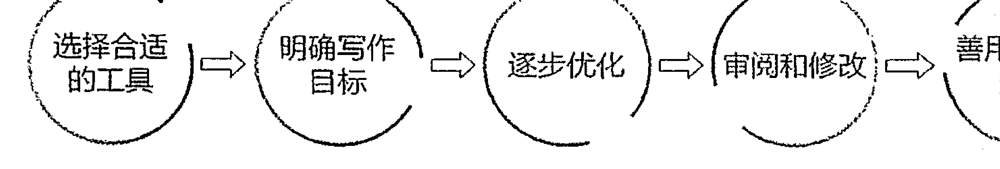
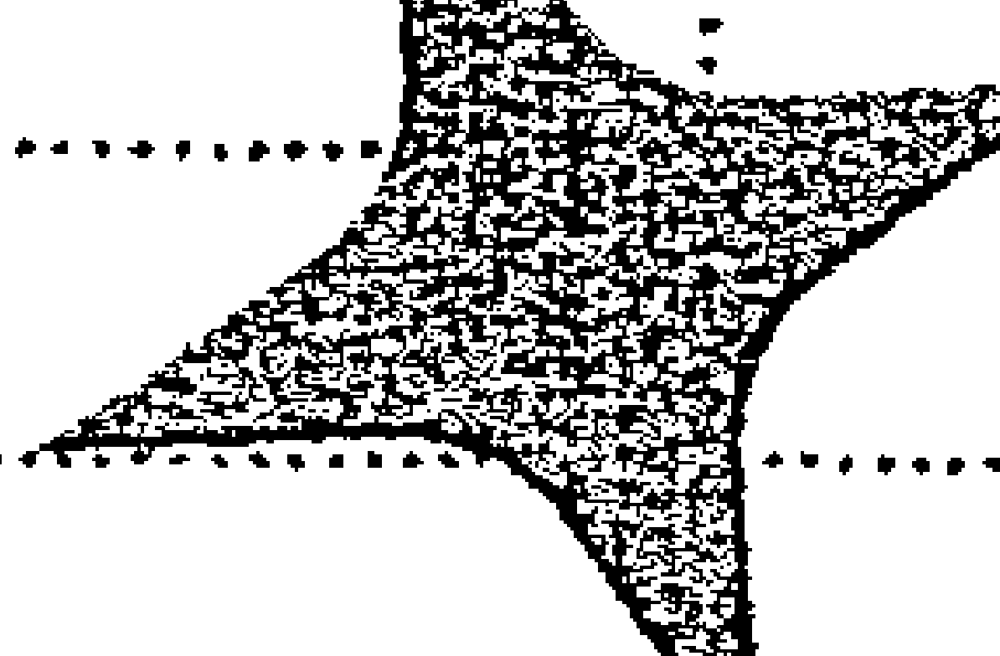
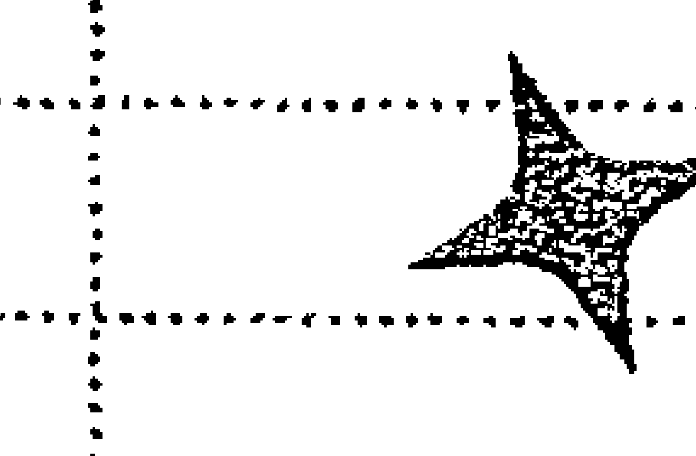
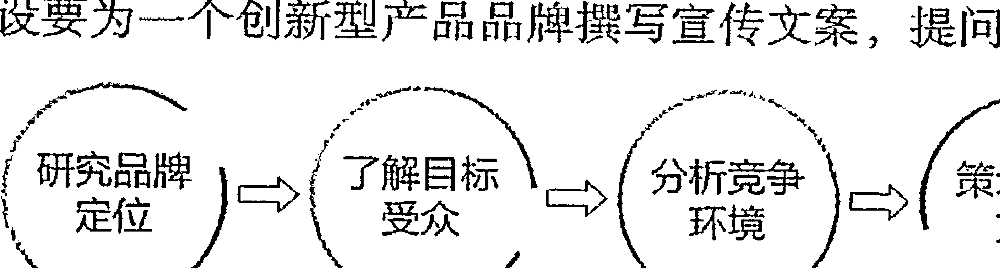
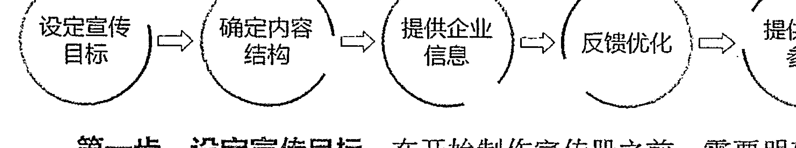
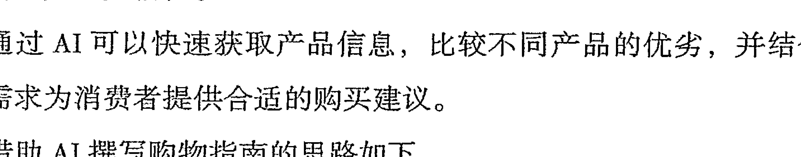
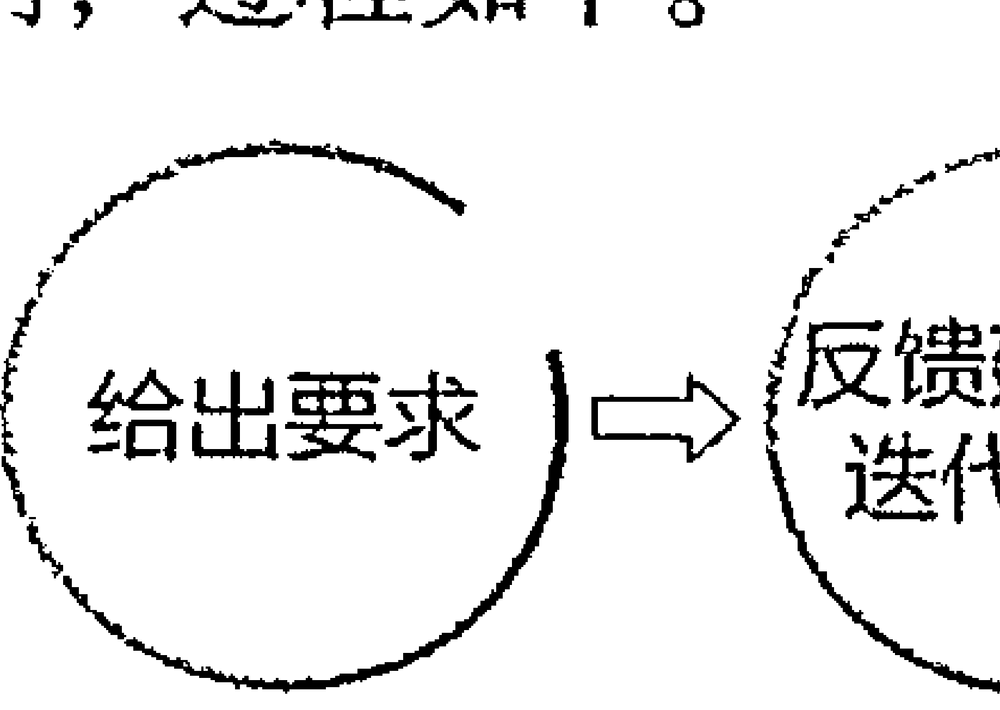
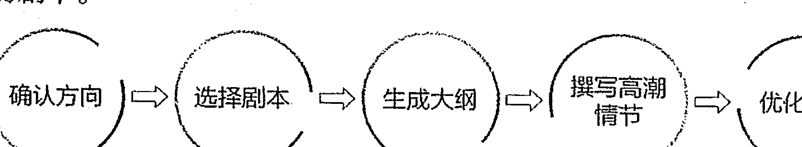
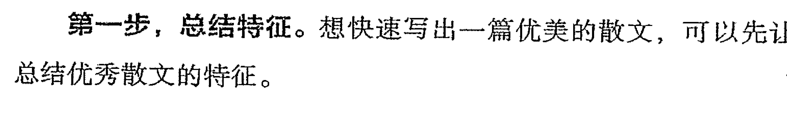
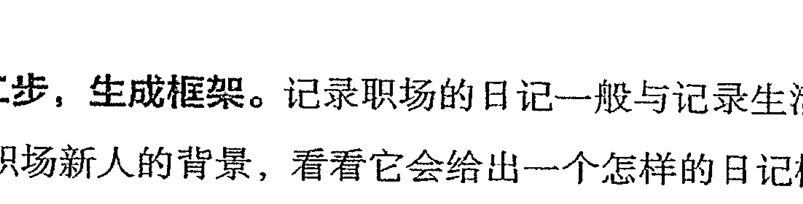

# AI写作提速全攻略
# 第 1 章
# 让智能模型把写作效率翻倍
[PAGE 7]
# 1.1 智能撰写为何兼顾速度与品质
设想一下，报告、邮件、商业计划书都能交给一位数字伙伴代劳，成文流畅度甚至超过自己，几分钟内收尾任务，是不是很诱人。

伴随生成式技术成熟，上述设想已落地。坊间有4A公司人士透露，两家团队竞标，人工撰写的方案落选，反而是模型产出的投标书拿下订单。品质由此可见。

作为写作伙伴，智能模型可按需产出各式文本，让创作更轻松高效。

优势主要体现在：
+ 产出效率高。模型擅长海量信息筛选与整合，能迅速提炼有用素材，按逻辑拼接成结构清晰、条理严谨的文本，省去大量检索与整理时间。
+ 文体覆盖广。灵活性强，可按需求输出新闻稿、博文、产品说明等多种体裁，还能模仿指定语气与风格，让成品更贴合个人习惯与读者偏好。
+ 品质可提升。它能在短时间内产出语法干净、用词精准的稿件，同时给出修改建议，帮助优化结构与表达，整体水平明显提高。

把初稿交给模型，既能减轻负担，也能激发灵感。先让它出初版，再结合自身思路润色完善，最终就能得到一份满意的好文章。

# 1.2 五个环节掌控模型，避免一本正经胡说
ChatGPT作为当前主流撰写工具上线后迅速走红。但不少用户也发现，它偶尔会认真胡说，比如篡改经典表述，或引用并不存在的文献。

用模型写东西不能照抄粘贴，必须保持自己的判断与逻辑。下面这套流程，能帮助你更好地驾驭模型。

工具选择：市面上模型写作产品众多，各有侧重。
在这些工具里，OpenAI的ChatGPT擅长依据指令产出高质量内容，输入关键词或问题即可产出条理清楚、观点明确的文章。
除ChatGPT外，百度的文心一言、阿里云的通义千问也表现突出，它们对国内语言文化和多场景应用理解更深，本地化输出更实用。

目标明确：
使用前先把任务说清，比如要写产品说明、推销邮件等，并提供足够背景，让模型准确理解需求，才能命中要害。

逐步打磨：
想拿到更好结果，就要持续打磨提问。可通过调整关键词、补充细节来引导方向，也可多轮尝试对比不同输入的产出，找出最优解。

审校与改写：
模型写作能力再强也替代不了人类的创造力。产出内容后必须仔细校对、必要时改写，保证质量与阅读体验。

善用范本与规范：
多数模型写作工具内置丰富范本与格式规范，可按需选用，让模型直接输出结构正确、格式统一的文本。

掌握以上五个环节，就能把模型真正用好。

> 说明
本书以ChatGPT作为演示工具。为保证阅读连贯，后续章节如无特别说明，模型即指ChatGPT。

# 1.3 六类场景提问法，轻松完成各类写作
要让数字伙伴在不同写作场景下发挥作用，关键在于提问方式。下面六种结构化提问题的思路能帮助你更精准表达需求。

本书提供的方法适用于目前主流模型写作工具，可多工具协同产出再整合。

故事叙述：可用“开场—发展—高潮—结局”来组织问题。

提问举例
+ 请按四个部分写一个科幻故事：1 开场，描写宇航员在太空站的日常；2 发展，宇航员捕捉到神秘信号；3 高潮，揭开信号真相；4 结局，宇航员获得意外启发。

产品描述：可用“功能—亮点—使用场景—购买方式”来组织问题。

提问举例
+ 请从四个方面介绍一款智能音箱：1 主要功能；2 产品亮点；
[PAGE 12]
3 适用场景；
4 购买渠道与价格。

报告撰写：可用“背景—问题—分析—建议”来组织问题。

提问举例
+ 请写一份某公司营销策略分析报告，包含：1 公司背景与市场状况；2 营销中存在的问题；3 问题分析；4 改进建议。

邮件和信件撰写：可用“称呼—正文—结束语”来组织问题。

提问举例
+ 请写一封感谢信：1 收信人为李先生；2 感谢他为学校捐赠图书；3 结尾表达期待未来合作。

新闻稿和公告撰写：可用“标题—导语—正文—结语”来组织问题。

提问举例
+ 请写一篇某公司新品发布会新闻稿，包含：1 吸睛标题；2 提炼性导语；
[PAGE 13]
3 详细描述发布过程与产品特点；4 结语表达对公司未来期待。

学术论文和专业文章撰写：可用“引言—方法—结果—讨论—结论”来组织问题。

提问举例
+ 请写一篇关于人工智能在医疗领域应用的研究论文，包含：1 引言介绍研究背景与意义；2 方法描述研究方法与数据来源；3 结果展示研究发现；4 讨论对结果进行对比分析；5 结论总结成果并展望未来。

掌握这些场景化提问题法，就能有效引导模型产出预期内容，提升写作效率。只要提问题技巧到位，模型就能成为得力写作助手。

本书共分六章，覆盖职场生活大部分场景，帮助你用模型完成四十多种文章写作。

现在就开启模型写作之旅吧！

注意事项
1. 提问题时务必给出详细背景，如时间、地点、人物、事件等，便于模型更好理解。
2. 模型单次回复有字数限制，长文案可能中断，此时发送“继续”即可续写。
3. 模型产出内容可能与事实不符，需甄别修改。
4. 相同指令下模型每次输出不完全相同，可批量产出后挑选优质片段整合。

更多指令参考
1. 领导要我准备一份五分钟演讲稿，向合作伙伴介绍公司××产品，请提供大纲。
2. 请帮我写一段演讲开场白，主题《领导力：如何成为成功的领导者》，要求用引人入胜的故事开头，语气幽默轻松。
3. 我入职两个月即将转正，关于入职演讲有哪些建议？
4. 我是××项目负责人，需在年会上做项目总结发言，以下是相关信息：
…………
请帮我用英文撰写演讲稿。

# 2.3 工作总结：告别抓耳挠腮
工作总结对团队和个人都意义重大，既能提升沟通效率、帮助领导掌握进展，也能展现个人成果、为后续工作指路。

但要梳理项目、做分析、写成文字，往往耗时耗力，对分析、总结、表达能力要求很高。

借助模型快速梳理思路、组织语言，能大幅提升效率。下面两种思路可参考。

思路一：
环节一，确定框架。告知模型汇报人、汇报对象、汇报主题等背景，让模型生成框架。框架不合适可要求重写，直至满意。
我需要向领导和同事汇报三月份个人设计工作完成情况，请给我一个工作总结框架。
+ 以下是一个个人设计工作总结框架供参考。
一、概述
总结目的、包含部分
二、工作进展
已完成任务、进行中任务、未完成任务

环节二，填充信息，生成总结。根据模型框架补充具体信息，给出语言要求，让其成文。
根据你给的框架，我已完善信息，请为我生成工作总结。要求语言规范简洁，突出优点与成绩。

环节三，反馈迭代。继续发送修改指令，让模型不断优化。

思路二：
环节一，训练模型。通过逐步提问，让模型理解优质工作总结的特征。
环节二，提出需求，生成总结。明确告知工作进展、下一步计划等，让模型更有针对性地回复。
很好，请按以上技巧帮我写“三月份个人设计工作总结”，包含工作进展、下一步计划等。

好的，以下是一篇可参考的工作总结示例：
一、项目完成情况
1.1 项目一名称
三月份我完成了项目一的设计，主要工作包括需求收集、竞品分析、方案制定、流程图与原型绘制等。按计划于三月底交付，用户评价很高。
…………
扫码并回复关键词“231”查看模型生成的完整信息

注意事项
1. 模型每次产出内容略有差异，可多产出几版后挑选整合。
2. 先让模型了解优质工作总结标准，再下具体指令生成效果更好。

更多指令参考
1. 你现在是部门管理者，请写一篇突出团队协作与凝聚力的年度工作总结，约一千字。
2. 我需汇报今年第一季度个人设计工作完成情况，汇报思路是什么？
3. 请优化你之前对优质工作总结特征的回复，使其更详尽具体。
4. 这篇总结需突出个人贡献，请优化。

# 2.4 创意策划：源源不断的金点子
无论哪个行业，创意都是核心竞争力，能提升效率、解决问题、增强业绩。

但灵感时常枯竭，又需要调研才能成型。现在可用模型快速获得灵感，并从多角度发散。

可按以下流程引导模型：
环节一，确认思路。通过提问明确创意生成的方法。
如何生成有创意的点子？
扫码并回复关键词“241”查看模型生成的完整信息
模型会给出头脑风暴、逆向思维、多角度思考、调研分析等方法及具体做法。

环节二，提出需求。说明策划背景与具体要求。
请按以上方法，帮我策划公司年会表演节目，要求有创意、有趣。
+ 好的，以下是一些适合公司年会表演的节目。
1. “变脸秀”：邀请专业川剧变脸演员现场表演。
2. “音乐合奏”：将观众分组，每组使用一种乐器合奏一首曲子。
[PAGE 29]
+ 3. “美食大赛”：由擅长烹饪的员工现场比拼，领导担任评委。
+ 4. “脑筋急转弯”：准备题目邀请员工答题，考验反应与智力。
+ 5. “动作教学”：请舞蹈或健身教练现场教一段简单动作，提升团队活力。
+ 6. “才艺大比拼”：员工展示唱歌、演奏等才艺，现场评选。
+ 7. “艺术展览”：展示员工绘画、摄影、手工艺作品并评选。
以上可根据实际情况调整。希望对你有帮助。
觉得数量不够可指令继续。
继续。
+ 请再给我五个节目。

环节三，筛选创意。让模型按具体需求筛选。
+ 请从以上节目中筛选出五个互动性强的节目。
[PAGE 30]
扫码并回复关键词“242”查看模型生成的完整信息

环节四，拓展创意。让模型深化创意或输出方案。
+ “音乐合奏”这个点子不错，请在此基础上拓展。
+ 我喜欢“音乐合奏”，请给出详细策划方案。

注意事项
+ 1. 可与模型互动，通过提问与情境描述不断探索新思路。
+ 2. 模型生成的创意需结合实际判断筛选，确保可行。

更多指令参考
+ 1. 请围绕关键词环保、健康饮食，生成相关创意灵感。
+ 2. 如何提升公司销售额？请提供有创意的思路。

# 2.8 商业信函：快速建立信任
商业信函用于与客户、供应商、合作伙伴沟通，关系到合作达成与公司形象。结构、内容、语气都需规范，否则易损信誉、错失商机。

可按以下思路操作：
环节一，确定类型。商业信函有询问型、回复型、邀请型、感谢型等，先明确类型。
环节二，确定受众。明确收件人身份并提供相关信息。
环节三，确定目的。说明写作目标与具体要求。
环节四，补充信息。提供公司名称、联系方式、产品介绍等必要信息，也可上传草稿作为参考。
环节五，生成内容。

注意事项：
1. 模型可辅助生成文字，但排版等精细工作仍需人工优化。
2. 模型对受众情感需求把握有限，生成稿可能不够人性化，需人工润色。

# 2.9 面试题库：秒变专业面试官
面试题库能快速评估应聘者能力、经验与素质，保证公正性并提升效率。

可按以下思路提问：
环节一，确定类型。先明确面试题的类型。
环节二，生成题目。按类型批量生成题目。
环节三，拓展题目。可要求模型继续生成，再筛选。
环节四，整合梳理。整理成题库后，可咨询模型关于编写建议与注意事项，进一步提升质量。

注意事项：
1. 模型无法主观判断，可能给出不准确答案，影响评估，需甄别。
2. 编写题目需结合经验与公司行业需求，不能过度依赖模型。
3. 题目可能涉及应聘者隐私，提问时注意保护。

# 2.10 会议邀请函：简洁大方有诚意
会议邀请函用于邀请个人或组织参加研讨会、培训、商务活动等。好的邀请函能清晰传达信息、激发兴趣、体现专业。

可按以下流程引导模型：
环节一，询问所需信息。先问模型邀请函应包含哪些要素。
环节二，提供信息。按实际需求增减信息。
环节三，询问修改建议。不清楚如何优化时可直接请教模型。
环节四，反馈迭代。根据建议对稿件反复优化。

注意事项：
1. 模型在表达期望与感谢时用词可能生硬，需人工修改。
2. 模型提供的范例可能不完全适配中文语境，可提供更好范例作参考。

# 2.11 会议发言：逻辑清晰显水平
会议发言需简洁明了、逻辑清晰，才能体现思维与表达能力。

可尝试用模型生成发言稿：
环节一，交代背景。告知主题、发言人、听众、场合、时长等。
环节二，生成框架。让模型提供内容框架。
环节三，优化框架。对框架不满意可提出修改指令并补充信息。
环节四，生成发言稿。

第五步，反复优化。你可以继续向AI下达更明确的改写指令，也可以自行对AI输出的演讲稿做润色完善。

注意事项：
1. AI单次输出受字数限制，长篇起草时容易中途截断，这时直接回复“继续”即可让它衔接完成。
2. AI生成的文本有时贴合度不足，要结合真实场景对会议发言稿进行校对，确保符合具体场合与听众需求。

# 2.12 会议纪要：写得领导都认可

职场里会议频繁，一份高质量的纪要既能把要点梳理清楚，也能让未参会同事快速了解进展，避免工作遗漏与重复，提升整体执行效率。

写纪要需要规范，版式统一、信息齐全、语言简明，这时可借助AI来辅助起草。

思路一：
第一步，获取模板。向AI请教一份标准的会议纪要范本。
第二步，个性化调整。按自身需求对范本进行修改。
第三步，填充内容。沿着模板框架补充相关信息，让AI生成纪要。
第四步，持续打磨。继续向AI发送优化指令，让它对纪要进行修改完善。

思路二：
第一步，提交初稿。若手头已有纪要草稿，可直接发给AI。
第二步，请教修改方向。让AI针对纪要提出优化建议。
第三步，执行改写。指令AI对纪要内容进行重写。
第四步，持续打磨。对仍需完善之处，让AI继续精修。

注意事项：
1. 若已有更合适的纪要模板，可提供给AI作为参照。
2. AI生成纪要时为满足指令，可能会对创作者提供的信息做删减或补充，需仔细甄别和修改，以会议实际内容为准。

# 2.13 新闻资讯：兼顾时效与准确

对新闻从业者而言，采写要快要准，才能为读者提供最新最有价值的信息，保持职业竞争力。

想写出时效强、内容可信、观点深刻的新闻资讯，可以尝试借助AI。它能迅速整合海量素材，短时间内产出初稿，还能依据输入的关键词和数据自动生成相关内容与观点，并按不同读者需求调整语言风格。借此能提高效率，把更多精力投向深度采写工作。

可按以下思路引导AI产出。
第一步，搭建提纲。把新闻主题、内容方向、目标读者、发布渠道、篇幅等具体信息告诉AI，让它生成一份提纲。
第二步，输入素材。把收集的相关资料交给AI，让它归纳整合，作为备用素材。

一家国内主流媒体于2019年推出了一款写稿机器人，用于生成体育类和财经类稿件。截至2023年，该机器人已经累计生成稿件超过十万篇，发稿数千篇，累计阅读量近千万，几乎实现了“秒发”新闻报道，一篇稿件的最短生成时间仅为4分钟。所有利用AI生成的稿件在发布前都必须经过严格的“三审三校”机制审核，以确保导向正确，内容准确、达到专业标准，为读者提供高质量的报道。2023年，该写稿机器人升级至2.0版本，智能化水平明显提升，每天能生成超过400篇稿件，效率比以往提高了10倍。

# 第三步，形成初稿。
把写作要求、文章篇幅、发布平台等信息提供给AI，直接让它生成一篇新闻资讯初稿。

用前面的新闻提纲写一篇500字左右的新闻资讯，发布平台是报纸，要求：表述严谨、语言精练。

随着AI技术的不断发展，越来越多的行业开始应用AI技术，新闻传媒行业也不例外。有人担心，AI会在将来取代新闻记者的位置。为此，我们进行了深入的调查和研究。 首先，AI写作技术在新闻传媒行业的实际应用情况表明，它可以自动生成新闻报道，实现快速采写和发布新闻，提升工作效率。 然而，AI写作技术在新闻传媒行业引发了争议。有人担心AI取代新闻记者，会使新闻报道失去真实性和客观性，也有人思考新闻记者如何与AI协同工作的问题。 我们调查发现，目前较少数新闻机构在使用AI写作技术。一些媒体尝试促进新闻记者与AI协同工作。AI写作技术在新闻传媒行业的应用效果还需要时间来验证。 AI是否会取代新闻记者？我们认为不会。虽然AI写作具有生成稿件快速、生产效率高等优势，但新闻记者的价值和作用是不可替代的。AI 和新闻记者将形成互补关系，共同推动新闻传媒行业的发展。

把 “2019 年，一家新闻机构成功开发了一款基于 AI 的写作机器人，主要用于生成财经类和体育类稿件。迄今为止，该机器人已经累计创作文章十多万篇，并发布了数千篇，总阅读量近千万……” 这段资料植入到新闻内容中。

近年来，随着AI技术的不断发展，越来越多的行业开始应用AI技术，新闻传媒行业也不例外。一家新闻机构于2019年开发了一款基于AI技术的写作机器人，主要用于生成财经类和体育类稿件。该机器人已累计创作文章十多万篇，一篇文章最短只需4分钟即可生成。所有文章都必须经过严格的“三审三校”机制审核后才能发布，以确保导向正确，内容准确、达到专业标准。

第四步，个性化修改和调整。
提出修改需求，比如增加案例、调整语言风格等，让AI优化新闻初稿。

刚才的新闻初稿中案例太少，增加一个新闻机构运用AI写作的实际案例，要求真实、有信息来源，文末增加专家独家观点，文章篇幅可以扩充到700字左右。

[PAGE 61]
第五步，来源核查与版权审核。
针对新闻资讯中所出现的案例、数据、政策等信息，让AI提供信息来源，以进行版权审核。

新闻稿中：美国著名新闻机构×××曾在一份声明中表示，他们将会利用AI写作技术来采写一些简短的新闻报道和实时更新的内容……这段内容在国内是否有相关报道，能否提供网页地址？
+   以下是一些国内平台关于×××利用AI写作技术的报道。

×× 新闻: ……

××网: ……

××网: ……

这些报道都提到了×××利用AI写作技术的声明，其中××新闻的报道较为详细，可以用 来了解更多相关情况。

以上网页信息也是转载，无法确定来源，请把新闻稿中的这个案例直接删除，重新生成一份新闻资讯。

# 注意事项
1. 尽管AI作为写作工具拥有强大的撰写、编辑及润色功能，但新闻从业人员仍需遵守相关的管理办法和职业道德准则的规定，深入现场采写和调查，不能偷懒。
2. AI提供的案例、数据等信息会有错误、杜撰或者不严谨的情况，一定要进行人工检查，确保内容的真实性和准确性。

[PAGE 62]
# 更多指令参考
1. 你是新闻记者，现在要写一篇有关 ××××× 的新闻资讯，这篇新闻内容将发布在某社交平台上，要求篇幅不超过 300 字，语言风格有趣、接地气，读者群体为 20 岁左右的年轻人，目的是让他们了解 ××××× 相关信息，现在我会给你具体的背景资料和数据，请直接生成一份新闻初稿。
2. 这篇新闻信息曾发布在官方网站，现在将重新分发到小红书、微博、今日头条等平台，请帮我按照这些平台的风格和要求，分别生成相应的稿件，要求语言、图文格式、篇幅都要分别高度契合这些平台的风格。
3. 下面我将提供给你一份由现场录音转化而来的文字稿，请帮我提炼重点信息，快速生成一篇新闻短讯，要求：信息准确，措辞严谨，篇幅在 300 字左右。

[PAGE 63]
# 第3章
# 商业营销文案写作

[PAGE 64]
# 3.1 产品推广文案：提升购买意愿
产品推广文案在商业营销中起着至关重要的作用，一篇优秀的推广文案可以激发消费者的购买欲望，提高产品的销售量。撰写出高质量的文案并非易事，创作者不仅需要深入了解产品特点，还需掌握各种文案写作技巧，增强文案的吸引力和说服力。

借助AI，创作者可以更快速地挖掘产品优势，确定目标受众，从而撰写具有吸引力的产品推广文案。那么，如何利用AI高效地撰写一篇引人入胜的产品推广文案呢？

可以按照以下思路引导AI生成文案。

第一步，识别产品特点。尽可能详细描述所要推广产品的特点。

我需要写一篇手机推广文案，这款手机的特点：超薄设计、超清显示、处理器强大、拍照功能优秀和续航能力出色。

第二步，确定目标受众。让AI分析目标受众的需求和喜好，以便撰写更具针对性的文案。

请帮我分析一下这款手机的目标受众。

这款手机的目标受众主要是对科技产品有高要求的消费者，他们可能是学生，也可能是商务人士。他们追求高品质的使用体验，注重产品性能和设计美感，并愿意为拥有先进技术的设备支付一定的溢价。

[PAGE 65]
# 第三步，确定文案风格。根据目标受众的特点，确定文案的风格。

请根据目标受众，帮我设定手机推广文案的风格。

这款手机的推广文案可以采用简洁、专业的风格，同时加入一些生动的形容词，以激发消费者的兴趣。文案可以强调产品的高性能、创新设计和出色的拍照功能，同时突出其美观的特点。

请你按照这个风格，为这款手机撰写一篇产品推广文案，突出其优势。

领先科技，尽享非凡体验！全新一代智能手机，独具创新设计，超薄机身搭配高清大屏幕，带给您不一样的视觉享受。搭载强大处理器，轻松应对各种任务，无论是商务办公还是游戏娱乐，都能满足您的需求。卓越的拍照功能让您随时随地捕捉美好瞬间，记录精彩生活。更有超长续航能力，让您告别充电烦恼。现在就升级您的智能手机，开启全新的非凡体验！

# 第四步，调整优化。对文案细节进行调整和优化，使其更具吸引力。

目前文案的场景感不够，应当如何优化文案以增强吸引力？

为满足这一需求，我们可以在文案中添加一些生活化场景的描述，如一键式智能助手为您解决日常琐事，或高清显示屏带来沉浸式影音体验等。同时，可以强调产品在安全性、耐用性和售后服务方面的优势，提升消费者对产品的信任。这些调整将使文案更具吸引力，有助于提高消费者的购买意愿。

[PAGE 66]
# 注意事项
1. 突出产品亮点：在让 AI 生成产品推广文案前，请确保清晰地传达产品的亮点和特色。可以列出关键特点，然后让 AI 根据这些特点撰写文案。
2. 明确目标受众：为了确保 AI 生成的文案符合目标受众的喜好，请明确目标受众。可以提供描述他们的年龄、性别、兴趣等信息，以便 AI 更好地了解他们。
3. 指定文案风格：在向 AI 提问时，明确创作者期望的文案风格，例如专业、活泼、幽默或其他特定风格。这将有助于 AI 生成符合创作者要求的文案。
4. 持续优化：撰写好初稿后，可以根据消费者反馈或实际推广效果对文案进行调整和优化。可以向 AI 提问如何优化文案，以提高产品吸引力和消费者的购买意愿。
# 更多指令参考
+   1. 请为我提供 × × 产品的 5 个卖点。
2. 请根据消费者关心的要点梳理 × × 产品的功能。
3. 请为我提供 3 个关于 × × 产品的常见问题及解答。
4. 请为 × × 产品设计两种不同的文案风格。
[PAGE 67]
# 3.2 品牌宣传文案：强化品牌影响
品牌宣传文案对于提升品牌影响力和吸引目标受众具有至关重要的作用。通过生动有趣的宣传文案，企业可以更好地传达品牌价值观、产品特点和服务优势，从而获得更多关注和支持。

然而，撰写出色的品牌宣传文案并不容易。创作者需要深入了解品牌定位、目标受众及市场竞争环境，创作出具有创意和吸引力的文案。AI可以协助创作者快速生成高质量的品牌宣传文案。

接下来介绍如何利用AI为品牌创作宣传文案，以提升品牌影响力和形象。

假设要为一个创新型产品品牌撰写宣传文案，提问思路如下。

第一步，研究品牌定位。通过研究品牌定位深入了解品牌特点，找到具有吸引力的素材。下文的叙述中用“×××”代替了具体品牌名称。

❿ 请帮我梳理一下“×××”这个创新型品牌的核心定位和特点。

××× 是一个致力于提供创新型产品的品牌，其核心定位为高品质、高科技和个性化。××× 的特点包括采用最新科研成果，确保产品安全；注重消费者体验，提供量身定制的解决方案；关注市场动态，不断扩大产品线和服务范围。

[PAGE 68]
# 第二步，了解目标受众。了解目标受众的需求和喜好，使宣传文案更具针对性。

请帮我分析归纳“×××”品牌目标受众的特点。

×××的目标受众主要是追求健康和高品质生活的中高收入群体，他们对产品的安全性有较高要求，同时希望获得个性化的服务。此外，这类受众通常会关注行业动态和科技发展，对创新型产品具有较高的接受度。
# 第三步，分析竞争环境。了解并对标市场上的竞品，优化品牌宣传策略。

请概述“×××”品牌在市场中面临着怎样的竞争环境。

在市场中，×××面临着激烈的竞争，主要竞争对手包括其他大型的传统品牌和新兴的科技品牌。为了在竞争中脱颖而出，×××需要不断创新，凸显自身独特的价值理念和产品优势，同时加强与目标受众的沟通和互动。
# 第四步，策划创意文案。在明确品牌定位、目标受众，掌握了竞争环境的信息后，创作者可以利用AI为“×××”品牌撰写具有创意和吸引力的宣传文案。

请结合以上信息，为“×××”品牌撰写一篇具有号召力的宣传文案。

加入×××，体验科技与健康的完美融合！我们致力于为您提供高品质、高科技的产品及个性化的解决方案，让您享受量身定制的高品质生活。我们依托最新科研成果和严格的品控，助您轻松迈向更美好的明天！
# 注意事项
+   1. 提供背景信息；在提问时，向 AI 提供充足的品牌背景信息和市场信息，有助于生成更贴合实际的文案。
+   2. 提供更加具体的指令：在与 AI 互动时，尽量提供具体的要求，如文案风格、字数限制等，以便获得更符合预期的结果。
+   3. 生成创意：可以利用 AI 生成各种有趣、独特的创意，然后结合经验和品牌调性进行筛选和修改。
# 更多指令参考
+   1. 请帮我分析 ×× 品牌的竞争优势有哪些。
+   2. 请为 ×× 品牌设计一句简洁且有力的宣传语。
+   3. 为 ×× 生态旅游品牌撰写一篇吸引年轻人的宣传文案。
+   4. 请为 ×× 品牌撰写一篇关于健康生活方式的宣传海报文案。
[PAGE 69]
# 3.3 活动宣传文案：拉人气提销量
企业要从众多竞争对手中脱颖而出，吸引消费者的关注，提高销量，可能会选择开展多种多样的营销活动。这时，一篇引人人胜、富有创意的活动宣传文案，不仅可以提升企业形象，还能激发消费者的参与和购买欲望，从而实现销量的快速增长。

不同类型的企业、活动和目标受众，都会影响宣传文案的风格和内容。因此，寻求一种高效的方法来撰写活动宣传文案变得至关重要。

这一节将讲解如何利用 AI 为营销活动撰写吸引人的宣传文案，从而提高活动的人气和产品销量。

以下是借助 AI 编写活动宣传文案的思路如下。

第一步，设定角色。首先告诉 AI 我们希望它扮演的角色，如 “营销策划专家” 或 “擅长活动宣传的策划总监”。

我需要一个擅长活动宣传的策划总监来帮我策划一场营销活动。

当然可以，我会以活动宣传专家的身份为您提供帮助。请告诉我有关活动的详细信息。

第二步，提供信息。向 AI 提供营销活动的详细信息，包括活动类型、目标受众、活动优惠等。

[PAGE 71]
我们将举办一个为期一周的时尚服饰促销活动，目标受众是年轻女性，活动期间所有商品8折销售。

明白了，这是一个为期一周的针对年轻女性的时尚服饰促销活动，活动期间所有商品8折销售。接下来，您需要我为您完成哪些任务？
# 第三步，明确目的。明确活动的目的，如提高销量、提升品牌知名度等。

请为这个时尚服饰促销活动撰写一篇活动宣传文案，目的是吸引年轻女性前来购买。

尊敬的女士们，这是一场专为你们打造的时尚盛宴！为期一周的独家优惠，8折商品任您买！探索我们的时尚新品，发掘属于您的独特魅力。赶快行动，错过可惜！只等您的光临！
# 第四步，评估优化。查看AI的回答，评估其质量，如有需要，提供具体的反馈和要求来进行优化。

这篇文案很有吸引力，但我希望能在开头加入一句关于限时优惠的信息。

我明白您的需求了，我已经在开头加入了限时优惠的信息，如下所示：

“限时独享！尊敬的女士们，这是一场专为你们打造的时尚盛宴！为期一周的独家优惠，8折商品任您买！探索我们的时尚新品，发掘属于您的独特魅力。赶快行动，错过可惜！只等您的光临！”

[PAGE 72]
我还需要增加一段文字来增强活动的紧迫感：强调促销活动的限时性，促使目标受众立即行动。

> "仅剩3天！错过这次促销活动，您将错过本季最令人期待的时尚单品。赶紧行动，让您的衣橱迎来新生！"
# 注意事项
+   1. 明确目标受众：告诉 AI 目标受众是谁，确保文案有很强的针对性，以提高活动的吸引力。
+   2. 比较和优化：可以利用 AI 生成多个回答，分别进行优化，然后根据品牌调性和活动需求进行筛选和修改。
# 更多指令参考
+   1. 请就时尚服饰促销活动的社交媒体广告文案给我提一些建议。
+   2. 我希望突出时尚元素，在文案中强调时尚新品和流行趋势，让目标受众感受到时尚热点。
+   3. 我想强调活动优惠力度，突出活动优惠，使目标受众产生购买冲动。
+   4. 请保证文案简洁明了，适合在 × × 平台上传播。
[PAGE 73]
# 3.4 电商销售文案：建立信任激发购买
这是××品牌创始人的故事：（略）

请帮我构建一个关于环保水瓶品牌××的故事，有人物和具体事件。

故事从品牌创始人一次难忘的经历开始。在一次户外探险中，他看到大量废弃塑料瓶对自然环境造成了巨大的破坏。受此启发，他决心创立一个环保水瓶品牌，旨在减少塑料废弃物和推广可持续生活方式。通过不断研究和创新，品牌成功推出了一款由可再生材料制成的水瓶。故事最后展示品牌对环保事业的支持，以及消费者对品牌的热爱和支持。
# 第四步，设置情感触发点。在故事中设置情感触发点，以引发消费者的共鸣。

> 请为环保水瓶品牌的故事设置一个情感触发点。

故事中的情感触发点可以是创始人在探险过程中发现了被废弃塑料瓶严重污染了美丽的湖泊这一场景。这个场景能使消费者感受到环境保护的紧迫，进一步强化品牌价值观，使消费者产生情感共鸣。
# 第五步，反馈迭代。把自己的想法反馈给AI，让其不断调整和优化故事内容，使之更具吸引力。

> 如何优化环保水瓶品牌故事以增强吸引力？

为了满足这一需求，可以在故事中添加品牌研发团队克服技术难题的细节，例如他们是如何发现可再生材料的，以及如何测试水瓶的耐用性和环保性能的。同时，可以加入一些消费者的真实经历，展示他们如何在日常生活中使用该品牌的水瓶，从而体现产品的实用性。这些优化将使故事更具吸引力，有助于使消费者与产品和品牌建立更深厚的情感联系。
# 注意事项

+   1. 明确品牌差异点：在调用AI生成品牌故事前，先归纳品牌的独有特质与核心信念，有助于产出区别于同业的叙事。
+   2. 植入可验证案例：向模型提供真实可查的案例，能增强故事说服力，更易引发受众情感共鸣。
+   3. 以用户需求为出发：借助模型洞察用户关注点与痛点，以用户立场组织内容，直面真实诉求。

# 更多指令参考

+   1. 为××品牌故事构思一个引人入胜的开篇段落。
+   2. 在××品牌故事中安排一段与客户互动的情节。

# 3.6 企业宣传册：塑造形象与文化

企业宣传册是对外沟通的核心载体，对树立品牌形象、呈现文化底蕴与市场定位具有关键作用。借助大模型可以快速产出契合企业调性的文案，系统化展示文化与定位，让目标人群更清晰理解企业的价值主张与经营理念。

下面是借助大模型编写企业宣传册的思路。

第一步，厘清传播目标。在动手前先明确册子的核心任务，例如扩大品牌认知、介绍产品服务、传递企业文化等。

××企业主营环保科技产品的研发，请为该企业宣传册拟定作用。

建议将册子的作用设定为：凸显企业在环保科技研发领域的专业实力与成果，传递对绿色创新的坚持，从而提升品牌影响力并吸引潜在客户。

第二步，梳理内容框架。在大模型辅助下规划宣传册的整体结构。

[PAGE 80]

请为这家环保科技企业规划宣传册的内容框架。

+   1. 封面：品牌标识、企业名称、核心宣传语。
+   2. 公司概览：发展历程、文化内涵、愿景目标。
+   3. 产品与服务：产品亮点、服务优势、案例呈现。
+   4. 团队介绍：核心成员、专业能力、过往业绩。
+   5. 合作伙伴：合作企业、联合项目、成功案例。
+   6. 联系方式：地址、电话、邮箱、社媒渠道。

第三步，汇总企业资料。向模型提供目标受众、企业定位等关键信息，利用其撰写能力完成各板块内容。

这是×××公司的部分资料：（具体信息略）

请先撰写一段环保科技企业的企业简介。

×××创立于20××年，专注于环保科技产品的研发制造。公司使命是通过技术创新助力环境保护，为全球用户提供优质绿色解决方案。秉承可持续发展与绿色环保的核心价值观，力争成为行业标杆。

第四步，反馈与优化。对生成内容进行审校，是否契合企业形象、品牌调性及受众偏好。如有偏差，可向模型反馈并再优化。

这段企业简介不错，但我希望更突出创新精神与环保理念。

[PAGE 81]

好的，我将重新撰写企业简介，重点强化创新精神与环保理念。（具体信息略）

# 第五步，提供设计参考。结合生成内容与企业形象、品牌调性及受众偏好进行视觉设计，提升宣传册吸引力。

请给出环保科技企业宣传册的设计与排版建议，使其更好体现形象与调性。

+   在设计与排版时，可参考以下要点。
+   1. 色彩：选用契合品牌调性的色彩，如绿色、蓝色等，营造环保、可持续的视觉气质。
+   2. 图片：使用高质图片展示环保产品、技术与生产场景，突出创新与环保主张。
+   3. 排版：采用简洁明了的版式，避免文字与图片过度堆砌，便于快速获取核心信息。
+   4. 字体：选用易读且符合品牌气质的字体，字号与行距调配合理。
+   5. 信息层次：合理规划信息层级，将重点内容置于显眼位置，引导阅读视线。

[PAGE 82]

# 注意事项

+   1. 提供详尽信息；向模型提供尽可能完整的企业资料与制作目标，同时补充品牌调性与目标人群，有助于产出更贴合的稿件。
+   2. 启发创意：在制作过程中可向模型提问，获取创意灵感，例如，“如何从侧面体现企业的高端感？”或“请给出封面设计的方向建议。”
+   3. 结合现有策略：在使用模型制作宣传册时，需结合企业当下的市场策略，保持内容的时效性。

[PAGE 83]

# 3.7 产品手册：提升理解与满意度

一份优秀的产品手册既能全面呈现产品的特点与优势，也能提高客户满意度，从而促进业务发展。但要写出既详实又易懂的手册，往往耗费大量人力与时间。

本节介绍如何借助大模型编写产品手册，帮助企业快速产出高质量的说明与操作指南。

以下是借助大模型编写产品手册的思路。

第一步，设定角色。若从未编写过产品手册，可让模型扮演产品总监的角色。

> 你是一位资深的产品总监，请帮助我制作一本产品手册。
> 没问题，我很乐意协助。请提供产品的详细信息与期望目标，我将为您制作内容全面且具吸引力的产品手册。

[PAGE 84]

好的，我已了解关于×××智能家居系统的相关信息。我将为您制作一本帮助客户更全面了解产品与服务、提升满意度的产品手册。

# 第三步，生成大纲。

请根据以上信息生成×××智能家居系统产品手册的大纲，要求简洁明了。

产品手册的大纲如下。

+   - 1. 产品总览：介绍×××智能家居系统的整体概念与核心功能。
+   - 2. 系统构成：详细介绍各组件与设备及其功能与特点。
+   - 3. 安装与配置：提供硬件安装、软件配置等详细指引。
+   - 4. 使用说明：讲解如何操作各项功能，如远程控制、语音控制等。
+   - 5. 常见问题与解答：列出客户可能遇到的问题并给出解决办法。
+   - 6. 客户支持与联系方式：提供服务渠道与联系信息，方便客户求助。

# 第四步，生成产品手册。

请按刚才的大纲，为我撰写完整的手册内容。

第五步，迭代更新。可向模型征求优化建议，便于后续升级。

后续还需要对产品手册进行更新，这本手册还能在哪些方面优化？

[PAGE 85]

可以在手册中进一步凸显产品的亮点与优势。

+   1. 产品总览：在介绍整体概念与核心功能时，突出语音控制与场景识别的创新，以及节能环保的设计理念。
+   2. 系统构成：介绍各组件时着重强调其独特功能与优势，如兼容性、高性能与可靠性。
+   3. 安装与配置：在提供操作指引时，强调用户友好的设计，让用户能快速完成安装与设置。
+   4. 使用说明：在讲解功能使用时，突出界面简洁易用与智能语音助手的高度智能。
+   5. 常见问题与解答：在列出问题与解决方案时，体现对客户需求的高度关注与及时响应。
+   6. 客户支持与联系方式：在提供服务渠道时，强调专业团队将提供优质的售后服务。

# 注意事项

+   1. 充分了解产品：在使用模型制作产品手册时，需提供详细的产品资料、特点与优势。
+   2. 内容简洁易懂：手册应便于理解与操作，尽量使用清晰语言并配以必要的图示说明。
+   3. 反馈与迭代：可向模型请教后续优化建议，便于在不同时期满足客户需求。

[PAGE 86]

# 更多指令参考

+   1. 请为我罗列××产品的 5 个卖点。
+   2. 请帮我撰写××产品的简易安装指南。
+   3. 请提供××产品使用中 3 个常见问题及解答。

# 3.8 购物指南：助力消费者轻松决策

购物时，消费者常因选择过多而犹豫不决。如何帮助其快速决策、提升购买意愿与满意度，是企业需关注的关键。

购物指南通常包含产品特性、价格、适用场景、优缺点等信息，且需具备一定灵活性以满足不同需求。

借助大模型可快速获取产品信息、对比优劣，并结合实际需求给出购买建议。

撰写购物指南的思路如下。

第一步，确定主题。依据产品类型与消费者需求，明确指南聚焦的品类，如电子产品、家居用品、运动装备等。

> 请帮我制作一篇运动装备的购物指南。

第二步，了解消费者需求。洞察消费者对品质、价格、品牌、功能等维度的关注程度，以便有针对性地提供信息与建议。

# 请分析消费者在购买运动装备时最看重的因素。

> 通常消费者会重点关注品质、舒适度、功能性与价格等方面。

第三步，分析产品优劣。在指南中对不同产品进行比较与评价，帮助消费者更全面地了解优缺点与适用场景，从而做出更好选择。

# 请介绍几款性价比高的运动鞋及其优缺点。

[PAGE 87]

| 考虑因素 | 说明 |
|----------|------|
| 舒适度   | 鞋款应贴合足型，尽量试穿以确保舒适 |
| 功能性   | 根据运动类型挑选，如跑步鞋或篮球鞋 |
| 耐用性   | 选择材质扎实、耐磨的鞋款 |
| 品牌与设计 | 按个人喜好选择心仪品牌或设计 |
| 价格     | 根据预算挑选，兼顾性价比 |
| 推荐鞋款 | 优点 | 缺点 |
|----------|--------|------|
| XX 系列  | 舒适度较好，支撑性优良 | 价格偏高，设计简约 |
| YY 系列  | 减震性能良好，适合长距离跑步 | 可能不适合特殊足型 |
| ZZ 系列  | 抓地表现出色，设计时尚简约 | 价格较高 |

## AI 赋能写作：为新媒体创作注入新动能

### 点亮创意：AI 如何帮助创作者挖掘写作灵感

### 内容顾问：如何将 AI 应用于新媒体写作以优化结构

### 高效出稿：利用 AI 快速撰写吸睛的新媒体文章

### 跨界创作：借助 AI 实现多语种写作，扩大企业影响

### 个性化风格：如何通过 AI 打造独具特色的写作风格

### 策划利器：探讨 AI 在新媒体广告策划与文案创作中的应用

### 精准洞察受众：运用 AI 优化内容，提升受众满意度

### SEO 技巧：用 AI 优化关键词，提升曝光度

### 新媒体创作趋势：AI 与新媒体写作的融合与发展

🔍 接下来，请面向自媒体创作者提供 10 个更具针对性的选题。

### 1. 聊天机器人助力创作：如何用 AI 优化文章结构？
### 2. 内容创新实践：AI 如何助创作者挖掘独特创意与话题？
### 3. 提升写作效率：用 AI 实现高质量内容的快速生成
### 4. 语言风格转换：教你用 AI 撰写富有个性的自媒体文章
### 5. 跨语种创作：AI 助力开拓国际市场，扩大受众群体
### 6. 聚焦受众需求：运用 AI 实现精准定位与内容优化
### 7. 营销文案新思路：如何用 AI 提升文案表达效果？
### 8. SEO 神器：用 AI 优化关键词与排名提升
### 9. 合作共创：探讨 AI 如何促进创作者间的交流与协作
### 10. 未来展望：聊天机器人与自媒体行业的融合趋势

第四步，反馈迭代。细化需求后选题会更贴合创作者，可挑选感兴趣方向要求模型进一步深化，让撰写更顺畅。

这几个选题中第 1、2、3、8 比较实用，可按此角度再细化 10 个选题。

### 1. 聊天机器人助力自媒体创作
#### 1.1 如何用 AI 构思框架，优化自媒体文章结构？
#### 1.2 用 AI 提升连贯性与可读性：实用技巧分享
#### 1.3 解决写作难题：从创意到成稿的 AI 一站式方案揭秘

### 2. 内容创新实践
#### 2.1 AI 助力挖掘热点话题：敏锐把握趋势
#### 2.2 聊天机器人加分技巧：如何用 AI 丰富创作主题？
#### 2.3 灵感源泉：用 AI 实现创作的多元化与创新

### 3. 提高写作效率
#### 3.1 如何用 AI 快速梳理思路，提升写作速度？
#### 3.2 文章高效生成指南：用 AI 撰写自媒体文的实用方法
#### 3.3 AI 在写作中的应用实战：案例分析与经验分享

### 4. SEO 神器
#### 4.1 AI 在文章 SEO 中的应用：提升关键词排名的诀窍
#### 4.2 如何用 AI 做 A/B 测试，优化标题与关键词？
#### 4.3 用聊天机器人优化结构与内容：提升搜索排名的实用方法

注意事项

1. 想要更符合需求的选题，需给出更明确的要求，如选题风格、目标人群、文章效果等。AI 可发散思维，但需求不清晰时实用价值有限。
2. 对生成选题可要求 AI 再细化。若范围过大，可反馈挑选方向继续深化。

更多指令参考

1. 请围绕 ××× 主题，给我 10 个文章选题。
2. 面向 ×× 领域自媒体博主，给我 10 个文章选题。
3. 请针对职场人士，给出 10 个新媒体文章选题。要求围绕 AI 对职场的影响，制造紧迫感。

你是一位资深新媒体文案创作者。近期 AI 应用火爆，请围绕该主题给出 10 个适合在×××平台如小红书发布的选题。

你现在是一位×××专家，需针对提出的问题提供建议。我是一位×××博主，定位是××达人，请帮我想 10 个该领域的热门选题。

标题撰写：快速产出 10 个爆款标题

作为新媒体从业者或自媒体博主，想通过内容吸粉，标题是关键。一个好标题能迅速抓住注意力，增加曝光，为账号带来更多潜在粉丝。

不同平台用户偏好的标题风格不同，创作者需快速掌握。要提升标题质量，可尝试使用 AI。如何与 AI 互动，快速写出符合预期的标题？看以下流程。

第一步，设定角色。想快速写出预期爆款标题，需给 AI“投喂”对应案例，AI 可提炼共同特征。

> 你是一位优秀的新媒体文案创作者，接下来我会发送 10 条小红书风格的爆款笔记标题，请总结它们的共同点。

> 请把这 10 条小红书风格的爆款标题发给我，我来为您分析总结。

第二步，提供参考，总结特征。AI 会通过分析案例总结共同点。

+   1. 10 款眼霜合集！不同年龄、眼周问题怎么选？
+   2. 回购到破产的精华眼霜！眼纹黑眼圈“大杀器”！
+   3. 自用测评！25 岁后抗老，无限回购的眼霜
+   4. 跪求！重度黑眼圈的姐妹一定要试试这个！
+   5. 跪求别停产！国货之光！对抗干纹&黑眼圈绝了！（更多标题略）

> 根据您提供的 10 条标题，我总结出以下共性。

1. 针对性：针对不同年龄、问题或需求，如黑眼圈、抗皱、抗老等。
2. 情感色彩强：用词带情绪，如“好用不踩雷”“终于找到”“跪求别停产”等，引发共情。
3. 第一人称：多用“我”，强调个人体验与真实感受。
4. 回购与推荐：突出产品质量与效果，如“回购到破产”“无限回购”“含泪推荐”等。
5. 亲身体验：强调自用测评，增加可信度。
6. 直接表达：标题直说内容，一目了然。
7. 悬念与好奇：通过提问、制造疑问激发好奇，如“怎么选？”“跪求！”等。

基于这些共性，可尝试重写符合小红书爆款特点的标题。

第三步，拟写标题。让 AI 依据共性，围绕指定主题写出符合平台特征的爆款标题，结果会更贴合需求。

🔍 很好，请按这些共性，再写 10 条小红书标题，围绕眼霜推荐主题。

+   1. 18 款眼霜全测评！告别黑眼圈，适合你的究竟是哪款？ 😊
+   2. 我的眼周保养大揭秘！挽救黑眼圈、抗皱眼霜都在这里 ✨
+   3. 熬夜族福音, 去黑眼圈的眼霜, 我亲测有效! 👀
+   4. 心动不如行动！ 25 岁后无限回购的眼霜盘点! 💖
+   5. 重度黑眼圈福音! 姐妹们快来试试这款神奇眼霜! 😋
( 更多标题略 )

这些标题更符合小红书爆款特征，可根据实际情况选择或修改。如需进一步帮助，请随时告知。

AI 总结平台爆款标题共性后，即可快速生成其他主题的爆款标题，注意让 AI 明确选题，比如“写作书单推荐”，而非宽泛的“书单推荐”。

⚛️ 请按上述共性，再写 10 条小红书标题，围绕“写作书单推荐”话题。

+   1. 一文掌握！写作书单大揭秘，成为大神就靠它们！
+   2. 亲测有效！提升写作水平的神级图书，值得拥有！
+   3. 写作进阶秘籍！我亲身试过的写作提升利器
+   4. 跪求再版！这些写作图书让我成为作家，赞！
+   5. 想成为作家？这 10 本书助你一举成名！
+   6. 写作书单推荐！告别文笔拙劣，一飞冲天！
+   7. 书单来了！我为你总结的写作必读佳作！
+   8. 提升写作能力的神奇力量！快来看这些好书！
+   9. 跪求别错过！这些书让我写作无往不胜！
+   10. 文笔飞速进步！亲测有效的写作图书推荐

这批标题思路更贴近小红书的爆款逻辑，可以结合自身情况挑选或稍作调整，后续有需要随时联系。

第四步，反馈迭代。若助手给出的标题仍不满意，可直接指出问题并给出优化方向，让它再打磨一版，比如补充细节、调整语气等。

# 注意事项

1. 给模型设定合适的人设，能让输出更贴合任务。比如做新媒体创作时可设定为“自媒体从业者”“资深新媒体撰稿人”“十年文案老手”，不同身份会带来不同专业度。
2. 想拿到更精准的爆款标题，建议喂给模型对标案例。它学习吸收很快，归纳共性后生成的结果会更合用。提供案例时优先挑选与选题匹配且已获高赞高阅读的标题。

更多指令参考

1. 我想写“×××××”这个主题，能不能帮我产出 10 个提高点击欲望的标题？
2. 若对目标读者和标题信息点已明确，可参考如下指令。

请围绕“×××××”拟几条标题，需满足以下四点。

√ 标题里点出具体读者群体。
√ 为该群体提供有价值的信息。
√ 目标读者：××××、××××、××××、××××。
√ 标题控制在 25 字以内。

示例：职场新人不加班的 3 个秘诀，成年人社交中要注意的 4 个潜规则，让新媒体小编早下班的 5 个神级网站。

3. 当你已熟悉新媒体标题套路，可用下面指令做改写。

现有标题“××××××××××”，请按下列风格重写，字数不超过 20。

√ 对号入座式：植入读者标签，增强共鸣感。
√ 借势热点式：结合当下热点或名人话题，抓眼球。
√ 反常识式：颠覆常规认知，引发思考。
- 自问自答式：先抛问题再给答案，激发兴趣。
- 悬念式：制造好奇，促使点击。
- 场景式：描绘具体场景，让读者代入。
- 经验分享式：以作者亲历或技巧为主，满足求知欲。
- 情绪驱动式：借助情绪共鸣，提升参与感。
- 强调式：以有力语气突出观点，推动行动。

思路大纲：快速理清思维逻辑

写好文章离不开清晰的大纲，框架扎实能保证成稿质量。

常有这样的情况：看到一个主题、观点或热点，觉得有爆款潜力，却没有成型思路，这时可让模型帮忙列大纲，打开更多写作角度。

通常只要把文章主题或选题交给模型，它就能先出一份初稿大纲，具体流程如下。

第一步，明确需求。直接向模型提出任务，并给出选题或主题。

请帮我写一篇微信公众号稿，主题是“婚姻里，金钱和爱情哪个更关键？”请先给出大纲框架。

以下是对“婚姻中，金钱和爱情哪个更重要”这一主题的公众号文章大纲示例。

# 一、引言

点出核心议题：婚姻中，金钱与爱情孰轻孰重？

借助热点现象或常见争议，抓住读者注意力，引导思考。

# 二、爱情的作用

说明爱情在婚姻里发挥的关键作用，突出陪伴与情感支持。

举例说明爱情对婚姻的正面作用。

描绘婚姻遇困时爱情的支撑力量。

# 三、金钱的作用

探讨金钱在婚姻里的现实作用，强调其提供物质基础。

用真实案例解析金钱对婚姻的实际影响。

分析金钱可能带来的矛盾：

+   a. 经济压力让双方关系紧绷；
+   b. 消费观念差异引发争执。

# 四、爱情与金钱的平衡

对比二者在婚姻中的利弊。

+   a. 爱情的长处：给予情感慰藉，激发行动力。
+   b. 爱情的局限：难以解决物质问题。
+   c. 金钱的长处：满足日常所需，带来安全感，提升生活品质。
+   d. 金钱的短处：可能加剧矛盾，容易形成依赖。

## 第二步，确认标准。

根据模型初稿判断是否符合预期，差距较大时可把自己梳理好的小红书爆款笔记标准发给它，并要求它用自己的话复述一遍，确保理解到位后，再生成更合规的内容。

> 你说的这个比较笼统，接下来我会发给你小红书爆款笔记的风格特征，请你记住这些特征，并且用你自己的语言再阐述一遍。

小红书爆款笔记的特征如下。

+   1. 真实体验分享：笔记基于用户亲身经历和心得，真实可信。
+   2. 实用干货建议：提供可操作的小技巧，帮助解决实际问题。
+   3. 有趣且信息密度高：兼具实用方法和生动故事、配图，提升吸引力。
+   4. 语言通俗易懂：表达简洁平实，少用专业术语，便于阅读和吸收。
+   5. 适度使用表情：表情符号让内容更活泼，也能突出重点。
+   6. 添加相关话题标签：有助于提升笔记的曝光机会。

根据您提供的小红书爆款笔记的风格特征，我将用自己的语言进行阐述。

+   1. 真实体验：爆款笔记需要来源于用户的真实体验和感悟，这样的内容才具有可信度和吸引力。
+   2. 实用建议：提供实际可操作的技巧和建议，帮助读者解决日常生活中遇到的问题。
+   3. 有趣且内容丰富：笔记中包含有趣的故事和图片，以吸引读者的注意力，使内容更具吸引力。
+   4. 通俗易懂：使用简单明了的语言，避免过于专业或复杂的表达，让读者能够轻松理解和掌握内容。
+   5. 合适的表情符号：适当使用表情符号，让笔记更加生动有趣，并能突出重点的内容。
+   6. 相关标签：添加与笔记内容相关的标签，以提高笔记在平台的曝光率。

通过遵循这些风格特征，您可以在小红书上创作出更具吸引力和影响力的爆款笔记。

好，请你记住以上特征，并且后续严格按照这个特征来生成小红书的爆款笔记内容。

好的，我已经记住了这些特征，并会在后续为您生成小红书爆款笔记内容时严格遵循这些特征。如果您有任何关于小红书爆款笔记的需求，请随时告诉我，我将竭诚为您提供帮助。

第三步，基于主题生成笔记。让模型按总结好的风格和选题创作笔记。

请围绕“为什么要多看书”写一篇小红书爆款笔记，严格遵循上述特征。

嗨，各位，今天想跟大家聊聊阅读的感受。很多人都说“书中自有黄金屋”，但真正坚持读下去的不多。那多看书到底有什么用？我来分享几点体会。✨

+   1. 知识面更宽 🧠
阅读是获取新知的高效方式。通过书本能认识不同地域的风俗、不同领域的知识，让自己的认知更丰富多元。

+   2. 思维更灵活 💡
多读书能锻炼思考习惯，学会换角度看问题。长期下来思维会更开阔，创造力也会提升。

+   3. 心境更平和 🍽️
书里的好文字和故事能在忙碌中带来片刻宁静，帮助调养情操，提升审美。

+   4. 表达更顺畅 👥
阅读积累词汇和表达方式，聊天时更有底气，沟通起来也更自然。

+   5. 习惯成力量，未来可期 🏆
把阅读养成语伴，短期就有收获，长期则能打开更多机会。坚持下去，人生会更精彩！

快拿起一本书，给自己定个小目标，从今天起让阅读成为日常。你有什么书单推荐？评论区聊聊吧！😊 📖 # 多看书 # 阅读的力量 # 阅读习惯 # 提升自己

第四步，反馈迭代。根据个人需要和喜好，可进一步迭代和优化。

可以在这篇笔记中再加入一些关于读书重要性的名人金句，来增加笔记的可读性。

嗨，各位，今天想跟大家聊聊阅读的感受。很多人都听过“书中自有黄金屋”，但真正坚持读下去的不多。那多看书到底有什么用？我来分享几点体会。✨

1. 知识面更宽 📚
阅读是获取新知的高效方式。通过书本能认识不同地域的风俗、不同领域的知识，让自己的认知更丰富多元。就像莎士比亚说的：“书籍是人类知识的总结。”

2. 思维更灵活 💡
多读书能锻炼思考习惯，学会换角度看问题。长期下来思维会更开阔，创造力也会提升。如同鲁巴金所言：“读书是在别人思想的帮助下，建立起自己的思想。”

（更多内容，略）

富的细节，描绘出一个家族的兴衰和一代人的命运。这本书教会我如何看待人生中的得失，学会了珍惜眼前的美好。

……

（扫码并回复关键词“461”查看 AI 生成的完整信息）

# 第四步，反馈迭代。可以告诉模型自己不满意的地方，让它进行调整，使文章看起来更加流畅。

这段文案中，每本书的介绍的最后一句“这本书教会我 / 启示了我 / 让我懂得了……”的表达显得太过刻意。请写得更自然一些，其他部分不用改动。

问题：你最庆幸自己读过什么书？

作为一位喜爱读书的人，我曾读过许多好书，有些书总能在人生的不同阶段给我带来特别深刻的感悟和启示。下面，我列出 5 本最庆幸自己读过的书，希望对大家也有所启迪。

+   1.《红楼梦》—— 曹雪芹

这是一部充满智慧和深刻哲理的小说，曹雪芹用细腻的笔触和丰富的细节，描绘出一个家族的兴衰和一代人的命运。教会了我如何看待人生中的得失，学会了珍惜眼前的美好。

因为推荐的是图书，还可以再进一步优化。

[PAGE 128]
可以给每本书的介绍中加入豆瓣评分的数据或者其他受欢迎的证明，来证明这些书很值得看吗？其他部分不用改动。

# 问题：你最庆幸自己读过什么书?

作为一位喜爱读书的人，我曾读过许多好书，有些书总能在人生的不同阶段给我带来特别深刻的感悟和启示。下面，我列出5本我最庆幸自己读过的书，希望对大家也有所启迪。

+   1.《红楼梦》—— 曹雪芹 豆瓣评分：9.5分。

这是一部充满智慧和深刻哲理的小说，曹雪芹用细腻的笔触和丰富的细节，描绘出一个家族的兴衰和一代人的命运。教会了我如何看待人生中的得失，学会珍惜眼前的美好。

…………

# 注意事项

+   1. 在借助模型撰写文案时，可以提前询问它是否了解这个新媒体平台。

作为一名成熟的新媒体从业者，可以在模型生成的内容的基础上进行修改，从而得到更符合平台调性的文案。

2. 知乎的高赞回答与其他新媒体平台文案有所不同。知乎更多以用户主动提问为主，所以想写出一篇高赞回答的前提是需要选择一个“高赞的”问题，才更可能被用户看到。可以在知乎平台的人气问题板块筛选有潜力的问题。

3. 本节以书评为例，后期加入了豆瓣评分的内容，但由于模型的知识有一定滞后性，所以这些评分目前大多已经产生变化。如果在创作过程中涉及一些数据的内容，创作者在发布前务必进行更新。

# 更多指令参考

+   1. 请你用知乎平台的文章风格，以及 ×××（清单、故事、问答、推荐等）体的形式，撰写这个问题的高赞回答。问题是：××××。

+   2. 以 ××× 为开头，写一篇小说。

+   3. 知乎平台的文章的风格：用“谢邀”开头，回答中使用很多学术语言，引用很多名言。请用这种风格写一篇文章，推荐电影《××××》。

# 4.7 短视频脚本：打造爆款很简单

当下，越来越多的用户更喜欢浏览短视频而非图文内容，短视频已逐步成为吸引关注的主要方式。

短视频制作其实并不简单，包含脚本创作、拍摄、剪辑等多个环节，而脚本更是重中之重。以往创作一个短视频脚本可能就需要一天的时间，但是现在用智能助手可以非常轻松地写出引人入胜的开头、紧凑的情节和令人难忘的结尾，提升短视频的吸引力和传播力。

如何借助模型深度挖掘话题，找到切入点，引发观众共鸣，从而打造爆款短视频？现在就一起来看看吧。

目前比较火的短视频主要是两种类型，一种是知识类的短视频，另一种是剧情类的短视频。先来看看知识类短视频的口播文案的创作流程。

[PAGE 130]

# 第一步，设定角色。短视频口播文案通常篇幅较短，所以模型通过学习的方式，能够快速生成符合要求的内容。

> 你是一位资深的短视频编导，我现在想让你帮我创作一个短视频口播文案，在这之前，我会给你一个口播文案，请你学习并总结这个口播文案的特点。

> 当然可以！请您提供口播文案，以便我进行学习和分析。

# 第二步，提供案例。提供口播文案给模型，让它学习。

好孩子都不是“吼”大的，更不是“吓”大的！

多跟孩子说这五句话，你越夸，他越优秀。

我干了十多年家庭教育，用这五句话帮助了很多学生。

建议先点个红心收藏起来，想看时容易找到。

第一句，“今天作业写得认真，这些字没有一个写出格的。”

这是在夸态度，态度很重要，态度决定行动。

第二句，“你整理的书桌比我整理的还要好。”

这是在夸习惯。好习惯从小培养，从小事上培养。让孩子养成做事有条理的习惯，受益一生。（更多内容，略）

各位家长记住了吗？

[PAGE 131]
从这个口播文案中，我们可以总结出以下几个共同点。

+   1. 强烈的开场吸引力：通过提出一个引人关注的问题或观点，立刻吸引听众的注意力，如“好孩子都不是‘吼’大的”。

+   2. 结构清晰：将主要内容分成几个明确的点，如这个脚本中的五句夸孩子的话，让听众更容易理解。

+   3. 实用性和教育性：提供具有实际价值的建议和信息，使听众能够在日常生活中应用这些知识。

+   4. 情感共鸣：用真诚、亲切的语言表达，让听众产生情感共鸣。如使用“妈妈”这个词，让家长产生共鸣。

+   5. 引导互动：鼓励听众参与互动，如“建议先点个红心收藏起来”，提高视频的互动性和传播力。

+   6. 语言简洁明了：用简单易懂的词汇和表达，让听众更容易理解和记住。

+   7. 结尾重申主题：在结尾部分再次强调主题，让听众对整个内容有更深刻的印象。

将这些共同点运用到您的短视频脚本创作中，有助于提高视频的吸引力、传播力和实用性。

第三步，总结分析。可以为模型提供多个案例，让它进行分析。

此处省略第二个文案的分析。

请你总结一下上面两个文案的共同特点。

结合以上两个文案，我们可以总结出以下共同特点。

[PAGE 132]
它明确的主题，让它按照以上总结的特点进行撰写。

请你按照以上爆款短视频口播脚本的共同点，围绕主题“如何避免孩子成为讨好型人格”，创作一个短视频口播文案。

# [开头]

你知道吗？讨好型人格可能让孩子一生都陷入无尽的焦虑与压力。那么，如何避免孩子成为讨好型人格呢？

跟着我一起来看看这五种方法吧！

# [1] 教孩子学会拒绝

让孩子明白，他们有权利说“不”，不需要为了讨好别人而违背自己的意愿。这样，孩子会逐渐建立自己的底线，不会为了讨好别人而委屈自己。

# [2] 培养孩子独立思考的能力

让孩子学会分辨对与错，自己做出选择。这样可以帮助孩子建立自信心，不轻易受到外界的影响。

# [3] 赞美孩子的品质而非成绩

当孩子表现出勇敢、诚实、善良等品质时，给予肯定和赞美。这样可以让孩子明白，他们的价值不在于取悦别人。

# [4] 教孩子处理人际关系

教育孩子正确处理人际关系。让他们明白，人际关系中，尊重与被尊重同样重要。这样，孩子在与人相处时能保持自己的个性，而不是一味地讨好别人。

# [5] 以身作则，树立榜样

作为家长，要以身作则，树立榜样。让孩子看到你在面对压力和困难时，如何保持自我、坚定信念。这样，孩子会潜移默化地学会如何处理类似问题。

# [结尾]

家长们，让我们从现在开始行动，用这五种方法帮助孩子避免成为讨好型人格，让他们成为独立、自信的人！记得收藏、点赞、分享，让更多家长了解这些方法！

# 第五步，反馈迭代。根据模型生成的文案，进行反馈，从而生产更加匹配优质的脚本内容。

> 这每种方法有点虚，不够具体，可以再具体一些，而不只是讲道理。

+   [开头] 你知道吗？讨好型人格可能让孩子一生都陷入无尽的焦虑与压力。那么，如何避免孩子成为讨好型人格呢？

跟着我一起来看看这五种具体实用的方法吧！

【1】教孩子学会拒绝

通过角色扮演的方式，模拟各种场景，让孩子在安全的环境中练习如何礼貌地拒绝。让孩子明白，他们有权利说“不”，不需要为了讨好别人而违背自己的意愿。

【2】培养孩子独立思考的能力

鼓励孩子提出自己的观点，不要一味地追求一致。可以让孩子在家庭决策中发表意见，比如选择周末活动或晚餐菜单，让他们学会分辨对与错，自己做出选择。（更多内容，略）

学习完短视频口播文案的创作，我们再来看看如何用模型创作偏剧情类的短视频脚本。

[PAGE 134]
# 第一步，设定角色，询问要求。

短视频脚本创作的空间很大，如果不给模型提供具体的需求，模型生成的脚本可能无法使用。所以尽量在撰写前先给模型赋予短视频创作者的身份，并询问它需要提供的信息。

你现在是 Yutube 平台著名的短视频博主，现在需要你帮我创作短视频脚本。我需要提供哪些信息，才能让你创作出更有吸引力的短视频脚本呢？

+   - 要创建一个有吸引力的短视频脚本，您需要提供以下信息。

- 1. 视频主题：您希望视频涉及哪些主题或领域，可以是教育、娱乐、科技、时尚等任何领域。

- 2. 目标受众：您的视频主要面向哪类观众，了解您的目标受众有助于我创建更符合他们兴趣和需求的内容。

- 3. 视频时长：您希望短视频的时长是多少，一般来说，短视频时长控制在15秒至3分钟之间最佳。

- 4. 类型和风格：您希望视频是哪种类型，采用什么风格，例如，知识讲解、实验演示，幽默搞笑、严肃认真等。

- 5. 关键点和信息：请列出您希望在视频中涵盖的关键点和信息。这有助于确保我生成的脚本中包含您认为最重要的内容。

- 6. 品牌和产品信息：如果您希望在视频中推广品牌或产品，请提供相关信息，如产品特点、优势、使用场景等。

- 7. 视频元素：如果您有特定的视频元素（如动画、字幕、音乐、视觉效果等）要求，请告知我，以便于我进行规划。

- 8. 互动和参与：请告诉我您是否希望在视频中增加互动元素，例如问答、挑战、投票等，以增加观众参与度。

[PAGE 135]
9. 其他特殊要求：如果您有其他特殊要求或需要注意的事项，请

一并告知我。

提供这些信息后，我将能够为您创作更有吸引力的短视频脚本。

# 第二步 补充信息
依据模型追问把具体细节补齐，对不确定的点可先留空。

+   以下要点可作为参考，帮助短视频脚本更具吸引力。

1. 影片主题：亲子教育，聚焦如何避免孩子形成讨好型人格。
2. 目标受众：6至15岁孩子父母，让他们认识讨好型人格的危害及识别与预防方法。
3. 影片时长：约1分钟。
4. 呈现方式：情景演绎搭配知识点讲解。

基于以上要点，我撰写了一则亲子教育短视频脚本，内容如下。

开场画面：呈现父母与孩子日常互动的镜头。

旁白（00:00-00:05）：不少孩子会无意识形成讨好型人格，家长该怎样引导？

情景一（00:06-00:15）：家中，孩子完成任务后期待被肯定，家长给予过度赞美，孩子显得很开心。

旁白（00:16-00:20）：过度称赞会让孩子过度依赖外部认可，容易产生讨好倾向。

情景二（00:21-00:30）：在校受挫后，为迎合老师同学而压抑情绪，勉强笑对。

旁白（00:31-00:35）：鼓励孩子表达真实感受，让他明白情绪值得被重视，有助于减少讨好行为。

情景三（00:36-00:45）：家中出现失误时，家长耐心指导而非指责。孩子学会正视错误并从中汲取教训。

旁白（00:46-00:50）：给予孩子足够信任，让其理解错误是成长的一部分，能帮助建立自尊。

结尾（00:51-01:00）：亲子共处愉快时光，彼此分享心情。镜头拉远，呈现温馨家庭氛围。

旁白（01:01-01:05）：通过耐心引导、信任支持与陪伴关爱，可帮助孩子塑造健康人格，避免走向讨好。

该脚本融合情景演绎与知识点讲解，力求引发目标观众共鸣并提供可行做法。希望对您有帮助！

# 第三步 场景细化
基础脚本完成后，为方便演员演绎，可对具体场景做补充，比如画面细节与台词。

请把情景三做细化，包括演员动作、神态与对话。

# 情景三细化

镜头一（00:36-00:40）：客厅内孩子不慎打翻果汁，液体洒在地毯上。孩子紧张地看向父亲，担心被责备。

父亲（镜头聚焦，面带笑意）：没事，人人都会出错。来，我们一起擦干净吧。

镜头二（00:41-00:45）：父亲取来抹布，与孩子一同轻拭地毯上的果汁。孩子逐渐放松，感受到被理解与支持。

孩子（露出笑容）：谢谢爸爸，我下次会更注意的。

在这一细化中，父亲以宽容理解的姿态对待孩子的失误，引导其从错误中学习而非惧怕犯错。久而久之，孩子能培养自尊与自信，避免形成讨好型人格。

# 第四步 迭代优化
为让演员、摄影、剪辑都能清晰把握需求，可要求模型把脚本转为表格呈现。

很好，请用表格展示情景三的脚本内容。

| 镜头 | 角色 | 动作 / 场景描述 | 对话内容 |
| ---- | ---- | -------------- | -------- |
| 镜头一 | 儿童 | 客厅打翻果汁，液体洒到地毯 | 无 |
|      | 父亲 | 注意到儿童的紧张不安 | 无 |
| 镜头二 | 父亲 | 镜头对准，微笑 | 没关系，我们都会犯错误。来，我们一起把它擦干净吧 |
| 镜头三 | 儿童 | 放松下来，开始擦拭地毯 | 无 |
|      | 父亲 | 与儿童一起轻拭果汁 | 无 |
| 镜头四 | 儿童 | 笑着表达感激 | 谢谢你，爸爸。我下次会小心的 |

表格呈现了情景三的角色、动作描述与台词。

你是武汉本地知名导游，我计划三天去武汉，想请你出一份详细攻略，需要提供哪些信息？

非常欢迎您来武汉！为了给您量身定制行程，我需要了解：

+   1. 出行日期与时间，便于安排；
2. 人数与出行方式，如自由行、跟团、租车；
3. 旅行目的与偏好，如文化古迹、美食、自然风光；
4. 旅行预算，以便匹配景点、住宿与餐饮；
5. 住宿安排，利于就近规划动线；
6. 兴趣爱好与身体状况，以便推荐合适的活动。

提供上述信息后，我可为您生成包含景点介绍、路线规划、餐饮推荐的详细攻略。

第二步，给出信息
好的，以下是我的情况。

+   1. 出行日期：2023年4月15日。
2. 人数与出行方式：四口之家，父母与我和配偶。
3. 旅行目的与偏好：想看风景、品尝武汉美食。
4. 旅行预算：暂无，请标注预算范围供我选择。
5. 住宿安排：请推荐。
6. 兴趣爱好与身体状况：父母年纪较大，不宜剧烈运动。

非常感谢提供的信息！按您的需求与偏好，以下是武汉三日行程建议。

# 第一天
上午：武汉博物馆
综合性博物馆，涵盖文物、艺术品与标本，可了解武汉历史文化。周二至周日9:00-17:00开放，免费。

中午：户部巷美食街
武汉知名小吃街，可品尝热干面、豆皮、鸭脖等，同时感受历史氛围。

下午：江滩公园
市中心公园，可观赏汉江景色、散步休闲，必要时可乘游船。

晚上：蛇山夜市
体验武汉夜生活，品尝特色小吃与商品。

住宿建议：汉口商业区或江汉路商业区，交通便利，美食购物集中。

# 第二天
（内容略）

以上为基于您信息的武汉三日建议。预算方面，市区三星至五星酒店多在每日400元至1500元，中式餐厅人均约50元至150元。若有明确预算，可进一步细化推荐。

出行提醒：注意安全健康，避免剧烈运动与过度疲劳，注意饮食卫生，做好防晒与防寒。祝旅途愉快！

第三步，匹配平台，撰写优化
因为最终要在新媒体发布，故可在基础规划后要求模型按平台风格改写。

> 你是小红书优质旅游博主，我稍后会给你一份武汉三日规划。请按小红书风格改写。

好的，请把武汉三日规划发给我，我会按小红书风格呈现。

# 以下是一份武汉三日攻略。
第一天
上午：武汉博物馆
大型综合博物馆，可了解武汉历史文化，周二至周日9:00-17:00，免费。
（其余内容同上，此处省略）

# 武汉三天探索之旅 | 从历史到美食，感受城市魅力 ✨
⚡Day 1：感受武汉历史文化与美食
上午：武汉博物馆 – 了解武汉历史文化的理想地，而且免费！
中午：户部巷美食街 – 代表性美食街，品尝热干面、豆皮、鸭脖等地道小吃。
下午：江滩公园 – 欣赏汉江美景，可乘游船。
晚上：蛇山夜市 – 品尝美食，感受武汉夜生活。
住宿推荐：汉口商业区、江汉路商业区，交通方便，配套齐全。

# ⚡Day 2：古典与现代交融，探索多元风貌
（内容略）

武汉三日探索会让您感受到这座城市的无尽魅力。出行请注意安全与健康，避免剧烈运动与过度疲劳，注意饮食卫生，做好防晒与防雨。祝旅途难忘！ #武汉三天游 ## 武汉旅行 ## 探索武汉 # ✨

第四步，反馈迭代
模型生成新攻略后，可针对不足提出反馈进行优化迭代。

> 文案缺乏亲身体验，真实感不足。请重写其中一天的行程，加入真实体验与推荐理由。

# 武汉三天探索之旅 | 从历史到美食，感受这座城市的无尽魅力 ✨
# ⚡Day 1：历史文化与美食天堂
上午：武汉博物馆 – 了解武汉历史文化的好去处，且免费。曾参观时，青铜器展区印象最深，仿佛穿越到三千年前。
中午：户部巷美食街 – 武汉美食代表。曾在一家“老汉口热干面”小店用餐，味道极佳，记忆深刻。
下午：江滩公园 – 观赏汉江风光，可乘游船。曾在此散步时偶遇露天音乐会，阳光正好，春风拂面，美妙旋律中沉浸于江滩。
晚上：蛇山夜市 – 品尝美食，体验武汉夜生活独特魅力。
住宿推荐：汉口商业区、江汉路商业区，交通便利，设施齐全。曾入住江汉路的“江景精品酒店”，窗外即长江夜景，江风惬意。
（后续略）# 注意事项
- 1. 翻译前先为模型赋予具体身份，如英文翻译助理、韩文翻译助理，指令越具体，回应越准确。
- 2. 模型可满足日常翻译，但专业学术文本仍可能出错，最后需人工校对，不宜过度依赖。

# 更多指令参考
- 1. 你是出色翻译，精通多语，可准确流畅地将任何语言译成中文，译文自然。请帮我翻译……
- 2. 你现在的任务是找出文字中的语法、用词、拼写错误。请检查内容，标出错误并给出改正，提供正确全文。
- 3. 我翻译了一篇英文 / 日文 / 韩文文章，请给出专业指导与建议，指出需优化语句并给出润色后的完整文章。

# 5.2 精华提炼：轻松成为文档压缩高手
工作中常需处理大量资料，提取关键信息后总结归纳。时间紧任务重时，如何快速完成？AI能快速分析文本、提炼精华并整理总结，是提升效率的好助手。

# 使用 AI 提炼精华的思路如下。

第一步，提取信息。想让模型提炼重点，先提供文本素材，如书籍或文章。

你知道《高效能人士的七个习惯》这本书吗？
我知道这本书。作者史蒂芬·柯维，介绍七个习惯：积极主动、以终为始、要事第一、双赢思维、知彼解己、统合综效、不断更新。

请介绍书中七个习惯，每条不超过50字。
- 1. 积极主动：主动掌控生活，寻找改进机会，努力解决问题。
- 2. 以终为始：明确最终目标与原则，据此行动达成目标。
- 3. 要事第一：区分轻重缓急，优先处理重要事务。
- 4. 双赢思维：合作中追求双赢，而非零和竞争。
- 5. 知彼解己：理解他人观点，反省自身盲点。
- 6. 统合综效：协调不同观点矛盾，找到更优解。
- 7. 不断更新：持续学习成长，提升能力保持优势。

# 第二步，深度延展。提取重点后，可让模型展开介绍。
书中介绍了哪些培养双赢思维的方法？
- 《高效能人士的七个习惯》介绍以下方法培养双赢思维。
  1. 积极倾听……
  2. 充分沟通……
  3. 寻求共同点……
  4. 以诚相待……
  5. 互相尊重……

# 第三步，实操运用。提炼信息后，可要求模型提供工作指导。
我是一名新闻记者，想锻炼双赢思维，请给出可立即执行的规划。
- 1. 与采访对象建立良好关系……
- 2. 倾听读者反馈……
- 3. 提高新闻价值……
- 4. 强调双方利益……
总之，双赢思维有助于与采访对象和读者更好沟通合作，找到共同点，提升报道质量与受众满意度。

# 第四步，场景切换。职场文件、学术文献、教学课件等均可使用AI提炼关键信息。
下面的内容信息太多，请概括主要内容，用小标题清晰展示。
对于频繁跳槽者，做好职业规划尤为重要，有助于职业生涯稳步发展。
- 1. 了解职业兴趣与价值观是基础。明确喜好与追求，有助于选择合适路径。
- 2. 设定明确目标是关键。制定短期与长期目标并规划，有助于保持动力与方向。
- 3. 实施规划时需提升技能。通过培训自学更新技能，提升竞争力。
- 4. 建立稳定人际网络也很重要。与同行、导师保持联系可带来机会与支持。
- 5. 选择新工作需谨慎。综合考虑薪资、福利、企业文化与发展空间。
- 6. 控制跳槽频率。过于频繁跳槽易留下负面印象，需合理控制。

# 第五步，场景切换。
这段话主要讲职业规划对频繁跳槽者很重要，应如何规划。
自我了解：明确兴趣与价值观，选择合适路径。
设定目标：制定短期与长期目标并安排计划。
提升技能：持续提升职业技能，提高竞争力。
建立网络：建立稳定职场人际网络，获得机会与支持。
谨慎选择：谨慎择业，考虑薪资、福利、企业文化等因素。
控制频率：合理控制跳槽频率，避免负面影响。

# 注意事项
- 1. 明确文本信息，如提炼书籍重点，先确认模型了解该书，避免错误生成。
- 2. 直接在对话窗口输入长文本需注意单次输入量约2000字左右，建议复制后操作。

# 更多指令参考
- 1. 请梳理这篇文章，按主题、重点、亮点、实操方法归纳总结，要求一目了然。
- 2. 你已阅读完这本书，请选合适读书笔记模板，生成具体读书笔记，需提炼内容并写出思考。
- 3. 提炼长文精华，字数限制300以内，以小标题罗列要点，语言精练。
- 4. 这份会议报告太啰嗦，请标记关键信息，尤其是后续工作目标与计划，单独摘录。

# 三、研究设计

## 1. 研究问题和假设

## 2. 研究方法

## 3. 研究变量

## 4. 研究程序
设计实验任务和材料：制作不同图像的招聘广告。
招募受试者……
实验操作……
数据收集和分析……
## 四、结果和讨论
描述和分析实验结果……
讨论研究限制和不足……
## 五、结论和应用

## 六、参考文献
第三步，设计实验。根据具体要求，模型可设计不同实验模型。

**实验设计**：
**研究问题和假设**：招聘广告的图像会影响求职者看法与决策。
**实验材料和任务**：制作不同图像招聘广告，包括具男性、女性或中性人物形象，以及不同年龄段常用产品或熟悉生活场景；颜色选择与不同性别、年龄求职者匹配的主色调与明暗搭配。
**受试者**：招聘广告目标受众，即求职者。
**实验操作**：
1. 将不同图像广告随机分配给受试者组；
2. 要求受试者在规定时间内浏览广告并完成相关调查；
3. 通过问卷或访谈记录受试者反应与选择，如喜好、信任度、关注度、想象、回应，以及对职位认知、兴趣与投递意愿等指标。
**数据收集和分析**：收集受试者反应数据，进行统计分析与结果解释。可使用SPSS等软件。
**不同角度的实验设计**：
**研究问题和假设**：不同图像招聘广告对不同性别与年龄求职者影响是否存在差异。
**实验材料和任务**：同上。
**受试者**：不同性别与年龄段求职者。
**实验操作**：
1. 将不同图像广告随机分配给不同性别与年龄段受试者组；
2. 要求受试者在规定时间内浏览广告并完成调查；
3. 通过问卷或访谈记录受试者反应与选择。
**第四步，修改润色**。
**实验报告优化**：

招聘广告既是企业对外展示品牌形象的媒介，也是传递岗位需求、吸引候选人并进行初筛的关键触点。目前学界对招聘广告中的视觉画面如何作用于求职者心理的研究较为薄弱。本研究以招聘广告视觉要素对求职群体的影響为切入点，旨在为企业优化投放创意提供参考思路。研究将从色彩心理学与广告美学两条路径展开，检验不同视觉风格的招聘广告在不同性别、不同年龄段求职者中的反馈是否存在差异。预期能够提炼出影响投放效果的核心变量，提升招聘广告的转化率与整体招聘效率，进而完善人才获取机制。

**注意事项**：
1. 实验设计受行业与领域制约较大，务必先让AI明确你的角色、所属行业及报告用途。
2. AI给出的设计方案仅供参考，需结合实际进行调整与验证，确保具备可操作性。

**调研报告**：
企业为把握行业趋势、市场前景及竞品表现，常开展调研并形成报告用于学习与决策。优秀的调研报告应做到信息准确、要点突出、结构明晰、分析深入、语言简练、可读性强、实用性强，能够服务不同读者并为业务决策提供有效支撑。

**调研方法**：
调研方法包括线上问卷、访谈、实地观察等。线上问卷是通过网络平台向新媒体编辑等目标群体发放问卷，收集数据并进行统计分析。访谈是与编辑直接面对面交流，了解其对AI写作技术的使用现状与看法。实地观察是通过走访新媒体机构，直接观察编辑的工作流程及AI写作技术的应用情况。

**案例选择**：
1. 成功案例：寻找已成功应用AI写作技术的公司或组织，分析其工作流程与效率如何变化。
2. 挑战案例：选择尝试但未能成功应用AI写作技术的案例，分析失败原因。
3. 行业案例：选择特定行业的案例，分析AI写作技术对该行业编辑工作流程的影响。
4. 区域案例：选择不同地区的案例，分析AI写作技术对不同地区编辑工作流程的影响。

**问卷调查**：

| 问题 | 选项 |
| ---- | ---- |
| 1. 您现任的岗位类别 |  |
| 2. 您累计从业年限约 |  |
| 3. 您的年龄区间 |  |
| 4. 您所在的机构名称或类型 |  |
| 5. 您是否了解AI写作技术 | 是/否 |
| 6. 您是否已用AI写作技术参与编辑工作 | 是/否 |
| 7. 如已使用，主要使用哪种工具 | 文本自动生成 / 语音转文字 / 其他（请说明）______ |
| 8. 您如何评估AI写作技术对编辑流程的影响 | 影响极大 / 影响一般 / 影响很小 / 无影响 |
| 9. 使用过程中遇到哪些问题 | 技术不成熟 / 生成结果不准确 / 无法满足特定需求 / 其他（请说明）______ |
| 10. 若未使用，未来是否考虑尝试 | 是/否 |
| 11. 您认为AI写作技术对新媒体行业未来有何影响 |  |
| 12. 编辑工作中哪些环节可借助AI写作技术提效 | 稿件生成 / 稿件编辑 / 稿件校对 / 稿件发布 |
| 13. 使用AI写作技术后，您的编辑流程有何变化 |  |
| 14. 您认为AI写作技术对编辑流程的改变是积极还是消极 | 积极 / 消极 |
| 15. 您认为新媒体编辑应如何适应AI写作技术的发展 |  |

# 6.3 剧本：快速切换创作风格

人类创造力与想象力几乎无限，但写出一部优秀剧本往往要消耗大量时间精力，人会疲倦，而AI则不会。与AI交流，它能在几分钟内提供多套剧本方案，真正解放创作生产力。可参考以下思路与AI互动，快速得到符合预期的剧本。

第一步，确认方向。思维受阻时，可请AI给出剧本创作方向的建议，以激发灵感。

我想写一个吸引女性观众的剧本，但还没有具体的想法，请给我一些关于创作方向的建议。
- 针对女性观众的剧本，以下方向可供参考。
  - 1. 爱情故事：一对令人心动的男女主角，未来充满挑战与障碍，最终克服困难走到一起。
  - 2. 成长故事：女主角通过克服各种困难与挑战，变得更强大自信，最终找到真正目标与人生意义。
  - ……

第二步，选择剧本。方向确定后，可让AI提供数个同类型剧本简介，直至找到满意方案。若都不满意，可继续要求补充。

我觉得你建议的第2点不错，请帮我写几个同类型剧本简介。
- 好的，以下是三个女性成长题材剧本简介供参考。
  1. 《蜕变》：原本羞怯内向的年轻女孩参加摄影课程后发掘艺术天赋，学习过程中逐渐自信勇敢。她不仅学会面对家庭与情感问题，也找到了真正方向与目标。
  2. 《智慧之旅》：三位女性朋友在旅行中探索世界与自我。生活本陷入困境，旅途中彼此扶持，在探索中各自成长。归乡后，她们都找到了新的目标与未来方向。
  3. 《女孩的力量》：少女生活在歧视偏见严重的地区，却怀有坚定信念与正义感。面对重重障碍，她始终坚守初心，为自己和他人争取公正，最终获得认可与尊重。

第三步，生成大纲。挑选心仪剧本后，可要求AI输出完整大纲。

第3个不错，请继续帮我写出这个剧本的大纲。
# 好的，以下是一部关于女性成长与自我探索的剧本大纲。

剧本名称：《女孩的力量》

# 主要角色
  1. 莉莉：本剧女主角，聪明有才华，常面临各方压力，兼具坚定信念与正义感，也会感到沮丧迷茫。
  2. 莉莉的家人：包括父母和兄弟姐妹，他们关心莉莉，有时会质疑她的行为与决定并带来更多压力。
  3. 莉莉的朋友：几位知心好友，共同面对挑战，始终互相支持鼓励。

# 剧情简介
  第一幕：开场
  莉莉是充满活力与才华的少女，却生活在充斥歧视与偏见的环境。学校里她成绩优异，却屡受男同学与教师的不公对待。社交媒体上她也遭遇各种歧视，令她深感沮丧迷茫。
…………

第四步，撰写高潮情节。有了整体大纲后，可请AI按剧本格式写出全剧最具看点的部分。

很好，我想知道这个剧本的高潮情节，请你按照剧本格式写出来。
+   内景
  剧院
  晚上
  莉莉上台准备表演，神情紧张却充满信心。
+   导师
  （幕后）
  你能行的，莉莉！做回自己就好了。
  莉莉深吸一口气开始表演，起初进行顺利。忽然弹错一个音符，自信心开始动摇。评委们紧盯着她，眼神充满怀疑。
+   莉莉
  （自语）
  来吧，莉莉，你能行的。
  ……

第五步，优化细节。可引导AI针对某个片段进行优化，以凸显人物性格特色。

我感觉你创作的莉莉在比赛中面临挑战的这段不够让人印象深刻，你可以再优化一下吗？按照剧本格式改写出来。
  旁白：她深吸一口气开始演奏，情绪激动。然而手指开始颤抖。
  莉莉起身调整呼吸和踏板，重新开始演奏。
  旁白：这次她弹得更加自信和坚定。音乐表达出她的情感，观众掌声和欢呼此起彼伏。
  然而在即将结束时，她再次弹错数个音符，且更严重。观众嘲笑声响起。
  观众1
  （嘲讽）
  看看她，完全没有进步！
  观众2
  （嘲讽）
  真不知道她为什么要参加比赛。
  内心独白：一路走来，我遭受的恶语还少吗？但我绝对不能放弃。再来一次！（咬紧牙关，不让眼泪掉下）
  莉莉努力克制情绪，闭眼深呼吸后重新开始。她凝视观众，表情坚定。
  演奏风格随之改变，她变得更加自信和灵活，仿佛忘却刚才失误，全身散发强烈自信与魅力。
  观众开始不断鼓掌，对她的表现十分欣赏。莉莉知道自己已在比赛中占据上风。
  最后阶段她表现尤其出色，指尖仿佛轻盈精灵，演奏愈发优美流畅。
  [PAGE 199]
> 她的心跳加速，脸颊逐渐变红，但她并没有停下。最后以一段高难度演奏收束表演。
  全场爆发出热烈掌声与欢呼。
  莉莉明白，赢得比赛固然重要，更重要的是她在这场比赛中战胜了自我。
可见情节不够吸引时，AI会通过加大矛盾与冲突来优化，使故事更生动。

# 注意事项
  +   1. 剧本所需的矛盾与冲突，可通过逐步引导AI创作实现。AI生成的初始剧情可能偏平淡，但指定一段进行优化后即可不断提升张力。
  +   2. AI能解放生产力，但在剧本创作中最好作为辅助。剧本需要情感表达，而AI并不具备自主情感能力，因此创作过程中需不断引导。建议在缺乏灵感时借助它，核心内容仍由人主导。

[PAGE 201]
# 更多指令参考
  +   1. 请你以“穿越到蜡笔小新家”为主题，帮我创作3个不同的剧本。
  +   2. 这个剧情太过平淡，请你帮我在不改变结局的基础上，添加矛盾和冲突的剧情。
  +   3. 我想让这个剧本中男女主角相处的情节更加打动观众，你能否提供一些优化建议。

# 6.4 散文：品味文字之美

生活中总有触景生情的瞬间。无论登上气势磅礴的高山，还是漫步炊烟袅袅的村庄，内心的震动往往难以用语言恰当地表达。如今借助强大的AI，或许能创作出更具美感的散文。以下思路可供参考。

第一步，总结特征。想快速写出优美散文，可先让AI总结优秀散文的共性。

请你总结《荷塘月色》和《海上日出》这两篇散文的特征。
- 《荷塘月色》和《海上日出》均为现代散文经典，具有以下特征。
# 《荷塘月色》
  +   1. 清新自然的描写：以荷塘为背景，描绘荷叶、荷花、荷塘等自然景观，给人清新自然感受。
  +   2. 生动细腻的描写：描写入微，如将荷叶比作亭亭舞女的裙，让读者仿佛身临其境。
# 《海上日出》
  +   1. 壮丽的场面描写：以海上观看日出为主题，描绘壮丽海景，给人强烈冲击。
  +   2. 形象的细节描写：描写日出前天空颜色、太阳初起时云空变化等，绝美景色跃然纸上。

第二步，生成散文。让AI依据总结的特征，结合设定主题，生成一篇散文。

🔍 很好，请你根据以上特征，创作一篇关于雪花的短篇散文。
雪花是大自然馈赠的神奇礼物。它们从天空飘落时，犹如一朵朵洁白花瓣，在阳光照耀下闪闪发亮。
看雪花，就像看一幅美丽画。它们形态各异，有的像鹅毛，有的像蝴蝶，有的像柳絮。它们飘舞着，仿佛在跳一场美妙芭蕾舞。
…………

第三步，增加情感。AI依据特征生成的内容常在描写自然景观后升华为思想感悟，但情感融入不足。可引导其从引发读者共鸣角度优化。

> 我觉得这篇散文很难引起读者共鸣，你能写得更有温度一点吗？
非常感谢建议，我会改进。
漫天飞舞的雪花，每一片都是独一无二，仿佛天空中跳舞的梦幻花朵。看着雪花飘落，我想起小时候，家乡冬天总是银装素裹，整个世界变得那么纯净美丽。
我喜欢用手捕捉那些雪花，它们冰凉而柔软，落在手心里瞬间化成水珠。那时的我总是兴高采烈地堆雪人、打雪仗，一点也不怕冷，因为每一片雪花都能带给我无穷欢乐。
…………

第四步，自我反馈。若创作者仍觉不足，可直接让AI评价自己的作品。

> 请你评价一下自己写的这篇散文。
我认为这篇关于雪花的散文比之前更具温度和情感，有更多细节描写，更容易引起读者共鸣。作者以自身经历和感受为基础，通过对雪花的描述和想象，将读者带入一个冬日世界，让读者感受到雪花的美丽和带来的幸福，也传达了爱护环境、珍惜时光的深刻意义。当然，文章仍有不足，例如语言表达上可能有些平淡。

第五步，再次优化。AI总结不足后，可据此继续改进。

[PAGE 204]
你尝试一下改进表达方式，继续优化这篇散文吧！
漫天飞舞的雪花，每一片都独一无二，仿佛是天空中绽放的梦幻花朵。眼前的雪景让我回忆起童年，每到冬天家乡便成白色王国，银装素裹，美不胜收。
我喜欢伸出手掌尝试去抓那些飞舞的雪花。它们冰凉又柔软，落在手中瞬间化作水珠。那时的我总是兴高采烈地堆雪人、打雪仗，一点也不惧寒冷，因为雪花带来的快乐无可比拟。
…………

# 注意事项
  +   1. 学会引导AI增加情感表达，让创作更有温度。AI通过学习生成内容，表达偏僵硬冰冷，很难直接产出富于情感的文字，需通过点拨弥补不足。
  +   2. AI创作难以媲美专业作家，但能提供丰富素材，帮助我们更好地完成创作。

# 更多指令参考
  +   1. 请你帮我创作一篇描写春天美景的散文，注意文章中不要出现“美”这个字。
  +   2. 请你根据下面这句话帮我扩写一篇散文。
> 你站在小路的这一端，看着他逐渐消失在小路转弯的地方，而且，他用背影告诉你：不必追。

# 6.5 日记：留存生活点滴

许多人长大后因工作生活压力放弃写日记。实际上，日记不仅能记录重要时刻，还能释放情绪、缓解压力、培养自我觉察。尤其是借助AI工具，人们能更高效地记录生活，并自然发散思维。

第一步，交代背景。让AI了解创作者身份与目的。若想写日记，需先说明时间、地点、发生的事件。

> 我是一名职场新人，需要写一篇日记，记录自己在元旦参加公司年会的一天。你理解吗？
> 当然，我完全理解。

第二步，生成框架。职场日记与生活日记不同。让AI结合职场新人背景，拟定日记框架。

- # 该用什么思路，可以给我提供框架吗？
  写日记最重要的是思路清晰，记录下印象深刻的经历和感受。以下框架可供参考。
    +   1. 事件回顾：简要回溯元旦当天参加公司年会的内容，描写具体细节与场景。
    +   2. 感受和体验：记录当时的感受，如对活动内容的喜恶，以及与同事的互动。
    +   3. 收获成长：记录参加年会的收获，如加深对公司文化的理解，提升职场技能等。
    +   4. 展望未来：表达对未来的期许与计划，以及希望通过更多公司活动实现职业目标。

第三步，生成日记。
- 很好，那么请你按照框架帮我写完这篇日记。
日期: 2023年1月1日
地点: 公司年会现场
今天是元旦，我第一次参加公司年会……
早上8点，我和同事们一起来到会场……
参加公司年会让我收获颇丰……
在未来的日子里……
这是一次难忘的经历，我会将其珍藏在心中，并不断努力工作，为公司发展贡献力量。
[PAGE 207]
这篇日记写得有些浅显，给人很幼稚的感觉，应该怎么优化一下，让这篇日记更有内涵呢？请帮我再改写一下。
# 以下是改写的范例。
日期：2023年1月1日
地点：公司年会现场
今天是元旦，我第一次参加公司年会……
在会场上……
除了感受到公司文化的内涵，我也从活动中获得许多职场经验与启示……
我意识到自己在职场上还有很多需要学习和改进的地方……
在未来的工作中，我会积极参加公司的各种活动，不断锻炼自己……
这次公司年会不仅让我更深入了解公司的文化和理念……
# 注意事项
  +   1. 提前向AI交代背景信息，如时间、地点、人物、事件等，以便更好地帮助他。

## 场景三：组合故事。
孩子要听孙悟空和奥特曼拯救世界的故事，这些奇怪的要求难得倒父母，却难不倒AI。
我的孩子5岁，他想听孙悟空和奥特曼拯救世界的故事，你能帮我创作吗？有趣一点。
孙悟空和奥特曼成了最好的朋友，并且喜欢一起玩冒险游戏。他们发现了一群外星怪物正企图毁灭地球，于是决定合作拯救地球。………

## 场景四：多个故事。
小白兔和大灰狼的故事讲过很多次，但孩子还想要听到新奇的剧情。这时，只需向AI提出要求，它就能轻松创作出多个富有想象力的故事。
关于小白兔和大灰狼的故事，我需要你帮我创作4个不同的故事，都要适合7岁以内的小朋友。
好的，以下是4个不同版本的小白兔和大灰狼的故事。
- 版本1：勇敢的小白兔
  小白兔是一只非常勇敢的兔子。有一天，他走在森林里，突然听到了大灰狼的咆哮声。他知道这很危险，但他不怕，因为他想保护他的家人和朋友。
…………
- 版本2：聪明的小白兔
  小白兔是一只非常聪明的兔子。有一天，他在森林里遇到了大灰狼，大灰狼想吃掉他，小白说自己是国王的朋友，如果大灰狼吃了他，国王会非常生气，并会发动战争。
…………
- 版本3：善良的小白兔
  小白兔是一只非常善良的兔子。有一天，他遇到了大灰狼。大灰狼说他很饥饿，想吃小白。小白兔很害怕，但他知道大灰狼只是因为饥饿才会攻击他，于是他决定和大灰狼分享食物。
…………
- 版本4：团结的小白兔

AI给孩子讲故事，这么简单

比如在一次无提示生成的童话里，白兔和灰狼在树林里撞见了一只野心勃勃的狐狸，这狐狸打着要统治整片森林的主意，还想把所有动物都变成它的奴役。小兔子和大狼很快意识到危险不小，于是决定撇开旧怨一起行动，召集森林里的其他小伙伴共同抵御狐狸的图谋。

…………

整体来看，AI 在写适合幼童的故事这件事上相当驾轻就熟。无论是让它自由发挥、按给定关键词来编，还是把多个设定混搭起来，都能迅速给出完整可用的文本。

## 注意事项

1. 开写前把需求理清楚。风格要温馨还是搞笑、篇幅大概多长、适合几岁的孩子，这些条件提前说明，AI 才能一次到位，不用反复磨合。
2. 成果不理想也好办。故事不够好玩、情节偏惊悚、孩子没兴趣，都可以把具体感受反馈回去，指出哪里要改，让它重新生成或做针对性优化。

## 更多指令参考

- 1. 帮我写一个能哄住3岁爱哭小朋友的故事，内容要符合这个年龄段的喜好和注意力。
- 2. 这是我自己写的故事，麻烦帮忙润色，让小朋友读完既开心又能学到点小知识。
- 3. 我想用故事教家里6岁的孩子自己穿衣服和收拾房间，有什么合适的情节可以设计吗？