# 素人小红书智能增长指南

# 内容概览

本书面向两类创作者：一类暂时没有货品只想先把号做起来，另一类已有产品希望扩大获客面。围绕智能化手段在小红书实现快速成长展开。

在智能时代，文案撰写、视觉设计、短视频制作都能被模型大幅提效。全书覆盖创作者成长的完整链路，从用模型加速生产，到人设锚定与引流获客，重点拆解三大核心方向：文字撰写、图像绘制、视频合成。

读完后可以学会借助模型写出更抓眼的标题，单日产出多篇优质笔记；学会让模型按主题生成美观的封面；学会把文字稿转为生动的短视频。书里还提供提问入门与实操心法，帮助每个素人搭建专属的小红书智能助理。

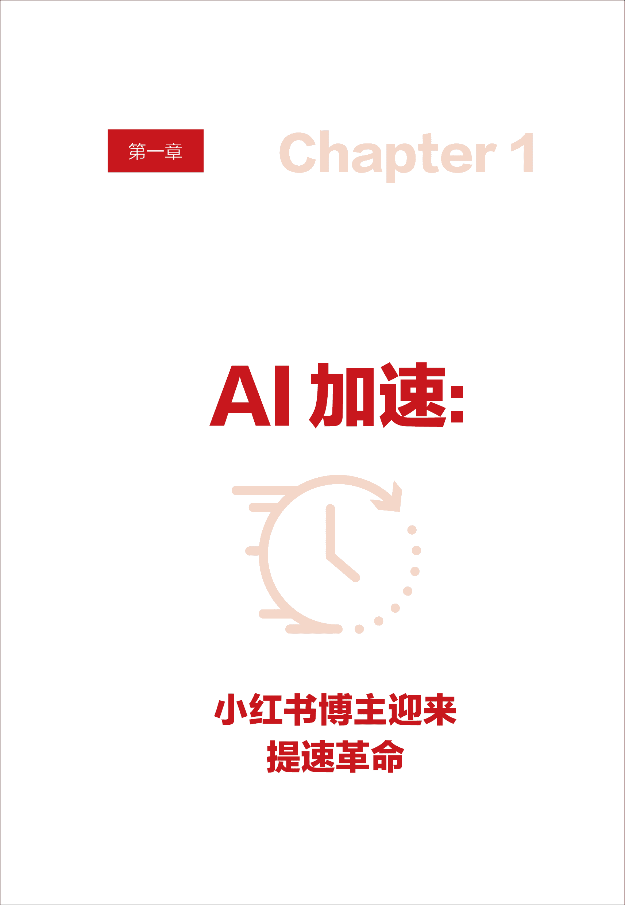

### 1.1
## 先让智能开工 新手入局的正确姿势

智能热潮的扩散速度和覆盖面都令人惊叹，相关话题反复登上各大平台热搜如图 1-1 所示。

图 1-1 智能冲上各大平台热搜

从头条资讯到网络热议，再到朋友圈的日常分享，到处都在谈智能。
有人因忽视智能化而遭遇职业危机失去岗位，有人因拥抱智能迅速补上绘画、写作、视频制作等短板，效率提升甚至迎来晋升加薪。

这和做小红书创作者有什么关系？

借助人工智能，计算机能够模拟人类思维，完成图像识别、文案撰写、代码编写、药物研发等高难度任务。
智能浪潮下，新入行的创作者不必通晓全部技术，但要明白智能化如何帮你做号、提升笔记产出效率、如何更快涨粉、如何挖掘新的副业变现机会。

**小红书本质上是各行各业创作者的竞技场，智能更像一把先进的装备。** 人设、技能、专业水平相近的人同台竞争，若一人以智能加持进攻压制，一人仅靠过往经验被动应对，前者通常更具优势。

因此想靠小红书涨粉变现、加速成长，就必须关注技术演进并用在内容生产上。
未来变现更快离不开智能，但模型只是工具和武器，使用者才是创作者本身。
需要学会把这把武器用在小红书运营的各个环节。

秋叶小红书网课加训练营已帮助超15000名零基础学员成为小红书创作者，本书结合往期学员的真实辅导经验，详细拆解新手从0起号、做爆款内容、运营涨粉到变现的完整路径，并借助智能让你走得更快更远。

亲爱的小红书创作者，期待与你顶峰相见。

### 1.1.1
### 借势潮流 智能浪潮为小红书带来新机遇

在智能浪潮下，只要希望通过运营小红书涨粉变现、更快成长，就必须重视技术演进并将其应用到内容创作中。要明白未来做创作者想更快变现离不开智能，但工具只是工具，自己才是受益者。

### 1.1.2
### 实操方向 创作者三大智能应用场景

在小红书脱颖而出，光靠个人魅力与勤奋不够，需要智能这个高科技助手。下面重点介绍创作者的三大应用方向与策略。

1. 文字撰写 笔记生产提速
智能写作能显著提升内容产出效率。
常为标题发愁？模型可提供大量灵感和建议。过去一天只能写一篇笔记，现在借助模型一天能产出十篇高质量笔记。
比如母婴领域，若对育儿知识获取无从下手，模型可在1分钟内整理出全面权威的育儿信息，模型一分钟生成的母婴笔记如图 1-2 所示。若不确定哪些内容适合带货，模型还能分析数据并设计合适的带货文案。
总之，智能写作是小红书快速成长的秘密武器。

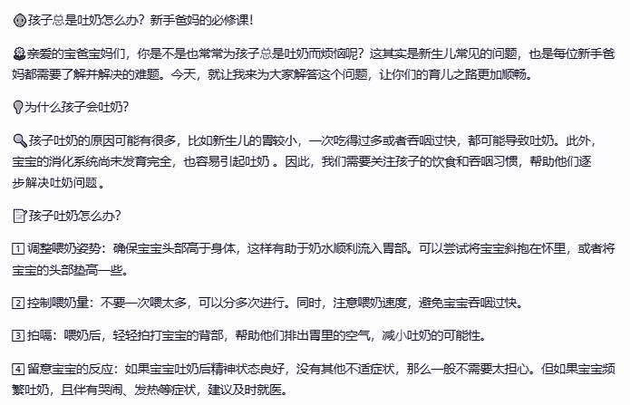
图 1-2 模型一分钟生成母婴领域笔记

2. 图像绘制 封面制作无忧
吸睛封面是点击的关键。
以读书领域为例，想做一张以书籍为背景的书桌封面并加入读书元素，如图 1-3 所示，智能很容易实现。只需给出简单描述，模型就能生成美观贴题的图片。即使零设计基础，也能轻松做出专业感封面。

图 1-3 模型30秒产出高清书桌封面

3. 视频合成 打开新玩法
未来创作者必备能力是视频制作。书中会教你用智能把文字内容转为视频内容，降低门槛。
以萌宠领域为例，提供一段文字描述，模型就能生成有趣生动的萌宠视频，如图 1-4 所示，再配合入门剪辑工具，没经验的人也能成为视频创作者。

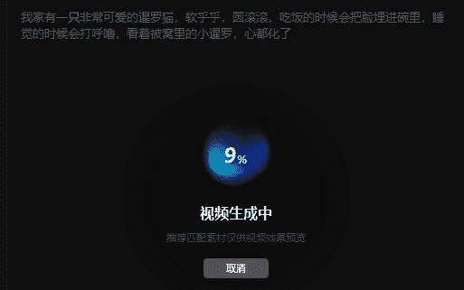
图 1-4 输入文字模型自动合成视频

总体而言，智能让写作、图片、视频制作都更便捷，助力创作者在小红书实现粉丝增长与变现。

### 1.2
## 智能提问入门 打造专属小红书助理
后续内容以文字创作为主、视觉与视频为辅，深入讲解小红书高效运营玩法与智能实操技巧，让你拥有专属智能助理。

### 1.2.1
### 五大国产创作模型 组建你的创作助手
工欲善其事必先利器。智能文字创作是创作者的重磅武器。
国内五大创作模型如下。

1. 文心一言ERNIE Bot——百度的智能创作伙伴
文心一言是百度新一代知识增强大模型，能对话互动、答疑解惑，还能协助创作。灵感枯竭时可生成有创意的文案，文学创作、商业文案、多模态生成都能胜任。

2. 讯飞星火Spark Desk——科大讯飞的认知智能助手
讯飞星火是科大讯飞推出的认知智能大模型，基于自然对话理解并执行任务，擅长内容生成、语言理解、逻辑推理，适合教育、办公、医疗等场景提升智能化服务。

3. 通义千问Tongyi Qianwen——阿里云的超大语言模型
通义千问基于GPT-4架构设计，能理解和生成人类语言，支持多轮对话、文案创作、逻辑推理，辅助学习和解锁智能应用场景。

4. 腾讯混元大模型Tencent Hunyuan——腾讯的通用大语言模型
腾讯混元参数规模超千亿，在中文理解与创作、逻辑推理上表现强劲，可在腾讯会议提供智能助手，在腾讯文档支持文本创作。

5. 豆包Dou Bao——字节跳动的多功能智能工具
豆包基于云雀模型开发，支持聊天对话和写作辅助。亮点在于语义理解和数理逻辑能力，生成文本或语音回答都很出色，对英语学习类创作者尤其友好。

五大模型各有优势，可按需求和创作场景选择，提升效率、丰富内容、拓展思路。

### 1.2.2
### 提问心法 零基础也能写好笔记
无论过去对写作是喜欢还是抗拒，掌握智能提问心法都能写出吸睛笔记。

心法1：身份角色+写作主题+要求标准
心法2：投喂资料+总结标准+结合心法1

1. 有想法且明确写作要求，用心法1
第一步身份角色：你是母婴创作者、美食达人还是旅行爱好者？角色决定风格和内容。
第二步写作主题：分享生活、推荐好物还是传授技能？主题引导方向。
第三步要求标准：想要的风格是深度思考、轻松幽默还是简洁明了？标准把控调性。

提问案例
身份角色：假设你是一位小红书母婴创作者。
写作主题：写一篇标题为“孩子屁股起红疹的处理方法”的笔记。
要求标准：内容简单易懂，用词符合小红书调性，能吸引宝妈注意，配有清晰实操步骤。
生成结果如图 1-5 所示。

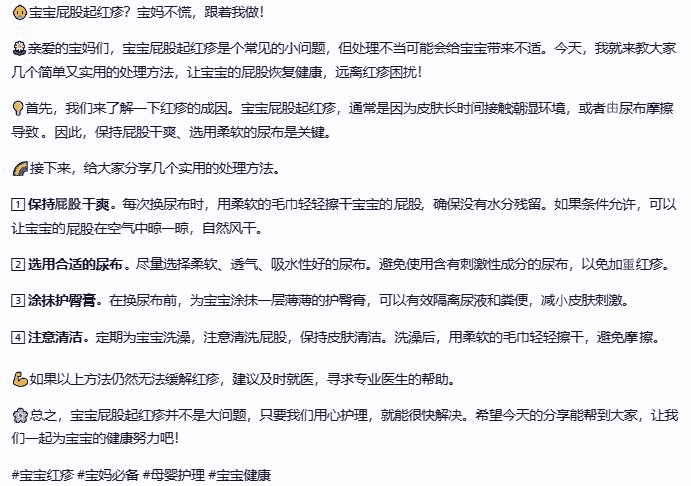
图 1-5 使用心法1模型产出的小红书笔记

2. 没想法想拆解行业优质写法，用心法2
第一步投喂资料：把领域热门话题、最新资讯或感兴趣内容喂给模型。
第二步总结标准：让模型提炼核心信息、结构、写法优势，多维度拆解精华。
第三步结合心法1：基于主题输入模型总结的优秀文章标准，即可写出有深度价值的笔记。

提问案例
第一步投喂资料：
这是文章《国内年轻人日常饮食结构》，请总结核心数据和信息，并拆解写作逻辑结构、特点与优势。内容如下：...
第二步总结标准：由模型输出总结。
第三步结合心法1：
身份角色：假设你是一位小红书健康养生创作者。
写作主题：写一篇标题为“为什么建议你吃减脂餐？”的笔记。
要求标准：
1. 采用总分总结构，先概述中国年轻一代饮食习惯变化，再介绍减脂餐优势与实践，最后总结市场现状。
2. 数据翔实、举例丰富、关注细节，用具体数据案例展示情况。
3. 紧跟时事热点，针对年轻人痛点给出可行建议，实用性强，市场指导意义高。用语简洁明了，适合年轻读者。
生成结果如图 1-6 所示。

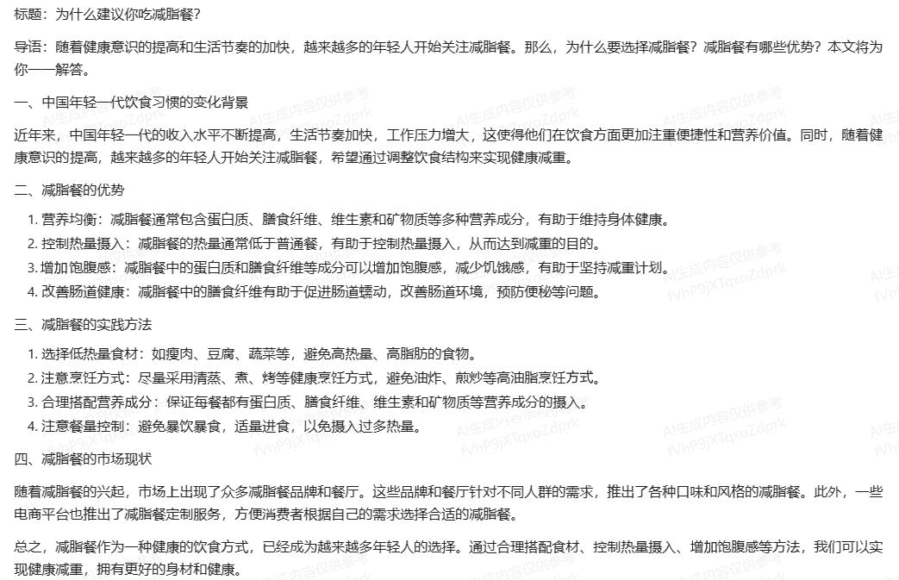
图 1-6 使用心法2模型产出的小红书笔记

掌握这套提问心法，高手门外汉都能让小红书笔记更出彩。

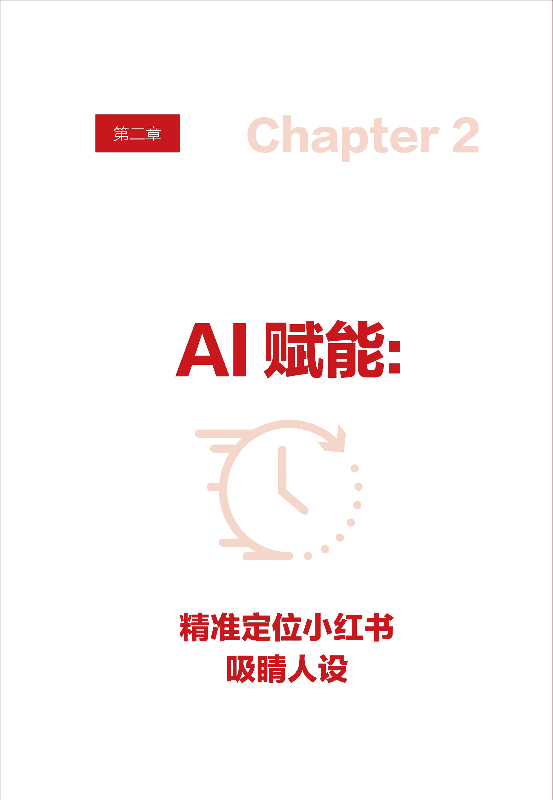
### 2.1
## 起号首选 小红书为何最适合素人
想做创作者，小红书是首选。

小红书是热门信息分享平台，深受年轻人尤其是年轻女性青睐。官方数据显示，月活1.2亿用户在小红书寻求购买建议，日均搜索量达3亿次，已成为普通人消费决策入口。

下面基于平台属性，阐述素人在小红书做自媒体的四大优势，并深度剖析“种草”红利。

### 2.1.1
### 素人逆袭 小红书四大成功优势
做新媒体，建议优先选小红书入局，理由有四。

1. 用户质量高、消费力强、可卖高客单价商品
秋叶小红书训练营学员中有房产销售顾问，通过输出房产干货获客，半年内售出五套房产，业绩超千万元。
为什么用户消费力强？看用户画像。
截至2023年第四季度，小红书月活2.6亿，其中70%为女性、90后占比70%，女性是消费主力；
50%用户来自一二线城市，多为都市白领、职场精英，消费能力高于其他平台。
“种草”本质是营销，若用户购买力弱，终点难以达成。调研显示小红书用户平均收入5 000元，收入5 000-10 000元人群占比48.45%，整体水平较高。用户“种草”后付费意愿和能力更强，转化率高。
总结下来小红书活跃用户特征：女性为主、年轻且购买力强。高客单价产品不能错过该平台。小红书官方数据报告如图 2-1 所示。

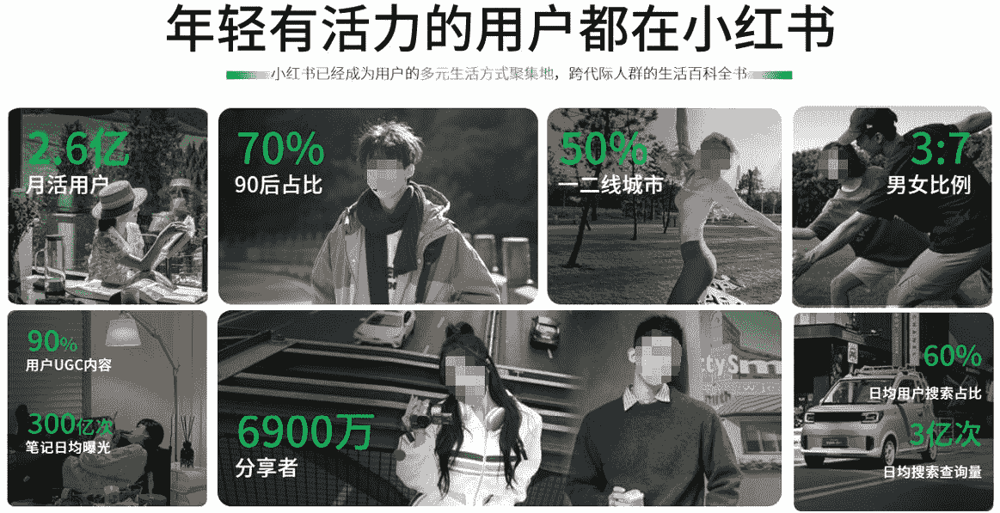
图 2-1 小红书官方数据报告（一）

2. 种草社区属性强、内容多元、入驻门槛低
小红书自创立起走社区路线，创始人多次强调它是一个社区。
社区里“有用”的内容聚集用户，形成用户与创作者平等互动的文化。
运营负责人曾举例，一位300多粉丝的用户发去草莓园买草莓的笔记，收到70多条私信询问位置、老板、停车等。这体现小红书区别于其他平台的特色：用户创作者平等交流。
只要内容客观真实就能获取流量，新手创作门槛大幅降低。
小红书内容领域非常广，如图 2-2 所示，除美妆护肤外，还涵盖职场、社科、影视、音乐、游戏等，覆盖生活方方面面。

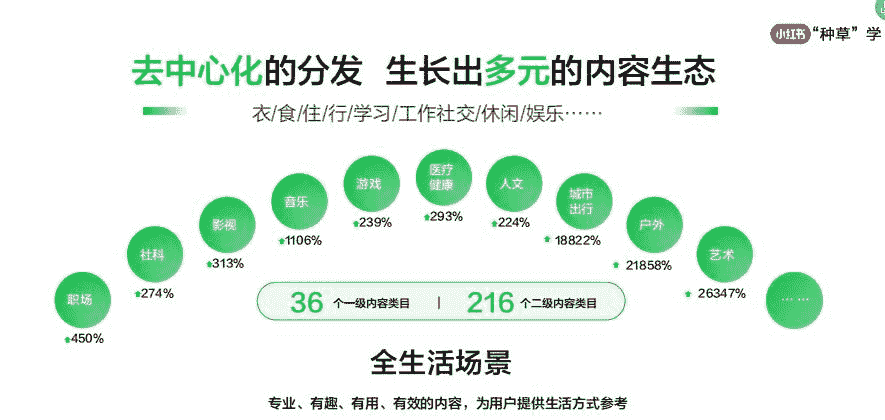
图 2-2 小红书官方数据报告（二）

3. 用户消费欲望强、品牌投放需求旺盛、新手变现扶持力度大
“我现在使用小红书搜索的频率已经超过百度了。”

扫码观看讲解视频

一位重度用户表示，使用小红书后几乎不再打开百度，因为内容覆盖从穿搭美妆到装修婚礼、考试经验、职场攻略。看创作者种草已成习惯，自己空闲时也会分享内容。

官方数据显示，日均搜索占比达60%，81%用户在浏览后产生购买欲，如图 2-3 所示。

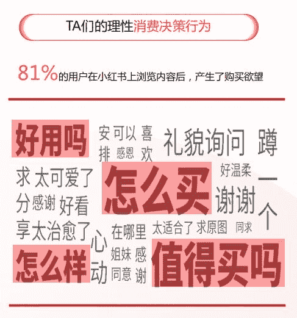
图 2-3 小红书官方数据报告（三）

搜索流量最精准、商业价值最高。小红书90%用户购买前有过搜索行为，约60%流量来自搜索页，搜索页占首页流量38%。
笔记关键词被搜索到就会获得新曝光，曝光随搜索次数增加。这对创作者极有利。

秋叶训练营学员做红酒批发，布局酒品关键词，粉丝不足400时已通过内容获客，售酒超150万元，体现搜索流量优势。

品牌也大量选择小红书投放，普通人更容易低粉变现。训练营学员仅6个粉丝，发布解决高原反应的笔记，凭借搜索优势获得品牌广告机会，实现变现。

QuestMobile发布的《2020新国货崛起洞察报告》显示，微博、抖音、快手平均带货转化率均未超10%，小红书平均转化率高达21.4%。

小红书持续探索盈利模式，对新手友好。变现扶持不断降低门槛。

1）2022年底，小红书蒲公英平台入驻门槛下调，接广告粉丝限制从5 000降至1 000，大幅降低变现门槛。

2）2023年四月，平台上线了商品合作中心，粉丝数达到1000的账号即可在站内上架合作商品，不必自建供应链也能靠带货获得收入。
3）2023年8月24日，平台对外发布百万买手计划，并同步投放500亿流量资源，旨在扶持100万创作者形成新职业形态，对刚入局的新手来说又打开了一轮变现窗口。
4. 零门槛起号：为什么新手更偏爱这个平台
想从内容获取回报，前提是有人看。市面上多数成熟平台对创作要求越来越高，公众号、头条系对文字功底要求清晰，抖音、快手对拍摄剪辑要求明显，表面看门槛不高，实际劝退了不少人。
小红书在创作自由度上明显更宽松。表达不需要专业化，能把事情讲明白、提供参考价值即可；发布形式兼顾图文与视频，对视频制作没有硬性要求。
秋叶小红书训练营里就有典型案例，一位54岁的退休学员做读书主题，第一篇笔记只是真诚记录自己要在平台坚持阅读，语言朴素，上线两天点赞就明显起来了。
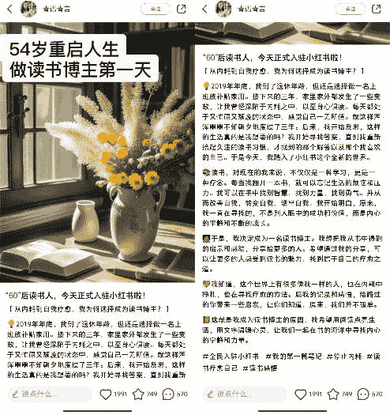
图 2-4 秋叶小红书训练营学员账号内容截图
多平台运营过的达人普遍认为，小红书对新人最友好。优势可以归纳为三点。
① 用图文起号，不露脸不拍视频也能积累粉丝
当多数平台转向视频时，小红书仍以图文笔记为主。参照表 2-1，用户打开小红书不仅是消遣，更是为了做消费决策，需要直观快速的购物信息，图文正好匹配。
表 2-1 小红书和抖音、哔哩哔哩、知乎平台的区别
区别项 小红书 抖音 哔哩哔哩 知乎
平台属性 重内容沉淀 重流量曝光 二次元社区、弹幕文化突出 知识问答社区
用户属性 用户集中，女性占比大 用户分散，男女均衡 用户男女均衡，以Z世代为主 用户多元，男性居多
内容方向 垂直细分 泛娱乐化 生活娱乐游戏动漫科技为主 专业知识内容
带货方式 KOL/KOC测评种草为主、直播带货与商城为辅 短视频带货直播带货，除官方小店可链淘宝京东 品牌商合作官方合作用户打赏优质回答
合作品牌特性 以高端品牌和新品牌为主 以潮流年轻化品牌为主 信息流广告、艺人+上传者矩阵引流种草，可链淘宝京东 广告业务、知识付费
图文由图片与文字构成，制作难度远低于视频，新人也能快速上手。纯干货科普号每天发布一点小知识点就能实现快速增长，说明图文红利依旧存在。
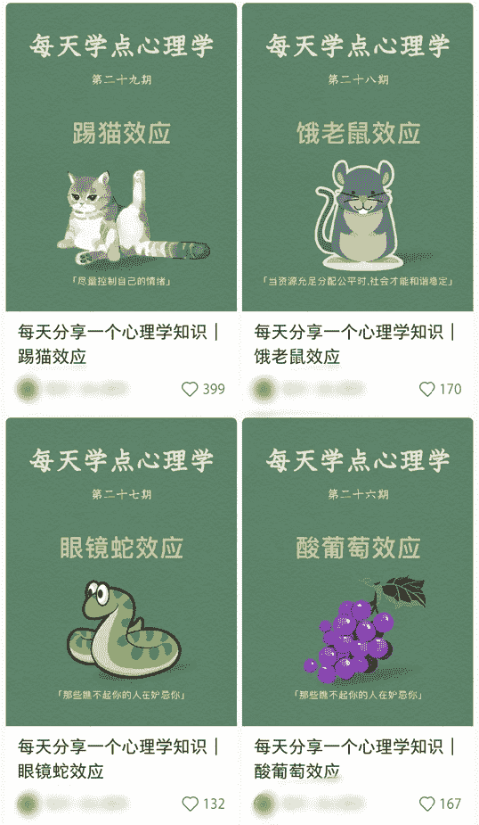
图 2-5 知识科普账号主页截图
图文对账号类型与风格依赖小，教程、经验分享、知识、对比、产品合集等在平台受欢迎的形式都能用图文呈现，新手更容易找到切口。
② 视频号扶持力度大，新号放量快
2020年8月小红书视频号上线。申请门槛不高，粉丝超500、发布过1分钟以上视频且无违规，或在站外有一定影响力即可入驻。视频时长上限放宽到15分钟，还支持合集整理。
为推动创作，平台推出大量视频教学任务，完成任务的同时提升能力并获得流量倾斜。2023年底上线的薯新星计划，专门帮助新入驻创作者实现增长。
秋叶矩阵的一个PPT教学新号，入驻后发布4条笔记粉丝就破万，正是扶持流量的助力。具备视频制作能力或已有站外粉丝的用户，更适合借此打开局面。
③ 机制看内容不看体量，零基础也能上热门
小红书同样采用流量池机制，内容达标就进入下一级曝光。但有两个对新手友好的设定：一是发笔记不要求粉丝基础，零粉账号只要内容优质就会被持续推送；二是推荐结合搜索行为，笔记包含用户检索关键词，就有机会被精准送达。
双列信息流加搜索推荐的组合，让优质内容曝光率大幅提升。秋叶写书私房课学员赵黎老师，小红书ID赵黎 Grace，运营一个月粉丝超2万，三个月接广告超百条，现粉丝已过10万；新做的PPT教学号小雨在学PPT，7天内粉丝增长超5000，半年突破10万。
小结
普通人做自媒体，小红书更现实，核心有四点。
1. 用户质量高、消费力强，能卖高价商品。
2. 种草属性强、内容领域多元、入门门槛低。
3. 用户购买意愿强、品牌投放需求大、对新手变现扶持力度大。
4. 算法友好，无需出镜拍视频，零粉也能出爆款笔记。
### 2.1.2
### 素人起号更易上手的十个低门槛赛道
美妆、穿搭等热门赛道对颜值和审美要求高，素人难以快速拿捏。在秋叶小红书训练营里，学员常问我适合做什么。赛道选择比追热点更重要。以下十个赛道在小红书有需求、制作门槛低、变现潜力也足。
1. 读书
做博主最怕断更，读书号能持续供稿。从金句摘抄、书单推荐、读书笔记、读后感到视频讲书，层层递进，人设也逐渐专业。图 2-6 的学员从金句起步，30天内实现涨粉并拿到广告。
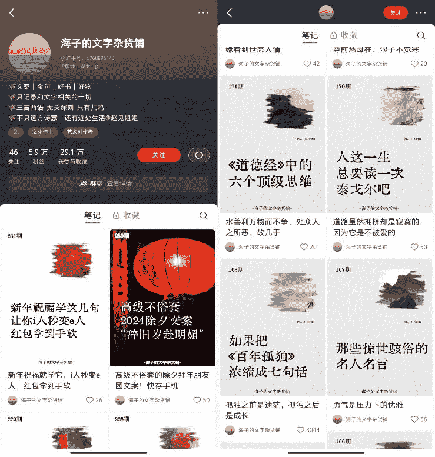
图 2-6 秋叶小红书训练营学员账号主页截图(一)
2. 减脂
减脂赛道热度高且变现强。可从打卡记录开始，逐步扩展到减脂餐、运动记录、跟练视频和干货教程，用真实过程建立信任。图 2-7 的学员发布12条笔记粉丝破万，一个月内通过售卖减脂训练营超百单。

图 2-7 秋叶小红书训练营学员账号主页截图（二）
3. 美食
吃是刚需。美食教程、展示、探店都能做，可细分早餐、家常菜、健身餐、西餐、甜点、咖啡、零食等，先尝试再聚焦。图 2-8 的账号以创意美食切入，千粉时已接广告30余个。
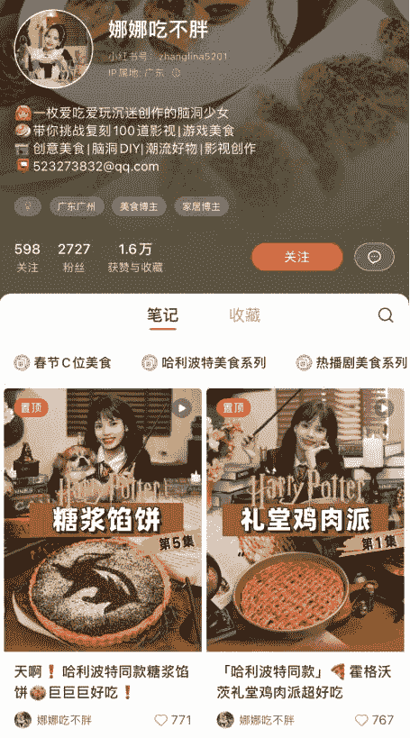
图 2-8 秋叶小红书训练营学员账号主页截图(三)
4. 职场
职场人群是各平台主力。简历技巧、沟通心得、面试话术、技能学习、管理干货等都能分享，结合自身岗位输出经验即可。图 2-9 为职场博主账号内容示例。
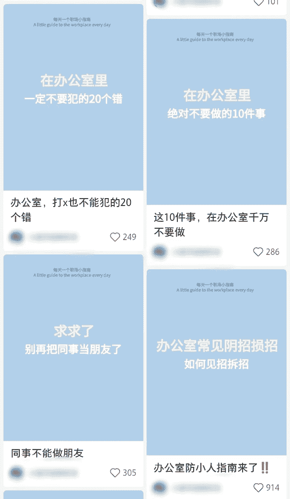
图 2-9 小红书职场博主账号内容截图
5. 母婴
适合素人妈妈。内容涵盖好物推荐、育儿经验、早教、亲子游戏、辅食、阅读、Vlog、孕产等。用真诚记录育儿喜悦与挑战，能建立共鸣，变现价值高。图 2-10 为育儿心得分享账号。
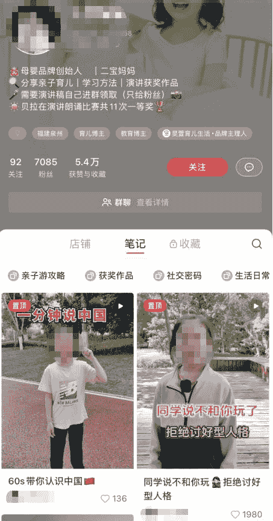
图 2-10 秋叶小红书训练营学员账号主页截图(四)
6. 家居
在同等粉丝条件下，家居号报价相对较高。细分主题多，如室内设计、小户型、租房改造、小成本改造、阳台、收纳等，可从一个小切口切入。图 2-11 为热门主题示例。
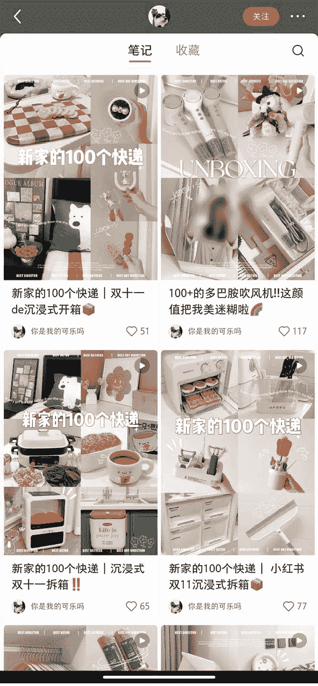
图 2-11 小红书家居博主“新家的 100 个快递”主题
7. 影视综艺
分享片单、金句、观后感即可吸引同好，流量大且广告需求多。图 2-12 的学员通过纪录片和影视清单快速涨粉，邀约不断。
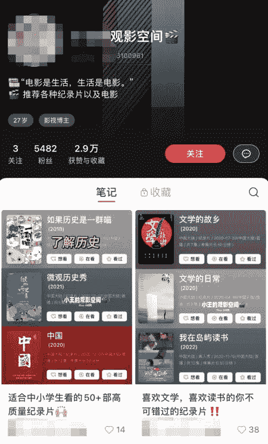
图 2-12 秋叶小红书训练营学员账号主页截图（五）
8. 健康养生
熬夜、压力、亚健康催生大量需求。可做动作跟练如八段锦、拍八虚，好物推荐如梳子、茶饮、按摩仪，知识科普如补气血、去黄气等。图 2-13 为养生干货号。
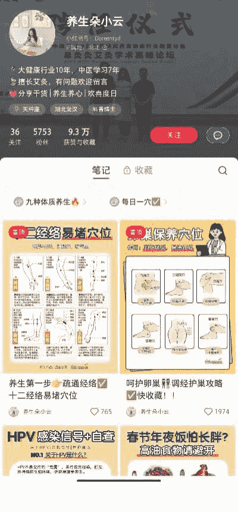
图 2-13 秋叶小红书训练营学员账号主页截图（六）
9. 个人成长
即知识类赛道。只要内容能解决问题、传授道理或提升技能，就易获认可。图 2-14 的账号以读书加女性成长切入，快速实现涨粉变现。
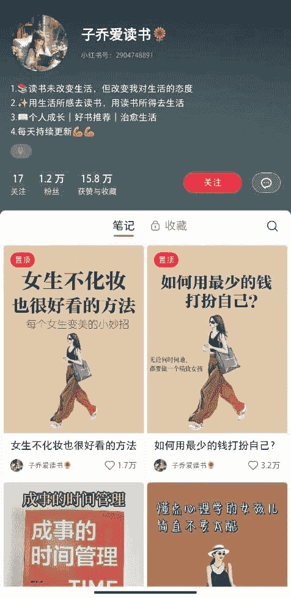
图 2-14 秋叶小红书训练营学员账号主页截图（七）
10. AI作画
生成式绘画是新兴赛道，用AI工具快速生成头像、壁纸、漫画等，输出压力小。图 2-15 的学员矩阵化运营，月广告收入超5000元，竞争尚不激烈。
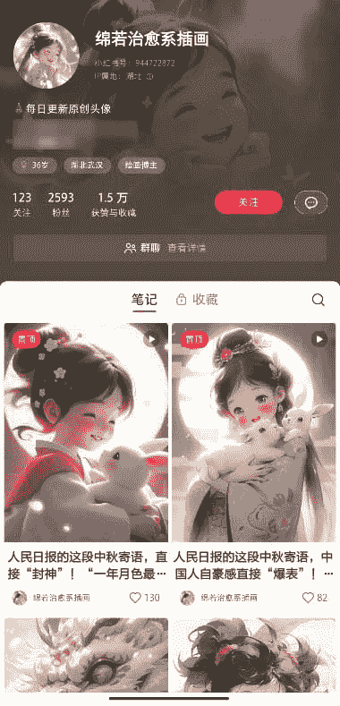
图 2-15 秋叶小红书训练营学员账号主页截图（八）
起号先问自己能做什么，而不是做什么赚钱。门槛过高很难坚持，以上十个赛道是经多批素人验证的有效方向。
小结
素人起号，选择这十个赛道更容易快速行动、涨粉变现。
1. 读书。
2. 减脂。
3. 美食。
4. 职场。
5. 母婴。
6. 家居。
7. 影视综艺。
8. 健康养生。
9. 个人成长。
10. AI作画。
先选一个感兴趣或能马上做的赛道开始行动，开始了才会在路上变得更强。
### 2.1.3
### 零粉丝也能突围的五类人特征
有人问我适不适合做小红书。自媒体门槛虽低，但具备以下特质的人启动更快。
1. 有分享欲和表达欲的人
内容是核心，有表达欲才有原创。看到一杯好喝的奶茶，是喝完就忘，还是想用吸引人的方式分享出去，就是分水岭。
2. 有一技之长的人
手工、舞蹈、做饭、绘画、摄影、剪辑等技能，或工作生活经历本身就是谈资。HR可分享面试加减分点，宝妈可分享育儿心得，留学生可分享语言或申请经验，更易吸引同好。图 2-16 为手机摄影教学号，粉丝3万。
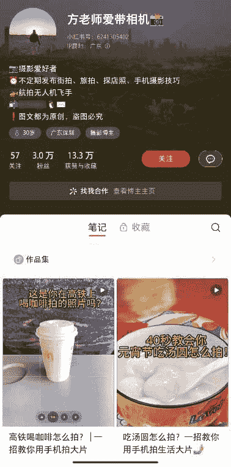
图 2-16 秋叶小红书训练营学员账号主页截图(九)
3. 有自己产品的人
拥有课程、实体或虚拟服务的人更适合小红书。平台种草特性和高质量用户，为产品带货提供基础。结合用户画像、痛点和产品需求写内容，能实现有效种草。图 2-17 为软装设计作品分享账号，即使粉丝不多也已接到设计订单。
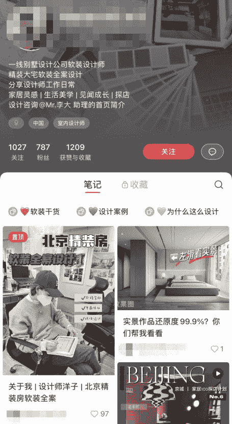
图 2-17 秋叶小红书训练营学员账号主页截图（十）
4. 有特定背景或特殊经历的人
内容和人设要有记忆点。背景独特或经历丰富的人更容易做出差异化内容。图 2-18 的博主结合40岁以上女性成长感悟，粉丝超10万。
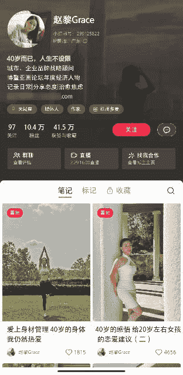
图 2-18 小红书博主主页截图(一)
5. 有学习力且善于总结的人

除开前面提到的四类性格标签，还有一类同样值得关注——具备较强学习力并且会归纳总结的人。这类创作者在小红书的知识垂类里很常见。对很多从零起步的素人而言，知识博主是一条很友好的切入路径，边输入边输出，很快就能打造出成长感人设。图 2-19 所示的博主主页正是通过阅读获取信息，再以视觉笔记的形式整理输出而获得粉丝喜爱。

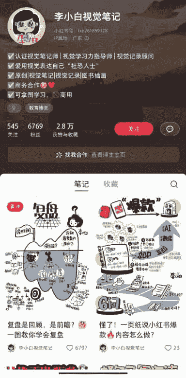

图 2-19 小红书博主主页截图(二)

**小结**

素人入局做号，能在下列五类特质中占到一到两项就可以开始行动。

1. 分享欲和表达欲都在线的人。
2. 拥有可被展示的技能的人。
3. 手上已有可变现物品的人。
4. 背景或经历具备差异性的人。
5. 学习驱动强且擅长提炼的人。

### **2.2**
## **素人博主定位：优先选择离变现更近的赛道**

想在小红书上做起来，第一步是先有账号。很多人恰好卡在起步选择上。

常见疑问是：小红书做什么内容能赚钱？

本质上这是赛道选择问题。选错赛道，容易掉进三种困境。

1）账号起步没底气：方向是否合适、能否产生收益心里没数。
2）日常更新易卡壳：发了几篇后就找不到可继续的话题。
3）变现难以延续：偶尔能接到单，却做不到稳定收入。

所以做自媒体一定要从清晰定位入手。

需要提醒的是，他人推荐的赛道不等于你就能做。每个人的资源不同，匹配自身才最容易跑通。只有适合自己，才能更快启动、更快看到结果。

下面会介绍三种定位思路，帮你找到更合适的博主方向。

### **2.2.1**
### **金字塔定位法：找准层级，提速变现**

扫码观看讲解视频

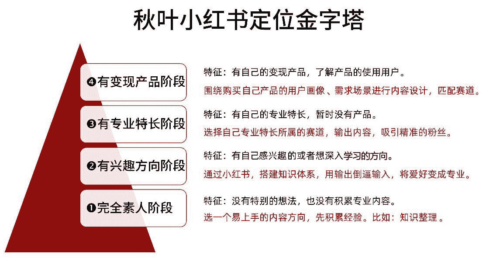

图 2-20 秋叶小红书定位金字塔

从 2022 年 5 月起，秋叶小红书训练营已服务超 5 000 名学员，累计变现突破 1 500 万元。基于大量学员反馈，团队总结出一套新手定位的金字塔模型，如图 2-20 所示，用来帮助新人了解自身所处层级并做出更合适的选择。

在小红书红利期，每个人都有变现机会，只是层级不同，能力和建议也会不同。

**1. 完全素人层级**

这一层级的特征是：对赛道没概念，没有明显兴趣爱好，也缺乏专业技能和变现物。只是看到很多人赚钱，想试试。

这一层最缺的是持续输出的能力和行动力。

当平台正处于红利期，犹豫只会错过窗口。建议直接选一个上手门槛低的方向先练手。比如做读书/知识类账号，看书本身就是学习，也是内容来源。此时平台流量更容易转化为变现可能。

秋叶训练营带过大量零基础学员，学习期间就产出了不错的成绩，也增强了信心。图 2-21 为一位学员的主页截图，她从零做读书号，粉丝近 5 000，最终实现了广告变现。

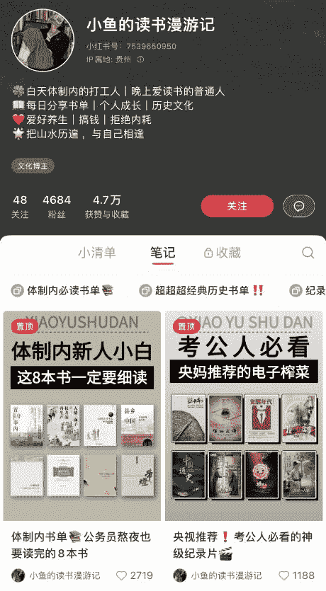

图 2-21 秋叶小红书训练营学员账号主页截图（一）

如果有人表示不想做知识类，更偏爱某个领域，那就进入下一层。

**2. 有兴趣方向层级**

这一层已经有了想学或想深耕的兴趣。

典型困惑有：

1）兴趣太多选不定。
2）储备不足，难以长期输出。
3）先做内容没有产品，感觉变现无门。

建议此时选择离变现更近的赛道。

兴趣多时，优先看哪个赛道更容易接到广告、更容易赚钱。判断方法很直接，看小红书蒲公英后台的投放需求榜，如图 2-22 所示，需求量大的赛道排名靠前，接单机会自然更多。

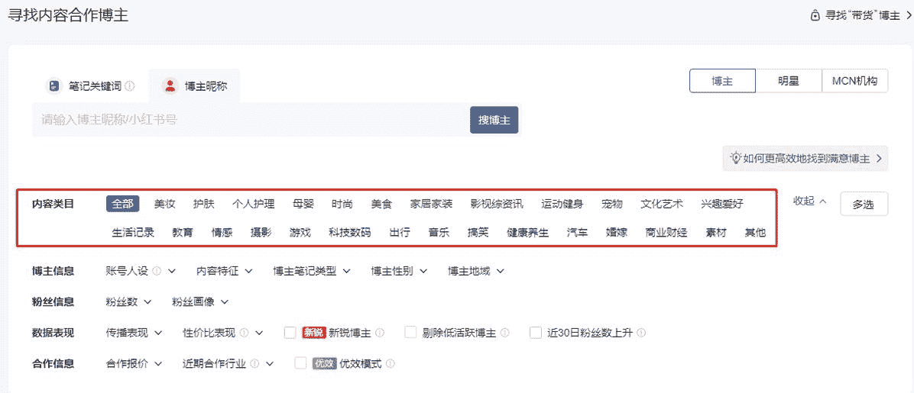

图 2-22 小红书蒲公英后台截图

对于还在学习阶段的兴趣，比如读书、运动、减脂餐，可以借助小红书搭建知识体系，用输出倒逼输入，逐步把爱好转化为专业。有学员分享读书笔记，被出版社编辑关注，经常收到赠书，基本实现纸质书自由，如图 2-23 所示。

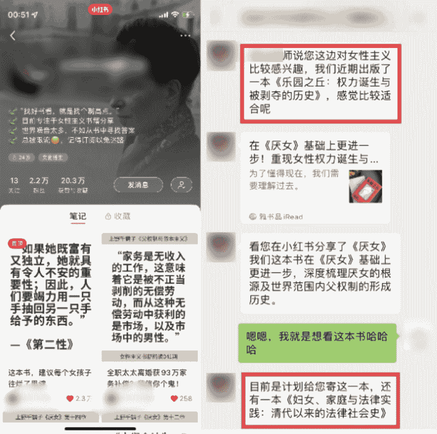

图 2-23 秋叶小红书训练营学员账号主页截图（二）

也有学员分享历史书、PPT 学习、绘画打卡等内容，都吸引了稳定的粉丝。兴趣类创作者要学会边学边发，正向反馈会让坚持变简单。

**3. 有专业特长层级**

这一层在某专业领域已有多年积累，但暂无产品。适合用专业赛道做内容，先吸引精准粉丝。

一位营养师学员，输出营养学和育儿专业内容，粉丝只有几十就接到硅胶枕头的广告邀约，如图 2-24 所示。

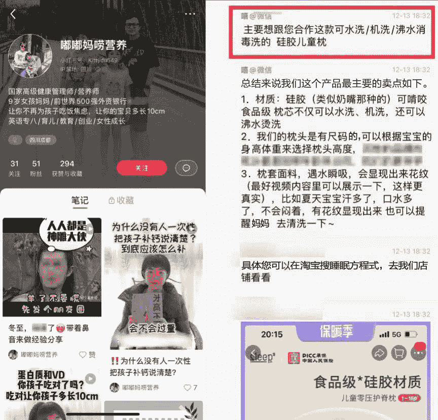

图 2-24 秋叶小红书训练营学员账号主页截图（三）

这一层应先输出优质内容沉淀精准用户，收集需求后再基于需求研发产品，变现成本更低。

**4. 有变现产品层级**

这一层已有明确产品和变现路径。可围绕目标用户的画像和场景来设计内容，匹配合适的赛道。有学员运营自己的减肥训练营，账号上线一个月就通过小红书引流实现超 30 万元转化，主页截图如图 2-25 所示。

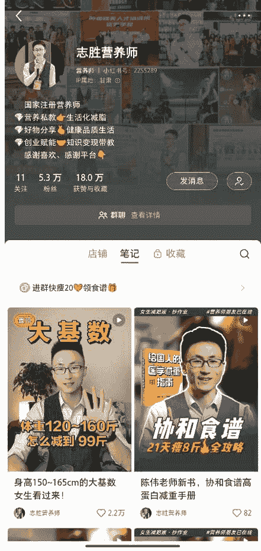

图 2-25 秋叶小红书训练营 学员账号主页截图（四）

有产品的人，建议坚定围绕产品做内容，除非产品过于小众或在小红书无市场。

如何判断品类是否有市场？带品类关键词去搜索，看是否存在大量爆款笔记。爆款指点赞超 1 万或收藏过千的笔记，若数量较多，说明该品类具备流量基础。

**小结**

用金字塔定位法先识别自身层级，再做选择。

1. 完全素人层级。
选低门槛方向先积累经验，比如知识整理、金句摘抄等。
2. 有兴趣方向层级。
借助平台搭建体系，用输出倒逼输入，把爱好变成专业。
3. 有专业特长层级。
选专业赛道输出内容，先吸粉再根据反馈做产品。
4. 有变现产品层级。
围绕产品用户画像与使用场景做内容，匹配赛道。

### **2.2.2**
### **优势四宫格：把经验和爱好转化为变现方向**

上一节的金字塔帮你初步判断层级，本节介绍一个更实用的工具——优势四宫格。它从四个维度帮你盘点资源，把爱好和经验梳理成可变现的细分赛道。

**1. 构建优势四宫格**

优势四宫格通过四个维度审视个人优势，形成清晰的定位参考。这四个维度如表 2-2 所示。

表 2-2 优势四宫格 4 个维度

产品资源技能经验

兴趣爱好日常必做事项

1）产品资源。盘点手上能直接变现的资源，如独特产品、服务或内容。思考哪些是别人难复制的卖点。
引导问题：能提供什么产品或服务？有哪些资源具备独特性？哪些在市场上稀缺？

2）技能经验。回顾长期积累的专业知识和实操经验，思考这些能力能解决什么问题。
引导问题：在哪些领域有深入认知？哪些经验来自长时间沉淀？技能能解决哪些具体痛点？

3）兴趣爱好。梳理真正热爱的事务，分析其在小红书是否有受众。
引导问题：业余时间常做什么？哪些爱好让你愿意持续投入且能带来价值？

4）日常必做事项。从日常行为里找可内容化的点，如育儿、健康、效率小技巧等。
引导问题：每天固定会做哪些事？哪些日常经验对他人有参考价值？

**2. 列清单填充四宫格**

以一位对插画感兴趣的学员为例，其四宫格填充如下，如表 2-3 所示。

表 2-3 某学员的优势四宫格 4 个维度

产品资源技能经验

● 原创插画作品● 插画设计

● 手绘教程● 色彩搭配

● 个性化定制服务● 教学经验

兴趣爱好日常必做事项

● 绘画● 每天练习绘画

● 阅读插画书籍● 浏览插画作品

● 收集艺术品● 制作教程

**3. 相似项取交集，确定定位细分方向**

从表 2-4 可看出，该学员四个维度都指向插画、绘画、手绘等相关内容，可定位为“插画定制”，在小红书分享作品、发布教程、输出绘画心得，并设置定制接单入口，实现变现。

表 2-4 优势四宫格标注相似项

产品资源技能经验

● 原创**插画**作品● **插画**设计

● **手绘**教程● 色彩搭配

● 个性化定制服务● 教学经验

兴趣爱好日常必做事项

● **绘画**● 每天练习**绘画**

● 阅读**插画**书籍● 浏览**插画**作品

● 收集艺术品● 制作教程

**小结**

通过构建和填写优势四宫格，能更清楚地看到自己的资源组合，找到与经验和爱好匹配的赛道，为内容吸引力和后续变现厘清方向。

### **2.2.3**
### **账号对标 3 字法：靠近爆款才能复制爆款**

一位热爱烹饪的学员表示，赛道已经确定，却不确定笔记具体怎么写、发什么，完全靠感觉。

想在小红书上起量，除了内容本身，还需要学会“账号对标 3 字法”。

对标就是找到同赛道跑在前面的优秀账号，研究它们如何吸粉、如何做内容，减少试错成本。

下面以这位学员为例，拆解“搜拆仿”的具体做法。

**1. 搜——找到同行标杆账号**

“搜”是在小红书上搜到同领域的高质量内容和账号，既能判断领域热度，也能找到学习样本。

怎么做？

确定赛道：先明确内容方向，如家常菜谱、旅行攻略等。
搜索关键词：在搜索框输入赛道词，找互动高的笔记，顺藤摸瓜找到头部博主。
选定对标：选择方向接近、更新频率和风格符合自身能力的账号作为参照。

该学员确定方向为“家常菜谱”后，直接搜索热度笔记，最终锁定了学习对象。

**2. 拆——拆解标杆账号的打法**

“拆”是对优秀账号和笔记做多维度拆解，提炼成功要素。

可从以下角度拆解：

内容方向：常发哪些话题？哪些话题数据好？为什么受欢迎？
视觉效果：图片风格、视频剪辑如何吸引停留？
笔记结构：开头如何抓人、中间如何展开、结尾如何收束？
互动技巧：评论区如何回复、如何引导粉丝参与？

该学员研究发现，优质博主标题简单直接，开头点明推荐理由，评论区几乎每条都回复，互动非常主动。

**3. 仿——吸收精髓，结合自身输出**

“仿”是在拆解基础上借鉴技巧，并加入个人特色。

①可模仿的元素：封面排版、话题选择等。
②加入个人特色：用相似话题分享真实经历、方法、故事，保持原创性。
③小范围测试：发布不同风格笔记，观察数据反馈，再确定主风格。

该学员借鉴了对标博主的拍摄角度和热门菜品，同时在视频结尾增加文字版教程，方便用户保存学习，反响很好，涨粉速度加快。

**小结**

搜、拆、仿三步能系统化学习同行经验。但要记住，方法可以借鉴，内容必须原创。像学生可以参考学霸提分法，但作业不能直接抄袭。

### **2.3**
## **素人人设打造：善用 AI 包装，脱颖而出**

### **2.3.1**
### **5 个维度建立记忆点，让人一眼记住你**

“小红书博主那么多，怎么才能被记住？”

同一赛道内容都优质，用户为何选你？关键在于记忆点。比如同样做美食博主，穿旗袍出镜就能留下很深刻的印象。

下面分享 5 个可操作的记忆点维度。

**1. 固定形象**

身份本身就是记忆点。学生、医生、程序员等不同身份与赛道结合会产生差异。例如美食博主，一个做情侣二人食，一个做独居一人食，受众感就立刻分开。

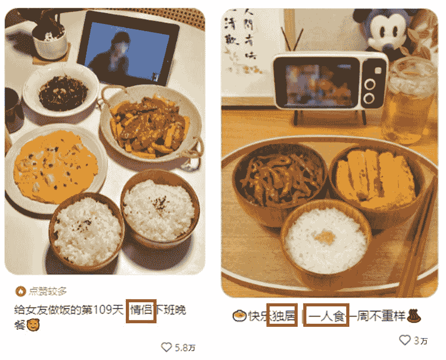

图 2-26 以固定形象打造记忆点

常见固定形象有学生、自由职业者、程序员、医生、教师、创业者、全职妈妈等。

**2. 视觉形象**

封面第一眼即是视觉冲击。穿搭、居住环境、人像构图都属于视觉记忆。图 2-27 的家居博主，用戴卫衣帽子、黑墨镜、人像置于角落的方式，与只晒房子的账号形成明显区分。

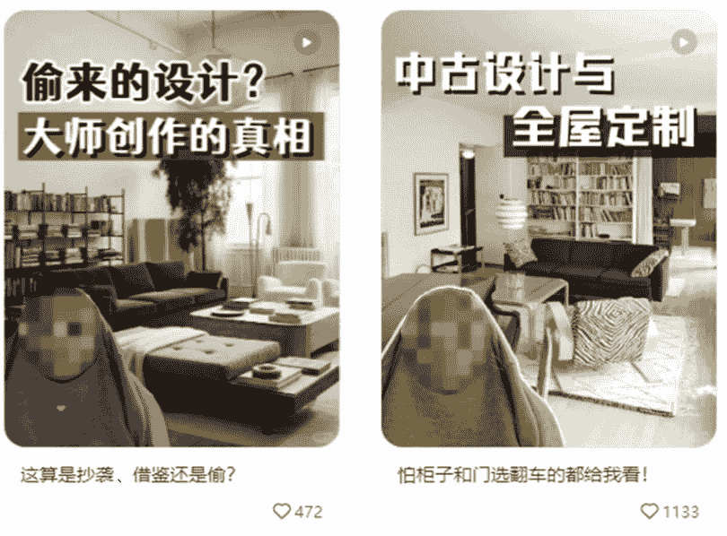

图 2-27 以视觉形象打造记忆点

**3. 语言特色**

声音同样具记忆力。方言、英语、普通话都能形成差异。一个穿搭博主用东北话讲解，就自带趣味感。

固定口头禅也能强化风格。例如做 PPT 的博主，每期结尾喊“30 天让你的 PPT 卷翻同事”，如图 2-28 所示，极易被记住。

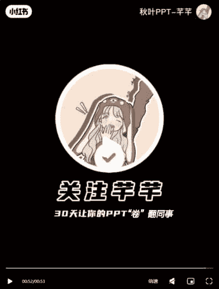

图 2-28 以语言特色打造记忆点

**4. 音乐氛围**

音乐能瞬间营造场景感。轻音乐、流行乐、广场舞风格等都是常见选择。给账号选一首专属背景音乐，能增强辨识度，同时注意版权合规。

**5. 性格特征**

鲜明的性格会带来情绪价值。犀利毒舌、温柔细腻、搞笑接地气等都是常见标签。图 2-29 的学习博主以展示怒气的学习氛围呈现，与常规正能量学习号形成反差，吸引了特定粉丝。

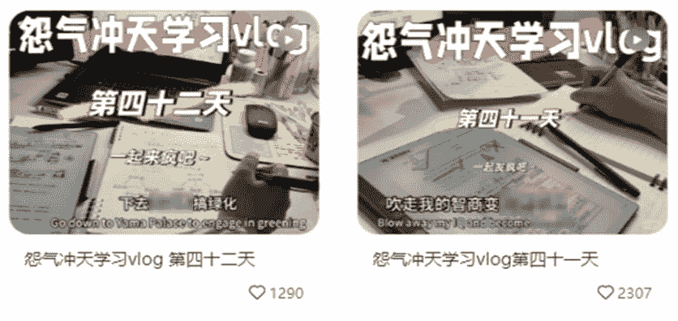

图 2-29 以性格特征打造记忆点

掌握以上五种方法后，可以梳理自身优势和性格，把它们融入内容，让粉丝对你印象更深刻。表 2-5 整理了部分新手人设方向供参考。

表 2-5 新手人设方向参考

新手人设**方向**参考

**人设名称人设记忆点人设名称人设记忆点**

购物达人独特穿搭风格摄影达人捕捉瞬间美好

美食家搞笑解说手工艺人创意 DIY

旅行探险家轻松背景音乐宠物训练师萌宠趣事

健身教练健硕的身材园艺师绿植美化生活

美妆专家精致妆容舞蹈老师优美舞姿

家居设计师温馨的家居风格语言学者方言特色

心理咨询师积极正能量数码测评师科技前沿

书评人阅读心得环保倡导者绿色生活理念

厨艺大师美食教程旅游规划师实用旅行建议

人设先行：从身份标签到主页包装的快速起号思路

起号初期先给自己一个能长期做下去的身份定位。时尚类可以做趋势观察，生活类可以做实用技巧盘点。方向参考如下：

角色 / 记忆点 角色 / 记忆点
学霸 / 学习心得沉淀 音乐爱好者 / 音乐故事线
亲子教育专家 / 亲子活动记录 运动员 / 健身动态
美妆博主 / 美妆秘籍 旅行家 / 旅行见闻
家居顾问 / 家居美学 多语种达人 / 语言技巧
心理讲师 / 心理建议 数码达人 / 数码使用技巧
读书人 / 书籍感悟 环保专家 / 环保小贴士
美食探索者 / 美食推荐 旅行达人 / 旅行趣事
时尚观察员 / 时尚新闻 生活家 / 生活感悟
学习助手 / 学习方法 音乐教师 / 音乐推荐
亲子游戏师 / 亲子互动 运动教练 / 运动心得

角色 / 记忆点 角色 / 记忆点
美妆对比师 / 美妆对比 旅行记录者 / 旅行攻略
家居生活家 / 家居小技巧 多语种爱好者 / 多语种学习
心理分析师 / 心理知识 数码爱好者 / 数码产品分享
读书达人 / 阅读分享 环保实践者 / 环保生活方式

搭建记忆点时要以真实自我为底，不做刻意伪装。长线运营靠稳定输出，真实才最耐用。

要点小结
专属记忆可从五个层面沉淀：
1. 固定标签：创作者自带的身份可直接转化为标志，如学生、自由职业、程序员、医生、教师、创业者、全职妈妈等。
2. 视觉锚点：穿搭、居家环境等视觉元素都能强化差异。常戴帽子、墨镜、常抱玩偶等习惯都是可识别的视觉符号。
3. 语言印记：方言、独特语系或固定口头禅，都能形成语言辨识度。
4. 音乐氛围：选定一首专属背景曲，用户听到即联想。
5. 性格表达：犀利毒舌、温柔体贴、幽默搞笑、接地气等不同性格，都能帮助立住人设。

### 2.3.2
### 吸睛人设四要素：用AI放大个人价值

笔记能拿赞却难涨粉，往往是用户没感知到可获得的价值。除了持续输出，账号包装同样关键。

首次浏览时要让对方立刻明白你是谁、能提供什么。昵称、头像、简介、背景图四项，是提升涨粉效率的核心。

1. 昵称的辨识度
比如想找读书内容，看到“又时一夏”和“桃气读书”，后者更易判断内容属性。

好昵称建议遵循四大原则，如表2-6所示。
表2-6 好昵称四大原则
序号 原则 具体说明
1 简洁易记 长度不宜过长，建议2-5字，便于传播和拼写
2 输入便捷 便于快速搜索
3 体系统一 在不同平台使用完全相同名称，保持形象一致
4 降低重名 在小红书内搜索无重复，更易被找到

实操公式：昵称 = 专业方向或兴趣方向 + 昵称。可参考表2-7的五种命名思路。
表2-7 五种命名思路
命名思路 案例
真名或常用昵称 秋叶大叔、李筱懿
个人IP/自媒体 兴趣方向+昵称或昵称+爱好倾向，如开心妈妈讲绘本、都靓读书、铭哥说美食、小菜包爱学习、阿饭的独居生活
专业岗位+昵称 皮肤科刘姨、HR小弘哥
本地自媒体 地区+功能，如武汉自由行、逛吃大北京
带货种草/品牌宣传 产品或品牌+昵称，如飞墨设计师-王工
个人账号不限 早啊影影、努力变更好

借助AI对话模板起名更高效。AI对话示例：
你是一名新媒体专家，我想做小红书育儿博主，请按下面五种命名公式各起5个名字。公式一真名或常用昵称，如秋叶大叔；公式二兴趣方向+昵称，如开心妈妈讲绘本；公式三专业岗位+昵称，如HR小弘哥；公式四地区+功能，如逛吃大北京；公式五产品或品牌+昵称，如飞墨设计师-王工。

AI输出节选：
公式一：真名或常用昵称
乐乐妈妈、小贝育儿、欣欣宝贝屋、明明亲子园、小悦育儿分享
公式二：兴趣方向+昵称
智慧妈妈育儿记、开心宝贝成长录、育儿小达人朵朵、亲子乐园甜甜圈、宝贝成长小能手
公式三：专业岗位+昵称
育儿专家小慧姐、亲子顾问小乐、育儿导师小萌、早教老师小星、儿童成长顾问小美
……
命名后可用表2-8自检。
表2-8 命名自检表
维度 分数
是否简洁易记 1
是否顺口易传播 1
是否拼写方便易搜索 1
是否全平台统一 2
搜索时是否易排前列 3
是否能快速让粉丝识别内容方向 2
总分 10

2. 头像的亲和力
头像需与定位风格吻合，能快速建立信任。常见三类：
① 人物头像
可分为真人头像、IP漫画头像、手绘卡通头像。真人头像对IP打造更有真实感和信任感，职业形象照能提升专业感，生活照或侧面照也是可选方案。品牌可使用固定手绘IP。
人物头像三种呈现形式如图2-30所示。

图2-30 人物头像示例
② 文字标志或品牌标志头像
多见于企业或工作室账号，直观展示定位或品牌名，如图2-31所示。

图2-31 文字类标志或者品牌标志头像示例
③ 文艺风景或宠物图片头像
宠物类账号用宠物照合适，个人IP账号则不太推荐。这类示例如图2-32所示。

图2-32 文艺风景图片或宠物图片头像示例
效果推荐顺序：人物头像 > 文字标志或品牌标志头像 > 文艺风景或宠物图片头像。人物头像最能关联人设，提升可信度与亲近感。

3. 简介的记忆点
简介的核心是回答：为什么要关注你？100字空间内可拆成三个问题，如图2-33所示。
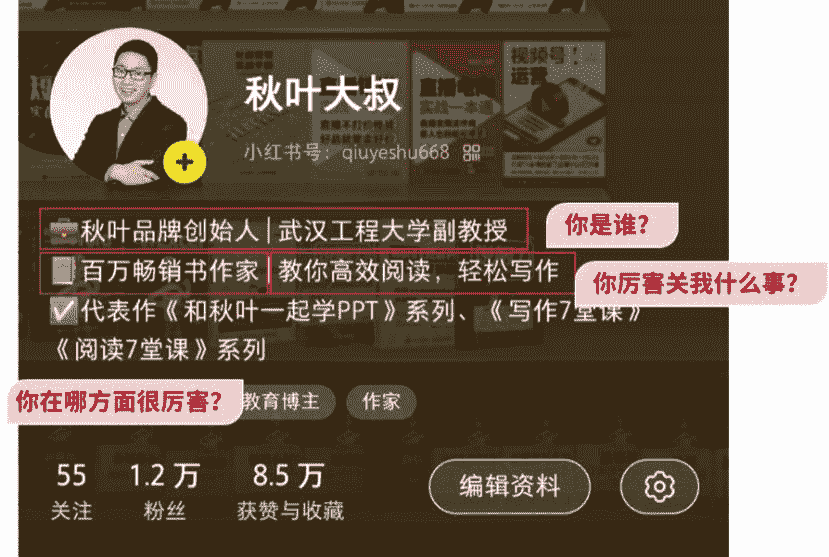
图2-33 账号简介展示页
1）你是谁？我们有哪些共同点？
2）你在哪方面很强？有何经验？
3）你的强项对我有什么用？能带来什么？
按阶段可分为三类模板：
① 兴趣达人简介
突出坚持与分享的真诚。如表2-9。
表2-9 简介模板要点及示例一
序号 要点 示例
1 你是谁 30岁以上职场妈妈
特点 业余读书写作，自我提升
2 账号内容 好书分享|成长干货|计划复盘
3 座右铭 家庭育儿
读书，世界就在眼前
不读书，眼前就是世界
不知道分享什么可让AI生成四字短语20个，例如早教启蒙、亲子游戏、营养辅食等。找不到座右铭也可让AI提供名人金句。
AI对话示例：关于育儿重要性，请给出5条不超过20字的名人金句作座右铭。
② 专业人士简介
需突出专业背书。例如国家注册营养师、健康管理师、企业主私人营养师，26年减脂私教经验，创业导师赋能超1000位营养师成长变现，提供饮食+生活方式+心理学减脂方案。
③ 产品商家简介
提前植入产品信息与卖点。如手机壳测评博主，解锁各种好看手机壳，原创设计禁止搬运，购买请私信。
简介可随成长迭代优化。

4. 背景图的加分项
背景图是天然广告位，可再次强化信任。小红书背景图展示页如图2-34所示。
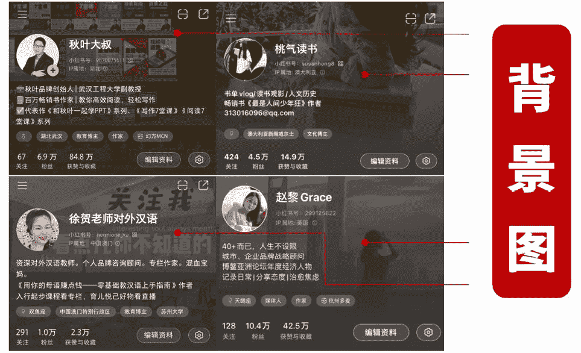
图2-34 背景图展示页
选择原则三点：
① 权威证明：放书、证书、名人合影等证明，辅助简介权威性。图2-35即用出版图书佐证作家身份。
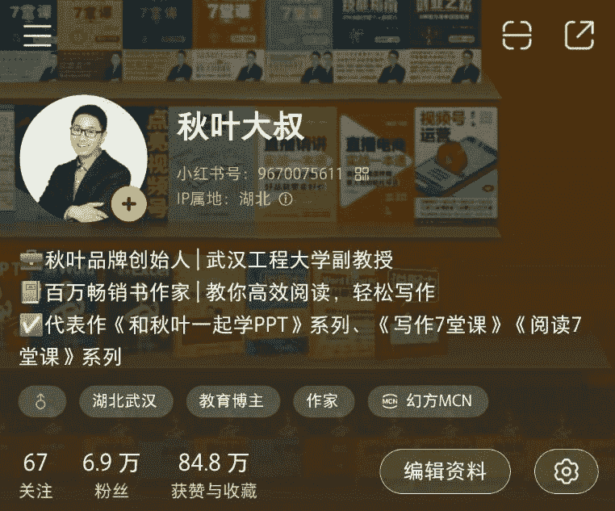
图2-35 账号背景图示例一
② 体现真实：选用符合定位风格的图片延续人设真实感。
③ 突出利益：有明确利益点时可做广告墙引导关注。图2-36将对外汉语课程置于背景图。

图2-36 账号背景图示例二
注意背景图需下拉才完全展示，上传后有暗色蒙版，文字需用亮色保证清晰。
完成昵称、头像、简介、背景图包装后，专属账号便成型，可开启内容运营。
小结
做好账号包装四要素，便能打造吸粉人设。
1. 昵称：专业方向或兴趣方向+昵称，简洁好记易传播。
2. 头像：人物头像的真实感无可替代。
3. 简介：用三个问题快速写出吸粉简介——你是谁？很厉害吗？对我有什么用？
4. 背景图：权威证明、体现真实、突出利益，助力用户进一步认识你。
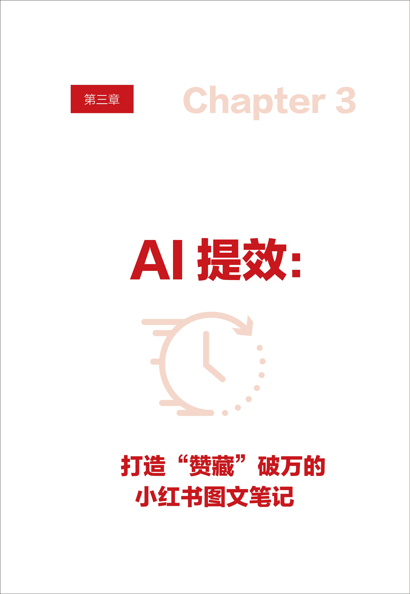

### 3.1
## 新手入门：三个让小红书起速的关键

停！别急着翻页！
在看书前，是不是还在纠结昵称和简介怎么突出人设？这其实舍本逐末了。
太多创作者前期把人设、性格、每个标点都反复推敲，结果别人早已发笔记涨粉，自己还在纠结用词，错失窗口期。

### 3.1.1
### 主页美化：提升记忆度

扫码观看讲解视频
仅靠简介几句话不足以让人记住，需要在每篇笔记中持续展示并强化人设。做到以下三点可提升主页诱惑力。
1. 发布有针对性的笔记
小红书不是杂货铺，不要什么都写。聚焦所选领域，用有价值内容吸引同好。例如热爱旅行，就用旅行故事或攻略吸引同好。每篇笔记围绕主题展开，展现独到见解。
2. 统一视觉体验
人对整齐美观的画面天生有好感。封面配色、字体、图片风格、布局若统一，会形成强记忆点，如图3-1所示。
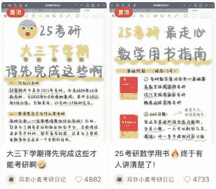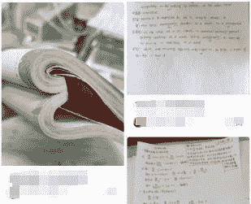
图3-1 错误视觉呈现与正确视觉呈现
想打造专业感就少用卡通字体和可爱元素；想做个人品牌就多真人出镜，让用户一眼联想到你。
3. 定期且有节奏地更新
用户会期待固定更新。把握早晨醒来、午休、下班后的黄金时段规律发布，保持账号活跃并建立期待感。每一次更新都是情感连接的机会，让用户爱上内容，也爱上账号背后真实的你。

### 3.1.2
### 解读算法：争取平台推荐

扫码观看讲解视频
遇到瓶颈期容易陷入“创作迷茫期”，相信流量玄学，用各种偏门技巧求曝光，如图3-2所示。
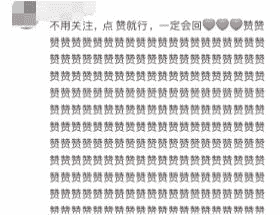
图3-2 小红书玄学式求流量
想获得推荐，需了解推荐机制关键点。
小红书流量主要来自三个渠道：发现页、关注页、搜索页，其中发现页是主力。发现页入口如图3-3所示。

图3-3 小红书发现页入口
发现页流量涉及小红书流量推荐机制。

新笔记冷启动：先测品再放量

平台对刚上线的笔记通常会先给一小批初始展现，用来检验内容质量，后续是否加推全看互动反馈。

举个例子，首批可能只推给200人，若其中100人打开并产生赞、藏、评等行为，系统就会判断内容有吸引力，再扩大到1000人验证，表现持续在线就会层层递增。

决定是否加流量的参考是什么？

在合规范围内，平台不会凭主观感觉分配流量，而是看发布后的互动表现——赞、藏、评等数据越好，受众认可度越高，进入下一轮池子的概率越大。

内部常被归纳为顾客费力指数CES的打分逻辑：赞1分、藏1分、评4分、转4分、关注8分，总分越高被推荐的几率越大。

因此笔记能否越推越广，核心看它是否贴合平台调性、是否真正打动用户。

平台更偏爱长期守规、能持续输出实用价值、口碑不错的创作者。

想做爆款，先合规吃透社区公约别踩线。其次要保持稳定更新，只有持续上新平台才有数据可判，用户才有触达机会。发布时避开纯个人流水账，要围绕用户真实关心的事、能解决问题的干货来做，用户才愿意互动。

2. 关注页流量

粉丝沉淀后阅读基数会变大。小红书关注页入口如图3-4所示。

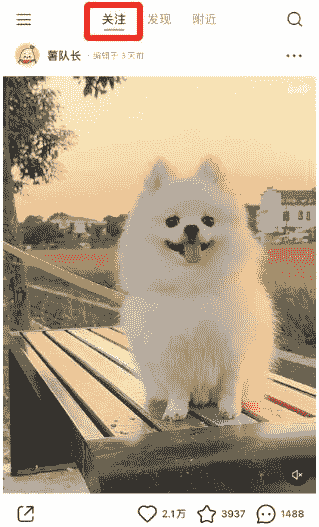

新内容发出后，系统会优先分发给自己的粉丝，或与粉丝标签相近的人群，冷启动更快，更容易形成热度。

所以要围绕同一类人群持续输出同频内容，才能稳住关注与互动。

3. 搜索页流量

当笔记关键词与用户的日常检索习惯吻合，也能带来额外自然曝光。小红书搜索页入口如图3-5所示。

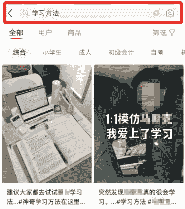

小红书已成为不少年轻人找解法和获取信息的重要阵地。据数据中台，每日至少有60%的用户会进行检索。

只要笔记里埋入了与主题相关的检索词，就有可能被有需求的人精准搜到。很多学员反馈三个月前的笔记仍在被搜。日常写笔记要养成植入关键词的习惯，多用用户常搜的词。

搞懂流量来源和分发逻辑后，再去打磨内容、围绕核心人群持续输出并植入易搜关键词，借势会轻松很多。

### 3.1.3

### 粉丝留存关键：笔记打磨五件事

笔记打磨5要素如图3-6所示。

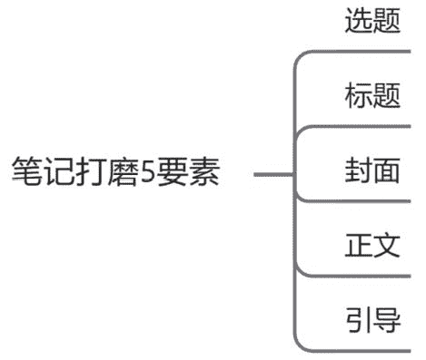

1. 选题：主动创造话题连接
选题不能停留在琐事层面，要挑用户真正感兴趣的话题。就像约会前准备话题，多提前了解用户最近在关注什么、喜欢聊什么，把这些融入笔记，更容易命中喜好。

2. 标题：第一眼决定要不要点
标题是点击的开关。要足够抓眼，让人一眼被吸引，同时表达清晰，让人明白内容要点，产生想点进去了解的冲动。

3. 封面：一见钟情的外表
封面相当于见面时的穿搭，品质高的封面更易脱颖而出。建议用高清吸睛图或图文结合形式，让笔记在信息流里更突出。

4. 正文：用干货赢得好感
无论是专业知识、生活技巧、探店攻略还是学习心得，都要在正文里给到实在的内容。表达方式像和朋友聊天一样自然有趣，用生活化比喻和具体案例帮助理解，段落分明让人读得顺学得会。

5. 引导：为下一次互动埋钩子
结尾主动加引导语，邀请留言、分享或关注，就像见面后的二次邀约，为持续吸引用户预留机会。

### 3.2

## 素人如何稳定出爆文：用AI搭建选题体系

你喜欢什么很重要，用户喜欢什么更重要。比如你是家长，希望孩子少玩手机，哪种说法更容易被接受？

1）“别玩手机了，对眼睛不好，去做点别的。”
2）“别玩手机了，你不是一直想去动物园吗？快收拾一下，我和你一起去，还有你最爱的长颈鹿。”
3）“别玩手机了，我数到三，把手机给我。”

第一种讲道理，正确但空泛，孩子难以下手；第二种连接兴趣，让孩子主动想去做；第三种是命令，容易引发逆反。

小红书用户也是如此。

秋叶小红书训练营反复提醒：不要把大道理、说教式知识点或硬广塞给用户。要筛选出用户喜欢、感兴趣且有价值的话题来赢得芳心，这才是选题的本质。

结合5000多位学员的笔记辅导经验，总结出3类能持续撬动赞藏评的好选题。

### 3.2.1

### 3类高互动选题，找到持续发力的方向

1. 需求型选题：围绕用户痛点
聚焦用户正在求解的问题，用户有需求，你才有机会出爆款。

例如宝妈相关可写：学习用品怎么买、孩子营养食谱、孩子情绪怎么处理等。

怎么找需求型选题：
用户画像：先明确目标用户的年龄、职业、性别、收入、使用习惯等，20岁和40岁的职场痛点不同，消费能力不同关心的点也不同。
网络检索：在百度等搜索引擎查找赛道关键词，筛选可做的方向。
评论区挖掘：看同赛道笔记的评论区，从用户提问里提炼方向。

常用话术引导：×××的技巧和方法、如何解决×××问题等。

2. 热点型选题：借势当下热度
也就是常说的蹭热点，大家在讨论什么就先考虑怎么结合，热点自带流量。

方向来源：
小红书创作中心—创作灵感
微博热搜、知乎热搜等自媒体平台热搜
今日热榜、百度热搜、新浪热榜等榜单网站

常用话术引导：最近×××很火/很出圈/大家都在讨论。

3. 搜集型选题：做信息整合
当用户解决某件事需要一堆资料时，汇总整理类内容就很有价值。例如学生考证时间表、职场人PPT模板网站合集、父母择校指南等。

怎么做：
合集汇总：把多源信息、资源、数据集中呈现。
排行榜：针对特定人群输出推荐榜单。
攻略测评：给场景提供操作步骤或对比评测。

常用话术引导：要解决这个问题/做某件事时，哪些信息能帮上忙。

其他可参考的话术：
为什么要做×××
如何避免×××
×××需要注意什么
想获得×××，一定要做/不要做×××

4. 结合选题类型，巧用AI，30天不重样

① 借助AI产出需求型方向。
AI指令范例
你是一名小红书博主，赛道为【输入赛道】，希望吸引【输入用户】人群，请你罗列30个常见需求或问题，方便后续撰写笔记。
AI输出如图3-7所示。

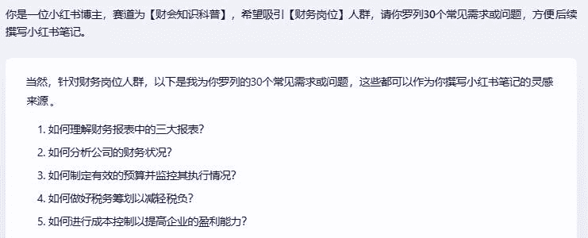

图3-7 用AI写需求型选题案例（部分截图）

② 借助AI产出热点型方向。
AI指令范例
你是一名小红书【输入赛道】博主，希望吸引【输入用户】人群，最近【输入热点】事件有很多人讨论，事件的基本情况是【输入热点概要】。请你结合该事件，罗列30个选题切入角度。
AI输出如图3-8所示。

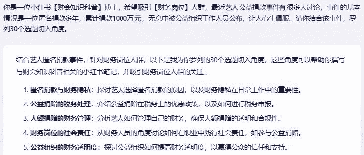

图3-8 用AI写热点型选题案例（部分截图）

③ 借助AI产出搜集型方向。
AI指令范例
你是一名小红书【输入赛道】博主，希望吸引【输入用户】人群，请你罗列30个合集汇总或攻略/测评的方向，仅需通过搜集相关信息即可完成笔记。
AI输出如图3-9所示。

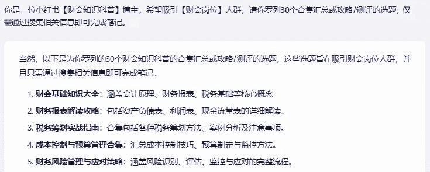

图3-9 用AI写搜集型选题案例（部分截图）

小结
写笔记始终记住：为用户而写。
需求型方向：用户需要什么就是最好的。
热点型方向：跟上火的，自带曝光。
搜集型方向：降低原创门槛，用信息差取胜。

### 3.2.2

### 用AIGC建灵感树：从1个选题裂变出N个

一名研一的学生在电脑前焦虑地写笔记。她已发了7篇考研经验，却说“能分享的都分享完了，不知道还能写什么”。

初入小红书时选题枯竭很常见。本书介绍一套可复用的拓展方法，把一个方向拆出N个角度。

她之前的7个方向：
考研怎么选专业？
考研上岸经历分享
考研备考时间节点一览
考研政治怎么备考？
考研英语怎么备考？
考研数学怎么备考？
考研专业课怎么备考？

1. 关键词拓展法

方向的核心是关键词，用现有关键词去延展，就能产生新思路。

① 在小红书检索核心关键词。例如搜“考研选专业”，能得到大量相关方向。如图3-10所示。

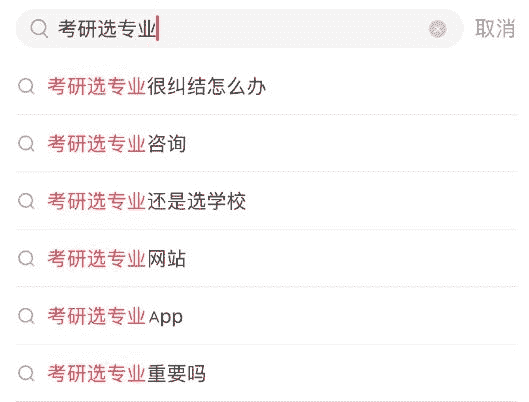

图3-10 在小红书搜索核心关键词截图

② 在读书平台检索核心关键词。通过微信读书、得到等查找相关书籍主题，一本书就是一个方向来源。例如搜“考研英语”。如图3-11所示。

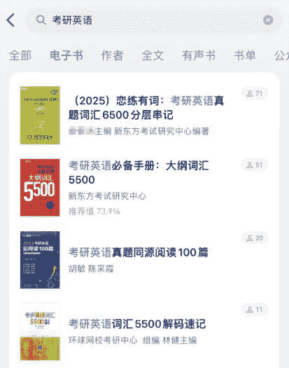

图3-11 在读书平台搜索核心关键词截图

基于核心词重新检索，灵感会源源不断。她当天就把原有的7个方向拆成了100个细分方向，并表示更新30篇完全没问题。

2. 爆款笔记拓展法

要多看别人怎么做的。找到同领域热门博主的爆文方向作为参考和学习对象。

一名在月子中心工作学员收集到的爆款方向有：
为什么就没人把怀孕1～40周的事讲明白？
已生！劝大家千万不要因为无知留下一身病
想顺产的姐妹保存下来！真的超快顺产，无侧切、无撕裂！
准妈妈们进产房前提前做好心理准备
囤货清单，怀孕后每月买什么，照清单抄，不浪费钱
终于有人把老婆怀孕，老公能做什么说清楚了！

在模仿基础上，要结合已有方向发现新痛点，例如顺产无撕裂可联想到妊娠纹消除、剖宫产恢复等，不断创新。

3. 连载式拓展法

像电视剧分集、小说分部一样，把擅长的方向做成系列。同一主题分多篇输出。

例如有学员做PPT技巧日更打卡，既省创作时间，又提升用户粘性，让粉丝形成定期回看的习惯。

4. AI拓展法
AI指令范例
你是一名小红书【输入赛道】博主，准备写一篇笔记，方向为【输入方向】，请你基于该方向，延伸拓展出30个细分新方向。
AI输出如图3-12所示。

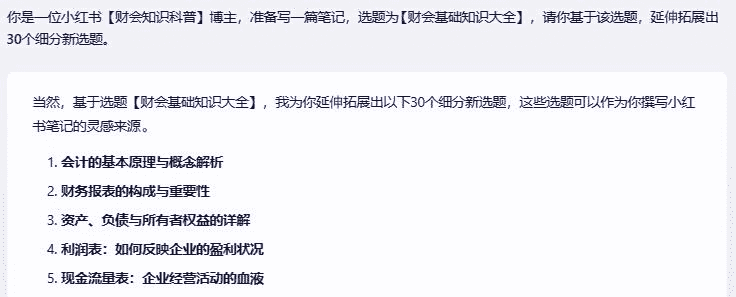

图3-12 AI生成的扩展选题（部分截图）

综合以上方法，你能搭建自己的专属灵感树，如图3-13所示。

图3-13 选题灵感树案例

小结
灵感枯竭时可以：
关键词拓展法：从现有词拆分出细分思路
爆款笔记拓展法：借鉴同行爆文，找灵感
连载式拓展法：同一好题，换案例、换故事持续用
AI拓展法：让AI帮你把一个方向裂变成多个细分方向

### 3.2.3

### 用选题库管理灵感，避免凭感觉创作

好记性不如好工具。把想到或收集到的方向灵感，以及已发布的笔记，统一用表格记录和整理。

好处是便于积累组合，也方便瓶颈期回看复盘。

1. 如何搭建爆款选题库

① 用电子表格记录。也可用飞书等在线文档。
② 把握核心字段。包括方向、关键词、正文标题、封面标题、点赞、收藏、评论、笔记原文链接等。
“爆款”选题库表格示例如表3-1所示。

表3-1 “爆款”选题库表格示例

③ 持续更新。搭建不难，难在持续填充，让库越来越丰厚。

2. 避免两个常见误区：方向必须先验证

学员常问：“我挑了两个方向写了，你帮我看看行不行？”追问“为什么选这两个？”答：“最近很火，感觉能爆。”

新手博主出现“我感觉”时就要警惕。

误区1：做号靠感觉，缺乏依据。过度依赖直觉，忽视真实用户需求。
误区2：盲目追热点。热点不匹配自身赛道、人群和业务，跟风不仅难爆，还会扰乱账号定位。

因此创作前先用小红书数据验证方向潜力。

① 有没有人写——看收录量。搜索关键词能看到收录笔记数，量越大说明热度越高，可参考的优质笔记越多。如图3-14所示。

图3-14 收录量

② 是否出爆款——看热度笔记。切到【最热】 tab，用点赞判断该话题是否引起共鸣。如图3-15所示。

图3-15 “爆款”笔记

③ 有没有人看——看话题浏览量。在发布页查看话题词的浏览量，浏览量越高说明平台曝光和用户关注度越高。如图3-16所示。

图3-16 浏览量

两个方向纠结时，记住先验证，再下笔。

小结
别靠记忆靠工具，选题库是博主必备神器。
所有未验证的方向都要慎重对待。

### 3.3

## 阅读量破10万的关键：靠AI打磨标题和封面

某学员是秋叶小红书训练营中的一位“80后”全职妈妈。

一位全职照料家庭的妈妈，日常不是围着孩子转就是忙家务。她开通小红书的初衷，是想跟同龄宝妈建立连接，拥有一个可以交流、接触外界的渠道，也能把育儿经验互相分享。

她对每一则笔记都很上心，坚持更了一段时间后才发现，写得很扎实的干货阅读常常不到百。她很失落，也在怀疑是表达有问题还是干货不够。

先把脉再开方。下面这张图能帮助你看清读者怎么刷内容。

给自己三秒，回想一下打开小红书时最先注意的是什么。

现实的浏览顺序多半是这样：

1）“这名字像在说我，这封面有点意思。”——标题与封面。
2）“博主分享的东西似乎有点料。”——正文内容。
3）“看看评论区大家想法是不是一样。”——评论区。
4）“去主页看看他还发了什么。”——主页。

用户阅读路径如图 3-17 所示。

图 3-17 小红书用户阅读路径

这就是真实的路径，标题和封面直接决定了是否会被点进。

所以笔记播放不理想，九成是包装没打动人。

这位学员的内容很真实，也有宝妈在评论互动，症结在呈现。

她的标题是：陪伴孩子的美好时光。感慨多于价值，核心点不突出。
封面是孩子背影加风景，光线差、画面模糊。

就像开在巷子深处的店，本就没人路过，最后成交自然更少。笔记同理，进来的人少，阅读自然上不去。

要改，就从标题包装和封面优化入手。

### 3.3.1
### 六类标题打法，快速提升点击

只看标题，同样是美食分享，哪条你更想点？

1）当然要记一下啦，又不是天天做饭。
2）已瘦 20 斤！想告诉全世界这个食谱！
3）每一天都有好好吃饭。
4）打工人菜谱，成本 5 元就能搞定的家常菜。

多数学员会选第二条和第四条。实际阅读分别是 1、16 万、0、14 万。可看出同类内容，用不同表述，点击效果天差地别。拆解平台爆款后，归纳出 6 种包装思路。

1. 对号入座式——标题里直接点名目标人群
把目标人群的称呼或特征写进标题，让人瞬间判断“跟我有关”。示例：
1）为何都市女性把运动健身当成救命稻草？
2）已生，告知没生的姐妹，待产包这些就够了！
3）手机摄影，新手怎样在下雨天随手拍大片？
想清楚用户是谁、怎么称呼，把标签放大，精准吸粉。
注意事项
1）避免贬低或歧视，称呼时杜绝负面用语或人身攻击，例如丑男/女。
2）不要涉及敏感称呼，内容要规避政治、宗教、种族等话题。

2. 数字量化式——用具体数据降低模糊感
用明确数字呈现结果或结论，让价值更清晰。示例：
1）8 条秋冬内搭分享！就爱这种显瘦的型。
2）梳头 828 天，我能申请成为你养发的动力吗？
3）7 天搞定 3 500 个基础词！
数据能让用户提前想象达成目标后的样子，产生向往。
注意事项
1）数字要与核心内容相关，例如健身类可放时间与效果数据。
2）数据要真实可信，不能脱离现实或夸大虚报。反例：7 天瘦 30 斤。

3. 强烈对比式——一眼看出差异
通过对比突出自身优势，句式多为××与××、比××还……、××前后对比。示例：
1）开油车与开电车对比。
2）入职前后对比。
3）比刷题还有用的影片，文理科知识全都有。
注意事项
对比前后反差要大，否则冲击力不足。例：已瘦 1.8 斤，减肥前后对比，用户很难产生好奇。

4. 权威背书式——借光环提升信任
以专家、机构、媒体作背书，增强观点可信度。句式多为某某专家推荐、某某机构研究报告显示、某某媒体报道等。示例：
TED 每日精读，停止与别人比较。
注意事项
1）引用的权威需有公信力与可靠性。
2）引用的观点或方法需经过证实验证。

5. 场景提问式——先造画面再提问
描绘具体情境抛问题，让用户代入思考。句式：当你遇到××问题时，你会怎么做？面对××情况，你是 A 还是 B？示例：
1）当你的挚爱突然离世，该如何应对？
2）当代打工人的现状，你有这些行为吗？
注意事项
1）问题最好覆盖多数人生活经验，避免陌生感。
2）语言口语化生活化，不要过于学术或复杂，以免在点击前就流失。

6. 损失预警式——用担忧感促点击
以担忧、紧迫或后果为切入点，让用户因害怕错过而点开。句式：千万别××，否则就×××；想避免×××？立即停止做×××。
注意事项
这类标题易带来高播放，但要避免过度制造恐慌或误导，信息须基于事实，不夸大。

AI 指令模板
你是一位经验丰富的小红书【输入赛道】博主，为了吸引【输入用户】人群，准备写一篇笔记，选题为【输入选题】。
请基于选题，提供 10 个吸睛标题，可参考以下标题公式。
对号入座式，明确表达某一类用户人群指向。
数字美化式，使用或强调具体数据。
强烈对比式，呈现某个事物或人物的强烈对比，展示差异。
场景提问式，描述具体场景，让用户产生代入感。
“恐惧警告”式，激发用户的担忧、恐惧情绪。

AI 生成的回答如图 3-18 所示。

图 3-18 用 AI 写标题案例（部分截图）

### 3.3.2
### 五类封面结构，让点击更稳

“老师，有些博主的封面我看着一般，为什么数据那么好？”有人带她看了对标账号后回问：“那你会点开吗？”“会，封面上一眼就能看出我在关心的话题。”

很多同学做封面时纠结好不好看，花大量时间，却没把内容点讲清楚，导致吸引不到精准粉丝，播放自然低。

重心放错了。封面在用户点进那一刻就完成使命。平台上封面是否精美、人物是否好看、风景是否惊艳并非关键，关键是封面传递的信息是否和用户相关、能否被理解。

封面核心任务是：把信息讲明白，让用户看懂。下面 5 类排版可参考。

1. 无字情绪图
不靠字靠图说话，对网感要求高，情绪通过画面直接传递，哪怕没有文字也能刺激点击，如图 3-19 所示。

图 3-19 无字冲击感图片案例

这类封面靠找图，图片要与标题契合，并放大情绪。

2. 文字叠加纯底色
拍不好照、找不到图时，就把文字当主角，如图 3-20 所示。

图 3-20 文字描述+纯底色案例

纯底色封面就是文字放大器。直接把笔记标题或关键词放大在封面上即可。

3. 文字叠加单图
想兼顾直观与信息，用一张主图加几个关键词，如图 3-21 所示。

图 3-21 文字描述+单张图片案例

适合有拍摄基础但不想让画面喧宾夺主的博主。用主题相关的图，叠加吸睛文字，信息统一。例如做家常菜笔记，放一张诱人的菜品图，加上“超简单家常菜”，用户立刻明白内容。

4. 无字多图拼接
觉得单图单调？试试拼接，如图 3-22 所示。挑几张有关联的图片拼在一起，用户一眼能猜到笔记在讲什么。图片最好同一主题或同一流程，保持风格统一与和谐感。

图 3-22 无字多图拼接案例

5. 文字叠加多图拼接
制作难度稍高，但爆款率也高，兼顾文字与多图优势，如图 3-23 所示。穿搭笔记可拼几张不同风格穿搭，再加“春季必备搭配”文字，让用户同时获得文字与视觉信息。用有代表性的图配简短有力文字，信息互补，利于点击。

图 3-23 文字描述+多图拼接案例

### 3.3.3
### AI 工具加速封面制作

下面介绍几个上手快的 AI 绘画与封面工具，帮你快速做出可用封面。

1. 想找符合要求的图片
通义万相：阿里云旗下 AI 作画服务，可按描述生成图片并支持风格迁移，封面个性化更强。
无界 AI：输入主题风格，数秒生成精美画作。
文心一格：百度 AI 艺术服务，输入关键词可生成多样创意图片。
三者都可通过文字生成图，例如输入“小猫”即可得到猫图。
以通义万相为例，生成一张小猫图片，如图 3-24 所示。

图 3-24 在 AI 服务输入文字生成的图片

2. 想要直接套用的封面模板
稿定设计：有 AI 作图功能，上传图和文字即可自动生成封面。
美图秀秀：模板素材丰富，支持一键美化与 AI 设计。
创客贴：模板素材多，支持多平台使用。
可画：页面友好，适合快速出图。
黄油相机：擅长图片编辑与社交滤镜贴纸，让封面更有趣。
以稿定设计为例，找到合适模板，如图 3-25 所示。

图 3-25 高赞封面与稿定设计的封面模板

模板拿来即用，花字、抠图、排版功能齐全，选一个顺手的即可。
使用技巧：
1）选择合适的模板：按赛道挑选风格匹配的模板。
2）调整图片大小：确保尺寸适配小红书封面，避免裁剪拉伸。常用尺寸如图 3-26 所示，推荐竖版。
封面（竖版）：1242px×1660px（3∶4）。
封面（方版）：1080px×1080px（1∶1）。
封面（横版）：2560px×1440px（16∶9）。

图 3-26 三种尺寸封面展示对比
3）添加个性文字：字体颜色要突出，新手建议遵循三色原则，避免杂乱。
4）利用抠图功能：把人物或产品抠出放在吸睛背景上，增强视觉冲击，适合做记忆点或带货。
5）预览并调整：发布前检查元素是否协调，文字图片无误。

### 3.4
### 单篇笔记如何带来千粉复盘

新手常掉进流量陷阱：为了播放发与目标人群无关的内容。

一位想做母婴博主、后期靠婴幼儿产品变现的同学，发了两则笔记。一则吐槽热播剧艺人恋爱，播放超 1 万；一则讲孩子吐奶处理，播放 100，评论多为新手妈妈。

我们问她，哪类内容更能带来曝光、粉丝与转化？她才明白，第二则虽然播放低，但粉丝精准。第一则蹭热点虽有播放，却与主营不符，难以转化，甚至是无效流量。

所以，什么样的笔记才能减少无效用户、提升转粉、留住精准粉丝？

### 3.4.1
### 三套写作框架，提升笔记转化

以下要点可帮助筛选有效用户，减少弯路。

1. 多用赛道相关词汇，方便目标用户精准搜索
用词越匹配，被搜索到的概率越大。
例如做儿童美食博主，写“孩子营养早餐做法”时，多植入以下词汇：
1）赛道词：美食、做饭。
2）人群词：孩子、宝宝、女儿、儿子、家长。
3）场景词：早饭、午餐、哄娃。
4）痛点词：挑食、消化不良。
5）好处词：营养、美味、补锌、健康。
植入五类词，有助平台分类，也更易被目标用户找到。

2. 除了情绪，更要提供实用价值，让用户停留
下面三种黄金模板可提升笔记价值感。

① 清单式写法——提供可收藏的信息
围绕选题搜集、筛选、归纳，形成清单，节省用户时间。
图 3-27 为学员的清单式笔记截图。

图 3-27 秋叶小红书训练营学员的清单式笔记截图

该笔记围绕“作家笔下的神级比喻句”，搜集筛选优质比喻句做清单，帮助用户获取写作素材。
AI 指令模板
请根据我提供的标题——（输入标题或选题），帮我写一篇小红书笔记，要求如下。
1. 开头引入：以标题相关的问题为引入，激起用户兴趣。
2. 主题介绍：解释本篇笔记的目的。
3. 具体内容：直接给出常用信息或句子，避免过多解释和铺垫，按逻辑顺序以清单列表形式展示内容，便于阅读与情绪激发。
4. 结尾：以祝福语作结，增加亲切感。

② 干货式写法——提供可执行方法
Why：为何要做、学、了解×××？
What：笔记分享的×××具体含义或解释是什么？
How：想做到×××，需要怎样做？
如图 3-28 所示为干货式笔记截图。该笔记使用 Why What How 结构，持续输出干货，吸引精准粉丝。
Why：为何要学 PPT 5 页纸？新手做 PPT 没头绪，需要学习规划！
What：PPT 5 页纸是什么？是制作 PPT 的必备流程与素材。
How：怎么用 5 页纸呈现制作技巧？

图 3-28 干货式笔记截图
AI 指令模板
请你根据我提供的标题——（输入标题或选题），帮我写一篇小红书笔记，要求如下。
1. Why：强调标题意义，为何值得做或了解。
2. What：标题相关的具体环节、解释说明，流程是什么。
3. How：实现标题相关目标，具体需要怎样做。

③ 情绪式写法（戳痛点—给方案—做呼吁）——分享经验
戳痛点：回顾用户遇到的问题，引发共情。
给方案：在类似情况下分享经验与解决方案。
做呼吁：鼓励用户采取行动。
图 3-29 为情绪式笔记截图，第一视角写情绪，既有温度又建立信任。

图 3-29 情绪式笔记截图

情绪抓手：忙碌一天回头看，却发现没完成一件关键的事，整个人焦虑烦躁。
解决路径：盘点 8 个能快速处理琐事的在线工具，学习与工作场景均可使用。
传播动作：转给身边的人，一起保持成长节奏。

**AI 指令模板**

请依据我给出的标题——【输入标题或选题】，为我撰写一篇小红书笔记，细则如下。

1. 戳中痛点：结合标题对应的受众真实使用场景，点出亟待解决的困扰。
2. 给出解法：针对痛点提供可落地的操作步骤或具体措施。
3. 发出号召：引导读者产生行动或表达态度。

3. 必须主动规划结尾及评论区，以提升互动与涨粉效率

在一次直播答疑中，有学员提出：“老师，我这条笔记数据还不错，收藏超过两千，为什么大家就是不留言、不关注呢？”

内容已有干货，也触达了精准人群，认可度不低，可浏览很难转化为互动，收藏也难转化为关注，怎么办？

① 主动抛话题，让用户能接话。
正文结束后留一个与本篇相关的提问或讨论点，降低接话门槛。
例：
● 想聊聊××相关的问题，欢迎一起探讨。
● 想找一起做××的伙伴，举手我就拉你。

② 主动放预告，让用户产生期待。
可预告下期内容；也可附上账号简介，介绍定位和价值。
例：
● 内容对你有用就点个小心心，下期继续分享实操干货。
● 大家好，我是××，长期分享××心得/感悟/干货，感谢相遇。

③ 主动给彩蛋，引导用户响应。
可随机回复、发放资料包。
例：
● 回复本号私信，每条都会回。
● 今日开放×个轻咨询名额，有××困惑可以直接告诉我。

此次答疑就按这三条思路，结合学员赛道拆解了笔记的引导话术。两周后反馈，笔记的涨粉效率较之前提升约三倍。

**小结**

碰到偶发爆款要记住：没有转化的流量只是虚火。

合格的小红书笔记要可复制、可吸粉。始终围绕有效用户需求展开，关键有三点。
1. 善用赛道关键词。
2. 输出具备价值感的信息。
3. 主动设计结尾与评论区。

务必借助 AI 写作工具提升笔记效率。

### 3.4.2

### 开头结尾精修：10 组新手可直接套用的表达

用户刷完就走，不点赞不收藏，开头和收尾各占一半责任。

笔记常出现的两类问题。

1）选题和标题都很抓人，封面也很吸睛，但第一句写崩了，直接失效。
比如这句开头：SEM 不是一个固定模型，比如 XGB，而是模型框架。
作为首句堆砌专业名词不解释，阅读门槛高，用户还没看到价值就划走了。

2）干货很足，讲完直接结束，用户无反馈，博主热情也被消耗。
在秋叶小红书训练营，有位电商专业的学员每天更新，专业度高，点赞收藏过千，评论却个位数。她很困惑。老师看完后指出：“你的结尾几乎没有互动引导。日常聊天也要留个话头，你的笔记直接以结论收尾，用户怎么评论？”

以下为训练营总结的 5 种开篇与 5 种收尾写法，供直接使用。

1. 开篇写法：抓住开头，让用户继续看下去

① 直奔主题。
把整篇笔记的核心价值浓缩成一句话置于开头，让用户 3 秒内明白能得到什么。示例：
总有新手不知道如何开始××，其实并不难，今天整理××，从××到××全覆盖，快收藏。
给××人群汇总了我的××经验，都是长期验证有效的技巧。
今天分享一个××的经验/技巧/网站……

② 痛点共鸣。
将用户焦虑、烦恼、恐惧的问题具象化，促成代入。示例：
还在为××发愁？这篇给你支招！
别再忍受××的痛苦了，这些方法能帮上忙！
告别××的烦恼，这些技巧/方法很实用！

③ 金句切入。
借用与内容相关度高的名言、网络热词、影视综艺金句点题，引发共鸣。示例：
“×××。”——说出了多少人的心声！
“×××。”——点出了问题的关键！
“×××。”——曾提出过××观点……

④ 场景描写。
用细腻的画面感描述具体情境，调动情绪。示例：
拍照细节——走在街头看到别人穿搭时尚拍照打卡，是不是很羡慕？别急，我教你几个小技巧也能拍出好看照片！
学车细节——10 秒倒车入库小诀窍，新手司机必备。

⑤ 成果前置。
用已取得的效果建立信任。示例：
短短×个月，从××到××……
短短三个月，从月薪 5 000 元到 1.2 万元……

2. 收尾写法：巧妙收尾，引导互动

① 发布预告。
让用户期待下一条。例：“下期我会继续拆解××的玩法，别忘了来看！”

② 设置悬念。
留下未解问题激发好奇。例：“那么××的真相是什么？留下你的看法，今晚 7 点揭晓，稍后见。”

③ 使用简介。
简要介绍账号定位和能提供的价值，吸引关注。

④ 鼓励提问。
邀请用户提问或分享经验。例：“你在××上遇到过什么问题？怎么处理的？欢迎交流学习！”“新手朋友有什么想问的吗？我知无不言。”

⑤ 提供好处。
用资源或帮助提升参与感。例：“以上是××的一些心里话，有××需求的小伙伴可以找我；想了解如何××，直接回复××，有问必答。”

写完笔记后，可结合以上写法，用 AI 辅助润色。

**AI 指令模板**

第一问：这是一篇小红书笔记，请你先吸收理解，笔记内容如下：【输入笔记内容】。
第二问：为了提升吸引力，请基于笔记撰写 5 个不同版本的开篇语，写法如下。
开门见山：用一句话概括核心内容并展示价值。
痛点结合：结合用户想解决的问题。
金句点题：围绕相关名人名言展开。
情景描述：描述画面细节，增强代入感。
成果前置：以笔记中的成绩和效果作为切入点。
小作业：结尾语的 AI 指令该怎么写？

### 3.4.3

### AI 一键生成：小红书 4 类常用内容的指令

小红书常见的 4 类笔记是种草笔记、知识教程笔记、好物测评笔记、书评/影评笔记，下面分享可直接用的指令，让智能工具产出初稿。

1. 小红书“种草”笔记 AI 指令模板

你是一位小红书带货高手，请基于产品【输入产品名称】的卖点【输入产品特点/优势】，为【输入目标人群】写一篇种草笔记，引导用户通过【输入下单方式】沟通或购买。

内容结构：
1）开篇引入：场景设定+情感连接。
2）产品介绍：产品名+解决的问题/提供价值。
3）亲身体验：使用感受。
4）效果对比：使用前后的状态及反馈。
5）行动号召：说明购买方式。
创作要点：真诚透明，避免夸张；有细节描述；多用表情和分行；文末加标签 #标签。

**AI 提问案例**
你是一位小红书带货高手，请基于产品【秋叶秒懂 AI 系列图书】的卖点【涵盖 3 本书，秒懂 AI 提问、秒懂 AI 写作、秒懂 AI 设计】，为【对 AI 感兴趣】人群写一篇种草笔记，引导用户通过【笔记左下方店铺链接】购买。
内容结构同上，创作要点同上。
模型自动完成的范例见图 3-30。

图 3-30 AI 产出小红书“种草”笔记案例

2. 小红书知识教程笔记 AI 指令模板

你是一位【输入赛道】领域的资深专家，头衔/成就是【输入成就】，现在围绕【输入知识点】的问题，以文字教程形式写一篇小红书笔记，帮助粉丝。方法/步骤包含：第一点【输入知识点】；第二点【输入知识点】；第三点【输入知识点】……

内容结构：
1）问候+自我介绍，建立信任。
2）开头引入，点明主题和能解决的问题。
3）具体做法，给出知识点、方法并配案例。
4）结尾引导，邀请用户留下难题，文末加标签 #标签。
创作要点：体现专业性；深入浅出，术语口语化；用表情提升可读性。

**AI 提问案例**
你是一位【家庭教育】领域资深专家，头衔/成就是【某市知名师范大学教授】，现在围绕【孩子青春期叛逆】写一篇文字教程笔记，帮助粉丝。方法包含：第一点【认识孩子青春期生理心理】；第二点【制定符合孩子特点的身心发展规划】；第三点【以身作则，多鼓励少打压】……
内容结构同上，创作要点同上。
模型自动完成的范例见图 3-31。

图 3-31 AI 产出小红书知识教程笔记案例

3. 小红书好物测评笔记 AI 指令模板

你是一位专门做【输入产品类型】测评的博主，需要写一篇笔记分享使用体验，现在测评 x 款产品，产品 1 是【输入产品名】，优点是【输入体验感受】，缺点是【输入体验感受】；产品 2 是【输入产品名】，优点是【输入体验感受】，缺点是【输入体验感受】……

内容结构：
1）开头引入，第一段点明主题和价值点。
2）正文测评，有红黑榜分类，说明优缺点、效果、真实体验、注意事项，并给出推荐场景及理由。
3）结尾引导，邀请互动、看往期或关注更新，文末加标签 #标签。
创作要点：客观真实，避免偏激；细节丰富提升可信度；多用表情提升阅读感。

**AI 提问案例**
你是一位专门做【厨具】测评的博主，需要写一篇笔记分享体验，现在测评 2 款产品，产品 1 是【空气炸锅】，优点是【健康少油、操作简便】，缺点是【烹饪时间长、容量有限】；产品 2 是【家用烤箱】，优点是【功能多样、温度控制精确】，缺点是【占地面积大】……
内容结构同上，创作要点同上。
模型自动完成的范例见图 3-32。

图 3-32 AI 产出小红书好物测评笔记案例

4. 小红书书评/影评笔记 AI 指令模板

你是一位小红书博主，请写一篇关于【输入图书名/电影名】的点评笔记，基础信息是：【输入图书-作者/出版社/出版日期】/【输入电影-导演/主演/上映日期】，主要内容为【输入概要】，推荐原因是【输入优点】，印象深刻的是【输入金句】。

内容结构：
1）开头引入，展示标题和信息。
2）引言表达情感，说明作品对自己的影响。
3）内容概述，介绍作品内容。
4）体验评价，说明推荐理由。
5）细节解读，深入某篇章或情节，增加真实感。
6）推荐人群，说明适合谁。
7）收尾总结，鼓励阅读或观看。
创作要点：情绪饱满、内容真实；多用表情提升趣味；文末加标签 #标签。

**AI 提问案例**
你是一位小红书博主，请写一篇关于【社群营销实战手册：从社群运营到社群经济】的点评笔记，图书作者秋叶、邻三月、秦阳，人民邮电出版社 2018 年出版。主要内容为【解读社群玩法，提供干货和营销案例】，推荐原因是【很细致】，印象深刻的是【有一节讲小社群和大社群的“坑”，自己几乎全踩过】。
内容结构同上，创作要点同上。
模型自动完成的范例见图 3-33。

图 3-33 AI 产出小红书书评/影评笔记案例

始终记住：智能工具是提效手段，作为博主持续输出有价值的优质笔记，才是涨粉和变现的基础。

### 4.1

## 视频脚本策划：高质量脚本创作流程，即学即用

找到选题后，下一步就是写脚本。对想拍视频的博主而言，脚本相当于视频的剧本。很多新手没有写脚本习惯，想到哪拍到哪，导致拍摄混乱、内容不聚焦，费时费力却没流量。提前写好脚本能有效规避这些问题。

### 4.1.1

### 一目了然：小红书视频脚本七大构成

脚本是视频创作的关键，但新手常感不会写、质量不高，难以稳定产出高质量脚本。

脚本的核心价值有两点：

① 提升拍摄效率。
脚本是拍摄框架，有了框架才清楚前期准备、场景搭建、拍摄执行和后期剪辑，大方向明确、步骤具体，像写文章先搭框架再填充，思路更清晰。

② 保证拍摄质量。
要想内容有流量和转化，每一步都要精细化，需考虑拍摄背景、出场人物、道具、台词和配乐、拍摄剪辑技巧、场景转换等。

一般脚本包含 7 个要素：

① 拍摄场景。
根据内容选场景。如读书博主选书房，美食选厨房，旅行选目的地。

② 镜头镜号。
给每个镜头编号，记录拍摄顺序，便于后期剪辑。

③ 画面内容。
视频要表达的场景，具体拍什么物品、人物出镜，用文字呈现。

④ 景别。
远景、全景、中景、近景、特写等，交替使用让画面更丰富。

⑤ 台词。
人物的口播或画外音。

⑥ 拍摄时长。
每个单镜头的时长及整体时长。

⑦ 背景音乐。
合适的音乐、音效或配音能起到画龙点睛作用。

**小结**

无论新手还是成熟博主，拍视频前都要写好脚本，创作会更顺手。

视频脚本七要素：
1. 拍摄场景。
2. 镜头镜号。
3. 画面内容。
4. 景别。
5. 台词。
6. 拍摄时长。
7. 背景音乐。
从今天起养成写脚本的习惯吧！

### 4.1.2

### 十分钟完成脚本：提纲式SOP操作清单

上一节讲了脚本七要素，本节讲小红书视频脚本怎么写。

常见的脚本类型有三种：提纲脚本、分镜头脚本、文学脚本。

① 提纲脚本。
可理解为提纲式的脚本，常用于日常 Vlog、旅游讲解、探店、美食制作等。重点是展示谁在什么场景做了什么事，需把流程写成提纲，按步骤执行。

策划提纲脚本有 4 步：

第一步，确定主题。
视频要有明确主题，开头一句话点清。比如美食探店可说：“今天带大家打卡一家很赞的××小吃”，测评类可说：“今天是一期面膜/眉笔的开箱测评”。

第二步，情景预估。
拍摄中可能出现意外，提前列出可能情况及应对方案，确保不卡进度。

第三步，信息整理。
新手常因准备不足卡壳，要提前收集场景知识。比如美妆测评前要熟悉成分，避免说错。

第四步，确定方案。
完成前三步后确定最终方案，包括拍摄时间线、拍摄场景、话术。

拍摄顺序大致就是先拍哪一段、后拍哪一段，把整个流程按时间轴排列清楚；场景确定则是要先想好画面在哪呈现，像做美食就去厨房，带大家探店就进餐厅；对话与文案也得提前准备好，每一步镜头要说哪些话、配什么文字，都要事先写准。

**②分镜头脚本。**

比起提纲式脚本，分镜头要细很多。一旦镜头数量上来，分镜头几乎是必备的。它其实就是把整支视频拆解成一个个连续的画面，用文字把镜头串起来，相等于一份可执行的制作说明书。

这类脚本的细节覆盖面很广，前文提到的脚本七大要素基本都会出现，景别的选用、拍摄手法、单个镜头时长、画面具体内容、配乐音效、字幕呈现等。分镜头不仅要保留完整的故事线，还要把情节转译成镜头语言。每一个镜头里都要写明画面怎么拍、镜头如何运动、需要什么声音和字幕等制作信息。分镜头脚本示例如图 4-1 所示。

图 4-1 分镜头脚本示例

**③文学脚本。**

文学脚本的核心是把文字故事或小说搬到画面上的一种基础型脚本。

它用镜头语言来讲故事，包含场景设定、人物、台词、动作等。相较于分镜头，文学脚本更粗线条，适合剧情要求不高的教学、科普分享等内容。

做文学脚本的关键在于对拍摄要求的界定，通常会先把拍摄思路列出来，明确人物和道具要完成的任务、要说的台词、使用的镜头发和整体时长，示例如图 4-2 所示。

图 4-2 文学脚本示例

把三种脚本类型过完之后，再来梳理一份脚本策划表的思路。动笔之前，先把这支视频想拍成什么样搞清楚。

**①明确视频定位。**

账号的垂类要先锁定，比如美妆、护肤、穿搭、母婴、育儿、教育、读书、美食等，策划前一定要确保内容符合定位。平台和用户都更偏爱垂直的账号，内容杂乱、浅尝辄止很难出圈，坚持一个赛道才有突围机会。

**②明确视频主题。**

大赛道确定后，要进一步细化拍摄主题，主题不清晰就无法开拍。以美食账号为例，可以细分为通勤家常菜、减脂餐、儿童营养餐等具体方向。

**③明确视频拍摄时间和时长。**

团队拍摄要提前排期，方便分工。时长也要提前定，是三分钟还是五分钟，时长不同内容密度也不同。一般能说清的前提下，越短完播率越高。

**④明确视频拍摄地点。**

要先想好是室外还是室内拍摄，具体到室外是街头还是广场，室内是书房、厨房还是客厅。室外白天和晚上的光线条件差别很大，室内影响相对小，地点先定好才能保证进度。

**⑤参考同类优秀视频。**

新手没思路时，可以多看同领域成熟博主的作品，借鉴他们的场景选择、画面构图、景别运用、台词设计和背景音乐，从而学习拍摄手法和技巧。

**⑥选择背景音乐。**

配乐是视频的重要构成，很多爆款都靠音乐加持。不同风格配不同音乐，例如中国风内容配节奏舒缓的古风音乐，运动类内容就选节奏感强的曲目，也可多留意爆款视频的音乐使用习惯。

下面以篮球场的运动场景为例，演示一份完整的脚本撰写流程，如表 4-1 所示。

表 4-1 脚本创作案例

表 4-1 就是一个简单的全流程脚本范例，写脚本并不难，关键是多练习。

**小结**

短视频脚本主要有三种形态：提纲脚本、分镜头脚本、文学脚本。

写作前的准备思路：

1. 明确视频定位。
2. 明确视频主题。
3. 明确视频拍摄时间和时长。
4. 明确视频拍摄地点。
5. 参考同类优秀视频。
6. 选择背景音乐。

### **4.1.3**
### **下班后也能完成的分镜脚本实操**

前文讲了脚本七要素和策划表，很多人仍会“一看就会，一做就废”，其实可以借助 AI 工具。本节用一个真实案例，展示如何借助 AI 生成分镜头脚本。

需求包括字数、主题、情节包含项、对白和情绪表达等，如图 4-3 所示。

图 4-3 向 AI 提出具体需求

AI 的初次输出如图 4-4 所示。

图 4-4 AI 的答复

框架有了，但细节还不够，这时可以继续追加指令，如图 4-5 所示。

图 4-5 继续给 AI 下达指令

AI 随后继续完善，最终结果如图 4-6 所示。

图 4-6 AI 最终答复

再把脚本润色，要求 AI 用表格呈现，最终结果如表 4-2 所示。

表 4-2 润色后的脚本

没想到 AI 也能写脚本吧。除了直接生成，还可以把素材喂给 AI 总结再二次创作，这样质量更高、更贴合需求。

### **4.2**
## **零基础也能拍出万粉博主同款高清片**
秋叶小红书训练营里常有学员问，别人视频为什么那么清晰，是不是用了专业设备、单反？其实很多高质量视频都是手机拍的，关键是方法掌握不到位。本节就讲怎么用手机做出高质感画面。

### **4.2.1**
### **一机一架就能搞定前期准备**

工欲善其事必先利其器，拍摄前要把设备、收音、补光、防抖等准备好。

对新手而言，手机是最合适的入门设备。专业设备功能多但学习成本高、笨重且价格昂贵，手机便携易上手，且现有主流机型已能满足口播和日常场景的拍摄需求。

想用手机拍出好片，需要解决收音、稳定性和光线这几个核心问题。

**1. 收音不清晰？4 种办法提升音质**

户外拍摄环境嘈杂，手机自带收音容易嘈杂不清。提升音质的方法有：

**①用带麦克风的耳机收音。**

多数耳机自带麦克风，可直接录音。户外大风时可在麦克风上裹一层纸巾降噪。

图 4-7 带麦克风的耳机

**②用插线麦克风。**

插线麦克风可直接插入手机录音，也能用领夹固定在衣领上。

图 4-8 插线麦克风

**③用无线麦克风。**

插线会限制活动且易有听诊器效应，运动场景更适合无线麦克风。发射端别在身上，接收端连手机，就能远距离收音。

图 4-9 无线麦克风

**④后期单独配音。**

若暂时没有设备，可先拍画面，后期在安静室内配音。录音时手机麦克风与下巴平齐可减少喷麦。缺点是音画可能不同步，适合节奏慢的内容。

**2. 一个人拍？手机支架是好帮手**

独自拍摄时，可调节高度角度的手机支架能解放双手。如图 4-10 所示。

拍摄大范围活动画面时支架调高至胸下腰上，特写时调低并轻微下倾，能突出主体并呈现细节。灵活改变高度与角度，后期剪辑更有层次。

图 4-10 可以调节高度的手机支架

**3. 画面偏暗？补光技巧要收好**

光线决定画面质感。室内、阴天、夜晚光线不足时需补光，即使光足时适当补光也能让色彩更饱满，美食拍出来更有食欲。

**①环形补光灯。**

新手友好，价格亲民，正面打光即可。可配合顶灯在斜后方制造轮廓光。

图 4-11 环形补光灯

**②平板补光灯。**

桌面拍摄且需手持产品介绍时，可左右各放一盏平板灯配合主光，形成三点布光，画面柔和明亮。

图 4-12 平板补光灯

**③反光板。**

利用自然光反射补光，白天效果好。逆光人像时可用反光板提亮面部。

图 4-13 反光板

**4. 运动拍摄抖动？3 招稳住画面**

运动中抖动会拉低质感，可这样做：

**①打开手机防抖。**

绝大多数手机录像模式内置防抖，打开即可，部分机型可切换防抖等级。

图 4-14 打开视频防抖功能

**②使用手持稳定器。**

大幅运动时手机自带防抖不够，手持稳定器通过陀螺仪和马达实时校准，能拍出流畅运镜。

图 4-15 手持稳定器

**③优化握持姿势。**

双手握持时采用稳定姿势，减少抖动幅度。

图 4-16 科学的拍摄姿势让画面更稳

**小结**

用手机拍出高质量视频的关键：

1. 用麦克风解决收音问题。
2. 用手机支架解决单人拍摄问题。
3. 用补光灯解决画面过暗问题。
4. 用防抖、稳定器和正确姿势解决抖动问题。

### **4.2.2**
### **善用手机隐藏功能拍出创意大片**
手机拍摄普及，但多数人只会点一下快门，没用上隐藏功能。现在手机影像能力很强，下面几个实用功能值得掌握。

**1. 画面不够清？调整拍摄规格**

很多手机支持 4K 录制，只是未开启。以 iPhone 为例，可在设置中选择 720p 到 4K 的不同规格，选高规格输出画面更细腻。

图 4-17 手机调整拍摄参数页面

**2. 色彩不够好？打开 HDR**

HDR 高动态范围可在快门瞬间拍下三张不同曝光照片合成，保留亮部暗部细节，色彩更鲜艳、有质感。视频 HDR 也能平衡高光与阴影。

图 4-18 开启 HDR 功能页面

**3. 感觉功能单一？进入专业模式**

多数手机提供专业模式或第三方 App，可手动调节曝光补偿、ISO、白平衡、对焦等参数，掌控每个细节。

图 4-19 手机的专业模式

**4. 用手机拍炫酷特效镜头**

手机可轻松实现延时摄影、慢动作等效果，拍摄键附近即可找到。延时能表现时间流逝，慢动作可定格精彩瞬间，原本需专业设备才能实现的效果，现在一台手机即可完成，如手机拍摄的星轨效果。

▲图 4-20 手机延时摄影页面

图 4-21 手机慢动作摄影页面

图 4-22 手机拍出的星轨效果

**小结**

如何解锁隐藏功能拍大片：

1. 通过调整视频拍摄规格提升画质。

2. 打开 HDR 让画面更通透，质感直接拉满。
3. 启用相机专业模式，曝光白平衡随心调，拍摄更有掌控感。
4. 借助手机自带的特效功能，分分钟拍出吸睛的酷炫画面。

### **4.2.3**

### **9个构图诀窍，画面立马高级**
很多刚入坑的新手博主都有同样的困惑：器材、场景都一样，为什么别人的作品看起来高级有质感，自己拍的却总觉得平平、没舒服感。除了前面说的拍摄技巧，决定成片好坏的另一个关键就是构图。

拍风景也好拍人也罢，构图的高低直接影响视觉感受。学会构图思路，视频画面会更精致、更有层次感。下面这9种常用构图方式，新手也能直接套用。

**1. 中心构图法**
主体就放在画面正中央，这是最直观也最百搭的布局。画面稳定、主体突出，很容易抓住眼球。拍摄时别忘了挑背景，太杂或对比弱会显得呆板，建议用简洁干净的背景，或与主体形成强烈反差的背景，重点更清晰，如图 4-23 所示。

图 4-23 中心构图法

**2. 九宫格构图法**
也叫井字构图，是黄金分割的简化版。把画面切成九等分，会出现四条线的四个交点，也就是视觉焦点。在这四个交点里放主角，画面会更协调舒服，如图 4-24 所示。

图 4-24 九宫格构图法

一般建议将主体落在其中一个交点上，这样取景更有张力，如图 4-25 所示。

图 4-25 九宫格构图法

**3. 对称式构图法**
把画面左右或上下一分为二，形成镜像关系。整体感平衡稳重，很有仪式感。古建筑、宫殿这类题材用对称拍特别显庄重，如图 4-26 所示；水面倒影与实景结合，也能营造宁静的对称美。

图 4-26 对称式构图法

**4. 水平线构图法**
沿着一条水平的线来划分画面主体，能传达平静、开阔的氛围。常见于湖面、海面、草原、日出日落等宽阔场景，能够很好地表现空间的延展感，如图 4-27 所示。

图 4-27 水平线构图法

**5. 对角线构图法**
把主体安排在画面的对角线上，画面会产生很强的动势。不仅有纵深感，还能带出延伸与运动的节奏感，适合表现行进、奔跑等状态，如图 4-28 所示。

图 4-28 对角线构图法

**6. 引导线构图法**
利用场景里天然的线条做视觉引线，把观众的视线牵引到主体上。引导线通常作为前景存在，能增加画面纵深，同时明确视觉落点。道路、桥梁、建筑边线都是很好的引导线素材，如图 4-29 所示。

图 4-29 引导线构图法

**7. 框架式构图法**
找一个合适的框来框住主体，比如树枝、拱门、窗框。前景的框架能把视线聚焦到框内，突出主体，同时让主体与环境融合，视觉冲击更强，如图 4-30 所示。

**8. 前景构图法**
前景就是离镜头最近的那层景物。用近景物适度遮挡画面的一部分，能表现虚实、远近关系，让画面更有空间感。

图 4-30 框架式构图法

前景构图最直接的作用是提升形式感，叠加层次，让画面更丰富饱满，如图 4-31 所示。

图 4-31 前景构图法

**9. 留白构图法**
给画面留出大面积的空白空间，留白不一定是纯色，可以是天空、草地、大海等简洁环境。恰到好处的留白能提升意境，让主体更突出，如图 4-32 所示。

图 4-32 留白构图法

内行看构图，外行看热闹。掌握以上思路后，拍摄前会更注意主体位置和场景选择，产出的画面自然更上一个档次。

**小结**
熟悉 9 种实用构图。
1. 中心构图法。
2. 九宫格构图法。
3. 对称式构图法。
4. 水平线构图法。
5. 对角线构图法。
6. 引导线构图法。
7. 框架式构图法。
8. 前景构图法。
9. 留白构图法。

## **4.3**

## **低成本剪辑：转场字幕配乐调色全搞定**

### **4.3.1**

### **新手友好剪辑神器推荐**
前面讲了拍摄，这边说说后期。短视频时代，剪辑同样决定作品成败。如果你还在挑工具，这三款手机端就能上手、功能扎实的软件值得先试。

**1. 剪映**
上手快、学习成本低，素材库海量，绝大部分功能免费，新手很友好。剪映操作界面如图 4-33 所示。

图 4-33 剪映操作页面

它既有手机版也有电脑版，能覆盖创作者大部分需求。除了视频音频素材，还内置大量现成模板，“剪同款”里有精选、AI玩法、日常碎片、卡点等分类，导入素材就能快速出片，如图 4-34 所示。

图 4-34 剪映里面的模板

上传的模板被他人使用还能获得分成。此外还有系统化的新手教程，涵盖拍摄剪辑技巧，对小白非常贴心，如图 4-35 所示。

图 4-35 剪映里面的新手教程

**2. 快影**
快影的基础剪辑能力与剪映相近。早期以自动字幕识别出圈，如今已成标配。它的画中画、变速、分镜、文字成视频功能都很实用，做特效和图文转化很顺手。

快影还很重视 AI，接入了不少 AIGC 创作玩法，比如 AI 变装、AI小说转漫画、AI照相馆、AI动漫、AI瞬息宇宙等，是 AI 功能比较全的剪辑 App，如图 4-37 所示。

▲图 4-36 快影页面

图 4-37 快影 AIGC 功能

**3. 必剪**
由哔哩哔哩推出的免费剪辑工具，手机和 PC 端都有，基础功能与剪映相似。必剪页面如图 4-38 所示。

图 4-38 必剪页面

它的亮点是虚拟形象制作，不想露脸也能用虚拟形象出镜，趣味性强，如图 4-39 所示。

图 4-39 必剪里面的虚拟形象

另外必剪自带高清录屏，可自定义参数，对做录屏内容的人很有帮助，如图 4-40 所示。

图 4-40 必剪录屏页面

综合来看，剪映功能最全、最易上手，推荐新手优先。熟练后也可以多款搭配，使用得顺手最重要。

**小结**
了解 3 款剪辑软件。
1. 剪映：功能齐全、模板丰富、上手门槛低，适合新手。
2. 快影：AIGC 功能丰富，AI 特效多样。
3. 必剪：支持虚拟形象制作和高质量录屏。

### **4.3.2**

### **4项核心剪辑，完播率直接提升**
认识了工具，接下来说实操。剪辑不难，抓住转场、字幕、背景音乐、调色这四大核心，就能解决 90% 的问题。下面以剪映为例演示流程。

**1. 添加转场**
多段素材拼接时，加转场能让衔接更丝滑。
步骤 1：在剪映导入三段视频并排到时间线，如图 4-41 所示。

图 4-41 导入 3 段视频素材

步骤 2：点开两段视频的衔接点，即可挑选转场效果，如图 4-42 所示。

图 4-42 添加视频转场

步骤 3：为每一段衔接处添加转场，可点左下角【全局应用】统一使用，也可分别挑选不同效果，转场成功后衔接处会出现切换标识，如图 4-43 所示。

图 4-43 点击【全局应用】

图 4-44 转场的标识

步骤 4：再次点开转场标识可调节时长，预览后再导出，如图 4-45 所示。

图 4-45 设置转场的时间

**2. 添加字幕**
字幕能降低理解门槛，提升观看体验。
步骤 1：导入视频后点击【文本】—【新建文本】，如图 4-46 所示。

步骤 2：输入文字后点【样式】，调整颜色、字号、边框等，常用黄字黑框清晰易读，如图 4-47 所示。

▲图 4-46 点击【新建文本】

图 4-47 修改文字的样式

步骤 3：在样式里还能更换字体、花字、文字模板，如图 4-48 所示。

图 4-48 设置字体、花字、文字模板

步骤 4：给文字加上入场出场动画，让字幕更有节奏，如图 4-49 所示。

图 4-49 给文字添加动画效果

步骤 5：拖动字幕边框可调整位置和大小，拖动时间轴可控制显示时长，完成即可，如图 4-50 所示。

图 4-50 字幕添加成功

**3. 添加背景音乐**
音乐负责情绪、氛围和节奏统一。
步骤 1：导入视频后，可点音频轨道的【添加音频】或菜单栏【音频】，如图 4-51 所示。

图 4-51 添加背景音乐的方法

步骤 2：进入【音频】—【音乐】挑选喜欢的曲目，点【使用】即可自动对齐到音频轨道，如图 4-52 所示。

步骤 3：同样可以在【音效】里添加点缀音效，如图 4-53 所示。

▲图 4-52 在剪映中添加背景音乐

图 4-53 在剪映中添加音效

剪映还支持提取其他视频中的原声，点击【提取音乐】即可导入手机视频音频，如图 4-54 所示；也可以直接点击【录音】为视频配自己的口播，如图 4-55 所示。

▲图 4-54 导入手机视频里面的音乐

图 4-55 给视频直接录音

步骤 4：把音频轨道长度调到与视频一致，如图 4-56 所示。

步骤 5：为避免突兀，可设置淡入淡出，调整时间即可，如图 4-57 所示。

▲图 4-56 调整音频轨道

图 4-57 给音乐设置“淡入淡出”的效果

除此之外，还能调节音量、加声音效果、匹配节拍、变速或降噪，如图 4-58 所示。

图 4-58 音频的多种设置效果

**4. 给视频调色**
后期调色能统一风格，弥补拍摄不足。
步骤 1：导入视频后，右滑编辑栏找到【调节】和【滤镜】，如图 4-59 所示。

图 4-59 视频编辑选项

步骤 2：进入【调节】可手动调亮度、对比度、饱和度等参数，如图 4-60 所示。

图 4-60 视频调色选项

步骤 3：单段调节后，点左下角【全局应用】可套用到整条视频，如图 4-61 所示。

步骤 4：如果不想逐项调，可直接用【滤镜】，提供风景、人像、美食等预设风格，一键出片，如图 4-62 所示。

图 4-61 全局应用选项

图 4-62 滤镜选项

步骤 5：挑选一个滤镜后，同样可以通过拖动滑块来改变强度，数值越高调整越明显（如图 4-63 所示），画面会实时响应。滤镜默认只作用于当前一条视频素材，若想统一套用到全部素材，点击左下角的【全局应用】即可。

图 4-63 调整滤镜

整体预览一遍，确认效果满意后就可以导出成品。

**小结**

掌握剪辑里最常用的 4 项操作。

1. 加转场：让片段衔接更顺滑。
2. 加字幕：让信息传达更直观。
3. 配音乐：让整体氛围更饱满。
4. 调色彩：让画面观感更舒服。

### 4.3.3

### AI 剪辑实操全流程

刚入门剪辑时，效率容易被拖慢，比如不熟悉工具、素材难找、字幕和配音耗时等。下面分享几套能快速出片的提效方法。

**1. 一键成片：灵感不足或赶时间就用一键成片**

剪辑卡壳或者时间紧，可以试试剪映的一键成片，能大幅缩短制作时长。

步骤 1：在剪映中打开【一键成片】（如图 4-64 所示），选好要编辑的材料，点击【下一步】导入。

图 4-64 一键成片

步骤 2：在底部模板库左右滑动挑选风格，点击喜欢的模板即可套用，效果如图 4-65 所示。

图 4-65 查看模板

步骤 3：选定模板后，若文案不合适点【点击编辑】进入编辑页，点击【文本】添加自己的文字（如图 4-66 所示），完成后导出。

图 4-66 调整文案

**2. 文本朗读：没有录音设备也能配音**

加上解说能让内容更好懂，但不少创作者缺乏设备或担心音质，这时可用文本朗读配音。

步骤 1：打开剪映点【开始创作】，选好视频点【添加】，进入【文本】—【新建文本】，会出现“输入文字”框，如图 4-67 所示。

图 4-67 新建文本

步骤 2：点进文本框修改内容，比如改成“我是秋叶的”，如图 4-68 所示。

图 4-68 修改文本

步骤 3：选中文本轨道后点击【文本朗读】，如图 4-69 所示，再挑选朗读风格，剪映提供多种音色（如图 4-70 所示），这里选用“东北老铁”。

▲图 4-69 选择【文本朗读】

图 4-70 配音类型

步骤 4：生成后如图 4-71 所示，可单独调节音量等参数。剪映还能上传自己的声音克隆出专属音色，如图 4-72 所示。

▲图 4-71 配音之后的效果

图 4-72 克隆音色

**3. 语音转字幕：告别逐字敲字幕**

视频有解说或对话时，加字幕更友好。手动输入费时，可用字幕识别。

步骤 1：把素材导入剪映，点击【文本】—【识别字幕】，进入识别界面，如图 4-73 所示。

图 4-73 识别字幕

步骤 2：自动识别完成后字幕会出现在视频下方，如图 4-74 所示。

图 4-74 字幕识别效果

步骤 3：点【文本】核查识别结果，错字可修改，也能调整字体、字号、颜色等；直接点【样式】即可套用，如图 4-75 所示。

图 4-75 更改字体样式

**4. 不想露脸：用卡通头像遮脸**

做口播又不想露脸时，可用卡通头像追踪遮挡。

步骤 1：导入素材后在底部工具栏点【特效】，再点【人物特效】，如图 4-76 所示。

图 4-76 增加人物特效

步骤 2：进入人物特效页右滑标签栏点【形象】，选择想要的效果如“可爱猪”，卡通头像即生成，如图 4-77 所示。

图 4-77 选择虚拟头像

步骤 3：点选特效轨道，拖动右侧白框边缘让特效时长与素材一致，如图 4-78 所示。

图 4-78 调整特效时长

**5. 素材难找：用 AI 生成**

没有拍摄条件又怕侵权时，可用内置的 AI 素材功能。以剪映为例。

AI 作图功能：首页点右上角【展开】，再点【AI 作图】，如图 4-79 所示。

图 4-79 AI 作图功能

在创作页输入描述词即可生成图片，灵感页还能参考他人作品，如图 4-80 所示。

图 4-80 AI 作图灵感

AI 商品图功能：同法进入【AI 商品图】，如图 4-81 所示。可上传场景让 AI 生成对应商品图，目前效果仍在优化。

图 4-81 AI 商品图功能

AI 特效功能：进入【AI 特效】，如图 4-82 所示。可上传人像或风景照，AI 会生成动漫风、卡通风等风格。

图 4-82 AI 特效功能

AI 玩法：在剪同款页点【AI 玩法】，选择他人用 AI 特效剪的视频，点右下角【剪同款】即可套用模板，如图 4-83 所示。

图 4-83 AI 玩法剪同款功能

**小结**

AI 剪辑实操要点梳理如下。

1. 时间不够做不完？试试一键成片。
2. 自己录音不满意？试试文本朗读配音。
3. 不想敲字幕？试试人声自动转字幕。
4. 不想露脸？用卡通头像追踪遮脸。
5. 素材不够用？试试 AI 生成素材。

## 5.1

## 涨粉三板斧 对症下药实现粉丝自由

### 5.1.1

### 点赞多却没人关注？5招提升转粉互动

很多创作者会遇到收藏点赞不少，关注却很少的情况，如图 5-1 所示。

图 5-1 学员提问问题

这是新手常见困惑。核心在于互动，笔记互动越高，平台推荐越多，转粉机会也越大。

互动包括点赞、收藏、评论、转发、关注等，但小红书不允许直接引导关注或点赞，所以引导评论是最安全有效的路径。

以下 5 个引导评论的小技巧可参考。

**1. 用小号在评论区提问引导讨论**

笔记发布后用小号按内容提问，例如：

这家餐厅环境如何，地址在哪，值不值得去？

这件衣服在哪家店买，有链接吗？

这款洗面奶用起来会干吗，敏感肌能用吗？

这本书阅读难度大吗？

大号回复小号，能带动其他人一起讨论，提升评论活跃度，如图 5-2 所示。

图 5-2 评论区提问

**2. 用小号@好友制造围观氛围**

发布后用小号@好友，让好友来看笔记，容易形成连锁围观，例如：

@好友，你看这个，我发现一个超适合你的××。

@好友，姐妹这地方不错，下次一起打卡吧。

@好友，这个方法可以试试。

被@的人会看到笔记并产生评论，无形中增加互动，如图 5-3 所示。

图 5-3 评论区@自己的好友

**3. 自己评论自己，置顶增强信任**

评论区常能看到博主自评并置顶，例如：

这篇分享太实用了，我主页待了一整天。

这是什么神仙博主，已关注。

看了很多美食笔记，就你这个最接地气。

这类引导会让用户更愿意点主页，提升曝光和转粉率，如图 5-4 所示。

图 5-4 评论区引导关注

即便有人吐槽自嗨，评论本身也是互动，如图 5-5 所示。

图 5-5 评论区用户反馈

**4. 主动询问需求，引导用户留言**

在评论区直接抛问，例如：

这篇对你有帮助吗，还想看哪方面内容？

你有什么具体需求，我可以给建议。

大家觉得怎么选？有什么推荐？

用户回复后能了解真实关注点，也为后续选题提供方向，如图 5-6 所示。

图 5-6 评论区提问

及时反馈会让用户感到被重视，更愿意持续关注。

**5. 积极回复评论，提升粘性**

用户留言后尽量回复，用户可能再次互动，例如：

谢谢喜欢，我会继续更新。

感谢支持，咱们一起交流。

关于这个问题，我的看法是××。

回复后用户更有参与感，笔记互动和推荐机会都会增加，如图 5-7 所示。

图 5-7 评论区积极回复其他用户

**小结**

小红书提升互动的 5 个方法。

1. 用小号在评论区引导评论。
2. 用小号@好友营造围观氛围。
3. 自己评论自己增强信任。
4. 询问用户需求引导评论。
5. 积极回应用户尽量回复。

### 5.1.2

### 粉丝不精准？抢占搜索页长尾流量

小红书主要有发现页、关注页、搜索页三类流量。发现页看内容质量，关注页来自粉丝，搜索页则依赖关键词布局，后者上手快且效果稳定。

搜索页流量更精准且具长尾特性，笔记的发现期可能只有一周，但搜索流量可延续一年以上。核心在于关键词布局与优化。

**1. 小红书关键词来源**

小红书是 UGC 平台，搜索结果基于用户行为和内容信息生成。

①关键词匹配度。
用户搜索时，平台会根据关键词匹配标题、正文、关键词、账号标签、分类、品牌、地域等信息展示笔记。

②笔记质量。
搜索结果多为爆款或近期高质量笔记，平台会综合内容质量、发布时间、原创性、互动量等进行评分。

③用户行为。
平台会根据搜索历史、浏览记录、购买和互动行为判断偏好，给出更精准的结果。大数据记录每一次行为，关键词即刻反映用户消费习惯和关注点。

**2. 小红书关键词分类**

关键词大致分为痛点、核心、卖点、热点四类。

①痛点关键词。
需求背后即痛点。如想减肥时，“减肥”就是需求词，搜索该词会出现相关笔记，如图 5-8 所示。

图 5-8 搜索“减肥”的结果

②核心关键词。
表示品类基本属性的基础词。如服装里的衬衣、毛衣、T恤、牛仔裤等。以“牛仔裤”为核心关键词的笔记如图 5-9 所示。

图 5-9 核心关键词为“牛仔裤”的笔记

③卖点关键词。
突出产品特点的细分词。如零食里的“低卡零食”，点明低卡卖点，如图 5-10 所示。

图 5-10 卖点关键词“低卡零食”

④热点关键词。
与热搜、热点人物关联的词。如热播剧相关笔记会提到剧名，产品宣传常用“××推荐”“××同款”，如图 5-11 所示。

图 5-11 热点关键词“××同款”

**3. 如何在小红书挖掘关键词**

主要有三种方式。

①在搜索栏挖掘。
在搜索框输入关键词，下方会联想出一系列相关词，例如输入“面膜”会出现多个关联词，如图 5-12 所示。

图 5-12 搜索栏中的关键词

小红书搜索流量怎么拿？从找词到落地的完整打法

先想想，为什么搜索框会率先给出“面膜推荐男”“面膜美白”这类提示。平台通常把相关度高、搜索热度大、联想紧密的词优先展示出来，这类词也侧面体现了当下的搜索偏好，创作者只需挑选与自己内容匹配的词使用即可。

② 从搜索结果页抓词
输入关键词后进入结果页，顶部标签栏会罗列出一串关联推荐，这些就是系统给出的联想表达，如图 5-13 所示。

在翻看笔记时，也会出现“大家都在搜”的入口，里面汇总了关联度较高的词，如图 5-14 所示。

图 5-14 大家都在搜页面

③ 用话题浏览量来筛选
大部分笔记结尾都会加上话题标签，即“#+关键词”的形式。当输入话题时，页面会实时显示该话题的浏览量，可作为选词的参考依据，如图 5-15 所示。

图 5-15 查看话题词浏览量

找词思路大致如此。那词确定后，怎么让笔记更容易被检索到？

4. 笔记里关键词怎么安放
想提升被搜到的概率，封面文案、标题、正文、话题这几个位置都要注意。以“面膜”为例，图 5-16 这篇笔记在封面、标题、正文和话题中都出现了“面膜”，整体读起来很自然。

图 5-16 如何布局关键词

安放不等于生硬堆砌，硬塞一堆相关词并不会带来曝光。是否能被搜到，还受合规性、互动量、阅读量、原创度等多重因素影响，不能只靠关键词就保证流量，需要整体优化。

小结
如何在小红书抢占搜索页流量。
1. 小红书关键词的分类。
①痛点关键词。
②核心关键词。
③卖点关键词。
④热点关键词。
2. 如何在小红书挖掘关键词。
①在搜索栏挖掘。
②在搜索结果页面挖掘。
③根据话题词浏览量挖掘。
3. 如何在小红书布局关键词。
在图片文案、标题、正文文案以及话题词布局。

### **5.1.3**
### **“涨粉”速度慢，取关多？2 个留存准则，路人粉变铁杆粉丝**
秋叶小红书训练营里，学员常问的问题是：粉丝增长太慢怎么办。

涨粉慢要分两层看。第一层是笔记质量不够，没人看，账号没流量，自然不会有粉丝；第二层是账号有流量有人看，但无法把流量沉淀为粉丝，用户看完就离开，这就不是纯内容质量问题，而是留存问题。

前面讲过提升笔记质量的方法，本节重点讲如何把流量转化为粉丝。

回想一下，你在小红书上关注博主的路径。大多是先被某篇笔记吸引，点进主页，觉得整体内容符合预期，才会决定关注。决定是否关注的两个核心点，一是博主的赛道是否感兴趣，二是主页给出的第一印象。

所以**赛道定位**和**主页包装**，在粉丝留存环节起着关键作用。

1. 赛道定位一定要细分
确定赛道后，新手常纠结选题怎么做。比如读书赛道，有方法分享、心得分享、书单分享等。

新手容易犯的错是没有做细分，只要沾边就发，甚至把小红书当朋友圈用。内容宽泛会导致赛道不垂直，很难留住粉丝。

现在各赛道竞争都激烈，新手与其挤进“大而全”的红海，不如找一个更细、更垂直的“小而美”方向深耕。

比如别人做全品类读书博主，你可以只做历史类读书，目标更精准。历史类读书博主的笔记如图 5-17 所示。

图 5-17 历史类读书博主的笔记

比如美食赛道，可以细分到上班族带饭，如图 5-18 所示。

图 5-18 上班族带饭系列笔记

记住，无法解决所有人的问题，尤其新手输出能力有限时，不如聚焦一部分人的具体需求，让定位更清晰、更易被记住。

有些人觉得赛道越宽选题越多，不会枯竭。可以理解，但用户只关心这篇笔记能否解决他的问题，而不是你覆盖的领域有多广。在每个领域里都有更细分的博主做得更好，你要保证自己能做到 1+1>2。与其分散精力，不如集中深耕一个垂直标签。

2. 账号主页包装一定要醒目
主页包装相当于门面，就像个人的穿衣打扮。核心观点是：没有人有义务扒开你杂乱的外表去发现内在的优秀。

当下节奏快，用户点进主页后，如果抓不住重点，流失很快。

比如连基础排版都不整齐的笔记，如图 5-19 所示，你会关注吗？

图 5-19 排版混乱的笔记

再比如主页重点不突出，不知道在表达什么，如图 5-20 所示，你会有耐心点开每篇笔记了解吗？

图 5-20 不知道在表达什么的笔记

还有视觉不统一、封面风格经常换的账号，如图 5-21 所示，你会愿意关注吗？

图 5-21 视觉效果不统一的笔记

用户大多不会翻遍所有笔记，而是据主页呈现的内容决定是否关注。

看几个训练营里做得不错的案例。它们都使用统一模板，视觉协调，每篇主题突出，用户不用点开就能明白笔记想表达什么，主页看起来专业舒服，如图 5-22～图 5-24 所示。

▲图 5-22 金句账号主页

▲图 5-23 养生账号主页

图 5-24 减脂账号主页

当然也有主页混乱但数据很好的账号，那是因为其他维度极强足以覆盖短板，但新手很难做到，所以细节仍要做好。

小结
两个留存准则，让流量变成粉丝。
1. 赛道定位一定要细分。
2. 账号主页包装一定要醒目。

### **5.2**
## **笔记发布清单：新手避“坑”避“雷”秘诀**

### **5.2.1**
### **小红书发布自查清单：笔记避免低级错误**
训练营里有个母婴博主，第一篇笔记发出不久账号就被封禁，原因是笔记里出现了一个二维码，被判定引流。

这就是发布前没检查的教训。笔记发布前该怎么自查？

1. 图片/视频尺寸是否正确
小红书笔记常见的尺寸有三种。
竖版：1242px×1660px（3∶4）。
横版：2560px×1440px（16∶9）。
方版：1080px×1080px（1∶1）。
因大部分用户用手机浏览，建议用 3∶4 比例，或 1242px×1660px 封面，内页与封面保持一致，观感更佳。

2. 标题文案有没有超字数，有没有带上关键词
标题上限 20 字，如图 5-25 所示，含符号和表情，超了会发不了。

图 5-25 标题最多显示 20 个字

未写标题会默认取正文前 20 字为标题。
标题尽量带关键词，如“读书笔记”“母婴好物”，方便用户判断内容，也利于检索。

3. 正文文案有没有超字数，有没有带话题
正文上限 1000 字，如图 5-26 所示。

图 5-26 小红书文案上限 1 000 字

注意换行问题，编辑时有换行，发布后可能丢失，可用标题符号或表情替代。
正文结尾记得加话题，输入“#”会弹出话题建议，如图 5-27 所示，按浏览量和相关度选 5～10 个，有助于精准分发和搜索。

图 5-27 笔记结尾加上话题词

4. 笔记图文正文是否有外部平台水印，是否有引流信息
编辑完成后检查图片视频是否含外部平台水印，有则去掉或打码，避免被判引流，如图 5-28 所示。

图 5-28 笔记不能出现二维码

图片、视频、正文都不能出现站外联系方式，包括手机号、微信号、邮箱、地址、网址、二维码等。

5. 是否存在直接搬运他人图片、视频和文案的行为
切勿直接搬运他人素材，易被判定抄袭。必要时需获得授权。
对来源不明的网络素材，可写明“图片来自网络，若有侵权请联系删除”等说明，如图 5-29 所示。但免责声明不能完全规避风险，需谨慎。

图 5-29 网络图片补充说明

视频博主不要直接用剪映自带背景音乐，其版权归北京抖音信息服务有限公司，使用后在小红书发布有侵权风险，建议用平台自带或无版权音乐。
有商用目的的笔记，需确保图片、字体、视频素材及背景音乐均获得商用授权。

6. 笔记发布后是否存在多次修改的情况
发布前多检查，避免上线后反复编辑。笔记可修改，但每次修改会重新审核并重新推流，最好减少修改次数。违规情况除外，必须修改。

小结
小红书笔记发布自查清单如下。
1. 图片/视频尺寸是否正确？
2. 标题文案有没有超字数，有没有带上关键词？
3. 正文文案有没有超字数，有没有带话题？
4. 笔记图文正文是否有外部平台水印，是否有引流信息？
5. 是否存在直接搬运他人图片、视频和文案的行为？
6. 笔记发布后是否存在多次修改的情况？

做好检查，避免低级错误导致流量低或违规。

### **5.2.2**
### **小红书平台规则对照清单：拒绝违规恐惧**
一位收纳师学员，内容垂直，粉丝 700 多，镜头感和表达都不错，但新视频点赞只有 1～3 个。

老师建议申诉，系统提示“可能因一段时间内操作频繁导致账号数据异常”，如图 5-30 所示。

图 5-30 系统提示页面

原因是账号由她和客服共同使用，内容由客服发布，她自己登录查看数据，也就是在不同设备上频繁登录。如图 5-31 所示，很可能被判定为营销号而限流。

图 5-31 账号在不同设备上登录过

不了解规则导致好账号被限流，很可惜。

1. 平台禁止的行为
先明确红线，触碰轻则限流重则封号。

社区规范包含价值观、法律法规、交易及导流、不当行为、侵权、违规处理、友情链接等。其中交易及导流是重灾区，核心是禁止向站外导流，包含微信号、邮箱、手机号、地址、网址、二维码、水印等，如图 5-32 所示。

图 5-32 小红书导流行为说明

一旦被检测到导流，很可能被限流，如图 5-33 所示。

图 5-33 系统提醒账号被限流

作弊行为也需注意，通过程序、脚本、人刷等非正常手段制造虚假数据，如虚假关注、点赞、收藏、评论，如图 5-34 所示。

图 5-34 小红书作弊行为说明

互关互赞意义不大，少量无效，过多易被判定违规。违规会从内容处理和账号处理两方面处罚，包括清除数据、限流、审核不通过、限制展示、禁言、封禁，如图 5-35 所示。

图 5-35 违规账号处理方法

2. 平台鼓励的行为
社区公约是平台鼓励的方向，遵守会有正常流量，不遵守易被限流。

公约包含分享、互动、交易、营销四大板块，重点如下。

①尊重原创，分享真实。
原创性不足会被限流，不一定是抄袭，也可能是同质化严重，如图 5-36 所示。

图 5-36 系统提醒原创性弱的页面

②如果收到赞助请申明利益相关，如图 5-37 所示。

▲图 5-37 申明利益相关
申明最好自然融入文案，否则易被系统识别。即使无赞助，营销意味过重也可能被提醒，如图 5-38 所示。

图 5-38 系统提醒

③分享经过科学论证的内容，如图 5-39 所示。

图 5-39 系统关于科学论证的说明
在养生保健等领域，谣言多，需确保内容非被辟谣的偏方等，如图 5-40 所示。

图 5-40 系统提醒存在伪科学

④避免过度修饰，如图 5-41 所示。

图 5-41 系统关于过度修饰的说明

当笔记里堆砌卖点、用官方宣传稿照搬、过度突出品牌并密集罗列产品优势时，很容易被系统判定为过度营销并给出提醒。按照官方说法，要避免大段官方话术、过度拉高品牌存在感、集中式卖点罗列带来的强广告感，如图 5-42 所示。

图 5-42 系统提醒存在过度修饰

**⑤ 发布内容时谨慎涉及医疗投资建议，如图 5-43 所示。**

图 5-43 系统关于医疗投资建议的说明

该类限制在多数社区通用，健康与财产安全属于平台重点管控范畴。

完整版社区公约可自行查阅，入口分散在多个位置，如图 5-44 所示。

图 5-44 社区公约入口

明确了哪些做法要避免后，再来看部分垂直领域的准入要求。

**3. 了解准入门槛（特殊行业）**

为保障用户权益，小红书对医生、律师、财经类创作者要求提交身份证明，如图 5-45 所示。

图 5-45 平台资质要求

这类赛道比较敏感，自称医生不能直接输出医学知识，必须完成资质审核。完成认证的医生号示例如图 5-46 所示。

图 5-46 经过认证的医生账号

具体的账号认证路径如图 5-47 所示。

图 5-47 账号认证途径

除此之外，政策或行业规则变化也会抬高门槛，比如“双减”对教培机构的限制，以及小红书对医美品类的专项治理（如图 5-48 所示）等。

图 5-48 小红书关于医美品类的治理

**4. 了解官方政策的渠道**

每个平台都有官方发布窗口，建议做小红书的创作者持续关注两个官方账号。

1）薯队长：代表社区官方，主要推送平台重大动向与玩法，如图 5-49 所示。

图 5-49 小红书薯队长账号

2）薯管家：侧重规则更新、社区规范以及近期违规汇总的发布，如图 5-50 所示。

图 5-50 小红书薯管家账号

### 5.2.3

### 广告法避坑与申诉指南

前文已介绍常见社区规则，接广告的创作者还会遇到广告违规提示，如图 5-51 所示。

图 5-51 笔记广告违规的说明

常见的违规情形还包括以下几类。

一是发布“虚假不实”信息，涵盖伪科学、夸张宣传、背书诱导等，如图 5-52 所示。

图 5-52 关于“虚假不实”的说明

二是“不合理展示产品效果”，包括过度美化、对比特效、不合理对比暗示等，如图 5-53 所示。

图 5-53 关于“不合理展示产品效果”的说明

三是“伪造和搬运他人体验”，包括未授权转载体验、搬运他人体验、虚构体验、套路营销等，如图 5-54 所示。

图 5-54 关于“伪造和搬运他人体验”的说明

四是“素材观感不佳”，包括令人不适的身体特写、医疗咨询类不适素材、动物相关不适展示、猎奇类不适等。

美妆与食品笔记的高危词汇分别如图 5-55 和图 5-56 所示。

▲图 5-55 美妆笔记高危词

图 5-56 食品笔记高危词

除上述类型外，还有违反广告法的用词，如图 5-57 所示。

图 5-57 笔记违禁词说明

一旦笔记触及广告法，需及时修改。若实际合规却被误判，可通过申诉通道处理，具体入口如图 5-58 所示。

图 5-58 笔记申诉入口

### 5.3

## 数据复盘：用数据驱动笔记迭代

对创作者而言，数据解读是基本功。笔记数据是优化迭代的重要参考，新手常不清楚该关注哪些指标、如何解读、如何优化，所以本节聚焦数据分析，从数据中挖掘价值。

### 5.3.1

### 核心指标速览：用漏斗看懂数据

多数新手发布后只看阅读量和点赞收藏，对其他维度无从下手。

创作者该如何做数据分析？

首先要找到账号数据的入口，个人主页点左上角菜单，进入【创作中心】即可查看，如图 5-59 所示。

图 5-59 数据中心入口

创作中心详细数据目前需粉丝达到 50 人才可解锁，次日可查看。

后台会展示三大板块：账号概览、笔记分析、粉丝数据，如图 5-60 所示。下面重点讲解账号概览和粉丝数据。

图 5-60 数据中心页面

**1. 账号概览**

**① 账号基础数据。**

概览展示近 7 日和近 30 日的整体表现，包含观看、互动、转化三大维度。

1）观看：包括观看量、观看总时长、主页访客。

每个指标旁可对比上一周期，如图 5-61 所示。

图 5-61 数据中心“观看”页面

这里的“观看”指用户点击笔记的次数，常被误认为是“曝光量”。曝光量指笔记展示次数，目前不可见，有展示不代表被点击，点击后才计入观看。

2）互动：包括点赞、收藏、评论、弹幕。

互动数据反映笔记质量，互动越好内容越优质。后台“互动”页面如图 5-62 所示。

图 5-62 数据中心“互动”页面

点赞：代表用户认可内容。
收藏：代表内容实用，用户会保存复看。
评论：代表内容引发共鸣或讨论，激发表达欲。
弹幕：仅视频笔记才有，功能与评论相近。

3）转化：笔记涨粉和笔记分享。

转化指用户关注你，是对账号的认可。当用户觉得内容有价值想持续关注，就会关注。后台“转化”页面如图 5-63 所示。

▲图 5-62 数据中心“互动”页面

图 5-63 数据中心“转化”页面

笔记分享即用户转发给他人，多因觉得内容有用，分享数据好也是一种认可。

4）近 7 日账号诊断。

基础数据中提供近 7 日账号诊断，可查看账号与同类创作者对比（如图 5-64 所示），仅供参考，因“同类作者”定义不透明。

图 5-64 笔记诊断页面

**② 观众来源分析。**

基础数据下方为观众来源分析，可查看近 7 日和近 30 日数据，如图 5-65 所示。

图 5-65 观众来源分析页面

该板块能明确流量来源。

常规来源包括：首页推荐、个人主页、搜索、其他。

1）首页推荐。

来自小红书推荐页“发现”的用户，如图 5-66 所示。占比越高越好，说明内容被平台推流。若占比极低或为零，可能被限流。

图 5-66 发现页

2）个人主页（关注页面）。

用户通过点击头像进入主页再看其他笔记，或通过关注页进入，如图 5-67 所示，多为粉丝。占比不应过高，过高说明仅粉丝可见，缺乏平台推荐。

图 5-67 关注页

3）搜索。

用户通过关键词搜索点击笔记。占比高说明关键词布局合理或内容干货足。

用户搜索多带明确需求，笔记提供解决方案易被搜到，如搜索“怎么减肥”时首页多为干货帖，如图 5-68 所示。

图 5-68 搜索页

4）其他来源。

包括转发分享、同城流量、分享至其他平台等，占比通常不大，一般不超过 10%。

**2. 粉丝数据**

除账号概览外，后台还有笔记分析和粉丝数据。笔记分析在 5.3.2 节介绍，先讲粉丝数据，如图 5-69 所示。

① 粉丝基础数据。

可查看近 7 日和近 30 日的粉丝变化，包括新增、流失、总粉丝数，如图 5-70 所示。

▲图 5-69 粉丝数据

图 5-70 粉丝基础数据

正常情况新增大于流失即可，流失不可避免。

若流失大于新增，需留意粉丝大量流失当日的笔记，是内容不符预期还是广告导致，需找准原因再调整。

**② 新增粉丝来源。**

新增粉丝来源如图 5-71 所示，可判断粉丝从何处而来。一般与观众来源分析正相关，来自发现页笔记的粉丝越多越好，说明系统推荐带来涨粉。

图 5-71 新增粉丝来源

若粉丝来自搜索，说明笔记关键词精准。直接搜索账号来的粉丝较少，除非账号被大量曝光。

**③ 粉丝画像。**

粉丝画像帮助了解受众，包括性别、年龄、城市、兴趣分布。

性别分布（如图 5-72 所示）：内容偏女性时女性占比应更高，男性占比高需检查内容是否过度迎合男性。小红书女性用户为主，多数品牌投放受众也是女性，通常女性占比越高商业价值越大，除非账号专做男性用户。

图 5-72 粉丝画像——性别分布

年龄分布（如图 5-73 所示）：应与账号定位匹配。如女性穿搭账号，粉丝多集中在 18～34 岁；育儿账号多在 25～44 岁。若不匹配，内容可能有问题。

图 5-73 粉丝画像——年龄分布

一般 18～44 岁区间较理想，消费能力与意愿更强，年纪过小消费不足，过大意愿可能下降。

城市分布（如图 5-74 所示）：通常以一线城市为主，如北京、上海、广州、深圳，与平台用户结构相关。

图 5-74 粉丝画像——城市分布

若做同城类账号，本城用户占比会更高。

兴趣分布（如图 5-75 所示）：通常应与账号定位一致。如美食赛道，粉丝对美食感兴趣比例更高。数据仅供参考，分类较宽泛，精准度有限。

图 5-75 粉丝画像——兴趣分布

通过粉丝画像可判断受众是否与内容匹配，进而决定是否调整方向。

**小结**

掌握小红书基础数据并学会分析。

1. 互动数据反映笔记质量，互动越好内容越优质。
2. 观众来源中首页推荐占比越高越好，个人主页占比过高可能限流；搜索占比高说明关键词精准或干货足。
3. 粉丝数据有正常波动，新增大于流失即可。
4. 来自发现页笔记的新增粉丝越多越好，说明被系统推荐。
5. 通常女性用户占比越高商业价值越大；年龄 18～44 岁较好；城市以一线为主。

### 5.3.2

### 三问复盘：从数据找优化方向

5.3.1 节介绍了常见指标，本节讲如何挖掘指标背后问题。

先明确三个概念：点击率、互动率、赞粉比，并逐一分析。

**1. 点击率**

点击率=阅读量/曝光量×100%，阅读量即笔记“小眼睛”，但小红书不可见具体曝光量，故无法精确计算。

单篇笔记可在笔记诊断处查看点击率，如图 5-76 所示。

图 5-76 单篇笔记数据分析

点击【查看诊断详情】，打开诊断详情页，如图 5-77 所示，影响点击率的因素包括封面、标题、选题，点击率不高可从这三方面优化。

图 5-77 诊断详情页面

单篇点击率之外，还有隐藏的账号整体点击率查看入口。

需先开通个人专业号，即完成实名认证，入口：设置—账号与安全—实名认证，如图 5-78 所示。

图 5-78 小红书实名认证入口

认证后，主页点击左上角菜单，进入【专业号中心】，点击【更多数据】，再点击【个人主页】，即可看到近 7 日和近 30 天的主页笔记点击率，如图 5-79 所示。

此处可看到点击率和阅读次数，据此可推算曝光量。通常点击率大于 5%为正常，低于 5%需优化封面、标题、选题。

图 5-79 专业号中心里面的数据

**2. 互动率**

互动率=（点赞+收藏+评论）/阅读量×100%，反映用户对笔记的喜爱程度，越高说明质量越高。

单篇笔记可自行计算互动率。以下面这篇笔记为例（如图 5-80 所示），点赞 1 367 + 收藏 313 + 评论 387 = 2 067，笔记阅读量也就是观看量是 17 157，这样算出来这篇笔记的互动率是 2 067÷17 157×100%=12.05%。

图 5-80 笔记基础数据（一）

互动表现的账号级测算同样可行。进入数据中心查看账号概览，便能看到过去 7 天或 30 天的互动汇总。以图 5-81 所示的 30 天一组为例，点赞 1 602、收藏 2 170、评论 210 三项相加为 3 982，对应的笔记阅读总量为 49 683。由此推算的最近 30 天互动占比为 3 982÷49 683×100%=8.01%。

图 5-81 数据中心——账号概览(一)

在多数情况下，这一占比最好能稳定在 5% 以上。若跌破 5%，说明内容虽然有浏览，却缺少点赞、收藏或评论的反馈，难以打动受众，选题与表达的质感需要检视。

当然存在特殊情形。借势热点或本身属大众关注的话题，笔记自带流量，阅读会非常高，但点赞收藏未必同步上涨，表面占比就显得偏低。互动占比只是评判维度之一，并不能单独决定内容好坏。

**3. 赞粉比**

赞粉比的计算方式为（点赞+收藏）÷新增粉丝数，用来衡量内容把互动转化为粉丝的能力。

先看单条笔记。以图 5-82 所示为例，该条点赞 16 902、收藏 11 805 合计 28 707，当期涨粉 6 033。得到的赞粉比是 28 707÷6 033=4.76，约等于每 4.76 次点赞或收藏带来 1 个新粉丝。

图 5-82 笔记基础数据（二）

账号整体也可做同样核算。以图 5-83 为例，近 30 天点赞 1 602、收藏 2 170 合计 3 772，同期净增粉丝 984，算得赞粉比为 3 772÷984=3.83。

图 5-83 数据中心——账号概览（二）

从主页也能反推整体转粉效率。如图 5-84，该号累计获赞与收藏约 4.4 万，粉丝 1.5 万，赞粉比约为 4.4÷1.5=2.93。

整体而言，数值越小代表吸粉越高效。小于 10 的区间属于合理范围。图 5-84 中 2.93 的水平，意味着大约 3 次点赞收藏就能换来 1 个关注，转粉能力强，用户获得感高。

图 5-84 账号主页获赞与收藏数据（一）

若赞粉比明显偏高，需检查账号是否足够垂直，主页呈现是否足够吸睛、能否留住潜在粉丝。另外，出现过爆款也会抬高累计的赞藏，导致比值偏高。如图 5-85 的账号，因有爆款加持，比值高达 32.97。

图 5-85 账号主页获赞与收藏数据（二）

运营过程中，除了关注浏览、点赞等表面数字，更要拆解其背后的核心指标，从中找出笔记或账号的隐性问题，为下一步优化提供方向。

**小结**

把握数据波动，锁定优化抓手。

点击率=阅读量/曝光量×100%，点击率偏低需从封面、标题和选题入手调整。

互动率=（点赞+收藏+评论）/阅读量×100%，该指标体现用户对内容的喜欢程度，数值越高通常代表内容质量越好。

赞粉比=（点赞+收藏）/“涨粉”数量，衡量的是内容到粉丝的转化效率。

### **5.3.3**

### **必备工具：小红书数据分析网站**

前期分析多依赖 App 内展示与官方后台，实际上小红书也有网页入口，同时第三方平台提供了更细分的分析维度。

**1. 小红书创作服务平台——网页端查看笔记数据更方便**

小红书创作服务平台即官方网页版，搜索该名称登录后即可进入。

图 5-86 小红书创作服务平台入口

平台上同样能查看账号的基础总览，比如近 7 日和近 30 日的数据，如图 5-87。

图 5-87 小红书创作服务平台——数据总览

相较 App，网页端查阅单篇笔记更省事。App 里要么在数据中心的笔记分析里逐条翻看（如图 5-88），要么点进单条笔记右上角的三点再点数据分析（如图 5-89）。而在创作服务平台的笔记数据板块，所有笔记的数据会集中在一页，便于记录和对比，如图 5-90。

▲图 5-88 数据中心——笔记分析

▲图 5-89 单篇笔记数据分析

图 5-90 小红书创作服务平台——笔记数据

此外，粉丝数据板块也能直观查看粉丝画像，如图 5-91。

图 5-91 小红书创作服务平台——粉丝数据

**2. 新红——精细的小红书数据分析网站**

官方提供的基础数据有限，App 和网页版都偏入门，所以专业第三方服务商的价值就体现出来了。新红是新榜旗下专注小红书的数据分析站点，如图 5-92。

图 5-92 新红主页

新红提供免费版和付费版，付费版的数据维度明显更丰富，主要包括：

1）找红人：涵盖 KOL 账号、运营表现及投放情况，支持按地域找号、红人 PK 等，如图 5-93。

图 5-93 找红人页面

2）话题/热词：提供话题搜索、热搜词搜索、话题榜、热搜词榜及流量扶持话题等，如图 5-94。

图 5-94 话题/热词页面

3）商情监测：支持舆情监控、人群画像、内容画像等多维度监测，如图 5-95。

图 5-95 商情监测页面

4）找笔记：可追踪爆款内容、传播监控以及流量扶持话题等，如图 5-96。

图 5-96 找笔记页面

5）流量分析：从关键词、话题、单条笔记等多角度拆解数据，关键词对比功能还能做数据、活跃度、人群画像等多维度横向比较，如图 5-97。

图 5-97 流量分析页面

免费版的主要能力有：

1）收藏功能：单个文件最多收藏 20 个，文件夹最多 3 个。

2）红人筛选：支持总榜、地域榜、涨粉榜、人气榜的基础筛选，红人详情页每日限看 20 次。

3）红人 PK：每天可做 5 次红人对比，范围包括品牌合作、笔记运营数据等。

4）热门笔记/话题查询：可查看笔记/话题分类、形式、互动效果等基础信息，内容访问每日限 5 次。

5）流量趋势查询：单条笔记的 7 天趋势可查。

**3. 蝉小红——小红书营销数字化平台**

蝉小红属于蝉大师旗下的营销数字产品，定位为专业的小红书数据分析平台，提供直播诊断、带货销量榜、精细化种草策略、热门笔记诊断等服务。首页如图 5-98。

图 5-98 蝉小红首页

同样分为免费和付费，付费版的核心服务包括：

1）博主库：提供涨粉最快博主、行业优秀博主、地区优秀博主、带货能力强博主等榜单，页面如图 5-99。

图 5-99 博主库页面

2）笔记库：可快速定位爆文，涵盖实时笔记榜、商业笔记榜、低粉爆文榜等，如图 5-100。

图 5-100 笔记库页面

3）品牌库：查找行业热门品牌，包含商业投放榜、品牌种草榜、投放增长榜等，如图 5-101。

图 5-101 品牌库页面

4）热搜词库：有热搜词增量榜、总量榜、话题榜及流量扶持话题等，如图 5-102。

图 5-102 热搜词库页面

5）工具库：包含行业流量大盘、品牌舆情监控、种草效果分析、品牌博主投放分析等功能，如图 5-103。

图 5-103 工具库页面

免费版包含：

1）收藏功能：可免费收藏 50 条笔记。

2）爆款内容筛选：实时笔记、商业笔记、低粉爆文等。

3）内容趋势：热搜词搜索、热门话题搜索每日免费 5 次。

4）笔记监控：每月免费 10 条。

需要说明的是，新红、蝉小红这类平台的会员费用不低，更适合成熟创作者或企业团队使用。新手可先体验免费版，确认需求后再决定是否付费。

**小结**

常用的小红书数据分析工具主要有：

1. 小红书创作服务平台——网页端查看笔记数据更方便。

2. 新红——精细的小红书数据分析网站。

3. 蝉小红——小红书营销数字化平台。

## **6.1**

## **高效引流规划：流程做对，高质量客户源源不断**

### **6.1.1**

### **引流渠道：让用户看到你，抓住 7 大引流曝光入口**

把用户导到私域，前提是让用户先看到你的信息。把握小红书的曝光入口，就能更合理地布局引流。本节介绍 7 个核心曝光入口，如图 6-1。

图 6-1 7 大引流曝光入口

**1. 小红书发现页**

发现页是小红书最大的流量入口，也是笔记的主要分发口。系统按用户兴趣和行为进行推荐。要想在这里获得引流曝光，就要持续产出爆款内容。小红书首页发现页如图 6-2。

若希望引流信息更精准触达目标人群，也可通过聚光投放实现定向曝光，投放笔记封面右下角会显示“赞助”标识。

**2. 小红书搜索页**

搜索页是获取精准流量的关键。用户输入关键词后，相关内容会排列展示，如图 6-3。因此，关键词的合理布局和排名优化，是提升曝光的有效手段。

▲图 6-2 小红书首页的发现页

图 6-3 小红书搜索页

例如秋叶 PPT 的账号会在内容中反复植入“PPT”“PPT 学习”“PPT 教程”等关键词，搜索这些词时，其笔记往往排在前面。

**3. 小红书评论区**

笔记获得曝光后，评论区是一个容易被忽视的入口。优质内容会带来活跃讨论，每一次回复都是建立信任和引流的机会。

比如用户询问“怎么学”“在哪买”，就体现出强烈的意向，如图 6-4 所示，创作者可以针对性回复，以技巧性的方式推动用户进入私域。

图 6-4 小红书评论区回复截图

**4. 小红书瞬间记录**

除了发现页和搜索页，个人瞬间记录也是一个曝光位。通过日常记录的方式，巧妙引导用户主动私信，并用图片打卡把引导信息展示在主页，如图 6-5。

当用户主动来私信，引流阻力会明显降低，风险也更可控，学会引导主动私信非常重要。

图 6-5 小红书瞬间记录及主页截图

**5. 小红书直播间**

直播是第五个引流入口。小红书在 2019 年 11 月宣布切入直播电商，2020 年 4 月正式公测，2023 年推出“百万买手计划”，显示出对电商的重视。

直播能直接与用户互动，增强人设和粘性，完成深度种草和转化，也更利于在信任建立后引导用户进入私域。为降低风险，可先引导进小红书群聊，再逐步过渡到私域。

**6. 小红书商品搜索页**

把商品上架到小红书店铺，是品牌曝光商品的最佳路径。用户在商品搜索页就能看到相关商品，如图 6-6，这类流量既精准又具备购买意向。

图 6-6 小红书商品搜索 结果页面

品牌还可通过设置导流商品实现付费筛选，更安全地获取用户联系方式，推进私域沉淀。

**7. 小红书群聊**

群聊是最后一个重要入口。一个群可容纳 500 人，群内用户可相互触达，运营得当能有效提升信任感。群聊截图如图 6-7。

图 6-7 小红书群聊截图

在群内组织活动或售卖商品，能进一步放大引流效果。

**小结**

小红书的 7 大引流曝光入口为：

1. 小红书发现页：主要流量入口，内容质量越高曝光越多。

2. 小红书搜索页：精准流量入口，关键词越准流量越精。

3. 小红书评论区：通过回复提升信任、承接意向用户。

4. 小红书瞬间记录：以日常打卡形式在主页展示引流信息。

5. 小红书直播间：面对面沟通，信任感强，引流转化好。

6. 小红书商品搜索页：商品曝光首选，筛选高意向付费用户。

7. 小红书群聊：可多次触达，多对多引流效率高。

### **6.1.2**

### **引流“钩子”：让用户主动找你，5 种引流“钩子”类型**

“笔记有几百赞收藏，为什么没人私信？”这是很多学员的困惑。问题的根源在于把引流内容和爆款内容混为一谈。同样是搜索 PPT，面对两类笔记，用户更愿意主动私信哪一个？

图 6-8 小红书 PPT 相关笔记截图

通常会选择提供 800 套 PPT 模板的那条，因为它给出一个明确的利益点，这个利益点就是引流钩子。就像钓鱼需要鱼饵，想让用户主动找上门，就要提供用户想要或需要的价值点。

下面介绍 5 种常见的钩子类型，帮助拓展思路。

**①各类工具包。**

网站合集、软件安装包、插件包等工具类资源很受欢迎。做硬技能教学的账号，用工具包做诱饵，转化效果往往不错。比如修图课程常以赠送修图软件安装包作为钩子，吸引用户咨询报名。

**②各类电子资料。**

电子学习资料是另一个高频钩子。考研博主会分享笔记或真题，美食博主可分享菜谱教程，PPT 博主可赠送模板，绘画博主可赠送头像壁纸原图。小红书壁纸账号内容如图 6-9 所示。

图 6-9 小红书壁纸账号内容截图

电子资料类钩子上手快、展示直观、转化也不差，比如学习笔记、模板合集、图文教程和绘画原图。不同资料触达的人群差异很大，后续成交也跟着变化，所以选钩子要结合受众画像和真实需求去匹配。

**第三类：免费课程。**

除了资料包，教育垂类里免费课也是很强的引流诱饵。市面上很多体验课说白了就是钩子。做教育内容的创作者，可以把日常教学视频按主题整理好，直接拿来当引流资源。

**第四类：免费服务体验。**

常见的一种钩子是免费服务体验，例如免费咨询，能帮助商家快速摸清用户痛点。很多高客单产品在成交前都要筛选，提供一次免费诊断或咨询就是很有效的筛选手段。

**第五类：免费产品试用。**

对传统电商或品牌来说，低价甚至零元试用是最直接的拉新方式。比如买护肤品送小样、用积分换餐巾纸，都是用实物换用户的打法。图 6-10 所示为商家在小红书发 0 元试用的笔记招募体验官，本质上是通过免费产品获取用户。

图 6-10 小红书某品牌商品 0 元试用招募内容截图

**小结**

5 种小红书引流钩子，让用户主动找上门。

1. 工具合集：网站大全、软件安装包、插件安装包。
2. 电子资料：学习资料、模板资料、图片素材、文字教程。
3. 免费课程：学习课程、技巧视频、免费直播。
4. 免费服务体验：免费咨询、免费诊断。
5. 免费产品试用：0 元试用、品牌小样等。

### **6.1.3**
### **评论私信引导：两招提升互动**

渠道和钩子确定后，怎么让用户更愿意在评论区留言、在私信里联系你？评论越多，笔记自然流量越好，带来的新客也越多。下面分享两类常用引导思路。

**1. 造话题或提利益，带动评论**

这招通常配合笔记里的钩子在评论区二次曝光。比如笔记承诺赠送软件或素材，评论区就可以写：“还没拿到免费 Pr 安装包的朋友，直接在下方告诉我。”也可以在评论区发起互动口号，像自律类博主会留言“想一起早起自律的，在下面回‘早起’”，很容易点燃跟风评论。

**2. 提醒或暗示用户主动私信**

私信是引流里最关键的一步，既能降低风险又能提升效率。但用户评论后往往不会再继续行动，因为每一次主动都有成本。所以评论区的话术要做递进式引导。实践中多用谐音来规避审核，比如把“私信我”说成“移步对话框”，这类表达需要在日常运营中不断沉淀。

图 6-11 小红书评论区截图

**小结**

两个话术设计思路，让用户主动评论和私信，提升引流效率。

1. 制造话题带入或者点出利益带动评论。
2. 主动告知或者被动启发用户主动私信。

不论是引导评论还是引导用户私信，使用话术时，都要注意将敏感词替换为谐音词，降低引导风险。

### **6.2**
## **素人引流实战五招：激活用户，好友申请猛增**

秋叶小红书训练营里，学员常问小红书怎么引流。有位学员说自己运营两天，发了5篇笔记，3篇被判违规，一个星期账号就被封了。很多人觉得小红书引流很好做，自己却觉得难。

引流对博主商家价值很大，但平台禁止恶意引流。下面这5种做法，能在规则边缘更安全地把人带到私域。

### **6.2.1**
### **钩子预埋式：巧妙露出联系方式**

第一种是通过账号信息做引导。个人号可以把小红书昵称改成微信号，再在简介里做隐晦提示，让用户主动添加，图 6-12 所示，长按昵称即可复制。

个人简介里常能看到博主留邮箱，方便广告主对接。但规则收紧时这类做法也有风险，新手建议不要在简介留邮箱。

当其他平台账号名与小红书昵称一致时，也可像图 6-13 案例那样在简介写“全平台同名”，用户搜索昵称就能跨平台找到你，实现多平台跳转。

图 6-12 小红书主页小红书号展示

图 6-13 小红书博主简介截图

企业号则可在主页挂线下门店，展示地址和联系方式，图 6-14 所示。

图 6-14 小红书企业号主页截图

### **6.2.2**
### **私信引导式：实现一对一沟通**

第二种常规做法是通过私信完成引流。这种方式相对安全，因为属于正常沟通，但也有要注意的细节。

**①被动回复别人的私信更安全。**

博主如果频繁主动找粉丝，平台很容易判定为营销。所以要多做引导，让用户先来找你，可在评论区或正文里埋下引导，图 6-15 所示。

图 6-15 小红书账号评论区截图

**②私信要模拟真实对话。**

真实对话是来回互动的。引流时先聊几句再给联系方式，风险更低。一般拆成三轮沟通，使用谐音词或表情符号替代敏感词，图 6-16 所示。

图 6-16 小红书私信页面话术示例

**③可引导对方留下联系方式。**

让对方留方式时，不要出现“微信”二字，也不要发外链如网盘链接。若私信量大，建议每15人换一次话术，图文交替，降低被识别为违规的概率。

### **6.2.3**
### **小号配合式：把违规风险降到最低**

私信再小心也有风险。对主号来说，日常大批量引流不安全。可以养一个小号专门负责引流。

小号的置顶笔记可直接放引流信息，主号收藏这条笔记引导用户查看，但不要直接出现微信等关键词，用谐音或符号代替。主号评论区常曝光小号，小号也可在主号内容下评论，并用于群聊、私信和简介引流，图 6-17 所示。

图 6-17 小红书小号在引流中的作用

### **6.2.4**
### **群聊运营式：打造强粘性用户池**

群聊引流效率很高，图 6-18 所示，每个博主都有群聊功能，一个群可容纳500人，比一对一私信更省力，也可展示在主页方便进群。

发笔记时可挂群链接，用内容引导用户入群，提升引流效率，图 6-19 所示。

图 6-18 小红书群聊截图

图 6-19 小红书笔记挂群聊链接截图

群内引流人多眼杂，建议用小号发信息，话术注意点与一对一私信引流话术的注意事项一致。

### **6.2.5**
### **店铺种草式：合规获取联系方式**

前四种方式都属于规则之外的操作，有一定风险。若想更稳妥，可通过店铺来获取用户联系方式。

博主在小红书开店售卖商品，用户下单后，商家后台就能看到联系方式，图 6-20 所示。这种官方路径，联系用户属于正当商业行为，再引导加微信会更安全，图 6-21 所示，话术仍需用谐音词、符号表情来替代敏感词。

图 6-20 小红书商品售卖页面

图 6-21 小红书店铺后台私信用户截图

**小结**

小红书引流变现是有产品的博主和商家必须掌握的变现手段。

但是引流有风险，过程需谨慎，用以下 5 种引流方式，实现更安全的引流。

1. “钩子”预埋式，通过账号简介和修改小红书号巧妙曝光联系方式。
2. 私信引导式，引导用户主动一对一沟通，留下联系方式。
3. 小号配合式，用大号和小号配合的方式，将违规风险最小化。
4. 群聊运营式，通过小红书群聊建立用户强黏性，更高效地引流。
5. 店铺“种草”式，在小红书开店引导用户下单，联系用户更合规。

最后请记住，小红书规则实时变化，当前有效的引流方式不一定会永久有效，仍然需要根据具体情况灵活变通话术和引流手段。

### **6.3**
## **引流三要三不要：新人博主降低风险**

### **6.3.1**
### **引流三要：低风险持续引流要点**

平台不允许私下引流，所以没有任何方法零风险。我们需要不断优化动作，在规则范围内引流。下面是三个持续低风险的要点。

**①多引导用户主动私信。**

用户主动来找博主属于正常交流，被动回复相对安全。而博主每天主动找用户会被判定营销。平台限制主动私信数量，也是为了遏制恶意引流。

**②要控制每天私信量。**

私信太多或话术重复也容易被监测。建议分批处理，比如15人发图文，15人发文字，换着用，并分时段回复，降低风险。

**③要持续迭代引流方式。**

小红书禁止引流，任何打法都不会长期有效。要跟随规则变化组合使用。可关注官方账号薯管家，它会定期公布违规案例，方便及时调整。

### **6.3.2**
### **引流三不要：规避高风险限流**

引流中也有绝对要避开的行为，一旦触发审核，账号很容易被限流。

**①不要使用敏感词。**

笔记和评论区都禁止广告法限制词。常见高危词如下。

**外站引流敏感词如下。**

微信号、手机号、京东、淘宝、天猫、京东、境外等。

**利益诱导敏感词如下。**

点赞送礼、返利返现、点击领取、下载注册、链接、转发抽奖等。

**广告法极限词如下。**

与“级”“顶/鼎”“领”有关的词汇，包括但不限于：极致、极品、极佳、终极、极致、国际级、世界级、全球级、千万级、特级、宇宙级、顶尖、顶级、问鼎、顶级、TOP 级、顶配、遥遥领先、领袖品牌、世界领先、领袖、领导品牌、引领等。

与“第一/1”“首”有关的词汇，包括但不限于：NO.1、TOP/TOP.1、全国第一、全网第一、销量第一、首个、首选、首款、全国首家、全国首发、首次、首屈一指等。

其他绝对化用语：笔记中不能使用以下词语对商品进行绝对化宣传，如销冠、开创、完美、100%有效、万能、性价比之王、永久、独家、王牌、××之王、特供、老字号、独创、无可替代、仅此一次、MVP、××领域天花板/天花顶、鼻祖等。

**②不要发布外站链接或二维码。**

百度网盘链接、微信二维码、京东二维码、淘宝链接等都容易被检测，一旦出现，流量会受重创。

**③不要过度营销。**

撰写引流内容时不要过度承诺、过度营销，给平台和用户留下恶意低质的印象，容易被投诉。持续输出有价值内容仍是引流前提。

**小结**

小红书引流有风险，要尽量规避风险、安全地引流，应争取做到以下 6 点。

1. 3 个持续低风险引流的要点

①多引导用户主动私信。

②要控制每天的用户私信量。

③要持续迭代引流方式。

2. 3 个一定不要做的行为

①不要使用敏感词。

②不要发布外站链接或二维码。

③不要过度营销。

### **7.1**
## **小红书0到1000粉，打通商业化路径**

很多新人刚入驻就想变现。别担心，粉丝多少都能变现。

一键开店、与品牌方高效沟通拿合作、跳槽运营岗，都是千粉以下博主的变现机会。

### **7.1.1**
### **0粉开店：一站式入驻全解析**

小红书开店红利抓住了吗？

健康养生赛道学员通过精准笔记，店铺一天成交12单；儿童游学赛道学员小红书开店，一单成交2550元；减肥瘦身赛道学员多号卖同款，卖货效率翻倍……对有产品的创作者来说，小红书店铺像业绩放大器，既拓渠道又能用笔记反复带货。

现在个人博主可以 0 成本开薯店。

你以为的开店：

● 普通人肯定要有营业执照！
● 新手不能做，粉丝得好几万吧？
● 开店会不会很贵？要交多少钱？

实际的开店情况：

● 有身份证就能上传开店。
● 无粉丝门槛，0粉可开。
● 开店不收费，卖货才抽成。

**1. 个人新商家开店福利**

1）免入驻费：只需交店铺保证金，1000元起，个人店或个体店关店可退。
2）流量扶持：入驻30天内可参与商品笔记新手任务，每月最高12000次曝光。
3）工具免费试用：90天内免费使用商家经营工具。
4）课程培训支持：提供商家课堂助力顺利入驻。
5）找达人零门槛：直通官方平台对接博主合作。

**2. 个人店铺开店流程**

常规入口：手机端点【我】—左上角三条杠—【创作中心】—【更多服务】—【开通店铺】—【立即开店享权益】—【个人店】，勾选协议，点击下一步，进入页面填写主体资料、店铺信息，提交审核。

快速入口：小红书搜索“开店”，点击置顶链接。

部分可售类目如图 7-1 所示。

图 7-1 小红书可售类目部分截图

**3. 个人店商品上架流程**

**商品发布入口如下。**

手机端：下载商家版App，点击首页【发布商品】，选类目，填写标题、主图、类目、售价、库存等，带红色 号为必填，点击提交。

PC端：登录商家管理后台，点击【商品】—【商品管理】—【发布商品】，选品类，填写信息，提交。

**商品选品建议如下。**

**①盘点商品资源。**

优先选与账号赛道一致的商品，保持粉丝喜好统一。例如男生穿搭号，优选男装。

**②优选自家“爆款”。**

爆款逻辑是相通的。若商品在其他平台反馈好、数据佳，可复用详情页、文案、主图和发货方式。

**③优选同行“爆款”。**

搜索关键词找高赞笔记，收集热门款式和销量数据，没选品方向时，参考平台爆款笔记中的热销商品。

**4. 开店平台费用**

2024 年以后在小红书开店，除了缴纳保证金之外，通常还要承担两项常规支出：基础技术服务费与支付通道技术服务费。

基础技术服务费：平台会按行业和商品品类来设定费率，常见区间在2%到5%之间。

支付通道技术服务费：用于对接支付宝、微信等第三方支付的技术成本。依据规则中心2024年3月1日的条款，跨境订单的该项费率定为0.7%。

5. 商品曝光的主要方式

① 笔记带货：在账号发布笔记时关联自营店铺商品，在文末挂上购买入口引导转化。
② 直播带货：在直播间上架自营商品，实现从种草到成交的闭环。

小结

有货可卖时，开店等于业绩放大的入口。
入驻门槛：身份证、保证金等基础资质。
平台扶持：建议重点关注商家课堂提供的免费培训与课程。

### 7.1.2

### 接品牌广告：高效沟通快速拿下合作

扫码观看讲解视频

想象一下每天坚持更新笔记，某天后台弹出商家合作邀约，本该高兴却被一堆疑问卡住。常见困惑包括：没接过广告怎么办？怎么和品牌方聊？这单值不值得接？

先把心态理顺，博主与品牌方是平等的合作关系，不存在谁强谁弱。

图 7-2 咨询接广告建议

博主需要变现，品牌需要曝光，彼此依赖是双向选择，不必过度放低姿态。有学员刚开始极度担心丢单，不敢提问也不敢提要求，被不规范中介牵着走，内容上线后款项迟迟不到才求助，好在合同尚可及时止损。

品牌方主动私信时，需要重点审视广告沟通的四大维度，如图 7-3 所示。

图 7-3 广告沟通 4 大要点

1. 合作对接：判断走报备流程还是非报备流程
报备笔记指品牌通过平台下单给博主，博主发布后在平台完成报备，形成可公开的商业笔记。
非报备笔记指博主与商家私下约定，未经平台许可直接发布营销内容。
通俗说就是平台是否知情。知情即报备，平台统一结算，双方各扣除10%综合服务费；不知情即非报备，商家直接转账可省平台费用，但一旦被发现私下投放，可能收到警告、下架甚至限流，且存在诈骗风险。两种路径风险不同，报价体系也要区分。

2. 议价谈判：报价如何锚定
经验参考公式为粉丝量×5%～10%。例如1万粉丝，500～1000元可作为初始参考区间。
不同赛道和互动表现差异较大，参考值仅作锚点，需要灵活调整。
若精力允许，可为不同品牌提供一次试单，既能留下好印象，也能实操了解商家需求、交付流程、卡点与真实投入，为后续定价提供依据。
先摸清市场行情。通过平台和搜索引擎调研同业报价，基于工时与时薪设定一个价格底线，避免亏本。
从交付细节挖掘议价空间：是图文还是视频？文案是硬广还是软植入？是否需要原创，内容由谁提供？素材是否现成？修改次数如何约定？笔记发布后保存周期多长？是否禁止同期接竞品？爆款后能否按数据追加奖励？结算方式与资金安全如何保障？打款确认时间点？
把每个服务动作拆解具象化，与商家逐项确认，既能划清边界，也能扩大谈判余地。建议所有结果以协议或文字整理并获得对方书面确认，便于留证。

扫码观看讲解视频

补充整理了一份常用术语表7-1，便于沟通顺畅。

表 7-1 小红书接广告常用术语

术语释义
报备笔记 官方广告订单
非报备笔记 非官方订单，私下合作
PR 广告主/品牌方
bf/brief 产品说明
档期 广告投放时间节点
返点（百分比）合作结束后按比例返佣给 PR 的部分
直发/代发 品牌方提供内容，博主直接发布，易重复被判违规
原创 博主按需求自行创作笔记
置换 不收现金，仅提供产品
投流 为笔记付费买流量
寄拍 样品寄出拍摄，拍完需寄回
送拍 样品寄出，拍摄后归博主
定制 按要求创作并植入产品
植入 在日常笔记中自然提及产品
排竞 合作期内一定期限内不接同类竞品
单推 仅介绍合作产品，不带其他
保量 阅读量有保底，未达标需自行买量
投流 花钱买数据。数据好、评论关注高会被品牌持续投放

3. 审稿发布：细节决定体验
①提前给出创作框架。原创前先提供思路大纲，避免成稿后被反馈不符合预期而返工。
②严格自查，避免低级错误。错别字、不通顺、产品信息错误、遗漏卖点、品牌名错误等均不可出现，这关乎专业度。
③坚守时间节点。品牌多因新品或营销节点合作，拖延可能导致对方计划受阻。利他即利己，配合度高更易获得长期合作。

4. 结算打款：流程与注意
①报备广告笔记。
上线后品牌方有7天确认期，期满自动确认。确认完成的订单收益于次月10日前发放至平台钱包，提现路径：进入个人中心打开侧边菜单进入钱包后提现。
②非报备广告笔记。
发布前务必确认报酬金额、支付方式、支付时间，避免纠纷。因无平台监管，需保留协议、聊天记录、邮件及转账凭证，以备举证。

### 7.1.3

### 求职简历包装：让HR主动给Offer

“老师，我用运营小红书的知识求职，谈薪时展示了账号，虽然粉丝不到500且许久未更，但内容思路获认可，对方直接加薪1000元！”

该学员应聘成功后报喜，如图7-4所示。

图 7-4 学员报喜

小红书持续走热，品牌入驻增加，运营岗位需求上升，成为求职热门。除做博主副业外，如何把运营能力包装成职场优势，脱颖而出？

关键在于理解企业设立该岗位的真实诉求。当前招聘需求如图7-5所示。

图 7-5 小红书运营岗位招聘需求

企业视角下，该岗位必须产出可衡量结果。
要么扩大影响：协助新平台入驻、账号管理如图7-6所示、提升品牌曝光、熟悉规则与玩法、挖掘用户需求或寻找合作伙伴。

图 7-6 招聘条件要求管理账号

要么助力业绩：打造垂直内容吸引高付费潜力用户、提升活跃与留存，或通过平台宣传产品提升转化率，如图7-7所示。

图 7-7 招聘条件要求引流“带货”

因此简历需结合经验与成果，突出三点：
负责项目：与小红书或新媒体运营相关的经历。
实干细节：具体职责与完成工作。
产出结果：可量化的贡献。

简历包装要点：

1. 强调账号运营经验时
原描述：负责某公司小红书账号内容发布和管理，产出过多个爆款。
优化后：
负责项目：在平台上成功运营【数字】个【行业】账号，分别为【账号名】【账号名】等。
实干细节：通过规律更新优质内容，曝光量/互动量/粉丝由【数字】提升至【数字】，提升前公司【品牌名】/【产品名】的市场曝光。
产出结果：目前该产品在平台的浏览量已达【数字】，后续可利用经验为【应聘公司名】扩大影响力。

2. 表达对前公司业绩的贡献时
原描述：通过小红书成功引流获客并促进成交。
优化后：
负责项目：任职期间负责平台产品推广与销售。
实干细节：在【某年某月某日】主导策划并执行【主题名】推广活动，包含方案撰写、宣传图视频创意确定、数据监控分析等。
产出结果：活动累计吸引【数字】名潜在用户关注参与，成功引流【数字】人，最终成交【数字】单，销售额【数字】元，转化率较同期提升【数字】%。

3. 表达投放经验丰富时
原描述：负责前公司小红书投放工作，每月预算100万余元。
优化后：
负责项目：任职期间负责平台广告投放，覆盖【行业领域】【行业领域】等。
实干细节：每月制定投放计划与预算，含创意策划、定向设置、投放时间安排等。
产出结果：通过精准策略与持续优化，吸引至少【数字】位目标受众点击，为公司带来可观流量与转化。数据表现：月点击量达【数字】次，同比增长【数字】%；单次投放转化率【数字】%，高于行业均值【数字】个百分点；新增注册用户【数字】个，其中【数字】%来自平台广告。

按这三类话术包装后，简历方向更清晰。
面试加分可借助AI模拟演练。

AI提问案例
请你作为我的面试官，帮我进行【小红书运营岗位】模拟面试，按招聘需求以对话形式列举20个运营经验与能力考察问题，并根据我的回答给予反馈与建议。

小结
面试底层逻辑：你能为岗位带来什么价值。
投递与面试始终围绕三点展开：
负责项目：经验与项目需对应岗位。
实干细节：做了什么、如何做。
产出结果：用数据量化价值。

### 7.2

## 小红书千粉以上，扩大商业化规模

恭喜进入千粉门槛，这意味着你已具备承接关注并持续输出优质内容的能力，是时候将其转化为实际收益。

本节介绍千粉以上博主的变现路径。

### 7.2.1

### 蒲公英入驻：官方广告平台持续变现

严格按方法输出并实现涨粉后，建议及时开通小红书蒲公英，开启笔记变现。

1. 蒲公英是什么
蒲公英是平台为商家与优质素人搭建的商业内容合作平台。简单说，经平台许可，商家可招募博主产出笔记，博主可接单变现。

2. 蒲公英对个人博主的价值
提供接广告商业机会。博主可接受品牌邀约宣传产品获取收益。
提升账号可见度。加入后平台会推荐优质笔记，让更多品牌和用户看到创作能力，提升影响力。

3. 如何开通
平台对优质博主变现扶持加大。过去需5000粉，现满足以下条件即可：
①实名认证。账号完成实名、开通专业号、上传身份证、年龄≥18岁。
②满足条件。粉丝数达1000且账号正常无违规。
③申请开通。达标后会收到蒲公英小助手邀约，点击即可开通。
专业号开通路径：手机登录App，点击个人中心打开侧边菜单进入创作中心后选择更多服务开通专业号。身份选个人，即具备品牌营销合作资质，按流程申请即可。

4. 与品牌方的合作方式
①定制合作。品牌方点对点邀约符合条件的博主，如图7-8所示，通过站内消息通知，博主自主接受，价格按蒲公英报价执行。

图 7-8 合作邀约截图
②招募合作。蒲公英合作广场展示品牌招募信息，博主可报名。需填写自我介绍、报价、合作优势、合作构思，商家提供价格区间，筛选通过后具体沟通。
③新芽合作。以流量助推为主，博主可主动报名，报酬包括固定金额+流量扶持奖励+产品赠送。优质笔记品牌方会付费投放增加曝光，寄样后即可发布。
④共创合作。除基础稿费外，还会按笔记效果结算，报酬为固定金额+奖金提成+产品赠送。对选题与原创能力要求较高。

5. 接单后如何提现
打开App，点击个人中心打开侧边菜单进入合作中心查看我的合作收益后提现。
注意：实际到手为扣除10%综合服务费后的净额。

6. 更受品牌方青睐的博主特征
①笔记互动数据真实。品牌投放前会用数据平台评估账号，不要刷赞收藏关注，虚假繁荣易被识别。
②内容有个人特色且优质。选题、标题、封面、价值输出均体现真实人设与场景，优势更突出。
③拥有多平台账号。沟通时可同步说明，作为议价筹码。

小结
想在平台上安全接广告，上蒲公英。
四大模式：定制合作、招募合作、新芽合作、共创合作。

### 7.2.2

### 无货源带货：笔记挂链接赚佣金的4步流程

达到1000粉后，不要只发图感悟，可利用买手合作选品功能，用笔记挂链接赚佣金。

1. 平台买手时代，无货源也能选品
选品即获取产品分销权限，用笔记带链接赚钱，销量越高佣金越多，无需自建店铺、发货和售后。
合作商品：对接已获开店权限的商家，获取定向分销权。
自选商品：在选品中心挑选优质商品推广。
操作路径：打开App，点击个人中心打开侧边菜单进入创作中心后选择更多服务中的买手合作。

2. 精挑细选，找到合适的产品
需基于过往数据了解粉丝画像和内容偏好，按用户喜好选品。
美妆博主更适合护肤化妆品而非汽修配件；健身博主适合杠铃蛋白粉而非拼图玩具；母婴博主更易卖孩子用品而非白酒。避免逆需求推无关产品。

3. 想卖货，写契合目标用户的卖货笔记
商品选对是基础，笔记文案需像高级销售员说服用户下单。卖货笔记写作可参考四边形法，如图7-9所示。

图 7-9 卖货笔记四边形写作法
需求点。先明确粉丝是谁，最关心什么问题。例如美妆博主粉丝最在意零基础如何有效化妆。

**选品锚点。** 先锁定用户痛点，再挑能直接解决问题的商品作为切入。比如新手化妆必备5件套。

**内容锚点。** 把商品的卖点、长处拆开讲，再演示使用流程、操作过程和使用后的效果。比如掌握这5件化妆工具的使用技巧就能画出完整妆容。

**转化锚点。** 明确告诉用户怎么拿到货并给出行动指令，否则写得再精彩也找不到购买入口。比如详情处链接可直接下单。

掌握了这三层思路，就能更精准地整理要喂给AI的信息和指令。

如果你觉得前面种草提示词太繁琐，这里给一个即拿即用的极简版指令：写一篇带货笔记，需求/痛点（请填写）；商品（请填写名称）；使用方法（请填写）；购买方式（请填写）。以遮瑕膏为例，AI产出的初稿长这样。

图 7-10 AI 生成卖货笔记

给AI的输入越完整，输出越饱满。把需求点、选品点、内容点都补足后，生成的笔记细节会明显更丰富，如图 7-11 所示。

图 7-11 丰富细节后 AI 生成的新笔记

4. 完成小红书笔记挂链接步骤

把笔记和商品关联起来核心就两步。

①挑选商品。
进入【我】，点击左上角三条横线菜单，找到【合作中心】。在合作中心里点【商品合作】，在搜索栏输入想推广的商品名。筛选价格和佣金符合预期的商品后，点【选品】再点【确认选品】，商品就选好了。

②关联笔记与商品。
笔记编辑完成后发布前，点击【关联商品】，选择【商品合作】后点【去关联】。从弹出的商品列表里挑出目标商品点【添加】，发布后笔记即可带上购买链接。

小结
4步拿下无货源带货。
第一步：小红书进入买手时代，无货也能选品。
第二步：精挑细选，找对能卖的品。
第三步：写出贴合目标人群的卖货笔记。
第四步：完成笔记挂链操作。

### 7.2.3

### 直播间销售：直播“带货”，6 大玩法，建立信任感

不敢露脸不善言辞？刚开播就焦虑？小红书直播没流量、账号总怀疑？很多人播几天就被数据打击信心。直播是持久战，靠的是时长积累、技巧打磨和话术沉淀，不是颜值和运气。下面6个玩法帮你稳步起步。

1. 拆解同行话术，摸清直播节奏
把对手当教科书，用放大镜看。别只看表面，要拆动作拆用词。
多观察头部主播的实操：
看直播间搭建：背景图、场景布置如何抓眼；
看开场设计：前3到5分钟说了什么能留人，记下开场白传递的核心信息；
看内容框架：直播分几个板块、各板块时长、产品在哪一段切入、衔接逻辑是什么、从哪些角度讲品；
看互动设计：直播间热度靠互动，观察对手设计了抽奖、答题、提问等环节的话术引导方式、用户反馈和哪个环节参与度最高。
看完心里就有准备清单。

2. 主推自家爆款，深挖卖点
“爆款”在不同时间平台地点依然能爆。把在其他电商表现好的单品搬到小红书优先推。介绍时注意三点：
①用专业背书代替形容词堆砌。
用户面对海量信息会犹豫，需要证据。结合检测报告、认证证书、权威机构证明、专业人士测评等事实说话，可信度更高。
②用场景还原代替纯口播。
借助道具或背景布置让产品更立体。做厨具就现场烹饪，卖口红就现场给模特上妆，展示真实使用效果。
③用真实体验代替自夸。
没条件现场演示时，放用户实拍视频、滚动好评，或连线已购用户分享感受。用户之口比商家之口更有说服力。

3. 提前列直播大纲，播起来不慌
直播前做好功课，列好时间表。规划每个时段推什么品、亮点怎么讲、互动节点怎么安排，避免临场手忙脚乱。

4. 提前预热攒人气，播前就不冷场
播前在小红书发笔记透露主题和福利，比如“本次直播解决什么问题”“会有哪些粉丝福利”，吊起好奇心。至少让一批老粉提前知道并到场捧场。

5. 用福利留人，信任足了再成交
硬卖留不住人。设置抽奖、答题赢奖品等游戏环节，提升停留时长和参与度。奖品最好和主推品相关或配套，保持主题一致。

6. 固定播频加黏性
规律直播培养用户习惯，比如每周三晚8点。每次结束时提醒下次时间，为下一场做预热。

### 7.2.4

### 小红书投放：用好薯条和聚光，放大单号产值

个人号影响力有限，单篇笔记热度也有周期。想稳定拿量、放大数据，就要用投放和矩阵。投放工具主要有薯条和聚光，前者适合个人号，后者适合有企业资质的商家。下面先讲薯条。

1. 薯条是什么
薯条是笔记加热工具，能把已发布的笔记再次推流，提升曝光和互动。合理使用可放大优质内容的价值，提升单号产值。新版薯条对粉丝数和笔记量无门槛，只要账号合规就能用，对素人起号很友好。

2. 如何找到薯条功能
1）在要推广的笔记页点右上角【…】，弹窗里选【薯条推广】，如图 7-12 所示。

图 7-12 找到薯条功能方法一
2）点【我】—左上角三条横线—【创作中心】—【薯条推广】，如图 7-13 所示。

图 7-13 找到薯条功能方法二
3）点【我】—左上角三条横线—【专业号中心】—【薯条推广】，进入薯条主页点【薯币充值】，如图 7-14 所示，按需求选投放时长、人群和金额付款，审核通过后笔记开始推流。

图 7-14 找到薯条功能方法三

3. 薯条充值门槛
最低75元/750薯币起投。1元人民币=10薯币，苹果系统充值另收30%服务费。系统会给出预估播放或转化数据，仅供参考，以实际为准。

4. 如何使用薯条
投放内容需合规且发布在90天内。薯条有三种推广目标：
点赞收藏量模式，强化互动；
笔记阅读量模式，强化点击阅读；
粉丝关注量模式，强化涨粉。
一笔订单只选一个目标，想多维提升可交替投放。
定向方式有两种：智能优选定向，系统按兴趣推荐，适合新手；自定义定向，可选性别、年龄、地域、兴趣标签，适合需求明确的商家。

5. 薯条投放小技巧
不是刚发就投。建议笔记发布2天后互动增速放缓再投，能放大效果并降低成本。若要快速破圈，可首发即投。
不同目标的最佳时机：
阅读量模式，发布2天后可长期投；
点赞收藏模式，发布2到7天后投，数据下滑时可与阅读模式交替；
涨粉模式，建议发布1到2周、积累一定互动后再投。

6. 薯条效果怎么看
投放后要看核心数据对比，官方给出了成本核算方式，如图 7-15 所示。

图 7-15 薯条投放成本计算方式
若成本高于行业均值，及时优化笔记和投放策略。薯条本质是加热，适合前期拉数据、涨粉的素人。若想引流和成交，需用聚光。

聚光平台是小红书的一站式广告平台，目标包括种草、销量、客资、直播推广、占赛道等。打通搜索和浏览场景，支持以SPU为单位的精准定向和智能投放。投放笔记在首页或搜索页展示，封面右下角带“赞助”标识，如图 7-16 所示。

图 7-16 聚光投放的笔记示例

使用方法：
①开通聚光
下载小红书App注册并绑定手机号，用同一手机号登录聚光平台，按指引开通广告功能。选择广告主或代理商身份，广告主则进入专业号开通流程，提交资质审核，通过后上传物料审核，审核通过即可投放。
②广告类型
主流有信息流广告和搜索广告。信息流广告出现在发现页第6位起每10位递增的位置，如图 7-17 所示。

图 7-17 信息流广告示例
搜索广告出现在搜索结果页第2或3位起递增的位置，如图 7-18 所示。

图 7-18 搜索广告示例
搜索来的流量更精准，转化潜力更高。信息流和搜索结合投放，能大幅提升品牌曝光和获客。

小结
善用薯条和聚光可延长笔记生命周期、放大账号产值。薯条面向所有合规创作者，用于加热笔记提升曝光和粉丝。聚光需企业资质，通过信息流和搜索广告获取精准流量提升成交。

### 7.2.5

### 矩阵复利：个人号经验复制，用矩阵稳定获客

除了花钱投放，低成本的稳定获客方式是做矩阵。秋叶团队运营30多个小红书号，每月稳定获取上万人客源，成本很低。矩阵就是把一份内容复制到多个人设号上，靠自然流量获客。

矩阵不是一堆同质号，而是不同人设和运营目标的组合。通常做4类账号，如图 7-19 所示。

图 7-19 矩阵账号类型

第一类企业号，是品牌的官方认证号，用来发布活动、产品等权威信息，树立品牌形象。企业号是矩阵核心，流量最终汇聚于此，如图 7-20 所示小米的多个企业号。

图 7-20 小米企业矩阵账号

第二类创始人人设号，以创始人视角运营，如雷军、秋叶大叔。好处是影响力降低获客成本，用户因喜欢创始人而认可品牌；创始人发声更利于树立正面形象。

第三类达人号，由团队孵化，打造与品牌无直接关联但垂直于品类的个人形象，以第三人称角度种草，更易影响决策。如图 7-21 所示的PPT教学达人矩阵。

图 7-21 秋叶 PPT 达人矩阵账号

第四类素人号，看似与品牌无关，日常内容中软性植入品牌信息，避免广告感，降低投放成本。如图 7-22 所示的素人矩阵。

图 7-22 秋叶 PPT 素人矩阵账号

搭建多类型账号矩阵，可复用内容、反复触达用户，用更低成本实现稳定曝光和转化。

小结
小红书矩阵包含企业号、创始人人设号、达人号、素人号四类。用不同人设、风格和角度反复覆盖用户，提升品牌曝光，实现低成本获客和转化。