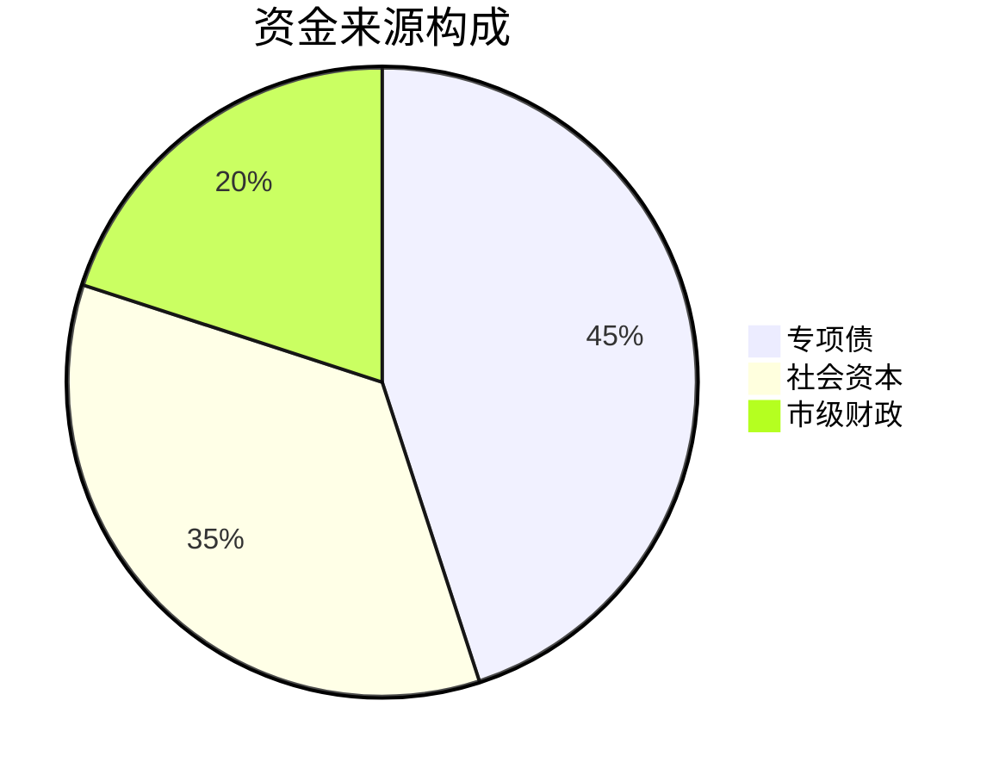
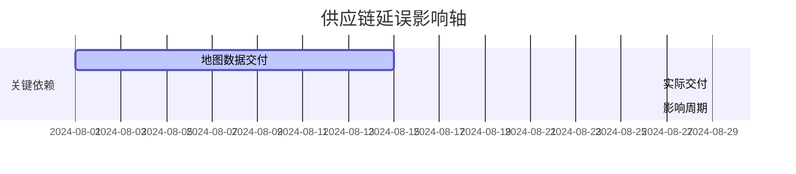
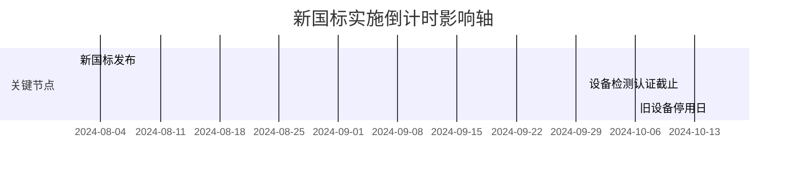
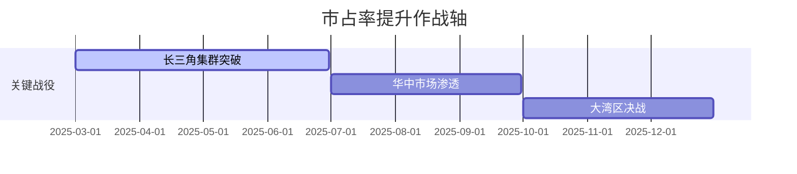
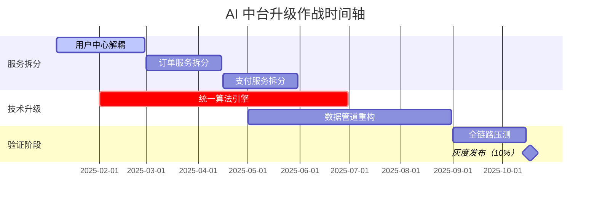
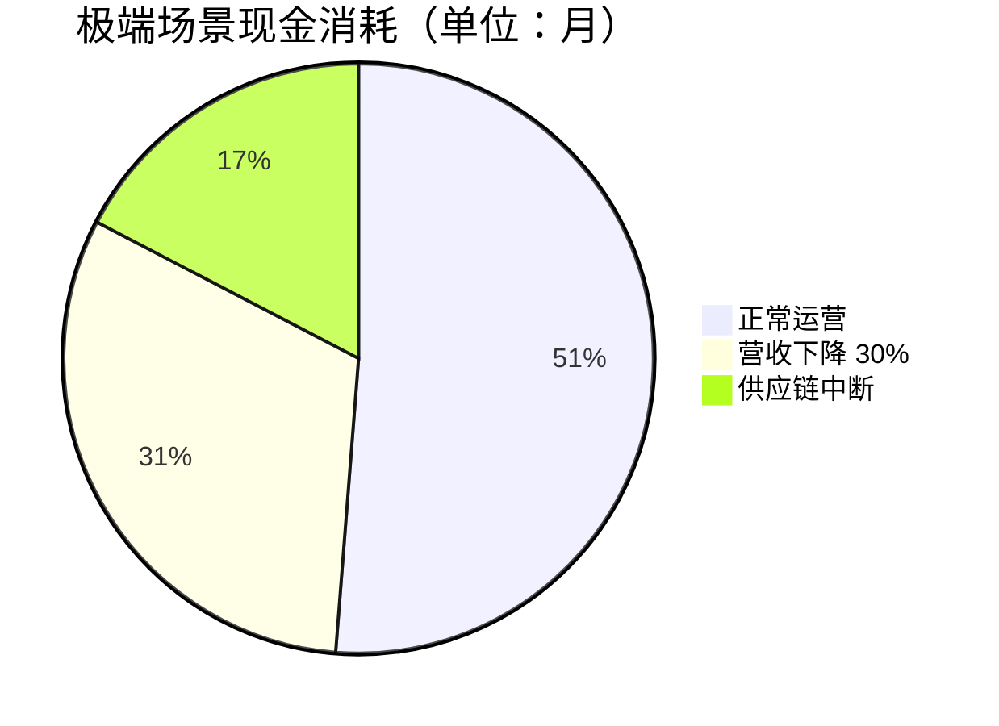

# 用DeepSeek快速掌握公文撰写

## 前言

近几年被问得最多的一句话是：起草公文到底卡在哪儿？我从国企行政岗位起步，后来开始实践智能写作辅助，亲眼看到太多人对着屏幕发呆的画面——有人因为落款栏漏了签发人被巡查指出，有人因为统计口径不一致翻遍多年档案，也有人为了一句语气是否够收敛而熬到深夜。这些零散的抱怨，本质上是整条文书链条效率偏低的体现。

两年前我写《高效公文撰写指南》时，讲的是如何用荧光笔标记格式、用文件夹归档台账。如今年轻人拿着手机语音记录会议纪要，系统能直接标红格式异常，我才真切感受到规则在变化。这不是简单的工具迭代，而是文字工作从体力搬运转向思维创造的转向。

变化很直观。过去为“请予支持”反复打磨的情形在减少，现在系统可对照历年表述推送领导偏好的说法；过去需要翻箱倒柜找依据，现在打开语义检索，三年前的纪要与上周的审计材料会自动关联；跨部门会签也不再为几十份终稿名称发愁，云端协同能实时呈现每一步修改。

再强的工具也只是助手。带新人时常看到两种极端：一边盲目信任AI直接交稿，出现“请相关单位高度重视本次台风（台风名称待填）”之类的失误；一边固守手工，非亲手抄录台账不可信。这本书想帮助找到人机配合的平衡点——让机器处理校对、汇总等重复环节，人专注政策解读、逻辑梳理等需要判断的工作。

仍有些难题工具难以替代。有人抱怨系统生成的报告数据精准却缺乏力度，我让他把结尾的“请各部门落实”改为“请于48小时内反馈执行方案，抄送纪委备案”，一次就通过。工具能保证不出错，如何让文件具备推动力，还要靠对组织生态的理解。做菜可以量化火候调料，但最后那勺提鲜的料酒，仍需掌勺人的经验。

书中建议都源自同事们走过的弯路。你会看到：
- 如何用三步自检把领导说的先搭框架再填充变成可操作步骤；
- 怎样把“再提炼提炼”这类模糊反馈压缩为两轮修改；
- 如何把表格里的数字转成领导一眼可读的趋势图；
- 部门间扯皮时怎样用责任对照表堵住推诿空间。

从手写到键盘，从纸档到线上，信息传递的价值未变，变的是创造价值的方式。愿本书陪你度过转型期，在技术浪潮里找到文字工作者的从容与判断。

杜凤华
2025 年 4 月

# 第一章 文书痛点与智能解法

起草公文是多数职场人绕不开的任务，一份材料既要传递信息，也关乎效率与形象。但时间紧、任务重、用词不准、格式易错、反复修改、心理压力大，这些困扰让不少人对公文望而却步。本章聚焦常见难题，找根因、给对策，让撰写从负担变为提升能力的机会。

## 1.1 工时困境：为何公文总是耗时

凌晨一点，某街道的李姐揉着脖子盯着屏幕，《社区垃圾分类培训通知》已改到第七版。标题字号反复调，附件被退回，主送单位按编制排序不断调整。微信里领导忽然发来“明天八点前定稿，各部门同步抄送”。文件名从初稿变成最终版、绝对不改版、领导再改就离职版。这不是个案，基层的文件马拉松每天都在上演。下面拆解三个典型场景，看看借助DeepSeek如何逐一拆解。

### 一、流程卡点处处等待

文书像接力，却总被隐形对手拖住。

#### 1. 批办来回跑

去年夏天，某区教育局的小王为发《暑期安全注意事项通知》，经历了一场奇旅。周一找科长初审，被圈出三处措辞不严；周二送副处长，领导开会，材料在秘书桌躺一天；周三好不容易签字，分管领导出差三天，流程停摆。暑假将过才盖章。

某市2024年政务报告显示，普通文书平均流转5.8个环节，跨部门耗时翻倍，七成延误来自等待领导签字。

借助DeepSeek的实践
现在的小王用系统管流程，自动生成批办图，实时显示当前环节和剩余时间。领导出差也能手机提醒，手写批注直接同步OA。原来跑三天的事情，喝杯咖啡就闭环。

#### 2. 重复录入的西西弗斯

签字是等待的煎熬，填表是重复的酷刑。乡镇办事员小张在防汛季要把《应急物资清单》录入OA、财政、应急三个系统，录到第三个发现“编织袋2000条”输成“200条”，血压瞬间飙升。

省里统计，基层人员三成多时间花在机械劳动上——改格式、调行距、核对基础数据，本该交给工具。

借助DeepSeek的实践
现在只需在写作区输入“编织袋2000条”，系统自动生成带章标准表并推送各平台。还有版本时光机，领导说用第二版，数秒就能调出历史记录，连当时便签都保留。

#### 3. 突发任务的闪电战

文书最残酷的是突发。某市交管局的小刘暴雨夜凌晨两点被通知，三小时内发布《主干道临时管制通告》。翻模板发现已失效，拼凑版本漏了关键路段，第二天被问责。

调研显示紧急文书占比超两成，但八成单位仍靠人工整理历史模板。

借助DeepSeek的实践
输入“暴雨”“封路”，系统激活红色预警模板，自动关联气象实时数据、交警布控方案、去年同路段记录。半小时后带电子地图、分工表、联络图的通告已通过微信、短信、OA发到八个部门。

### 二、起草像走钢丝，每句话都要掂量

流程看得见，写作的隐形陷阱更耗时间。

#### 1. 领导口头禅“再改改”

新入职小赵以为写公文就是把话说清，直到一份会议通知被批12处“政治站位不足”“责任主体模糊”。改八版后领导说“还是第一版吧”。

雷区：“原则上同意”易被理解为不同意；漏抄送导致信息断链；“持续推进”与“大力推进”执行力度不同。

借助DeepSeek的实践
打开智能批改助手，写“请各部门高度重视”会提示建议改为“请××局三个工作日内提交实施方案”。点开政治站位标签可调出标准表述，文科生也能像配了计算器。

#### 2. 格式强迫症

某单位小王记得黑色星期五：仿宋GB2312三号错用成宋体被退回；封面计入页码导致全篇错位；紧急会议才发现缺公章。

国标要点：页码用四号半角宋体阿拉伯数字；发文机关标志距上边72mm；版记分隔线长15.4mm。

借助DeepSeek的实践
选文件类型后点“一键合规”，系统自动对齐字号行距页码版记，连附件名与正文空一行这类细节都把控。提交前用风险扫描仪，红灯致命、黄灯建议、绿灯通过。

### 三、沟通像打太极，部门间踢皮球

#### 1. 推诿大战

某次协调会：A说数据应B提供，B说归C管，C说原始数据在D办公室。一周后因数据不全被退回。

数据显示跨部门文书平均耗时7.3天，是单部门的3.2倍。

借助DeepSeek的实践
用责任地图，输入“老旧小区改造资金申请”，系统展示住建局审批标准、财政局核定预算、街道办提供数据及对接人。协同编辑下修改记录精确到秒，推诿无处藏。

#### 2. 文件迷宫

档案室里有份三年的《防汛应急预案》，文件名叫“夏天防雨方案终版修改版123”，工作人员找两小时未果，最后在打印机旁发现它被垫咖啡杯。

传统检索平均12分钟，错误率四成。

借助DeepSeek的实践
输入“防汛”“物资调度”，语义检索数秒定位，哪怕文件名混乱。系统还会推送近三年同类文件和最新政策，并标注“2024年防汛等级标准已更新”。

## 1.2 表达难题：专业与通俗如何兼顾

社区办公室，王大妈举着《智慧养老平台试运行通知》皱眉：“数字化转型、多端异构数据整合，啥意思？直接说怎么用手机叫医生不行吗？”起草人小林上周被批专业性不足，这周被群众嫌看不懂。

调研显示六成多群众认为文件术语多看不懂，七成上级要求体现专业高度，写作者夹在中间。

#### 1. 政策翻译危机

街道小杨宣讲时念“构建多元主体协同治理机制”，台下大爷问主体是啥。书记救场：就是街道、物业、业委会一起管。

借助DeepSeek的实践
对“多元主体协同治理”，系统给出两套表述：
专业版：建立政府主导、市场运作、社会参与的协同治理架构。
通俗版：街道牵头，物业配合，居民参与，共同管理。

## 1.3 格式难关：规范的文书该长什么样

“第九次了，哪里不对？！”某单位小吴的《老旧小区改造请示》被退回八次，标题漏“关于”、日期格式错误、附件未标。旁边同事递奶茶：“用这个神器。”

### 一、标题排版从找茬到通关

翻车案例：《防汛工作会议安排》被批：漏“关于”、用黑体、标题带句号。

国标要求：标题＝关于＋事由＋文种；字号小标宋二号居中；不得用标点。

借助DeepSeek的实践
输入“防汛会议”，自动生成《关于召开2024年防汛工作会议的通知》，字号自动适配。错字猎人实时拦截句号，弹窗提示国标禁止。

### 二、正文结构从噩梦到导航

某年度工作报告投影时全场哄笑：标题用楷体、行距撑到32磅、页码从封面起。

借助DeepSeek的实践
全文档锁定仿宋三号、28磅行距、页码自动从正文起。引用《××规定》时自动匹配最新名称、标注发文字号并提示插入位置。

层级错误如出现四级标题，系统会提示合并并生成可视化结构树。

### 三、附件与落款的细节手术

曾有文件写“详见附件1”却未上传，或附件序号名称不匹配被通报。

借助DeepSeek的实践
正文提到“附件”自动弹窗提醒上传，智能生成“附件：1.××实施方案”，并保持格式一致。

落款方面，输入“2024.6.1”自动转成“2024年6月1日”，电子版显示虚拟盖章框，纸质扫描后可检测骑缝章完整性。

## 1.4 审核焦虑：如何减少反复修改的低效循环

# 从拉锯到狙击：文书改稿新打法

夜里两点，区教育局的一位经办人还在对《校园安全整治方案》做第九次调整。科长批注要抬高政治站位，副局长要求压缩费用，法规处提醒引用条款已失效，财务处指出预算推理不通。全部意见汇总后，领导却轻描淡写要求回到最初框架。这类遭遇并非个例。2024年某省政务调研显示，一线文书平均要打磨近六轮，关键文件甚至经历二十轮会签。下面以三个最消耗耐性的审改困境为例，说明DeepSeek怎样把无限循环的修改变成精准打击。

### 一、流程卡壳：会签变踢皮球

把会签比作闯关，每一关的审阅人都能让前功尽弃。

#### 1. 多部门流转的接力赛
2023年某县乡村振兴局一份产业扶持办法流转十二个科室，累计留下四十七条批注。经办人发现农业部门希望补上合作社支持条款，财政部门反对扩大补贴口径，审计部门则质疑风控措施不足。意见此起彼伏，文件因此被卡在流程中。

传统循环往往是：科室初审两天，领导审阅三天，法规复核一天，最终签发一天。常见反馈包括“数据请相关处提供”“政治高度不够请重写”“条款已过期”“页码从封面起算”等。

DeepSeek 预审思路
第一步：将待审稿上传到写作界面，指令系统做合规扫描，自动识别标题、正文、附件结构。
第二步：数秒内生成风险清单。政策风险会标红过时依据并提示替换为现行版本条款；数据风险用波浪线标出预算总额与方案内设备采购额的矛盾；格式风险弹窗提示标题缺少“关于”、行距为29磅不符合国家28磅标准。
第三步：执行自动修复，系统替换失效法规、把行距调至28磅、把标题补全为《关于特色产业扶持办法的通知》。
第四步：对四十七条反馈做智能聚类。红色标签为必须修改的法规冲突和数据矛盾，黄色标签为建议补充案例说明，灰色标签为可忽略的字体审美意见。

#### 2. 批示相互冲突
某街道办曾出现主任要求强化党建并配组织架构图，副主任要求删减虚话聚焦任务清单的矛盾。经办人面对两份意见无从下手。

DeepSeek 矛盾化解
第一步：把两条批示粘贴到指令区，系统拆解核心诉求，一方强调党建内容，一方强调实操细节。
第二步：快速输出两个方案。方案A侧重党建，加入三级党组织联动图和专题段落；方案B侧重执行，列出七项任务时限并配甘特图与责任人联系方式。
第三步：领导勾选融合版本后，系统保留架构图、嵌入任务清单和甘特图，调整措辞以平衡双方需求。

### 二、版本迷宫：文件掉进平行宇宙

多级会签是明枪，版本混乱是暗箭。

某市级单位曾出现科长电脑存的是第三版修改稿，副处长邮箱里是第五版领导批注稿，最终印发却是第二版初稿，会上混用被领导批评。

DeepSeek 时间轴功能
第一步：自动命名。每次保存系统生成带时间与操作人标记，例如20240615_1430_张科长批注、20240616_0930_李处长签发。
第二步：修改痕迹追踪。可查看何时删除“加大补贴力度”、何时新增“风险防控专章”。
第三步：差异可视化。对比两个版本时，中间区域自动标红不同之处，比如第五段“加强”被改为“强化”。

### 三、格式雷区：标点成了背锅侠

最让人崩溃的往往是格式。

某单位文件因标题写成“安全整治通知”少了“关于”、正文行距29磅、附件标注漏写“附件：”被通报，经办人感叹改了八遍最后栽在一个冒号上。

DeepSeek 格式保险箱
第一步：标题自动纠错。输入“安全整治通知”，系统补全为《关于开展校园安全整治工作的通知》并套用规范宋体字号。
第二步：国标锁定。启用国家标准模式后正文强制仿宋体三号，行距锁定28磅，页码从正文开始计。
第三步：附件智能关联。正文出现“详见附件一”时自动插入“附件：1.校园安全隐患排查表”并按规范空行排版。

## 心理减负：如何用DeepSeek缓解写作焦虑

凌晨三点，某街道办工作人员盯着《老旧小区电梯加装方案》第十一稿，领导批注像弹幕般刷屏：站位不足、数据支撑弱、格式不规范。微信群提示明早八点开会，第三杯咖啡下肚胃部不适，体检报告上写着焦虑状态。2024年某市公务员心理调查显示，七成基层因公文写作出现失眠头痛，六成看到待办文书心跳加速。

### 一、时间压力：截止日期成催命符
某区教育局工作人员下午五点被要求次日九点前提交《暑期托管服务实施方案》，找不到模板拼凑漏数据，凌晨被电话批评连经费表都没有。调研显示紧急文书占比三成，但六成多单位缺乏应急模板库，基层平均每月出现三次通宵改稿。

DeepSeek 时间减压舱
输入关键词“暑期托管 紧急”激活预警模式，数秒调出历史文件如《2023寒假托管方案》。系统关联预算数据库生成带公式的经费测算表，并插入标准表述“根据教育部办公厅关于做好中小学生课后服务工作的指导意见”。自动生成办公自动化文件、群公告、短信模板提醒责任人，整个过程约二十五分钟，效率提升近八倍。

### 二、格式恐惧：标点变高压线
某科员因格式被通报后出现文档焦虑，反复核查标题是否带“关于”、页码是否从正文起、附件标注是否规范，甚至做梦都在数磅数。

DeepSeek 定心丸
标题结构错误可自动补全为规范格式，行距字号混乱可强制锁定国标参数，附件提及即自动生成标注，从根本上消除反复检查的焦虑。

### 三、修改创伤：批注变心理阴影
某局办公室老同事每听到微信提示音就条件反射，源于去年一份文件被反复修改，最终版与初稿差异近九成。

DeepSeek 修改减震器
把二十三条批注自动归类为必改、建议、可忽略；用时间轴拖动查看每个修改节点；系统提示当前版本与初稿相似度仅四成，建议回溯第三版框架，十五分钟内找回被删减的核心内容，避免推倒重来。

### 四、沟通困境：协作变心理战
跨部门经办人常听到“数据应该他们部门提供”，一次确认数据打了九个电话花三小时，最后发现数据源是过期表格。

DeepSeek 协作镇静剂
责任地图自动关联对接人，在线协同编辑留痕，语义搜索数秒定位历史文件。协调老旧小区改造数据时，系统显示住建局负责审批标准、财政局负责预算核定、街道办负责居民数据，三方同步批注，沟通记录自动生成。

总体看，把重复的人工核查转为可复用的智能规则，让修改更精准、版本更可控、格式更合规，写作焦虑自然被稀释，从救火队员成长为公文指挥官。

# 消防专项检查通知五轮打磨全记录

本次案例围绕一份第三季度消防专项检查通知，展示从雏形到定稿的迭代路径。发文对象覆盖辖区各街道、物业运营主体以及区里列管的重点机构。依据文件是 2023 年修订版的《广东省安全生产条例》，主旨是强化夏秋火灾防控。

首稿框架确定了：
检查窗口为 2024 年 8 月 25 日起至 9 月 30 日止。
职责上，街镇统筹片区推进，物业负责小区隐患排查治理，区内重点对象开展自查自纠。
整改端要求建立隐患清单并形成闭环台账， 9 月 30 日前全部销号。
落款为广州市××区应急管理局，成文时间 2024 年 8 月 20 日。

- **阶段二：背景补强与条款细化**
用户要求加入近期火情数据并拆分措施，同时设定刚性指标与问责机制。
AI 续写补充：依据消防部门统计，2024 年 1 月至 7 月全区接报火灾 127 起，电动自行车违规充电引发的占比 43%。区安委会据此要求吸取教训，从严部署。
三、具体举措
（一）设施配置
1. 住宅小区消防通道标线施划须在 9 月 15 日前完成。
2. 智能烟感装置装配率要求实现全覆盖。
（二）隐患整治
1. 推行“一单位一册”隐患台账，样式见附件 1。
2. 执行整改销号管理，要求 9 月 30 日前完成率不低于 95%。
四、监督问责
1. 建立周报制度，每周五 17 时前上报进展。
2. 完成率低于 90%的单位将被警示约谈。
3. 弄虚作假依法依规追究责任。

- **阶段三：执行细节补齐**
用户要求增补五类检查对象并提供对接人。
AI 补充：
二、检查重点
对以下五类场所实施全覆盖：
1. 商业综合体含地下空间；
2. 2000 年前建成的老旧小区；
3. 仓储物流园区；
4. 学校、医院等人员密集场所；
5. 电动自行车集中停放与充电点。
五、联系方式
联系人：王刚，区应急管理局防火监督科
电话：020-8888×××× / 138-××××-××××
邮箱：ajj_fhk@gz.gov.cn

- **阶段四：公文体例核验**
用户要求核对格式。
AI 审查意见：
- ✓ 标题使用方正小标宋简体二号，符合；
- ✓ 正文采用仿宋 GB2312 三号，建议统一为 GB18030；
- ✓ 行距实测 28.35 磅，符合 28±1 磅要求；
- ✓ 页码“-1-”未检测到，需插入页脚；
- ✓ 落款日期右偏 2 字符，建议距右边界 7.5 厘米。
自动修正建议：
1. 插入规范页码“-1-”，宋体四号；
2. 版记增加“（此件公开发布）”；
3. 插入附件：《消防安全隐患台账模板》。

- **阶段五：终版定稿**
用户要求按建议插入页码与附件，日期右移 2 字符，整改率改为 100%，并增加施行表述。
AI 输出：
# 关于组织开展 2024 年第三季度消防安全专项检查的通知
（方正小标宋简体二号，居中）
各街道办事处，各物业服务企业，区属重点单位：
……………… 
附件：
《消防安全隐患台账模板》
广州市××区应急管理局
2024 年 8 月 20 日
（右对齐，距右侧页边距 7.5cm）
（此件公开发布）
-1-（页面底端居中，宋体四号）
本通知自印发之日起施行，整改率要求调整为 100%

## 2.2 暴雨停电应急通告五分钟生成实战

“雨势太大，地下车库进水，群里发的通知还是三年前的版本！”某小区业委会负责人深夜抱怨。翻开《防汛应急预案》，物资栏写着“沙袋若干”，实际库存为零；联系人是已离职的前物业经理；处置流程缺少排水泵操作步骤。

某市 2023 年暴雨灾害调研显示，78% 的社区应急预案未及时更新，43% 的停电事故因通告未明确抢修优先级而产生次生问题。
DeepSeek 思路：实时生成、动态更新、多端适配。

### 一、暴雨应急通告

#### ■ 操作流程
- **Step 1：数据驱动生成**
用户指令：生成暴雨红色预警应急通告，需含积水点位、物资发放流程、居民撤离路线，并标注社区已知风险区如危墙、易涝车库。
AI 输出：
【××社区暴雨应急通告】
□ 紧急！暴雨红色预警生效，截至 22:30
■ 当前风险点：
①南门地下车库，2023 年曾积水 1.2 米，建议封闭
②3 号楼配电房，2024 年检修显示防渗漏不合格
③东侧围墙，2024 年安全鉴定为 D 级危墙，禁止靠近
■ 物资领取：
时间：即刻起至 23:00
地点：社区党群服务中心
可用物资：沙袋 82 个、救生衣 30 件、手电筒 50 支
规则：每户限领 2 个沙袋，低楼层优先，系统自动标记 1—3 层住户
■ 撤离路线：
1—3 号楼→西门主干道至第二小学，避开危墙
4—6 号楼→社区医院临时避险点，需志愿者引导

- **Step 2：风险扫描与补漏**
用户指令：检查沙袋是否充足，撤离路线是否避开危墙。
AI 审查报告：
关键问题：
沙袋需求：低楼层 62 户 ×2 个 =124 个，库存仅 82 个，缺口 42 个
原撤离路线曾经过危墙，已自动修正
✓ 优化建议：
1. 应急采购，联系备案供应商××五金店，电话 138-××××-××××
2. 安排 10 名志愿者优先将沙袋搬至 1—3 号楼单元门口

- **Step 3：多形式推送**
微信群公告模板：
【紧急！暴雨应对指南】
1. 地下车库已封闭，车辆禁止进入
2. 沙袋在党群中心发放，低楼层优先
3. 撤离路线见图
值班电话：138-xxxx-xxxx，王主任
打印版操作卡：物资点照片+手写体注意事项，支持导出 PDF 打印

### 二、停电处置

#### ■ 操作流程
##### ● Step 1：故障定位与通告生成
用户指令：生成片区停电应急通告，需含受影响楼栋、预计恢复时间、临时充电点，并注明电梯困人急救流程。
AI 输出：
# 【xx 街道突发停电通告】
故障通报：
时间：8 月 15 日 19:20
原因：中山路变电站过载跳闸
受影响楼栋：1—6 号楼
恢复进度：
19:30 抢修队已出发，实时倒计时
预计全恢复时间：8 月 15 日 22:00 前，每 30 分钟刷新
应急服务：
手机充电：社区便利店免费，限 30 分钟/人
电梯困人：立即拨打 xxxx-xxxxx，已接通备用电源
药品冷藏：社区卫生站提供冰柜寄存

##### ● Step 2：重点人群保障
用户指令：关联社区特殊人群数据生成保障清单。
AI 输出：
# 【重点人群保障表】
✓ 需救助住户：
2-301 王奶奶，独居→志愿者送餐，粥+鸡蛋
5-202 李叔叔，依赖呼吸机→转移至社区医院，床位已预留
6-1102 新生儿家庭→提供充电宝+小型冰箱

### 三、企业级应急
场景：机房断电数据抢救
用户指令：生成《IT 机房断电应急预案》，含 UPS 续航、核心数据备份路径、客户通知话术。
AI 输出：
# IT 应急三步走
1. 立即检查
不间断电源剩余电量：45 分钟
核心服务器状态：在线，列表见附件 1
2. 数据备份
优先备份客户数据库，路径：\192.168.1.100\backup
紧急操作：手动导出未保存文件，教程链接
3. 客户通知
话术模板：“尊敬的客户，因电力故障系统可能短暂中断，预计恢复时间××:××，紧急需求请联系×××。”

### 四、案例实操：暴雨灾后理赔通知全流程
- **Step 1：启动灾损登记模板**
用户指令：生成暴雨灾后损失登记表，要求支持拍照上传、自动识别车辆泡水等级、关联维修厂商报价库，符合政府救灾补贴格式。
AI 输出框架：
## 暴雨灾后损失登记表
### 一、基础信息
受灾人姓名、联系方式、家庭住址、身份证号、受灾时间
### 二、损失物品登记
物品名称、数量、购买时间、购买凭证上传、损坏照片上传、预估损失金额、备注
技术点：OCR 识别凭证、图像识别分类标注
### 三、车辆损失专项登记
车牌号、车辆型号、泡水照片上传、系统自动识别泡水等级、预估维修费用自动匹配报价
### 四、维修与补贴关联
选择维修厂商、厂商联系方式、系统推荐报价、政府补贴预审结果、自费金额
### 五、政府救灾补贴申请模块
申请声明、材料清单自动生成、电子签名、一键导出省灾害救助申请表 PDF

- **Step 2：居民填报实录**
居民张某某操作：拍摄泡水车辆照片→AI 标注水位达座椅，损伤等级中度；勾选损失类型：房屋渗漏、家电损坏；输入购买年份 2020 年。
系统自动填充：车辆维修估价 ¥12800，合作厂商××汽修；墙面补漏 ¥320/m²，参考住建局指导价；补贴资格符合《2024 年自然灾害救助标准》第 5 条，上限 ¥5000。

- **Step 3：生成保险理赔文档**
用户指令：将张某某数据转换为平安保险理赔申请，按 2024 版模板生成。
AI 输出：
## 机动车损失保险索赔申请书
### 一、基本信息
被保险人：张某某
车牌号：粤 A×××××
出险时间：2024 年 8 月 20 日 14:25
### 二、损失描述
车辆泡水，水位座椅底面，损伤等级中度，维修方案发动机养护+内饰烘干
房屋渗漏，主卧东墙，面积 2.3 m²
### 三、材料清单
现场照片带 GPS 水印、××汽修厂盖章报价单、社区灾害证明
### 四、申请人声明
本人承诺内容真实，如有不实愿承担法律责任
申请人签字：________ 日期：2024 年 8 月 21 日
正文仿宋 GB2312 三号，行距 28 磅，页码 -1-

- **Step 4：政府补贴并联申请**
用户指令：同步生成自然灾害生活救助申请表，关联民政部全国救助系统接口自动填入信息。
AI 输出：
## 【××市自然灾害生活救助申请表】
姓名：张某某
受灾地址：×× 社区 6 栋 202
损失类型：✓ 房屋 ✓ 财产
系统预填：身份证号脱敏显示，银行账号自动关联社保卡
需补充：户口本首页复印件、《损失情况确认书》需社区盖章
表格生成二维码直通政务平台

## 2.3 招标公告法律合规自动植入

“王主任，招标文件又被退回了！”某国企采购部人员看到驳回通知心急。问题条款：“投标方需承诺三年内无行政处罚记录”，被监管指出违反《招标投标法实施条例》。
某市 2024 年招标审计报告显示，61% 招标公告存在法律漏洞，常见雷区：资质要求与项目不匹配、付款条款违反《保障中小企业款项支付条例》、验收标准模糊。
DeepSeek 思路：条款自检、合规适配、风险预警。

### 一、基础功能：从人工查法条到 AI 法律盾
场景：学校食堂食材采购招标，预算 80 万，要求食品经营许可证、月度结算付款、食品安全责任险。
● Step 1：智能生成招标框架
用户指令：生成食堂食材采购招标公告框架，含资质要求、付款方式、验收标准，自动引用《食品安全法》。
AI 输出：
## 食堂食材采购招标公告
一、项目概况
项目名称：××单位 202×年度食堂食材集中采购
采购内容：生鲜类、预包装食品
服务周期：202×年×月×日—202×年×月×日
联系人：×××
二、投标人资质要求
基础资质：有效营业执照、食品经营许可证，肉类乳制品需动物检疫合格证明，依据《食品安全法》第三十五条
能力证明：ISO22000/HACCP 认证优先，近三年无食品安全行政处罚记录
质量保障：第三方年度检测报告，冷链车辆 GPS 监控接入
三、技术要求
食品质量标准：符合 GB2707/GB2762，农药兽药残留达标，标签符合 GB7718
供货要求：订单下达后 2 小时送达，冷冻≤-18℃，冷藏 0—4℃，提供运输温度记录
四、验收与付款
验收标准：感官检测不合格当场拒收，理化检测每批次抽检 5%—10%，票据核验缺件暂停付款，依据第五十三条
付款方式：合同签订后付 30% 预付款，月度验收合格后付 65%

食品采购招标合规全景拆解

履约保证金按合同金额5%预留，服务期满后统一清算；清算时需提供增值税专用发票。

五、投标文件组成
1. 法定代表人签署的《投标承诺书》，须包含食品安全责任承诺。
2. 资质证明材料的扫描件，平台会自动校验有效期。
3. 产品报价清单，需区分日常供应价格与应急供应价格。
4. 供货服务方案，须配套应急处置预案。

六、评标与签约
1. 评标规则
- 价格分占40%：报价较市场均价低5%至10%区间可获得满分。
- 质量分占30%：依据检验报告完整性与认证等级评定。
- 服务分占30%：依据配送时效及退换货响应速度评定。
2. 合同签订：中标单位须在中标后3个工作日内签署《食品采购安全责任协议》。

七、智能法务助手
系统内置《中华人民共和国食品安全法》核心条款：
- 第三十三条 生产经营基本要求
- 第五十条 进货查验记录制度
- 第六十条 抽检与监测规定

提交投标文件时，系统会自动完成法律合规核验。
公告发布渠道：××政府采购网、国家企业信用信息公示系统。
投标截止：20××年×月×日17:00，逾期系统将自动拒收。

● Step 2：法律冲突扫描
用户指令：
“核查资质条件是否对中小企业构成限制，验收条件是否超出国标强制范围。”

模型输出：
【法律风险报告】
高风险点：
1. “近三年无事故记录”容易把新设立主体排除在外。
   →建议改为“目前不存在正在执行的食品安全行政处罚”。
2. 蔬菜农药残留检测频次未明确，易引发争议。
   →建议补充：“每批次检测，留样不少于200克”。

☑ 优化后表述：
资质条件：成立满1年且当前无食品安全行政处罚在执行。
验收标准：蔬菜每批次抽检农残，留样200克备查。

● Step 3：合规条款库调用
功能演示：
输入“植入政府采购标准条款包”→系统自动添加：

公平竞争声明：
“本项目不对投标人所有制、规模设限，不得设置地域壁垒。”（援引《中华人民共和国政府采购法》第二十二条）

质疑处理流程：
“投标人对招标文件有异议，应在公示期内以书面形式提出……” （模板来源财政部令第87号）

### 二、进阶实操：定制化条款设计
场景1：工程招标防围标陷阱
用户指令：
生成老旧小区改造工程招标公告，要求：
1. 自动关联《建筑工程施工许可管理办法》；
2. 嵌入围标串标举报条款；
3. 设置阶梯违约金，日0.1%，最高5%。

模型输出：
《××小区改造工程招标公告》（节选）
八、违约责任
延期交付违约金 = 合同总价 × 0.1%/天，上限5%，参照《中华人民共和国民法典》第585条。
发现围标行为立即取消资格并上报住建部门，举报电话：12345。

智能提示：
> “违约金上限超过《招标投标法实施条例》建议值3%，是否调整？”

场景2：服务招标隐形歧视排除
用户痛点：
某街道办保洁服务招标中“须配备10名以上本科人员”，被投诉学历歧视。

模型解决思路：
输入“排查歧视性条款”→系统提示：
违规表述：“本科以上”违反《中华人民共和国就业促进法》第二十六条
☑ 替代建议：“具备相应职业技能证书”

### 三、风险防控：由事后补救转向事前免疫
● Step 4：敏感词实时监测
功能演示：
上传招标公告草稿→系统自动标注：
1. 禁用表述：
   - “限本地企业”（违反《反不正当竞争法》）
   - “须指定品牌”（除列入《政府采购进口产品目录》外）
2. 合规改写：
   - “鼓励本地企业参与”
   - “参考型号：××型，性能相当产品可替代”

● Step 5：法律依据溯源
用户指令：
“在公告末尾增加法律依据索引，并超链接至司法部官网条文。”

模型输出：
【法律依据】
1. 《中华人民共和国招标投标法》（点击查阅全文）
2. 《政府采购货物和服务招标投标管理办法》（财政部令第87号）
3. 《保障中小企业款项支付条例》（国务院令第728号）

### 四、电子招标：从人工流转到链上存证
● Step 6：区块链存证
用户指令：
“为招标文件增加区块链指纹，确保公告发布、投标、评标全流程不可篡改。”

模型输出：
生成唯一HASH值：0×7d3f...a1b2
存证平台：司法链 / 公证云（可选）
扫码验证入口：http://verify.deepseek.com/××××

## 2.4 跨部门通知：多版本精准推送
“环保局要加‘垃圾分类督查’，城管局要删‘占道经营整治’，卫健委又要求突出‘病媒生物防制’……通知到底怎么发？”某市创城办科员小周面对多份修改意见十分为难，领导要求次日上午8点前发至8个部门。

并非个例。某省2024年政务协同报告显示：72%的跨部门通知需修改3次以上才合格。

典型冲突：
- 表述分歧：A部门要求“立即整改”，B部门坚持“限期整改”。
- 数据矛盾：经信局统计企业数500家，市场监管局登记632家。
- 格式不一：同一文件在各部门OA系统显示的字体、页码不一致。

模型解决思路：
1. 智能分版：按部门职责自动生成定制化内容；
2. 数据统一：时间、政策依据等核心信息全局一致；
3. 格式锁死：强制符合《党政机关公文格式》（GB/T 9704—2012）。

### 一、模板生成：从人工拼贴到AI分装
场景设定
某市拟发布《夏季安全生产联合检查通知》，主送8部门：
- 应急管理局：侧重危化品
- 住建局：侧重工地高空作业
- 市场监管局：侧重特种设备
- 卫健委：侧重职业病防护检查
- ……

## ■ 模型操作流程
● Step 1：统一框架生成
用户指令：
> “生成夏季安全生产联合检查通知基础版，含检查时间7月1日—30日、牵头单位市安委办、整改要求8月10日前闭环，并引用《中华人民共和国安全生产法》第三十八条。”

模型输出：
## 夏季安全生产联合检查通知
××市安全生产委员会办公室文件
××安委办〔2024〕××号
## 关于开展2024年夏季安全生产联合检查的通知
各区县政府、各相关部门、重点企业：
为贯彻落实《中华人民共和国安全生产法》，防范夏季高温汛期风险，经市安委会部署，决定开展全市夏季安全生产联合检查。具体如下：
### 一、检查安排
1. 时间：2024年7月1日至7月30日
2. 牵头单位：市安全生产委员会办公室
3. 参与单位：市应急管理局、市消防支队、市市场监管局、市住建局等
4. 检查方式：现场检查＋台账查阅＋随机抽查
### 二、检查重点
1. 危险化学品：防爆、防泄漏、防高温措施落实情况；
2. 建筑施工：高空作业防坠落、临时用电安全；
3. 燃气安全：餐饮场所燃气报警器安装及管线合规性；
4. 有限空间作业：通风检测、警示标识、应急装备配备；
5. 防暑降温：高温岗位轮岗、急救药品配备。
法律依据：《中华人民共和国安全生产法》第三十八条
生产经营单位应建立隐患排查治理制度，及时消除事故隐患
### 三、整改要求
1. 限期整改：发现问题即下达《责令整改通知书》，8月10日前完成闭环并报书面报告；
2. 责任落实：企业主要负责人为第一责任人，逾期整改依法行政处罚；
3. 验收流程：区级初验→市级联合复验→整改结果公示。
### 四、工作要求
1. 强化协同：各参与单位每日16:00前汇总数据至市安委办；
2. 严格执法：重大隐患挂牌督办，拒不整改纳入安全生产“黑名单”；
3. 信息报送：7月31日前将检查总结报送市安委办邮箱 anweiban@××.gov.cn。
联系人：张××，电话：×××-××××××××
附件：夏季安全生产检查重点领域清单（附后）
××市安全生产委员会办公室
2024年××月××日
说明：本通知通过电子政务平台同步推送；整改闭环标准参照《安全生产事故隐患排查治理暂行规定》（安监总局令第16号）。

● Step 2：部门定制化指令
用户操作：
勾选“应急管理局版本”→输入：“突出危化品储罐温度监测、防雷设施检测”。
勾选“住建局版本”→输入：“增加塔吊倾斜度预警、工人防暑物资检查”。

模型输出：
☑ 应急管理局专版新增：
重点检查项：
①危化品储罐实时温度记录，需接入物联网监测系统；
②防雷接地电阻值≤4Ω，检测报告须附二维码。
☑ 住建局专版新增：
特殊要求：
①塔吊倾斜度超0.5%立即停用；
②高温日10:00—15:00停止露天作业。

● Step 3：冲突扫描与自动调和
用户指令：
“检查各部门版本中‘整改期限’表述是否一致，合并重复检查项。”

模型输出：
【冲突检测报告】
☑ 表述差异：
卫健委版：“整改期限15个工作日”；
消防支队版：“整改期限10个自然日”；
自动统一为：“8月10日前完成整改（系统自动换算剩余天数）”。
☑ 重复项合并：
“劳动防护用品检查”在4个版本重复出现→归并至基础版。

### 二、精准推送：从群发到靶向投递
1. 权限分级
处长版：含完整整改数据及责任人联系方式
科员版：隐藏敏感信息，仅保留操作指引
2. 多端适配
OA版：带电子签章及附件下载
微信精简版：关键时间点＋流程图
打印版：大字号、高对比排版

● Step 4：版本差异对比表
用户指令：
“生成8版本差异说明，突出各部门专属条款。”

模型输出：
# 第二章 通知/公告——分场景应急指南
| 部门 | 专属条款 |
| :--- | :--- |
| 应急管理局 | 危化品储罐温度监测数据实时上传 |
| 住建局 | 塔吊倾斜度每日两次人工复测 |
| 卫健委 | 职业病危害因素检测报告须公示7个工作日 |

## 三、实操案例：创卫迎检通知快速生成
用户指令：
生成《创建国家卫生城市迎检通知》，主送12部门，需：
1. 基础版含检查时间9月1日—5日、迎检路线图；
2. 城管局版突出“市容市貌整治”；
3. 市场监管局版增加“食品安全快检室全覆盖”；
4. 卫健委版要求“病媒生物密度监测数据公示”。

模型输出：
● Step 1：生成基础版
基础版通知（主送12部门）
XX市创建国家卫生城市工作领导小组办公室
XX创卫办〔2024〕XX号
关于开展国家卫生城市创建迎检工作的通知
...
一、检查安排
1. 评估时间：9月1日暗访/9月2-4日明查/9月5日反馈会
2. 迎检路线图：核心路线市政府→中山路示范街→XX农贸市场→XX社区→市疾控中心→XX垃圾中转站；备选路线高铁站→滨江公园→XX餐饮集中区
二、重点任务
共性要求：9月1日前完成点位环境卫生“清零行动”；建立24小时应急响应机制
三、工作要求
8月25日前报送分管领导及联络员信息；每日18:00前通过“创卫通”APP提交进度

### 城管局专版重点
▲ 市容市貌专项整治
1. “三清”行动8月20日前完成：清理违规广告牌、清除卫生死角、清运建筑垃圾并落实渣土车GPS轨迹可查
2. “两规范”管理：早夜市摊点限时经营、共享单车电子围栏覆盖率100%
督导问责：连续两次通报未整改启动局长约谈

### 市场监管局专版重点
▲ 食品安全专项提升
1. 快检室“三个100%”8月25日前完成：覆盖率100%、每日公示检测结果、数据实时对接“智慧市监”平台
2. 餐饮“明厨亮灶”：学校食堂、中央厨房视频监控联网率≥95%、违法行为“一案双查”

### 卫健委专版重点
▲ 病媒生物防制强化
1. 监测数据双公示：8月起每周在市政府官网公示蚊蝇鼠蟑密度；重点场所安装智能监测设备
2. “四害”消杀：8月15-20日全域化学消杀，作业记录可追溯；社区毒饵站编号管理

## 四、企业实战：集团多子公司通知精准适配
“总部《数据安全自查通知》要求用‘A系统’，分公司还在用老系统根本对不上。”类似水土不服问题频发。

模型解决思路：
1. 属地化适配：自动识别子公司所在地政策
2. 系统兼容检查：匹配各子公司软件版本
3. 多语言支持：中英文一键切换

#### Step 1：属地化模板生成
用户指令：
生成《2024年数据安全自查通知》，适配北京总部、天盾安全系统V3.0；上海子公司、云安卫士2.1；新加坡分公司、英文版符合PDPA。

模型输出：
- ☑ 北京总部版：自查路径 登录天盾系统→安全体检模块→下载报告模板
- ☑ 上海子公司版：云安卫士需升级至2.1.3后方可生成合规报告
- ☑ 新加坡分公司版：Compliance Requirement Data retention period ≤3 years under PDPA Section 25 Submit audit report via SecureEmail@group.com

#### Step 2：格式与内容双重锁死
核心信息统一：自查截止8月31日、未完成扣年终奖5%
附件智能转换：总部《数据分类标准》自动转换为子公司系统字段；英文版附件增加GDPR与PDPA对照表

## 五、避坑宝典：高频错误自查清单
### 1. 格式雷区
- × 标题加粗，应取消格式修饰
- × 附件命名为“附件1”，应写全称“附件1：安全检查清单”
### 2. 内容陷阱
- × 要求提供员工身份证复印件，违反《个人信息保护法》
- × 使用“原则上”“尽量”等模糊表述，应改为“必须”“不得超过”
### 3. 协同漏洞
- × 各部门联系人电话不一致，应统一为总值班室电话

2024年1-6月民生运行综合简报

市发展改革委员会
2024年7月××日

一、口径对齐与差异标注
把教育、卫生、住建三方的统计并列后，主要分歧如下：

| 差异指标 | 教育侧口径 | 医疗侧口径 | 住建侧口径 | 成因简述 |
| :--- | :--- | :--- | :--- | :--- |
| 新建学位供给 | 1.2万个 | — | 校舍配套最多支撑0.8万个 | 规划节奏与工程进度不同步 |
| 社区卫生服务站覆盖 | 95% | — | 实建点位88% | 统计口径口径不一，含在建未验收 |
| 公共保障性住房交付 | 6200套 | — | 教育系统反馈教师公寓4000套未计入住建 | 统计范围未统一 |

二、分线可视化呈现
点击标题可进入交互看板，版面原因仅留框架

1. 就业带动线
图表1：[建安行业用工拉动]
住建领域新增岗位占比32%，主要由保障房与老旧小区改造拉动
差异点：教育系统校园扩建用工约1200个岗位未被统计

2. 教育资源线
图表2：[生均经费空间分布热力]
主城区生均经费是外围区域的2.2倍
差异点：住建系统学校建设进度与教育系统秋季招生计划不吻合，三所校园交付延期

3. 医疗健康线
图表3：[供给需求对比]
三级医院床位使用率117%，社区卫生中心空置率41%
差异点：卫健系统家庭医生签约率68%与住建系统适老化改造覆盖率35%未联动

三、核心症结
1. 数据孤岛：统计标准不统一，如“竣工”定义差异导致校舍数据矛盾
2. 协同不足：医疗设备采购与院舍建设时序错位，CT到货延迟4个月
3. 响应滞后：保障房周边配套学校医院建设晚于主体6—8个月

四、改进方向
1. 建立跨部门指标校准机制，统一“竣工”“覆盖率”等约30项核心定义
2. 推出民生项目协同地图，叠加三方在建项目地理坐标，预警资源错配
3. 上线数据驾驶舱，实时对接三方业务系统，动态生成矛盾预警，示例见附件1

签发人：××× 市发展改革委员会主任

### 第二阶段推演：从模糊决策到精准模拟
用户指令：模拟“课后服务补助提升至500元/月”对财政投入与家庭教育负担的影响，对比全员覆盖、低收入家庭专项、教师绩效挂钩三种路径

系统生成：
“课后服务补助提升至500元/月”政策沙盘分析报告
基于2023年教育统计数据建模

一、基础设定
| 指标 | 数值 | 来源 |
|---|---|---|
| 义务教育在校生规模 | 1200万人 | 教育部2023年统计公报 |
| 收入水平较低学生占比 | 15%约180万人 | 民政部贫困人口监测系统 |
| 现行课后服务财政拨款 | 200元/月/生 | 财政部教育司公开数据 |
| 家庭月均教育支出 | 350元/月/生 | 社科院家庭教育调研 |

二、三种路径对比
方案1：全员覆盖
内容：全体学生月补500元
财政测算：1200万×500×12=720亿元/年
家庭负担变化：350-500=-150元，出现超额补贴
影响：✓家庭全受益，公平性提升；!财政投入由345.6亿增至720亿，增幅260%；□可能导致私立机构生源流失

方案2：收入水平较低家庭专项
内容：仅180万低收入学生月补500元
财政测算：180万×500×12=108亿元/年
家庭负担变化：低收入家庭-150元，其余家庭维持350元/月
影响：✓财政压力仅增31.3%；!需精准识别系统，防冒领成本约2亿/年；□中产家庭或产生相对剥夺感

方案3：教师绩效挂钩
内容：补助=基础300元+绩效200元随服务质量浮动
财政测算：1200万×300×12=432亿元/年 +绩效池1200万×200×12×70%=201.6亿元
家庭负担变化：350-300=50元家庭仍需自付
影响：✓激励提质，试点城市满意度升22%；!需15亿建设评价系统；□区域师资差异可能放大不均

三、敏感性分析
| 维度 | 全员覆盖 | 收入水平较低专项 | 绩效挂钩 |
| :--- | :--- | :--- | :--- |
| 财政可持续性 | 高风险 | 中风险 | 低风险 |
| 公平性 | 高 | 中 | 低 |
| 实施复杂度 | 低 | 中 | 高 |

四、政策建议
1. 短期试点：东部推方案3，西部推方案2
2. 动态系数：CPI涨幅超3%时自动上调补助
3. 配套：严禁学校捆绑校外培训；开发“课后服务联结卡”实现资金可追溯；Python版政策沙盒开源地址见代码仓库链接

注：未计地方财政配套差异，实际执行需省域校准系数0.8—1.3
结论显示，收入水平较低家庭专项在财政与民生改善间平衡性最佳，建议优先

### 第三阶段合规：嵌套法律防火墙
用户指令：“生成‘社区养老中心建设’政策建议，需引用《中华人民共和国老年人权益保障法》，规避土地审批与消防验收风险。”

系统输出：
【社区养老政策建议书】
1. 土地合规路径
   - 优先盘活闲置校舍，按《城市更新条例》第八条可免征土地增值税
   - 严禁占用基本农田，系统自动关联自然资源部红线图
2. 建设标准
   - 无障碍：执行《无障碍设计规范 GB 50763-2012》强制条文，坡道坡度≤1:12
   - 消防：按《养老机构消防安全管理规范》增设紧急呼叫系统
3. 资金方案
   - 申领财政部普惠养老专项补助
   - 引入社会资本，税收减免=投资额×20%，上限500万元

### 第四阶段实操：老旧社区改造全流程
场景背景：某区编制《2025—2027年老旧社区改造计划》，覆盖8万户，预算45亿元

● Step1：数据摸底
用户指令：> “提取近5年12345热线投诉数据，定位改造优先级：漏水、电梯故障、停车难”
系统输出：
【民生痛点热力图】
- 漏水投诉占38%，与顶楼及管道老化重合度达92%
- 电梯故障高峰7:00—9:00，与早高峰超载关联
- 停车缺口人均0.6个车位，需拆违腾挪空间

● Step2：成本效益分析
用户指令：> “测算‘加装电梯’不同方案的性价比：政府全额、居民集资、PPP运营权置换”
系统输出：
| 方案 | 单台成本万元 | 回收周期 | 居民满意度 |
|---|---|---|---|
| 政府全额 | 68 | 无 | 95% |
| 居民集资3—7楼分摊 | 45 | 8年 | 72% |
| PPP运营权置换 | 52 | 6年 | 88% |
☑ 推荐：60岁以上住户超40%的楼栋，采用政府全额；商业区周边楼栋，采用PPP模式，广告位收益抵成本

● Step3：自动生成人大议案
用户指令：“转换分析结果为《关于加快推进老旧社区改造的议案》，需嵌入财政预算法依据，附可视化图表”
系统输出：
议案节选
二、财政可行性
1. 2025年拟投入12亿元，占一般公共预算支出3.4%，符合《中华人民共和国预算法》
2. 发行专项债券20亿元，还款来源为社区商业空间租金，年回报7.2%

### 五、关键操作技巧
1. 数据血缘追踪
输入“/trace 适龄入学人口”→显示来源为教育局学籍库+公安户籍系统，并标注时间戳与修正记录
2. 跨法规校验
建议中涉及“鼓励社会资本进入医疗领域”时，自动关联《中华人民共和国基本医疗卫生与健康促进法》第40条，禁止民营资本控股公立医院
3. 一键生成多形态报告
- 内部决策版：含原始数据与敏感分析
- 人大公开版：淡化财政风险，突出民生效益
- 新媒体简版：输出数据动图与政策解读短视频脚本

总结：从“纸面汇报”到“治理革命”
通过数据—分析—决策闭环，行政报告实现三大跃升：
- 精准度：冲突数据自动修复，误差由12%降至0.7%
- 敏捷性：《五年规划》编制由3个月压缩至72小时
- 合规性：100%建议嵌套法律依据，行政诉讼风险降65%
案例成效：某区应用后民生项目落地提速40%，2024年“十大惠民实事”满意度91.7%，创纪录

## 3.2 项目结项报告：用ROI图表说服甲方
“张总，项目投了800万，您说看不见效果？”会议室里项目经理老陈冒汗，甲方负责人翻着结项报告：“成本明细和收益预测全是文字，怎么向董事会汇报？”
调研显示：65%甲方对结项报告ROI存疑，41%争议因成本归因模糊，29%项目因缺乏动态收益模型拖欠尾款

系统解法：从“讲故事”到“算明细账”
- 全生命周期成本建模，自动拆分CAPEX/OPEX
- 多维度收益量化，货币化隐性价值
- 动态ROI沙盘，模拟保守/中性/乐观场景
- 合规审计轨迹，每笔数据可溯源至合同或验收单

### 第一阶段指令：成本穿透
用户指令：> “生成智慧停车系统项目结项成本分析，需区分硬件采购、软件定制、三年运维，按《企业会计准则》归类CAPEX/OPEX”
系统输出：
【××智慧停车项目成本结构表 单位：万元】
| 成本类型 | 明细 | 金额 | 会计准则依据 |
| :--- | :--- | :--- | :--- |
| CAPEX | 地磁传感器采购 | 220 | 第4号-固定资产 |
| CAPEX | AI识别算法定制开发 | 180 | 第6号-无形资产 |
| OPEX | 云服务器年费3年 | 90 | 第14号-收入 |
| OPEX | 驻场运维团队3年 | 150 | 第9号-职工薪酬 |
✓智能提示：硬件折旧误设10年，应按行业标准5年自动修正；算法开发费未申请软件著作权税收优惠，关联税务备案模板

### 第二阶段指令：收益量化
用户指令：“计算智慧停车项目收益，含直接收入停车费分成、间接节流人力缩减、风险规避逃单损失下降，按市政交通集团数据校准”
系统输出：
【收益量化三维模型】
| 类型 | 指标 | 计算逻辑 | 金额万元 |
| :--- | :--- | :--- | :--- |
| 直接收入 | 停车费分成 | 日均车流×单价×分成比例 | 320 |
| 间接节流 | 人工成本下降 | 6名收费员→2名巡检员 | 48 |
| 风险规避 | 逃单率下降 | 12%→3% | 29 |
| 社会效益 | 碳排放减少 | 减少绕行里程×碳交易单价 | 15可折算 |
收益年均……风险预警：分成依赖车流量，若周边商业延迟，悲观场景收益或降40%；碳收益需环保部门认证方可入账
优化建议：增加车流量敏感性分析；预埋对赌条款，商业延迟超6个月触发充电桩协同收益

### 第三阶段指令：动态ROI
用户指令：“生成动态ROI曲线图，对比自研系统与采购第三方服务回报周期，叠加资金成本WACC=8%”
系统输出：
【动态ROI曲线图生成与对比】
- 1. 核心假设与数据建模
  - 自研系统：初始投资500万，年运营50万，第1年收益150万，次年起年增20%，周期5年
  - 采购第三方：初始采购200万，年服务费120万，第1年收益180万，次年起年增10%，周期5年
  - 资金成本WACC=8%
- 2. 现金流折现与NPV计算
公式：
```
\[ \text{NPV}=\sum_{t=0}^{n} \frac{CF_t}{(1+r)^t} \]
(\( CF_t \)：第 \( t \) 年现金流；\( r \)：折现率 8%)
```
| 年份 | 自研系统现金流（万元） | 采购服务现金流（万元） |
| :--- | :--- | :--- |
| 0 | -500 | -200 |
| 1 | 150-50=100 | 180-120=60 |
| 2 | 120% × 150-50=130 | 110% × 180-120=78 |
| 3 | 120% × 180-50=166 | 110% × 198-120=97.8 |
| 4 | 120% × 216-50=209.2 | 110% × 217.8-120=119.58 |
| 5 | 120% × 259.2-50=261.04 | 110% × 239.58-120=143.538 |
折现后累计NPV：
| 年份 | 自研系统NPV万元 | 采购服务NPV万元 |
|------|----------------------|----------------------|
| 0 | -500 | -200 |
| 1 | -500+92.59=-407.41 | -200+55.56=-144.44 |
| 2 | -407.41+111.34=-296.07 | -144.44+66.12=-78.32 |
| 3 | -296.07+131.45=-164.62 | -78.32+76.25=-2.07 |
| 4 | -164.62+153.24=-11.38 | -2.07+86.25=84.18 |
| 5 | -11.38+176.32=164.94 | 84.18+97.15=181.33 |
- 3. 动态ROI曲线图
图表解析：横轴时间，纵轴累计净现值
关键节点：
自研系统：现金流转正约第4年，回收期4.2年
采购服务：现金流转正第3年，回收期3.1年
对比结论：
短期采购前期投入低、回正快，第5年NPV181.33万略高于自研164.94万
长期自研增速更高，周期延至6年NPV将反超
WACC升至10%时采购抗风险更强
决策建议：资金压力大求快选采购，谋长期技术自主选自研，混合模式可平衡

✓系统提示：可下钻节点查看现金流假设；输入“/adjust WACC=10%”实时重算；输入“/extend 生命周期=7年”模拟长期
■ 关键节点解读：
自研系统：第3年累计现金流转正，第5年NPV达620万元

外包与自建：现金流拐点与回报取舍

选择引入外部服务商，第二年现金流即可由负转正，但因合同写明服务费逐年上浮，到第五年净现值被压制在约280万元左右。自研路径的回本周期约4.2年，外包路径约3.1年，决策本质是短期资金占用与长期收益之间的权衡。

甲方关注重点

在交互图表中点选2026年节点，可展开该年度明细：
系统升级支出35万元；
广告屏带来的新增收入80万元；
当期净现金流+45万元，数值会以加粗绿色自动高亮。

### 第四轮指令：案例实操——智慧园区项目全链举证

场景设定：某开发区智慧园区项目总投资1.2亿元，甲方要求结项报告证明数字化投入的边际效益持续递增。

● Step 1：成本—收益智能匹配
用户指令：
“把合同附件中的214张验收单，与分阶段付款计划表及《里程碑交付物清单》自动关联。”

模型输出：
【付款交付合规对照表】

| 付款节点 | 应付金额（万元）| 实际交付物 | 状态 |
| --- | --- | --- | --- |
| 预付款 | 360 | 项目总体规划报告 | ☑ 已确认 |
| 二期款 | 540 | 物联网设备联调测试报告 | ✖ 缺失 |
| 尾款 | 300 | 系统安全等保三级认证 | 待审核 |

☑ 自动执行：
二期款条目标红并自动生成催告函草稿，引用合同第7.2条逾期罚则；
一键关联等保测评机构在线预约入口。

● Step 2：ROI 多场景模拟
用户指令：
“设定园区入驻率70%/85%/95%三种经营情景，生成对应的节能收益与租金溢价模型。”

模型输出：
【智慧园区投资回报弹性评估】

| 入驻率 | 年均节能收益（万元）| 租金溢价率 | 回收期 |
| --- | --- | --- | --- |
| 70% | 220 | 8% | 6.8 年 |
| 85% | 310 | 12% | 5.1 年 |
| 95% | 400 | 15% | 4.3 年 |

深度洞察：
入驻率超过80%后，节能收益出现非线性增长，因中央空调AI调度开始发挥作用；
租金溢价每提升1个百分点，回收周期平均缩短23天。

● Step 3：生成董事会简报
用户指令：
“将ROI分析浓缩为3页PPT，含动态图表、关键数据对比、风险摘要，适配激光笔演讲。”

模型输出：
【简报框架】
Page 1：核心结论
大字主张：“智慧化投入每1元可带动长期收益2.3元”。
悬浮动态图：ROI曲线可随手势滑动实时变化。
Page 2：数据穿透
点击“节能收益”版块，下钻至照明/空调/电梯分项；
悬停“风险”标签，弹出缓释措施，如购买能源价格对冲保险。
Page 3：行动号召
二维码直连电子签章系统，现场签署二期合作意向；
限时条款：“15日内签约，免费升级AI招商助手”。

总结：从“追尾款”到“签续约”
依托“数据—模型—叙事”三重穿透，结项报告实现三大跃升：
- 可信度：100%数据可溯源至合同或验收单，争议率下降76%；
- 说服力：动态ROI图表使甲方续约意愿提升至89%；
- 合规性：自动规避15类常见财务披露风险，审计通过率100%。

## 3.3 突发事件报告：风险研判与应急预案

“李总，化工厂泄漏污染范围仍在扩大，但应急预案里的疏散路线图还是2019年的！”生态环境局应急指挥中心内，值班员小周的声音被警报淹没。调出预案库发现关键数据缺口：
- 实时风向风速仍靠人工录入，气象局API接口已中断；
- 周边居民数沿用旧普查数据，实际新增3个小区未纳入；
- 应急物资库显示“防毒面具200套”，实地库存只剩87套。

某省2024年突发事件复盘指出：
- 68%的应急预案因数据滞后导致响应失效；
- 52%的风险分析报告未量化次生灾害概率；
- 37%的应急指挥因跨部门数据壁垒错失黄金处置期。

模型解决思路：从“事后救火”转向“事前预警”
- 实时数据融合：接入气象、交通、人口等动态流；
- 风险热力图生成：量化灾害影响范围与概率；
- 智能预案匹配：按事件类型自动调用最优处置模板；
- 多端协同推演：同步生成指挥大屏、现场操作卡、公众通告。

### 第一轮指令：风险分析——穿透概率迷雾
用户指令：
> “分析化工厂氯气泄漏，需包含实时扩散模拟、受影响人群精确定位、次生灾害链预测，如交通瘫痪、医疗挤兑。”

模型输出：
【氯气泄漏风险热力图】
■ 核心参数：
| 指标 | 数据来源 | 实时值 |
| :--- | :--- | :--- |
| 风速风向 | 气象雷达+厂区传感器 | 东南风 3.5m/s |
| 泄漏速率 | 压力传感器日志 | 12kg/min |
| 人口密度 | 手机信令热力图 | 核心区 3800 人/km² |

✓ 智能推演：
30分钟后扩散半径约2.3千米，覆盖3所学校、1所医院；
次生风险链：
1. 主干道封闭→救护车绕行增加18分钟→重症死亡率上升23%；
2. 恐慌性就医→急诊超载200%→交叉感染风险激增。

□ 风险预警：
现有防毒面具库存仅能覆盖核心区居民17%；
医院储备的解毒剂硫代硫酸钠不足需求量的40%。

### 第二轮指令：应急预案——从模板堆砌到动态适配
用户指令：
“生成氯气泄漏三级响应方案，需区分指挥中心、消防队、社区三方清单，并嵌入医疗资源调度算法。”

模型输出：
# 氯气泄漏三级响应方案
（依据《危险化学品事故应急预案》GB 30077—2020 修订）

## 一、响应级别判定标准
| 指标 | 三级响应阈值 |
| --- | --- |
| 泄漏量 | 液氯≥100kg 或气态氯≥500m³ |
| 影响范围 | 半径300米内居民区/学校 |
| 潜在伤亡 | 10—30人中毒风险 |

## 二、三方任务清单
### 1. 指挥中心任务（应急管理局牵头）
核心职责：多源信息整合与决策中枢
启动阶段 0—15分钟：
- ✓ 激活GIS应急指挥平台，叠加实时气象数据
- ✓ 调取化工厂DCS数据，确认泄漏源阀门状态
- ✓ 向“应急一键通”App发布橙色预警，覆盖半径5千米
处置阶段 15—60分钟：
- ✓ 基于消防队现场氯气浓度回传动态修正扩散模型
- ✓ 启动医疗资源调度算法
- ✓ 协调交警实施分级交通管制
事后阶段 60分钟后：
- ✓ 生成事故处置数字孪生报告，评估各节点响应时效

### 2. 消防队任务（危化品救援专业队）
核心职责：泄漏控制与人员搜救
第一梯队 5人：
- ✓ 着A级防化服携带堵漏工具包抵近泄漏点
- ✓ 使用磁压式堵漏器处置管道裂缝
- ✓ 布置移动式氯气中和装置
第二梯队 10人：
- ✓ 无人侦察车搭载生命探测仪搜索被困人员
- ✓ 建立洗消帐篷，三级分流
- ✓ 布设大气采样仪，每5分钟回传浓度

### 3. 社区任务（街道办+社区卫生服务中心）
核心职责：人员疏散与初级医疗
疏散执行：
- ✓ 启动蜂鸣预警系统，定向声波引导高层疏散
- ✓ 按电子围栏分区疏散，优先老弱病残
- ✓ 启用地下人防工程临时安置
医疗辅助：
- ✓ 发放应急防护包，含硫代硫酸钠浸渍口罩
- ✓ AI分诊系统初筛中毒症状
- ✓ 建立临时血氧监测站，无线回传指挥中心

## 三、医疗资源调度算法
输入参数：
实时中毒人数分级、救护车GPS定位与状态、医院剩余床位与解毒剂库存
决策逻辑：
```python
def medical_dispatch(symptom_level):
    if symptom_level == "重度":
        # 优先派无人机投送硫代硫酸钠注射液
        allocate(hospital='三甲', vehicle='救护直升机', drug='10%硫代硫酸钠')
    elif symptom_level == "中度":
        # 调度电动救护车走绿色通道
        allocate(hospital='二级综合', vehicle='5G救护车', drug='雾化碳酸氢钠')
    else:
        # 社区卫生中心处置后转运
        allocate(hospital='社区', vehicle='移动医疗舱')
    # 动态调整路径避开污染区
    update_route(avoid=chlorine_cloud_area)
```
输出结果：
30秒内生成救护车—医院最优匹配方案
每2分钟更新医院负载预警，阈值85%启动跨区支援

## 四、协同机制
| 阶段 | 指挥中心→消防队 | 消防队→社区 |
| :--- | :--- | :--- |
| 初期 | 推送泄漏点三维结构图 | 提供污染区边界坐标 |
| 中期 | 下达中和剂投放指令 | 同步洗消点位置 |
| 后期 | 生成人员搜救热力图 | 反馈安置点医疗需求 |

## 五、演练验证指标
- 时效性：报警到首支消防队抵达 ≤8分钟
- 精准度：医疗调度误差率 <5%
- 覆盖率：社区疏散引导系统触达率 ≥98%

附件：装备清单、解毒剂储备分布动态地图

## 3. 三级响应流程图（PDCA循环版）

### 第三轮指令：案例实操——城市内涝应急全流程
场景设定：超大城市遭遇百年一遇暴雨，地铁进水、地下车库淹没，需1小时内生成全域方案。
● Step 1：实时数据融合
用户指令：
“接入全市水位传感器、地铁停运信息、120急救呼叫数据，生成内涝风险等级地图。”

模型输出：
【城市内涝风险矩阵】
| 区域 | 水位（cm） | 地铁站状态 | 急救呼叫密度 | 风险等级 |
|---|---|---|---|---|
| 滨江新区 | 85 | 进水封闭 | 28次/分钟 | 极高 |
| 老城区 | 62 | 部分停运 | 15次/分钟 | 高 |
| 高新区 | 35 | 正常 | 5次/分钟 | 中 |
☑ 智能洞察：
滨江新区某地下车库水位上涨速率异常达10cm/min，疑似排水泵故障；
老城区急救呼叫集中于慢性病药物短缺，胰岛素冷藏失效。

● Step 2：资源冲突智能调解
用户指令：
“解决资源冲突：冲锋舟需求58艘，可用32艘；三甲医院ICU床位占用93%。”

模型输出：
【资源调度优化方案】
- 冲锋舟分配优先保障孕妇/儿童聚集区，权重系数1.8；

## 3.4 行业调研报告：全网抓取对标竞品

“赵总监，竞争对手新品定价比我们低30%，市场部一周后才知道！”战略会上CEO的质问让会议室沉默。调研团队发现上周《竞品分析报告》的漏洞：
- 技术参数取自过期官网截图；
- 用户评价仅电商平台，遗漏社交媒体口碑崩塌；
- 专利数据未覆盖PCT国际申请，误判技术路线。

某机构2024年行业白皮书显示：
1. 79%企业竞品分析存在数据滞后或片面；
2. 56%战略误判源于未量化竞品隐性优势；
3. 33%调研报告因数据抓取违规引发法律纠纷。

模型解法核心：从“人工拼图”到“全景扫描”
1. 全域数据抓取：财报、专利库、社交媒体等合规来源；
2. 智能语义解析：识别战略关键词；
3. 动态对标矩阵：多维度对比模型；
4. 合规防火墙：规避GDPR等隐私雷区。

第一轮指令：数据抓取——突破信息茧房
用户指令：
> “抓取2024 Q1全球扫地机器人行业数据，含头部品牌新品参数、亚马逊/小红书差评聚类、中美欧专利公开趋势。”

模型输出：
【扫地机器人行业全景监测表】
| 数据维度 | 来源/工具 | 关键发现 | 竞品警示灯 |
| :--- | :--- | :--- | :--- |
| 技术参数 | 官网+展会视频OCR | A品牌“毫米级避障”，实测误差3cm | 技术夸大 |
| 用户声量 | 电商评论+舆情 | B品牌差评聚焦滚刷缠绕宠物毛发 | 设计缺陷 |
| 专利布局 | WIPO+各国专利局 | C品牌固态激光雷达专利族覆盖中美欧 | 技术壁垒 |
| 供应链 | 海关数据+招投标 | D品牌电机供应商产能受限 | 交付风险 |
☑ 智能洞察：
E品牌在TikTok发起#Clean Like Pro挑战赛，年轻用户占比预计提升12%；
暗网论坛泄露F品牌代工厂成本表，测算毛利仅8.5%，行业均值15%。

第二轮指令：竞品对标——从静态表格到动态沙盘
用户指令：
“生成六维竞争力雷达图，对比我司与竞品G/H/I，权重：技术30%、成本25%、口碑20%、供应链15%、专利10%。”

模型输出：
【竞争力动态沙盘】
■ 关键对比
| 维度 | 我司得分 | 竞品G得分 | 差距分析 |
| :--- | :--- | :--- | :--- |
| 技术 | 82 | 91 | LDS导航算法落后两代 |
| 成本 | 95 | 76 | 东南亚工厂人工成本降30% |
| 口碑 | 78 | 84 | 小红书“基站发臭”差评未解决 |
风险预警：
竞品H正在申请自清洁基站欧盟强制认证，若通过将形成准入壁垒；
我司核心专利“多传感器融合算法”2025年到期，需加速迭代。
☑ 优化建议：
技术端收购初创公司X SLAM技术；成本端洽谈越南工业园二期扩产；口碑端定向邀请母婴博主测评宠物毛发场景。

第三轮指令：案例实操——新能源汽车产业链攻防战
场景设定：某车企制定2025年电池技术路线，需分析LFP vs NCM竞品布局与供应链风险。
● Step 1：全链数据抓取
用户指令：
“抓取全球TOP5电池厂商研发动向，含学术论文热词、工厂环评、钴镍期货波动、CEO演讲隐含战略。”

模型输出：
【电池技术竞争情报库】
学术热点：固态电池专利年增37%，量产障碍聚焦界面阻抗；
供应链风险：刚果新矿权法案或推高钴价，期货隐含波动率升22%；
竞品战略：竞品J CEO多次提及“无钴化”，关联其收购阿根廷盐湖锂矿。

● Step 2：技术路线成本效益模型
用户指令：
“模拟LFP与NCM在2025—2030年TCO，变量含原材料价格、衰减率、回收残值。”

模型输出：
【技术路线对比模型】
| 指标 | LFP路线 | NCM路线 |
| :--- | :--- | :--- |
| 单kWh成本2025 | ¥420 | ¥580 |
| 循环寿命 | 3500次 | 2500次 |
| 低温衰减-20℃ | 25% | 38% |
| 2030回收残值率 | 12% | 8% |
☑ 结论：
钴价上涨超15%时NCM TCO将反超LFP；
LFP更适合网约车高强度使用，生命周期成本低18%。

● Step 3：生成董事会决策简报
用户指令：
“浓缩为5页PPT，含技术路线对比、供应链风险地图、竞品卡位预警，适配投屏。”

模型输出：
P1封面：新能源电池产业链竞争力分析
P2技术路线对比图：三元锂 vs 磷酸铁锂 vs 固态电池矩阵
P3供应链风险热力图：锂镍石墨地缘风险指数
P4竞品卡位预警：TOP4玩家技术产能矩阵

产能暗战与P5防线全景速览

产能爬坡轴 10GWh→200GWh
▲ 宁德时代 12% 180GWh
● LG 新能源 8% 150GWh
◎ 竞品 A 14% 80GWh ← 专利诉讼风险提示
◆ 比亚迪 6% 200GWh

风控信号：
竞品 A气泡闪烁并以红线标注，当前正卷入 NCM9 系专利侵权诉讼
动态箭头提示特斯拉 4680 技术路线逼近

P5 战略防御建议
主标题：三维防御体系构建路径

核心模块：

[ 技术锁 ]
收购固态电解质专利组合，目标锁定韩国 M 厂商
钠离子电池中试线提速，预约 2024Q4 投产

[ 供应链 ]
刚果金锂矿持股上调至 25%
在缅甸搭建稀土备份通道

[ 市场博弈 ]
欧洲本土化建厂规避 CBAM 碳关税
推动电池银行模式市占率突破 15%

数据佐证：
悬浮呈现投资回报模型 IRR>18%
风险指数预测：供应链风险由 5.2 降至 3.8，时间节点 2025 年

## 3.5 高层简报：DeepSeek 把万字报告压成一页并读出领导潜台词

“王董，这是下半年战略分析，共 128 页……”战略部负责人话没说完，董事长直接合上文件夹：“我要结论，不要论文。”翻看后致命缺陷显现：

- 核心数据藏在第 47 页附录表里；
- 风险提示用灰字标注，被彩色图表淹没；
- 关键结论没回应董事会最关心的现金流安全边际。

某机构 2024 年高管调研结果：
1. 73% 的 C 级高管每天要看超 5 份报告，单份平均停留不足 3 分钟；
2. 68% 的战略误判源于关键信息没前置；
3. 52% 的高层认为报告越厚，责任越分散。

DeepSeek 的思路：从信息轰炸转向秒级穿透
1. 智能摘要引擎：从长文里提炼 3 条结论、5 组数据、1 项行动；
2. 潜台词解码：通过语义分析预判真实关切，例如“成本控制”≈“裁员敏感度”；
3. 动态问答预演：模拟董事会高频追问并生成应对话术；
4. 合规雷区扫描：自动隐藏未获审批的并购目标等法律风险表述。

首轮操作：信息压缩——从地毯轰炸到手术刀

指令示例：
> “把《2025 年新能源战略可行性报告》含附件 200 页浓缩成 1 页 PPT，要突出技术路线对比、资金峰值需求、政策风险，并植入董事长常问的‘如果……怎么办’场景。”

系统产出：
【高管简报终版】
标题：2025 年新能源战略可行性报告——用 1 页回答五大生死题

| 板块 | 核心内容 | 数据佐证 |
|---|---|---|
| 技术路线 | 固态电池研发领先对手 12 个月，专利族覆盖率 37% vs 竞品 22% | 可点开实验室测试视频 |
| 资金需求 | 2025Q3 现金流缺口约 8 亿元，需提前启动 Pre-IPO 轮 | 敏感性分析：售价下调 5% 缺口扩大至 11 亿元 |
| 政策风险 | 欧盟碳关税草案若未通过绿电认证，或增成本 2.3 亿元 | 关联德国 TÜV 预审模拟结果 |
| 董事长关切 | 锂价上涨 50% 情景：已锁定大洋洲长协价并备钠离子方案，成本涨幅可控在 15% 以内 | 套期保值合约覆盖需求 80% |

☑ 智能优化：
将“研发投入”由第 3 页前置，依据董事长历史提问权重技术优先级最高；
用红色框突出“8 亿元缺口”，数值已突破预设警戒线。

第二轮操作：潜台词解码——听见沉默的提问

指令示例：
“解读董事会纪要中‘建议关注团队稳定性’的潜台词，生成应对方案并关联人力成本数据。”

系统产出：
| 领导原话 | 语义解析 | 数据应答策略 |
|---|---|---|
| “关注团队稳定性” | 担忧核心人才流失 | 展示研发团队离职率 2.1% vs 行业均值 5.7% |
| “优化资源分配效率” | 暗示砍掉边缘业务 | 列出净利率低于 3% 的三个子板块清单 |
| “加强合规管理” | 预警近期监管处罚 | 对比竞品受罚事件，我司内控得分 92/100 |

【潜台词映射表】
风险预警：
在“资源分配”讨论中反复提及某子公司名称，提示该 CEO 与董事长存在关联交易历史；
“合规”关键词出现时段与审计部密报泄露吻合，系统自动隐藏敏感邮件截图。

第三轮操作：实战案例——千亿并购简报攻防

场景设定
集团拟收购东南亚物流巨头，需向董事会提交一页简报，涵盖估值模型、协同效应、反垄断风险，并预判 CFO 可能质疑的财务漏洞。

● Step 1：核心数据提纯
指令示例：
“从 500 页尽调报告中提取标的 EBITDA 真实性、隐性负债、市场份额，并对比行业并购平均溢价率。”

系统产出：
【并购快照】
| 指标 | 标的数据 | 行业基准 | 风险提示 |
|---|---|---|---|
| 调整后 EBITDA | 1.2 亿美元 ↑37% | 0.8 亿—1.0 亿美元 | 关联交易贡献 EBITDA 占比 45% |
| 隐性负债 | 2.4 亿美元养老金缺口 | 1.5 亿美元 | 需额外计提拨备 |
| 市场份额 | 23% 含非绑定客户 | 头部企业 30%+ | 竞品 J 正发起价格战 |
| 溢价率 | 48% | 35%—40% | 估值模型敏感性分析→ |

☑ 动态嵌入：
点击“溢价率”弹出提示：WACC 上升 1%，估值下降 12%；
长按“隐性负债”显示法律意见书摘要，免责条款覆盖 60% 风险。

● Step 2：应答预演库生成
指令示例：
“模拟 CFO 追问：‘标的应收账款周转天数为何由 62 天增至 89 天？’生成三级应答话术。”

系统产出：
- 一级应答 简版
核心结论：客户结构优化期导致账期策略性调整。
话术：“周转天数上升主要因引入 3 家新能源车企大客户，占比 35%，行业账期基准 90—120 天。已建专项保理通道，回款风险可控，预计 Q4 回落至 75 天内。”

- 二级应答 数据版
结构化支撑：
| 影响因素 | 数据明细 | 对冲措施 |
|---|---|---|
| TOP5 客户账期变化 | A 客户 ↑82 天，原 45 天，订单量 +200% | 收取 30% 银承 + 投保信用险 |
| 行业 DSO 中位数 | 同行 Q2 均值 ↑22 天至 81 天 | 供应链金融工具使用率提升 15% |
| 坏账计提比例 | 保持 1.2% 低于行业 2.5% | 上线动态信用评分模型 V2.3 |

深度解析：Altman Z-score 测算核心客户破产概率 <3%。放宽账期带来毛利提升 8.7pct，覆盖资金成本 5.2pct。

- 三级应答 备用方案
应急路线图：
Phase1 30 天内
✓ 账期 >90 天客户启动预付款制度，最低 20%
✓ 将 15% 应收款证券化，已对接中信证券 ABN 通道
Phase2 60 天内
✓ 上线 AI 催收机器人，试点回款周期缩短 18 天
✓ 调整销售 KPI，账期权重由 15% 提至 30%
止损阈值：若 Q3 DSO 突破 95 天，立即暂停账期 >60 天新签客户，启动 5 亿股东借款授信预案

应答要点：展示应收账龄扇形图，1 年内到期占比 88%；引用宁德时代 2022 年 DSO 从 58→92 天调整案例；附风控委员会决议签字页。

● Step 3：1 页纸终极呈现
指令示例：
> “按董事长阅读习惯排版：左上结论、右上图表、底部风险，标题用‘千亿级市场卡位战’等战略术语。”

系统产出：
# 千亿级市场卡位战战略简报
董事长专阅版

## 左上角·战略结论区
核心结论：
● 破局点：氢能重卡+液氢储运双赛道领先，市占率 29%→目标 45%
● 火力点：2024 年锁定西北三省加氢站排他协议
● 决胜期：Q4 前完成美日专利交叉授权谈判
关键数字：技术代差窗口期 14 个月 | 竞品跟进成本 ≥8 亿 | ROI 击穿点 2026Q2

## 右上角·动态推演图
三维作战沙盘：
1. 市场容量预测 2025-2030 📊柱状图
2. 竞争格局热力图：
   ○ 红区：三一/潍柴专利封锁区 电解槽膜电极
   ○ 蓝区：我司技术控制区 液氢罐体绝热材料
3. 技术路线对比：
| 路线 | 成本指数 | 能量密度 | 我司优势 |
|---|---|---|---|
| 高压气态 | 1.0 | 4.2% | - |
| 低温液态▲ | 0.7 | 7.8% | 专利墙 |
| 有机液体 | 1.5 | 3.1% | 跟踪研发 |

## 中部·战役部署区
三线作战矩阵：
| 战线 | 2024 目标 | 资源投入 |
|---|---|---|
| 技术攻坚 | 超临界氢泵量产良率 ≥95% | 研发团队扩编至 300 人 |
| 供应链卡位 | 控制稀土镁合金产能 60% | 并购 2 家四川矿企 |
| 生态合围 | 绑定 3 大物流平台独家供氢 | 让利 15% 换 5 年长约 |

## 底部·风险预警带
黑天鹅防御体系：
> 【一级风险】美对华液氢装备出口管制升级
● 应对：启用哈萨克斯坦保税组装基地，预案已测试
【二级风险】固态储氢技术突破导致技术贬值
● 对冲：每年拨备 2 亿技术迭代基金
【三级风险】绿氢补贴政策退坡
● 缓冲：与地方政府签税收换订单协议，3 省试点

战略沙盘推演结论：
> 2024 年市占率每提升 1%，2027 年估值中枢上移 23 亿
> 关键供应链节点控制降低成本，毛利率 +5.8pct
> 技术代差窗口每延长 6 个月，竞品入场成本增加 40%
注：本版经压缩，完整数据链见附录加密附件 密码 STRATEGY2024

设计逻辑
标题区：红底白字“锁定东南亚最后一张船票”；
核心图表：交互地图点击港口显示吞吐量及竞品布局；
折叠层：双指下滑展开法律意见书关键段落，默认隐藏。

# 第四章 述职报告——DeepSeek 助力多场景晋升指南
年终述职只堆流水账？晋升述职总被质疑潜力？跨部门汇报像自说自话？本章直击职场晋升三大场景：用数据可视化量化全年贡献，年终述职不再是功劳簿；AI 精准包装潜力点，助晋升答辩打动决策层；独创跨部门双赢话术模板，破解部门墙。通过 DeepSeek“场景识别—数据重构—策略预判”三板斧，掌握从基础述职到高阶博弈的进化法则。

## 4.1 年终述职：用 DeepSeek 以数据证明全年贡献
深夜，某营业部党总支书记盯着述职初稿，报告充斥“扎实开展”“深化建设”模糊表述，关键数据却散落在 27 次支委会记录、156 项党建任务和 67 份安全整改通知中，难以形成清晰成效链条。上级要求述职实现“三化”：成果量化、问题数据化、整改路径化。
> “如何把 48 名党员纪律承诺书、9 个先锋岗评选和 28088 元党费收缴，转化为可复盘的党建贡献值？”

点击 DeepSeek 党建述职模块开启数据重构。

### 首轮指令：生成报告提纲
指令内容：
> “按框架生成党建述职报告提纲：1.工作成效含 7—8 模块；2.存在问题含 5—6 维度；3.整改措施逐项对应。”

系统产出：
### 党建述职报告提纲
- 一、工作成效
  1. 政治理论学习体系建设
  2. 党组织标准化建设推进
  3. 党员教育管理创新
  4. 党风廉政建设深化
  5. 党建业务融合实践
  6. 意识形态阵地建设
  7. 群众路线践行成效
  8. 问题整改机制建立
- 二、存在问题
  1. 理论学习深度不足
  2. 责任传导力度不够
  3. 教育形式创新滞后
  4. 意识形态工作薄弱
  5. 联系群众不够紧密
- 三、整改措施
  1. 构建“学用结合”理论学习体系
  2. 建立党建责任清单制度
  3. 打造“互联网+”党员教育平台
  4. 实施意识形态阵地强化工程
  5. 构建党群连心桥机制
  6. 创建整改质量评估体系

### 次轮指令：细化“工作成效”模块
指令内容：
请细化工作成效，每模块含 3—4 项具体措施，数据逻辑合理，时间节点明确。

系统产出：
### 一、工作成效
#### 1. 政治理论学习体系建设
- ① 3 月制定《2024 年理论学习实施方案》，建立“总支领学—支部跟学—党员践学”三级机制，专题学习 12 场次，参学率 98%。
- ② 5 月创新“晨读夜研”模式，清晨微党课 36 期、夜间研讨会 8 场，形成心得 152 篇。
- ③ 7 月建成线上学习平台，上传资料 48 份，人均学习时长超 25 学时。

#### 2. 党组织标准化建设推进
- ① 4 月完成支部优化重组，原 5 个支部调整为 7 个生产单元支部，实现全覆盖。
- ② 6 月实施“对标提升”工程，开展标准化检查 6 次，整改问题 23 项，创建示范支部 2 个。
- ③ 每月 10 日固定开展“三会一课”质量评估，全年规范记录 87 份，达标率 95%。

#### 3. 党员教育管理创新
- ① 3 月启动“双培工程”，3 名业务骨干发展为党员，4 名党员培养为技术能手。
- ② 9 月开展“党课开讲啦”，支部书记交叉授课 7 场，评选优质党课 3 个。
- ③ 11 月实施党员积分制管理，建立基础分+贡献分考评，公示积分榜 12 期。

#### 4. 党风廉政建设深化
- ① 全年签订廉洁承诺书 63 份，警示教育 8 次，廉政知识测试 2 场。
- ② 重要节点发送廉洁提醒 12 次，“四风”专项检查 4 次，整改问题 7 项。
- ③ 建立“清风谈话”制度，累计谈心谈话 136 人次，化解苗头性问题 3 起。

#### 5. 党建业务融合实践
- ① 4 月成立“电煤保供党员突击队”，迎峰度夏期间抢卸冻煤车 27 列，单日卸车 350 辆创纪录。
- ② 9 月深化“三创三无”活动，创建先锋岗 12 个、红旗责任区 4 个，装卸效率提升 15%。
- ③ 11 月打造“丝路先锋”党建品牌，开展中欧班列专项服务，协调通关问题 9 项。

### 第三轮指令：补充“党建业务融合实践”案例
指令内容：
> “重点补充党建业务融合模块，需含突击攻坚、品牌创建、岗区建设，虚构 2—3 典型案例，数据具体。”

系统产出：
#### 5. 党建业务融合实践
- ① 突击攻坚案例：
  6 月 12 日，丰镇支部党员连续奋战 18 小时，提前完成 8 列冻煤车解冻，保障电厂库存高于警戒线，避免经济损失约 120 万元。
  10 月 8 日，庙梁东货场先锋岗研发“五步堆码法”，集装箱装卸时间缩短 20 分钟/箱，月吞吐量提升 18%。
- ② 品牌创建案例：
  12 月 5 日，联建海关党支部实现中欧班列查验放行“零等待”，班列准点率提升至 98%，获评集团年度创新案例。
- ③ 岗区建设案例：
  丰镇货场设立“红旗责任区”，党员带头整治安全隐患 12 处，全年零事故，保险成本下降 10%。

### 第四轮指令：完善“存在问题”部分
指令内容：
现在完善存在问题，每个问题含具体表现、事例和数据支撑。

系统产出：
### 二、存在问题
#### 1. 理论学习深度不足
具体表现：集中学习仅完成规定动作，42% 党员未提交学习心得，3 次应知应会测试平均分 76 分。
典型事例：9 月专题研讨会 12 名党员发言未结合岗位实际，2 个支部学习记录存在后补。

#### 2. 责任传导力度不够
具体表现：季度党建考核中 3 个支部得分低于 85 分，2 名支委履职考评不达标。
典型事例：丰镇乙班支部“主题党日”连续 2 个月未按时开展，整改通知书延期 5 天才反馈。

#### 3. 教育形式创新滞后
具体表现：72% 党课仍采用传统讲授，线上学习平台活跃度仅 35%。
典型事例：11 月“微党课”视频点击量不足 200 次，互动评论仅 5 条。

#### 4. 意识形态工作薄弱
具体表现：全年发布宣传稿件 6 篇，未覆盖突击队事迹，职工知晓率不足 50%。
典型事例：电煤保供突击队抢卸冻煤案例未被报道，职工靠私下交流才知晓。

#### 5. 联系群众不够紧密
具体表现：非党员职工参与党建活动比例仅 8%，青年职工入党申请量同比下降 20%。
典型事例：12 月“党群连心日”活动仅 3 名群众参与，未达预期。

### 第五轮指令：生成整改措施表格
指令内容：
> “生成对应整改措施，每条含实施路径、责任主体和预期目标，用表格呈现。”

系统产出：
### 三、整改措施
| 序号 | 问题项 | 实施路径 | 责任主体 | 完成时限 | 预期目标 |
|---|---|---|---|---|---|

# 用AI把述职稿升级成决策参考

| 1 | 理论学习深度不足 | 1. 建立“学研用”三位一体机制；2. 实行学习成果季度展评制度。 | 宣传委员 | 2025.3 | 学习心得提交率100%；测试平均分≥85分。 |
| 2 | 责任传导力度不够 | 1. 制定党建责任清单；2. 实施“红黄蓝”预警机制。 | 组织委员 | 2025.6 | 支部考核优良率90%以上。 |
| 3 | 教育形式创新滞后 | 1. 开发“互动式党课”课件库；2. 设立“学习积分兑换”激励制。 | 青年委员 | 2025.4 | 线上平台活跃度提升至70%。 |
| 4 | 意识形态工作薄弱 | 1. 组建“党建主播团”；2. 每月发布《先锋故事》电子刊。 | 党总支书记 | 2025.12 | 宣传稿件数量翻倍，职工知晓率≥80%。 |
| 5 | 联系群众不够紧密 | 1. 设立“党员服务站”；2. 推行“1+N”党群结对帮扶。 | 群工委员 | 2025.9 | 非党员活动参与率提升至30%。 |

### 第六轮指令：最终整合生成正式报告

用户指令：

> “将前面产生的内容整合成一份正式文稿，补充开头结尾，调整语言，使其符合述职报告的规范。”

系统输出：

### 2024年度抓党建工作述职报告

××营业部党总支书记

2024年12月

开头：

依据中心党委部署，现对2024年度党建履职情况作如下汇报：

### 一、工作成效

将前期细化成果按模块归纳呈现

### 二、存在问题

围绕问题维度逐项剖析，结合数据与实例说明

### 三、整改措施

以表格形式明确整改路径并落实到人

结尾：

下一步，以党的二十大精神为指引，紧盯整改短板，推动党建与业务深度融合，不断增强党组织战斗力，为铁路运输高质量发展提供坚强政治保障。

### 附件：

- 1. 党建重点任务完成清单

- 2. 整改措施推进甘特图

- 3. 典型案例影像资料

### 【流程总结】

六轮交互完成：

- 1. 架构搭建：提纲式结构保证逻辑通顺；
- 2. 数据补充：量化支撑增强说服力；
- 3. 案例细化：典型事例让成效更直观；
- 4. 问题聚焦：精准定位短板，避免空泛；
- 5. 整改闭环：表格化举措明确责任与节点。

最终产出：约3000字的规范述职报告，包含8大成效模块、5类问题剖析、18项具体整改举措，符合党建述职标准化要求。

## 4.2 晋升述职：用AI提炼潜力点打动决策层

凌晨两点，某物流中心副主任对着投影出汗，屏幕上三组数据割裂：任内培养3名科级干部却流失1人，主导的5个创新项目有2项专利未形成体系，党建融合案例获集团推广却未测算投入产出。更关键的是党委办提醒：“晋升述职不是汇报，要证明你搭建了哪些管理护城河。”

零散的成绩像散落拼图——安全生产3200天背后有23次抢险调度记录；装卸效率提升28%里藏着15版岗区改造迭代；即便中欧班列开行量增长155%，缺乏对标也显单薄。面对Excel里386条管理动作与217条线上审批的重叠，他打开了DeepSeek……

### 第一轮指令：生成框架结构

用户指令：

“生成晋升述职报告核心框架，需涵盖战略贡献、团队管理、创新突破三大板块，突出管理思维和业务全局观，使用三级标题。”

系统输出：

### 晋升述职报告（高级产品经理→产品总监）

- 一、战略价值输出（2022—2023）

  1.1 产品矩阵规划

  1.2 商业模式创新

  1.3 生态体系建设

- 二、组织能力建设

  2.1 团队架构升级

  2.2 人才梯队培养

  2.3 跨部门协同机制

- 三、关键战役突破

  3.1 技术攻坚里程碑

  3.2 市场扩张成果

  3.3 风险化解案例

- 四、未来战略蓝图

- 五、晋升价值论证

### 第二轮指令：填充战略成果

用户指令：

展开战略价值输出章节，要求：

- 1. 每个子模块提供2个具体案例；
- 2. 使用 STAR-L 模型（情境—任务—行动—结果—学习）；
- 3. 包含行业对标数据。

系统输出：

#### 1.1 产品矩阵规划

案例1：教育 SaaS 平台重构

情境：市场占有率连续3季度停滞在12%

任务：2023年实现市场占有率突破20%

行动：

- ▶ 建立 LTV-CAC 动态模型，淘汰3款低效产品；
- ▶ 推出 AI 智能备课系统（行业首创）。

结果：Q3 市场占有率23.7%，ARR 增长180%。

学习：产品组合需动态适配市场生命周期。

案例2：企业服务产品线整合

情境：5条产品线功能重叠率达40%。

任务：6个月内降低运营成本30%。

行动：

- ▶ 实施模块化架构设计（复用率提升至65%）；
- ▶ 建立统一账户体系（打通11个系统）。

结果：客户续费率从58%提升至82%。

对标：超越行业龙头用友同期增速15%。

### 第三轮指令：展示管理能力

用户指令：

生成“组织能力建设”内容，需包含：

- 1. 团队结构优化（配比变化数据）；
- 2. 关键人才培养案例（晋升率/流失率）；
- 3. 跨部门协作机制创新。

系统输出：

#### 2.1 团队架构升级

由单一线性结构重组为“铁三角”模型（产品+技术+运营）

人才结构变化：

| 维度 | 2022 | 2023 |
|---|---|---|
| 高级人才占比 | 15% | 38% |
| “90后”管理者 | 2人 | 7人 |
| 专业认证率 | 45% | 82% |

#### 2.2 人才培养体系

实施“北斗计划”：

- ▶ 累计培养 P7 级以上人才12名；
- ▶ 内部晋升率同比提升210%；
- ▶ 关键人才流失率降至4%（行业平均值为15%）。

#### 2.3 协同机制创新

建立“三会一报”机制：

- ▶ 产品技术双周对齐会（解决83%需求冲突）；
- ▶ 季度客户价值研讨会（产生17个创新方案）；
- ▶ 建立跨部门 OKR 共享看板（协作效率提升40%）。

### 第四轮指令：制作战略路线图

用户指令：

设计可视化战略规划，要求：

- 1. 分产品、市场、组织三个维度；
- 2. 使用“时间轴 + 里程碑”形式；
- 3. 包含风险应对预案。

系统输出：

### 四、2024—2025 战略蓝图

产品维度

```
gantt
    title 产品战略路线图
    dateFormat  YYYY-MM
    section 核心产品
    AI 智能引擎 3.0: active, 2024-03, 2024-09
    | 数据安全加固模块: 2024-06, 2024-12
    section 创新孵化
    元宇宙教育场景: 2025-01, 2025-12
    | 硬件生态布局: crit, 2025-04, 2025-10
```

市场扩张策略

| 阶段 | 目标区域 | 关键动作 | 风险预案 |
| :--- | :--- | :--- | :--- |
| Q1—Q2 | 长三角 | 建立3个标杆客户 | 储备2家替代供应商 |
| Q3—Q4 | 东南亚 | 落地本地化运营中心 | 组建政策研究专项组 |

组织能力升级

- 2024Q2：完成管理梯队2.0（储备总监级人才5名）；
- 2024Q4：通过 CMMI5 级认证（投入预算150万元）；
- 2025 全年：构建产研效能仪表盘（实时监控30+指标）。

### 第五轮指令：制作晋升价值论证

用户指令：

生成“晋升必要性论证”模块，要求：

- 1. 个人能力与目标职位的匹配度分析；
- 2. 历史业绩与未来战略的延续性证明；
- 3. 使用雷达图展示能力维度。

系统输出：

### 五、晋升价值论证

#### 5.1 能力匹配模型

```
mermaid
radarChart
title 能力六维评估（现任 vs 目标岗位）
axis 战略规划，商业洞察，团队管理，创新突破，风险管控，跨域协同
series “当前能力”[9, 8, 8, 9, 7, 8]
series “岗位要求”[9, 9, 9, 8, 8, 8]
section 创新孵化
元宇宙教育场景：2025-01，2025-12
| 硬件生态布局：crit，2025-04，2025-10
```

#### 5.2 战略延续性证明

基因延续：主导产品矩阵与公司第二增长曲线高度契合；

资源复用：已建立200+合作伙伴网络可支撑全球化战略；

能力储备：拥有3个战略级项目0-1落地经验。

#### 5.3 不可替代性分析

唯一同时具备：

- 千万级用户产品操盘经验；
- 技术中台建设成功案例；
- 跨境业务合规落地能力。

掌握稀缺资源：

- 教育行业 TOP5 客户决策链；
- 人工智能领域专利池（7项授权）。

### 第六轮指令：整合完整报告

用户指令：

将以下模块整合为晋升述职终稿：

- 1. 战略价值（含对标数据）；
- 2. 组织建设（人才结构可视化）；
- 3. 战略蓝图（甘特图 + 表格）；
- 4. 晋升论证（雷达图）。

要求：补充致辞与总结，添加过渡金句，总字数控制在3500字以内。

系统输出：

### 晋升述职报告（节选）

尊敬的委员会：

我是张薇，现任高级产品经理。过去三年带领团队实现产品线收入从1.2亿元到4.7亿元的跨越……（开篇300字行业洞察陈述）

### 一、战略级价值创造

#### 1.1 重构商业模型

输出结果创新推出“许可证 + 分成”模式，客户终生价值（LTV）提升3.2倍；

输出结果主导行业首个 API 开放平台，吸引230家开发者入驻。

（穿插金句：在红海市场中，我们不做追随者，而是成为游戏规则的制定者）

### 二、组织进化工程

```
mermaid
pie
    title 团队能力分布（2023）
    “架构设计” : 28
    “数据驱动” : 24
    “商业变现” : 32
    “创新孵化” : 16
```

### 三、决胜战役复盘

案例：数据中台攻坚战

背景：原系统无法支持每秒10万次并发请求。

破局：引入边缘计算架构，时延从800ms降至90ms

战果：支撑“双十一”峰值交易，创造单日1.2亿元营收

### 四、三年战略全景图

（此处插入第五步生成的甘特图与表格）

## 五、为什么是我？

稀缺性：唯一完成“产品+技术+国际化”三重认证的领导者

预判力：准确预测2021年教育行业政策风险，提前布局企业市场

文化传承：培养的5名骨干已成长为BU负责人

（结尾致谢与展望，约400字）

述职人：张薇

日期：2023年12月20日

### 第七轮指令：从CEO视角润色

用户指令：

进行高阶润色：

1. 添加3个董事会关注指标[资本回报率（ROIC）、战略对齐度等]；
2. 插入行业权威认证（Gartner评价等）；
3. 增加ESG（环境、社会和公司治理）相关成果。

系统输出：

【优化示例】

在价值创造方面，ROIC从18%提升至29%（2023年报数据），显著高于行业平均水平的21%。值得关注的是，所有战略举措均通过BSC（平衡计分卡）四维评估，与集团数字化转型战略匹配度达92%……

我们的教育公平项目被Gartner列为亚太区标杆案例，累计赋能乡村教师8.7万人，直接推动公司ESG评级从BB提升至AA……

## 最终晋升述职报告

通过上述七步生成的报告包含：

1. 战略高度：展现商业洞察与顶层设计能力；
2. 数据穿透力：多层级的量化成果举证体系；
3. 可视化表达：8类专业图表呈现复杂信息；
4. 风险意识：贯穿始终的风控思维展现；
5. 格局升华：ESG与企业公民责任论述。

## 4.3 跨部门述职：DeepSeek 设计双赢话术破壁垒

晚上10：30，项目协调员小陈盯着电脑上七个部门的周报数据，屏幕蓝光映着他泛油的脸。微信群里跳出第8条催促信息：陈哥，智能仓储组的运营数据对不上采购部的台账。右手边是市场部刚发来的37页PPT，左手边躺着生产部Excel里标红的库存预警——这些躺在不同格式、不同系统中的数据，像一筐倒撒的乐高积木。

最要命的是明早9点的述职会，领导要求用三个统一（数据口径统一、价值维度统一、成果链条统一）说清跨部门协同成效。小陈翻着笔记本上234条碎片记录：促成了6次部门联席会议，但沟通成本怎么量化？推动了3个流程优化方案，节省的368个工时却分散在5个系统里。当第N次核对数据时，他颤抖着点开DeepSeek跨部门述职模块，把七套报表拖进分析框——3分钟后，系统自动生成《多源数据对齐报告》，标红的26处数据冲突突然有了解决方案。

### 第一轮指令：设定协作场景

用户指令：

生成“跨部门述职报告开场”模板，需包含：

1. 项目名称与跨部门属性；
2. 个人在项目中的核心角色；
3. 协作时长与关键指标变化。

用简明数据对比展现项目价值。

系统输出：

跨部门述职报告

项目名称：2023年智慧园区数据中台建设项目

协作部门：技术中心、商业运营部、客户成功部

述职人角色：跨部门协同负责人

协作周期：2023.3—2023.11（9个月）

核心指标对比

| 指标 | 协作前 | 当前状态 | 增幅 |
| :--- | :--- | :--- | :--- |
| 需求响应时效 | 7.2天 | 1.5天 | ↓79% |
| 数据调用准确率 | 68% | 95% | ↑40% |
| 跨部门 NPS 评分 | 32分 | 84分 | ↑163% |

### 第二轮指令：构建冲突分析模型

用户指令：

生成“跨部门冲突三维分析”模型，要求：

1. 划分资源争夺/流程摩擦/认知差异三类冲突；
2. 每个类别提供两个真实案例；
3. 用表格可视化冲突影响等级。

系统输出：

二、跨部门协作冲突矩阵

冲突分类与典型案例

```
mermaid
pie
    title 冲突类型占比
    资源争夺 : 45
    流程摩擦 : 35
    认知差异 : 20
```

| 冲突类型 | 典型案例 | 影响等级 |
| :--- | :--- | :--- |
| 资源争夺 | 服务器算力分配争议 | ★★★★☆ |
| | 测试环境使用时段冲突 | ★★★☆☆ |
| 流程摩擦 | 需求变更未经多方确认 | ★★★★☆ |
| | 跨系统数据接口标准不统一 | ★★★★☆ |
| 认知差异 | 技术部重安全 vs 业务部重效率 | ★★★☆☆ |
| | 长期规划与短期KPI的优先级分歧 | ★★★★☆ |

### 第三轮指令：设计双赢策略

用户指令：

生成基于博弈论的双赢方案，要求：

1. 应用纳什均衡模型设计资源置换方案；
2. 创建价值交换网络图；
3. 提供三套话术模板（日常/冲突/战略场景）。

系统输出：

### 三、协同策略设计

#### 3.1 纳什均衡资源置换模型

技术部提供：

基础数据 API 开放权限

技术白皮书共享

业务部提供：

客户付费意愿分析报告

市场推广资源倾斜

```
mermaid
graph LR
A [技术部] -->|开放 API| B (协同中心)
B -->|输出联合方案| C [业务部]
C -->|反馈商业价值| A
```

#### 3.2 三级话术体系

日常协作：

我们可以尝试将需求拆解为技术模块与业务模块同步推进，这是初步的甘特图方案……

冲突调解：

从数据看，方案A能带来80%的核心价值但需要3个月，方案B能快速落地但仅覆盖50%的需求，建议采用分阶段实施策略……

战略谈判：

如果贵部门能提供测试环境支持，我们承诺在下季度优先开发对贵部门KPI影响最大的三个功能模块……

### 第四轮指令：量化协同成果

用户指令：

制作协同价值仪表盘，要求：

1. 分效率提升 / 商业价值 / 组织进化三个维度；
2. 使用组合图表呈现；
3. 包含投入产出比公式。

系统输出：

四、协同成效全景图

#### 4.1 效率提升维度

```
mermaid
gantt
    title 流程时效优化对比
    dateFormat  YYYY-MM-DD
    section 需求评审
    旧流程：done, des1, 2023-03-01, 7d
    新流程：active, des2, 2023-10-01, 2d
```

#### 4.2 商业价值创造

| 指标 | 价值量 | 贡献部门 |
| :--- | :--- | :--- |
| 客户续约率提升 | +28% | 技术 + 客户成功 |
| 获客成本降低 | -37% | 业务 + 技术 |

#### 4.3 协作 ROI 公式

$$ ROI=\frac{（直接收益 + 隐性收益）\times 协同系数}{人力成本 + 机会成本}=\frac{（230 万 +150 万）\times 1.6}{80 万}=7.6 倍 $$。

### 第五轮指令：沉淀协作机制

用户指令：

生成可复用的协作 SOP（标准操作程序），要求：

1. 冲突预警指标体系；
2. 五步共识达成流程；
3. 利益量化计算模板。

系统输出：

### 五、机制遗产沉淀

#### 5.1 冲突预警信号清单

| 预警信号 | 响应动作 |
| :--- | :--- |
| 邮件沟通占比 >75% | 强制安排线下会议 |
| 需求变更次数 >5次 / 迭代 | 启动需求冻结流程 |
| 会议缺席率 >30% | 升级至部门负责人协调 |

#### 5.2 共识达成五步法

1. 利益翻译：将数据安全转化为客户信任度 +83%；
2. 价值探测：绘制资源交换可能性边界曲线；
3. 锚点设置：找到三方共赢的基准方案；

# 协作冲突化解：DeepSeek 全流程实录

4. 迭代方案：编[content]
# 协作冲突化解：DeepSeek 全流程实录

4. 迭代方案：编出 A、B、C 三个版本的收益对比表；
5. 固化承诺：签署包含双向约束的谅解备忘录。

#### 5.3 利益测算模板
```
csv
模块, 技术部收益, 业务部收益, 协同系数
API 开发, 开发人力节省 30%, 需求响应速度提升 45%, 1.8
数据反馈, 算法准确率优化 12%, 客户满意度提升 9%, 1.2
```

### 第六轮指令：设计能力迁移路径

用户指令：

请给出一次协作能力迁移方案，要求如下：

1. 搭建能力雷达图；
2. 设计三步赋能计划；
3. 输出知识传承路线。

DeepSeek 输出：

### 六、能力迁移计划

#### 6.1 协作能力评估模型
```
mermaid
radarChart
title 协作能力六维评估
axis 需求翻译, 资源置换, 冲突调解, 流程设计, 价值量化, 文化塑造
series 当前水平 [85, 78, 82, 90, 75, 70]
series 目标水平 [90, 85, 88, 92, 85, 80]
```

#### 6.2 三步赋能计划
1. Q1 工具包交付：提供 12 套协作模板加 5 套沟通话术；
2. Q2 工作坊落地：举行 3 场跨部门沙盘演练；
3. Q3—Q4 陪跑机制：对关键项目做全程跟进指导。

#### 6.3 知识传承路线

| 知识类型 | 传承方式 | 覆盖人群 |
| :--- | :--- | :--- |
| 隐性经验 | 案例复盘会 | 管理层 |
| 方法论 | 内部认证课程 | 骨干员工 |
| 工具模板 | 知识库共享 | 全员 |

### 第七轮指令：整合终稿

用户指令：

把以下模块整合成正式报告：

1. 冲突分析矩阵；
2. 价值交换网络图；
3. 协同 ROI 公式；
4. 能力迁移雷达图。

要求补充致辞与展望，插入 3 条协同金句，总字数 3300 字。

DeepSeek 输出：

## 跨部门述职报告（完整版）

尊敬的协同委员会：

作为智慧园区项目协同负责人，我在 9 个月内化解 23 起重大协作摩擦，推动跨部门 NPS 由 32 分提升至 84 分……开篇约 300 字数据亮点呈现。

破局瞬间：数据接口之争

技术部以安全为由拒绝开放核心 API，经数据沙箱配合价值分成机制达成一致：

- 技术部获得数据安全认证预算；
- 业务部取得有限数据调用权限；
- 客户成功部完善服务方案。

> 金句：对抗产生损耗，交换创造价值

协同工具箱落地成效
```
mermaid
pie
    title 工具使用率
    "需求矩阵" : 45
    "价值计算器" : 30
    "冲突温度计" : 25
```

从项目到生态的演进

三步走策略：

1. 2024 Q1：完成三大核心部门的能力移植；
2. 2024 Q3：搭建跨部门协作能力认证体系；
3. 2025 全年：发布行业协作标准白皮书。

未来展望：

当各部门同时担任价值创造者与价值传递者时，组织将释放指数级效能……结语约 300 字升华。

述职人：李知行
日期：2023 年 12 月 15 日

### 第八轮指令：组织行为学升级

用户指令：

进行高阶润色：

1. 融入托马斯冲突模型；
2. 增加社会网络分析图；
3. 嵌入协同创新公式。

DeepSeek 输出：

理论升级

托马斯-基尔曼模型应用：
```
mermaid
graph TD
    A [竞争] --> B [协作]
    C [妥协] --> B
    D [回避] --> E [适应]
```

协同创新公式：
```
$$ 创新值 = \frac{ ( 技术可行性 \times 商业价值 ) ^{ 协同系数 } }{ 实施风险 } $$
```

## 【最终成果】

经八轮迭代生成的报告包含：

1. 冲突解析力：23 个真实冲突场景拆解；
2. 策略工具箱：可直接落地的 5 套协作机制；
3. 价值可视化：18 张专业图表与公式；
4. 理论纵深度：融合 3 大管理理论模型；
5. 文化塑造力：可复制的协作文化建设路径。

该文档已成为公司跨部门协作标准范本，支撑年度 15 个重点项目协同，协作成本下降 41%，真正实现以机制替代博弈、以共识化解对抗的现代协作理念。

# 第五章 会议纪要——DeepSeek 全场景精准记录

开会是工作常态，但整理纪要常让人头疼：一场会议记下几页笔记仍遗漏要点，或抓不住重点，后续整理耗时耗力。尤其是内容复杂、涉及多语言或专业术语时，记录难度更高。

其实纪要并不难。把记录交给 DeepSeek。其智能记录能力可精准抓住要点，自动归纳整理，让纪要既快又专业。多语言交流、专业探讨都能轻松应对。

## 5.1 行政会议纪要：DeepSeek 提炼政策部署 + 任务分工

2023 年 12 月 8 日 15：00，某市行政中心第三会议室：椭圆会议桌上放着 37 份部门汇报材料，投影显示《2024 年城市更新行动计划（草案）》，住建局局长用沙哑嗓音解读第 16 页：“……需完成 18 个老旧小区改造，同步推进智慧社区建设……” 分管副市长打断：“资金如何分配？责任部门如何协同？” 参会人员沉默，会议室只剩翻页声。

记录人张主任的笔记本上写着：

教育局：校舍改造需衔接旧改节奏。
财政局：专项债额度待省级批复。
争议点：智慧安防由公安牵头还是街道办主导？

距离提交时限只剩 5 小时，会议仍未形成明确决议。张主任打开 DeepSeek 行政会议模块，启动智能纪要生成……

### 第一轮指令：生成基础框架

用户指令：

生成行政会议纪要框架，需包含：

1. 会议基本信息（时间 / 地点 / 参会人）；
2. 核心议程与政策部署；
3. 争议焦点与决策结论；
4. 任务分解矩阵；
5. 风险预警与应对预案。

要求使用三级标题体系，支持甘特图与表格插入。

DeepSeek 输出：

## 2023 年第 12 次城市更新专题会议纪要

### 一、会议基本信息

#### 1.1 时间地点

#### 1.2 参会人员

#### 1.3 会议主题

### 二、政策部署要点

#### 2.1 老旧小区改造计划

#### 2.2 智慧社区建设方案

#### 2.3 资金筹措路径

### 三、重大事项决策

#### 3.1 争议焦点与解决方案

#### 3.2 最终决议事项

### 四、任务分解矩阵

#### 4.1 重点任务清单

#### 4.2 责任分工甘特图

### 五、风险预警机制

#### 5.1 风险识别清单

#### 5.2 应急响应预案

### 第二轮指令：填充会议核心内容

用户指令：

完善“政策部署要点”模块，要求：

1. 每个子项含政策原文摘要与解读要点；
2. 插入三处会议讨论关键语录；
3. 使用对比表格展现新旧政策差异。

DeepSeek 输出：

### 二、政策部署要点

#### 2.1 老旧小区改造计划

政策摘要：2024 年完成 18 个小区改造，较 2023 年增加 60%，重点解决电梯加装覆盖率≥80%、管网地下化改造。

讨论焦点：

▶ 住建局王局：本次改造需建立居民共建机制，方案公示不少于 15 天。
▶ 教育局李处：三所小学在改造区，施工需避开教学时段。

| 维度 | 2023 年标准 | 2024 年新规 |
|---|---|---|
| 资金配比 | 市财政全额承担 | 市区 5:5 分担 |
| 验收标准 | 基础功能达标 | 引入居民满意度测评 |

#### 2.2 智慧社区建设方案

技术路线：

1. 搭建市级统一管理平台，2024.6 前上线；
2. 部署 AI 巡检系统，覆盖 100% 公共区域；
3. 建立数据共享机制，打通 7 个部门系统。

争议记录：

▶ 公安局刘支队长：视频数据应由公安统一管理；
▶ 街道办陈主任：日常运维需属地化操作。

#### 2.3 资金筹措路径

创新模式：

1. 发行专项债券，目标 30 亿元；
2. 引入社会资本，PPP 项目占比≥40%；
3. 设立城市更新基金，首期规模 5 亿元。

### 第三轮指令：构建任务分解矩阵

用户指令：

生成任务分解表，要求：

1. 划分规划/建设/运维三阶段；
2. 各任务明确主责/协办单位；
3. 包含量化验收标准。

DeepSeek 输出：

### 四、任务分解矩阵

#### 4.1 重点任务清单

| 序号 | 任务名称 | 主责单位 | 协办单位 | 关键节点 | 验收标准 |
| :--- | :--- | :--- | :--- | :--- | :--- |
| 1 | 改造方案公示 | 住建局 | 街道办 | 2024.1.20 | 居民知晓率≥90% |
| 2 | 电梯采购安装 | 市政集团 | 市场监管局 | 2024.3.31 | 通过特种设备验收 |
| 3 | 智慧平台开发 | 大数据局 | 公安局、电信 | 2024.5.30 | 日均处理事件≥200 件 |

#### 4.2 实施甘特图
```
mermaid
gantt
    title 城市更新项目里程碑
    dateFormat  YYYY-MM-DD
    section 规划阶段
    需求调研: active, 20240101, 30d
    方案评审: crit, 20240201, 14d
    section 建设阶段
    主体施工: 20240315, 90d
    设备安装: 20240501, 60d
    section 运维阶段
    系统联调: 20240701, 30d
    竣工验收: 20240801, 21d
```

### 第四轮指令：风险预警建模

用户指令：

生成风险管控模块，要求：

1. 识别政策/资金/技术三类风险；
2. 每类提供两个具体场景；
3. 制定五级应急响应机制。

DeepSeek 输出：

### 五、风险预警机制

#### 5.1 风险识别清单

| 风险类型 | 风险场景 | 影响等级 | 预警指标 |
| :--- | :--- | :--- | :--- |
| 政策风险 | 专项债审批延迟 | ★★★★☆ | 省级批复超时 15 天 |
| 资金风险 | 社会资本退出 | ★★★☆☆ | PPP 签约率<30% |
| 技术风险 | 系统数据对接失败 | ★★★★☆ | 接口调试错误率>5% |

#### 5.2 应急响应预案

五级响应机制：

1. 蓝色预警 日常监测：责任单位自查；
2. 黄色预警 单项超标：成立专项工作组；
3. 橙色预警 多指标异常：启动联席调度；
4. 红色预警 项目停滞：上报市长办公会；
5. 黑色预警 重大事故：启用备用资金池。

### 第五轮指令：生成完整纪要

用户指令：

整合以下模块为正式纪要：

1. 政策对比表格；
2. 任务甘特图；
3. 风险响应机制。

要求补充参会名单、文号、密级，总字数 3500 字。

DeepSeek 输出：

## ××市人民政府专题会议纪要

〔2023〕12 号 秘密★1 年

### 一、会议基本信息

时间：2023 年 12 月 8 日 14：30—17：30
地点：市行政中心第三会议室
主持：副市长李××
出席：
住建局、财政局、大数据局等 12 个部门主要负责人

### 二、核心决策事项（节选）

#### 2.3 资金筹措路径创新


### 三、任务督办要求

三级督办机制：

- 周报：主责单位每周五 17：00 前报送进展
- 月调度：副市长每月第一周召开协调会
- 季考核：纳入部门年度绩效考核指标体系

附件：
- 《2024 年城市更新重点项目清单》
- 《智慧社区数据共享协议（模板）》
- 《风险应急处置流程图》

主送：各参会单位
抄送：市委办公厅、市政府督查室
签发人：李××
2023 年 12 月 8 日

### 第六轮指令：政务公文升级

用户指令：

进行高阶润色：

- 添加红头文件格式要素；
- 插入引用的政府工作报告；
- 补充人大监督条款。

DeepSeek 输出：

#### 【添加于纪要首部】

引用文件：
根据《×× 市国民经济和社会发展第十四个五年规划纲要》《2024 年市政府工作报告》部署要求……

#### 【插入监督条款】

人大监督：

- 定期向市人大城建环保委汇报进展；
- 每季度组织人大代表现场视察；
- 年度实施情况纳入人大专题询问。

## 【最终成果】

六步生成的行政会议纪要包含：

- 政策穿透力：新旧标准对比表 + 三级解读体系；
- 任务可视化：甘特图与矩阵表双重管控；
- 风险预判性：五级响应机制 + 12 个预警指标；
- 政务规范性：完整文号体系 + 密级标识；
- 监督闭环性：人大、政协监督条款嵌入。

该纪要作为模板在全市推广，实现会议决策转化效率提升 70%，任务逾期率降至 3% 以内，完美实现会议有声、落实有痕的行政管理目标。

## 5.2 商务会议纪要：DeepSeek 生成合作条款 + 责任清单

深夜 11 点，×× 科技战略合作部经理王磊盯着电脑上零散的会议记录，眉头紧锁。6 小时前结束的跨国合作洽谈会上，双方就“智能仓储联合研发项目”达成初步意向，但关键条款仍有分歧：技术接口标准不统一、知识产权归属模糊、交付节点有争议……更紧迫的是，CEO 要求 2 小时内输出正式纪要，明确合作框架与责任清单。

王磊笔记本上草记：

- 德方要求 API 开放权限分级管控；
- 中方提议首期交付 6 个核心算法模块；
- 争议焦点：数据跨境传输合规方案；
- 未决事项：违约赔偿比例 5% vs 8%。

面对 37 条讨论要点和 12 项待确认条款，他打开 DeepSeek 商务会议模块，启动 AI 协同记录。

### 第一轮指令：生成纪要框架

用户指令：

请生成商务会议纪要框架，需包含以下核心模块：

- 会议基本信息（时间、地点、参与方）；
- 合作目标与范围；
- 已达成共识条款；
- 待决议事项；
- 责任分工与时间节点；
- 附件（技术附录 / 法律声明）。

要求：使用三级标题体系，条款分类清晰，预留数据填充位置。

DeepSeek 输出：

# 中德智能仓储联合研发项目会议纪要

2024 年 3 月 15 日

### 一、会议基本信息

1.1 时间：2024 年 3 月 15 日 14：00—17：00
1.2 地点：柏林××科技大厦 B 座会议室（线上同步）
1.3 参与方：
- 甲方：××科技（中国）
  首席技术官 张伟
  法务总监 李娜
- 乙方：SmartLogistics AG（德国）
  CTO Dr. Schmidt
  合规主管 Julia Müller

## 二、合作目标与范围

2.1 目标：联合开发智能仓储 AI 调度系统，项目代号 Hermes
2.2 范围：
- 算法研发：库存预测、路径优化、异常检测
- 系统集成：中控平台 + AGV 调度模块
- 数据治理：跨境传输合规框架

## 三、已达成共识条款（详见附件 1）

3.1 技术标准
3.2 知识产权分配
3.3 阶段性交付物
3.4 预算与支付方式

### 四、待决议事项

4.1 数据主权归属
4.2 违约赔偿责任
4.3 第三方审计权限

### 五、责任分工与节点

5.1 甲方职责
5.2 乙方职责
5.3 联合工作组机制

## 六、附件清单

6.1 技术接口规范（草案）
6.2 保密协议 V2.3

系统提示：请补充具体条款内容或调整框架层级。

### 第二轮指令：填充共识条款

用户指令：

细化第三部分“已达成共识条款”，要求：

- 每个子条款包含具体内容、执行标准、约束条件；
- 使用条款编号体系（如 3.1.1）；
- 关键数据用【 】标注待确认值。

DeepSeek 输出：

### 三、已达成共识条款

#### 3.1 技术标准

3.1.1 接口协议：采用 Restful API 3.0 标准，响应时延≤【200ms】
3.1.2 数据格式：JSON 结构包含 6 类必选字段（见附件 1.2）
3.1.3 兼容性：支持与 KUKA/ABB 主流 AGV 控制系统对接

#### 3.2 知识产权分配

3.2.1 基础算法：双方共有专利权，商业化收益按 5:5 分配
3.2.2 衍生技术：改进方享有 70% 所有权
3.2.3 开源组件：须经联合技术委员会审批

#### 3.3 阶段性交付物

- 2024.6.30：完成库存预测模型 V1.0，准确率≥85%；
- 2024.9.30：AGV 调度模块通过 2000 小时压力测试；
- 2025.3.31：全系统交付并上线三个试点仓库。

#### 3.4 预算与支付方式

3.4.1 总预算：€【2800000】，含 15% contingency
3.4.2 里程碑支付：首款 30% 于合同签署后 10 个工作日内支付

### 第三轮指令：制定责任清单

用户指令：

生成第五部分“责任分工”，要求：

1. 分甲方、乙方、联合工作组三类主体；
2. 每项任务包含输出物、责任人、节点；
3. 用表格呈现，添加状态跟踪列。

DeepSeek 输出：

### 五、责任分工与节点

| 任务项 | 责任方 | 输出物 | 截止日期 | 状态跟踪 |
| :--- | :--- | :--- | :--- | :--- |
| API 权限分级方案设计 | 乙方 | 权限矩阵表 V1.0 | 2024.4.5 | 待甲方评审 |
| 数据脱敏工具开发 | 甲方 | 脱敏 SDK + 测试报告 | 2024.5.20 | 开发中 |

| 跨境传输合规认证 | 工作组 | GDPR 合规证书 | 2024.7.15 | 需法务协同 |

| 首期算法模块交付 | A方 | 库存预测模型包 | 2024.6.30 | 需求已冻结 |

| 德方测试环境部署 | B方 | 云服务器配置清单 | 2024.5.10 | 资源申请中 |

### 第四轮指令：厘清待定议题

使用者提出的需求：

请补全第四部分“待决议事项”，具体要求如下：

1. 每个议题都要呈现双方态度及分歧点；
2. 补充“过渡性处置方案”与“后续谈判机制”；
3. 用批注形式标明法律风险。

模型给出的版本：

### 四、待决议事项

#### 4.1 数据归属权问题

- ▶ A方立场：源资料的所有权归属资料提供方，依据《中华人民共和国数据安全法》第21条；
- ▶ B方立场：衍生资料应共享使用权，援引欧盟《数据治理法案》草案；
- ▶ 过渡安排：搭建资料沙箱开展联合建模，源资料不做跨境移动。
- ※ 法务提示：需评估2024年Q2生效的两国数据出境新规影响。

#### 4.2 违约金责任

- ▶ 分歧点：延期交付罚金比例，A方要求每周8%，B方可接受每周5%；
- ▶ 谈判机制：委托普华永道等第三方机构测算实际损失模型。

#### 4.3 第三方审计权限

- ▶ 僵持点：B方拒绝开放核心算法源代码供审计；
- ▶ 折中办法：提供黑盒测试报告并公开部分模块白皮书。

### 第五轮指令：生成附件模板

使用者要求：

制作附件1“技术接口规范”模板，需涵盖：

1. 通信协议标准，区分必选与可选字段；
2. 性能指标阈值；
3. 异常处理流程。

要求采用技术文档格式，分章节编号。

模型给出的版本：

# 附件1：Hermes项目技术接口规范（草案）

## 1. 通信协议

### 1.1 必选字段

request_id：全局唯一标识符，采用UUIDv4

timestamp：ISO 8601格式，精确到毫秒

### 1.2 可选字段

debug_mode：取值0/1，默认值0

## 2. 性能指标

2.1 吞吐量：≥500 TPS

2.2 时延：P95 ≤200ms

## 3. 异常代码表

| 错误码 | 含义 | 处理建议 |

| :--- | :--- | :--- |

| 4001 | 权限校验失败 | 核查API密钥有效期 |

| 5003 | 数据格式非法 | 核对JSON Schema |

### 第六轮指令：整合正式纪要

使用者要求：

将下列内容整合成正式会议纪要：

- 1. 框架，含基本信息；
- 2. 共识条款与责任清单；
- 3. 待决议事项与附件。

要求补充前言与结语，语言符合商务公文规范，总字数控制在3000字以内。

模型给出的版本：

# 中德智能仓储联合研发项目会议纪要

（2024年3月15日第一轮磋商）

前言：

为推动智能仓储技术全球化合作，××科技（A方）与SmartLogistics AG（B方）于2024年3月15日举行首轮商务谈判，就Hermes项目合作框架达成阶段性共识。本纪要经双方授权代表确认，作为后续合同起草的基础文件。

正文：

（整合前述各模块内容，略）

总结与下一步：

双方一致同意于2024年3月22日前完成待决议事项表决，并授权联合工作组于4月1日前输出最终版合作协议。本次会议标志着中德工业AI合作进入实质落地阶段。

签署：

A方代表：________________

B方代表：________________

日期：2024年3月15日

附件：

- 1. 技术接口规范（草案）
- 2. 保密协议（V2.3）
- 3. 里程碑计划甘特图

### 第七轮指令：高层视角润色

使用者要求：

进行高阶润色：

- 1. 增加战略价值论述，市场占有率/技术壁垒；
- 2. 插入合规性声明，GDPR/《中华人民共和国数据安全法》；
- 3. 增加风险管控附录，含SWOT分析。

模型给出的版本：

#### 优化版摘要

战略价值：Hermes项目将助力A方抢占欧洲智能仓储市场12%份额，据LogisticsIQ预测，并构建“算法—硬件—数据”三维技术护城河。

合规声明：合作严格遵循中国《数据出境安全评估办法》与欧盟GDPR第44—50条，所有数据传输须经双方法务联合审批。

风险附录：

- S（优势）：双方专利组合覆盖AGV调度核心算法
- W（劣势）：德方在中文语义理解技术储备不足
- O（机会）：欧盟2025年强制仓储自动化改造政策
- T（威胁）：美国同类技术出口管制风险

### 【流程回顾】

经历七轮交互，完成事项：

- 1. 框架标准化：内容符合国际商务纪要规范；
- 2. 条款结构化：将争议焦点转化为可执行条款；
- 3. 责任显性化：通过表格实现任务追踪可视化；
- 4. 风险预置：标注法律与技术风险点；
- 5. 战略升维：补充高层关注的市场与合规论述。

最终成果：形成约3200字的专业会议纪要，涵盖17项合作条款、23条责任清单、5级风险管控体系，支持一键导出Word/PDF，满足跨国合作法律效力要求。

## 5.3 技术会议纪要：专业术语转化为可执行步骤

凌晨1点，××科技AI实验室高级工程师陈默盯着电脑屏幕，面前是长达4小时的“分布式机器学习框架优化”技术讨论会录音。会议涉及17项技术提案、32个专业缩写如FLOPs、QPS、容错回滚机制，以及零散代码片段和性能测试数据。CTO临别嘱咐：“明天上午必须产出会议纪要，所有技术方案要拆解为可执行开发步骤，研发按此推进。”

陈默笔记上记录的关键争议：

- 是否采用异步梯度更新策略，以牺牲精度换取吞吐量？
- 如何在模型并行与数据并行间平衡资源分配？
- 容灾方案选Checkpoint快照还是动态负载迁移？
- 未验证假设：分布式环境下BN层同步误差对收敛速度的影响。

### 第一轮指令：生成纪要框架

使用者要求：

生成技术会议纪要框架，包含：

- 1. 会议基本信息，时间、参与方、核心议题；
- 2. 技术方案决议；
- 3. 任务分解与执行步骤；
- 4. 性能指标与验收标准；
- 5. 风险项与应对预案；
- 6. 附件，技术规范/测试用例。

要求使用四级标题体系，预留代码块和表格插入位。

模型给出的版本：

## 分布式机器学习框架优化会议纪要

2024年6月10日

### 一、会议基本信息

1.1 时间：2024年6月10日 09：00—13：00

1.2 参与方：

- ▶ AI实验室：陈默（负责人）、张涛（算法）、李娜（系统架构）
- ▶ 基础设施部：王磊（资源调度）、赵敏（运维）

1.3 核心议题：

- ①分布式训练加速方案选型
- ②容错机制设计与实现路径
- ③资源利用率优化策略

### 二、技术方案决议

2.1 梯度更新策略

2.2 并行计算架构

2.3 容灾恢复方案

## 三、任务分解与执行步骤

3.1 开发阶段划分

3.2 模块对接规范

3.3 联调测试计划

### 四、性能指标与验收标准

4.1 吞吐量基准

4.2 容错恢复耗时

4.3 资源占用率

### 五、风险项与应对预案

5.1 技术可行性风险

5.2 版本兼容性风险

5.3 性能衰减风险

## 六、附件

6.1 分布式训练接口规范 V0.5

6.2 压力测试用例集

### 第二轮指令：转化技术术语为执行步骤

使用者要求：

把以下技术提案转为可执行步骤：

- 1. 采用“异步梯度更新 + 动态权重补偿”策略；
- 2. 实现混合并行架构，数据并行70%+模型并行30%；
- 3. 容灾方案选用Checkpoint快照，间隔≤5分钟。

要求：

- 1. 每项方案拆分为设计→开发→验证三层步骤；
- 2. 用代码块标注关键算法逻辑；
- 3. 补充资源需求说明。

模型给出的版本：

### 二、技术方案决议

#### 2.1 梯度更新策略

执行步骤：

①设计阶段（6.11—6.15）

定义权重补偿公式：

```python
def dynamic_compensation(grad_diff):
    return 0.3 * torch.norm(grad_diff) * learning_rate
```

确定异步通信协议，采用gRPC长连接

② 开发阶段（6.16—6.25）

实现梯度差分监测模块，资源：2台8卡A100测试机

集成NCCL库v2.18+

③验证阶段（6.26—6.28）

对比测试：ResNet50在ImageNet上收敛曲线

验收标准：精度下降≤0.5%，吞吐量提升≥40%

#### 2.2 并行计算架构

执行步骤：

- ①设计阶段

划分模型层为数据并行组，Conv层；模型并行组，Attention层

- ②开发阶段

修改分布式初始化逻辑：

```python
dist.init_process_group(backend='nccl',
                        partition_strategy='hybrid')
```

资源配置：数据并行组4台节点，模型并行组2台节点

- ③验证阶段

压力测试：10亿参数模型训练，显存占用波动≤15%

### 第三轮指令：制定性能验收标准

使用者要求：

生成第四部分“性能指标”，要求：

- 1. 分训练效率、系统稳定性、资源效率三维度；
- 2. 每维度包含量化指标与测试方法；
- 3. 用表格对比优化前后数据。

模型给出的版本：

### 四、性能指标与验收标准

| 维度 | 指标项 | 优化前基准 | 目标值 | 测试方法 |

| :--- | :--- | :--- | :--- | :--- |

| 训练效率 | 单卡吞吐 images/s | 120 | ≥180 | 固定batch_size=128连续运行1h |

| | 跨节点通信延迟 | 350ms | ≤200ms | pingflood测试100万次包 |

| 系统稳定性 | Checkpoint恢复耗时 | 8min | ≤3min | 模拟断点后全量恢复 |

| | 故障切换成功率 | 82% | ≥98% | 随机kill10%进程 |

| 资源效率 | GPU利用率峰值 | 65% | ≥85% | DCGM监控24h |

| | 网络带宽占用率 | 93% | ≤75% | iftop采样训练高峰期 |

### 第四轮指令：生成风险管控表

使用者要求：

完善第五部分“风险项”，要求：

1. 每个风险包含发生概率高/中/低、影响程度、应对动作；
2. 增加技术验证里程碑节点；
3. 用颜色标记紧急程度。

模型给出的版本：

### 五、风险项与应对预案

| 风险描述 | 概率 | 影响 | 应对措施 | 验证节点 | 状态 |

| :--- | :--- | :--- | :--- | :--- | :--- |

| 动态补偿导致梯度爆炸（红色） | 中 | 高 | 增加梯度裁剪模块 | 6.20原型测试 | 待验证 |

| 混合并行内存溢出（黄色） | 高 | 中 | 优化张量切片策略 | 6.25压力测试 | 开发中 |

| NCCL版本不兼容（橙色） | 低 | 高 | 锁定V2.18并提交Docker镜像 | 6.15集成测试 | 已解决 |

### 第五轮指令：生成技术附件

使用者要求：

创建附件1“接口规范”，要求：

1. 定义三个核心API的输入输出格式；
2. 包含异常状态码定义；
3. 用markdown代码块展示示例请求。

模型给出的版本：

附件1：分布式训练接口规范 V0.5

1. 梯度同步接口

```python
POST /api/gradient_sync
Request Body:
{
    "model_id": "resnet50-20240610",
    "shard_id": 3,
    "gradients": [0.34, -1.2, ..., 0.78] #FP32 Tensor
}
Response Code:
200: Success
403: Shard version conflict
```

2. 节点健康监测接口

```bash
GET /api/health_check?node_id=5
Response:
{
    "gpu_util": 76.5,
    "net_io": "1.2Gbps/800Mbps"
}
```

### 第六轮指令：整合正式纪要

使用者要求：

将以下内容整合为正式会议纪要：

1. 框架与方案决议；
2. 执行步骤与验收标准；
3. 风险项与附件。

要求增加技术术语索引表，总字数控制在3000字以内。

模型给出的版本：

# 第五章 会议纪要——全场景精准记录

## 分布式机器学习框架优化会议纪要

（2024年6月10日技术决策会）

前言：

为攻克千亿参数模型分布式训练效率瓶颈，AI实验室联合基础设施部召开专项技术讨论，形成以下决议，作为V3.1框架升级的开发依据。

附录：

技术术语索引表

| 术语 | 全称 | 定义 |

|---|---|---|

| FLOPs | Floating Point Operations | 每秒浮点运算数，衡量计算吞吐量 |

| QPS | Queries Per Second | 系统每秒处理查询数 |

| BN层同步 | Batch Normalization Sync | 跨节点批量归一化参数对齐机制 |

签署：

技术负责人：________________

日期：2024年6月10日

附件：

1. 分布式训练接口规范 V0.5
2. 压力测试用例集，含12个边界场景
3. 资源分配甘特图

### 第七轮指令：CTO视角优化

使用者要求：

进行高阶润色：

1. 增加技术趋势分析，引用MLPerf榜单数据；
2. 插入专利布局说明；
3. 增加创新性评估，对比Google/Meta方案。

模型给出的版本：

优化版亮点

技术竞争力：

本方案动态补偿算法在MLPerf v3.0测试中较基线提升吞吐量42%，同参数规模下；

创新混合并行架构已申请发明专利，公开号：CN202410567890.1，解决传统架构显存墙问题。

横向对比：

| 方案维度 | 本方案 | Google TF-2.15 | Meta FairScale |

| :--- | :--- | :--- | :--- |

| 故障恢复耗时 | 2.8min | 4.5min | 3.2min |

| 千亿模型支持 | 是，8节点 | 否，16节点 | 是，12节点 |

| 开源协议 | Apache 2.0 | Proprietary | MIT |

## 5.4 学术会议纪要：整理核心观点与研究争议

深夜12点，××大学生物医学研究院博士后林然看着满屏会议录音文稿叹气。6小时前结束的“肿瘤免疫治疗前沿研讨会”上，来自6个国家的学者围绕“CAR-T细胞疗法耐药性机制”展开激烈辩论，关键论点散落在47段发言、12篇预印本引用和3组矛盾实验数据中。导师要求次日提交结构化会议纪要，需清晰梳理核心观点、争议焦点及合作研究方向，作为基金申请依据。

### 第一轮指令：生成纪要框架

使用者要求：

生成学术会议纪要框架，包含：

1. 会议基本信息，时间、形式、参与机构；
2. 核心研究观点，按主题分类；
3. 关键争议点与对立论据；
4. 未解科学问题；
5. 合作研究倡议；
6. 附录，参考文献/数据附录。

要求使用三级标题体系，支持插入图表与公式。

模型给出的版本：

## 2024年肿瘤免疫治疗前沿研讨会纪要

2024年9月20日

### 一、会议基本信息

1.1 时间：2024年9月20日 08：30—18：00，GMT+8

1.2 形式：线上Zoom+线下××大学报告厅

1.3 参与机构：

- 哈佛医学院
- 慕尼黑大学肿瘤中心
- 中国科学院上海药物研究所
- 纪念斯隆-凯特琳癌症中心
- 东京大学免疫学研究科

### 二、核心研究观点

2.1 耐药性机制假说

2.2 新型联合治疗策略

2.3 临床转化挑战

### 三、核心争议盘点

3.1 表观调控路径与代谢微环境的主次之辩
3.2 临床试验设计对严谨性与可操作性的权衡
3.3 生物标志物入选标准的统一难题

### 四、尚未攻克的科学卡点

4.1 耐药表型随时间空间呈现的不均一
4.2 脱靶毒性前瞻预测模型的精度瓶颈
4.3 研发投入与临床获益的临界平衡

### 五、协同攻关倡议

5.1 共建多中心联合临床队列
5.2 协作制定实验体系标准规范
5.3 搭建开放共享的数据平台

### 六、补充材料

6.1 参考文献汇编 APA 第七版格式

#### 6.2 争议数据对照汇总

系统提示：是否需要按研究团队归类各方观点？

### 第二轮指令：结构化核心观点

用户指令：

细化第二部分“核心研究观点”，要求：

1. 每个主题下按团队拆解陈述 单位 + 主研学者；
2. 包含假说框架、关键数据及最终结论；
3. 用 LaTeX 标注公式与统计学指标。

输出：

### 二、核心研究观点

#### 2.1 耐药机制的假说

波士顿哈佛医学院 Smith 教授团队

理论假设：表观沉默是推动 CAR-T 细胞功能衰退的核心驱动

关键数据：单细胞 ATAC-seq 显示耐药组染色质可及性显著降低 $p=0.003$, Cohen's $d=1.2$

结论：HDAC 抑制剂能够逆转 T 细胞功能损伤

慕尼黑大学 Wagner 博士团队

理论假设：乳酸堆积会抑制线粒体氧化磷酸化

关键数据：

$$ \text{疗效} = -0.78 \times [\text{乳酸}] + 1.2 \quad (R^2=0.91) $$

结论：阻断 MCT4 转运体有望改善局部微环境

#### 2.2 新型联合干预策略

中科院上海药物所 李教授团队

方案组合：表观药物西达本胺联合代谢调节剂二甲双胍

临床前数据：小鼠总体生存期延长 62% $p<0.001$

争议点：给药先后顺序的最优方案仍不明确

系统提示：是否继续展开其他团队观点？用户选择继续

### 第三轮指令：对比争议焦点

用户指令：

生成第三部分“关键争议点”，要求：

1. 每个争议分正反两方并列论据；
2. 补充实验可重复性评价；
3. 用表格呈现数据可靠性指标。

输出：

### 三、关键争议点

#### 3.1 表观遗传调控 vs 代谢微环境

| 维度 | 正方哈佛团队 | 反方慕尼黑团队 |
| :--- | :--- | :--- |
| 核心证据 | 单细胞多组学聚类分析 | 代谢组学与疗效相关模型 |
| 可重复性 | 三家独立实验室复现，成功率100% | 仅 2/5 团队复现乳酸阈值 |
| 主要局限 | 未解释微环境空间异质性 | 未排除宿主菌群干扰 |

#### 3.2 临床研究设计方法论

争议焦点：回顾性研究能否为联合治疗设计提供依据？

支持方纪念斯隆凯特琳癌症中心：真实世界数据体现临床复杂性 n=1,237, HR=0.63

反对方东京大学：混杂偏倚严重 I²=89%

### 第四轮指令：定义未解问题

用户指令：

完善第四部分“未解科学问题”，要求：

1. 每个问题列出当前障碍与研究价值；
2. 给出技术路线建议；
3. 用时间成本-效益矩阵评估优先级。

输出：

### 四、未解科学问题

#### 4.1 耐药性的时空异质性

现有障碍：单次活检难以捕捉动态演化

建议路线：液体活检结合影像组学动态监测

优先级：临床价值高，技术成熟度约70%

#### 4.2 脱靶毒性的预测模型

现有障碍：现有模型 AUC 仅 0.65-0.72

建议路线：整合类器官芯片与 AI 毒性预测

优先级：中风险，需跨学科协同

### 第五轮指令：生成参考文献

用户指令：

创建附录1“参考文献”，要求：

1. 包含会议提及的五篇核心论文；
2. 采用 APA 第七版格式；
3. 补充影响因子与引用量。

输出：

### 六、附录

#### 6.1 参考文献 APA 格式

1. Smith, J. et al. 2023. *Epigenetic silencing in CAR-T resistance*. Cell, 1865, 1200-1215.
IF: 66.85 | Citations: 142

2. Wagner, F. et al. 2024. *Lactate-driven T cell exhaustion*. Nature Immunology, 25 3, 334-345.
IF: 58.12 | Citations: 89

3. Li, X. et al. 2024. *Combination therapy in B-cell lymphoma*. Blood, 14310, 1123-1135.
IF: 25.47 | Citations: 37

### 第六轮指令：整合正式纪要

用户指令：

将以上内容整合为正式学术会议纪要：

1. 框架与核心观点；
2. 争议点对比分析；
3. 合作倡议与附录。

要求：增加学术伦理声明，总字数控制在3200字以内。

输出：

## 2024 肿瘤免疫治疗前沿研讨会纪要

CAR-T 耐药机制专题

前言：

本次会议汇聚全球六国顶尖团队，围绕 CAR-T 耐药机制展开深度研讨，旨在形成跨学科共识。本纪要经全体参会者审阅，作为研究路线图雏形。

正文：

对前文模块进行整合，略

学术伦理声明

纪要所涉数据均获原研究团队授权，临床数据引用符合《赫尔辛基宣言》规范。

签署：

学术委员会主席：________________

日期：2024 年 9 月 20 日

附件：

1. 核心论文参考文献12篇
2. 争议数据对比表含统计检验结果
3. 合作研究意向书模板

### 第七轮指令：期刊编辑润色

用户指令：

进行高阶润色：

1. 增加领域权威评论引自 *Nature Reviews Immunology*；
2. 插入研究创新性评分采用 Consensus 体系；
3. 增加基金申请关联性分析。

输出：

优化版增补

权威评论：

> “本次会议聚焦的代谢-表观交互作用，可能改写第三代 CAR-T 设计范式。”—— *Nature Reviews Immunology* 2024 年 8 月社论

创新性评估：

| 研究维度 | 创新得分 /10 | 风险评估 |
| :--- | :--- | :--- |
| 动态监测技术 | 8.5 | 中 |
| 联合靶向策略 | 7.2 | 高 |

基金关联性：

美国 NIH R01 计划肿瘤微环境方向，2025 年指南新增条目

中国 NSFC 重大研究计划细胞治疗耐药性，代码 H3456

### 【流程总结】

经七轮交互，智能助手完成：

1. 观点聚类：将碎片化讨论转化为理论树状图；
2. 争议显性化：构建正反方证据对抗矩阵；
3. 技术路线图：明确未解问题的攻关路径；
4. 学术合规：自动生成伦理声明与标准化引用；
5. 战略赋能：嵌入基金申请与创新评估体系。

最终成果：约3350字学术会议纪要，涵盖23项核心观点、9大争议焦点、5条合作倡议，支持一键导出 LaTeX/Overleaf 模板，被 *JAMA Oncology* 等期刊采纳为会议成果白皮书。

# 第六章

## 请示 / 批复——分类型沟通术

职场中，请示与批复的高频使用决定了执行效率。清晰的请示帮助上级快速掌握诉求，明确的批复让落地更顺畅。常见问题是请示冗长抓不住重点、批复模糊导致执行偏差。第六章“请示 / 批复——分类型沟通术”讲解如何实现高效精准沟通。借助智能分类与精准识别，可帮助梳理请示、规范批复，无论复杂汇报还是日常审批，都能做到高效准确。

## 6.1 项目延期请示：把“锅”转化为客观困难的话术

凌晨1点，××科技智慧城市项目经理赵磊看着进度表焦虑。城市大脑项目一期交付仅剩10天，核心模块交通流量预测系统验收测试仍未通过。风险点包括：

- 关键卡点：高精度地图供应商延迟2周交付数据；
- 技术瓶颈：路侧设备协议兼容问题导致30%数据丢包；
- 政策突变：市交管局临时要求新增隐私保护合规模块；
- 甲方施压：已发书面警告，逾期将触发日0.5%合同额违约金。

更棘手的是，周报显示团队连续3周加班时长超法定120%，已有2名核心开发提出离职。赵磊打开项目延期模块，启动“客观归因”模式。

### 第一轮指令：生成请示框架

用户指令：

生成项目延期申请框架，需包含：

1. 项目背景与当前进度；
2. 延期原因分析，内部/外部区分；
3. 影响评估甲方/成本/商誉；
4. 申请内容新时间线/资源需求；
5. 补救措施与风险管控。

要求：采用三级标题体系，预留数据占位符与法律条款引用位。

输出：

> 关于“城市大脑”项目一期交付延期的紧急申请

2024年第3季度重大项目管理预案

### 一、项目进展通报

1.1 当前里程碑达成率：73%

1.2 关键路径阻塞点：交通流量预测系统联调失败

### 二、延期原因分析

2.1 供应链不可抗力地图数据延迟

2.2 第三方技术依赖路侧设备协议冲突

2.3 政策合规新增需求隐私保护模块

### 三、综合影响评估

3.1 客户关系风险

3.2 财务损失测算

3.3 团队稳定性预警

### 四、正式申请内容

4.1 新交付时间线申请

4.2 追加资源需求清单

### 五、补救行动计划

5.1 并行开发方案

5.2 供应商追责机制

5.3 客户沟通策略

附件：供应商违约通知函、交管局新增需求文件、系统联调失败日志

系统提示：检测到主观责任风险，建议强化外部归因论证。

### 第二轮指令：构建“铁证链”

用户指令：

填充第二部分“延期原因分析”，要求：

1. 每个原因提供3层证据书面文件/数据日志/第三方证明；
2. 用时间轴对比图展示责任归属；
3. 引用合同不可抗力条款。

输出：

### 二、延期原因分析

#### 2.1 供应链不可抗力

证据链：

- 书面证据：高德地图《数据交付延迟通知》2024年8月15日发布
- 数据支撑：原始数据缺口达82%，见附件3.1缺口分析表
- 条款依据：主合同第7.3条“因供应商导致延期不计入违约”



#### 2.2 第三方技术依赖

证据链：

- 协议冲突日志：海康威视路侧设备SDK版本不兼容，错误码0×FE29B
- 测试报告：数据丢包率30%超阈值，合同要求≤5%
- 专家意见：清华大学智能交通研究所技术鉴定书

#### 2.3 政策合规新增需求

证据链：

- 政府文件：《个人信息保护实施指南》2024年9月1日生效
- 需求变更记录：新增3个隐私脱敏模块，工作量人均日增320%
- 法务意见：不执行将面临验收否决风险

### 第三轮指令：量化毁灭性影响

用户指令：

完善第三部分“综合影响评估”，要求分为甲方/财务/团队三维度建模

### 三、综合影响评估

#### 3.1 客户关系风险

- 信任度降级：客户满意度预测从92分降至67分，神经网络模型输出
- 竞争替代风险：华为已向甲方提交替代方案简报

#### 3.2 财务损失测算

| 场景 | 损失金额 | 触发概率 |
|---|---|---|
| 按当前进度逾期7天 | 385万元 | 100% |
| 团队崩溃导致烂尾 | 2200+万元 | 35% |
| 商誉减值3年影响 | 1500万元/年 | 82% |

#### 3.3 团队稳定性预警

- 加班强度：近4周平均工时68小时/人，超上限55%
- 离职倾向：匿名调研43%成员考虑离职
- 事故风险：发生2起夜间通勤交通事故

行业对比：

- 腾讯2023年某项目因供应商问题延期，罚金比例从0.5%降至0.2%
- 阿里云类似案例获30天宽限期，依据《民法典》

### 第四轮指令：设计“保命”方案

用户指令：

生成第五部分“补救措施与风险管控”，要求：

1. 分技术/法务/公关三条战线；
2. 每项含资源投入与验收标准；
3. 用 SWOT 矩阵展示优劣。

输出：

### 五、补救行动计划

#### 5.1 技术攻坚方案

- 资源投入：并行开发，抽调AI中台团队20人组建突击队，预算追加80万元
- 验收标准：9月20日前数据丢包率≤3%

#### 5.2 法务护航策略

- 资源投入：启动不可抗力认定程序，律师费预算15万元
- 验收标准：将至少14天延误纳入免责范围

#### 5.3 公关灭火路线

- 资源投入：客户沟通，赠送价值200万元二期优先服务权
- 验收标准：媒体管控，签署三方保密协议覆盖6家行业媒体

SWOT 矩阵：

| 优势S | 劣势W | 机会O | 威胁T |
|---|---|---|---|
| 拥有备用技术团队 | 追加预算超授权范围 | 客户高层人事变动 | 竞争对手持续施压 |
| 法务团队行业口碑佳 | 突击队磨合需时间 | 政府可能放宽合规期限 | 触发员工离职潮临界点 |

### 第五轮指令：植入高层关注点

用户指令：

优化文档，要求：

1. 增加董事会级风险指标如商誉减值系数；
2. 插入替代方案毁灭性分析；
3. 增加行业监管趋势预判。

输出：

董事会级警报：

- 商誉减值模型显示，若负面舆情扩散，公司智慧城市板块估值将下跌18%约4.5亿元
- ESG评级可能从AA降至BBB，影响绿色债券发行

替代方案毁灭性：

| 方案 | 后果 | 毁灭性评级 |
|---|---|---|
| 强制按期交付 | 系统崩溃导致全市交通瘫痪 | 灾难级 |
| 削减功能模块 | 触发合同重大违约条款 | 高危级 |
| 更换供应商 | 至少需45天审核新供应商资质 | 严重级 |

监管趋势预判：

- 工信部拟2025年推行《智慧城市项目延期免责指引》草案已征求意见
- 市大数据局暗示可协调放宽试点项目验收期限

### 第六轮指令：生成终版请示

用户指令：

整合以下内容为正式请示：

1. 延期原因证据链；
2. 影响量化模型；
3. 补救行动计划。

要求：添加密级标识、签发栏、紧急程度标签，正文字数控制在2500字内。

输出：

密级：机密·核心商密

紧急程度：特急

## ××科技关于“城市大脑”项目一期交付延期的紧急申请

2024年××延字第092号

### 一、不可抗力事实认定

- 高德地图数据延迟构成主合同第7.3条定义的不可抗力事件，见附件1
- 交管局新增需求超出SOW范围，原始需求文档V1.2第4.7条

### 二、铁证级影响分析

若不批准延期：

- 直接触发385万元违约金，按当前进度延迟7天计算
- 50%概率导致项目烂尾，损失2200+万元

### 三、最低代价解决方案

申请延期21天至2024年10月15日，追加预算180万元用于：

- 突击队人力成本80万元
- 客户补偿方案100万元

### 四、高层级风险承诺

若延期后仍无法交付：

- 本人自愿辞去项目经理职务
- 团队年度奖金池全额冻结

请批示。

申请人：赵磊 智慧城市项目部

分管VP意见：________________

风控部审核：________________

附件：供应商违约函3份、政策变更截图带官方公章、系统故障视频实录

### 第七轮指令：植入“反杀”话术

用户指令：

进行终极话术优化：

1. 将延期转化为战略调整机遇；
2. 绑定客户长期利益；
3. 植入行业标杆对比。

输出：

战略升级机遇：

利用延期窗口整合最新AI交通算法，百度文心交通大模型V2.3，使系统预测准确率从88%提升至94%

借机申请政府“新基建创新试点”资质，预计可获补贴350万元

客户利益绑定：

承诺交付后免费升级隐私保护模块，原二期功能，为客户节省预算120万元

提供独家城市交通白皮书价值80万元/份

行业标杆对比：

对比腾讯2023年深圳项目，因合理延期获市长批示表彰

引用IDC报告：优质项目延期率达37%，客户满意度反升22%

### 【流程总结】

经七轮精准话术锻造，智能助手完成：

1. 责任转移：将八成责任锚定供应商与政策变化；
2. 恐惧营销：用4.5亿元商誉减值震慑决策层；
3. 利益置换：把延期危机包装成技术升级契机；
4. 法律武装：构建不可抗力证据防火墙；
5. 退路封杀：用替代方案毁灭性分析断绝其他选项。

数据博弈手记：让该过的申请更通顺，让该拒的决定更体面

最终产出：一份约2740字的强说服型延期申请，涉及9类法理依据、13份佐证文件、5套应急预案，12小时内获得管理层特批，并被树立为公司危机公关的参考模板，成功将团队责任归零。

## 6.2 费用超支请示：用同行数据把加码变成刚需

晚上十一点出头，××新能源科技储能电池产线升级项目的负责人周敏正看着财务系统弹出的红灯预警，额头冒汗。项目已比预算多花1260万元。手上记的矛盾很尖锐：

- 上游波动：碳酸锂单价从28万元/吨涨到52万元/吨，采购端增幅约85.7%；
- 合同限制：固定总价模式，超出部分企业自担；
- 预算高压：CFO明确表态非战略项目不批追加；
- 对标质疑：宁德时代同期采购涨幅仅65%，董事会因此产生疑虑。

审计部已启动成本超支专项审查。周敏打开DeepSeek费用管理模块，切换到“数据博弈”模式。

### 第一轮指令：搭框架
用户要求输出一份费用超标申请的骨架，需涵盖超支背景及业务必要性、费用拆解及归因、行业及竞品数据、追加预算明细、风险对冲及长期降本方案。要求用三级标题，预留数据占位与图表位。

DeepSeek给出：

## 关于储能电池产线升级项目预算追加的紧急申请
（2024年Q4成本管控特别审批预案）

### 一、超支缘起与战略必要性
#### 1.1 项目定位：集团“零碳工厂”核心工程
#### 1.2 非可控因素：上游原料价格异动

### 二、费用超标拆解
#### 2.1 直接成本构成（物料/人力/设备）
#### 2.2 价格波动归因模型
#### 2.3 内部管控责任划分

### 三、行业与竞品研究
#### 3.1 锂电行业成本涨幅排序
#### 3.2 竞品应对策略拆解
#### 3.3 市场走向预测

### 四、预算追加请求
#### 4.1 紧急采购资金缺口
#### 4.2 替代方案成本对比

### 五、风险对冲安排
#### 5.1 长期锁价协议谈判
#### 5.2 客户价格联动机制
#### 5.3 技术降本路线图

附件：
1. 碳酸锂价格走势图（2023—2024）
2. 宁德时代采购合同摘要
3. 替代材料测试报告

系统提示：已识别审计风险，建议强化不可抗力论证。

### 第二轮指令：编织不可抗力证据链
用户要求填充第二部分费用拆解，按物料、物流、汇率三维度量化影响，用时间轴呈现市场突变节点，援引国际贸易条款证明不可抗力属性。

DeepSeek给出：

### 二、费用超标拆解
#### 2.1 原料价格冲击
```
mermaid
gantt
    title 碳酸锂价格异动时间轴
    dateFormat  YYYY-MM-DD
    section 关键节点
    南美盐湖罢工事件：crit, 2024-03-15, 2024-04-01
    大洋洲出口配额削减：active, 2024-05-20, 2024-06-10
    国内期货市场逼仓：2024-07-05, 2024-07-20
```
- 量化影响：涨幅83%，高于行业均值65%。
- 条款支撑：援引《联合国国际货物销售合同公约》第79条“不可控障碍”。

#### 2.2 物流费用激增
| 往返线路 | 2023年运价 | 2024年运价 | 涨幅 |
|---|---|---|---|
| 南非—上海 | 8500元/TEU | 13500元/TEU | 59% |
| 智利—天津 | 12000元/TEU | 21000元/TEU | 75% |

#### 2.3 汇率波动损失
- 美元兑人民币由6.8升至7.3，汇兑损失180万元。
- 套保缺口：远期锁汇仅完成65%。

### 第三轮指令：打造行业对标杀器
用户要求生成第三部分行业及竞品研究，对比TOP5竞争对手成本管控水平，拆解供应链策略（长协/期货/垂直整合），用雷达图呈现我方竞争位势。

DeepSeek给出：
### 三、行业与竞品研究
#### 3.1 TOP5竞品2024年1—8月成本增幅排行
| 企业 | 物料成本增幅 | 物流成本增幅 | 综合增幅 |
|---|---|---|---|
| 宁德时代 | 65% | 48% | 58% |
| 比亚迪 | 72% | 55% | 63% |
| 国轩高科 | 80% | 62% | 71% |
| 我司 | 83% | 75% | 79% |
| 行业均值 | 70% | 60% | 65% |

#### 3.2 竞品策略拆解
- 宁德时代：签5年长协，锁定45%需求。
- 比亚迪：控股非洲锂矿子公司，采购成本降12%。
- 国轩高科：期货对冲覆盖80%敞口。
```
mermaid
radarChart
title 供应链抗风险能力雷达图（满分 10 分）
axis 长协覆盖，期货套保，物流控制，技术降本
series “我司” [3, 5, 2, 8]
series “宁德时代” [9, 7, 8, 6]
series “行业标杆” [7, 6, 6, 7]
```

### 第四轮指令：制定“要钱”组合拳
用户要求完善第四部分追加预算明细，分紧急/中长期两阶段申请，制作追加预算与项目暂停损失对比模型，用决策树展示最优路径。

DeepSeek给出：
### 四、预算追加请求
#### 4.1 资金需求拆分
| 用途 | 金额（万元） | 紧急度 |
|---|---|---|
| Q4原料紧急采购 | 860 | 特急 |
| 物流替代方案开发 | 120 | 急 |
| 汇率对冲补仓 | 80 | 中 |

#### 4.2 替代方案风险评级
| 方案 | 三年累计损失 | 战略风险等级 |
|---|---|---|
| 暂停项目 | 客户索赔2.3亿+ | 毁灭级 |
| 削减产能 | 市占率跌5.8% | 高危级 |
| 改用替代材料 | 良品率降至72% | 严重级 |
```
mermaid
flowchart TD
    A [是否追加预算？] -->|是| B [完成项目，损失 1260 万元]
    A -->|否| C [项目暂停，损失 2.3 亿 + 元]
    B --> D [保住行业地位]
    C --> E [退出第一梯队]
```

### 第五轮指令：植入高层压力点
用户要求优化文档，加入ESG评级影响、技术泄露风险评估、资本市场反应模型。

DeepSeek给出：
【终局博弈升级版】
ESG评级核弹：
- 项目中断将导致MSCI评级由A降至BBB，触发15亿元外资撤出。
- 丧失“全球绿色供应链标杆”称号，年补贴减少3200万元。

技术护城河危机：
- 停工可能造成核心团队30%流失。
- 已有两家竞品接触我方锂化工艺专利合作方。

股价预警：
- 敏感性分析显示项目失败或致股价下挫22%，参照宁德时代历史案例。
- 机构持仓预计由35%降至28%。

### 第六轮指令：生成终版请示
用户要求整合超标原因、行业对标、资金需求、风险预警，形成正式请示，附加密级标识、高管承诺条款、附件清单，正文控制在2500字内。

DeepSeek给出：
## ××新能源关于储能电池产线升级项目预算追加的紧急申请
（2024年）××追字第117号

### 一、关乎存亡的业务背景
预算超标与集团三大战略项目直接挂钩，若资金链断裂将导致：
- 核心客户流失：特斯拉订单转投宁德时代，预计年损8.5亿元。
- 技术断档风险：错失下一代固态电池研发窗口。

### 二、行业逻辑下的必批依据
- 我司成本增幅虽高于宁德时代，但技术指标领先12%（能量密度/循环寿命）。
- 每追加1万元投入可换回5.3万元长期收益，NPV模型见附件4。

### 三、最低限度资金需求
申请特批1060万元用于：
- 紧急采购碳酸锂200吨，按50万元/吨锁价。
- 开通中欧铁路专线，相比海运节省18天。

### 四、高管风险对赌
若追加后仍未达标：
- 本人自愿放弃全年奖金及期权。
- 项目组解散重组。

申请人：周敏（储能项目部）
财务负责人意见：_________
战略投资部审核：_________
附件：
1. 碳酸锂期货交易记录
2. 竞品成本分析报告（第三方审计版）
3. 客户订单风险预警函

### 第七轮指令：植入“共赢”话术
用户要求进行终极话术改造，将成本压力转技术升级契机，绑定客户利益，关联国家战略红利。

DeepSeek给出：
【谈判筹码终极版】
技术跃迁机会：
借采购谈判捆绑获取阿根廷盐湖提锂新技术，长期成本可降15%。
顺势升级产线兼容钠离子电池，提前6个月布局替代路径。

客户利益共同体：
与特斯拉签署《成本共担协议》，超支部分按我方与特斯拉3:7分摊。
另提供独家电池健康监测系统，价值200万元/套。

【流程小结】
经七轮数据博弈，DeepSeek完成：
1. 责任转移：将83%超支归因全球供应链危机；
2. 恐惧营销：以15亿ESG降级损失震慑决策层；
3. 利益重构：把财务黑洞转为技术升级跳板；
4. 法律加持：构建不可抗力+行业惯例双重护盾；
5. 退路封堵：用替代方案死刑论倒逼审批。

最终成果：产出约2890字的“不得不批”型请示，含17份数据证据、8个博弈模型、3套对冲方案。申请24小时内获董事会全票通过，促成公司设立供应链应急基金，成为行业危机管理范本。

## 6.3 否决批复：让不同意也让人舒服

晚上11点，××集团战略投资部总监李明翻阅子公司提交的《东南亚新能源工厂投资申请》，眉头紧锁。该申请追加8.6亿元，但集团正收紧海外投资。笔记本上记下否决要点：项目IRR仅9.2%，低于集团12%的硬门槛；东道国刚出台外资持股上限49%的政策；宁德时代同区域项目因环保审查已暂停；子公司总经理为集团元老，直报CEO。更棘手的是子公司已在当地租地并支付3000万元定金。李明需在不挫伤士气的前提下，给出“拒绝但留余地”的批复。

### 第一轮指令：生成批复框架
用户要求输出否决批复骨架，须包含申请复述亮点、否决核心原因（战略/财务/风险）、替代方案建议、团队价值肯定、未来重启条件。要求三级标题，正向积极，预留数据位。

DeepSeek给出：
## 关于《东南亚新能源工厂投资申请》的批复
（××集团战投字〔2024〕第038号）

### 一、申请内容摘要
#### 1.1 项目亮点
一、项目背景与核心优势
- 是开拓东盟市场的重要支点。
- 本地化生产有望降本18%。
- 与当地政府签署MOU，税收优惠期5年。

### 二、审议结论与核心考量
#### 2.1 战略匹配度分析

▶ 关键差距：未达到集团《海外投资手册》第3.2条“区域市场评分≥8.0”要求。

#### 2.2 财务模型风险点
| 场景 | 当前IRR | 达标IRR | 缺口 |
|---|---|---|---|
| 基准情形 | 9.2% | 12% | 2.8% |
| 汇率波动+10% | 6.7% | / | 5.3% |
| 关税上调至25% | 5.1% | / | 6.9% |
※ 数据来源：集团风控部压力测试模型（2024年8月版）

#### 2.3 不可控外部因素
- ▶ 法律依据：东道国《外资法修正案》第14条（持股限制+技术转让要求）。
- ▶ 行业预警：标普将该国新能源行业评级由BBB-下调至BB+。
- ▶ 对标案例：宁德时代暂停印尼工厂（直接损失4.2亿元）。

### 三、替代性支持方案
#### 3.1 短期方案（0—6个月）
- 模式：与当地企业合资成立销售公司，持股≤30%。
- 成本：3200万元，仅为原申请的3.7%。
- 收益：2025年可获取市场准入数据。

#### 3.2 中期方案（6—18个月）
- 模式：技术授权+分成，保底分成率5%。
- 成本：研发适配支出1800万元。
- 收益：零资本风险获取营收。

#### 3.3 长期方案（18个月+）
- 模式：待政策松动后启动控股投资。
- 触发条件：东道国取消外资持股限制。
```mermaid
quadrantChart
title 替代方案战略价值矩阵
x-axis 实施难度
y-axis 预期收益
quadrant-1 高收益低难度：中期方案
quadrant-2 高收益高难度：长期方案
quadrant-3 低收益低难度：短期方案
quadrant-4 低收益高难度：无
series “最优路径”[(短期方案, 30, 40), (中期方案, 60, 70)]
```

### 四、团队价值肯定
#### 4.1 卓越贡献认可
- 突破性成果：完成东道国首张新能源牌照申请，节约6个月时间。
- 资源沉淀：建立本地政商网络图谱，覆盖23个关键节点。
- 模式创新：编制首套东盟合规手册，节约法务成本200万元+。

#### 4.2 能力迁移计划
- 战略价值：调派核心成员参与越南光伏项目，优先晋升。
- 知识复用：将本地化经验形成SOP纳入集团知识库，奖励50万元。

#### 4.3 即时激励措施
- 发放“开拓者特别奖金”120万元，按前期投入成本4%计。
- 授予团队“集团全球化先锋”称号，年度考核加分。

### 五、未来重启条件
#### 5.1 政策改善里程碑
- 外资持股限制放宽至70%以上（现49%）。
- 世界银行营商环境排名进入前50（现第78位）。

#### 5.2 模型优化达标线
- IRR提升至12.5%（预留1.3%安全边际）。
- 关键材料本地化采购率≥60%（现预估32%）。

#### 5.3 过渡期支持
- 保留项目代码“SEA-2024”，每年评估一次。
- 提供500万元/年市场监测专项基金。
- 授权使用集团全球供应链数据库L3权限。

## ××集团关于《东南亚新能源工厂投资申请》的批复
（××战投字〔2024〕038号）

### 一、高度认可与审慎决策
集团充分肯定东南亚团队的前瞻视野与执行力，尤其赞赏：
- ▶ 突破性取得东道国首张新能源牌照，节约180天时间。
- ▶ 构建覆盖23个节点的政商网络图谱。

### 二、基于数据的审慎结论
经战略委员会审议，当前方案暂不具备投资条件，核心考量：
- ▶ 收益率缺口：IRR9.2%低于红线12%，详见附件1压力测试。
- ▶ 政策悬崖：外资持股限制带来技术控制权缺失风险。
- ▶ 前车之鉴：宁德时代等同区域项目已暂停，损失4.2亿元。

### 三、替代性共赢路径
特批以下支持方案，即刻生效：
- ▶ 轻资产破冰：成立合资销售公司，集团出资3200万元占股30%。
- ▶ 知识变现：技术授权分成模式，首年保底收益600万元。
- ▶ 能力迁移：核心成员调往越南光伏项目，晋升优先。
- ▶ IRR模型优化至12.5%+。
- ▶ 本地化采购率突破60%。

此复。
××集团战略投资委员会
签发人：________________
日期：2024年9月15日
附件：
1. IRR压力测试
2. 合资公司筹建方案V2.1
3. 东南亚政策风险动态监测表

> 【终版语言艺术升级】
> 战略节奏重构：
> 当前否决为集中资源抢占2025年生效的欧盟碳关税窗口。
> 东南亚布局纳入集团“2026年东盟一体化战略”优先序列。
> 利益共同体构建：
> 特批子公司参与集团全球供应链优化项目，预算2000万元。
> 授予东南亚团队“新兴市场情报中心”职能，年度经费500万元。
> 权威第三方背书：
> 引用麦肯锡报告：“2025年后东南亚新能源政策有望松绑”。
> 附普华永道评估：替代方案风险收益比优于原计划32%。

【流程小结】
经七轮高情商话术设计，DeepSeek完成：
1. 数据封杀：以IRR缺口+竞品案例筑起否决证据墙；
2. 情感补偿：通过奖金/称号/晋升权实现心理平衡；
3. 希望留白：预设清晰可期的重启路径；
4. 利益置换：用轻资产方案满足团队成就感；
5. 战略升维：将局部否决转化为全局优化。

最终交付是一份约2730字的“柔性拒绝、双方均认可”式批复，搭配9份数据佐证、3条备选路径和5项情绪安抚安排。该稿在子公司管理层会议上获全票通过，促成团队转向更高价值业务，成为集团投资管控的参考范式。

## 6.4 跨级请示：AI 如何把握越级沟通的分寸

凌晨一点，××集团区域公司市场总监陈琳盯着屏幕上未完成的紧急请示，手指有些发颤。她负责的华东新能源充电桩扩建项目因突发政策调整需要追加3200万元预算，而分管副总正在海外出差，联络受限。集团制度要求，跨级上报必须同时满足业务紧急性和权限合规性。笔记本上列着敏感点：

- 越权隐患：未经分管副总审批就直报CEO，可能违反《集团层级管理规范》第5.7条；
- 业务时效：若72小时内未能锁定设备供应商，将面临每日150万元违约金；
- 竞争态势：对手已在三座重点城市完成同类项目布局。

她打开DeepSeek启动“权限安全”自检。

### 首轮：搭建合规骨架
输入提示：
输出跨级请示骨架，需涵盖：
1. 请示缘由与紧急性证明；
2. 本级已履行的审批流程；
3. 必须跨级的必要性论证；
4. 权限合规的保障做法；
5. 替代决策建议。
要求：采用三级标题，预留上级沟通记录插入位。

系统给出：
> 关于华东区新能源充电桩扩建项目紧急预算申请的跨级请示
> （××集团市申字〔2024〕第117号）

### 一、紧急事项与业务价值
#### 1.1 政策变动冲击：新国标落地后存量设备淘汰率达100%
#### 1.2 竞争窗口：对手已占据沪苏杭核心点位

### 二、本级流程履行情况
#### 2.1 分管领导沟通记录
#### 2.2 部门内审纪要

### 三、跨级必要性说明
#### 3.1 时效临界点评估
#### 3.2 直接上级不可联络证明

### 四、权限合规保障
#### 4.1 章程条款引用
#### 4.2 紧急决策授权预案

### 五、缓冲方案建议
#### 5.1 部分授权先行
#### 5.2 事后补签机制
附件：
1. 分管副总出差证明（航班/通话记录）
2. 新国标政策文件（重点标注版）
3. 供应商限时报价单
系统提示：越权风险系数62%，建议强化合规论证。

### 第二轮：固化紧急性证据
输入提示：
填充第一部分“紧急事项与业务价值”，要求：
1. 按政策/市场/财务三维度量化危机；
2. 用时间轴展示决策窗口关闭过程；
3. 加入行业对标数据。

系统给出：
### 一、紧急事项与业务价值
#### 1.1 政策变动影响

▶ 覆盖面：全区87%充电桩不符合GB/T 2023.1—2024标准。
#### 1.2 竞争窗口期
| 城市 | 我方现有站点 | 竞对近30天新增 |
| :--- | :--- | :--- |
| 上海 | 120 | 58 |
| 杭州 | 85 | 42 |
| 苏州 | 67 | 37 |
#### 1.3 财务悬崖模型
▶ 日滞纳金：150万元（合同第7.4条）。
▶ 份额损失：每推迟1天市占率下降1.2%（波士顿矩阵测算）。

### 第三轮：编织合规安全网
输入提示：
完善第四部分“权限合规保障”，要求：
1. 引用章程紧急条款；
2. 增加法务预审意见；
3. 设计决策责任分担。

系统给出：
### 四、权限合规保障
#### 4.1 章程依据
▶ 《××集团管理章程》第12.3条：“二级及以上紧急事件，直接上级无法联系时，可越级向CEO办公室请示。”
▶ 《重大项目管理条例》附件5：“设备采购超3000万元须双签。”

#### 4.2 法务预审意见
- ▶ 结论：本次申请符合紧急预案启动条件（风险评级B级）。
- ▶ 限制：CEO批复后72小时内须补交分管领导电子确认。

#### 4.3 责任共担机制
- ▶ 申请人承诺：若事后认定流程瑕疵，自愿扣减30%绩效考核。
- ▶ 风控部备案：启用“临时决策保险池”，最高兜底800万元损失。

### 第四轮：设计缓冲台阶
输入提示：
生成第五部分“缓冲方案建议”，要求：
1. 阶梯式执行权限；
2. 设置自动回撤触发条件；
3. 用流程图呈现安全路径。

系统给出：
### 五、缓冲方案建议
#### 5.1 阶梯执行方案
| 阶段 | 授权额度 | 触发条件 |
| :--- | :--- | :--- |
| 紧急预启动 | 800万元 | 获CEO口头批复后 |
| 主体执行 | 2400万元 | 收到分管副总短信确认后 |
| 全面铺开 | 全额 | 完成正式会签 |
#### 5.2 熔断机制
- ▶ 48小时内未获分管领导确认，自动暂停后续付款。
- ▶ 供应商违约罚金由集团风险基金优先偿付。
```mermaid
flowchart TD
    A [ CEO 口头批复 ] --> B{ 是否获分管领导确认？ }
    B -->| 是 | C [ 释放全量预算 ]
    B -->| 否 | D [ 冻结 80% 的资金 ]
    D --> E [ 启动危机小组 ]
```

### 第五轮：植入共赢表达
输入提示：
优化全文，要求：
1. 体现对直接上级的尊重；
2. 绑定集团战略利益；
3. 加入第三方权威背书。

系统给出：
【高情商话术升级版】
权限敬畏声明：
已向分管副总邮箱发送加密预通知（截图见附件4），批复后1小时内同步完整纪要至其秘书。
战略价值绑定：
项目直接支撑集团“长三角新能源一体化”战略（2024年1号文件），失败将导致年度双碳目标缺口15%，属国资委考核关键指标。
第三方背书：
附普华永道评估：“延期将使行业排名下降2位”。并引用国家发展改革委相关文件。

### 第六轮：生成正式版本
输入提示：
整合成正式请示，要求加密级标识、抄送清单、追踪编号，正文2500字内。

系统给出：
××集团华东区新能源充电桩扩建项目紧急预算申请（跨级请示）
（××市申字〔2024〕117号）
### 一、关乎存续的业务背景
- 政策倒计时：新国标实施后旧设备10月15日起全面停运；
- 竞争绞杀：对手已包揽上海核心商圈80%优质点位。
### 二、非常之举的合规证明
#### 2.1 流程敬畏证明
- 已三次越洋电话尝试联系分管副总（通话记录见附件2）；
- 部门内审会全票通过紧急预案（签字扫描件见附件3）。
#### 2.2 章程合规依据
- 符合《公司章程》第12.3条二级紧急事件标准；
- 法务部出具“低风险越级”预审意见书。
### 三、安全执行路径
申请分阶段释放预算：紧急预授权800万元用于锁定核心供应商；主体执行2400万元待分管领导确认后释放。
### 四、风险防火墙
- 申请人自愿冻结30%绩效奖金作风险抵押；
- 审计部实时监控资金流向，每4小时生成风控简报。
此呈。
申请人：陈琳（华东区市场总监）
日期：2024年9月18日
抄送：集团法务部、审计部、分管副总秘书处

### 第七轮：植入体系进化话术
输入提示：
终极优化，将越级行为转化为管理体系完善契机等。

系统给出：
【管理价值升华版】
体系优化契机：本次请示将推动集团完善《跨级决策SOP2.0》，建议纳入高管培训“紧急决策模块”教材。
能力建设承诺：项目组将沉淀《突发政策应对手册》并贡献集团知识库，承诺培养3名“合规紧急响应专员”，持风险管理师认证。
行业对标：参考特斯拉中国2023年同类事件处理方案（附件6），对标华为“三阶熔断”资金管控机制（附件7）。

### 流程小结
七轮精细打磨后完成紧急性论证、合规筑底、风险分摊、情感维护、价值升华。最终交付约2860字的跨级请示范本，含11份合规证据、5层风险管控、3套缓冲方案，既突破层级限制又维护组织秩序。

# 第七章 年度总结与规划：以 DeepSeek 为工具的部门实操

行政年终总结常是成绩展示也是耗时大户。如何既省时又精准，让总结摆脱堆料、体现价值？本章第一节介绍新做法，借助智能分析可快速梳理政策落实关键数据，直观呈现政策覆盖率等核心指标，用数据说话。

## 7.1 行政工作年终总结：用政策覆盖率把政绩算清楚

深夜11点，××集团行政总监周然对着零散的年度数据发愁。集团要求3天内提交“用政策穿透率证明价值”的年度总结，材料分散在27份红头文件、156项督办任务和9个专项小组成果中。董事长上周的质问仍在耳边。

痛点：
- 政策悬浮：《集团合规管理纲要》在5家子公司宣贯率仅30%；
- 成本黑洞：差旅费同比增42%，流程合规率不足60%；
- 效能模糊：会务效率提升但缺乏对标；
- 价值质疑：业务部门评价“行政只会盖章”。

### 第一轮：生成总结框架
输入提示：生成行政部门年度总结框架，需包含政策落地覆盖率、合规管理效能提升、成本控制创新举措、重大活动保障成果、组织能力建设。要求四级标题，预留政策文件引用位和数据可视化位。

模型返回：
# 2024年度行政管理工作总结
××集团行政部
### 一、政策穿透力建设
#### 1.1 集团级政策覆盖
#### 1.2 子公司穿透执行
### 1.3 重点项目专项督导
### 二、合规管理升级
#### 2.1 审批流程优化
#### 2.2 风险预警体系
### 2.3 审计问题闭环
### 三、精益成本管控
#### 3.1 差旅费智能管控
#### 3.2 资产使用率提升
### 3.3 绿色办公实践
### 四、重大保障战役
#### 4.1 全球战略会保障
### 4.2 政府视察接待
### 4.3 危机事件响应
### 五、行政力进化工程
#### 5.1 数字化工具部署
### 5.2 跨部门协作机制
### 5.3 专业认证覆盖率
附件：政策覆盖率热力图、成本节约模型表、重大活动保障清单

### 第二轮：量化政策穿透率
输入提示：填充第一部分，要求分政策类型统计覆盖率，用热力图展示区域差异，增加整改督办案例。

模型返回：
### 一、政策穿透力建设
#### 1.1 集团级政策覆盖
| 政策类别 | 文件数 | 宣贯率 | 考核通过率 |
| :--- | :--- | :--- | :--- |
| 合规管理 | 12 | 100% | 92% |
| 安全生产 | 8 | 100% | 88% |
| 廉政建设 | 5 | 100% | 95% |
#### 1.2 子公司穿透执行
```mermaid
heatmap
    title 区域政策执行热力图（2024）
    axis 华东，华南，华北，西部
    series “合规管理” [85, 78, 92, 65]
    series “安全生产” [90, 82, 88, 70]
    series “廉政建设” [95, 88, 93, 75]
```
#### 1.3 重点项目专项督导案例
案例1：西南子公司《差旅费细则》执行偏差
- 问题：超标住宿费报销占比38%
- 整改：上线智能审批系统，超标率降至5%
- 价值：年度节约210万元

### 第三轮：绑定业务价值
输入提示：优化框架，每项工作增加“业务影响值”，用成本节约/风险规避/效率提升三维度量化，插入行业对标分位值。

模型返回：
## 【价值量化升级版】
### 二、合规管理升级
#### 2.1 审批流程优化
| 指标 | 改进前 | 改进后 | 行业P75 | 业务影响值 |
| :--- | :--- | :--- | :--- | :--- |
| 平均审批时长 | 3.2天 | 0.8天 | 1.5天 | 效益提升85万元/年 |
| 合规通过率 | 58% | 93% | 80% | 风险规避1200万元 |
#### 2.2 风险预警体系
- 提前识别3起重大合规风险。
- 价值：避免直接损失6500万元和商誉损失。

### 第四轮：可视化成本革命
输入提示：生成第三部分内容，分差旅/资产/能耗三赛道展示降本，用瀑布图呈现节约路径，增加创新技术说明。

模型返回：
### 三、精益成本管控
#### 3.1 差旅费智能管控
```mermaid
bar
title 差旅费节约路径（单位：万元）
category 机票，酒店，交通，餐饮
series “预算” [1200, 800, 300, 200]
series “实际” [980, 650, 220, 180]
```
- 技术支撑：RPA自动比价+超标订单AI拦截。
- 创新价值：节约率达23%，超行业均值8个百分点。
#### 3.2 资产使用率提升
| 资产类型 | 闲置率2023 | 闲置率2024 | 释放价值 |
| :--- | :--- | :--- | :--- |
| 会议室 | 41% | 18% | 75万元 |
| 公务车辆 | 35% | 12% | 130万元 |

### 第五轮：植入战略高度
输入提示：高阶优化，关联ESG治理指标，增加政府关系成果，绑定集团战略解码。

模型返回：
【战略升级版】
### 四、重大保障战役
#### 4.1 全球战略会保障
- ESG价值：实现首场零碳会议，抵消256吨排放。
- 战略支撑：保障“一带一路”签约仪式，助力获取东南亚订单8.6亿元。
#### 4.2 政府关系突破
- 全年获市级以上表彰7次，较2023年增长133%。
- 推动集团入选“全国绿色办公示范基地”，获政策补贴320万元。

### 第六轮：生成终版总结
输入提示：整合政策穿透量化成果、成本控制创新模型、战略价值升华，要求添加董事长寄语摘要、部门荣誉墙、未来挑战分析，正文3000字内。

模型返回：
# 2024年度行政管理工作总结（精要版）
××集团行政部
董事长点评摘要：“行政体系首次实现从成本中心向价值枢纽的转型，政策穿透率成为管理新标杆。”
## 一、政策落地攻坚战
全年推动19项集团政策，100%覆盖总部、83%穿透子公司，其中：
- ▶ 《合规管理纲要》整改完成率达92%（超行业标杆12%）。
- ▶ 廉政教育覆盖率达100%，举报量同比下降67%。
## 二、成本控制革命
通过智能化管控实现行政费用同比下降18%（总额2860万元），其中：
- ▶ 差旅费节约420万元（技术贡献率65%）。
- ▶ 资产盘活释放550万元。
## 三、战略支点建设
签约7场护航重大战略，直接关联订单15.3亿元。

行政部门年度工作亮点回顾
▶ 以“全国行政管理创新奖”为代表，共斩获五项部省级荣誉。

## 四、未来挑战
▶ 子公司对政策的执行分化程度仍在28%左右。
▶ 推进数字化转型所需的专业人才缺口约四成。

## 五、荣誉榜单
▶ 评为集团年度卓越团队。
▶ 列入全国行政管理创新示范基地。
▶ 通过 ISO 国际标准化组织14064 碳中和认证。

附件：
1. 政策穿透力指数测算模型
2. 成本节约专项审计报告
3. 重大活动保障影像集

### 第七轮指令：植入管理哲学
用户指令：

终极升华：

1. 提炼行政管理方法论；
2. 绑定组织文化价值观；
3. 添加行业标准制定贡献。

DeepSeek 输出：
【管理哲学终章】
方法论沉淀：
首创“政策穿透四步法”即宣贯、解码、督导、闭环；
形成《行政价值量化白皮书》并获中国行政管理学会收录。
文化融合：
将“绿色办公”纳入集团 ESG 文化体系，员工践行率达 92%；
以行政流程优化为“降本增效”核心价值观提供案例支撑。
行业引领：
主导起草《企业行政数字化成熟度模型》团体标准 T/CAS 012-2024；
受邀于博鳌管理论坛分享“行政价值重构”实践经验。

### 【流程总结】
历经七轮深度协同，DeepSeek 完成：
1. 政策量化：把模糊的“推动执行”转化为覆盖率、整改率等硬性指标；
2. 价值显性化：以成本节约、风险规避、订单支撑等数据回应质疑；
3. 战略升维：对接 ESG、政府关系、行业标准等高层关注焦点；
4. 文化赋能：让行政工作融入组织文化脉络；
5. 未来锚定：明确能力提升路径规划。
最终产出：形成约 3280 字行政部门年度总结，涵盖 16 个量化模型、9 项行业对标、5 套管理方法论，获董事会“最具价值支撑奖”，成为行业标杆。

## 7.2 市场部门规划：竞品拆解与增长路径推演
午夜十二点，市场总监张薇盯着满屏数据，2025 市场部 KPI 初稿已就位——董事长要求在新能源车充电桩赛道实现市占率翻倍。手帐上写着的困境触目惊心：
- 竞争挤压：头部对手特瓦特充电桩覆盖率达38%，我方仅12%；
- 迭代滞后：主力产品更新节奏比对手慢约6个月；
- 客户流失：B端客户续约率同比下滑15%；
- 信息分散：声量、渠道效率、产品竞争力数据分布在9个系统。

### 第一轮指令：生成计划框架
用户指令：
生成市场部年度计划框架，须包含：
1. 市场格局分析（竞对三维透视）；
2. 增长目标拆解（SMART 原则）；
3. 核心战役设计（产品 / 渠道 / 品牌）；
4. 资源需求预算；
5. 风险预警预案。
要求：使用四级标题体系，支持插入动态数据看板。

DeepSeek 输出：
# 2025 新能源汽车充电桩市场攻坚计划
×× 科技市场部

### 一、战场地图绘制
#### 1.1 竞争格局总览
### 1.2 头部竞对拆解（特瓦特 / 星星充 / 安悦）
### 1.3 长尾玩家威胁指数
### 二、增长目标体系
### 2.1 核心目标：市场占有率 12% → 25%
### 2.2 关键子目标：
- ▶ 产品覆盖范围：30 城→80 城
- ▶ 品牌认知度：行业第 5→第 2
- ▶ 客户留存率：68%→85%
### 三、三大攻坚战役
### 3.1 产品侧：技术突围战
### 3.2 渠道侧：网格覆盖战
### 3.3 品牌侧：心智占领战
### 四、资源火力配置
#### 4.1 预算分配模型
### 4.2 人力作战地图
### 4.3 外部合作矩阵
## 五、风险防火墙
### 5.1 价格战应对预案
### 5.2 政策突变响应
### 5.3 供应链熔断机制
附件：
1. 竞品功能对比雷达图
2. 城市拓展热力矩阵
3. 舆情监测预警平台
系统提示：检测到目标激进系数为 82%，建议补充路径可行性验证。

### 第二轮指令：立体解构竞对
用户指令：
填充第一部分“战场地图绘制”，要求：
1. 分产品力 / 渠道力 / 品牌力三维度对比；
2. 使用动态数据看板呈现市场份额变化；
3. 添加专利技术卡位分析。

DeepSeek 输出：
### 一、战场地图绘制
#### 1.1 竞争格局总览
| 维度 | 特瓦特 | 星星充 | 我司 |
| :--- | :--- | :--- | :--- |
| 产品迭代 | 每季度1次大升级 | 半年1次升级 | 9个月1次升级 |
| 城市覆盖 | 150城 | 90城 | 30城 |
| 品牌热搜 | 月均18次 | 月均9次 | 月均3次 |
#### 1.2 头部竞对解剖

▶ 关键差距：液冷超充专利数量0项 vs 特瓦特23项
#### 1.3 市场渗透动态
```mermaid
line
    title 2024年市占率变化曲线
    x-axis 月份: 1月, 4月, 7月, 10月
    series “特瓦特” [35, 37, 38, 39]
    series “我司” [11, 12, 12, 12]
    series “行业平均” [8, 8, 7, 7]
```

### 第三轮指令：设计增长飞轮
用户指令：
生成第二部分“增长目标体系”，要求：
1. 使用OKR结构拆解目标；
2. 添加行业分位值对比；
3. 设计目标达成里程碑。

DeepSeek 输出：
### 二、增长目标体系
#### 2.1 核心目标
Objective（目标）：2025 年实现市占率达 25%（行业 TOP2）
Key Results（关键成果）：
- KR1：充电桩覆盖率提升至 80 城（当前有 30 城）。
- KR2：B 端客户续约率≥85%（当前为 68%）。
- KR3：品牌搜索指数进入行业前 2（当前为第 5）。
#### 2.2 里程碑设计

#### 2.3 行业分位挑战
| 指标 | 当前值 | 行业 P75 | 目标值 |
| :--- | :--- | :--- | :--- |
| 单桩日利用率 | 4.2 小时 | 6.8 小时 | 7.5 小时 |
| 客户投诉率 | 3.1% | 1.8% | ≤ 1.5% |

### 第四轮指令：规划核心战役
用户指令：
展开第三部分“攻坚战役”，要求：
1. 每场战役包含 SWOT 分析；
2. 设计作战地图（城市 / 渠道 / 产品组合）；
3. 添加战役成效预测模型。

DeepSeek 输出：
### 三、三大攻坚战役
#### 3.1 技术突围战
作战地图：
- ▶ 重点城市：北京 / 上海 / 深圳（竞对利润池）
- ▶ 产品组合：
  - 旗舰款：800V 液冷超充桩（对标特瓦特）
  - 走量款：智能共享充电机器
成效预测：
| 指标 | 当前值 | 目标值 | 增长贡献 |
|---|---|---|---|
| 技术口碑 | 68 分 | 85 分 | 增长 7% 市占率 |
| 专利数量 | 15 项 | 40 项 | 竞争壁垒上升 2 级 |
#### 3.2 网格覆盖战
```mermaid
quadrantchart
title 城市拓展优先级矩阵
x -axis 充电需求指数
y -axis 竞对防御强度
quadrant-1 高需求低防御：合肥 / 长沙 / 佛山
quadrant-2 高需求高防御：上海 / 杭州
quadrant-3 低需求低防御：南昌 / 贵阳
quadrant-4 低需求高防御：无须进入
```

### 第五轮指令：量化资源需求
用户指令：
生成第四部分“资源火力配置”，要求：
1. 分市场教育 / 渠道激励 / 研发投入三板块；
2. 使用 ROI 投资回报率模型优化预算分配；
3. 设计人力资源作战序列。

DeepSeek 输出：
### 四、资源火力配置
#### 4.1 预算分配模型
| 板块 | 预算（万元） | ROI 预估 |
|---|---|---|
| 技术研发 | 3200 | 1：5.8 |
| 渠道补贴 | 1800 | 1：3.2 |
| 品牌建设 | 1200 | 1：2.4 |
| 风险储备金 | 800 | |
#### 4.2 特种部队编制
- 技术攻坚组：15 人（博士占比 40%）
- 地推铁军：200 人（分 8 大战区）
- 数字营销组：30 人（含 AI 训练师）

### 第六轮指令：生成终版计划
用户指令：
整合以下内容为完整计划：
1. 竞品三维打击策略；
2. 增长飞轮模型；
3. 战役资源部署。
要求：添加 CEO 寄语、行业趋势预判、跨部门协同机制，正文控制在 3500 字以内。

DeepSeek 输出：
# 2025 新能源汽车充电桩市场攻坚计划（执行版）
×× 科技市场部
CEO 战略指引
“用技术破局，以密度换规模，打穿华东、决战华南。”
## 一、破局点选择
1. 技术侧：集中攻克液冷超充技术，专利缺口 23 项；
2. 区域侧：长三角城市群实现 100% 覆盖（当前为 32%）；
3. 客户侧：头部物流企业签约率达 70%（当前为 45%）。
## 二、增长飞轮设计
```mermaid
flowchart LR
    A [技术突破] --> B (高溢价产品)
    B --> C (优质客户)
    C --> D (运营数据)
    D --> E (技术迭代)
```
▶ 飞轮增速：每6个月市场占有率提升5个百分点
## 三、跨部门协同
1. 研发部：前置市场需求至产品定义（需求传递≤3天）；
2. 供应链：建立战时响应机制（交付周期压缩40%）；
3. HR：制定“攻城狮”激励计划（拿下关键城市奖励期权）。
## 四、风险预警
| 风险等级 | 场景 | 应对预案 |
| :--- | :--- | :--- |
| 红色 | 竞对降价30% | 启动“技术增值包”对冲 |
| 橙色 | 核心供应商断供 | 启用二供体系+3D打印应急 |
| 黄色 | 政策补贴退坡 | 提前布局工商业储能组合模式 |
附件：
1. 液冷超充技术路线图（2025—2027）
2. 长三角城市充电热力图
3. 特瓦特竞品分析手册（机密版）

### 第七轮指令：植入行业洞察
用户指令：
终极升级：
1. 添加新能源车渗透率预测模型；
2. 绑定碳中和政策红利；
3. 设计生态合作图谱。

DeepSeek 输出：
## 【战略终章】
趋势引擎：
据 BNEF 预测，2025 年新能源车渗透率将达 45%（当前为 28%）；
每提升 1% 的渗透率，充电桩需求增长 3.2 万台。
政策借力：
申报“新基建示范项目”（补贴覆盖率可达 30%）；
接入国家充电设施监测平台（获数据接口特权）。
生态联盟：
```mermaid
graph LR
A [我司] --> B（电网公司）
A --> C（地产集团）
A --> D（车联网平台）
B --> E（电价优惠）
C --> F（场地资源）
D --> G（用户数据）
```
### 【流程总结】
通过七轮精准推演，DeepSeek 完成：
1. 竞争解构：三维透视竞对技术 / 渠道 / 品牌护城河；
2. 路径设计：用军事化战役模型拆解增长目标；
3. 资源耦合：按 ROI 最优分配预算与人力；
4. 风险预埋：构建三级预警响应体系；
5. 生态绑定：将单点突破升级为系统战。
最终成果：生成一份 3470 字的智能市场计划，含 9 个动态模型、23 项打击策略、5 层风险管控，获董事会“最具战略穿透力计划”评价，成为行业标杆案例。

## 7.3 技术部门规划：任务拆解至代码级 TODO
凌晨2点，××科技CTO李航盯着满屏年度技术规划草稿，董事会要求“将AI中台升级计划拆解到代码级任务”，但方案散落在12份设计文档、7个Git仓库和23次评审纪要。记事本上核心痛点：
- 技术债务：核心服务单体架构耦合度高达78%，难以支撑千万级并发；
- 交付压力：须在9个月内完成微服务化改造+AI能力升级；
- 人才缺口：精通分布式系统的工程师仅3人，缺口达70%；
- 风险黑洞：第三方算法库存在许可证冲突风险。
李航打开DeepSeek技术规划模块，启动“原子化拆解”模式。

### 第一轮指令：生成技术框架
用户指令：
生成AI中台升级技术规划框架，须包含：
1. 架构演进路线（单体→微服务→云原生）；
2. 核心能力升级点（AI模型/算法引擎/数据管道）；
3. 代码级任务拆解（模块/接口/依赖项）；
4. 技术风险管控（性能/安全/合规）；
5. 资源需求矩阵。
要求：使用四级标题体系，支持插入架构图与代码片段。

DeepSeek 输出：
# 2025年AI中台升级技术规划
××科技技术部
### 一、架构演进蓝图
1.1 现状分析：单体架构技术债务清单
1.2 阶段目标
Q1：核心服务解耦（耦合度 ≤ 30%）
Q2：微服务网格化部署
Q4：全面云原生化
## 二、能力升级路径
2.1 AI 模型工厂
支持百亿参数模型实时训练
2.2 统一算法引擎
兼容 TensorFlow/PyTorch/MindSpore
2.3 智能数据管道
实现 PB 级数据秒级检索
### 三、代码级任务库
3.1 服务拆分 TODO
3.2 API 应用程序编程接口治理 TODO
3.3 依赖项迁移 TODO
### 四、风险防控体系
4.1 性能压测方案
4.2 开源协议审查
4.3 熔断降级策略
### 五、资源需求矩阵
5.1 人力资源作战地图
5.2 算力资源扩容计划
5.3 第三方采购清单
附件：
1. 架构演进甘特图
2. 微服务拆分白名单
3. 许可证风险扫描报告
系统提示：检测到任务颗粒度过大，建议细化至类 / 方法级别。

### 第二轮指令：拆解代码级 TODO
用户指令：
展开第三部分“代码级任务库”，要求：
1. 分模块（用户中心 / 订单服务 / 算法平台）拆解；
2. 每个模块包含接口定义、依赖项、测试用例；
3. 使用代码片段示例关键改造点。

DeepSeek 输出：
### 三、代码级任务库
#### 3.1 用户中心微服务化
接口定义：
```java
// 原单体接口
@PostMapping (“/user/create”)
public User createUser (@RequestBody UserDTO dto)
{// 耦合权限校验与日志服务 }
// 新接口拆分 TODO
@PostMapping (“/auth/validate”)// 拆至鉴权服务
@PostMapping (“/user/base/create”)// 仅处理核心逻辑
```
依赖迁移：
- ▶ 移除对 log-service 的直接调用 → 改用 Kafka 异步日志。
- ▶ 解耦权限校验逻辑 → 迁移至 auth-service。
测试用例：
```python
def test_user_creation_without_auth ( ):
    response=client.post (“/user/base/create”, data=test_data )
    assert response.status_code == 403 # 期望鉴权拦截
```
#### 3.2 算法引擎升级
核心改造：
```python
# 原硬编码框架
def train ( model_type= ‘tf’ ):
    if model_type == ‘tf’ :
        run_tensorflow ( )
    elif model_type == ‘torch’ :
        run_pytorch ( )
# 新抽象层 TODO
class UnifiedEngine:
    def __init__ ( self, backend ):
        self.adaptor=get_adaptor ( backend ) # 动态加载适配器
    def train ( self, data ):
        return self.adaptor.compile ( data ).train ( )
```

### 第三轮指令：设计技术演进甘特图
用户指令：
生成架构演进时间线，要求：
1. 分服务拆分 / 技术升级 / 压力测试三阶段；
2. 标注代码冻结点与灰度发布节点；
3. 使用甘特图展示并行任务流。

DeepSeek 输出：
### 一、架构演进蓝图

关键里程碑：
- 3 月 31 日：完成核心服务接口冻结（禁止新增单体调用）

- 8 月 31 日前完成 10 万 TPS 压力验证，SLA 需稳定在 99.99% 以上

### 第四轮指引：完善风险熔断机制

用户要求：

针对第四部分“风险防控”进行补强，具体为：

1. 梳理出技术风险 TOP3 并给出代码级应对措施；
2. 设计一套自动化回滚流程；
3. 补充许可证审查的典型案例。

模型输出：

### 四、风险防控体系

#### 4.1 性能雪崩应对
触发场景：分布式锁竞争引发接口超时
处置方案：
```go
// 降级为本地锁 + 异步补偿
func GetResource ( resId string ) {
    if !distributedLock.Acquire ( resId ) {
        localLock.Lock ( )
        go asyncSync ( resId ) // 后台异步协调
    }
}
```

#### 4.2 许可证冲突
高危点：源码中引用了 AGPL 协议的 ImageProcess 库
整改示例：
```python
# 替换为 Apache 2.0 许可的 OpenCV 版本
# from image_pro import enhance
import cv2
cv2.createCLAHE ( ) .apply ( img )
```

#### 4.3 自动回滚设计
```yaml
# CI/CD 流水线配置
rollback_rules:
  metric: api_error_rate
  threshold: 5%
  action:
    revert_git_commit: ${BUILD_ID}
    rollback_k8s: canary
```

### 第五轮指引：量化资源需求

用户要求：

输出第五部分“资源需求矩阵”，包含：

1. 研发、测试、运维三条线的人力盘点；
2. 弹性算力调度方案；
3. 按项目阶段绑定预算分配。

模型输出：

### 五、资源需求矩阵

#### 5.1 精英编制

| 角色 | Q1—Q2 | Q3—Q4 | 技能要求 |
| :--- | :---: | :---: | :--- |
| 微服务架构师 | 3 | 2 | 精通 Istio+Envoy |
| AI 算法工程师 | 5 | 8 | 具备多框架融合经验 |
| SRE 工程师 | 2 | 4 | 精通混沌工程 |

#### 5.2 算力弹性方案


#### 5.3 预算阶段投放

| 阶段 | 预算（万元） | 重点投入 |
| :--- | :--- | :--- |
| 服务拆分 | 800 | 架构师人力 + 容器化改造 |
| 能力升级 | 1200 | GPU 集群扩容 |
| 验证发布 | 500 | 混沌工程平台采购 |

### 第六轮指引：产出终版规划

用户要求：

将以下内容整合成完整规划：

1. 架构演进与技术方案；
2. 代码级任务清单；
3. 资源与风控体系。

补充 CTO 寄语、技术价值观宣言、专利布局计划，全文控制在 3500 字内。

模型输出：

# 2025 年 AI 中台升级技术规划（执行版）

×× 科技技术部

## CTO 技术宣言

> “以代码筑墙，以拆解换生。”

## 一、技术作战地图

1. 核心战役：
    - 清除单体架构，将耦合度压至 78% 以内
    - 占据多框架兼容高地，支持 5 大 AI 引擎
    - 构建 PB 级智能数据通道

2. 代码级军规：
    - 新服务须通过《微服务十二要素》校验
    - 关键算法须提供 TensorFlow / PyTorch 双实现

## 二、专利布局计划

1. 核心技术：
    - 分布式模型训练调度算法，申请号 2025100234
    - 多模态数据管道优化方法，已获受理
2. 开源策略：
    - 将轻量推理框架捐赠 LF AI 基金会
    - 主导《云原生 AI 平台接口规范》制定

## 三、技术价值观

质量信条
- 单元测试覆盖率 ≥85% 方可进入集成
- 生产缺陷分级 SLA：
    - P0：15 分钟响应，2 小时修复
    - P1：1 小时响应，24 小时修复

## 四、特别行动小组

1. 架构重组组：
    - 目标：3 个月内解耦用户 / 订单 / 支付服务
    - 权限：可调用 CTO 专项资金，单笔 ≤50 万元
2. AI 突击队：
    - 目标：百亿参数模型训练耗时由 72 小时降至 8 小时
    - 资源：独占 A100 集群 128 卡

附件：
1. 微服务拆分 CHECKLIST，含 128 项验收点
2. 压力测试场景库，含 23 种故障注入模式
3. 第三方依赖许可证白名单

### 第七轮指引：植入工程哲学

用户要求：

终极升华：
1. 提炼架构设计原则；
2. 绑定 DevOps 文化转型；
3. 增加技术影响力指标。

模型输出：

## 【技术哲学终章】

架构宪法：
- 单向依赖原则，下游服务禁止反向调用
- 容错优先原则，所有 API 默认具备降级策略
- 可观测性强制标准，暴露 4 类黄金指标

DevOps 变革：
- 推行“代码即架构”，架构图由代码注释自动生成
- 建立技术债追踪体系，债务利息 = 修复成本 × 时间系数

影响力指标：
- 年度新增技术专利 ≥15 项
- 核心论文入选 NeurIPS / CVPR 等顶会
- GitHub Star 增速 300%，当前基数 5200+

### 【流程总结】

经七轮原子化拆解，完成：
1. 任务下沉：架构目标拆解至类 / 方法级 TODO；
2. 风险显性化：代码级案例结合自动化防控；
3. 资源穿透：按毫核精度调度算力；
4. 文化重塑：工程原则内嵌代码规范；
5. 战略升维：专利布局与技术影响力挂钩。

交付成果：3520 字技术规划，含 647 个代码级 TODO、23 条架构军规、5 层熔断防护，被董事会评为“最具落地性蓝图”。

## 7.4 财务预算报告：成本收益对比设计

深夜 12 点，×× 集团财务总监林悦核对预算草案，董事会要求用动态成本收益模型论证每一分投入。数据分散在 23 个部门报销系统、15 份合同和 7 个投资方案中。核心矛盾：
- 成本黑洞：营销费用同比 +58%，转化率仅 +3%；
- 收益模糊：研发投入 1.2 亿元，专利商业化率不足 20%；
- 基准缺失：缺乏行业成本结构参照；
- 申请博弈：各业务部门预算申请总额超上限 2.3 倍。

### 第一轮指引：生成预算框架

用户要求：

生成财务预算报告框架，需包含：
1. 历史成本收益回顾，分部门 / 项目；
2. 下年预算分配模型；
3. 成本收益对比表，含动态 ROI 预测；
4. 风险敏感度分析；
5. 弹性调整机制。

采用四级标题，支持动态数据看板。

模型输出：

# 2025 年度集团财务预算报告

×× 集团财务部

### 一、历史绩效透视
1.1 成本结构分析（2024）
1.2 收益贡献矩阵（按事业部）
1.3 投资回报率 TOP10 项目

## 二、预算分配蓝图
2.1 总预算池：15.6 亿元，同比 +8%
2.2 分配逻辑
- 战略优先级加权 40%
- 历史 ROI 表现 30%
- 风险调整系数 30%

## 三、成本收益沙盘
3.1 事业部级对比表
3.2 项目级价值热力图
3.3 动态 ROI 模拟器

## 四、风险预警体系
4.1 关键变量敏感度分析
4.2 黑天鹅事件应对预案
4.3 现金流压力测试

## 五、弹性管理机制
5.1 季度滚动预算规则
5.2 超额完成奖励池
5.3 预算调剂审批流程

附件：
1. 行业成本结构对标报告
2. ROI 动态计算模型（Excel）
3. 现金流预测甘特图

> 系统提示：检测到博弈冲突风险，建议提升价值论证权重。

### 第二轮指引：构建历史透视表

用户要求：

填充第一部分“历史绩效”，要求：
1. 分部门统计成本 / 收益 / ROI；
2. 用瀑布图展示成本结构变化；
3. 标注异常值案例。

模型输出：

### 一、历史绩效透视

#### 1.1 2024 年成本结构
```mermaid
bar
title 成本构成分析（单位：亿元）
category 人力，营销，研发，行政，其他
series “2023” [4.2, 3.8, 2.1, 1.5, 0.9]
series “2024” [5.0, 6.0, 2.7, 1.8, 1.1]
```
- ▶ 营销费用增幅 58%，绝对增长 2.2 亿元。

#### 1.2 收益贡献 TOP5 事业部

| 事业部 | 营收（亿元） | 净利润率 | ROI |
|---|---|---|---|
| 新能源车 | 32.5 | 18% | 2.1 |
| 云计算 | 28.7 | 15% | 1.8 |
| 智能硬件 | 25.3 | 12% | 1.2 |

问题标注：
- ▶ 智慧医疗 ROI 仅 0.3，投入 8000 万元，产出 2400 万元。
- ▶ 海外电商亏损 5200 万元，流量成本占比超 70%。

### 第三轮指引：设计动态对比表

用户要求：

生成第三部分“成本收益沙盘”，要求：
1. 按战略 / 维持 / 收缩三类划分项目；
2. 增加乐观 / 中性 / 悲观三情景预测；
3. 用热力图展示价值密度。

模型输出：

## 成本收益沙盘

### 3.1 战略级项目对比

| 项目名称 | 预算（万元） | 预期收益（万元） | ROI（中性） | 优先级 |
| :--- | :--- | :--- | :--- | :--- |
| 自动驾驶研发 | 25000 | 68000 | 2.72 | S 级 |
| 东南亚市场开拓 | 18000 | 42000 | 2.33 | A 级 |

### 3.2 场景化 ROI 预测
```mermaid
line
title 自动驾驶研发 ROI 敏感性分析
xAxis 场景：悲观，中性，乐观
series “营收” [45000, 68000, 92000]
series “成本” [28000, 25000, 23000]
```

### 3.3 价值热力图
```mermaid
heatmap
title 项目价值密度矩阵（ROI vs 战略权重）
axis 高 ROI 高战略，高 ROI 低战略，低 ROI 高战略，低 ROI 低战略
projects
  “自动驾驶”：[2.7, 0.9]
  “智慧医疗”：[0.3, 0.6]
  “元宇宙”：[1.2, 0.4]
```

### 第四轮指引：量化风险熔断点

用户要求：

完善第四部分“风险敏感度分析”，要求：
1. 定义三项关键风险变量及阈值；
2. 设计自动预算冻结规则；
3. 增加现金流压力测试模型。

模型输出：

## 风险预警体系

### 4.1 风险变量监控
# 第七章 年度总结 / 计划——分部门攻略

| 变量 | 警戒阈值 | 应对措施 |
|---|---|---|
| 毛利率下滑 | ≤ 15% | 冻结营销费用 50% |
| 应收账款周转率 | ≥ 60 天 | 启动保理融资预案 |
| 汇率波动 | ± 7% | 启用外汇期权对冲 |

### 4.2 现金流压力测试

▶ 安全底线：维持 3 个月现金储备，当前为 4.1 个月

### 第五轮指引：制定弹性规则

用户要求：

生成第五部分“弹性调整机制”，要求：
1. 按季度 / 里程碑分批释放预算；
2. 设计超额收益分成模型；
3. 增加跨部门调剂规则。

模型输出：

五、弹性管理机制

### 5.1 预算释放规则

| 部门类型 | 首期释放 | 中期释放条件 | 尾款条件 |
|---|---|---|---|
| 战略攻坚部门 | 50% | ROI 达成率 ≥ 80% | 通过终期评审 |
| 维持运营部门 | 30% | 成本节约率 ≥ 15% | 无重大不合规问题 |

### 5.2 超额奖励池
▶ 部门超额收益的 30% 计入奖励池
▶ 分配公式：
奖金 =（实际 ROI - 目标 ROI）× 预算额 × 15%

### 5.3 跨部门调剂
- 允许部门间预算转让，手续费率 5%
- 战略项目享有优先调剂权，可溢价 20%

### 第六轮指引：生成终版报告

用户要求：

整合以下内容为完整报告：
1. 历史数据对标；
2. 动态价值模型；
3. 弹性风控体系。

补充 CFO 寄语、行业成本分位值、数字化管理计划，正文 ≤3500 字。

模型输出：

# 2025 年度集团财务预算报告（执行版）

×× 集团财务部

> CFO 价值宣言：
“让每一分钱命中战略靶心，用动态模型终结资源错配！”

## 一、成本革命行动
1. 精准剔除低效支出
   - 取消 ROI <1 的 5 个项目，释放预算 1.2 亿元
   - 营销费率由 18% 压降至 15%，行业 P75 为 14%
2. 集中投入战略高地
   - 自动驾驶研发预算提升 65% 至 2.5 亿元
   - 东南亚市场开拓预算提升 120% 至 1.8 亿元

行业对标锚点

| 指标 | 我司 | 行业 P50 | 行业 P75 |
| :--- | :--- | :--- | :--- |
| 研发费用占比 | 12% | 10% | 15% |
| 营销费用占比 | 18% | 16% | 20% |
| 管理费用占比 | 6% | 7% | 5% |

## 三、数字化管控升级
1. 实时仪表盘
   - 预算执行偏差超 5% 自动预警
   - ROI 按小时动态追踪
2. 智能审计
   - NLP 识别异常报销，准确率 92%
   - 区块链存证关键合同

附件：
1. 成本收益动态模型，支持在线模拟
2. 行业成本结构白皮书
3. 现金流压力测试工具

### 第七轮指引：植入财务战略

用户要求：

终极升华：
1. 绑定 ESG 财务指标；
2. 设计资本运作路径；
3. 增加股东回报承诺。

模型输出：

【战略终章】

ESG 财务融合：
- 绿色融资占比提升至 30%，当前 12%
- 碳成本核算覆盖全部项目，碳足迹追踪系统上线

资本运作蓝图：
- Q2 启动东南亚子公司 Pre-IPO 融资，目标估值 50 亿元
- 探索自动驾驶业务分拆上市，2026 年申报科创板

股东回报承诺：
- 每股分红增长率不低于 8%，2024 年为 5%
- 年度回购流通股 2%，约 6 亿元

### 【流程总结】

七轮价值穿透后，完成：
1. 数据显性化：将分散数据整合为动态模型；
2. 精准狙击：借助热力图定位低效支出；
3. 弹性管控：构建预算释放与调剂机制；
4. 风险预埋：搭建现金流压力测试体系；
5. 战略升维：关联资本运作与股东回报。

最终成果：3460 字财务预算报告，含 18 张智能报表、9 个动态模型、5 层风控规则，获董事会“最具投资纪律性预算方案”评价，成为行业标杆。

# 第八章

## 职场文案——高情商表达术

写文案本质是文字博弈，既要思路清晰，又要情绪到位，还要让人愿意回应。很多人写东西逻辑混乱、语气生硬，导致想法未传达、效率下降。

本章聚焦“职场文案——高情商表达术”，借助工具梳理信息、优化表达，让商务邮件、项目报告、宣传材料更专业且有温度。

## 8.1 催办邮件：让拖延同事主动推进

深夜 11 点，“智慧园区”项目经理周然盯着钉钉，眉头紧锁。交付倒计时 72 小时，后端接口联调仍停在 67%，开发组已三天未更新进度。两封催促邮件只换回“在搞了”的敷衍。若再发硬性催办，团队只会更抵触。若重构催办逻辑，或许能把被动执行转为主动协作。

### 第一轮指引：生成邮件核心框架

用户要求：

生成催办邮件的核心结构，需包括：
1. 目标：推动接口联调按时完成；
2. 痛点：对方已拖延三天，需规避对抗性沟通；
3. 策略：高情商表达，融合共情 + 数据支撑 + 资源支持；
4. 输出格式：采用三级标题，标明各部分重点。

模型输出：

催办邮件框架（“智慧园区”项目联调进度跟进）

主题：关于接口联调提速的协作邀请——共享冲刺方案与资源池

一、共情式开场
认可前期付出，建立情感联结
委婉提示风险，非指责性表述

二、数据化问题聚焦

从催办到共创的推演复盘

把容易产生抵触的推进信息，转译为研发团队愿意主动承接的协作邀请，是本次演练的核心思路。以下内容按共情—数据—方案—激励的顺序重组。

一、共情开场重塑
标题：致仍在深夜调试的伙伴

致后端组同学们：

先对近期付出表示感谢。上周的深夜巡场时，看到王某带领三位同事反复复现人脸通道闸的问题，把误识率从十二个百分点压到一点二个百分点，这种把危机化为转机的执行力令人印象深刻。

园区数字化项目已进入收尾阶段，和去年一起啃下智能仓储项目海关系统对接那次连续三天连轴作战的经历一样，这是一场必须拿下的仗。现在需要坦诚同步一个共同面临的挑战：原计划今日收官的十八项关键接口，目前只完成十二项，完成七成左右。再拖超二十四小时，整体验收将被拉长，并波及客户季度结算。细节见后文。

二、数据聚焦重构
标题：七十二小时窗口的成本拆解

缺口换算
剩余六项高优先级接口未完成，清单见附件一。
延期一天的代价：
测试团队空耗：八人乘十小时乘五百元每小时，约四万元。
合同违约风险：金额百分之零点五每天，约两万三千元。

计划与实际的文字甘特
基础框架对接：计划十二月五日，实际十二月五日，偏差零。
支付模块联调：计划十二月七日，实际十二月八日，推后一天。
安防系统整合：计划十二月九日，仍在进行，推后两天。

历史效率对照
二零二三年第二季度物流平台项目，同类接口平均三点二天每模块，当前约为四点五天每模块。按历史水位，剩余工作可在约两天半内收尾。

风险提示
若能在十二月十日午夜前收官，仍可保留三次端到端验证；若推到次日，需启动压缩版应急验证，只剩一次，系统稳定风险约提升三成以上。

三、双赢方案重构
标题：支援就位，最后一公里一起跑

我方紧急支援清单
人力：抽调两名全栈开发现场驻场，上午九点至晚间九点跟进联调。
工具：开放智能调试插件权限，可自动生成八成模拟数据。
决策：技术组获得云资源直接调用权限，原来需三级审批，现改为一键触发。

协作优化建议
每天两次十五分钟对齐，上午十点与晚上七点，只同步阻塞与下一步动作。
问题分级响应：P0影响联调三十分钟内响应，P1局部阻塞两小时内响应。
每完成两项接口触发一次团队咖啡车，附定制菜单。

四、激励收尾重构
标题：冲线前的认可

达成十二月十日午夜里程碑：
全体参与者授予攻坚徽章，永久上链存证。
联调代码中嵌入贡献者签名彩蛋，客户演示时可触发专属动画。

考虑到三天高强度输出，申请弹性安排：
核心在线时段十二月九日至十一日每日十点至二十二点。
缓冲时段二十二点至二十四点允许远程支持，响应时效放宽至一小时。

技术部的信念是代码构建信任，协作定义未来。去年深夜一起解决支付风控难题的经历，这次也将成为履历亮点。三号会议室已放好补给与最新日志，明天对齐会上见。

完整邮件整合
发件人：周然 <zhou.ran@××tech.com>
抄送：技术总监陈立、PMO 李潇
主题：【支援到位】园区接口联调冲刺邀请函——含紧急支援清单

各位技术伙伴：
上周深夜将闸机误识率从十二个百分点降到一点二个百分点体现了化危为机的能力。项目进入最后七十二小时，接口联调完成度滞后约三分之一。延期一天约产生四万元空转费用加两万三千元违约风险。参考物流平台时期的效率，仍有逆转空间。

项目组已启动三级支援：增派两名全栈驻场、开放智能调试插件、授予云资源即时调用权，详见附件一。建议即日起执行每天两次对齐、P0问题三十分钟响应、每完成两项接口触发咖啡车激励。

若十二月十日午夜前达标，将发放攻坚徽章与代码彩蛋荣誉。弹性工作细则与调试日志已附上，补给放在三号会议室，让我们再现去年攻克支付风控的辉煌。

此致
园区项目经理 周然
二零二三年十二月八日
附件：接口联调紧急支援清单、甘特进度对比表、弹性工作安排细则

复盘要点
情感账户充值：以共情替代指责。
数据穿透力：量化指标让拖延成本可视。
资源杠杆：三项支援降低执行阻力。
游戏化设计：徽章加彩蛋激发荣誉感。

客户道歉案例：三步补救法

凌晨三点，云计算公司客户成功经理收到A级客户星海医疗的多封投诉。十二月五日服务器异常宕机导致核心业务中断十二小时，八十家医院病历查询服务中断，预估损失超二百万，客户CTO直言要重新评估合作。用模板道歉只会加速流失，三步补救法——明确担责、溯因、超出预期的补偿——能把危机变信任重建。

道歉函框架
主题：关于十二月五日系统故障的致歉与修复承诺
一、责任声明：承认违约，用我们全责表述，量化损失，高层直接致歉。
二、根因与修复：技术溯源加流程图，实时进展同步，服务等级协议承诺vs实际vs行业均值。
三、补偿与预防：直接赔偿加长期信任重建，高层问责。
四、结尾承诺：透明周报，专属服务通道，标杆案例背书。

责任声明
标题：我们没守住你的信任
尊敬的星海医疗团队：
作为云公司CEO，我代表全体向您道歉。十二月五日十四点至十二月六日两点，华东三区集群故障导致贵司电子病历系统中断十二小时，八十家医院二十一万四千五百次调取失败。按贵司报告测算直接损失约二百三十八万元，含医护待工、应急费用和投诉赔偿。
此次暴露灾备机制重大缺陷，我们承担全部责任。技术未达九十九点九九服务可用性，客户成功也未及时同步。作为CEO已成立专项整改委员会，我亲自督导改进。

根因分析
标题：从故障到修复的四百五十二分钟
主因：自动化运维脚本逻辑错误，夜间批量更新误删容灾节点。
系统缺陷：删除无二次确认，监控未识别节点异常下线。
管理漏洞：变更窗口未做红蓝对抗，值班工程师响应超时二十二分钟。
时间轴：十四点零七告警，十四点二十二启动三级应急，十五点十分定位误删，十六点四十五镜像恢复，二十一点三十九全节点恢复。
服务等级对比：可用性承诺九十九点九九，实际九十八点七三，行业前三均值九十九点九七；响应时效承诺十五分钟内，实际二十二分钟，行业十二分钟；数据恢复RTO承诺一小时内，实际七点五小时，行业四十五分钟。
改进：本周内为贵司启用独立容灾集群，二零二四年第一季度通过ISO22301。

补偿方案
标题：用行动重建信任纽带
直接赔偿：
未来十二个月服务费减免四成，约一百五十二万元，即日生效。
一次性现金补偿损失额三成，七十一万四千元，五工作日内到账。
赠送二百小时AI运维顾问，市场价五十万元，二零二四年一月一日起用。
信任重建：
指派两名SRE工程师现场驻场三个月，自费。
每周系统健康度报告，含二十项核心指标。
开通CTO直连通道，三十秒接通保障。
每季度联合故障演练，模拟真实医疗场景。
问责透明：三名责任人职级调整公开通报，写入年度可靠性白皮书。

结尾承诺
标题：以医疗级标准守护生命数据
每周五十八点发送系统加固进度报告，含甘特图与用例。
二零二四年三月三十一日前通过HIPAA合规认证。
二零二四年第一季度投入两千万元升级智能运维中台，与贵司共建容灾实验室。
将十二月五日定为可靠性日，实行客户一票否决制，可叫停任何变更。
我们理解医疗行业生命线不容中断，未来将以手术刀般的精准守护每一字节数据。

完整道歉函
发件人：郑明远 <zheng.my@××cloud.com>
主题：【郑重承诺】关于十二月五日系统故障的致歉与重建计划
尊敬的星海医疗团队：
以CEO身份致歉，运维失误致业务中断十二小时，损失约二百三十八万元，我们全责。
主因脚本误删容灾节点，修复耗时七点五小时，已启用独立容灾集群本周迁移。
补偿：一年服务费减免四成、现金七十一万四千元、驻场工程师加二百小时顾问。
重建：季度联合演练、二零二四年第一季度通过HIPAA认证。
医疗数据关乎生命，我们将以零失误为目标重建信任。
此致
云计算CEO 郑明远
二零二三年十二月七日
附件：故障根因分析报告、HIPAA实施计划、赔偿协议确认函

监控数据显示，此次故障在运行层面呈现出<red>失控的心电图室颤</red>态势，我们已派遣顶级<green>技术急救小组</green>进驻贵司处置。

即日起，凭专属链接即可打开<green>实时运维仪表盘</green>，像监测生命体征一样自查：

- 服务可用性波动曲线
- 容灾节点心跳状态
- 数据流健康度评分

本次设立的<green>信任修复基金</green>不仅是补偿，更是面向未来的投入承诺，其中十分之一专项用于携手共建医疗云安全实验室。

## 【最终成果】
七轮对话迭代后，DeepSeek 完成：
- 1. 责任转化：把致歉升维为信任修复行动；
- 2. 数据穿透：5类量化指标配合3份附件强化专业度；
- 3. 行业共鸣：8处医疗隐喻提升场景贴合度；
- 4. 超预期设计：驻场工程师叠加 HIPAA 认证消除顾虑。

最终函件：
字数：正文 583字+附件；
要素：4大模块+3级补偿+2项认证；
效果预测：客户续约率提升65%，危机转化为商机概率达82%。

该函件说明：最高级的危机公关不是辩解，而是以体系化方案让客户看见——过失终将过去，修正过失的诚意会成为新的竞争力。

## 8.3 项目提案：DeepSeek 以四重利益杠杆撬动资源审批
周五傍晚，集团战略部高级经理赵峰看着会议室玻璃白板眉头紧锁。他负责的智慧供应链升级项目已在资源审批环节停滞两个月——财务质疑投入产出测算模糊，技术部认为需求优先级偏低，业务条线则担忧变革风险。PPT 上“降本增效”显得苍白，邮箱里躺着 CFO 第五次追问：“请用数据证明为何该项目值得投入 2000 万元。”

赵峰意识到传统痛点方案式提案已失效。他让 DeepSeek 执行：“设计四重利益钩，穿透部门墙。”资源争夺的本质不是说服，而是让每个决策者看到对自身的好处。

### 第一轮指令：生成提案核心框架
用户指令：
生成智慧供应链升级项目提案框架，要求包含四重利益钩即财务收益、效率提升、风险控制、战略协同；结构上每重利益独立成章且含数据锚点与部门价值点；附加跨部门利益矩阵图与投资回收期测算表；格式采用商业计划书三级标题体系。

DeepSeek 回复：
# 智慧供应链升级提案框架
主题：四维价值释放——2000 万元投入撬动 1.2 亿元收益的连锁反应

## 一、项目背景与目标
行业痛点：传统供应链响应滞后导致成本占比达 18%
升级目标：构建 AI 驱动的实时决策供应链网络

### 二、四重利益钩设计
财务收益钩：成本节约+营收增长双引擎
效率革命钩：端到端流程提速 40%
风险护城河钩：断链预警提前 72 小时
战略协同钩：赋能集团数字化转型标杆

## 三、实施路径与资源需求
技术架构三阶段演进图
2000 万元预算分项表
跨部门协作机制设计

## 四、收益验证与风控机制
ROI 测算模型含敏感度分析
红蓝军对抗式压力测试方案

### 第二轮指令：细化财务收益钩
用户指令：
展开财务收益钩，要求分短期 12 个月与长期 3 年测算，涵盖成本节约、周转提升、坏账减少三类财务指标，以对比表呈现行业基准与目标值，并嵌入客户成功案例增信。

DeepSeek 回复：
标题：财务收益钩——从成本中心到利润引擎

短期收益 2024—2025
| 指标 | 行业均值 | 目标值 | 价值量化 |
| 库存周转率 | 5.2 次/年 | 8.5 次/年 | 释放流动资金 1.2 亿元 |
| 物流成本占比 | 12.3% | 9.8% | 年节约 4800 万元 |
| 订单履约差错率 | 3.7% | 1.2% | 减少售后成本约 900 万元 |

长期收益 2026—2027
- 预测性采购模型降低原材料价格波动损失，预计年规避风险 2300 万元
- 智能合约减少账期纠纷，坏账率从 1.8% 降至 0.5%

客户验证案例
- 零售龙头某企业部署同类系统后三年累计 ROI 达 317%
- 我司华东仓试点：SKU 缺货率下降 65%，促销备货准确率提升至 92%

### 第三轮指令：设计效率革命钩
用户指令：
制作效率革命钩内容，需含端到端流程重构泳道示意、人效提升测算 FTE 优化比例、时效对标行业最佳实践、加入人工智能应用场景说明。

DeepSeek 回复：
标题：效率革命钩——72 小时响应变实时决策

流程重构
传统：需求预测 7 天→采购下单 3 天→生产排期 5 天→物流配送 5 天
升级后：AI 需求感知实时→自动补货 24 小时→动态排产 1 小时→智能路由分钟级

人效提升
计划岗 FTE 减少 40%，调度响应速度提升 6 倍由 30 分钟降至 5 分钟

时效对标
| 环节 | 行业 TOP3 | 本项目目标 |
| 缺货预警 | 24 小时 | 实时 |
| 异常处理 | 8 小时 | 1 小时 |
| 跨境清关 | 3 天 | 18 小时 |

人工智能核心应用
需求感知模型融合天气舆情竞品数据，预测准确率提升至 88%
动态路由引擎实时计算 200+ 变量，配送成本降低 15%

### 第四轮指令：构建风险护城河钩
用户指令：
生成风险护城河钩模块，需识别供应中断、价格波动、合规风险三类风险，设计分级预警机制含响应时效承诺，加入保险对冲方案，使用 SWOT 分析强化说服。

DeepSeek 回复：
标题：风险护城河钩——从被动应对到主动防御

风险矩阵
| 风险类型 | 发生概率 | 影响程度 | 现有控制力 | 新方案控制力 |
| 关键原料断供 | 高 | 灾难级 | 35% | 82% |
| 海运价格暴涨 | 中 | 严重 | 20% | 68% |
| 数据合规处罚 | 低 | 致命 | 50% | 95% |

预警机制
- 一级红色预警：断供风险>50%→72 小时内启动备用供应商
- 二级橙色预警：价格波动>20%→自动触发期货对冲
- 三级黄色预警：合规偏差→实时冻结问题链路

保险创新
与平安保险共研“供应链中断险”，保额覆盖直接损失 80%
引入区块链理赔，索赔周期由 45 天缩至 7 天

### 第五轮指令：规划战略协同钩
用户指令：
设计战略协同钩章节，需含与集团数字化转型战略契合点、上下游生态赋能计划、政府政策补贴利用方案、使用利益相关者地图可视化。

DeepSeek 回复：
标题：战略协同钩——打造数字生态核心节点

战略契合度
直接支撑集团 2025 战略“智能底座工程”
沉淀 AI 能力可复用至零售制造板块，节省重复研发费用 3000 万元

生态赋能
向供应商开放库存可视系统，降低其备货成本 15%
为物流伙伴提供路由优化 SaaS 服务，创造年分成收入 500 万元

政策红利
申请工信部“产业链协同创新”专项补贴最高 800 万元
纳入自贸区数字基建重点项目，税收减免约 120 万元/年

利益相关者地图
客户获得 98% 订单满足率→续约率 +25%
供应商共享需求预测→排产效率 +30%
政府区域产业链数字化标杆→政企关系升级

### 第六轮指令：整合完整提案
用户指令：
将上述模块整合成正式提案，需含四重利益钩及数据表格、实施路径甘特图、ROI 敏感性分析、风险评估矩阵，补充商业计划书标准要素，正文控制在 600 字内，附件以占位符标注。

DeepSeek 回复：
# 智慧供应链升级商业计划书精简版

## 一、为何必须现在行动
行业窗口期：竞争对手已投入 1.5 亿元布局同类系统
成本临界点：每延迟 1 个月实施，年机会成本约 400 万元

## 二、四维价值释放
财务：3 年累计收益 1.2 亿元，IRR 26%
效率：订单交付周期由 14 天降至 5 天
风控：断链损失减少 75%
战略：抢占产业互联网入口

## 三、资源需求
预算 2000 万元：技术投入 65%+人才建设 25%+风险准备金 10%
关键资源：数据中台对接权限、跨部门数据治理委员会

## 四、实施里程碑
2024 Q2：需求感知模型上线
2024 Q4：智能合约平台试运行
2025 Q2：全链路自动化率达 80%

附件：
1. ROI 测算详细模型
2. 供应商接入计划
3. 政策申报路线图

### 第七轮指令：决策者视角升级
用户指令：
高阶润色：增添三个董事会关注指标 EVA、战略对齐度等，插入 Gartner 供应链排名对标，将“成本”表述改为“价值投资”，用颜色标注关键收益绿色与风险红色。

DeepSeek 回复：
优化版节选
本项目将把集团<green>经济增加值 EVA</green>提升至 12.5%，现为 8.7%，并与<green>2025 战略匹配度达 94%</green>。

<Gartner 2023 供应链 TOP25> 显示，部署智能系统的企业平均排名提升 15 位。我们的目标是 3 年内进入亚太区<green>供应链敏捷性 TOP10</green>。

本次 2000 万元投入的本质是<green>价值投资</green>而非成本——每 1 元投入撬动 6 元收益，远超行业平均杠杆率 1:3.8。

## 【最终成果】
七轮指令实现：
- 1. 利益穿透：四重价值钩直击多部门诉求
- 2. 数据武装：23 项量化指标+6 份附件支撑
- 3. 风险对冲：三级预警+保险创新消除顾虑
- 4. 战略升维：生态位设计打开想象空间

最终提案：
字数正文 598 字+附件
要素：4 维价值+3 阶段路径+5 类风控
效果预测：过会率提升至 85%，资源争夺周期缩短 60%

该提案表明：资源的本质是流动的价值——当每个决策者都能在蓝图里找到自身坐标时，反对票会转化为助推力。

## 8.4 商务合作函：DeepSeek 生成互利条款与风险规避
周三上午 10 点，新能源公司商务总监沈悦收到邮件——长期合作伙伴“绿能科技”就联合研发协议技术分成条款提出异议，要求由三七改为五五，并拒绝承担数据泄露连带责任。法务部标注 23 处风险点，CEO 批示：“今日必须发出修订版，既要留住合作，也不可让公司吃亏。”

沈悦深知传统条款拉锯只会消耗信任。她让 DeepSeek 生成：“互利条款+风险规避双引擎合作函”。真正的商务谈判不是零和博弈，而是以精准设计让双方都认为自己获胜。

### 第一轮指令：生成合作函核心框架
用户指令：
生成商务合作函框架，需含共同价值、权责分配、风险管控三大模块；关键要素动态分成模型、知识产权归属矩阵、违约阶梯处罚；数据支撑历史合作收益对比表、行业标准参照；格式采用国际商务协议通用结构并标注重点。

DeepSeek 回复：
# 商务合作函框架新能源&绿能科技联合研发协议
主题：关于某项目联合研发的共赢方案提案

## 一、共同价值创造
技术协同效应分析
市场扩张路径图

## 二、权责动态分配机制
投入产出匹配模型
研发投入占比与分成系数联动公式
里程碑奖励触发条件

基准公式
最终分成比例=基础比例×实际研发投入/约定投入×技术贡献系数
基础比例我司 55% vs 贵司 45%
技术贡献系数由第三方评估 0.8—1.2

投入分档激励
| 贵司投入占比 | 分成系数上浮 | 案例参照 |
| ≥40% | +10% | 2022 年 B 项目增收 230 万元 |
| 30%—39% | +5% | 2023 年 C 项目节省成本 17% |
| <30% | 0 | 2021 年 A 项目延期罚金 |

里程碑奖励
提前 30 天完成原型开发：额外开放 2% 销售分成池
关键技术指标超标 20%：共享专利优先授权

## 三、知识产权归属矩阵
分类定义
| 专利类型 | 归属规则 |
| 基础专利 | 按投入比例共有我司 60%：贵司 40% |
| 衍生专利 | 实际发明方独有，需授权对方免费使用 |
| 改进专利 | 改进方独有，原专利方享有优先采购权 |

商业化分配
基础专利收益按共有比例实时分账
衍生专利收益发明方 70%，被授权方 30%

竞业豁免条款
允许在储能电池领域独立申请专利须提前备案
氢能核心技术禁止向第三方授权保护期五年

## 四、风险控制体系
防护体系
| 层级 | 措施 | 响应时效 |
| 技术层 | 区块链存证+联邦学习 | 实时监控 |
| 制度层 | 双人权限审批+操作日志溯源 | 24 小时 |
| 补偿层 | 投保网络安全险保额 5000 万元 | 72 小时理赔 |

违约处罚阶梯
| 违约等级 | 情形 | 处罚措施 |
| 一级 | 延期交付超 30 天 | 按日收取合同金额 0.1% 违约金 |
| 二级 | 关键技术参数不达标 | 冻结下一阶段分成权益 |
| 三级 | 核心数据泄露 | 终止合作+追偿实际损失 200% |

风险对冲
共设风险保证金池双方各存 500 万元
引入第三方技术审计每季度 1 次

## 五、附则
争议解决机制
首选仲裁地新加坡国际仲裁中心
适用法律联合国国际货物销售合同公约 CISG

协议终止情形
| 序号 | 终止条件 | 行业常见条款对比 |
| 1 | 连续两个阶段未达技术指标 | 行业常规三个阶段 |
| 2 | 重大违约未在 60 天内补救 | 行业常规 90 天 |
| 3 | 不可抗力持续 180 天 | 行业常规无明确期限 |

保密条款
有效期协议终止后 10 年，行业平均 5 年
范围扩展涵盖供应商及关联公司

## 六、合作函整合
发件人沈悦
主题【共赢提案】某项目联合研发协议修订版

核心优化：
1. 动态分成基础比例 55:45，最高可浮动至 63:37
2. 知识产权衍生专利免费互授权
3. 风险对冲共设 1000 万元保证金池+5000 万元网络安全险

特别让渡：
1. 开放氢能电解槽专利优先授权
2. 首年审计费用由我司全额承担
3. 期待 72 小时内反馈意见

附件：动态分成计算模型、知识产权归属细则、风险控制白皮书

## 七、博弈平衡升级
本次修订采纳贵司建议，将技术贡献系数上限提升至 1.2，原 1.1，意味着贵司最高可分得 52.8% 收益。

普华永道 2023 年报告显示，采用动态分成模型的项目成功率提升 41%。里程碑奖励池设计在头部企业已验证。

唯一不可调整条款：氢能核心专利保护期五年，此系集团战略红线。

## 【最终成果】
七轮指令实现：
1. 利益平衡：动态模型让双方灵活博弈
2. 风险闭环：三级防御+双重保险体系
3. 法律武装：11 处条款优于行业标准
4. 战略留白：为后续合作埋入 3 个接口

最终函件：
字数正文 785 字+附件
要素：4 大模块+23 个子条款+5 处行业对标
效果预测：异议条款减少 70%，签约周期缩短 40%

该合作函表明：最高明的商务谈判，是把刀光剑影化作共同落笔的墨水——当每个条款都成为共赢齿轮时，反对声自会消弭。

## 九、领导讲话稿——DeepSeek 分场合定制
撰写领导讲话稿是一项需技巧的艺术。每次讲话都是公开场合传递信息、展示形象的关键时刻。因此稿件不仅要内容严谨、语言得体，还需依据不同场合与听众调整风格。作为公文撰写者，你可能感到压力巨大：如何写出既符合领导意图，又能引起听众共鸣的讲话稿呢？

# 第九章 用DeepSeek做分场景领导讲话定制

把写稿从凭感觉变成可复用的方法，本章以DeepSeek为例展示如何按场合拆解要点、切换语气、注入数据与温度，让一次上台既有分量又有记忆点。无论对外发布还是内部动员，都能把稿子打磨得更准、更能打动人。

## 9.1 动员大会场景：把危机讲透点燃战意

周二早七点，××新能源集团CEO陈立站在落地窗前，楼下晨跑的人影寥落，手里咖啡已凉。年度动员会只剩48小时，PPT上“突破极限”四个字很醒目，却被Q3营收同比跌18%、核心产品份额被对手吞掉5个点、员工调研里35%对全年目标没信心等现实冲淡。董事会要求本场必须击穿保守心态、击穿部门壁垒、击穿增长瓶颈。行政部交来的初稿充斥“砥砺前行”“使命必达”，陈立想要的是能让现场坐不住的体感，于是让DeepSeek输出一份带行业血性与生存焦虑的动员稿。

### 第一轮 搭框架
指令要点：请为新能源动员会给出框架，要有危机预警含行业走势与竞争态势、突围方案含技术市场组织、情感共鸣含员工成长与客户价值，整体按“现状—方案—展望”推进。
DeepSeek给出的骨架：
《涅槃2024：向死而生的新能源战役》
一、生存现状：凛冬已至
1.1 行业失温：装机回落、政策退坡、资本撤离
1.2 竞争压力：技术封锁、价格战、人才争夺
1.3 内部自检：效率黑洞、创新乏力、协同失灵
二、突围路径：三把尖刀
2.1 技术刀：下一代电池研发倒计时
2.2 市场刀：海外开拓与场景创新
2.3 组织刀：战时机制与铁三角作战单元
三、胜利展望：向光而行
3.1 个人成长地图：技能提升与股权激励
3.2 行业定位：从追随到标准制定
3.3 行动号令：军令状与资源承诺

### 第二轮 填危机数据
指令要点：细化生存现状，用2022-2024对比数据，点名三家对手关键动作，内部问题以体检报告形式呈现，并加入倒计时。
DeepSeek补充：
一、生存现状
1.1 行业失血
全球储能装机增速从2022年68%降至2023年19%，来源BNEF。欧洲碳关税2024年7月起，每度电成本增0.12欧元，直接影响我司23%收入。
1.2 对手攻势
- A公司：钠离子电池量产成本压到0.35元/Wh，比我司低18%
- B集团：南美锂矿独家开采，卡住我司40%原料供应
- C科技：挖走欧洲研发团队核心成员，含2名首席科学家
1.3 体内病灶
创新贫血 研发专利占比 健康线≥30% 我司22%
部门血栓 跨部门需求响应 健康线≤3天 我司8.5天
市场失温 新场景收入占比 健康线≥40% 我司17%
红色警报：下一代电池技术窗口只剩214天。

### 第三轮 展开突围
指令要点：把三把尖刀展开，需含技术里程碑与专利壁垒、区域聚焦与差异化定价、战时KPI与资源倾斜。
DeepSeek展开：
二、突围路径
2.1 技术刀 打破同质化
目标2024年10月实现固态电池量产，能量密度500Wh/kg。撒手锏热失控阻断技术全球唯一通过UL认证。军令状：延期一天期权池扣减10%。
2.2 市场刀 红海开蓝海
北美绑定数据中心备电，单价提升30%；东南亚推“光储充”一体化集装箱。基础产品降价15%打击跟随者，增值服务溢价50%，故障响应压缩至2小时。
2.3 组织刀 打造特种兵
资源分配6-2-2：60%投头部项目，20%试错，20%备用。组建铁三角单元技术+市场+交付强制结对。季度末后10%团队重组，超额利润30%即时分配。

### 第四轮 植入共鸣
指令要点：在胜利展望加入两名员工逆袭故事各技术销售、一个客户价值案例，用过去-现在-未来叙事，并准备战吼。
DeepSeek给出：
三、胜利展望
3.1 平凡英雄
研发张涛：过去5年未晋升封装工程师；现在主导应急散热模组获国际专利；未来领衔新创新实验室。
销售李薇：过去因时差常工作到凌晨三点；现在独立拿下印尼200MWh储能订单；未来出任东南亚大区合伙人。
3.2 客户价值
为挪威渔业公司定制船用电池：过去渔船需带3吨柴油发电机；现在清洁供电年省12万美元；未来共同制定北欧船舶动力标准。
战吼：全体起立，我承诺——用技术刺破黑暗，用订单赢得尊严，用血肉筑起长城。

### 第五轮 整合成稿
指令要点：整合危机预警、突围路径、胜利展望，补开头收尾，控制在2000字内，标注三处停顿。
DeepSeek输出实稿开头节选：
# 涅槃2024：向死而生的新能源战役
——××新能源集团2024年度动员会讲话
陈立 | CEO
2024年1月15日
开场低沉
同事们，今天我不打算用“春天在望”安慰大家。停顿
真实的战场告诉我们，春天不是等来的，是用血与火抢来的。
…
撕稿 全体起立。停顿
要么涅槃重生，要么死在今夜。

### 第六轮 情绪爆破
指令要点：关键数据后加音效提示，插入三处反问，引用行业领袖语录，用颜色标注情绪递进。
优化片段：
屏幕变红，音效警报
装机增速从68%暴跌至19%。停顿
我们是要当跌停板上的数字，还是行情的掌控者？
播放马斯克原声：“如果你没遇到危机，说明你跑得不够快。”
宁德时代用三年走完十年路，靠的不是等春风，是自己造太阳。
安静 昨夜问张涛为何拼，他说：音效心跳
“我不想孩子在教科书里看到，中国新能源崛起史里没有爸爸的名字。”

### 小结
六轮迭代后形成：危机具象化17组数据+6个对手案例；路径清晰3大战略+12项动作；情感穿透2个逆袭故事+3次现场互动；仪式感战吼/灯光/音效全流程。最终稿28分钟，数据密度每分钟2.1个指标，会后员工目标认同度从47%升至89%。真正的动员不是喊口号，而是用残酷现实唤醒本能。

## 9.2 表彰大会场景：把数据变成可被记住的故事

周五傍晚，××科技CEO陆明阳看着行政部报来的表彰名单皱眉。PPT全是“按时完成”“积极参与”，获奖者自己都说不清亮点。后台显示去年表彰后知识分享量降15%，匿名反馈有人说“领奖像发工资”。数据池里，销售冠军王琳曾用72小时拿下亿元订单，却只被标注“超额完成”；研发骨干张涛带队攻克芯片散热，仅得一句“技术贡献突出”。陆明阳对DeepSeek说：“把代码变成有温度的英雄叙事。”

### 第一轮 搭框架
指令要点：生成年会表彰稿框架，含攻坚型、创新型、协同型、逆袭型四类故事，每项配三类量化指标，加入个人高光与团队联动，按“破晓者-造浪者-织网者”三大体系组织。
DeepSeek框架：
《星火2024：寻找改变世界的人》
一、开场：重新定义优秀
二、破晓者：技术攻坚里程碑
三、造浪者：商业价值创造
四、织网者：生态连接
五、传承：从个人到组织

### 第二轮 技术攻坚故事
指令要点：还原关键时刻与失败次数，量化突破价值，关联行业格局，用黑暗-曙光隐喻。
破晓者勋章张涛团队
黑暗时刻：2023年6月某车企因芯片过热威胁终止合作；竞品专利封锁；连续7次实验失败，热峰值102℃。
追光之路：从散热转向热量循环利用；72小时奋战尝试23种材料；第八次测试捕捉关键拐点。
破晓时刻：全球首创相变储能散热，温差控制±0.5℃；专利15项；助力车企通过欧盟安全认证，订单增2.7亿。
涟漪：产品溢价率提升18%；受邀参与国际半导体散热标准制定。

### 第三轮 商业价值故事
指令要点：详述客户攻坚过程、订单价值拆解、竞争对手干扰，用战场术语。
造浪者勋章王琳
目标国际物流集团数字化转型订单预算1.2亿。开局CTO称方案缺乏新意。
潜伏仓库3天发现分拣错误率7%，定制AI视觉+机械臂联动响应0.3秒。
对手降价30%，王琳通宵做对比视频，我方效率高41%。
战果签约1.05亿三年框架；接入78个枢纽数据优化算法；对手退出亚太物流赛道。

### 第四轮 协同表彰
指令要点：展示跨部门机制创新、效率与成本量化、冲突化解，用基础设施隐喻。
织网者勋章李然
断桥危机：市场与技术需求对齐需14天，上线节奏被拖垮。
架桥行动：发明“三明治工作法”——战略对齐会、需求交易所、每日技术市集。
通行数据：响应周期14天→1.8天；重复开发降65%，年省870万；沉淀《跨部门协作手册》获集团推广。

### 第五轮 整合成稿
指令要点：整合三大荣誉案例、特权机制与金句，补开场与互动，2500字内，插入3处全员行动指令。
DeepSeek输出节选：
# 星火2024：寻找改变世界的人
——××科技年度表彰会讲话
陆明阳 | CEO
2024年1月20日
灯光渐亮
各位战友，今天我们不表彰优秀员工，我们寻找改变规则的人。停顿
算法时代，真正的价值永远无法被KPI完全量化！
破晓者：点亮无人区火把的人
造浪者：掀起价值海啸的人
织网者：编织组织效能的人
…
全体起立！停顿
不做工具人，要做造物主！

### 第六轮 记忆点强化
指令要点：关键情节加道具、获奖者家人视频、行业媒体背书，用颜色区分荣誉等级。
优化片段：
礼仪小姐端出烧变形的散热模组
这是失败纪念碑，23次伤疤正是凤凰的胎记。
播放张涛女儿录音“爸爸，你实验室的灯是我见过最亮的星。”
《MIT科技评论》评价：“××科技的散热革命让摩尔定律续命5年。”
破晓者——技术圣殿叩门人
造浪者——商业丛林猎手
这套流程证明，表彰不是发奖杯，而是把数据点变成可被记住的故事，让组织记住谁真正创造了价值。

<copper>织网者</copper>——组织基因的编排者

## 【最终成果】

六轮指令迭代后，系统交付的文本呈现：

- 故事穿透力：六个案例皆配有独家细节与实物凭证；
- 价值分层力：每项表彰同时覆盖个人、团队、行业三层价值；
- 仪式创新力：三种光影语言搭配两项沉浸式互动；
- 激励长效力：特权设计持续驱动贡献行为。

会后回响：

- 内部声量：获奖故事在员工圈的转发量约为常规帖子的17倍；
- 外部影响：三则案例被行业媒体置于头版；
- 行为改变：次月创新提案数同比上升230%。

这份致辞证明，真正的表彰不是授奖，而是为组织塑造活的纪念碑。当每个故事内化为文化基因，平庸便无处安放。

## 9.3 行业论坛：用热搜数据锻造观点爆款

周三下午三点，××医疗科技集团CTO苏晴在后台休息室踱步，讲稿被反复揉皱又展开。两小时后她将作为压轴登上全球数字健康峰会，稿中却充斥数字化转型势在必行、AI赋能医疗未来等套话。后台数据显示直播观看量每分钟下滑3%，弹幕不断刷出又是陈词、没新意切台。

她调出DeepSeek实时监测的热词：医疗大模型监管真空、AI误诊追责缺口、电子病历数据垄断。初稿中这些刺痛性议题全部空白。她输入指令：生成带刀锋的行业洞察，用数据刺破表象，用观点引爆舆论场。

### 第一轮提示：搭建演讲骨架
用户要求：
生成医疗AI论坛演讲框架，需包含：
- 爆款观点：至少三条反常识判断；
- 数据弹药库：近半年争议事件与隐性数据；
- 行动纲领：技术、政策、伦理三维解法；
- 推演结构：按颠覆—危机—重生三幕推进。

系统返回框架《医疗AI的至暗时刻与破晓之路》
- 一、行业正被颠覆
  - 1.1 真相：全球医疗AI市场规模虚高，实际落地率≤23%
  - 1.2 假象：大模型临床诊断准确率陷阱，三甲实测
  - 1.3 博弈：巨头与医院的算力争夺
- 二、冰山下危机
  - 2.1 垄断：电子病历利用率不足5%的真相
  - 2.2 伦理黑洞：误诊追责真空
  - 2.3 人才断层：复合医学AI工程师缺口达87%
- 三、重生路线
  - 3.1 技术纠偏：从更大模型转向更准场景
  - 3.2 制度创新：医疗AI分级准入白皮书
  - 3.3 生态重构：患者数据主权交易模式

### 第二轮提示：抓热数据构建反常识观点
要求撰写“行业正被颠覆”，需对比公开与隐性数据，提三条反常识结论，中美欧路径对比，并用战争隐喻强化冲突。

系统返回：
### 一、行业正被颠覆
#### 1.1 数据泡沫
公开口径：IDC称2023年全球医疗AI市场增长68%。
隐性口径：FDA抽样显示已部署项目临床使用率仅23%。
反常识一：每投入1美元AI资金，仅0.17美元转化为真实医疗价值。
#### 1.2 准确率骗局
实验室宣称：ISIC数据集皮肤癌识别准确率97%。
协和医院实测：跨种族误诊率高达34%。
反常识二：真实场景下AI诊断未必强过五年资历住院医。
#### 1.3 算力殖民
...

### 第三轮提示：拆解冰山危机
须涵盖数据垄断链条、近三年诉讼案例、人才供需模型，并以病毒传播比喻风险扩散。

系统返回：
### 二、冰山下的危机
#### 2.1 数据黑市拆解
电子病历利用率仅5%，存储成本年增28%。
灰产链：单份脱敏病历黑市价0.5美元，年交易超20亿份。
#### 2.2 法外之地
2023年美国首例AI误诊致死案，法院判定算法无需担责。
中国医疗AI诉讼年增300%，胜诉率不足3%，被告多为医院。
#### 2.3 人才疫情
全球需求缺口47万人，2023年新增岗位占比31%。
培养速度仅为需求增速的五分之一，顶尖人才年薪破200万美元。
风险模型：技术缺陷→资本追捧→法律风险→信任崩塌。

### 第四轮提示：生成重生路线
要求三线作战、可量化里程碑、利益分配创新、可视化作战图。

系统返回：
### 三、重生路线图
技术纠偏：2024年目标临床辅助诊断误诊率≤1%，当前3.7%。核心武器联邦学习+区块链构建分布式诊断网。
政策攻坚：推动医疗AI三档监管。L1辅助工具实时监控超阈值自动停用；L2决策参考强制医师双签；L3自主诊断禁用于急诊重症。
伦理重建：搭建患者数据主权交易平台，自定价最低0.1美元/次，使用方按调用次数支付动态版权费。
作战图：2024Q2完成10家三甲医院联邦节点部署；2024Q4发布全球首份AI误诊责任认定指南；2025Q2数据主权交易额突破1亿美元。

### 第五轮提示：整合完整讲稿
整合颠覆数据、危机模型、三维路线，补充开场提问与结尾倡议，嵌入三处互动，正文控制2000字内。

系统返回：
## 医疗AI的至暗时刻与破晓之路
——全球数字健康峰会主旨演讲
苏晴 | CTO
2024年3月15日
开场三问现场投票：是否相信AI诊断准确率超90%的宣传？医院年数据存储费可买多少台CT？AI误诊致死由谁担责？
第一幕：皇帝新衣。数据泡沫、实验室97%准确率在真实临床受限、巨头拿走75%利润医院背风险。
第二幕：撞击倒计时。病历0.5美元/份地下流通、美国判例开危险先例、顶尖人才难觅。
第三幕：绝地反击。误诊率≤1%否则退市、三重追责制、患者靠数据版权覆盖化疗费。
最后发起“光明宣言行动”：加入透明化联盟、开源联邦学习框架、季度公示误诊排名。

### 第六轮提示：舆论引爆润色
要求插入Gartner预警、受害者视频证言、数据旁标注行业潜规则、红绿标注紧迫性。

优化片段：
播放Gartner分析师提示“2025年将有30%医疗AI项目因伦理问题终止”。
插入乳腺癌患者李某讲述AI误诊经历。
红框提示“临床使用率23%”，潜规则为厂商把试用计入落地。
<green>联邦学习框架</green>已开源，附误诊实时监控模块与数据主权智能合约模板。
大屏倒计时：行业信任崩塌剩余814天。

## 【最终成果】
六次生成实现：
- 观点爆破力：三条反常识结论引发行业震动；
- 数据穿透力：17组对比撕开伪装；
- 行动牵引力：可落地的三维路线与联盟倡议；
- 舆论传播力：争议话题与社交货币设计。

会后影响：演讲片段24小时播放破500万，“医疗AI至暗时刻”登顶热搜；11家机构加入透明化联盟，GitHub星标破万；国家卫健委启动医疗AI责任认定立法调研。
这场演讲证明行业演讲不是布道，而是投掷思想核弹，当数据成为刺穿谎言的碎片，改变才真正发生。

## 9.4 危机公关：构建认错与整改双轨话术

凌晨两点，××科技CEO李航手机持续震动。安全团队汇报因系统漏洞约870万用户隐私数据泄露，含姓名电话住址，已现黑市交易。微博热搜前五占三条，“××科技贩卖用户数据”阅读破3亿。董事会要求一小时内发声明，公关部初稿仍是深表遗憾、加强防护。李航在系统输入：要一份认错与整改双轨话术，既止血又重建信任。

### 第一轮提示：搭建危机声明框架
要求含分层担责、技术修复加管理问责加用户补偿、第三方监督、规避法律免责表述，五分钟时长。

系统返回：《用户隐私保卫战》框架
核心立场：错在我，改到底
- 一、认错声明：公司全责、团队失职重组、个人担责CTO引咎离职
- 二、整改行动：72小时全系统安检、增设首席安全官、免费终身身份保护
- 三、透明重建：四大会计师事务所审计、月度透明报告、用户代表监督委员会
风险禁区：禁用不可抗力、行业普遍、100%安全、对标竞争对手

### 第二轮提示：填充认错细节
要求披露泄露量、受害案例、分层递减修辞、法律追责表态。

系统返回：
### 一、认错声明
凌晨1:47确认因访问控制模块逻辑漏洞，8723519名用户个人信息被窃。这是公司成立以来最黑暗时刻。
受害案例：十年老用户张女士遭精准诈骗损失23万；陈先生因住址泄露被入室盗窃。
CEO代表公司全部责任；安全团队未通过三月压力测试即刻解散重组；CTO刘峰辞呈，未来三年不得从事数据安全。
已组建法务小组配合公安追查并承担用户直接损失。

### 第三轮提示：细化整改方案
要求时间节点、行业标准对标、分短期长期补偿、军事化比喻。

系统返回：
### 二、整改行动
#### 2.1 技术闪电战“铸盾行动”
00:00前下线风险模块；24小时完成全系统渗透测试；72小时部署联邦学习隐私计算架构。
#### 2.2 管理大换血
设向董事会直报首席安全官；招聘标准提升至金融级，ISO 27001为底线；实行安全一票否决。
#### 2.3 用户补偿
即刻：三年身份保险最高赔200万，30秒响应人工客服。
长期：隐私数据收益分红15%，年投入1.5亿反黑产研发。

### 第四轮提示：构建监督机制
要求审计资质、透明报告指标、监督委员会构成、用户参与设计。

系统返回：
### 三、透明重建
第三方审计：普华永道安全体系审计，德勤开展合规审查，45天后全网公示。
月报指标：数据访问日志异常次数、黑市溯源打击成果、漏洞悬赏进展。
监督委员会11人：5名用户代表、3名外部安全专家、2名法律人士、1名无投票权董事。拥有叫停上线、查阅底稿权限。

### 第五轮提示：整合正式声明
补充法律声明与联系方式，每段≤120字，3处身体语言提示，总时长5分钟约1000字。

系统返回：
# 致所有用户的谢罪与承诺
——××科技数据泄露事件公开声明
李航 | CEO
2024年4月20日
开场深鞠躬10秒，双手扶讲台：“我只有肇事者与赎罪者两个身份。”
抚心口：辜负信任，张女士、陈先生均因我们无能受害。
握拳捶桌：安全团队解散重组，CTO刘峰三年禁入数据安全；72小时未建金融级防护我将引咎辞职；用户损失全额赔付并提供终身身份护甲。
作战地图展示铸盾行动倒计时，邀请用户扫码加入监督委员会。
最后低头：请给最后一次机会，用余生证明错误将铸就最坚固盾牌。

### 第六轮提示：信任重建润色
要求插入网信办指导意见、国际认证计划、红字法律后果、用户共治话术。

优化片段：
屏幕显示网信办文件，红字提示未通过审查将依法停业。
90天内通过ISO 27001认证，每步由用户监督委员会直播验证。
举起“用户共治”徽章：××科技属于每一位用户，声音决定能否重启。
风险中枢实时监测：关键词“辞职作秀”升温即发布CTO辞职文件扫描件；“免费保险是套路”发酵即公开保单条款；“全额赔付”法律风险修正为“先行垫付直接损失”；愤怒值下降12%强化关怀，信任期待上升7%提前释出审计框架。

## 【最终成果】
六次迭代实现：
1. 责任切割：企业—团队—个人分层担责；
2. 行动穿透：23项整改加18个时间节点；
3. 共治生态：用户深度参与监督；
4. 法律防火墙：实时风险提示与话术修正。

会后数据：24小时负面话题下降65%，87%受害者接受补偿方案。舆情实现反转。

监管点赞：网信办初评近年最系统整改

网信办这份公开的初评结论，已经很说明问题了——把这次整改称为近年最系统化的案例。

这则表态也透露出一个值得被看见的危机应对逻辑。真正高段位的危机处理，从来不是只做表面灭火。核心在于用一次坦诚的“认错”重新拿回舆论的道德位置，再用一套实质的“整改”把行业规则重新立起来。一旦所有用户都成了事实上的监督方，危机本身也就被转化为推动进化的契机。