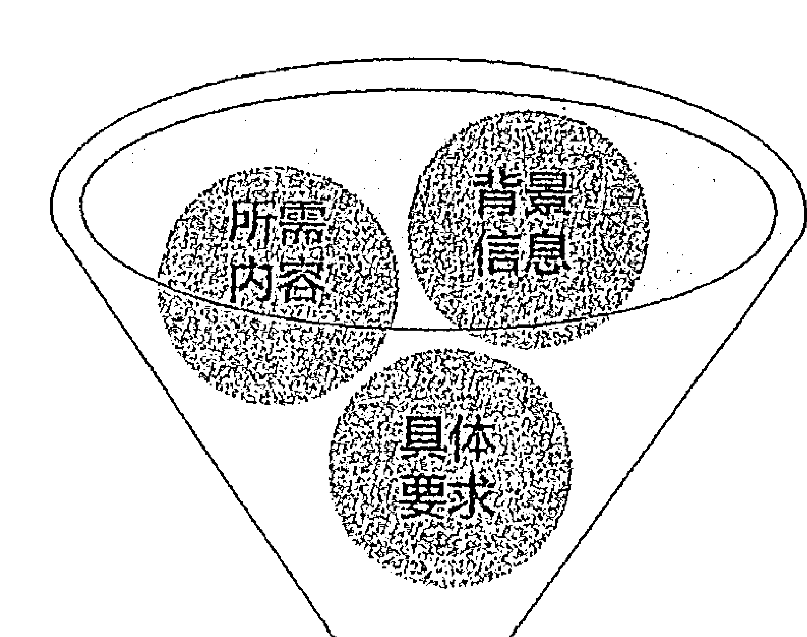
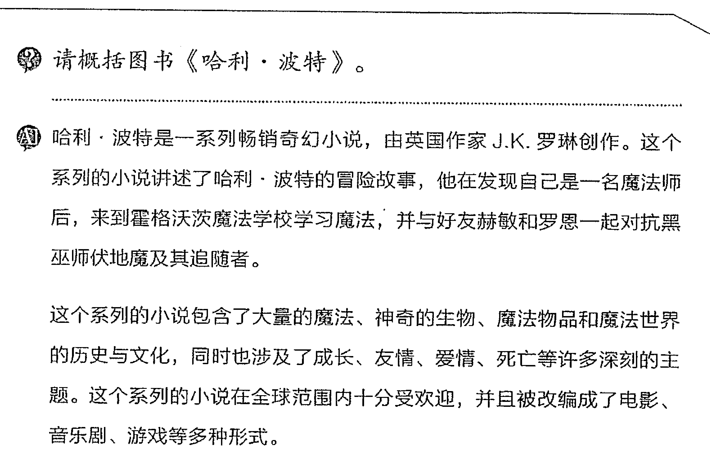
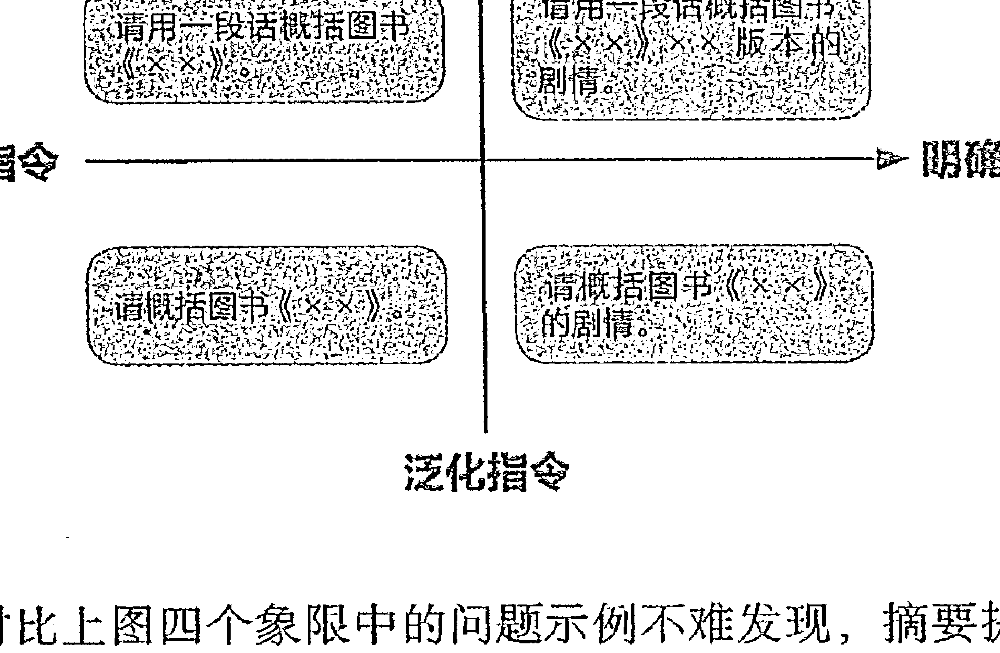

# 让 AI 真正听懂你：提问才是效率开关
# 第一部分
# 入门
# 六种常用提问方式速览
# 1 指令式提问：把话说全，AI 才不瞎猜
和 AI 交流其实就像给同事派活。同样一个活，交代清楚的人，返工最少。看一个对比：

普通领导：最近要和 XXX 品牌合作，出个宣传方案，后天给我。
优秀领导：XXX 品牌要和我们合作，正好赶上五一劳动节，他们想借节日推新品，需要一个节日宣传方案。主要面向 25 到 35 岁的女性，要求列出节日三天每日的宣传安排，用 PPT 呈现，不超过 10 页，周五下午 6 点前发我。

哪个更容易落地？信息完整、标准明确、时间点清楚，下属不用反复确认就能开干。AI 也一样，给出期望结果、工作规范和截止要求，理解偏差就少，效率自然上去。

向 AI 提问时，指令越具体，产出越贴近预期。指令式提问的核心就是提前把问题边界和交付要求框住，引导出更有针对性的内容。

好的指令通常遵循四条经验：
先用经典框架理清思路，比如 5W，让表达有条理。
需求多时就分行写，每条单独突出，避免大段文字让模型抓不住重点。
多用短句，少用长句，信息更干净。
多用量化或具体场景词，比如不要说“不要太长”，直接说“控制在 300 字以内”。

# 参考框架：5W
| 英文 | 中文含义 | 提问角度 |
| --- | --- | --- |
| Why | 为什么做 | 这件事的动机和目的 |
| What | 做什么 | 任务的具体内容 |
| Who | 为谁做 | 参与者或目标对象 |
| When | 何时做 | 执行时间或截止节点 |
| Where | 在哪做 | 发生场景或渠道 |

# 场景示例：写营销活动策划案
小李要为牙刷品牌写五一劳动节营销策划，提升新品销量。

不清晰的说法：我们最近和某牙刷品牌合作，请帮我写一个五一劳动节的营销活动策划案。
清晰的说法：
Why 最近要和某牙刷品牌合作，五一劳动节将至，对方需要一份营销策划案。
Where 活动在线上某平台进行，主要在对方自营店宣传。
What 需要一份营销活动策划案，包含五一假期三天的活动主题和宣传细节，结构要求活动背景、目标、策划、预算、效果评估、总结。

清晰指令后，AI 能直接给出活动时间 4 月 29 日到 5 月 1 日，三天主题分别是“出差神器轻松拎走”“轻松更换换刷无忧”“充电一次续航一个月”，并配宣传方案和评估。

# 场景示例：拟写文章标题
不清晰：请根据“人工智能对职场沟通的影响”写几个标题。
清晰：请围绕“人工智能对职场沟通的影响”给出 10 个标题，要求标题里体现具体读者群，信息对读者有价值，读者群包括创业者、营销人员、商务写作人群等，每个标题不超过 25 字。

# 场景示例：朋友圈种草文案
不清晰：我想在朋友圈推荐 XXX 产品，帮我写个种草文案。
清晰：我想在朋友圈推荐 XXX 产品，请按指定框架写一条号召用户行动的种草文案。

AI 容忍度高，不会抱怨，但指令模糊时只能给出 60 分甚至不及格的结果。问题不在模型，在于提问方式。

指令式提问应用很广。几个可迁移的例子：

# 撰写会议议程
不清晰：帮我写个会议议程。
清晰：请按以下结构写会议议程：1.会议开场 2.上半年工作总结 3.项目进展汇报 4.活动介绍 5.会议讨论 6.会议决议，最后用表格呈现。

# 创作短视频脚本
不清晰：帮我写个家庭教育短视频脚本。
清晰：请创作一个 1 分钟的短视频脚本，主题是家庭教育如何避免孩子形成讨好型人格，受众是 6 到 15 岁孩子父母，脚本要让他们意识到危害并学会鉴别与规避，风格为情景剧结合知识讲解。

指令式提问适合需求明确、流程标准化的工作场景，比如工作计划、培训大纲制作等。

# 拓展应用：用 SCQA 梳理指令
SCQA 模型能让背景更清晰：
Situation 情景：任务背景是什么
Complication 冲突：已有信息或差距
Question 疑问：现在要完成的任务
Answer 回答：参考案例或期望方向

如销售总监要制定季度 500 万销售方案，通过 SCQA 把目标、现状、问题、参考案例都说明，AI 给出的培训、促销、老客户维护、新客户开发、数据分析等行动计划会更贴合。

# 2 角色扮演式提问：给 AI 一个专业身份
为 AI 赋予身份后，输出会更贴合专业语境和真实需求。

素食营养建议的对比能说明问题。直接提问得到的建议偏通用，设定营养师身份后，食材搭配、调味建议、营养说明会更专业。

# 新媒体选题策划对比
未设身份：最近 AI 应用很火，我想介绍 AI 在新媒体写作的应用，给 10 个选题。
设身份：你是一位资深新媒体文案创作者，请给出 10 个关于 AI 在新媒体写作应用的选题。
设身份后得到的选题更聚焦“优化内容提升效率”“AI 提升品牌故事吸引力”等操作性方向。

# 健身计划对比
未设身份：帮我制定健身计划。
设身份：假设你是我的私人健身教练，请帮我制定健身计划。
未设身份给出 6 周每周 5 次 45 分钟的有氧力量拉伸安排；设身份后给出 8 周计划，结合有氧和力量，包含休息日安排，并提示后续进阶。

常见身份参考：
会计：扮演专业会计为小企业制定成本节约财务计划
诗歌创作者：以“梦想中的未来”为主题创作现代诗
校对人员：检查文本书写语法标点错误并给出修改建议
数学老师：用通俗语言解释概率概念
编剧：以巴黎为背景写浪漫电影剧本

角色扮演既适合专业门槛高的任务，如营养食谱、健身方案，也适合需要想象力的创作。

# 典型应用一：课堂教学提效
第一步让 AI 扮演学生，预判学习难点。以传播学“拉斯韦尔模式”为例，AI 会指出过于抽象、要素复杂、实际应用难三点难点。
第二步让 AI 扮演老师，用具体案例解释传播者、信息、媒介、效果、受众五要素，帮助教师备课更精准。

# 典型应用二：商务谈判
让 AI 扮演商务谈判专家，用户提出合作疑虑，AI 用谈判技巧回应，帮助快速找到针对性话术，提升谈判专业度。

# 第一部分：6种高效提问法入门

作为一名商务谈判顾问，我会用专业的话术帮你化解合作疑虑，争取双赢局面。请先说出你的顾虑，我们就可以开始对话了。

你说我们的产品在市场上属顶尖水平，可价格确实偏高，即便量大采购成本压力也不小，性价比让人犹豫。

完全理解你的考量，关于质量与成本我做几点说明。

第一，重在产品的硬实力。价格虽然偏上，但口碑和认可度在行业内是建立起来的。我们持续投入研发和创新，让使用寿命、稳定性以及功能表现都达到较高水平，最终给到的是更持久的使用价值。

第二，价格之外我们提供配套增值支持。比如个性化方案、技术协助、操作培训及售后服务等。专业团队会全程配合，帮助你把产品效能发挥到最大，进而提升运营效率和市场竞争力。

第三，采购成本可以讨论。我们能根据长期合作协议和批量需求做价格让利，也可以在付款节奏和条件上协商，给你的财务安排减压。我们的目标是找到一个双方都能接受的合作模式。

第四，公司本身具备稳定性和成长性。选择我们等于选择一家信誉良好、发展动力的伙伴。我们希望建立长期关系，携手成长并尽力确保你在合作中获得最大收益。

希望以上解释能缓解你的顾虑，也欢迎继续交流看法，共同敲定合作方式。

# 3. 心理疏导：用角色扮演缓解内心烦恼

当下生活节奏快，很多人常年承载压力，或多或少出现心理困扰，有些话题也不方便对身边人开口。这时候用角色扮演式提问就能提供一个安全的倾诉空间。下面看一个实操案例。

请你扮演心理咨询师，和我聊聊，帮我排解一些烦恼，可以吗？

当然可以，我很乐意以心理咨询师的身份和你交流。请说说你现在的困扰，我会尽力陪伴并给出建议。

我最近工作压力特别大，业绩完不成，整天担心被裁员，领导似乎也不认可我，经常失眠。

听起来你正处在工作压力和焦虑的循环里，这其实很常见。先深呼吸，放松一下，我们慢慢梳理。

压力的来源你已经提到了：目标没达成、担心失业。这会让人不安甚至失眠。请记住，适度的压力存在于职场，但过度就会损害身心。

几条可操作的缓解思路：

+ 制定可执行的绩效目标。确认目标是否现实，如果觉得过高或不切合实际，可和上级沟通，争取指导与资源支持。
+ 主动寻求支持。和同事或朋友聊聊你的感受与困境，不同视角的建议往往能打开思路。
+ 做好时间管理。列出优先级，先处理关键事项，也要为自己预留休息放松的时间，合理分配能明显降低焦虑感。

最重要的是，记住你不是一个人面对这些问题。很多人在职场都会经历类似挑战，保持积极心态、争取支持、给自己恢复的时间，情况会逐步改善。如有需要，我随时继续倾听。

# 4. 游戏设计：让AI生成角色对话

角色扮演游戏流行度很高，玩家扮演虚拟人物进行冒险、解谜和社交。用角色扮演式提问，可以快速产出人物对白和剧情。看下例。

假设我们要做一款三国题材游戏，让AI生成一段角色对话。

我们处在三国背景，我是貂蝉，你是吕布。现在开始互动。

没问题，我来扮演吕布，可以开始了。

貂蝉：吕将军，眼下四面受敌，局势危急，该如何自处？

吕布：貂蝉莫怕。虽形势紧张，我有信心护你周全。我们可以挑动敌方内部矛盾，制造可趁之机，同时借助地形采取守势，为盟友争取时间。

貂蝉：可敌军兵力强盛，我们该如何抵挡？

吕布：要用灵活的战术对抗。我会亲自带兵，发挥骑兵机动和火力优势，也可寻求其他名将联手，共同分担压力。

貂蝉：将军如此信任我，我愿全力效力，若有可能我想亲上战场出力。

吕布：你的勇气我很敬佩，但鉴于你的特殊身份，更适合留在后方提供情报与谋略。你的智慧能帮助制定更优策略，你的存在本身也能鼓舞士气。

以上就是一段示例对话，如需继续角色扮演或调整设定，随时告诉我。

注意事项

+ 角色扮演式提问可与指令式提问结合使用，明确身份加上清晰指示，得到的结果会更精准。
+ AI的知识库有限，在医学、法学、前沿研究等专业领域，即使赋予专家身份，回答仍可能不准确，需谨慎甄别。

# 3 关键词提问：让回答更具针对性

设想一个场景：领导交代你负责一个竹筒奶茶新项目，你对起步点没把握，会怎么问？

提问一：领导，这个项目我没接触过，该怎么做呀？

这样问，领导可能无法给出明确指引，甚至会怀疑你的执行意愿。

对比2：

关键词模糊
如何备考？

关键词具体
怎样通过自学考上大学？

+ 确认考试内容：了解范围、结构、难度
+ 制定学习规划：结合内容和时间安排
+ 准备资料：教材、笔记、练习题
+ 积累知识：按计划逐步学习
+ 做模拟题：检验掌握程度

+ 了解自学考试政策：各省规定差异
+ 选择院校专业：结合兴趣与职业规划
+ 制定学习计划：自主学习需明确节奏
+ 准备考试：持续积累知识技能
+ 参加考试：通常分初试与复试

对比3：

关键词模糊
如何赚到第一桶金？

关键词具体
新媒体编辑如何在五年内月入过万？

+ 找工作：投递简历、面试获得首笔收入
+ 兼职打工：在校园、社区等兼职赚零花
+ 利用技能变现：绘画、编程、翻译等

+ 专业素质：优秀新媒体编辑的核心能力
+ 等等

更多关键词提问示例：

例：生成一张照片
关键词模糊：帮我生成一张黄昏的照片。
关键词具体：帮我生成一张长宽比4:6、油画风格的海上落日照片。

例：撰写推文
关键词模糊：帮我写一篇职场推文。
关键词具体：帮我写一篇面向25岁左右职场人、关于领导力的约1000字推文。

例：创作一幅画
关键词模糊：帮我画一幅向日葵油画。
关键词具体：帮我模仿凡·高的风格，画一幅向日葵油画。

拓展应用

1。SEO：让AI优化网站关键词
在线教育公司想提升职场技能类内容的搜索排名，需要10个热门职场关键词。

+ 职业技能提升
+ 职业发展
+ 职场竞争力
+ 领导力培训
+ 沟通技巧
+ 团队合作
+ 时间管理
+ 项目管理
+ 人际关系
+ 求职技巧

2。数据挖掘：快速定位关键信息
分析师把数据交给AI，用关键词指令抽取要点。

电商数据分析：销售数据、×商品、关键因素 → 请找出×商品最近一周销售数据并列出影响因素
金融市场分析：×股票、历史价格走势、规律 → 请找出×股票过去一年价格走势并总结规律
社交媒体分析：×社交平台、互动情况、需求 → 请找出×平台近一个月用户互动情况并提炼需求

注意事项

+ 关键词越抽象，理解越宽泛，歧义越多；越具体，答案越贴合预期。
+ 使用前需对领域有一定了解，先梳理核心词。
+ 可与角色扮演、指令式提问结合，获得更精准的结果。

# 4 示例式提问：让AI快速get你的需求

无论职场还是生活，表达不清晰都会导致误会。
场景一：设计师多次返工，甲方说“要五彩斑斓的黑”，设计师不知所措。
场景二：女友嫌礼物没少女感，男友只想到粉色。

问题根源都是没有参照物，给出示例是解决办法。给AI也是同理。

未提供示例时的回答。
帮我写5个小红书笔记标题，围绕眼霜推荐。
+ 眼霜盘点：五款热门眼霜轻松对抗黑眼圈和细纹
+ 专业推荐：值得投资的五款眼霜，让双眼焕发青春
+ 深度解析：五款明星眼霜，专家教你选购
+ 新手入门：性价比高的五款眼霜推荐

提供示例后的回答。
你现在是优秀的新媒体文案创作者，我发5个爆款标题，请总结共性并应用。
1. 18款眼霜大合集！不同年龄、眼周问题怎么选？
2. 好用不踩雷的眼霜，去黑眼圈、抗皱推荐
3. 有效改善黑眼圈的眼霜，我终于找到了！

总结共性：
+ 针对性强：按年龄、问题细分
+ 情感化表达：好用不踩雷、终于找到等引发共鸣
+ 第一人称视角：突出真实体验

有了示例，AI生成的标题更贴合平台调性。

例：写口播脚本
未提供示例：主题如何避免孩子讨好型人格，生成开头很程式化。
提供示例：先学习两个爆款口播脚本的共性，再创作。结果更口语化、更有钩子，例如“你知道吗？讨好型人格可能让孩子一生焦虑……跟着我看看这五种实用方法”。

例：信息反馈
Before：给学员自我介绍写反馈，回复平淡。
After：先给两个回复示例，让AI模仿语气与结构，回复更温暖、更有针对性。

没有现成示例时，可先让AI生成一个结构示例确认后再创作。

例：写商业计划书
先要结构示例：概述、市场分析、产品或服务、营销计划、经营模式和财务计划、运营和管理、风险和机会、总结和建议
确认后再按此框架填充内容，完整度大幅提升。

例：生成论文大纲
Before：请写一篇“计算机器与人工智能”论文，直接生成摘要、引言、起源等，但层次不足。
After：先确认大纲结构，再套用题目，保证逻辑完整。

大模型提问实操笔记：让模型真正好用的写作手记

3. 人工智能核心概念
3.1 机器学习要义
3.2 深度学习脉络
4. 人工智能技术方向
4.1 计算机视觉
4.2 自然语言处理
5. 伦理与社会挑战
5.1 数据隐私
5.2 失业风险
5.3 算法偏见
6. 总结

学术论文的通用骨架参考

不同方向与期刊对格式的要求并不完全相同，下面给出一个跨学科通用的模板供参考。

- 1. 封面页
论文题目
摘要
关键词
2. 引言
研究背景
研究问题或研究目标
研究价值
文献回顾
研究假设
3. 方法
研究设计
变量与测度
数据获取
数据分析
4. 结果
数据概览
# 结果解析
# 5. 讨论
# 结果解读
# 理论或实践意义
# 研究局限
# 后续研究的建议
# 6. 结论
# 研究主要发现的总结
# 强调重要性与潜在影响
# 实践或政策建议
# 7. 参考文献
# 列出所引文献
# 附录（可选）

请按此骨架撰写题为《计算机器与人工智能》的学术论文。

示例式提问在不同场景的应用技巧汇总

| 使用场景 | 操作诀窍 |
|-----------------|--------------------------------------------------------------------------|
| AI 绘图 | 可直接把自己偏好的图像作为参照提交给模型 |
3.4 财务摘要：提供企业财务数据概览，含预计销售额、成本、利润等。

（后续内容略）

# 2. 创意复刻：借助 AI 快速模仿风格

当前大多数生成系统都支持以图生图，其原理就是示例式提问，上传一张参考图即可得到相近的产出。

很多平台还内置示例模型，选取特定风格的模型后，系统能生成同类图像。以 Midjourney 的演示为例，先给出范例图像，系统据此扩产出更多相似作品。

# 注意事项

+ 1. 示例式提问要选对范例，确保示例具代表性且与问题高度相关。
+ 2. 提交示例后，可要求系统概括示例特征，以确认是否抓住关键点与细节。
+ 3. 选例时要把重点信息表达清楚，避免过多细节与无关信息干扰理解。

# 5 引导提问

# 让系统产出更多灵感

是否遇到过这种场面：

负责人把团队召进办公室，大家屏息等待，结果负责人说：“今天不谈项目，主要是想和大家聊聊下月活动的主题，自由发挥，有啥想法都说。”

经历过的人都知道，这是头脑风暴。

头脑风暴能带来更多新思路与灵感。面对棘手问题时，它不仅能提供多个解法便于择优，还可能提供全新的观察视角。

有了人工智能辅助，就不必再召集多人开会，因为模型本身就能完成头脑风暴，且知识覆盖更广、视角更多。

如何让模型参与头脑风暴？

关键在于引导“思考”。

想让模型给出更多点子，只需在想讨论的主题或问题前加上“让我们思考一下”。该提示会让模型输出更深度的文本，对常写作者很有帮助。

比如想写一篇关于人工智能对职场人群冲击的文章，却不知切入点，可这样提问。

> 让我们思考一下：人工智能给职场人群工作带来了哪些冲击？

模型对职场与工作的影响相当大，主要体现在以下几方面。

+ 1. 许多工作会被自动化。（具体内容略）
+ 2. 部分工作会被改造。（具体内容略）
+ 3. 新岗位会产生。（具体内容略）
+ 4. 生产力将得到提升。（具体内容略）

这种提问方式称为引导提问，是一种鼓励对方给出详尽、完整且带主观观点的提问方式。此类问题没有标准答案，需要回答者基于经验、观点与想法表达。

引导提问能让回答者在思考与作答时更深入，有助于产生新见解。

# 引导提问的特点

+ • 提问时应使用开放式问题，而非只能回答“是”或“否”的封闭问题，可激发更多选项与想法。
+ • 常以“为什么”“怎么样”“请描述”等开头，引导深入思考。
+ • 能促使回答者提供更丰富的信息，有助于更全面了解其想法与感受。

# 引导提问的应用示例

+ • 在你的职业生涯里，哪次经历影响最大？为什么？
+ • 你是如何解决这个问题的？请详细描述处理过程。
+ • 你认为未来五年内，该行业会发生哪些重大变化？

# 引导提问的句式与提示词参考

+ • 除“让我们思考一下……”，还可使用“让我们想一想……”“让我们讨论一下……”等。
+ • 继续追问以扩大思考范围。对模型给出想法后，可追问“这给了我一些新思路，还有别的想法吗”“在此基础上还能想到什么”等，让模型持续输出。
+ • 引导模型提供大胆且不合常理的想法。可说“不管想法多么疯狂，我都想听听”“想些天马行空的主意”，这有助于跳出常规思维。

# 更多引导提问的应用场景与参考指令

| 应用场景 | 参考指令 |
|----------------|--------------------------------------------------------------------------|
| 提供活动主题 | 让我们思考一下：关于人工智能对职场人工作的冲击，可以有哪些活动主题 |
| 提供短视频脚本创意 | 让我们思考一下：关于人工智能对职场人工作的冲击，可以策划哪些有创意的短视频 |
| 提供文章撰写思路 | 让我们思考一下：关于人工智能对职场人工作的冲击，可以从哪些角度写文章 |

# 拓展应用

# 1. 专家智囊团：让模型成为你的超级智囊团

现实头脑风暴的好处是，会议中每个人都能从自身视角出发，提出看法，便于多角度看问题。

那么个人如何拥有自己的团队一起头脑风暴？用模型即可。利用前面提到的引导提问可让模型以个人视角给出观点，模拟真实团队会议，从而得到多角度建议。看下面的示例。

> 假设我的智囊团内有3名专家，这3名专家分别是乔布斯、××和×××，他们都有自己的个性、世界观和价值观，对同一问题有不同的视角、看法和建议，我会在这里说出我的处境和我的决策，请你分别以这3名专家的身份和思维模式来审视我的决策，并给出评判和建议，听明白了吗？

> 是的，我明白您的请求。作为您的智囊团成员，我会用乔布斯、××和×××的思维模式来审视您的决策，并给出评判和建议。请告诉我您的处境和决策。

> 我们是一家在线教育公司。现在人工智能技术发展迅猛，催生了很多新工具，这给很多职场人士带来了很大的冲击，我们现在应该怎么做，才能有更好的发展？

> 作为您的智囊团成员之一，我将用乔布斯的思维模式思考，给出我的建议。

乔布斯的建议如下。

企业成功的关键在于创新和改善用户体验。基于您的情况，您可以考虑从以下几个方面应对人工智能技术的影响。

首先，您可以通过重新设计课程，提供更具个性化的教学内容和体验，满足学员的不同需求。这样，您的课程就能够更好地适应市场的变化和需求。

（后续内容略）

# 2. 职业生涯规划：让模型成为你的职场导师

借助引导提问，职场人士可以更好地规划职业生涯。

比如在教育培训行业，职业生涯规划师可以利用模型提升效率。

举例如下。

假设你是一名即将毕业的大学生，对于自己未来的职业规划充满困惑，也不知道该如何向模型表达困惑，那你可以这样试试。

从现在开始，你是一位苏格拉底式的导师，我是你的学生。你不会直接给出答案或者结果，而是会引导学生思考并一步步得出结论。你会不断调整并拆分问题，以适应学生的理解能力。

好的，让我们开始吧！请问你有什么想要讨论或者探究的问题呢？

我想知道自己适合做什么工作。

好的，那我们可以一步步来，从探讨你的兴趣和价值观开始。你觉得自己对哪些事情感兴趣？什么是你特别喜欢做的？

我喜欢研究电脑软件的新用法。

非常好！你对研究电脑软件的兴趣很强烈，这可以让我们往更具体的方向探讨。

接下来，我们可以探讨一下你的技能和经验。你做过哪些与电脑软件相关的工作或者项目？你觉得自己在这方面有哪些专业技能和经验？

嗯，我曾经用Photoshop给别人设计海报，还挣了300元。

很好！那么你有使用Photoshop这一设计软件的技能和经验，这是一项很不错的专业技能。此外，你也有一些与客户沟通和项目交付相关的经验，这也是非常重要的。

那么接下来，我们可以探讨一下你的个性特点和价值观。你觉得自己是一个什么样的人？你在工作或者生活中注重哪些价值观？（后续内容略）

通过让模型引导你思考，而不是直接给出参考答案，你可以更深入地了解自己，做出更适合自己的职业或人生规划。

与以上这种引导提问方式效果类似的方式叫作苏格拉底式提问，又称苏格拉底式教学法，是古希腊哲学家苏格拉底的极具代表性的提问方式。这种方式通过一系列有针对性的问题引导对话者深入思考，以发现知识、挖掘观点和促进理解。苏格拉底式提问强调质疑、怀疑和反思，追求真实和理性的知识。

# 苏格拉底式提问的主要特点如下。

+ * 引导性：通过提问引导对话者思考问题，而非直接告诉他们答案。
+ * 层层递进：问题由浅入深，逐步引导对话者深入探讨话题。
+ * 提倡反思：鼓励对话者对自己的观点、信仰和假设进行反思和审视。
+ * 逻辑性强：关注论证的逻辑性、一致性和合理性，追求真实的和有根据的知识。

苏格拉底式提问常见的6种类型如下。

+ * 澄清问题：为了探讨一个问题，明确概念，你可以问模型“可不可以举个例子，说明你表达的意思”.
+ * 检验假设：为了进一步了解对话内容的真实性，你可以问模型“你如何证明这个假设”.
+ * 理性分析：为了探究背后的原理或者真相，你可以问模型“能解释一下原因吗”或者“你是如何得出这一结论的”.
+ * 检验观点：为了让模型对其回答进行分析，你可以问模型“你提出的这个方案有哪些优缺点”.
+ * 开阔思路：为了引导模型从不同视角看问题，你可以问模型“对于这个问题你觉得其他人可能会怎么看”.
+ * 思考后果：如果想知道模型的回答会带来什么后果，你可以问模型“你觉得你这个假设会有什么结果呢”.

# 注意事项

1. 我们可以让模型扮演自己想咨询的领域的专家，但是要注意，这位专家一定要是名人，否则网上没有相关数据，模型就无法从这名专家的视角给出回答。比如想要模型提供商业分析方面的帮助，就可以让模型扮演国际知名企业的创始人；如果想要模型提供情感咨询类的帮助，就可以让模型扮演国际知名的心理咨询师。
2. 提问中涉及的专家最好分布在不同的领域，这样模型给出答案的视角更多样，这些答案对你的帮助也会更大。
3. 角色的数量可以自由更改，如果想要获得更多不同的视角，可以增加专家的数量。
4. 模型由于回复字数有限制，有可能不能一次性给出完整的回答，这个时候可以回复“继续”两个字，它就能给出剩下的回答。

# 6 发散提问

让模型提供多种创意思路

发散提问是指尽可能从多个角度提出问题，从而获得更多的信息和思路，避免视角单一带来的局限性。

在借助模型创作的过程中，发散提问有哪些妙用？

当我们缺乏灵感时，使用发散提问可以让模型帮我们挖掘更多创意和想法；

当我们面临一个复杂问题时，使用发散提问可以让模型帮我们找到更多种可能的解决方案；

当我们需要深入研究或分析某个主题或领域时，使用发散提问可以让模型帮我们从不同的角度进行探索，挖掘新的信息；

当我们需要做决策或规划时，使用发散提问可以让模型帮助我们分析不同的选项的优劣，及其可能导致的结果和带来的影响；

………

总之，使用发散提问可以让模型帮助我们拓展思路、打破常规思维，从而能更具创新性和创造性地思考问题。

可是很多人误以为发散提问就是让模型漫无目的地作答，例如，当想要借助模型生成一些具有创意的文章标题时，不懂提问技巧的人可能会像下面这样问。

> 帮我生成一些有创意的文章标题。

当然，以下是一些有创意的文章标题，供您参考。

+ 1. 如何在繁忙的生活中保持创造力?
2. 未来五年中，我们的工作将发生哪些变化?
3. 为什么创新是企业成功的关键?
4. 你的自我价值观如何影响你的职业生涯?
5. 用设计思维解决现实生活中的问题
6. 新科技如何改变我们的未来?
7. 创业者需要了解的八大领域
8. 社交媒体对个人和社会的影响
9. 以人为本的商业模式如何影响未来的企业?
10. 如何利用数据分析提高业务效率?

不难发现，这样提问得到的回答确实具有很强的发散性，但我们很难快速得到符合需求的内容。

上边的提问过于注重发散性，而忽略了关键提示。

什么是模型所需的关键提示？

主要有三点：背景信息、所需内容和具体要求。

把这三点合并为一个整体，即为一个好的发散问题。

# 例：提高业绩

Before 常规提问

如何提高销售业绩？

After 发散提问

我是一名女装店店员，请给我 5 个能提高销售业绩的方法，要求：操作简单易学。

# 例：取标题

Before

常规提问

After

发散提问

帮我取5个关于蓝牙耳机的标题。

请帮我取5个优质的微信公众号文章标题，文章主题是“推荐几款蓝牙耳机”，要求如下。

1. 突出重点：标题带有一些形象生动的词语或者数字。
2. 简短精练：标题的字数在30以内。
3. 引人入胜：标题能够引起读者的兴趣和好奇心，使读者想要进一步阅读文章。

# 拓展应用

使用发散提问，模型可以帮助我们从多角度对问题进行探索分析，拓展思路，打破固有的思维模式。

在一些需要创意、创新、思考和表达的场景下，非常适合运用发散提问。例如以下几个常见的应用场景。

# 1. 资料搜索：获取海量素材

在搜索文字、图片资料时，如果很难找到想要的内容，可以尝试更换搜索时所用的关键词。

不妨让模型提供更多的关键词。

例如，当利用搜索引擎搜索与“时间”相关的图片时，直接输入关键词“时间”所获得的图片有限，我们便可以让模型帮助我们发散联想一些能表达“时间”的具象事物。

[PAGE 70]

我们可以结合背景信息、所需内容和具体要求这三点向模型提问。

我需要用搜索引擎搜索与“时间”相关的图片（背景信息），请给我5个与“时间”相关的关键词（所需内容），以便我能搜索到更多能表达“时间”的具象事物的图片（具体要求）。

+ 1. 钟表：用“钟表”“时钟”“怀表”等词汇进行搜索，可以找到各种不同类型和风格的时钟图片。
2. 日历：用“日历”“月历”“年历”等词汇进行搜索，可以找到与日期和月份相关的图片，以表示时间的流逝。
3. 沙漏：用“沙漏”“计时器”等词汇进行搜索，可以找到与沙漏相关的图片。沙漏是一个传统的时间测量工具，可用于表示时间的逝去。
4. 时间线：用“时间线”“历史线”等词汇进行搜索，可以找到与时间轴相关的图片，以展示事件发生的顺序和持续时间。
5. 秒表：用“秒表”等词汇进行搜索，可以找到与秒表相关的图片，以表现竞赛或运动等场景。

可以看到，模型能够生成更多关键词，利用这些关键词，我们可以快速获取丰富的素材，大大提高搜索资料的效率。

# 2. 头脑风暴：生成有创意的金点子

几乎每个行业或领域都需要有创意的金点子，例如：

在市场营销中，好的创意可以让广告、宣传活动等吸引目标受众、提高品牌知名度和销售额；

在产品研发过程中，好的创意有利于企业改进现有产品或设计全新产品，以满足市场需求；

当面对经营中的常见问题或挑战时，企业也可以通过创新的解决方案提高效率、降低成本或改善流程；

…………

以策划年会表演节目为例，先列出发散提问中所需的关键提示。

(1) 背景信息：公司即将举办年会；
(2) 所需内容：10个表演节目；
(3) 具体要求：互动性强。

问答内容如下。

> 下个月公司要举办年会，帮我策划10个在公司

# 3. 教学培训：拓展思路

授人以鱼不如授人以渔。在教学培训中，教师或培训师不仅要向学生传道、授业、解惑，还需要教会学生如何拓展思路、独立思考。

不妨试试用发散提问让模型生成一些发散问题，例如：

我是名PPT培训师，请给我10个课堂上的发散式问题，以帮助学员学会独立思考、解决PPT制作问题。

1. 如果你要设计一个引人注目的封面，你会选择哪些元素和颜色来吸引观众的注意力？
2. 当你的幻灯片需要使用图片时，你会如何选择适当的图片，以增强信息传达效果？
3. 如果你想让观众积极参与互动，你会在幻灯片中加入什么元素或交互方式？

（后续内容略）

# 演示时间紧张时，如何精简幻灯片又不失重点

课堂里使用这类发散式提问，能够有效拓宽学生思维，锻炼他们自主发现、思考并解决问题的能力。

# 使用提示
1. AI 脑暴出的创意往往很跳脱，落地前需结合实际情境进行筛选和取舍。
2. 当模型输出未达预期时，可补充更多背景或情境信息，通过反复引导和迭代，使结果逐渐趋于满意。

# 第二部分

# 进阶：让 AI 协助拆解难题

# 7 问答式提问：让 AI 给出明确回应

日常工作、学习和生活中常会遇到各种疑问，比如：
今天天气怎样？
长期熬夜有哪些危害？
萤火虫为何会发光？
红酒风味和品质是否受产地影响？
Irregardless 这个词是什么意思？

面对需要查证或涉及专业知识的问题，可把 AI 当作外脑式的搜索助手，快速获取信息、解决问题并提升效率。

提出高质量问题的关键，首先要了解问答类问题的常见形态。

# 类型一：事实型问题（X 是怎样的？）
眼泪为何偏咸？
一年到底有多少天？
赤道的周长是多少千米？

# 类型二：概念型问题（X 的含义是什么？）
领导力究竟指什么？
最大公约数的定义是什么？

# 类型三：比较型问题（X 与 Y 有何差异？）
柏拉图和亚里士多德的政治思想有哪些不同？
印象派与立体派的艺术风格有何区别？

# 类型四：因果型问题（X 会对 Y 产生什么影响？）
持续的压力会对身心健康造成哪些后果？
气候变化和自然灾害如何影响地球环境？
原子与分子的运动方式怎样决定物质性质与状态？

# 类型五：假设型问题（如果 X，会怎样？）
假设人类能够飞行，会催生哪些新职业？
如果世界没有摩擦力，会出现什么情况？
如果 AI 拥有情感，它最先会做什么？

# 类型六：方法型问题（怎样完成 X / 解决 X 问题？）
- 如何开展一次有效的问卷调研？
- 如何做好向上管理？
- 怎样提出一个高质量的问答式问题？

# 类型七：意义型问题（X 对 Y 有何价值？）
人类存在对地球意味着什么？
教育的意义在哪里？

不同类型的问题还可以组合使用，以获得更丰富的信息。

例如，事实型 + 意义型：
企业的社会责任是什么？企业对经济发展又起什么作用？

假设型 + 方法型：
假设现实中存在哆啦A梦的记忆面包，人类的记忆力能否因此提升？我们该如何增强记忆力？

常见组合参考：
事实型 + 意义型：X 是什么？它对 Y 有何意义？
概念型 + 比较型：X 的含义是什么？X 与 Y 有何区别？
概念型 + 因果型：X 的含义是什么？X 会对 Y 产生何种影响？
假设型 + 方法型：假设 X 会怎样？如何解决 Y 问题？
……

问答式提问的适用场景很多，例如：

| 场景 | 示例 |
|------------|----------------------------------------------------------------------|
| 用 AI 产出配音 | 事实型 + 方法型：有哪些 AI 配音方案？这些方案怎样使用 |
| 用 AI 设计产品 | 假设型 + 比较型：假设你是一名设计专业大一新生，选购电脑时更看重外观还是性能 |

# 拓展应用

使用问答式提问时，AI 的优势体现在：

◎ 知识覆盖面广
几乎能覆盖科学、历史、文化、技术等各领域，输出具备一定准确性。

◎ 擅长拆解复杂问题
能把难题用通俗语言解释清楚，并产出连贯流畅的文本。

◎ 响应速度快
短时间内即可给出答案。

基于这些特点，可在以下场景使用问答式提问。

# 1. 查询知识：快速学习各学科

向 AI 询问特定学科问题，获取解释、定义、示例和背景，帮助快速理解。

示例。
科学：
量子力学的基本原理有哪些？
基因编辑技术是什么？它对人类有何影响？

历史：
古埃及文明有哪些特征和成就？
文艺复兴是什么？它对欧洲产生了怎样的影响？

文学：
最近哪位作家获诺贝尔文学奖？
现实主义文学的特点和代表作品有哪些？

艺术：
印象派绘画风格有何特点？代表画家是谁？
文艺复兴时期有哪些著名雕塑家？

经济：
哪些因素在影响经济增长？
现代经济学中有哪些重要思想家？

# 2. 语言学习：高效掌握外语

学习外语或翻译文本时，可围绕语法、词汇、翻译提出问答式问题，获取学习资源、方法以及翻译支持。

可以这样问：
英语主谓宾结构的使用规则是什么？有哪些例子？
英语有哪些时态？各自怎么用？
“How are you?” 中文怎么说？
如何提升英语口语流利度？
怎样克服语言学习中的困难和挫败感？

# 使用提示
1. 虽然 AI 知识库丰富，但在法律、医疗等专业领域只能作参考，不能替代专业人士。
2. 遇到复杂问题时，建议用简洁、清晰、明确的表述，便于 AI 理解并给出更准确的答案。

# 摘要提问：

# 快速压缩长文本

摘要提问的典型场景包括：
阅读新闻报道、学术论文等资料并快速抓住核心时；
领导发来大段任务要求，自己抓不住重点时；
想快速了解一部小说的关键剧情时；
……

此时可用摘要提问让 AI 压缩长篇信息，提炼要点、节省时间、提高效率。

但提问方式不当，回复往往很笼统。

比如下面这个案例，原意是想让 AI 快速读完一本书，却因提问不精准导致回答空泛。

请概括图书《哈利·波特》。

哈利·波特是一系列畅销奇幻小说，由英国作家 J.K. 罗琳创作。这个系列的小说讲述了哈利·波特的冒险故事，他在发现自己是一名魔法师后，来到霍格沃茨魔法学校学习魔法，并与好友赫敏和罗恩一起对抗黑巫师伏地魔及其追随者。

这个系列的小说包含了大量的魔法、神奇的生物、魔法物品和魔法世界的历史与文化，同时也涉及了成长、友情、爱情、死亡等许多深刻的主题。这个系列的小说在全球范围内十分受欢迎，并且被改编成了电影、音乐剧、游戏等多种形式。

那么，怎样算好的摘要提问？

可借助“坐标轴思考法”来设计问题。

对比四个象限的示例不难看出，好的摘要提问应带有明确且量化的指令。

用优化后的问题提问，得到的回答会更符合预期。

> 请详细概括《哈利·波特》系列第一部的剧情。

> 《哈利·波特与魔法石》是系列首部，故事围绕哈利的成长与他在霍格沃茨的奇幻历险展开。

> 幼年时哈利遭遇变故，双亲离世，自己却奇迹存活，随后被送到亲戚家抚养，被姨母姨父虐待，并被告知父母死于车祸。

> 11岁时一封神秘信件揭开身世：哈利是一名巫师，受邀进入霍格沃茨。在校期间他结识了好友赫敏·格兰杰、罗恩·韦斯莱，也结下宿敌德拉科·马尔福。学习魔法、参与魔法游戏、接触奇异生物与魔法物品的同时，他还遇见了斯内普、麦格、邓布利多等神秘人物。

> 霍格沃茨隐藏着一颗传说可让人长生不老、获得无尽财富的魔法石。伏地魔的追随者食死徒也在寻找它，意图献给主人。

> 为守护魔法石，哈利与朋友展开惊险冒险，克服重重困难与陷阱——迷宫、魔法生物、谜题等，最终击败食死徒，保住魔法石，也揭开了伏地魔的部分阴谋。

> 该作凭借奇幻世界观、鲜明人物和扣人心弦的情节广受读者喜爱，是一部值得一读的魔法冒险故事。

通过图书概括的案例，可体会摘要提问和坐标轴思考法的用法。在其他场景中，也可同法提出量化、明确的指令。

# 例：信息提取

| 常规提问 | 优化的摘要提问 |
| :--- | :--- |
| 请精简以下文字。 | 请分点提取以下文字的重点内容。 |
| 我是 ChatGPT，一款由 OpenAI 公司开发的大型语 | 我是 ChatGPT，一款由 |
| （此处省略后续内容，按图片显示） | （此处省略后续内容，按图片显示） |

# 拓展应用

信息爆炸时代，我们接收大量资讯，其中很多是噪音。

用摘要提问可剔除冗余、抓取要点、提升学习工作效率。常见场景如下。

# 1. 知识库整理：让知识更清晰

建立知识库时常会堆积大量资料，文件、链接分散且过载。

例如搭建工作效率知识库，收集多篇长文时，可用摘要提问提炼精华或知识点。

可这样问：
> 请阅读以下关于工作效率的文章，围绕“如何提高工作效率”分点概括。（文章内容，略）

> 请精简以下文字，并用表格说明影响工作效率的因素有哪些。（文字内容，略）

再将 AI 产出的内容分类整理，就能得到条理清晰的知识库。

# 2. 目标梳理：让工作更有计划

面对繁杂的 KPI、领导要求、客户需求，工作常显得混乱。

此时可用摘要提问提炼会议、报表等关键信息，从繁杂中梳理脉络，快速确定目标和计划。

参考提问方式如下。

# 例：提炼客户需求

我是一名平面设计师，客户要求做一张产品宣传海报，请从以下需求中提炼出海报风格。客户需求如下。

海报目的：宣传新上市耳机。
目标人群：运动爱好者，20~35岁。
产品特点：防汗防水、佩戴稳定、适合运动。
文案：无线自由，释放激情。
场景：运动场上，活力运动者戴着耳机投入运动。
尺寸布局：A3或A2，竖版。
投放渠道：微博、小红书等新媒体。
其他要求：吸睛、色彩鲜艳。

提炼结果：
1. 动感活力风格：传递运动感，用动态线条、流畅曲线、运动元素营造氛围，配合渐变色彩、流动图形表达无线自由、释放激情的概念。
2. 年轻时尚风格：运用时尚排版、流行图标、年轻化元素，突出潮流属性，提升与年轻受众的契合度。

综合以上，可设计一张兼具动感活力、年轻时尚并突出产品特点的海报，在新媒体平台吸睛传播。

# 例：提炼领导期望

领导的这几段话表达了对我工作的期望，请帮我提炼下一步目标。

今天找你聊聊近期表现和成果。很欣赏你的创意和设计风格，很独特，给项目带来新鲜感和视觉冲击，客户也常赞赏，有助品牌影响力提升。

不过也有待改进。和客户沟通时，有时没完全理解需求。充分理解需求才利于后续沟通和设计，希望加强。设计过程中你可能过度强调个人审美，忽视项目整体目标，比如此前给××公司做的包装设计。个人审美重要，但团队协作、跨部门配合更重要，满足客户期待才是核心目标。我相信你能克服挑战。

作为优秀设计师，在团队中角色重要。不断学习成长也很关键。希望你积极参加相关培训，保持对设计趋势和新技术的关注。多与部门同事交流，分享经验灵感，有助提升水平。

今天说了很多，我对你很有信心……

提炼目标：
1. 提升客户沟通能力：更深入理解客户需求，在设计中准确把握要求，给出更精准方案。
2. 平衡审美与项目要求：在个人审美和项目整体目标间取得平衡，强化团队协作与跨部门配合，以满足客户期待为核心。
3. 持续学习成长：积极参与培训，保持对设计趋势和新技术的敏感，提升专业能力。
4. 加强内部交流：与同事多沟通、分享经验灵感，提升个人和团队效能。
5. 保持信心并适时求助：展现自信，必要时向领导和团队寻求支持，相信自己能解决问题。

注意：提问时勿泄露公司和客户商业机密，并保护个人隐私。

# 使用提示
1. AI 可对各种长度文本进行精简和关键信息提取。
2. 使用摘要提问时，最好提供：原始文本、摘要长度或字数要求、摘要类型（概括式还是详细式）。信息越完整，指令越明确越好。
3. 若产出摘要有误或过长，可指令其继续修改。

# 9 对话式提问：

# 让沟通更人性化

是否遇到过领导在微信发来“辛苦了”三个字，不知如何得体回复？

不必苦想，可用对话式提问让 AI 产出回复备选，自行挑选。

你可能这样问：
- 领导说“辛苦了”，怎么回？
- 回复可根据情境和上下文决定，以下是常见方式。
  1. 谢谢，我会继续努力工作的。
  2. 没关系，这是我的责任。
  3. 感谢您的鼓励，我会持续为团队贡献。
  4. 辛苦是值得的，团队协力才能取得成果。
  5. 谢谢关心，您的支持对我很重要。
  选择方式取决于你与领导关系、工作环境和个人风格。

优化提问：
和团队一起加班完成工作后，领导对我说“辛苦了”，我该怎么回？要求有礼貌、简洁明了，同时表达感谢。

可回复：
非常感谢您的关心，这是我们团队共同努力的结果。

这个回复有礼貌、简洁，同时表达了感谢并强调团队合作，展现你重视协作而非个人英雄主义，让领导感受到你的格局。

实际提问时，可从哪些维度补充背景信息？
可参考中心环绕图辅助思考。

具体来说，使用对话式提问时，为保障准确性和质量，可向 AI 给出：
· 对话主题：希望生成的对话主题是什么，例如旅游、科技、文化等。
· 对话角色：参与者的身份是什么，彼此关系如何。
· 对话场景：对话在什么情境下展开。
· 对话目的：希望达成什么结果。
· 对话语境：提供上下文，使 AI 产出连贯对话。
· 语言风格：期望的风格，如正式、轻松、幽默等。
· 对话长度：需要多长的输出。
· 参考资料：提供百科词条、相关文章、对话样本等。

实际使用时不必面面俱到，但心里要有数，随时调整优化问题，获得更满意的回复。

更多场景示例：
# 例：为短视频写对话
帮我写一段短视频脚本对话。
角色：领导A和员工B。
场景：快下班时领导要求加班。
目的：让员工有理有据、不得罪人地拒绝加班。
时长：1分钟。

# 例：直播互动对话
- 我是直播间主播，帮我写一段直播互动对话。
- 角色：主播和观众。
- 场景：视频直播间。
- 目的：推销原价299元、现价99元的口红。
- 风格：充满激情、有活力。

# 拓展应用

AI 具备强大的文本分析能力，可在特定情况下替代人类完成部分自动化对话。

同时 AI 学习能力强、发散性“思考”能力出色，产出的对话常带来惊喜。

# 1. 小说创作：让对话更真实

创作小说时需考虑：角色何时开口、说什么、如何让不同性格角色说出合适的话、如何处理每位角色的特殊表达……

从读者角度，还需思考：如何通过对话传递角色动机，如何通过对话刻画内心世界……

可见编写小说对话并非易事，需要丰富阅历和想象力。

遇到瓶颈时，可借助 AI 产出对话，让角色交流更真实、更符合个性特征。

# 2. 客服对话模拟：用角色扮演快速生成问答手册

客服工作的核心就是通过对话摸清客户诉求、给出解决方案并提供后续支持。

可以让AI分别代入客户与客服的身份，进行自问自答式的模拟对话，产出的素材非常适合整理成《客服常见问题问答手册》或《客服培训手册》。

提问的思路可以这样设计。以下仅展示AI的回答片段。

> 我是书店客服，请模拟一份客户与客服的对话，帮助我编撰《客服常见问题问答手册》。

客户：请问你们的网站支持电子书购买吗？

客服：您好，感谢咨询。是的，网站提供电子书购买。您可以通过搜索框或电子书分类找到心仪的书目，加入购物车后完成付款，就能获得下载链接或在个人账户里找到下载入口。

客户：实体书如果收到有质量问题或不满意，能退货吗？

客服：可以的。若实体书存在质量问题或您不满意，我们支持退货退款。请在收货后及时查看，并在规定时限内联系我们，我们会说明退货流程并按相关政策办理退款。

（后续内容省略）

# 注意事项

1. AI缺乏真实的人类情感，在模拟对话时难以精准把握情绪表达，容易产生偏差或误导。
2. AI生成的对话必须人工复核与优化，避免出现不当表述造成负面影响。
3. 采用对话式提问时要严格规避隐私泄露，加强隐私保护与数据安全意识。

# 10 信息一致性提问：让回答不跑题

在和AI交流时，不少人会发现AI有时一本正经地胡说，这往往源于提问时信息给得不够准确。

生活中也常出现类似情况。两个人聊电影，话题却渐行渐远，最后发现压根不是同一部片子，这就是信息不一致带来的沟通失误。

场景：A和B在聊电影。

A：你看过那种讲普通人最后成为英雄的电影吗？
B：我知道你在说《阿甘正传》，挺感人的！
A：不对，我说的是《蜘蛛侠》。

上例中，A的背景信息和B的理解不一致，导致误会产生。

若采用信息一致性提问，A应这样表述：

# 要确保信息一致，可抓住这3个要点

- 保持主题单一
同一次提问尽量只围绕一个主题，多个主题并列容易造成信息混杂，降低一致性。
- 提供足够背景
提问时补充相关上下文，能帮助AI更准确理解问题场景，从而提高回答的契合度。
- 分步拆解提问
遇到复杂问题可拆成若干简单问题逐一询问，让信息更清晰、一致。

把握以上要点，能有效提升沟通效率与回答准确性。

下面看两个具体例子。

# 例：投资建议：锁定单一主题

常规提问：风险承受能力中等，我应该投资什么？

信息一致性提问：风险承受能力中等，在股票投资上应关注哪些方向？

常规回答会给出股票、债券、基金等多类建议。

优化后回答会聚焦股票，建议采取长期策略，选择盈利稳健、基本面好的企业，注意财务状况、行业前景、管理层等综合评估，并提醒分散投资、关注市场波动及时调整。

限制在股票这一类目，有助于AI给出更具针对性的建议。需要说明的是，AI仅作辅助参考，并非专业投资建议。

# 例：编程学习：补充足够信息

常规提问：如何优化我的代码？

信息一致性提问：我用Python写了一个计算斐波那契数列的程序，目前用递归实现，运行比较慢，请给出优化思路或替代方案。

AI在信息不足时会要求补充代码、语言和问题细节。

在补充背景后，AI会建议改用动态规划或迭代，并给出迭代示例。

信息一致性提问多用于需要特定背景才能给出准确答案的场景，可帮助核验数据、条件、逻辑和规范的一致性，减少人为失误。

再看更多应用。

# 例：报告评估

常规提问：帮我分析这份研究报告的可行性。

信息一致性提问：这份研究报告的结果是否建立在正确的数据分析之上？

分析：常规提问让AI对整份报告做整体判断；信息一致性提问则让AI去核对结果与数据是否存在偏差，从而更有效地判断可行性。

# 例：软件代码检查

常规提问：帮我看看代码有没有bug。

信息一致性提问：这段代码的语法逻辑是否前后一致？

分析：常规提问范围太宽，AI难以聚焦；明确要求检查语法逻辑的一致性，能帮助AI更快定位问题。

# 例：产品检验

常规提问：产品设计思路是否存在缺陷？

信息一致性提问：产品设计思路与制造指南的规范是否一致？

分析：缺陷难以量化；要求核对设计思路与制造规范的一致性，则能让AI进行可验证的对比分析。

# 拓展应用

在信息核查、信息比对等任务中，信息一致性提问能显著提升效率和准确性。

# 1. 信息核查：让AI帮忙排查内容错误

AI不仅能核查外部信息，也能自查自身输出。

例如验证小说背景的史实准确性：

> 我写的小说设定在18世纪30年代的法国，主角的朋友是一位刚发明蒸汽机的科学家，这个设定合理吗？

AI会指出蒸汽机在17世纪末已有雏形，18世纪初经纽科门改进，主要在英国发展，与18世纪30年代法国的启蒙运动主线不符，并给出修改方向，如调整发明类型、改到18世纪初的英国、强化国际交流或加入启蒙思想家元素等。

# 2. 信息比对：利用AI知识库做内容对比

不少老师担心学生过度依赖AI写论文，于是让ChatGPT判断“这是你写的吗”。部分论文风格与AI高度吻合，最终被证实为AI生成。

# 注意事项

1. 使用前先明确问题范畴，确保AI能产出范畴一致的内容。
2. 问题信息越具体，AI分析越精准。
3. 根据回答质量适时调整策略，如补充上下文或重述问题。

# 11 信息整合提问：高效汇聚信息解决问题

在学习和工作中，获取信息是基础，整合信息才是关键。

假设你要调研两个竞争对手：

# 问答一：

以下是两家公司基本信息简述。

# A公司
1. 美国零售巨头，全球最大零售商之一，经营食品、家居、电子、服装等。
2. 模式涵盖大型超市和会员制仓储店，同时发展电商平台。
3. 主打低价，通过积极采购和供应链管理降本，靠规模经济取胜。
4. 全球多国设有分支，部分市场以合资方式拓展。

# B公司
1. 美国会员制仓储零售企业，成立于1983年，销售食品、家居、电子、家具等。
2. 仅限会员购买，会员费制帮助维持低价并培养忠诚群体。
3. 强调品质与购物体验，靠大宗采购和精简运营降本提效。
4. 分店遍布美国、加拿大、墨西哥、英国、日本等。

# 问答二：

请说明竞争对手A公司和B公司的市场份额、产品特点与价格策略。

A公司市场份额约11%美国，产品品类全、选择多、兼有自有品牌和高价位电子产品；价格策略为低价+价格匹配，依赖采购与供应链降本。

B公司美国市场份额约2%，在会员仓储领域具优势；产品以大容量、大宗包装为主；靠会员费+低价+高周转盈利。

第一种提问只能得到基础信息，第二种在基础上做信息分类，便于理解对手；若再要求跨板块对比，则更有利于制定针对策略。

信息整合提问是指将多源信息、知识点或观点融合梳理，以解决特定问题。其常见场景包括：

# 例：对信息进行分类

常规提问：红酒有哪些品种和产地？

整合提问：请按品种和产地对法国、意大利、西班牙的红酒进行分类。

# 例：提供建议

常规提问：如何减肥？

整合提问：请从饮食、运动、生活习惯三方面给出减肥建议。

# 例：制订学习计划

常规提问：如何提高英语听力？

整合提问：请按初级、中级、高级三阶段分别制定英语听力提升计划。

整合时可从以下角度切入：

⊚ 主题角度：围绕同一科技领域收集新闻、论文、专家观点进行综合。
⊚ 时间角度：按时间线整理事件演变。
⊚ 观点角度：汇集不同立场看法进行对比。
⊚ 跨学科角度：融合多学科文献形成综合结论。
⊚ 媒体角度：整合新闻媒体与社交媒体信息获取多维视角。

AI在获取、处理与整合信息上效率很高，常用于投资决策、旅游规划、故障诊断等。

# 1. 投资决策：让AI综合分析股票价值

从财务数据、产品线、创新能力、竞争对手等维度，帮我分析苹果公司股票的投资价值。

AI会说明这仅为参考，并从财务、产品、创新、竞争等方面分别阐述，最终归结为投资价值取决于对公司未来发展的预期与信心。

# 2. 旅游规划：整合平台信息规划行程

国庆长假，请整合马蜂窝、携程、去哪儿的旅游信息，分析景点、住宿、交通、餐饮，为一家三口推荐目的地并规划行程。

AI会据此推荐如江西婺源等亲子目的地，并给出行程安排，提示仅供参考。

# 3. 故障诊断：排查设备问题

我的笔记本无法正常启动，系统是Windows，听到连续嘟声，请帮忙诊断。

AI会推断可能为内存问题，给出关机断电、放电、检查内存安装、交换位置等排查步骤，并提示若仍未解决继续排查。

# 注意事项

1. 若答案含无关信息，需调整问题描述以提高准确性。
2. 多角度提问并对比不同回答，可获得更全面客观结论。
3. 多维度审视AI答案，发现潜在风险，形成更稳妥判断。
4. 关注信息源可靠性，确保整合内容权威、及时、准确。

# 12 多项选择提问：快速决策，告别选择困难

有时AI给出过多选项反而难以决策。

例如管理者需为在线教育公司基层员工挑选培训方向。

# 提问一：

> 我们是一家在线教育公司，请推荐适合基层员工的培训方向。

> 作为在线教育公司，基层员工培训应覆盖多方面，以提升效率和业务素质。建议包括：

- 1. 客户服务与沟通技巧：帮助员工更好与客户、学生、家长沟通，提升满意度与忠诚度。

- 2. 项目统筹与时间安排：提升团队的组织与协同素质，帮助成员更高效地拆解任务、推进执行，确保项目顺利落地。
- 3. 销售及市场推广：讲授开展高成效销售活动的思路和方法，强化产品传播力与客户获取能力。
- 4. 技术技能提升：涵盖办公软件操作、线上教学平台规范使用、网络安全意识等内容，助力成员熟练掌握岗位必备技能。
- 5. 线上教学方法与策略：结合在线教育行业特性，指导成员灵活运用数字化教学工具与方法，持续优化授课效果。（后续内容略）

# 第二问：基层岗位该优先强化学什么

我们是一家在线教育公司，针对团队协作、领导力、沟通技巧这三个维度，想为一线员工确定更合适的培养重点。

在这三个方向里，我的建议是把沟通技巧作为基层员工的首要培养核心。理由如下。

教学品质的提升； ……

客户满意度的提升； ……

促进团队协作； ……

为领导力打基础； ……

综合来看，对在线教育机构的一线员工而言，沟通技巧是最合适的切入点。可以通过开设沟通技巧课程、还原真实场景演练、举办经验分享会等方式提升沟通水平。在此基础上，再逐步拓展团队协作与领导力的相关课程，全面提升员工职业素养。

这个案例说明，AI 对首问的回答虽然全面，却容易让提问者陷入选择困难；而后问明确给出三个选项，能让 AI 提供更有针对性的建议，这正是多选题式提问的价值所在。

多选题式提问就是列出若干备选方案，引导 AI 从中筛选出最优解，或通过限定方向让回答更聚焦。这种方式能提高答案的针对性与准确性，帮助提问者从既定选项里锁定最佳方案。

在实际工作中，我们经常需要在多个备选里做出判断。下面是多选题式提问的典型应用。

# 案例一：理财方式选择

# 常规提问示例

新手最适合怎样理财？

对理财新手来说，最稳妥的做法是选择简单低风险的方式，常见路径如下。

+ 1. 活期储蓄：把资金放在银行活期账户，是最便捷的存放方式。
+ 2. 定期存款：把资金锁定一段时间，可拿到相对更高的利息收益。
+ 3. 投资基金：由多名投资者共同出资的投资工具。

# 多选题式提问示例

我刚入门理财，你觉得哪种投资更适合我？ A. 股票；B. 债券；C. 黄金。

作为理财新手，我建议优先考虑债券和指数基金等稳健型产品。各选项简述如下。

+ A. 股票：……
+ B. 债券：……
+ C. 黄金：……

总体而言，对理财新手而言，债券和指数基金更为合适。债券收益相对平稳，指数基金可通过分散投资降低波动风险。

投资伴随收益与风险，需审慎对待。AI 的建议仅作参考。

# 案例二：减重方式选择

常规提问示例

“宅男”该如何减重？

“宅男”减重可以尝试以下做法。

+ 1. 健康饮食：重视饮食结构，多吃蔬果、全谷物、瘦肉和优质蛋白，减少高糖高脂食物，控制饮水与进食量，避免暴饮暴食。
+ 2. 规律的饮食时间：建立固定三餐节奏，避免夜宵，有助于调节代谢并减少零食摄入。

（更多内容略）

多选题式提问示例

我生活习惯属于“宅男”，结合我的喜好和作息，以下哪种减重方式更适合我？ A. 有氧运动；B. 健身房锻炼；C. 瑜伽；D. 跳舞。

----------------------------------------

作为“宅男”，结合你的生活方式，以下方法可能更匹配。

+ C. 瑜伽：瑜伽是一种综合性练习……适合“宅男”的原因有以下几点。
+ 1. 无需专业器械：仅需一块瑜伽垫即可练习，无需额外设备。
+ 2. 居家可练：可在家中舒适环境中进行，符合“宅男”偏好居家锻炼的习惯。（更多内容略）

多选题式提问在更多场景下的应用如下。

# 案例：专业挑选

哪个专业未来前景最好？

从以下四个专业中挑选一个前景最好：计算机科学、金融、市场营销、生物技术。

# 案例：观影推荐

什么电影适合和女朋友一起看？

从以下五部影片中选一部适合与女友共赏：《阿凡达》《星际穿越》《泰坦尼克号》《盗梦空间》《肖申克的救赎》

拓展应用

多选题式提问同样适用于需要在有限选项内做出判断的场景，如产品推荐、市场调研、考试命题等。

# 1. 产品推荐：摆脱选择困难

在选购产品时，可用多选题式提问获得更精准的推荐。例如购物车里有几本书，想让 AI 帮忙决策。

+ 我偏好科幻小说，尤其关注人工智能题材。以下哪本书更符合我的兴趣？请说明理由。
- A.《1984》乔治·奥威尔
- B.《三体》刘慈欣
- C.《机器人的黎明》艾萨克·阿西莫夫
- D.《沙丘》弗兰克·赫伯特

C.《机器人的黎明》艾萨克·阿西莫夫

理由：《机器人的黎明》是阿西莫夫的经典科幻作品，核心围绕人工智能与机器人发展及其对人类社会的影响，与你对科幻及人工智能的兴趣高度契合。

# 2. 市场调研：让AI做趋势分析

在市场调研中，可用多选题式提问获取分析信息。

+ 根据近几年数据，未来五年内哪个行业增速最快？请说明原因。
- A. 石油和天然气行业
- B. 可再生能源行业
- C. 传统零售行业
- D. 纸张制造行业

[PAGE 122]

# B. 可再生能源行业

原因：随着全球减排压力与可持续发展需求的上升，可再生能源行业预计增速最快。太阳能、风能等清洁能源的投资与研发规模将持续扩大，以应对气候变化挑战。

# 3. 考试命题：助力快速出题

在教学场景中，教师可使用多选题式提问让 AI 协助出题并提供解析。

# 帮我出10道高考历史单选题，并附答案与解析。

# 以下为10道高考历史单选题及答案解析。

# 一、秦始皇统一中国后，推行了哪种政治制度？

+ A. 分封制
B. 郡县制
C. 宗法制
D. 世卿制

答案：B. 郡县制

解析：秦始皇统一六国后废除分封制，实行郡县制以加强中央集权。

# 二、以下哪位思想家是古希腊哲学家柏拉图的弟子？

+ A. 苏格拉底
B. 亚里士多德
C. 赫拉克利特
D. 普罗泰戈拉

答案：B. 亚里士多德

解析：亚里士多德师从柏拉图，后成为著名哲学家。

（更多内容略）

# 注意事项

+ 1. 选项设置要合理：选项需与主题相关且切实可行，避免无关或明显错误选项，以免误导AI输出。
+ 2. 选项数量要适中：过多的选项会让用户困惑，过少的选项可能无法满足需求，应根据问题复杂度设定数量。
+ 3. 避免模糊不清的表述：选项描述应清晰明确，避免歧义词汇。
+ 4. 适时使用开放选项：在合适情况下可加入“其他”或“自由发挥”等开放项，保持AI创造性与灵活性。

[PAGE 124]

# 13 约束提问：精准获取所需内容

发散提问

3. 总结与推荐：……
4. 修订与编辑：……

请注意，以上仅为大致的时间规划参考，具体安排会因个人效率和调研复杂度而异。规划时应合理分配各任务时间，并预留缓冲以应对延迟或修改需求。

# 2. 文艺创作：生成特定风格作品

由于约束提问可限定风格，因此在需要特定画风时可这样问：

请帮我把这张照片处理成3D二次元风格。

请把这张插画改为莫奈的印象派风格。

在文学与文案创作中，也可用约束提问实现改写、扩写或指定风格创作。例如：

请按奥斯卡·王尔德幽默讽刺的风格，扩写这则故事。

请按慷慨激昂的风格，改写以下演讲稿。

下面是完整问答示例。

> 血液沸腾，心脏跳动。
> 你是我的荒废城市，打破我曾经的宁静。
> 让我迷失在欲望的深渊，无法自拔。

# 请按浪漫主义文学风格，写一首三行情诗。

在黄昏余晖里，两颗心共同奏响一曲。
爱的花朵随风轻舞，散发甜蜜气息。
你是我生命中的星辰，永不熄灭的火焰。

# 请按现实主义文学风格，写一首三行情诗。

在平凡日子里，我们于尘世相遇。
珍惜质朴情感，绽放真实光芒。
没有华丽辞藻，只有平凡的爱意。

# 请按奇幻文学风格，写一行情诗。

你是我心中的奇幻魔法，唤醒了无尽梦幻。

# 注意事项

1. 使用约束提问要求AI按指定风格生成时，先确认AI是否了解该风格。可先问“你是否了解××风格”，若不了解则先提供相关资料学习，再进行约束提问。
2. 约束提问会缩小范围，若限制过多或过严，可能导致信息缺失，影响广度与深度，需适度调整限制条件。
3. 约束条件应清晰无歧义。需甄别回复内容，或通过多次追问获得更完整准确的答案。

# 14 对立提问：抵御偏见与思维定式

设想一个常见工作场景：团队正在讨论下季度推广计划，一名下属自信地展示方案，却忽视了潜在风险与漏洞。若想引导其更客观全面地分析，你会如何提问？

提问一：小李，你的方案确定可行吗？

这样问会让小李觉得你不信任他，反而更卖力地强调方案优点，甚至夸大或编造。

提问二：小李，你认为竞争对手会如何应对这份方案？你是否考虑过他们可能采取什么措施来阻挠实施？

这样问能激发小李思考方案的潜在风险与漏洞，提升其分析与解决问题的能力，从而制定更全面可行的推广计划。

对立提问是通过引入与被问者观点不同或相反的信息，激发其反思的提问方式。采用挑战、质疑或对抗的策略，促使被问者换角度看待问题，避免偏见。

以下是对立提问的六大模式。

+ 反面思考模式。例如：如果这个想法/计划/决策失败了，会有哪些负面影响？
+ 反向思考模式。例如：如果目标完全相反，你会采取什么行动？有哪些不同考虑？
+ 对比思考模式。例如：与其它类似方案相比，这个计划有哪些优劣势？
+ 反转思考模式。例如：如果站在对方立场，你会有何不同看法或考量？
+ 对立观点模式。例如：如果有人持相反观点，会有哪些论据支持？
+ 反问模式。例如：如果你的决策是错的，那么正确做法是什么？

掌握六大模式后，结合实际场景说明。

例如，你的工作稳定但薪资较低，发现一个薪资更高的机会却不确定是否该跳槽，可用反向思考模式。

# Before 常规提问 After 对立提问（反向思考模式）

请根据我提供的资料，告诉我这个新工作机会会带来哪些好处？

请根据我提供的资料，分析我是否适合这份新工作？若我不接受它，会有哪些损失？这份新工作在职业发展和提升空间上是否更好？

以下是对立提问在不同场景的应用示例，仅展示AI回答部分。

# 例：餐厅改进建议

# Before 常规提问 After 对立提问（反转思考模式）

如果我想开一家正宗的法国餐厅，需要做哪些准备？

如果你是一位法国食客，你会对一家餐厅提出哪些改进建议，以使其更符合法国餐饮文化？

研究法国餐饮文化与菜肴，选址、装修、人员招聘、价格策略等……

+ 1. 增加更多法国经典菜品，如红酒炖牛肉、煎鹅肝、焗蜗牛等；增设传统法式下午茶。
2. 法国人重视用餐搭配的酒，需提供更多法国美酒如波尔多葡萄酒，并配备专业侍酒师介绍推荐……

# 例：产品定价

# 常规提问

# 对立提问（对立观点模式）

请根据我提供的新产品信息，分析我对这款新产品的报价是否合理。

以上是新产品信息和报价资料，如果客户打算选择报价更低的竞争对手产品，我该如何证明我的产品/服务价值更高？有什么说服方案？

可考虑以下方案证明价值更高：

+ 1. 强调产品/服务的独特性……
2. 列举客户满意度并引用成功案例……
[PAGE 136]

供类似产品的竞争对手，或目标受众不愿承受此价格，则价格可能不合理……

3. 比较竞争对手产品/服务与你的产品/服务总成本……

# 例：图书写作建议

Before 常规提问

我想写一本关于中学生情绪管理的心理学图书，这个选题有吸引力吗？

----------------------------------------

A 现代社会竞争激烈，中学生面临诸多压力与挑战，情绪管理问题日益突出。该选题具有一定吸引力。但市场上已有类似图书，写作时需注意内容独特性与创新性，以增强购买欲。

After 对立提问（对比思考模式）

我想写一本关于中学生情绪管理的心理学图书，但市场上已有其它相关图书，请以《×××》为例，分析我的书如何写才能吸引读者。

----------------------------------------

A 要想吸引读者，需做到以下几点：

+ * 1. 突出差异性……
* 2. 增强实用性……
* 3. 扩大传播渠道……

《×××》主要讲述了……，可从与之不同的视角切入，例如……

《×××》提到了以下情绪问题的解决方案……

可作为参考，再突出自身独创方法，例如……

《×××》在以下平台销售……

在销售自己的书时可借鉴这些渠道，并根据自身情况拓展更多渠道，例如……

[PAGE 137]

对立提问适用于需要批判性思考与分析的诸多场景。它有助于更全面深入地理解问题，打破思维定式，激发更多想法与解决方案，提升解决问题能力，促进更有效沟通。

下面按六大模式展示常见应用场景。

# 1. 家庭教育：让AI分析孩子的思考方式与行为习惯

家长想更全面了解孩子、顺畅沟通，需了解孩子内心真实想法，从而更好引导其健康成长。可用法对立提问让AI协助分析。

（反面思考模式）孩子总犯同类错误，若不惩罚而用奖励，会产生何种不同结果？

（反向思考模式）如果孩子放弃学钢琴，对其成长有何影响？

（对比思考模式）希望孩子更优秀，应侧重学习成绩还是创造力培养？

（反转思考模式）如果我是不喜欢被限制的孩子，会如何看待家长试图让我更自律的努力？

（对立观点模式）我想为孩子规划每一步，但有人认为让孩子自由发展更好，你觉得这种观点的依据是什么？

（反问模式）孩子总是看电视、玩游戏，我们难道不该管吗？

[PAGE 140]

# 2. 商业谈判：让AI帮助制定谈判策略

商业谈判双方均追求最大利益，问题复杂，需探讨多种可能性并揭示对方观点的矛盾，进而引导让步。谈判者可对立提问，让AI探索对方底线与意图，发掘弱点，更好制定策略。例如：

（反面思考模式）如果我们无法在这次谈判中达成协议，会发生什么？有哪些风险或后果需考虑？

（反向思考模式）如果对方无意与我们达成协议，他们会有何理由？我们能采取哪些措施解决这些问题？

( 对比思考模式 ) 我方方案和对方方案的差异点在哪？各自的优势与短板分别是什么？在权衡利弊时该怎么取舍？

( 反转思考模式 ) 若双方立场对调，谈判策略需要怎样调整？站在对方角度能够捕捉到哪些隐患或机会点？

( 对立观点模式 ) 如果对方的需求或看法完全不同，应该怎样回应和反驳？能支撑己方立场的依据和打法有哪些？

( 反问模式 ) 这项提议对我们而言真的公平吗？

# 3. 科技创新：用 AI 找到创新切口

研发与产品创新的过程常会卡住，通过逆向提问能够把问题拆得更细，看得更全，也更容易触达新解法。

( 反面思考模式 ) 假定该技术最终失败，致因可能有哪些？如何提前拦截这些风险因子？

( 反向思考模式 ) 若采用逆向工程去复刻同类产品，会碰到哪些难点？背后需要攻克哪些技术关键？

( 对比思考模式 ) 该技术对比现有方案，优劣分别体现在哪里？怎样建立差异化优势以赢得市场？

( 反转思考模式 ) 若研发预算归零，又该如何推动这项技术？有哪些替代路径或资源可借用？

( 对立观点模式 ) 有人认为该技术会带来环境负面影响，这种观点的依据是什么？如何降低其不利影响？

( 反问模式 ) 该技术就一定算得上成功吗？该用何种标准去评估其对社会、环境、经济的综合作用？

# 注意事项
+ 1. 使用逆向提问时，最好先为模型提供充足的背景情境，让它能兼顾更多变量与场景。
+ 2. 可同时从多个视角布置逆向问题，帮助模型更立体地探索问题。
+ 3. 提问者需把自身观点表达清楚，意图越明确，得到的反馈越精准。

# 第二部分 进阶：让 AI 帮你解决问题 | 135

[PAGE 142]
# 15 归纳提问：快速聚类信息

工作中若错过例会，想快速补齐要点，该怎样向参会同事提问效率最高？

提问一：小王，今天会上的内容是什么？
这样问通常会得到流水账复述：先是市场部李经理讲……随后销售部刘主管讲……最后研发部王主任……

提问二：小王，今天会上市场部、销售部、研发部各自汇报的本周重点分别是什么？月底大促最终敲定哪个版本？我们部门是否新增了需要跟进的事项？
如此询问，同事会自动将繁杂信息归类提炼，剔除噪音，只把你关心的要点呈现，沟通更清晰高效。

这里的小王相当于模型，掌握归纳提问技巧就能拿到想要的答案。

归纳提问与摘要提问有何区别？

| 归纳提问 | 摘要提问 |
| --- | --- |
| 要求从关联事实中提炼共性规律，形成新认知与结论 | 要求从长文本中提取核心信息，在原有信息上做概括 |
| 涉及分类、归纳、概括等思维加工 | 侧重信息的筛选与总结能力 |
| 多用于逻辑推理、思维训练等场景 | 多用于文本摘要、信息检索等任务 |

举例
| 归纳提问 | 摘要提问 |
| --- | --- |
| 从过往经历里你提炼出哪些教训 | 这篇文章主要围绕哪几个方向展开 |
下面继续讲归纳提问。

什么样的归纳指令算好指令？对比两组问法。

常规提问
你觉得这个方案可行吗？

归纳提问
你认为这个方案的长处和短处有哪些？请分析可行性并做风险评估。

常规提问
这份调研报告主要讲了什么？

归纳提问
这份调研报告涵盖了哪些主题？统计了哪些行业的数据？指出了哪些关键问题？提出了哪些建议或决策？是否给出了执行计划？

好的归纳指令通常目标明确、针对性强、结构清晰，并结合个人背景需求。

常用关键词
总结类：总共、归纳、总结、概括、综合、简述、总体、总体来说、总的来说

AI写作目前非常火热。随着技术快速发展，越来越多的机构开始用模型生成各类文本，应用面持续扩大……当然，AI写作也引发了不少争议……

AI写作在微博、知乎、公众号等平台上引发热议。
支持观点的归纳：
1.……
2.……
3.……
反对观点的归纳：
1.……
2.……
3.……
最关注该话题的群体有：写作者、编辑出版从业者、科技爱好者、模型研发人员和数字营销人员……

# 例：知识复盘
用归纳提问可以把知识点梳理清楚，还能建立关联，便于记忆和理解。

为什么很多人写文章喜欢模仿欧·亨利的短篇？
欧·亨利小说有哪些特点？新媒体写作中如何借鉴应用？

# 例：活动效果分析
把活动信息和数据交给模型，用归纳提问引导复盘，亮点和改进点会一目了然。

活动主题：劳动节特惠促销活动
促销品类：8款精选商品，涵盖家居、家电、数码
优惠力度：9折、赠购物券、满300减30、满500减50
宣传渠道：店内海报、户外广告牌、微信朋友圈、手机短信
活动效果：客流5000人次，销售额30万元，用户满意度较高

常规提问
这次营销活动效果怎么样？

归纳提问
这次营销活动有哪些亮点？有哪些需要改进的地方？

# 拓展应用
归纳提问能快速梳理信息、揭示规律、提升效率、激发创新。通过分类整理信息，更容易看清结构，发现关键点，节省时间；同时也能在信息中发现新问题和新机会。

常见场景

# 1. 学术研究：让模型整理学术文献
使用归纳提问可以更快了解研究进展，整理文献，设计更好方案。

1 文献综述：在做综述时可用归纳提问帮助思考整理
> 请基于我提供的文献，告诉我：这些文献属于哪些研究领域？核心研究问题是什么？主要研究方法和技术有哪些？哪些文献最相关？共同点是什么？可用哪些理论框架解释？

2 研究设计：明确研究目的和主题
> 根据我的研究主题和大纲，请解析：研究目的是什么？需要回答哪些具体问题？这些问题与已有研究有何不同？

3 数据分析：厘清分析步骤和逻辑
> 我的研究主题是×××，请分析以上数据，告诉我：可用的分析方法有哪些？结果如何回应研究问题？有哪些不确定性和局限？

4 论文写作：整理结构和内容
> 根据我的研究素材生成报告大纲，并说明：各章节应包含什么？各段落要回答什么？如何组织逻辑结构？

# 2. 教育教学：让模型辅助教学
用归纳提问更清楚学生状况，优化教学方案，评估成果。

1 了解学习情况：提供作业、测验、课堂反馈后让模型分析
> 根据我提供的学生学习资料，分析：本节课掌握情况如何？哪些知识点掌握较好、哪些较差？主要困难是什么？我该如何帮助？

2 制订教学计划和方法：基于反馈优化设计
> 根据课堂反馈，告诉我：哪些内容需要更详细讲解？哪些教学方法或策略更易理解？请设计针对性的教学内容和活动。

# 3. 艺术领域：让模型成为艺术顾问
用归纳提问能从复杂审美中提炼共性，进行更深入创作。

1 策展人：协助定主题和展示方式
> 我要办一场自然元素的展览，请告诉我：有哪些艺术家作品用了自然元素？这些作品的共性是什么？如何呈现自然主题？帮我做一份展览方案。

2 艺术家：梳理风格与表现
> 以上是我喜欢的作品，请分析：这些作品有哪些特点？有哪些艺术家做过类似作品？用了哪些概念和元素？传达了怎样的情感？

3 视觉设计师：设计品牌标识和广告
> 请基于 A、B、C 三品牌的 logo 归纳：共性是什么？用了什么颜色和线条？各自如何诠释品牌形象？参考这些信息，帮我设计一个家庭教育品牌的 logo。

# 注意事项
- 1. 使用归纳提问前需提前提供相关资料或数据，否则结果可能不准甚至产生编造。不要让模型帮你造背景资料。
- 2. 信息量大时，指令越具体，答案越精确。
- 3. 在专业领域使用，提问者需掌握相关术语概念，才能得到专业回答。

# 第三部分
# 精通:
# 充分发挥模型威力

# 16 循环提问：让模型自我迭代
当答案不合预期时，是放弃还是继续追问？让模型在已有结果上不断优化，直到满足需求，这就是循环提问。

核心思路是通过反馈不断改进答案，得到更优解。

例如写诗的迭代过程
请写一首春天主题的诗。
春风吹绿了山川，百花争艳绽笑颜。莺歌燕舞迎新岁，人间最美四月天。

请再输出一版升级，要求更有创意和情感，并说明原因。
春色满园花如锦，蜜蜂采蜜忙不停。我愿化作一枝柳，与君共舞在风中。
这一版比上一版更有创意和感情，因为它用了想象手法，把自己化作柳枝与心爱的人共舞，表达了对春天和爱情的向往。

请再输出一版升级，要求更深刻、更有哲理，并说明原因。
春光无限好，难与白云比。人生如春梦，醒来何处寻。
这版更深刻更有哲理，用对比手法把春光美好与人生虚幻对照，表达对生命和时间流逝的感慨。

请再输出一版升级，要求更符合现代审美情感，并说明原因。
春天不是读书天，阳光和风都太甜。我只想把手机关，跟你去看海看山。
这版更符合现代审美，因为更口语化幽默，把春日美好与学习压力对照，表达对自由和浪漫的渴望。

循环提问步骤
+ ① 向模型提问并获取初步答案
+ ② 观察结果
+ ③ 追问：“你刚才给出的方案是……请给出一个更好的方案，并解释为什么更好”
+ ④ 重复②③，直到满意或无法再改进

# 例：让模型设计一个品牌logo
请给我设计一个咖啡店的 logo，要求简洁、有吸引力。

你刚才给出的 logo 虽然简洁有吸引力，但有点普通无特色。请给出一个更好的 logo，要求更有创意和个性，并解释原因。

这个 logo 比之前的更有创意和个性，因为它用咖啡豆拼出字母 C 代表 coffee，还用不同颜色表现香气和温度。既有创意又有吸引力，一眼能看出主题。

你刚才给出的 logo 比较有创意，下面请给出一个更好的，要求在颜色上更丰富。

这个 logo 比之前更好，因为它用多种颜色表现咖啡的多样性和风味，还用半圆形边框包围咖啡杯，象征咖啡的全球化。既有活力又有品位，能让人感受到咖啡魅力。

# 例：让模型辅助做决策
请给我一些是否该辞职的建议，要求有理有据。
给建议不容易，因为取决于个人情况。不过可以参考以下步骤和问题：
+ 1. 问自己工作是否满足需求和期望，如内容、环境、收入、发展。不满可能要考虑换工作。
+ 2. 问自己是否尝试过改善，如沟通、学习、调整方式。若已努力仍无改善，可能要考虑换工作。
+ 3. 问自己是否有下一步清晰计划……

你刚才的建议有一定依据但偏片面保守。请给出更全面开放的建议，并解释原因。
除了上述步骤，还可考虑：
1. 是否有足够信息和数据支撑决定，如市场需求、其他机会、自身优劣势。信息不足时不必轻易决定。
2. 是否有足够的支持和……（更多内容略）
这个建议更全面开放，覆盖更多维度，鼓励探索更多可能性，找到更适合的工作。

# 拓展应用
循环提问不仅用于创作，也可用于技能学习和研究，只要有耐心就能获得理想答案。

# 1. 教学培训：教学内容优化
老师可利用循环提问不断优化教学内容，帮助学生更好掌握知识。

> 什么是三角函数？
三角函数是一组在三角形和圆形研究中起重要作用的函数，用 sin、cos、tan、cot 表示，用来描述角度与边长关系。

> 你刚才的定义有点难懂，请给一个更易懂的定义。
三角函数是一组描述三角形中角度与边长关系的函数。
具体来说，sinθ 是对边与斜边比值，cosθ 是邻边与斜边比值，tanθ 是对边与邻边比值，cotθ 是邻边与对边比值。

请在此基础上给出更好定义，要有具体使用案例。
（更多内容略）

# 2. 冲突解决：让模型协助解决家族教育问题
可通过循环提问获得解决亲子、情侣问题的具体方案。

我和孩子常冲突，该怎么办？
你可以尝试建立良好亲子关系，表达爱与关心，同时尊重他的想法感受。

请给出更具体的方案，要求实用性更强。
你可以定期和孩子做有趣活动，如游戏、看动画、做手工，增加互动，有更多共同话题和经历，减少对立，增加信任支持。（更多内容略）

# 注意事项
- 1. 逐步深入：在循环提问中逐步细化问题细节，让模型更好理解需求。
- 2. 判断答案质量：每轮都要评估是否满足需求，不满意可重问或调整问题。
- 3. 保持耐心：模型需要时间理解和生成满意答案，不要急于求成。

4. 知止为智：审慎把握边界
即便模型已相当强大，也并非无所不能。追问的价值在于收敛，而非无限延伸。当问题已偏离可解范围或模型难以给出可靠依据时，主动结束循环、承认局限，比强行生成更负责任。

# 17 迭代式提问：逐步把答案调到想要的频道
基本思路是先放宽再收紧。先用较宽泛的提问探路，再根据返回内容不断细化条件，让产出逐渐贴合真实诉求。

客服场景的演进：
一次性的判断式提问容易让人感到被敷衍，且信息不足。改成递进澄清后，信息量明显提升。
客服：不好意思带来困扰，为了更快定位，能否先确认一下本地网络和路由设备是否正常？
客户：都核查过了，网络和路由器没问题。
客服：了解，能否提供一下具体的报错提示或异常表现？
客户：连Wi-Fi时设备提示连接失败，没有其他信息。
客服：好的，您是否尝试过重启设备，或用别的终端连同一网络？
客户：重启了，其他终端连同一网络是正常的。
客服：感谢配合。基于现有描述，问题更可能出在产品配置或固件层面，我会转给技术支持做深入排查。

类似思路可迁移到写作、策划等任务。

例：制定工作计划
常规做法直接索要成品，信息不足。迭代做法先问方法维度，再给明确格式要求。
我想今天的三项工作如何排期，应关注哪些维度？
任务重要性与优先级、时间与资源限制、难度与复杂度、任务依赖关系、验收标准与优化流程。
请按重要程度、优先级、预计时长、完成标准制表。

| 任务 | 重要程度 | 优先级 | 预计花费时间 | 完成标准 |
| ---- | -------- | ------ | ---------- | -------------- |
| 任务1 | 高       | 1      | 2小时      | 任务完成，并按要求提交 |
| 任务2 | 中       | 2      | 1小时      | 任务完成，并按要求提交 |
| 任务3 | 低       | 3      | 0.5小时    | 任务完成，并按要求提交 |
| 项目进度 |  |  |  |  |
| 复盘 |  |  |  |  |

新闻撰写、产品设计等场景均可采用先要提纲、再要修改、再要素材融合、再要风格润色的逐步收敛方式。

拓展应用
电商推荐、游戏调优等领域均可借助迭代提问让模型基于历史行为数据，反复澄清目标与约束，从而提升推荐精度、转化与留存。

注意事项
要及时给予明确的反馈与补充背景，问题背景越清晰，模型理解越准确。迭代的本质是持续优化提问策略，逐步逼近最优结果。

# 18 进阶式提问：分层处理复杂议题
通过由浅入深的提问链，推动思考逐步清晰。

销售经理引导案例：
提问一：小李，你打算怎么提升业绩？
容易导致茫然或空泛。

提问二：
销售经理：小李，目前业绩是多少？
销售经理：你觉得本月未达标的主要原因是什么？
销售经理：你认为销售策略是否需要调整？目标客群是否要优化？营销投入是否需要变化？
逐步聚焦后思路更清晰。

好的进阶提问通常目标明确、由浅及深、具开放性。常按1级到4级呈现。

例：写小说
1级：创作悬疑小说需要做哪些准备？
2级：如何塑造嫌疑人物？
3级：怎样营造紧张悬疑氛围？
4级：如何逐步揭露出人意料的真相？

例：市场调研
1级：市场上主要有哪些手机品牌？
2级：这些品牌的市场占有率排序如何？
3级：它们为何能取得成功？

注意事项
明确目标、层次分明、合理推进。每个层级在前一层基础上深化，保持逻辑连贯，提问者需具备相应知识储备。

# 19 情绪共鸣提问：让交互更有温度
人和模型的差异在于情感。可以通过语言风格、背景供给、评价反馈三方面引导模型产生人情味。

策略
调整语言风格，使用亲切友好的表达并带入情感词汇。
提供更多上下文，以便模型理解意图并给出个性化回应。
对返回内容进行评价，反馈不足之处以便改进。

如节日问候邮件的打磨，先提供背景与敬意要求，再反馈情感不足请求强化。

心理咨询类提问亦可用于探索情绪状态、触发情境与积极情绪来源。

注意事项
先明确分析的情绪类型，避免在问题中加入主观假设，让模型基于客观文本进行判断。

# 20 复合型提问：一轮覆盖多维度
单一问题只能得到单一信息，多维度问题一次获取全面信息。

提问一：报道提到哪家科技公司的最新产品？
只能得到主体。

提问二：
这篇报道涉及哪家科技公司的最新产品，名称是什么？基本信息维度
该新品有哪些独特的功能或技术特点？技术细节维度
该产品预计对市场产生怎样的影响，是否存在竞争对手？市场影响维度

# 问得精细，答案才完整

想快速把握一篇报道的全貌，仅问“新品口碑如何”远远不够。单点发问只能拿到片面信息，把问题拆成若干面再逐层追问，才能把报道里分散的关键点收集齐全。

多角度追问的本质是拆解视角。发问者不再抛出笼统的句子，而是围绕不同面向设置具体追问，让模型分面作答，从而得到更完整、更深入、更精准的结论。

以电影评价为例，两种问法差异明显。

# 常规发问

# 多角度发问

《星际穿越》这部电影怎样？

总体好评面向 《星际穿越》主要收到了什么正面评价？
剧情面向 这部作品的剧情有什么特点？是否加入了悬疑线索？
导演手法面向 克里斯托弗·诺兰在这部作品里展现了怎样独特的创作手法？
演员表现面向 主演的演技如何？有没有让人印象深刻的发挥？
视效呈现面向 影片的视觉效果如何？有哪些特效镜头令人难忘？

好的多角度追问，通常是先从不同思路梳理框架，拿到信息骨架后再做针对性追问，从而获得更清晰明确的答案。若自己对分析方向没有把握，可先请模型给出可用的分析面，再从中挑选继续深入，最终锁定想要的结果。

# 第三部分 精通：充分发挥 AI 的威力！ 185

# 例：评价手机性能

要全面评估一款手机，可围绕什么面向展开？请给出具体问法示范。

+ 1. 性能层面：这款智能手机的运行表现怎样？优势与短板分别是什么？
+ 2. 拍摄层面：影像能力如何？是否达到专业级水准？
+ 3. 使用感受层面：实际操作流畅吗？电池续航和手感如何？

请基于以上三个面向对这款机型做个评估。

使用者反馈普遍显示这款手机性能强劲，处理迅速、多任务运行顺滑。长处在于强劲的处理器、大容量内存和高速存储，短处则是在高负载时容易发热。

# 例：分析会议报道

解析一篇会议报道可拆解为哪些面向？请给出问法示范。

+ 1. 议程面向：报道里提及了什么主要议程？
+ 2. 发言人物面向：有什么关键人物发言？他们透露了什么核心信息？
+ 3. 成果面向：报道是否说明了会议取得的成果或达成的共识？
+ 4. 影响面向：此次会议对行业进展和国际合作会产生怎样的影响？

请从以上四个面向帮助梳理这篇报道。

报道指出议程包括主题演讲、分论坛、小组讨论等。现场有多位行业领袖、专家与政要发言，涉及热点议题、最新研究和政策建议等核心内容。

# 例：评价酒店

对一家酒店进行评价，可从什么面向入手？请给出问法示范。

+ 1. 服务品质层面：评论中对酒店服务的评价如何？优点与不足是什么？
+ 2. 餐饮体验层面：是否有提及餐厅菜品和服务体验？评价如何？
+ 3. 房间配置层面：房间的设施和舒适度被如何描述？是否提供高端房型？
+ 4. 区位交通层面：地理位置和交通便利性如何？是否临近景点或商圈？

# 例：点评论文

点评一篇论文可从什么面向入手？请给出问法示范。

+ 1. 研究目标层面：论文想解决什么问题？对医学领域有何意义？
+ 2. 方法与数据层面：用了哪些人工智能技术和数据集？数据是否可靠？
+ 3. 实验结果层面：研究结果显示人工智能在医学应用上有什么效果？有无突破？
+ 4. 应用前景层面：论文是否讨论了未来应用方向？对研究和临床有何影响？

# 例：调查品牌

调研一个品牌可从什么面向切入？请给出问法示范。

+ 1. 关键话题层面：报告中提及了什么与品牌相关的话题？舆情表现如何？
+ 2. 情感倾向层面：社交媒体使用者对品牌的情绪是正面还是负面？
+ 3. 使用者互动层面：报告是否记录了使用者与品牌的互动和反馈？
+ 4. 品牌形象层面：品牌在社交媒体上的形象和声誉如何？有什么核心观点？

# 拓展应用

与模型对话时使用多角度追问，能让主题被更深入地挖掘，也能大幅提升对话质量。以下是两个典型场景。

# 1. 文章创作：让模型帮你提升文章可读性

我正在写一篇《PPT是职场人的必备技能》的文章，可围绕什么面向搭建框架？请给出具体问法示范。

+ - 1. 技巧层面：怎样的版式和设计能让演示更吸引人？
- 2. 内容组织层面：如何组织演示内容保持逻辑连贯？
- 3. 可视化表达层面：如何借助图像、图表、图标增强效果？
- 4. 演讲技巧层面：有什么方法能帮助我在演示中更自信、更能抓住观众？

请结合内容组织和演讲技巧两个面向，给出写作建议。

# 2. 历史研究：让模型帮你理解历史

我想系统学习辛亥革命这一历史事件，应该从什么面向着手？请给出具体问法示范。

+ 1. 事件背景层面：该事件的时地是什么？
+ 2. 影响层面：事件给当时社会带来了什么影响？
+ 3. 相关人物层面：有什么关键人物参与？他们分别扮演什么角色？
+ 4. 成因层面：事件爆发的根本原因是什么？

请从影响层面与成因层面帮助分析这一历史事件。

# 注意事项

+ 1. 确保问题的面向足够多样。避免集中在单一层面，要覆盖主题的不同侧面。
+ 2. 使用多角度追问后，要核查模型生成内容的准确性和可读性，对需要调整的地方及时修改。