# 用对话让 AI 写码：办公自动化零起点入门

# 内容提要

生成式智能进入普及期，写码的门槛正在被重新定义。本书面向从未接触过代码的读者，提供一套以实操为核心的入门路径，核心思路是让自然语言指令驱动智能体完成工作、学习和生活中的具体任务。

整书以“对话即开发”为线索，围绕五大真实场景并搭配二十余个可复现案例，逐步演示如何让智能体撰写、优化和排错程序，把它当成个人的代码搭档。书中系统介绍如何借助工具自动产出 Python 程序，覆盖文件归整、数据挖掘、智能写作等需求，帮助读者用智能体提升日常执行效率。

适合被重复事务困扰的上班族、需处理海量数据的学生与研究者，以及想抓住智能时代机遇的终身学习者。

# 前言

随着大模型能力持续提升，写程序正从遥不可及走向人人可达。过去需要掌握复杂语法和算法，现在只要向智能体描述目标，它就能自动生成可用程序。

智能体不仅能产出程序，还能对性能做优化、定位问题并修复漏洞。换句话说，即便没有任何编码背景，也能借助智能体完成相对复杂的程序任务。**你不必死记硬背语法，也无需深究底层原理，只要清楚想要的结果，智能体就能帮你实现。**

阅读本书，你将学会用智能体自动化处理日常杂务、提升工作与学习产出，乃至优化团队协作方式。

**本书定位与场景**

本书不是传统教程，不要求背诵语法，而是通过大量实战案例演示如何借智能开发提效。内容涵盖以下五大场景：

·高效资料管理
·智能学习助手
·数据处理与分析
·办公自动化
·趣味 AI 创作

**本书目标**

本书不仅教你借助智能体生成程序，更希望你理解如何把智能体真正落地到工作与生活。通过具体案例展示如何利用智能开发工具简化复杂任务、提高效率、创造新机会。无论学生、职场人还是创业者，都能获得可直接使用的工具和方法，在智能时代保持竞争力。

受篇幅所限，部分程序案例仅展示核心片段。

本书将带你感受智能开发的魅力，轻松迈向智能化未来！

编者

2025年5月

# 第一章

# 智能时代人人可上手写码

写码真的高深莫测、只属于专业人士吗？智能体的出现已经改写了这个认知。

## 1.1 让 AI 助力写码，职场效率跃升

身边是否总有几位效率标杆，处理那些看似简单却极其耗时的事务游刃有余，而你却常被琐事拖住？如果这种忙碌已成常态，甚至怀疑是否还有提效空间，那值得重新审视。

这些标杆的差距，往往藏在同一个秘密里——智能体辅助写码。

很多人一听到写码就产生畏惧，更不相信自己能学会。但在智能时代，心态可以放轻松。借助智能体写码不需要亲手敲代码，也不是需要长期训练的高门槛技能。你只要会提问，会给出恰当的提示词，智能体就会帮你完成编码，并一步步教你如何运行。它更像工作和学习中的加速器，把你从重复性琐事中解放，让你去做更具创造性和价值的事。

下面通过真实案例，看普通人如何借助智能体写码从新手成长为高手。

### 1.1.1 案例 1：从手工批卷到智能阅卷的转变

团队里认识一位数学老师小 A，每次月考都要手工批改数百份试卷，尤其填空题和解答题需要逐题给分。解答题的步骤分标准复杂，稍有疲劳就容易出错，工作量大且评分标准易不一致。

在教育领域智能体应用广泛后，我们建议小 A 尝试优化判卷流程。起初让他用智能体如 ChatGPT 帮忙批改，发现虽然能识别数学公式，却无法按考试标准给分，也不支持批量处理，让他一度怀疑智能体的能力。

经过不断调整使用方式后，小 A 认识到智能体写码能更高效解决问题。他开发了一个智能阅卷助手，实现以下功能：

·将学生手写答案识别为电子文本，完成纸质到数字的转换
·与标准答案对比，自动评分，适用于填空题和选择题
·批量处理上百份试卷，大幅缩短判卷时长
·分析解题步骤，即使答案错误也能判断是否掌握核心概念并给出部分分数

使用智能体写码时，提示词的优化至关重要，优化前后的差异见表 1-1

表 1-1 提示词优化前后的对比情况表 ^(¹)

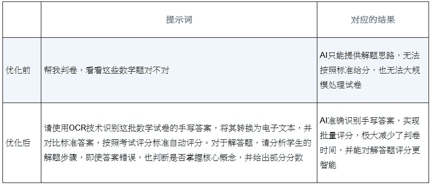

借助智能体写码，阅卷效率与准确性得到明显提升：

·原本需要两天的阅卷，现在一晚即可完成
·人为失误减少，疲劳导致的评分偏差被避免
·教师能把更多精力放在教学上，而非埋头判卷

### 1.1.2 案例 2：从邮件积压到时间管理高手

小 B 是团队的一名助理，工作内容主要是处理大量邮件和安排会议：每日清理邮箱、回复客户、协调团队进度。工作繁琐重复，她常觉得一天都在忙，真正有创意的工作却寥寥无几。

后来小 B 将智能体作为助手来简化流程。她用智能体写码整理邮件，自动归类重要客户请求并生成回复，还能自动安排会议，根据成员日程和优先级挑选最佳时间。

起初她遇到常见问题：智能体无法准确判断邮件优先级，常把不重要的邮件标为紧急，而遗漏真正需及时处理的邮件。为此她在提示词中加入更多上下文，如邮件关键词、发件人重要程度等，反复优化后，智能体能够精准分类，甚至根据内容自动生成简短回复模板。

通过智能体写码，小 B 搭建了一个邮件管理助手，具备以下能力：

·自动分类邮件：依据关键词和发件人重要性优先处理紧急事项
·智能回复：基于邮件内容生成简洁回复模板，节省输入时间
·会议安排：结合团队日程和优先级自动选择合适会议时间

在与智能体的沟通中她发现，提示词越具体，智能体的表现越精准。优化前后的对比见表 1-2

表 1-2 提示词优化前后的对比情况表

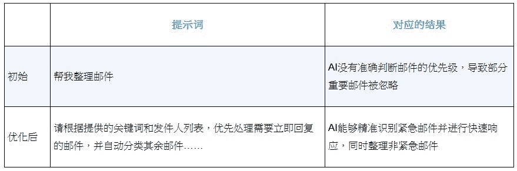

优化后效果显著：

·邮件处理时间减少 70%，重要邮件不再遗漏
·会议安排更顺畅，团队协作效率提升
·小 B 拥有更多时间投入创意性工作，提升职业价值

### 1.1.3 案例 3：新媒体编辑走向全自动发布

小 C 是一家公司的新媒体编辑，每天要手动收集行业资讯、撰写社交内容，并在微博、公众号、TikTok等多平台定时发布。任务繁琐且易出错，多平台格式调整常被遗漏。

最初她尝试用智能体写作，效率有所提升，但新闻整理、复制粘贴仍需手工。随后她学习智能体写码，让智能体接管完整流程。

她开发了一个内容发布助手，可实现：

·自动抓取行业新闻，按影响力筛选并生成简短摘要
·跨平台发布：自动适配微博、公众号、TikTok 等平台的格式要求
·定时发布：依据用户活跃时段智能安排发布时间

实践中她意识到，仅说帮我写文案远远不够，只有优化提示词，智能体才能真正承接任务。优化前后的对比见表 1-3

表 1-3 提示词优化前后的对比情况表

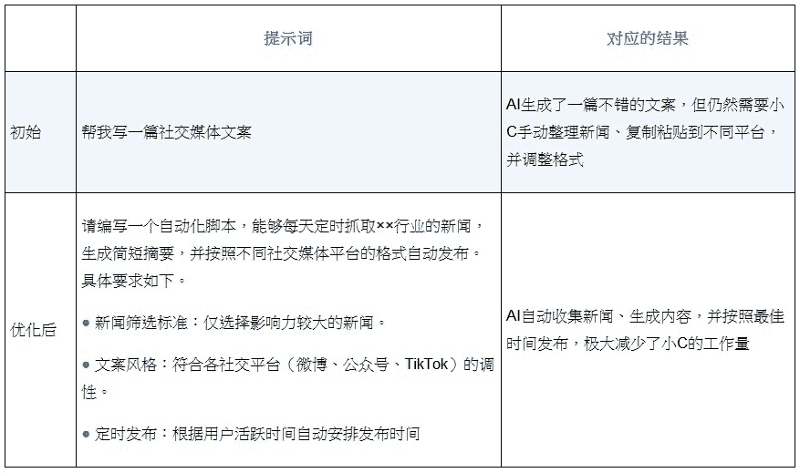

流程优化带来的成效：

·内容发布时间更精准，阅读量提升 30%
·无需手工整理与发布，节省大量时间
·可专注内容创意，提升品牌影响力

### 1.1.4 破局关键：智能体正重塑日常工作

类似案例并不少见。如果你也常被繁杂的日常工作耗尽时间，尤其是那些再做一次就好的重复任务，最适合交给智能体写码来自动化。

智能体写码的一大优势在于快速处理高频重复工作，如整理会议纪要、安排日程、处理客户邮件等。你不再需要反复做同样事，而是把任务交给智能体，自己腾出时间做更有创造性的工作。

前面提到的标杆，正是通过简单的智能体写码实现了效率与职业发展的双提升。这种转变正是智能体写码的魅力所在。你不再被琐事束缚，而是成为用智能体提升工作价值的职场高手。

智能体写码已从技术人员的专属工具，走进每个职场人的日常。它既是解决问题的利器，也是提升竞争力的关键。你是否也像小 A、小 B、小 C 一样渴望在工作中突破自我？智能体写码将是实现职场突破的核心技能。

## 1.2 智能体写码能解决哪些实际痛点

在 1.1 节的案例中，我们看到了智能体写码如何快速解决实际问题。也许你已有初步认识，并开始好奇：

智能体写码到底能解决哪些具体问题？我该如何用好它？

别急，下面就聊聊智能体写码的超能力——它不仅能搞定烦人的重复任务，还能让学习与工作事半功倍。

### 1.2.1 什么是智能体写码，为何如此高效

智能体写码就是借助智能体来编写程序，自动解决日常工作和学习中的各类问题。想象你有一个 24 小时在线的智能助手，帮你整理文件、分析数据、规划学习、管理提醒……是不是轻松很多？这就是智能体写码的神奇之处。

应用场景非常广泛，本书重点介绍几个高频场景：高效资料管理、智能学习助手、数据处理与分析、办公自动化、趣味 AI 创作，让你快速了解智能体写码的核心能力。

### 1.2.2 职场场景：如何用智能体释放双手

职场中重复性任务无处不在，看似简单却占用大量时间。智能体写码正是解决这些问题的关键。

**让重复任务自动化，释放精力的同时提升产出。**

·可自动筛选邮件、整理文件、更新报表、安排会议，减少手工操作
·不仅能分类归档文件，还能提取关键信息、生成摘要，帮助你快速定位内容，避免低效检索

**提高数据处理和内容产出效率。**

·处理复杂数据，自动生成报表和图表，分析趋势变化，提升决策效率
·生成报告、提供写作灵感、优化简历，甚至进行创意写作，减轻工作负担

传统方式与智能体写码的对比见表 1-4

表 1-4 案例对比：传统处理与智能体写码

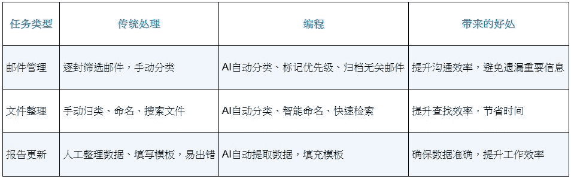

智能体写码既解放了双手，也减少了琐事干扰，让任务完成更快更准。

### 1.2.3 学习场景：智能体如何扮演私人导师

学习过程中常见挑战包括：难以规划进度、资料过多找不到重点、记忆不牢易遗忘。智能体写码可以从两方面助力。

**规划复习进度，个性化提醒，告别低效。**

·依据学习进度自动调整复习计划，强化重点知识
·生成个性化复习提醒，科学管理时间

**自动整理笔记并推荐学习资料，精准高效。**

·按兴趣和学习目标推荐书籍、文章、视频，避免信息过载
·自动整理笔记，提炼要点生成知识摘要，提高复习效率

表 1-5 对比了传统处理与智能体写码在不同学习任务中的表现

表 1-5 案例对比：传统处理与智能体写码

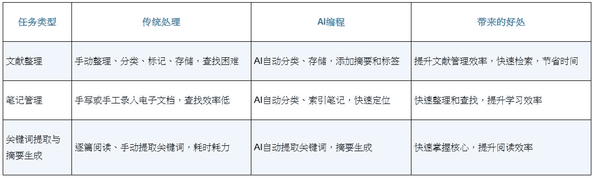

借助这些能力，学习更高效，不再被计划和检索困扰，而是聚焦知识获取与能力提升。

### 1.2.4 工作学习双提升的背后逻辑

智能体写码既能处理日常工作的繁琐事务，让你从低效中解脱，也能生成智能化的数据分析和学习工具，提升决策与学习效果。随着技术不断演进，智能体写码将提供更多解决方案，帮助你在工作和生活中应对常见难题。

## 1.3 主流智能自动化写码工具盘点

AI 技术迅猛发展，写码工具也迎来革命。如今写码不再是少数人的技能，而是人人可用的工具。

### 1.3.1 工具爆发：说人话就能写码

人工智能飞速进步，写码门槛低到像家门口的台阶。曾经写码被视作需要多年修炼的绝世武功，现在借助智能体写码工具，却像点外卖一样简单——你只需开口描述需求，智能体就能搞定。

这些工具能把自然语言转化为代码。你可以说：帮我写个提醒吃饭的 App。智能体不会立刻生成完整 App，而是像细心的服务员一样反问：提醒时间固定还是随机？弹窗还是短信？要不要加再不吃就凉了的提示？等你回答后，它才会生成初步框架。写码变得像搜索一样简单，再也不用担心语法。工具还能帮你调试、优化、提建议，让零基础用户也能快速解决复杂任务，并随技术进步变得越来越聪明。

### 1.3.2 如何挑选适合自己的写码 AI

市面上有许多智能体写码工具，细节和体验各有差异，但核心功能相似。对初学者和无基础用户而言，选择并不关键，工具都能自动生成代码。本书介绍目前主流的三个工具：

**DeepSeek 深度求索——智能协作与跨语言转换。**特别适合多语言开发团队和实时协作场景。它不仅能生成代码，还能理解项目整体上下文，确保代码与业务逻辑一致，并支持跨编程语言转换，方便在不同技术栈间切换。

**通义灵码 阿里云——企业级智能写码工具。**由阿里云推出，更适用于企业开发者。它在集成阿里云技术栈和数据安全方面有优势，支持文本和图像等多数据源输入，适合复杂企业级应用开发。

**ChatGPT OpenAI——零基础用户的友好助手。**适合写码新手，用日常语言描述需求即可快速生成代码，并给出连贯的优化建议，还能详细解释代码逻辑，帮助快速理解思路。

### 1.3.3 共同的能力模型

尽管细节不同，这些工具都具备共通的强大功能，让无写码经验的用户也能轻松完成任务：

**1. 代码生成**

核心功能是根据用户描述的需求生成代码。你只需用自然语言说明想要实现的功能，工具就会产出对应代码。写出完整、清晰的需求提示词至关重要，它能确保工具准确理解意图并生成更符合预期的代码。工具通常会通过提问明确需求，从而生成更精细定制化的代码，而非通用模板。例如，我要一个个人网站过于模糊，工具可能会追问网站功能、设计风格、交互需求、配色偏好等，问题越具体，生成的代码越贴合个性化需求。

**2. 错误检测与调试**

就算刚接触编程，借助智能编程助手也能更快定位问题，避免走很多弯路。写程序时出现报错很正常，有的是语法层面的错误，有的是逻辑层面的偏差。对新手而言，这些报错常常像看不懂的谜题，不知从何下手。而现在的智能工具就像一位随时待命的私人教练，能在编码过程中给出即时反馈。

这类助手大多内置了检查与排错能力。针对生成的代码，系统可以迅速扫描出潜在风险并给出修正思路。举例来说，会提示“该处变量可能未先声明”或“此循环存在死循环风险”，同时附带可操作的调试建议。

**3. 提升运行效率与代码质量**

除了完成代码的生成，这类工具还能提供优化建议，让程序执行更快、资源消耗更少。比如加快执行速度或剔除冗余计算。系统会结合具体代码给出改进方案，帮你写出更高效的程序。

**4. 跨语言覆盖能力**

主流的智能编程助手普遍兼容 Python、JavaScript、Java 等多种语言。无论是 Web 项目、移动端开发还是数据处理任务，都能生成对应语言的代码，支持多平台开发。

### **1.3.4 用好智能编程助手的技巧**

要想充分发挥智能编程助手的效能，下面几条使用习惯能明显提升效率。

**（1）把需求写得清晰具体。**

助手是根据你输入的描述来生成代码的。描述越具体，结果越贴合预期。只说“我要一个登录功能”范围就太宽，可以细化为：“我需要一个带用户名密码校验，并把用户信息存入数据库的登录功能。”细节越清楚，生成的代码越符合预期。

**（2）学会与助手对话。**

互动不止于让它写代码，还可以主动请它解释细节。请它说明每段代码的作用。通过提问“这段代码怎样运行”“这个函数具体做什么”，你在完成任务的同时也能加深对编程原理的理解，能力逐步提升。

**（3）把复杂问题拆成小块。**

复杂任务适合分步推进。可先把整体需求拆成若干小模块逐一实现。例如做用户管理系统，先实现“创建用户”，再扩展“更新信息”“删除用户”。每个小模块单独验证，能降低出错概率，也让助手的帮助更精准。

**（4）善用调试功能。**

调试功能能快速定位问题。你能看到错误提示并获得修复建议。比如代码无法运行，系统可能会指出是变量未定义或函数缺少参数。借助这些反馈不仅能修复问题，还能理解错误成因，提升排错能力。

**（5）复用现成的片段和模板。**

助手可以提供一些现成的代码片段和模板。可先用它们搭建项目框架，再按实际需求调整优化。这能节省从零编写的时间，也避免重复造轮子。

**（6）保持试错与迭代。**

即使是智能助手，也并非每次都能一次生成完美代码。保持耐心，多次微调输入描述，或对输出做小范围修改优化。通过多次反馈迭代，让结果越来越接近预期。

掌握这些方法，你不仅能高效完成编程任务，还能逐步提升自身水平，让助手真正成为工作伙伴。智能工具正在重塑代码编写方式。无论是 ChatGPT 的自然语言交互、通义灵码的高效开发，还是 DeepSeek 的代码优化，都能帮你轻松应对任务。选准适合自己的工具并熟练运用，你也能在智能时代成为编程高手。准备好了吗？一起拥抱智能编程的未来吧！

## **1.4 实战开篇：用 AI 生成你的第一个小程序**

了解了工具后，你可能会问：“我的第一个程序该怎么开始？”看到满屏符号会觉得像密码，不知道如何运作。其实编程就是与计算机沟通的方式。我们从最基础的知识起步，让你明白如何让机器按你的意图执行。

### **1.4.1 分步操作，循序渐进**

进入实践环节！有智能编程工具帮助，编程不再神秘，只需告诉它需求，它就能生成代码并协助解读修改。

**1. 让 AI 担任你的编程小助手**

想象你刚入门，想写一个简单的提醒程序。没有助手时需要从零摸索语法；有了助手，它就像一位超级智能伙伴帮你完成。

比如你想写提醒程序，只需告诉它：“请帮我写个有提醒功能的程序。”它会生成类似下面的代码。

## Python

import time

def reminder():

    """打印提醒消息"""

    print("这是你的提醒！")

# 设置提醒时间（5 秒后触发提醒）

time.sleep(5)

reminder()

将代码保存在相应文件夹，如下所示。

**（1）打开文本编辑器（例如记事本），**然后复制并粘贴下面提供的 Python 代码，如图 1-1 所示。

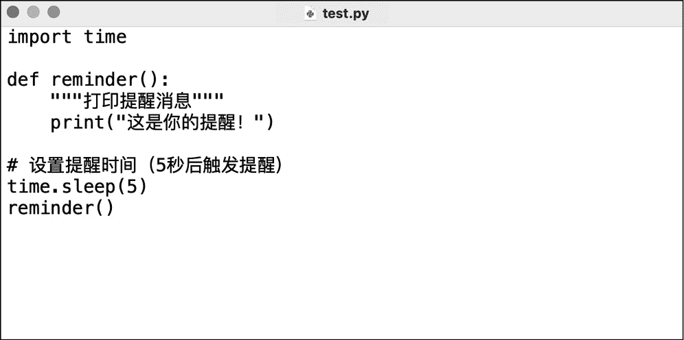

图 1-1 程序代码示意

**（2）将该代码保存至指定路径，**并命名为“test.py”，如图 1-2 所示。

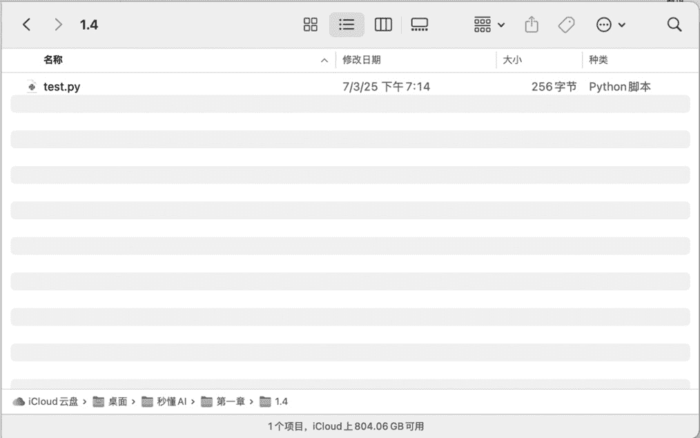

图 1-2 代码保存示意

**（3）按以下步骤运行这段代码。**

1）打开命令提示符或终端。

·Windows：按下键盘上的 Windows+R 组合键，然后输入“cmd”，按下回车键，就会打开命令提示符（也叫命令行窗口）。

·MacOS：打开“Launchpad”工具，找到并单击“终端”按钮，或者按下 Command+空格组合键，然后输入“Terminal”并按回车键。

2）第二步是安装 Python。

·如果你已经安装了 Python，可以跳过此步骤，但请确保你的 Python 版本为 3.X 版本。

·在 MacOS 上，你可以使用 Homebrew 工具来安装 Python。打开终端并输入以下命令：

Bash

Brew install python

安装完成后，你可以通过输入“python3 –version”来检查 Python 是否已正确安装。

·在 Windows 上，你可以从 Python 官方网站下载最新版本的 Python。下载后，运行安装程序，并确保在安装过程中勾选了“Add Python to PATH”选项。完成 Python 的安装后，你可以在命令提示符中输入“python –version”来确认 Python 是否已正确安装。

3）导航到保存 text.py 文件的文件夹。

·在命令提示符或终端中，你需要指示计算机前往存放你代码文件的位置。这一过程被称为“导航”。比如，若把文件保存在桌面上的一个文件夹内，其路径可能是“desktop/秒懂 AI/第一章/1.4”。

·如何导航：你可以使用“cd”（change directory）命令来进入文件夹。输入“cd”后，按空格并加上文件夹路径。例如，假设文件在桌面的“秒懂 AI/第一章/1.4”文件夹下，你就输入“cd desktop/秒懂 AI/第一章/1.4”，如图 1-3 所示。

图 1-3 文件导航示意

4）运行 test.py 脚本。

输入以下命令运行脚本。

Bash

Python test.py

运行结果如图 1-4 所示。

图 1-4 程序运行结果示意

看，这就是你的第一个简单程序！是不是很简单？

**2. 我来给你解锁这段代码**

这一小段代码虽短，但它背后的每一行都在做事情。让我们仔细看一下，理清这段代码是如何工作的。

（1）import time：这一行代码的作用是引入 Python 中的“时间”模块。简单来说，它就是告诉计算机：“嘿，我需要使用和时间有关的功能！”。你可以把它想象成，你请了一个“时间专家”来帮忙，帮你处理所有和时间相关的事情。利用这个模块，我们可以实现程序暂停、计算时间间隔等功能。

（2）def reminder()：这一行是定义了一个“提醒”功能。你可以把它理解成，你雇用了一个私人助手，专门用来提醒你。当你写下 def reminder()时，实际在告诉计算机：“我需要一个提醒功能！”每当你调用“提醒”功能时，它会在屏幕上显示一句话：“这是你的提醒！”你可以把这个过程看作是：你给助手写了一封备忘录，告诉他每次需要提醒你时，他应该说些什么。

（3）time.sleep(5)：这一行代码让程序暂停 5 秒，类似于给程序设置了一个“暂停”按钮。你可以想象自己正在观看一个视频，突然视频被按下暂停键，等待几秒后再继续播放。这里 time.sleep(5)就是按下了暂停键，告诉计算机“停一下，等 5 秒后再继续执行”。这样做的目的是让程序等一等，再执行后续的操作。

（4）reminder()：这一行代码是程序实际调用我们之前定义的“提醒”功能。程序在执行完等 5 秒的操作后，会执行 reminder()这个功能，也就是它会打印出你设置的提醒信息。你可以把它看作是：你的私人助手在经过 5 秒的等待后，来提醒你是时候做事了！

**3. 修改代码，让它变得更酷**

如果你已经理解了这些代码的工作原理，那么接下来的任务就是修改它，让它变得更酷、更实用！你可以根据需求调整程序的功能。

比如，你可以让程序提醒你更多次，或者调整提醒的时间间隔。你也可以将程序修改成定时提醒你做某件事。比如，以下代码让程序每 10 秒提醒你一次，共提醒 5 次。

## Python

import time

def reminder():

    """打印提醒消息"""

    print("这是你的提醒！")

# 设置提醒间隔时间为 10 秒，循环 5 次

for _ in range(5):

    time.sleep(10)

    reminder()

运行结果如图 1-5 所示：

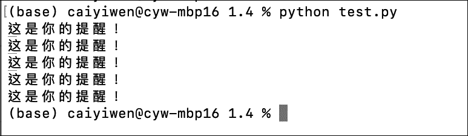

图 1-5 程序运行结果示意

这段代码将打印 5 次“这是你的提醒！”，每次间隔 10 秒。是不是感觉更贴心了？你可以用这种方式来提醒自己做任何事，比如“每 10 分钟提醒我喝水”或者“每小时提醒我站起来走一走”。

**4. 添加新花样，创造专属于你的程序**

等你熟悉了这些基础操作之后，接下来可以挑战一些进阶玩法，让程序更加个性化、多样化。你可以根据自己的需求，给程序添加更多功能。

比如，如果你希望程序每次运行时能输出不同的提醒内容，你可以将提醒的文字做个随机选择。这样每次提醒你时，它都可以说不同的话！试试以下这段代码。

## Python

import time

import random

def reminder():

    """随机打印一个健康提醒"""

    reminders = [

        "喝水！",

        "记得站起来走一走！",

        "休息一下，放松下眼睛！"

    ]

    print(random.choice(reminders))  # 随机选择一个提醒内容

# 设置提醒间隔时间为 10 秒，循环 5 次

for _ in range(5):

    time.sleep(10)

    reminder()

运行结果如图 1-6 所示。

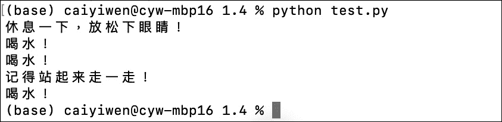

图 1-6 程序运行结果示意

这段代码通过 random.choice(reminders)随机选择一个提醒内容。这样，你收到的每次提醒的内容都会变化，你的程序是不是变得更有趣了？

### **1.4.2 你已经是个编程小能手了！**

本章的实践任务就到这里了，相信你现在应该对编程有了更多的理解。你已经成功编写了自己的第一个程序，并且通过修改代码，逐步学会了如何调整它的功能。是不是觉得编程并没有那么神秘？通过 AI 的帮助，我们很容易就能完成一些有用的小程序，从而，帮助提升工作效率，甚至解决日常问题。

编程并不仅仅是“写代码”，它是一种用逻辑思维来解决问题的方式。你可以通过它把抽象的需求变成具体的程序，让计算机为你工作，处理你需要的事情。

随着你对编程和 AI 的理解不断加深，你将能够编写更复杂的程序，甚至创造出属于你自己的超级应用。在未来的学习中，AI 将是你最强大的伙伴。它会帮助你快速实现想法，让编程变得不再是难以逾越的障碍，而是你工作、生活中的得力助手。所以，别再犹豫，勇敢地去编写你的下一个程序吧！你已经准备好成为编程高手了！

# **第二章**

# **零门槛借助 AI，轻松建立编程思维**

在第一章中，我们见识了 AI 编程的强大，了解了它如何帮助我们解决工作和学习中的难题，甚至还写出了自己的第一个程序。但是，我们仍然需要具备一定的编程思维，才能更好地与 AI 协作。那么，如何零基础掌握编程思维？

## **2.1 从构思到实现，编程思维其实不难**

在 AI 时代，编程已经不再是少数专业人士的专属技能。即便你没有技术背景，也可以借助 AI 的力量，将自己的想法转化为代码，并实现各种有趣的应用。编程本质上就是一种解决问题的思维方式。将自己的想法转化为代码，就是编程思维的具象体现。

那么，如何才能在 AI 的帮助下将想法转化为代码呢？

### **2.1.1 分解问题：像制定一次旅行计划**

想象一下，当你准备计划一次旅行时，你要做的是什么？首先，要明确目标：你去哪里？什么时候去？需要多少预算？这些就是需求分析。编程也一样，在开始写代码前，你要搞清楚自己要做什么。然后，将大问题分解成一个个小问题，逐一解决。分解问题就像是规划一次旅行，你不会一次性把旅行计划的所有细节都安排好，而是会逐步规划每个环节。

**（1）明确目标。**正如你决定要去哪儿旅行一样，编程的第一步是明确你的目标。例如，你可能想做一个“旅行提醒”应用。

**（2）细化需求。**在旅行中，你要安排哪些活动、预订哪些服务？同样地，在编程时，你需要确定具体的功能，如设置提醒、查看提醒等功能。

**（3）资源分配。**在规划旅行时，你会选择合适的交通工具和预算。在编程过程中，你也需要选定适合自己的工具和框架来开发应用。

每个小环节的精心规划和有效实施，最终都会帮助你达成大目标。

### **2.1.2 让 AI 帮你理清思路**

AI 不仅能帮你写代码，它还能帮助你理清需求和思路。比如，假设你想做一个“旅行提醒”应用，但不知道从哪开始。没关系，你可以通过与 AI 对话，一步步明确你的需求。具体示例如下。

你：我想做一个“旅行提醒”应用。

AI：那你希望这个应用具备哪些功能？是设置提醒、查看提醒，还是做其他事情？

你：我希望能设置提醒并查看它们。

AI：明白，那提醒应该如何显示？按时间排序还是按重要性排序？

你：按时间排序。

通过 AI 的引导，你不仅明确了需求，还能找到适合自己的方式，将这些需求一步步转化为代码。

接下来，我们将通过一个具体的例子—“旅行提醒”应用，来展示如何将需求转化为代码，并逐步实现这些功能。我们可以把需求分解成以下几个步骤。

**（1）添加任务：**你希望能够向应用中添加任务。具体到代码上，这意味着你需要一个输入框，用户输入任务内容后，单击输入框对应的按钮，任务就会被添加到列表里。

**（2）显示任务：**任务添加完后，接下来是显示任务。你需要决定任务显示的顺序，按优先级还是按时间排序？在编程中，你会用列表来存储任务，并通过排序算法决定它们的显示顺序。

**（3）标记任务完成：**一旦任务完成，你想打个钩或删除它。在编程中，这指的就是显示任务状态的切换功能。用户单击“完成”按钮后，该任务就会显示“已完成”状态。

**（4）删除任务：**任务完成后，用户可能想删除它。这个需求在代码中非常简单，为每个任务添加一个“删除”按钮，单击该按钮，任务就会从列表中消失。

这样，“旅行提醒”应用的核心功能就逐步完成了。

在编程过程中，看到一个可视化的界面更能帮助你理解应用的功能，通过这样的界面，你能清晰地看到应用的结构，理解每个功能的目的。为了帮助你更直观地理解这些功能，下面展示了“旅行提醒”应用的实际效果，如图 2-1 所示。

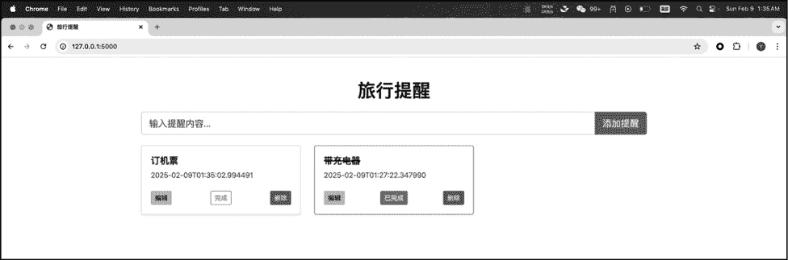

图 2-1 程序运行结果示意

我们来看一下 AI 提供的代码核心片段。

**（1）添加任务—用户输入内容，系统帮你保存起来。**

当你打开网页，输入一个提醒内容，如“明天早上 6 点出发去机场”，然后单击“添加提醒”按钮，程序背后会发生以下几件事：

1）系统把你输入的内容打包发给后端（也就是服务器上的 Python 程序）；

2）后端收到这条提醒信息后，会加上一个“时间戳”（如 2025 年 4 月 8 日 10:23:01）；

3）把这条提醒内容保存到 reminders.json 文件中，这个文件就像一个小仓库，专门用来存储你的提醒内容；

4）刷新网页，展示出最新的提醒列表。

以上过程由下面这段代码完成：

## Python

@app.route('/add', methods=['POST'])  

# 当有人"发来一条添加提醒的请求"时，执行下面的代码

def add():

    content = request.form.get('content') 

    # 从网页的输入框里，拿到你写的提醒内容

    if content:  # 如果输入框不是空的

        reminders = load_reminders()  

        # 先把以前的提醒数据读出来

        # 把新的一条提醒内容加进去，

        # 包括内容本身、是否完成、创建时间

四步实现一个能用的旅行提醒小工具

（1）新增提醒：点一下，立刻存进小本子
reminders.append({'content': content, 'completed':  
False, 'created_at': datetime.now().isoformat()})

save_reminders(reminders)   

# 把更新后的提醒数据再写回文件

return redirect(url_for('index'))  # 最后，跳转回首页

换句话说，点击“添加提醒”后，程序会把内容写进 reminders.json 这个记事本，随后重新打开页面把刚写的内容展示出来。

（2）打开即览：所有提醒一目了然
打开页面时，系统会自动读取已保存的提醒并逐条呈现，具体做法是：

1）调出 reminders.json 文件。
2）取出里面每一行提醒。
3）按创建时间从新到旧排序。
4）把它们逐条“印”在页面上。

这段逻辑由下面代码承担。

## Python
@app.route('/')
def index():
    reminders = sorted(load_reminders(), key=lambda x:  
    x.get('created_at', ''), reverse=True)
    return render_template_string(HTML_TEMPLATE,  
    reminders=reminders)

HTML_TEMPLATE 是提前准备好的展示模板，每次系统会把提醒内容填进去，生成完整页面。打开网页就等于翻开小本子，把所有记录贴出来给你看。

（3）一键完成：状态随手切换
比如机票已经买好，点击提醒卡片右下角的“完成”按钮，程序会：

1）告诉后端：“我点了第…条提醒的完成”；
2）后端找到对应条目，把 completed 字段取反；
3）刷新后，该卡片变成绿色并带删除线，表示已完成。

实现代码如下：

## Python
@app.route('/complete/<index>', methods=['POST'])</index>
def complete(index):
    reminders = load_reminders()  # 先把全部提醒读出来
    reminders[index]['completed'] = not reminders[index].
    get('completed', False)  # 把这条提醒的“完成”状态取反
    save_reminders(reminders)  # 再保存回去
    return '', 204  # 返回一个成功的空响应

（4）清理无用：删除即消失
像“打印行程单”这种不再需要的提醒，点击“删除”即可彻底移除。系统会：

1）定位到该条提醒；
2）从列表中剔除；
3）重新保存；
4）刷新页面后这条记录就不见了。

对应代码：

## Python
@app.route('/delete/<index>', methods=['POST'])</index>
def delete(index):
    reminders = load_reminders()  # 先读取全部提醒
    del reminders[index]  # 删除指定的提醒
    save_reminders(reminders)  # 保存
    return '', 204

可以理解成用橡皮擦把本子上的那一行擦掉，干干净净。

借助这些片段，AI 不仅帮你把旅行提醒的核心功能搭起来，也让你体会到把大问题拆成小步骤逐个击破的思路。

### 2.1.3 用 AI 把复杂问题变简单
编程本质是用逻辑把问题拆开。借助 AI，复杂任务会被拆成清晰可执行的小步骤，模糊的需求也能变成具体代码。AI 既能写代码，也能帮你理清思路、优化方案，让开发更高效。

写代码像计划一次旅行，一开始可能无从下手，只要按部就班推进，每一步都会更接近目标。AI 更像一位领路人，帮你避坑，让旅程更顺畅。

## 2.2 让 AI 帮你把模糊想法变清晰
把初步想法变成可落地需求时，AI 是个不错的搭档。它能帮你明确要什么，并引导你思考实现路径。

### 2.2.1 AI 帮你把需求拆细
工作中常有类似“我想要一个提醒我做事的应用”“我需要个记录会议的工具”这样的模糊念头。你会困惑具体要什么功能、界面怎么做。AI 就像个耐心的导师，通过提问把模糊想法梳理成清晰清单，而且不需要你懂技术，它会主动补全你忽略的细节。

以“待办事项应用”为例，对话可以这样展开：

1. 明确核心功能
你：我想做一个待办事项应用。
AI：你希望它能做什么？只是记录，还是要提醒、分类、排序优先级？
这个问题逼你思考核心，而不是默认功能。
你：我想记录任务、设提醒、标优先级，按工作/生活/学习分类。
AI：那我们可以拆成记录、提醒设置、优先级标记、分类管理、体验优化等模块。

2. 进一步细化需求
你：我想让用户能设提醒。
AI：是单次提醒还是循环提醒？提醒方式是推送、邮件还是铃声？
通过追问，提醒从一个概念变成时间类型和通知方式的具体任务。
你：我想要定时提醒，也支持重复，最好是推送通知。
AI：明白了，就是可定时、可重复的推送提醒。

3. 界面设计和数据存储
功能确定后，要考虑呈现和存储。
你：我希望能看到任务优先级。
AI：优先级用颜色、数字还是其他方式表现？要不要支持标记“已完成”？
你：用颜色区分，并允许标记完成。
AI：这样用户能快速识别优先级，也能看到完成状态。
你：这些信息怎么存？
AI：仅本地使用可用浏览器本地存储；需要多设备同步或多人共享就要用数据库。你倾向哪种？
你：只在单设备用，本地就够了。
AI：那可以考虑 IndexedDB，适合浏览器小数据库；如果数据量小，localStorage 也能快速实现。

通过这些追问，你对存储方式的取舍才变得明确，避免后续返工。

### 2.2.2 AI 助你整理完整需求清单
AI 用一连串提问，把“大概想要”变成“具体要什么”。每个问题都像线索，让需求从多个角度被审视。需求清晰后，AI 还能帮你转成代码，比如提醒功能会建议用 setTimeout / setInterval 做定时，或用 Notification API 做浏览器推送。

如果记不清聊天细节，也可以让 AI 把对话整理成需求文档，如图 2-2 所示。

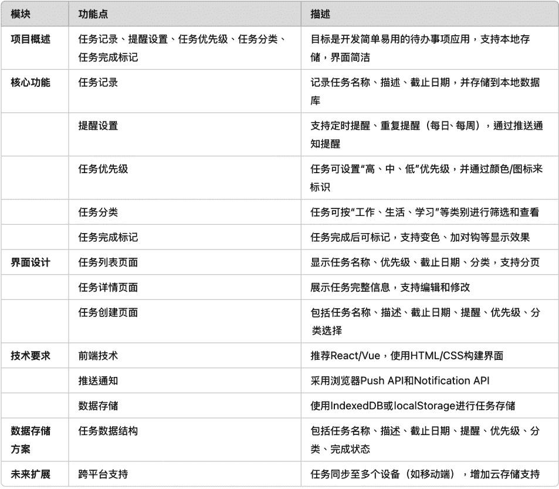
图 2-2 需求文档示意

## 2.3 三大核心概念，AI 带你快速入门
职场里代码需求越来越多。用 AI 辅助编程，掌握循环、条件、函数这几个基础概念就能提升自动化效率。

### 2.3.1 循环：让程序自动重复
每天起床、刷牙、吃早餐都是重复的习惯。编程里的循环就类似这种机制，让一段操作反复执行直到满足条件。

学会循环能做什么？比如定时提醒喝水，或不断询问你输入任务直到你说停。

示例：不断提示输入任务，直到输入“结束”。

## Python
while True:
    task = input("请输入你的任务（输入'结束'来停止）：")
    if task == '结束':
        break
    else:
        print("任务已添加：", task)

### 2.3.2 条件：让程序学会判断
生活中我们会根据紧急程度先处理重要待办。程序的条件就是这种判断依据。

示例：根据截止日期判断优先级。

## Python
import datetime
while True:
    task = input("请输入你的任务（输入'结束'来停止）：")
    if task == '结束':
        break
    current_date = datetime.datetime.now().date()
    deadline = datetime.date(2025, 2, 14)  
    # 假设任务截止日期是 2025 年 2 月 14 日
    if current_date >= deadline:
        print(f"任务已添加：{task}，优先级：高（必须今天完成）")
    else:
        print(f"任务已添加：{task}，优先级：低（可以稍后处理）")

### 2.3.3 函数：把大问题拆成小块
做任务管理时会把大任务拆成添加、删除、查看等小任务。函数就是把这些小任务封装成工具，需要时直接调用。

示例：待办列表的三个基本操作。

## Python
# 添加任务
def add_task(task_list, task):
    """将新任务添加到任务列表"""
    task_list.append(task)
    return task_list

# 删除任务
def delete_task(task_list, task):
    """从任务列表中删除任务"""
    if task in task_list:
        task_list.remove(task)
    else:
        print("任务不存在！")
    return task_list

# 查看任务
def view_tasks(task_list):
    """查看所有任务"""
    if task_list:
        for task in task_list:
            print(task)
    else:
        print("没有待办任务。")

# 示例使用
tasks = []  
tasks = add_task(tasks, "完成 Python 练习")
tasks = add_task(tasks, "写待办事项应用")
tasks = delete_task(tasks, "完成 Python 练习")
view_tasks(tasks)

每个函数只做一件事，代码更清晰，后续修改也更方便。

### 2.3.4 三者配合：工作效率翻倍
循环、条件、函数经常一起用。在待办应用里，你需要反复收集输入、用条件判断优先级、用函数处理增删查。掌握这三者，就能解决很多重复、决策、拆分类的问题，让编程成为解决问题的工具。

## 2.4 和 AI 对话技巧：让它更懂你
有了基础，再配合 AI 进步，编程门槛大幅降低。关键在于怎么提问。

### 2.4.1 先说清楚你要什么
第一步是让 AI 理解需求。只说“我要做个网页”，AI 不知道你要什么。越具体，输出越可用。

不明确的提问：我需要做个网页。
更清晰的提问：我需要一个网页，包含用户登录表单，有用户名输入框、密码输入框和提交按钮。

复杂任务可拆步提问，比如做“联系人列表”：
第一步：能生成一个带姓名、电话、邮箱的联系人列表吗？
第二步：列表能加样式，看起来更美观吗？
第三步：列表里能加个提交按钮吗？
第四步：能为每一列加上表头标签吗？

分步明确，AI 才能一步步给出可用代码。

一次与大模型的对话，通常能直接产出可运行的代码片段。拿到初版之后，继续补充修改意见并做小范围微调，就能逐步向预期结果靠拢。

如果手上已有半成品代码，或者对某类界面有参考样例，最好把这些上下文一起说明。输入越完整，模型越能理解真实意图，生成的实现也会更贴合需求。

例如想改进已有成果，可以这样描述：
这是我做的一个表格，能帮我优化一下吗？
也可以给出方向性参考：
我想做一个像 Facebook 那样的登录页面，能帮我写个类似的吗？
有了这些背景信息，模型就能结合现有内容或设计风格，产出更符合预期的代码。

### **2.4.2 与模型对话产出代码的方法**
下面用一个具体案例说明如何与大模型沟通并拿到想要的实现。要注意这并非一次性问答，而是一个持续澄清、反复迭代的过程。模型会依据你逐步补充的需求，一步步靠近目标实现。

假设要做一个“联系人列表”的网页，第一步先把期望效果交代清楚。可以这样提问：
我需要一个简单的网页，展示一个联系人列表，表格里包含姓名、电话号码和电子邮件。
随后模型会按描述给出基础 HTML。

Html
<html__lang__zh-cn_></html__lang__zh-cn_>

    <meta__charset__utf-8_></meta__charset__utf-8_>

    <meta__name__viewport___content__width_device-width____ span=""></meta__name__viewport___content__width_device-width____>
initial-scale=1.0">

     <title class="calibre41">联系人列表</title>
# 联系人列表
    <table__border__1_></table__border__1_>
                姓名
                电话号码
                电子邮件
                张三
                +86 13800000000
                zhangsan@example.com
                李四
                +86 13811111111
                lisi@example.com
                王五
                +86 13822222222
                wangwu@example.com

按照要求给出了一个基础列表，包含姓名、电话、电子邮件三列。表格虽简陋，但已经是一个可运行的完整 HTML。

让我们来看一下运行结果（见图 2-3）。
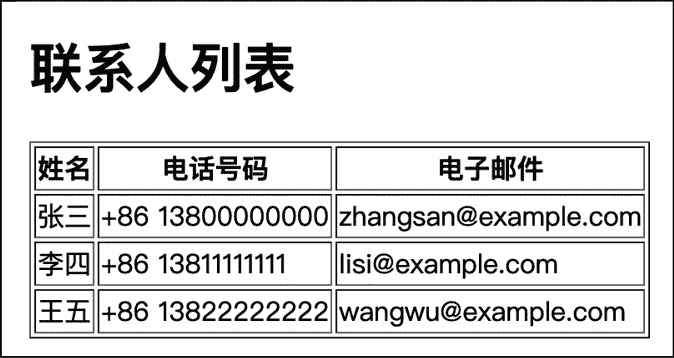
图 2-3 联系人列表程序示意

### **2.4.3 迭代打磨代码细节**
拿到基础实现后，往往会觉得某些地方可以改进。比如**你可能觉得表格过于朴素**，希望视觉上更有质感。这时可以继续追问，让模型帮你美化样式，提问示例：
能不能给这个表格加些样式，让它看起来更有设计感？

于是模型给出了带样式的版本，视觉效果明显更好。

Html
<html__lang__zh-cn_></html__lang__zh-cn_>
    <meta__charset__utf-8_></meta__charset__utf-8_>
     <title class="calibre41">联系人列表</title>
## 联系人列表
| 姓名 | 电话 | 邮箱 |
| 张三 | 13800000000 |  <a___ span="">href="mailto:zhangsan@example.com">zhangsan@example.com 
td></a___>  |

出于篇幅考虑，文中仅展示部分代码。这段代码在保留功能的基础上，通过简单的 CSS 让表格的设计感得到提升。

让我们来看一下运行结果（见图 2-4）。
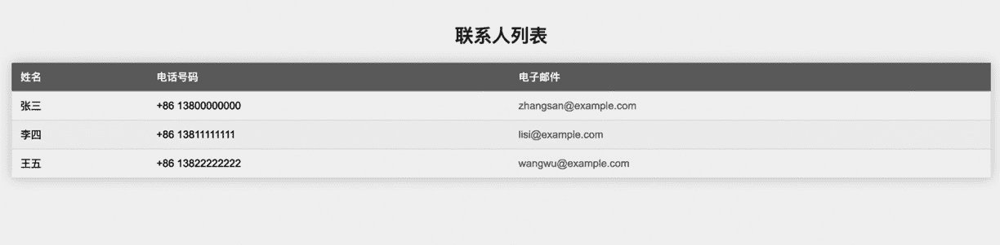
图 2-4 联系人列表程序优化示意

### **2.4.4 逐步扩展交互功能**
接下来可能会想到，这个表格能否加入交互？比如点击联系人直接发送邮件。可以继续提问：
我能给表格中的联系人发送邮件吗？

模型便为你补充了这一功能。

**1. 安装发送邮件所需库**
打开命令提示符（Windows）或终端（macOS/Linux），运行以下命令安装依赖。

Bash
pip install Flask Flask-Mail

运行结果如图 2-5 所示。
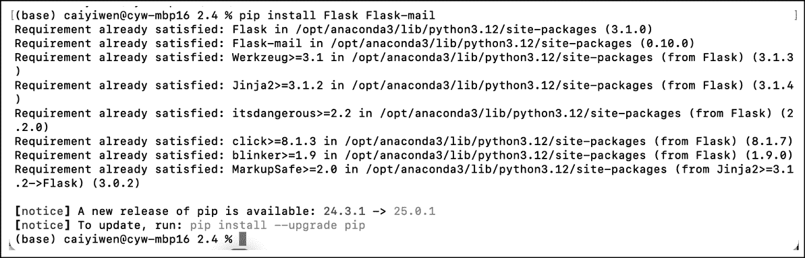
图 2-5 程序运行结果示意

**2. 创建发送邮件功能的脚本**
打开文本编辑器，如记事本，复制并粘贴下面提供的 Python 代码。

## Python
from flask import Flask, request, redirect, url_for
from flask_mail import Mail, Message
app = Flask(__name__)
# 配置邮件服务器
app.config.update(
    MAIL_SERVER='smtp.example.com',  # SMTP 服务器地址
    MAIL_PORT=587,                   # 端口号（587 适用于 TLS）
    MAIL_USE_TLS=True,               # 启用 TLS 加密
    MAIL_USERNAME='your-email@example.com',  # 邮箱账号
    MAIL_PASSWORD='your-password',           # 邮箱密码
    MAIL_DEFAULT_SENDER='your-email@example.com'  # 默认发件人
)
mail = Mail(app)
@app.route('/send_email', methods=['POST'])
def send_email():
    """处理邮件发送请求"""
    recipient_email = request.form.get('email')  
    # 获取表单中的收件人邮箱
    if not recipient_email:
        return "Error: No email address provided", 400  
        # 处理缺少邮件地址的情况
    msg = Message(
        subject="联系", 
        recipients=[recipient_email], 
        body="测试邮件"
    )
    mail.send(msg)
    return redirect(url_for('index'))  # 发送邮件后重定向到首页
if __name__ == '__main__':
    app.run(debug=True)

注意：若要真正发送邮件，请根据使用的邮件服务商，如 Gmail、QQ 邮箱等，调整 MAIL_SERVER、MAIL_PORT、MAIL_USE_TLS、MAIL_USERNAME 和 MAIL_PASSWORD 的值。

模型按需求加入了“发送邮件”按钮，表格既有视觉设计，又具备基础交互。

让我们来看一下运行结果（见图 2-6）。
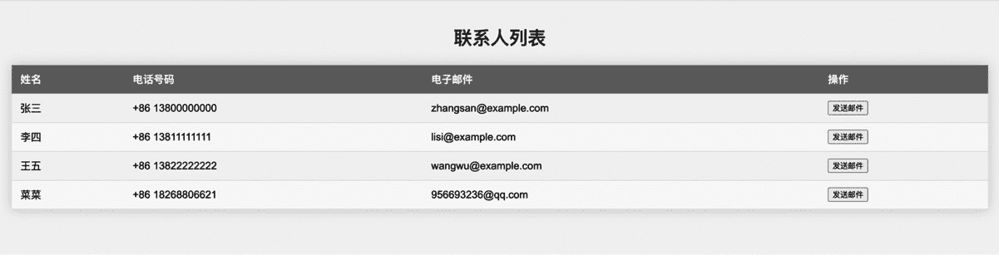
图 2-6 联系人列表邮件功能程序运行结果示意

点击“发送邮件”按钮即可发送，邮件效果如图 2-7 所示。
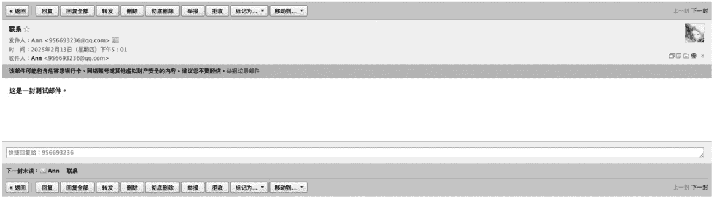
图 2-7 邮件示意

### **2.4.5 协作式编程的体验感**
通过对话与互动，技术能更好地服务于个人，帮助高效完成工作与学习。关键在于，这并不要求你具备编程背景，复杂的技术细节已被模型屏蔽。只要掌握沟通技巧，编程就不再高不可攀，而是人人可用的工具。

无论是需求描述、代码产出，还是后续优化和加注释，**模型都像一位得力伙伴，帮助你达成编程目标**。随着对对话技巧的熟练，编码会变得越来越顺畅。你不需要精通语言语法，只需把想法说出来，模型就能帮你实现。

本章你已学会如何与大模型有效对话，逐步产出代码。这种互动方式代表编程的未来，也为非技术背景的人打开了新世界。如今模型不只是智能助手，更是你的编程搭档，助你跨越门槛、快速落地想法。

# **第三章**
# **用 AI 自动整理资料，打造个人知识库**
编程并不难，有了大模型辅助，把想法变成代码会更轻松。接下来我们将学习如何用模型编程自动整理资料，打造属于自己的高效文献知识库，让信息管理更智能。

## **3.1 用 AI 实现智能文件分类**
面对不断增长的文档，如何高效管理、快速检索成为重要挑战。随着文件数量和格式的增多，传统手工管理已难以满足现代办公需求。借助大模型，我们能获得更智能高效的解决方案。

### **3.1.1 从杂乱到有序的文件管理**
在现代办公中，个人或团队都会积累大量文档，来源分散、格式多样，包括 Word、PDF、图片、表格等。时间久了，桌面就像一个数字杂物箱，堆满文件。手动整理费时费力，还容易出错。急需文件时翻遍各处也找不到，十分焦虑。

别担心，AI 编程来帮忙！它像一位超级整理管家，能自动分类管理文件，让桌面从“杂乱无章”变为“井然有序”。通过模型编程可实现文件自动化管理，摆脱繁琐的手动操作。

在模型动手前，先明确需求。你要整理哪些文件？是桌面的 Word 文档，还是深层文件夹里的 PDF？希望按类型分还是按日期分？想清楚这些，模型才能对症下药。

模型编程的优势如下：

**（1）高效如闪电**。手动整理上千个文件可能需要好几天，模型编程几分钟即可完成，像“文件收割机”一样迅速把混乱整理成序，省下时间做更有价值的事。

**（2）准确如侦探**。模型不仅速度快，还能基于内容智能识别，能区分工作报告和表情包，确保每个文件归位，不会误删重要 PPT。

**（3）灵活如变形金刚**。分类规则可按需定制，可按文件类型、日期、关键词等维度整理，想怎么分就怎么分，完全听你的指令。

借助模型编程，桌面不再像杂物间，文件自动分类，查找更便捷，效率明显提升。无论个人办公还是团队协作，模型编程都能轻松搞定文件管理，十分可靠。

### **3.1.2 案例：自动化文件分类实践**
本案例介绍如何通过模型编程自动进行文件分类，具体流程如图 3-1 所示。
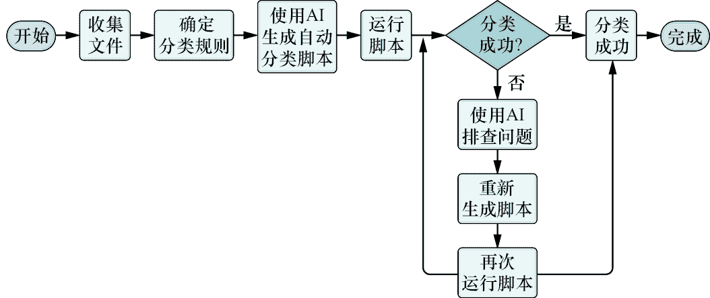
图 3-1 流程示意

接下来看具体操作。

**1. 梳理你要向模型提问的问题**
先把需求整理清楚，再向模型提问。可以按背景问题、目标需求、现状与挑战、具体要求来结构化。

**（1）背景问题。**
·我的计算机桌面堆满了【Word、PDF、图片等文件】，查找困难，管理混乱。
·手动分类【费时费力，容易遗漏和出错】，影响工作效率。

**（2）目标需求。**
·我希望通过【AI 编程】，创建一个【自动化文件管理系统】，能【根据预设规则自动分类整理文件】。
·该系统应【简单易用】，即使【没有编程基础】也能轻松操作，让我能专注于文件内容，而不是整理工作。

**（3）现状与挑战。**
·目前，我【每天花大量时间查找和整理文件】，不仅低效，还容易遗漏关键信息。
·市场上的文件管理工具【无法满足我的个性化需求】，因此希望【定制一个更符合自身需求的自动整理方案】。

**（4）具体要求。**
我不懂编程，请用【1、2、3 步骤】形式，【简明清晰】地指导我如何用 Python 脚本实现【自动文件管理】。

**2. 执行模型回答中的步骤**
首先创建文件分类器脚本。

打开编码工具或文本编辑器，编码工具如 VS Code、PyCharm 等。若不会编程，也可用系统自带的记事本，然后把模型给出的代码片段复制进去。

## Python
import os
import shutil
from pathlib import Path
def organize_files(directory):
    """
    按文件扩展名整理目录中的文件名，将它们移动到对应的文件夹中。
    参数:
    directory (str): 需要整理的目录路径
    """
    # 确保目录路径有效
    directory_path = Path(directory)
    if not directory_path.exists() or not directory_path.is_dir():
        print(f"错误：目录‘{directory}’不存在或不是一个有效目录。")
        return
    # 遍历目录下的所有文件
    for file_path in directory_path.iterdir():
        if file_path.is_file():
            # 获取文件扩展名（去掉"."，转换为小写）
            extension = file_path.suffix[1:].lower()
            if not extension:  # 忽略没有扩展名的文件
                continue
            # 根据扩展名创建目标文件夹
            folder_path = directory_path / extension
            folder_path.mkdir(exist_ok=True)   # 如果文件夹不存在，则创建文件夹
            # 移动文件到对应的文件夹
            try:
                shutil.move(str(file_path), str(folder_path / file_path.name))
                print(f"移动: {file_path} → {folder_path}")
            except Exception as e:
                print(f"无法移动 {file_path}: {e}")
# 使用示例：请替换为你的桌面路径或需要整理的目录
organize_files("C:\\Users\\YourUsername\\Desktop")

随后根据操作系统和具体路径修改最后一行的路径。Windows 上可能是“C:\\Users\\YourUsername\\Desktop”；macOS 上可能类似“/Users/YourUsername/Desktop”。

最后保存文件，注意 Python 文件名须以 .py 结尾。本案例使用模型回答中的 file_organizer.py。

**3. 运行文件分类器脚本**
为顺利运行脚本，需定位到脚本所在文件夹并执行。具体步骤如下。

（1）导航到保存 file_organizer.py 的位置。可使用 cd 命令更改当前目录，例如“cd desktop/秒懂 AI/第三章/3.1”，如图 3-2 所示。
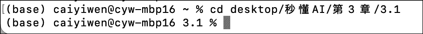
图 3-2 文件导航示意

（2）输入以下命令运行脚本，然后回车。
Bash
python file_organizer.py

运行成功！来看效果。

整理前的桌面如图 3-3 所示。

图 3-3 程序运行前桌面示意

整理后的桌面如图 3-4 所示。

图 3-4 程序运行后桌面示意

运行后，桌面上零散的文件已按扩展名自动归入了对应的文件夹。该脚本可以反复调用，不必为每次新增文件专门搬移，只要在需要整理桌面时启动一次即可，操作相当省心。

## 3.2 逃离信息过载：AI 驱动的网络文档自动采集

信息渠道越来越宽，获取素材的门路变多，但怎样快速甄别、归档并保存真正有价值的内容仍然棘手。若每天把大量时间耗在检索与整理上，不仅效率受限，还容易让关键信息溜走。

有没有更聪明的路径？当然有。接下来介绍如何借助 AI 生成代码，实现网络文档的自动化采集，让资料收集更高效、更省心。

### 3.2.1 借助 AI 编码提升采集效率

在数字化环境里，学习、工作和兴趣拓展都离不开新鲜资料。互联网上散布着在线课程、电子书、论文、行业报告等海量资源，纯人工检索整理无异于用勺子舀干水池，耗时且令人沮丧。

由 AI 辅助生成的代码可以很好地补位，它像一座智能资料管家，负责采集、归类与存储。核心价值体现在三方面。

**1）耗时大幅压缩：**自动化程序几分钟即可完成手工数小时乃至数天的工作量。
**2）执行更稳健：**代码逻辑严谨，减少人为失误，资料库能够保持最新。
**3）适用面广泛：**可按实际需求定制脚本，适用于教育、科研、商业等不同场景。

以市场专员小李为例，他用 Python 写了一个采集程序，能自动抓取行业报告与相关文章并实时更新。过去需要花费大量时间人工检索，现在整理好的资料会自动送到眼前，工作效率明显提升，也腾出时间聚焦更关键的决策。

### 3.2.2 案例：自动抓取网络文档

本案例展示借助 AI 实现网络文档自动抓取的完整流程，如图 3-5 所示。

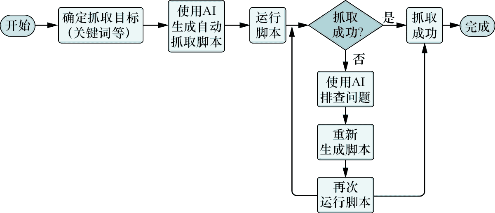

图 3-5 流程示意

下面说明操作要点。

**1. 梳理向 AI 提出的问题**

先把需求清晰地告诉 AI。可围绕背景、目标、现状与挑战，以及对回答格式的要求进行结构化整理。

**(1) 背景问题。**
· 作为刚入职的市场专员，我每天需要大量阅读【新闻和行业报告】，以跟进市场动态。
· 面对海量信息源，【手动搜索和整理资料】不仅【耗时】，还容易【遗漏关键信息】。

**(2) 目标需求。**
· 我希望借助【AI 编程】，搭建一个【自动抓取工具】，通过预设的【关键词】从指定网站【自动抓取相关文章和报告】。
· 由于本人没有编程基础，希望获得【简化步骤指导】，能够【通过 Python 脚本实现自动抓取功能】。

**(3) 现状与挑战。**
· 每天需要在【多个网站上手动查找和整理资料】，【效率低】，【难以满足对特定行业信息的精细需求】。
· 市面上新闻应用和订阅服务虽多，仍无法提供真正【定制化信息】。

**(4) 具体要求。**
请以【1、2、3 步骤】形式，【简明清晰】地说明如何通过 Python 脚本【自动抓取网络文档】，并用【关键词筛选】获取相关内容。

**2. 执行 AI 回答中的步骤**

按 AI 给出的方案实践即可。

**(1) 安装必要软件与库。**
安装 Python 可略过，有需要可参考前文。
安装依赖库：打开命令提示符或终端，执行如下命令安装所需 Python 库。

Bash
pip install requests beautifulsoup4 pandas openpyxl

因库已提前安装，此处直接显示版本信息，如图 3-6 所示。

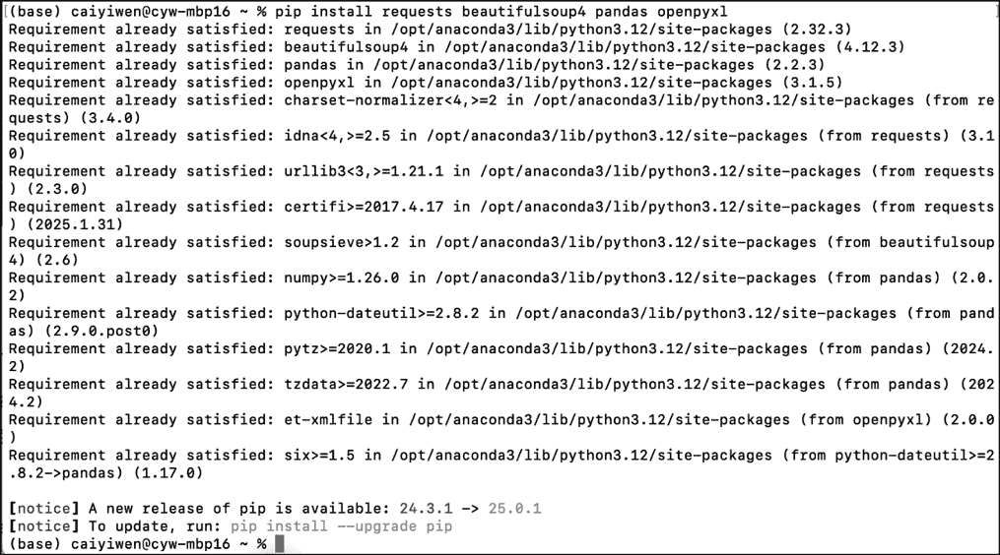

图 3-6 程序结果示意

**(2) 创建 Python 脚本。**
先打开文本编辑器，复制并粘贴 AI 提供的 Python 代码。该代码会依据预设关键词从指定站点抓取文章和报告。

## Python
import requests
from bs4 import BeautifulSoup
import pandas as pd
from urllib.parse import urlencode, urljoin
BASE_URL = "https://▓▓▓▓▓▓▓▓▓▓▓▓▓▓▓"
KEYWORDS = ["市场动态", "行业报告"]
def fetch_articles(keyword):
    url = f"{BASE_URL}?{urlencode({'tn': 'news', 'word': keyword})}"
    response = requests.get(url)
    soup = BeautifulSoup(response.text, 'html.parser')
    return [
        {
            '标题': item.select_one('a.c-title').get_text(strip=True),
            '链接': urljoin(BASE_URL, item.select_one('a.c-title')['href']),
            '摘要': item.select_one('p.c-summary').get_text(strip=True) if item.select_one('p.c-summary') else 'N/A'
        }
        for item in soup.select('li.c-single-item')
    ]
all_articles = [article for kw in KEYWORDS for article in fetch_articles(kw)]
pd.DataFrame(all_articles).to_excel("output.xlsx", index=False) if all_articles else print("未找到相关文章。")

随后根据目标网站修改 base_url 与选择器。例如抓取百度新闻保留当前设置，若换站则需查看 HTML 结构并调整选择器。

最后将文件保存为 fetch_articles.py。

**3. 运行文档抓取脚本**

定位到脚本所在目录后执行抓取。操作步骤如下。

**(1) 打开命令提示符或终端**，切换到保存 fetch_articles.py 的位置。可使用 cd 命令，如“cd desktop/秒懂 AI/第三章/3.2”，如图 3-7 所示。

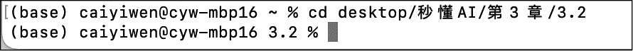

图 3-7 文件导航示意

**(2) 输入命令运行脚本。**

Bash
python fetch_articles.py

执行完成后，可在指定位置找到生成的新 Excel 文件，其中包含抓取的文档信息，如图 3-8 所示。

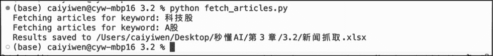

图 3-8 程序运行结果示意

运行成功，程序输出如图 3-9 所示。

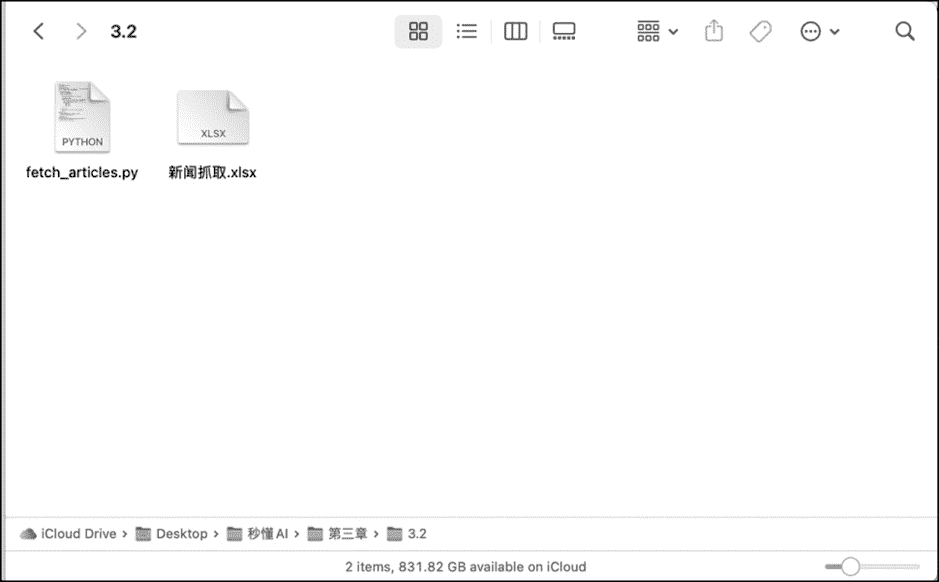

图 3-9 程序运行成功示意

使用注意点有两条。
· 首次运行前请备份 Excel 文件，避免有用数据被覆盖。
· 确保具备从目标网站抓取数据的权限，并遵守其服务条款与版权规定，部分站点禁止未经许可的数据抓取。

## 3.3 快速提炼精华：AI 自动生成摘要与关键词

信息体量持续攀升，如何迅速抓住文章核心成为刚需。AI 技术的发展为此提供了高效解法——自动提炼摘要与关键词。下面将深入探讨 AI 赋能的代码开发在该场景的应用，并说明如何在实际中借助工具提升效率。

### 3.3.1 AI 赋能多场景：三大应用的智能升级

在工作和学习中，AI 生成的提炼脚本已成为提效利器。教师评审论文、学生备考、企业分析市场，均能发挥明显作用。

**(1) 教师论文评审。**
教师每学期需审阅大量论文，内容繁杂耗时。借助 AI 生成的代码可快速提取核心论点、研究方法与结论，形成精炼摘要，一眼掌握重点。同时还能以清晰结构呈现关键数据，评审时间大幅缩短，避免信息过载。

**(2) 学生学习助手。**
备考或写报告时，学生常被海量信息困扰。AI 辅助脚本能高效整理资料，精准提炼要点。例如从几十页教材中抽取核心概念、关键公式并自动归纳知识点，帮助快速理解难点。对临时冲刺的同学而言，相当于多了一位高质量私教，复习周期缩短，效果提升。

**(3) 运营者实时热点分析。**
市场瞬息万变，品牌管理者需要持续关注趋势并快速调整策略。AI 驱动的脚本可实时分析社交媒体、行业报告与用户反馈，提供数据驱动的决策支持。它能自动监测热门话题、洞察竞品动态、预测消费趋势，助力企业迅速调整营销方向，抢占先机。

即便不懂编程，也能借助 Python 脚本或在线服务实现文本读取、摘要生成与关键词提取，让工作更智能、错误更少。

### 3.3.2 案例：自动提炼学习资料的核心内容

本案例介绍如何通过 AI 编程自动提炼学习资料的核心要点，流程如图 3-10 所示。

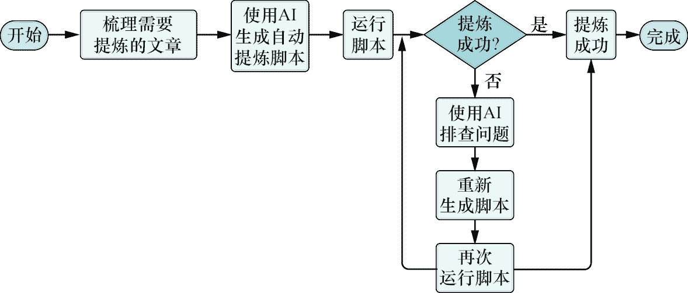

图 3-10 流程示意

假设一个场景：学生面对大量学习资料，手动整理要点既耗时又易遗漏，尤其在备考期，效率尤为关键，传统笔记与搜索工具已不够用。

此时 AI 编程登场，可快速提炼核心要点与关键词，让复习与写作更有针对性。即便零编程基础，也能轻松完成精准提炼。

借助 AI 编程，学生可迅速定位文献重点，高效整理笔记，为考试与报告做好准备，从而节省时间、提升成绩，告别熬夜复习。

**1. 梳理向 AI 提问的问题**

将需求结构化后向 AI 提问，包含背景、目标、现状与挑战及格式要求。

**(1) 背景问题。**
· 作为一名学生，我每天需处理大量【学习资料和研究文献】，尤其在考试或写报告时，信息过载难以高效整理。
· 手工查找与整理关键内容【费时费力】，易【遗漏重要信息】，备考期间时间紧张，效率至关重要。

**(2) 目标需求。**
· 希望有一种【高效且智能的方法】，能【快速提炼学习资料中的核心要点和关键词】，短时间内掌握大量信息。
· 使复习与写作更有【针对性】，提高效率。

**(3) 现状与挑战。**
· 目前依赖【传统笔记】或简单搜索工具整理资料，【效率低下】，难以应对信息过载。
· 手工筛选【耗时】，易【遗漏关键内容】，影响学习效果，且传统方式灵活性不足，难以满足个性化需求。

**(4) 具体要求。**
请以【1、2、3 步骤】形式，【简明清晰】地说明如何【实现自动提炼资料中的核心要点和关键词】，即使我没有编程基础。

**2. 执行 AI 回答中的步骤**

按 AI 指导操作。

**(1) 安装必要软件与库。**
安装 Python 可跳过。
在命令提示符或终端执行以下命令安装依赖库。

Bash
pip install nltk spacy pytextrank pandas openpyxl
python -m spacy download zh_core_web_sm
python -m spacy download en_core_web_sm

程序运行结果如图 3-11 和图 3-12 所示。

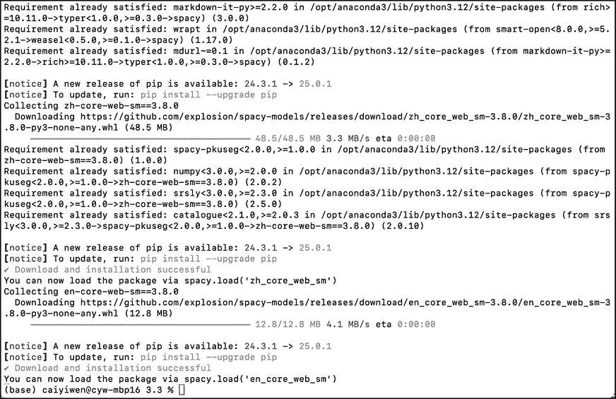

▲图 3-11 程序结果示意（1）

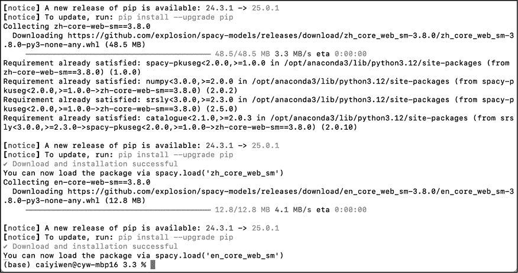

▲图 3-12 程序结果示意（2）

**(2) 创建 Python 脚本。**
打开文本编辑器，复制并粘贴以下 Python 代码。该代码会读取学习资料，提取核心内容并生成关键词与摘要。

## Python
import spacy
from spacy import displacy
from collections import Counter
import en_core_web_sm  # 处理英文文本
# import zh_core_web_sm  # 处理中文文本（如适用）
from pytextrank import TextRank
import pandas as pd
def extract_keywords_and_summary(text, lang='en'):
    """
    提取文本的关键词和摘要。
    参数:
    text (str): 要处理的文本
    lang (str): 语言 ('en' 表示英文，'zh' 表示中文)
    返回:
    tuple[list, str]: 关键词列表和摘要字符串
    """
    # 选择合适的 NLP 语言模型
    if lang == 'en':
        nlp = en_core_web_sm.load()
    else:
        raise ValueError("当前仅支持英文 ('en')，如需支持中文，请解开 zh_core_web_sm 的导入注释。")
    # 添加 TextRank 组件进行关键词提取
    tr = TextRank()
    nlp.add_pipe(tr.PipelineComponent, name="textrank", last=True)
    # 处理文本
    doc = nlp(text)
    # 提取前 5 个关键词
    keywords = [phrase.text for phrase in doc._.phrases[:5]]
    # 生成摘要（限制 3 句话）
    summary = " ".join([sent.text for sent in doc._.textrank.summary(limit_sentences=3)])
    return keywords, summary
# 读取文本文件（请替换为你的实际路径）
file_path = "C:\\Users\\YourUsername\\Documents\\study_material.txt"
try:
    with open(file_path, "r", encoding="utf-8") as file:
        text = file.read()
    # 提取关键词和摘要
    keywords, summary = extract_keywords_and_summary(text, lang='en')  # 选择'zh'处理中文
    # 输出结果
    print("关键词:", keywords)
    print("摘要:", summary)
    # 保存结果到 Excel
    output_path = "C:\\Users\\YourUsername\\Documents\\extracted_info.xlsx"
    df = pd.DataFrame({'关键词': keywords, '摘要': [summary]})
    df.to_excel(output_path, index=False)
    print(f"结果已保存至 {output_path}")
except FileNotFoundError:
    print(f"错误：未找到文件 {file_path}")
except Exception as e:
    print(f"处理过程中发生错误: {e}")

将代码保存至对应文件夹。“/Users/YourUsername/Documents/extracted_info.xlsx” 为示例路径，请改为自己的路径。

将文件命名为 extract_info.py，确保后缀为 .py。

**3. 运行自动提炼文章摘要与关键词脚本**

定位脚本目录后执行。

**(1) 打开命令提示符或终端**，导航至保存 extract_info.py 的位置，如图 3-13 所示。可使用 cd 命令，如“cd Desktop/秒懂 AI/第三章/3.3”。

Bash
cd Desktop/秒懂 AI/第三章/3.3

图 3-13 文件导航示意

**(2) 输入命令运行脚本。**

Bash
python extract_info.py

执行完毕后，Excel 表格中已经填好了每篇文章的摘要，效果示意见图 3-14。

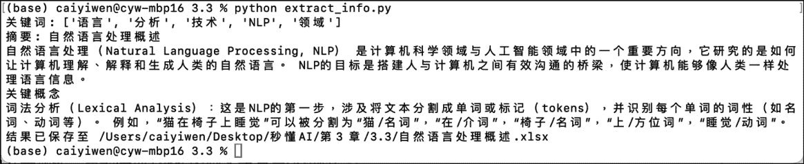

图 3-14 程序运行成功示意

## 3.4 从人工检索到自动采集：把资料收集交给 AI

借助自动化脚本，AI 能迅速抓取网络信息并完成归类，让我们把精力留给更有价值的分析工作。

### 3.4.1 信息洪峰来袭，AI 收拢更省力

在数字化环境下，课程、电子书、论文、行业报告等资源持续涌现，人工浏览筛选既费时间又易遗漏。尤其是写论文的学生或做研究的职场人，需要在知网、万方、慕课等平台间来回切换，负担很重。

让 AI 生成代码实现自动抓取、分类与保存，效率会明显提升。资料管理上的优势主要体现在以下几方面。

**（1）海量抓取一次到位：**短时间内可从多个站点批量下载几十篇论文或报告，省下的时间足够休息。

**（2）按内容自动归位：**依据文件本身做智能分拣，保证每份材料落到正确位置，不会误删关键 PPT。

**（3）采集规则可自定：**学生找论文、市场人员盯竞品，都能按自身需求设定专属逻辑，想取什么就取什么。

**（4）定时巡检保持新鲜：**设置周期任务定期检查新增内容，确保资料库始终在最新状态。

**（5）团队协同更顺畅：**资源集中管理，减少重复劳动，整体效率得以提升。

举例来说，市场专员小李用 AI 产出的代码抓取行业报告与对手动态。过去他需花数小时手工检索，现在坐等即可，整理好的材料会自动送达，效率明显拉升。

零基础用户如何借助 AI 产出的代码完成资料管理？大致流程如下。

**（1）先定目标：**想清楚要采集哪类素材，是论文、行业报告还是视频教程，目标明确后范围就清晰了。

**（2）设定条件：**告诉 AI 采集的具体要求，例如只取标题含“市场分析”的文章，或仅下载 PDF。AI 会据此产出对应代码。

**（3）启动获取：**运行 AI 产出的代码，从目标站点自动获取资料。

**（4）归整保存：**获取完成后，利用代码把资料分类保存到指定文件夹或云盘，也可按日期或主题再整理。

使用 AI 产出的代码采集资料时，需要注意以下事项以保证合规、安全和高效。

**（1）遵守规范：**遵循网站使用规则，避免获取受版权保护的内容。

**（2）控制频率：**采集不宜过于频繁，以免触发网站限制。

**（3）注意隐私：**若内容涉及个人隐私信息，应妥善保管。

**（4）持续调优：**结合实际效果调整采集规则，让工具越用越顺手。

### 3.4.2 案例：自动获取学习材料

本案例演示如何借助 AI 产出的代码自动获取学习材料，整体流程见图 3-15。

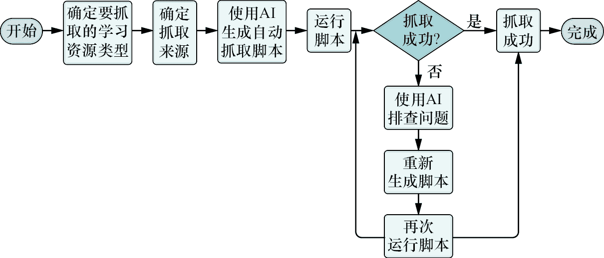

图 3-15 流程示意

下面是具体操作步骤。

**1. 梳理你要向 AI 提问的问题**

先把需求清晰地告诉 AI。可先按背景问题、目标需求、现状与挑战以及 AI 回答要求来组织思路，再提问。

**（1）背景问题。**

·面对信息爆炸，【在校学生和初入职场的人】要处理【海量且不断更新的学习资源】，【高效获取并管理最新资料】的难度日益增大。
·目前，我依赖【传统的手动搜索、下载和整理】方法来收集资料，这不仅【低效耗时】，还容易【遗漏关键内容】，尤其在准备【毕业论文】或进行【课题研究】时，频繁访问【学术数据库】和【在线教育平台】，增加了信息收集的复杂性。

**（2）目标需求。**

·我希望能够【自动抓取学习资料】，并【按照预设规则进行筛选和排序】，确保我能获得【最相关的信息】。
·这种方法应该【高效】，能大大减少手动操作的时间，让我能够专注于【资料的分析和应用】。

**（3）现状与挑战。**

·目前，我需要频繁访问【知网（CNKI）、万方数据、维普资讯等学术数据库】，和【慕课（MOOC）、学堂在线、腾讯课堂等在线教育平台】，进行信息收集和整理。
·这种【手动收集和整理资料】的方法不仅低效，还容易漏掉一些关键内容，影响我的【学习和研究进度】。

**（4）具体要求。**

我不懂编程。请用【1、2、3 步骤】形式，【简明清晰】地指导我如何通过 Python 脚本实现自动抓取学习资源，并按规则筛选和整理资料。

**2. 执行 AI 回答创建 Python 脚本**

按 AI 的建议操作。

**（1）安装必要的软件和库。**

安装 Python：此处略过，有需要的读者可参考前文。

安装依赖库：打开命令提示符（Windows）或终端（macOS/Linux），执行下列命令安装所需 Python 库。

Bash

pip install requests beautifulsoup4 lxml

笔者已提前安装，故此处直接显示版本信息，如图 3-16 所示。

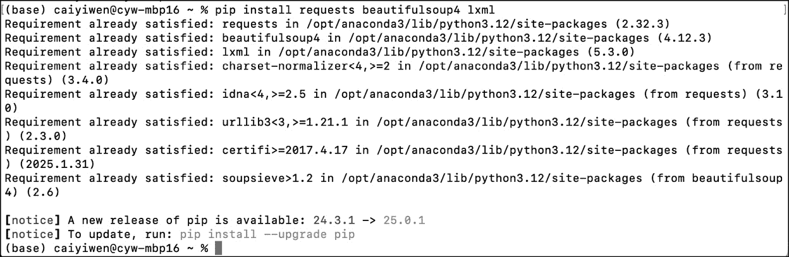

图 3-16 程序结果示意

**（2）创建 Python 脚本。**

打开文本编辑器（如记事本），复制并粘贴以下 Python 代码。该代码演示如何从网页抓取标题和链接。

## Python

import requests

from bs4 import BeautifulSoup

def fetch_resources(url):

 """
 从指定 URL 获取所有超链接资源。

 参数:

 url (str): 目标网页 URL

 返回:

 list[dict]: 资源列表，每个资源包含标题和 URL

 """

 try:

 # 发送 HTTP 请求

 response = requests.get(url, timeout=10)

 response.raise_for_status() # 检查 HTTP 请求是否成功

 print("  HTTP 请求成功")

 # 打印部分 HTML 内容（调试用）

 print("  HTML 内容（前 500 个字符）：")

 print(response.text[:500])

 # 解析 HTML

 soup = BeautifulSoup(response.text, 'lxml')

 # 提取所有标签的超链接

 resources = []

 for link in soup.find_all('a', href=True):

 title = link.get_text(strip=True) or "无标题"

 href = link['href']

 resources.append({'title': title, 'url': href})

 return resources

 except requests.exceptions.RequestException as e:

 print(f"  网络请求错误: {e}")

 except Exception as e:

 print(f"  处理过程中出现错误: {e}")

 return []

# 使用示例（请替换为实际 URL）

url = "http://example.com"

resources = fetch_resources(url)

# 输出抓取结果

if resources:

 print("\n  找到以下资源:")

 for resource in resources:

 print(f" 标题: {resource['title']},链接: {resource['url']}")

else:

 print(" 未找到任何资源")

将代码保存到对应文件夹。

修改 URL：把“http://example.com”替换为目标网页地址。

保存文件：命名为 resource_collector.py。

**3. 运行 Python 脚本完成指定网站学习资料抓取**

定位到脚本所在目录后执行。

**（1）打开命令提示符或终端。**

使用 cd 命令切换到保存 resource_collector.py 的位置，例如“cd desktop/秒懂 AI/第三章/3.4”，如图 3-17 所示。

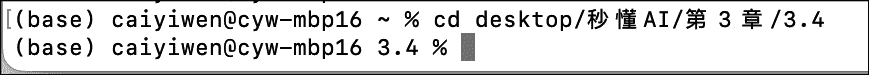

图 3-17 文件导航示意

**（2）输入以下命令运行脚本。**

Bash

python resource_collector.py

程序运行成功，结果如图 3-18 所示。

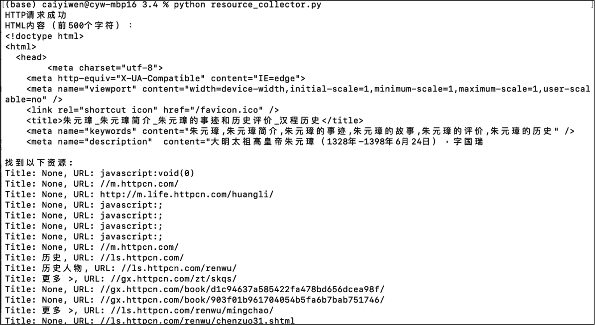

图 3-18 程序运行成功示意

## 3.5 提炼学习要点：借助 AI 生成内容摘要

互联网让学习材料触手可及，却也带来信息过载的困扰。手工整理笔记效率很低。

不必担心，AI 可以充当“学习助手”。借助 AI 产出的代码能够自动分析资料核心内容，省去人工整理的繁琐。无论是要点提取、资料更新还是智能推荐学习内容，都能实现。

### 3.5.1 AI 助力，学习体验升级

人工智能发展为学习打开了新可能。利用 AI 产出的代码，学生能从海量材料中快速提取核心要点，节省大量时间精力。主要亮点如下。

**（1）快速生成要点总结：**上传学习材料后自动分析并产出清晰的知识点总结，帮助快速掌握重点。

**（2）智能推荐学习内容：**依据学习进度与需求推荐相关材料，提升学习效率。

**（3）个性化学习路线规划：**结合学习习惯与目标定制专属路线，助力合理安排学习时间。

未来 AI 还可应用于语音输入、图像识别、学习路径规划等领域，它不仅是工具，更是陪伴学习的伙伴，助你找到最适合自己的方式，在知识海洋中游刃有余。

### 3.5.2 案例：自动生成学习内容的要点总结

本案例说明如何通过 AI 产出的代码自动整理学习材料，流程如图 3-19 所示。

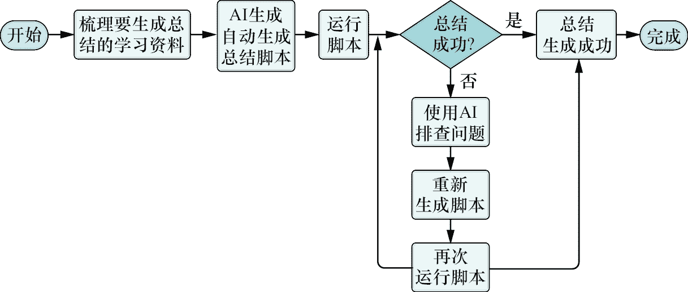

图 3-19 流程示意

具体操作如下。

**1. 梳理你要向 AI 提问的问题**

把需求告诉 AI。可按背景问题、目标需求、现状与挑战及回答要求进行结构化梳理。

**（1）背景问题。**

·作为学生，我面临着【越来越多学习资料（如 PDF、Word 文件等）】的管理挑战，手动整理不仅【耗时费力】，还容易【漏掉重要的知识点】。
·目前，大多数学生仍依赖【传统手动整理】方法，效率低下，容易产生【疲劳】和【焦虑】。

**（2）目标需求。**

·我希望找到一种【更简单、更高效】的方法来管理学习资料，利用【AI 编程】，帮助我生成【学习内容的要点总结】，从而提高学习效率。
·这种方法应该能够【自动提炼】学习资料的【核心内容】，节省时间，避免烦琐的整理工作。

**（3）现状与挑战。**

·当前的资料整理方式低效，导致我花费大量时间在整理上，而不能专注于【理解和掌握核心内容】。
·我希望找到一种【智能化】的方法来自动化生成要点总结，以提高学习效果。

**（4）具体要求。**

我不懂编程。请用【1、2、3 步骤】形式，【简明清晰】地指导我如何通过 Python 脚本实现自动生成学习内容的要点总结。希望步骤尽量【简单易懂】，便于操作。

**2. 执行 AI 回答中的步骤**

按 AI 建议操作。

**（1）安装必要的软件和库。**

安装 Python：此处略过，详情见前文。

安装依赖库：打开命令提示符或终端，执行以下命令。

## Python

pip install PyMuPDF transformers torch sentence-transformers

程序结果如图 3-20 所示。

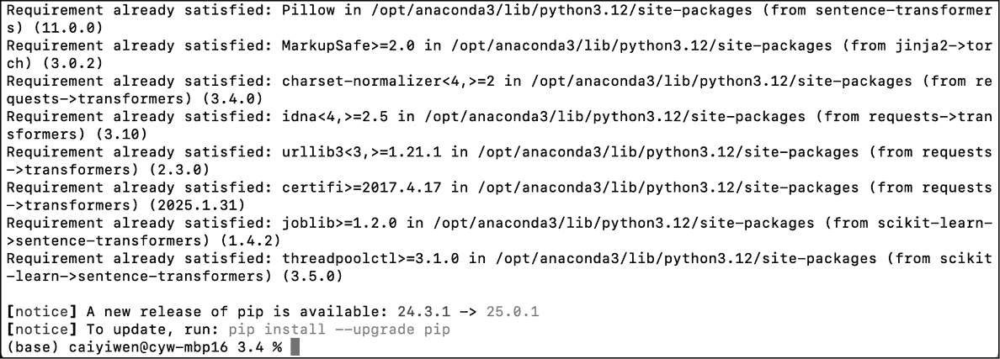

图 3-20 程序结果示意

**（2） 创建 Python 脚本。**

打开文本编辑器，复制并粘贴以下 Python 代码。

## Python

import fitz # PyMuPDF

from transformers import pipeline

# 从 PDF 文件中提取文本

def extract_text_from_pdf(pdf_path):

 doc = fitz.open(pdf_path)

 text = "\n".join(page.get_text() for page in doc)

 return text

# 按块拆分文本（避免超出模型限制）

def split_text_into_chunks(text, chunk_size=500):

 words = text.split()

 return [' '.join(words[i:i + chunk_size]) for i in range(0, len(words), chunk_size)]

# 使用预训练模型进行摘要

def summarize_text(text):

 summarizer = pipeline("summarization", model="facebook/bart-large-cnn")

 chunks = split_text_into_chunks(text)

 summaries = []

 for chunk in chunks:

 summary = summarizer(chunk, max_length=150, min_length=50, do_sample=False)[0]['summary_text']

 summaries.append(summary)

 return " ".join(summaries)

if __name__ == "__main__":

 pdf_file = "path_to_your_pdf.pdf" # 替换为你的 PDF 文件路径

 extracted_text = extract_text_from_pdf(pdf_file)

 print("  Extracted Text (前 500 个字符):\n", extracted_text[:500]) # 打印前 500 个字符检查提取效果

 summary = summarize_text(extracted_text)

 print("\n  Summary:\n", summary)

根据实际情况修改 pdf_file 变量路径，指向待处理的 PDF 文件。可让 AI 生成一份可作为案例的文案来运行该脚本。

**3. 运行自动生成学习内容的要点总结脚本**

定位脚本目录后执行。

**（1）打开命令提示符或终端，**使用 cd 命令切换到保存 summarize_learning_materials.py 的位置，例如“cd desktop/秒懂 AI/第三章/3.5”，如图 3-21 所示。

图 3-21 文件导航示意

**（2）输入以下命令运行脚本。**

Bash

python summarize_learning_materials.py

运行成功！Summary 中即为案例内容的要点总结，如图 3-22 所示。

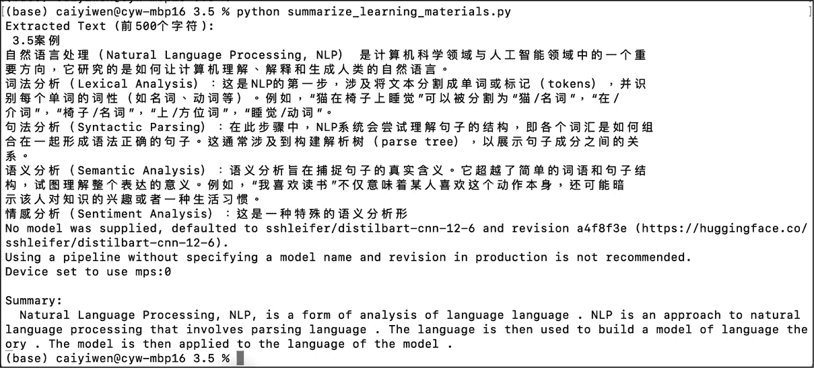

图 3-22 程序运行成功示意

在 AI 助力下，资料管理变得高效有序。学习不仅是整理信息，更在于高效吸收与运用。下一章将借助 AI 产出的代码提升学习效率，自动生成知识卡片、练习听力口语，甚至个性化订阅新闻，让学习更轻松有趣！

# 第四章

# AI 编程加速学习，轻松变身学霸

除了工作，学习与日常里各类杂事也都可以借助 AI 编程实现提速。本章聚焦在学习上，演示如何用 AI 编程把学习效率拉满，轻松应对不同挑战。

## **4.1 用 Python 批量出卡，告别机械记忆**

学习路上，机械记忆常常被视作绕不开的硬门槛。AI 快速演进后，学习范式正在重塑。有了 AI 的加持，我们可以甩掉枯燥的背诵，转向更高效更有趣的方式。

### **4.1.1 有 AI 伴学，复习更省心**

临近考试，书本笔记堆满桌面，压力会骤然升高。备战英语词测，面对密密麻麻的词表，脑子容易发懵。不少同学都有相似困扰。

有没有更省心又好玩的提效做法？当然可以。依托 AI 编程就能快速产出定制化学习卡片，让复习像玩游戏一样轻松。

过去主要依赖两种记录方式。
·**纸质笔记：**手写能加深印象，但查找特定内容如同大海捞针，效率偏低。
·**电子文档：**用 Word 或 Excel 记录便于保存，却缺少互动，复习时总觉得索然无味。

这两种方式痛点明显，如反复整理、易出错、版式不统一等。
·**反复整理：**每次复习都要重新梳理材料，等于重复造轮子。
·**容易出错：**手工录入易写错单词或漏掉要点，手残党最怕。
·**版式参差：**不同时期做的卡片风格迥异，像拼凑的作品。
·**更新艰难：**新增知识点后修改旧卡片，难度堪比登天。

这些问题不仅拖慢效率，还容易让人对学习失去兴趣。要打破僵局，需要更智能自动化的解法。

AI 编程让学习更聪明更省力。自动产出的定制卡片省去繁琐手工整理。无论是批量处理数据、智能排版，还是实时更新内容，都能一键搞定。你只需点几下，就能拿到准确美观便于复习的卡片，让枯燥知识点变得生动。

### **4.1.2 实战：打造专属记忆卡**

本案例说明如何通过 AI 编程实现单词轻松记忆，具体流程如图 4-1 所示。

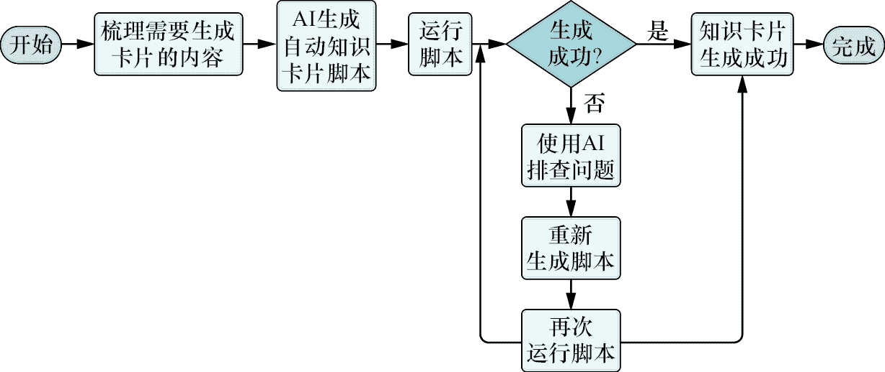

图 4-1 流程示意

为更直观展示 AI 编程如何简化学习，下面看一个实操案例。

假设你是英语专业学生，或正在备考托福雅思，需要记忆大量新词。传统方式不够灵活又很枯燥。现在结合 Python 脚本与 AI 编程，就能制作定制卡片，大幅提升效率。操作可按以下三步进行。

**（1）准备数据：**把需要复习的单词整理成 CSV 文件，每行包含单词、词性和释义。
**（2）编写脚本：**用 Python 读取 CSV，随机生成问题，例如“这个单词的意思是什么？”并生成对应答案卡片。
**（3）导出卡片：**把生成的记忆卡片保存为 PDF 或图片格式，方便打印或手机查看。

这样就能随时随地复习单词，记忆效果更好，学习也更有趣。整个流程简单快捷，几乎不需要编程基础，很适合初学者尝试。

**1. 梳理你要向 AI 提问的问题**

先把需求告诉 AI。可以先用背景、目标、现状与挑战，再加上对 AI 回答的具体要求来结构化思路，然后提问。

**（1）背景问题。**

·许多人在【复习时面对堆积的教材和笔记】，尤其是准备【英语词汇测验】时，会感到【不知所措】。传统【机械背诵】既【耗时耗力】，又让人【兴致缺缺】。
·现阶段不少学生仍以【手写笔记、电子文档】为主，但这些方式存在【反复整理、容易出错、版式不一致】等痛点，拖累学习效率。

**（2）目标需求。**

·希望借助【人工智能编程】，找到一种【更简单、更有趣】的方式来【高效学习】，减少【机械背诵】投入的时间精力。
·能够【按个人需求生成定制化的学习卡片】，真正做到【个性化学习】，提高学习效果。

**（3）现状与挑战。**

传统学习方式效率低，【互动性】和【定制化】不足，影响学习动力与效果。

**（4）具体要求。**

我不懂编程。请用【1、2、3 步骤】形式，【简明清晰】地指导我如何通过 Python 脚本自动生成学习卡片。

**2. 执行 AI 回答中的步骤**

按 AI 的建议来试试。

**（1）安装必要的软件和库。**

安装 Python：这一步暂且跳过，有需要的读者可翻阅前文。

安装依赖库：打开命令提示符（Windows）或终端（macOS/Linux），执行以下命令安装所需 Python 库：

Bash

pip install pandas openpyxl pillow qrcode

程序结果示意如图 4-2 所示。

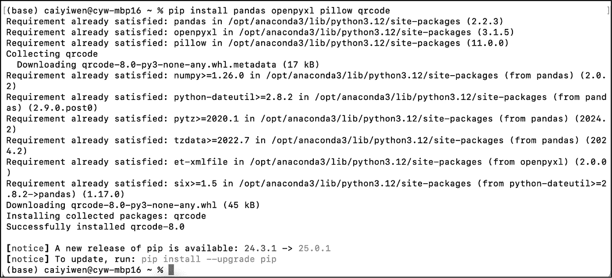

图 4-2 程序结果示意

**（2）创建 Python 脚本。**

打开文本编辑器（如记事本），复制并粘贴下面提供的 Python 代码。

## Python

import pandas as pd

from PIL import Image, ImageDraw, ImageFont

import qrcode

import requests

from io import BytesIO

# 读取单词表

words_df = pd.read_excel('/path/to/words.xlsx')  

# 替换为实际路径

font = ImageFont.truetype('/path/to/font.ttf', 50)  

# 替换为实际字体路径

# 获取图片的函数

def fetch_image(word):

    """获取相关图片"""

    try:

        return 

Image.open(BytesIO(requests.get(f"https:

//source.unsplash.com/300x300/?{word}").content))

    except:

        return None

# 为每个单词生成卡片

for i, row in words_df.iterrows():

    card = Image.new('RGB', (800, 600), '#f0f0f0')  

# 创建新的图片

    draw = ImageDraw.Draw(card)

    # 添加单词、翻译、提示文本

    for text, y in [(f"Word: {row['English']}", 100), 

                    (f"Translation: {row['Chinese']}", 

200), 

                    ("Scan for details", 500)]:

        draw.text((400 - draw.textsize(text, font)[0] 

// 2, y), text, 'black', font=font)

    # 添加二维码

    qr = qrcode.make(f"https://dictionary.cambridge.

org/dictionary/english/{row['English']}").resize((200, 200))

    card.paste(qr, (300, 350))  # 把二维码放到图片上

    # 获取相关图片并添加

    image = fetch_image(row['English'])

    if image:

        image = image.resize((300, 300))  # 调整图片大小

        card.paste(image, (250, 50))  # 把图片放到卡片上

    # 保存卡片

    card.save(f'/path/to/save/cards/{row["English"]}_card.

png')  # 替换为实际保存路径

把代码保存为 .py 文件（本书命名为 generate_cards.py）。

·将上述代码保存为 .py 文件（本书保存为 generate_cards.py）。
·把 words.xlsx 替换为自己的单词表路径。

**3. 运行自动生成学习卡片脚本**

要让脚本顺利运行，需要定位到脚本所在文件夹并执行。具体操作如下。

**（1）打开命令提示符或终端，**导航到保存 generate_cards.py 文件的位置。可使用 cd 命令切换目录，例如“cd desktop/秒懂 AI/第四章/4.1”，如图 4-3 所示。

图 4-3 文件导航示意

**（2）输入以下命令运行脚本：**

Bash

python generate_cards.py

运行成功，程序运行成功示意如图 4-4 所示。

图 4-4 程序运行成功示意（1）

查看生成的单词卡片，如图 4-5 所示。

图 4-5 程序运行成功示意（2）

## **4.2 调用 API 自动产出例句，练就写作语感**

无论是写学术论文、工作报告还是日常分享，很多人都面临词汇贫乏、句式复杂、语法失误等问题。缺乏灵感和结构组织能力，也让人很困扰。好在借助人工智能编程，这些难题都能被有效解决，让写作更顺畅高效。

### **4.2.1 AI 加持，写作更流畅**

写作令人又爱又恨。爱的是能表达想法，恨的是常卡在“这个词怎么用”“这句话通不通顺”这类细节上。别担心，有了人工智能编程加持，写作会变得轻松许多。通过 API 自动产出例句，能快速找到合适表达，锻炼语感，让写作从头疼任务变成愉快创作。

写作主要难在两点。
·词穷：脑子里有想法，却找不到合适的词句表达。
·逻辑乱：写完回头看，结构混乱，读起来像意识流。

人工智能编程都能帮你解决。它就像你的写作外挂，助你从“写不出字”到“下笔如有神”。

**人工智能编程如何助力写作？**API 是一种技术接口，可连接庞大的语言数据库，帮助生成例句、检查语法、优化结构。以下是 API 在写作应用中的核心功能。

**（1）自动产出例句，告别词穷。**

写论文卡在“文献综述”？写邮件不知怎么开头？人工智能编程可通过 API 按需求自动产出例句。比如输入“如何表达感谢”，它会给出“衷心感谢”“深表谢意”“万分感激”等多个选项，总有一款合适。

**（2）实时语法检查，避免尴尬。**

人工智能编程可通过 API 内置语法检查，实时找出错误。比如把“的、地、得”用混时，它会提示：“兄弟，这个词用错了。”不再因低级错误被扣分。

**（3）智能推荐，越写越顺。**

AI 会依据你的写作习惯，智能推荐词汇和句式。用久了语感会变好，写作更顺手。比如建议把“这个方案很好”改为“这个方案颇具可行性”，专业度瞬间提升。

**（4）理清思路，结构清晰。**

AI 不仅能改句子，还能梳理文章结构。比如建议：“这段内容放前面，逻辑会更顺。”避免写成流水账。

**（5）随时随地，轻松操作。**

无论在办公室写报告，还是在咖啡馆赶论文，人工智能编程都能随时提供支持。

**人工智能编程写作适合哪些场景？**主要包括：
·**学术写作：**写论文时，AI 帮你梳理文献综述、数据分析甚至结论，让逻辑清晰表达专业。
·**职场沟通：**写邮件、报告时，AI 帮你找到最佳表达，让老板同事刮目相看。
·**日常创作：**发朋友圈、写博客时，AI 让文字更生动有趣，收获更多点赞评论。

AI 辅助写作不仅解决当下难题，长期使用还能培养写作习惯和语感。慢慢地，写作水平会不知不觉提升，面对各类任务更有自信。

### **4.2.2 实战：自动生成写作例句**

本案例介绍如何通过人工智能编程自动产出写作例句，具体流程如图 4-6 所示。

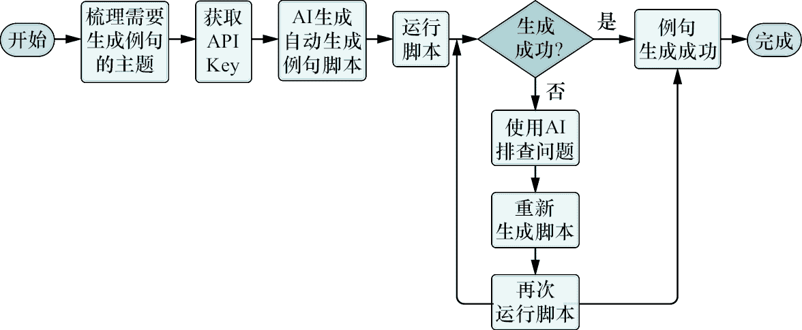

图 4-6 流程示意

有了人工智能编程技术加持，写作不再是抓狂任务，而是高效且充满创意的工作。下次写作卡壳，别急着挠头，试试人工智能编程吧！

**1. 梳理你要向 AI 提问的问题**

把需求告诉 AI。可先用背景问题、目标需求、现状与挑战，再加上 AI 回答的具体要求来结构化思路，然后提问。

**（1）背景问题。**

·写作时常遇到【词汇匮乏、句子结构复杂、语法错误】以及【表达不自然】的问题，尤其是面对【空白页面】时，常感到缺乏思路，不知从何下笔或如何组织结构。
·传统做法如【查字典】或【请教老师】虽有帮助，但【耗时费力】且【缺乏即时反馈】，影响写作效率。

**（2）目标需求。**

·希望通过【人工智能编程】实现一个【自动产出例句的工具】，帮助【提高写作效率】，减少【查找资料】和【构思】时间。
·该工具能按需求提供【即时反馈】，帮助【快速生成合适的例句】，解决词汇、语法和句式问题。

**（3）现状与挑战。**

当前写作方式低效，依赖传统【词典查询、范文参考】，缺乏【即时反馈】，导致拖延和效率低下。寻找合适例句常耗费大量时间，影响整体进度。

**（4）具体要求。**

我不懂编程。请用【1、2、3 步骤】形式，【简明清晰】地指导我如何通过人工智能编程自动产出写作例句。

**2. 执行 AI 回答中的步骤**

按 AI 的建议操作。

**（1）选择和注册大模型 API 服务。**

若不确定如何选择注册合适的 API 服务，可进一步向 AI 提问。

1）了解通义提供的服务。访问阿里云官网，注册登录，如图 4-7 所示。

图 4-7 阿里云官网首页示意

登录后界面如图 4-8 所示。

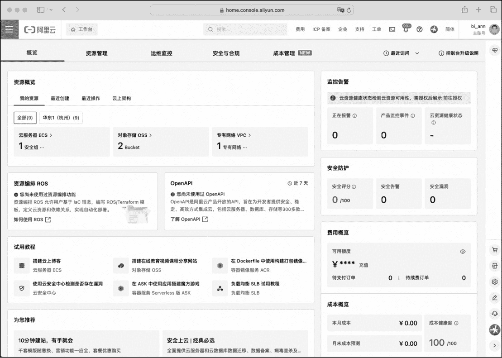

图 4-8 阿里云控制台示意

在网站查找通义系列，特别是与自然语言处理、文本生成、对话系统相关产品的信息，如图 4-9 所示。

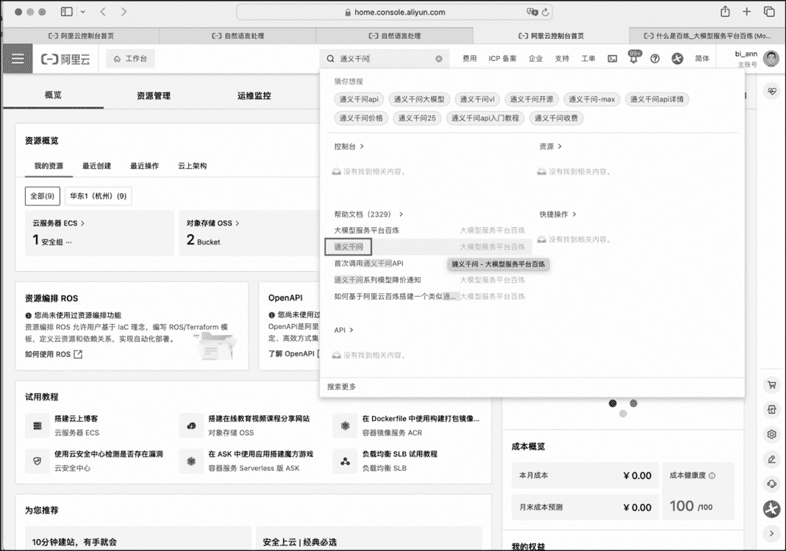

图 4-9 阿里云官网产品搜索示意

2）阅读 API 文档：学习如何使用 API。点击“文本生成”链接，进入相关产品文档页，如图 4-10 所示。

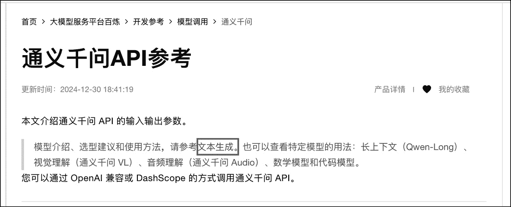

图 4-10 阿里云官网产品查阅示意

在左侧目录栏选择“获取 API Key”选项，如图 4-11 所示。

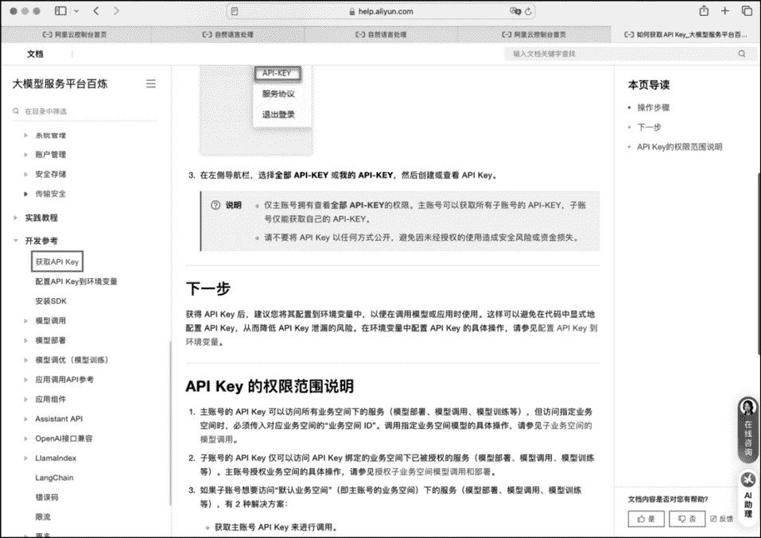

图 4-11 选择阿里云产品示意

点击“阿里云百炼大模型服务平台”链接，打开产品界面，如图 4-12 所示。

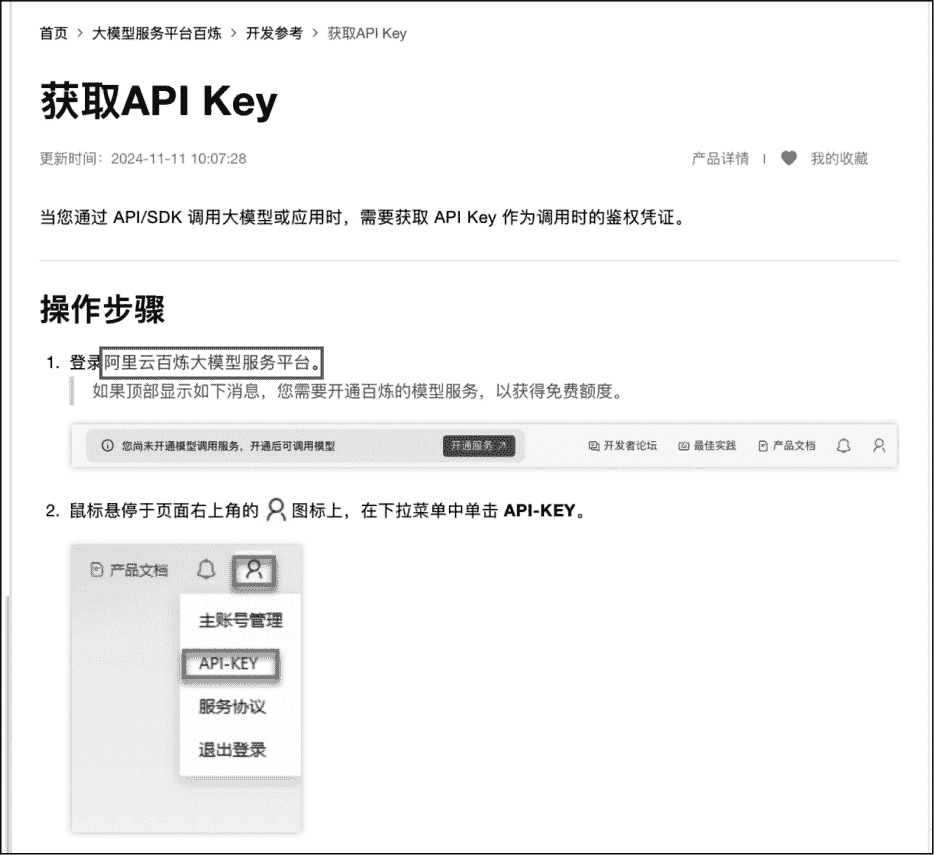

图 4-12 阿里云获取 API Key 示意（1）

3）获取 API Key。鼠标悬浮在图标上，在下拉菜单选择“API-KEY”选项，如图 4-13 所示。然后选择“创建我的 API-KEY”选项，在弹出窗口点击“确认”按钮生成 API Key，如图 4-14～图 4-15 所示。

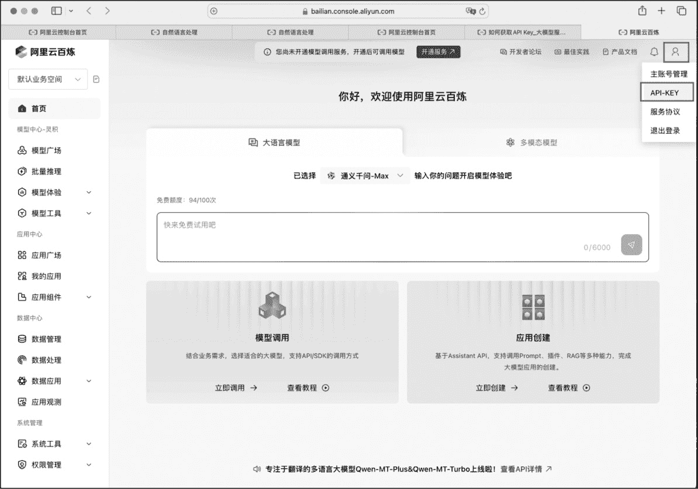

▲图 4-13 阿里云获取 API Key 示意（2）

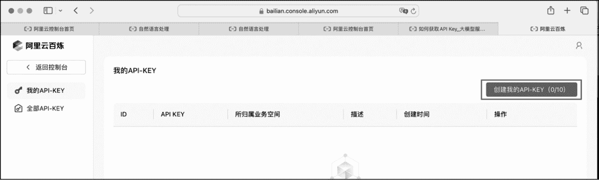

▲图 4-14 阿里云获取 API Key 示意（3）

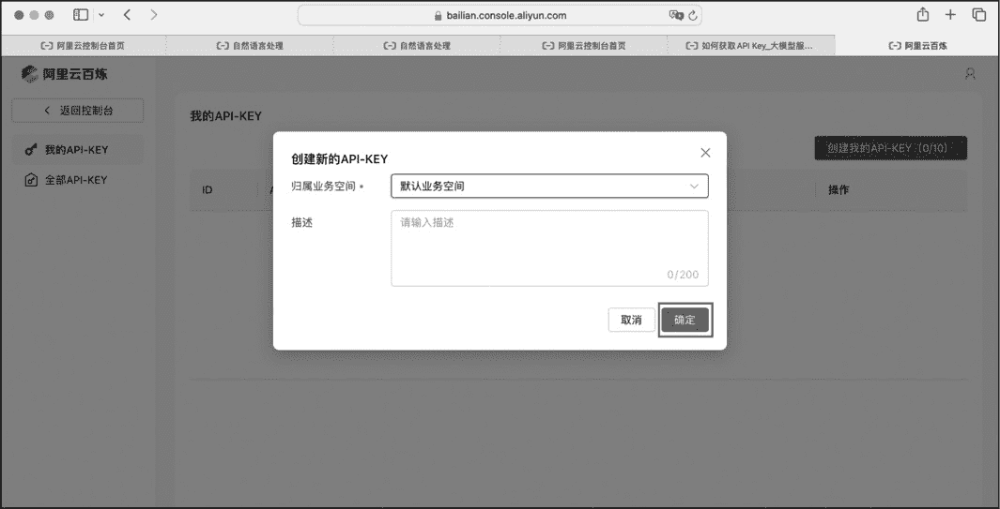

▲图 4-15 阿里云获取 API Key 示意（4）

API Key 生成成功，如图 4-16 所示。

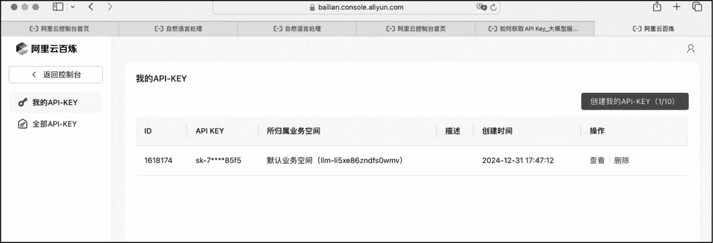

图 4-16 阿里云获取 API Key 示意（5）

打开命令提示符或终端，设置环境变量，如图 4-17 所示。

Bash

export DASHSCOPE_API_KEY="YOUR_DASHSCOPE_API_KEY"

在命令行中使用 API Key 设置环境变量，如图 4-17 所示。

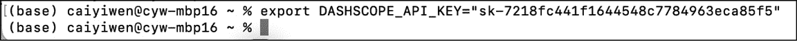

图 4-17 命令行使用 API Key 设置环境变量示意

4）打开命令提示符或终端，安装 SDK。

Bash

pip install -U openai

成功安装 SDK，如图 4-18 所示。

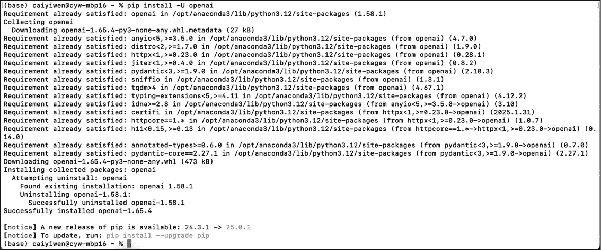

图 4-18 安装 SDK 示意

**（2）安装必要的软件和库（Python）。**

安装 Python：这一步暂且跳过，有需要的读者可翻阅前文。

环境准备

在 Windows 系统打开命令提示符，macOS 或 Linux 打开终端，执行下面的安装指令。

Bash
pip install requests

如果对应依赖此前已安装，运行后会直接输出版本号，效果参考图 4-19 所示。
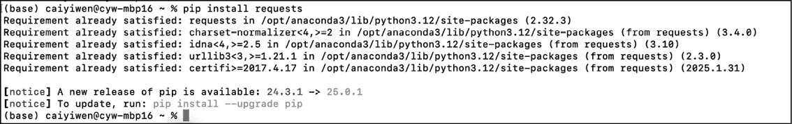
图 4-19 程序结果示意

（3）新建 Python 脚本
用记事本或其他编辑器新建文件，将下列代码粘贴进去。

## Python
import requests

def generate_sentences(api_key, topic):
    url = "https://api.example.com/generate"   
# 替换为实际 API 地址
    headers = {
        "Authorization": f"Bearer {api_key}",
        "Content-Type": "application/json"
    }
    data = {
        "model": "qwen-long",
        "messages": [
            {"role": "system", "content": "你是写作助手"},
            {"role": "user", "content": f"生成关于'{topic}'
的句子"}
        ],
        "parameters": {
            "temperature": 0.7,
            "max_tokens": 50
        }
    }
    try:
        response = requests.post(url, json=data, 
headers=headers)
        response.raise_for_status()
        return [c['message']['content'] for c in response.
json().get('choices', [])] or [“无结果”]
    except Exception as err:
        return [f"错误: {err}"]

if __name__ == "__main__":
    key = "your_api_key_here"  # 替换为实际 API Key
    topic = input("请输入主题：")
    for sentence in generate_sentences(key, topic):
        print(f"- {sentence}")

脚本会向指定的接口发起请求，根据输入的主题自动生成例句。记得把 url 与 api_key 改为可用值，运行时在提示处填入关键词。保存文件名设为 generate_sentences.py。

3. 运行例句自动生成脚本
要成功执行，先进入脚本所在目录再启动。具体步骤如下。

（1）打开命令行或终端，切换到存放 generate_sentences.py 的文件夹。可使用 cd 改变目录，例如“cd desktop/秒懂 AI/第四章/4.2”，示意见图 4-20。

图 4-20 文件导航示意

（2）执行启动命令：
Bash
python generate_sentences.py

运行正常时的画面如图 4-21 所示。
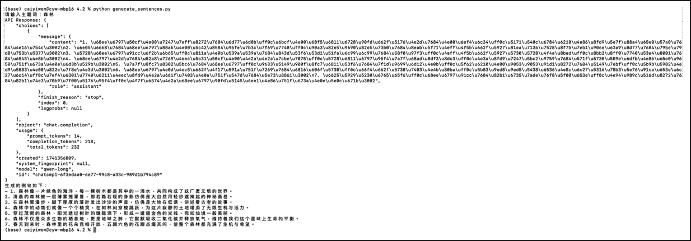
图 4-21 程序运行成功示意

## **4.3 用 Whisper 在本地做听力口语训练**

随着国际交流日益频繁，英语的重要性不断上升，但听力和口语的提升仍然让很多人犯难：反复听材料也抓不住要点，参加口语角又难以有效开口。这种困境很容易让人失去信心。借助编程实现 AI 辅助，可以让练习更有效、更有趣。

### **4.3.1 本地化部署 Whisper，提升听口能力**

通过编程可以在本地运行 Whisper 语音识别工具。它能把语音实时转写成文字，并给出发音和表达方面的建议。无论是日常会话还是专业场景，都能按需生成练习素材并提供即时反馈，随时随地开展训练。

传统方式如听录音、参与语言角虽有一定帮助，但存在明显不足。
·耗时低效：录音需要反复聆听，理解仍不理想。
·反馈缺失：口语角可以练习开口，但缺乏系统纠错。
·适配性差：学习需求千差万别，统一方法难以兼顾。

本地运行的 Whisper 正好解决了这些痛点。

Whisper 究竟是什么？为何好用？Whisper 是一款开源的语音识别模型，可通过编程在本地部署，不依赖外部 API。相当于一位私人英语教练，既能把语音转为文字，也能合成自然流畅的语音，听力和口语都能覆盖。

核心优势有三点。

（1）即时纠错，语音更准确：Whisper 能即时识别说话内容并给出发音与表达建议。譬如你说“I want a cup of water”，它会提示：“发音不错，但‘water’的‘t’可更清晰些。”

（2）按需训练，想练什么就练什么：日常对话或商务英语都能按需求生成练习材料。比如生成一段商务会议对话后跟着模仿。

（3）数据不出机，隐私更有保障：Whisper 在本地运行，语音不上传云端，隐私风险更低。

### **4.3.2 案例：用 Whisper 练英语**

本案例演示如何通过编程实现本地 Whisper 英语练习，流程见图 4-22 所示。

图 4-22 流程示意

本地 Whisper 让英语学习不再枯燥。它能实时纠正发音，并按需生成个性化练习内容，让你随时随地高效训练。无论是提升日常会话技巧还是准备商务交流，它都能成为得力助手。

别再为听力和口语发愁，试试本地 Whisper 吧！助你从“哑巴英语”到“流利英语”，轻松应对各种场景！

1. 梳理你要向 AI 提问的问题
把需求告诉 AI。可先用背景、目标、现状与挑战及 AI 回答要求来结构化思路，再提问。

（1）背景问题。
·在学习英语的过程中，我遇到【提升听力和口语能力的难题】，传统方法如【听录音、参加英语角】虽有帮助，但既【耗时费力】，又【缺乏即时反馈】和【个性化支持】。
·我在练习听力和口语时经常遇到以下问题。
【缺乏真实对话场景】：传统材料多为录音或书面内容，缺少真实交流的场景。
【缺少即时纠正】：发音和语法难以及时纠正。
【练习时间不足】：时间和地点的限制使得练习无法高效进行。
【个性化需求难以满足】：传统方法难以根据个人水平提供支持。

（2）目标需求。
·我希望找到一种【简单易用】的方法，即使没有编程基础也能轻松上手。通过【Whisper 工具】生成个性化的练习内容、提供即时反馈，并随时随地进行高效练习。
·具体来说，我希望能够在【本地环境】中使用 Whisper，通过【Python 脚本】获取【音频文件】或【语音转文字结果】，并提供关于口语音频的反馈。

（3）现状与挑战。
·目前，我依赖【传统的学习方法】，如听录音、背单词或参加语言角活动，但这些方法【效率低下，缺乏即时反馈】，并且很难满足我的【个性化需求】。
·这些方法让我感到【沮丧】，影响了英语学习的进步速度。

（4）具体要求。
我不懂编程。请用【1、2、3 步骤】形式，【简明清晰】地指导我如何通过 AI 编程实现 Whisper 与本地环境结合，让英语听力和口语练习更加高效。

2. 执行 AI 回答中的步骤
按 AI 的回答试试看。

（1）安装必要的软件和库。
安装 Python 可参考前文，这里略过。

安装必要库：启动命令窗口或终端，运行以下命令安装 Whisper 及其他依赖：
Bash
pip install git+https://github.com/openai/whisper.git
pip install numpy
pip install soundfile  # 用于处理音频文件

程序结果示意如图 4-23 所示。

图 4-23 程序结果示意

（2）创建 Python 脚本。
打开文本编辑器，例如记事本，复制并粘贴下方 Python 代码。

## Python
import whisper
from pathlib import Path
# 加载 Whisper 语音识别模型
model = whisper.load_model("base")

def transcribe_audio(file_path):
    """ 将音频文件转换为文本 """
    return model.transcribe(str(file_path))['text']

def analyze_transcription(text):
    """ 分析转录文本并提供反馈 """
    print(f"Transcription: {text}\n")
    words = len(text.split())  # 计算单词数
    sentences = text.count('.') + text.count('!') + text.
count('?')  # 计算句子数
    feedback = []
    if words < 5:
        feedback.append("Try speaking more. At least 5 
words.")
    if words > 30:
        feedback.append("Your speech is long. Consider 
shorter sentences.")
    if sentences == 0:
        feedback.append("Use punctuation like '.', '?', 
or '!' to end sentences.")
    if feedback:
        print("\nFeedback:")
        print("\n".join(feedback))
    else:
        print("Good job!")

if __name__ == "__main__":
    file_path = input("Enter the audio file path: ")
    if Path(file_path).is_file():
        text = transcribe_audio(file_path)
        if text:
            analyze_transcription(text)
    else:
        print("File does not exist.")

将代码保存为 english_practice.py。

3. 运行 Python 脚本实现本地用 Whisper 练英语
为顺利运行，需定位到脚本文件夹再执行。步骤如下。

（1）启动命令窗口或终端，导航到保存 english_practice.py 的位置。可使用 cd 命令更改当前目录，例如“cd desktop/秒懂 AI/第四章/4.3”，如图 4-24 所示。

图 4-24 文件导航示意

（2）输入以下命令运行脚本：
Bash
python english_practice.py

程序运行成功，结果如图 4-25 所示。

图 4-25 程序运行成功示意

## **4.4 自建个性化新闻抓取源**

是否常被海量资讯淹没，难以找到感兴趣内容？信息过载下，传统浏览耗时且易被无关信息干扰。借助 AI 与自动化工具，可创建完全贴合个人兴趣的新闻源，让阅读更高效愉悦。

### **4.4.1 定制新闻源的四大好处**

通过 AI 编程可按兴趣量身打造专属新闻源，实现精准推送、分类整理、去广告等功能，更高效获取所需信息。主要优势如下。

（1）精准推送，只关心你关心的。
通过关键词过滤，定制化新闻源可精准推送与兴趣相关内容。比如只关心科技新闻，设置关键词“AI”“区块链”“元宇宙”，其他内容会被过滤，再也不用被无关信息打扰。

（2）分类整理，快速找到重点。
新闻源可按类别或主题整理抓取内容。比如分为“科技”“财经”“娱乐”等类别，方便快速浏览。想轻松点，直接打开“娱乐”类别。

（3）纯净阅读，告别广告。
定制化新闻源可去除广告和其他干扰，提供纯净阅读环境。再也不用被弹窗广告干扰。

（4）整合多平台，节省时间。
整合多个新闻源后，无需频繁切换平台，就能在一个界面看到所有感兴趣内容。省时省力，效率提升。

应用场景广泛，可满足不同用户群体。

（1）职场人士。定制化新闻源可按职业领域推送行业报告和市场分析。如金融从业者，可实时跟踪股市动态和经济政策，做出更明智决策。

（2）学生和研究人员。可跟踪学术进展和技术突破。设置关键词“量子计算”“基因编辑”，相关最新研究成果一目了然。

（3）普通读者。若想在闲暇看娱乐新闻、体育赛事或文化活动，定制化新闻源也能满足。设置关键词“电影”“足球”“音乐会”，轻松获取最新资讯，丰富日常生活。

### **4.4.2 案例：用爬虫打造专属新闻源**

本案例讲如何通过 AI 编程实现用爬虫自动爬取新闻，具体流程如图 4-26 所示。

图 4-26 流程示意

别再被无关信息淹没，试试 AI 编程打造专属新闻源吧！阅读不再是负担，而是一种享受。

1. 梳理你要向 AI 提问的问题
把需求告诉 AI。可先用背景问题、目标需求、现状与挑战及 AI 回答要求结构化思路，再提问。

（1）背景问题。
·在信息快速流动的时代，我面临【如何高效筛选并获取感兴趣的新闻资讯】的挑战。
·传统方法，如【浏览多个新闻网站】或依赖【新闻聚合应用】，存在【广告干扰、更新不及时】和【多平台切换】等问题，无法满足我的【个性化需求】。

（2）目标需求。
·我希望找到一种【更智能、更自动化】的解决方案，利用【AI 编程】实现【爬虫技术】来构建【定制化的新闻源】。
·具体来说，我希望【精准推送与个人兴趣相关的内容】，抓取【最新资讯】，去除【广告】，并【整合多个来源的信息】，从而提高【获取信息的效率】，减少无关内容的干扰，使阅读更加【专注和愉快】。

（3）现状与挑战。
·目前，我主要依赖【传统方法】获取新闻，但这些方法【推荐机制不够智能，更新不及时】，增加了获取信息的【时间成本】，让我感到疲惫。
·特别是追踪【特定领域】的动态时，传统方法显得尤为不足。

（4）具体要求。
我不懂编程。请用【1、2、3 步骤】形式，【简明清晰】地指导我如何通过 AI 编程实现自动抓取热点新闻，并确保步骤【简单易懂】，便于快速上手。

2. 执行 AI 回答中的步骤
按 AI 的回答试试看。

（1）安装必要的软件和库。
安装 Python 可参考前文，这里略过。

安装必要库：启动命令窗口或终端，运行以下命令安装所需 Python 库。
Bash
pip install requests beautifulsoup4 feedparser

程序结果示意如图 4-27 所示。

图 4-27 程序结果示意

（2）创建 Python 脚本。
打开文本编辑器，例如记事本，复制并粘贴下方 Python 代码。

## Python
import feedparser
# 1: 定义新闻源的 RSS feed URL
rss_feed_urls = [

'http://news.▓▓▓▓▓▓▓▓▓▓▓▓▓▓▓▓▓▓▓▓▓▓▓▓▓▓',  

# 示例 RSS Feed URL

    # 你可以在此列表中添加更多感兴趣的 RSS Feed URL

]

# 2: 编写函数来抓取并打印新闻标题

def fetch_news(feed_url):

    """ 解析 RSS 订阅源并打印新闻标题和链接 """

    try:

        feed = feedparser.parse(feed_url)

        if not feed.entries:

            print(f"⚠无法获取新闻内容: {feed_url}\n")

            return

        print(f"    新闻来源: {feed.feed.title}\n")

        for entry in feed.entries[:5]:  # 仅显示前 5 条新闻

            print(f"    {entry.title}")

            print(f"    {entry.link}\n")

    except Exception as e:

        print(f"    获取新闻时出错: {e}")

# 3: 遍历所有 RSS feed URL 并调用 fetch_news 函数

if __name__ == "__main__":

    for url in rss_feed_urls:

        fetch_news(url)

把以上片段统一存放到对应目录即可。代码里出现的示例地址 http://news.▓▓▓▓▓▓▓▓▓▓▓▓▓▓▓▓▓▓▓▓▓▓▓▓▓▓ 仅作演示，请按需替换为真实可用的新闻源。文件命名为 news_fetcher.py。需要留意，爬虫类程序存在合规与技术风险，可能触及服务条款或版权限制，正式使用前请先核验当地法规与站点规则。

**3. 运行自动抓取新闻脚本**

使脚本正常输出需先进入文件所在目录再执行，具体步骤如下。

**（1）打开命令提示符或终端，** 切换到存放 summarize_learning_materials.py 的位置。可使用 cd 指令变更路径，例如 “cd desktop/秒懂 AI/第四章/4.4”，如图 4-28 所示。

图 4-28 文件导航示意

**（2）输入以下命令运行脚本。**

Bash

python news_fetcher.py

执行成功后如图 4-29 所示，会展示抓取到的部分新闻信息，因数据量较大仅截取展示。

图 4-29 程序运行成功示意

本节写作时为 2025 年 1 月 1 日，抓取结果的第一条正是 2025 新年期间全球各地庆祝的图文。

# **第五章**

# **用 AI 辅助编写 Excel 脚本，让数据处理与分析更高效**

掌握高效学习方法有助于快速吸收知识，职场中数据处理与分析亦是核心能力。借助生成式模型，可把 Excel 里繁琐的重复工作交给代码来完成。本章将演示如何让模型帮助生成 Excel 自动化脚本，实现处理流程的自动化与分析，让日常效率明显提升。

## **5.1 借助脚本告别手工重复，让 Excel 数据处理更省心**

从繁琐的手工操作中解脱，实现精准高效的数据管理是共同诉求。面对海量重复记录，人工处理费时又易出错。下面介绍如何借助模型生成代码，自动剔除 Excel 中的重复行，让数据维护变得轻松。

### **5.1.1 一段可复用脚本，实现去重自动化**

日常 Excel 数据来源分散，重复条目时有发生。客户信息表、销售流水或考勤表里常出现重复记录，需要人工合并删减，既耗时间也影响报表可信度。

手工筛除重复数据像一场耐力考验，效率低下且易遗漏。Excel 自带功能在小数据上可用，数据规模上去后仍难以承受。

更合理的思路是引入自动化，例如用 Python 写一个轻量脚本，数秒内完成去重。

仅一段简洁代码即可完成重复行的自动检测与清除，保持数据集整洁。与手工比，自动化具备三大优势。

·**速度提升：** 原本需数小时的手工工作压缩到数秒。
·**结果可靠：** 规避人为失误，保障数据完整与准确。
·**复用方便：** 脚本成型后可被多次应用于相似文件，省去重复劳动。

不会编程也不必担忧。通过自然语言描述需求，借助 ChatGPT、GitHub Copilot 等工具生成代码，运行后即可自动清理重复。

例如市场营销专员维护客户联系清单，因多渠道录入容易产生重复。定期自动清理可确保邮件投放与市场分析基于干净数据，有了模型辅助这一过程十分简便。

### **5.1.2 案例：借助模型自动清理 Excel 重复数据**

本案例说明如何借助模型生成代码完成 Excel 重复数据的自动清理，整体流程如图 5-1 所示。

图 5-1 流程示意

即便毫无编程基础，也能借助模型完成去重。之后无需再为手工整理表格分心，可把精力投向更有价值的工作。

**1. 梳理向模型提问的结构**

先把需求理清再提问，可按背景、目标、现状挑战及具体要求组织。

**（1）背景问题。**

·作为【市场营销专员】，我负责维护【客户联系信息的 Excel 文件】，因来源多元，客户列表常出现【重复条目】。
·手工查找删除【耗时且易错】，尤其在【大批量数据】下容易遗漏或误删关键信息。

**（2）目标需求。**

希望通过【模型生成代码】自动【检测并删除 Excel 表格中的重复行】，保证客户数据的【准确性与一致性】。

**（3）现状与挑战。**

·目前【逐条手动核对联系方式】，比对后删除，方式【低效】且易出错。
·数据量增大时，手工处理极其【繁琐】，难以匹配工作节奏。

**（4）具体要求。**

·我不懂编程。请以【1、2、3 步骤】形式给出【简明清晰】的指引，说明如何用 Python 脚本自动清理 Excel 中的重复项。要求步骤【通俗易懂】，便于快速上手。

**2. 按模型回答执行**

下面按模型给出的步骤操作。

**（1）安装所需软件与库。**

安装 Python 可跳过，有需要的读者可查阅前文。

安装 pandas 等依赖：打开命令提示符或终端，执行以下命令。

Bash

pip install pandas openpyxl

安装结果如图 5-2 所示。

图 5-2 程序结果示意

**（2）创建 Python 脚本。**

打开文本编辑器，如记事本，复制粘贴下方代码。该代码会读取 Excel 文件、剔除重复行并写入新文件。

## Python

import pandas as pd

def remove_duplicates(input_file, output_file):

    # 读取 Excel 文件

    df = pd.read_excel(input_file)

    # 删除重复行

    df_cleaned = df.drop_duplicates()

    # 将清理后的数据写入新的 Excel 文件

    df_cleaned.to_excel(output_file, index=False)

# 使用方法：替换为你的实际文件路径

remove_duplicates("/Users/YourUsername/Desktop/customers.

xlsx", "/Users/YourUsername/Desktop/customers_cleaned.xlsx")

将代码保存到对应文件夹。

注意，“/Users/YourUsername/Desktop/customers.xlsx ”和“/Users/YourUsername/Desktop/customers_cleaned.xlsx”是示例路径，请替换为自己的实际路径。

文件保存为 remove_duplicates.py，确保后缀为 .py。

**3. 运行 Excel 文件数据清理脚本**

为顺利执行清理脚本，需先定位到脚本所在目录再运行，具体如下。

**（1）打开命令提示符或终端，** 切换到保存 remove_duplicates.py 的位置，可用 cd 命令变更目录，例如“cd desktop/秒懂 AI/第五章/5.1”，如图 5-3 所示。

图 5-3 文件导航示意

**（2）输入命令运行脚本。**

Bash

python remove_duplicates.py

运行成功，示意如图 5-4 所示。

图 5-4 程序运行成功示意（1）

执行完毕后，可在指定位置找到新的 Excel 文件 customers_cleaned.xlsx，如图 5-5 所示。文件内已去除所有重复客户记录，如图 5-6 所示。

▲图 5-5 程序运行成功示意（2）

▲图 5-6 程序运行成功示意（3）

仅需几步，即可完成 Excel 重复数据的自动化清理。

## **5.2 Python 与 VBA 联动，实现数据分析与计算的一键化**

完成数据清理后，接下来探讨如何借助模型让 Python 与 VBA 脚本协同，实现从采集到分析的全流程自动化，大幅提升效率。

### **5.2.1 借助自动化把复杂计算变得直观**

在工作学习中，数据处理已成常态。整理实验结果、统计成绩、准备报表都离不开数据。手工处理费时费力且易错，需反复打开文件、复制粘贴、手动计算，令人头疼。

随着数据量激增，手工方法已不堪重负。此时 Python 或 Excel 中的 VBA 宏可派上用场。通过编写脚本，可让计算机自动完成数据收集、清洗、复杂计算并将结果整理进 Excel，只需一点即完成。

**优势明显。**

·**节省时间：** 数小时甚至数天的工作几分钟完成。
·**降低错误：** 机器执行重复任务更可靠。
·**提升效率：** 随时运行，快速获取结果。
·**易于维护：** 数据源或规则变化时，只需修改程序。

自动化还带来更高阶能力。

·**深入分析：** 借助 pandas 轻松完成复杂数据分析。
·**精美图表：** 借助 Matplotlib 生成高质量可视化。
·**协作顺畅：** 借助 Git 等版本控制系统追踪项目历史。
·**数据安全：** 减少传播次数，增强隐私保护。

掌握自动化数据处理技能，可摆脱手工操作，提升效率并挖掘更多价值。让模型生成代码代劳，你只需端着咖啡观看数据自动“跑”起来。

### **5.2.2 案例：销售数据的自动分析与计算**

本案例演示如何借助模型生成代码实现销售数据的自动化分析与计算，流程如图 5-7 所示。

图 5-7 流程示意

过去某零售公司销售团队每月需手工处理来自线上平台、门店收银、CRM 等渠道的销售数据，格式各异。销售经理需逐笔核对并录入统一 Excel 表，再按指标计算分析，耗时易错，影响决策。

引入 Python 与 VBA 后，流程得到简化。开发团队编写 Python 脚本自动抓取各来源最新销售数据并统一导入标准 Excel 格式，再调用 pandas 清洗数据、去重、补缺失值并标准化字段。随后调用 Matplotlib 生成销售额趋势、品类表现、最佳销售员等图表。最后借助 Excel VBA 宏自动排版并保存为月度销售报告。

**1. 梳理向模型提问的结构**

**（1）背景问题。**

·目前依赖【手工操作】处理来自【线上平台、实体店、CRM 软件】的销售数据，过程【耗时费力】且易【出错】。
·月末【汇总与报告生成】需数天，业务规则变动时需【重新设计流程】，增加额外负担。

**（2）目标需求。**

希望通过【Python 和 Excel VBA 宏】实现自动化，减少手工操作，确保数据【准确性】，并应用【高级分析方法如机器学习】辅助决策。具体包括：

·通过【自动化脚本】处理数据，生成【高质量图表】并进行【预测分析】。
·实现【自动去重】、【数据计算】与【报告生成】。
·提供【Python 与 VBA 完整代码】，便于快速落地。

**（3）现状与挑战。**

·销售经理需【手工核对每笔交易】，确保录入【统一 Excel 表格】并按【各类指标】计算分析。
·业务规则变化或新增分析维度时，往往需【重构工作流程】，非常耗时。

**（4）具体要求。**

请提供【Python 与 VBA 各自独立完整的文件】，实现【自动化分析与计算】并展示结果，步骤尽量【简化】，便于理解与应用。

**2. 执行自动化分析与计算脚本**

首先运行 Python 脚本完成自动化分析与计算。

**（1）安装所需软件与库。**

安装 Python 可跳过，参考前文。

安装必要库：打开命令提示符或终端，执行：

Bash

pip install pandas openpyxl matplotlib seaborn scikit-learn

本案例库已预装，直接显示版本如图 5-8 所示。

图 5-8 程序结果示意

**（2）创建 Python 脚本。**

打开文本编辑器，复制粘贴下方 Python 代码。

## Python

import pandas as pd

from sklearn.model_selection import train_test_split

from sklearn.linear_model import LinearRegression

from sklearn.metrics import mean_squared_error

# 文件路径

DATA_FILE = 'sales_data.xlsx'

CLEANED_DATA_FILE = 'cleaned_sales_data.xlsx'

# 步骤一：加载数据，去除重复项并填补缺失值

df = pd.read_excel(DATA_FILE)

df = df.drop_duplicates().fillna(0)

# 保存清洗后的数据

df.to_excel(CLEANED_DATA_FILE, index=False)

print(f"已保存清洗后的数据至 '{CLEANED_DATA_FILE}'")

# 步骤二：选择特征和目标变量

X = df[['Feature1', 'Feature2']]  # 请替换为实际特征列名

y = df['Sales']                   # 目标变量

# 步骤三：划分训练集和测试集

X_train, X_test, y_train, y_test = train_test_split(
    X, y, test_size=0.2, random_state=42
)

# 步骤四：训练线性回归模型

model = LinearRegression()

model.fit(X_train, y_train)

# 步骤五：进行预测并计算误差

predictions = model.predict(X_test)

mse = mean_squared_error(y_test, predictions)

# 输出评估指标

print(f"Mean Squared Error: {mse}")

先把脚本放到常用工作目录，记得把 DATA_FILE 与 CLEANED_DATA_FILE 改写成本机真实路径，并把 Feature1、Feature2 替换成实际使用的列名，保存文件名统一为 sales_analysis.py 即可。

下面演示这套 Excel 自动化分析脚本的调用方式，核心是先定位到脚本所在文件夹再执行。

**（1）打开命令行或终端，** 将当前目录切换到 sales_analysis.py 的位置，可用 cd 命令，例如执行 “cd desktop/秒懂 AI/第五章/5.2”，示意图见图 5-9 所示。

图 5-9 文件导航示意

**（2）输入运行指令。**

Bash

python sales_analysis.py

执行完毕后的输出分别如图 5-10 与图 5-11 所示。

▲图 5-10 程序运行结果示意（1）

▲图 5-11 程序运行结果示意（2）

如需查看单个月份的明细，可继续向模型索取对应脚本直接运行。

以 2023 年 1 月为例进行拆解，运行结果如图 5-12 至图 5-15 所示。

▲图 5-12 程序运行结果示意（3）

▲图 5-13 程序运行结果示意（4）

▲图 5-14 程序运行结果示意（5）

▲图 5-15 程序运行结果示意（6）

下面用 VBA 完成自动化分析与计算。

**（1）准备工作簿。**

新建或打开一个 Excel 用于存放最终结果。此处直接复制 sales_data.xlsx 并改名为 sales_data copy.xlsx，如图 5-16 所示。

图 5-16 程序结果示意

**（2）添加 VBA 宏。**

Windows 与 macOS 进入编辑器的操作略有差异。

1）**Windows：** 按 Alt + F11 即可打开编辑器。
2）**macOS：** 需先开启开发者选项，如图 5-17 所示，具体步骤：
· 启动 Excel 并保持活动状态。
· 在顶部菜单栏点击“工具”，若未显示请先激活窗口。
· 选择“自定义工具栏…”并勾选“开发者工具”。

不同 Office 版本细节可能有差异，若找不到可尝试 Excel → 偏好设置 → 常规 查看。

图 5-17 macOS 开发者选项勾选示意

执行“Tool -> Macro -> VBA/VBE”命令，若只看到 Visual Basic Editor 即表示已进入 VBA 编写环境。

图 5-18 程序结果示意

在项目资源管理器中执行“VBAProject ”(工作簿名称)->“Insert” ->“Module”命令，如图 5-19 与图 5-20 所示。

▲图 5-19 VBA 示意

▲图 5-20 VBA 插入模块示意

插入后会出现代码编辑区，如图 5-21 所示。

图 5-21 VBA 代码编辑器示意

将以下代码粘贴进去。

General

Sub GenerateSalesReport()
    Dim wb As Workbook
    Dim ws As Worksheet
    Dim lastRow As Long
    Dim chartObj As ChartObject
    ' 加载清洗后的数据文件
    Set wb = Workbooks.Open("C:\path\to\your\cleaned_
sales_data.xlsx")  ' 修改为实际路径
    Set ws = wb.Sheets(1)
    ' 格式化数据
    With ws
        .Range("A1:D1").Font.Bold = True
        .Columns("A:D").AutoFit
        lastRow = .Cells(.Rows.Count, "A").End(xlUp).Row
        .Range("A1:D" & lastRow).Borders.LineStyle = 
xlContinuous
    End With
    ' 创建销售趋势图
    Set chartObj = ws.ChartObjects.Add(Left:=100, 
Top:=100, Width:=600, Height:=400)
    With chartObj.Chart
        .SetSourceData Source:=ws.Range("A1:B" & lastRow)
        .ChartType = xlLineMarkers
        .ChartTitle.Text = "Monthly Sales Trend"
        .Axes(xlCategory).AxisTitle.Text = "Month"
        .Axes(xlValue).AxisTitle.Text = "Sales Amount"
    End With
    ' 保存并关闭工作簿
    wb.SaveAs "C:\path\to\your\formatted_sales_report.
xlsx"  ' 修改为实际路径
    wb.Close SaveChanges:=False
    MsgBox "销售报告已成功生成！"
End Sub

配置修改：把宏中的路径改为 Python 脚本生成的清洗文件位置，并按需调整保存路径。运行宏，点击“运行”按钮 ，如图 5-22 所示。弹出窗口后选择刚创建的 VBA 文件，点击“Run”按钮，如图 5-23 所示

▲图 5-22 VBA 运行示意

▲图 5-23 VBA 运行示意

运行成功后的效果如图 5-24 与图 5-25 所示。

若想更换图表样式，可在 Excel 图表设计中切换，如图 5-26 所示。

▲图 5-24 VBA 运行成功示意（1）

▲图 5-25 VBA 运行成功示意（2）

▲图 5-26 VBA 运行成功示意（3）

## 5.3 AI 驱动的数据报告自动化

告别手工整理与制图的繁琐，下面看看如何借助人工智能实现报告自动生成。无论数据多复杂，通过代码生成都能自动汇总、分析并输出专业报告。只需用自然语言描述需求，一份详尽报告即可自动产出，既省时又提升准确性，让工作更高效。

### 5.3.1 一键成图的价值点

在职场里，数据报告是决策依据，但手工整理制图非常耗时。尤其是数据分散在多个本地文件时，收集整理就让人头疼。每月打开多份 Excel、CSV，手工复制粘贴、算指标、画图表，既费时又易错。

现在有更聪明的办法——输入合适的提示词，让模型帮你写脚本自动生成报告。你只要用自然语言说明需求，系统会生成代码。运行后自动读取本地数据、分析信息并生成完整报告，包含清晰图表与关键指标，再也不用为整理数据加班。

选择代码生成方式的优势如下。

**（1）自然语言驱动，降低门槛。**

不需要编程高手，用自然语言描述需求即可，比如“读取 Excel 文件并计算销售额增长率”，系统就会生成对应代码。这种“说人话”的方式让技术小白也能上手。

**（2）自动读取本地数据，省时省力。**

无论 Excel、CSV 还是其他格式，生成的脚本都能轻松读取并提取所需数据。把文件放在指定文件夹，执行脚本即可自动抓取整理，免去手动打开复制粘贴。

**（3）智能分析，挖掘数据价值。**

代码生成可实现高级分析，如自动计算销售额增长率、客户满意度变化趋势，发现异常点等，帮助更好理解业务，为决策提供支持。

**（4）一键生成报告，高效又专业。**

编写自动化脚本，一键产出包含图表和关键指标的完整报告。只需点一下，剩下的交给脚本。报告格式规范，还可按需求定制内容。

### 5.3.2 销售报告自动化实战案例

本案例演示如何通过代码生成自动生成数据报告，具体流程如图 5-27 所示。

图 5-27 流程示意

假设你是一名市场分析师，每月需整理销售数据并生成报告。数据分散在多个本地文件，例如：

·**CSV 文件：**存储客户反馈信息，如产品评价、满意度调查等
·**Excel 文件 1：**包含各地区销售额数据，如北京、上海、广州等城市销售额情况
·**Excel 文件 2：**记录市场份额变化，即产品或公司市场占比随时间的变化情况

以前需要手动打开文件整理数据、计算指标、制作图表，繁琐且易错。现在只需按以下步骤即可生成报告。

**（1）描述需求：**用自然语言告诉模型需求，比如“读取 Excel 文件并计算各地区销售额增长率”。

**（2）生成代码：**模型根据描述生成 Python 脚本。

**（3）运行脚本：**自动读取本地数据，清洗数据并计算关键指标。

**（4）生成报告：**将分析结果整理成图表，保存为完整报告。

整个过程只需几分钟，检查确认后即可提交。

**1. 梳理你要向模型提问的问题**

先把需求告诉模型。可先用背景问题、目标需求、现状与挑战、模型回答要求来结构化思路，再提问。

**（1）背景问题。**

·我们的数据处理完全依赖【手工操作】，导致流程【冗长、低效】，且容易引入【人为错误】。
·数据来自【多个渠道】（如线上平台、实体店收银系统、CRM 软件），每种来源【格式各不相同】，增加【整合和处理的难度】。

**（2）目标需求。**

·希望通过【代码生成】编写【自动化脚本】，自动抓取最新销售数据、清理并预处理数据、分析计算数据，并将结果整理成【易于理解的报告】。

**（3）现状与挑战。**

·现有流程【缺乏自动化工具】，每次处理数据需重复操作（如打开多个文件、复制粘贴、输入公式），既【耗时】又易【出错】。
·目前依赖【手工操作】处理来自多个渠道的【销售数据】，数据【格式不同】，导致【整合和处理耗时且易错】。
·每月底生成详细报告需要【几天时间】，业务规则变化时需【重新设计整个流程】，消耗额外【时间和资源】。

**（4）具体要求。**

·我没有编程基础，也不懂代码。请用【1、2、3 步骤】形式，【简明清晰】地指导我如何通过 Python 脚本实现【自动生成数据报告】。

**2. 执行模型回答中的步骤**

按模型的回答尝试。

**（1）安装必要的软件和库。**

安装 Python：此步跳过，有需要的读者可翻阅前文。

安装必要库：打开命令提示符（Windows）或终端（macOS/Linux），运行以下命令安装所需 Python 库。

Bash

pip install pandas matplotlib openpyxl nltk     

若已预先安装，会直接显示库版本，如图 5-28 所示。

图 5-28 程序结果示意

**（2）创建 Python 脚本。**

打开文本编辑器（例如记事本），复制并粘贴下面提供的 Python 代码。

## Python

import pandas as pd

import matplotlib.pyplot as plt

from openpyxl import load_workbook

from openpyxl.drawing.image import Image

# 数据处理、分析及图表生成

def create_report(input_file, output_file, last_month_
sales):
    # 读取并清洗数据
    data = pd.read_excel(input_file).dropna().
drop_duplicates()
    # 计算销售总额与按地区分组的销售额
    total_sales = data['Sales'].sum()
    sales_by_region = data.groupby('Region')['Sales'].
sum()
    # 生成销售区域柱状图
    sales_by_region.plot(kind='bar', figsize=(10, 6), 
title='Sales by Region')
    plt.tight_layout()
    chart_file = 'sales_by_region.png'
    plt.savefig(chart_file)
    plt.close()
    # 生成摘要
    summary = f"本月销售额较上月有所{'增长' if total_sales > 
last_month_sales else '下降'}。"
    # 创建并保存报告
    with pd.ExcelWriter(output_file, engine='openpyxl') 
as writer:

data.to_excel(writer, sheet_name='Data')

        pd.DataFrame({'Summary': [summary]}).

to_excel(writer, sheet_name='Summary')

        writer.book.create_sheet('Charts').

add_image(Image(chart_file), 'A1')

# 主逻辑

if __name__ == "__main__":

    create_report('sales_data.xlsx', 'monthly_report.

xlsx', 100000)

    print(“报告已成功生成！”)

建议把以上代码存放在工作目录，文件命名为 generate_report.py，之后将源码中出现的 sales_data.xlsx 与 monthly_report.xlsx 替换成本地 Excel 的实际路径。

**3. 运行自动生成数据报告脚本**

确保脚本能正常执行，先切换到脚本所在目录再启动 Python 调用。具体步骤如下。

**（1）启动命令行或终端，将工作目录改到 generate_report.py 存放的位置。**可使用 cd 命令进入目标路径，例如“cd desktop/秒懂 AI/第五章/5.3”，示意图见图 5-29。

图 5-29 文件导航示意

**（2）执行启动命令。**

Bash

python generate_report.py

执行顺利时控制台会提示成功，效果如图 5-30、图 5-31。

▲图 5-30 程序运行成功示意（1）

▲图 5-31 程序运行成功示意（2）

## 5.4 AI 一键生成专业图表

在数字工作场景中，把数据变成直观图形变得越来越关键。只需用自然语言描述需求，借助大模型生成代码即可快速得到精致清晰的图表，大幅提升呈现效率。下面介绍如何利用智能编码完成专业级可视化。

### 5.4.1 智能绘图提升效率

当下无论企业还是个人，每天都要处理海量信息。数据图形化能让数字“活”起来，帮助快速理解并做出判断。

传统手工制图流程繁琐：整理数据、挑选图型、调整样式，容易出错且风格不统一，随着数据更新还需反复修改，时效性难以保证。

智能编码可以接管从数据到成图的完整链路，即便不懂编程也能上手，主要优势有：

**（1）效率提升：**Python 的 Matplotlib 等库配合模型生成的代码，几行指令即可完成绘图，无需手工绘制。

**（2）精准防错：**模型会推荐合适的图表类型并自动校验数据，确保图形准确传达信息，避免人工失误。

**（3）风格可控：**可自定义配色与版式，保持团队统一风格；借助 Plotly 等交互库还能做出可探索的动态图表。

**（4）格式统一：**可固化输出规范，保证图表风格一致；配合 Git 等版本控制，随时回滚历史版本。

**（5）一键刷新：**设置定时任务让脚本定期执行，图表自动更新，结合云存储实现团队实时访问。

借助智能编码，数据处理与图表生成全流程自动化，你可以把精力放回分析和决策上。

### 5.4.2 案例：学生成绩报告自动整理

本案例演示老师如何用智能编码自动生成学生成绩报告，流程如图 5-32 所示。

图 5-32 流程示意

阳光小学的李老师过去需手工整理每位学生的成绩并做图表，既耗时又易错。现在她用智能编码生成脚本，自动读取成绩 Excel、清洗数据、按生生成柱状图、折线图、雷达图，并对比班级均值，最后打包成 PDF 方便发送给家长，沟通效果明显提升。

**1. 梳理向大模型提问的需求**

先把背景、目标、现状与要求结构化，再向模型提出明确问题。

**（1）背景问题。**

·作为一名班主任，我需要为【每位学生的家长】准备【详细的成绩报告】，以反映孩子们的学习情况。

·传统的手工制作成绩报告既【费时】又【容易出错】，且【表格难以直观展示学生的学习进展】。

**（2）目标需求。**

·我希望通过【AI 编程】技术来【简化成绩报告的制作过程】。

·理想情况下，可以【自动生成清晰、专业的可视化图表】，帮助家长更好地理解孩子的学习状况。

**（3）现状与挑战。**

·目前依赖【手动编制成绩报告】，这个过程既【耗时】又容易出现【人为错误】。

·传统的【表格形式】难以【直观展示学生的学习趋势】。

**（4）具体要求。**

请用【1、2、3 步骤】形式，【简明清晰】地指导我如何通过 Python 脚本实现【自动生成可视化图表】。由于我没有编程基础，因此我希望步骤【简单易懂】，便于快速上手执行。

**2. 按模型回答执行**

**（1）安装所需环境与库。**

Python 安装可参考前文。启动终端或命令行窗口，运行以下命令安装依赖：

Bash

pip install pandas matplotlib seaborn openpyxl

若已安装，会显示对应版本，如图 5-33 所示。

图 5-33 程序结果示意

**（2）新建 Python 脚本。**

打开文本编辑器，复制以下代码：

## Python

import pandas as pd

import matplotlib.pyplot as plt

import seaborn as sns

import os

from math import pi

# 加载数据

data = pd.read_excel('path_to_your_excel_file.xlsx')  

# 替换为你的 Excel 文件路径

os.makedirs('student_reports', exist_ok=True)

# 绘图并保存

def plot_and_save(student_data, student_name, chart_type, 

plot_func):

    plot_func(student_data)

    plt.title(f'{student_name} {chart_type}')

    plt.savefig(f'student_reports/{student_name}_

{chart_type}.png')

    plt.close()

# 图表函数：柱状图、折线图、雷达图

def bar_chart(student_data): sns.barplot(x='Subject', 

y='Score', data=student_data)

def line_chart(student_data): sns.lineplot(x='Subject', 

y='Score', data=student_data, marker='o')

def radar_chart(student_data):

    values = student_data['Score'].tolist() + [student_

data['Score'].iloc[0]]

    angles = [n / len(student_data['Subject']) * 2 

* pi for n in range(len(student_data))]

    angles += angles[:1]

    ax = plt.subplot(111, polar=True)

    ax.plot(angles, values)

    ax.fill(angles, values, alpha=0.3)

    plt.xticks(angles[:-1], student_data['Subject'].

tolist())

# 遍历生成图表

for student_name in data['Student_Name'].unique():

    student_data = data[data['Student_Name'] == student_

name].sort_values(by='Subject')

    for chart_type, plot_func in [('bar_chart', 

bar_chart), ('line_chart', line_chart), ('radar_chart', 

radar_chart)]:

        plot_and_save(student_data, student_name, 

chart_type, plot_func)

print("所有图表已成功生成！")

保存为 generate_reports.py，并把 path_to_your_excel_file.xls 改成真实路径。若没有现成数据，可让模型生成一份示例，如图 5-34 所示。

图 5-34 虚拟学生成绩数据示意

**3. 运行图表生成脚本**

定位到脚本目录后执行。

**（1）启动终端，使用 cd 进入 generate_report.py 所在文件夹，例如“cd desktop/秒懂 AI/第五章/5.4”，如图 5-35 所示。**

图 5-35 文件导航示意

**（2）运行命令：**

Bash

python generate_reports.py

执行成功后控制台会显示提示，如图 5-36 和图 5-37 所示。

▲图 5-36 程序运行成功示意（1）

▲图 5-37 程序运行成功示意（2）

在输出文件夹中可查看某位学生的成绩图表，如图 5-38 所示。

图 5-38 程序运行成功示意（3）

# 第六章

# AI 驱动办公自动化与协作升级

自动化数据处理后，办公协作与流程自动化同样关键。AI 如何提升沟通效率？如何实现任务自动分发与提醒？本章深入探讨 AI 在办公自动化中的实践。

## 6.1 飞书企业微信自动化协作

高效沟通与文件共享是项目推进的基础。若能把发送、提醒、内容生成等流程自动化，将显著提升协作体验。下面介绍如何用智能编码实现飞书和企业微信的自动化操作。

### 6.1.1 自动化推送提升沟通效率

工作中文件共享频繁：计划、纪要、资料等手动发送既耗时又易出错，重复操作尤其痛苦。智能编码可把这些琐事交给程序。

例如编写小工具，自动把文件推送到飞书或企业微信群，只需准备好文件并点击运行，其余由计算机完成，无需人工干预。

自动发送文件的价值：

**（1）节省时间：**秒级完成，无需逐个手动操作。

**（2）避免失误：**机器操作减少误发风险。

**（3）专注核心：**把重复工作交给程序，腾出时间处理重要事务。

智能编码还能实现更智能场景：

**（1）定时提醒：**每日早间自动推送当日任务清单，避免遗漏会议。

**（2）批量推送：**一次向多个群组发送相同信息，提升效率。

**（3）动态生成：**实时生成报表表格并自动发送，如每天 17 点推送销售数据给管理层。

### 6.1.2 案例：文件信息自动推送

本案例展示通过智能编码自动发送文件或信息，流程如图 6-1 所示。

图 6-1 流程示意

小王团队每天需共享大量项目文件和会议纪要。过去他手工分发，耗时且常漏发。后来他用智能编码写了脚本，文件放入指定文件夹即可自动推送到飞书群，并设置每天 9 点自动发送任务清单，团队再无遗漏。

**1. 梳理向模型提问的需求**

**（1）背景问题。**

·在日常工作中，团队成员之间频繁进行【文件共享和信息传递】，大多依赖于【手动操作】。

·处理【重复性任务】时，低效的工作流程成为提高效率的一大障碍。需要减少【手动操作的时间和精力消耗】。

**（2）目标需求。**

·希望通过【AI 编程】实现【飞书与企业微信的自动化操作】，提升【团队沟通与协作效率】。

·具体目标是能够自动完成【文件发送、定时提醒、批量消息发送】等任务，让团队成员摆脱烦琐的手动操作，专注于更重要的工作。

**（3）现状与挑战。**

·目前，大多数团队仍依赖【传统的人工方式】来进行文件共享和信息传递，每次都需要【手动选择文件、输入接收者信息】等步骤。

·这种方式不仅【浪费时间】，还容易【出错】，特别是在处理大量重复任务时，极大地影响了【团队效率】和【工作满意度】。

**（4）具体要求。**

·请用【1、2、3 步骤】形式，【简明清晰】地指导我如何通过 Python 脚本实现【飞书与企业微信的自动化文件发送】。由于我没有编程基础，因此我希望步骤【简明易懂】，便于快速上手执行。

**2. 按模型回答执行**

**（1）安装所需软件和库。**

Python 安装参考前文。打开终端安装依赖：

Bash

pip install requests

安装结果如图 6-2 所示。

图 6-2 程序结果示意

**（2）创建 Python 脚本。**

打开文本编辑器并粘贴以下代码。

## Python

import requests

# 配置信息

FEISHU_APP_ID = 'your_feishu_app_id'

FEISHU_APP_SECRET = 'your_feishu_app_secret'

FEISHU_CHAT_ID = 'your_feishu_chat_id'

# 获取租户的 Access Token

def get_token():

    url="https://open.feishu.cn/open-apis/auth/v3/tenant_

access_token/internal/"

    return requests.post(url, json={"app_id": FEISHU_APP_

跨平台文件推送与会议纪要自动化实战

ID, "app_secret": FEISHU_APP_SECRET}).json().get('tenant_

access_token')

# 上传文件到飞书

def upload_file(token, file_path):

    with open(file_path, 'rb') as f:

        response = requests.post(

            "https://open.feishu.cn/open-apis/im/v1/files",

            headers={'Authorization': f'Bearer {token}'},

            files={'file': f},

            data={'file_name': 'test.docx', 'file_type': 

'docx'}

        )

    return response.json().get('data', {}).get('file_key')

# 发送消息到飞书

def send_message(token, chat_id, content):

    data = {"chat_id": chat_id, "msg_type": "text", 

"content": {"text": content}}

    requests.post("https://open.feishu.cn/open-apis

/message/v4/send/", json=data, headers={'Authorization': 

f'Bearer {token}', 'Content-Type': 'application/json'})

# 主逻辑

if __name__ == "__main__":

    token = get_token()

    if not token:

        exit()

    file_path = 'path/to/your/file.docx'  # 文件路径

    file_key = upload_file(token, file_path)

    download_link = f"https://example.com/download?file_

key={file_key}" if file_key else “文件上传失败”

    send_message(token, FEISHU_CHAT_ID, download_link)

请注意：以下是需要替换的参数 list。

·platform：选择的平台（例如：feishu 或 wecom）。
·file_path：要上传的文件路径（例如：/Users/yourname/Documents/report.pdf）。
·app_id：飞书 App ID（仅当选择飞书时需要）。
·app_secret：飞书 App Secret（仅当选择飞书时需要）。
·corp_id：企业微信 CorpID（仅当选择企业微信时需要）。
·secret：企业微信 Secret（仅当选择企业微信时需要）。

将该文件保存为 multi_platform_upload.py。

**（3）飞书与企微相关参数获取。**

要在两端调用接口，需要先在各自的开放平台创建应用获取凭证，再通过接口拉取用户、群组、部门等信息，后续集成与开发才更顺畅。下面分步骤说明。

首先，在飞书上需要做以下工作。

1）注册成为飞书开发者。打开飞书开放平台，依指引完成账号注册。
图 6-3 飞书开放平台示意

2）创建应用。点进“开发者后台”，在首页点“创建企业自建应用”，弹出创建对话框，如图 6-4 所示。填写应用名称、描述、图标等，最后点“创建”。
图 6-4 飞书创建企业自建应用示意

3）配置相关权限。先点左侧菜单“权限管理”，跳转到权限管理页。
图 6-5 “开发配置”选项栏示意
进入后点“开通权限”，在搜索框找所需权限，或在左侧分类中勾选对应权限名，如图 6-6 所示。
图 6-6 “开通权限”页面示意
最后点右下角“确认开通权限”。
图 6-7 飞书全线开通示意

4）发布应用。点页面右上角“创建版本”，跳转到版本详情页。
图 6-8 飞书应用创建版本示意
在弹出的页面输入版本号和更新说明，如图 6-9 所示，最后点“保存”。
图 6-9 飞书版本详情示意
保存后会弹出“确认提交发布申请？”弹窗，点“确认发布”完成发布。
图 6-10 飞书提交版本发布申请示意

5）审核版本，并发布。由飞书企业管理员打开飞书 App，点“管理后台”。
图 6-11 飞书管理后台示意

6）在业务待办模块，找到待审核的应用，点“前往审核”，如图 6-12 所示。
图 6-12 飞书应用审核示意
点击“通过”按钮，完成审核。
▲图 6-13 飞书通过应用审核示意

7）在应用详情页左侧菜单选择“凭证与基础信息”，获取凭证，如图 6-14 所示。这里可找到 App ID 和 App Secret，用于 API 身份验证。
图 6-14 飞书获取凭证信息示意

8）保存凭证信息，将 App ID 和 App Secret 复制妥善保存，后续开发会用到。另外，在企业微信上需要做以下工作。

打开企业微信官网，使用管理员账号登录管理后台。无账号先注册并确保有管理员权限。
图 6-15 企业微信官网示意

登录后在顶部菜单点“应用管理”，进入应用管理页。
图 6-16 企业微信应用管理示意

在应用菜单栏点“创建应用”。
图 6-17 企业微信创建应用示意

填写应用名称、介绍等，点“创建应用”完成创建。
图 6-18 企业微信创建应用信息填写示意

创建成功后会自动跳转到详情页，未跳转可在应用管理列表中打开。
图 6-19 企业微信自建应用页面示意

在详情页保存“AgentId”和“Secret”，后续调用需要。
图 6-20 企业微信“AgentId”与“Secret”信息示意

**3. 运行发送文件到飞书/企业微信的脚本**

脚本就绪后定位到保存目录执行即可。

**（1）打开命令提示符或终端，**导航到 multi_platform_upload.py 所在位置。可使用 cd 命令切换目录，例如“cd desktop/秒懂 AI/第六章/6.1”。
图 6-21 文件导航示意

**（2）输入以下命令运行脚本：**
Bash
python multi_platform_upload.py

运行成功，文件发送到飞书的效果如图 6-22 所示。
·红色方框内是文件发送成功的运行结果；
·绿色方框内是信息发送成功的运行结果。
图 6-22 程序飞书运行成功结果示意

文件发送到企业微信的运行结果如图 6-23 所示。
红色方框内是文件发送成功的运行结果；
绿色方框内是信息发送成功的运行结果。
图 6-23 程序企业微信运行成功结果示意

## 6.2 自动生成并发送会议纪要：AI 让协作更高效

日常工作中报告、通知、纪要等环节高度依赖人工。把流程设定好后，系统可从内容生成到投递全自动完成，释放重复劳动，让精力聚焦在高价值任务上。借助 AI 编程，协作效率与智能化同步提升。下面以自动生成并推送会议纪要为例说明思路。

### 6.2.1 AI 助力，会议纪要秒生成

开会是常态，项目跟踪、问题解决、规划安排都离不开会议。但会后整理与分发纪要费时费力，常比会议本身更累。往往需要专人花 1~2 小时整理，再通过邮件或即时工具发送，易出现信息滞后、格式不一、查阅困难。

用飞书、企业微信记录能部分缓解，人工整理仍是瓶颈。更优解是用程序自动抽取要点生成结构化总结并推送给参会者。收益如下：

节省时间：无需专人手工整理；
提升准确性：关键讨论、决策、行动项不易遗漏；
增强协作：会后即时送达，快速对齐；
简化流程：信息管理更顺畅；
智能化处理：自动提炼并格式化，相当于专属会议秘书。

### 6.2.2 案例：自动生成并发送会议纪要

本案例流程如图 6-24 所示。
图 6-24 流程示意

**（1）语音转文字：**先用讯飞等工具将会议录音转为文字记录，可手动完成，也可写脚本调用 API 自动生成。
**（2）关键信息提取：**编写脚本自动识别文本中的讨论点、决策事项、行动事项等。
**（3）生成会议总结：**用 AI 编程搭建框架，将提取信息整理成结构化纪要，含主题、内容、结论与后续任务。
**（4）自动分发：**通过邮件或飞书、企业微信 API 将纪要推送给参会人员。

提问结构化示例

背景：
团队定期开会讨论项目进展，但会后整理与分发纪要耗时费力，易漏点、格式不统一，查阅不便。
使用飞书、企业微信记录仍需大量人工干预，功能受限。

目标：
借助 AI 编程自动从会议记录抽取关键信息生成详细总结，及时发送给所有参会人，加快信息传递并保证理解一致。

现状挑战：
多靠人工整理，效率低且格式多样。
现有工具难以实现完全自动提取与分发。

具体要求：
请用 1、2、3 步骤简要指导，如何用 Python 脚本实现：
从会议记录自动抽取关键信息生成纪要；
自动发送至飞书；
自动发送至企业微信。

执行示例

**（1）安装必要的软件和库。**
安装 Python 可跳过。打开命令行或终端执行：
Bash
pip install lark-oapi requests transformers torch python-docx
结果如图 6-25 所示。
图 6-25 程序结果示意

**（2）创建 Python 脚本。**
新建文本文件并粘贴以下代码片段。
## Python
import requests
from docx import Document
import os
def get_token(app_id, app_secret):
    """获取飞书访问令牌"""
    response = requests.post("https://open.feishu.cn/
open-apis/auth/v3/tenant_access_token/internal/", 
json={"app_id": app_id, "app_secret": app_secret})
    return response.json().get('tenant_access_token')
def generate_summary(docx_path):
    """从文档生成摘要并保存"""
    doc = Document(docx_path)
    summary_path = docx_path.replace(".docx", "_ 摘要.docx")
    summary_doc = Document()
    for para in doc.paragraphs:
        if para.text.strip():
            summary_doc.add_paragraph(para.text)
    summary_doc.save(summary_path)
    return summary_path
def upload_and_send(file_path, token, chat_id):
    """上传文件并发送消息"""
    with open(file_path, 'rb') as file:
        response = requests.post("https://open.feishu.

cn/open-apis/im/v1/files", headers={'Authorization':

 f'Bearer {token}'}, files={'file': file})

        content = f"https://example.com/download?

file_key={response.json().get('data', {}).get('file_key')}" 

if response.ok else "文件上传失败"

    requests.post("https://open.feishu.

cn/open-apis/message/v4/send/", json={"chat_id": 

chat_id, “msg_type": "text", "content": 

{"text": content}}, headers={'Authorization': f'Bearer 

{token}'})

将上述实现存到对应目录，文件名定为 MeetingSummarySender.py。

**3. 启动脚本实现会议纪要自动推送**

要让会议纪要自动生成并推送到飞书或企业微信正常工作，需要先进入脚本所在目录再执行。具体操作如下。

**（1）启动命令行或终端，**将工作目录切换到 MeetingSummarySender.py 的存放位置。可借助 cd 命令变更路径，例如“cd desktop/秒懂 AI/第六章/6.2”，如图 6-26 所示。

图 6-26 文件导航示意

**（2）执行以下命令启动脚本：**

Bash

python MeetingSummarySender.py

执行完毕即代表运行成功。

飞书端的运行呈现如图 6-27 所示。

图 6-27 飞书运行结果示意

企业微信端的运行呈现如图 6-28 所示。

图 6-28 微信运行结果示意

脚本执行成功后，指定路径下会生成一份会议纪要摘要文件，如图 6-29 所示。

图 6-29 程序运行成功结果示意

## **6.3 AI 驱动的日程自动化与智能提醒**

借助生成式技术，可将排程与提醒做成无人值守流程，整体效能明显提升。下面介绍如何利用智能化开发搭建个性化排程方案，并实现自动化唤醒。例如自动产出定制化会议与事项通知，让时间管理更科学，减少手工排程的繁琐。

### **6.3.1 让 AI 担任时间规划师**

在快节奏环境下，无论职场还是学习，高效统筹时间都是提效的关键，同时也能降低压力。传统方式耗时且易出错，比如错过关键会议，或把工作拖到截止前才赶工，常导致手忙脚乱。通过智能辅助的开发方式能解决这类问题。打造个性化自动化工具，可优化排程并配置唤醒，确保会议、作业与截止节点不再遗漏。

**1. 排程优化**

**（1）信息汇总：**收集一段时间内的数据，包括会议记录、事项完成情况、学习规划，以及影响效率的因素如休息时长与高效时段。这些素材是模型分析的基础，输入越充分，判断越精准。

**（2）规律解读：**分析个人工作与学习习惯。例如发现夜间学习效率更高，系统就会建议把重要复习安排在晚间，并避开该时段安排社交。毕竟晚间的你更像学霸，白天的你可能更像待机模式。

**（3）生成个性化建议：**基于分析结果自动输出优化的排程建议，让时间集中在关键事项上。从此不再为“今天该做什么”发愁。

**（4）个性化唤醒：**让工具充当你的时间管家。

**2. 提醒机制搭建**

除排程优化外，智能辅助的开发还能定制个性化提醒机制。

·若周五下午 3 点有项目评审，系统会按你的行为规律在会前半小时左右自动推送准备材料的提示，再也不用临门才找资料。
·若论文截止在下周一，系统会提前数日提示：“亲，论文快到期啦～”，并在截止前一天持续提醒，直至完成。
·事项时间若有变动，提醒节点也会同步更新，确保信息始终最新。它就像一位贴心的助理，随时护航。

**3. 实际应用示例：工作与学习的双重管理**

假设你同时兼顾职业与学习，可用智能驱动的开发打造个性化时间管理工具。

·工作事项可设置提前一天和提前一小时的提醒，像闹钟一样准时催促，直到完成。
·学习事项则会依据进度动态调节提醒频次。按时完成会得到温柔鼓励：“你真棒！保持下去哦～”拖延时则会提高提醒频率，直至你投降。
工具还会依据反馈调整提醒形式：偏好文字就发消息，偏好语音就直接喊你。

### **6.3.2 实操演示：自动排程案例**

本案例展示如何通过智能辅助的编程实现自动化排程，流程如图 6-30 所示。

图 6-30 流程示意

借助智能辅助的编程可以轻松搭建个性化时间管理工具，告别手工排程的困扰。无论职业还是学习，都能得到助力。你不需要是开发专家，掌握一些基础技巧就能定制实用工具，明显提升效率与幸福感。

**1. 梳理向助手提问的问题**

先把需求整理清楚，再向助手发问。可以按背景、目标、现状与挑战以及具体要求来结构化思路。

**（1）背景问题。**

·在繁忙的职业与生活中，大家都希望能更高效地【管理时间】，确保每个重要的【会议和任务】按时完成。
·【手动调整日程和任务安排】费时易错。现有工具虽有帮助，但【缺乏灵活性和个性化设置】，难以满足个人差异。

**（2）目标需求。**

·希望借助【AI 编程】实现【日程管理和任务提醒的自动化】，让日常工作更【高效有序】。
·具体是打造一个【自动优化日程的系统】，并定制一套更【灵活且贴心的任务提醒机制】，按工作模式自适应。

**（3）现状与挑战。**

·市面工具多【无法完全贴合个人需求和工作习惯】，缺乏个性化调整。
·手动调整既费时又易错，导致【工作效率低下】。

**（4）具体要求。**

我不懂编程。请用【1、2、3 步骤】形式，【简明清晰】地指导我用 Python 脚本实现自动化日程管理和任务提醒，并尽量简化，方便理解操作。

**2. 按助手回应执行**

下面按助手的建议操作。

**（1）安装所需软件和库。**

安装 Python：此处略过，有需要可查阅前文。

安装依赖库：打开命令提示符或终端，执行以下命令安装 Python 库。

Bash

pip install pyobjc

程序结果如图 6-31 所示。

图 6-31 程序结果示意

**（2）创建 Python 脚本。**

打开文本编辑器，例如记事本，复制并粘贴以下 Python 代码。

## Python

import pandas as pd

from datetime import datetime, timedelta

import subprocess

def convert_date(date_str):

    return datetime.strptime(date_str, "%Y-%m-%d 

%H:%M:%S").replace(year=2025, day=28)

def add_to_calendar(task_name, task_time):

    task_datetime = convert_date(task_time).strftime(

"%Y-%m-%d %H:%M:%S")

    alarm_time = (datetime.strptime(task_datetime, 

"%Y-%m-%d %H:%M:%S") - timedelta(minutes=15)).

strftime("%Y-%m-%d %H:%M:%S")

    script = f'''

        tell application "Calendar" to make new event with 

properties {{summary:"{task_name}", start date:date 

"{task_datetime}", end date:date "{task_datetime}"}} 

        tell application “Calendar” to tell last item of 

events of calendar 1 to make new display alarm with 

properties {{trigger date:date "{alarm_time}"}}

    '''

    subprocess.run(['osascript', '-e', script])

    print(f"'{task_name}' 已安排于 {task_datetime}，

提醒时间为 {alarm_time}")

if __name__ == "__main__":

    tasks_df = pd.read_excel('你的文件路径.xlsx')  

# 替换为实际文件路径

    for _, row in tasks_df.iterrows():

        add_to_calendar(row[0], row[1])

保存到对应文件夹，命名为 task_reminder.py。

**3. 运行自动化排程与提醒脚本**

为顺利运行自动化排程与提醒脚本，需要定位脚本目录并执行，具体如下。

**（1）打开命令行或终端，**导航到保存 task_reminder.py 的位置。可用 cd 命令更改当前目录，例如“cd desktop/秒懂 AI/第六章/6.3”，如图 6-32 所示。

图 6-32 文件导航示意

**（2）输入以下命令运行脚本：**

Bash

python task_reminder.py

运行成功，程序效果如图 6-33 所示。

图 6-33 程序运行成功示意

## **6.4 AI 赋能的任务分发与进度追踪**

利用智能驱动的开发进行任务分派和进展追踪，能明显提升团队效率和项目透明度。通过简单脚本，可自动把事项派给最合适的人，并实时监控进展及时提醒，确保项目顺利推进。

下面具体说明实现方式：从基于成员技能和工作负荷的智能分派，到自动化提醒机制，确保每项任务按时完成，帮助团队摆脱手工管理，聚焦核心目标。

### **6.4.1 构建智能任务流，提升协作效率**

在现代职场，分派任务和跟踪进度是项目成功的关键。随着任务复杂度提升和团队扩张，手工管理越来越像“打地鼠”，刚处理完一个，下一个又冒出来。智能辅助的编程可以帮忙，通过简单脚本自动化分派和跟踪，让协作更顺畅、项目推进更稳定。

比如团队正在筹备线上新品发布，需要设计宣传海报、撰写新闻稿、准备演示文稿等。成员各有所长，也有各自的工作负载。手动分配像“谁有空谁上”的抽奖。借助智能驱动的开发有以下好处。

**（1）需求分析：**收集成员技能和可用时间。例如小李擅长设计，小张擅长文案，小王精通 PPT。

**（2）编写脚本：**基于信息，用助手写一个简单脚本自动分派任务。海报设计自动交给小李，新闻稿交给小张，演示文稿交给小王。

**（3）动态调整：**若某成员临时遇到紧急情况，脚本会根据剩余成员技能和可用性重新分配，保证进度不受影响。

**（4）实时跟踪：**智能辅助的编程还能监控任务状态。任务临近截止仍未完成时，自动发送邮件提醒负责人，例如：“亲，海报设计还有 2 小时截止，别忘了哦～”

**（5）生成报告：**还能生成简明报告，展示已完成、进行中和延期任务，让管理者快速掌握项目状态并及时调整。

### **6.4.2 实践案例：智能分派与监控工具**

本案例说明如何通过智能辅助的编程实现任务自动分派与跟踪，流程如图 6-34 所示。

图 6-34 流程示意

借助智能辅助的编程可轻松打造智能化任务分派和跟踪工具，告别手工管理的烦恼。无论职业还是学习，智能辅助的编程都能助你一臂之力。你无需成为编程专家，掌握基础技巧即可为自己和团队定制实用工具，大幅提升效率和满意度。

**1. 梳理向助手提问的问题**

把需求告诉助手。可按背景问题、目标需求、现状与挑战和具体要求来整理思路。

**（1）背景问题。**

·在现代职场中，【任务分配和跟踪】是确保项目顺利完成的关键。
·随着【任务复杂性和团队规模的增长】，手工管理这些流程【挑战性】加大。现有工具虽有帮助，但缺乏足够的【灵活性和自动化功能】，难以完全满足团队需求。

**（2）目标需求。**

·希望通过【简单的 AI 编程技巧】实现【任务分配和跟踪的自动化】，提升团队效率，促进协作。
·具体是创建一个能按【团队成员技能和工作负荷】自动分配任务的系统，并定制灵活的【任务跟踪机制】。

**（3）现状与挑战。**

·当前任务分配与跟踪多依赖【手工管理】，易出现【遗漏或延迟】。
·手工管理不仅【耗时】，还易【出错】，尤其在任务复杂、团队规模大时。现有工具缺乏【灵活性和自动化功能】，无法应对复杂需求。

**（4）具体要求。**

我不懂编程。请用【1、2、3 步骤】形式，【简明清晰】地指导我用 Python 脚本实现任务分配与跟踪，提升工作效率。没有编程基础，希望步骤尽量【简单易懂】。

**2. 按助手回应执行**

按助手的建议操作。

**（1）安装所需软件和库。**

安装 Python：此处略过，可参考前文。

安装依赖库：打开命令行或终端，执行以下命令安装所需 Python 库。

Bash

pip install pandas openpyxl

程序结果如图 6-35 所示。

图 6-35 程序结果示意

**（2）创建 Python 脚本。**

创建任务分配脚本：打开文本编辑器，例如记事本，复制并粘贴以下 Python 代码。

## Python

import pandas as pd

def assign_tasks():

    # 读取任务数据

    df_tasks = pd.read_excel("tasks.xlsx")

    # 根据任务名称和条件分配负责人

    for index, task in df_tasks.iterrows():

        if task['任务'] == '市场调研':

            df_tasks.at[index, '负责人'] = '小张'

        elif task['任务'] == '活动方案设计':

            if task['截止日期'] == '2025-02-06':

                df_tasks.at[index, '负责人'] = '小李'

            else:

                df_tasks.at[index, '负责人'] = '小赵'

        elif task['任务'] == '文案撰写':

            df_tasks.at[index, '负责人'] = '小王'

        elif task['任务'] == '图像设计':

            df_tasks.at[index, '负责人'] = '小黄'

        elif task['任务'] == '社交媒体推广':

            df_tasks.at[index, '负责人'] = '小刘'

        elif task['任务'] == '线上活动主持':

            df_tasks.at[index, '负责人'] = '小周'

elif task['任务'] == '数据分析':

            df_tasks.at[index, '负责人'] = '小陈'

        elif task['任务'] == '报告撰写':

            df_tasks.at[index, '负责人'] = '小杨'

    # 保存分配结果

    df_tasks.to_excel("tasks_with_assignees.xlsx", 

index=False)

    print("任务分配已完成，并保存为 tasks_with_assignees.

xlsx")

assign_tasks()

建议把以上逻辑保存为 task_assignment.py，就能依据任务类型自动匹配负责人，完成自动化派单。

下面补充进度监控与邮件提醒的功能，参考实现如下。

## Python

import pandas as pd

import smtplib

from email.mime.text import MIMEText

from datetime import datetime

# 发送邮件的函数

def send_reminder_email(to_email, subject, body):

    sender_email = "your_email@qq.com"

    password = "your_authorization_code"

    msg = MIMEText(body, 'plain', 'utf-8')

    msg['From'] = sender_email

    msg['To'] = to_email

    msg['Subject'] = subject

    try:

        with smtplib.SMTP('smtp.qq.com', 587) as server:

            server.starttls()

            server.login(sender_email, password)

            server.sendmail(sender_email, to_email, 

msg.as_string())

            print(f"邮件成功发送给 {to_email}")

    except Exception as e:

        print(f"发送邮件失败: {e}")

# 进度跟踪与提醒

def track_progress():

    df_tasks = pd.read_excel("tasks_with_assignees.xlsx")

    today = datetime.today()

    df_tasks['截止日期'] = pd.to_datetime(df_tasks['截止日

期'], errors='coerce')

    for _, task in df_tasks.iterrows():

        if task['进度'] == '未开始' and (task['截止日期’] 

- today).days <= 7:

            send_reminder_email(

                f"{task['负责人']}@example.com",

                f"任务提醒：{task['任务']}即将到期", 

                f"任务’{task['任务']}’即将到期，请及时完成。"

            )

track_progress()

将该文件命名为 task_tracking.py，它会读取已生成的分配表，筛选出一周内到期且仍未启动的事项并自动推送提醒邮件。

**3. 运行任务分配与跟踪脚本**

要让两段程序正常工作，需先进入存放目录再依次执行，具体做法如下。

**（1）打开命令提示符或终端，**切换到 task_assignment.py 所在的文件夹。可使用 cd 指令变更路径，例如“cd desktop/秒懂 AI/第六章/6.4”，如图 6-36 所示。

图 6-36 文件导航示意

**（2）运行任务分配脚本，对应脚本如下。**

Bash

python task_assignment.py

运行成功后，控制台输出如图 6-37 和图 6-38 所示

▲图 6-37 程序结果示意

▲图 6-38 程序运行成功示意（1）

**（3）运行进度跟踪脚本，对应脚本如下。**

Bash

python task_tracking.py

程序运行成功，结果如图 6-38 所示。

图 6-38 程序运行成功示意（2）

为便于演示，案例中的员工邮箱都指向了同一私人邮箱，如图 6-39 所示。

图 6-39 邮箱收到提醒示意

# 第七章

# 用 AI 编程点亮创意生活

智能编程已在办公场景大幅提升效率，而编程本身也能成为生活的有趣调味剂。本章将展示如何借助智能编程生成小游戏、自动产出笑话、创作艺术作品，以及定制专属书单和歌单，让日常更有创意与乐趣。

## 7.1 快乐上手：和智能助手共创经典小游戏

即使没有编程基础，在智能助手的帮助下也能快速做出经典小游戏。本节以 Python 为例，演示从界面搭建到逻辑实现的全过程，让你切身感受编程的乐趣与成就感。

### 7.1.1 用 AI 把游戏点子变成现实

还记得那些让人上头的经典小游戏吗？数独、扫雷、华容道等，规则简洁却极具挑战，陪伴了很多人成长。现在借助智能助手，我们也能亲手复刻这类游戏，过程更轻松、更有趣。

本节以数独为例，说明如何用智能编程快速搭出一款好玩的小游戏。想象一下，自己做出的游戏被朋友争相试玩，那种满足感是不是很吸引人？

经典小游戏长盛不衰，是因为门槛低、挑战足，适合各年龄层：

**（1）数独：**数独是典型的逻辑推理类游戏。玩家要在 9×9 的格子中填入 1 到 9 的数字，保证每行、每列以及每个 3×3 小宫格都不重复。规则易懂，解题过程却考验专注与耐心，全球玩家都很喜爱。

**（2）扫雷：**扫雷考验观察与推理。玩家需在网格中标记出隐藏的地雷，翻开安全格会显示周围雷数。随着揭开面积增大，推理难度也随之提升，能锻炼空间感知和决策速度。

**（3）华容道：**华容道属于滑动拼图类游戏，目标是把指定棋子移出迷宫。不同尺寸的棋盘带来不同难度，每一步都要精密规划，既练思维又养耐心。

**智能助手如何让开发更轻松？**

**（1）自动生成代码：**助手能帮你写出核心校验逻辑，比如判断玩家输入是否合法，省去从零手写的重复劳动。

**（2）快速搭建画面与动画：**通过自然语言描述，助手可迅速生成角色、背景和简单动画，相当于随时待命的设计师。

**（3）优化关卡设计：**助手能分析玩家行为数据，给出难度调节建议，让游戏既不简单也不挫败。

**（4）自动测试与反馈：**助手可模拟玩家游玩并输出测试报告，帮助你快速定位问题，确保运行流畅。

### 7.1.2 实战：用智能编码实现数独

本案例介绍借助智能编程制作数独游戏的整体流程，如图 7-1 所示。

借助智能编程，你可以快速把创意变成可玩的小游戏。无论是锻炼思维还是提升编程能力，整个过程都充满乐趣与成就感。当作品分享给朋友时，那份惊喜与认可会更让人上头。

图 7-1 流程示意

从此你不再只是玩家，更是创作者。助手负责繁琐的代码生成，你专注创意与体验，轻松开启游戏开发之旅。

**1. 梳理你要向 AI 提问的问题**

把需求结构化后交给助手，效果会更好。可围绕背景、目标、现状与挑战、具体要求来组织提问。

**（1）背景问题。**

·对于【许多初学者】来说，【独立开发小游戏】难度较高，尤其是零基础者【不知如何入手】，且【担心技术卡关】。

·学习者希望找到【更简便、更高效率】的游戏制作途径，在娱乐中掌握编程基础。

**（2）目标需求。**

·希望借助【AI 编程】简化【游戏开发流程】，掌握基础编程概念，并通过即时反馈获得成就感，保持学习动力。

·目标是实现数独游戏，即使没有编程基础也能跟随完成。

**（3）现状与挑战。**

·多数初学者对编程感到陌生，缺少【系统学习资料】和【动手实践】机会。

·即便有少量基础，开发小游戏仍需一定技能，对新手是【不小的门槛】，容易产生畏难情绪。

**（4）具体要求。**

·我不懂编程。请用【1、2、3 步骤】清晰指导，如何用 Python 脚本实现数独游戏。

·因无基础，希望每步都附带【具体代码示例】与【通俗解释】，确保能顺利操作。

**2. 执行 AI 回答中的步骤**

按助手给出的步骤实践即可。

**（1）安装必要的软件和库。**

安装 Python：此步可跳过，有需要者可查阅前文。

安装依赖库：打开命令提示符或终端，执行以下命令安装所需库。

Bash

pip install numpy

若已安装，会直接显示库版本，如图 7-2 所示。

图 7-2 程序结果示意

**（2）创建 Python 脚本。**

打开文本编辑器，例如记事本，复制下方 Python 代码。

## Python

import tkinter as tk

class SudokuApp:

    def __init__(self, root):

        self.root = root

        self.entries = [[tk.Entry(self.root, width=2, 

font=('Arial', 24), justify='center') for _ in range(9)] 

for _ in range(9)]

        for i in range(9):

            for j in range(9):

                self.entries[i][j].grid(row=i, column=j, 

padx=5, pady=5)

        tk.Button(self.root, text="展示", command=self.

show_message).grid(row=9, column=0, columnspan=9, pady=10)

    def show_message(self):

        message = "这是一个数独展示界面"

        print(message)

        tk.Label(self.root, text=message, font=('Arial', 

16)).grid(row=10, column=0, columnspan=9)

if __name__ == "__main__":

    root = tk.Tk()

    app = SudokuApp(root)

    root.mainloop()

将代码存入新建的工作文件夹，例如 SudokuGame，文件名命名为 sudoku_game.py。

**3. 运行数独游戏脚本**

运行前需定位到脚本所在目录，再执行程序。

**（1）打开命令提示符或终端，**导航至 sudoku_game.py 所在位置。可使用 cd 命令，例如“cd desktop/秒懂 AI/第七章/7.1”，如图 7-3 所示。

图 7-3 文件导航示意

**（2）输入以下命令运行脚本。**

Bash

python sudoku_game.py

运行成功后会弹出数独展示窗口，如图 7-4 所示，随即可以开始体验：

图 7-4 程序运行成功示意

## 7.2 每日笑话生成器：用 AI 自动写笑话

本节将演示如何结合 Python 与 API 调用搭建一个笑话生成器。只需几步操作，就能按关键词定制笑话，为生活增添乐趣。无需编程经验也能快速上手，打造实用又有趣的小工具。

### 7.2.1 笑话随点即有，编程不再枯燥

生活里一个恰到好处的笑话，往往能让心情瞬间变好。但要从海量内容里挑出既好笑又合适的段子，其实挺费时间，就像大海捞针。

如果有一个小助手能根据你的心情或话题即时生成新鲜笑话，就很理想了。比如聊到“猫”时，立刻给出猫咪段子；讨论工作时，推送一条轻松的职场笑话。

这正是“笑话生成器”的价值所在。输入任意关键词，如“猫”“办公室”“学校”，系统即可量身生成一条笑话。既节省筛选时间，也能随时活跃气氛。无论是朋友聚会、会议开场还是个人解闷，都能派上用场。

典型场景如下：

**（1）朋友聚会：**话题转到“宠物”，输入“猫”，即可获得一条猫咪搞笑段子，瞬间点燃气氛。

**（2）团队会议：**会议开始前输入“职场”，生成一条轻松工作笑话，让大家放松进入状态。

**（3）日常娱乐：**无聊时输入“学校”，得到一条校园笑话，瞬间回到青葱岁月。

### 7.2.2 案例：用 AI 编程创建笑话生成器

本案例展示如何借助智能编程自动撰写笑话，流程如图 7-5 所示。

图 7-5 流程示意

借助智能编程，你可以轻松拥有专属笑话库，再也不用手动搜集。无论聚会、会议还是个人娱乐，AI 都能快速提供合适的段子。你不需要精通编程，掌握少量技巧即可为自己和朋友定制笑话，让生活充满欢笑。

从此你不仅是笑话的消费者，更是生产者。AI 处理代码细节，你专注创意与使用场景，开启一段轻松愉快的编程体验。

**1. 梳理你要向 AI 提问的问题**

将需求结构化后提问，效果更佳。

**（1）背景问题。**

·日常和工作中经常需要【活跃气氛】，但【找到优质笑话】并不容易，筛选耗时耗力。

·现有笑话工具普遍【灵活性不足】，难以按【个性化需求】生成相关内容。

**（2）目标需求。**

·希望通过【AI 编程】，打造一个能根据【关键词】自动生成对应笑话的【笑话生成器】。

·该工具既能让编程学习更有趣，也能【为生活增添笑声】，方便与亲友分享快乐。

**（3）现状与挑战。**

·网上笑话资源很多，但【挑出有趣且适合特定场合】的仍具【挑战性】。

·现有生成器无法灵活适配个人需求。

**（4）具体要求。**

·我不懂编程。请用【1、2、3 步骤】【简明清晰】地指导，如何用 Python 脚本实现基于关键词的笑话生成器。步骤要【简单易懂】，附带详细说明，便于快速实践。

**2. 执行 AI 回答中的步骤**

按 AI 的建议逐步操作。

**（1）安装必要的软件和库。**

安装 Python：此步可跳过，相关内容见前文。

依赖就绪
在对应系统唤起命令行，Windows 用命令提示符，macOS/Linux 用终端，拉取运行所需的第三方包。

Bash

pip install requests

若该包已存在，终端会直接提示当前版本，如图 7-6 所示。

图 7-6 程序结果示意

（2）编写 Python 文件。
任选一个文本编辑器，例如记事本，将下面的代码写入其中。

## Python

import requests

def get_joke_by_keyword(keyword):

    url = f"https://v2.jokeapi.dev/joke

/Any?contains={keyword}"

    response = requests.get(url)

    if response.status_code == 200:

        data = response.json()

        if not data['error']:

            if data['type'] == 'single':

                return data['joke']

            elif data['type'] == 'twopart':

                return f"{data['setup']} {data['delivery']}"

    return "没有找到相关的笑话。"

if __name__ == "__main__":

    user_keyword = input("请输入一个关键词:")

    joke = get_joke_by_keyword(user_keyword)

    print("\n 找到的笑话是:\n")

    print(joke)

将文件写入新建的工作空间，例如 JokeGenerator，保存名为 joke_generator.py。

3. 启动笑话生成器
准备就绪后，进入存放脚本的目录再执行。具体操作如下。

（1）打开终端，通过 cd 切换到 joke_generator.py 所在路径，例如“cd desktop/秒懂 AI/第七章/7.2”，如图 7-7 所示。

图 7-7 文件导航示意

（2）执行启动指令。

Bash

python joke_generator.py

执行无误后会看到输出，如图 7-8 所示。

图 7-8 程序运行成功示意

## 7.3 文本成图：描述即画面
本部分介绍如何通过代码把文字映射为图像。省略概念讲解，直接给出可复用的操作路径，输入一段描述即可得到一张专属画面。

无论是记录生活片段，还是以视觉承载情绪，该方法都能把创意落地。按步骤操作即可体会文字到艺术的转换。

### 7.3.1 从灵感到画面：开启创意表达
一段文字或一首小诗能否瞬间化作画作？借助模型驱动开发即可实现。诗歌、散文或一句简短描述，都可被转为独特的视觉形态，提供新的表达可能。

每个人都有故事和感受，并非人人都擅长绘画。现在只需输入一段文字——一首诗、一则描述或一个灵感，就能获得个性化图画。这种映射既丰富了文字的表现，也为创作者打开了另一条通道。

**为什么文本生成图像很有意思？**它不仅好玩，更是借助 AI 带来的新型创作方式，让表达、记录和分享变得更自由、更直观。

（1）点燃灵感。点子往往差临门一脚。把脑中一句话快速生成画面，能带来全新视角的启发。比如输入“星空下的孤独旅人”，模型产出的画面往往比想象更具情绪张力，也更容易推动后续创作。

（2）专属表达。无需绘画基础也能拥有自己的图。可把喜欢的诗句、歌词或情绪关键词转成视觉素材，用作头像、卡片、PPT 封面，或送给朋友的礼物。这种人机协作的创作更亲民、更有趣。

（3）保存与传播。生成的画背后是一句话、一段记忆。保存或分享出去，故事变得可见，也更容易引发共鸣。比如“童年的回忆”生成的画面，可能一下把人拉回过去。

**实现文本生成图像的步骤如下。**

（1）输入文字：可以输入任意内容，如一句诗、一句话或一个想法，例如“春天的花园里，蝴蝶在花丛中飞舞”。

（2）生成图像：系统根据文字内容产出一幅独特画面。输入“春天的花园”，可能得到色彩丰富的花园，蝴蝶在花丛间飞舞。

（3）调整优化：若结果不符预期，可修改描述或直接告诉模型想要的效果，例如“我想要更梦幻一点的花园”。

（4）保存分享：把成图保存下来，发给亲友或打印装饰。

该技术已在多个场景落地：
（1）个人创作：把写的诗或散文变成画，记录美好瞬间。
（2）礼物制作：把朋友名字或生日祝福生成图像，作为独一无二的礼物。
（3）文化传播：把经典文学作品转成图像，让情感与意境更易被感受到。

### 7.3.2 案例：用 AI 将文字转化为图像
本案例说明通过模型驱动开发实现文字到图像的完整流程，如图 7-9 所示。

借助模型驱动开发，你可以轻松把文字变成图像，无需是艺术家，掌握少量技巧即可为自己和朋友定制专属画面，生活因此更具创意。

从此你既是文字创作者，也是艺术创作者。模型负责繁琐的计算细节，你专注创意与设计，享受创作乐趣。快来试试，打造你的第一款文字变图像工具，开启创意编程之旅。

图 7-9 流程示意

1. 梳理你要向模型提问的问题
先把需求结构化，再向模型提问。可围绕背景、目标、现状与挑战及具体要求来组织。

（1）背景问题。
·我希望创建一个【文字到图像】转化工具，输入文字生成【独特的图像】，反映文字的【情感和主题】。
·目前【在线文字转图像工具】使用门槛较高，我不熟悉技术，操作困难，且难精确控制图像的【质量和美感】。

（2）目标需求。
我希望通过【AI 编程】制作一个“文字到图像”工具，要求：
·根据输入文字生成【独特的图像】。
·提供【直观的界面】，方便输入文字并选择【艺术风格】。
·激发创意，通过文字转图像探索新的【灵感和表达】。
·具备【分享功能】，可将生成的图像分享给【朋友和家人】。

（3）现状与挑战。
·目前【没有编程基础】，不了解现有工具，使用困难。
·希望有【简化的流程】，轻松生成个性化图像，而非依赖【复杂的技术工具】。

（4）具体要求。
我不懂编程。请用【1、2、3 步骤】形式，【简明清晰】地指导我如何通过 Python 脚本实现基于文字的图像生成器，并提供操作指南，确保可以轻松实现。

2. 执行模型回答中的步骤
按模型给出的步骤实践。

（1）安装必要的软件和库。
安装 Python：此处跳过，有需要的读者可查看前文。
安装必要的库：打开命令提示符（Windows）或终端（Mac/Linux），运行以下命令安装 Python 库。

Bash

pip install diffusers transformers torch pillow

程序结果如图 7-10 所示。

图 7-10 程序结果示意

（2）创建 Python 脚本。
打开文本编辑器，例如记事本，复制并粘贴下面提供的 Python 代码。

## Python

import torch

from diffusers import StableDiffusionPipeline

import tkinter as tk

from tkinter import filedialog, messagebox

import threading

device = "cuda" if torch.cuda.is_available() else "cpu"

pipe = StableDiffusionPipeline.from_pretrained

("runwayml/stable-diffusion-v1-5", torch_dtype=torch.

float16 if device == "cuda" else torch.float32).to(device)

def generate_image(prompt, output_filename):

    image = pipe(prompt).images[0]

    image.save(output_filename)

def on_generate():

    prompt = text_input.get("1.0", tk.END).strip()

    if not prompt:

        return messagebox.showwarning("警告", "请输入描述")

    output_filename = filedialog.asksaveasfilename(defaultext

ension=".png")

    if not output_filename:

        return

    def run():

        generate_image(prompt, output_filename)

        messagebox.showinfo("成功", f"图像已保存: 

{output_filename}")

    threading.Thread(target=run, daemon=True).start()

root = tk.Tk()

root.title("文字生成艺术品")

text_input = tk.Text(root, height=5, width=40)

text_input.pack()

tk.Button(root, text="生成艺术品", command=on_generate).

pack()

root.mainloop()

把代码保存到项目文件夹，命名为 text_to_art.py。

3. 运行文字生成图像脚本
为顺利运行，需定位到脚本所在目录再执行。步骤如下。

（1）打开命令提示符或终端，导航到保存 text_to_art.py 的位置。可用 cd 指令切换目录，例如“cd desktop/秒懂 AI/第七章/7.3”，如图 7-11 所示。

图 7-11 文件导航示意

（2）输入以下命令运行脚本。

Bash

python text_to_art.py

运行成功后，生成的图像会按指定位置保存，如图 7-12 所示。

图 7-12 程序运行成功示意

## 7.4 个性化推荐：为你定制书单与歌单
本节介绍如何用模型驱动开发搭建个性化推荐系统，根据个人喜好发现新书和音乐。无论想找下一本好书，还是为播放列表添新歌，这个工具都能量身定制。

### 7.4.1 推荐更懂你：读书听歌不再盲选
找到喜欢的书或音乐有时很费劲，常在书店徘徊或在网上搜索半天仍不满意，像大海捞针一样。

如果有一个工具能按喜好推荐书目或音乐就好了。现在通过模型驱动开发可以创建一个个性化推荐系统，它能了解你偏好的故事类型或音乐风格，然后推荐相似内容。

为降低学习成本，我们把书籍与音乐推荐整合为一个综合案例，项目名为“个性化推荐：定制你的书单或歌单”。该系统可基于你的阅读和听歌记录，推荐可能喜欢的新书或新歌。好处如下：
（1）简化学习曲线：初学者只需掌握一套综合案例，减少技术栈和概念。
（2）代码复用：书籍和音乐推荐逻辑相近，可复用用户偏好收集、数据处理等代码。
（3）统一界面：设计通用界面，让用户选择推荐书籍或音乐，提升体验。

该系统广泛应用于日常娱乐：
（1）书籍推荐：输入最近喜欢的几本书，系统生成个性化书单。
（2）音乐推荐：输入常听的几首歌，系统生成个性化歌单。
（3）综合推荐：同时推荐书籍和音乐，满足多重需求。

借助模型驱动开发，你可以轻松打造自己的个性化推荐系统，告别手动搜索。模型处理繁琐计算，你专注创意与设计。快来试试，打造你的第一款个性化推荐系统吧。

### 7.4.2 案例：定制你的书单或歌单
本案例说明如何通过模型驱动开发实现自动推荐书单或歌单，具体流程如图 7-13 所示。

图 7-13 流程示意

1. 梳理你要向模型提问的问题
先结构化需求，再向模型提问。

（1）背景问题。
·每次找好书或新歌，我总【花费大量时间在搜索和筛选】，浪费精力。
·书单和歌单管理混乱，难以快速找到符合【自己口味的内容】，影响发现乐趣。

（2）目标需求。
·我希望通过【AI 编程】制作【个性化推荐系统】，根据【阅读和听歌记录】推荐符合兴趣的新书或新歌。
·工具应帮助我【更快找到心仪内容】，让发现好书和音乐更轻松，并更【高效管理书单和播放列表】。

（3）现状与挑战。
·创建个性化推荐系统有一定【技术挑战】，我不太熟悉相关操作。
·希望能【控制推荐的质量】，确保推荐内容符合兴趣。

（4）具体要求。
我不懂编程。请用【1、2、3 步骤】形式，【简明扼要】地指导我如何通过 Python 脚本实现书单或歌单推荐工具。由于没有编程基础，请将步骤尽量简化。

2. 执行模型回答中的步骤
按模型回答的步骤操作。

（1）安装必要的软件和库。
安装 Python：此处跳过，可查看前文。
安装必要的库：打开命令提示符（Windows）或终端（Mac/Linux），运行以下命令安装 Python 库。

Bash

pip install transformers torch

由于库已预先安装，这里直接显示版本信息，如图 7-14 所示

图 7-14 程序结果示意

（2）创建 Python 脚本。
打开文本编辑器，例如记事本，复制并粘贴下面提供的 Python 代码。

## Python

import csv

from transformers import GPT2LMHeadModel, GPT2Tokenizer

# 加载模型

model = GPT2LMHeadModel.from_pretrained("gpt2")

tokenizer = GPT2Tokenizer.from_pretrained("gpt2")

# 生成推荐

def generate_recommendation(prompt):

    inputs = tokenizer.encode(prompt, return_tensors="pt")

    outputs = model.generate(inputs, max_length=150, 

do_sample=True, temperature=0.7)

return tokenizer.decode(outputs[0], 

skip_special_tokens=True).strip()

# 生成并保存推荐

recommendations = {

    "Books": generate_recommendation("Recommend popular 

science books for beginners."),

    "Songs": generate_recommendation("Recommend songs for 

young people.")

}

# 保存到 CSV

with open("recommendations.csv", "w", newline="", 

encoding="utf-8") as file:

    writer = csv.writer(file)

    writer.writerow(["Category", "Recommendation"])

    for category, recommendation in recommendations.

items():

        writer.writerow([category, recommendation])

print("Recommendations saved to 'recommendations.csv'.")

把这段程序放到合适的目录下，文件名改为 recommender.py，同时把脚本里引用的 books.csv 与 songs.csv 路径替换成本地实际路径。

**3. 运行自动生成书单或歌单的脚本**

要让推荐结果自动产出，先进入脚本所在目录再执行。具体步骤如下。

**（1）启动命令行或终端，**切换到保存 recommender.py 的位置。可使用 cd 命令调整当前目录，例如“cd desktop/秒懂 AI/第七章/7.4”，如图 7-15 所示。

图 7-15 文件导航示意

**（2）执行以下命令启动脚本。**

Bash

python recommender.py

执行成功后的界面如图 7-16 与图 7-17 所示。

▲图 7-16 程序运行成功示意（1）

▲图 7-17 程序运行成功示意（2）

# 第八章
# 思维跃迁：用编程视角重塑工作与学习

从加速学习到改善协作，再到让生活更有趣，我们已感受到 AI 编程的广阔空间。技术只是表象，真正的价值在于它带来的可迁移的思考范式，驾驭它能让你在未来竞争中更具优势。本章将回溯编程带来的认知升级，探讨如何借助这种思维持续进化工作与学习方式。

## 8.1 编程首先是思维方式而非单纯技能

编程离生活并不遥远。当你把一个庞大目标拆成若干小步骤逐一推进时，其实已经在使用类似编程的思考。化繁为简正是这种思维的核心能力。

一旦养成拆解任务的习惯，就等于迈进了编程的世界。

前几章我们解锁了一批“省力”方法——自动剔除 Excel 重复数据、自动抓取资料、甚至自动生成段子。这些手段让工作生活更顺畅，像自带外挂。但现在需要去掉“工具说明书”的滤镜。编程的意义不止于完成事项，更在于提供一种全新的问题视角。

为何同样一套工具，有人效率是别人的十倍？答案不在代码本身——当大多数人还在琢磨如何写代码时，高手已经在思考如何用代码视角看待世界。

### 8.1.1 编程思维的四个支柱

编程思维并非程序员专属，它是通用的解题方法。可归纳为拆解、识别、抽象、设计这四项核心。如表 8-1。

表 8-1 编程思维的四大核心要素

**（1）分解问题。**

把大问题拆成多个小问题逐步解决。例如策划婚礼时，需拆分为宾客管理、场地布置、流程把控、应急预案等子任务。编程中体现为函数封装与模块化。拆分后全貌更清晰，攻克更从容。

**（2）识别规律。**

发现重复出现的模式。比如老师批改作文时，某些错题反复出现，便可统计高频错误来设计针对性教案。编程里可用正则或聚类实现。识别规律可避免重复劳动，提升效率。

**（3）抽象建模。**

剥离细节抓住核心逻辑。拍照时开美颜，不需关注每个像素，而是调整关键参数达到预期效果。餐厅提升翻台率时，可聚焦顾客动线、时间节点、资源分配等核心要素。编程中常以类与对象或状态机实现。抽象后复杂问题简化，便于聚焦本质。

**（4）设计算法。**

用最优路径解决难题。如外卖骑手选择最短路线覆盖所有站点，超市快速采购也需算法优化路线以最短时间买齐所需。编程里贪心算法、动态规划是常见手段。好的算法用最少资源解决复杂问题。

传统思维多为单线程，依赖经验与直觉，缺乏系统性。而编程思维像多核处理器，可并行处理多个任务，并通过规律识别与抽象建模优化方案。图 8-1 可直观呈现二者差异。

图 8-1 思维对比示意

### 8.1.2 从使用者到规则制定者

前几章你可能已熟练掌握让 AI 写代码的“咒语”。现在，该成为规则制定者了。编程思维不只是使用工具，更是制定规则、优化流程的过程。

以家庭旅行规划为例。

假设预算有限，且每位成员兴趣不同。如何用编程思维解决？可用伪代码描述如下：

Plain Text

IF 预算 < 5000 元 THEN  
    选择国内目的地  
ELSE  
    考虑出境游  
FOR 每个家庭成员 DO  
    收集兴趣偏好  
WHILE 未达成共识 DO  
    寻找需求交集方案    

这段伪代码虽简，却清晰展示了条件判断、循环与迭代如何解决问题。当然它也有漏洞，如未考虑天气突变、交通衔接耗时、临时改目的地等概率。正是对这些细节的推敲，才能不断优化解法。

编程思维存在一些反直觉的认知。第一，优秀程序员往往先写文档再写代码，如同大厨先写菜谱再下锅。看似低效，实则先理清思路，减少返工。第二，编程思维不等于写代码，它是一种全新思考方式。当你用 if-else 权衡人生选择，用 for 循环处理重复事务时，你已掌握精髓。

### 8.1.3 编程思维的跨领域落地

编程思维不限于技术，可在各行业落地。以下为两个典型案例。

**1. 案例：教学计划优化（教育领域）**

某中学教师曾花费 30 小时备课，效果却像课堂催眠——知识掌握率仅 65%。引入编程思维后，教师用决策树梳理知识点，构建学习路径。结果备课时间压缩至 8 小时，掌握率提升到 82%。教师还用 Python 脚本分析考试数据，效率胜过红笔批改。

·思维升级：用决策树梳理知识点，构建学习路径流程，如图 8-2 所示。

图 8-2 学习路径流程示意

·成果：教案制作时间缩短至 8 小时，学生知识掌握率提升到 82%。

·工具：用 Python 脚本分析考试数据，代码比老师的红笔还高效。

Plain Text

import pandas as pd  
data = pd.read_csv("exam_data.csv")  
print("高频送分题：", data.groupby("知识点").mean())

·教师感悟：“原来我之前的教案，是写给人工智能看的，不是给学生看的！”

**2. 案例：自媒体流水线（内容创作）**

传统创作是选题→写稿→排版→发布，全程手工，疲惫不堪。用编程思维重构流程后，人工智能负责执行，人负责把关。具体做法为循环监测热点、情感分析定立场、结构化模板填充。单条内容生产时间从 6 小时降至 45 分钟。主创感叹：“终于不用深夜边哭边改稿，人工智能连眼泪都能自动化！”

·思维升级：用编程思维重构流程，让人工智能打工，自己当监工，如图 8-3 所示。

图 8-3 自媒体流程

·效率提升：单条内容生产时间从 6 小时压缩至 45 分钟。

·自媒体人感慨：“终于不用在深夜边哭边改稿，人工智能连他的眼泪都能自动化！”

编程思维需实践巩固。以下为每日工作会议的编程思维拆解。

**（1）拆解问题：**明确会议目标、参与角色、产出成果，建议先没收同事手机。

**（2）识别规律：**统计近 10 次会议的时间分配与议题重复率，你会发现 70% 时间在讨论重复内容。

**（3）抽象建模：**绘制会议流程状态图，附模板框架。

**（4）设计算法：**用优先级队列重排议程，参考示例代码。

人工智能编程可提升效率。例如用 ChatGPT 生成会议流程图代码，提示“帮我写个防止会议跑题的代码”，或用 Python 脚本分析会议记录关键词。

## Python

   import jieba
   from collections import Counter
   text = "会议讨论项目进度、预算分配、团队协作…"
   # 使用 jieba 进行中文分词
   words = jieba.cut(text)
print("高频废话:  ", Counter(words).most_common(3))

当你开始用变量记录生活经验，用函数封装解决办法，用循环应对重复挑战时，你就已拥有改变生活的能力。

·今日挑战：选一个日常困扰，用伪代码描述解决思路，例如“如何让室友主动洗碗”。

·进阶任务：用绘图工具画出该问题的流程图。

善用编程思维能帮助你更清晰地理解世界、解决问题，并在过程中变得更高效、更聪明。

## 8.2 人工智能编程的演进：从工具到智囊伙伴

还记得第一次用人工智能成功写出代码时的惊喜吗？那种“哇，这也行！”的感觉，像是教会猴子开挖掘机。可人工智能的进化远比猴子快——它正从“听话的工具”变“会顶嘴的同事”，甚至“比你更懂你的导师”。本节探讨人工智能如何从基础工具发展为高级战略伙伴。可分为三阶段：工具阶段帮助确定任务，伙伴阶段转为策略顾问，导师阶段模拟专家思维做战略决策。此外还会介绍逆向训练法，通过人工智能反馈提升提问技巧，因为未来关键在于提出正确问题，如图 8-4 所示。

图 8-4 逆向训练法

### 8.2.1 案例演示人工智能三阶段进化

假设你是本书策划编辑，目标是让销量翻一番。听起来很难？人工智能来帮忙。下面用该案例完整呈现人工智能从工具升级为导师的过程，以及你需同步进化的能力。

**1. 工具阶段：效率提升，解决“做什么”**

此阶段人工智能如听话实习生，你问它答，主要节省时间、替代重复劳动，别指望惊喜。典型对话如下。

你：“如何让这本书销量翻一番？”

人工智能回答：

（1）参考同类畅销书策略。

（2）优化书名和封面设计。

（3）在主流电商平台铺货。

此阶段人工智能主要提供基础方向，帮你省去收集竞品信息的麻烦。例如建议参考某畅销书营销策略，或优化书名封面。建议虽基础，却能少走弯路。可视作信息检索器，快速找到常见解法。

但建议往往宽泛，缺乏可执行细节。就像说“减肥要多运动”，却不说怎么动。你会觉得有启发却不够具体。例如“优化书名封面设计”，但没说明如何优化、哪些元素更吸引读者。宽泛建议需自行摸索。

当你追问：“具体怎么操作？资源有限，需要精准策略？”便进入伙伴阶段。人工智能不再只是给基础建议的实习生，而是开始制定行动计划。

**2. 伙伴阶段：思维扩展，解决“怎么做”**

此阶段人工智能从执行者升级为策略顾问。你提供关键业务参数，人工智能产出定制化方案。它能理解书籍核心卖点，并将其转化为可传播语言。

对话示例如下。

你问人工智能：

具体怎么操作？补充信息如下。

·本书定位：零基础读者通过人工智能编程工具实现编程自动化。

·核心优势：包含 30+职场/学习场景的互动案例。

·资源限制：预算 10 万，团队擅长图文/短视频内容。

·目标读者：急需提升效率的职场白领和在校学生。

人工智能回答：

**（1）精准打击策略。**

·将书中最具冲击力的案例转化为“3 分钟效率革命”系列。比如案例 1 为 5 分钟搞定 Excel 月报，附前后对比视频；案例 2 为自动整理文献神器，1 小时读完 100 篇论文。

·制作“人工智能编程段位测试”H5 工具，用户测完即推荐对应章节。

**（2）渠道攻坚。**

·职场侧：与钉钉/飞书合作“生产力提升”专题活动。

·学生侧：在 B 站发起“用人工智能把重复作业变自动脚本”挑战赛。

**（3）转化设计。**

免费提供前 3 章 PDF，提供书中案例源代码。

此阶段人工智能的作用是把抽象卖点转化为具体可感知的价值。它不仅给策略，还能设计执行方案。例如建议把案例做成短视频，通过新媒体传播，既吸引用户又增强参与感。可视作策略生成器，把想法变成计划。

局限依然存在，如可能不知营销活动具体费用。建议虽详细，仍需结合实际调整优化。通过提问可测试人工智能能力。合格提问是：“如何用书中‘自动整理文件’案例撬动职场用户？”不合格提问是：“怎么做短视频？”后者未绑定书籍核心价值。

**3. 导师阶段：认知升级，解决“为什么做”**

此阶段人工智能不再是助手，而是导师。它能模拟顶级专家思维，助力战略决策。此阶段人工智能不仅给策略，还能揭示底层逻辑，帮助规避战略误判，如图 8-5 所示。

图 8-5 专家思维决策示意

典型对话如下。

**你：**模拟顶级出版人思维，给出战略建议。补充信息：

·本书定位：零基础读者通过人工智能编程实现编程自动化。

·核心优势：包含 30+职场/学习场景的互动案例。

·资源限制：预算 10 万，团队擅长图文/短视频内容。

·目标读者：急需提升效率的职场白领和在校学生。

人工智能回答：

**（1）核心决策：走长销模式还是爆款模式？**

·长销模式：聚焦“人工智能编程+职场”知识体系，按季度推出“人工智能办公场景”案例增补包。

·爆款模式：制造“人工智能取代白领”争议话题，发起“人工智能办公工具”测评大赛。

**（2）具体策略。**

·开发“利用人工智能编程提升办公效率”免费课程。

·与职场博主共创“利用人工智能编程实现效率革命”系列视频。

此阶段人工智能的价值在于揭示底层逻辑，规避战略误判。它能提供策略并帮助思考长期品牌定位。例如建议选择长销或爆款模式并分析优劣，帮助在复杂市场做明智决策。可视作认知显微镜，帮你看到问题本质。

当人工智能给出两个完美方案时，你需要回答：“我们究竟要成为什么样品牌？”这是人工智能无法替代的问题，也是决策者的核心价值。人工智能能提供数据与策略，最终的品牌定位与价值观判断仍需你亲自确定。

三阶段对比可通过表 8-2 呈现。

表 8-2 3 个阶段对比表

### 8.2.2 逆向训练法：借人工智能反哺提问力

你提问的质量决定了人工智能回答的质量。逆向训练法的核心是通过人工智能反馈提升提问能力。不断优化提问，可让人工智能从工具升级为导师，同时提升自身思维。测试主要分三阶段。

**1. 测试：菜鸟阶段**

**输入：**“如何让这本书的销量翻一番？”

**提问成熟度自检**

达标信号：对话结束后，你马上会判断“刚才的问题本身就太宽泛了”。

此时提问往往比较发散，得到的答复也比较笼统。比方说会得到“把书名和封面优化一下”的建议，却没有说明如何下手。正是这种差距，让你意识到问法需要收敛，从而开始琢磨更精准的表达方式。

**2. 测试：入门阶段**

输入：“如何在 10 万预算内，通过内容营销达成目标？”

达标信号：回应会让你本能地追问“具体要找哪些 KOL？不同平台的内容形态该怎么匹配？”

这一阶段的提问已开始细化，智能助手给出的策略也会更具体。比如它可能提到“与职场类博主联动”，但你仍需追问“选谁更合适？呈现形式如何适配平台特性？”。层层追问既能锻炼提问技巧，也能引导助手产出更具可执行性的方案。

**3. 测试：进阶阶段**

输入：“基于本书的核心优势与目标读者，扮演顶级出版人的角色，给出战略建议。”

达标信号：回应会倒逼你反思“我们的长期品牌定位究竟是什么？”

到这个层级，提问已相当聚焦，分析的深度也会随之提升。助手或许会给出“走长销路线”或“做爆款”的判断，但你需要进一步自问“长期品牌要锚定在哪里？”。这种深度自省能强化战略思维，做出更审慎的决策，如图 8-6 所示。

图 8-6 AI 运用阶段示意

当智能助手从“被动执行指令的工具”转变为“会推敲的对话伙伴”，你的提问水平就是它进化的关键杠杆。与其担心被替代，不如把它当作思维外挂。未来真正的竞争力，不在于积累了多少知识点，而在于能否提出正确的问题。持续打磨提问方式，就能让助手成为工作里不可或缺的思维伙伴，帮助你在复杂决策中逼近最优解。

下次面对难题，先问自己一句：“我该怎样描述这个问题给助手？”答案往往藏在提问的逻辑里。

## **8.3 构建“人机”增强回路**

在了解智能编码助手如何处理日常事务并辅助决策后，我们要进入下一步：搭建人类与 AI 的增强回路。这不只是把工具用起来，而是让它成为“第二大脑”，与之深度协作来提升思维与工作效能。如何实现这种转变，让助手真正成为智慧伙伴？

本节从三个层面展开：**认知飞轮**、**知识中枢**与**思维陷阱**。围绕这三点，既能更高效地使用智能编码助手，也能建立长期的自我成长机制。

### **8.3.1 用智能编码助手驱动认知飞轮**

认知飞轮是一个闭环反馈系统，包含 **输入、处理、输出、反馈** 四个环节。助手不仅加速信息获取，也通过持续反馈优化思考路径。可以把这个过程想象成一台飞轮：信息输入是上劲，助手帮你快速提炼、形成初判，完成第一圈运转；随后反馈不断修正思路和决策，每一次反馈都像再添一把力，让飞轮转得更快更稳。反复循环，系统会越来越高效、越来越聪明，最终形成自我强化、自我进化的智慧闭环。

**1. 如何让助手驱动认知飞轮？**

要实现人机共进，需要搭建持续提升的体系，认知飞轮是核心。

**（1）输入环节。**
助手能大幅提升信息捕捉效率。比如做市场调研时，无需手动检索大量文章和报告。你可以用编码助手自动抓取与工作相关的新信息，按需筛选。它能定位最新、最相关的资讯，甚至可设定定时脚本，定期抓取行业新闻、研究报、动态，保证你始终站在信息前沿。

**（2）处理环节。**
面对复杂议题，助手可帮助生成思维导图，抓住核心。假设你要优化个人时间管理，助手能提供多种思路，协助梳理优先级、分配任务，甚至判断哪些环节可被自动化。这样思考更清晰，也能获得多套备选方案，做出更明智的选择。

**（3）输出阶段。**
助手不仅能做准备，还能提升执行效率。比如生成报告、润色文案、制作 PPT 等重复性工作都可以交由其自动化处理。这样可把时间省下来，聚焦于高价值的创意与决策。借助助手的输出，工作既快又稳。

**（4）反馈环节。**
任务完成后，助手还能协助复盘、找短板、提改进。比如分析学习成效后，助手可根据进展动态调整计划，推荐新材料或新策略，保证你始终走在正轨上。

**2. 案例：用智能编码助手优化学习流程**

假设你正在学智能编码，如何用认知飞轮优化？

（1）**输入环节**，用助手抓取资讯。通过自动收集最新教程和案例，避免手工找资料。助手还能按你的学习需求定期推送资源，让你掌握前沿知识。

（2）**处理环节**，用助手生成个性化学习路径，明确目标与重点。你会得到一套系统计划，知道哪些先学、哪些是难点，从而有针对性地推进。

（3）**输出环节**，用助手生成学习卡片，便于复盘。学到新知识点时，助手可自动转为简洁易懂的卡片，方便碎片化回顾。

（4）**反馈环节**，用助手分析学习进度并调整计划。若某部分进展慢，助手会智能推荐改进方法，避免偏离目标。

如此一来，学习更省时、更系统、效率更高，如图 8-7 所示。

图 8-7 飞轮模型示意

### **8.3.2 建立个人知识中枢：用智能编码助手管理你的知识库**

知识中枢是一个系统化的知识管理平台，用来高效收集、整理和调用信息。借助助手，可把零散的知识点聚合成有序知识库，随时检索使用。它像大脑的外挂，助手则是负责组织与管理的智能助理。

**1. 核心工具与流程**

主要包含 Notion、AI 外挂、自动化流水线三类。

**（1）Notion。** 作为核心知识管理平台，支持多维度分类和灵活编辑。可用来存放笔记、文章、视频等各类资料，并按需自定义库的结构。

**（2）AI 外挂。** 如 ChatGPT for Notion，能自动生成摘要、标签和思维导图，帮助快速理解和归类信息，从海量内容里提取价值点。

**（3）自动化流水线。** 用 Zapier 或 IFTTT 等工具连接不同平台，实现信息自动流转。例如设置流程，自动把抓取的文章同步到 Notion，并生成摘要和标签。

**2. 操作流程**

包含信息收集、知识整理、知识应用、知识迭代。

**（1）信息收集。** 助手可自动抓取网络最新资料并同步到 Notion。设定关键词后，可定时抓取与工作、兴趣、学习相关的内容，保持信息新鲜。

**（2）知识整理。** AI 外挂能按需自动生成摘要、标签和思维导图，把信息精髓提炼出来，方便快速浏览。

**（3）知识应用。** 可把整理好的知识转为工作成果，如文案、报告、培训课程。助手提供初稿，你在此基础上微调，大幅节省时间。

**（4）知识迭代。** 助手能分析知识库使用效果，推荐更新内容，识别过时资料并提示更新或重组，保持库的活跃与高效。

**3. 案例：管理职场技能知识库**

假设你要运营一个职场技能库，操作可如下。

（1）用助手自动抓取行业文章、视频和培训材料，保证资源持续更新。

（2）用助手按技能分类，并生成简洁摘要和标签，快速定位所需内容。

（3）用助手把知识快速转为 PPT 或培训材料，便于分享与应用。

（4）用助手定期分析哪些技能内容最受欢迎，提示更新方向，保持库的高效可用，如图 8-8 所示。

图 8-8 知识库整理流程示意

### **8.3.3 警惕思维陷阱：助手依赖症与增强智能的边界**

助手依赖症是指过度依赖工具，导致自身思维与能力退化的现象。主要表现为提问力下降、批判思维弱化、创新力枯竭。长期如此，会丧失独立思考能力，习惯让机器做所有决策。

避免的关键在于明确分工，保持批判性思维并持续学习。首先，**明确分工**。助手可执行任务，但决策权在你手中。让它出初稿，最终定稿和判断由你完成，保证符合真实需求。其次，保持**批判性思维**。不要盲从建议，要检验逻辑链条是否合理、是否贴合实际。最后，**持续学习**，才能保证自己不断进步，而非被工具替代。

比如，过度依赖助手写邮件的人，遇到需要手写商务信函时可能词不达意。这就是依赖症的体现。反之，若把助手当作写作帮手，同时保持独立思考和创意，就能发挥其增强作用，而非替代思考。

如此，智能编码助手会成为真正的智慧伙伴，提升效率的同时守护独立思考能力。

### **8.3.4 与智能编码助手共进，开启未来的工作与生活**

本书已探讨了在工作与生活中如何用智能编码助手提升效率、优化思维，并在多个场景展示了其应用。从资料整理、学习流程优化，到团队协作、任务自动化，助手已从遥远概念变为日常得力帮手。

但与 AI 的合作并非单纯依赖，而是建立“人类-AI 增强回路”，让它成为思维的延伸，帮你更高效、更系统地思考、决策和创造。在享受便捷的同时，保持人类独特的创造力与批判力。

未来助手会持续进化，解决更复杂问题，并在更多领域带来变革。无论是职场提效还是生活决策，AI 都将是可靠伙伴。重要的是以开放心态拥抱变革，学会在日常中最大化其潜力。

让我们携手智能编码助手，迈向更高效、更创新、更智能的未来。无论是职场新人还是资深人士，助手都能成为提升工作学习效率的重要助力。

未来已至，智能编码助手与我们同行，共同开创更美好的明天。

*文中代码字体版权说明 ^(³)

* * *

1. 1. 注：OCR 技术指的是光学字符识别（Optical Character Recognition）技术。↩︎

2. 1. 注：本书【 】中的内容为提示词模板占位符，后文不再赘述。↩︎

Source 字体 OFL 1.1 授权要点速览

版权归属：Source 字体由 Adobe Systems Incorporated 于 2010、2012 年发布，官网 http://www.adobe.com/，保留字体名称 ‘Source’。本字体采用 SIL 开放字体授权 SIL Open Font License Version 1.1，完整条款见下文，FAQ 可参考 http://scripts.sil.org/OFL。

SIL OPEN FONT LICENSE Version 1.1 - 26 February 2007

PREAMBLE
OFL 的设立目标是推动全球协作字体项目的发展，支撑学术与语言社区的字体创作工作，并提供一个自由开放的协作框架，让字体能够被分享并在合作中持续改进。基于此授权，字体可以被自由使用、研究、修改和再分发，前提是不能单独售卖。字体及其衍生作品可以与任何软件一起打包、嵌入、分发或出售，只要衍生作品不使用保留名称。所有字体及衍生作品不得以其他任何授权形式发布。需要说明的是，使用该字体或其衍生作品制作的文档不受此授权约束。

DEFINITIONS
Font Software 指版权持有者依此授权发布并明确标注的文件集合，可包含源文件、构建脚本和文档。
Reserved Font Name 指版权声明之后特别列出的保留名称。
Original Version 指版权持有者最初发布的字体软件组件集合。
Modified Version 指在完整或部分基础上，通过增添、删除或替换 Original Version 的任一组件，或改变格式、或移植到新环境而产生的衍生版本。
Author 指对字体软件做出贡献的设计师、工程师、程序员、技术写作者等人员。

PERMISSION & CONDITIONS
任何获得字体软件副本的人，均被免费授予使用、研究、复制、合并、嵌入、修改、再分发以及销售修改后或未修改副本的权利，但须遵守以下条件：
1) 字体软件本身或其单独组件，无论是原始版本还是修改版本，均不得单独出售。
2) 原始版本或修改版本可以与任何软件一起打包、分发或出售，但每个副本必须包含上述版权声明和本授权文本。可作为独立文本文件、人类可读的头部信息，或置于文本和二进制文件中的机器可读元数据字段，只要用户能够方便查看即可。
3) 未经对应版权持有者明确书面许可，修改版本不得使用保留字体名称。此限制仅针对呈现给用户的首要字体名称。
4) 未经明确书面许可，不得利用版权持有者或作者的名称来推广、背书或广告任何修改版本，除非用于承认版权持有者与作者的贡献。
5) 字体软件无论修改与否、完整或部分，均须完全在本合同授权下分发，不得以其他授权分发。使用该字体制作的文档除外。

TERMINATION
若未满足上述任一条件，本授权自动失效。

DISCLAIMER
字体软件按 “现状” 提供，不提供任何形式的明示或默示担保，包括但不限于适销性、特定用途适用性以及不侵犯版权、专利、商标或其他权利的担保。在任何情况下，版权持有者均不对因使用或无法使用字体软件，或因其他与字体软件相关的行为而产生的任何索赔、损害或其他责任承担责任，无论该责任基于合同、侵权或其他法律关系。