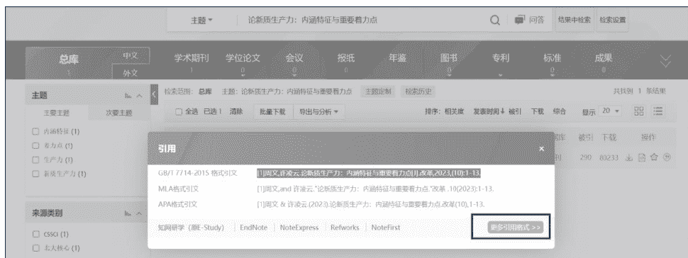
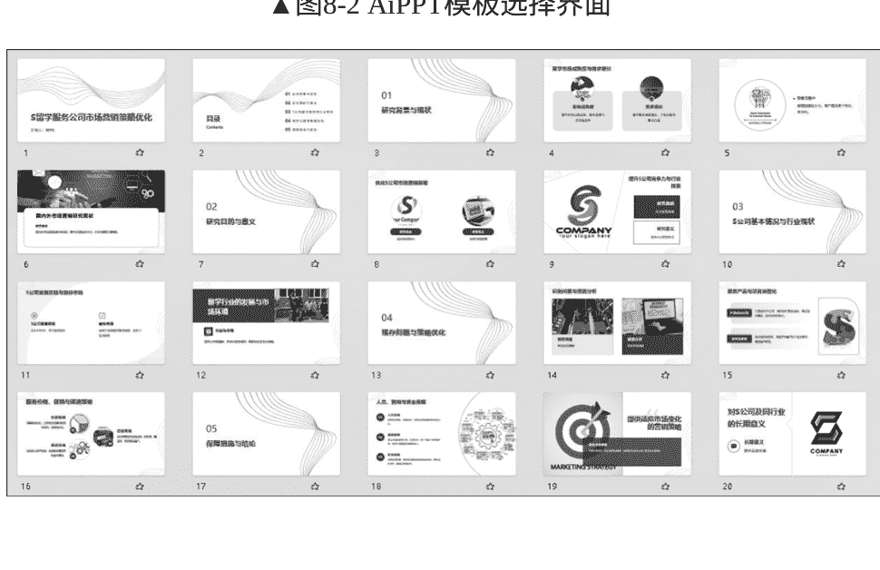
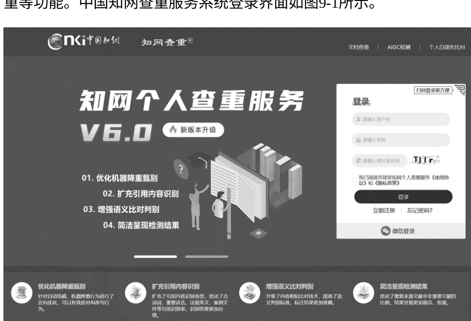
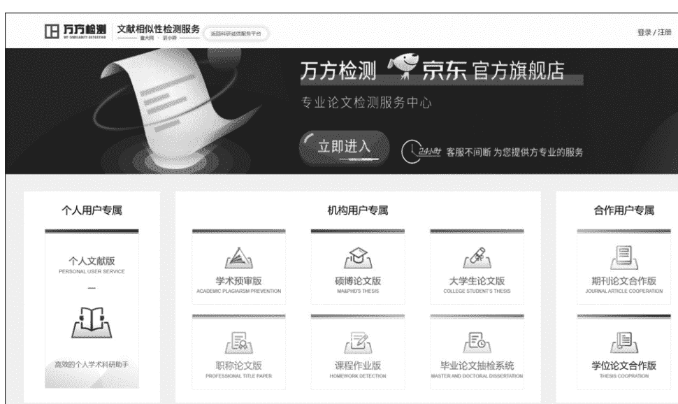

## AI赋能论文全链路实操手册

## 内容提要
本书围绕智能体在论文写作中的落地实践展开。全书九章，依次梳理选题判断、引言撰写、提纲搭建、正文成稿、数据解读、摘要提炼、结论形成、译修润色、答辩演示与查重投稿等完整链路，说明每个节点如何借助模型提升效率与质量。书中同时讨论使用边界，并提供可直接复用的对话指令示例，已全部收录于秋叶AI智能鼠标平台。本书适用于学术写作经验不足的大学生与科研人员。

## 前言
生成式智能正处于爆发期，已成为科研人员提升撰写效率的常用手段，也在学界引发伦理讨论。
既要积极拥抱新质生产力，也要清醒认识到技术的局限性与被不当使用带来的风险。编者编写本书的初衷，是把智能工具定位为生产力助手，帮助读者在追求高质的同时，远离网络上各类代笔软件的诱导，避免触碰学术底线。
全书围绕选题、引言、大纲、正文、数据分析、摘要、结语、译修、答辩演示、查重投稿等环节，系统呈现模型的应用路径。为便于快速上手，本书不展开原理阐述，而是针对撰写痛点给出对话指令示例，快速启发思路。
书中汇总了经实测的指令，覆盖人文、理工、医学等方向，共计108条。这些指令已收录进秋叶AI智能鼠标平台，读者可扫码关注秋叶公众号，选购秋叶AI鼠标高校版，迅速启动练习，高效完成撰写。
书中指令均经实践检验，可供多学科参考。读者在本书方法基础上做适应性调整，效果更佳，可显著提升撰写效率。本书也可作为高校教师指导学生的参考资料。
最后请牢记，智能工具是一把双刃剑，用得好则助力成长，用得不当则弊端丛生。本书所介绍的均为提升质量的方法，而非替代撰写的捷径。即便用最精妙的指令生成的文本，也必须甄别后再行借鉴。在使用模型辅助撰写的过程中，务必尊重知识原创性，坚守学术道德底线。

秋叶 余有缘
2024年10月

## 第1章 智能时代论文写作的范式转换

大模型能力的快速演进，不仅在医疗、科技、教育等领域催生创新，也让大众意识到“文生文、文生图”功能可以高效完成各类材料。论文因发表时效紧、结构逻辑要求严，成为关注焦点；与此同时，如何规避模型介入带来的伦理冲击，也是共同关切。

### 1.1 模型介入撰写，是助力还是越界
有人质疑以ChatGPT为代表的大模型能否用于论文撰写，答案是可以。
任何时代，防范学界失范的核心都是维护学术诚信与知识原创性。研究者触碰红线的原因，多在于主观上无视科研与创作规则，利用工具窃取他人成果。此类工具既包括智能模型，也包括历史上所有可传递知识的手段。我们无法禁止先进工具出现，但可以控制其在合理范围内使用。
要厘清是否越界，需要先回答三个问题：学界失范的边界是什么？模型生成的内容是否可信？模型生成的内容是否存在版权问题？

#### 问题一：学界失范的认定边界是什么
只有明确红线，才能主动规避。根据教育部《高等学校预防与处理学术不端行为办法》第二十七条，以下行为属于失范：
- 剽窃、抄袭、侵占他人学术成果；
- 篡改他人研究成果；
- 伪造科研数据、资料、文献、注释，或捏造事实、编造虚假研究成果；
- 未参与研究或创作却在成果、论文上署名，未经许可不当使用他人署名，虚构合作者共同署名，或多人合作未注明他人贡献；
- 在课题申报、成果奖励、职务评审、学位申请等过程中提供虚假学术信息；
- 买卖论文、他人代笔或为他人代笔；
- 其他依据高校或相关学术组织规则认定的失范行为。
模型辅助撰写已成新现象并引发关注。2024年1月，华北电力大学研究生院发布通知，引入AIGC检测系统，对申请学位研究生的论文进行检测，抵制模型代笔。2024年4月，湖北大学、福州大学、南京工业大学、天津科技大学等高校相继发文，在本科毕业论文审核中试行生成式AI风险检测。其中湖北大学明确，对“AI代写高风险”的论文需由教师指导修改；福州大学强调检测结果将作为成绩评定和优秀论文评选的参考。此举体现了学界对模型的理性认知与规范导向，全面禁止并不现实，规范使用才是趋势。

#### 问题二：模型生成的内容是否可信
当前撰写辅助的核心技术是大语言模型LLM，其基于机器深度学习与自然语言处理NLP，从海量文本学习语言模式并据此生成新文本。
如图1-1所示，黑色区域为人类已知知识，蓝色区域为用于训练模型的语料，白色广阔区域为人类未知知识。训练语料只是已知知识的一部分。当模型需生成答案时，若所需知识不足，便会自行推理，用旧知识推导出所需部分。模型强大的逻辑推理能力源于其从语料中提炼的底层规律，这些规律也可视作一种知识。凭借此，模型可按指令进行推理，生成逻辑性强的文本。
若推理结果与黑色区域相符，人们会赞叹模型强大；若不符，则会认为模型不靠谱。
模型输出具有一定可信度，同时不可避免存在“瑕疵”，如重复度高、表达生硬等。为提高真实性，使用者可通过数据投喂、调整指令、模型检测、人工校对等方式降低差错率。

#### 问题三：模型生成的内容是否存在版权问题
可从输入是否侵权、输出是否享有版权两个维度分析。
根据《生成式人工智能服务管理暂行办法》第七条，模型开发企业为通过算法备案，必须使用合法来源数据与基础模型，涉及知识产权时不得侵害他人合法权益。也就是说，只有数据本身不侵权，才能通过备案。对用户而言，无论素材在模型端还是传输环节出现版权问题，二次加工或用户规模庞大都无法消除侵权。
关于模型生成内容版权的认定，可参考北京互联网法院（2023）京0491民初11279号案例审理思路，主要依据人类在生成过程中的行为来判断作品是否构成受法律保护的独创性智力成果。
因此，使用模型时一要使用合法素材，二要增加原创性智力投入。若论文完全依赖模型生成，无原创思路与素材，则可视为模型代笔，不仅存在版权风险，更属于学术失范。

### 1.2 让模型赋能人，而非取代人
论文是研究者展示成果、阐释观点、分享数据与分析的重要载体，具有科学性、创新性、严谨性等特质。因此撰写与发表必须严格遵守学术规范，恪守学术道德。
模型辅助并非凭空生成学术内容，也不是搬运他人成果。那么模型能发挥什么作用？

#### 1. 解答困惑
撰写中遇到理论或知识点困惑时，可把大模型视为庞大知识库获取答案。相较于传统搜索引擎筛选信息，模型能直接根据输入推断意图，给出贴合需求的结果，并可通过对话反馈不断优化，直到满意。

#### 2. 提供建议
当论文题目过宽、结构混乱、论点衔接不自然时，模型可扮演导师或评审角色，从学术角度点评题目、结构与论点并给出优化建议。灵感枯竭时，模型还可围绕选题提供新方向。无论框架搭建还是词语选用，模型都能提供支持。

#### 3. 改善表达
论文存在口语化、语法不当、错别字等问题时，模型可在不改动原意前提下优化语句，使其更专业、更学术化，并快速识别语法与错别字，减少非智力错误，提升撰写质量。

#### 4. 检索文献信息
文献下载、阅读、分析耗时耗力。模型可根据研究方向推荐文献，并在文献精读提炼阶段，通过文献分析功能精准概括结构与核心观点，并提供可视化结果。

#### 5. 提升撰写效率
对新手而言，痛苦在于构思。论据单薄、内容不够饱满，或废话过多需精简时，可把模型当作“外置大脑”，按规范范式进行扩写、缩写、改写，保持行文风格一致。

#### 6. 改善排版
字体、行距、字号、参考文献格式等影响规范性。排版要求繁杂易出错时，模型可协助排版与校对，只需做少量微调。
总之，模型辅助撰写并非代笔，而是在思考、检索、分析、编辑、校对等环节提升效率。它可扮演专业人士角色提供建议与润色，却无法替代研究者所需的批判性思维、创新力与严谨研究。

### 1.3 撰写中可用的智能工具
“兵马未动，粮草先行”。了解各类智能工具是高效撰写的前提。本书整理了适用于各场景的工具，方便熟悉其主要特性。

表1-1 论文写作AI工具汇总
| 场景分类 | 推荐工具 | 使用说明 |
| :--- | :--- | :--- |
| 智能问答、知识检索 | ChatGPT、Copilot、Claude、文心一言、讯飞星火、通义千问、智谱清言、新华妙笔、豆包 | 具备通用内容生成能力，通常提供插件与小助手辅助场景理解，如文心一言插件商城、讯飞星火助手中心 |
| 学术翻译 | DeepL Pro、CNKI翻译助手 | 支持 Word、PDF 文档翻译，可处理方言、习语、文言文、学术论文，准确率与流畅度较高 |
| 文献检索、文献分析、网页分析 | Consensus、Research Rabbit、秘塔AI搜索、通义智文、Kimi | 支持网页阅读、论文阅读、图书阅读与自由阅读 |
| 会议记录 | 通义效率、飞书妙记 | 支持实时语音转文字、同步翻译、要点总结、音视频转文字并区分发言人，一键导出 |
| 数据分析 | 镝数图表 | 数生文功能覆盖数据趋势、综合分析、数据对比、维度解释、相关性分析、数据要点、异常识别、分布分析等，助力分析结论输出 |
| 思维导图 | 妙办画板 | 支持 AI 一键生成流程图，具备拖动与智能配色功能 |
| PPT制作 | AiPPT、iSlide、讯飞智文 | 可根据文本、Word 文档或视频一键生成 PPT，讯飞智文还支持 PPT 转演讲稿 |
| 图片生成 | Midjourney、Stable Diffusion、通义万相、腾讯混元 | 支持文本生成图片、图片生成图片、图片解析为提示词等功能 |
| 论文排版 | SCISPACE、橙篇 | 提供定制化论文模板与自动格式修正工具，帮助快速产出符合期刊与出版商格式要求的稿件 |

### 1.4 本硕博学位论文的主要差异
论文类型多样，因学科与发表要求不同而存在差异。本书以最常见的学位论文为例，简要说明本硕博阶段的差异，便于对照撰写要求。

#### 1. 总字数要求
- 本科论文通常要求 10 001~20 000 字。
- 硕士论文通常要求 20 001~50 000 字。
- 博士论文通常要求 50 001~100 000 字。

#### 2. 深度和广度
- 本科论文通常要求对特定主题展开研究。
- 硕士论文通常要求对细分领域进行深入探索与分析。
- 博士论文通常要求具备较强创新性与原创性，在特定领域做出实质贡献。

#### 3. 研究方法和数据处理
- 本科论文通常基于理论与文献综述，通过调查、观察、实验等方式收集原始数据。
- 硕士论文通常要求运用先进研究方法进行数据收集与分析。
- 博士论文通常要求运用创新性研究方法与复杂数据处理技术。

#### 4. 结构组织
- 本科论文通常按学院或专业要求组织结构，一般包括引言、方法、分析、结果等部分。
- 硕士论文通常需要更多章节与更复杂结构以体现广度、深度及专业掌握。
- 博士论文通常多章节，每章独立呈现研究深度并与他章紧密衔接，体现逻辑连贯性与系统性思考。

#### 5. 文献综述和引用要求
- 本科论文通常要求参阅与汇总相关文献，引用要求不高。
- 硕士论文通常要求对文献进行深入分析与批判性思考，引用要求较高。
- 博士论文通常要求展现对领域文献的严谨全面阅读，引用高质量文献。

#### 6. 参考文献数量
- 本科论文数量要求相对较低，一般数十篇。
- 硕士论文要求相对较高，一般几十至上百篇。
- 博士论文要求较为严格，一般需几百篇。
本硕博学位论文在形式、研究深度与框架上存在差异，但均须遵循学术撰写基本原则。

本书介绍的智能辅助功能多为通用，提问框架与逻辑一致，最大差异在于指令中角色、任务与要求的设定。因此掌握提问逻辑至关重要，本书将重点启发指令设计。

### 1.5 什么是模型幻觉
部分读者在使用模型时会发现其并不总可靠，会出现胡诌、编造不存在参考文献、输出有害信息等现象，这即为模型幻觉。
模型幻觉指因训练数据不足、算法漏洞等，模型生成看似合理实则与事实不符或与需求不符的内容。本书对模型幻觉做如下归纳。

表1-2 AI幻觉的分类、表现及案例
| 分类 | 表现 | 案例 |
| :--- | :--- | :--- |
| 生成不准确的信息 | 总体思路正确，但具体内容不准 | 微软 Copilot 在分析某些品牌收益时，生成的财务数据不准确 |
| 生成捏造的信息 | 生成完全虚构、无事实依据的内容 | 2023 年 6 月，一名律师使用 ChatGPT 制作法律文书，其中包含虚假判例与引文 |
| 生成有害的信息 | 可能生成针对真人的诽谤内容 | 被问及法律中性骚扰问题时，ChatGPT 捏造了一位真实教授的指控，称其在学校旅行中性骚扰，实际上该教授并无此行为 |
| 生成怪异或恐怖的信息 | 生成非常怪异或令人不安的内容 | 微软 Copilot 有时表现出奇特行为，如向用户表达爱意并施加压力 |
多家公司通过系统优化减少幻觉，但正如人类会出错，模型犯错亦不可避免，不能因幻觉的存在否定其价值。用户端可通过学习优质指令来降低幻觉风险。

## 第2章 利用智能模型寻找合适选题
写好论文始于选题。
论文选题是指在研究领域内选择一个值得探讨的问题，需具备学术价值、原创性、可行性与重要性，决定整篇论文主题。
选题应重视创新，避免与历史选题重复。兼顾专业知识与最新研究动向的选题才算优质。选题不当会导致研究方向与学科发展趋势或实际需求脱节，成果缺乏前沿性与实用性，论文难以获得认可。
合适的选题是研究成功的关键。模型能否提供帮助？答案是肯定的。
需提前说明，本书指令对不同学科均有辅助作用。案例或与你的学科关联不大，但掌握思路即可举一反三，配合任意大模型均可提升效率。

### 2.1 论文选题五大要素
选题需审慎考虑五大要素：研究对象或领域、研究目的或问题、研究视域或视角、研究方法，以及研究假设。

#### 1. 研究对象或领域

选题拆解：五要素与AI五步走

一篇选题能不能推进下去，核心在于把边界框住。研究对象或研究范围负责划界，可以指涉某个行业、社会现象、技术或历史时期。界定越精确，后续的工作弹性越大，可操作性和针对性也随之提升。

以“社交媒体对青少年心理健康的影响”为例，真正聚焦的其实是青少年心理健康，社交媒体只是情境；若题目反转为“青少年心理问题对社交媒体传播的影响”，落脚点就转向传播本身。

#### 2. 研究目的或问题
目的与问题要具体且可执行，给研究提供抓手。
案例：针对“社交媒体对青少年心理健康的影响”，可把问题收敛为社交媒体通过哪些路径作用于青少年心理状态。

#### 3. 研究视域或视角
视域与视角相当于观察镜头，通常涵盖情境背景、所属学科以及特定的理论或概念框架，决定了研究的理论根基和分析路线。
案例：在该议题上，研究者可能以心理学为依托，结合社会比较理论与认知行为理论来解释社交媒体的效应。

#### 4. 研究方法
方法关乎数据如何采集、处理与解读。常见路径有定性、定量与混合三类，具体手段包括实验、问卷调查、观察、内容分析等。方法匹配得当，研究才具备科学性与说服力。
案例：对同一议题，研究者可采用量化路线，通过问卷收集材料并借助统计手段检验社交媒体与心理健康的关联。

#### 5. 研究假设
假设是在既有文献基础上提出的待检验预期，相当于对问题的初步回应，为研究指明方向，需要经实证证实或推翻。
案例：在该案例中，一个可设的假设是高频使用社交媒体与青少年的焦虑抑郁水平呈正相关。

这五点不必凭空推敲，用AI系统化推进会更高效。

### 2.2 论文选题五步法
借助AI逐项厘清五大要素，就是常说的选题五步法，如图2-1所示。


第一步：锁定研究对象或研究范围。
通常论文的选题边界与研究者自身的专业背景高度相关。所以在选题还是一片空白、需要从零起步时，先盘点自己擅长的专业与细分方向。
以本科生为例，有学汉语言的、有学计算机的、有学金融的……一个大专业下面藏着很多小方向，像石榴和籽。AI的强项在于能迅速检索大量可能的细分主题。
与AI对话时，输入个人兴趣、学科背景与初步想法，系统即可给出该方向的研究动向概览、核心关键词与潜在子领域，帮助聚焦兴趣点。
可参考的提问范式：
> 我是一位专注于[××专业或学科领域]的研究者，在这一领域里，我对[××主题]的研究很感兴趣。现在请你根据我提供的信息，为我列出×个潜在的研究选题领域作为我的论文写作方向。注意，这一阶段你只需给出可能的选题领域，无须给出研究问题等其他信息。
范式只是引导，研究者需要补充真实需求，信息越具体，结果越贴合。示例如下。


问：

我是一位专注于**天文气象学**的研究者，在这一领域里，我对**中国气候变化**的研究很感兴趣。现在请你根据我提供的信息，为我列出10个潜在的研究选题领域作为我的论文写作方向。注意，这一阶段你只需给出可能的选题领域，无须给出研究问题等其他信息。


AI回答：

天文气象学是一个跨学科领域，它结合了天文学和气象学的知识来研究地球气候系统及其变化。以下是10个潜在的研究选题领域，这些领域可以作为您论文写作的方向：

- 1. 中国季风气候的长期变化

- 2. 近几十年中国极端天气事件

- 3. 中国不同地区气候变化

- 4. 中国城市化进程与局部气候

- 5. 中国青藏高原气候变化

- 6. 中国近海区域气候变化

- 7. 中国北方沙尘暴事件

- 8. 中国南方地区夏季高温热浪事件

- 9. 冰川退缩和中国气候

- 10. 中国气候变化与生物多样性和生态系统服务

这些选题领域覆盖了气候变化对不同方面的影响，同时考虑了不同地理区域的特点。您可以根据自己的兴趣和研究背景选择一个或多个领域进行深入研究。

这些细分方向返回得很快，对思路有明显启发。读者也可结合书中给出的提问范式继续追问，或自行设计新范式，比如让模型罗列学界的研究动向供参考。

第二步：明确研究目的或问题。
如果说研究对象是学术舞台，那么研究目的或问题就是聚光灯。目标清晰、问题深挖，才能把才华转化为对现实问题的回应与学科的推动。

表2-1所示为常见研究问题类型。

表2-1 常见研究问题类型

类型 | 定义 | 特征
描述性问题 | 描述现象、事件或者情况的特征和属性 | 着重阐述“是什么”，不涉及原因或者解释
解释性问题 | 分析现象、事件或者情况的原因、机制或者影响因素 | 着重阐述“为什么”或“如何”，解释原因或者规律
预测性问题 | 探究现象、事件或者情况的未来发展趋势或者结果 | 着重阐述“将会发生什么”，预测未来的发展方向或者结果
比较性问题 | 探究不同情况或者对象之间的差异性、相似性或者关联性 | 着重阐述“哪一个更好”或“有何不同”，进行跨组织或者跨时期的比较分析
应用性问题 | 探究研究成果如何应用于实践或者解决实际问题 | 着重阐述“如何应用”，将研究成果转化为实际应用或者建议
评价性问题 | 评估特定政策、项目或者措施的效果和影响 | 着重阐述“怎么样”或“是否有效”，对政策、项目或者措施进行评价和改进

每种问题类型都能成为切入点。借助提问范式可让AI快速生成待研究问题。

> 我正在为自己[研究领域]的论文设计研究问题，请你从下面6个角度出发，各生成一个可能的研究问题。你需要确保问题具有一定的深度和挑战性，能够为学术界和实践提供有价值的研究方向。
> 1. 描述性问题
> 2. 解释性问题
> 3. 预测性问题
> 4. 比较性问题
> 5. 应用性问题
> 6. 评价性问题

把前面模型给出的“中国季风气候的长期变化”代入试用：

问：

我正在为自己[中国季风气候的长期变化]的论文设计研究问题，请你从下面6个角度出发，各生成一个该领域可能的研究问题。你需要确保问题具有一定的深度和挑战性，能够为学术界和实践提供有价值的研究方向。

AI回答：

以下是针对“中国季风气候的长期变化”这一研究主题，从6个不同角度生成的研究问题。

- 1. 描述性问题：中国季风区的降水模式有何长期变化趋势，这些变化趋势与全球气候有何关联？

- 2. 解释性问题：导致中国东部季风区夏季降水量异常增多或减少的主要气候机制是什么？

- 3. 预测性问题：基于当前的气候变化模型，未来五十年内中国季风气候将如何变化，这些变化对农业生产有何潜在影响？

- 4. 比较性问题：中国南方与北方季风气候的长期变化是否存在显著差异，这些差异背后的物理原因是什么？

- 5. 应用性问题：如何利用中国季风气候长期变化的研究成果改进区域水资源管理和农业种植策略？

- 6. 评价性问题：现有的气候模型在模拟中国季风气候长期变化方面的准确性如何？存在哪些局限？如何提高这些模型的预测能力？

这些问题覆盖了历史演变、成因、未来走向、区域差异、实践应用与模型评估，研究者可据此挑选切入点。

第三步：匹配研究视域或视角。
视域通常指研究的学科归属与范围，划定边界并确定问题所处的领域。视角则指研究者采用的具体观察角度与分析方式，涉及所用理论与概念模型。

常见的研究视域或视角如表2-2所示。

表2-2 常见的研究视域或视角

类别 | 内容描述
社会背景 | 如历史时期、文化环境、政治经济状况等，为研究提供宏观环境框架
理论体系 | 如马克思主义理论、后现代主义理论等，提供分析问题的宏观理论框架
学科领域 | 如心理学、社会学、经济学等，定义研究的基本理论和方法论框架
理论视角 | 基于特定理论，如认知理论、行为主义、建构主义等，指导数据收集和分析的具体方向
概念模型 | 如生态系统理论、权力关系理论、社会资本理论等，用于解释和理解研究现象
分析角度 | 如性别视角、跨文化视角、批判性视角等，侧重于从特定维度审视研究问题
方法视角 | 从定量研究、定性研究或混合研究方法视角，决定数据收集与分析的方法和工具

向AI说明研究问题后，可直接询问：“针对某个具体研究问题，有哪些相关的理论或概念模型可以作为研究视角？”
参考范式：
> 1. 我正在撰写[研究领域]的相关论文，针对[研究问题]，有哪些相关的社会背景、学科领域或理论体系可以作为研究视域？请简要说明每个视域的核心观点和适用范围，以便我更好地理解和选择。
> 2. 我正在撰写[研究领域]的相关论文，针对[研究问题]，有哪些相关的理论或概念模型可以作为研究视角？请简要说明每个视角的核心观点和适用范围，以便我更好地理解和选择。

以“中国季风气候的长期变化”为例：


问：

我正在撰写中国季风气候的长期变化的相关论文，针对中国季风区降水模式的长期变化趋势及其与全球气候的关联性问题，有哪些相关的理论或概念模型可以作为研究视角？请简要说明每个视角的核心观点和适用范围，以便我更好地理解和选择合适的理论或概念模型进行研究。


AI回答：

在研究中国季风区降水模式的长期变化趋势及其与全球气候的关联性问题时，以下是几个可能适用的理论或概念模型。

1. 全球季风动力学理论

核心观点：全球季风动力学理论强调太阳辐射、地球轨道参数、下垫面性质和“海—陆—气”相互作用在季风形成和变化中的重要性……

适用范围：适用于分析和理解全球季风系统的长期变化，尤其是……

2. 超大陆旋回理论

核心观点：该理论认为，全球季风系统的演化与大陆的面积、位置及裂解度变化密切相关……

适用范围：适用于研究地质时间尺度上，如千万年级别的季风变化，尤其是……

3. 全球季风模式比较计划 (Global Monsoons Model Intercomparison Project, GMMIP)

……

4. 亚洲中部干旱区气候变化的“西风模态”理论

……

模型给出多条理论路径供选择，不同视角能丰富研究的深度与广度。可进一步追问各理论的差异、局限、关键研究步骤、最新趋势，或尝试整合多个理论形成综合视角。

提问范式：
> 1. 这些不同理论存在哪些差异和局限性？
> 2. 在应用这些理论进行研究时，有哪些关键的研究步骤或方法论建议？
> 3. 目前在[研究领域]最新的理论或研究趋势有哪些？
> 4. 能否结合[理论A]和[理论B]的元素，创建一个综合视角来研究[研究问题]？

第四步：寻找研究方法。
方法决定研究的可靠性与可行性。常见的三大类为定量研究、定性研究与混合研究。
定量研究侧重数值与统计检验；定性研究关注现象的本质、意义与背景；混合研究兼顾两者优势。
表2-3为常见研究方法。

表2-3 常见的研究方法

类别 | 具体研究方法 | 描述
定量研究 | 实验法 | 在控制条件下操纵变量，观察因果关系
| 调查法 | 通过问卷、访谈等方式收集大量可量化的信息
| 观察法 | 记录和分析可量化的现象或行为信息
| 内容分析 | 对非数值数据进行系统编码和量化分析
| 二次数据分析 | 重新分析已有的数据集以发现新信息
定性研究 | 访谈法 | 通过开放式问题深入探讨主观经验与看法
| 民族志研究 | 深度参与观察，理解文化和社会现象
| 个案研究 | 深入分析单个或少数案例的详细情况
| 叙事分析 | 分析文本以理解个人经历和意义建构
| 话语分析 | 研究语言的使用，揭示权力、结构和意识形态
混合研究 | 并发设计 | 同时使用定量与定性研究进行数据收集与分析
| 序贯设计 | 先定性研究后定量研究或先定量研究后定性研究，相互补充
| 转换设计 | 根据研究进展从一种方法转向另一种方法

可转化为提问范式：
> 我正在撰写[研究领域]的相关论文，我计划以[研究视域或视角]来[研究问题]。请你根据我提供的研究信息，向我推荐契合的研究方法。
> 研究方法可以包括定量研究、定性研究和混合研究。但不需要每一个类别都涉及，只需要最契合的研究方法。
> 你向我提供的每个研究方法要足够具体，具备可操作性，让我可以直接运用在论文研究中。

代入“中国季风气候变化”“全球季风动力学理论”“中国季风区降水模式的长期变化趋势与全球气候的关联性”：

问：

我正在撰写[中国季风气候变化领域]的相关论文，我计划以[全球季风动力学理论]来研究[中国季风区降水模式的长期变化趋势与全球气候的关联性]问题。请你根据我提供的研究信息，向我推荐契合的研究方法。可以包括定性研究、定量研究和混合方法研究。但不需要每个类别都涉及，只需要最契合的研究方法。此外，你向我提供的每个研究方法要足够具体，具备可操作性，让我可以直接运用在论文研究中。


AI回答：

在研究中国季风区降水模式的长期变化趋势与全球气候的关联性问题时，考虑到全球季风动力学理论的复杂性和历史数据的局限性，以下是几种可能适合您的研究方法。

1. 统计分析

方法描述：对收集到的气候数据进行统计分析，以识别降水模式的变化趋势。

可操作性：运用时间序列分析、趋势分析、周期性分析等统计方法来处理和解释数据。

2. 地理信息系统（Geographical Information System，GIS）分析

方法描述：利用GIS技术来分析降水模式的空间分布和变化。

可操作性：收集空间数据，使用GIS软件进行空间分析，识别降水模式的空间变化特征。

3. 比较研究

方法描述：将中国季风区的降水模式与其他地区的降水模式进行比较，以理解其在全球气候中的作用。

可操作性：收集中国季风区和其他地区的气候数据，进行比较分析，找出相似性和差异性。

4. 案例研究

方法描述：选择特定的时间段或地区作为案例，深入研究其降水模式的变化。

可操作性：确定案例研究的范围和目标，收集详细的数据，进行深入分析。

第五步：提出研究假设。
假设是连接问题与研究设计的桥梁，提供明确的探索目标。常见类型包括因果假设、相关假设、差异假设等。

提问范式：
> 我正在撰写[研究领域]的相关论文，我计划以[研究视域或视角]来[研究问题]。请你根据我提供的信息，对我的研究结果做出初步的研究假设，并说明理由。

以季风问题为例：


问：

我正在撰写中国季风气候的长期变化的相关论文，我计划以全球季风动力学理论来研究“中国季风区降水模式的长期变化趋势及其与全球气候的关联性”问题。请你根据我提供的信息，对我的研究结果做出初步的研究假设，并说明理由。


AI回答：

基于您提供的信息，我们可以构建一个初步的研究假设。

中国季风区降水模式的长期变化趋势与全球气候变化之间存在显著的相关性。

这个初步假设需要通过收集和分析相关数据，运用统计分析等多种方法进行验证。同时，考虑到季风系统的复杂性，可能需要考虑多种因素和变量，以确保研究结果的准确性和可靠性。

### 2.3 回顾确认，再次优化选题
至此，借助AI已逐项明确选题五要素，可先行整合思路，如表2-4所示。

表2-4 我的论文选题五大要素

要素描述 | 内容
研究对象或领域 | 中国季风气候的长期变化
研究目的或问题 | 中国季风区降水模式的长期变化趋势及其与全球气候的关联性
研究视域或视角 | 全球季风动力学理论

| 研究方法 | 统计分析、地理信息系统分析、比较研究、案例研究 |

| 研究假设 | 中国季风区降水模式的长期变化趋势与全球气候变化之间存在显著的相关性 |

选题要素核对时，容易遗漏细节。建议拿着清单逐条对照，调动专业知识判断是否存在疏漏或偏差，必要时调用生成式工具做查漏补缺和改进建议。

回顾性核查可参考的提示词模板如下。

我是一名[研究身份]，正在构思论文选题。下面我会提供论文选题五大要素，请你据此评估。

1. 该选题是否要素齐全？
2. 该选题难度是否适配我的[研究身份]？
3. 还有哪些选题方向可以补充？

把论文选题五大要素备齐，就像出发前把行囊收好，研究者即可出发展开研究之旅。

## 第3章 开篇从容，用AI协同完成绪论撰写

前言也称绪论或引言，硕士、博士论文多用绪论命名。其作用是在正文前说明写作缘起、课题的理论价值与现实价值，以及研究内容、研究方法等。

绪论信息量大，建议按内在结构分步借助生成式工具来完成，以提升质量。

### 3.1 研究背景与意义如何展开

背景与意义用于交代课题所属领域的分量，并提供领域基础信息，通常通过引用核心文献来体现把握程度。

推荐的展开顺序：宏观社会图景—细分行业图景—现存问题剖析—研究内容引入—价值阐明。

本节以环保建筑材料为例，演示如何借助生成式工具撰写背景与意义。

#### 1. 勾勒宏观社会图景

宏观社会图景旨在凸显课题在国家和国际层面的重要性，增强说服力。可引用政策文件，突出社会需求、现实痛点与民生关切。示例提问方式如下。

问：

我想为建筑材料撰写相关背景，请从建筑材料领域专家的视角，提供社会背景资料，说明该领域对当下社会的关键作用。

示范输出：

作为建筑材料领域的研究者，我清楚其在社会发展中的分量。以下社会背景信息可用于阐释建筑材料对当今社会的意义。

一、经济增长与建筑材料
当前，经济增长与基础设施建设紧密相连。建筑材料作为基建的物质基础，对推动经济增长具有核心作用。无论是住宅、商业体还是公共设施……

二、绿色发展与可持续建筑材料
面对全球气候变化与环境污染，可持续发展成为各国共同关注的方向。在建筑行业，绿色建筑材料是实现可持续发展的重要抓手……

三、安全与耐久
建筑材料的安全性与耐久性直接关联建筑使用寿命与人身财产安全。因此材料质量与性能始终是关注焦点……

四、智能化与创新
随着智能技术的演进，建筑材料正向智能化、创新化方向发展。智能材料可感知环境变化和使用需求，实现自动调节与智能控制……

五、社会文化意涵
建筑材料不仅是技术载体，也承载丰富的社会文化价值。不同材料能够体现地域特色、历史文脉与审美观念……

#### 2. 介绍细分行业图景

在宏观图景之上，需要对细分领域的发展态势进行说明，包含行业政策、发展前景与现实困境，以证明课题的实践价值。可参考提问如下。

问：

请从建筑材料领域专家的视角，基于建筑材料的社会背景，给出与环保型建筑材料相关的行业背景与数据支撑，以说明其价值与优势。

示范输出：

首先，随着气候变化加剧与环保意识提升，建筑行业作为能源消耗与碳排放大户面临减排压力。环保型建筑材料凭借低能耗、低碳、可循环等特性，成为绿色发展的关键路径。

行业层面，城市化加速与居住要求提升推动了建筑材料需求持续增长，同时国家陆续出台政策鼓励环保型材料的研发与应用……

数据支撑可从以下维度观察。

1. 能源消耗：相较传统材料，环保型材料生产耗能更低。据统计，采用环保型材料建造的建筑，能源使用可下降20%～30%……
2. 碳排放：环保型材料碳排放量更低，部分材料在生产过程中可吸收储存二氧化碳，使建筑碳排放可减少30%～50%……
3. 资源利用：环保型材料在生产与使用的过程中更易利用可再生资源与废弃物……
4. 健康影响：传统材料生产使用可能释放有害物质，影响健康。环保型材料采用更清洁工艺，对人体更友好……

总体来看，环保型建筑材料在当下具有重要地位，低能耗、低碳、可循环等特征有利于推动建筑行业绿色转型，减少能源消耗与碳排放……

#### 3. 剖析现存问题

揭示领域存在的问题及其严重性，能凸显课题的必要性与紧迫性。内容可涵盖影响范围、严重程度与后果。可参考提问如下。

问：

请从建筑材料领域专家的视角，基于我提供的社会背景与行业背景，剖析环保型建筑材料研究领域目前存在的问题或局限。

示范输出：

结合你提供的背景，我认为环保型建筑材料研究仍存在若干局限。

首先，技术成熟度与成本效益是主要挑战。虽然部分材料在理论与实验阶段表现优异，但因技术不够成熟、成本偏高，大规模推广受限……

其次，性能稳定性与耐久性不足。由于原材料与工艺的特殊性，其稳定性与耐久性往往不及传统材料……

再次，标准与规范缺失。环保型材料种类繁多、性能各异，统一行业标准与规范不足，导致市场产品质量参差不齐……

此外，普及推广面临阻力。其一……其二……需要政府、企业与社会的协同推动……

最后，需关注全生命周期环境影响。从开采、生产、运输、使用到废弃处理，环保性能应贯穿全过程……

综上，当前问题主要集中于技术成熟度与成本、性能耐久性、标准规范化不足、推广难度及全生命周期环境影响等方面。需加强研发创新、完善标准、强化政策引导并提升公众环保意识。

#### 4. 引入研究内容

在背景与问题交代之后，应简要介绍课题的基本情况，包括创新点与预期解决的问题。可参考提问如下。

问：

请从建筑材料领域专家的视角，基于社会背景、行业背景与研究问题提出解决思路，并按[本文考虑××因素，基于××理论，构建了××模型，提出了××方法，研究了××问题]的格式输出。社会背景：[插入社会背景]；行业背景：[插入行业背景]；研究领域的问题：[插入研究领域的问题]。

示范输出：

本文考虑环保型建筑材料的技术成熟度、成本效益、性能稳定性、耐久性、标准化程度以及推广难度等因素，基于可持续发展理论与循环经济理论，构建了环保型建筑材料综合评价模型，提出了技术创新与成本优化方法，研究了环保型建筑材料推广策略与全生命周期环境影响问题。

#### 5. 明确研究价值

研究价值可从研究视角新颖性、跨学科方法、实证支撑等多角度展开，也可通过提出创新性解决方案凸显价值。可参考提问如下。

问：

请从建筑材料领域专家的视角，基于课题背景与课题内容撰写研究意义，并按[本文的研究结果揭示了××规律，完善了××理论方法，推动了××的应用与实践，促进了××发展（科学意义与社会意义）]的格式输出。研究背景：[插入研究背景]；研究内容：[插入研究内容]。

示范输出：

本文的研究意义在于深入探讨环保型建筑材料推广策略及其全生命周期的环境影响，不仅揭示了建筑材料领域的主要规律，完善了相关理论方法，还推动了环保型材料的普及应用，进而促进建筑行业与社会的持续发展。

从科学意义看，本研究通过系统分析推广策略，揭示了市场推广中的挑战与机遇……成果丰富了建筑材料理论体系，为后续研究提供参考。

从社会意义看，本研究对推动环保型材料普及具有重要价值……研究成果可为政府制定政策提供依据，促进材料在建筑行业的广泛应用，推动绿色发展与社會持续。

### 3.2 学术现状与文献综述的区别

在开题或论文撰写中，学术现状与文献综述常被合并讨论，二者边界并不清晰。撰写时既要归纳前人成果，也要综合分析，从中提炼见解，为课题定位提供支撑。

文献综述是对特定领域或专题现有文献的系统搜集、整理、分析与评价，旨在反映学科最新动态、学术观点、研究趋势与潜在方向。它要求作者全面梳理进展，并以批判性视角评价观点与发现，指出不足，为创新提供基础。

学术现状通常是对特定课题在国内外成果与发展态势的概览，更偏向客观陈述，批判性分析要求较低。其目的在于帮助研究者把握领域全貌，了解发展脉络，以便规划后续工作。

无论撰写文献综述还是学术现状，都要求较强的文献检索、批判性思维与逻辑表达能力。通过深入分析既有文献，研究者可明确起点、创新点与价值。撰写基本步骤如下：

系统性文献检索—文献筛选与评估—摘要整理与归纳—批判性分析与评价—结构化呈现—综合与总结—引用参考文献。

按此流程可写出兼具深度与广度、体现独立思考的学术现状或文献综述，为后续工作奠基。

### 3.3 文献整理效率提升，生成式工具如何助力全流程

阅读大量前人成果是学术研究的基础，梳理现状有助于厘清思路、借鉴经验、发现突破口。生成式工具为文献整理提供了新路径。

第一步：文献检索与分类。

以秘塔AI搜索为例，研究者检索“数字经济”相关学术文献时，可先选择“学术”来源，以提高精准度，否则可能获得虚构结果。提问参考如下。

问：

请从经济学研究领域的专家视角，为我推荐不少于10篇相关学术论文。我的研究主题是“数字经济对制造业发展的影响研究”。

示范输出：

根据主题“数字经济对制造业发展的影响”，推荐以下论文与著作，涵盖理论到实证：

1. 数字化转型对制造业企业价值的影响研究——以三一重工为例
   - 作者：席然
   - 发表日期：2023-06-01
   - 研究内容：探讨数字化转型对制造业企业价值的影响机制

2. 制造业数字化转型动机、模式与成效——基于典型案例与问卷调查的实证分析
   - 作者：陈楠，蔡跃洲，马晔风
   - 发表日期：2022-06-13
   - 研究内容：基于案例与问卷，讨论数字化转型对生产率的影响

3. 数字经济发展对中国制造业的影响研究
   - 作者：董婉璐，李慧娟，杨军
   - 发表日期：2022-12-30
   - 研究内容：基于可计算一般均衡模型分析数字经济对制造业的影响

……

若需新闻、重大事件、网络文章或发展脉络，也可通过提问高效检索。示例如下。

问：

请从经济学研究领域的专家视角，为我寻找与“数字经济对制造业发展的影响研究”相关的典型案例或政策文件。

示范输出：

可关注以下案例与政策：

1. 宁德时代的数字化转型：从“制造”到“智造”，通过系统升级、万物互联、数据赋能与AI助力提升效率，成为智能制造标杆。
2. 《数造新实体——数字技术赋能实体经济案例研究（2023年）》蓝皮书：收录16个数实融合典型案例，覆盖人工智能、大数据、云计算等应用。
3. 《“十四五”智能制造发展规划》：八部门联合印发，加快制造强国建设与数字化转型。
4. 《数字经济2024年工作要点》：国家发展改革委等印发，提出产业数字化转型、完善治理体系等9项举措。
5. 《制造业数字化转型行动方案》：国务院审议通过，提出加快核心技术攻关与推广。
6. 《“十四五”数字经济发展规划》：明确指导思想、发展目标，强调数据要素市场化与产业数字化。

这些资料可为论文提供实证基础与政策背景。

除上述提问，还可参考：

1. 请利用学术搜索工具搜寻过去5年内关于××的学术文章与研究报告。
2. 请列举××领域的关键研究人员及其主要贡献。
3. 请指出××领域中的新兴作者及其独特研究视角。

第二步：文献筛选与下载。

检索到文献后，可登录中国知网等数据库筛选下载。操作流程示例：

输入主题“数字经济对制造业发展的影响研究”—按“被引”从高到低排序—选择所需文献—选择“导出与分析”—“导出文献”—“自定义”—勾选“Summary-摘要”—预览—复制到剪贴板。

▲ 图3-1 中国知网的文献检索与下载（1）

图3-2 中国知网的文献检索与下载（2）

第三步：文献阅读与分析。

多数生成式工具具备文献阅读与分析能力，可快速提炼核心内容，并对多篇文献进行对比。

以腾讯元宝AI为例，在对话框上传论文后点击发送，元宝即可生成阅读报告，如图3-4所示。

▲图3-3 元宝AI对话框

#### 图3-4 元宝AI论文解析

点击“深度阅读该文档”可进行总结文章、精读文章、制作脑图等操作，实现带图带数据总结与笔记生成。

#### 全文总结

本文题为《基于CODESYS平台的移动机械臂运动控制系统设计》，由徐建明与陈显汉撰写，发表于浙江工业大学信息工程学院。

#### 研究背景
1. 背景介绍：

文章针对传统六关节机械臂操作空间受限问题，提出基于移动底盘与Elfin05机械臂的移动机械臂运动控制系统。随着机器人技术发展，机器人已广泛应用于医疗、制造、国防与物流等领域。但市场上多数控制器封闭、成本高、开放性与移植性不足，制约了技术发展。

2. 研究内容：

包括基于ARM+CODESYS架构与PLCopen规范设计运动控制器；建立移动机械臂正逆运动学模型；设计分布式控制模块；设计人机交互界面；并通过实验验证控制器有效性。

3. 文献综述：

移动机械臂协同控制与 AI 文献写作实操

在运动控制领域已有不少可供参考的实现。陈亚等提出 STM32 配合 FPGA 的六自由度机器人运动单元方案；薛洁宇等在 CODESYS 环境下搭建了兼顾运动控制与 PLC 逻辑的综合控制器；王耀东等同样基于 CODESYS 完成六自由度工业机器人的运动控制设计；梁艳阳等遵循 PLCopen 规范构建了通用工业机器人运动控制平台。

#### 方法总览

本文提出以 ARM 处理器搭配 CODESYS 平台并遵循 PLCopen 规范的移动机械臂运动控制器方案，整体分为两部分展开：

- 运动学建模
  - 采用改进 D-H 参数对臂部进行运动学描述，推导臂部的正向运动学方程。
  - 利用齐次坐标变换把各关节坐标系与移动底盘坐标系统一，建立整机运动学模型。

- 逆运动学求解
  - 借助关节角参数化解析法降低移动机械臂的自由度冗余，将原先需求解的九个变量转化为标准六自由度臂的逆解问题。

研究目标是解决传统六关节臂作业空间受限的问题，通过 CODESYS 环境实现底盘位移与臂部姿态的协同，提升可达范围。研究难点在于移动机械臂正逆运动学建模、高效运动控制功能块设计以及底盘与臂部协同控制的实现。相关工作涵盖 STM32+FPGA 的六自由度控制、CODESYS 依托的机器人控制器以及基于 PLCopen 的工业机器人运动控制设计。

#### 方法细节

论文以 ARM+CODESYS 体系与 PLCopen 规范为基础，针对传统六关节臂空间受限的痛点给出移动机械臂运动控制系统的核心脉络：

1. 正运动学模型搭建：先依据 MD-H 参数与坐标变换思想建立移动机械臂的正向运动学模型。MD-H 参数包含关节转角、连杆偏距、连杆扭角与连杆长度。通过坐标变换矩阵把机械臂各关节与移动底盘关联。
2. 逆运动学求解：借助关节角参数化解析法简化自由度冗余。做法是预先固定部分关节，将原先待定的九个变量压缩为六自由度机械臂的逆运动学求解问题。公式如下：

```
$$_{6}^{0}T = \begin{bmatrix} n_x & o_x & a_x & p_x \\ n_y & o_y & a_y & p_y \\ n_z & o_z & a_z & p_z \\ 0 & 0 & 0 & 1 \end{bmatrix}$$
```

其中，$n_x, o_x, a_x, p_x, n_y, o_y, a_y, p_y, n_z, o_z, a_z$ 分别为法线矢量、方向矢量、接近矢量和原点矢量。

▲图3-6 元宝AI阅读解析示意

图3-7 元宝AI生成的知识图谱

除单篇精读外，智能助手还能并行处理多篇文献的阅读与分析。以 Kimi 智能体作演示，将整理好的10篇论文摘要上传，通过提示词即可调用文献阅读与分析能力，示范效果如下。

问：

［上传论文摘要］以上是10篇论文的摘要，请你以表格的形式总结这些文献中的核心内容，包括研究对象、研究理论/视角、研究方法、创新点等。

##### 模型回复：

以下是根据提供的10篇论文摘要，以表格形式总结的核心内容。

| 序号 | 题目 | 研究对象 | 研究理论/视角 | 研究方法 | 创新点 |

| :--- | :--- | :--- | :--- | :--- | :--- |

| 1 | 数字经济驱动制造业高质量发展的影响效应研究 | 环渤海、长三角、粤港澳大湾区和成渝-关中四大区域 | 技术创新效率提升与技术创新地理溢出 | 随机前沿生产函数模型和中介效应模型 | 从双重视角出发，分析数字技术与制造业技术创新效率提升的耦合效应 |

| 2 | 数字化对中国制造业高质量发展的影响研究 | 制造业上市公司 | 要素投入、要素协同、产业融合、技术创新和制度安排 | 文本挖掘分析技术、固定效应模型等 | 构建四维度的制造业高质量发展分析框架，探索数字化驱动理论机制 |

| 3 | 数字经济背景下数据要素对制造业高质量发展的影响研究 | 省级面板数据 | 数据要素对制造业高质量发展的直接效应和中介效应 | 实证分析 | 构建全国统一的数据要素市场，优化资本配置 |

| 4 | 数字经济驱动中国制造业转型升级研究 | 制造业产业链空间布局 | 国内国际双循环新发展格局 | GIS空间分布图、熵值法等 | 分析数字经济驱动下的制造业产业链空间布局重构 |

| 5 | 数字经济对制造业高质量发展的影响 | 制造业上市公司 | 创新投入和人均创利 | 熵值法、工具变量法 | 揭示数字产业化、产业数字化对制造业高质量发展的影响 |

| 6 | 数字经济发展对我国制造业升级的影响 | 省级面板数据 | 人力资本积累、企业成本降低和技术创新 | 熵权法、面板数据实证分析 | 研究数字经济对制造业升级的区域及行业异质性 |

| 7 | 数字经济发展对制造业企业资源配置效率的影响研究 | 制造业上市公司 | 城市数字经济发展 | 面板固定效应法和工具变量法 | 拓展宏观资源配置效率测算框架，考察不同条件下的影响 |

| 8 | 数字经济对中国制造业高质量发展的影响研究 | 省级面板数据 | 线性效应、非线性效应和约束机制 | 面板数据分析 | 探讨数字经济的非线性动态影响及区域协同联动发展 |

| 9 | 数字经济背景下中国制造业转型升级研究 | 中国制造业 | 技术创新、资源要素和市场需求 | 熵权法、因子回归分析法 | 构建三层理论分析框架，分析数字经济对制造业的影响 |

| 10 | 数字经济对珠三角制造业升级的影响研究 | 珠三角制造业 | 制造业聚集、增加值、劳动生产率等 | 主成分分析法、回归分析 | 研究数字经济对珠三角制造业升级的影响及区域差异 |

请注意，表格中的“研究理论/视角”“研究方法”“创新点”是基于摘要内容的简要推断，具体的研究理论框架、方法论和创新点可能需要详细阅读全文才能准确把握。此外，由于摘要信息有限，表格内容可能未能涵盖所有细节。

如果想要对单篇论文进行精读，可以尝试通过以下提示词来让模型进行分析。

问：

请你根据上传的文档，以表格的形式分析下列问题，表格有两列，维度为问题、答案。其中问题如下。

1. 这篇文章主要提出了什么问题？

2. 这篇文章里用了什么新颖的解决方法？

3. 如何使用最简单的表达方式，一步一步介绍这篇文章描述的实现步骤细节？

4. 这篇文章里的方法与其他方法有何不同之处？

5. 这篇文章提到的效果相比于其他方法在哪些指标维度有所提升？

6. 这篇文章提到的方法有哪些不足，下一步展望的方向是什么？

##### 模型回复：

#### 问题答案

这篇文章主要提出了什么问题文章主要探讨了在媒体融合背景下，如何做好新闻宣传工作的问题

这篇文章里用了什么新颖的解决方法文章提出了基于媒体融合的新闻宣传工作新样态，包括内容生产多样化、传播渠道融合互联……

如何使用最简单的表达方式，一步一步介绍这篇文章描述的实现步骤细节1.内容生产多样化；2.传播渠道融合互联；3.受众参与度提升；4.传统媒体思维革新

这篇文章里的方法与其他方法有何不同之处文章强调了媒体的深度融合，不仅仅是技术层面的融合，还包括内容、受众体验等多维度的融合

这篇文章提到的效果相比于其他方法在哪些指标维度有所提升文章没有明确提到具体的提升指标，但可以推断提升指标可能包括信息传播的即时性、受众的参与度、内容的多样性和个性化服务等

这篇文章提到的方法有哪些不足，下一步展望的方向是什么文章没有明确指出方法的不足之处，但可以推测下一步可能需要探索如何更有效地利用新技术，以及如何进一步提高受众参与度和个性化服务水平

从模型的回复可以看出，通过智能助手阅读和分析文章的优势明显，不仅可以节省大量时间，还能为研究者提供新的文献视角。此外，针对同一篇文章，也可尝试变换角度去提问，以得到不一样的答案。参考提示词如下。

1. 这是一篇论文，请你帮我分析这篇文章的结构，包括研究对象、研究问题、研究理论、研究方法和研究结论。

2. 这是一篇论文，请你帮我分析作者的偏见、价值观或隐含假设。

## 3.4 从框架到论证，智能写作更流畅

在完成了文献检索、筛选与阅读分析后，文献综述的撰写会水到渠成。综述通常包含综述对象、文献综合、文献叙述、文献评述及研究空白等要素，提问时可围绕这些要素调整提示词。

#### 1. 文献归类与主题排布

归类文献本质是提炼论点，分类标准可作为学术化观点的线索。面对海量文献，如何借助智能助手辅助归类？示例提示词如下。

问：

根据我提供的文献，撰写一个文献综述的框架。要求按照一定的标准对文献进行分类并列出各个类别的标题，只需提供一级标题，不需要引言。我的选题是“数字经济对制造业发展的影响研究”。

##### 模型回复：

根据您提供的文献，以下是针对“数字经济对制造业发展的影响研究”的文献综述框架：

1. 数字经济与制造业创新融合

2. 数字化转型的制造业绩效

3. 数据要素的制造业牵引作用

4. 区域数字化与产业升级

5. 资源配置效率的数字化影响

6. 全球价值链中的数字经济角色

7. 非线性效应与空间异质性

8. 制造业转型升级的综合因素

9. 区域案例研究

10. 政策建议与发展趋势

追问：

请你将以上标题优化成论文文献综述部分的学术观点。

模型回复：

以下是优化后的一级标题，以作为论文文献综述部分的学术观点：

1. 数字经济与制造业创新的协同演进

2. 数字化转型对制造业绩效的多维影响

3. 数据要素在制造业发展中的核心作用

4. 区域数字化进程中的制造业升级动态

5. 数字化对制造业资源配置效率的优化机制

6. 数字经济在制造业全球价值链中的重塑效应

7. 数字经济影响的非线性特性与区域发展差异

8. 制造业转型升级的多元驱动因素分析

9. 特定区域数字经济对制造业升级的实证研究

10. 面向数字经济的制造业发展策略与前景

这些标题经过优化，更具有学术性和专业性，能够更好地反映文献综述的深度和广度。在实际撰写时，在每个标题下应进一步展开详细的分析和讨论。

通过上述问答我们可以发现，初次提问得到的答案有一定的缺陷，在表达上缺乏学术性，于是通过追问的方式，让模型进行了再次生成，得到的答案更加符合预期。总之，以上只是提供了一个基本的框架，文献综述的具体标题要根据所读的文献进行微调或增减。

#### 2. 文献观点与论证的组织

论点确定后，可围绕其展开论证，通常采用总分或总分总结构，总起句对下文展开起关键作用。关键句可从文献中提炼，也可借助模型生成。

问：

请你用一个关键句概括“数据要素在制造业发展中的核心作用”。

##### 模型回复：

数据要素作为制造业发展的核心驱动力，通过促进信息流通、优化决策过程、提高生产效率和创新能力，正重塑制造业的生产方式和价值创造模式。

问：

请你担任经济学领域专家，参考刚刚学习的10篇论文摘要，根据“数据要素在制造业发展中的核心作用”这一论点展开文献综述，并添加出处注，出处注格式为（作者，年份）。

##### 模型回复：

数据要素在制造业发展中扮演着核心角色，这一点在多篇文献中得到了强调和深入探讨。数据不仅作为制造业的一个独立要素存在，而且通过数字化实现了与传统发展要素的跨时空结合，催生了制造业中的新业态（龙帼琼，2022）。数据要素的直接参与和与技术、资本、劳动等传统要素的融合，显著促进了制造业的高质量发展（王德祥，2022）。

在技术创新方面，数据要素通过提升技术创新效率和促进技术创新地理溢出，加强了制造业的创新能力和核心竞争力。徐星等（2023）通过实证分析发现，数字技术与制造业技术创新效率提升存在耦合效应，并能够通过专业化分工形成技术创新的空间效应。此外，数据要素还通过优化人力资本结构、降低融资成本等机制赋能制造业创新加强（龙帼琼，2022）。

……

综上所述，数据要素在制造业发展中的核心作用体现在促进技术创新、提升资源配置效率、推动产业升级和形成新业态等方面。随着数字经济的深入发展，数据要素的重要性将进一步增强，成为推动制造业转型升级的关键力量。

#### 3. 文献评价与总结的写作

文献评价与总结是综述的收尾部分，篇幅虽短但分量很重。需要对已有文献做总体分析并指出研究领域的局限或空白。若想借助模型撰写评价，可参考下列提示词。

问：

请将自己设定为一个专业的文献综述作者，根据我提供的文献信息，参考以下句式，形成一段完整的文献评价。

以往研究对A问题做出了富有洞见的探讨，但是在研究方法/研究理论/研究角度/研究案例/研究数据/研究情景/研究时间等方面存在不足，基于此，本研究将从另一个补足性视角进行深入研究。

[插入相关文献列表或领域描述]

模型回复：

以往研究对数字经济与制造业高质量发展之间的关系做出了富有洞见的探讨，尤其是在技术创新效率提升、数字化转型、数据要素作用等方面提供了多维度的分析。然而，在研究方法、理论框架、案例选择、数据时效性等方面存在一定的局限性。随着数字经济的快速发展和制造业转型升级需求的日益迫切，现有研究在全面性和前瞻性方面显得力有不逮。例如，部分研究集中于宏观层面的分析，缺乏对不同地区、不同所有制企业数字化转型路径的深入探讨；一些研究侧重于短期效应，未能充分考虑长期趋势和潜在的非线性影响；此外，随着新一代信息技术的不断涌现，对制造业影响的动态性和复杂性需要更精细的实证分析。

基于此，本研究将从以下几个补足性视角进行深入研究：首先，将采用更为全面的指标体系和更新的数据集，以捕捉数字经济对制造业高质量发展的最新影响；其次，将运用更为先进的计量经济模型和方法，如面板数据分析、中介效应模型等，以揭示数字经济影响制造业的内在机制和路径；再次，将关注不同地区、不同规模和不同所有制企业的异质性，探讨数字经济对制造业转型升级的差异化影响；最后，将结合国内外最新的政策动向和技术发展趋势，对制造业的未来发展进行前瞻性分析，以期为政策制定者和业界提供更具指导意义的参考。

除了采用以上提问方法可以得到关于文献评价的总结，还可以从其他角度进行提问，让模型给出更有创新性的答案。以下提示词示例供读者参考。

1. 请你将自己设定为一个专业的文献综述作者，你擅长整合和分析特定学术领域内的研究成果，以及识别不同研究间的共识与分歧。请根据我提供的[插入相关文献列表或领域描述]，撰写一个文献评价与总结段落。该段落应概述该领域内的主要研究成果，反映不同研究间的共识与分歧，并指出现有研究的空白。

2. 请将自己设定为一个专业的文献综述作者，根据我提供的文献信息 [插入相关文献列表或领域描述]，从分析、批评和创新点三个方面展开文献评价的撰写。

## 3.5 引用不规范？智能助手帮你校对与优化

在文献综述部分，常会出现引用不规范的问题，如文献不存在、正文标注格式错误、参考文献列表与要求不符等。看下面的示例。

问：

请你担任经济学专家，将关键句“数据要素作为制造业发展的核心驱动力，通过促进信息流通、优化决策过程、提高生产效率和创新能力，正重塑制造业的生产方式和价值创造模式”丰富成完整的文献综述段落。要求：在正文相应位置标注引用，并在正文最后列出你所依据的参考文献。

模型回复：

在当今数字经济蓬勃发展的背景下，数据要素已成为制造业转型升级不可或缺的核心驱动力。它不仅促进了信息的高效流通与共享（李华，2021），还通过深化数据分析与优化决策过程，显著提升了制造业企业的生产效率和创新能力（王强，2022）。具体而言，数据要素的应用使得企业能够实时监控生产流程，及时发现并解决潜在问题，从而实现了生产过程的精细化管理与资源的优化配置（张涛，2020）。此外，基于大数据的市场需求预测与供应链优化，不仅减少了库存积压与浪费，还增强了企业对市场变化的快速响应能力（赵雷，2021）。更重要的是，数据驱动的创新研发模式不仅加速了新产品的上市速度，还提升了产品的市场竞争力和附加值（刘芳，2022）。因此，数据要素正以前所未有的方式重塑着制造业的生产方式和价值创造模式，推动制造业向智能化、绿色化和服务化方向转型。

参考文献：

[1] 李华. 数据要素驱动制造业转型升级的路径研究[J]. 工业经济论坛, 2021, 8(4): 12-20.

[2] 王强. 数据要素在制造业高质量发展中的作用机制分析[J]. 经济与管理研究, 2022, 43(3): 78-89.

[3] 张涛. 数据流通对制造业供应链效率的影响研究[J]. 管理现代化, 2020, 40(2): 65-72.

[4] 赵雷. 基于大数据分析的制造业生产效率提升策略研究[J]. 科技管理研究, 2021, 41(15): 187-194.

[5] 刘芳. 数据驱动的企业决策优化研究[J]. 商业经济研究, 2022, (10): 102-105.

为了确认模型引用的文献是否真实可靠，可以进行追问，追问提示词如下。

问：

以上文献是真实存在的吗？

##### 模型回复：

以上文献并非真实存在。它们是为了演示学术文献综述的写作格式而虚构的。在实际学术写作中，您应该引用真实存在的、已发表的学术文献来支持您的论点和论据。这些文献通常可以通过学术数据库、图书馆、专业期刊等途径获取。

通过模型的回答可以发现，我们不能完全信任模型给出的参考文献，需要在期刊网上进行验证。如果出现捏造文献的情况，建议研究者在撰写综述前，根据文献检索的信息将所需要参考的文献逐一下载并整理到一个文档里，再完成以下步骤，以减少文献引用出现不规范的情况。

第一步：让模型学习参考文献。

模型不可忽略的一个优势是上下文的理解和记忆能力，也可以称为学习能力。因此，可以将整理好的文献打包发送给模型，让它先学习，然后再处理。


##### 问：

我将发送一个文档给你，该文档包含了10篇论文，请你进行学习，学习完成后回复：完成。


##### 模型回复：

完成。

基于真实存在的文献，要求模型进行文献综述的辅助撰写，就能避免胡编乱造的情况。将10篇整理好的论文摘要上传至模型，并通过以下提问方式要求其撰写一段文献综述，效果如下。

问：

AI提效写作实务：文献综述与论文框架的构建路径

在保持核心论断不变的情况下，把零散的摘要整理成连贯的综述，是提升写作效率的关键一步。以“在数字经济语境下，数据要素成为制造业升级的核心引擎，借助信息流动加速、决策优化、效率提升与创新增强，正在改写生产组织方式和价值创造逻辑”这一主旨为例，结合十篇摘要的梳理，可以得到如下段落。

数字经济浪潮中，制造业正经历深度重塑。数据要素被视为引领行业升级的关键力量。徐星等（2023）指出数字经济具备创新活跃、渗透力强、覆盖面广的特征，是推动制造业技术创新与高质量发展的核心动能。龙帼琼（2022）认为数字化并非孤立存在，而是与传统要素跨时空融合，从而催生新业态。随后王德祥（2022）补充，数据要素嵌入产品全流程，直接助力高质量发展，并在与资本、劳动、技术等要素融合中形成显著中介效应，其中对资本的带动最为突出。

……

整体而言，数据要素正通过畅通信息、优化决策、提升效率与增强创新，重塑生产方式与价值创造路径。这一进程涵盖技术革新、链条优化、资源配置和市场结构等多层面。随着数字经济持续深入，制造业转型升级对数据要素的依赖将进一步加大。

参考文献：
1. 徐星，惠宁，崔若冰，等. 数字经济驱动制造业高质量发展的影响效应研究: 以技术创新效率提升与技术创新地理溢出的双重视角[J]. 经济问题探索, 2023, (2): 126-143.
2. 龙帼琼. 数字化对中国制造业高质量发展的影响研究[D]. 昆明: 云南财经大学, 2023.
3. 王德祥. 数字经济背景下数据要素对制造业高质量发展的影响研究[J]. 宏观经济研究, 2022, (9): 51-63+105.
……
8. 刘鑫鑫，惠宁. 数字经济对中国制造业高质量发展的影响研究[J]. 经济体制改革, 2021, (5): 92-98.
9. 王姝楠. 数字经济背景下中国制造业转型升级研究[D]. 北京: 中共中央党校.
10. 洪佳. 数字经济对珠三角制造业升级的影响研究[D]. 广州: 广东外语外贸大学.

从上述结果可看出，内容可信且表述质量明显提高。

第二步 让模型掌握引用的规范要求

在给出引用指令前，先让模型系统梳理国内外期刊的著录规则，也是训练的过程。示例提问如下。

问：

采用国标 GB/T 7714—2015 格式列出参考文献时应注意哪些要点？请举例说明。

示例回复：

使用 GB/T 7714—2015 格式时需把握以下要点。

1. 作者：多位作者用逗号分隔，末位前不用“和”；三人及以内全部列出，超过三人列前三位后加“等”。
2. 年份：置于期刊名或出版机构之后，用逗号隔开。
3. 题名：中文题名不加引号；英文题名首词大写，其余小写，专有名词除外。
4. 刊名或书名：中文期刊名不斜体，英文期刊名用斜体。
5. 卷期页码：期刊需标明卷号和期号，卷号不加“Vol.”，期号不加“No.”；页码用“-”连接。
6. 出版地与出版社：书籍需标明。
7. 版本：再版需注明。
8. 电子文献：需给出获取路径和访问日期。

示例：
[1] 徐星，惠宁，崔若冰，等. 数字经济驱动制造业高质量发展的影响效应研究: 以技术创新效率提升与技术创新地理溢出的双重视角[J]. 经济问题探索，2023, (2): 126-143.
[2] 龙帼琼. 数字化对中国制造业高质量发展的影响研究[D]. 昆明: 云南财经大学，2022.
[3] 王德祥. 数字经济背景下数据要素对制造业高质量发展的影响研究[J]. 宏观经济研究，2022, (9): 51-63+105.

请注意示例信息为示意，实际引用需严格对应原文。不同出版社或期刊的细微要求仍需参照具体写作规范。

第三步 在提示词中明确来源与引用格式

经过上述学习，模型已对引用格式形成认知。若在撰写综述时直接要求“正文引用与参考文献列表均遵循国标 GB/T 7714—2015”，输出的规范性会显著提高。示例提问如下。

问：

请基于我所提供的十篇论文摘要，以“数据要素在制造业发展中的核心作用”为主题撰写一段文献综述，要求正文引用与参考文献列表均遵循国标 GB/T 7714—2015。

示例回复：

在数字经济浪潮中，数据要素已成为制造业发展的核心驱动力，学界对此展开了深入讨论。

首先，徐星等指出数字经济具有高创新性、强渗透性与广覆盖性，是推动制造业技术创新与高质量发展的关键力量。实证显示，数字技术与制造业技术创新效率存在耦合，并能在空间上形成技术创新溢出效应[1]。

龙帼琼提出数字化不仅是独立要素，更通过与传统要素的跨时空结合催生新业态，推动制造业进入数字化生存阶段，进而实现高质量发展[2]。

王德祥进一步分析了数据要素的直接效应与中介效应，认为其对制造业高质量发展具有显著促进作用，尤其在与资本要素融合时效应最为明显[3]。

……

综合来看，数据要素通过促进信息流通、优化决策、提升效率与创新，在制造业中发挥着不可替代的核心作用。未来研究可进一步关注数据要素与制造业的深度融合机制，以及政策与市场如何最大化其推动作用。

参考文献：
[1] 徐星，惠宁，崔若冰，等. 数字经济驱动制造业高质量发展的影响效应研究: 以技术创新效率提升与技术创新地理溢出的双重视角[J]. 经济问题探索，2023, (2): 126-143.
[2] 龙帼琼. 数字化对中国制造业高质量发展的影响研究[D]. 昆明: 云南财经大学，2022.
[3] 王德祥. 数字经济背景下数据要素对制造业高质量发展的影响研究[J]. 宏观经济研究，2022, (9): 51-63+105.

……

通过对比可见，明确格式要求后，模型的输出更具针对性，引用也更规范。当引用文献数量增多时，借助智能写作能大幅提升效率。

除智能写作外，许多文献数据库也提供一键引用功能。以知网为例，点击文献右侧的引用图标即可复制。目前毕业论文与国内期刊常用 GB/T 7714—2015、MLA、APA 等格式，若有特殊需求，可点开“更多引用格式”选择。


▲图3-8 引用图标



图3-9 更多引用格式

### 3.6 用智能工具掌握研究思路与方法的写作要点

#### 1. 研究思路的构建

研究思路即研究设计，涵盖研究计划、步骤、创新点、成果呈现方式等。为引导模型输出，需提供充分支撑信息。

第一步 了解研究思路的基本模板。

提问示例：

我正在撰写关于生态环境保护中青年参与度的论文，请扮演社会学专家，介绍适合的研究思路模式。

示例回复：

针对青年参与生态环境保护这一主题，建议的研究思路包括：

1. 研究背景与意义
阐述环保的重要性及青年群体的作用。
2. 理论框架
运用社会资本理论、价值观念理论、行为科学等解释动因与过程。
3. 研究问题
明确认知程度、参与意愿、实际行为及影响因素。
4. 文献综述
梳理现状、趋势、障碍与促进因素。
……
15. 长期影响研究
探讨参与行为对价值观、行为模式与职业选择的影响。
16. 行动研究
通过实践活动观察并促进青年参与。
17. 伦理考量
保障隐私与权益。

按此框架撰写，可深入剖析青年参与度并提供理论与实践支持。

第二步 提供撰写研究思路的基础信息。

提问示例：

我计划用跨学科视角研究青年参与生态环境保护，请扮演社会学专家，说明开展研究需做哪些准备工作。

示例回复：

跨学科研究需完成以下步骤：

1. 研究设计：明确问题、目标与假设，构建跨学科框架。
2. 文献回顾：涵盖社会学、环境科学、心理学、教育学等文献。
3. 理论整合：提炼各学科理论并构建综合模型。
……
10. 跨学科协作：联合环境科学家、心理学家、教育学家等。
11. 学术交流：参与会议与研讨会获取反馈。
12. 伦理保障：遵守伦理规范，保护隐私。

完成上述工作后，研究将能全面解释青年参与机制并提供实践指导。

第三步 撰写研究思路概述。

提问示例：

我采用跨学科综合模式研究青年参与生态环境保护，请扮演社会学专家，基于上述工作为我写一段不超过300字的研究思路概述。


示例回复：

本研究聚焦青年参与生态环境保护，采用跨学科综合模式，融合社会学、心理学与环境科学理论，构建分析框架。通过文献梳理把握现状与挑战，结合问卷调查与深度访谈揭示意识、动机与行为。定量统计与定性解读相结合，提出促进青年参与的策略，为地方环保政策与实践提供依据，助力青年积极投身生态保护。

#### 2. 研究方法的选择

研究方法决定论文质量与可信度。可借助智能工具按三步确定并表述。

第一步 梳理研究方法。

提问示例：

请列举研究青年参与生态环境保护时可用的社会学方法并以表格呈现。

示例回复：

| 研究方法 | 适用场景描述 |
| :--- | :--- |
| 文献综述 | 构建理论基础 |
| 定性访谈 | 深入了解观点与经历 |
| 焦点小组 | 收集群体态度 |
| 案例研究 | 分析成功或失败原因 |
| 参与观察 | 记录社区实践 |
| 问卷调查 | 测度参与规模与影响因素 |
| 内容分析 | 识别文本主题 |
| 社会网络分析 | 分析社会联系结构 |
| 比较研究 | 跨地区对比 |

需结合具体需求与可行性选择。

第二步 筛选合适方法。

提问示例：

经费有限的情况下，请推荐三个适合本主题的研究方法并说明理由。

示例回复：

1. 问卷调查：成本低、覆盖面广，便于快速获取态度与行为数据。
2. 深度访谈：能深入揭示动机与体验，补充问卷的量化信息。
3. 案例研究：聚焦本地典型项目，获取实践洞见且成本可控。

三者结合可兼顾量化与质化，全面理解青年参与现状。

第三步 学术化表述研究方法。


问：

我主要采用问卷调查、深度访谈与案例研究，请扮演社会学专家，结合研究主题撰写不超过300字的研究方法概述。

示例回复：

本研究采用问卷调查广泛收集青年环保态度与行为数据，问卷聚焦意识、动机与行动。深度访谈用于挖掘深层认知与情感体验，提供质性补充。案例研究选取本地青年参与的环保项目，通过具体实例分析参与特征与成效。三者结合旨在全面评估并深入理解青年在生态环境保护中的参与度。

## 第4章 借助智能工具搭建大纲与撰写正文，提升论文逻辑性

规范的大纲是保证论文衔接与逻辑的骨架。正文则是血肉，二者缺一不可。

### 4.1 用智能工具搭建论文大纲，为写作奠定基础

大纲将抽象思路具体化，指导写作流程。常见学术论文框架有三类：

第一类：实证研究类。一般包含引言、文献综述、理论、方法、分析与结论，可根据方向调整。
第二类：思辨研究类。以标题议题为中心，从多个并列维度展开论证。
第三类：实践研究类。常采用“发现问题—分析问题—解决问题”或“是什么—为什么—怎么办”的三段论结构。

掌握框架后，可结合研究内容让模型生成大纲。示例提问：

# AI 驱动的论文写作全流程实操指南

把角色定位为一位擅长搭建学术框架的写作顾问，能够从大量文献中提炼关键要素。围绕“找问题—析问题—解问题”的思路，为“人工智能对大学生劳动教育的冲击”这一命题设计论文蓝图，保持一级二级标题体系。

标题：人工智能语境下高校劳动教育的变迁研究

#### 第一章 绪论
- 1.1 研究缘起
- 1.2 研究价值
- 1.3 研究议题和目标
- 1.4 研究边界和局限
- 1.5 全文框架

#### 第二章 人工智能和高校劳动教育现状研判
- 2.1 高校劳动教育的内涵和意义
- 2.2 人工智能技术演进以及教育场景落地
- 2.3 当下高校劳动教育面临的现实困境
- 2.4 人工智能对高校劳动教育产生的初步效应判断

#### 第三章 人工智能作用于高校劳动教育的机制
- 3.1 人工智能的技术优势和潜在风险
- 3.2 影响作用的关键变量
  - 3.2.1 技术普及和接入程度
  - 3.2.2 教育政策和制度保障
  - 3.2.3 社会文化认知和接受水平
- 3.3 人工智能带来的正面和负面效应
  - 3.3.1 推动教学创新和个性化学习
  - 3.3.2 可能加剧教育分化和技术依赖

#### 第四章 优化路径和对策建议
- 4.1 政策和制度层面完善
  - 4.1.1 制定支持人工智能融入劳动教育的政策导向
  - 4.1.2 推进劳动教育和技术教育的联动融合
- 4.2 教学方式和课程设计革新
  - 4.2.1 借助人工智能丰富教学资源和内容形态
  - 4.2.2 强化学生批判性思维和实践能力培养
- 4.3 社会文化环境营造
  - 4.3.1 提升社会对劳动教育的关注度
  - 4.3.2 构建支持劳动教育的社会文化氛围
- 4.4 落地举措和成效评估
  - 4.4.1 实施步骤和时间规划
  - 4.4.2 评估手段和指标体系

#### 第五章 结语
- 5.1 研究要点回顾
- 5.2 研究不足和未来探索方向

#### 参考文献

#### 附录

#### 致谢

模型能在很短时间内搭出完整提纲，为按逻辑展开写作提供初始框架。写作推进中可以依据研究深入情况对结构做适时调整和补充。

向模型要建议可以用多种提问方式，模型会基于已有论文框架匹配。参考提示如下。
1. 论文《人工智能对未来的影响》在结构安排上有什么建议？
2. 论述“低碳经济对可持续发展的影响”可以从哪些角度切入？
3. 你是中美经济研究专家，依据摘要、引言、关键词等内容，为论文《中美货币政策对全球金融市场的影响》拟一份提纲。
4. 请为《无人驾驶汽车路径规划》制作论文提纲，涵盖引言、文献综述、方法论、实验设计、结果分析和结论。

### 4.2 用人工智能制定写作排期，让节奏更顺畅

提纲确定后进入正文阶段，列出进度表有助于按期完成。常见规划模型有两种。

#### 1. SMART 框架
- 明确：每个写作阶段的具体任务。
- 量化：为每个任务设定可追踪的进度标志。
- 可行：在现有资源和时间限制下目标现实。
- 关联：各目标都和研究目的和论文要求吻合。
- 截止：为每个任务设定明确的完成时间。

#### 2. GROW 框架
- 目标：明确写作中期望达成的具体成果。
- 现实：评估当前面临的实际状况和挑战。
- 选项：探讨可采取的不同策略和行动方案。
- 总结：梳理讨论结果，形成清晰的行动计划。

基于上述两种模式，可把论文写作任务的规划交给模型。示例提问：

问：
我正在撰写《人工智能技术对大学生劳动教育的影响》，依据现有提纲，请用 SMART 框架为我规划写作流程。请包含以下要素：明确、各阶段目标描述、量化依据、可行性判断、相关度、时间安排。要求覆盖各章节写作、文献搜集和剖析、修改校对等关键环节，并为每个环节分配合理时间，最后以表格形式呈现以便跟踪进度。我的论文提纲：略。

模型回应：

| 序号 | 阶段 | 目标描述 | 量化依据 | 可行性 | 相关度 | 时间安排 |
| :--- | :--- | :--- | :--- | :--- | :--- | :--- |
| 1 | 前期准备 | 明确研究问题、目标、范围和限制 | 形成详细的研究问题清单和目标描述 | 是，基于已有知识和文献 | 是，直接决定研究方向和深度 | 1周 |
| 2 | 文献梳理 | 搜集并研读相关文献，把握研究现状 | 完成文献综述初稿，覆盖至少50篇文献 | 是，可利用数据库和图书馆资源 | 是，为研究提供理论支撑 | 2周 |
| 3 | 第一章 | 完成背景、意义、问题和目标、范围和限制的论述 | 完成第一章初稿 | 是，依托文献综述和前期准备 | 是，论文开篇和导向 | 1周 |
| 4 | 第二章 | 解析人工智能和大学生劳动教育的现状 | 完成涵盖定义、现状和挑战的分析 | 是，结合案例和数据 | 是，核心问题之一 | 2周 |
| 5 | 第三章 | 深入剖析人工智能对大学生劳动教育的影响 | 完成关键因素和正面负面影响的细化分析 | 是，基于案例研究和专家访谈 | 是，核心分析部分 | 3周 |
| 6 | 第四章 | 提出优化策略和建议，涵盖政策、教学方法、社会文化环境 | 给出实施步骤、时间表和评估方法的具体建议 | 是，基于政策分析、教学设计和社会调查 | 是，解决方案部分 | 3周 |
| 7 | 第五章 | 总结研究成果，指出局限和未来展望 | 完成第五章初稿 | 是，基于前文分析和建议 | 是，论文总结部分 | 1周 |
| 8 | 修改校对 | 全文多次修改校对，确保逻辑清晰、表述准确 | 至少三轮修改，每轮均有明显改进 | 是，结合专业工具和同行评议 | 是，确保论文质量 | 2周 |
| 9 | 参考文献、附录和致谢 | 整理参考文献、附录和致谢 | 参考文献列表完整，附录齐全 | 是，基于实际使用材料 | 是，保证规范和完整 | 1周 |
| 10 | 最终提交 | 递交符合学术规范和格式的完整论文 | 提交无错漏、格式规范的终稿 | 是，基于前期全部工作 | 是，论文最终成果 | 截止日期前 |

模型生成的计划时间不一定完全契合学校要求和个人实际情况，需要调整，但有了样例，修改起来会更轻松。

### 4.3 论点提炼受阻？借助模型打开思路

论文各章节常遵循金字塔结构。核心观点先用一句话概括，再逐步展开论证，通过分类和层层推演，引导读者按逻辑顺序理解思路，实现观点传递和影响。论文体量大、论点多，写作者需要严密逻辑和文字敏感度，容易出现卡壳。

提炼论点时常遇到的困难有以下几类。

第一点 论点拆解。指依据金字塔模式把总论点拆解为逻辑连贯的子论点，表现为章拆为节、节拆为段。借助模型拆分的提示词示例：

问：
我的论文主题是“人工智能技术对大学生劳动教育的影响”，总论点拟为“人工智能技术对大学生劳动教育的积极作用”，请按金字塔模式将其分解为三项子论点，要求逻辑连贯且呼应总论点。

模型回应：
总论点：人工智能技术对大学生劳动教育的积极作用。
子论点一：提升劳动教育的个性化和定制化水平。
子论点二：增强劳动教育的实践性和互动性。
子论点三：优化劳动教育的评价和反馈机制。
这三个子论点从不同维度呈现人工智能的正面影响，彼此关联，可为写作提供参考视角。

第二点 论点补充。当论点不足或缺口时需增补以保持完整性。提问方式示例：

问：
我的论文主题是“人工智能技术对大学生劳动教育的影响”，拟从三方面分析“人工智能技术对大学生劳动教育的负面影响”，其中第一点是“可能引发教育不平等”，第二点是“导致学生对人工智能技术产生依赖”。请补充第三点，保持逻辑连贯性。

模型回应：
在已有的两项负面影响基础上，第三点可聚焦人工智能技术对大学生职业技能发展和就业前景的影响。
随着人工智能技术发展，许多传统岗位正在变革。若学生在劳动教育中过度依赖人工智能，可能错失掌握未来就业市场所需核心职业技能的机会。人工智能虽能提升效率，却无法完全复制真实工作环境中的复杂挑战。此外，新的职业领域不断涌现，对技能和素质提出新要求。若缺乏实践经验和创新思维，学生可能难以适应，从而制约职业技能发展和就业。

第三点 论点优化。当论点在逻辑或形式上出现偏差时需优化。提示词示例：

问：
我的论文主题是“人工智能技术对大学生劳动教育的影响”，拟从三方面分析“人工智能技术对大学生劳动教育的负面影响”，初步论点为：“1.可能引发教育资源分配问题”“2.导致学生对人工智能技术依赖”“3.削弱学生创新能力”。请从社会层面、学校层面、学生层面对其进行优化，使层次分明、形式统一。

模型回应：
社会层面
论点一：人工智能技术可能加剧劳动教育资源分配的社会不平等。
论证：社会层面，人工智能的快速应用导致资源分配不均，高成本设备和软件使经济条件较好的学生更易获得优质资源。

学校层面
论点二：学校过度倚重人工智能可能导致劳动教育内容同质化和局限性。
论证：学校层面，过度依赖人工智能辅助可能使教学内容和方法趋同，虚拟平台的过度使用限制学生在真实环境中的实践体验。

学生层面
论点三：学生对人工智能的过度依赖可能抑制创新能力和发展实践能力。
论证：学生层面，过度依赖人工智能会削弱独立思考和解决问题能力，学生更倾向于使用现成解决方案而非自主探索。

### 4.4 论证空洞？模型助力论证更有力

正文写作中论证组织至关重要。初学者易忽视论证方法的重要性，导致分析停留在表面或方法单一，削弱说服力。提高论文水平需运用多样化论证方法，有助于多角度阐发观点并提升学理性。常见论证方法如下表。

表4-1 常见论证方法

| 论证方法 | 定义和特征 |
| :--- | :--- |
| 举例论证 | 通过列举具体事例或案例支持论点，使抽象理论具体化，便于理解和接受 |
| 道理论证 | 引用已有理论、公理作为论据，增强论点说服力 |
| 类比论证 | 比较相似事物属性，推导出另一属性的相似性，帮助理解复杂概念 |
| 因果论证 | 分析事物因果关系，指出原因和结果的关联 |
| 对比论证 | 对比异同突出优势或劣势，彰显论点重点和独特性 |
| 归纳法 | 从具体事实或案例归纳出一般性结论，揭示普遍规律 |
| 演绎法 | 从一般原理推导出具体结论，注重逻辑严密性 |
| 归谬法 | 假设论点成立推导出荒谬结论，从而反证论点不成立 |

遇到论证瓶颈时可借助模型辅助。提示词示例：

问：
我的论文主题是“人工智能技术对大学生劳动教育的影响”，在论述“人工智能技术对大学生劳动教育的负面影响”一节中，论点是：人工智能技术可能加剧大学生劳动教育资源分配的社会不平等。请用举例论证的方法展开论证。

模型回应：
论点：人工智能技术可能加剧大学生劳动教育资源分配的社会不平等。
举例论证：
人工智能在教育领域应用日益广泛，但分布并不均衡，常集中于经济条件较好的地区学校。经济薄弱尤其是偏远地区学校因资金有限难以接入先进人工智能技术。
这种不均衡带来机会不平等、教育质量差异和教育结果不平等。拥有人工智能的学校能提供更丰富高质量的劳动教育机会，缺乏技术的学校只能停留在理论层面。
例如某知名高校投入大量资金购置 VR 设备用于模拟工作场景，学生可沉浸式体验劳动技能；而另一所偏远学校仅能依靠传统教材，体验差距直接影响学习效果和职业发展。
因此，人工智能可能加剧资源分配不平等，需引起关注。政府和教育部门应加大对薄弱学校的投入，推动资源均衡。

除此之外，还可从其他角度提问，如：
1. 我的论文《×××》旨在探讨[具体研究问题]，已收集[数据类型]。请依据这些数据运用[具体分析技术]进行深度分析，识别主要趋势、关键关联和潜在模式，并提供解释和建议。
2. 请告知如何在论文写作中有效论证观点，特别是在[具体领域或主题]方面，并结合以下论文提供策略和案例。

### 4.5 概念解释缺乏力度？模型助你专业化

论文中对核心概念、专业术语、理论的界定和解释是基础，只有科学合理界定才能使读者建立联系。概念解释可从多个维度展开，以体现理论深度。

一般可从以下角度着手：
- 1. 概念首次出现的时间和提出者。
- 2. 概念在社会发展中的演变轨迹。
- 3. 不同学者对该概念的定义异同。
- 4. 当前主流的解释是什么。
- 5. 本文对该概念的界定。

若解释显得苍白，可向模型提问以提升专业性。

问：
请将自己设定为一名专业的学术概念解析者，擅长将复杂概念转化为易懂语言，善于多角度阐述学术概念。我正在研究“建构主义学习理论”，请为其提供综合描述，包括定义、来源、应用和学术界的主要争议和讨论点。

模型回应：
建构主义学习理论的综合描述如下。

#### 一、核心理念界定
建构主义学习观主张知识不是被动接受的成品，而是学习者凭借自身经验主动建构的结果，是教育心理学中强调主体建构性的重要流派。

#### 二、理论渊源
该理论的思想脉络较为多元，学派也不只一个。它最早植根于皮亚杰有关儿童认知发展的研究，随后在维果茨基、科尔伯格、斯腾伯格、卡茨等学者的推进下不断丰富和完善。

#### 三、教学落地
在教学设计与实践层面，建构主义的渗透非常广泛。
教学设计层面，教师倾向于搭建贴近真实生活的情境，营造协作与对话的氛围，并提供必要的学习支持，以助推学生自主建构。
教学实践层面，项目式学习、合作学习、探究式学习等策略被大量采用，鼓励学生通过动手实践和直接体验来达成知识建构。

#### 四、争议焦点与思考
知识的相对性与不确定性：理论反复指出知识并无绝对单一的真理。
学习的主观性与情境性：学习受个体经验与背景影响显著，且有效学习必须与真实情境相连。
教师角色的重塑：从传统的知识传授者转向学习的引导者与促进者。
操作层面的难题：实践中如何协调学生主动性与教师引导的边界、如何保证学习资源的充足与有效，仍需在教学中持续探索。

在论文写作中，除了阐释经典理论，还常需对社会现象进行学术化阐释，帮助读者理清现象与研究问题的关联。以“社交媒体对大学生心理行为的影响”为主题为例，解释“移动短视频社交平台”这一概念时，可参考以下提问思路。

问：
我正在撰写关于“社交媒体对大学生心理行为的影响”的论文，需对“移动短视频社交平台”作学术化界定。请从概念产生、平台演进、学界分歧定义、共识性表述以及本文采用的定义这几个维度展开。

AI回答：
针对“移动短视频社交平台”，可从以下维度进行学术化梳理并援引文献。

##### 1. 概念的产生
该概念伴随移动互联网普及与智能终端兴起逐步成形。

##### 2. 平台的演进
发展至今，平台功能已从单纯的短视频分享扩展为融合创作工具、社交互动、个性化推荐等综合生态，成为信息获取、社交联结与娱乐消遣的重要载体。

##### 3. 学者的不同定义
学界对其界定各有侧重。
部分学者强调技术属性，认为其是基于移动设备实现短视频创作、编辑与分发的社交媒体形态。
部分学者突出社交属性，视其为以短视频内容驱动用户互动与社群形成的网络空间。
另有学者从行为视角出发，认为其是用户进行自我表达与社交联结的场所。

##### 4. 共识性表述
当前普遍认为移动短视频社交平台是一种整合内容创作、传播、互动与社交网络建构的移动应用，支持用户快速生产与分享短视频，并提供点赞、评论、分享等社交功能，辅以个性化推荐提升使用体验。

##### 5. 本文界定
本文将“移动短视频社交平台”界定为借助智能手机等移动终端，以短视频实现内容生产、传播与社交互动的数字化平台。

## 第5章 用AI提升论文数据收集与分析效率

数据在论文中的分量举足轻重，直接关乎研究的信度与说服力，无论人文社科还是自然科学，扎实的数据都能帮助呈现事实、解释机制、推演趋势。具体价值主要体现在：
- 科学采集可确保实证基础牢靠，采用规范方法获取的数据能真实反映研究对象的特征，为论证提供支撑。
- 有效处理可提升分析深度与广度，清洗、整理、分析、可视化等环节能挖掘数据背后的规律，增强说服力与可读性。
- 合理的解释与应用是质量关键，需将数据与问题、假设、结论紧密衔接，形成完整论证链。

借助AI辅助数据收集与分析，能显著提升写作效率与质量。

### 5.1 AI辅助数据源调研
权威数据库为研究提供高质量、可追溯的原材料，经过严格审核，准确性有保障。论文实证阶段可从中获取支撑性数据。借助AI可迅速了解数据库功能，并在AI协助下横向比较各平台优势。示例提示如下。

问：
请扮演数据分析专家，为我推荐心脏病领域的权威可靠数据源，并简述特点。

AI回答：
根据检索结果，以下数据源较为权威。

国家人口健康科学数据中心：收录心脑血管疾病相关科研项目、数据资源、科普知识及行业防治资料。
美国疾病控制与预防中心：提供来源于行为风险因素监测系统的心脏病数据集。
匈牙利心脏病研究所：与苏黎世大学医院等机构合作发布心脏病数据集。
UCI机器学习库：提供心脏病数据集，含76个属性，常用为14个属性子集。
美国心脏协会：发布心脏病与脑卒中的统计数据，涵盖风险因素等信息。

以上机构均为权威来源，可用于心脏病研究的数据支撑。

若需比较多个数据库，可要求AI以表格呈现对比结果。示例提问如下。

问：
请扮演数据分析专家，推荐国内外关于心脏病的权威数据源，并以表格对比更新频率、数据质量、覆盖范围。

AI回答：
以下为推荐数据源对比。

| 数据源 | 更新频率 | 数据质量 | 覆盖范围 |
| :--- | :--- | :--- | :--- |
| **国内数据源** | | | |
| 中国心血管健康与疾病报告 | 年度更新 | 高 | 全国发病率、死亡率等 |
| 中国健康和营养调查 | 不定期 | 高 | 区域人群心血管健康状况 |
| **国外数据源** | | | |
| 美国麻省理工学院-Beth Israel医院心电数据库 | 长期更新 | 极高 | 全球应用的心律失常、QT等数据库 |
| 美国心脏协会心律失常心电数据库 | 定期更新 | 高 | 心律失常类型心电数据 |
| 欧盟ST-T心电数据库 | 定期更新 | 高 | ST-T改变相关心电数据 |
| 欧盟CSE心电数据库 | 定期更新 | 高 | 欧盟多类心脏疾病心电数据 |

### 5.2 AI辅助问卷设计
除权威数据库外，问卷调查常用于收集针对性数据。以医学研究为例，需获取健康状况、疾病影响、治疗效果、医疗资源使用等信息。过去问卷设计耗时耗力，如今明确需求后交由AI即可生成初稿。示例提示如下。

问：
我正在撰写心脏病相关论文，需研究发病机制与影响因素，请扮演数据调研专家，设计一份了解患者饮食、运动、家族史、健康知识掌握情况的问卷，含客观题与主观题，控制在25题内，开头结尾表达尊重与感谢。

AI回答：
#### 心脏病患者生活习惯与健康知识掌握情况调研问卷
尊敬的受访者：
您好！本调研旨在了解心脏病患者的生活习惯与健康知识掌握程度，您的意见对研究至关重要。信息将严格保密，仅用于学术。感谢参与！

##### 一、基本信息
问题一：您的年龄段？
- A. 18～30岁 B. 31～45岁 C. 46～60岁 D. 60岁以上
问题二：性别？
- A. 男 B. 女
……
问题十三：您主要通过何种途径获取心脏病相关健康知识？多选
- A. 医生/专业人士 B. 书籍杂志 C. 网络搜索 D. 电视广播 E. 其他

##### 六、主观题
问题十四：请简述日常饮食习惯及对心脏病的影响。
问题十五：您认为自身在心脏病自我管理上表现如何？需改进之处？

再次感谢！信息将保密，仅作学术研究。祝健康愉快！

可见AI生成的问卷在结构、逻辑与表述上较为完善，但受信息限制可能遗漏某些角度，研究者可在基础上增删并追问完善。完成后可导入问卷星等平台开展施测。

图5-1 将问卷文本导入问卷星
问卷星本身也支持AI一键生成问卷。以“心脏病患者生活习惯与健康知识掌握情况调研”为例，输入主题、题量、目的即可快速获得问卷。

图5-2 问卷星AI生成问卷

### 5.3 AI辅助访谈提纲设计
深度访谈是重要的定性方法，通过一对一对话获取深层动机、情感与认知。访谈前需做好准备，AI可辅助设计提纲。示例提示如下。

问：
请扮演深度访谈顾问，为“农村地区心脏病患者自我管理能力”设计访谈提纲，要求：①开场白 ②关键议题 ③引导深度讨论 ④挖掘独特见解 ⑤关注行业趋势 ⑥尊重隐私 ⑦问题连贯。

AI回答：
开场白：
感谢您参与访谈。本次访谈旨在了解农村地区心脏病患者自我管理的现状、挑战与经验，您的分享对研究意义重大，访谈内容仅用于学术并严格保密。

关键议题：
- 自我管理认知
  - 您如何理解心脏病患者的自我管理？
  - 您认为自我管理对康复有何作用？
- 日常实践
  - 您日常如何进行自我管理？能否举例？
  - 遇到哪些困难？如何应对？
- 资源与支持
  - 农村患者在自我管理中缺乏哪些资源或支持？
  - 是否参与过相关项目或活动？
- 行业趋势与展望
  - 您认为该领域有哪些值得关注的趋势？
  - 未来希望在哪些方面改进以提升农村患者的自我管理能力？

### 5.4 AI辅助量化数据分析
数据收集完成后进入分析阶段，常使用Excel、SPSS、Stata、Tableau等工具。结合AI可降低门槛，通过自然语言指令完成操作。以“智谱清言”为例：

#### 1. 数据检测
将初步统计数据上传至AI并给出提示词进行整理。示例提示如下。

问：
你是一名SPSSPRO数据分析专家，熟练数据标签、编码、异常值处理、无效样本处理、变量生成、标准化、虚拟变量、缺失值处理等。请整理以下数据。

AI回答：
先检查文件结构以明确整理任务。让我们开始。
```python
import pandas as pd

##### Load the uploaded file
file_path = '/mnt/data/Chinese_Cardiovascular_Disease_Patients_Data (2).sheet'
data = pd.read_excel(file_path)

##### Display the first few rows of the dataset to understand its structure
data.head()
```
结果如下。
| Year | Disease | Number_of_Patients (in millions) |
| :--- | :--- | :--- |
| 2021 | Total Cardiovascular Disease | 3300 |
| 2022 | Hypertension | 2450 |
| 2022 | Coronary Heart Disease | 1139 |
| 2022 | Stroke | 1300 |
| 2022 | Heart Failure | 890 |

数据包含年份、疾病类型、患者数百万人。
需关注：完整性、准确性、一致性、是否需转换。
完整性与准确性检查结果：
- 无缺失值
- 患者数无负值
……

#### 2. 数据呈现
可使用“镝数图表”将数据可视化。流程为：注册登录→我的项目→图文→新建图文选样式→编辑数据上传→自动生成图表。

图5-3 镝数图表自动生成的数据图

#### 3. 数据分析
镝数图表AI分析支持趋势、综合、对比、维度解释、相关性、要点、异常、分布等8个维度。

图5-4 镝数图表的AI分析

以“数据对比”与“异常识别”为例：
##### 数据对比
下肢动脉疾病发病人数持续下降，由2021年2000万降至2023年1800万，反映健康意识与医疗进步。高血压同样下降，由2021年4500万降至2023年3800万，可能与健康教育改善有关。先天性心脏病、风湿性心脏病、冠心病亦呈下降趋势。脑卒中略有波动但总体稳定，需持续关注。
##### 异常识别
2021至2023年心血管疾病发病人数中未见明显离群值。高血压、下肢动脉疾病、冠心病呈下降趋势，提示防治取得成效。心房颤动、心力衰竭、脑卒中人数相对稳定但仍高位，是公共卫生重点。

图5-6 镝数图表的异常识别功能
综合来看，AI分析全面且高效，为量化研究提供新工具。

### 5.5 AI辅助质性材料分析
质性分析对访谈文本进行深描，揭示隐含意义。常用方法包括内容分析法、扎根理论方法、叙事分析法等。

表5-1 常见的质性材料分析方法及注意事项
| 方法 | 注意事项 |

质性资料分析的三种常用思路

| :--- | :--- |

| 内容分析法 | 从文本中归纳主题、观点、概念及其理论脉络，形成概括性的总结 |
| 扎根理论方法 | 依循分层编码与比较归纳，从原始材料中抽取出核心范畴并发展解释性观点 |
| 叙事分析法 | 聚焦个体或群体的生命经验、叙述方式与情感反应，探究背后的意义、价值取向及社会关系样态 |

下面以扎根式研究为例，示范如何用生成式模型引导质性资料的分析提问。

问：

请你以质性研究顾问的身份，介绍扎根式研究的操作要点、落地时需留意的问题，并结合案例展开说明。

模型给出：

扎根式研究属于质性取向，主张理论应从资料中生长，而非先验假设驱动取样。此取向对复杂现象的探索性课题尤为适用，尤其在既有理论尚不成熟的领域。常规操作大致可拆为以下环节。

1. 资料收集：依观察、深度访谈、文献梳理等途径获取第一手材料。
2. 开放式编码：对材料进行初步拆解，标记关键概念与类目并赋予代码。
......
6. 理论抽样：依据解释发展的需要，有针对性地补充资料，以检验与细化观点。

操作时的注意事项大致如下。

1. 资料敏感度：研究者需保持对材料的敏锐，能及时捕捉并追踪核心概念。
2. 资料本真性：强调解释由原始材料生成，故资料应尽可能真实完整。
......
7. 研究者反思：须审视自身偏见与立场，确保研究的客观中立。
8. 解释的适用性：所建解释应具备一定说服力与推广潜力，能说明并预测相关现象。

举例说明。

假设研究议题为“农村老年人的社交参与如何关联心理健康”，可这样推进。

1. 资料收集：通过访谈、现场观察与文档查阅，收集老年人社交行为的相关资料。
2. 开放式编码：提炼出“社交频次”“社交品质”“社交动机”等概念并编码。
......
6. 理论抽样：依解释发展的需要继续补充资料，检验“社交品质”与“心理健康”的关联。

经上述流程，可从实证材料中生长出关于农村老年人社交与心理健康关系的解释性框架，具有扎实的数据基础与可检验性。

随后围绕心脏病患者，构建一段模拟访谈并借助生成式模型完成三级编码。

问：

请运用扎根式研究的三个编码层次，对下列访谈内容进行解析。先按句切分，再逐句分析与编码，结果以表格呈现。访谈内容如下：略。

模型给出：

按三级编码对访谈内容进行解析并以表格呈现，仅展示前 10 行。

| 访谈内容 | 开放编码 | 轴向编码 | 选择性编码 |
| :--- | :--- | :--- | :--- |
| 我认为自我管理就是患者自己主动参与到疾病的治疗和康复过程中 | 主动参与 | 自我管理策略 | 自我管理的核心 |
| 通过改变生活方式、合理用药、定期检查等方式来控制病情 | 生活方式改变、合理用药、定期检查 | 疾病控制方法 | 自我管理实践 |
| 自我管理对心脏病患者来说至关重要 | 重要性 | 疾病管理价值 | 自我管理的核心 |
| 自我管理能够帮助我们更好地控制病情，减少住院次数，提高生活质量，甚至延长寿命 | 病情控制、住院次数减少、生活质量提高、寿命延长 | 健康效益 | 自我管理实践 |
| 我每天都会按时服药 | 按时服药 | 遵医行为 | 自我管理实践 |
| 保持低盐低脂的饮食，避免油腻和高胆固醇的饮食 | 健康饮食 | 生活方式调整 | 自我管理实践 |
| 定期去医院做心电图和血压检查 | 定期检查 | 健康监测 | 自我管理实践 |
| 我每天都会进行适量的运动 | 适量运动 | 健康生活方式 | 自我管理实践 |
| 自我管理过程中，我遇到的最大挑战就是坚持健康的生活方式 | 坚持挑战 | 自我管理挑战 | 自我管理实践 |
| 面对美食的诱惑，真的很难控制自己 | 美食诱惑 | 诱惑控制 | 自我管理实践 |

编码效率很高，但相较人工输出偏程式化。此时操作者可结合经验与专业知识对模型结果进行校正优化。编码完成后进入理论建构阶段，参考提问如下。

问：

请在上述编码结果基础上提炼核心范畴，构建叙事脉络，并搭建理论框架，用流程图呈现要素关系，给出 Mermaid 代码块，同时对核心要素进行说明。

模型给出：

基于访谈编码，可提炼核心范畴，构建叙事并搭建框架。

故事线：一位心脏病患者充分认识到自我管理对病情调控的关键作用，主动参与治疗，通过合理用药、规律检查与健康生活方式维持病情稳定。尽管存在美食诱惑等现实挑战，他凭借自律与坚持力持续行动。患者还意识到医疗资源与信息支持的重要性，积极参与健康讲座与培训提升自我管理能力，并期待远程医疗等政策技术支持能改善农村患者的管理条件。

理论框架要素如下。

1. 自我管理意识：认识自我管理的重要性。
......
5. 个人品质：自律与毅力对自我管理的支撑作用。

核心要素解释如下。

1. 自我管理意识：自我管理过程的起点，即患者对自我管理价值的认知。
......
6. 病情控制：自我管理的终极目标。上述要素相互作用帮助患者实现有效控制。

该框架呈现了心脏病患者自我管理的多维度要素及其关联，为理解与改善提供结构化视角。

以下是理论框架的 Mermaid 代码块（节选）

```
A [自我管理意识] --> B[自我管理策略]
B --> C[合理用药]
B --> D[健康饮食]
B --> E[定期检查]
B --> F[适量运动]
C --> P[病情控制]
D --> P
E --> P
F --> P
```

随后将代码导入 Mermaid 绘图工具，可得到完整的主题理论框架（如图5-7所示）。

图5-7 “心脏病患者的自我管理能力”主题理论框架

上文展示了借助生成式模型以扎根式研究分析质性资料的路径，因示例访谈量有限，生成框架并不完善，但其分析思路与结构可供参考。操作时可补充更多原创材料以提升准确性。

除扎根式研究外，内容分析法与叙事分析法也可用于质性材料。总体而言，借助生成式模型完成基础分析工作，可让学者把更多精力投入规律挖掘与创新性思考。

# 第 6 章 摘要与结语写作，AI 提升表达质量

摘要是论文的浓缩表达，评审者常据此把握文章整体结构与内容。摘要需交代研究缘起、目的、方法、结果与结论，以客观陈述为主，避免主观评价。

结语在不同文类中表述不一，常以“结论”“结论与展望”出现，作为全文收束，总结方法、过程与结果，反思不足并展望方向。

### 6.1 用 AI 打磨让评审点赞的摘要写法

#### 1. 摘要的五大构成
首先明确摘要的组成，完整摘要一般包含五要素：研究背景、研究目的、研究方法、研究结果、研究结论。

（1）研究背景。开篇交代研究问题或主题，描述问题情境与重要性，说明研究价值。问题陈述应为核心，后续工作围绕其展开。表述时避免过度技术细节，也不带个人偏见，保持客观。

（2）研究目的。说明开展研究的动因，包括必要性与预期贡献。需回应“为何做”“有何用”等质疑，并指出与既有研究的关联，如何填补知识空白或推动理论实践，从而凸显独特性与价值。

（3）研究方法。概述所用主要方法或实验设计，含数据采集与分析手段。提供足够信息体现严谨性，使用特殊工具、设备或数据集时需说明其适用理由。篇幅受限时用清晰直接的语言表述，避免不必要的术语。

(4) 研究结果。概括主要发现，包含数据、观察或实验输出。结果应具体但无需详释含义，多项结果列出要点即可。是摘要中展示研究产出的关键，需与正文一致，避免低级错误。

(5) 研究结论。基于结果简要说明意义或影响，可提及对理论、实践或未来研究的启示。避免过度推测，保持与结果一致，形成连贯叙述。

#### 2. 摘要写作要点
撰写前应了解摘要特征，主要有四点。
(1) 简明扼要。摘要意在提炼要点，主题突出，信息浓缩，使读者快速把握核心观点并产生继续阅读兴趣。
(2) 类别分明。依据论文性质确定摘要类型，是报道性、指示性还是报道-指示性，再按其语言特点撰写。
(3) 结构固定。通常由开头句、展开句、结尾句构成。开头点明主题，展开说明背景、方法、分析与论点，结尾给出结果与结论或意义。
(4) 内容完整。摘要功能决定其要素，研究结果与结论不可省略。方法与结果需交代清楚，目的显而易见时可不单列，需强调时再明确。

了解特征后，可用生成式模型辅助写作并要求提供结构化模板。提示词示例如下。

问：

请你扮演机械工程领域的专家，为我撰写一篇硕士论文的示范摘要，并总结摘要结构化模板。要求准确、简练、连贯，规避主观表述，字数约 500 字。主题为“基于绳驱动机械臂的研究与设计”。

模型给出：

【摘要】

随着工业自动化快速发展，机械臂作为生产线关键环节，其性能直接影响效率与质量。本研究旨在设计并实现一种新型绳驱动机械臂，提升灵活性、精度与可靠性。

传统机械臂多采用电机直驱关节，存在体积大、重量高、成本贵等问题。首先，本研究对绳驱动机械臂的工作原理与设计要求进行深入分析。其次，基于动力学与运动学，建立数学模型并开展仿真。采用有限元分析评估结构强度。实验表明，所设计机械臂在负载、速度与精度方面达到预期目标，相较传统方案具有更高性价比与适应性。

本研究成功设计了一种新型绳驱动机械臂，......

结构化模板如下。

【摘要】

随着现代工业快速发展，[研究内容]在各领域应用日益广泛。本文针对[研究领域]关键问题，研究基于[研究方法]的[研究内容]。通过建模、分析与仿真，验证方法有效性与可行性。

本研究旨在[研究目的]，以满足现代工业对[研究需求]的需求。首先，对[研究领域]基本原理与[研究方法]展开研究。然后，建立数学模型并设计相应[研究内容]。最后，通过仿真实验验证性能。

本文主要研究方法是理论分析与仿真实验。首先，通过对[研究领域]原理与[研究方法]的研究，为后续设计提供理论基础。然后，利用[仿真软件]建立数学模型并设计[研究内容]。最后，通过仿真实验验证性能。

研究结果表明，所设计[研究内容]具有良好的[性能指标]与稳定性。与传统[对比方法]相比，在响应速度、稳态误差与鲁棒性等方面优势明显。此外所提方法通用性强，可应用于类似[研究领域]。

综上，本文提出基于[研究方法]的[研究内容]设计方法，并通过理论分析与仿真验证有效性与可行性，具有较高应用价值，可为[研究内容]设计与优化提供参考。

因摘要系对背景、目的、方法、结果、结论的凝练，提问时宜尽可能提供各方面具体信息，以获得更贴合的文本。也可按结构分步提问再汇总完善。

除整体框架式提问，还可从以下角度借助生成式模型。参考提示如下。

1. 请扮演我的论文写作辅导老师，指导我撰写摘要，要求突出研究如何利用深度学习提升癌症诊断准确性，并简要介绍方法、主要发现与潜在影响。主题为“利用深度学习技术提高癌症诊断的准确性”。
2. 我需要在摘要中明确阐述研究目的与主要问题，应如何有效引入？
3. 请提供结构化摘要模板，包含目的、方法、结果与意义。
4. 我的研究方法是[具体方法]，请描述如何将其融入摘要。
5. 如何在摘要中突出创新点与潜在应用？

### 6.2 关键词难选？AI 帮你提炼更精准

关键词是学术论文重要组成，对录用、检索与利用影响较大。根据 CY/T 173—2019《学术出版规范 关键词编写规则》，关键词即表达论文主题内容的词或词组。

关键词能准确揭示主题，帮助理解与检索，提升被引机会与曝光度。

来源主要有三方面。
(1) 按研究主题提取主题性关键词：代表研究主题与问题的词。
(2) 按研究框架提取过程性关键词：代表研究过程如理论、方法、模型、变量等的词。
(3) 按研究结论提取结果性关键词：代表研究结果与结论的词。

论文关键词一般 3～5 个。先各类型各取一个，余下可拓展为主题的上位、下位或并列概念。

通过观摩论文可判断关键词是否合适，参考论文如图6-1所示。

#### 基于 CODESYS 平台的移动机械臂运动控制系统设计

摘要:针对传统六关节机械臂操作空间有限的问题,以移动底盘和 Elfin05 机械臂为控制对象,采用 ARM+CODESYS 架构和 PLCopen 规范设计了一款移动机械臂运动控制器。首先根据 MD-H 参数与坐标变换思想建立移动机械臂正运动学模型,基于关节角参数化解析法简化移动机械臂的冗余度进行逆运动学求解,并设计相应运动学功能块;其次采用分布式控制思想设计控制模块,以 SM3_CNC 库为基础设计了机械臂的点到点运动控制功能块,基于 Backstepping 法设计了移动底盘的跟踪控制功能块;再次以 Visualization 模块为基础设计人机交互界面;最后以该机器人为实验对象进行实验,实现了移动底盘与机械臂的协同运动,增加了传统六关节机械臂可操作空间,并验证了该运动控制器设计的有效性。

关键词:CODESYS;移动机械臂;运动控制器;运动学

图6-1 参考论文

可见关键词体现论文要素：

CODESYS：研究平台，用于设计运动控制器。
移动机械臂：研究对象，全文围绕其展开。
运动控制器：对象组成部分，用于控制运动。
运动学：设计维度，涉及正运动学与逆运动学求解。

明确提炼原则后，可用生成式模型提取关键词。示例提问如下。

问：

### 6.3 怎么写出高质量结语

撰写论文至关重要，结语常为全文加分，留下深刻印象。常见困难在于如何恰当总结成果。结语一般包含以下要素。

- （1）总结研究成果。回顾研究目标与方法，概述主要成果，突出重点与价值。
- （2）总结对领域的贡献。强调研究对学术与实践的意义，凸显重要性。
- （3）讨论局限与不确定性。客观指出不足，为后续研究提供思路。
- （4）总结引用文献。对主要参考文献做归纳并致谢，体现学术尊重。
- （5）展望应用与实践。为读者提供应用思路，强调社会与行业价值。

如何借助生成式模型辅助撰写结语？示例如下。

问：

你现在是机械工程领域的专家，请担任我的学术写作辅导老师，基于提供的参考资料进行加工与延伸，辅导我完成论文结语撰写。要求语言学术、专业，具体精练。参考资料：略（论文研究相关资料）。

模型给出：

本项目聚焦于一种新型的绳索牵引机械手臂的研发，核心目标是摆脱传统电动机驱动臂在维修开销与操作柔性上的瓶颈。团队首先对绳传动的原理机制做了系统梳理，随后针对张力维持、传动损失、定位精度等关键痛点形成了创新性的应对方案。这套方案在提升手臂整体效能的同时，也大幅压低了制造成本，并增强了其在复杂作业环境下的适应能力。

仿真测试的结果表明，该绳索驱动手臂在负载能力、运动范围、定位精度、运行稳定性四个维度均达到预期目标，印证了设计方案的有效性，也为其在工业自动化、医疗辅助、服务机器人等场景的实际落地提供了依据。

同时团队也清醒认识到工程化仍存在挑战。例如绳索的磨损速度、服役寿命及日常保养策略等仍需深入攻关。后续研究将围绕四个方向展开：

- 推动材料科学创新：……
- 优化控制策略：……
- 建立智能运维体系：……
- 开展面向特定应用的定制化开发：……

随着自动化与机器人技术的持续发展，绳索驱动机械臂凭借其独特优势，有望在机器人领域发挥更关键的作用。我们认为，依托持续的技术改进与跨领域合作，绳索驱动方案将为机器人技术进步注入新动力，并在更多行业实现规模化推广。

需要说明的是，上述收束性文字是由AI依据提供的材料和通用的学术写作规范生成的。正式成稿时应结合本研究的真实数据与结论进行校准，以保证逻辑一致。若希望让AI对自行撰写的结语给出更具针对性的反馈，可尝试以下提问方式。

- 1. 请梳理本研究的核心发现，并重申研究初衷。
- 2. 结语中如何提炼关键研究成果？
- 3. 如何在结语里说明研究的理论价值与现实价值？
- 4. 规划下一步研究时应关注哪些要素？

### 6.4 摘要与结语重叠？用AI做差异化表达

学完前面内容，不少人会发现论文摘要与结语的文字重复率很高，有时甚至超过七成、九成。两者信息上虽有交叉，但写作重点完全不同，主要差异如下。

#### 1. 内容侧重不同
期刊类摘要通常围绕研究目的、研究方法和结果结论展开；学位论文摘要多包含研究背景、目的、方法、结果与结论。结语是对全文的收束，涵盖研究结论、创新贡献、不足之处，以及未来可探索的问题和研究展望。

#### 2. 功能不同
摘要相当于论文的概览，偏介绍性，可独立阅读，读者据此可快速把握全文脉络。结语偏反思性，是对全文的提炼总结，会更详细地呈现结论、创新与局限，比摘要信息更丰富。

#### 3. 写作规范差异
摘要一般不出现图表公式脚注，也不做主观评价。结语在自然科学类论文中可适度引用图表公式，允许进行自我评价，突出创新点与学术价值。

#### 4. 读者定位不同
摘要面向尚未阅读全文的读者，帮助其判断论文是否相关。结语面向已读完论文的读者，帮助其理解论文的核心贡献与学术意义。

若撰写时出现内容重复，该如何优化？下面给出一个与AI互动的示范。

问：

你现在是机械工程领域的专家，请检查我论文的摘要和结语是否存在高度相似的问题。若存在，请指出需要重写的部分并给出改写版本。我的摘要：略。我的结语：略。

AI回答：

从你提供的摘要和结语来看，重合度确实偏高，尤其在介绍绳索驱动机械臂的优势与设计思路的部分。为了提升区分度与深度，建议做如下调整。

摘要改写建议如下。

背景铺陈：可更具体描述当前机械臂技术的短板，以及绳索驱动为何成为关注热点。
研究内容：突出本研究的创新要素，例如特定结构或控制方案。
研究方法：简要说明采用的仿真实验手段及验证逻辑。
结论点到为止：对主要结果做概括性陈述。

结语改写建议如下。

研究结果：更具体描述实验数据，包括各项性能指标及与既有技术的对比。
设计优化：明确说明设计中采取的改进手段及其对性能的影响。
挑战与展望：详述当前局限，并提出可操作的后续研究或改进路径。
应用前景：深入分析绳索驱动臂在细分领域的潜在价值与行业推动作用。

摘要改写示例如下。

在自动化与机器人技术快速演进的背景下，机械臂在多个领域的应用日益广泛。电机驱动臂虽在输出力与精度上取得进展，但在维护成本与灵活性方面仍受制约，这也促使新型驱动方式成为研究焦点。……

结语改写示例如下。

本研究成功构建了基于绳索驱动的机械臂原型，并通过理论推导与仿真实验，系统验证了其在力输出、精度控制与维护成本方面的优势。相较传统电机驱动方案，绳索驱动臂展现出更高的灵活适配性，能够满足多样化应用需求。……

借助AI辅助，不仅降低了摘要与结语的重复率，也提升了文本的深度与原创度，使论文整体更为完整有力。

### 6.5 人机协同让致谢更有温度

致谢是作者对在论文完成过程中提供帮助、支持与鼓励的个人或机构表达感谢的文字。格式没有硬性规定，关键在于真诚。然而不少人在撰写致谢时感到困惑，此时可借助AI辅助。需要注意的是，致谢属于情感表达，AI生成的文本往往缺乏温度且偏刻板，因此必须坚持人机协同，让作者的个人感受注入其中。

若希望AI生成的致谢更具人情味，提示词中应尽可能提供细节。以下是一个撰写整篇致谢的提示词示例。

> 请扮演我的论文写作指导老师，协助完成致谢部分。首先感谢导师何老师、辅导员蔡老师、同学室友及家人。其次感谢为论文提供参考的学者专家，以及提出宝贵意见的评审老师。最后感谢参与问卷调查与深度访谈的单位与朋友。语言上注意文采，首尾可引用典故，体现真诚。字数控制在500字以内。

若仅需局部帮助，也可采用以下提问方式。

- 1. 如何得体地感谢参与研究的同事与合作者？
- 2. 如何恰当地表达对资助机构的谢意？
- 3. 请给出一个感谢同行评审意见的致谢示例。

## 第7章 用AI做好翻译润色，让论文更专业

初稿完成后通常进入翻译与润色阶段。在学术写作中，语言是承载思想的工具。非英语母语的研究者常面临表达障碍，AI可在提升本地化程度与专业性的同时，增强可读性与规范性，从术语使用到复杂句处理均可提供个性化建议。

### 7.1 AI学术翻译的核心优势

学术翻译在论文写作中发挥重要作用，既帮助非英语母语研究者将成果推向国际，也确保学术信息准确传递。主要应用场景包括。

文献梳理：在撰写过程中需阅读大量外文文献，翻译可降低理解成本。
论文撰写：为发表于国际期刊或将中文摘要转为英文摘要提供支持。
术语统一：保证跨语言的专业词汇一致性，维护学术严谨性。
稿件校对：在投稿前检查译文准确性与语言的流畅度。

AI出现前，学术翻译主要依赖人工与专业软件。常见工具如下表所示。

表7-1 常见学术翻译工具及其特点

| 工具名称 | 特点与优势 |
| :--- | :--- |
| Google 翻译 | 跨语言即时转换，界面清爽，支持段落处理，便于快速把握大意 |
| DeepL Pro | 翻译质量较高，适合学术与专业文本，支持多种文档格式 |
| 百度翻译 | 中英互译效果较好，适合中文使用者 |
| 有道翻译 | 多语种支持，集成词典便于查专业词，支持文档翻译 |
| CNKI 翻译助手 | 面向学术研究，内置专业术语库，适合中文学术文献 |
| SDL Trados | 专业级翻译软件，适合团队协作，支持翻译记忆与术语库 |
| MemoQ | 项目管理功能强，支持多种格式，提供质量保证工具 |

相较传统工具，AI辅助翻译的优势体现在以下方面。

#### 1. AI可输出多版本译文
传统软件灵活性有限，而AI可根据提示词生成多个译文版本并随时调整。示例提示词如下。

问：

你是一名英文学术论文写作专家，请将下面这段学术内容译为英文并润色以满足学术规范，提升语法准确性、清晰度与可读性，给出3种不同风格的结果。待翻译内容：随着集成电路设计和制造工艺的提升以及电子元件向微小化发展，传统回流焊和波峰焊工艺难以满足高集成微电子器件的装配需求；短波长、高效的半导体激光软钎焊技术具有独特热源、极细焊点、局部加热等优点，可实现对精密电子元件的快速高质量焊接。

AI回答：

以下为润色后的三种英文译文。

译文一：学术正式风格。
As integrated circuit design and fabrication advance and electronic components trend toward miniaturization...

译文二：简洁明了风格。
With advances in IC design and manufacturing and the move toward smaller electronic parts...

译文三：详细描述风格。
In the field of integrated circuit design and production, proficiency has improved markedly alongside the ongoing miniaturization of electronic components...

#### 2. AI可按需调整语态
语序把控是翻译润色的关键。以下为将主动语态改为被动语态的提示词示例。

问：

你是一名英文学术论文写作专家，请将下面这段学术内容译为英文并润色以满足学术标准，提升语法准确性、清晰度与可读性，尽量使用被动语态。待翻译内容：“工业4.0”的提出，使制造业发展进入新阶段，全球智能化、信息化和网络化升级是现代制造业发展的必然趋势。焊接是现代制造业中材料成形和加工的重要技术之一，广泛应用于核能装备、航空航天、机械制造、汽车制造、船舶运输等工业制造领域，良好的焊接技术可在一定程度上提高机器设备的性能，获得事半功倍的效果。

AI回答：

The advent of “Industry 4.0” has ushered in a new era for manufacturing, with global intelligence, informatization and networking upgrades being an inevitable trend for modern industry...

#### 3. AI可模仿目标论文的写作风格
科研经验不足的研究者难以写出高质量英文论文，但可通过阅读优秀文献学习风格。以下为模仿风格的提示词示例。

问：

你是一名英文学术论文写作专家，请将下面这段学术内容译为英文并润色以满足学术标准，提升语法准确性、清晰度与可读性，尽量使用被动语态。待翻译内容：随着集成电路设计和制造工艺的提升以及电子元件向微小化发展，传统回流焊和波峰焊工艺难以满足高集成微电子器件的装配需求；短波长、高效的半导体激光软钎焊技术具有独特热源、极细焊点、局部加热等优点，可实现对精密电子元件的快速高质量焊接。然而，激光软钎焊效果受功率密度、激光脉冲波形、脉冲宽度、离焦量等因素联合影响，尤其是当高密度引线焊点间距小于0.8mm时，焊接质量可靠性大幅下降。

请参考我上传的英文论文进行风格对齐：[上传参考论文]

AI回答：

基于所提供内容与风格，以下为润色后的段落。
As sophistication in IC design and manufacturing advances alongside component miniaturization, conventional reflow and wave soldering are increasingly unable to meet assembly demands of highly integrated microelectronic devices. Semiconductor laser soft soldering with short wavelength and high efficiency provides distinctive heat sources, extremely fine joints and localized heating, enabling rapid high-quality joining of precision parts. However, laser soldering performance is jointly affected by power density, pulse waveform, pulse width and defocus. Notably, when pitch between high-density lead joints is below 0.8mm, reliability drops significantly.

#### 4. AI可同时处理翻译与多重润色需求
若原文不够完善，可要求AI在翻译时同步提升学术性、精简语句等。示例提示词如下。


问：

你是一名英文学术论文写作专家，请将下面这段学术内容译为英文并润色以满足学术标准，提升语法准确性、清晰度与可读性，尽量使用被动语态，内容尽量精简以提升学术性，最后为该段写一个主题句。待翻译内容：在做激光软钎焊焊点实验时，将高密度引线电路板放置于工装夹具上，通过PC上位机CCD相机成像显示，操作三轴运动平台移动聚焦于待加工电路板焊盘上；在PC上位机端对激光发生器功率、加热温度、加热时间以及锡膏出锡量进行设定，系统内设有光学系统聚焦点与锡膏出锡针头坐标点空间坐标转换；……红外测温仪通过光学系统实时监测焊点温度，在PC上位机端显示设定温度与实际测温的T/ms拟合图，方便工艺参数的粗略调整，其最优工艺参数由加工焊点后续实验处理得出。

AI回答：

翻译与润色后的段落如下。
During laser soft soldering experiments, high-density lead boards are mounted on fixtures. Imaging is performed via a CCD camera linked to the PC control unit, which displays the view and allows precise motion of the three-axis stage to focus on the target pad...

主题句如下。
This section describes the experimental procedure for laser soft soldering of high-density lead boards, highlighting precision and efficiency through advanced equipment and real-time monitoring.

论文润色的底层逻辑

在学术表达里，实验部分的描写多采用被动句，以呈现客观与规范。句子要精简，去掉多余细节，让段落更紧凑。结构要分明，推进要合理，提升可读性。术语要准确，如图像采集装置、三轴运动台等，保证专业性。过渡用语要恰当，增强上下文连贯。实验步骤与参数需反复核对，确保信息可靠。

### 7.2 初稿不够成熟？用 AI 把关成文

圈内常说好论文是改出来的。完成初稿只是起点，后续仍需要在表达与深度上反复打磨，才能达到可发表的水准。

#### 1. 文本校对
论文篇幅长，容易出现病句、错别字、敏感词与标点问题，人工排查费时且易遗漏，借助智能校对效率更高。下面给出一个参考提问方式。

> 问：

请你扮演资深校对专家，通读下面材料，梳理语法、用词、标点及排版方面的失误，保证信息正确、表达流畅。完成后逐条对照原文指出问题并给出修改意见。

文本内容：近年来。气候变化对全球的海洋生态系统造成了严重的影响。海洋温度的上升导致了珊瑚礁白化的加具，海洋生物的栖息地收到了破坏。另外，海平面的上升也威胁着沿海地区的生态系统，增加了洪涝和风暴潮的风险。

##### 示例回复：

对所给材料审阅后，发现以下语法、拼写、标点与排版问题，并附上修改建议。

问题：“近年来。”——末尾标点不当。

修改：应与后文衔接，使用逗号更合适。建议改为“近年来，”。

问题：“珊瑚礁白化的加具”——用词错误，“加具”应写作“加剧”。

修改：改为“珊瑚礁白化的加剧”，语义才正确。

问题：“海洋生物的栖息地收到了破坏”——动词搭配不当，“收到了”应为“受到了”。

修改：改为“海洋生物的栖息地受到了破坏”，语法更准确。

格式：全文缺少分段提示，建议在适当位置分段，可读性会更好。

修改后的文本如下。

近年来，气候变化对全球的海洋生态系统造成了严重的影响。海洋温度的上升导致了珊瑚礁白化的加剧，海洋生物的栖息地受到了破坏。另外，海平面的上升也威胁着沿海地区的生态系统，增加了洪涝和风暴潮的风险。

除了提示词外，目前已有不少工具支持整篇上传自动校对。WPS 软件的一键校对功能较为常见，相较手工校对，速度与准确度均有提升。需要注意的是，模型也可能受表达习惯或专有名词影响而出错，人机协同仍是更稳妥的做法。

#### 2. 提升学术质感
初稿常出现口语化、非学术用语，会拉低论文水平，此时需提炼与修饰。可以这样向模型提问。


问：

请你作为一名资深论文润色专家，仔细阅读以下文本，提升文本的学术性，要求：使用正式和专业的词汇，避免使用非正式、日常或过于口头的表达方式；站在客观和中立角度进行描述，避免过于主观或情感化的描述；确保文本结构清晰，段落划分明确，每个段落的中心思想鲜明；使用过渡性的词句，如“然而”“此外”“根据”等，使文本的逻辑关系更加紧密；避免重复或多余的信息，确保每一句话都能为整体内容增添价值；在可能的情况下，使用被动语态使句子更加正式，但也要避免过度使用；检查文本中的数据和事实，确保其准确无误；进行多次校对，确保语法、拼写和格式都准确无误；不要改变原文意思，保持原文基本结构，与原文字数相当；标注出润色的内容，并给出理由。

待润色的文本如下：创新创业教育具有很强的实践性，除了帮助学生掌握必要的基础理论，还要指导学生结合自身特点进行创新创业实践的探索，产出一定的创新创业成果，比如设计个人作品、开创公司、组建团队、参与社会服务等。在这个过程中，教师可以从学生的设计理念、创业宗旨、团队精神、服务目标等对学生进行思想政治教育，引导学生在创新创业实践过程中提升对个人价值观、国家发展目标关系的认识，深化对党和国家的认同，自觉提升个人对社会的奉献意识。


##### 示例回复：

创新创业教育具有显著的实践性特质。它不仅致力于使学生掌握扎实的基础理论知识，而且着重引导学生结合自身独特优势，深入探索创新创业实践，以期产生具有实际价值的创新创业成果，例如设计个性化作品、创立企业、组建高效团队、参与社会服务活动等。在此过程中，教师能够基于学生的设计理念、创业初衷、团队协作精神以及服务社会的目标，对学生进行深入的思想政治教育。这一举措旨在引导学生在创新创业实践中深化对个人价值观与国家发展目标之间关系的理解，强化他们对党和国家的认同感，并自觉提升个人的社会责任感与奉献精神。

润色理由如下。

词汇更书面：选用“特质”“扎实”“独特优势”“高效团队”等，提升学术感。
口语被剔除：将“比如”等改写为“例如”。
保持中立：叙述客观，避免情感色彩。
衔接更顺：加入“在此过程中”“这一举措旨在”等，逻辑更紧密。
删减冗余：去掉重复表述，表达更凝练。
数据核查：原文无具体数据，此项未涉及。
多轮校对：语法、拼写与格式均已核查。
原意保留：未改动核心意思，篇幅基本相当。

#### 3. 内容扩写
当段落空洞、支撑不足时，可通过扩写补充细节。示例提问如下。


问：

请将以下句子扩写。在进行扩写时，你需要在保持原文核心意思的同时，对内容进行适当的扩展。以下是具体步骤。

1. 对于需要扩展的部分，提炼出核心观点，增加必要的细节，以增强论文的丰富性和逻辑性。

2. 在扩写过程中，确保文本的每个部分都与论文整体的风格和目的保持一致。

3. 检查扩写后的文本，保持信息的准确性和完整性。

需要扩写的句子：社会网络对人们的社会交往产生了深远影响。


示例回复：

社会网络作为现代社会的重要组成部分，对人们的社会交往产生了深远且多方面的影响。它不仅改变了人们传统的交流方式，使得信息传播更为迅速、广泛，还为人们提供了更多结识新朋友、拓展社交圈的机会。

#### 4. 内容缩写
篇幅冗长时需精简，保留要点即可。可参考以下提问。


问：

请将以下内容缩写。在进行缩写时，你需要在保持原文核心意思的同时，对内容进行适当的压缩。以下是具体步骤。

1. 对于需要压缩的部分，提炼出核心观点，去除不必要的细节，以增强论文的逻辑性。

2. 在缩写过程中，确保文本的每个部分都与论文整体的风格和目的保持一致。

3. 检查缩写后的文本，保持信息的准确性和完整性。

需要缩写的内容：言传身教一直以来就是思想政治教育最经典的教育方式之一，无论是在我国的思想政治教育史还是在国外的思想政治教育史中，其都有着不可忽略的地位。在新的时代，教师在教学活动中所表现出来的信仰、行为等，依然对学生在思想政治教育方面起着非常重要的示范作用，是一种无声的教育。教师在开展创新创业教学或者开展创新创业活动过程中，要做好榜样和表率，给学生传递正能量，以自身的行为来感染学生。


##### 示例回复：

言传身教是思想政治教育的重要方法，其地位在国内外思想政治教育史上均不可忽视。新时代背景下，教师的信仰、行为对学生仍具有深远的示范效应，是无声的教育力量。在创新创业教育中，教师应发挥榜样作用，传递正能量，以自身行为感染学生，引导他们树立正确的价值观，为他们的成长和发展提供积极的引导。

#### 5. 文风改写
风格不统一、术语混乱时可借助改写。可以这样提问。


##### 问：

请你对以下内容进行改写，运用你的专业知识和语言技能，创造性地构建全新的表达方式。在改写过程中，注意以下几点。

1. 调整语序，以改变句子，避免与原文结构相似。

2. 增减字数，通过扩展或压缩句子来调整信息密度，增强或简化论点。

3. 替换同义词，但需确保替换词与原意相符，且在学术语境中恰当。

4. 保持逻辑性，确保改写后的文本在结构和论点上连贯一致。

5. 符合论文规范，注意学术风格和格式要求。

需改写的内容：高校创新创业教育与思政教育融合是新时代培养人才的创新举措和大势所趋，也是落实思想政治教育任务的新的形式。高校开展创新创业教育旨在落实国家创新驱动发展战略、为社会培育新型创新人才；开展思想政治教育则意在培养具有思想道德、政治觉悟和文化素养的全面性人才。将创新创业教育与思想政治教育有效地进行融合，能够更好地推动高校完善培养高层次人才、落实立德树人根本任务的体制与机制，对高校探索培养既有创新精神又有爱国主义情怀、既有实干精神又有社会责任感的时代新人具有重要的实践意义。


##### 示例回复：

在当前时代背景下，高等教育机构将创新创业教育与思想政治教育相结合，被视为一种培养人才的创新策略，并且是教育发展的必然趋势。这种融合不仅是实现国家创新驱动发展战略的关键步骤，也是社会对新型创新人才需求的响应。

通过有效整合这两类教育，高等教育机构能够优化人才培养体系，以培育具有创新精神和爱国主义情操，以及具备实践能力和社会责任感的高素质人才。

#### 6. 降低重复率
论文易出现前后重复、与参考文献雷同，影响原创性。模型降重可提供帮助。示例如下。


##### 问：

请你对以下内容进行重写，以提高论文原创性和多样性、降低重复率。请遵循以下步骤。

1. 分析原文中的句子结构，识别出可能引起内容重复的句型。

2. 改变句子结构，例如，将简单句变为复合句，或使用不同的连接词和短语。

3. 加入可替代的表达方式，如使用不同的引导词、过渡短语或修辞手法。

4. 避免任何连续5个字与原文完全相同，以降低相似度。

5. 确保改写后的句子语法正确，且在学术语境中表达恰当。

6. 保持文本的学术性和逻辑性，确保每个句子都有效地支持论文的论点和结构。

##### 需要改写的内容：

钎焊是现代焊接技术的三大主要组成部分之一，它和熔焊和压焊方法有着本质的区别。常规钎焊采用比母材熔化温度低的填充材料（钎料），加热温度低于母材固相线而高于钎料液相线，借助钎料熔化填满母材间隙，然后冷却形成接头的一种焊接技术。

激光钎焊的可选钎料范围很大。根据激光本身特有的优越性，激光钎焊对于钎料的熔点、合金成分等方面的要求均不是特别苛刻，这在无铅化之后的钎料焊膏选择方面提供了更宽更广的空间。例如对于无铅软钎料，其他钎焊工艺难以实现在280℃以上的加工，而使用高功率半导体激光器进行钎焊就很容易实现。激光软钎焊虽然尚处于研究阶段，但具有“选择性”钎焊的特点，特别适用于微、细间距元器件的精密连接，是近年国内外研究的热点课题。

激光软钎焊中焊接工艺参数的选择将会决定最终的焊接质量，在实际焊接加工过程中对于工艺参数的选择，通常通过试验来验证工艺的可行性。在焊接工艺参数优化方面通常可选用神经网络算法、遗传算法等优化算法。


##### 示例回复：

钎焊，作为现代焊接技术的重要支柱之一，与熔焊和压焊在原理上存在显著不同。具体来说，常规钎焊技术依赖于一种特定的工艺，即采用熔点低于母材的填充材料（即钎料），在加热温度低于母材固相线而高于钎料液相线的条件下，使钎料熔化并填充母材间隙，随后冷却固化形成牢固的接头。

激光钎焊的显著特点在于其钎料选择的广泛性。得益于激光技术的独特优势，激光钎焊对于钎料的熔点、合金成分等特性要求并不严苛，从而为无铅化后的钎料焊膏选择提供了更为丰富的空间。举例来说，对于无铅软钎料，其在超过280℃的高温加工条件下，其他钎焊技术难以胜任加工任务，而高功率半导体激光器的应用则使得这一难题迎刃而解。尽管激光软钎焊技术尚处于发展阶段，但因其具有“选择性”钎焊的特点，其在微、细间距元器件的精密连接方面展现出巨大的潜力，成为当前国内外研究的焦点。

在激光软钎焊过程中，焊接工艺参数的选择对最终的焊接质量具有决定性作用。为确保工艺参数的合理性，实际操作中常通过试验验证其可行性。而在焊接工艺参数的优化方面，目前已有多种算法被广泛应用，如神经网络算法、遗传算法等，这些算法为实现更优质的焊接效果提供了有力支持。

### 7.3 排版的学术规范
版式直接影响第一印象与阅读体验。规范排版能清晰呈现结构，帮助读者快速抓住重点，提升专业感；在同行评审中，格式整齐的稿件更易获得认可。因此投入时间规范格式，是提升质量与影响力的关键。

#### 1. 格式要点
论文格式要求涵盖：

- 文章结构：标题、摘要、关键词、引言、方法、结果、讨论、结论、参考文献等。
- 字形字号：正文、标题、摘要、图表标题的字体与大小。
- 行距与段距：行距、段间距的设定。
- 图表与插图：编号、标题样式、清晰度与尺寸。
- 引用与参考文献：APA、MLA、Chicago 等格式。
- 页边距与分栏：上下左右边距及是否分栏。
- 作者信息：姓名、单位、联系方式的排列。

#### 2. 格式检索渠道
不同刊物、会议对格式要求差异较大，作者需严格匹配。可通过以下途径查询：

- 正式出版机构或会议官网：期刊与会议通知页通常会公布详细规范。
- 学术数据库：CNKI、Web of Science 等可参考已发表论文版式。
- 写作指南：高校图书馆与学术机构常提供写作与格式指引。
- 国家标准：如 GB/T 7713.2—2022《学术论文编写规则》。
- 学术服务网站：如 PaperPass 等提供模板与排版指导。

以《国际马克思主义研究学刊》为例，其要求为 MS Word 编辑，页边距上 3cm、下 2.3cm、左 2.5cm、右 2.5cm，中文宋体、英文 Times New Roman，10 Point，固定行距 18 磅。具体构成如下。

(1) 标题：简洁，宋体 14 Point，加粗，居中。
(2) 作者+单位：宋体 2 Point，加粗，居中。
(3) 作者简介：单位后加星号脚注，含职称、研究方向、E-mail，多作者需区分。
(4) 目录：以文本框形式仅列一级标题，居中宋体 12 Point，加粗，两端对齐。
(5) 中文摘要：“摘要”宋体 10 Point，加粗；内容宋体 10 Point，两端对齐，约 6~10 行。
(6) 关键词：“关键词”宋体 10 Point，加粗；3~5 个，用分号分隔。
(7) 基金项目：“基金项目”宋体 10 Point，加粗，上空一行；注明名称与编号。
(8) 正文格式：

I. 引言 一级标题罗马数字，宋体 12 Point，加粗，居中，上下各空一行
1.1 二级标题阿拉伯数字，宋体 11 Point，加粗，左对齐，上空一行
1.1.1 三级标题阿拉伯数字，宋体 10 Point，加粗，缩进两字，不空行
II. ……

(9) 图表标题：置于图表下方，宋体 10 Point，加粗，居中，上空一行下空一行。
(10) 注释：采用当页脚注，序号 1、2、3 贯穿全文，针对特定词语时置于词右上角，标点后置。

（11）文中引用的标注方式
论文中借鉴他人观点时，引注须保持统一。常规写法为（作者姓名，年份：页码）。仅作概括性综述时，可只列姓氏，中文作者写姓名加年份，如（Ellise, 1985）、（万仞山, 1994）、（文秋芳, 2008）。直接引用原句需用双引号并标注页码，如“……” （Ellise, 1985:119）、“……” （万仞山, 1994:28）。行文中已点明作者姓名时，括号内只保留年份或年份加页码，如Ellise (1985) 认为……，万仞山 (1994) 认为……，文秋芳 (2008) 认为……，或Ellise (1985:119) 指出“……”，万仞山 (1996:216) 指出“……”，文秋芳 (2009:24) 指出“……”。

（12）参考文献的编排规范
参考文献标题用宋体12Point，加粗居中，上下各空一行。文献按作者姓氏首字母顺序编号[1]、[2]、[3]……，中文文献在前，外文在后，同一作者按出版时间先后排列。文末条目必须与正文及注释一一对应，未在正文中出现的文献不予收录。外文书名、期刊名、报纸名用斜体，实词首字母大写；外文论文篇名用正体，仅首字母大写。

A. 专著：[序号]专著作者.书名.出版地：出版者，出版年.
[1] CRUSE D A. Lexical Semantics[M]. Cambridge: Cambridge University Press, 1986.
[2] 聂珍钊. 文学伦理学批评导论[M]. 北京：北京大学出版社, 2014.

B. 期刊/报纸：[序号]文章作者.文章题名.刊名，出版年，卷（期）：起止页码/[序号]文章作者.文章题名.报纸名，年-月-日（版面，可缺省）.
[1] ELLIS R. Sources of variability in interlanguage[J]. Applied Linguistics, 1985, 6(2): 118-131.
[2] 许钧.“创造性叛逆”和翻译主体性的确立[J]. 中国翻译, 2003, 1: 8-13.

C. 论文集：[序号]析出文献作者.析出文献题名.论文集主编.论文集名称.出版地：出版者，出版年：析出文献起止页码.
（ed.）表示论文集编者，多位编者用（eds.），超过3位常用et al.省略。
[1] LAKOFF G. The contemporary theory of metaphor[C]. A. Ortony (ed.). Metaphor and Thought (2nd ed.). Cambridge: Cambridge University Press, 1993.
[2] VERMEER A. The relation between lexical richness and vocabulary size in Dutch L1 and L2 children[C]. Vocabulary in a Second Language: Selection, Acquisition and Testing. Amsterdam: John Benjamins, 2004.
[3] 怀特. 作为文学虚构的历史文本[C]. 张京媛（编）. 新历史主义与文学批评. 北京：北京大学出版社, 1997.

D. 学位论文：[序号]论文作者. 论文题名.毕业学校，论文提交年.
[1] AVILEZ G W. The Wake of Blackness: Aesthetic Ambivalence and the Post-Black Arts Era[D]. University of Pennsylvania, 2009.

E. 电子期刊：[序号]作者. 题名. 期刊名，出版年，期数：页码获取和访问路径. [引用日期].
[1] KRASHEN S D. Second language acquisition and second language learning[M]. University of Southern California, 2002.

（13）英文标题：Times New Roman，14Point，加粗居中，与中文标题对应。

（14）英文作者姓名及工作单位：Times New Roman，12Point，加粗居中。

（15）英文摘要：“Abstract” Times New Roman，10Point，加粗左对齐；摘要正文 Times New Roman 10Point，行距固定值18磅，与中文摘要内容对应。

（16）英文关键词：“Keywords” Times New Roman，10Point，加粗左对齐；关键词取3~5个，用分号分隔，首字母大写，Times New Roman 10Point，与中文关键词一一对应。

### 7.4 让排版更高效，兼顾规范与速度
引入人工智能参与排版，能大幅缩短耗时，也更贴合期刊投稿的格式要求。但模型目前仍无法完全替代人工校对，遇到复杂格式或期刊特殊要求时必须人工复核。实际应用中，辅助作用主要体现在以下几方面。

#### 1. 目录与索引的自动生成
过去目录索引需手工添加，极易出错。现在可实现智能生成。以WPS智能助手为例，进入“引用-目录”模块即可一键生成目录，正文调整后点“更新目录”可实时同步。

#### 2. 参考文献格式的统一标准化
学位论文的参考文献动辄数十上百条，需保持格式一致并按类型分类排序，手工作业易遗漏。以下以文献管理专家的角度，先排查问题再统一格式的提示示例。

问：
请你扮演文献管理专家，帮我整理十条参考文献，先指出问题，再按要求排序，具体需求如下。
来源完整：请核实每条参考文献信息是否齐全，包括作者、出版年份、文章标题、期刊名、期号，书籍还需出版社与出版地。
格式统一：参照“李雪罡, 李翔, 王云龙. 焊接仿真技术应用研究[J]. 中国设备工程, 2020(06): 164-165.”执行。
细节准确：注意多作者、网络资源、无出版年份等特殊情况的处理，确保符合学术出版规范。
排序原则：按作者姓氏字母序或出现顺序排列，同一作者的多篇文献按出版年份或标题排序。
复核：标准化与排序完成后，细致检查格式与逻辑，并验证文中是否均有对应引用。
待整理参考文献：略。

AI的回复：
先识别每条文献的格式瑕疵，再按要求标准化并排序。
问题点如下。
参考文献[1]缺少出版年份。
参考文献[2]缺少出版年份和页码。
参考文献[3]缺少页码。
参考文献[4]缺少页码。
参考文献[5]缺少页码。
参考文献[6]缺少页码。
参考文献[7]缺少出版年份和页码，且提供了在线链接但无法访问。
参考文献[8]缺少页码。
参考文献[9]页码格式错误，应为连续页码。
参考文献[10]缺少页码。
标准化与排序结果如下。
按作者姓氏字母排序，同一作者按年份或题名排列。
标准化后的参考文献如下。
[1] 蔡志强, 袁美秀. 伟大建党精神的内涵、形成机理与实践要求[J]. 思想理论教育, 2021(8): 4-11.
[2] 陈胜锦. 生成逻辑·内涵解析·实践理路：中国共产党伟大建党精神的三维探赜[J]. 西北民族大学学报(哲学社会科学版), 2021(6):15-25.
[3] 董振华. 伟大建党精神的科学内涵与实践价值[J]. 国企, 2021(18): 12-14.
[4] 李思学. 伟大建党精神的价值意蕴和时代薪传[J]. 探索, 2021(5): 38-49.
[5] 马报, 王建华. 中国共产党伟大建党精神的生成逻辑、结构维度及实现路径[J]. 新疆师范大学学报(哲学社会科学版), 2022, 43(01):31-38.
[6] 蒲清平, 何丽玲. 伟大建党精神的内涵特征、时代价值与弘扬路径[J]. 重庆大学学报(社会科学版), 2022, 28(1): 12-22.
[7] 沈传亮, 张成乐. 伟大建党精神：特质、内涵与传承[J]. 教学与研究, 2021(10), 5-11.
[8] 沈壮海, 刘灿. 传承弘扬伟大建党精神[J]. 中国高等教育, 2021(Z2): 10-12.
[9] 王树荫, 耿鹏丽. 论伟大建党精神的历史定位、科学内涵与时代价值[J]. 人民教育, 2021(Z3): 20-25.
[10] 许金华. 中国共产党伟大建党精神的生成逻辑及其现实启示[J]. 南昌大学学报（人文社会科学版）, 2021, 52(5): 16-24.

#### 3. 图表标题的规范化处理
论文中大量图表用于呈现实验与数据，标题规范也是格式要点。优化图题的提示示例如下。

问：
请你扮演专业图表设计师，帮我优化论文第一章的图题，使其格式规范且信息清晰，具体要求如下。
风格统一：参照“图1-5 传感单元分布类型”。
信息明确：每条图题应简洁概括图意，避免宽泛描述，便于快速理解。
编号规则：为每幅图添加章-序号的连续编号，如图1-1、图1-2……
图例注释：检查图例说明，确保数据系列或对比组清晰标注；必要时补充文字说明复杂概念或处理方法。
待优化标题：略。

AI的回复：
按要求对第一章图题进行了优化，保持统一风格同时更清晰，具体如下。
图1-1 激光软钎焊工艺原理示意图（明确“原理”，标题更具体）。
图1-2 激光辐射能量作用机制解析（用“机制解析”替代“作用机理”，描述更精准）。
图1-3 不同测温技术对比（增加“对比”，突出比较意图）。
图1-4 传感单元配置模式分析（用“配置模式分析”替代“分布类型”，术语更专业）。
图1-5 高速红外测温系统结构示意图（加入“结构”，点明展示重点）。
图例与注释优化建议如下。
图例应使用统一图标与字体，置于不遮挡关键信息的位置。
含多数据序列或复杂对比的图，图例须详细说明颜色或符号含义。
在图下方或旁侧补充必要文字注释，解释实验条件、假设或数据处理，如“图1-2中虚线为理论预测值，实线为实验测量结果”。
请核查修改是否符合需求，并提供进一步指示以便最终调整。

#### 4. 智能样式匹配
以WPS的文档排版功能为例，内置多所高校学位论文排版模板，选择对应学校即可一键匹配。也可导入范文让模型学习格式后套用到待排版论文。橙篇同样支持上传论文后在编辑界面设定字体、字号、页眉页脚等目标格式，完成批量整理。

### 7.5 避免AI写作导致查重风险的5点建议
随着模型辅助写作日益普及，高校和期刊对AIGC检测的要求也在提升。模型生成内容源于既有语料，若不经人工处理，重复率易偏高，可能被误判为学术不端。可从以下角度把控。

（1）了解检测原理。AIGC检测依靠算法判断文本是否由模型生成；论文查重则是比对数据库中已发表文献的相似度。重复过高易被视为抄袭。
（2）适度使用模型。可利用模型起草初稿或片段，但不可全盘依赖。将模型输出作为参考，用自己的理解重写后再定稿。
（3）避免词语堆砌。同一段落反复出现相同词语易被判定为模型腔。避免机械堆砌“首先”“其次”“综上所述”等，必要时分散使用。
（4）慎用“短语+冒号”。此类句式容易被误判。建议将小标题与正文融合，或在标题前加序号以增加句式多样性。
（5）人工校验与引用核查。模型生成内容必须人工复核准确性。引用文献建议自行整理核心文本并上传文件，让模型协助改写与标注。

## 第8章 AI助力答辩，毕业更从容
学位论文完成后还需答辩，需要准备答辩PPT与讲稿。答辩通常围绕自我介绍、选题背景与意义、论文结构与内容、创新点、结论展开。

### 8.1 向AI请教，论文迅速转为PPT大纲
以硕士论文《上海S留学服务公司市场营销策略优化研究》为例，演示如何借助Kimi快速生成答辩PPT大纲。

第一步：上传论文并生成大纲。提示词示例：
你是一位市场营销专业的资深研究者，熟悉该领域并擅长归纳论文，请根据我提供的论文整理成可用的PPT大纲。要求包括以下要素。
1. 研究背景（占10%篇幅）
2. 国内外研究现状（占10%篇幅）
3. 本研究的目的和意义（占10%篇幅）
4. 主要研究结果（主要内容，占60%篇幅）
5. 结论及展望（占10%篇幅）

AI的回复：
#### 1. 研究背景（占10%篇幅）
留学业务发展20余年，市场成熟度高。
经济与生活质量提升，家庭对教育投资增加。
上海S留学服务公司面临市场营销策略调整需求。

#### 2. 国内外研究现状（占10%篇幅）
国外市场营销学：从萌芽到多元扩展。
国内市场营销学：从引进到创新。
服务营销理论的发展与应用。

#### 3. 本研究的目的和意义（占10%篇幅）
目的：优化S公司市场营销策略，使其适应市场需求变化。
意义：提升S公司竞争力，探索留学服务行业发展方向。
理论意义与实践意义的结合。

#### 4. 主要研究结果（占60%篇幅）
##### 4.1 行业现状与S公司基本情况
留学行业的发展历程与市场环境。
S公司的发展历程、组织架构与目标市场。

##### 4.2 现存问题与原因分析
服务类型单一，客户流失风险高。
个性化服务需求高，缺乏创新性促销方式。
传统宣传渠道失效，成本控制与人员结构存在问题。

##### 4.3 市场营销策略优化
服务产品和项目完整化。
服务价格结构化，考虑心理定价与折扣策略。
服务促销多样化，利用广告、人员、工具和公共宣传。
服务渠道全面化，包括多地点策略与战略联盟。
服务人员专业化，优选与培训核心服务人员。
服务有形展示透明化，提升信任感。
服务流程合理化，采用生产线法与客户合作法。

##### 4.4 保障措施
人员保障：专业运营与服务团队。
营销保障：加强品牌建设，多渠道营销模式。
资金保障：项目资金统筹与成本控制。

#### 5. 结论及展望（占10%篇幅）
结论：研究为S公司提供了一套适应市场变化的市场营销策略。
展望：留学市场持续变化，S公司需建立灵活的市场调整机制。
长期视角：不断优化策略，适应客户需求与市场发展。

第二步：转成PPT内容。提示词示例：
请根据以上总结，使用Markdown代码格式撰写该论文答辩演示文稿的大纲和内容。请保证信息准确，不对提供内容进行扩写，演示文稿要突出研究对领域的贡献和创新性，大纲结构化，包含至少10张幻灯片。

AI的回复：
##### 上海S留学服务公司市场营销策略优化研究
##### 幻灯片1：封面
- 标题：上海S留学服务公司市场营销策略优化研究
- 作者：×××
- 指导老师：×××副教授
- 所属院系：经济与管理学院
- 提交日期：2023年11月25日

##### 幻灯片2：研究背景
- 留学业务发展20余年，市场成熟度高
- 家庭对教育投资增加，留学需求增长
- S公司面临市场营销策略调整需求

---

第三步：扩充或精简。提示词示例：
根据你的设计，主要研究结果包括幻灯片5~11，这部分是论文主体，我想请你将这部分幻灯片内容进行扩展，请重新设计这部分。

AI的回复：
##### 幻灯片5：SWOT分析详述
###### 优势（Strengths）
- 服务全面性：涵盖留学前中后各阶段服务
- 专业性：高学历团队，海外经验
- 成功率：高录取率，良好口碑
###### 劣势（Weaknesses）
- 市场宣传：缺乏有效的品牌推广
- 销售能力：需提升销售技巧和客户沟通技巧
- 成本控制：服务成本管理有待优化
###### 机会（Opportunities）
- 政策支持：国家鼓励留学的政策
- 市场需求：经济增长带动教育投资
###### 威胁（Threats）
- 行业竞争：同业竞争激烈，异业竞争增加

##### 幻灯片6：STP分析与市场定位

###### 客群细分
- 以年龄区间、收入档次与留学诉求为依据对目标人群进行分层

###### 精准锁定
- 描绘核心消费群体的特征轮廓与关键需求

###### 品牌塑造
- 在留学服务赛道为S机构构建差异化品牌认知

---

##### 幻灯片11：收束与展望

###### 核心结论
- 营销体系的优化对机构可持续发展具有决定性意义

###### 未来方向
- 搭建敏捷的市场调节机制，灵活应对环境变化

###### 不断精进
- 持续提升服务质量，增强企业整体竞争力

第四步：若需补充演示材料，可发送下方指令让模型处理。


问：

请将我发送给你的内容，提炼总结，以表格的形式呈现。发送的内容：

着力提升城市能级，完成“三区三线”划定，新增城镇建设用地35平方公里。30条市政道路完工，新增停车位2万个、充电桩3 600个，国内首条城市“空轨”全线贯通，武汉东站开通运营，实现武汉都市圈铁路公交化运行。全面落实环卫作业资质审批告知承诺制度，深化路长制、燃气安全等专项工作，探索实施“双十清零”工作模式，全面推进城市运行精细化管理和“一网统管”。着力改善生态环境，深入开展蓝天、碧水、净土三大行动，全面落实河湖长制、林长制，完成中央环保督察和长江警示片反馈问题年度整改任务。加快推进生态文明示范区和海绵城市建设，扎实推进低碳行动，推动城市数字化、智慧化转型发展。着力提高城市安全韧性水平，坚持党建引领社区治理创新，深入开展美好环境与幸福生活共同缔造活动，建成全省首家数字经济党群服务中心，打造智苑社区共享客厅、黄龙山蚓穷诗社等系列品牌。深入开展安全生产、自建房安全等专项整治活动。完成区—街道—社区三级综治中心信息化改造一期项目，全面整合综治信息平台，提升社会治理效能，平安光谷建设成效明显。

模型输出：

| 关注维度 | 具体举措与成效 |
| :--- | :--- |
| 城市建设与基础设施 | 完成“三区三线”划定，城镇建设用地新增35平方公里；30条市政道路建成；停车位新增2万个、充电桩新增3 600个；国内首条城市“空轨”全线贯通；武汉东站投入使用，武汉都市圈铁路实现公交化 |
| 城市运行与精细管理 | 落实环卫作业资质审批告知承诺；深化路长制、燃气安全等专项；试点“双十清零”模式；推进运行精细化与“一网统管” |
| 生态环境治理 | 开展蓝天、碧水、净土三大行动；落实河湖长制、林长制；完成中央环保督察及长江警示片问题年度整改；加快生态文明示范区与海绵城市建设；推进低碳行动，助力数字化智慧化转型 |
| 社会治理与安全韧性 | 以党建引领社区治理创新；开展美好环境与幸福生活共同缔造；建成全省首个数字经济党群服务中心；打造智苑社区共享客厅、黄龙山蚓穷诗社等品牌；开展安全生产、自建房安全整治；完成区-街道-社区三级综治中心信息化改造一期，整合综治信息平台，平安光谷建设成效显著 |

### 8.2 智能工具助力演示文稿快速生成

整理好大纲后，可将文字或Markdown导入智能制图平台。以AiPPT为例，平台支持文件上传、Markdown粘贴与自由输入等接入方式▲图8-1 AiPPT 输入界面，制作时可自行挑选场景模板、视觉风格与主色调▲ 图8-2 AiPPT模板选择界面，确认后即可得到成套幻灯片图8-3 AiPPT生成的PPT。

与手工制作相比，智能工具能依据内容自动排版并统一配色，成稿后仍可人工微调。WPS AI、讯飞智文、ChatPPT等亦提供类似功能。尽管目前难以完全满足学术论文的全部要求，但在制作环节可显著节省时间、提升效率。

### 8.3 借助智能助手撰写答辩稿，提升自述底气

答辩稿是答辩人向评审介绍论文进展的书面材料，通常包含自我介绍、选题缘起与价值、论文框架与内容、创新点、结论等。借助智能助手拟写的提示示例如下。

问：

请你扮演答辩辅导老师，帮我设计硕士学位论文答辩稿。要求：①包含自我介绍、选题背景与意义、论文结构及内容、创新点、结论等；②语言专业，结构清晰；③注意礼貌用语，表达感谢。参考资料如下：略。

模型输出：

尊敬的各位评委、专家老师：

大家好！我是×××，今天就我的硕士论文《上海S留学服务公司市场营销策略优化研究》进行汇报。下面从背景、文献、研究目的与意义、主要发现及结论与展望作简要介绍。

#### 一、研究背景
随经济持续增长与家庭教育投入增加，留学市场快速扩容……

#### 二、文献综述
市场营销研究国外经历萌芽至多元发展，国内由引进消化转向创新。服务营销理论为服务行业提供重要支撑。

#### 三、研究目的与意义
本研究旨在为S公司优化营销策略提供依据，帮助其适应变化、提升竞争力，同时为同行业实践提供理论参考。

#### 四、主要研究结果
在行业与企业现状部分，梳理了留学行业发展脉络、市场环境及S公司发展历程、组织架构与目标市场。
问题诊断部分，通过问卷发现服务类型单一、个性化需求强烈、促销手段缺乏创新等，并分析成因。
策略优化部分提出服务产品与项目一体化、价格结构化、促销多元化、渠道全覆盖、人员专业化、有形展示透明化、流程合理化建议，并配套人员、营销、资金保障。

#### 五、结论与展望
研究为S公司提供了一套契合市场变化的营销方案。展望未来，留学市场持续演进，企业需建立灵活的市场调整机制。

最后感谢导师××教授的指导，感谢各位同仁支持。相信在共同努力下，S公司能实现持续健康发展，为更多家庭提供优质留学服务。

感谢聆听，期待宝贵意见。谢谢！

### 8.4 模拟答辩演练，预判评审提问

答辩稿可让自述有备而来，应对提问更为关键。可利用智能角色扮演进行模拟训练，既能预判提问方向、适应紧张氛围，又能据反馈针对性改进。

操作示例如下。


问：

请你扮演一位资深的论文答辩评审专家，针对我的论文进行提问，帮我进行答辩模拟。你将主要围绕以下3个方面的内容来进行提问。

1. 功能性提问：针对研究设计，为什么要用某方法？
2. 重要性提问：针对研究贡献，这个研究问题重要吗？
3. 弱点性提问：针对研究局限，这个结论有没有推广性？

请你向我提问，当一类问题已经进行充分讨论后，再进入下一类问题。

请你与我对话，每次从你开始提问，根据我的回答，提出你的下一个问题。

请你将问题讨论范围严格限制在我发给你的论文，不要自行拓展。

待所有问题都回答完毕，请你对我的答辩给予评价，并给出改进建议。


模型输出：

评审专家：您好，首先我想了解的是，在您的研究中，您选择了问卷调查作为主要的数据收集方法。请问为什么要使用这种方法，而不是其他的方法，例如深度访谈或观察研究？

答辩者：选择问卷调查是因为它能高效地收集大量客户反馈，为我提供关于市场趋势和客户需求的宏观视角。尽管深度访谈和观察能提供更深入的见解，但它们在时间和成本上的限制较大，且可能无法覆盖广泛的样本。问卷调查允许我标准化问题，确保数据的一致性，并能快速整理和分析结果。

评审专家：您提到了问卷调查能够覆盖广泛的样本，这确实是一种优势。但问卷调查可能缺乏深度信息，您是如何平衡这种定量数据广度和定性数据深度的需求的？

答辩者：为了平衡这一点，我在问卷中设计了开放式问题，允许受访者提供详细的反馈。此外，我也进行了一些案例研究和深度访谈，以补充问卷调查的数据，确保我能够获得更全面和深入的理解。

……

#### 答辩评价与建议

评审专家：您的答辩表现出对研究主题的深刻理解，准备充分。以下是我的一些建议。

- 功能性提问：回答清晰解释了选择问卷调查的原因，建议未来研究可结合定性方法以获得更深层次见解。
- 重要性提问：对研究重要性的阐述很有说服力，建议进一步探讨如何将成果转化为具体决策工具。
- 弱点性提问：对策略推广性与跨文化适用性已有思考，建议未来更细致探讨不同环境下的策略调整。

总体而言，答辩表现出色，对研究内容掌握深入。继续深化维度与变量，有助于提升深度与广度。

通过上述过程可见，智能工具不仅能模拟完整答辩流程，还能提供点评供参考。作者也可按需要求提供更多样问题与服务。

## 第9章 论文检测与投稿

论文撰写完成后即可进入提交与投稿流程。此前必须进行重复率及AIGC率检测，以保障原创性与学术诚信。如需发表，需挑选契合主题的期刊，并遵循投稿指南撰写投稿信。投稿后收到编辑意见需及时回复，直至流程完成。

### 9.1 常用查重平台盘点

查重本质是通过算法比对数据库内容，不同平台库差异导致结果略有不同。

指标含义：

- 去除本人已发表文献复制比：剔除作者本人已发表文献后计算的重合比例。
- 去除引用文献复制比：剔除文中已标注引用的文献后计算的重合比例。
- 总文字复制比：全文重合字数占总字数的比例。
- 单篇最大文字复制比（含篇名）：与所有相似文献比对后重合比例最高的那一篇文献的复制比，反映是否大篇幅抄袭单一文献。

常用平台：

#### 1. 中国知网查重服务系统
国内权威的本硕博学位论文检测系统，高校使用广泛。界面简洁、系统稳定，支持快速检索、跨语言查重及观点抄袭判断。中国知网查重服务系统登录界面如图9-1所示。



图9-1 中国知网查重服务系统登录界面

#### 2. 万方检测文献相似性检测服务
数据库涵盖期刊、会议、学位论文及地方志、科技视频等，核心期刊覆盖率高，偏重自然科学，适合理工科使用。第二代产品已提供网文比对服务。官网如图9-2所示。



图9-2 万方检测文献相似性检测服务官网

#### 3. 维普论文检测系统
收录国内外期刊、报纸、学位论文及外文数据库。分为大学生版、研究生版、职称认定版、编辑部版四类，用户可按需求选择。系统示意图如图9-3所示。


图9-3 维普论文检测系统

#### 4. PaperPass
成立于2007年，中文文献相似度比对平台，提供分布式云计算、引用统计等功能，费用相对较低。登录界面如图9-4所示。


图9-4 PaperPass登录界面

#### 5. 超星大雅相似度分析
依托中文图书全文资源实现图书相似度分析，并包含报纸、海量网络资源库。学习通用户可获5次免费查重机会。

#### 6. PaperYY免费论文查重平台
收录超9000万篇学位论文及10亿量级网页数据库，偏重网络查重，支持每日一次无限字数免费查重，并提供降重、一键纠错功能。

### 9.2 AIGC检测工具应对AI代写风险

AI写作在论文中应用广泛，引发新的学术不端问题。多所高校与期刊已声明严查AI代写，人工识别已不敷需求，多家公司推出AIGC检测系统，如GPTZero、CheckforAI、Crossplag AI Content Detector等。

重点介绍知网AIGC检测服务系统，如图9-7所示。

知网AIGC检测服务系统基于高质量文献大数据，利用预训练大模型算法快速识别学术文本中的AI生成内容。表9-1为基本情况。

#### 表9-1 知网AIGC检测服务系统基本情况

| 检测范围 | 覆盖国内外主流大模型 |
| :--- | :--- |
| 检测对象 | 以学术文本为对象，支持中英文检测 |
| 检测速度 | 单篇可秒出报告 |
| 检测准确率 | 准确率较高，不同模型检全率略有差异 |

系统特点：

1. 知识增强AIGC检测技术。基于知网结构化、碎片化、高质量文献大数据，结合知识增强大模型与自然语言处理算法，对比语言模式与语义逻辑，可快速识别期刊论文、学位论文、专著等中的AI生成内容。
2. 界面简洁易用，轻松追踪进度。操作简单，可通过结果列表追踪检测进度并查看详情。操作界面如图9-8所示。
3. 智能生成可视化报告。呈现全文检测结果分布、疑似AIGC片段图等，实现从数据到文本的全方位监控。报告样例如图9-9所示。
4. 无缝嵌入业务系统。已嵌入毕业设计管理系统、课程培养平台、论文检测系统、学位论文学术不端检测系统、送审平台等，在多所双一流高校、科研机构和政府部门应用，助力维护学术诚信。

### 9.3 智能选刊助力论文投稿提效

论文定稿后即可寻找目标期刊。随着数字化与AI应用加深，多家数据库提供智能投稿服务，如青泥学术智能投稿系统、知网智能选刊、万方刊寻、Elsevier Journal Finder、Web of Science Match Manuscript等。重点介绍万方刊寻。

刊寻依托权威期刊数据库，覆盖研究方向、论文主题、影响力等信息，结合机器学习算法实现论文主题与期刊方向的精准匹配，提供个性化投稿建议与预测，并与多家知名期刊建立合作，提供高效投稿渠道。

核心功能为智能匹配、学科速览、精准查刊，使用要点如表9-2所示。

#### 表9-2 刊寻的核心功能及使用要点

| 核心功能 | 使用要点 |
| :--- | :--- |

投稿选刊的三个常用路径

智能匹配：手上有论文，直接把标题、关键词或摘要填进去，系统就能给出适配的期刊清单。
学科速览：思路还在摸索时，先选定学科，快速浏览该领域内的期刊概况。
精准查刊：目标已锁定，通过刊名、ISSN等信息直查具体刊物详情。

以《电子元器件高密度引线的激光控温软钎焊关键技术研究》这篇稿件为例演示。把论文信息粘贴到智能匹配框里后，系统返回了 111 本可投期刊，并在结果页提供了多维筛选与排序功能。

结果页支持按优先级出版期刊筛选，还能依据核心评价划分全部、核心、非核心；根据卓越行动计划划分全部、卓越刊、非卓越刊；按学科分类查看工业技术 89 种、基础科学 17 种、农业科学 11 种、经济财政 5 种等；按开放获取类型区分全部、OA、非OA；按期刊语种区分全部等。默认排序为一致性指数，可进一步用录用率、审稿周期、发表周期进行筛选，支持批量选择、批量收藏，每页展示 10 条，目前在第 1 页共 12 页。

其中几本匹配度较高的刊物信息如下：

电焊机，收录 CSTPCD。一致性指数显示最贴合的关键词为激光软钎焊、工艺参数优化、模糊控制。影响因子 0.585，在 68 本同类刊中排 31，活跃指数 0.16，传播及时指数 0.21，学科融合指数 0.043，主要学科为金属学与金属工艺。平均录用率、平均审稿周期暂无数据，平均发表周期约 22 周。可点击去投稿查看投稿方式，并加入对比或收藏。

焊接学报，OA、北大核心、CSCD、CSTPCD、EI。一致性指数对应的高相关关键词为激光软钎焊、多目标工艺参数优化、工艺参数优化、模糊控制。影响因子 1.515，在 68 本中排 3，活跃指数 0.14，传播及时指数 0.24，学科融合指数 0.062，主要学科金属学与金属工艺。平均录用率 84%，平均审稿周期 14 周，平均发表周期 38 周。同样提供去投稿、加入对比、加入收藏入口。

塑料科技，北大核心、 CSTPCD。一致性指数匹配关键词为高密度聚乙烯、工艺参数优化、模糊控制。影响因子 1.029，在 19 本中排 6，活跃指数 0.23，传播及时指数 0.27，学科融合指数 0.155，主要学科为化学工业。平均录用率、平均审稿周期未显示，平均发表周期约 20 周。支持去投稿、对比、收藏操作。

### 9.4 AI助力投稿信撰写

投稿信是作者向编辑阐述研究价值与期刊契合度的窗口，一封准备充分的信能提升稿件进入同行评审的概率。一封规范的投稿信通常包含：作者及所属单位介绍、论文标题、研究核心内容、说明稿件适合本刊读者的理由、无一稿多投及利益冲突等声明、署名与落款。

撰写时应避免夸大成果或意义、过度吹捧团队、堆砌专业术语或缩写、篇幅冗长，一般控制在一页之内。

掌握要点后，可把要求转化为提示词让 AI 代写。下面给出一个参考提问方式。

问：我想向《红楼梦学刊》投稿，请你扮演资深期刊编辑，帮我起草一封投稿信。要求说明稿件与期刊的契合度并承诺不一稿多投，语言简洁明快。信息如下。论文题目《《红楼梦》的人物韵文与小说的叙事结构》。摘要：人物韵文可分宴饮酒令、诗会题咏、个人即兴咏叹三类，吟咏活动构成小说的起承转合，形成独立线索并成为叙事支点，共同搭建起庞大的叙事框架。作者张三，××大学，联系电话 010-××××××，地址北京市朝阳区×××街道××大学。

AI 生成示例：

《红楼梦学刊》编辑部  
您好！

我是××大学的张三，谨向贵刊推荐题为《《红楼梦》的人物韵文与小说的叙事结构》的稿件。我确认该文为原创，未投 elsewhere，不存在一稿多投。

本文聚焦《红楼梦》中人物韵文与整体叙事的关系，通过宴饮酒令、诗会题咏及即兴咏叹的梳理，揭示吟咏如何自成脉络、起承转合，并起到结构性支点的作用，与小说叙事共同构成宏大框架。这一视角有助于深化对《红楼梦》艺术特性的理解，也契合贵刊推动红学研究、传播红楼文化的定位。

烦请审阅，期待回复。

联系电话：010-xxxxxxx  
通讯地址：北京市朝阳区 xxx 街道 xx 大学

张三  
××大学  
xxxx 年 xx 月 xx 日