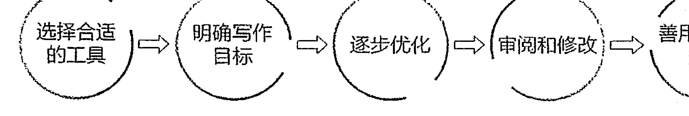
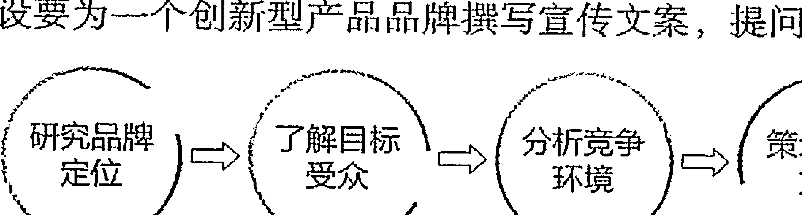
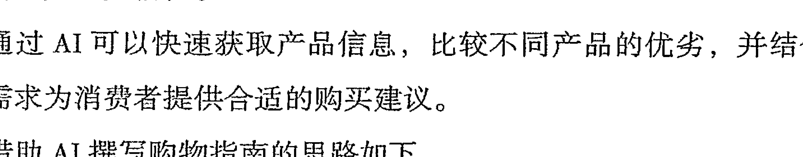
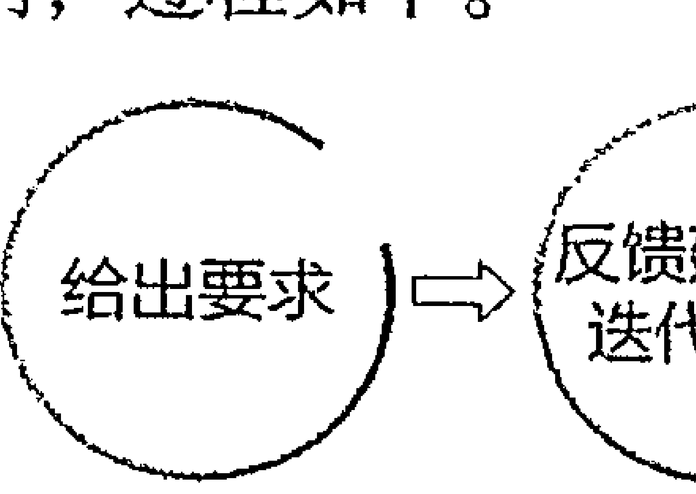
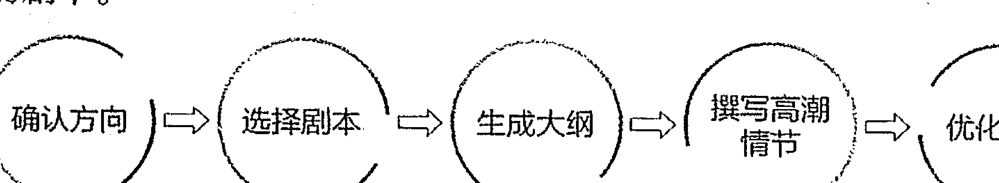
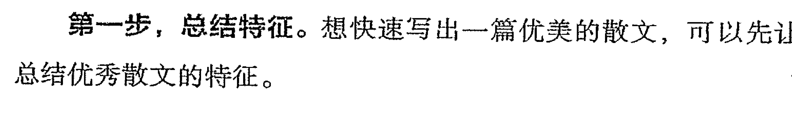
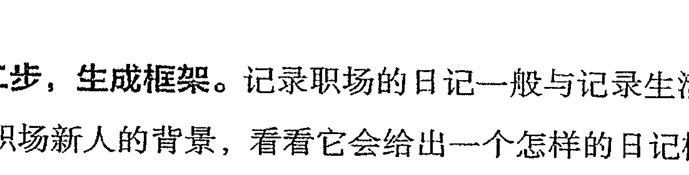

# 秒懂 AI 写作

秋叶 刘进新 贾凝墨 万静 著
用AI写作
下笔如有神
+   * 职场应用文写作
* 商业营销文案写作
* 新媒体写作
* 调查研究与论文写作
* 生活艺术创作
中国工信出版集团
人民邮电出版社
POSTS & TELECOM PRESS

# 秒懂AI
写作
让你轻松成为
写作高手
秋叶 刘进新 贾凝墨 万静
______
著
人民邮电出版社
北京

# 目录
# 第1章
# 掌握AI写作技能，让写作效率翻倍
+   1.1_又好又快，AI写作有多“神” / 2
+   1.2_五步驾驭AI，避免“一本正经地胡说八道” / 3
+   1.3_掌握6大场景提问方法，轻松完成各类写作任务 / 5

# 第2章
# 职场应用文写作
+   2.1_个人简历：在面试中脱颖而出 / 10
+   2.2_演讲稿：让观众印象深刻 / 14
+   2.3_工作总结：无须抓耳挠腮 / 18
+   2.4_创意策划：让你不断拥有金点子 / 21
+   2.5_沟通话术：让团队沟通更顺畅 / 25
+   2.6_商业计划书：展现核心竞争力 / 28
+   2.7_通知：高效传达信息 / 32
+   2.8_商业信函：快速建立信任 / 35
+   2.9_面试题库：让你秒变专业面试官 / 38
+   2.10_会议邀请函：简洁大方有诚意 / 41
+   2.11_会议发言：逻辑清晰显水平 / 44
+   2.12_会议纪要：领导看了都点赞 / 46
+   2.13_新闻资讯：信息采写迅速可靠 / 50

# 第3章
# 商业营销文案写作
3.1_产品推广文案：提高消费者购买意愿 / 58
3.2_品牌宣传文案：提升品牌影响力 / 61
3.3_活动宣传文案：增加人气，提高销量事半功倍 / 64
3.4_电商销售文案：快速建立信任，激发消费者购买欲 / 67
3.5_品牌故事：与消费者建立情感联系 / 69
3.6_企业宣传册：全面展示企业文化和定位 /73
3.7_产品手册：介绍产品服务，提高客户满意度 /77
3.8_购物指南：帮助消费者轻松决策 /80
3.9_产品评测：让消费者认可产品价值 /83

# 第4章
# 新媒体写作

4.1_提供选题：让你的写作灵感源源不断 /88
4.2_标题撰写：快速搞定10个爆款标题 /93
4.3_思路大纲：快速梳理思维逻辑 /99
4.4_小红书笔记：提升新媒体矩阵输出能力 /105
4.5_公众号文章：激发读者认同感 /112
4.6_知乎文章：成为高赞作者 /117
4.7_短视频脚本：打造爆款很简单 /123
4.8_豆瓣读书：快速发掘一本书的魅力 /133
4.9_旅游攻略：轻松规划游遍天下 /136
4.10_朋友圈文案：让好友忍不住给你点赞 /142

# 第5章
# 调查研究与论文写作
5.1_自动翻译：让AI成为高效翻译助手 / 150
5.2_精华提炼：轻松成为文档压缩高手 / 155
5.3_文献阅读：一分钟深度理解万字长文 / 160
5.4_论文写作：不再东拼西凑 / 164
5.5_实验报告：轻松拿下高分 / 169
5.6_调研报告：深入浅出凸显价值 / 174

# 第6章

# 第 1 章
# 掌握 AI 写作技能,
让写作效率翻倍
[PAGE 7]

# 1.1 又好又快，AI写作有多“神’
想象一下，无论是写报告、发邮件，还是做商业计划书，都有一位小助手帮你轻松完成，甚至比你干得更好，你一天的工作只需要几分钟就能搞定，是不是太棒了。
随着 AI 技术的飞速发展，上文的想象已经成为现实。一位 4A 公司的人说，两家公司竞标，人工写竞标书的公司没中标，AI 生成竞标书的竟然中标了。AI 生成的文章质量由此可见一斑。
AI 这个‘小助手’可以根据我们的需求，生成各种类型的文章，让写作变得轻松愉快、高效省力。
AI 在写作上有哪些优势呢？
+   1. 可以快速生成文章。AI 具备强大的数据处理能力，能够从海量的信息中快速筛选出有用的素材，并按一定的逻辑生成结构清晰、逻辑严密的文章。这样一来，我们不再需要在查找资料和整理信息上花费大量时间。
+   2. 可以生成不同类型的文章。AI 具有高度的灵活性，它能够根据我们的需求生成不同类型的文章，如新闻报道、博客文章、产品说明等。而且，它还可以根据我们的写作风格和要求进行个性化调整，使文章更符合我们的创作风格，更受读者的喜爱。
+   3. 可以大幅提高写作质量。它可以在短时间内生成语法错误少、用词准确的文章。此外，它还能为我们提供修改建议，帮我们改进文章结构，优化表达方式，从而提升文章质量。
将写作任务交给 AI，不仅能够减轻我们的工作负担，还能让我们获得更多的灵感和创意。我们可以将 AI 生成的文本作为初稿，再根据自己的需求对其进行修改和优化，最终得到一篇优秀的文章。

# 1.2 五步驾驭AI，避免“一本正经地胡说八道”
作为目前最为优秀的写作工具之一，ChatGPT一经发布，便受到人们的追捧。但是在体验ChatGPT时，不少用户发现ChatGPT时不时地“一本正经地胡说八道”，比如自行篡改著经典，或是在文章中引用根本不存在的文献资料。
我们在使用AI写作时，不能简单地复制回答，而是需要有自己的思路和逻辑，也要有判断正误的意识。
如果想充分发挥AI的潜力，我们就需要学会驾驭AI，让它为我们带来更多的便利。下面介绍使用AI写作时的基本步骤，帮助大家更好地利用AI写作。

选择合适的工具：市面上有很多AI写作工具，它们有各自的特点和优势。
在众多的AI写作工具中，OpenAI公司研发的ChatGPT能根据用户的要求生成高质量的内容。只需简单地输入一些关键词或者问题，它就能为我们生成一篇结构清晰、观点明确的文章。
除了ChatGPT，百度公司的文心一言、阿里云公司的通义千问也是功能很强的AI写作工具，它们基于对国内语言文化和多场景应用的理解，拥有更强的本地化内容输出能力，因此也更加实用。
# 明确写作目标：
在使用AI写作时，明确写作目标非常重要。我们需要告诉AI希望它完成的任务，如撰写一篇产品说明、一封推销邮件等。同时，需要确保提供足够的信息，让AI了解我们的需求，这样AI才能生成符合我们要求的内容。
# 逐步优化：
为了得到更好的结果，我们可以逐步优化提问，让AI更好地理解我们的需求。例如，可以通过修改关键词、添加详细描述等方式，引导AI生成更符合预期的内容。同时，不妨尝试多次提问，比较不同输入下生成的结果，以找到最佳方案。
# 审阅和修改：
虽然AI的写作能力越来越强大，但它仍然无法完全替代人类进行创造。因此，在使用AI生成的内容时，我们需要仔细审阅并进行必要的修改，以保证内容的质量，同时使其符合人们的阅读习惯。
# 善用模板和规范：
许多AI写作工具都提供了丰富的模板和明确的规范，可以帮助我们快速生成各种类型的文章。我们可以根据自己的需求选择合适的模板，让AI为我们生成结构正确、格式规范的文章。
掌握以上五步操作，我们就能更好地驾驭AI。
> 说明
本书讲解AI写作均用ChatGPT作为工具进行，为了让阅读更流畅，在本书后续的介绍中，如无特别说明，AI均指ChatGPT。

# 1.3 掌握6大场景提问方法，轻松完成各类写作任务
为了在各种写作场景中充分发挥AI“小助手”的作用，我们还需要掌握提问的方法。以下几种针对不同场景的提问方法可以帮助我们更好地向AI表达需求，让它更智能地为我们提供服务。
本书提供的所有提问逻辑和方法，适用于目前已发布的大部分AI写作工具。我们可以使用多种工具生成内容，整合成符合预期的内容。
故事叙述：在需要AI创作故事时，可以尝试使用“开场—发展—高潮—结局”的结构来组织问题。
# 提问举例
+   请根据以下四个部分为我写一个科幻故事：(1) 开场，描述一位宇航员在太空站的生活；(2) 发展，宇航员发现了一个神秘的信号；(3) 高潮，揭示信号的真相；(4) 结局，宇航员得到了一个意想不到的启示。
产品描述：在撰写产品说明书或宣传文案时，可以使用“功能—优势—应用场景—购买方式”的结构来组织问题。
# 提问举例
+   请根据以下四个方面描述一款智能音响：(1) 主要功能；(2) 产品优势；
[PAGE 12]
(3) 适用场景；
(4) 购买渠道和价格。

报告撰写：在撰写报告时，可以使用“背景—问题—分析—建议”的结构来组织问题。
# 提问举例
+   请为我写一篇关于某公司营销策略的分析报告，包括：(1) 公司背景和市场状况；(2) 营销存在的问题；(3) 分析问题；(4) 提出改进建议。

邮件和信件撰写：在撰写邮件或信件时，可以使用“称呼—正文—结束语”的结构来组织问题。
# 提问举例
+   请为我写一封感谢信，包括：(1) 收信人是李先生；(2) 感谢他为我们学校捐赠图书；(3) 结束语，表示期待未来的合作。

新闻稿和公告撰写：在撰写新闻稿或公告时，可以使用“标题—导语—正文—结语”的结构来组织问题。
# 提问举例
+   请为我写一篇关于某公司新产品发布会的新闻稿，包括：(1) 吸引人的标题；(2) 概括性的导语；
[PAGE 13]
(3) 详细描述发布会过程、产品特点等；(4) 结语，表示对公司未来的期待。

学术论文和专业文章撰写：在撰写学术论文或专业文章时，可以使用“引言—方法—结果—讨论—结论”的结构来组织问题。
# 提问举例
+   请为我写一篇关于人工智能在医疗领域应用的研究论文，包括：(1) 引言部分，介绍研究背景和意义；(2) 方法部分，描述研究方法和数据来源；(3) 结果部分，展示研究发现；(4) 讨论部分，对结果进行对比和深入探讨；(5) 结论部分，总结研究成果，并展望未来。
通过掌握这些针对不同场景的提问方法，我们可以更好地引导AI生成符合预期的内容，提高写作效率。只要掌握使用技巧，善于提问，就能让AI“小助手”更好地为我们服务，让写作变得更加简单和高效。
为了让大家快速了解并掌握应用AI写作的具体方法，本书分为6章，涵盖大部分职场、生活场景，可帮助我们用AI完成40多种文章的写作。
那么，现在就开启我们的AI写作之旅吧！

# 注意事项

1. 提问时需要向 AI 提供详细的背景信息，如时间、地点、人物、事件等，以便更好地和 AI 对话。

2. AI 每一次回复的内容有字数限制，在生成演讲稿等长文案时可能会遇到戛然而止的情况，这时只需发送“继续”，AI 就能继续完成回复。

3. AI 根据指令生成的内容可能和实际情况有出入，请注意甄别和修改。

4. 即便收到同样的指令，AI 每次回复的内容也不完全相同，因此可以借助 AI 生成多篇演讲稿，选取其中的优质内容，加入自己的内容，整合成一篇令人满意的演讲稿。

# 更多指令参考

1. 领导让我帮他准备一篇 5 分钟的演讲稿，主要内容是向合作伙伴介绍我们公司的 ×× 产品，请为我提供演讲稿的大纲。

2. 请帮我写一段演讲开场白，主题是《领导力：如何成为一个成功的领导者？》，要求：用一个引人入胜的故事激发观众的兴趣，文风幽默俏皮。

3. 我加入公司已经两个月了，即将通过试用期考核，成为一名正式员工，关于入职演讲你有哪些建议？

4. 我是 ×× 项目负责人，我需要在公司年会上针对完成的项目做一次总结发言，以下是相关信息：

………

请帮我用英文写一篇演讲稿。

# 2.3 工作总结：无须抓耳挠腮

工作总结对团队和个人都有重要的意义和价值，它能提高团队的沟通效率，让领导更好地评估工作进展情况，也能展示个人工作成果，并为下一步工作提供参考和方向。

但是，想要写出优质的工作总结，往往需要花费大量的时间和精力对项目或工作进行全面的梳理和分析，这非常考验一个人的分析能力、总结能力和语言组织能力。

如果想要提升写工作总结的效率，不妨让 AI 快速梳理工作、组织语言。下面提供两种思路。

# 思路一：

第一步，确定框架。告知 AI 工作总结的背景信息，如汇报人、汇报对象、汇报主题等，然后让 AI 生成框架。

如果 AI 生成的框架不符合需求，可以要求 AI 重新生成，直到获得满意的总结框架。

我需要向领导和同事汇报 3 月份个人设计工作的完成情况，请给我一个工作总结的框架。

+   以下是一个针对个人设计工作的工作总结框架，供您参考。
一、概述
总结的目的，总结包括几部分内容。
二、工作进展情况
完成的项目 / 任务、进行中的项目 / 任务、未完成的项目 / 任务。

第二步，填充信息，生成总结。根据 AI 提供的框架填充相关信息，给出具体要求，让它生成总结。

根据你提供的框架，我完善了相关信息，请为我生成一篇工作总结。要求：语言规范简洁，突出我的优点和成绩。（完善的信息，略）

第三步，反馈迭代。继续发送修改指令，让 AI 不断优化工作总结。

# 思路二：

第一步，训练 AI。通过循序渐进地提问，让 AI 充分了解如何撰写一篇优秀的工作总结。

第二步，提出需求，生成总结。在提出需求时，可以明确告知 AI 工作进展情况、下一步工作计划等信息，让 AI 更有针对性地回复。

很好，请遵循以上技巧和建议，帮我写 “3 月份个人设计工作总结”，包含以下内容：（工作进展情况、下一步工作计划等，略）

好的，以下是一篇可以参考的工作总结示例，供您参考：
一、项目完成情况
1.1 项目 1 名称
在 3 月份，我完成了项目 1 的设计工作。主要工作包括收集用户需求、进行竞品分析、制订产品设计方案、绘制流程图和原型图等。最终，我按照计划在 3 月底完成了项目交付，用户对产品给予了高度评价。
..........
扫码并回复关键词 “231” 查看 AI 生成的完整信息

# 注意事项

1. AI每次生成的内容略有不同。可多次生成，挑选优秀的内容进行整合，从而获得一篇不错的工作总结。

2. 通过循序渐进地提问，让AI了解什么是优质的工作总结，再发送具体指令让它生成内容。

# 更多指令参考

1. 你现在是一位部门管理者，请写一篇年度工作总结，突出团队协作和凝聚力，字数约为1000。

2. 我需要汇报今年第一季度的个人设计工作的完成情况，汇报思路是什么呢？

3. 请优化你之前对优质工作总结特征的回复，让它更详尽和具体。

4. 这篇总结中还需要突出我的个人贡献，请优化。

# 2.4 创意策划：让你不断拥有金点子

无论从事什么行业，金点子都是非常重要的，它们可以帮助创作者提升效率、解决问题、提高业绩，并在激烈的市场竞争中脱颖而出。

问题是，当创作者需要一个好的创意时，可能会没有灵感。有时还需要深入了解某个领域，进行一些调查和研究才能有好的创意。

现在可以借助 AI 快速获得灵感和创意，并且它还能帮助创作者从不同角度思考问题，产生更多的创意。

可以按照如下思路引导 AI 生成创意。

第一步，确认思路。通过提问的方式，确认生成创意的思路和方法。

如何生成有创意的点子？

扫码并回复关键词 “241” 查看AI生成的完整信息

AI提供了一些常用方法，例如，头脑风暴、逆向思维、多角度思考、调研分析等，并给出了具体做法和相关建议。

第二步，提出需求。提出创意策划的背景和具体要求。

请根据以上方法，帮我策划一些适合在公司年会上表演的节目，要求：有创意、有趣。

+   - 好的，以下是一些适合在公司年会上表演的节目。
 1. “变脸秀”：可以请一位专业的川剧变脸表演者到现场，让他为观众表演变脸。
 2. “音乐人类”：将现场的观众分为不同的小组，每个小组使用一种乐器，如钢琴、小提琴等，让观众一起合奏一首歌曲。

[PAGE 29]

+   3. “美食大赛”：可以请几位擅长烹饪的员工，来一场现场的烹饪比赛。评委可以是公司领导，评选出哪位员工的美食最具创意、最好吃。

+   4. “脑筋急转弯”：准备一些脑筋急转弯的题目，邀请员工进行答题比赛，考验他们的智商和反应速度。

+   5. “动作大师”：请一位舞蹈老师或健身教练，在现场教授一段简单的舞蹈或健身操，让员工们跟着学习，增强团队活力。

+   6. “才艺大比拼”：邀请员工展示自己的才艺，如唱歌、跳舞、演奏乐器等，进行现场评选，选出最有才华的员工。

+   7. “艺术展览”：为员工们提供一个平台，让他们展示自己的绘画作品、摄影作品或手工艺品，现场进行展览和评选。

以上是一些可能的公司年会表演节目，可以根据实际情况进行调整和修改。希望能够帮到您。

如果觉得AI生成的节目数量还不够，可以命令它继续。

继续。

+   请再给我5个节目。

第三步，筛选创意。让AI按照具体需求，对它所生成的创意进行筛选。

+   请帮我从以上节目中筛选出5个互动性强的节目。

[PAGE 30]

扫码并回复关键词 “242” 查看AI生成的完整信息

第四步，拓展创意。让AI继续拓展创意或生成具体的策划方案，最终得到想要的创意策划。

+   * “音乐人类” 这个节目看起来不错，请根据它再拓展一些创意节目。

+   * 我喜欢“音乐人类”这个节目，请为我提供一份详细的策划方案。

# 注意事项

+   1. 可以与AI进行互动，向它提出一些问题或描述一些情境，并根据AI的回答进一步提出问题，以此探索更多的创意和思路。

+   2. 在使用AI生成创意时，需要根据实际情况进行判断和筛选，以确保生成的创意符合实际需求，并具有可行性。

# 更多指令參考

+   1. 请根据关键词：环保、健康饮食，生成一些相关的创意灵感。

+   2. 如何提高公司的销售额？请为我提供一些有创意的方法和思路。

# 2.8 商业信函：快速建立信任

商业信函常用于与客户、供应商、合作伙伴或其他业务联系人之间的沟通，有助于达成合作、完成商业交易。写商业信函时，结构、内容、语气、风格都需要遵循一定的规范，否则可能会影响公司的信誉和形象，浪费时间、金钱和人力资源，错过商机甚至破坏和客户之间的关系。这时只需向AI提供相关信息，它就能自动生成一份准确、专业的商业信函。

可参考的思路如下。

第一步，确定类型。商业信函有多种类型，例如询问型、回复型、邀请型、感谢型等。在向AI提问之前，需要确定商业信函的类型。

第二步，确定受众。商业信函的受众通常有客户、供应商、合作伙伴等，告知AI受众的同时，可以提供更多有关受众的信息。

第三步，确定目的。明确写作目标，同时可以附上写作要求。

第四步，补充信息。向AI提供更多生成商业信函所需的必要信息，如公司名称、联系方式、产品介绍等。如果已经有一份商业信函草稿，可以发送给AI作为补充资料。

第五步，生成内容。

注意事项：

1. 商业信函通常有一些标准的格式和规范。AI虽然能够辅助生成文字内容，但是无法完成更为精细的排版工作，还需人工优化排版。

2. 商业信函需要关注受众的情感和需求，而AI可能无法完全考虑这些因素，AI生成的商业信函可能会不够人性化，需要进一步修改。

# 2.9 面试题库：让你秒变专业面试官

使用面试题库，招聘者可以快速评估应聘者的能力、经验和素质，能在确保面试公正性的前提下提高面试效率，展现公司的专业性和实力。在编写面试题时，招聘者除了要根据招聘职位有针对性地设计面试题目，还要综合评估应聘者的价值观、工作态度和沟通能力等多个方面，并评估其创新思维、发散性思维。

可以参考以下思路向AI提问，从而生成一份专业的面试题库。

第一步，确定类型。确定面试题有哪些类型。

第二步，生成题目。根据不同的面试题类型，批量生成面试题目。

第三步，拓展题目。可以命令AI生成更多的面试题目，再从中进行筛选。

第四步，整合梳理。筛选出所需要的面试题目，整理成为面试题库后，还可以向AI咨询一些编写面试题的建议和注意事项，进一步提高面试题库的质量。

注意事项：

1. AI不能像人类一样进行主观判断，因此它可能会提供一些不够准确的答案，而这些答案可能会影响到面试官对面试者的评估，需要注意甄别。

2. 编写面试题还需要结合自身的经验和洞察力，以及特定公司和行业的需求，因此不要过度依赖AI。

3. 面试题可能会包含一些与面试者相关的信息，在向AI提问时需要注意保护面试者的隐私。

# 2.10 会议邀请函：简洁大方有诚意

会议邀请函常用于邀请个人或组织参加研讨会、培训或商务活动等。好的会议邀请函可以清晰、准确地传达会议的基本信息，激发受邀者的兴趣和积极性，同时可以展现主办方的专业素养。

问题是，在写会议邀请函时需要考虑多方面的因素，例如，如何确保内容的准确性，如何使语言简练得体，如何设计排版等，任何一个小错误都可能带来不必要的麻烦和误解。这时不如借助AI撰写会议邀请函。

可以按照以下思路引导AI生成邀请函。

第一步，询问所需信息。直接向AI提问，确定会议邀请函需要包含哪些信息。

第二步，提供信息。根据实际需求，对AI提供的基本信息进行增减。

第三步，询问修改建议。如果不清楚该从哪些方面优化会议邀请函，可以直接询问AI。

第四步，反馈迭代。根据AI提供的修改建议，对它生成的邀请函进行反馈迭代。

注意事项：

1. AI在生成表达期望和感谢的内容时，用词可能比较生硬，需要人工修改。

2. AI提供的会议邀请函范例不一定适用于中文语境，如果有更好的范例，可以发送给它作为参考和模板。

# 2.11 会议发言：逻辑清晰显水平

在会议中难免遇到需要发言的情况，无论是汇报工作还是表达观点，好的发言简洁明了、逻辑清晰，能够体现发言者的思维逻辑水平和语言表达能力。

不过，很多人可能缺少会议发言的经验，或是不清楚如何吸引听众的注意力、没有时间提前准备和完善会议发言稿。

可以尝试用AI生成会议发言稿以完成一次高质量的发言。以下思路可供参考。

第一步，交代背景。让AI了解此次发言的背景信息，如主题、发言人、听众、场合、时间等。

第二步，生成框架。可以让AI提供发言稿的内容框架。

第三步，优化框架。如果AI提供的框架有待完善，可以给出具体的修改指令，并补充相关信息。

第四步，生成发言稿。

第五步，反馈迭代。可以继续向AI提出具体的修改指令，也可以自行修改AI生成的发言稿。

注意事项：

1. AI单次生成的内容有字数限制，在生成长文案时可能会突然中断回复，这时只需发送“继续”，AI就能继续完成回复。

2. AI生成的内容可能缺乏针对性，注意根据实际情况修改会议发言的内容，以确保其符合特定场合及听众的需求。

# 2.12 会议纪要：领导看了都点赞

职场人经常需要开各种会议，一份好的会议纪要可以清晰、准确地记录会议的内容，还可以让未参加会议的人了解会议内容，防止工作遗漏和重复，提高工作效率。

在撰写会议纪要时需要遵循很多标准，例如统一的格式和风格、包含必要的信息、简单明了的语言等，这时可以利用AI辅助生成会议纪要。

思路一：

第一步，获取模板。向AI提问，获得一份标准的会议纪要模板。

第二步，修改模板。根据个性化需求对模板进行修改。

第三步，生成内容。按照模板框架补充相关信息，命令AI生成会议纪要。

第四步，反馈迭代。向AI发送更多指令，让它优化及修改会议纪要。

思路二：

第一步，提交草稿。如果已经有了一份会议纪要的草稿，可以直接发送给AI。

第二步，寻问修改建议。让AI针对会议纪要提出修改建议。

第三步，修改内容。命令AI修改会议纪要内容。

第四步，反馈迭代。如果会议纪要还有待完善的地方，可以让AI继续优化。

注意事项：

1. 如果有更好的会议纪要模板，可提供给AI作为参考。

2. AI在生成会议纪要时，为了达到指令要求，可能会对创作者提供的信息进行删减或补充，请注意甄别和修改，忠于会议的实际内容。

# 2.13 新闻资讯：信息采写迅速可靠

对于新闻从业者来说，采写新闻资讯要及时、准确，这样才能给读者最新、最有价值的信息并保持职场竞争力。

想要写一篇时效性强、内容可靠、观点深刻的新闻资讯，可以尝试使用AI。它能快速整合处理大量新闻素材，短时间生成新闻稿件文本，还能根据输入的关键词和数据自动生成相关内容和观点，并根据不同读者需求调整语言风格。新闻从业者可借此提高工作效率，以便把更多时间用在深度采写工作上。

可以按照如下思路引导AI生成内容。

第一步，创建提纲。将新闻的主题、内容方向、读者群体、发布平台、篇幅等具体信息告诉AI，让AI生成一份新闻提纲。

第二步，“投喂”素材。把收集的相关资料“投喂”给AI，让它进行归纳整合，作为备用素材。

一家国内主流媒体于2019年推出了一款写稿机器人，用于生成体育类和财经类稿件。截至2023年，该机器人已经累计生成稿件超过十万篇，发稿数千篇，累计阅读量近千万，几乎实现了“秒发”新闻报道，一篇稿件的最短生成时间仅为4分钟。所有利用AI生成的稿件在发布前都必须经过严格的“三审三校”机制审核，以确保导向正确，内容准确、达到专业标准，为读者提供高质量的报道。2023年，该写稿机器人升级至2.0版本，智能化水平明显提升，每天能生成超过400篇稿件，效率比以往提高了10倍。

# 第三步，拟定初稿。

将写作要求、文章篇幅、发布平台等信息提供给AI，直接让它生成一篇新闻资讯初稿。

用前面的新闻提纲写一篇500字左右的新闻资讯，发布平台是报纸，要求：表述严谨、语言精练。

随着AI技术的不断发展，越来越多的行业开始应用AI技术，新闻传媒行业也不例外。有人担心，AI会在将来取代新闻记者的位置。为此，我们进行了深入的调查和研究。 首先，AI写作技术在新闻传媒行业的实际应用情况表明，它可以自动生成新闻报道，实现快速采写和发布新闻，提升工作效率。 然而，AI写作技术在新闻传媒行业引发了争议。有人担心AI取代新闻记者，会使新闻报道失去真实性和客观性，也有人思考新闻记者如何与AI协同工作的问题。 我们调查发现，目前较少数新闻机构在使用AI写作技术。一些媒体尝试促进新闻记者与AI协同工作。AI写作技术在新闻传媒行业的应用效果还需要时间来验证。 AI是否会取代新闻记者？我们认为不会。虽然AI写作具有生成稿件快速、生产效率高等优势，但新闻记者的价值和作用是不可替代的。AI 和新闻记者将形成互补关系，共同推动新闻传媒行业的发展。

把 “2019 年，一家新闻机构成功开发了一款基于 AI 的写作机器人，主要用于生成财经类和体育类稿件。迄今为止，该机器人已经累计创作文章十多万篇，并发布了数千篇，总阅读量近千万……” 这段资料植入到新闻内容中。

近年来，随着AI技术的不断发展，越来越多的行业开始应用AI技术，新闻传媒行业也不例外。一家新闻机构于2019年开发了一款基于AI技术的写作机器人，主要用于生成财经类和体育类稿件。该机器人已累计创作文章十多万篇，一篇文章最短只需4分钟即可生成。所有文章都必须经过严格的“三审三校”机制审核后才能发布，以确保导向正确，内容准确、达到专业标准。

第四步，个性化修改和调整。

提出修改需求，比如增加案例、调整语言风格等，让AI优化新闻初稿。

刚才的新闻初稿中案例太少，增加一个新闻机构运用AI写作的实际案例，要求真实、有信息来源，文末增加专家独家观点，文章篇幅可以扩充到700字左右。

[PAGE 61]

第五步，内容来源和版权审核。

针对新闻资讯中所出现的案例、数据、政策等信息，让AI提供信息来源（网址），以进行版权审核。

新闻稿中：美国著名新闻机构×××曾在一份声明中表示，他们将会利用AI写作技术来采写一些简短的新闻报道和实时更新的内容……这段内容在国内是否有相关报道，能否提供网页地址？

+   以下是一些国内平台关于×××利用AI写作技术的报道。
×× 新闻: ……
××网: ……
××网: ……
这些报道都提到了×××利用AI写作技术的声明，其中××新闻的报道较为详细，可以用 来了解更多相关情况。

以上网页信息也是转载，无法确定来源，请把新闻稿中的这个案例直接删除，重新生成一份新闻资讯。

# 注意事项

1. 尽管AI作为写作工具拥有强大的撰写、编辑及润色功能，但新闻从业人员仍需遵守相关的管理办法和职业道德准则的规定，深入现场采写和调查，不能偷懒。

2. AI提供的案例、数据等信息会有错误、杜撰或者不严谨的情况，一定要进行人工检查，确保内容的真实性和准确性。

[PAGE 62]

# 更多指令参考

1. 你是新闻记者，现在要写一篇有关 ××××× 的新闻资讯，这篇新闻内容将发布在某社交平台上，要求篇幅不超过 300 字，语言风格有趣、接地气，读者群体为 20 岁左右的年轻人，目的是让他们了解 ××××× 相关信息，现在我会给你具体的背景资料和数据，请直接生成一份新闻初稿。

2. 这篇新闻信息曾发布在官方网站，现在将重新分发到小红书、微博、今日头条等平台，请帮我按照这些平台的风格和要求，分别生成相应的稿件，要求语言、图文格式、篇幅都要分别高度契合这些平台的风格。

3. 下面我将提供给你一份由现场录音转化而来的文字稿，请帮我提炼重点信息，快速生成一篇新闻短讯，要求：信息准确，措辞严谨，篇幅在 300 字左右。

[PAGE 63]

# 第3章

# 商业营销文案写作

[PAGE 64]

# 3.1 产品推广文案：提高消费者购买意愿

产品推广文案在商业营销中起着至关重要的作用，一篇优秀的推广文案可以激发消费者的购买欲望，提高产品的销售量。撰写出高质量的文案并非易事，创作者不仅需要深入了解产品特点，还需掌握各种文案写作技巧，增强文案的吸引力和说服力。

借助AI，创作者可以更快速地挖掘产品优势，确定目标受众，从而撰写具有吸引力的产品推广文案。那么，如何利用AI高效地撰写一篇引人入胜的产品推广文案呢？

可以按照以下思路引导AI生成文案。

第一步，识别产品特点。尽可能详细描述所要推广产品的特点。

我需要写一篇手机推广文案，这款手机的特点：超薄设计、超清显示、处理器强大、拍照功能优秀和续航能力出色。

第二步，确定目标受众。让AI分析目标受众的需求和喜好，以便撰写更具针对性的文案。

请帮我分析一下这款手机的目标受众。

这款手机的目标受众主要是对科技产品有高要求的消费者，他们可能是学生，也可能是商务人士。他们追求高品质的使用体验，注重产品性能和设计美感，并愿意为拥有先进技术的设备支付一定的溢价。

[PAGE 65]

# 第三步，确定文案风格。根据目标受众的特点，确定文案的风格。

请根据目标受众，帮我设定手机推广文案的风格。

这款手机的推广文案可以采用简洁、专业的风格，同时加入一些生动的形容词，以激发消费者的兴趣。文案可以强调产品的高性能、创新设计和出色的拍照功能，同时突出其美观的特点。

请你按照这个风格，为这款手机撰写一篇产品推广文案，突出其优势。

领先科技，尽享非凡体验！全新一代智能手机，独具创新设计，超薄机身搭配高清大屏幕，带给您不一样的视觉享受。搭载强大处理器，轻松应对各种任务，无论是商务办公还是游戏娱乐，都能满足您的需求。卓越的拍照功能让您随时随地捕捉美好瞬间，记录精彩生活。更有超长续航能力，让您告别充电烦恼。现在就升级您的智能手机，开启全新的非凡体验！

# 第四步，调整优化。对文案细节进行调整和优化，使其更具吸引力。

目前文案的场景感不够，应当如何优化文案以增强吸引力？

为满足这一需求，我们可以在文案中添加一些生活化场景的描述，如一键式智能助手为您解决日常琐事，或高清显示屏带来沉浸式影音体验等。同时，可以强调产品在安全性、耐用性和售后服务方面的优势，提升消费者对产品的信任。这些调整将使文案更具吸引力，有助于提高消费者的购买意愿。

[PAGE 66]

# 注意事项

1. 突出产品亮点：在让 AI 生成产品推广文案前，请确保清晰地传达产品的亮点和特色。可以列出关键特点，然后让 AI 根据这些特点撰写文案。

2. 明确目标受众：为了确保 AI 生成的文案符合目标受众的喜好，请明确目标受众。可以提供描述他们的年龄、性别、兴趣等信息，以便 AI 更好地了解他们。

3. 指定文案风格：在向 AI 提问时，明确创作者期望的文案风格，例如专业、活泼、幽默或其他特定风格。这将有助于 AI 生成符合创作者要求的文案。

4. 持续优化：撰写好初稿后，可以根据消费者反馈或实际推广效果对文案进行调整和优化。可以向 AI 提问如何优化文案，以提高产品吸引力和消费者的购买意愿。

# 更多指令参考

+   1. 请为我提供 × × 产品的 5 个卖点。
2. 请根据消费者关心的要点梳理 × × 产品的功能。
3. 请为我提供 3 个关于 × × 产品的常见问题及解答。
4. 请为 × × 产品设计两种不同的文案风格。

[PAGE 67]

# 3.2 品牌宣传文案：提升品牌影响力

品牌宣传文案对于提升品牌影响力和吸引目标受众具有至关重要的作用。通过生动有趣的宣传文案，企业可以更好地传达品牌价值观、产品特点和服务优势，从而获得更多关注和支持。

然而，撰写出色的品牌宣传文案并不容易。创作者需要深入了解品牌定位、目标受众及市场竞争环境，创作出具有创意和吸引力的文案。AI可以协助创作者快速生成高质量的品牌宣传文案。

接下来介绍如何利用AI为品牌创作宣传文案，以提升品牌影响力和形象。

假设要为一个创新型产品品牌撰写宣传文案，提问思路如下。

第一步，研究品牌定位。通过研究品牌定位深入了解品牌特点，找到具有吸引力的素材。下文的叙述中用“×××”代替了具体品牌名称。

❿ 请帮我梳理一下“×××”这个创新型品牌的核心定位和特点。

××× 是一个致力于提供创新型产品的品牌，其核心定位为高品质、高科技和个性化。××× 的特点包括采用最新科研成果，确保产品安全；注重消费者体验，提供量身定制的解决方案；关注市场动态，不断扩大产品线和服务范围。

[PAGE 68]

# 第二步，了解目标受众。了解目标受众的需求和喜好，使宣传文案更具针对性。

请帮我分析归纳“×××”品牌目标受众的特点。

×××的目标受众主要是追求健康和高品质生活的中高收入群体，他们对产品的安全性有较高要求，同时希望获得个性化的服务。此外，这类受众通常会关注行业动态和科技发展，对创新型产品具有较高的接受度。

# 第三步，分析竞争环境。了解并对标市场上的竞品，优化品牌宣传策略。

请概述“×××”品牌在市场中面临着怎样的竞争环境。

在市场中，×××面临着激烈的竞争，主要竞争对手包括其他大型的传统品牌和新兴的科技品牌。为了在竞争中脱颖而出，×××需要不断创新，凸显自身独特的价值理念和产品优势，同时加强与目标受众的沟通和互动。

# 第四步，策划创意文案。在明确品牌定位、目标受众，掌握了竞争环境的信息后，创作者可以利用AI为“×××”品牌撰写具有创意和吸引力的宣传文案。

请结合以上信息，为“×××”品牌撰写一篇具有号召力的宣传文案。

加入×××，体验科技与健康的完美融合！我们致力于为您提供高品质、高科技的产品及个性化的解决方案，让您享受量身定制的高品质生活。我们依托最新科研成果和严格的品控，助您轻松迈向更美好的明天！

# 注意事项

+   1. 提供背景信息；在提问时，向 AI 提供充足的品牌背景信息和市场信息，有助于生成更贴合实际的文案。

+   2. 提供更加具体的指令：在与 AI 互动时，尽量提供具体的要求，如文案风格、字数限制等，以便获得更符合预期的结果。

+   3. 生成创意：可以利用 AI 生成各种有趣、独特的创意，然后结合经验和品牌调性进行筛选和修改。

# 更多指令参考

+   1. 请帮我分析 ×× 品牌的竞争优势有哪些。

+   2. 请为 ×× 品牌设计一句简洁且有力的宣传语。

+   3. 为 ×× 生态旅游品牌撰写一篇吸引年轻人的宣传文案。

+   4. 请为 ×× 品牌撰写一篇关于健康生活方式的宣传海报文案。

[PAGE 69]

# 3.3 活动宣传文案：增加人气，提高销量事半功倍

企业要从众多竞争对手中脱颖而出，吸引消费者的关注，提高销量，可能会选择开展多种多样的营销活动。这时，一篇引人人胜、富有创意的活动宣传文案，不仅可以提升企业形象，还能激发消费者的参与和购买欲望，从而实现销量的快速增长。

不同类型的企业、活动和目标受众，都会影响宣传文案的风格和内容。因此，寻求一种高效的方法来撰写活动宣传文案变得至关重要。

这一节将讲解如何利用 AI 为营销活动撰写吸引人的宣传文案，从而提高活动的人气和产品销量。

以下是借助 AI 编写活动宣传文案的思路如下。

第一步，设定角色。首先告诉 AI 我们希望它扮演的角色，如 “营销策划专家” 或 “擅长活动宣传的策划总监”。

我需要一个擅长活动宣传的策划总监来帮我策划一场营销活动。

当然可以，我会以活动宣传专家的身份为您提供帮助。请告诉我有关活动的详细信息。

第二步，提供信息。向 AI 提供营销活动的详细信息，包括活动类型、目标受众、活动优惠等。

[PAGE 71]

我们将举办一个为期一周的时尚服饰促销活动，目标受众是年轻女性，活动期间所有商品8折销售。

明白了，这是一个为期一周的针对年轻女性的时尚服饰促销活动，活动期间所有商品8折销售。接下来，您需要我为您完成哪些任务？

# 第三步，明确目的。明确活动的目的，如提高销量、提升品牌知名度等。

请为这个时尚服饰促销活动撰写一篇活动宣传文案，目的是吸引年轻女性前来购买。

尊敬的女士们，这是一场专为你们打造的时尚盛宴！为期一周的独家优惠，8折商品任您买！探索我们的时尚新品，发掘属于您的独特魅力。赶快行动，错过可惜！只等您的光临！

# 第四步，评估优化。查看AI的回答，评估其质量，如有需要，提供具体的反馈和要求来进行优化。

这篇文案很有吸引力，但我希望能在开头加入一句关于限时优惠的信息。

我明白您的需求了，我已经在开头加入了限时优惠的信息，如下所示：
“限时独享！尊敬的女士们，这是一场专为你们打造的时尚盛宴！为期一周的独家优惠，8折商品任您买！探索我们的时尚新品，发掘属于您的独特魅力。赶快行动，错过可惜！只等您的光临！”

[PAGE 72]

我还需要增加一段文字来增强活动的紧迫感：强调促销活动的限时性，促使目标受众立即行动。

> "仅剩3天！错过这次促销活动，您将错过本季最令人期待的时尚单品。赶紧行动，让您的衣橱迎来新生！"

# 注意事项

+   1. 明确目标受众：告诉 AI 目标受众是谁，确保文案有很强的针对性，以提高活动的吸引力。

+   2. 比较和优化：可以利用 AI 生成多个回答，分别进行优化，然后根据品牌调性和活动需求进行筛选和修改。

# 更多指令参考

+   1. 请就时尚服饰促销活动的社交媒体广告文案给我提一些建议。

+   2. 我希望突出时尚元素，在文案中强调时尚新品和流行趋势，让目标受众感受到时尚热点。

+   3. 我想强调活动优惠力度，突出活动优惠，使目标受众产生购买冲动。

+   4. 请保证文案简洁明了，适合在 × × 平台上传播。

[PAGE 73]

# 3.4 电商销售文案：快速建立信任，激发消费者购买欲

这是××品牌创始人的故事：（略）
请帮我构建一个关于环保水瓶品牌××的故事，有人物和具体事件。

故事从品牌创始人一次难忘的经历开始。在一次户外探险中，他看到大量废弃塑料瓶对自然环境造成了巨大的破坏。受此启发，他决心创立一个环保水瓶品牌，旨在减少塑料废弃物和推广可持续生活方式。通过不断研究和创新，品牌成功推出了一款由可再生材料制成的水瓶。故事最后展示品牌对环保事业的支持，以及消费者对品牌的热爱和支持。

# 第四步，设置情感触发点。在故事中设置情感触发点，以引发消费者的共鸣。

> 请为环保水瓶品牌的故事设置一个情感触发点。

故事中的情感触发点可以是创始人在探险过程中发现了被废弃塑料瓶严重污染了美丽的湖泊这一场景。这个场景能使消费者感受到环境保护的紧迫，进一步强化品牌价值观，使消费者产生情感共鸣。

# 第五步，反馈迭代。把自己的想法反馈给AI，让其不断调整和优化故事内容，使之更具吸引力。

> 如何优化环保水瓶品牌故事以增强吸引力？

为了满足这一需求，可以在故事中添加品牌研发团队克服技术难题的细节，例如他们是如何发现可再生材料的，以及如何测试水瓶的耐用性和环保性能的。同时，可以加入一些消费者的真实经历，展示他们如何在日常生活中使用该品牌的水瓶，从而体现产品的实用性。这些优化将使故事更具吸引力，有助于使消费者与产品和品牌建立更深厚的情感联系。

# 注意事项

+   1. 挖掘品牌独特性：在让AI生成品牌故事前，可以强调品牌的独特性和价值观，使生成的故事区别于众多竞争对手。

+   2. 结合真实案例：给AI提供真实的案例能大大提升品牌故事的感染力，消费者更容易产生共鸣。

+   3. 紧扣消费者需求：通过AI了解消费者的需求和关注点，从消费者的角度出发，满足消费者的真实需求。

# 更多指令参考

+   1. 请为××品牌故事提供一个引人入胜的开篇。

+   2. 请在××品牌故事中添加一个与客户互动的环节。

# 3.6 企业宣传册：全面展示企业文化和定位

企业宣传册作为企业宣传和推广的重要载体，对塑造企业形象、展示企业文化和定位具有重要作用。如何借助AI提高宣传册的制作效率和质量呢？

借助AI，创作者可以快速生成符合企业特点的文案，全面展示企业文化和定位，从而让目标受众更好地了解企业的价值观和经营理念。

以下是借助AI编写企业宣传册的思路。

第一步，设定宣传目标。在开始制作宣传册之前，需要明确宣传册的作用，例如提升品牌知名度、展示企业产品与服务、传达企业文化等。

××企业主要从事环保科技产品开发，请帮我设定该企业宣传册的作用。

这个宣传册的作用可以设定为展示企业在环保科技产品开发领域的专业能力和成果，传达企业致力于环保创新的核心价值观，以提升品牌知名度和吸引潜在客户。

第二步，确定内容结构。在AI的帮助下规划企业宣传册的内容结构。

[PAGE 80]

请规划一下这家环保科技企业宣传册的内容结构。

+   1. 封面：企业Logo、企业名称、宣传口号。
2. 企业简介：企业发展历程、企业文化、企业愿景。
3. 产品与服务：产品特点、服务优势、案例展示。
4. 团队介绍：团队成员、专业技能、成功经验。
5. 合作伙伴：合作企业、合作项目、成功案例。
6. 联系方式：地址、电话、邮箱、社交媒体。

第三步，提供企业信息。向AI提供所需的企业信息，包括目标受众、企业定位等，利用AI的智能写作能力，撰写各部分的内容。

这是×××公司的一些信息：（具体信息，略）
请先帮我撰写一段环保科技企业的简介。

×××创立于20××年，是一家专注于研发和生产环保科技产品的创新型企业。我们的使命是致力于环境保护，通过技术创新为全球客户提供高质量的绿色解决方案。×××秉承可持续发展、绿色环保的核心价值观，力求成为行业的领军企业。

第四步，反馈优化。对生成的内容进行评估，是否符合企业形象、品牌调性和目标受众的喜好。如有需要，可向AI提供反馈，进一步优化内容。

这段企业简介很好，但我希望能更加突出企业的创新精神和环保理念。

[PAGE 81]

好的，我将重新撰写企业简介，更加突出企业的创新精神和环保理念。（具体信息，略）

# 第五步，提供设计参考。根据生成的内容，结合企业形象、品牌调性和目标受众的喜好进行设计，使宣传册更具吸引力。

请给我一些建议，如何对环保科技企业的宣传册进行设计和排版，以更好地体现企业形象和品牌调性。

+   在对宣传册进行设计和排版时，请考虑以下几点。
1. 色彩：选择与企业形象和品牌调性相符的色彩，如绿色、蓝色等，营造环保、可持续的企业气质。
2. 图片：选用高质量的图片，展示企业的环保产品、技术，以及生产设备等，充分体现企业的创新与环保理念。
3. 排版：采用简洁明了的排版风格，避免过多的文字和图片堆砌，有利于消费者快速了解宣传册的核心内容。
4. 字体：选用易于阅读且符合企业形象的字体，字号和行距适中，方便阅读。
5. 信息层次：合理设置信息层次，将重要内容置于显眼位置，引导消费者关注。

[PAGE 82]

# 注意事项

+   1. 提供详细的信息；向AI提供尽可能详细的企业信息和宣传册制作目标，以便让AI更好地生成内容。同时，也可提供品牌调性、目标受众等信息，让宣传册更贴合品牌形象。

+   2. 启发创意：在制作宣传册时，可以向AI提问，寻求一些创意和灵感，例如，“如何从侧面展现企业的高端属性？” 或 “请给我一些设计宣传册的封面的建议。”

+   3. 结合现有策略：在用AI制作宣传册时，结合企业当前的市场策略，保证宣传册的时效性。

[PAGE 83]

# 3.7 产品手册：介绍产品服务，提高客户满意度

一本优秀的产品手册不仅能够向客户全面展示产品的特点和优势，还可以提高客户满意度，从而促进企业的发展。然而，编写一本既详尽又易懂的产品手册往往需要企业投人大量时间和人力资源。

本节将介绍如何利用AI编写产品手册，帮助企业快速生成高质量的产品说明和操作指南。

以下是借助AI编写产品手册的思路。

第一步，设定角色。如果之前没有接触过产品手册的编写工作，可以用角色扮演的方式让AI成为产品总监。

> 你是一位经验丰富的产品总监，请帮助我制作一本产品手册。

> 当然可以，我很高兴能为您提供帮助。请提供您要介绍的产品的详细信息和您希望实现的目标，我将为您制作一本内容全面且吸引人的产品手册。

[PAGE 84]

好的，我已经了解关于×××智能家居系统的相关信息。我将为您制作一本旨在让客户更好地了解产品和服务，提高客户满意度的产品手册。

# 第三步，生成大纲。

请根据以上信息生成×××智能家居系统产品手册的大纲，表述尽量简洁明了。

产品手册的大纲如下。

+   - 1. 产品概述：介绍×××智能家居系统的总体概念和核心功能。
- 2. 系统组件：详细介绍系统的各个组件和设备，以及它们的功能和特点。
- 3. 安装与设置：提供详细的安装与设置指南，包括硬件安装、软件配置等。
- 4. 操作指南：解释如何使用系统的各个功能，例如远程控制、语音控制等。
- 5. 常见问题与解答：列出客户可能遇到的常见问题，并提供解决方案。
- 6. 客户支持与联系信息：提供客户支持渠道和联系方式，方便客户在遇到问题时寻求帮助。

# 第四步，生成产品手册。

请根据你刚才生成的大纲，帮我编写完整的产品手册。

第五步，迭代更新。可以询问AI优化意见，方便后续升级迭代。

后续还需要对产品手册进行更新，请问这本产品手册的哪些方面还可以优化？

[PAGE 85]

你可以在产品手册中突出产品的亮点和优势。

+   1. 产品概述：在介绍×××智能家居系统的总体概念和核心功能时，强调其语音控制和场景识别功能的创新，以及节能环保的设计理念。

+   2. 系统组件：在详细介绍系统的各个组件和设备时，重点强调它们的独特功能和优势，例如设备的兼容性、高性能和可靠性。

+   3. 安装与设置：在提供详细的安装与设置指南时，强调对用户友好的设计，让用户能够轻松快速地完成安装与配置。

+   4. 操作指南：在解释如何使用系统的各个功能时，突出简便易用的操作界面和高度智能的人工智能语音助手。

+   5. 常见问题与解答：在列出客户可能遇到的常见问题并提供解决方案时，强调我们对客户问题的高度关注和及时响应。

+   6. 客户支持与联系信息：在提供客户支持渠道和联系方式时，强调我们的专业团队会为客户提供优质的售后服务。

# 注意事项

+   1. 了解产品特点：在使用AI制作产品手册时，务必提供详细的产品信息、特点和优势，以便更好地输出内容。

+   2. 产品手册的内容应简洁明了：产品手册应便于理解和操作，尽量使用简洁明了的语言，并提供必要的图示说明。

+   3. 反馈与迭代：询问AI对产品手册后续优化的建议，便于未来迭代升级，满足不同时期客户的需求。

[PAGE 86]

# 更多指令参考

+   1. 请为我提供5个××产品的卖点。

+   2. 请帮我编写××产品的简易安装指南。

+   3. 请为我提供3个××产品使用过程中的常见问题及解答。

# 3.8 购物指南：帮助消费者轻松决策

在购物时，消费者常常犹豫不决、难以选择。如何帮助消费者轻松决策，提高消费者的购买意愿和满意度，是企业需要关注的重要问题。

购物指南通常包含大量的信息，如产品特性、价格、使用场景、优缺点等。同时，为了满足不同消费者的需求，购物指南的内容还需要具备一定的灵活性。

通过AI可以快速获取产品信息，比较不同产品的优劣，并结合实际需求为消费者提供合适的购买建议。

借助AI撰写购物指南的思路如下。

第一步，确定主题。根据产品类型和消费者需求，确定购物指南的主题，也就是关注哪一类产品，例如电子产品、家居用品、运动装备等。

> 请帮我制作一篇运动装备的购物指南。

第二步，了解消费者需求。了解消费者的需求和关注点，例如消费者对品质、价格、品牌、功能等的关注程度，以便在购物指南中有针对性地提供相关信息和建议。

# 请分析一下消费者在购买运动装备时最关注的因素是什么。

> 一般来说，消费者在购买运动装备时比较关注品质、舒适度、功能性及价格等方面。

第三步，分析产品优缺点。在购物指南中对不同产品进行比较和评价，能帮助消费者更全面地了解不同产品的优缺点和适用场景，从而更好地做出决策。

# 请为我介绍几款性价比较高的运动鞋和它们的优缺点。

[PAGE 87]

| 考虑因素 | 描述 |
|----------|------|
| 舒适度   | 确保鞋子适应脚部的形状，尽量试穿以确保舒适 |
| 功能性   | 根据运动类型选择鞋子，例如跑步鞋或篮球鞋 |
| 耐用性   | 选择材质结实、耐磨的鞋子 |
| 品牌和设计 | 根据个人喜好选择特定品牌或设计 |
| 价格     | 根据预算选择合适的鞋子，考虑性价比 |

| 推荐鞋款 | 优点 | 缺点 |
|----------|--------|------|
| XX 系列  | 较好的舒适度，优良的支撑性 | 价格较高，设计简单 |
| YY 系列  | 良好的减震性能，适合长距离跑步 | 可能不适合特殊脚型 |
| ZZ 系列  | 出色的抓地性能，设计简约时尚 | 价格较高 |

## 聊天机器人助攻：如何运用 AI 为你的新媒体写作插上翅膀？
### 解锁创意无限：探索 AI 如何助力新媒体创作者挖掘写作灵感
### AI 写作顾问：如何将 AI 应用于新媒体写作，优化文章结构？
### 高效生成文章：如何利用 AI 快速撰写具有吸引力的新媒体文章
### 跨界新媒体写作：运用 AI 实现多语种创作，提升企业影响力
### 个性化写作风格：如何通过 AI 打造独具特色的新媒体写作风格？
### 内容策划神器：探讨 AI 在新媒体广告策划和文案写作中的应用
### 智能分析受众需求：如何运用 AI 优化新媒体文章内容，提升受众满意度？
### SEO 黑科技：运用 AI 优化新媒体文章关键词，提高曝光度
### 新媒体创作者的未来：探讨 AI 与新媒体写作的融合与发展趋势

🔍 很好，接下来请你面向自媒体创作者，给出 10 个更具有针对性的新媒体文章选题。

### 1. 聊天机器人助力自媒体创作：如何运用 AI 优化文章结构？
### 2. 内容创新实践：AI 如何助自媒体创作者挖掘独特的创意和话题？
### 3. 提高自媒体写作效率：运用 AI 实现高质量内容的快速生成
### 4. 语言风格转变：教你利用 AI 撰写富有个性的自媒体文章
### 5. 跨语种自媒体创作：AI 助力开拓国际市场，扩大受众群体
### 6. 聚焦受众需求：运用 AI 实现精准定位和内容优化
### 7. 营销文案黑科技：如何利用 AI 提升自媒体文案的表达效果?
### 8. SEO 神器：运用 AI 实现自媒体文章关键词的优化和排名的提升
### 9. 合作与共创：探讨运用 AI 促进自媒体创作者间的交流与合作
### 10. 自媒体创作者的未来：探索聊天机器人与自媒体行业的融合与发展趋势

第四步，反馈迭代。细化要求后得到的选题会更加符合创作者的需求，这时可以选择其中有兴趣的选题，要求 AI 再进行细化，从而让撰写内容变得更容易。

这几个选题中第 1、2、3、8 比较实用，可以按照这几个选题的角度，再细化 10 个选题。

### 1. 聊天机器人助力自媒体创作
#### 1.1 如何运用 AI 构思文章结构，优化自媒体文章框架?
#### 1.2 利用 AI 提高文章的连贯性与可读性：实用技巧分享
#### 1.3 用 AI 解决写作难题：从内容创意到文章成型，一站式解决方案揭秘

### 2. 内容创新实践
#### 2.1 AI 助力自媒体创作者挖掘热点话题：敏锐洞察趋势
#### 2.2 聊天机器人为你的创意加分：如何用 AI 丰富自媒体创作主题?
#### 2.3 创意灵感源泉：运用 AI 实现自媒体创作的多元化与创新

### 3. 提高自媒体写作效率
#### 3.1 如何利用 AI 快速梳理思路，提高写作速度?
#### 3.2 文章高效生成技巧：利用 AI 撰写自媒体文章的实用指南

### 3.3 聊天机器人在自媒体写作中的应用实战：案例分析与心得分享

### 4. SEO 神器
#### 4.1 AI 在自媒体文章 SEO 中的应用：提升关键词排名的秘诀
#### 4.2 如何运用 AI 进行 A/B 测试，优化自媒体文章标题与关键词？
#### 4.3 利用聊天机器人优化自媒体文章结构与内容：提高搜索排名的实用方法

注意事项
1. 想要得到更符合自己需求的选题，就要给出更明确的要求。比如选题风格、面向的人群、文章要达到的效果等。借助 AI 可以发散思维，但是如果需求不明确，信息太少，AI 生成的选题实用价值并不高，不利于创作者应用到实际创作中。
2. 针对生成的选题，可以要求 AI 再细化。如果 AI 生成的选题范围比较大，可以对生成的结果进行反馈，挑选感兴趣的选题方向继续细化。

更多指令参考
1. 请你围绕 ××× 主题，给我 10 个文章选题。
2. 面向 ×× 领域自媒体博主，给我 10 个文章选题。
3. 请你针对职场人士，给出 10 个新媒体文章选题。要求：围绕 AI

对职场人士的影响，制造一定的紧迫感，让用户想打开文章了解内容。

你是一位资深的新媒体文案创作者。最近AI应用非常火爆，请你围绕这个主题，给出 10 个选题，要求适合在×××平台（如小红书）发布。

你现在是一位×××（新媒体文案、内容营销、职场面试）专家，你要针对我提出的问题提供建议。我是一位×××（小红书、知乎、微博）博主，我的定位是××达人，请帮我想 10 个这个领域的热门选题。

标题撰写：快速搞定 10 个爆款标题
作为一位新媒体从业者或者自媒体博主，想通过内容获取粉丝，标题是其中不可或缺的重要元素。一个好的标题，可以快速吸引用户的注意力，使文章获得更多的曝光，从而为账号带来更多潜在的粉丝。

但是新媒体平台不同，用户喜爱的标题风格有所不同，对于创作者来说，快速了解不同平台的标题风格很重要。要想提升标题的质量和产出的效果，不妨试试使用 AI。如何与 AI 互动，快速写出符合创作者预期的标题？看看下面的过程吧。

第一步，设定角色。想快速写出符合预期的爆款标题，就要给 AI“投喂”对应的案例，AI 可以从中提炼创作者所预期的爆款标题的共同特点。

> 你现在是一位非常优秀的新媒体文案创作者，接下来我给你发送 10 条小红书风格的爆款笔记标题，请你总结这些标题的共同点。

> 请您将这 10 条小红书风格的爆款笔记标题发给我，我将为您分析总结它们的共同点。

第二步，提供参考，总结特征。AI 会通过分析“投喂”的案例，总结这些案例的共同点。

+   1. 10 款眼霜大合集！不同年龄、眼周问题怎么选？
+   2. 回购到破产的精华眼霜！眼纹黑眼圈“大杀器”！
+   3. 自用测评！25 岁后抗老，无限回购的眼霜
+   4. 跪求！重度黑眼圈的姐妹一定要试试这个！
+   5. 跪求别停产！国货之光！对抗干纹&黑眼圈绝了！（更多标题，略）

> 根据您提供的 10 条小红书爆款笔记标题，我总结出以下共同点。
1. 针对性：这些标题针对不同年龄、问题或需求，如黑眼圈、抗皱、抗老等。
2. 情感色彩重：用词带有情感色彩，如“好用不‘踩雷’”“终于找到了”“跪求别停产”等，让读者产生共情。
3. 第一人称：多使用第一人称（如“我”），强调个人体验和真实感受。
4. 回购与推荐：突出产品的质量和效果，如 “回购到破产” “无限回购” “含泪推荐” 等。
5. 亲身体验：强调作者的亲身体验和试用效果，如 “自用测评”，增加可信度。
6. 直接表达：标题直接表达文章内容，使读者一目了然。
7. 悬念与好奇心：通过提问、制造疑问等方式，激发读者的好奇心，如 “怎么选？” “跪求！ ” 等。

根据这些共同点，您可以尝试重新拟写符合小红书爆款标题特点的文章标题。

第三步，拟写标题。让 AI 根据这些共同点，写出符合新媒体平台（如小红书）特征并围绕指定主题的爆款标题。这样出来的结果会更加符合实际需求。

🔍 很好，请你根据这些共同点，再写 10 条小红书标题，围绕眼霜推荐这个主题。

+   1. 18 款眼霜全测评！告别黑眼圈，适合你的究竟是哪款？ 😊
+   2. 我的眼周保养大揭秘！挽救黑眼圈、抗皱眼霜都在这里 ✨
+   3. 熬夜族福音, 去黑眼圈的眼霜, 我亲测有效! 👀
+   4. 心动不如行动！ 25 岁后无限回购的眼霜盘点! 💖
+   5. 重度黑眼圈福音! 姐妹们快来试试这款神奇眼霜! 😋
( 更多标题，略 )

这些标题更加符合小红书爆款标题的特点，您可以根据自己的实际情况和需求进行选择或修改。如果您需要进一步的帮助，请随时告诉我。

AI 总结出平台爆款标题的共同点之后，可以轻易生成其他选题对应的爆款标题，注意尽量使提供给 AI 的信息能具体描述想要撰写的选题，比如应是“写作书单推荐”，而非“书单推荐”。

⚛️ 请你根据上述共同点，再写 10 条小红书标题，围绕“写作书单推荐”这个话题。

+   1. 一文掌握！写作书单大揭秘，成为大神就靠它们！
2. 亲测有效！提升写作水平的神级图书，值得拥有！
3. 写作进阶秘籍！我亲身试过的写作水平提升利器
4. 跪求再版！这些写作图书让我成为作家，赞！
5. 想成为作家？这 10 本书助你一举成名！
6. 写作书单推荐！告别文笔拙劣，一飞冲天！
7. 书单来了！我为你总结的写作必读佳作！
8. 提升写作能力的神奇力量！快来看这些好书！
9. 跪求别错过！这些书让我写作无往不胜！
10. 文笔飞速进步！亲测有效的写作图书推荐

这些标题更加符合小红书的爆款特点，您可以根据自己的实际情况和需求进行选择或修改。如果您需要进一步的帮助，请随时告诉我。

第四步，反馈迭代。如果 AI 生成的标题你仍然不满意，可以进行反馈，让 AI 再次优化。注意，反馈时尽量给出不满意的原因和优化的要求，比如增加什么细节。

# 注意事项
1. 学会给 AI 赋予角色，让它能够更好地匹配工作。比如要进行新媒体创作，可以赋予它相关的身份“自媒体达人”“优秀的新媒体文案创作者”“10 年经验的文案写手”，不同的身份，所生成回答的专业程度会有所不同。
2. 想更快地得到符合预期的爆款标题，就给 AI 发送符合标准的案例。AI 的分析、学习速度非常快，通过总结案例的特点，生成的标题会更加符合创作者的需求。建议提供案例时优先选择符合选题需求的已获得高赞、高阅读量的文案的标题。

更多指令参考
1. 我准备写“×××××”这个选题，你能据此生成 10 个能够吸引读者打开文章的标题吗？
2. 如果创作者非常清楚文章面向的读者群体以及标题需要包含的信息，可以参考以下指令。
请你帮我根据“×××××”来草拟标题，可以多推荐几个，有以下 4 点要求。
√ 标题中体现具体的读者群体。
√ 针对读者群体的需求提供有价值的信息。
√ 读者群体：××××、××××、××××、××××。
√ 字数不超过 25。
示例：职场新人不加班的 3 个秘诀，成年人社交中要注意的 4 个潜规则，让新媒体小编早下班的 5 个神级网站。
3. 当创作者已经掌握新媒体文章标题的特点时，可以参考以下指令。
文章的标题是“××××××××××”，请按照以下方式进行改写，字数不超过 20。
√ 对号入座式：加入读者特征标签，让读者产生共鸣。
√ 蹭热点式：结合热点事件或名人话题，吸引读者。
√ 反常识式：突破传统思维，引发读者思考。
- 自问自答式：用问题引起读者兴趣，提供解决方案。
- 悬念式：通过引起读者好奇心，吸引读者打开文章阅读。
- 场景式：通过具体场景描写，让读者产生共鸣。
- 经验分享式：分享作者的经历或技巧，满足读者需求。
- 调动情绪式：利用情绪引导，吸引读者参与。
- 强调式：用强势语气强调某个观点或行动，促使读者行动。

思路大纲：快速梳理思维逻辑
想写好一篇文章，思路清晰的大纲必不可少。大纲写得好，一定程度保证了这篇文章最后的质量不会很差。

很多时候，我们看到一个主题、一个观点或者一个热点，觉得有成为爆款的潜力，想围绕这个主题、观点或热点写篇文章，但是没有成型的想法，就可以借助 AI 来撰写文章的大纲，从而得到更多写作的思路和想法。

大多数情况下，我们给出文章的主题或者某个文章选题，AI 即可生成一份初步的大纲，过程如下。

第一步，给出要求。直接向 AI 提出要求，并提供文章选题或者主题。

请帮我撰写一篇微信公众号文章，主题是“婚姻中，金钱和爱情哪个更重要？” 现在请撰写这篇文章的大纲。

以下是关于“婚姻中，金钱和爱情哪个更重要？”这一主题的微信公众号文章的大纲。

# 一、引言
提出文章的主题：婚姻中，金钱和爱情哪个更重要？
利用热点问题或现象，吸引读者注意，引导读者思考。

# 二、爱情的作用
阐述爱情在婚姻中的重要作 用，强调爱情的陪伴和支持作用。
列举现实生活中的案例，展示爱情在婚姻中的积极影响。
描述爱情在婚姻陷入困境时的作用。

# 三、金钱的作用
探讨金钱在婚姻中的重要 作 用，强调金钱为婚姻生活提供基本的物质保障。
通过真实案例，分析金钱在婚姻中的现实意义。
讨论金钱可能给婚带 来的挑战：

+   a. 经济压力导致双方关系紧张；
+   b. 消费观念不合引发矛盾。

# 四、爱情与金钱的平衡
分析爱情和金钱在婚姻 姻中各自的优劣势。
+   a. 爱情的优势：提供情感支持，提供行为动力。
+   b. 爱情的劣势：无法满足物质需求。
+   c. 金钱的优势：解决生活所需，提供安全感，改善生活质量。
+   d. 金钱的劣势：可能导致关系紧张，容易让人产生依赖

## 第二步，确认标准。

根据 AI 回复的标准进行判断和补充，如果与预期有差距，可以将自己已经总结出来的小红书爆款笔记标准提供给 AI，并记得让 AI 重复一遍，确保它真正理解和吸收，这样更有利于创作出符合创作者要求的作品。

> 你说的这个比较笼统，接下来我会发给你小红书爆款笔记的风格特征，请你记住这些特征，并且用你自己的语言再阐述一遍。

小红书爆款笔记的特征如下。

+   1. 真实经验分享：由真实用户分享自己的经验和心得，内容真实可信。

+   2. 实用技巧建议：包含了一些实用技巧和建议，帮助用户解决生活中的问题。

+   3. 内容有趣有料：这些笔记不仅有实用的技巧，还有一些有趣的故事和有趣的图片，让笔记更加吸引人。

+   4. 笔记通俗易懂：文字内容通常简单易懂，避免使用专业术语或复杂的语言，让读者容易理解和掌握。

+   5. 适当的表情符号：表情符号让笔记生动有趣，也能够突出笔记的重点。

+   6. 笔记相关的标签：加上和笔记内容相关的标签，能增加曝光。

根据您提供的小红书爆款笔记的风格特征，我将用自己的语言进行阐述。

+   1. 真实体验：爆款笔记需要来源于用户的真实体验和感悟，这样的内容才具有可信度和吸引力。
2. 实用建议：提供实际可操作的技巧和建议，帮助读者解决日常生活中遇到的问题。
3. 有趣且内容丰富：笔记中包含有趣的故事和图片，以吸引读者的注意力，使内容更具吸引力。
4. 通俗易懂：使用简单明了的语言，避免过于专业或复杂的表达，让读者能够轻松理解和掌握内容。
5. 合适的表情符号：适当使用表情符号，让笔记更加生动有趣，并能突出重点的内容。
6. 相关标签：添加与笔记内容相关的标签，以提高笔记在平台的曝光率。

通过遵循这些风格特征，您可以在小红书上创作出更具吸引力和影响力的爆款笔记。

好，请你记住以上特征，并且后续严格按照这个特征来生成
小红书的爆款笔记内容。

好的，我已经记住了这些特征，并会在后续为您生成小红书爆款笔记内容时严格遵循这些特征。如果您有任何关于小红书爆款笔记的需求，请随时告诉我，我将竭诚为您提供帮助。

第三步，提供主题，生成笔记。要求AI根据总结的特征以及选题生成笔记。

请以‘为什么要多看书’为主题，写一篇小红书爆款笔记，遵循上述小红书爆款笔记的特征。

大家好，今天我要跟大家分享阅读的一些心得。我相信很多人都听过“书中自有黄金屋”，但是真正投入阅读的人却并不多。那么，为什么我们要多看书呢？让我来告诉你！✨

+   1. 扩展知识面 🧠

我们每天都在学习新知识，而阅读是最有效的途径之一。通过阅读，我们可以了解世界各地的风土人情，各种专业领域的知识，让自己的知识体系更加丰富且多元化。

+   2. 提高思维能力 💡

多看书能够锻炼我们的思维能力，学会从不同的角度看问题。阅读能够拓展我们的思维，让我们变得更聪明、更具创造力。

+   3. 陶冶情操 🍽️

书中的美好文字和优美故事可以给我们带来愉悦的心情，让我们在忙碌的生活中得到片刻的宁静和放松。通过阅读，我们可以陶冶情操，提升自己的品位。

+   4. 提升沟通能力 👥

阅读可以帮助我们提升沟通能力。通过阅读我们可以积累更多的词汇、表达方式与技巧，从而在与人交流时更加自信、顺畅。

+   5. 培养习惯，成就未来 🏆

养成阅读的习惯，不仅能在短期内受益，还能让未来获得更多机会和成就。坚持阅读，让自己的人生更加精彩！
小伙伴们，是时候拿起书本，开始阅读了！ 📚 🎯 记得给自己设定一个阅读目标，从今天开始，让阅读成为我们一部分。你有什么好书推荐吗？评论区告诉吧！ 😊 📖 # 多看书 # 阅读的力量 # 阅读习惯 # 提升自己

第四步，反馈迭代。根据个人需要和喜好，可进一步迭代和优化。

可以在这篇笔记中再加入一些关于读书重要性的名人金句，来增加笔记的可读性。

大家好，今天我要跟大家分享阅读的一些心得。我相信很多人都听过“书中自有黄金屋”，但是真正投入阅读的人却并不多。那么，为什么我们要多看书呢？让我来告诉你！✨
1. 扩展知识面 📚
我们每天都在学习新知识，而阅读是最有效的途径之一。通过阅读，我们可以了解世界各地的风土人情，各种专业领域的知识，让自己的知识体系更加丰富且多元化。就像莎士比亚说的：“书籍是人类知识的总结。”

2. 提高思维能力 💡
多看书能够锻炼我们的思维能力，学会从不同的角度看问题。阅读能够拓展我们的思维，让我们变得更聪明、更具创造力。如同鲁巴金所言：“读书是在别人思想的帮助下，建立起自己的思想。”

（更多内容，略）

富的细节，描绘出一个家族的兴衰和一代人的命运。这本书教会我如何看待人生中的得失，学会了珍惜眼前的美好。
……
（扫码并回复关键词“461”查看 AI 生成的完整信息）

# 第四步，反馈迭代。可以告诉 AI 自己不满意的地方，让它进行调整，使文章看起来更加流畅。

这段文案中，每本书的介绍的最后一句“这本书教会我 / 启示了我 / 让我懂得了……”的表达显得太过刻意。请写得更自然一些，其他部分不用改动。

问题：你最庆幸自己读过什么书？
作为一位喜爱读书的人，我曾读过许多好书，有些书总能在人生的不同阶段给我带来特别深刻的感悟和启示。下面，我列出 5 本最庆幸自己读过的书，希望对大家也有所启迪。

+   1.《红楼梦》—— 曹雪芹
这是一部充满智慧和深刻哲理的小说，曹雪芹用细腻的笔触和丰富的细节，描绘出一个家族的兴衰和一代人的命运。教会了我如何看待人生中的得失，学会了珍惜眼前的美好。

因为推荐的是图书，还可以再进一步优化。

[PAGE 128]

可以给每本书的介绍中加入豆瓣评分的数据或者其他受欢迎的证明，来证明这些书很值得看吗？其他部分不用改动。

# 问题：你最庆幸自己读过什么书?

作为一位喜爱读书的人，我曾读过许多好书，有些书总能在人生的不同阶段给我带来特别深刻的感悟和启示。下面，我列出5本我最庆幸自己读过的书，希望对大家也有所启迪。

+   1.《红楼梦》—— 曹雪芹 豆瓣评分：9.5分。

这是一部充满智慧和深刻哲理的小说，曹雪芹用细腻的笔触和丰富的细节，描绘出一个家族的兴衰和一代人的命运。教会了我如何看待人生中的得失，学会珍惜眼前的美好。

…………

# 注意事项

+   1. 在借助 AI 撰写文案时，可以提前询问它是否了解这个新媒体平台。

作为一名成熟的新媒体从业者，可以在 AI 生成的内容的基础上进行修改，从而得到更符合平台调性的文案。

2. 知乎的高赞回答与其他新媒体平台文案有所不同。知乎更多以用户主动提问为主，所以想写出一篇高赞回答的前提是需要选择一个“高赞的”问题，才更可能被用户看到。可以在知乎平台的人气问题板块筛选有潜力的问题。

3. 本节以书评为例，后期加入了豆瓣评分的内容，但由于 AI 的数据有一定滞后性，所以这些评分目前大多已经产生变化。如果在创作过程中涉及一些数据的内容，创作者在发布前务必进行更新。

# 更多指令参考

+   1. 请你用知乎平台的文章风格，以及 ×××（清单、故事、问答、推荐等）体的形式，撰写这个问题的高赞回答。问题是：××××。

+   2. 以 ××× 为开头，写一篇小说。

+   3. 知乎平台的文章的风格：用“谢邀”开头，回答中使用很多学术语言，引用很多名言。请用这种风格写一篇文章，推荐电影《××××》。

# 4.7 短视频脚本：打造爆款很简单

当下，越来越多的用户更喜欢浏览短视频而非图文内容，短视频已逐步成为吸引关注的主要方式。

短视频制作其实并不简单，包含脚本创作、拍摄、剪辑等多个环节，而脚本更是重中之重。以往创作一个短视频脚本可能就需要一天的时间，但是现在用AI可以非常轻松地写出引人入胜的开头、紧凑的情节和令人难忘的结尾，提升短视频的吸引力和传播力。

如何借助AI深度挖掘话题，找到切入点，引发观众共鸣，从而打造爆款短视频？现在就一起来看看吧。

目前比较火的短视频主要是两种类型，一种是知识类的短视频，另一种是剧情类的短视频。先来看看知识类短视频的口播文案的创作流程。

[PAGE 130]

# 第一步，设定角色。短视频口播文案通常篇幅较短，所以 AI 通过学习的方式，能够快速生成符合要求的内容。

> 你是一位资深的短视频编导，我现在想让你帮我创作一个短视频口播文案，在这之前，我会给你一个口播文案，请你学习并总结这个口播文案的特点。

> 当然可以！请您提供口播文案，以便我进行学习和分析。

# 第二步，提供案例。提供口播文案给 AI，让它学习。

好孩子都不是“吼”大的，更不是“吓”大的！
多跟孩子说这五句话，你越夸，他越优秀。
我干了十多年家庭教育，用这五句话帮助了很多学生。
建议先点个红心收藏起来，想看时容易找到。
第一句，“今天作业写得认真，这些字没有一个写出格的。”
这是在夸态度，态度很重要，态度决定行动。
第二句，“你整理的书桌比我整理的还要好。”
这是在夸习惯。好习惯从小培养，从小事上培养。让孩子养成做事有条理的习惯，受益一生。（更多内容，略）
各位家长记住了吗？

[PAGE 131]

从这个口播文案中，我们可以总结出以下几个共同点。

+   1. 强烈的开场吸引力：通过提出一个引人关注的问题或观点，立刻吸引听众的注意力，如“好孩子都不是‘吼’大的”。

+   2. 结构清晰：将主要内容分成几个明确的点，如这个脚本中的五句夸孩子的话，让听众更容易理解。

+   3. 实用性和教育性：提供具有实际价值的建议和信息，使听众能够在日常生活中应用这些知识。

+   4. 情感共鸣：用真诚、亲切的语言表达，让听众产生情感共鸣。如使用“妈妈”这个词，让家长产生共鸣。

+   5. 引导互动：鼓励听众参与互动，如“建议先点个红心收藏起来”，提高视频的互动性和传播力。

+   6. 语言简洁明了：用简单易懂的词汇和表达，让听众更容易理解和记住。

+   7. 结尾重申主题：在结尾部分再次强调主题，让听众对整个内容有更深刻的印象。

将这些共同点运用到您的短视频脚本创作中，有助于提高视频的吸引力、传播力和实用性。

第三步，总结分析。可以为AI提供多个案例，让它进行分析。

此处省略第二个文案的分析。

请你总结一下上面两个文案的共同特点。

结合以上两个文案，我们可以总结出以下共同特点。

[PAGE 132]

它明确的主题，让它按照以上总结的特点进行撰写。

请你按照以上爆款短视频口播脚本的共同点，围绕主题“如何避免孩子成为讨好型人格”，创作一个短视频口播文案。

# [开头]

你知道吗？讨好型人格可能让孩子一生都陷入无尽的焦虑与压力。那么，如何避免孩子成为讨好型人格呢？

跟着我一起来看看这五种方法吧！

# [1] 教孩子学会拒绝

让孩子明白，他们有权利说“不”，不需要为了讨好别人而违背自己的意愿。这样，孩子会逐渐建立自己的底线，不会为了讨好别人而委屈自己。

# [2] 培养孩子独立思考的能力

让孩子学会分辨对与错，自己做出选择。这样可以帮助孩子建立自信心，不轻易受到外界的影响。

# [3] 赞美孩子的品质而非成绩

当孩子表现出勇敢、诚实、善良等品质时，给予肯定和赞美。这样可以让孩子明白，他们的价值不在于取悦别人。

# [4] 教孩子处理人际关系

教育孩子正确处理人际关系。让他们明白，人际关系中，尊重与被尊重同样重要。这样，孩子在与人相处时能保持自己的个性，而不是一味地讨好别人。

# [5] 以身作则，树立榜样

作为家长，要以身作则，树立榜样。让孩子看到你在面对压力和困难时，如何保持自我、坚定信念。这样，孩子会潜移默化地学会如何处理类似问题。

# [结尾]

家长们，让我们从现在开始行动，用这五种方法帮助孩子避免成为讨好型人格，让他们成为独立、自信的人！记得收藏、点赞、分享，让更多家长了解这些方法！

# 第五步，反馈迭代。根据 AI 生成的文案，进行反馈，从而生产更加匹配优质的脚本内容。

> 这每种方法有点虚，不够具体，可以再具体一些，而不只是讲道理。

+   [开头] 你知道吗？讨好型人格可能让孩子一生都陷入无尽的焦虑与压力。那么，如何避免孩子成为讨好型人格呢？
跟着我一起来看看这五种具体实用的方法吧！
【1】教孩子学会拒绝
通过角色扮演的方式，模拟各种场景，让孩子在安全的环境中练习如何礼貌地拒绝。让孩子明白，他们有权利说“不”，不需要为了讨好别人而违背自己的意愿。
【2】培养孩子独立思考的能力
鼓励孩子提出自己的观点，不要一味地追求一致。可以让孩子在家庭决策中发表意见，比如选择周末活动或晚餐菜单，让他们学会分辨对与错，自己做出选择。（更多内容，略）

学习完短视频口播文案的创作，我们再来看看如何用 AI 创作偏剧情类的短视频脚本。

[PAGE 134]

# 第一步，设定角色，询问要求。

短视频脚本创作的空间很大，如果不给 AI 提供具体的需求，AI 生成的脚本可能无法使用。所以尽量在撰写前先给 AI 赋予短视频创作者的身份，并询问它需要提供的信息。

你现在是 Yutube 平台著名的短视频博主，现在需要你帮我创作短视频脚本。我需要提供哪些信息，才能让你创作出更有吸引力的短视频脚本呢？

+   - 要创建一个有吸引力的短视频脚本，您需要提供以下信息。
- 1. 视频主题：您希望视频涉及哪些主题或领域，可以是教育、娱乐、科技、时尚等任何领域。
- 2. 目标受众：您的视频主要面向哪类观众，了解您的目标受众有助于我创建更符合他们兴趣和需求的内容。
- 3. 视频时长：您希望短视频的时长是多少，一般来说，短视频时长控制在15秒至3分钟之间最佳。
- 4. 类型和风格：您希望视频是哪种类型，采用什么风格，例如，知识讲解、实验演示，幽默搞笑、严肃认真等。
- 5. 关键点和信息：请列出您希望在视频中涵盖的关键点和信息。这有助于确保我生成的脚本中包含您认为最重要的内容。
- 6. 品牌和产品信息：如果您希望在视频中推广品牌或产品，请提供相关信息，如产品特点、优势、使用场景等。
- 7. 视频元素：如果您有特定的视频元素（如动画、字幕、音乐、视觉效果等）要求，请告知我，以便于我进行规划。
- 8. 互动和参与：请告诉我您是否希望在视频中增加互动元素，例如问答、挑战、投票等，以增加观众参与度。

[PAGE 135]

9. 其他特殊要求：如果您有其他特殊要求或需要注意的事项，请
一并告知我。
提供这些信息后，我将能够为您创作更有吸引力的短视频脚本。

# 第二步，给出信息。根据 AI 提出的要求补充信息，如果遇到一些还不明确的部分，可以不提供。

+   以下是我提供的一些信息，希望能帮助你创作更吸引人的短视频脚本。
1. 视频主题：关于亲子教育，如何避免孩子成为讨好型人格。
2. 目标受众：目标人群是 6~15 岁年龄段孩子的父母，让他们意识到孩子养成讨好型人格的危害，以及如何鉴别和避免。
3. 视频时长：1 分钟。
4. 视频风格：情景剧和知识讲解相结合的形式。

根据您提供的信息，我为您创作了一个关于亲子教育的短视频脚本。以下是脚本内容。
开场画面：镜头展示一位父母与孩子的日常互动。
旁白（00:00-00:05）：许多孩子会不自觉地养成讨好型人格。作为家长，我们如何帮助孩子避免这种人格特质呢？
情景一（00:06-00:15）：孩子在家中完成了一项任务，期待得到父母的表扬。父母过度表扬，孩子感到非常开心。
旁白（00:16-00:20）：过度表扬会让孩子过分依赖他人的认可，从而养成讨好型人格。
情景二（00:21-00:30）：孩子在学校遇到挫折，但为了取悦老

[PAGE 136]

师和同学，他不敢表现出自己的情感，强颜欢笑。

旁白（00:31-00:35）：鼓励孩子表达自己的情感，让孩子知道他的感受很重要，有助于避免孩子成为讨好型人格。

情景三（00:36-00:45）：孩子在家中犯了错误，父母耐心地指导，而不是指责。孩子学会了面对错误，并从中吸取教训。

旁白（00:46-00:50）：给予孩子充分的信任，让他们知道错误是成长的一部分，可以帮助他们建立自尊心。

结尾（00:51-01:00）：父母和孩子一起度过愉快的时光，彼此分享心情和经历。镜头拉远，展现和谐的家庭氛围。

旁白（01:01-01:05）：通过耐心引导、信任支持和关爱陪伴，我们可以帮助孩子建立健康的人格特质，避免成为讨好型人格。

这个脚本结合了情景剧和知识讲解的形式，旨在引起目标观众的共鸣，并提供有效的解决方案。希望这个脚本对您有所帮助！

# 第三步，细化情景。生成基础的短视频脚本之后，为了方便演员演绎，可以细化其中的情景，如补充具体的画面和台词。

请把情景三进行细化，如演员的动作、神态和对话。

# 情景三细化：

镜头一（00:36-00:40）：孩子在客厅里不小心打翻了一杯果汁，果汁洒在了地毯上。孩子紧张地看着父亲，担心会受到责备。

父亲（镜头对准父亲，微笑着）：没关系，我们都会犯错误。来，我们一起把它擦干净吧。

[PAGE 137]

镜头二（00:41-00:45）：父亲拿来抹布，和孩子一起轻轻地擦拭地毯上的果汁。孩子开始放松，明白自己犯错误也能得到理解和支持。

孩子（露出微笑）：谢谢你，爸爸。我下次会小心的。

在这个细化的情景中，父亲以宽容和理解的态度面对孩子的错误，引导孩子学会从错误中吸取教训，而不是害怕犯错。通过这种互动，孩子可以逐渐培养自尊心和自信心，避免成为讨好型人格。

# 第四步，反馈迭代。为了便于演员、摄影、剪辑都能更好地理解脚本的需求，这时我们可以要求AI将这个脚本转化为表格的形式呈现。

很好，请用表格的形式展示情景三这部分的脚本内容。

| 镜头 | 角色 | 动作 / 场景描述 | 对话内容 |
| ---- | ---- | -------------- | -------- |
| 镜头一 | 孩子 | 在客厅里不小心打翻了一杯果汁，果汁洒在了地毯上 | 无 |
|      | 父亲 | 注意到孩子的紧张和担心 | 无 |
| 镜头二 | 父亲 | 镜头对准父亲，微笑着 | 没关系，我们都会犯错误。来，我们一起把它擦干净吧 |
| 镜头三 | 孩子 | 放松，开始擦拭地毯上的果汁。 | 无 |
|      | 父亲 | 和孩子一起轻轻地擦拭地毯上的果汁 | 无 |
| 镜头四 | 孩子 | 露出微笑，表达感激 | 谢谢你，爸爸。我下次会小心的 |

这个表格展示了情景三中的角色、动作 / 场景描述以及

你是武汉知名的导游，我马上要到武汉旅行，大概待三天，想让你给我出一篇详细的旅游攻略，我需要给你提供哪些信息？

非常感谢您选择来武汉旅游！为了更好地帮助您规划旅行，我需要了解以下信息：

+   1. 您的出行日期和时间，以便安排您的行程；
2. 您的人数和出行方式，例如自由行、跟团游、租车等；
3. 您旅游的目的和偏好，例如文化古迹、美食、自然风景等；
4. 您的旅游预算，以便安排合适的景点、住宿和餐饮；
5. 您的住宿安排，以便将住宿地点与旅游景点进行搭配，减少不必要的时间浪费；
6. 您的兴趣爱好和身体状况，以便安排适合您的旅游活动和行程。

提供这些信息后，我可以为您生成一篇详细的武汉旅游攻略，包括景点介绍、路线规划、餐饮推荐等，以确保您的武汉之行愉快、充实。

第二步，给出信息。获得具体要提供的信息维度后，可以将相关信息提供给AI，不确定的可以暂时不提供，或者让AI给出建议。

好的，这是我的一些信息。

+   1. 出行日期：2023年4月15日。
2. 人数和出行方式：一家四口，包含爸爸妈妈和我老公。
3. 旅游的目的和偏好：想看看武汉的风景以及吃武汉的美食。
4. 旅游预算：暂无，你把预算标注一下，我自己的选择。
5. 住宿安排：请你给我推荐。

[PAGE 144]

6. 兴趣爱好和身体状况：父母年纪较大，不适合剧烈运动。

非常感谢您提供的信息！根据您的需求和偏好，以下是您武汉三天旅游的攻略。

# 第一天

上午：武汉博物馆

武汉博物馆是一座以文物收藏为主，兼有艺术品、动植物标本等展品的大型综合性博物馆。在这里可以了解武汉的历史和文化。博物馆开放时间为周二至周日9:00-17:00，门票免费。

中午：户部巷美食街

户部巷美食街是武汉著名的小吃一条街，有众多的美食，例如热干面、豆皮、鸭脖等。在这里可以一边品尝美食，一边了解武汉的历史文化。

下午：江滩公园

江滩公园是武汉市中心的一个美丽的公园，有美丽的景色和丰富的文化活动。您可以在这里欣赏汉江风光，散步休闲，还可以坐游船游览江景。

晚上：蛇山夜市

蛇山夜市是武汉著名的夜市之一，有各种美食、特色商品等。在这里可以体验武汉夜生活文化。

住宿推荐：可以选择汉口商业区、江汉路商业区等地，交通便捷，且周边有众多美食和购物场所。

# 第二天

(中间的内容，略)

以上是基于您提供的信息为您制订的武汉旅游攻略，希望能为您的旅行带来愉悦的体验。对于预算问题，您可以根据需求要求选择合适的酒店和餐厅。一般来说，武汉市区内的三星级到五星级酒店价格在每天400元到1500元不等，中式餐厅人均消费一般在50元到150元之间。
当然，您也可以根据自己的实际情况告诉我具体的预算，我会根据您的预算为您推荐更加合适的餐厅和酒店。
最后，需要提醒的是，旅游时一定要注意安全和健康，尽量避免剧烈运动和过度疲劳；要注意饮食卫生，做好防晒和防寒措施。
希望您在武汉旅行愉快！

第三步，匹配平台，撰写优化。因为我们最终是要在新媒体平台上发布旅游攻略，所以当一个基本的旅游规划完成后，可以通过AI进行进一步优化，要求其匹配某一个新媒体平台的风格。

> 你是小红书的优质旅游博主，我一会给你发一个武汉三天的旅游规划。请你根据小红书平台的文章风格进行改写和呈现。注意要在我给你发的旅游规划基础上改写。

好的，请您将武汉三天的旅游规划发给我，我会根据小红书平台的文章风格进行改写。

# 以下是一个武汉三天的旅游攻略。

第一天
上午：武汉博物馆
武汉博物馆是一座以文物收藏为主，兼有艺术品、动植物标本等展品的大型综合性博物馆。在这里可以了解武汉的历史和文化。博物馆开放时间为周二至周日9:00-17:00，门票免费。
（这个攻略即为刚才AI生成的内容，此处省略）

[PAGE 146]

# 武汉三天探秘之旅 | 从历史到美食，感受这座城市的无尽魅力 ✨

⚡Day 1：领略武汉的历史文化与美食

上午：武汉博物馆 – 这里是了解武汉历史文化的好地方，而且免费哦！

中午：户部巷美食街 – 武汉美食街的代表，快来品尝热干面、豆皮、鸭脖等地道小吃吧！

下午：江滩公园 – 欣赏美丽的汉江风光，还可以乘游船欣赏江景哦！

晚上：蛇山夜市 – 在这里品尝美食，感受武汉夜生活的独特魅力。

住宿推荐：汉口商业区、江汉路商业区，交通方便，周边设施齐全。

# ⚡Day 2：古典与现代的碰撞，探索武汉的多元风貌

(中间的内容，略)

武汉三天的探秘之旅，会让你感受到这座城市的无尽魅力。在旅行过程中，请注意安全与健康，避免剧烈运动和过度疲劳，注意饮食卫生，做好防晒和防雨措施。祝您在武汉度过一段难忘的时光！ #武汉三天游 ## 武汉旅行 ## 探索武汉 # ✨

第四步，反馈迭代。AI生成新的旅游攻略后，可以对一些不满意的细节进行反馈，让 AI 进行优化迭代。

> 这段文案中缺乏自己旅游的亲身体验，缺乏真实感。请改写其中一天的行程，加入真实体验和推荐理由。

# 武汉三天探秘之旅 | 从历史到美食，感受这座城市的无尽魅力 ✨

# ⚡Day 1：领略武汉的历史文化与美食天堂

上午：武汉博物馆 – 这里是了解武汉历史文化的好地方，而且免费哦！上次我去参观时，令我印象深刻的是展厅内的古代青铜器，这些器物让我仿佛穿越到了三千年前。

中午：户部巷美食街 – 武汉美食街的代表，快来品尝热干面、豆皮、鸭脖等地道小吃吧！在我的武汉之行中，我尝试了一家叫“老汉口热干面”的小店，味道真的非常棒，让我永生难忘！

下午：江滩公园 – 欣赏美丽的汉江风光，还可以乘游船欣赏江景哦！我在这里漫步时，偶遇了一场露天音乐会，那天阳光正好，春风徐来，听着美妙的旋律，我陶醉在美丽的武汉江滩之中。

晚上：蛇山夜市 – 在这里品尝美食，感受武汉夜生活的独特魅力。

住宿推荐：汉口商业区、江汉路商业区，交通方便，周边设施齐全。我在江汉路商业区住过“江景精品酒店”，窗外就是长江美景，晚上江风轻拂，非常惬意。

(后续内容，略)# 注意事项

- 1. 翻译前要为 AI 赋予具体身份，比如英文翻译助理、韩文翻译助理等，指令要求越具体、明确，AI 的回应越迅速、准确。
- 2. AI 的翻译功能可以满足日常翻译需求，但是翻译结果还是会出现不妥当或者错误的情况，尤其是专业领域的学术类文本翻译，所以最后一定要检查，不要过度依赖 AI。

# 更多指令参考

- 1. 你是一名出色的翻译，精通多国语言，可以准确、快速地把任何语言翻译成中文，且译文读起来自然、流畅，几乎不带翻译的痕迹。请你帮我翻译……
- 2. 你现在的任务是找出文字中的语法、用词、拼写错误。请检查给我的内容，把错误的地方标记出来，告诉怎样改正，并把正确的内容完整地提供给我。
- 3. 我翻译了一篇英文 / 日文 / 韩文文章，请你给我专业的指导和建议，告诉我哪些语句需要优化，并把润色之后的完整文章重新生成给我。

# 5.2 精华提炼：轻松成为文档压缩高手

日常工作中，我们往往需要处理大量资料，并提取关键信息，然后进行总结、归纳和应用。但是，如果时间紧、任务重，那么如何才能快速完成这项复杂的工作呢？

AI 可以快速分析和处理文本，准确提炼精华，并且进行整理和总结，是提升工作效率、减轻工作负担的得力助手。

# 使用 AI 提炼精华的思路如下。

第一步，提取信息。想让 AI 提炼重点，要先给它提供文本素材，比如一本书或一篇文章等。

你知道有一本书叫作《高效能人士的七个习惯》吗？

我知道《高效能人士的七个习惯》这本书。这本书由史蒂芬·柯维（Stephen Covey）所写，该书介绍了 7 个习惯，包括积极主动、以终为始、要事第一、双赢思维、知彼解己、统合综效和不断更新。

请介绍书中所讲的 7 个习惯，每一个习惯的篇幅不超过 50 字。

- 1. 积极主动：主动掌控自己的生活，不断寻找改进机会，以及努力解决问题。
- 2. 以终为始：确定自己的最终目标和原则，并以此为基础，积极工作，达成目标。
- 3. 要事第一：分清轻重缓急，优先处理最重要的事情。
- 4. 双赢思维：力求在合作中实现双赢，而非采用零和游戏的竞争策略。
- 5. 知彼解己：理解他人的观点和情感，反省自己的盲点和偏见。
- 6. 统合综效：协调不同观点之间的矛盾，找出另一个办法，实现更好的效果。
- 7. 不断更新：不断学习、成长和改进，以提升自己的能力和水平，保持领先优势。

# 第二步，深度延展。提取某一文本的重点信息后，如果想深度了解某一内容，可以让 AI 展开介绍。

# 书中介绍了哪些培养双赢思维的方法？

- 《高效能人士的七个习惯》中介绍了以下方法，可以帮助人们培养双赢思维。
  1. 积极倾听……
  2. 充分沟通……
  3. 寻求共同点……
  4. 以诚相待……
  5. 互相尊重……

# 第三步，实操运用。提炼出有用的信息后，如果想将其应用到自己的工作中，可以让 AI 提供指导。

我是一名新闻记者，想锻炼双赢思维，应该怎么做？帮我做一份实操性强、能立马上手的规划。

- 1. 与采访对象建立良好的关系……
- 2. 倾听读者反馈……
- 3. 提高新闻价值……
- 4. 强调双方的利益……
  总之，双赢思维可以帮助你更好地与采访对象和读者进行沟通和合作，找到双方的共同点和共同利益，你可以以此提高新闻报道的质量和受众的满意度。

# 第四步，场景切换。职场文件、学术文献、教学课件等都可以使用AI来提炼关键信息。

下面的内容信息太多，请帮我概括主要内容，用小标题清晰简洁地展示。

对于频繁跳槽的人来说，做好职业规划尤为重要，有助于他们在职业生涯中稳步发展。

- 1. 了解自己的职业兴趣和价值观是职业规划的基础。明确自己对工作和职业的喜好和追求，可以帮助你选择更加合适的职业路径。
- 2. 设定明确的职业目标是职业规划的关键。制订具体的短期目标和长期的职业目标，并为实现这些目标制订详细的计划，可以帮助你在职业生涯中保持动力和正确的方向。
- 3. 在实施职业规划时，提升职业技能至关重要。通过参加培训、自学等方式，不断积累和更新自己的职业技能，提高自己在职场中的竞争力，增加职业发展的机会。
- 4. 建立稳定的职场人际关系网络也是职业规划的重要内容。建立和维护一个稳定的职场人际关系网络，包括与同行领导、业务导师等建立联系，可能会给你带来更多的机会、资源和发展支持，有助于你在职场中更好地发展。
- 5. 在选择新工作时需要谨慎考虑。除了薪资和福利外，还要综合考虑公司文化、公司前景、职业发展空间等因素，确保新工作对你的职业发展有利。
- 6. 调整职业跳槽频率也是进行职业规划要考虑的因素。过于频繁地跳槽可能会给雇主留下负面印象，因此需要合理控制跳槽的频率，避免给自己的职业发展造成负面影响。

# 第五步，场景切换。职场文件、学术文献、教学课件等都可以使用AI来提炼关键信息。

这段话主要讲了职业规划对频繁跳槽者十分重要，频繁跳槽者应如何进行职业规划。

自我了解：明确职业兴趣和价值观，选择合适的职业路径。

设定目标：设定明确的短期目标和长期的职业目标，并制订计划和时间表。

提升技能：不断提升职业技能，提高竞争力。

建立网络：建立稳定的职场人际关系网络，获得机会和支持。

谨慎选择：谨慎选择新工作，考虑薪资、福利、公司文化等因素。

控制跳槽频率：合理控制跳槽频率，避免负面影响。

# 注意事项

- 1. 明确文本信息，例如要提炼一本书的重点内容，得先确定 AI 知道并了解这本书，避免生成错误的信息。
- 2. 如果直接在对话窗口输入长文本进行提炼，需要注意单次最大输入量为汉字 2000 个左右；建议从文档中将文本复制到对话窗口，再进行操作。

# 更多指令参考

- 1. 请帮我把这篇文章的内容梳理一遍，按照主题、重点内容、亮点特色、实操方法分别进行归纳总结，要求所有人看过之后马上能明白这篇文章写了什么。
- 2. 你已经阅读完这本书，请选一个合适的读书笔记模板，生成一篇具体详细的读书笔记，要求不仅要提炼本书的内容，还要写出自己的思考。
- 3. 我要提炼这篇长文中的精华信息，请你帮我总结归纳，字数限制在300 以内。要求以小标题的形式罗列要点，语言精练，重点突出。
- 4. 这份会议报告实在太啰唆，请帮我把关键信息标记出来，尤其是接下来的工作目标和工作计划，单独摘录出来告诉我。

# 三、研究设计

## 1. 研究问题和假设

## 2. 研究方法

## 3. 研究变量

## 4. 研究程序

设计实验任务和材料：制作不同图像的招聘广告。

招募受试者……

实验操作……

数据收集和分析……

## 四、结果和讨论

描述和分析实验结果……

讨论研究限制和不足……

## 五、结论和应用

## 六、参考文献

第三步，设计实验。根据实验的具体要求，AI可以设计出不同的实验模型。

**实验设计**：

**研究问题和假设**： 招聘广告的图像会影响求职者的看法和决策。

**实验材料和任务**： 制作不同图像的招聘广告，包括具有男性、女性或中性特点的人物形象，以及不同年龄段人士常用的产品或熟悉的生活场景等；对于颜色，可以选择与不同性别和年龄段的求职者相匹配的主色调、明暗搭配等。

**受试者**： 招聘广告的目标受众，即求职者。

**实验操作**：

1. 将不同图像的广告随机分配给受试者组；
2. 要求受试者在给定的时间内浏览广告，并完成相关调查；
3. 通过问卷或访谈等方式记录受试者的反应和选择，例如对广告的喜好、信任度、关注度、想象、回应，以及对职位的认知、兴趣和投递意愿等方面的指标。

**数据收集和分析**： 收集受试者的反应和选择的数据，进行统计分析和结果解释。数据分析可以使用SPSS等软件进行。

**不同角度的实验设计**：

**研究问题和假设**： 不同图像的招聘广告对不同性别和年龄的求职者的影响是否存在差异。

**实验材料和任务**： 与上述实验相同。

**受试者**： 不同性别和年龄段的求职者。

**实验操作**：

1. 将不同图像的广告随机分配给不同性别和年龄段的受试者组；
2. 要求受试者在给定的时间内浏览广告，并完成相关调查；
3. 通过问卷或访谈等方式记录受试者的反应和选择。

**第四步，修改润色**。

**实验报告优化**：

招聘广告是企业向外界展示形象和招聘需求的重要工具，也是吸引和筛选求职者的关键途径之一。然而，在招聘广告的图像对求职者影响的领域，却鲜有深入的研究。因此，本研究旨在探究招聘广告的图像对求职者的影响，以期为企业提供更有效的招聘广告设计策略。具体而言，本研究将从色彩心理学和广告美学角度出发，探究不同图像的招聘广告对不同性别和年龄段的求职者的影响是否存在差异。研究结果将有助于揭示招聘广告设计的重要影响因素，提高招聘广告的效果和招聘效率，从而优化企业的人才招聘工作。

**注意事项**：

1. 不同行业、领域的实验设计差异很大，所以一定要让AI明确你的身份、你所在的行业、报告的用途。
2. AI提供的实验设计要根据实际情况进行调整、测试，确保其具备可操作性。

**调研报告**：

为了深入了解行业发展趋势、市场前景及竞品表现，企业时常会进行调研，并且将结果形成调研报告传播、学习。一篇优秀的调研报告应该信息准确、有重点、结构清晰、分析透彻、语言简洁、可读性强、实用性强，适合不同读者阅读，可以为业务决策提供有效支撑。

**调研方法**：

调研方法包括在线调查、访谈、实地观察等。在线调查指通过网络平台，向新媒体编辑等目标受众发送调查问卷，收集数据并进行统计分析。访谈指直接与编辑进行面对面的交流，了解他们AI写作技术的使用情况和对此的看法。实地观察指通过实地走访新媒体机构，直接观察编辑们的工作流程和使用AI写作技术的情况。

**案例选择**：

1. 成功案例：寻找已经成功应用AI写作技术的公司或组织，并分析它们如何改变了工作流程和流程效率。
2. 挑战案例：选择尝试但未能成功应用AI写作技术的案例，并分析失败的原因。
3. 行业案例：选择特定行业的案例，并分析AI写作技术如何影响了该行业编辑的工作流程。
4. 地域案例：选择不同地区的案例，并分析AI写作技术如何影响了不同地区编辑的工作流程。

**问卷调查**：

| 问题 | 选项 |
| ---- | ---- |
| 1. 您的职业 |  |
| 2. 您的工作年限 |  |
| 3. 您的年龄 |  |
| 4. 您所在的新媒体机构 |  |
| 5. 您是否知道AI写作技术 | 是/否 |
| 6. 您是否已经使用过AI写作技术来完成编辑工作 | 是/否 |
| 7. 如果使用过，您使用的是哪种AI写作技术 | 文本自动生成 / 语音转文字 / 其他（请注明）______ |
| 8. 您如何评价AI写作技术对新媒体编辑工作流程的影响 | 对工作流程影响极大 / 对工作流程影响一般 / 对工作流程影响很小 / 没有影响 |
| 9. 在使用AI写作技术时，您遇到过哪些问题 | 技术不够成熟 / 生成结果不够准确 / 无法满足特定需求 / 其他（请注明）______ |
| 10.如果您没有使用过AI写作技术，您是否会考虑使用 | 是/否 |
| 11.您认为AI写作技术对新媒体行业的未来有何影响 |  |
| 12.在您的编辑工作中，哪些环节可以使用AI写作技术来提高效率 | 稿件生成 / 稿件编辑 / 稿件校对 / 稿件发布 |
| 13.使用AI写作技术对您的编辑工作流程有何改变 |  |
| 14.您认为AI写作技术对编辑工作流程的改变是积极的还是消极的 | 积极 / 消极 |
| 15.您认为新媒体编辑需要通过何种方式来适应AI写作技术的发展 |  |

# 6.3 剧本：百变风格轻松掌握

人类的创造力和想象力是无穷无尽的，但是，创作一个优秀的剧本需要耗费大量的时间和精力，大脑会疲倦，但 AI 不会。

试试与 AI 互动，它能在短短几分钟内提供多个剧本，真正解放创作生产力。可以参照下面的思路与 AI 互动，快速创作出符合预期的剧本。

第一步，确认方向。在陷入思维瓶颈、没有头绪的时候，可以让 AI 提供一些关于剧本创作方向的建议，从而激发创作灵感。

我想写一个吸引女性观众的剧本，但还没有具体的想法，请给我一些关于创作方向的建议。

- 当写一个能吸引女性观众的剧本时，以下是一些可能有用的关于创作方向的建议。
  - 1. 爱情故事：一对令人心动的男女主角，他们的未来充满了挑战和障碍，但他们最终克服了所有困难，走到了一起。
  - 2. 成长故事：女主角通过克服各种困难和挑战，变得更强大和自信，最终找到了自己真正的目标和人生意义。
  - ………

第二步，选择剧本。在确定剧本的方向之后，可以让 AI 提供几个同类型的剧本简介，直到找到满意的剧本为止。如果都不满意，可以让它再提供几个选择。

我觉得你建议的第2点不错，请你帮我写几个同类型的剧本简介。

- 好的，以下是三个女性成长故事的剧本简介，供您参考。
  1. 《蜕变》（Metamorphosis）：这是一个关于年轻女孩成长和自我探索的故事。她一开始是一个羞怯而内向的人，但当她参加一门摄影课程时，她开始发掘自己的艺术才能，并在学习摄影的过程中变得自信和勇敢。她不仅学会了如何面对自己的家庭问题和情感问题，还找到了自己真正的方向和目标。
  2. 《智慧之旅》（Journey of Wisdom）：这是一个讲述三位女性朋友在旅行中探索世界和自我发现的故事。她们的人生陷入了困境，但在一起旅行的过程中，她们互相帮助和支持。在探索世界的过程中，她们每个人都收获了很多。最终，她们回到家乡，找到了自己真正的目标和未来方向。
  3. 《女孩的力量》（Power of a Girl）：这是一个讲述少女在成长过程中面对歧视和挑战，最终克服困难的故事。她生活在一个充满歧视和偏见的地区，但她拥有毅力和正义感。她面临着许多障碍，但她始终坚持自己的信念，努力为自己和周围的人争取公正和正义。最终，她的努力得到了认可，她也获得了成功和尊重。

第三步，生成大纲。从 AI 提供的众多剧本中，选择中意的剧本并让它生成该剧本的大纲内容。

- 第3个不错，请你继续帮我写出这个剧本的大纲。

# 好的，以下是一个关于女性成长和自我探索的剧本大纲。

剧本名称：《女孩的力量》（Power of a Girl）

# 主要角色
  1. 莉莉：本剧女主角，她非常聪明、有才华，但经常面临各种压力。她有坚定的信念和正义感，也会感到沮丧和迷茫。
  2. 莉莉的家人：包括莉莉的父母和兄弟姐妹。他们非常关心莉莉，但有时也会对她的行为和决定提出质疑，甚至会给她带来更多的压力。
  3. 莉莉的朋友：莉莉的一些好朋友，她们经常面临着各种挑战，但一直互相支持和鼓励。

# 剧情简介
  第一幕：开场
  莉莉是一个充满活力和才华的少女，但她生活在一个充满歧视和偏见的地区。她在学校表现出色，但总是受到男同学和教师的不公正待遇。她在社交媒体上同样遭到了各种歧视，这让她深感沮丧和迷茫。

…………

第四步，撰写高潮情节。有了整体大纲，可以让 AI 写出全剧的高潮，即最有看点的内容。

- 很好，我想知道这个剧本的高潮情节，请你按照剧本的格式写出来。

+   内景
  剧院
  晚上

  莉莉上台准备开始表演，看起来有些紧张但又充满信心。

+   导师
  （幕后）
  你能行的，莉莉！做回自己就好了。

  莉莉深呼吸，开始表演。起初，一切都很顺利。突然，她弹错了一个音符，她的信心开始动摇。评委们紧盯着她，眼神充满了怀疑。

+   莉莉
  （对自己说）
  来吧，莉莉，你能行的。
  …………

第五步，优化细节。根据 AI 提供的高潮情节，让它针对其中一个片段进行优化，以突出人物的性格特色。

- 我感觉你创作的莉莉在比赛中面临挑战的这段情节，不足以让观众印象深刻。你可以再优化一下这段吗？按照剧本的格式改写出来。

  旁白：她深吸一口气，开始演奏自己的音乐，心情非常激动。然而，她的手指开始颤抖。

  莉莉站起来调整了一下呼吸和踏板，重新开始演奏。

  旁白：这次她弹得更加自信和坚定。她的音乐表达了她的情感，观众的掌声和欢呼声此起彼伏。

  然而，就在她即将结束演奏的时候，她再次弹错了几个音符，这次更加严重。观众的嘲笑声开始响起。

  观众1
  (嘲讽)
  看看她，完全没有进步！

  观众2
  (嘲讽)
  真不知道她为什么要参加比赛。

  内心独白：一路走来，我遭受的恶语还少吗？但我绝对不能放弃。再来一次！（咬紧牙关，不让眼泪掉下来）

  莉莉努力克制自己的情绪，闭上眼睛，深呼吸，然后重新开始演奏。她凝视观众，表情坚定。

  她的演奏有所改变，她变得更加自信和灵活。她似乎完全忘记了刚才的失误，全身散发着强烈的自信和魅力。

  观众们开始不断鼓掌，他们对莉莉的表现非常欣赏。莉莉知道，她现在在比赛中占据了优势。

  莉莉在最后的时间里表现得非常出色，她的指尖似乎变成了轻快的精灵，她的演奏越发优美而流畅。

  [PAGE 199]

> 她的心跳加速，脸颊逐渐变红，但她并没有停下来。最后，她用一段高难度的演奏，结束了这场表演。
  全场爆发出热烈的掌声和欢呼声。
  莉莉知道，在比赛中获得胜利对她来说很重要，但更重要的是，她这场比赛中战胜了自己。

可以看到，当故事情节不够引人入胜时，AI 会以增加矛盾和冲突的形式来优化，这样可以使故事更加生动。

# 注意事项
  +   1. 剧本里需要的矛盾和冲突，可以通过逐步引导 AI 创作来实现。AI 生成的初始剧本的剧情可能会有些平淡，但它可以不断进行优化，只需要选择某个情节来引导它优化即可。
  2. AI 可以解放生产力，但在剧本创作时最好使用它作为辅助工具。剧本创作需要表达情感，但 AI 目前还不具备自主表达情感的能力，因此在创作过程中需要我们不断引导，才能生成令人满意的内容。建议在缺乏灵感时寻求它的帮助，但核心内容的创作依然留给自己。

[PAGE 201]

# 更多指令参考
  +   1. 请你以“穿越到蜡笔小新家”为主题，帮我创作3个不同的剧本。
  2. 这个剧情太过平淡，请你帮我在不改变结局的基础上，添加矛盾和冲突的剧情。
  3. 我想让这个剧本中男女主角相处的情节更加打动观众，你能否提供一些优化建议。

# 6.4 散文：感受语言艺术之美

生活中有很多让人触景生情的时刻。无论是登上气势磅礴的高山时，还是漫步于炊烟袅袅的村庄时，内心的触动往往难以用语言恰当地表达。

现在有了强大的 AI，为何不借用它的力量，创作富有美感的散文呢？可参照下面的思想与 AI 互动，创作散文。

第一步，总结特征。想快速写出一篇优美的散文，可以先让 AI 总结优秀散文的特征。

请你总结《荷塘月色》和《海上日出》这两篇散文的特征。

- 《荷塘月色》和《海上日出》都是现代散文的经典，它们具有以下特征。

# 《荷塘月色》
  +   1. 清新自然的描写：散文以荷塘为背景，描绘了荷叶、荷花、荷塘等自然景观，给人以清新自然的感受。
  +   2. 生动细腻的描写：散文描写细致入微，如描写荷叶像亭亭的舞女的裙，让读者仿佛身临其境。

# 《海上日出》
  +   1. 壮丽的场面描写：散文以海上观看日出为主题，描绘了壮丽的海景，给人强烈的冲击。
  +   2. 形象的细节描写：散文描写了日出前的天空颜色，太阳初起时云空的变化等，绝美的景色跃然纸上。

第二步，生成散文。让 AI 根据总结的特征，结合设定的主题，生成一篇散文。

🔍 很好，请你根据以上特征，创作一篇关于雪花的短篇散文。

雪花，是大自然馈赠的神奇礼物。它们从天空飘落时，犹如一朵朵洁白的花瓣，在阳光的照耀下，闪闪发亮。

看雪花，就像看一幅美丽的画。它们有各种各样的形状，有的像鹅毛，有的像蝴蝶，有的像柳絮。它们飘舞着，仿佛在跳一场美妙的芭蕾舞。

…………

第三步，增加情感。AI 根据优秀散文总结而生成的内容，在描写自然景观的同时，也会升华到思想感悟的层面，但是情感融入不够充分。因此可以让 AI 从引发读者共鸣的角度优化。

> 我觉得这篇散文很难引起读者的共鸣，你能写得更有温度一点吗？

非常感谢您的建议，我会尽力改进我的回答。
漫天飞舞的雪花，每一片都是独一无二的，仿佛一朵朵在天空
中跳舞的梦幻的花儿。看着雪花在空中飘舞，我想到了小时候，
家乡的冬天总是银装素裹，整个世界都变得那么纯净、美丽。
我喜欢用手捕捉那些雪花，它们冰凉而柔软，落在手心里，瞬间化成水珠。那时的我总是兴高采烈地堆雪人，打雪仗，一点也不怕冷，因为每一片雪花都能带给我无穷的欢乐。
…………

第四步，自我反馈。如果 AI 在散文中增加共鸣之后，创作者仍然觉得不够好，可以直接让它评价自己的创作。

> 请你评价一下自己写的这篇散文。

我认为这篇关于雪花的散文比之前更具有温度和情感，有更多的细节描写，更能够引起读者的共鸣。在文章中，作者以自己的经历和感受为基础，通过对雪花的描述和想象，将读者带入一个冬日的世界，让读者感受到雪花的美丽和带来的幸福，也传达了爱护环境、珍惜时光的深刻意义。当然，文章还有不足之处，例如语言表达上可能有些平淡。

第五步，再次优化。这时候 AI 总结了自己创作中的不足，根据反馈让它再次进行优化。

[PAGE 204]

你尝试一下改进表达方式，继续优化这篇散文吧！

漫天飞舞的雪花，每一片都独一无二，仿佛是天空中绽放的梦幻花朵。眼前的雪景让我回想起小时候，每到冬天，家乡就成一个白色的王国，银装素裹，美不胜收。
我喜欢伸出手掌，尝试去抓那些飞舞的雪花。它们冰凉又柔软，落在手中瞬间化成水珠。那时的我，总是兴高采烈地堆雪人，打雪仗，一点也不怕寒冷，因为雪花带给我的快乐是无可比拟的。
…………

# 注意事项
  +   1. 学会让 AI 增加情感的表达，让它的创作更有温度。由于 AI 是通过学习生成内容的，其表达相对僵硬和冰冷，难以直接创作出富有情感的内容。因此我们可以通过点拨它来尽量弥补情感表达上的不足。
  2. AI 的创作虽然无法媲美专业作家，但它能提供丰富的素材，可以帮助我们更好地创作。

# 更多指令参考
  +   1. 请你帮我创作一篇描写春天美景的散文，注意文章中不要出现“美”这个字。（AI 创作的文章可能还是会有“美”，这时我们可以向它反馈，让它修改。）
  2. 请你根据下面这句话帮我扩写一篇散文。

> 你站在小路的这一端，看着他逐渐消失在小路转弯的地方，而且，他用背影告诉你：不必追。

# 6.5 日记：记录生活点滴

很多人长大后因为工作和生活的压力而放弃了写日记。

其实，写日记不仅可以记录生活中的重要时刻，还可以释放情绪、缓解压力、培养自我意识。尤其是有了 AI 这样的工具，人们可以更高效地记录生活，并且顺其自然地发散思维。

第一步，交代背景。让 AI 了解创作者的身份和目的。如果想让它写日记，就要先让它明白在什么时间、在哪里、发生了什么事。

> 我是一名职场新人，需要写一篇日记，记录自己在元旦参加公司年会的一天。你理解吗？

> 当然，我完全理解。

第二步，生成框架。记录职场的日记一般与记录生活的不同。让 AI 结合职场新人的背景，看看它会给出一个怎样的日记框架。

- # 该用什么思路，可以给我提供框架吗？

  写日记时，最重要的是让自己的思路清晰明确，记录下那些印象深刻的经历和感受。以下是一种写作框架供您参考。
    +   1. 事件回顾: 简要回顾元旦当天参加公司年会的活动内容，描述一些具体的细节和活动场景。
    +   2. 感受和体验: 记录当时的感受和体验，例如您对活动内容的喜爱或者不满，以及与同事之间的互动等。
    +   3. 收获成长: 记录您参加公司年会的收获，例如加深了对公司文化的理解，提升了职场技能等。
    +   4. 展望未来: 表达您对未来的期望和计划，以及在职业生涯中希望通过参加更多的公司活动来实现自己的目标。

第三步，生成日记。

- 很好，那么请你按照框架帮我写完这篇日记。

日期: 2023年1月1日

地点: 公司年会现场

今天是元旦，我第一次参加公司年会……

早上8点，我和同事们一起来到会场……

参加公司年会让我的收获颇丰……

在未来的日子里……

这是一次难忘的经历，我会将其珍藏在心中，并不断地努力工作，为公司的发展贡献自己的力量。

[PAGE 207]

稚，并让它生成更好的日记。

这篇日记写得有些浅显，给人很幼稚的感觉，应该怎么优化一下，让这篇日记更有内涵呢？请帮我再改写一下。

# 以下是改写的范例。

日期：2023年1月1日

地点：公司年会现场

今天是元旦，我第一次参加公司年会……

在会场上……

除了感受到公司文化的内涵，我也从活动中获得了许多职场的经验和启示……

我意识到自己在职场上还有很多需要学习和改进的地方……

在未来的工作中，我会积极参加公司的各种活动，不断锻炼自己……

这次公司年会不仅让我更深入地了解了公司的文化和理念……

# 注意事项
  +   1. 提前向 AI 交代背景信息，如时间、地点、人物、事件等，以便更好地和它定帮助他。

…………

## 场景三：组合故事。

孩子要听孙悟空和奥特曼拯救世界的故事，这些奇怪的要求难得倒父母，却难不倒 AI。

我的孩子5岁，他想听孙悟空和奥特曼拯救世界的故事，你能帮我创作吗？有趣一点。

孙悟空和奥特曼成了最好的朋友，并且喜欢一起玩冒险游戏。他们发现了一群外星怪物正企图毁灭地球，于是决定合作拯救地球。 …………

## 场景四：多个故事。

小白兔和大灰狼的故事讲过很多次，但孩子还想要听到新奇的剧情。这时，只需向 AI 提出要求，它就能轻松创作出多个富有想象力的故事。

关于小白兔和大灰狼的故事，我需要你帮我创作4个不同的故事，都要适合7岁以内的小朋友。

好的，以下是4个不同版本的小白兔和大灰狼的故事。

- 版本1：勇敢的小白兔

  小白兔是一只非常勇敢的兔子。有一天，他走在森林里，突然听到了大灰狼的咆哮声。他知道这很危险，但他不怕，因为他想保护他的家人和朋友。

…………

- 版本2：聪明的小白兔

  小白兔是一只非常聪明的兔子。有一天，他在森林里遇到了大灰狼，大灰狼想吃掉他，小白说自己是国王的朋友，如果大灰狼吃了他，国王会非常生气，并会发动战争。

…………

- 版本3：善良的小白兔

  小白兔是一只非常善良的兔子。有一天，他遇到了大灰狼。大灰狼说他很饥饿，想吃小白。小白兔很害怕，但他知道大灰狼只是因为饥饿才会攻击他，于是他决定和大灰狼分享食物。

…………

- 版本4：团结的小白兔

  有一天，小白兔和大灰狼在森林里遇到了一只邪恶的狐狸，他想要掌控整片森林，并把所有的动物变成他的奴隶。小白兔和大灰狼知道这是非常危险的，于是他们决定团结起来，和其他动物一起对抗狐狸。

…………

可以看到，AI在创作适合小朋友的故事方面十分得心应手。不论是随机创作、根据关键词创作，还是组合创作，都能迅速完成。

## 注意事项

1. 在创作之前，先明确需求和需要满足的条件，如故事风格、字数和年龄等，这样可以让 AI 快速地创作出符合要求的故事。

2. 如果发现 AI 创作的内容不够有趣、过于恐怖或者小朋友不喜欢，可以反馈给 AI 并提出需求，让它重新生成故事或进行优化。

## 更多指令参考

- 1. 请你创作一个故事，当 3 岁的孩子哭时我能用这个故事哄好他，故事内容要符合 3 岁小孩的兴趣。

- 2. 这是我写的故事，请你帮我优化一下，让小朋友看完能学到知识。

- 3. 我想让家里 6 岁的小朋友学会自己穿衣服和整理房间，你觉得可以用一个怎样的故事来教会她？