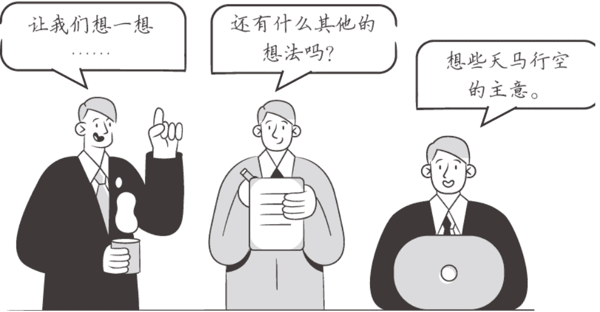

# AI提问进阶指南：解锁高效人机协作的核心密码

## 引言

步入AI时代，大模型已化身为个体与组织跃升效率、攻克难题的核心杠杆，正在深度重塑我们的工作、学习与生活范式。

然而，不少用户在实战中屡屡碰壁：AI输出往往答非所问、文不对题。要驾驭这股算力洪流，精准获取高质量答案，关键在于掌握**科学的提问方法论**。

提问绝非随口一问，它是一场深度思考与问题拆解的认知过程。惟有精通提问之道，方能将AI从“聊天机器人”进化为探索世界、解决问题的“超级副驾”。

本书首版自2023年面世广获好评，无数读者实证：书中方法能将繁琐流程自动化、将复杂难题模块化，助力个人能力跃迁与认知破圈，让AI真正化身效率神器。

技术迭代从未停歇。2025年初，DeepSeek凭借独创的“思维链交互模式”强势破圈，重构了传统对话逻辑——它不仅精准捕捉多模态指令深层关联，更擅长通过多轮博弈协助用户厘清真问题。面对新范式，我们必须进化认知，动态调整提问策略，方能保持高效。

基于此，第二版全面重构：按认知阶梯由浅入深重组知识体系；深度融合DeepSeek实战案例；引入“反面教材+标准范式”对比拆解，让优劣差距一目了然。

愿每位读者皆能习得提问真谛，让AI化作工作、学习、生活中的最强外挂。

---

## 核心模块：掌握提示词工程，人人可构建专属AI助理

> “未来五年，人人将拥有懂需求、会跨应用、通自然语言的AI私人助理。”
> —— 穆斯塔法·苏莱曼

从学生党查资料理思路，到企业优化SOP提效能，再到营销老炮秒出爆款文案，AI已超越工具属性，成为决策、创作、沟通的核心合伙人。**那么，能否按自我画像定制专属AI助理？答案是肯定的。**

无论目标是提效、出创意还是解生活难题，**提示词质量直接决定AI能力上限**。精妙的Prompt设计，是激发模型最大潜能的钥匙。

### 一、 认知本质：何为提示词

在大模型交互语境下，**提示词** 扮演“导航仪”角色。提问是主动索取的动作，而提示词则是为该动作注入的关键约束与语境——即：**用模型可理解的语法逻辑，将模糊意图显性化、结构化，从而精准锚定输出预期。**

**案例拆解**：
*   **原始提问**：“这部电影咋样？”
*   **加持提示词后**：“请从剧情张力、演技张力、视听美学三个维度，为《流浪地球2》撰写300字深度影评。”
*   **差异解析**：前者是模糊指令，后者通过“维度限定+对象锁定+字数约束”三重提示词，将概率分布压缩至高质量区间。

### 二、 为什么要精进Prompt设计能力

提示词质量与模型理解深度、输出质量呈强正相关。精进此项技能，四大收益立竿见影：

| 核心价值 | 实战映射 |
| :--- | :--- |
| **通讯零损耗** | 如点单般精准，一次触达消除多轮确认成本 |
| **消解歧义陷阱** | “如何学编程”→“Python零基础避坑路线”，直击靶心资源 |
| **溢出创造力上限** | “写首诗”→“以‘秋暮落叶’为意象，七言律诗咏时光流转”，激发美感共振 |
| **实现私人定制** | 通过风格向量注入，让输出自带“人设标签” |

**底层逻辑**：Prompt好坏 = 模型理解力 × 输出有效性。这是一个杠杆撬动杠杆的放大器。

### 三、 设计高阶Prompt的五大黄金法则

实战验证，遵循以下五步法，可显著跃升回复质量：

#### 1. 目标锚定：定义“完成”的标准
*   **反面**：“写篇文章。”（模糊边界）
*   **正面**：“撰写2000字深度长文，主题聚焦‘绿色能源转型’，核心论证太阳能经济性优势与储能瓶颈，面向行业决策层。”

#### 2. 指令原子化：将模糊拆解为可执行算子
*   **反面**：“总结报告。”
*   **正面**：“提炼报告‘结论章’核心论点，聚焦数据建模推演过程，用3个Bullet Points输出，术语保留英文原文。”

#### 3. 任务链式化：复杂问题模块化、流水线化
*   **反面**：“出份年报。”
*   **正面**：
    *   Step 1：抽取2024核心财务三表关键指标（营收/净利/现金流）；
    *   Step 2：基于数据撰写财务分析，诊断结构性变化成因；
    *   Step 3：综合生成董事会致辞版摘要，语调稳健前瞻。

#### 4. 语境注入：以少样本对齐风格基因
*   **反面**：“写推广邮件。”
*   **正面**：“参考附件‘爆款种草邮件’的语气节奏与钩子结构，为新品智能床垫撰写EDM，主打‘深度睡眠’卖点。”

#### 5. 迭代博弈：把对话当成强化学习循环
*   **心法**：不存在完美一次成型的Prompt。
*   **动作**：观察输出偏差 → 诊断指令盲区 → 微调约束条件 → 复盘固化模板。
*   **进化案例**：“解释文本” → “深度解构文本语义层，重点拆解3个核心术语本体论含义，并各给1个跨域应用场景。”

---

### 四、 万能框架：一张模板通吃80%结构化任务

将上述策略固化为**ROCKS框架**（角色-目标-上下文-技能-标准），即插即用：

```markdown
# 任务指令：请按以下框架输出[交付物类型]

## 角色
[赋予专业人设，如：资深增长黑客 / 普林斯顿写作导师]

## 目标
[核心KPI + 辅助指标，如：产出可落地的裂变方案 / 修改后版本通过率>90%]

## 上下文
[业务背景/痛点/已知资源/限制条件，喂给模型“知情权”]

## 技能
[调用何种专业方法论/工具链/思维模型，如：AARRR模型 / 认知负荷理论]

## 标准
[交付格式/字数/禁词/合规红线/验收标准]
```

**实战演示——撰写市场分析报告**：
*   **角色**：麦肯锡级市场战略顾问
*   **目标**：输出可决策的蓝海切入报告，含3大策略建议+风险对冲方案
*   **上下文**：拟切入银发经济智能穿戴赛道，已有竞品调研数据200份，预算500万
*   **技能**：波特五力模型 / JTBD任务理论 / TAM/SAM/SOM测算
*   **标准**：PDF格式，15页以内，图表占比40%，结论先行，术语附注

---

## 实战篇·上：新手必修的四大提问范式

### 范式一、场景化对话法：注入语境，让交互有温度、有分寸

**痛点复盘**：领导发“辛苦了”，你回“噢噢好”，显得情商低、不懂职场潜规则。

**错误示范**：
> **Prompt**：“领导说辛苦了怎么回？”
> **输出**：堆砌10个通用模板，无一可用——缺失**场景、关系、意图**三要素。

**标准范式**：向模型喂入“情报包”：
> **Prompt**：“场景：团队通宵攻关上线核心功能，领导凌晨发‘辛苦了’。人设：技术TL，与领导汇报制，平时克制务实。目标：回复需体现‘归因团队+传递结果+留存接力’三层语义，30字内，微信语气。”

**DeepSeek-R1 实战输出**：
> “收到！核心链路零故障上线，全靠兄弟们死磕细节。今晚盯稳指标，有情况随时同步。”
> *解析：确认结果→归功团队→交代后续动作，分寸拿捏到位。*

**万能信息包清单**（按需取用）：
*   对话议题 | 关系拓扑 | 物理/虚拟场景 | 战略意图 | 历史上下文 | 语气基调 | 长度约束

**场景迁移训练**：
| 任务 | 普通提问 | 场景化重构 |
| :--- | :--- | :--- |
| **谢同事** | “怎么感谢帮忙的同事？” | “同事通宵帮我修复P0级Bug，想发条语音表达‘救命之恩’并埋下‘下次请吃大餐’的伏笔，语气真挚不矫情。” |
| **回客户** | “客户夸我怎么回？” | “大客户夸交付超预期并承诺转介绍，回复需：接住好感+锁定转介绍动作+传递‘伙伴而非甲乙方’定位。” |

**进阶应用场**：
1.  **小说写实对话** — 输入人设卡+冲突点，生成带潜台词、动作细节、伏笔埋设的戏剧性段落（见书中“猎人与野兔”案例，张力拉满）。
2.  **客服知识库批产** — 投喂业务FAQ，一键产出分场景、分层级、带话术SOP的《标准应答手册》（含库存/物流/会员/活动全链路）。

> ⚠️ **避坑指南**：
> 1. DeepSeek情感计算已达拟人级，但**数据类、合规类、决策类输出仍需人工兜底复核**。
> 2. 长上下文对话建议定期“喂回摘要”，防止模型遗忘早期约束。

---

### 范式二、关键词定向法：用约束倒逼精准，拒绝“废话文学”

**核心洞察**：大模型本质是概率预测，**关键词即高权重Token锚点**，能强行拉高目标语义区概率密度。

**职场实战对标**：
> **场景**：领导交付新项目，你零经验。
> **** ❌ **低维提问**：“领导，这项目咋整？” → 预判：领导判定你无掌控力，收回授权。
> **** ✅ **关键词锚定**：“领导，项目启动期，建议先跑‘用户访谈+竞品拆解’验证需求假设，还是先拉通财务做‘ROI测算+资源锁定’？求拍板优先级。” → 预判：领导感知你有框架、懂节奏、敢担责，追加人力支持。

**关键词三大作用机制**：
1.  **检索激活** — 唤醒模型参数空间中特定领域知识簇；
2.  **约束收敛** — 裁剪无关语义分支，压缩幻觉生成空间；
3.  **结构暗示** — 隐含“分类/排序/对比/因果”等思维算子。

**训练题**：
*   任务：让AI生成“小红书爆款标题”
*   普通版：“给我几个标题” → 平庸堆砌
*   关键词版：“生成10个标题，**必须含**‘避坑/省钱/懒人/实测’等高CTR词，**结构**为‘数字+痛点+反转’，**禁用**感叹号，**风格**像闺蜜深夜吐槽” → 可直接发布

---


# 三招驯服大模型：核心词定向、结构化下单、人设赋能

跟大模型对话总觉得“鸡同鸭讲”，答案总差那么一口气？问题不在模型笨，而在你不会“派活儿”。把模型当成个极其听话但缺乏主见的实习生，**核心词导航、结构化指令、专家人设**三板斧练熟，它就是你最得力的“数字员工”。

---

### 一、 核心词定向：给模型装个“GPS”

**底层逻辑**：核心词就是坐标。词找得准，模型跑偏的概率就低。合格核心词三要素：**指向明确、颗粒度细、无歧义**。

**实操三步法：**

1.  **锁定核心指标**  
    别问“网站怎么留人”，要盯着“留存率”问。“电商站点提升用户留存率的实战打法”这类提法，靶心瞬间显现。

2.  **行话必须上**  
    做SEO别问“怎么上排名”，直接甩“长尾词布局优化网页排名策略”。专业术语一出，模型自动调用高权重知识库，回复深度肉眼可见。

3.  **场景当背景板**  
    开高端餐饮的别泛问“咋提升满意度”，得问：“高客单价餐厅靠定制化服务增强食客满意度的实操招数”。把环境铺垫好，对策自然落地。

**对照组看懂区别：**

| 场景 | 发散式提问（避坑版） | 核心词锁定版（推荐） |
| :--- | :--- | :--- |
| **PPT优化** | 咋让PPT好看？ | 版式视觉美感怎么强化？ |
| **职场进阶** | 第一桶金咋赚？ | 新媒体运营三年跨月入万门槛路径？ |
| **创作诗词** | 写首春天的诗。 | 仿王维笔触作春景诗。 |
| **AI绘图** | 画朵向日葵。 | 梵高风格复刻向日葵油画。 |

**避坑指南：**
*   词越虚，模型越晕；词越实，答案越稳。
*   自己得懂行，梳理不出核心词，模型也接不住。

---

### 二、 结构化下单：像管实习生一样“管”模型

跟模型对话＝给实习生派任务。**靠谱领导派活：背景交代清、目标定得准、受众圈得细、标准列得明、截止点卡得死。** 这就是结构化指令的精髓——用框架把答案的边界框死。

**写指令守四条铁律：**
1.  **有骨架**：套5W模型（因何、做啥、对谁、何时、何地），逻辑自己顺起来了。
2.  **重点列清单**：指令长就换行，逐条罗列，别堆成一坨大段落。
3.  **说人话**：短句顶长句，废话全删。
4.  **量化标准**：“别写太长”改“限300字”；“受众广”改“25-35岁职场白领”。

**5W模型速查表：**

| 维度 | 核心追问 |
| :--- | :--- |
| **Why** | 干这事儿的初衷/目标啥？ |
| **What** | 最终交付物/具体任务啥？ |
| **Who** | 服务谁？针对谁？ |
| **When** | 截止节点/时间线？ |
| **Where** | 落地渠道/执行场景？ |

****

**普通领导** 我们最近要和×××品牌合作，需要出一个宣传方案，你来做一下，后天给我。

**优秀领导** 最近×××品牌要与我们合作。马上到五一劳动节，他们想让我们围绕这个节日和新产品，出一个节日宣传方案，以提高这款新产品的销量。

这次活动主要面向25~35岁的女性人群，活动方案要求包含节日三天的每日宣传安排。方案用PPT呈现，不要超过10页。

****

周五下午6点前将方案给我。

优秀领导派的活儿之所以好落地，是因为信息全、要求透。实习生一眼就能懂任务全貌，不用反反复复确认细节。对模型同理：指令越结构化、越量化，输出越贴心。

**实战演练：**

*   **营销策划案**  
    ❌ 模糊：帮七七牙刷写个中秋方案。  
    ✅ 结构化：**(背景)**中秋借势推新品；**(渠道)**线上自营店；**(交付)**含3天主题+执行细节；**(受众)**25-35岁白领，卖点：便携/换头易/充一次用月；**(节点)**8月30日18:00前交件。

*   **朋友圈种草**  
    ❌ 模糊：推瓶波尔多红酒。  
    ✅ 结构化：套**“发现-体验-回味”**三段式，写高转化种草文案。

*   **短视频脚本**  
    ❌ 模糊：家庭教育脚本。  
    ✅ 结构化：主题**“激发孩子自驱力”**，受众**3-15岁孩子家长**，痛点：吼叫无效，时长**60秒**。

---

#### 进阶框架：SCQA拆解复杂任务 / 黄金三点出教案

**职场做规划，用SCQA理清思路：**
> **S**ituation（现状）：主推999元课，存量1万老客。  
> **C**omplication（冲突）：二季度要冲500万业绩，单靠老客不够。  
> **Q**uestion（核心问）：任务咋拆解？行动方案咋落地？  
> **A**nswer（期待答）：给几套备选方案+参考案例。

**培训出大纲，用黄金三点（是什么-为什么-怎么做）：**
> **人设**：资深培训讲师。  
> **主题**：《直播带货》2天企业内训。  
> **目的**：懂价值、会操作。  
> **要求**：按时间轴细化到二级标题，嵌入实操环节。  
> *模型直接吐出带时间轴、模块、实操的完整大纲，微调即用。*

**结构化指令心法：**
1.  指令越细，输出越准。
2.  多攒万能框架（5W、SCQA、黄金三点），遇事套用。
3.  不会写框架？先让模型给框架，再让模型填内容。

---

### 三、 专家人设赋能：一键调取“高权重知识库”

找人问诊，找专家不找小白。模型自带海量数据，**指定人设＝精准调用该领域高权重数据切片**。

**万能赋能句式：**
> “你是**资深营养师**，请设计素食食谱。”
> “你是**顶级新媒体主编**，给10个AI应用选题。”
> “请**扮演大一新生**，听我讲‘拉斯韦尔模式’，说说你会卡在哪。”
> “现在**切换身份为传播学教授**，针对上面难点给解法。”

**实战双步走——教学备课实录：**

**Step 1：让模型演“难搞的学生”，找盲区。**  
抛出课程内容，模型以学生视角吐槽：概念太抽象、模型局限性难懂、案例拆解不会、跨学科知识融不进去……

**Step 2：让模型演“资深教授”，破难题。**  
针对Step1的痛点，模型给出教学策略：用生活化案例拆解5W、对比新模型讲局限、设计分组实战演练、推荐经典延伸阅读……

**人设赋能黄金法则：**
*   **人设越垂直越硬核**：“10年一线带货运营”强于“运营专家”。
*   **复杂任务玩“多角色接力”**：先让专家出方案，再让挑剔甲方提意见，最后让执行落地写SOP。

---

### 结语

提示词不是玄学，是**管理沟通**的翻版。
*   **核心词**定坐标，解决“问啥”的精准度；
*   **结构化指令**画边框，解决“咋答”的可控性；
*   **专家人设**调库存，解决“答得好不好”的专业度。

下次开对话前，先自查三问：我给导航了吗？我派活清楚了吗？我找对专家了吗？  
把这三招练成肌肉记忆，大模型就是你最懂业务的“数字员工”。

# 提示词进阶指南：三大核心技巧让AI秒懂你的需求

还在因为AI“听不懂人话”而头疼？掌握**角色扮演**、**示例引导**与**深度思考**这三大核心技巧，让大模型瞬间变身你的专属专家团队。

---

## 第一招：角色扮演法——给AI发张“工牌”

直接下指令往往得到千篇一律的标准答案。若赋予AI具体身份（专家、人设、特定视角），配合任务背景，输出质量将质变。

### 核心公式：**明确身份 + 任务目标 + 互动规则**

### 实战场景速览

| 场景 | 角色设定指令 | 实战效果 |
| :--- | :--- | :--- |
| **学术科普** | “你是传播学教授，用拉斯韦尔‘5W模型’拆解一场新闻发布会” | 抽象理论秒变可落地案例，逐层拆解“谁/说什么/通过什么渠道/对谁/产生什么效果” |
| **商务博弈** | “你是资深谈判专家，目标达成合作。我方顾虑：价格高、性价比低” | 承认成本顾虑→用长期价值反制（耐用省维修）→让步换筹码（申请批量价/定制合作） |
| **情绪疏导** | “你是心理咨询师，保密聆听。我因业绩焦虑失眠、恐惧裁员” | 共情确认→拆解具象压力源→给出“拆解目标/向上沟通/寻求支持/自我关怀/心态重构/专业求助”七步走方案 |
| **沉浸创作** | “三国背景，我是貂蝉，你是吕布。开启对话” | 即时入戏：语气豪迈护短，兼顾军事部署与情感安抚，生成可直接入库的剧情对白 |

> **避坑提示**
> 1. **组合拳更强**：角色设定 + 结构化指令 = 专业度拉满。
> 2. **认清边界**：AI知识库有盲区，垂直领域深度问诊仍需人工兜底。

---

## 第二招：示例引导法——别光说要求，甩个“参考答案”

“你要的不是这种感觉，我要五彩斑斓的黑。”——沟通崩塌的根源，是**模糊指令缺乏锚点**。给AI喂“标杆案例”，让它逆向推导风格逻辑，再按图索骥。

### 核心逻辑：**提供高质量样本 → 要求总结共性 → 按共性生成新内容**

### 三大高频落地玩法

#### 1. 爆款标题复刻机（小红书/公众号）
- ❌ 普通指令：“写5个推荐眼霜的标题”
- ✅ 示例式指令：“喂给你3个爆款标题（如‘18款眼霜大合集！针对不同年龄怎么选？’），先总结套路（痛点前置/数字具象/结果导向），再按套路出5个新题”

#### 2. 口播脚本结构克隆
- ❌ 普通指令：“写个‘防止孩子讨好型人格’的脚本”
- ✅ 示例式指令：“贴一个百万赞脚本（钩子提问→数据背书→现象溯源→互动收尾），学会这套节奏，换主题重写”

#### 3. 职场文书/回复模板化
- **商业计划书**：先要标准目录结构（封面→执行摘要→公司/产品/市场/运营/财务/风控→附录），再定制“轻食餐饮零售版”大纲，连食品证照、供应链细节都帮你补全。
- **助教批改回复**：喂一段“高情商回复话术”做风向标，新学员档案一键生成专属暖心反馈。

#### 4. 视觉风格以图传图
上传参考图或选风格模型（如Vega AI），直接复刻构图、调色、材质，告别“盲盒式”出图。

> **关键动作清单**
> - 样本要**典型、相关、去噪**；
> - 显性要求AI**“先总结特点，再创作”**，验证其真理解了；
> - 核心约束（字数、禁词、格式）指令里要**再强调一遍**。

---

## 第三招：深度思考引导法——别问结论，问“思考路径”

“集思广益，随便说说”式提问，AI只会吐平铺直叙的百科全书。加上**“让我们一步步思考……”**等触发词，强制开启**System 2 慢思考模式**，逼出深度洞见。

### 触发词对照表

| 普通提问（浅层检索） | 引导式提问（深度推理） |
| :--- | :--- |
| “AI影响人类进化速度吗？” | “**让我们讨论一下**，AI影响人类进化速度吗？**请一步步推演**。” |
| “怎么提高效率？” | “**让我们思考一下**，哪些隐性因素拖垮效率？**根因拆解后**，给出对应解法。” |
| “这决策对吗？” | “**从长期主义/用户体验/资源杠杆**三维度，**逐条评判**我的决策。” |

### 进阶玩法：模拟“专家智囊团”
指令模版：*“我的智囊团有乔布斯（产品极简主义）、巴菲特（价值投资/护城河）、彼得·德鲁克（管理效能）。请三位针对‘我要把传统制造厂转型做高端品牌’这决策，分别给出评判与建议。”*

**输出差异对比**：
- **乔布斯视角**：砍产品线→极致体验→品牌故事先行→小步快跑试错
- **巴菲特视角**：算护城河→现金流能否支撑转型期→品牌溢价能力验证
- **德鲁克视角**：组织架构匹配度→关键岗位人才画像→KPI体系重构

> **黄金提问套路**
> 1. **必用开放式句式**：“为什么/如何/请描述/假设……会怎样”
> 2. **追问不设限**：“不管多疯狂再给5个方案”、“若资源翻倍/归零怎么选”
> 3. **强制多视角**：“用批判性思维反驳你刚才的观点”

---

## 速查卡：三招组合拳打法

| 任务类型 | 第一步：定角色 | 第二步：喂示例 | 第三步：引思考 |
| :--- | :--- | :--- | :--- |
| **写爆款文案** | 资深新媒体主编 | 3条同赛道爆款标题/开头 | “拆解其底层心理触发点，再按此逻辑重写” |
| **做战略复盘** | 战略咨询合伙人 | 头部竞品复盘框架 | “用波特五力/价值链模型，逐层诊断我司痛点” |
| **设计方案** | 资深设计总监 | 3张风格参考图+设计说明 | “推演用户使用全流程，找出3个体验断点并优化” |
| **学新知识** | 领域顶尖教授 | 经典教材目录/思维导图 | “费曼技法：用大白话给外行讲透这个概念” |

---

## 结语

提示词不是玄学，是**结构化沟通**。
- **角色扮演**设定上下文边界；
- **示例引导**对齐隐性标准；
- **思考引导**激活深度推理。

下次对话前，深呼吸，按这套**“定身份、给靶子、逼推理”**三步走，收获的将不再是“正确的废话”，而是**能直接上手的专业级成果**。




# 掌握这四大提问范式，让AI真正成为你的得力助手

面对同一个问题，为什么有人能从AI那里获得精准洞见，而你得到的却是泛泛之谈？关键往往不在于模型有多强，而在于你会不会“提问”。以下总结四种高阶提问范式，助你从“用AI”进阶为“驭AI”。

---

## 一、 角色扮演法：召唤“专家团”为你把脉

单一视角易陷入盲区，不妨让AI轮流扮演不同领域的权威，为同一议题建立立体认知。

### 实战复盘：在线教育公司如何破局AI浪潮
假设你掌舵一家在线教育企业，面对AI冲击迷茫无措。我们邀请三位“虚拟顾问”联合会诊：

**1. 产品美学大师视角（以乔布斯为原型）**
*   **核心主张**：极致简洁、颠覆性创新、惊艳体验。
*   **行动指南**：
    *   **刀法向内**：用AI重构交互界面，砍掉冗余动线，让学习像呼吸一样自然。
    *   **造“反”常规**：孵化沉浸式课堂、虚拟实训场等“降维打击”功能，重新定义教育形态。
    *   **讲好故事**：借势社交媒体与意见领袖，打造“有温度、有锋芒”的品牌标识。

**2. 战略操盘手视角**
*   **核心主张**：全局统筹、数据支撑、风险可控、资源匹配。
*   **行动指南**：
    *   **拆解落地**：制定分阶段路线图，量化指标、责任人、截止日期。
    *   **对齐北极星**：每项动作必扣问：这是否服务于公司长期战略？
    *   **备好预案**：建立风险雷达，为关键不确定性预设缓冲方案。
    *   **织密网络**：打通内外部协作链条，形成合力推进执行。

**3. 创意与人文守望者视角**
*   **核心主张**：技术向善、情感连接、社会责任。
*   **行动指南**：
    *   拒绝“工具理性”裹挟，守护教育中不可替代的人性光辉——共情、启发、陪伴。
    *   关注弱势群体获益，防止数字鸿沟扩大。
    *   将AI定位为“放大器”而非“替代者”，放大教师的创造力与温度。

> **综合洞察**：破局之道在于**三位一体**——以美学重塑体验，以战略锚定方向，以人文守住底色。

---

## 二、 苏格拉底式提问：让AI做你的“思维陪跑者”

别让AI直接喂答案，要让它像苏格拉底那样，通过层层追问引导你自我觉醒。这招在职业规划、深度决策等“无标准答案”场景威力巨大。

### 实战演示：迷茫毕业生的破茧之旅
**设定指令**：“你是一位苏格拉底式导师，仅通过提问引导我思考，不给结论，问题随我认知层次动态调整。”

**对话实录节选**：
> **我**：“我想知道适合干什么。”
> **AI**：“好问题。先从三个维度自省：兴趣（什么让你忘我）、技能（什么你手到擒来）、价值观（什么你视若珍宝）。能举几个具体例子吗？”
> **我**：“爱钻研软件新玩法。”
> **AI**：“这是稀缺特质。接着问：你编程水平几何？愿不愿深耕？哪些岗位匹配？哪些行业渴望这技能？怎么低成本试错？怎么持续进化？”
> **我**：“曾用PS设计海报赚了300块。”
> **AI**：“实战变现！说明你兼具设计感与商业嗅觉。顺藤摸瓜：平面设计、广告传媒、自由职业……哪条路让你心跳加速？技能树怎么加点？怎么建作品集护城河？”

### 该模式的六大“追问利器”
| 提问类型 | 核心意图 | 话术模板 |
| :--- | :--- | :--- |
| **澄清** | 定义边界、消除歧义 | “能举个具体例子说明么？” |
| **检验假设** | 验证前提真实性 | “凭什么确信这前提成立？” |
| **理性分析** | 穿透现象看本质 | “背后逻辑链条是啥？怎么推导出来的？” |
| **检验观点** | 权衡利弊、防一厢情愿 | “这方案的致命伤和杀手锏分别是什么？” |
| **开阔思路** | 跳出框架、多视角审视 | “换个角色/立场，会怎么看这事？” |
| **思考后果** | 推演长尾影响 | “若按这假设行动，三年后会怎样？” |

> **避坑指南**：
> 1. 指定专家角色时，**必须选知名人物**（如马斯克、芒格、德鲁克），否则模型无法模拟其思维模型。
> 2. 专家人数不限，视问题复杂度增减，视角越正交、认知越立体。

---

## 三、 发散提问：强行打开思维“天窗”

陷入死胡同时，别问“怎么办”，要问“还能怎样”。发散提问的本质是**用开放性、非线性问题炸裂固有认知框架**。

### 优质发散提问的三大基因
1.  **开放性**：不设限、不预设答案。  
    ❌ “如何优化现有产品？” → ✅ “若无任何约束，你会如何从零设计一个颠覆用户痛点的产品？”
2.  **引导性**：给思考装上“导航仪”。  
    ❌ “怎么提升满意度？” → ✅ “请从服务、产品、售后三维度，各列3个极致举措。”
3.  **探索性**：直击冰山底部。  
    ❌ “为何员工满意度降？” → ✅ “除薪资福利外，哪些隐性因素在侵蚀组织活力？”

### 经典改写对照
| 场景 | 常规提问（收敛） | 发散提问（发散） |
| :--- | :--- | :--- |
| **技术落地** | VR能在哪些领域创造价值？ | **除游戏外**，VR还能重塑哪些行业的价值链？ |
| **模式复制** | 这模式能不能照搬别的行业？ | 若将此模式移植到【医疗/制造/农业】，会引发什么化学反应？ |

### 两大高频应用场
**场景A：年会创意策划（需10+互动节目）**
*   **指令关键词**：互动性强、全员参与、形式不限。
*   **AI产出亮点**：团队才艺秀PK、年度视频答题、模仿秀大赛、接力式“你画我猜”、即兴喜剧共创、歌舞串烧接力、年度关键词猜谜、时光信箱许愿、“谁是卧底”推理局、多档次抽奖狂欢……覆盖表演、游戏、情感、激励四大维度。

**场景B：PPT培训师备课（设计发散式提问库）**
*   **指令关键词**：开放性强、无标准答案、引导深度思考。
*   **AI产出亮点**：
    *   *风格篇*：“给科技发布会设计PPT，你能想到哪些‘反套路’的视觉语言？” / “儿童绘本风PPT，如何用版式讲故事？”
    *   *排版篇*：“满屏干货怎么排既清晰又高级？” / “单张神图如何成全页面视觉焦点？”
    *   *图表篇*：引导学员挖掘数据背后的叙事张力。

> **实战提醒**：
> 1. AI脑洞可能天马行空，**人工筛选+落地改造**是必修课。
> 2. 若首轮不满意，**追喂背景细节、追加约束条件、要求多轮迭代**，直到惊艳。

---

## 四、 摘要提问：把“长文本”变“结构化洞见”

信息过载时代，**“不读全文，获核心”**是生存技能。摘要提问不是简单缩写，而是**定向萃取+结构化重组**。

### 高质量摘要提问的“黄金四原则”
1.  **目的先行**：“我要拿这篇文献做竞品分析/写周报/备会议纪要。”
2.  **素材清晰**：短文直接喂，长文给链接/上传附件/标注章节页码。
3.  **规格量化**：“200字极简版”还是“分点深度版？只看结论还是要论据？”
4.  **结构化指令**：  
    `请根据【素材】，输出【字数】字的【维度】摘要，格式为【表格/要点/思维导图】。`

### 实战范式对照
| 场景 | 普通提问 | 摘要提问（专业版） |
| :--- | :--- | :--- |
| **读书复盘** | “概括《哈利·波特1》。” | “详细梳理《哈利·波特与魔法石》的**主线剧情节点、核心人物弧光、隐喻体系**，输出结构化大纲。” |
| **文献速读** | “精简这段AI定义。” | “从**定义、核心分支、关键技术、应用场景、争议伦理**五维度，提取下文重点，制成对照表。” |

### 两大职场高频落地战场
**战场1：知识库“瘦身”与“强筋”**
*   **痛点**：收藏夹堆成数字坟场，检索全靠缘分。
*   **解法**：批量喂给AI，指令：“围绕‘提升工作效率’主题，提炼可落地的**方法论+工具+底层逻辑**。”
*   **产出**：时间管理（番茄法/时间箱）、任务分级（四象限）、环境构建（物理/数字双隔离）、团队协作（同步/异步节奏）、技术杠杆（自动化/脚本/RPA）……条理分明，即存即用。

**战场2：杂乱需求“解码”成执行清单**
*   **痛点**：领导甩来一段语音/长文，KPI、客户吐槽、战略口号混杂，无从下手。
*   **解法**：指令“帮我把这段信息拆解为：**核心目标3个、关键动作5条、风险点2个、资源需求清单**。”
*   **实例（平面设计师接单）**：
    *   客户原话：“做张耳机海报，要有科技感、舒适度、年轻化，主色调别用蓝色，文案突出‘降噪深度’……”
    *   AI输出结构化需求单：
        | 维度 | 关键指标 | 设计转化建议 |
        | :--- | :--- | :--- |
        | **核心卖点** | 主动降噪深度达45dB | 主视觉用“声波被屏蔽”隐喻 |
        | **调性关键词** | 科技感、舒适、年轻、非蓝 | 配色：深空灰+荧光绿/暖珊瑚；字体：几何无衬线+手写标注 |
        | **必含元素** | 产品渲染图、降噪参数、Slogan | 留白构图，引导视线落点 |
        | **交付规格** | 竖版300dpi、源文件分层 | 预留LOGO/二维码位 |

---

## 结语：提问即思考，提问即领导力

这四大范式不是互斥的工具，而是可以组合的**认知操作系统**：
*   面对**战略抉择** → 启动**角色扮演**，多维会诊；
*   面对**自我迷茫/深度复盘** → 祭出**苏格拉底式**，层层拷问；
*   面对**创意枯竭/复杂难题** → 切换**发散模式**，炸裂边界；
*   面对**海量信息/模糊指令** → 部署**摘要引擎**，精准萃取。

**下一步行动**：打开对话框，选一个当下最棘手的问题，刻意练习其中一种范式。记住，**提问的质量，决定了AI输出的上限，更决定了你思维的深度。**

### 运动耳机海报：设计提案速览

**核心定位**：瞄准 20-35 岁热爱运动的年轻群体，主打“防汗防水、稳固不掉”的硬核卖点，Slogan 直击痛点——**无线自由，释放激情**。

**画面构想**：竖版 A3/A2 规格，适配小红书、微博等新媒体流量入口。画面聚焦赛场实拍感：主角佩戴耳机全神贯注冲刺，汗水飞溅、肌肉绷紧，传递“稳得住、跟得上”的真实体验。

**视觉风格关键词**：动态炫酷 × 高饱和科技感 × 快节奏冲击力

---

#### 1. 色彩策略：高对比、强视觉、即点即燃
- **主色调**：霓虹蓝紫渐变（自带科技基因，暗喻防水属性）+ 活力橙/荧光绿（运动多巴胺色）。
- **搭配逻辑**：深色底（黑/深蓝）做幕布，亮色前景强跳出，刷屏瞬间抓住眼球。

#### 2. 动态表达：把“激情”具象化
- **机位语言**：低角度仰拍，拉伸身形张力，强化力量感。
- **速度符号**：背景运动模糊（跑道拉丝、汗珠飞溅轨迹），耳机周身缠绕流体光带，隐喻“无线自由”的破界感。
- **高光时刻**：定格腾空跃起的 0.1 秒，耳机纹丝不动，背景色块呈爆炸式放射状扩散，视觉冲击力拉满。

---

### 复盘领导反馈：把“夸奖+建议”翻译成行动清单

> **背景**：领导肯定创意独特、客户好评，但点出三个短板——读懂需求不够透、个人审美越位项目目标、跨部门协作有欠缺；并期待持续学习、内部共创。

**下一阶段五大行动目标**：
1. **深度解需**：客户沟通前置挖掘真需求，少猜测、多确认，设计才不跑偏。
2. **审美归位**：个人风格服务于项目目标，A 包装案例复盘——好看不如好用、好卖。
3. **协作增效**：主动对齐产品、运营、销售诉求，把“满足客户期待”刻进流程节点。
4. **持续进化**：按季度规划培训/趋势复盘，建立灵感素材库，拒绝审美固化。
5. **内部共创**：发起月度设计复盘会/灵感分享局，个人成长带动团队上限。

---

## 9. 归纳提问：让 AI 帮你把杂乱信息“打包带走”

**核心逻辑**：不问“讲了啥”，而问“按维度给我结论”。像开周会不听流水账，只听“三部门重点、定版方案、我方待办”。

### 四步走方法论
| 步骤 | 动作 | 关键提示词 |
|------|------|------------|
| ① 定目标 | 明确范围/输出格式 | 总结、概括、综合、简述、大体上 |
| ② 提关键 | 从源头抓核心信息 | 具体、细节、详细说明、详细阐述 |
| ③ 做分类 | 按主题/时间/优先级切块 | 分为、分类、种类、属于哪一类 |
| ④ 比综合 | 找联系、挖缺口、出决策 | 对比、相似、相对而言、比如、例如 |

### 实战对比
- ❌ **弱提问**：“提点改善团队氛围的建议。” → 发散式废话。
- ✅ **强提问**：“从沟通机制、激励机制、团队文化、工作环境四维度，归纳具体措施及预期效果。” → 结构化交付。

### 两大落地场景
**场景 A：教学数据分析**  
输入成绩单 → 输出：学科均分排序、高低分段分布、显著进步/退步群体画像（如：三年级二班数学均分 +15 分，系弱基础突击成果）。

**场景 B：社区环保策略**  
输入调研反馈 → 输出：三大兴趣点（户外/亲子/回收）+ 三大创新活动（清洁植树/亲子工坊/回收日）+ 利弊可行性速判。

⚠️ **避坑指南**：框架要稳、颗粒度适中、拒绝无关信息混入。

---

## 10. 多项选择提问：把“选择题”交给 AI，自己只做“阅卷官”

**痛点**：开放式提问得一堆备选，决策瘫痪。  
**解法**：自带选项 + 背景约束，逼 AI 在有限集合里论证最优解。

### 标准化四步法
1. **锁问题**：如“新 AI 工具冷启动推广策略选哪个？”
2. **列选项**：A. 媒体广告 B. 内容营销 C. 短信营销 D. 线下活动（互斥、覆盖全）。
3. **造句式**：“在以下策略中，哪个最适用于初期推广？”
4. **补背景**：目标用户 25-40 岁极客、预算紧、核心指标品牌声量+种子用户。

**实战输出**：AI 直接锁定 **B. 内容营销**，并给出 5 条精准论据（精准触达、建立权威、高性价比、长尾效应、强互动）。

### 万能句式库
- “在以下选项中，哪个最符合 [目标]？”
- “基于 [背景]，你认为 A/B/C 哪个是最佳选择？”
- “若 [假设条件]，你会选哪个？”

### 三大高频应用
| 场景 | 玩法 | 效果 |
|------|------|------|
| **产品推荐** | 抛出 3 款旗舰机型，让 AI 结合“摄影强”需求论证首选 | 秒出结论：iPhone 15 Pro 胜在全焦段覆盖+ProRAW+4K60 视频规格 |
| **趋势研判** | 给 4 个赛道，问未来 5 年增速最快 | 秒判：可再生能源 > 传统零售/石油/造纸，附政策+资本双重逻辑 |
| **命题出题** | “出 10 道高考历史选择题+解析” | 批量产出标准化题目（如：秦制=郡县制，柏拉图弟子=亚里士多德） |

⚠️ **选项设计铁律**：强相关、可互斥、数量 3-5 个、描述零歧义。

---

## 11. 迭代式提问：像剥洋葱一样，层层逼近“标准答案”

**核心隐喻**：别指望一锤子买卖，把对话当“多轮诊断”。

### 反面教材 vs 正面范本
**场景**：客服排查“产品连不上网”。

- ❌ **单轮甩锅式**：“网线坏了吧？” → 客户懵/炸，零信息增量。
- ✅ **多轮漏斗式**：
  1. 共情 + 闭环确认：“已检查网络/路由器正常？”
  2. 追问现象：“连 Wi-Fi 报‘连接失败’无其他码？”
  3. 排查动作：“重启过？别的设备能上网？”
  4. 定性转交：“初判设置/固件问题，转技术组深究。”

**迭代本质**：每轮提问 = **基于上一轮答案的增量约束**，逐步收敛解空间，最终落在可执行动作上。

---

**结语**：  
好提问不是“问得全”，而是**“问得准”**。  
归纳——帮 AI 做结构化思考；  
多选——帮 AI 做决策化筛选；  
迭代——帮 AI 做深度推理收敛。  
掌握这三把锁，AI 就从“万金油助手”进化成“懂业务的专家副驾”。

# 掌握“迭代式提问”，让AI回答越来越懂你

在上一期提问实战中，我们看到客服通过层层追问，引导客户吐露更多细节，最终精准解决问题。这背后的核心逻辑，就是**迭代式提问**。

简单说，这是一个“提问—反馈—调整—再提问”的闭环过程。你可以把大模型想象成那位起初一头雾水的客户，而你是掌握主动权的客服。通过不断根据回复修正提问策略，最终把答案“养”成你想要的样子。

## 什么是迭代式提问？

它不是一蹴而就的单次指令，而是一系列环环相扣的问题链。核心特征有三点：
*   **循环互动**：根据上一个回答，动态决定下一个问题。
*   **逐步逼近**：从宏观框架慢慢聚焦到微观细节，一层层剥洋葱。
*   **连贯灵活**：问题之间有逻辑延续，但方向可随时随反馈微调。

目标只有一个：让双方（你和AI）对问题的理解同频共振，直击核心。

---

## 实操六步法：手把手教你搭建“问题链”

### 1. 起大纲：抛出宽泛问题
别上来就细节，先定调子。
> **话术**：“关于新品上市的推广节奏，你有什么初步框架？”

### 2. 接话茬：按反馈调整粒度
AI答了“分预热、官宣、长尾三期”，你立马跟进：
> **话术**：“预热期预算有限，主攻私域和KOC，具体怎么玩？”

### 3. 往深挖：层层细化执行动作
> **话术**：“KOC筛选标准是什么？内容产出SOP能不能给一份？”

### 4. 找盲区：主动探索未知领域
> **话术**：“竞品上个月搞了个‘盲盒互动’火了一把，我们要不要跟进？风险在哪？”

### 5. 留余地：用开放式问题逼出干货
少问“是不是”，多问“怎么看”。
> **话术**：“除了这三期动作，你觉得还有啥容易踩坑的细节？”

### 6. 对齐期：阶段性确认与总结
> **话术**：“目前方案覆盖了节奏、渠道、内容、风控，还漏啥？给个最终版清单。”

**循环往复**，直到答案拿来就能用。

---

## 实战演练：同一个需求，高下立判

### 场景一：做旅游攻略
| 常规提问（一次性要饭） | 迭代式提问（分步走） |
| :--- | :--- |
| “西双版纳怎么玩？” | **首轮**：“下周一出发，4天预算3k，必去高性价比景点？”<br>**次轮**：“定了雨林和野象谷，住宿推荐+机场转交通攻略。”<br>**三轮**：“特色美食避坑指南，人均百元级。”<br>**终轮**：“帮我排个行程表：Day1住酒店，Day2雨林，Day3野象谷，Day4傣族园，合理吗？” |

### 场景二：技术开发需求
*   **普通**：“帮我写个注册模块。”
*   **迭代**：“目标是提升注册转化，要自动填单+验证手机号，给个技术选型建议？” → “前端定React，后端Spring Boot，系统设计关键点+测试策略？” → “接口文档规范、异常码定义、压测指标细化一下。”

### 场景三：客服话术优化
*   **普通**：“客户投诉产品坏了，怎么回？”
*   **迭代**：“客户急炸了、语无伦次，先安抚+引导描述故障现象。” → “现象清楚了，引导排查根因话术给我。” → “根因找到，三个解决方案合成100字以内短信回复，要清晰不拖泥带水。”

### 场景四：文本深度解读
*   **普通**：“《登高》表达了啥情感？”
*   **迭代**：“核心情感是什么？” → “为啥会有这情感？（结合生平背景）” → “艺术手法怎么写出来的？（炼字/意象/结构）” → “同题材对比阅读，找两首共振的诗。”

### 场景五：工作计划制定
*   **普通**：“三个任务，帮我排计划。”
*   **迭代**：“三个任务背景是这样，计划从哪几维度拆？” → “按重要/紧急/工时/验收标准，出张甘特图。” → “加上‘进度跟踪’和‘复盘复盘’两列，再出一版。”

---

## 进阶案例库：把迭代用进真项目里

### 案例 A：自学 Python “从入门到放弃” → “极简上手路线”

**常规问法**：“零基础怎么学 Python？”  
**迭代链路**：
1.  **定目标**：“想做数据分析，不搞Web，路线怎么裁剪？”
2.  **分阶段**：“给我四阶段：基础语法→小练手→进阶语法→Pandas实战。”
3.  **找资源**：“别给我堆书单，推荐3个免费、能边学边练的平台/课程。”
4.  **排课表**：“每天只能挤1小时，给我张4周详细到‘第N天学啥、练啥、复盘啥’的表。”
5.  **避坑指南**：“自学最易卡在哪？给3条硬核建议。”

> **产出**：一份“4周入门、日更1小时、含资源链接、含避坑锦囊”的定制化执行表。

### 案例 B：AI 营销方案 “大而全的教科书” → “可落地的复盘单”

**常规问法**：“AI营销有哪些应用？”  
**迭代链路**：
1.  **全景扫描**：“列举主流品牌用AI提升转化的6大核心场景。”
2.  **标杆拆解**：“挑Netflix推荐系统，拆解它的数据源、模型迭代、A/B测试机制、业务指标提升链路。”
3.  **方法论沉淀**：“提炼成‘千人千面’的可复用4步法：多源融合→场景分层→实验驱动→全链路闭环。”
4.  **本地化迁移**：“我们是垂直电商，DAU 50万，照这个法子，首期MVP（最小可行性产品）怎么跑通？”

> **产出**：从“懂概念”到“能动刀”的项目启动文档。

---

## 避坑指南：三条红线别踩

1.  **反馈要“显性”**：别光说“好/不好”，要说“第3点偏理论，补个真实案例”“格式改成Markdown表格”。
2.  **上下文要“铺垫”**：每轮提问带上关键约束（角色、受众、字数、风格、禁忌），别让AI“失忆”。
3.  **约束要“留白”**：别一次加20个限制条件，分批次加，防止AI“过拟合”丢掉核心价值。

> **一句话心法**：把提示词当成“项目管理”，你是PM，AI是执行手，迭代式提问就是你的“敏捷开发流程”。

---

# 12. 约束提问：给AI套上“紧箍咒”，产出精准交付

当你脑子里已经有成品长相——固定模板、特定风格、硬性指标——**约束提问**就是最高效的捷径。核心逻辑：**在明确边界内，强制对齐。**

## 约束提问三要素

| 要素 | 说明 | 实操话术示例 |
| :--- | :--- | :--- |
| **目标锚定** | 任务是什么，验收标准是什么 | “按《周报模板》生成本周工作复盘，必含：核心数据/阻塞项/下周Top3” |
| **硬性约束** | 格式、字数、结构、风格、禁词 | “用‘不仅…而且…’句式改写；全文≤200字；禁用‘赋能/抓手/赋能’等大词” |
| **参考基准** | 给范例、给模板、给风格说明 | “仿照这篇《爆款小红书文案》（贴链接/全文）的语气节奏，重写一遍” |

---

## 实战对比：一眼看懂“约束”的威力

### 场景一：文案改写
*   **常规**：“帮我润色这段话：系统更新提升稳定性、减少故障。”
*   **约束**：“**改成‘老司机吐槽风**’，140字内，带3个梗，结尾留悬念钩子引评论。”

### 场景二：公文写作
*   **常规**：“写个国庆放假通知。”
*   **约束**：“**严按下框架输出**，语言‘简明暖心’：
    1. 标题：2025年国庆放假通知
    2. 开头：家国同庆+过渡
    3. 时间：10.1-10.8（含调班）
    4. 注意事项：值班/安保/节前检查
    5. 结尾：祝福全体同仁及家人
    6. 落款：日期/发文部门”

### 场景三：项目甘特图
*   **常规**：“三天搞定市场调研报告，咋安排？”
*   **约束**：“**输出Markdown表格**，含列：日期/时段/任务/产出物/责任人/风险提示。第1天侧重‘目标拆解+资料+问卷’，第2天‘数据清洗+建模+初稿’，第3天‘定稿+汇报PPT+复盘’。备注：单日≤10h，预留1h缓冲。”

### 场景四：文艺创作
*   **常规**：“写个古风悬疑故事。”
*   **约束**：“**背景：北宋东京汴梁**；**核心三要素**：大相国寺/雨夜/蓑衣客；**结构**：环形叙事（结尾呼应开头）；**风格**：《大宋提刑官》画面感+《聊斋》留白感；**字数**：1500字左右。”

---

## 进阶案例：约束落地的两个硬仗

### 实战一：项目管理——三天交付市场调研报告
**约束指令**：“角色：资深策略顾问。任务：独自3天产出《新消费品牌出海东南亚市场机会报告》。约束：
1. 结构固定：宏观环境/赛道机会/竞品矩阵/用户画像/入场建议/风险提示。
2. 数据源：仅引用World Bank/Statista/各国统计局/上市公司年报，标注出处。
3. 产出：正文8000字+执行摘要1页PPT+原始数据清洗日志。
4. 时间盒：D1上午框架+数据源，下午爬虫/下载；D2全天建模分析；D3上午写报告，下午美化PPT+复盘。”

> **AI产出**：一份带甘特图、数据溯源、风险提示的“可直接汇报给VP”的交付包。

### 实战二：品牌文案——小红书爆款笔记批量复刻
**约束指令**：“学习账号@XXX 的‘种草笔记结构’（附3篇爆款全文）。任务：为我家新品‘防脱发洗发水’产出5篇备选笔记。约束：
1. 结构对标：钩子标题→痛点共情→成分硬核→真实测评图→避坑指南→评论区引导。
2. 话术库：禁用‘强烈推荐/宝藏/绝绝子’；必用‘成分党/空瓶记/复购N瓶’。
3. 合规红线：无‘治愈/生发/医疗级’表述；风格：理性种草、闺蜜夜聊感。
4. 输出格式：标题5选/正文/配图建议/标签/首评话术。”

> **AI产出**：5篇风格高度统一、合规安全、可直接排版发布的种草稿。

---

## 两条黄金法则

1.  **“风格确认”前置**：先问“你懂‘小红书种草风’吗？给我写3个典型开头看看。”确认懂了，再下约束单。不懂，先喂素材让它学。
2.  **“约束强度”动态调**：发现AI因限制太死而“憋不出大招”（如字数太少导致逻辑断层），立刻松绑——“字数上限放宽到300，但结构不能变”。

> **核心心法**：约束不是锁死创造力，而是**把创造力关在“正确”的赛道里跑**。

---

# 13. 对立提问：做AI的“红队教练”，逼出最优解

> **痛点场景**：下属信誓旦旦甩出一份“完美推广方案”，全是优点、零风险、预算刚好、上线必火。你直觉有坑，但直说“他会炸毛、死磕、甚至编数据圆场”。

**对立提问**，不是针对人，而是**针对“方案的盲区”发问**。核心是**换位思维+极限施压**，逼AI（或下属）自己把坑填平。

---

## 为什么常规追问会翻车？

| 你问 | 对方脑内戏 | 结果 |
| :--- | :--- | :--- |
| “这方案确定可行吗？” | “领导不信我？我得证明我多牛。” | 夸大收益、隐瞒风险、编假数据 |
| “有没有风险？” | “废话肯定有，但我不说。” | 列举些“无伤大雅”的伪风险敷衍 |

---

## 对立提问四大战术模板（可直接套用）

### 战术一：魔鬼代言人——强制辩证
> **话术**：“请站在**最严厉的竞对/最挑剔的用户/最抠门的CFO**视角，列出这份方案**致命的3个漏洞**，并给出反驳预案。”
*   **效果**：把“自我辩护”变成“压力测试”，倒逼补全防御体系。

### 战术二：极限压力测——设定边界条件
> **话术**：“假设**预算砍半/核心开发离职/上线日遭遇重大舆情/政策突变**，这套方案**哪个环节先崩？Plan B/C/D 分别是什么？**”
*   **效果**：从“阳光大道”拉到“至暗时刻”，检验方案弹性。

### 战术三：预演复盘法——倒推关键路径
> **话术**：“我们要在**Q3末达成GMV 5000万**。请**倒推**到今天，必须在**每周五**前达成什么里程碑？**哪一周最可能延期？早预警指标是什么？**”
*   **效果**：把“愿景”拆成“可执行、可监控、可问责”的关键节点。

### 战术四：多视角裁决会——模拟利益相关方审议
> **话术**：“组织一场**‘方案评审会’**，角色：**法务/财务/运营/技术/客服/大客户销售**。每人提**1个尖锐异议**，给**修正建议**。最后输出‘会议纪要版’优化方案。”
*   **效果**：一键模拟跨部门扯皮，提前消灭落地阻力。

---

## 实战演示：从“小李的完美方案”到“经得住推敲的作战地图”

**背景**：小李提交《双11大促私域裂变方案》，预测带来10万新增用户，ROI 1:5。

### 第一轮：魔鬼代言人
> **你**：“站在**风控视角**，这套‘裂变海报+群发红包’链路，**最可能触发微信哪条红线？**一旦封号/限流，兜底方案是什么？”
> **AI/小李**补全：风控规则解读、备用域名/小程序路径、私域沉淀SOP。

### 第二轮：极限压力测
> **你**：“**预算突然砍30%**，KOL费出不去了，**只能靠存量用户自发传播**，模型怎么跑？种子用户激励成本怎么压？预估用户量下修多少？”
> **AI/小李**补全：低成本玩法包、种子用户分层激励模型、下修版业绩承诺。

### 第三轮：预演复盘法
> **你**：“**倒排期**到周级节点。**哪周是‘生死线’？关键指标（裂变系数/留存/转化）日监控看板长啥样？异常阈值多少触发战争室机制？**”
> **AI/小李**补全：周度里程碑表、监控看板原型、战争室触发条件/应急预案。

### 第四轮：多视角裁决会
> **你**：“**模拟评审会**。法务说‘话术涉嫌诱导分享’；财务说‘红包成本不可控’；运营说‘群运营人力不够’；技术说‘海报生成接口抗不住高并发’。**给整改清单。**”
> **AI/小李**补全：合规话术库/成本上限锁定/运营排班表/技术扩容方案。

---

## 终局对比

| 维度 | 初版方案 | 经「对立提问」4轮打磨后 |
| :--- | :--- | :--- |
| **风险识别** | 0 | 12个（含等级/触发条件/预案） |
| **Plan B 完备度** | 无 | 全链路兜底（资金/人力/技术/合规） |
| **执行可落地性** | PPT漂亮、落地懵圈 | 周度节点+日度看板+责任人+红线 |
| **跨部门阻力** | 上会被怼、延期2周 | 预判异议、预埋对策、会上过如刀切豆腐 |

---

## 什么时候必须上「对立提问」？

*   **高风险决策**：上线前、投资前、架构变更前。
*   **单一视角盲区**：方案全是“优点”、“最佳路径”、“理想条件”。
*   **跨域协作前**：法务/财务/技术/业务没对齐前。
*   **AI产出“教科书式正确”但“没法用”**时。

> **终极心法**：**最好的方案，不是“想出来”的，是“怼出来”的。** 你扮演的“刁钻角色”越多，方案的“生存率”越高。

---


# 进阶提示词工程：三大核心策略让AI思考更有深度

## 一、 对立提问：逼AI跳出思维舒适区

### 核心逻辑：引入“反面视角”破除偏见
常规提问往往让AI顺着既定路径跑，而**对立提问**的精髓在于主动抛入“异见”、设定“反面场景”，强迫模型从对立面审视问题。这不仅能挖掘盲区，更能输出经得起推敲的方案。

> **实战演示**  
> 场景：让下属小李评估推广方案风险  
> ❌ 常规问法：“这方案可行吗？”  
> ✅ 对立问法：“竞品会怎么搞垮这份方案？他们可能祭出什么招数阻击我们？”  
> 🎯 效果：直接逼出风险清单与应对预案，思维维度瞬间拉满。


本质上，你是在模拟“红蓝军对抗”，让AI在自我博弈中进化。

### 六大经典对立模式（可直接套用）

| 模式 | 话术模板 | 适用场景 |
|------|----------|----------|
| **反面思考** | “若该计划彻底失败，后果最严重的三个是什么？” | 风控、上线前复盘 |
| **反向思考** | “目标若反过来（如：要把用户赶走），该干什么？” | 逆向创新、避坑指南 |
| **对比思考** | “同品类Top3方案里，我们的短板在哪？” | 竞品分析、选型决策 |
| **反转思考** | “站在用户/竞品/监管视角，会怎么骂这方案？ | 换位思考、合规自查 |
| **对立观点** | “支持反方观点的最强论据是什么？” | 辩论准备、方案答辩 |
| **反问模式** | “若当前决策是错的，正确路径长什么样？” | 战略复盘、止损转向 |

### 两大实战案例：从“能跑通”到“经得起推敲”

#### 案例1｜自动驾驶安全边界划定
- **常规提问**：自动驾驶能杜绝事故吗？  
  → AI给教科书式肯定，掩盖边界风险。
- **对立提问**：**“哪些极端工况下仍会出事？不确定性因子有哪些？”**  
  → 直接输出：传感器失效场景、伦理困境、法规真空地带……形成《安全边界白皮书》雏形。

#### 案例2｜远程医疗平台容灾设计
- **常规提问**：如何提升诊断准确率？  
  → 常规技术栈罗列。
- **对立提问**：**“若误诊率高于线下就诊，如何兜底患者安全与体验？”**  
  → 倒逼出：分级诊疗转推机制、误诊赔偿基金、双医师复核流程等硬核方案。

---

### 进阶应用：两大复杂场景全流程拆解

#### 场景A：亲子教育——破解“自律 vs 自由”死结
**提示词**：  
> “假设我是个厌恶管控的青春期孩子，眼里‘自律=被奴役’，我会如何看待父母的管教？请给出我的真实心理独白、潜在对抗行为，以及能让我主动接受自律的沟通话术。”

**AI输出亮点**：
1. **孩子视角拆解**：被控制感（“凭什么管我”）、自主权被剥夺（“不信任我”）、价值感缺失（“为你好”=最大谎言）。
2. **破局三步法**：
   - 重新定义自律：“不是限制自由，是为热爱争取时间”
   - 还原选择权：“作业先写还是先运动？你定”
   - 后果自担机制：“熬夜第二天困，自己扛后果”
3. **给父母的“潜台词清单”**：把“为你好”翻译成“自律能让你早玩游戏”，把“听话”换成“我们约定的规则你来监督执行”。

#### 场景B：商业谈判——初创团队PK能源巨头
**背景**：太阳能技术派 vs 资源/资金/电网派，谈大型光伏电站合作。

**对立设定**：  
> “假设巨头D公司对我们技术存疑，认为市面有更优替代方案，请列举其可能抛出的5类替代方案/顾虑，并给出我方逐条破解策略+底线清单。”

**AI输出结构化谈判作战图**：

| 巨头潜在动作 | 核心顾虑/意图 | 我方破解组合拳 |
|--------------|---------------|----------------|
| 要求小规模试点 | 新技术未经大考，怕担责 | 亮第三方认证数据（转化率>25%、衰减<0.5%），量化“弃光率5%→2%”收益增量 |
| 要技术入股/控制权 | 降低风险、强掌控 | 接受分阶段合作，拒绝核心IP让渡；开放管理系统接口换资源置换 |
| 要求排他条款 | 垄断优势，压缩我方空间 | 以“区域排他”换“全品类合作”，保留全国市场自由度 |
| 摊派前期研发成本 | 怀疑初创成本虚高 | 亮标准化成本模型，对标行业均值；引入收益分成模型对冲 |
| 拿薄膜/聚光光伏对标 | 压估值、逼让步 | 差异化对比表：高温/弱光/异形屋顶场景下我方不可替代的3大优势 |

**谈判工具包清单**：技术白皮书（含专利/测报/案例）、动态财务模型、政策红利汇编、竞品不可替代性35项清单。

> **核心转折**：把谈判焦点从“技术风险”引向“合作增值”，让对方意识到：**选我们＝买系统级确定性，不止买块板子。**

---

### 避坑指南：让对立提问更锋利
1. **双轨并行**：同一问题设计“正反两套情境”，让AI输出对比矩阵。
2. **注入实锤**：提问里塞入具体数据/案例（如“参考2023年特斯拉FSD撞车案例……”），拒绝空谈。
3. **迭代打磨**：首轮回答若不够狠，追问“再给3个更极端的反面场景”，直到覆盖盲区。

---

## 二、 循环提问：像雕刻家一样“打磨”答案

### 核心隐喻：答案不是生出来的，是“削”出来的
雕刻大师不一刀出成品，而是：粗坯→轮廓→细节→抛光。  
**循环提问**就是这套“渐进式雕刻流”：
1. **下刀**：抛出初版需求。
2. **观察**：审视AI回复的缺口。
3. **细化**：追问“给个更优版，并解释优在哪”。
4. **循环**：重复2-3步，直到击中靶心。

> **关键动作**：每轮必须带“评价维度”（如“更有创意”“更符合现代审美”“更落地可执行”），否则AI不知往哪优化。

  
  


### 标准化循环模板
```
第1轮：[基础需求]
第2轮："在保留核心框架下，请在[维度A]上进阶，并对比说明为何更优。"
第3轮："基于版本2，请在[维度B]深化，补充[具体案例/数据/反面教材]。"
第N轮：直到输出可直接交付/决策。
```

### 实战演示：从“教科书定义”到“小白秒懂”

**目标**：向非科班同事讲清“三角函数”。

| 轮次 | 提问指令 | 关键变化 |
|------|----------|----------|
| 1️⃣ | “什么是三角函数？” | 标准定义：直角三角形边角关系、定义域扩展至实数/复数……**专业但劝退**。 |
| 2️⃣ | “太晦涩。用生活化比喻重写，零基础可懂。” | 引入“盯着锐角θ看三条边”的视角：正弦=对边/斜边（像量影子）、余弦=邻边/斜边、正切=对边/邻边。**有画面感了**。 |
| 3️⃣ | “再简化，必须含1个具体数字算例。” | 实战：梯子靠墙，长5米（斜边），底距墙3米（邻边）→ 算夹角≈53°、高4米。**直接能用**。 |

### 进阶应用：两大高频场景“循环式”解题

#### 场景A：教学设计——从“懂概念”到“会应用”
> **迭代路径**：定义 → 通俗版 → 带案例版 → **生成《三角函数15分钟速成手册》（含避坑指南/速查表/3道实战题）**。

#### 场景B：伴侣冲突——从“通用鸡汤”到“周五晚可执行清单”
> **初版**：冷静沟通、寻找共同目标、建立规则……**正确但废话**。  
> **二版追问**：“太空泛。针对‘作息不同步’和‘家务不均’两大矛盾，给落地到‘本周五晚可执行’的具体方案。”  
> **终版输出**：
> - **作息协商表**：双方工作节奏映射表、熬夜申请单（含补偿机制）、手机定点互提醒话术。
> - **家务清单制**：全项拆解→按偏好/耗时竞标→周复盘积分兑换（如积分换按摩/点奶茶）。
> - **冲突熔断机制**：“红灯词”清单、冷静期物理隔离协议、复盘会固定议程。

> **心法**：每轮追问都要**锁定一个“质量增量维度”**（更具体/更落地/更人性化/更可量化），别让AI原地打转。

---

## 三、 信息整合提问：把碎片拼成“全景图”

### 核心认知：单一信息源=盲人摸象；整合=拼图大师
面对复杂决策（如竞品分析、行业研判、跨域创新），单点查询必失真。**信息整合提问**强迁AI按维度“拼图”：
- **主题维**：聚焦某领域，汇聚新闻/论文/专家观 → 输出《领域全景扫描》。
- **时间维**：拉通历史/现状/预测 → 输出《演变时间轴+拐点推演》。
- **观点维**：收集正反方/不同阵营论据 → 输出《多方立场对比矩阵+共识/分歧图谱》。
- **跨学科维**：引入经济/心理/工程/法学等视角 → 输出《跨域解决方案库》。
- **媒体维**：对比官媒/自媒体/海外/内网叙事差异 → 输出《舆情全息图+信源可信度分级》。

> **黄金法则**：提问时显式声明**“按[维度X/Y/Z]整合，输出[结构化格式]”**，拒绝流水账罗列。

### 实战对决：同一个竞品调研，三种问法天壤之别

**背景**：调研苹果 vs 三星，为新项目立项提供决策支撑。

#### ❌ 问法1：碎片化收集
> “帮我搜集苹果、三星基本信息。”  
**输出**：两份孤立的公司档案（成立时间/产品线/市场份额/优势/策略）……**放在一起也没法比，决策层看完问“所以呢？”**

#### ⚠️ 问法2：指标化罗列
> “给出两家市场份额、产品特点、价格策略。”  
**输出**：结构化对比表（份额/特点/定价）……**有对比无洞察，不知道“差异背后的战略意图”是什么。**

#### ✅ 问法3：信息整合式（决策级）
> “**以‘高端智能手机市场攻防战’为主题，按【时间演变/核心技术路线/生态护城河/渠道博弈/供应链话语权】五维度，整合苹果与三星近3年动作。输出：1) 关键拐点时间轴 2) 核心差异对比矩阵 3) 各维度战略意图推演 4) 对我方切入点的启示清单。**”

**输出质量跃升**：
- 发现苹果“服务营收反超硬件”拐点 → 推演其生态锁定战略。
- 捕捉三星“折叠屏+自研芯+代工双轨”布局 → 识别其垂直整合野心。
- 供应链维度揭示：苹果深度绑定台积电/立讯，三星自产自销风险更大。
- **直接生成《我方差异化切入3大机会窗口+避坑2条红线》**。

---

### 进阶玩法：组合拳打法
| 场景 | 整合维度组合 | 典型产出物 |
|------|--------------|------------|
| **新赛道可行性判断** | 时间(政策/技术成熟度) + 观点(投资人/创业者/巨头) + 跨学科(经济/法/社) | 《赛道红绿灯评估报告》 |
| **危机公关复盘** | 媒体(全网舆情) + 时间(发酵链路) + 观点(利益相关方诉求) | 《舆情演化全景图+应对SOP》 |
| **跨界创新灵感** | 主题(目标场景) + 跨学科(生物/建筑/游戏/心理) + 观点(极端用户/非专家) | 《跨域方案卡片库50+》 |

---

### 避坑清单：别让整合变“堆砌”
1. **维度显性化**：提问里必须写明“按XX/XX/XX维度”，否则AI默认线性罗列。
2. **冲突显性化**：要求AI**标注信源冲突点**（如“数据源A说份额18%，源B说23%，差因统计口径不同”）。
3. **洞察显性化**：结尾强制要求**“基于整合信息，给出3个非显性结论/反直觉判断”**。
4. **格式结构化**：指定输出为“矩阵/时间轴/思维导图/决策清单”，拒绝长段落。

---

## 结语：提问即管理，提示词即杠杆

| 策略 | 核心动作 | 适用高频场景 | 一句话心法 |
|------|----------|--------------|------------|
| **对立提问** | 引入反面/异见/极端场景 | 风控、创新、谈判、决策、去偏见 | **“不怕AI想得不够远，就怕它只想‘顺着你’说。”** |
| **循环提问** | 设定增量维度→迭代打磨 | 写作、设计、教学、方案落地、冲突化解 | **“好答案不是生的，是‘逼’出来的——每轮必须带评价标尺。”** |
| **信息整合** | 多维拼图→结构化洞察 | 调研、战略、复盘、跨界创新、舆情 | **“碎片信息零价值，整合框架定生死——提问即设计拼图规则。”** |

**下一步行动**：  
打开对话框，选一个当下最棘手的任务，套用对应模板跑一遍。  
记住：**Prompt的本质，是你思维深度的投影。**

##### 三星电子

- 1. 市场占有率概览

2024全年，三星以19%的份额稳居全球智能手机出货量冠军。
2024年首季，凭借20%的占比成功夺回全球头把交椅。

- 2. 产品矩阵特色

全价位段覆盖：从旗舰Galaxy S系列到入门机型，产品线横跨高中低端全细分市场……

- 3. 定价策略逻辑

#### 核心小结

苹果与三星构成全球手机市场“双寡头”格局，高端战场上交锋最为白热化。

#### 实战问答三：进阶对比

请从市场份额、产品特质、定价策略三个维度，将苹果与三星进行结构化对比，并以表格呈现。

| 维度 | 苹果 | 三星 |
| :--- | :--- | :--- |
| **市场份额** | 全球：25%~28.38%<br>高端（$600+）：66%<br>美洲：40%~45%<br>欧洲：强势 | 全球：20%~22.82%<br>高端：折叠屏突围，整体弱于苹果<br>新兴市场：中低端机型占据主导 |
| **产品特质** | 高端定位：……<br>技术创新：…… | 多元化布局：……<br>技术领先：…… |
| **定价策略** | 高价策略：……<br>撇脂定价：……<br>品牌溢价：…… | 灵活定价：……<br>市场覆盖：……<br>成本管控：…… |

**层层递进的提问效能：**
*   **初级提问**仅获基础档案；
*   **中级提问**引入分类框架，助AI整合信息，深化认知；
*   **高级提问**要求跨维度整合对比并产出表格，直接支撑差异化竞争策略制定。

### 实战应用场

#### 一、 投资研判：让AI做你的股票分析师

投资博弈收益与风险共舞，AI建议仅供参考。 🤔

**指令：** 请从财务数据、产品矩阵、创新护城河、竞争格局、潜在风险五个维度，系统评估苹果（AAPL）投资价值。 💡

> **AI深度研报节选（基于2023年数据）：**
>
> **1. 财务基本面**
> *   **营收引擎：** iPhone仍是基本盘……
> *   **造血能力：** 2023 Q3自由现金流达210亿美金……
> *   **盈利质量：** 硬件毛利率约36%……
> *   **抗周期性：** 品牌溢价抵御宏观下行……
>
> **2. 产品竞争力**
> *   **硬件生态：** iPhone霸占全球高端机75%份额；Apple Watch & AirPods统治可穿戴赛道；M系列芯片重塑Mac/iPad性能标杆……
> *   **服务高地：** 订阅用户破10亿，服务营收复合增速领跑……
>
> **3. 创新前瞻**
> *   **研发投入：** 年度砸入300亿美金……
> *   **增长极：** Vision Pro能否开启空间计算？健康+AI融合？印东南亚供应链迁移红利？……
>
> **4. 竞争对手图谱** (硬件/服务双维度列举……)
>
> **5. 关键风险点** (……)
>
> **6. 估值与策略**
> *   **当前PE：** ~30倍 (高于纳指均值25倍)……
> *   **短期观察：** Vision Pro市场反馈、iPhone 15销量；
> *   **长期逻辑：** AI/AR突破+服务增量=重估锚点。
> *   **结论：** 核心长线资产，兼具防御与弹性。建议逢低布局，盯紧技术落地与新兴市场进度。
>
> *(以上由DeepSeek-R1生成，经精简)*

#### 二、 旅游定制：多源融合，避坑出行规划

**指令：** 整合马蜂窝、携程、去哪儿网数据，针对国庆长假“一家三口”需求（亲子友好、交通便、避人潮），推荐目的地并落地行程。

> **AI定制方案：目的地——青岛**
>
> **入选逻辑：**
> *   **玩得透：** 八大关(4.8分)拍照漫步、海底世界(亲子TOP3)科普、金沙滩亲子戏水、崂山轻徒步观海……
> *   **住得值：** 市南/崂山民宿400-600元/晚(含厨房童设)；高端亲子酒店含泳池托管……
> *   **行得顺：** 京/沪/杭高铁4-6h直达；市内地铁覆盖景点80%，打车低成本……
> *   **吃得香：** 云霄路海鲜现做(人均百元)；网红水饺供儿童餐……
>
> **5天4晚精编行程：**
> *   **D1：** 抵达入住 → 栈桥免费打卡 → 邮电博物馆亲子手工。
> *   *(后续行程、避峰锦囊、预算测算略)*

#### 三、 观点溯源：多源视角拆解“AI替代论”

**指令：** 爬取学术论文、新闻报道、社交媒体三类来源，对“AI是否替代人类”进行分类整理、争点拆解、源可靠性评级。

> **AI综合研判报告：**
>
> **1. 观点三极分化**
> | 阵营 | 核心主张 |
> | :--- | :--- |
> | **全面替代派** | AI将大规模取代人力，甚至威胁主体地位 |
> | **不可替代派** | 缺乏创造力/共情/复杂决策，本质是工具非主体 |
> | **部分替代/共生派** | 替代低技能重复劳动，高阶领域人机协作，需社会适应 |
>
> **2. 核心争点深度剖析**
> *   **就业冲击：** 牛津预测47%岗位危险 vs MIT反驳落地成本高+新职业涌现 vs 共识：重复性替代，医教等需协作。
> *   **伦理风险：** (支持/反对/中立三方论点……)
> *   **技术瓶颈 / 社会适应性：** (……)
>
> **3. 信源可靠性分级**
> | 来源 | 可信度 | 核心局限 |
> | :--- | :--- | :--- |
> | **学术论文** | ⭐⭐⭐ 高 | 周期长，部分理论脱离实战(如AGI假设) |
> | **主流媒体** | ⭐⭐ 中 | 追时效、简化复杂、易标题党(如“AI取代医生”) |
> | **社交媒体** | ⭐ 低 | 碎片化、情绪化、谣言多(如“AI已有意识”) |
>
> **4. 终局判断**
> *   **替代边界：** 规则明、创造性低岗位优先。
> *   **核心变量：** 奇点到来概率、贫富分化加剧、伦理失控。
> *   **应对之道：** AI本质是“增强人类”而非替代，须警惕滥用与分层风险。

#### 避坑指南（必读）

1.  **相关性校验：** 答非所问时，重述问题边界。
2.  **多角度交叉验证：** 换视角提问，比对差异，拼凑全貌。
3.  **批判性复盘：** 多维审视AI输出，挖掘潜在逻辑漏洞。
4.  **溯源甄别：** 关注信息源头权威性与时效性，拒绝“幻觉”污染。

---

## 第十六章 复合型提问：多维穿透，一网打尽

### 场景复盘
同事读过某科技新品报道，你需高效提取信息。

*   **单一提问：** “报道提了啥新品？” → 信息极度碎片。
*   **复合提问：** 构建四维问题链 → 全景式复原报道全貌。
    1.  **基本面：** 哪家公司？什么产品？
    2.  **技术面：** 核心黑科技/差异化功能？
    3.  **市场面：** 预估冲击力？竞品谁？
    4.  **用户面：** 真实口碑/反馈如何？

> **本质：** 复合型提问 = 逻辑递进的问题链，引导AI多维深挖，输出结构化深度洞见。

### 标准动作拆解 (SOP)

1.  **锚定靶心** → 明确核心探究对象 (如：新能源车市场趋势)。
2.  **搭建问题链** → 由浅入深，覆盖全维度：
    *   *基本面：* 核心玩家是谁？
    *   *技术面：* 续航/体验靠什么硬核技术支撑？
    *   *市场面：* 对传统车冲击几何？份额怎么变？
    *   *用户面：* 满意度如何？吐槽点/改进建议？
3.  **逻辑串联** → 前问铺垫背景，后问深挖本质，降低理解门槛。
4.  **穿透表象** → 不止问“是什么”，更问“为什么/如何/后果” (如：为何续航成焦点？对车企何种挑战？)。
5.  **场景具象化** → 引入案例锚定讨论 (如：以蔚来/比亚迪为例，如何凭创新+品牌破圈？)。
6.  **开放留白** → 设置开放题激发发散 (如：你判断未来趋势？机会/挑战何在？)。
7.  **闭环复盘** → 要求总结+追问遗漏，确保完备性。

### 即学即用：对比演示

| 场景 | 普通提问 | 复合型提问 (多维打击) |
| :--- | :--- | :--- |
| **影评** | 《星际穿越》咋样？ | 1. 口碑亮点？ 2. 剧情结构/悬疑设计？ 3. 诺兰作者风格？ 4. 演技高光？ 5. 视效震撼点？ |
| **选酒店** | 迪士尼旁边住哪好？ | 请从**位置、服务、房态、餐饮**四维度综合评测推荐。 |

### 硬核应用：学术/研报级深度分析

**指令：** 详述AI医疗落地案例，覆盖技术原理、实战成效、痛点难点、未来趋势。

> **AI输出框架 (六大核心赛道)：** *(由DeepSeek-R1生成，经整理)*
> 1.  **影像智能分析** (CNN/ResNet/UNet+迁移学习……)
> 2.  **临床决策支持** (Watsonx NLP解析3000万文献构建知识图谱……)
> 3.  **药物研发革命** (AlphaFold2注意力机制+残差网络预测蛋白结构……)
> 4.  **精准个性化医疗** (DRAGEN平台FPGA加速全基因组分析……)
> 5.  **医疗机器人进化** (达芬奇Xi 7自由度机械臂 0.1mm精度……)
> 6.  **智慧医院转型** (浙大一院资源调度优化……)
> + **核心挑战与趋势展望** (……)

### 复盘提醒
*   **维度去重：** 拒绝单一视角，强制覆盖技术/商业/用户/政策等正交维度。
*   **人工兜底：** AI产出必查准确性与可读性，二次加工再交付。

---

## 第四部分 高手进阶：突破AI思维天花板

### 第十七章 批判型提问：装上“风控雷达”，拒绝盲目乐观

### 场景触发
供应商拍胸脯：“智能营销系统，2个月转化率提50%。”
*   **盲从后果：** 忽略风险，决策失血。
*   **批判发问：** “底层逻辑？过往铁板钉钉案例？达标失败的Top3风险点？”
    → 话题瞬间从“画大饼”切换到“压力测试”。

> **定义：** 批判型提问 = 通过挖掘逻辑漏洞、数据底座、极端风险，强制理性决策。既能审视商业提案，也能过滤AI幻觉，保证输出质量。

### 五大核心战术

| 战术 | 话术模板 | 核心作用 |
| :--- | :--- | :--- |
| **溯源验数** | “数据源头？” “依据哪些研究？” “有无反面证据？” | 打掉“无源之水”，确保信息可靠。 |
| **极限施压** | “市场突变仍可行？” “预算腰斩能跑通？” “流量暴增扛得住？” | 暴露脆弱性，测试方案弹性。 |
| **反向证伪** | “有无逆向操作成功案例？” “真有效为何竞品不跟？” | 挑战幸存者偏差与伪因果。 |
| **补全盲区** | “长期外部性？” “显性成本外的隐性账单？” | 照亮决策盲区，防“战术勤奋掩盖战略懒惰”。 |
| **多选对标** | “有无B方达成同一目标？” “各策略风险收益矩阵？” | 打破单一路径依赖，寻找最优解。 |

### 实战对标：普通 vs 批判

| 场景 | 普通提问 | 批判型提问 (自带风控) |
| :--- | :--- | :--- |
| **选股** | 这票能买吗？ | 增长预测锚定何数据？环境变股价仍稳？ |
| **验学习法** | 这招管用吗？ | 依据何研究？适配不同学习者画像吗？ |
| **判市场** | 这市场值得进？ | 进入壁垒何在？有无前车之鉴(失败案例)？ |

### 深度案例复盘

#### 案例一：商业决策——新能源电池回收投资压力测
**背景：** 重资布局，原计划5年回本。追问：若市场增速放缓，回报周期冲击几何？

> **AI压测报告核心输出：**
>
> **1. 核心传导机制拆解**
> *   需求端：车销量不及预期 → 退役电池延后/减量(寿命5-8年) → 原料端收缩。
> *   价格端： 供需失衡 → 回收价/再生料价双杀 → 利润率压缩。
>
> **2. 量化模拟区间** (……)
>
> **3. 破局组合拳**
> *   **降本：** 极致工艺/规模效应。
> *   **多元：** 梯次利用(储能/低速车)+ 碳资产变现+ 技术授权。
> *   **杠杆：** 吃透政策红利(补贴/白名单)+ 绿色金融低成本融资。
>
> **4. 仪表盘指标 (实时监控)**
> *   退役量增速(行业报告) / 碳酸锂钴现货价(有色网) / 白名单企业开工率。
>
> **5. 结论与红线**
> *   **基准情景：** 增速腰斩(25%→12%) → 回本期延40%-60%(5年→7-8年)。
> *   **生存红线：** 悲观情景下，须预留**18个月以上现金流**安全垫。
>
> *(以上由DeepSeek-R1生成，经精简)*

#### 案例二：个人成长——职业规划避坑指南
**困境：** 面对Offer/转型/考证等十字路口，如何拒绝单维度冲动决策？

> **批判型自问清单：**
> *   **溯源：** “这条路‘香’的结论，基于幸存者偏见还是全样本数据？”
> *   **极限：** “行业寒冬/裁员潮来袭，该技能/岗位还能吃饭吗？”
> *   **反向：** “有无放弃这条路、走曲线救国却上岸的案例？”
> *   **盲区：** “除薪资/Title，隐性成本(健康/家庭/时间折旧/机会成本)算清了吗？”
> *   **对标：** “能否用副业/内部转岗/技能复用低成本试错，而非All in裸辞？”

---

**[PRE*]** 批判型思维不是唱反调，而是给决策装上**“刹车系统”**与**“压力测试仪”**。在确定性稀缺的时代，会问“反面问题”，比会找“正面答案”更稀缺、更值钱。

# 新闻学硕士：必考题还是选修课？兼谈AI提问的三大高阶心法

新闻学专业的同学常纠结：读研到底是不是进行业的“敲门砖”？答案不在于“是”或“否”，而在于你的坐标在哪里。把这个问题拆解开，再结合当下最实用的AI提问框架，或许能给你更清醒的判断力。

---

## 一、 读研：哪些赛道真绕不开？

并非所有岗位都卡学历，但以下四类场景，硕士学位往往是**硬性门槛**或**核心竞争力**：

1.  **学术与体制内的“双轨制”**：想进传播所、智库搞研究，或谋高校教职，硕士是起步，博士才是标配；部分编制岗招聘表里，学历栏直接锁死“研究生起报”。
2.  **国际主流媒体与头部大厂核心岗**：《经济学人》《金融时报》这类国际媒体，或是字节、腾讯的核心策略/算法岗，硕士文凭常作为简历首轮筛选的“保底线”。
3.  **跨界深耕的“复合型专家”**：想做财经、法治、科技等垂直领域的深度记者，单靠本科通识不够，硕士阶段的专业训练（如双学位、联合培养）能补齐知识短板。
4.  **特定体制内单位**：部分宣传部、国企党建岗、事业编，学历门槛写在公告里，不读研连报名资格都没有。

---

## 二、 不读研：野路子照样走出高速路

行业早已从“学历驱动”转向“作品驱动”“技能驱动”。若你的目标是一线实战，以下三条路径性价比极高：

### 1. 实战派直通车
*   **地媒/新媒体编辑部**：简历里放3-5篇爆款稿件、完整的选题策划案、真实的采访录音/视频，比一纸学位证响亮得多。
*   **自媒体/自由撰稿人**：账号数据（粉丝画像、完读率、商单案例）就是最硬的通行证。
*   **数字媒体技能岗**：数据可视化、视频剪辑包装、Python爬虫清洗、前端交互页面——这些硬技能在GitHub、Behance上能直接展示，企业“来者不拒”。

### 2. 低成本替代性学习
*   **微专业/认证课**：数据新闻工作坊、新闻伦理培训、新媒体运营证书，周期短、针对性强，几千块搞定知识图谱缺口。
*   **跨界实习“混”经验**：去公关公司练稿、进互联网大厂做内容运营、入MCN机构懂算法，半年实战顶两年课堂。
*   **师徒制“偷师”**：争取跟着资深主编、调查记者跑一线，学选题判断、学源建设、学抗压心态，这种隐性知识教科书里没有。

### 3. 低成本试错策略（强烈推荐）
*   **Gap Year实战检验**：毕业先不读研，用1-2年进媒体实习、自由撰稿、运营账号。若发现瓶颈在理论高度、学术资源，再考虑非全日制/在职硕士，**用行动验证需求，而非用焦虑买单**。

---

## 三、 决策前，请诚实回答这三个灵魂拷问

别盯着排名看，盯着**自己**看：

1.  **门槛实测**：去翻10家梦想单位近半年JD（职位描述），硕士及以上要求占比多少？若超80%，读研是必选项；若仅20%，能力权重更大。
2.  **护城河来源**：你的不可替代性是“独家信源”、“杀人诛心的笔力”，还是“懂算法、会建模、能跑数”？前者靠积累，后者靠训练，**读研未必是获取这些能力的唯一或最优路径**。
3.  **机会成本账**：读研2年（学费+生活费+机会成本约50-100万），若全职工作2年，能否攒下核心作品集、行业人脉、甚至一笔积蓄？**时间复利，投给确定性收益最高的那个选项。**

**行业风向标参考**：
*   传统媒体：学历门槛硬，但编制缩减，性价比下降。
*   新媒体/MCN/大厂内容侧：极度看重作品集、数据感、商业化转化能力，学历可被作品覆盖。
*   全球化/外企/智库：硕士是标配，海硕/名校背景溢价高。

---

## 四、 动态调整路线图

| 阶段 | 核心动作 | 关键指标 |
| :--- | :--- | :--- |
| **短期（0-1年）** | 搭建个人作品官网/Notion合集；精准投递3-5份高匹配度实习；考取1-2项高含金量技能证书。 | 作品集上线；拿到核心部门实习Offer。 |
| **中期（1-3年）** | 若晋升卡在“理论深度/管理视野/学历天花板” → 启动在职硕士/非全计划；若瓶颈在“技能/资源” → 持续进修/跳槽/创业。 | 明确瓶颈性质；制定进修或转型时间表。 |
| **长期** | 无论学历如何，**建立个人知识管理系统（Obsidian/Notion）**，持续复盘选题库、源名单、技能树。 | 形成可迁移、可复利的个人资产包。 |

> **核心结论：新闻行业本质是“能力驱动型”市场，硕士学位是**加速器**而非**入场券**。建议先用“低成本试错”验证职业适配性，再根据市场反馈动态决策。**

---

## 五、 进阶：掌握这三种提问心法，让AI成为你的“外脑”

在信息过载时代，提问质量决定答案上限。除了基础指令，有三种高阶框架值得内化成肌肉记忆。

### 心法一：批判性筛查——给AI装上“事实核查员”插件
**适用场景**：学术写作、研报产出、高风险决策辅助。
**核心逻辑**：默认AI会“一本正经胡说八道”，你要做那个拿着红笔的主编。

**三连击提问模板**：
1.  **查引用**：“你生成的每一个参考文献，请逐一验证：作者、年份、期刊、DOI号是否真实存在？核心观点是否与文中引用一致？**（逼迫AI自查幻觉）**
2.  **查逻辑**：“该结论的论证链条是什么？前提假设成立吗？是否存在‘幸存者偏差’、‘相关当因果’、‘滑坡谬误’等逻辑漏洞？**（拆解推理过程）**
3.  **查合规**：“内容是否涉及抄袭风险（请给出查重建议）？数据来源是否合规？观点表述是否符合学术伦理/行业规范？**（规避红线）**

> **避坑指南**：别陷入“否定一切”的虚无主义；锚定具体目标提问（如“核查第三段数据来源”优于“查查有没有错”）；关键节点引入真实数据交叉验证。

---

### 心法二：分裂式提问——强迫AI打破“单一视角诅咒”
**适用场景**：商业决策、复杂议题研判、产品定位、舆情分析。
**核心逻辑**：世界不是非黑即白，让AI模拟“多方博弈”，你才能看到全貌。

**四大拆解维度**：
1.  **立场拆解**：支持方/反对方/中立方/折中方 各自的核心论据、底层利益、风险偏好。
    *   *Prompt*：“从‘激进派’、‘保守派’、‘务实派’三个视角，分别论证‘是否全面切换AI生产流’的利弊。”
2.  **角色代入**：不同利益相关者（政府/企业/用户/竞对/员工/投资人）的诉求冲突与共识区。
    *   *Prompt*：“若推出高端产品线，请分别站在‘创始人’、‘一线销售’、‘老用户’、‘供应商’视角，列出Top 3担忧与诉求。”
3.  **时间切片**：短期冲击 vs 长期价值；技术成熟期 vs 商业化窗口期。
    *   *Prompt*：“该技术落地的第1年、第3年、第5年，分别面临的关键不确定性是什么？”
4.  **场景压测**：最乐观/最悲观/最可能 三种情景下的推演。

**实战案例——亲民品牌冲高端**：
*   **股东视角**：看溢价能力与股价叙事，怕资源挤占、回报周期长。
*   **管理层视角**：愁品牌重塑成本、供应链重构、考核体系撕裂。
*   **老用户视角**：怕“背叛性价比”，产生心理落差；新用户视角：看不懂品牌新故事，信任成本高。
*   **破局建议**：子品牌隔离（丰田/雷克萨斯模式）+ 限量联名测水 + 供应链反哺 + 明确传递“多元矩阵”而非“升级替代”。

> **黄金法则**：拆分维度不宜过碎（3-5个视角最佳）；必须包含“中立/折中”视角；输出要落到“决策建议”而非止步于“观点罗列”。

---

### 心法三：预言式提问（Pre-mortem）——在项目启动前“参加”自己的葬礼
**适用场景**：产品上线前、重大投资决策、系统架构设计、内容安全合规。
**核心逻辑**：人类天生乐观偏誣，**假设“项目已惨烈失败”，倒推致命伤在哪里**，比畅想成功更能救命。

**四大倒推模式**：
1.  **假设失败倒推根因**：“产品上线半年日活不足1000，复盘Top 3死因是什么？（如：伪需求、体验断层、分发渠道错配）”
2.  **极限压测边界**：“日活突增100倍，架构会崩在哪？（数据库锁、带宽峰值、审核队列、客服爆仓）”
3.  **反向质疑假设**：“这商业模式这么好，为什么头部玩家不做？（监管红线、单位经济模型不跑通、护城河极浅）”
4.  **预判滥用与副作用**：“功能被黑产/营销号/未成年人滥用，最坏后果？法律风险？平台责任？技术对抗方案？”

**实战案例——在线教育视频卡顿**：
*   **即时情绪**：付费用户焦虑、免费用户愤怒、品牌信任崩塌。
*   **短期行为**：刷新、降码率、投诉客服、社交媒体吐槽、应用商店刷一星。
*   **长期后果**：流失率飙升、转投竞品、退款潮、口碑反向传播。
*   **技术归因**：用户先怪自己网，再怪服务器烂，最后认定平台“不专业”。
*   **预防性动作**：多码率自适应+边缘节点预热+实时卡顿监控告警+客服话术标准化+赔偿机制（如送会员/延期）。

> **使用心态**：不是制造焦虑，而是**“低成本模拟高成本错误”**。每周固定一次“Pre-mortem会”，团队轮流当“预言家”，项目存活率指数级提升。

---

## 结语

**职业选择没有标准答案，只有“当下认知下的最优解”。**
新闻学硕士，读与不读，核心在于：**你是否清楚自己的“核心稀缺能力”是什么？获取它的“边际成本”最低路径是什么？**

而面对AI这个无所不知的“外挂”，**批判性筛查让你不被忽悠，分裂式提问让你不被蒙蔽，预言式提问让你不被偷袭。**

把这三把锁挂在提示词上，把“低成本试错”刻在行动里，路自然会越走越宽。

##### 二、政策落地：预估新规实施的潜在成本隐患

假设政府修订劳动法规，强制延长带薪假期并强制推行弹性工时，企业将在哪些维度面临管理成本的上涨？

针对政府强制延长带薪假期、推行弹性工时的法规调整，企业可能面临的成本增项主要集中在以下六大板块：

**1. 人力薪酬支出攀升**

*   **工资基数上涨**：带薪假期拉长，意味着企业在无产出时段支付的薪资总额直接增加，特别是高薪核心岗位人员休假期间，往往还需额外支付替班加班费或临时用工薪资。
*   **替补用工成本**：关键岗位长期空缺需引入外包或临时工，随之而来的是招聘筛选、岗前培训及薪资福利的三重支出。
*   **加班与调休补偿**：弹性工时制下，部分员工工时难以精准界定，易引发加班争议，企业需预留更高预算用于加班费发放或调休安排。

**2. 运营管控复杂度指数级上升**

*   **排班调度难度加大**：弹性工时倒逼排班系统从“固定班次”转向“动态匹配”，HR部门工作量呈几何级数增长。
*   **跨时区/团队协同损耗**：员工在岗时间碎片化，会议协调、信息同步成本激增，往往需额外采购协作工具或投入人力协调。
*   **产出波动风险**：休假高峰期与项目节点冲突时，进度延期风险加大，需引入项目管理工具或组建临时攻坚组托底。

**3. 合规与行政事务负荷加重**

*   **制度重构与普法培训**：考勤、请假、薪酬等全套内控制度需推倒重来，管理层与一线员工的双向培训成为必选动作。
*   **法律护航与审计投入**：为规避违规罚款与诉讼风险，外聘法律顾问常年服务、定期开展合规审计成为刚需。
*   **考勤系统技术升级**：远程打卡、工时精准统计、弹性工时核算等功能需求，迫使企业加大HR SaaS系统的采购、迭代与维护预算。

**4. 福利关怀与员工关系维护成本**

*（素材省略，此处保持结构占位）*

**5. 隐性效能损耗与间接成本**

*（素材省略，此处保持结构占位）*

**6. 长远战略转型的适应成本**

*（素材省略，此处保持结构占位）*

###### 小结

新劳动法规在强化劳工保障的同时，必然伴随企业显性成本（薪资、招聘、技投）与隐性成本（管控复杂度、组织效能损耗）的双重上涨……

#### 注意

- **拒绝过度悲观**：预判风险旨在补漏洞，而非唱衰未来。
- **数据支撑判断**：风险识别需落地到数据与事实，杜绝主观臆断。
- **组合拳出击**：建议结合批判性提问、对立面思考等手段，构建立体分析框架。

#### 20. 迁移提问：借力跨域知识，激活AI创新思维

**场景还原**：你是产品经理，用户流失率居高不下，内部头脑风暴陷入瓶颈。
**常规问法**：“怎么降低流失率？” → AI给出优化体验、强化客服等教科书式标准答案。
**迁移提问**：“医疗领域医生如何提升患者依从性？能否移植到用户留存场景？”
**AI高光时刻**：医生通过个性化沟通、数据追踪、心理暗示提升依从性，对应产品端的个性化推送、行为埋点、用户激励体系——思路瞬间打开。

**本质解析**：迁移提问指令AI跨界借鉴成熟经验，通过类比推理输出创新解法，核心价值在于**打破思维定势，实现跨学科认知迁移**。

##### 核心玩法四式

**1. 跨行业类比——寻找同构难题**
不同赛道常面临本质相同的挑战，仅表现形式不同。
> * “游戏化激励机制 → 在线教育完成率提升”
> * “餐饮复购策略 → 电商复购率破局”
> * “医院分诊减等待 → 物流调度提效”

**2. 学科视角切换——用科学方法重构认知**
引入学科理论作为分析透镜，获得全新解法。
> * “心理学‘损失厌恶’ → 订阅制续费率优化”
> * “生物进化论视角 → 社交推荐算法迭代”
> * “军事战略‘预判博弈’ → 商业竞争布局”

**3. 逆向跨界借鉴——从“无关”处觅灵感**
打破领域壁垒，从看似风马牛不相及的领域汲取养分。
> * “航天燃料优化 → 新能源车续航破局”
> * “古代兵力调度 → 现代供应链网络设计”
> * “电影叙事结构 → 品牌营销内容重构”

**4. 仿生学思维——向自然进化要答案**
亿万年自然筛选出的生存策略，是工程设计的宝库。
> * “鱼群协同游动 → 无人机编队控制算法”
> * “植物水分调节机制 → 节能建筑被动式设计”
> * “蜘蛛网力学结构 → 轻量化高强建筑工程”

##### 实战对标：常规提问 vs 迁移提问

| 场景 | 常规提问（平铺直叙） | 迁移提问（降维打击） |
| :--- | :--- | :--- |
| **电商留存** | 如何减少用户流失？ | 借鉴“医生提升患者依从性”经验，破解电商留存难题？ |
| **AI自学习** | 如何优化AI自学习能力？ | 复刻“人类认知学习路径/神经元连接机制”，重塑AI训练范式？ |

##### 落地案例库

**案例一：商业模式创新——航空成本控制学移植共享经济**

> **源域**：航空公司百年积淀的精细化成本控制体系（燃油对冲、资产利用率极致压榨、数字化运维）。
> **迁移路径**：
> *   **动态定价3.0** ← 移植 Sabre 收益管理系统，实时预测供需动态定价。
> *   **众包生态网络** ← 对标模块化客舱/资产轻量化，构建柔性供给侧。
> *   **智能运维中台** ← 复刻数字化运维体系，实现全链路可视可控。
> *   **风控前置** ← 监管适配改造、质量管控标准化，筑牢合规护城河。
> *   **未来融合** ← 可持续燃料积分、电动化生态、数字孪生维护、VR培训、跨业态资源池、流动性银行……
> **结论**：模块化解构+数字化重组，让航空业成本基因在共享经济落地生根。

**案例二：硬核研发突围——鸟类飞行能效学赋能无人机设计**

> **自然启示录**：
> *   **气流红利**：信天翁动态滑翔（风切变能量收割）、猛禽盘旋热气流（零能耗增高）、贴地飞行地面效应（阻力骤降）。
> *   **空气动力极致**：高展弦比长窄翼、分叉翼尖消涡、可变几何翼型实时适配。
> *   **群体智慧**：V字编队顺流飞行（尾流增升力）、轮流领飞分担阻力。
> *   **生理结构**：中空骨骼轻量化、红肌纤维耐力型输出。
>
> **工程落地转化**：
> *   仿生翼尖/可变机翼 → 气动布局优化。
> *   动态滑翔算法/上升气流探测传感器 → 能量自主获取。
> *   编队协同控制算法 → 群体智能涌现。
> *   碳纤维仿生骨架/记忆合金柔性蒙皮 → 结构材料革新。
> *   扑翼间歇推进 → 动力系统范式重构。
> **应用图景**：长航时气象/巡林哨、低噪军侦、编队物流群……鸟类进化智慧，重塑无人机性能边界。

**案例三：营销叙事升维——电影叙事学重构品牌广告**

> **内核同构**：电影与广告同为“故事载体”，核心均是“情感价值传递”。
>
> **电影叙事四大底层逻辑 & 广告转化锦囊**：
> 1.  **角色驱动** → 广告主角（用户/产品）需有“目标-缺陷-成长”弧光，引发共情。
> 2.  **冲突引擎** → 外部/人际/内心三层冲突叠加，产品化身“解冲突钥匙”。
> 3.  **沉浸质感** → 细节建立可信度（服化道/方言/场景） → 统一品牌美学符号系统。
> 4.  **节奏与留白** → 三幕剧变体（建立-对抗-解决）、空镜隐喻代说教 → 15秒黄金结构：5秒悬念+7秒冲突+3秒对策。
>
> **“电影化”实战三板斧**：
> *   **功能升维成神话**：符号化赋予精神内核（如雷神之锤=责任，冲锋衣=环保行动）。
> *   **情绪前置于逻辑**：配乐色调打造记忆锚点（参考OPPO《倒数人生》感官冲击）。
> *   **长线叙事资产化**：从单支TVC进化为系列化内容IP，构建品牌故事宇宙。
>
> **避坑指南**：广告非电影——15秒闭环“认知-共鸣-行动”，拒绝自嗨式大片；数据驱动迭代（A/B Test），告别纯导演直觉。
> **终极洞见**：未来广告介于电影与游戏之间——以电影之魂，讲商业之事；以游戏之互动，成品牌之势。

#### 注意

- **可行性甄别**：类比非万能，需验证源域与目标域的结构同构性。
- **数据闭环验证**：AI建议需经真实业务数据回测，方可落地执行。

## 第五部分 融会贯通：组合拳出击，破解复杂难题

实战中，单一提问范式往往力有不逮。面对复杂任务，核心策略是**“任务拆解+方法组合”**：将大问题拆解为子问题，匹配最适配的提问范式串联执行，既降维复杂度，又提升输出确定性。

> **通用范式**：
> *   创新类任务 = **发散提问（广撒网）** + **引导提问（深挖掘）**
> *   分析类任务 = **指令式提问（定框架）** + **示例式提问（标标准）**

##### 实战演练：论文引言撰写三部曲

**任务定性**：创意生成 + 学术表达 的复合型写作任务。
**拆解三步走**：
1.  **创意收集** —— 发散提问：“未来科技可能引发哪些颠覆性变革？”
2.  **观点提炼** —— 引导提问：“上述变革中，哪个对人类生存影响最深？核心逻辑链是什么？”
3.  **结构成文** —— 指令式提问：“基于以上核心观点，按‘背景-冲突-悬念-本文贡献’四段式，撰写800字吸睛引言。”

---

### 组合案例库

#### 1. 项目沟通场：指令式（定标准）+ 归纳提问（提精华）

**痛点背景**：跨部门AI项目，OKR虽清晰但执行层理解偏差大、协作磨合成本高，急需统一认知的沟通基建。

**组合策略**：**指令式搭骨架 → 归纳提问炼精华**

**实战复盘**：

> **Step 1 指令式下达**：“输出一份跨部门协作沟通清单，覆盖目标对齐、责权边界、节点把控、冲突处理、变更管理五大模块，确保零歧义执行。”
> **AI产出清单骨架**：
> 1. 项目目标说明书（指标+时间表）
> 2. 部门责任矩阵与交付清单
> 3. 固化同步机制（周会/日报/看板）
> 4. 冲突升级处理SOP
> 5. 变更沟通规范流程
>
> **Step 2 归纳提问提炼**：“基于上述清单，萃取提升跨部门协作效能的五大黄金法则。”
> **AI输出精华版**：
> 1. **责权显性化**：边界清晰、交付物标准化、文档留痕可追溯。
> 2. **目标共识化**：启动会集体确认成功标准，消灭理解偏差。
> 3. **机制制度化**：固定频次同步+可视化看板，保证信息流畅无阻。
> 4. **流程标准化**：任务提交/审批节点SOP化，消除协作摩擦。
> 5. **风险前置化**：延期预警/风险台账机制，实现问题早发现早处置。

#### 2. 产品研发场：角色扮演（赋人设）+ 引导提问（激创造）+ 多项选择（决选型）

**痛点背景**：职教机构开发新课，需洞察市场、定题材、定形态、验说服力，决策链条长。

**组合策略**：**角色扮演请专家 → 引导提问挖洞见 → 多项选择定方向 → 角色扮演练话术（FABE模型）**

**实战复盘**：

> **Step 1 角色扮演·请专家**：“扮资深在线教育行业分析师，复盘当前爆款课题材与形态特征。”
> **AI产出**：编程/语言/职业技能为主流题材；录播+社区互动为标配形态。
>
> **Step 2 引导提问·挖洞见**：“针对职场人细分人群，建议开发何题材？为何必火？深度拆解。”
> **AI定题**：“数字化办公技能进阶” —— 刚需高频、增值显著、适配远程办公、持续迭代、受众面最广。
>
> **Step 3 多项选择·定赛道**：“AI浪潮下，职教机构优先布局哪赛道？A. AI数据分析 B. AI营销 C. AI人力 D. AI创新思维”
> **AI判词**：**A. AI数据分析与数据科学** —— 需求爆发期、内容可落地实操、形态可模块化、非技术背景友好、护城河易建。
>
> **Step 4 角色扮演·练话术**：“扮课程销售，用FABE模型向职场人推销‘AI数据分析与数据科学’课。”
> **AI实战话术**：
> *   **F(特点)**：Python处理/机器学习基础/可视化/AI工具实战全模块覆盖。
> *   **A(优势)**：零基础入门+项目制驱动，拒绝枯燥理论。
> *   **B(利益)**：独产出分析报告、通关自动化处理、晋升加薪核心杠杆。
> *   **E(证据)**：5000+学员验证、98%满意度、80%职场正反馈、名企案例背书。

#### 3. 网店运营场：关键词提问（锚核心）+ 分裂式提问（多维拆）+ 信息整合提问（合结论）

**痛点背景**：电商运营面对海量数据与多变市场，需多维诊断、综合研判、输出决策。

**组合策略**：**关键词聚焦 → 分裂式多维拆解 → 信息整合综合定论**

**实战复盘**：

> **Step 1 关键词提问·锚定核心矛盾**：“提取本店当前经营数据中‘流量下滑、转化低、客单价跌’三大症结的核心关键词。”
> **AI输出**：自然搜索权重流失、详情页痛点击穿不足、SKU结构单一、竞品低价倾销。
>
> **Step 2 分裂式提问·多维拆解**：“针对‘自然搜索权重流失’，分别从算法规则、关键词布局、内容生态、竞品对标四个维度拆解成因。”
> **AI输出**：四维度诊断报告（算法偏好变/长尾词断层/买家秀种草缺失/竞品占位激进）。
>
> **Step 3 信息整合提问·合成作战图**：“整合上述全维诊断，输出‘流量回血+转化提升+客单价修复’三位一体的下月运营作战地图，含关键动作、责任人、验收指标。”
> **AI产出**：结构化执行方案（标题重构周/详情页改版周/组品爆款周/直播引流周……量化到日ROI/转化率/UV价值指标）。

---

**方法论升华**：
提示工程的高阶形态，不是背诵Prompt模板，而是**像架构师一样设计提问流程**——拆解任务、匹配范式、串联闭环。掌握“组合拳”，才能真正驾驭AI解决真实世界的复杂问题。

##### 4. 广告创意实战：以样本领路、发散拓宽、约束落地

**核心思路**
当需要AI产出既有创意又符合落地标准的广告方案时，推荐“三步走”策略：先喂**示例式提问**建立风格标杆，再用**发散提问**打开脑洞，最后靠**约束提问**圈定预算与受众，确保创意不悬浮、执行不超支。

**实战场景**
你是广告公司创意总监，接手新品牌开业预热项目，需借AI产出兼具新意与可执行性的方案。

**组合节奏**
示例式提问（立标杆）→ 发散提问（找灵感）→ 约束提问（定方案）

**提示词实录**

> **【示例式提问·喂样本】**  
> 请参考瑞幸“生椰拿铁4周年×脱口秀”跨界案例（以《云宫迅音》BGM串联西游名场面，上新冻冻生椰+原产地叙事，融合怀旧与梗文化，双提品牌声量与销量），再补充3个同类型成功案例，拆解创意逻辑与战果。

> **【AI回要点】**  
> *案例一 蜜雪冰城×中国邮政“主题邮局快闪”*：复古邮局场景+联名明信片互动，借邮政渠道破圈，打卡传播拉动销量。  
> *案例二 元气森林×迪士尼“夏日奇妙派对”*：IP联名包装+线下沉浸游乐+线上话题挑战，三维联动收割年轻客群。  
> *案例三 好利来×哈利波特“魔法甜品系列”*：高还原魔法单品+主题门店装修+短视频种草，IP势能转化为预订爆单。

> **【发散提问·要新意】**  
> 基于以上跨界/沉浸/IP化思路，为新面包店“面包与空气”定制3个开业预热创意，标明核心亮点。

> **【AI回要点】**  
> *创意一 “香气寻踪大挑战”*：线下寻香解谜+线上打卡传播，低成本撬动周边流量与探店欲。  
> *创意二 “梦幻艺术共创”*：全民绘制“面包与空气”艺术作，赋予品牌文化厚度，天然吸引都市白领审美。  
> *创意三 “时光胶囊寄期许”*：写信封存未来，情感连接制造长期复购钩子。

> **【约束提问·定执行】**  
> 目标人群：年轻都市白领；预算封顶5万。从中选最优解，输出执行细则与预算表。

> **【AI决策·选创意二】**  
> 理由：艺术共创强社交属性、高颜值出片率、材料成本可控，精准击中白领“悦己+社交”双需求。  
> **执行框架**：线上招募→线下共创日→作品展示+周边兑换→二次传播。  
> **预算拆解表**  
> | 科目 | 金额(元) | 备注 |  
> |---|---|---|  
> | 宣传推广 | 10,000 | 博主合投+物料印制 |  
> | 场地布置 | 8,000 | 遮阳棚/桌椅/装饰 |  
> | 创作物料 | 12,000 | 颜料/黏土/纸张等 |  
> | 人力成本 | 8,000 | 引导师+执行薪资 |  
> | 礼品周边 | 8,000 | 定制画册/优惠券/伴手礼 |  
> | 预备金 | 4,000 | 水电/清洁/突发 |  
> | **合计** | **50,000** | 严守红线 |

---

##### 5. 风险预判与决策优化：对立破题、预言避坑、循环进阶

**核心思路**
面对高不确定性决策，组合“三板斧”：**对立提问**强迫权衡利弊，**预言式提问**倒推失败推演，**循环提问**迭代最优解；配合“归纳聚焦、重设角色、阶段锚点”三大防偏技巧，保证思维链条不跑偏。

**实战场景**
智能家居新品PM，需在功能丰度与成本控制、上市风控与体验打磨间找平衡。

**组合节奏**
对立提问（找平衡）→ 预言式提问（看风险）→ 循环提问（优方案）

**提示词实录**

> **【对立提问·破两难】**  
> 高端功能推高价、基础功能打不动高端用户。如何设计“模块化/分级定价”策略兼顾两头？

> **【AI策略】**  
> 市场分层→核心模块标配+高阶模块选配→用户按需订阅→实现规模效应与个性化并存。

> **【预言式提问·演推演】**  
> 假设上市后遭遇差评潮，核心诱因可能是？如何提前布防？

> **【AI风控清单】**  
> 1. 交互反人类→引入全周期用测机制；  
> 2. 功能伪需求→竞品复盘+极简MVP验证；  
> 3. 售后黑洞→建立分级SLA响应体系+主动关怀。

> **【循环提问·精进化】**  
> *第1轮*：结合调研优化交互/安全/易用性。  
> *第2轮*：在V1基础上，引入深度学习行为预测+多模态传感器融合，推进“主动式智能”。  
> *第N轮*：持续注入新技术/新洞察，直到边际收益递减。

**防“跑偏”三板斧**
1. **强制归纳**：“请总结当前优化的三大核心抓手，我们以此为锚继续。”  
2. **重设人设**：“忽略上文，以‘资深交互顾问’身份，从零输出系统性优化蓝图。”  
3. **阶段锚点**：“按‘功能/体验/安全’三维度，梳理现有方案结构图，作为后续对话底稿。”

---

##### 6. 深度内容生产线：关键词定题、角色入局、整合成章

**核心思路**
专业长文产出遵循“三部曲”：**关键词提问**锁骨架，**角色扮演**注血肉，**信息整合**缝合成完整交付物，兼顾深度与可读性。

**实战场景**
科普创作者拟写“AI重塑医疗”深度长文，要求硬核不枯燥。

**组合节奏**
关键词提问（列清单）→ 角色扮演（出观点）→ 信息整合（出大纲/正文）

**提示词实录**

> **【关键词提问·建目录】**  
> 列举AI医疗5大赛道及各1-2个落地标杆案例。

> **【AI清单】**  
> 影像辅助诊断/基因精准用药/新药研发加速/慢病远程管控/医院智能调度。

> **【角色扮演·添权威】**  
> 以“三甲医院副院长/医工交叉学者”口吻，论证AI医疗必然性与未来3-5年演进趋势。

> **【AI视角】**  
> 核心价值：提准确、降成本、解资源分配不均。趋势：预防医学前置、远程诊疗常态化、软硬一体化器械爆发。

> **【信息整合·出大纲】**  
> 融合上述素材，产出结构化大纲：引言→五大赛道逐章展开（技术原理+案例+痛点破解）→ 监管/伦理/商业化挑战→ 结语展望。

---

##### 7. 创新功能孵化器：发散生长、引导修剪、关键词结果

**核心思路**
从0到1孵化杀手级功能，走“发散→收敛→落地”闭环：**发散提问**破边界，**引导提问**筛高价值，**关键词提问**细化到PRD级细节。

**实战场景**
次代智能穿戴PM寻找差异化突围点。

**组合节奏**
发散提问（广撒网）→ 引导提问（捞大鱼）→ 关键词提问（剖骨头）

**提示词实录**

> **【发散提问·无边界】**  
> 脑暴智能穿戴“前所未有”的创新功能点。

> **【AI候选池】**  
> 无感生物支付/AR实时导航翻译/环境有害物质预警/情绪计算干预/动作捕捉教练……

> **【引导提问·找锚点】**  
> 综合技术就绪度、用户痛点强度、竞品稀缺性，哪项最可能成为“尖叫式卖点”？

> **【AI判决】**  
> **AR导航+实时翻译**胜出：高频刚需(出差/旅游/学习)+视觉交互降维打击+难以被手机完全替代。

> **【关键词提问·磨细节】**  
> 锁定“AR导航翻译穿戴”，输出功能模块清单、硬核技术指标、体验优化清单。

> **【AI交付件】**  
> *模块*：光波导显示/多星座定位/端侧多语种引擎/生理监测阵列。  
> *硬指标*：功耗<1.5W/延迟<20ms/日光下1000nit亮度/IP68。  
> *体验*：单指/语音/眼控三模交互/离线包热更/个性化路线偏好学习。

---

##### 8. 复杂项目驾驶舱：指令立规、整合排期、循环把控

**核心思路**
大型跨部门软件工程，靠“指令式提问”立章程，“信息整合提问”拉甘特，“循环提问”盯关键路径，构建可执行、可追踪、可迭代的项目地图。

**实战场景**
跨部门大型软件项目PM，誓保准时、保质、控本。

**组合节奏**
指令式提问（定总纲）→ 信息整合提问（拆工期）→ 循环提问（抓细节）

**提示词实录**

> **【指令式提问·立全景】**  
> 产出完整项目管理计划：WBS任务分解、里程碑节点、资源矩阵、风险预案、沟通机制。

> **【AI交付·总纲骨架】**  
> 概况/目标(时/质/本/满)/组织架构(五大职能组)/八大阶段(启动→需求→架构→UI→编码→测试→部署→收尾)/配置管理/变更控制。

> **【信息整合提问·拉前三阶段详细工期表】**  
> 将启动/需求/系统设计三阶段拆解到周级任务、责任人、交付物。

> **【AI甘特细表】**  
> *W1 启动周*：组团/开会/搭环境/立章程。  
> *W2-W4 需求月*：访谈/建模/评审/基线冻结/原型验收。  
> *W5-W8 设计月*：架构选型/接口契约/数据库ER/安全威胁建模/技术评审门禁。

> **【循环提问·持续收敛】**  
> *后续可追问*：测试阶段缺陷收敛策略/上线回滚预案/跨团队依赖解耦方案/绩效考核指标库……每轮聚焦一个高风险点，直到交付收尾。

# 破解架构设计难题：从规避风险到引入反馈的实战指南

在系统构建的早期，架构设计的合理性直接决定了项目的成败。一旦基石不稳，后续开发、实施将陷入泥沼，质量与进度双双失控。针对这一核心痛点，我们通过两轮深度对话，梳理出一套从“筑牢地基”到“动态进化”的完整应对体系。

---

### 第一轮：筑牢地基——六大核心举措规避设计偏差

面对架构设计不合理的隐患，不能靠运气，要靠体系。以下六步法助你构建高可用、可演进的架构蓝图：

1.  **透彻洞察需求，校准设计基准**  
    不要急着画图。先啃透业务诉求与非功能性指标（性能、安全、并发等），确保架构方向从源头上对准目标，避免“精准地建错了系统”。

2.  **严选技术栈，拒绝盲目跟风**  
    技术选型不是比拼新奇，要重点考量成熟度、生态稳定性以及团队驾驭能力的匹配度。适合团队当下能力的技术，才是最稳妥的选择。

3.  **集结精兵强将，落实岗位责任**  
    组建由资深架构师、技术专家、核心开发及业务分析师组成的“特种部队”，界限分明的职责分工是高效协作的前提。

4.  **信奉经典设计原则，构建弹性骨架**  
    坚持分层解耦、模块化封装、服务化治理。这些原则不是教条，是保障系统**可扩展、高性能、强安全**的基因密码。

5.  **引入多维评审机制，提前拦截缺陷**  
    单人设计必有盲区。组织内部同行评审与外部专家把关“双保险”，在代码落地前，就将结构性隐患、性能瓶颈、安全漏洞暴露并修复。

6.  **确立持续演进机制，拒绝一锤子买卖**  
    架构不是静态文档。建立基于反馈与评估的迭代闭环，让架构随业务增长、技术演进而持续自我优化，始终保持“最适配”状态。

---

### 第二轮：动态进化——嵌入风控与用户视角的双重保险

架构设计不能在象牙塔中封闭开发。第二轮对话进一步细化方案，植入**风险管理**与**用户反馈**两大核心引擎，让架构经得起实战考验。

#### 🛡️ 模块一：全生命周期风险管理体系
将风控前置到设计期，而非等到上线再救火：

*   **全景式识别**：系统梳理技术债风险、性能天花板风险、安全合规风险、第三方依赖风险等潜在雷区。
*   **量化评估分级**：引入“概率×影响”矩阵，将风险分级分色（红/橙/黄/绿），聚焦核心高危项投入资源。
*   **预案驱动应对**：针对高危风险备好“Plan B”：核心链路准备降级/熔断方案，性能指标预研优化手段，安全层面预置加固清单与应急演练。

#### 👂 模块二：用户反馈闭环机制
打破“研发自嗨”，让真实用户声量重塑架构决策：

*   **前置体验介入**：在架构原型/关键技术验证（PoC）阶段，邀请种子用户参与交互体验与场景验证，捕捉文档无法揭示的易用性痛点。
*   **结构化闭环处理**：建立“收集→分流→研判→纳入迭代→回访”的标准化流程。用户反馈不再沉底，而是转化为架构调整的直接输入项（如调整服务边界、优化接口契约、补齐监控指标）。

> **核心启示**：优秀的架构师，不仅是技术决策者，更是**风险管控官**与**用户代言人**。将风控思维与用户视角内化为设计范式，才能交出经得起时间检验的架构答卷。

---

# 实战拆解：市场调研的“组合拳”提问框架

做市场分析，单一提问往往陷入视野盲区。借用认知心理学中的组合策略——**复合型提问（全景扫描）+ 对立提问（压力测试）+ 迁移提问（跨域借力）**，能帮你快速拼装出立体、稳健的市场进入策略。

> **场景设定**：你是某企业市场分析师，任务是为智能家居新品制定切入策略。

---

### 第一招：复合型提问——一张图看透市场全貌
**指令模板**：「请全维度剖析智能家居赛道：市场规模/增速、核心人群画像、头部玩家版图与份额、关键机会窗口与潜在坑点。」

**AI 产出核心看板（关键数据节选）**：

| 维度 | 关键洞察 |
| :--- | :--- |
| **全球规模** | 现约1500亿美元，2028年冲刺3500亿，CAGR ~18% |
| **中国规模** | 2023年约5000亿，2028年破1.5万亿，CAGR >20%（增速领跑全球） |
| **核心人群·年轻派 (25-40岁)** | 技术早期采纳者，为“个性/便捷/品质”买单，价格敏感度低 |
| **核心人群·中坚派 (40-60岁)** | 务实派，聚焦“安全/健康/节能”刚需，随价格下探加速入场 |
| **支付能力** | 中高收为主力军；中等收群体随普及度渗透，先从单品（智能灯/锁）切入 |
| **竞争格局** | [头部厂商份额、差异化定位、渠道壁垒详细对比表] |
| **机会与挑战** | [细分场景蓝海、互联互通标准化红利 vs 同质化内卷、隐私信任危机、渠道获客成本高企] |

> **价值**：此轮不求深，求全。快速建立“上帝视角”，为后续决策铺底数据。

---

### 第二招：对立提问——给策略做“压力测试”
**指令模板**：「假设竞品A突然杀出同款产品，且性价比更高/品牌声量更大，我们的进入策略如何紧急修正？」

**AI 应对策略（核心动作）**：
*   **战术加速**：压缩交付周期，抢占“首发心智”或“快速跟随”窗口。
*   **差异化筑墙**：死磕竞品短板——续航更久、交互更懂人、生态更开放、隐私更硬核。
*   **品牌突围**：从“卖参数”转“卖生活方式”，用内容营销+ KOC 口碑构建情感护城河，提升用户转换成本。

> **价值**：强迫思考“最坏情况”，倒逼策略预留弹性空间，避免单一路径依赖。

---

### 第三招：迁移提问——站在巨人肩膀上复制成功
**指令模板**：「智能手机行业早期的‘饥饿营销’、‘社群裂变’、‘极致性价比’等经典打法，哪些可迁移至智能家居入局？如何改良落地？」

**AI 迁移方案（避坑指南版）**：
*   **✅ 可迁移**：预约抢购制造稀缺感 → 适配高客单价旗舰款；KOL/KOC 种草信任链 → 重点攻克“主妇/装修设计师/极客”三大影响圈层。
*   **⚠️ 需改良**：手机高频换新 vs 家电长周期决策 → 营销重心从“抢首发”转“卖体验/卖全屋方案/卖服务包”。
*   **❌ 不可取**：极致性价比压榨供应链 → 智能家居涉硬件+软件+安装服务，毛利空间压缩过度将导致交付崩盘、售后跟不上，得不偿失。

> **价值**：低成本试错。借用成熟行业的验证済み模型，结合本业务特质“微创新”，比从零发明成功率高得多。

---

## 结语：提问即思维，组合即战力

这两个案例揭示了同一个底层逻辑：**高质量的输出，源于结构化的提问。**

*   做架构，用**“分层递进+双重保险”**对抗不确定性；
*   做策略，用**“全景扫描+压力测试+跨域借力”**破解认知边界。

别再满足于单轮、单一维度的提问。掌握**组合提问范式**，让 AI 从“聊天工具”进化为你的**战略参谋部**、**架构审计官**、**风险雷达**与**跨域顾问**。下次面对复杂难题，试着拆解为 3-5 个不同维度的子提问串联执行，你会惊讶于答案的厚度与广度。

**