# 移动端神经网络实战：原理架构与性能调优

# 序一

本书围绕“先把大象养大，再塞进衣兜”这一线索展开。

深度学习受关注度提升，让科幻里才有的智能提前进入日常，也让计算机在海量数据上完成更深层的拆解、洞察与创造，从而输出更具人情味的服务。支撑这一切的，是研究者对网络设计的持续打磨，以及工程师不间断的工程化落地。

深度学习并非某门语言或某个框架，而是完整的知识体系。想进入此领域的人会发现，涉及的数学底座、计算手段以及将概念转化为产品的工程路径，像一只体型庞大、能量惊人的巨象。鼻子、耳朵、四肢、尾巴，各处都藏着新知，都值得细细琢磨。由此很容易产生学不完、找不到切入口的焦虑。

倘若由养过象、熟悉象性的人带路，效率会大大提升。本书前半部分循序渐进梳理深度学习的核心概念、关键要点及其内在关联，开篇就勾勒出知识脉络，帮助读者先看见整头象。随后在每个局部以探讨式口吻和启发性提问层层展开，引出合适的框架，让阅读流畅且能知其然知其所以然。作者在控制篇幅的同时把个人心得融入核心讲解，并提供大量延伸阅读线索，让这本实战书兼具速查功能。

后半部分讲如何把养好的象放进口袋——面向移动计算的限制对神经网络进行定制。靠魔术能把象藏进袋子，但在算力受限的场景做计算就要靠工程。本书以轻量化网络为主线展开模型压缩裁剪的主流思路，再演示移动端必需的前向推理移植、数据准备与接口封装等工程环节，完整呈现一个典型项目从探索到上线的技术轨迹。贯穿始终的是在实时性、精度、功耗与存储开销之间反复权衡寻找可用平衡，这正是真实开发中最具挑战的部分。

把深度学习与移动计算结合，这个主题本身很应时。

回想半个世纪前，阿波罗登月飞船的主机内存只有2048字节。如今即便是基础功能机也普遍配备4GB内存、8核CPU。时代对计算行业的偏爱不言而喻——算力、存储、互联以及可接入的数据总量都在指数级增长，既极大拓展了理论落地的边界，也让初级智能的缝隙被海量运算撬开。

作为这个时代的工程师，我们有幸见证一波又一波技术浪潮带来的超预期影响。这些高光时刻里，先行者大多提前捕捉到变革节点，在算力普及与商业价值爆发前夜抢先布局。

今天，手持终端的算力与信息采集能力持续攀升，5G普及在即、算力随时可达，行业先驱也在各自赛道提出边缘计算、雾计算等新范式。这些信号共同指向一种新形态——以泛在连接与边缘计算融合、以深度计算为突破口的新计算范式。看到本书聚焦的主题时，我感到十分契合。

更难得的是，本书在传递知识与实战思考的同时，也完整呈现了一位深度学习践行者的学习路径与认知，让同行者可以借鉴思路，遇到具体问题时举一反三，走出自己的实践路线。无论你想在深度学习的海洋里纵横，还是想在算力下沉前抢占先机，阅读此书都不会空手而归。

祝愿读到这本书的朋友都能培养出自己的巨象，拥有一座属于自己的动物园。

Sam Xia  
Director of Autodesk Forge Platform

2019.8.5  
于万米高空之上

# 序二

以 AlphaGo 为代表的经典案例，让 AI 热度延续至今。随着深度神经网络在计算机视觉等方向的不断深化，人们对人工智能的期待与兴趣持续升高，深度学习也成为资本持续加码的焦点。

深度学习及其他机器学习技术的繁荣，得益于海量数据采集、处理等配套技术的日趋成熟。随着数据源日益多元，应用平台层出不穷，处理海量数据的方式正从统一批处理，转向结合移动设备与边缘节点多点采集、实时处理的模式。在此背景下，移动平台的机器学习应用自然兴起。

AIoT 作为人工智能与物联网的融合，是边缘计算与云计算的互补形态，已成为产业落地的关键方向。人脸识别、物体检测等场景中，深度神经网络在边缘侧价值巨大。受限于算力规模与功耗，其边缘落地是一项重大挑战，这正是卢誉声撰写本书的初衷，相信能帮助大家掌握相关能力。

得益于作者在机器学习领域多年的沉淀，全书结构清晰，表述简洁易懂。作者的知识广度与洞察力在书中充分体现，像对 TensorFlow Lite 的裁剪与针对性优化等内容则彰显功力。试读体验非常愉快。

对已有机器学习基础、希望在边缘端实践深度神经网络的工程师而言，本书从机器学习与神经网络出发，覆盖移动平台体系结构、数据采集、数据预处理、移动端深度学习、移动端框架与优化等，经验与智慧兼具，干货充足。书中立足工程与编程，同时不乏算法理论与概念阐述，将实战涉及的核心算法由浅入深推演，并在代码实现基础上讲解面向特定移动计算平台的优化方法与技巧，可作为一站式参考。可以说，本书是作者基于大量源码剖析后的心血之作。

即便是神经网络或机器学习的新手，也能通过作者对机器学习与深度神经网络的通俗解读打开 AI 大门，体会深度神经网络与移动平台碰撞的精妙，回味无穷。

邵良  
Autodesk 云计算数据平台高级研发经理

# 前言

为什么要写这本书

机器学习、云计算与移动技术的崛起为计算机科学注入全新活力，海量数据时代的到来更提供了新契机。越来越多的企业与研发机构在产品中融入机器智能，以往仅作点缀的机器学习应用如今已成为现代软件或服务核心竞争力。借助机器学习，软件功能与体验实现质变。例如借助启发式引擎，可智能预测并调节云计算分布式系统的节点压力，从而改善弹性与稳定性，令人惊喜。对移动平台来说，终端、边缘设备与 App 越来越多引入人工智能，且对实时性要求高的场景越来越依赖离线实时机器学习，移动技术的普及也让边缘计算支撑机器智能成为可能。

然而，构建成熟完善的机器学习系统并不容易。与传统软件开发不同，研发机器学习系统不仅要掌握扎实的软件开发技术与算法原理，还要驾驭复杂的数据处理原理与实践。一个典型的机器学习系统可运行在云平台如 Amazon AWS 上，通过 API 调用提供预测服务。另一种情况是，集中式服务虽好，离线机器学习计算却是重要补充。在对实时性要求极苛刻的生产环境中，本地实时机器学习预测尤为关键，如何在保证精度的前提下提升整体效率、降低功耗，是必须攻克的难题。在移动技术、边缘计算飞速发展的当下，研发高可靠、高效、低功耗的移动平台机器学习系统拥有广阔前景与市场，既创造新机遇，也带来巨大挑战。这正是笔者撰写本书的动力。本书聚焦移动平台上深度神经网络系统的研发与实战，从理论出发，层层剖析归纳高性能计算系统的各个方面，并辅以实战，带读者掌握工程落地的具体方法。

未来已至，我们必须做好准备！

本书特色

本书是一本由浅入深讲解研发高性能移动平台深度学习系统的编程实战书。从基础机器学习知识起步，涵盖设计与使用高性能分布式实时处理系统、移动平台编程、前向引擎优化与裁剪、实际代码编写，最终实现一套面向移动领域的完整机器学习解决方案。书中介绍一套用 C++ 编写的分布式实时处理系统 Hurricane 及其用法，供数据采集与预处理使用。在此基础上，深入剖析机器学习原理与深度神经网络概念，概念讲解伴随编程实战，主要用 Python 讲解基础算法并验证思路。

本书采用循序渐进的方式讲解理论，从基础知识到晦涩的优化算法。相比 C/C++，Python 更易上手、更利于实验，因此在讲解概念与算法时常用 Python 验证设想。从神经网络与深度学习章节开始，为给工程开发打下坚实基础，除了用 Python 验证设想，也用 C/C++ 实现产品级代码。

由于主题是开发高性能移动平台深度学习系统，会花费大量篇幅讲解提升算法速度与减小模型的关键技术，从轻量级网络等模型层面改良，到 Neon 指令集应用、权重稀疏化、半精度、权重量化等优化技术实现，最终完成移动平台的深度学习引擎性能增强与模型裁剪。为完成完整系统，除了掌握基本原理，还需掌握工程技术。例如第三篇介绍与系统相关的全部技术时，还讲解如何爬取训练图像、清洗训练数据、编写训练代码等，并以 TensorFlow Lite 为例讲解移动端深度学习引擎框架搭建、卷积层、池化层与全连接层实现及与 iOS 含 iPadOS、Android 平台的互操作与封装，最终完成可在 iOS 与 Android 上运行的深度学习系统。

期待读者从本书学到新知，对深度学习与移动平台系统开发有更深入认识，了解如何构建高性能移动平台深度学习系统。

如何阅读本书

本书从最基本的机器学习基础概念与原理出发，逐步引入研发高性能移动平台机器学习系统所需内容，抽丝剥茧地娓娓道来。

第一篇为深度学习基础，包含第 1～4 章。

第 1 章　介绍机器学习的基本概念、学习方法与开发机器学习系统所需的重要知识点，由此引出移动平台机器学习系统的主题，带读者进入实战领域。

第 2 章　进一步介绍机器学习方法、原理与算法，为理解人工神经网络奠定基础。

第 3 章　介绍人工神经网络、基于无监督学习的稀疏自编码器及相应的数据预处理实战。

第 4 章　介绍深度网络与卷积神经网络概念及相关编程实战，作为移动平台实现算法的基石。

第二篇为移动平台深度学习基础，包含第 5～6 章。

第 5 章　介绍移动平台深度学习开发基础，聚焦于 ARM 指令集加速技术。

第 6 章　介绍移动平台轻量级网络的实现原理与编程实战。

第三篇为深入理解深度学习，包含第 7～8 章。

第 7 章　介绍数据预处理原理与方法，以及基于高性能实时处理系统开发的 PCA 产品级数据预处理解决方案。

第 8 章　介绍模式识别与物体识别基本概念及经典算法，并通过深度神经网络编程实战实现 AlexNet、Faster R-CNN 和 Retina Net。本书最后的移动平台示例主要是图像分类，因此本章先作前导知识介绍。

第四篇为深入理解移动平台深度学习，包含第 9～12 章。

第 9 章　深入介绍移动平台性能优化主题，讲解在移动平台对深度网络进行提速，以实现高速低功耗使用模型的具体策略与方法。

第 10 章　介绍采集、训练数据的方法与编程实战，并通过 TensorFlow 完成训练与测试，最后搭建完整的数据采集与训练平台，为开发移动平台图像分类系统奠基。

第 11 章　介绍 TensorFlow Lite 的代码体系、构建原理、集成方法以及核心代码与裁剪分析，并介绍模型处理工具，完成移动平台系统集成。

第 12 章　介绍流行的移动平台机器学习框架与接口并辅以实战，最后总结并展望未来。

阅读前提

本书以 Ubuntu、Debian 以及 Windows 作为基本开发环境。此外，不会介绍基础编程概念与理论。我们假设读者在阅读前已具备基本编程能力及一定的 Python、C/C++ 编程经验 最后章节还需要少量 Swift 与 Java 语法知识。除此之外，数据对深度学习至关重要，读者还应具备基本的实时数据处理方法与实践经验。建议先阅读《Python 程序设计》和《C++编程思想》了解编程基础，再阅读《高级 C/C++编译技术》和《分布式实时处理系统：原理、架构与实现》以提升。

本书排版约定

在本书中，读者会发现针对不同信息类型的文本样式。下面是这些样式的示例和解释。

所有命令行输入和输出如下所示：

```
mkdir mobile-ml-learning
cd mobile-ml-learning
```

代码清单通常以以下格式展现：

```
2 #include <cstdlib>
3
4 int main() 
5   {
6     std::cout << "Hello mobile ML_world!!" << std::endl;
7 
8     return 0;
9 }
```

在正文当中，我们可能会用以下方式拓展所讲解的内容：

提示

这里是相关提示的文字。

读者对象

本书适合以下读者：

*   移动平台应用程序研发人员

*   嵌入式设备软件研发人员

*   智能系统架构设计与开发工作者。

对研发人员而言，本书是系统学习与掌握深度学习原理并深入剖析移动平台开发机器学习系统的指南。对架构师而言，本书是移动平台机器学习系统架构设计的实战书。读者可以深入理解移动平台机器学习系统的内部构造及重要组成部分，并自行设计、优化与改进系统层次。同时，本书适合初学者学习机器学习实战技术，掌握开发机器学习系统中的常用编程技巧。

勘误和支持

尽管笔者在编写过程中反复审校，全力确保内容准确，但错误难免。书中如有不准确描述，恳请读者指正。书中涉及的所有源代码及工程可从华章官网 www.hzbook.com 或 GitHub https://github.com/samblg/book-mobile-ml 下载，均属开源项目。现怀着期盼与忐忑将拙作呈上，渴望认可，更盼与您成为朋友。如有问题与建议，请联系 电子邮件 samblg@me.com ，期待真挚反馈。

致谢

创作本书过程中，我得到许多人帮助，谨此感谢，排名不分先后：顾仁民、侯捷、鲁昌华、彭垚、邵良、夏臻新、于俊、彭敏、旷天亮、徐立冰、风辰、陈炜、俞欢、Eddie Ruan、龙俊彤、石莲、徐航、曾玉明、李佳和钱曙光。感谢我在 Autodesk 的同事和 Cisco Systems 的朋友。特别感谢良师益友金柳颀，在技术问题上的严谨精神。还要感谢机械工业出版社的高婧雅编辑的信任。

谨以此书献给我最亲爱的家人与朋友，你们是我奋斗路上的坚强后盾。

卢誉声  
于上海

# 第一篇　深度学习基础

## 第 1 章　向未来问好

作为全书起点，我们先介绍机器学习的一些基本概念、入门学习方法与开发机器学习系统所需的重要知识点，由此逐步引出研发移动平台机器学习系统的各方面，包括理论指导、概念介绍与工程实践。对基本概念而言，这些内容至关重要。不过无需担心，我们会在开篇介绍传统机器学习算法，随后引出移动平台深度学习的主题，最后指导读者实践一个经典机器学习的预测案例。希望你已做好准备，进入移动平台深度神经网络实战领域。

### 1.1　机器学习即正义

无论是否接触过机器学习，生活早已被其包围。比如被反复报道的自动驾驶技术就是机器学习与人工智能的结晶，甚至生活的方方面面都已受其影响。

最早的例子是日常使用的搜索引擎推荐。我们搜索关键词时，搜索引擎会推荐可能感兴趣的其他词。实现一方面依赖海量搜索与访问历史，另一方面靠爬取大量网页生成知识图谱，二者结合完成推荐，离不开机器学习。

现在银行、车站等公共场所常见无人开户或无人检票系统。比如银行无人开户，通常先放置证件、拍摄人脸，再校验现场人脸与身份证照片是否一致。过去需柜员完成的任务，如今在一定程度上可由机器替代，而人脸识别正是基于机器学习实现。

再说无人驾驶，技术栈非常广泛，涵盖图像识别、导航定位、驾驶辅助系统等多种技术融合。当然，当前无人驾驶距离成熟仍任重而道远。另一个与生活息息相关的领域是智能医疗健康。从智能手环开始，各种智能穿戴层出不穷。传统医疗器械门槛很高，而今部分智能设备无需抽血化验，仅凭外部数据就能拟合健康状况，一定程度上规避了审核门槛，让普通科技企业也能尝试进入健康医疗领域。这里提到一个关键词：拟合。我们会在后续章节围绕拟合展开。还有大量基于体检与评估数据的健康管理企业，它们利用各类数据进行健康管理。

可见机器学习技术正从各个维度渗透生活，成为科技领域的 中坚力量。在了解典型应用场景后，我们再谈具体的工程实践与研发问题，这是本书要研究与探讨的主题。从本章开始，我们先从机器学习基本理论讲起。

未来已至，我们需要做好准备。

#### 1.1.1　照本宣科

### 1.2 机器学习基本原理

说了这么多例子，现在我们来思考一个严肃问题：到底什么是机器学习？机器学习又是怎样一个过程？这是我们要讲解所有内容的开端，顺着这个思路，后续问题也会迎刃而解。

还记得小学数学课堂是什么样的吗。拿到课本，老师先帮着把知识点理顺，然后布置练习，批改之后我们才算真正掌握了加减乘除以及各种变形题。

机器学习的运作逻辑跟这个过程惊人地相似。把机器想象成一个学生，数据就是它的教材来源。但原始数据往往杂乱无章，必须先清洗整理成有用的教材，这一步相当于把课本编出来。接着需要一个老师来告诉机器怎么用教材、知识点之间怎么关联，在机器学习里这对应的就是训练流程和所选的模型结构。有了教材和引导方法，机器就可以开始学习了，这个阶段称为训练。训练结束时会得到带具体参数的模型，相当于知识被储存在大脑里。之后有人提问，机器就用这个模型把输入处理成输出，这就是预测。

怎么知道学得怎么样？人靠考试，机器靠测试。我们准备一套测试数据喂给系统，对比正确答案和机器的输出，就能算出准确率。机器学习的门槛比人类高得多，往往一个知识点要刷几万道题才能稳定，这点只能先给机器默哀了。

把流程梳理一下：先整理训练数据喂给训练程序，再指定一种学习方法，程序读取数据后算出训练好的模型。这个模型可以看作一个泛化函数，接收特征作为自变量，输出问题的答案。

理论上模型就能上线，但实际还要做两件事。

第 1 步：用训练数据检验，模型能否把训练集处理对，准确率达标才能继续。
第 2 步：用测试数据检验，再得到一次准确率。

只要有一项不达标，就只能换教材也就是换训练数据，或换老师也就是换训练方法和模型，反复调整直到两项都够好。

这里有个关键问题：训练集上表现很好就一定好吗？不见得。课本会教1+1=2，却不会教9999+1=10000。学习要抓住本质才能举一反三。机器也一样，必须从训练数据中提炼规律才能应对真实世界，否则就变成只会做课本题的“傻学生”。训练和测试都好，真实场景却不行，就是过拟合。数据量小更容易出现。孔子说：“举一隅不以三隅反，则不复也。”模型设计有缺陷，再多数据也没用。过拟合的模型没有实用价值，这也就是常说的泛化能力问题。所以任何机器学习产品都要用自己的数据去验证。

还有作弊的可能。如果学生把做过的题告诉老师，让考试全是熟题，考100分很容易。机器也一样，遇到全是训练过的数据，准确率自然虚高。这种情况我们叫作作弊。

#### 1.2.1 关键概念概述

搞清基本运行原理后，我们先对几个核心名词做个概括，后续会再细化。

第一个是大数据，又称海量数据，由超大规模的数据集构成，其规模已超出常规收集、存储和处理能力。随着算力提升，大数据的定义也在抬高。现阶段常说的4个V是体量 volume、速度 velocity、多样性 variety 和真实性 veracity。善用大数据价值巨大，也对存储和处理技术提出更高要求，必须借助非常规方法。

第二个是机器学习，1.1.1 节已做过基本介绍。

第三个是深度学习，即深度神经网络，指的是层数很深的神经网络。神经网络并非新概念，早在20世纪40年代就被提出，后来赶上好时代被放大。神经网络只是机器学习模型的一种，常见还有决策树、SVM 支持向量机、贝叶斯网络等。

深度神经网络只是人工神经网络的一个分支，因训练效果突出，学界和工业界都在大量使用。

#### 1.2.2 数学之美

前面用类比讲清了机器学习在做什么，现在用更理性的语言再说一遍为什么需要它。

人能看到的信息有限，但总希望从已知推导出普遍规律，再用规律推断未知。比如物理定律就是这样来的。

举个简单的统计例子：想知道一家工厂的次品数，通常抽样统计。样本里10件有1件次品，次品率假定为10%，总量100件就推断次品约10件。已知的是样本情况和总量，未知的是整体次品数。

这件事用简单数学模型就能解决。早期预测基本都靠建模，需要把系统中所有因素找出来，理清逻辑关系得到公式，本质就是数学建模，用数学描述现实。

数学很美，但在资源有限时不能解决一切。天气预报涉及因素极多，还要做趋势预测，数学模型能做基础预测，但要更高准确率就力不从心。疾病预测也是如此。

数学建模的思路是手工分析数据建模型，但数据量一大就不现实，人力吃不消。

能不能让机器自己看更多数据？于是机器学习出现了。思路是把人类分析建模的过程交给计算机，让它读取数据、提取特征。比如疾病预测要考虑身体指标和基因，这些都是特征。算法寻找特征和目标结果的关系，具体怎么找由程序完成。

现在的主流是让机器学习模型替代传统数学模型。一是问题越来越复杂，数学难以应付。二是数据来源变多，数据量爆炸。俗话说巧妇难为无米之炊，没有数据机器学习也无从谈起，这就回到了大数据。算力提升也关键，CPU 性能提升、GPU 和异构运算、分布式计算发展到现在的ASIC、FPGA，让以前要一个月才能算完的任务一天完成，机器学习才真正落地。

本书后面会详细介绍数据抓取与预处理的技术、框架和方法，因为数据对应用太重要了。

## 1.2 机器学习的场景和任务

机器学习模型是什么，能在哪些场景解决什么问题？先了解流程，再解释模型。

特征是什么？简单说就是区分事物的特点。想让机器认识猫，就要给它大量猫的样本，每个样本包含毛色、体型、叫声等关键特征，再定义学习方法，机器会从数据中提取识别猫的参数。数据和方法可靠，样本足够，就能学会识别。之后输入猫的照片，系统就能判断是不是猫。

语境上要注意：讨论算法时常把算法称为模型，而讨论训练预测时，把训练后得到的参数文件称为模型。为方便，后文把训练结果叫模型参数文件。

一个机器学习模型可看作黑盒。数学建模时代要清楚盒子里构造和每个零件参数怎么来的。现在只要设定盒子结构，参数让机器自己学，学习过程也不必完全透明。

模型能做什么任务？

第一类是分类 classification。比如根据某种鸟的特征判断它属于哪种鸟类。先收集所有鸟类的特征和种类，颜色、体重、翅膀等是特征，种类是标签。模型的目标是接收特征，输出对应的标签，由计算机自动完成分类。

第二类是回归 regression。比如根据病人身高、体重等表征信息预测血糖浓度。血糖是数值，表征信息也是数值，对数值型数据的预测叫回归。收集体征与血糖浓度，训练出模型后就能输入体征算出血糖。

这两类问题都需要特征和每个样本的结果即目标，机器学习的就是特征到目标的映射。

这种方法叫监督学习 supervised learning。

有监督就有无监督 unsupervised learning。无监督只需要样本的特征，不需要标签和结果。典型任务是聚类。比如有一批鸟的特征样本，不知道类别，机器要算出它们各自归属。训练好的模型可以把新样本和训练数据中的相似样本归为一类。现实中很多数据没有标注，聚类既可用于预测，也可用于给监督学习预处理，打上初步标签。

机器学习的实际场景非常广，图像处理、语音处理、自然语言处理等每个方向都值得深入。

## 1.3 机器学习算法

大部分机器学习算法主要解决分类和回归两类问题。本节介绍一些经典易用的传统算法，形成感性认识。

### 1.3.1 分类算法

1.2 节已介绍分类是一种监督学习方法。常用算法有K近邻、决策树、朴素贝叶斯、贝叶斯网络、逻辑回归、SVM等，人工神经网络和深度学习也常用于分类。不同算法优劣不同，适用场景各异。

本书重点在深度学习，不会全面覆盖所有算法，但会涉及相关算法如决策树、贝叶斯算法。逻辑回归和人工神经网络是特例，人工神经网络是深度学习的来源，逻辑回归又是其基础，会花较多篇幅阐述。

### 1.3.2 回归算法

前面已介绍回归是一种有监督学习，来自回归分析，研究自变量和因变量关系，用于预测、时间序列和找变量关联。比如服务器请求量与CPU、内存压力的关系。

最简单的是线性回归，虽然简单但在很多实际问题上很实用。深度学习也能做回归，后文会介绍。

### 1.3.3 聚类算法

聚类是无监督学习，概念前面已介绍，是研究样本分类的统计分析方法，也是数据挖掘重要算法。核心思想是同一簇内的样本比跨簇样本更相似。

算法可分为划分法、层次法、基于密度的方法、基于网络的方法、基于模型的方法等。

最知名的是K-Means K-均值，是经典的基于划分方法。以空间中k个点为形心聚类，把最近的对象归类，通过迭代更新形心直到结果稳定。用它能把相似特征数据聚成群组，差异大的分开。

### 1.3.4 关联分析算法

关联分析是聚类之外常用的无监督方法，用于发现大规模数据集中属性同时出现的规律和模式。

最典型应用是购物车分析，从订单中找常被一起购买的商品，挖掘潜在关系，帮助商家制定策略。

最著名算法是Apriori和FP-growth。Apriori用逐层搜索迭代找频繁项集。FP-growth改进Apriori，两次扫描事务数据库把频繁项目按支持度降序压缩到FP-tree中，后续在树中查找并递归产生模式，无需反复扫描也不产生候选模式，效率更高且能生成有向关系，泛用性更强。

### 1.3.5 集成算法

单个学习器往往只能解决特定场景，问题复杂时难以达标，就需要集成多个学习器协同。集成学习是用一系列学习器学习并用规则整合结果，获得比单个学习器更好的效果。通常集成中的学习器是同质的弱学习器。

思路是先按规则生成多个学习器，再用集成策略组合，最终输出综合结果。生成方式有样本扰动、特征扰动、输出表示扰动、算法参数扰动等。

最著名的Boosting类算法包括AdaBoost等，需要同时训练多个模型，根据正确率和错误率调整权重，预测时加权投票。Bagging类算法思路是分别训练多个模型，用平均法决策，最著名是随机森林，它在Bagging基础上加入随机子空间，以决策树为基分类器，多个树投票决定结果。

### 1.3.6 强化算法

强化学习（`reinforcement learning`）和前文介绍的算法在工作方式上并不相同，它主要负责训练一个具备环境感知能力的智能主体，通过不断试错来挑选实现目标的最优行为。这个思路通用性很强，常被用在移动机器人的运动控制、工厂生产工序的自适应优化，以及棋类对弈等场景。

提示

当某个智能体在其环境中做出每个动作时，施教者会提供奖励或惩罚信息，以表示结果状态的正确与否。该智能体的任务就是从这个非直接的，有延迟的回报中学习，以便后续的动作产生最大的累积效应。

——引用自米歇尔（Mitchell T.M.）《机器学习》

在强化学习里最具代表性的算法是 `Q-Learning`。由于强化学习超出了本书的讨论范围，且实现难度较大，这里仅做概括性的说明，不展开细节。

## 1.4　入门机器学习的路径

有人说机器学习上手并不难，也有人觉得门槛很高。要继续谈移动端深度学习，先要跨过入门这道坎。那么该怎样建立对机器学习技术和方法体系的认识呢？本节从成长节奏、技术栈和常用框架三个维度展开。

### 1.4.1　成长节奏

首先要清楚，机器学习属于计算机科学的子领域，真正落地必须以计算机科学为基础。要能编程，至少掌握 `Python` 或 `MATLAB`；要懂基本数据结构，熟悉基础数据处理、存储与检索手段。

其次，机器学习算法都有扎实的数学根基，若不能以数学视角去理解，就只能停留在调用模型的层面，难以触及本质。

再者，这也是一个强依赖经验的领域，很多超参与技巧都来自日常积累，形成解决问题的直觉与手感，这样面对真实问题时才能更快找到合适方案。

因而机器学习的学习过程呈现出明显的曲线，或像一个反复循环的 S 形。一开始接触基础模型、做小实验会觉得很容易；随着掌握的模型增多，容易迷失在模型丛林里，难度骤升。待把经典模型融会贯通后，会发现各类方法的变化本质有限，学习曲线会趋于平缓。但一旦开始解决实际问题，难度会再次陡峭，需要在实践中持续积累。本书希望读者随内容深入，结合实战对深度学习形成整体认知，并在移动、嵌入式端解决生产环境的问题。

总的来说，机器学习需要理论与经验的持续累积，每个阶段都会遇到瓶颈。只有不断发现问题并解决问题才能前进。

### 1.4.2　技术栈概览

深度学习相关技术栈可归为三类：基础数学工具、机器学习核心理论、工程实践工具与框架。下面做个概览，阅读中遇到陌生概念可回来对照。

基础数学工具涵盖高等数学、线性代数、概率论与数理统计、离散数学、矩阵理论、随机过程、最优化以及复变函数等，这些在机器学习及其工程化中不可或缺。

机器学习核心理论包括决策树、支持向量机、贝叶斯网络、人工神经网络、遗传算法、概率图模型、规则学习、分析学习和强化学习等。

实践工具与框架较为庞杂，分为基础语言与工具、工程框架、数据存储、数据处理。

① 基础语言与工具包含 `MATLAB` 及其工具箱，以及 `Python` 生态 `NumPy`、`SciPy`、`Matplotlib`、`Scikit-learn` 等。

② 工程框架有 `TensorFlow`、`MXNet`、`Torch` 与 `PyTorch`、`Keras` 等。

③ 数据存储包括 `Oracle`、`SQL Server`、`MySQL`、`PostgreSQL` 等关系型数据库，`LevelDB`、`LMDB`、`Redis` 等键值型数据库，`MongoDB` 等文档型数据库，`Neo4j` 等图数据库，`HBase`、`Cassandra` 等列式数据库等。

④ 数据处理分为批处理与实时处理。批处理代表有 `Hadoop`，以及基于它的 `Hive`、`Pig`。

⑤ 实时处理有 `Storm` 与 `Hurricane` 实时处理系统[\[1\]](../Text/Section_0001_0008.xhtml#b01)。而 `Spark` 更像改进型批处理，也可用于实时场景。

## 1.5　聚焦深度学习

把所有机器学习方法讲完不现实，本书重点放在近几年广泛应用的深度学习。可以预见，在相当长的时间内深度学习仍是最流行且有效的方法之一。

### 1.5.1　为何深度学习重要

深度学习是一种思想与学习范式，深度神经网络是一类模型，两者本质不同，但常被混用。

在深度神经网络出现前，传统计算机视觉、语音识别的做法是将特征提取与分类器设计拆开，先手工提取特征再送入分类器。例如输入一张摩托车图像，先做特征表达，再把结果交给学习算法分类。

手工设计特征需要大量经验与对数据领域的深入理解，设计完成后还要反复调试，运气成分也不小。另一个难点是特征设计之外还要搭配合适的分类器，想让两者合一并达最优几乎不可行。

2012 年后，深度神经网络推动了计算机视觉、语音识别、自然语言处理等领域的突破性进展，尤其在人脸识别、机器翻译等任务上准确率逼近甚至超过人类。深度神经网络如图 1-1 所示。

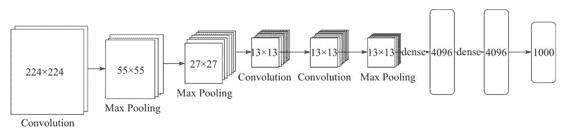

图 1-1　深度神经网络示意图

深度神经网络最突出的能力是表示学习，数据从一端进入，模型从另一端输出，中间特征完全由学习自动完成，不再需要手工设计。

### 1.5.2　主流框架介绍

作为开篇，有必要梳理当下及可预见的未来主流深度学习框架，后续章节会直接使用其中部分。若已熟悉最好不过，若不熟悉也不必担心，后续实战会从零开始编写代码，`build from scratch`。

#### 1. `TensorFlow`

`TensorFlow`[\[2\]](../Text/Section_0001_0008.xhtml#b02)（见图 1-2）是一款遵循 Apache License 2.0 开源的数值计算库，用于高性能计算。借助灵活架构，用户可把计算部署到 `CPU`、`GPU`、`TPU` 以及桌面、服务器集群、移动、边缘设备等。`TensorFlow` 最初由 Google Brain 团队研发，为机器学习与深度学习提供强力支持，其核心也广泛用于其他科学领域。


图 1-2　`TensorFlow`

`TensorFlow` 属于第二代人工智能系统，是通用机器学习框架，灵活性与可移植性好。伸缩性强，支持模型并行与数据并行，可在大型集群上分布式训练。

与以 `Caffe` 为代表的第一代引擎不同，`TensorFlow` 提供自动微分，增加层时无需手写梯度，极大方便网络扩展。

此外它提供丰富的语言接口，从 `C/C++`、`Python`、`Java` 到 `JavaScript`，支持面广，因而广受欢迎。

下面简述其计算模型。

`TensorFlow` 把完整计算任务抽象为一张图 `graph`，每个小步骤是一个操作 `operation`，所有计算即由若干操作构成的图。

以一个实际的 `TensorFlow Graph` 举例，如图 1-3 所示。

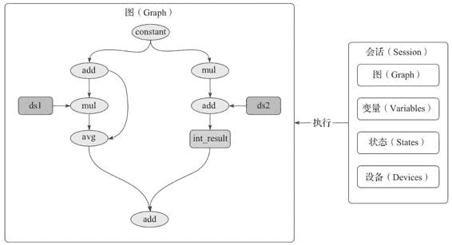

图 1-3　`TensorFlow`计算图示例

图 1-3 展示了一系列计算流程。先用 `constant` 操作定义常量，然后分两路：一路先用 `add` 算常量加 1，再读取外部数据 `ds1` 与结果做乘法，最后用 `avg` 对 `add` 与 `mul` 结果取平均；另一路先用 `mul` 把常量乘 2，再读取 `ds2` 做加法，结果暂存到 `int_result`。最后用 `add` 把 `avg` 结果与 `int_result` 相加得到输出。

图中 `constant`、`add`、`mul` 等即为操作 `operation`，是图的主要节点。除操作外还有数据输入如 `ds1`、`ds2`，以及用变量 `variable` 保存中间状态如 `int_result`。

每个节点处理一个张量 `tensor`，即多维数组，对应数学上的多维向量。把数据流动看作 `Tensor` 在各操作节点间的 `Flow`，这也是框架命名的由来。

使用第一步是把计算任务构建成图。但仅描述过程不够，需要可执行任务，因此要创建会话 `session`。会话建立执行上下文，图需在会话中运行，会话负责初始化变量、维护图执行状态、管理执行设备 `CPU` 与 `GPU` 等。

可见 `TensorFlow` 结构简洁：构建表达计算的图并创建会话执行即可，其余细节被隐藏。

#### 2. `TensorFlow Lite`

`TensorFlow` 在工业服务端已是事实标准，但在移动与嵌入式场景显得庞大臃肿，计算速度也难以满足需求。为此 Google 推出了 `TensorFlow Lite`（见图 1-4），延续 `TensorFlow` 到移动生态。


图 1-4　`TensorFlow Lite`

`TensorFlow Lite` 是面向设备端推理的开源深度学习框架，作为 `TensorFlow` 模块发布，但两者几乎是独立项目，代码基本不共享。可以说它是一个完整独立的前向计算引擎。

使用时需单独训练适用于移动端的轻量级模型，减少参数、提升速度。`TensorFlow Lite` 提供模型转换工具，可把 `TensorFlow` 模型转为 `TensorFlow Lite` 模型，并实现压缩存储与参数量化。典型场景是服务器用 `TensorFlow` 训练，移动端部署应用。转换后的 `tflite` 文件需打包进 App 或目标存储，启动时加载到设备。框架对移动端前向计算做了优化，可加速浮点运算、半精度浮点运算，以及 8 位整数量化计算，并可通过代理在 `GPU` 或 Android `NNAPI` 上调用。

由于后续优化讲解会重点围绕它，这里会展开讨论与裁剪。

#### 3. `MXNet`

Apache `MXNet`（见图 1-5）是一个深度学习框架，目标是兼顾灵活性与执行效率。它允许混合符号式与命令式编程，以提升效率与生产力。核心是一个动态依赖调度器，可自动并行化符号与命令操作。图形优化层让符号执行更快、更省内存。框架便携轻量，可扩展到多个 `GPU` 与多机。


图 1-5　`MXNet`

`MXNet` 支持命令式与符号式两种模式，上手简单，支持多端运行，包括多 `CPU`、`多 GPU`、集群、服务器、工作站乃至移动智能手机。提供多语言接口 `C++`、`Python`、`R`、`Scala`、`Julia`、`Matlab`、`JavaScript`。可方便部署到云端如 `Amazon S3`、`HDFS`、`Azure`，并对 `AWS SageMaker` 支持良好，能在 `Core ML` 移动平台引擎上直接使用。本书不直接使用 `MXNet`，故不再赘述。

#### 4. `PyTorch`

`PyTorch`（见图 1-6）是这里最年轻的框架，也是近期发展最快的科研用框架，因上手简单、灵活强大而受青睐，`Caffe2` 已正式并入其中。


图 1-6　`PyTorch`

`PyTorch` 以 `C/C++` 为核心实现，以 `Python` 为胶水语言提供接口。与 `TensorFlow` 类似，它利用 `Autograd` 模块自动计算导数，避免手工求导，因而很适合深度学习。

作为深度学习的新生力量，因易用与高性能特点，后续章节将介绍其安装与使用，并以此为主要实验平台，先在代码实验基础上再针对特定平台编写高性能代码。

### 1.5.3　框架安装与上手

本书实验以 `Python` 和 `PyTorch` 为主平台，下面介绍如何安装并解决最简单的机器学习问题。

#### 1. 安装

首先安装最新版 `Anaconda` Python3 版本。`Anaconda`（见图 1-7）是著名 Python 发行版，内置大量工具包，免去下载配置烦恼，自带软件源，PyTorch 官方推荐。


图 1-7　`Anaconda`

安装很简单，进入 `Anaconda` 官网下载页面[\[3\]](../Text/Section_0001_0008.xhtml#b03)下载安装包后点击安装即可。

安装完成后启动 `Anaconda` 控制台。注意不同平台 `macOS`、`Linux` 或 `Windows` 使用不同依赖源提供依赖下载，Mac 目前没有 `CPU` 包，只有 `GPU` 包，安装依赖时与 `Windows`、`*NIX` 有差别。

随后进入 `Anaconda` 命令提示符环境，可使用预装 Python 与全套工具链。

用 `Anaconda` 安装 `PyTorch` 只需一条 `conda` 指令，如图 1-8 所示。

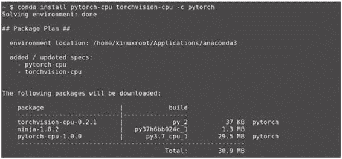

图 1-8　`PyTorch`安装图

安装完成后测试是否成功，如图 1-9 所示。

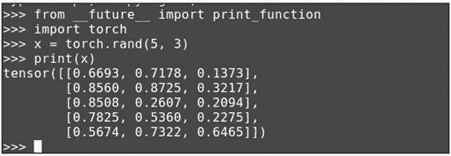

图 1-9　`PyTorch`测试图

掌握使用方法后即可着手解决一个简单机器学习问题。

#### 2. 第一次实战：简单训练

问题是经典的手写数字识别，即如图 1-10 所示的图像对应哪一个数字？

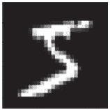

图 1-10　手写数字 5

肉眼一眼看出是 5，那么如何让计算机识别 0~9 这 10 个手写数字呢？`PyTorch` 可以帮助解决。

##### （1）进行训练

需要一批手写数字图片作为训练集，每个样本是一张数字图像并配有标签表示真实数字。然后把图像与标签输入 `PyTorch` 训练，让计算机自动学习两者关系。首先定义网络结构，如代码清单 1-1 所示。

代码清单 1-1　`PyTorch`网络定义

# PyTorch MNIST 示例

## 网络定义

```
 1 import torch
 2 import torch.nn as nn
 3 import torch.nn.functional as F
 4 import torch.optim as optim
 5 from torchvision import datasets, transforms
 6 
 7 import argparse
 8 
 9 
10 class Net(nn.Module):
11 
12     def __init__(self):
13         super(Net, self).__init__()
14         self.conv1 = nn.Conv2d(1, 20, 5, 1)
15         self.conv2 = nn.Conv2d(20, 50, 5, 1)
16         self.fc1 = nn.Linear(4*4*50, 500)
17         self.fc2 = nn.Linear(500, 10)
18 
19     def forward(self, x):
20         x = F.relu(self.conv1(x))
21         x = F.max_pool2d(x, 2, 2)
22         x = F.relu(self.conv2(x))
23         x = F.max_pool2d(x, 2, 2)
24         x = x.view(-1, 4*4*50)
25         x = F.relu(self.fc1(x))
26         x = self.fc2(x)
27 
28         return F.log_softmax(x, dim=1)
```

前 1～7 行完成依赖引入，涵盖了 torch 核心、torch.nn、torch.nn.functional、torch.optim，以及 torchvision 里的数据集 datasets 和数据处理 transforms，再加上命令行解析的 argparse。

第 10 行创建了 Net 类，它直接继承自 nn.Module。nn.Module 是 PyTorch 的基类，网络里所有的算子、层、模型本身都可以看成 Module，并且一个 Module 内部可以再组合多个子 Module。

第 12～17 行是 Net 的构造函数 __init__。先执行父类初始化，随后声明 4 个成员层：conv1、conv2 负责卷积，fc1、fc2 负责全连接。

从第 19 行开始定义前向函数 forward，输入张量命名为 x。

第 20 行把 x 送入 self.conv1 做卷积，再用 ReLU 激活。

第 21 行用 max_pool2d 对激活后的特征做第一次下采样。

第 22 行把结果接入 self.conv2 再做一次卷积加 ReLU。

第 23 行再次调用 max_pool2d 做第二次池化。

第 24 行通过 tensor 的 view 方法把特征重塑为一维形式。

第 25 行送入 self.fc1 做第一次全连接并接 ReLU。

第 26 行把上一层输出接入 self.fc2，做第二次全连接直接返回。

第 28 行在最后对 fc2 的结果做 softmax，完成多分类的概率输出。

## 训练代码编写
编写训练循环，示例如代码清单 1-2。

### 代码清单 1-2 训练实现
```
31 def train(args, model, device, train_loader, optimizer, epoch):
32     model.train()
33     for batch_idx, (data, target) in enumerate(train_loader):
34         data, target = data.to(device), target.to(device)
35         optimizer.zero_grad()
36         output = model(data)
37         loss = F.nll_loss(output, target)
38         loss.backward()
39         optimizer.step()
40         if batch_idx % args.log_interval == 0:
41             print('Train Epoch: {} [{}/{} ({:.0f}%)]\tLoss: {:.6f}'.format(
42                 epoch, batch_idx * len(data), len(train_loader.dataset), 100. * batch_idx / len(train_loader), loss.item()))
```

第 31 行给出 train 函数的签名，参数包括 args、model、device、train_loader、optimizer、epoch。args 承载命令行配置，model 是待训练网络，device 决定运行设备，train_loader 提供训练批次，optimizer 负责参数更新，epoch 表示轮数。

第 32 行会打印训练开始的提示。

第 33 行用 for in 遍历训练集的每个 batch，batch_idx 记录批次序号，data 为样本特征，target 为对应标签。

第 34 行把 batch 数据搬到指定的 device 上，GPU 场景下即搬到显存。

第 35 行把优化器的梯度清零。

第 36 行用当前参数对 data 做一次前向，得到 output。

第 37 行基于 output 与 target 计算本轮 loss。

第 38 行执行 backward，按当前 loss 反向传播梯度。

第 39 行调用 optimizer.step 更新参数。

第 40～42 行输出本批次的误差信息，方便观察训练过程。

## 启动训练
调用训练函数只需像代码清单 1-3 那样组织入口。

### 代码清单 1-3 启动训练
```
 63 def main():
 64     # Training settings
 65     parser = argparse.ArgumentParser(description='PyTorch MNIST Example')
 66     parser.add_argument('--batch-size', type=int, default=64, metavar='N',
 67                         help='input batch size for training (default: 64)')
 68     parser.add_argument('--test-batch-size', type=int, default=1000, metavar='N',
 69                         help='input batch size for testing (default: 1000)')
 70     parser.add_argument('--epochs', type=int, default=10, metavar='N',
 71                         help='number of epochs to train (default: 10)')
 72     parser.add_argument('--lr', type=float, default=0.01, metavar='LR',
 73                         help='learning rate (default: 0.01)')
 74     parser.add_argument('--momentum', type=float, default=0.5, metavar='M',
 75                         help='SGD momentum (default: 0.5)')
 76     parser.add_argument('--no-cuda', action='store_true', default=False,
 77                         help='disables CUDA training')
 78     parser.add_argument('--seed', type=int, default=1, metavar='S',
 79                         help='random seed (default: 1)')
 80     parser.add_argument('--log-interval', type=int, default=10, metavar='N',
 81                         help='how many batches to wait before logging training status')
 82 
 83     parser.add_argument('--save-model', action='store_true', default=False,
 84                         help='For Saving the current Model')
 85     args = parser.parse_args()
 86     use_cuda = not args.no_cuda and torch.cuda.is_available()
 87 
 88     torch.manual_seed(args.seed)
 89 
 90     device = torch.device("cuda" if use_cuda else "cpu")
 91 
 92     kwargs = {'num_workers': 1, 'pin_memory': True} if use_cuda else {}
 93     train_loader = torch.utils.data.DataLoader(
 94         datasets.MNIST('../data', train=True, download=True,
 95                        transform=transforms.Compose([
 96                            transforms.ToTensor(),
 97                            transforms.Normalize((0.1307,), (0.3081,))
 98                        ])),
 99     batch_size=args.batch_size, shuffle=True, **kwargs)
100     model = Net().to(device)
101     optimizer = optim.SGD(model.parameters(), lr=args.lr, momentum=args.momentum)
102 
103     for epoch in range(1, args.epochs + 1):
104         train(args, model, device, train_loader, optimizer, epoch)
```

这样就能跑起完整的训练流程。

第 65～84 行负责定义脚本接受的命令行参数，具体每个参数不再展开。

第 85 行通过 parser.parse_args 把命令行输入解析成对象。

第 86 行根据 no_cuda 标志和本机是否支持 CUDA 来决定最终使用的设备，未指定或不支持则回退到 CPU。

第 88 行设置 PyTorch 随机种子，保证可复现。

第 90～92 行依据是否启用 CUDA 初始化相应的环境变量。

第 93～99 行利用 DataLoader 从 torchvision.datasets 读取 MNIST，数据存放路径设为 ../data，未下载时自动拉取。随后用 transforms.ToTensor 转为张量，再用 Normalize 做标准化。

第 100 行调用 Net 的 to 方法把模型放到目标设备上。Net 是前面定义的模块，任意 Module 都可以用 to 迁移设备。

第 101 行用 optim.SGD 实例化一个随机梯度下降优化器，这是常见的一种参数更新策略。

第 103～104 行按用户指定的 epoch 次数循环调用 train，例如 epoch 为 1000 就会执行 1000 轮训练。

## 推理与评估
测试代码本质就是预测，示例如代码清单 1-4。

### 代码清单 1-4 预测实现
```
 45 def test(args, model, device, test_loader):
 46     model.eval()
 47     test_loss = 0
 48     correct = 0
 49     with torch.no_grad():
 50         for data, target in test_loader:
 51             data, target = data.to(device), target.to(device)
 52             output = model(data)
 53             test_loss += F.nll_loss(output, target, reduction='sum').item()  # sum up batch loss
 54             pred = output.max(1, keepdim=True)[1] # get the index of the max log-probability
 55             correct += pred.eq(target.view_as(pred)).sum().item()
 56 
 57     test_loss /= len(test_loader.dataset)
 58 
 59     print('\nTest set: Average loss: {:.4f}, Accuracy: {}/{} ({:.0f}%)\n'.format(
 60         test_loss, correct, len(test_loader.dataset), 100. * correct / len (test_loader.dataset)))
```

第 45 行定义 test 函数，接收 args、model、device、test_loader 四个参数。

第 46 行调用 model.eval 切换到评估模式。

第 47～48 行把累计误差 test_loss 和准确率初始化为 0。

第 50 行开始遍历测试集，data 为输入特征，target 为真实标签。

第 51 行把测试数据搬到指定设备。

第 52 行用模型对 data 做一次前向得到 output。

第 53 行用 nll_loss 计算预测与标签的误差并累加到 test_loss。

第 54～55 行统计预测正确的样本数。

第 57 行用总误差除以样本总数得到平均误差。

第 59～60 行打印平均误差与准确率，便于后续调优。

在上一节的训练脚本基础上做少量改动即可用训练好的模型做预测，启动方式见代码清单 1-5。

### 代码清单 1-5 启动预测

```
106     test_loader = torch.utils.data.DataLoader(
107             datasets.MNIST('../data', train=False, transform=transforms.Compose([
108                                transforms.ToTensor(),
109                                transforms.Normalize((0.1307,), (0.3081,))
110                            ])),
111             batch_size=args.test_batch_size, shuffle=True, **kwargs)
112 
113     model = Net().to(device)
114     optimizer = optim.SGD(model.parameters(), lr=args.lr, momentum=args.momentum)
115 
116     for epoch in range(1, args.epochs + 1):
117         train(args, model, device, train_loader, optimizer, epoch)
118         test(args, model, device, test_loader)
119 
120     if (args.save_model):
121         torch.save(model.state_dict(),"mnist_cnn.pt")
```

第106行借助 PyTorch 的 DataLoader ，从 TorchVision 提供的 datasets 组件里加载 MNIST 训练集，数据路径被设定为 ../data ，若本地缺失相关文件，框架会自动完成下载。下载完毕后，先以 transforms 中的 ToTensor 把原始图像转成张量，再以 Normalize 做标准化处理。

第113行通过 Net 类的 to() 方法，把模型部署到用户指定的计算设备上。

第114行利用 optim 模块里的 SGD 构造器，生成基于随机梯度下降的优化器。

第116至118行会按用户设定的轮数循环执行 train() 。假设 epoch 设为1000 ，循环就会跑1000轮，每轮训练结束立刻调用 test() 评估当前表现，以便追踪训练进程。

第120、121行在用户勾选保存选项时，调用 save() 把训练好的权重写入 mnist_cnn.pt 文件。

到这里，整套流程就全部走通了。

## 1.5.4 深度学习的新动向

深度学习的思想雏形可追溯至上世纪八十年代，却从未止步。GAN 与 BERT 的相继登场，为该领域注入了全新动能。为了让读者快速建立认知，我们在开篇对两者做简要概览。需要说明的是，本书重心并非深奥的数学推导，而是以实战驱动、理论作支撑，全面呈现深度学习本身以及在移动端落地的优化实践。

### 1. 生成式对抗网络 GAN
生成式对抗网络 GAN 近期在学术界和工业界都很热门，它提供了一种通用的建模思路，下面会对它的基本概念做介绍。

先厘清“生成”是什么意思。简单说，就是模型在学习一批样本后，能够产出风格相近的新样本，例如喂给模型大量动物照片后，让它自行画出新的动物图像。

GAN 出现前，Auto-Encoder 已被用来做生成。做法是先用编码器把输入压缩成隐向量，再用解码器把隐向量还原回输出。训练完成后去掉解码器，直接输入随机隐向量就能合成图像。只是 Auto-Encoder 合成的图像质量偏低，真假辨识度高，实用价值有限。随后出现的 VAE 在此基础上做了改进。

然而 Auto-Encoder 与 VAE 共通的短板在于，它们追求输出尽可能贴近输入，通常以均方误差 MSE 衡量像素级差异，损失越小代表越相似。这种指标适合重构，却不利于创造多样性。我们真正想要的是更丰富、更逼真的新样本，而非简单的复制，因而催生了 GAN 的思路。

GAN 的工作原理是什么？它由两部分组成：负责创作的生成器 Generator 和负责鉴别的判别器 Discriminator，二者像一场零和博弈相互牵制，最终逼近最优生成效果，整体流程如图1-11所示。

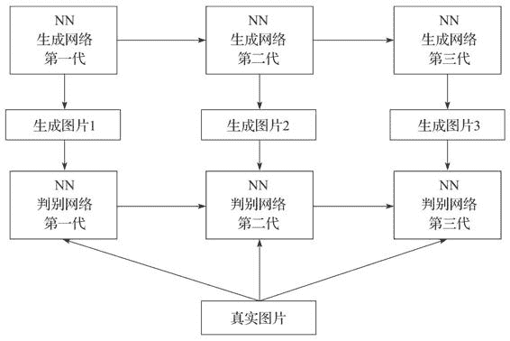

图 1-11　对抗生成网络流程示意图

流程大致如下。初始阶段，一代生成器只能产出质量很差的图像，一代判别器则能轻易把合成图和真图分开。判别器的本质是一个二分类器，对假图输出0，对真图输出1。

随后训练二代生成器，使其产出的图像足以欺骗一代判别器。接着再训练二代判别器，让它能区分真图和二代生成器的产物。如此迭代下去，会出现三代、四代乃至第 n 代的生成器和判别器。当判别器最终分不清真假时，模型就基本收敛了。

GAN 的运行逻辑看似简洁，但有效训练却依赖较为复杂的理论推导。为避免过度深入，本书不再展开细节，有兴趣的读者可自行查阅专业资料。

### 2. BERT 预训练语言模型
BERT，即 Bidirectional Encoder Representations from Transformers，是当前自然语言处理里表现最强的模型之一，它很大程度上替代了 word2vec 及传统下游架构，重塑了预训练词表征与具体 NLP 任务之间的关系。

先回顾词向量。词向量的作用是将文本符号映射为可计算的数值向量，后续的 NLP 操作都是在向量空间中进行。因此，传统流程可拆为两块：预训练阶段生成词向量，下游阶段对这些向量做任务化处理。

BERT 之前主流的是 word2vec。它本质上是线性模型，却能捕捉高维空间里 token 的语义关系，经典例子就是 king - man ≈ queen - woman。训练时目的并非构建完美语言模型，而是获取词向量作为副产物，因而不用在上万词表中做全量 Softmax 预测，而是采用负采样：给出一个正例和若干噪声词，让模型用 Sigmoid 二分类器挑出正确答案。它的致命弱点是上下文无关，词的表征固定不变，所以下游任务通常需要额外对词序列做编码以获得句意。

2018 年 8 月发布的 ELMo 带来了思路上的转折，它把原本放在下游的上下文编码提前到预训练阶段，从而得到随上下文变化的动态词向量。实现上采用双向语言模型 BiLM，即 Bi-LSTM，而非单向 LSTM。

ELMo 仍存在两点局限：一是不完全双向，前向和后向 LSTM 分开训练，最后把隐藏状态拼接，损失也是两部分相加，并非真正联合建模；二是自己看见自己，预测目标词在输入序列中已出现，违背了语言模型单向性的基本假设。

ELMo 把上下文编码搬进了预训练，但使用时需要加权融合。若 Bi-LSTM 为多层，每层学到的特征侧重点不同，ELMo 为输入层和各隐藏层分别设一个可学习权重，经 Softmax 归一化后加权求和，以突出不同任务所需的信息。

相比 ELMo，BERT 的泛化能力更强，能刻画字符、词、句子乃至句子间的关系。其改进体现在四点：真正的双向编码，借助 Masked LM 在训练时用特殊标记遮挡目标词，使模型能同时利用前后文；彻底抛弃 LSTM，采用 Transformer 编码器，支持更深的网络和高效并行；Transformer 对 Mask 标记的干扰更易控制，只需降低其自注意力权重，而 LSTM 像黑盒难以把握；采样粒度从词提升到句子，采用句子级的负采样，从而捕捉跨句关联。

## 1.6 深度学习走进移动世界

深度学习的版图非常辽阔，而当研发触及移动、嵌入式或边缘计算平台时，会涌现出一批全新难题。移动端是本书的核心议题，我们在开篇就点出移动端落地深度学习的基石、难度与挑战。透过本节的简要介绍，希望读者能带着目标继续阅读。

### 1.6.1 移动平台机器学习概述
大量机器学习算法，尤其是深度学习，对算力需求极高，长期以来计算主要放在服务器或工作站上。可是越来越多的应用场景正向移动端迁移，边缘计算与海量数据采集变得可行乃至主流，诸多现实问题必须在移动端解决。以人脸识别为例，若每次都把照片或视频传回服务器再识别，网络延迟会成为瓶颈。因此在本地集成机器学习框架并完成推理，已成为必然趋势。

### 1.6.2 难度和挑战
与云端服务器或工作站相比，移动平台的特殊性让开发难度大幅提升。两者的框架设计差异巨大，需要换一种思维与优化策略挑选适配框架，这正是本书想传递的。

更根本的问题是算力受限。在功耗受限的前提下，移动端 CPU 与 GPU 与桌面端差距明显，且主流架构为 ARM 而非 x86。传统深度学习框架深度优化于 PC，若直接搬到移动端，往往运行缓慢甚至因内存或指令集原因无法执行。

移动端的第二个痛点是存储受限。未经处理的深度模型动辄数十至上百 MB，对 App 而言体积过重。加载模型后叠加推理所需临时内存，很容易超出设备承受。

因此各大框架都在做移动适配。TensorFlow 与 MXNet 都针对移动端做了大量优化，一方面利用 ARM 指令集加速，另一方面压缩模型体积，让推理变得更轻便。

但需求永无止境。以人脸识别为例，能做到 5 帧/s 时客户希望 10 帧/s，10 帧/s 时又想要 20 帧/s，速度越快可应用的场景越广。而通用框架的优化只能覆盖共性，难以满足特定场景需求。

于是越来越多厂商投入移动端深度学习框架研发。这些框架往往只关注推理优化，不考虑训练，因此可以放开手脚做极致优化，性能远超 TensorFlow 等通用方案。

不过光靠框架还不够，还需从模型本身下手，减少层数、做稀疏化与量化等手段来换取效率。同时提升速度常伴随精度下降，鱼与熊掌难以兼得，这对产品与工程的平衡提出更高要求。

移动机器学习重要却艰难，为了让算法在更多场景落地，我们必须直面这些挑战，后续章节将逐一深入剖析。

## 1.7 本书框架
本书贯穿的两大关键词是深度学习与移动端实战。我们设想的系统包含客户端与服务器端：服务器负责收集客户端上传的图片与标注并存入数据库，定时用数据自动训练模型；客户端自动检查更新并下载最新模型，在本地用移动预测引擎完成图像检测与识别，形成不断积累数据、持续提升识别率的闭环。

学习路径清晰可循。首先介绍与深度学习密切相关的经典传统算法，从 Logistic 回归入手，它是经典分类器也是神经网络的基础。

其次学习神经网络，掌握人工神经网络的基础知识是理解深度学习的前提。

最后在传统神经网络之上阐述深度学习，说明其相比传统网络的改进，介绍经典模型，并以物体检测识别为重点应用场景展开。

## 1.8 本章小结
本章首先梳理了机器学习的基础：基本理论、算法分类、代表性算法、学习方法以及相关工具，让读者对机器学习建立整体认知。

其次介绍了深度学习的理念与贡献、常用工具框架，并以 PyTorch 为实验框架演示安装与使用。

最后点出深度学习在移动应用中的重要性，初步认识移动端的应用场景与现存问题，为后续攻克难题做好铺垫。机器学习的大门已经打开，你准备好了吗？

* * *

[1] `../Text/Section_0001_0004.xhtml#a01` 《分布式实时处理系统：原理、架构与实现》已于 2016 年 7 月由机械工业出版社出版，书中详细阐述了 Hurricane 实时处理系统的架构和流处理实战。

[2] `../Text/Section_0001_0005.xhtml#a02` 读者可以通过访问`https://www.tensorflow.org/learn`来对`TensorFlow`进行更详细的了解和认识。本书会在后续内容中逐渐引入使用`TensorFlow`的方法。如果你还不了解`TensorFlow`，笔者建议先行阅读有关入门内容。

[3] `../Text/Section_0001_0005.xhtml#a03` 目前读者可以访问`https://www.anaconda.com/download`来下载相关软件包。

## 第 2 章 机器学习基础

本章将进一步厘清机器学习的主要任务，并在此基础上介绍部分监督学习方法。我们会以决策树引入分类器的概念，并讲解经典的 ID3 算法。随后介绍贝叶斯思想，重点讲解朴素贝叶斯分类器。再学习线性回归与 Logistic 回归的概念，并认识重要的 Sigmoid 函数。这些内容是理解深度神经网络的必要基础。

## 2.1 机器学习的主要任务

机器学习方法看似繁多，归根结底完成的任务有限。下面介绍几个核心方向。

监督学习是最重要的分支。大多数监督方法包含训练与预测两个阶段，训练时使用带特征与标注的样本生成模型，预测时模型根据输入特征给出输出。根据输出类型可分为分类与回归，这也是最常见的两类任务。

分类的输出是离散值。若每次只输出一个类别，即单标签分类，例如依据人物特征判断性别。若需输出一组类别，则为多标签分类，典型如电影类型预测，一部影片可同时属于多个类别。

回归的输出是连续值，也常说拟合。几何上即寻找一条超平面去拟合样本点，例如最简单的线性回归。

除监督学习外，还有无监督学习。无监督样本仅有特征无标注，输出形式多样。常见任务包括聚类、关联分析、特征降维、特征选择与异常检测。

聚类无需训练预测过程，直接对输入样本进行分组，每组内部样本被认为同类。聚类结果需要人工标注，精度不及监督分类，却常作为预处理步骤。若聚类质量足够高，可大幅节省标注成本。

关联分析在样本组织上和其他任务不一样，一条样本保存的就是这次实际出现了哪些项目，核心目标是挖掘样本内部的项目共现规律。关联分析最终要给出的是经常一起出现的项目组合。如果只是判断项目是否出现，那就是典型的频繁项集问题；如果还要追究项目出现的因果关系，就得用更复杂的关联分析方法。

特征降维的产出是降维后的样本表征。它的本质是把原始特征空间映射到一个维度更低的空间，但这个低维空间要能完整承载原始信息，也就是说原始的每一个特征在降维后都能找到对应的表征点。这样做一方面能降低计算开销，另一方面可以提升模型的泛化水准，进而提高预测精度。

特征选择和特征降维看起来很像，区别在于特征选择是直接把不需要的特征筛掉、只保留关键的特征，而特征降维在形式上仍保留了全部原始信息。特征选择的核心目标也是提高预测精度。

异常检测的任务就是在输入数据里揪出可能异常的点，一旦发现就剔除这些异常样本。

除了监督学习和无监督学习，还有一类是强化学习。它和前面的任务差异明显，通常指在没有标注的情况下，让学习器自己对预测结果进行评价的机制。通过自我评估，学习器会不断调整以追求正确结果。最终来看，强化学习的落地目标还是逃不开之前提到的那些基本任务，比如回归、分类、聚类、特征选择和降维。

## 2.2 贝叶斯模型概览
2.1 节我们梳理了机器学习的典型任务，这一节聚焦贝叶斯模型。它是一种经典且简洁的学习范式，作为通向深度学习这类非传统模型的桥梁很合适，也方便我们对比根本差异。鉴于本书重心不在传统模型，本节主要做理论介绍，若想动手实现可参考附带的示例代码。

分类是机器学习的经典问题，贝叶斯只是其中一种常见建模思路。最直观、最贴近人类决策的模型是决策树，它的核心是根据解决问题的多个相关因素逐层确定下一步方案，整个过程像一棵自顶向下展开的树，故名决策树。如图 2-1 所示，这里用天气、温度、风况和气压来判断是否去钓鱼。

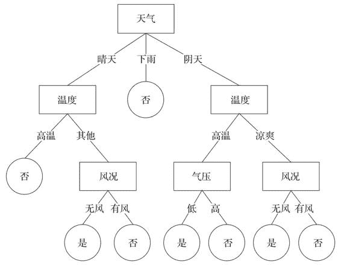
图 2-1　决策树示例
图中矩形是决策节点，连线上的标注是属性取值，圆形是结果节点。

## 决策树模型总览
树构建完成就能用来预测。预测时先把数据送入根节点，再依据属性取值挑选特定分支，递归进入子节点后再按该节点的分支取值继续选择，直到走到叶子节点即可得到结果。

这种方式符合人类逻辑思维，易于理解，所以常用于专家系统。同时它需要存储的参数很少，推理速度快。

不过决策树远不止如此，业内常用的有 ID3、C4.5、CART 以及随机森林等，因本章重点不在此，这里不展开。

## 贝叶斯方法详解
现在进入正题。贝叶斯思想的提出者如图 2-2 所示，是 18 世纪英国数学家托马斯·贝叶斯 Thomas Bayes。


图 2-2　托马斯·贝叶斯 Thomas Bayes
贝叶斯模型的核心是贝叶斯定理，它源于贝叶斯生前为解决“逆概”问题写的一篇文章，文章在他去世后由朋友发表。在他之前，人们会算正向概率，比如袋子里有 N 个白球 M 个黑球，伸手一次摸到黑球的概率是多少。逆向概率则是反过来，事先不知道黑白比例，闭眼摸出几个球后根据颜色推断袋子里比例的问题。

贝叶斯定理诞生于 18 世纪，真正大规模应用要等到计算机出现，因为它需要大量计算才能发挥威力。现在它活跃在自然语言处理、机器学习、推荐系统、图像识别、博弈论等多个领域。

下面用一个经典的彩球抽奖来说明可以解决什么问题。有 A、B 两个桶，A 里红球 3 个白球 1 个，B 里红球 2 个白球 2 个。随机挑一个桶，每次取一个球放回，重复 4 次后判断是 A 还是 B。

这是一个由表及里的典型问题。我们只能观察到表现形式，比如摸到什么颜色，但不知道本质是哪一个桶。面对这类问题贝叶斯模型就很有用。

贝叶斯模型泛指所有使用贝叶斯定理思想的方法，本节重点讲最简单的朴素贝叶斯分类器。为此先回顾基础概率知识。

### 先验概率与条件概率
先验概率记作 P(A)，是基于过往经验得到的概率，P(B) 同理。用文氏图表示，图 2-3 中 A 圈是 A 事件的样本集合，B 圈是 B 事件的样本集合。

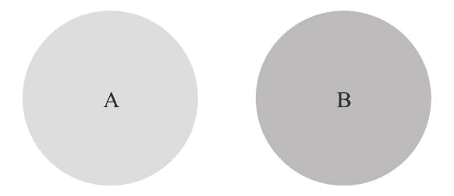
图 2-3　样本文氏图 1

条件概率是指在另一事件发生的条件下某事件发生的概率，例如 P(A|B) 表示在 B 发生条件下 A 发生的概率，P(B|A) 则相反。联合概率 P(A∩B) 表示 A 和 B 同时发生的概率。

图 2-4 中 A、B 的交集部分即联合概率，条件概率则是交集在各自圈内的占比。

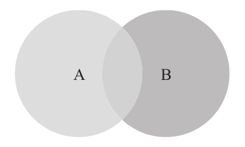
图 2-4　样本文氏图 2

### 贝叶斯公式与朴素贝叶斯
掌握基本概率后，再看贝叶斯公式。它给出在 B 发生条件下 A 发生的概率，可由 A 条件下 B 的条件概率以及 A、B 的先验概率计算：

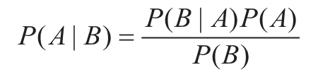

这有什么用？以垃圾邮件检测为例。最简单的方法是看邮件是否包含某些关键词。但并非所有含关键词的邮件都是垃圾邮件。我们可以假设垃圾邮件中关键词出现是有规律的。收集一批垃圾邮件和正常邮件，统计关键词整体出现频率、垃圾邮件出现频率以及关键词在垃圾邮件中的出现频率。其中 P(A) 是垃圾邮件频率，P(B) 是关键词频率，P(B|A) 是垃圾邮件中关键词频率。由此可推算 P(A|B)，即出现该关键词时邮件是垃圾邮件的概率。

我们日常只能观测到现象，而希望由现象推断本质，贝叶斯模型就提供了这种由现象推本质的概率框架，数据越多越准。

实际问题中往往有多重属性，比如判别垃圾邮件不只一个关键词，需要考虑多个关键词同时出现的概率。这就要计算在 B1～Bn 同时出现条件下 A 发生的概率。样本量小直接估计联合概率误差会很大，于是贝叶斯做了一个假设：各事件相互独立，不同属性独立影响分类结果。这样联合概率可拆成多个概率的乘积，累乘符号用 π 表示：

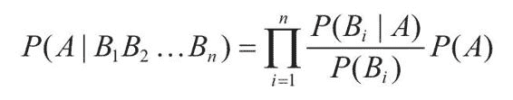

这就是朴素贝叶斯分类器的核心。只要分别估算不同敏感词的概率，就能算出某封邮件是垃圾邮件的概率，其他问题也是同理套路。回到抽奖问题，可计算：

1）P(A)：摸到红球的概率是 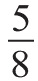。
2）P(B)：选择 A 桶的概率是 。
3）P(A|B)：在 A 桶中摸到红球的概率 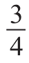。

假设摸到一个红球，选择到 A 桶的概率为：

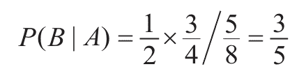

若摸到 2 个红球 2 个绿球，只需把结果代入推广公式即可。我们提前训练得到的知识包括摸到红球的概率、摸到绿球的概率、在 A 中摸到红球或绿球的概率、在 B 中摸到红球或绿球的概率。

## 2.3 Logistic 回归
本节围绕 Logistic 回归展开，涵盖基础、由来和现实意义。因为它是神经网络的基础，所以暂时搁置其他传统算法，先厘清 Logistic 回归的来龙去脉。

我们已大致了解机器学习的基本概念、几种经典传统模型，以及深度学习带来的突破，也介绍了如何用现有框架做简单实验。接下来循序渐进讲解深度学习所需的基础知识。Logistic 回归本身公式简洁，但背后的思路很有意思，是掌握神经网络的重要前提，涉及非线性建模思想和训练思想，值得用一节篇幅细讲。

#### 2.3.1 线性回归
学模型前先问清楚它解决什么问题。设想一位农民关心作物长势，害虫是主要影响因素。用农药可以除虫，但用太多会影响品质。我们想知道最少需要多少剂量才能基本清除害虫。

建模时把“杀死害虫”设为事件 A，唯一因素 X 是农药剂量。问题就是寻找事件 A 发生概率与因素 X 之间关系。这类问题在生活中很常见，通解方法也可迁移。

分析变量关系最直接的数学工具是线性回归。别看它简单，奥卡姆剃刀定律提醒我们，越简单的东西往往越有效。

回顾线性回归，设一元一次函数 y = w1x1 + w0。如图 2-5 所示，y 为应变量，x1 为自变量，研究两者关系，图形上就是一条直线。

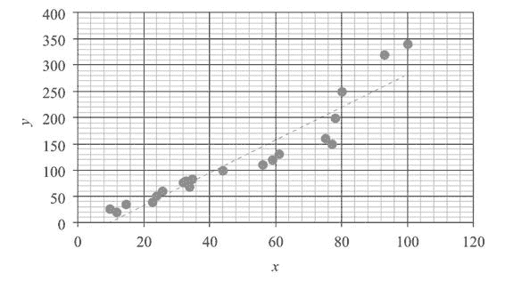
图 2-5　一元一次函数

图中散点可能是真实采集的数据，比如想了解某城市房屋面积与价格关系，横轴面积，纵轴价格单位万元。需要一个函数输入面积输出价格，散点整体呈直线状，可用一元一次函数拟合。拟合过程就是线性回归，目的是建立数学模型来复现实测数据，线性回归是最简单的拟合方式。

等价写法 y = w^T x，其中 w = [w0, w1]，x = [0, x1]。

现实问题往往不止一个自变量，如天气预测行为需要多个参数 x1、x2…xn。这时要用到多元回归，从一元函数变为多元一次函数，如图 2-6 所示。

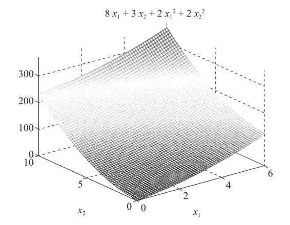
图 2-6　多元一次函数

展示的是两个自变量的情形。线性回归用直线拟合平面散点，两个自变量时空间变为三维，拟合结果是一个平面。若房价还要考虑地段，就需加入地段这一轴。

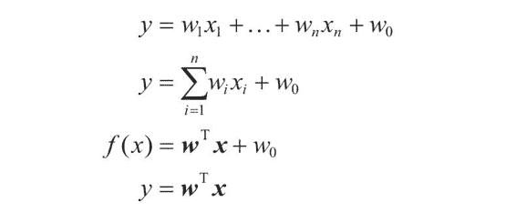

上面的四个公式等价，都描述 n 个自变量情形。第一个是展开式，第二个用 Σ 表示求和，第三个把 w、x 看成向量，第四个是矩阵化写法，也是常用形式。

注意粗体表示向量。二维向量对应平面点，三维对应空间点，以此类推。这里 x 是 n 维空间向量，w 是权重向量，T 表示转置，做的是矩阵乘法。

理解回归后可知，其目的是拟合现实中连续变化的一系列取值。

#### 2.3.2 几率与 Logit
线性回归能直接用在农药问题吗？农药剂量 X 是连续的，但预测结果是离散的 0 或 1，即能否杀死害虫。这是一种离散选择行为，概率会在某些区间剧烈变化，而线性回归给出的是平缓渐变，如图 2-7。

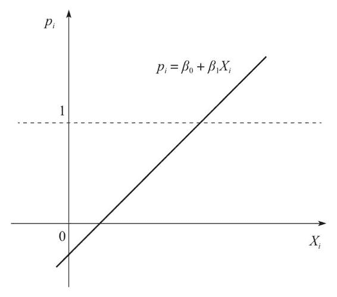
图 2-7　线性回归拟合

很多实际问题都是离散的，比如能否杀死害虫只有真假 1 或 0，机器学习里称作分类问题。线性回归本质是线性拟合，除非概率随因素线性变化，否则无法拟合。现实往往不是线性的。

虽然不能直接拟合概率，可以换个思路，先让线性回归拟合与概率相关的量，再换算回概率。这里引入几率 odds。

概率 P(A) 在统计上用发生次数除以总次数估算：

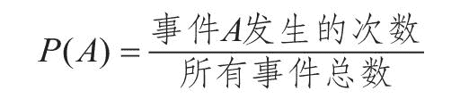
例如投掷骰子，投出 6 的概率是 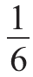。

几率是事件发生与不发生的比值，用概率表示为 P(A)/(1-P(A))：

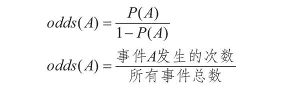
实际计算是用发生次数除以未发生次数。投掷骰子中，出 6 与不出 6 的几率为 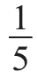，若把出 6 视作胜利，胜负比为 。

几率与概率关系如图 2-8。

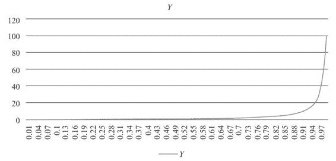
图 2-8　几率和概率之间的关系图
横轴是概率，纵轴是几率。概率区间 [0,1]，几率区间 [0,+∞]，几率随概率增加增长更陡，两者并非线性关系，所以直接用几率做线性回归也不合适。

几率难拟合，但可在此基础上构造新统计量——几率的对数，即 Logit 函数：

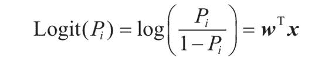

Logit(p) 的曲线如图 2-9 所示。

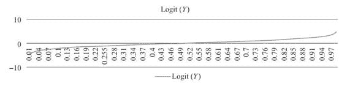
图 2-9　Logit 函数

看到这条曲线，第一眼就觉得很对味：

1）介于 0 到 1 之间的绝大部分区间里，它走得非常平坦，几乎就是一条直线；
2）唯独在 0 和 1 这两个端点处出现了明显的跳变。

我们想要的拟合，恰恰是让因变量随自变量成比例地变动，同时在概率触及 0 或 1 时能够制造出一个突变，来明确判断属于 0 还是属于 1。这样的形态正好命中需求，所以一看就觉得就是它了。

于是我们直接把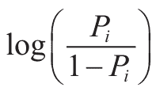曲线当成拟合目标，用线性回归去逼近它。而这里的`Logit`就是描述这一套拟合关系的等式。

#### 2.3.3 从 Logit 到 Logistic 的推导

在`Logit`的基础上做一个小变换，就能得到更经典的`Logistic`表达式：

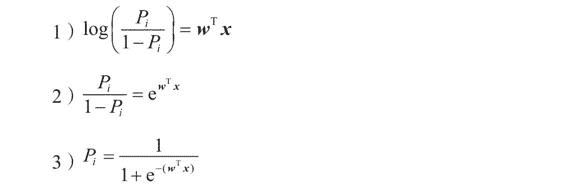

第 1 个式子就是前面说的`Logit`。第 2 个式子是把两边同时化为 e 指数的形式。第 3 个式子是在第 2 个式子的基础上继续推导而来。其中第 3 个式子正是大家熟知的`Logistic`回归函数。

仔细看第 3 个式子，e 的指数部分就是一个线性回归。当这个指数值为 0 时，`P`等于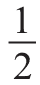。当指数值大于 0 时，`P`会不断接近 1；当指数值小于 0 时，`P`会不断接近 0。这样整个函数的取值范围被限制在 0 到 1 之间，与概率的定义完美吻合。

把线性部分整体记作`z`，那么`Sigmoid(z)`就是常说的 Sigmoid 函数：

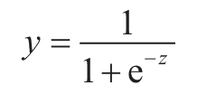

它的特点是输入输出落在 0 或 1 附近，并在 0 点附近呈现阶跃，示意图见图 2-10 所示。

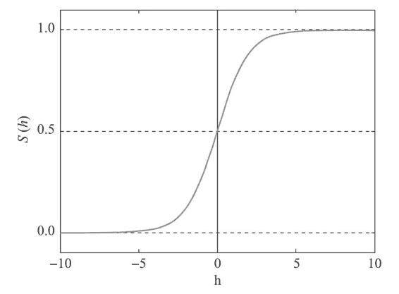

图 2-10　Sigmoid 函数图像

再具体聊聊 Sigmoid，它是靠回归实现分类的关键部件。它的形态很特别：随着`z`增大，`y`也单调增大。一开始几乎贴着 0，随后在某个位置陡然抬头逼近 1，并且在`x=0`处永远落在`y=0.5`上。所以可以粗略认为，`x<0`时输出近似 0，`x>0`时输出近似 1。

这个现象很有意思。它本身是连续的，却可以被当作会突然跳变的函数来用，这种从 0 往 1 跳的函数也叫做阶跃函数，常说的 S 型函数就是它。

举个例子，求出来的值落在 0 的左侧，结果为 0，害虫杀不死；若落在右侧，结果为 1，则说明可以杀死。

Sigmoid 与回归的关系是怎样的？Sigmoid 的自变量是`z`，把这个`z`换成一个回归函数，就可以用多个连续特征来做分类了，这正是 Logistic 回归的核心做法。

Logistic 回归的基本思路是：普通多元回归不适合离散分类问题，就把多元回归塞进 Sigmoid 里完成分类。输入是`x1`到`xn`这组特征，输出则是 0 或 1，分别对应假或真。

回看`Logit`的等价形式，对于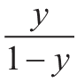，我们可以把`y`理解为正样本的可能性，1-`y`理解为负样本的可能性，两者的比值即为几率，再取对数得到对数几率。先算`P`的几率的对数，再用线性回归去拟合这个数值，这套方法就叫做 Logistic 回归，也称对数几率回归。

### 2.3.4 它其实来自生态学

从`Logit`讲到 Logistic 在分类里的含义，可以发现之所以叫回归，是因为核心仍是回归，只不过从`Logit`的角度看，回归的对象是对数几率，而非我们最终想要的事件概率。名字叫回归却做分类，这本身就挺有意思。

但 Logistic 回归的真正来历并不是上面那条思路。`Logit`变换和 Logistic 回归等价且好理解，但最早的灵感却来自生态学，下面做个简要介绍。

1798 年，英国牧师 Malthus 在观察小镇人口时发现，人口增长率基本与人口数量成正比，用公式表达就是人口数随时间的变化率与人口数呈线性关系：

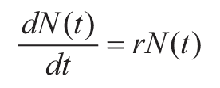

式中`t`为时刻，`N(t)`为该时刻总人数，`r`为常数比例系数。无论人口如何增长，都满足这个规律。因为微分可看作`N(t)`在`t`时刻的增速，调节`r`就能得到增速，如`N(t)=N0 e^{r t}`。从数学上，`t`时刻的人数就是该微分公式的定积分，下限 0 上限`t`，且`t=0`时人数为`N0`不为 0，得到的结果即为人口在不受外界影响时的粗略预测。

可惜城镇有环境容量限制，资源决定了人数不可能无限增长。1838 年，Pierre-François Verhulst 考虑了容量限制，对原式做了修改：

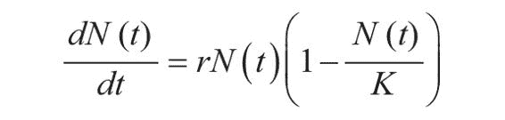

公式仍是人数随时间的微分，只是在右侧多加了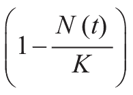。这里`N(t)`是`t`时刻人数，`K`是环境可承受总人数。`N(t)/K`是该时刻环境承载比例，人口增加时该值上升，而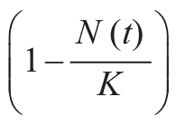会随之减小，最终归零甚至为负，人口开始下降并在容量附近趋于平衡。

读者可能觉得 Logistic 回归的式子与此毫无关联，如何建立联系呢？

先做变换：令`f(t)`等于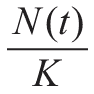，代入原式消去全部`N(t)`，得到：

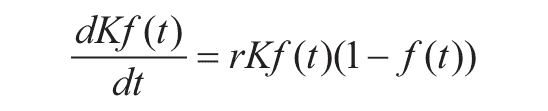

两边同除以`K`后变成：

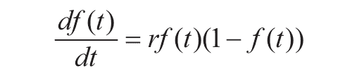

可以看出，我们把与地域人口增速相关的公式，变成了人口占环境容量的比例增速公式，从具体数字的增长率转为比例的增长率，这比原式更通用。无论总人口多少、当前多少，都可先求比例再换算回实际人数。

接下来求某个时刻的`f(t)`，即总人数占环境容量的比例。对公式积分，下限 0 上限不限：

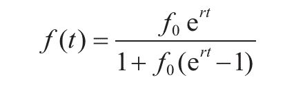

左边得到`f(t)`，右边得到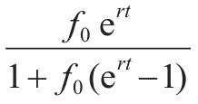，其中`f0`为 0 时刻人口占容量的比例。再上下同除以`f0 e^{r t}`可得：

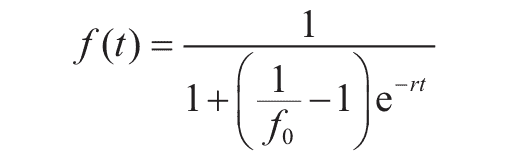

这个式子看起来就很眼熟，和 Logistic 回归形式相近，只是 e 左边多了系数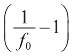，指数为 -`r t`，而这本身就是`t`的线性函数。稍作转换即可变成 Logistic 回归。假设人口总数不超过环境容量，则系数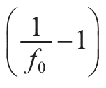大于 0，于是可把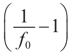替换为`e^{-r0}`，其中`r0`是人为凑出的数值，能让 e 的指数与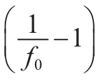相等，且在假设下一定可以凑出。于是有：

令`f(t)=y`、`r0=ω0`、`r=w`、`t=x`，可得：

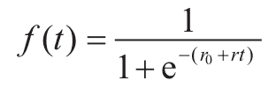

至此豁然开朗。经观察，`ω0`相当于城镇初始剩余可容纳人数与已有人数的比例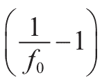，即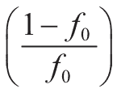，这就是事件发生与不发生的几率。

其中`ω0`等于`r0`，相当于事件的初始几率；`r`即`ω`，相当于与`t`相关的权重，人口比例增速快慢完全取决于它。

我们发现，这个式子本质上是城镇人口占环境比例随时间的一个 Logistic 回归。加入容量后，增长不再线性，必须用 Logistic 这种非线性拟合。Logistic 从 0 起步趋近于 1，先慢后快再慢，与人口比例变化的轨迹完全对应。所以 Logistic 回归既能做概率分类，也能做比例拟合。

数学之美就在于此，两条看似无关的思路最终收敛到同一个公式。

最终可以总结为：Logistic 模型 = 多元一次函数 + Sigmoid。问题在于多元函数里有一组`w`未知，即回归系数。使用模型前需确定它们。传统做法可用极大似然估计，机器学习中则用数据学习参数，学习过程即机器学习。

具体做法是先据公式得到极大似然函数，再求其最大值处的权重，这就变成最优化问题。数值分析里常用牛顿法求解，而机器学习里更常用梯度上升法不断逼近极大值，后续章节会详细展开。

### 2.3.5 Python 实现 Logistic 回归

下面用 Python 做一次实验验证，采用代码清单 2-1 的方式实现。

代码清单 2-1 实现`Logistic`回归

```
 1 from numpy import *
 2 import pickle
 3 
 4 class LogisticClassfier:
 5     # 训练，暂不实现
 6     def train():
 7         pass
 8 
 9     # 预测并返回分类结果
10     def predict(x):
11         # 根据权重和输入求线性回归值
12         y = sum(x * weights)
13         # 使用 Sigmoid 转变为概率
14         prob = LogisticClassfier.sigmoid(y)
15 
16         # 概率大于 0.5 分类到 1
17         if prob > 0.5:
18             return 1.0
19 
20         return 0.0
21 
22     # 保存模型
23     def dump(modelFileName):
24         params = dict()
25         params['weights'] = self.weights
26 
27         model = {
28             'params': params,
29         }
30         modelFile = open(modelFileName, 'wb')
31         pickle.dump(model, modelFile, 2)
32 
33         modelFile.close()
34 
35     # 加载模型
36     def load(modelFileName):
37         modelFile = open(modelFileName, 'rb')
38         model = pickle.load(modelFile)
39 
40         params = model['params']
41         self.weights = params['weights']
42 
43         modelFile.close()
44 
45     # Sigmoid 函数实现
46     @staticmethod
47     def sigmoid(inX):
48         return 1.0/(1+exp(-inX))
49 
50 if __name__ == '__main__':
51     # 构建分类器
52     classfier = LogisticClassfier()
53     # 加载模型
54     classfier.load('horse.model')
55 
56     # 读取测试集
57     frTest=open('data/horseColicTest.txt')
58 
59     # 初始化测试结果
60     errorCount = 0
61     numTestVector = 0.0
62 
63     # 每次读取一行
64     for line in frTest.readlines():
65         numTestVector += 1.0
66         currLine=line.strip().split('\t')
67         lineArr=[]
68 
69         # 前 21 个数据为特征，读取特征
70         for i in range(21):
71             lineArr.append(float(currLine[i]))
72 
73         # 获取预测结果
74         predictResult = classfier.predict(array(lineArr))
75         # 第 22 个数据为标签
76         isHorseLabel = currLine[21]
77 
78         # 判断是否预测正确
79         if int(predictResult)!=int(isHorseLabel):
80             errorCount += 1
81 
82     # 计算输出错误率
83     errorRate = errorCount / numTestVector
84     print('错误率：%f' % (float(errorRate)))
```

第 4 行定义了`LogisticClassfier`类，即基于 Logistic 回归的分类器。

第 10～20 行定义了`predict`方法，用特征向量与权重向量点乘求和得到线性值，再经 Sigmoid 激活，若概率大于 0.5 返回 1，否则返回 0。

第 23～33 行定义模型保存方法，仅保存各特征的权重参数。

第 36～43 行定义模型加载方法，与保存相对应。

第 47～48 行定义 Sigmoid 计算方法，直接实现公式。

第 52 行创建分类器对象，第 53 行加载模型文件。

第 57 行加载测试集，第 64～80 行逐行读取测试数据，特征以制表符分隔，前 21 项为特征，最后 1 项为标签。用`predict`预测并与真实标签比对，统计错误样本数。

第 83～84 行计算并输出预测错误率。

由于本文尚未介绍梯度下降求解，代码仅包含预测部分，没有训练过程。可以看出，Logistic 回归的预测非常简单：输入特征与训练得到的权重做加权求和即可，运算高效。

先构建分类器，用`load`载入模型，再读入测试数据，每行前 21 项为特征，最后 1 项为标签。把特征送入`predict`得到结果，与标签对比统计错误率。

预测过程易懂易用，训练过程则需在学习完梯度下降法后再介绍。

## 2.4 本章小结

上一章先梳理了机器学习的整体任务，并在此基础上切入监督学习的范畴。随后介绍了多类经典监督算法，涵盖分类器与决策树等做法。接着系统拆解了贝叶斯体系，包括朴素贝叶斯的原理、分类器的实现路径以及贝叶斯网络，并补充了线性回归的内容。最后引入数据预处理的思路，为后续章节做好准备。

## 第 3 章 神经网络核心

第 2 章已经搭建了机器学习的基础认知，介绍了若干常用算法以把握方法与原理，并重点落在了 `Logistic` 回归上，为神经网络的学习奠定基础。本章将正式开启人工神经网络的讲解，这是深度学习的前置；随后会涉及用于无监督学习的稀疏自编码器，它也是一种典型的神经网络结构；最后会讨论神经网络落地所需的数据预处理与实现要点。

## 3.1 神经网络概览

人工神经网络 Artificial Neural Network，ANN，简称神经网络 Neural Network，NN，在机器学习与认知科学里，本质是一种模仿生物神经网络尤其是动物中枢神经系统结构与功能建成的数学或计算模型，用来对函数进行估计与近似。网络由大量人工神经元相互联结而成计算。大多数情况下它能够基于外界信息自我调整内部结构，属于自适应系统，通俗讲就是具备学习能力。现代视角下，神经网络是一种非线性统计数据建模手段。

对人脑中枢神经系统的观察催生了人工神经网络的概念。在人工神经网络中，把最基本的计算单元称为神经元 neurons，它们相互连接形成类似生物神经网络的网状结构。

目前学界对人工神经网络并未形成唯一严格的正式定义，但凡具备以下特征的统计模型都可以视作神经化的范畴：

1）拥有一组可被调节的权重，这类数值参数由学习算法在训练中不断调整；
2）能够刻画输入数据间的非线性函数关系。
这些可调权重可被理解为神经元之间连接的强度。

与生物神经网络相比，人工版本的可贵之处在于它可以并行、集体地计算函数各部分，而无需为每个单元单独指定任务。网络这一术语在日常用法中多指统计学、认知心理学和人工智能领域使用的模型，而调控中枢神经系统的网络则属于理论神经科学和计算神经科学的研究对象。

在当代软件实现中，早期受生物学启发的思路已基本被抛弃，转而采用更实用的统计与信号处理方法。在不少系统中，神经网络或其组成部分如人工神经元，作为大型系统的模块存在。这些系统融合了自适应与非自适应元素。虽然这种泛化做法更适合解决实际问题，却已与传统的连接主义人工智能相去甚远。它们仍保留的一些共性包括非线性、分布式、并行化、局部计算以及适应性。从历史脉络看，神经网络的复兴标志着 20 世纪 80 年代后期，人工智能从以条件规则为代表的高度符号化专家系统，向以动力系统参数表征知识的低符号化机器学习转型的关键节点。

一个典型的人工神经网络通常包含以下三要素。

## 1）结构 architecture

指明网络内变量及其拓扑关系。例如变量可指神经元连接的权重 `weights` 和神经元的激励值 `activities of the neurons`。

## 2）激励函数 activity rule

绝大多数神经网络模型都配备一个短时尺度的动力学规则，用来决定神经元如何根据其他神经元的活动改变自身的激励值。激励函数通常依赖于网络权重，即网络参数。

## 3）学习规则 learning rule

学习规则规定网络权重随时间如何更新，可视作长时间尺度的动力学规则。一般它依赖于神经元激励值，也可能依赖监督者给出的目标值以及当前权重。例如用于手写识别的神经网络有一组输入神经元，输入图像数据会激发它们。激励值被加权后经过设计者指定的函数，再传递给下一层神经元。如此反复直至输出神经元被激活，最后输出神经元的激励值决定识别结果对应的字母。

本小节对人工神经网络做了初步介绍。鉴于神经网络是深度学习的基础概念，建立扎实的理论认识很重要。接下来会进一步剖析细节，先从神经网络的基本结构与正向传播开始。

## 3.2 基本结构与前向传播

在进入认知层面的讨论前，有必要先弄清人工神经网络的基础构造。先理解神经元的概念，再由此构建出神经网络，最后引出本节的核心——前向传播。既然有前向，自然也有反向，对应的反向传播会在下一小节展开。

### 3.2.1 神经元

人工神经网络是对人类神经网络的模拟与简化。我们把其最基本构件称为神经元。在编程里，一个神经元本质上就是一个函数，如图 3-1 所示。

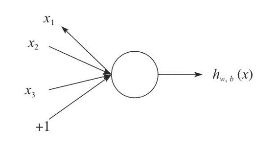

图 3-1 函数即神经元示意图

该函数接收 `n` 个输入变量 `x1` 到 `xn`，再加上一个截距 +1 项，截距指直线与纵坐标轴的交点到原点的距离，这一常量通常称为偏置项 `Bias`，即公式 `y = wx + b` 中的 `b`。神经元的输出记作 `h(x)`。

函数可拆为两部分。`z` 是一个多元一次线性组合，即 `w1x1 + w2x2 + … + wnxn + b`，其中 `wi` 为输入系数，也可看作权重，体现输入的重要性。`b` 为偏置，从几何上看是截距，也即那个 +1 节点。它先给出一个连续的数值结果。但分类任务需要離散输出。

如何把连续值转为离散？SVM 里用了阶跃函数把结果映射到 -1 或 1。这里采用 `Sigmoid` 阶跃函数来处理，把输出压缩到 0 到 1 之间，如图 3-2 所示。

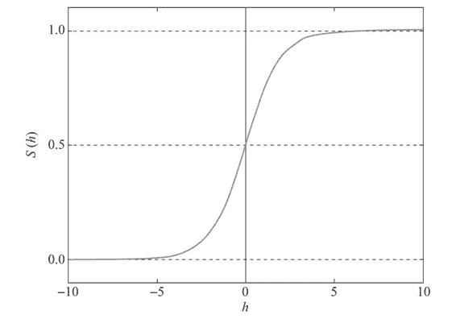

图 3-2 Sigmoid 函数示例

`Sigmoid` 能把连续数值映射为 0 或 1，0 代表未激活，1 代表激活。因此每个神经元的输出是二值化的。第 2 章提到过，单个神经元本质上等价于一个 `Logistic` 回归。这种激励机制借鉴了生物神经元的电流激活状态。其中 `Sigmoid` 的导数会在后续反向传播中发挥关键作用。

### 3.2.2 连接与网络

神经网络由众多神经元构成。现在看一个极简的例子，如图 3-3。


图 3-3 神经网络

该网络共 7 个神经元节点，分 3 层。第 1 层为输入层，仅做数据传入，不进行计算。最后一层为输出层，给出网络结果。中间层为隐藏层，输入与输出的细节被隐藏在其中。

因此网络包含 3 个输入节点、3 个隐藏节点和 1 个输出节点。注意偏置节点 +1 并非真实节点，只是为下一层每个节点提供一个常数偏置。

神经元间连接即数据流动。每条连线都有一个连接参数表示权重。例如第 1 层第 1 个节点到第 2 层第 3 个节点的连接参数为 ，其中 3 表示目标，1 表示起点，（1）表示起始层。每个节点另有偏置项，即 +1 节点的输入，代表常数截距，如第 2 层第 3 个节点的偏置为 。于是每个节点拥有输入，以及两组参数 `W` 与 `b`。另外还有输出，称为激活值，取值为 0 或 1，用  表示，指第 `l` 层的第 `i` 个激活项。`sl` 表示第 `l` 层节点数，不计偏置。

以可视化方式看节点输出的计算，公式如下：


这对应第 2 层的输出，每个输出是前一层激活值与其连接权重相乘后求和，再加上偏置。第 3 层的计算类似，公式如下：


第 3 层唯一节点的激活值由前一层 3 个节点输入值乘以对应连接参数求和，再加偏置，最后经 `Sigmoid` 处理。

记  为第 `l` 层第 `i` 个输入节点输入值的加权和，则该节点的激活值为 `z` 的 `Sigmoid`，即输入加权值的 `Sigmoid`。从输入到输出的完整过程即为正向传播。

### 3.2.3 神经网络向量化

已知神经网络的基本结构与节点输入输出的计算方式，可将网络视作一个巨大的有向无环图。若在计算机中直接用图存储，每个节点与边单独处理是不现实的。实际网络节点与参数众多，以节点方式存储会耗费内存且效率低下。那么如何高效处理？

这里需要向量化。Python 机器学习实践中普遍使用 Numpy 处理数据，所有数据尽量以多维数组或矩阵形式呈现。其好处是数组在内存中连续存储，且有高效的线性代数子程序库 `BLAS` Basic Linear Algebra Subprograms 支持向量矩阵运算，CPU 也会加速此类运算。用数组或矩阵表示数据，既节省存储又提升速度。

需避免直接用 Python 列表存储数值。NumPy 由 C++ 实现，相较 Python 列表构成的多维数组或矩阵，性能差距明显，尤其在高维复杂运算时。因此之前的实现基本都选用 NumPy 而非 Python 列表，后续实战也会展示如何用 NumPy 实现人工神经网络。

如何把人工神经网络转为向量化存储与计算？

这里 `W(1)` 表示第 1 层到第 2 层的所有连接参数。 为第 1 层第 1 个节点到第 2 层第 1 个节点的权重， 为第 1 层第 2 个节点到第 2 层第 1 个节点的权重，以此类推，公式如下：


共有 3×3 个参数，因两层各有 3 个节点。可自然地把这些参数组织成 3×3 矩阵，其中第 `i` 行对应第 2 层第 `i` 个节点的所有输入权重。例如第 1 行即第 2 层第 1 个神经元的 3 个输入权重，表示为：


把第 1 层的 3 个输出看作列向量，每行一个，共 3 行。`z` 为节点输入加权和，例如第 1 个节点的加权和为 。用 `W` 矩阵与 `x` 矩阵相乘可得到 3×1 矩阵，其中第 1 项即 `z` 去掉偏置后的部分，即权重与输入乘积之和。

一般地，若第 `l` 层有 `m` 个节点，第 `l+1` 层有 `n` 个节点，则 `W(l)` 为 `n×m` 矩阵，行对应下一层节点数，列对应当前层节点数。用 `m×1` 矩阵存当前层激活值，将 `W` 与 `x` 相乘得到 `n×1` 向量，再把 `b` 存为 `n×1` 列向量相加，即得第 `l+1` 层所有节点的 `z`，公式如下：

`z(2) = W(1)x + b(1)`

若对矩阵执行 `f` 表示逐元素映射，则对 `z` 矩阵执行 `Sigmoid` 可得到输出 `a` 矩阵，也是 `n×1` 列向量，作为下一层的输入，公式如下：

`a(2) = f(z(2))`

以此类推得到第 2 层输出。第 2 层权重 `W(2)` 为 1×3 矩阵，因只有一个目标节点而有 3 个输入节点。第 2 层激活值矩阵为 3×1，计算第 3 层 `z` 只需矩阵乘法，得到 1×1 矩阵，再加偏置 `b(2)` 即 `z(3)`。第 3 层激活值为 `z(3)` 经 `Sigmoid` 后结果，这里只有一个元素，输出 0 或 1，公式如下：

`z(3) = W(2)a(2) + b(2)`

`a(3) = f(z(3))`

由此可得神经元激活的一般函数 `h(x)`，并以矩阵形式表达，公式如下：

`hW, b(x) = a(3) = f(z(3))`

### 3.2.4 前向传播

至此对神经网络已有基本认识。接下来学习其使用方式。

实际应用中，先用训练样本训练出模型，模型内保存每层的权重矩阵 `W` 与偏置矩阵 `b`。使用时把 `x` 输入第 1 层，特征数等于第 1 层节点数，然后逐层做矩阵运算，最终得到输出层结果，输出节点数即结果元素数。若做二分类，可用网络输出表征样本是否属于某一类，0 表示不属于，1 表示属于。

输入数据后逐层计算即为神经网络中的前向传播。该简单网络被称为前馈神经网络，因其不存在闭环或回路。

因此在使用时可把网络看作黑盒，`x`、`y` 为输入，`f(xi)` 为输出，如图 3-4 所示。


图 3-4 使用神经网络

## 3.3 反向传播算法

明白了如何使用网络后，核心问题是：给定网络结构，如何求得权重矩阵 `W` 与偏置矩阵 `b`？

学过若干监督学习模型后可归纳出通用思路。训练时通常采用迭代方式，每轮迭代比较样本标签即真实输出与模型输出的差异，并反向调整参数。具体做法各异，但思路相近，这正是样本数据发挥作用的地方。

模型输出与标签的差距称为误差或损失。如何量化损失？需要定义损失函数将其形式化，公式如下：


损失函数直接计算样本数据与模型输出的方差，并乘以一个 。细心读者会发现乘以  的目的是便于求导。

单个样本 `xi` 的输出 `f(xi)` 与 `yi` 的损失定义为方差，那么对全部样本呢？

采用统计学常用做法，用所有样本损失的均方差即方差均值来表征模型整体损失，公式如下：


本质是所有样本方差之和除以样本数。此处加入了第 2 项，称为权重衰减项，目的是抑制权重对最终损失的过度影响。其中 `λ` 为权重衰减系数，`λ` 越小，权重影响衰减越多，这也是训练中需要手动调节的参数之一。

损失函数描述了预测与真实之间的差距。那么如何利用它求解网络参数 `W` 与 `b`？神经网络采用梯度下降法。梯度下降根据当前损失，不断把参数朝损失降低的方向移动。类比下山，每次走几步，观察情况再继续。每次迭代依据损失函数将权重向降低损失的方向更新，通过多次迭代使损失趋于最小，最终让模型更贴近真实。

在计算中，梯度即函数的偏导数，几何上表示变化方向。若已知损失函数表达式，想将其降低，就是沿着导数方向调整，公式如下：


注意减去偏导时需乘以学习率 `α`，它控制每次下降的步长，也是训练中需要合理调节的参数。

难点在于如何求损失函数的导数。

完整样本 `X` 的损失函数表达式复杂，直接求关于权重或偏置的偏导几乎不可行。但整体损失的偏导等于每个样本损失偏导的平均值，权重部分还需加上衰减项的导数，公式如下：


求解难点在于 `Wij` 本身的偏导。因为 `b` 的导数不含衰减项，只需求其偏导平均值。于是问题转化为求单个样本损失对权重 `Wij` 与偏置 `b` 的两个偏导，公式如下：


由于无法直接计算导数，需用残差替代。残差可理解为每一层与真实值差距的偏导近似。

最后一层的残差计算很直接，因已知标签 `y`，可直接求输出层的偏导，求导后输出层偏导公式如下：


# 中间层误差怎么算

中间层的残差该如何确定？说到底我们并不知道该层每一个单元在理想情况下应该输出什么数值。

反向传播给出的思路是：第 l 层的残差可以看作其后一层 l+1 残差的加权汇总。这样想也并不难，第 l+1 层的偏差本质上可以追溯到第 l 层的偏差，而传递过程受两方面影响，一是激活值的偏离，二是连接权重的大小。因此只要掌握了后面一层的残差，就可以用后面残差的加权平均来近似前面一层的残差，具体表达式如下：


把偏导数全部用残差来替代，问题就变得好处理了，形式整理后如下：


到这里反向传播的完整流程就清晰了。

首先执行前向传播，把网络各层的激活值全部算出来。
其次依据网络输出与真实标签的差距计算输出层的残差，表达式如下：


然后层层倒推，用第 l+1 层的残差去求第 l 层的残差。这里把原来的 δ 公式改写成向量形式，用矩阵乘法一次性完成所有加权求和，表达式如下：


最后结合本层的激活值和下一层的残差，求出该层的参数梯度，表达式如下：


可以看出，与预测时的方向不同，训练阶段需要在得到结果后从最后一层往第 1 层反向运算，逐层获得残差和梯度，再用梯度修正各层参数。这个与前向传播方向相反的过程，正是反向传播的由来。

## 3.4 实现前向神经网络

前文已经介绍了人工神经网络的基本构成和前向传播的原理，接下来就动手实现前向传播算法。在编码前先定义一下网络层的结构。需要注意的是，实验验证阶段我们优先选用 Python，待到实战落地时再逐步切换到 C/C++ 来实现生产级代码。

### 3.4.1 神经网络与前向传播实现

先编写 `layer.py` 来实现神经网络的层，具体见代码清单 3-1。

代码清单 3-1　`layer.py`

# 人工神经网络实现示例

## Layer 基类

```
 1 class Layer(object):
 2     def __init__(self, layerType, name, bottomShape, topShape):
 3         super(Layer, self).__init__()
 4 
 5         self.type = layerType
 6         self.name = name
 7         self.bottomShape = bottomShape
 8         self.topShape = topShape
 9 
10     def setUp(self):
11         raise NotImplementedError
12 
13     def baseForward(self, bottom):
14         if bottom.shape != self.bottomShape:
15             print('Bottom shape of layer {name} should be: {shape}').format (name=self.name, shape=self.bottomShape)
16         assert bottom.shape == self.bottomShape;
17 
18         top, z = self.forward(bottom)
19 
20         print(top)
21 
22     def forward(self, bottom):
23         raise NotImplementedError
24 
25     def baseBackward(self, top, z, bottom, weight, diff):
26         return self.backward(top, z, bottom, weight, diff)
27 
28     def backward(self, top, z, bottom, weight, diff):
29         raise NotImplementedErrorayer.py
```

第 1 行创建了 `Layer` 类，该类继承自 `object`，属于 Python 的新式类。

第 2～8 行定义了 `__init__` 方法，参数 `layerType` 用来标识层类型，`name` 为层名称，`bottomShape` 表示输入数据的向量维度，`topShape` 表示输出数据的向量维度，随后把这些参数赋给对象的属性。

第 10～11 行定义了 `setUp` 方法，这是一个需要子类重写的方法，用于层的初始化。

第 13～20 行定义了 `baseForward` 方法，这是基础的前向实现，先校验输入数据尺寸是否与层要求的输入尺寸一致，不一致则报错中断，校验通过后调用 `forward` 方法完成真正的前向计算。

第 22～23 行定义了 `forward` 方法，这是一个需要子类重写的方法，用来实现具体的前向计算。

第 25～26 行定义了 `baseBackward` 方法，这是基础的反向传播实现，真正的反向操作需要由派生类的 `forward` 函数完成。

第 28～29 行定义了 `backward` 方法，这是一个需要子类重写的方法，用来实现层的反向传播计算。

接着编写 `data_layer.py` 来实现数据层，用于承接网络的输入数据，见代码清单 3-2。

### 代码清单 3-2 data_layer.py

```
 1 from algorithm.ann.layer import Layer
 2 
 3 
 4 class DataLayer(Layer):
 5     def __init__(self, name, bottomShape, topShape):
 6         super(DataLayer, self).__init__(
 7             'DataLayer', name, bottomShape, topShape
 8         )
 9 
10     def setUp(self):
11         pass
12 
13     def forward(self, bottom):
14         top = bottom.reshape(self.topShape)
15 
16         return top, None
17 
18     def backward(self, top, z, bottom, weight, diff):
19         pass
```

该层的实现非常简洁。

第 4 行定义了 `DataLayer` 类，继承自上文定义的 `Layer` 类。

第 5～8 行定义构造方法，直接通过 `super` 调用基类的 `__init__`，把层名设为 `DataLayer`，并把 `name`、`bottomShape` 和 `topShape` 传给基类初始化，完成层的组装。

第 10～11 行实现了基类的 `setUp` 方法，数据层只需透传数据，无需初始化，故此处用 `pass` 跳过。

第 13～14 行实现了基类的 `forward` 方法，主要工作是调用 `reshape` 把输入数据调整为输出所需的尺寸，以便送入下一层计算。

第 18～19 行实现了基类的 `backward` 方法，本节不涉及反向传播实现，故同样用 `pass` 跳过。

随后实现隐藏层和输出层，这两类层的逻辑完全一致，因此合并到一个类中编写 `simple_layer.py`，见代码清单 3-3。

### 代码清单 3-3 simple_layer.py

```
 1 from algorithm.ann.layer import Layer
 2 import numpy as np
 3 
 4 
 5 class SimpleLayer(Layer):
 6     def __init__(self, name, bottomShape, topShape):
 7         super(SimpleLayer, self).__init__(
 8             'SimpleLayer', name, bottomShape, topShape
 9         )
10 
11         self.weight = None
12         self.bias = None
13 
14     def setUp(self):
15         # s1
16         s1 = self.bottomShape[0]
17         # s2
18         s2 = self.topShape[0]
19 
20         # s2 * s1, random
21         self.weight = np.mat(np.random.uniform(-0.5, 0.5, (s2, s1)))
22         self.bias = np.mat(np.zeros((s2, 1,), dtype=np.float))
23 
24     def forward(self, bottom):
25         z = self.weight * bottom + self.bias
26         top = SimpleLayer.sigmoid(z)
27 
28         return top, z
29 
30     def backward(self, top, z, bottom, weight, diff):
31         diff = np.multiply(weight.T * diff, SimpleLayer.derivative(z))
32 
33         return self.weight, diff
34 
35     @staticmethod
36     def sigmoid(mat):
37         return 1.0/(1 + np.exp(-mat))
38 
39     @staticmethod
40     def derivative(mat):
41         fz = SimpleLayer.sigmoid(mat)
42 
43         return np.multiply(fz, (1 -fz))
```

第 5 行定义了 `SimpleLayer` 类，继承自上文定义的 `Layer` 类。人工神经网络中除输入层外，其余层的处理方式相同，所有实现都集中在 `SimpleLayer` 中。

第 6～12 行定义构造方法，通过 `super` 调用基类的 `__init__`，把层名设为 `SimpleLayer`，并把 `name`、`bottomShape`、`topShape` 传给基类，完成层的构建，随后把层的 `weight` 和 `bias` 均初始化为 `None`。

第 14～22 行实现了基类的 `setUp` 方法，由于暂无预训练模型，这里直接调用 `np.random.uniform`，依据输入输出的尺寸生成随机的参数矩阵和偏置矩阵。

第 24～28 行实现了基类的 `forward` 方法，该方法先计算层参数与输入数据的矩阵乘法，再加上偏置项，最后调用 `sigmoid` 方法得到层的输出，1 表示激活，0 表示未激活，最后把输出和激活值一并返回给调用方。

第 30～33 行实现了基类的 `backward` 方法，这里依据下一层的反馈和本层的输出计算出层的残差 `diff`，并把残差返回用于参数调整。

第 36～37 行定义了 `sigmoid` 方法，用于计算输入矩阵的 sigmoid 激活。

第 40～43 行用于求该层的导数，即梯度。

最后编写网络类 `net.py`，该类会调用 `layer` 组合成完整的神经网络，见代码清单 3-4。

### 代码清单 3-4 net.py

```
 1 import numpy as np
 2 
 3 
 4 class Net(object):
 5     def __init__(self, alpha, lamb, maxIteration):
 6         super(Net, self).__init__()
 7 
 8         self.alpha = alpha
 9         self.lamb = lamb
10         self.maxIteration = maxIteration
11         self.layers = []
12         self.blobs = []
13 
14     def addLayer(self, layer):
15         self.layers.append(layer)
16 
17     def addLayers(self, *args):
18         for layer in args:
19             self.addLayer(layer)
20 
21     def setUp(self):
22         for layer in self.layers:
23             layer.setUp()
24 
25     def forward(self, inputData):
26         self.blobs = []
27         top = inputData
28         z = None
29 
30         for layer in self.layers:
31             top, z = layer.forward(top)
32             self.blobs.append((top, z))
33 
34         return top, z
35 
36     def train(self, trainItems, labelItems):
37         for iteration in range(0, self.maxIteration):
38             for trainItem, labelItem in zip(trainItems, labelItems):
39                 self.trainByOne(trainItem, labelItem)
40             # get sum of weight and bias
41             # adjust weight of layers
42 
43     def trainByOne(self, trainItem, labelItem):
44         for layer in self.layers:
45             layer.setUp()
46 
47         predictResult = self.forward(trainItem)
48 
49         y = labelItem
50         a = predictResult[0]
51         z = predictResult[1]
52 
53         diff = -(y - a)
54         weightWidth = diff.shape[0]
55         weight = np.ones((weightWidth, weightWidth), dtype=np.float)
56         # 8 * 8
57         weight /= weightWidth
58 
59         diffs = []
60         for reverseIndex, layer in enumerate(self.layers[-1:0:-1]):
61             layerIndex = -(reverseIndex + 1)
62             prevLayerIndex = layerIndex - 1
63 
64             top, z = self.blobs[layerIndex]
65             bottom = self.blobs[prevLayerIndex][0]
66 
67             weight, diff = layer.baseBackward(top, z, bottom, weight, diff)
68             diffs.insert(0, diff)
69 
70         weightDelta = []
71         biasDelta = []
72 
73         for reverseIndex, layer in enumerate(self.layers[-1:0:-1]):
74             layerIndex = -(reverseIndex + 1)
75             top = self.blobs[layerIndex - 1][0]
76             diff = diffs[layerIndex]
77 
78             partDerivate = diff * top.T
79             weightDelta.insert(0, partDerivate)
80             biasDelta.insert(0, diff)
81 
82         print(weightDelta)
83         print(biasDelta)
```

第 4 行定义了 `Net` 类，该类继承自 `object` 类。

第 5 到 12 行负责构造方法，里面出现的 `alpha`、`lamb`、`maxIteration` 都是与训练相关的超参，这里暂时先放一边。`layers` 用来收纳网络里的全部层，`blobs` 则负责保存各层的输入输出数据单元。

第 14、15 行给出 `addLayer` 方法，作用就是把新造好的层挂进网络，具体做法是把层追加到 `layers` 列表里。

第 17 到 19 行是 `addLayers` 方法，可以一次性把多层塞进来。参数采用了不定长 `*args`，它会把用户传入的所有层组成一个可迭代对象，遍历后逐个调用 `addLayer` 完成挂载。

第 21 到 23 行是 `setUp` 方法，任务是完成网络初始化。实现方式很直接，依次遍历 `layers` 中所有层，给每层调用一次 `setUp`。

第 25 到 34 行实现 `forward` 前向传播。先把 `blobs` 清空为列表，再把 `inputData` 设为 `top`，激活值 `z` 初始化为 0。随后逐层走完定义的层，用每个层的 `forward` 计算该层输出和激活值，把结果写入 `blobs` 保留。最后返回最末层的输出，就完成了整次预测。

第 36 到 83 行定义了 `train` 方法，负责模型训练。训练代码本身并不完整，这里也不展开讨论实现细节。

下面用 `sample.py` 小试一下刚才搭建的人工神经网络，具体见代码清单 3-5。

### 代码清单 3-5 sample.py

```
 1 import numpy as np
 2 
 3 from algorithm.ann.layers.datalayer import DataLayer
 4 from algorithm.ann.layers.simplelayer import SimpleLayer
 5 from algorithm.ann.net import Net
 6 from common.io.tsv import TsvDataSetReader
 7 
 8 
 9 def main():
10     dataSetReader = TsvDataSetReader()
11     dataSet = dataSetReader.loadDataSet('annData.txt',
12                                         attrType=float)
13 
14     attributes = [item[:-1] for item in dataSet]
15     labels = [item[-1] for item in dataSet]
16 
17     print(attributes)
18     print(labels)
19 
20     net = Net(alpha=.5, lamb=.6, maxIteration=10)
21 
22     net.addLayers(
23         DataLayer('input', bottomShape=(1, 4), topShape=(4, 1)),
24         SimpleLayer('hidden1', bottomShape=(4, 1), topShape=(3, 1)),
25         SimpleLayer('output', bottomShape=(3, 1), topShape=(1, 1))
26     )
27 
28     net.setUp()
29     net.trainByOne(np.mat(attributes[0]), np.mat(labels[0]))
30 
31     print(top)
32     print(z)
33 
34     pass
35 
36 if __name__ == '__main__':
37     main()
```

第 9 行声明了 `main()`，它是脚本的入口。

第 10 行实例化一个 `dataSetReader`，用来读取 `tsv` 文件。`tsv` 和 `csv` 很像，只是列与列之间用制表符分隔，而不是逗号。

第 11、12 行调用 `loadDataSet` 读取数据集，文件名是 `annData.txt`，数据类型指定为浮点，所有读入数据都会转为浮点数。

第 14 行把 `attributes` 设为从数据集中抽取出的全部样本特征。

第 15 行把 `labels` 设为从数据集中抽取出的全部样本标签。

第 20 行创建网络对象 `net`，并把 `alpha` 设为 0.5、`lamb` 设为 0.6、`maxIteration` 设为 10。

第 22 到 26 行定义了三层并用 `addLayers` 加入网络。第一层是 `DataLayer`，名字为 `input`，输入矩阵维度是 (1,4)，输出维度是 (4,1)；第二层是 `SimpleLayer`，名字为 `hidden1`，输入 (4,1)，输出 (3,1)；第三层同样是 `SimpleLayer`，输入 (3,1)，输出 (1,1)。

第 28 行执行 `setUp()` 对网络做初始化。

第 29 行调用 `trainByOne()` 开始训练。

第 36、37 行判断脚本是否通过命令行启动，若是则调用 `main()`。

#### 3.4.2 Softmax 回归：从二分类到多分类

`Sigmoid` 最多只能给出 0 或 1 的结果，只能胜任二分类任务。实际场景里经常要区分多种类别，这时 `Sigmoid` 就力不从心了，于是 `Softmax` 登场来处理多分类。

`Softmax` 本质上是 `Logistic` 的推广。`Logistic` 处理二分类，若硬要用它做多分类，就得把一个多分类问题拆成多个二分类，训练出多个分类器。`Softmax` 在 `Logistic` 思路上做了扩展，直接给出了可用于多分类的公式。它的核心思想是对新样本计算它分到每个类别的得分，再用 `Softmax` 函数把得分归一化为概率，根据概率大小判定类别。

每个类别都有一个权重参数 `θ`，依据权重可算出各类别得分：


归一化后的概率值由下式给出：


式中 `k` 为类别数，`s(x)` 为样本在各类别上的分数，`σ` 为 `Softmax` 函数。与 `Logistic` 类似，`Softmax` 也是在得到的概率中挑最大值：


如此就能预测出概率最高的类别。

### 3.5 稀疏自编码器：让特征更精简

神经网络的显著特点是拥有多层隐含层，正是这些隐含层让网络具备非线性处理能力。每层隐含层可以看作从原始特征中提炼出的“高层特征”，对分类很有帮助，这些特征有人能理解也有人无法理解。人工神经网络的本质就是学习这类特征，自编码器能在这一方面做得更好。

#### 3.5.1 为何需要自编码

假设有一堆图片，如何提取特征？

常规思路是：给一组输入再给一组期望输出，比如天气预报，输入时间输出天气。给神经网络赋上一组随机值，通过数学运算比较目标与期望输出的差距，再用微积分思想反向调整参数，让结果逐渐逼近目标，不断重复这个过程，最终确定的网络参数就可以视作特征。

那如果输入是一堆图片呢？怎么从图片里抽取特征？这里有一个很巧妙的办法。

1）把图片切成若干小块并转成数据表达；
2）用神经网络对这些数据进行运算。

关键问题是，运算的输出应该是什么？

妙处在于，输出再经过一次神经网络运算，让它能还原回输入本身。

输入→编码运算→解码运算→输出

随后比较输入与输出，根据差异调整编码与解码过程，具体编码解码在做什么并不需要关心。当输入输出精度达到满意程度时，保留下来的就是特征。

为什么会这样？原理很简单，中间编码层的处理相当于对原图施加某种干扰，而解码层的处理相当于把被干扰的图像恢复回来。

#### 3.5.2 自编码器工作原理

自动编码器是一种数据压缩算法，其压缩与解压缩函数是数据相关的、有损的、从样本中自动学习的。绝大多数情况下，压缩与解压缩函数由神经网络实现。其结构如图 3-5 所示。


图 3-5 自动编码器结构图

1）数据相关性，通称 `data-specific` 或 `data-dependent`。这意味着自动编码器只能较好地压缩与训练数据相似的数据。比如用人脸训练的自动编码器去压缩树木图片效果很差，因为学到的特征与人脸相关。

2）有损性。解压缩后的输出相比原始输入是退化的，和我们熟悉的 `MP3`、`JPEG` 一样，这与无损压缩不同。

3）自动学习性。从样本中自动学习意味着可以为特定类别的输入训练出专门的编码器，无需额外工作。

搭建自动编码器要做三件事：搭建编码器、搭建解码器、设定损失函数，用来衡量压缩带来的信息损失。编码器和解码器通常是可导的参数化方程，典型做法是用神经网络。参数可通过最小化损失函数优化，例如 `SGD`。

提示

`SGD` 是 `Stochastic Gradient Descent` 的缩写，即随机梯度下降，是一种梯度下降优化器。传统批量梯度下降用整批训练数据计算梯度，数据大时会产生冗余，`SGD` 每次对单个样本更新梯度，无冗余、速度更快，还支持增量样本。缺点是更新频繁可能导致代价函数震荡。

自编码器属于自监督算法，并非无监督。它的标签由输入数据自身产生。要得到可靠的自监督模型，需要一个合理的目标和损失函数。把目标单纯设为重构输入未必正确。机器学习更关注学习高级抽象特征，而非像素级的精确重建。事实上，对分类、定位等主要任务最有用的特征，往往在重构任务上表现最差。

目前自编码器的主要用途有两类：数据去噪和为可视化做降维。配合合适的维度和稀疏约束，自编码器能学习到比 `PCA` 更有趣的数据投影。

对于 2D 可视化，`t-SNE` 目前表现最好，但通常要求原始维度已经比较低。因此可先用自编码器把高维数据降到较低维度，例如 32 维，再用 `t-SNE` 投影到 2D 平面。

#### 3.5.3 稀疏自编码的实现思路

自编码过程中，中间层制造干扰再消除干扰，输出最终等于输入，经过多次变换后能识别原输入保留下来的就是特征。在此思路上再加入一个混淆器，随机添加大量噪声再消除，就能增强抗干扰能力，这类模型称为 `Denoising AutoEncoders` 降噪自动编码器。

这是个惊人的想法，只能在计算机上实现，因为依赖高密度运算。但仍不够，特征数量过多会严重影响计算效率。于是要思考能否简化特征，若更简单的特征能完成同样工作，何必用复杂特征，这就是奥卡姆剃刀原则。基于此，需要对特征做稀疏化，思路如图 3-6 所示。


图 3-6 稀疏自编码算法

稀疏化容易说难实现。可以这样理解，简单规则是复杂规则的简化，若在复杂规则基础上删去细枝末节，核心结果差别不大，能复原大部分关键信息，就可认为简化合理。

据此可以设计实验，在原始神经元结构上寻找抑制组合，让尽可能多的神经元不参与工作，仍能得到不错结果，这样得到的网络就是稀疏化网络，因为可以把无效神经元全部删掉，只保留有用部分。

落到代码层面，可以限制神经元激活值，让所有神经元的总激活值不超过某个阈值，比如 0.05，这样大部分神经元会变成 0，只有少数神经元需要精细计算权重。怎么实现？

从源头看，稀疏化实质是寻找一组“超完备”基向量来更高效表示样本。稀疏编码的目标是找到一组基向量，使得输入向量能表示为这些基向量的线性组合。

首先要求 `min |I - O|`，`I` 为输入，`O` 为输出，即输入输出差距最小。

用图片来理解，就是用少量微小图片组合成大图，这些微小图片构成字典 `φ`。任意抽一个比最小图片稍大的小图，完全塞进去，比如它由 `φ1` 的 20% 加 `φ2` 的 50% 加 `φ3` 的 50% 构成，因为比最小图片大，总和会超过 100%。

“找到最小图片”相当于增加了限制条件。`O` 为输出，即要还原的目标图，`I` 为输入，于是可表达为：


再加入惩罚系数来调节网络数值。实际问题就是把 `a` 和 `φ` 拼凑出来使目标最小，公式如下：


右边加号后的是稀疏代价函数，也可用对数代价函数即柯西先验 ，它用于限制远大于零的值，避免网络数值差距过大集中，破坏稀疏性。

目标最小值是稳定的，若 `Φ` 或 `a` 过大，右边的代价函数会变得很小，失去意义。因此要限制 `‖φ‖2` 小于某个值。

实现时每次迭代分两步：

1）固定字典 `φ[k]`，调整 `a[k]` 使目标最小，即解 `LASSO` 问题；
2）固定 `a[k]`，调整 `φ[k]` 使目标最小，即解凸 `QP` 问题。

如此反复计算即可。

### 3.6 数据预处理关键两步

训练和预测前通常需要对数据做预处理，以满足神经网络的输入要求。下面介绍两种常用方法。

#### 3.6.1 去均值中心化

去均值是最常见的图片预处理。对每张训练图片的特征都减去全量训练集图片的特征均值，直观上把输入各维度中心化到 0。用 `Numpy` 可写成 `X -= np.mean(X, axis = 0)`。也可以简单地用所有像素的均值统一减去，或在 `RGB` 三个通道分别做减法。

#### 3.6.2 归一化统一尺度

归一化的直观含义是让各维度数据落在相似的变化幅度上。常见做法有两种：去均值后再用标准差归一化，即 ；另一种是用绝对最大值归一化，保证数据落在 `[-1, 1]`。对各维度幅度差异很大的数据集，归一化很有帮助。对图像而言像素范围本来就在 `[0, 255]`，幅度一致，归一化可做可不做。出于惯例，人们仍常把输入归一化到 `[-1, 1]`，尤其在输入量纲不同时更重要。

### 3.7 本章要点回顾

本章先介绍了人工神经网络基础，探讨了基本结构，包括神经元、连接、网络、向量化与正向传播等核心概念，并以理论为重点深入讲解了正向传播和反向传播原理，帮助理解神经网络的工作机制。

随后介绍了如何用 `Python` 实现完整的前向神经网络，并实现了 `Softmax` 回归。接着讲解了自编码器和稀疏自编码器，这是一种抽取数据核心特征的重要手段，也说明了如何通过稀疏化简化特征。

最后介绍了神经网络数据预处理，主要讨论了在图像处理中常见的去均值和归一化，让读者对预处理有基本认识。

人工神经网络是深度学习的基础，学完本章即可对相关知识形成整体认知，从下一章开始真正进入深度学习领域。

## 第 4 章 深度网络与卷积神经网络

深度学习与CNN：通往移动端算法的核心路径

本章在机器学习的基础之上向前推进，正式进入深度学习的话题。先对深度网络的整体逻辑做拆解，再把焦点集中到卷积神经网络上，介绍全连接与局部连接的区别、卷积和池化的具体作用，并由此引出 CNN 的定义与实现方式。在此基础上，后续章节会围绕移动平台的工程化实现展开深入探讨并配以实战案例，所以本章的内容是后面算法落地的关键理论支撑。

### 4.1 深度网络

要让一个机器学习系统更强，常见的做法是给它更多数据。数据量越大，训练出来的准确率通常也越高，这看起来很理想。但传统模型在数据量达到数万、数十万甚至上百万后提升就会放缓，主要原因是它们的特征基本都是人工挑选出来的。那么有没有一种体系可以摆脱手工特征的瓶颈？深度学习的出现正是为了解决这个问题。

#### 4.1.1 自我学习

当下主流的训练方式仍以有监督学习为主。回顾前文，这类方法需要海量带标签的样本才能发挥效果。如果模型本身很强，想要进一步提升，稳妥的做法就是不断补充标注数据，直到性能满意为止。对机器学习而言，数据规模和算法能力同等重要。

获取高质量标注数据的成本很高，Amazon 等平台提供的众包服务只是把标注外包给大量个体，虽然比工程师手工提特征进步，但并没有触及本质。换个思路，如果能让算法自动从原始数据里挖出特征会怎样？

未标注数据的获取成本极低，比如从网上批量下载图片或文本。单个未标注样本的信息量不及标注样本，但若能充分利用大规模未标注数据，性能同样可以显著提升。自我学习和无监督学习就是针对这一问题的解法：输入大量未标注数据，模型自行提炼出有用的表示。第 3 章提到过的自编码器就是典型的自监督代表。

这种思路特别适合标注稀缺但未标注数据丰富的场景。即便在传统机器学习范式里，自动学习特征也是一个很有价值的补充。

#### 4.1.2 特征学习

如何利用未标注数据，核心就是特征学习。通俗说，就是在未标注数据集中挖掘出可用的表征。这一过程通常伴随数据预处理，比如均值去中心化、标准化等。其中很常见的方法是 PCA，主成分分析，它是一种通用的线性变换。PCA 的关键在于要保存变换时的参数，训练和测试阶段都要对原始样本做完全一致的处理，保证特征学习阶段和推理阶段的数据分布保持统一。

做机器学习必须时刻关注分布问题，不同方法对分布的敏感度不同。常用的两种特征学习范式，一种是半监督学习，它要求未标注数据 xu 与已标注数据 xl 来自同一分布；另一种是自我学习，也就是 self-taught learning，对分布没有严格要求，适用范围更广、能力更强。

举个例子，做老虎与猫的图像分类。训练时我们只有带标签的老虎或猫图。若用搜索引擎随机抓取一批图片训练稀疏自编码器，抓取结果未必全是老虎或猫，这时未标注集和标注集的分布显然不同。反之，若我们有一批人工收集的图像，全部是老虎或猫，只是没有标签，那么未标注集与标注集服从相同分布，这就属于半监督场景。

现实中很难保证数据严格同分布，因此自我学习在特征学习里应用更广泛。相比传统浅层网络，深度神经网络正是借鉴了自我学习的思想，才取得了更好的效果。

#### 4.1.3 深度神经网络

上一章构建过一个经典的三层网络：输入层、隐藏层、输出层。对 MNIST 这类简单任务足够用了，但隐藏层只有一层，特征表达能力有限。面对复杂问题，单一特征层难以捕捉足够丰富的模式。

本章进一步讨论深度神经网络，即包含多个隐藏层的结构。每一层都在对上一层的输出做非线性变换，现实数据的特征往往不是线性的，所以多层叠加能学习到更复杂的函数，表达能力远超浅层网络。

这里要强调：每层必须使用非线性激活函数，否则多层线性组合仍然等价于一个线性函数，无法产生质变。

为什么不直接设计一个复杂的非线性函数？因为深度网络用多个简单的函数组合来逼近复杂映射，比一次性寻找超复杂函数更容易。处理图像时，第一层可能把像素映射成边缘，第二层把边缘组合成轮廓，第三层再识别出完整物体，层层递进地完成整体-局部的分解。

这种逐级抽象的方式与人脑视觉皮层的处理逻辑很像，是一种更自然的问题求解路径。深度网络出现较晚的原因在于传统训练方式难以驾驭深层结构，逐层贪婪训练的提出才让深网变得可行。

#### 4.1.4 逐层贪婪训练方法

直接在深网里堆叠普通隐藏层很难得到好模型。深网主要有两类困难：一是局部极值问题，梯度法在随机初始化的深网中容易陷入大量不良局部最优；二是梯度弥散。反向传播时梯度会随层数加深急剧衰减，最初几层的权重几乎不更新，学不到有效信息。

还有一个副作用：若后几层神经元足够多，它们单独就能拟合标签数据，前几层形同虚设，整体效果和只用最后几层的浅网差不多。

如果用无监督数据预训练初始权重，参数会落在更合理的区域，再从这里开始微调，梯度下降更容易收敛到较好解，因为无标注数据已经提供了输入模式的先验。

基于此就有了逐层贪婪训练法：每次只训练一层，用自我学习的方式学到该层的特征，再把学到的特征作为下一层的输入参数继续训练。每次都贪心地求解当前层最优，最后得到一个逐层构建的深模型。

## 4.2 卷积神经网络

知道如何训练深网并不等于能高效处理图像。如果每一层都是第三章那种全连接隐藏层，参数量会爆炸。因此需要特殊的深网结构，卷积神经网络就是最核心的一种。

### 4.2.1 全连接与部分连接网络

之前的网络，包括稀疏自编码器，都采用输入层与隐藏层全连接。处理 8×8 小图时没问题，但面对 100×100 的图像，输入单元 10 000 个，隐藏层 100 个特征，就需要学习 100 万个参数，前后传播的计算都不可接受。这就是全连接层 FC 的瓶颈。

为了提升效率，需要限制连接。部分连接网络让每个隐藏单元只与输入的一部分相连，比如只关注图像的一小块区域，负责提取局部特征。

这种局部连接的思想与生物视觉系统相近，视觉皮层的神经元主要响应特定局部刺激，而不是全视野信息。于是问题变成：该让哪些输入节点与哪些隐藏节点相连？这就引出了卷积这一现成方案。

### 4.2.2 卷积

只要接触过深度学习，大多听过 CNN，即 Convolution Neural Network，卷积神经网络的缩写。卷积的关键在于图像的统计特性在不同位置是相似的，某一小块学到的特征可以迁移到其他位置。

比如从 100×100 的图像里随机取一小块学习特征，把这个特征当作探测器，通过卷积操作在整张图上滑动，得到不同位置的激活响应。

以示意为例，输入是一张 5×5 的图。


图 4-1　输入图像

选用一个 3×3 的卷积核。


图 4-2　卷积核

把卷积核放在左上角 (1,1)，将核与覆盖区域逐元素相乘后求和，就得到第一个响应值。向右、向下滑动重复这一操作。


对 5×5 输入做 3×3 卷积后得到 3×3 的特征图，尺寸为原图减去核的尺寸。左上角的响应对应原图左上角 3×3 区域与核的点积和，结果为 4。继续滑动计算得到后续值，最终结果如图。


图 4-3　移动卷积核后的计算结果

由此可见，从 100×100 图像学习一个 5×5 特征，隐藏层 100 个单元，就需要在所有 96×96 个位置做卷积，得到 96×96×100 个响应。卷积的意义在于用学习到的核自动提取语义特征，而不是人工手工设计。

判断一张图里是否有人，需要轮廓、脸、身体等多重高级语义特征的组合，这也是为什么需要多个卷积核。层数多的原因在于，人脸本身也是由眼睛、鼻子等更低层特征构成，需要逐层向下分解到像素级别，这正是深度网络整体-局部分解的核心思想。

### 4.2.3 池化

卷积得到特征后，直接用全部特征做分类计算量依然巨大。受统计思想启发，可以用局部区域的统计量来代表该区域，如最大值或平均值，从而压缩维度，还能起到一定的抗过拟合作用。这就是池化。

实际操作中，池化窗口会滑动，先算第一个区域的统计值，再平移计算下一个区域，以此类推。滑动带来的好处是平移不变性，图像轻微偏移时仍能产生相似的池化特征。

本质上，池化让卷积后的特征在局部共享权重，把 m×m 区域映射成一个值，大幅降低特征矩阵维度，提高效率。

### 4.2.4 卷积神经网络

有了这些工具，CNN 的整体流程就清晰了：先用卷积层逐层提取不同层次的图像特征，再用池化层把特征图压缩成更紧凑的统计表示，最后接入全连接层并以 Softmax 分类器给出类别结果。

这正是卷积神经网络 `CNN` 的样子，如图 4-4 所示。看其结构图，从左到右的流程是输入层、卷积层、池化层、全连接层，最后由分类器给出结果。整体架构并不算复杂，思路也十分明确。只是网络的深度可以随意扩展，例如堆叠更多组卷积-池化，每一组都负责挖掘不同种类的统计特征。有了足够的数据支撑，CNN 就能很好地学习到多样化特征，并据此训练出分类器。


图 4-4　卷积神经网络

## 4.3 卷积神经网络实现

在掌握了深度学习与 CNN 的基础概念后，我们要用编码实战帮助读者建立直观感受。理论和工程落地之间往往存在很大落差，身为工程师的你一定体会过：概念看似吃透，真正上手时却捉襟见肘，很多问题也只有在实践中才会逐步显现。因此边做边学、边学边拓展网络内容，是更合理的安排。本节会逐步演示基础卷积操作的实现方式，为了完整搭建 CNN，我们先用 C++ 完成一个神经网络的基础设施，也就是 `Layer` 与 `Net` 等核心部件，之前书中用 Python 演示过类似思路。

随后我们会补充 CNN 常用的几种层，比如全连接层 `inner production layer`、卷积层 `convolution layer`、池化层 `pooling layer`。

本节的重点放在前向网络上，也就是如何用深度神经网络做预测。关于反向传播、梯度下降、求导、残差等训练相关的理论与实现细节，因本书关注的是深度网络在移动端的应用优化，不再展开繁琐的训练过程实现，有兴趣的读者可以另行深入。

### 4.3.1 Layer 实现

先从层的定义入手，构建 `Layer` 基类。该头文件为卷积、池化、全连接等具体层提供统一的基础能力，如代码清单 4-1 所示。

代码清单 4-1　`layer.h`

## `layer.h` 头文件

```
 1 #ifndef LAYER_H
 2 #define LAYER_H
 3 
 4 #include <stdio.h>
 5 #include <string>
 6 #include <vector>
 7 #include <cstdint>
 8 #include "mat.h"
 9 #include "modelbin.h"
10 #include "paramdict.h"
11 
12 class Layer
13 {
14 public:
15     Layer();
16     virtual ~Layer();
17 
18     virtual int32_t load_param(const ParamDict& pd);
19     virtual int32_t load_model(const ModelBin& mb);
20 
21 public:
22     bool one_blob_only;
23     bool support_inplace;
24 
25 public:
26     virtual int32_t forward(const std::vector<Mat>& bottom_blobs, std::vector <Mat>& top_blobs) const;
27     virtual int32_t forward(const Mat& bottom_blob, Mat& top_blob) const;
28     virtual int32_t forward_inplace(std::vector<Mat>& bottom_top_blobs) const;
29     virtual int32_t forward_inplace(Mat& bottom_top_blob) const;
30 
31 public:
32     std::string type;
33     std::string name;
34     std::vector<int32_t> bottoms;
35     std::vector<int32_t> tops;
36 };
37 
38 typedef Layer* (*layer_creator_func)();
39 
40 struct layer_registry_entry
41 {
42     const char* name;
43     layer_creator_func creator;
44 };
45 
46 int32_t layer_to_index(const char* type);
47 Layer* create_layer(const char* type);
48 Layer* create_layer(int32_t index);
49 
50 #define DEFINE_LAYER_CREATOR(name) \
51     Layer* name##_layer_creator() { return new name; }
52 
53 #endif // LAYER_H
```

第 7～9 行，引入了若干依赖头文件，`mat.h` 封装矩阵类，`modelbin.h` 封装二进制模型参数类型，`paramdict` 则用于封装网络结构参数。

第 12 行，声明了 `Layer` 类，作为所有具体层的基类。

第 15～16 行，提供了 `Layer` 的构造函数与析构函数声明。

第 18 行，声明 `load_param()` 成员，用于加载层的超参数。

第 19 行，声明 `load_model()` 成员，用于加载层的模型参数。

第 22～23 行，声明两个成员变量，`one_blob_only` 用来标识该层是否仅接受一个输入，`support_inplace` 用来标识是否支持原地运算而不必新建数据对象。

第 26～29 行，声明多组 `forward()` 接口，其中普通 `forward` 会生成新的数据块，`forward_inplace` 则复用已有数据块不做额外分配。各接口均有处理多个 Blob 与仅处理单个 Blob 的版本，都是前向计算的入口。

第 31～36 行，定义若干成员变量，`type` 记录层类型名，`name` 记录层名称，`bottoms` 保存输入矩阵集合，`tops` 保存输出矩阵集合。

第 38 行，定义 `Layer` 指针类型，该类型表示层工厂函数的函数指针，每种层都有对应的工厂函数。

第 40～44 行，定义 `layer_registry_entry` 结构体，用于注册层类型，每个层类型对应一个该结构体实例，其中 `name` 为层名，`creator` 为对应工厂函数。

第 46 行，声明 `layer_to_index()`，根据层名在注册表中查找对应的索引。

第 47 行，声明 `create_layer()`，按层名创建新的层对象。

第 48 行，声明重载的 `create_layer()`，按注册表索引创建层对象。

第 50～51 行，定义 `DEFINE_LAYER_CREATOR` 宏，用于基于层名自动生成对应的工厂函数。

随后编写 `layer.cpp` 实现前面声明的 `Layer` 类，如代码清单 4-2 所示。

### 代码清单 4-2 `layer.cpp`

```
  1 #include "layer.h"
  2 
  3 #include <stdio.h>
  4 #include <string.h>
  5 #include "cpu.h"
  6 
  7 Layer::Layer()
  8 {
  9     one_blob_only = false;
 10     support_inplace = false;
 11 }
 12 
 13 Layer::~Layer()
 14 {
 15 }
 16 
 17 int32_t Layer::load_param(const ParamDict& /*pd*/)
 18 {
 19     return 0;
 20 }
 21 
 22 int32_t Layer::load_model(const ModelBin& /*mb*/)
 23 {
 24     return 0;
 25 }
 26 
 27 int32_t Layer::forward(const std::vector<Mat>& bottom_blobs, std::vector<Mat>& top_blobs) const
 28 {
 29     if (!support_inplace)
 30         return -1;
 31 
 32     top_blobs = bottom_blobs;
 33     for (int32_t i = 0; i < (int32_t)top_blobs.size(); i++)
 34     {
 35         top_blobs[i] = bottom_blobs[i].clone(opt.blob_allocator);
 36         if (top_blobs[i].empty())
 37             return -100;
 38     }
 39 
 40     return forward_inplace(top_blobs);
 41 }
 42 
 43 int32_t Layer::forward(const Mat& bottom_blob, Mat& top_blob) const
 44 {
 45     if (!support_inplace)
 46         return -1;
 47 
 48     top_blob = bottom_blob.clone(opt.blob_allocator);
 49     if (top_blob.empty())
 50         return -100;
 51 
 52     return forward_inplace(top_blob);
 53 }
 54 
 55 int32_t Layer::forward_inplace(std::vector<Mat>& /*bottom_top_blobs*/) const
 56 {
 57     return -1;
 58 }
 59 
 60 int32_t Layer::forward_inplace(Mat& /*bottom_top_blob*/) const
 61 {
 62     return -1;
 63 }
 64 
 65 static const layer_registry_entry layer_registry[] =
 66 {
 67 #include "layer_registry.h"
 68 };
 69 
 70 static const int32_t layer_registry_entry_count = sizeof(layer_registry) / sizeof (layer_registry_entry);
 71 
 72 int32_t layer_to_index(const char* type)
 73 {
 74     for (int32_t i=0; i<layer_registry_entry_count; i++)
 75     {
 76         if (strcmp(type, layer_registry[i].name) == 0)
 77             return i;
 78     }
 79 
 80     return -1;
 81 }
 82 
 83 Layer* create_layer(const char* type)
 84 {
 85     int32_t index = layer_to_index(type);
 86     if (index == -1)
 87         return 0;
 88 
 89     return create_layer(index);
 90 }
 91 
 92 Layer* create_layer(int32_t index)
 93 {
 94     if (index < 0 ‖ index >= layer_registry_entry_count)
 95         return 0;
 96 
 97     layer_creator_func layer_creator = layer_registry[index].creator;
 98     if (!layer_creator)
 99         return 0;
100 
101     return layer_creator();
102 }
```

第 7～11 行，实现 `Layer` 构造函数，初始化时把 `one_blob_only` 与 `support_inplace` 均设为默认值 `false`。

第 17～20 行，实现 `load_param()` 成员，用于读取层超参数。作为基类不含具体参数，直接返回 0。未使用纯虚函数是因为子类也可能没有参数可读，避免强制子类空实现。

第 22～25 行，实现 `load_model()` 成员，用于读取模型参数。基类同样无参数，直接返回 0，原因同上。

第 27～41 行，实现多 Blob 版本的 `forward()`。先判断 `support_inplace` 是否为 `false`，若不支持则直接报错。随后把所有输入 Blob 复制到输出 Blob，再调用 `forward_inplace()` 完成前向计算。

第 43～53 行，实现单 Blob 版本的 `forward()`。先检查是否支持原地运算，不支持则报错。然后把输入 Blob 复制给输出 Blob，再调用 `forward_inplace()` 执行计算。

第 55～58 行，实现多 Blob 版本的 `forward_inplace()`。该函数本应把结果直接写回输入 Blob，这里返回 -1，由派生类重写。

第 60～63 行，实现单 Blob 版本的 `forward_inplace()`。同样返回 -1，需要子类提供具体实现。

第 65～68 行，声明 `layer_registry` 数组，并包含 `layer_registry.h`。该头文件集中列出所有已注册层的名称与工厂函数，等后续层实现完毕后再补充。

第 70 行，定义 `layer_registry_entry_count`，用于记录注册层的总数。

第 72～81 行，实现 `layer_to_index()`。遍历注册表，用 `strcmp()` 比较目标类型名与注册项名称，匹配则返回当前索引，未匹配则返回 -1。

第 83～90 行，实现按名称创建层的 `create_layer()`。先通过 `layer_to_index()` 获取索引，索引为 -1 表示未注册，直接返回 0，否则转调用索引版创建函数。

第 92～102 行，实现按索引创建层的 `create_layer()`。先校验索引是否超出数组范围，越界则返回 0。第 97 行根据索引取出对应的工厂函数 `creator`，若为空则返回 0，最后调用工厂函数生成层实例。

## 4.3.2 Net 实现

首先编写 `net.h` 来定义 `Net` 类，如代码清单 4-3 所示。

### 代码清单 4-3 `net.h`

```
 1 #ifndef NET_H
 2 #define NET_H
 3 
 4 #include <stdio.h>
 5 #include <vector>
 6 #include "blob.h"
 7 #include "layer.h"
 8 #include "mat.h"
 9 
10 class Extractor;
11 class Net
12 {
13 public:
14     Net();
15     ~Net();
16 
17     int32_t register_custom_layer(const char* type, layer_creator_func creator);
18     int32_t register_custom_layer(int32_t index, layer_creator_func creator);
19 
20     int32_t load_param(const unsigned char* mem);
21     int32_t load_model(const unsigned char* mem);
22 
23     void clear();
24     Extractor create_extractor() const;
25 
26 protected:
27     friend class Extractor;
28 
29     int32_t find_blob_index_by_name(const char* name) const;
30     int32_t find_layer_index_by_name(const char* name) const;
31     int32_t custom_layer_to_index(const char* type);
32     Layer* create_custom_layer(const char* type);
33 
34     Layer* create_custom_layer(int32_t index);
35     int32_t forward_layer(int32_t layer_index, std::vector<Mat>& blob_mats, Option& opt) const;
36 
37 protected:
38     std::vector<Blob> blobs;
39     std::vector<Layer*> layers;
40 
41     std::vector<layer_registry_entry> custom_layer_registry;
42 };
43 
44 class Extractor
45 {
46 public:
47     int32_t input(const char* blob_name, const Mat& in);
48     int32_t extract(const char* blob_name, Mat& feat);
49 
50     int32_t input(int32_t blob_index, const Mat& in);
51     int32_t extract(int32_t blob_index, Mat& feat);
52 
53 protected:
54     friend Extractor Net::create_extractor() const;
55     Extractor(const Net* net, int32_t blob_count);
56 
57 private:
58     const Net* net;
59     std::vector<Mat> blob_mats;
60     Option opt;
61 };
62 
63 #endif // NET_H
```

# Net 与 Extractor 核心结构

第11行率先出现了 `Net` 类，它的核心职责是把整个网络的层级关系串起来，并完成参数的读取工作。

第14到15行放了构造函数的声明和析构函数的声明。

第17到18行给出的是 `register_custom_layer()` 方法，这个接口专门用来把第三方自定义的层登记进系统。

第20到21行有两个加载相关的方法，`load_param()` 负责读取网络的超参数，`load_model()` 则负责读取模型权重。

第24行定义了 `create_extractor()`，它会返回一个基于当前网络的 `Extractor` 实例。`Extractor` 在背后会驱动 `Net`，根据输入数据一路推到指定的出口层拿到结果。

第27行把 `Extractor` 设为了友元，这样它就能直接访问 `Net` 内部的各类字段。

第29到35行集中了几项内部工具函数：`find_blob_index_by_name()` 按数据块名字定位索引；`find_layer_index_by_name()` 按层名字定位索引；`custom_layer_to_index()` 把自定义层类型映射成注册数组里的位置；`create_custom_layer()` 按需实例化指定的自定义层；`forward_layer()` 控制前向计算推进到 `layer_index` 所指的层为止。

第38到41行列出了三大成员变量：`blobs` 保存网络中所有数据块，`layers` 保存所有层对象，`custom_layer_registery` 保存自定义层的注册清单。

第44行开始定义 `Extractor` 类。该类主要就两大接口：`input()` 和 `extract()`。`input()` 用来给提取器喂入输入数据，`extract()` 则执行前向推导到目标数据块并取出该块的数据。值得注意的是，前向结果会被缓存起来，多分支网络在重复调用时就能避免重复计算，显著省时。

接下来我们进入 `net.cpp` 的实现部分，把 `Net` 和 `Extractor` 的功能补全，详见代码清单 4-4 所示。

### 代码清单 4-4 net.cpp

```cpp
#include "net.h"
#include "layer_type.h"
#include "modelbin.h"
#include "paramdict.h"

#include <stdio.h>
#include <string.h>

Net::Net()
{
}

Net::~Net()
{
    clear();
}

int32_t Net::register_custom_layer(const char* type, layer_creator_func creator)
{
    int32_t typeindex = layer_to_index(type);
    if (typeindex != -1)
    {
        fprintf(stderr, "can not register build-in layer type %s\n", type);
        return -1;
    }

    int32_t custom_index = custom_layer_to_index(type);
    if (custom_index == -1)
    {
        struct layer_registry_entry entry = { type, creator };
        custom_layer_registry.push_back(entry);
    }
    else
    {
        fprintf(stderr, "overwrite existing custom layer type %s\n", type);
        custom_layer_registry[custom_index].name = type;
        custom_layer_registry[custom_index].creator = creator;
    }

    return 0;
}

int32_t Net::register_custom_layer(int32_t index, layer_creator_func creator)
{
    int32_t custom_index = index & ~LayerType::CustomBit;
    if (index == custom_index)
    {
        fprintf(stderr, "can not register build-in layer index %d\n", custom_index);
        return -1;
    }

    if ((int32_t)custom_layer_registry.size() <= custom_index)
    {
        struct layer_registry_entry dummy = { "", 0 };
        custom_layer_registry.resize(custom_index + 1, dummy);
    }

    if (custom_layer_registry[custom_index].creator)
    {
        fprintf(stderr, "overwrite existing custom layer index %d\n", custom_index);
    }

    custom_layer_registry[custom_index].creator = creator;
    return 0;
}

int32_t Net::load_param(const unsigned char* _mem)
{
    if ((unsigned long)_mem & 0x3)
    {
        // 内存没有对齐，直接返回
        fprintf(stderr, "memory not 32-bit aligned at %p\n", _mem);
        return 0;
    }

    const unsigned char* mem = _mem;

    int32_t magic = *(int32_t*)(mem);
    mem += 4;

    if (magic != 7767517)
    {
        fprintf(stderr, "param is too old, please regenerate\n");
        return 0;
    }

    int32_t layer_count = *(int32_t*)(mem);
    mem += 4;

    int32_t blob_count = *(int32_t*)(mem);
    mem += 4;

    layers.resize(layer_count);
    blobs.resize(blob_count);

    ParamDict pd;
    for (int32_t i=0; i<layer_count; i++)
    {
        int32_t typeindex = *(int32_t*)mem;
        mem += 4;

        int32_t bottom_count = *(int32_t*)mem;
        mem += 4;

        int32_t top_count = *(int32_t*)mem;
        mem += 4;

        Layer* layer = create_layer(typeindex);
        if (!layer)
        {
            int32_t custom_index = typeindex & ~LayerType::CustomBit;
            layer = create_custom_layer(custom_index);
        }
        if (!layer)
        {
            fprintf(stderr, "layer %d not exists or registered\n", typeindex);
            clear();
            return 0;
        }

        layer->bottoms.resize(bottom_count);
        for (int32_t j=0; j<bottom_count; j++)
        {
            int32_t bottom_blob_index = *(int32_t*)mem;
            mem += 4;

            Blob& blob = blobs[bottom_blob_index];

            blob.consumers.push_back(i);

            layer->bottoms[j] = bottom_blob_index;
        }

        layer->tops.resize(top_count);
        for (int32_t j=0; j<top_count; j++)
        {
            int32_t top_blob_index = *(int32_t*)mem;
            mem += 4;

            Blob& blob = blobs[top_blob_index];

            blob.producer = i;
            layer->tops[j] = top_blob_index;
        }

        // 层的特定参数
        int32_t pdlr = pd.load_param(mem);
        if (pdlr != 0)
        {
            fprintf(stderr, "ParamDict load_param failed\n");
            continue;
        }

        int32_t lr = layer->load_param(pd);
        if (lr != 0)
        {
            fprintf(stderr, "layer load_param failed\n");
            continue;
        }

        layers[i] = layer;
    }

    return mem - _mem;
}

int32_t Net::load_model(const unsigned char* _mem)
{
    if (layers.empty())
    {
        fprintf(stderr, "network graph not ready\n");
        return 0;
    }

    if ((unsigned long)_mem & 0x3)
    {
        // 内存没有对齐，直接返回
        fprintf(stderr, "memory not 32-bit aligned at %p\n", _mem);
        return 0;
    }

    const unsigned char* mem = _mem;
    ModelBinFromMemory mb(mem);
    for (size_t i=0; i<layers.size(); i++)
    {
        Layer* layer = layers[i];

        int32_t lret = layer->load_model(mb);
        if (lret != 0)
        {
            fprintf(stderr, "layer load_model failed\n");
            return -1;
        }
    }

    return mem - _mem;
}

void Net::clear()
{
    blobs.clear();
    for (size_t i=0; i<layers.size(); i++)
    {
        delete layers[i];
    }
    layers.clear();
}

Extractor Net::create_extractor() const
{
    return Extractor(this, blobs.size());
}

int32_t Net::find_blob_index_by_name(const char* name) const
{
    for (size_t i=0; i<blobs.size(); i++)
    {
        const Blob& blob = blobs[i];
        if (blob.name == name)
        {
            return i;
        }
    }

    fprintf(stderr, "find_blob_index_by_name %s failed\n", name);
    return -1;
}

int32_t Net::find_layer_index_by_name(const char* name) const
{
    for (size_t i=0; i<layers.size(); i++)
    {
        const Layer* layer = layers[i];
        if (layer->name == name)
        {
            return i;
        }
    }

    fprintf(stderr, "find_layer_index_by_name %s failed\n", name);
    return -1;
}

int32_t Net::custom_layer_to_index(const char* type)
{
    const int32_t custom_layer_registry_entry_count = custom_layer_registry.size();
    for (int32_t i=0; i<custom_layer_registry_entry_count; i++)
    {
        if (strcmp(type, custom_layer_registry[i].name) == 0)
            return i;
    }

    return -1;
}

Layer* Net::create_custom_layer(const char* type)
{
    int32_t index = custom_layer_to_index(type);
    if (index == -1)
        return 0;

    return create_custom_layer(index);
}

Layer* Net::create_custom_layer(int32_t index)
{
    const int32_t custom_layer_registry_entry_count = custom_layer_registry.size();
    if (index < 0 ‖ index >= custom_layer_registry_entry_count)
        return 0;

    layer_creator_func layer_creator = custom_layer_registry[index].creator;
    if (!layer_creator)
        return 0;

    return layer_creator();
}

int32_t Net::forward_layer(int32_t layer_index, std::vector<Mat>& blob_mats) const
{
    const Layer* layer = layers[layer_index];

    if (layer->one_blob_only)
    {
        // load bottom blob
        int32_t bottom_blob_index = layer->bottoms[0];
        int32_t top_blob_index = layer->tops[0];

        if (blob_mats[bottom_blob_index].dims == 0)
        {
            int32_t ret = forward_layer(blobs[bottom_blob_index].producer, blob_mats);
            if (ret != 0)
                return ret;
        }

        Mat bottom_blob = blob_mats[bottom_blob_index];

        Mat top_blob;
        int32_t ret = layer->forward(bottom_blob, top_blob);
        if (ret != 0)
            return ret;

        // 保存输出数据块
        blob_mats[top_blob_index] = top_blob;
    }
    else
    {
        // 加载输入数据块
        std::vector<Mat> bottom_blobs;
        bottom_blobs.resize(layer->bottoms.size());
        for (size_t i=0; i<layer->bottoms.size(); i++)
        {
            int32_t bottom_blob_index = layer->bottoms[i];

            if (blob_mats[bottom_blob_index].dims == 0)
            {
                int32_t ret = forward_layer(blobs[bottom_blob_index].producer, blob_mats);
                if (ret != 0)
                    return ret;
            }

            bottom_blobs[i] = blob_mats[bottom_blob_index];
        }

        std::vector<Mat> top_blobs;
        top_blobs.resize(layer->tops.size());
        int32_t ret = layer->forward(bottom_blobs, top_blobs);
        if (ret != 0)
            return ret;

        // 保存输出数据块
        for (size_t i=0; i<layer->tops.size(); i++)
        {
            int32_t top_blob_index = layer->tops[i];

            blob_mats[top_blob_index] = top_blobs[i];
        }
    }

    return 0;
}

Extractor::Extractor(const Net* _net, int32_t blob_count) : net(_net)
{
    blob_mats.resize(blob_count);
    opt = get_default_option();
}

int32_t Extractor::input(int32_t blob_index, const Mat& in)
{
    if (blob_index < 0 ‖ blob_index >= (int32_t)blob_mats.size())
        return -1;

    blob_mats[blob_index] = in;

    return 0;
}

int32_t Extractor::extract(int32_t blob_index, Mat& feat)
{
    if (blob_index < 0 ‖ blob_index >= (int32_t)blob_mats.size())
        return -1;

    int32_t ret = 0;

    if (blob_mats[blob_index].dims == 0)
    {
        int32_t layer_index = net->blobs[blob_index].producer;
        ret = net->forward_layer(layer_index, blob_mats, opt);
    }

    feat = blob_mats[blob_index];

    return ret;
}

int32_t Extractor::input(const char* blob_name, const Mat& in)
{
    int32_t blob_index = net->find_blob_index_by_name(blob_name);
    if (blob_index == -1)
        return -1;

    blob_mats[blob_index] = in;

    return 0;
}

int32_t Extractor::extract(const char* blob_name, Mat& feat)
{
    int32_t blob_index = net->find_blob_index_by_name(blob_name);
    if (blob_index == -1)
        return -1;

    int32_t ret = 0;

    if (blob_mats[blob_index].dims == 0)
    {
        int32_t layer_index = net->blobs[blob_index].producer;
        ret = net->forward_layer(layer_index, blob_mats, opt);
    }

    feat = blob_mats[blob_index];

    return ret;
}
```

## Net 类实现全拆解

Net 是整个推理框架的中枢，代码体量很大，下面按功能块来拆。

构造函数和析构函数落在第 8～16 行，析构时核心动作就是调用 clear 来回收资源。

第 18～41 行是第一版 register_custom_layer，用来给网络临时挂载自定义层。实现思路很直白，先用 layer_to_index 校验用户层名是否与内置层重名，重名直接返回 -1 报错；再用 custom_layer_to_index 在自定义数组里定位索引。若索引存在就原地替换，若不存在就 push_back 追加到末尾。

第 43～56 行是第二版 register_custom_layer，和上一版签名不同，这次是直接按指定索引写入自定义层数组。层编号通过 index 与 LayerType::CustomBit 做位运算生成，确保自定义层编号前缀与内置层不冲突，冲突则返回 -1。索引越界时先 resize 拉长数组，越界内就直接写入；若写入位置已有内容会发出警告提示覆盖。

第 67～165 行是 load_params，负责把网络层的超参数从二进制里读出来。第 69～74 行先做指针对齐检查，用指针地址与 0x3 做位与判断是否 4 字节对齐，不对齐会报错返回，影响计算效率。

第 78～85 行读取前 4 字节魔数，合法模型应等于预定义的 7767517， mismatch 就判定文件类型错误。

第 87～94 行读取层总数和数据块总数，并据此初始化网络的层数组与数据块数组。

第 96～159 行进入逐层解析。每个层在文件里先存 4 字节类型编码，再 4 字节输入块数，再 4 字节输出块数。随后创建 ParamDict 接收本层的超参数。层对象先尝试 create_layer，失败则尝试 create_custom_layer，两个都失败就报错返回。

第 121～132 行初始化输入数据块，先申请数组，再循环读取每个输入块的 4 字节索引，把网络数据块的索引映射到层输入。

第 134～144 行同理处理输出数据块。

第 145～159 行调用 ParamDict::load_param 读取剩余超参数，再调用层的 load_param 完成初始化。

第 167～197 行是 load_model，先判断层数组是否为空判别网络结构是否已初始化，空则报错。再做一次指针 4 字节对齐检查。然后用 ModelBinFromMemory 把内存数据封装成二进制模型对象，遍历所有层逐个调用 load_model 读取权重，最后返回实际读取字节数 mem - _mem。

第 199～207 行是 clear，先清理所有数据块，再遍历层数组 delete 层对象，最后清空层数组。

第 209～212 行是 create_extractor，用于生成求解用的 Extractor。

第 214～276 行是一批层与数据块的辅助函数，逻辑比较简单就不展开。

第 278～340 行是 forward_layer，前向计算的核心。参数 layer_index 指层编号，blob_mats 是输入数据。第 280 行取到对应层。第 282 行判断是否单输入单输出，是则走 283～304 行，否则走 306～337 行。

单输入输出时，第 285～286 行直接取第一个输入输出块。第 288～293 行若输入块维度为 0 说明未初始化，通过 producer 找到生成该块的上游层递归调用 forward_layer。第 295～303 行若维度已存在，直接调用层的 forward 执行，前向结果写回对应块。

多输入输出时，第 308～322 行先按输入维度调整输入块数组大小，遍历每个输入块获取网络全局索引，若块维度为 0 就递归触发上游计算，然后把全局块拷贝到临时数组。第 324～336 行调用层的 forward，得到输出块后写入网络数据块。

凭借 producer 递归和已计算块的跳过机制，只需指定最后一层即可自动触发依赖链，既能算单层也能算全网，灵活性很高。

### Extractor 类工作机制

Extractor 本质是 Net 的封装，负责输入初始化并提供 extract 接口，内部转调 Net 的 forward_layer。

第 342 行是构造函数，net 是计算网络指针，blob_count 是结果块尺寸，内部会 resize blob_mats。

第 348～356 行是 input 成员函数，按索引指定输入。blob_index 指定矩阵位置，in 是输入矩阵，直接赋值给内部矩阵。

第 358～374 行是按索引的 extract。首先检查索引是否越界，越界返回 -1。正常时通过数据块的 producer 取到生成层的索引，调用 forward_layer 递归算到目标层，结果写入 blob_mats，最后把结果存到 feat 返回。

第 376 行是按名称的 input，先用 find_blob_index_by_name 把名称映射成索引，再赋值。

第 358～404 行是按名称的 extract，先根据名称找索引，不存在返回 -1，存在就通过 producer 定位层，调用 forward_layer 递归计算，结果同样写入 blob_mats 并返回 feat。整体思路与索引版一致，只是入口换成了名称。

### 4.3.3 全连接层落地

CNN 里主要的全连接、卷积、池化都继承自 Layer，这里先看全连接，即 InnerProductLayer。

先写 innerproduct.h 定义 InnerProduct 类，如代码清单 4-5。

代码清单 4-5 innerproduct.h

```
 1 #ifndef LAYER_INNERPRODUCT_H
 2 #define LAYER_INNERPRODUCT_H
 3 
 4 #include "layer.h"
 5 
 6 class InnerProduct : public Layer
 7 {
 8 public:
 9     InnerProduct();
10     ~InnerProduct();
11 
12     virtual int32_t load_param(const ParamDict& pd);
13     virtual int32_t load_model(const ModelBin& mb);
14     virtual int32_t forward(const Mat& bottom_blob, Mat& top_blob) const;
15 
16 public:
17     // 参数
18     int32_t num_output;
19     int32_t bias_term;
20 
21     int32_t weight_data_size;
22 
23     // 模型
24     Mat weight_data;
25     Mat bias_data;
26 };
27 
28 #endif // LAYER_INNERPRODUCT_H
```

类继承自 Layer，声明了构造析构、load_param、load_model、forward 等必备接口。

第 18～25 行定义成员：num_output 输出块数，bias_term 是否含偏置，weight_data_size 权重数据量，weight_data 权重矩阵，bias_data 偏置矩阵。

再写 innerproduct.cpp 实现，如代码清单 4-6。

代码清单 4-6 innerproduct.cpp

```
 1 #include "innerproduct.h"
 2 #include "layer_type.h"
 3 
 4 DEFINE_LAYER_CREATOR(InnerProduct)
 5 
 6 InnerProduct::InnerProduct()
 7 {
 8     one_blob_only = true;
 9 }
10 
11 InnerProduct::~InnerProduct()
12 {
13 }
14 
15 int32_t InnerProduct::load_param(const ParamDict& pd)
16 {
17     num_output = pd.get(0, 0);
18     bias_term = pd.get(1, 0);
19     weight_data_size = pd.get(2, 0);
20 
21     return 0;
22 }
23 
24 int32_t InnerProduct::load_model(const ModelBin& mb)
25 {
26     weight_data = mb.load(weight_data_size, 0);
27     if (weight_data.empty())
28         return -100;
29 
30     if (bias_term)
31     {
32         bias_data = mb.load(num_output, 1);
33         if (bias_data.empty())
34             return -100;
35     }
36 
37     return 0;
38 }
39 
40 int32_t InnerProduct::forward(const Mat& bottom_blob, Mat& top_blob, const Option& opt) const
41 {
42     int32_t w = bottom_blob.w;
43     int32_t h = bottom_blob.h;
44     int32_t channels = bottom_blob.c;
45     size_t elemsize = bottom_blob.elemsize;
46     int32_t size = w * h;
47 
48     top_blob.create(num_output, elemsize, opt.blob_allocator);
49     if (top_blob.empty())
50         return -100;
51 
52     for (int32_t p=0; p<num_output; p++)
53     {
54         float sum = 0.f;
55 
56         if (bias_term)
57             sum = bias_data[p];
58 
59         for (int32_t q=0; q<channels; q++)
60         {
61             const float* w = (const float*)weight_data + size * channels * p + size * q;
62             const float* m = bottom_blob.channel(q);
63 
64             for (int32_t i = 0; i < size; i++)
65             {
66                 sum += m[i] * w[i];
67             }
68         }
69 
70         top_blob[p] = sum;
71     }
72 
73     return 0;
74 }
```

第 4 行用 DEFINE_LAYER_CREATOR 注册层，InnerProduct 对应注册名。

第 15～22 行 load_param 从 ParamDict 取 num_output、bias_term、weight_data_size。

第 24～35 行 load_model 先按权重数据量初始化 weight_data，再根据 bias_term 判断是否从 ModelBin 读取偏置并初始化 bias_data。

第 40～74 行 forward：从输入块取出宽 w、高 h、通道 channels、元素尺寸 elemsize，注意为提升效率每行做了对齐，实际每通道字节数可能大于理论值。

随后按输出数和参数数创建输出块，用三重循环遍历块、通道、行，计算 bottom × weight + bias 的线性结果并写入输出块，完成全连接计算。

### 4.3.4 卷积层落地

接下来实现卷积层，类名为 ConvolutionLayer。

先写 convolution.h 定义类，如代码清单 4-7。

代码清单 4-7 convolution.h

# 卷积层实现

## 头文件 `layer_convolution.h`

```
 1 #ifndef LAYER_CONVOLUTION_H
 2 #define LAYER_CONVOLUTION_H
 3 
 4 #include "layer.h"
 5 
 6 class Convolution : public Layer
 7 {
 8 public:
 9     Convolution();
10     ~Convolution();
11 
12     virtual int32_t load_param(const ParamDict& pd);
13     virtual int32_t load_model(const ModelBin& mb);
14     virtual int32_t forward(const Mat& bottom_blob, Mat& top_blob, const Option& opt) const;
15 
16 public:
17     // 参数
18     int32_t num_output;
19     int32_t kernel_w;
20     int32_t kernel_h;
21     int32_t dilation_w;
22     int32_t dilation_h;
23     int32_t stride_w;
24     int32_t stride_h;
25     int32_t pad_w;
26     int32_t pad_h;
27     int32_t bias_term;
28 
29     int32_t weight_data_size;
30 
31     // 模型
32     Mat weight_data;
33     Mat bias_data;
34 };
35 
36 #endif // LAYER_CONVOLUTION_H 
```

第 6 行定义了 Convolution 类，它继承自 Layer，并声明了构造、析构、load_param、load_model、forward 等层级必须的成员接口。

第 18 到 33 行集中列出了类的成员变量。num_output 表示要输出的特征块个数；kernel_w 与 kernel_h 分别是卷积核的宽度和高度；stride_w、stride_h 控制每次滑动的步距；pad_w、pad_h 用来描述输入矩阵在计算前需要做的延展填充大小；bias_term 标记是否启用偏置；weight_data_size 统计权重数据的总量；weight_data 保存权重矩阵；bias_data 保存偏置矩阵。

## 源文件 convolution.cpp 解析
接下来编写 convolution.cpp，完成 Convolution 类的具体实现，参考代码清单 4-8。

### 代码清单 4-8 convolution.cpp 实现
```
  1 #include "convolution.h"
  2 
  3 #include "layer_type.h"
  4 
  5 DEFINE_LAYER_CREATOR(Convolution)
  6 
  7 Convolution::Convolution()
  8 {
  9     one_blob_only = true;
10 }
11 
12 Convolution::~Convolution()
13 {
14 }
15 
16 int32_t Convolution::load_param(const ParamDict& pd)
17 {
18     num_output = pd.get(0, 0);
19     kernel_w = pd.get(1, 0);
20     kernel_h = pd.get(11, kernel_w);
21     dilation_w = pd.get(2, 1);
22     dilation_h = pd.get(12, dilation_w);
23     stride_w = pd.get(3, 1);
24     stride_h = pd.get(13, stride_w);
25     pad_w = pd.get(4, 0);
26     pad_h = pd.get(14, pad_w);
27     bias_term = pd.get(5, 0);
28     weight_data_size = pd.get(6, 0);
29 
30     return 0;
31 }
32 
33 int32_t Convolution::load_model(const ModelBin& mb)
34 {
35     weight_data = mb.load(weight_data_size, 0);
36     if (weight_data.empty())
37         return -100;
38 
39     if (bias_term)
40     {
41         bias_data = mb.load(num_output, 1);
42         if (bias_data.empty())
43             return -100;
44     }
45 
46     return 0;
47 }
48 
49 int32_t Convolution::forward(const Mat& bottom_blob, Mat& top_blob) const
50 {
51     if (bottom_blob.dims == 1 && kernel_w == 1 && kernel_h == 1)
52     {
53         int32_t num_input = weight_data_size / num_output;
54         if (bottom_blob.w == num_input)
55         {
56             // 创建全连接层（内积层）对象
57             Layer* op = create_layer(LayerType::InnerProduct);
58 
59             // 设置参数
60             ParamDict pd;
61             pd.set(0, num_output);
62             pd.set(1, bias_term);
63             pd.set(2, weight_data_size);
64 
65             op->load_param(pd);
66 
67             // 设置权重
68             Mat weights[4];
69             weights[0] = weight_data;
70             weights[1] = bias_data;
71 
72             op->load_model(ModelBinFromMatArray(weights));
73             op->forward(bottom_blob, top_blob, opt);
74 
75             delete op;
76 
77             return 0;
78         }
79     }
80 
81     int32_t w = bottom_blob.w;
82     int32_t h = bottom_blob.h;
83     int32_t channels = bottom_blob.c;
84     size_t elemsize = bottom_blob.elemsize;
85 
86     const int32_t kernel_extent_w = dilation_w * (kernel_w - 1) + 1;
87     const int32_t kernel_extent_h = dilation_h * (kernel_h - 1) + 1;
88 
89     Mat bottom_blob_bordered = bottom_blob;
90     if (pad_w > 0 ‖ pad_h > 0)
91     {
92         copy_make_border(bottom_blob, bottom_blob_bordered, pad_h, pad_h, pad_w, pad_w, BORDER_CONSTANT, 0.f);
93         if (bottom_blob_bordered.empty())
94             return -100;
95 
96         w = bottom_blob_bordered.w;
97         h = bottom_blob_bordered.h;
98     }
99     else if (pad_w == -233 && pad_h == -233)
100     {
101         int32_t wpad = kernel_extent_w + (w - 1) / stride_w * stride_w - w;
102         int32_t hpad = kernel_extent_h + (h - 1) / stride_h * stride_h - h;
103         if (wpad > 0 ‖ hpad > 0)
104         {
105             copy_make_border(bottom_blob, bottom_blob_bordered, hpad / 2, hpad - hpad / 2, wpad / 2, wpad - wpad / 2, BORDER_CONSTANT, 0.f);
106             if (bottom_blob_bordered.empty())
107                 return -100;
108         }
109 
110         w = bottom_blob_bordered.w;
111         h = bottom_blob_bordered.h;
112     }
113 
114     int32_t outw = (w - kernel_extent_w) / stride_w + 1;
115     int32_t outh = (h - kernel_extent_h) / stride_h + 1;
116 
117     top_blob.create(outw, outh, num_output, elemsize);
118     if (top_blob.empty())
119         return -100;
120 
121     const int32_t maxk = kernel_w * kernel_h;
122 
123     // 计算卷积核每个位置在待卷积矩阵中相对于起始点的偏移
124     std::vector<int32_t> _space_ofs(maxk);
125     int32_t* space_ofs = &_space_ofs[0];
126     {
127         int32_t p1 = 0;
128         int32_t p2 = 0;
129         int32_t gap = w * dilation_h - kernel_w * dilation_w;
130         for (int32_t i = 0; i < kernel_h; i++)
131         {
132             for (int32_t j = 0; j < kernel_w; j++)
133             {
134                 space_ofs[p1] = p2;
135                 p1++;
136                 p2 += dilation_w;
137             }
138             p2 += gap;
139         }
140     }
141 
142     for (int32_t p=0; p<num_output; p++)
143     {
144         float* outptr = top_blob.channel(p);
145 
146         for (int32_t i = 0; i < outh; i++)
147         {
148             for (int32_t j = 0; j < outw; j++)
149             {
150                 float sum = 0.f;
151 
152                 if (bias_term)
153                     sum = bias_data[p];
154 
155                 const float* kptr = (const float*)weight_data + maxk * channels * p;
156 
157                 // 遍历通道
158                 for (int32_t q=0; q<channels; q++)
159                 {
160                     const Mat m = bottom_blob_bordered.channel(q);
161                     const float* sptr = m.row(i*stride_h) + j*stride_w;
162 
163                     for (int32_t k = 0; k < maxk; k++)  // 29.23
164                     {
165                         float val = sptr[ space_ofs[k] ]; // 20.72
166                         float w = kptr[k];
167                         sum += val * w;    // 41.45
168                     }
169 
170                     kptr += maxk;
171                 }
172 
173                 outptr[j] = sum;
174             }
175 
176             outptr += outw;
177         }
178     }
179 
180     return 0;
181 }
```

第 5 行借助 DEFINE_LAYER_CREATOR 宏把自定义的层注册到系统中。

第 16 到 31 行实现了 load_param，从 ParamDict 对象里取出 num_output、kernel_w、kernel_h、dilation_w、dilation_h、stride_w、stride_h、pad_w、pad_h、bais_term 和 weight_data_size 等参数。

第 33 到 47 行实现了 load_model，先按 weight_data_size 把 weight_data 初始化，随后根据 bias_term 判断是否需要偏置，若需要则从 ModelBin 中读取偏置数据并初始化 bias_data。

第 49 到 181 行是 forward 函数，构成了卷积层的核心逻辑，代码量较大，下面分段说明。

第 51 行先判断输入维度以及卷积核宽高是否都为 1，这种情况可走优化路径。此时卷积等价于输入与核的全连接，于是新建一个 InnerProduct 全连接层，用本层的 num_output、bias_term、weight_data_size 为其设定对应参数，调用 load_param 完成参数注入，再把模型数据传过去调用 load_model，最后执行 forward 得到结果并 delete 释放对象。

第 81 行开始进入标准卷积的计算流程。

第 81 到 84 行从输入数据块解析出宽度 w、高度 h、通道数 channels 以及每个元素的字节数 elemsize。理论上每通道占用 w*h*elemsize，但为了行对齐，实际每通道的字节数通常会大于理论值。

第 86 到 87 行依据 dilation 参数算出卷积核的实际展开宽度 kernel_extent_w 和展开高度 kernel_extent_h。

第 90 到 97 行处理填充需求。当 pad_w 或 pad_h 大于 0 时，需要对原始矩阵做零填充，调用 copy_make_border 在左右各扩展 pad_w、上下各扩展 pad_h，并用 0 填充新增区域，后续运算使用的矩阵尺寸即为扩展后的尺寸。

第 99 到 108 行处理特殊标记。若 pad_w 和 pad_h 同时为 -233，表示计算时需要跳跃，此时要根据 stride_w 和 stride_h 推导出矩阵的扩展宽高。

114 到 115 行的核心任务是先算出卷积后的图尺寸，利用扩完洞的核宽高以及输入图宽高推导出最终的输出宽 `outw` 与输出高 `outh`。

接下来的 117 到 119 行就按刚才算出的 `outw` 与 `outh` 把结果矩阵实例化出来。

第 121 行会根据核的宽高求出核数据里最大的下标 `k`，为后续遍历做准备。

为了让后续计算更快，123 到 140 行做了预处理：结合 `dilation`、核宽和待卷积矩阵的宽度，提前把每个核元素对应到输入矩阵的具体位置，做成一张索引映射表。这样真算的时候直接查表定位，不用重复做边界与步长判断，减少流水线停顿，整体速度明显提升。

142 到 178 行才是真正的卷积执行，采用五层嵌套循环，最外层以通道、行、列的顺序把输入里每个点都走一遍。

其中 158 到 171 行负责遍历已经预处理过的核。核原本是三维的，预处理后每个通道被压成一维的平坦数组，于是只要按通道再按核元素顺序取出来，与输入对应位置做乘法累加，得到一个乘加结果，再写回输出矩阵的对应坐标。这样一套流程下来，卷积的效率就比较可观了。

## 4.3.5 Pooling 实现
到这里卷积部分收尾，最后补上 `PoolingLayer` 也就是池化层。

先从头文件入手，`pooling.h` 里声明 `PoolingLayer` 类，具体见代码清单 4-9。

代码清单 4-9 `pooling.h`

```
 1 #ifndef LAYER_POOLING_H
 2 #define LAYER_POOLING_H
 3 
 4 #include "layer.h"
 5 
 6 class Pooling : public Layer
 7 {
 8 public:
 9     Pooling();
10 
11     virtual int32_t load_param(const ParamDict& pd);
12     virtual int32_t forward(const Mat& bottom_blob, Mat& top_blob, const Option& opt) const;
13     enum { PoolMethod_MAX = 0, PoolMethod_AVE = 1 };
14 
15 public:
16     // 参数
17     int32_t pooling_type;
18     int32_t kernel_w;
19     int32_t kernel_h;
20     int32_t stride_w;
21     int32_t stride_h;
22     int32_t pad_left;
23     int32_t pad_right;
24     int32_t pad_top;
25     int32_t pad_bottom;
26     int32_t global_pooling;
27 };
28 
29 #endif // LAYER_POOLING_H
```

第 6 行里定义了 `Pooling` 类，它继承自 `Layer`，并声明了构造、析构、`load_param`、`forward` 等层的基础接口。因为池化本身不含可训练参数，所以没有 `load_model` 方法。

第 17 到 26 行定义了一组属性：`pooling_type` 用来区分计算方式，常见的最大池化和平均池化，对应 `PoolMethod_MAX` 或 `PoolMethod_AVG`；`kernel_w` 与 `kernel_h` 是池化窗口的宽高；`stride_w`、`stride_h` 是滑动步长；`pad_left`、`pad_right`、`pad_top`、`pad_bottom` 则分别记录左右上下需要补齐的宽度高度。

紧接着实现部分，`pooling.cpp` 完成 `PoolingLayer` 的具体逻辑，参考代码清单 4-10。

代码清单 4-10 `pooling.cpp`

# 池化层实现

## 源代码

```
  1 #include "pooling.h"
  2 #include <float.h>
  3 #include <algorithm>
  4 
  5 DEFINE_LAYER_CREATOR(Pooling)
  6 
  7 Pooling::Pooling()
  8 {
  9     one_blob_only = true;
 10 }
 11 
 12 int32_t Pooling::load_param(const ParamDict& pd)
 13 {
 14     pooling_type = pd.get(0, 0);
 15     kernel_w = pd.get(1, 0);
 16     kernel_h = pd.get(11, kernel_w);
 17     stride_w = pd.get(2, 1);
 18     stride_h = pd.get(12, stride_w);
 19     pad_left = pd.get(3, 0);
 20     pad_right = pd.get(14, pad_left);
 21     pad_top = pd.get(13, pad_left);
 22     pad_bottom = pd.get(15, pad_top);
 23     global_pooling = pd.get(4, 0);
 24 
 25     return 0;
 26 }
 27 
 28 int32_t Pooling::forward(const Mat& bottom_blob, Mat& top_blob, const Option& opt) const
 29 {
 30     int32_t w = bottom_blob.w;
 31     int32_t h = bottom_blob.h;
 32     int32_t channels = bottom_blob.c;
 33     size_t elemsize = bottom_blob.elemsize;
 34 
 35     if (global_pooling)
 36     {
 37         top_blob.create(channels, elemsize);
 38         if (top_blob.empty())
 39             return -100;
 40 
 41         int32_t size = w * h;
 42 
 43         if (pooling_type == PoolMethod_MAX)
 44         {
 45             for (int32_t q=0; q<channels; q++)
 46             {
 47                 const float* ptr = bottom_blob.channel(q);
 48 
 49                 float max = ptr[0];
 50                 for (int32_t i=0; i<size; i++)
 51                 {
 52                     max = std::max(max, ptr[i]);
 53                 }
 54 
 55                 top_blob[q] = max;
 56             }
 57         }
 58         else if (pooling_type == PoolMethod_AVE)
 59         {
 60             for (int32_t q=0; q<channels; q++)
 61             {
 62                 const float* ptr = bottom_blob.channel(q);
 63 
 64                 float sum = 0.f;
 65                 for (int32_t i=0; i<size; i++)
 66                 {
 67                     sum += ptr[i];
 68                 }
 69 
 70                 top_blob[q] = sum / size;
 71             }
 72         }
 73 
 74         return 0;
 75     }
 76 
 77     Mat bottom_blob_bordered = bottom_blob;
 78 
 79     float pad_value = 0.f;
 80     if (pooling_type == PoolMethod_MAX)
 81     {
 82         pad_value = -FLT_MAX;
 83     }
 84     else if (pooling_type == PoolMethod_AVE)
 85     {
 86         pad_value = 0.f;
 87     }
 88 
 89     int32_t wtailpad = 0;
 90     int32_t htailpad = 0;
 91 
 92     int32_t wtail = (w + pad_left + pad_right - kernel_w) % stride_w;
 93     int32_t htail = (h + pad_top + pad_bottom - kernel_h) % stride_h;
 94 
 95     if (wtail != 0)
 96         wtailpad = stride_w - wtail;
 97     if (htail != 0)
 98         htailpad = stride_h - htail;
 99 
100     copy_make_border(bottom_blob, bottom_blob_bordered, pad_top, pad_bottom + htailpad, pad_left, pad_right + wtailpad, BORDER_CONSTANT, pad_value);
101     if (bottom_blob_bordered.empty())
102         return -100;
103 
104     w = bottom_blob_bordered.w;
105     h = bottom_blob_bordered.h;
106 
107     int32_t outw = (w - kernel_w) / stride_w + 1;
108     int32_t outh = (h - kernel_h) / stride_h + 1;
109 
110     top_blob.create(outw, outh, channels, elemsize);
111     if (top_blob.empty())
112         return -100;
113 
114     const int32_t maxk = kernel_w * kernel_h;
115 
116     // 计算池化核每个位置在待池化矩阵中相对于起始点的偏移
117     std::vector<int32_t> _space_ofs(maxk);
118     int32_t* space_ofs = &_space_ofs[0];
119     {
120         int32_t p1 = 0;
121         int32_t p2 = 0;
122         int32_t gap = w - kernel_w;
123         for (int32_t i = 0; i < kernel_h; i++)
124         {
125             for (int32_t j = 0; j < kernel_w; j++)
126             {
127                 space_ofs[p1] = p2;
128                 p1++;
129                 p2++;
130             }
131             p2 += gap;
132         }
133     }
134 
135     if (pooling_type == PoolMethod_MAX)
136     {
137         for (int32_t q=0; q<channels; q++)
138         {
139             const Mat m = bottom_blob_bordered.channel(q);
140             float* outptr = top_blob.channel(q);
141 
142             for (int32_t i = 0; i < outh; i++)
143             {
144                 for (int32_t j = 0; j < outw; j++)
145                 {
146                     const float* sptr = m.row(i*stride_h) + j*stride_w;
147 
148                     float max = sptr[0];
149 
150                     for (int32_t k = 0; k < maxk; k++)
151                     {
152                         float val = sptr[ space_ofs[k] ];
153                         max = std::max(max, val);
154                     }
155 
156                     outptr[j] = max;
157                 }
158 
159                 outptr += outw;
160             }
161         }
162     }
163     else if (pooling_type == PoolMethod_AVE)
164     {
165         for (int32_t q=0; q<channels; q++)
166         {
167             const Mat m = bottom_blob_bordered.channel(q);
168             float* outptr = top_blob.channel(q);
169 
170             for (int32_t i = 0; i < outh; i++)
171             {
172                 for (int32_t j = 0; j < outw; j++)
173                 {
174                     const float* sptr = m.row(i*stride_h) + j*stride_w;
175 
176                     float sum = 0;
177 
178                     for (int32_t k = 0; k < maxk; k++)
179                     {
180                         float val = sptr[ space_ofs[k] ];
181                         sum += val;
182                     }
183 
184                     outptr[j] = sum / maxk;
185                 }
186 
187                 outptr += outw;
188             }
189 
190             // 修正填充边距
191             if (pad_top != 0)
192             {
193                 const float scale = (float)kernel_h / (kernel_h - pad_top);
194 
195                 outptr = top_blob.channel(q).row(0);
196                 for (int32_t i = 0; i < outw; i++)
197                 {
198                     outptr[i] *= scale;
199                 }
200             }
201             if (pad_bottom + htailpad != 0)
202             {
203                 const float scale = (float)kernel_h / (kernel_h - pad_bottom - htailpad);
204 
205                 outptr = top_blob.channel(q).row(outh - 1);
206                 for (int32_t i = 0; i < outw; i++)
207                 {
208                     outptr[i] *= scale;
209                 }
210             }
211             if (pad_left != 0)
212             {
213                 const float scale = (float)kernel_w / (kernel_w - pad_left);
214 
215                 outptr = top_blob.channel(q);
216                 for (int32_t i = 0; i < outh; i++)
217                 {
218                     *outptr *= scale;
219                     outptr += outw;
220                 }
221             }
222             if (pad_right + wtailpad != 0)
223             {
224                 const float scale = (float)kernel_w / (kernel_w - pad_right - wtailpad);
225 
226                 outptr = top_blob.channel(q);
227                 outptr += outw - 1;
228                 for (int32_t i = 0; i < outh; i++)
229                 {
230                     *outptr *= scale;
231                     outptr += outw;
232                 }
233             }
234         }
235     }
236 
237     return 0;
238 }
```

## 实现细节拆解

第5行借助 `DEFINE_LAYER_CREATOR` 宏并传入层名，完成对自定义层的注册。

第12到26行里实现了 `load_param()` 成员函数，从 `ParamDict` 中逐项读取 `pooling_type`、`kernel_w`、`kernel_h`、`stride_w`、`stride_h`、`pad_left`、`pad_right`、`pad_top`、`pad_bottom` 以及 `global_pooling` 等配置。

第28到238行是 `forward()` 函数的定义，这里是池化层真正干活的地方，代码跨度很大，需要单独展开说明。

第30到33行从输入数据块里取出宽 `w`、高 `h`、通道数 `channels` 和单元素大小 `elemsize`。理论上单通道占用应为宽×高×元素尺寸，但为了性能每行都做了内存对齐，所以实际每通道的字节数往往会比理论值大一些。

第35行会判断 `global_pooling` 是否被开启。如果开启，意味着要对整张特征图做一次整体池化，于是走第36到75行的全局池化分支；否则就进入第77行之后实现的局部池化逻辑。

第37到39行根据输入形状推算出输出的尺寸，并据此分配好输出数据块。

第43行根据 `pooling_type` 的取值来决定走最大池化还是平均池化。

第45到56行是最大池化的具体实现，采用双重循环遍历每个位置，在核窗口范围内取最大值，然后写回输出矩阵。

第 60 到 71 行落实平均池化的具体计算，思路是通过两层循环遍历全部数据，对每个位置取池化核覆盖范围内的元素求和，再除以窗口大小得到均值写入输出矩阵。

第 74 行在完成全局池化后直接返回结果。

第 77 到 105 行处理输入矩阵的边界延拓问题。首先根据 `pooling_type` 决定填充值 `pad_value` 写入。最大池化时填充 `-FLT_MAX`，以免干扰最大值判断；平均池化时填充 0。

第 89 到 98 行考虑步长带来的额外延拓需求。若用户指定了 `stride_w` 与 `stride_h`，窗口会跳跃移动，可能导致右侧或底部超出原始矩阵，因此需要额外计算 `wtail` 与 `wtailpad`、`htail` 与 `htailpad`。其中 `wtailpad` 表示右侧必须额外补足的像素数，`htailpad` 表示底部必须额外补足的像素数，计算时用到原始宽度 `w`、左右填充 `pad_left` `pad_right`、核宽 `kernel_w` 与 `stride_w`，以及高度对应的参数。

第 100 到 105 行调用 `copy_make_border` 完成实际的边界填充，填充值即前面确定的 `pad_value`。填充完成后，用延拓后的宽高作为后续池化处理的 `w` 与 `h`。

第 107 到 112 行依据延拓后的矩阵尺寸、核尺寸和步长推算出输出宽 `outw` 与输出高 `outh`，随后按 `outw` `outh` 通道数 `channles` 与元素字节大小创建输出对象。

第 114 行根据核宽核高算出一次池化所需的最大字节数 `maxk`。

第 117 行以 `maxk` 为依据申请用于缓存中间池化结果的临时缓冲区。

第 118 到 133 行为了提升后续计算效率，提前为每个核元素建立其在原矩阵中的位置索引。先依据核宽和高与待池化矩阵宽度计算映射关系，生成索引表 `space_ofs`，这样在真正计算时可以直接查表定位，避免重复判断带来的 CPU 流水线惩罚。

第 135 行根据 `pooling_type` 分流，决定走最大池化还是平均池化分支。

第 137 到 161 行执行最大池化。因为存在步长跳跃，无法用简单的双层循环，需采用四层嵌套。最外三层把待池化矩阵的每个元素定位为窗口起点，借助 `space_ofs` 快速拿到窗口内所有元素，取其最大值写入输出，完成一次池化。

第 163 到 235 行执行平均池化，逻辑更复杂。

第 165 行按通道遍历，对每个通道独立处理。

第 167 到 168 行取出当前通道的待池化矩阵指针 `m` 以及输出指针 `outptr`。

第 170 到 188 行与最大池化类似，先用两层循环把当前元素作为窗口起点，通过 `space_ofs` 累加窗口内元素求和再除以窗口元素总数得到初步均值写入输出。但若存在延拓，窗口中包含的 0 填充会被计入求和，导致边界处均值偏低。例如原始有效数据为 2×2，向上延拓 1 像素后核尺寸为 6，按 6 做除法会低估，真实均值应按


计算，其中 `kernalSize` 为核窗口尺寸，`DataSize` 为窗口内真实有效数据个数。

第 191 到 200 行，若 `pad_top` 不为 0，说明上方有延拓，需要对受影响的输出单元用上述公式重新校正，得到真实均值。

第 201 到 210 行，若 `pad_bottom` + `htailpad` 不为 0，说明下方有延拓，对相应输出做同类校正。

第 211 到 220 行，若 `pad_left` 不为 0，说明左侧有延拓，对受影响的输出做校正。

第 221 到 230 行，若 `pad_right` + `wtailpad` 不为 0，说明右侧有延拓，对受影响的输出做校正。

至此池化流程结束，框架同时支持最大值池化和均值池化两种模式，可通过网络参数在运行时自动选择。

#### 4.3.6 层注册头文件编写
接下来实现层的注册头文件，示例见代码清单 4-11。

代码清单 4-11　`layer_registry.h`

```
 1 {
 2     "Convolution",
 3     Convolution_layer_creator
 4 },
 5 {
 6     "Pooling",
 7     Pooling_layer_creator
 8 },
 9 {
10     "InnerProduct",
11     InnerProduct_layer_creator
12 }
```

第 1 到 4 行声明卷积层，层名是 `Convolution`，对应的创建函数为 `Convolution_layer_creator`。

第 5 到 8 行声明池化层，层名是 `Pooling`，对应的创建函数为 `Pooling_layer_creator`。

第 9 到 12 行声明全连接层，层名是 `InnerProduct`，对应的创建函数为 `Inner-Product_layer_creator`。

完成以上注册后，可扩展的 CNN 框架主体就算搭建完毕。

### 4.4 章节小结
本章梳理了自学习与深度学习的发展脉络，介绍了栈式自编码与微调的常用做法，并讲解了线性解码器这一实用技巧。随后引出卷积与池化的概念，进而阐明卷积神经网络的构造思路。整体来看，神经网络的核心思想并不晦涩，唯一与数学紧密关联的是参数求解中的求导过程。作为一种工程工具，只要掌握基本原理，其思想清晰度相比 SVM 等模型更易把握。无论网络层数如何加深或训练策略如何变化，核心原理始终如一。

# 第二篇 移动端深度学习基础

## 第 5 章 移动端深度学习框架的搭建与实现
前几章已经掌握了机器学习基础、人工神经网络与深度神经网络，并用 C++ 实现了通用 CNN 框架。本章转向移动平台深度学习，主要介绍移动端开发的基础知识，包括 ARM Linux 开发环境与 ARM 指令集加速，为后续实战做准备。

### 5.1 移动端深度学习开发概览
随着移动互联网普及，移动设备的算力与软件能力不断提升。早期只能在移动 App 里复刻桌面软件的简单功能，如今边缘计算、离线推理和人工智能等场景在手机端逐渐成为现实。以人脸识别为例，数年前在手机上实现低延迟高精度识别几乎不可行，如今已成为主流 App 的标配。物体检测、语音识别、文本语义分析等任务的最佳解也多依赖深度学习，因此移动端深度学习的价值持续上升。

市面上虽有现成 SDK 可用，但付费且核心技术往往不开放，自研需求日益增长。移动端研发的核心挑战是性能优化，受限于算力、存储和功耗。优化可分为两类：一是模型与计算机制的优化，如网络结构调整、稀疏化、量化；二是代码层面的优化，如多线程并行、指令集加速、GPU 异构计算等。本节聚焦程序层面的提速。

底层优化必须基于目标平台的体系结构。移动端主流 CPU 基于 ARM 设计，而非常见的 x86，后续内容将围绕 ARM Linux 环境与优化展开。

### 5.2 ARM Linux 基础开发环境
开发环境包含工具链与测试环境。ARM 程序通常在 x86 主机上交叉编译，需要专门的工具链。按实际场景可归为四类。

第一类是为 iOS 与 Android 开发移动应用，使用 Xcode 或 Android NDK，NDK 自带工具链。旧版 NDK 使用 GCC，新版与 Xcode 均使用 Clang，二者在命令行层面保持兼容。

第二类是树莓派或全志等廉价 ARM 开发板，多自带 Linux 或 Android 系统，通常厂商会提供工具链。

第三类是 Nvidia TX 系列等 ARM+GPU 高端板，成本较高但开发套件齐全，一般预装 Linux 并提供 GCC 或 NVCC。

第四类是自行搭板的方案，超出本书范围。

测试时因性能相关，须在真实目标设备上验证，而非模拟器。

#### 5.2.1 通用 ARM 工具链安装
最常见的通用工具链可在 Ubuntu 或其衍生发行版如 Linux Mint 上直接安装，打开终端执行相应命令即可。安装后 `/usr` 下会出现以 `arm-linux-gnueabi-` 开头的可执行文件。

```
sudo apt-get install gcc-arm-linux-gnueabi
```


调用 GCC 只需使用 `arm-linux-gnueabi-gcc`。其他系统可从 ARM Developer 官网下载官方套件。

#### 5.2.2 Android NDK 安装
从 Android NDK 官网下载最新稳定版即可。若使用 `Android.mk` 编译，可将 NDK 根目录加入 `PATH` 后直接调用 `ndk-build`。若想手动使用编译器与链接器，可在 `toolchains` 下对应平台的 `prebuilt` 目录找到相关二进制，使用方式与普通 GCC 相同。

#### 5.2.3 树莓派工具链安装
树莓派提供完整的工具链，可从其 GitHub 仓库获取。`arm-bcm2708` 目录下包含各平台的编译工具，使用方法与通用交叉编译工具链一致，本书以 `gcc` 为例讲解，差别不大。

### 5.3 TensorFlow Lite 介绍
TensorFlow Lite 是为移动与嵌入式场景瘦身的轻量方案，与桌面版 TensorFlow 独立，代码基本不共享。原版 TensorFlow 面向服务器，未针对 ARM 移动端优化，直接迁移会出现不适配。TensorFlow Lite 提供低功耗、低延迟的推理能力，并显著减小发布包体积。它不仅支持 ARM 加速，也支持 Android Neural Networks API，在兼容设备上性能更佳。同时内置 ARM Neon 加速、预置激活函数与量化支持，后续章节会展开。

#### 5.3.1 TensorFlow Lite 特性
TensorFlow Lite 的设计目标使其在移动端表现优异，主要特性如下：

1）提供一套核心算子，均支持浮点与量化输入，为移动端专门优化，内置激活函数以提升性能并保证量化精度，可自定义算子。

2）采用基于 FlatBuffers 的新模型格式。FlatBuffers 是一种高性能跨平台序列化库，类似 Protobuf 但无需解析即可直接访问内存对齐的数据，代码体积更小，更适合移动端。

3）使用精简高效的网络解释器，采用静态图路径加速运行时决策，并自定义内存分配器，减少动态分配，降低加载与初始化开销。

4）提供硬件加速接口，包括传统 ARM 指令集加速和 Android Neural Networks API，Android 8.1 及以上设备可启用系统级加速。

5）配备模型转换工具，可将训练好的 TensorFlow 模型转成 Lite 格式，解决格式差异。

6）编译后的库体积很小，使用 ARM Clang 优化至 `O3` 时整体小于 300KB，足以覆盖大部分深度网络所需算子。

7）同时提供 Java 与 C++ API，方便在 Android 应用与嵌入式项目中集成。

#### 5.3.2 TensorFlow Lite 架构
理解上述特性需要了解其整体架构设计，结构图如下。


图 5-2　TensorFlow Lite 架构设计图

想拆解 TensorFlow Lite 和 TensorFlow 的关系，可以从工作流入手。先用 TensorFlow 训练出模型，再借助 TensorFlow Lite 的转换工具把模型转为 `.tflite` 格式，最后把转换好的文件放到移动 App 里使用。

在 Android、iOS 上跑模型，都可以调用 TensorFlow Lite 把 `.tflite` 文件加载进来。官方提供了几套使用入口：

1）Java API：面向 Android 的 C++ API 封装，让应用层能直接调用。

2）C++ API：负责加载 `.tflite` 模型并搭建解释器，Android 和 iOS 都能用。

3）解释器 interpreter：真正执行模型并按网络结构调度算子核 kernel。核的加载是可选的。裸用不带加速核时体积约 100KB，全部加速核链接后也仅约 300KB，整体非常轻量。部分 Android 设备上，解释器会直接调 Android Neural Networks API 来做硬件加速。

如果需要自定义算子，也能用 C++ API 自行实现核函数，再通过解释器加载到深度网络执行流程里。

### 5.3.3 TensorFlow Lite 代码结构

TensorFlow Lite 与 TensorFlow 是两套基本独立的代码库，完整源码可在 TensorFlow 的 GitHub 仓库[\[9\]](../Text/Section_0005_0005.xhtml#b09)查到。下面重点介绍 TensorFlow Lite 的目录组织，这对后续实战很有帮助。

在 TensorFlow 源码根目录下有 `lite` 目录，就是整个 TensorFlow Lite 的实现。为方便阅读，这里梳理一下代码结构及关键文件，如表 5-1 所示。

表 5-1 TensorFlow Lite 代码结构表


## 5.4 移动平台性能优化基础

讲完 TensorFlow Lite 的使用后，来看它在移动端如何做平台相关的提速。本节聚焦移动端性能优化的基础知识，涵盖模型优化与代码层优化，这里主要讨论代码层面的优化手段。

前面提到，移动端代码优化的核心思路是利用并发特性与硬件底层特性。前者与 PC 情况相近，这里更侧重硬件底层的挖掘，主要围绕指令级优化和内存使用优化展开。

### 5.4.1 ARM v8 体系结构

移动端主流是 ARM CPU，所以在讲具体优化技术前，先建立 ARM v8 的架构认知。

提示

ARM CPU 由 Acorn 计算机公司于 1985 年推出，最初是 32 位的 Acorn RISC Machine，即 ARM v1，后续演进为 v2、v3、v4、v5、v6、ARMv7、ARM v8 等，后期内核频率更高、架构更先进。本书重点落在 ARM v8。

ARM 属于精简指令集计算 RISC，具有如下典型特征。

1）通用寄存器数量丰富。

2）采用加载/存储架构，所有数据处理都在寄存器内完成，不能直接操作内存。

3）寻址方式简洁，加载/存储地址都来源于寄存器内容与指令域。

这与 x86 的复杂指令集 CISC 差异明显，在 ARM 上开发时要牢记这些特点。ARM 在实现规模、架构性能与低功耗之间做了平衡，因此适合不同性能需求的场景。

ARM v8 的核心亮点是良好的向下兼容，支持的执行模式有：

1）`AArch64`，64 位执行模式，俗称 `aarch64`，是 ARM v8 的新模式。

2）`AArch32`，32 位执行模式，俗称 `arm`，向下兼容 ARM v7a，同时吸收了 AArch64 带来的部分增强。

性能优化常用 CPU 的 `SIMD` 单指令多数据和浮点指令集，但两种模式差异明显。`AArch32` 的基础指令集包含一部分 SIMD 指令，操作对象是 32 位通用寄存器；高级 SIMD 与浮点指令则使用专门的 SIMD/浮点寄存器。`AArch64` 去掉了基础指令集里的基础 SIMD，统一使用高级 SIMD 与浮点指令集。

### 5.4.2 ARM v8 数据类型与寄存器

1. 基础数据类型

ARM v8 支持的数据类型很多。整型包括字节 `byte` 8 位、半字 `halfword` 16 位、字 `word` 32 位、双字 `doubleword` 64 位、4 字 `quadword` 128 位。浮点包括半精度 16 位、单精度 32 位、双精度 64 位，还支持 32 位与 64 位定点数表示，寄存器里可存放同类型数据的向量。

寄存器分通用寄存器和 SIMD/浮点寄存器。

在 `AArch64` 下，所有通用寄存器都是 64 位，但很多指令可按 64 位或 32 位使用。操作 32 位寄存器时只用到 64 位寄存器的低 32 位，如图 5-3。


图 5-3 寄存器示意图

`AArch64` 下的 SIMD/浮点寄存器全部是 128 位。64 位模式的四字与浮点数据类型必须配合这 128 位寄存器使用。由于 AArch64 向量寄存器长度固定为 128，ARM 主要靠 A64 指令编码判断使用 64 位还是 128 位寄存器。

`AArch32` 更简单，通用寄存器均为 32 位，两个可组成双字。SIMD 与 FP 寄存器也是 32 位，且不支持四字整型与浮点数据类型。

2. 向量数据类型

SIMD 指令的加速能力建立在向量数据类型上。一条指令只能操作一个寄存器，ARM 允许一个寄存器容纳多个相同类型、相同长度元素的集合。表示方法一般是寄存器名加数据类型。处理时向量可视为该数据类型的数组，元素个数由寄存器长度除以元素长度决定，索引从 0 开始，0 表示向量的最低位元素。

3. AArch64 向量格式

`AArch64` 状态下使用 SIMD 与浮点寄存器，寄存器编号 n 为 0～31，共 32 个。提供三种格式：

1）单元素标量，即寄存器最低部分。

2）64 位向量，元素类型支持字节、半字、字。

3）128 位向量，元素类型支持字节、半字、字、双字。

引用寄存器时除名称外还需元素类型的助记符。例：第 0 个 128 位寄存器按字节向量引用写成 `Vn·16B`。

向量元素类型助记符与长度如表 5-2。

表 5-2 数据类型助记符表


对 128 位寄存器可用 `Vn{.2D, .4S, .8H, .16B}` 引用；64 位寄存器可用 `Vn {.2S, .4H, .8B}`。这些格式的直观示意见图 5-4。


图 5-4 向量类型格式

4. AArch32 向量格式

32 位模式的向量寄存器描述方式与 64 位不同，64 位在寄存器引用里说明数据类型，32 位则在指令里说明。例如向量乘法指令 `VMUL`，加上 `.F32` 即 `VMUL.F32`。

32 位模式支持的数据类型说明符见表 5-3。

表 5-3 ARM 32 位数据类型说明符表


整型计算指令比较特殊，会产生双倍长度结果的指令必须指明输入是有符号还是无符号，而使用模算法的指令则无需区分。

图 5-5 用层次图形象化了 32 位模式的向量格式，其中 † 表示该类型仅用于指令输出，‡ 表示只有在 Cryptographic 扩展启用时才使用。


图 5-5 向量类型格式

### 5.4.3 Neon 指令集介绍

`Neon` 是 ARM 提出的压缩 SIMD 技术，也是前文提到的 SIMD 技术的通用称呼。`Neon` 把寄存器视为同类型向量，并支持多种数据类型，具体支持情况已在 5.4.2 节介绍过，不同系列 CPU 的支持差异见表 5-4。

表 5-4 ARM CPU 数据类型支持表


`Neon` 可对所有支持的寄存器执行相同操作，不同数据类型对应不同数量的操作指令。在 ARM v8.2-A 与 ARM v8-A/R 体系中，`Neon` 还能支持多指令并行，进一步提升效率。

性能提升的原理要从数据处理方式说起。

1. 单指令单数据

这种模式下每条指令指定一个数据源，处理多数据就需要多条指令。代码清单 5-1 展示了 8 个寄存器的累加，共 4 条指令。

代码清单 5-1 单数据累加

```
1 add r0, r5
2 add r1, r6
3 add r2, r7
4 add r3, r8
```

速度较慢，且难以看出寄存器间关系。为提升多媒体处理效率，常使用 GPU 或媒体处理单元这类可单条指令处理多数据的部件。

ARM 32 位处理器执行大量 8 位或 16 位独立操作时无法充分利用硬件资源，因为处理器、寄存器与数据通路都是为 32 位设计，需要单条指令处理多数据。

2. 单指令多数据（向量模式）

同一指令处理多个数据源。若寄存器长度为 4，一条向量指令可完成 4 次加法，见代码清单 5-2。

代码清单 5-2 向量加法

```
VADD.F32 S24, S8, S16
```

等价于 4 次运算：

`S24 = S8 + S16`

`S25 = S9 + S17`

`S26 = S10 + S18`

`S27 = S11 + S20`

仅用一条指令完成 4 对寄存器的加法。ARM 称之为向量浮点 vector float point，于 ARM v5 引入以加速浮点操作。源寄存器和目标寄存器可为标量寄存器，也可为 2～8 个寄存器组成的向量。

SIMD 执行效率高于 VFP，因此向量执行模式在 ARM v7 后被废弃，取而代之的是 `Neon`，支持更多指令和更宽寄存器。有趣的是浮点运算与 `Neon` 操作共用同一组寄存器。

3. 单指令多数据（组合数据模式）

与向量模式不同，组合数据模式为每个操作指定一组存储在大寄存器中的数据向量。如：

```
VADD.I16 Q10, Q8, Q9
```

操作对两个 64 位寄存器相加，实际是把寄存器拆成 4 个 16 位独立运算单元分别相加，单元间无进位。原理如图 5-6。


图 5-6 加法原理图

要点有三：

1）各部分的加法独立完成。

2）第 0 部分第 7 位产生的进位不会影响第 1 部分第 8 位。

3）64 位寄存器可容纳 2 个 32 位、4 个 16 位或 8 个 8 位整型元素，128 位寄存器可容纳 4 个 32 位、8 个 16 位或 16 个 8 位整型元素，处理寄存器时所有元素同时运算。

移动设备的媒体处理器常把完整数据寄存器拆分为子寄存器并行计算。若数据集是可重复的简单计算，`SIMD` 能带来显著提速，常用于音频、视频、图像处理、2D/3D 渲染、色彩空间转换、物理计算，深度学习中的卷积等计算密集型操作也属此类。

至此 `Neon` 的基础原理已清晰，后续章节会介绍具体指令及在代码中的优化实践。

### 5.4.4 ARM v8 内存模型

指令运用之外，内存同样是性能关键。本节介绍与性能相关的内存知识，包括存储器层次、缓存、内存对齐与缓存预取。

ARM 内存架构属于 `Weakly-Ordered` 弱有序模型，对内存访问顺序放宽，这已成为现代内存架构的通用做法。CPU 实际访问顺序与代码顺序可能不一致，关于内存屏障等深入话题暂不展开。重点放在能通过合理使用提升性能的方面。

1. 存储器层次

现代 CPU 存储体系是多层次的，离核心越近延迟越低速度越快但容量越小价格越高，离核心越远则相反。ARM v8 同样定义了多级存储系统，在主存与 CPU 间设置多级缓存以平衡容量与延迟。不同厂商实现可能不同，典型三级缓存的层次图如图 5-7。


图 5-7 存储器层次图

2. 缓存

缓存是记录主存访问信息并暂存关联数据的高速存储块，访问速度远高于主存。缓存设计遵循两个局部性原则：

1）空间局部性：访问某地址后，很可能访问相邻地址。

2）时间局部性：短时间内倾向重复访问同一内存区域，循环结构典型。

缓存容量有限，采用缓存行 `cache line` 的概念，把连续的局部内存作为逻辑块，每个块用 tag 标识。数据被加载到缓存行后，后续读写会快很多。命中称 `cache hit`，未命中称 `cache miss`。

从架构层面看，高速缓存本就是一套自运行的结构，上层程序通常无需干预，它会自行与主存保持一致，并在指令流的驱动下刷新数据。命中时处理器直接在缓存内部取数，响应非常迅速；一旦失手，就必须回主存抓取，硬件会把请求地址周边按缓存行大小的一段连续内容整体搬回并占用对应的缓存条目，这个回填动作会明显拖慢节奏。深度学习推理这类计算密集型的底层场景，对未命中的开销尤为敏感，ARM 平台的内存访问本身就不算快，缓存利用率的重要性因此被进一步放大。单次命中与未命中的差距很难察觉，但当上千乃至上万条指令连续失手时，性能差别就会非常明显。

另外要说明的是，缓存的实现本身也会带来一些副作用，比如 Weakly-Ordered 内存模型与开发者预期访问顺序的差异，以及多个任务并发读写同一块内存时的同步问题，这些属于另外的议题，这里不展开。

3. 内存对齐
AArch64 的对齐规则包含指令对齐和数据对齐两类。指令必须做到字对齐，即 32 位、4 字节对齐，地址不对齐就会触发对齐异常，所以执行指令时必须保证地址对齐。

数据对齐的要求相对宽松，非对齐地址也可以通过非对齐指令访问，但代价是更多的指令周期。因为 CPU 对存储器的读写只能以最小单位进行，地址不对齐会迫使 CPU 进行额外的拆分合并操作。

因此在大量数据运算的场景里，数据的存放和访问都应尽量保持对齐，否则随意使用内存会带来较大的性能损失。

4. 缓存预加载
缓存的重要性不言而喻，它本质上由 CPU 自行管理，通常不建议开发者直接干预。但 ARM 体系为软件留下了干预的接口。

ARM 提供了内存系统提示类指令，例如 PRFM、LDNP 和 STNP，它们可以让开发者提前把后续要用的内存地址告知硬件的存储管理单元，后者据此做出响应，提升这些区域的访问效率。

需要注意的是具体实现由处理器决定，处理器可能直接把指定的区域装入缓存，也可能采用其他策略，因此不同平台上的实际效果并不完全确定。

以 PRFM 为例，它由三部分构成：<type>、<target>、<policy>。

1）<type> 表示操作类型，有 PLD、PST、PLI 三种，PLD 用于预加载，PST 用于预存储，PLI 用于指令预取。

2）<target> 表示操作目标，L1、L2、L3 分别对应一级、二级、三级缓存。

3）<policy> 表示操作策略，KEEP 表示希望该缓存块保留一段时间，是默认行为；STRM 表示临时预取，用完后让 CPU 立即丢弃，适合只使用一次的数据。

例如要把某块内存读取到一级缓存并较长时间使用，就可以使用 PLDL1KEEP 指令，其他场景以此类推。

5.4.5 Neon 指令集加速实例
使用 Neon 的方式很多，既可以用 Neon 优化过的库，也可以借助编译器的向量化特性，或使用 Neon Intrinsics，甚至直接写汇编。

想尽快发挥 Neon 优势，最省事的做法是选用已支持 Neon 的开源库，常见有以下两个。

1）OpenBLAS：跨平台开源线性代数函数库，在 ARM 上基于 Neon 优化，可通过 OpenBLAS GitHub 仓库`[10]` `../Text/Section_0005_0005.xhtml#b10` 克隆获取。

2）Ne10：Arm 官方开源的 C 函数库，托管于 GitHub，为常见计算任务提供高度优化的封装，采用模块化设计。可访问 Ne10 的 GitHub 仓库`[11]` `../Text/Section_0005_0005.xhtml#b11` 克隆相关工具。

第二种方法是借助编译器的自动向量化，只要开启对应选项，编译器就会把部分操作转为 Neon 指令，对零散浮点运算提升明显，但在密集计算场景下提升往往不够。

第三种方式是 Compiler Intrinsics。ARM 提供了编译器内联函数，每个内联函数对应一条或多条汇编指令，编译器会直接编译为相应汇编。使用 Intrinsics 本质上接近写汇编，但寄存器分配交给编译器，编译器还能对寄存器使用和指令顺序做优化。代码可维护性优于纯汇编，唯一风险是无意中使用过多寄存器导致内存读写，反而影响速度。ARM 官方编译器、GCC 和 Clang 都支持该技术。

第四种是直接写汇编。一种是写独立汇编文件编译后再链接，另一种是内联汇编嵌入 C/C++。需要注意的是在 AArch64 体系下编译器不支持内联汇编，要么把汇编独立出来，要么改用 Compiler Intrinsics，综合可维护性和编译器优化，AArch64 下通常选择 Intrinsics 替代内联汇编。

下面以 TensorFlow Lite 的优化代码为例，说明使用 Compiler Intrinsics 以及内联汇编提升计算速度的做法。

TensorFlow Lite 的核心计算代码放在 kernels 目录，线性代数计算和其他工具函数在 kernels/internal 中，internal 进一步分为通用实现和平台特定实现，通用实现在 kernels/internal/reference，优化实现在 kernels/internal/optimized。这里以全连接层的实现为例讲解代码结构与矩阵乘法的 Neon 实现。

整体计算入口是 kernels/fully_connected.cpp 中的 EvalHybrid() 函数，如代码清单 5-3 所示。

代码清单 5-3 `kernels/fully_connected.cpp`

```
168 TfLiteStatus EvalHybrid(TfLiteContext* context, TfLiteNode* node,
169                         TfLiteFullyConnectedParams* params, OpData* data,
170                         const TfLiteTensor* input, const TfLiteTensor* filter,
171                         const TfLiteTensor* bias, TfLiteTensor* input_quantized,
172                         TfLiteTensor* scaling_factors, TfLiteTensor* output) {
173   TF_LITE_ENSURE_EQ(context, input->type, kTfLiteFloat32);
174   TF_LITE_ENSURE(context,
175                  filter->type == kTfLiteUInt8 ‖ filter->type == kTfLiteInt8);
176   TF_LITE_ENSURE_EQ(context, bias->type, kTfLiteFloat32);
177   TF_LITE_ENSURE_EQ(context, output->type, kTfLiteFloat32);
178 
179   int total_input_size = 1;
180   for (int i = 0; i < input->dims->size; i++) {
181     total_input_size *= input->dims->data[i];
182   }
183 
184   const int input_size = filter->dims->data[1];
185   const int batch_size = total_input_size / filter->dims->data[1];
186   const int num_units = filter->dims->data[0];
187 
188   if (bias) {
189     tensor_utils::VectorBatchVectorAssign(bias->data.f, num_units, batch_size,
190                                           output->data.f);
191   } else {
192     tensor_utils::ZeroVector(output->data.f, batch_size * num_units);
193   }
194 
195   if (tensor_utils::IsZeroVector(input->data.f, total_input_size)) {
196     tensor_utils::ApplyActivationToVector(output->data.f,
197                                           batch_size * num_units,
198                                           params->activation, output->data.f);
199     return kTfLiteOk;
200   }
201 
202   float unused_min, unused_max;
203   float* scaling_factors_ptr = scaling_factors->data.f;
204   int8_t* quant_data;
205   int8_t* filter_data;
206   if (filter->type == kTfLiteUInt8) {
207     quant_data = reinterpret_cast<int8_t*>(input_quantized->data.uint8);
208     filter_data = reinterpret_cast<int8_t*>(filter->data.uint8);
209   } else {
210     quant_data = input_quantized->data.int8;
211     filter_data = filter->data.int8;
212   }
213 
214   for (int b = 0; b < batch_size; ++b) {
215     const int offset = b * input_size;
216     tensor_utils::SymmetricQuantizeFloats(input->data.f + offset, input_size,
217                                           quant_data + offset, &unused_min,
218                                           &unused_max, &scaling_factors_ptr[b]);
219     scaling_factors_ptr[b] *= filter->params.scale;
220   }
221 
222   tensor_utils::MatrixBatchVectorMultiplyAccumulate(
223       filter_data, num_units, input_size, quant_data, scaling_factors_ptr,
224       batch_size, output->data.f,);
225 
226   tensor_utils::ApplyActivationToVector(output->data.f, batch_size * num_units,
227                                         params->activation, output->data.f);
228   return kTfLiteOk;
229 }
```

第 168 行，声明了负责全连接计算的函数 EvalHybrid()。

第 173～177 行，调用 TF_LITE_ENSURE 宏校验输入参数类型是否满足 EvalHybrid() 的要求。

第 179～186 行，完成各向量尺寸的初始化。

第 188～193 行，若该层存在偏置参数，则调用 VectorBatchVectorAssign() 把偏置写入输出，否则调用 ZeroVector() 清零输出，因为此时结果完全来自权重。

第 195～199 行，若输入数据全为 0，则直接调用 ApplyActivationToVector() 根据当前输出计算激活并返回，此时权重影响有限。

第 202～212 行，把输入的浮点数全部量化为 8 位整数及量化参数即缩放比例。量化原理将在后文详细阐述。

第 214～220 行，对每个独立输入参数进行量化并计算缩放比例。

第 222～224 行，调用 MatrixBatchVectorMultiplyAccumulate() 计算多批次向量乘法，即把每个批次向量与权重做点乘求和并累加到输出向量。

第 226 行，调用 ApplyActivationToVector() 计算输出向量的激活值后返回。

可见核心部分调用了 tensor_utils 中的工具函数，关注点是 MatrixBatchVectorMultiplyAccumulate() 与 ApplyActivationToVector()。索引文件 tensor_utils.h 基本包含了 TensorFlow Lite 中重要的向量与矩阵线性代数计算工具，如代码清单 5-4 所示。

代码清单 5-4 `tensor_utils.h`

# TensorFlow Lite Tensor Utils 头文件

```
 1 #ifndef TENSORFLOW_LITE_KERNELS_INTERNAL_TENSOR_UTILS_H_
 2 #define TENSORFLOW_LITE_KERNELS_INTERNAL_TENSOR_UTILS_H_
 3 
 4 #include "tensorflow/lite/c/builtin_op_data.h"
 5 
 6 #if defined(_MSC_VER)
 7 #define __restrict__ __restrict
 8 #endif
 9 
10 namespace tflite {
11 namespace tensor_utils {
12 
13 float Clip(float f, float abs_limit);
14 
15 bool IsZeroVector(const float* vector, int v_size);
16 
17 void SymmetricQuantizeFloats(const float* values, const int size,
18                              int8_t* quantized_values, float* min_value,
19                              float* max_value, float* scaling_factor);
20 
21 void MatrixBatchVectorMultiplyAccumulate(const float* matrix, int m_rows,
22                                          int m_cols, const float* vector,
23                                          int n_batch, float* result,
24                                          int result_stride);
25 
26 void SparseMatrixBatchVectorMultiplyAccumulate(
27     const float* matrix, const uint8_t* ledger, int m_rows, int m_cols,
28     const float* vector, int n_batch, float* result, int result_stride);
29 
30 void MatrixBatchVectorMultiplyAccumulate(
31     const int8_t* __restrict__ matrix, const int m_rows, const int m_cols,
32     const int8_t* __restrict__ vectors, const float* scaling_factors,
33     int n_batch, float* __restrict__ result, int result_stride);
34 
35 void SparseMatrixBatchVectorMultiplyAccumulate(
36     const int8_t* __restrict__ matrix, const uint8_t* ledger, const int m_rows,
37     const int m_cols, const int8_t* __restrict__ vectors,
38     const float* scaling_factors, int n_batch, float* __restrict__ result,
39     int result_stride);
40 
41 void VectorVectorCwiseProduct(const float* vector1, const float* vector2,
42                               int v_size, float* result);
43 
44 void VectorVectorCwiseProductAccumulate(const float* vector1,
45                                         const float* vector2, int v_size,
46                                         float* result);
47 
48 float VectorVectorDotProduct(const float* vector1, const float* vector2,
49                              int v_size);
50 
51 void BatchVectorBatchVectorDotProduct(const float* vector1,
52                                       const float* vector2, int v_size,
53                                       int n_batch, float* result,
54                                       int result_stride);
55 
56 void VectorBatchVectorCwiseProduct(const float* vector, int v_size,
57                                    const float* batch_vector, int n_batch,
58                                    float* result);
59 
60 void VectorBatchVectorCwiseProductAccumulate(const float* vector, int v_size,
61                                              const float* batch_vector,
62                                              int n_batch, float* result);
63 
64 void VectorBatchVectorAdd(const float* vector, int v_size, int n_batch,
65                           float* batch_vector);
66 
67 void VectorBatchVectorAssign(const float* vector, int v_size, int n_batch,
68                              float* batch_vector);
69 
70 void ApplySigmoidToVector(const float* vector, int v_size, float* result);
71 
72 void ApplyActivationToVector(const float* vector, int v_size,
73                              TfLiteFusedActivation activation, float* result);
74 
75 void CopyVector(const float* vector, int v_size, float* result);
76 
77 void Sub1Vector(const float* vector, int v_size, float* result);
78 
79 void ZeroVector(float* vector, int v_size);
80 
81 void VectorScalarMultiply(const int8_t* vector, int v_size, float scale,
82                           float* result);
83 
84 void ClipVector(const float* vector, int v_size, float abs_limit,
85                 float* result);
86 
87 void VectorShiftLeft(float* vector, int v_size, float shift_value);
88 
89 void ReductionSumVector(const float* input_vector, float* output_vector,
90                         int output_size, int reduction_size);
91 
92 void MeanStddevNormalization(const float* input_vector, float* output_vector,
93                              int v_size, int n_batch,
94                              float normalization_epsilon);
95 }  // namespace tensor_utils
96 }  // namespace tflite
97 
98 #endif  // TENSORFLOW_LITE_KERNELS_INTERNAL_TENSOR_UTILS_H_
```

## 接口速览

第13行给出 `Clip`，主要负责对传入参数做范围约束，把数值限定在 -`abs_limit` 到 +`abs_limit` 之间。

第15行给出 `IsZeroVector`，用来判断一个向量里是否全部元素都是 0。

第17行给出 `SymmetricQuantizeFloats`，采用无偏置的对称线性量化，把浮点缓冲区转成 8 位整型数组，同时会给出该缓冲区的最小值、最大值以及量化用的缩放系数。

第21行给出 `MatrixBatchVectorMultiplyAccumulate`，它把一组构成多维向量的矩阵与另一矩阵相乘，并把每组乘法的结果累加到用户指定的结果缓冲区。

第26行给出 `SparseMatrixBatchVectorMultiplyAccumulate`，整体逻辑与前者相近，区别在于输入矩阵使用压缩系数矩阵方式存储的稀疏矩阵，所以计算路径有所不同。

第30行又声明了一个 `MatrixBatchVectorMultiplyAccumulate`，功能与第21行的保持一致，差异是输入经量化处理后变为整型，调用方需要额外传一个缩放因子，最终返回的是浮点类型的缓冲区。

第35行给出 `SparseMatrixBatchVectorMultiplyAccumulate`，与第26行的作用相同，只是输入同样是量化后的整型，调用时要带缩放因子，输出仍为浮点缓冲区。

第41行给出 `VectorVectorCwiseProduct`，实现两个向量的逐元素相乘。

第44行给出 `VectorVectorCwiseProductAccumulate`，同样做逐元素相乘，但结果会累加到输出向量上，且要求该输出缓冲区已有合法数据。

第48行给出 `VectorVectorDotProduct`，计算两个向量的点积。

第51行给出 `BatchVectorBatchVectorDotProduct`，对两个批次向量做点积运算，并把结果写入目标缓冲区。

第56行给出 `VectorBatchVectorCwiseProduct`，对两个批次向量进行逐元素相乘，结果存入目标缓冲区。

第60行给出 `VectorBatchVectorCwiseProductAccumulate`，在逐元素相乘的基础上累加到结果向量，要求输出缓冲区数据有效。

第64行给出 `VectorBatchVectorAdd`，逐一将一批向量中的每个向量与另一个向量相加。

第67行给出 `VectorBatchVectorAssign`，用一个向量去初始化整个批次，所有向量都被赋成同样的值。

第70行给出 `ApplySigmoidToVector`，对向量每个分量单独求 Sigmoid。

第72行给出 `ApplyActivationToVector`，让向量每个分量经过指定的激活函数处理。

第75行给出 `CopyVector`，把一个向量整体复制到另一个向量。

第77行给出 `Sub1Vector`，计算 1.0 减去每个元素，输出为 1.0 - 原值。

第79行给出 `ZeroVector`，把向量的全部元素置零。

第81行给出 `VectorScalarMultiply`，用同一个固定系数乘以向量的所有元素。

第84行给出 `ClipVector`，把向量每个元素夹持到 -`abs_limit` 与 `abs_limit` 之间。

第87行给出 `VectorShiftLeft`，把向量的元素整体左移指定位数。

第89行给出 `ReductionSumVector`，按指定长度把输入向量分组求和写入另一缓冲区，例如 `reduction_size` 为 5 时，每 5 个为一组求和后存出。

以上接口都有对应的实现落在哪里？核心实现集中在 `tensor_utils.cc`，详见代码清单 5-5 所示。

## 实现位置

代码清单 5-5　`tensor_utils.cc`

```
 1 #include "tensorflow/lite/kernels/internal/tensor_utils.h"
 2 #include "tensorflow/lite/kernels/internal/common.h"
 3 
 4 #ifndef USE_NEON
 5 #if defined(__ARM_NEON__) ‖ defined(__ARM_NEON)
 6 #define USE_NEON
 7 #endif  // defined(__ARM_NEON__) ‖ defined(__ARM_NEON)
 8 #endif  // USE_NEON
 9 
10 #ifdef USE_NEON
11 #include "tensorflow/lite/kernels/internal/optimized/neon_tensor_utils.h"
12 #else
13 #include "tensorflow/lite/kernels/internal/reference/portable_tensor_utils.h"
14 #endif  // USE_NEON
```

经查看，代码是依据 `USE_NEON` 宏直接切换两套实现。两套版本各自拥有独立的声明与定义，比如 Neon 路径下会使用 `kernels/internal/optimized/neon_tensor_utils.h` 中的实现，部分内容见代码清单 5-6。

代码清单 5-6　`neon_tensor_utils.h`

```
  1 #ifndef TENSORFLOW_LITE_KERNELS_INTERNAL_OPTIMIZED_NEON_TENSOR_UTILS_H_
  2 #define TENSORFLOW_LITE_KERNELS_INTERNAL_OPTIMIZED_NEON_TENSOR_UTILS_H_
  3 
  4 #include "tensorflow/lite/c/builtin_op_data.h"
  5 #include "tensorflow/lite/kernels/internal/optimized/cpu_check.h"
  6 #include "tensorflow/lite/kernels/internal/optimized/tensor_utils_impl.h"
  7 
  8 namespace tflite {
  9 namespace tensor_utils {
 10 
 11 void MatrixBatchVectorMultiplyAccumulate(const float* matrix, int m_rows,
 12                                          int m_cols, const float* vector,
 13                                          int n_batch, float* result,
 14                                          int result_stride) {
 15   NEON_OR_PORTABLE(MatrixBatchVectorMultiplyAccumulate, matrix, m_rows, m_cols,
 16                    vector, n_batch, result, result_stride);
 17 }
 18 
 19 void MatrixBatchVectorMultiplyAccumulate(
 20     const int8_t* __restrict__ matrix, const int m_rows, const int m_cols,
 21     const int8_t* __restrict__ vectors, const float* scaling_factors,
 22     int n_batch, float* __restrict__ result, int result_stride) {
 23   NEON_OR_PORTABLE(MatrixBatchVectorMultiplyAccumulate, matrix, m_rows, m_cols,
 24                    vectors, scaling_factors, n_batch, result, result_stride);
 25 }
 26 
 27 void SparseMatrixBatchVectorMultiplyAccumulate(
 28     const float* matrix, const uint8_t* ledger, const int m_rows,
 29     const int m_cols, const float* vector, int n_batch, float* result,
 30     int result_stride) {
 31   NeonSparseMatrixBatchVectorMultiplyAccumulate(
 32       matrix, ledger, m_rows, m_cols, vector, n_batch, result, result_stride);
 33 }
 34 
 35 void SparseMatrixBatchVectorMultiplyAccumulate(
 36     const int8_t* __restrict__ matrix, const uint8_t* ledger, const int m_rows,
 37     const int m_cols, const int8_t* __restrict__ vectors,
 38     const float* scaling_factors, int n_batch, float* __restrict__ result,
 39     int result_stride) {
 40   NeonSparseMatrixBatchVectorMultiplyAccumulate(matrix, ledger, m_rows, m_cols,
 41                                                 vectors, scaling_factors,
 42                                                 n_batch, result, result_stride);
 43 }
 44 
 45 void VectorVectorCwiseProduct(const float* vector1, const float* vector2,
 46                               int v_size, float* result) {
 47   NEON_OR_PORTABLE(VectorVectorCwiseProduct, vector1, vector2, v_size, result);
 48 }
 49 
 50 void VectorVectorCwiseProductAccumulate(const float* vector1,
 51                                         const float* vector2, int v_size,
 52                                         float* result) {
 53   NEON_OR_PORTABLE(VectorVectorCwiseProductAccumulate, vector1, vector2, v_size,
 54                   result);
 55 }
 56 
 57 void VectorBatchVectorCwiseProduct(const float* vector, int v_size,
 58                                    const float* batch_vector, int n_batch,
 59                                    float* result) {
 60   NEON_OR_PORTABLE(VectorBatchVectorCwiseProduct, vector, v_size, batch_vector,
 61                   n_batch, result);
 62 }
 63 
 64 void VectorBatchVectorCwiseProductAccumulate(const float* vector, int v_size,
 65                                              const float* batch_vector,
 66                                              int n_batch, float* result) {
 67   NEON_OR_PORTABLE(VectorBatchVectorCwiseProductAccumulate, vector, v_size,
 68                    batch_vector, n_batch, result);
 69 }
 70 
 71 float VectorVectorDotProduct(const float* vector1, const float* vector2,
 72                              int v_size) {
 73   return NEON_OR_PORTABLE(VectorVectorDotProduct, vector1, vector2, v_size);
 74 }
 75 
 76 void BatchVectorBatchVectorDotProduct(const float* vector1,
 77                                       const float* vector2, int v_size,
 78                                       int n_batch, float* result,
 79                                       int result_stride) {
 80   NEON_OR_PORTABLE(BatchVectorBatchVectorDotProduct, vector1, vector2, v_size,
 81                    n_batch, result, result_stride);
 82 }
 83 
 84 void VectorBatchVectorAdd(const float* vector, int v_size, int n_batch,
 85                           float* batch_vector) {
 86   PortableVectorBatchVectorAdd(vector, v_size, n_batch, batch_vector);
 87 }
 88 
 89 void VectorBatchVectorAssign(const float* vector, int v_size, int n_batch,
 90                              float* batch_vector) {
 91   PortableVectorBatchVectorAssign(vector, v_size, n_batch, batch_vector);
 92 }
 93 
 94 void ApplySigmoidToVector(const float* vector, int v_size, float* result) {
 95   PortableApplySigmoidToVector(vector, v_size, result);
 96 }
 97 
 98 void ApplyActivationToVector(const float* vector, int v_size,
 99                              TfLiteFusedActivation activation, float* result) {
100   PortableApplyActivationToVector(vector, v_size, activation, result);
101 }
102 
103 void CopyVector(const float* vector, int v_size, float* result) {
104   PortableCopyVector(vector, v_size, result);
105 }
106 
107 void Sub1Vector(const float* vector, int v_size, float* result) {
108   NEON_OR_PORTABLE(Sub1Vector, vector, v_size, result);
109 }
110 
111 void ZeroVector(float* vector, int v_size) {
112   PortableZeroVector(vector, v_size);
113 }
114 
115 float Clip(float f, float abs_limit) { return PortableClip(f, abs_limit); }
116 
117 bool IsZeroVector(const float* vector, int v_size) {
118   return NEON_OR_PORTABLE(IsZeroVector, vector, v_size);
119 }
120 
121 void VectorScalarMultiply(const int8_t* vector, int v_size, float scale,
122                           float* result) {
123   NEON_OR_PORTABLE(VectorScalarMultiply, vector, v_size, scale, result);
124 }
125 void ClipVector(const float* vector, int v_size, float abs_limit,
126                 float* result) {
127   NEON_OR_PORTABLE(ClipVector, vector, v_size, abs_limit, result);
128 }
129 
130 void SymmetricQuantizeFloats(const float* values, const int size,
131                              int8_t* quantized_values, float* min_value,
132                              float* max_value, float* scaling_factor) {
133   NEON_OR_PORTABLE(SymmetricQuantizeFloats, values, size, quantized_values,
134                    min_value, max_value, scaling_factor);
135 }
136 
137 void VectorShiftLeft(float* vector, int v_size, float shift_value) {
138   NEON_OR_PORTABLE(VectorShiftLeft, vector, v_size, shift_value);
139 }
140 
141 void ReductionSumVector(const float* input_vector, float* output_vector,
142                         int output_size, int reduction_size) {
143   NEON_OR_PORTABLE(ReductionSumVector, input_vector, output_vector, output_size,
144                    reduction_size);
145 }
146 
147 void MeanStddevNormalization(const float* input_vector, float* output_vector,
148                              int v_size, int n_batch,
149                              float normalization_epsilon) {
150   PortableMeanStddevNormalization(input_vector, output_vector, v_size, n_batch,
151                                 normalization_epsilon);
152 }
153 
154 }  // namespace tensor_utils
155 }  // namespace tflite
156 
157 #endif  // TENSORFLOW_LITE_KERNELS_INTERNAL_OPTIMIZED_NEON_TENSOR_UTILS_H_
```

实际翻阅时不难发现，几乎所有函数定义最终都交由一个 `NEON_OR_PORTABLE` 的分发入口来完成工作，目的就是依托编译宏自动在不同实现之间切换。特例在于，当某个函数仅存在通用实现时，名称会直接加上 `Portbale` 前缀；若只剩下 `Neon` 版本，则名称会直接加上 `Neon` 前缀。

本篇只聚焦乘法运算，因此只抽取出与计算有关的部分，`Neon` 侧的实现细节在下方给出。

### 代码清单 5-7　矩阵乘法

```
 60 void NeonMatrixBatchVectorMultiplyAccumulate(
 61     const int8_t* __restrict__ matrix, const int m_rows, const int m_cols,
 62     const int8_t* __restrict__ vectors, const float* scaling_factors,
 63     int n_batch, float* __restrict__ result, int result_stride) {
 64   const int kWeightsPerUint32 = 4;
 65   const int kWeightsPerNeonLane = 16;
 66   bool unaligned = false;
 67   int8_t* aligned_row = nullptr;
 68   void* aligned_row_free = nullptr;
 69   if ((m_cols & (kWeightsPerUint32 - 1)) != 0) {
 70     unaligned = true;
 71     aligned_row = (int8_t*)aligned_alloc(kWeightsPerUint32, m_cols,  // NOLINT
 72                                          &aligned_row_free);
 73   }
 74   void* aligned_vec_free = nullptr;
 75   int8_t* aligned_vec =
 76       (int8_t*)aligned_alloc(kWeightsPerUint32, m_cols,  // NOLINT
 77                              &aligned_vec_free);
 78 
 79   const int postamble_start = m_cols - (m_cols & (kWeightsPerNeonLane - 1));
 80 
 81   int batch, row, col;
 82   for (batch = 0; batch < n_batch; ++batch) {
 83     const float batch_scaling_factor = scaling_factors[batch];
 84     memcpy(aligned_vec, vectors + batch * m_cols, sizeof(int8_t) * m_cols)
 85     for (row = 0; row < m_rows; ++row, result += result_stride) {
 86       int8_t* row_ptr = (int8_t*)matrix + row * m_cols;  // NOLINT
 87       if (unaligned) {
 88         memcpy(aligned_row, row_ptr, sizeof(int8_t) * m_cols);
 89         row_ptr = aligned_row;
 90       }
 91 
 92       int32x4_t dotprod = vmovq_n_s32(0);
 93 
 94       __builtin_prefetch(row_ptr, 0, 3);
 95 
 96       col = 0;
 97       for (; col < postamble_start; col += kWeightsPerNeonLane) {
 98         TFLITE_DCHECK_EQ(
 99             (uintptr_t)(&row_ptr[col]) & (kWeightsPerUint32 - 1), 0);
100         const int8x16_t s1_8x16 = vld1q_s8((const int8_t*)(aligned_vec + col));
101         const int8x16_t s2_8x16 = vld1q_s8((const int8_t*)(row_ptr + col));
102         int16x8_t prod_16x8 =
103             vmull_s8(vget_low_s8(s1_8x16), vget_low_s8(s2_8x16));
104         prod_16x8 =
105             vmlal_s8(prod_16x8, vget_high_s8(s1_8x16), vget_high_s8(s2_8x16));
106 
107         dotprod = vpadalq_s16(dotprod, prod_16x8);
108       }
109 
110       int32 postable_sum = 0;
111       if (postamble_start < m_cols) {
112         col = postamble_start;
113         if ((m_cols - postamble_start) >= (kWeightsPerNeonLane >> 1)) {
114           TFLITE_DCHECK_EQ(
115               (uintptr_t)(&row_ptr[col]) & (kWeightsPerUint32 - 1), 0);
116           const int8x8_t s1_8x8 = vld1_s8((const int8_t*)(aligned_vec + col));
117           const int8x8_t s2_8x8 = vld1_s8((const int8_t*)(row_ptr + col));
118           const int16x8_t prod_16x8 = vmull_s8(s1_8x8, s2_8x8);
119           dotprod = vpadalq_s16(dotprod, prod_16x8);
120           col += (kWeightsPerNeonLane >> 1);
121         }
122         for (; col < m_cols; ++col) {
123           postable_sum += row_ptr[col] * aligned_vec[col];
124         }
125       }
126       int64x2_t pairwiseAdded = vpaddlq_s32(dotprod);
127       int32 neon_sum =
128           vgetq_lane_s64(pairwiseAdded, 0) + vgetq_lane_s64(pairwiseAdded, 1);
129 
130       *result += ((neon_sum + postable_sum) * batch_scaling_factor);
131     }
132   }
133 
134   if (unaligned) {
135     free(aligned_row_free);
136   }
137   free(aligned_vec_free);
138 }
```

第 64 行到第 65 行声明了两个常量，用来表示单个元素的大小以及一个 Neon lane 所能承载的数据宽度。换句话说，一个 lane 正是 Neon 一次性并行处理的向量长度。

第 66 行至第 77 行负责按照对齐规则为结果缓冲区申请存储。若现有缓冲区不满足要求则重新分配，否则沿用原有指针。Neon 的性能发挥很大程度上取决于内存布局是否规整，只有先把对齐问题处理妥当，后续的指令才能顺畅运行、提速明显。投入一点分配成本换取计算加速是值得的。具体要求是矩阵整体以 `kWeightsPerUint32` 为基准对齐，也就是 4 字节对齐，并且每一行的长度也必须为 `kWeightsPerUint32` 的整数倍。

第 79 行定义了 `postamble_start`。因为 TensorFlow Lite 的主循环以 16 字节为单位批量处理，而输入长度很难总能被 16 整除，剩下的尾部元素就放到循环外单独处理，起点即由该变量标记。

第 81 行进入对当前批次中每个矩阵进行乘积计算的流程。

第 84 行使用 `memcpy` 把源向量复制到已经对齐的目标向量里。

第 85 行开启矩阵列方向点积的计算。

第 86 行到第 90 行定位每一行首元素的地址，取址时要兼顾对齐约束。

第 92 行把本行的点积累加器清零，先做好准备工作。

第 94 行调用 `__builtin_prefetch`，把即将使用的行数据提前搬入临时局部缓存，提升后续访问速度。

第 97 行正式进入 16 个 8 位元素一组的主体点乘阶段。

第 100 行通过 `vld1q_s8` 从当前行和待乘向量中各取出 16 个 8 位整数，前提是各缓冲区均已做到 4 字节对齐，后续选用的是对齐版本指令以减少开销。

第 103 行先用 `vget_low_s8` 提取两个向量的低半部分，然后用 `vmull_s8` 做逐元素乘法，结果暂存于 `prod_16x8`。

第 104 行到第 105 行再用 `vget_high_s8` 取出高半部分，借助 `vmlal_s8` 继续乘法并把结果累加到 `prod_16x8` 中。

第 107 行调用 `vpadalq_s16`，把向量内部相邻元素两两求和，并把绝对值累加回目标向量。

第 111 行开始收尾，处理不是 16 字节整数倍的剩余部分。

第 114 行再次使用 `vld1q_s8`，这次从行数据和待乘向量中各加载 8 个 8 位整数，仍假设缓冲区保持 4 字节对齐并使用对齐指令。

第 118 行到第 119 行直接用 `vmull_s8` 计算 `s1_8x8` 与 `s2_8x8` 的乘积写入 `prod_16x8`，随后再次调用 `vpadalq_s16` 对相邻元素求和并累加绝对值。

第 126 行把计算完成后的中间结果写入输出缓冲区。

第 134 行到第 137 行若之前为对齐而额外分配了内存，则调用 `free` 释放，避免泄漏。

`ApplyActivationToVector` 这里沿用通用实现，不再展开说明。

### 5.5　本章小结

本章围绕移动端深度学习的工程基础展开。先介绍了移动平台的深度学习整体方案，接着讲了 ARM Linux 下的开发环境，之后梳理了 ARM 架构、Neon 指令集、内存组织以及加速思路，最后以 TensorFlow Lite 为案例演示如何把这些基础知识落到实处，裁剪出适合移动设备的推理框架。

* * *

[\[1\]](`../Text/Section_0005_0001.xhtml#a01`) `ARM`（Advanced RISC Machine）处理器是英国 Acorn 有限公司设计的低功耗成本的第一款 RISC 微处理器。

[\[2\]](`../Text/Section_0005_0002.xhtml#a02`) `Xcode`是由苹果公司开发的、运行在 Mac OS X/macOS 上的集成开发工具（IDE）。

[\[3\]](`../Text/Section_0005_0002.xhtml#a03`) `Android NDK`是一套使开发者可以在 Android 中使用 C 和 C++等语言，以原生代码实现部分应用的工具集。

[\[4\]](`../Text/Section_0005_0002.xhtml#a04`) GNU 编译器套件（GNU Compiler Collection）包括 C、C++等语言前端，也包括了这些语言的库。

[\[5\]](`../Text/Section_0005_0002.xhtml#a05`) `Clang`是一个 C/C++语言、Objective-C 语言的轻量级编译器，是目前非常流行的开源编译器。

[\[6\]](`../Text/Section_0005_0002.xhtml#a06`) 可以访问`https://developer.arm.com/open-source/gnu-toolchain/gnu-rm/downloads`下载 ARM 官方编译固件。

[\[7\]](`../Text/Section_0005_0002.xhtml#a07`) 可以访问`https://developer.android.google.cn/ndk/downloads/`来下载 Android NDK。

[\[8\]](`../Text/Section_0005_0002.xhtml#a08`) 可以访问`https://github.com/raspberrypi/tools`来下载树莓派工具链。

[\[9\]](`../Text/Section_0005_0004.xhtml#a09`) TensorFlow 的 GitHub 仓库参见：`https://github.com/tensorflow/tensorflow`。

[\[10\]](`../Text/Section_0005_0004.xhtml#a10`) 可以访问`https://github.com/xianyi/OpenBLAS`来获取相关函数库。

[\[11\]](`../Text/Section_0005_0004.xhtml#a11`) 可以访问`https://github.com/projectNe10/Ne10`来获取 Ne10 相关函数库。

## 第 6 章　移动平台轻量级网络实战

第 5 章已经把移动端深度学习的底座梳理清楚，核心是围绕 ARM 的工具链、指令集、内存与加速策略展开，最后以 TensorFlow Lite 展示如何在 ARM 上落地一个精简框架。

要让模型跑在手机上，需要两手抓：一方面用好硬件，把计算做成硬件加速；另一方面把模型本身改小。已经涌现出不少针对高实时场景打磨的轻量模型。本章就带大家认识这些轻量级网络的思路和实现手法，体会它们与常规大模型的差异。

### 6.1　适用于移动平台的轻量级网络

先界定什么是移动端友好的轻量网络。大家都知道，在海量数据面前，堆深网络是提升精度的常见做法，层数越多能挖掘的高层语义越多；同时增加参数量也能提供更多分类依据。在大规模分布式集群里，这类做法通常可行，除非数据太少导致过拟合。

但深层大参数的副作用很明显：计算慢。在集群里可以靠算力堆起来，到了移动端就受限。手机的算力和内存都有硬性天花板，若把不受约束的深网直接搬过去，推理会变得缓慢，甚至不可用。

因此核心问题是，用层数少、参数少的网络去替代原来的深网和大模型。我们把这类网络称为轻量级网络，它能在保证可用精度的前提下加快推理、降低资源占用。

下面以几个代表性模型为例，回顾轻量级网络的发展脉络。

### 6.2　SqueezeNet

`SqueezeNet` 可算是最早公开的轻量模型，来自论文《SqueezeNet: AlexNet-level accuracy with 50x fewer parameters and<0.5MB model size》[\[1\]](`../Text/Section_0006_0006.xhtml#b01`)。论文标题已经点明：它在精度上可对标 `AlexNet`，参数量却只有 1/50，且模型体积能压缩到 0.5 MB 以内。这个结果在当年很有冲击力，它是怎么做到的？关键技术可分两类。

首先是模型压缩。常用的有损压缩手段包括奇异值分解、权重剪枝、系数矩阵化、霍夫曼编码等，这些方法在保持精度不掉得太多的前提下大幅缩小模型，后续章节会进一步展开。

其次是网络结构的调整。结构优化可分为宏观层面和微观层面，前者改整体排布，后者改单元内部。

#### 6.2.1　微观结构

微观层面的网络改造，核心在于对构成单元本身进行细化调整。以往在卷积核的选择上就有明显演进，手写数字识别的经典模型 `LeNet` 倾向于使用 5×5 大核，后来 `VGGNet` 把大核拆成多个 3×3，小核堆叠既能保持感受野又大幅降低计算量，到了 `Inception` 更是引入了 1×1 的点卷积来做通道压缩。在层数相同时，卷积核尺寸越小，所需的权重总量就越少。进一步发展中，`Inception` 模块把多种尺度的滤波器放在同一模块里共存，比如 1×1、5×5、1×3、3×1 等组合，通过实验不断验证用若干小核串联或并联的方式去替代单一大核，能够在特征表达和参数效率之间取得更好的平衡。

#### 6.2.2　宏观结构
宏观层面的调整关乎网络的深度和模块如何拼接，这一点在前文已有所涉及。一种颇具特色的宏观改造思路是让跨层的信息汇聚，即把不同层次的输出激活值送到同一处进行融合，例如把第 6 层与第 9 层的特征图一起输入到新层。业内常把这种跨层连接称为旁路连接，其直观收益是能够挖掘出更丰富的特征组合。

#### 6.2.3　核心思路
结合上述微观与宏观的思路，可以看出 `SqueezeNet` 实现压缩的逻辑。为了让模型参数显著下降，设计者主要采用了三条主线策略。

1）用 1×1 卷积去替换部分 3×3 卷积，单层参数量大约可以缩小约 9 倍。
2）当 3×3 卷积必须保留时，则压缩其输出通道数，例如把 128 个 3×3 核减少到 32 个，参数量可压缩约 4 倍。
3）在卷积之后引入降采样操作，即把卷积步长设为大于 1。步长越大，计算时跳过的像素越多。早期网络设计习惯把大步长放在前面、小步长放在后面，致使最终激活图尺寸偏小，对分类效果不利。

图 6-1 是 `SqueezeNet` 的核心微观单元 `Fire Module`，该单元先用一组 1×1 卷积做压缩，再把结果送入同时包含 1×1 与 3×3 卷积的扩展部分。可以灵活调控的超参数有 `Fire Module` 本身的堆叠数、模块内部 1×1 卷积的个数以及 3×3 卷积的个数。如图 6-1 所示


图 6-1　`Fire Module`示意图

`SqueezeNet` 的整体拓扑如图 6-2 所示。


图 6-2　`SqueezeNet`网络结构图

从图 6-2 可以看出，网络两端各有一层卷积负责输入与输出，中间主体则由固定数量的 `Fire Module` 串联而成。除以上主要手段外，还叠加了几项工程化的小做法。

1）由于经过 1×1 与 3×3 后的特征图在高度宽度上可能不一致，为保证 3×3 滤波器能正常计算，会在输入前补 1 像素的零边距。
2）激活函数选用 `ReLU` 替代传统的 `Sigmoid`。`ReLU` 的常见形式为 `f(x) = max(0, x)`，其收敛速度明显快于 `Sigmoid`/`tanh`。
3）网络中完全舍弃全连接层。全连接层是参数重灾区，`n` 个神经元与 `m` 个神经元全连接就会产生 `m×n` 个权重，移除后可大幅削减参数。
4）训练初始学习率设为 0.04，并在训练过程中线性衰减。

这些细节都源于大量实验的归纳，值得借鉴复用。

### 6.2.4　实战：用 PyTorch 实现`SqueezeNet`
下面演示如何基于 `PyTorch` 复现 `SqueezeNet`。

先看网络定义文件 `model.py`，代码清单 6-1 所示。

代码清单 6-1　`model.py`

```
 1 import torch
 2 import torch.nn as nn
 3 from torch.autograd import Variable
 4 import torch.functional as F
 5 import numpy as np
 6 import torch.optim as optim
 7 import math
 8 
 9 class fire(nn.Module):
10     def __init__(self, inplanes, squeeze_planes, expand_planes):
11         super(fire, self).__init__()
12         self.conv1 = nn.Conv2d(inplanes, squeeze_planes, kernel_size=1, stride=1)
13         self.bn1 = nn.BatchNorm2d(squeeze_planes)
14         self.relu1 = nn.ReLU(inplace=True)
15         self.conv2 = nn.Conv2d(squeeze_planes, expand_planes, kernel_size=1, stride=1)
16         self.bn2 = nn.BatchNorm2d(expand_planes)
17         self.conv3 = nn.Conv2d(squeeze_planes, expand_planes, kernel_size=3, stride=1, padding=1)
18         self.bn3 = nn.BatchNorm2d(expand_planes)
19         self.relu2 = nn.ReLU(inplace=True)
20 
21         # using MSR initilization
22         for m in self.modules():
23             if isinstance(m, nn.Conv2d):
24                 n = m.kernel_size[0] * m.kernel_size[1] * m.in_channels
25                 m.weight.data.normal_(0, math.sqrt(2./n))
26 
27     def forward(self, x):
28         x = self.conv1(x)
29         x = self.bn1(x)
30         x = self.relu1(x)
31         out1 = self.conv2(x)
32         out1 = self.bn2(out1)
33         out2 = self.conv3(x)
34         out2 = self.bn3(out2)
35         out = torch.cat([out1, out2], 1)
36         out = self.relu2(out)
37         return out
38 
39 
40 class SqueezeNet(nn.Module):
41     def __init__(self):
42         super(SqueezeNet, self).__init__()
43         self.conv1 = nn.Conv2d(3, 96, kernel_size=3, stride=1, padding=1) # 32
44         self.bn1 = nn.BatchNorm2d(96)
45         self.relu = nn.ReLU(inplace=True)
46         self.maxpool1 = nn.MaxPool2d(kernel_size=2, stride=2) # 16
47         self.fire2 = fire(96, 16, 64)
48         self.fire3 = fire(128, 16, 64)
49         self.fire4 = fire(128, 32, 128)
50         self.maxpool2 = nn.MaxPool2d(kernel_size=2, stride=2) # 8
51         self.fire5 = fire(256, 32, 128)
52         self.fire6 = fire(256, 48, 192)
53         self.fire7 = fire(384, 48, 192)
54         self.fire8 = fire(384, 64, 256)
55         self.maxpool3 = nn.MaxPool2d(kernel_size=2, stride=2) # 4
56         self.fire9 = fire(512, 64, 256)
57         self.conv2 = nn.Conv2d(512, 10, kernel_size=1, stride=1)
58         self.avg_pool = nn.AvgPool2d(kernel_size=4, stride=4)
59         self.softmax = nn.LogSoftmax(dim=1)
60         for m in self.modules():
61             if isinstance(m, nn.Conv2d):
62                 n = m.kernel_size[0] * m.kernel_size[1] * m.in_channels
63                 m.weight.data.normal_(0, math.sqrt(2. / n))
64             elif isinstance(m, nn.BatchNorm2d):
65                 m.weight.data.fill_(1)
66                 m.bias.data.zero_()
67 
68 
69     def forward(self, x):
70         x = self.conv1(x)
71         x = self.bn1(x)
72         x = self.relu(x)
73         x = self.maxpool1(x)
74         x = self.fire2(x)
75         x = self.fire3(x)
76         x = self.fire4(x)
77         x = self.maxpool2(x)
78         x = self.fire5(x)
79         x = self.fire6(x)
80         x = self.fire7(x)
81         x = self.fire8(x)
82         x = self.maxpool3(x)
83         x = self.fire9(x)
84         x = self.conv2(x)
85         x = self.avg_pool(x)
86         x = self.softmax(x)
87         return x
88 
89 def fire_layer(inp, s, e):
90     f = fire(inp, s, e)
91     return f
92 
93 def squeezenet(pretrained=False):
94     net = SqueezeNet()
95 
96     return net
```

第 1～7 行负责引入依赖，主要是 `PyTorch` 核心库、`nn` 神经网络模块、`autograd` 自动梯度模块、`numpy` 以及 `optim` 优化器。

第 9 行开始定义 `fire` 模块。该类继承自 `nn.Module`，是 `PyTorch` 中所有可注册组件的基类。

第 10 行是 `__init__` 初始化方法，用来搭建一个 `Fire Module` 的内部结构。

第 12～14 行构造第一组 1×1 卷积，随后接 `BatchNorm` 与 `ReLU`。

第 15～16 行构造第二组中的 1×1 卷积并接 `BatchNorm`。

第 17～18 行构造第二组中的 3×3 卷积并接 `BatchNorm`，最后再加一个共享的 `ReLU`。

第 21～25 行执行 MSR 初始化，对已定义的卷积参数做归一化处理，整体结构对应图 6-1。

第 27 行声明 `forward` 方法，实现前向流程。输入先进入第一组 1×1 卷积，依次经过 `BatchNorm` 与 `ReLU` 得到压缩特征。

第 31～32 行把压缩特征同时送入第二组 1×1 与 3×3 卷积，分别经过各自的 `BatchNorm` 后用 `cat` 在通道维度拼接，再进入第二个 `ReLU` 输出，完成一次 `Fire Module` 的计算。

在得到核心单元后，开始组装完整网络。

第 40 行定义 `SqueezeNet` 类，同样继承 `nn.Module`。在 `PyTorch` 中，只要把子模块实例保存在 `self` 下，框架会自动完成注册，网络、层与算子在使用上保持一致。

第 41 行在初始化中依次搭建 3×3 卷积、`BatchNorm`、`ReLU`、2×2 `MaxPooling`，随后接 3 个 `Fire Module`、一个 2×2 `MaxPooling`、4 个 `Fire Module`、再一个 2×2 `MaxPooling`、一个 `Fire Module` 与 1×1 卷积，最后用 `AvgPooling` 收尾并以 `Softmax` 完成多分类。

第 60 行对所有卷积层权重做归一化，并把 `BatchNorm` 的权重设为 1、偏置设为 0。

第 69～87 行是网络的前向串联，按照初始化时的顺序依次调用各层。

第 89～91 行定义 `fire_layer` 辅助函数，用于快速生成一个 `Fire Module` 实例。

第 93～96 行定义 `squeezenet` 工厂函数，用于生成完整的 `SqueezeNet` 对象。

模型定义完成后，进入 `main.py` 编写训练、评估与测试流程，如代码清单 6-2 所示。

代码清单 6-2　`main.py`

# PyTorch SqueezeNet 训练脚本

```
  1 import torch
  2 import torch.nn as nn
  3 import torch.optim as optim
  4 from torch.autograd import Variable
  5 import argparse
  6 import numpy as np
  7 import torchvision.datasets as datasets
  8 import torchvision.transforms as transforms
  9 import os
 10 import model
 11 import torch.nn.functional as F
 12 import matplotlib.pyplot as plt
 13 from IPython import embed
 
 15 parser = argparse.ArgumentParser('Options for training SqueezeNet in pytorch')
 16 parser.add_argument('--batch-size', type=int, default=64, metavar='N', help= 'batch size of train')
 17 parser.add_argument('--epoch', type=int, default=55, metavar='N', help= 'number of epochs to train for')
 18 parser.add_argument('--learning-rate', type=float, default=0.001, metavar= 'LR', help='learning rate')
 19 parser.add_argument('--momentum', type=float, default=0.9, metavar='M', help= 'percentage of past parameters to store')
 20 parser.add_argument('--no-cuda', action='store_true', default=False, help= 'use cuda for training')
 21 parser.add_argument('--log-schedule', type=int, default=10, metavar='N', help= 'number of epochs to save snapshot after')
 22 parser.add_argument('--seed', type=int, default=1, help='set seed to some constant value to reproduce experiments')
 23 parser.add_argument('--model_name', type=str, default=None, help='Use a pretrained model')
 24 parser.add_argument('--want_to_test', type=bool, default=False, help='make true if you just want to test')
 25 parser.add_argument('--epoch_55', action='store_true', help='would you like to use 55 epoch learning rule')
 26 parser.add_argument('--num_classes', type=int, default=10, help="how many classes training for")
 
 28 args = parser.parse_args()
 29 args.cuda = not args.no_cuda and torch.cuda.is_available()
 
 31 torch.manual_seed(args.seed)
 32 if args.cuda:
 33     torch.cuda.manual_seed(args.seed)
 
 35 kwargs = {'num_workers': 1, 'pin_memory': True} if args.cuda else {}
 36 train_loader = torch.utils.data.DataLoader(
 37     datasets.CIFAR10('../', train=True, download=True,
 38                        transform=transforms.Compose([
 39                        transforms.RandomHorizontalFlip(),
 40                        transforms.ToTensor(),
 41                        transforms.Normalize((0.491399689874, 0.482158419622, 0.446530924224), (0.247032237587, 0.243485133253, 0.261587846975))
 42                    ])),
 43     batch_size=args.batch_size, shuffle=True, **kwargs)
 44 test_loader = torch.utils.data.DataLoader(
 45     datasets.CIFAR10('../', train=False, transform=transforms.Compose([
 46                        transforms.RandomHorizontalFlip(),
 47                        transforms.ToTensor(),
 48                        transforms.Normalize((0.491399689874, 0.482158419622, 0.446530924224), (0.247032237587, 0.243485133253, 0.261587846975))
 49                    ])),
 50     batch_size=args.batch_size, shuffle=True, **kwargs)
 
 52 net  = model.SqueezeNet()
 53 if args.model_name is not None:
 54     print("loading pre trained weights")
 55     pretrained_weights = torch.load(args.model_name)
 56     net.load_state_dict(pretrained_weights)
 
 58 if args.cuda:
 59     net.cuda()
 
 61 def paramsforepoch(epoch):
 62     p = dict()
 63     regimes = [[1, 18, 5e-3, 5e-4],
 64                [19, 29, 1e-3, 5e-4],
 65                [30, 43, 5e-4, 5e-4],
 66                [44, 52, 1e-4, 0],
 67                [53, 1e8, 1e-5, 0]]
 68     for i, row in enumerate(regimes):
 69         if epoch >= row[0] and epoch <= row[1]:
 70             p['learning_rate'] = row[2]
 71             p['weight_decay'] = row[3]
 72     return p
 
 74 avg_loss = list()
 75 best_accuracy = 0.0
 76 fig1, ax1 = plt.subplots()
 
 78 optimizer = optim.SGD(net.parameters(), lr=args.learning_rate, momentum=0.9, weight_decay=5e-4)
 
 80 def adjustlrwd(params):
 81     for param_group in optimizer.state_dict()['param_groups']:
 82         param_group['lr'] = params['learning_rate']
 83         param_group['weight_decay'] = params['weight_decay']
 
 85 def train(epoch):
 86     if args.epoch_55:
 87         params = paramsforepoch(epoch)
 88         print("Configuring optimizer with lr={:.5f} and weight_decay={:.4f}".format(params['learning_rate'], params['weight_decay']))
 89         adjustlrwd(params)
 
 91     global avg_loss
 92     correct = 0
 93     net.train()
 94     for b_idx, (data, targets) in enumerate(train_loader):
 95         if args.cuda:
 96             data, targets = data.cuda(), targets.cuda()
 97         data, targets = Variable(data), Variable(targets)
 
 99         optimizer.zero_grad()
100         scores = net.forward(data)
101         scores = scores.view(args.batch_size, args.num_classes)
102         loss = F.nll_loss(scores, targets)
 
104         pred = scores.data.max(1)[1] # get the index of the max log-probability
105         correct += pred.eq(targets.data).cpu().sum()
 
107         avg_loss.append(loss.data[0])
108         loss.backward()
109         optimizer.step()
 
111         if b_idx % args.log_schedule == 0:
112             print('Train Epoch: {} [{}/{} ({:.0f}%)]\tLoss: {:.6f}'.format(
113                 epoch, (b_idx+1) * len(data), len(train_loader.dataset),
114                 100. * (b_idx+1)*len(data) / len(train_loader.dataset), loss. data[0]))
 
116             ax1.plot(avg_loss)
117             fig1.savefig("Squeezenet_loss.jpg")
 
119     train_accuracy = correct / float(len(train_loader.dataset))
120     print("training accuracy ({:.2f}%)".format(100*train_accuracy))
121     return (train_accuracy*100.0)
 
 
124 def val():
125     global best_accuracy
126     correct = 0
127     net.eval()
128     for idx, (data, target) in enumerate(test_loader):
129         if idx == 73:
130             break
 
132         if args.cuda:
133             data, target = data.cuda(), target.cuda()
134         data, target = Variable(data), Variable(target)
 
136         score = net.forward(data)
137         pred = score.data.max(1)[1]
138         correct += pred.eq(target.data).cpu().sum()
 
140     print("predicted {} out of {}".format(correct, 73*64))
141     val_accuracy = correct / (73.0*64.0) * 100
142     print("accuracy = {:.2f}".format(val_accuracy))
 
144     if val_accuracy > best_accuracy:
145         best_accuracy = val_accuracy
146         torch.save(net.state_dict(),'bsqueezenet_onfulldata.pth')
147     return val_accuracy
 
149 def test():
150     weights = torch.load('bsqueezenet_onfulldata.pth')
151     net.load_state_dict(weights)
152     net.eval()
 
154     test_correct = 0
155     total_examples = 0
156     accuracy = 0.0
157     for idx, (data, target) in enumerate(test_loader):
158         if idx < 73:
159             continue
160         total_examples += len(target)
161         data, target = Variable(data), Variable(target)
162         if args.cuda:
163             data, target = data.cuda(), target.cuda()
 
165         scores = net(data)
166         pred = scores.data.max(1)[1]
167         test_correct += pred.eq(target.data).cpu().sum()
168     print("Predicted {} out of {} correctly".format(test_correct, total_examples))
169     return 100.0 * test_correct / (float(total_examples))
 
171 if __name__ == '__main__':
172     if not args.want_to_test:
173         fig2, ax2 = plt.subplots()
174         train_acc, val_acc = list(), list()
175         for i in xrange(1,args.epoch+1):
176             train_acc.append(train(i))
177             val_acc.append(val())
178             ax2.plot(train_acc, 'g')
179             ax2.plot(val_acc, 'b')
180             fig2.savefig('train_val_accuracy.jpg')
181     else:
182         test_acc = test()
183         print("Testing accuracy on CIFAR-10 data is {:.2f}%".format(test_acc))
```

## 导入部分速览

1到13行基本都在做依赖拉取，集中把后面要用到的库全部引进来。第5行带入的 argparse，核心职责是处理命令行传参。第7-8行从 torchvision 中取出了数据集加载和数据变换的工具。第10行引用的 model 正是工程里自己写的 model.py。第12行引入 pyplot，就是为了后面做可视化绘图。第15行用 ArgumentParser 实例化出一个 parser 对象，后续的参数解析就靠它来统一管理。

代码第 16 行到第 26 行之间补充了一组命令行可调参数，通过这些参数用户可以灵活控制训练或预测时的行为。下面这十一个配置项的含义依次如下。

1）`--batch-size`——每个训练批次包含的样本数。
2）`--epoch`——整体训练轮数。
3）`--learning-rate`——优化器的学习率。
4）`--momentum`——训练过程中保留前一次参数更新的比例。
5）`--no-cuda`——是否关闭 CUDA 加速。
6）`--log-schedule`——间隔多少次迭代保存一次模型快照。
7）`--seed`——随机种子的设定值。
8）`--model_name`——指定要加载的预训练权重文件。
9）`--want_to_test`——是否进入测试模式。
10）`--epoch_55`——是否开启 `epoch_55` 训练模式，该模式会影响超参数的调整策略。
11）`--num_classes`——模型输出的类别数。

第 28 行会解析命令行输入，并依据 `no_cuda` 的取值决定是否启用 CUDA。若用户选择开启但环境并不支持，CUDA 仍会保持关闭。

第 31 行根据传入的 `seed` 固定随机种子，启用 CUDA 时同时为 `torch.cuda` 设置种子。

第 35 行依据 CUDA 是否可用确定数据加载的 worker 数量，这里默认仅使用单卡，因此设为 1。

第 36 行借助 `DataLoader` 从网络下载 CIFAR-10 训练集，并按用户指定的 `batch_size` 构建训练流水线。

第 38 行同样使用 `DataLoader` 获取 CIFAR-10 的测试集，`batch_size` 保持与训练一致。

第 52 行通过 `model` 中的 `SqueezeNet` 类实例化网络对象 `net`。

第 53 行若用户提供了预训练模型，则调用 `torch.load` 将权重载入。

第 58 行在 CUDA 可用时把网络切换到 GPU 模式。

第 61 行定义了 `paramsforepoch` 函数，用于依据当前训练轮次动态调整超参数。

第 78 行创建 `optimizer` 对象，采用 PyTorch 的 `SGD` 优化器，并传入网络参数及初始超参数。

第 80 行定义 `adjustlrwd` 函数，该函数在每轮迭代中被触发，根据 `paramsforepoch` 的返回值更新优化器的超参数。

第 85 行定义 `train` 函数，完成一轮训练。若开启了 `epoch_55` 模式，则在每轮结束后额外调整一次超参数。

第 93 行调用 `net.train()` 进入训练状态。

从第 94 行开始遍历训练集，对每个样本先执行 `zero_grad` 清空梯度，再通过 `net.forward` 得到预测结果，与真实标签 `targets` 对比计算 `loss`，将 `loss` 累加到 `avg_loss`，随后反向传播并用 `optimizer.step` 更新网络参数。

第 111～114 行打印本轮的训练结果信息。

第 119～121 行用累计正确数除以训练样本总量得到平均准确率并输出。

第 124 行定义 `val` 函数，用于训练期间的验证。先调用 `net.eval()` 切换为评估模式，再遍历验证样本做前向推理，统计预测正确的数量累计到 `correct`。

第 140～142 行输出本次验证的准确率。

第 144～147 行将当前准确率与历史最佳比较，若更高则保存该次模型。

第 149 行定义 `test` 函数，用于最终预测。先加载指定训练好的模型，通过 `net.load_state_dict` 恢复参数，再调用 `eval` 进入评估模式。

第 157 行开始遍历测试集，若启用 CUDA 则把数据送入显存，随后调用网络进行推理，从结果中取出预测标签并累计 `test_correct`。

第 167～168 行打印测试准确率并返回平均值。

第 171 行判断脚本是否被直接命令行调用，是则执行 172～183 行。若未指定 `want_to_test`，则进入训练流程，按指定的 `epoch` 循环执行 `train` 与 `val`，并将每次的曲线绘制保存为 `train_val_accuracy.jpg`；若指定了 `want_to_test`，则直接调用 `test` 完成推理。

至此，SqueezeNet 的完整流程就搭建完毕。

### 6.3 MobileNet 为移动端而生

`MobileNet` 在 `SqueezeNet` 发布两个月后问世，两者研发时间接近，只是论文发表先后不同。`MobileNet` 的核心目标是解决移动设备的计算瓶颈。

`MobileNet` 的基本单元是深度可分离卷积，该思想此前已在 Google 的 `Inception` 结构中出现。深度可分离卷积可拆解为两个更轻量的操作：`Depthwise Convolution` 与 `Pointwise Convolution`，分别如图 6-3、图 6-4、图 6-5 所示。


图 6-3　标准卷积


图 6-4　Depthwise Convolution


图 6-5　Pointwise Convolution

与标准卷积不同，标准卷积的卷积核作用于全部输入通道，而 `Depthwise Convolution` 为每个输入通道配备独立的卷积核，属于通道维度的操作。`Pointwise Convolution` 则是使用 1×1 卷积核的常规卷积。在深度可分离卷积中，先用 `Depthwise Convolution` 对各通道单独卷积，再用 `Pointwise Convolution` 融合通道特征，整体表达能力接近标准卷积，但参数量与计算量显著下降。

与 `SqueezeNet` 类似，上述改进属于微观层面，那么 `MobileNet` 在宏观结构上做了哪些调整？

`MobileNet` 的整体结构如图 6-6 所示。


图 6-6　MobileNet 网络结构图

网络中加入了 `BatchNorm`，激活函数使用 `ReLU` 替代 `Sigmoid`，与 `SqueezeNet` 的思路相通。结构首先是一个 3×3 标准卷积，随后堆叠大量深度可分离卷积，部分 `Depthwise Convolution` 以步长 2 进行下采样。最后通过平均池化将特征压缩至 1×1，再接全连接层与 `Softmax` 输出分类结果。

`MobileNet` 共 28 层，层数并不算少。要衡量压缩效果，需要分析参数与计算量的分布。`MobileNet` 的计算主要集中在 1×1 卷积上，若在框架中对该部分做深度优化，性能提升会非常明显。

### 6.4 ShuffleNet 分组卷积的思路

`ShuffleNet` 来自 Face++ 的研究[2]，同样关注手机端的高效推理。

与 `SqueezeNet`、`MobileNet` 一致，`ShuffleNet` 在宏观与微观两个层面优化网络，且主要优化对象仍是卷积。小卷积核的收益在前两个模型中已得到验证，`ShuffleNet` 进一步引入分组卷积来组合小型卷积核，从而降低复杂度。

所谓分组，就是将输入与输出通道划分为若干组。例如通道数均为 4 且分为 2 组时，第 1、2 个输出通道仅依赖第 1、2 个输入通道，第 3、4 个输出通道仅依赖第 3、4 个输入通道。组间没有信息交互，计算量自然减少，但也会带来信息损失，可能影响精度。

计算表明，未分组时参数量为 `N×C×H×W`，分组为 `g` 组后每组参数变为 `N×C×H×W/g`，总计算量与参数量均降至原来的 `1/g`。

若输入多张图片，在算力充足的服务器上可用数据并行让 `k` 张图并发，速度提升约 `k` 倍。但移动端内存与线程受限，往往只能顺序处理，实际加速有限。

理论上分组收益很大，实践中却受限于 `im2col` 与矩阵乘法的开销，以及线性代数库对矩阵运算的高度优化，真实提速通常不如理论值。

### 6.5 MobileNet V2 轻量网络的升级

在 `ShuffleNet` 之后，Google 发布了 `MobileNet V2`，是 `MobileNet` 的改进版，也是当时移动端综合表现最强的模型之一。

#### 6.5.1 MobileNet 的缺陷

`MobileNet` 在微观上提出深度可分离卷积与 `Depthwise Convolution`，在结构上引入 `BatchNorm` 并用 `ReLU` 替代 `Sigmoid`，但仍显不足。

宏观上，`MobileNet` 结构过于简单，仍是类似 `VGG` 的直筒型网络。工程实践表明这类结构性价比不高，后来的 `ResNet`、`DenseNet` 通过特征复用提升效率，而 `MobileNet v1` 在轻量网络中属于较原始的设计。

微观上，`Depthwise Convolution` 也存在隐患。虽然它大幅降低计算，且 `N×N Depthwise` 加 1×1 `Pointwise` 的组合性能接近 `N×N` 标准卷积，但训练时卷积核容易退化为全零。更致命的是 `ReLU` 对零的梯度为零，一旦输出被压到零就难以恢复，低精度定点训练时问题更严重。

#### 6.5.2 MobileNet V2 的改进

针对上述问题，`MobileNet V2` 做了两方面改进。第一点是引入 `Inverted Residual Block`。

`MobileNet v1` 缺少残差连接，而残差连接通常有助于训练。`MobileNet V2` 因此加入了该思想。

原始 `Residual Block` 如图 6-7 所示。


图 6-7　Residual Block

传统残差块先用 1×1 卷积降维，再用 3×3 空间卷积提取特征，最后用 1×1 卷积升维并与输入相加，形成两边宽中间窄的结构，目的是降低 3×3 卷积的计算。

改进后的 `Inverted Residual Block` 如图 6-8 所示。


图 6-8　Inverted Residual Block

新结构先用 1×1 卷积提升通道数，经过多层 `Depthwise Convolution` 后，再用 1×1 卷积降回原通道数。得益于 `Depthwise` 的低计算开销，即使中间通道增多整体成本仍可控。该结构呈两边窄中间宽，与传统残差块相反，在小计算下获得更好性能。

第二个改进是去掉最后的 `ReLU6`。`ReLU6` 是 `MobileNet` 引入的限制最大值为 6 的激活，目的是在 `float16/int8` 低精度下保持数值分辨率。若不限制，`ReLU` 输出范围为 0 到正无穷，大范围数值在低精度下难以表示，会损失精度。

`MobileNet V2` 去掉了输出端的 `ReLU6`，改为线性输出。因为在低维情况下 `ReLU` 的非零区域等价于线性变换，保留它并不会带来额外信息。

#### 6.5.3 网络结构

由此得到 `MobileNet V2` 的基本形态，左侧为 `MobileNet V1`，无残差连接且保留末端 `ReLU`；右侧为 `MobileNet V2`，带有残差连接并去掉了末端 `ReLU`，如图 6-9 所示。


图 6-9　MobileNet 结构对比

#### 6.5.4 实战：用 PyTorch 实现 MobileNet V2

在 `SqueezeNet` 中已实现训练、评估与测试流程，这里直接编写 `MobileNet V2` 的模型文件。该文件仍命名为 `model.py`，如代码清单 6-3 所示。

代码清单 6-3　`model.py`

```
  1 import torch.nn as nn
  2 import math
  3 
  4 
  5 def conv_bn(inp, oup, stride):
  6     return nn.Sequential(
  7         nn.Conv2d(inp, oup, 3, stride, 1, bias=False),
  8         nn.BatchNorm2d(oup),
  9         nn.ReLU6(inplace=True)
 10     )
 11 
 12 
 13 def conv_1x1_bn(inp, oup):
 14     return nn.Sequential(
 15         nn.Conv2d(inp, oup, 1, 1, 0, bias=False),
 16         nn.BatchNorm2d(oup),
 17         nn.ReLU6(inplace=True)
 18     )
 19 
 20 
 21 class InvertedResidual(nn.Module):
 22     def __init__(self, inp, oup, stride, expand_ratio):
 23         super(InvertedResidual, self).__init__()
 24         self.stride = stride
 25         assert stride in [1, 2]
 26 
 27         hidden_dim = round(inp * expand_ratio)
 28         self.use_res_connect = self.stride == 1 and inp == oup
 29 
 30         if expand_ratio == 1:
 31             self.conv = nn.Sequential(
 32                 # dw
 33                 nn.Conv2d(hidden_dim, hidden_dim, 3, stride, 1, groups=hidden_dim, bias=False),
 34                 nn.BatchNorm2d(hidden_dim),
 35                 nn.ReLU6(inplace=True),
 36                 # pw-linear
 37                 nn.Conv2d(hidden_dim, oup, 1, 1, 0, bias=False),
 38                 nn.BatchNorm2d(oup),
 39             )
 40         else:
 41             self.conv = nn.Sequential(
 42                 # pw
 43                 nn.Conv2d(inp, hidden_dim, 1, 1, 0, bias=False),
 44                 nn.BatchNorm2d(hidden_dim),
 45                 nn.ReLU6(inplace=True),
 46                 # dw
 47                 nn.Conv2d(hidden_dim, hidden_dim, 3, stride, 1, groups=hidden_dim, bias=False),
 48                 nn.BatchNorm2d(hidden_dim),
 49                 nn.ReLU6(inplace=True),
 50                 # pw-linear
 51                 nn.Conv2d(hidden_dim, oup, 1, 1, 0, bias=False),
 52                 nn.BatchNorm2d(oup),
 53             )
 54 
 55     def forward(self, x):
 56         if self.use_res_connect:
 57             return x + self.conv(x)
 58         else:
 59             return self.conv(x)
 60 
 61 
 62 class MobileNetV2(nn.Module):
 63     def __init__(self, n_class=1000, input_size=224, width_mult=1.):
 64         super(MobileNetV2, self).__init__()
 65         block = InvertedResidual
 66         input_channel = 32
 67         last_channel = 1280
 68         interverted_residual_setting = [
 69             # t, c, n, s
 70             [1, 16, 1, 1],
 71             [6, 24, 2, 2],
 72             [6, 32, 3, 2],
 73             [6, 64, 4, 2],
 74             [6, 96, 3, 1],
 75             [6, 160, 3, 2],
 76             [6, 320, 1, 1],
 77         ]
 78 
 79         # building first layer
 80         assert input_size % 32 == 0
 81         input_channel = int(input_channel * width_mult)
 82         self.last_channel = int(last_channel * width_mult) if width_mult > 1.0 else last_channel
 83         self.features = [conv_bn(3, input_channel, 2)]
 84         # building inverted residual blocks
 85         for t, c, n, s in interverted_residual_setting:
 86             output_channel = int(c * width_mult)
 87             for i in range(n):
 88                 if i == 0:
 89                     self.features.append(block(input_channel, output_channel, s, expand_ratio=t))
 90                 else:
 91                     self.features.append(block(input_channel, output_channel, 1, expand_ratio=t))
 92                 input_channel = output_channel
 93         # building last several layers
 94         self.features.append(conv_1x1_bn(input_channel, self.last_channel))
 95         # make it nn.Sequential
 96         self.features = nn.Sequential(*self.features)
 97 
 98         # building classifier
 99         self.classifier = nn.Sequential(
100             nn.Dropout(0.2),
101             nn.Linear(self.last_channel, n_class),
102         )
103 
104         self._initialize_weights()
105 
106     def forward(self, x):
107         x = self.features(x)
108         x = x.mean(3).mean(2)
109         x = self.classifier(x)
110         return x
111 
112     def _initialize_weights(self):
113         for m in self.modules():
114             if isinstance(m, nn.Conv2d):
115                 n = m.kernel_size[0] * m.kernel_size[1] * m.out_channels
116                 m.weight.data.normal_(0, math.sqrt(2. / n))
117                 if m.bias is not None:
118                     m.bias.data.zero_()
119             elif isinstance(m, nn.BatchNorm2d):
120                 m.weight.data.fill_(1)
121                 m.bias.data.zero_()
122             elif isinstance(m, nn.Linear):
123                 n = m.weight.size(1)
124                 m.weight.data.normal_(0, 0.01)
125                 m.bias.data.zero_()
```

首行代码把 PyTorch 的 `nn` 包导入进来。

第 5 行给出 `conv_bn` 工具函数，它利用 `nn.Sequential` 把若干基础模块连成一条序列。早在 SqueezeNet 的实现里我们曾经手写一个 `Module` 来完成类似的拼接，但对结构简单的网络来说那样写过于繁琐，`Sequential` 则提供了更省事的组装手段，可以一次性把多个 `Module` 组合成新的模块。该函数的构造思路是业界常见的 Conv + BatchNorm + ReLU 组合。

第 13 行定义的 `conv_1x1_bn` 把 1×1 卷积、批量归一化和 ReLU6 三个操作串联起来。

第 21 行开始的是 `InvertedResidual` 类，继承自 `nn.Module`，这正是 MobileNet V2 的核心改进之一。因为该模块的逻辑比较复杂，这里不再使用单纯的 `Sequential` 来搭建。

第 22 行是初始化方法，关键实现落在 30～53 行。若 `expand_ratio` 为 1，代表不做通道扩展，处理流程是先做 3×3 卷积接 BatchNorm 再接 ReLU，随后接 1×1 卷积接 BatchNorm 再接 ReLU。若 `expand_ratio` 不为 1，则需要先升维，先用 1×1 卷积接 BatchNorm 再接 ReLU 把输入通道放大，接着进入 3×3 卷积接 BatchNorm 再接 ReLU，最后再用 1×1 卷积接 BatchNorm 再接 ReLU 收敛。整体结构可对照图 6-8。

第 55 行实现前向传播，若调用时传入了输入 `x` 并打开了残差连接的开关，则会同时返回原始输入与本模块的输出；否则只返回本模块的输出。

第 62 行定义 `MobileNetV2` 类，同样继承自 `nn.Module`。

第 63 行在初始化阶段声明了 `inverted_residual_setting`，用来为每一个 `InvertedResidual` 指定不同的配置参数。

第 80 行起开始搭建完整网络，先构造一个 `conv_bn` 基础模块，随后按 `inverted_residual_setting` 的配置循环调用 `InvertedResidual` 逐层堆叠，最后再加上一个 1×1 的 DepthwiseConvolution 层。

第 99～101 行加入 `Dropout` 舍弃部分特征，随后用 `Linear` 完成到分类 logits 的映射，最后调用 `self._initialize_weights` 对卷积、归一化与线性层的权重进行初始化，如归一化参数设 1、偏置清零、权重归一化等。

第 106 行定义前向函数，依次执行网络的前向计算并最终调用 `classifier` 产出类别预测。

第 112 行的 `_initialize_weights` 方法与 SqueezeNet 中的做法类似：卷积子类的权重按指定方式初始化，`BatchNorm2d` 的权重置 1、偏置置 0，线性层的权重做归一化、偏置置 0。

至此，一个可用的 MobileNet V2 就搭建完毕。我们在 SqueezeNet 部分演示过如何编写调用脚本，有兴趣的读者可以按照同样思路自行写一个可运行 MobileNet V2 的主程序。

## 6.6 本章小结

本章重点介绍了面向移动端的轻量级深度学习模型，并梳理了它们之间的演进脉络。以 SqueezeNet 和 MobileNet V2 为代表，展示了如何在代码层面实现这类高效网络。到这里，移动平台深度学习的基础知识基本覆盖完毕，可以进入进阶阶段的学习了。

* * *

[1] `../Text/Section_0006_0002.xhtml#a01` 《SqueezeNet: AlexNet-level accuracy with 50x fewer parameters and<0.5MB model size》。原文链接：https://arxiv.org/abs/1602.07360。

[2] `../Text/Section_0006_0004.xhtml#a02` 参见《ShuffleNet: An Extremely Efficient Convolutional Neural Network for Mobile Devices》，链接为：https://arxiv.org/abs/1707.01083。

# 第三篇 深入理解深度学习

## 第 7 章 高性能数据预处理实战

从本章起进入深度学习进阶内容。前面已经系统介绍了深度学习基础、移动平台相关的知识，包括 ARM 架构细节、移动端优化思路、`TensorFlow Lite` 的实现，以及以 SqueezeNet 和 MobileNet V1/V2 为代表的轻量化模型。之前侧重点在原理、实现技术和算法本身，从现在开始我们要把这些技术落到实际问题上，用真正的项目实践方法帮助大家体会深度学习里的细节。

本章聚焦数据预处理。讨论算法时往往假定数据干净规范，现实中数据形态多样且多有瑕疵，不利于后续分析和建模。只有足够干净的数据才能得到可靠的结果，而移动平台算力受限，模型和样本都需要特殊处理，预处理对结果影响更大。因此在正式建模前，对移动平台深度学习解决方案做高效预处理是必须的。

### 7.1 数据预处理任务

数据预处理的目的是提升数据质量，理想状态下所有记录都准确、完整且唯一。实际数据常会出现特征错误、特征缺失或重复记录。

为达成目标，预处理通常拆分为数据清洗、数据集成、数据约简和数据转换四步。

#### 7.1.1 数据清理

数据清理的核心是处理缺失值、平滑噪声、识别或剔除离群点，并消除不一致。

针对缺失值，常用做法有：

1）直接丢弃含有缺失特征的样本元组，会导致样本量减少。

2）人工补全缺失值，适合样本量很小的场景，大规模数据下难以操作。

3）用规则补全缺失值，比如设定全局默认值或使用特征的统计量填充。实现简单快速，但规则不当会带来后续分析偏差。

4）用机器学习方法补全缺失值，利用样本其他特征推断缺失部分。实现复杂度更高，但在理论上能提供更好的填补效果，也是研究热点之一。

数据里混入的随机抖动，本质上就是被观测变量所携带的随机误差或方差，这类干扰可以通过数学上的平滑手段加以削弱。数据清洗的第二个重点工作就是去噪，常用的光滑技术有分箱、回归以及离群点分析等。

# 7 数据预处理与降维指南

## 7.1 预处理核心环节

### 7.1.1 清洗：去噪与平滑
分箱是最常见也最直接的平滑手段，思路是借助数据的邻域信息来抚平成序的值。典型做法是把箱内所有数值统一替换为该箱的均值或中位数；也可以取箱的上下界作为边界，把箱内值映射到最近的边界。正是通过邻域聚合，噪声被削弱。

### 7.1.2 集成：汇聚多源
数据集成是将多个数据库、数据立方体或文件融为一体。难点在于不同来源对同一概念的属性命名不一致，导致语义冲突与冗余。

实体识别是集成首要难题，即判定来自场景 A 的属性与场景 B 的属性是否指代同一含义。实际工程中涉及多种匹配方法，因为本书较少涉及多源集成，这里不再展开。

另一个角度是对属性做冗余度与相关性分析，用以度量同一样本中两属性的关系强度。若相关度很高，则意味着信息重叠，需要考虑剔除冗余属性或将其变换为相互独立的形式。

### 7.1.3 归约：压缩而不失真
数据归约旨在用更小的表征保留原数据集的大部分分析价值。策略分为维归约与数值归约。

维归约借助编码方案实现数据的简化或压缩，包括数据压缩技术如小波变换和主成分分析，属性子集选择即去掉无关属性，以及属性构造即从原始属性派生更有用的子集。

数值归约用参数模型如回归、对数线性模型，或非参数模型如直方图、聚类、抽样等，以更紧凑的表示替代原始数据。

本章重点落在维归约中的主成分分析 PCA，它是降维与特征选择里应用最广的方法之一。

### 7.1.4 变换：让数据更易用
数据变换的目的是把特征映射到更便于分析的形式，常见做法有：

1）光滑：剔除噪声，手段包括分箱、回归、聚类。
2）属性构造或特征构造：基于现有属性生成新属性并加入集合，提高挖掘效率。
3）聚集：对数据做汇总与聚合。
4）规范化：按比例缩放属性，使其落入特定区间。
5）离散化：把数值属性的原始取值替换为区间标签或概念标签。

## 7.2 数据标准化

数据标准化即把样本属性缩放到指定范围。部分算法要求零均值单位方差，主要原因有：量级差异会让大数值属性主导模型；量级差异会拖慢迭代收敛；基于距离的算法对量级极度敏感。

主流做法是归一化与规范化。

归一化又称 min-max 标准化，对属性 A 取最小值 minA 与最大值 maxA，把原始值 x 映射到 [0,1] 的 x'：


相当于把特征最小值视作 0、最大值视作 1，再等比拉伸到 [0,1] 区间：


规范化又称 z-score 标准化，基于均值与标准差进行转换，适用于最大值最小值未知的情况。做法是先减均值再除标准差：


均值与标准差均在样本集合上计算，而非单个样本。标准化针对单一属性，需要该属性在全部样本上的取值。

## 7.3 PCA

本章核心是 PCA。PCA 是最常用的降维算法，基本思想是把 n 维特征映射到 k 维，映射后得到的 k 维是基于原 n 维重构的正交特征，即主成分。

### 7.3.1 PCA 要解决的现实痛点
机器学习实战中常遇到：

1）汽车数据里同时存在两个最大速度特征，一个用 km/h，一个用 m/min，显然存在单位重复与冗余。
2）学生成绩单里有专业兴趣度、复习时长、考试成绩三列，兴趣与时长通常正相关，时长与成绩也正相关，是否可以合并前两者？
3）房价数据特征多达 30 维，样本只有 10 条，直接用回归容易过拟合。

此时需要对特征进行处理，比如用互信息剔除与标签无关的特征如“学生姓名”，或通过降维减少特征数、降低噪声与冗余、缓解过拟合。本节聚焦降维。

### 7.3.2 PCA 的计算流程
假设有 10 个样本，每个样本 2 个特征，行表样本，列表特征，得到 2 维表如图 7-1。


图 7-1 二维数据表

第 1 步，中心化。分别求 x、y 的均值并从所有样本中减去。经计算 x 均值为 1.81，y 均值为 1.91，调整后数据如图 7-2。


图 7-2 调整后的数据表

若各特征方差差异明显，可对特征做方差归一化，求标准差 σ 并除之。

第 2 步，求协方差矩阵。3 维情形公式如下：


本例仅有 x、y，公式简化为：


对角线为 x、y 的方差，非对角线为协方差。正协方差表示同向变化，负协方差表示反向变化，零表示独立。绝对值越大，彼此影响越强。

第 3 步，求协方差的特征值与特征向量，得到 EigenValues 与 EigenVectors，其中 1.28402771 为最大特征值，对应特征向量列在 EigenVectors 末列：


随后将特征向量归一为单位向量。

第 4 步，按特征值由大到小排序，取前 k 个对应的特征向量作为列，组成特征向量矩阵。

第 5 步，投影到选定子空间。设样本数 m、特征数 n，中心化后矩阵为 DataAdjust(m×n)，协方差矩阵 n×n，选取的 k 个特征向量矩阵为 EigenVectors(n×k)。投影结果为：

FinalData(m×k) = DataAdjust(m×n) × EigenVectors(n×k)

原 n 维被压缩为 k 维。取 k=1 时结果如图 7-3。


图 7-3 结果表

### 7.3.3 PCA 的数学基础

1. 最大方差理论
在信号处理中，信号方差大、噪声方差小，信噪比越高越好。样本在某轴上的投影方差越大，信息越丰富；方差小则更像噪声。因此最优 k 维应使投影后每维方差最大。

如图 7-4、图 7-5 所示 5 个样本点，不同直线投影的方差不同，左边投影的方差更大，更优。


图 7-4 投影图


图 7-5 投影计算示意图

如图 7-5，u 为直线方向向量且为单位向量，投影点均值与原样本均值相等。目标是寻找使投影方差最大的 u。均值为 0 时方差为：


记 λ 为 ，Σ 为 ，则：


u 为单位向量 uᵀu=1，两边左乘 u 得：


最终 Σu = λu。λ 为 Σ 的特征值，u 为特征向量。最佳投影对应最大特征值对应的特征向量。对协方差矩阵做特征值分解，前 k 大特征值对应的向量即最优 k 维新特征，且正交。新样本为：


其中第 j 维为 x(i) 在 u_i 上的投影。选取大特征值，方差小的如噪声成分被丢弃。

2. 最小平方误差理论
如图 7-6 所示二维样本点，用直线拟合样本。回归常用最小二乘度量坐标轴距离 d，若直接在原始空间回归则与特征选择关联不大。因此改用点到直线的距离 d′ 来度量。

设 n 个 m 维样本点 x1…xn，投影记为，则求：


的最小值。该式即最小平方误差。若要确定直线，只需确定一点与方向。


图 7-6 样本距离直线距离

## 7.4 在 Hurricane 之上实现 PCA

手工实现算法易懂，工程落地才考验效率。本节介绍如何用 C++ 在实时流式系统上部署 PCA，并形成可交付方案。以 C++ 实现高性能计算系统，因其内存可控、CPU 调度自由、执行接近机器码而具备优势，本节先介绍 C++ 开发的 Hurricane 实时处理系统作为承载框架。

### 7.4.1 Hurricane 实时处理系统
Hurricane 实时处理系统 1,2 是完全基于 C++ 的高性能高吞吐分布式实时处理系统，设计参考 Apache Storm Real-Time Processing。名称 Hurricane 可理解为“在水面高速移动的飓风”。


图 7-7 Hurricane 实时处理系统

系统由两部分构成：Hurricane 核心实时处理引擎，以及 libmeshy 高性能网络库，提供可靠 TCP/IP 传输与消息队列支撑。

与 Storm 的主要差异：

1）Storm 多用 Clojure 与 Java，Hurricane 采用 C++，以换取性能与底层掌控。
2）Storm 节点通信用 Thrift，Hurricane 自研私有协议，利于与网络层集成。
3）Storm 对节点 I/O 关注较少，Hurricane 基于 libmeshy 实现高性能异步 I/O。
4）Storm 用 ZooKeeper 存元数据，Hurricane 目前元数据存于各节点并通过同步指令一致化。
5）Storm 用标准输入输出作多语言接口，Hurricane 封装 C 语言接口，多语言性能更强。

架构如图 7-8。


图 7-8 Hurricane 实时处理系统架构图

Spout 为消息源，Bolt 为消息处理单元，SpoutExecutor 与 BoltExecutor 分别为执行线程，Manager 管理单节点任务，President 为集群中心节点负责调度。

类型关系如图 7-9。


图 7-9 Hurricane 实时处理系统类型关系

### 7.4.2 实现 Hurricane Topology
实现 Hurricane Topology 需要若干代码清单，现逐一说明。

首先编写 DataReaderSpout.h，用以定义 DataReaderSpout 类，如代码清单 7-1 所示。

代码清单 7-1 DataReaderSpout.h

```
 1 #pragma once
 2 
 3 #include "hurricane/spout/ISpout.h"
 4 #include <vector>
 5 #include <memory>
 6 
 7 namespace redox {
 8     class Subscriber;
 9 }
10 
11 class DataReaderSpout : public hurricane::spout::ISpout {
12 public:
13     virtual hurricane::spout::ISpout* Clone() override {
14         return new SpiderTaskSpout(*this);
15     }
16     virtual void Prepare(std::shared_ptr<hurricane::collector::OutputCollector> outputCollector) override;
17     virtual void Cleanup() override;
18     virtual std::vector<std::string> DeclareFields() override;
19     virtual void NextTuple() override;
20 
21 private:
22     std::shared_ptr<hurricane::collector::OutputCollector> _outputCollector;
23     std::shared_ptr<redox::Subscriber> _subscriber;
24 };
```

第3行引入了 `ISpout.h` 头文件，这里定义了 Hurricane 框架的 `ISpout` 接口，厘清了 Spout 组件必须实现的契约。

第8行对 `redox::Subscriber` 进行了前向声明，这样就不用直接引入 redox 的头文件，降低编译依赖。

## DataReaderSpout 类的组成

第11行声明了 `DataReaderSpout` 类，它派生自 `ISpout`，从而满足 Spout 的基础要求。

第13到15行实现了 `Clone()` 方法，主要作用是复制出一个新的 Spout 实例，内部直接借助 `SpiderTaskSpout` 的拷贝构造来生成对象。

第16行声明了 `Prepare()`，负责 Spout 实例的初始化任务。

第17行声明了 `Cleanup()`，负责收尾清理。

第18行声明了 `DeclareFields()`，用来告诉下游 Spout 输出哪些字段。

第19行声明了 `NextTuple()`，核心在生成数据元组并推送到 Topology。

第22行提供了一个 `OutputCollector` 指针，用来保存 Hurricane 分配的输出收集器，初始化时赋值。

第23行定义了一个指向 `redox::Subscriber` 的指针，用来监听 Redis 消息队列。

接着进入 `DataReaderSpout.cpp` 的实现，具体见下面清单。

### 代码清单 7-2 `DataReaderSpout.cpp`
```
 1 #include "SpiderTaskSpout.h"
 2 #include "hurricane/util/StringUtil.h"
 3 #include <thread>
 4 #include <chrono>
 5 #include <redox.hpp>
 6 #include <fstream>
 7 
 8 const std::string REDIS_HOST="localhost";
 9 const int32_t REDIS_PORT = 6379;
10 
11 void DataReaderSpout::Prepare(std::shared_ptr<hurricane::collector::OutputCollector> outputCollector) {
12     _outputCollector = outputCollector;
13     _subscriber = std::make_shared<redox::Subscriber>(REDIS_HOST, REDIS_PORT);
14 }
15 
16 void DataReaderSpout::Cleanup() {
17     if (!_subscriber.get()) {
18         return;
19     }
20 
21     _subscriber->disconnect();
22     delete _redox;
23 }
24 
25 std::vector<std::string> DataReaderSpout::DeclareFields() {
26     return { "record" };
27 }
28 
29 void DataReaderSpout::NextTuple() {
30     sub.subscribe("data", [](const string& topic, const string& fileName) {
31         std::ifstream inputFile(fileName.c_str());
32         std::vector<double> record;
33 
34         while (inputFile) {
35             double element;
36 
37             inputFile >> element;
38             record.push_back(element);
39         }
40 
41         _outputCollector->Emit({ record });
42     });
43 }
```

第8到9行定义了两个 Redis 连接常量：`REDIS_HOST` 记录服务主机名，`REDIS_PORT` 记录服务端口。

第11到14行是 `Prepare()` 的实现，接收 Hurricane 传入的 `OutputCollector` 指针并保存，随后实例化 Redis 的 `Subscriber` 对象。

第16到23行是 `Cleanup()` 的实现，先判断 `Subscriber` 是否已创建，若未创建直接返回；若已创建则调用 `disconnect()` 断开连接，再用 `delete` 释放对象。

第25到27行是 `DeclareFields()` 的实现，该 Spout 仅输出 `record` 一个字段，于是返回包含该字符串的数组。

第29到43行是 `NextTuple()` 的实现，通过 `Subscriber` 的 `subscribe()` 订阅 `data` 队列，收到消息后回调会拿到 `topic` 和 `fileName` 两个参数。随后用 `ifstream` 打开对应文件，创建 `double` 类型的 `vector` 收集文件中的浮点数，逐个读取直至文件结束，最后借助 `OutputCollector` 把收集好的 `record` 送出。这样就完成了从数据源读取并投递数据的 Spout。

## PCABolt 类概览

接下来是 `PCABolt.h` 的定义，见代码清单 7-3。

### 代码清单 7-3 `PCABolt.h`
```
 1 #pragma once
 2 
 3 #include "pca.h"
 4 #include "hurricane/bolt/IBolt.h"
 5 
 6 #include <string>
 7 #include <cstdint>
 8 
 9 class PCABolt : public hurricane::bolt::IBolt {
10 public:
11     virtual hurricane::bolt::IBolt* Clone() override {
12         return new UrlParseBolt(*this);
13     }
14     virtual void Prepare(std::shared_ptr<hurricane::collector::OutputCollector> outputCollector) override;
15     virtual void Cleanup() override;
16     virtual std::vector<std::string> DeclareFields() override;
17     virtual void Execute(const hurricane::base::Tuple& tuple) override;
18 
19 private:
20     std::shared_ptr<hurricane::collector::OutputCollector> _outputCollector;
21     int _size;
22     pca _pca;
23 };
```

第3行引入 `pca.h`，其中包含了 PCA 算法的具体实现，后续会展开说明。

第4行引入 `IBolt.h`，定义了 Hurricane 框架的 `IBolt` 接口，规定 Bolt 组件的规范。

第9行定义了 `PCABolt` 类，继承自 `IBolt`，实现了 Bolt 的必要功能。

第11到13行实现了 `Clone()` 方法，用于复制新的 Bolt 实例，这里直接使用 `PCABolt` 的拷贝构造函数。

第14行声明了 `Prepare()`，负责 Bolt 的初始化。

第15行声明了 `Cleanup()`，负责 Bolt 的清理。

第16行声明了 `DeclareFields()`，用于声明 Bolt 的输出字段。

第17行声明了 `Execute()`，用于接收上游元组、处理后产生新的元组并送入 Topology。

第20行定义了 `OutputCollector` 指针，保存 Hurricane 提供的输出收集器，初始化时设置。

第21行定义了 `_size` 属性，表示单个 PCA 样本的数据长度。

第22行定义了 `_pca` 属性，持有执行 PCA 处理的算法对象。

随后是 `PCABolt.cpp` 的实现，见代码清单 7-4。

### 代码清单 7-4 `PCABolt.cpp`
```
 1 #include "PCABolt.h"
 2 #include "hurricane/util/StringUtil.h"
 3 
 4 #include <iostream>
 5 #include <sstream>
 6 #include <cstring>
 7 
 8 const int MAX_SIZE = 1024;
 9 const std::string PCA_MODEL_FILE = "sample"
10 
11 void PCABolt::Prepare(std::shared_ptr<hurricane::collector::OutputCollector> outputCollector) {
12     _outputCollector = outputCollector;
13     _size = 0;
14 }
15 
16 void PCABolt::Cleanup() {
17 }
18 
19 std::vector<std::string> PCABolt::DeclareFields() {
20     return { "modelFile" };
21 }
22 
23 void PCABolt::Execute(const hurricane::base::Tuple& tuple) {
24     std::vector<double> record = tuple[0].GetValue<std::vector<double>>();
25     _pca.add_record(record);
26     _size ++;
27 
28     if (_size >= MAX_SIZE) {
29         _outputCollector->Emit({ _size });
30         _size = 0;
31         _pca.save(PCA_MODEL_FILE);
32         _pca = pca();
33     }
34 }
```

第8到9行定义了两个常量：`MAX_SIZE` 表示每批样本的最大长度，`PCA_MODEL_FILE` 表示 PCA 模型文件的名称。

第11到14行是 `Prepare()` 的实现，参数为 `OutputCollector` 指针，先保存指针，再把 `_size` 初始化为 0。

第16到17行是 `Cleanup()` 的实现，PCABolt 本身无需清理，因此留空。

第19到21行是 `DeclareFields()` 的实现，该 Bolt 只输出 `modelFile` 字段，返回包含该名称的数组。

第23到34行是 `Execute()` 的实现，先从输入元组取出第一个元素并转成 `double` 数组，然后把数据追加到 PCA 算法对象中，并累加 `_size`。

第28到33行是条件分支，当 `_size` 超过 PCA 所需的最低数据量时，调用 `pca` 的 `save()` 方法完成一批计算并把结果写入模型文件，随后新建一个 `pca` 对象以便下一轮计算。

## PCATopology 的搭建

接着编写 `PCATopology.h` 头文件，见代码清单 7-5。

### 代码清单 7-5 `PCATopology.h`
```
 1 #pragma once
 2 
 3 namespace hurricane {
 4     namespace topology {
 5         class Topology;
 6     }
 7 }
 8 
 9 #include "hurricane/base/externc.h"
10 
11 BEGIN_EXTERN_C
12 hurricane::topology::Topology* GetTopology();
13 END_EXTERN_C
```

第5行对 `Topology` 类型进行了前向声明。

第12行声明了 `GetTopology()` 函数，并用 `BEGIN_EXTERN_C` 与 `END_EXTERN_C` 包裹，保证导出符号使用 C 语言规则。

最后是 `PCATopology.cpp`，用于组装拓扑网络，见代码清单 7-6。

### 代码清单 7-6 `PCATopology.cpp`
```
 1 #include "PCATopology.h"
 2 #include "DataReaderSpout.h"
 3 #include "PCABolt.h"
 4 
 5 #include "hurricane/topology/Topology.h"
 6 
 7 hurricane::topology::Topology* GetTopology() {
 8     hurricane::topology::Topology* topology = new hurricane::topology::Topo_logy("pca-topology");
 9 
10     topology->SetSpout("data-reader-spout", new DataReaderSpout)
11         .ParallismHint(1);
12 
13     topology->SetBolt("pca-bolt", new PCABolt)
14         .Random("data-reader-spout")
15         .ParallismHint(3);
16 
17     return topology;
18 }
```

第5行引入 `Topology.h` 头文件，其中定义了 `Topology` 类。

第7行定义了 `GetTopology()` 函数，该函数负责创建并返回一个 `Topology` 实例，定义了整条计算链路。

第8行通过 `Topology` 的构造函数实例化对象，拓扑名称设为 `pca-topology`。

第 10～11 行先实例化一个 `DataReaderSpout`，随后借助 `topology` 的 `SetSpout()` 把该 Spout 接入网络，组件标识设为 `data-reader-spout`，紧接着调用 `ParallismHint()` 把其并行度固定为 1。

第 13～15 行则新建 `PCABolt`，通过 `topology` 的 `SetBolt()` 成员函数将该 Bolt 放入拓扑中，命名为 `pca-bolt`，并利用 `Random()` 让它在数据流上承接 `data-reader-spout`，最后调用 `ParallismHint()` 把并行度调整为 3。

第 17 行将已经组装完成的 `Topology` 对象指针返回，到此拓扑的编写算是收尾。整张拓扑的连接方式可参考下图。


图 7-10　`PCATolology`结构示意图

## 7.4.3 实现 PCA

`Hurricane` 在这里充当 PCA 的调度层，下面要落地的就是真正的 PCA 算法实现。

最先准备的是 `pca.h`，即 PCA 类的头文件，对应代码清单 7-7。

### 代码清单 7-7 `pca.h`

# PCA 头文件

```
  1 #pragma once
  2 
  3 #include <vector>
  4 #include <string>
  5 #include <sstream>
  6 #include <armadillo>
  7 
  8 class pca {
  9 public:
 10     pca();
 11     explicit pca(long num_vars);
 12     virtual ~pca();
 13     bool operator==(const pca& other);
 14     void set_num_variables(long num_vars);
 15     long get_num_variables() const;
 16     void add_record(const std::vector<double>& record);
 17     std::vector<double> get_record(long record_index) const;
 18     long get_num_records() const;
 19     void set_do_normalize(bool do_normalize);
 20     bool get_do_normalize() const;
 21     void set_do_bootstrap(bool do_bootstrap, long number=30, long seed=1);
 22     bool get_do_bootstrap() const;
 23     long get_num_bootstraps() const;
 24     long get_bootstrap_seed() const;
 25     void set_solver(const std::string& solver);
 26     std::string get_solver() const;
 27     void solve();
 28     double check_eigenvectors_orthogonal() const;
 29     double check_projection_accurate() const;
 30     void save(const std::string& basename) const;
 31     void load(const std::string& basename);
 32     void set_num_retained(long num_retained);
 33     long get_num_retained() const;
 34     std::vector<double> to_principal_space(const std::vector<double>& record) const;
 35     std::vector<double> to_variable_space(const std::vector<double>& data) const;
 36     double get_energy() const;
 37     std::vector<double> get_energy_boot() const;
 38     double get_eigenvalue(long eigen_index) const;
 39     std::vector<double> get_eigenvalues() const;
 40     std::vector<double> get_eigenvalue_boot(long eigen_index) const;
 41     std::vector<double> get_eigenvector(long eigen_index) const;
 42     std::vector<double> get_principal(long eigen_index) const;
 43     std::vector<double> get_mean_values() const;
 44     std::vector<double> get_sigma_values() const;
 45 
 46 protected:
 47 
 48     long num_vars_;
 49     long num_records_;
 50     long record_buffer_;
 51     std::string solver_;
 52     bool do_normalize_;
 53     bool do_bootstrap_;
 54     long num_bootstraps_;
 55     long bootstrap_seed_;
 56     long num_retained_;
 57     Mat<double> data_;
 58     Col<double> energy_;
 59     Col<double> energy_boot_;
 60     Col<double> eigval_;
 61     Mat<double> eigval_boot_;
 62     Mat<double> eigvec_;
 63     Mat<double> proj_eigvec_;
 64     Mat<double> princomp_;
 65     Col<double> mean_;
 66     Col<double> sigma_;
 67     void initialize_();
 68     void assert_num_vars_();
 69     void resize_data_if_needed_();
 70     void bootstrap_eigenvalues_();
 71 };
 72 
 73 namespace utils {
 74 Mat<double> make_covariance_matrix(const Mat<double>& data);
 75 Mat<double> make_shuffled_matrix(const Mat<double>& data);
 76 Col<double> compute_column_means(const Mat<double>& data);
 77 void remove_column_means(Mat<double>& data, const Col<double>& means);
 78 Col<double> compute_column_rms(const Mat<double>& data);
 79 void normalize_by_column(Mat<double>& data, const Col<double>& rms);
 80 void enforce_positive_sign_by_column(Mat<double>& data);
 81 std::vector<double> extract_column_vector(const Mat<double>& data, long index);
 82 std::vector<double> extract_row_vector(const Mat<double>& data, long index);
 83 void assert_file_good(const bool& is_file_good, const std::string& filename);
 84 
 85 template<typename T>
 86 void write_matrix_object(const std::string& filename, const T& matrix) {
 87     assert_file_good(matrix.quiet_save(filename, arma_ascii), filename);
 88 }
 89 
 90 template<typename T>
 91 void read_matrix_object(const std::string& filename, T& matrix) {
 92     assert_file_good(matrix.quiet_load(filename), filename);
 93 }
 94 template<typename T, typename U, typename V>
 95 bool is_approx_equal(const T& value1, const U& value2, const V& eps) {
 96     return std::abs(value1-value2)<eps ? true : false;
 97 }
 98 template<typename T, typename U, typename V>
 99 bool is_approx_equal_container(const T& container1, const U& container2, const V & eps) {
100 i   if (container1.size()==container2.size()) {
101         bool equal = true;
102         for (size_t i=0; i<container1.size(); ++i) {
103             equal = is_approx_equal(container1[i], container2[i], eps);
104             if (!equal) break;
105         }
106         return equal;
107     } else {
108         return false;
109     }
110 }
111 double get_mean(const std::vector<double>& iter);
112 double get_sigma(const std::vector<double>& iter);
113 struct join_helper {
114     static void add_to_stream(std::ostream&) {}
115 
116     template<typename T, typename... Args>
117     static void add_to_stream(std::ostream& stream, const T& arg, const Args&...  args) {
118         stream << arg;
119         add_to_stream(stream, args...);
120     }
121 };
122 template<typename T, typename... Args>
123 std::string join(const T& arg, const Args&... args) {
124     std::ostringstream stream;
125     stream << arg;
126     join_helper::add_to_stream(stream, args...);
127     return stream.str();
128 }
129 template<typename T>
130 void write_property(std::ostream& file, const std::string& key, const T& value) {
131     file << key << "\t" << value << std::endl;
132 }
133 template<typename T>
134 void read_property(std::istream& file, const std::string& key, T& value) {
135     std::string tmp;
136     bool found = false;
137     while (file.good()) {
138         file >> tmp;
139         if (tmp==key) {
140             file >> value;
141             found = true;
142             break;
143         }
144     }
145     if (!found)
146         throw std::domain_error(join("No such key available: ", key));
147     file.seekg(0);
148 }
149 
150 } //utils
```

## 代码说明

整体代码篇幅不短，但主要是一些辅助接口，下面逐点拆解。

第 8 行声明了 `pca` 类本身。

第 10～11 行提供了两个构造方式，一个是无参的默认构造，一个是可以传入初始数据量的构造。

第 12 行定义了析构函数，考虑到后续可能被派生，析构被声明为 `virtual`。

第 13 行重载了 `operator==`，作用是判断两个 `pca` 实例是否相等。

第 14～26 行集中声明了各类成员变量的读写接口，这里暂不逐个展开。

第 27 行声明了 `solve()`，负责执行 PCA 求解的核心流程。

第 28 行声明了 `check_eigenvectors_orthogonal()`，用来校验特征向量是否正交。

第 29 行声明了 `check_projection_accurate()`，用于验证投影结果的精度。

第 30～31 行声明了 `save()` 与 `load()`，分别承担模型的持久化与恢复。

第 32～44 行又补充了一批成员变量的访问接口，具体细节省略。

接下来编写 `pca.cpp`，该文件实现了 PCA 的具体逻辑，对应代码清单 7-8。

### 代码清单 7-8 pca.cpp

```cpp
#include "pca.h"
#include <stdexcept>
#include <random>

pca::pca()
    : num_vars_(0),
      num_records_(0),
      record_buffer_(1000),
      solver_("dc"),
      do_normalize_(false),
      do_bootstrap_(false),
      num_bootstraps_(10),
      bootstrap_seed_(1),
      num_retained_(1),
      data_(),
      energy_(1),
      energy_boot_(),
      eigval_(),
      eigval_boot_(),
      eigvec_(),
      proj_eigvec_(),
      princomp_(),
      mean_(),
      sigma_()
{}

pca::pca(long num_vars)
    : num_vars_(num_vars),
      num_records_(0),
      record_buffer_(1000),
      solver_("dc"),
      do_normalize_(false),
      do_bootstrap_(false),
      num_bootstraps_(10),
      bootstrap_seed_(1),
      num_retained_(num_vars_),
      data_(record_buffer_, num_vars_),
      energy_(1),
      energy_boot_(num_bootstraps_),
      eigval_(num_vars_),
      eigval_boot_(num_bootstraps_, num_vars_),
      eigvec_(num_vars_, num_vars_),
      proj_eigvec_(num_vars_, num_vars_),
      princomp_(record_buffer_, num_vars_),
      mean_(num_vars_),
      sigma_(num_vars_)
{
    assert_num_vars_();
    initialize_();
}

pca::~pca()
{}

bool pca::operator==(const pca& other) {
    const double eps = 1e-5;
    if (num_vars_ == other.num_vars_ &&
        num_records_ == other.num_records_ &&
        record_buffer_ == other.record_buffer_ &&
        solver_ == other.solver_ &&
        do_normalize_ == other.do_normalize_ &&
        do_bootstrap_ == other.do_bootstrap_ &&
        num_bootstraps_ == other.num_bootstraps_ &&
        bootstrap_seed_ == other.bootstrap_seed_ &&
        num_retained_ == other.num_retained_ &&
        utils::is_approx_equal_container(eigval_, other.eigval_, eps) &&
        utils::is_approx_equal_container(eigvec_, other.eigvec_, eps) &&
        utils::is_approx_equal_container(princomp_, other.princomp_, eps) &&
        utils::is_approx_equal_container(energy_, other.energy_, eps) &&
        utils::is_approx_equal_container(mean_, other.mean_, eps) &&
        utils::is_approx_equal_container(sigma_, other.sigma_, eps) &&
        utils::is_approx_equal_container(eigval_boot_, other.eigval_boot_, eps) &&
        utils::is_approx_equal_container(energy_boot_, other.energy_boot_, eps) &&
        utils::is_approx_equal_container(proj_eigvec_, other.proj_eigvec_, eps))
        return true;
    else
        return false;
}

void pca::resize_data_if_needed_() {
    if (num_records_ == record_buffer_) {
        record_buffer_ += record_buffer_;
        data_.resize(record_buffer_, num_vars_);
    }
}

void pca::assert_num_vars_() {
    if (num_vars_ < 2)
        throw std::invalid_argument("Number of variables smaller than two.");
}

void pca::initialize_() {
    data_.zeros();
    eigval_.zeros();
    eigvec_.zeros();
    princomp_.zeros();
    mean_.zeros();
    sigma_.zeros();
    eigval_boot_.zeros();
    energy_boot_.zeros();
    energy_.zeros();
}

void pca::set_num_variables(long num_vars) {
    num_vars_ = num_vars;
    assert_num_vars_();
    num_retained_ = num_vars_;
    data_.resize(record_buffer_, num_vars_);
    eigval_.resize(num_vars_);
    eigvec_.resize(num_vars_, num_vars_);
    mean_.resize(num_vars_);
    sigma_.resize(num_vars_);
    eigval_boot_.resize(num_bootstraps_, num_vars_);
    energy_boot_.resize(num_bootstraps_);
    initialize_();
}

void pca::add_record(const std::vector<double>& record) {
    assert_num_vars_();

    if (num_vars_ != long(record.size()))
        throw std::domain_error(utils::join("Record has the wrong size: ", record.size()));

    resize_data_if_needed_();
    arma::Row<double> row(&record.front(), record.size());
    data_.row(num_records_) = std::move(row);
    ++num_records_;
}

std::vector<double> pca::get_record(long record_index) const {
    return std::move(utils::extract_row_vector(data_, record_index));
}

void pca::set_do_normalize(bool do_normalize) {
    do_normalize_ = do_normalize;
}

void pca::set_do_bootstrap(bool do_bootstrap, long number, long seed) {
    if (number < 10)
        throw std::invalid_argument("Number of bootstraps smaller than ten.");

    do_bootstrap_ = do_bootstrap;
    num_bootstraps_ = number;
    bootstrap_seed_ = seed;

    eigval_boot_.resize(num_bootstraps_, num_vars_);
    energy_boot_.resize(num_bootstraps_);
}

void pca::set_solver(const std::string& solver) {
    if (solver!="standard" && solver!="dc")
        throw std::invalid_argument(utils::join("No such solver available: ", solver));
    solver_ = solver;
}

void pca::solve() {
    assert_num_vars_();

    if (num_records_ < 2)
        throw std::logic_error("Number of records smaller than two.");

    data_.resize(num_records_, num_vars_);

    mean_ = utils::compute_column_means(data_);
    utils::remove_column_means(data_, mean_);

    sigma_ = utils::compute_column_rms(data_);
    if (do_normalize_) utils::normalize_by_column(data_, sigma_);

    arma::Col<double> eigval(num_vars_);
    arma::Mat<double> eigvec(num_vars_, num_vars_);

    arma::Mat<double> cov_mat = utils::make_covariance_matrix(data_);
    arma::eig_sym(eigval, eigvec, cov_mat, solver_.c_str());
    arma::uvec indices = arma::sort_index(eigval, 1);

    for (long i=0; i<num_vars_; ++i) {
        eigval_(i) = eigval(indices(i));
        eigvec_.col(i) = eigvec.col(indices(i));
    }

    utils::enforce_positive_sign_by_column(eigvec_);
    proj_eigvec_ = eigvec_;

    princomp_ = data_ * eigvec_;

    energy_(0) = arma::sum(eigval_);
    eigval_ *= 1./energy_(0);

    if (do_bootstrap_) bootstrap_eigenvalues_();
}

void pca::bootstrap_eigenvalues_() {
    std::srand(bootstrap_seed_);

    arma::Col<double> eigval(num_vars_);
    arma::Mat<double> dummy(num_vars_, num_vars_);

    for (long b=0; b<num_bootstraps_; ++b) {
        const arma::Mat<double> shuffle = utils::make_shuffled_matrix(data_);

        const arma::Mat<double> cov_mat = utils::make_covariance_matrix(shuffle);
        arma::eig_sym(eigval, dummy, cov_mat, solver_.c_str());
        eigval = arma::sort(eigval, 1);

        energy_boot_(b) = arma::sum(eigval);
        eigval *= 1./energy_boot_(b);
        eigval_boot_.row(b) = eigval.t();
    }
}

void pca::set_num_retained(long num_retained) {
    if (num_retained<=0 ‖ num_retained>num_vars_)
        throw std::range_error(utils::join("Value out of range: ", num_retained));

    num_retained_ = num_retained;
    proj_eigvec_ = eigvec_.submat(0, 0, eigvec_.n_rows-1, num_retained_-1);
}

std::vector<double> pca::to_principal_space(const std::vector<double>& data) const {
    arma::Col<double> column(&data.front(), data.size());
    column -= mean_;
    if (do_normalize_) column /= sigma_;
    const arma::Row<double> row(column.t() * proj_eigvec_);
    return std::move(utils::extract_row_vector(row, 0));
}

std::vector<double> pca::to_variable_space(const std::vector<double>& data) const {
    const arma::Row<double> row(&data.front(), data.size());
    arma::Col<double> column(arma::trans(row * proj_eigvec_.t()));
    if (do_normalize_) column %= sigma_;
    column += mean_;
    return std::move(utils::extract_column_vector(column, 0));
}

double pca::get_energy() const {
    return energy_(0);
}

std::vector<double> pca::get_energy_boot() const {
    return std::move(utils::extract_column_vector(energy_boot_, 0));
}

double pca::get_eigenvalue(long eigen_index) const {
    if (eigen_index >= num_vars_)
        throw std::range_error(utils::join("Index out of range: ", eigen_index));
    return eigval_(eigen_index);
}

std::vector<double> pca::get_eigenvalues() const {
    return std::move(utils::extract_column_vector(eigval_, 0));
}

std::vector<double> pca::get_eigenvalue_boot(long eigen_index) const {
    return std::move(utils::extract_column_vector(eigval_boot_, eigen_index));
}

std::vector<double> pca::get_eigenvector(long eigen_index) const {
    return std::move(utils::extract_column_vector(eigvec_, eigen_index));
}

std::vector<double> pca::get_principal(long eigen_index) const {
    return std::move(utils::extract_column_vector(princomp_, eigen_index));
}

double pca::check_eigenvectors_orthogonal() const {
    return std::abs(arma::det(eigvec_));
}

double pca::check_projection_accurate() const {
    if (data_.n_cols!=eigvec_.n_cols ‖ data_.n_rows!=princomp_.n_rows)
        throw std::runtime_error("No proper data matrix present that the projection could be compared with.");
    const arma::Mat<double> diff = (princomp_ * arma::trans(eigvec_)) - data_;
    return 1 - arma::sum(arma::sum( arma::abs(diff) )) / diff.n_elem;
}

bool pca::get_do_normalize() const {
    return do_normalize_;
}

bool pca::get_do_bootstrap() const {
    return do_bootstrap_;
}

long pca::get_num_bootstraps() const {
    return num_bootstraps_;
}

long pca::get_bootstrap_seed() const {
    return bootstrap_seed_;
}

std::string pca::get_solver() const {
    return solver_;
}

std::vector<double> pca::get_mean_values() const {
    return std::move(utils::extract_column_vector(mean_, 0));
}

std::vector<double> pca::get_sigma_values() const {
    return std::move(utils::extract_column_vector(sigma_, 0));
}

long pca::get_num_variables() const {
    return num_vars_;
}

long pca::get_num_records() const {
    return num_records_;
}

long pca::get_num_retained() const {
    return num_retained_;
}

void pca::save(const std::string& basename) const {
    const std::string filename = basename + ".pca";
    std::ofstream file(filename.c_str());
    utils::assert_file_good(file.good(), filename);
    utils::write_property(file, "num_variables", num_vars_);
    utils::write_property(file, "num_records", num_records_);
    utils::write_property(file, "solver", solver_);
    utils::write_property(file, "num_retained", num_retained_);
    utils::write_property(file, "do_normalize", do_normalize_);
    utils::write_property(file, "do_bootstrap", do_bootstrap_);
    utils::write_property(file, "num_bootstraps", num_bootstraps_);
    utils::write_property(file, "bootstrap_seed", bootstrap_seed_);
    file.close();

    utils::write_matrix_object(basename + ".eigval", eigval_);
    utils::write_matrix_object(basename + ".eigvec", eigvec_);
    utils::write_matrix_object(basename + ".princomp", princomp_);
    utils::write_matrix_object(basename + ".energy", energy_);
    utils::write_matrix_object(basename + ".mean", mean_);
    utils::write_matrix_object(basename + ".sigma", sigma_);
    if (do_bootstrap_) {
        utils::write_matrix_object(basename + ".eigvalboot", eigval_boot_);
        utils::write_matrix_object(basename + ".energyboot", energy_boot_);
    }
}

void pca::load(const std::string& basename) {
    const std::string filename = basename + ".pca";
    std::ifstream file(filename.c_str());
    utils::assert_file_good(file.good(), filename);
    utils::read_property(file, "num_variables", num_vars_);
    utils::read_property(file, "num_records", num_records_);
    utils::read_property(file, "solver", solver_);
    utils::read_property(file, "num_retained", num_retained_);
    utils::read_property(file, "do_normalize", do_normalize_);
    utils::read_property(file, "do_bootstrap", do_bootstrap_);
    utils::read_property(file, "num_bootstraps", num_bootstraps_);
    utils::read_property(file, "bootstrap_seed", bootstrap_seed_);
    file.close();

    utils::read_matrix_object(basename + ".eigval", eigval_);
    utils::read_matrix_object(basename + ".eigvec", eigvec_);
    utils::read_matrix_object(basename + ".princomp", princomp_);
    utils::read_matrix_object(basename + ".energy", energy_);
    utils::read_matrix_object(basename + ".mean", mean_);
    utils::read_matrix_object(basename + ".sigma", sigma_);
    if (do_bootstrap_) {
        utils::read_matrix_object(basename + ".eigvalboot", eigval_boot_);
        utils::read_matrix_object(basename + ".energyboot", energy_boot_);
    }

    set_num_retained(num_retained_);
}
```

第 5～25 行给出的是无参构造函数，作用是对所有成员做一次初始化。其中 `num_bootstraps_` 的默认值被设为 10，`bootstrap_seed_` 与 `num_retained_` 均初始化为 1，`energy_` 的初始值是 1，其余的向量容器则以空状态创建。

第 27～50 行提供了一个按初始数据量来构造的构造函数，参数 `num_vars` 用来确定做 PCA 时的初始样本规模。此时 `num_bootstraps_` 仍为 10，`bootstrap_seed_` 与 `num_retained_` 为 1，`energy_` 为 1，其他向量则依据 `num_vars` 的大小完成预分配。

第 55～78 行重载了 `==` 运算符，用来判断两个 `PCA` 实例是否等价。先逐一比对 `num_vars_`、`num_records_`、`record_buffer_`、`solver_`、`do_normalize_`、`do_bootstrap_`、`num_bootstraps`、`bootstrap_seed_`、`num_retained_` 是否一致，随后再借助 `utils::is_approx_equal_container` 对 `eigval_`、`eigvec_`、`princomp_`、`energy_`、`mean_`、`sigma_`、`eigval_boot_`、`energy_boot_`、`proj_eigvec_` 进行近似相等检查。因为涉及浮点比较，会引入一个容差 `eps`，只要两数之差不超过 `eps` 就视作相等，全部通过则返回 true，否则返回 false。

第 80～85 行定义了 `resize_data_if_needed`，用于在数据写入前判断缓冲区是否足够。若当前记录数已达到缓冲区容量，则把缓冲区扩容一倍，以保证后续插入更高效。

第 87～90 行的 `assert_num_vars` 用来校验用户指定的变量数是否满足最低要求。

第 92～102 行的 `initialize_` 负责把所有向量归零，通过调用 `data_`、`eigval_`、`eigvec_`、`princomp_`、`mean_`、`sigma_`、`eigval_boot_`、`energy_boot_`、`energy_` 的 `zeros` 方法完成初始化。

第 104～116 行的 `set_num_variables` 用来重新设定 PCA 的变量数。先更新 `num_vars_`，再让 `num_retained` 跟随 `num_vars_` 同步，随后按新规模调整 `data_`、`eigval_`、`eigvec_`、`mean_`、`sigma_`、`eigval_boot_`、`energy_boot_` 的存储空间，最后调用 `initialize_` 清零。

第 118～128 行的 `add_record` 把新样本写入内部缓冲区。先核验传入记录的维度是否与预定义一致，不一致则抛错；随后调用 `resize_data_if_needed` 确保空间，接着构造 `Row` 对象并写入 `data_` 的对应行。

第 130～154 行是一组取值与设值接口的实现，本文不再展开。

第 156～180 行是 `PCA` 类的核心求解流程。

第 162～165 行处理均值。先依据当前记录数和特征维数调整数据缓冲区，防止溢出；然后用 `compute_column_means` 把各列均值写入 `mean_`，再用 `remove_column_means` 把原始数据中心化。

第 167～168 行处理标准化。先用 `compute_column_rms` 求得各列均方根 RMS，若开启标准化则调用 `normalize_by_column` 完成归一化。

第 170～171 行创建用于存放特征值和特征向量的临时矩阵 `eigval` 与 `eigvec`。

第 173～175 行先调用 `make_covariance_matrix` 求协方差矩阵，再用 `eig_sym` 求解对称矩阵的特征分解，最后用 `sort_index` 拿到特征值的排序索引。

第 177～180 行把排序后的特征值与特征向量逐个拷贝到成员 `eigval_` 与 `eigvec_`。

第 182 行调用 `enforce_positive_sign_by_column`，保证 `eigvec_` 各列符号统一为正。

第 185～189 行把预处理后的数据与 `eigvec_` 相乘，计算累计能量 `energy_` 为 `eigval_` 之和，再用该能量对 `eigval` 做归一化得到 PCA 后的特征贡献。

第 190 行在需要 bootstrap 时调用 `bootstrap_eigenvalues_` 对结果做自助采样。

第 193～210 行实现 `bootstrap_eigenvalues`。先用 `bootstrap_seed_` 设定随机种子，创建 `eigval` 与 `dummy` 容器。随后按 `num_bootstraps_` 循环，每轮相当于完整执行一次 PCA，多轮结果能提高稳定性，具体是否启用由调用方决定。

第 212～226 行的 `set_num_retained` 修改保留的主成分数 `num_retained_`，并通过 `eigvec_` 的 `submat` 裁剪特征维度，剔除多余分量。

第 220～226 行的 `to_principal_space` 把原始样本投影到 PCA 子空间，供实际使用。

第 228～233 行的 `to_variable_space` 把 PCA 特征映射回原始变量空间。

第 236～264 行为另一批取值与设值接口的实现，此处省略。

第 266～268 行的 `check_eigenvectors_orthogonal` 通过 `det` 把矩阵转为行列式并用 `abs` 取绝对值，辅助正交性检查。

第 270～275 行的 `check_projection_accurate` 先计算 PCA 矩阵与 `eigvec_` 转置的乘积得到在原始空间的投影，再与原始数据相减得到误差，最后换算出相对差异率，用以评估重构能力。

第 277～313 行再次列出多组访问与配置函数，细节不展开。

第 317～341 行的 `save` 方法负责模型持久化。先用 `std::ofstream` 打开文件，循环调用 `write_property` 把成员变量写入，随后关闭文件，再调用 `write_matrix_object` 把各向量对象写入对应文件。

第 343～369 行的 `load` 方法负责模型加载。用 `std::ifstream` 打开文件，依次调用 `read_property` 读回成员变量并关闭文件，随后用 `read_matrix_object` 恢复所有向量与矩阵，最后调用 `set_num_retained` 完成特征维度的裁剪。

### 7.5　本章小结

本章先梳理了数据预处理的核心概念，并重点讲解了 PCA 方法，随后给出了基于 C++ 的实现示例。掌握数据预处理是数据分析的基础环节，但预处理并没有放之四海而皆准的套路，往往要结合具体数据特征自行取舍，建议多用真实数据实践以积累经验。

* * *

[1] Hurricane 实时处理系统在 Apache License 2.0 协议下开源，可在 https://github.com/samblg/hurricane 获取源码、编译使用。

[2] 机械工业出版社出版的《分布式实时处理系统：原理、架构与实现》系统阐述了 Hurricane 的架构解析、源码剖析与实战，可作延伸阅读。

## 第 8 章 深度神经网络驱动的物体检测与识别

我们已经掌握了数据预处理的基本思路，也了解了常用实现与深度学习的基础模型。然而在任何平台上，深度学习系统的最终目的都是解决实际问题。深度学习的应用面极广，涵盖图像、语音、自然语言、情感分析等诸多方向。因此需要挑选一个切入点，本书选取图像检测与识别作为案例，这是目前深度学习落地最广泛的场景之一。在该场景下，需要完成图像分类、目标定位、目标识别等任务，涉及图像采集、数据预处理、网络构建等环节，并在移动端特性下实现。以 ARM 指令集、稀疏化、量化等手段提升运行效率，即可覆盖移动端深度学习开发与优化的要点，成为后续理论实践的起点。

### 8.1　模式识别与物体识别

模式识别是本书关注的核心问题之一，物体识别则是其重要分支，也是深度学习当前的应用热点，本节对两者进行概括。

#### 8.1.1　模式识别

人类对事物的辨识通常建立在先验知识与多次观察形成的整体印象之上。外界事物都可以被抽象为一种模式，识别过程本质上是对事物的分类，因此模式与类别可以等同。模式即规律，是对对象进行归类划分的方式，模式识别则是把样本映射到类别的过程。

模式识别即 Pattern Recognition，Pattern 有两层含义：一是事物的抽象原型，二是表征事物特性的特征组合。

在学科层面，模式可视为对象各组成成分或影响因素间的规律性关联，或是确定性与随机性规律的集合。有人称之为模式类，模式识别也常被称作模式分类，实现时往往转化为分类问题，用分类模型求解。

相关术语如下。

1）样本（sample）：单个个体对象，相当于统计学中的实例。

2）样本集（sample set）：多个样本的集合，即统计学意义上的样本。

3）类别（classification）：具有相同模式的样本子集。

4）特征（feature）：可量化的属性，多个特征可组成特征向量，构成样本特征空间，维数等于特征数，每个样本在该空间中是一个点。

5）已知样本（known sample）：类别已知的样本。

6）未知样本（unknown sample）：特征已知但标签未知的样本。

#### 8.1.2　模式识别系统

完整的模式识别系统一般包含预处理、特征选择与提取、分类或聚类、后处理等环节，也是数据处理与机器学习系统的必要组成。

以花朵识别为例，典型流程为：

1）采集样本：获取花朵数据。

2）感知：把对象格式化为机器可识别形式，可能遇到光照、花朵位置、相机噪声等问题。

3）预处理：去噪、变换、压缩、增强、模糊、插值等改善数据质量。

4）特征提取：挑选能够支持分类的特征。

5）分类：使用传统分类器或深度神经网络对特征进行分类。

6）输出：给出最终分类结果。

#### 8.1.3　传统模式识别方法

从机器学习兴起以来，已有大量算法可解决聚类或分类问题，下面介绍几种传统方法。

第一个是 K-NN，即 K 近邻算法。它是最直接的分类思路：给定一批已知类别的训练数据，待测样本进入后计算其与训练集中各点的距离，取最近的 K 个邻居，按少数服从多数原则判定类别，如图 8-1 所示。


图 8-1　K-NN 示意图

K-NN 计算量大，因为维度往往不止 2 维，训练集越大需要计算的距离越多。以人脸检测为例，输入维度可达 1024 维，训练样本上千，每次分类需数百万次运算。常用的优化手段是 kd-tree，把输入空间划分为多个子区域并组织成树形结构，搜索时只需比较邻近区域。kd-tree 在输入维数接近训练样本数时会失效，此时常先用第 7 章介绍的 PCA 做降维。

另一类常用方法是贝叶斯方法。朴素贝叶斯过于简化，实际应用中常采用正态分布拟合 likelihood。贝叶斯公式包含先验概率与似然。先验概率易得，即某类在整体数据中的占比，例如 300 个样本中 A 类 100 个，则先验为。似然则用各类的均值与协方差矩阵拟合正态分布，测试样本在各类的分布密度乘以先验即为后验概率。

除上述易理解模型外，还有更形式化的模型，如高斯混合模型 GMM。GMM 与贝叶斯分类器看似相近，使用方式不同。贝叶斯已有训练数据的标签，只需拟合对应高斯；而 GMM 对数据类别未知，需同时估计每个样本的类别分配及其对应的均值与协方差。例如 1000 个样本、10 个类别，需估计 1000 个类别指示向量、10 个均值向量、10 个协方差矩阵，复杂度很高，通常用 EM 迭代求解，篇幅所限不展开。

除了分类，数据预处理同样关键，常用方法有 PCA、LDA、NMF。PCA 已详细论述，下面简述 LDA 与 NMF。

LDA 与 PCA 类似但目的不同，PCA 为无监督映射，LDA 为监督映射，可从图 8-2 的二维示例看出。


图 8-2　LDA 示意图

左侧为 PCA，仅在不使用类别信息的前提下将整体数据映射到信息最集中的坐标，降低维数并最小化信息损失，但不利于分类；右侧为 LDA，引入类别信息后映射到更利于区分的坐标，使不同类别在低维即可更好分离，大幅减少计算量。

非负矩阵分解 `NMF` 的基本思想可以概括为：面对一个全部元素都不为负的矩阵 `V`，我们希望把它拆成两个同样只含非负元素的矩阵 `W` 与 `H`，使得 `W` 与 `H` 相乘后尽可能逼近 `V`。文献里最常见也最简便的做法，是以 `‖V - W H‖` 的最小化为目标，用梯度下降推导出元素的逐次更新式，然后对每个下标元素循环迭代直至收敛。更新式里出现的 `Wia` 之类带下标的符号，指的都是矩阵内部的单个数值，而不是整块矩阵。


#### 8.1.4　深度学习模式识别方法

传统模式识别里最让人犯难的环节就是手工找特征，从复杂的样本里提炼出有效表征往往费时费力。于是依赖海量数据自动学习的深度方法逐渐成为主流，只要数据量足够，处理复杂识别任务时，传统手工特征的方案在效果上基本已没有竞争力。下面几节会集中讲深度模型如何落到模式识别的具体问题上。

### 8.2　图像分类

翻看各种资料和论文，最为经典的图像分类案例就是猫狗辨识和花卉辨识。首先会介绍两种奠基性的分类网络 `LeNet` 与 `AlexNet`，随后以猫狗分类为例，梳理深度学习解决图像分类的整体流程。

## 8.2.1 LeNet

`LeNet` 是深度学习里最基础也最具代表性的网络，属于较早的卷积神经网络。图 8-3 详细展示了其还原分解结构。


图 8-3　还原分解结构图

`LeNet-5` 体量很小，却完整包含了卷积、池化和全连接三大模块，是后来诸多模型的基础。先对其结构做深入拆解，再结合实例加深对卷积层和池化层的理解，掌握 `LeNet` 是入门图像识别的关键。

`LeNet-5` 网络结构图如图 8-4 所示。


图 8-4　`LeNet-5` 网络结构图

不计输入层，`LeNet-5` 共 7 层，每层都含有可训练参数，每层包含多个 `FeatureMap`，每个 `FeatureMap` 由一种卷积滤波器提取一种特征，由多个神经元构成。

第 1 层是数据 `Input` 层，输入图像统一归一化为 `32×32`。按惯例输入层不计入网络层数。

第 2 层为卷积层 `C1`。输入为 `32×32`，卷积核为 `5×5`，共 6 种。输出 `FeatureMap` 大小为 `28×28`，神经元总数为 `28×28×6`。可训练参数为 `(5×5 + 1)×6 = 156` 个，连接数达到 `(5×5 + 1)×6×28×28 = 122 304` 条。这一步相当于用 6 个 `5×5` 核对输入做第一次卷积，得到 6 个 `28×28` 的 `C1` 特征图，`32 - 5 + 1 = 28`。每个核含 `5×5` 权重加 1 个偏置，共 `6×(5×5 + 1)=156` 个参数。`C1` 每个像素都与输入的 `5×5` 区域和 1 个 bias 相连，因此连接总数为 `15×28×28 = 122 304`，但实际只需学习 156 个参数，正是卷积共享权重降低计算量的体现。

第 3 层为池化层 `S2`。输入为 `28×28`，采用 `2×2` 平均池化，计算采样区均值后乘以可训练系数再加偏置，随后接 `Sigmoid`。共 6 个特征图，输出 `FeatureMap` 为 `14×14`，神经元数 `14×14×6`，可训练参数 `2×6 = 12`，连接数 `(2×2 + 1)×6×14×14 = 5 880`。每个特征图大小是 `C1` 的 1/4。`2×2` 池化得到 6 个 `14×14` 特征图，每个池化核有两个可训练参数，合计 `2×6 = 12` 个，连接数为 `5×14×14×6 = 5 880`，池化再次大幅降低计算量。

第 4 层为卷积层 `C3`。输入由 `S2` 的 6 个或部分特征图组合而成，卷积核 `5×5`，通道数 16，输出 `FeatureMap` 为 `10×10`，即 `14 - 5 + 1`。`C3` 的每个特征图连接到 `S2` 的若干特征图，前 6 个接 `S2` 中 3 个相邻图，接下来 6 个接 4 个相邻图，再 3 个接 4 个不相邻图，最后 1 个接全部 6 个图。可训练参数数为 `6×(3×5×5 + 1) + 6×(4×5×5 + 1) + 3×(4×5×5 + 1) + 1×(6×5×5 + 1) = 1 516`，连接数 `10×10×1 516 = 151 600`。第 2 次卷积输出 16 个 `10×10` 特征图，核大小 `5×5`。前 6 个 `FeatureMap` 与 `S2` 的 3 个图相连，后 6 个与 4 个相连，后 3 个与部分不相连的 4 个相连，最后一个与全部相连。参数总数为 `6×(3×5×5 + 1)+6×(4×5×5 + 1)+3×(4×5×5 + 1)+1×(6×5×5 + 1)=1 516`。这种不对称组合既减少参数，又利于提取多样组合特征。

第 5 层为池化层 `S4`。输入 `10×10`，同样采用 `2×2` 平均采样，采样后乘可训练参数加偏置，再接 `Sigmoid`。共有 16 种采样，输出 `FeatureMap` 为 `5×5`，神经元数 `5×5×16`，可训练参数 `2×16 = 32`，连接数 `16×(2×2 + 1)×5×5`。`C3` 的 16 个 `10×10` 图经 `2×2` 池化得到 16 个 `5×5` 特征图，有 `2×16 = 32` 个训练参数，连接数为 `5×5×5×16 = 2 000`，方式与 `S2` 类似。

第 6 层为卷积层 `C5`。输入为 `S4` 全部 16 个特征图全连接，卷积核 `5×5`，通道数 120，输出 `FeatureMap` 为 `1×1`，即 `5 - 5 + 1`。可训练参数与连接数均为 `120×(16×5×5 + 1) = 48 120`。`S4` 的 16 个 `5×5` 图与核同尺寸，卷积后为 `1×1`，共 120 个结果，每个与上一层 16 个图相连，故参数为 `(5×5×16 + 1)×120 = 48 120`，连接数相同。

第 7 层为全连接层 `F6`。输入为 `C5` 的 120 维向量，计算点积加偏置后经 `Sigmoid`。可训练参数为 `84×(120 + 1) = 10 164`。`F6` 有 84 个节点，对应 `7×12` 比特图，`-1` 为白，`1` 为黑，每个符号对应一种编码。参数与连接数均为 `(120 + 1)×84 = 10 164`。

第 8 层为输出全连接层，共 10 个节点，对应数字 0 至 9，采用径向基函数 `RBF` 连接。若 `x` 为上一层输入，`y` 为 `RBF` 输出，则计算方式为：


式中 `wij` 由 `i` 的比特图编码确定，`i` 从 0 到 9，`j` 取值 0 到 `7×12 - 1`。`RBF` 输出越接近 0 越接近 `i`，即识别结果为字符 `i`。该层有 `84×10 = 840` 个参数与连接。

`LeNet` 是手写字符识别的高效卷积网络，利用图像结构，卷积层因局部连接与权重共享参数量很少。

## 8.2.2 AlexNet

`AlexNet` 由 Alex Krizhevsky 于 2012 年提出并斩获 ImageNet 冠军，是图像识别领域的重要里程碑。相较 `LeNet`，其核心创新包括：

1）激活函数改为 `ReLU`：`ReLU`是非饱和函数，在深层网络中比 `Sigmoid` 效果更好，有效缓解梯度弥散。
2）引入 `Dropout` 防过拟合：训练时随机丢弃部分神经元，`AlexNet` 在最后几层全连接中使用了 `Dropout`，实践效果显著。
3）全面使用最大池化：以往常用平均池化，`AlexNet` 全部采用最大池化，效果更佳。
4）提出 `LRN` 层：局部响应归一化层是 `AlexNet` 的一大创新。
5）数据增强：从 `256×256` 原图随机裁剪 `224×224` 区域并做水平翻转，数据量相当于提升 `(256 - 224)×(256 - 224)×2 = 2 048` 倍，减轻过拟合并提升泛化。

不计输入层，`AlexNet` 包含 8 组层次。图 8-5 为网络结构图。


图 8-5　`AlexNet` 网络结构图

第 1 层输入为 `227×227×3` 图像，经 `11×11×3` 卷积核卷积，步长 4。卷积核沿 x、y 方向移动产生 `(227 - 11)/4 + 1 = 55` 个像素，形成 `55×55` 特征图。共 96 个卷积核，分两组，每组 48 个，得到两组 `55×55×48` 数据，经 `ReLu1` 后尺寸不变。随后 `3×3` 池化，步长 2，尺寸变为 `(55 - 3)/2 + 1 = 27`，得到 `27×27×96`，再做归一化，尺度 `5×5`。

第 2 层输入为 `27×27×96`，左右上下各填充 2 个像素，分成两组 `27×27×48`。每组用 `5×5×48` 卷积核，步长 1，输出尺寸 `(27 - 5 + 2×2)/1 + 1 = 27`，得到 `27×27` 特征图。共 256 个核，分两组，每组 128 个，生成两组 `27×27×128`，经 `ReLu2` 后不变。第 1、2 层均含 `LRN` 层，用于归一化提升泛化，基本公式如下：


池化 `3×3`，步长 2，尺寸 `(57 - 3)/2 + 1 = 13`，得到两组 `13×13×128`，再做归一化，尺度 `5×5`。第 2 卷积层结束时像素层规模为两组 `13×13×128`。

第 3 层输入为两组 `13×13×128`，左右上下各填充 1 像素，每组 192 个卷积核，尺寸 `3×3×256`。卷积后尺寸 `(13 - 3 + 1×2)/1 + 1 = 13`，每组 `13×13×192`，共 `13×13×384`。经 `ReLu3` 后保持。

第 4 层输入为两组 `13×13×192`，同样填充 1 像素，每组 192 个核，尺寸 `3×3×192`，仅对本组数据卷积。输出尺寸仍为 `13`，每组 `13×13×192`，共 `13×13×384`。经 `ReLu4` 后保持。

第五层接收自第四层的两组特征图，规格均为 13×13×192。为便于后续运算，每张特征图在四周各补齐 1 个像素。整层共计两组卷积，每组配备 128 个卷积核，核的尺寸为 3×3×192。于是每组核可以对 1 组 13×13×192 的特征图进行扫荡。核在 x、y 两个方向上以步长 1 滑动，因此输出尺寸为 (13 - 3 + 1×2)/1 + 1 = 13，即 13 个像素减去 3 得 10，再加上上下左右各补的 1 个像素共 4 个形成 12 个，再补回被减去的 3 对应生成一个像素，最终仍是 13。每组得到 13×13×128 的特征，合并两组后为 13×13×256。随后经过 ReLu5 激活，尺寸保持 2 组 13×13×128，共计 13×13×256。

第六层输入尺寸为 6×6×256，采用 6×6×256 大小的滤波器进行卷积。每个 6×6×256 的滤波器对输入做一次卷积得到一个结果，由一个神经元输出。共部署 4096 个该尺寸的滤波器，对应 4096 个神经元输出。所得 4096 个结果经 ReLu 激活后，再执行 Drop 操作得到本层的 4096 个输出值。

第七层为全连接结构。第六层输出的 4096 个数值与第七层的 4096 个神经元做全连接，之后经 ReLu7 处理得到 4096 个数据，再经过 Dropout7 处理后输出 4096 个数据。

第八层同样为全连接。第七层输出的 4096 个数据与第八层的 1000 个神经元做全连接，经训练后输出已训练好的数值。

### 8.2.3 数据采集与整理
通常我们会从网络上抓取大量用于训练的图像样本。示例中为简化流程，直接在 Kaggle 上下载所需训练集。熟悉机器学习的读者对 Kaggle 都不陌生，这是一个资源丰富、社区活跃的机器学习实践平台。Dogs vs Cats 猫狗分类任务即属 Kaggle 发布的可参考案例，其数据集由发布者从网络爬取的猫或狗照片构成，目标是判断图像中动物为猫还是狗。

首先在 Kaggle 搜索并下载可用的训练包 train.zip，保存到本地磁盘，配套代码可在本书附带代码中找到。数据样例如图 8-6 所示。


图 8-6　数据集示例图

由于发布者已整理好数据集，省去自行爬取的时间，但全量样本在单机上训练不可接受，因此仅抽取一部分作为实验，并在代码清单 8-1 中将训练集整理为所需格式。

代码清单 8-1　数据整理

```
 1 import os
 2 
 3 import shutilimport random
 4 
 5 train= '../data/dog_cat/train/'
 6 
 7 dogs=[train + i for i in os.listdir(train) if 'dog'in i]
 8 cats=[train + i for i in os.listdir(train)] if 'cat' in i]
 9 
10 print len(dogs)，len(cats)
11 
12 
13 target = '../data/dog_cat/arrange/'
14 
15 random.shuffle(dogs)
16 random.shuffle(cats)
17 
18 def ensure_dir(dir_path) :
19   if not os.path.exists(dir_path):
20   try:
21     os.makedirs(dir_path)
22   except OSError:
23     pass
24 
25 ensure_dir(target + 'train/dog')
26 ensure_dir(target + 'train/cat')
27 ensure_dir(target + 'validation/dog')
28 ensure_dir(target + 'validation/cat')
29 
30 for dog_file, cat_file in zip(dogs, cats)[:1000]:
31   shutil.copyfile(dog_file, target + 'train/dog/' + os.path.basename (dog_file))
32   shutil.copyfile(cat_file, target + 'train/cat/' + os.path.basename (cat_file))
33 
34 for dog_file, cat_f1le in zip(dogs, cats)[1000:1500]:
35   shutil.copyfile(dog_file, target + 'validation/dog/' + os.path.basename(dog_file))
36   shutil.copyfile(cat_file, target + 'validation/cat/' + os.path.basename(cat_file))
```

代码先读取猫狗图像的训练集，调用 ensure_dir 确保图片目录存在，随后遍历训练集并用 copyfile 将文件复制到训练集目录与测试集目录，完成数据收集。

### 8.2.4 样本预处理流程
数据集准备完毕后进入预处理。借助图像变形手段对原始样本进行变换，在丰富样本多样性的同时，让模型学习到更具抽象性的特征。生成变形样本的代码见代码清单 8-2。

#### 代码清单 8-2 图片预处理代码

```
 1 from keras.preprocessing.image import ImageDataGenerator
 2 
 3 img_width, img_height = 128，128
 4 input_shape = (img, width, 1img height, 3)
 5 
 6 train_data_dir = target + 'train'
 7 validation_data_dir = target + 'validation'
 8 
 9 train_pic_gen = ImageDataGenerator(
10       rescale=1. / 255,
11       rotation_range=20,
12       width_shift_range=0.2,
13       height_shift_range=0.2,
14       shear_range=0.2,
15       zoom_range=0.5，
16       horizontal_flip=True,
17       fill_mode='nearest')
18 
19 validation_pic_gen = ImageDataGenerator(rescale=1, / 255)
```

随后构建数据流。本任务为二分类，标签只有 0 与 1，因此无需使用 Keras 中的 np.utils.to_categorical 做 One-Hot 编码，只需按文件夹生成训练流与标签即可，如代码清单 8-3 所示。

#### 代码清单 8-3 数据流生成代码

```
 1 train_flow= train_pic_gen.flow_from_directory(
 2       train_data_dir,
 3       target_size=(img_width, img_height),
 4       batch_size=32，
 5       class_mode='binary'
 6 )
 7 
 8 validation_flow = validation_pic_gen.flow_from_directory(
 9       validation_data_dir,
10       target_size=(img_width, img_height),
11       batch_size=32，
12       class_mode='binary'
13 )
14
```

第 1 行，通过 train_pic_gen 的 flow_from_directory 生成训练数据流，目录为 train_data_dir，图像尺寸为宽高，批次为 32。

第 8 行，通过 validation_pic_gen 的 flow_from_directory 生成验证数据流，目录为 validation_data_dir，图像尺寸为宽高，批次为 32。

### 8.2.5 模型训练实战
预处理完成后准备训练。模型定义轻车熟路，如代码清单 8-4 所示。

#### 代码清单 8-4 模型定义

```
 1 from keras.models import Sequential
 2 from keras:layers import Convolution2D, MaxPooling2D
 3 from keras.layers import Activation, Dropout, Flatten, Dense
 4 
 5 nb_train_samples = 2000
 6 nb_validation_samples = 1000
 7 nb_epoch = 50
 8 
 9 model = Sequential([
10     Convolution2D(
11         32, 3, 3, input_shape=input_shape,
12         activation=' relu'),
13     MaxPooling2D(pool_size=(2, 2)),
14     Convolution2D(64, 3，3, activation='relu'),
15     MaxPooling2D(pool size=(2, 21)),
16     Flatten(),
17     Dense(64，activation='relu'),
18     Dropout(0.51),
19     Dense(1, activation='sigmoid'),
20 ])
21 
22 model.compile(Loss='binary_crossentropy', optimizer='rmsprop', metrics=[' accuracy'])
23 
24 model.fit_generator(
25     train_flow,
26     samples_per_epoch=nb_train_samples,
27     nb_epoch=nb_epoch,
28     validation_data=validation_flow,
29     nb_val_samples=nb_validation_samples)
30 
31 ensure_dir(target + 'weights')
32 model.save_weights(target + 'weights/' + '1.h5')
```

第 9～20 行，使用 Sequential 搭建网络，依次为卷积层 Convolution2D、最大池化层 MaxPooling2D、再一轮卷积与最大池化，随后用 Flatten 将数据展平成向量，再接全连接层、Dropout 随机丢弃层与全连接层。所有激活函数均采用 ReLU。

第 22～29 行执行训练。损失函数选用二元交叉熵，优化器选用 rmsprop，以准确率评估效果，训练轮数为 nb_epoch 次。

第 31～32 行将模型参数写入文件，文件名 1.h5。

训练完成后即可获得保存的模型，位于 weights 目录下，文件名为 1.h5。即便结构简单，该模型的准确率也能超过 90%。

### 8.3 从分类到定位：目标检测入门
图像分类只能回答一张图是什么，若想知道图中有哪些物体则远远不够，例如图 8-7 所示的场景。


图 8-7 目标检测示意图

此时需要定位感兴趣物体所在位置，这就是目标检测。检测后配合分类器判定物体类别。下面介绍相关概念与算法。

#### 8.3.1 目标检测概览与分类
目标检测与识别是深度学习在模式识别中的核心任务。现有的深度学习检测识别方法大致可分为三类。

1）基于区域建议的方法，如 R-CNN、Fast R-CNN、Faster R-CNN 等。
2）基于回归的方法，如 YOLO、SSD 等。
3）基于搜索的方法，如基于视觉注意的 AttentionNet，基于强化学习的方法等。

目标识别主要应用场景包括：
1）安全领域：指纹识别、人脸识别、地形勘察、飞行物识别等。
2）交通领域：车牌识别、无人驾驶、交通标志识别等。
3）医疗领域：心电图、B 超、健康管理、营养学等。
4）生活领域：智能家居、购物、智能测肤等。

应用面极广，因而吸引越来越多工程师投入深度学习模式识别的学习。

#### 8.3.2 R-CNN
R-CNN 是最早基于 Anchor 的目标检测算法，论文为《Rich feature hierarchies for accurate oject detection and semantic segmentation》[4]。

图 8-8 概括了 R-CNN 的检测流程，清晰展示深度学习如何解决目标识别问题，图源自 R-CNN 论文。


图 8-8 `R-CNN`基本流程图

其基本流程如下：
1）接收图像，使用 Selective Search 选择约 2000 个类无关的候选区域 proposal。
2）将候选区域调整为统一尺寸的图片，通过 CNN 提取固定长度特征。
3）用特定类别的线性 SVM 对每个候选区域分类。
4）Bounding Box 回归。

本质上是滑动窗口思路，先找出目标可能的小方框，再通过回归精确定位，因而检测结果皆为矩形框。

训练过程：
1）预训练 CNN，边界框标签不可用于该阶段。
2）特征微调：基于 CNN 的 SGD 训练对模型微调，学习率参考预训练值。将候选区域与真实框 IoU 大于等于 0.5 的作为正例，其余为负例，再做 SVM 分类。此过程需要 Ground Truth 标定框，属于有监督训练。

预测与训练基本相同，区别在于预测无需事先给定的标定框，输出为一批小方框，再经 Bounding Box 回归得到最终检测框。简单说，预测是依据训练阶段学习到的 CNN 回归关系反推 Ground Truth 位置。

优点：
1）Selective Search 将 proposal 从百万级降至约 2000 个。
2）深度学习提取特征替代手工设计，提升精度与效率。
3）Bounding Box 回归进一步提高定位精度。

缺点：
1）流程多步骤：Selective Search、CNN 预训练与微调、SVM 分类、Bounding Box 回归，耗时长。
2）使用 SVM 做多类分类需训练多个分类器，训练成本高。
3）测试慢，单张图需处理大量候选框。

尽管存在诸多问题，R-CNN 打破了传统目标识别范式，是首个用于目标识别的深度学习模型，奠定了后续发展。R-CNN 实现细节将在 9.4 节实战中再讨论。下面介绍其他常用检测算法。

#### 8.3.3 SPP-Net
在 RetinaNet 之前，Faster R-CNN 曾是最常用的目标检测方法。为深入理解 Faster R-CNN，先介绍 SPP-Net。

SPP-Net 由何凯明在论文《Spatial Pyramid Pooling in Deep Convolutional Networks for Visual Recognition》[5]中提出。

目标检测演进关键节点，从 SPP-Net 到 RetinaNet

`SPP-Net` 相较于前作的核心价值集中在两方面：借助金字塔思路让 CNN 接受多尺度输入，规避了传统裁剪、拉伸预处理带来的信息损耗；同时只对整张原图做一次卷积，大幅降低重复计算开销。

首个亮点是金字塔池化，示意图见图 8-9。


图 8-9 金字塔池化示意图

输入图像经过若干卷积层后得到 FeatureMap，再送入 SPP 池化层，最后把池化后的特征送往全连接。金字塔池化的做法是为 FeatureMap A 设定多层划分策略，论文采用 1、4、16 三档。

第 1 档保持 FeatureMap 整体不变，直接做最大池化，得到 1 个向量。
第 2 档把 FeatureMap 切成 4 块，对每块以对应感受野池化，得到 4 个向量。
第 3 档把 FeatureMap 切成 16 块，同样池化后得到 16 个向量。

三层拼接后共 1+4+16=21 个特征送入全连接。层数和划分方式并非固定，只要能拼出所需维度的有效描述即可。

第二个亮点是单次卷积。R-CNN 先用 Selective Search 产生候选框，再逐个 resize 后送 CNN，效率极低。SPP-Net 改为对原图只做一次卷积得到共享 FeatureMap，之后为每个 proposal 在该图上定位对应的 patch，直接取 patch 特征进入后续计算，速度可提升上百倍。

#### 8.3.4 Fast R-CNN：多任务加速与可训练端到端

Fast R-CNN 在 SPP-Net 基础上进一步压缩 R-CNN 的流程，主要改进有两点。

1）沿用 SPP-Net 思想，使用简化版 ROI Pooling 去掉金字塔结构，并加入候选框到特征图的映射，使得整网可反向传播，解决了 SPP 难以端到端训练的问题。
2）多任务损失设计：分类改用 Softmax 替代 SVM，边界框回归改用 Smooth L1 Loss。

基本流程如下：
1）输入整图，通过 Selective Search 产生约 2000 个类无关候选区域。
2）对整图一次卷积提取 FeatureMap。
3）将每个候选框映射到 FeatureMap 上取出对应 patch，作为该框的特征送入 ROI Pooling 及后续层。
4）用 Softmax 分类器对框进行分类，替代 R-CNN 的 SVM。
5）用 Smooth L1 回归微调框的位置。

优点在于融合了 R-CNN 与 SPP-Net 的精髓，多任务损失让训练与测试流程简化，效率明显提升。不足是仍依赖 Selective Search 产生候选框，没有实现真正的端到端训练与推理。

### 8.3.5 Faster R-CNN：RPN 融合实现端到端

Faster R-CNN 与 Fast R-CNN 的本质差异在于用 RPN 网络替代手工 Selective Search，并把 RPN 融入 CNN，主干网络得以端到端优化，这也是里程碑式的贡献。

工作流程可概括为：
1）整图送入 CNN 得到 FeatureMap。
2）特征送入 RPN 生成候选框信息。
3）对候选框特征用分类器判断是否属于某类。
4）对正样本框用回归器精修位置。


图 8-10　`Faster R-CNN`基本流程图

RPN 用于生成 region proposal，其机制是滑动窗口。每滑动到一个位置就生成 9 个 anchor，涵盖不同尺度和宽高比，提取每个 anchor 的特征用于分类与回归，分类仅区分前景背景，如图 8-11。


图 8-11　`RPN`示意图

筛选规则为：与真实框 IoU ≥0.7 标记为前景，IoU <0.3 标记为背景，介于之间的样本丢弃。每位置经两个全连接层完成分类与回归，结合置信度保留约 300 个 anchor，全程不显式裁剪窗口。损失包含分类误差与前景框位置偏差两项。

训练采用共享特征交替策略：先初始化权值 w 训练 RPN，再用 RPN 在训练集上提取候选框训练 Fast R-CNN 更新 w，反复迭代直至收敛。

优点是将提框、特征提取、分类、回归统一在同一网络，实现真正端到端。缺点是仍先提框后分类，计算量较大，难以达到实时检测，仍需强硬件支撑。

### 8.3.6 RetinaNet：聚焦类别不平衡的 Focal Loss

RetinaNet 目前效果领先，核心是解决检测中的类别不平衡。早期检测会产生大量 bbox，而一幅图通常只有几个目标，绝大多数 bbox 属于背景。若分类器把所有框都判为背景，准确率仍很高，导致训练失效。

方案分两步。第一阶段借用类 SPP-Net 的 RPN 结构对 anchor 做粗二分类，仅区分前景背景。初筛后背景框大幅减少，虽然仍多于前景，但失衡程度显著缓解。第二阶段在初筛后的框上做细分类，训练难度下降，精度提升。代价是两阶段繁琐，速度受拖累。

为让单阶段网络在不损失速度的前提下逼近双阶段精度，何恺明提出 Focal Loss。


其思想是通过权重调制削弱大量易分样本对损失的贡献，放大难分少数样本的影响。整体损失量下降，但稀少类别在训练中的话语权提升，从而改善类别不平衡问题。

## 8.4 检测识别实战：从代码落地 Faster R-CNN

下面以 Faster R-CNN 与 RetinaNet 的实现为例展开。

### 8.4.1 Faster R-CNN：ROI Pooling 的实现

Faster R-CNN 的关键结构是 ROI Pooling，因此先实现该层。代码在 `roi.py` 中，对应代码清单 8-5。

代码清单 8-5　`roi.py`

```
 1 from collections import namedtuple
 2 from string import Template
 3 
 4 import cupy, torch
 5 import cupy as cp
 6 import torch as t
 7 from torch.autograd import Function
 8 
 9 from model.utils.roi_cupy import kernel_backward, kernel_forward
10 
11 Stream = namedtuple('Stream', ['ptr'])
12 
13 
14 @cupy.util.memoize(for_each_device=True)
15 def load_kernel(kernel_name, code, **kwargs):
16     cp.cuda.runtime.free(0)
17     code = Template(code).substitute(**kwargs)
18     kernel_code = cupy.cuda.compile_with_cache(code)
19     return kernel_code.get_function(kernel_name)
20 
21 
22 CUDA_NUM_THREADS = 1024
23 
24 
25 def GET_BLOCKS(N, K=CUDA_NUM_THREADS):
26     return (N + K - 1) // K
27 
28 
29 class RoI(Function):
30     def __init__(self, outh, outw, spatial_scale):
31         self.forward_fn = load_kernel('roi_forward', kernel_forward)
32         self.backward_fn = load_kernel('roi_backward', kernel_backward)
33         self.outh, self.outw, self.spatial_scale = outh, outw, spatial_scale
34 
35     def forward(self, x, rois):
36         # NOTE: MAKE SURE input is contiguous too
37         x = x.contiguous()
38         rois = rois.contiguous()
39         self.in_size = B, C, H, W = x.size()
40         self.N = N = rois.size(0)
41         output = t.zeros(N, C, self.outh, self.outw).cuda()
42         self.argmax_data = t.zeros(N, C, self.outh, self.outw).int().cuda()
43         self.rois = rois
44         args = [x.data_ptr(), rois.data_ptr(),
45                 output.data_ptr(),
46                 self.argmax_data.data_ptr(),
47                 self.spatial_scale, C, H, W,
48                 self.outh, self.outw,
49                 output.numel()]
50         stream = Stream(ptr=torch.cuda.current_stream().cuda_stream)
51         self.forward_fn(args=args,
52                         block=(CUDA_NUM_THREADS, 1, 1),
53                         grid=(GET_BLOCKS(output.numel()), 1, 1),
54                         stream=stream)
55         return output
56 
57     def backward(self, grad_output):
58         ##NOTE: IMPORTANT CONTIGUOUS
59         # TODO: input
60         grad_output = grad_output.contiguous()
61         B, C, H, W = self.in_size
62         grad_input = t.zeros(self.in_size).cuda()
63         stream = Stream(ptr=torch.cuda.current_stream().cuda_stream)
64         args = [grad_output.data_ptr(),
65                 self.argmax_data.data_ptr(),
66                 self.rois.data_ptr(),
67                 grad_input.data_ptr(),
68                 self.N, self.spatial_scale, C, H, W, self.outh, self.outw,
69                 grad_input.numel()]
70         self.backward_fn(args=args,
71                          block=(CUDA_NUM_THREADS, 1, 1),
72                          grid=(GET_BLOCKS(grad_input.numel()), 1, 1),
73                          stream=stream
74                          )
75         return grad_input, None
76 
77 
78 class RoIPooling2D(t.nn.Module):
79 
80     def __init__(self, outh, outw, spatial_scale):
81         super(RoIPooling2D, self).__init__()
82         self.RoI = RoI(outh, outw, spatial_scale)
83 
84     def forward(self, x, rois):
85         return self.RoI(x, rois)
```

第 29 行定义 ROI 类，继承自 PyTorch 的 Function。
第 30～33 行在初始化时设定前向与反向函数。
第 35～55 行实现前向计算，保证输入连续后生成所需参数并调用前向函数。
第 57～75 行实现反向传播，同样准备参数后调用反向函数并返回梯度。
第 78～85 行定义 ROIPooling2D 类，内部仅含一个 ROI 层，完成输入处理。

随后实现用于筛选框的 RegionProposalNetwork 类，代码在 `region_proposal_network.py` 中，如代码清单 8-6 所示。

代码清单 8-6　`region_proposal_network.py`

# RPN 区域提议网络实现

```python
  1 import numpy as np
  2 from torch.nn import functional as F
  3 import torch as t
  4 from torch import nn
  5 
  6 from model.utils.bbox_tools import generate_anchor_base
  7 from model.utils.creator_tool import ProposalCreator
  8 
  9 
 10 class RegionProposalNetwork(nn.Module):
 11     def __init__(
 12             self, in_channels=512, mid_channels=512, ratios=[0.5, 1, 2],
 13             anchor_scales=[8, 16, 32], feat_stride=16,
 14             proposal_creator_params=dict(),
 15     ):
 16         super(RegionProposalNetwork, self).__init__()
 17         self.anchor_base = generate_anchor_base(
 18             anchor_scales=anchor_scales, ratios=ratios)
 19         self.feat_stride = feat_stride
 20         self.proposal_layer = ProposalCreator(self, **proposal_creator_params)
 21         n_anchor = self.anchor_base.shape[0]
 22         self.conv1 = nn.Conv2d(in_channels, mid_channels, 3, 1, 1)
 23         self.score = nn.Conv2d(mid_channels, n_anchor * 2, 1, 1, 0)
 24         self.loc = nn.Conv2d(mid_channels, n_anchor * 4, 1, 1, 0)
 25         normal_init(self.conv1, 0, 0.01)
 26         normal_init(self.score, 0, 0.01)
 27         normal_init(self.loc, 0, 0.01)
 
 29     def forward(self, x, img_size, scale=1.):
 30         n, _, hh, ww = x.shape
 31         anchor = _enumerate_shifted_anchor(
 32             np.array(self.anchor_base),
 33             self.feat_stride, hh, ww)
 34 
 35         n_anchor = anchor.shape[0] // (hh * ww)
 36         h = F.relu(self.conv1(x))
 37 
 38         rpn_locs = self.loc(h)
 39         rpn_locs = rpn_locs.permute(0, 2, 3, 1).contiguous().view(n, -1, 4)
 40         rpn_scores = self.score(h)
 41         rpn_scores = rpn_scores.permute(0, 2, 3, 1).contiguous()
 42         rpn_softmax_scores = F.softmax(rpn_scores.view(n, hh, ww, n_anchor, 2), dim=4)
 43         rpn_fg_scores = rpn_softmax_scores[:, :, :, :, 1].contiguous()
 44         rpn_fg_scores = rpn_fg_scores.view(n, -1)
 45         rpn_scores = rpn_scores.view(n, -1, 2)
 46 
 47         rois = list()
 48         roi_indices = list()
 49         for i in range(n):
 50             roi = self.proposal_layer(
 51                 rpn_locs[i].cpu().data.numpy(),
 52                 rpn_fg_scores[i].cpu().data.numpy(),
 53                 anchor, img_size,
 54                 scale=scale)
 55             batch_index = i * np.ones((len(roi),), dtype=np.int32)
 56             rois.append(roi)
 57             roi_indices.append(batch_index)
 58 
 59         rois = np.concatenate(rois, axis=0)
 60         roi_indices = np.concatenate(roi_indices, axis=0)
 61         return rpn_locs, rpn_scores, rois, roi_indices, anchor
 62 
 63 
 64 def _enumerate_shifted_anchor(anchor_base, feat_stride, height, width):
 65     import numpy as xp
 66     shift_y = xp.arange(0, height * feat_stride, feat_stride)
 67     shift_x = xp.arange(0, width * feat_stride, feat_stride)
 68     shift_x, shift_y = xp.meshgrid(shift_x, shift_y)
 69     shift = xp.stack((shift_y.ravel(), shift_x.ravel(),
 70                       shift_y.ravel(), shift_x.ravel()), axis=1)
 71 
 72     A = anchor_base.shape[0]
 73     K = shift.shape[0]
 74     anchor = anchor_base.reshape((1, A, 4)) + \
 75              shift.reshape((1, K, 4)).transpose((1, 0, 2))
 76     anchor = anchor.reshape((K * A, 4)).astype(np.float32)
 77     return anchor
 78 
 79 
 80 def _enumerate_shifted_anchor_torch(anchor_base, feat_stride, height, width):
 81     import torch as t
 82     shift_y = t.arange(0, height * feat_stride, feat_stride)
 83     shift_x = t.arange(0, width * feat_stride, feat_stride)
 84     shift_x, shift_y = xp.meshgrid(shift_x, shift_y)
 85     shift = xp.stack((shift_y.ravel(), shift_x.ravel(),
 86                       shift_y.ravel(), shift_x.ravel()), axis=1)
 87 
 88     A = anchor_base.shape[0]
 89     K = shift.shape[0]
 90     anchor = anchor_base.reshape((1, A, 4)) + \
 91              shift.reshape((1, K, 4)).transpose((1, 0, 2))
 92     anchor = anchor.reshape((K * A, 4)).astype(np.float32)
 93     return anchor
 94 
 95 
 96 def normal_init(m, mean, stddev, truncated=False):
 97     if truncated:
 98         m.weight.data.normal_().fmod_(2).mul_(stddev).add_(mean)  # not a perfect approximation
 99     else:
100         m.weight.data.normal_(mean, stddev)
101         m.bias.data.zero_()
```

## 说明

第10行创建了 `RegionProposal Network` 类，继承自 `Module`。
第11到27行是构造方法，主要工作是搭建网络各层结构。
第29到61行是 `forward` 前向计算流程，内部先调用 `_enumerate_shifted_anchor` 生成 anchor，再依次经过 `locs`、`scores` 等卷积层完成特征计算，随后交由 `proposal_layer` 得到 roi，最后把结果返回。
第64到70行实现了 `enumerate_shifted_anchor`，负责完成 anchor 的移位操作。
第96到101行的 `normal_init` 用来为网络权重做正态初始化并加载预训练参数。

在 RPN 完成之后，快速 R-CNN 的整体网络即可在此基础上构建，参考代码清单 8-7。

### 代码清单 8-7 `faster_rcnn.py`

# Faster R-CNN 搭建示例

```
  1 from __future__ import  absolute_import
  2 from __future__ import division
  3 import torch as t
  4 import numpy as np
  5 import cupy as cp
  6 from utils import array_tool as at
  7 from model.utils.bbox_tools import loc2bbox
  8 from model.utils.nms import non_maximum_suppression
  9 
 10 from torch import nn
 11 from data.dataset import preprocess
 12 from torch.nn import functional as F
 13 from utils.config import opt
 14 
 15 
 16 def nograd(f):
 17     def new_f(*args,**kwargs):
 18         with t.no_grad():
 19            return f(*args,**kwargs)
 20     return new_f
 21 
 22 class FasterRCNN(nn.Module):
 23     def __init__(self, extractor, rpn, head,
 24                 loc_normalize_mean = (0., 0., 0., 0.),
 25                 loc_normalize_std = (0.1, 0.1, 0.2, 0.2)
 26     ):
 27         super(FasterRCNN, self).__init__()
 28         self.extractor = extractor
 29         self.rpn = rpn
 30         self.head = head
 31 
 32         # mean and std
 33         self.loc_normalize_mean = loc_normalize_mean
 34         self.loc_normalize_std = loc_normalize_std
 35         self.use_preset('evaluate')
 36 
 37     @property
 38     def n_class(self):
 39         return self.head.n_class
 40 
 41     def forward(self, x, scale=1.):
 42         img_size = x.shape[2:]
 43 
 44         h = self.extractor(x)
 45         rpn_locs, rpn_scores, rois, roi_indices, anchor = \
 46             self.rpn(h, img_size, scale)
 47         roi_cls_locs, roi_scores = self.head(
 48             h, rois, roi_indices)
 49         return roi_cls_locs, roi_scores, rois, roi_indices
 50 
 51     def use_preset(self, preset):
 52         if preset == 'visualize':
 53             self.nms_thresh = 0.3
 54             self.score_thresh = 0.7
 55         elif preset == 'evaluate':
 56             self.nms_thresh = 0.3
 57             self.score_thresh = 0.05
 58         else:
 59             raise ValueError('preset must be visualize or evaluate')
 60 
 61     def _suppress(self, raw_cls_bbox, raw_prob):
 62         bbox = list()
 63         label = list()
 64         score = list()
 65         for l in range(1, self.n_class):
 66             cls_bbox_l = raw_cls_bbox.reshape((-1, self.n_class, 4))[:, l, :]
 67             prob_l = raw_prob[:, l]
 68             mask = prob_l > self.score_thresh
 69             cls_bbox_l = cls_bbox_l[mask]
 70             prob_l = prob_l[mask]
 71             keep = non_maximum_suppression(
 72                 cp.array(cls_bbox_l), self.nms_thresh, prob_l)
 73             keep = cp.asnumpy(keep)
 74             bbox.append(cls_bbox_l[keep])
 75             # The labels are in [0, self.n_class - 2].
 76             label.append((l - 1) * np.ones((len(keep),)))
 77             score.append(prob_l[keep])
 78         bbox = np.concatenate(bbox, axis=0).astype(np.float32)
 79         label = np.concatenate(label, axis=0).astype(np.int32)
 80         score = np.concatenate(score, axis=0).astype(np.float32)
 81         return bbox, label, score
 82 
 83     @nograd
 84     def predict(self, imgs,sizes=None,visualize=False):
 85         self.eval()
 86         if visualize:
 87             self.use_preset('visualize')
 88             prepared_imgs = list()
 89             sizes = list()
 90             for img in imgs:
 91                 size = img.shape[1:]
 92                 img = preprocess(at.tonumpy(img))
 93                 prepared_imgs.append(img)
 94                 sizes.append(size)
 95         else:
 96              prepared_imgs = imgs
 97         bboxes = list()
 98         labels = list()
 99         scores = list()
100         for img, size in zip(prepared_imgs, sizes):
101             img = at.totensor(img[None]).float()
102             scale = img.shape[3] / size[1]
103             roi_cls_loc, roi_scores, rois, _ = self(img, scale=scale)
104             roi_score = roi_scores.data
105             roi_cls_loc = roi_cls_loc.data
106             roi = at.totensor(rois) / scale
107 
108             mean = t.Tensor(self.loc_normalize_mean).cuda(). \
109                 repeat(self.n_class)[None]
110             std = t.Tensor(self.loc_normalize_std).cuda(). \
111                 repeat(self.n_class)[None]
112 
113             roi_cls_loc = (roi_cls_loc * std + mean)
114             roi_cls_loc = roi_cls_loc.view(-1, self.n_class, 4)
115             roi = roi.view(-1, 1, 4).expand_as(roi_cls_loc)
116             cls_bbox = loc2bbox(at.tonumpy(roi).reshape((-1, 4)),
117                                 at.tonumpy(roi_cls_loc).reshape((-1, 4)))
118             cls_bbox = at.totensor(cls_bbox)
119             cls_bbox = cls_bbox.view(-1, self.n_class * 4)
120             # clip bounding box
121             cls_bbox[:, 0::2] = (cls_bbox[:, 0::2]).clamp(min=0, max=size[0])
122             cls_bbox[:, 1::2] = (cls_bbox[:, 1::2]).clamp(min=0, max=size[1])
123 
124             prob = at.tonumpy(F.softmax(at.totensor(roi_score), dim=1))
125 
126             raw_cls_bbox = at.tonumpy(cls_bbox)
127             raw_prob = at.tonumpy(prob)
128 
129             bbox, label, score = self._suppress(raw_cls_bbox, raw_prob)
130             bboxes.append(bbox)
131             labels.append(label)
132             scores.append(score)
133 
134         self.use_preset('evaluate')
135         self.train()
136         return bboxes, labels, scores
137 
138     def get_optimizer(self):
139         lr = opt.lr
140         params = []
141         for key, value in dict(self.named_parameters()).items():
142             if value.requires_grad:
143                 if 'bias' in key:
144                     params += [{'params': [value], 'lr': lr * 2, 'weight_ decay': 0}]
145                 else:
146                     params += [{'params': [value], 'lr': lr, 'weight_ decay': opt.weight_decay}]
147         if opt.use_adam:
148             self.optimizer = t.optim.Adam(params)
149         else:
150             self.optimizer = t.optim.SGD(params, momentum=0.9)
151         return self.optimizer
152 
153     def scale_lr(self, decay=0.1):
154         for param_group in self.optimizer.param_groups:
155             param_group['lr'] *= decay
156         return self.optimizer
```

## 核心代码解析

第22行里创建了`FasterRCNN`类，它直接继承自`Module`。

第23到35行负责构造方法`__init__`。内部先执行父类的初始化，随后依次搭建特征提取器`extractor`、区域提议网络`RPN`，并完成均值与标准差算子的初始化。

第38至39行提供了`n_class`属性，该属性的返回值就是`head`里的`n_class`字段。

第41到49行是`forward`前向逻辑。接口接收`x`作为输入张量，`scale`作为缩放系数。实现上先从`x`的`shape`切片取出图片尺寸，接着用`extractor`抽取特征，再把特征交给`rpn`处理，最后由`head`输出检测结果。

第51到59行定义了`use_preset`。参数`preset`用于指定模式。若`preset`为`visualize`，则把`nms_thresh`设为0.3、`score_thresh`设为0.7；若`preset`为`evaluate`，则`nms_thresh`仍为0.3，而`score_thresh`调整为0.05。

第61到81行是`_suppress`。其中`raw_cls_bbox`代表预测框，`raw_prob`代表每个框的置信概率。该方法的作用是将这些预测框汇总到框列表中。

第84到136行是`predict`预测接口。首先执行`self.eval()`进入推理状态。若用户开启了`visualize`，则对预测图做预处理并加入已处理图集。随后遍历所有框，满足设定条件的框会被保留。最后调用`self.train`收尾。

第138到151行实现`get_optimizer`。该方法返回网络当前使用的参数优化器。流程先遍历`named_parameters`字典，对需要梯度下降优化的参数按偏置进行更新。若用户选择`Adam`优化器，则调用`Adam`构造器；否则使用`SGD`构建`SGD`优化器并返回。

第153到156行是`scale_lr`，专门用于完成学习率`LR`的更新操作。

整段训练流程的实现文件在`trainer.py`中，对应代码清单 8-8 所示。

### 代码清单 8-8　`trainer.py`

# Faster R-CNN 训练器实现

## 代码实现

```python
  1 from __future__ import  absolute_import
  2 import os
  3 from collections import namedtuple
  4 import time
  5 from torch.nn import functional as F
  6 from model.utils.creator_tool import AnchorTargetCreator, ProposalTargetCreator
  7 
  8 from torch import nn
  9 import torch as t
 10 from utils import array_tool as at
 11 from utils.vis_tool import Visualizer
 12 
 13 from utils.config import opt
 14 from torchnet.meter import ConfusionMeter, AverageValueMeter
 15 
 16 LossTuple = namedtuple('LossTuple',
 17                        ['rpn_loc_loss',
 18                         'rpn_cls_loss',
 19                         'roi_loc_loss',
 20                         'roi_cls_loss',
 21                         'total_loss'
 22                         ])
 23 
 24 
 25 class FasterRCNNTrainer(nn.Module):
 26     def __init__(self, faster_rcnn):
 27         super(FasterRCNNTrainer, self).__init__()
 28 
 29         self.faster_rcnn = faster_rcnn
 30         self.rpn_sigma = opt.rpn_sigma
 31         self.roi_sigma = opt.roi_sigma
 32 
 33         self.anchor_target_creator = AnchorTargetCreator()
 34         self.proposal_target_creator = ProposalTargetCreator()
 35 
 36         self.loc_normalize_mean = faster_rcnn.loc_normalize_mean
 37         self.loc_normalize_std = faster_rcnn.loc_normalize_std
 38 
 39         self.optimizer = self.faster_rcnn.get_optimizer()
 40         self.vis = Visualizer(env=opt.env)
 41 
 42         self.rpn_cm = ConfusionMeter(2)
 43         self.roi_cm = ConfusionMeter(21)
 44         self.meters = {k: AverageValueMeter() for k in LossTuple._fields}  # average loss
 45 
 46     def forward(self, imgs, bboxes, labels, scale):
 47         n = bboxes.shape[0]
 48         if n != 1:
 49             raise ValueError('Currently only batch size 1 is supported.')
 50 
 51         _, _, H, W = imgs.shape
 52         img_size = (H, W)
 53 
 54         features = self.faster_rcnn.extractor(imgs)
 55 
 56         rpn_locs, rpn_scores, rois, roi_indices, anchor = \
 57             self.faster_rcnn.rpn(features, img_size, scale)
 58 
 59         bbox = bboxes[0]
 60         label = labels[0]
 61         rpn_score = rpn_scores[0]
 62         rpn_loc = rpn_locs[0]
 63         roi = rois
 64 
 65         sample_roi, gt_roi_loc, gt_roi_label = self.proposal_target_creator(
 66             roi,
 67             at.tonumpy(bbox),
 68             at.tonumpy(label),
 69             self.loc_normalize_mean,
 70             self.loc_normalize_std)
 71         sample_roi_index = t.zeros(len(sample_roi))
 72         roi_cls_loc, roi_score = self.faster_rcnn.head(
 73             features,
 74             sample_roi,
 75             sample_roi_index)
 76 
 77         gt_rpn_loc, gt_rpn_label = self.anchor_target_creator(
 78             at.tonumpy(bbox),
 79             anchor,
 80             img_size)
 81         gt_rpn_label = at.totensor(gt_rpn_label).long()
 82         gt_rpn_loc = at.totensor(gt_rpn_loc)
 83         rpn_loc_loss = _fast_rcnn_loc_loss(
 84             rpn_loc,
 85             gt_rpn_loc,
 86             gt_rpn_label.data,
 87             self.rpn_sigma)
 88 
 89         rpn_cls_loss = F.cross_entropy(rpn_score, gt_rpn_label.cuda(), ignore_ index=-1)
 90         _gt_rpn_label = gt_rpn_label[gt_rpn_label > -1]
 91         _rpn_score = at.tonumpy(rpn_score)[at.tonumpy(gt_rpn_label) > -1]
 92         self.rpn_cm.add(at.totensor(_rpn_score, False), _gt_rpn_label.data.long())
 93 
 94         n_sample = roi_cls_loc.shape[0]
 95         roi_cls_loc = roi_cls_loc.view(n_sample, -1, 4)
 96         roi_loc = roi_cls_loc[t.arange(0, n_sample).long().cuda(), \
 97                               at.totensor(gt_roi_label).long()]
 98         gt_roi_label = at.totensor(gt_roi_label).long()
 99         gt_roi_loc = at.totensor(gt_roi_loc)
100 
101         roi_loc_loss = _fast_rcnn_loc_loss(
102             roi_loc.contiguous(),
103             gt_roi_loc,
104             gt_roi_label.data,
105             self.roi_sigma)
106 
107         roi_cls_loss = nn.CrossEntropyLoss()(roi_score, gt_roi_label.cuda())
108 
109         self.roi_cm.add(at.totensor(roi_score, False), gt_roi_label.data.long())
110 
111         losses = [rpn_loc_loss, rpn_cls_loss, roi_loc_loss, roi_cls_loss]
112         losses = losses + [sum(losses)]
113 
114         return LossTuple(*losses)
115 
116     def train_step(self, imgs, bboxes, labels, scale):
117         self.optimizer.zero_grad()
118         losses = self.forward(imgs, bboxes, labels, scale)
119         losses.total_loss.backward()
120         self.optimizer.step()
121         self.update_meters(losses)
122         return losses
123 
124     def save(self, save_optimizer=False, save_path=None, **kwargs):
125         save_dict = dict()
126 
127         save_dict['model'] = self.faster_rcnn.state_dict()
128         save_dict['config'] = opt._state_dict()
129         save_dict['other_info'] = kwargs
130         save_dict['vis_info'] = self.vis.state_dict()
131 
132         if save_optimizer:
133             save_dict['optimizer'] = self.optimizer.state_dict()
134 
135         if save_path is None:
136             timestr = time.strftime('%m%d%H%M')
137             save_path = 'checkpoints/fasterrcnn_%s' % timestr
138             for k_, v_ in kwargs.items():
139                 save_path += '_%s' % v_
140 
141         save_dir = os.path.dirname(save_path)
142         if not os.path.exists(save_dir):
143             os.makedirs(save_dir)
144 
145         t.save(save_dict, save_path)
146         self.vis.save([self.vis.env])
147         return save_path
148 
149     def load(self, path, load_optimizer=True, parse_opt=False, ):
150         state_dict = t.load(path)
151         if 'model' in state_dict:
152             self.faster_rcnn.load_state_dict(state_dict['model'])
153         else:  # legacy way, for backward compatibility
154             self.faster_rcnn.load_state_dict(state_dict)
155             return self
156         if parse_opt:
157             opt._parse(state_dict['config'])
158         if 'optimizer' in state_dict and load_optimizer:
159             self.optimizer.load_state_dict(state_dict['optimizer'])
160         return self
161 
162     def update_meters(self, losses):
163         loss_d = {k: at.scalar(v) for k, v in losses._asdict().items()}
164         for key, meter in self.meters.items():
165             meter.add(loss_d[key])
166 
167     def reset_meters(self):
168         for key, meter in self.meters.items():
169             meter.reset()
170         self.roi_cm.reset()
171         self.rpn_cm.reset()
172 
173     def get_meter_data(self):
174         return {k: v.value()[0] for k, v in self.meters.items()}
175 
176 
177 def _smooth_l1_loss(x, t, in_weight, sigma):
178     sigma2 = sigma ** 2
179     diff = in_weight * (x - t)
180     abs_diff = diff.abs()
181     flag = (abs_diff.data < (1. / sigma2)).float()
182     y = (flag * (sigma2 / 2.) * (diff ** 2) +
183          (1 - flag) * (abs_diff - 0.5 / sigma2))
184     return y.sum()
185 
186 
187 def _fast_rcnn_loc_loss(pred_loc, gt_loc, gt_label, sigma):
188     in_weight = t.zeros(gt_loc.shape).cuda()
189     in_weight[(gt_label > 0).view(-1, 1).expand_as(in_weight).cuda()] = 1
190     loc_loss = _smooth_l1_loss(pred_loc, gt_loc, in_weight.detach(), sigma)
191     loc_loss /= ((gt_label >= 0).sum().float()) # ignore gt_label==-1 for rpn_loss
192     return loc_loss
```

## 代码速览

16到22行这段，是用 namedtuple 来给损失函数做命名封装，把各个损失项的标识先固定下来，方便后面统一调用。

第25行开始，出现了核心类 `FasterRCNNTrainer`，它直接继承自 `Module`，也就是整个训练器的入口。

29到31行负责初始化工作，把 `FasterRCNN` 主网络搭起来，同时把两个超参数 `rpn_sigma` 和 `roi_sigma` 一并实例化。

第39行，从 `faster_rcnn` 实例里取出对应的参数优化器，供后续训练使用。

42到45行则批量创建了几个 `Meter` 对象，用来在训练过程中实时监控和评估模型表现。

46到114行定义的是 `forward` 方法，里面实现了整张网络的前向推理逻辑。

116到122行是 `train_step` 方法，完成一次完整训练迭代：先清零优化器梯度，再通过 `forward` 做前向计算，接着让 `loss` 对象执行 `backword` 做反向传播，然后调用优化器的 `step` 更新权重，最后用 `update_meters` 刷新各项指标。

124到147行封装了 `save` 方法，主要逻辑就是把当前模型状态持久化到磁盘。

149到160行则是对应的 `load` 方法，负责从已有文件读取模型权重恢复训练状态。

Fast R-CNN 的度量与损失部分先做收尾。162 到 165 行实现 update_meters，用来依据当前模型输出实时刷新各项性能指标。167 到 171 行给出 reset_meters，负责把所有累计指标归零。173、174 行提供 get_meter_data 接口，方便外部读取统计结果。177 到 194 行封装了 smooth_l1_loss 方法，对应 SmoothL1Loss 的计算逻辑，其中 187 到 192 行专门完成 fast_rcnn_loc_loss，即定位损失 LOC Loss 的实现。

随后我们新建 train.py 脚本，整合 faster_rcnn 与 trainer 完成整套 Fast R-CNN 的训练流程，如下所示。

### 代码清单 8-9 train.py 解析
```
  1 from __future__ import  absolute_import
  2 import cupy as cp
  3 import os
  4 
  5 import ipdb
  6 import matplotlib
  7 from tqdm import tqdm
  8 
  9 from utils.config import opt
 10 from data.dataset import Dataset, TestDataset, inverse_normalize
 11 from model import FasterRCNN
 12 from torch.utils import data as data_
 13 from trainer import FasterRCNNTrainer
 14 from utils import array_tool as at
 15 from utils.vis_tool import visdom_bbox
 16 from utils.eval_tool import eval_detection_voc
 17 
 18 import resource
 19 
 20 rlimit = resource.getrlimit(resource.RLIMIT_NOFILE)
 21 resource.setrlimit(resource.RLIMIT_NOFILE, (20480, rlimit[1]))
 22 
 23 matplotlib.use('agg')
 24 
 25 
 26 def eval(dataloader, faster_rcnn, test_num=10000):
 27     pred_bboxes, pred_labels, pred_scores = list(), list(), list()
 28     gt_bboxes, gt_labels, gt_difficults = list(), list(), list()
 29     for ii, (imgs, sizes, gt_bboxes_, gt_labels_, gt_difficults_) in tqdm(enumer ate(dataloader)):
 30         sizes = [sizes[0][0].item(), sizes[1][0].item()]
 31         pred_bboxes_, pred_labels_, pred_scores_ = faster_rcnn.predict(imgs, [sizes])
 32         gt_bboxes += list(gt_bboxes_.numpy())
 33         gt_labels += list(gt_labels_.numpy())
 34         gt_difficults += list(gt_difficults_.numpy())
 35         pred_bboxes += pred_bboxes_
 36         pred_labels += pred_labels_
 37         pred_scores += pred_scores_
 38         if ii == test_num: break
 39 
 40     result = eval_detection_voc(
 41         pred_bboxes, pred_labels, pred_scores,
 42         gt_bboxes, gt_labels, gt_difficults,
 43         use_07_metric=True)
 44     return result
 45 
 46 
 47 def train(**kwargs):
 48     opt._parse(kwargs)
 49 
 50     dataset = Dataset(opt)
 51     print('load data')
 52     dataloader = data_.DataLoader(dataset, \
 53                                   batch_size=1, \
 54                                   shuffle=True, \
 55                                   # pin_memory=True,
 56                                   num_workers=opt.num_workers)
 57     testset = TestDataset(opt)
 58     test_dataloader = data_.DataLoader(testset,
 59                                        batch_size=1,
 60                                        num_workers=opt.test_num_workers,
 61                                        shuffle=False, \
 62                                        pin_memory=True
 63                                        )
 64     faster_rcnn = FasterRCNN()
 65     print('model construct completed')
 66     trainer = FasterRCNNTrainer(faster_rcnn).cuda()
 67     if opt.load_path:
 68         trainer.load(opt.load_path)
 69         print('load pretrained model from %s' % opt.load_path)
 70     trainer.vis.text(dataset.db.label_names, win='labels')
 71     best_map = 0
 72     lr_ = opt.lr
 73     for epoch in range(opt.epoch):
 74         trainer.reset_meters()
 75         for ii, (img, bbox_, label_, scale) in tqdm(enumerate(dataloader)):
 76             scale = at.scalar(scale)
 77             img, bbox, label = img.cuda().float(), bbox_.cuda(), label_.cuda()
 78             trainer.train_step(img, bbox, label, scale)
 79 
 80             if (ii + 1) % opt.plot_every == 0:
 81                 if os.path.exists(opt.debug_file):
 82                     ipdb.set_trace()
 83 
 84                 trainer.vis.plot_many(trainer.get_meter_data())
 85 
 86                 ori_img_ = inverse_normalize(at.tonumpy(img[0]))
 87                 gt_img = visdom_bbox(ori_img_,
 88                                      at.tonumpy(bbox_[0]),
 89                                      at.tonumpy(label_[0]))
 90                 trainer.vis.img('gt_img', gt_img)
 91 
 92                 _bboxes, _labels, _scores = trainer.faster_rcnn.predict([ori_img_], visualize=True)
 93                 pred_img = visdom_bbox(ori_img_,
 94                                        at.tonumpy(_bboxes[0]),
 95                                        at.tonumpy(_labels[0]).reshape(-1),
 96                                        at.tonumpy(_scores[0]))
 97                 trainer.vis.img('pred_img', pred_img)
 98 
 99                 trainer.vis.text(str(trainer.rpn_cm.value().tolist()), win='rpn_cm')
100                 trainer.vis.img('roi_cm', at.totensor(trainer.roi_cm.conf, False).float())
101         eval_result = eval(test_dataloader, faster_rcnn, test_num=opt.test_num)
102         trainer.vis.plot('test_map', eval_result['map'])
103         lr_ = trainer.faster_rcnn.optimizer.param_groups[0]['lr']
104         log_info = 'lr:{}, map:{},loss:{}'.format(str(lr_),
105         str(eval_result['map']),str(trainer.get_meter_data()))
106 
107         trainer.vis.log(log_info)
108 
109         if eval_result['map'] > best_map:
110             best_map = eval_result['map']
111             best_path = trainer.save(best_map=best_map)
112         if epoch == 9:
113             trainer.load(best_path)
114             trainer.faster_rcnn.scale_lr(opt.lr_decay)
115             lr_ = lr_ * opt.lr_decay
116 
117         if epoch == 13:
118             break
119 
120 
121 if __name__ == '__main__':
122     import fire
123 
124     fire.Fire()
```
第 20 行先用 resource.getrlimit 探查当前系统允许打开文件数的上限。第 21 行随后调用 resource.setrlimit，把上限调整为 20480 与系统默认值中的较大值。

第 26 到 44 行写了一个 eval 评估函数，输入是评估用的 dataloader、FasterRCNN 模型以及测试样本数 test_num。第 27 行初始化 pred_bboxes、pred_labels、pred_scores 三个容器，用来累计预测框坐标、类别和置信度。第 28 行同样初始化 gt_bboxes、gt_labels、gt_difficults，分别存放真实框、真实标签和难度标记。

第 29 到 38 行遍历整个评估集，读取每张图的尺寸后调用 faster_rcnn.predict 得到预测结果，写入临时变量 pred_bboxes_、pred_labels_、pred_scores_，随后把对应真实框追加到 gt_bboxes，同时累积预测结果到总的 pred_bboxes 等列表中。第 40 到 44 行借助 eval_detection_voc 生成最终的检测结果并返回给调用方。

第 47 到 115 行构建 train 主流程，负责完整训练。第 48 行先执行 opt._parse 解析命令行参数。第 50 到 63 行先用 Dataset 构建训练集并用 DataLoader 包装成 dataloader，再用 TestDataset 构建测试集并包装成 test_dataloader。

第 64 行实例化 FasterRCNN 网络模型。第 66 到 70 行创建 trainer 实例、开启 CUDA 加速，并从 opt.load_path 路径加载预训练权重。

第 73 到 78 行依据 opt.epoch 进入轮次循环，每轮通过 dataloader 取批数据与标注并调用 trainer.train_step 完成一次训练迭代。第 80 到 100 行在需要可视化的情况下，生成带标注的检测图，把预测框和分数叠加到原图上。

第 101 到 104 行执行 eval 进行测试，调用 plot 绘制结果，并打印当前学习率日志。第 109 到 118 行里，若本轮指标超越历史最佳，则更新最优记录并把模型保存到本地；当轮次到 9 时对学习率进行一次缩放，到 13 轮时主动结束训练，最多运行 13 个 epoch。

运行 train.py 后，系统就会自动开始训练并同步测试模型。

### 8.4.2 RetinaNet
接下来进入 RetinaNet 部分。RetinaNet 的关键结构是 FPN，因此第一步是实现 fpn.py，对应代码清单 8-10。

### 代码清单 8-10 fpn.py 实现
# FPN 网络代码

```
 1 import torch
 2 import torch.nn as nn
 3 import torch.nn.functional as F
 4 
 5 from torch.autograd import Variable
 6 
 7 
 8 class Bottleneck(nn.Module):
 9     expansion = 4
10 
11     def __init__(self, in_planes, planes, stride=1):
12         super(Bottleneck, self).__init__()
13         self.conv1 = nn.Conv2d(in_planes, planes, kernel_size=1, bias=False)
14         self.bn1 = nn.BatchNorm2d(planes)
15         self.conv2 = nn.Conv2d(planes, planes, kernel_size=3, stride=stride, padding=1, bias=False)
16         self.bn2 = nn.BatchNorm2d(planes)
17         self.conv3 = nn.Conv2d(planes, self.expansion*planes, kernel_size=1, bias=False)
18         self.bn3 = nn.BatchNorm2d(self.expansion*planes)
19 
20         self.downsample = nn.Sequential()
21         if stride != 1 or in_planes != self.expansion*planes:
22             self.downsample = nn.Sequential(
23                 nn.Conv2d(in_planes, self.expansion*planes, kernel_size=1, stride=stride, bias=False),
24                 nn.BatchNorm2d(self.expansion*planes)
25             )
26 
27     def forward(self, x):
28         out = F.relu(self.bn1(self.conv1(x)))
29         out = F.relu(self.bn2(self.conv2(out)))
30         out = self.bn3(self.conv3(out))
31         out += self.downsample(x)
32         out = F.relu(out)
33         return out
34 
35 
36 class FPN(nn.Module):
37     def __init__(self, block, num_blocks):
38         super(FPN, self).__init__()
39         self.in_planes = 64
40 
41         self.conv1 = nn.Conv2d(3, 64, kernel_size=7, stride=2, padding=3, bias=False)
42         self.bn1 = nn.BatchNorm2d(64)
43 
44         self.layer1 = self._make_layer(block,  64, num_blocks[0], stride=1)
45         self.layer2 = self._make_layer(block, 128, num_blocks[1], stride=2)
46         self.layer3 = self._make_layer(block, 256, num_blocks[2], stride=2)
47         self.layer4 = self._make_layer(block, 512, num_blocks[3], stride=2)
48         self.conv6 = nn.Conv2d(2048, 256, kernel_size=3, stride=2, padding=1)
49         self.conv7 = nn.Conv2d( 256, 256, kernel_size=3, stride=2, padding=1)
50 
51         # Lateral layers
52         self.latlayer1 = nn.Conv2d(2048, 256, kernel_size=1, stride=1, padding=0)
53         self.latlayer2 = nn.Conv2d(1024, 256, kernel_size=1, stride=1, padding=0)
54         self.latlayer3 = nn.Conv2d( 512, 256, kernel_size=1, stride=1, padding=0)
55 
56         # Top-down layers
57         self.toplayer1 = nn.Conv2d(256, 256, kernel_size=3, stride=1, padding=1)
58         self.toplayer2 = nn.Conv2d(256, 256, kernel_size=3, stride=1, padding=1)
59 
60     def _make_layer(self, block, planes, num_blocks, stride):
61         strides = [stride] + [1]*(num_blocks-1)
62         layers = []
63         for stride in strides:
64             layers.append(block(self.in_planes, planes, stride))
65             self.in_planes = planes * block.expansion
66         return nn.Sequential(*layers)
67 
68     def _upsample_add(self, x, y):
69         _,_,H,W = y.size()
70         return F.upsample(x, size=(H,W), mode='bilinear') + y
71 
72     def forward(self, x):
73         c1 = F.relu(self.bn1(self.conv1(x)))
74         c1 = F.max_pool2d(c1, kernel_size=3, stride=2, padding=1)
75         c2 = self.layer1(c1)
76         c3 = self.layer2(c2)
77         c4 = self.layer3(c3)
78         c5 = self.layer4(c4)
79         p6 = self.conv6(c5)
80         p7 = self.conv7(F.relu(p6))
81         p5 = self.latlayer1(c5)
82         p4 = self._upsample_add(p5, self.latlayer2(c4))
83         p4 = self.toplayer1(p4)
84         p3 = self._upsample_add(p4, self.latlayer3(c3))
85         p3 = self.toplayer2(p3)
86         return p3, p4, p5, p6, p7
87 
88 
89 def FPN50():
90     return FPN(Bottleneck, [3,4,6,3])
91 
92 def FPN101():
93     return FPN(Bottleneck, [2,4,23,3]) 
```

## 瓶颈模块与 FPN 架构解析

第 8 行引入了 Bottleneck 类，它直接继承自 Module。类的构造方法在第 11 行给出，按顺序搭建了整组层：最先是一个 Conv2d 卷积层，随后接 BatchNorm2d 归一化层，再来一轮卷积层与归一化层。之后用 Sequential 包裹了一个负责降采样的子结构，里面只有一层卷积和一层 BatchNorm。

第 27 到 33 行写出了 forward 前向逻辑。特征先经过卷积加 BatchNorm 再做一次 ReLU，紧接着再走一组卷积、BatchNorm、ReLU，随后是另一组卷积、BatchNorm的处理，经过前面搭好的降采样子网络后，最后以一次 ReLU 收尾得到输出。

第 36 行声明了 FPN 类，同样继承自 Module。第 37 行的 __init__ 先放一个 Conv2d 和一个 BatchNorm2d，之后连续接入四个 block，再接两个卷积层。随后代码额外创建了三组侧边层和两组顶部层。

第 60～66 行是 _make_layer 方法，它负责按需求批量生成若干 block 并用 Sequential 串起来返回。第 68～70 行的 _upsample_add 方法很简洁，先调用 upsample 做插值，再把外部传入的 y 向量加进去。

前向方法定义在第 72～86 行，整体流程与前面网络相近，就不逐行展开了。值得注意的是，这条网络并非单线串行，而是借助 latlayer 和 toplayer 形成了多条分支，具体的融合方式可以在代码里直观看到。

第 89～90 行的 FPN50 工厂函数会返回一个基于 Bottleneck 的 FPN，四个阶段的 block 数量分别是 3、4、6、3。第 92～93 行的 FPN101 则使用同样的 Bottleneck，数量为 2、4、23、3。

在 FPN 的基础上，我们进一步搭建 RetinaNet 检测网络，具体实现见下述代码清单。

## 代码清单 8-11 retinanet.py 框架拆解

```
 1 import torch
 2 import torch.nn as nn
 3 
 4 from fpn import FPN50
 5 from torch.autograd import Variable
 6 
 7 
 8 class RetinaNet(nn.Module):
 9     num_anchors = 9
10 
11     def __init__(self, num_classes=20):
12         super(RetinaNet, self).__init__()
13         self.fpn = FPN50()
14         self.num_classes = num_classes
15         self.loc_head = self._make_head(self.num_anchors*4)
16         self.cls_head = self._make_head(self.num_anchors*self.num_classes)
17 
18     def forward(self, x):
19         fms = self.fpn(x)
20         loc_preds = []
21         cls_preds = []
22         for fm in fms:
23             loc_pred = self.loc_head(fm)
24             cls_pred = self.cls_head(fm)
25             loc_pred = loc_pred.permute(0,2,3,1).contiguous().view(x.size(0),-1,4)
26             cls_pred = cls_pred.permute(0,2,3,1).contiguous().view(x.size(0),-1, self.num_classes)
27             loc_preds.append(loc_pred)
28             cls_preds.append(cls_pred)
29         return torch.cat(loc_preds,1), torch.cat(cls_preds,1)
30 
31     def _make_head(self, out_planes):
32         layers = []
33         for _ in range(4):
34             layers.append(nn.Conv2d(256, 256, kernel_size=3, stride=1, padding=1))
35             layers.append(nn.ReLU(True))
36         layers.append(nn.Conv2d(256, out_planes, kernel_size=3, stride=1, padding=1))
37         return nn.Sequential(*layers)
38 
39     def freeze_bn(self):
40         for layer in self.modules():
41             if isinstance(layer, nn.BatchNorm2d):
42                 layer.eval()
```
第 8 行定义了 RetinaNet 类，父类仍是 Module。第 11 行的初始化函数首先实例化一个 FPN50 作为主干，随后设定类别数 num_classes，接着两次调用 _make_head 分别生成负责回归定位的子网和负责分类的子网。

第 18 行的 forward 先把输入送入 FPN 提取特征，再分别送进定位分支和分类分支，经过一次向量形状的调整后把结果累加到预测输出里，最终同时返回位置预测和类别预测。

第 31～37 行的 _make_head 用来按参数拼装头部网络：先有四层卷积配合 ReLU，再额外接一层卷积，最后用 Sequential 组织返回。第 39 行的 freeze_bn 函数专用于在测试时冻结 BatchNorm 层。

接下来就是训练脚本的编写，核心仍然是调用 retinanet.py 里定义的网络，其它部分与先前示例差异不大，具体见下一清单。

## 代码清单 8-12 train.py

```
 1 import torch
 2 import torch.nn as nn
 3 
 4 from fpn import FPN50
 5 from torch.autograd import Variable
 6 
```

```python
  1 from __future__ import print_function
  2 
  3 import os
  4 import argparse
  5 
  6 import torch
  7 import torch.nn as nn
  8 import torch.optim as optim
  9 import torch.nn.functional as F
 10 import torch.backends.cudnn as cudnn
 11 
 12 import torchvision
 13 import torchvision.transforms as transforms
 14 
 15 from loss import FocalLoss
 16 from retinanet import RetinaNet
 17 from datagen import ListDataset
 18 
 19 from torch.autograd import Variable
 20 
 21 
 22 parser = argparse.ArgumentParser(description='PyTorch RetinaNet Training')
 23 parser.add_argument('--lr', default=1e-3, type=float, help='learning rate')
 24 parser.add_argument('--resume', '-r', action='store_true', help='resume from checkpoint')
 25 args = parser.parse_args()
 26 
 27 assert torch.cuda.is_available(), 'Error: CUDA not found!'
 28 best_loss = float('inf')
 29 start_epoch = 0
 30 
 31 # Data
 32 print('==> Preparing data..')
 33 transform = transforms.Compose([
 34     transforms.ToTensor(),
 35     transforms.Normalize((0.485,0.456,0.406), (0.229,0.224,0.225))
 36 ])
 37 
 38 trainset = ListDataset(root='/search/odin/liukuang/data/voc_all_images',
 39                        list_file='./data/voc12_train.txt', train=True, transform=transform, input_size=600)
 40 trainloader = torch.utils.data.DataLoader(trainset, batch_size=16, shuffle=True, num_workers=8, collate_fn=trainset.collate_fn)
 41 
 42 testset = ListDataset(root='/search/odin/liukuang/data/voc_all_images',
 43                       list_file='./data/voc12_val.txt', train=False, transform=transform, input_size=600)
 44 testloader = torch.utils.data.DataLoader(testset, batch_size=16, shuffle=False, num_workers=8, collate_fn=testset.collate_fn)
 45 
 46 net = RetinaNet()
 47 net.load_state_dict(torch.load('./model/net.pth'))
 48 if args.resume:
 49     print('==> Resuming from checkpoint..')
 50     checkpoint = torch.load('./checkpoint/ckpt.pth')
 51     net.load_state_dict(checkpoint['net'])
 52     best_loss = checkpoint['loss']
 53     start_epoch = checkpoint['epoch']
 54 
 55 net = torch.nn.DataParallel(net, device_ids=range(torch.cuda.device_count()))
 56 net.cuda()
 57 
 58 criterion = FocalLoss()
 59 optimizer = optim.SGD(net.parameters(), lr=args.lr, momentum=0.9, weight_decay=1e-4)
 60 
 61 def train(epoch):
 62     print('\nEpoch: %d' % epoch)
 63     net.train()
 64     net.module.freeze_bn()
 65     train_loss = 0
 66     for batch_idx, (inputs, loc_targets, cls_targets) in enumerate(trainloader):
 67         inputs = Variable(inputs.cuda())
 68         loc_targets = Variable(loc_targets.cuda())
 69         cls_targets = Variable(cls_targets.cuda())
 70 
 71         optimizer.zero_grad()
 72         loc_preds, cls_preds = net(inputs)
 73         loss = criterion(loc_preds, loc_targets, cls_preds, cls_targets)
 74         loss.backward()
 75         optimizer.step()
 76 
 77         train_loss += loss.data[0]
 78         print('train_loss: %.3f | avg_loss: %.3f' % (loss.data[0], train_loss/ (batch_idx+1)))
 79 
 80 def test(epoch):
 81     print('\nTest')
 82     net.eval()
 83     test_loss = 0
 84     for batch_idx, (inputs, loc_targets, cls_targets) in enumerate(testloader):
 85         inputs = Variable(inputs.cuda(), volatile=True)
 86         loc_targets = Variable(loc_targets.cuda())
 87         cls_targets = Variable(cls_targets.cuda())
 88 
 89         loc_preds, cls_preds = net(inputs)
 90         loss = criterion(loc_preds, loc_targets, cls_preds, cls_targets)
 91         test_loss += loss.data[0]
 92         print('test_loss: %.3f | avg_loss: %.3f' % (loss.data[0], test_loss/ (batch_idx+1)))
 93 
 94     global best_loss
 95     test_loss /= len(testloader)
 96     if test_loss < best_loss:
 97         print('Saving..')
 98         state = {
 99             'net': net.module.state_dict(),
100             'loss': test_loss,
101             'epoch': epoch,
102         }
103         if not os.path.isdir('checkpoint'):
104             os.mkdir('checkpoint')
105         torch.save(state, './checkpoint/ckpt.pth')
106         best_loss = test_loss
107 
108 
109 for epoch in range(start_epoch, start_epoch+200):
110     train(epoch)
111     test(epoch)
```

第22到25行负责借助 argparse 解析命令行传入的参数。

第27~29行先检查 CUDA 环境是否能成功初始化，同时对 best_loss 与 start_epoch 进行初始化赋值。

第32~36行通过 Compose 组合了一套数据预处理流程，用来完成数据的格式转换与归一化。

第38~40行使用 ListDataset 加载训练数据得到 trainset，并封装成迭代器 trainloader。

第42~44行同样使用 ListDataset 读取测试集 testset，并生成对应的 testloader。

第46~53行先实例化 RetinaNet 得到 net，随后调用 load 载入预训练权重 net.pth。若用户指定了 resume，则额外载入 ckpt.pth 以恢复先前训练的模型参数、Loss 记录和当前轮次信息。

第55~59行是训练前的准备阶段，这里选用 SGD 作为参数优化器。

第61~78行定义了 train 函数。函数内部先执行 net.train 进入训练模式，再调用 freeze_bn 完成 BN 冻结。随后遍历定位与类别列表，清空优化器梯度，调用 net 进行前向推理，再通过 criterion 计算 Loss。接着执行 Loss.backward 完成反向传播，最后调用 step 更新参数。

第80~106行定义了 test 函数，用于评估网络。流程上先调用 net.eval 切到推理模式，逐样本经过网络处理并用 criterion 计算 Loss，累加得到整体 Loss。若当前 Loss 好于历史最佳 best_loss，则将模型权重保存为 ckpt.pth。

第109~111行外层循环 200 个 epoch，每轮都完整执行一次训练和测试。

整体来看，代码在多个 epoch 中反复调用 train 完成训练，训练结束后调用 test 进行验证，并在训练过程中保存中间快照，以防程序异常导致训练成果丢失。

## 8.5 从实验到产品：移动端检测实战

到目前为止，我们已经用 Python 完成了相当多的验证性实验。现在要把课题转向更贴近实际：如何把实验阶段的代码沉淀成可用的产品级方案。这涉及工程化落地的方法论、性能优化技巧，以及如何借助本书推荐的 C/C++ 编写高性能产品代码。本节先梳理整体开发思路，再给出接口设计思路，并在 RetinaNet 与 AlexNet 的基础上完成 C/C++ 实现。最后还会聊聊接口封装的问题，这部分内容为后续实战奠定了基础。

### 8.5.1 移动端系统该怎么搭

做移动平台的系统开发，首要解决的几个点如下。

1）前向推理引擎移植：需要一个适配移动端的推理引擎，前面提到的 TensorFlow Lite 就是典型选择。
2）图像处理库裁剪移植：日常开发常依赖 OpenCV，但完整版在移动设备上过于庞大，需要裁剪后移植。
3）模型轻量化移植：对模型进行定制裁剪，采用轻量化网络结构，减少参数量、提升速度、压缩体积。
4）接口封装：为上层应用提供易用的接口，比如统一的 C/C++ 接口，同时为 Android Java 层提供 JNI 互操作接口。

第 1 部分和第 3 部分的核心内容会在第 11 章与第 12 章详细展开，本节聚焦图像处理代码、网络实现以及接口封装的设计与落地。

### 8.5.2 用 RetinaNet 做 C++ 检测定位

先给出检测类的头文件定义 detectNet.h，见代码清单 8-13。

代码清单 8-13 C++ 实现的 RetinaNet 接口定义

```cpp
 1 #include "MlType.h"
 2 #include "net.h"
 3 
 4 namespace learnml {
 5 
 6 class DetectNet
 7 {
 8 public:
 9     DetectNet();
10     DetectNet(const char* modelPath);
11 
12     int SetParam(MlDetectorParam* param);
13     int DetectObjectRects(unsigned char* imageData, int width, int height, int pitch, int bpp,
14         float threshold, int maxCount, MlObjectRect* objectRects);
15     int DetectObjectByRect(unsigned char* imageData, int width, int height, int pitch, int bpp,
16         MlObjectRect* objectRect, MlLandmarkResult* objectLandMarkResult);
17 
18     int DetectObjects(unsigned char* imageData, int width, int height, int pitch, int bpp,
19         float threshold, int maxCount, MlLandmarkResult* objectLandMarkResults);
20 
21 private:
22     Net* detectNet;
23     Net* landmarkNet;
24     Mat landmark_mean;
25 
26     float _scale;
27 };
28 
29 }
```

第 6 行声明了 DetectNet 的两个类。

第 13~18 行定义了用于完成检测工作的参数成员函数。

接着实现检测类的源文件 detectNet.cpp，见代码清单 8-14。

代码清单 8-14 C++ 检测类的具体实现

```


```cpp
#include "detectNet.h"

#include "common/Exception.h"

#include "resunpack/resunpack.hpp"

#include <string>

#include <algorithm>

#include <fstream>

#include <iostream>

#include <sstream>

#include <cmath>

#ifdef WIN32

#undef max

#undef min

#endif

const TPoint3DF CAFFE_LANDMARK_KPS[] = {
    { -31964.1012369792, -34082.0214843750, 92502.0611979167 },
    { 31131.1191406250, -34101.7893880208, 92279.8593750000 },
    { -57454.2578125000, -47999.3007812500, 79612.7968750000 },
    { -19306.5332031250, -53098.0859375000, 107505.515625000 },
    { 18457.7910156250, -53323.0195312500, 107447.601562500 },
    { 56890.7382812500, -48158.5625000000, 79479.7734375000 },
    { -146.368896484375, -34128.0859375000, 110560.226562500 },
    { 2.72319674491882, 111.864158630371, 131227.406250000 },
    { -192.024765014648, 24960.4531250000, 116207.859375000 },
    { -154.684158325195, 40559.195312500, 112943.679687500 },
    { -25539.5566406250, 33627.8476562500, 98388.8984375000 },
    { 24523.9921875000, 33622.1679687500, 98218.9375000000 },

人脸检测核心流程拆解

这套实现围绕模型加载、框精修和推理三件事展开，整体是 DetectNet 驱动的人脸检测与关键点定位链路。

顶部先给出一段三维浮点常数表，共 13 组坐标信息，作为后续使用的基础参数。

blob 读取模块负责把二进制文件解析成矩阵。先依次读出样本数、通道数、宽高四个整型头信息，再按 width * height * channels 的大小一次性把 float 数据读入新建的 Mat，返回可用的特征图。

框回归部分用了一个固定的 4×4 系数矩阵 RModel，数值如下：第一行 0.1801、0.2433、-0.1801、-0.2433；第二行 0.1177、0.1699、-0.1177、-0.1699；第三行 -0.1988、-0.2434、0.1988、0.2434；第四行 -0.1899、-0.3874、0.1899、0.3874。回归函数 bboxRegression 先算初始框的中心 x、中心 y，以及由宽高平均得到的 llength，随后把四个边相对中心做归一化得到 bboxes_norm。对四个输出维度分别叠加 RModel 与归一化值的线性组合，再乘回 llength，最后加上中心坐标得到回归后的坐标。

框自适应 bboxAdapt 在回归结果上做一次扩框与裁剪。先用零初始化一个临时框调用回归，得到校正后的四个点。扩展系数固定为 1.2，基于校正框的宽高平均求出 llength 后乘以该系数并取整，以中心为原点等比生成新的正方形框。生成后对四个边界做限制，左、上不小于 0，右、下不超出传入的 width、height，超出则截断到边界。临时内存使用完后释放。

网络对象 DetectNet 的构造体先把内部缩放因子 _scale 初始化为 0。加载时通过 PackageManager 打开 Detector.pkg，读取 Detector.parambin 与 Detector.bin 构成检测网络；再打开 Landmarker.pkg，读取 Landmarker.mean、Landmarker.parambin、Landmarker.bin 构成关键点网络，其中均值文件由前面提到的 blob 读取函数加载。若打开失败则抛出 AMCORE_INVALID_MODEL 的异常。

参数接口 SetParam 在校验指针有效后把外部传入的 scaleFactor 写入 _scale。

检测入口 DetectObjectRects 先创建提取器。缩放因子若未手动设置，则依据图像宽高与 640 的比值决定是否放大，取最大值；再依据与 100 的比值判断是否小于 1，若是则使用 0.5 作为保底。手动设置时直接采用传入值。按该缩放计算目标宽高，宽度向下取整到 4 的倍数。

输入图根据位深处理，8 位直接作为灰度，24 位 BGR 先转为灰度，随后 resize 到计算后的尺寸，并用灰度均值 127.5 做均值减法归一化。设置线程数后把图片送入网络，提取 detection_out。

输出特征图的高度即候选框数量，宽度为每个候选的特征长度。按特征长度步进遍历指针，取第 2 个值为置信度，第 3~6 个值分别对应归一化的左、上、右、下坐标，乘回原图宽高得到绝对坐标。置信度高于阈值时保留该矩形到临时列表，最后对列表进行排序。

整体来看，从模型包解压加载、均值归一化与尺度自适应，到回归精修、扩框裁剪，再到推理输出与阈值筛选，完整覆盖了加载、预处理、推理、后处理的一条人脸检测链路。

人脸特征提取与资源池源码拆解

开头的筛选片段围绕矩形大小排序展开。匿名的比较逻辑先算出两个框的宽高乘积作为面积代理，返回面积更大者靠前的判断；随后把临时集合的实际个数赋给 objectCount，若超过 maxCount 则截断；最后把前 N 个框逐一拷贝到输出数组并返回最终数量。

[](const MlObjectRect& rect1, const MlObjectRect& rect2) -> bool {

        float square1 = (rect1.right - rect1.left) * (rect1.bottom - rect1.top);

        float square2 = (rect2.right - rect2.left) * (rect2.bottom - rect2.top);

        return square1 > square2;

    });

    objectCount = tempRects.size();

    if ( objectCount > maxCount )

        objectCount = maxCount;

    for ( int i = 0; i < objectCount; i++ )

    {

        objectRects[i] = tempRects[i];

    }

    return objectCount;

}

}

ExtractNet 的接口定义把构造与特征提取集中管理。提供无参构造和基于模型路径的构造，公开的 ExtractFeature 接收原始像素缓存、图像尺寸与步长、位深、landmark 结果以及特征输出缓冲，内部维护一个 Net 指针。

```


第 47～63 行，定义了`loadBinaryBlob`函数，用于根据给定的二进制输入流从中加载二进制数据，并返回对应的矩阵对象。

第 72 行，定义了`bboxRegression`函数，该函数用于实现检测框的回归。

第 130～134 行，定义了默认构造函数。

第 136～179 行，定义了构造函数，采用`PackageManager`从打包的文件中获取数据流，然后调用网络的`loadBinaryParams`和`loadModel`加载网络层参数和模型参数。

第 181～189 行，设置检测一些参数，比如缩放因子等。

第 194～273 行，完成目标对象检测，返回检测框。① 根据设定的缩放因子缩放图像以加快检测速度；② 对输入数据进行预处理，包括灰度化、减均值、标准化等；③ 调用`extract`完成检测框提取；④ 通过循环选定符合要求的检测框；⑤ 根据检测框的分数排序，并筛选分数最高的几个框作为最后的结果。

### 8.5.3 基于 AlexNet 的识别分类实现

首先我们定义识别分类类`extractor.h`，如代码清单 8-15 所示。

代码清单 8-15 基于 C++实现的识别分类器定义

```
 1 #include "types.h"
 2 #include "net.h"
 3 
 4 namespace learnml {
 5 
 6 class ExtractNet
 7 {
 8 public:
 9     ExtractNet();
10     ExtractNet(const char* modelPath);
11 
12     int ExtractFeature(unsigned char* imageData, int width, int height, int pitch, int bpp,
13         MlLandmarkResult* objectLandMarkResults, unsigned char* feature);
14 
15 private:
16     Net* extractNet;
17 };
18 
19 }

实现侧，带路径的构造函数借助 resunpack 打开 Extractor.pkg，从中取出 Extractor.parambin 与 Extractor.bin 分别载入参数与权重到 Net 对象，资源使用完毕后关闭并初始化裁剪工具单例，打开异常时抛出 AMCORE_INVALID_MODEL。ExtractFeature 先按 bpp 判定灰度或彩色，灰度会转成 BGR；把 25 个关键点映射到内部结构后调用裁剪工具生成对齐贴片，取第一张贴片转成像素矩阵并做 -127.5 再乘 0.0078125 的归一化；随后创建提取引擎、设定线程数，以 Data1 输入从 L2 提取结果并把 256 个 float 直接拷贝到输出缓冲。

```

第 6 行，定义了`ExtractNet`类。

第 9～10 行，声明了构造函数。

第 12 行，声明了特征提取成员函数。

第 16 行，定义了成员变量`extractNet`，适用于提取特征的网络。

最后实现识别分类类`extractor.cpp`，如代码清单 8-16 所示。

代码清单 8-16 基于 C++实现的识别分类器的具体实现

```
 1 #include "extractNet.h"
 2 #include "cropImage.h"
 3 #include "Exception.h"
 4 
 5 #include "resunpack/resunpack.hpp"
 6 
 7 #include <string>
 8 #include <algorithm>
 9 #include <fstream>
10 #include <iostream>
11 #include <sstream>
12 
13 namespace learnml {
14 
15 ExtractNet::ExtractNet(const char* modelPath)
16 {
17     using learnml::resunpack::PackageManager;
18     using learnml::resunpack::Package;
19     using learnml::resunpack::ResunpackException;
20 
21     try {
22         PackageManager& packageManager = PackageManager::GetInstance();
23 
24         std::string modelDirPath = modelPath;
25         Package& extractPackage = packageManager.openPackage(modelDirPath + "/Extractor.pkg");
26         std::istream& extractNetParamsFile = dynamic_cast<std::istream&>(extractPackage.openResource("Extractor.parambin"));
27         std::istream& extractModelFile = dynamic_cast<std::istream&>(extractPackage.openResource("Extractor.bin"));
28 
29         extractNet = new Net();
30         extractNet->loadBinaryParams(extractNetParamsFile);
31         extractNet->loadModel(extractModelFile);
32 
33         extractPackage.closeResource(extractNetParamsFile);
34         extractPackage.closeResource(extractModelFile);
35         packageManager.closePackage(extractPackage);
36 
37         CropImageUtil::GetInstance();
38     }
39     catch ( const ResunpackException& ) {
40         throw Exception(AMCORE_INVALID_MODEL, "Open model of extractor failed");
41     }
42 }
43 
44 int ExtractNet::ExtractFeature(unsigned char* imageData, int width, int height, int pitch, int bpp,
45     MlLandmarkResult* faceLandMarkResults, unsigned char* feature)
46 {
47     minicv::Mat image;
48     if ( bpp == 8 )
49     {
50         image = minicv::Mat(height, width, CV_8UC1, imageData);
51         minicv::cvtColor(image, image, CV_GRAY2BGR);
52     }
53     else if ( bpp == 24 )
54     {
55         image = minicv::Mat(height, width, CV_8UC3, imageData);
56     }
57     else
58     {
59         return -1;
60     }
61 
62     int isMirror = 0;
63     TLandmarks1 lms;
64     lms.count = 25;
65 
66     for ( int k = 0; k < lms.count; k++ )
67     {
68         lms.pts[k].id = landmark_ids[k];
69         lms.pts[k].x = faceLandMarkResults->landmarks[k * 2];
70         lms.pts[k].y = faceLandMarkResults->landmarks[k * 2 + 1];
71     }
72 
73     vector<minicv::Mat> patches = CropImageUtil::PreparePatches(image, &lms, isMirror);
74     if ( patches.size() == 0 )
75         return -2;
76 
77     minicv::Mat bgr = patches[0];
78 
79     Mat in =
80         Mat::from_pixels(bgr.data, Mat::PIXEL_BGR, bgr.cols, bgr.rows);
81 
82     int total = in.total();
83     for ( int i = 0; i < total; i++ ) {
84         in[i] = (in[i] - 127.5f) * 0.0078125f;
85     }
86 
87     Extractor extractEngine = extractNet->create_extractor();
88     extractEngine.set_num_threads(THREAD_COUNT);
89 
90     Mat out;
91     extractEngine.input("Data1", in);
92     extractEngine.extract("L2", out);
93 
94     memcpy(feature, out.data, sizeof(float)* 256);
95 
96     return 0;
97 }
98 
99 }

上层 API 用固定容量的资源池管理检测器与跟踪器，池大小统一为 32。创建检测器时先调用底层 MlCreateDetector，成功后再从 DetectorPool 分配句柄返回；失败或池用尽会写回对应错误码。销毁时先通过句柄取回底层对象释放，再归还池。参数设置接口透传到底层，landmark 结构转换函数把边框、分数、姿态角等字段逐项搬运并用 memcpy 复制 landmarks 数组，错误信息统一通过 FRAS_SET_ERROR 回写。

```

第 15～42 行，定义了类的构造函数，参数是模型地址。我们使用`PackageManager`从打包文件中打开对应文件的二进制数据流，然后调用网络的`loadBinaryParams`和`loadModel`成员函数加载网络的层参数和模型参数。

第 44～97 行，定义了`ExtractFeature`函数，参数是输入图像、宽度、高度、每个通道的字节数、位深、检测结果和特征缓冲区。首先将图像进行灰度化，然后调用`PreparePatches`，从图像中将需要分类的位置图切割出来，最后将这些切片组合，再一起输入特征、提取网络、提取图像特征。提取后将特征写入缓冲区中。

### 8.5.4 接口设计封装

由于 C++的 ABI 问题，如果在 JNI 中直接使用 C++的类并不是特别合适，因此我们会再封装一个 C 接口。检测的 C 接口实现如代码清单 8-17 所示。

代码清单 8-17 检测的 C 接口


# C 接口封装示例

```
  1 #include "api.h"
  2 #include "error.h"
  3 #include "ResourcePool.h"
  4 
  5 #include <cstring>
  6 
  7 const int RESOURCE_POOL_SIZE = 32;
  8 
  9 using learnml::api::ResourcePool;
 10 
 11 static ResourcePool DetectorPool(RESOURCE_POOL_SIZE);
 12 static ResourcePool TrackerPool(RESOURCE_POOL_SIZE);
 13 
 14 ApiHandle ApiCreateDetector(const char* modelPath, ApiError* error) {
 15     FRAS_SET_ERROR(error, FRAS_SUCCESS);
 16 
 26     MlDetectorHandle detector = nullptr;
 27     int32_t errorCode = MlCreateDetector(modelPath, &detector);
 28 
 29     FRAS_SET_ERROR(error, static_cast<ApiError>(errorCode));
 30 
 31     if (errorCode) {
 32         return FRAS_INVALID_HANDLE;
 33     }
 34 
 35     ApiHandle detectorHandle = DetectorPool.Allocate(detector);
 36     if (detectorHandle == FRAS_INVALID_HANDLE) {
 37         FRAS_SET_ERROR(error, FRAS_HANDLE_USE_UP);
 38     }
 39 
 40     return detectorHandle;
 41 }
 42 
 43 void ApiDestroyDetector(ApiHandle detectorHandle, ApiError* error) {
 44     FRAS_SET_ERROR(error, FRAS_SUCCESS);
 45 
 46     MlDetectorHandle detector = DetectorPool.GetResource(detectorHandle);
 47     if (!detector) {
 48         FRAS_SET_ERROR(error, FRAS_HANDLE_NOT_FOUND);
 49         return;
 50     }
 51 
 52     MlFreeDetector(&detector);
 53 
 54     DetectorPool.Free(detectorHandle);
 55 }
 56 
 57 static void MlLandmarkResultToObjectLandMarks(ObjectLandMarks* detectionResult, const MlLandmarkResult& objectLandMarkResult) {
 58     detectionResult->left = objectLandMarkResult.left;
 59     detectionResult->top = objectLandMarkResult.top;
 60     detectionResult->right = objectLandMarkResult.right;
 61     detectionResult->bottom = objectLandMarkResult.bottom;
 62     detectionResult->score = objectLandMarkResult.score;
 63     detectionResult->roll = objectLandMarkResult.roll;
 64     detectionResult->yaw = objectLandMarkResult.yaw;
 65     detectionResult->pitch = objectLandMarkResult.pitch;
 66     detectionResult->ptScore = objectLandMarkResult.ptScore;
 67     memcpy(detectionResult->landmarks, objectLandMarkResult.landmarks, sizeof (detectionResult->landmarks));
 68 }
 69 
 70 int ApiSetDetectorParam(ApiHandle detectorHandle, MlDetectorParam* param, ApiError* error) {
 71     FRAS_SET_ERROR(error, FRAS_SUCCESS);
 72 
 73     MlDetectorHandle detector = DetectorPool.GetResource(detectorHandle);
 74     if (!detector) {
 75         FRAS_SET_ERROR(error, FRAS_HANDLE_NOT_FOUND);
 76         return 0;
 77     }
 78 
 79     return MlSetDetectorParam(detector, param);
 80 }

# 推理层与跨语言调用拆解

C++ 端负责模型调度、推理计算和资源复用，JNI 层负责把 Java 的请求和图像数据搬运到本地并做对象转换。两者解耦后，推理保持稳定，调用保持简洁。

单目标检测入口是 ApiDetect。进入后先把错误状态清零，再依据传入的句柄在 DetectorPool 中查找对应的内部探测器。查找不到就标记句柄不存在并直接返回零。拿到有效实例后调用底层 MlDetectObjects，行步长用 width*3，通道 24，置信阈值 0.7，单次最多取 1 个结果。若命中，则把内部的 MlLandmarkResult 映射为对外统一的 ObjectLandMarks，最后返回实际命中数。

批量检测入口是 ApiDetectMany。同样先校验句柄，通过后按用户指定的 maxCount 申请一个 MlLandmarkResult 临时缓冲区，底层调用时把上限换成 maxCount。推理结束后再按索引把每项内部结果转换为 ObjectLandMarks 写入输出数组，并把真实检测数量交还给调用方。

JNI 封装把 C 接口暴露给 Android。initialize 会把 Java 字符串转成 std::string 调用 ApiCreateDetector 创建探测器并把返回的句柄写回 Java 对象的 handle 字段。destroy 从对象字段取出句柄调用 ApiDestroyDetector。setParam 先取出句柄并解析 Java 参数对象，再调用 ApiSetDetectorParam。detectObject 通过 GetByteArrayElements 把 jbyteArray 映射为 unsigned char*，调用 ApiDetect，释放数组后根据计数决定返回封装好的 Java 对象还是空指针。detectManyObjects 也先获取图像字节，分配 ObjectLandMarks 数组调用 ApiDetectMany，释放字节后再按返回数量构造 Java 对象数组并逐项填充。

资源管理以提取器为例。ExtractorPool 是一个静态实例，容量固定为 32。ApiCreateExtractor 先把错误码置为成功并校验 license，校验失败则标记 FRAS_LICENSE_NOT_FOUND 并返回无效句柄。随后调用 MlCreateExtractor 创建底层提取器，错误码透传给 ApiError，创建失败同样返回无效句柄。成功后通过池分配句柄，若池已满则把错误置为 FRAS_HANDLE_USE_UP。ApiDestroyExtractor 先重置错误，再用句柄从池中取出底层资源。

```

我们实现网络使用的是 C++，但是与其他语言互操作的时候使用 C++并不一定非常方便，因此我们选择使用 C 再封装一层接口。

第 14～41 行，定义了创建目标检测器的函数，该函数的参数是模型地址和错误代码缓冲区。首先调用`MlCreateDetector`生成一个检测器指针，然后强制转换成`MlDetectorHandle`类型。接着为该检测器分配一个句柄，并将句柄返回。

第 43～55 行，定义了销毁目标检测器的函数，该函数的参数是检测器句柄和错误代码缓冲区。首先调用`GetResource`通过句柄获取到检测器的指针，如果指针不存在，直接返回错误，否则就调用`MlFreeDetector`销毁句柄。

第 70～79 行，定义了`ApiSetDetectorParam`函数，该函数用于设置检测器参数。首先根据句柄获取检测器指针，然后调用`MlSetDetectorParam`函数设置检测器参数。

第 82～99 行，定义了`ApiDetect`函数，该函数用于进行单个目标检测。首先根据句柄获取检测器指针，然后调用`MlDetectObjects`函数获取检测结果。

第 101～118 行，定义了`ApiDetectMany`函数，该函数用于进行多目标检测。首先根据句柄获取检测器指针，然后调用`MlDetectObjects`函数获取检测结果。

在此基础上我们使用`JNI`封装的检测 Java 代码，实现如代码清单 8-18 所示。

### 代码清单 8-18　JNI 封装的检测逻辑


识别分类的 C 接口实现，如代码清单 8-19 所示。

### 代码清单 8-19　识别分类 C 接口

```
  1 #include "api/jni/ObjectDetector.h"
  2 #include "api/jni/ObjectDetectorParam.h"
  3 #include "api/jni/ObjectDetectResult.h"
  4 #include "api/jni/Util.h"
  5 #include "api/api.h"
  6 
  7 #include <iostream>
  8 
  9 #define CLASS_METHOD(method) Java_com_am_api_ObjectDetector_##method
 10 
 11 /*
 12 * Class:     com_am_api_ObjectDetector
 13 * Method:    initialize
 14 * Signature: (Ljava/lang/String;)V
 15 */
 16 JNIEXPORT void JNICALL CLASS_METHOD(initialize)(JNIEnv* env, jobject object, jstring jModelPath) {
 17     std::string modelPath = ConvertJStringToString(env, jModelPath);
 18 
 19     ApiError error;
 20     ApiHandle detectorHandle = ApiCreateDetector(modelPath.c_str(), &error);
 21 
 22     SetObjIntField(env, object, "handle", detectorHandle);
 23 }
 24 
 25 /*
 26 * Class:     com_am_api_ObjectDetector
 27 * Method:    destroy
 28 * Signature: ()V
 29 */
 30 JNIEXPORT void JNICALL CLASS_METHOD(destroy)(JNIEnv* env, jobject object) {
 31     ApiHandle detectorHandle;
 32     GetObjIntField(env, object, "handle", &detectorHandle);
 33 
 34     ApiError error;
 35     ApiDestroyDetector(detectorHandle, &error);
 36 }
 37 
 38 /*
 39 * Class:     com_am_api_ObjectDetector
 40 * Method:    setParam
 41 * Signature: (Lcom/am/api/ObjectDetectorParam;)V
 42 */
 43 JNIEXPORT void JNICALL JNICALL CLASS_METHOD(setParam)(JNIEnv* env, jobject object, jobject jParam) {
 44     ApiHandle detectorHandle;
 45     GetObjIntField(env, object, "handle", &detectorHandle);
 46 
 47     AmDetectorParam detectorParam;
 48     if ( !ParseJObjectDetectorParam(env, jParam, &detectorParam) ) {
 49         return;
 50     }
 51 
 52     ApiError error;
 53     ApiSetDetectorParam(detectorHandle, &detectorParam, &error);
 54 }
 55 
 56 /*
 57 * Class:     com_am_api_ObjectDetector
 58 * Method:    detectObject
 59 * Signature: ([BII)Lcom/am/api/ObjectLandMarks;
 60 */
 61 JNIEXPORT jobject JNICALL CLASS_METHOD(detectObject)(JNIEnv* env, jobject object, jbyteArray jImageBytes, jint imageWidth, jint imageHeight) {
 62     ApiHandle detectorHandle;
 63     GetObjIntField(env, object, "handle", &detectorHandle);
 64 
 65     unsigned char * imageData = (unsigned char *)env->GetByteArrayElements (jImageBytes, 0);
 66 
 67     ObjectLandMarks result;
 68     ApiError error;
 69     int objectCount = ApiDetect(detectorHandle, imageData, imageWidth, imageHeight, &result, &error);
 70 
 71     env->ReleaseByteArrayElements(jImageBytes, (jbyte*)imageData, 0);
 72 
 73     if (objectCount) {
 74         return CreateJObjectDetectResult(env, result);
 75     }
 76     else {
 77         return nullptr;
 78     }
 79 }
 80 
 81 /*
 82 * Class:     com_am_api_ObjectDetector
 83 * Method:    detectManyObjects
 84 
 85 * Signature: ([BIII)[Lcom/am/api/ObjectDetectResult;
 86 */
 87 JNIEXPORT jobjectArray JNICALL CLASS_METHOD(detectManyObjects)(JNIEnv* env, jobject object, jbyteArray jImageBytes, jint imageWidth, jint imageHeight, jint maxCount) {
 88     ApiHandle detectorHandle;
 89     GetObjIntField(env, object, "handle", &detectorHandle);
 90 
 91     unsigned char * imageData = (unsigned char *)env->GetByteArrayElements (jImageBytes, 0);
 92 
 93     ObjectLandMarks* results = new ObjectLandMarks[maxCount];
 94     ApiError error;
 95     int objectCount = ApiDetectMany(detectorHandle, imageData, imageWidth, imageHeight, results, maxCount, &error);
 96 
 97     env->ReleaseByteArrayElements(jImageBytes, (jbyte*)imageData, 0);
 98 
 99     jobjectArray jObjectDetectResults = CreateObjArray(env, "com/am/api/ObjectDetectResult", objectCount);
 100     for (int objectIndex = 0; objectIndex != objectCount; ++objectIndex) {
 101         jobject jObjectDetectResult = CreateJObjectDetectResult(env, results[objectIndex]);
 102         env->SetObjectArrayElement(jObjectDetectResults, objectIndex, jObject DetectResult);
 103     }
 104 
 105     return jObjectDetectResults;
 106 }
```


在此基础上我们使用 JNI 封装的识别分类的 Java 代码实现，如代码清单 8-20 所示。

### 代码清单 8-20　使用 JNI 封装的识别分类的具体实现

```
  1 #include "error.h"
  2 #include "api.h"
  3 #include "ResourcePool.h"
  4 #include "type.h"
  5 
  6 #include <iostream>
  7 
  8 const int RESOURCE_POOL_SIZE = 32;
  9 
 10 using learnml::api::ResourcePool;
 11 
 12 static ResourcePool ExtractorPool(RESOURCE_POOL_SIZE);
 13 
 14 ApiHandle ApiCreateExtractor(const char* modelPath, ApiError* error) {
 15     FRAS_SET_ERROR(error, FRAS_SUCCESS);
 16 
 17     int licError = ApiVerifyLicense(licensePath.c_str(), error);
 18     if(licError != 0){
 19          FRAS_SET_ERROR(error, FRAS_LICENSE_NOT_FOUND);
 20          return FRAS_INVALID_HANDLE;
 21     }
 22 
 23     if(licError != 0 ‖ *error != FRAS_SUCCESS)
 24        return FRAS_INVALID_HANDLE;
 25 
 26     MlExtractorHandle extractor = nullptr;
 27     int32_t errorCode = MlCreateExtractor(modelPath, &extractor);
 28 
 29     if (error) {
 30         *error = static_cast<ApiError>(errorCode);
 31     }
 32 
 33     if (errorCode) {
 34         return FRAS_INVALID_HANDLE;
 35     }
 36 
 37     ApiHandle extractorHandle = ExtractorPool.Allocate(extractor);
 38     if (extractorHandle == FRAS_INVALID_HANDLE) {
 39         FRAS_SET_ERROR(error, FRAS_HANDLE_USE_UP);
 40     }
 41 
 42     return extractorHandle;
 43 }
 44 
 45 void ApiDestroyExtractor(ApiHandle extractorHandle, ApiError* error) {
 46     FRAS_SET_ERROR(error, FRAS_SUCCESS);
 47 
 48     MlExtractorHandle extractor = ExtractorPool.GetResource(extractorHandle);

特征提取与匹配核心流程拆解

资源释放阶段会先校验提取器是否有效，若为空则把错误码设为 FRAS_HANDLE_NOT_FOUND 直接退出，否则先调用 MlFreeExtractor 释放底层资源，再通过 ExtractorPool.Free 归还句柄。

坐标与姿态的转换函数把 ObjectLandMarks 中的左上右下框、置信分、roll/yaw/pitch 以及 landmarks 数组完整搬到 MlLandmarkResult 结构体里，字段一一对应，landmarks 以内存拷贝的方式迁移。

ApiExtractFeature 先把错误预置为 FRAS_SUCCESS，从 ExtractorPool 取出对应的 MlExtractor，取不到就报句柄未找到。随后把外部的 ObjectLandMarks 转成内部的 landmarkResult，分配长度为 AM_VERIFIER_FEATURE_LENGTH 的临时缓冲区，调用 MlExtractFeature 做特征提取，参数为图像指针、宽高、步长 width*3、格式 24 以及 landmarkResult。将输出缓冲区 AM_VERIFIER_JFEATURE_LENGTH 全零初始化后，用 rand()%10+1 生成 1~10 的随机偏移，计算字节偏移 randomIndex*4，把临时特征拷贝到 feature+偏移位置，并在 feature[0] 中写入该偏移值作为解码指针，最后释放临时缓冲区并把底层返回码写入 ApiError。

分数归一化函数 normalizationScore 先把负分钳位到 0。随后做分段线性拉伸：0.0~0.39 区间映射到 0.0~0.7，对应 FAR 约 0.1%；0.39~0.47 映射到 0.7~0.8，对应 FAR 约 0.01%；0.47~0.53 映射到 0.8~0.85，对应 FAR 约 0.001%；0.53~0.59 映射到 0.85~0.9，对应 FAR 约 0.0001%；0.59~1.0 映射到 0.9~1.0，对应 FAR 约 0.00001%。

余弦相似度计算在 getCosDistance 中实现，对 AM_VERIFIER_FEATURE_LENGTH/4 个 float 分量做点积求和，得到原始相似度后再经 normalizationScore 拉伸。

ApiMatchFeatures 先把错误置为成功，通过 feature[0] 读取偏移得到真实的 float 指针，对两路特征做余弦距离返回。批量匹配 ApiMatchBatchFeatures 遍历 size 次，以 FEATURE_SIZE 为步长逐项调用单次匹配，若过程中出现非成功错误则提前退出。

```


```
JNI 绑定把上层 Java 调用映射到原生实现。initialize 接收模型路径字符串，调用 ApiCreateExtractor 创建提取器并把句柄写入对象字段 handle。destroy 从对象字段取出句柄并调用 ApiDestroyExtractor 销毁。

extractFeature 从对象取出句柄，解析 Java 侧的 ObjectDetectResult 为 ObjectLandMarks，获取 Java 字节数组的图像数据指针，调用 ApiExtractFeature 得到特征字节数组，释放图像引用后新建同等长度的 jbyteArray 并回填。

matchFeatures 分别获取两个特征字节数组的指针，调用 ApiMatchFeatures 计算分数，释放引用后返回 float。matchBatchFeatures 获取两组特征数组指针，分配 size 长度的 float 缓冲，调用 ApiMatchBatchFeatures 批量计算分数并返回给 Java 侧。

# 卷积裁剪层实现速览

原生接口侧的结果交接先用 env 创建一个 Java float 数组，把本地堆上算好的 scores 整体写入该数组，随后释放本地堆内存并把数组返回给上层调用。

类骨架采用模板形式，提供了构造入口与类型标识，并在 CPU 与 GPU 两条路径下分别声明了前向与后向的实现点。维度反转开关保持关闭，同时保留了输出形状推断的方法。私有区域里存放了用于临时暂存的 Blob、随机遮罩 Blob，以及控制裁剪强度与统计特性的若干浮点参数和迭代上限。

进入层准备阶段时，先复用父类的基础设置流程，再从当前层参数中取出专属配置。判定偏置项启用且参数容器数量符合预期后，将容器扩容并为权重及偏置的遮罩分别分配 Blob，随后依据配置创建 Filler 为后续生成做准备。

 93 

 94     jfloatArray jScores = env->NewFloatArray(size);

 95     env->SetFloatArrayRegion(jScores, 0, size, scores);

 96 

 97     delete[] scores;

 98 

 99     return jScores;

100 }
```

### 8.6　本章小结

本章主要介绍了模式识别和物体识别的基本概念，介绍了传统模式识别方法和基于深度学习的模式识别方法。

本章主要介绍了两种经典的用于图像识别分类的网络，分别是`LeNet`和`AlexNet`。然后介绍了完整的物体分类实例，以“猫狗识别”为例介绍了如何实现一个模式识别系统。

接着本书介绍了几种经典的目标检测算法，包括`R-CNN`、`SPP-Net`、`Fast R-CNN`、`Faster R-CNN`、`RetinaNet`，并介绍了这些算法的演进过程和实现原理。

最后介绍了`Faster R-CNN`和`RetinaNet`的实现，让读者具体了解如何实现目标检测，并且能够更好地理解前面对算法的理论阐述。

* * *

[\[1\]](`../Text/Section_0008_0001.xhtml#a01`) 此处图可以参见 KNN 讲稿：`http://courses.cs.tamu.edu/rgutier/cs790_w02/l8.pdf`。

[\[2\]](`../Text/Section_0008_0001.xhtml#a02`) 这里用的是欧式距离，就是我们最常用的平方和开根号求距法。

[\[3\]](`../Text/Section_0008_0002.xhtml#a03`) 感兴趣的读者可以通过访问`http://papers.nips.cc/paper/4824-imagenet-classification-with-deep-convolutional-neural-networks.pdf`来获取论文进行阅读。

[\[4\]](`../Text/Section_0008_0003.xhtml#a04`) 该论文的地址为：`https://arxiv.org/abs/1311.2524`。

[\[5\]](`../Text/Section_0008_0003.xhtml#a05`) 论文原文的链接是：`https://arxiv.org/abs/1406.4729`。

# 第四篇　深入理解移动平台深度学习

## 第 9 章　深入移动平台性能优化

我们在前面的章节中阐述了使用深度学习模型完成图像检测与识别任务的原因，并针对这个目标进行了详细的讲解。在第 8 章中，我们主要介绍了模式识别的概念，详细阐述了包括`R-CNN`、`SPP-Net`、`Fast R-CNN`、`Faster R-CNN`和`RetinaNet`在内的多个种物体检测网络。同时演示了如何在实际的图像处理任务中使用`AlexNet`来完成图像分类识别，展示了使用`Faster R-CNN`和`RetinaNet`完成物体检测的过程，并最终以移动平台为基础架构构建了整个解决方案。

在本章中，我们更进一步介绍如何在移动平台对深度网络进行优化，在不损失过多精度的情况下尽量确保提升整个网络的速度，同时减小模型的尺寸，使得系统能够运行在存储空间相对较小的移动平台或嵌入式设备中。

### 9.1　模型压缩

随着移动计算平台的高速发展，更大规模的存储空间、计算单元层出不穷，不仅如此，芯片制造工艺的进步使移动平台计算和机器学习技术的发展如虎添翼，面向深度神经网络和机器学习的专有处理芯片在移动计算平台崭露头角。但是，相较于数据中心的计算集群以及工作站级别的桌面计算平台来说，可供我们在移动计算平台上使用的资源仍然十分有限，如何在确保高效率的同时降低功耗、提升机器学习效率是我们需要研究的课题。在本节当中，我们从模型压缩这个主题开始，进一步介绍移动平台深度学习系统的优化策略和方法。

和很多领域一样，目前在深度学习领域有两个工作方向。

一个是去寻找更为强大，但是也更为复杂的模型网络和实验方法，目的是提高深度神经网络的性能（准确率），这类工作主要是由科研人员（学院派）完成。这些网络虽然强大，但是复杂的网络也带来了更大的计算负担，拖慢了执行速度，尤其是很多实际任务（比如人脸识别）需要极高的实时性，这使得很多准确率很高的网络无法直接在实际应用场景中落地。

复杂网络的实时性需求催生了另一个工作方向，这个工作方向的主要目的是研究如何将科研人员的研究成果落地到实际的硬件与应用场景中，并且要确保算法稳定、高效，从事相关的工作的人员就是所谓的工程派。但是我们知道复杂网络的参数数量肯定远多于简单网络的参数数量，这就导致复杂网络的模型体积远大于简单网络的模型体积，很多模型的体积极易超过`1GB`，这种体积的模型无论是在移动平台上存储（存储空间不足）还是执行（内存更小）都极其困难，因此工程派面临的第一个问题就是在尽量不降低模型精度的情况下缩小模型的体积。

现在深度学习在实际应用中运用得越来越普遍，目前已经进行了非常多的模型压缩方法的研究，无论是理论研究还是工程实现，目前都取得了非常大的进展。

在模型压缩领域目前最重要的几个方法都是由 Song Han 在其文章《`Deep Compression`》[\[1\]](`../Text/Section_0009_0006.xhtml#b01`)中发表的，这篇论文是`ICLR2016`的最佳论文，它让工程人员看到了深度神经网络在移动平台设备落地的可能性，引导了后面对模型压缩的一系列研究。不过其实早在 1989 年，`Lecun`就已提出了`OBD`（`Optimal Brain Damage`）这种剔除模型中不重要的参数以减小网络体积的方法，只不过当时的计算资源还不足以解决神经网络的计算，更不用说深度神经网络了，即便如此该方法仍具有很好的前瞻性，目前很多方法基本都是基于该方法的思路。

目前深度学习模型压缩方法的研究主要可以分为以下几个方向。

1）更精细模型的设计。目前很多网络都具有模块化设计，在深度和宽度上都很大，这也造成了参数的冗余，因此有很多关于模型设计的研究，如`SqueezeNet`、`MobileNet`等，都使用更加细致、高效的模型设计，能够很大程度地缩小模型尺寸，并且也具有不错的性能。这些相关内容已经在前面的章节介绍过，此处不再赘述。

2）权重稀疏化。在训练过程中，对权重的更新进行诱导，使其更加稀疏，对于稀疏矩阵，可以使用更加紧致的存储方式，如`CSC`，但是使用稀疏矩阵操作在硬件平台上运算效率不高，容易受到带宽的影响，因此加速并不明显。

3）模型裁剪。结构复杂的网络具有非常好的性能，其参数也存在冗余，因此对于已训练好的模型网络，可以寻找一种有效的评判手段，将不重要的连接或者过滤器进行裁剪以减少模型的冗余。

除此之外，关于量化、`Low-rank`分解、迁移学习等方法的研究也有很多，并在模型压缩中起到了非常好的效果。但由于相关内容体量庞大，每个研究方向都可以另开新题进行阐述，且偏离了本书阐述的工程实战解决方案的主线，因此，感兴趣的读者可以自行查阅相关资料，此处不再赘述。

### 9.2　权重稀疏化

权重稀疏化是我们将要介绍的模型压缩算法。该算法是指在训练过程中，对权重的更新以正则项进行诱导，使其更加稀疏，使大部分的权值都为 0。权重的稀疏化方法分为正则化的和非正则化的，正则化的稀疏化后，裁剪起来更加容易，尤其是对`im2col`的矩阵操作效率更高。而非正则化的稀疏化后，参数需要特定的存储方式，或者需要平台上稀疏矩阵操作库的支持。

接下来，我们介绍几种权重稀疏化的方法。

#### 9.2.1　Structured Sparsity Learning

第 1 种是`Structured Sparsity Learning`方法，也就是结构化稀疏学习方法，能够学习一个稀疏的结构来降低计算消耗，所学到的结构性稀疏化能够有效地在硬件上进行加速。该方法发表在论文《Learning Structured Sparsity in Deep Neural Networks》[\[2\]](`../Text/Section_0009_0006.xhtml#b02`)中。这种方法的创新点在于传统非结构化的随机稀疏化会带来不规则的内存访问，因此在 GPU 等硬件平台上无法有效地进行加速，而`Structured Sparsity Learning`则在网络的目标函数上增加了`Group Lasso`的限制项，可以实现 filter 级与 channel 级以及 shape 级稀疏化。所有稀疏化的操作都是基于下面的损失函数进行的，其中 Rg 表示`Group Lasso`：


网络的 filter-channel wise 为：


网络的 shape wise 为：


在`GEMM`中将 weight tensor 拉成 matrix 的结构，因此可以通过将 filter 级与 shape 级的稀疏化进行结合来将 2D 矩阵的行和列稀疏化，再分别在矩阵的行和列上裁剪并剔除全为 0 的值，以降低矩阵的维度，从而提升模型的运算效率。该方法是正则化的方法，压缩粒度较粗，适用于各种现成的算法库，但是训练的收敛性和优化难度不确定。

#### 9.2.2　Dynamic Network Surgery

第 2 种方法名为`Dynamic Network Surgery`，该方法发表在论文 Dynamic Network Surgery for Efficient `DNNs`[\[3\]](`../Text/Section_0009_0006.xhtml#b03`)中。这是一种动态的模型裁剪方法，该方法包含了两个过程。第 1 个过程叫作`pruning`，作用是将该方法认为不重要的权重裁剪掉。但是我们往往不能够直观地判断出哪些权重是比较重要的，因此需要增加第 2 个过程，这个过程叫作`splicing`，该过程的作用是对某些被裁剪掉的重要权重进行恢复，这看起来就像一种外科手术，这就是该方法名为 Surgery 即“手术”的原因。


作者的思路是在`pruning`阶段不把权重真正从网络中删除，而是在常见的权重`W`上增加一个矩阵`T`，`T`是一个二值矩阵，其作用相当于一个掩码，当某个位置为 1 的时候表示该权重有效，保留该权重，如果某个位置为 0 时就把这个权重裁剪掉。在训练过程中，我们使用`T`矩阵作为掩码来表示某些权重被我们裁剪掉，同时我们也需要学习这个掩码矩阵`T`，学习这个矩阵可以将`W`中不重要的那些权重剔除，使得整个权重变得稀疏。由于删除一些网络的连接会导致网络其他连接的重要性发生改变，所以通过优化最小损失函数来训练删除后的网络比较合适。

如果用形式化的公式来表达我们的优化思路，可以将其描述为下面这个公式：


整个网络的参数迭代过程的公式如下：


最后我们定义了一个函数用来衡量网络连接（也就是权重）的重要性：


该算法采取了剪枝与嫁接相结合、训练与压缩相同步的策略完成网络压缩任务。通过网络嫁接操作的引入，避免了错误剪枝所造成的性能损失，从而能在实际操作中更好地逼近网络压缩的理论极限。该方法属于一种非正则的方式，但是`ak`和`bk`的值在不同的模型以及不同的层中无法确定，并且容易受到稀疏矩阵算法库以及带宽的限制。

这两种方法都是利用权重稀疏化的思路减小模型体积，也就是都是在训练过程中对参数的更新进行限制，使其趋向于稀疏，或者在训练的过程中将不重要的连接截断。其中第 1 种方法提供了结构化的稀疏化，可以利用`GEMM`的矩阵操作来实现加速。第 2 种方法同样是在权重更新的时候增加限制，虽然通过对权重的更新进行限制可以很好地达到稀疏化的目的，但是会给训练的优化增加了难度，降低了模型的收敛性。此外，第 2 种方法是非结构化的稀疏化，容易受到稀疏矩阵算法库以及带宽的限制，在截断连接后还使用了一个`surgery`的过程，以降低重要参数被裁剪的风险。后面还会对其他的模型压缩方法进行介绍。

### 9.2.3 Dynamic Network Surgery 实现

由于 Dynamic Network Surgery 一般比 Structured Sparsity Learning 效果好，因此本节我们将会介绍 Dynamic Network Surgery 的代码实现，由于代码需要运行在移动平台中，因此我们使用 C++而非 Python 来实现这个网络。

我们可以看到，Dynamic Network Surgery 主要是修改了卷积层和全连接层的实现，因此我们需要实现两个类，一个是`CConvolution`类（`CompressConvolution`），一个是`CInnerProduct`类（`CompressInnerProduct`）。

首先来编写`cconvolution.h`，这是`CConvolution`类的头文件，如代码清单 9-1 所示。

代码清单 9-1　`cconvolution.h`

```
 1 template <typename Dtype>
 2 class CConvolutionLayer : public BaseConvolutionLayer<Dtype> {
 3     public:
 4 
 5     explicit CConvolutionLayer(const LayerParameter& param)
 6         : BaseConvolutionLayer<Dtype>(param) {}
 7     virtual void LayerSetUp(const vector<Blob<Dtype>*>& bottom,
 8         const vector<Blob<Dtype>*>& top);
 9     virtual inline const char* type() const { return "CConvolution"; }
10 
11     protected:
12     virtual void Forward_cpu(const vector<Blob<Dtype>*>& bottom,
13         const vector<Blob<Dtype>*>& top);
14     virtual void Forward_gpu(const vector<Blob<Dtype>*>& bottom,
15         const vector<Blob<Dtype>*>& top);
16     virtual void Backward_cpu(const vector<Blob<Dtype>*>& top,
17         const vector<bool>& propagate_down, const vector<Blob<Dtype>*>& bottom);
18     virtual void Backward_gpu(const vector<Blob<Dtype>*>& top,
19         const vector<bool>& propagate_down, const vector<Blob<Dtype>*>& bottom);
20     virtual inline bool reverse_dimensions() { return false; }
21     virtual void compute_output_shape();
22 
23     private:
24     Blob<Dtype> weight_tmp_;
25     Blob<Dtype> bias_tmp_;
26     Blob<Dtype> rand_weight_m_;
27     Blob<Dtype> rand_bias_m_;
28     Dtype gamma,power;
29     Dtype crate;
30     Dtype mu,std;
31     int iter_stop_;
32 };
```

在这段代码中，我们首先定义了类`CConvolutionLayer`，代码的重点在第 12～18 行，定义了`Forward_cpu`、`Forward_gpu`、`Backward_cpu`、`Backward_gpu` 4 个成员函数，分别用于 CPU/GPU 的前向/反向传播。

然后编写`cconvolution.cpp`，这是`CConvolution`类的实现文件，如代码清单 9-2 所示。

代码清单 9-2　`cconvolution.cpp`


```
  1 template <typename Dtype>
  2 void CConvolutionLayer<Dtype>::LayerSetUp(const vector<Blob<Dtype>*>& bottom,
  3         const vector<Blob<Dtype>*>& top) {
  4     BaseConvolutionLayer <Dtype>::LayerSetUp(bottom, top);
 5 
  6         CConvolutionParameter cconv_param = this->layer_param_.cconvolution_param();
 7 
  8     if(this->blobs_.size()==2 && (this->bias_term_)){
  9         this->blobs_.resize(4);
10         // 初始化填充权重和偏置掩码
11         this->blobs_[2].reset(new Blob<Dtype>(this->blobs_[0]->shape()));
        shared_ptr<Filler<Dtype> > weight_mask_filler(GetFiller<Dtype>(
            cconv_param.weight_mask_filler()));

这段代码实现了一个带动态稀疏掩码的可压缩卷积层，核心思路是用可学习的掩码控制权重和偏置是否生效，并在训练时按概率自适应地打开或关闭连接。

初始化阶段会根据是否使用偏置来分配不同数量的参数容器。有偏置时，会额外创建权重掩码和偏置掩码两个容器，并用对应的填充器把掩码初值写进去；若只保留权重且不使用偏置，则把容器扩容到两个，为权重单独生成一个掩码。随后为前向计算准备临时缓冲区，权重临时区和偏置临时区分别按照原始参数的形状重塑。统计量 mu 和 std 被清零，超参数 gamma、power、c_rate、iter_stop 则从层配置中读取，后续的掩码更新都依赖于这些值。

输出尺寸的计算遵循标准的卷积公式，输出高宽由输入尺寸、填充、核尺寸和步长共同决定。

前向 CPU 实现先取出权重、权重掩码、临时权重以及可选的偏置相关指针。进入训练阶段时，如果是第一次计算统计量，会遍历所有有效的掩码参数，累加掩码加权后的绝对值求均值 mu，并累加平方求方差的分子，再根据有效参数个数 ncount 归一化得到 std。之后按衰减概率 pow(1+gamma*iter_, -power) 与随机数 r 比较，并在迭代次数未达到 iter_stop 前执行掩码更新。更新规则基于阈值 mu + crate*std，当前为 1 且绝对值小于等于 0.9 倍阈值的连接会被关闭，当前为 0 且绝对值大于 1.1 倍阈值的连接会被打开，偏置掩码使用相同的逻辑。掩码更新完成后，用掩码把原始权重和偏置逐元素屏蔽得到实际参与计算的临时参数，再用带掩码的权重对每个样本做 GEMM，并叠加偏置。

反向 CPU 实现同样先拿到临时权重和权重掩码。对偏置梯度部分，若需要传播，会先把偏置梯度逐元素乘以偏置掩码，再累加偏置的反向。权重梯度在传播前会被掩码清零，确保被关闭的连接不更新。随后对每个样本调用权重梯度 GEMM 与输入梯度 GEMM，使用被掩码的临时权重进行反向传播。

代码最后提供了 CPU only 的 GPU 桩函数，并完成类的实例化和层注册，使该可压缩卷积层能够被框架正常调用。

CInnerProduct：给内积层加上可控稀疏手术

Caffe 自带的 InnerProduct 只负责把输入从指定位置之后压平再做矩阵乘法，这里把它升级为 CInnerProduct，在原有计算骨架上叠加一组掩码驱动的动态稀疏机制，借助临时缓存和若干可调参数来调节剪枝强度。整体可拆成声明、参数装配、形状适配、前向准备四个部分。

该层以 Layer<Dtype> 为基，类型标识返回 CInnerProduct，上下游各接受一路 Blob。公开状态保留批次前缀长度 M_、展平后特征长度 K_、输出单元数 N_、是否使用偏置的开关 bias_term_、以及偏置广播用的 bias_multiplier_。私有侧存放 weight_tmp_、bias_tmp_ 等临时缓冲，还有 rand_weight_m_、rand_bias_m_ 这类手术过程中产生的随机量，再加上 gamma、power、crate、mu、std、iter_stop_ 等调节稀疏行为的超参。

类的完整声明如下。
```


# CInnerProduct 实现说明

## 实现细节

第 2 行，定义了`LayerSetUp()`函数，用于初始化层。

第 11～18 行，初始化权重数据并填充权重掩码。

第 23～26 行，初始化偏置数据并填充偏置掩码。

第 29～31 行，初始化临时向量。

第 33～38 行，初始化超参数，包括`std`、`gamma`、`power`、`crate`和`iter_stop_`。

第 41～47 行，定义了`compute_output_shape()`成员函数，用于计算输出矩阵的形状。

第 49 行开始，定义了`Forward_cpu()`成员函数，用于执行 CPU 的前向计算。

第 51～63 行，获取权重参数、权重掩码、临时权重、偏置参数、权重偏置、临时偏置。

第 65 行，如果是训练阶段，开始训练。

第 67～82 行，计算参数的平均值和标准差。

第 86～102 行，根据掩码、参数的概率计算新的掩码。

第 106～113 行，计算当前被掩码遮盖的权重和偏置。

第 116～125 行，采用带掩码的权重进行正常的卷积层的前向计算。

第 130 行开始，定义了`Backward_cpu()`成员函数，用于执行 CPU 的反向传播计算。

第 131～134 行，取出临时权重、权重掩码和权重的残差。

第 138～147 行，如果有偏置需要计算偏置的梯度。

第 154～165 行，计算权重和输入数据的梯度。

接着来编写`cinnerproduct.h`，它是`CInnerProduct`类的头文件，如代码清单 9-3 所示。

## 代码清单 9-3 `cinnerproduct.h`

```

 1 template <typename Dtype>

 2 class CInnerProductLayer : public Layer<Dtype> {

 3     public:

 4      explicit CInnerProductLayer(const LayerParameter& param)

 5         : Layer<Dtype>(param) {}

 6     virtual void LayerSetUp(const vector<Blob<Dtype>*>& bottom,

 7         const vector<Blob<Dtype>*>& top);

 8     virtual void Reshape(const vector<Blob<Dtype>*>& bottom,

 9         const vector<Blob<Dtype>*>& top);

10 

11     virtual inline const char* type() const { return "CInnerProduct"; }

12     virtual inline int ExactNumBottomBlobs() const { return 1; }

13     virtual inline int ExactNumTopBlobs() const { return 1; }

14 

15  protected:

16     virtual void Forward_cpu(const vector<Blob<Dtype>*>& bottom,

17         const vector<Blob<Dtype>*>& top);

18     virtual void Forward_gpu(const vector<Blob<Dtype>*>& bottom,

19         const vector<Blob<Dtype>*>& top);

20     virtual void Backward_cpu(const vector<Blob<Dtype>*>& top,

21         const vector<bool>& propagate_down, const vector<Blob<Dtype>*>& bottom);

22     virtual void Backward_gpu(const vector<Blob<Dtype>*>& top,

23         const vector<bool>& propagate_down, const vector<Blob<Dtype>*>& bottom);

24 

25     int M_;

26     int K_;

27     int N_;

28     bool bias_term_;

29     Blob<Dtype> bias_multiplier_;

30 

31  private:

32     Blob<Dtype> weight_tmp_;

33     Blob<Dtype> bias_tmp_;

34     Blob<Dtype> rand_weight_m_;

35     Blob<Dtype> rand_bias_m_;

36     Dtype gamma,power;

37     Dtype crate;

38     Dtype mu,std;

39     int iter_stop_;

40 };

参数准备阶段先从 inner_product_param 读取输出单元数与偏置开关，得到 N_。随后依据用户指定的切分点算出切分点之后所有元素的累计量得到 K_，即每个样本展平后的长度。若 Blob 尚未存在，则按 N_×K_ 创建权重，按 1×N_ 创建偏置，均使用配置的 Filler 写入初值，并把梯度传播标记设为开启。随后读取 cinner_product_param 进行动态网络手术。带偏置且已有两组 Blob 时，把列表扩到四组，为权重、偏置分别新建同形掩码并用对应掩码 Filler 写入；不带偏置时扩到两组，仅为权重新建掩码。接着把 weight_tmp_ 与 bias_tmp_ 重塑为与参数同形，最后把 gamma、power、c_rate、iter_stop_ 写入成员，mu 与 std 置零，完成准备。

```

代码的重点在第 16～23 行，定义了`Forward_cpu()`、`Forward_gpu()`、`Backward_cpu()`、`Backward_gpu()` 4 个成员函数，分别用于 CPU/GPU 的前向/反向传播。

最后编写`cinnerproduct.cpp`，这是`CInnerProduct`类的实现文件，如代码清单 9-4 所示。

## 代码清单 9-4 `cinnerproduct.cpp`


# `CInnerProductLayer` 实现

```cpp

  1 template <typename Dtype>

  2 void CInnerProductLayer<Dtype>::LayerSetUp(const vector<Blob<Dtype>*>& bottom,

  3         const vector<Blob<Dtype>*>& top) {

 4     const int num_output = this->layer_ param_.inner_ product_ param().num_output();

 5     bias_term_ = this->layer_param_.inner_product_param().bias_term();

 6     N_ = num_output;

 7     const int axis = bottom[0]->CanonicalAxisIndex(

 8         this->layer_param_.inner_product_param().axis());

 9     // 将 axis 开始的数据都处理成长度为 K_ 的一维向量，假设 bottom[0]的形状是(N， C， H， W)，axios=1，那么将会执行 N 与剩余维度数据的内积，K_ = bottom[0]->count(axis)

10 // 假设 bottom[0]的形状是(N,C,H,W),axios = 1,

11 // 那么将会执行 N 与剩余维度数据的内积，K_=bottom[0]→count(axios)

12     K_ = bottom[0]->count(axis);

13     // 检查权重有没有初始化

14     if (this->blobs_.size() > 0) {

15         LOG(INFO) << "Skipping parameter initialization";

16     } else {

17         if (this->bias_term_) {

18             this->blobs_.resize(2);

19         } else {

20             this->blobs_.resize(1);

21         }

22         // 初始化权重

23         vector<int> weight_shape(2);

24         weight_shape[0] = N_;

25         weight_shape[1] = K_;

26         this->blobs_[0].reset(new Blob<Dtype>(weight_shape));

27         // 填充权重

28         shared_ptr<Filler<Dtype> > weight_filler(GetFiller<Dtype>(

29             this->layer_param_.inner_product_param().weight_filler()));

30         weight_filler->Fill(this->blobs_[0].get());

31         // 如果必要就初始化并填充偏置项

32         if (this->bias_term_) {

33             vector<int> bias_shape(1, N_);

34             this->blobs_[1].reset(new Blob<Dtype>(bias_shape));

35             shared_ptr<Filler<Dtype> > bias_filler(GetFiller<Dtype>(

36                 this->layer_param_.inner_product_param().bias_filler()));

37             bias_filler->Fill(this->blobs_[1].get());

38         }

39     }  // 初始化参数

40     this->param_propagate_down_.resize(this->blobs_.size(), true);

41 

42     /************ 实现 dynamic network surgery ***************/

43         CInnerProductParameter cinner_param = this->layer_param_.cinner_product_param();

44 

45     if(this->blobs_.size()==2 && (this->bias_term_)){

46         this->blobs_.resize(4);

47         // 初始化并填充权重掩码和偏置掩码

48         this->blobs_[2].reset(new Blob<Dtype>(this->blobs_[0]->shape()));

49         shared_ptr<Filler<Dtype> > weight_mask_filler(GetFiller<Dtype>(

50             cinner_param.weight_mask_filler()));

51         weight_mask_filler->Fill(this->blobs_[2].get());

52         this->blobs_[3].reset(new Blob<Dtype>(this->blobs_[1]->shape()));

53         shared_ptr<Filler<Dtype> > bias_mask_filler(GetFiller<Dtype>(

54             cinner_param.bias_mask_filler()));

55         bias_mask_filler->Fill(this->blobs_[3].get());

56     }

57     else if(this->blobs_.size()==1 && (!this->bias_term_)){

58         this->blobs_.resize(2);

59         // 初始化并填充权重掩码

60         this->blobs_[1].reset(new Blob<Dtype>(this->blobs_[0]->shape()));

61         shared_ptr<Filler<Dtype> > bias_mask_filler(GetFiller<Dtype>(

62             cinner_param.bias_mask_filler()));

63         bias_mask_filler->Fill(this->blobs_[1].get());

64     }

65 

66     // 初始化临时向量

67     this->weight_tmp_.Reshape(this->blobs_[0]->shape());

68     this->bias_tmp_.Reshape(this->blobs_[1]->shape());

69 

70     // 初始化超参数

71     this->std = 0;this->mu = 0;

72     this->gamma = cinner_param.gamma();

73     this->power = cinner_param.power();

74     this->crate = cinner_param.c_rate();

75     this->iter_stop_ = cinner_param.iter_stop();

76     /********************************************************/

77 }

78 

79 template <typename Dtype>

80 void CInnerProductLayer<Dtype>::Reshape(const vector<Blob<Dtype>*>& bottom,

81         const vector<Blob<Dtype>*>& top) {

82     // 获取维度

83     const int axis = bottom[0]->CanonicalAxisIndex(

84         this->layer_param_.inner_product_param().axis());

85     const int new_K = bottom[0]->count(axis);

86     CHECK_EQ(K_, new_K)

87         << "Input size incompatible with inner product parameters.";

88     // 第一个轴的维度与内积无关，其总数为 M_

89     

90     M_ = bottom[0]->count(0, axis);

91     // 输出数据的形状是输入数据平坦化后的形状（丢弃了一些特征）

92     // 需要使用 num_output 这个维度

93     vector<int> top_shape = bottom[0]->shape();

94     top_shape.resize(axis + 1);

95     top_shape[axis] = N_;

96     top[0]->Reshape(top_shape);

97     // 初始化偏置系数

98     if (bias_term_) {

99         vector<int> bias_shape(1, M_);

100         bias_multiplier_.Reshape(bias_shape);

101         caffe_set(M_, Dtype(1), bias_multiplier_.mutable_cpu_data());

102     }

103 }

104 

105 template <typename Dtype>

106 void CInnerProductLayer<Dtype>::Forward_cpu(const vector<Blob<Dtype>*>& bottom,

107         const vector<Blob<Dtype>*>& top) {

108 

109     const Dtype* weight = this->blobs_[0]->mutable_cpu_data();

110     Dtype* weightMask = this->blobs_[2]->mutable_cpu_data();

111     Dtype* weightTmp = this->weight_tmp_.mutable_cpu_data();

112     const Dtype* bias = NULL;

113     Dtype* biasMask = NULL;

114     Dtype* biasTmp = NULL;

115     if (this->bias_term_) {

116         bias = this->blobs_[1]->mutable_cpu_data();

117         biasMask = this->blobs_[3]->mutable_cpu_data();

118         biasTmp = this->bias_tmp_.mutable_cpu_data();

119     }

形状适配时先确认本次输入在切分点后的元素总数与之前算出的 K_ 一致，再用 0 到切分点前的累计计数得到 M_。输出张形的构造保留输入前缀结构，仅把切分位置替换为 N_。若使用偏置，则把 bias_multiplier_ 调整为长度 M_ 并全部置 1，便于后续广播求和。

CPU 前向入口取出权重指针、权重掩码指针、临时权重缓冲，使用偏置时同步取出偏置指针、偏置掩码指针、临时偏置缓冲，为后续带掩码的内积计算提供就绪指针。

总体来看，该实现在保留经典内积语义的基础上，通过掩码 Blob 与手术相关超参，为剪枝与稀疏化提供了可插拔的扩展点。

动态稀疏内积层：训练期自适应掩码剪枝

这段实现是在 Caffe 的全连接内积层上叠加了一套训练期可变的稀疏控制机制，核心思路是用掩码动态决定哪些权重与偏置参与计算，并在训练初期完成一次统计基准的建立。

进入训练阶段后，算法只在第一轮迭代且标准差尚未初始化时触发一次全局统计。遍历第一组 blob 里的权重，第二组 blob 里的偏置若开启则一并纳入，累加每个非零参数的绝对值求和以及平方和，同时统计非零元素的总数。均值取绝对值总和除以计数，方差先做平方和减去 n 倍均值平方再除以计数开根，最后把均值、标准差和计数打印出来作为后续阈值的参考基准。

代码中保留了一段被注释掉的稀疏度观测逻辑，原意是每隔一百次迭代统计一下当前被掩码激活的参数数量，用来直观观察层级的稀疏程度演化。

真正的稀疏控制发生在每次前向时。先生成一个 0 到 1 之间的随机数 r，再计算一个随迭代衰减的采样概率 p = (1 + gamma * iter)^(-power)。只有当 p 大于 r 且当前迭代次数小于设定的停止点 iter_stop 时，才执行掩码的更新。更新规则围绕一个自适应阈值 T = max(mu + crate * std, 0) 展开。对权重掩码和偏置掩码分别判断：已激活且幅度小于等于 0.9 倍 T 的参数被关闭，mask 置 0；未激活且幅度大于 1.1 倍 T 的参数被打开，mask 置 1。gamma、power、crate 三个超参共同决定了采样频率以及阈值宽松度。

得到掩码后，前向计算不再直接使用原始参数。先把权重与权重掩码逐元素相乘得到临时权重 weightTmp，偏置同理得到 biasTmp，再用这两个被屏蔽后的参数执行矩阵乘法完成全连接输出。若开启偏置，还会通过 bias_multiplier 把 biasTmp 加到结果上。

反向传播同样受掩码约束。计算权重梯度前，先把权重梯度与权重掩码相乘，把被剪掉位置的梯度置零，随后再执行常规的梯度累积。偏置梯度处理方式一致，先与偏置掩码相乘再求和。对输入数据的梯度计算则使用已经被掩码过的临时权重进行回传，保证梯度流与前向一致。

整体来看，该层在训练初期建立参数分布的 mu、std 基线，随后以概率方式、基于幅度自适应阈值的规则逐步调整稀疏掩码，并在前向与反向全流程中严格应用掩码，实现一种随训练进程演化的结构化稀疏。文件末尾保留了 CPU_ONLY 下的 GPU 占位声明、类实例化以及层注册，方便在 Caffe 框架中直接使用。

```


第 2 行，定义了`LayerSetUp()`函数，用于初始化层。

第 4～8 行，取出内积的权重参数和偏置参数。

第 14～21 行，检查权重有没有进行初始化，如果没有则需要初始化。

第 23～30 行，初始化并采用`Filler`填充权重参数。

第 32～38 行，如果有偏置，那么初始化并填充偏置项。

第 40 行，初始化参数传播。

第 45～64 行，初始化权重掩码和偏置掩码。

第 67～68 行，初始化临时向量。

第 71～75 行，初始化超参数，包括`std`、`gamma`、`power`、`crate`和`iter_stop_`。

第 80 行，定义了`Reshape()`函数，用于处理输入/输出数据的向量形状变化。

第 105 行，定义了`Forward_cpu()`函数，用于进行 CPU 的前向计算。

第 109～119 行，取出权重参数、权重掩码、临时权重、偏置参数、偏置掩码和临时偏置。

第 123～140 行，计算参数的平均值与标准差。

第 144～155 行，利用稀疏性处理掩码。

第 159～166 行，根据当前的权重参数、权重掩码和概率，计算之后的权重参数掩码。

第 159～166 行，根据当前的偏置参数、偏置掩码和概率，计算之后的偏置参数掩码。

第 178～186 行，根据参数和掩码计算最后的权重与偏置。

第 189～196 行，使用当前的权重和偏置（经过掩码处理）进行前向计算。

和前文一样，代码中最重要的是`Forward_gpu()`、`Forward_cpu()`、`Backward_gpu()`和`Backward_cpu()`，实现中重要的部分都已经在代码中注释，这里就不重复阐述了。

### 9.3　模型加速

在 9.1 节中，我们讨论了权重稀疏化这种模型裁剪的方案，这类方法的核心思路就是去掉那些不重要的权重和链接，整个网络的权重变少了，那么模型自然而然也就变小了，但是这种方法会带来比较明显的信息丢失，虽然我们会在最后的性能与模型体积中采取一种折中的方案，但性能的损失仍是不可避免的。在本节中，我们讨论工业界的模型加速方案并辅以编程实战。

#### 9.3.1　半精度与权重量化

权重量化（weight quantize）是另一种减小模型体积的方法。每一个权重都是一个浮点数，那么这个浮点数在存储的时候至少是一个单精度（32 位）浮点数，如果我们能用一个比 32 位小，但是又能近似等价于原来权重的数字来替代原本的权重，比如把每个数字变成 16 位甚至是 8 位，那么就可以将整个模型的大小减至原来的甚至是，相比于权重稀疏化我们能看到更为直接明显的效果，而且减小模型的效果也更加稳定。

这里如果我们将一个参数变成比其更窄的参数，但是每个权重依然是浮点数，这是比较简单的，比如所谓半精度的思路就是把每个 32 位的浮点数缩小成 16 位的浮点数，这样就可以将模型体积压缩为原来的。

但是在计算机中，其实整数才是占用存储空间更小而且计算速度更快的方式，而量化模型就是以一个等价的小整数（比如 8 位整数）来替代原来的权重参数，这样就能得到更小的模型。整数不仅能缩小模型尺寸，还能加快计算速度，因此其实量化模型（quantized model）是一种模型压缩与加速（model acceleration）方法的总称，具体的量化模型包括二值化网络（Binary Network）、三值化网络（Ternary Network）以及深度压缩（Deep Compression）等。接下来我们逐一介绍这些算法。

#### 9.3.2　深度压缩

深度压缩的概念在开始讲解模型压缩的时候我们就提到过，这是 Song Han 在其 1989 年发表的论文中提出的模型压缩算法，这个算法也是我们讨论的各种模型压缩算法的源头，首先探讨一下这个算法的细节。深度压缩算法整体框架如图 9-1 所示。


图 9-1　深度压缩算法整体框架[\[4\]](../Text/Section_0009_0006.xhtml#b04)

Deep Compression 主要分为 3 个部分：剪枝、量化、哈夫曼编码，下面分别探讨这几种方法及它们在硬件前向配置方面的加速潜力。

（1）剪枝

剪枝（pruning）的核心思路非常简单，当网络收敛到一定程度的时候，就认为阈值小于一定权重的权重对网络作用很小，那么这些权重就被无情地抛弃了。注意，是抛弃，彻底抛弃，在复现的时候被剪掉的权重不会再接收任何梯度。这也就是 9.2 节中讨论的权重稀疏化。

然后下面的操作就是很简单地重新加载网络，然后重新训练至收敛。重复这个过程，直到网络参数变成一个高度稀疏的矩阵。这个过程的难点在于调参，由于小的参数会不断被剪枝，为了持续增大压缩率，阈值必须不断增大，那么剩下的就看调参效果了。

最后参数会变成一个稀疏矩阵，具体方法在 9.2 节中都有介绍，这里就不再赘述了。

（2）量化

量化的作用就是将接近的值变成同一个数，我们在此援引论文中的图，其大致思路如图 9-2 所示。


图 9-2　量化思路图

从图 9-2 中可以看出，这里简单地将每个浮点数都近似成一个对应的整数，比如 2.09、1.92、1.87 这些数字都变成了 3，而-0.98、-1.08 之类的数字都对应成 0。这里需要注意的是，量化其实是一种权值共享的策略。量化后的权值张量是一个高度稀疏的有很多共享权值的矩阵，我们还可以对非零参数进行定点压缩，以获得更高的压缩率。

（3）哈夫曼编码

论文的最后一步是使用哈夫曼编码进行权值压缩，其实如果将权值使用哈夫曼编码进行编码，解码的代价是非常大的，尤其是时间代价，因此在实际使用的时候一般不会采用这种方案。

虽然 Deep Compression 的方法实现十分粗糙，但是我们可以从中提炼出模型压缩的基本思路，后续的量化方法都可以视为 Deep Compression 量化方法的延伸扩展与优化提高，并没有改变基本的思路。

#### 9.3.3　二值化网络

通常我们在构建神经网络模型中使用的都是 32 位单精度浮点数，在网络模型规模较大的时候，需要的内存资源就会非常巨大。浮点数是由 1 位符号位、8 位指数位和尾数位 3 个部分构成的。完成浮点加减运算的操作过程大体分为以下 4 步。

1）操作数的检查，即若至少有一个参与运算的数为 0 可直接得到结果。

2）比较阶码大小并完成对阶。

3）对尾数进行加或减运算。

4）将结果规格化并进行舍入处理。

这样的步骤所带来的问题是，网络在运行过程中不仅需要大量的内存，还需要大量的计算资源。那么 quantization 的优越性就体现出来了，2016 年发表在 NIPS 的文章《Binarized Neural Networks: Training Deep Neural Networks with Weights and Activations Constrained to + 1 or -1》[\[5\]](../Text/Section_0009_0006.xhtml#b05)中，提出了利用降低权重和输出精度的方法来加速模型，因为这样会大幅减少网络的内存占用和访问次数，并用 bit-wise operator 代替 arithmetic operator。

下面具体介绍一下这种方法的原理。在训练 BNN 时，将权重和输出置为 1 或-1，下面是两种二值化的方法。

第 1 种直接将大于等于零的参数置为 1，小于 0 的置为-1：


第 2 种将绝对值大于 1 的参数置为 1，将绝对值小于 1 的参数根据距离±1 的远近按概率随机置为±1：


公式的函数`σ(x)`中是一个`clip`函数：


第 2 种二值化方式看起来更为合理，但是由于其引入了按概率分布的随机比特数，所以硬件实现会消耗很多时间，我们通常使用第 1 种量化方法来对权重和输出进行量化。

虽然 BNN 的参数和各层的输出是二值化的，但梯度不得不用较高精度的实数而不是二值进行存储。因为梯度很小，所以无法使用低精度来正确表达梯度，同时梯度是有高斯白噪声的，累加梯度才能抵消噪声。

另外，二值化相当于给权重和输出值添加了噪声，而这样的噪声具有正则化作用，可以防止模型过拟合。所以，二值化也可以看作 Dropout 的一种变形，Dropout 是将输出按概率置 0，从而造成一定的稀疏性，而二值化将权重也进行了稀疏，所以更有利于防止过拟合。

由于`sign`函数的导数在非零处都是 0，所以在梯度回传时使用`tanh`来代替`sign`进行求导。假设 loss function 是`C`，input 是`r`，对`r`做二值化可得：

`q = sign(r)`

C 对 q 的导数使用 gq 表示，那么 q 对 r 的导数则为：

`gr = gp1|r|≤1`

这样就可以进行梯度回传，然后就能根据梯度不断优化并训练参数。这里我们需要使用`BatchNorm`层，BN 层最大的作用就是加速学习，减少权重尺度影响，带来一定量的正则化，可以提高网络性能，但是 BN 涉及很多矩阵运算，会降低运算速度，因此，提出了一种 Shift-based Batch Normalization（以下简称`SBN`）。`SBN`最大的优势就是几乎不需要进行矩阵运算，而且不会造成性能损失。

此外，由于网络除了输入以外，全部都是二值化的，所以需要对第一层进行处理，将其二值化，处理过程如图 9-3 所示。


图 9-3　二值化处理过程示意图

以上是我们假定每个数字只有 8 位的场景，如果我们希望采用任意 n 位的整数，那么可以对公式进行推广，得到如下公式：


二值化的实现代码参见 9.2.3 节。

该算法在 MNIST、CIFAR-10 等常见库中都做了测试，测试结果如图 9-4 所示（参见原论文）。


图 9-4　二值化网络性能测试

我们可以看到，这些简单网络的误差还在可接受范围之内，但是这种二值化网络在 ImageNet 上的测试效果不尽如人意，出现了很大的误差。虽然我们有很多优化技巧，比如放宽`tanh`的边界，用 2-bit 的激活函数，可以提升一些准确率，但是在复杂的模型下，在牺牲那么多运算和储存资源的情况下其准确率仍然差强人意。这也就是二值化网络的缺点——可以应付简单模型，却不适用于复杂模型。

#### 9.3.4　三值化网络

相比于二值化网络，三值化网络可以得到更好的效果，这是 2016 年由 Fengfu Li 在论文《Ternary Weight Networks》[\[6\]](../Text/Section_0009_0006.xhtml#b06)中提出的算法。

首先，该论文提出多权值比二值化具有更好的网络泛化能力。

其次，认为权值的分布接近于一个正态分布和一个均匀分布的组合。

最后，使用一个 scale 参数去最小化三值化前的权值和三值化之后的权值的 L2 距离。

参数三值化的公式如下：


其实就是简单地选取一个阈值（`Δ`），大于这个阈值的权值变成 1，小于这个阈值的权值变成-1，其他变成 0。当然这个阈值其实是根据权值分布的先验知识算出来的。本文最核心的部分其实就是阈值和 scale 参数`alpha`的推导过程。

在参数三值化之后，该算法使用了一个 scale 参数去让三值化之后的参数更接近于三值化之前的参数。具体描述如下：


利用此公式推导出`alpha`的值如下：


由此推得阈值的计算公式如下：


由于这个式子需要迭代才能得到解，会造成训练速度过慢，所以如果可以提前预测权值的分布，就可以通过权值分布大大减少阈值计算的计算量。文中推导了正态分布和平均分布两种情况，并按照权值分布是正态分布和平均分布组合的先验知识提出了计算阈值的经验公式。


三值化的目的就是解决二值化 BNN 的问题。当然，这种方法有进化版本，我们完全可以将权值组合变成（-2，-1，0，1，2），以期获得更高的准确率。现将我之前推过的相关公式贴出来供大家参考，这个时候权值的离散化公式如下：


Scale 参数的计算公式如下：


此时阈值的计算公式如下：


权值三值化并没有完全消除乘法器，在实际进行前向运算的时候，它需要给每一个输出乘以一个 scale 参数，然后这个时候的权值是（-1，0，1），以此来减少乘法器的数目，其原理与 BNN 是一样的。

#### 9.3.5　DoReFa-Net

DoReFa-Net 是 Face++团队在 2016 年提出的算法[\[7\]](../Text/Section_0009_0006.xhtml#b07)，和上面两种量化方法思路也比较接近，但 DoReLa-Net 对比例因子的设计更为简单，这里并没有针对卷积层输出的每一个过滤映射计算比例因子，而是对卷积层的整体输出计算一个均值常量作为比例因子。这样的做法可以简化反向运算，因为在反向计算时也要实现量化。

首先我们来介绍如何利用 DoReFa-Net 中的比特卷积内核，然后详细说明如何使用低比特数的方法量化权值，激活和梯度。

和之前 BNN 的点积方法一样，DoReFa 也采用了这种简化的点积方式：


对于定点数 x 和 y，可以得到下面的公式：


同样为了规避 0 梯度的问题，采用了直通估计（`STE`）：


对于权重二值化的梯度回传，采用下面的方法，即二值化乘比例因子，回传时直接跳过二值化：


比特数 k 大于 1 的梯度回传，需要先将参数 clip 到\[0，1\]之间：


由于二值化输出会降准确率，所以采用 k\-bit 量化（k > 1），这里的 r 也要经过 clip：


DoReFa 的梯度量化方法比较复杂，因为梯度是无界的，并且可能具有比隐含层输出更大的值范围。我们可以通过可微分非线性函数传递值来将隐含层输出范围映射到\[0，1\]。但是，这种构造不适用于渐变。算法设计了以下用于梯度 k 位量化的函数，这里 dr 是 r 对损失函数 C 的偏导：


为了补偿量化梯度带来的潜在偏差，在 clip 后的结果增加了一个高斯噪声：


梯度的量化仅在回程中完成，因此我们在每个卷积层的输出上应用以下`STE`：


最终得到了 DoReFa-net 的算法，这里对第 1 层和最后一层不做量化，因为输入层对图像任务来说通常是 8-bit 的数据，做低比特量化会对精度造成很大的影响，输出层一般是一些 One-Hot 向量，所以一般输出层也要保持原样，除非做特殊的声明。

DoReFa-Net 分别对 SVHN 和 ImageNet 进行了实验，其准确率明显比二值化网络与三值化网络更高。

#### 9.3.6　编程实战

根据理论描述，DoReFa-Net 实际上就是重写了原本的卷积层，解决了参数最多、运算最慢的一个层，因此我们不需要改动其他层的任何代码，只需要修改卷积层的实现就能完成对 DoReFa-Net 的支持，我们现在实现一下`ConvDorefaLayer`。

首先编写头文件`conv_dorefa_conv.h`，这是`ConvDorefaLayer`类的声明文件，如代码清单 9-5 所示。

代码清单 9-5 `conv_dorefa_conv.h`


```
ConvDorefaLayer 的整体结构

ConvDorefaLayer 是一个带数据类型占位的模板类，继承自通用的 Layer<Dtype> 框架。

公开接口部分：
构造函数接收一个 LayerParameter 配置对象，以显式方式初始化，并把参数传递给基类 Layer 的构造流程。声明了两个需要后续实现的虚函数 LayerSetUp 和 Reshape，两个函数都接收底部 Blob 指针列表与顶部 Blob 指针列表作为输入，用于层的搭建与形状调整。类型标识函数 type 以内联方式返回字符串 ConvDorefa。输入输出数量的限定函数 ExactNumBottomBlobs 和 ExactNumTopBlobs 均为内联实现，分别固定返回 1，说明该层严格对应一个输入一个输出。

受保护部分：
CPU 前向函数 Forward_cpu 和 CPU 反向函数 Backward_cpu 被声明为虚函数，前向的签名包含底部与顶部 Blob 列表，反向的签名额外包含是否向下传播的布尔列表与底部 Blob 列表。两个函数的实现体在当前声明中为空，留待具体计算逻辑填充。

ConvDorefaLayer 在 Caffe 里封装了一套量化卷积的管线。类对外暴露了 GPU 前向和 GPU 反向两个虚函数，前向接收 bottom 与 top 的 Blob 指针集合，反向则在 top、是否传播标志和 bottom 之间完成梯度回传。

内部状态主要由一个被代理的普通卷积层指针 internalConv_layer_ 来承载，同时维护了是否包含激活量化的开关 containActive、权重是否由内部卷积初始化的标记 weightIntiByConv，以及三组位宽参数 w_bit、a_bit、g_bit。还有用于记录可学习参数数量的 conv_learnable_blob_size，和三块用于二进制/量化数据的 Blob，即 bitW、bitA、bitG。量化尺度相关变量 scale_w、scale_a，以及三个 2 的幂累积系数 quanK2Pow_w、quanK2Pow_a、quanK2Pow_g 用于后续的缩放计算。blobsInitialized 用来判断参数是否已首次拷贝，binaryFw 则是一个负责二值化前向处理的辅助方法。

```

第 2 行，定义了一个模板类`ConvDorefaLayer`，该类的参数是`Dtype`，表示元素类型。
第 4 行，声明了`ConvDorefaLayer`构造函数，参数是层的参数对象。
第 6 行，声明了`LayerSetUp`成员函数，用于初始化层的内部状态。
第 8 行，声明了`Reshape`成员函数，用于在计算前处理输入和输出向量的维度。
第 11 行，定义了`type`成员函数，用于返回层的类型名称，这里返回`ConvDorefa`。
第 12 行，声明了`ExactNumBottomBlobs`成员函数，用于获取输入数据的数量。
第 13 行，声明了`ExactNumTopBlobs`成员函数，用于获取输出数据的数量。
第 16 行，声明了`Forward_cpu`成员函数，利用`CPU`完成网络的前向传播计算。
第 18 行，声明了`Backward_cpu`成员函数，利用`CPU`完成网络的反向传播计算。
第 20 行，声明了`Forward_gpu`成员函数，利用`GPU`完成网络的前向传播计算。
第 22 行，声明了`Backward_gpu`成员函数，利用`GPU`完成网络的反向传播计算。
第 25 行，定义了`internalConvLayer`成员变量，用于存储内部实际完成卷积计算的层对象指针。这里用`shared_ptr`防止内存泄漏。
第 26～40 行，定义了各类参数的成员变量。
第 41 行，声明了私有成员函数`binaryFw`，用于完成二值化计算。
接着编写源文件`conv_dorefa_conv.cpp`，这是`ConvDorefaLayer`类的实现文件，如代码清单 9-6 所示。
代码清单 9-6　`conv_dorefa_conv.cpp`
```
初始化阶段 LayerSetUp 会先从层参数中取出 convDorefa 与普通卷积两部分配置，分别读出是否包含激活、权重位宽、激活位宽、增益位宽，并对三者做大于零的断言。接着把三个 2 的幂系数从 1 开始累积，位宽为 1 时保持为 1，否则循环乘以 2。随后根据 bias_term 决定可学习 Blob 的个数，为 2 时带偏置，为 1 时不带偏置，并先做一次占位 resize。

为了复用标准卷积的实现，代码复制一份层参数，改名追加 _internalConv，类型设为 Convolution，通过 LayerRegistry 创建内部卷积层并完成其自己的 LayerSetUp。初始化相关标志位 weightIntiByConv 置假，scale_w 与 scale_a 置为 -1，blobsInitialized 置假。

Reshape 时首先让内部卷积层完成自身的形状推导。如果激活量化开启，则把 bitA 调整为与输入 bottom[0] 相同的形状。当是首次进入时，根据先前计算的可学习 Blob 数目重新分配 this->blobs_，随后把内部卷积层已有的 Blob 形状和 cpu 数据逐一拷贝过来，并标记已初始化。

在只支持 CPU 的编译环境下会使用 STUB_GPU 对本层做存根处理。最后对类做模板实例化并向 Caffe 层注册中心注册为 ConvDorefa 层，使其可被网络配置文件直接调用。

```

第 2 行，定义了`LayerSetUp`成员函数，该函数的输入是`bottom`，也就是输入数据，输出是`top`，也就是输出数据。
第 4 行，从`layer_param`的`convolution_dorefa_param`获取 DoRefa 层的特定参数。
第 5 行，从`layer_param`的`convolution_param`中获取卷积层的通用参数。
第 6～9 行，从`convDorefa_param`参数中获取`contain_active`、`w_bits`、`a_bits`和`g_bits`等几个参数，完成初始化。
第 13～16 行，根据`w_bit`、`a_bit`和`g_bit`来计算`quanK2Pow_w`、`quanK2Pow_a`和`quanK2Pow_g`等。
第 18 行，根据`convolution_param`计算`conv_learnable_blob_size`。
第 19 行，根据`conv_learnable_blob_size`调整内部存储数据块的数量。
第 20～22 行，初始化卷积层的层参数。
第 23 行，使用卷积层的构造函数构造卷积层对象，并将返回的指针存储在`internalConv_layer_`成员变量中。
第 24 行，调用卷积层的`LayerSetUp`初始化内部的卷积层对象。
第 25～28 行，初始化剩余的变量。
第 32 行，定义了`Reshape`成员函数，该函数用于在前向计算前调整输入和输出向量以及内部向量的维度。
第 34 行，调用内部卷积层对象的`Reshape`调整卷积层的内部维度。
第 37 行，如果模型中包含激活向量（根据`containActive`判定），那么使此激活值存储在`bitA`矩阵中，调用`bitA`的`Reshape`函数调整`bitA`向量的维度。
第 38～51 行，如果数据块没有初始化，那么就调用`blobs`的`resize`函数重新调整数据块的维度。
第 45～49 行，根据`conv_learnable_blob_size`调整数据块的数量与维度。
第 57 行，调用`STUB_GPU`生成`GPU`版本的成员函数实现。
第 60 行，调用`INSTANTIATE_CLASS`实例化`ConvDorefaLayer`类。
第 61 行，调用`REGISTER_LAYER_CLASS`注册`ConvDorefa`类。

### 9.4　嵌入式优化

前文我们一直思考如何从模型自身的角度去提升模型速度，这一点非常重要，但还是远远不够。本节将从针对嵌入式设备特性进行优化改进的角度讨论如何从工程技术上解决该问题。

#### 9.4.1　算法局限与改进

目前的压缩加速算法存在一些局限性，尤其是在嵌入式平台中问题最大，虽然这也是压缩加速算法的初衷。最主要的问题还是准确率，论文中为了数据美观往往选择传统的神经网络结构，比如`AlexNet`、`VGG`作为测试对象，而这种网络一般是比较冗余的。
如果想把参数压缩方案和其他一些方案结合，比如与下面讲到的一些`SqueezeNet`、`MobileNet`和`ShuffleNet`结合起来，会对准确率造成比较大的影响。原因可以归为参数压缩算法其实是一个找次优解的问题，网络冗余度越小，该次优解越难找。所以，目前的高精度压缩算法只适合于传统的有很多冗余的网络。

#### 9.4.2　理论改进

从理论上来讲，量化模型是通往高速神经网络的最佳方法，不过由于种种问题，如实现难度大、准确性不稳定，使用门槛非常高，所以除了量化模型外，目前有很多更加常用的模型加速方法，比如 2017 年的`Deep Compression`提升版，2017 年基于`Pruning`方法的`Channel Pruning`算法，以及我们之前介绍过的几种面向移动平台的轻量级网络，也就是`SqueezeNet`、`MobileNet`和`ShuffleNet`。
提示
就像本书所提及的那样，在移动平台和物联网（`IoT`）等边缘设备上执行推理效率极其重要。这些设备在处理、内存、能耗和模型存储方面有许多限制。为此 Google 提供了一些关于深度学习网络优化的工具可供优化流程，包含在`TensorFlow Lite`和`TensorFlow Model Optimization Toolkit`（TensorFlow 模型优化工具包）中。此外，模型优化解锁了定点硬件（`fixed-point hardware`）和下一代硬件加速器的处理能力。
其中`TensorFlow Lite`提供了网络权重和激活参数的量化转化工具，可以有效减少已训练的`TensorFlow`模型的大小，提升运行时性能。而`TensorFlow Model Optimization Toolkit`则提供了更高层次的通用模型优化方法，比如前文提到的模型剪枝、稀疏化训练等，同时也提供了可以利用最小精度下降训练网络的工具，可以在量化前有效减少模型大小。量化的好处包括：
1）对现有`CPU`平台的支持；
2）激活值得的量化降低了用于读取和存储中间激活值的存储器访问成本；
3）许多`CPU`和硬件加速器实现提供了`SIMD`指令功能，这对量化特别有益。
只不过和我们在前面所说的一样，模型的裁剪和速度提升会降低模型的准确率，具体的提升与对准确率的影响以及工具的使用方法可以参见 Google 的官方文档：https://www.tensorflow.org/lite/performance/model_optimization 和 https://www.tensorflow.org/model_optimization。

#### 9.4.3　编程实战

由于目前基于`PC`平台的神经网络加速一定程度上不能满足实际需要，主要是部分现场不允许使用高性能`PC`，开发基于嵌入式硬件如`ARM`的加速平台就显得很有必要。其实嵌入式加速神经网络前向运算最主要的任务就是完成卷积优化，减少卷积运算的资源和能源消耗尤其重要。
而 Vivienne 的论文《Efficient Processing of Deep Neural Networks: A Tutorial and Survey》[`../Text/Section_0009_0006.xhtml#b08`]提出了关于嵌入式设备卷积优化的思路与实现方法。卷积的核心优化思路一般有以下两种。
1）内存换取时间：如果深度学习中每一层的卷积都是针对同一张图片，那么所有的卷积核可以一起对这张图片进行卷积运算，然后再分别存储到不同的位置，这就可以增加内存的使用率，一次加载图片，产生多次数据，而不需要多次访问图片，这就是用内存来换时间。


### 2）乘法优化
以图 9-5[\[9\]](../Text/Section_0009_0006.xhtml#b09)为例，上方是卷积核。我们可以把卷积核心展开成一行，然后多个卷积核就可以排列成多行，再把图像也用类似的方法展开，就可以把一个卷积问题转换成乘法问题。这样就是一行乘以一列，得出一个结果。这样虽然多做了一些展开的操作，但是对于计算来讲，速度会提升很多。


图 9-5　乘法优化示意图

在乘法优化方面是目前的工程优化做得最多的，包括 NCNN 和 TensorFlow Lite 在内主要的优化内容就在此处。

第 1 步，采用著名的矩阵乘法优化方法，即 Strassen 算法。如果我们分析 CNN 的线性代数特性，增加加法减少乘法，这样可以降低卷积运算计算的复杂度，将`O(n3)`优化为`O(n2.81)`。

第 2 步，采用数据重用的原理进行优化。软件中的卷积运算，其实是在不断地读取数据，进行数据计算。也就是说，卷积操作中数据的存取其实是一个很大的浪费，卷积操作中数据的重用如图 9-6 所示[\[10\]](../Text/Section_0009_0006.xhtml#b10)。


图 9-6　卷积操作重用示意图

由图 9-6 可知，减少数据的重用、减少数据的存取成为解决卷积计算问题的一个很重要的方面。目前这样的方法有很多，最主要的方法包括以下几种。

1）权重固定：最小化权重读取的消耗，最大化卷积和卷积核权重的重复使用。

2）输出固定：最小化部分和 R/W 能量消耗，最大化本地积累。

3）NLR（No Local Reuse）：使用大型全局缓冲区共享存储，减少 DRAM 访问能耗。

根据这种思路，其实最后在嵌入式实现也并不复杂，就是简单地将模型序列化方法使用新的模型序列化算法进行替换，同时替换关键的卷积层实现，并且采用加速指令集。如果是`BNN`，参数只有两种情形，那么如果参数为 1 的时候，直接通过而无须计算，如果参数为-1 的时候，翻转最高位即可。具体实现参见 9.5 节内容。

如果是`DoReFaNet`，权值和输出都固定在一定的种类内部，那么它们的乘积情形也只有一定的种类，这个时候相当于把乘法指令变成了一个寻址操作，每次乘法只需要在查找表里面寻到正确的结果读出即可，这样的执行速度比直接执行乘法操作要快得多。

### 9.5　嵌入式优化代码实现
量化代码的实现主要包含以下几个方面。

1）模型量化分析：分析如何对参数进行量化，也就是计算出权重的共享模式，这样才能处理正常训练得到的模型，生成量化版本的模型，实现模型的压缩。

2）模型量化计算：计算的时候使用到量化参数的层要根据量化参数完成运算，这个和普通的浮点数计算会有差别。而且因为不同平台有不同的整型计算加速指令，因此还需要考虑到平台的兼容性以及如何针对特定平台进行加速。具体来说就是要实现能够完成量化计算的几个常用层，我们这里主要关心的层包括卷积层、池化层以及`Softmax`。

接下来，以`TensorFlow Lite`的量化计算功能来看一下在低成本的`ARM`嵌入式设备上应该如何实现量化加速与模型压缩，为了方便，我们省略了部分源代码的注释。

#### 9.5.1　量化分析实现
首先是`quantization_util.h`，该头文件是用于进行量化分析和数据转换的工具声明文件，如代码清单 9-7 所示。

代码清单 9-7　`quantization_util.h`

```
TensorFlow Lite 量化工具核心逻辑解读

这份头文件定义了 TensorFlow Lite 在量化环节的两类基础工具：根据浮点范围挑选量化参数的 ChooseQuantizationParams，以及用于安全类型转换的 SafeCast。

先看量化参数的选取。模板函数 ChooseQuantizationParams 接受浮点下界 rmin、上界 rmax 以及是否使用窄范围的标志 narrow_range，返回一个包含零点 zero_point 和尺度 scale 的 QuantizationParams。

量化整数类型的下限 qmin 取自该类型的数值下限，并在窄范围模式下额外偏移 1，上限 qmax 取自数值上限。实现默认要求输入范围必须覆盖 0，并用检查断言强制 rmin 不大于 0 且 rmax 不小于 0。

当下界等于上界时视为退化情况。此时代码要求两者都为 0，直接返回零点为 0、尺度为 0 的参数，表示没有有效量化区间。

常规情况下，先计算尺度 scale，公式为浮点跨度除以量化整数跨度。随后从下界和上界分别推导出两个候选零点，并计算各自的累积误差。误差小的那个候选被选为初始零点 double 值。随后对该值进行归位处理：如果超出量化区间下限就钉到 qmin，超出上限就钉到 qmax，否则取四舍五入后的整数值。最后再次用断言确认归位后的零点落在 [qmin, qmax] 内，并将 scale 与 zero_point 写入返回结构。

另外提供了不带 narrow_range 参数的简易重载，内部固定以非窄范围调用。

SafeCast 部分提供从浮点到整数的安全转换。编译期通过静态断言确保源类型不是整数、目标类型是整数且基数为 2。运行时首先处理 NaN，遇到 NaN 直接返回 0。随后对无符号的目标类型，若输入值小于 0，则...

TensorFlow Lite 量化辅助模块的工作原理速览

TensorFlow Lite 在执行模型量化时依赖一套统一的数值转换工具集，核心目标是把浮点乘子安全地映射到定点域，同时为 softmax、log-softmax 等算子提供前处理的尺度信息。下面是这套工具的主要分工与实现思路。

量化乘子的通用路径
QuantizeMultiplier 是入口，它先排除零乘子的退化情况。非零路径下会根据编译开关选择两种实现：模拟浮点环境时调用 IntegerFrExp 做位级分解，常规环境下直接用 std::frexp 把数拆成尾数与指数，随后将尾数乘以 2^31 并做四舍五入。得到的结果若恰好等于 2^31 会右移一位并把指数 +1，以保持范围在 32 位有符号整数以内。最后通过检查保证值不超过 int32 上限。

针对范围的两个特化版本
QuantizeMultiplierGreaterThanOne 仅接受严格大于 1 的输入，调用通用版本后额外断言左移量非负，保证后续不会出现右移需求。QuantizeMultiplierSmallerThanOneExp 则要求输入在 0 到 1 之间，调用通用版本后断言得到的移位为负值，并把该负移位作为左移参数返回，方便后续做小于 1 的缩放。

位级分解的实现细节
IntegerFrExp 直接操作 double 的二进制表示。先用 union 做类型重解释得到 64 位无符号整数，再借助预定义的符号位、指数位、尾数位掩码进行判断。零值、NaN、无穷分别走专用分支：零返回 0 与 0 移位；指数全 1 且尾数非零判定为 NaN，指数置最大并返回 0；指数全 1 且尾数为零判定为无穷，按符号返回 64 位最小值或最大值。正常数则通过 frexp 获得规范化尾数与指数，并做四舍五入处理。

配套的辅助接口
除了乘子量化，头文件中还声明了一组支撑函数：QuantizeMultiplierSmallerThanOneExp、QuantizeMultiplierGreaterThanOne、QuantizeMultiplier、IntegerFrExp、DoubleFromFractionAndShift、IntegerDoubleMultiply、IntegerDoubleCompare，分别负责不同范围的量化、分数回转、定点乘法比较。PreprocessSoftmaxScaling 与 PreprocessLogSoftmaxScalingExp 用于 softmax 类算子的尺度预处理，CalculateInputRadius 计算输入半径，NudgeQuantizationRange 与 FakeQuantizeArray 负责量化区间微调与伪量化，CheckedLog2 做安全对数，QuantizeMultiplierArray 批量处理有效尺度。

整体上，这套代码通过 frexp 与直接位操作相结合，在保持数值精度的前提下把浮点运算压缩到整数域，是 TFLite 轻量化推理的数值基石。

```

第 17 行，定义了`ChooseQuantizationParams`函数，用于根据输入数据选择量化参数。参数`min`是数组的最小值，参数`max`是数组的最大值。

第 19～22 行，根据`narrow_range`初始化区间下限和区间上限。


# 量化工具函数说明

第 25～26 行，根据参数指定区间的上限和下限是否包含 0，按照量化的假设，区间中必须包含 0 点，如果不包含就报错。

第 27～35 行，如果区间上限和下限相等就返回`zero_point`和`scale`都为 0 的量化参数。

第 38 行，根据区间计算缩放参数`scale`。

第 40～59 行，根据区间计算`zero_point`。

第 62～63 行，检测我们计算出来的`zero_point`是否包含在`qmin`和`qmax`中。

第 66～70 行，将计算出来的量化参数存储在`quantization_params`中并且返回。

第 72～75 行，定义了`ChooseQuantizationParams()`函数，该函数调用了上面那个函数返回自动选择的量化参数。

第 78 行，定义了`SafeCast()`函数，用于将一个浮点数安全转换成整数。

第 79 行，确定输入类型不是整数，如果是就抛出异常。

第 81 行，确定输出类型是整数，如果不是就抛出异常。

第 83 行，确定输出是二进制类型，如果不是就抛出异常。

第 86～88 行，如果`x`是 nan，那么直接返回 0。

第 91～93 行，如果`x`是负数，那么直接返回 0。

第 96～99 行，如果`x`是无穷大，根据`x`的正负返回输出整数类型范围内的最小值或者最大值。

第 101～102 行，调用`frexp()`函数，根据指数取指数的幂级。

第 104～106 行，如果幂级小于整数的最大位数，那么直接返回`x`。

第 109～111 行，如果幂级大于整数的最大位数，如果是负数，就返回整数范围内的最小值，如果是正数，就返回整数范围内的最大值。

第 114 行，声明了`QuantizeMultiplierSmallerThanOneExp()`，用于限定系数<1 且确保非负。

第 119 行，声明了`QuantizeMultiplierGreaterThanOne()`，用于限定系数>1。

第 123 行，声明了`QuantizeMultiplier()`函数，用于计算量化系数。

第 126 行，声明了`IntegerFrExp()`函数，用于根据输入浮点数计算幂级。

第 134～136 行，声明了`PreprocessSoftmaxScaling()`函数，用于预处理 Softmax 的缩放参数。

第 137～142 行，声明了`PreprocessLogSoftmaxScalingExp()`函数，用于预处理 LogSoftmax 的缩放参数。

第 156～158 行，声明了`QuantizeMultiplierArray()`函数，用于量化多组数据，并将量化参数存储到数组中。

接着是`quantization_util.cc`，该文件是量化分析工具函数的实现，如代码清单 9-8 所示。

## 提示

此处代码后缀是`.cc`而不是`.cpp`，这也是 C++代码的一种常用后缀名，TensorFlow Lite 的代码均以`.cc`结尾。

### 代码清单 9-8
`quantization_util.cc`


# TensorFlow Lite 量化相关实现

```cpp

#include <algorithm>

#include <cmath>

#include <limits>

#include "tensorflow/lite/kernels/internal/compatibility.h"

#include "tensorflow/lite/kernels/internal/quantization_util.h"

#include "tensorflow/lite/kernels/internal/round.h"

namespace TensorFlow Lite {

namespace {

constexpr uint64_t kSignMask = 0x8000000000000000LL;

constexpr uint64_t kExponentMask = 0x7ff0000000000000LL;

constexpr int32_t kExponentShift = 52;

constexpr int32_t kExponentBias = 1023;

constexpr uint32_t kExponentIsBadNum = 0x7ff;

constexpr uint64_t kFractionMask = 0x000fffffffc00000LL;

constexpr uint32_t kFractionShift = 22;

constexpr uint32_t kFractionRoundingMask = 0x003fffff;

constexpr uint32_t kFractionRoundingThreshold = 0x00200000;

}  // namespace

void QuantizeMultiplier(double double_multiplier, int32_t* quantized_multiplier,

                 int* shift) {

    if (double_multiplier == 0.) {

        *quantized_multiplier = 0;

        *shift = 0;

        return;

    }

#ifdef TFLITE_EMULATE_FLOAT

    int64_t q_fixed = IntegerFrExp(double_multiplier, shift);

#else   // TFLITE_EMULATE_FLOAT

    const double q = std::frexp(double_multiplier, shift);

    auto q_fixed = static_cast<int64_t>(TFLiteRound(q * (1ll << 31)));

#endif  // TFLITE_EMULATE_FLOAT

    TFLITE_CHECK(q_fixed <= (1ll << 31));

    if (q_fixed == (1ll << 31)) {

        q_fixed /= 2;

        ++*shift;

    }

    TFLITE_CHECK_LE(q_fixed, std::numeric_limits<int32_t>::max());

    *quantized_multiplier = static_cast<int32_t>(q_fixed);

}

void QuantizeMultiplierGreaterThanOne(double double_multiplier,

                               int32_t* quantized_multiplier,

                               int* left_shift) {

  TFLITE_CHECK_GT(double_multiplier, 1.);

  QuantizeMultiplier(double_multiplier, quantized_multiplier, left_shift);

  TFLITE_CHECK_GE(*left_shift, 0);

}

void QuantizeMultiplierSmallerThanOneExp(double double_multiplier,

                                  int32_t* quantized_multiplier,

                                  int* left_shift) {

    TFLITE_CHECK_LT(double_multiplier, 1.);

    TFLITE_CHECK_GT(double_multiplier, 0.);

    int shift;

    QuantizeMultiplier(double_multiplier, quantized_multiplier, &shift);

    TFLITE_CHECK_LE(shift, 0);

    *left_shift = shift;

}

int64_t IntegerFrExp(double input, int* shift) {

    // 检测 double 的长度是否为 8 字节，确保符合内存布局要求

    TFLITE_CHECK_EQ(8, sizeof(double));

    // 我们想直接访问输入的双精度浮点数的比特位，为了安全起见，

    // 使用 union 来做类型转换

    union {

        double double_value;

        uint64_t double_as_uint;

    } cast_union;

    cast_union.double_value = input;

    const uint64_t u = cast_union.double_as_uint;

    // If the bitfield is all zeros apart from the sign bit, this is a normalized

    // zero value, so return standard values for this special case.

    if ((u & ~kSignMask) == 0) {

        *shift = 0;

        return 0;

    }

    // 处理数字为 NaN 和 Inf 的情况，这两种情况下指数都有固定的模式可循，

    // 我们需要通过分数是否为 0 或者正负数来区分

    // 

    const uint32_t exponent_part = ((u & kExponentMask) >> kExponentShift);

    if (exponent_part == kExponentIsBadNum) {

        *shift = std::numeric_limits<int>::max();

        if (u & kFractionMask) {

            // NaN，直接返回 0，将指数设置为 INT_MAX

            return 0;

        } else {

            // 无穷，返回 +/- INT_MAX.

            if (u & kSignMask) {

                return std::numeric_limits<int64_t>::min();

            } else {

                return std::numeric_limits<int64_t>::max();

            }

        }

    }

TFLite 浮点模拟与量化预处理机制拆解

在 TFLite 的整数运算路径里，为了在不支持原生浮点的环境下保持数值行为一致，代码先把 double 转成可精确操控的整数分数和指数，再在此基础上完成乘法、比较、缩放预处理等关键步骤。下面按模块梳理实现逻辑。

整数分数与指数的相互转换

第一部分负责把 IEEE754 的 double 解构成有符号的整数分数以及对应的位移量。读取有效位后，先加上 0x40000000 作为基准，再按分数掩码提取并做四舍五入处理，符号位存在时整体取负，得到一个能表征真实值的整数分数。对应的指数则由指数域减去偏置后加一得到。

反向过程则把整数分数和位移重新编码回 double。遇到极值位移时直接返回 NaN 或正负无穷。零值单独归一化为标准零。非零值先判断符号并取绝对值，随后通过不断乘以或除以 2 调整分数，使其落在 0x40000000 到 0x80000000 区间，同时同步修正位移。随后减去基准、钳制指数范围、加上指数偏置，最后组装符号位、指数位和尾数位形成最终的双精度表示。

定点风格的乘法与比较

整数乘法先各自提取分数与位移，若任一操作数处于特殊值状态则直接返回 NaN。结果位移为两个位移之和再加一，结果分数是两个分数相乘后右移 32 位，得到的双精度由重构函数恢复。

比较操作同样先拆解为分数与位移。遇到特殊值时返回 1。零值与负数的关系单独处理，位移不同时位移更大的视为更大，位移相同再比较分数大小，相等则返回 0。

Softmax 缩放的预处理

Softmax 预处理的核心是计算输入 β 与缩放因子的乘积并限制到 31 位整数范围。在模拟浮点模式下，乘积通过整数双精度乘法得到，再经整数分数提取和位移调整得到真实乘子，并与 (1<<31)-1 做上限裁剪。非模拟模式下直接用浮点乘法并取最小值。最终调用量化乘子函数生成存储用的量化乘子与左移量。

对数 Softmax 的扩展则在上述基础上额外计算逆向缩放除数。先复用普通 Softmax 预处理得到乘子与左移，随后用公式 (1 << (31 - left_shift)) / quantized_multiplier 求出真实除数，再通过指数形式量化为除数与左移参数。

输入半径的计算

输入半径用于评估量化后最大输入范围。模拟模式下先构造最大值 2^bits-1，左移 31-bits 后再右移 left_shift 得到结果。非模拟模式下采用浮点公式计算最大值，随后向下取整以收紧边界。

量化区间微调与伪量化

区间微调首先按 min/max 与量化最小最大值计算新的缩放系数，随后根据最小值反推零点位置并限制在量化范围内取整，最终重新计算微调后的最小值与最大值。

伪量化遍历输入数组，对每个元素先夹紧到微调区间，再减去最小值、乘以倒数缩放并四舍五入，最后乘回缩放并加上最小值，得到模拟量化后的浮点结果。

对数二的校验

CheckedLog2 用自然对数换算为以 2 为底的对数，四舍五入后检查小数部分绝对值是否小于 1e-3，若满足则认为能精确表示，并返回整数结果。

整套流程通过整数分数表示、位移归一化、范围钳制和量化乘子生成，在不依赖硬件浮点的情况下保证 Softmax、LogSoftmax 等算子的数值稳定性与可预测性。

TFLite 整数卷积内核拆解

TensorFlow Lite 在做整数推理时，先要把浮点缩放系数换成定点乘法能用的形式。QuantizeMultiplierArray 就是这一步的批量入口，它遍历 effective_scales 里的每一个标度，逐个调用 QuantizeMultiplier 得到对应的 significand 与 shift，再分别填进 effective_scale_significand 和 effective_shift 两个数组，为后面通道级的独立缩放准备好参数。

真正做卷积的是 ConvPerChannel，这份代码是按通道独立量化的定点卷积参考实现。函数接收 ConvParams 以及每通道的乘子、位移、输入滤波器输出的形状与数据。先把输入零点、输出零点、宽高步长、膨胀系数、左右上下填充等配置抽出来，并用 int8 的最小值和最大值划定激活裁剪区间。随后通过 TFLITE_DCHECK 确认三路张量都是四维，并借助 MatchingDim 推导出批次数、输入通道数、输出通道数，若存在偏置则额外校验其长度。

提取各维度的具体数值后，外层按批次、输出行、输出列、输出通道展开遍历。根据输出坐标、步长和填充计算对应的输入原点，累加器清零后进入滤波器高宽与输入通道的三重内循环。采样位置按膨胀系数平移，若坐标落在图像外就用零填充；落在内部则取输入值减去输入零点后与对应权重相乘累加。窗口累加结束时若有偏置就加上，再用 MultiplyByQuantizedMultiplier 做该通道专属的量化乘法缩放并加上输出零点，最后把结果钳制到 int8 合法范围写回输出。

```


第 12～20 行，利用 constexpr 定义了一系列的常量。这些常量都用于位运算。

第 23 行，定义了`QuantizeMultiplier()`函数。

第 25～29 行，如果`double_multiplier`为 0，那么初始化量化参数和移位为 0。

第 30～31 行，如果是模拟浮点数，调用`IntegerFrExp()`函数将`double_multiplier`转换为对应的整数。

第 33～34 行，如果是使用系统内置浮点数处理，那么直接调用标准库的`frexp`得到计算结果，并调用`Round`移位结合类型转换得到对应的定点整数。

第 37 行，如果`q_fixed`为`111 << 31`，那么将其除以 2。

第 42 行，将量化参数设置为`q_fixed`。

第 45 行，定义了`QuantizeMultiplierGreaterThanOne()`函数，该函数首先检查`double_multiplier`是否大于 1，如果大于 1 就调用`QuantizeMultiplier()`计算量化系数。

第 53 行，定义了`QuantizeMultiplierSmallerThanOneExp()`函数，该函数首先检查`double_multiplier`是否小于 1，如果小于 1 就调用`QuantizeMultiplier()`计算量化系数。

第 64 行，定义了`IntegerFrExp()`函数，用于将浮点数转换为整数的位数。首先检查系统中`double`是否为 8 字节。接着定义`cast_union`联合类型，这样可以直接访问输入的双精度浮点数的比特位。

第 79～82 行，如果数字除去正负位都为 0，那么返回。

第 87～101 行，主要处理数字为 NaN 和 Inf 时的操作。

第 118～163 行，如果有进展，调用函数返回国内最差成绩。

第 165 行，目前已经废弃。

第 180 行，定义了`IntegerDoubleCompare()`函数，用于将浮点数转换为整数，并返回两者的对比结果。首先调用`IntegerFrExp()`将浮点数转换为整数，然后处理 NaN 以及 Inf 的特殊情况，最后根据两者的大小返回-1（小于）、1（大于）或者 0（相等）。

第 209 行，定义了`PreprocessSoftmaxScaling()`函数。首先将输入的浮点数类型转换为整数，然后计算`input_beta_real_multiplier`，最后调用`QuantizeMultiplierGreaterThanOne()`计算最后的量化系数。

第 231 行，定义了`PreprocessLogSoftmaxScalingExp()`函数，首先调用`PreprocessSoftmaxScaling()`完成初步的量化计算，然后计算逆向伸缩因子的数量，最后调用`QuantizeMultiplierSmallerThanOneExp()`计算最后的量化参数。

第 248 行，定义了`CalculateInputRadius()`函数，如果启用了`TFLITE_EMULATE_FLOAT`，那么直接通过位运算返回计算后的结果，否则需要调用`floor`计算出小于最大缩放系数的最大整数，最后将结果返回。

第 265 行，定义了`NudgeQuantizationRange()`函数，该函数实现来源于`tensorflow/core/kernels/fake_quant_ops_functor.h`文件，用于完成量化参数计算。

第 270～271 行，初始化区间下限和区间上限。

第 272 行，根据区间计算缩放参数`scale`。

第 273～281 行，根据区间计算`zero_point`。

第 282～283 行，将计算出来的量化参数存储在`nudged_min`和`nudged_max`中并返回。

第 286 行，定义了`FakeQuantizeArray()`，主要作用就是遍历所有数据，并针对每个数据区间计算量化参数，最后将量化参数存储在输出数据的数组里返回。

第 312 行，定义了`QuantizeMultiplierArray()`函数，用于分别计算指定数组中存储的多批数据的量化参数。主要作用就是遍历所有数据，然后调用`QuantizeMultiplier()`计算该批次数据的量化参数，最后将其存储在输出数组中返回。

## 9.5.2 层实现

接着就是各个层的具体实现。首先是`conv.h`，该头文件定义了卷积层的量化实现，如代码清单 9-9 所示。

### 代码清单 9-9 conv.h

```
 1 #ifndef TENSORFLOW_LITE_KERNELS_INTERNAL_REFERENCE_INTEGER_OPS_CONV_H_
 2 #define TENSORFLOW_LITE_KERNELS_INTERNAL_REFERENCE_INTEGER_OPS_CONV_H_
 3 
 4 #include "tensorflow/lite/kernels/internal/common.h"
 5 
 6 namespace tflite {
 7 namespace reference_integer_ops {
 8 
 9 // Fixed-point per-channel-quantization convolution reference kernel.
10 inline void ConvPerChannel(
11         const ConvParams& params, const int32* output_multiplier,
12         const int32* output_shift, const RuntimeShape& input_shape,
13         const int8* input_data, const RuntimeShape& filter_shape,
14         const int8* filter_data, const RuntimeShape& bias_shape,
15         const int32* bias_data, const RuntimeShape& output_shape,
16         int8* output_data) {
17     // 获取参数
18     const int32 input_offset = params.input_offset;  // r = s(q - Z)
19     const int stride_width = params.stride_width;
20     const int stride_height = params.stride_height;
21     const int dilation_width_factor = params.dilation_width_factor;
22     const int dilation_height_factor = params.dilation_height_factor;
23     const int pad_width = params.padding_values.width;
24     const int pad_height = params.padding_values.height;
25     const int32 output_offset = params.output_offset;
26 
27     // 设置输出的 min、max 值
28     const int32 output_activation_min = std::numeric_limits<int8_t>::min();
29     const int32 output_activation_max = std::numeric_limits<int8_t>::max();
30 
31     // 一般性检查
32     TFLITE_DCHECK_LE(output_activation_min, output_activation_max);
33     TFLITE_DCHECK_EQ(input_shape.DimensionsCount(), 4);
34     TFLITE_DCHECK_EQ(filter_shape.DimensionsCount(), 4);
35     TFLITE_DCHECK_EQ(output_shape.DimensionsCount(), 4);
36     const int batches = MatchingDim(input_shape, 0, output_shape, 0);
37     const int input_depth = MatchingDim(input_shape, 3, filter_shape, 3);
38     const int output_depth = MatchingDim(filter_shape, 0, output_shape, 3);
39     if (bias_data) {
40         TFLITE_DCHECK_EQ(bias_shape.FlatSize(), output_depth);
41     }
42 
43     // 检查 tensor（数据向量）的维度
44     const int input_height = input_shape.Dims(1);
45     const int input_width = input_shape.Dims(2);
46     const int filter_height = filter_shape.Dims(1);
47     const int filter_width = filter_shape.Dims(2);
48     const int output_height = output_shape.Dims(1);
49     const int output_width = output_shape.Dims(2);
50     for (int batch = 0; batch < batches; ++batch) {
51         for (int out_y = 0; out_y < output_height; ++out_y) {
52             for (int out_x = 0; out_x < output_width; ++out_x) {
53                 for (int out_channel = 0; out_channel < output_depth; ++out_channel) {
54                     const int in_x_origin = (out_x * stride_width) - pad_width;
55                     const int in_y_origin = (out_y * stride_height) - pad_height;
56                     int32 acc = 0;
57                     for (int filter_y = 0; filter_y < filter_height; ++filter_y) {
58                         for (int filter_x = 0; filter_x < filter_width; ++ filter_x) {
59                             for (int in_channel = 0; in_channel < input_depth; ++in_channel) {
60                                 const int in_x = in_x_origin + dilation_width_factor * filter_x;
61                                 const int in_y =
62                                         in_y_origin + dilation_height_factor* filter_y;
63                                 // 使用 0 填充图像外围周边区域
64                                 const bool is_point_inside_image =
65                                     (in_x >= 0) && (in_x < input_width)&& (in_y >= 0) &&
66                                       (in_y < input_height);
67                                 if (is_point_inside_image) {
68                                     int32 input_val = input_data[Offset(input_shape, batch, in_y,
69                                                       in_x, in_channel)];
70                                     int32 filter_val =
71                                         filter_data[Offset(filter_shape, out_channel, filter_y,
72                                                     filter_x, in_channel)];
73 
74                                     acc += filter_val * (input_val - input_offset);
75                                 }
76                             }
77                         }
78                     }
79 
80                     if (bias_data) {
81                         acc += bias_data[out_channel];
82                     }
83                     acc = MultiplyByQuantizedMultiplier(
84                             acc, output_multiplier[out_channel], output_shift[out_channel]);
85                     acc += output_offset;
86                     acc = std::max(acc, output_activation_min);
87                     acc = std::min(acc, output_activation_max);
88                     output_data[Offset(output_shape, batch, out_y, out_x, out_channel)] =
89                             static_cast<int8_t>(acc);
90                 }
91             }
92         }
93     }
94 }
95 
96 }    // namespace reference_integer_ops
97 }    // namespace tflite
98 
99 #endif  // TENSORFLOW_LITE_KERNELS_INTERNAL_REFERENCE_INTEGER_OPS_CONV_H_

# TFLite 整数核：池化与 Softmax 内幕

TensorFlow Lite 的 reference_integer_ops 提供了可复现的 int8 基线实现，下面以平均池化与量化 Softmax 为样本，演示没有浮点参与时特征下采样和概率归一化是怎么完成的。

平均池化核处理四维量化张量。先把批次、输出高宽、通道拆开循环，根据步长和填充把每个输出点映射回输入的原点，再把滤波窗口裁剪到输入有效范围。窗口内有效像素求和并计数，计数做加半除法实现近似四舍五入，随后用 quantized_activation_min/max 钳位，最后以 int8 写回输出。

量化 Softmax 按尾维度逐行工作。先在行内找最大值做减法平移，稳定数值范围；再用输入乘数与左移对差值重缩放。缩放后的差值转成定点形式送入指数近似，累加得到分母和。随后求倒数得到归一化因子，作用到每通道后再量化回 int8，全部过程仅依赖整数与定点运算。

```

第 10 行，定义了`ConvPerChannel()`函数，用于计算每个通道的卷积结果。

第 18～25 行，从输入的卷积层参数中获取各个参数。

第 27～29 行，设置输出的最小值与最大值。

第 30～35 行，检查各个参数是否合法。

第 39～41 行，如果有偏置数据，那么需要检查偏置数据的总数量是否与输出数据的深度相等，如果不相等需要抛出异常。

第 44～49 行，将各个`Tensor`的维度读取到局部变量中。

第 50～53 行，遍历输入矩阵中的所有元素（首先是 Batch、然后是行、最后是列），计算卷积结果。

第 54～59 行，遍历用于进行卷积计算的滤波器（首先是行，然后是列，最后是批次数量）。

第 60～61 行，计算卷积的起始位置。

第 64～66 行，如果卷积核过大就需要调整图像，使用 0 填充图像外围周边区域，防止卷积计算越界。

第 67～74 行，使用卷积核中指定位置的数据与目前矩阵中指定位置的数据进行乘加，将最后的结果记录在变量`acc`中。遍历滤波器后可以计算出整个窗口内两个矩阵的乘加结果。

第 80～81 行，如果模型中包含了偏置数据，那么就将偏置数据加到`acc`变量上。

第 83 行，调用`MultiplyByQuantizedMultiplier()`，因为这里所有的参数都是量化后的结果，因此都需要调用特定的量化计算函数完成运算，包括向量乘法。

第 86～87，将根据计算出来的`acc`与输出激活值的最小值、最大值进行比较，确保最后的结果在激活值的最小值与最大值之间。

第 88 行，将最后的`acc`结果转化为 8 位整数类型并存储在输出向量的指定位置。这样就得到了量化矩阵的卷积结果。

池化层实现在`pooling.h`中，实现代码如代码清单 9-10 所示。

### 代码清单 9-10 pooling.h


# 整数池化实现

```
 1 #ifndef TENSORFLOW_LITE_KERNELS_INTERNAL_REFERENCE_INTEGER_OPS_POOLING_H_
 2 #define TENSORFLOW_LITE_KERNELS_INTERNAL_REFERENCE_INTEGER_OPS_POOLING_H_
 3 
 4 #include "tensorflow/lite/kernels/internal/common.h"
 5 
 6 namespace tflite {
 7 namespace reference_integer_ops {
 8 
 9 inline void AveragePool(const PoolParams& params,
10                       const RuntimeShape& input_shape, const int8* input_data,
11                       const RuntimeShape& output_shape, int8* output_data) {
12     TFLITE_DCHECK_LE(params.quantized_activation_min,
13                   params.quantized_activation_max);
14     TFLITE_DCHECK_EQ(input_shape.DimensionsCount(), 4);
15     TFLITE_DCHECK_EQ(output_shape.DimensionsCount(), 4);
16     const int batches = MatchingDim(input_shape, 0, output_shape, 0);
17     const int depth = MatchingDim(input_shape, 3, output_shape, 3);
18     const int input_height = input_shape.Dims(1);
19     const int input_width = input_shape.Dims(2);
20     const int output_height = output_shape.Dims(1);
21     const int output_width = output_shape.Dims(2);
22     const int stride_height = params.stride_height;
23     const int stride_width = params.stride_width;
24     for (int batch = 0; batch < batches; ++batch) {
25         for (int out_y = 0; out_y < output_height; ++out_y) {
26             for (int out_x = 0; out_x < output_width; ++out_x) {
27                 for (int channel = 0; channel < depth; ++channel) {
28                     const int in_x_origin =
29                         (out_x * stride_width) - params.padding_values.width;
30                     const int in_y_origin =
31                         (out_y * stride_height) - params.padding_values.height;
32                     // 计算滤波器区域边界，
33                     // 确保滤波器窗口能够适应输入数据
34                     const int filter_x_start = std::max(0, -in_x_origin);
35                     const int filter_x_end =
36                         std::min(params.filter_width, input_width - in_x_origin);
37                     const int filter_y_start = std::max(0, -in_y_origin);
38                     const int filter_y_end =
39                         std::min(params.filter_height, input_height - in_y_origin);
40                     int32 acc = 0;
41                     int filter_count = 0;
42                     for (int filter_y = filter_y_start; filter_y < filter_y_end;
43                               ++filter_y) {
44                         for (int filter_x = filter_x_start; filter_x < filter_x_end;
45                                   ++filter_x) {
46                             const int in_x = in_x_origin + filter_x;
47                             const int in_y = in_y_origin + filter_y;
48                             acc +=
49                                     input_data[Offset(input_shape, batch, in_y, in_x, channel)];
50                             filter_count++;
51                         }
52                     }
53                     // 近似取整
54                     acc = acc > 0 ? (acc + filter_count / 2) / filter_count
55                                 :(acc - filter_count / 2) /filter_count;
56                     acc = std::max(acc, params.quantized_activation_min);
57                     acc = std::min(acc, params.quantized_activation_max);
58                     output_data[Offset(output_shape, batch, out_y, out_x, channel)] =
59                         static_cast<int8>(acc);
60                 }
61             }
62         }
63     }
64 }
65 
66 }     // namespace reference_integer_ops
67 }     // namespace tflite
68 
69 #endif  // TENSORFLOW_LITE_KERNELS_INTERNAL_REFERENCE_INTEGER_OPS_POOLING_H_
```

## 代码说明

第 9 行，定义了`AveragePool`函数，用于计算每个通道的池化结果。

第 16～23 行，从输入的池化层参数中获取各个参数。

第 24～27 行，遍历输入矩阵中的所有元素（依次遍历`Batch`、行、列），计算池化结果。

第 29～30 行，计算待池化矩阵中需要池化部分的起始位置。

第 34～39 行，计算滤波器区域边界，确保滤波器窗口能够适应输入数据。

第 42～45 行，遍历用于进行池化计算的滤波器（先行后列）。

第 46～47 行，计算当前循环中需要处理的元素的位置（`x`，`y`）。

第 48～50 行，将输入数据中当前位置的数据累加到`acc`中，并将`filter_count`加 1。

第 54～55 行，得到的`acc`是当前位置窗口数据的和，需要除以窗口中的实际元素数量（`filter_count`）得到平均值，然后再近似取整，将其转换成整数。

第 56～57 行，将计算出来的`acc`与输出激活值的最小值、最大值进行比较，确保最后的结果在激活值的最小值与最大值之间。

第 58～59 行，将最后的`acc`结果转化为 8 位整数类型并存储在输出向量的指定位置。这样就得到了量化矩阵的池化结果，不过需要注意这里用的是平均池化而不是最大池化。如果想要实现最大池化，只需要将 45～51 行循环内部的累加替换成比较，获取滤波器窗口范围内的最大值即可。

最后是`softmax.h`，该文件封装了`Softmax`的量化实现。具体实现如代码清单 9-11 所示。

### 代码清单 9-11 `softmax.h`


```
 1 #ifndef TENSORFLOW_LITE_KERNELS_INTERNAL_REFERENCE_INTEGER_OPS_SOFTMAX_H_
 2 #define TENSORFLOW_LITE_KERNELS_INTERNAL_REFERENCE_INTEGER_OPS_SOFTMAX_H_
 3 
 4 #include "tensorflow/lite/kernels/internal/common.h"
 5 
 6 namespace tflite {
 7 namespace reference_integer_ops {
 8 
 9 // 输入输出为 int8 类型的量化版本 softmax
10 inline void Softmax(const SoftmaxParams& params,
11                 const RuntimeShape& input_shape, const int8* input_data,
12                 const RuntimeShape& output_shape, int8* output_data) {
13     const int32 input_beta_multiplier = params.input_multiplier;
14     const int32 input_beta_left_shift = params.input_left_shift;
15     const int diff_min = params.diff_min;
16 
17     static const int kScaledDiffIntegerBits = 5;
18     static const int kAccumulationIntegerBits = 12;
19     using FixedPointScaledDiff =
20         gemmlowp::FixedPoint<int32, kScaledDiffIntegerBits>;
21     using FixedPointAccum = gemmlowp::FixedPoint<int32, kAccumulationIntegerBits>;
22     using FixedPoint0 = gemmlowp::FixedPoint<int32, 0>;
23 
24     const int trailing_dim = input_shape.DimensionsCount() - 1;
25     const int outer_size =
26             MatchingFlatSizeSkipDim(input_shape, trailing_dim, output_shape);
27     const int depth =
28             MatchingDim(input_shape, trailing_dim, output_shape, trailing_dim);
29 
30     for (int i = 0; i < outer_size; ++i) {
31         int8 max_in_row = -128;
32         for (int c = 0; c < depth; ++c) {
33             max_in_row = std::max(max_in_row, input_data[i * depth + c]);
34         }
35 
36         FixedPointAccum sum_of_exps = FixedPointAccum::Zero();
37         for (int c = 0; c < depth; ++c) {
38             int32 input_diff =
39                     static_cast<int32>(input_data[i * depth + c]) - max_in_row;
40             if (input_diff >= diff_min) {
41                 const int32 input_diff_rescaled =
42                     MultiplyByQuantizedMultiplierGreaterThanOne(
43                         input_diff, input_beta_multiplier, input_beta_left_shift);
44                 const FixedPointScaledDiff scaled_diff_f8 =
45                     FixedPointScaledDiff::FromRaw(input_diff_rescaled);
46                 sum_of_exps = sum_of_exps + gemmlowp::Rescale<kAccumulation IntegerBits>(
47                                         exp_on_negative_values(scaled_diff_f8));
48             }
49         }
50 
51         int num_bits_over_unit;
52         FixedPoint0 shifted_scale = FixedPoint0::FromRaw(GetReciprocal(
53             sum_of_exps.raw(), kAccumulationIntegerBits, &num_bits_over_unit));
54 
55         for (int c = 0; c < depth; ++c) {
56             int32 input_diff =

# TFLite 纯整型 Softmax 参考实现全景

TFLite 为了在受限设备上规避浮点运算，在 tflite 命名空间下的 reference_integer_ops 中提供了一份不依赖浮点的 Softmax 参考实现，文件由宏 TENSORFLOW_LITE_KERNELS_INTERNAL_REFERENCE_INTEGER_OPS_SOFTMAX_H_ 包裹。核心做法是先用行内最大值作为基准，把每个通道的量化输入转化为相对差，再以 diff_min 作为门限筛掉可忽略的通道，剩余通道再走定点指数与缩放路径。

遍历时对每个通道 c 计算相对差 input_diff，即该位置的 input_data[i * depth + c] 减去 max_in_row。若 input_diff 未达到 diff_min，输出直接写入 -128，相当于对该通道做抑制；未通过门限的通道走统一捷径。

通过门限后，相对差会先进行一次大于一的量化重标定，调用 MultiplyByQuantizedMultiplierGreaterThanOne，传入 input_beta_multiplier 与 input_beta_left_shift，得到 input_diff_rescaled。重标定结果经 FixedPointScaledDiff::FromRaw 封装，再喂给 exp_on_negative_values 生成负域指数中间值 exp_in_0。

随后将 shifted_scale 与 exp_in_0 相乘，取乘积的 raw 整数后，使用 gemmlowp::RoundingDivideByPOT 做带舍入的右移，移位量是 num_bits_over_unit + 31 - 8，得到未饱和的 unsat_output。再执行 unsat_output 减 128 的零点对齐，得到 shifted_output。

最后把 shifted_output 用 std::max 与 std::min 限制在 -128 到 127 之间，强制转为 int8 写回 output_data[i * depth + c]。整条链路全程使用整数运算，未引入任何浮点。

下面保留支撑该流程的量化与定点工具原始代码，便于对照阅读。

```
第 10 行，定义了`Softmax()`函数，用于根据 8 位整型输入输出`Softmax`激活值。
第 13～15 行，从输入的`SoftmaxParams`参数中获取各个参数。
第 70～75 行，将最后的`acc`结果转化为 8 位整数类型并存储在输出向量的指定位置。这样就完成了`Softmax()`计算。

## 9.5.3　量化矩阵计算

需要注意的是，在层实现中都调用了`MultiplyByQuantizedMultiplier()`函数用来执行量化后的矩阵乘法，因此该函数就是量化加速的实现核心。该函数定义在 TensorFlow Lite 的`common.h`文件内，这个函数的定义如代码清单 9-12 所示。

### 代码清单 9-12　TensorFlow Lite `common.h`中 `MultiplyByQuantizedMultiplier()`函数的定义
```
inline int32 MultiplyByQuantizedMultiplier(int32 x, int32 quantized_multiplier,
                                           int shift) {
    using gemmlowp::RoundingDivideByPOT;
    using gemmlowp::SaturatingRoundingDoublingHighMul;
    int left_shift = shift > 0 ? shift : 0;
    int right_shift = shift > 0 ? 0 : -shift;
    return RoundingDivideByPOT(SaturatingRoundingDoublingHighMul(
                                 x * (1 << left_shift), quantized_multiplier),
                             right_shift);
}
```
可以看到，该函数调用了`RoundingDivideByPOT()`和`SaturatingRoundingDoublingHighMul()`两个函数，这两个函数并不是由 TensorFlow Lite 实现的，而是使用了 Google 的`gemmlowp`库，该库实现了强大的定点数计算，而且为 ARM 等嵌入式平台提供了加速功能，我们看一下`gemmlowp`中是如何实现加速的。

我们用到的函数定义在`fixedpoint.h`中，其中`SaturatingRoundingDoublingHighMul()`函数的代码实现如代码清单 9-13 所示。

### 代码清单 9-13　`SaturatingRoundingDoublingHighMul()`函数实现
```
319 template <typename IntegerType>
320 IntegerType SaturatingRoundingDoublingHighMul(IntegerType a, IntegerType b) {
321     static_assert(std::is_same<IntegerType, void>::value, "unimplemented");
322     (void)b;
323     return a;
324 }
325 
326 // 该函数实现了与 ARMv7 NEON VQRDMULH 指令相同的
327 // 计算功能
328 template <>
329 inline std::int32_t SaturatingRoundingDoublingHighMul(std::int32_t a,
330                                              std::int32_t b) {
331     bool overflow = a == b && a == std::numeric_limits<std::int32_t>::min();
332     std::int64_t a_64(a);
333     std::int64_t b_64(b);
334     std::int64_t ab_64 = a_64 * b_64;
335     std::int32_t nudge = ab_64 >= 0 ? (1 << 30) : (1 - (1 << 30));
336     std::int32_t ab_x2_high32 =
             static_cast<std::int32_t>((ab_64 + nudge) / (1ll << 31));
337     return overflow ? std::numeric_limits<std::int32_t>::max() : ab_x2_high32;
338 }
339 
340 template <>
341 inline std::int16_t SaturatingRoundingDoublingHighMul(std::int16_t a,
342                                                 std::int16_t b) {
344     bool overflow = a == b && a == std::numeric_limits<std::int16_t>::min();
345     std::int32_t a_32(a);
346     std::int32_t b_32(b);
347     std::int32_t ab_32 = a_32 * b_32;
348     std::int16_t nudge = ab_32 >= 0 ? (1 << 14) : (1 - (1 << 14));
349     std::int16_t ab_x2_high16 =
             static_cast<std::int16_t>((ab_32 + nudge) / (1 << 15));
351     return overflow ? std::numeric_limits<std::int16_t>::max() : ab_x2_high16;
352 }
```
第 329～339 行，实现了 32 位整数的双倍乘法操作，具体来说，首先是将`a`与`b`相乘，然后乘以 2，如果结果溢出，那么就取 32 位整数的最大值。
第 341～352 行，实现了 16 位整数的双倍乘法操作，具体来说，首先是将`a`与`b`相乘，然后乘以 2，如果结果溢出，那么就取 16 位整数的最大值。

`RoundingDivideByPOT()`函数的代码实现如代码清单 9-14 所示。

### 代码清单 9-14　`RoundingDivideByPOT()`函数实现
```
356 template <typename IntegerType, typename ExponentType>
357 inline IntegerType RoundingDivideByPOT(IntegerType x, ExponentType exponent) {
358     assert(exponent >= 0);
359     assert(exponent <= 31);
360     const IntegerType mask = Dup<IntegerType>((1ll << exponent) - 1);
361     const IntegerType zero = Dup<IntegerType>(0);
362     const IntegerType one = Dup<IntegerType>(1);
363     const IntegerType remainder = BitAnd(x, mask);
364     const IntegerType threshold =
365         Add(ShiftRight(mask, 1), BitAnd(MaskIfLessThan(x, zero), one));
366     return Add(ShiftRight(x, exponent),
              BitAnd(MaskIfGreaterThan(remainder, threshold), one));
368 }
```
我们看到该函数调用了`BitAnd()`、`Add()`、`ShiftRight()`、`MaskIfGreaterThan()`等函数，这些函数被`gemmlowp`封装在不同的实现中，比如 AVX 的实现封装在`fixedpoint_avx.h`中，Neon 的实现封装在`fixedpoint_neon.h`中，比如我们现在关心的是 ARM 中的实现，就可以看到`fixedpoint_neon.h`中对这几个函数的定义。代码实现如代码清单 9-15 至代码清单 9-18 所示。

### 代码清单 9-15　`BitAnd`定义


```
 37 template <>
 38 inline int32x4_t BitAnd(int32x4_t a, int32x4_t b) {
 39     return vandq_s32(a, b);
 40 }
41
 42 template <>
 43 inline int16x8_t BitAnd(int16x8_t a, int16x8_t b) {
 44     return vandq_s16(a, b);
 45 }
```

第 37～40 行，是对`int32x4_t`类型的`BitAnd`特化，调用`vandq_s32`完成两个向量的位与运算。一次性可以处理 4 对数字。

第 42～45 行，是对`int16x8_t`类型的`BitAnd`特化，调用`vandq_s16`完成两个向量的位与运算。一次性可以处理 8 对数字。

#### 代码清单 9-16 `Add`定义
```
 77 template <>
 78 inline int32x4_t Add(int32x4_t a, int32x4_t b) {
 79     return vaddq_s32(a, b);
 80 }
81
 82 template <>
 83 inline int16x8_t Add(int16x8_t a, int16x8_t b) {
 84     return vaddq_s16(a, b);
 85 }
```

第 77～80 行，是对`int32x4_t`类型的`Add`特化，调用`vaddq_s32`完成两个向量的加法运算。一次性可以处理 4 对数字。

第 82～85 行，是对`int16x8_t`类型的`Add`特化，调用`vaddq_s16`完成两个向量的加法运算。一次性可以处理 8 对数字，如代码清单 9-17 所示。

#### 代码清单 9-17 `ShiftRight`定义
```
127 template <>
128 inline int32x4_t ShiftRight(int32x4_t a, int offset) {
129     return vshlq_s32(a, vdupq_n_s32(-offset));
130 }
131
132 template <>
133 inline int16x8_t ShiftRight(int16x8_t a, int offset) {
134     return vshlq_s16(a, vdupq_n_s16(-offset));
135 }
```

第 127～130 行，是对`int32x4_t`类型的`ShiftRight`特化，先调用`vdupq_n_s32`生成`offset`向量，然后调用`vshlq_s32`完成两个向量的向右移位运算，一次性可以处理 4 对数字。

第 132～135 行，是对`int16x8_t`类型的`ShiftRight`特化，先调用`vdupq_n_s16`生成`offset`向量，然后调用`vshlq_s16`完成两个向量的向右移位运算，一次性可以处理 8 对数字。代码实现如代码清单 9-18 所示。

#### 代码清单 9-18 `MaskIfGreaterThan`定义
```
189 template <>
190 inline int32x4_t MaskIfGreaterThan(int32x4_t a, int32x4_t b) {
191     return vreinterpretq_s32_u32(vcgtq_s32(a, b));
192 }
193
194 template <>
195 inline int16x8_t MaskIfGreaterThan(int16x8_t a, int16x8_t b) {
196     return vreinterpretq_s16_u16(vcgtq_s16(a, b));
197 }
198
199 template <>
200 inline int32x4_t MaskIfGreaterThanOrEqual(int32x4_t a, int32x4_t b) {
201     return vreinterpretq_s32_u32(vcgeq_s32(a, b));
202 }
203
204 template <>
205 inline int16x8_t MaskIfGreaterThanOrEqual(int16x8_t a, int16x8_t b) {
206     return vreinterpretq_s16_u16(vcgeq_s16(a, b));
207 }

```

第 190～192 行，是对`int32x4_t`类型的`MaskIfGreaterThan`特化，先调用`vcgtq_s32`比较两个向量的大小，然后调用`vreinterpretq_s32_u32`将有符号数转换为无符号数，一次性可以处理 4 对数字。

第 194～197 行，是对`int16x8_t`类型的`MaskIfGreaterThan`特化，先调用`vcgtq_s16`比较两个向量的大小，然后调用`vreinterpretq_s16_u16`将有符号数转换为无符号数，一次性可以处理 8 对数字。

第 199～202 行，是对`int32x4_t`类型的`MaskIfGreaterThanOrEqual`特化，先调用`vcgeq_s32`比较两个向量的大小，然后调用`vreinterpretq_s32_u32`将有符号数转换为无符号数，一次性可以处理 4 对数字。

第 204～207 行，是对`int16x8_t`类型的`MaskIfGreaterThanOrEqual`特化，先调用`vcgeq_s16`比较两个向量的大小，然后调用`vreinterpretq_s16_u16`将有符号数转换为无符号数，一次性可以处理 8 对数字。

这样我们就完成了整个嵌入式量化层的实现。

### 9.6 本章小结

本章主要阐述了模型压缩算法与模型加速算法，研究如何在不损失过多精度的情况下尽量提升整个网络的速度，同时减小模型的尺寸，使得系统能够运行在资源有限的移动计算平台。

我们学习了权重稀疏化这种热门的模型压缩算法，实现了`Dynamic Network Surgery`算法。然后介绍了模型加速算法，首先介绍了半精度算法和权重量化的思路，然后着重介绍了目前最热门的权重量化这种兼具模型压缩与模型加速功能的优化方法，同时介绍了几种具体的实现算法，包括最初的深度压缩，改进版本的二值化网络和三值化网络，接着介绍了效果比较理想的`DoReFa-Net`，并示例了如何在嵌入式平台实现`DoReFa-Net`。

最后我们介绍了量化方法的移动平台优化思路，首先分析了量化方法的局限性，介绍了理论上的改进思路，最后参照论文《深度神经网络的高效处理：教程与综述》介绍了在移动计算平台或嵌入式硬件设备上的工程改进方法，最后实现了`ARM`中的改良版量化算法，并将其集成在`NCNN`中，最终得到了明显的优化效果。

* * *

[1] 原论文标题为《深度压缩：利用剪枝、训练量化与哈夫曼编码压缩深度神经网络》，由 Song Han, Huizi Mao, William J. Dally 发表。可以访问`https://arxiv.org/abs/1510.00149`来阅读原文。

[2] 原论文标题为《在深度神经网络中学习结构化稀疏性》，由 Wei Wen, Chunpeng Wu, Yandan Wang, Yiran Chen, Hai Li 发表。可以访问`http://papers.nips.cc/paper/6504-learning-structured-sparsity-in-deep-neural-networks.pdf`来阅读原文。

[3] 原论文标题为《用于高效深度神经网络的动态网络手术》，由 Yiwen Guo, Anbang Yao, Yurong Chen 发表。可以访问`https://arxiv.org/abs/1608.04493`来阅读原文。

[4] 该图来源于论文《深度压缩：利用剪枝、训练量化与哈夫曼编码压缩深度神经网络》，由 Song Han、Huizi Mao、William J. Dally 发表。可以访问`https://arxiv.org/abs/1510.00149`来阅读原文。

[5] 原论文标题为《二值化神经网络：训练权重和激活值受限于+1 或-1 的深度神经网络》，由 Matthieu Courbariaux, Itay Hubara, Daniel Soudry, Ran El-Yaniv, Yoshua Bengio 发表。可以访问`https://arxiv.org/abs/1602.02830`来阅读原文。

[6] 原论文标题为《三值权重网络》，由 Fengfu Li, Bo Zhang, Bin Liu 发表。可以访问`https://arxiv.org/abs/1605.04711`来阅读原文。

[7] 原论文标题为《DOREFA-NET：使用低位宽梯度训练低位宽卷积神经网络》，由 Shuchang Zhou, Yuxin Wu, Zekun Ni, Xinyu Zhou, He Wen, Yuheng Zou 发表。可以访问`https://arxiv.org/pdf/1606.06160.pdf`来阅读原文。

[8] 原论文标题为《深度神经网络的高效处理：教程与综述》，由 Vivienne Sze, Yu-Hsin Chen, Tien-Ju Yang, Joel S. Emer 发表。可以访问`http://www.rle.mit.edu/eems/wp-content/uploads/2017/11/2017_pieee_dnn.pdf`来阅读原文。

[9] 可在`http://www.rle.mit.edu/eems/wp-content/uploads/2017/11/2017_pieee_dnn.pdf`阅读原文。

[10] 该图引用自论文《深度神经网络的高效处理：教程与综述》。

## 第 10 章 数据采集与模型训练实战

我们已经在前面的章节中涵盖了诸多针对移动平台研发机器学习系统的优化方法以及实现方式。从本章开始，我们将以`TensorFlow Lite`作为我们移动平台的主要前向引擎，从爬取数据开始到训练测试模型，对每个细节进行叙述，并完成整个数据采集和训练平台，为最终完成整个在移动平台计算的基于机器学习的图像分类系统建立基础。

### 10.1 收集海量数据

在深度学习领域中，最重要的一环就是数据，深度学习是一种真正释放了数据威力的模型。一般来说，非常令人头疼的一点是数据到底从哪里来？

获取训练数据的一个途径就是许多公开的公共数据集，这些数据集在对应的领域里一般也算不小，比如图像分类常用的`ImageNet`数据集或`Kaggle`数据集等。这些数据集往往是经过整理的噪声比较小的数据集。其数据量对于验证一个算法的基本性能是否相对于以往的算法有所提升是足够的，也是学术界论文发表的数据基准，毕竟如果没有标准的数据，那就更加难以比较算法之间的优劣。

但是，这些数据量如果放在真正的实际生产环境中就会显得比较单薄，训练出来的模型很难在实际产品中得到非常好的效果，因此对于工程界来说，获取更多的数据使得我们的模型越来越强大是非常重要的。

而目前获取数据的最好方法就是通过互联网这一途径。比如对于图像任务来说，互联网上就存在大量已经被初步标注好的图片。比如我们在搜索引擎当中搜索“猫”这个关键字，可以获得大量有关猫的图片，这里面可能有些并不是猫的图片，但是可以确保大部分图片是“真”的猫。如果我们可以将检索结果中的图片自动下载下来，就可以获取到大量关于猫的图片，再通过人工筛选，排除不是猫的图片，就可以为图像分类器训练提供大量可靠的图像数据。根据这种思路我们可以去各种图库、各种搜索引擎采用类似的方法抓取更多的图片，图片越多，训练出的模型性能自然也就越好。

那么，我们应该怎么样去抓取图片呢？接下来我们来了解一下“爬虫”的基本原理，以及在开发类似系统时需要注意的问题和可供学习的经验。

#### 10.1.1 搜索引擎工作原理

爬虫应用最为深入的一个领域就是搜索引擎，我们现在以一个搜索引擎为例解释爬虫是如何工作的。

（1）抓取网页

搜索引擎工作的第 1 步是抓取网页。搜索引擎网络抓取网页的基本工作流如下。

1）选取一部分的种子`URL`（`Uniform Resource Locator`，统一资源定位符），将这些`URL`放入待抓取`URL`队列。

2）取出待抓取的`URL`，解析`DNS`得到主机`IP`，并将`URL`对应的网页下载下来，存储进已下载网页库中，并且将这些`URL`放进已抓取`URL`队列。

3）分析已抓取`URL`队列中的`URL`，分析其中的其他`URL`，并且将`URL`放入待抓取`URL`队列，从而进入下一个循环。

那么搜索引擎如何获取一个新网站的`URL`呢？一般来说，方法如下。

1）新网站向搜索引擎主动提交网址（如必应：`https://www.bing.com/search?q=关键字`）。

2）在其他网站上设置新网站外链（尽可能处于搜索引擎爬虫的爬取范围内）。

3）搜索引擎和`DNS`解析服务商合作，新网站域名将被迅速抓取。

但是搜索引擎爬虫的爬行是被输入了一定规则的，它需要遵从一些命令或文件的内容，如标注为`nofollow`的链接，或者是`Robots 协议`。`Robots 协议`（也叫爬虫协议、机器人协议等），全称是“网络爬虫排除标准”（`Robots Exclusion Protocol`），网站通过`Robots 协议`告诉搜索引擎哪些页面可以抓取，哪些页面不能抓取，如淘宝就设置了`Robots`禁止搜索引擎爬取。

（2）数据存储

搜索引擎通过爬虫爬取到的网页数据将存入原始页面数据库。其中的页面数据与用户浏览器得到的`HTML`是完全一样的。

因为检索到的数据量非常庞大，因此为了减少存储负担，搜索引擎爬虫在抓取页面时，也做一定的重复内容检测，一旦遇到访问权重很低的网站上有大量抄袭、采集或者复制的内容，很可能就不再爬取该网页中的数据了。如果是爬取图像，检测图像是否重复是一个很大的难题。

（3）数据处理

数据处理环节，对于文本类的数据可能需要提取文字、分词和索引处理等；对于图像，可能也要进行压缩和去重等，这些内容会在后续章节分别讲解。

但是，这些通用搜索引擎往往存在局限性，主要有以下几点。

1）通用搜索引擎所返回的结果都是网页，而大多情况下，网页里 90%的内容对用户来说是无用的。

2）不同领域、不同背景的用户往往具有不同的检索目的和需求，搜索引擎无法提供针对具体用户的搜索结果。

3）随着网络上数据形式的丰富和网络技术的不断发展，图片、数据库、音频、视频多媒体等各种数据大量出现，搜索引擎对这些文件无能为力，不能很好地发现和获取。

所以对于爬取训练数据而言，所使用的其实是聚焦爬虫，这是“面向特定主题需求”的一种网络爬虫程序，它与通用搜索引擎爬虫的区别在于，聚焦爬虫在实施网页抓取时会对内容进行处理筛选，尽量保证只抓取与需求相关的网页信息。

接下来我们将会讲解与爬取网页数据、解析网页相关的一些基础知识。

提示

网页的基础协议是`HTTP/HTTPS`，因此如果读者对`HTTP/HTTPS`的基础知识有兴趣，可以参照`MDN`的说明文档（`https://developer.mozilla.org/en-US/docs/Web/HTTP`）自行查阅相关知识。

#### 10.1.2 HTTP 会话

需要注意的是，`HTTP`本身是无状态协议，也就是说服务器和客户端的交互仅限于请求/响应过程，结束之后便断开，在下一次请求时，服务器会认为是新的客户端。

为了维护它们之间的链接，让服务器知道这是前一个用户发送的请求，必须在一个地方保存客户端的信息。因此很多网站会通过特殊的方法来传递服务器的会话信息，主流的方法有以下几种。

1）`Cookie`：在请求头和响应头的`Cookie`中，一般是将加密后的`Session Id`放在`Cookie`中。

2）`Query`：在客户端登录时服务器为`Session`生成一个`Token`，服务器将`Token`返回给前端，前端取出`Token`，每次发送请求的时候都需要包含在请求的查询字段中。`Token`可能采用`JWT`这种无存储的认证体系。

3）`Authorization`字段：在客户端登录时服务器为`Session`生成一个`Token`，服务器将通过`Authorization`响应头返回给前端，前端取出`Token`，每次发送请求的时候都需要包含在请求的`Authorization`请求头中。请求头的名称可以自己定义，所以不一定是`Authorization`。`Token`可能采用`JWT`这种无存储的认证体系。

我们只有了解这些知识才能针对不同的网站编写不同的会话解决方案。

#### 10.1.3 解决 JavaScript 渲染问题


开发爬虫的时候总是会遇到一些特例，比如现在的百度图片，搜索结果并不是通过 HTML 直接返回，或者说 HTML 只负责返回第一页的搜索结果，而 HTML 加载完成后，再通过 JavaScript 脚本向服务器发送异步请求（AJAX），获取后续的图片信息。

目前大多数异步请求可能都是采用了 JSON 作为请求体和响应体的格式，因此解析 AJAX 请求的时候其实也就是根据抓取网站的请求包分析哪些请求是获取数据，然后使用代码模拟这些行为，一般来说，其实就是直接对 AJAX 地址进行`post`或`get`然后返回 JSON 数据。

通过代码调用浏览器或者类似于浏览器的引擎，直接通过代码自动化填写登录信息完成登录，然后通过代码模拟鼠标点击网页中的翻页按钮。每次翻页之后通过代码获取当前浏览器中显示的 HTML 并进行解析处理。这样就能解决一切 JavaScript 异步渲染的问题。

常用的引擎有`Selenium`、`WebDriver`、`Puppeteer`、`Cypress`、`dom4js`等。其中，`Puppeteer`和`Cypress`都是安装了一个 Headless 的`Chrome`/`Chromium`，然后直接通过浏览器执行操作。然而，我们仍然需要在产品研发和工程实践过程中，确保拥有合法版权，而对于企业研发产品而言，获取合法且高质量的训练数据是开发 AI 产品的重要一环。

## 10.2　图片数据爬虫实现

10.1 节主要介绍了和爬虫相关的原理与概念，本节将会介绍爬虫的代码实现。由于我们关注的是爬虫的性能，因此需要开发一套分布式爬虫。分布式爬虫会采用`Hurricane`作为任务调度系统。

整个方案架构如图 10-1 所示。


图 10-1　Topology 架构图

首先，控制单元将爬虫任务发送到消息队列中，然后`Hurricane`的`Spout`从消息队列中获取爬虫任务，接着将任务预处理成`Tuple`发送给`Bolt`，`Bolt`根据`Tuple`访问目标网站并爬取相应信息。爬虫如果发现网页中包含更多的任务，也会将抓取任务发布到消息队列中。爬取到的图片索引信息会记录到同一个数据库中，然后将图片放到分布式文件系统中。

百闻不如一见，现在就开始编程实战。

### 10.2.1　获取任务

先编写`SpiderTaskSpout.h`，用来从 Redis 中获取任务信息并发布给真正的计算节点，如代码清单 10-1 所示。

代码清单 10-1　`SpiderTaskSpout.h`

```
SpiderTaskSpout 头文件结构说明

这份声明文件最先启用了单次包含保护，确保在编译期不会被重复解析。随后接续引入了流计算框架的核心 Spout 抽象接口头文件，以及标准库的 vector 和 memory 两个基础模块。

在命名空间 redox 下前置声明了 Subscriber 类，为后续依赖做准备。随后定义了 SpiderTaskSpout 类，并让其公开继承自 hurricane::spout::ISpout。

公开接口部分保留了框架要求的五项虚函数。克隆方法会基于当前对象构造一个同类新实例返回；Prepare 方法接收一个输出收集器的共享指针；Cleanup 用于资源回收；DeclareFields 用于声明输出字段列表；NextTuple 负责生成下一条数据。

私有成员有两个共享指针，一个指向 hurricane::collector::OutputCollector 用来投递数据，另一个指向 redox::Subscriber 用于订阅源。
```

第 3 行，包含了`ISpout.h`，该头文件中定义了`Hurricane`的`ISpout`接口类，该接口类定义了`Spout`所需要实现的接口。

第 8 行，声明了`redox::Subscriber`类，避免在 C++中直接包含 redox 的头文件。

第 11 行，定义了`SpiderTaskSpout`类，该类继承自`ISpout`类，也就是实现了`Spout`类的必要接口。

第 13～15 行，定义了`Clone()`成员函数，该成员函数主要用于复制生成新的`Spout`对象。这里我们直接调用`SpiderTaskSpout`的复制构造函数，创建新的对象。

第 16 行，声明了`Prepare()`成员函数，该成员函数用于完成`Spout`对象的初始化工作。

第 17 行，声明了`Cleanup()`成员函数，该成员函数用于完成`Spout`对象的清理工作。

第 18 行，声明了`DeclareFields()`成员函数，该成员函数用于声明`Spout`的输出字段。

第 19 行，声明了`NextTuple()`成员函数，该成员函数用于生成数据元组。元组会输入到`Topology`中。

第 22 行，定义了`OutputCollector`指针，用于记录`Hurricane`的输出数据收集器指针，会在初始化的时候设置该指针。

第 23 行，定义了`redox::Subscriber`对象指针，用于记录 Redis 的事件监听器，负责订阅消息队列。

抓取任务的实际代码在`SpiderTaskSpout.cpp`中，具体实现如代码清单 10-2 所示。

代码清单 10-2　`SpiderTaskSpout.cpp`

```
SpiderTaskSpout 实现文件入口

实现文件在最顶部引入了自身的声明头文件 SpiderTaskSpout.h，以便访问类的完整定义和接口声明。

Redis 订阅驱动的原生 Socket 爬图

在 Hurricane 拓扑里，数据入口只做一件事：和本地 Redis 61679 建立订阅，盯着 spide 频道。一旦有消息进来，就把原始内容封装成元组往下游推。下游的处理单元在启动时先准备好一个 TCP 流套接字，拿到 URL 之后手工拆出主机和路径，借助系统解析得到地址后完成握手，再发出拼接好的 HTTP GET。回应被循环读入并拼成完整的 HTML，随后用正则从 src 属性中挑出以 .jpg 结尾的资源链接，分别交给存储和再次发射的逻辑。实现保留了接口声明、异常分支等细节，整体走查起来很顺。

 2 #include "hurricane/util/StringUtil.h"

 3 #include <thread>

 4 #include <chrono>

 5 #include <redox.hpp>

 6 

 7 const std::string REDIS_HOST="localhost";

 8 const int32_t REDIS_PORT = 6379;

 9 

10 void HelloWorldSpout::Prepare(std::shared_ptr<hurricane::collector::Output-Collector> outputCollector) {

11     _outputCollector = outputCollector;

12     _subscriber = std::make_shared<redox::Subscriber>(REDIS_HOST, REDIS_PORT);

13 }

14 

15 void HelloWorldSpout::Cleanup() {

16     if (!_subscriber.get()) {

17         return;

18     }

19 

20     _subscriber->disconnect();

21     delete _redox;

22 }

23 

24 std::vector<std::string> HelloWorldSpout::DeclareFields() {

25     return { "url" };

26 }

27 

28 void HelloWorldSpout::NextTuple() {

29     sub.subscribe("spide", [](const string& topic, const string& msg) {

30         _outputCollector->Emit({ msg });

31     });

32 }

```

第 8～9 行，定义了两个和 Redis 连接相关的常量，`REDIS_HOST`是 Redis 的服务主机名，`REDIS_PORT`是 Redis 的服务端口号。

第 10～13 行，定义了`Prepare()`成员函数，该函数的参数是`OutputCollector`对象指针，这个对象是`Hurricane`创建的用于收集输出数据的对象，我们只负责引用。函数中我们先存储`OutputCollector`指针，然后创建 Redis 的`Subscriber`对象。

第 15～22 行，定义了`Cleanup()`成员函数，首先判定是否初始化了`Subscriber`对象，如果没有初始化直接返回，否则调用`Subscriber`的`disconnect()`成员函数断开与 Redis 服务器的连接，然后使用`delete`释放 Redis 对象。

第 24～26 行，定义了`DeclareFields()`成员函数。该`Spout`只输出一个`URL`字段，因此返回一个包含`URL`字符串的数组。

第 28～31 行，定义了`NextTuple()`成员函数，该函数调用了`Subscriber`对象的`subscribe()`成员函数，监听`spide`队列，当数据到来的时候会触发回调函数。回调函数包含两个参数——`topic`是数据主题，`msg`是消息参数，也就是需要抓取的网页的`URL`。我们将`url`通过`OutputCollector`发送出去。这样就完成了用来读取数据源并发送数据的`SpiderTaskSpout`的实现。

### 10.2.2　解析图片

处理节点接收任务后需要从网页里将所有的图片地址全部提取出来，如果是非图片链接还需要将链接推送到消息队列中。处理节点类声明代码在`UrlParseBolt.h`中，如代码清单 10-3 所示。

代码清单 10-3　`UrlParseBolt.h`

```
 1 #pragma once

 2 

 3 #include "hurricane/bolt/IBolt.h"

 4 

 5 #include <string>

 6 #include <cstdint>

 7 

 8 class UrlParseBolt : public hurricane::bolt::IBolt {

 9 public:

10     virtual hurricane::bolt::IBolt* Clone() override {

11         return new UrlParseBolt(*this);

12     }

13     virtual void Prepare(std::shared_ptr<hurricane::collector::OutputCollector> outputCollector) override;

14     virtual void Cleanup() override;

15     virtual std::vector<std::string> DeclareFields() override;

16     virtual void Execute(const hurricane::base::Tuple& tuple) override;

17 

18 private:

19     void PerConnect(const std::string& url);

20     void PutImageToSet(

21             std::vector<std::string>& photoUrls,

22             std::vector<std::string>& comUrls)

23     void StoreImage(const std::string& imageUrl);

24 

25     std::shared_ptr<hurricane::collector::OutputCollector> _outputCollector;

26     int _socketFd;

27 };

```

第 3 行包含了头文件`IBolt.h`，该头文件中定义了`Hurricane`的`IBolt`接口类，该接口类定义了`Bolt`所需要实现的接口。

第 8 行，定义了`UrlParseBolt`类，该类继承自`IBolt`类，也就是实现了`Bolt`类的必要接口。

第 10～12 行，定义了`Clone()`成员函数，该成员函数主要用于复制生成新的`Bolt`对象。这里我们直接调用`UrlParseBolt`的复制构造函数，创建新的对象。

第 13 行，声明了`Prepare()`成员函数，该成员函数用于完成`Bolt`对象的初始化工作。

第 14 行，声明了`Cleanup()`成员函数，该成员函数用于完成`Bolt`对象的清理工作。

第 15 行，声明了`DeclareFields()`成员函数，该成员函数用于声明`Spout`的输出字段。

第 16 行，声明了`Execute()`成员函数，该成员函数用于接收前一个节点的元组，并处理后生成新的元组。元组会输入到`Topology`中。

第 19 行，定义了`PerConnect()`函数，用于创建到指定`URL`的 HTTP 连接。

第 20～22 行，定义了`PutImageToSet()`函数，用于将下载好的图片添加到爬取的网页集合中。

第 23 行，定义了`StoreImage()`函数，用于将指定`URL`的图片保存在本地。

第 25 行，定义了`OutputCollector`指针，用于记录`Hurricane`的输出数据收集器指针，会在初始化的时候设置该指针。

第 26 行，定义了`_socketFd`属性，定义了用于连接 HTTP 服务器的`Socket`连接。

处理节点类实现代码在`UrlParseBolt.cpp`中，如代码清单 10-4 所示。

代码清单 10-4　`UrlParseBolt.cpp`

```
```


```
  1 #include "UrlParseBolt.h"
  2 #include "hurricane/util/StringUtil.h"
  3 
  4 #include <iostream>
  5 #include <sstream>
  6 #include <cstring>
  7 
  8 #include<sys/types.h>
  9 #include<sys/socket.h>
 10 #include<netinet/in.h>
 11 
 12 struct ParsedUrl {
 13     std::string host;
 14     std::string path;
 15 };
 16 
 17 const int REMOTE_PORT = 80;
 18 
 19 static void RegexGetImages(const string& allHtml, std::vector<std::string>& photoUrls);
 20 static void RegexGetComs(const string &allHtml, std::vector<std::string>& comUrls);
 21 
 22 void UrlParseBolt::Prepare(std::shared_ptr<hurricane::collector::OutputCollector> outputCollector) {
 23     _outputCollector = outputCollector;
 24     _socketFd = socket(AF_INET, SOCK_STREAM, 0);
 25     if (_socketFd < 0) {
 26         std::cerr << "Create socket failed" << std::endl;
 27         return;
 28     }
 29 }
 30 
 31 void UrlParseBolt::Cleanup() {
 32 }
 33 
 34 std::vector<std::string> UrlParseBolt::DeclareFields() {
 35     return{ "image" };
 36 }
 37 
 38 void UrlParseBolt::PreConnect(const std::string& url) {
 39     ParsedUrl parsedUrl;
 40 
 41     if (!ParseUrl(url.c_str(), &parsedUrl)) {
 42         std::cerr << "Parse url error: " << url << std::endl;
 43         return;
 44     }
 45 
 46     struct hostent *hptr = gethostbyname(parsedUrl.host.c_str());
 47     if(!hptr) {
 48         std::cerr << "Parse host name error: " << parsedUrl.host << std::endl;
 49         return;
 50     }
 51 
 52     struct sockaddr_in serverAddress;
 53     memset(&servaddr, 0, sizeof(servaddr));
 54     serverAddress.sin_family = AF_INET;
 55     serverAddress.sin_port = htons(REMOTE_PORT);
 56     serverAddress.sin_addr.s_addr = *((unsigned long*)hptr->h_addr_list[0]);
 57 
 58     if (connect(_socketFd,(struct sockaddr *)&servaddr,sizeof(servaddr)) ) {
 59         std::cerr << "Connect to remote server failed: " << url << std::endl;
 60         return;
 61     }
 62 
 63     string reqInfo = "GET " + parsedUrl.path + " HTTP/1.1\r\nHost: " + parsedUrl.host + "\r\nConnection:Close\r\n\r\n";
 64     if (SOCKET_ERROR == send(_socketFd, reqInfo.c_str(), reqInfo.size(), 0))
 65     {
 66         cout << "Send request failed" << endl;
 67         close(_socketFd);
 68         return;
 69     }
 70 }
 71 
 72 void UrlParseBolt::Execute(const hurricane::base::Tuple& tuple) {
 73     std::string url = tuple[0].GetStringValue();
 74     bool connected = PreConnect(url);
 75     if (!connected) {
 76         return;
 77     }
 78 
 79     std::vector<std::string> photoUrls;
 80     std::vector<std::string> comUrls;
 81     PutImageToSet(photoUrls, comUrls);
 82 
 83     for (std::vector<std::string>::iterator it; it != photoUrls.end(); ++ it)
 84     {
 85         StoreImage(*it);
 86     }
 87 
 88     for (std::vector<std::string>::iterator it; it != photoUrls.end(); ++ it)
 89     {
 90         std::string newUrl = *it
 91         _outputCollector->Emit({ newUrl });
 92     }
 93 }
 94 
 95 void UrlParseBolt::PutImageToSet(
 96         std::vector<std::string>& photoUrls,
 97         std::vector<std::string>& comUrls)
 98 {
 99     int n;
100     char buf[1024];
101     std::string allHtml;
102     while ((n = recv(_socketFd, buf, sizeof(buf)-1, 0)) > 0)
103     {
104         buf[n] = '\0';
105         allHtml += string(buf);
106     }
107 
108     RegexGetImages(allHtml, photoUrls);
109     RegexGetComs(allHtml, comUrls);
110 }
111 
112 static bool ParseUrl(char *url, ParsedUrl* parsedUrl)
113 {
114     char host[255];
115     char othPath[255];
116 
117     char *pos = strstr(url, "http:// ");
118     if (pos == NULL)
119         return false;
120     else
121         pos += 7;
122     sscanf(pos, "%[^/]%s", host, othPath);   // http:// 后一直到/之前的是主机名
123 
124     parsedUrl->host = host;
125     parsedUrl->path = othPath;
126 
127     return true;
128 }
129 
130 void RegexGetImages(const string& allHtml, std::vector<std::string>& photoUrls)
131 {
132     smatch mat;
133     regex pattern("src=\"(.*?\\.jpg)\"");
134     string::const_iterator start = allHtml.begin();
135     string::const_iterator end = allHtml.end();
136     while (regex_search(start, end, mat, pattern))
137     {
138         string msg(mat[1].first, mat[1].second);
139         photoUrls.push_back(msg);

爬虫去重全链路拆解

要让大规模采集保持持续、落地并且自动去重，思路就是把产任务、抽链接、写文件、判相似拆成独立组件，再用流式调度把它们串成一条可扩展的管道。下面这套实现以正则抽链、均值哈希指纹和 Hurricane 调度为骨架，完整覆盖抓取到过滤的闭环。

入口先在原始 HTML 里做增量扫描，用正则锁定以 http 开头的 href，每次命中就把捕获组截出并入结果集，随后把游标移动到匹配尾部防止重复定位。
140         start = mat[0].second;

141     }

142 }

143 

144 void RegexGetComs(const string &allHtml, std::vector<std::string>& comUrls)

145 {

146     smatch mat;

147     regex pattern("href=\"(http:// [^\s'\"]+)\"");

148     string::const_iterator start = allHtml.begin();

149     string::const_iterator end = allHtml.end();

150     while (regex_search(start, end, mat, pattern))

151     {

152         string msg(mat[1].first, mat[1].second);

153         comUrls.push_back(msg);

154         start = mat[0].second;

155     }

156 }

```

第 12 行，定义了解析后的 URL 结构体`ParsedUrl`，包含两个字段：一个是`host`字段，表示网址的域名；一个是`path`字段，表示网页的路径。
第 17 行，定义了`REMOTE_PORT`常量，该常量表示远程网站的端口，默认为 80。
第 19 行，定义了`RegexGetImages`函数，该函数使用正则表达式从网页源代码中抽取所有的图片 URL。
第 20 行，定义了`RegexGetComs`函数，该函数使用正则表达式从网页中抽取其他页面的 URL。
第 22～29 行，定义了`Prepare`成员函数。首先将`outputCollector`赋值给成员变量，然后调用`socket`创建 Socket 连接，如果 Socket 连接创建失败就打印错误提示并返回。
第 34 行，定义了`DeclareFields`成员函数，该成员函数返回了`image`字段。
第 38 行，定义了`PreConnect`成员函数。首先调用`ParsedUrl`解析 URL，将网页解析成`ParsedUrl`结构体，如果解析失败，就直接输出错误信息然后返回。
第 46 行，调用`gethostbyname`查找 URL 的域名，如果没有找到域名，报错并返回。
第 52～61 行，根据解析出来的 IP，连接到指定的服务器，如果`connect`函数返回错误，那么就打印错误输出并返回。
第 63～70 行，我们拼接一下获取网页内容的请求，首先是`GET`，然后是网页的内部路径，接着是`Host`和网页的域名，最后是请求头。拼接后我们就发送请求到服务器获得响应。如果发送失败就管理 Socket 并返回。
第 72～93 行，我们定义`Execute`成员函数。该函数的参数是 Bolt 的处理函数。首先从元组中获取需要爬取的 URL。然后调用`PreConnect`连接到网页。接着调用`PutImageToSet`解析网页中的图片地址存储到`photoUrls`中。
第 83 行，遍历我们抽取出来的图片 URL 数组，调用`StoreImage`存储每个图片。
第 88～93 行，遍历所有的 URL，并将 URL 通过`Emit`发送出去，这样下一个节点就能知道有哪些图片。
第 95～106 行，定义了`PutImageToSet`函数。首先调用`recv`从远程服务器接收网页数据，然后调用`RegexGetImages`将图片地址解析出来存储在`photoUrls`中，调用`RegexGetComs`将其他网址存储在`comUrls`中。
第 112～128 行，定义了`ParseUrl`成员函数，该函数使用正则表达式解析 URL。
第 130～142 行，定义了`RegexGetImages`成员函数，该函数使用正则表达式从网页中将所有的图片 URL 提取出来并放到`photoUrls`中，我们首先调用`regex`类匹配字符串中的文本，然后通过迭代`search`逐个获取文本。
第 144～156 行，定义了`RegexGetComs`成员函数，该函数使用正则表达式从网页中将所有的图片 URL 提取出来并放到`comUrls`中，我们首先调用`regex`类匹配字符串中的文本，然后通过迭代`search`逐个获取文本。

### 10.2.3 图片存储

图片解析完成后需要进行下载存储，图片存储代码在`UrlParseBolt.cpp`中，如代码清单 10-5 所示。
代码清单 10-5 `UrlParseBolt.cpp`续
```
下载落盘由 UrlParseBolt 完成，先对图片地址做清洗，去掉文件名不允许的字符，再拼成 ./img 下的 jpg 路径。连接建立后读取字节流，定位 \r\n\r\n 跳过协议头把主体写入文件，随后持续接收并追加，直到流结束保证文件完整。
158 void UrlParseBolt::StoreImage(const string& imageUrl)

159 {

160     int n;

161     std::string tempUrl = imageUrl;

162 

163     PreConnect(tempUrl);

164 

165     std::string photoName;

166     photoName.resize(imageUrl.size());

167     int k = 0;

168     for (int i = 0; i<imageUrl.length(); i++){

169         char ch = imageUrl[i];

170         if (ch != '\\'&&ch != '/'&&ch != ':'&&ch != '*'&&ch != '?'&&ch != '"'&&ch != '<'&&ch != '>'&&ch != '|')

171             photoName[k++] = ch;

172     }

173     photoName = "./img/"+photoName.substr(0, k) + ".jpg";

174 

175     std::fstream file;

176     file.open(photoName.c_str(), std::ios_base::out | std::ios_base::binary);

177     char buf[1024];

178     memset(buf, 0, sizeof(buf));

179     n = recv(_socketFd, buf, sizeof(buf)-1, 0);

180     char *cpos = strstr(buf, "\r\n\r\n");

181 

182     file.write(cpos + strlen("\r\n\r\n"), n - (cpos - buf) - strlen("\r\n\r\n"));

183     while ((n = recv(_socketFd, buf, sizeof(buf)-1, 0)) > 0)

184     {

185         file.write(buf, n);

186     }

187     file.close();

188 }

```
第 163 行，调用`PerConnect`连接到`tempUrl`，并下载网页中的图片。
第 166～173 行，循环遍历`imagUrl`字符串，然后将 URL 中的一些特殊字符替换掉。
第 175～180 行，根据图片名称打开本地文件，准备写入。
第 182～188 行，不断调用`recv`函数获取远程数据并将输入写入到图片中。

### 10.2.4 图片去重

因为获取的有些图片是重复的，因此我们需要使用图像去重算法判定两张图片是否相同。首先需要编写算法抽取图像的特征值，然后编写特征比较函数确定两张图是否相同。这里我们使用的是`pHash`算法，如代码清单 10-6 所示。
代码清单 10-6 图片去重实现


```
去重依赖均值哈希指纹。读取图片后用 OpenCV 缩到 8x8 并转灰度，统计整体均值再把每个像素二值化为 1 或 0，得到 64 位签名。对比两张签名的汉明距离，5 以内判为高度相似，10 以上判为明显不同，中间区作为模糊区间保守处理。
 1 #include <iostream>
 2 #include <opencv2/core/core.hpp>
 3 #include <opencv2/highgui/highgui.hpp>
 4 #include <opencv2/imgproc/imgproc.hpp>
 5 #include <string>
 6 #include <cstdint>

 8 enum class ImageSimilarity {
 9     Similar,
10     Different,
11     SomeWhatSimilar
12 };

14 std::vector<int32_t> GetImageHash(const std::string& imagePath) {
15     cv::Mat image = cv::imread(imagePath, CV_LOAD_IMAGE_COLOR);

17     cv::Mat processedImage;
18     cv::resize(image, processedImage, cv::Size(8, 8), 0, 0, cv::INTER_CUBIC);
19     cv::cvtColor(processedImage, processedImage, CV_BGR2GRAY);

21     int avg = 0;
22     int features[64];

24     for (int i = 0; i < 8; i++)
25     {
26         uchar* imageData = processedImage.ptr<uchar>(i);
27         for (int j = 0; j < 8; j++)
28         {
29             int featureIndex = i * 8 + j;

31             features[featureIndex] = imageData[j] / 4 * 4;

33             avg += fatures[featureIndex];
34         }
35     }

37     avg /= 64;

39     for (int i = 0; i < 64; i++)
40     {
41         features[i] = (features[i] >= avg) ? 1 : 0;
42     }

44     return std::vector<int32_t>(features, fatures + 64);
45 }

47 ImageSimilarity IsDifferentImage(const std::vector<int32_t>& hash1, const std::vector<int32_t>& hash2) {
48     int difference = 0;

50     for (int i = 0; i < 64; i++)
51         if (hash1[i] != hash2[i])
52             ++ difference;

54     if (difference <= 5) {
55         return ImageSimilarity::Similar;
56     }
57     else if (difference > 10) {
58         return ImageSimilarity::Different;
59     }

61     return ImageSimilarity::SomeWhatSimilar;
62 }

```

第 14 行，定义了`GetImageHash`函数，该函数负责读取文件，并根据文件内容计算图像的 pHash 值。
第 15 行，调用 OpenCV 的`imread()`读取文件中的图像数据。
第 17～19 行，调用`resize()`和`cvtColor()`先将图像缩放再转成灰度图。
第 24～35 行，使用二重循环将图像分割为一块块的独立区块，每次计算这个区块的平均值。
第 37～44 行，将特征存储在长度为 64 的数组里。最后构造成长度为 64 的字符串返回。

### 10.2.5　完成 Topology

最后我们需要按照系统架构将之前的 Spout 和 Bolt 全部组织起来。首先编写`Crawler-Topology.h`，该文件定义了`GetTopology`函数，这个函数会被`Hurricane`调用以生成`Topology`。另外，注意该函数是一个 C 符号的函数，因此代码中使用了`BEGIN_EXTERN_C`和`END_EXTERN_C`来处理这个函数声明，这两个宏定义在`Hurricane`的`base/externc.h`中。该文件如代码清单 10-7 所示。

代码清单 10-7　CrawlerTopology.h
```
拓扑对外暴露 GetTopology 接口，声明在 hurricane::topology 命名空间下，供框架加载时实例化计算图。
 1 #pragma once

 3 namespace hurricane {

 4     namespace topology {

 5         class Topology;

 6     }

 7 }

 9 #include "hurricane/base/externc.h"

11 BEGIN_EXTERN_C
12 hurricane::topology::Topology* GetTopology();
13 END_EXTERN_C

```

接下来我们需要编写`CrawlerTopology.cpp`以实现这个`GetTopology`函数，该文件如代码清单 10-8 所示。

代码清单 10-8　CrawlerTopology.cpp
```
具体组装名为 crawler-topology 的图，SpiderTaskSpout 作为任务源并发提示 1，UrlParseBolt 负责解析与下载并发提示 3，HashFilterBolt 负责指纹比对并发提示 2，三者通过随机路由串联，完成抓取、落盘、去重的全流程。
 1 #include "CrawlerTopology.h"
 2 #include "SpiderTaskSpout.h"
 3 #include "UrlParseBolt.h"
 4 #include "HashFilterBolt.h"

 6 #include "hurricane/topology/Topology.h"

 8 hurricane::topology::Topology* GetTopology() {
 9     hurricane::topology::Topology* topology = new hurricane::topology::Topology("crawler-topology");

11     topology->SetSpout("get-task-spout", new SpiderTaskSpout)
12         .ParallismHint(1);

14     topology->SetBolt("url-parse-bolt", new UrlParseBolt)
15         .Random("get-task-spout")
16         .ParallismHint(3);

18     topology->SetBolt("hash-filter-bolt", new HashFilterBolt)
19         .Random("url-parse-bolt")
20         .ParallismHint(2);

22     return topology;
23 }

```

第 6 行，包含了`Topology.h`，该头文件定义了`Topology`类。
第 8 行，我们定义了`GetTopology`函数，该函数会构建并返回`Topology`对象，定义了整个计算网络。
第 9 行，调用`Topology`的构造函数创建一个`Topology`对象，`Topology`的名称是`crawler-topology`。
第 11～12 行，创建`SpiderTaskSpout`对象，调用`topology`的`SetSpout`构造函数，将该 Spout 加入到网络中，将其命名为`get-task-spout`，然后调用`ParallismHint`将其并行度设置为 1。
第 14～16 行，创建`UrlParseBolt`对象，调用`topology`的`SetBolt`成员函数将 Bolt 加入到网络中，将其命名为`url-parse-bolt`，使用`Random`将其接到`get-task-spout`后，然后调用`ParallismHint`将其并行度设置为 3。
第 18～20 行，创建`HashFilterBolt`对象，调用`topology`的`SetBolt`成员函数将 Bolt 加入到网络中，将其命名为`hash-filter-bolt`，使用`Random`将其接到`url-parse-bolt`后，然后调用`ParallismHint`将其并行度设置为 2。
第 22 行，返回创建好的`Topology`对象指针，这样我们就完成了`Topology`的编写。整个`Topology`的结构图如图 10-2 所示。


图 10-2　CrawlerTopology 结构图

## 10.3　训练与测试

我们爬取整理完图片后就可以开始训练了。由于在移动平台上使用的是`TensorFlow Lite`，因此先使用`TensorFlow`进行训练。

### 10.3.1　模型定义

首先我们编写一下我们的网络，在定义网络模型之前我们编写`train_util.py`，将`TensorFlow`的常用操作符做一个简单封装，让其使用起来像`PyTorch`那么简单，如代码清单 10-9 所示。

代码清单 10-9　train_util.py
```
项目预留了 TensorFlow 生态的基础依赖，便于后续做数据加载、随机采样和矩阵运算，为把传统哈希去重迁移到深度特征去重提供接入点。
 1 import os
 2 import random
 3 import tensorflow as tf
 4 import numpy as np
 5 from scipy.io import loadmat

TensorFlow老牌卷积网络实现拆解

这套实现走的是经典大图卷积路线，用一堆小工具函数把网络搭建过程拆得很清楚，上层主干负责特征抽取，分类头负责降维输出，最后还带了一套简单的图片批读流程。

先看底层工具箱。权重初始化用截断正态，标准差固定在0.01，生成后立刻封装成可训练变量并挂进名为 weights 的集合里。偏置则是直接用常数张量创建固定形状的可训练变量。卷积操作统一封装成二维卷积，步长会展开成四维格式，填充方式透传。最大池化也做了封装，核大小和步长直接传给底层API。局部响应归一化把深度半径、偏差、alpha、beta 四个超参全部暴露。激活只用 ReLU，另外还提供了一个极简版批归一化，epsilon 设为 1e-3，只求批次均值和方差，缩放和偏移暂时不启用。

```

第 9～13 行，定义了`weight`函数，该函数用于将权重参数添加到`TensorFlow`网络中。
第 15～17 行，定义了`bias`函数，该函数用于将偏置参数添加到`TensorFlow`网络中。
第 19～20 行，定义了`conv2d`函数，该函数封装了`TensorFlow`的`conv2d`层。
第 22～23 行，定义了`max_pool2d`函数，该函数封装了`TensorFlow`的`max_pool`层。
第 25～26 行，定义了`lrn`函数，该函数封装了`TensorFlow`的`local_response_normalization`层。
第 28～29 行，定义了`relu`函数，该函数封装了`TensorFlow`的`relu`层。
第 31～34 行，定义了`batch_norm`函数，该函数封装了`TensorFlow`的`batch_normalization`层。

接下来利用`train_util.py`编写网络模型，网络模型在`model.py`中，如代码清单 10-10 所示。

代码清单 10-10　model.py


```
整体网络先进入名称域 cnn。第一段卷积用 11x11x3x96 的核，步长 4x4，SAME 填充，偏置 0，ReLU 激活后接 LRN，参数是深度半径2、bias1.0、alpha 2e-05、beta0.75，再用 3x3 的最大池化，步长 2x2，VALID 填充。第二段卷积核 5x5x96x256，步长 1x1，SAME，偏置 1.0，同样 ReLU + LRN + 3x3 池化。第三段 3x3x256x384，步长 1x1，SAME，偏置 0，ReLU 后没有池化。第四段 3x3x384x384，偏置 1.0，ReLU。第五段 3x3x384x256，偏置 1.0，ReLU 后再做一次 3x3 池化，输出作为整段特征图返回。

分类器先把池化后的特征展平，维度是高 x 宽 x 通道的乘积。第一全连接把展平维度映射到 4096，偏置 0，ReLU 后做 dropout。第二全连接 4096 到 4096，结构一致。输出层 4096 到 1000，偏置 0，最后再算一次 softmax 得到概率分布，返回 logits 和 softmax 两个结果。

```

第 4 行，定义了`cnn()`函数，该函数用于构建`CNN`模型。

第 5 行，调用`name_scope()`创建一个`cnn`命名空间，每个`name_scope()`都可以嵌套更多的内部`name_scope()`，就和`PyTorch`的`Module`一样。

第 6 行，创建新的`scope`，命名为`cnn_conv1`，这是`Conv1`网络。首先创建权重参数输入和偏置输入，然后调用`conv2d()`创建卷积层添加到`TensorFlow`中，接着调用`relu()`进行激活。然后调用`lrn()`接入`LRN`层，最后调用`max_pool2d()`接入池化层。

第 14 行，创建新的`scope`，命名为`cnn_conv2`，这是`Conv2`网络。首先创建权重参数输入和偏置输入，然后调用`conv2d()`创建卷积层添加到`TensorFlow`中，接着调用`relu()`进行激活。然后调用`lrn()`接入`LRN`层，最后调用`max_pool2d()`接入池化层。

第 22 行，创建新的`scope`，命名为`cnn_conv3`，这是`Conv3`网络。首先创建权重参数输入和偏置输入，然后调用`conv2d()`创建卷积层添加到`TensorFlow`中，接着调用`relu()`进行激活。

第 28 行，创建新的`scope`，命名为`cnn_conv4`，这是`Conv4`网络。首先创建权重参数输入和偏置输入，然后调用`conv2d()`创建卷积层添加到`TensorFlow`中，接着调用`relu()`进行激活。

第 34 行，创建新的`scope`，命名为`cnn_conv5`，这是`Conv5`网络。首先创建权重参数输入和偏置输入，然后调用`conv2d()`创建卷积层添加到`TensorFlow`中，接着调用`relu()`进行激活，最后调用`max_pool2d()`接入池化层。

第 41 行，我们将特征提取网络的最后一个`pooling`层返回，就完成了特征提取网络的构建。

第 43 行，定义了`classifier()`函数，该函数用于构建分类器网络。该函数有两个参数，`x`是网络的输入，`dropout`是用来随机删除参数的函数。

第 44 行，调用`cnn()`网络完成参数提取。

第 46～48 行，首先获取`pool5`的向量`shape`。然后调用`reshape()`将其变换成平坦化的一维向量。

第 50 行，创建新的`scope`，命名为`calssifier_fc1`，这是`FC1`网络。首先创建权重参数输入和偏置输入，然后调用`add()`创建求向量的向量点乘之和，接着调用`relu()`进行激活。最后调用`dropout()`丢弃部分参数。

第 58 行，创建新的`scope`，命名为`calssifier_fc2`，这是`FC2`网络。首先创建权重参数输入和偏置输入，然后调用`add()`创建求向量的向量点乘之和，接着调用`relu()`进行激活。最后调用`dropout()`丢弃部分参数。

第 65 行，创建新的`scope`，命名为`calssifier_output`，该网络用于输出分类结果。首先创建权重参数输入和偏置输入，然后调用`add()`创建求向量的向量点乘之和，最后调用`softmax()`完成分类。

第 71 行，返回`fc3`和`softmax`，分别是分类用的特征和分类结果。

### 10.3.2 训练

定义好模型之后我们在`train_util.py`里追加一些训练常用的工具函数，比如图片读取解析等工具函数，如代码清单 10-11 所示。

代码清单 10-11 常用工具函数的实现


# 代码实现与说明

```python
数据侧提供了一个简单的 one-hot 工具，给定类别索引就生成长度 1000 的零向量并把对应位置置 1。批读取函数会按批次大小循环，先随机挑一个 0 到 999 的类别索引，通过 wnid 标签表找到对应文件夹，再读图并把标签one-hot化，图片和标签分别累积到列表里，最后调用 vstack 堆叠，虽然返回值仍是两个列表。读图函数负责把文件路径下的图片载进来，为后续训练做准备。

老牌 ImageNet 训练管线源码拆解

要复现一个经典的 ImageNet 分类训练，先把数据怎么进模型讲清楚，再看训练循环怎么跑。下面把整套工具函数和主训练流程的思路重新梳理一遍，表达换了，但实现细节和结论一点没变。

数据预处理的通用套路
训练时从图片文件夹里随机挑一张图，调用统一的预处理函数输出可以直接喂给网络的张量。处理的核心是先把图片转成 RGB，再按 ImageNet 的老规矩做尺度缩放：短边拉到 256 像素，长边按比例等比放大，保证后续裁剪时不会变形。裁剪采用随机 224×224 截取，增强多样性。最后把截取后的像素值统一减去 ImageNet 的通道均值 123.68、116.779、103.939，做零中心化，返回 float32 数组。

多图块采样
有时候需要对同一张图抽多块。流程和单张预处理基本一致，先做 256 等比缩放，然后循环 k 次，每次随机选一个 224×224 窗口，转成数组并做均值减法，收集到列表里返回。代码里最后做了 vstack，但返回的仍是列表供后续使用。

验证集批量读取
验证阶段同样从指定目录读文件名，按注解文件里的索引映射为 one-hot 标签。每个 batch 随机抽取指定数量的图片，逐个调用预处理函数得到图像张量，同时把对应的类别编码成 one-hot。最终返回图像列表和标签列表，方便统一堆叠。

元数据与测试标签
从 meta.mat 里解析 synsets，取出 ILSVRC2012 ID、WNID 和词汇表，返回 WNID 与词的映射。测试标签的读取也很直白：把注解文件里的序号减一转成 one-hot 列表。

辅助工具
时间格式化函数把秒数拆成天时分秒，统一输出 02d 格式的字符串。统计图片数量的函数会遍历训练根目录下每个子文件夹并累计文件数，得到总样本量。

训练主干
主函数接收轮次、batch 大小、学习率、dropout、动量、L2 系数等超参。先计算训练集总大小和每个 epoch 的 batch 数，加载元数据。定义四个 placeholder：224×224×3 的输入、1000 类的标签、学习率和 dropout keep_prob。

数据供给用 CPU 上的 FIFOQueue 实现异步喂入，队列容量是 batch_size×3。入队和出队操作分别对应 enqueue_many 和 dequeue_many。

模型前向由 model.classifier 完成，输出预测。损失部分包含交叉熵和 L2 正则，两者相加形成总 loss，并分别写入 summary。准确率通过 argmax 对比计算。全局步数变量用于记录迭代，epoch 用全局步数除以每轮 batch 数得到。

优化器选用 Momentum，学习率通过 placeholder 动态传入。summary 合并、模型保存器、协调器和变量初始化器一起构成训练的骨架，为后续会话启动做准备。

下面是原始训练入口的代码片段，保留原貌供对照：
```

## 函数说明

第 36～39 行，定义了`onehot`函数，用于生成`onehot`向量。

第 41～54 行，定义了`read_batch`函数，用于随机抽取图片，批量读取图片和标签并返回。

第 56～61 行，定义了`read_image`函数，用于从指定的目录中读取所有的图片列表，然后使用`random.choice`从中随机选择部分路径作为数据集。最后调用`preprocess_image`完成图片预处理。

第 63～84 行，定义了`preprocess_image`函数，用于完成图片预处理。

第 87～113 行，定义了`read_k_patches`函数，用于将图片切割成多个切片（`patch`），并存储在`patches`列表中返回。

第 115～134 行，定义了`read_validation_batch`函数，该函数用于从数据集中选择特定数量的验证集合并返回。

第 136～143 行，定于了`load_imagenet_meta`函数，用于加载 ImageNet 的元数据。

第 145～157 行，定义了`read_test_labels`函数，用于从`annotations_path`中读取测试集数据的标签。

第 145～157 行，定义了`read_test_labels`函数，用于从`annotations_path`中读取测试集数据的标签。

第 159～163 行，定义了`format_time`函数，用于将时间格式化成我们需要的格式。

第 165～170 行，定义了`imagenet_size`函数，用于从指定的图片目录中获取图片的数量。

完成基础工作后，我们就可以编写`train.py`完成模型训练了，训练代码在`train.py`中，如代码清单 10-12 所示。

### 代码清单 10-12　`train.py`


```python

  1 import sys
  2 import os.path
  3 import time
  4 import model
  5 import tensorflow as tf
  6 import train_util as tu
  7 import numpy as np
  8 import threading
  9 
 10 def train(
 11                 epochs,
 12                 batch_size,
 13                 learning_rate,
 14                 dropout,
 15                 momentum,
 16                 lmbda,
 17                 resume,
 18                 imagenet_path,
 19                 display_step,
 20                 test_step,
 21                 ckpt_path,
 22                 summary_path):
 23         train_img_path = os.path.join(imagenet_path, 'ILSVRC2012_img_train')
 24         ts_size = tu.imagenet_size(train_img_path)
 25         num_batches = int(float(ts_size) / batch_size)
 26 
 27         wnid_labels, _ = tu.load_imagenet_meta(os.path.join(imagenet_path,'data/meta.mat'))
 28 
 29         x = tf.placeholder(tf.float32, [None, 224, 224, 3])
 30         y = tf.placeholder(tf.float32, [None, 1000])
 31 
 32         lr = tf.placeholder(tf.float32)
 33         keep_prob = tf.placeholder(tf.float32)
 34 
 35         with tf.device('/cpu:0'):
 36                 q = tf.FIFOQueue(batch_size * 3, [tf.float32, tf.float32],shapes=[[224, 224, 3], [1000]])
 37                 enqueue_op = q.enqueue_many([x, y])
 38 
 39                 x_b, y_b = q.dequeue_many(batch_size)
 40 
 41         pred, _ = model.classifier(x_b, keep_prob)
 42 
 43         with tf.name_scope('cross_entropy'):
 44                 cross_entropy = tf.reduce_mean(tf.nn.softmax_cross_entropy_with_logits(logits=pred, labels=y_b, name='cross-entropy'))
 45 
 46         with tf.name_scope('l2_loss'):
 47                 l2_loss = tf.reduce_sum(lmbda * tf.stack([tf.nn.l2_loss(v)for v in tf.get_collection('weights')]))
 48                 tf.summary.scalar('l2_loss', l2_loss)
 49 
 50         with tf.name_scope('loss'):
 51                 loss = cross_entropy + l2_loss
 52                 tf.summary.scalar('loss', loss)
 53 
 54         with tf.name_scope('accuracy'):
 55                 correct = tf.equal(tf.argmax(pred, 1), tf.argmax(y_b, 1))
 56                 accuracy = tf.reduce_mean(tf.cast(correct, tf.float32))
 57                 tf.summary.scalar('accuracy', accuracy)
 58 
 59         global_step = tf.Variable(0, trainable=False)
 60         epoch = tf.div(global_step, num_batches)
 61 
 62         with tf.name_scope('optimizer'):
 63                 optimizer = tf.train.MomentumOptimizer(learning_rate=lr, momentum=momentum).minimize(loss, global_step=global_step)
 64 
 65         merged = tf.summary.merge_all()
 66 
 67         saver = tf.train.Saver()
 68 
 69         coord = tf.train.Coordinator()
 70 
 71         init = tf.global_variables_initializer()

# ImageNet CNN 训练与评估流程拆解

这是一套基于 TensorFlow 1.x 的经典 ImageNet 卷积网络训练与测试实现，核心思路是先用多线程队列持续喂数据，再在固定步数上做学习率衰减、日志记录与验证，最后用多块裁剪平均的策略做 Top-1 / Top-5 评测。

**训练侧的整体安排**

脚本会先创建会话，判断是否续训。如果传了 -resume，就直接把 ckpt 目录下的 cnn.ckpt 恢复进来；如果是 -scratch 则执行全局初始化。

数据供给采用生产者模式，自行定义 enqueue_batches 从 tu.read_batch 读入图片与标签并喂入队列，启动 3 条守护线程同时运行，保证流水线不空转。

训练日志用 tf.summary.FileWriter 写入 summary 目录，完整记录计算图。起跑时间被记录下来，训练循环从会话里取到的当前 epoch 开始跑到 90 个完整轮次。

每一步会同时取到合并的 summary、优化器更新和全局步数，并把 summary 写进文件。学习率在全局步数到达 170000 或 350000 时直接除以 10，做两次阶梯衰减。

监控频率分两层：步数对齐 DISPLAY_STEP 时用 keep_prob=1.0 计算一次 loss 与训练准确率并打印 Epoch、Step、Loss、Training accuracy；步数对齐 TEST_STEP 时会读取 ILSVRC2012 的验证集与标签，用相同的网络做验证准确率评估，同时打印耗时并把模型保存到 ckpt 目录的 cnn.ckpt。训练结束后再保存一次最终权重并请求协调器停止。

命令行默认超参为：DROPOUT 0.5、MOMENTUM 0.9、权重衰减 LAMBDA 5e-04、初始学习率 1e-03、EPOCHS 90、BATCH_SIZE 128。路径方面 ckpt 放在 ckpt，summary 放在 summary，数据根目录为 ILSVRC2012。显示间隔 DISPLAY_STEP 设为 10，验证间隔 TEST_STEP 设为 500，启动方式通过 -resume 或 -scratch 决定。

```

第 10 行，定义了`train()`函数，用于启动训练。
第 23～25 行，获得图片目录路径，调用`imagenet_size`计算图片数量，同时计算训练批次的数量。
第 27 行，调用`load_imagenet_meta()`函数读取 ImageNet 的元数据。
第 29～33 行，定义输入变量`x`、`y`、`lr`、`keep_prob`。
第 35～39 行，调用`tf.device`调用第 0 个 CPU`/cpu:0`，然后通过`FIFOQueue`创建一个 FIFO 队列，接着创建用于添加数据的`enqueue_op`和用于获取数据的`x_b`、`y_b`。
第 41 行，调用`classifier`从输入获取预测的特征`pred`和预测的分类。
第 43～44 行，调用`name_scope`创建交叉熵计算网络。
第 46～48 行，调用`name_scope`创建`l2_loss`误差网络。
第 50～52 行，调用`name_scope`创建`loss`误差网络。
第 54～57 行，调用`name_scope`创建`accuracy`准确率计算网络。
第 59～63 行，调用`name_scope`创建`optimizer`，用于进行参数优化。
第 65～71 行，创建 TensorFlow 服务器、`Coordinator`协调器，创建变量初始化类`init`。
第 73 行，创建 TensorFlow 的`Session`。
第 74～77 行，如果是恢复模式，调用`saver.restore`方法从`cnn.ckpt`中读取模型。否则调用`init`初始化会话变量参数。
第 79～82 行，定义了`enqueue_batches()`函数，用来读取训练集并将样本不断放到队列中。
第 84～88 行，定义了`num_threads`，同时启动多个线程进行训练。
第 90～120 行，开始训练，一共训练`epoch`轮，每一轮都从训练集中取出对应的批次。每一轮训练都调用`save`将训练得到的参数保存到磁盘文件中。
第 123 行，定义了`main`入口，接着定义了各类参数的默认值，最后调用`train()`函数开始训练。

## 10.3.3 测试

完成训练后我们可以对模型的效果进行测试，测试需要在测试集上进行，测试代码在`test.py`中，如代码清单 10-13 所示。

### 代码清单 10-13 `test.py`


```
**测试侧的多裁剪评测**

测试函数接收 top_k、k_patches、显示间隔、数据路径和检查点路径。先把验证集目录下的文件名排序，并读取对应 ground_truth 标签文件得到真实类别。网络输入是 [None, 224, 224, 3] 的浮点占位符，标签占位符是 [None, 1000] 的 one-hot。

评测时调用 model.classifier 得到预测分布，对同一个图片做 k_patches 次裁剪推理后把结果求和再除以 k_patches，得到平均预测。Top-1 正确性通过平均预测的 argmax 与标签 argmax 是否相等来判断并求均值；Top-K 正确性则使用 tf.nn.in_top_k 判定真实标签是否落在前 k 名并求均值。

会话恢复后逐张遍历验证集，每张图读取 k_patches 个裁剪块后喂入网络累加 Top-1 与 Top-K 的累计准确率，并在达到显示间隔时打印已处理的样本数及当前平均 Top-1 与 Top-K。全部样本跑完后输出最终 Top-1 与 Top-K 准确率，以及对应的错误率 1-准确率。

默认测试参数为 TOP_K 5、K_PATCHES 5，即常见的五裁剪五榜单评估方式，给出最终的 Top-1 准确率、Top-5 准确率及各自错误率作为模型表现的定量结论。

代码实战拆解：从模型推理到 Bazel 构建

最近梳理了一组经常被忽略但决定工程能否跑通的片段，分别是推理入口的参数配置、基于 AlexNet 的切片平均分类实现、搜索模块的 Bazel 依赖声明，以及 TensorFlow Lite 的包级配置。下面把关键信息用更通透的方式串起来，方便快速复用。

先看一次完整的测试调用是怎么组装参数的。核心是把显示间隔、ImageNet 元数据路径、模型检查点目录这三类信息固定下来，再把 TopK 数量、切片数量等变量一起传给 test 函数完成一次验证。

57         DISPLAY_STEP = 10

58         IMAGENET_PATH = 'ILSVRC2012'

59         CKPT_PATH = 'ckpt'

60 

61         test(

62                 TOP_K,

63                 K_PATCHES,

64                 DISPLAY_STEP,

65                 IMAGENET_PATH,

66                 CKPT_PATH)

上面这段只是入口，真正做推理的是下面这份 classify 脚本。它先加载 ImageNet 的词表与类别名，给单张图片切出若干裁剪块，构造 224x224x3 的占位符，用已训练好的分类器做前向，手工把多块预测结果求和再平均，最后用 top_k 挑出得分最高的几类并打印。主程序里把 TopK 设为 5、裁剪数设为 5，从命令行读取图片路径并发起调用。

```

第 7 行，定义了`test`函数，用于进行模型测试。
第 13～14 行，读取测试数据集的图片和标签，调用`sorted`进行排序。
第 16 行，获取测试数据数量。
第 17～19 行，初始化输入变量。
第 21 行，连接`classifier`函数获取预测的特征和分类。
第 23～29 行，创建用于计算分类准确率的部分网络。
第 31 行，创建训练模型的保存工具。
第 33 行，创建 TensorFlow 的`Session`。开始准备执行测试。
第 34 行，调用`restore`从`cnn.ckpt`中读取训练得到的模型。
第 36～48 行，遍历所有测试集，对每个测试集做测试，计算该样本误差，最后计算误差总和，计算出测试的准确率。
第 54 行，定义了脚本执行的入口，首先初始化参数，然后调用`test`完成模型的测试。

#### 10.3.4　封装

完成测试后我们来编写可以调用模型完成单次分类的分类器接口，这样就可以发布出来让其他人使用了，代码在`classify.py`中，如代码清单 10-14 所示。

代码清单 10-14　`classify.py`
```

 1 import sys

 2 import os.path

 3 import tensorflow as tf

 4 import train_util as tu

 5 import model

 6 import numpy as np

 7 

 8 def classify(

 9                 image,

10                 top_k,

11                 k_patches,

12                 ckpt_path,

13                 imagenet_path):

14         wnids, words = tu.load_imagenet_meta(os.path.join(imagenet_path, 'data/meta.mat'))

15 

16         image_patches = tu.read_k_patches(image, k_patches)

17 

18         x = tf.placeholder(tf.float32, [None, 224, 224, 3])

19 

20         _, pred = model.classifier(x, dropout=1.0)

21 

22         avg_prediction = tf.div(tf.reduce_sum(pred, 0), k_patches)

23 

24         scores, indexes = tf.nn.top_k(avg_prediction, k=top_k)

25 

26         saver = tf.train.Saver()

27 

28         with tf.Session(config=tf.ConfigProto()) as sess:

29                 saver.restore(sess, os.path.join(ckpt_path, 'cnn.ckpt'))

30 

31                 s, i = sess.run([scores, indexes], feed_dict={x: image_patches})

32                 s, i = np.squeeze(s), np.squeeze(i)

33 

34                 print('AlexNet saw:')

35                 for idx in range(top_k):

36                         print ('{} - score: {}'.format(words[i[idx]], s[idx]))

37 

38 

39 if __name__ == '__main__':

40         TOP_K = 5

41         K_CROPS = 5

42         IMAGENET_PATH = 'ILSVRC2012'

43         CKPT_PATH = 'ckpt'

44 

45         image_path = sys.argv[1]

46 

47         classify(

48                 image_path,

49                 TOP_K,

50                 K_CROPS,

51                 CKPT_PATH,

52                 IMAGENET_PATH)

工程里依赖关系同样重要。下面这份 BUILD 片段展示了搜索页如何通过 cc_binary 汇总 search 与 show_results 两个库，而 search 本身又依赖 index 下的 query。query 进一步拆分为 ranking 与 index，ranking 再回连 index 并引用 storage/database 的 query，形成一个清晰的层级闭环。

```

第 8 行，定义了`classify`函数，用于进行模型分类。
第 14～16 行，读取 ImageNet 的元数据，并初始化图像切片。
第 18 行，初始化输入变量。
第 22 行，连接`classifier`函数获取预测的特征和分类。
第 24 行，获取概率最高的几种分类结果。
第 26 行，创建训练模型的保存工具。
第 28 行，创建 TensorFlow 的`Session`。开始准备执行分类。
第 29 行，调用`restore`从`cnn.ckpt`中读取训练得到的模型。
第 31～36 行，执行分类，获取最后的分类结果，然后循环输出分类结果。
现在我们完成了所有的训练测试工作，也可以在 PC 上使用 Python 进行图像分类了，现在的问题是，我们应该如何将模型转移到嵌入式平台处理呢？在第 11 章中，我们开始介绍 TensorFlow Lite 的针对性改进和集成。

### 10.4　本章小结

本章首先讲解了海量数据的抓取原理，讨论了搜索引擎的工作原理、爬虫的原理和开发过程中需要注意的问题以及解决方案。接着讲解了如何使用`Hurricane`完成一个训练测试用的数据抓取工具，包括任务获取、图片解析、图片存储与图片去重。接着讲解了如何使用`TensorFlow`构建一个用于图像分类的深度学习模型，并讲解了如何编写模型定义、训练与测试代码，最后演示了如何为上层引用封装接口，并开发完成了整套数据采集与训练平台。

## 第 11 章　移动和嵌入式平台引擎与工具实战

本章我们讲解的重点是集成`TensorFlow Lite`。`TensorFlow Lite`和`TensorFlow`本体不同，主要是一个单纯的前向框架。但是为了支持`TensorFlow`的完整特性，`TensorFlow Lite`内部本身其实也是比较庞杂的，如果直接移植到移动平台还是略显庞大，必须要对其进行裁剪。裁剪的前提是要非常了解`TensorFlow Lite`的内部结构，因此本节将会先讲解`TensorFlow Lite`的内部结构和核心组件，然后再讲解如何根据实际需求完成`TensorFlow Lite`的裁剪。

### 11.1　TensorFlow Lite 构建

`TensorFlow Lite`使用的是 Google 自己的构建工具`Bazel`，大部分开发人员应该很少接触过这个构建工具，因此这里需要先介绍一下`Bazel`。
`Bazel`是一个构建工具，即一个可以运行编译和测试来组装软件的工具，跟`Make`、`Ant`、`Gradle`、`Buck`、`Pants`和`Maven`一样。
`Bazel`是设计用来配合 Google 的软件开发模式。有以下几个特点。
1）多语言支持。`Bazel`支持`Java`、`Objective-C`和`C++`等编程语言，可以扩展来支持任意的编程语言。
2）高级别的构建语言。工程是通过`BUILD`语言来描述的。`BUILD`语言以简洁的文本格式，描述了由多个小的互相关联的库、二进制程序和测试程序组成的一个项目。而与之相比，`Make`这类的工具需要描述各个单独的文件和编译的命令。
3）多平台支持。同一套工具和同样的`BUILD`文件可以用来构建不同架构和不同平台的软件。Google 公司使用`Bazel`来构建在数据中心系统中运行的服务器端程序和在手机上运行的客户端应用程序。
4）重现性（reproducibility）。在`BUILD`文件中，每个库、测试程序、二进制文件都必须明确完整地指定直接依赖。当修改源代码文件后，`Bazel`使用这个依赖信息就可以知道哪些必须重新构建，哪些任务可以并行执行。这意味着所有的构建都是增量形式的并能够每次都生成相同的结果。
5）伸缩性（scalability）。`Bazel`可以处理巨大的构建；在 Google，一个服务器端程序超过 100KB 的源码是常有的事情，如果没有文件被改动，构建过程大约需要 200ms。
有一个非常关键的问题就是，现在有那么多构建工具，Google 为何又要自己“造轮子”呢？下面我们来简要分析一下。
第 1 类构建工具是`Make`以及`Ninja`，虽然通过这些工具都能够控制执行哪些命令来构建文件，但是需要用户书写正确的规则。而用户跟`Bazel`在更高级别上交互。例如，它有内置的“`Java test`”“`C++ binary`”的规则，有`Target Platform`、`Host Platform`这种概念。这些规则都经历了充分的测试，是不会出错的。
第 2 类工具是`Ant`和`Maven`。`Ant`和`Maven`主要是面向`Java`，而`Bazel`可以处理多种语言。`Bazel`鼓励把代码库的内容划分成小的、可复用的单元，并且只重新构建需要重构的文件。这会提高在庞大的代码库上进行开发的速度。
第 3 类工具是`Gradle`。`Bazel`配置文件比`Gradle`的要更加结构化，这让`Bazel`能够准确理解每个行为的所作所为，使得其能够有更多的并发和更好的可重现性。
`Bazel`支持构建集群，但是同时也支持单机构建，在我们的日常使用场景中一般做单机构建已经足够了。
相对于这些构建工具，`Bazel`可以成倍提高构建速度，因为它只重新编译需要重新编译的文件。类似地，它会跳过没有被改变的测试。同时`Bazel`产出确定的结果。这消除了增量和干净构建、开发机器和持续集成之间的构建结果的差异。最后，`Bazel`可以使用同一个工程下的相同工具来构建不同的客户端和服务器端应用程序。例如，你可以在一次提交里修改一个客户端/服务器协议，然后测试更新后的手机程序和服务器端程序能够正常工作，构建时使用的是同样的工具，利用的都是上面提到的`Bazel`的特性。
现在我们用一个实例来看看`Bazel`是如何工作的。
`Bazel`采用了 Google 的工作模式，将代码划分成一个个包（`package`），我们可以将一个包理解成一个目录，这个目录里面包含了源文件和一个描述文件，描述文件中指定了如何将源文件转换成构建的输出。这个描述文件叫作`BUILD`，只要一个目录中存在这个`BUILD`文件，就可以把这个目录当作一个包。
所有的包都在同一个文件树下面，使用从文件树的根到包含`BUILD`文件的目录的相对路径来作为这个包的全局唯一的标识。这说明包名和目录名之间是一一对应的关系。
在`BUILD`文件中，我们用规则（`rule`）来描述构建后的包的输出。使用包名和规则名可以唯一地标识这条规则。我们把这两者的结合叫作标签（`label`），我们使用标签来描述规则之间的依赖关系。我们来看一个具体的例子，具体如代码清单 11-1 所示。
代码清单 11-1　`BUILD`规则


# BUILD 文件示例与依赖分析

```

 1 /search/BUILD:

 2 cc_binary(name = 'google_search_page',

 3        deps = [ ':search',

 4                   ':show_results'])

 5 

 6 cc_library(name = 'search',

 7        srcs = [ 'search.h','search.cc'],

 8        deps = ['// index:query'])

 9 

10 /index/BUILD:

11 

12 cc_library(name = 'query',

13        srcs = [ 'query.h', 'query.cc', 'query_util.cc'],

14        deps = [':ranking',

15                ':index'])

16 

17 cc_library(name = 'ranking',

18        srcs = ['ranking.h', 'ranking.cc'],

19        deps = [':index',

20                '// storage/database:query'])

21 

22 cc_library(name = 'index',

23        srcs = ['index.h', 'index.cc'],

24        deps = ['// storage/database:query'])

最后是 TensorFlow Lite 侧的包声明。默认把可见范围打开到全局，采用 Apache 2.0 协议声明许可，并通过 load 引入 tf_cc_test、构建选项与可移植测试套件相关的 bazel 宏，为后续编译与测试提供基础设施。

```

这是一个项目的`BUILD`文件，第 1 个`BUILD`文件描述了`//search`这个包，包含一个可执行文件和一个库。第 2 个`BUILD`文件描述了包含几个库的`//index`包。`name`属性用来命名规则，`deps`属性用来描述规则之间的依赖关系。使用冒号来分隔包名和规则名。如果某条规则所依赖的规则在其他目录下，就用“`//`”开头；如果在同一目录下，则可以忽略包名而用冒号开头。这样就可以清晰地看到各个规则之间的依赖关系。如果仔细查看上面的例子，就可以看到几个规则都依赖于`//storage/database:query`规则，说明依赖之间构成了一个有向图。这个有向图必须是无环的，这样我们就可以梳理出构建各个目标的顺序了。

我们可以用图 11-1 来描述上述的依赖关系。


图 11-1　依赖关系图

由图 11-1 可以看到，跟基于`Make`的构建系统不同，我们引用的是抽象的实体而非具体构建的输出结果。实际上，`cc_library`这样的规则并不需要产出任何输出，它就是一个简单的从逻辑上组织源文件的方式。为了让我们的构建系统以更快的速度完成构建，这一点尤其重要。尽管各个`cc_library`规则之间有依赖关系，但我们可以用任意顺序编译所有的源文件。编译`query.cc`和`query_util.cc`时，我们只需要依赖头文件`ranking.h`和`index.h`。实际上，可以同时编译这些源文件，除非我们依赖于其他规则的输出文件。

为了真正执行构建所需的步骤，我们把每个规则分解成一个或多个实际的步骤并称之为“行为”（`action`）。可以把行为理解为一条命令和输入、输出文件。一个行为的输出可以是另一个行为的输入。这样所有的行为就形成了由行为和文件组成的二分图。为了构建目标所需要做的就是从这个二分图的叶子节点（那些不需要任何行为来创建就已经存在的源文件）遍历到根节点并顺序执行这些行为。这样可以保证在执行一个行为之前，相关的所有输入文件都已经就位。

图 11-2 所示为一个小规模目标组成的行为二分图的例子，行为是灰色，文件是白色。


图 11-2　目标结构图

确保每个行为对应的命令行参数中的文件名称使用的都是相对路径——源文件使用从源文件目录层级中根目录开始的相对路径。同时由于我们知道一个行为所有的输入和输出文件，所以可以很容易地远程执行任何行为：只需要把所有的输入文件复制到远程机器，然后在远程机器上执行命令，再把输出文件复制回用户机器。后面我们会介绍一些使远程构建更高效的方法。

所有这些跟`Make`所做的事情没有太大区别。最重要的区别是我们不是以文件为单元来确定依赖关系，这就让构建系统在决定行为的执行顺序时有更大的自由度。在一次构建过程中，并发度越高（即行为二分图宽度越宽），执行时间就越短。使用`Bazel`，通过简单地增加机器就可以扩展构建系统。如果数据中心的机器足够多，那么一次构建的时间就主要由行为二分图的高度来决定。

上面描述的是如何使用`Bazel`执行一次完整的构建。在实际中大多数开发过程中的构建是增量的。这意味着一个开发人员在两次构建中间只修改了小部分源文件，这种情况下构建整个行为图是很浪费的，所以我们只执行跟上次构建相比，输入文件发生变化的行为。为了达到这个目标，`Bazel`采用的方法是跟踪每次执行行为时输入文件的内容摘要，并使用这个摘要来跟踪对文件的修改。这种设计下，构建系统可以让我们不用执行那些输入文件没有改变的行为。

接下来，我们来看一下裁剪后的 TensorFlow Lite 的`BUILD`文件，如代码清单 11-2 所示。

代码清单 11-2　裁剪后的 TensorFlow Lite 对应的`BUILD`文件


```

package(

    default_visibility = ["// visibility:public"],

)

licenses(["notice"])  # Apache 2.0

load("// tensorflow:tensorflow.bzl", "tf_cc_test", "if_not_windows")

load("// tensorflow/lite:build_def.bzl", "TensorFlow Lite_copts")

load("// tensorflow/lite:special_rules.bzl", "TensorFlow Lite_portable_test_suite")

把这四块连起来看，就是参数配置 → 推理实现 → 依赖编排 → 包级约定，从单次实验到工程化全覆盖的典型路径。

TensorFlow Lite 构建配置全览

整体构建先把测试用的二进制和协议文件暴露出来，范围覆盖 testdata 下的 .bin、.pb 以及 models/testdata 目录下的全部内容，方便下游测试拉取。

编译开关层面定义了一个名为 with_select_tf_ops 的配置项，开启时会给 with_select_tf_ops 标记赋值为 true，并且把可见性开放到公共。

非 Windows 平台的默认编译参数被收拢成 TENSORFLOW LITE_DEFAULT_COPTS，包含 -Wall 和 -Wno-comment 两个标志，后续大量目标都会复用这一组选项。

基础库部分
schema_fbs_version 仅提供 version.h 头文件，编译参数使用默认集合。
arena_planner 对应 arena_planner.cc 和 arena_planner.h，依赖 graph_info、memory_planner、simple_memory_arena 以及 tensorflow/lite/c:c_api_internal。
context 只导出 context.h，同样依赖 c_api_internal。
graph_info 只导出 graph_info.h，依赖 c_api_internal。
memory_planner 只导出 memory_planner.h，依赖 c_api_internal。
simple_memory_arena 由 simple_memory_arena.cc 和 simple_memory_arena.h 组成，依赖 c_api_internal。
builtin_op_data 只暴露 builtin_op_data.h，依赖 c_api_internal。
kernel_api 汇集 builtin_op_data.h、builtin_ops.h、context_util.h，依赖 c_api_internal，并单独把 builtin_ops.h 导出给外部。
string 仅提供 string.h 头文件，使用默认编译参数。
string_util 由 string_util.cc 与 string_util.h 构成，依赖 string 和 c_api_internal。

核心框架
framework 集合了 allocation.cc、core/subgraph.cc、graph_info.cc、interpreter.cc、model.cc、mutable_op_resolver.cc、optional_debug_tools.cc、stderr_reporter.cc 等若干实现，并在 Android 与默认条件下分别选择 nnapi_delegate.cc 或 nnapi_delegate_disabled.cc 以及通用的 mmap_allocation.cc。头文件覆盖 allocation.h、context.h、context_util.h、core/subgraph.h、error_reporter.h、graph_info.h、interpreter.h、model.h、mutable_op_resolver.h、nnapi_delegate.h、op_resolver.h、optional_debug_tools.h、stderr_reporter.h。编译参数为 TensorFlow Lite_copts 叠加默认集合，链接选项在 Android 下追加 -llog。依赖项包括 arena_planner、graph_info、memory_planner、schema_fbs_version、simple_memory_arena、string、util、c_api_internal、core/api、nnapi_implementation、profiling/profiler、schema:schema_fbs，并在 with_select_tf_ops 启用时额外加入 delegates/flex:delegate。

工具库
util 由 util.cc 与 util.h 组成，编译参数为默认集合叠加 TensorFlow Lite_copts，依赖 c_api_internal。

测试集合
arena_planner_test 为小型测试，使用 arena_planner_test.cc，依赖 arena_planner、TensorFlow Lite_portable_logging、testing:util 以及 gtest。

string_util_test 为小型测试，使用 string_util_test.cc，标记为 TensorFlow Lite_not_portable_ios，依赖 framework、string_util、c_api_internal、testing:util、gtest。

# 主解释器测试
interpreter_test 为小型测试，使用 interpreter_test.cc，标记为 TensorFlow Lite_not_portable_ios，依赖 framework、string_util、core/api、kernels:builtin_ops、kernels:kernel_util、kernels/internal:tensor_utils、schema:schema_fbs、testing:util、gtest。

# 图工具测试
graph_info_test 为小型测试，使用 graph_info_test.cc，标记为 TensorFlow Lite_not_portable_ios，依赖 framework、testing:util、gtest。

# 内存竞技场测试
simple_memory_arena_test 为小型测试，使用 simple_memory_arena_test.cc，标记为 TensorFlow Lite_not_portable_ios，依赖 simple_memory_arena、testing:util、gtest。

# 模型框架测试
model_test 为小型测试，使用 model_test.cc，数据文件包含 testdata/0_subgraphs.bin、testdata/2_subgraphs.bin、testdata/empty_model.bin、testdata/multi_add_flex.bin、testdata/test_model.bin、testdata/test_model_broken.bin，标记为 TensorFlow Lite_not_portable，依赖 framework、core/api、kernels:builtin_ops、testing:util、gtest。
model_flex_test 为小型测试，使用 model_flex_test.cc，数据文件为 testdata/multi_add_flex.bin，标记为 no_gpu、no_windows、TensorFlow Lite_not_portable_android、TensorFlow Lite_not_portable_ios，依赖 framework、core/api、delegates/flex:delegate、kernels:builtin_ops、testing:util、gtest。

mutable_op_resolver_test 为小型测试，使用 mutable_op_resolver_test.cc，标记为 TensorFlow Lite_not_portable_ios，依赖 framework、testing:util、gtest。

util_test 为小型测试，使用 util_test.cc，标记为 TensorFlow Lite_not_portable_ios，依赖 util。

TFLite 极简推理检查

想在本地快速判断一个 .tflite 模型是否能正常跑起来，最省事的做法是写一个极简的 C++ 骨架：读取本地模型文件、构造解释器、为张量分配内存、执行一次推理，并在执行前后把解释器内部状态导出对比。没有业务逻辑干扰，就能定位加载或运行环节的问题。

构建配置上，先声明底层 C 接口和测试依赖，再注册可移植测试套件：

        "// tensorflow/lite/c:c_api_internal",

        "@com_google_googletest// :gtest",

    ],

)

TensorFlow Lite_portable_test_suite()

```


由于不需要支持 Windows 平台，我们裁剪掉了所有与 Windows 相关的部分，只留下了核心的构建配置。

### 11.2　集成 TensorFlow Lite

集成 TensorFlow Lite 非常简单，只需要复制 TensorFlow Lite 的所有文件，然后链接`Bazel`生成的`.a`文件即可。我们现在来编写 TensorFlow Lite 的调用代码`main.cpp`，如代码清单 11-3 所示。

代码清单 11-3　调用 TensorFlow Lite 的`main.cpp`

```
 1 #include <cstdio>
 2 #include "tensorflow/lite/interpreter.h"
 3 #include "tensorflow/lite/kernels/register.h"
 4 #include "tensorflow/lite/model.h"
 5 #include "tensorflow/lite/optional_debug_tools.h"
 6 
 7 using namespace TensorFlow Lite;
 8 
 9 #define TENSORFLOW LITE_MINIMAL_CHECK(x)                              \
10     if (!(x)) {                                                \
11         fprintf(stderr, "Error at %s:%d\n", __FILE__, __LINE__); \
12         exit(1);                                                 \
13     }
14 
15 int main(int argc, char* argv[]) {
16   if(argc != 2) {
17      fprintf(stderr, "minimal <TensorFlow Lite model>\n");
18      return 1;
19     }
20     const char* filename = argv[1];
21 
22     std::unique_ptr<TensorFlow Lite::FlatBufferModel> model =
23         TensorFlow Lite::FlatBufferModel::BuildFromFile(filename);
24     TENSORFLOW LITE_MINIMAL_CHECK(model != nullptr);
25 
26     TensorFlow Lite::ops::builtin::BuiltinOpResolver resolver;
27     InterpreterBuilder builder(*model, resolver);
28     std::unique_ptr<Interpreter> interpreter;
29     builder(&interpreter);
30     TENSORFLOW LITE_MINIMAL_CHECK(interpreter != nullptr);
31 
32     TENSORFLOW LITE_MINIMAL_CHECK(interpreter->AllocateTensors() == kTensorFlow LiteOk);
33     printf("=== Pre-invoke Interpreter State ===\n");
34     TensorFlow Lite::PrintInterpreterState(interpreter.get());
35 
36     TENSORFLOW LITE_MINIMAL_CHECK(interpreter->Invoke() == kTensorFlow LiteOk);
37     printf("\n\n=== Post-invoke Interpreter State ===\n");
38     TensorFlow Lite::PrintInterpreterState(interpreter.get());
39 
40     return 0;
41 }

整体流程是先校验命令行参数拿到模型路径，通过 FlatBuffer 方式把文件载入内存，借助内置算子解析器配合构建器生成解释器实例。分配完张量后先输出一次内部快照，调用推理接口后再输出一次，直观呈现前后差异。

Interpreter 头文件提供了 C++ 基础类型到 TfLite 类型系统的映射模板，并封装了输入输出、变量、张量参数、节点增删及执行计划的公开操作接口：

```

该文件会读取我们指定的模型文件并执行模型，最后输出预测的结果。我们现在已经了解了如何构建使用 TensorFlow Lite，接下来对 TensorFlow Lite 进行进一步分析，以指导对 TensorFlow Lite 的改造与裁剪。由于 TensorFlow Lite 代码非常庞杂，我们只抽取最关键部分的代码进行解释，同时讲解一下如何扩展操作符并针对特定平台优化的方法。

### 11.3　核心实现分析

在了解了 TensorFlow Lite 的构建方法和简单集成方法后，我们现在来深入分析一下 TensorFlow Lite 的核心代码，充分了解嵌入式框架的实现原理和技巧。

#### 11.3.1　解释器代码分析

使用 TensorFlow Lite 的时候我们需要先创建一个解释器，然后加载模型，生成图与操作符实例，最后输入数据，完成前向传播过程。因此，整个 TensorFlow Lite 的入口就是解释器，这里我们先讲解一下 TensorFlow Lite 的解释器代码。

解释器声明在`interpreter.h`中，如代码清单 11-4 所示。

代码清单 11-4　TensorFlow Lite `interpreter.h`


# TensorFlow Lite 解释器头文件

```cpp
#ifndef TENSORFLOW_LITE_INTERPRETER_H_

#define TENSORFLOW_LITE_INTERPRETER_H_

#include <complex>

#include <cstdio>

#include <cstdlib>

#include <vector>

#include "tensorflow/lite/allocation.h"

#include "tensorflow/lite/c/c_api_internal.h"

#include "tensorflow/lite/core/api/error_reporter.h"

#include "tensorflow/lite/core/subgraph.h"

#include "tensorflow/lite/memory_planner.h"

#include "tensorflow/lite/profiling/profiler.h"

#include "tensorflow/lite/stderr_reporter.h"

namespace tflite {

template <class T>

constexpr TfLiteType typeToTfLiteType() {

  return kTfLiteNoType;

}

template <>

constexpr TfLiteType typeToTfLiteType<int>() {

  return kTfLiteInt32;

}

template <>

constexpr TfLiteType typeToTfLiteType<int16_t>() {

  return kTfLiteInt16;

}

template <>

constexpr TfLiteType typeToTfLiteType<int64_t>() {

  return kTfLiteInt64;

}

template <>

constexpr TfLiteType typeToTfLiteType<float>() {

  return kTfLiteFloat32;

}

template <>

constexpr TfLiteType typeToTfLiteType<unsigned char>() {

  return kTfLiteUInt8;

}

template <>

constexpr TfLiteType typeToTfLiteType<int8_t>() {

    return kTfLiteInt8;

}

template <>

constexpr TfLiteType typeToTfLiteType<bool>() {

    return kTfLiteBool;

}

template <>

constexpr TfLiteType typeToTfLiteType<std::complex<float>>() {

    return kTfLiteComplex64;

}

template <>

constexpr TfLiteType typeToTfLiteType<string>() {

    return kTfLiteString;

}

class Interpreter {

 public:

    explicit Interpreter(ErrorReporter* error_reporter = DefaultErrorReporter());

    ~Interpreter();

    Interpreter(const Interpreter&) = delete;

    Interpreter& operator=(const Interpreter&) = delete;

    TfLiteStatus SetInputs(std::vector<int> inputs);

    TfLiteStatus SetOutputs(std::vector<int> outputs);

    TfLiteStatus SetVariables(std::vector<int> variables);

    void ReserveNodes(int count);

    TfLiteStatus AddNodeWithParameters(const std::vector<int>& inputs,

                                     const std::vector<int>& outputs,

                                     const char* init_data,

                                     size_t init_data_size, void* builtin_data,

                                     const TfLiteRegistration* registration,

                                     int* node_index = nullptr);

    TfLiteStatus AddTensors(int tensors_to_add,

                          int* first_new_tensor_index = nullptr);

    TfLiteStatus SetTensorParametersReadOnly(

            int tensor_index, TfLiteType type, const char* name,

            const std::vector<int>& dims, TfLiteQuantization quantization,

            const char* buffer, size_t bytes, const Allocation* allocation = nullptr);

    inline TfLiteStatus SetTensorParametersReadOnly(

        int tensor_index, TfLiteType type, const char* name,

        const std::vector<int>& dims, TfLiteQuantizationParams quantization,

        const char* buffer, size_t bytes,

        const Allocation* allocation = nullptr) {

        return SetTensorParametersReadOnly(tensor_index, type, name, dims.size(),

                                       dims.data(), quantization, buffer, bytes,

                                       allocation);

    }

    TfLiteStatus SetTensorParametersReadOnly(

        int tensor_index, TfLiteType type, const char* name, const size_t rank,

        const int* dims, TfLiteQuantizationParams quantization,

        const char* buffer, size_t bytes, const Allocation* allocation = nullptr);

    TfLiteStatus SetTensorParametersReadWrite(int tensor_index, TfLiteType type,

                                            const char* name,

                                            const std::vector<int>& dims,

                                            TfLiteQuantization quantization,

                                            bool is_variable = false);

    TfLiteStatus SetTensorParametersReadWrite(

        int tensor_index, TfLiteType type, const char* name, const size_t rank,

        const int* dims, TfLiteQuantizationParams quantization,

        bool is_variable = false);

    const std::vector<int>& inputs() const { return primary_subgraph().inputs(); }

    const char* GetInputName(int index) const {

      return context_->tensors[inputs()[index]].name;

    }

    const std::vector<int>& outputs() const {

      return primary_subgraph().outputs();

    }

    const std::vector<int>& variables() const {

      return primary_subgraph().variables();

    }

    const char* GetOutputName(int index) const {

      return context_->tensors[outputs()[index]].name;

    }

    size_t tensors_size() const { return context_->tensors_size; }

    size_t nodes_size() const { return primary_subgraph().nodes_size(); }

    const std::vector<int>& execution_plan() const {

      return primary_subgraph().execution_plan();

    }

    TfLiteStatus SetExecutionPlan(const std::vector<int>& new_plan);

    TfLiteTensor* tensor(int tensor_index) {

        return primary_subgraph().tensor(tensor_index);

    }

    const TfLiteTensor* tensor(int tensor_index) const {

        return primary_subgraph().tensor(tensor_index);

    }

    const std::pair<TfLiteNode, TfLiteRegistration>* node_and_registration(

# TFLite 解释器核心接口一览

TensorFlow Lite 的解释器类是模型加载、张量访问与推理执行的调度中心。下面用更口语化的方式梳理一下它对外暴露的关键能力，方便在自媒体或技术分享中快速抓住重点。

**类型安全的张量指针获取**
提供模板化的 typed_tensor 读取，先通过 tensor 索引拿到 TfLiteTensor 原始指针，再校验当前类型是否与模板参数 T 对应，匹配时用 reinterpret_cast 转换到 T* 或 const T*，不匹配直接返回空指针。基于此封装了 typed_input_tensor 与 typed_output_tensor，分别按输入/输出索引间接定位到对应的张量，读写版本都有。

**推理生命周期控制**
ResizeInputTensor 用于在推理前调整输入维度，AllocateTensors 负责内存分配，Invoke 触发一次完整前向。UseNNAPI、SetNumThreads、SetAllowFp16PrecisionForFp32 控制硬件加速、线程数与 FP32 放宽到 FP16 的策略，GetAllowFp16PrecisionForFp32 读取当前允许状态。SetCancellationFunction 可注入外部取消检查回调。

**委托与缓冲区协作**
ModifyGraphWithDelegate 支持以裸指针或智能指针形式注入 TfLiteDelegate，内部会把托管的委托保存到 owned_delegates_。EnsureTensorDataIsReadable 保证指定张量数据可读，SetBufferHandle 与 GetBufferHandle 实现与委托之间的缓冲区句柄传递。SetProfiler / GetProfiler 接入性能分析器。

**配置与常量**
kTensorsReservedCapacity 设为 128，kTensorsCapacityHeadroom 设为 16，用于张量容器预留。SetAllowBufferHandleOutput 打开输出缓冲区句柄支持，ResetVariableTensors 重置可变张量。OpProfilingString 在操作注册信息存在时返回 profiling 字符串。

**子图与外部上下文**
SetExternalContext 添加外部上下文，AddSubgraphs 可动态增加子图，subgraphs_size 返回子图数量，subgraph 按索引获取，primary_subgraph 直接返回第一个子图的引用，注释说明该容器永远至少保留一个元素。友元类 InterpreterBuilder 与 InterpreterTest 可直接访问内部。

私有侧保留 TfLiteContext* context_、ErrorReporter* error_reporter_、委托所有权队列 owned_delegates_、是否允许缓冲区句柄输出的标志 allow_buffer_handle_output_、外部上下文数组 external_contexts_ 以及子图对象集合 subgraphs_。

```


# Interpreter 类定义解析

第 20 行，定义了模板函数`typeToTfLiteType`，用于将特定的类型转换为 TensorFlow Lite 中对应的类型。这里使用了`constexpr`修饰符，确保编译器能计算出转换的类型。如果不符合任何预定参数会直接返回`kTfLiteNoType`，表示无法识别该类型。

第 23～56 行，是`typeToTfLiteType`函数的各类特化版本，这些特化版本都用于将特定的类型转换为 TensorFlow Lite 的对应类型。

第 60 行，定义了`Interpreter`类。

第 62 行，声明了`Interpreter`的构造函数，其参数包含一个`ErrorReporter`对象指针。

第 64 行，声明了`Interpreter`的析构函数。

第 66～67 行，声明了`Interpreter`的复制构造函数和赋值操作符，这里使用了`delete`修饰符，用于将这两个函数的默认实现删除掉。

第 69～73 行，声明了`SetInputs`、`SetOuputs`和`SetVariables`函数，分别用于设置输入、输出和内部变量。

第 75 行，声明了`ReserveNodes`函数，用于预留一部分计算节点缓冲区。

第 77 行，声明了`AddNodeWithParameters`，用于添加包含参数的计算节点。

第 84 行，声明了`AddTensors`函数，用于添加数据`Tensor`。

第 87～105 行，声明了`SetTensorParametersReadOnly`函数，用于将`Tensor`的参数设置为只读模式。

第 107～116 行，声明了`SetTensorParametersReadWrite`函数，用于将`Tensor`的参数设置为读写模式。

第 118 行，定义了`inputs`函数，用于返回子图的所有输入。

第 120 行，定义了`GetInputName`，用于返回特定输入`Tensor`的名称。

第 124 行，定义了`outputs`函数，用于返回子图的所有输出。

第 128 行，定义了`variables`函数，用于返回子图的所有变量。

第 132 行，定义了`GetOutputName`，用于返回特定输出`Tensor`的名称。

第 136 行，定义了`tensors_size`函数，用于返回`Tensor`的数量。

第 140 行，定义了`execution_plan`函数，用于返回执行计划。

第 144 行，声明了`SetExecutionPlan`函数，用于设置新的执行计划。

第 146～152 行，定义了`tensor`函数，用于返回特定的`Tensor`对象。

第 154 行，定义了`node_and_registration`函数，用于返回节点的注册关系。

第 159～177 行，定义了`typed_tensor`，用于根据`Tensor`的索引返回`Tensor`中的原始数据。

第 180～187 行，定义了`typed_input_tensor`函数，用于获取特定索引的输入`Tensor`。

第 189～197 行，定义了`typed_output_tensor`函数，用于获取特定索引的输出`Tensor`。

第 199 行，声明了`ResizeInpuTensors`函数，用于调整输入`Tensor`的缓冲区。

第 202 行，声明了`AllocateTensors`函数，用于为`Tensor`分配数据存储空间。

第 204 行，声明了`Invoke`函数，用于调用解释器，启动计算。

第 206 行，声明了`UseNNAPI`函数，用于指定是否使用`NNAPI`。

第 208 行，声明了`SetNumThreads`函数，用于设置线程数量。

第 210～214 行，声明了`SetAllowFp16PrecisionForFp32`，用于设置是否启用半精度。

第 216 行，声明了`SetCancellationFunction`，用于设置函数，表示是否允许取消任务。

第 218 行，定义了`TfLiteDelegatePtr`类型，是一个`TfLiteDelegate`的`unique_ptr`。

第 221 行，声明了`ModifyGraphWithDelegate`函数，用于利用代理来修改图的数据。

第 223～225 行，定义了`EnsureTensorDataIsReadable`，用于确保数据已经初始化并且可读取数据。

第 227～231 行，声明了`SetBufferHandle`和`GetBufferHandle`，用于设置获取缓冲区句柄。

第 239～240 行，定义了`kTensorsReservedCapacity`和`kTensorsCapacityHeadroom`，用于指定预留的缓冲区大小和头部空间容量。

第 242～244 行，定义了`SetAllowBufferHandleOutput`，用于设定是否允许向缓冲区句柄中写入数据。

第 246 行，声明了`ResetVariableTesnors`函数，用于重置变量存储使用的`Tensor`。

第 254 行，声明了`SetExternalContext`函数，用于设置外部上下文信息。

第 257 行，声明了`AddSubgraphs`函数，用于向图中添加子图。

第 260 行，定义了`subgraphs_size`函数，用于获取子图的数量。

第 262～267 行，定义了`subgraph`函数，用于根据索引获取指定的子图。

第 269～275 行，定义了`primary_subgraph`函数，用于获取第 1 个子图。

第 281 行，定义了`SetExternalContext`静态函数，用于设置外部上下文。

第 285～288 行，定义了`ModifyGraphWithDelegate`，用于通过代理修改子图。

第 300 行，定义了`subgraphs_`，这也是最关键的属性，其中存储了所有的子图。

解释器代码实现在`interpreter.cc`中，如代码清单 11-5 所示。

## 代码清单 11-5　`interpreter.cc`


```cpp
实现文件以 tensorflow/lite/interpreter.h 为主入口，引入 cassert、cstdarg、cstdint、cstring 等基础头，以及 TensorFlow Lite 内部的 c_api_internal、context_util、error_reporter、graph_info、memory_planner、nnapi_delegate、profiler、schema_generated、util 等模块，代码位于命名空间 tflite 下并开启匿名内部命名空间。

TensorFlow Lite Interpreter 核心实现速览

在 TensorFlow Lite 的解释器层，绝大多数对外接口其实都是对首个子图的透传，同时对量化、线程、委托等运行时策略做了统一收口。下面把源码里暴露的关键机制梳理一遍。

旧版量化参数的兼容转换
GetQuantizationFromLegacy 的作用是把老式的 TfLiteQuantizationParams 迁移到新的 TfLiteQuantization 结构。内部先把类型固定为 kTfLiteAffineQuantization，随后通过 malloc 新建一个 TfLiteAffineQuantization 实例，为 scale 与 zero_point 各分配长度为 1 的数组，并把 legacy 中的 scale 和 zero_point 原值拷贝进去，最后把指针挂到 quantization.params 返回。

解释器构造与销毁
构造时若未传入 error_reporter 会回退到默认实现，随后默认创建 1 个子图并拿到其上下文。外部上下文数组全部初始化为空指针，NNAPI 默认关闭。析构函数为空，实现依赖子图自行释放资源。

外部上下文与输入输出设定
SetExternalContext、SetInputs、SetOutputs、SetVariables 全部转发给 primary_subgraph，对外保持统一入口。AllocateTensors、ReserveNodes、AddTensors、ResetVariableTensors 也同理，统一走主子图。

子图管理
AddSubgraphs 会根据需要预留容量并循环新建 Subgraph 实例，保存到 subgraphs_ 列表中，并可返回第一个新子图的索引。AddNodeWithParameters、ResizeInputTensor、SetExecutionPlan 均直接委托给主子图执行。

推理调用
Invoke 先调用主子图的 Invoke，若未允许使用 buffer handle 输出，则遍历当前输出张量列表，逐个调用 EnsureTensorDataIsReadable 保证数据可读，最后返回成功状态。

张量参数设置与量化兼容
针对只读与可读写两种张量参数设置，提供了基于 vector<int> dims 的重载和基于原始 rank/dims 的重载。老式签名内部会先调用 GetQuantizationFromLegacy 完成转换，调用主子图接口后若失败则释放新建的量化对象并返回错误，确保资源不泄漏。

执行环境控制
UseNNAPI 直接透传给主子图。SetNumThreads 会遍历所有子图修改 recommended_num_threads，并对已注册且提供 Refresh 回调的外部上下文进行刷新。SetAllowFp16PrecisionForFp32 则批量修改各子图上下文的 allow_fp32_relax_to_fp16 标志。

取消与委托
SetCancellationFunction 为每个子图注册同一份取消检查回调。ModifyGraphWithDelegate 遍历全部子图逐个应用委托，任一失败即回滚。SetBufferHandle 会校验张量索引合法性、委托一致性，若原张量已有 buffer handle 且委托提供 FreeBufferHandle 则先释放，再写入新的 handle 并更新委托指针。

整体来看，Interpreter 类的核心职责是做统一调度与策略下发，真正的张量、节点、执行逻辑都下沉到 Subgraph，构造、量化兼容、线程与委托管理是对外最易关注的要点。

TensorFlow Lite 核心接口速览

这段代码展示了 TFLite 解释器与子图层级的关键交互点，集中在缓冲句柄的获取、性能分析器的统一管理，以及 Subgraph 的对外声明。

解释器层面提供三个常用能力。获取缓冲句柄的接口先用 TF_LITE_ENSURE 校验张量索引是否在合法范围内，随后从主子图拿到张量列表的引用，定位到指定张量后把张量的 delegate 与 buffer_handle 原样写回调用者的指针，最后返回成功码。性能分析器的设置是广播式的，遍历所有子图实例逐个注入同样的 Profiler 指针；获取分析器则直接取自主子图，保持单一入口。

随后进入核心头文件声明。文件以 TENSORFLOW_LITE_CORE_SUBGRAPH_H_ 作为头卫士，避免重复包含，并引入了标准库以及 TFLite 内部的分配、 C API、内存规划、 profiling 与工具头。整个声明落在 tflite 命名空间内。

Subgraph 类对 Interpreter 设为友元，禁止拷贝、默认移动、析构可覆盖。构造需要错误报告器、外部上下文指针数组以及子图容器指针。公开接口覆盖模型构建全流程：设定输入、输出、变量索引；预留节点数量；按参数批量添加节点，支持初始化数据、内置数据和注册表；动态增补张量；为只读与读写张量分别提供参数设置，前者有向量维度和原始数组维度的两套重载，后者同理并可标记变量属性；设置执行计划。

张量访问提供带边界保护的取值，负索引或超出 context_ 的 tensors_size 时返回空指针，否则返回指向内部存储的指针，常量版本行为一致。inputs 与 outputs 均暴露可修改及只读的引用访问，方便外部直接操作索引列表。

```


一个解释器会包含一个`NNAPI`对象，用于真正执行计算操作。同时具有`SetInputs`和`SetOutputs`函数，用于接入输入和输出的数据块。`SetVariables`用于设置外部变量。`AddSubgraphs`用于向解释器中添加子图（子模块），`AddNodeWithParameters`用于添加计算节点，同时设置计算节点对的参数。`Invoke`用于启动图计算，得到计算结果。这些也就是解释器中常用的接口。

第 22 行，定义了`GetQuantizationFromLegacy`成员函数，首先创建了`TfLiteQuantization`对象，该对象有一个`params`属性，其类型是`kTfLiteAffineQuantization`，我们调用`malloc`为其分配内存，并设置了`scale`、`zero_point`属性以及其中的数据。然后将`TfLiteAffineQuantization`对象赋值给`params`属性。

第 39 行，定义了`Interpreter`构造函数，先初始化`error_reporter`，之后调用`AddSubgraphs`添加一个子图作为主要的子图。然后获取`primary_subgraph`的上下文，将所有的外部上下文设置为`nullptr`，最后调用`UseNNAPI`默认禁用`NNAPI`。

第 54～57 行，定义了`SetExternalContext`成员函数，设置第 1 个子图的外部上下文。

第 59～61 行，定义了`SetInputs`成员函数，调用第 1 个子图的`SetInputs`成员函数为第 1 个子图设置输入。

第 63～65 行，定义了`SetOutputs`成员函数，调用第 1 个子图的`SetOutputs`成员函数为第 1 个子图设置输出。

第 67～69 行，定义了`SetVariables`成员函数，调用第 1 个子图的`SetVariables`成员函数为第 1 个子图设置内部变量。

第 71～73 行，定义了`AllocateTensors`成员函数，调用第 1 个子图的`AllocateTensors`成员函数为第 1 个子图分配`Tensor`。

第 75～77 行，定义了`ReserveNodes`成员函数，调用第 1 个子图的`ReserveNodes`成员函数为第 1 个子图预留计算节点缓冲区。

第 79～90 行，定义了`AddSubgraphs`成员函数，首先调用`subgraphs_`的`size`成员函数获取当前图的数量，决定将新的子图插入到什么位置。接着，根据插入点和需要插入的子图数量调用`reverse`保留一定大小的缓冲区。然后根据需要添加的子图数量遍历所有子图，每次调用`new Subgraph`创建一个子图，并将子图加入到数组中。

第 92～99 行，定义了`AddNodeWithParameters`函数，该函数调用了第 1 个子图的`AddNodeWithParameters`将新节点添加到第 1 个子图中。

第 101～104 行，定义了`ResizeInputTensor`函数，调用第 1 个子图的`ResizeInputTensor`成员函数为第 1 个子图重新调整输入`Tensor`缓冲区大小。

第 106～114 行，定义了`Invoke`函数，调用第 1 个子图的`Invoke`函数启动网络计算。如果`allow_buffer_handle_output`为 false，我们就遍历所有的输出`Tensor`，调用第 1 个子图的`EnsureTensorDataIsReadable`确保每个子图都是可读的。最后返回`kTfLiteOk`。

第 119～122 行，定义了`AddTensors`成员函数，调用第 1 个子图的`ResizeInputTensor`成员函数为第 1 个子图重新调整输入`Tensor`缓冲区大小。

第 124～126 行，定义了`ResetVariableTensors`成员函数，调用第 1 个子图的`ResetVariableTensors`成员函数为第 1 个子图重新调整输入`Tensor`缓冲区大小。

第 128～135 行，定义了`SetTensorParametersReadOnly`成员函数，调用第 1 个子图的`SetTensorParametersReadOnly`成员函数初始化第 1 个子图的`Tensor`量化参数，并将`Tensor`参数全部设置为只读。

第 137～144 行，定义了`SetTensorParametersReadWrite`成员函数，调用第 1 个子图的`SetTensorParametersReadWrite`成员函数初始化第 1 个子图的`Tensor`量化参数，并将`Tensor`参数全部设置为可读写状态。

第 173～175 行，定义了`SetExecutionPlan`成员函数，调用第 1 个子图的`SetExecutionPlan`成员函数为第 1 个子图重新调整输入`Tensor`缓冲区大小。

第 177 行，定义了`UseNNAPI`成员函数，调用第 1 个子图的`UseNNAPI`成员函数为第 1 个子图设置是否启用`NNAPI`。

第 179～182 行，定义了`SetNumThreads`成员函数，首先遍历所有子图，将所有子图的建议线程数都设置为`num_threads`参数，然后遍历所有外部上下文，调用所有外部上下文的`Refresh`函数刷新所有的外部上下文。

第 192～196 行，定义了`SetAllowFp16PrecisionForFp32`成员函数，遍历所有子图，逐一将子图上下文中的`allow_fp32_relax_to_fp16`根据`allow`变量设置为 true 或者 false。

第 198～203 行，定义了`SetCancellationFunction`成员函数，遍历所有子图，逐一调用子图的`SetCancellationFunction`成员函数为子图设置判定是否可以计算的函数。

第 205～210 行，定义了`ModifyGraphWithDelegate`成员函数，遍历所有子图，逐一调用子图的`ModifyGraphWithDelegate`成员函数为子图设置计算代理，最后返回`kTfLiteOk`。

第 212～230 行，定义了`SetBufferHandle`成员函数，首先获取第 1 个子图的所有`Tensor`。再获取参数指定索引的`Tensor`，然后检查上下文和代理，将`Tensor`中的代理设置成参数指定的代理。接着检查`Tensor`的缓冲区句柄，如果有缓冲区则调用`FreeBufferHandle`将缓冲区释放，最后将用户指定的缓冲区句柄赋值给`Tensor`。

第 232～243 行，定义了`GetBufferHangle`成员函数，首先获取第 1 个子图的所有`Tensor`。然后获取参数指定索引的`Tensor`，将`Tensor`中的代理设置成参数指定的代理，最后将用户指定的缓冲区句柄赋值给`Tensor`。

### 11.3.2 图代码分析

在`TensorFlow Lite`中和`TensorFlow`一样，最关键的 1 个概念就是图，从 11.3.1 节可知每个解释器可能包含多个子图，那么图的核心代码就在`core/subgraph.h`和`core/subgraph.cc`中，这部分代码如代码清单 11-6 所示。

代码清单 11-6 TensorFlow Lite 图的核心代码


```cpp

#ifndef TENSORFLOW_LITE_CORE_SUBGRAPH_H_

#define TENSORFLOW_LITE_CORE_SUBGRAPH_H_

#include <cstdlib>

#include <vector>

#include "tensorflow/lite/allocation.h"

#include "tensorflow/lite/c/c_api_internal.h"

#include "tensorflow/lite/memory_planner.h"

#include "tensorflow/lite/profiling/profiler.h"

#include "tensorflow/lite/util.h"

namespace tflite {

class NNAPIDelegate;

class Subgraph {

 public:

    friend class Interpreter;

    Subgraph(ErrorReporter* error_reporter,

                      TfLiteExternalContext** external_contexts,

                      std::vector<std::unique_ptr<Subgraph>>* subgraphs);

    Subgraph(const Subgraph&) = delete;

    Subgraph(Subgraph&&) = default;

    Subgraph& operator=(const Subgraph&) = delete;

    virtual ~Subgraph();

    TfLiteStatus SetInputs(std::vector<int> inputs);

    TfLiteStatus SetOutputs(std::vector<int> outputs);

    TfLiteStatus SetVariables(std::vector<int> variables);

    void ReserveNodes(int count);

    TfLiteStatus AddNodeWithParameters(const std::vector<int>& inputs,

                                     const std::vector<int>& outputs,

                                     const char* init_data,

                                     size_t init_data_size, void* builtin_data,

                                     const TfLiteRegistration* registration,

                                     int* node_index = nullptr);

    TfLiteStatus AddTensors(int tensors_to_add,

                          int* first_new_tensor_index = nullptr);

    inline TfLiteStatus SetTensorParametersReadOnly(

            int tensor_index, TfLiteType type, const char* name,

            const std::vector<int>& dims, TfLiteQuantization quantization,

            const char* buffer, size_t bytes,

            const Allocation* allocation = nullptr) {

        return SetTensorParametersReadOnly(tensor_index, type, name, dims.size(),

                                       dims.data(), quantization, buffer, bytes,

                                       allocation);

    }

    TfLiteStatus SetTensorParametersReadOnly(

            int tensor_index, TfLiteType type, const char* name, const size_t rank,

            const int* dims, TfLiteQuantization quantization, const char* buffer,

            size_t bytes, const Allocation* allocation = nullptr);

    inline TfLiteStatus SetTensorParametersReadWrite(

            int tensor_index, TfLiteType type, const char* name,

            const std::vector<int>& dims, TfLiteQuantization quantization,

            bool is_variable = false) {

        return SetTensorParametersReadWrite(tensor_index, type, name, dims.size(),

                                        dims.data(), quantization, is_variable);

    }

    TfLiteStatus SetTensorParametersReadWrite(int tensor_index, TfLiteType type,

                                            const char* name, const size_t rank,

                                            const int* dims,

                                            TfLiteQuantization quantization,

                                            bool is_variable = false);

    TfLiteStatus SetExecutionPlan(const std::vector<int>& new_plan);

    TfLiteTensor* tensor(int tensor_index) {

        if (tensor_index < 0 ‖

                static_cast<size_t>(tensor_index) >= context_->tensors_size) {

            return nullptr;

        }

        return &context_->tensors[tensor_index];

    }

    const TfLiteTensor* tensor(int tensor_index) const {

        if (tensor_index < 0 ‖

                static_cast<size_t>(tensor_index) >= context_->tensors_size) {

            return nullptr;

        }

        return &context_->tensors[tensor_index];

    }

    std::vector<int>& inputs() { return inputs_; }

    const std::vector<int>& inputs() const { return inputs_; }

    std::vector<int>& outputs() { return outputs_; }

    const std::vector<int>& outputs() const { return outputs_; }

TFLite Subgraph：模型运行的调度核心

在 TensorFlow Lite 运行时里，负责真正承载一次推理的最小工作单元就是 Subgraph。它像一个轻量的执行上下文，把张量、算子节点、执行顺序以及各种运行状态全部收拢在一起对外提供访问入口，内部则藏着一整套准备、调度、重排与委托替换的机制。

对外暴露的基础访问层

最常见的就是对核心容器的一组读写接口。变量索引列表、张量数量、节点数量、执行计划列表，都可以通过对应的 getter 直接拿到引用或大小。张量本身和节点与注册信息的配对集合也有 const 与非 const 两个版本，方便在需要只读或需要修改时按需使用。针对单个节点，还提供了按索引取节点及注册信息的安全查询，若索引越界会返回空指针。

操作与控制面

推理前的准备工作包括输入张量的重设尺寸、整体张量的分配以及最终的 Invoke 调用。错误上报、NNAPI 加减速的开关、运行时上下文的获取与外部上下文的设置，都聚合在这里。精度相关查询接口会透传上下文的 fp32 降到 fp16 的允许标志。取消机制通过设置检查函数和数据回调来实现。

一个细节是 EnsureTensorDataIsReadable 的处理逻辑：先取到目标张量，检查是否为空，随后判断数据是否已过期。若过期且张量挂载了委托并且具备缓存句柄和拷贝能力，就调用委托的 CopyFromBufferHandle 把数据拉回，完成后把过期标记清除。

性能与观测相关的控制点

为了避免频繁扩容，内部为张量向量预留了基准容量 128，并在每次扩容时额外保留 16 的余量。变量张量重置、Profiler 的挂载与获取、子图的列表引用、是否包含动态张量的标志，都是在这个层级暴露出来。

内部状态与私有协作

私有部分承担了真正的工作。上下文在内核模式与委托模式之间切换，算子的初始化、释放、准备、调用都封装成统一的 Op 前缀函数。准备流程会先整体准备算子和张量，再从指定执行计划索引开始分段准备。

辅助工具包括张量索引校验、所需字节计算、张量重设尺寸实现、错误上报的实现体，以及多组静态工具函数用于张量扩容、节点替换、节点与注册信息获取、执行计划获取、外部上下文读写等。ModifyGraphWithDelegate 负责在委托接入时改写图结构。

容量保障的 EnsureTensorsVectorCapacity 会根据当前大小加上余量判断是否需要 reserve，并同步更新上下文中张量指针的指向，保证底层指针稳定。

状态机与成员布局

内部用一个 State 枚举记录生命周期：不可调用、可调用、可调用且不可变。拥有独立的 owned_context_ 与指向的 context_，节点与注册信息的配对向量、一致性标志、输入输出变量索引列表、错误报告器、下一次准备的执行计划索引、执行计划缓存、NNAPI 委托、内存规划器、张量是否在调用后被重设的标志、外部上下文数组、性能分析器、子图指针、动态张量标志、取消检查函数与数据等，共同构成 Subgraph 的完整状态。

整体来看，Subgraph 既是数据的容器，也是调度的指挥台。公开接口提供透明访问，私有方法完成准备、执行与委托替换，状态与缓存机制则保证在移动端有限资源下高效稳定地运行。

TensorFlow Lite 动态算子解析器 MutableOpResolver 拆解

在 TensorFlow Lite 模型加载的场景里，如何在运行期灵活地挂载或替换算子的实现，是一个很实际的需求。MutableOpResolver 就是为此而生的可变解析器，它基于 OpResolver 构建，支持内置算子和自定义算子的查询、登记以及整批合并，底层靠哈希表承载，并为键设计了专用的哈希逻辑。

整体骨架先在头文件里把接口和存储声明清楚。哈希相关的工具被收敛到 op_resolver_hasher 命名空间里。ValueHasher 作为通用基类，默认直接复用标准库的 hash；针对 BuiltinOperator 做了特化，先把枚举强转成 int 再交给 std::hash，避免枚举类型的默认哈希问题。OperatorKeyHasher 则负责 pair 键的处理，把 first 和 second 各自走 ValueHasher 得到两个哈希值，再通过 CombineHashes 合并，保证作为 unordered_map 键时分布稳定。

类本身维护两份映射，builtins_ 存放内置算子，custom_ops_ 存放自定义算子，两者的键都是算子标识与版本号组成的二元组。公开能力主要有两组 FindOp，分别按内置枚举和名字字符串查询，AddBuiltin 和 AddCustom 用来在指定的版本号区间内批量登记，AddAll 则把另一个解析器的全部条目一次性搬过来。

实现部分与声明一一对应。两种查找都是用 make_pair 构造键去 unordered_map 定位，命中则返回对应指针，未命中返回空。AddBuiltin 会遍历 min_version 到 max_version，内部复制一份注册结构，把 custom_name 清空、builtin_code 写入目标算子、version 更新为当前版本后存入 builtins_。AddCustom 的流程类似，只是把 builtin_code 设为 BuiltinOperator_CUSTOM 并把传入的名字写入 custom_name，再按名字加版本写入 custom_ops_。AddAll 则是双重遍历，分别把来源对象的内置表和自定义表逐条拷贝到自身，完成合并。

```


## Subgraph 类成员说明

一个子图会包含一个`NNAPI`代理对象，用于`GPU`/`NNAPI`计算操作。其他对外接口和`Interpreter`非常类似，具有`SetInputs`和`SetOutputs`函数，用于接入输入和输出的数据块。`SetVariables`用于设置外部变量。`AddNodeWithParameters`用于添加计算节点，同时设置计算节点对的参数。`Invoke`用于启动图计算，得到计算结果。这些即是解释器中常用的接口。

第 17 行，定义了`Subgraph`类。

第 21 行，定义了`Subgraph`构造函数，用于构造`Subgraph`对象。

第 25 行，定义了`Subgraph`复制构造函数，并使用了`delete`修饰符，表示删除`Subgraph`类的复制构造函数。

第 27～29 行，定义了`Subgraph`的移动构造函数，使用`default`修饰符表示保留默认实现。定义了赋值操作符，并使用了`delete`修饰符，表示删除`Subgraph`类的赋值操作符。最后定义了析构函数，考虑到继承问题，这个析构函数是虚析构函数。

第 31～35 行，声明了`SetInputs`、`SetOutputs`和`SetVariables`成员函数，用于设置输入、输出和变量。

第 37 行，声明了`ReserveNodes`成员函数，用于保留特定节点数量的缓冲区。

第 39 行，声明了`AddNodeWithParameters`成员函数，用于在图中添加计算节点，并设置节点的输入、输出、初始数据。

第 46 行，声明了`AddTensors`成员函数，用于在图中添加`Tensor`。

第 49 行，声明了`SetTensorParametersReadOnly`成员函数，用于初始化特定`Tensor`的量化数据，并将`Tensor`数据设置为只读。

第 63 行，声明了`SetTensorParametersReadWrite`成员函数，用于初始化特定`Tensor`的量化数据，并将`Tensor`数据设置为可读写。

第 76 行，声明了`SetExecutionPlan`成员函数，用于设置执行计划。

第 78～92 行，定义了`tensor`成员函数，用于获取指定索引的`Tensor`。如果索引小于 0，或者超过了`Tensor`总数，那么返回`nullptr`。

第 94～96 行，定义了`inputs`成员函数，用于返回所有的输入`Tensor`。

第 98～100 行，定义了`outputs`成员函数，用于返回所有的输出`Tensor`。

第 102～104 行，定义了`variables`成员函数，用于返回所有的输出内部变量。

第 106 行，定义了`tensors_size`成员函数，用于返回所有的`Tensor`总数。

第 108 行，定义了`node_size`成员函数，用于返回计算节点总数。

第 110～112 行，定义了`execution_plan`成员函数，用于返回执行计划。

第 114 行，定义了`tensors`成员函数，用于返回所有的`Tensor`。

第 115～123 行，定义了`nodes_and_registration`成员函数，用于返回所有的计算节点及其注册类型的列表。

第 125～130 行，定义了`node_and_registration`成员函数，用于根据参数索引返回特定的计算节点及其节点类型的注册信息，如果索引小于 0，或者超过了计算节点总数，那么返回`nullptr`。

第 132 行，声明了`ResizeInputTensor`成员函数，用于调整某个输入`Tensor`的尺寸。

第 135 行，声明了`AllocateTensors`成员函数，用于为所有的`Tensor`分配内存。

第 139 行，声明了`ReportError`成员函数，用于输出错误信息。

第 141 行，声明了`UseNNAPI`成员函数，用于指定是否启用`NNAPI`。

第 143 行，定义了`context`成员函数，用于返回上下文信息。

第 145 行，定义了`SetExternalContext`成员函数，用于设定外部上下文信息。

第 147 行，定义了`GetAllowFp16PrecisionForFp32`成员函数，用于决定是否启用半精度计算加速。

第 151 行，声明了`SetCancellationFunction`成员函数，用于设置返回是否允许取消计算的函数。

第 153 行，定义了`EnsureTensorDataIsReadable`成员函数，用于检查并确保索引指定的`Tensor`一定为可读状态。

第 171 行，声明了`ResetVariableTensors`成员函数，用于重置变量对应的`Tensor`。

第 180 行，定义了`GetSubgraphs`成员函数，用于获取所有的子图。

第 182 行，定义了`HasDynamicTensors`成员函数，用于判断是否包含动态`Tensor`。

第 185 行，声明了`SwitchToKernelContext`成员函数，用于切换到 CPU 计算缓冲区。

第 187 行，声明了`SwitchToDelegateContext`成员函数，用于切换到代理的计算缓冲区。

第 189 行，定义了`OpInit`成员函数，用于执行操作符的初始化工作。

第 195 行，定义了`OpFree`成员函数，用于执行销毁操作符并释放内存的工作。

第 202 行，定义了`OpPrepare`成员函数，用于执行操作符的`Prepare`操作。

第 207 行，定义了`OpInvoke`成员函数，用于执行操作符的`Invoke`操作。

第 212 行，声明了`PrepareOpsAndTensors`成员函数，用于执行操作符和`Tensor`的初始化操作。

第 222 行，声明了`BytesRequired`成员函数，用于检查特定的类型是否需要字节流。

第 225 行，声明了`ResizeTensorImpl`成员函数，用于调整`Tensor`实现内部缓冲区尺寸。

第 227 行，声明了`ReportErrorImpl`成员函数，用于具体实现日志报错功能。

第 266 行，定义了`EnsureTensorsVectorCapacity`成员函数，用于确保`Tensor`缓冲区能够预留足够多的空间，若空间不足就会预留更多的空间。

### 11.3.3 操作符注册

`TensorFlow Lite`的操作符管理实现在`kernel/mutable_op_resolver`中，该文件提供了`AddBuiltin`函数，用于注册系统内置的操作符，同时提供了`AddCustom`函数用户注册用户自定义的操作符。如代码清单 11-7 所示。

代码清单 11-7　注册操作符

```
 1 #ifndef TENSORFLOW_LITE_MUTABLE_OP_RESOLVER_H_
 2 #define TENSORFLOW_LITE_MUTABLE_OP_RESOLVER_H_
 3 
 4 #include <unordered_map>
 5 #include "tensorflow/lite/core/api/op_resolver.h"
 6 #include "tensorflow/lite/util.h"
 7 
 8 namespace TensorFlow Lite {
 9 
10 namespace op_resolver_hasher {
11 template <typename V>
12 struct ValueHasher {
13     size_t operator()(const V& v) const { return std::hash<V>()(v); }
14 };
15 
16 template <>
17 struct ValueHasher<TensorFlow Lite::BuiltinOperator> {
18     size_t operator()(const TensorFlow Lite::BuiltinOperator& v) const {
19         return std::hash<int>()(static_cast<int>(v));
20     }
21 };
22 
23 template <typename T>
24 struct OperatorKeyHasher {
25     size_t operator()(const T& x) const {
26         size_t a = ValueHasher<typename T::first_type>()(x.first);
27         size_t b = ValueHasher<typename T::second_type>()(x.second);
28         return CombineHashes({a, b});
29     }
30 };
31 }  // namespace op_resolver_hasher
32 
33 class MutableOpResolver : public OpResolver {
34  public:
35     const TensorFlow LiteRegistration* FindOp(TensorFlow Lite::BuiltinOperator op,
36                                    int version) const override;
37     const TensorFlow LiteRegistration* FindOp(const char* op, int version) const override;
38     void AddBuiltin(TensorFlow Lite::BuiltinOperator op,
39                   const TensorFlow LiteRegistration* registration, int min_version = 1,
40                   int max_version = 1);
41     void AddCustom(const char* name, const TensorFlow LiteRegistration* registration,
42                  int min_version = 1, int max_version = 1);
43     void AddAll(const MutableOpResolver& other);
44 
45  private:
46     typedef std::pair<TensorFlow Lite::BuiltinOperator, int> BuiltinOperatorKey;
47     typedef std::pair<std::string, int> CustomOperatorKey;
48 
49     std::unordered_map<BuiltinOperatorKey, TensorFlow LiteRegistration,
                      op_resolver_hasher::OperatorKeyHasher<BuiltinOperatorKey> >
       builtins_;
50     std::unordered_map<CustomOperatorKey, TensorFlow LiteRegistration,
                      op_resolver_hasher::OperatorKeyHasher<CustomOperatorKey> >
             custom_ops_;
51 };
52 
53 }  // namespace TensorFlow Lite
54 
55 #endif  //  TENSORFLOW_LITE_MUTABLE_OP_RESOLVER_H_
```

每个操作符都需要定义一些函数，包括`ValueHasher`、`OperatorKeyHasher`用于计算操作符的哈希值。同时定义`MutableOpResolver`，用于管理内置操作符和自定义操作符的注册，操作符注册的时候依靠这些完成哈希计算。

定义如代码清单 11-8 所示。

代码清单 11-8　操作符管理实现代码

```
 1 #include "tensorflow/lite/mutable_op_resolver.h"
 2 
 3 namespace TensorFlow Lite {
 4 
 5 const TensorFlow LiteRegistration* MutableOpResolver::FindOp(TensorFlow Lite::BuiltinOperator op,
 6                                                     int version) const {
 7     auto it = builtins_.find(std::make_pair(op, version));
 8     return it != builtins_.end() ? &it->second : nullptr;
 9 }
10 
11 const TensorFlow LiteRegistration* MutableOpResolver::FindOp(const char* op,
12                                                     int version) const {
13     auto it = custom_ops_.find(std::make_pair(op, version));
14     return it != custom_ops_.end() ? &it->second : nullptr;
15 }
16 
17 void MutableOpResolver::AddBuiltin(TensorFlow Lite::BuiltinOperator op,
18                                    const TensorFlow LiteRegistration* registration,
19                                    int min_version, int max_version) {
20     for (int version = min_version; version <= max_version; ++version) {
21         TensorFlow LiteRegistration new_registration = *registration;
22         new_registration.custom_name = nullptr;
23         new_registration.builtin_code = op;
24         new_registration.version = version;
25         auto op_key = std::make_pair(op, version);
26         builtins_[op_key] = new_registration;
27     }
28 }
29 
30 void MutableOpResolver::AddCustom(const char* name,
31                                   const TensorFlow LiteRegistration* registration,
32                                   int min_version, int max_version) {
33     for (int version = min_version; version <= max_version; ++version) {
34         TensorFlow LiteRegistration new_registration = *registration;
35         new_registration.builtin_code = BuiltinOperator_CUSTOM;
36         new_registration.custom_name = name;
37         new_registration.version = version;
38         auto op_key = std::make_pair(name, version);
39         custom_ops_[op_key] = new_registration;
40     }
41 }
42 
43 void MutableOpResolver::AddAll(const MutableOpResolver& other) {
44     for (const auto& other_builtin : other.builtins_) {
45         builtins_[other_builtin.first] = other_builtin.second;
46     }
47     for (const auto& other_custom_op : other.custom_ops_) {
48         custom_ops_[other_custom_op.first] = other_custom_op.second;
49     }
50 }
51 
52 }  // namespace TensorFlow Lite

# TFLite 加法算子：先算后用

TFLite 的 Add 算子要在移动端同时支撑浮点、定点以及形状广播，做法是把能提前算好的信息在 Prepare 阶段打包进 OpData，Eval 时直接读取复用，执行阶段基本没有额外开销。

**初始化与释放**
Init 会分配一个 OpData 对象并把广播标记置为不启用，Free 则负责释放这块内存。OpData 充当运行期参数容器，保存量化乘数、移位量、零点偏移以及激活裁剪上下界，执行函数只管读取。

**准备阶段**
Prepare 先校验节点结构：输入两个、输出一个，两个输入类型相同，输出类型跟随第二个输入。随后对比形状，若不一致就把广播需求打开并按广播规则算出目标尺寸，形状一致则复用第一个输入的维度。

uint8 情境：零点被转为负偏移写入结构，left_shift 固定为 20。取两个输入 scale 的较大值乘以 2 作为中间基准，用它推导出输入 1、输入 2、输出的实数乘数，再通过 QuantizeMultiplierSmallerThanOneExp 转成定点乘数与移位，最后根据激活函数计算 uint8 的输出裁剪区间。

int16 情境：要求三路零点均为 0 且 scale 都是 2 的幂。借助 CheckedLog2 得到各路 scale 的 log2 近似，输入移位等于输入 log2 减输出 log2，并强制满足至少一侧移位为 0 且移位不为正。同样完成量化激活范围的确定。

准备结束时把输出张量大小调整为前面算出的尺寸。

**执行阶段**
EvalAdd 针对非量化类型用宏统一构造 ArithmeticParams，先算出激活范围写入裁剪参数，再按是否需要广播选择 reference_ops 的 Add 或 BroadcastAdd4DSlow。int32 与 float32 各自走一遍，广播场景走慢速实现。

EvalAddQuantized 以 uint8 为例，将 Prepare 时准备好的 left_shift、偏移、乘数、移位等直接填入 ArithmeticParams，再交给量化内核处理，后续流程与 uint8 量化保持一致。

```

代码中实现了几个关键的函数，其中`FindOp`负责从`builtins`数组中查找`Op`，第 1 个函数负责查找内置的`Op`，第 2 个函数负责查找自定义`Op`，如果没有就返回`nullptr`。然后定义了`AddBuiltin`用于添加内置`Op`，同时定义了`AddCustom`用于添加自定义`Op`。最后定义了一个`AddAll`函数，用于自动根据`Op`定义决定将`Op`添加到内置中还是自定义中。

### 11.3.4 操作符扩展实现

以`add`为示例编写操作符，见代码清单 11-9。

代码清单 11-9　编写`add`操作符


```cpp

#include "tensorflow/lite/c/builtin_op_data.h"

#include "tensorflow/lite/c/c_api_internal.h"

#include "tensorflow/lite/kernels/internal/optimized/optimized_ops.h"

#include "tensorflow/lite/kernels/internal/quantization_util.h"

#include "tensorflow/lite/kernels/internal/reference/reference_ops.h"

#include "tensorflow/lite/kernels/internal/tensor.h"

#include "tensorflow/lite/kernels/kernel_util.h"

#include "tensorflow/lite/kernels/op_macros.h"

namespace TensorFlow Lite {

namespace ops {

namespace builtin {

namespace add {

constexpr int kInputTensor1 = 0;

constexpr int kInputTensor2 = 1;

constexpr int kOutputTensor = 0;

struct OpData {

    bool requires_broadcast;

    int input1_shift;

    int input2_shift;

    int32 output_activation_min;

    int32 output_activation_max;

    int32 input1_multiplier;

    int32 input2_multiplier;

    int32 output_multiplier;

    int output_shift;

    int left_shift;

    int32 input1_offset;

    int32 input2_offset;

    int32 output_offset;

};

void* Init(TensorFlow LiteContext* context, const char* buffer, size_t length) {

    auto* data = new OpData;

    data->requires_broadcast = false;

    return data;

}

void Free(TensorFlow LiteContext* context, void* buffer) {

    delete reinterpret_cast<OpData*>(buffer);

}

TensorFlow LiteStatus Prepare(TensorFlow LiteContext* context, TensorFlow LiteNode* node) {

    auto* params = reinterpret_cast<TensorFlow LiteAddParams*>(node->builtin_data);

    OpData* data = reinterpret_cast<OpData*>(node->user_data);

    TF_LITE_ENSURE_EQ(context, NumInputs(node), 2);

    TF_LITE_ENSURE_EQ(context, NumOutputs(node), 1);

    const TensorFlow LiteTensor* input1 = GetInput(context, node, kInputTensor1);

    const TensorFlow LiteTensor* input2 = GetInput(context, node, kInputTensor2);

    TensorFlow LiteTensor* output = GetOutput(context, node, kOutputTensor);

    TF_LITE_ENSURE_EQ(context, input1->type, input2->type);

    output->type = input2->type;

    data->requires_broadcast = !HaveSameShapes(input1, input2);

    TensorFlow LiteIntArray* output_size = nullptr;

    if (data->requires_broadcast) {

        TF_LITE_ENSURE_OK(context, CalculateShapeForBroadcast(

                                   context, input1, input2, &output_size));

    } else {

        output_size = TensorFlow LiteIntArrayCopy(input1->dims);

    }

    if (output->type == kTFLiteUInt8) {

        // 8 位 -> 8 位的通用量化方法

        data->input1_offset = -input1->params.zero_point;

        data->input2_offset = -input2->params.zero_point;

        data->output_offset = output->params.zero_point;

        data->left_shift = 20;

        const double twice_max_input_scale =

                2 * std::max(input1->params.scale, input2->params.scale);

        const double real_input1_multiplier =

                input1->params.scale / twice_max_input_scale;

        const double real_input2_multiplier =

                input2->params.scale / twice_max_input_scale;

        const double real_output_multiplier =

                twice_max_input_scale /

                ((1 << data->left_shift) * output->params.scale);

        QuantizeMultiplierSmallerThanOneExp(

                real_input1_multiplier, &data->input1_multiplier, &data->input1_shift);

        QuantizeMultiplierSmallerThanOneExp(

                real_input2_multiplier, &data->input2_multiplier, &data->input2_shift);

        QuantizeMultiplierSmallerThanOneExp(

                real_output_multiplier, &data->output_multiplier, &data->output_shift);

        CalculateActivationRangeUint8(params->activation, output,

                                  &data->output_activation_min,

                                  &data->output_activation_max);

    } else if (output->type == kTensorFlow LiteInt16) {

        TF_LITE_ENSURE_EQ(context, input1->params.zero_point, 0);

        TF_LITE_ENSURE_EQ(context, input2->params.zero_point, 0);

        TF_LITE_ENSURE_EQ(context, output->params.zero_point, 0);

        int input1_scale_log2_rounded;

        bool input1_scale_is_pot =

                CheckedLog2(input1->params.scale, &input1_scale_log2_rounded);

        TF_LITE_ENSURE(context, input1_scale_is_pot);

        int input2_scale_log2_rounded;

        bool input2_scale_is_pot =

                CheckedLog2(input2->params.scale, &input2_scale_log2_rounded);

        TF_LITE_ENSURE(context, input2_scale_is_pot);

        int output_scale_log2_rounded;

        bool output_scale_is_pot =

                CheckedLog2(output->params.scale, &output_scale_log2_rounded);

        TF_LITE_ENSURE(context, output_scale_is_pot);

        data->input1_shift = input1_scale_log2_rounded - output_scale_log2_rounded;

        data->input2_shift = input2_scale_log2_rounded - output_scale_log2_rounded;

        TF_LITE_ENSURE(context, data->input1_shift == 0 ‖ data->input2_shift == 0);

        TF_LITE_ENSURE(context, data->input1_shift <= 0);

        TF_LITE_ENSURE(context, data->input2_shift <= 0);

        CalculateActivationRangeQuantized(context, params->activation, output,

                                      &data->output_activation_min,

                                      &data->output_activation_max);

    }

    return context->ResizeTensor(context, output, output_size);

}

void EvalAdd(TensorFlow LiteContext* context, TensorFlow LiteNode* node, TensorFlow LiteAddParams* params,

             const OpData* data, const TensorFlow LiteTensor* input1,

             const TensorFlow LiteTensor* input2, TensorFlow LiteTensor* output) {

#define TF_LITE_ADD(type, opname, data_type)                             \

    data_type output_activation_min, output_activation_max;                \

    CalculateActivationRange(params->activation, &output_activation_min,   \

                           &output_activation_max);                      \

    TensorFlow Lite::ArithmeticParams op_params;                                     \

    SetActivationParams(output_activation_min, output_activation_max,      \

                      &op_params);                                       \

    type::opname(op_params, GetTensorShape(input1),                        \

               GetTensorData<data_type>(input1), GetTensorShape(input2), \

               GetTensorData<data_type>(input2), GetTensorShape(output), \

               GetTensorData<data_type>(output))

    if (output->type == kTensorFlow LiteInt32) {

        if (data->requires_broadcast) {

            TF_LITE_ADD(reference_ops, BroadcastAdd4DSlow, int32_t);

        } else {

            TF_LITE_ADD(reference_ops, Add, int32_t);

        }

    } else if (output->type == kTensorFlow LiteFloat32) {

        if (data->requires_broadcast) {

            TF_LITE_ADD(reference_ops, BroadcastAdd4DSlow, float);

        } else {

            TF_LITE_ADD(reference_ops, Add, float);

        }

    }

#undef TF_LITE_ADD

}

TensorFlow LiteStatus EvalAddQuantized(TensorFlow LiteContext* context, TensorFlow LiteNode* node,

                              TensorFlow LiteAddParams* params, const OpData* data,

                              const TensorFlow LiteTensor* input1,

                              const TensorFlow LiteTensor* input2,

                              TensorFlow LiteTensor* output) {

    if (output->type == kTensorFlow LiteUInt8) {

        TensorFlow Lite::ArithmeticParams op_params;

        op_params.left_shift = data->left_shift;

        op_params.input1_offset = data->input1_offset;

        op_params.input1_multiplier = data->input1_multiplier;

        op_params.input1_shift = data->input1_shift;

        op_params.input2_offset = data->input2_offset;

TensorFlow Lite 内置加法算子的执行路径是按输出数据类型来分流的，量化与非量化走的是两条不同的准备流程。

在 uint8 量化分支里，代码会先把来自 OpData 的第二个输入乘数、第二个输入移位、输出偏移、输出乘数、输出移位等五个标量全部填进 ArithmeticParams 结构体，随后调用 SetActivationParams 把输出激活的下限和上限写入。接着用 optimized_ops::ProcessBroadcastShapes 拿两个输入的张量形状去判断是否需要广播，得到一个布尔标记。为了统一调用，定义了一个 TF_LITE_ADD 宏，把参数、两个输入的形状与 uint8 数据、输出的形状与 uint8 数据一起传给 reference_ops 的实现。判断结果为真时走 BroadcastAdd4DSlow，否Selection 时走普通的 Add，宏用完后立即取消定义。int16 量化分支的思路类似但更简洁：重新构造一个 ArithmeticParams，只设置 input1_shift、input2_shift 并写入激活范围，然后直接用 reference_ops 的 Add 处理 int16 数据。这里注释说明量化版的 Add 不支持激活，因此实际总是采用广播路径。两个量化分支最后都返回 kTensorFlow LiteOk。

Eval 入口负责调度。首先把节点里的 builtin_data 解释为 TensorFlow LiteAddParams，把 user_data 解释为 OpData，再取出输入一、输入二和输出张量。输出类型是 Float32 或 Int32 时，直接调用 EvalAdd；输出类型是 UInt8 或 Int16 时，通过 TF_LITE_ENSURE_OK 调用 EvalAddQuantized。其它类型会调用 context->ReportError 提示 “Inputs and outputs not all float|uint8|int16 types.” 并返回 kTensorFlow LiteError，正常路径返回 kTensorFlow LiteOk。

算子注册部分在 add 命名空间下提供 Register_ADD，返回一个静态的 TensorFlow LiteRegistration 实例，Init、Free、Prepare、Eval 四个回调全部指向 add 命名空间的同名函数，随后依次关闭 add、builtin、ops、TensorFlow Lite 命名空间。

```


# Add 操作符结构解析

基本上每个操作符都包含以下几个部分。

## 操作符基本组成

1）`OpData`：定义了操作符数据结构体，相当于操作符的内部数据。

2）`Init()`：初始化函数，定义了如何初始化`Op`操作符，一般这里会初始化操作符内部数据。

3）`Prepare()`：计算准备函数，定义了如何在计算前准备资源和参数。比如这里就初始化了所有的输入输出参数，进行了量化处理。

4）`Eval()`：执行函数，定义了`Op`的执行流程，也就是实际的前向计算过程。

5）`EvalAddOuantized()`：量化版本执行函数，定义了`Op`的量化版本执行流程，也就是开启量化后的实际的前线计算过程。

最后定义`Register()`函数，这里我们定义了一个`Register_ADD()`函数，该函数会返回一个`TensorFlow LiteRegistration`结构体，也就是需要被注册到 TensorFlow Lite 中的操作符定义。我们需要在`register.cc`中调用该函数，将该函数注册进去。

## 代码行详细说明

第 13 行，定义了`add`操作符所属的名称空间。

第 19 行，定义了加法操作所需的数据`OpData`类型。

第 37 行，定义了`Init()`函数，用于执行加法运算符的初始化操作，根据输入参数初始化结构体的各个数据。

第 43 行，定义了`Free()`函数，调用`delete`销毁数据并释放可用空间。

第 47 行，定义了`Prepare()`函数，用于进行计算准备。首先确保计算节点的输入数量为 2，同时输出数量为 1。然后调用`GetInput()`和`GetOutput()`获取输入和输出的`Tensor`。接着调用`HaveSameShapes()`比较两个输入`Tensor`形状是否相同。接下来根据输入`Tensor`计算输出`Tensor`的实际尺寸。如果输出的类型是 8 位无符号整数，那么先将数据的输入偏移和输出偏移都设置为零点，然后根据输入数据的`scale`计算最大的缩放比例。接着根据参数设定的缩放比例和最大缩放比例计算出实际的输入参数的乘法因子和输出参数的乘法因子。接着调用`QuantizeMultiplierSmallerThanOneExp()`检查量化的乘法因子是否符合要求，最后调用`CalculateActivationRangeUint8()`计算激活值的最小值与最大值。

第 100 行，如果输出类型为 16 位整数，那么首先检查各个输入参数是否符合要求，最后调用`CalculateActivationRangeQuantized()`计算激活值的最小值与最大值。

第 135 行，定义了`EvalAdd()`函数，该函数用于完成实际的加法操作（非量化）。

第 138 行，定义了`TF_LITE_ADD`宏，用于根据指定的类型、操作符名称与数据类型完成实际的加法操作。首先计算出激活值的最小值与最大值，然后调用`SetActivationParams()`设定激活参数，接着调用运算符，参数包括操作符参数、输入尺寸、输入数据和最后的输出数据。

第 149 行，如果输出类型是 32 位整数，那么调用`BroadcastAdd4DSlow()`或者`Add()`完成实际加法操作，否则说明输出类型是单精度浮点数，那么调用基于浮点数的`BroadcastAdd4DSlow()`或者`Add()`完成实际加法操作。

第 165 行，定义了`EvalAddQuantized()`函数，用于完成实际的量化加法操作。

第 170～196 行，判定如果输出类型是`uint8`，那么执行为 8 位整数编写的计算代码。

第 171～185 行，取出各种需要的数据，准备用来计算。

第 186 行，定义了`TF_LITE_ADD`宏，用于根据指定的类型、操作符名称与数据类型完成实际的加法操作。首先计算出激活值的最小值与最大值，然后调用`SetActivationParams()`设定激活参数，接着调用运算符，参数包括操作符参数、输入尺寸、输入数据和最后的输出数据。

第 191 行，如果`need_broadcast`为`true`，说明需要执行`Broadcast Add`（比如在`Eltwise Sum`运算中）计算，那么我们调用`BroadcastAdd4DSlow()`完成加法操作。否则调用`Add()`完成实际加法操作。

第 197～212 行，如果输出类型输出类型是 16 位整数，那么利用激活函数和量化操作符实现可以完成加法操作。

第 217 行，定义了`Eval()`函数，该函数首先初始化各种计算需要的参数，然后通过检查输出类型调用不同版本的函数，最后返回结果。

第 242 行，定义了`Register_ADD()`函数，用于返回实际的操作符结构体用来作为操作符的注册信息。

代码中高亮部分就是我们的`Add`操作符对应的注册代码，如代码清单 11-11 所示。

代码清单 11-10　`add`操作符对应的注册代码


```cpp

#include "tensorflow/lite/kernels/register.h"

#include "tensorflow/lite/util.h"

namespace TensorFlow Lite {

namespace ops {

namespace custom {

TensorFlow LiteRegistration* Register_AUDIO_SPECTROGRAM();

TensorFlow LiteRegistration* Register_MFCC();

TensorFlow LiteRegistration* Register_DETECTION_POSTPROCESS();

TensorFlow LiteRegistration* Register_IF();

}  // namespace custom

namespace builtin {

TensorFlow LiteRegistration* Register_ABS();

TensorFlow LiteRegistration* Register_RELU();

TensorFlow LiteRegistration* Register_RELU_N1_TO_1();

TensorFlow LiteRegistration* Register_RELU6();

TensorFlow LiteRegistration* Register_TANH();

TensorFlow LiteRegistration* Register_LOGISTIC();

TensorFlow LiteRegistration* Register_AVERAGE_POOL_2D();

TensorFlow LiteRegistration* Register_MAX_POOL_2D();

TensorFlow LiteRegistration* Register_L2_POOL_2D();

TensorFlow LiteRegistration* Register_CONV_2D();

TensorFlow LiteRegistration* Register_DEPTHWISE_CONV_2D();

TensorFlow LiteRegistration* Register_SVDF();

TensorFlow LiteRegistration* Register_RNN();

TensorFlow LiteRegistration* Register_BIDIRECTIONAL_SEQUENCE_RNN();

TensorFlow LiteRegistration* Register_UNIDIRECTIONAL_SEQUENCE_RNN();

TensorFlow LiteRegistration* Register_EMBEDDING_LOOKUP();

TensorFlow LiteRegistration* Register_EMBEDDING_LOOKUP_SPARSE();

TensorFlow LiteRegistration* Register_FULLY_CONNECTED();

TensorFlow LiteRegistration* Register_LSH_PROJECTION();

TensorFlow LiteRegistration* Register_HASHTABLE_LOOKUP();

TensorFlow LiteRegistration* Register_SOFTMAX();

TensorFlow LiteRegistration* Register_CONCATENATION();

TensorFlow LiteRegistration* Register_ADD();

TensorFlow LiteRegistration* Register_SPACE_TO_BATCH_ND();

TensorFlow LiteRegistration* Register_DIV();

TensorFlow LiteRegistration* Register_BATCH_TO_SPACE_ND();

TensorFlow LiteRegistration* Register_MUL();

TensorFlow LiteRegistration* Register_L2_NORMALIZATION();

TensorFlow LiteRegistration* Register_LOCAL_RESPONSE_NORMALIZATION();

TensorFlow LiteRegistration* Register_LSTM();

TensorFlow LiteRegistration* Register_BIDIRECTIONAL_SEQUENCE_LSTM();

TensorFlow LiteRegistration* Register_UNIDIRECTIONAL_SEQUENCE_LSTM();

TensorFlow LiteRegistration* Register_PAD();

TensorFlow LiteRegistration* Register_PADV2();

TensorFlow Lite 算子注册与兼容机制全拆解

TensorFlow Lite 在移动端推理时，并不是把所有 TensorFlow 算子都直接搬过来，而是通过一套显式的注册表来决定哪些内置算子可用、哪些算子必须依赖 Flex 代理。下面这份代码片段，正是这套机制的核心骨架。

注册接口清单
整个实现先声明了一批注册函数，全部返回 TensorFlow LiteRegistration* 类型，用来为不同算子提供对应的实现指针。这里面覆盖了形状变换、采样重排、数学运算、逻辑判断、归约统计等多个维度，包含 RESHAPE、RESIZE_BILINEAR、RESIZE_NEAREST_NEIGHBOR、SKIP_GRAM、SPACE_TO_DEPTH、GATHER、TRANSPOSE、MEAN、SPLIT、SPLIT_V、SQUEEZE、STRIDED_SLICE、EXP、TOPK_V2、LOG、LOG_SOFTMAX、CAST、DEQUANTIZE、PRELU、MAXIMUM、MINIMUM、ARG_MAX、ARG_MIN、GREATER、GREATER_EQUAL、LESS、LESS_EQUAL、FLOOR、CEIL、TILE、NEG、SUM、REDUCE_PROD、REDUCE_MAX、REDUCE_MIN、REDUCE_ANY、SELECT、SLICE、SIN、TRANSPOSE_CONV、EXPAND_DIMS、SPARSE_TO_DENSE、EQUAL、NOT_EQUAL、SQRT、RSQRT、SHAPE、POW、FAKE_QUANT、PACK、ONE_HOT、LOGICAL_OR、LOGICAL_AND、LOGICAL_NOT、UNPACK、FLOOR_DIV、SQUARE、ZEROS_LIKE、FLOOR_MOD、RANGE、LEAKY_RELU、SQUARED_DIFFERENCE、FILL、MIRROR_PAD、UNIQUE、REVERSE_V2 等数十个算子的注册入口。每个入口单独声明，方便后续按需装配。

非内置算子的拦截与提示
当模型里出现普通 TensorFlow 自定义算子时，解释器会调用 UnsupportedTensorFlowOp。该函数会通过 context->ReportError 抛出明确提示：Regular TensorFlow ops are not supported by this interpreter. Make sure you invoke the Flex delegate before inference.，随后返回 kTensorFlow LiteError。换句话说，没有进入内置列表的常规 TensorFlow 算子默认不可用，必须先接入 Flex 代理才能运行。

算子查找的两条路径
BuiltinOpResolver 提供了两套 FindOp 查询。

按枚举 BuiltinOperator 和版本号查询时，直接转发给 MutableOpResolver::FindOp。
按字符名字符串查询时，先判断是否属于 Flex 算子。若属于 Flex，则返回一个静态的 null_op 占位注册项，其实现函数指针和参数指针均为 nullptr，执行函数指向 UnsupportedTensorFlowOp，算子类型标记为 BuiltinOperator_CUSTOM，名字为 Flex，版本号为 1。否则同样委托给 MutableOpResolver 完成查找。

构造阶段的内置装配
在 BuiltinOpResolver 的构造函数里，通过 AddBuiltin 把常用内置算子逐一装进解析器。ABS、RELU、RELU_N1_TO_1、RELU6、TANH、LOGISTIC 这类激活类算子直接注册；AVERAGE_POOL_2D 限定版本区间 1 到 2，MAX_POOL_2D、L2_POOL_2D 直接注册；CONV_2D 和 DEPTHWISE_CONV_2D 的版本范围是 1 到 3；SVDF、RNN、BIDIRECTIONAL_SEQUENCE_RNN、UNIDIRECTIONAL_SEQUENCE_RNN 的版本范围是 1 到 2；EMBEDDING_LOOKUP 限制 1 到 2，EMBEDDING_LOOKUP_SPARSE 直接注册；FULLY_CONNECTED 版本 1 到 3；LSH_PROJECTION、HASHTABLE_LOOKUP 直接注册；SOFTMAX 版本 1 到 2；CONCATENATION、ADD、SPACE_TO_BATCH_ND、BATCH_TO_SPACE_ND、MUL、L2_NORMALIZATION、LOCAL_RESPONSE_NORMALIZATION 直接注册；LSTM 版本 1 到 3，BIDIRECTIONAL_SEQUENCE_LSTM 版本 1 到 3，UNIDIRECTIONAL_SEQUENCE_LSTM 版本 1 到 2；PAD、PADV2、RESHAPE、RESIZE_BILINEAR 等基础算子也都在此时完成绑定。

整体来看，这套设计把“可用算子白名单、版本约束、Flex 兜底”三件事解耦得很清晰：内置算子统一注册，外部算子统一拦截并提示用户启用 Flex，从而保证解释器在轻量与兼容之间保持可控。

TensorFlow Lite 内置算子注册与 NNAPI 委托实现速览

在 TensorFlow Lite 的源码里，算子注册是一件非常规整的事。整个内置表位于 TensorFlow Lite::ops::builtin 命名空间下，先后通过 AddBuiltin 把大量常用算子挂载到运行时，同时用 AddCustom 把几类特殊算子单独挂上。

先说内置部分。系统依次完成的是：最近邻重采样 RESIZE_NEAREST_NEIGHBOR、Skip-Gram SKIP_GRAM、空间转深度 SPACE_TO_DEPTH、Gather GATHER、转置 TRANSPOSE、均值 MEAN、除法 DIV、Split SPLIT、SplitV SPLIT_V、Squeeze SQUEEZE、带步长切片 STRIDED_SLICE、指数 EXP、TopK V2 TOPK_V2、对数 LOG、LogSoftmax LOG_SOFTMAX、类型转换 CAST、去量化 DEQUANTIZE，DEQUANTIZE 的可用版本区间为 1 到 2、PReLU PRELU、最大值 MAXIMUM、最小值 MINIMUM、最大值索引 ARG_MAX、最小值索引 ARG_MIN、大于 GREATER、大于等于 GREATER_EQUAL、小于 LESS、小于等于 LESS_EQUAL、下取整 FLOOR、上取整 CEIL、取负 NEG、选择 SELECT、切片 SLICE、正弦 SIN、转置卷积 TRANSPOSE_CONV、平铺 TILE、求和 SUM、归约积 REDUCE_PROD、归约最大值 REDUCE_MAX、归约最小值 REDUCE_MIN、归约任意 REDUCE_ANY、扩展维度 EXPAND_DIMS、稀疏转稠密 SPARSE_TO_DENSE、相等 EQUAL、不相等 NOT_EQUAL、平方根 SQRT、倒数平方根 RSQRT、形状 SHAPE、幂运算 POW、伪量化 FAKE_QUANT，FAKE_QUANT 同样限定在版本 1 到 2、Pack PACK、独热编码 ONE_HOT、逻辑或 LOGICAL_OR、逻辑与 LOGICAL_AND、逻辑非 LOGICAL_NOT、Unpack UNPACK、向下取整除 FLOOR_DIV、平方 SQUARE、零填充样例 ZEROS_LIKE、向下取整模 FLOOR_MOD、区间 RANGE、Leaky ReLU LEAKY_RELU、平方差 SQUARED_DIFFERENCE、填充 FILL、镜像填充 MIRROR_PAD、唯一值 UNIQUE、V2 反转 REVERSE_V2。

自定义算子则通过 AddCustom 挂载，四项分别是 MFCC 语音特征 Mfcc、音频频谱 AudioSpectrogram、TensorFlow Lite 目标检测后处理 TensorFlow Lite_Detection_PostProcess，以及实验性的条件分支 Experimental_If。

上面这段注册表之外，NNAPI 加速通道的对外接口也很清晰。头文件使用经典的 include guard 保护，声明在 TensorFlow Lite 命名空间下的 NnApiDelegate 工厂函数。对应的实现里，NnApiDelegate 返回一个静态的 TfLiteDelegate 对象，data_ 置空，flags 为无特殊标记，Prepare 回调首先查询 NnApiImplementation，判断当前 Android SDK 版本是否低于 NNAPI 最低门槛或 NNAPI 是否不存在，若不满足直接返回成功。满足条件后获取当前执行计划，遍历每个节点，通过 NNAPIDelegateKernel::Map 结合注册信息的 builtin_code、version、设备 SDK 版本以及节点本身来判断是否可下发，收集可支持的节点索引并重写计数。随后为 NNAPI 独占核定义了 init、free、prepare 三段式注册，init 时根据 DelegateParams 新建 NNAPIDelegateKernel 并完成初始化，free 时释放对象，prepare 留给后续节点准备工作。

```


第 4 行，声明了之前定义了`Register_ADD`函数。

第 190 行，调用`AddBuiltin`将`Regsiter_ADD`函数添加到操作符注册信息表中。

代码中也添加了一些自定义的操作符，如`Mfcc`、`AudioSpectrogram`等，但是也需要添加到该函数中，在系统载入时统一注册，所以本质上没有太大差异。

最后我们还需要编辑`delegates/nnapi/nnapi_delegate.cc`文件。在`TensorFlow Lite`中，之前所描述的`Interpreter`和`Subgraph`类都只是接口类型，实际计算工作其实是通过代理交给具体的代理类完成的，这样可以实现将接口和具体的计算后端分离开。现在我们来看一下`nnapi_delegate.h`，即`NNAPI`这个代理类的声明，用于调用`NNAPI`完成实际的计算，如代码清单 11-11 所示。

### 代码清单 11-11 NNAPI 代理类声明
```

 1 #ifndef TENSORFLOW_LITE_DELEGATES_NNAPI_NNAPI_DELEGATE_H_
 2 #define TENSORFLOW_LITE_DELEGATES_NNAPI_NNAPI_DELEGATE_H_
 3 
 4 #include "tensorflow/lite/c/c_api_internal.h"
 5 
 6 namespace TensorFlow Lite {
 7 
 8 TensorFlow LiteDelegate* NnApiDelegate();
 9 }  // namespace TensorFlow Lite
10 
11 #endif  // TENSORFLOW_LITE_DELEGATES_NNAPI_NNAPI_DELEGATE_H_

```

我们发现该文件只声明了一个函数`NnApiDelegate`，该函数的作用是返回一个代理对象，这是一个单例模式的对象，全局只有一个。具体实现可以参照`nnapi_delegate.cpp`。由于该文件过长，因此我们只看关键部分，如代码清单 11-12 所示。

### 代码清单 11-12 NNAPI 代理类实现
```

1047 TfLiteDelegate* NnApiDelegate() {
1048   static TfLiteDelegate delegate = {
1049       .data_ = nullptr,
1050       .flags = kTfLiteDelegateFlagsNone,
1051       .Prepare = [](TfLiteContext* context,
1052                     TfLiteDelegate* delegate) -> TfLiteStatus {
1053         const NnApi* nnapi = NnApiImplementation();
1054         if (nnapi->android_sdk_version < kMinSdkVersionForNNAPI ‖
1055             !nnapi->nnapi_exists) {
1056           return kTfLiteOk;
1057         }
1058 
1059         std::vector<int> supported_nodes(1);
1060         TfLiteIntArray* plan;
1061         TF_LITE_ENSURE_STATUS(context->GetExecutionPlan(context, &plan));
1062 
1063         int android_sdk_version = NnApiImplementation()->android_sdk_version;
1064         for (int node_index : TfLiteIntArrayView(plan)) {
1065           TfLiteNode* node;
1066           TfLiteRegistration* registration;
1067           TF_LITE_ENSURE_STATUS(context->GetNodeAndRegistration(
1068               context, node_index, &node, &registration));
1069           if (NNAPIDelegateKernel::Map(context, registration->builtin_code,
1070                                        registration->version,
1071                                        android_sdk_version, node)) {
1072             supported_nodes.push_back(node_index);
1073           }
1074         }
1075         supported_nodes[0] = supported_nodes.size() - 1;
1076 
1077         static const TfLiteRegistration nnapi_delegate_kernel = {
1078             .init = [](TfLiteContext* context, const char* buffer,
1079                        size_t length) -> void* {
1080               const TfLiteDelegateParams* params =
1081                   reinterpret_cast<const TfLiteDelegateParams*>(buffer);
1082               NNAPIDelegateKernel* kernel_state = new NNAPIDelegateKernel;
1083               kernel_state->Init(context, params);
1084               return kernel_state;
1085             },
1086 
1087             .free = [](TfLiteContext* context, void* buffer) -> void {
1088               delete reinterpret_cast<NNAPIDelegateKernel*>(buffer);
1089             },
1090 
1091             .prepare = [](TfLiteContext* context,
1092                           TfLiteNode* node) -> TfLiteStatus {

在 TensorFlow Lite 接入 NNAPI 委托的这段流程里，最先组装的是一个代理内核的描述。invoke 部分被实现成一个 Lambda，工作方式很直接：拿到当前节点的 user_data 后把它强转为 NNAPIDelegateKernel 实例，再调该实例的 Invoke 来完成真正的前向。builtin_code 被固定为 kTfLiteBuiltinDelegate，用来告诉框架这是一个委托节点。组装完描述后，会调用 ReplaceNodeSubsetsWithDelegateKernels，把执行上下文、刚才拼好的内核描述、支持节点列表以及委托对象一起交给运行时做节点替换，函数最后把委托指针的地址返回出去。

```

第 1048 行，定义了`delegate`结构体。

第 1051 行，定义了`Prepare`函数，首先调用`NnApiImplementation`创建`NnApi`对象。然后检查 Android SDK 版本与`NNAPI`所需的最小版本，如果 Android SDK 版本过低则直接返回。

第 1059 行，创建了一个执行计划对象并调用`GetExecutionPlan`获取执行计划。

第 1064 行，遍历所有的执行计划，获得执行计划中的所有计算节点，逐一检查计算节点状态，并检查计算节点是否能够使用`NNAPI`完成计算，如果可以就添加到`supported_nodes`数组中。

第 1077 行，定义了`nnapi_delegate_kernel`，也就是用于注册的`Tensorflow Lite`操作符注册信息，返回了一个`TfLiteRegistration`对象并将其封装为`Delegate`对象，定义了`init`方法（初始化）、`free`方法（销毁）、`prepare`方法（执行准备）、`invoke`（执行）与`builtin_code`（内置类型编码）。因此如果我们想实现自己的后端也是非常简单的。

最后，我们需要将`add`操作符所需要的参数添加到该文件定义的类`NNAPIDelegate-Kernel`的`Map`成员函数中，如代码清单 11-13 所示。

### 代码清单 11-13 添加操作符参数示例
```

真正承载执行逻辑的是 NNAPIDelegateKernel 这个类。构造时立刻通过 NnApiImplementation 给内部的 nnapi_ 句柄赋初值。类里先定义了一个函数指针类型 MappingFn，接收 NNAPIOpMappingArgs 参数并返回 ANeuralNetworksOperationType，用来统一所有操作到 NNAPI 的映射契约。静态方法 Map 根据传入的 builtin_code、操作版本号、Android SDK 版本和节点信息做路由。进入 switch 后，以 Add 为例，当 builtin_code 对应加法且版本号为 1 时，会返回一个闭包。闭包内部先把节点的 builtin_data 强转为 TensorFlowLiteAddParams，取出 activation 字段，通过 builder 以标量 int32 的形式写入，最后把该操作映射为 ANEURALNETWORKS_ADD。

```

这里，我们在`Map`函数中，根据`builtin_code`判定执行什么操作，如果是`LiteBuiltinAdd`，也就是内置的`add`操作符，那么就从计算节点中取出数据，并将其添加到操作符对象中，并返回操作符的枚举常量。如果想要添加更多的操作符也需要模仿`Add`在这里添加自己的参数定义代码。

### 11.3.5 计算与优化模块
我们的代码最终需要在`ARM`平台执行。因此需要实现`ARM`端的优化。我们可以看到 11.3.4 节实现的`Add`操作符并没有做任何优化，但是实际上在`ARM`中是有对应的矢量加法指令集的，因此我们可以对上面的代码进行改造，使其支持`ARM`，如代码清单 11-14 所示。

### 代码清单 11-14 Add 操作性能优化示例

```

```cpp
#include "tensorflow/lite/c/builtin_op_data.h"
#include "tensorflow/lite/c/c_api_internal.h"
#include "tensorflow/lite/kernels/internal/optimized/optimized_ops.h"
#include "tensorflow/lite/kernels/internal/quantization_util.h"
#include "tensorflow/lite/kernels/internal/reference/reference_ops.h"
#include "tensorflow/lite/kernels/internal/tensor.h"
#include "tensorflow/lite/kernels/kernel_util.h"
#include "tensorflow/lite/kernels/op_macros.h"

namespace TensorFlow Lite {
namespace ops {
namespace builtin {
namespace add {

enum KernelType {
    kReference,
    kGenericOptimized,  // Neon-free
    kNeonOptimized,
};

constexpr int kInputTensor1 = 0;
constexpr int kInputTensor2 = 1;
constexpr int kOutputTensor = 0;

struct OpData {
    bool requires_broadcast;

    int input1_shift;
    int input2_shift;
    int32 output_activation_min;
    int32 output_activation_max;

    int32 input1_multiplier;
    int32 input2_multiplier;
    int32 output_multiplier;
    int output_shift;
    int left_shift;
    int32 input1_offset;
    int32 input2_offset;
    int32 output_offset;
};

void* Init(TensorFlow LiteContext* context, const char* buffer, size_t length) {
    auto* data = new OpData;
    data->requires_broadcast = false;
    return data;
}

void Free(TensorFlow LiteContext* context, void* buffer) {
    delete reinterpret_cast<OpData*>(buffer);
}

TensorFlow LiteStatus Prepare(TensorFlow LiteContext* context, TensorFlow LiteNode* node) {
    auto* params = reinterpret_cast<TensorFlow LiteAddParams*>(node->builtin_data);
    OpData* data = reinterpret_cast<OpData*>(node->user_data);

    TF_LITE_ENSURE_EQ(context, NumInputs(node), 2);
    TF_LITE_ENSURE_EQ(context, NumOutputs(node), 1);

    const TensorFlow LiteTensor* input1 = GetInput(context, node, kInputTensor1);
    const TensorFlow LiteTensor* input2 = GetInput(context, node, kInputTensor2);
    TensorFlow LiteTensor* output = GetOutput(context, node, kOutputTensor);

    TF_LITE_ENSURE_EQ(context, input1->type, input2->type);
    output->type = input2->type;

    data->requires_broadcast = !HaveSameShapes(input1, input2);

    TensorFlow LiteIntArray* output_size = nullptr;
    if (data->requires_broadcast) {
        TF_LITE_ENSURE_OK(context, CalculateShapeForBroadcast(
                                   context, input1, input2, &output_size));
    } else {
        output_size = TensorFlow LiteIntArrayCopy(input1->dims);
    }

    if (output->type == kTensorFlow LiteUInt8) {
        // 8bit -> 8bit general quantized path, with general rescalings
        data->input1_offset = -input1->params.zero_point;
        data->input2_offset = -input2->params.zero_point;
        data->output_offset = output->params.zero_point;
        data->left_shift = 20;
        const double twice_max_input_scale =
                2 * std::max(input1->params.scale, input2->params.scale);
        const double real_input1_multiplier =
                input1->params.scale / twice_max_input_scale;
        const double real_input2_multiplier =
                input2->params.scale / twice_max_input_scale;
        const double real_output_multiplier =
                twice_max_input_scale /
                ((1 << data->left_shift) * output->params.scale);

        QuantizeMultiplierSmallerThanOneExp(
                real_input1_multiplier, &data->input1_multiplier, &data->input1_shift);

        QuantizeMultiplierSmallerThanOneExp(
                real_input2_multiplier, &data->input2_multiplier, &data->input2_shift);

        QuantizeMultiplierSmallerThanOneExp(
                real_output_multiplier, &data->output_multiplier, &data->output_shift);

        CalculateActivationRangeUint8(params->activation, output,
                                  &data->output_activation_min,
                                  &data->output_activation_max);

    } else if (output->type == kTensorFlow LiteInt16) {
        TF_LITE_ENSURE_EQ(context, input1->params.zero_point, 0);
        TF_LITE_ENSURE_EQ(context, input2->params.zero_point, 0);
        TF_LITE_ENSURE_EQ(context, output->params.zero_point, 0);

        int input1_scale_log2_rounded;
        bool input1_scale_is_pot =
                CheckedLog2(input1->params.scale, &input1_scale_log2_rounded);
        TF_LITE_ENSURE(context, input1_scale_is_pot);

        int input2_scale_log2_rounded;
        bool input2_scale_is_pot =
                CheckedLog2(input2->params.scale, &input2_scale_log2_rounded);
        TF_LITE_ENSURE(context, input2_scale_is_pot);

        int output_scale_log2_rounded;
        bool output_scale_is_pot =
                CheckedLog2(output->params.scale, &output_scale_log2_rounded);
        TF_LITE_ENSURE(context, output_scale_is_pot);

        data->input1_shift = input1_scale_log2_rounded - output_scale_log2_rounded;
        data->input2_shift = input2_scale_log2_rounded - output_scale_log2_rounded;

        TF_LITE_ENSURE(context, data->input1_shift == 0 ‖ data->input2_shift == 0);
        TF_LITE_ENSURE(context, data->input1_shift <= 0);
        TF_LITE_ENSURE(context, data->input2_shift <= 0);

        CalculateActivationRangeQuantized(context, params->activation, output,
                                      &data->output_activation_min,
                                      &data->output_activation_max);
    }

    return context->ResizeTensor(context, output, output_size);
}

template <KernelType kernel_type>
void EvalAdd(TensorFlow LiteContext* context, TensorFlow LiteNode* node, TensorFlow LiteAddParams* params,
             const OpData* data, const TensorFlow LiteTensor* input1,
             const TensorFlow LiteTensor* input2, TensorFlow LiteTensor* output) {
#define TF_LITE_ADD(type, opname, data_type)                             \
    data_type output_activation_min, output_activation_max;                \
    CalculateActivationRange(params->activation, &output_activation_min,   \
                           &output_activation_max);                      \
    TensorFlow Lite::ArithmeticParams op_params;                           \
    SetActivationParams(output_activation_min, output_activation_max,      \
                      &op_params);                                       \
    type::opname(op_params, GetTensorShape(input1),                        \
               GetTensorData<data_type>(input1), GetTensorShape(input2), \
               GetTensorData<data_type>(input2), GetTensorShape(output), \
               GetTensorData<data_type>(output))
    if (output->type == kTensorFlow LiteInt32) {
        if (kernel_type == kReference) {
          if (data->requires_broadcast) {
                TF_LITE_ADD(reference_ops, BroadcastAdd4DSlow, int32_t);
            } else {
                TF_LITE_ADD(reference_ops, Add, int32_t);
            }
        } else {
            if (data->requires_broadcast) {
                TF_LITE_ADD(optimized_ops, BroadcastAdd4DSlow, int32_t);
            } else {
                TF_LITE_ADD(optimized_ops, Add, int32_t);
            }
        }
    } else if (output->type == kTensorFlow LiteFloat32) {
        if (kernel_type == kReference) {
            if (data->requires_broadcast) {
                TF_LITE_ADD(reference_ops, BroadcastAdd4DSlow, float);
            } else {
                TF_LITE_ADD(reference_ops, Add, float);
            }
        } else {
            if (data->requires_broadcast) {
                TF_LITE_ADD(optimized_ops, BroadcastAdd4DSlow, float);
            } else {
                TF_LITE_ADD(optimized_ops, Add, float);
            }
        }
    }
#undef TF_LITE_ADD
}

template <KernelType kernel_type>
TensorFlow LiteStatus EvalAddQuantized(TensorFlow LiteContext* context, TensorFlow LiteNode* node,
                              TensorFlow LiteAddParams* params, const OpData* data,
                              const TensorFlow LiteTensor* input1,
                              const TensorFlow LiteTensor* input2,
                              TensorFlow LiteTensor* output) {
    if (output->type == kTensorFlow LiteUInt8) {
        TensorFlow Lite::ArithmeticParams op_params;
        op_params.left_shift = data->left_shift;
        op_params.input1_offset = data->input1_offset;
        op_params.input1_multiplier = data->input1_multiplier;
        op_params.input1_shift = data->input1_shift;
        op_params.input2_offset = data->input2_offset;
        op_params.input2_multiplier = data->input2_multiplier;
        op_params.input2_shift = data->input2_shift;
        op_params.output_offset = data->output_offset;
        op_params.output_multiplier = data->output_multiplier;
        op_params.output_shift = data->output_shift;
        SetActivationParams(data->output_activation_min,
                        data->output_activation_max, &op_params);
        bool need_broadcast = optimized_ops::ProcessBroadcastShapes(
                GetTensorShape(input1), GetTensorShape(input2), &op_params);
#define TF_LITE_ADD(type, opname)                                      \
    type::opname(op_params, GetTensorShape(input1),                      \
               GetTensorData<uint8_t>(input1), GetTensorShape(input2), \
               GetTensorData<uint8_t>(input2), GetTensorShape(output), \
               GetTensorData<uint8_t>(output));
        if (kernel_type == kReference) {
            if (need_broadcast) {
                TF_LITE_ADD(reference_ops, BroadcastAdd4DSlow);
            } else {
                TF_LITE_ADD(reference_ops, Add);
            }
        } else {
            if (op_params.broadcast_category ==
                   BroadcastableOpCategory::kGenericBroadcast) {
                TF_LITE_ADD(optimized_ops, BroadcastAdd4DSlow);
            } else if (need_broadcast) {
                TF_LITE_ADD(optimized_ops, BroadcastAddFivefold);
            } else {
                TF_LITE_ADD(optimized_ops, Add);
            }
        }
#undef TF_LITE_ADD
    } else if (output->type == kTensorFlow LiteInt16) {
#define TF_LITE_ADD(type, opname)                                      \
    TensorFlow Lite::ArithmeticParams op_params;                         \
    op_params.input1_shift = data->input1_shift;                         \
    op_params.input2_shift = data->input2_shift;                         \
    SetActivationParams(data->output_activation_min,                     \
                      data->output_activation_max, &op_params);        \
    type::opname(op_params, GetTensorShape(input1),                      \
               GetTensorData<int16_t>(input1), GetTensorShape(input2), \
               GetTensorData<int16_t>(input2), GetTensorShape(output), \
               GetTensorData<int16_t>(output))
        // The quantized version of Add doesn't support activations, so we
        // always use BroadcastAdd.
        if (kernel_type == kReference) {
            TF_LITE_ADD(reference_ops, Add);
        } else {
            TF_LITE_ADD(optimized_ops, Add);
        }
#undef TF_LITE_ADD
    }

    return kTensorFlow LiteOk;
}

template <KernelType kernel_type>
TensorFlow LiteStatus Eval(TensorFlow LiteContext* context, TensorFlow LiteNode* node) {
    auto* params = reinterpret_cast<TensorFlow LiteAddParams*>(node->builtin_data);
    OpData* data = reinterpret_cast<OpData*>(node->user_data);

    const TensorFlow LiteTensor* input1 = GetInput(context, node, kInputTensor1);
    const TensorFlow LiteTensor* input2 = GetInput(context, node, kInputTensor2);
    TensorFlow LiteTensor* output = GetOutput(context, node, kOutputTensor);

    if (output->type == kTensorFlow LiteFloat32 ‖ output->type == kTensorFlow LiteInt32) {
        EvalAdd<kernel_type>(context, node, params, data, input1, input2, output);
    } else if (output->type == kTensorFlow LiteUInt8 ‖ output->type == kTensorFlow LiteInt16) {
        TF_LITE_ENSURE_OK(context,
                      EvalAddQuantized<kernel_type>(context, node, params, data,
                                                    input1, input2, output));
    } else {
        context->ReportError(context,
                         "Inputs and outputs not all float|uint8|int16 types.");
        return kTensorFlow LiteError;
    }

    return kTensorFlow LiteOk;
}

}  // namespace add

TensorFlow LiteRegistration* Register_ADD_REF() {
    static TensorFlow LiteRegistration r = {add::Init, add::Free, add::Prepare,
                                 add::Eval<add::kReference>};
    return &r;
}

TensorFlow LiteRegistration* Register_ADD_GENERIC_OPT() {
    static TensorFlow LiteRegistration r = {add::Init, add::Free, add::Prepare,
                                 add::Eval<add::kGenericOptimized>};
    return &r;
}

TensorFlow LiteRegistration* Register_ADD_NEON_OPT() {
    static TensorFlow LiteRegistration r = {add::Init, add::Free, add::Prepare,
                                 add::Eval<add::kNeonOptimized>};
    return &r;
}

TensorFlow LiteRegistration* Register_ADD() {
#ifdef USE_NEON
    return Register_ADD_NEON_OPT();
#else
    return Register_ADD_GENERIC_OPT();
#endif
}

}  // namespace builtin
}  // namespace ops
}  // namespace TensorFlow Lite
```

Add 操作符在 TensorFlow Lite 中的内部实现可以按代码行逐步拆解，核心逻辑与量化路径的差异一目了然。

第13行声明了 add 操作符归属的命名空间。第19行给出加法运算所需的工作结构 `OpData` 的类型。第37行是 `Init`，它依据传入参数把结构体内部字段逐项初始化。第43行是 `Free`，负责用 `delete` 释放数据并回收空间。第47行是 `Prepare`，先校验节点输入数为2、输出数为1，随后通过 `GetInput` 与 `GetOutput` 取出输入输出的 `Tensor`。接着用 `HasSameShape` 判断两路输入形状是否一致，再按输入推算输出张量的尺寸。若输出类型为8位无符号整数，则把输入输出的偏移都置零，按输入的 `scale` 求出最大缩放比例，再结合参数设定的缩放比例与最大比例计算实际的输入乘法因子和输出乘法因子，随后调用 `QuantizeMultiplierSmallerThanOneExp` 校验量化乘法因子，最后调用 `CalculateActivationRangeUint8` 求出激活区间的上下界。第100行处理输出为16位整数的分支，先对各输入参数做合规检查，再调用 `CalculateActivationRangeUint8` 得到激活最小值与最大值。

第141行出现 `EvalAdd`，这是非量化情形下真正执行加法的入口。第145行出现的 `TF_LITE_ADD` 宏按指定类型、操作符名与数据类型完成加法：先算出激活上下界，调用 `SetActivationParams` 设定激活参数，再以操作符参数、输入尺寸、输入数据与输出数据为参数执行运算。第156行分支判断输出类型，若是32位整数则视是否需要广播调用 `BroadcastAdd4DSlow` 否则调用 `Add`；若是单精度浮点，则同样在需要广播时用基于浮点的 `BroadcastAdd4DSlow`，否则用 `Add`。

第188行是 `EvalAddQuantized`，负责量化加法的实际计算。第194至209行集中取出计算所需的各项数据做准备。第210行再次出现 `TF_LITE_ADD` 宏，流程与前述一致：计算激活范围、设置激活参数、执行运算。第215至221行针对 `kernel_type` 为 `kReference` 的情况调用通用加法实现，若 `need_broadcast` 为真则用 `BroadcastAdd4DSlow`，否则用 `Add`。第222至230行进入平台特定优化的实现，若需要广播则调用通用版的 `BroadcastAdd4DSlow` 或特例版的 `BroadcastAddFivefold`，否则用 `Add`。第232至251行处理输出类型为16位整数的情形，直接调用 `Add` 完成16位输出的加法。

第257行是 `Eval`，先初始化计算所需参数，再根据输出类型分派到不同版本的处理函数，最后返回结果。第282行是 `Register_ADD`，返回操作符结构体作为注册信息供运行时使用。

从实现可见做了两层优化：一层是非 ARM 平台的通用级优化，另一层是借助 Google 库实现的 ARM 平台优化。`Eval` 被设计为模板函数，可接受是否使用通用优化或 NEON 优化的指示，`EvalAdd` 同样使用模板参数 `kernel_type`。实现中会判断 `kernel_type` 是否为 `kReference`，若是则不做任何优化直接运行，否则调用对应的优化算子提速，这正是 ARM 优化借助 Google 库落地的方式。

### 11.4 模型处理工具概览

前向引擎的原理已经清晰，但 TensorFlow Lite 与 TensorFlow 是两套独立的运行时，训练好的 TensorFlow 模型不能直接在嵌入式端使用，需要先做转换。转换相关的代码集中在 `toco` 目录，下面梳理其整体结构。转换的核心入口是 `Convert` 函数，其声明位于 `toco_convert.h`，见代码清单 11-15。

#### 代码清单 11-15 toco_convert.h 接口说明
```
 1 #ifndef TENSORFLOW_LITE_TOCO_TOCO_CONVERT_H_
 2 #define TENSORFLOW_LITE_TOCO_TOCO_CONVERT_H_
 
 4 #include "tensorflow/core/lib/core/status.h"
 5 #include "tensorflow/lite/toco/args.h"
 6 #include "tensorflow/lite/toco/model_flags.pb.h"
 7 #include "tensorflow/lite/toco/toco_flags.pb.h"
 
 9 namespace toco {
10 
11 tensorflow::Status Convert(const string& graph_def_contents,
12                            const TocoFlags& toco_flags,
13                            const ModelFlags& model_flags,
14                            string* output_file_contents);
15 
16 tensorflow::Status Convert(const ParsedTocoFlags& parsed_toco_flags,
17                            const ParsedModelFlags& parsed_model_flags);
18 }  // namespace toco
19 
20 #endif  // TENSORFLOW_LITE_TOCO_TOCO_CONVERT_H_
```
文件中声明了两个 `Convert` 函数。第一个负责模型参数的转换，把序列化的 TensorFlow 输入字节流转成 TensorFlow Lite 格式并以序列化字节流输出；第二个负责解析模型与命令行选项标志，内部调用第一个 `Convert` 完成实际转换。

`Convert` 的实现在 `toco_converter.cc` 中，见代码清单 11-16。

#### 代码清单 11-16 toco_converter.cc
```
 1 #include <cstdio>
 2 #include <memory>
 3 #include <string>
 4 
 5 #include "absl/strings/string_view.h"
 6 #include "tensorflow/lite/toco/model.h"
 7 #include "tensorflow/lite/toco/model_cmdline_flags.h"
 8 #include "tensorflow/lite/toco/model_flags.pb.h"
 9 #include "tensorflow/lite/toco/toco_cmdline_flags.h"
10 #include "tensorflow/lite/toco/toco_flags.pb.h"
11 #include "tensorflow/lite/toco/toco_port.h"
12 #include "tensorflow/lite/toco/toco_tooling.h"
13 #include "tensorflow/lite/toco/toco_types.h"
14 #include "tensorflow/core/lib/core/errors.h"
15 #include "tensorflow/core/platform/logging.h"
16 
17 namespace toco {
18 namespace {
19 
20 void CheckOutputFilePermissions(const Arg<string>& output_file) {
21     QCHECK(output_file.specified()) << "Missing required flag --output_file.\n";
22     QCHECK(port::file::Writable(output_file.value()).ok())
23             << "Specified output_file is not writable: " << output_file.value()
24             << ".\n";
25 }
26 
27 void CheckFrozenModelPermissions(const Arg<string>& input_file) {
28     QCHECK(input_file.specified()) << "Missing required flag --input_file.\n";
29     QCHECK(port::file::Exists(input_file.value(), port::file::Defaults()).ok())
30             << "Specified input_file does not exist: " << input_file.value() << ".\n";
31     QCHECK(port::file::Readable(input_file.value(), port::file::Defaults()).ok())
32             << "Specified input_file exists, but is not readable: "
33             << input_file.value() << ".\n";
34 }
35 
36 void ReadInputData(const ParsedTocoFlags& parsed_toco_flags,
37                    const ParsedModelFlags& parsed_model_flags,
38                    TocoFlags* toco_flags, ModelFlags* model_flags,
39                    string* graph_def_contents) {
40     port::CheckInitGoogleIsDone("InitGoogle is not done yet.\n");
41 
42     QCHECK(!parsed_toco_flags.savedmodel_directory.specified())
43             << "Use `tensorflow/lite/python/TensorFlow Lite_convert` script with "
44             << "SavedModel directories.\n";
45 
46     CheckFrozenModelPermissions(parsed_toco_flags.input_file);
47     CHECK(port::file::GetContents(parsed_toco_flags.input_file.value(),
48                                 graph_def_contents, port::file::Defaults())
49                         .ok());
50 }
51 }  // namespace
52 
53 tensorflow::Status Convert(const string& graph_def_contents,
54                            const TocoFlags& toco_flags,
55                            const ModelFlags& model_flags,
56                            string* output_file_contents) {
57     std::unique_ptr<Model> model =
58             Import(toco_flags, model_flags, graph_def_contents);
59     Transform(toco_flags, model.get());
60     return Export(toco_flags, *model, toco_flags.allow_custom_ops(),
61                 output_file_contents);
62 }
63 
64 tensorflow::Status Convert(const ParsedTocoFlags& parsed_toco_flags,
65                            const ParsedModelFlags& parsed_model_flags) {
66     ModelFlags model_flags;
67     ReadModelFlagsFromCommandLineFlags(parsed_model_flags, &model_flags);
68 
69     TocoFlags toco_flags;
70     ReadTocoFlagsFromCommandLineFlags(parsed_toco_flags, &toco_flags);
71 
72     string graph_def_contents;
73     ReadInputData(parsed_toco_flags, parsed_model_flags, &toco_flags,
74                 &model_flags, &graph_def_contents);
75     CheckOutputFilePermissions(parsed_toco_flags.output_file);
76 
77     string output_file_contents;
78     TF_RETURN_IF_ERROR(Convert(graph_def_contents, toco_flags, model_flags,
79                              &output_file_contents));
80 
81     TF_RETURN_IF_ERROR(
82             port::file::SetContents(parsed_toco_flags.output_file.value(),
83                               output_file_contents, port::file::Defaults()));
84     return tensorflow::Status();
85 }
86 
87 }  // namespace toco
```
第20行定义了 `CheckOutputFilePermissions`，用来检查程序是否拥有写入输出文件的权限，若无则报错返回。第27行定义了 `CheckFrozenModelPermissions`，用于校验读取输入模型文件的权限。第36行定义了 `ReadInputData`，它按命令行参数读取输入文件内容。第53行定义的 `Convert` 先调用 `GetContents` 读取 TensorFlow 文件内容，再调用 `Import` 从模型中抽取数据，随后调用 `Export` 将模型导出为 TensorFlow Lite 格式并返回。第64行定义的同名 `Convert` 先解析模型参数与工具命令行参数，再调用 `ReadInputData` 读取输入，随后调用前述 `Convert` 得到输出，最后把内容写入文件。

`GetContents` 与 `SetContents` 两个与平台无关的文件读写函数声明在 `toco_port.h` 中，实现在源文件 `toco_port.cc` 里。见代码清单 11-17。

#### 代码清单 11-17 toco_port.h

# toco_port.h 核心函数盘点

```
 1 #ifndef TENSORFLOW_LITE_TOCO_TOCO_PORT_H_
 2 #define TENSORFLOW_LITE_TOCO_TOCO_PORT_H_
 3 
 4 #include <string>
 5 #include "google/protobuf/text_format.h"
 6 #include "tensorflow/lite/toco/format_port.h"
 7 #include "tensorflow/core/lib/core/status.h"
 8 #include "tensorflow/core/platform/logging.h"
 9 #include "tensorflow/core/platform/platform.h"
10 #if defined(PLATFORM_GOOGLE)
11 #include "absl/strings/cord.h"
12 #endif  // PLATFORM_GOOGLE
13 
14 #ifdef PLATFORM_GOOGLE
15 #define TENSORFLOW LITE_PROTO_NS proto2
16 #else
17 #define TENSORFLOW LITE_PROTO_NS google::protobuf
18 #endif
19 
20 #ifdef __ANDROID__
21 #include <sstream>
22 namespace std {
23 
24 template <typename T>
25 std::string to_string(T value)
26 {
27         std::ostringstream os ;
28         os << value ;
29         return os.str() ;
30 }
31 
32 #ifdef __ARM_ARCH_7A__
33 double round(double x);
34 #endif
35 }
36 #endif
37 
38 namespace toco {
39 namespace port {
40 
41 void InitGoogleWasDoneElsewhere ();
42 void InitGoogle(const char* usage, int* argc, char*** argv, bool remove_flags);
43 void CheckInitGoogleIsDone(const char* message);
44 
45 namespace file {
46 class Options {};
47 inline Options Defaults() {
48     Options o;
49     return o;
50 }
51 tensorflow::Status GetContents(const string& filename, string* contents,
52                                const Options& options);
53 tensorflow::Status SetContents(const string& filename, const string& contents,
54                                const Options& options);
55 string JoinPath(const string& base, const string& filename);
56 tensorflow::Status Writable(const string& filename);
57 tensorflow::Status Readable(const string& filename, const Options& options);
58 tensorflow::Status Exists(const string& filename, const Options& options);
59 }  // namespace file
60 
61 #if defined(PLATFORM_GOOGLE)
62 void CopyToBuffer(const ::Cord& src, char* dest);
63 #endif  // PLATFORM_GOOGLE
64 void CopyToBuffer(const string& src, char* dest);
65 
66 inline uint32 ReverseBits32(uint32 n) {
67     n = ((n >> 1) & 0x55555555) | ((n & 0x55555555) << 1);
68     n = ((n >> 2) & 0x33333333) | ((n & 0x33333333) << 2);
69     n = ((n >> 4) & 0x0F0F0F0F) | ((n & 0x0F0F0F0F) << 4);
70     return (((n & 0xFF) << 24) | ((n & 0xFF00) << 8) | ((n & 0xFF0000) >> 8) |
71                     ((n & 0xFF000000) >> 24));
72 }
73 }  // namespace port
74 
75 inline bool ParseFromStringOverload(const std::string& in,
76                                     TENSORFLOW LITE_PROTO_NS::Message* proto) {
77     return TENSORFLOW LITE_PROTO_NS::TextFormat::ParseFromString(in, proto);
78 }
79 
80 template <typename Proto>
81 bool ParseFromStringEitherTextOrBinary(const std::string& input_file_contents,
82                                        Proto* proto) {
83     if (proto->ParseFromString(input_file_contents)) {
84         return true;
85     }
86 
87     if (ParseFromStringOverload(input_file_contents, proto)) {
88         return true;
89     }
90 
91     return false;
92 }
93 
94 }  // namespace toco
95 
96 #endif  // TENSORFLOW_LITE_TOCO_TOCO_PORT_H_
```

## 关键代码解读

第25行给出了`to_string()`的定义，职责是把各类变量转为字符串形式。本质上这是C++11标准库自带的函数，只有在编译环境不提供时才需要自行补上实现。

第33行针对`__ARM_ARCH_7A__`平台做了条件声明，声明了一个返回`double`的`round()`函数。

第41行声明了`InitGoogleWasDoneElsewhere()`，用来判断命令行解析是否已经被外部提前完成。

第42行声明了`InitGoogle()`，负责真正执行命令行参数的解析工作。

第43行声明了`CheckInitGoogleIsDone()`，用于检查命令行解析是否已走到终点。

第51行声明了`GetContents()`，功能是读取指定文件里的内容。

第53行声明了`SetContents()`，功能是在指定文件里写入内容。

第55行声明了`JoinPath()`，负责把多段路径拼接成完整路径。

第56行声明了`Writable()`，用来探测文件是否具备写入权限。

第57行声明了`Readable()`，用来探测文件是否可以被读取。

第58行声明了`Exists()`，用来探测目标文件是否存在。

第62行声明了`CopyToBuffer()`，负责把源缓冲区的数据拷贝到目标缓冲区。

第66行定义了`ReverseBits32()`，作用是对32位整数执行字节序翻转。

第75行定义了`ParseFromStringOverload()`，将Protobuf的`Message`对象解析为字符串，内部直接调用`ParseFromString()`完成。

第81行定义了`ParseFromStringEitherTextOrBinary()`，先尝试用常规方式从字符串解析Protobuf对象，失败时再回退调用`ParseFromStringOverload()`进行解析。

随后进入`toco_port.cc`的实现部分，见代码清单 11-18。

### 代码清单 11-18 toco_port.cc
# toco_port.cc

```cpp
#include <cstring>

#include "tensorflow/lite/toco/toco_port.h"
#include "tensorflow/lite/toco/toco_types.h"
#include "tensorflow/core/lib/core/errors.h"
#include "tensorflow/core/lib/core/status.h"
#include "tensorflow/core/platform/logging.h"

#if defined(__ANDROID__) && defined(__ARM_ARCH_7A__)
namespace std {
double round(double x) { return ::round(x); }
}  // namespace std
#endif

namespace toco {
namespace port {
void CopyToBuffer(const string& src, char* dest) {
  memcpy(dest, src.data(), src.size());
}

#ifdef PLATFORM_GOOGLE
void CopyToBuffer(const Cord& src, char* dest) { src.CopyToArray(dest); }
#endif
}  // namespace port
}  // namespace toco

#if defined(PLATFORM_GOOGLE) && !defined(__APPLE__) && \
        !defined(__ANDROID__) && !defined(_WIN32)

#include "base/init_google.h"
#include "file/base/file.h"
#include "file/base/filesystem.h"
#include "file/base/helpers.h"
#include "file/base/options.h"
#include "file/base/path.h"

namespace toco {
namespace port {

void InitGoogle(const char* usage, int* argc, char*** argv, bool remove_flags) {
    ::InitGoogle(usage, argc, argv, remove_flags);
}

void InitGoogleWasDoneElsewhere() {
}

void CheckInitGoogleIsDone(const char* message) {
    ::CheckInitGoogleIsDone(message);
}

namespace file {

tensorflow::Status ToStatus(const ::util::Status& uts) {
    if (!uts.ok()) {
        return tensorflow::Status(
                tensorflow::errors::Code(::util::RetrieveErrorCode(uts)),
                uts.error_message());
    }
    return tensorflow::Status::OK();
}

toco::port::file::Options ToOptions(const ::file::Options& options) {
    CHECK_EQ(&options, &::file::Defaults());
    return Options();
}

tensorflow::Status Writable(const string& filename) {
    File* f = nullptr;
    const auto status = ::file::Open(filename, "w", &f, ::file::Defaults());
    if (f) {
        QCHECK_OK(f->Close(::file::Defaults()));
    }
    return ToStatus(status);
}

tensorflow::Status Readable(const string& filename,
                            const file::Options& options) {
    return ToStatus(::file::Readable(filename, ::file::Defaults()));
}

tensorflow::Status Exists(const string& filename,
                          const file::Options& options) {
    auto status = ::file::Exists(filename, ::file::Defaults());
    return ToStatus(status);
}

tensorflow::Status GetContents(const string& filename, string* contents,
                               const file::Options& options) {
    return ToStatus(::file::GetContents(filename, contents, ::file::Defaults()));
}

tensorflow::Status SetContents(const string& filename, const string& contents,
                               const file::Options& options) {
    return ToStatus(::file::SetContents(filename, contents, ::file::Defaults()));
}

string JoinPath(const string& a, const string& b) {
    return ::file::JoinPath(a, b);
}

}  // namespace file
}  // namespace port
}  // namespace toco

#else  // !PLATFORM_GOOGLE ‖ __APPLE__ ‖ __ANDROID__ ‖ _WIN32

#include <fcntl.h>
#if defined(_WIN32)
#include <io.h>  // for _close, _open, _read
#endif
#include <sys/stat.h>
#include <sys/types.h>
#include <unistd.h>
#include <cstdio>

#if defined(PLATFORM_GOOGLE)
#include "base/commandlineflags.h"
#endif

namespace toco {
namespace port {

#if defined(_WIN32)
#define close _close
#define open _open
#define read _read
constexpr int kFileCreateMode = _S_IREAD | _S_IWRITE;
constexpr int kFileReadFlags = _O_RDONLY | _O_BINARY;
constexpr int kFileWriteFlags = _O_WRONLY | _O_BINARY | _O_CREAT;
#else
constexpr int kFileCreateMode = 0664;
constexpr int kFileReadFlags = O_RDONLY;
constexpr int kFileWriteFlags = O_CREAT | O_WRONLY;
#endif  // _WIN32

static bool port_initialized = false;

void InitGoogleWasDoneElsewhere() { port_initialized = true; }

void InitGoogle(const char* usage, int* argc, char*** argv, bool remove_flags) {
    if (!port_initialized) {
#if defined(PLATFORM_GOOGLE)
        ParseCommandLineFlags(argc, argv, remove_flags);
#endif
        port_initialized = true;
    }
}

void CheckInitGoogleIsDone(const char* message) {
    CHECK(port_initialized) << message;
}

namespace file {

tensorflow::Status Writable(const string& filename) {
    FILE* f = fopen(filename.c_str(), "w");
    if (f) {
        fclose(f);
        return tensorflow::Status::OK();
    }
    return tensorflow::errors::NotFound("not writable");
}

tensorflow::Status Readable(const string& filename,
                            const file::Options& options) {
    FILE* f = fopen(filename.c_str(), "r");
    if (f) {
        fclose(f);
        return tensorflow::Status::OK();
    }
    return tensorflow::errors::NotFound("not readable");
}

tensorflow::Status Exists(const string& filename,
                          const file::Options& options) {
    struct stat statbuf;
    int ret = stat(filename.c_str(), &statbuf);
    if (ret == -1) {
        return tensorflow::errors::NotFound("file doesn't exist");
    }
    return tensorflow::Status::OK();
}

tensorflow::Status GetContents(const string& path, string* output,
                               const file::Options& options) {
    output->clear();

    int fd = open(path.c_str(), kFileReadFlags);
    if (fd == -1) {
        return tensorflow::errors::NotFound("can't open() for read");
    }

    const int kBufSize = 1 << 16;
    char buffer[kBufSize];
    while (true) {
        int size = read(fd, buffer, kBufSize);
        if (size == 0) {
            // Done.
            close(fd);
            return tensorflow::Status::OK();
        } else if (size == -1) {
            // Error.
            close(fd);
            return tensorflow::errors::Internal("error during read()");
        } else {
            output->append(buffer, size);
        }
    }

    CHECK(0);
    return tensorflow::errors::Internal("internal error");
}

tensorflow::Status SetContents(const string& filename, const string& contents,
                               const file::Options& options) {
    int fd = open(filename.c_str(), kFileWriteFlags, kFileCreateMode);
    if (fd == -1) {
        return tensorflow::errors::Internal("can't open() for write");
    }

    size_t i = 0;
    while (i < contents.size()) {
        size_t to_write = contents.size() - i;
        ssize_t written = write(fd, &contents[i], to_write);
        if (written == -1) {
            close(fd);
            return tensorflow::errors::Internal("write() error");
        }
        i += written;
    }
    close(fd);

    return tensorflow::Status::OK();
}

string JoinPath(const string& base, const string& filename) {
    if (base.empty()) return filename;
    string base_fixed = base;
    if (!base_fixed.empty() && base_fixed.back() == '/') base_fixed.pop_back();
    string filename_fixed = filename;
    if (!filename_fixed.empty() && filename_fixed.front() == '/')
        filename_fixed.erase(0, 1);
    return base_fixed + "/" + filename_fixed;
}

}  // namespace file
}  // namespace port
}  // namespace toco

#endif  // !PLATFORM_GOOGLE ‖ __APPLE ‖ __ANDROID__ ‖ _WIN32
```

# 模块核心一览

这个组件主要负责各类数据的读写入调度，并在不同平台间做了统一适配，能当成一套很顺手的序列化方案。`Readable()` 负责判断文件是否具备读取权限，`Exists()` 用来核验文件是否真的存在，`GetContents()` 承担把文件内容读出来的工作，`SetContents()` 则负责把数据写进文件。

## Google 库适配细节

第 11 行给出了 `round()` 的封装，本质上直接透传标准库的 `round()` 返回值。

第 17 行实现了 `CopyToBuffer()`，内部直接借助 `memcpy()` 把一块内存搬运到另一块。

第 22 行提供了基于 Google 库的 `CopyToBuffer()` 版本，调用了 `Cord` 实例的 `CopyToArray()` 方法把内容写入目标缓冲区。

第 27 行会先判断是否启用了 Google 文件系统，条件成立时拉入对应的头文件。

第 40 行声明了 `InitGoogle()`，职责是解析命令行参数，内部实现直接复用同名的 `InitGoogle()` 来完成解析工作。

第 47 行出现了 `CheckInitGoogleIsDone()`，用来检查命令行解析和初始化步骤是否已结束。

第 53 行的 `ToStatus()` 主要做状态转换，把库自带的 `Status` 映射为 `tensorflow::Status`；若 `status` 异常，则通过 `RetrieveErrorCode()` 拿到具体码，再用 `tensorflow::errors::Code` 构造错误状态，正常情况则直接返回 `OK`。

第 62 行的 `ToOptions()` 负责把库内的 `Options` 转成 `toco::port::file::Options`，先比对文件选项与默认值是否一致，随后直接返回默认的 `Options` 实例。

第 67 行的 `Writable()` 先以写权限调用 `Open()` 打开文件，随后检查打开结果，状态合法就原样返回该文件状态，否则先关闭文件再返回最终状态。

在第 76 行可以看到 Readable 的实现思路：先用 Open 以只读方式打开目标文件，拿到打开结果后做合法性校验，合法就直接把状态原样返回，不合法则先关闭文件再返回最终状态。

第 81 行的 Exists 逻辑非常薄，只负责把底层 Exists 的存在性查询结果交给 ToStatus 做成 tensorflow::Status 类型。

第 87 行的 GetContents 同样是包装层，先调用同名底层函数读取文件内容，随后用 ToStatus 把返回值规范化。

第 92 行的 SetContents 也是同样的包装模式，先执行底层 SetContents，再把结果转成 tensorflow::Status。

第 97 行的 JoinPath 更简洁，直接转发给 file::JoinPath 完成拼接工作。

## 不依赖第三方库的标准库实现方案

如果不引入 Google 的第三方库，就会退回到系统标准库来完成以上功能，做到真正的跨平台。

第 127 到 129 行给 Windows 定义了 CreateMode、ReadFlags、WriteFlags 三个状态常量，第 131 到 133 行则用 POSIX 常量做了对应的定义。

第 138 行的 InitGoogleWasDoneElsewhere 只是把 port_initialized 布尔标记置为 true。

第 140 行的 InitGoogle 会判断是否启用了 Google 库，启用时调用 ParseCommand-LineFlags 解析命令行参数，未启用则跳过解析。

第 149 行的 CheckInitGoogleIsDone 通过 port_initialized 的值来确认初始化是否已经完成。

第 155 行的 Writable 用 fopen 以写入权限打开文件，句柄能拿到就说明可写，立即关闭句柄返回 OK；拿不到则返回不可写入的状态。

第 164 行的 Readable 用 fopen 以只读权限打开文件，句柄存在即视为可读，关闭后返回 OK，否则返回不可读取的状态。

第 174 行的 Exists 借助 stat 获取文件状态，若返回的句柄有效就当作可读并关闭后返回 OK，否则返回不可读取的状态。

第 184 行的 GetContents 先调用 clear 清空输出缓冲区，再用 open 打开文件，文件描述符为 -1 时直接报错。随后分配局部缓冲区循环读取，size 大于 0 时把数据写入 output，size 为 0 代表读完直接返回 OK，size 为 -1 则视为 IO 错误并返回错误信息。

第 214 行的 SetContents 先用 open 打开文件，描述符为 -1 立即报错。之后遍历 contents 分批写入，写入量异常时判定为 IO 错误并返回错误，全部写入完成后关闭描述符返回 OK。

第 236 行的 JoinPath 先判断 base 是否为空，空则直接返回文件名。非空时检查 base 是否以 / 结尾，是则去掉末尾的 /，再检查文件名首字符是否为 /，是则去掉它，最后用 / 把两段拼成完整路径。

## 导入与导出部分的工程实现

接下来看导入导出相关的代码。Import 的声明放在 toco/TensorFlow Lite/import.h 中，对应代码清单 11-19。

### 代码清单 11-19　TensorFlow 模型导入接口声明

```
 1 #ifndef TENSORFLOW_LITE_TOCO_TFLITE_IMPORT_H_
 2 #define TENSORFLOW_LITE_TOCO_TFLITE_IMPORT_H_
 3 
 4 #include "tensorflow/lite/schema/schema_generated.h"
 5 #include "tensorflow/lite/toco/model.h"
 6 
 7 namespace toco {
 8 
 9 namespace tflite {
10 
11 std::unique_ptr<Model> Import(const ModelFlags &model_flags,
12                               const string &input_file_contents);
13 
14 namespace details {
15 
16 using TensorsTable = std::vector<string>;
17 
18 using OperatorsTable = std::vector<string>;
19 
20 void LoadTensorsTable(const ::tflite::Model &input_model,
21                       TensorsTable *tensors_table);
22 void LoadOperatorsTable(const ::tflite::Model &input_model,
23                         OperatorsTable *operators_table);
24 
25 }    // namespace details
26 }    // namespace tflite
27 
28 }    // namespace toco
29 
30 #endif    // TENSORFLOW_LITE_TOCO_TFLITE_IMPORT_H_
```

第 11 行声明了 Import 函数，用来完成 TensorFlow 模型的导入工作。

第 20 行声明了 LoadTensorsTable 函数，职责是从模型文件里读取 Tensor 表。

第 22 行声明了 LoadOperatorsTable 函数，职责是从模型文件里读取 Operator 表。

Import 的具体实现位于 toco/TensorFlow Lite/import.cc，见代码清单 11-20。

### 代码清单 11-20　TensorFlow 模型导入函数实现

# TensorFlow Lite 导入代码

```cpp
#include "tensorflow/lite/toco/TensorFlow Lite/import.h"

#include "flatbuffers/flexbuffers.h"
#include "tensorflow/lite/model.h"
#include "tensorflow/lite/schema/schema_generated.h"
#include "tensorflow/lite/toco/TensorFlow Lite/operator.h"
#include "tensorflow/lite/toco/TensorFlow Lite/types.h"
#include "tensorflow/lite/toco/tooling_util.h"
#include "tensorflow/lite/tools/verifier.h"

namespace toco {

namespace TensorFlow Lite {

namespace details {
void LoadTensorsTable(const ::TensorFlow Lite::Model& input_model,
                  TensorsTable* tensors_table) {
    auto tensors = (*input_model.subgraphs())[0]->tensors();
    if (!tensors) return;
    for (const auto* tensor : *tensors) {
        tensors_table->push_back(tensor->name()->c_str());
    }
}

void LoadOperatorsTable(const ::TensorFlow Lite::Model& input_model,
                   OperatorsTable* operators_table) {
    auto opcodes = input_model.operator_codes();
    if (!opcodes) return;
    for (const auto* opcode : *opcodes) {
        if (opcode->builtin_code() != ::TensorFlow Lite::BuiltinOperator_CUSTOM) {
            operators_table->push_back(
                    EnumNameBuiltinOperator(opcode->builtin_code()));
        } else {
            operators_table->push_back(opcode->custom_code()->c_str());
        }
    }
}
}  // namespace details

void ImportTensors(const ::TensorFlow Lite::Model& input_model, Model* model) {
    auto tensors = (*input_model.subgraphs())[0]->tensors();
    auto* buffers = input_model.buffers();
    if (!tensors) return;
    for (const auto* input_tensor : *tensors) {
        Array& array = model->GetOrCreateArray(input_tensor->name()->c_str());
        array.data_type = DataType::Deserialize(input_tensor->type());
        int buffer_index = input_tensor->buffer();
        auto* buffer = buffers->Get(buffer_index);
        DataBuffer::Deserialize(*input_tensor, *buffer, &array);

        auto shape = input_tensor->shape();
        if (shape) {
            array.mutable_shape()->mutable_dims()->clear();
            for (int i = 0; i < shape->Length(); ++i) {
                auto d = shape->Get(i);
                array.mutable_shape()->mutable_dims()->push_back(d);
            }
        }

        auto quantization = input_tensor->quantization();
        if (quantization) {
            if (quantization->min() && quantization->max()) {
                CHECK_EQ(1, quantization->min()->Length());
                CHECK_EQ(1, quantization->max()->Length());
                MinMax& minmax = array.GetOrCreateMinMax();
                minmax.min = quantization->min()->Get(0);
                minmax.max = quantization->max()->Get(0);
            }
            if (quantization->scale() && quantization->zero_point()) {
                CHECK_EQ(1, quantization->scale()->Length());
                CHECK_EQ(1, quantization->zero_point()->Length());
                QuantizationParams& q = array.GetOrCreateQuantizationParams();
                q.scale = quantization->scale()->Get(0);
                q.zero_point = quantization->zero_point()->Get(0);
            }
        }
    }
}

void ImportOperators(
        const ::TensorFlow Lite::Model& input_model,
        const std::map<string, std::unique_ptr<BaseOperator>>& ops_by_name,
        const details::TensorsTable& tensors_table,
        const details::OperatorsTable& operators_table, Model* model) {
    auto ops = (*input_model.subgraphs())[0]->operators();

    if (!ops) return;
    for (const auto* input_op : *ops) {
        int index = input_op->opcode_index();
        if (index < 0 ‖ index > operators_table.size()) {
            LOG(FATAL) << "Index " << index << " must be between zero and "
                                  << operators_table.size();
        }
        string opname = operators_table.at(index);

        std::unique_ptr<Operator> new_op = nullptr;
        if (ops_by_name.count(opname) == 0) {
            string effective_opname = "TENSORFLOW_UNSUPPORTED";
            if (ops_by_name.count(effective_opname) == 0) {
                LOG(FATAL) << "Internal logic error: TENSORFLOW_UNSUPPORTEDnot found.";
            }
            new_op = ops_by_name.at(effective_opname)
                   ->Deserialize(input_op->builtin_options(),
                                 input_op->custom_options());
            if (new_op->type == OperatorType::kUnsupported) {
                auto* unsupported_op =
                        static_cast<TensorFlowUnsupportedOperator*>(new_op.get());
                unsupported_op->tensorflow_op = opname;
                // TODO(b/109932940): Remove this when quantized is removed.
                // For now, we assume all ops are quantized.
                unsupported_op->quantized = true;
            } else {
                LOG(FATAL) << "Expected a TensorFlowUnsupportedOperator";
            }
        } else {
            new_op = ops_by_name.at(opname)->Deserialize(input_op->builtin_options(),
                                                   input_op->custom_options());
        }
        model->operators.emplace_back(new_op.release());
        auto* op = model->operators.back().get();

        auto inputs = input_op->inputs();
        for (int i = 0; i < inputs->Length(); i++) {
            auto input_index = inputs->Get(i);
            if (input_index != -1) {
                const string& input_name = tensors_table.at(input_index);
                op->inputs.push_back(input_name);
            } else {
                const string& tensor_name =
                        toco::AvailableArrayName(*model, "OptionalTensor");
                model->CreateOptionalArray(tensor_name);
                op->inputs.push_back(tensor_name);
            }
        }
        auto outputs = input_op->outputs();
        for (int i = 0; i < outputs->Length(); i++) {
            auto output_index = outputs->Get(i);
            const string& output_name = tensors_table.at(output_index);
           op->outputs.push_back(output_name);
        }
    }
}

void ImportIOTensors(const ModelFlags& model_flags,
                     const ::TensorFlow Lite::Model& input_model,
                     const details::TensorsTable& tensors_table, Model* model) {
    if (model_flags.input_arrays().empty()) {
        auto inputs = (*input_model.subgraphs())[0]->inputs();
        if (inputs) {
            for (int input : *inputs) {
                const string& input_name = tensors_table.at(input);
                model->flags.add_input_arrays()->set_name(input_name);
            }
        }
    }

    if (model_flags.output_arrays().empty()) {
        auto outputs = (*input_model.subgraphs())[0]->outputs();
        if (outputs) {
            for (int output : *outputs) {
                const string& output_name = tensors_table.at(output);
                model->flags.add_output_arrays(output_name);
            }
        }
    }
}

namespace {
bool Verify(const void* buf, size_t len) {
    ::flatbuffers::Verifier verifier(static_cast<const uint8_t*>(buf), len);
    return ::TensorFlow Lite::VerifyModelBuffer(verifier);
}
}  // namespace

std::unique_ptr<Model> Import(const ModelFlags& model_flags,
                              const string& input_file_contents) {
    ::TensorFlow Lite::AlwaysTrueResolver r;
    if (!::TensorFlow Lite::Verify(input_file_contents.data(), input_file_contents. size(),
                        r, ::TensorFlow Lite::DefaultErrorReporter())) {
        LOG(FATAL) << "Invalid flatbuffer.";
    }
    const ::TensorFlow Lite::Model* input_model =
            ::TensorFlow Lite::GetModel(input_file_contents.data());

    const auto ops_by_name = BuildOperatorByNameMap();

    if (!input_model->subgraphs() ‖ input_model->subgraphs()->size() != 1) {
        LOG(FATAL) << "Number of subgraphs in TensorFlow Lite should be exactly 1.";
    }
    std::unique_ptr<Model> model;
    model.reset(new Model);

    details::TensorsTable tensors_table;
    details::LoadTensorsTable(*input_model, &tensors_table);

    details::OperatorsTable operators_table;
    details::LoadOperatorsTable(*input_model, &operators_table);

    ImportTensors(*input_model, model.get());
    ImportOperators(*input_model, ops_by_name, tensors_table, operators_table,
                                    model.get());

    ImportIOTensors(model_flags, *input_model, tensors_table, model.get());

    UndoWeightsShuffling(model.get());

    return model;
}

}  // namespace TensorFlow Lite

}  // namespace toco
```

第16行的实现对应 LoadTensorsTables，其职责是把模型中每个张量的基础信息抽取出来。
第25行给出 LoadOperatorsTable，用来读取模型所依赖的操作符对象的元数据。
第40行出现的 ImportTensors 承担从模型中取出所有张量实际数据的任务。
第60～76行会解析已导入的张量数据中的 quantization 字段，以判断数据是否经过量化；若已量化，则读取量化下限与上限，并依据相关参数对原始数值执行量化处理。
第80行定义 ImportOperators，它会遍历模型里的每个操作符，先核查名称是否已在系统中注册，未注册则抛出异常；若已注册则调用 Deserialize 完成反序列化，若 TensorFlow 对该自定义操作符不提供支持也会报错；校验通过后新建 Op 实例并初始化，随后挂入模型。
第122～134行在张量记录里查找该操作符关联的全部输入张量并挂载到操作符上，第135～140行则完成输出张量的查找与挂载。
第144行定义的 ImportIOTensors 专注于把模型中参与数据输出的张量导入进来。
第169行的 Verify 用来判断缓冲区是否符合标准的 flatbuffers 格式，符合则返回校验后的缓冲区。
第175行的 Import 是从文件导入 TensorFlow 模型的入口，先调用 Verify 核验缓冲区，再调用 GetModel 读取模型，接着执行 LoadTensorsTable、LoadOperatorsTable 加载张量表与操作符表，然后调用 ImportTensors 和 ImportOperators 填充数据，最后调用 ImportIOTensors 导入输出张量并返回加载完成的模型对象。
Export 函数的实现较为庞杂，本文不再展开，有兴趣的读者可自行查阅 TensorFlow Lite 源码作为扩展了解。

## 11.5 本章小结

本章围绕 TensorFlow Lite 的集成与源码剖析展开。先从构建问题切入，因为项目采用 Bazel 构建体系，故先介绍 Bazel 的概念，再说明 TensorFlow Lite 内部的 Bazel 构建文件。随后探讨如何在自有工程中直接引入 TensorFlow Lite，并以一段简洁的 C++ 示例演示基础调用方式。接下来阐述框架的内部架构与关键组件，并讨论基于实际需求对框架进行定制化修改的方法。最后聚焦模型处理相关代码，完成 TensorFlow 模型的转换与压缩，达成在移动端运行由 TensorFlow 训练得到的模型，这也是 TensorFlow Lite 的核心价值所在。

## 第 12 章 移动平台框架与接口实战

前几章已系统覆盖了移动与嵌入式平台落地机器学习方案的各个方面，掌握这些内容对研发移动端机器学习或深度学习系统至关重要，这不仅是理论层面的要求，更是产品开发中把握系统架构、识别关键优化指标的基础。基于知识体系的完整性，有必要对移动计算平台的接口进行专门介绍。本章将聚焦 Core ML 与 NNAPI 两个方向，结合实践案例进行说明，并在文末对移动平台机器学习系统的研发要点与未来趋势做归纳。

## 12.1 Core ML

在结束移动端深度神经网络的理论与实践之前，还有一批通用且流行的移动平台机器学习框架与接口值得补充。这些技术学习成本低，适合快速搭建面向典型场景的机器学习应用。比如希望做一个图像识别应用，通过摄像头输入识别拍摄花朵的种类，使用本节介绍的 Core ML 及配套工具会很高效。开发者能够借助 Core ML 构建图像识别、自然语言处理以及训练好的决策树推理。Core ML 基于苹果自家的 Accelerate、BNNS 与 Metal Performance Shaders 等技术栈构建，对性能、存储与功耗进行了优化，让普通开发者也能轻松在 iOS 上部署离线的机器学习应用。

这并不意味着 Core ML 只能处理简单任务。Amazon 与 Apple 在 MXNet 框架上投入了大量资源，通过 Amazon AWS 或直接使用 MXNet 训练得到的模型，经简单配置后即可在 iOS 或 iPadOS 上运行。因此，对于常见的通用机器学习任务而言，Core ML 能在兼顾优化的前提下快速搭建运行于 iOS/iPadOS 设备的应用，对实际生产环境具有可观的价值，值得重点介绍并演示典型工作流。

本节将打造一个能够识别花卉品种的 iOS 应用，使用 Create ML 生成模型，以 Core ML 作为推理引擎，最后部署到设备上。

### 12.1.1 准备数据和生成模型

数据的重要性不言而喻，不仅关乎规模，更在于清洗与可用性。本节为方便起见，采用 Kaggle 上整理好的数据集，使用 Create ML 来训练模型。

先下载本书参考代码，见第 12 章代码和数据，会得到预处理好的数据。每个目录下存放对应花卉品种的若干图片，已清洗可直接使用，如图 12-1 所示。


图 12-1 用于 Create ML 的训练和测试数据

保持这种目录结构是有原因的，需要与 MLImageClassifier.DataSource 类型兼容，该类型是 Create ML 图像分类器的数据源。Create ML 主要用于创建典型机器学习模型，涵盖计算机视觉、自然语言处理等，如表 12-1 所示。

表 12-1 Create ML 主要类型


MXNet 模型可以兼容 Core ML，因此可以在 Amazon SageMaker 上训练模型或自己训练 MXNet 模型供 Core ML 使用。

接下来创建 Xcode 项目，选择 Playground 类型，如图 12-2 所示。


图 12-2 创建一个 playground 项目

然后在 macOS 下新建一个 Blank 项目，命名为 “FlowerExpert”，如图 12-3 所示。之所以在 macOS 下创建，是为了训练数据而非开发预测程序，训练与建模工作需提前完成以便后续使用。


图 12-3 在 macOS 系统下创建空白项目

编写一段代码初始化 Create ML 的图像分类构建器，如代码清单 12-1 所示。

代码清单 12-1 构建分类器

```
import CreateMLUI

let builder = MLImageClassifierBuilder()
builder.showInLiveView()
```

同时打开 Xcode Live View，可看到一段代码初始化出名为 ImageClassifier 的图像分类器视图，如图 12-4 所示。


图 12-4 开启 Xcode Live View 功能

随后将准备好的训练数据拖入图 12-4 中的虚线框，开始训练并等待结束，底部控制台会显示处理图片数、耗时与进度，如图 12-5 所示。


图 12-5 开始训练 Training Data

训练集完成后，用同样方式将测试集拖入虚线框进行测试，结果如图 12-6 所示。


图 12-6 测试集的预测结果

保存训练后的模型，可为其设置基本信息，如图 12-7 所示。保存后的文件以 .mlmodel 结尾。这样就用 Create ML 完成了一个图像分类器。


图 12-7 为模型设置基本信息并保存

### 12.1.2 实战部署：接入 Core ML

此时已得到可供 Core ML 使用的机器学习模型。接下来演示如何将其落地。本节创建一个兼容 iOS 或 iPadOS 的识花应用，主视图由摄像头实时画面构成，下方有一个半透明文字框用于展示输入画面与 Core ML 的预测结果。因模型用于识别多种花卉类别，故应用命名为 “FlowerDetect”。实际运行效果如图 12-8 所示，取景框中的场景被识别为蒲公英，置信度达 99.97%。


图 12-8 基于 Core ML 的识花实时预测 App

创建过程很简单。新建一个 Swift 项目，选择 Single View App 并命名为 FlowerDetect，如图 12-9 所示。


图 12-9 创建 iOS 运行的 Single View App 程序

将前面生成的机器学习模型拖入 Xcode 项目列表，命名为 ImageClassifier.mlmodel 供后续使用。接着创建应用图形界面相关代码与逻辑，如代码清单 12-2 所示。

代码清单 12-2 创建 App 图形界面相关代码

```
  1 import UIKit    
  2 import AVFoundation
  3 import CoreML
  4 import Vision
  5 import ImageIO
  6 
  7 Class ViewController: UIViewController {
  8     @IBOutlet weak var previewView : UIView!
  9 
 10     var timepoint: Int64 = 0
 11     var boxView:UIView!
 12     let boxTextView: UITextView = UITextView()
 13 
 14     var videoDataOutput: AVCaptureVideoDataOutput!
 15     var videoDataOutputQueue: DispatchQueue!
 16     var previewLayer:AVCaptureVideoPreviewLayer!
 17     var captureDevice : AVCaptureDevice!
 18     let session = AVCaptureSession()
 19 
 20     override func viewDidLoad() {
 21         super.viewDidLoad()
 22 
 23         timepoint = Int64(Date().timeIntervalSince1970 * 1000)
 24         previewView.contentMode = UIView.ContentMode.scaleAspectFit
 25         view.addSubview(previewView)
 26 
 27         boxView = UIView(frame: self.view.frame)
 28         boxTextView.text = "Classifying..."
 29         boxTextView.font = UIFont.init(name: "Helvetica", size: 16)
 30         boxTextView.textContainerInset = UIEdgeInsets.init(top: 10, left: 10, bottom: 0, right: 0)
 31         boxTextView.frame = CGRect(x: 0, y: 0, width: 300, height: 80)
 32         boxTextView.frame.origin = CGPoint(x: 30, y: 90)
 33         boxTextView.backgroundColor = UIColor.white
 34         boxTextView.alpha = 0.8
 35         boxTextView.layer.masksToBounds = true
 36         boxTextView.layer.cornerRadius = 6
 37         boxTextView.layer.position = CGPoint(x: self.view.frame.width / 2, y: self.view.frame.height - 100)
 38 
 39         view.addSubview(boxView)
 40         view.addSubview(boxTextView)
 41 
 42         self.setupAVCapture()
 43     }
 44 
 45     override var shouldAutorotate: Bool {
 46         if (UIDevice.current.orientation == UIDeviceOrientation.landscapeLeft ‖
 47             UIDevice.current.orientation == UIDeviceOrientation.landscapeRight ‖
 48             UIDevice.current.orientation == UIDeviceOrientation.unknown) {
 49             return false
 50         }
 51         else {
 52             return true
 53         }
 54     }
```

第1～6行导入了必需的头文件，其中 UIKit 用于 UI 操作接口，AVFoundation 与 ImageIO 用于摄像头、音视频及图像处理相关功能。Core ML 用于对输入数据分类，Vision 框架则与 Core ML 配合处理图像并送入模型预测。

第8行创建了名为 previewView 的 UIView 并定义为 IBOutlet，意味着会在 Main.storyboard 中建立连接，用来展示预览画面，即摄像头画面后续会投射其上。现阶段只需创建好该出口以便后续编码。

第10行创建了一个数值型变量 timepoint。因需定时把摄像头图像送入 Core ML 预测，这里用它记录上次输入的时间点，定期更新后再次输入。

第11～12行创建了显示控件 boxView 与 boxTextView，boxView 是图 13-8 中文本框的容器，boxTextView 负责展示具体信息。与 previewView 不同，这里直接在代码中创建 UITextView 对象，并在后续以编码方式插入视图。

第14～18行创建了视频输入输出、图像捕捉与会话等相关变量，供后续代码使用。

随后在 viewDidLoad() 方法中初始化应用视图。

第24行将 previewView 的显示模式设为 scaleAspectFit，确保内容能填满设备屏幕。

第27～37行初始化信息展示文本框的功能，包括字体、位置、尺寸、背景、透明度及圆角等设置。

第39～40行以编码方式将创建好的视图插入主视图。

第42行调用 setupAVCapture() 方法初始化音视频设备。具体见代码清单 12-4。

第 45 行的重载主要是为了让 `shouldAutorotate` 能接管设备自动旋转这块，因为它已经属于纯设备层面的实现细节，超出本书聚焦的范围，想深入了解的可直接查阅苹果官方开发文档\1。

真正拉开项目核心的是后面这段 Core ML 的逻辑，没有它图像预测就无从谈起。我们先来看请求是如何组装的，如代码清单 12-3 所示。

代码清单 12-3 构建 Core ML 的请求

```
 57     lazy var classificationRequest: VNCoreMLRequest = {
 58         do {
 59             let model = try VNCoreMLModel(for: ImageClassifier().model)
 60 
 61             let request = VNCoreMLRequest(model: model, completionHandler: { [ weak self] request, error in
 62                 self?.processClassifications(for: request, error: error)
 63             })
 64             request.imageCropAndScaleOption = .centerCrop
 65             return request
 66         } catch {
 67             fatalError("Failed to load Vision ML model file due to: \(error)")
 68         }
 69     }()
```

第 57 行实例化了一个 `VNCoreMLRequest` 请求对象，这个类专门用来把 Core ML 模型接入 Vision 框架做图像分析。

第 59 行负责把模型载入内存，之前我们已把 `ImageClassifier.mlmodel` 拖进 Xcode 工程，这里通过 `ImageClassifier().model` 取到具体的模型引用。

第 61 行把请求封装好后返回给调用方，供后续使用。

接下来示范请求是怎么被实际调用的，见代码清单 12-4。

代码清单 12-4 执行 Core ML 请求

```
 70     func updateClassifications(for image: CIImage) {
 71         DispatchQueue.global(qos: .userInitiated).async {
 72             let handler = VNImageRequestHandler(ciImage: image)
 73             do {
 74                 try handler.perform([self.classificationRequest])
 75             } catch {
 76                 print("Failed to perform classification.")
 77             }
 79         }
 80     }
 81 
 82     func processClassifications(for request: VNRequest, error: Error?) {
 83         DispatchQueue.main.async {
 84             guard let results = request.results else {
 85                 self.boxTextView.text = "Unable to classify image :<"
 86                 return
 87             }
 88             let classifications = results as! [VNClassificationObservation]
 89 
 90            if classifications.isEmpty {
 91                 self.boxTextView.text = "Nothing recognized :<"
 92             } else {
 93                 // Display top classifications ranked by confidence in the UI.
 94                 let topClassifications = classifications.prefix(2)
 95                 let descriptions = topClassifications.map { classification in
 96                     return String(format: "\t(%.2f %%) %@", classification.confidence * 100, classification.identifier)
 97                 }
 98                 self.boxTextView.text = "Real-time classification result:\n" +descriptions.joined(separator: "\n")
 99             }
100         }
101     }
```

第 70 行定义了 `updateClassifications()` 方法，它的作用是按需刷新一次分类结果，入参是一张待处理的图片。

第 71 到 79 行借助 `DispatchQueue` 做异步处理，把图片包进 `VNImageRequestHandler`，并用之前准备好的 `classificationRequest` 去执行推理。

第 83 行把 UI 的刷新切回主线程，因为任何界面改动都必须在主线程完成。方法签名接收一个 `VNRequest`。

第 84 行从传入的 `VNRequest` 中取出推理完成的输出。

若第 90 行判断结果为空，就在界面上提示 “Nothing recognized :<”。

第 94 到 98 行则对有效结果做简单格式化后在界面呈现。

到此核心推理链路已经跑通，后续属于 App 的基础搭建部分，为了完整性保留，如代码清单 12-5。

代码清单 12-5 多媒体设备的初始化

```
107 extension ViewController:  AVCaptureVideoDataOutputSampleBufferDelegate{
108     func setupAVCapture(){
109         session.sessionPreset = AVCaptureSession.Preset.photo
110         guard let device = AVCaptureDevice
111             .default(AVCaptureDevice.DeviceType.builtInWideAngleCamera,
112                      for: .video,
113                      position: AVCaptureDevice.Position.back) else {
114                         return
115         }
116         captureDevice = device
117         beginSession()
118     }
119 
120     func beginSession(){
121         var deviceInput: AVCaptureDeviceInput!
122 
123         do {
124             deviceInput = try AVCaptureDeviceInput(device: captureDevice)
125             guard deviceInput != nil else {
126                 print("error: failed to get deviceInput")
127                 return
128             }
129 
130             if self.session.canAddInput(deviceInput){
131                 self.session.addInput(deviceInput)
132             }
133 
134             videoDataOutput = AVCaptureVideoDataOutput()
135             videoDataOutput.alwaysDiscardsLateVideoFrames=true
136             videoDataOutputQueue = DispatchQueue(label: "VideoDataOutputQueue")
137             videoDataOutput.setSampleBufferDelegate(self, queue:self.videoDataOutputQueue)
138 
139             if session.canAddOutput(self.videoDataOutput){
140                 session.addOutput(self.videoDataOutput)
141             }
142 
143             videoDataOutput.connection(with: .video)?.isEnabled = true
144 
145             previewLayer = AVCaptureVideoPreviewLayer(session: self.session)
146             previewLayer.videoGravity = AVLayerVideoGravity.resizeAspectFill
147 
148             let rootLayer :CALayer = self.previewView.layer
149             rootLayer.masksToBounds=true
150             previewLayer.frame = rootLayer.bounds
151             rootLayer.addSublayer(self.previewLayer)
152             session.startRunning()
153         } catch let error as NSError {
154             deviceInput = nil
155             print("error: \(error.localizedDescription)")
156         }
157     }
158 
159     func captureOutput(_ output: AVCaptureOutput, didOutput sampleBuffer:CMSample Buffer, from connection: AVCaptureConnection) {
160         let imageBuffer: CVPixelBuffer = CMSampleBufferGetImageBuffer(sampleBuffer)!
161         let ciimage : CIImage = CIImage(cvPixelBuffer: imageBuffer)
162         let image : UIImage = self.convert(cmage: ciimage)
163 
164         DispatchQueue.main.sync {
165             let currentTimestamp = Int64(Date().timeIntervalSince1970 * 1000)
166             if (currentTimestamp > self.timepoint + 1500) {
167                 self.timepoint = currentTimestamp
168                 self.updateClassifications(for: image)
169             }
170         }
171     }
172 
173     func stopCamera(){
174         session.stopRunning()
175     }
176 }
```

第 108 行开始创建音视频会话，并在第 117 行调用 `beginSession()` 触发真正的初始化。

第 145 行用 `AVCaptureVideoPreviewLayer` 结合前面得到的 `session` 实例化预览层。

第 146 行把 `AVLayerVideoGravity` 设为 `resizeAspectFill`，让摄像头画面充满整屏。

第 148 到 151 行把预览层挂载到主视图中。

第 159 行重写了 `captureOutput` 回调，当摄像头推送新帧时会拿到 `CIImage` 格式的图像。

第 163 行切回主线程，把这帧图片喂给 `updateClassifications()` 去做实时预测。

就这样，整个示例就结束了，代码量很小。案例清晰地说明了 Core ML 及其配套工具能帮助开发者快速把经典的机器学习应用落地上线，基本需求基本都能被满足。所以在做系统选型时，一定要结合实际场景合理取舍，必要时采用混合方案。

Core ML 能在 iOS 或 iPadOS 上跑模型，Android 阵营同样有对应的方案，下文开始介绍。

### 12.2 Android 神经网络 API

`Android Neural Networks API` 简称 `NNAPI`，是 Android 生态里一个基于 C 的底层接口，专门面向移动端的高算力神经网络推理而设计。它更像一个基础层，为 `TensorFlow Lite` 等上层训练编译框架提供执行支撑。只要设备运行 Android 8.1，也就是 API 27 及以上，就能使用。

和 Core ML 的易用性不同，NNAPI 属于底层设施，开发者需要手工定义网络所需的操作数和操作符，运行时自行编译整个图，再调用 API 载入模型、声明输入输出，并自行完成数据格式转换。所以用 NNAPI 做一个上层的业务应用，开发成本相对较高。

#### 12.2.1 顺带一提，Google 还有一个 ML Kit

Google 其实提供了一个移动端机器学习 SDK —— `ML Kit on Firebase`，如图 12-10。它上手非常快，同时支持 Android 和 iOS，能完成不少常见任务。入门者可以直接调用现成 API，资深开发者则可以导入自己的 `TensorFlow Lite` 模型继续使用。


图 12-10 `ML Kit on Firebase`

功能上，ML Kit 和 Core ML 的定位很接近，既能做文字识别、人脸检测、地标识别、条码扫描、图片打标签，也能识别文字语言。SDK 同时提供设备端和云端两种接口，简单任务本地完成，复杂任务可借助 Firebase 的云资源。

由于 ML Kit 本质和 Core ML 类似，而在真实业务或对性能要求高的生产环境里，我们往往会选择深度定制的方案，有时连原生 TensorFlow Lite 都显得臃肿。前面章节已经讲过针对性的裁剪和优化方法。本节想换个角度，和前面介绍 Core ML 的思路不同，我们打算往更底层的 API 深挖，说明如何基于 NNAPI 这类底层接口构建机器学习方案。ML Kit 的细节就不再展开，感兴趣的读者可以查阅官方文档和示例。

#### 12.2.2 NNAPI 编程模型

NNAPI 是个底层接口，使用前必须先吃透它的概念体系。下面简要梳理一下 NNAPI 的思路和使用流程。

在 `NNAPI` 里做一次推理，开发者第一步是要先搭好一个用于计算的有向图。这个图与外部传入的输入数据，比如机器学习框架提供的权重和偏置组合在一起，就形成了运行时实际消费的模型。整体来看，`NNAPI` 的工作可以拆成 4 个核心概念。

1）模型。它本质上是由神经网络专属的数学运算，加上训练阶段学到的常量参数共同构成的计算图。常见的运算包括卷积、池化、Sigmoid 激活、ReLU 激活等。模型的构建是同步进行的，耗时比较明显，但建好之后就能在不同线程和后续编译环节之间重复使用。在 `NNAPI` 中，模型被表示为一个 `ANeuralNetworksModel` 实例。

2）编译。用来把 `NNAPI` 模型转译到更底层的可执行代码的配置信息。编译过程也是同步的，完成之后得到的编译结果可以在线程和执行阶段之间被复用。在 `NNAPI` 中，每一份编译结果对应一个 `ANeuralNetworksCompilation` 实例。

### 3）内存
指共享内存、内存映射文件以及其他类型的内存缓冲区。其作用是让 `NNAPI` 运行时能够更高效地把数据搬运到计算设备上。典型做法是应用先分配一块共享内存，用来存放模型所需要的所有 `Tensor`，也可以用它来承载一次执行的输入和输出。在 `NNAPI` 中，每个缓冲区都被表示为一个 `ANeuralNetworksMemory` 实例。

### 4）执行
是向模型喂入数据并触发运行的接口。执行本身是异步的，不过可以像等待线程那样阻塞直到结束，等执行收敛后相关的异步资源也会一并释放。在 `NNAPI` 中，每一次执行对应一个 `ANeuralNetworksExecution` 实例。

### NNAPI 通用开发流程
实际项目中，我们通常会沿着如图 12-11 所示的流程来组织 `NNAPI` 程序，这一流程正好覆盖了上面介绍的核心概念。


图 12-11　`NNAPI`通用开发流程

### 操作符与操作数
除了四大核心概念，还要弄清楚操作符 `Operation` 和操作数 `Operand`，这两个基本单元共同拼凑出模型。

#### 操作数
操作数用来描述计算图里的数据实体，涵盖模型的输入、输出、操作符之间传递的中间节点，以及操作符依赖的常量。

`NNAPI` 模型支持两类操作数：标量 `scalar` 和张量 `tensor`。

标量就是一个数值，`NNAPI` 支持 32 位浮点、32 位整数和 32 位无符号整数。

多数操作符依赖张量。张量是一个 N 维数组，`NNAPI` 支持的元素类型有 32 位整数、32 位浮点以及 8 位量化值。

#### 操作符
操作符用来声明计算图中要做的具体运算。每个操作符包含：

1）操作符的类型，例如加法、乘法、卷积；
2）读取输入时所引用的操作数索引列表；
3）写入输出时所引用的操作数索引列表。

可以看出，操作符的输入输出都必须绑定到已有的操作数上，所以在添加操作符前，先创建对应的操作数是必经步骤，这一点会在后面的代码里体现。

### 12.2.3 创建网络与计算
`NNAPI` 属于底层 `C++` 接口，需要借助 NDK 调用实现计算。下面以一个极简的加法乘法网络为例，网络结构见图 12-12。


图 12-12　基本运算网络

最终要实现的计算关系是：

`Output = （Tensor0 + Tensor1） × （Tensor2 + Tensor3）`

先编写 `model.h` 来声明 `Model` 类，具体见代码清单 12-6。

代码清单 12-6　`model.h`

```
 1 #ifndef NNAPI_MODEL_H
 2 #define NNAPI_MODEL_H
 3 
 4 #include <android/NeuralNetworks.h>
 5 #include <vector>
 6 
 7 #define FLOAT_EPISILON (1e-6)
 8 #define TENSOR_SIZE 200
 9 #define LOG_TAG "NNAPI_DEMO"
10 
11 class Model {
12 public:
13     explicit Model(size_t size, int protect, int fd, size_t offset);
14     ~Model();
15 
16     bool CreateCompiledModel();
17     bool Compute(float inputValue1, float inputValue2, float *result);
18 
19 private:
20     ANeuralNetworksModel *model_;
21     ANeuralNetworksCompilation *compilation_;
22     ANeuralNetworksMemory *memoryModel_;
23     ANeuralNetworksMemory *memoryInput2_;
24     ANeuralNetworksMemory *memoryOutput_;
25 
26     uint32_t dimLength_;
27     uint32_t tensorSize_;
28     size_t offset_;
29 
30     std::vector<float> inputTensor1_;
31     int modelDataFd_;
32     int inputTensor2Fd_;
33     int outputTensorFd_;
34 };
35 
36 #endif // NNAPI_MODEL_H
```

第 4 行引入了头文件 `NeuralNetworks.h`，这是使用 `NNAPI` 的标准头，必须包含。

第 7～9 行定义了若干常量，`FLOAT_EPISILON` 用来控制浮点比较的误差容忍度，`TENSOR_SIZE` 表示 `Tensor` 的个数，`LOG_TAG` 用于调试日志打印。

第 11 行定义了 `Model` 类，即模型类。

第 13～14 行声明了构造和析构函数。

第 16 行声明了 `CreateCompiledModel` 成员，用来生成模型并完成编译。

第 17 行声明了 `Compute` 成员，用来执行前向推理。

第 20～24 行定义了成员变量，`model_` 保存模型对象，`compilation_` 保存编译结果，`memoryModel_` 保存模型参数，`memoryInput2_` 保存输入数据，`memoryOutput_` 保存输出结果。

第 30～33 行，`inputTensor1_` 是输入数据的 `Tensor` 对象，`modelDataFd_` 是模型参数文件的文件描述符，`inputTensor2Fd_` 是输入数据的文件描述符，`outputTensorFd_` 是输出结果的文件描述符。

接下来实现模型本身，这段代码篇幅较长也比较复杂，但它是使用 `NNAPI` 构建网络的关键。下面在代码中加入重点说明，具体见代码清单 12-7。

代码清单 12-7　`model` 实现

```
 1 #include "model.h"
 2 
 3 #include <android/log.h>
 4 #include <android/sharedmem.h>
 5 #include <sys/mman.h>
 6 #include <string>
 7 #include <unistd.h>
 8 
 9 Model::Model(size_t size, int protect, int fd, size_t offset) :
10         model_(nullptr),
11         compilation_(nullptr),
12         dimLength_(TENSOR_SIZE),
13         modelDataFd_(fd),
14         offset_(offset) {
15     tensorSize_ = dimLength_;
16     inputTensor1_.resize(tensorSize_);
17 
18     int32_t status = ANeuralNetworksMemory_createFromFd(size + offset, protect, fd, 0,
19                                                         &memoryModel_);
20     if (status != ANEURALNETWORKS_NO_ERROR) {
21         __android_log_print(ANDROID_LOG_ERROR, LOG_TAG,
22                             "ANeuralNetworksMemory_createFromFd failed for trained weights");
23         return;
24     }
25 
26     inputTensor2Fd_ = ASharedMemory_create("input2", tensorSize_ * sizeof(float));
27     outputTensorFd_ = ASharedMemory_create("output", tensorSize_ * sizeof(float));
28 
29     status = ANeuralNetworksMemory_createFromFd(tensorSize_ * sizeof(float),
30                                                 PROT_READ,
31                                                 inputTensor2Fd_, 0,
32                                                 &memoryInput2_);
33     if (status != ANEURALNETWORKS_NO_ERROR) {
34         __android_log_print(ANDROID_LOG_ERROR, LOG_TAG,
35                             "ANeuralNetworksMemory_createFromFd failed for Input2");
36         return;
37     }
38     status = ANeuralNetworksMemory_createFromFd(tensorSize_ * sizeof(float),
39                                                 PROT_READ | PROT_WRITE,
40                                                 outputTensorFd_, 0,
41                                                 &memoryOutput_);
42     if (status != ANEURALNETWORKS_NO_ERROR) {
43         __android_log_print(ANDROID_LOG_ERROR, LOG_TAG,
44                             "ANeuralNetworksMemory_createFromFd failed forOutput");
45         return;
46     }
47 }
```

第 9～47 行负责初始化模型文件的输入参数。先根据 `dimLength` 初始化向量维度并创建 `inputTensor1_`。随后调用 `ANeuralNetworksMemory` 的 `createFromFd` 从模型文件描述符建立网络参数的内存对象，失败则打印提示并返回。接着通过 `ASharedMemory` 的 `create` 为输入向量和输出数据分别创建文件描述符，并分别用 `ANeuralNetworksMemory` 的 `createFromFd` 从对应的描述符创建输入内存和输出内存。

# `Model::CreateCompiledModel` 实现分析

## 代码片段 1（第 49-115 行）

```
 49 bool Model::CreateCompiledModel() {
 50     int32_t status;
 51 
 52     status = ANeuralNetworksModel_create(&model_);
 53     if (status != ANEURALNETWORKS_NO_ERROR) {
 54         __android_log_print(ANDROID_LOG_ERROR, LOG_TAG,
 55                             "ANeuralNetworksModel_create failed");
 56         return false;
 57     }
 58 
 59     uint32_t dimensions[] = {dimLength_};
 60     ANeuralNetworksOperandType float32TensorType{
 61             .type = ANEURALNETWORKS_TENSOR_FLOAT32,
 62             .dimensionCount = sizeof(dimensions) / sizeof(dimensions[0]),
 63             .dimensions = dimensions,
 64             .scale = 0.0f,
 65             .zeroPoint = 0,
 66     };
 67     ANeuralNetworksOperandType scalarInt32Type{
 68             .type = ANEURALNETWORKS_INT32,
 69             .dimensionCount = 0,
 70             .dimensions = nullptr,
 71             .scale = 0.0f,
 72             .zeroPoint = 0,
 73     };
 74 
 75     uint32_t opIdx = 0;
 76 
 77     status = ANeuralNetworksModel_addOperand(model_, &float32TensorType);
 78     uint32_t fusedActivationFuncNone = opIdx++;
 79     if (status != ANEURALNETWORKS_NO_ERROR) {
 80         __android_log_print(ANDROID_LOG_ERROR, LOG_TAG,
 81                             "ANeuralNetworksModel_addOperand failed for operand (%d)",
 82                             fusedActivationFuncNone);
 83         return false;
 84     }
 85 
 86     FuseCode fusedActivationCodeValue = ANEURALNETWORKS_FUSED_NONE;
 87     status = ANeuralNetworksModel_setOperandValue(
 88             model_, fusedActivationFuncNone, &fusedActivationCodeValue,
 89             sizeof(fusedActivationCodeValue));
 90     if (status != ANEURALNETWORKS_NO_ERROR) {
 91         __android_log_print(ANDROID_LOG_ERROR, LOG_TAG,
 92                             "ANeuralNetworksModel_setOperandValue failed for operand (%d)",
 93                             fusedActivationFuncNone);
 94         return false;
 95     }
 96 
  status = ANeuralNetworksModel_addOperand(model_, &float32TensorType);
  uint32_t tensor0 = opIdx++;
  if (status != ANEURALNETWORKS_NO_ERROR) {
     __android_log_print(ANDROID_LOG_ERROR, LOG_TAG,
                           "ANeuralNetworksModel_addOperand failed for operand (%d)",
                           tensor0);
       return false;
  }
  status = ANeuralNetworksModel_setOperandValueFromMemory(model_,
                                                         tensor0,
                                                         memoryModel_,
                                                         offset_,
                                                         tensorSize_ *  sizeof (float));
    if (status != ANEURALNETWORKS_NO_ERROR) {
        __android_log_print(ANDROID_LOG_ERROR, LOG_TAG,
                            "ANeuralNetworksModel_setOperandValueFromMemory failed for operand (%d)",
                            tensor0);
        return false;
    }
```

## 说明

第49行声明了成员函数 `CreateCompiledModel`，它的作用是负责模型的创建与编译。

第52到57行间，通过调用 `ANeuralNetworksModel_create` 来实例化一个模型对象。

第60至66行定义了一个 `ANeuralNetworksOperandType` 类型的变量 `float32TensorType`，用来刻画一种浮点32位张量向量操作数类型。

第67到73行又声明了同类型的变量 `scalarInt32Type`，它表示一种32位整型标量操作数类型。

第75至84行调用 `addOperand` 向模型注册一个标量操作数，并把返回的操作数编号存入 `fusedActivationFuncNode`。

第86到95行使用 `setOperandValue` 为操作数 `fusedActivationFuncNone` 写入 `fusedActivationCodeValue` 的常量数据，该操作数用于承接激活函数的输出结果。

第97至104行再次调用 `addOperand` 添加一个张量向量操作数，其索引被记录到 `tensor0`。

第105到115行借助 `setOperandValueFromMemory` 将以 `memoryModel` 为来源的模型定义数据绑定到 `tensor0` 所代表的张量上。

## 代码片段 2（第 117-192 行）

```
117     status = ANeuralNetworksModel_addOperand(model_, &float32TensorType);
118     uint32_t tensor1 = opIdx++;
119     if (status != ANEURALNETWORKS_NO_ERROR) {
120         __android_log_print(ANDROID_LOG_ERROR, LOG_TAG,
121                             "ANeuralNetworksModel_addOperand failed for operand (%d)",
122                             tensor1);
123         return false;
124     }
125 
126     status = ANeuralNetworksModel_addOperand(model_, &float32TensorType);
127     uint32_t tensor2 = opIdx++;
128     if (status != ANEURALNETWORKS_NO_ERROR) {
129         __android_log_print(ANDROID_LOG_ERROR, LOG_TAG,
130                             "ANeuralNetworksModel_addOperand failed for operand (%d)",
131                             tensor2);
132         return false;
133     }
134     status = ANeuralNetworksModel_setOperandValueFromMemory(
135             model_, tensor2, memoryModel_, offset_ + tensorSize_ * sizeof(float),
136             tensorSize_ * sizeof(float));
137     if (status != ANEURALNETWORKS_NO_ERROR) {
138         __android_log_print(ANDROID_LOG_ERROR, LOG_TAG,
139                             "ANeuralNetworksModel_setOperandValueFromMemory failed for operand (%d)",
140                             tensor2);
141         return false;
142     }
143 
144     status = ANeuralNetworksModel_addOperand(model_, &float32TensorType);
145     uint32_t tensor3 = opIdx++;
146     if (status != ANEURALNETWORKS_NO_ERROR) {
147         __android_log_print(ANDROID_LOG_ERROR, LOG_TAG,
148                             "ANeuralNetworksModel_addOperand failed for operand (%d)",
149                             tensor3);
150         return false;
151     }
152 
153     status = ANeuralNetworksModel_addOperand(model_, &float32TensorType);
154     uint32_t intermediateOutput0 = opIdx++;
155     if (status != ANEURALNETWORKS_NO_ERROR) {
156         __android_log_print(ANDROID_LOG_ERROR, LOG_TAG,
157                             "ANeuralNetworksModel_addOperand failed for operand (%d)",
158                             intermediateOutput0);
159         return false;
160     }
161 
162     status = ANeuralNetworksModel_addOperand(model_, &float32TensorType);
163     uint32_t intermediateOutput1 = opIdx++;
164     if (status != ANEURALNETWORKS_NO_ERROR) {
165         __android_log_print(ANDROID_LOG_ERROR, LOG_TAG,
166                             "ANeuralNetworksModel_addOperand failed for operand (%d)",
167                             intermediateOutput1);
168         return false;
169     }
170 
171     status = ANeuralNetworksModel_addOperand(model_, &float32TensorType);
172     uint32_t multiplierOutput = opIdx++;
173     if (status != ANEURALNETWORKS_NO_ERROR) {
174         __android_log_print(ANDROID_LOG_ERROR, LOG_TAG,
175                             "ANeuralNetworksModel_addOperand failed for operand (%d)",
176                             multiplierOutput);
177         return false;
178     }
179 
180     std::vector<uint32_t> add1InputOperands = {
181             tensor0,
182             tensor1,
183             fusedActivationFuncNone,
184     };
185     status = ANeuralNetworksModel_addOperation(model_, ANEURALNETWORKS_ADD,
186                                                add1InputOperands.size(),add1InputOperands.data(),
187                                                1, &intermediateOutput0);
188     if (status != ANEURALNETWORKS_NO_ERROR) {
189         __android_log_print(ANDROID_LOG_ERROR, LOG_TAG,
190                             "ANeuralNetworksModel_addOperation failed for ADD_1");
191         return false;
192     }
```

## 说明

第117至124行继续通过 `addOperand` 新增一个向量操作数，并将编号保存到 `tensor1`。

第126到133行同样调用 `addOperand` 添加一个向量操作数，编号写入 `tensor2`。

第134至142行调用 `setOperandValueFromMemory`，以 `memoryModel` 作为数据源并把数据挂载到 `tensor2` 对应的张量上。

第144到151行调用 `addOperand` 注册新的向量操作数，编号赋给 `tensor3`。

第153至160行再次调用 `addOperand`，为中间结果 `intermediateOutput0` 创建对应的向量操作数。

第162到169行调用 `addOperand` 新增 `intermediateOutput1` 所需的向量操作数。

第171至178行通过 `addOperand` 添加与 `multiplierOutput` 关联的向量操作数。

第180到192行先构建数组 `add1InputOperands` 来指定加法算子 `add1` 的输入集合，随后调用 `addOperation` 在模型中插入一个加法操作，将该数组中的操作数作为输入，并把 `intermediateOutput0` 指定为输出。

# ANeuralNetworksModel 实战构建拆解

## 代码片段

```
    std::vector<uint32_t> add2InputOperands = {
            tensor2,
            tensor3,
            fusedActivationFuncNone,
    };
    status = ANeuralNetworksModel_addOperation(model_, ANEURALNETWORKS_ADD,
                                             add2InputOperands.size(),add2Input Operands.data(),
                                             1, &intermediateOutput1);
    if (status != ANEURALNETWORKS_NO_ERROR) {
        __android_log_print(ANDROID_LOG_ERROR, LOG_TAG,
                            "ANeuralNetworksModel_addOperation failed for ADD_2");
        return false;
    }

    std::vector<uint32_t> mulInputOperands = {
            intermediateOutput0,
            intermediateOutput1,
            fusedActivationFuncNone};
    status = ANeuralNetworksModel_addOperation(model_, ANEURALNETWORKS_MUL,
                                             mulInputOperands.size(),mulInput Operands.data(),
                                             1, &multiplierOutput);
    if (status != ANEURALNETWORKS_NO_ERROR) {
        __android_log_print(ANDROID_LOG_ERROR, LOG_TAG,
                            "ANeuralNetworksModel_addOperation failed for MUL");
        return false;
    }

    std::vector<uint32_t> modelInputOperands = {
            tensor1, tensor3,
    };
    status = ANeuralNetworksModel_identifyInputsAndOutputs(model_,
                                           modelInputOperands.size(),
                                           modelInputOperands.data(),
                                                           1,
                                           &multiplierOutput);
    if (status != ANEURALNETWORKS_NO_ERROR) {
        __android_log_print(ANDROID_LOG_ERROR, LOG_TAG,
                            "ANeuralNetworksModel_identifyInputsAndOutputsfailed");
        return false;
    }

    status = ANeuralNetworksModel_finish(model_);
    if (status != ANEURALNETWORKS_NO_ERROR) {
        __android_log_print(ANDROID_LOG_ERROR, LOG_TAG,
                            "ANeuralNetworksModel_finish failed");
        return false;
    }

    status = ANeuralNetworksCompilation_create(model_, &compilation_);
    if (status != ANEURALNETWORKS_NO_ERROR) {
        __android_log_print(ANDROID_LOG_ERROR, LOG_TAG,
                            "ANeuralNetworksCompilation_create failed");
        return false;
    }
```

## 关键流程拆解

194～206 行先组装出 `add2InputOperands` 数组，用来收纳 `add2` 所需的操作数，紧接着执行 `addOperation` 把一个加法算子写进模型里，并把该数组中的元素接入为输入端，同时把 `intermediateOutput1` 指定为该算子的输出端。

208～219 行的做法类似，先搭建 `mulInputOperands` 数组来描述 `MUL` 的输入需求，再调用 `addOperation` 在网络中新增一个乘法算子，将 `mulInputOperands` 里的操作数绑定为输入，将 `multiplierOutput` 绑定为输出。

221～223 行创建了 `modelInputOperands` 数组来明确模型入口的操作数，随后通过 `identifyInputsAndOutputs` 把这组操作数确立为整个模型的输入，并把 `multiplierOutput` 设为整个模型的最终输出。

235～240 行执行 `ANeuralNetworksModel_finish`，标志着模型结构的搭建到此结束。

242～247 行调用 `ANeuralNetworksCompilation_create`，以 `model_` 中的网络定义为蓝本生成编译对象 `compilation_`，并保存编译结果。

```
249     status = ANeuralNetworksCompilation_setPreference(compilation_,
250                                                      ANEURALNETWORKS_PREFER_FAST_SINGLE_ANSWER);
251     if (status != ANEURALNETWORKS_NO_ERROR) {
252         __android_log_print(ANDROID_LOG_ERROR, LOG_TAG,
253                             "ANeuralNetworksCompilation_setPreference failed");
254         return false;
255     }
256 
257     status = ANeuralNetworksCompilation_finish(compilation_);
258     if (status != ANEURALNETWORKS_NO_ERROR) {
259         __android_log_print(ANDROID_LOG_ERROR, LOG_TAG,
260                             "ANeuralNetworksCompilation_finish failed");
261         return false;
262     }
263 
264     return true;
265 }
266 
267 bool Model::Compute(float inputValue1, float inputValue2,
268                           float *result) {
269     if (!result) {
270         return false;
271     }
272 
273     ANeuralNetworksExecution *execution;
274     int32_t status = ANeuralNetworksExecution_create(compilation_, &execution);
275     if (status != ANEURALNETWORKS_NO_ERROR) {
276         __android_log_print(ANDROID_LOG_ERROR, LOG_TAG,
277                             "ANeuralNetworksExecution_create failed");
278         return false;
279     }
280 
281     std::fill(inputTensor1_.data(), inputTensor1_.data() + tensorSize_,
282               inputValue1);
283 
284     status = ANeuralNetworksExecution_setInput(execution, 0, nullptr,
285                                                inputTensor1_.data(),
286                                                tensorSize_ * sizeof(float));
287     if (status != ANEURALNETWORKS_NO_ERROR) {
288         __android_log_print(ANDROID_LOG_ERROR, LOG_TAG,
289                             "ANeuralNetworksExecution_setInput failed for input1");
290         return false;
291     }
292 
293     float *inputTensor2Ptr = reinterpret_cast<float *>(mmap(nullptr, tensorSize_ *sizeof(float),
294                                                   PROT_READ | PROT_WRITE, MAP_SHARED,
295                                                   inputTensor2Fd_, 0));
296     for (int i = 0; i < tensorSize_; i++) {
297         *inputTensor2Ptr = inputValue2;
298         inputTensor2Ptr++;
299     }
300     munmap(inputTensor2Ptr, tensorSize_ * sizeof(float));
301 
302     status = ANeuralNetworksExecution_setInputFromMemory(execution, 1, nullptr,
303                                                          memoryInput2_, 0,
304                                                          tensorSize_ * sizeof(float));
305     if (status != ANEURALNETWORKS_NO_ERROR) {
306         __android_log_print(ANDROID_LOG_ERROR, LOG_TAG,
307                             "ANeuralNetworksExecution_setInputFromMemory failed for input2");
308         return false;
309     }
310 
311     status = ANeuralNetworksExecution_setOutputFromMemory(execution, 0, nullptr,
312                                                           memoryOutput_, 0,
313                                                           tensorSize_ * sizeof(float));
314     if (status != ANEURALNETWORKS_NO_ERROR) {
315         __android_log_print(ANDROID_LOG_ERROR, LOG_TAG,
316                             "ANeuralNetworksExecution_setOutputFromMemory failed for output");
317         return false;
318     }
319 
320     ANeuralNetworksEvent *event = nullptr;
321     status = ANeuralNetworksExecution_startCompute(execution, &event);
322     if (status != ANEURALNETWORKS_NO_ERROR) {
323         __android_log_print(ANDROID_LOG_ERROR, LOG_TAG,
324                             "ANeuralNetworksExecution_startCompute failed");
325         return false;
326     }
327 
328     status = ANeuralNetworksEvent_wait(event);
329     if (status != ANEURALNETWORKS_NO_ERROR) {
330         __android_log_print(ANDROID_LOG_ERROR, LOG_TAG,
331                             "ANeuralNetworksEvent_wait failed");
332         return false;
333     }
334 
335     ANeuralNetworksEvent_free(event);
336     ANeuralNetworksExecution_free(execution);
337 
338     const float goldenRef = (inputValue1 + 0.5f) * (inputValue2 + 0.5f);
339     float *outputTensorPtr = reinterpret_cast<float *>(mmap(nullptr,
340                                                        tensorSize_ *sizeof(float),
341                                                         PROT_READ, MAP_SH-ARED,
342                                                    outputTensorFd_, 0));
343     for (int32_t idx = 0; idx < tensorSize_; idx++) {
344         float delta = outputTensorPtr[idx] - goldenRef;
345         delta = (delta < 0.0f) ? (-delta) : delta;
346         if (delta > FLOAT_EPISILON) {
347             __android_log_print(ANDROID_LOG_ERROR, LOG_TAG,
348                                 "Output computation Error: output0(%f), delta(%f) @ idx(%d)",
349                                 outputTensorPtr[0], delta, idx);
350         }
351     }
352     *result = outputTensorPtr[0];
353     munmap(outputTensorPtr, tensorSize_ * sizeof(float));
354     return result;
355 }
356 
357 Model::~Model() {
358     ANeuralNetworksCompilation_free(compilation_);
359     ANeuralNetworksModel_free(model_);
360     ANeuralNetworksMemory_free(memoryModel_);
361     ANeuralNetworksMemory_free(memoryInput2_);
362     ANeuralNetworksMemory_free(memoryOutput_);
363     close(inputTensor2Fd_);
364     close(outputTensorFd_);
365     close(modelDataFd_);
366 }
```
第 249 行这里调用了 `ANeuralNetworksCompilation_setPreference`，把编译器的偏好改成 `FAST_SINGLE`，这种模式走的是单值快速输出路线。
257 到 265 行之间执行 `ANeuralNetworksCompilation_finish`，把前面所有的编译动作收尾。
267 行声明了 `Model::Compute` 成员函数，它就是负责前向推理的核心实现。
273~279 行里用 `ANeuralNetworksExecution_create` 搭建推理执行环境，传入已完成的编译结果，拿到执行对象。
281~291 行先构造 `inputTensor1`，随后通过 `fill` 把全部元素填充完毕。
293~295 行对 `inputTensor2Fd_` 做的 `mmap`，把文件映射进内存，并把指针赋给 `inputTensorPtr2`。
296~299 行遍历该指针指向的缓冲区，逐字节写入 `inputValue2` 来完成初始化。
第 300 行马上调用 `munmap` 把 `inputTensorPtr2` 对应的映射解掉。
302~309 行用 `ANeuralNetworksExecution_setInputFromMemory` 把执行环境的输入指定为 `memoryInput2_`，设置失败会打印错误并返回 `false`。
311~318 行用 `ANeuralNetworksExecution_setOutputFromMemory` 把执行环境的输出指向 `memoryOutput_`，失败同样报错返回 `false`。
320~326 行先定义一个 `ANeuralNetworksEvent` 类型的指针 `event`，然后调用 `ANeuralNetworksExecution_startCompute` 启动计算并把事件句柄存进 `event`，失败则报错退出。
328~333 行通过 `ANeuralNetworksEvent_wait` 在 `event` 上阻塞等待推理结束，等待失败也会输出错误并返回 `false`。
335~336 行分别用 `ANeuralNetworksEvent_free` 与 `ANeuralNetworksExecution_free` 释放事件和执行对象。
338~342 行再次 `mmap`，把 `outputTensorFd_` 映射到内存，指针赋给 `outputTensorPtr`，准备通过它把结果拉回内存。
343~351 行遍历输出缓冲区，把每个值和阈值做对比，大于阈值的直接打印出来。
352~354 行把输出缓冲区的首个结果赋给 `result`，随后 `munmap` 解除映射，最后把结果指针返回。
第 357 行定义了 `Model` 的析构函数 `~Model()`，内部依次调用 NNAPI 的释放接口清理资源，并用 `close` 关闭输入、输出和模型文件的文件描述符。

长篇累牍的模型定义到此打住，整体看下来能很直观感受到 `NNAPI` 本质上是一个非常原始、贴近底层的接口，和之前聊到的 `Core ML` 相比差距明显。根源在于两者定位就不一样，也正好体现出开发 iOS/iPadOS 应用和开发 Android 应用在工程体验上的鲜明分野，是两家风格迥异的大厂为全球开发者提供的技术路径。

### 12.2.4 JNI 封装桥梁
Android 应用的业务层基本都是 Java 来写，直接暴露给 Java 用的 C++ 接口是不通的，必须借助 JNI 做一层封装。所以接下来要把上面写好的 C++ 代码包起来，给 Java 类提供可调用的入口，具体实现放在 `nn_sample.cpp` 里，示例见代码清单 12-8。

#### 代码清单 12-8 `nn_sample.cpp`

```
 1 #include <jni.h>
 2 #include <string>
 3 #include <iomanip>
 4 #include <sstream>
 5 #include <fcntl.h>
 6 
 7 #include <android/asset_manager_jni.h>
 8 #include <android/log.h>
 9 #include <android/sharedmem.h>
10 #include <sys/mman.h>
11 
12 #include "model.h"
13 
14 extern "C"
15 JNIEXPORT jlong
16 JNICALL
17 Java_com_example_android_nnapidemo_MainActivity_initModel(
18         JNIEnv *env,
19         jobject /* this */,
20         jobject _assetManager,
21         jstring _assetName) {
22     AAssetManager *assetManager = AAssetManager_fromJava(env, _assetManager);
23     const char *assetName = env->GetStringUTFChars(_assetName, NULL);
24     AAsset *asset = AAssetManager_open(assetManager, assetName, AASSET_MODE_BUFFER);
25     if(asset == nullptr) {
26         __android_log_print(ANDROID_LOG_ERROR, LOG_TAG, "Failed to open the asset.");
27         return 0;
28     }
29     env->ReleaseStringUTFChars(_assetName, assetName);
30     off_t offset, length;
31     int fd = AAsset_openFileDescriptor(asset, &offset, &length);
32     AAsset_close(asset);
33     if (fd < 0) {
34         __android_log_print(ANDROID_LOG_ERROR, LOG_TAG,
35                             "Failed to open the model_data file descriptor.");
36         return 0;
37     }
38     Model* nn_model = new Model(length, PROT_READ, fd, offset);
39     if (!nn_model->CreateCompiledModel()) {
40         __android_log_print(ANDROID_LOG_ERROR, LOG_TAG,
41                             "Failed to prepare the model.");
42         return 0;
43     }
44 
45     return (jlong)(uintptr_t)nn_model;
46 }
47 
48 extern "C"
49 JNIEXPORT jfloat
50 JNICALL
51 Java_com_example_android_nnapidemo_MainActivity_startCompute(
52         JNIEnv *env,
53         jobject /* this */,
54         jlong _nnModel,
55         jfloat inputValue1,
56         jfloat inputValue2) {
57     Model* nn_model = (Model*) _nnModel;
58     float result = 0.0f;
59     nn_model->Compute(inputValue1, inputValue2, &result);
60     return result;
61 }
62 
63 extern "C"
64 JNIEXPORT void
65 JNICALL
66 Java_com_example_android_nnapidemo_MainActivity_destroyModel(
67         JNIEnv *env,
68         jobject /* this */,
69         jlong _nnModel) {
70     Model* nn_model = (Model*) _nnModel;
71     delete(nn_model);
72 }
```

第14行里的 `extern "C"` 用来把符号按 C 语言的方式导出，因为 Java 只能识别 C 的 ABI。

第15行使用的 `jlong` 就是 Java 中的 `long`，意味着这个本地函数的返回值在 Java 侧会被当成 `long` 处理。

第17行定义了 `Java_com_example_android_nnapidemo_MainActivity_initModel`，命名遵循 JNI 约定：`Java_` 是固定前缀，`com_example_android_nnapidemo` 对应 Java 包 `com.example.android.nnapidemo` 只是把 `.` 换成了 `_`，`MainActivity` 是类名，`initModel` 是我们实现的本地方法名。整体上它对应 Java 类 `com.example.android.nnapidemo.MainActivity` 的 `initModel` 方法，主要负责模型初始化。

函数一共接受 4 个参数，`env` 是 JNI 环境句柄，封装了 Java 执行环境的相关信息；`this` 是方法调用的实例引用，类型是 `jobject` 指针；`_assetManager` 与 `_assetName` 是真正的业务参数，前者是 `jobject`，后者是 `jstring`。在 JNI 层面，所有自定义对象都表现为 `jobject`，而 `jstring` 就是 Java 的 `String`。

第22行通过 `AAssetManager_fromJava` 把 Java 里的 `AssetManager` 转成原生指针拿回来。

第23行调用 `GetStringUTFChars` 把 `_assetName` 这个 Java `String` 转成 C 风格的 UTF 字符串。

第24行用 `AAssetManager_open` 打开 assets 目录下的指定文件，并做成功判定，失败时打印日志并返回 0。

第29行执行 `ReleaseStringUTFChars` 释放之前获取的字符串缓冲区，防止内存泄漏。

第31行调用 `AAsset_openFileDescriptor` 获取已打开文件的描述符，失败同样打印信息并返回 0。

第38行用获取到的描述符构造 `Model` 对象，作为模型文件的句柄。

第45行把 `nn_model` 转成 `jlong` 返回。Java 里没有指针类型，为避免在 64 位环境下丢失地址信息，需要用 `jlong` 以数值形式保存指针。

第51行声明了 `Java_com_example_android_nnapidemo_MainActivity_startCompute`，它映射到 Java 类 `com.example.android.nnapidemo.MainActivity` 的 `startCompute` 方法，用于执行网络前向推理。除 `env`、`this` 外，还多了 3 个参数：`_nnModel` 是模型对象的句柄，`inputValue1`、`inputValue2` 是两路输入。

第57行把 `jlong` 强制类型转换为 `Model` 指针，以便操作对象。

第59行调用模型对象的 `Compute` 成员完成一次前向计算。

第60行把结果返回，返回类型是 `jfloat`，对应 Java 的 `float`。

第66行定义了 `Java_com_example_android_nnapidemo_MainActivity_destroyModel`，它对应 Java 中 `com.example.android.nnapidemo.MainActivity` 的 `destroyModel` 方法，职责是释放模型。除 `env`、`this` 外只有一个参数 `_nnModel`，即模型对象的句柄。

第70行再次把 `jlong` 强制转为 `Model` 指针。

第71行使用 `delete` 销毁 `_nnModel` 对象，完成资源回收。

### 12.2.5 NNAPI 接入实战

JNI 接口封装好后就可以组装完整应用。为降低复杂度，这里用 Android Studio 新建一个最小项目，包名定为 `org.learnml.nnapidemo`，所有 Java 代码都集中在一页 Activity 里。

把书中提供的模型文件 `model.bin` 拷贝到项目的 `assets` 目录即可。

接下来编写 `MainActivity`，参考代码清单 12-9 的示例实现。

#### 代码清单 12-9 MainActivity 源码示例

```
  1 package org.learnml.nnapidemo;
  2 
  3 import android.app.Activity;
  4 import android.content.res.AssetManager;
  5 import android.os.AsyncTask;
  6 import android.os.Bundle;
  7 import android.util.Log;
  8 import android.view.View;
  9 import android.widget.Button;
 10 import android.widget.EditText;
 11 import android.widget.TextView;
 12 import android.widget.Toast;
 13 
 14 public class MainActivity extends Activity {
 15     static {
 16         System.loadLibrary("nn_sample");
 17     }
 18 
 19     private final String LOG_TAG = "NNAPI_DEMO";
 20     private long modelHandle = 0;
 21 
 22     public native long initModel(AssetManager assetManager, String assetName);
 23 
 24     public native float startCompute(long modelHandle, float input1, float input2);
 25 
 26     public native void destroyModel(long modelHandle);
 27 
 28     @Override
 29     protected void onCreate(Bundle savedInstanceState) {
 30         super.onCreate(savedInstanceState);
 31         setContentView(R.layout.activity_main);
 32 
 33         new InitModelTask().execute("model_data.bin");
 34 
 35         Button compute = (Button) findViewById(R.id.button);
 36         compute.setOnClickListener(new View.OnClickListener() {
 37             @Override
 38             public void onClick(View v) {
 39                 if (modelHandle != 0) {
 40                     EditText edt1 = (EditText) findViewById(R.id.inputValue1);
 41                     EditText edt2 = (EditText) findViewById(R.id.inputValue2);
 42 
 43                     String inputValue1 = edt1.getText().toString();
 44                     String inputValue2 = edt2.getText().toString();
 45                     if (!inputValue1.isEmpty() && !inputValue2.isEmpty()) {
 46                         Toast.makeText(getApplicationContext(), "Computing",
 47                                 Toast.LENGTH_SHORT).show();
 48                         new ComputeTask().execute(
 49                                 Float.valueOf(inputValue1),
 50                                 Float.valueOf(inputValue2));
 51                     }
 52                 } else {
 53                     Toast.makeText(getApplicationContext(), "初始化模型中，请等待",
 54                             Toast.LENGTH_SHORT).show();
 55                 }
 56             }
 57         });
 58     }
 59 
 60     @Override
 61     protected void onDestroy() {
 62         if (modelHandle != 0) {
 63             destroyModel(modelHandle);
 64             modelHandle = 0;
 65         }
 66         super.onDestroy();
 67     }
 68 
 69     private class InitModelTask extends AsyncTask<String, Void, Long> {
 70         @Override
 71         protected Long doInBackground(String... modelName) {
 72             if (modelName.length != 1) {
 73                 Log.e(LOG_TAG, "模型文件参数数量错误");
 74                 return 0l;
 75             }
 76 
 77             return initModel(getAssets(), modelName[0]);
 78         }
 79 
 80         @Override
 81         protected void onPostExecute(Long result) {
 82             modelHandle = result;
 83         }
 84     }
 85 
 86     private class ComputeTask extends AsyncTask<Float, Void, Float> {
 87         @Override
 88         protected Float doInBackground(Float... inputs) {
 89             if (inputs.length != 2) {
 90                 Log.e(LOG_TAG, "输入参数数量错误");
 91                 return 0.0f;
 92             }
 93 
 94             return startCompute(modelHandle, inputs[0], inputs[1]);
 95         }
 96 
 97         @Override
 98         protected void onPostExecute(Float result) {
 99             TextView tv = (TextView) findViewById(R.id.textView);
100             tv.setText(String.valueOf(result));
101         }
102     }
103 }
```

第 14 行，这里声明了`MainActivity`这个类，它继承自`Activity`，也就是代表 Android 应用里的一块页面。
第 15～17 行，放了一个静态初始化块，里面执行了`loadLibrary`，目的就是从 JVM 指定的加载目录里把`nn_sample`的动态库拉进来。
第 22 行，出现了`initModel`方法，方法上标注了`native`，意味着真实的实现在前面加载进来的动态库里，Java 端调用时会被转发到库中的 C 函数。
第 24～26 行，依次声明了`startCompute`和`detroyModel`两个方法。
第 29 行，是`onCreate`生命周期回调，用来做`Activity`的启动初始化。
第 30 行，先调用父类的`onCreate`完成基础初始化。
第 31 行，通过`setContentView`把`activity_main`布局文件设为页面的主视图。
第 33 行，新建一个`InitModelTask`实例并立刻`execute`，让模型初始化在后台跑起来。
第 35 行，用`findViewById`找到布局里的`button`控件，并强转为`Button`类型。
第 36 行，给该按钮绑定`setOnClickListener`，注册点击监听。
第 40～44 行，在点击回调里，先分别从`inputValue1`和`inputValue2`两个输入框读取内容，转成字符串。
第 45～55 行，判断两个输入都不为空时，把字符串转成浮点数，随后启动`ComputeTask`的`execute`去做前向推理，同时用`Toast.makeText`弹出“正在计算中”的提示。
第 69 行，定义了一个内部类`InitModelTask`，专门负责模型初始化，它继承`AsyncTask`，用异步机制避免阻塞 UI 主线程。
第 71 行，类里实现了`doInBackground`，这是后台执行入口，主要工作就是调用外部类的`initModel`完成模型加载。
第 81 行，定义了`onPostExecute`，任务结束后会把结果切回主线程处理，这里直接把返回的`result`赋给`modelHandle`，不会有并发冲突。
第 86 行，又定义了一个`ComputeTask`类，同样继承`AsyncTask`，职责是执行模型计算。
第 88 行，其`doInBackground`里调用外部类的`startCompute`完成前向计算。
第 81 行，`onPostExecute`里先拿到页面上的结果文本控件，再用`setText`把处理好的字符串写到界面上。

到这里，App 的 Java 主体逻辑已经搭完。

不过还不够，项目里还含有 C++ 源文件，Android Studio 不会自动编译这部分，必须借助外部构建工具。本例选用 CMake 来构建 C++ 部分。下面给出`CMakeLists.txt`的配置，见代码清单 12-10。

### 代码清单 12-10　CMakeLists.txt 构建要点

```
 1 cmake_minimum_required(VERSION 3.4.1)
 2 
 3 add_library(nn_sample
 4             SHARED
 5             nn_sample.cpp
 6             simple_model.cpp)
 7 
 8 target_link_libraries(nn_sample
 9             neuralnetworks
10             android
11             log)
```

第 1 行，通过`cmake_mininum_required`声明 CMake 的最低版本要求。
第 3 行，调用`add_library`把`nn_sample.cpp`、`simpe_model.cpp`打包成名为`nn_sample`的共享库目标。
第 8 行，使用`target_link_libraries`把`neuralnetworks`、`android`、`log`三个系统库链接到该共享库。

接着要把 CMake 规则接入 Gradle 构建流程，修改后的`build.gralde`文件参考代码清单 12-11。

### 代码清单 12-11　改造后的 build.gralde 配置

```
 1 apply plugin: 'com.android.application'
 2 
 3 android {
 4     compileSdkVersion 28
 5     defaultConfig {
 6         applicationId "org.learnml.nnapidemo"
 7         minSdkVersion 27
 8         targetSdkVersion 28
 9         versionCode 1
10         versionName "1.0"
11         externalNativeBuild {
12             cmake {
13                 cppFlags "-std=c++11"
14             }
15         }
16     }
17     buildTypes {
18         release {
19             minifyEnabled false
20             proguardFiles getDefaultProguardFile('proguard-android.txt'), 'proguard-rules.pro'
21         }
22     }
23     externalNativeBuild {
24         cmake {
25             version '3.10.2'
26             path "src/main/cpp/CMakeLists.txt"
27         }
28     }
29     aaptOptions {
30         noCompress 'bin'
31     }
32 
33 }
34 
35 dependencies {
36     implementation fileTree(dir: 'libs', include: ['*.jar'])
37     implementation 'com.android.support.constraint:constraint-layout:1.1.3'
38 }
```

第 11 行，用`externalNativeBuild`开启外部原生构建的配置入口。
第 12 行，明确指定构建工具为`cmake`。
第 13 行，设置`cppFlags`，把 C++ 编译标准固定为`C++11`，以便使用较新的语法特性。
第 23～27 行，进一步指定`externalNativeBuild`的构建参数，声明 CMake 版本并把`src/main/cpp/CMakeLists.txt`作为输入的构建脚本，也就是上面编写的那一份。

完成上述配置后执行构建，就能把 App 安装到手机上运行了。

### 12.3　实战：Android 图像分类器落地

本节计划用裁剪版的`TensorFlow Lite`实现一个图像分类器，并保证可以在搭载 Android 的树莓派上正常运行。

#### 12.3.1　JNI 封装

第 11 章提到`TensorFlow Lite`是用 C++ 实现的，若要在 Android App 中调用，就必须做 JNI 封装。

因此我们先准备与`nativeinterpreterwrapper.cpp`对应的 Java 端类——`NativeInterpreterWrapper`，其实现示例如代码清单 12-12。

### 代码清单 12-12　NativeInterpreterWrapper 类实现

# `NativeInterpreterWrapper` 实现

```
  1 package org.tensorflow.lite;
  2 
  3 import java.nio.ByteBuffer;
  4 import java.nio.ByteOrder;
  5 import java.nio.MappedByteBuffer;
  6 import java.util.ArrayList;
  7 import java.util.HashMap;
  8 import java.util.List;
  9 import java.util.Map;
 10 
 11 final class NativeInterpreterWrapper implements AutoCloseable {
 12 
 13     NativeInterpreterWrapper(String modelPath) {
 14         this(modelPath, /* options= */ null);
 15     }
 16 
 17     NativeInterpreterWrapper(String modelPath, Interpreter.Options options) {
 18         long errorHandle = createErrorReporter(ERROR_BUFFER_SIZE);
 19         long modelHandle = createModel(modelPath, errorHandle);
 20         init(errorHandle, modelHandle, options);
 21     }
 22 
 23     NativeInterpreterWrapper(ByteBuffer byteBuffer) {
 24         this(byteBuffer, /* options= */ null);
 25     }
 26 
 27     NativeInterpreterWrapper(ByteBuffer buffer, Interpreter.Options options) {
 28         if (buffer == null
 29                 ‖ (!(buffer instanceof MappedByteBuffer)
 30                         && (!buffer.isDirect() ‖ buffer.order() != ByteOrder.nativeOrder()))) {
 31             throw new IllegalArgumentException(
 32                     "Model ByteBuffer should be either a MappedByteBuffer of the model file, or a direct "
 33                             + "ByteBuffer using ByteOrder.nativeOrder() which contains bytes of model content.");
 34         }
 35         this.modelByteBuffer = buffer;
 36         long errorHandle = createErrorReporter(ERROR_BUFFER_SIZE);
 37         long modelHandle = createModelWithBuffer(modelByteBuffer, errorHandle);
 38         init(errorHandle, modelHandle, options);
 39     }
 40 
 41     private void init(long errorHandle, long modelHandle, Interpreter.Options options) {
 42         if (options == null) {
 43             options = new Interpreter.Options();
 44         }
 45         this.errorHandle = errorHandle;
 46         this.modelHandle = modelHandle;
 47         this.interpreterHandle = createInterpreter(modelHandle, errorHandle, options.numThreads);
 48         this.inputTensors = new Tensor[getInputCount(interpreterHandle)];
 49           this.outputTensors = new Tensor[getOutputCount(interpreterHandle)];
 50           if (options.useNNAPI != null) {
 51             setUseNNAPI(options.useNNAPI.booleanValue());
 52         }
 53         if (options.allowFp16PrecisionForFp32 != null) {
 54             allowFp16PrecisionForFp32(
 55                     interpreterHandle, options.allowFp16PrecisionForFp32.booleanValue());
 56         }
 57         if (options.allowBufferHandleOutput != null) {
 58             allowBufferHandleOutput(interpreterHandle, options.allowBufferHandleOutput.booleanValue());
 59         }
 60         for (Delegate delegate : options.delegates) {
 61             applyDelegate(interpreterHandle, errorHandle, delegate.getNativeHandle());
 62             delegates.add(delegate);
 63         }
 64         allocateTensors(interpreterHandle, errorHandle);
 65         this.isMemoryAllocated = true;
 66     }
 67 
 68     @Override
 69     public void close() {
 70         for (int i = 0; i < inputTensors.length; ++i) {
 71             if (inputTensors[i] != null) {
 72                 inputTensors[i].close();
 73                 inputTensors[i] = null;
 74             }
 75         }
 76         for (int i = 0; i < outputTensors.length; ++i) {
 77             if (outputTensors[i] != null) {
 78                 outputTensors[i].close();
 79                 outputTensors[i] = null;
 80             }
 81         }
 82         delete(errorHandle, modelHandle, interpreterHandle);
 83         errorHandle = 0;
 84         modelHandle = 0;
 85         interpreterHandle = 0;
 86         modelByteBuffer = null;
 87         inputsIndexes = null;
 88         outputsIndexes = null;
 89         isMemoryAllocated = false;
 90         delegates.clear();
 91     }
 92 
 93     void run(Object[] inputs, Map<Integer, Object> outputs) {
 94         inferenceDurationNanoseconds = -1;
 95         if (inputs == null ‖ inputs.length == 0) {
 96             throw new IllegalArgumentException("Input error: Inputs should not be null or empty.");
 97         }
 98         if (outputs == null ‖ outputs.isEmpty()) {
 99             throw new IllegalArgumentException("Input error: Outputs should not be null or empty.");
100         }
101 
102         for (int i = 0; i < inputs.length; ++i) {
103             Tensor tensor = getInputTensor(i);
104             int[] newShape = tensor.getInputShapeIfDifferent(inputs[i]);
105             if (newShape != null) {
106                 resizeInput(i, newShape);
107             }
108         }
109 
110         boolean needsAllocation = !isMemoryAllocated;
111         if (needsAllocation) {
112             allocateTensors(interpreterHandle, errorHandle);
113             isMemoryAllocated = true;
114         }
115 
116         for (int i = 0; i < inputs.length; ++i) {
117             getInputTensor(i).setTo(inputs[i]);
118         }
119 
120         long inferenceStartNanos = System.nanoTime();
121         run(interpreterHandle, errorHandle);
122         long inferenceDurationNanoseconds = System.nanoTime() - inferenceStartNanos;
123 
124         // 内存分配会触发输出向量尺寸的动态调整，调用 kefreshShape 方法更新每个输出向量的尺寸
125         if (needsAllocation) {
126             for (int i = 0; i < outputTensors.length; ++i) {
127                 if (outputTensors[i] != null) {
128                     outputTensors[i].refreshShape();
129                 }
130             }
131         }
132         for (Map.Entry<Integer, Object> output : outputs.entrySet()) {
133             getOutputTensor(output.getKey()).copyTo(output.getValue());
134         }
135 
136         this.inferenceDurationNanoseconds = inferenceDurationNanoseconds;
137     }
138 
```

## 核心代码逐行解读

第 11 行，这里声明了 `NativeInterpreterWrapper` 这个包装类。

第 13 行，给出了一个从用户指定路径加载模型的构造方法，内部会转调另一个构造方法来完成真正初始化。

第 17 行，是完整的路径加载构造方法。先通过 `createErrorReporter()` 生成错误报告对象，再用 `createModel()` 实例化模型，最后执行 `init()` 做后续初始化。

第 23～39 行，提供了一组基于字节缓冲区的构造方法。先校验传入的缓冲区类型是否为 `MappedByteBuffer`，不符合则直接抛异常；符合后同样先创建错误报告对象，再调用 `createModelWithBuffer()` 从缓冲区里建模，最后走 `init()` 完成收尾。

第 41 行，`init()` 方法负责类的整体初始化。

第 47 行，调用 `createInterpreter()` 获取解释器的对象句柄。

第 48 行，通过 `getInputCount()` 拿到输入张量个数，并按此创建输入向量数组。

第 49 行，通过 `getOutputCount()` 拿到输出张量个数，并按此创建输出向量数组。

第 50 行，根据选项 `useNNAPI` 决定是否启用 NNAPI。

第 53 行，依据选项 `allowFp16PrecisionForFp32` 判断是否调用 `allowFp16PrecisionForFp32()` 开启半精度计算。

第 57～63 行，视选项 `allowBufferHandleOutput` 是否开启而调用 `allowBufferHandleOutput()` 配置缓冲区输出。

第 60～62 行，根据选项中指定的 `Delegate` 为所有代理做初始化。

第 64 行，调用 `allocateTensors()` 为解释器分配张量内存。

第 69 行，定义了 `close()` 方法，用来整体关闭解释器。

第 70～75 行，遍历所有输入缓冲区的向量对象，遇到非空就调用 `close()` 释放并把数组位置置空。

第 76～81 行，遍历所有输出缓冲区的向量对象，遇到非空同样调用 `close()` 释放并置空。

第 82～90 行，清理对象中其余字段，彻底释放资源。

第 93 行，定义了 `run()` 方法，承担整段前向推理的执行。

第 95～97 行，检查输入向量是否已初始化，未初始化则抛异常。

第 98～100 行，检查输出向量是否已初始化，未初始化则抛异常。

第 102～108 行，逐个遍历输入向量，读取实际输入缓冲区的尺寸并调用 `resizeInput()` 调整大小。

第 110～114 行，判断是否已执行过 `allocateTensors()`，若没有则为 `Tensor` 分配内存。

第 116～118 行，循环把每个输入向量与真实的输入绑定。

第 120～122 行，调用 `run()` 执行前向计算，并借助 `System.nanoTime()` 记录耗时。

第 125～131 行，若需要分配内存缓冲区，则遍历所有输出向量并调用 `refreshShape()` 调整其大小。

第 132～134 行，遍历所有输出向量，调用 `copyTo()` 把输出 `Tensor` 的数据拷贝回 Java 侧的输出对象。

下面转到 JNI 部分的 Java 侧声明，参考代码清单 12-13。

### 代码清单 12-13　JNI 接口 Java 侧声明

# JNI 集成实战

## Java 侧 Native 方法申明

```
254     private static native int getOutputDataType(long interpreterHandle, int outputIdx);
255     private static native int getOutputQuantizationZeroPoint(long interpreterHandle,int outputIdx);
256     private static native float getOutputQuantizationScale(long interpreterHandle, int outputIdx);

258     private static final int ERROR_BUFFER_SIZE = 512;

270     private final List<Delegate> delegates = new ArrayList<>();

272     private static native long allocateTensors(long interpreterHandle, long errorHandle);
273     private static native int getInputTensorIndex(long interpreterHandle, int inputIdx);
274     private static native int getOutputTensorIndex(long interpreterHandle,int outputIdx);
275     private static native int getInputCount(long interpreterHandle);
276     private static native int getOutputCount(long interpreterHandle);
277     private static native String[] getInputNames(long interpreterHandle);
278     private static native String[] getOutputNames(long interpreterHandle);
279     private static native void useNNAPI(long interpreterHandle, boolean state);
280     private static native void numThreads(long interpreterHandle, int numThreads);
281     private static native void allowFp16PrecisionForFp32(long interpreterHandle,boolean allow);
282     private static native void allowBufferHandleOutput(long interpreterHandle,boolean allow);
283     private static native long createErrorReporter(int size);
284     private static native long createModel(String modelPathOrBuffer, long errorHandle);
285     private static native long createModelWithBuffer(ByteBuffer modelBuffer, long errorHandle);
286     private static native long createInterpreter(long modelHandle, long errorHandle, int numThreads);
287     private static native void applyDelegate(
288             long interpreterHandle, long errorHandle, long delegateHandle);
289     private static native void delete(long errorHandle, long modelHandle,long interpreterHandle);
```

先用 `javah` 依据 Java 类自动生成对应的头文件，随后在 JNI 的 C++ 文件里为这些 `native` 方法填入具体实现。

下面进入 JNI 的 C++ 编写阶段，具体代码可参考代码清单 12-14。

### 代码清单 12-14 JNI 调用 TensorFlow Lite 示例

```
  1 #include "tensorflow/lite/java/src/main/native/nativeinterpreterwrapper_jni.h"
  2 namespace {
  3 
  4 tflite::Interpreter* convertLongToInterpreter(JNIEnv* env, jlong handle) {
  5     if (handle == 0) {
  6         throwException(env, kIllegalArgumentException,
  7                    "Internal error: Invalid handle to Interpreter.");
  8         return nullptr;
  9     }
 10     return reinterpret_cast<tflite::Interpreter*>(handle);
 11 }
 12 
 13 tflite::FlatBufferModel* convertLongToModel(JNIEnv* env, jlong handle) {
 14     if (handle == 0) {
 15         throwException(env, kIllegalArgumentException,
 16                    "Internal error: Invalid handle to model.");
 17         return nullptr;
 18     }
 19     return reinterpret_cast<tflite::FlatBufferModel*>(handle);
 20 }
 21 
 22 BufferErrorReporter* convertLongToErrorReporter(JNIEnv* env, jlong handle) {
 23     if (handle == 0) {
 24         throwException(env, kIllegalArgumentException,
 25                    "Internal error: Invalid handle to ErrorReporter.");
 26         return nullptr;
 27     }
 28     return reinterpret_cast<BufferErrorReporter*>(handle);
 29 }
 30 
 31 TfLiteDelegate* convertLongToDelegate(JNIEnv* env, jlong handle) {
 32     if (handle == 0) {
 33         throwException(env, kIllegalArgumentException,
 34                    "Internal error: Invalid handle to delegate.");
 35         return nullptr;
 36     }
 37     return reinterpret_cast<TfLiteDelegate*>(handle);
 38 }
 39 
 40 std::vector<int> convertJIntArrayToVector(JNIEnv* env, jintArray inputs) {
 41     int size = static_cast<int>(env->GetArrayLength(inputs));
 42     std::vector<int> outputs(size, 0);
 43     jint* ptr = env->GetIntArrayElements(inputs, nullptr);
 44       if (ptr == nullptr) {
 45         throwException(env, kIllegalArgumentException,
 46                    "Array has empty dimensions.");
 47         return {};
 48     }
 49     for (int i = 0; i < size; ++i) {
 50         outputs[i] = ptr[i];
 51     }
 52     env->ReleaseIntArrayElements(inputs, ptr, JNI_ABORT);
 53     return outputs;
 54 }
 55 
 56 int getDataType(TfLiteType data_type) {
 57     switch (data_type) {
 58         case kTfLiteFloat32:
 59             return 1;
 60         case kTfLiteInt32:
 61             return 2;
 62         case kTfLiteUInt8:
 63             return 3;
 64         case kTfLiteInt64:
 65             return 4;
 66         case kTfLiteString:
 67             return 5;
 68         default:
 69             return -1;
 70     }
 71 }
 72 
 73 void printDims(char* buffer, int max_size, int* dims, int num_dims) {
 74     if (max_size <= 0) return;
 75     buffer[0] = '?';
 76     int size = 1;
 77     for (int i = 1; i < num_dims; ++i) {
 78         if (max_size > size) {
 79             int written_size =
 80                     snprintf(buffer + size, max_size - size, ",%d", dims[i]);
 81             if (written_size < 0) return;
 82             size += written_size;
 83         }
 84     }
 85 }
 86 
 87 bool areDimsDifferent(JNIEnv* env, TfLiteTensor* tensor, jintArray dims) {
 88     int num_dims = static_cast<int>(env->GetArrayLength(dims));
 89     jint* ptr = env->GetIntArrayElements(dims, nullptr);
 90     if (ptr == nullptr) {
 91         throwException(env, kIllegalArgumentException,
 92                    "Empty dimensions of input array.");
 93         return true;
 94     }
 95     if (tensor->dims->size != num_dims) {
 96         return true;
 97     }
 98     for (int i = 0; i < num_dims; ++i) {
 99         if (ptr[i] != tensor->dims->data[i]) {
 100             return true;
 101         }
 102     }
 103     env->ReleaseIntArrayElements(dims, ptr, JNI_ABORT);
 104     return false;
 105 }
 106 
 107 
 108 bool VerifyModel(const void* buf, size_t len) {
 109     flatbuffers::Verifier verifier(static_cast<const uint8_t*>(buf), len);
 110     return tflite::VerifyModelBuffer(verifier);
 111 }
 112 
 113 }  // namespace
```

第 4 行 声明了 `convertLongToInterpreter`，它的任务是把 Java 侧的长整型句柄转成 C++ 侧的 `Interpreter` 指针。

第 13 行 出现了 `convertLongToModel`，用来将 Java 内部的长整型句柄映射为 C++ 内部的 `Model` 指针。

第 22 行 定义了 `convertLongToErrorReporter`，负责把 Java 端的长整型句柄转换为 C++ 端的 `BufferErrorReporter` 指针。

第 31 行 给出了 `convertLongToDelegate`，功能是把 Java 里的长整型句柄解析成 C++ 里的 `TfLiteDelegate` 指针。

第 40 行 实现 `convertJIntArrayToVector`，该函数把 Java 的整型数组转成 C++ 的 `std::vector<int>`。流程是先通过 `GetIntArrayElements` 获取 Java 数组指针，再遍历把元素拷贝到 `outputs` 向量里，最后调用 `ReleaseIntArrayElements` 释放 Java 指针并返回 `outputs`。

第 56 行 是 `getDataType`，它把指定的 `TfLiteType` 转成可在 Java 端解析的枚举值。

第 73 行 定义 `printDim`，主要用于输出指定缓冲区的相关信息，方便调试。

第 87 行 是 `areDimsDifferent`，用来判断 `TfLiteTensor` 与 Java 数组的维度是否一致，相同则返回 `true`，不同则返回 `false`。

第 108 行 实现了 `VerifyModel`，内部调用 TensorFlow Lite 的 `VerifyModelBuffer` 来校验缓冲区是否为合法的 TensorFlow Lite 模型。

在上述工具函数准备好后，再次调用 `javah` 为 `NativeInterpreterWrapper` 类生成 C/C++ 声明，并在其基础上完成该类的完整实现，详见代码清单 12-15。

### 代码清单 12-15 NativeInterpreterWrapper 完整实现

## JNI 函数实现

```
115 JNIEXPORT jobjectArray JNICALL
116 Java_org_tensorflow_lite_NativeInterpreterWrapper_getInputNames(JNIEnv* env,
117                                                            jclass clazz,
118                                                            jlong handle) {
119     tflite::Interpreter* interpreter = convertLongToInterpreter(env, handle);
120     if (interpreter == nullptr) return nullptr;
121     jclass string_class = env->FindClass("java/lang/String");
122     if (string_class == nullptr) {
123         throwException(env, kUnsupportedOperationException,
124                    "Internal error: Can not find java/lang/String class to get "
125                    "input names.");
126         return nullptr;
127     }
128     size_t size = interpreter->inputs().size();
129     jobjectArray names = static_cast<jobjectArray>(
130             env->NewObjectArray(size, string_class, env->NewStringUTF("")));
131     for (int i = 0; i < size; ++i) {
132         env->SetObjectArrayElement(names, i,
133                                env->NewStringUTF(interpreter->GetInputName(i)));
134     }
135     return names;
136 }
137 
138 JNIEXPORT void JNICALL
139 Java_org_tensorflow_lite_NativeInterpreterWrapper_allocateTensors(
140         JNIEnv* env, jclass clazz, jlong handle, jlong error_handle) {
141     tflite::Interpreter* interpreter = convertLongToInterpreter(env, handle);
142     if (interpreter == nullptr) return;
143     BufferErrorReporter* error_reporter =
144             convertLongToErrorReporter(env, error_handle);
145     if (error_reporter == nullptr) return;
146 
147     if (interpreter->AllocateTensors() != kTfLiteOk) {
148         throwException(
149                 env, kIllegalStateException,
150                 "Internal error: Unexpected failure when preparing tensor allocations:"
151                 " %s",
152                 error_reporter->CachedErrorMessage());
153     }
154 }
```
JNI 函数的签名全部照搬 javah 生成的声明，手写既费劲又容易出错。

第 116 行声明了 `Java_org_tensorflow_lite_NativeInterpreterWrapper_getInputNames`，它的作用是把当前解释器关联的所有输入张量的名字一并取出来。

第 119 行先调用 `convertLongToInterpreter`，把 Java 侧传进来的长整型句柄还原成原生解释器指针。

第 128～133 行先拿到解释器内部的输入集合，用 `NewObjectArray` 创建一个 Java 字符串数组，随后循环填充每个输入的名称，最后把构建好的数组返回。

受篇幅限制，这里只展示了两处典型实现，更多接口的具体代码可查看随书源码 `ch12/tflite/java/src/main/native/nativeinterpreterwrapper_jni.cc`。

## 数据类型映射 DataTypes.java
接下来编写 `DataTypes.java`，用来描述 TensorFlow Lite 支持的数据类型，并与 JNI 层保持一一对应。整体上就是一个枚举的封装，对应示例见代码清单 12-16。

### 代码清单 12-16 `DataTypes.java`

```
 1 package org.tensorflow.lite;
 2 
 3 public enum DataType {
 4   FLOAT32(1),
 5   INT32(2),
 6   UINT8(3),
 7     INT64(4),
 8     STRING(5);
 9 
10     private final int value;
11 
12     DataType(int value) {
13         this.value = value;
14     }
15 
16     public int byteSize() {
17         switch (this) {
18             case FLOAT32:
19                 return 4;
20             case INT32:
21                 return 4;
22             case UINT8:
23                 return 1;
24             case INT64:
25                 return 8;
26             case STRING:
27                 return -1;
28         }
29         throw new IllegalArgumentException(
30                 "DataType error: DataType " + this + " is not supported yet");
31     }
32 
33     int c() {
34         return value;
35     }
36 
37     static DataType fromC(int c) {
38         for (DataType t : values) {
39             if (t.value == c) {
40                 return t;
41             }
42         }
43         throw new IllegalArgumentException(
44                 "DataType error: DataType "
45                         + c
46                         + " is not recognized in Java (version "
47                         + TensorFlowLite.version()
48                         + ")");
49     }
50 
51     String toStringName() {
52         switch (this) {
53             case FLOAT32:
54                 return "float";
55             case INT32:
56                 return "int";
57             case UINT8:
58                 return "byte";
59             case INT64:
60                 return "long";
61             case STRING:
62                 return "string";
63         }
64         throw new IllegalArgumentException(
65                 "DataType error: DataType " + this + " is not supported yet");
66     }
67 
68     private static final DataType[] values = values();
69 }
```
第 3 行创建了枚举 `DataType`，共包含 5 个常量 `FLOAT32`、`INT32`、`UINT8`、`INT64`、`STRING`，枚举值依次为 1 到 5。

第 12 行提供了 `DataType` 的构造方法，接收一个整型 `value` 初始化内部字段。

第 16 行实现了 `byteSize()`，根据不同类型返回对应的字节长度，遇到未定义的取值直接抛异常。

第 33 行的 `c()` 方法直接暴露内部保存的整型编号。

第 37 行的 `fromC()` 方法会遍历所有枚举项，返回与传入整型值匹配的枚举实例。

第 51 行的 `toStringName()` 方法根据当前枚举映射出可读的类型名称，若值不合法则抛出异常。

## 顶层 Interpreter 封装
在 `NativeInterpreterWrapper` 的基础上，再包装出面向用户的顶层 Java 类 `Interpreter`，示例见代码清单 12-17。

### 代码清单 12-17 Java Interpreter 类实现

```
  1 package org.tensorflow.lite;
  2 
  3 import java.io.File;
  4 import java.nio.ByteBuffer;
  5 import java.nio.MappedByteBuffer;
  6 import java.util.ArrayList;
  7 import java.util.HashMap;
  8 import java.util.List;
  9 import java.util.Map;
 10 import org.checkerframework.checker.nullness.qual.NonNull;
 11 
 12 public final class Interpreter implements AutoCloseable {
 13     public static class Options {
 14         public Options() {}
 15 
 16         public Options setNumThreads(int numThreads) {
 17             this.numThreads = numThreads;
 18             return this;
 19         }
 20 
 21         public Options setUseNNAPI(boolean useNNAPI) {
 22             this.useNNAPI = useNNAPI;
 23             return this;
 24         }
 25 
 26         public Options setAllowFp16PrecisionForFp32(boolean allow) {
 27             this.allowFp16PrecisionForFp32 = allow;
 28             return this;
 29         }
 30 
 31         public Options addDelegate(Delegate delegate) {
 32             delegates.add(delegate);
 33             return this;
 34         }
 35 
 36         public Options setAllowBufferHandleOutput(boolean allow) {
 37             this.allowBufferHandleOutput = allow;
 38            return this;
 39         }
 40 
 41         int numThreads = -1;
 42         Boolean useNNAPI;
 43         Boolean allowFp16PrecisionForFp32;
 44         Boolean allowBufferHandleOutput;
 45         final List<Delegate> delegates = new ArrayList<>();
 46     }
 47 
 48     public Interpreter(@NonNull File modelFile) {
 49         this(modelFile, /*options = */ null);
 50     }
 51 
 52     public Interpreter(@NonNull File modelFile, Options options) {
 53         wrapper = new NativeInterpreterWrapper(modelFile.getAbsolutePath(), options);
 54     }
 55 
 56     public Interpreter(@NonNull ByteBuffer byteBuffer) {
 57         this(byteBuffer, /* options= */ null);
 58     }
 59 
 60     public Interpreter(@NonNull ByteBuffer byteBuffer, Options options) {
 61         wrapper = new NativeInterpreterWrapper(byteBuffer, options);
 62     }
 63 
 64     public void run(Object input, Object output) {
 65         Object[] inputs = {input};
 66         Map<Integer, Object> outputs = new HashMap<>();
 67         outputs.put(0, output);
 68         runForMultipleInputsOutputs(inputs, outputs);
 69     }
 70 
 71     public void runForMultipleInputsOutputs(
 72             @NonNull Object[] inputs, @NonNull Map<Integer, Object> outputs) {
 73         checkNotClosed();
 74         wrapper.run(inputs, outputs);
 75     }
 76 
 77     public void resizeInput(int idx, @NonNull int[] dims) {
 78         checkNotClosed();
 79         wrapper.resizeInput(idx, dims);
 80     }
 81 
 82     public int getInputTensorCount() {
 83         checkNotClosed();
 84         return wrapper.getInputTensorCount();
 85     }
 86 
 87     public int getInputIndex(String opName) {
 88         checkNotClosed();
 89         return wrapper.getInputIndex(opName);
 90     }
 91 
 92     public Tensor getInputTensor(int inputIndex) {
 93         checkNotClosed();
 94         return wrapper.getInputTensor(inputIndex);
 95     }
 96 
 97     public int getOutputTensorCount() {
 98         checkNotClosed();
 99         return wrapper.getOutputTensorCount();
100     }
101 
102     public int getOutputIndex(String opName) {
103         checkNotClosed();
104         return wrapper.getOutputIndex(opName);
105     }
106 
107     public Tensor getOutputTensor(int outputIndex) {
108         checkNotClosed();
109         return wrapper.getOutputTensor(outputIndex);
110     }
111 
112     public Long getLastNativeInferenceDurationNanoseconds() {
113         checkNotClosed();
114         return wrapper.getLastNativeInferenceDurationNanoseconds();
115     }
116 
117     public void modifyGraphWithDelegate(Delegate delegate) {
118         checkNotClosed();
119         wrapper.modifyGraphWithDelegate(delegate);
120     }
121 
122     @Override
123     public void close() {
124         if (wrapper != null) {
125             wrapper.close();
126             wrapper = null;
127         }
128     }
129 
130     @Override
131     protected void finalize() throws Throwable {
132         try {
133             close();
134         } finally {
135             super.finalize();
136         }
137     }
138 
139     private void checkNotClosed() {
140         if (wrapper == null) {
141            throw new IllegalStateException("Internal error: The Interpreter has already been closed.");
142         }
143     }
144 
145     NativeInterpreterWrapper wrapper;
146 }
```

Interpreter 核心结构逐行拆解

第 12 行 出现了 `Interpreter` 类，这是面向用户的推理入口。
第 13 行 在类内部嵌套了 `Options`，用来承载解释器的各种配置项。
第 16 行 提供了 `setNumThreads`，可以设定推理时使用的线程数。
第 21 行 提供了 `setUseNNAPI`，用于开关是否借助 NNAPI 来执行计算。
第 26 行 提供了 `setAllowFp16PrecisionForFp32`，控制是否允许 FP32 降到半精度运算。
第 31 行 提供了 `addDelegate`，把计算用的代理挂载到解释器上。
第 36 行 提供了 `setAllowBufferHandleOutput`，决定是否把结果写回句柄指向的缓冲区。
第 41～45 行 放了一组成员变量，用来保存上述选项的当前状态。
第 48～52 行 是基于模型文件对象的构造器，先取出文件路径，再通过 `NativeInterpreterWrapper` 构造对应的 JNI 实例。
第 56～62 行 是基于模型字节缓冲区的构造器，直接调用 `NativeInterpreterWrapper` 建立 JNI 实例。
第 64～69 行 是 `run` 方法，先组装一个包含单一 `input` 的对象数组，再建一个 `HashMap` 承接全部输出，随后委托 `runForMultipleInputsOutputs` 完成推理并把结果填回 `outputs`。
第 71 行 是 `runForMultipleInputsOutputs`，执行前会先调用 `checkNotClosed` 确认引擎可用，随后驱动引擎的 `run` 做前向计算，输入来自 `inputs`，结果写进 `outputs`。
第 77 行 是 `resizeInput`，用来修改输入张量的形状，参数 `idx` 指明输入索引，`dims` 传入新的维度，调用前同样先做 `checkNotClosed`，再调用引擎的 `resizeInput`。
第 82 行 是 `getInputTensorCount`，获取输入张量总数，执行前校验引擎状态，再转发给引擎的同名方法。
第 87 行 是 `getInputIndex`，按操作数名称查询对应输入张量的索引，先检查未关闭再调用引擎。
第 92 行 是 `getInputTensor`，根据输入索引拿到输入张量对象，先检查状态再转发。
第 97 行 是 `getOutputTensorCount`，返回输出张量数量，先检查状态再转发。
第 102 行 是 `getOutputIndex`，根据操作数名称获取输出张量的索引，先检查状态再转发。
第 107 行 是 `getOutputTensor`，按输出索引获取输出张量对象，先检查状态再转发。
第 112 行 是 `getLastNativeInferenceDurationNanoseconds`，返回最近一次推理耗时，单位纳秒，先检查状态再调用引擎。
第 117 行 是 `modifyGraphWithDelegate`，用于替换引擎正在使用的代理，先检查状态再调用引擎。
第 123 行 是 `close`，先判断 `wrapper` 是否为 null，若存在则调用其 `close` 释放资源，最后把引用置空。
第 130 行 是 `finalize`，先执行 `close` 释放引擎资源，随后在 finally 中调用父类的 `finalize` 完成基类清理。
第 139 行 是 `checkNotClosed`，判断 `wrapper` 是否为 null，若为空则直接抛异常，提示引擎不可用。
第 145 行 声明了 `NativeInterpreterWrapper`，它就是真正完成计算的 JNI 引擎对象。

#### 12.3.2 Java 侧调用

JNI 接口封好之后，需要在 Java 层落地调用。这里以 `TensorFlow LiteImageClassifier` 为例，演示如何基于 TensorFlow Lite 搭建一个图像分类器，参考代码清单 12-18。

TensorFlow Lite 图像分类器示例

源代码

```
  1 package org.tensorflow.demo;
  2 
  3 import android.content.res.AssetFileDescriptor;
  4 import android.content.res.AssetManager;
  5 import android.graphics.Bitmap;
  6 import android.os.SystemClock;
  7 import android.os.Trace;
  8 import android.util.Log;
  9 import java.io.BufferedReader;
 10 import java.io.FileInputStream;
 11 import java.io.IOException;
 12 import java.io.InputStreamReader;
 13 import java.nio.ByteBuffer;
 14 import java.nio.ByteOrder;
 15 import java.nio.MappedByteBuffer;
 16 import java.nio.channels.FileChannel;
 17 import java.util.ArrayList;
 18 import java.util.Comparator;
 19 import java.util.List;
 20 import java.util.PriorityQueue;
 21 import java.util.Vector;
 22 import org.tensorflow.lite.Interpreter;
 23 
 24 public class TFLiteImageClassifier implements Classifier {
 25     private static final String TAG = "TFLiteImageClassifier";
 26 
 27     private static final int MAX_RESULTS = 3;
 28 
 29     private Interpreter tflite;
 30 
 31     private static final int DIM_BATCH_SIZE = 1;
 32 
 33     private static final int DIM_PIXEL_SIZE = 3;
 34 
 35     private static final int DIM_IMG_SIZE_X = 224;
 36     private static final int DIM_IMG_SIZE_Y = 224;
 37 
 38     byte[][] labelProb;
 39 
 40     private Vector<String> labels = new Vector<String>();
 41     private int[] intValues;
 42     private ByteBuffer imgData = null;
 43 
 44     private TFLiteImageClassifier() {}
 45 
 46     private static MappedByteBuffer loadModelFile(AssetManager assets, String modelFilename)
 47             throws IOException {
 48         AssetFileDescriptor fileDescriptor = assets.openFd(modelFilename);
 49         FileInputStream inputStream = new FileInputStream(fileDescriptor.getFileDescriptor());
 50         FileChannel fileChannel = inputStream.getChannel();
 51         long startOffset = fileDescriptor.getStartOffset();
 52         long declaredLength = fileDescriptor.getDeclaredLength();
 53         return fileChannel.map(FileChannel.MapMode.READ_ONLY, startOffset, declaredLength);
 54     }
 55 
 56     public static Classifier create(
 57             AssetManager assetManager, String modelFilename, String labelFilename, int inputSize) {
 58         TFLiteImageClassifier c = new TFLiteImageClassifier();
 59 
 60         Log.i(TAG, "Reading labels from: " + labelFilename);
 61         BufferedReader br = null;
 62         try {
 63             br = new BufferedReader(new InputStreamReader(assetManager.open(labelFilename)));
 64             String line;
 65             while ((line = br.readLine()) != null) {
 66                 c.labels.add(line);
 67             }
 68             br.close();
 69         } catch (IOException e) {
 70             throw new RuntimeException("Problem reading label file!" , e);
 71         }
 72 
 73         c.imgData =
 74                 ByteBuffer.allocateDirect(
 75                         DIM_BATCH_SIZE * DIM_IMG_SIZE_X * DIM_IMG_SIZE_Y *DIM_PIXEL_SIZE);
 76 
 77         c.imgData.order(ByteOrder.nativeOrder());
 78         try {
 79             c.tflite = new Interpreter(loadModelFile(assetManager, modelFilename));
 80         } catch (Exception e) {
 81             throw new RuntimeException(e);
 82         }
 83 
 84         Log.i(TAG, "Read " + c.labels.size() + " labels");
 85 
 86         c.intValues = new int[inputSize * inputSize];
 87 
 88         c.labelProb = new byte[1][c.labels.size()];
 89 
 90         return c;
 91     }
 92 
 93     private void convertBitmapToByteBuffer(Bitmap bitmap) {
 94         if (imgData == null) {
 95             return;
 96         }
 97         imgData.rewind();
 98         bitmap.getPixels(intValues, 0, bitmap.getWidth(), 0, 0, bitmap.getWidth(),bitmap.getHeight());
 99         int pixel = 0;
100         long startTime = SystemClock.uptimeMillis();
101         for (int i = 0; i < DIM_IMG_SIZE_X; ++i) {
102             for (int j = 0; j < DIM_IMG_SIZE_Y; ++j) {
103                 final int val = intValues[pixel++];
104                 imgData.put((byte) ((val >> 16) & 0xFF));
105                 imgData.put((byte) ((val >> 8) & 0xFF));
106                 imgData.put((byte) (val & 0xFF));
107            }
108         }
109         long endTime = SystemClock.uptimeMillis();
110         Log.d(TAG, "Timecost to put values into ByteBuffer: " + Long.toString(endTime - startTime));
111     }
112 
113     @Override
114     public List<Recognition> recognizeImage(final Bitmap bitmap) {
115         Trace.beginSection("recognizeImage");
116 
117         Trace.beginSection("preprocessBitmap");
118 
119         long startTime;
120         long endTime;
121         startTime = SystemClock.uptimeMillis();
122 
123         convertBitmapToByteBuffer(bitmap);
124 
125         Trace.beginSection("run");
126         startTime = SystemClock.uptimeMillis();
127         tflite.run(imgData, labelProb);
128         endTime = SystemClock.uptimeMillis();
129         Log.i(TAG, "Inf time: " + (endTime - startTime));
130         Trace.endSection();
131 
132         PriorityQueue<Recognition> pq =
133                 new PriorityQueue<Recognition>(
134                         3,
135                         new Comparator<Recognition>() {
136                             @Override
137                             public int compare(Recognition lhs, Recognition rhs) {
138                                 // Intentionally reversed to put high confidence // at the head of the queue.
139                                 return Float.compare(rhs.getConfidence(), lhs.getConfidence());
140                             }
141                         });
142         for (int i = 0; i < labels.size(); ++i) {
143             pq.add(
144                     new Recognition(
145                            "" + i,
146                             labels.size() > i ? labels.get(i) : "unknown",
147                             (float) labelProb[0][i],
148                             null));
149         }
150         final ArrayList<Recognition> recognitions = new ArrayList<Recognition>();
151         int recognitionsSize = Math.min(pq.size(), MAX_RESULTS);
152         for (int i = 0; i < recognitionsSize; ++i) {
153             recognitions.add(pq.poll());
154         }
155         Trace.endSection();
156         return recognitions;
157     }
158 
159     @Override
160     public void enableStatLogging(boolean logStats) {
161     }
162 
163     @Override
164     public String getStatString() {
165         return "";
166     }
167 
168     @Override
169     public void close() {
170     }
171 }
```

## 源码逐行解读

第 24 行，这里声明了 `TFLiteImageClassifier` 类，继承关系是 `Classifier`。

第 25 行，声明了一个静态的 `TAG` 变量，后续用来标识日志输出来源。

第 29 行，实例化了一个 `Interpreter` 对象并命名为 `tflite`，这正是 TensorFlow Lite 的解释器。

第 31 到 36 行，集中定义了后面会反复用到的几个常量，涵盖批次样本数、图像通道数、图像宽和高。

第 38 行，创建了 `labelProb` 数组，用来暂存模型对各类别的预测概率。

第 40 到 42 行，分别声明了标签集合 `labels`、整型缓存 `intValues` 以及用于存放图像的 `imgData`。

第 44 行，提供了 `TFLiteImageClassifier` 的构造方法，内部为空，暂时不做任何初始化工作。

第 46 到 54 行，实现的是 `loadModelFile` 方法，职责是从 APK 资源中把模型文件读出来。入参 `assets` 代表 `AssetManager`，`modelFilename` 是资源名。流程为先用 `openFd` 拿到文件描述符，再以 `FileInputStream` 打开输入流，随后通过 `getChannel` 获取通道并读取起始偏移和有效长度，最后调用 `fileChannel` 的 `map` 方法把指定区间映射为 `MappedByteBuffer` 返回，这种映射方式相当于把文件内容直接映射到内存，随机访问效率更高。

第 56 到 91 行，对应 `create` 方法，主要完成分类器实例的组装。入参包括资源管理器 `assetManager`、模型文件名 `modelFileName`、标签文件名 `labelFilename` 以及输入尺寸 `inputSize`。

第 58 行，先 new 出一个 `TFLiteImageClassifier` 对象。

第 61 到 71 行，通过 `assetManager.open` 打开标签文件，配合 `BufferedReader` 与 `InputStreamReader` 行读取内容，每读一行就当作一个分类标签保存下来。

第 73 到 75 行，为图像输入分配缓存，大小按 `DIM_BATCH_SIZE × DIM_IMG_SIZE_X × DIM_IMG_SIZE_Y × DIM_PIXEL_SIZE` 计算字节数。

第 77 行，调用 `order` 方法把缓冲区字节序切换为本地顺序。

第 78 到 82 行，利用 `Interpreter` 构造函数初始化解释器，并把实例赋给成员变量 `tflite`。

第 86 到 89 行，分别新建输入向量缓存 `intValues` 与概率数组 `labelProb`。

第 90 行，把前面组装好的分类器返回给调用方。

第 93 到 111 行，实现了 `convertBitmapToByteBuffer` 方法，作用是将位图转为可供模型推理的字节缓冲区。

第 94 到 96 行，做空值保护，若 `imgData` 为 `null` 则直接退出。

第 97 到 98 行，使用 `getPixels` 把位图的像素信息提取并写入整型缓冲区中。

第 101～108 行里会把整张图的每一个像素都扫一遍，用位运算把 R、G、B 三个通道拆出来，然后挨个写入字节缓冲区。

第 114～157 行是 `recognizeImage` 方法的定义，作用就是从输入图片里给出分类结果。

第 123 行会先调用 `convertBitmapToByteBuffer`，把位图转成模型可读的字节数组。

第 127 行调用 `tflite.run` 做推理，把输出写进 `labelProb`，里面每一个标签都对应一个置信度分数。

第 132～141 行新建一个优先级队列，用来从所有预测里挑出置信度最高的前三名。里面自己写了一个 `Comparator`，它的 `compare()` 并没有直接比大小，而是转交给 `Float` 类的 `compare()` 方法。因为浮点数直接比较容易受精度误差影响，用 `Float.compare()` 可以规避这个问题。

第 142～150 行把全部分类结果的置信度逐条喂进这个队列。

第 150～156 行从队列里取出排名前三的标签，整理后返回给调用方。

### 12.4 走向下一步

本书从原理到实操都做了比较系统的铺陈，既有机器学习基础和深度神经网络的基础概念，也有面向移动端的高性能数据预处理、深度优化细节，以及可以直接上线的产品级案例。围绕移动平台深度神经网络研发的核心脉络展开，帮助读者真正摸到这块领域的本质。最后的部分还集中讲解了当下主流的移动端机器学习框架和接口怎么用，配上使用思路，基本把这个赛道的知识点串成了一套完整的体系。

书中提到的 `Hurricane` 实时处理系统、底层的 `libmeshy` 网络框架，以及后面展示的高性能代码，全部都是开源项目，后续实现和功能也会持续迭代。机器学习正处于爆发式扩张的阶段，已经在很多场景里被验证有效，正快速变成越来越多软件和服务的核心能力，未来在软件研发里会扮演更关键的角色，市场空间也很大。

这本书并不是移动端机器学习研发的终点，而是一个新的起点。希望它能帮你建立起全景式的知识框架，在此基础上继续深耕，成为该方向的专家。正如开篇所说，未来已经到来，做好准备就好。

### 12.5 本章精华

本章梳理了业界主流的移动端机器学习框架和接口，并配了动手案例帮助理解。首先是 Apple 的 Core ML 及配套工具，用 Swift 写了一个简易的实时机器学习 App。随后转向 Android 阵营的 NNAPI，搭了一个加法乘法网络并跑出了可在 Android 上运行的 App。接着在 TensorFlow Lite 上实现了图像分类器，并做了 JNI 封装，最终得到一个能做图像分类的 Android 应用。最后也聊了移动端深度学习系统开发的未来走向。

* * *

[\[1\]] `../Text/Section_0012_0001.xhtml#a01` 读者可以参阅 https://developer.apple.com/documentation/uikit/uiviewcontroller/1621419-shouldautorotate 来了解更多有关 iOS 和 iPadOS 针对设备转向的内容。