# 空间智能在轨应用全景

# 开篇

2022年11月，ChatGPT面世，一下子点燃了全球对大模型的讨论，也让智能技术站上新台阶。回顾历史，机器智能自上世纪五十年代萌芽以来，走过三次兴起与两次回落，如今已在各行各业实现规模化落地。放到航天语境中，空间智能并不是把通用模型直接搬运，而是把智能的理论、方法与航天物理规律、工程知识进行深度耦合，并贯穿航天器从设计、研制、生产到在轨使用与退役的全生命周期，形成面向太空的专用智能体系。展望未来，航天与智能的融合将催生新型空间智能技术，以人脑“感知-记忆-思维-学习-驱动”的运行逻辑为参照，打造具备自感知、自记忆、自思维、自学习、自适应、自行动、自进化七项自主属性的智能航天器，承担重塑航天体系、开创全新应用场景的任务。未来十年到二十年，智能将在轨道上快速普及，推动天基系统走向体系化、网络化与智能化，对弹性化空间体系、融合组网、自主运行、协同作业、安全可靠、实时感知与先进空天指挥控制等领域带来深远影响。

本书聚焦空间智能及其在轨应用的技术现状、需求、原理、工程化进展、关键卡点与对策、挑战与演进路径，部分章节以工程案例展开论证。围绕空间智能信息处理、空间智能感知与控制、空间智能人机交互、空间智能组网协同等方向的现状与需求，梳理基础、共性与应用关键技术，以工程牵引理论创新为思路，对遥感目标检测识别、空间目标监视、在轨自主联合任务规划、智能语义情报生成、在轨情报分发等典型场景进行了初步探索并积累经验，可读性与技术性兼具。

全书共分五大部分十四章。第一部分概论，含第1章绪论；第二部分空间智能及在轨应用技术发展状况，含第2章空间智能信息处理发展状况、第3章空间智能感知与控制发展状况、第4章空间智能人机交互发展状况、第5章空间智能组网及协同发展状况；第三部分空间智能及在轨应用技术需求，含第6章对地观测领域需求、第7章深空探测领域需求、第8章载人航天领域需求、第9章通信与导航领域需求、第10章共性需求；第四部分空间智能及在轨应用技术研究，含第11章基础技术、第12章共性技术、第13章应用技术；第五部分结束语，含第14章空间智能及在轨应用的挑战和重点发展方向。

第一、三、四、五部分由中国空间技术研究院李宗凌撰写；第二部分第2章由中国空间技术研究院刘红笛撰写；第二部分第3章由中国空间技术研究院张文萱撰写；第二部分第4章由中国空间技术研究院王丙昊撰写；第二部分第5章由中国空间技术研究院栾申申撰写。全书统稿校对由中国空间技术研究院李宗凌负责完成。

编撰期间得到多位专家学者的支持。感谢中国航天科技集团有限公司于登云院士对架构设计的把关；感谢北京理工大学龙腾院士及赵保军教授在学习研究中的指导；感谢中国空间技术研究院周志成院士的工作指导；感谢中国空间技术研究院汪路元研究员、宋桂萍研究员、禹霁阳研究员、程博文、郝梁、蒋帅等领导同事的帮助；感谢中国空间技术研究院科技委及情报研究工作，部分研究借鉴其成果；本书研究获自然科学重点基金项目U22B2014支持；对撰写有帮助的其他同行专家一并致谢。

限于水平，书中难免有不妥之处，敬请读者批评指正。

李宗凌
2023年元旦

# 第一部分 概论

“人工智能”一词诞生于1956年达特茅斯会议。本部分从概念界定、演进脉络与趋势以及空间系统智能化诉求切入，引出空间智能及在轨应用技术。

## 第 1 章　绪论

### 1.1 引言

如图1-1所示，人工智能是计算机科学、统计学、脑神经科学、社会科学等多学科交叉的成果，以知识表征、自然推理、搜索方法、机器学习等为代表，其核心由算法、数据、算力三项要素构成。

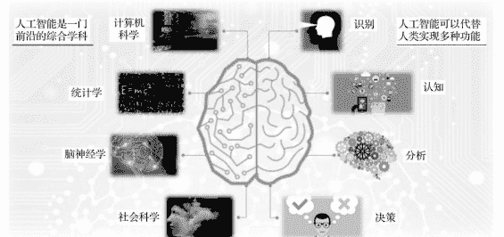

图1-1　人工智能学科关系

三项要素的关联如图1-2所示。

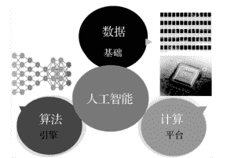

图1-2　人工智能三要素关系

借助智能技术，机器可承接过去依赖人力智力的复杂任务，大幅降低人工负担、提升生产效率，属于极具颠覆性的前沿方向。

如图1-3所示，人工智能自上世纪五十年代诞生以来，经历三次高峰、两次低谷的洗礼。二十一世纪初至今，在深度学习的推动下进入第三次高峰。随着高性能计算跃升和互联网、大数据普及，形成海量场景数据，语音识别、机器视觉、知识推理、自动驾驶等方向的智能技术加速涌现并规模化应用。

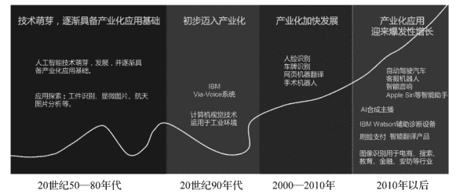

图1-3　人工智能发展阶段

各领域智能的成功为空间系统设计与智能化奠定基础，面向在轨开展智能应用研究已刻不容缓。目前全球航天机构都在探索智能与航天技术的结合点，推动未来空间任务的自主化水平大幅提升。

在轨应用面临的瓶颈主要包括资源受限严重、样本数据稀缺、难以容忍黑盒决策、高可靠性要求等。长远看，彻底解决在轨计算、传输、存储与能耗问题需要前沿技术突破，而航天领域对智能化的需求已十分迫切。

### 1.2 人工智能发展状况

#### 1.2.1 人工智能简介

1955年美国McCarthy等人在研究计划中提出人工智能概念，随后1956年达特茅斯学院暑期研讨会上首次正式提出。历经六十余年发展，在互联网、大数据、云计算与新型传感器驱动下，人工智能正引发链式科学突破，催生颠覆性技术、培育新动能、塑造新型产业体系。

人工智能的内涵涵盖脑认知基础、机器感知与模式识别、自然语言处理与理解、知识工程四个层面，外延即机器人与智能系统，具体包括：

①脑认知基础，指对认知活动的机理研究，即人脑在微观到宇观尺度上实现记忆、计算、交互、学习、推理的方式及其类脑模拟；
②机器感知与模式识别，指机器完成图形图像、语音等感知的处理与识别；
③自然语言处理与理解，指语境、语用、语义、语构研究，涵盖语音文字输入、智能检索、语音生成合成识别、机器翻译同传等；
④知识工程，指知识表示、获取、推理、决策与应用，包含机器定理证明、专家系统、机器博弈、数据挖掘、知识发现、不确定性推理、领域知识库、数字图书馆、知识图谱等；
⑤机器人与智能系统，指智能应用技术，涵盖工业农业医用军用服务机器人及智能驾驶、交通、制造、家居、环保、网络、管理、医疗、农业、金融等。

空间人工智能简言之即航天器具备自主感知、决策、协同与学习能力。2005至2007年间，美国航空航天学会下属空间操作与支持技术委员会对全球航天器自主性与智能性进行调研，汇总了来自12个组织、102个智能自主航天系统/空间机器人的情况。航天器智能自主等级划分如表1-1所示。

表1-1　航天器智能自主等级划分

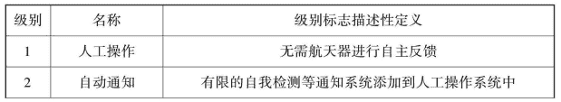

续表

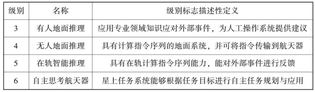

等级越高，自主性与智能性越强。102个系统中，28个未采用人工智能技术，74个采用了不同等级技术。其中第2级34个、第3级18个、第4级12个、第5级3个、第6级7个。目前我国空间飞行器多处于第2至4级，部分在轨卫星已具备自主任务规划能力。

#### 1.2.2 人工智能发展时期

人工智能演进可概括为萌芽期、启动期、消沉期、突破期、发展期、高速发展期六个阶段。

1.萌芽期
1936年英国数学家图灵提出图灵机模型，1950年提出“计算机能否思维”；1946年莫奇利与埃克特研制出ENIAC，为AI奠定硬件基础；冯·诺伊曼架构成为主流；维纳创立控制论、香农创立信息论，为学科诞生提供理论支撑。

2.启动期
1956年达特茅斯学院夏季研讨会首次使用人工智能术语，学科正式开创。研究聚焦机器翻译、定理证明、博弈。1956年Newell和Simon在定理证明上取得突破；1960年McCarthy创建LISP语言。研究者乐观预期可构建万能逻辑推理体系。

3.消沉期
深入研究后发现困难超出预期。Samuel下棋程序虽获州冠军却难以更进一步；计算机未能证明人类未证之定理；神经生理学模拟受阻。盲目乐观与高期望导致20世纪60年代中期至70年代初进入低谷。

4.突破期
研究者转向扎实基础理论，在专家系统、自然语言理解、计算机视觉等取得进展。代表成果有：1968年Weizenbaum研制的基于模式匹配的自然语言系统ELIZA；1970年Feigenbaum等研制的首个专家系统DENDRAL；麻省理工研制的知识型数学专家系统MACSMA；1972至1974年Shortliffe研制的医疗专家系统MYCIN；1973年Schank提出概念从属理论；1974年Minsky提出框架理论。

5.发展期
1977年第五届国际人工智能联合会，Feigenbaum提出“知识工程”概念，标志研究从能力导向转向知识导向。知识工程渗透各领域，推动AI从实验室走向实用。专家系统与自然语言处理系统商业化，取得经济社会效益。

6.高速发展期
2006年深度学习提出，AI再迎突破；2010年移动互联网兴起应用场景激增；2012年深度学习在语音与视觉识别取得突破，商业化高速发展。受移动互联网、大数据、超级计算、传感网、脑科学及社会需求驱动，AI呈现深度学习、跨界融合、人机协同、群智开放、自主操控等新特征。

当前主流应用基于计算机视觉/图像识别、自然语言处理/语音识别、自主规划/决策，涵盖智能金融、智慧医疗、智能机器人、自动驾驶、智能安防、智慧零售、教育、家居、城市、制造等。新一代人工智能以深度学习为代表，但深度学习不等同于人工智能。

#### 1.2.3 人工智能发展趋势

人工智能主要有符号主义、连接主义、行为主义三大学派。

初级阶段20世纪50至80年代，以符号主义为主，手工知识与启发式算法发展出专家系统与知识工程；
中级阶段20世纪80年代至今，以连接主义为主，统计学习、人工神经网络、深度学习兴起；
高级阶段21世纪初至未来，以行为主义为主，强调情境适应、自适应自学习控制、进化计算、分布式智能与大数据积累。

当前发展以连接主义为核心，驱动要素为爆炸式数据、算力提升、算法优化与资本技术深度耦合，特征是通过计算实现感知、认知、分析、决策、学习与行动。核心技术包括计算机视觉、机器学习、自然语言处理、机器人技术、语音识别，已在医疗、金融、教育、交通、安防、家居、制造等广泛应用。

深度学习并非人工智能同义词，但促进了脑科学、神经计算、量子计算、生物智能等前沿技术发展。当前人工智能以连接主义学派为主导，下面主要以深度学习技术为代表的连接主义学派展开论述。

基于深度学习的人工智能知识图谱如图1-4所示。

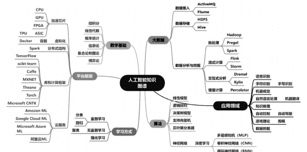

图1-4　基于深度学习的人工智能知识图谱

算法模型演进趋势如图1-5所示。

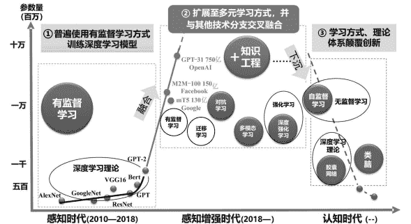

图1-5　基于深度学习的人工智能算法模型发展趋势

当前各大科技公司加大投入，推动AI蓬勃发展。人工智能正由学术驱动转向应用驱动，由弱智能向强智能演进，由感知记忆存储向认知、自主学习、决策执行进阶，如图1-6所示。

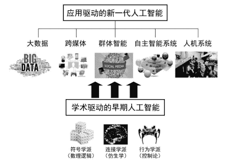

图1-6　人工智能发展趋势

发展趋势具体表现为：大数据成为持续发展的基石；文本图像语音实现跨媒体交互；基于网络的群体智能萌芽；自主智能系统成为新方向；人机协同催生混合智能形态。

### 1.3 空间系统智能化需求

#### 1.3.1 空间人工智能概念

空间人工智能指人工智能理论、技术与方法与空间物理规律、技术、知识融合，并在航天器设计研制生产应用全周期融合的专用人工智能。

面向未来，智能航天器模拟人脑“信息感知、记忆思维、学习适应、行动驱动”架构，形成自感知、自记忆、自思维、自学习、自适应、自行动、自进化七项自主能力。

目前空间领域多属“+AI”模式，即传统产业引入AI改造优化流程，属于技术迭代。未来智能航天器实现智能的核心是学习人类弹性思维，以“AI+”为驱动，重塑产品、方案与工作模式，产生颠覆性影响。

未来空间智能航天器具有以下典型特征：
①功能层面：智能感知、智能决策、智能操作构成“三要素”；
②实现层面：依托信息物理深度融合的智能化体系架构、智能软件与智能硬件支撑；
③表观层面：具备多样类人技能，航天系统在结构与信息交互上呈现多层性。

#### 1.3.2 空间人工智能需求

各国航天机构正持续推进AI在未来空间任务中的应用，以大幅提升任务执行自主性。

DARPA将AI发展划分为三阶段：第一阶段“描述”，开发基于规则系统的AI平台，已实现并成为商业产品核心；第二阶段“识别”，以机器学习为核心，对目标分类并将海量数据转化为可执行信息，减少人工分析，技术自70年代出现需持续完善；第三阶段“解释”，增加背景与可信度，是未来方向。

空间智能演进：从识别跃迁向自主闭环

当前 DARPA 的第二阶段技术研制尚未闭环。尽管在不少人工智能项目里已出现局部进展，但支撑体系仍显脆弱，难以在安全关键场景下实现第二阶段技术的独立使用。为此 DARPA 为下一代人工智能划出三项重点：提升第二阶段技术的鲁棒性、主动把该类系统推广到新任务、持续探寻第三阶段技术路径。

依据美国对人工智能的三段划分，国内的研究整体处于描述到识别之间的过渡带。空间人工智能与在轨应用几乎贯穿人工智能的全部要素，这既是航天系统本身的议题，也需要产业、高校、科研院所协同推进。必须对空间人工智能及在轨应用的现状、需求、基础共性与核心技术展开系统梳理。

空间任务具有发射成本高、单星价值高、难以维修、任务复杂度大、运行环境恶劣、高真空高辐射大温差、距离遥远无法就地干预、人工介入响应缓慢等特点，人工智能的接入需求十分广阔。借助人工智能可推动空间技术由自动化向自主化再向智能化跨越，形成天地异构数据的自感知、跨域目标特征的自学习、意图的主动感知与自决策、群体智能等能力，进而降低运行开销、提升任务质量与安全性、放大效能回报、增强可靠性和灵活性。

围绕感知、认知、沟通、推理、决策等人类智能要素，构建可逼近人类行为的空间智能体系，使飞行器具备会看会听会说会思考的能力，随时接收用户定制任务，自主判断并协同完成，为用户提供灵活、连续、稳定的服务，提升使用体验。

算法与应用技术的成熟使在轨智能化研究提上议程。未来借助新一代方法，空间智能系统可实现数据的实时采集分析、情报的生成与推送、任务的评估与决策闭环。

空间人工智能及在轨应用的推进必将触发链式突破，加速航天器迈向新一代智能化。

#### 1.3.3 空间人工智能发展机遇
人工智能引领卫星平台颠覆式创新已成必然。人工智能支撑的卫星系统技术为航天器智能自主提供储备，也是未来十年智能卫星平台设计的核心发展方向之一。

人工智能将明显增强卫星系统效能：其一提升智能感知与识别水平；其二提升平台智能规划与决策水平；其三强化平台智能群体博弈对抗水平；其四多途径提升平台智能空间探测能力。

卫星智能技术正得到多方合力加速。十九大报告提出推动互联网、大数据、人工智能与实体经济深度融合。我国人工智能研发产出数量与质量均显著提升，相关成果具备向智能卫星平台迁移的条件。

人工智能将开创空间领域天地一体化的全新工作格局。协同进程中，一方面在航天器智能化研究的同时同步开展地面系统智能化，包括地面智能指挥控制决策、地面智能人机交互，推动智能攻防体系实现天地同域与跨域协同；另一方面航天器与地面操控能够智能自主并一体化设计，提升飞行与地面交互的可操作性，即整合设计，这一问题可上升到战略高度，有助于压降建设成本与风险。发展面向学习进化的空间智能手段，直面星群加同域跨域加协同加天地的新模式。

人工智能发展将全面推动空间生态产业结构迭代。人工智能正成为新时期推动空间领域生态产业升级的催化剂与核心支撑，可从航天器系统预研、设计、研制生产、集成测试、试验验证、在轨运行与应用等各环节带动创新。

空间技术与人工智能深度结合，将重塑航天体系并开辟卫星全新应用场景。未来十至二十年，人工智能将在空间领域实现广泛快速应用，对新一代弹性空间体系建设、自主感知操控与智能协同技术、实时探测与先进空间指挥控制技术产生深远影响。

基于人工智能重构卫星平台功能与性能，直面未来弹性化变化与需求。未来卫星平台呈现四方面趋势：平台执行基础空间任务能力趋于成熟，智能自主的多场景应变能力尚待开拓，要求航天器具备在轨自主生存能力；系统操控对时效、安全、稳定要求更高；面向多载荷复杂探测、博弈对抗空间攻防、非合作目标在轨操控等应用的全面提升；任务日益复杂多变，平台需具备学习泛化、聚散分布、集群协同、高效可靠等基本能力。

航天器平台在能源、算力、数据资源上受限，需要发展适配航天环境的算法与算力。硬件层需要尖端设备，软件层需要高效新型算法。

全新软硬件设计环境与系统架构演进，需要引入人工智能及其相关技术。应推动前沿成果在航天首用，形成智能航天工程理论，从顶层架构合理规划技术应用方式，大力开拓空间智能软硬件与系统前沿技术。

航天事业对安全可靠性要求极高，而当前人工智能仍存在可解释性难题。以深度学习为代表的算法仍存在收敛、可解释、可靠性方面的争议。不少研究人员正探索可替代深度学习的更高效机器学习方法，深度学习的创始人Hinton也曾提出颠覆性观点，即深度学习应另起炉灶彻底抛弃反向传播。

因此亟须开展空间人工智能及在轨应用技术的发展状况、技术需求、核心技术及应用挑战研究，推动人工智能技术在空间领域的广泛应用。

# 第二部分 空间人工智能及在轨应用技术发展状况

空间人工智能与在轨应用主要集中在智能信息处理、智能感知与控制、智能人机交互、智能组网与协同等方面。通过阐述四大领域的内涵、现状与未来趋势，为空间人工智能技术需求奠定基础。

## 第 2 章 空间智能信息处理发展状况

空间智能信息处理是天基探测提升全链路时效性的核心环节，主要任务是接收天基探测载荷数据，利用人工智能进行处理，并在轨道完成海量探测场景下感兴趣目标的在线检测、精准识别与持续跟踪，以降低下行速率、提升信息获取实时性，支撑天基广域探测与全自主态势感知。

### 2.1 技术内涵

近年来随航天技术发展，对地观测卫星呈现数量多、质量升、要求高的新特点：单星与星座数量大幅增加，星上数据多源异构；空间分辨率、光谱分辨率与辐射分辨率大幅提高，导致星上数据量爆发式增长；自然灾害与军事应用对卫星信息快速响应的需求与日俱增。这些特征给地面处理带来巨大压力，传统卫星信息处理模式难以满足用户任务需求。

为应对上述问题，国内外积极发展卫星智能信息处理技术。与传统方式相比，智能信息处理主要优势体现在以下方面。

#### 1. 高时效性
传统卫星观测采用星上获取、星地传输、地面处理的链路，严重制约高实时性任务完成效率。在轨智能信息处理是缩短信息链路、提升任务时效性的有效途径。

我国国土海洋辽阔、地形复杂、灾害频发，对气象监测、灾害预警等快速响应需求强烈。通过空天地一体化智能观测网可实现协同观测与高速处理，简化数据同化难度，实现快速聚焦服务，支撑应急响应。

在军事战术化应用中，星上信息处理的高时效性要求同样突出。以天基预警系统为例，预警卫星需在导弹发射阶段实施监视、跟踪与定位，其预警时效关乎反导成败。若具备在轨智能信息处理能力，可通过星上关键信息筛选与压缩大幅降低传输量，提升传输速度，支持信息直传模式，确保目标信息获取准确性与处理应用实时性，为预警任务提供有效支撑。

#### 2. 缓解星上数据存储压力
中国遥感卫星地面站资源相对有限，遥感数据种类繁多。解压后平均日增约20TB，年增近7PB。经辐射校正、几何校正与反射率反演后，非重复数据存储量可达20PB。海量遥感影像的存储、调用与制作属于高能耗环节，而使用者真正需要的是有效信息而非原始数据。

卫星智能信息处理为遥感数据资源高效利用提供新路径，即将大量遥感影像通过智能处理转化为在轨有效目标信息，实现数据到信息的跃迁，满足遥感应用需求，同时缓解卫星数据存储压力，为全球可持续发展、节能减排与温室气体减排贡献力量。

#### 3. 支持星座多源数据融合处理
为满足特定任务目标的快速响应、持续动态监测与大范围监测需求，需要更短重访周期与更大覆盖范围，传统单星模式已难以胜任，卫星星座迅速发展。以Ku、Ka频段及更高频段的新兴互联网星座计划呈现爆发式增长。美国OneWeb、SpaceX、LEO Sat、加拿大TeleSat等均提出大规模低轨通信星座计划，国外典型低轨通信星座总发射卫星数超过8000颗。

在规模化卫星网络中，基于星上智能信息处理实现多源数据融合，是提升遥感信息获取准确性与稳健性的有效手段。对多时相、多角度、多谱段、主被动等多类星载传感器数据进行融合，可实现信息互补、消除不确定性，获得比单一数据源更可靠的情报。

#### 4. 满足用户任务多样化需求
传统遥感卫星数据服务依赖大型数据中心，先收集各类遥感数据，再进行标准化图像制作，分发给行业部门提取特殊信息。随着遥感技术发展，个性化遥感需求与个性化信息服务需求快速增长，需要按使用方要求对获取信息进行针对性筛选与处理。

基于智能信息处理的智能遥感卫星可直接面向终端用户，通过优化星地数据获取、计算、存储、传输、接收处理资源，充分利用星地协同算法，如多源传感器高质量实时成像、高精度实时几何定位、数据智能压缩、典型目标智能检测与变化检测等，依据地面任务信息智能规划星地协同处理模式与流程，实现自动化、智能化星地协同处理，减少中间交互环节，使数据在遥感全产业链得到充分利用。

### 2.2 空间智能信息处理发展现状

#### 2.2.1 国外发展现状

总体来看，在轨信息处理人工智能化尚未普及，其发展主要体现在实时数据处理与软件定义卫星领域。

##### 1. 国外基于地面算力的智能信息处理
基于地面算力的遥感大数据智能处理是当前空间信息智能处理主要应用方向。因不受空间环境算力约束且需求旺盛，国外在此领域研究与应用案例丰富。

1）Orbital Insight 公司
美国Orbital Insight公司利用人工智能对遥感影像进行自动化处理与深度分析，为国防、安全、环境等领域提供服务。2019年该公司推出GO地理空间分析平台，通过人工智能融合卫星图像、合成孔径雷达、自动识别系统与物联网设备的地理空间数据源，为分析人员提供支持，提升了美国国防部与情报界洞察能力。公司使用卷积神经网络分析遥感图像并识别与量化原油储罐大小，并采用阴影探测技术计算油罐石油容量。

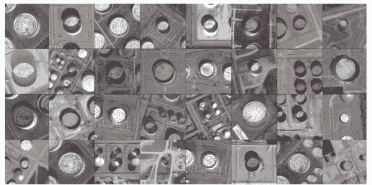
图 2-1 Orbital Insight 公司遥感图像油罐识别（书后附彩插）

2）天空完美日星公司（SKY Perfect JSAT）
日本天空完美日星公司2019年10月宣布与其子公司Satellite Network将利用低轨道卫星图像提供高频船舶检测服务。该服务借助Planet Labs公司Dove星座拍摄的全球图像，采用人工智能与图像识别技术检测船舶信息，包括位置、尺寸、时间、船型，并将图像与对应时间AIS信息叠加，掌握高频船舶动向，有效提升船舶运营与物流管理。SKY Perfect JSAT集团不仅在海洋开展AI高频检测，未来还将扩展至陆地建筑物、道路等，开展房地产、经济指标确认等更广泛服务。

3）Descartes Labs 公司
美国Descartes Labs公司收集海量农业相关卫星图像，通过人工智能分析图像与作物生长关系，可对农作物产量作出精准预测，其玉米产量预测准确率较以往提升99%。此外，公司开发软件可在数分钟内探测山火，利用人工智能每隔数分钟分析美国政府气象卫星图像，在烟雾与红外数据中捕捉细微变化，预测火灾发生位置与蔓延程度。

公司还提出基于视觉编码二值化与基于哈希的大规模比特采样检索方法，实现有效目标特征抽取与高速视觉检索，最终在包含近20亿张美国大陆图像数据库中实现0.1s的视觉目标检索速度。图2-2展示检索结果，左侧为查询图像，其余为检索结果，可见对风力发电机、体育场等检索效果良好。

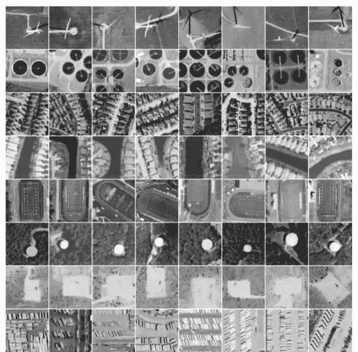
图 2-2 Descartes Labs 图像检索

4）SpaceKnow 公司
SpaceKnow成立于2013年，为消费市场与金融机构提供基于地理空间分析的智能数据，主要手段为遥感大数据智能分析。公司可通过卫星遥感监测道路车辆、火车、游轮、港口、机场、工厂、农作物与居民住宅等情况，形成分析报告作为投资决策参考。

此外，美国Terrapattern、Mavrx、DroneData、Precisionhawk等公司通过卫星遥感数据结合深度学习进行企业盈亏预测、储油分析、农作物估产等，服务于各行业、政府部门与普通使用者。

##### 2. 国外在轨智能信息处理
1）美国EO-1卫星
2000年，NASA发射的地球观测一号EO-1卫星展示了21世纪地球观测智能卫星新水平。EO-1搭载自动科学实验设备ASE，可使航天器自主开展科学探测并自主响应。ASE系统包含：星上科学算法模块，可进行对地观测与轨道数据分析，探测感兴趣科学事件如云检测、变化检测；CASPER模块，可依据星上科学算法结果制定或调整任务操作计划，包括数据下传；执行系统，执行并监视CASPER产生的计划，并可对指令做出调整以改善执行与响应。通过这些星上数据处理技术，可实现轨道科学数据分析、突发事件快速响应、计划执行与监视。

2）美国NEMO卫星
2000年，美国海军发射海洋地球测绘观测卫星NEMO，主要任务是论证超光谱成像对浅海战斗空间环境表征的重要性，可进行超光谱数据实时星上处理与压缩，并实时通过战术下行链路将结果传至战场。

NEMO卫星首次配备实时自适应光学识别系统ORASIS，具备自动自适应影像识别能力，提高遥感数据分析处理效率。ORASIS核心由32个SHARC21060型DSP数字信号处理器构成的星上高速影像并行处理器阵列IOBP，可胜任数据接收、影像分析、影像压缩等高速影像处理任务。ORASIS可从实际物体影像中识别光谱响应，通过顺序分析影像每种光谱、丢弃重复光谱，利用凸面几何学与正射投影技术分析每个观测影像，并用一组矢量表示组合重构观测光谱。ORASIS在NEMO上的处理减少了地面数据开发与影像特征识别环节，并能在星上形成数据产品。

3）美国TacSat-3卫星
2009年5月，美国空军实验室战术卫星TacSat-3发射升空，是美国作战快速响应航天计划第2颗卫星，主要验证星上实时数据处理能力，可为战场指挥官快速提供目标区域侦察与监视图像，实现从发起观测任务到作战人员接收信息的全过程在10分钟内完成。

TacSat-3星上加装星上自主处理器AIP、通用数据链卫星通信有效载荷；地面配备虚拟任务操作中心、多用途战术地面站与战术终端。AIP可实现目标区域小范围遥感数据高光谱影像处理，通用数据链可实现遥感数据直传战术地面站与战术终端。由于便携式战术终端带宽有限，下传目标影像必须足够小。借助星上处理设备的实时影像处理功能，可提取目标区域小面积影像，再依靠窄带数传系统实现目标区数据接收。

4）欧洲量子卫星
2015年，欧洲通信卫星公司Quantum与欧洲空间局签订合同，开始研制新型欧洲通信量子卫星，迈出基于软件定义重构卫星功能工程实践的关键一步。该卫星属于完全软件定义卫星，可通过软件驱动实现多种性能轨道调整：卫星覆盖范围可调，利用电子调节、波束成形、跳变波束等技术按需调节波束覆盖形状，单个波束可覆盖任意形状区域或多个独立区域；工作频率可调，利用可编程信道在上/下行链路频段范围内动态调整工作频段，频谱使用率从86%提升至98%以上；信号功率可动态协调，减少覆盖区外界噪声对信号干扰。

5）美国洛马公司智能卫星

星上软件化与在轨智能算力跃迁

2019 年洛克希德·马丁对外披露了 SmartSat 智能星计划。该方案采用软件可重构架构，功能扩充通过地面推送的软件包实现，使用体验与在手机上安装应用相近，操作人员可便捷地增加能力并下发新任务。SmartSat 运行期的信息处理特色可归纳为四点：

① 自主态势感知与网络攻防，星载防护程序可按需定时升级以应对新威胁；
② 自我诊断与快速复位机理，能更精准定位异常并在必要时相互支援，显著提升受损后存续能力；
③ 主机引入虚拟机监控层实现安全隔离，单台星上主机可并行承载多个服务器进程，最大化内存、算力与带宽利用率；
④ 首创星载多核处理单元，飞行中数据处理能力强劲，可降低下行带宽需求，为未来在轨计算中心提供技术基础。

#### 2.2.2 国内发展现状

##### 1. 国内地面算力驱动的智能信息处理

我国以地面计算资源为依托的遥感大数据智能化起步相对晚于国外，整体水平仍有差距，但已有不少优秀产品与突破性进展。

1）ImageInfo 通用大型遥感测图作业平台

该平台由中国测绘科学研究院研制，兼具通用遥感影像处理、地理信息分析与 GPS 定位功能。体系架构由遥感数据流程控制系统、遥感数据集群处理通用平台、高分辨率影像集群处理系统 Pixel Grid、影像智能解译工作站 Feature Station 等子系统构成。

其中 Feature Station 工作站面向航片、卫片、无人机影像、合成孔径雷达影像等数据源，通过网络化协同作业形成立体量测与平面编绘一体化的测图模式。

2）SenseEarth 智能遥感影像解译平台

北京商汤科技开发有限公司推出的 SenseRemote 智能解译算法借助深度学习完成道路、建筑提取、用地分类、飞机船舶检测及区域变化监测，为自然资源规划、生态保护、商业决策、应急减灾提供客观数据支撑。

2019 年 7 月，该公司发布了国内首个在线智能解译平台 SenseEarth。依托 SenseRemote 技术对地表卫星影像进行识别与分析。SenseEarth 面向公众开放，登录后即可在线体验道路提取、舰船检测、土地利用分类等解译功能，并可调阅历史影像，以月为单位进行多时相变化检测，直观感受城市演变。

3）“苍灵”遥感大数据智能分析系统

中国科学院空天信息创新研究院的研究人员开发了分布式软硬件一体化深度学习提取系统“苍灵”。系统由后端分布式训练与管理平台、前端信息提取与综合分析平台组成。可视化交互降低训练门槛，简化配置逻辑，并集中呈现训练与预测结果，便于业务优化。

依托“苍灵”可快速高精度提取数十种灾害关键要素，支撑灾害监测、风险评估、应急监测、损失评估与灾后恢复重建，为快速综合评估与应急决策提供数据支撑。

##### 2. 国内轨道侧智能化信息处理

我国星上智能化已形成“天智一号”、“珞珈三号”01 星、“吉林一号”等典型案例。

1）“天智一号”卫星

该星由中科院软件所牵头，联合中科院微小卫星创新研究院、航天九院 771 所、中科院光电院、中科院西光所等单位研制，整星约 27 千克，运行于 500 公里高度太阳同步轨道，是“天智”系列首颗技术验证星。2018 年 11 月 20 日 7 时 40 分在酒泉发射入轨。

“天智一号”是国内首颗软件可重构星体，核心为小型高性能星载云计算平台，支持有效载荷即插即用、应用软件按需加载，通过上注不同软件实现不同任务。半年在轨期间，已通过软件注入方式完成星箭分离成像、自主请求式测控、空间目标成像等十余项试验，覆盖智能测运控与智能信息处理。成功发射为国内以软件化方式开展航天理论与工程实践开辟先例，推动硬件资源虚拟化、系统软件平台化、应用软件多样化。

2）“珞珈三号”01 星

该星由武汉大学联合航天东方红卫星有限公司研制，是光学智能遥感星，轨道实时智能处理是其核心能力之一，通过可扩展智能信息处理平台实现遥感数据的轨道侧按需实时智能处理。

## “珞珈三号”01 星上智能信息处理单元

星上智能处理单元采用主备异构软硬件方案，主通道基于高性能 GPU 设计，搭载开放软件平台 Linux；备份通道基于 FPGA 设计，支持轨道侧常规压缩；主备通道均配备大容量固态存储，可保存原始影像与处理后影像，由接口、主处理通道与备压缩通道组成，两通道独立冷备份以保障数据可靠下传。

开放软件平台包含基础操作系统环境、用户 API 函数接口、图像处理基础库、深度学习软件框架等，支持在轨扩展用户或第三方智能处理 APP。星器可自主完成任务规划，用户仅需下发目标经纬度、数传窗口等信息，即可自主规划成像、获取影像、轨道侧处理、下传图像。星上还设有用于 APP 轨道侧注入的高速通道，支持 APP 在轨安装、运行、卸载与更新，通过丰富星载 APP 不断拓展影像服务能力，并可与地面系统协同向个人手机终端提供端到端准实时影像服务。

## “吉林一号”卫星

“吉林一号”星座由长光卫星技术股份有限公司建设，规划 138 颗涵盖高分辨、大幅宽、视频、多光谱等光学遥感星。

“吉林一号”光谱 01/02 星轨道侧智能处理终端具备森林火点与海面船舶自动识别、搜寻与定位能力。开启智能处理后，用户无需经历“注入任务-成像-接收-处理-分析”的传统链路，可直接通过移动终端准实时接收快讯。例如 2019 年 3 月 21 日开展森林火点自主识别试验，星上对中波红外影像处理速度达每秒 500 平方公里，13 秒后地面终端即收到湄公河流域多处高温火点信息，经影像人工比对验证正确。2019 年 6 月 8 日在某海域开展船舶自主搜寻试验，轨道侧处理 3 分钟后地面终端获取一艘大型船舶信息，经地面比对系统运行符合预期。

星载轨道侧智能信息处理技术在该星上的验证，提升了存储与数据传输利用率，显著提高应急信息获取时效，为卫星遥感应急响应提供核心技术支撑。

## 2.3 空间智能信息处理关键技术

相较于地面处理，轨道侧处理的难点在于星体体积、质量、能源与成本受限，算力、功耗与存储均有限，对智能化提出更严苛要求。目前主要挑战集中在三方面：

① 智能算法仍待突破。成像星器智能处理算法近年进展明显，但在轨智能仍存在遥感小目标识别、多源信息融合等难题；
② 轨道侧计算资源受限。质量功耗限制决定处理单元无法使用大功率高性能处理器，有限算力制约图像分类、目标检测等算法的精度与实时性；
③ 高效轨道侧计算平台设计困难。需在小功率下获得高算力，并耐受高低温、热真空、强辐射等空间环境，设计难度极大。

针对上述挑战，国内外在智能处理算法、算法加速技术、轨道侧计算平台等方面展开研究。

### 2.3.1 智能处理算法

本节从空间数据预处理、空间数据压缩、空间信息提取与自主任务规划四方面展开。

#### 1. 空间数据预处理

受遥感系统空间、波谱、时间及辐射分辨率限制，原始光学、SAR、光谱数据质量常不满足需求，需先预处理。人工智能已用于遥感影像匹配、重构、融合等。

##### 1）遥感影像匹配

影像匹配指在不同时间、设备或条件下获取的两幅影像间寻找最佳空间变换关系，使同名点精确重合，是融合、拼接、变化检测、分类等技术的基础。

###### （1）基于灰度的遥感影像匹配方法。

相似性度量依据灰度信息建立，如熵、互相关、互信息等。遥感影像信息量大、地貌复杂易产生形变与灰度差异，该类方法实现简单但计算量大，易受光照、噪声、畸变干扰。

###### （2）基于特征的遥感影像匹配方法。

此类方法对灰度与形状变化更鲁棒。常用特征包括点特征与区域特征。点特征匹配中，文献已使用 Harris、SIFT、SURF 等提取特征点并匹配后剔除误匹配。区域特征对整体表征更完整，对形变更稳定。深度学习思路用分类解决匹配，如 Han 等利用 MatchNet 提取区域特征并以全连接层相似性作 Softmax 分类匹配；Zagoruyko 与 Komodakis 提出基于 DeepCompare 网络的区域特征提取，对光照与观测角度变化具有良好适应性，跨时空遥感影像匹配稳定性提升。

##### 2）遥感影像重构

单纯提升载荷能力使高分辨率影像成本大幅上升，超分辨率重构提供另一路径。超分辨率指在不改变观测系统的前提下，利用算法恢复成像系统截止频率之上丢失的高频分量，获得细节更丰富的高分辨率影像。

智能重构方法可分为神经网络类与生成对抗网络类。Wei 等提出基于 MC-ADM 与 PSRI-Net 的参数化超分辨率 SAR 重建方法，通过端到端训练学习参数以获得高质量 SAR 超分结果。Luo 等提出基于卷积神经网络的 SAR 超分辨率重建，对浮点影像数据进行深度学习重建。

针对神经网络在光学遥感超分与去噪中出现信息损失与对比度降低问题，冯旭斌提出利用生成对抗网络在小波变换域进行光学遥感影像超分与去噪。熊鹰飞提出适用于遥感影像超分的改进 SR-GAN，提升跨区域与跨传感器迁移能力。王梦瑶等构建 SAR 辅助光学去云数据库，建立基于条件生成对抗网络的 SAR 辅助光学遥感去云模型，实现薄云、雾、厚云下地物信息的复原。

##### 3）遥感影像融合

不同传感器对同一场景成像各异，产生多光谱、全色、红外、SAR 等多源影像。为高效综合利用，需去除冗余并融合互补信息。

多源融合方法主要分为空间域与变换域两类。

###### （1）基于空间域的遥感影像融合。

直接基于原始像素融合，方法包括压缩感知、主成分分析、Brovey 变换、非负矩阵分解、亮度-色度-饱和度变换、神经网络、群智能优化等。神经网络与群智能应用增多，如王昊鹏等将 PCNN 用于 Curvelet 变换域融合，以局部特征支撑值作为外部激励，利用其全局耦合特性模拟人眼视觉，提升融合效果。基于群智能的方法通过蚁群、粒子群等寻优参数。单目标优化如赵学军等用粒子群优化 Contourlet 域加权系数，实现全色与多光谱融合。多目标优化如陈荣元等基于多目标粒子群优化红外与可见光影像融合，对低频分量优化参数，高频采用绝对值最大规则，主观视觉效果较好。

###### （2）基于变换域的遥感影像融合。

先将多源影像变换到另一域，对不同分量设计融合规则再逆变换。常用方法包括独立成分分析、离散余弦变换、快速傅里叶变换、多尺度分解等。多尺度分解应用广泛，对源影像配准后分解为低频与多层高频分量，分别融合后再逆变换重建。

#### 2. 空间数据压缩

高分系列卫星涵盖全色、多光谱、高光谱、雷达、红外等类型。高分辨率光学卫星影像可达 0.1～0.5 米，每天产生数据达 TB 级，输出率高于 10 Gbit/s。海量数据与有限下行带宽冲突，实时下传需求难以满足。

轨道侧影像压缩已普遍应用。随着分辨率提升，基于 ADPCM 与 DCT 的方法不再适应。当前广泛采用基于离散小波变换的 JPEG2000 方法，但该类方法对遥感信息无差别编码，计算资源占用高、压缩比低。为保证 PSNR 超过 36 dB，传统 JPEG2000 轨道侧压缩比通常控制在 10 倍以内，难以实现海量数据的智能实时服务。

近年来深度学习被引入空间数据压缩，可构建灵活结构对复杂数据自适应压缩。通过编码-解码子网络的前馈网络训练，可将影像压缩为少量元素的特征向量，实现大倍率压缩。

现有基于深度学习的压缩方法主要分为基于 RNN 的方法、基于 CNN 的方法与基于生成对抗网络的方法。

##### 1）基于 RNN 的影像压缩

RNN 路线的压缩方案先把整幅图像切成块，再靠多层递归结构搭建渐进式的编码与解码模块。Toderici 课题组早期证明用循环卷积网络做到多码率压缩是可行的，不过当时的验证仅停留在小尺寸缩略图上。随后同一团队把门控循环单元 `Gate Recurrent Unit`、残差 GRU、`LSTM` 以及联想式 LSTM 引入，提出了一种面向全分辨率图像的压缩方法。渐进式编码确实带来了码率上的灵活性，但纯 RNN 做法因必须将图像切得极细，在高倍率压缩下常出现伪影与模糊。Johnston N 等人据此给出混合思路，用 RNN 的循环思想来驱动 CNN，把编解码器中的每一层视作递归神经元，通过循环展开实现逐层的压缩与重建。

##### 2）CNN 驱动的图像压缩
CNN 类压缩基本遵循编码器-解码器范式，编码侧由堆叠的卷积层构成，解码侧由堆叠的反卷积层构成，并配以量化器来衡量重建保真度。早期工作多以 MSE 为损失度量。CNN 压缩最核心的难点在于训练时量化不可微，除了极少数阈值点外量化器的梯度几乎为零，导致难以做端到端反向传播。为此出现了多种可微化变体。E.Agustsson 等人提出软量化松弛来绕开不可微问题；随后 Theis L 等人给出端到端自编码器中量化与熵率估计的可微近似。在充足数据下，端到端学习能让 CNN 压缩方法稳定达到预期效果。

##### 3）GAN 驱动的图像压缩
与 RNN、CNN 不同，GAN 属于生成式框架，由生成器与判别器组成。对抗网络以博弈的方式对图像分布建模，而非单纯拟合训练特征。深度模型需要把解压缩所需的先验信息编码进参数，压缩倍率越高所需先验就越多。用逐像素损失训练时，参数会在不同图像间剧烈波动；GAN 通过判别器把原图与重建图映射到特征空间计算损失，抑制了参数的大幅震荡，有助于学习更丰富的先验。因此相较 RNN 与 CNN，GAN 压缩往往能实现更大压缩倍率、更优重建质量，有望缓解传统深度模型泛化不足的短板。

#### 3. 空间信息提取
空间信息提取是从空间数据中挖掘任务相关信息的通用过程，在遥感里主要服务于目标检测与场景分类。借助人工智能对遥感影像中地物的光谱与空间特性进行特征提取，可把影像信息与真实地物对应起来，实现检测或分类。

##### 1）遥感图像目标检测
目标检测是卫星遥感应用的核心手段之一，指自动定位感兴趣目标并给出类别标签，如飞机、舰船、车辆、建筑与桥梁等。城市规划、灾害监测、失踪船只搜寻等场景都有广泛需求。近几年 WorldView 系列、高分系列等高分辨率卫星陆续升空，巨量的高分辨数据为遥感目标检测提供了新机遇。

传统做法多依托经典模式识别，例如模板匹配、种子点特征、全局最小化活动轮廓以及径向梯度角特征等，先在图像中搜索与模板相似的区域再计算相似度判别。模板需人工设计且类别受限，效率低、泛化差，不适合大规模多类检测。

深度学习在计算机视觉的普及让高性能检测成为可能。基于卷积神经网络的目标检测通过多次抽象挖掘图像深层信息，精度显著提升。主流方法包括 Faster R-CNN、YOLO、SSD 等。

在遥感适配上，研究集中在水平框与倾斜框两类。

###### （1）水平目标框检测。
水平框检测多是对通用方法的改进。Ding 等人针对遥感中小目标难以识别的问题，在 VGG-16 基础上融合扩散卷积层并采用多尺度组合策略，提升了精度同时降低了测试时间与内存占用。Qiu 等人设计自适应纵横比多尺度网络，在训练中保留物体纵横比信息，避免因比例变化造成的过度变形，在多项水平框任务上表现稳定。

###### （2）倾斜目标框检测。
倾斜框检测需同时估计位置、长宽与旋转角度，难度更高但定位更准。Ding 等人提出 ROI transformer，增加角度参数以输出方向框，更具实用性。Qian 等人的 RSDet 面向倾斜框回归不连续问题，将旋转目标检测重定义为角点预测，并提出调制旋转损失，改善了损失计算。Cheng 等人提出的 AOPG 网络设计了无锚框的感兴趣区域生成器，并用卷积层对齐特征图，在三个遥感数据集上验证了有效性。

##### 2）遥感图像场景分类
遥感场景分类旨在判断影像覆盖的场景类型，例如机场、港口、河流、森林、建设用地等，广泛用于国土规划、作物估产、环境监测、林地覆盖统计等。

早期主要依赖人工特征提取，需专家依据颜色、形状、纹理或光谱等视觉线索显式设计特征与编码。随着遥感数据量与复杂度、分辨率的急剧提升，人工方法难以为继。

随后出现大量基于机器学习的分类方案，按标签参与与否可分为监督、半监督与无监督三类。

## （1）遥感图像监督分类
2006 年深度特征学习突破后，支持向量机、决策树等机器学习方法与 CNN、AlexNet、VGGNet 等深度网络都被广泛用于遥感场景分类。深度网络能够提取高维特征，挖掘图像的深层统计规律，实现精细分类。

在通用网络基础上，研究者针对遥感特性进行改进。Zhou 等人提出 ResNet-TP，先经特定 ResNet 层提取后再分两路特征提取与分类，获得满意精度。Shawky 等人提出 CNN-MLP 方案，先用无全连接层的卷积网络提取特征，再用基于 Adagrad 优化器的增强型多层感知机完成分类，效果良好。

## （2）遥感图像无监督分类
遥感影像易获取但标注困难，推动了无监督分类的发展。常用特征学习手段包括主成分分析、k 均值聚类、稀疏编码、自编码器与生成对抗网络等。GAN 作为近年最具潜力的无监督算法，旨在学习数据生成分布。Lin D 等人首次把 GAN 用于遥感图像无监督特征提取与分类，通过结合两种损失进行特征学习，分类精度约达 94%。

## （3）遥感图像半监督分类
现实中无标签数据远多于有标签数据，半监督方法被广泛关注。Bruzzone 等人利用基于时间依赖关系的 SVM 为未标注样本赋权，获得较好效果。Wei Han 等人提出带深度学习的半监督生成框架，结合自标注与判别式评估完成遥感场景分类。Xu 等人提出二型模糊 C 均值算法作为新的半监督模型，有效提升了场景分类精度。

## 4. 自主任务规划
航天任务规模与多样性增加，如何在有限星上资源下执行复杂空间任务成为关键。随着载荷能力提升与响应时限缩短，赋予卫星自主规划能力、实现动态决策与调度、优化资源配置的需求愈发迫切。

相较地面离线规划，星上自主规划的优势包括：其一，突发事件处理更快，例如对被云层遮挡或无火点的失效图像，卫星可即时删除以释放存储并触发同目标二次成像；其二，任务冲突快速响应，可让冲突任务转向低优先级或未安排任务；其三，运行效能提升，规划时考虑仪器温度、电量、存储余量等精确状态，提高执行效率与收益；其四，降低对地依赖，增强独立运行鲁棒性。

卫星任务规划本质上是 NP-Hard 问题，遗传算法、蚁群优化等智能算法表现良好。Zheng 提出改进遗传算法，采用 Hybrid Dynamic Mutation 新型变异策略，提升求解速度与精度，在计算时间与任务成功率上均满足要求。Zhibo E 提出基于个体重构的整数编码遗传算法 IRICGA 以降低计算量并优化区域目标观测，通过个体重构在进化中生成可行解。基于该算法构建的多星区域目标观测调度框架包含预处理与调度两阶段，预处理阶段提出半解析方法计算区域目标与观测条带可见时间窗。

机器学习也开始进入任务规划。王海蛟提出基于马尔科夫决策过程 MDP 的敏捷卫星在线调度模型，将规划视为求解最优决策策略，同时研究多星协同问题并用多智能体强化学习求解。聚类、博弈论等方法同样被用于在轨任务规划。

### 2.3.2 算法加速技术
深度学习模型虽强但“臃肿”，算力需求大，制约星上实时智能。加速技术以“多、快、好、省”为目标，通过计算优化与硬件适配降低处理器负担，提升推理实时性。

#### 1. 基于计算优化的算法加速方法
计算优化追求精度与速度的平衡，主要分为轻量化设计、模型裁剪、知识蒸馏与模型量化四类。

轻量化设计用计算量更小的卷积替代标准卷积，整体计算量常在几十到几百兆 FLOPs，与 VGG、Inception、ResNet 等动辄上千兆 FLOPs 的大模型相比优势明显，在分类、检测等任务上精度差距不大。

模型裁剪是对模型做减法，在精度损失可控前提下设计网络稀疏化机制，按某种粒度剔除卷积中冗余权重，本质是寻找更稀疏的表征，关键在权重筛选机制与粒度选择。

知识蒸馏利用大模型 Teacher Network 的监督特征指导小模型 Student Network 学习，使小模型兼顾速度与精度。核心在监督特征设计，如 Soft Target 提供的类间相似性，或中间特征图、Attention Map 作为桥梁。

模型量化把权重、激活值从高精度转为低精度。推理时大量浮点乘加运算默认 32 bit，实际可用更低位宽。业界常用 16 bit 与 8 bit 量化，降低读写量并加速。关键是如何控制低位宽带来的精度损失。

#### 2. 基于硬件适配优化的在轨加速方法
硬件适配主要靠推理引擎优化模型以适配嵌入式平台，主流引擎有 TensorRT、ncnn、MNN、TVM、TensorFlow Lite 等。图优化与算子优化是加速核心。

TensorRT 通过横向或纵向合并层大幅减少网络层数。横向合并可把卷积、偏置、ReLU 合成 CBR 结构只占一个 CUDA 核心；纵向合并把权重不同但结构相同的层合并为更宽层。合并后计算图更小，核心占用与内存访问下降，检测类算法可获数倍加速，但仅限 NVIDIA 设备。ARM 平台常用国产 ncnn 或 MNN，性能与算子支持上与 TensorRT 仍有差距。

计算优化与硬件优化存在适配矛盾。硬件优化针对通用网络，经计算优化后结构变化可能无法充分利用加速库。例如模型裁剪后卷积通道数不再是 2 的幂，会因内存对齐导致带宽浪费；轻量化网络中的深度可分离卷积在推理引擎中优化不足，即使理论计算量省 8 倍，实际速度反而可能不如普通卷积。

### 2.3.3 智能计算平台
受功耗限制，在轨智能平台需在小功率下获得大算力。目前尚无专为星上设计的人工智能硬件，已在轨的智能卫星仍使用地面通用平台，如 PhiSat-1 搭载英特尔 Movidius Myriad 2 模块。

国外嵌入式 AI 平台中，NVIDIA 边缘产品最多且支持完善；英特尔神经计算棒在性能功耗上表现亮眼；谷歌 AIY Edge TPU 配合 TensorFlow Lite 能效比极高。国内瑞芯微、寒武纪等也有边缘计算方案。英特尔神经计算棒、AIY Edge TPU 与寒武纪 MLU220-M.2 均为外置加速卡，需插在树莓派等开发板上使用。

常见边缘平台核心处理器以 GPU、FPGA、ASIC 为主，近年还有神经形态类脑芯片。

#### 1. GPU 计算特征
GPU 拥有大量逻辑计算单元，计算核心远多于控制单元与寄存器，算术与逻辑运算能力强。其内存结构支持线程间共享寄存器等高速存储，共享内存访问远快于全局内存；同时配备高速大带宽全局内存如 GDDR5。CPU 的缓存容量有限，内存带宽不足以支撑深度学习大数据吞吐。因此 GPU 更适合数据吞吐量大的训练场景。Caffe、Theano、TensorFlow 等框架均可运行于 GPU，NVIDIA 的 cuDNN 等库进一步提升加速效果。

#### 2. FPGA 计算特征
FPGA 核心优势是可编程性，开发者可按需连接内部逻辑块实现功能。功耗通常低于 GPU，在单位功耗下性能更优。例如 Griffin Lacey 等报道的微软方案，用 Stratix V D5 FPGA 对 CNN 推理加速达每秒 134 张图片，功耗仅 25 W；换用 Arria10 GX1150 后预计可达每秒 233 张，功耗基本不变。而 Caffe+cuDNN 的 GPU 方案约每秒 500~824 张，功耗 235 W。FPGA 能效约为 GPU 的 2~3 倍，对超大规模数据中心与资源受限嵌入式场景尤为重要。

#### 3. ASIC 计算特征

太空智能的底座：从专用芯片说起

专用集成电路 `ASIC` 本质上是为特定任务量身定制的硬核，能给设计者提供远超通用方案的自由度。为了适配不同用户，`ASIC` 通常体现在体积更小、功耗更低、算力更强、安全等级更高，以及量产后成本更低。国内已经出现寒武纪 `MLU100`、地平线 `旭日 1.0`、比特大陆 `BM1880` 等代表性智能芯片。以 `MLU100` 为例，平衡模式下主频 1 GHz、功耗 80 W 时定点运算峰值约 128 万亿次，高性能模式主频 1.3 GHz、功耗 100 W 时峰值约 166.4 万亿次。

和持续对算法做优化去迁就通用 `CPU` 或 `GPU` 架构的做法不同，`ASIC` 的提速思路是把加速逻辑固化到硬件里，比如直接为卷积神经网络这类算子设计专属处理单元。因为硬件是围绕某类或单一算法定制的，效率和能效往往更优。取舍也很明显：研制周期长、投入大，流片后基本不可更改，灵活性受限。

#### 4. 类脑计算的特征
类脑方案摒弃冯·诺依曼路线，采用仿生神经形态架构。清华类脑计算中心 2015 年发布的首颗类脑芯片“天机芯”，把人工神经网络 `ANNs` 与脉冲神经网络 `SNNs` 做了异构融合，可用于图像处理、语音识别、目标跟踪等多种科研验证。设计甚至延伸到器件层面，比如借助忆阻器提升存储密度。整体来看该方向仍处探索期，多见于实验室，模型精度仍有提升空间。

要实现在轨智能，除了效率与低功耗，还必须应对太空高低温循环、热真空、强辐射等远超地面通用平台的设计工况，地面方案要实现大规模卫星应用需要较长验证。

## 2.4 未来走向
天基智能化离不开天地一体化信息网络的支撑，即天基空间信息网络。它由星地协同的智能对地观测体系、通信卫星、导航载荷星以及飞机等空间节点构成，通过动态组网实时获取、传输与处理海量数据，推动天基信息体系化应用。该网可实现全球地表分米级空间分辨率、小时级时间分辨率的数据采集，以及米级精度的导航定位。在时空大数据、云计算与智能终端配合下，依托天地链路实现全球无缝互联，向各行各业及公众提供定位 `Positioning`、导航 `Navigation`、授时 `Timing`、遥感 `Remote sensing`、通信 `Communication` 服务，合称 `PNTRC` 服务。

军事与经济需求持续拉高卫星性能门槛，获取的数据量呈几何级增长，如何快速甄别有效信息成为主要痛点。空间人工智能与在轨技术为处理巨量数据提供了思路，但算法迭代很快，固定不变的算法与服务形态难以跟上。这要求载荷具备更强的灵活性与软件可升级性。深空探测等任务受制于地面指令时延长、任务周期长、未知因素多，必须依靠飞行器自主感知、决策与执行，软件化载荷与大量可调参数是适应未知变化与动态任务调整的基础。

在未来智能应用形态下，卫星体系需要满足智能自主运行、网络化体系化协同、环境高效感知与智能认知等需求。平台端的信息处理不再局限于目标检测识别，而要在检测结果之上构建高层次语义表征，并具备对时空演变状态的预测能力，与高层语义融合后生成高时效、准确的态势表述，为全域态势感知与人机协同理解提供支撑。

高效的目标特征提取与智能语义生成是高层认知的基石，智能分类是多星协同系统稳健运行的核心，轻量级优化则是轨载部署落地的关键。围绕基于深度学习的卫星数据目标特征提取、轨上智能语义情报生成、面向主动分发的信息智能分类、面向星载应用的深度神经网络轻量化优化开展研究，完成核心算法设计与工程化，是实现卫星系统信息化、智能化并提升应用效能的基础。

## 第 3 章 空间智能感知与控制发展状况
空间智能感知与控制技术面向近地轨道卫星、在轨维护服务机器人、深空探测器、地外巡视器等航天器，利用人工智能在复杂环境、不确定因素多、板载算力与能源受限、通信时延大的约束下实现任务理解、环境感知、自主决策与自主执行。

## 3.1 技术要义
该技术可分为空间智能感知与空间智能控制两部分。空间智能感知依托视觉、雷达、光学、激光等传感器及力传感器等触觉手段，结合人工智能对目标、环境及自身状态进行感知与综合判断。其目标是在空间环境特殊性背景下，为地面态势感知、在轨服务、深空探测等任务提供充分、高精度、实时的信息。引入以深度学习为代表的机器学习方法，结合数据挖掘等智能化手段，实现对空间环境、空间目标与地面目标的态势感知与高精度测量。

诺伯特·维纳 1948 年首次提出控制论，指出研究动态系统在变化环境下保持平衡或稳定的科学。此后控制内涵不断扩展，覆盖感知、认知、推理、决策、交互等。自主控制指系统在无外部干预下实现目标并对环境变化做出适应性反应。经典的 `PID` 控制、鲁棒控制、自适应控制等基于解析模型设计，对突发事件与未知环境的适应能力有限，属于较低等级的自主控制。智能自主控制具备感知、学习、推理、认知、执行、演化等类人属性，是自主控制的高级阶段，可赋予航天器主动探索、获取知识、灵活应用等能力，在复杂未知环境下实现感知、决策与操控，并产生群体协同下的智能涌现。空间智能控制是指智能体通过主动感知环境获取经验、不断学习进化，形成适配任务需求、自身能力与环境特点的行为模式，具备对未知复杂环境的主动适应与任务执行能力，并逐步逼近最优。航天器智能自主控制以近地轨道航天器、在轨服务机器人、深空探测器等为对象，在板载资源受限条件下利用人工智能实现透彻感知、最优决策与自主操控，使其能在复杂环境下执行多变任务。

主要流程包括：
① 感知。航天器对任务场景整体认知，综合处理不同模态跨时空信息，实现数据融合与层次化透彻建模，全方位把握场景变化并据此预测未来演进趋势。
② 决策。直接面向任务与环境进行全面精准分析，降低知识推理失误，形成序列化决策与轨迹规划，实现在运行环境下的任务自主调整与规划。
③ 操控。覆盖整星操控，在姿态轨道控制基础上增加对载荷、目标的操作与控制，包含目标跟瞄、接近停靠、姿态镇定等非合作目标操作，以及组件组装与维修等。
④ 健康管理。在原有数据判断与故障诊断基础上，增加健康评估、故障预警与进化修复，实现决策、感知与操控间的信息互通、互联，并预测分析系统性能退化，有效评估航天器健康状态，提升任务执行能力。

## 3.2 发展现状扫描
本节从近距会合与操作、对地遥感、深空探测等应用场景梳理国内外进展。

### 3.2.1 国外发展现状
#### 1. 近距会合与操作
相对位姿测量是航天器交会对接、导航、移动机器人定位等领域的关键问题。机器视觉发展后，依靠自身传感器实时估计位姿成为自主定位的重要路径。在缺乏先验信息时，视觉传感器采集的视频图像可用于环境建模并实时估计自身位置与航向。

1987 年美国国家航空航天局研制视频制导敏感器 `Video Guidance Sensor，VGS`，可测量两航天器相对位置与姿态。随后改进为高级视频制导敏感器 `Advanced Video Guidance Sensor，AVGS` 系列，提升成像器件性能并优化系统结构。`AVGS` 属于基于合作目标的视觉测量系统，需在目标上安装合作标识如角反射器与 `LED` 灯，根据测量环境制作相应标识，再由摄像机拍摄提取特征，通过算法解算相对位姿，因结构简洁、精度高而被广泛采用。

美国 `XSS-10/XSS-11` 微小卫星演示验证项目在轨演示自主逼近与会合，验证自寻的制导敏感器与自主制导算法。美国空军 2014 年发射的“地球同步空间态势感知计划 `Geosynchronous Space Situational Awareness Program，GSSAP`”系列监视卫星前两颗，搭载“局部空间自动导航与制导实验”微型技术试验星，可对地球静止轨道目标进行巡视探测与抵近侦察。

美国“前端机器人使能近期演示验证计划 `Frontend Robotics Enabling Near-term Demonstration，FREND`”聚焦非合作目标自动会合对接、姿态测量与捕获，验证七自由度机械臂、视觉传感器导航、自主会合控制等技术。航天器由推进模块与有效载荷模块组成，推进模块含姿态控制火箭助推器、系统推进器、太阳帆板、星敏感器、惯性导航、GPS 接收器等；有效载荷模块含捕获系统与会合系统，捕获系统包括机械臂、基线可变立体视觉系统、照明系统、计算机系统、工具箱等。接近 100 m 时立体视觉系统从众多相机中择优 3 个成像计算相对位姿，逼近至 1.5 m 时利用机械臂末端手眼相机识别抓捕部位并解算最终位姿。

2011 年美国提出“凤凰计划 `PHOENIX`”，旨在演示报废卫星回收技术以实现太空资源再利用。近距离接近阶段采用多目相机视觉系统与三目视觉算法，从安装的 20 多个相机中选取角度最优的 3 个相机获取图像以解算位姿。

日本宇宙开发事业团 1997 年发射“试验卫星 7 号 `Engineering Test Satellite-Ⅶ，ETS-Ⅶ`”，首次实现无人自主会合对接试验，采用接近敏感器 `Proximity Sensors，PXS`，通过追踪航天器摄像机拍摄目标标识器提取特征解算相对位姿。

日本宇航探索局开展“空间碎片清理者 `Space Debris Micro Remover，SDMR`”项目，采用双目立体视觉系统测量非合作目标姿态，演示绕飞、接近、会合与绳系飞爪抓取。国家信息和通信技术研究所的“在轨维修服务系统 `Orbital Maintenance System，OMS`”项目面向通信卫星在轨服务与空间垃圾清理，采用双目与手眼相机结合方式：近距离阶段用双目系统测量位姿并监视，捕获阶段用手眼相机观测。日本宇宙航空研究开发机构针对光照剧变下自由漂浮目标姿态估计，提出基于卷积神经网络的鲁棒姿态估计器，可直接实时估计关键点三维位置。

#### 2. 对地遥感
传统对地观测卫星面临数据量快速膨胀导致数传与处理压力增大、星上无效数据占用存储与下传资源、运行管理负担重、数据交付周期长、难以满足多样化观测需求等问题。图像星上处理能力可实现在轨数据处理，节省存储与下传资源并提升响应时间。国外已在技术验证与业务型卫星上初步应用智能化处理。

`BIRD` 卫星由印度空间研究组织于 2001 年在德国宇航中心发射，是微小型技术验证星，任务为观测地表火源/热点信息。有效载荷包括双光谱红外过热点识别系统与宽角度光电子立体传感器。星上搭载神经网络分类器实现实时快速火灾监测与预警，处理机实现可见光、中波红外、热红外三波段图像的辐射校正、几何校正、纹理提取与神经网络分类，实现亚像元级热点探测，还具备图像分析与压缩、自主任务规划、灾害预警与监测专题信息生成能力。

`TacSat-2` 战术卫星-2 由美国空军研究实验室 2006 年研制，用于验证缩短小卫星研制周期与现场战术通信指挥控制能力，成像分辨率优于 1 m。开展“奔跑者”在轨处理试验 `ROPE`，载荷由 `FPGA` 阵列构成，处理增强型商业成像仪 `ECI` 生成的图像，可自主完成几何校正、辐射校正、云判、地理坐标对准并转成标准军用图像格式，支持事件处理与图像自主军事目标识别，并可压缩为 `JPEG` 格式实时传输。

`EO-1` 卫星执行 NASA 新千年地球科学计划技术验证任务，搭载自主科学卫星试验 `Autonomous Sciencecraft Experiment，ASE` 软件包，含行为规划、调度、执行与重规划系统、航天器指令语言与星上科学处理算法。软件包可基于观测数据与用户上注标准自主决策成像任务，实现自主飞行计划制定、执行与路径校准。星上分析与识别可自动发现地面环境变化，定位兴趣点，自主控制敏感器指向并将最具价值信息传回地面并给出结论，提升对时敏目标监测能力。

#### 3. 深空探测
深空探测面临有效数据获取能力低、深空通信延迟大、任务复杂度高等问题。各国均在加强在轨图像处理技术研究。

美国深空 1 号 `DS-1` 是典型自主深空探测器，验证自主导航、远程代理、自主软件测试与自动代码生成等技术。远程代理模块利用规划引擎求解多约束任务规划并生成分发指令，结合 `Livingstone` 自主故障诊断系统实现模式识别与系统重构。

2014 年科学家借助开普勒太空望远镜 `Kepler Mission` 数据发现围绕 `Kepler-90` 公转的 7 颗卫星。2017 年 12 月 14 日 NASA 与 Google 宣布发现第八颗行星 `Kepler-90i`，使 `Kepler-90` 系与太阳系并列成为行星最多的已知恒星系统。寻找系外行星主要依赖自动化软件与人工分析开普勒收集的大量数据。开普勒在 4 年内观测约 20 万颗恒星，每 30 min 拍一张照片，产生约 140 亿数据点，可转化为约 2×10^15 个可能轨道。科研团队转向机器学习，用 15 000 个标记信号训练模型分辨行星信号，在 670 个恒星系统中搜寻新行星，发现两颗此前未被发现的行星。模型在测试阶段识别信号来源的准确率达 96%，有效在庞大数据中捕捉凌日系外行星微弱信号。

月面与火星漫游：从国际实践到国内探索

迄今为止，月球与火星表面实现软着陆并开展巡视作业的漫游平台累计约十台。苏联由 Luna17、Luna21 投放的 Lunokhod1、Lunokhod2 两台遥控月面车，美国阿波罗 15、16、17 三次载人任务搭载的三台有人驾驶 LRV，以及美方火星探测序列中 Pathfinder 携带的 Sojourner、小型一代、Spirit 与 Opportunity 为代表的中型二代，以及 Curiosity、Perseverance 为代表的大型三代，共计十台。

Spirit 与 Opportunity 属于美方第二代中型火星平台，感知方式以双目成像为主。平台装载一组导航摄头和前后各一组共两组避障摄头，借由视差完成地形测绘并支撑视觉里程计。任务级规划与总体路径均在地面生成，以指令序列下发，平台按序自行完成。执行期间具备自航、环境感知与避障路径生成能力。运动控制以运动学为主的低速方案，未对大滑移滑转做专门补偿。2007 年软件通过上行升级后，两台平台获得一定自主权，可自行决定影像回传的时机与方式，以及是否展开机械臂开展原位探测。

Curiosity 为美方第三代火星平台，相较第二代在质量与体积上显著放大，仍沿用双目成像方案。出于安全冗余，配置一组导航摄头和前后各两组共四组避障摄头。能源采用核动力，越障能力提升至 0.75 米，对复杂地形的适应性增强，但感知与操控技术基本沿袭前代，实际平均移速与 Spirit、Opportunity 相近。发射时未搭载智能感知操控能力。2016 年 5 月地面完成 AEGIS 自主探索软件升级，借助人工智能筛选感兴趣的岩土，自主选点准确率由约 60% 提升至 93%，探测效率明显提高。该智能模块仅占整车软件约千分之五，约两万行代码分布于三百八十万行代码中，且有将岩石阴影误判为目标等缺陷，故大部分操作仍依赖地面决策。

Perseverance 为美方第三代第二台平台，共搭载二十三台摄头，其中七台用于科学观测、七台用于着陆阶段成像、九台用于表面导航避障。工程摄头实现高分辨率彩色成像，相较此前仅黑白成像的工程摄头在功能与性能上均有提升。平台还搭载首个火星直升机 Ingenuity，扩大感知范围并支持自主建模与测量，平均移速明显提升，超过每小时一百米。在继承 Curiosity 操控技术的基础上，发射即具备一定智能规划与决策能力，如自主挑选探测目标并决定采样方式、自主规划探测任务并决定通信时机，避障路径规划中引入人工智能方法。底盘与移动机构基本沿用 Curiosity，公开文献中未见其采用自主智能移动控制方法的记录。

### 3.2.2 国内发展现状

#### 1. 空间交会与操控
相较海外，我方在空间非合作目标交会操控方面起步较晚、进展相对缓慢，尚未对外公布相关任务计划。在合作目标交会操控方面已取得多项成功试验。我方交会对接始于 2011 年 11 月 3 日，天宫一号与神舟八号历时四十四小时完成首次交会对接，成为第三个独立掌握空间自动交会对接技术的国家。2012 年 6 月 18 日神舟九号与天宫一号对接成功，实现首次载人交会对接。2021 年 5 月 30 日天舟二号货运飞船采用自主快速交会对接模式，约八小时内精准对接天和核心舱后向端口。2021 年 6 月 17 日神舟十二号载人飞船与天和核心舱完成自主快速交会对接，历时仅六点五小时，与已在位的即天舟二号一起构成三舱组合体。2022 年 11 月 12 日天舟五号成功对接天和核心舱后向端口，首次实现两小时自主快速交会对接，创造世界纪录。

#### 2. 对地遥感
为提升对地遥感卫星对时敏事件的快速响应，北京控制工程研究所致力于自主感知与任务规划技术，已完成地面演示验证。通过色彩与纹理融合实现对目标上方可成像云洞的预判，结合多约束快速规划与决策方法，融合深度学习与启发式搜索等智能算法，得到规避遮挡的成像策略，提升数据可用性。2017 年我方首颗商业遥感卫星吉林一号发射入轨，具有一定星上图像处理能力，可实现机动路径自主规划。2019 年发射的软件定义卫星天智一号可在轨进行数据处理，按地面需求下传处理后结果。

#### 3. 深空探测
国内已完成月球与火星表面的巡视探测，成功着陆的巡视器共三台，即玉兔号、玉兔二号月球车与祝融号火星车。

玉兔号与玉兔二号以立体双目为主、主动结构光为辅的感知技术，配置一组黑白导航摄头、一组黑白避障摄头及一台十六光路激光点阵器，用于月面地形测量。激光点阵器主要用于阴影区、弱纹理区及移动中近距离障碍探测。玉兔号在月面首次验证主动结构光激光感知避障技术，玉兔二号在月背首次验证激光感知避障与立体双目感知避障技术。上述感知技术结合天文惯导组合自主导航，支撑月球车自主巡视移动探测。作业方式为地面远距离静态规划加自主动态避障路径规划，地面对传回的导航与避障摄头像进行处理、感知大范围地形并进行任务规划、目标点与路径点选取后上传指令，月球车按指令移动，行驶中实现自主导航、感知、避障路径规划与移动控制。为保证安全，单次自主移动距离不超过十米。移动控制采用以运动学为主的协调控制，未开展滑移测量。

我方首台火星车祝融号仍采用立体双目感知，配备一组彩色导航地形摄头与前后各一组共两组黑白避障摄头，用于火星表面地形测量，导航地形摄头同时用于视觉里程计，提高自主导航与感知能力。同样采用地面远距离静态规划与自主动态避障路径规划方式，但自主操控能力较玉兔号与二号明显提升，单次自主移动范围提升至四十米。运动策略以运动学为主的低速控制，增设滑移在线估计用于自主定位误差补偿与运动协调性判断。自主感知与操控行驶里程达到总行驶里程的四成以上。

## 3.3 空间智能感知与控制关键技术
空间智能感知与控制关键技术涵盖空间智能感知、空间智能决策、空间智能操控及自主健康管理。

### 3.3.1 空间智能感知

#### 1. 视觉定位、跟踪与测量技术
# 月面视觉导航与测量
月面自然环境复杂，移动机器人导航定位难度大。国外主要依托轨道影像、软着陆降落摄头像与车载视觉系统影像匹配定位，结合里程计航位推算、路标特征匹配法实现局部定位，但算法效率、求解稳定性与定位精度仍存在不足。Johnson 等人利用惯性测量单元获取初始外方位元素与视差图生成，增强视觉测程处理效率与稳健性；Jones 等人利用 Kalman 滤波将 IMU 数据融合进视觉测程定位结果，修正累积误差。王保丰等人通过站间影像特征提取与匹配实现亚像素匹配，利用光束法平差提升玉兔号月球车相邻导航位置间定位精度。

光照变化、遮挡、目标形变、摄头抖动使鲁棒视觉跟踪困难。李寰宇等人将深度学习引入视觉跟踪，提出基于多层卷积滤波特征的目标跟踪算法并结合粒子滤波，对光照变化、遮挡、异面旋转、摄头抖动具有较好不变性。李卫针对小样本改进深度信念网络结构，预训练阶段降采样、参数微调阶段引入随机隐退 Dropout，识别率与耗时均有改善。

视觉测量以计算机视觉理论为指导，通过摄头影像分析运算获得目标相对摄头的位置与姿态参数。按摄头数量可分为单目、双目与多目视觉测量。双目利用视差原理可获得深度信息，单目无法获取；相比多目，双目结构配置简单、功耗成本较低，多目配置复杂。双目视觉测量常用于非合作目标视觉测量系统。

双目立体视觉是计算机视觉分支，通常由两台摄头不同角度同时获取空间目标影像，或由一台摄头不同时刻不同位置拍摄，利用视差恢复三维信息。典型系统由影像获取、摄头标定、特征提取、立体匹配、深度确定与三维重建六部分组成，常用于机器人视觉、物体三维形貌恢复与虚拟现实。国外研究较多，尤其是日本。奈良先端科学技术大学院大学提出基于双目立体视觉的增强现实系统注册方法，通过动态修正特征点提升注册精度。大阪大学研发近乎实时的运动目标自适应跟踪系统，基于双目视觉。东京大学融合其他传感器姿态信息与双目视觉信息，提出基于视觉的机器人动态行走仿真导航系统。美国麻省理工学院提出传感器融合方法，先用雷达给出目标大致深度范围，再用双目视觉提供较准确深度，最后加入影像分割算法，实现高速环境下视频影像中目标位置分割。

国内浙江大学依托摄头透视成像原理，采用双目视觉测量实现多自由度机械装置的高精度动态位姿测量。陕西维视数字影像技术有限公司基于双目 CCD 摄头提供摄头内参数标定、畸变矫正、双目立体匹配、特征点提取等算法接口，其双目标定软件 CCAS 采用张正友平面标定法，可用于微操作系统参数检测、机器人导航、虚拟现实与三维测量。东南大学提出灰度相关多峰值视差绝对值极小化立体匹配方法，可较精确测量不规则三维物体空间坐标。哈尔滨工业大学提出改进立体匹配算法，在精度与计算速度上优于传统方法，并利用异构双目活动视觉测量系统实现足球机器人全自主导航，观测位置与角度更灵活。

## 2. 智能遥感技术
空间光学遥感器以不同时空尺度提供多种地表信息，是信息获取重要手段。现有工作模式主要有星下点推扫、敏捷成像与工程组网观测。不足包括需地面规划引导成像、突发事件响应能力不足、目标针对性不强、下行数据量大信息量有限、地面解译与信息提取分发耗时导致时效性差。国内已开展智能化遥感载荷系统研究。

吕红等人提出智能化卫星遥感载荷总体方案，包含智能专家系统与智能执行系统。系统由智能专家系统、智能执行系统与智能语义解译系统构成。智能专家系统由智能识别、智能决策、智能进化三模块组成。智能执行系统指新型遥感器，包括全场感知仪、变焦中高分辨率成像仪与变光谱分辨率成像仪。智能语义解译系统面向用户无障碍交流。智能专家系统通过智能识别模块对全场感知仪预探测数据在轨分析，比对影像几何特征与特征数据库，提取识别目标属性。智能决策模块判定目标价值并给出遥感器最佳成像参数，指挥智能执行系统。智能执行系统据此驱动成像仪对指定目标跟踪探测。专家系统工作需自评价与地面上行评价，通过历史评价数据分析总结数值化经验以指导下次工作，即智能进化模块。

尤政等人提出实时定姿定位高精度一体化智能载荷技术，旨在突破技术瓶颈、提升寿命可靠性、降低整星质量功耗、缩短研制测试周期、获取高品质遥感影像。实现星敏感器、MEMS陀螺仪、GPS与高精度遥感相机一体化。采用姿态敏感器与空间相机一体化设计，含两个星敏感器、一个惯性测量单元及相机系统。整合力热光等多学科特点，构建协同仿真一体化平台，设计数据统一管理。以高性能成像为优化目标，将各学科需求转换为设计输入，各学科并行设计并反馈协同仿真平台，完成智能载荷结构自动迭代优化。姿态敏感单元由微型高精度星敏感器与MEMS陀螺仪组合，辅以双频高精度GPS。定姿定位系统采用星敏感器影像与陀螺深耦合主动测量相机姿态。可提升有效载荷比、空间分辨力、时间分辨率与影像定位精度，实现轻量化、低功耗、短周期与高品质影像。系统集高精度实时定姿定位、星上数据分析处理、目标识别跟踪、成像控制与策略调整功能，增强对地观测任务灵活性与适用性，在较少人工干预下独立完成并优化航天侦察、测绘等任务。

边缘计算对智能遥感载荷应用至关重要。李维等人提出天基边缘智能遥感总体构想。第一阶段将遥感影像对目标自主检测、推理等初级智能算力下沉至边缘智能遥感载荷，满足天基光学遥感云边协同需求。云边协同指云计算中心与边缘端遥感器协同计算，挖掘更多有用信息。第二阶段将学习算力下沉，使天基边缘智能遥感系统具备天基云计算能力。

传统空间光学遥感技术难以满足快速准确灵活的数据获取与信息产品生产需求，需发展工作成像模式优化、信息生产发送能力快速的智能空间光学遥感技术。李维等人提出基于深度学习的智能光学遥感载荷自主设计及智能决策方法。该方法以数学模型描述任务应用过程，添加约束变量条件，对自变量运算求解输出最优设计结果。优化过程按目标函数、自变量与约束变量三部分组织，智能决策方法将三者关联，实现任务应用过程计算推演。探测效果对应目标函数，体现任务对载荷效能要求。自变量对应载荷指标，如光学系统口径、焦距、探测谱段、探测器增益、积分时间等。约束变量包括卫星平台约束与载荷研制能力约束，用于保证设计决策合理性。该方法从探测效果出发，综合探测目标与卫星平台资源，对光学遥感载荷总体设计全面优化，可快速决策载荷类型、数量等关键信息，为我国光学遥感器研制提供新途径。

### 3.3.2 空间智能决策
人工智能核心在于数据到决策的转化。卫星系统远程操控特性要求具备一定智能决策能力。智能决策侧重利用智能手段支撑任务级与策略级选择及动作序列制定。在空间探测领域，增强自主能力意味着更多自主决策用于规划与执行操控行为，即将人的观察、决策、操控效果迁移至机构、过程或系统，提升机械装置与电气设备的控制操作能力。空间系统智能决策需求包括深空探测器探测目标自主选择与排序探测、在轨构建系统构建安装序列组织、星表建设过程安排等。随着深空探测深入，通信时延增大、环境不确定性升高，对器载平台自主管理、智能自主决策与操作技术需求愈发迫切。相关关键技术包括智能决策支持系统、策略树、知识表示、符号智能、强化学习、深度强化学习、蒙特卡洛搜索法、快速随机搜索树 RRT 与自适应动态规划等。

# 动态态势下航天器的自主决策与重规划

在轨运行时若任务指令突变、出现严重故障或环境扰动超出预期，飞行方案必须依据新目标、自身健康状况与实时环境进行快速再设计。通过引入专家信息系统和人工智能，航天器能够具备态势感知、智能判断与自主任务重规划能力，以现有资源与当前需求重新生成飞行方案和航路。即便任务受扰、故障发生或环境变化加剧，也能依靠自主决策完成既定目标。因此围绕态势智能决策与自主规划开展研究十分必要，聚焦两点：

① 专家信息系统构建及决策算法研究。融合任务需求、自主健康评估结果和运行环境，自主选取适配当前态势的模型、飞行方案及控制方法，主要涉及决策知识的机器学习与表示、航天器智能决策知识库构建、智能决策推理等关键技术。

② 在线自主快速规划方法研究。卫星星上快速规划需要在综合考虑星载资源能力与观测任务要求的基础上，星上自主实现将资源分配给相互竞争的多项任务并确定各活动起止时刻，以消除资源使用冲突，最大化满足用户需求。星上资源约束与任务需求约束相互制约，该问题属于多任务多约束的复杂组合优化，亟需解决兼容点目标与区域目标的任务规划方法、目标合成观测调度方法、多星及星地一体化联合规划方法等关键技术。

### 3.3.3 空间智能操控

面向未来航天任务控制系统对实时性、鲁棒性与高精度提出的更高要求，现有技术仍存在明显不足。一方面任务复杂度提升，空间环境与航天器动力学模型的强非线性及参数不确定性对精确控制影响加剧，目前难以离线建立高精度的动力学模型，传统手段在不确定非线性环境中难以实现高精度控制。另一方面航天任务对星上姿轨控系统可靠性要求极高，传感器或机构失效就可能直接导致任务失败。为提升控制性能，国内外学者在传统控制架构中引入人工智能，提高控制精度与效率并保障系统可靠性。

#### 1. 轨迹智能规划制导技术

该技术可对任务轨迹进行离线或在线智能规划，并依据实时控制误差进行在线重规划，对航天器未来一段运行轨迹进行预测并输出相应控制指令。人工智能技术根据任务需求与航天器状态，可直接生成或配合常用规划技术生成控制指令，指令包括发动机开关机与姿态机动。当前研究主要集中在三个方面：航天器转移轨迹智能规划、航天器进入下降着陆 EDL 智能轨迹制导以及巡视器轨迹制导。

##### 1）转移轨迹智能规划技术

对于转移轨迹智能制导，最初开展离线智能规划研究。Reiter 等针对空间对抗问题，基于强化学习建立脉冲机动优化策略，提升规避机动可靠性。随着小推力系统发展，研究更多聚焦小推力转移轨迹智能规划。Zhu 和 Luo 基于分类深度神经网络与回归深度神经网络提出小推力转移轨迹快速评估方法，用于判断轨迹可行性与燃耗最优性。Sullivan 和 Bosanac 针对多体系统转移轨迹优化，基于深度强化学习完成时间最优小推力转移轨迹优化，获得小推力控制策略。此外针对太阳帆等姿轨耦合推进系统，Song 和 Gong 利用深层神经网络建立轨道特征映射与转移时间映射，实现太阳帆航天器时间最优转移轨迹规划与优化。

为提高深空探测器自主性，目前已发展多项在线智能规划技术，使其具备实时星上轨迹规划能力。Witsberger 和 Longuski 基于递归神经网络建立小推力引力辅助转移轨迹规划方法，利用进化算法辅助神经网络训练，实现星上在线轨迹规划。Miller 和 Linares 针对逆行轨道间轨迹转移，基于强化学习设计近端策略优化算法求解最优小推力转移轨迹。相比传统规划方法，这些智能技术更能满足实时性与可用性需求。

##### 2）进入、下降和着陆智能轨迹制导技术

航天器 EDL 过程动力学模型不确定性极大，可根据测量信息对 EDL 轨迹进行在线智能制导，提高规划精度与鲁棒性。Furfaro 等与 Cheng 等针对月面自主着陆，分别利用深度递归神经网络架构及迭代深度强化学习算法对燃料最优轨迹进行规划，提高进入制导精度。Furfaro 和 Linares 还基于强化学习对月面下降路径点进行规划，提高着陆精度。火星表面存在参数不完备的稀薄大气，对精确 EDL 轨迹制导带来更大挑战。

针对 EDL 过程中的参数不确定性，多项研究通过在线识别提高轨迹鲁棒性。Gaudet 和 Furfaro 基于深度强化学习设计智能制导控制算法，提高航天器对噪声及系统不确定性的鲁棒性。此外 Gaudet 等利用强化学习建立自适应在线制导算法，满足 EDL 任务实时性要求，实现燃耗最优的鲁棒轨迹精确制导。Jiang 等整合火星再入与动力下降过程，利用自适应伪谱法同时进行最优再入与动力下降制导，并利用强化学习进行制导过程切换，提高轨迹制导的最优性、鲁棒性和精度。以上研究表明强化学习技术适用于考虑不确定性干扰的 EDL 轨迹制导规划任务。

##### 3）巡视器轨迹智能制导技术

巡视探测作为深空探测的重要方式，其轨迹智能制导技术也是当前研究热点。Leitner 等通过设计全反应神经控制器，首次尝试在机器人任务中利用神经网络直接控制执行器和持续时间来优化位置和时间。针对选定的交会对接任务情形、给定的初始位置和边界条件，利用神经控制器重现最优控制。Lan 等基于自适应动态规划方法，利用动态神经网络和批判神经网络研究机器人的自主制导控制方法，使其实现目标跟踪、同步和避障等多重功能。通过调整神经网络权值，获得基于神经网络的最优智能制导律。

总体来看，基于人工智能技术的航天器轨迹规划制导研究主要利用深度神经网络对动力学环境中的强非线性进行识别和近似，并通过在线学习对参数不确定性进行在线识别。这些研究可归纳为两个主要方向：一是强非线性和不确定性影响下鲁棒轨迹的快速规划研究；二是不确定性影响下轨迹自适应制导研究。

#### 2. 姿态智能控制技术

智能控制技术通过对控制参数进行自适应调整，获得比传统控制技术更好的姿态跟踪效果。智能控制技术根据控制指令及航天器状态，输出执行机构所需的控制信号。这些信号包括姿轨控轨控发动机和反应控制器的开关机信号以及姿态机动的控制力矩陀螺控制信号。人工智能引入实现了对动力学模型不确定性的识别和逼近，提高了姿态跟踪控制的精度与鲁棒性。

Murugesan 最早结合传统自适应控制技术及专家系统得到实时智能姿控架构。专家系统在实时约束下进行推理和决策，自适应调整控制参数，提高航天器姿态稳定性。随着以机器学习为代表的人工智能技术发展，Gates 等针对存在不确定性的柔性卫星姿态控制问题，通过在线学习对前馈神经网络进行训练，构建稳定控制序列使振动最小化，实现姿态自适应控制，最终达到完全稳定。在此基础上 Hu 和 Xiao 同时考虑外部干扰及输入饱和问题，结合 PD 控制及 RBF 神经网络建立智能姿态控制器，提高姿态控制过程中航天器稳定性。Cheng 和 Shu 利用深度神经网络控制器代替传统 PID 控制器，实现卫星姿态自适应跟踪。同时他们利用遗传算法对深度神经网络节点权值进行优化，以减少训练时间。以上研究表明人工智能技术可通过结合或替代传统姿态控制技术提高姿态控制精度和鲁棒性。

与轨迹智能规划类似，由于参数不确定性难以离线建模，多项研究基于强化学习技术对不确定性进行在线识别逼近，实现智能姿态控制，提高姿态跟踪控制精度。Berenji 等利用神经网络及可微分的隶属度函数构造模糊逻辑控制架构，实现航天飞机的自适应姿态控制。该架构可通过调整隶属度函数自动适应新的控制要求，从而拓展适用范围，实现在模糊规则下航天飞机的姿态鲁棒控制。Schram 等与 Van Buijtenen 等分别基于强化学习技术发展自适应姿态控制架构。这些控制架构利用评估单元估计姿态控制效果并预测未来控制性能，对控制系统参数进行调整和更新，实现姿态自适应跟踪控制。Huang 等利用深度神经网络对具有不确定性的参数进行估计，建立自适应鲁棒控制器进行姿态控制。该研究利用李雅普诺夫稳定性理论证明控制器稳定性，保证航天器在不确定性和外部干扰下的姿态跟踪精度。针对多约束分布式航天器轨道和姿态协同控制问题，Li 等利用自适应神经网络逼近系统不确定性，再利用积分李雅普诺夫函数建立反馈控制器，也基于李雅普诺夫稳定性理论证明分布式航天器姿态协同跟踪稳定性。Ma 等针对非合作目标抓捕时组合体姿态稳定问题，利用强化学习技术对组合体参数进行在线识别，实现卫星姿态重新稳定。该方法可获得比传统 PD 控制更高的姿态稳定性。以上研究表明强化学习技术对不确定性干扰下的航天器姿态自适应控制具有一定普适性。

### 3.3.4 自主健康管理

健康状态描述设备及其子系统、部件执行设计功能的能力。健康状态评估主要是对利用各种测量手段获取的监测数据、历史数据等进行综合分析，利用各种评估算法对设备健康状态进行评估，为设备操作、决策提供依据。目前我国航天器在轨健康管理主要依靠地面测控站，并通过人工判读大量遥测信息的方式获取航天器运行状态以进行管理。这种健康管理方法只能在有限测控弧段内采用上注遥控指令的方式对航天器进行状态调整和控制，鉴于航天器遥测量大、参数类型多、变化复杂的特点，无法满足复杂航天器监测处理的时效性要求。

自主健康管理涉及很多关键技术，包括传感器和数据检测技术、信息融合技术、数据传输与接口技术、数据预处理技术、故障诊断技术、故障预测技术、健康评估技术、决策支持技术等。下面选取几种关键技术进行详细介绍。

### 1. 数据采集和融合技术

健康管理系统实时检测各系统和部件工作状态，数据采集包括以下步骤：

① 确定可以直接表征或可间接推理判断系统故障、健康状态的参数指标；
② 采集各种类型数据信号，传感器是实现健康管理各项功能的基础，为保证可靠性需注意传感器安装位置和数量，关键部位可设置多个传感器；
③ 对采集的可用数据进行综合分析和分类处理。

数据挖掘和信息融合技术作为新兴数据处理技术，是进行故障诊断和预测、管理决策的依据。数据挖掘是通过仔细分析大量数据来揭示有意义的新关系、趋势和模式的过程。数据挖掘出现于 20 世纪 80 年代后期，是数据库研究中很有应用价值的新领域，是一门交叉学科，融合人工智能、数据库技术、模式识别、机器学习、统计学和数据可视化等多个领域理论和技术。数据挖掘一般流程包括数据准备、数据建模与数据挖掘、结果解释与评价。数据挖掘常用方法主要包括模糊方法、粗糙集理论、证据理论、人工神经网络、遗传算法和归纳学习等。信息融合技术考虑问题更全面，得到的结果更可靠，其是以最高效融合方式把尽可能多的信息通过各种智能算法融合到一起，得到综合评价结果。该方法主要包括人工神经网络、D-S 证据理论、贝叶斯推理、模糊逻辑推论、神经网络融合等。

在航空航天领域中，通常采用多个传感器进行目标感知。与单一传感器相比，多传感器系统可以改善数据关联能力，减少模糊或不确定性；可以覆盖更大空间，从不同空间位置观察目标，提供不同观察角度，改进探测质量；可以提高空间分辨率，增加维数，获取目标不同状况下数据，信息融合后，能够提供目标状态更全面的信息。目前，多传感器融合技术主要应用于无人机着陆引导。例如，对视觉引导、GPS 引导信息融合，利用惯性器件信息、自然景物图像特征、GPS 位置信息等多传感器信息融合实现引导目的。同样，在交会对接、空间目标跟踪等领域也采取相应方法。

### 2. 故障诊断技术

航天器系统故障诊断技术能够快速检测并准确定位故障源，为后续系统重构和容错控制决策实施提供依据。故障诊断技术是实现系统健康管理，确保航天器安全稳定运行的关键核心，其目的在于准确定位故障、采取合理措施、辅助重构决策。

根据实现机理不同，故障诊断技术可以分为 3 类：一是基于解析模型的故障诊断技术；二是基于信号处理的故障诊断技术；三是基于人工智能的故障诊断技术。

#### 1）基于解析模型的故障诊断技术

基于解析模型的故障诊断技术是最先发展起来的。该技术充分利用航天器控制系统动力学和运动学模型，能够从影响机理层面给出准确故障检测与隔离结果。建模误差、参数不确定性、未知扰动等不确定因素是困扰该技术的主要问题。航天器质量和惯量时变特性和不确定性可能会影响该诊断方法实用效果。与姿态动力学相比，姿态运动学模型比较准确。因此在基于解析模型故障诊断研究中，应尽量利用姿态运动学模型进行故障诊断。

按照实现原理不同，基于解析模型的故障诊断技术可以细分为基于观测器故障诊断技术、基于滤波器故障诊断技术、基于等价空间故障诊断技术和基于集员估计故障诊断技术。

基于观测器和滤波器故障诊断技术均从状态估计角度出发，被控过程状态直接反映系统运行状态，通过估计系统状态，结合适当模型进行故障诊断。其基本思想是：重构被控过程状态，通过与可测变量比较，构成残差序列，再构造适当模型，并采用统计检验法，从残差序列中把故障检测出来，并做进一步分离、估计与决策。基于等价空间故障诊断技术是通过系统真实测量检查，分析冗余关系等价性，一旦超出预先设定误差界限，就说明系统中已经发生故障。基于集员估计故障诊断技术是近年来新兴一类智能故障诊断技术，集员估计目标是得到与系统模型、测量数据以及干扰和噪声相容的状态或参数可行集。

#### 2）基于信号处理的故障诊断技术

基于信号处理故障诊断技术是利用系统输出与故障源之间存在关联关系，主要包括幅值、相位、频率与相关性来检测和隔离故障，其原理实现简单、动态实时性好，但对潜在故障诊断准确性不高。按照实现原理不同，该技术可以细分为基于小波分析故障诊断技术和基于经验模态分解故障诊断技术。

#### 3）基于人工智能的故障诊断技术

基于人工智能故障诊断技术是利用系统各变量之间存在模糊逻辑、建立因果模型、制定专家规则以及确定故障征兆案例等，来获得故障诊断模型；在此基础上，通过模仿人类在整个诊断过程中思维方式和行为举措来自动实现故障诊断功能。

与其他类别航天器故障诊断技术相比，基于人工智能故障诊断技术优点在于避免对特定统计模型依赖，能够有效利用专家经验以及被诊断对象相关信息，通过特征提取、模式分析以及聚类分析等方法来实现故障识别与诊断。特别是以深度学习为代表新一代人工智能技术，其采用多隐层人工神经网络、优异特征学习能力能够更本质刻画航天器环境数据，从而能够发现航天器环境数据分布式特征表示并提取其中隐含故障信息。

基于人工智能故障诊断技术可以细分为基于知识和神经网络智能故障诊断技术、基于定性模型智能故障诊断技术和基于数据挖掘智能故障诊断技术。基于知识和神经网络智能故障诊断技术基本思路是：汇总该领域长期实践经验和大量故障信息，模仿专家推理方式并将其总结提炼成计算机能够识别规则知识库；在此基础上，将需要诊断实时数据与已生成规则知识库进行分析和推理，从而推算是否发生故障以及故障发生可能位置；使用历史数据来训练分类器，通过对比实测值与分类器之间差异特性，实现故障检测与定位。基于定性模型智能故障诊断技术基本思路是：根据系统结构与组件之间连接关系或各参数之间依赖关系，建立诊断系统结构、行为或功能模型；在此基础上，通过定性推理技术得到系统正常情况下模型预测行为，并通过其与系统实际行为比对，获取系统异常征兆；最后在系统模型中搜索各种可能行为状态假设，使得预测行为与实际行为一致，从而找到偏离正常行为状态假设，即系统故障源。基于数据挖掘智能故障诊断技术分为两种基本任务，即预测型任务和描述型任务。预测型任务是根据已有数据，探寻这些数据当中蕴含规律，来预测未知数据。描述型任务是根据已有历史数据，探索这些历史数据中存在某种关系，利用这种关系来预测某种结果。

### 3. 健康状态评估技术

健康状态评估基本思想是对收集到各类健康数据信息、低层级故障诊断/预测结果等进行深层次融合，从而得到健康状态评估结果。健康状态评估方法主要包括基于模型健康状态评估方法、基于层次分析健康状态评估方法和基于人工智能健康状态评估方法。

#### 1）基于模型的健康状态评估方法

基于模型健康状态评估方法是通过建立被研究对象物理或数学模型进行评估方法。这种方法优点是评估结果可信度高，但是建模过程比较复杂，模型验证困难，需要随着评估对象变化对模型随时进行修正。

#### 2）基于层次分析的健康状态评估方法

层次分析法是一种多指标综合评估定量决策方法。它可以将复杂问题表示为有序阶梯层次结构，并通过确定同一层次中各评估指标初始权重，将定性因素定量化，从而在一定程度上减少主观影响，使评估更趋科学化。

#### 3）基于人工智能的健康状态评估方法

基于人工智能健康状态评估方法是基于数据进行学习、推理、决策以实现健康状态评估，主要包括贝叶斯网络、模糊逻辑和人工神经网络等。

##### （1）基于贝叶斯网络的健康状态评估方法。
贝叶斯网络又称为信度网络，是贝叶斯方法扩展，也是一种不确定知识表达模型。贝叶斯网络良好知识表达框架，是当今人工智能领域不确定知识表达和推理技术主流方法，被认为是目前不确定知识表达和推理领域最有效理论模型。贝叶斯网络能够非常方便处理不完整数据问题，易于学习因果关系，易于实现领域知识与数据信息融合，适用于表达和分析不确定和概率性事物，可从不完全或不确定知识或信息中做出推理。

##### （2）基于模糊逻辑的健康状态评估方法。
当被评估对象呈现亦次亦彼模糊特性时，传统精确评估算法就难以适用，而模糊评判方法可以很好解决这类问题。模糊评判方法一般步骤：首先建立评估指标因素集和合理评判集，然后通过专家评定或其他方法获得模糊评语矩阵，之后再利用合适模糊算子进行模糊变换运算，最后获得最终综合评估结果。

##### （3）基于人工神经网络的健康状态评估方法。
人工神经网络通过模拟生物神经系统结构和功能，具有非线性、自适应、容错、并行处理等特点，以及可充分逼近任意复杂非线性关系能力。它不但具有处理数值数据一般计算能力，而且具有处理知识思维、学习、记忆能力。由于具有良好非线性映射能力，神经网络已广泛应用于模式识别、图像处理等各个领域，为健康状态评估发展开辟新道路。

## 3.4 未来趋势

航天器智能感知与控制能力依靠智能技术而提升。多智能体系统产生，需要使各个航天器更好地协作，进一步提升信息共享能力，找到适合在空间任务中应用融合算法等，都是需要进一步研究领域。

建议把智能决策的知识库与算法库拆分为两条独立的建设线，这样对轨道类数据的研判与应用效率会明显提升，仿真推演产生的海量样本也能被更充分地利用。要对智能决策体系的搭建给予更多关注，尤其是以反应式学习为核心的决策架构，其自主水平更高，相关研究的推进节奏需要加快。目前航天器从目标运行轨迹中获取真实态势信息的能力尚有不足，这一方向需要进一步深挖，同时多任务的调度分配也亟待强化。

在与真实环境产生接触并交互的场景下，如何开展操作型学习值得深入探讨。训练场域与实战场域存在差异时，算法能否稳定迁移是关键。为提升算法在相似工况下的学习速度，可考虑在训练中加入适度噪声、按需求设计样本分布进行定向训练等手段。

展望未来，航天器的结构形态会愈加精简，凭借星上感知设备确定轨道位置，实现在轨自主保持，具备导航与制导能力，并能对星上闭环进行有效管控。姿态与轨道机动能力将增强，星间相对导航可实现，目标识别速度更快精度更高，简单的在轨任务可自主规划机动路径并对特定目标实施操作。对复杂组合体的机动控制也将成为现实，控制方式向全柔性分布式演进，还能感知环境演变趋势，对星载异构数据进行融合分析，使决策更优。环境探索可自主完成，并依探索结果实现自我修复与自我迭代，进而提升自主执行力，尤其在复杂任务面前。多个智能体协同使用时可实现信息共享、态势预测与感知，群体决策在该层级成为可能，任务分配更具自主性，可按需求动态调度，实现协同作业，群体协作完成复杂环境中的多项操作。

## 第 4 章 空间智能人机交互发展概览

人与机器的交互，本质上是人机之间的双向沟通。早期学界围绕人与各类机械设备交互的多学科研究提出了 HML 的概念。随着信息技术快速迭代，互联网加、云计算、商业智能等被广泛应用，人机交互的边界从 HML 逐渐向 HCL 人机计算机交互延伸。随着载人航天、深空探测、卫星导航等任务的展开，为把握智能时代机遇、提升空间技术与在轨应用水平，智能化的人机交互技术开始进入空间领域并得到广泛关注。

## 4.1 技术内涵解析

### 4.1.1 人机交互概述

人机交互简称为 HCL 或 HML，是研究系统与使用者交互关系的交叉学科。系统可以指各类机械、设备、计算机或软件。其发展轨迹本质上是人适应设备向设备适应人的转变。传统研究的核心是如何改进交互界面的设计、实现与评估，关注稳健性、易用性等要素。

传统的人机交互大致经历四个阶段：
①手工操作阶段。早期使用者以手工方式操控计算机，用机器可直接识别的二进制代码使用，效率低下且操作笨拙。
②作业控制与命令语言阶段。使用者可使用批处理作业语言或交互命令语言与计算机沟通，仍需记忆大量指令，对使用者专业要求高，但相比手工阶段已能更方便地调试程序并了解执行情况。
③图形用户界面 GUI 阶段。使用者借助鼠标等设备操纵屏幕图标与菜单，选择指令、调用文件、启动程序，将抽象程序具象化，非专业用户也能熟练使用，GUI 推动了信息产业扩张。
④网络界面阶段。搜索引擎、多媒体动画、网络聊天等技术出现，以 HTML 与 HTTP 为基础的浏览器成为代表，形成的万维网成为互联网支柱。

新技术对人机交互提出新要求，研究重心从心理学转向社会学、从微观转向宏观、从交互转向实践、从虚拟转向现实、从单调转向智能。人工智能深度融入生活后，人机交互与之融合，从图形界面交互向语音交互、手势识别、脑机接口等拓展，智能化程度持续提升，智能人机交互无处不在。

### 4.1.2 智能人机交互概念

随着计算机与人工智能进步，人机交互正向智能化演进。智能人机交互利用智能手段进行信息识别与处理，实现人与计算机、机器人、智能体之间高效信息传递，与认知学、人机工程学、心理学密切相关，也指通过电极把神经信号与电子信号连接，实现人脑与探测器沟通的技术。

虚拟现实的拟人化与手持设备、智能手机的微型化、随身化、嵌入化是两大趋势。智能人机交互利用语音、手写、姿势、视线、表情等多种感知与动作通道，以并行、非精确的方式与计算机环境交互。

常见技术包括手势识别、智能语音交互、脑机接口、虚拟现实、增强现实、混合现实。

#### 1. 手势识别技术
手势识别是融合感知技术与计算机模式识别的新型自然交互方式。计算机通过识别手势，使用户无需直接接触设备即可操作。手势识别影响交互的自然性与灵活性。

早期技术使用数据手套等有线设备采集手臂关节角度与空间位置，准确性高但设备昂贵且限制自然表达。随后基于计算机视觉的技术出现，利用图像序列进行识别。但实际环境中光线、距离、背景复杂，易导致识别不准。手势识别还延伸到姿势、步态、行为理解，推动人机交互理念从系统中心转向用户中心。

#### 2. 智能语音交互
智能语音交互是基于语音识别、语音合成、自然语言处理等技术，让计算机具备能听会说懂你的能力。

最早的交互式语音应答系统仅能做拨号提示、语音信箱等，应用受限。随着 AI 进步，Siri、小度、小爱同学等移动端应用普及，对话从一问一答走向多轮流畅对话，并可识别多国语言与方言，体验与灵活性大幅提升。

智能语音交互还用于智能问答、质检、庭审记录、实时字幕、录音转写等，广泛应用于金融、司法、电商。但语义理解仍是难点，歧义消解与未知语言现象处理难以避免。

#### 3. 脑机接口
脑机接口 BCI 是在人脑或脑细胞培养物与外部设备间建立实时通信系统。单向接口仅单向传输，双向接口可实现信息双向交换。技术可快速采集并识别不同思维活动下的脑信号，用以控制外部设备。

研究重点在于人脑与系统相互适应，寻找合适的信号处理与转换算法，使神经电信号实时准确转为计算机可识别指令。作为交叉技术，脑机接口在信号处理速度、脑电检测实用性及应用领域拓展上仍面临挑战。

#### 4. 虚拟现实技术
虚拟现实 VR 即灵境技术，利用计算机模拟三维虚拟世界，提供视觉等感官模拟，使用者产生身临其境感。VR 融合建模、实时三维图形、立体显示与传感、应用开发等技术。

按沉浸体验可分为非交互体验、人-虚拟环境交互体验、群体-虚拟环境交互体验；按功能可分为规划设计、展示娱乐、训练演练等。

VR 在工程设计、CAD、数据可视化、航空航天、建筑、多媒体远程教育、远程医疗、艺术创作、游戏等领域需求旺盛，正逐步成为一门独立科学技术领域。

#### 5. 增强现实技术
增强现实 AR 即扩张现实，通过摄像头定位与图像分析，将虚拟信息叠加到现实场景并实现交互。

AR 既保留真实世界信息，又呈现虚拟内容。随着技术成熟，AR 在航空航天等行业应用增多。用户体验正从 2D 向沉浸式 3D 迁移，覆盖商业、体验店、机器人、虚拟助理、区域规划、监控等场景，未来 AR 有望超越 VR 更贴合需求。

#### 6. 混合现实技术
混合现实 MR 融合 VR 与 AR，通过在现实场景呈现虚拟信息，建立现实、虚拟与用户之间的交互反馈回路，增强真实感。

若环境全虚拟即属 VR，若虚拟信息仅简单叠加即属 AR，MR 的关键在于与现实世界交互及信息的实时获取。

### 4.1.3 空间智能人机交互要点
随着互联网与智能技术发展，人机交互模式日益多元并向智能化演进，从文字界面、图形界面到语音、手势、脑机接口及数字现实技术，不同模式各有优劣需持续优化。

航天任务范围不断扩展至月球、火星等深空，任务复杂度上升，地面支持随距离增大而减弱，仅靠航天员在轨操作已不足够。智能人机交互可模拟人类脑机制并实现高效信息交互，在空天领域应用前景广阔，发展空间智能人机交互势在必行。

## 4.2 空间智能人机交互现状分析

本节从空间智能机器人、空间 VR/AR/MR 及脑机接口角度阐述发展现状。

#### 4.2.1 空间智能机器人进展

在轨驻留期间，航天员需完成飞行器操控、科学实验、健康保障、生活照料、科学演示等工作，工作量大且对身心素质要求高。空间站智能机器人的出现可分担压力。

##### 1. 美国空间站 SPHERES 机器人
2006 年，由 NASA、DARPA、MIT 联合研制的同步位置保持、连通、再定位试验卫星 SPHERES 入驻国际空间站。该项目源于 1999 年 MIT 航空航天研究生课程，2000 年完成样机，2006 年运抵空间站。系统由舱内三台自由飞行器组成，用于制导、导航、控制算法试验验证。

##### 2. 美国微重力 Astrobee 机器人
Astrobee 在 SPHERES 基础上发展，是 NASA 在空间站首个自由飞行器系统，由 NASA 艾姆斯研究中心研制。2014 年起研究，2019 年 4 月首批抵达空间站。每台为边长约 32 cm 的立方体，含机械臂与 4 块电池质量约 10.5 kg。角部与边框覆盖柔性缓冲材料保护空间站与航天员，核心包含 6 个相机、多种传感器、控制系统、触控屏及 4 个预留有效载荷托架，配有抓取扶手的机械臂。

##### 3. 美国仿人形 Robonaut-2 机器人
2011 年 2 月 24 日，Robonaut-2 搭乘发现号航天飞机 STS-133 前往国际空间站，成为首个仿人形陪伴机器人。双手操作能力接近戴手套的航天员，操作范围与速度均超越 Robonaut-1，后者速度约 4 倍。共 42 个自由度，由 54 个伺服驱动电机实现，配 350 多个传感器。脖子 3 自由度，手臂与手腕 7 自由度，手部 12 自由度，腰部可自由旋转，拇指 4 自由度，抓取范围宽广。

##### 4. 日本语音人形 Kirobo 机器人
2013 年 8 月 3 日，日本会说话的人形机器人 Kirobo 发射至国际空间站，成为首个能与人语言交流的仿人形陪伴机器人。旨在缓解宇航员孤独情绪，陪伴日籍宇航员若田光一，名字意为希望与机器人。具备语音识别、自然语言处理、合成语音等功能，还能通信、面部识别、视频录制。身高约 34 cm，质量 1 kg，可与地面机器人通话，能在零重力下行走。

##### 5. 德国语音控制 CIMON 机器人
CIMON 即 Crew Interactive Mobile Companion，是首个以人工智能为特色的自主飞行辅助系统，由德国宇航中心主持，空客与 IBM 共同研发。完全语音控制，可看、听、说、理解并自主飞行，外形似球，直径约 32 cm，质量约 5 kg，正面装多视觉传感器，宇航员可通过显示器交互，内置 1000 多句，能欣赏音乐。能在空间站内漂浮飞行，提供技术帮助、故障预警与娱乐，具有嗓音与面容识别功能。

##### 6. 俄罗斯太空版 Skybot F-850 机器人
Skybot F-850 由俄罗斯 Androidnaya Technika 公司与先进研究项目基金会联合研发，2019 年 8 月搭乘联盟号 MS-14 发射升空，是俄罗斯首款太空版机器人。采用人类与 AI 双重控制，可自主工作也可由地面操作员操控。地面测试中能使用标准人手工具完成转动阀门、开锁、焊接等任务，并可驾驶摩托车、越野车等，目标是学会操作航天飞机。具备成人级体能基础，可提重物、做俯卧撑、匍匐前进，并配有智能语音交互系统，可进行多场景对话。

##### 7. 空间智能机器人发展小结

随着人工智能、混合现实等技术的迭代与在轨应用的探索，人机协同在助力乘员作业与实现自主信息获取方面的价值逐步凸显。面向国际空间站等有人值守设施的建设与常态化运行，需要与乘员实现和谐共处与自然对话，对任务执行与日常生活开展在线跟踪并及时提示指导，同时缓解身心负荷。相较舱内舱外固定的监测节点以及乘员所穿戴的传感装备，轨道上的智能服务体在机动、认知、交流、协作与自学层面具备更优潜力，未来可提供更优质的支撑：

① 任务执行阶段，服务体可实时捕捉乘员动作轨迹与行为特征，评估进度；当遇到困难时，能迅速推送专业知识与操作指引。
② 日常照护阶段，持续关注饮食、锻炼、作息规律及身心健康状况；一旦发现异常即刻预警并给出处置建议，必要时将信息回传地面请求支援。
③ 作业分担阶段，承担在轨重复性手工环节以减轻负担并提升效率，例如例行清扫与真空处理、工器具及零部件库存盘点、仪器校准、设备重新安置、餐食准备与清理、气水质检测等。
④ 运行维护阶段，对设施状态实施实时监视，可独立或与乘员协同完成运维任务。
⑤ 自然沟通阶段，支持自然化交流，按个人特征提供定制化服务，并可按需连接家人与地面团队进行多通道沟通。

要实现上述协同，乘员与智能服务体需构成彼此支撑的复合人机体系，二者须依靠自然、高效、频繁的信息交换与物理空间互动协同作业，以提升效率并降低风险。服务体需具备更强的目标辨识与状态估计、自主移动、多模态融合操作以及自适应人机融合能力。研发重点或集中于本体微型化与柔性结构、感知认知、决策规划与控制、人机交互等方向。

#### 4.2.2 空间 VR/AR/MR

VR、AR、MR 已被用于空间机械臂操作、乘员训练与站上日常工作。佩戴头戴式 AR 装备，乘员可在视场中获得叠加的辅助信息以完成在轨操作。NASA 也以 VR 构建高度沉浸的太空虚拟之旅。随着技术在航天领域的深化，针对地面难以开展的物理验证与不可逆操作，可借助数字现实的虚拟化与虚实融合特性完善设计方案、强化试验分析、开展人员培训与未知空间探测。

##### 1. 国际空间站 MSS 系统

空间机械臂操作劳动强度大、耗时长且复杂，需要地面控制参与。国际空间站移动服务系统 Mobile Service System，MSS 由移动基座、遥控机械臂、末端灵巧机械手与移动传输器组成，主要承担在轨组装、大型载荷搬运、ORU 更换、舱外活动支援与站上维修等。MSS 结合三维模型与实际相机视角，采用 AR 技术研制出基于视频的实时多视角比对与重建工具 EDGE，利用舱载摄像机的实时视频与编码器姿态数据合成图像，用于操作与训练。

##### 2. 美国 NASA 用 VR/AR/MR 服务宇航员

NASA 自 80 年代起便开始使用 VR，其早期头显形态与现今相近。如今 VR 已贯穿工作全流程，从训练到站上日常均有应用。佩戴头戴式 AR 后，乘员可透过透明显示看到叠加的全息辅助信息，解放双手并通过语音、手势、凝视等方式交互，按提示完成在轨任务。MR 同样为航天任务提供了一种极具潜力的支撑手段。

2016 年欧洲航天局完成为期两年的 Edc AR，Engineering data in Crossplatform AR 项目。该项目在 HoloLens 平台上构建新 AR 系统，通过分步演示操作流程，降低误操作率并提升任务完成效率。

##### 3. 美国 NASA 用 VR 体验太空虚拟旅程

NASA 借助人工智能营造逼真沉浸感，并融合多源航天器观测数据，让公众获得身临其境的体验。NASA 天文学家与 AI 专家融合哈勃与斯皮策望远镜的可见光与红外数据，创作了穿越猎户座大星云的三维航旅。

哈勃在可见光波段观测的恒星温度多在数千度，而斯皮策对数百度的低温天体更敏感。红外视野可穿透尘埃，揭示星云深处的恒星与暗弱低质量恒星，其红外亮度高于可见光。未来 VR 将有助于公众更直观理解两种望远镜如何共同呈现更完整星云图像。

##### 4. 美国 NASA 用 VR/AR/MR 进行航天器虚拟配置与维修应用

马歇尔太空飞行中心自 1986 年起使用数字化企业精益制造交互应用软件 DELMIA，Digital Enterprise Lean Manufacturing Interactive Application，主要用于机器人技术、人机工效与装配。在阿瑞斯一型火箭研制中，采用并行协同的可制造性分析开展：

① 装配仿真。验证操作序列与加工方式，优化装配流程，减轻后续计划负担。
② 人机工效。识别危险动作，验证装配、测试、操作、维护的可达性。
③ 工厂环境定义与分析。验证操作空间尺寸、作业顺序与大型加工方案，估算投资总额，识别装配难点。

美国空军阿姆斯特朗实验室与宾夕法尼亚大学联合开发的人员训练与人员要素设计评估项目 Design Evaluation for Personnel Training and Human Factors，DEPTH，采用可视化与 VR 技术进行维修保障分析的计算机系统。研究以数字样机与三维人体模型为基础，预先确定维修过程与人力需求并生成训练材料。将仿真结果导入交互式电子技术文档 Interactive Electronic Technical Manual，IETM 后，使其成为维修手册与培训资料的一部分，实现一次仿真完成多项维修相关任务，大幅减少重复开发。

##### 5. 空间 VR/AR/MR 技术小结

未来 VR/AR/MR 在空天领域的应用趋势归纳为：

① 飞行过程虚拟仿真分析。大型复杂航天器在方案阶段需开展轨道与星座设计、动力学分析等；通过虚拟仿真可在研制早期发现总体设计问题，减少对后续详细设计的影响。
② 三维数字样机协同设计与校核。将文字图纸的平面描述转为立体模型，在方案阶段提供可视可触的虚拟样机，替代功能不完善的演示样机，减少设计余量、降低制造难度，避免后期更改带来的时间和成本浪费。
③ 交互式虚拟展示、维修、训练。随着三维研制模式推进，基于三维模型的虚拟现实仿真应用愈发重要。利用 VR 与仿真系统培训操作人员，可带来沉浸感，使其熟悉流程并减少正式操作失误。

未来需着重提升设备的交互性，部分虚拟操作任务只有在触觉反馈足够真实时准确性才会提高。同时需开展虚拟模型的建模与优化方法研究，以保证 VR/AR/MR 系统效果最优，并使实验数据可比，实现真正应用。

#### 4.2.3 脑机接口

脑科学与人工智能历经数十年发展后正走向融合的关键节点——脑机接口 Brain-Machine Interface，BMI 技术。它可绕过感官与肌肉，为大脑与外界提供高通量通道，甚至无需语言即可实现高效交流协作。这使得意识读写、记忆迁移成为可能，甚至有人设想通过意识上传实现数字永生。

进入 21 世纪，尤其近十年，以深度学习为代表的人工智能在特征识别与知识存取等静态封闭场景取得显著成绩，似乎可替代部分人类工作。但在机器人控制、自动驾驶等动态开放场景表现仍有限。包括埃隆·马斯克在内的业界人士认为人机各有所长，通过脑机接口实现人机融合才是人机关系的终极方向。

近年来脑机接口技术快速迭代，在 Neuralink 与 Meta 等巨头推动下商业化加速，意念控制物体等科幻场景正逐步进入实验室。脑机接口作为复杂的系统工程，要实现广泛落地，仍需神经科学、数理科学、医学、心理学、材料科学、计算机科学、机器人学、自动控制等多学科协同与关键问题突破。

美国、欧盟、日本等纷纷启动脑科学战略。美国 2013 年发布 BRAIN Initiative，欧盟同年启动 Human Brain Project，日本 2014 年发布 Brain/Minds Project。中国“脑计划”2016 年提出、2021 年正式启动，“脑科学与类脑研究”成为“科技创新 2030 重大项目”首批试点之一，提出新型无创脑机接口、柔性脑机接口等重点方向。《“十四五”医疗装备产业发展规划》明确提出发展基于机器人、智能视觉与语音交互、脑机接口、人-机-电融合与智能控制的新型护理康复装备。

全球多国加速布局抢占战略高地。美国 BRAIN Initiative 规划十年投入 45 亿美元；美国国立卫生研究院持续加码，2018 年支持总额超 4 亿美元；DARPA 布局多项前沿研究。中国先后启动“973”“863”计划及科技支撑计划，脑科学总投入约 14 亿元人民币；国家自然科学基金资助经费近 20 亿元人民币；中科院 2012 年起启动 B 类先导专项“脑功能联结图谱计划”，年投入约 6000 万元人民币。2021 年 9 月科技部发布科技创新 2030“脑科学与类脑研究”重大项目首批资金 30 亿元人民币，后续规模可达数百亿元。2022 年 2 月装备发展部发布脑机接口基础器件预研专项指南共 13 项，项目金额 200 万至 1000 万元不等。

脑机接口技术进步迅速，战略价值提升，应用场景不断扩展，产业蓬勃发展，将广泛应用于载人航天、深空探测等领域，助力空间应用技术发展。

## 4.3 空间智能人机交互关键技术

本节从大数据可视化交互、声场感知交互、混合现实实物交互、可穿戴交互与人机对话交互角度介绍关键技术。

### 4.3.1 大数据可视化交互技术

可视化是数据分析与探索的重要科学手段，通过将抽象数据转化为图形表征并借助交互界面促进推理，在城市规划、医疗诊断、运动训练等领域发挥关键作用。

#### 1. 大数据可视化设计

如何可视化复杂结构的海量数据仍是挑战，尤其对含有三维空间信息的数据。传统平面呈现将视觉通道局限于二维，也限制了设计空间。沉浸式设备释放了立体视觉，研究者开始挖掘三维交互空间在可视化中的潜力。人们对三维的感知来自双目视差、遮挡与相对大小等深度线索。一方面用户易于辨识三维物体的形态，另一方面三维视角倾斜会使二维图形变形，难以辨认。因此，如何在三维环境中实现有效可视化设计是研究热点之一。

在三维环境中，Kraus 等通过用户实验发现，相较二维平面散点图，用户在虚拟现实中更有效地识别三维散点图的聚类。Alper 等提出在三维环境中可视化图数据结构的方法，利用立体深度将关注区域投影到更靠近视线的平面突出显示。然而上述方法占用了三维位置视觉通道，无法编码点在三维中的位置。为此，Krüger 与 Krekhov 等提出 Deadeye 技术，通过分裂呈现方式对点进行突出。Ssin 等提出基于时空立方体的轨迹数据可视化系统 Geo Gate，扩展时空立方体并采用环形用户界面探索多位置数据集中实物的相关性。Filho 等提出虚拟现实环境下的时空数据可视化系统，利用时空立方体构建原型，将多维数据集与用户桌面的虚拟表示相结合。

#### 2. 非视觉感知的交互辅助

非视觉感知包括听觉、触觉、嗅觉与味觉。近年来，多模态硬件愈发成熟，产生或模拟非视觉感知的设备逐步小型化与商业化，推动大数据可视化交互领域研究非视觉交互方式。该方法让用户沉浸于数据中，在视觉之外提供听觉、触觉等感知通道，提升参与感与沉浸感，帮助感知单一视觉难以发现的细节与模式。Franklin 与 Roberts 将饼图中类别信息与占比转化为声音；Xi 与 Kelley 提出利用声音分析时序数据的工具。触觉可提供纹理、温度与振动幅度等信息。Prouzeau 等将三维散点图中点云密度映射为不同振幅等级，提升用户发现高低密度区域的能力。嗅觉与味觉易于记忆识别。ViScent 提出不同气味与数据类型映射空间，将数据编码为气味。非视觉感知作为视觉补充，能提升用户分析理解数据的效率，例如在大量或高密度可视化中感知视野之外或被遮挡的信息。

#### 3. 多模态交互设计

除可视化设计外，研究重点还集中于探索更自然直观的交互方式，提升人们在三维空间对大数据可视化的操作效率。多模态交互结合单一模态优势，发挥各感知通道信息接收与处理能力，增强交互理解，提高探索分析效率。

##### 1）基于接触的交互

基于接触的交互支持用户直接用手或手持传感器触碰可视化标记，表达对数据的交互意图。此类自然交互操作精度较高，能增强用户对信息的理解。Langner 等通过平板触控准确选择可视化图表以更新 HoloLens 中的增强内容。接触式交互在虚拟现实中也很常见，Usher 等的 VR 系统可通过追踪手部动作捕获用户勾勒的脑神经路径。

##### 2）基于手势的交互

基于手势的交互利用可追踪设备或捕捉手指移动来捕捉手部动作，帮助用户操控数据。Ray Cursor 增加沿投射光线方向的红色控制光标以避免被遮挡散点的误选。Fiber Clay 支持用户操控手柄射出的射线完成轨迹筛选。除光线投射指向隐喻外，抓取、拖动等隐喻也有相关研究。Wagner 等采用虚拟手隐喻，设计抓取与拉伸动作完成对时空轨迹可视化的移动、缩放与选择；Yang 等利用双手合拢与展开手势实现散点图缩放；Tilt Map 通过改变手柄倾斜角度切换地图可视化的不同视图。

##### 3）基于注视的交互

基于注视的交互通过眼动追踪捕捉视线焦点，从而理解用户意图。Sidenmark 等利用该技术辅助用户在虚拟三维场景中选择被遮挡物体：用户注视物体轮廓上的圆点，并用视线控制圆点沿未遮挡轮廓线移动，从而精准选中部分遮挡物体。Alghofaili 等使用长短时记忆网络模型对用户眼动数据进行异常检测，判断用户是否适应当前虚拟环境，并在迷失时给予辅助反馈。

##### 4）基于移动导航的交互

移动导航是探索呈现在虚拟广阔三维场景中的大数据可视化的重要交互模态。Abtahi 等通过建立三层级真实速度到虚拟速度的映射，便于用户在狭小真实空间内遍历数据可视化呈现空间。虚拟移动技术进一步拓宽了遍历虚拟空间的可能性，包括指定位置直接传送、使用三维缩略图传送以及使用手柄控制飞行动作等。

### 4.3.2 基于声场感知交互技术

本节从基于声场感知的动作识别、基于声源定位的交互技术、基于副语音信息的语音交互增强以及普适设备上的音频感知与识别四方面综述国际上基于声场感知的交互技术。

#### 1. 基于声场感知的动作识别

利用声场感知实现不同手势与动作识别是人机交互热点，基于手势或姿态引起的声场变化实现识别。例如，用耳机麦克风识别摘戴耳机是最直观的手势识别。Röddiger 等利用内耳麦克风识别中耳内鼓膜张肌收缩用于交互。Han 等通过手表上特殊排布的麦克风阵列识别手腕转动、拍手臂、不同位置打响指等手势。Bem Band 利用腕带上超声波信号完成对手掌姿态、竖拇指等手势识别。随着传感器精度提升，相关研究提高手势识别准确度与精度。Finger Sound 与 Finger Ping 均可识别拇指在其他手指上的点击与捏合动作，且 Finger Ping 利用不同手势下的共振信息减少对陀螺仪依赖。Tap Skin 识别出手表附近皮肤上的点击等更精细手势交互动作。

#### 2. 基于声源定位的交互技术

声波定位的主流技术路线大致可分为多普勒频移、互相关、相位差三类，近年雷达常用的 FMCW 波形也被移植到声学领域。在这些测距手段之上，手势识别、设备追踪等应用随之展开。AA Mouse 利用声学追踪把手持终端的移动映射为鼠标操作，中位定位偏差控制在1.4厘米左右。BeepBeep 采用线性调频波形配合双路感知，完成设备间的厘米级距离估计。Tracko 在上述算法上叠加 BLE 与 IMU，实现了设备间的三维空间感知。LLAP 捕捉手指与手掌运动引起的回波相位波动，在无需佩戴外设的前提下达到4.6毫米量级的二维追踪。Finger IO 以正交频分复用追踪指尖回波，无需在手指上加装传感器，平均精度约为8毫米。

#### 3. 借助副语言信息提升语音互动
近年的研究集中在挖掘言语中的非言语成分来增强语音体验。Goto 等提出在元音处捕捉用户的短暂停顿自动推送候选短语以辅助记忆，并用有意音高偏移切换输入模式。Kitayama 等借助口语化现象与停顿实现抗噪的端点检测和免唤醒。Kobayashi 与 Fujie 探讨了人机对话中的副语言协定。Harada 以元音品质、响度与音高等属性实现光标控制，House 将该思路延伸至用连续声学特征驱动三维机械臂。Igarashi 与 Hughes 则研究如何用非言语信息的连续语音控制参数与速率。

#### 4. 普适终端的音频感知与识别
普适音频设备对实时采集的优势使其在声学事件在线分类上表现突出。Rossi 等提出的 Ambient Sense 可借助手机麦克风实时识别环境声。Thomaz 等利用腕部音频设备捕捉环境声并推断饮食行为以支持自我监测。Amoh 与 Odame 结合可穿戴声学传感器与卷积神经网络实现咳嗽检测。Lu 等尝试用手机麦克风识别开车、乘公交等当前活动。商业化已趋成熟，苹果手机与手表的环境声感知功能能够识别咳嗽、报警等。

### 4.3.3 混合现实场景中的实物操作技术
在实物操作中，用户借助真实环境中的实体物件与虚拟世界交互，因熟悉形状、重量等属性而更精准高效。近年主流是将实物操作界面引入 VR/AR，形成“实物混合现实”概念，这也与被动触觉相关。Zhao 等把实物触觉归纳为静态被动触觉、相遇式被动触觉和主动力触觉三类。受制于成本，主动力装置研究较少，重点集中在前两种。

#### 1. 静态被动触觉
多伦多大学与芝加哥大学曾推出 Thors Hammer 与 PHANTOM，通过1:1物理道具提供逼真的动觉与触觉反馈，并可借此操控虚拟物体。多伦多大学 Araujo 等提出的 Snake Charmer 能动态改变交互对象的纹理与材质，并在虚拟场景切换时保持触觉与视觉一致。

#### 2. 相遇式被动触觉
1993年 McNeely 提出机器人图形概念，主张以机械臂或机器人作为形状载体动态提供物理反馈。斯坦福大学 Choi 等的 Wolverine 就是典型实现，以低成本轻量设备在拇指与三根手指间产生力，模拟抓杯、握球等握持体验，低功耗下反馈力超过100N。东京大学的 Transcalibur 与 JetController 中，Transcalibur 是可手持的二维移动 VR 控制器，能在平面改变质量特性，并以数据驱动方法建立质量感知与形状的映射。Cheng 等采用 TurkDeck 方法，借助工作人员拼装通用模块形成临场被动实物，使用户能视听触及虚拟环境。Suzuki 等在此基础上提出 Roomshift，通过实时控制混合现实交互空间的小车移动实物，提供多种操作方式。

#### 3. 产业进展
Facebook 与 Microsoft 是混合现实被动触觉的主力。2019年 Facebook 更新 Tasbi 交互装置，推出具备震动与挤压反馈的腕带。2020年 Microsoft 提出 PIVOT，利用可变形装置实现动态相遇式触觉反馈，可将虚拟物体呈现到用户手上。2020年 Dexmo 发布面向企业市场的触觉手套，外骨骼结构可追踪11个自由度手势，完整捕捉手部动作，在虚拟环境中提供逼真的指尖感。

### 4.3.4 可穿戴式操作技术
国际上可穿戴操作主要围绕手表手环类手势触控与电子皮肤展开。

#### 1. 手势与触控操作
手势输入被视为自然人机界面的核心，同样适用于可穿戴设备。华盛顿大学与微软研究院推进肌电信号 EMG 在手势界面中的应用，通过电极间电势感知肌肉活动，可侵入式或表面采集。2015年谷歌发布的 Soli 智能芯片以微型雷达监测空中手势，可追踪亚毫米级高速指尖运动。德国 Patric Baudisch 团队在腕带手表上实现皮肤拖动触感，设计易于感知记忆的字符与图标。韩国科学技术院探索针阵列触觉在指尖传递信息，以及气流在皮肤表皮实现非接触压力触感。多伦多大学利用形状记忆合金在腕部实现挤压触觉反馈，通过驱动线宽、力与速度产生不同体感。斯坦福大学 Sean Follmer 团队设计手持触觉设备模拟虚拟操作物的重力反馈。

#### 2. 电子皮肤交互
皮肤作为天然界面正被用于信息交互。萨尔大学 Jürgen Steimle 团队以导电墨水与电极制作纹身纸，实现皮肤上显示、触摸与手势识别。卡内基梅隆大学 Chris Harrison 团队采用投影方式，通过肩戴投影或手表微投影把手臂手背变为显示屏，并以深度相机或红外线支持手指在皮肤表面的触控。该方式体验丰富但需复杂投影设备。该团队系统研究了身体各部位作为触摸界面的可行性与用户偏好，为后续研究提供参考。

### 4.3.5 人机对话技术
人机对话涉及语音识别、情感识别、对话系统与语音合成。语音经识别与情感分析转为文本与情感标签，对话系统据此理解并生成回复，语音合成再转为语音输出。

#### 1. 语音识别
低延迟与低资源语音识别成为热点。流式识别实现边听边识，非自回归识别摆脱时序依赖加速。流式研究一方面改进 RNN-Transducer，提出 Transformer-Transducer、Conformer-Transducer 并引入双通解码提升准确率；另一方面改进基于注意力的编码解码模型 MoChA，解决其在 Transformer 上的适配与编码状态切分约束问题。

#### 2. 语音情感识别
# 语音情感识别与人机交互研究
早期语音情感识别遵循传统模式识别流程，先手工提取声学特征再分类。特征大致分为韵律、谱相关与音质三类，Open SMILE 常用于提取经典集。深度学习兴起后，端到端模型直接从原始波形或语谱图提取特征并分类逐渐占主导。因情感数据库规模小易过拟合，研究多采用在大型音频库上预训练的网络如 VGGish、Wavegram-Logmel-CNN、PLSA 以及基于 Transformer 的 AST 等做特征提取，再在情感库上微调。

## 1）语音合成
当前研究集中在韵律建模、声学模型与声码器，以提升音质、稳定性与小样本泛化。DeepMind 提出的 WavetNet 可直接建模原始语音，避免声码器参数化损失。2017年1月 Sotelo 等提出端到端语音合成模型 Char2 Wav，由读取器与神经声码器组成，实现文本到波形的直接映射。谷歌 Tacotron 可接收字符输入输出频谱图，再经 Griffin-Lim 重建为语音。

## 2）对话系统
按应用分任务型与闲聊型，按方法分管道式与端到端。管道式分别实现自然语言理解、对话管理与自然语言生成，存在误差传递。为融合知识，Eric 等引入键值检索网络。Madotto 提出 Mem2Seq 采用指针网络嵌入知识库。Wu 等改进为 GLMP，先对外部知识过滤并加入骨架循环神经网络生成对话模板。

### 4.3.6 多模态融合技术
融合异构模态以提升互动质量的方法可分为特征层、决策层与混合融合。特征层将多模态特征映射为统一向量送入分类器；决策层合并各模态独立决策结果；混合融合兼顾两者，如用特征层融合两模态决策，再与第三模态决策做决策层融合。

### 4.4 未来发展趋势
人机交互正从图形用户界面迈向自然用户界面，更人性化成为当务之急。研究层面由微观上升到宏观，关注个人参与社会管理的技术；重心由交互导向转向实践导向，分析单元从个体行为升至日常社会实践；范围由人机二元扩展到人机环境三元，环境本身成为研究焦点。空间智能交互借助语音、表情、手势、脑电、VR/AR 等手段实现人与智能体高效信息传递，AI 在其中起关键作用。回望历史，人工智能两次低潮期伴随人机交互高速发展，WIMP 范式与 GUI 诞生于此。人机交互既是人工智能的研究路径，也受益于人工智能突破，二者相辅相成，共同服务人类。

## 第 5 章 空间智能组网与协同发展现状
随着航天推进、通信与侦察技术成熟，以低轨巨型星座为代表的智能化天基网络成为新方向。空间网络具自适应与抗损毁协同能力，可把各卫星星内传感器、处理器作为共享节点。未来智能空间网络可自主调动定位、侦查、传输资源按需接入，支持复杂场景，多节点多链路具备损毁容忍。

## 5.1 技术内涵
未来信息化作战要求天基信息系统航天器组网协同能力提升。随着深空探索与火星移民设想，网络稳定性与实时性需智能优化。智能化组网需高度自适应与抗损毁，信息保持联通。卫星安全性提升，星内资源作为共享节点；网络整体可自主协同调动资源，支持综合应用；系统具备多节点多链路损毁容忍。复杂任务如在轨维修、加注、防御、蜂群攻击需多星组网协同，各节点各司其职，实现任务规划、资源调度、故障处理等有序协同。卫星间数据深度融合，功能相同卫星可系统级备份，数据与计算资源共享、任务可分发迁移，实现智能协同，减少重复损耗。

## 5.2 组网协同发展现状
国外卫星系统向多任务、多用途、超大规模巨型星座发展并呈现多层级。美国太空发展局提出的国防太空七层体系低轨星座涵盖传输、导航、预警、感知，多轨道多功能协同应对威胁。DARPA Blackjack 要求平台模块化支持数十种载荷，颠覆传统单一卫星单一功能思路。低轨星座正向多任务联合体系化发展，提升太空 BMC3 能力。

### 5.2.1 海外发展动态
欧美以军事与经济需求为牵引，商业航天主导建设，通过星座节点自主管控、自适应组网通信、智能协同快速推进智能化。美国高度重视星云星群技术，先后开展 Starlink、Blackjack 等项目，在弹性架构、一体化可重构、组网协同等关键技术取得大量成果，加速星链建设，预计2028年形成作战能力。网络化巨型星座已成太空竞争焦点，引领信息、经济、社会、军事变革。

全球低轨星座的角逐版图在图5-1里一目了然，主角包括铱星、OneWeb、Starlink、Lightspeed 以及 Blackjack 等多个千星级项目。

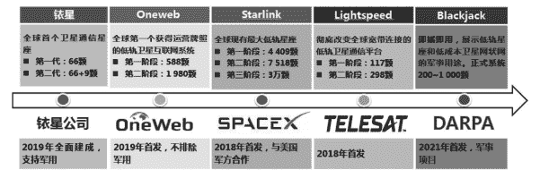
图 5-1　国外典型星座发展状况

#### 星链：SpaceX 的低轨互联网野心
Starlink 是 SpaceX 抛出的大手笔构想，目标是把约 4.2 万颗微型卫星送入 340 至 550 公里高度的近地轨道，依托星间激光链路织成一张笼罩全球的网络，尤其是为光纤和地面基站难以触达的偏远角落提供便宜又高效的互联网接入，实质上打造出空基的 5G/6G 级 Wi-Fi 能力。

##### 星座架构怎么搭
Starlink 本质上是 SpaceX 推进的低成本高性能太空互联网研发项目。首期规划在 540～570 公里的 LEO 层部署 4 408 颗卫星，同时在约 340 公里的 VLEO 层部署 7 518 颗，合计 11 926 颗，具体见表 5-1。建设分两步走：先用 1 584 颗星实现初步覆盖，满足美国、加拿大、波多黎各等地的高速天基网需求，再追加 2 824 颗完成全球化组网；第二步则以 7 518 颗卫星搭建更激进的超低轨层。

表 5-1　Starlink 一期星座

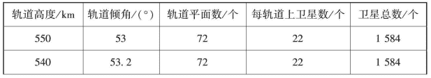
续表

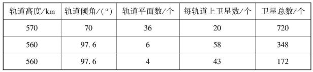
表 5-2 显示，第二期 Starlink 总体规模扩至 3 万颗。卫星主要集中在中低纬带，这些区域人口密集、流量需求旺盛。网成之后，用户体验和带宽容量都将明显提升。

表 5-2　Starlink 二期星座

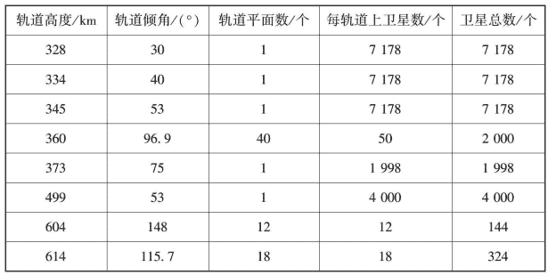
发射上，SpaceX 借助可复用的猎鹰 9 号把 1.2 万颗卫星送入各自轨道面，再编成通信集群。早期尝试借鉴了铱星 9523 的 UART 串口终端做星间数据链路，但随着用户增长，普通线路数据与 SBD 数据的收发出现明显衰减。于是进行升级，改用基于区块链的 SGL 组网架构，以 SGL 基础协议搭建星座，令牌式加密传输保障安全。这样既解决了冗余和扩展性，也把网络核心层的应用保护在 SGL Chain 上。方案还开放了 GISP 接口，供各国 ISP 接入。一旦接入，全球无信号盲区都能实时获取太空 Wi-Fi 互联网。

##### 网络架构对标指标
与地面蜂窝对比，接入速率上 LTE 下行约 100M 至 1G，5G 下行约 1G 至 10G，Starlink 现阶段提供 50M 至 150M，下一步瞄准 1G。链路时延方面，LTE 在 10 公里距离约 66 微秒，5G 在 1 公里约 6.6 微秒，而 Starlink 在 550 公里高度时延接近 4 毫秒，1 200 公里时延大约 8 毫秒。

##### 投放与演进节奏
2021 年，Starlink 完成 19 次大批量部署，共下 989 颗，算上首批试验星累计发射突破 1 944 颗。2022 年上半年的发射节奏加快，3 月在 20 天内完成 4 次发射，推算其产线月均可制造约 150 颗卫星。5 月份首期第一阶段发射任务收官。下半年 9 月起恢复部署，并启动搭载星间激光终端的新一代 v1.5 卫星。SpaceX 一直用猎鹰-9 发射，单次最多可上天 60 颗，一级可重复使用让部署成本持续下降。

#### Blackjack：DARPA 的军用低轨网络
Blackjack 由 DARPA 于 2017 年立项，目标是构建 LEO 星座，为军事行动提供持久的全球覆盖。项目思路是把分散的 LEO 卫星与传感器互联，向指定用户提供不间断的全球服务。2021 年 6 月，两颗 Mandrake2 试验星成功入轨，主要用来验证项目所依赖的高级激光通信技术。

传统美军卫星多为定制研制，周期长费用高，而 LEO 宽带通信卫星的规模效应很有吸引力。Blackjack 寻求以低成本载荷搭配商品化卫星平台，强调小尺寸、低 SWAP-C，性能争取与现役 GEO 军用通信相当，但价格大幅下降。DARPA 指出，商业平台将采用开放架构的电力、软件和网状网接口，未来可兼容数十乃至数百种低轨军用载荷。借助商业要素是核心优势：商业平台压低单星成本，商业发射降低入轨价格，整体上形成竞争杠杆。用成百上千颗小而廉价的卫星实现与传统资产相当甚至更好的性能，可显著提升系统韧性，模块化设计也让未来需求快速适配成为可能。

##### 卫星构成与大脑 PitBoss
相较 GEO，LEO 在时延和性价比上更具优势，Blackjack 选择 LEO 构型。如图 5-2 所示，单颗卫星由商业平台、PitBoss 控制单元及一个或多个可自主运行超 24 小时的军用载荷组成。

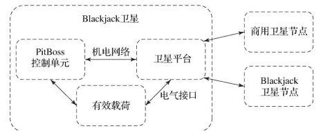
图 5-2　`Blackjack`卫星结构图

PitBoss 是项目开发的在轨自主网络任务管理系统，可视作星座“大脑”。控制单元内置高速处理器和加密模块，提供通用网络与电气接口，兼具任务级自主、在轨计算、星地通信管理、遥控遥测和数据加密功能。DARPA 2019 年 4 月的公告要求 PitBoss 能依托全球 LEO 星座实现目标定位、特征刻画和持续跟踪，还需强化 PNT、天地通信及关键数据的全球快速分发。它负责收集、处理并把关键信息推送给战术用户，系统融合架构与软硬件，支撑星座级自主、自动化数据采集与处理，核心创新是能在轨处理。不仅单颗传感器可做机载处理，PitBoss 还能汇总每颗传感器的原始数据进行融合后直发需求方，无需地面操作员干预。

##### 平台与载荷关键指标
Blackjack 依托商业公司研发的小型、轻量、低功耗、低成本 LEO 星座，具体通用平台指标见表 5-3。项目将验证支撑 LEO 组网的核心技术，重点是商品化平台与低成本、可互换、研制周期短、迭代快的军用载荷，并推动载荷向多平台适配优化。有效载荷关键参数见表 5-4。终极目标是让军用载荷高度互联、兼具弹性与持久性，全天候为全球任务提供超视距遥感、信号侦测和通信能力。

表 5-3　`Blackjack`项目通用平台关键指标

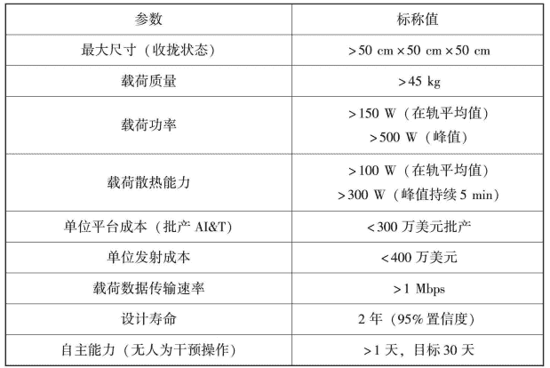
表 5-4　`Blackjack`有效载荷关键参数

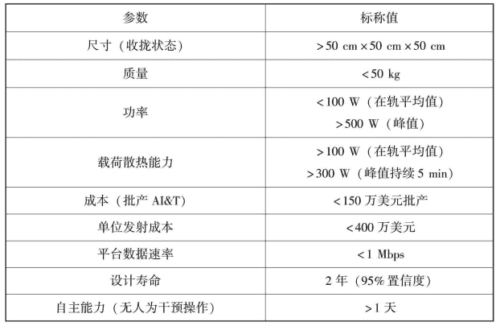
##### 试验进展
PitBoss 研制由 SEAKR 主导，已先后发射 Mandrake 1 与两颗 Mandrake 2 试验星。Mandrake 1 为立方体星，搭载超算处理芯片，用以验证辐射缓释和处理器性能。Mandrake 2 为一对小卫星，搭载宽带星间激光链路，为未来 LEO 光学网状网奠基。

Mandrake 1 于 2020 年秋发射，载荷包括高性能多核 ARM 处理器和多颗 GPU，已完成一次战术海上试验，验证了任务自主、OTA 升级、无质量载荷在轨部署及传感器边缘处理利用等能力，涉及 ADC/DAC、FPGA 处理、ASIC 处理等关键技术。

Mandrake 2 两星于 2021 年 6 月 30 日发射，与 POET 原型共飞，分离后可在约 2 400 公里范围内开展试验。任务是向 DARPA、美国太空发展局、空军研究实验室等证明先进激光通信的可行性，主要采集低轨光通信终端 OCT 的性能数据，并与 POET 联合演示在轨数据融合。入轨后，POET 还将演示第三方多源情报融合软件在可模块化、可升级任务软件套件中的集成应用，美军也借此评估 OCT 高速链路的捕获、跟踪与维持算法。

## 5.2.2 国内发展现状
国内星座化进程与海外基本同步，已提出卫星互联网等多个体系。整体路径强调智能组网与协同，实现高效管理、动态重构和应用效能提升。低轨互联网一直是重点关注方向，自国外方案提出起即展开跟踪研究，建设上呈现企业多点布局、政府统筹推动的特征。

图 5-3 显示，国家卫星互联网工程于 2019 年底启动试验试用系统研制，现正优化组网方案，规划约 576 颗星构成的空间网，实现星地协同为全球用户提供宽带接入，同时兼顾特殊应用。国家“科技创新 2030”重大项目天地一体化信息网络工程规划不少于 120 颗低轨卫星，首批“天象”试验星于 2019 年发射，第一阶段试验试用系统正在研制。

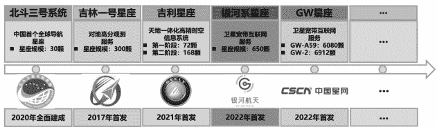
图 5-3 国内星座发展状况

### 1. 天地一体化信息网络重大工程
天地一体化信息网络秉持“天基组网、地网跨代、天地互联”思路，以地面网为底座、空间网为延伸，覆盖太空、空域、陆地、海洋，为各类天基、陆基、海基用户提供信息支撑，推动人类网络空间跃升新层次。

#### 1）构型设计
建设上，整合高轨、低轨、临近空间与地面网络，形成覆盖全球的互联融合体系。服务上，推进全球商业化运营，提供全时全域信息服务，培育“天地一体化信息网络+”产业生态。

地面信息港是应用落地的关键枢纽，汇聚多源异构时空数据，融合网络、遥感、地理信息、定位导航等资源，连接供给与需求，提供数据处理加工环境。依托安全可靠、自主可控的软硬件，提供托管、仓储、工厂化等多种服务模式，集聚行业力量和应用产品。它更像一个舞台和窗口，借助天地一体化网络联通天地、触达四方，成为信息产品、人才与产业的聚集高地。

#### 2）功能设计
地面信息港聚焦“1+1+N”工程：一套安全可靠的公共基础设施、一个兼容共享的开放服务平台、N 个智能高效的行业应用。

公共基础设施方面，构建自主可控的云计算存储环境，即分布式超算中心加数据中心，为政府、企业和个人提供个性化时空数据处理与存储，按需使用如用水用电般便捷，同时提供高于行业的安全保密等级，平台自主可控，最大程度避免信息泄露与隐私风险。

开放服务平台方面，在基础设施上集成原始时空数据、处理算法、通用与专业产品、开发环境，打通空间信息服务从源头到产品的全链条。既供给丰富专业数据和产品，也为行业从业者提供开放研发环境，形成集智共创的社区，推动平台与产业共同发展。

典型应用方面，以信息港为载体，整合通信、卫星导航、遥感测绘等领域的优势技术与权威数据资源，面向交通、旅游、环保、民生、农业、应急等场景，为各类用户提供基于天地一体化网络的时空大数据服务。

### 2. “鸿雁”项目
“鸿雁”是中国航天科技集团提出的通信星座，可提供全球实时数据通信与综合信息服务。

#### 1）构型设计
全球导航增强构型分为空间段、地面段和用户段。空间段由 GNSS 系统与鸿雁星座构成；地面段包含监测站、中心处理站及信息传输分发网络；用户段为可同时接收导航卫星与鸿雁卫星信号的终端。系统采用四大 GNSS 双频监测，全球稀疏布站，播发 GPPP 增强信息与双频增强信号，提升精度、完好性、可用性及实时性。

工作流程上，鸿雁卫星搭载高精度 GNSS 监测接收机，产生与 GNSS 系统驯服的 10MHz 与 1pps 时频基准，通信载荷据此生成测量通信一体化信号向下播发。监测数据经星间链路传回境内中心处理站，结合地面站与鸿雁移动监测站观测生成精密星历，再经上行链路送至卫星，最后通过用户通信链路广播。用户接收该一体化信号即可获取精密星历，实现全球精密单点定位。

#### 2）功能设计
相较传统 SBAS，低轨导航增强是一种新体制，依托低轨通信星座发展机遇提出。除导航增强核心技术外，与低轨通信星座的融合是系统成功的关键。

① 在区域监测站受限条件下实现低轨卫星与中高轨导航卫星联合定轨。由于无法全球均匀布设地基站，需在低轨卫星上装载监测接收机，与地面区域站联合开展天地一体化监测，用于 GNSS 与低轨卫星的精密定轨与钟差求解。需设计合理分布的区域跟踪网，兼顾计算负载与星座构型，优化参与联合定轨的低轨星。融合地面网与星基跟踪等多源观测，弥补地面站盲区，改善网形，实现多高度卫星群精密轨道的快速解算，满足实时需求，并形成厘米级实时轨道与钟差改正。

② 用低轨星座增强北斗/GNSS 实时精密单点定位。低轨卫星弧段短、速度快、受大气阻力影响，地面观测常伴随周跳与粗差，开展适配的数据预处理与质量控制是可靠精密定位的前提，为后续高精度处理提供清洁观测。多星座融合虽提升观测冗余，也引入码间、频间、系统间等多类偏差。确定低轨增强模型后，需分析各偏差参数的可估性，并在多星座条件下刻画低轨与导航卫星偏差的时空特性，判断采用常数、白噪声、随机游走等何种随机模型及约束强度，以影响定位估计精度。联合解算时，高维环境下低轨高动态短弧段的模糊度快速解算仍是难点，最终需系统论证评估低轨增强北斗/GNSS 实时精密单点定位性能。

③ 深度融合卫星导航与移动通信。频率资源是低轨通信星座的核心，移动通信下行多用 L 频段，导航增强需与通信频段兼容以降本降风险，故通导融合是建设关键。移动通信卫星常用多波束天线形成多小区并采用频率复用提升容量，需突破多波束条件下的通导一体化信号设计，充分利用通信频率与功率资源，在 L 频段实现通信与导航信号一体播发。

④ 小型化、轻量化、低功耗、低成本的导航增强载荷。低轨平台受 SWAP 限制严格，载荷设计需面向低体积质量功耗展开。“鸿雁”采用高精度硬件架构、片上系统芯片与可重构软件系统技术，实现高精度时空基准并兼顾小型化低功耗降本，同时引入软件定义载荷，支持在轨维护与功能升级扩展。

#### 3）特性指标
特性指标聚焦实时高精度与安全 PNT。用户接收 GNSS/LEO 信号可实现全球动态分米级、静态厘米级 GPPP，收敛时间小于 1 分钟；单独接收 LEO 信号可提供导航备份，提升复杂地形与复杂电磁环境下的可用性；同时充分利用通信频率与功率资源，在 L 频段实现通信导航一体播发。

## 5.3 空间智能组网与协同关键技术

全球卫星星座加速布局

海外组网方案快速增多，公开可查的境外星座计划共 14 套，其中美国 9 套，俄罗斯、加拿大、印度、韩国、荷兰各 1 套。2020 年 5 月 26 日，美国 FCC 完成一轮 NGSO 准入申报，累计申报的卫星总数达 81 195 颗。国内进展同步推进，2006 年沈荣骏院士率先提出天地融合网络的理念与总体架构。2016 年，该方向进入“十三五”规划并被列为科技创新 2030 重大项目。中国航天科技集团主推鸿雁星座，中国航天科工集团主推虹云工程，两项工程的首颗试验星均在 2018 年 12 月发射。2020 年 4 月 20 日，国家发改委首次将卫星互联网写入新基建清单，随后在相关项目支撑下建设更大规模的自主低轨网络。巨型星座演进与空间智能组网技术爆发式发展，使得近年相关研究呈加速态势。

### 5.3.1 空间网络架构设计

#### 1. 星座规划与部署
在 3GPP 与卫星厂商的共同推动下，密集型 LEO 星群在无线回程中的作用日益突出。这类星群可提供大容量回程、全球连续覆盖以及更灵活的接入服务。Deng R 等关注超密集 LEO 星座的设计问题，即在兼顾部署成本与卫星高速移动性的前提下，回程需求驱动的最小卫星规模，以及在给定覆盖率下以最少卫星完成部署的方法。研究首先估算单终端平均回程容量及覆盖该终端所需的最低星数，据此给出保证全球最低星数覆盖的初始方案；在初始方案基础上采用三维优化算法，以全球无缝覆盖与终端总回程需求为优化目标，对任意覆盖率要求输出对应的优化 LEO 星座。

#### 2. SDN/NFV驱动的星地网架构
超大规模星群需要高效管控来统一海量节点，保证空间无线通信运行的可靠与服务可用。针对天地融合网络在资源利用、灵活配置、高效运维、星地协同等方面的挑战，Tang F 提出一种具备强管控能力的 SDN 星地融合架构。将控制器与受控交换机部署在同一星座内，可大幅降低控制开销，控制域拓扑相对稳定。该架构下提出自适应星地协同传输方法，以系统吞吐最大化为目标，提出 DEEPER 算法在多条星地路径间动态分配流量，适应网络动态与负载波动，提升传输能力与资源利用率。仿真显示 DEEPER 在吞吐、端到端时延、传输质量与负载均衡上均优于基准。

SDN 类低轨网络在功能灵活性与资源管理上具有优势，但现有控制器布置难以适应高度动态拓扑与随机波动负载。Chen L 研究了拓扑与负载同步变化条件下的低开销自适应控制器布置及负载分配问题。

传统卫星通信受制于配置缓慢、流量工程不灵活、难以实现细粒度 QoS 保障。Li T 等人提出基于 SDN 与 NFV 的天地融合框架 SERvICE，覆盖 GEO-MEO-LEO 三层星网及地面骨干与数据中心，包含管理、控制、转发三平面。SDN 实现卫星数据面与控制面分离，集中控制简化任务处理；NFV 用于在星上创建基于虚拟机的网络服务功能。同时提出面向 QoS 的卫星路由算法 QSR 与面向 QoS 的带宽分配算法 QBA，以满足多用户服务质量需求。

Zhang Z 提出支持 SDN/NFV 的新型管控架构 Poster，分为实体与覆盖两部分。实体部分依托单层 LEO 网络，在同一轨道面交替部署控制节点与数据节点，实现控制转发与数据交换。覆盖部分由实体抽象而成，将控制节点与数据节点抽象为两个平面，形成虚拟控制覆盖网与虚拟数据覆盖网。因控制节点与其对应数据节点位于同一轨道面，拓扑波动被屏蔽，两者关系保持相对稳定。

#### 3. 5G融合的星地架构
为应对无线设备与应用增长，需为未来有线系统开发各类接入技术以提供可靠数据服务。当前卫星网络与 5G 融合成为趋势，但卫星的高移动性、高故障率及境外易受攻击等特性带来挑战。是否将 5G 核心网功能置于低轨、置哪些功能需要审慎权衡。Li Y 在不同星座配置下对比多种核心网放置方案优劣，并设计无状态移动核心网架构 SpaceCore。该架构将状态与核心网功能解耦，通过地理空间寻址简化位置状态，利用地理标签标识空间服务区以消除卫星移动造成的不必要状态迁移，通过设备即存储实现状态本地化检索。原型验证显示该方案在信令时延、切换接续、用户面性能及抗攻击抗故障可靠性方面均有优势。

#### 4. CDN驱动的星地内容架构
尽管互联网内容提供商可利用云 CDN 提供高可用低时延的广域数据访问，但地面云基建不足区域用户仍面临高延迟。Lai Z 提出基于低轨网络的内容分发架构 StarFront，目标为全球任意地点低内容访问延迟。首先给出低轨 CDN 架构及三种内容获取方式；随后构建联合内容放置与分配模型，输入为动态拓扑、负载、卫星/云运营商定价策略，以访问时延为优化目标，在低轨卫星或地面云上动态部署缓存副本，并将用户请求动态分配至合适缓存。仿真表明该方案可有效降低全球内容访问延迟，在典型 CDN 流量下运营开销可控。

### 5.3.2 空间节点路由设计

#### 1. 基础路由算法

##### 1）计算效率导向的路由算法
卫星数量增长导致拓扑变化加快，路由计算难度上升。若路径计算耗时过长，拓扑已变，数据包可能无法找到正确路径；更新时间过长还需重传，提升时延与丢包率。Jia M 设计基于虚拟拓扑思想的路由方法，对每个时片内的静态拓扑进行路由时，以时延或跳数作为链路开销，引入深度优先搜索 DFS 与 Dijkstra 结合，提升计算效率与结果可靠性。

巨型星座使路由表急剧膨胀，导致存储需求、Dijkstra 执行时间、表查找速度等问题。Zhang S 基于双层路由结构提出两种稳定路由方法。延迟有界路由 DBR 的核心是抑制不必要路由变更：找到更短新路径但当前路径仍可达时，仅当网络时延超过预设界限才触发更新。为流设计，转发表需为每个源目的对保留条目。为减小表规模，还提出基于目的地的延迟感知路由 DAR，利用中断频率衡量链路稳定性，将路径稳定性/成本定义为各链路成本之和。仿真表明 DBR 与 DAR 均可实现更小时延抖动与更少路由变化。

##### 2）面向拓扑动态性的路由算法
传统低轨网最短路径算法基于快照链路时延计算，实际传播时延持续变化，传统方法难以做出最优决策且开销大。Geng S 提出最优时延路由方法 DQ-GERT-MPS。首先构建延迟排队图 DQ-GERT，用有向边和弧表示时延变化与大小；初始化后获知各链路处理时延、排队时延、传播时延；筛选满足约束的全部候选路径，对每条路径模拟服务过程 1000 次，取平均时延与标准差最优者作为最终路由。

低轨卫星移动快，星地链路切换频繁，单星服务窗口仅数分钟。Wang F 提出自适应路由方法，基于 SDN 架构：GEO 作顶层控制星负责计算最优链路与资源调度，MEO 作辅助路径查找星帮助 GEO 收集地面目标及邻近低轨卫星信息，LEO 作底层转发星仅执行转发。改进 Dijkstra 以限制搜索范围，仅在当前卫星所在轨道及附近两轨道内搜索，将当前星与同轨星间距离设为最大搜索距离。控制器计算最优 k 条路径，链路切换时直接选用替代路径，减少计算时间与端到端时延。

低轨网星多、轨道周期短、拓扑动态强、链路切换频。Li X 指出 STIN 将所有数据汇聚地面中心处理会浪费资源，因此在动态异构 STIN 中以传输成本最小为目标研究多源数据传输与子任务联合处理。联合路由与任务部署：一方面数据处理收益与传输开销存在权衡，另一方面数据依赖导致路径交叉影响任务部署，同时需兼顾卫星移动带来的拓扑与资源变化。

# 卫星网络路由与资源管理

## 泛洪路由优化
LEO 星座拓扑高度动态，地面路由协议需适应规则变化。对异常链路故障/恢复引起的不规则变化，网络范围路由泛洪仍是收敛必需。但高密度拓扑会造成显著流量泛洪冗余，规模越大问题越严重。Ruan G 提出轻量级路由泛洪机制，通过生成稀疏泛洪拓扑修剪原始全网拓扑，仅在稀疏拓扑上泛洪路由信息。综合最大泛洪跳数与拓扑鲁棒性，采用搜索算法计算最优拓扑，而非简单套用最小生成树。

## 3）面向流量随机到达的路由算法
小卫星网络 SSN 具有高度动态拓扑与随机分组到达特性，传统路由难以直接使用。随机业务下预计算拓扑描述或联系表均无法适应随机流量；高度动态特性也使分布式路由状态收集开销巨大。Li J 提出时态网格模型 TNM 描述大规模 SSN 时变拓扑，用静态立方体即网络网格替代卫星坐标，记录时间连续拓扑信息，每颗卫星只需存储固定数量网络网格，精度由网格划分决定。基于状态感知的网络网格路由方法先用信标协议定期收集邻居状态动态调整决策，再给出基于网格的最短路径路由 NSR 解决最优路径查找。仿真显示随机星间链路中断下，NSR 丢包率更稳定；相比基于 TGM 的 Dijkstra，NSR 复杂度更低。

LEO 网络中波束与卫星切换会改变路由信息，卫星进入人口密集服务区时瞬时速率变化对路由提出挑战，需支持频繁变化且不丢包。Markovitz O 提出需求分割路由 DSR 方法，把业务从源终端路由到可连多颗卫星的目的终端，同时保证并规划服务度量 QoS 的带宽与时延。仿真显示极端故障场景下 DSR 仍保持较高用户满意度。

## 2.多径路由算法
多路径路由可显著提升吞吐量、降低端到端时延。基于网络编码的多路径路由消除了路径间复杂协同，进一步提高效率。传统方案在链路时延长、拓扑规则的近地轨道网中效率不高。Tang F 提出基于源目的地址的多路径协同路由方法，把基于网络编码的多径协作路由问题定义为寻找数据流最佳路径集，目标最大化系统吞吐量；进而给出基于网络编码的 LEO 卫星网络多路径协同路由协议 NCMCR，提高吞吐量。

## 3.负载均衡路由算法
随机流量到达与热点分布导致流量不均，易造成节点拥塞。Li X 提出低轨道网络状态感知负载均衡 SALB 路由模型，面向高负载下链路状态频繁变化，目标在负载均衡前提下减小端到端时延。首先提出定量估计链路状态并动态调整排队时延权重的机制；随后提出 SALB 模型，兼顾负载变化、链路与节点故障恢复；路由表在每次切换开始时重置，通过相邻两次切换间的有效最短路径树算法动态更新，降低路由开销。

## 4.节能路由算法
卫星互联网受质量体积限制，电池容量有限。现有节能路由多关注流量分配与端到端时延，且依赖实时网络信息可行性低。Liu J 提出基于深度强化学习的路由协议 DRL-ER，在给定端到端时延限制下实现最小能量消耗路由，避免星群电池能量不平衡并保证有界时延。首先用经验回放研究不同卫星能源环境下路由策略学习，提升对电池条件与时延边界的适应性；建立能量收集与消耗模型，将路由建模为马尔可夫决策过程，通过 DRL 使代理每 epoch 采取最佳行动，并针对传统 DQN 利用率低、训练慢、难收敛问题给出智能路由算法 DRL-ER。仿真显示 DRL-ER 平均降低卫星能源消耗超 55%，显著延长星群寿命。

## 5.安全路由算法
安全路由对低轨道网生存性能至关重要。但星间链路不稳定、开放暴露，LEO 内部路由易受恶意攻击。传统密码学技术难以解决内部攻击。Li H 提出基于节点信任的 LEO 安全路由算法 SLT，基于分布式信任评估模型，借助 D-S 证据理论计算卫星节点间直接信任、间接信任与综合信任值。结合低成本 OSPF 路由协议设计 SLT，通过及时检测隔离恶意节点减少内部攻击丢包影响。仿真显示 SLT 投递率平均提升 27%，丢包率平均降低 70%。

### 5.3.3　空间资源管理和协同

### 1.资源分配与调度
天地融合网络是未来重要方向，卫星网与地面网融合带来更复杂干扰，有效资源分配至关重要。Zhu X 提出基于两层博弈的卫星-地面云一体化网络资源分配模型。运营商提供不同 QoS 与价格的两层服务，构建两层博弈问题最大化运营商效用；基于用户服务选择求解能量最小化问题，在满足 QoS 约束下为用户分配功率与计算资源；分析效用与定价策略演化关系，最终找到 Stackelberg 均衡点，获得最优定价与资源配置策略。数值结果显示算法可得到最优分配，能耗随可用虚拟机增多快速下降，充足时趋于稳定。

天地融合网络为远程物联网提供服务已成趋势。Chen D 提出基于 MCPR 算法的资源立方体 MCRC 算法降低系统总时延。设计效用函数在预设时延内最大化资源利用率。STN 网络异构，采用匹配博弈确定为 IIoT 应用服务的网络节点。随着 IIoT 节点增多规模增大，传统方案需全局信息难以获取，采用马尔可夫近似与马尔可夫链均值匹配。仿真显示该算法资源利用率略降，但系统总时延显著改善。

### 2.虚拟网络功能协同

卫星网络智能协同与空间AI应用新趋势

基于 SDN/NFV 的低轨卫星网络中，服务供给的资源协同是核心难题。卫星高速运动带来网络拓扑和可用资源时刻变化，很难精确刻画异构资源及其关联；星上载荷受限，必须精打细算共享调度；VNF 编排与路由深度耦合，使得 SDLSN 的资源分配愈发复杂。间歇性的星间链路让 SDL-SN 的路由难度远超地面网。Jia Z 等人转向时间演化图上的 VNF 编排来研究服务供给问题。针对星间链路稀缺、时断时续且不稳定的痛点，提出融合 Dantzig-Wolfe 分解、列生成与分支定界的分支定价求解框架，可有效逼近最优解。为兼顾工程实用性，又设计了子问题的近似解法，并引入波束搜索加速搜索树剪枝。仿真表明，采用波束搜索的分支策略能在保证一定间隙的前提下获得满意解，效率显著提升。

对于地面覆盖盲区，LEO 卫星网络可汇聚偏远物联网数据并中转至地面云。LEO 本身特性导致端到端时延难以满足物联网实时要求，节点激增还加剧带宽紧张引发拥塞。兼顾实时服务、最小化带宽占用，并在卫星计算、存储、带宽、能源受限条件下提升运行效率，多星借助 NFV 协作提供计算成为可行路径。Gao X 等人提出 PGRA 去中心化分配方案，利用纳什均衡求解 VNF 放置。为每个用户请求向卫星部署 VNF 时，联合最小化服务器能耗、网络带宽与服务时延的综合部署成本，在成本最低原则下尽可能多地满足用户计算请求。仿真显示 PGRA 相比基线在网络收益与请求成功率上均有所提升。

卫星边缘云融合边缘与云优势，可为大量物联网用户灵活供服。Gao X 等人探讨卫星边缘云中 VNF 放置的动态分配问题。首先把该问题建模为整数非线性规划，以最小化端到端时延与带宽成本为目标。随后提出分布式 VNF 放置算法 D-VNFP。算法依据资源可用性刷新当前网络状态，前一时隙释放的资源可供下一时隙新请求使用；收集新请求后，按需调度可用资源。仿真对比表明 D-VNFP 相比基线带宽消耗降约 5.85%，平均端到端时延降约 2.38%，请求成功率提升约 5.93%。

### 3.服务功能链资源协同
空天地一体化网络中时延敏感业务快速增长，要求资源精准配置并依据时延抖动规划 SFC 部署。Zhang P 等人提出延迟感知 SFC 映射方法，输入为 SFC 请求及物理网络，输出为链路时延与部署路径。根据请求规模、带宽与时延需求将 SFC 分类，同一业务类型内部采用 KSP 算法挑选 k 条时延最短且开销较小的候选路径，评估每条路径的资源成本与时延后择优。仅当所选路径时延低于用户阈值时 SFC 才算成功部署，否则判定失败。仿真显示该方案 CPU 利用率提升 27.8%，链路利用率提升 22.7%，服务接受率提升 21.5%，时延性能提升 38.2%，总体资源消耗下降 25.2%。

定制化 SIN 用于执行特定空间任务。但不同定制网络间协作不足导致资源闲置；现有 SIN 软硬件难以升级，制约新一代传输技术落地。Yang H 等人研究带 SFC 约束的最大流量路由问题，SFC 由有序服务功能序列构成，任务流必须按预设顺序流经。首先用时间扩展图建模时变 SIN，转化为线性规划问题。为降低大规模问题求解难度，提出基于 SFC-GT 的低复杂度近似最优算法，将其重构为受 SFC 约束的单商品最大流问题。配套的 SFC-APS 算法用于寻找满足 SFC 约束的增广路径，通过迭代搜索增广路径并更新残差网络，SFC-GT 可获得接近最优的路由策略且复杂度大幅下降。仿真验证其性能接近最优。

### 4.虚拟网络映射
SAGIN 具有异构、时变、自组织特性，受流量、路由、功率、频谱、负载均衡等多因素制约，异构物理资源分配调度是关键。Zhang P 等人借助虚拟网络架构与 DRL，将 SAGIN 异构资源编排建模为多域 VNE 问题，提出跨域 VNE 算法，核心在于异构资源分配。首先对 SAGIN 各网段建模并按实际与用户需求设定网络属性。DRL 中代理由 5 层策略网络构成，基于提取的网络属性构建特征矩阵作训练环境。训练完成后得到各底层节点被嵌入概率，测试时按概率依次嵌入虚拟节点与链路。DRL 本质是端到端感知控制，擅长高维决策。仿真表明该方法较基线提升网络性能与资源分配效率合理性。

针对 SAGIN 网段差异与用户需求多样性，Zhang P 等人提出 RL-BAVNA，强化学习辅助宽带感知虚拟网络资源分配。节点嵌入阶段代理从底层网络抽取特征矩阵输入策略网络，输出节点嵌入概率。仿真显示其在长期平均收益、接受率、长期收益成本比三项指标上均优于传统分配算法。

## 5.4 未来趋势
多层太空体系要求天基星座具备超大规模、动态组网协同、体系复杂、多任务多用途、智能自治、敏捷重构、弹性韧性等特征。多功能可重构网络化技术是支撑未来体系的核心。

首先，面向巨星座的智能多功能技术是前提。未来多层系统形态庞杂、构建不确定，研制与运营受技术市场等多重不确定性影响，存在高不确定与高投资风险，巨星座需具备面向不确定的灵活设计。星座个体需强自主高度自治。随着卫星数量激增，传统单星地面测控模式难以为继，组网卫星正向自主自治演进，通过星内/星座资源自主调度完成感知通信等任务；可自主执行轨道调整与维持，降低地面依赖。

其次，可重构技术支撑系统弹性与灵活重组。集群呈现涌现行为，单点受损可快速重组资源，避免能力缺口。DARPA Blackjack 项目目标是构建可扩展、可变规模、软硬件自适应的空间体系；美国太空发展局下一代架构核心是借助大规模分布式快速生成作战能力，通过低成本传感器载荷与协作巨型系统组合提升抗毁与快速响应。

再次，网络化技术支撑互联互通与天地一体化。组网星座正向弱中心化乃至去中心化演进，安全鲁棒性提升。传统集中式架构难以满足巨星座接入交换控制需求，去中心化成为超大规模空间网络主趋势，架构转变提升整体安全性与鲁棒性，即使部分卫星失效也能保证业务连续。系统具有高度动态群体智能演化特性。由数万颗卫星构成的巨复杂系统建设周期长，运控需面向长期演化。传统预设任务与单星管控已不适用，巨星座需在体系、系统、节点层面具备学习进化能力，按需扩展至各任务节点，在高维动态真实场景中通过自主交互决策完成复杂任务。

以低轨巨星座与混合网络架构为标志，卫星网络正从“天星地网”向“天基组网”演进。传统天基网络技术已成熟，CCSDS、DTN 等协议已标准化。地面网络技术正向太空辐射，学术界探索 SDN、ICN 等新兴技术在巨星座中的应用，以实现更便捷网络管理与多业务承载。智能赋能源于宽带通信复杂化与泛在性，也在于网络-信息-智能融合，其结合优势巨大，是未来方向。

# 第三部分 空间人工智能及在轨应用技术需求
智能航天时代开启，人工智能作为天基系统网络化、信息化、智能化的基础，将广泛应用于对地观测、深空探测、通信导航、载人航天等领域。人工智能+航天器可提升遥感信息获取、通信保障、多域协同智能化水平，在未来竞争中占据先机。

## 第 6 章 对地观测领域需求
面向高技术强实时网络化空间信息保障，网络化协同高分对地观测系统需具备网络协同、知识进化、智能服务三类能力，覆盖任务接收、智能解析、智能执行、信息提取与精准推送全流程。对地观测对空间 AI 及在轨应用技术需求迫切，集中在观测效率提升、应急快速响应、多星协同、遥感信息实时分发、用户体验提升五方面。

### 6.1 观测效率提升需求
当前卫星受使用模式与星上处理限制，观测效率偏低，主要表现为任务量不足与潜力受限。现有卫星多靠地面提前规划未来数日任务，星上被动执行。规划参数静态化，如每圈侧摆次数、工作时长限制，卫星自主性弱，地面为保安全对能源、存储等资源预留余量大，导致单轨任务数受限、潜力难释放。

## 6.1 无效数据量大，资源浪费严重
一方面，环境因素导致无效数据占比高，光学观测常受云层遮挡。据统计，民用遥感卫星有效数据仅占下行30%-40%，军用仅20%-30%。无效数据占用传输与处理资源，观测成功率低，灾害应急时矛盾更突出。另一方面，轨道预报与姿控误差促使地面为确保覆盖对成像范围做前后扩展，进一步产生无效数据。

星上自主规划与智能处理可基于实时轨道姿态载荷状态精细控制成像时长，结合云判、大气环境等信息自主选择观测时机与角度，放弃或调整被遮挡任务，转向条件更优目标，从而提升效率。

## 6.2 应急突发事件快速响应需求
遥感地面系统涉及运控、测控、数据接收等多个部门，流程包括任务提出、规划、指令生成、上注、监视、接收存储、成像、情报生成、态势评估，接口多、条块分割。时效上，计划提出分钟级，制订需小时级，执行到产出信息超3小时，难以满足应急。

星上自主规划与智能处理可实时检测地面突发事件并判读云层气象影响，自主择优观测，提升应急任务成功率，同时实现数据快速处理下传分发，快速响应突发需求。

## 6.3 复杂应用需求推动下多星协同需求
我国已建成风云、海洋、资源、环境减灾及军事侦察等天地传感器系列。随着高分专项推进与 AI、数据融合发展，多类型多分辨率数据融合可提升信息精度与可信度，扩展时空覆盖，增强目标检测识别。

多星协同成为未来趋势，面对复杂高时效需求，不同类型卫星协同观测可大幅提升资源使用效率，快速获取多分辨率数据。未来借助大规模星座组网与网络化群体自主协同及在轨智能处理，重要目标重访时间可压缩至分钟级，大幅提升发现识别能力，实现感兴趣区域的高频次高分辨率全方位多手段侦察。

## 6.4 航天遥感信息高效实时分发需求
现有遥感信息提取多依赖人工识别与手动标绘，耗时低效。海湾战争中，美军侦察卫星数据实时传回华盛顿分析中心，但一帧原始图像形成情报需1.5小时，60%图像因无法及时分析丧失价值。目视定性经验判读阻碍及时发现识别，海量数据难以快速转化为情报，降低利用率与时效。

卫星能力提升，星地传输速率超4×1.5 Gbit/s，星载存储>32 TB，但 Worldview 与 QuickBird 卫星日采集10 TB数据中，仅34.2%具重要价值，无效数据浪费存储与传输资源，增加成本。

在轨智能压缩与感兴趣目标提取可降数据率，云判可变压缩后数据率可降50%，目标检测后仅下传目标图像与位置，数据量可降至千分之一，显著降低传输压力。传统星上获取地面处理需小时级延迟，在轨实时处理后结果可分钟级送达用户，满足高时效应用。

## 6.5 用户使用体验提升需求
现有管控完全地面化，采用时间标记指令模式，按需预算参数编制指令序列上注执行。缺点：需地面人员熟悉各星操作细节并与研制方核对，繁琐且增加可靠性安全风险；指令数据量大，受测控弧段限制约10分钟制约效能；卫星由专业地面部门代理使用，非直接用户，后续需面向直接用户提供随时定制任务能力。

管控模式需改进，减少地面工作量与成本，加强星上处理与自主规划，实现星上自主任务管理，卫星可随时接受用户定制任务，自主决策协同并回传结果，提供灵活稳定服务，提升使用体验。

综合需求，开展遥感卫星空间AI及在轨应用技术研究对发挥天基信息系统效能、提升面向直接用户服务质量意义重大。

## 第 7 章 深空探测领域需求
深空探测包括月球、行星、行星际、星际探测，是人类认知与开发太阳系的重要路径，具有重要科学与经济意义。但探测器远离地球带来智能自主需求：远距离长时延需自主健康管理、路径规划与决策；未知环境需智能感知识别；能源算力受限需软硬件定制与任务适应设计。

下面从操作费用、任务可靠性、通信网络、实时性需求分析采用空间AI实现探测器自主的必要性。

## 7.1 操作费用需求

深空探测的运营成本困境
传统探测器的地面操作模式对人员依赖极重。地面团队要负责任务编排、生成探测器的执行序列、实时跟踪在轨硬件状态、校验序列正确性以及出现异常时的恢复处置。一次深空任务通常持续2至5年，漫长的周期意味着持续高额的人力与经费投入。

引入智能自主能力能够大幅压缩此类开销。探测器本身具备自主目标生成、自主决策与自主执行的能力，不再需要地面长时间干预，从而显著降低地面操作人员的劳动强度。指令交互也变得抽象化，地面只需下达“做什么”的意图而非“怎么做”的细节，任务修改更加便捷。即使发生故障，探测器也可自行完成诊断、隔离与修复，无须进入安全模式等待地面制定详细的挽救方案。

## 7.2 可靠性保障要求
深空任务造价高昂，对全程可靠性提出极高要求。单纯依赖高性能高可靠硬件虽能提升指标，但在深空复杂且不可预测的环境下，故障仍难以完全避免。

智能探测器可实时监测各部件异常，迅速判断并生成修复策略，较传统操作具备更强的鲁棒性，从而显著提升任务可靠性。

## 7.3 通信网络需求
通信是深空探测的关键环节，既要把地面指令送达探测器，也要把科学数据传回地面。随着距离增加，对地面站规模的要求随之提升。传统做法下，地面需发送极其详尽的指令序列，占用大量资源和带宽，弱通信环境下弊端尤甚，自主管理能力亟待提升。

在自主控制架构中，地面仅发送抽象化指令，告知目标而非流程，通信量大幅下降。同时智能探测器会对下传的科学数据进行初筛与压缩，剔除坏数据、合理压缩后再回传，进一步减轻对通信网络的压力。

## 7.4 实时性需求
传统操作中，环境突变或故障发生后必须等待地面决策，并生成详细的执行序列，受时延制约，实时性差，往往错失有利时机。

智能探测器可依据周边环境与自身状态变化自行作出响应，无需地面介入，工作更具实时性，能够抓住小行星、彗星交会或飞越等稍纵即逝的机会。此外，智能执行模块采用多线程并行方式，很好地匹配各子系统的并发特性，提升系统整体实时性。面对未知环境，提升智能感知能力成为必要。

## 7.5 面临的挑战
近十年来人工智能快速发展，主要得益于两点：
①多结构数据的存储效率大幅提升，涵盖文件、图像、视频、音频等。
②数据处理速度显著加快。成熟AI网络训练需巨量运算，随着GPU、FPGA等高速计算单元、SSD/NVMe等存储技术及网络传输速度的提升，训练周期大幅缩短。

当前AI已部分应用于深空探测，如火星表面地形探测、利用巨型射电望远镜数据寻找宜居星球等，但与地面应用相比仍存在差距：
①星上算力存储受限。外太空温度变化大、强辐射，航天级芯片普遍存储容量小、计算速度低，面向大数据与高速计算的AI应用需先解决资源瓶颈。
②恶劣空间环境影响。单粒子效应等可能影响处理器性能与数据正确性，进而削弱算法有效性，AI对数据与算法依赖度高，可靠性问题突出。
③样本稀缺且不平衡。深空探测器发射数量少，获取样本有限且分布不均。如自主健康管理中，无故障样本占绝大多数，有故障样本极少，严重不平衡。
④技术融合不足。地面AI落地迅速，但与空间技术的结合研究较少，需针对深空探测痛点找到有效的结合路径。

## 第 8 章 载人航天领域需求
在载人航天的人机智能体系中，航天员处于主导地位，负责监视、控制与管理各类人工智能，并承担机动性强、随机性高的操作与科学实验；人工智能则承担程序化、危险性高或成本高的任务。两者优势互补，形成更安全、经济、高效的整体。

## 8.1 顶层需求
载人航天的终极目标是拓展人类生存空间，实现在宇宙中永久自由生活。推进可分三阶段：
①进入宇宙。解决长期驻留问题，建立空间站与外星球基地，在地球支援下获得长时间工作生活条件。
②开发宇宙。掌握开发利用宇宙资源的能力，探明物质与能量资源，为空间站、基地运行与人类生存提供支撑，并向地球输送资源。
③驾驭宇宙。具备不依赖地球支援的永久生存条件，充分利用宇宙资源，维持人类社会存在，将生存空间扩展至宇宙。

人类是适应地球的环境生物，在太空构建生存条件需耗费巨大资源，可参与人员受限。降低操作人员需求、减轻工作负荷是重要因素，构建无人化智能设施是提升效率与可行性的有效路径。智能化无人系统与载人航天并不矛盾，如同自动驾驶汽车与乘客关系，人类进入宇宙并非充当可被自动化替代的操作员，而是指挥智能化系统高效完成生存目标。

## 8.2 应用需求
空间人工智能与在轨应用技术在载人航天中应用广泛，包括舱内环境检测与控制、导航与控制、航天员作息与工作程序调控、健康数据管理与医学对策等。将工程与医学专家的知识系统化带入轨道，可增强自控系统智能性，提升管理科学性与灵活性。

技术难度最大的是具备多感知、分析判断、灵活运动及信息交换能力的机器人系统，它将成为替代航天员执行出舱活动的主要工具，且需低能耗或具备自补充能量能力以满足远程探测。

载人航天中机器人主要执行出舱任务，无论近地轨道、月球或火星基地，均需机器人代航天员完成探索、维修与样品采集。机器人可仿效人类认知功能，但应突出特定任务需求。例如月球或火星表面探索采样机器人需具备强视觉感知、空间记忆、物体辨别与运动能力，理想情况下具备化学嗅觉，对模式识别与分析判断要求高，并能与基地航天员交流信息。应用机器人可大幅降低航天员出舱风险与保障成本。

人工智能系统不仅要完善功能，更要注重运行可靠性。发展方略应基于可靠的前提由简到繁逐步演进，最终形成以航天员为核心、智能性强、能完成各类航天任务的人工智能系统，这也将推动地面AI理论与人类智能研究发展。

### 1. 近期需求分析
2017年4月22日，天宫二号与天舟一号对接形成组合体，成功完成我国首次载人航天器推进剂在轨补加，使我国成为继俄罗斯后第二个掌握该技术的国家，标志第二步工程目标全部完成，验证空间站建造关键技术，工程顺利转入第三步空间站阶段。

2022年11月3日，随着梦天实验舱顺利转位，天和核心舱、问天实验舱形成T字基本构型，中国空间站全面建成。后续将依托空间机械臂开展应用与在轨服务，扩大试验规模，开展运营维护并考虑延寿。

### 2. 中期需求分析
载人登月是我国未来载人深空探测的<|message|>

月面科学实验核心指向

月面科研聚焦三大方向。首要任务是弄清月壳浅层乃至深部的构造细节，并梳理其形成演化脉络。其次要把月面质量异常区，也就是人们常说的质量瘤，搞清楚成因、分布范围和物质构成。第三类实验偏向短期、便捷且能与后续任务联动的项目，例如被动式月震记录、月表重力测量、磁场勘查以及热流监测。

设备种类多、布设点分散，运输和部署得靠具备自运能力的月面车。车要能把载荷送到设计点位，配合地面人员完成安装，同时自行规划行驶路线挑选作业点。

试验产出海量，部分成果仰赖长时间积累。若把全部原始数据都传回地球，工程上不可行。实际做法是在轨完成筛选与压缩，只把关键信息送回。

## 3. 资源探测活动需求

资源探测首要验证月表是否存在水，并绘制氦-3、钛铁矿、稀土等矿物资源的空间分布图，为后续开发和基地建设提供依据。探测类型多、行驶里程长，需要机器人月车运载仪器，并在航天员配合下完成布设和测量。

永久阴影区航天员无法进入，取样和实验必须交给特种机器人和试验装置。主要目标是寻找水冰存在的证据，在可疑区原位取样，并在月表就地分析成分并开展水提取试验。

先期由无人探测器进入阴影区巡检，圈定重点试验和采样区并做水冰存在验证。待航天员抵达后，再取回样品进行精细成分研究和水提取试验。

# 8.5 长期载人深空探测典型需求

进入长期阶段，载人月球探测已具备可自持发展的体系。基地可实现全月地形普查与资源普查，开展系统化连续科研，利用本地资源生产消耗品和能源，并拥有设施建设与维护能力，支撑人员长期驻留作业。

## 1. 载人月球基地任务规划需求

基地任务规划覆盖全生命周期，时间跨度大、层次多、内容广。体系应分阶段、分层次协同推进，先长后短、由宏观到微观。可分成战略、战术、任务、执行四个层级，上层结果作为下层输入，最终由执行层指导具体实施。

战略规划核心是为基地系统与使用者分配资源。战术规划涵盖运行模式转换、载荷设备运转、乘组操作训练、后勤运输等整体安排。任务规划包括用户使用安排、任务期间关键系统维持、运输综合需求、数据系统能力与需求、发射前后特殊后勤、地面与乘组训练等，由各部门分工制定，例如系统资源计划由基地支持部门拟定，用户活动支持计划由载荷管理部门拟定。汇总后形成任务级规划。

执行规划对研制流程、计划数据做精细化设计，包含飞行程序、飞行数据文件、风险控制与故障对策、飞行准则、系统重构和实时执行计划，形成周序列与日序列。面对多任务多资源多约束，解空间多样，可通过多优先级任务模型与基地动态数据生成操作序列，序列可按地球指令适时调整。

## 2. 长期载人月球站智能维护需求

基地运营管理是对空间操作、运营支持与后勤支持进行全过程管控，确保长期稳定安全。包含规划与实施两个层面：一是全生命周期的任务规划，明确建造、应用、服务、退役、补给、维护维修、载荷、驻留、试验安排、月面活动、航天员日常等细化内容；二是依据规划与时间节点，组织舱段发射组装、飞行器发射交会对接、月面起降、乘员生活工作、载荷试验等运营活动的实施方案与执行。

## 3. 载人月球基地后勤保障需求

后勤是运营管理中相对独立且关键的部分，核心在于保障基地高效稳定运行。最基本功能是实现以月球为目的地的空间运输：安全可靠地把人员、推进剂、货物、仪器等补给送到月面；完成月面转运与存储；把人员或科学样品送回地球。更高级别基地，后勤系统还需承担本地产品的运输，如基地自产的液氧推进剂、氦-3原料等。系统须在全生命周期内及时经济地保证资源供给并处理异常，其协调效率直接决定基地规模与月面活动范围，经济性和可靠性决定发展速度。

建设初期运往月面的物资以保障生命的消耗品为主。随着建设推进，逐步运输大型基地组件，物资运输量需求逐渐超过生命保障，并出现特殊货物运输需求，任务复杂度上升，对后勤系统提出更高要求。

## 4. 智能资源探测与原位建造需求

月球资源有限，除太阳辐射外，环境资源与大部分表层资源如水、氢、氧、金属矿物均受限，加上运输成本，就地利用成为首选。

月表可建太阳能电站，为照明、保温、设备运行供电；利用温差开展能量转换与耐温材料研究；熔岩管内可搭建基地，屏蔽宇宙线、陨石、微流星体及撞击喷发物。

月壤富含矿藏，可分离提炼氧、氧化物、硅酸盐、金属等。氧化物用于金属生产并提取太阳风携带的氢氦；硅酸盐可生成二氧化硅、氧化铝、氧化钙等，用于制造建筑材料。

长期运营下，食品和水须自给自足。人机协同中机器不可或缺，矿物开采、运输、提取、加工各环节均需人机配合。未来基地建设走向智能规划、智能制造与运营维护一体化。

## 5. 载人登火星需求

火星是离地球最近的大行星之一，体量相近、拥有稀薄大气，演化历史与地球相似，是除地球外最具生命迹象潜力的星球，对宇宙与生命起源研究意义重大。同时它是人类建设地外文明的首选目标。太阳系中，火星气候环境最接近地球，且拥有可就地获取的能源与建筑材料资源，以及维持生命不可缺少的水资源，有望实现人类在火星的生存与作业。

# 第 9 章 通信与导航领域需求

微小卫星与卫星互联网快速发展，低成本大批量低轨通信互联网巨型星座成为产业与学术焦点，星座化是通信导航卫星发展主趋势。新一轮人工智能浪潮下，星载计算平台性能提升将推动空间人工智能与在轨应用技术提升服务性能、演进卫星功能、拓展星座业务，最终实现智能化、自主化与灵活稳定的星座系统。面向通信导航卫星人工智能可划分为网络智能管理需求、自主运管需求与智能协同需求。

## 9.1 网络智能管理需求

面向多功能、轨道互补、自主运行、易扩展的智能化天基网络发展。随着空间技术进步，天地一体化网络应为各类空间节点共享资源提供条件，并为各类航天器接入提供便捷。网络智能管理涉及网络架构、星间链路通信、网络拓扑、网络路由等关键技术。

核心技术是智能组网与地面或通信卫星网络一体化接入技术。通过星间、星地、星空及地面站链路，将地面、海上、空中与深空用户、飞行器及各类平台密集联接，采用智能高速处理交换路由，按信息资源最大化利用原则，实现信息精准获取、快速处理与高效传输的一体化网络，即天基、空基与陆基综合网络。

### 1. 网络架构

当前空间网络形式多样，多按服务需求部署专用网络。构建天地一体化网络需融合天基卫星通信网络、空基飞行器通信网络、地基通信网络，实现全球覆盖、随接入、按需服务、安全可信的全球互联。

天地一体化网络包含三张网：第一张为天基网，由各类卫星组成通信、导航、遥感协同网络，作为空间基础设施；第二张为空基网，由飞机、飞艇、热气球、无人机等构成，主要负责天基与地基间中继；第三张为地基网，由陆地蜂窝网与无线局域网等构成。

在空、天、地 3 张网中，天基网络和地基网络分别构成天、地的骨干网络，是天地一体化网络中的重要组成部分。空基网络在天、地骨干网间起中继传输作用，是骨干网络的辅助部分。由于技术起步晚，我国天基网络设施建设还不够完善，通信容量缺口较大，覆盖范围仍需进一步加强。因此，推进天地一体化信息网络的重中之重是建设和完善天基网络。

天地一体化网络中的天基网络是一个混合异构的卫星网络，简要概括其特点就是高、中、低轨卫星结合，通、导、遥卫星协同。卫星按照距离地球高度分为中、低轨道卫星和高轨道卫星，不同卫星系统相互独立。天基信息网络则同时纳入各轨道卫星，形成一个高低轨道相配合的混合卫星网络，解决以往单纯某一轨道卫星系统各自存在的不足。

从天基通信角度来看，高轨通信卫星主流采用地球静止轨道，其时延大，无法覆盖两极地区，通信容量有限；中低轨通信卫星星座对地运动，其链路不够稳定，用户终端成本较高，网络组网成本高昂，且从实际运营来看，因低轨星座规模较大，而我国卫星频率、轨位等网络资源国际协调处于后发地位，卫星轨位和频率资源紧张。然而，高低轨卫星优劣势具有很强互补性。高轨卫星广覆盖的特点能有效解决中低轨卫星星座通信不稳定的问题，而数量繁多的中低轨通信卫星能够提供较大的通信容量。因此，打破两种通信卫星网络各自独立的体系，实现高、中、低轨卫星联合组网，是天基网络的趋势。

除了实现不同轨道高度上通信卫星的联合组网，还应将现有各类型卫星融合入天基网络中来，包括通信、导航和遥感等卫星。通信卫星完成语音和数据传输，导航卫星负责定位服务，遥感卫星提供对地观测信息。导航卫星和遥感卫星虽然不是为通信而设计，但却是天基信息网络的重要组成部分，能够感知和获取地面环境信息，从而为天基通信网络资源的重构和分配提供依据。

### 2. 星间链路通信

星间链路通信包括接入方式、测量通信体制、捕获跟踪等，具体实现与使用频段密切相关。按照星间链路的通信频率，星间链路可分为微波星间链路和激光星间链路两类。

微波星间链路的频率相对激光链路，其载波频率较低，天线尺寸要求较大，发射功率较大，通信链路带宽较窄。但是微波链路对于卫星姿态要求较低，目前的工艺水平也足以达到要求，是当前星间链路通信的主要形式。激光星间链路载波频率高，具有相干性、单色性、方向性好的特点，通信容量大、速度快、抗干扰强，但是激光星间链路的捕获跟踪技术难度较大，对卫星姿态要求较高。

随着导航卫星星间链路的实现，为长距离的远程卫星接力通信提供了可能。采用高速和精确指向的激光星间链路，卫星将提供更高速率的星间链路网络，实现大容量的星间信息传输，减轻地面跟踪、遥测和指令站的负担。激光通信系统尺寸、质量和功耗明显降低，抗电磁干扰能力、保密性强，其中核心技术是激光束的捕获-对准-跟踪技术。

未来相干激光通信的典型通信速率为每秒 10 Gb 量级，与传统微波通信终端相比，激光终端体积小、质量轻，光学天线口径较小，整体成本降低，且性能大幅提升，是构建天基导航信息传输的理想方式。

### 3. 网络拓扑结构

在卫星网络中，节点借助星间链路互联，形成完整星座。一个星座可由轨道面间链路与轨道面内链路构成规则网状结构。网络拓扑定义了节点间连接关系，可为二维网格式，也可为基于开关的不规则形式，现役网络多采规则结构。拓扑决定链路数与数据传输路径，是设计首要研究对象，影响整体性能并决定协议选择。

导航星座常采用网状拓扑。网状拓扑即邻近节点按规则平面图形相互连接，形成分布结构。每个节点可与网内其他节点相连，具备充足冗余路径。特点是可靠、容错能力强，可用二维坐标编号，路由简便。优点：

①链路冗余备份充足，可靠度高，可扩展性强；
②链路带宽较高，传输快、时延小，可实现全球覆盖。

缺点是卫星数量需求多，建设成本高。网状结构中节点间直接相连，冗余路径丰富，可靠性最高，是发展趋势。

多层网络应包含骨干网和接入网。GEO、MEO轨道高，时延和链路损耗较大，通常作为信息交换骨干并负责与关口站、大型终端通信；LEO卫星和HAP可为地面移动小终端提供更好服务。在多层架构中，LEO和HAP作为用户接入节点，并可通过星间链路与骨干网交换数据。

### 4. 网络路由

卫星网络环境特殊、节点高速移动，路由技术是体系架构重点。路由研究针对卫星特点设计算法和协议，为网络内部节点或地面用户提供数据传输路径，特别针对多星多跳远端用户。早期卫星通信以GEO中继、弯管方式转发，路径固定无路由问题。星座网络中，需在源端与目的端间多条可达路径中按链路代价选择最优。可将天地一体路由分为三部分：

①上/下行链路路由，负责用户接入控制，并为用户选择源端卫星和目的端卫星。
②边界路由，负责卫星网络与地面网络互操作，实现透明通信。
③空间段路由，即星间网络路由，负责星座内部源端与目的端间最优路径计算。

其中上/下行路由相对简单，例如按覆盖时长或信号强度选服务卫星并切换。对于边界路由，可把空间段视为地面网络子网，在关口站和指定边界路由器上运行改进协议实现异构互联。

构建卫星网络应集中解决星间段路由问题。星间段路由实现端卫星间点到点连接，是天地一体网络最基本问题，其技术是星间互联基础。卫星网络区别于地面固定网和无线移动网，需针对性设计路由机制。一般应具备：

①拓扑动态变化适应性，避免或及时消除路由环；
②抗毁性，节点失效或链路故障时避免数据丢失；
③高效性，以小开销获得高成功率或吞吐量；
④流量变化适应性，支持负载均衡避免拥塞。

按分类方式，可归为集中式与分布式、面向连接与无连接、静态与动态、先验式与反应式及混合式，单层与多层等。

## 9.2 自主运管需求

### 1. 运管系统架构

运管系统架构是星座运行管理的重要支撑，对运行与维护升级影响根本。卫星数量增多，地面测控站难以承受高负荷数据传输与处理。同时过度依赖地面测控，一旦地面站受损，运行难以保证。因此提升星座自主性成为发展方向。运管系统正向自动化、智能化演进。

利用适用于在轨运营的测运控一体化无人值守地面管理系统，实现自动化监控、无人值守、任务自动下发、卫星自动跟踪，完成状态监控、业务数据自动收发处理分发，满足多颗低轨商业卫星同时跟踪。针对独特运营模式，提升在轨管理效率，降低成本，实现一套地面设备管理多颗低轨卫星测控运控，并实时完成测控、数传解析处理。

低轨卫星测控原理与高轨相同，但轨道周期短、速度快，地面站不可持续可见。管理方式与同步轨道有较大差别。首先，星上需具备较高自主能力，包括轨道测量、确定、调整、工作模式转换、平台载荷操作、故障检测隔离恢复等；其次，低轨星座涉及多星多站协同，需功能强大的任务调度软件，基于可见弧段与任务需求实现资源最优分配与调度。

现阶段国内外卫星星座的运控体系普遍存在短板。互通性不足是明显痛点，比如定位导航用的北斗和气象观测用的风云，两套运控系统和运维团队完全分开，无法用同一平台统一管控。承载力也受限，绝大多数系统只能带几颗卫星，很少有方案能稳定支撑十颗以上。操作层面，界面不统一、流程繁琐，随着在轨星数逐年攀升，人工测控的负担指数级增长，必须用智能化手段来分担压力。

Planet Lab 的 Doves 星座是典型的做法。任务管理团队把重点放在把常规操作自动化，用系统替代手工流程，同时持续迭代自动化能力，平均每天至少对全部卫星做一次健康巡检。地面和在轨端基于自研的灵活可扩展微服务接口，为上百颗卫星和遍布全球的天线站提供日常操作、调试、定制任务、实验与部署等能力。

### 2. 星座构型维持
建设星座的初衷是通过数量优势扩大覆盖范围和可见时长。设计时就会确定运行构型，全体卫星要按此构型协同工作，保证结构稳定和服务连续。

发射数百颗之后，地面不可能逐星下发飞行指令。实际做法是地面只告知每颗卫星在星座中的位置，由星上自主控制飞到指定轨道；地面持续更新通信负载和星座变化信息，卫星据此自主调整姿态与轨道。

主流的构型维持思路可归为两类。

#### 1）站位维持方法
基本做法是通过主动控制把卫星的绝对或相对位置维持在设计位置，超出允许漂移区间后再干预。为了兼顾长期稳定，设计阶段会选用容错性强、允许偏差较大的构型，保证一定程度的降级运行能力，轻微偏离也不影响服务。构型保持是整体协同控制，参数、控制量和精度要求都随之变化，需要结合空间结构、任务需求、协同控制和性能影响综合决策。策略制定时还要参考覆盖特性、过顶时间、最大盲时以及健康状态。

#### 2）摄动补偿方法
编队飞行强调星间紧密动力学约束，而星座更依赖单星轨道运动，星间耦合相对松散。但特殊结构仍会产生复杂耦合，影响整体演化趋势，这为摄动补偿提供了空间。核心是在轨道选取和参数微调上进行合理设计，用可预测摄动的抵消来保持整体构型。国内外研究表明地球非球形摄动和初始位置偏差是构型破坏的主要诱因。选择稳定性高的轨道，并利用摄动力进行补偿设计，能提升长期稳定性。补偿本质是对既定构型做小量轨道参数偏置，不改变基本结构，可减缓外力破坏、延长构型合格期，对偏离容限的卫星再实施少量控制，从而降低控制代价和频率。

### 3. 星座备份与阶段部署
在轨运行阶段为保障可靠性，通常预留备份星，在故障时及时接替，保证少数星失效也不会大幅滑坡服务能力。导航类星座往往要求能抗两星失效仍满足最低需求。运维机制需预设应对方案，主要有四种。

#### 1）内在冗余策略
设计之初就把备份星纳入构型，正常运行时已存在数量冗余，是当前最常见的方案。

#### 2）空间替补策略
在建网时把若干备份星部署在星座外的备选轨道，待本面某星失效后，通过机动变轨飞至故障位置接管。需要时间与推进剂消耗。

#### 3）地面替补策略
备份星先留在地面，发生故障后再发射补充。关键在于应急运载是否随时可用，小型固体火箭的兴起为该策略提供了经济可行性。

#### 4）软替换策略
不靠增加硬件，而是通过软件升级弥补硬件缺陷，实现星座重构。对仍可用的卫星升级功能或激活预存备份软件，改变整体功能模式。

部署并非短期完成，多为几年甚至十多年分步进行。因此不能只以最终状态优化，而要兼顾各阶段性能。初始、中间、最终构型相互牵连，设计初期就应权衡。工程约束下应最大化各阶段子星座价值，实现阶梯式性能提升，使已上天的卫星能提供部分或接近预期的功能。同时分阶段部署伴随系统迭代，每个阶段在设计、资源、功能上很可能变化，设计之初就需考虑硬件资源和软件功能的扩展性与可配置性。

为保证新技术可靠性，建造方通常先在轨验证。Doves 每批发射都安排冗余备份，并挑选部分 Staging Sats 验证高风险试验技术，为后续升级奠基。星链则类似 Web Service 模式，先在少数在轨星上灰度试验，验证达标后推广到全网及后续批次，不达标则支持重试、回滚或停止，从而具备快速迭代能力。

### 4. 智能控制需求
星座规模从数颗到上百乃至上千，单纯靠增员或提升地面系统已不够。一方面运控操作随星数指数增长，人力难以跟上；另一方面地面系统短时故障或失联也会导致异常。提升星上智能化与自主化是必然方向，主要包括自主运行控制、自主碰撞规避、自主离轨。

#### 1）自主运行控制
指卫星摆脱地面依赖，自主判断状态、维持构型并完成任务。降低成本、减小风险。姿态和星务已基本自主，关键在于自主规划调度、自主导航、自主轨道控制。

##### （1）自主规划与调度
是自主决策的核心。根据当前资源、外部环境与约束条件，选择动作并分配资源，把任务级需求分解为可执行指令序列。

##### （2）自主导航
是姿态轨道自主控制的前提，为构型控制提供测量数据。对导航星座而言，还要承担高精度广播星历生成。

##### （3）自主轨道控制
为保持几何构型精度而进行的轨道维持。基于自主导航输出的运动参数，星上计算机发出指令，推进系统执行机动。

以自主导航为例，常见方案有天文导航、导航星导航和星间相对观测导航。多星场景下，单星导航会忽略星间相对运动，利用星间相对测量进行相对导航正成为热点。美国第三代 GPS Block II R 即采用星间交联测距与在轨处理，各星用星载处理器修正导航参数，实现无地面干预的星历与钟差更新，可自主运行 180 天，180 天末用户测距精度仍约 ±7.4 m，极大增强抗毁能力。

Galileo 也曾提出星间与星地测量融合的自主导航方案，地面仿真显示用户测距误差可达分米级，低轨星历更新约 15 分钟，高轨约 2 小时。星间测量不仅提升生存性，也能提高星历精度，间接提升用户定位。

#### 2）自主碰撞规避
近地“交通”愈发拥挤，靠地面监测预警已捉襟见肘。大批量星座难以全靠地面完成监测与机动，必须地面支持结合星上自主。星链卫星即配备自主防撞系统，接收地面碎片威胁数据后，用四轮动量轮配合离子推进自动规避。

地面系统预报轨道、检索约两万个目标库，筛选潜在碰撞、计算概率，将高风险时段和控制量上注。卫星用四个垂直动量轮改变姿态，配合离子发动机抬高或降低轨道完成规避，完成后回返标称轨道。全流程由计算机自动化完成。

#### 3）自主离轨
星座单星成本与可靠性要求相对有限，在轨寿命较短。若失效星不处置，会成为空间碎片威胁自身及其他航天器。因此需要低成本高效的自主离轨手段。发现某星故障且无法修复时，应及时替换，并对退役星执行轨道终止，使其进入大气层烧毁或转入短寿命轨道，防止碰撞与污染。

## 9.3 智能协同需求
低轨移动互联网星座兴起后，服务不再由单星提供，而是靠多星组网协同。未来通信与导航卫星在提升单星性能的同时，多星组网通信、任务协作将成为主线。但星间链路拓扑、分布式管理、多任务规划、多星协同、资源分配等难题亟待人工智能解决。

广义卫星网络由多种功能的异构卫星、星座、空间飞行器及地面有线无线设施构成，通过星间星地链路连接地面、海上、空中和深空用户。它可按需集成，也可一体化设计，具有多功能融合、结构动态可变、状态复杂、信息一体化处理等特征。

天地一体化信息网络涵盖天基与地基两部分，要求互联互通并融合为一体。通过星间、星地、星空及地面站链路，将各类用户与平台密集联合，采用智能高速处理交换路由，按最大有效利用原则实现信息获取、处理、传输一体化，是未来综合化网络的典型形态。

在群智能卫星系统中，需借助神经网络、模糊逻辑、遗传算法等人工智能技术实现高度自主计划，并具备修正能力以适应环境变化、远距操控与低带宽通信。利用控制器协同进化思想，可增强编队飞行、姿态同步等群体协作能力。

## 第 10 章 共性需求
航天器网络化、信息化、智能化是不可逆趋势。本章聚焦高性能计算、自主健康管理与智能在轨维护的共性需求。

## 10.1 高性能计算需求
用户需求提升带来业务数据激增，数据关系更复杂，而天基系统普遍存在星上处理能力不足、技术架构老旧、难以实现多源数据在轨实时处理融合等问题。需按需配置网络、计算、存储与载荷资源，构建天基网络的自主化、智能化与快速响应能力。采用模块化设计，实现资源拟态可重构、软件在轨可更新、功能灵活可扩展，为节点能力提升与装备演进提供支撑。

卫星市场对成本与效能愈发敏感，设计强调快速处理多种业务、缩短研制部署周期，同时保证寿命与可靠性，并具备新技术适配与可移植性。

### 天基信息网络化服务能力需求
各子系统信息割裂，落地后仍分割，难以汇聚融合。制约联合业务的信息服务能力。需把各类型航天器获取的信息资源汇聚，压缩反应链条，提升获取、传输、处理、分发与应用效率，并实现存储检索。要求星上平台具备强计算与存储能力，对不同速率数据快速处理、融合并生成信息产品，提升通用化、自主化与高效化。

### 天基信息可重构服务能力需求
在轨重构要求软件可定义、在线可重构。高轨卫星寿命长、研制周期长，缺乏在轨更新会严重制约新技术适配。随着微电子与高性能计算发展，演进升级需求增强。模块化、资源可重构、灵活可拓展的信息服务平台，对节点能力在轨提升与装备演进具有战略意义。

### 天基信息云服务能力需求
传统卫星网络下行能力有限，大量数据无法实时下传，需在轨强处理提取有效信息，降低存储与传输压力。工作依赖分布式天基存储计算资源，需研究适配天基环境的分布式云服务机制。

高分辨率遥感推动数据量爆炸。分辨率约 1 米时实时传输可达每秒吉比特级，0.1 米级更甚。受地面站覆盖和下行能力限制，高速大容量数据需先本地存储再延时回放，对星载高速大容量存储处理提出更高要求。

### 天基信息存储检索服务需求
快速存储检索要求高效部署与缓存管理。传统星载固存多用文件号描述，信息仅限文件号、地址、星时与简单特征，文件数仅几十上百，元数据另存于 MRAM、EEPROM 等，难以系统化管理海量高速数据，快速定位受限，任务执行与作战时效性受影响，且文件信息频繁修改导致软件版本繁多，难以标准化。

当前载荷产生原始数据量大、带宽高，探测器连续工作时间延长，总记录量剧增。卫星常需多任务并行，存储须支持多路超高速数据流，需极高的带宽与容量，并对原始、预处理、压缩等多类型数据进行统一管理。因此需研究星载平台适用的超高速多源并行存储技术与检索方法。

### 星载智能计算正迈向 ASIC 专属时代
AI 算法更新节奏加快、应用场景持续扩张，配合专用 ASIC 产业链的成熟，星上智能计算向专用芯片演进的趋势已越来越清晰。国内在该方向的研究投入不断加码，未来与具备量产能力的企业联合研制面向轨上环境的专用智能计算单元，是一条可行路径。

遥感影像、遥测遥控、通信导航等业务长期积累的海量历史与实时数据，为星上智能提供了充足的“养料”。结合具体平台的痛点，从场景出发定制芯片，是把航天器智能化水平推高的关键抓手。

## 10.2 星上健康自主管理要义
“健康”指卫星部件、子系统乃至整星是否还能按设计指标完成功能。“健康评估”则是把传感器采集的监测数据、历史存档数据等汇聚起来，用评估模型判断当前健康水平，并对异常项给出原因提示与处置建议。实时掌握并正确解读健康状况，是在轨操作与决策的依据。

### 怎样评估卫星健康状态
做好健康评估对实现高可靠、自主稳定运行至关重要。未来单星功能愈发复杂，多星组网星座逐步落地，一旦故障未被及时处置，服务可用性会下降甚至中断，直接削弱体系效能。任务期间长期脱离地面支持时，若具备星载自评能力，可快速定位、处理问题并为后续规划提供支撑，对提升系统生存力意义重大。

### 高可靠与高自主是刚需
卫星是跨学科的复杂系统，在空间恶劣环境下工作。即便在研制阶段采取多项可靠性措施，在轨仍会出现各类故障，导致健康状态突变或缓慢恶化。统计显示，1990 至 2009 年间成功发射的 1036 颗航天器里，有 156 颗出现过故障，占比约 15%。航天任务一旦在轨出现未处置问题，就可能导致整项使命失败。仅靠地面补救时效有限，容易错过最佳窗口。若星上能完成健康自评、异常自检并及时干预，对运行的连续性、稳定性和安全性意义重大。

### 故障诊断与预测的智能路径
健康评估的终极目标是保障稳定可靠运行，必须实现故障的及时诊断、隔离、切换或重构，同时对未来可能出现的风险进行前瞻性判断，并据此形成评估结论供决策参考。诊断方法与预测方法构成了评估的技术底座，也是能否落地的关键。评估覆盖范围不仅是整星、分系统或关键部件的诊断，预测结果同样是评估的重要组成。

故障诊断本质上是对被检设备各类状态信息的综合判读，以给出运行状态与故障状况的评价，属于模式识别问题。四十余年来该领域已发展为交叉学科，涉及传感、信号处理与大数据、人工智能、自动控制、趋势预报等。

故障预测是评估的重要环节。预测是对尚未显现或尚不明确的问题进行预判，属于基于当前信息对系统未来走向的推理。预测是实现故障预防、提升诊断实时性的手段，主要依据致命性或损耗性故障的关键参数变化趋势进行分析，推断航天器未来可能状态，从而提前采取措施降低风险。

目前基于模型的手段多用于飞行器、旋转类机电系统，而复杂系统的失效机理与模式更为复杂，模型化研究相对滞后。卫星属于动态系统，在轨需持续监测工作状态，出现异常需及时诊断。各重要分系统普遍采用冗余备份，故障时可通过重构恢复功能。状态检测、故障诊断与系统重构构成卫星自主运行的核心，实现自主化与智能化可显著提升在轨运行的稳定性与生存能力。

## 10.3 轨上智能运维两大支点

### 可重构计算让硬件在线进化
随航天与信息技术发展，航天器功能日趋多元，除高可靠长寿命外，灵活性与快速响应成为新诉求。可重构计算能够在轨实现硬件系统的动态变化，有效提升对复杂功能的适应力。

学界普遍认可的概念由加州大学伯克利分校的 André Dehon 与 John Wawrzynek 于 1999 年提出。该定义通过对比给出：一是与 ASIC 相比，可重构计算可在制造完成后针对任务重新定制硬件；二是与通用处理器相比，可为算法映射到硬件提供大量定制空间。2002 年 Katherine Compton 与 Scott Hauck 给出更具体的表述：使用集成可编程硬件的系统进行运算，且可编程硬件功能可由一组随时间变化的物理控制点定义。

可重构计算思想最早可追溯至加州大学洛杉矶分校 Gerald Estrin 于 1962 年的提出，但受器件限制早期实现仅是理念的近似。20 世纪 80 年代中期，Xilinx 推出 FPGA、Altera 推出 CPLD 后，可重构计算开始广泛应用。随着 FPGA 技术成熟，其逐渐成为主流硬件平台。

可重构计算起初关注度不足，直到 1992 年美国国家超级计算中心基于 Xilinx FPGA 设计的 Splash 2 系统，在基因组分析与灰度图像中值滤波任务中，运算速度分别比当时 SPARC 10 工作站快 2500 倍与 140 倍，这一结果迅速引发学界与产业界兴趣。此后可重构计算被用于基因组匹配、高能物理、图像处理、金融数据处理、云计算、机器学习等计算密集型场景，其灵活高效特性备受关注。

借助支持部分重构的可重构硬件构建部分动态重构系统，除具备通用系统的灵活性和效率外，还可在小规模器件上实现较大规模应用，提升硬件利用率。部分重构特性使其可支持实时多任务。鉴于在灵活性、计算效率、硬件利用率和实时多任务支持方面的优势，部分动态重构系统已成为可重构计算的主流方向，并获得商业 FPGA 器件及其开发工具的广泛支持。

### 软件在轨热更新技术
星载软件在轨维护是一项系统工程，不仅涉及软件本身，还与处理器、SRAM、EEPROM 等可编程存储器、操作系统等密切相关。

通常在航天器入轨后，通过遥控注入方式实施软件升级，用于解决系统故障、功能迭代和消除设计缺陷等问题。统计显示，每颗卫星寿命周期内平均约实施 15 次在轨维护，平均每年约 2 次。

星载软件的可维护性与易维护性很大程度上取决于设计方法与实现方式，与软件架构密切相关。良好设计会预先考虑在轨维护的可靠性与便捷性，不佳设计可能导致不支持在轨维护或维护成本极高。

软件定义思路通过软件赋能硬件，提供智能化定制化服务，使应用软件与硬件深度耦合。具备需求可定义、硬件可重组、软件可升级、功能可重构及 APP 动态加载能力的软件定义卫星正引发关注。扩展业务与能力要求卫星体系架构具备统一程序执行环境和丰富的应用软件，可按任务需求动态配置与运行。

软件定义卫星虽能灵活实现在轨升级，但升级便捷性也要求同步考虑网络安全与防攻击。

为提升系统可靠性并便于维护，国内主要航天器研制单位如中国空间技术研究院在分系统设计时普遍增加在轨维护软件，用于星载软件的在轨维护操作，通常对软件镜像进行整体覆盖替换。实施时通过遥控指令将 CPU 切换至在轨维护软件运行，由其负责遥控注入软件的接收与可编程存储器的读写，直至更新完成，计算机复电或复位后 CPU 开始执行新版软件。

传统模式下，在轨维护软件启动会导致飞行任务中止或业务不连续，只能在地面确认工况可接受后开展。对载人飞船等高可靠航天器并非理想方案。以某载人飞船数管分系统为例，工程师结合三机冗余热备份星载计算机架构对在轨维护软件工作模式进行改进，实现业务连续情况下的在轨维护。传统模式下业务会中断；改进模式利用三机通信管理功能，使在轨维护单机与当班单机互通，在交换遥控遥测数据的同时实现正常业务与维护操作并行。

# 第四部分 空间人工智能及在轨应用技术研究
为满足航天器智能应用需求，需统筹推进空间人工智能及在轨应用技术涉及的基础技术、共性技术与应用技术。

## 第 11 章 基础技术
本章将人工智能基础技术界定为操作系统、网络通信、大数据、云平台等。下面分别阐述操作系统、数据传输、大数据与天基云计算技术。

## 11.1 操作系统技术
操作系统是信息产业的“灵魂”，尤其是巨星座操作系统，是支撑巨星座高效管理与智能应用的核心关键。

太空是物理域、信息域与认知域的天然交汇点，也是各航天大国竞相开发的领域。美国将国家安全战略重心转向太空，制定“主宰太空 2030”规划，提出“国防太空体系”七层架构，持续迭代技术与应用概念，有望重塑传统航天体系形态与发展模式。

以 Starlink 为代表的海外大规模星座网络已大规模部署应用。截至 2023 年 1 月，SpaceX 累计发射 3717 颗星链卫星，在轨 3425 颗，正常工作 3389 颗，形成全球覆盖通信能力；星上搭载基于 Linux 定制、面向卫星网络场景的分布式实时操作系统。

2022 年 12 月 3 日，SpaceX 发布“星盾”计划，提供遥感、通信与载荷托管三类服务，并在星链数据加密基础上采用额外加密保障托管载荷数据处理安全。作为星链的军用版，其特点为：一是安全性与抗干扰；二是模块化设计；三是互操作性；四是快速开发部署；五是弹性与扩展能力。

为支撑我国经济与民生需求并抢占轨位频率资源，卫星互联网等大规模星座建设已上升为国家战略并纳入“新基建”。2020 年 9 月，我国向 ITU 申请卫星总量 12992 颗的频率与轨道资源。2021 年 4 月，中国卫星网络集团有限公司组建，成为卫星互联网星座运营主体。可见提升巨星座的精细化管理与智能应用能力已成为体系效能跃升的关键。

操作系统是巨星座核心基础设施，承载资源管理、互联互通、自主运控、协同应用、安全可信等核心功能，是巨星座高效管理与智能应用的信息底座。

### 11.1.1 巨星座操作系统需求分析
不同应用场景需要不同的操作系统，要构建适配巨星座高效管理与智能应用的操作系统，需先对系统功能需求进行分析。重点围绕多功能可重构、协同一体、软件定义、全链路安全可信等典型功能，支撑面向复杂应用场景的星云操作系统研制。

#### 巨星座多功能可重构需求
未来巨星座应用将以“多功能可重构”为核心，由传统“单星单功能节点接入”转向“多星协同与云服务隐节点”，由“天地多次传输处理的长链路”转向“信息层内优化处理的短链路”，由“新技术装备研制的逐代更新”转向“新技术装备功能的通用迭代”，支持星座网络化、云化、智能化及用户无感高效运行，推动体系效能整体跃升。传统“一星一用”与定制化开发模式已难以满足“一星多用、多星组网、多网协同、数据集成服务”的体系化需求，需开发支撑多功能可重构的星云操作系统。

## 2. 巨星座协同一体需求
面对未来高动态、多功能、可重构的任务需求，巨星座需具备高度自适应与抗损毁能力的天地协同组网与信息联通能力，将各卫星的星内传感器、处理器作为网络共享资源节点，自主调度协同网络中的定位、侦查、传输资源等，实现资源按需接入综合支撑任务应用；同时具备多节点、多链路的损毁容忍能力，保障复杂任务条件下的网络协同。当前天基资源管控主要依赖地面系统，采用全静态管理、完全依赖地面指令上注，自主能力弱、不具备资源协同条件，维护工作量巨大。未来万颗级巨星座若仍采用“一星一管”、依赖地面人工的管控方式，运行效率极低甚至无法正常运行，难以满足高效“用天”需求，需开发支撑巨星座协同一体的操作系统。

## 3. 巨星座软件定义需求
发展软件定义卫星技术可有效提升航天器软件密集度与功能灵活度，并大幅缩短研发周期、降低成本与风险。巨星座系统通过需求可定义、硬件可重组、软件可重配、功能可重构及 APP 动态加载等技术，按需重构完成不同任务，其重要性体现在：实现功能与性能的高效持续演进；加速高技术在星座中转化应用；推动卫星产品标准化为批量制造奠基；构建航天软件生态助力成果共享与持续发展。当前卫星研制多为“一案一例”功能定制，程序化特征明显，难以适应情报智能生成与信息即时支援需求，需开发支撑软件定义需求的巨星座操作系统。

## 4. 巨星座全链路安全可信需求
空间安全是国家安全基石。巨星座系统具有开放通信链路、高动态拓扑、复杂应用与海量数据共享特性，比单星系统更易受异常注入、仿冒篡改、漏洞扫描等网电攻击与干扰。保障稳定运行必须解决全链路可信与安全问题。星座分布式组网使单个节点硬件资源有限，需在高效管控自身计算、存储、网络资源的同时，实现节点间安全、高效、可靠协作。在确保时效前提下构建“芯片-链路-数据-应用”全链路安全可信体系，保障路由、切换、传输、接入等环节安全可信。当前基于单星模式的空间安全机制难以满足“云-边-端”分布式协同架构的安全可信需求，需开发支撑全链路安全可信的巨星座操作系统。

## 11.1.2 现有操作系统特征梳理
为快速高效开发面向巨星座应用场景的操作系统，应借鉴现有操作系统发展经验。现有操作系统涵盖桌面、物联网、车联网、卫星等典型场景。通过剖析发展历程与规律，为巨星座操作系统研制提供借鉴。

### 1. 桌面操作系统
桌面操作系统是在计算机上借助硬件运行并完成应用的基础软件，是目前应用最广、最成功的系统，几乎覆盖生活与工作的各个场景。

桌面操作系统诞生前最知名的是磁盘操作系统 DOS，界面仅为字符，不够友好。微软随后推出首个图形界面操作系统 Windows 1.0。如表 11-1 所示，经过多年演进，主流桌面操作系统为 Windows、Mac OS、Linux 三大体系。

表 11-1　主要桌面操作系统对比

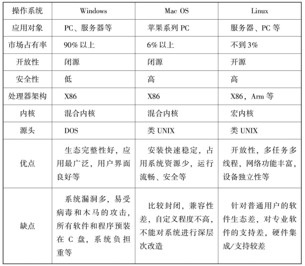

三大系统各有演进路径与特点，在 PC 与服务器领域形成相对独立的用户群。Windows 用户基数大，市场占有率超 90%，生态完整；Mac OS 偏向专业用户；Linux 为全球最大自由开源系统。

### 2. 物联网操作系统
继计算机与互联网之后，物联网掀起信息产业第三次浪潮。物联网由海量异构设备构成，部署环境复杂。物联网操作系统作为连接应用与物理设备的基础，可屏蔽碎片化特征，为应用提供统一编程接口，降低开发成本，便于统一管理。

物联网兴起吸引谷歌、华为等投入研发。如表 11-2 所示，典型产品包括谷歌下一代替代 Android 的 Fuchsia OS、嵌入式智能操作系统 Kata OS、华为 Harmony OS 等。

表 11-2　主流物联网操作系统对比

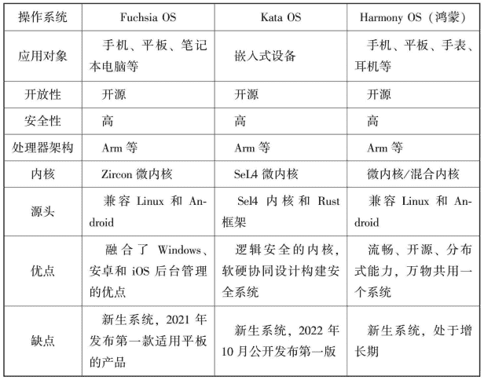

Fuchsia OS 面向多平台，运行于智能手机、平板、笔记本乃至可穿戴设备，预计 2023 年推出正式版。

Kata OS 为谷歌研发的开源嵌入式系统，基于数学上可证明保密性、完整性与可用性的 seL4 微内核构建，2022 年 10 月发布首版。

Harmony OS 由华为开发，基于微内核、面向 5G 物联网与全场景，支持手机、平板、智能穿戴、智慧屏、耳机等多种终端，2022 年 7 月发布 Harmony 3.0 版本。

### 3. 车联网操作系统
随移动互联网与工业智能化加速，汽车产业向智能化、网联化快速转型，形成以智能网联汽车为中心的车联网。智能网联汽车搭载先进车载传感器与智能控制系统，结合移动通信技术，实现车与人、车与车、车与路、车与云平台的信息交换与共享，既便利出行，也助力政府构建智能交通体系。

软件定义浪潮下，车端与星端系统软件的演进路径

智能网联汽车的迭代本质上是整车计算能力的迭代。车载系统软件正承担起连接感知域与动力域的桥梁作用，推动软件定义汽车落地。第二代网联车更像是一个高度集成的信息枢纽，依托高速互联、强算力与充裕存储来承载通用与专用应用，在此架构中车用操作系统处于枢纽位置。

车企、Tier1 供应商与互联网厂商同台竞技，市场呈现多方案并存态势。表11-3 主流车联网操作系统对比

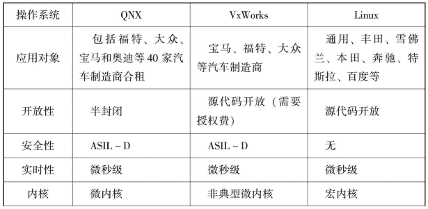

续表

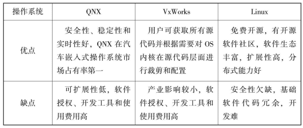

黑莓 QNX 率先取得 ISO26262 ASIL-D 等级认证的实时系统，采用商业授权，凭借安全、稳定与实时表现长期领跑车载市场。Linux 免费开源，QNX 则走收费路线。

风河 VxWorks 由 400 余个独立精简的目标模块构成，源代码可获取并在代码层进行删减配置，已通过 ASIL-D 认证，其实时与安全能力是核心竞争力。

Linux 采用宏内核设计，除进程线程与内存管理外，文件系统、驱动、网络协议均在内核态运行，运行效率良好。与 QNX、VxWorks 相比，Linux 的突出优势在于开源免费且跨架构，可适配更广场景，定制灵活性更高。

### 4. 卫星操作系统

随星上任务复杂度提升，对星载计算机软硬件的设计要求同步提高。系统软件通过任务调度、进程间通信、内存管理等基础能力以 API 形式开放，帮助研发聚焦应用层，促进星载软件标准化与模块化，缩短研制周期并提升可靠性。表11-4 几种典型星载操作系统对比

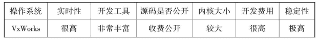

续表

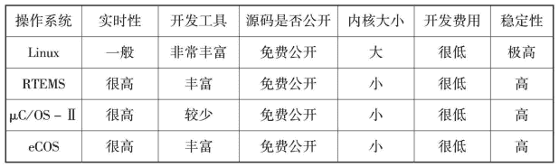

VxWorks 需付授权费，是一款成熟的高实时商用系统，工具链完备，源码可裁剪定制，安全性与稳健性突出，已在卫星控制、导弹、国际空间站等重大项目中多次落地。

Linux 属于可自由使用传播的类 UNIX 系统，因可移植性强、开源免费、可定制、高可靠与高安全，在航天领域应用广泛，例如 2021 年美国发射的火星探测器即采用该系统。

RTEMS 是面向嵌入式场景的开源实时系统，代码质量与可靠性较高，最初服务于美国国防系统，现由 OAR 公司维护，在航空航天、军工与民用领域均有部署。

μC/OS-Ⅱ 为基于优先级的抢占式多任务实时系统，使各任务独立运行互不干扰，执行准时可靠，简化实时应用设计与扩展，已获美国国家航空航天局认证，可用于飞行器、空间站等关键系统。

eCos 是一款可配置的嵌入式实时系统，源码开放无版权费用，可配置性强，代码体积极小通常数十至数百 KB，可支撑多种处理器与平台，主要面向车载、手持等低成本便携场景，已在国内部分星载计算机上实现初步应用。

总体来看，星载系统软件实现规模化应用需具备高稳定实时性、良好移植性、开源可裁剪、工具链丰富、代码可固化、弱交互与统一接口等特质。传统星载系统多以单星为对象，承担单颗卫星的星务管理、数据处理、姿态与载荷控制，是长期稳定运行的基石，其演进长期围绕单星单 CPU 展开。

### 5. 发展启示

跨场景对比可提炼如下规律：

① 系统演进主线是精准匹配应用需求，新场景会催生新系统，开发者对场景的认知在牵引系统演化。

② 操作系统是复杂系统的信息底座，是满足复杂场景需求的必然选择。

③ 产业生态完善是成功的关键，需要行业协同投入才能产生倍增效应。

④ 系统软件需与特定硬件架构匹配才能实现性价比最优，形成软硬件共赢生态，例如 PC 时代 Windows 对应 80×86，移动互联网时代 Android 对应 ARM。

⑤ 微内核因安全性、容错性、可移植性等优势，成为谷歌、华为等头部企业下一代万物智联系统内核主流。

⑥ 操作系统属大型基础软件，投入巨大且失败率高，最终成功者多为所在大国的行业头部企业，具有鲜明国家意志。

## 11.1.3 巨星座操作系统发展思路

基于前述分析，面向我国巨星座的高效管控与智能应用，巨星座系统软件研发应围绕架构定义、硬件载体、内核设计、安全可信与生态建设展开。

### 1. 架构定义

架构定义涵盖需求、层次结构、功能结构、层间接口、内核架构、协议架构、安全架构，是研制核心基础也是难点。必须先研究面向万颗级节点海量硬件资源管理与巨量智能应用快速部署的架构定义，实现资源网格化抽象与管理，支撑千颗级场景下即时聚优与多域联合等功能。

以系统软件统筹系统资源与任务应用为主线，构建开放架构，开发应用框架，推动各层采用标准接口，便于节点互联互通、软硬件移植复用、新技术快速转化。以此细化协议架构与安全架构，完成体系架构设计。

面向场景持续演进，采用层次化设计，精细定义各层功能结构，选用微内核加系统服务加应用框架加行为管控架构。微内核负责线程进程通信、内存地址空间、中断等基础管理；系统服务即外核，负责路由控制、移动性管理、虚拟协同计算、APP 动态加载；应用框架面向通信、导航、遥感等多类型空间任务，采用模块化定制化设计，具备规模可伸缩、功能可裁剪特质；行为管控基于博伊德 OO-DA 观察分析决策行动循环模型，实现群体自主智能。

### 2. 硬件载体

星载计算机是巨星座功能实现的硬件根基，中枢为 CPU，直接决定系统软件应用能力。选型需考虑性能、功耗、太空环境适应性、对外通信接口与系统软件支持度。主流星载处理器包括 80×86、MIL-STD-1750A、PowerPC、SPARC、MIPS、ARM 等系列。

80×86 因高安全稳定在航天领域应用广泛；MIL-STD-1750A 为 16 位非精简指令集，我国风云系列卫星星载计算机采用该架构处理器；PowerPC 兼具高性能低功耗，NASA 多采用该架构；SPARC 为精简指令集，等级高、运算强、功耗适中，我国 BM3803、BM3823、S698 等抗辐照 CPU 已实现量产；MIPS 为精简指令集，中科院研发的龙芯采用 MIPS 架构，部分高可靠性芯片已在国内卫星中应用；ARM 外围接口丰富、可扩展性强，搭载系统软件后在星务管理、数据处理上性能突出，ARM 加系统软件的技术路线已成国内外研究热点。

受空间环境特殊性与电子技术水平制约，星载计算机性能相比地面落后数代，是制约星载系统软件发展的关键因素。设计时需重点考虑轻量化、运行效率、可靠性、稳定性。系统软件最优性能与适配的 CPU 架构紧密相关，需结合国内星载 CPU 发展现状合理选择架构，构建软硬件互惠生态。

### 3. 内核设计

巨星座系统软件内核负责星上资源与任务的抽象管理。应用场景带来三重挑战：一是单星节点硬件资源强受限且异构，需要内核轻量化和异构资源灵活管控；二是多星任务高效协同，需要低时延能力；三是太空辐射易导致软件错误，需要高效容错机制。

卫星运行于空间辐照环境，易受宇宙射线影响，系统软件作为核心基础设施，其抗单粒子翻转的稳定性至关重要。宏内核中任何程序可访问全部内存和内核数据，一个错误就可能导致系统崩溃。微内核中模块间独立隔离，即使受辐射出错也能保持稳定运行。微内核的模块化可裁剪特性也契合天基信息系统资源受限需求。

针对资源受限异构、多星即时协同、空间辐照高效容错三大需求，采用微内核架构，研究内核轻量化、低时延、强容错关键技术，突破异构墙、时延墙、容错墙，设计完全自主可控、高效灵活管控海量异构星载资源的安全实时内核，充分发挥硬件能力、降低软件开销、以低代价增强容错与运行效能。

### 4. 安全可信

安全可信是巨星座稳定运行的基础。通过研究云边端分布式协同架构、多维资源管理、系统链路安全、空间数据防护、接入认证等关键技术，建立基于可信计算的双体系分布式安全可信机制，构建可靠运行环境，形成自主创新的主动免疫三重防护框架，设计安全组件保障系统软件的安全可信能力。

在保证时效性前提下，基于系统软件、一体化融合网络、计算平台控制平面、高可靠共享数据存储、集成化软件加载控制器，构建支持在轨部署升级、星载应用软件实时更新和动态加载的体系架构，保障应用软件安全稳定运行与功能更新。

作为系统安全基座，巨星座系统软件依托云边端分布式安全可信机制，构建芯片链路数据应用全链路安全可信体系，保障系统整体可信与安全。

### 5. 生态建设

巨星座系统软件是面向复杂应用场景的统一基础软件平台，将推动航天软件从专用闭源定制向标准开源通用转变。随着系统复杂度提升和开放程度增大，用户与开发者群体扩大，形成开放、开源、自主可控的航天软件生态体系。

围绕生态模式、社区规划、运行机制、管理机制等需求，构建研发资源数据库和数据采集分析工具。定义多维度评价指标，设计用户画像与项目画像系统，为基于巨星座系统软件的软件资源汇聚与共享提供支撑。

## 11.1.4 关键技术及解决思路

针对巨星座复杂应用场景，构建巨星座信息基座——巨星座系统软件，对体系架构、内核、融合组网、安全可信、生态体系等关键技术进行梳理并给出初步解决思路。

### 1. 体系架构关键技术

架构定义涵盖需求、层次结构、功能结构、层间接口、内核架构、协议架构、安全架构，是研制核心基础和难点。

# 巨星座系统建模与操作系统关键技术

## 巨星座管理及应用模型

采用系统工程、多级分层软硬件抽象和接口标准化方法对巨星座系统建模，主要包含海量硬件资源、系统软件内核、系统软件应用框架、巨量应用软件等层次，如图11-1。

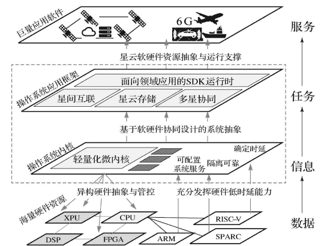

图11-1 巨星座管理及应用模型

海量硬件资源由 CPU、ARM、FPGA、DSP、XPU 等处理器构成，处理器间基于分布式软总线以消息模式交互协同，完成数据级处理。

内核负责海量硬件软件资源抽象管理与高效调度，包含系统软件安全实时内核及系统服务模块。遵循功能最小化原则，为上层提供基础抽象，不实现具体应用功能，完成信息级处理。

应用框架便于设定通信、导航、遥感等多类型空间任务，采用模块化定制化设计，具备规模可伸缩、功能可裁剪特点，包含用户分级服务、资源库管理、知识库管理、任务协同、平台运控等模块，完成任务级处理。

应用软件是软件定义卫星功能的核心，通过丰富改进星载软件与算法，将卫星平台与有效载荷功能迁移至计算平台，用软件实现，通过快速迭代演化实现产品持续演进，完成服务级处理。

根据核心共性基础功能与持续演化需求，精细定义各层功能，在不影响其他层前提下，可根据技术进步或需求变化自由替换某一层实现，实现快速高效重构升级。

## 2. 高效内核关键技术

内核是巨星座系统软件的基础，对下管控硬件，对上提供抽象，负责资源管理与任务调度。面向复杂场景，内核需满足轻量化、低时延、强容错需求。

按内核结构，系统软件可分为宏内核、简要结构、外核、微内核。

操作系统内核典型结构频谱如图11-2。

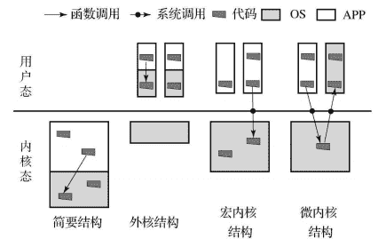

图11-2 操作系统内核典型结构频谱

### 1）简要结构操作系统

应用程序与系统软件运行在同一特权级别和地址空间，面向不支持地址空间或特权隔离的嵌入式设备及单程序场景。交互简单快速，但错误会直接导致系统崩溃，缺乏可持续演进能力，异构星载硬件扩展性差。

### 2）外核结构操作系统

通过把硬件抽象封装到与应用程序直接链接的库系统软件中，库系统软件由开发者自主配置或开发。运行时库系统软件与应用同地址空间用户态运行，外核仅保证多应用安全高效共享硬件资源。面对复杂场景，库系统软件会变得复杂甚至等同完整宏内核，丧失外核优势。

### 3）宏内核结构操作系统

整个系统软件运行在内核态且同一地址空间，文件系统、网络栈、硬件驱动、进程管理等均运行在特权内核态。优势是生态良好，但缺乏系统隔离，安全可靠不足，难以形式化验证。

### 4）微内核结构操作系统

包含运行在内核态的微核和运行在用户态的若干功能模块如文件系统、网络协议栈、硬件驱动。微核代码量少，主要支撑上层服务运行并提供服务间通信机制；不同服务运行在用户态不同地址空间彼此隔离，通过微核通信协同。优势是容错性和安全性更好，服务故障不会直接导致系统崩溃，且便于为不同场景定制服务以适应需求。

综合巨星座任务需求，选用全自主研发微内核路线，在轻量化、可控时延、运行效率、可靠性、安全性和扩展性以及自主软件生态构建方面优势明显，满足复杂应用场景需求。

## 3. 融合组网关键技术

节点互联互通、灵活组网是实现巨星座高效管理与智能应用的基础。巨星座空间网络复杂、规模巨大、高动态拓扑、故障难预测，对实时性与可靠性带来挑战，需结合系统软件内核优化网络设计。

采用 SDN 软件定义网络作为基本路线，结合分级管控与分域管控。分级管控提升对单个网络的可管控规模，分域管控把大网划分为相对独立小网，二者结合可实现万颗级以上卫星的实时高效鲁棒管控。

分域管控把万颗级以上卫星划分为多个相对独立的网络域，分而治之，域间内部信息不干扰，仅提供抽象层面的路由与协作接口，可指数级降低节点规模对整体管控的可扩展性压力。

面向万颗级节点管控需求，卫星网络按星座功能与轨道特征划分。先按功能划分为遥感、通信、气象、导航等星座，再对规模较大的星座按相对稳定的组网结构划分为更小网域，如一个轨道面划为一个网域。一般一个网域规模不超过 200 个节点。

# 分布式多控缓解SDN扩展瓶颈

面对天基节点规模急剧扩张带来的软件定义网络控制面扩展受限问题，当前思路是让多台控制器协同分担管控压力。图 11-3 展示了地面侧的拆分做法：上层为中心控制域，由控制器集群搭建，统一汇总全网拓扑与转发策略，提供集中查询管控，并承担全局流量调度与网络优化；下层为分布式控制域，采用就近部署方式，负责所辖部分天基节点的日常运维，处理无需上升到全局决策的本地化管控请求，从而缩短操作响应时间并规避远距离传输损耗。

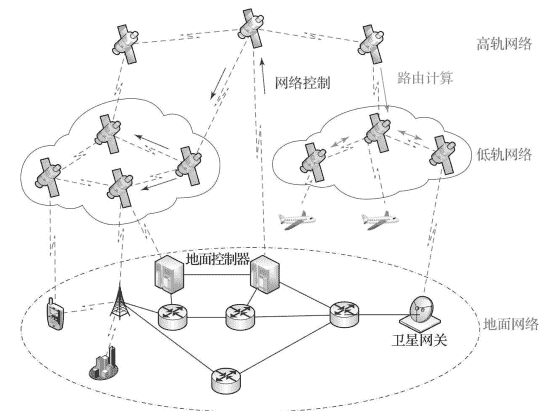

图 11-3　高效网络管控架构

总体来看，巨星座操作系统作为天基网络组网、调度、控制与管理的核心枢纽，推动网络节点与路由转发策略实现高效协同。

## 4. 安全可信关键技术
操作系统是巨星座的底座，其可信水平与安全性决定了空间数据资产的安全边界。巨星座组网呈现空间分布式特征，迫使操作系统架构从集中式向分布式演进。受星上算力限制，卫星之间必须相互配合，在有效管理自身计算、存储与网络资源的同时完成既定任务。

如图 11-4 所示，方案采用分布式架构与分布式计算相结合的区块链手段，构建云-边-端协同可信安全框架，保障数据传输与访问全链路可信。

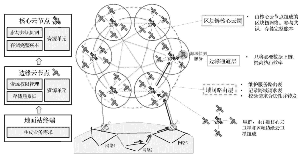

图 11-4　“云-边-端”分布式安全可信体系

结合各节点资源承载与功能定位，对云-边-端协同可信安全框架作如下说明：

①核心云类节点，即承担关键存储、计算与网络资源的卫星。负责全量数据存储，记账完整的区块链账本，提供核心共识与核心网络接入，并依托数据链加日志链的双链结构确保操作系统数据可信。

②边缘云类节点，即自核心云向边缘延伸资源的卫星。按需调取核心云资源，仅缓存分配的部分数据，采用区块链多副本机制在拜占庭容错环境下保持边缘缓存一致性，同时为终端提供低时延访问。

③终端类节点，即单星、移动终端等设备。无需保存完整数据，仅保留关键区块头等信息，采集环境数据，可向边缘云请求计算与通信服务。

④云-边-端分布式协同可信安全架构，即结合卫星在外太空分布式部署特点，以区块链构建核心云-边缘云-终端可信安全架构并引入操作系统。核心云节点互联形成核心网，边缘云节点可跨域协作，二者纵横融合为终端提供多元计算与低时延服务。

总体而言，围绕多星协同、动态管控、攻击防御等诉求，以区块链构建去中心化云-边-端分布式协同可信安全架构，形成操作系统安全可信基座，保障巨星座稳定运行。

## 5. 生态体系关键技术
开源已成为软件创新的主导方式，人工智能、区块链等前沿技术大多依托开源实现快速突破与生态繁荣。一方面开源能高效聚合志同道合的创客参与技术革新；另一方面开源能以更低门槛吸引新用户参与产品成熟与传播，推动边缘产品进入主流。

巨星座操作系统处于新场景新领域，单靠一家难以取得突破，必须汇聚核心开发者、厂商、科研院所、志愿者等多方力量协同探索。

围绕协同研发、测试部署、应用构建等需求，需搭建通用领域基础平台，突破大规模分布式协同研发的代码协作、任务协作、文档协作等技术，攻关持续演化所需质量管理、持续集成、克隆检测等能力，并在基础平台上做定制化扩展，形成面向巨星座的开发与演化支撑环境。

综上，通过巨星座操作系统，推动星载硬件标准化模块化，满足软硬件标准化设计与硬件资源虚拟化管理；推动软件构件化，提升复用度与继承性，降低二次开发成本，为软件生态奠定基础。

## 11.1.5 巨星座操作系统发展效益
依托巨星座构建庞大软硬件生态，将形成万星智联的全场景生态。研究大型软件分布式协同开发与持续演化技术，搭建综合开发演化服务支撑环境，实现面向开源的自主可控生态体系。

巨星座是未来天基系统重要方向。巨星座操作系统是实现多功能重构、协同一体、软件定义、全链路安全可信等共性需求的核心路径。结合任务需求与典型应用启示，采用自研微内核路线全自主研发，满足核心基础设施自主可控、安全可信的战略需求，同时摆脱 Linux 等成熟开源系统历史包袱，在轻量化、可控时延、高可靠方面更具优势。

作为系统核心基础设施与信息底座，面向巨星座场景的操作系统向下管理海量异构硬件，向上支撑海量航天应用软件，为装备软件赋能提供统一、标准、安全、可靠运行环境，形成快速弹性软件能力。这将带来航天软件研制的三大变革：其一，星载操作系统由功能专一向领域通用演进；其二，应用开发由任务定制向平台通用转变；其三，卫星应用由单星服务向云-边-端协同服务转变。

历史表明，高度依赖境外或开源系统将面临生态淘汰风险。操作系统成功的关键在于完整生态，自研系统掌握生态构建主动权，可形成面向航天领域的自主可控开源软硬件生态，支撑卫星互联网等空间基础设施建设。

## 11.2 数据传输技术
信息系统追求高处理速度与良好实时性，运算与 I/O 需同步且能力匹配。随着处理器内核增速远超 I/O，传统运算密集型算法正转向 I/O 密集型，提升数据传输速率对整体实时性至关重要。

### 11.2.1 高速数据总线技术
如图 11-5 所示，VITA78 Space VPX 总线是 VITA 组织推出的面向宇航的新一代高速总线。以 Open VPX 即 VITA65 为基础框架，在商业标准上增加太空应用功能，增强制造商与集成商互操作性与兼容性，通过标准化硬件提升可负担性，满足宇航对强固型、高带宽、多核多 CPU 并行计算、多 FPGA、多 DSP 处理等需求，建立跨层级规范，利于现货交易，成本低、周期短。该标准支持每通道 10 Gbit/s 的 Rapid IO、PCIe 以及 1Gbe/10Gbe 以太网互联。

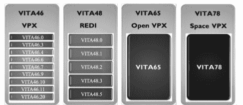

图 11-5　VITA 标准组织总线标准发展

采用 VITA78 Space VPX 标准总线，高速串行总线以 Rapid IO、PCIe 与千兆以太网实现互联。Rapid IO 主要用于系统内部互联，支持芯片级、板级、设备级高速通信，可达每秒上百 Gb 传输，具有高性能、低时延、低引脚、低功耗特点，是星载高性能平台海量数据传输的理想选择；PCIe 用于多处理器数据共享与交互，便于协同处理；千兆以太网用于板级控制数据通信。

### 11.2.2 高速数据交换技术
高速信息流与计算节点互联总线采用 RapidIO、PCIe 与千兆以太网，提供每秒 Gb 级数据与计算信息传输；通过冷备双星型交换中心 A/B 完成各计算节点输入分发、中间数据互联、结果汇集与输出，支持串行、并行及串并结合的拓扑重构。

交换控制网络同样采用双星型结构，使用低速 UART 协议，实现每秒 Mb 级模块测控、状态监视与指令下发，并通过 UART 接口实现各模块处理器程序在轨动态重配，完成节点内算法与计算重构。

可靠性方面，两模块与 k 个并行计算节点板以全互联拓扑建立高速串行双向连接。k 个通用并行计算模块实际启用 n 个，其余 k-n 个作为备份，任一在岗模块故障时可切断电源并启用备份模块替换，通过修改交换表实现交叉互备。标准双星型数据交换网络示意图如图 11-6 所示，交换接口模块与主控管理模块采用双冗余备份，以双星型互联网络运行。

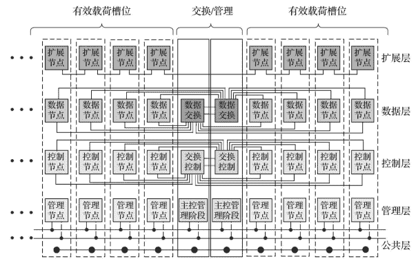

图 11-6　标准双星型数据交换网络示意图

### 11.2.3 高速数据存储技术
高速存储主要完成原始数据、压缩码流、处理结果的快速记录与回放。星载大容量高速存储提供 TB 级容量与每秒百 Gb 速率，采用 NAND FLASH 半导体模块为介质，控制通道以抗辐照 SoC 处理器为核心，数据通道以高速串行接口 SRIO 为对外接口，配合数据识别分拣、数据分配、FLASH 控制器等专用 ASIC 协同工作。数据通道采用超大规模并行与多线程流水，总线最宽处达上千 bit，即使在缓冲模式下读写速率仍可达每秒数十 Gb。

存储阵列与前端识别分拣单元通过高速串行数据接口传输，该接口为当前高速传输标准，易于扩展。任务需求变化时，可通过增加存储单元便捷扩展容量或提升存取速率。

如图 11-7 所示，典型星载数据存储阵列含 4 个独立存储单元，每个单元 32TB 空间、读写各 12.8 Gbit/s 带宽及相应控制逻辑。各单元在任务管理单元统一调度下并行工作，整机具备 51.2 Gbit/s 读写带宽。各单元采用总线分时复用避免冲突，均可工作于记录或回放模式，也可同时记录、回放与擦除。

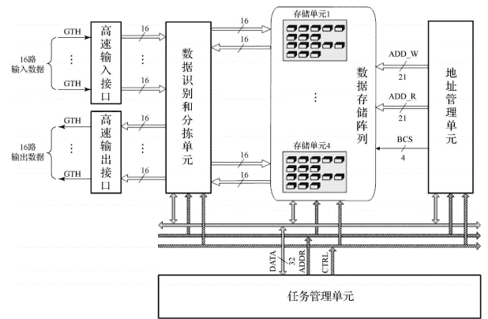

图 11-7　大容量高速数据存储单元框图

### 11.2.4 高性能计算技术
异构计算作为特殊并行计算形式，可依据各子系统结构特点分配任务，在性能、能效与实时性上优于传统架构，是解决人工智能平台能效问题的关键手段。

目前主流做法是将 GPU、FPGA 等协处理器与 DSP 结合构建异构平台。如图 11-8 所示，通用异构计算单元包括主控模块、FPGA 模块、DSP 模块、AI 加速模块与电源模块，采用 FPGA+DSP+AI 加速芯片架构，充分发挥各处理器优势，实现高效灵活协同，完成基于深度学习的敏感目标检测识别。

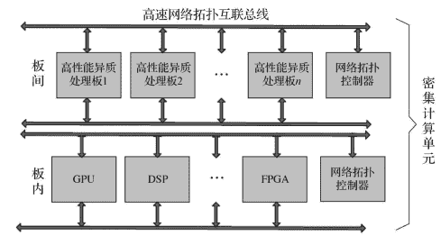

图 11-8　典型通用异构处理架构设计

如图 11-9 所示，专用异构处理单元含主控模块、FPGA 模块、DSP 模块及 AI 加速模块。

主控模块选用在轨维护专用芯片实现程序上注与加载控制，采用 3 片 Nor Flash 存储 DSP 及 Xilinx FPGA 配置程序，3 模冗余提升可靠性。

FPGA 模块选用高性能 FPGA 芯片，每片外扩 4 片 8 GB DDR3 SDRAM 缓存。FPGA 具备全并行流水、IO 灵活、资源丰富特点，主要完成大幅宽图像预处理、感兴趣区域提取、目标切片生成，并将处理信息分发至 DSP 与 AI 加速模块，最终输出至 IO 模块。

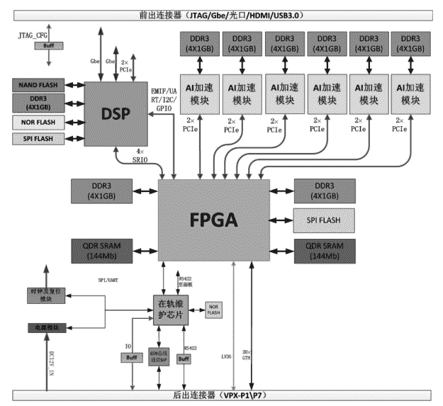

图 11-9 专用异构处理单元设计框图

DSP 模块选用高性能多核 DSP 芯片，每片含 8 个 DSP 核心，外扩 4 片 8 GB DDR3 SDRAM 缓存。DSP 计算密集、易编程，主要配合 AI 加速芯片完成感兴趣目标检测，并配合 FPGA 完成感兴趣区域提取。

AI 加速模块选用 AI 计算芯片，每片外扩 4 片 8 GB DDR3 SDRAM 缓存及 1 片 16 GB Nand Flash 缓存权重参数与程序。AI 加速芯片适配深度学习前向推理，算力强、能效高，主要完成基于深度学习的目标检测与鉴别。

为匹配前端载荷与后端发射通道，数据输入输出接口均经实时处理单元连接，根据载荷数据率与接口形式灵活配置输入处理单元数量，输出接口亦可按传输通道配置，配置不同决定系统输入输出能力。

## 11.3 大数据技术
近年来卫星数据以几何级数增长，时效性强、覆盖广、类型多、分辨率高的海量数据广泛应用于地表信息提取、资源与生态环境监测。但数据量与类型的快速增长对快速精准解译提出更高要求，原始数据堆积与可用信息提取不足矛盾突出。

### 11.3.1 样本库
构建多源图像样本库，首先采集可见光、多光谱、高光谱、红外与 SAR 等传感器图像，经筛选分类后入库。多源样本库便于数据标定，有利于目标检测算法验证。拟建典型目标特性库包括：

①几何知识库，即军船、民船、飞机、车辆等几何参数与特征；
②特征库，即对各类型图像筛选分类后建立目标特征库；
③光谱库，即基于多光谱与高光谱图像的数据库。

可采用生成式对抗网络 GAN 扩增多源图像数量与复杂度，便于神经网络训练与系统测试。

如图 11-10 所示，提升深度学习模型性能需大量样本切片训练以获得优异泛化能力，需收集大量图像数据建立庞大的感兴趣目标样本库。

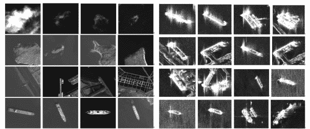

图 11-10 目标切片图像

国内典型星载样本库构建：可见光方面，基于 GF-1、GF-2、JL-1 等 1000 余景国产遥感影像，构建含飞机、船只、车辆、海港、岛礁、云等目标的全色光深度学习样本库，完成 10000 余个实例标注，采用迁移学习与交叉验证、网格搜索获得最优超参数，对云、岛屿、人工建筑、船 4 类目标查准率达 98%。SAR 方面，基于 GF-3、RadarSat-1、Sentinel-1 等数据构建 SAR 舰船检测集，含 45000 舰船切片，可满足星载 SAR 舰船检测、识别、训练与测试。

### 11.3.2 网络模型训练
基于深度学习的人工智能含训练与预测两阶段。首先以人工标定的目标图像切片作为 CNN 分类器输入训练，得到分类器后用于对待分类切片预测，实现目标鉴别。

深度学习是数据驱动的表示学习范式，特征由数据自提取。训练库样本代表性、对复杂情况覆盖面与丰富度直接决定算法优劣。船舶遥感影像受天气、光照、视角、海面高光反射及海浪背景等复杂因素影响。

可在有限人工样本与舰船三维模型基础上，开展训练样本合成与仿真模拟，实现舰船图像样本合理扩展，构建代表性强的遥感船舶样本库。

研究表明 CNN 可学习更高效的高层特征，但训练高识别率、高泛化能力模型需大量标注样本。光学遥感数据集相对有限，而多数深度学习模型面向自然场景，数据充足，可采用迁移学习将大样本预训练模型迁移至不同空间尺度与传感器的少样本场景，是提升舰船样本应用效率与系统扩展能力的关键。

深度学习训练计算量庞大，影响模型落地。确保模型快速训练是其有效性的必要条件。如图 11-11 所示，在现有硬件条件下，采用 Pytorch 训练平台，结合大规模分布式计算集群，利用模型分布式存储与参数异步通信特点构建分布式深度学习训练技术，实现快速训练。

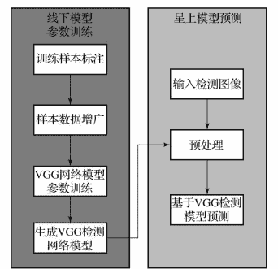

图 11-11 基于 Pytorch 的模型训练示例

### 11.3.3 样本共享服务枢纽

当样本规模进入万亿量级，协同共享成为瓶颈。由此提出一个开放的样本服务中枢，兼顾多维语义检索、统计挖掘与数据分发。整体蓝图如图 11-12 所示，共分基础设施、存储、服务、应用四层。最底层承担计算与网络底座，包含分布式存储阵列、GPU 集群、文件系统、数据库及网络环境。

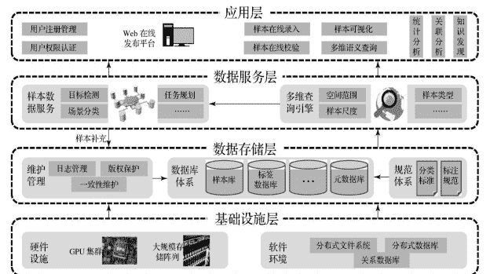

图 11-12 样本共享服务平台总体框架

分布式弹性存储阵列为全球遥感影像样本提供高吞吐与弹性扩容能力，GPU 集群则满足深度学习训练及多用户并发的低时延需求。存储层负责多尺度、多模态样本的写入、扩容、维护与版权管控。服务层面向遥感影像提供多维语义检索与样本发布能力，对外开放互操作的数据访问接口。应用层支持用户注册与基于版权协议的权限管理，并提供样本录入、校验、语义检索、数据获取、可视化等功能，同时依托时空关联、综合统计、知识发现等挖掘模型实现在线分析与应用。

## 11.4 天基云计算技术

受限于单星算力，亟需构建天基分布式快速智能云处理体系，涵盖弹性可重构网络拓扑、海量数据协同处理、资源智能调度等方向，用以弥合空间威胁目标近实时处理需求与单星计算能力的矛盾，达成高可靠、高带宽、易扩展的目标。

### 11.4.1 天基快速智能云处理体系架构

为破解星上算力瓶颈，需发展面向近实时海量智能计算的天基分布式体系，结合任务规划、星上资源状态与任务优先级形成自适应架构，构建多星协同的异构算、通、存一体化平台。

参考地面云实践，天基快速智能云处理可分为核心服务、服务治理、用户接入三层，如图 11-13 所示。核心服务层把硬件、运行环境与应用抽象为服务，具备强可靠、高可用、可伸缩的特性。服务治理层为核心服务提供支撑，保障其可靠、可达与安全。用户接入层完成端侧到云端的泛在连接。

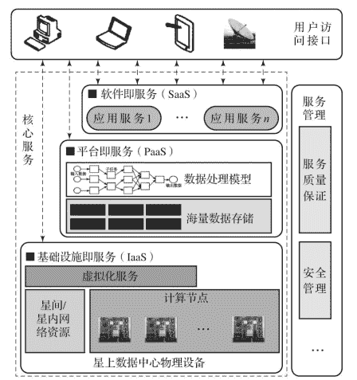

图 11-13 天基快速智能云处理体系架构

核心服务层向下拆分为 IaaS、PaaS、SaaS 三个子层，各层定位如图 11-14 所示。

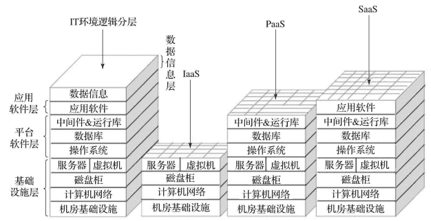

图 11-14 `IaaS`、`PaaS`、`SaaS`服务特点比较

服务治理涵盖 QoS 保障、安全管控、计费管理、资源监控等，对云处理的稳定运行起到关键作用。

用户接入通常以命令行、网络服务、网络门户等形态呈现，既提供终端应用开发接口，也便于服务组合复用。

### 11.4.2 弹性可重构天基云处理网络拓扑结构

为达成高可靠、高带宽与灵活扩展，需研究弹性可重构拓扑。如图 11-15 所示，传统树型拓扑存在三类短板：一是汇聚或核心节点故障即导致性能骤降；二是核心设备端口受限，难以支撑大规模部署；三是汇聚层上下行带宽失衡，比例可达 80:1 甚至 240:1，造成跨汇聚节点通信阻塞。

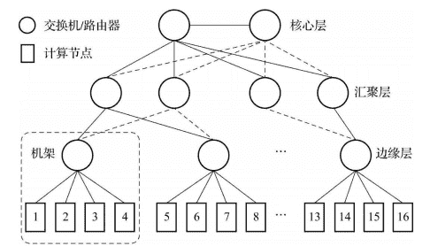

图 11-15 传统的树型网络拓扑

针对上述缺陷，可采用 VL2、PortLand、DCell、BCube 等新型拓扑，在树型骨架中引入类 mesh 结构，提升连通性与容错性，便于负载均衡与节点扩容。以 PortLand 为例，如图 11-16 所示，整体网络由 5k^2/4 个 k 口交换机互联 k^3/4 个计算节点。PortLand 包含边缘、汇聚、核心三层，边缘与汇聚可划分为多个 Pod，每个 Pod 含 k 台交换机，边缘与汇聚各 k/2 台，Pod 内采用完全二分图互联。边缘交换机直连计算节点，单个 Pod 可接 k^2/4 个节点；汇聚交换机连向核心，单个 Pod 接 k^2/4 台核心交换机。该结构可保证任意两点存在多条路径，实现节点间无阻塞通信，满足云数据中心的高可靠、高带宽、可扩展需求。

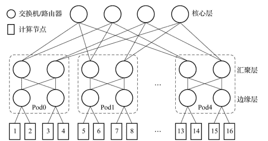

图 11-16 `PortLand`网络拓扑

### 11.4.3 天基海量数据分布式快速协同处理

化解海量探测数据近实时处理与单星算力不足的矛盾，需在天基云架构下开展分布式协同处理研究，选用 MapReduce、Dryad 等并行计算范式，以获得扩展性、透明性与易用性。

MapReduce 由众多 Map 与 Reduce 任务构成，如图 11-17 所示。处理流程分为两段：Map 阶段各任务读取输入分块并行计算，中间结果暂存于执行节点；Reduce 阶段读取并归并多个 Map 的中间结果。其优势在于：框架自动完成 Reduce 读取时的同步；框架监测任务状态并重跑异常；Map 与 Reduce 可并发，扩容即可提速；大规模场景下任务数远大于节点数，有助于均衡负载。

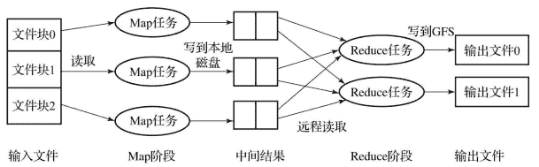

图 11-17 `MapReduce`的执行过程

Dryad 基于有向无环图 DAG 的并行范式，如图 11-18 所示。每个计算作业以 DAG 表示，节点为子任务，边为通信依赖，可直观呈现数据流。通过 DAG 优化能更高效处理复杂流程，与 MapReduce 一样屏蔽底层细节，并在节点规模扩大时提升吞吐。

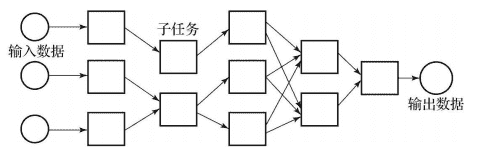

图 11-18 `Dryad`的任务模型

### 11.4.4 天基云处理资源智能管理与调度

天基处理性能受带宽制约，而带宽是稀缺资源，故调度必须考虑带宽开销。为降低传输成本，可将任务就近调度至数据所在节点，需研究数据本地性调度，采用 HTA 即 Hadoop Task Assignment 问题模型，为变形二部图匹配，如图 11-19 所示。目标是任务到节点的分配与负载均衡。其中 si、tj 分别代表计算节点与任务，实边表示节点持有任务输入数据，虚边表示不持有，wl 与 wr 为调度代价。先均衡后细化的思路下，BAR 算法可快速求解大规模 HTA 问题。

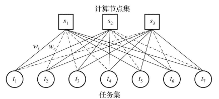

图 11-19 `HTA`问题模型

除本地性外，调度器还需兼顾作业间公平。负载中既有子任务少、耗时短、敏感的即时作业如查询，也有子任务多、耗时长的分析作业。公平调度可及时为即时作业分配资源。为兼顾本地性与公平，采用基于最小费用流的调度模型。如图 11-20 所示，wij 表示作业 i 的子任务 j，wij 与 c、r、x、u 的边分别对应调度到计算节点、机架、数据中心或不调度，每条边带权值并随集群状态实时更新。状态变化时，调度器求解调度图的最小费用流并决策。

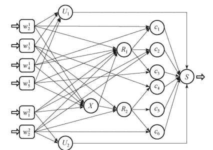

图 11-20 Quincy 的调度模型

为实现异常自动恢复，需研究容错机制。MapReduce 在检测到异常时启动备份任务，双任务并行，先完成者保留。针对异构环境异常发现，采用 LATE 即 Longest Approximate Time to End 调度器，通过估算 Map 任务完成时间，为预计最晚完成的任务生成备份。

## 第 12 章 共性技术

本章把人工智能共性技术划分为算法模型、训练平台、计算平台、计算加速、样本库、AI 芯片等，覆盖算法、数据、算力与系统平台等基础要素。以下从算法模型、计算加速、计算平台三个视角展开。

## 12.1 算法模型

1950 年代初，AI 追求打造类人智能机器，被称为强人工智能，随后出现专家系统。特定领域的落地带来活力，也带来迁移难、成本高的困境。1980 年后机器学习成为主流，研究计算机如何模拟人类学习以获取新知、重构知识结构并持续优化。约 2000 年起，研究者在神经网络基础上引入多层感知器构建深度学习模型，攻克图像、语音、自然语言等难题。近年在 IBM 等巨头推动下，认知计算快速发展，通过理解语言、图像、视频等非结构化数据，从复杂数据中提炼知识并做出更精准判断。机器学习是 AI 的核心分支，其成果已广泛应用。算法借助模式识别按特征分类，通过优化识别能力提升分类效果。

从演进脉络看，机器学习、深度学习、强化学习是三大驱动力。AI 早现后一度遇冷，其子集机器学习快速成长，近十年深度学习分支引爆关注，成为推动 AI 爆发的核心。

### 1. 人工智能 为机器赋予类人智能

1956 年达特茅斯夏季研讨会上，AI 先驱设想用当时新兴计算机构建具备人类智慧本质特性的机器，即所谓的强人工智能或通用 AI。那是一种拥有人类全部感知乃至超越、能像人一样思考的机器。

科幻作品多有描绘：友好的如 C-3PO，敌意的如终结者。强智能目前仍停留在虚构，因实现难度极高尚未到来。

现阶段可实现的是弱人工智能或狭义 AI，即能与人同等甚至更优完成特定任务的技术，如 Pinterest 图像分类或 Facebook 人脸识别。

### 2. 机器学习 一种实现人工智能的方法

# 机器学习

## 机器学习概述

如图 12-1 所示，传统做法是写死程序用固定算法完成输入到输出的推导，而机器学习是让计算机基于历史数据归纳模型，再用模型预测未来的方式。某种程度上它近似人类经验思维，能处理更多情形并执行复杂计算。核心在于将人类归纳经验过程转化为计算机经数据处理得到模型的过程，模型可近似人类方式解决灵活问题。流程遵循“从数据找规律再预测”的基本路径。

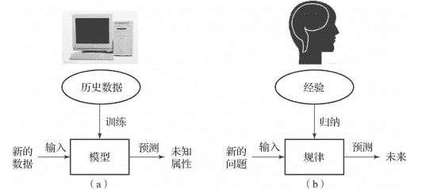

图 12-1　机器学习示意图

（a）机器；（b）人

机器学习源于早期 AI。传统方法包括决策树学习、归纳逻辑规划、聚类、强化学习、贝叶斯网络等。按学习方式可分为监督学习如分类、无监督学习如聚类、半监督学习、集成学习与强化学习等。早期受限于算力，弱智能也难以实现。随着算力提升，一切改观。

## 3. 深度学习 一种实现机器学习的技术

深度学习并非独立范式，本身也使用监督与无监督方法训练神经网络。但近年发展迅猛，残差网络等特有手段不断涌现，被越来越多地单独视为一种方法。

最初深度学习是用深度神经网络解决特征表达。深度神经网络并非全新概念，其源自人工神经网络，这一早期机器学习重要算法历经数十年沉浮。神经网络原理受大脑生理结构启发，即相互交叉连接的神经元。与大脑中神经元可任意连接不同，人工网络具有离散层、连接方式与数据传播方向。

深度神经网络大致指含多个隐层的网络。为提升训练效果，人们改进连接方式与激活函数等。不少想法早年已出现，但因数据不足、算力落后而效果不佳。

深度学习以摧枯拉朽之势攻克各类任务，使几乎所有机器辅助功能成为可能，自主驾驶、预防性医疗、精准推荐等已近在咫尺。原因与以下因素相关：

①深度神经网络需海量数据训练。网络过浅则识别力不及 SVM、boosting 等浅层模型；网络过深若数据不足则过拟合不可避免。自 2006 年起互联网爆发，产生大量训练数据，进入大数据时代。

②算力需求。深度网络需大量可并行重复计算，在 CPU 单核性能有限的时期难以训练。随着 GPU 算力增长，深度网络与大数据结合才成为可能。

③回顾发展历程，从单层感知器到含一个隐层的两层网络，再到多层深度网络，经历“三起三落”。在起落之间，LeCun、Hinton 等学者的坚持最终推动深度神经网络成为主流。

## 4. 强化学习 学习反馈的自我进化机制

强化学习受生物适应环境启发，以试错方式与环境交互，通过最大化累积奖励学习最优策略。

系统由状态 s、动作 a、状态转移概率 P（s′/s，a）、奖励信号 r 四部分构成。策略 Pi：S-＞A 为状态空间到动作空间的映射。智能体在状态 s 下按策略 Pi 选择动作 a，执行后以概率 P（s′/s，a）转移到下一状态 s′，并获得环境反馈的奖励 r。目标是通过调整策略最大化累积奖励，通常用值函数评估策略 Pi 的优劣。

实践中常将深度学习与强化学习结合，先用深度学习完成信息检测识别，再以强化学习形成系统反馈进化。2015 年，谷歌 DeepMind 公布两项成果：基于 Atari 游戏的深度强化学习算法与围棋程序 AlphaGo 1。该工作打破传统类人智能学习算法设计桎梏，将具备感知能力的深度学习与具备决策能力的强化学习紧密结合，构成深度强化学习 DRL 算法，其原理框架如图 12-2 所示。其表现远超预期，对学术界与产业界产生巨大震动。

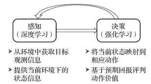

图 12-2　深度强化学习框架

从游戏画面到围棋对局：强化学习的突破

DeepMind 在《Nature》上接连发表两篇论文，让深度强化学习迅速进入人工智能研究的核心视野。2015 年初面世的深度 Q 网络 DQN，首次在 Atari 街机套件上实现质变。模型直接以原始游戏画面作为感知输入，以得分作为学习奖励，模拟人类玩家试错的习惯。训练收敛后进行规模评测，在 49 个游戏项目中全部超越资深人类玩家。依托这一进展，团队在 2016 年初发布围棋程序“初弈号”。该系统融合深度强化学习与蒙特卡罗树搜索 MCTS，在显著压缩搜索成本的同时提升了对局势的评估精度。先以 5:0 完胜欧洲围棋冠军樊麾，随后于 2016 年 3 月与世界顶级职业九段李世石展开对决，最终以 4:1 获胜。这标志着深度强化学习已能在极端复杂的博弈场景中达到与人类相匹敌的水准。

## 5. 迁移学习，运用已存在的知识对不同但相关领域问题进行求解的一种新的机器学习方法

迁移学习的实质是借助源域积累的知识来解决目标域任务，它对传统机器学习的两条默认前提进行了放松：

① 训练时使用的样本与后续测试样本不必满足严格的独立同分布；
② 不要求目标域拥有大量标注样本即可训练出可用模型，目的在于把已有知识迁移到仅有少量标签甚至无标签的目标场景。

随着时间推移，原来可用的标注数据可能失效，旧数据与新数据在语义或分布上出现断层。以股票数据为例，用上月的样本训练的模型难以直接预测本月的走势。另一类难题是标注数据稀缺且采集成本高。在网页数据挖掘中，新数据持续涌现，旧训练集已难支撑可靠分类，而人工标注耗时费力且易受主观偏差影响。这就引出如何利用少量标注或源域数据构建目标域预测模型的问题，源域与目标域的分布往往不一致。训练集的抽样本身也很关键，如何挑选具代表性的样本集值得深入探讨。

从早期的自适应反馈，到基础机器学习，再到近年更实用的深度强化学习与迁移手段，人工智能在工程落地中逐步成熟，对传统产业尤其是大数据驱动行业产生颠覆效应。日本、美国和西欧多国均制定了相关规划。美国国防部投入 4 亿美元，由国防部高级研究计划局 DARPA 主导一项为期 8 年的研究计划并成立组织与指导委员会。海军研究办公室 ONR、空军科研办公室 AFOSR 等也投入巨额资金研究神经网络。DARPA 认为神经网络“可能是实现机器智能的唯一希望”，并称其重要性“远超原子弹工程”。美国国家科学基金会 NSF、美国国家航空航天局 NASA 等政府机构也以不同形式支持大量课题。

机器学习的经典范式大致可归为六类：聚类、分类、回归、深度学习、强化学习、迁移学习。下面对核心类别作简要概述。

## 12.1.1 聚类算法

聚类的任务是将数据对象归并为若干组，使组内相似度高、组间差异大，划分后可把同一组作为整体处理。从学习视角看，聚类属于无监督学习，样本没有先验标签，依托相似性与距离划分，类别数与结构事先未定。目标是提升组内一致性、扩大组间差异，挖掘潜在分组与关联。在人工智能中它也被称为无先验学习，已广泛应用于心理学、生物学、医学等领域。

现有方法可归为划分法、层次法、密度法、网格法、模型法等，按侧重点可分为以下几类。

### 1. 基于划分的聚类算法
① `K-means` 方法。典型的划分思路，以簇中心代表一类，迭代中选定的聚点不一定是簇内真实点。该法仅处理数值型数据，先初始化原型再迭代优化求解，算法描述如表 12-1 所示。

表 12-1　K-means 算法描述

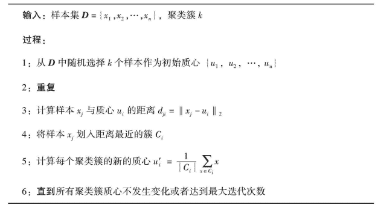

② `K-modes` 方法。是 `K-means` 的扩展，采用简单匹配度量分类型数据的相似度。
③ `CLARA` 方法。在 `PAM` 基础上引入抽样，可处理大规模数据。
④ `CLARANS` 方法。融合 `PAM` 与 `CLARA` 优点，用于空间数据库的聚类。
⑤ `PCM` 方法。基于模糊几何理论的聚类方法。

### 2. 基于层次的聚类算法
① `CURE` 方法。先对数据集随机抽样，再分区分析，随后对各分区局部聚类，最后合并为全局结果。
② `CHEMALOEN` 方法即变色龙算法。先将数据集构建为 k-近邻图，再用图划分算法得到大量子图，每个子图代表初始子簇，最后通过凝聚层次聚类反复合并。
③ `BRICH` 方法。利用树结构处理数据，叶节点保存一类簇，用中心与半径表示，依次处理每个对象并划分到最近节点。该法也可作为其他聚类算法的预处理。

### 3. 基于密度的聚类算法
① `DBSCAN` 方法。典型的密度聚类，采用空间索引搜索邻域，引入“核心对象”与“密度可达”等概念，从核心对象出发把所有密度可达对象聚为一簇。
② `OPTICS` 方法。先生成聚类的次序，可为不同聚类设定不同参数以获得满意结果。

### 4. 基于网格的聚类算法
① `STING` 方法。利用网格单元保存统计信息，实现多分辨率聚类。
② `WaveCluster` 方法。在聚类分析中引入小波变换原理，主要应用于信号处理。

### 5. 基于神经网络的聚类算法
基本思路是把不同样本输入人工自组织映射网络，开始时输出兴奋细胞位置各不相同，自组织后形成细胞群，各自代表输入样本并反映其特征。

### 6. 基于统计学习的聚类算法
① `COB Web` 方法。通用概念聚类，以分类树形式表现层次聚类。
② `AutoClass` 方法。以概率混合模型为基础，利用属性概率分布描述聚类，可处理混合型数据，但要求各属性相互独立。

从可伸缩性、适用数据类型、维度特性、对异常数据的抗干扰能力、聚类形状及算法效率六个维度对上述方法进行比较分析如表 12-2 所示。

表 12-2　聚类算法比较

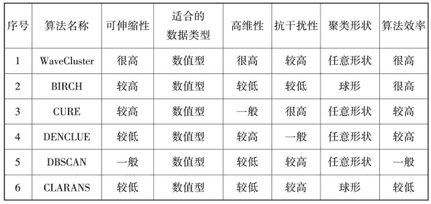

## 12.1.2 分类算法

主流分类方法既包括决策树、贝叶斯、人工神经网络、k-近邻、支持向量机和基于关联规则的分类等单一方法，也包括 `Bagging` 与 `Boosting` 等集成学习组合。

### 1. 决策树
决策树是分类与预测的重要技术。决策树学习是一种基于实例的归纳学习，旨在从无序无规则的实例中归纳出以树形式表示的分类规则。构造树的目的是挖掘属性与类别间的关系，用于预测未知记录的类别。它采用自顶向下递归方式，在内部节点比较属性，根据不同取值向下分支，直至叶节点给出结论。

主要算法有 `ID3`、`C4.5` 即 `C5.0`、`CART`、`PUBLIC`、`SLIQ` 和 `SPRINT` 等，它们在测试属性选择、树结构生成、剪枝时机与能否处理大数据集等方面各有差异。

决策树的目标是让数据按类别属性划分，贴上标签后数据集纯度最高，并在保证分类速度的前提下尽量减少树深。生成过程一般包含三步：
① 特征选择。从众多特征中挑选当前节点的最优分裂标准，不同量化标准衍生出不同算法。
② 决策树生成。依据选定标准自上而下递归生成子节点，直至数据不可分停止生长。
③ 剪枝。为缓解过拟合需对树结构进行压缩，分为预剪枝和后剪枝两种策略。

### 2. 贝叶斯
贝叶斯分类算法是一类利用概率统计进行分类的方法，如朴素贝叶斯 `Naive Bayes`。这类方法主要借助 Bayes 定理预测未知样本属于各类别的概率，并选择概率最大者作为结果。由于 Bayes 定理要求强条件独立性，而现实中往往不成立，导致精度下降。为此出现了降低独立性假设的改进方法，如 `TAN` 树增广朴素贝叶斯算法，它在贝叶斯网络结构上增加属性间的关联。

### 3. 人工神经网络
人工神经网络 ANN 是一种模仿大脑神经突触连接结构进行信息处理的数学模型。大量节点相互连接构成网络，以实现信息处理功能。网络通常需要训练，训练即为学习过程，通过调整连接权值使网络获得分类能力，训练完成后即可用于识别。

人工智能起步于 20 世纪 50 年代，生物学家提出数学理论解释智力与学习如何源于神经元间信号传递。核心思想保留至今：细胞间频繁通信会增强联系。神经学研究表明，人脑接收外部信号时并非直接处理，而是通过多层网络模型提取数据规律。这种层次感知系统大幅降低视觉数据处理量并保留物体结构信息。由于结构复杂，构建深度机器学习算法来模拟人类认知活动变得必要。

美国计算机科学家罗森布拉特 F.Rosenblatt 于 1957 年提出感知器，是神经网络的第一个里程碑。作为二分类线性模型，感知器输入样本特征向量，计算线性组合，若结果大于阈值则输出 1，否则输出 -1。它能解决线性可分问题，可用于模式分类学习控制。

单个神经元的输入输出关系：

```
yi = f(sj)
```

式中，`f` 为激活函数；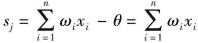。

感知器结构如图 12-3 所示。

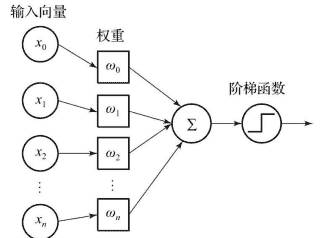

图 12-3　感知器结构

输入向量 `Input` 即用于训练的原始数据。
阶梯函数 `Step Function` 可用生物神经元阈值理解，输入与权重相乘后大于阈值则激活返回 1，否则返回 0。
权重 `Weight` 为网络通过训练学习得到的权向量，与输入点乘后经阶梯函数可得到期望结果。

感知器因结构限制存在局限：
① 激活函数采用阈值函数，输出只能为 0 或 1，只能解决简单分类问题；
② 作为线性分类器，若训练数据线性不可分，迭代可能不收敛，无法得到稳定权重向量。

感知器仅能处理简单线性分类，应用面窄，但推动了人工智能发展。作为首个神经网络算法，它吸引大量研究，并为后续更复杂算法如深度学习奠定基础。

## 神经网络与卷积神经网络概览

目前神经网络模型已逾百种，常见有 `BP 网络`、`径向基 RBF 网络`、`Hopfield 网络`、`随机神经网络` 即 `Boltzmann 机`、竞争神经网络如 `Hamming 网络` 与自组织映射网络等。但现有神经网络普遍存在收敛慢、计算量大、训练时间长且难以解释的问题。下面介绍经典深度学习算法——卷积神经网络 `CNN`。

`CNN` 是近年发展迅速并获广泛重视的高效识别方法，受生物自然视觉认知机制启发。1959 年 Hubel 等人发现动物视觉皮层细胞负责检测光学信号，受此启发，1980 年福岛邦彦提出 `CNN` 前身——神经认知机 `Neocognitron`。20 世纪 90 年代，Yann LeCun 等人发表论文，设计多层人工神经网络 `LeNet-5`，可对手写数字分类。`LeNet-5` 确立了现代 `CNN` 结构，在每个降采样层前加入卷积层。在图像识别领域，`CNN` 已成为高效方法。

## 4. k-近邻
`k-近邻` `k-Nearest Neighbors, kNN` 是一种基于实例的分类方法。做法是找到与未知样本 `x` 距离最近的 `k` 个训练样本，根据多数类判定 `x` 的类别。`k-近邻` 属于懒惰学习，样本存储直至分类时才处理。若样本集复杂，计算开销可能很大，不适合实时性要求高的场景。

## 5. 支持向量机
支持向量机 `Support Vector Machine, SVM` 由 Cortes 与 Vapnik 于 1995 年提出，是一种基于统计学习的机器学习方法，在小样本分类上也能获得良好泛化规律，并在文本分类中表现出优势，成为研究热点。`SVM` 学习方法包括线性可分向量机、线性支持向量机和非线性支持向量机。其核心思想是建立最优决策超平面，使两侧最近两类样本间的间隔最大化，从而提升泛化能力。通过非线性映射把复杂模式分类问题投射到高维空间变为线性可分，在特征空间建立分类平面解决非线性不可分问题。学习策略为间隔最大化，转化为凸二次规划求解。`SVM` 采用核函数技巧将原始特征映射到高维空间，解决低维线性不可分问题。

设样本集为（`xi`，`yi`），`xi`∈`R` `n`，`yi`∈`0`，`1`，`i=1,2,…,n`。

线性可分时，最优超平面构建转化为：


线性不可分时，引入误差带宽与惩罚函数，构造并求解约束最优化问题：


式中，`ω` 是分类向量；`b` 是常数；`ξi` 是样本点的松弛变量；`C` 是对松弛变量的惩罚系数；`φ(xi)` 是将原始特征值映射到高维空间的核函数。

`SVM` 的核心是选取合适的核函数，把低维原始特征映射到高维空间。

## 12.1.3 回归算法

在多数机器学习课程中，回归算法往往是首个介绍的内容。原因在于其概念相对简单，便于从统计学平滑过渡到机器学习；同时回归也是后续强力算法的基础，不理解回归就难以掌握更复杂的模型。

回归算法主要分为线性回归与逻辑回归两类。

线性回归旨在拟合一条直线以最佳匹配所有数据。常用“最小二乘法”求解，其思想是假设拟合直线代表真实值，观测数据带有误差，求解使所有误差平方和最小的直线。最小二乘法把最优问题转化为求函数极值，数学上可通过导数为零求解，但对计算机而言可能不可行或计算量过大。

计算机科学中的数值计算学科专门提升计算的准确性与效率。例如“梯度下降法”与“牛顿法”就是经典数值计算算法，适合求解函数极值。梯度下降法是处理回归模型最简单有效的方法之一，严格来说由于神经网络与推荐算法中均包含线性回归因子，梯度下降法在后续算法实现中同样被广泛使用。

逻辑回归与线性回归形式相近，但解决的问题类型本质不同。线性回归处理数值型预测，如房价；逻辑回归属于分类算法，预测结果为离散类别，如判断邮件是否为垃圾邮件或用户是否会点击广告等。

逻辑回归可以看成是在线性回归的基础上再接一个 Sigmoid 映射，把线性输出挤进 0 到 1 的区间当作概率来用。Sigmoid 的形状不用刻意去背，只需抓住一个规律：自变量越大，函数值越趋近 1；自变量越小，函数值越趋近 0。拿到概率后就能做判别，通常以 0.5 为阈值，超过就判定为垃圾邮件、恶性肿瘤等正类。几何上这等价于在特征空间里拉出一条直线来划分两类。

这种划分在绝大多数实现里是线性的，也存在能画出非线性分界的变体，但对大规模数据而言效率很吃亏。换句话说，一旦两类的真实边界不是一条直线，逻辑回归的表达能力就会捉襟见肘。

## 12.1.4 深度神经网络的发展脉络

深度学习即深度神经网络 DNN，可追溯到人工神经网络的雏形，首次提出在 20 世纪 60 年代。随后进入识别手写数字的神经网 LeNET，1990 年；90 年代出现浅层神经硬件 Intel ETANN；2006 年 Hinton 等人用深度置信网络验证了深层训练的可行性；2011 年深度学习在语音识别上取得突破；2014 年 Neuflow、DianNao 等 DNN 加速器研究兴起。目前它已经克服了传统机器学习在数据获取、陷入局部极值、梯度消失等方面的瓶颈，在图像分类、人脸识别、文字识别、机器人等领域实现突破，并带动各行业应用爆发式增长。这一切也得益于 GPU 等高性能计算图形加速卡，其高并行、高存储、低控制需求的特性正好契合神经网络的计算模式。于是深度神经网络在人工智能领域占据了主流地位，几乎所有人工智能相关报道都离不开它。

为了解决传统神经网络随机初始化权值容易掉进局部最小值的问题，Hinton 提出先用无监督预训练给权值一个较好的起点，再做有监督微调，这一思路开启了深度学习的时代。

如图 12-4 所示，由深度学习得到的深层网络由大量基础单元神经元构成，每个神经元与诸多其他神经元相连，连接强度即权值在训练中不断调整，从而决定网络功能。整体结构仍符合神经网络的本质属性，所以深度网络本质上是层次更深的神经网络。


图 12-4　典型深度学习处理框架（书后附彩插）

### 1. 深度学习的基本思想

深度学习之所以突出，在于它的自学习机制。模型通过隐含层从下到上、从底层到高层、从简单到复杂、从具体到抽象地逐级学习特征。相比传统机器学习，它不需要人工手工设计特征或依靠专家规则，而是自动获取特征，对数据具有自适应性和很强的鲁棒性。训练上采用逐层贪婪训练 Greedy Layer-Wise Training 再整体微调 Fine-Tuning 的贪婪策略，打破了传统训练方法的局限。

### 2. 深度学习模型

最基础的深度学习模型有深度置信网络 Deep Belief Nets DBN、自动编码器 Auto Encoder、卷积神经网络 Convolutional Neural Networks CNN 和循环神经网络 Recurrent Neural Network RNN。前两者属于无监督范式，CNN 是一类有监督模型，主要面向图像类任务，RNN 专注于处理长度不一的连续序列，在自然语言处理中取得广泛成功。

#### 1）感知器模型
感知器与前馈神经网络的思路很直观：数据从前端进入，后端输出。网络通常分层描述，有输入层、隐藏层、输出层，每层内部单元并行排列，同一层内无连接，相邻层间全连接。最简实用结构包含两个输入单元和一个输出单元，可用于构建逻辑判断模型。训练多采用反向传播，样本为输入输出配对的监督数据。误差常定义为预测输出与真实输出的差异，如 MSE 或线性差。理论上只要隐藏神经元足够，就能拟合任意输入输出关系，实际使用往往受限，常与其他结构组合。

#### 2）径向基函数 RBF 网络模型
径向基函数网络本质上是以径向基函数作激活的前馈神经网络。不同于普通 FFNN 的常见激活，它的使用场景有明显差异，发明较早因此未被单独命名。

#### 3）Hopfield 网络模型
Hopfield 网络 HN 的每个神经元都与其他神经元相连，结构像盘根错节的线团。训练前先输入模式，训练期间模式被固化，权重 thereafter 不变。训练一个或多个模式后，网络总会收敛到其中一个稳定状态。因为训练过程中整体“能量”或“温度”不断下降，每个神经元都有随温度变化的激活阈值，超过阈值后取二值状态如 -1/1 或 0/1。更新可同步也可异步轮流，后者更常见。稳定时不再变化，故常被称作联想记忆，能把半张桌子的噪声输入补全为完整桌子。

#### 4）马尔可夫链模型
马尔可夫链 MC 或离散时间马尔可夫链 DTMC 是玻尔兹曼机 BM 和 Hopfield 网络的前身。其含义是下一步转移概率只取决于当前状态，与历史路径无关。虽不完全是神经网络，但为 BM、RBM、HN 提供了理论基础，也并非全连接。

#### 5）波尔兹曼机模型
玻尔兹曼机 BM 与 HN 类似，区别在于部分神经元标记为输入，其他为隐藏，完整更新后输入神经元成为输出。它从随机权重出发，可用反向传播或对比散度训练。神经元多为二值激活，网络具有随机性。训练时输入神经元被箝位，释放后网络反复迭代，激活受全局阈值控制，直至达到平衡。

#### 6）受限玻尔兹曼机模型
受限玻尔兹曼机 RBM 与 BM、HN 相似，但连接受限：只在单元组之间建立连接，输入组内部、隐藏组内部无连接。这种限制提升了可用性，训练方式更接近 FFNN，不必像 BM 那样来回传播。

#### 7）自编码器模型
自编码器 AE 与前馈神经网络相近，采用编码-解码流程，以重构误差为优化目标。Vincent 等人提出的去噪自编码器进一步提升对噪声的鲁棒性，常作为深层网络的模块。自编码器形状像漏斗，隐藏层单元数少于输入输出层，且关于中心层对称。最小隐藏层即信息瓶颈，输入到中心为编码，中心到输出为解码，中心也称 Code。可用反向传播训练，权重常设为对称。

#### 8）稀疏自编码器模型
稀疏自编码器 SAE 与普通自编码器相反，尝试在更高维空间编码，中心层扩张而非压缩，用于提取特征。若按常规自编码器训练，易退化为恒等映射。为避免此问题，训练时加入稀疏驱动，类似阈值过滤，仅允许部分误差回传，类似于脉冲神经网络并非所有神经元时刻激活。

#### 9）变分自编码器模型
变分自编码器 VAE 结构与自编码器一致，但学习的是输入样本的近似概率分布，更接近 BM、RBM 的思路。依赖贝叶斯推断、独立性假设和重参数化技巧，通过考虑变量间的相关性改善深层表示。

#### 10）去噪自编码器模型
去噪自编码器 DAE 输入的是加噪数据，而误差仍与干净原始数据比较。这种训练迫使网络学习更本质的特征而非细节，因为噪声会不断改变表面细节。

#### 11）深度置信网络模型
深度置信网络 DBN 由 Hinton 于 2006 年提出，采用多个受限玻尔兹曼机 RBM 堆叠形成的层次生成模型，可有效训练。每个模块只学习对前一层进行编码，称作贪婪训练。DBN 可用对比散度或反向传播训练，学习概率表示，也能生成新数据。无监督预训练后可用于分类，大大加快了传统神经网络的参数初始化速度，提升建模能力。后续出现了三元因子 RBM、卷积 RBM、稀疏 RBM 等改进。DBN 已应用于手写体识别、信息检索、文本检测、目标识别、人机行为识别、机器翻译、语音识别等。

#### 12）CNN 模型
CNN 主要用于图像，但也可处理音频等输入。与传统网络不同，其结构包含特征提取层和特征映射层。每个神经元只连接前一层的局部感受野，提取局部特征并固定相对位置。特征映射层内权值共享，采用小核 Sigmoid 作为激活，增强平移不变性，降低参数数量。卷积层后常接用于局部平均的计算层，减少分辨率且保持空间信息。整体参数共享可有效防止过拟合。典型应用是输入猫狗图片，网络输出对应类别。

# 卷积神经网络与相关模型

## CNN 输入扫描与卷积层
CNN 不会一次性展开全部训练数据，而是采用滑动扫描。举例来说，200×200 像素图片不必用 40000 个输入结点，只需约 20×20 的扫描窗口从左上角开始逐步右移，每次移动一个像素，输入局部到卷积层。卷积层结点并非全连接，只与邻近单元相关，随着层数加深尺寸逐渐收缩，常取输入的因子且多为 2 的幂。随后加入特征池化层，最常用的是最大池化，如 2×2 取最大值。音频也可分段输入。实际应用中常在最后接入前馈神经网络 FFNN 做进一步处理，形成深度卷积神经网络 DCNN，名称与缩写可互换。

## 13）反卷积神经网络模型
反卷积神经网络 Deconvolutional Networks DN 也称逆向图网络 Inverse Graphics Networks IGN，是卷积的逆过程。概念上把标签如“猫”送入网络，通过与真实猫图的差异训练，最终生成逼真的猫图。它可与前馈网络结合使用，名称可能变为深度反卷积神经网络。池化层的反向操作通常采用有偏插值或外推。

## 14）深度卷积逆向图网络模型
深度卷积逆向图网络 Deep Convolutional Inverse Graphics Networks DCIGN 名称易产生误解，实质是变分自编码器 VAE，编码器用 CNN，解码器用 DN。它在编码时对特征做概率建模，可用猫狗单体照学习生成猫狗合照，也能去除干扰物体或实现 3D 光照、旋转等复杂图像变换，多用反向传播训练。

## 15）生成式对抗网络模型
生成式对抗网络 Generative Adversarial Networks GAN 由生成器和判别器两部分构成，可由任意网络组合，常见是前馈网络配卷积网络。判别器同时接收真实数据和生成数据，判断来源；生成器则努力制造判别器难以分辨的样本。两者形成对抗博弈，判别能力与生成能力同步提升。训练困难在于需同时优化两个网络并保持动态平衡，否则易不收敛。

## 16）循环神经网络模型

RNN，循环神经网络，本质上是具备时间感知能力的前馈结构。它并非无状态的处理器，信息在不同时刻的通道之间会产生关联。每个神经元在吸收当前层输入的同时，还会额外接收来自前一时刻的信号。因此数据的排列顺序会直接影响结果，先喂入“牛奶”再喂入“饼干”，和顺序对调后网络给出的反应是不同的。

RNN 绕不开的痛点是梯度消失或梯度爆炸，具体表现取决于所选激活函数。随着时间推演，早期信息会被迅速冲淡，这和前馈网络随深度增加而丢失信号的情形类似。表面看问题不大，因为衰减的是权重并非神经元本身的状态。可权重其实在承载历史，一旦权重趋近于零或膨胀到上百万量级，过去的状态就不再提供有效信息。卷积神经网络的应用面很广，很多数据本身并不拥有天然的时间轴，像语音、视频才典型，但可以被重构成序列形式。对一幅图像或一段文本字符串，可以逐个像素、逐个字符在不同时间步送入。凭借时序权重，模型能捕捉序列中一秒前的状态而非更久远的记忆。通常在需要预测未来或填补缺失的任务上，RNN 是较合适的选择，比如自动补全。

## 17）长短时记忆网络：门控记忆方案
长短时记忆网络 LSTM 通过引入门控结构和明确定义的记忆单元，试图缓解梯度消失和梯度爆炸。这一思路更多源自电路学的启发，而非生物学。每个单元包含一个记忆体以及输入门、输出门、遗忘门三道门控。门控的作用是通过控制信息通路来保护内容。输入门决定有多少来自上一层的信号被写入当前记忆体。输出门则负责另一端，控制本层信息向下一层暴露的程度。遗忘门乍看反常，却有时必不可少。比如网络在学习一本书时进入新章节，就需要丢弃上一章的部分人物信息。LSTM 已被证明能够掌握复杂的序列模式，例如模仿莎士比亚风格写作或合成简易音乐。需要注意的是，每道门都要对前一单元的记忆体进行加权，因而通常会消耗更多算力。

## 18）门控循环单元：轻量化变体
门控循环单元 GRU 是 LSTM 的一种简化变体。区别在于它不设输入门、输出门、遗忘门三者，而是只保留一个更新门。该门决定保留多少来自前一状态的信息，以及接纳多少来自上一层的输入。其功能与 LSTM 的遗忘门相近，只是位置安排略有不同。它始终输出完整状态，却没有单独的输出门。在多数场景下，GRU 和 LSTM 的表现相近，最主要差异是 GRU 运行更快、实现更简便，但表达能力稍弱。实践中两者往往此消彼长，因为需要更强表达力时，扩大网络规模会抵消速度优势；而在对表达力要求不高的任务上，GRU 往往更优。

## 19）神经图灵机：可解释的记忆抽象
神经图灵机 NTM 可以视为 LSTM 的抽象化尝试，目标是让模型可解释性提升。NTM 不把记忆单元硬编码进神经元，而是将记忆体独立出来，试图融合传统数字存储的高效持久性与神经网络的表达能力。该设计基于一个可内容寻址的记忆库，网络可以从中读写。名称中的图灵源于图灵完备性：凭借读取内容并据此读写、改变状态的能力，它能够表达通用图灵机可表达的所有计算。

双向循环神经网络 BiRNN、双向长短时记忆网络 BiLSTM、双向门控循环单元 BiGRU 在结构上与单向版本相似。差异在于它们不仅回溯过去，还能利用未来信息。例如单向 LSTM 预测单词 fish 时，会逐字母输入 f i s h，循环连接记住最近的值；而双向 LSTM 会在反向通道中补充下一个字母的线索。这种方式更适合填空而非预测未来。如在图像处理中，它并非扩展边界，而是用于修复图片中的缺损区域。

## 20）深度残差网络：跨层跳跃的前馈结构
深度残差网络 DRN 是一种非常深的前馈架构，除邻层连接外，还允许输入跨越 2 到 5 层直接传递。DRN 并非单纯把输入通过多层映射到输出，而是学习输入到输出加输入的映射，实质上在各层叠加一个恒等函数，让旧输入作为后续层的新输入。实验显示，当网络达到 150 层时，模式学习能力显著提升，远超传统 2 到 5 层的深度。然而有研究指出，这类网络本质上等同于没有时间建模的循环网络，且常被拿来与无门控的 LSTM 相比。

## 21）回声状态网络：随机连接的循环类
回声状态网络 ESN 是另一类循环网络。其特点是神经元间随机连接，层间并不遵循统一模式，训练方式也不同。它不采用前向输入后反向传播误差的流程，而是先把数据送入网络前向传播，再临时更新神经元状态。输入层在此扮演主导作用，输出层则充当随时间展开的激活模式的观测器。训练时，只有输出与隐藏单元之间的连接会被调整。

## 22）极限学习机：随机权重的快速前馈
极限学习机 ELM 本质上是随机连接的前馈网络，外观与液体状态机 LSM 和回声状态网络 ESN 相似，却既无脉冲也无循环。它不使用反向传播，而是随机初始化权重，然后用最小二乘法一步拟合全部权重，即最小化整体误差。这种方式让表达力略有下降，却比反向传播快得多。

## 23）液体状态机：脉冲式的记忆累积
液体状态机 LSM 与 ESN 形似，但属于脉冲神经网络。Sigmoid 激活被阈值函数取代，每个神经元是一个累积记忆单元。更新时，数值不是来自邻居的累加，而是自身累加。一旦达到阈值，能量即向其他神经元传递，从而形成类似脉冲的模式：在触发阈值前几乎无反应。

## 24）支持向量机：最大间隔分类器
支持向量机 SVM 提供了一种寻找最优分类边界的方法。经典 SVM 多用于线性可分问题，例如区分加菲猫和史努比的图片，不允许第三类结果。训练时可想象在二维平面上绘制所有样本点，然后寻找一条直线将两类分开，使加菲猫在一条侧、史努比在另一侧。最佳分割线是让两侧点到线的最小距离最大化。对新样本，只需在图上定位，看其落在线的哪一侧。利用该原理，SVM 可推广到 n 维分类，比如在三维空间区分史努比、加菲猫、西蒙猫等多个卡通形象。SVM 并非严格意义上的神经网络。

## 25）Kohonen 网络：竞争性自组织映射
Kohonen 网络，也称自组织特征映射 SOM 或 SOFM，采用竞争性学习进行无监督分类。数据进入网络后，系统评估哪个神经元与输入最匹配，随后调整该神经元以更贴合输入，同时移动邻近神经元，移动幅度随其与最佳匹配单元的距离衰减。有时该网络也不被划入神经网络范畴。

## 12.1.5 强化学习算法
强化学习研究历史悠久。1992 年 Tesauro 利用强化学习让十五子棋达到大师水平；Sutton 撰写了第一本系统性强化学习专著；Kearns 最早证明强化学习问题可通过少量经验逼近最优解；2006 年 Kocsis 等提出的置信上限树算法极大推动了围棋领域的强化学习应用，可视作初代 AlphaGo 的前身；2015 年 Littman 在《Nature》上对强化学习做了综述。

理论层面，强化学习过去几年取得丰富成果。收敛性与最优性始终是核心难题。Sutton 与 Bhatnagar 分别对线性与非线性逼近器的训练效果进行了分析，提出了更可靠的训练方法。Melo 证明了使用逼近器的收敛性。Kearns 等人借助 Probably Approximately Correct 理论，对在线算法的学习时间进行了定性分析。随着网络规模与参数量增大，对收敛性的要求更高。保证复杂网络稳定训练、同时兼顾资源与经济效益、追求更接近最优解的算法，已成为学界与工业界共同目标。

### 1.强化学习的基本思想
强化学习的目的是最大化累积奖励。为此需要“利用”，即基于已学经验选择高奖励动作，推动系统向好状态转移；也需要“探索”，即充分了解环境，发现更高奖励状态，避免陷入局部最优。两者矛盾构成探索-利用困境，只有平衡两者才能最大化累积奖励。平衡问题始终是研究热点。2010 年 Bernstein 提出的自适应分辨率强化学习方法，在状态连续的确定性系统中实现了高效未知状态探索；2015 年 Zhao 提出的连续系统 Probably Approximately Correct 方法，能在有限时间内找到最优或近似最优策略，进一步提升实用性。

强化学习本质上是与环境持续交互、以试错方式在线学习最优策略。然而现实中很多决策需要在离线评估后给出。当前趋势是用离线估计处理上下文老虎机问题。例如微软研究院 Li 等人将无偏离线估计的上下文老虎机方法成功用于推荐。已有建议构建强化学习的离线数据库，但现有离线估计算法仍不够成熟。

另一个局限是奖励信号设计。策略优劣很大程度上取决于奖励定义，现有奖励多由研究人员基于领域知识设定，不合理的奖励会严重影响策略质量。已有学者尝试引入人类导师信号改进算法，帮助机器人学到期望行为。奖励信号研究将成为未来热点。

### 2.强化学习模型
表 12-3 归纳了强化学习发展历程中的关键算法事件，也是当前常用方法，包括蒙特卡罗、Q 学习、SARSA 学习、TD 学习、策略梯度和自适应动态规划等。

表 12-3 强化学习发展历程中的重要算法事件


## 12.1.6 迁移学习算法
按源域与目标域样本是否标注及任务是否相同，迁移学习可分为归纳迁移学习、直推式迁移学习和无监督迁移学习。按技术划分，可分为基于特征选择、基于特征映射和基于权重的方法。

### 1.迁移学习的基本思想
迁移学习源于教育心理学，借用美国心理学家 Judd 的“类化说”可归纳出当前研究的三点问题。

其一，Judd 认为先期学习 A 的迁移到后继学习 B，依赖于学习中获得的一般原理，该原理可在 A、B 中部分或全部应用。因此迁移的前提是两学习活动存在共同要素。由此，源域向目标域迁移知识需保证两者存在共同知识，如何度量领域相似性与共同性是首要问题。

其二，知识迁移是可能的，只要经验被概括，概括程度越高，迁移范围越大。同样的教材用不同教学方法，迁移效果差异明显，可能产生正迁移也可能负迁移。因此针对不同学习问题设计有效迁移算法是另一关键。

其三，根据泛化理论，教学中应鼓励学生对核心概念进行抽象概括。抽象加工能区分本质与非本质、必然与偶然，舍弃偶然性内容，抓住本质属性，从而实现更广泛的正向迁移。迁移学习中应避免把非本质偶然知识误认为本质共享知识。如何实现正迁移、避免负迁移是重要研究议题。

针对航天器应用，迁移学习可从四个方向推进：其一，研究领域相似性与共同性的准确度量方法；其二，针对不同应用需求开发迁移算法，目前分类算法研究较多，其他方向有待拓展；其三，加强迁移学习有效性的理论研究，特别是飞行器精确模型难建时，研究可迁移条件、提取本质属性、避免负迁移；其四，在大数据环境下研发高效迁移算法。

### 2.迁移学习模型

## 迁移学习理论研究
从理论层面看，迁移学习需解决两个问题：一是在何种条件下，源域训练的分类器能在目标域表现优异，即何时可迁移；二是在目标域无标注或仅少量标注时，如何结合大量源域标注数据使测试误差最小，即迁移算法设计。

目前理论研究多集中于领域适应。早期分析始于 2007 年，基于 VC 维给出推广误差界并定义与适应性相关的分布距离。在此基础上，对有限 VC 维情形，利用有限样本估计适应能力。但对 VC 维无限情形的结论仍缺乏深入探讨。不同领域距离度量会带来不同精度的误差估计，研究多样化距离有助于适应不同应用。

Ben.David 的实验表明结构对应学习 SCL 方法能使距离最小化同时间隔损失最低，提升目标域性能。Ben.David 等人提出模型同时最小化训练泛化误差和源域与目标域差异，并通过源数据加权组合获得模型。相关成果于 2010 年发表在《Machine Learning》，研究了分类器何时能在目标域有效工作，以及如何利用少量目标标注样本与大量源标注数据协同训练以降低目标误差。

Mansour 指出对任意目标函数，存在源假设的领域加权分布组合使损失不超过给定值。他还基于源域与目标域间的 Rényi 散度给出更精确的推广误差上界，适用于回归和一般损失函数，并提出加权使经验分布更贴近目标分布。该文用积分概率度量比较域间差异，并与 H-散度和差异距离对比。同时针对多领域构建了 Hoeffding 型、Bennett 型、McDiarmid 型不等式，并据此得到基于统一熵数的泛化边界。

尽管理论尝试不断，实际中未知域模型难以精确建立，导致迁移学习常难以快速收敛甚至无法收敛，有效性理论仍需深化。

## 12.2 计算加速
### 12.2.1 网络模型分析
#### 1. 主流分类网络分析
人工智能快速发展，深度学习模型每年更新。以下从模型层数、卷积核大小、Top1 准确率、计算量等维度对主流分类网络进行统计，具体见表 12-4。

表 12-4 当前主流分类网络主要参数


主流网络计算量统计如图 12-5 所示。


图 12-5 主流网络计算量的统计（单位：MOPs）

#### 2. 典型网络详细分析
当前深度学习网络层出不穷。谷歌于 2017 年推出 MobileNetV1，专为移动设备设计的通用计算机视觉卷积神经网络，支持图像分类与检测，是一种极高效的网络。

2018年春，谷歌对外发布了第二代移动视觉骨干网络 MobileNetV2。对比第一代，这一迭代在性能上取得显著进步，助力移动端图像分类、目标检测及语义分割等场景更快落地，被业界视作轻量视觉发展的重要指引。基于此，本文择取 MobileNetV2 作为研究样本展开拆解。

图 12-6 展示了该网络的数据流走向，括号中按序列出输入图尺寸、特征图规模、核尺寸与池化步幅。

表 12-5 对各层结构参数做了逐项展开。

依托结构特征梳理数据布局，据此估算前向推断的算力消耗与存储需求，并据此勾勒加速器的整体框架。

汇总表 12-5 的统计结果，分别得到图 12-7 的层级存储占用分布图与图 12-8 的层级乘加运算分布图。


图 12-6 `MobileNetV2`的流程框图

表 12-5 `MobileNetV2`网络各层数据结构分析


续表


续表


图 12-7 模型各层所需存储资源分布图


图 12-8 模型各层所需乘加运算计算量分布图

完整一次前向推演，模型大概消耗 8428.1 kB 存储与 359790656 次乘加操作。可编程逻辑器件如 FPGA 资源受限，无法做到全并行实时处理，必须对计算与存储单元进行复用设计，否则难以实际部署。

结合卷积网络加速的特性，提出计算效率与存储复用率两个评判指标。整体计算效率由各层耗时与层效叠加得出，见式（12-1）所示：


式中 l 表示卷积层索引；τl 为第 l 层卷积所需周期；ηl 为该层计算效率；η 为整机计算效率。

存储复用率用各层峰值占用除以动态存储总量衡量，见式（12-2）所示：


式中 l 为层序号；∂l 为第 l 层所需存储；ћl 为相较前一层新增的存储量；ℓ 代表整机的存储复用水平，即各层最大占用复用率。

### 12.2.2 模型轻量化

近期以深度卷积网络为代表的技术在遥感分类与目标检测任务上表现优异，为提高在轨智能处理的准确性与智能程度提供了支撑。

近期美国国防部高级研究计划局 DARPA 强调，基于深度网络的人工智能是信息领域具变革潜力的关键方向，被列为未来重点。深度网络的实际效果除依赖高质量数据、强算力平台与多样训练策略外，核心在于大规模可学习参数，文献也证实加深加宽可明显提升视觉精度。然而性能提升伴随存储、算力、通信带宽的同步增长，而星载平台在质量、体积、功耗与算力上均受严格限制，使深度网络在轨落地难度显著增加。

在此背景下，需从计算架构层面探索适配星载的轻量化方案，尽量保持精度损失极小，同时让算力受限的星载平台高效运行。

#### 1. 深度神经网络轻量化结构设计技术

在精度可控范围内设计满足星载约束的紧凑网络，即结构轻量化。当前网络参数与运算膨胀的主要根源是卷积层的计算开销，约等于核参数量乘以输入输出通道数。因此轻量化结构主要采用以下思路。

##### 1) 小尺寸的卷积计算技术

将输出单元对应输入区域的范围定义为感受野 Receptive Field。图 12-9 对比了感受野皆为 7 的两种做法：用 7×7 核在两层内达成，用 3×3 核需四层堆叠。虽层数增多，但 7×7 核含 49 个权值，四层 3×3 核合计 3×9=27 个权值，约为前者一半。故 CNN 常以小核堆叠替代大核，在保持感受野前提下显著降低参数量。


图 12-9 小尺寸卷积层与大尺寸卷积层对比示意图

（a）大尺寸卷积层；（b）小尺寸卷积层

##### 2) 分组卷积计算技术

常规卷积对全部输入通道统一处理，如图 12-10。分组卷积则将输入通道拆分为若干组，分别卷积后再拼接输出。

设输入尺寸为 W1×H1×C1，核尺寸 h×w，输出通道 C2，则输出为 H2×W2×C2。两类卷积的参数与运算量对比见表 12-6，分组数记为 g。


图 12-10 常规卷积与分组卷积对比示意图

表 12-6 常规卷积与分组卷积参数量与计算量


表 12-6 表明分组卷积明显压缩参数与运算，但组间信息交流受限。常见做法是接 1×1 卷积融合各组特征，防止信息丢失。

##### 3) 跨层结构优化技术

以 DenseNet 为例，其最小特征提取单元先用逐点分组卷积对输入降维，降低深度可分离卷积开销，随后做通道重排，最后以深度可分离卷积配合逐点分组卷积完成提取并与输入拼接。拼接即把单元输出与输入合并为多通道特征，再经多通道卷积融合。

各最小单元间通过跳跃连接互通，每组输入为前序所有层输出的累积，学习到的特征也会直传给后续单元，实现特征复用。

大量堆叠轻量单元并提升深度可分离核数虽能提平均精度，却会增加参数并拖慢检测速度。因此轻量单元需结合具体工程场景权衡，避免过度堆叠，以在 mAP 与 FPS 间取得平衡。

#### 2. 深度神经网络权重参数轻量化技术

深度网络普遍存在过度参数化与高冗余，导致计算开销和存储浪费。另一关键在于能耗，主要来自存储器访问。以 45 nm CMOS 为例，32 位浮点加法约耗 0.9 pJ，而 32 位 SRAM 与 DRAM 访问分别约耗 5 pJ 与 640 pJ，是加法的 5.5 倍与 711 倍。因此大规模网络难以全片上存储。以 20 fps 运行十亿连接网络，仅 DRAM 访问能耗即达 20×1e9×640pJ=12.8W，对星载而言完全不可接受。整体思路如图 12-11 所示。


图 12-11 深度网络轻量化处理的 3 个阶段：修剪、量化和编码

轻量化流程涵盖修剪、量化与编码三步，目标在精度损失不超过 1% 时实现存储压缩 20 倍以上。

##### 1) 基于特征图统计的深度网络修剪技术

修剪早被用于模型压缩，现有研究已实现多种大规模网络的可控压缩。本文采用基于特征图统计的修剪思路，分三步进行：

① 针对深度网络特征层，计算模型中特征图的统计量；
② 据统计量构建筛选准则；
③ 剔除不满足准则的特征图及其关联参数。

压缩后稀疏网络可用压缩稀疏行 CSR 与压缩稀疏列 CSC 两种格式存储。两种策略均需保存 2a+n+1 个数，其中 a 为非零元数，n 为行或列数。为进一步压缩，使用相对索引替代绝对位置，并用固定比特数如 3 位存储卷积层相对索引。超出表示范围的索引采用零填充，如图 12-12。举例，3 位能表 0-7，若差分超过 8，则超出位补零。


图 12-12 采用相对索引表示的矩阵稀疏性

在 Caffe 的 Lenet-5 基础上构造改进版 Lenet：Conv1 为 20 张特征图、5×5 核、步幅 1×1 的卷积层；Conv2 为 50 张特征图、5×5 核、步幅 1×1；每个卷积后接最大池化；Ip1 为含 500 个隐节点的全连接层，Ip2 为 10 维输出层。相较经典 Lenet-5，深度略减而宽度扩大，训练准确率达 99.63%。

因 Lenet 训练涉及前向与反向传播，参数级压缩具全局性。测试全局阈值 0.01、0.1、0.15、0.16 重新训练后，阈值 0.16 时精度微降至 99.29%，故选用 0.15 作为修剪阈值。

表 12-7 显示卷积层压缩率有限，全连接层压缩显著。说明卷积核参数对稳定表达不可或缺，权值在信息传递中作用关键；全连接层负责分类，不同特征贡献不一，由卷积到全连接的转换实现最大压缩，说明大量特征在分类器中冗余。参数级修剪后，Lenet 尺寸降至原 8.23%，约压缩 12 倍，且未损失精度。

表 12-7 `Lenet`参数修剪压缩情况


##### 2) 权值量化与权值共享技术

如图 12-13 所示，为进一步压缩修剪后网络，采用权值量化与共享。先对权值聚类得到共享中心，再精调中心值。设某层有 a 路输入与 d 路输出神经元，权值矩阵为 a×d。若量化为 2 位即 4 类，则相同等级权值映射为同一整数，只需保存索引。精调阶段先按类别分组，再累加分组梯度，与前一迭代中心相减得到更新中心。实验表明对修剪后的 AlexNet，卷积层用 8 位、其余层用 5 位量化可在无损精度下压缩。理论压缩率可计算如下：


式中 n 和 b 分别为网络连接数与量化比特数；k 为共享权值数量。


图 12-13 共享权值的量化和中心精调框图

拟用 k-均值对每层权值聚类，聚至同一类权值使用相同中心。设初始权值 W={w1，w2，…，wn}，聚成 k 类 C={c1，c2，…，ck}，目标是最小化类内平方误差之和：


（1）共享权值初始化问题。

中心初始化的好坏会影响聚类质量，进而影响预测精度。拟采用三种初始化方法，即随机法、基于密度的方法与线性初始化方法。

① 随机法从数据集中随机选取 k 个观测作为初始中心向量，使初始点分布于密度分布峰值周边。
② 基于密度的方法在线性累积分布函数 CDF 上取点，再向权值方向投影得到初始中心向量，中心点在密度函数峰值周边聚集且相对更分散。
③ 线性初始化方法在原始权值分布区间[min，max]上线性选取中心点，不考虑分布情况且更分散。

通常网络中较大权值更重要但数量少，故前两种方法极少有中心点具有较大绝对值，预计性能略逊于线性初始化，具体需实验验证。

（2）前向传播与反向更新。

k-均值聚类的中心即为共享权值。前向传播与反向更新阶段均需查找权值表，为此为每个连接存储一个共享权值表索引。反向更新阶段，共享权值的更新按梯度进行。令 L 表示代价函数，Wij 表示第 i 列第 j 行权值，其中心索引号为 Iij，该层的第 k 个中心为 Ck。中心梯度可计算如下：


# LeNet 卷积网络比特级别压缩

Lenet 卷积网络的比特级压缩为局部操作，分别从索引量化和权值量化两个角度实验。

## 索引量化

① 索引量化过程中需根据不同网络层确定各自量化比特数。对卷积层而言网络稀疏性较弱，可采用较少比特量化；对全连接层来说参数压缩后结构异常稀疏，量化时需用较多比特，否则零填充过多影响压缩效率。

## 权值量化

② 权值量化同样需按层确定比特数。对卷积层而言权值大小对特征提取影响大，需尽可能保持不变，故要用较多比特量化以减少精度影响；对全连接层而言权值大小仅体现分类情况，相较卷积层不敏感，可用较少比特量化。

## 量化实验结果

③ 对量化权值与量化索引在 Lenet 卷积神经网络上进行不同比特尝试。索引量化采用 5 比特量化卷积层与全连接层；权值量化采用 8 比特量化卷积层、5 比特量化全连接层可达到最佳压缩效率。

## 编码策略研究

拟采用霍夫曼编码，它是一种可变字长编码方法，按字符出现概率构造平均长度最短的异字头码字，有时称最佳编码。自 Huffman 于 1952 年提出后被广泛应用于通信与计算机领域。具体方法为按概率大小排队，将两个最小概率相加作为新概率重新排队，重复直至最后为 1。每次相加时赋予“0”“1”，读出时从符号开始走到最后的“1”，将路径上遇到的“0”“1”按最低位到最高位顺序排列即为该符号的霍夫曼编码。实验表明霍夫曼编码对非均匀分布源可压缩至原存储量的 20%～30%。

通过霍夫曼编码，在 Lenet-5 卷积神经网络上进行多层次压缩，记录实验压缩情况如表 12-8 所示。

表 12-8　多层次压缩数据记录


由表 12-8 可见，经过多层次压缩，网络尺寸已压缩至原来的 2.46%，实现 40 倍压缩，且压缩过程中未产生额外精度误差。

# 12.2.3 模型加速

深度卷积神经网络模型在目标分类、识别、视频分析以及自然语言处理等方面应用日益广泛。

# CNN推理瓶颈与突破方向

卷积神经网络以密集互联和强并行著称。随着模型规模扩张，若沿用 CPU 推理，数据在存储与计算单元之间反复搬运、多次重复读写，整体效能难以提升。转用 GPU 可压缩开发周期并加快运行，但功耗与散热随之加重。以 NVIDIA GTX-1080 Ti 为例，它具备向量搬移能力并集成上千个并行计算节点，硬件开销巨大，峰值功耗约 250 W。Cambricon-X 要求所有输入输出都经 MLU 处理，并依据译码指令类型完成选通，利用多模块并行配合 Hot Buffer 与 Cold Buffer 合并或削弱重复卷积，处理效率仍受限制。北京深鉴的 AI 处理器强调硬件资源可变，借助 DPU 节点与编译器优化实现参数压缩和计算量下降，但要达最优速度需特定程序结构配合，深度卷积中中间数据常被其他进程占用，对复杂网络难以形成系统化优化。

当前商用 GPU 主机与通用微处理器均以并行寄存器计算为基础，卷积加速只能依赖多个计算单元协同完成，且核心技术多掌握在海外厂商手中。如 Google 推出的 TPU 性能突出，却仅限内部使用不对外供货。由此可见，现有通用处理器难以满足星载等轻量高可靠场景，面向嵌入式、小型化的多并行计算存储型 CNN 加速方案已成为迫切需求。

## 应用场景与挑战
围绕深度学习推理加速的工程优化主要集中在三方面。第一是压缩量化位宽，以精度换取资源占用，将位宽降至 8 位以内以提升最高工作频率并减小面积。第二是构建多级缓存体系，结合片内片外缓存区分冷热参数与计算过程，提升缓存利用率。第三是借助统计或简单判断跳过零值与无效参数的访问与计算，降低计算单元负担。

工程实践中常用位宽集中在 2 至 8 bits，位宽越低精度损失越明显，选择需结合具体应用需求。多级缓存设计要兼顾片内、片外、卷积核尺寸及层间并行度，很难形成统一范式。跳过无效计算虽能减少运算次数，却往往使控制电路复杂度上升。

## 设计要点与模型选择
CNN 硬件加速需从系统架构、位宽、存储与内部总线做整体权衡，在降低计算存储模块间数据搬运的同时提升并行度。同时要对 CNN 模型结构做基础研究，重点解析网络并行特性与多层次缓存实现方式，设计运算效率高、资源占用少、通用性强、能效比高的前向传播加速方案，并通过对比存储资源复用度差异明显的两种方案，验证数据重用对能效提升的关键作用。

VGG 在特征提取与分类精度上表现稳定，能够满足时敏目标图像识别需求。当前流行的 SSD、YOLO、MobileNet 等网络多源自 VGG 体系。从有效性与适用性看，选择 VGG 系列作为深度学习加速的基准模型是合理的。

### 1. 总体架构设计
综合分析表明 CNN 硬件加速需要多并行计算与多层次缓存协同。总体结构如图 12-14 所示，包含数据输入、数据控制、计算、存储、数据输出以及状态控制单元。该方案契合网络前向推理的运算特点，保证计算与存储单元的吞吐能力平衡，可实现并行流水处理。


图 12-14　加速器总体架构

### 2. 通用加速器具体实现

#### 1）卷积运算
卷积是 CNN 的核心计算，其实现决定计算单元整体结构。CNN 层间运算相互独立且各层模式高度相似，因此可通过复用单层运算资源完成整网卷积计算。只要实现单层卷积结构，就能借助多并行计算与存储架构实现网络级加速。

以 MobileNetV2 为例，其卷积核规格主要有 3×3 与 1×1 两种，基础运算模块需兼容这两种尺寸。单个卷积核的并行运算流程如图 12-15 所示。核大小为 3×3 时，9 个参数寄存器在数据输入前完成更新，图像数据按行送入模块，经行缓存构建循环移位存储器。当第 3 行数据进入时，通过寄存器调整时序启动乘加运算并输出结果。核大小为 1×1 时，该模块最多可并行处理 9 个特征图，两种模式可通过控制信号 Flag 切换。可见该基础运算具备全并行流水特征，为后续架构奠定基础。


图 12-15　单个卷积核并行运算流程

网络需完成海量卷积运算，可通过卷积核并行化加速。如图 12-16 所示，多颗卷积核共享一组存储单元即可实现并行加速。


图 12-16　多个卷积核并行加速运算架构

要获得最佳加速比，存储带宽必须与计算能力匹配，但频繁访问会带来大量功耗。因此设计时应尽量利用数据复用减少存储器访问次数。为此，多组卷积核共享外部存储器可显著降低访问频次，提升能效比，具体架构如图 12-17 所示。


图 12-17　多组卷积核并行运算加速架构

#### 2）全连接运算
全连接层可采用快速流水结构实现，如图 12-18 所示。


图 12-18　全连接层并行运算架构

如表 12-9 所示，对不同数据格式全连接层的计算结果进行统计分析，全连接层的计算精度对最终分类结果尤其是精细分类影响显著。为保证分类准确性，全连接层数据格式采用单精度浮点。通过提升并行度实现加速，将全连接层并行度设为 32，流水延迟为 13 个时钟周期。

表 12-9　全连接层数据精度分析


### 3. 功能与性能评估

#### 1）验证平台
功能验证采用 PC+FPGA 模式。FPGA 上部署加速单元，PC 通过 PCIe 总线向加速单元传输模型参数与待处理图像，处理结果再经 PCIe 返回 PC，由控制软件显示并与标准解对比验证功能。

加速器验证框图如图 12-19 所示。


图 12-19　加速器验证框图

验证 FPGA 选用 Xilinx 公司的 XC7 VX690T 器件，载板为 Digilent 公司的 Net-FPGA-SUME，软件工具为 Vivado。

验证流程为：图像存于 PC，CNN 反向训练在 PC 完成，图像与训练好的权值通过 PCIe 下载到 FPGA。中心控制器解析图像与模型参数并写入外部存储器 DDR3。控制层收到开始运算指令后调度卷积层与输出层模块完成 CNN 运算，前向传播结束后结果由 FPGA 送回 PC。

对比平台为通用 CPU 和 GPU 下的软件实现，模型保持一致。CPU 为 I7-6700 四核八线程，基准主频 3.4 GHz，内存 32GB DDR4，开发工具 Visual Studio 2013。GPU 为 NVIDIA 公司的 GTX1050，CUDA7.0，核心基准频率 1 354 MHz，显存 4GB DDR5。

#### 2）测试集
ImageNet 是一个面向视觉对象识别研究的的大型可视化数据库，是深度学习图像领域最常用的基准之一。图像分类、定位、检测等研究多基于此展开。ImageNet 文档完备、维护专业，使用便捷，是全球最大的带标注图库之一，在计算机视觉论文中被广泛采用，已成为深度学习图像算法性能检验的标准数据集。

#### 3）计算能力
根据 V7-690T 的资源情况与 MobileNetV2 网络特点，加速器设计为 16 个卷积模块为一组，共 12 组并行架构。由此每时钟周期最多可完成 9×16×12=1 728 次乘加运算。为保证性能，特征图运算的加法采用 FPGA 硬件乘法器实现。架构确定后因各层运算量不同会产生部分资源闲置，提升架构计算效率成为关键。加速器各层计算效率如表 12-10 所示。根据表 12-10 分析计算得出：


由此该加速器的计算效率 η=189 929.4/251 419=75.54%。在工作频率 200 MHz 时，输入图像 224×224×3 下，最大处理能力达 624 fps。

#### 4）存储性能
CNN 加速器的存储设计原则是与计算单元及加速架构匹配，实现流水处理。MobileNetV2 中间数据与参数相对较少，而 V7-690T 拥有丰富的 BRAM 资源，且 FPGA 内部存储可灵活定制位宽与深度。设计的加速器参数量化位宽为 6 bit，处理结果量化位宽为 9 bit。定制了多种位宽与深度的缓存单元并设计高效读写策略，以充分利用存储资源并提升复用效率。

表 12-10　加速器各层计算效率


续表


该加速器共需动态存储空间 ，据表 12-5 分析与式 12-2 计算，第 4 层卷积层的存储资源复用率最高，达 1 323/4 024.1=32.9%。与将中间计算数据全部缓存相比，总共节省存储空间 8 428.1 kB-4 024.1 kB=4 404 kB，存储资源节省率超过 4 404/8 428.1=52.25%。

#### 5）硬件与时序开销
将加速器部署于 FPGA 后，编译报告如图 12-20 所示。资源占用较为均衡，乘法器 DSP48e 使用 3 467 个，占用率 96.3%；内部存储器 36k BRAMs 1 201 个，占用率 81.5%；逻辑资源 LUT 396 749 个，占用率 91.59%；总功耗 7.629W，去除 PCIe 接口功耗 2.619W 后，加速器功耗为 5.01 W。


图 12-20　FPGA 编译报告

由表 12-11 可知，相同输入图像下，该加速器能效比为 CPU-I7-6700 的 600 倍以上，得益于轻量化紧凑的计算与存储单元设计。与业内采用 FPGA 实现 CNN 的加速方案对比，优势明显。

表 12-11　主要实现方案技术指标对比（输入图像大小为 224×224）


#### 6）功能验证
为验证基于 FPGA 的 CNN 网络加速器功能正确性，随机选取 ImageNet 数据集的 100 幅图进行分类验证，模型参数采用公开数据。加速器分类结果正确，证明功能正确。验证系统实物如图 12-21 所示；分类结果如图 12-22～图 12-24 所示。


图 12-21　验证系统实物


图 12-22　验证加速器的分类结果 1


图 12-23　验证加速器的分类结果 2


图 12-24　验证加速器的分类结果 3

#### 7）精度评估
为验证处理精度，从 ImageNet 随机抽取 100 幅图片，以“分类结果”与“置信度”作为考核指标，将加速器输出与 Matlab 双精度浮点结果对比，对比结果如图 12-25～图 12-28 所示。

由图 12-25 与图 12-26 可知，加速器与 Matlab 分类结果差值为 0，表明分类结果完全一致。

由图 12-27 与图 12-28 可知，加速器与 Matlab 分类置信度差值不大于 0.05。由此可证明，本书设计的加速器处理结果虽有一定精度损失，但不影响最终分类，可满足使用要求。


图 12-25　加速器与 Matlab 分类结果位置分布图


图 12-26　加速器与 Matlab 分类结果位置差值分布图


图 12-27　加速器与 Matlab 分类结果置信度分布图（书后附彩插）


图 12-28　加速器与 Matlab 目标分类置信度差值分布图

### 4. 通用加速器架构设计
上述加速器主要面向 VGG 及以 VGG 为基础的系列网络，是一个相对通用的方案。人工智能技术高速发展，网络层出不穷且各有特点，设计面向深度学习的通用加速器很有必要。

如图 12-29 所示，针对深度学习推理网络特点，归纳总结基本运算方式，设计了一种通用加速器架构，可完成多种网络加速。该加速器采用 SoC 处理架构，主要由 CPU 与加速器组成，可通过多种高速串行总线互联，扩展能力突出。

## 深度学习通用加速器架构设计


图 12-29　深度学习通用加速器架构设计

随着星载载荷及控制技术发展，对实时目标识别处理的时效性要求越来越高，深度学习网络实现的实时性成为重要考量。并行计算是重要解决方案，多加速器处理架构研究也很有必要。

如图 12-30 所示，针对设计的通用加速器构建的多加速器处理架构，将结合具体深度学习网络模型，评估多加速器协同或并行处理的具体运算效率，并做进一步研究优化，以设计出合理可行的多加速器处理架构。


图 12-30　智能化实时目标识别多加速器处理架构

## 12.2.4 AI 芯片
芯片又称集成电路，按功能可分为多种，有负责电源电压输出控制的，有负责音频视频处理的，还有负责复杂运算处理的。算法必须借助芯片运行，而不同芯片在不同场景下的计算能力差异会直接影响算法处理速度与能耗。在人工智能技术高速发展的今天，人们都在寻找能让深度学习算法更快、更低能耗执行的芯片。目前，适配人工智能与深度学习需求的芯片类型主要有 GPU、FPGA 和 ASIC 专用集成电路等。

AI 产业生态如图 12-31 所示，人工智能主流企业均基于自身优势向全栈、全链路发展。


图 12-31 AI 芯片产业全景

AI 硬件的演进主线是算力从通用向专用收缩。起步期，通用芯片的性能足以让模型快速起势；进入深耕期后，要想在市场上立足，就必须靠专用化方案。定制芯片在能效上更具优势，可以针对不同算法体系、架构形态、终端场景和用户诉求做精准匹配，从而实现规模化收益。通用与专用并非相互替代，而是协同配合才能发挥最大价值。

从技术架构看，当前大致可归为四类：① 通用型，以 `GPU`、`FPGA` 为代表；② 半定制型，以 `FPGA` 为底座，如深鉴科技 DPU、百度 XPU 等；③ 全定制 ASIC 型，如 `TPU`、寒武纪 Cambricon-1A 等；④ 类脑计算型，如 IBM TrueNorth、Westwell、高通 Zeroth 等。

市场需求主要集中在三类：① 面向 AI 企业与实验室的训练侧需求，以云端为主，端侧训练尚不明确；② 云端推理，Face++、出门问问、Siri 等主流应用均通过云服务交付；③ 端侧推理，面向智能手机、智能摄像头、机器人/无人机、自动驾驶、VR 等设备，需要高定制、低功耗的产品。例如华为麒麟 970 集成神经网络处理单元 `NPU`，实质为寒武纪 IP；苹果 A11 内置神经网络引擎 Neural Engine。

深度学习网络以海量矩阵、向量运算为核心，算法复杂度高、开发难度大，对实时性要求极高。目前多借助 `CPU`、`GPU` 或专用处理器在地面通用平台以软件方式实现。迁移到嵌入式场景，尤其是星载环境，则要面对海量数据、强实时、空间辐照、高效网络模型、高能效比等挑战。

对策是结合星载任务与环境特征，研发基于多并行存算架构的 AI 加速芯片，采用可参数化的全流水卷积与全连接处理模块，搭建可扩展加速度体系。通过量化、剪枝等轻量化手段对模型整体优化，提升算力与能效。同时推进类脑架构的脉冲神经网络芯片，进一步挖掘能效空间。

## 12.3 计算平台

遵循通用化、模块化、系列化思路，融合高速数据交换、高速存储与异构计算技术，可适配多类型、多体制卫星数据的接收与战役战术级高实时信息处理，实现多任务并行、结构灵活可变，形成开放兼容平台，具备软硬件可重构能力，在完成星上任务的同时保留柔性扩展空间。

### 12.3.1 高性能高可靠通用硬件平台

选用 `Space VPX` 总线标准，单板采用 6U 规格，兼顾宇航应用的高可靠、高效能、抗辐照、强容错纠错要求。整机分为控制与处理两部分：控制侧使用高可靠抗辐照宇航级器件，处理侧使用高性能大容量商用器件，在控制成本的同时提升可靠性与吞吐。采用网状处理节点思路，支持多单元协同与扩展；引入可重构设计，提升在轨维护能力；针对遥感成像稀疏特性，构建精粗两级处理流路，在提高效率的同时保持处理质量。


图 12-32　高性能高可靠通用硬件平台原理样机原型系统框图

平台由供电单元、主控单元、IO 单元、处理单元、交换单元、存储单元及高速背板构成。

据现有算法研究，基于深度学习的计算主要集中在 `CNN` 加速。硬件加速需统筹架构、位宽、存储与内部总线，在降低计算存储模块间数据搬运前提下提升并行度。

因此在轨实时处理系统采用全并行流水线架构，以数据流驱动实现高吞吐、低延时、高加速比。充分发挥 `FPGA` 等可编程逻辑特性，采用近似计算、动态可重构、乒乓操作等方法，合理简化流程，使复杂算法在速度、精度与硬件开销间取得平衡。

实时处理设备依托高性能处理器、高速总线、大容量存储与高可信操作系统实现各类信息实时/近实时处理，性能提升的同时集成度与复杂度亦增加，若仅依赖传统可靠性手段难以满足演进需求。对此将可靠性容错分为系统级、设备级与模块级三层，构建层次化保障体系，完成硬件产品设计。


图 12-33　高性能高可靠通用硬件平台内部互联关系图

该产品可适配多种体制卫星数据的接收与高实时信息处理，采用多任务并行、结构灵活可变的整体架构，基于 `Space VPX` 总线形成开放兼容架构，具备软件可重构、硬件可扩展、安全可控等特性，在高效完成在轨处理的同时兼顾柔性功能扩展。

### 12.3.2 硬件平台容错技术

为提升星上信息处理系统的可靠容错能力，研究按模块级、设备级与系统级展开。

#### 1. 模块级

利用 `SRAM` 型 `FPGA` 的可重构特性，通过遥控或自主方式在轨调整功能结构与性能特征，适应不同环境与任务阶段需求。

设某时序系统的功能为 F，在不同工作时刻实时有效的模块功能为 F t，t=0～N，其表达式为：

`F t = f0 + f1 + f2 + f3 + … + fN`

每个时刻仅需实现有效逻辑 ft，借助动态重构完成功能切换。

在资源功耗受限时，可通过动态重构实现 IP 重构与复用，有效降低资源与功耗开销，增强灵活性。

##### 1）基于 ICAP 接口的 FPGA 配置回读、校验及重配置技术


图 12-34　FPGA 可重构接口

`ICAP` 为 `FPGA` 芯片内部配置访问接口，实现芯片与配置控制器间的交互，使内嵌处理单元能够在片内直接操作配置数据。`ICAP` 模块作为硬核嵌入，无需额外逻辑单元，不影响用户逻辑。Xilinx 提供封装后可直接挂载在 PLB 总线上的 IP 核——`HWICAP`。

`HWICAP` 通过 PLB 总线与 `FPGA` 内部嵌入式处理器相连，等待来自处理器的配置/回读指令。模块包含若干控制与状态寄存器，由 `ICAP` 状态机控制接口，实现配置与回读功能。

##### 2）基于 EAPR 的 FPGA 重构设计技术

`EAPR` 即 Early Access Partial Reconfiguration，是 Xilinx 提出的一种动态重构方法，可简化设计流程。主要包括：① 基于 `EAPR` 定义 `FPGA` 可重构区域；② 定义可重构功能的逻辑接口与物理接口，通常采用标准片上总线协议或其他规范标准接口，实现接口与资源标准化；③ 可重构功能逻辑以 IP 形式体现；④ 建立可重构 IP 库并实现基于配置位流的在轨配置文件管理。


图 12-35　FPGA 可重构区域设计（书后附彩插）


图 12-36　FPGA 重配置文件管理

#### 2. 设备级

设备级容错与重构的核心是把故障模块或部件从系统中隔离，并依据需求重组健康模块，使设备持续对外提供功能。故障处理可采用软件隔离与硬件隔离，恢复措施可采用备份替换等。

① 系统中所有硬件模块均采用标准内总线接口，均按热备份或冷备份设计，主份与备份均挂接在高可靠冗余内总线上，冷备份模块可切换并具备完备的抗单粒子翻转防护设计。


图 12-37　硬件模块主备份互联模式

整体采用模块化设计，设备由不同硬件模块组装而成，各模块均具备冗余备份能力，可实现热备份或冷备份等模式，将冗余粒度由传统单机级转变为模块级，提升冗余资源利用率，增强系统可靠性。

② 接口重定向设计。系统通过标准接口与卫星其他系统交互，包括上行遥控接口、下行遥测接口、总线接口、RS422 接口与高稳时钟接口等。不同外部接口对应不同应用任务，为支持任务分布运行，需对外部接口统一管理，并通过硬件控制逻辑将外部接口映射到不同计算单元上。

#### 3. 系统级

为保证稳定运行，星载综合电子系统需具备系统级重构能力。按重构方式可分为三层：

① 软件重构。系统可接收星地、星间数据，完成软件或 `FPGA` 的在轨维护，支持智能处理算法、计算模型及大规模 `FPGA` 软件更新。

② 系统设备间重构。系统内各设备如卫星管理单元、空间网络路由单元在一定程度上功能对等，可相互替代，故障时系统可重构，系统管理功能可自动从故障单元迁移至正常单元，使系统功能恢复。

③ 系统信息流重构。在系统交换机上设置专用监视计算机对网络通信状态进行监控。若通信状态与预期不符，则由监视计算机切换交换机路由表，实现系统信息流重构。

### 12.3.3 在轨快速维护技术


图 12-38　在轨快速维护框图

基于星载一体化融合网络、计算平台控制平面、高可靠共享数据存储与集成化软件加载控制器，建立支持星载软件 App 实时更新、动态加载的体系架构。

#### 1. 程序维护

高性能高可靠通用硬件平台任务复杂、智能化程度高，大量功能需以软件实现。以卫星在轨高效能、高可靠与易用为目标，整星级软件在轨维护系统从两方面开展：一方面依据在轨运行情况对载荷工作模式控制、目标检测、成像处理、目标识别、信息生成等软件进行在轨更新升级，提升效能、适应任务变化；另一方面针对在轨发现的故障或隐患，通过更新设计处置故障或消除原设计缺陷，增强长期在轨工作的可靠性。

平台设计了高效一体化的软件在轨维护系统，如图 12-39 所示。通过测控通道与高速上行通道向卫星注入新程序，由系统管理单元 `SMU` 统一接收并负责缓存与分发；所有智能终端设备经整星分布式一体化总线网络 `SpaceWire`+1553B 接收 `SMU` 分发的维护程序，对本设备内部 `CPU` 软件、`DSP` 软件或 `FPGA` 程序进行在轨局部功能修改 `SRAM` 掉电后不可恢复或整体替换更新程序保存在 `EEPROM` 或 `FLASH` 中掉电可保持。同时 `SMU` 在内部非易失大容量存储模块中对所有上注程序进行备份存储，若某用户设备内部程序数据异常损坏，可通过总线网络从 `SMU` 自主恢复，无需地面重新上注。


图 12-39　软件在轨维护系统架构框图

平台主要基于 `FPGA`、`DSP` 与 `GPU`，软件程序存储器采用 `FLASH` 或 `EEPROM`，程序加载到处理器内部 `SRAM` 运行，在轨维护需求如表 12-12 所示。


卫星载荷部分软件规模较大，在轨维护时主要通过高速 `Space Wire` 网络接收上注的维护软件数据块，完成校验后写入 `FLASH` 或 `EEPROM` 实现软件更新。


图 12-40　基于在轨维护控制器的大规模软件在轨维护设计

针对多片大规模 `FPGA`、`DSP` 与 `GPU` 软件的高效高可靠在轨维护需求，研发高集成在轨维护控制器芯片，可支持接收上注的 `FPGA` 或 `DSP` 软件维护数据，对 `FLASH` 或 `EEPROM` 存储器进行写入完成软件更新，并支持对 1～4 片常用 `FPGA` 的程序配置、回读校验、刷新与 2 片 `DSP` 的程序加载。


图 12-41　基于在轨维护控制器的大规模软件在轨维护芯片

#### 2. 智能升级

充分考虑卫星工作环境的特殊性，设计一种星载高可靠、高可维护性、高能效比的深度学习网络模型及参数智能升级系统。

通过深度学习网络模型及参数在轨重构，定期将精调升级的网络模型参数或最新的深度学习前向推理计算模块及参数经星地测控系统上注至 AI 加速模块，使 AI 加速模块具备在轨增量式学习与智能升级能力，构建可增长的“智慧”卫星。

该模块可对输入图像进行去噪声、平滑、膨胀与腐蚀滤波等预处理，通过基于深度学习的推理模块快速生成感兴趣目标切片、目标位置、目标类型与目标面积等情报信息，并经星地测控系统快速下传至地面接收站，实现天基情报快速获取，提升卫星效能。


图 12-42　模型参数重构数据流图

## 第 13 章 应用技术

本章将人工智能应用技术界定为模式识别、智能决策、自主规划、自主操控、人机协同、群体智能等。以下从遥感目标检测识别、空间目标监测、在轨自主联合任务规则、智能语义情报生成以及在轨情报分发五个维度展开。

### 13.1 遥感目标检测与识别

#### 13.1.1 光学遥感目标检测研究

光学遥感卫星成像数据量巨大，感兴趣目标的成像结果普遍呈现稀疏特性。若全部回传地面处理，将占用大量星地通信带宽，降低网络通信效率。星上在轨实时检测识别技术能够有效解决该问题，已成为遥感领域的研究热点。基于光学遥感图像的在轨目标检测识别技术可提高卫星使用效率，并及时发现陆地、海面感兴趣目标，相较于 SAR 等电子侦察手段具备抗干扰强、目标切片可译读性高、场景适应广泛等优势。

早期在轨实时检测识别技术主要应用于 SAR 图像，近几年随光学遥感分辨率提升，光学遥感舰船目标检测技术大量涌现。伴随计算机计算能力与数据挖掘技术发展，机器学习方法在环境监测、图像分类、目标检测识别等遥感影像应用中逐步增多。机器学习本质是借助计算机强大计算能力构建复杂算法模型，利用海量数据训练，使模型自发模拟人类学习行为并不断改进参数，实现人工智能，其核心可归纳为算法、数据与计算能力三方面。因此现有基于机器学习的应用关键在于甄选合适的算法模型、获取海量数据、合理利用异构计算资源 `GPU`、`CPU`、`FPGA`、`DSP` 等，设计性能最优、能耗最小的数据处理平台。

遥感光学成像距离远，图像背景噪声高、空间分辨率偏低，舰船目标检测易受云朵、强浪、浅海地形、岛屿暗礁等因素干扰，检测算法须具备较强适应性，能在复杂邻域与背景环境下稳定工作。单纯依靠传统特征检测难以有效分离目标，导致检测正确率下降、虚警率升高，无法正确识别分类。因此，设计适应不同光照、气候、海面场景的舰船检测识别技术，已成为在轨信息处理的关键。

在轨信息处理需求与地面或其他平台差异显著，其突出特点为高可靠、高效能、抗辐照、强容错纠错。此外，星上可用计算资源与功耗有限，设计有效在轨实时检测识别算法时必须考虑硬件资源，以满足低功耗、小型化要求。同时为便于用户快速获取海面信息，在轨处理系统应具备良好的实时性。

星载船舶侦测：粗筛精判一体化的工程实现

在海况多变、背景杂乱且易产生误报的光学遥感场景下，提出一种将形态学匹配与机器学习融合的星上船舶探测识别方案。先以视觉增强做初步筛查，快速锁定可疑区域从而显著压缩后续计算规模；再借助机器学习深挖目标特征，有效压制虚警并完成类别细分。硬件上划分为控制域与运算域，控制域选用抗辐照宇航级高可靠器件，运算域构建 FPGA、DSP、GPU 异构算力平台，发挥 FPGA 的流水并行优势、DSP 的高密度运算能力以及 GPU 的大规模并行处理特性，加快算法工程落地速度，提升探测与分类的实时响应，同步降低功耗并改善能效。试验表明，在海况与地形复杂、背景对比度弱的遥感船舶场景中，该方案在准确性与时效性上均表现突出。

## 1. 面向光学遥感卫星应用的舰船目标实时检测识别算法

光学遥感影像中感兴趣目标分布稀疏，这一特性被用于设计面向光学遥感卫星的船舶实时探测识别方法。如图 13-1 所示，整体采用前端形态学匹配、后端机器学习的架构，前端依托视觉增强迅速锁定可疑目标并截取切片，极大缩小后续数据规模；中段借助 FPGA 与 DSP 实现实时处理；后端引入卷积神经网络抑制虚警并完成细分类。训练时通过剪枝、权值共享等手段压缩模型规模，推理时以 FPGA 与 GPU 协同实现并行加速，进一步提升实时性能。


图 13-1　基于机器学习的目标检测识别流程

该思路兼顾算法效能与工程可行性，可在现有星载嵌入式电路中对不同复杂背景与邻域的船舶目标开展试验，实现稳定检出。

### 1）目标检测算法流程

为兼顾在轨部署可行性，设计了以局部降维统计分类为基础的卷积鉴别网络 CDN。该网络较好解决了传统船舶检测计算量大、结构复杂难实现、复杂港口或恶劣海况适应性差的问题，便于部署于星上嵌入式硬件。

目标检测流程如图 13-2 所示。CDN 包含三部分：其一为背景噪声抑制。对原始影像先经高斯滤波、中值滤波去除周期与随机噪声，再通过形态学开闭运算消除噪声导致的目标内部空洞、邻近目标粘连及边界粗糙，实现目标增强。其二为可疑目标筛选分割。先对图像分块，比较当前检测区与邻域直方图方差特征，将场景划分为纯海域、陆地、可疑目标三类，再对可疑区实施自适应迭代分割，得到二值图后做连通域标注，输出可疑目标标记。其三为基于形状特征的目标鉴别。对标注结果计算圆形度进行甄别，剔除误报后得到最终船舶检测结果。

光学遥感图像目标检测过程如图 13-3 所示。


图 13-2　目标检测算法流程


图 13-3　光学遥感图像目标检测过程

从流程看，CDN 由 7 个流水卷积核、自适应分割、局部统计分类构成的深度计算结构。单个卷积核单元为基础二维滤波结构。卷积层内部包含串联层与并联层，串联层逐层相连，并联层内以模加减为主；卷积层输出进入自适应分割网络，通过自适应迭代突出显著前景；局部统计分类器对目标上下文进行判决，最终判定是否为船舶并输出坐标与尺寸。

CDN 的优势在于层次化、参数可流水并行执行，尤其在卷积核计算后即做分割降维，相较传统方案可降低 90% 以上的计算量，大幅减少在轨应用对硬件资源的依赖。

### 2）目标识别算法流程

将船舶可疑目标的图像切片作为 CNN 分类器的待分样本，人工标注的切片作为训练输入。分类模型选用 VGG-16。VGG-16 由 Simonyan 与 Zisserman 于 2014 年提出，是典型深度卷积神经网络，在 ImageNet 2014 竞赛中 Top-5 错误率仅 7.4%，仅次于 GoogleNet，能有效提取深层特征，分类能力突出。

标准 VGG-16 结构如图 13-4 所示，包含 13 个卷积层与 3 个全连接层，采用逐层增大的 3×3 卷积核，并以 2×2 最大池化降低运算规模，随后是两个 4096 节点的全连接层与一个 Softmax 分类器，可实现 1000 类目标分类。


图 13-4　标准的 VGG-16 模型结构

船舶目标鉴别分为训练与预测两阶段。先以人工标注的目标切片作为 CNN 的学习输入，训练得到分类器；再用该分类器对未知切片进行预测，实现目标鉴别，流程如图 13-5 所示。

在标准 VGG-16 基础上定制分类器，完成 4 类鉴别：船、岛屿、云、海堤/人工建筑。对相应切片做人工标注并训练，得到模型参数。4 类切片均取自高分二号光学遥感影像，切片样本如图 13-6 所示。


图 13-5　基于深度学习的目标切片鉴别流程


图 13-6　目标切片样本（从上至下分别为云、岛屿、海堤/人工建筑、船）

## 2. 硬件平台构建

### 1）硬件平台设计

高性能电子器件的应用长期受抗辐照要求限制。多数设计仅强调通用性与实时性，可靠性与抗辐照性难以满足宇航需求。为此提出一种面向遥感目标在轨检测识别的可重构处理平台。

基于 FPGA+DSP+GPU 异构处理架构的平台硬件拓扑如图 13-7 所示。设计思路为：采用 Space VPX 总线标准，各单元板卡使用 6U 标准结构；充分考虑宇航应用的高可靠、高效能、抗辐照、容错纠错能力，将装置分为控制与处理两部分，控制部分采用高可靠抗辐照宇航级器件，处理部分采用高性能大容量常规器件，在降低成本的同时提升可靠性和处理性能；采用网状处理节点设计，支持多单元协同，扩展性强；支持在轨刷新以提升抗辐照能力，通过各单元主控模块的反熔丝 FPGA 实现对处理 FPGA 的刷新控制；支持在轨重构更新，并可根据任务通过主控反熔丝 FPGA 切换不同处理程序，主处理器 FPGA、DSP、GPU 均有两种加载方式，由主控反熔丝 FPGA 控制加载模式，应用主备份，提升系统可靠性。


图 13-7　基于 FPGA+DSP+GPU 异构处理架构的平台硬件拓扑

### 2）平台主要指标

#### (1) 处理能力。

FPGA 选型为 Xilinx 公司 Virtex7 系列 XC7 V690TFFG1761I。该器件含 3600 个 DSP48e、1470 个 BlockRam36k，逻辑与时钟资源丰富。

DSP 选型为 TI 公司 8 核处理器 TMS320C6678，采用 Keystone 架构，单核主频最高 1.4 GHz，单核算力达 22.4 GFlOPs，每核含 512kB L2 内存，8 核共享 4 MB 内存。

GPU 选型为 NVIDIA 公司 Jetson TX2，含 256 个处理核。

#### (2) 外接存储能力。

XC7 V690TFFG1761I 外挂 8 片 1GB DDR3、2 片 144Mb QDR-SRAM 等高性能存储器。

C6678 外挂 8GB DDR3，位宽 64 位，速率 1600 MHz。

TX2 外挂 8GB DDR4，位宽 128 位，访问速率 1866 MHz。通过 SATA 接口外接 SSD 盘。

#### (3) 通信能力。

XC7 V690TFFG1761I 含 36 路 GTH，4 通道可支持 PCIe3.0 协议。C6678 支持 4 通道 SRIO2.1、2 通道 PCIe2.0、4 通道 Heyperlink 等高速串行接口。TX2 含 4 通道 PCIe3.0、USB3.0 及 HDMI 高速接口。

#### (4) 功耗统计。

功耗统计如表 13-1 所示。

表 13-1　功耗统计


## 3. 算法流程分解

主要处理流程及任务分配如图 13-8 所示。处理单元 FPGA 通过光纤模块或 Serdes 接口接收载荷图像数据，接收后 FPGA 流水完成形态学增强等图像预处理，将结果经 SRIO 总线发送给 DSP。DSP 负责图像分割、连通域标记、HOG 处理等基于形态学的可疑目标提取及目标切片生成，必要时可对图像做降分辨率处理，在不影响检测效果的前提下降低数据量。DSP 根据检测到的可疑目标坐标在原始分辨率上截取目标切片，并经 SRIO 总线发送给 FPGA。


图 13-8　主要处理流程及任务分配

FPGA 与 GPU 配合完成基于卷积神经网络的深度学习处理，对目标切片进行精分析以实现识别分类。其中 FPGA 侧重于卷积层并行加速，GPU 侧重于模式配置及分类层处理。目标切片处理完成后，DSP 对分类结果进行判定：若为感兴趣目标，则将切片与目标类型打包经交换单元发送至存储单元保存；若非感兴趣目标，则依预设规则丢弃或经 LVDS 接口发送给数传单元保存。

### 1）深度网络算法模型分析

如图 13-4 所示，标准 VGG-16 含 13 个卷积层与 3 个全连接层，使用逐层增大的 3×3 卷积核，并以 2×2 最大池化减小运算规格。先是 13 个卷积层，随后是两个 4096 节点和一个 1000 节点的全连接层，最后是 Softmax 分类器，可实现 1000 类目标分类。VGG-16 运算规律性强，便于硬件资源并行流水加速。

VGG-16 参数量与运算量巨大。如表 13-2 所示，参数量达 138M 个，采用单精度浮点形式参数数据量超 500MB，输入图像为 224×224 时模型运算量达 15.5 GOPs，1 OPs 等于一次乘法加法操作。

表 13-2　VGG-16 模型网络参数及计算量分析


通用卷积计算架构如图 13-9 所示，含运算参数接收及解析模块、数据与权重参数接收及解析模块、状态控制模块、数据参数控制模块、卷积运算模块、内部存储器模块、外部存储器模块、卷积结果处理模块及处理结果输出模块。运算参数与数据权重参数模块解析出卷积所需工作参数并据此启动卷积运算，状态控制模块协调各模块按解析参数与模式进行卷积并最终控制输出结果。


图 13-9　通用卷积计算架构

卷积计算加速详细结构如图 13-10 所示。VGG-16 总共包含 1 634496 次 3×3 二维卷积运算，可通过卷积核并行运算及多核共用一组外部存储器的方式实现并行加速。为达到最佳加速比，存储带宽需与计算能力匹配，而频繁的片外访问会带来高功耗。为此采用多组卷积核共用一组特征图数据，可显著减少对片外存储器的访问次数，大幅提升加速器能效比。


图 13-10　卷积计算加速详细结构

通过表 13-3 分析可知，外部存储器位宽 Mem_wide 需求由单组卷积核并行个数 n 与数据位宽 data_wide 决定，计算方式为


DSP48e 使用个数 Dsp48e_num 计算方式为


式中，n 为单组卷积核并行个数；m 为卷积核组并行个数；s_conv 为单个卷积核使用乘法器个数，与运算数据类型相关，这里设为 9。

表 13-3　卷积核组并行加速及硬件资源对比（输入图像为 224×224）


每一层卷积内部存储容量计算方式为


式中，Mem_num 为单层卷积存储器使用量；a、b 分别为该层卷积的特征图像尺寸；k 为卷积核大小，这里设为 3；n 为单组卷积核并行个数；m 为卷积核组并行个数。

各层存储资源可复用，只需占用单层最大存储容量。

每一层卷积运算时间计算方式为


式中，a、b 分别为该层卷积的特征图像尺寸；num_cov 为该层卷积次数；n 为单组卷积核并行个数；m 为卷积核组并行个数；freq 为运算频率。

式成立的前提是存储带宽与运算能力匹配，可实现流水处理。

为对比硬件资源与数据复用度对能效比的影响，实现了两种并行度与数据复用度 n=16，m=1 与 m=16 的加速器。

量化位数关系到加速器模型处理精度与运算效率。对量化位数进行研究很有必要。图 13-11 与图 13-12 分别展示量化位宽 7～16bit 与双精度浮点数据格式的精度差异，表 13-4 为量化精度表。


图 13-11　从左至右权值依次量化 7、8、9、10 bit 后结果与双精度浮点数据格式处理结果差值图


图 13-12　从左至右权值依次量化 11、12、13、16 bit 结果与双精度浮点数据格式处理结果差值图

表 13-4　量化精度表


综合量化精度与运算效率，选用 16bit 量化位宽。

## 4. 系统验证

### 1）验证系统构建

将目标检测、目标识别功能模块与主控台 PC 机构成验证系统，验证系统框图如图 13-13 所示。


图 13-13　验证系统框图

系统工作流程如下：主控台控制软件通过 PCIe 总线将模型参数发送给光纤板，然后光纤板将图像数据发送给系统硬件平台的 FPGA V7-690T，系统接收数据后按预定程序完成目标检测识别处理，将识别结果经光纤发送给主控台，最后主控台按协议解析处理结果并在控制软件中显示目标切片及分类结果。验证系统实物组成如图 13-14 所示。

### 2）检测效果

采用 32 景 GF-2 遥感卫星数据作为测试数据，输入原始图像大小 8192×8192，分辨率 1m，目标切片大小 224×224。针对近岛屿/浅滩、空阔海域、近陆地/港口 3 种场景对舰船目标进行检测识别，具体处理效果如图 13-15～图 13-17 所示。


图 13-14　验证系统实物组成


图 13-15　系统处理效果图 1（近岛屿/浅滩舰船目标）（书后附彩插）

### 3）检测识别性能分析

#### (1) 实时性。

为衡量系统能否实现在轨实时处理，选用影像进入系统的时刻作为时间起点，以最终识别结果输出的时刻作为时间终点，统计该时间段内完成处理的目标总数。选取四幅原始遥感影像分别记录耗时与检出数量，以每秒平均处理的目标数来量化实时表现。


### 图13-16 开阔海域舰船目标处理示例（书后附彩插）


### 图13-17 近岸港区舰船目标处理示例（书后附彩插）

由表13-5 的统计可知，该方案平均每秒可完成约 20 个舰船目标的检测与识别，实时能力表现良好。

### 表13-5 实时性测试结果汇总


续表


（2）正确率评估

为量化检测效能，采用查全率 Recall 和查准率 Precision 两个评价指标。Recall 用来衡量检出的完整程度，Precision 用来衡量检出结果的准确程度，定义如下：


式中，`Ndt` 为正确检出的舰船数量；`Ndf` 为虚警检出数量；`Nnum` 为人工标注的舰船总数。

为考察机器学习对分类环节的贡献，额外引入检测有效率 `Valid`，即传统检测流程下有效目标的占比，计算式为：


式中，`Nvalid` 为检测结果中属于舰船的有效目标数；`N dection` 作为全部检测结果总数。

依据上述指标对三组测试库的结果进行记录与计算，汇总于表13-6 与表13-7。

### 表13-6 各场景舰船检测性能测试


### 表13-7 各场景舰船分类识别性能测试


注：1. 临近岛礁或浅滩的舰船；2. 开阔海域舰船；3. 临近陆地或港口的舰船。

表13-6 显示，在不同场景下，传统检测的有效率均未超过 60%。疑似目标筛选与分割阶段容易产生虚警，基于形态学的常规方法在复杂背景下适应性有限，误检情况较为突出。表13-7 显示，舰船查全率均在 92% 以上，且引入机器学习识别后，系统查准率提升至 97% 以上。可见机器学习对分类识别效果提升明显，能够显著提高整体正确性。

整体流程可概括为：首先对遥感影像进行背景噪声抑制，增强舰船与背景的灰度对比；随后结合待检区域与邻域直方图方差比策略，利用分割标注结果提取疑似区域，得到疑似舰船；再借助圆形度等形状特征对疑似目标进行初筛；最后采用深度网络 VGG-16 对传统方法的结果进行二次分类，在背景复杂、虚警较多的情况下仍能有效区分舰船与其它干扰。该方法易于部署于星上嵌入式硬件，单秒内最高可处理 20 个目标切片，峰值功耗约 70 W，满足低功耗、小型化光学遥感影像在轨实时处理需求。

同时该方法仍存在不足：其一，遥感数据分辨率偏低，目标纹理弱于高清影像，且样本规模有限，训练模型存在过拟合风险，后续需研究样本数量与质量对模型的影响，提升分类种类、精度与鲁棒性；其二，实验仅验证一种 CNN 结构，不同网络的差异尚缺乏对比；其三，网络剪枝可减少参数、形成稀疏结构，降低计算量，运算效率仍有提升空间。

13.1.2 SAR 遥感目标检测

在大范围海洋监视中，光学成像受成像条带较窄、受光照与天气影响大等因素制约，不适合广域覆盖，更适合港口、海峡等特定海域。合成孔径雷达成像可作为光学成像的信息先导。实际应用中用于舰船检测的 SAR 影像测绘带宽大、数据量庞大、信息提取困难、实时性差，星上实时成像与感兴趣目标提取技术能够有效缓解带宽依赖等问题。

近年来，高分辨率合成孔径雷达对地成像获取的影像特征丰富，为舰船等目标实时提取奠定基础。当前基于 SAR 影像的舰船检测方法包括最优恒虚警 CFAR 检测器、双参数 CFAR、多极化检测、多分辨率检测、基于卷积神经网络的检测、匹配滤波、阈值检测、基于模糊对策的检测以及基于分割的模拟退火检测等。这些方法受海洋环境与影像影响明显，单一参数检测器在杂波边缘、方位向模糊、强干扰环境下检测率下降或虚警上升。深层卷积神经网络在大尺寸影像搜索与弱小目标检测上仍存在局限。遥感卫星载荷数据量大、传输速率高，而 SAR 目标提取算法复杂，对计算能力要求极高。星载计算平台与地面不同，具有高可靠、高效能、抗辐照、强容错特点，实时性能与算法模型优化密切相关。

针对 SAR 影像舰船目标稀疏的特点，研究设计了以全局统计为基础的高效检测算法与超轻量疑似目标真伪鉴别网络，实现快速提取，缓解信息获取时效差、依赖传输带宽的瓶颈。结合当前星载处理架构，对大津法阈值求取、连通域标注及卷积神经网络等高密度计算模块进行优化，在保持整体性能前提下降低计算量，减少对硬件性能的依赖，使星载实时处理模块在精度、速度、硬件规模和热耗上达到良好平衡。

### 1.舰船目标提取算法设计

#### 1）算法流程设计

针对合成孔径雷达影像舰船目标稀疏性，提出一种面向 SAR 影像的舰船在轨实时提取算法。如图13-18 所示，采用传统图像处理实现目标检测，结合超轻量卷积神经网络实现目标鉴别。首先利用二维模板滤波去噪、顶帽变换增强目标以及基于全局统计的目标分割获取疑似目标；然后用自主设计的超轻量卷积神经网络对疑似目标进行真伪鉴别，大幅降低虚警。网络采用自主结构、量化剪枝、权值共享等手段减少权重参数，提升实时性。该方法兼顾提取有效性、在轨实时可行性及在轨维护便捷性，可在现有星载平台部署。


图13-18 SAR 影像目标提取流程概览

#### 2）目标检测方法

将流程进一步细化得到舰船目标检测及鉴别方法。

设计一种基于统计学理论的目标检测方法 MDN。构建多层模板卷积滤波网络，有效抑制相干斑、距离与方位向模糊带来的背景噪声并增强舰船目标，便于快速分割与高效提取疑似目标。

MDN 分为三部分：一是数据预处理。用高斯滤波、中值滤波去除 SAR 影像的周期与随机噪声，采用顶帽变换增强舰船目标。二是图像分割。对预处理影像进行大津法自适应迭代分割得到二值图，进行形态学膨胀消除内部孔洞，随后进行连通域标注。三是疑似目标提取。根据连通域标注结果求取质心，再基于形状特征进行鉴别，对疑似目标按面积及长宽比判定，剔除虚警并提取切片。


图13-19 舰船目标检测及鉴别方法示意

MDN 由二维模板平滑滤波、顶帽变换、基于全局统计的自适应分割、连通域标注等组成。二维模板滤波包含串联层实现平滑滤波与并联层实现模加减操作的顶帽变换。处理结果进入自适应分割网络，经大津法自适应阈值求取、图像分割、二值图连通域标注及面积长宽比判别输出疑似目标坐标与尺寸。

实现时将膨胀系数、降分辨率系数、目标面积、长宽比等关键阈值参数化可配置，不同分辨率影像可通过选取不同参数适配星载平台。预处理后进行目标分割降维，可降低传统计算中 90% 以上的计算与存储量，显著减少在轨应用对星载硬件资源的需求。

#### 3）目标鉴别方法

遥感影像具有探测范围广、数据量大、分辨率相对低等特点，目标稀疏，对深度学习网络要求较高。传统通用小网络如 MobileNetV2 参数量达 10 MB 级，受限于小卫星 2 kbit/s 级的遥控上注带宽，难以适用。经对比与试验，自主设计基于深度学习的卷积神经网络 YyNet-5 作鉴别器。YyNet-5 在 LeNet-5 基础上改进，共含 1 个输入层、2 个卷积层、2 个池化层、1 个全连接层、1 个输出层，权重参数规模 5272 个，采用单精度浮点计算，参数数据量 20.6 kB，输入切片大小 32×32。为降低推理计算量，网络仅对疑似目标做真假鉴别。

鉴别器在标准 LeNet-5 模型上修改，完成疑似目标真伪鉴别。目标切片人工标注后训练，参数模型由此得到。样本切片取自 GF-3 合成孔径雷达卫星影像。

数据集中舰船目标切片 15 220 个，岛屿、海堤/人工建筑等目标切片 9 593 个，随机抽取 20 400 个样本作为训练集，约占 82.21%，剩余 4 413 个切片作为测试集。网络输入切片 32×32，超出尺寸可通过降采样保证。


图13-20 YyNet-5 目标鉴别网络结构框图


图13-21 样本库切片示例

### 2.算法优化

星上在轨实时实现受辐照环境、能源、体积、热防护限制，星载硬件资源有限，需优化提升能效比。从计算需求高的模块入手优化与简化流程，主要包括图像分割阈值求取、二值图像连通域标注及目标鉴别三部分。

#### 1）阈值求取

图像分割是将图像划分为具有特定属性的区域，是从图像处理到图像分析的关键。大津法基于模式识别理论，分割性能好，但计算量大，随数据动态范围与图像尺寸增大而升高，给实时实现带来挑战。

现有大津法计算与优化方法较多。何志勇等提出快速算法，通过搜寻两类类内均值平均值整数部分相等的阈值来确定符合大津准则的阈值，减少计算量。陈峥等先用整幅图像平均灰度作为初始阈值分割，再推导大津法四个参数的递推公式，最后在缩小灰度级范围内用递推法计算最终分割阈值，取得较好效果与时间效率。

当前方法存在问题：一是嵌入式平台实现时，单纯采用整型或单双精度浮点格式，计算精度高则资源占用大、开销高，实时性受损。二是未充分考虑遥感影像大幅宽、低分辨率、目标稀疏特点，难以直接用于在轨实时处理。

为此提出一种图像分割算法的可编程逻辑电路实现方法，解决精度高时速度慢、硬件开销大的问题，同时避免 FPGA 实现时速度提升后精度下降。大津法优化实现流程如图13-22 所示，采用可编程逻辑电路设计并行流水处理架构。将阈值求取图像处理为 N×N 方阵，便于后续通过移位、截位、与非逻辑运算等手段，避免大量乘除运算，大幅降低计算量，优化处理流程。


图13-22 大津法优化实现流程

同时对原始影像进行降采样处理，可大幅减少运算量。对 100 幅大小 4096×4096、量化精度 8 位的 SAR 影像数据，将优化方法得到的阈值与 Matlab 双精度浮点基准结果对比。图13-23 为两种方法阈值对比图，图13-24 为阈值差值图。分析表明，在计算量降低 16 倍的情况下，阈值求取误差可控制在 5 以内，对分割精度影响可忽略。通过建立计算精度误差模型，合理选择处理数据类型，自主调度定点浮点计算，在降低硬件资源使用的同时保障分割算法实时性与精度。


图13-23 降采样阈值对比（书后附彩插）


图13-24 阈值差值分布（书后附彩插）

#### 2）连通域标注

二值连通域标记是数字图像处理的基础，用于目标分割、识别及语义理解。常用方法分为标号传播类，如轮廓追迹法、混合对象标记法；以及标号等价对处理类，如优化连通算法、游程优化算法、块决策树算法等。

标号等价对处理过程：对二值图像按从左到右、从上到下的顺序逐像素扫描，获取游程的起始、结束位置及等价对。主要基于游程方法，分三步：

第一步，查找并记录团。逐行搜索图像，将每一行中连续的白色像素组成一个序列称为一个团 run，记录其团计数 num_run、起点列坐标 start_run、终点列坐标 end_run 及行坐标 row_run。

如图13-25 所示，第一行得到两个团...全部遍历后得到各团位置信息。


图13-25 游程查找记录过程示意

第二步，标记团及生成等价对。对非第一行的团，若与上一行无重合区域则赋新标号；若仅与上一行一个团重合，则继承该标号；若与上一行两个以上团重叠，则赋最小相连标号，并将上一行这些团的标记写入等价对。

如图13-26 所示...该步处理后得到团号新标号及等价对列表。


图13-26 团标记与等价对生成过程示意

等价合并与最终标号

收官阶段要把前面收集到的等价关系整理成链，使链上所有节点共享同一个编号，编号从1开始依次递增。随后对起始区域的临时标记进行回溯，按链式关系改写，最后把编号写回原图即得完整结果。

以关系组 {（1，2），（1，4）} 为例，可整理为链 1→2→4，当前最大编号 maxlabel 为 4。把 1～4 视作图顶点，（1，2）表示顶点 1 与 2 连通，图为无向，（1，2）等价于（2，1）。采用 DFS 式的遍历找出所有连通分支。从顶点 1 出发可达 1→2、1→4，2 与 4 后续为空，节点 3 从未出现过，单独成链。


图 13-27 等价对遍历图 1

深度优先遍历等价对示例

以更复杂的等价关系说明 DFS 查找：（1，2），（1，6），（3，7），（9，3），（8，1），（11，5），（10，8），（8，11），（12，11），（11，13）。整理后得到三条链：

`list1`:1→2→5→6→8→10→11→12→13
`list2`:3→7→9;
`list3`:4.

把 1～13 视作图节点，从 1 起步可达 1→2、1→6、1→8，2 与 6 为末端，8 再连向 10 与 11，10 为末端，11 再分出 5、12、13。第一条链查完后，第二条从 3 开始仅能到达 7 与 9，之后无分支。最后 4 未参与任何关系，单独成链。按步骤二预设区域最大编号为 13，查找结束。


图 13-28　等价对遍历图 2

在等价关系处理上提出一种依赖编号的改进思路，结合 DFS 实现了二值图像连通区域的快速标记，并在可编程逻辑器件上落地。先对等价关系排序，第一行 `equivalence_1` 存首元素，第二行 `equivalence_2` 存尾元素，用第二行减第一行得到跨度 `step` 作为第三行；再对 `equivalence_1` 中相同值的各跨度取最大值，作为该元素的最大搜索阈值 `threshold` 记录在第四行。如图 13-29 所示，矩阵表达了 DFS 搜索的范围，矩阵规模对应搜索次数。借助最大搜索阈值限定等价链表的搜索区间，只需扫描矩阵中灰色区域，对稀疏目标分割图像可大幅削减搜索次数。


图 13-29　深度优先遍历示意图

传统二值连通区域标记采用全局 DFS，当图像幅宽较大时无效搜索激增，实时性受损。经等价关系排序、阈值提取与保存的预处理后，DFS 的循环次数被压缩，无效搜索被剔除，实时性提升。该方法支持图像全并行流水处理，可部署于可编程逻辑器件，实现资源受限环境下的快速连通域标记。尤其在大幅宽、目标稀疏场景下，性能可比现有技术提升近百倍。

如图 13-30 所示，设计一种并行流水处理架构，显著减少流处理器的存储读写与比较操作，构建多级缓存并行流水线，提升效率并降低硬件资源占用。采用多级分布式缓存架构，可大幅压缩缓存数据量，仅靠内部缓存、无须外接大容量动态存储器，即可完成大幅宽、高离散、巨量点目标的标注计算，具备高能效比。基于该架构的高能效流处理器可部署于高性能可编程逻辑器件，无须外挂大容量动态存储器，器件配置刷新能力还能保证辐照环境下的长时间稳定工作。


图 13-30　一种连通域标记流处理器

舰船不同部位对 SAR 回波的散射差异会造成强弱不均，处理后 SAR 图像常出现孔洞与断点。如图 13-31 所示，二值 SAR 图像在连通域标注时标注时间明显增加，实时性受影响。


图 13-31　二值图像

针对此，对 SAR 图像先做预处理填平孔洞与断点，提升连通域标注效率。采用先顶帽变换、再二值化、最后 5×5 膨胀的流程处理孔洞与断点。图 13-32 为经本章方法处理后的二值图像；图 13-33 为其连通域标注结果，孔洞与断点得到明显改善；图 13-34 为图 13-33 的目标检测结果，具体分析见表 13-8。


图 13-32　预处理后的二值图像


图 13-33　连通域标注结果


图 13-34　目标检测结果

表 13-8　连通域标注分析


续表


方法 6 大幅减少了区域、等价关系以及连通域的数量，相对于方法 1 计算效率提升超 100 倍。六种方法中方法 4 实时性最佳，相对于膨胀处理，方法 4 占用存储资源为方法 6 的 N 倍，其中 N 为原始图像分辨率，通常在 8～14 之间。总体来看，前述方案在硬件资源占用与处理效率之间取得了更好平衡。

### 3）目标鉴别

目标鉴别网络 YyNet-5 在 LeNet-5 结构基础上按需求自主设计。网络包含 358 个 3×3 卷积核与 2048 次乘加运算，整体运算量为 425 984 次乘加，最终输出疑似目标的真假值。

相较 LeNet-5，本研究分析 SAR 舰船目标特征，将 5×5 卷积核改为 3×3，在保持特征提取能力前提下卷积核参数量降至原来的 36%。LeNet-5 原为 0～9 十分类，本研究定义为疑似目标真假判别，仅需二分类，全连接层参数量降至原 20%。为加速训练收敛，将 LeNet-5 中的 Sigmoid 激活函数改为主流 ReLU，简化实现。同时把输入图像从 28×28 扩展到 32×32，卷积模式由 “valid” 改为 “same”，大于 32×32 的输入通过均值降采样约束到切片尺寸内。

### 3.实现及性能分析

#### 1）在轨实时实现

##### （1）实时实现

SAR 图像处理对算力要求高，处理器性能直接决定处理能力。当前空间可用的抗辐照器件在资源与速度上难以满足需求，故选用普通工业级高性能器件做主处理器，通过系统设计保障其适应空间特殊环境，实现目标提取。兼顾成本、可靠性与性能，采用关键等级差异化设计，系统分为控制与处理两部分。控制部分为关键模块，使用高可靠抗辐照宇航级器件；处理部分为执行模块，使用高性能大容量常规器件，并设计多种重构保障机制，保证在轨维护能力，降低成本并提升性能与可靠性。系统采用 CPCI 总线标准、6U 标准板卡，支持多模块协同处理，通用性、可靠性和扩展性强。

该智能信息处理模块算力强劲，主 DSP 峰值计算能力达 8000 MIPS，处理 FPGA 逻辑门数达 3250 万门。输入图像尺寸为 32768×32768，舰船目标提取时间小于 10 s；可实现在轨全时工作，整板功耗小于 13 W，待机功耗小于 1.5 W；具备主处理器程序与卷积神经网络参数重构能力，程序重构时间小于 5 s，权重参数重构时间小于 1 s。

##### （2）处理结果

如图 13-35 所示，在某新体制雷达试验卫星星载信息处理平台上完成了 SAR 图像舰船目标实时提取算法的工程实现，结合 PC 机与专用测试底板形成可演示实时信息处理系统。采用 GF-3 号遥感卫星 SAR 图像验证了算法有效性与实时可行性。


图 13-35　目标提取算法验证框图

处理结果如图 13-36 与图 13-37 所示。图 13-36 为基于形态学匹配的目标检测结果，疑似目标 42 个；图 13-37 为基于卷积神经网络的目标真伪鉴别结果，经二次筛查后剩余 34 个。分析表明，该方法能从 SAR 图像中检出舰船目标并有效剔除虚警，效果显著。


图 13-36　疑似目标检测结果（红框中心为疑似目标坐标）（书后附彩插）

#### 2）性能分析

##### （1）实时性

系统实时性指标以数据输入完成为起点、识别结果输出完成为终点，统计该段时间内检测目标数进行计算。统计 4 景图像处理时间与检测目标数，按每秒可检测识别目标数衡量实时性。

因虚警鉴别耗时与形态学匹配结果相关，处理时间随场景变化。由表 13-9 可知，每个目标提取时间约 9 ms，系统目标提取能力约 110 个目标/s，实时性优异。


图 13-37　疑似目标二次筛查结果（红框中心为目标坐标）（书后附彩插）

表 13-9　系统处理实时性测试结果


##### （2）正确率

采用查全率 Recall 与查准率 Precision 两个指标定量评价。基于上述指标对 3 组测试库的检测结果进行记录与计算，结果见表 13-10 与表 13-11。

表 13-10　舰船疑似目标检测性能测试结果


表 13-11　舰船目标二次筛查性能测试结果


由表 13-10 可见，基于传统图像处理的疑似目标检测查准率均未超 80%，虚警率较高；舰船目标查全率较高，超过 95%，漏检率优异。表 13-11 显示，基于超轻量目标鉴别网络可显著提升提取结果的查准率，平均提升超 20%；由于二次筛查可能误判，查全率会有约 2% 的下降。总体上算法检测识别效果良好，以少量查全率的牺牲换取大幅虚警降低，适用于 SAR 图像舰船目标提取。

对基于全局统计的舰船目标检测、超轻量化网络目标鉴别以及星载硬件平台实时实现等高速信息处理技术进行了系统研究，并根据星载智能信息处理模块有限计算资源优化流程，对 OTSU 阈值求取、连通域标注等传统处理方法做大量简化。依托 SAR 遥感图像感兴趣目标稀疏特性，自主设计改进的超轻量疑似目标真伪鉴别网络，在低功耗星载嵌入式电路中实现，整电路功耗小于 13 W，待机小于 1.5 W，可满足在轨全时工作。

地面利用 GF-3 遥感卫星数据验证了方法与在轨实时实现的效能与可行性。试验表明，对量化精度 8 bit、幅宽 32768×32768 的图像，舰船目标提取时间小于 10 s；具备主处理器程序与卷积神经网络参数数据重构能力，程序重构小于 5 s，权重参数重构小于 1 s；能有效提升系统能效比与目标提取性能，应用效果良好。

不足之处在于目标鉴别网络相对简单，难以满足多目标精细分类需求，后续可研究改进多分类网络。

## 13.2　空间目标监测

随着航天活动增多，空间碎片日益累积，美国空间目标监视系统编目直径大于 5 cm 的碎片已超 38000 个。碎片可能与在轨航天器碰撞导致损坏或解体，再入大气层亦会带来灾难。因此快速、有效监测、管理和预报空间碎片是构建太空安全环境的基石，已成航天大国研究热点。

空间目标监测平台分为地基与天基。地基不受体积质量限制，可实现高分辨率、远距离观测，但我国地基监视系统受布站限制，无法全覆盖，实时性不高且对中小尺寸碎片探测能力有限，天基监视迫切需要弥补。相较地基，天基观测平台可在大气层外轨道运行，不受国界、空域与气象限制，不受地球大气影响，灵敏度高，可减少光学可见期影响，增加观测时间，更易获取长时间广范围数据，契合我国需求。

近年来基于天基平台的空间目标观测受关注。西北工业大学王虎等提出可同时实现三波段探测的多光谱光学载荷相机；金小龙等研究空间碎片光谱特性以获取材料信息；国防科技大学潘晓刚等刻画并分析天基观测系统误差，设计方法抑制观测与模型结构误差对精度的影响。

空间碎片在轨实时监测核心是“快”“准”“稳”。“快”指实时，“准”指高准确率、低虚警率，“稳”指应对复杂背景。地面已有信息处理与目标检测跟踪方法难以满足天基需求。因此需一种空间碎片目标在轨实时监测处理方法，实现对光学载荷数据的实时处理，将检测结果、天文位置等下传至地面，实现快速定位与管理。

### 13.2.1　在轨实时监测系统

#### 1.系统设计

如图 13-38 所示，在轨实时监测系统主要包括卫星平台、载荷、数传与信息处理等单元，通过在轨实时处理技术快速从载荷数据中提取空间碎片目标位置、亮度等信息，针对重点目标完成在轨自动跟踪与确认，并将处理结果下传地面进行编目与管理。


图 13-38　空间碎片目标实时监测系统框图

具体流程为：载荷信息处理单元从相机载荷获取原始数据缓存，数据一方面进行图像压缩，另一方面进行碎片目标检测、跟踪与天文定位，压缩码流与处理结果返回数据传输系统。载荷信息处理单元可从平台获取姿态轨道等辅助数据，用于碎片提取与定位计算。

#### 2.信息处理平台设计

信息处理单元采用整体式设计，包含 2 个数据 IO 模块、1 个主控模块、4 个处理模块、1 个高速背板模块、1 个电源模块，各模块分工见表 13-12。

表 13-12　信息处理平台组成


考虑卫星载荷布局与在轨持续稳定工作需求，设计基于 Space VPX 标准总线的一体化信息处理架构，各功能板卡采用 Space VPX 6U 标准，可扩展。分机功能板卡采用主备双份冗余，数据接口采用交叉主备冗余设计。

### 13.2.2　空间碎片目标在轨监测方法

#### 1.空间碎片目标检测方法

##### 1）空间碎片目标成像特性分析

星图主要由恒星、空间碎片目标与深空背景构成。星图成像特点是在暗背景下离散分布近似高斯分布的点状光斑，星图中还夹杂一定程度的背景噪声，且噪声呈均匀分布。

# 星上光学实时捕获碎片与定轨

###### （1）恒星目标成像特性
星图构成里恒星占比很大。理想情况下恒星应为完美点源，现实中光学条件与探测环境共同作用，能量向四周扩散，形成近似轴对称的类高斯亮斑。点源亮度轮廓在专业里即点扩散函数，PSF对图像的影响可表述为PSF与原图的卷积叠加。受PSF不确定性的制约，恒星在图像中占用的像素数波动明显，可从数个到数十个。更棘手的是恒星的外观与运动目标高度重合，两者都呈现近高斯的孤立亮区，这种相似性会严重干扰目标的监视与识别。

###### （2）空间碎片目标成像特性
在星空影像中，碎片多以微小点目标出现，往往只占一到数个像元，几何轮廓、纹理等结构信息基本不可见。受自身运动影响，碎片在时序影像中的亮度并不稳定。影响亮度的因素涵盖碎片尺寸、与传感器的距离、表层反射性能、太阳照射角度以及观测环境。星上光学望远镜获取的是碎片反射的太阳辐射，可见光段能量占主导。材质不均、碎片各部位差异以及空间结构都会导致反射率不同，使得同一目标在序列中的亮度出现起伏。

单帧图像里碎片与恒星容易混淆，两者皆为孤立光斑且外形相近。星基天文光电系统口径有限、视场宽广、探测距离遥远，受分辨率限制，空间目标在CCD焦面上基本为点状成像。光学弥散会把能量泄漏到相邻像元，实践中常采用二维高斯模型描述碎片光斑：


式中 x0、y0 为像面中心坐标；s 为总亮度；σpsf 为点扩散函数的扩散标准差。

由此碎片在星图上形成的亮区近似二维高斯，中心信号最强，向外随距离衰减直至接近背景。恒星与空间目标的灰度分布对比见图13-39。

## 2）空间碎片目标检测算法
依据上述成像规律，设计一套面向实时在轨检测的流程，整体如图13-40。

### (1) 数据预处理
微弱目标常被背景噪声淹没。采用顶帽变换等预处理手段可压制背景并凸显微弱细节，便于后续提取。该变换由29×29与5×5的膨胀腐蚀运算组合而成。


图13-39　恒星和空间目标成像灰度分布图

（a）恒星；（b）空间目标


图13-40　空间碎片目标检测算法流程

### (2) 疑似目标提取
分析表明，空间目标中心亮度高于背景且具有局部极大特性。设定合适搜索窗，利用形态学膨胀寻找局部极值。若极值超过高门限则记为疑似强点，若介于低门限与高门限之间则记为疑似弱点。

### (3) 疑似目标确认
对提取的疑似点需进一步判定。以该点为中心动态调整尺度，确定分析窗与核函数尺寸。对窗内灰度做归一化以抵消光照影响，再与核函数卷积。若响应超过预设阈值且优于前一尺度结果，则刷新该点的尺度与响应。随后借助恒星位置与目标轨迹剔除恒星、背景噪声等干扰，具体如下。

#### ①核函数设计
相较直接二值化，设计匹配核函数可在保留灰度信息的同时准确定位中心与边界。目标呈近高斯分布，故设计如图13-41的核函数，具体见式13-8。


图13-41　核函数


式13-8中核函数尺寸为 M×N，在疑似目标邻域截取同尺寸图像块，σ为该块的标准差；xcenter=(N+1)/2；x=1,2,…,M；y=1,2,…,N。该核具有两点特性：一是形态与高斯相近，卷积后可衡量图像与高斯的相似度；二是尺寸由σ决定，距中心2σ内取负，2σ～3σ取正，3σ外取负。

#### ②恒星目标剔除
检测结果中混杂恒星与碎片。为降低轨迹匹配负担，对历史出现过的疑似位置进行缓存。若下一帧的疑似点落在这些历史位置，则判定为恒星并剔除，示意如图13-42与图13-43。


图13-42　匹配后的历史信息图（书后附彩插）

（a）历史信息图；（b）局部放大图


图13-43　疑似目标筛选（书后附彩插）

（a）第k帧后更新的 star图；（b）第k+1帧中疑似目标

#### ③目标轨迹关联
深空图像除背景外主要包含噪声、天体、航天器及碎片。三类运动不同：噪声杂乱无规律；天体距传感器极远，像面位置基本不变；航天器与碎片受轨道约束，在图像中呈现近似匀速直线运动。利用多帧轨迹关联即可剔除噪声与天体，保留所需目标。

其运动可表示为


式中 xi+1、yi+1 为下一帧像素位置，xi、yi 为当前帧位置，Δxk、Δyk 为第k条轨迹的运动增量，同一轨迹内该增量基本稳定。

轨迹关联示意图见图13-44。


图13-44　轨迹关联示意图

关联步骤为：①依据预估速度域在第二帧搜索匹配；②匹配后计算帧间运动量并预测第三帧大致范围；③在预测区搜索，成功则归入同一轨迹，失败则回到步骤①；④轨迹在后续序列中继续匹配，关联到多个点则视为真实轨迹，否则判定为误检。

## 3）空间碎片目标在轨监测方法
星基空间碎片监测是空间目标监视与跟踪的重要方向，即借助高精度轨道的天基观测平台配合光学测量，结合视场中恒星位置与目标实时处理结果，解算目标的天文定位数据。

星基测量不受国界、大气、电离层限制，姿态可调实现全天时探测，可成为精密定轨与碎片编目的有效数据源，有助于提高轨道精度与节约地面资源。基于天基光学成像的检测与天文定位是目标发现与测量的核心。依托轨道预报与恒星运动模型设计的定位算法流程如图13-45。


图13-45　天文定位算法流程

## 13.2.3　实现及验证

### 1.系统搭建
选用Xilinx V7-690T与TI TMS320 C6678构成FPGA+双DSP的高性能处理结构，完成实时验证。配合FPGA与DSP外围的SRIO、PCIe总线及DDR3存储，形成可演示的实时信息处理系统。FPGA负责顶帽变换、三帧差、标注等预处理，DSP负责疑似目标提取、确认与天文定位。

验证流程为：PC经PCIe向FPGA下发参数与图像，FPGA用DDR3缓存中间数据，按流程处理后经PCIe将结果返给PC显示。验证流程如图13-46。


图13-46　验证算法处理流程

### 2.验证结果
使用一组实拍星图进行验证，信息如下：图像数量9幅；分辨率4096像素×4096像素；单幅32MB；14bit；曝光时间0.5s。结果如图13-47，红色圆圈为检测出的空间碎片。


图13-47　验证结果（书后附彩插）

（a）结果1；（b）结果2；（c）结果3；（d）结果4；（e）结果5；（f）结果6；（g）结果7；（h）结果8；（i）结果9

### 3.性能分析
对9幅实拍星图测试，结果见表13-13。


统计表明，星图含大量无效目标，单帧信息不足以做出正确判断。必须利用轨道运动信息进行多帧关联，才能从345260个疑似点中筛选出3个真实目标。实时性方面，不同图像复杂度导致单帧耗时不一，设计时需在输入端增加大容量快速存取单元。针对上述9幅图像，平台平均处理速度约0.8fps，实时性良好。

该星上实时监测处理流程工程可实现性强、资源占用合理，经在轨数据验证了有效性与实时性，为星上高速率载荷数据的实时处理与信息快速提取提供高效途径。可大幅缩短观测系统反应时间，提高载荷利用率。随着实时性、有效性与能效的提升，星载处理单元在轨运行时间将显著增加，提升天基观测效能。

## 13.3　在轨自主联合任务规划
该技术面向侦察监视、成像、气象水文、天基预警、中继通信等卫星系统的星间协同，提出在轨自主联合任务规划模式，构建相应架构，充分发挥在轨信息处理与自主规划能力，满足应急协同响应需求。典型运行模式包括陆地目标广域搜索发现、陆地静止目标区域巡查、海洋移动目标区域巡查等。

## 13.3.1　星群自主协同运行模式研究

### 1.自主协同运行的基本特征
对地观测星群可在极少依赖地面支持下自行协作完成观测任务。其本质特征是主动感知变化且不确定的系统与环境状态，并据总目标自主规划与协同行动。控制指令序列的发出者是在轨决策中心，而非地面测控中心。这种“智能下移”将原先由地面承担的测量、决策、规划、调度与控制功能转移至在轨卫星，使运控经验逐步由人工智能替代。

星群自主性介于完全被控与完全自主之间：前者由地面完全控制轨道、姿态与工作模式，后者仅需抽象任务描述即可自主规划实施。当前系统多偏向前者，未来趋势是向后者演进，最终实现近乎完全自主运行。

### 2.自主协同运行的总体功能要求
星群自主协同体现在自主协作对地观测上，可分解为多层次功能：

①自主任务管理与生成。任务源于地面运营者下注，如图13-48；亦可面向顶层抽象目标，在执行中根据态势变化自主选定新目标并生成新任务，如图13-49。

②自主任务规划与调度。自上而下将抽象任务细化为具体执行，根据系统、环境与目标状态，如资源、观测几何、下传窗口、带宽等，分配任务至各单元，包括目标选择、卫星与时段分配、轨道机动与姿态调整、视场频率分辨率规划、能源策略等，追求观测效益最优。


图13-48　地面上注任务模式


图13-49　在轨自主生成任务模式

③自主状态感知与检测。主动监测各实体状态与交互信息，如星群相对位置姿态，为自主控制与构型保持提供依据；目标变化时自适应调整遥感模式与参数。

④在轨信息处理与分析。包括初级处理如滤波、增强、辐射与几何校正，以及高级分析如主题分类、态势分析预测、变化事件识别与告警，均在轨完成。

⑤基于模型的预测。依历史与实时态势解释事件并推断未来趋势，如轨道预报与目标运动模型预测观测窗口与条件，驱动观测活动。

⑥自主数据分发。据分析结果与用户需求主动下传最有价值数据。

⑦自主控制。除接受上层指令外，卫星平台与载荷具备分布式相对控制、重构控制、碰撞规避、协同控制等能力。

⑧自主构型保持与重构。据任务需求自主保持、变换构型，完成卫星淘汰、替换与升级。

⑨在轨星务管理。自主监测、鉴别与恢复异常，管理软件加载卸载。

⑩自主能源分配与调度。据能源现状与待执行任务协调资源消耗。

⑪稳健任务执行。具备灵活性与知识水平执行事件驱动指令，并在过程中局部改进与异常响应。

### 3.自主协作运行模式实现的主要机制
实现依赖计算机与人工智能技术，如Agent与Multi-Agent系统理论、专家系统等。软件Agent与MAS已成为主要技术路径。Agent面向任务目标，依据其他Agent与环境状态并基于自身决策机构规划行动，且能协作解决共同问题。MAS可集成传统与现代模型。

自主协作星群本质即为物理化的MAS，故将计算机科学、人工智能与机器人领域的Agent/MAS理论引入对地观测星群，是构建自适应、自组织、智能化分布式空间系统的实践。

### 4.基于MAS的星群自主协作运行特征分析
从MAS角度看，自主协作星群主要特征包括：

①自主性。脱离地面测控支持，系统整体与局部功能多采用自主工作模式。

星群智能能力概览

② 社群协作特性。编队中各星之间存在控制指令与数据流的交叉耦合，为实现全局或局部使命必须协同配合。

③ 快速应变特性。观测对象、背景环境或系统内部单元状态出现波动时，星群凭借遥感设备与状态监测单元及时捕捉并作出反应，例如突发事件驱动的新作业即时生成、单星失效后的组网重构、异常情况下的应急处置。

④ 主动创生特性。星群执行观测并非单纯被动接收地面指令，在观测进程中能够感知目标变化或突发状况，自行孕育新观测需求，并对编队内各单元进行调度落实。

⑤ 前瞻预判特性。星载软件可内置多种预测模型，如轨道推算、部件可靠性预估、组网重建能耗估算等，以对未来时段系统演化形成预见。基于此进行作业编排可实现效能最优，并主动规避燃料耗尽、电力不足等风险。

⑥ 推理抉择特性。系统综合自身、目标及环境的实时与历史信息并结合知识库，对态势进行深层解释与分析，挖掘出更多信息与知识，进而对自身及各单元行为作出决策。如目标识别分类、依据故障表象反推根因等。该能力依托知识库与模型库，通过规则专家系统、神经网络及模型推理等人工智能或传统技术实现。

⑦ 分层编排特性。编排贯穿体系各层级，总目标可层层拆解为各实体具体作业。运营方下发的层级目标可分配至各星系统，再细化至子系统，最终形成多层规划与控制模式。每层可由一个或多个智能体完成编排，并采用不同协同结构。

13.3.2　在轨自主联合任务规划架构

### 1.总体架构设计

自主联合规划系统的整体布局示意图如下。


图 13-50　自主联合任务规划系统的总体架构设计示意图

该体系主要由以下单元构成：

1）领航星

## 领航星

领航星指具备编队规划权限，可挑选并指挥伴星群完成既定观测作业的节点。领航身份随作业动态产生。当某节点接收到地面注注、在轨自生或星间引导的观测需求，若自身无法独立完成，则该节点自任为此作业的领航并启动在轨自主联合规划流程。每项作业对应一颗领航与一组执行伴星群。作业取消或完成后，对应身份终止；执行中若领航失效，身份可动态转移至其他星。

领航星具备伴星的常规功能，同时作为编队联合规划的发起与管理者，还具备作业清单自筹、发起空基资源匹配、评估匹配结果、伴星群动态挑选与管理、多星联合作业编排、下发伴星作业方案、监视执行态势、融合分发结果等功能。

## 伴星

伴星指由领航星挑选产生，配合完成特定观测作业的节点。对某一作业，领航可挑选一颗或多颗伴星，具体由空基资源匹配决定。伴星接收领航下发的作业方案，并动态回传执行状态；身份同样动态，作业结束即终止；若该星失效，身份可转移至其他星。

伴星具备自生成作业、作业管理执行、资源自主匹配、单星作业编排、状态回传、实时状态评估、在轨实时图像处理、全网信息同步更新等能力。

## 天基信息网

天基信息网由北斗导航星与中继通信星构成的互联骨干网络，为业务星提供接入服务，支持短报文、相控阵、激光网络等多类星间链路。依托该网，业务星可完成中继测控、中继数传、空基资源自主匹配、全网动态同步更新等。

## 地面联合规划管控中心

地面中心主要负责向业务星注入作业，接收下传的执行态势及获取的态势数据并同步，调配地面数传资源接收观测数据，进行态势与情报分析并分发。

## 在轨自主联合规划体系架构模型

为支撑陆海战场态势感知与战术应用，适应多星自主协同与在轨作业自筹需求，技术体系涵盖应用需求、服务对象、资源维护控制、应用模式分析匹配、面向作业的资源调度、面向作业的多星自主协同编排、系统操作控制、应用仿真与效能评估等。因此以作战需求为牵引，设计了包含系统执行层、实时监控层、单星编排层、星间协商层、在轨自主联合规划层在内的多层技术框架，具体如下。


图 13-51　在轨自主联合任务规划分层体系架构

### 系统执行层

该层为底层支撑，负责管理维护成像监视跟踪星系统可用的平台、载荷及用户资源，实施指令编排校验执行、测控/中继链路管理等。

### 实时监控层

对星资源、作业状态与态势进行实时监控评估，主要模块包括在轨实时图像处理、态势数据生成、下发执行动作方案、执行反馈、实时状态评估与自主健康管理。

### 单星规划调度层

解决面向自身的作业编排问题。在满足自身状态约束下，通过多种算法自适应生成单星方案，同时负责接收领航下发的方案并生成具体执行动作。

### 星间协商层

负责构建维护星间作业与资源状态协商机制，实施多星自主协同，解决面向应用的空基资源分配调度问题。协商机制将智能体分为作业管理者与潜在执行者。管理者负责分配、监控与结果处理；潜在执行者负责评估作业并通过协商确认执行时段并回传结果。通过专门协商协议与算法可有效管理多Agent系统，实现优化利用，同时负责全网信息同步更新。

### 在轨自主联合规划层

是领域支撑层，在基础资源与控制手段范围内，依据各类应用需求，通过智能化分析总结，抽象出典型作业模式，生成面向需求的预案，为资源自主匹配与联合规划提供依据。主要模块包括在轨自主作业生成、清单自筹、作业-资源匹配评估决策、伴星动态管理、多星协同编排以及执行监视评估反馈。

## 典型场景运行模式

典型保障模式包括陆地目标广域搜索发现、陆地静止目标区域巡查、海洋移动目标区域巡查。下面分别描述。

### 陆地目标广域搜索发现运行模式

该模式通过合理分配星平台及侦察载荷，对任务区内陆地和沿海静止或慢速移动目标实施大面积覆盖搜索，用于获取区域态势与发现可疑目标。首先由地面注入需求，星上进行需求分解分析，完成清单自筹，然后通过多星联合规划将大面积搜索分配给多星。若区域超过单次扫描范围，采用多星拼接覆盖，由地面进行区域分解与子作业分配。星上检测到目标时，经分析决策后由搜索阶段转入识别确认阶段，生成新作业，进行在轨自主协同，将新作业信息与规划结果下传地面，将引导作业通过星间链路分发给临近可观测星采用高分辨率条带成像执行详细侦察，进行在轨识别；若确认后，根据情况将目标数据下传地面站，必要时通过广播分发至战术终端，同时将执行状态下传地面，形成闭环。

陆地目标广域搜索发现运行模式如图 13-52 所示。


图 13-52　陆地目标广域搜索发现运行模式

（a）搜索；（b）识别确认

具体流程如下：

① 测控段内星即领航星受理观测需求，进行分解分析，完成清单自筹；通过多星联合规划技术将大面积搜索分配给多星配合，领航基于新作业进行滚动式动态编排；若相应星可插入新作业，则分发方案执行。

② 各星接收方案后，进行可行性分析决策，生成具体执行方案，设置工作模式；基于实时星历与在轨地物特征库进行载荷参数决策设置，基于实时资源状态进行精细化载荷作业智能调度，执行搜索；期间将执行状态下传地面。

③ 各星在执行搜索过程中，对获取数据进行在轨实时处理；基于目标特征库进行识别检测，若发现目标，则进行自主筹划，生成引导作业，并通过星间协同机制分发给可观测星；期间将规划结果与执行状态下传地面，将目标信息下传地面。

④ 其他星接收引导作业后，基于原有作业与新作业进行在轨编排，设置工作模式；基于实时星历与地物特征库进行载荷参数精确计算，基于实时资源状态进行精细化调度，执行详查成像；进行在轨处理与识别确认，若确认则通过广播分发目标数据至战术终端；期间将规划结果与执行状态下传地面，将目标信息下传地面。

⑤ 地面系统根据下传信息与遥测数据，实时更新执行状态，监视在轨执行情况，进行闭环管理，接收下传目标信息更新战场态势。

### 陆地静止目标区域巡查运行模式

该模式通过合理分配星平台及侦察载荷，对任务区内已掌握的静止目标实施监视，用于获取区域态势与检测目标变化。首先由星上进行需求分解分析，完成清单自筹，然后通过多星联合规划将区域巡查分配给多星，星采用多种方式切换执行多目标观测；采用多星分区域分时段进行多点目标轮巡；将目标数据下传地面站，或通过广播分发至战术终端；期间将规划结果与执行状态下传地面。

陆地静止目标区域巡查运行模式如图 13-53 所示。


图 13-53　陆地静止目标区域巡查运行模式

具体流程如下：

① 领航星受理观测需求，进行分解分析，完成清单自筹，然后通过多星联合规划将静止目标区域巡查分配给多星配合；领航基于新作业进行滚动式动态编排，若相应星可插入新作业，则分发方案执行。

② 各星接收指令后，进行可行决策，生成具体执行方案；根据观测能力进行多点观测时序与波位规划，基于实时资源状态进行精细化载荷作业智能调度，执行观测；期间将规划结果与执行状态下传地面。

③ 各星将观测数据下传地面站，或根据需求进行在轨处理后直接通过广播分发目标数据至战术终端。

④ 地面系统根据下传信息与遥测数据，实时更新执行状态，监视在轨执行情况，进行闭环管理，接收下传目标信息更新战场态势。

### 海洋移动目标区域巡查运行模式

该模式通过合理分配星平台及侦察载荷，对任务区内海上已掌握的移动目标实施监视，用于获取区域态势与检测目标变化。首先由星上进行需求分解分析，完成清单自筹，然后通过多星联合规划将移动目标区域巡查分配给多星配合，将目标数据下传地面站，或通过广播分发至战术终端，并将规划结果与执行状态下传地面。

海洋移动目标区域巡查运行模式如图 13-54 所示。


图 13-54　海洋移动目标区域巡查运行模式

具体流程如下：

① 领航星受理观测需求，进行分解分析，完成清单自筹，然后通过多星联合规划将移动目标区域巡查分配给多星配合；领航基于新作业进行滚动式动态编排，若相应星可插入新作业，则分发方案执行。

② 各星接收指令后，进行可行性决策，生成具体执行方案，进行电子侦察载荷处理；同时进行多点观测时序与波位规划，基于实时资源状态进行精细化载荷作业智能调度，执行电子侦察。

③ 若星发现移动目标并通过在轨识别确认，则发起跟踪观测作业，引导其他具有可观测弧段的星执行跟踪与观测；各星将观测数据下传地面站，或根据需求进行在轨处理后直接通过广播分发目标数据至战术终端。

④ 地面系统根据下传信息与遥测数据，实时更新执行状态，监视在轨执行情况，进行闭环管理，接收下传目标信息更新战场态势。

## 星地一体交互方式研究

传统管控模式下，针对作战用户侦测作业，地面统一规划后将指令注注给星执行，星仅作为被动侦测工具，即地面决策、在轨执行。在轨具备自主联合规划能力后，为实现智能星高效利用，服务战役战术需求，需设计新管控模式，改变服务方式。作业来源不仅地面，还包括星间引导、在轨自主生成，星需与地面共同决策，实现快速响应。对地面接收的作业，星上需具备自主决策能力，即地面与在轨协同完成管控。针对星地资源与计算能力差异，需明确各自角色与任务。

### 星地协同机制

构建协同机制，地面将用户需求上注星，星上通过地面注注、在轨自生作业与星间引导作业触发自主决策与编排调度，并适时通过通信手段下传作业状态信息，地面安排数据接收并同步规划方案，星下传遥测数据与目标观测数据，地面仿真星地一体规划过程，保持同步。具体流程如下：

① 地面管控中心收集用户需求并上注星；星上进行分析筹划与协同编排，产生初始方案；星上同样处理自主产生的临时作业、引导作业以及故障时需星间调配的作业。

为提高响应速度，增强突发作业处理能力，降低测控资源依赖，减轻地面负担。自主产生的临时作业一方面包括在轨图像分析发现高价值目标，另一方面包括本星电子与微波载荷间互引导或他星协同引导。故障时需调配的作业是指某侦测作业因平台、载荷能力等原因暂时无法执行，产生本星及星间调整需求。无论何种调整，均须尽快下传至地面系统。

② 地面系统根据在轨规划结果与新产生作业，进行规划结果同步更新，并结合反馈的数传窗口需求信息，进行新增作业的数传规划，安排地面数据接收计划。

③ 地面接收下传的执行状态，同步更新状态信息，进行状态监视与闭环管理。

④ 地面接收下传的目标信息，进行目标与作业同步，实现态势更新。

⑤ 地面通过上注指令方式更新在轨搭载的各类算法库、目标库与知识库，保持地面决策分析与规划与在轨决策分析与规划一致性。

⑥ 地面对星状态进行仿真，通过接收遥测数据同步获取平台和载荷工况信息、在轨资源状态，实现状态同步，进行监视评估。

### 星地数据、信息交互方式

自主联合规划模式下星地协同交互流程如图 13-55 所示；星地交互信息分类与通信方式如表 13-14 所示。

具体流程如下：

① 遥测数据按常规通过对地测控通道下传，或通过中继测控通道传输，必要时可通过星间链路中转，使遥测数据快速下传地面，以便保持近实时同步，通过星地数传通道与中继数传通道下传平台遥测数据。

② 载荷观测数据按常规通过对地数传通道下传，或通过中继数传通道下传。

③ 在轨处理的目标数据可与载荷数据合并通过对地数传通道下传，或通过中继数传通道下传，也可根据用户需要通过广播分发下传至用户终端。

④ 上注指令数据按常规通过星地测控通道上行注入，或通过中继测控通道上行注入，也可在需要时通过星间链路中转注入。

⑤ 在轨规划模型与参数更新以及各类目标库、知识库等上注频率较低，通过星地测控通道上行注入，或通过中继测控通道上行注入。

⑥ 在轨作业状态信息、新作业信息、规划结果信息在有数传时，可合并数传数据一起下传，而在无数传时，通过广播分发下传地面；若相应星对地不可见时，可通过星间链路中转到可见星下传地面，必要时通过北斗短报文传输到地面北斗终端。


图 13-55　自主联合任务规划模式下星地协同交互流程

表 13-14　星地交互信息分类与通信方式


## 智能语义情报生成

未来智能应用形态下需要遥感星智能化、自主化运行，网络化体系化协同，环境高效感知和智能认知等需求。为了更好地满足日益复杂的需求，提升探测区域感知能力，不再单单对目标检测识别，更要基于相关场景的目标检测结果，构建高层次语义表征。除此之外，还要具备对时间/空间变化状态的预测能力，并能够与高层语义融合生成具有时效、准确的情报表述，从而为全域态势感知、人机交互协同理解提供有效支撑。

### 基于区域生长对抗网络的遥感场景目标检测

遥感智能解读与星上情报分发全景透视

高分遥感图像里往往并存多种地面要素，各类要素在空间尺度与布局位置上存在明显差异，同一地物在不同成像分辨率下呈现的视觉特征也会发生变化。若想对场景内容进行准确理解与描述，事前必须完成对图像内目标的检测与识别，以确保后续描述的精确性。

生成对抗网络 GAN 由生成支路与判别支路两部分组成，二者形成竞争博弈。生成支路负责合成看似自然且与真实数据相近的样本，判别支路负责判定输入样本来源于真实采集还是模型伪造。生成器不断尝试迷惑判别器，判别器则持续提升辨识能力，通过交替训练双方共同进化，直至合成样本与真实样本难以区分。最终追求的是让生成器输出与训练集高度吻合的数据。借助该机制可开展图像、三维模型、视频等多种模态的合成，获得具备实用价值的结果。

遥感目标检测的核心在于确定场景中各要素所占据的空间范围，可理解为区域标注图。针对对抗结构提出一种区域生成对抗网络方案，内部包含两类分类器：一个对单幅场景进行区域级分类，另一个即对抗分类器，用于区分真实标注图与预测概率图。引入对抗机制的意图是让概率预测图更贴近真实标注。将待训练的遥感场景记为{`x0`，`yn`，`n=1`，…，`N`}，`sx`表示预测出来的概率图，`a(x, y)`表示对抗网络预测表`J`是`X`的真实标签图的概率，`θx`和`θv`分别表示生成器和判别器的参数，那么损失函数可以定义为


其中，`L mce`（`y1`，`y`）衡量预测概率图`y1`与真实标签图`y`之间的多类交叉熵，而`L bce`（`z1`，`z`）=-\[`z`ln `z1`+（1-`z`）ln（1-`z1`）\]为两类交叉熵损失。沿用基础生成对抗网络的训练思路，本模型的训练也是通过迭代训练生成模型和判别模型来实现的。对抗网络训练过程等价于下述优化表达式，其作用是增强对抗模型区分概率图与真实类标图的能力。


训练生成模型时等价于优化以下表达式，其含义在于使生成的概率图与对应标签图更接近，同时让判别模型难以分辨两者。


当区域生成对抗网络训练收敛后，对输入遥感场景得到的区域类标图进行解析，即可获取场景中包含的目标及其位置信息。具体流程如图 13-56 所示。


图 13-56　基于语义嵌入的生成对抗网络模型（书后附彩插）

## 13.4.1 基于语义嵌入的生成对抗网络模型

在区域生成对抗网络训练完成后，通过对输入遥感场景得到的区域类标图进行分析，即可获得场景中包含的目标及其位置信息。具体流程如图 13-56 所示。

## 13.4.2 基于长短时记忆网络的遥感文本分析与表示

相较于词袋表示的高维稀疏，词向量具有低维稠密的优势，常用 50、100 或 200 维即可表征庞大的词表，稠密表示使得任意两词在向量空间中具有可度量的距离，语义越相近的词距离越近。采用该初级表征处理遥感文本句子，为后续建模提供更稳健的基础。`Skip-gram`模型利用中心词向量预测上下文词，通过最小化整体误差求得最优参数，目标函数为


其中，`w1`，`w2`，`w3`，…，`wT`表示一个序列训练单词；`c`是训练时上下文单词窗口大小。

`LSTM`是循环神经网络的一种改进变体，能有效缓解长句带来的梯度消失问题。其单元在隐层引入记忆机制，通过输入门、遗忘门和输出门三种门控结构筛选前一隐状态与当前词向量的信息融合比例，从而获得更优输出特征并抑制梯度弥散。遗忘门、输入门、输出门的目标函数形式分别为


使用`LSTM`处理遥感文本句子时，常以最后一隐单元输出作为整句表征，该方法在多数情形下有效，但由于后段单元贡献偏重的特性，偶尔会产生偏差。可改用全部隐单元输出的聚合信息以弥补该不足，具体流程如图 13-57 所示。


图 13-57　基于 LSTM 的文本表示

## 13.4.3 基于反卷积生成对抗网络的遥感情报语义描述

结合遥感内容理解与描述的需求，利用生成对抗网络的生成判别特性，对传统生成对抗网络进行改进，完成面向遥感场景的情报语义描述，分为生成网络与判别网络的构建。

### 1. 生成网络的构建

基于已检测出的各区域要素及其空间关系，生成该场景的情报语义描述。卷积神经网络善于捕捉图像的空间相关性，故选用其搭建生成侧。

典型卷积神经网络由多层构成，每层由若干二维特征平面组成，平面内神经元通过局部感受野接收来自上层的输入，实现局部特征提取，提取后特征的相对位置得以近似保留。中间层由多个特征映射组成，映射呈平面形式，同一平面内神经元共享同一组突触权值，带来平移不变性与参数压缩优势。每个卷积层后可接局部平均与抽样层，降低特征映射分辨率，减少对平移及形变的敏感度。

卷积网络提取的图像特征维度偏低，而长短时记忆模型得到的文本特征维度相对较高。因此在卷积网络尾部增加反卷积层，实现图像特征到文本特征的映射。

生成网络可表示为：`G：RD→R T`。其中，`T`为文本特征向量维度；`D`为遥感场景维度。通过生成器前向传播得到句子如下：`x^←G（i，b）`。其中，`x^`为生成器产生的文本特征；`i`为输入图像；`b`为表征各区域位置关系的偏移项。生成网络框架如图 13-58 所示。


图 13-58　生成网络的框架

### 2. 判别网络的构建

判别侧用于评定生成网络产生的文本向量真伪。当判别侧无法区分真实特征与生成特征时，说明生成向量已逼近真实，可据此对场景做出较准确预测。

文本维度相对图像较低，利用若干大步幅卷积层配合`spatial batch normalization`与`ReLU`将图像压缩为低维特征向量。复杂文本特征经全连接层映射至与图像特征同维，再通过图像特征与文本特征的拼接对比，判定生成特征真伪。

与卷积层、全连接层、池化层类似，`BN`也是网络的一层。卷积神经网络中，除输出层外，前层参数更新会导致后层输入分布变化。在每层输入前加入归一化预处理，将数据归一至均值 0、方差 1，可缓解内部协变量偏移。通过可学习参数`γ`和`β`重构分布，网络可恢复所需特征分布。

判别网络可表示为`R D×R T→{0，1}`。其中，`T`表示文本特征向量的维度；`D`表示遥感场景的维度。`sr←D（x，i）`表示真实图像特征与真实文本特征的串联，`sw←D（x，i^）`表示错误图像特征与真实文本特征的串联，`sf←D（x^，i）`表示生成图像特征与真实文本特征的串联，因此损失函数可定义如下：


经生成文本特征真伪判断，网络训练完成后，对输出文本特征解码即可得到该幅遥感场景的描述。判别器的构建如图 13-59 所示。


图 13-59　判别器的构建

## 13.5 在轨情报分发技术

传统情报获取链路复杂，需经历成像、下传、地面处理等环节，尤其是图像下传受数传能力与地面站分布制约，导致情报周期拉长，数据利用率低、时效性差。

在应急增强任务中，卫星获取原始信息后，如何迅速生成情报并快速送达地面作战单元，是战场信息支撑时效性的关键。为实现按需快速获取，将地面图像处理的情报获取工作迁移至星上自主处理，摆脱数传限制。成像后借助在轨自主图像信息处理技术快速生成情报，结合中继测控迅速发送给用户，大幅缩短情报周期。

在轨处理主要包括：

①感兴趣区域提取及处理。针对军事冲突、地震灾害等区域，利用变化检测等技术提取同一地区不同时相遥感影像的变化信息，获取目标变化大小、程度及类别，结合知识库推理规则快速获取典型信息。获取感兴趣区域影像后，按区域大小在满足星地数传带宽限制下生成标准产品并发放。例如，军事领域实时敏感区域影像有助于指挥官及时掌握敌方动态；民用领域地质灾害区域实时影像有助于决策者评估灾情并制定救援策略。

②运动目标快速检测、跟踪与融合识别。基于卫星高帧频图像在轨检测与跟踪，实时获取目标位置、航向、运动轨迹等连续动态信息，并结合多手段观测数据在轨融合识别，实现目标确认。

③数据检索挖掘与情报信息在轨生成。对天基可见光、红外、高光谱等多类型异质多维数据进行在轨存储，利用数据挖掘技术提取规律性信息、数据关系或隐含模式，生成用户可理解的内容细节、地理位置等信息产品。

在轨智能处理技术方案如图 13-60 所示。


图 13-60　在轨智能处理技术方案

卫星直链终端传输是战术应用的重要路径，但卫星发射功率、天线口径、过境时间受限，空间、时间、频率资源紧张，严重制约信息吞吐量，影响应急现场信息及时传播。

当前国内遥感卫星应用终端多依赖通信卫星或地面通信网转发数据，能直接与遥感卫星交互的用户终端尚未装备使用，不具备遥感信息直链一线作战单元的能力。因此发展应急增强系统，必须解决直链用户数据传输问题，提升有限信道资源下的传输效率，保障信息高效传递。

### 1. 自适应速率传输

传统数传体制在确定传输速率时按最差信道条件，即按最低仰角做链路预算，过境窗口速率恒定，高仰角链路余量无法利用，存在功率资源浪费。研究自适应遥感速率传输技术，使传输速率随仰角提升而提高，最大化过境窗口下传数据量。

信道状态信息`CSI`是速率切换的前提。应急增强系统通信环境中收发两端相对运动导致`CSI`随时间变化，需精确实时估计。`CSI`可以误帧率即数据帧重传次数为度量，通过统计每帧重传次数调整调制编码方案，也可用信道信噪比估计值作度量，即接收端检测信噪比并反馈发送端，发送端据此调整速率。

### 2. 高效调制编码

星地直链传输需采用功率效率较高的体制，在有限功率下尽可能提高速率。核心在于设计最小功率谱占有率的恒包络连续相位调制方式。传统卫星通信常用`BPSK`、`QPSK`、`OQPSK`，功率利用率有待提升。`GMSK`、`SOQPSK`属连续相位调制，消除了`QPSK`信号 180°相位翻转，具有更佳功率效率与恒包络特性，适合功率受限的非线性卫星信道。因此需在普通`GMSK`、`SOQPSK`基础上改进，进一步提升功率效率。

### 13.5.1 重点目标在轨智能快速识别与提取

在轨图像自主处理推动航天侦察情报自动化智能化，对提升目标识别自动化程度、遥感数据利用率和情报时效性意义重大，在遥感信息利用、精确制导武器图像情报保障、作战辅助决策等方面发挥推动作用。

重点目标在轨智能快速识别与提取的技术包括图像预处理、区域图像提取、目标变化检测与识别。

#### 1. 图像预处理（辐射、几何校正）技术

在轨图像预处理的目的是生成相对地面一级的数据，或直接判读数据，为后续高级处理奠定基础，包括相对辐射校正与系统几何校正。

相对辐射校正旨在改善视觉效果、提升目标实际分辨力，需通过图像处理纠正。实现时先处理成像过程中的死像元、暗像元和扫描线脱落，再依据积分求数据、在轨定标灯数据或地面样本统计数据计算各探元辐射校正系数，进行校正。

系统几何校正主要利用传感器参数、卫星轨道参数、侧视角等，在某一高程平面建立原始影像像素与平面位置的对应关系。首先依据卫星轨道参数、姿态建立推扫式传感器影像坐标与其在地球固定参考坐标系`CTS`下的坐标关系，再计算传感器影像坐标、`CTS`坐标与地图投影坐标系间的转换；其次采用扫描线法、分扫描线行取样确定纠正关键点，将线阵影像关键点变换至地图投影坐标系获得关键点坐标；最后内插纠正关键点完成几何校正。

#### 2. 区域图像提取技术

区域图像提取的基本原理是利用卫星轨道、姿态参数及相机参数，通过共线方程坐标变换并引入畸变修正因子，计算影像对应经纬度，若位于关注区域则提取影像。定位技术与几何校正有诸多共性。

从卫星严格成像方程可知，建立方程需输入像元指向角、各旋转矩阵、成像时刻卫星位置与姿态。对高分辨率敏捷成像卫星全链路误差，结合影响定位精度的因素进行归类分析。将影响`CCD`成像几何质量即相对定位精度的误差归为内部误差，不影响几何质量但影响绝对定位精度的误差归为外部误差，地面处理引入的误差为后处理误差。系统误差可通过地面控制点一定程度补偿，补偿程度与模型相关；偶然误差可通过多次观测提升精度。同时，依据高分辨率敏捷成像卫星光学推扫成像、侧摆俯仰成像、窄视场多`CCD`拼接特点枚举全链路误差源，依误差特性采用不同方法改善几何定位精度，实现更高精度的区域图像提取。

#### 3. 目标变化检测与识别技术

目标变化检测与识别是对不同时相图像变化进行检测，前提是完成区域图像提取与图像预处理，需先将待检图像与参考图像配准，再进行比值检测，最后输出变化区域与识别目标。

图像配准技术利用点特征匹配完成目标定位，相较于灰度特征需上传大量数据并增加运算量。先从参考图像提取点特征，重点关注目标区域，非关注区域一般不提取特征点，必要时可对相邻区域提取以提高准确性。其次将参考图像提取的点上传星上作为关注目标描述，再从卫星新图像中提取点特征，采用与参考图像一致的提取方法保证一致性。最后将历史图像点与新图像点匹配，完成精确定位。

图像比值法通过计算已配准图像对应像素的比值判断相似性，对光学遥感影像可消除山影、云影影响，对噪声抵抗能力优于差值法，在遥感变化检测中应用广泛。遥感图像复杂，差异图像中变化类易趋向类高斯分布，未变化区域近似服从高斯分布，故阈值选择多采用自适应阈值、多档阈值参数接口，获得较好检测与识别效果。

### 13.5.2 多源信息在轨快速融合处理

载荷类型决定了在轨计算侧重点与最终产品形态。

电子侦察星座追求极高的判读时效，先迅速锁定可疑区，再借助电磁特征完成目标判定。高分辨可见光星座中，普查相机负责云层过滤与海面粗筛，高分相机承担舰船、飞机类别细化以及导弹阵地发射架等精细要素的甄别。红外星座可实现全天候覆盖，针对机场机坪、港口和海上舰艇提取温度特征以判断军事目标运行状态。视频成像星座用于运动体的发现与跟踪。SAR星座面向中大型舰船等典型目标提取特征并完成识别。高光谱星座能够对可疑目标进行光谱提取，实现常规、伪装与诱饵的区分，并在云背景下检测大型空中飞行器。宽幅光学星座适用于超宽海面影像中疑似舰艇的快速初筛，生成大范围态势并建立待复核目标清单。

基于数据融合与目标差异可形成分层情报供给：
①机场飞机采用决策级融合时，可输出类型、位置、数量、工作与运动状态的情报；特征级融合在此基础上补充伪装方式以及假飞机位置、数量等细节。
②导弹阵地决策级融合可输出发射架等子目标的布设、位置数量及工作、运动状态；特征级融合额外提供阵地伪装方式以及假发射架位置、数量。
③港口舰船决策级融合提供舰船类型、位置、数量、工作与运动状态；昼间海面融合还包含无线电工作状态与周边岛礁信息；夜间海面融合则给出类别、位置、数量、无线电工作状态及热状态信息。

### 13.5.3 在轨信息按需快速分发
在轨生成的信息大致分为原始类、图像类、文字类。
原始类用于长期积累，保留最完整的特征，数据量随成像时长变化，时效性较弱，主要服务地面应用与试验。图像类用于目视确认，通常为局部含精细特征的切片并带周边环境信息，响应较快，结合文字类可支撑战役战术决策。文字类用于态势快报，如区域目标有无、数目、运动状态与位置，时延最低，一般以最快通道送达使用单元。

为适配不同产品，构建了星-地直传、星-星-地分发、星-地-端分发等多种路径。

#### 1. 星-地传输
如图 13-61 所示，主要依托传统地面测控站与接收站。S测控链路约2 kbit/s，负责文字类收发；300～600 Mbit/s乃至更快的地面数据接收站负责图像类与原始类回传，以原始类为主。

#### 2. 星-星-地分发
如图 13-62 所示，主要依托中继星与军用通信星。全球S测控链路2/4 kbit/s负责文字类收发；全球Ka/Ku数据链路10～20 Mbit/s实现境外图像类应急情报的快速回传。


图 13-61　星-地传输示意图


图 13-62　星-星-地分发示意图

#### 3. 星-地-端分发
如图 13-63 所示，主要依托北斗终端与动中通终端。北斗短报文以每秒最大240字节向手持终端发送文字类信息；搭载动中通的舰船、车辆与武器平台可点对点以最大75 Mbit/s发送图像类产品，以最大200 kbit/s广播方式分发图像类或文字类产品。


图 13-63　星-地-端分发示意图

借助终端与卫星的交互，可实现面向应用的空间数据快速服务，将用户关注的分级分类数据按需推送至用户端。

# 第五部分　结束语
人工智能自20世纪50年代提出后，在物联网、智能交通、安全防控等领域逐步落地。从图灵破解恩尼格玛助力二战胜利，到达特茅斯会议首次提出该概念，再到60余年的演进，其间经历三次高潮与两次低谷。

在深层学习推动下，人工智能携云端算力、大数据、卷积神经网络突破了自然语言处理和图像识别瓶颈。总体看，人工智能在航天领域的运用仍属起步，但前景广阔，需结合航天特点攻克算法、算力、大数据等基础关键。

卫星研制、测试、飞控、交付使用的全链条中，太空无人值守、检修成本高、故障成因复杂一直困扰工程队伍。人工智能支撑的星载系统是有力的解决抓手，也是未来十年星体设计的重要方向之一。未来在轨大数据环境下既能处理完整信息，也能处理残缺信息并实现智能补全，并通过反馈使处理更成熟高效准确；运行中持续积累经验，使系统适应环境变化并逐步具备自进化能力，由被动处理转向主动智能处理，并具备一定预判能力。

## 第 14 章　空间人工智能及在轨应用的挑战和重点发展方向

### 14.1　空间人工智能及在轨应用的挑战
当运算、分析、洞察能力超越人类时，智能在多个领域可提供优于人类的解法。当前空间系统设计已初步呈现弱智能特征。空间智能及在轨应用的挑战主要体现在算力、算法、系统三个层面。

#### 14.1.1　算力层面
算力层面需要顶尖硬件。星载系统与地面支撑系统的最大差异在于处理性能、传输速率、存储容量与能源供给的限制。

##### 1.处理器
以地面为例，人工智能算法尤其是深层学习需要强算力。模型参数多、计算量大、数据规模高。早期语音识别模型输入层429神经元，全网156兆参数，训练超75天；AlphaGo使用1202个CPU、176个GPU；Google Brain项目使用16000核并行平台训练10亿神经元网络。若模拟人类约1000亿神经元，需求将提升数个量级。当前可用平台包括CPU、GPU、FPGA、ASIC等。

##### 2.传输
深层神经网络主导的第三次浪潮同时是大数据智能，传感器数据需实时传输。以自动驾驶为例，相机、微波、激光雷达每秒产出超吉字节，传输不及时将导致决策失配。航天常用的HT1553B、SpaceWire、TTE等总线难以满足需求，需升级或降低传输需求。

##### 3.存储
实时数据、历史数据及神经网络权值参数均需存储。普通存储器的读写速度与单位体积容量难以满足多层网络需求。

##### 4.能源
深层学习以海量计算完成分类回归，被称“暴力美学”。AlphaGo能耗约173000 J/s，按人类日均2500 kcal计，功率为人类的1000倍以上，且人类为多生理功能消耗。

#### 14.1.2　算法层面
算法层面需要轻量化高效模型。以深度强化学习为代表的方法在空间领域可分两步：先地面试验，再推广到空间环境。空间机器人学习控制潜力显著，但扩展与稳定性仍存挑战。深层学习面临收敛、可解释、可靠性的诟病，研究者探索替代方法，Hinton也提出抛弃反向传播另起炉灶。

主要挑战包括：
①样本效率。框架通用但通常需数百万样本，真实空间获取经验代价高昂，需高效样本算法。
②高实时性。无专用硬件时数百万参数网络前向传递较慢，可能无法满足实时控制，需紧凑表示。
③高安全性。火星巡视器、空间站机械臂等在高动态危险环境运行，误判可能致严重事故，需结合不确定性评估。
④稳定性、鲁棒性与可解释性。性能随配置波动大，需深入理解网络表示以防范对抗威胁。
⑤终身学习。环境感知随时间变化，需持续学习适应并保留既有经验。
⑥任务泛化。多数算法针对单一任务，智能系统期望多任务学习并减少总训练时间。
⑦奖励目标设计难。行为由奖励函数隐式决定，空间系统中定义良好奖励异常困难，恒定回报无法区分策略优劣。

#### 14.1.3　系统层面
系统层面需要前沿技术革新。受限点有资源有限、样本稀少、不能接受黑盒、可靠性难保证。长期解决需依赖科技发展，但需求已迫切，短期可推动前沿成果在航天首用，形成工程理论并从顶层规划应用。具体包括：
①推广新型高效硬件。以小型机器人为试点引入大规模FPGA、AI专用芯片、高速总线、全闪存阵列等。
②将大规模计算向地面转移。对实时性要求低的运算移至地面或资源更丰富的轨道器，形成天地一体化链路，同时优化资源配置避免传输激增。卫星设计优化亦可在地面优先推广智能设计。
③特殊应用采用小规模神经网络或其他机器学习。好奇号等曾采用ASE、APGEN、MAPGEN等符号智能，计算消耗低适合基础判断。对简单数据集少数层级网络即可满足星载资源能力。更高目标是智能学习探测，如OASIS自训练寻找新反照率特性。
④面向智能星/探测器设计。具备需求可定义、硬件可重组、软件可重配、功能可重构、探测可学习特征。
⑤形成人机共融智能。将航天器智能行为形成自闭环并置于操作人员可控范围，结合机器速度精度与人类灵活适应，降低硬件需求实现高层次一体化智能。

人工智能是引领未来的战略性技术，对国家安全具有颠覆性影响，其重要性可与核能、航空航天、信息、生物技术比肩，以NASA为首的航天强国已把太空作为智能发挥的重要舞台。深空探测无智能自主将寸步难行；载人航天需配置智能机器人助手；服务航天器将发展以计算机视觉与认知推理为核心的非合作捕获系统；智能自主或有监督自主成为天地系统重要方向；智能军事航天融合多项前沿技术。

为抢占未来制高点，需由点到面开拓空间智能感知、智能决策控制、集群智能、智能交互、智能设计等软硬件与系统前沿技术。

### 14.2　重点发展方向

#### 1.卫星智能信息系统设计技术
地面商用电子迭代迅速，早期器件服役期即过时。信息系统应以开放架构设计，提供低成本、可扩展并支持全生命周期升级的系统，降低研制测试集成维护成本。目标包括：资源可灵活扩展重配置；基于商业标准允许第三方参与；时空隔离支持局部升级并封锁故障；基于人工智能的方法研究处理指令、遥测与业务数据，实现多任务灵活扩展与故障下资源重构。

#### 2.基于人工智能的在轨故障检测与维护技术
卫星是动态系统，需在轨监测与故障诊断。关键系统采用冗余备份，故障时通过重构恢复功能。状态检测、故障诊断与重构是自主运行核心，采用智能技术可提升在轨稳定与生存能力。

#### 3.基于人工智能的卫星智能控制技术
卫星智能控制包括天地大回路与在轨方式。基于人工智能的控制是未来主流，可使卫星自主完成制导导航控制、数据处理、故障判断及部分重构维修，减少对地面测控依赖，实现实时智能姿态控制、智能自主GNC及智能信息技术在控制系统、平台与载荷的应用。

#### 4.基于人工智能的星地一体化技术
星地一体化信息网络推进中，传统天基系统在轨处理能力不足，难满足高时敏多任务协同需求。结合人工智能，通过星间链路形成虚拟大卫星，提供高性能空间信息处理服务，具有高弹性抗毁性，实现感知、汇聚处理、高速分发、网管、安全防护一体化，是地面数据中心的空间形态，有效突破时空尺度对时效性约束。

#### 5.基于人工智能的卫星载荷技术
引入软件定义与智能化理念提升载荷灵活度与易用性。包括软件定义卫星技术，以软件无线电为重点实现可自主灵活配置的通信载荷；柔性载荷技术，研究软硬件实现并合理分配功能。

#### 6.智能计算芯片技术
算法与应用发展及芯片产业成熟使智能计算芯片成为核心。更强算力CPU/GPU、资源丰富FPGA、通用AI处理器支撑复杂算法，也为调制解调器、变频器、控制器、编解码、滤波器、波束数字化提供平台。芯片能力越强，软件越易实现软件化进而智能化。

#### 7.小结
智能技术可在航天器全领域全生命周期与现有技术体系深度融合，在研制、运行、应用、管控中发挥巨大作用。以深层学习、知识推理为代表的新一代技术围绕感知、认知、沟通、推理、决策设计近似人类行为的智能信息系统，使航天器具备会看、会说、会听、会思考能力，可随时随地接受定制任务，自主决策协同完成，为用户提供灵活连续稳定服务，提升使用体验，是空间智能及在轨应用的第一要务。

### 参考文献

空间AI自主化：从深空探路到芯片加速

航天不再是纯人力遥控的时代，人工智能正从地面规划走向在轨决策。相关研究显示，关于航天器自主性的探索可以追溯到上世纪八十年代初，当时已有学者系统讨论任务级先进自动化架构。进入九十年代末，远程代理 Remote Agent 的概念被提出并在文献中展开论证，成为“让AI系统去从未去过的地方”这一思路的标志性表达，随后在深空一号任务中得到落地验证，自主软件技术与任务规划被结合用于深空探测。

在探测任务实践中，主流做法是从混合主动式规划调度迈向多机协同。火星探测车任务的规划生成系统MAPGEN是典型代表，它把人类专家经验与自动化调度结合，提升了探测窗口的利用效率。与此同时，关于如何用抽象层协调多个机器人航天器的研究也在推进，体现出从单机智能到编队智能的演进意图。学者也持续追踪航天器自主性的定义与研究进展，从智能软件提升乘员、航天器与机器人自主性的角度进行系统梳理。

与任务层面的自主需求同步推进的是底层技术支撑。故障诊断与容错控制长期被视作在轨可靠性的核心问题，神经网络与模糊专家系统在此类场景的适用性被反复研究，卫星导航系统的故障诊断与容错技术、航天器故障诊断的综述性工作构成了理论积累。信息融合与资源管理也在升级，天基信息港的多源信息融合、基于AI的低轨卫星网络资源管理架构设计，都指向更实时、更集成的决策能力。

芯片与算力是让上述能力可行的前提。人工智能芯片的发展态势被专门分析，国内规划文件对新一代人工智能的整体路径作出部署。学术界对AI发展的综述从理论到应用不断更新。硬件层面，针对深度神经网络的FPGA加速器成为研究热点，从高吞吐小型化加速器到面向语音、图像的稀疏LSTM与卷积神经网络加速方案，性能、能效与可重构性的权衡被持续优化。CNN在遥感图像中的船只检测、目标识别等应用，也反过来验证了加速硬件在空间信息处理中的价值。

整体来看，文献脉络呈现出清晰的递进关系：早期概念验证、深空任务试点、火星着陆与巡视规划实践，随后是多源融合、故障自愈、资源自管理等系统化需求，最后由AI芯片、计算智能与专家系统等支撑技术保驾护航。从理论综述到工程实践，从算法到芯片，空间AI正逐步实现“自主感知-自主决策-自主执行”的闭环。

卫星智能与可重构计算文献速览

70. 2008年《飞行力学》第2卷第1期第79-82页刊载朱战霞、杨博、袁建平的期刊论文《人工智能在卫星任务规划中的应用》。
71. Springer于2009年在纽约出版WALT T、LOU H、CHRISTOPHER R等编著的专著《Autonomous and autonomic systems:With application to NASA intelligent spacecraft operations and exploration systems》。
72. NASA在2001年发布的报告《Autonomous science craft constellation science study reportnew millennium program space technology 6(NMP-ST6) -techsat-21 mission》由ASHLEY G D撰写。
73. CURTIS S在2000年巴西举行的第51届国际宇航大会上发表会议论文《Small satellite constellation autonomy via on-board supercomputer and artificial intelligence》。
74. 1998年《Autonomous Robots》第5卷第1期第1-7页刊登BARNEY P、DOUGLAS E B、CHIEN S A等人的论文《An autonomous spacecraft agent prototype》。
75. LABORATORY J P在2001年面向NASA发布的《New millennium program space technology 7(ST7)technology announcement》技术公告。
76. Oxford University Press于1999年在纽约出版BONABEAU E、DORIGO M、THERAULAZ G合著的专著《Swarm intelligence:From natural to artificial system》。
77. 2016年《机器人》第38卷第3期第265-275页发表安梅岩、王兆魁、张育林的期刊论文《人工智能集群控制演示验证系统》。
78. 李未在2002年《中国科学：E辑》第32卷第5期第662-673页发表论文《R-演算：一个修正程序规约的演算系统》。
79. SCHETTER T P、CAMPBELL M E、SURKA D M于2003年在《Artificial Intellegence》第145卷第1/2期第147-180页发表《Multiple agent-based autonomy for satellite constellations》。
80. LECUN Y、BOTTOU L、BENGIO Y等人在1998年《Proceeding of the IEEE》第86卷第11期第317-411页发表《Gradient-based learning applied to document recognition》。
81. HORVATH J C于2012年在Naval Postgraduate School完成的博士学位论文《Investigating a new approach to space-based information networks》，地点Monterey。
82. GREG K J、EDWARD G在2014年International Conference on Space Operations,SpaceOps会议上发表论文《The CCSDS next generation space data link protocol(NGSLP)》，页码261-263。
83. GREGORY M、HEINE F、KAMPFNER H等人在2012年《Optical Engineering》第51卷第3期第1-7页发表《Commercial optical inter-satellite communication at high data rates》。
84. NUGROHO A、JAMAL N、TANUWIJAYA S等人在2012年IEEE通信、网络与卫星国际会议上介绍《IiNUSAT 星间链路系统介绍》，页码192-195。
85. NGUYEN T A N、GANGADHAR S、UMAPATHI G等人在2012年第48届国际遥测会议及技术展览会上发表《对 aeroTP 协议与 TCP NewReno、TCP Westwood 和 SCPS-TP 性能的评估》，页码19-22。
86. HIKMAT A S、FAREQ M在2012年《国际创新计算、信息与控制期刊》第8期第8147-8164页发表《孤立区域异构网络的 SCPS 解决方案：一种新颖的设计方法》。
87. CCSDS红皮书于2012年在华盛顿特区出版《空间数据系统标准建议》中的《CCSDS BUNDLE PROTOCOL SPECIFICATION》。
88. CHAN S于2005年在波士顿麻省理工学院完成的博士论文《具有共享在轨处理的空间信息网络架构》。
89. ANGELO P.D′、FERNÁNDEZ A、GUARDABRAZO T等人在2012年DEIMOS Space会议上发表《利用星间链路增强 GNSS 导航功能》，页码1-6。
90. WINDURATNA R、COUTAND C、LEXOW H P等人在2013年AIAA国际通信卫星系统会议上发表《宽带卫星网络架构的增强》，页码1-8。
91. VANDERPOORTEN J、COHEN J、PINO R等人在2012年MILCOM会议上发表《变革性卫星通信系统(TSAT)经验教训：来自 TSAT 项目领导者的观点》，页码1-6。
92. BHASINL K B、HAYDEN J L在2008年国际空间行动会议Space Ops上发表《NASA Orion 任务的集成网络架构》，页码1-16。
93. DAVIS F、MARQUART J、MENKE G在2012年IEEE航空航天会议论文集发表《地球科学中延迟容忍网络的益处》，页码1-11。
94. HYLTON A G、RAIBLE D E、JUERGENS J等人的报告《关于在空间光网络中应用中断容忍网络》由NASA Glenn研究中心于2012年发布。
95. CONFORTO P、LOSQUADRO G、WINKLER R在2008年第26届国际通信卫星系统会议上发表《具有机载 IP 路由的端到端电信卫星系统》，页码10-12。
96. SIMON S W、JAY L G、LOREN P C等人的报告《空间网络的时间同步与分配机制》由NASA喷气推进实验室于2011年发布。
97. FLOURNOY D M在2005年国际空间信息技术会议上发表《空间信息技术：未来议程》，页码1-4。
98. HUTCHERSON A J在2008年IEEE航空航天会议上发表《复杂空间网络中的通信》，页码1-11。
99. LOBOSCO D M、CAMERON G E在2008年AIAA太空会议上发表《昴宿星团分布式空间系统架构与国家安全空间的未来》，页码1-10。
100. IAPICHINOL G、BONNET C在2008年第26届国际通信卫星系统会议上发表《应急移动通信的先进混合卫星与地面系统架构》，页码1-8。
101. KUCUKATES R、ERSOY C在2008年《无线网络》第14期第501-517页发表《使用路由集的 LEO 卫星网络中的最小流最大残余路由》。
102. CHAN T H在2003年AIAA ICSSC会议上发表《LEO 卫星网络的本地化路由方案》，页码2357-2364。
103. PAPAPETROU E在2007年《计算机网络》第51卷第15期第4356-4376页发表《LEO 卫星系统的分布式按需路由》。
104. KARAPANTAZIS S、PAPAPETROU E、PAVLIDOU F N在2007年IEEE ICC会议上发表《LEO 卫星系统中的按需路由》，页码26-31。
105. RANGO F D、TROPEA M、SANTAMARIA A F在2009年《IEEE车辆技术汇刊》第58卷第8期第4447-4461页发表《HAP-卫星架构上的多播 QoS 基于核心树的路由协议与遗传算法》。
106. KOLODZY P在2003年国际先进无线电技术研讨会ISART上发表《频谱政策工作组：发现与建议》。
107. HAYKIN S在2005年《IEEE选定通信领域汇刊》第23卷第2期第201-220页发表《认知无线电：大脑赋能的无线通信》。
108. GANESAN G、LI T G在2005年IEEE DySPAN会议巴尔的摩由IEEE出版发表《认知无线电网络中的协作频谱感知》，页码137-143。
109. HEATHER Q、DIANE R D、MIKE C等人在2015年《ACM可重构技术与系统汇刊》第8卷第1期第3.1-3.22页发表《Cibola 飞行实验》。
110. LEE D S、WIRTHLIN M、SWIFT G等人在2014年辐射效应数据研讨会REDW上发表《重离子辐照下 28nm Xilinx Kintex-7 现场可编程门阵列的单粒子效应表征》，页码1-5。
111. JACOBS A、CIESLEWSKI G、GEORGE A等人在2012年《ACM可重构技术与系统汇刊》第4卷第21期第21-30页发表《可重构容错：可靠自适应 FPGA 空间计算的综合框架》。
112. QUINN H、GRAHAM P、MORGAN K等人在2013年《IEEE核科学汇刊》第60卷第4期第2682-2690页发表《Xilinx Virtex-4 的飞行经验》。
113. KUWAHARA T、FELIX B、FALKE A等人在2009年《航天学报》第65期第1616-1627页发表《基于 FPGA 的飞行笔记本卫星操作概念与有效载荷数据处理》。
114. DO R在2011年军事与航空航天可编程逻辑器件论文集中发表《三模冗余的细节：I/O 信号的自动化缓解方法》。
115. PHILLIP A L在2005年《航空航天计算、信息与通信期刊》第2期第154-169页发表《自修复空间系统的计算需求》。
116. DEHON A、WAWRAYNEK J在1999年第36届设计自动化会议论文集中发表《可重构计算：是什么、为什么以及对设计自动化的影响》，页码610-615。
117. COMPTON K、HAUCK S在2002年《ACM计算调查》第34卷第2期第171-210页发表《可重构计算：系统与软件综述》。
118. MIRCEA G N、LUKAS S在2008年KES第Ⅲ部分LNAI 5179中发表《自适应与可进化硬件及系统：现状与未来发展前景》，页码310-318。
119. GARRISON W G在2008年WCCI全体/特邀讲座LNCS 5050中发表《通过自适应实现容错：可进化硬件方法的优势与劣势》，页码368-387。
120. ANTONIO M在2008年《遗传编程与可进化机器》第9期第275-277页发表报告《可进化硬件导论：设计自适应系统的实用指南》。
121. JASON L、GREG L、RONALD D在2003年ICES LNCS 2606中发表《Virtex FPGA 中进化故障恢复的遗传表示》，页码47-56。
122. ESTRIN G、BUSSELB、TURN R等人在1963年《IEEE电子计算机汇刊》第12卷第5期第747-755页发表《可重构计算机系统中的并行处理》。
123. LYNN A A、PETER M A、CHEN L N等人在1994年IEEE定制计算机器现场可编程门阵列研讨会论文集中发表《使用 Splash2 寻找线条并构建金字塔》，页码155-163。
124. ALACHIOTIS N、BERGER S A、STAMATAKIS A在2011年IEEE现场可编程定制计算机器国际研讨会FCCM论文集中发表《使用 FPGA 加速系统发育感知短 DNA 读段比对》，页码226-233。
125. KIRSCH S、RETTIG F、HUTTER D等人在2010年国际现场可编程逻辑与应用会议FPL论文集中发表《用于高能物理的基于 FPGA 的高速低延迟处理系统》，页码562-567。
126. FU H H、CLAPP R G在2011年第19届ACM/SIGDA现场可编程门阵列国际研讨会FPGA'11论文集中发表《消除内存瓶颈：基于 FPGA 的三维逆时偏移解决方案》，页码65-74。
127. POTTATHUPARAMBIL R、COYNE J、ALLRED J等人在2011年IEEE第19届现场可编程定制计算机器国际研讨会FCCM论文集中发表《低延迟基于 FPGA 的金融数据馈送处理器》，页码93-96。
128. MADHAVAPEDDY A、SINGH S在2011年IEEE第19届现场可编程定制计算机器国际研讨会FCCM论文集中发表《云的可重构数据处理》，页码141-145。
129. ORLOWSKA-KOWALSKA T、KAMINSKI M在2011年《IEEE工业信息学汇刊》第7卷第3期第436-445页发表《双质量驱动系统转速估计的多层神经网络 FPGA 实现》。
130. HAUCK S、DEHON A于2008年在San Francisco Morgan Kaufmann出版专著《可重构计算：基于 FPGA 的计算的理论与实践》，页码475-496。
131. CALLAHAN T J、HAUSER J R、WAWRZYNEK J在2000年《Computer》第33卷第4期第62-69页发表《GARP 架构与 C 编译器》。
132. EBELING C、CRONQUIST D C、FRANKLIN P在1996年第6届现场可编程逻辑与应用国际研讨会论文集中发表《RaPiD:可重构流水线数据通路》，页码126-135。
133. GOLDSTEIN S、SCHMIT H、MOE M等人在1999年第26届计算机体系结构国际研讨会论文集中发表《PipeRench:用于流媒体多媒体加速的协处理器》，页码28-39。
134. LIU C L、LAYLAND J在1973年《Journal of the ACM》第20卷第1期第46-61页发表《硬实时环境下多道程序设计调度算法》。
135. PAPADIMITRIOU K、DOLLAS A、HAUCK S在2011年《ACM Transactions on Reconfigurable Technology and Systems》第4卷第4期第1-28页发表《FPGA 系统中部分重配置的性能：综述与成本模型》。
136. ULLMANN M、HUBNER M、GRIMM B等人在2004年第18届国际并行与分布式处理研讨会论文集中发表《用于动态按需重配置的 FPGA 运行时系统》，页码135-142。
137. 李宗凌、汪路元、蒋帅等在2021年《遥感学报》第25卷第3期第765-775页发表《超轻量网络的 SAR 图像舰船目标在轨提取》。
138. 李宗凌、汪路元、禹霁阳等在2020年《遥感信息》第35卷第1期第64-72页发表《遥感舰船目标检测识别方法》。
139. 李宗凌、汪路元、禹霁阳等在2019年《航天器工程》第28卷第6期第58-64页发表《空间碎片目标在轨实时监测处理方法》。
140. 李宗凌、汪路元、禹霁阳等在2019年《计算机应用与软件》第36卷第7期第39-42页发表《基于可编程电路的低延时中值求取方法》。
141. 李宗凌、汪路元、禹霁阳等在2019年《计算机技术与发展》第29卷第7期第11-16页发表《基于多并行计算和存储的 CNN 加速器》。
142. 李宗凌、汪路元、禹霁阳等在2018年《航天器工程》第27卷第6期第41-47页发表《星载 SAR 在轨成像及舰船目标检测方法》。
143. LI Z L、ZHANG Q J、LONG T等在2021年《Journal of Beijing Institute of Technology》第30卷增刊第1-10页发表《基于多级混合网络的海面舰船目标检测与识别方法》。
144. LI Z L、ZHANG Q J、LONG T等在2022年《Journal of Systems Engineering and Electronics》第33卷第5期第1095-1107页发表《用于在轨空间目标监测的并行流水线连通分量标记方法》。
145. LI Z、YU G、ZHANG Q等在2021年《IEEE Access》第9期第67724-67733页发表《具有未知系统参数和输入饱和的航天器交会对接自适应滑模控制》。
146. LI Z、WANG L、LIU X等在2020年IEEE第3届计算机与通信工程技术国际会议CCET上发表《相控阵雷达自适应零陷算法及实现方法》。
147. LI Z、CHEN J、WANG L等在2020年IEEE第6届计算机与通信国际会议ICCC上发表《用于 FPGA 的 CNN 权重参数量化方法》。
148. LI Z L、WANG L Y、YU J Y等在2019年IGARSS 2019 IEEE国际地质与遥感研讨会上发表《基于机器学习的遥感舰船目标检测与识别系统》。
149. LI Z L、WANG L Y、YU J Y等在2019年IEEE第8届信息技术与人工智能联合国际会议ITAIC上发表《基于 FPGA 的轻量级多并行 CNN 加速器设计》。
150. LI Z L、WANG L Y、YU J Y等在2019年IEEE信号、信息与数据处理国际会议ICSIDP上发表《大范围遥感图像在轨目标提取与识别方法》。

[151] 专利 CN115239963A 在2022年10月25日披露，发明人李宗凌、赵保军、龙腾等，技术名称为应用于空间目标监测场景的连通区域标记流处理器。
[152] CN114707649A 于2022年7月5日公开，申请人包括龙腾、李宗凌、赵保军等，内容涉及一种通用卷积运算装置。
[153] 已于2022年4月8日获授权的 CN110532842B，其发明人有李宗凌、汪路元、禹霁阳等，方案为一种应用于遥感图像的在轨检测识别装置及方法。
[154] CN110543936B 在2022年3月25日授权，由李宗凌、汪路元、禹霁阳等完成，核心是 CNN 全连接层运算的多并行加速方法。
[155] 2021年2月19日公布的 CN112379373A，发明人李宗凌、汪路元、禹霁阳等，公开了一种星载 SAR 实时成像装置。
[156] 公开号 CN110543936A 的专利于2019年12月6日发布，署名李宗凌、汪路元、禹霁阳等，技术主题是 CNN 全连接层运算的多并行加速方法。
[157] CN105261036A 于2016年1月20日公告，发明人包括李宗凌、何联俊、吴云辉等，技术为基于匹配的目标跟踪方法。
[158] 2021年6月29日公告的 CN113052852A，发明团队为龙腾、李宗凌、赵保军等，内容是一项基于可编程逻辑电路的图像分割方法。
[159] CN113888544A 于2022年1月4日公开，申请人蒋帅、程博文、汪路元等，方案涉及一种基于深度学习的遥感图像语义情报生成方法。
[160] 专利 CN112330091A 公告于2021年2月5日，署名蒋帅、郝梁、程博文等，公开内容为一种星载 SAR 成像自主任务规划方法。
[161] CN112329788A 在2021年2月5日发布，发明人蒋帅、庞亚龙、程博文等，技术是一项基于直方图统计的 BP 神经网络目标检测方法。
[162] 公开号 CN109739556A 的专利公告日为2019年5月10日，发明人禹霁阳、汪路元、程博文等，指向一种基于多并行缓存交互及计算的通用深度学习处理器。
[163] 叶培建等在2018年《国际太空》第478期第10期发表《中国深空探测领域发展及展望》，页码6至12。
[164] 吴伟仁与于登云合著的《深空探测发展与未来关键技术》刊于2014年《深空探测学报》创刊号第1卷第1期，第5-17页。
[165] 《深空探测人工智能技术研究与展望》由於登云、张哲、泮斌峰等撰写，发表于2020年《深空探测学报》第7卷第1期，第11-23页。
[166] 李峰、禹航、丁睿等的研究《我国空间互联网星座系统发展战略研究》见2021年《中国工程科学》第23卷第4期，第137-144页。
[167] 吴树范、王伟、温济帆等撰写的《低轨互联网星座发展研究综述》在线发表于《北京航空航天大学学报》，检索日期2022-08-19，链接为 https://kns.net/kcms/detail/11.2625.V.20220818.1438001.html。
[168] 陈海波、夏虞斌编著的《现代操作系统原理与实现》由机械工业出版社于2020年在北京出版，引用章节为第27-39页。
[169] LUCCI S 与 KOPEC D 合著的《21世纪的人工智能》由 Posts&Telecom Press 于2015年出版，参考页码1-10。
[170] 陶建华、巫英才、喻纯等在2022年《中国图象图形学报》第27卷第6期发表《多模态人机交互综述》，页码1956-1987。
[171] ALPER B 等人于2011年在《IEEE Transactions on Visualization and Computer Graphics》第17卷第12期发表论文《立体高亮：立体显示器上的二维图可视化》，第2325-2333页。
[172] CHEN C J 等2021年在《IEEE Transactions on Visualization and Computer Graphics》第27卷第9期刊出《用于基于图的半监督学习的交互式图构建》，页码3701-3716。
[173] 2020年《IEEE Signal Processing Letters》第28卷发表了 CHEN N X 等的论文《用于语音识别的非自回归 Transformer》，第121-125页。
[174] CHEN Y Q 等在2020年《IEEE Intelligent Systems》第35卷第4期提出 FedHealth：可穿戴医疗的联邦迁移学习框架，第83-93页。
[175] DENG Z K 等2022年在《IEEE Transactions on Visualization and Computer Graphics》第28卷第1期发表 Compass：迈向更好的城市时间序列因果分析，第1051-1061页。
[176] FILHO J A W 等人2019年在《IEEE Computer Graphics and Applications》第39卷第3期发表《基于 VirtualDesk 隐喻的舒适沉浸式分析》，第41-53页。
[177] 2020年《IEEE Transactions on Visualization and Computer Graphics》第26卷第1期载有 FILHO J A W 等的《评估沉浸式时空立方体地理可视化以进行直观轨迹数据探索》，第514-524页。
[178] KREKHOV A 与 KRÜGER J 于2019年在《IEEE Transactions on Visualization and Computer Graphics》第25卷第1期发表 Deadeye：基于双眼分视呈现的新型前注意可视化技术，第936-945页。
[179] YANG Y L 等2021年在《IEEE Transactions on Visualization and Computer Graphics》第27卷第12期发表 Tilt map：沉浸环境中 choropleth 地图、棱柱地图与条形图之间的交互式转换，第4507-4519页。
[180] 杨帆、董正宏、吴忠望的《空间智能技术发展状况分析》刊于2021年《国际太空》第4期，第55-59页。
[181] 袁利与黄煌在2019年《空间控制技术与应用》第45卷第4期发表《空间飞行器智能自主控制技术现状与发展思考》，第7-18页。
[182] 钟坤于2020年在合肥中国科学技术大学完成的博士学位论文题为《空间目标位姿的视觉测量技术研究》。
[183] 颜坤2018年在成都中国科学院大学（中国科学院光电技术研究所）完成的博士论文为《基于双目视觉的空间非合作目标姿态测量技术研究》。
[184] 邢琰、魏春岭、汤亮等在2021年《空间控制技术与应用》第47卷第6期发表《地外巡视探测无人系统自主感知与操控技术发展综述》，第1-8页。
[185] 陈萌、肖余之、张涛的论文《空间服务与操控中的人工智能技术》发表于2018年《载人航天》第24卷第3期，第285-291页。
[186] JOHNSON A E 等在2008年Pasadena召开的 IEEE 机器人与自动化国际会议上报告《用于视觉里程计的鲁棒高效立体特征跟踪》，论文集第39-46页。
[187] JONES E S 与 SOATTO S 于2011年在《International Journal of Robotics Research》第30卷发表《视觉-惯性导航、建图与定位：一种可扩展的实时因果方法》，第407-430页。
[188] 王保丰、周建亮、唐歌实等在2014年《中国科学：信息科学》第44卷第4期发表《嫦娥三号巡视器视觉定位方法》，第452-460页。
[189] 李寰宇、毕笃彦、杨源等2015年在《电子与信息学报》第37卷第9期发表《基于深度特征表达与学习的视觉跟踪算法研究》，第2033-2039页。
[190] 李卫2014年在武汉理工大学完成的学位论文题目为《深度学习在图像识别中的研究及应用》。
[191] 吕红、苏云、陈晓丽等在2014年《航天返回与遥感》第35卷第3期发表《一种基于人工智能技术的卫星遥感载荷系统方案》，第43-49页。
[192] 尤政、王翀、邢飞等在2013年《航天返回与遥感》第34卷第1期发表《空间遥感智能载荷及其关键技术》，第35-43页。
[193] 李维、刘勋、张维畅等2022年在《航天返回与遥感》第43卷第4期发表《天基边缘智能光学遥感技术构想》，第1-11页。
[194] 同一团队在2020年《航天返回与遥感》第41卷第6期发表《深度学习在天基智能光学遥感中的应用》，第56-65页。
[195] 黄旭星、李爽、杨彬等2021年在《航空学报》第42卷第4期发表综述《人工智能在航天器制导与控制中的应用综述》，第106-121页。
[196] REITER J A 等在2019年第29届 AAS/AIAA 航天飞行力学会议上提交《基于强化学习的航天器探测规避机动优化》，会议论文集第3055-3069页。
延伸阅读
[197] ZHU Y H 与 LUO Y Z 于2019年2月11日发布 arXiv 预印本《基于深度神经网络的低推力转移快速评估》，标识 10.48550/arXiv.1902.03738。
[198] SULLIVAN C J 与 BOSANAC N 在2020年 AIAA Scitech 论坛上发表《利用强化学习设计多体系统中的周期轨道低推力接近》，出版地 Reston：AIAA。
[199] SONG Y 与 GONG S 于2019年在《Aerospace Science and Technology》第91卷发表《基于深度神经网络的多近地小行星探测太阳帆轨迹设计》，第28-40页。
[200] WITSBERGER P A 与 LONGUSKI J M 在2018年 AAS/AIAA Astrodynamics Specialist Conference 上报告《利用循环神经网络和遗传算法的星际轨迹设计：初步结果》。
[201] MILLER D 与 LINARES R 在2019年第29届 AAS/AIAA Space Flight Mechanics Meeting 上发表《基于强化学习的低推力最优控制》，第1-18页。
[202] FURFARO R 等人在2018年 AIAA SciTech Forum on Space Flight Mechanics and Space Structures and Materials Forum 上介绍《行星着陆准最优反馈制导的循环深度架构》，Reston：AIAA，第1-24页。
[203] CHENG L、WANG Z、JIANG F 于2019年在《Astrodynamics》第3卷第4期发表《基于交互式深度强化学习算法的燃料最优月球着陆实时控制》，第375-386页。
[204] FURFARO R 与 LINARES R 在2017年第3届 International Academy of Astronautics Conference on Dynamics and Control of Space Systems 上发表《基于强化学习方法的行星着陆航点广义 ZEM/ZEV 反馈制导》，第401-406页。
[205] GAUDET B 与 FURFARO R 于2014年在《IEEE/CAA Journal of Automatica Sinica》第1卷第4期发表《利用强化学习的自适应精准高效火星着陆》，第397-411页。
[206] GAUDET B 等于2018年在线发布预印本《六自由度行星动力下降与着陆的深度强化学习》，可访问 https://arxiv.org/abs/1810.08719。
[207] JIANG X Q 等2019年在《Acta Astronautica》第163卷发表《利用强化学习和伪谱方法的火星进入与动力下降一体化制导》，第114-129页。
[208] MURUGESAN S 于1989年在 IEEE International Symposium on Intelligent Control 上报告《人工智能在航天器实时智能姿态控制中的应用》，Piscataway：IEEE Press。
[209] GATES R 等在1993年 International Conference on Neural Networks 论文集中第2卷发表《利用人工神经网络的柔性结构稳定化》，第1817-1820页，Piscataway：IEEE Press。
[210] HU Q 与 XIAO B 于2012年在《Aerospace Science and Technology》第23卷第1期发表《具有未知输入饱和的柔性航天器姿态稳定智能比例-微分控制》，第63-74页。
[211] CHENG C H 与 SHU S L 在2020年《Aerospace Science and Technology》第14卷第4期发表《基于遗传算法神经网络的卫星姿态控制应用》，第241-249页。
[212] SCHRAM G 等在1994年 IFAC Symposium on Artificial Intelligence in Real Time Control 上报告《人工神经网络的卫星最优姿态控制：初步研究》，第173-178页。
[213] BERENJI H R 等在1993年 Second IEEE International Conference on Fuzzy Systems 上发表《基于强化学习和模糊逻辑的航天飞机姿态控制》，第1396-1401页，Piscataway：IEEE Press。
[214] VAN BUIJTENEN W M 等1998年在《IEEE Transactions on Fuzzy Systems》第6卷第2期发表《基于强化学习的卫星姿态自适应模糊控制》，第185-194页。
[215] HUANG X Y 等在2009年 IEEE International Conference on Intelligent Computing and Intelligent Systems 第2卷发表《航天器神经网络自适应鲁棒姿态控制》，第747-751页，Piscataway：IEEE Press。
[216] LI D Y 等2018年在《IEEE Transactions on Aerospace and Electronic Systems》第54卷第5期发表《具有姿态约束的多航天器分布式姿态协同控制》，第2233-2245页。
[217] MA Z 等2018年在《Sensors》第18卷第12期发表《基于强化学习的非合作目标捕获卫星姿态稳定方法》，第4331页。
[218] HAN X F 等在2015年 Boston IEEE Conference on Computer Vision and Pattern Recognition 上发表 MatchNet：基于补丁匹配的特征与度量学习统一，第3279-3286页。
[219] ZAGORUYKO S 与 KOMODAKIS N 于2015年在 Boston IEEE Conference on Computer Vision and Pattern Recognition 上发表《通过卷积神经网络学习比较图像补丁》，第4353-4361页。
[220] TIAN Y R 等在2017年 Honolulu IEEE Conference on Computer Vision and Pattern Recognition 上发表 L2-Net：欧几里得空间中判别性补丁描述符的深度学习，第6128-6136页。
[221] WEI Y K 等2021年在《IEEE Transactions on Geoscience and Remote Sensing》第59卷第12期发表《基于 ADMM 和深度神经网络的 SAR 参数超分辨率图像重建方法》，第10197-10212页。
[222] LUO Z Y 等2019年在《The Journal of Engineering》第19卷发表《基于改进 FSRCNN 的 SAR 图像超分辨率重建》，第5975-5978页。
[223] FENG X B 于2020年在西安中国科学院光学精密机械研究所完成博士论文《基于深度学习的遥感光学图像去噪与超分辨率重建算法研究》。
[224] XIONG Y F 于2021年在深圳中国科学院先进技术研究院完成博士论文《基于跨位置和传感器的生成对抗网络的遥感图像超分辨率》。
[225] WANG M Y 等2021年在《Acta Optica Sinica》第41卷第12期发表《基于深度学习的 SAR 辅助光学遥感图像云去除方法》，第1228002页。
[226] 王昊鹏、刘泽乾、方兴等在2016年《光电子·激光》第27卷第4期发表《Curvelet 域自适应脉冲耦合神经网络的图像融合方法》，第429-436页。
[227] 赵学军、雷书彧、滕尚志在2015年《北京邮电大学学报》第38卷第2期发表《粒子群优化 Contourlet 变换的遥感影像融合方法》，第118-121页。
[228] 陈荣元、林立宇、王四春等在2010年《自动化学报》第36卷第3期发表《数据同化框架下基于差分进化的遥感图像融合》，第392-398页。
[229] TODERICI G 等在2017年 IEEE Conference on Computer Vision and Pattern Recognition 上发表《基于循环神经网络的全分辨率图像压缩》，第5306-5314页。
[230] EIRIKUR A 等在2017年 Adv.Neural Inform.Process.Syst 会议论文集中发表《用于端到端可压缩表示学习的软到硬向量量化》。

遥感智能化文献速览与图谱

卫星遥感正从影像获取向在轨智能处理延伸，编码、定位、判读、调度与计算加速形成完整链路。以下按主题梳理代表性工作，并收录配套图示索引，便于快速定位。

核心研究脉络

影像编码与压缩
231. LUCAS T,WENZHE S,ANDREW C,et al. 2017 International Conference on Learning Representations，基于压缩自编码器的有损图像压缩。
232. NICK J,DAMIEN V,DAVID M,et al. 2018 IEEE/CVF Conference on Computer Vision and Pattern Recognition，IEEE，4385-4399，循环网络预训练结合空间自适应码率改进的有损图像压缩。

目标定位与识别
233. DING P,ZHANG Y,DENG W J,et al. 2018 ISPRS Journal of Photogrammetry and Remote Sensing，141：208-218，光学遥感图像目标检测的轻量级快速区域卷积神经网络。
234. QIU H,LI H,WU Q,et al. 2019 Remote Sensing，11（13）：1594，A2RMNet：遥感图像目标检测的自适应宽高比多尺度网络。
235. DING J,XUE N,LONG Y,et al. 2019 IEEE Conference on Computer Vision and Pattern Recognition，学习 RoI Transformer 用于航空图像中定向目标检测。

场景判读与表示
236. ZHOU Z,ZHENG Y B,YE H,et al. 2018 arXiv：1802.00631 eess.IV，通过带上下文聚合的 ConvNet 进行卫星图像场景分类，http://arxiv.org/abs/1802.00631。
237. SHAWKY O A,HAGAG A,EL-DAHSHAN E S A,et al. 2020 Optik，221：165356，使用带数据增强的 CNN-MLP 的遥感图像场景分类。
238. LIN D Y,FU K,WANG Y,et al. 2017 IEEE Geoscience and Remote Sensing Letters，14（11）：2092-2096，MARTA GANs：用于遥感图像分类的无监督表示学习。

延伸文献

半监督与自适应分类
239. BRUZZONE L,CHI M,MARCONCINI M. 2006 IEEE Transactions on Geoscience and Remote Sensing，44（11）：3363-3373，遥感图像半监督分类的新型转导支持向量机。
240. HAN W,FENG R Y,WANG L Z,et al. 2018 ISPRS Journal of Photogrammetry and Remote Sensing，145，基于深度学习特征的高分辨率遥感图像场景分类半监督生成框架。
244. XU J D,FENG G Z,ZHAO T,et al. 2019 Computers&Geosciences，131：132-143，基于半监督自适应区间二型模糊 c 均值算法的遥感图像分类。

任务规划与调度
241. ZHENG Z,GUO J,GILL E. 2017 Acta Astronautica，137：243-253，利用混合动态变异遗传算法的群卫星任务调度与规划。
242. ZHIbo E,SHI R,GAN L,et al. 2021 Acta Astronautica，178：645-657，基于个体重构整数编码遗传算法的多卫星成像调度。
243. 王海蛟，贺欢，杨震. 2018 宇航学报，39（11）：1266，敏捷成像卫星调度的改进量子遗传算法。
253. 高新洲. 2021 哈尔滨工业大学博士论文，基于智能优化算法的卫星任务规划问题研究。

在轨智能与计算加速
245. 孙显，孟瑜，刁文辉，等. 2022 中国图象图形学报，27（6）：1799-1822，智能遥感：AI 赋能遥感技术。
246. 李欣瑶，刘飞阳，李鹏. 2019 第四届中国航空科学技术大会论文集，中航出版传媒有限责任公司，1004-1012，嵌入式智能计算加速技术综述。
247. 吴艳霞，梁楷，刘颖，等. 2019 计算机学报，42（11）：2461-2480，深度学习 FPGA 加速器的进展与趋势。
248. 王兆魁，方青云，韩大鹏. 2022 宇航学报，43（3）：259-270，成像卫星在轨智能处理技术研究进展。
249. 谢愚，师皓，陈亮. 2021 第十四届全国信号和智能信息处理与应用学术会议论文集，297-300，小卫星在轨智能信息处理技术。
254. 王密，项韶，肖晶. 2022 武汉大学学报（信息科学版），47（8）：1213-1219，面向任务的高分辨率光学卫星遥感影像智能压缩方法。
252. 赵世慧. 2022 西安电子科技大学博士论文，基于生成对抗网络的遥感图像压缩。

方法综述与技术研究
250. 钱园园，刘进锋. 2021 电脑知识与技术，17（15）：187-189，遥感图像场景分类综述。
251. 王子琦. 2022 南京信息工程大学博士论文，基于深度学习算法的光学遥感图像目标检测研究。
255. 吴诗婳. 2017 南京航空航天大学博士论文，遥感图像预处理与分析方法研究。
256. 王志来. 2017 南京航空航天大学博士论文，多源遥感图像融合技术研究。

配图索引


图 2-1　Orbital Insight 公司遥感图像油罐识别


图 12-4　典型深度学习处理框架


图 12-27　加速器与 Matlab 分类结果置信度分布图


图 12-35　FPGA 可重构区域设计


图 13-15　系统处理效果图 1（近岛屿/浅滩舰船目标）


图 13-16　系统处理效果图 2（空阔海域舰船目标）


图 13-17　系统处理效果图 3（近陆地/港口舰船目标）


图 13-23　直接降采样求取阈值对比图


图 13-24　直接降采样求取阈值差值图


图 13-36　疑似目标检测结果（红框中心为疑似目标坐标）


图 13-37　疑似目标二次筛查结果（红框中心为目标坐标）


图 13-42　匹配后的历史信息图

（a）历史信息图；（b）局部放大图


图 13-43　疑似目标筛选

（a）第 k 帧后更新的 star 图；（b）第（k+1）帧中疑似目标


图 13-47　验证结果

（a）结果 1；（b）结果 2；（c）结果 3；（d）结果 4；（e）结果 5；（f）结果 6；（g）结果 7；（h）结果 8；（i）结果 9


图 13-56　基于语义嵌入的生成对抗网络模型